# Java：完全参考第 12 版

## 关于作者

畅销作家赫尔伯特·希尔特（Herbert Schildt）在三十多年里编写了大量关于编程的著作，是 Java 语言的权威专家。《国际开发者》（International Developer）杂志誉他为“世界上最顶尖的编程书籍作者之一”，他的书在全球销量数百万，并被翻译成所有主要外语。他编写了许多关于 Java 的书籍，包括《Java：入门教程》、《Herb Schildt 的 Java 编程食谱》、《JavaFX 编程入门》，并且还对 C++ 和 C# 编写了大量著作。在 Ed Burns 的《摇滚程序员的秘密：驰骋 IT 世界》中，他被誉为摇星程序员之一。希尔特对计算的所有方面都感兴趣，但他的主要焦点是计算机语言。希尔特拥有伊利诺伊大学的学士（BA）和计算机科学硕士（MCS）学位。他的网站是 www.HerbSchild.com。

## 关于技术编辑

Danny Cowan 博士参与了 Java 平台的所有版本的开发。他领导了将 Java Servlets 引入 Java ME 平台的定义，以及 Web 服务、Java SE 7 的策略与规划。他创立了 JavaFX 技术，并在最近设计了 Java EE 7 标准中最大的扩展——WebSocket API。从编写 Java 代码，到与专家一起设计 API，再到多年担任 Java 社区进程（JCP）的高管，他对 Java 技术的多个方面都拥有独特的视角。此外，他还编写了两本关于 Java 编程的书籍：《Java WebSocket 编程》和《Java EE 7：全景》。最近，他一直在利用其 Java 知识帮助一家全球最成功的软件公司之一扩展基于 Java 的大规模服务。Cowan 博士拥有牛津大学的数学学学士、硕士和博士学位。

codeMantra 电子书转换

版本 1.0

序言 ................. xi

# 第一部分 Java 语言

## 第 1 章 Java 的历史与演变

Java 的血缘

现代编程的诞生：C

C++: 下一步

Java 的舞台已就绪

Java 的诞生

C# 的联系

Java 对互联网的影响

Java Applets

安全性

可移植性

Java 的魔法：字节码

超越 Applets

更快的发布周期

Servlets：服务器端的 Java

Java 术语

简单

面向对象

健壮

多线程

架构无关

解释型与高性能

分布式

动态

Java 的演变

创新的文化

## 第 2 章 Java 概览

面向对象编程

两种范式

抽象

三大 OOP 原则

### Java 程序完全参考

`CyclicBarrier`（循环屏障） ....................................................... 965

`Exchanger`（交换器） ...................................................... 967

`Phaser`（协调器） .................................................................. 970

使用执行器 (`Executor`) ................................................ 977

一个简单的执行器示例 ................................... 978

使用 `Callable` 和 `Future` ............................... 979

`TimeUnit` 枚举 ....................................... 982

并发集合 ......................... 983

`Locks`（锁） .......................................................................... 984

原子操作 ............................................. 986

通过 Fork/Join 框架进行并行编程 .. 988

主要的 Fork/Join 类 ................................ 988

分治策略 ................. 992

一个简单的第一个 Fork/Join 示例 ................... 993

理解并行程度的影响 .. 995

一个使用 `RecursiveTask<...>` 的示例 ................ 998

异步执行任务 ................... 1001

取消任务 .......................................... 1001

确定任务的完成状态 ............... 1002

重启任务 ......................................... 1002

待探索的内容 ........................................ 1002

一些 Fork/Join 技巧 ...................................... 1004

并发工具类与 Java 传统方法的对比 .. 1004

# 第 30 章 Stream API ................................... 1005

Stream 基础 ......................................... 1005

Stream 接口 ..................................... 1006

收集 .................................................................................. 1022

迭代器与 Stream .............................................................. 1026

在 Stream 中使用迭代器 ................................................. 1026

使用 `Spliterator` .............................................................. 1027

Stream API 中的更多探索 .............................................. 1030

# 第 31 章 正则表达式及其他包 ................................... 1031

正则表达式处理 .............................................................. 1031

`Pattern` .......................................................................... 1032

`Matcher` ........................................................................ 1032

正则表达式语法 .............................................................. 1033

演示模式匹配 .............................................................. 1033

两种模式匹配选项 .............................................................. 1039

探索正则表达式 .............................................................. 1039

反射 .............................................................................. 1040

远程方法调用 (RMI) .............................................................. 1044

使用 RMI 的简单客户端/服务器应用 .............................................. 1044

使用 `java.text` 格式化日期和时间 .............................................. 1047

`DateFormat` 类 .............................................................. 1047

`SimpleDateFormat` 类 .............................................................. 1049

`java.time` 和 Date API .............................................................. 1050

日期和时间基础 .............................................................. 1052

日期和时间格式化 .............................................................. 1053

日期和时间字符串 .............................................................. 1056

`java.time` 中的其他内容 .............................................................. 1057

# 第 32 章 探索 Swing ..................................... 1061

Swing 的起源 .............................................................. 1061

Swing 基于 AWT 构建 .............................................................. 1062

两个关键 Swing 特性 .............................................................. 1062

Swing 组件是轻量级的 .............................................................. 1062

Swing 支持可插的外观 (Look and Feel) .............................................. 1062

MVC 连接 .............................................................. 1063

组件和容器 .............................................................. 1064

组件 .............................................................. 1064

容器 .............................................................. 1065

顶层容器面板 (Top-Level Container Panes) .............................................. 1065

Swing 包 .............................................................. 1066

一个简单的 Swing 应用 .............................................................. 1066

事件处理 .............................................................. 1071

Swing 中的绘图 .............................................................. 1074

绘图基础 .............................................................. 1074

计算可绘制区域 .............................................................. 1075

一个绘图示例 .............................................................. 1076

# 第 33 章 探索 Swing ..................................... 1079

标签 (`Label`) 和图标 (`Icon`) .............................................................. 1079

`JTextField` .............................................................. 1081

Swing 按钮 .............................................................. 1083

`JButton` .............................................................. 1083

`ToggleButton` .............................................................. 1085

复选框 (`Check Boxes`) .............................................................. 1088

单选按钮 (`Radio Buttons`) .............................................................. 1089

选项页 (`TabbedPane`) .............................................................. 1092

滚动面板 (`ScrollPane`) .............................................................. 1094

`JList` .............................................................. 1096

`JComboBox` .............................................................. 1099

树 (`Trees`) .............................................................. 1101

`JTable` .............................................................. 1105

# 第 34 章 引入 Swing 菜单 ................................... 1109

菜单基础 .............................................................. 1109

`JMenuBar`、`JMenu` 和 `JMenuItem` 概览 .............................................. 1111

菜单栏 (`MenuBar`) .............................................................. 1111

`JMenu` .............................................................. 1112

`JMenuItem` .............................................................. 1113

创建主菜单 .............................................................. 1114


# 目录

## 菜单与工具栏
- 为菜单项添加助记键和快捷键
- 为菜单项添加图像和工具提示
- 使用 `RadioButtonMenuItem` 和 `JCheckBoxMenuItem`
- 创建弹出菜单
- 创建工具栏
- 使用动作
- 将整个菜单程序整合在一起
- 继续你对 Swing 的探索

## 第 35 章 Java Beans
- 什么是 Java Bean?
- Bean 的优势
- 内省
- 属性的设计模式
- 事件的设计模式
- 方法与设计模式
- 使用 `BeanInfo` 接口
- 绑定属性和受约束属性
- 持久化
- 定制器

## JavaBeans API
- `Introspector`
- `PropertyDescriptor`
- `EventSetDescriptor`
- `MethodDescriptor`
- Bean 示例

## 第 36 章 介绍 Servlets
- 背景
- Servlet 的生命周期
- Servlet 开发选项
- 使用 Tomcat
- 一个简单的 Servlet
- 创建并编译 Servlet 源代码
- 启动 Tomcat
- 启动浏览器并请求 Servlet
- Servlet API
- `jakarta.servlet` 包
- `Servlet` 接口
- `ServletConfig` 接口
- `ServletContext` 接口
- `ServletRequest` 接口
- `ServletResponse` 接口
- `GenericServlet` 类
- `ServletInputStream` 类
- `ServletOutputStream` 类
- Servlet 异常类
- 读取 Servlet 参数
- `jakarta.servlet.http` 包
- `HttpServletRequest` 接口
- `HttpServletResponse` 接口
- `HttpSession` 接口
- `Cookie` 类
- `HttpServlet` 类
- 处理 HTTP 请求和响应
- 处理 HTTP GET 请求
- 处理 HTTP POST 请求
- 使用 Cookies
- 会话跟踪

## 第 V 部分 附录

### 附录 A 使用 Java 文档注释
- Javadoc 标签
- `@author`
- `{@code}`
- `@deprecated`
- `@docRoot`
- `@exception`
- `@hidden`
- `@index`
- `@inheritDoc`
- `@link`
- `@linkplain`
- `@literal`
- `@param`
- `@provides`
- `@return`
- `@see`


- `@serial` ...................................................................................................................... 1187
- `@serialData` .................................................................................................................. 1187
- `@serialField` ................................................................................................................. 1188
- `@since` ................................................................................................................................ 1188
- `(@summary)` .............................................................................................................. 1188
- `(@systemProperty)` .............................................................................................. 1188
- `@throws` ............................................................................................................... 1188
- `@uses` ........................................................................................................ 1188
- `(@value)` ....................................................................................................... 1188
- `@version` ...................................................................................................................... 1189
- 文档注释的一般格式 .................................................... 1189
- javadoc 输出的内容 .................................................................. 1189
- 使用文档注释的示例 ............................................................. 1189
- 附录 B 介绍 JShell .......................................................................... 1191
- JShell 基础 ................................................................................................... 1191
- 列出、编辑和重新运行代码 ................................................................... 1194
- 添加方法 ................................................................................................................ 1195
- 创建类 ................................................................................................................... 1196
- 使用接口 ............................................................................................................ 1196
- 计算表达式和使用内置变量 ........................................................ 1198
- 导入包 ...................................................................................... 1198
- 异常 ................................................................................................................... 1199
- 更多 JShell 命令 ................................................................ 1199
- 进一步探索 JShell ........................................................................................ 1200
- 附录 C 一步编译并运行简单的单文件程序 ........................................... 1201

# 索引 ........................................................................................................... 1203

# 前言

Java 是世界上最重要且使用广泛的计算机语言之一。此外，它已经保持这一地位多年。与某些影响力随着时间推移而逐渐减弱的语言不同，Java 变得越来越强大。Java 在第一个版本发布时就跃入了互联网编程的最前沿。随后的每一个版本都巩固了这一地位。今天，它仍然是开发基于 Web 的应用程序的首选和最佳选择。它还是一种强大的通用型编程语言，适用于各种用途。简单来说：现代世界的很大程度上运行在 Java 代码之上。Java 真的非常重要。

Java 成功的关键原因在于它的灵活性。从最初的 1.0 版本发布以来，Java 不断地适应编程环境以及程序员编程方式的变化。最重要的是，它不仅在追随趋势，还帮助创造了趋势。Java 适应计算世界快速变化的能力，是它过去以及未来继续保持成功的关键因素。

自本书自 1996 年首次出版以来已经历了几几个版本，每个版本都反映了 Java 的持续演变。这是第十二版，它已经针对 Java SE 17 (JDK 17) 进行了更新。因此，本版包含了大量的新材料、更新和更改。特别感兴趣的是自本书上一版以来 Java 语言中添加的以下关键性的讨论：

- `switch` 的增强
- 记录 (Records)
- 配合 `instanceof` 的模式匹配
- 密封类和接口 (Sealed classes and interfaces)
- 文本块 (Text blocks)

这些特性共同构成了一个庞大的新特性集，显著扩展了语言的范围、领域和表达能力。`switch` 增强这一基础控制语句的强大和灵活性。记录的引入提供了一种聚合数据的有效方法。在 `instanceof` 中增加模式匹配使得处理常见编程任务的方法变得更加高效且具健壮性。密封类和接口让你能够对继承进行细粒度的控制。文本块允许你输入多行字符串字面量，极大地简化了将此类字符串插入源代码的过程。总体而言，这些新特性从根本上扩展了你设计和实现解决方案的方式。

## Java：完全参考

### 一本适合所有程序员的书籍

这本书适合所有程序员，无论你是新手还是经验丰富的专家。新手会发现其节奏恰当的讨论和许多示例特别有帮助。对 Java 许多高级特性和库的深入介绍将吸引专家级读者。对于两者来说，它都提供了一个持久的资源和方便的参考。

### 内部内容

本书是 Java 语言的综合指南，描述了它的语法、关键字和基本编程原理。书中还检查了 Java API 库的大部分。书分为四个部分，每部分都关注 Java 编程环境的不同方面。

第一部分提供了 Java 语言的深度教程。它从基础知识开始，包括数据类型、运算符、控制语句和类。然后进入继承、包、接口、异常处理和多线程。接下来，它描述了注解、枚举、自动装箱、泛型和 Lambda 表达式。还引入了 I/O。第一部分的最后一个章节涵盖了几个最近添加的特性：记录、密封类和 `switch`、配合 `instanceof` 的模式匹配，以及文本块。

第二部分研究了 Java API 库的关键方面。主题包括字符串、I/O 网络、标准工具类、集合框架 (Collections Framework)、AWT、事件处理、图像、并发（包括 Fork/Join 框架）、正则表达式和流库。

第三部分提供了三个章节，介绍了 Swing。

第四部分包含两个章节，展示了 Java 的实际应用示例。第一个描述了 Java Beans。第二个介绍了 servlets 简介。

### 特别感谢

我想特别感谢 Patrick Naughton、Joe O'Neill 和 Danny Coward。

Patrick Naughton 是 Java 语言的创建者之一。他还协助编写了本书的第一版。例如，在许多其他贡献中，第 22、24 和 28 章的材料最初由他提供。在准备本书的第二版和第三版期间，Joe O'Neill 提供了第 31、33、35 和 36 章的初稿。Danny Coward 是本书的技术编辑。Danny 参与了我的许多书籍工作，他的见解和建议一直非常有价值。

我也想感谢我的妻子 Sherry，她对本书以及我其他书籍所做的贡献。她的建议、校对和索引对项目的成功做出了巨大贡献。

HERBERT SCHILDT

## 进一步学习

《Java：完全参考》是你进入 Schildt 系列 Java 编程书籍的大门。以下是你可能感兴趣的其他书籍：

- Schildt's Java Cookbook
- Java: A Beginner's Guide
- Introducing JavaFX 8 Programming
- Swing: A Beginner's Guide
- The Art of Java

# 第一部分：Java 语言

- 第 1 章：Java 的历史与演变
- 第 2 章：Java 概述
- 第 3 章：数据类型、变量与数组
- 第 4 章：运算符
- 第 5 章：控制语句
- 第 6 章：类
- 第 7 章：深入方法与类
- 第 8 章：继承
- 第 9 章：包与接口
- 第 10 章：异常处理
- 第 11 章：多线程编程
- 第 12 章：枚举、自动装箱与注解
- 第 13 章：I/O、资源语句和其他主题
- 第 14 章：泛型
- 第 15 章：Lambda 表达式
- 第 16 章：模块
- 第 17 章：switch 表达式、记录和其他新增特性

## 第 1 章 Java 的历史与演变

为了完全理解 Java，必须理解其背后的原因、塑造它的力量以及它继承的遗产。虽然本书的其余章节描述了 Java 的实际方面——包括它的语法、库和应用，但本章解释了 Java 是如何以及为什么产生的，它为什么，以及多年来是如何演变的。

### Java 的血缘

Java 与 C++ 有关，而 C++ 是 C 的直接后代。Java 的许多特征继承自这两个语言。Java 从 C 继承了语法。Java 的许多面向对象的特性受到了 C++ 的影响。事实上，Java 的某些特征是源于其前身，或者是对其前身的回应。此外，Java 的创建深植于过去几十年中计算机编程语言中不断发生的精炼和适应过程。由于这些原因，本节回顾了导致 Java 产生的事件序列和力量。正如你所看到的，语言设计的每一次创新都是为了解决前序语言无法解决的根本问题。Java 也不例外。

## 现代编程的诞生：C

C 语言震撼了计算机世界。它的影响不应被低估，因为它从根本上改变了编程的方法和思维方式。C 语言的诞生是由于需要一种结构化、高效、高层的语言的直接结果，这种语言在创建系统程序时可以替代汇编代码。正如你可能知道的，在设计一种计算机语言时，往往需要进行权衡，例如：

- 易用性与强大
- 安全性与效率
- 刚性与扩展性

在 C 语言出现之前，程序员通常必须在优化某一组特征或另一组特征的语言之间进行选择。例如，尽管 FORTRAN 被用于编写科学计算的高效程序，但它并不适用于系统代码。而 BASIC 虽然易于学习，但它并不强大，而且缺乏结构使得其在大型程序中的用性存疑。汇编语言可以生成极其高效的程序，但它并不易于使用或高效地编写。此外，调试汇编代码可能非常困难。

另一个折中产生的问题是，如 BASIC、COBOL 和 FORTRAN 等早期计算机语言并不是基于结构化原则设计的。相反，它们依赖 GOTO 作为程序控制的主要手段。结果，使用这些语言编写的程序产生了“面条代码”——一堆缠绕在一起的跳转和条件分支——使得程序几乎无法理解。虽然像 Pascal 这样的语言是结构化的，但它们并不是为了效率而设计的，并且没有包含使其适用于广泛程序的必要特性。（具体来说，考虑到当时可用的 Pascal 标准方言，将 Pascal 应用于系统级代码是不现实的。）

因此，在 C 语言发明之前，还没有一种语言调和了那些一直困扰早期尝试的冲突属性。对这种语言的需求是迫在眉睫的。到 20 世纪 70 年代，计算机革命开始流行，软件的需求迅速超过了程序员的生产能力。学术界投入了大量努力尝试创造更好的计算机语言。但是，最重要的是，第二种力量开始显现。计算机硬件不再被关在门后。程序员们第一次可以无限制地访问他们的机器。这允许了实验的自由。它也允许程序员创建自己的工具。在 C 语言诞生的前夕，计算机语言跨越式发展的舞台已经搭建好。

C 语言由 Dennis Ritchie 在运行 UNIX 操作系统的 DEC PDP-11 上发明并首次实现，它是从一种由 Martin Richards 开发的旧语言 BCPL 开始的开发过程的结果。BCPL 影响了由 Ken Thompson 发明的 B 语言，导致了 20 世纪 70 年代 C 语言的发展。

多年来，C 语言的事实标准是 UNIX 系统提供的版本，并在 Brian Kernighan 和 Dennis Ritchie 编写的《C语言语言》（Prentice-Hall, 1978）中进行了描述。C 语言在 1989 年 12 月正式标准化，当时美国国家标准协会（ANSI）采纳了它。许多人认为，C 的创造综合了曾困扰早期语言的冲突属性。它是一种强大、高效、结构化且相对易于学习的语言。它还包含了其他特性，反映了计算机语言通常是作为学术练习或通过官僚委员会设计的方式。它是由真正喜欢使用它的真实程序员开发的。事实上，C 语言迅速吸引了许多对其充满热情的追随者。简而言之，C 是一种专为程序员设计的语言。正如你将看到的，Java 继承了这一遗产。

## C++：下一步

在 20 世纪 70 年代和 20 世纪 80 年代初，C 成为主导语言，今天仍被广泛使用。既然 C 是成功且实用的，你可能会问为什么还需要别的。答案是复杂性。在整个编程史上，程序日益增长的复杂性需要更好的方法来管理复杂；自从计算机发明以来，编程方法发生了巨大的变化。例如，当计算机被发明时，编程是使用二进制指令手动完成的。随着程序增长到几百条指令长，引入了高级语言，为程序员提供了更多的处理工具。第一个广泛使用的语言当然是 FORTRAN。虽然 FORTRAN 是令人印象深刻的第一步，但它几乎不是一种鼓励编写清晰且易于理解程序的语言。20 世纪 60 年代诞生了结构化编程。语言的使用让程序员能够相当容易地编写中等复杂的程序。然而，即使有了结构化编程，一旦项目达到一定规模，其复杂性就会超过程序员可以管理的范围。到 20 世纪 80 年代初，项目正将结构化方法推向极限。这导致了面向对象编程的出现，书中将详细讨论，但这里有一个简短的定义：OOP 是一种编程方法，通过使用继承、封装和多态来帮助组织复杂程序。

最终分析认为，尽管 C 是世界上伟大的编程语言之一，但它处理复杂性的能力是有限的。一旦程序规模超过某个点，它就会变得极其复杂，至于难以作为一个整体来把握。虽然发生这种情况的精确尺寸取决于程序的性质和程序员，但始终存在一个程序变得不可管理的阈值。C++ 增加了允许打破这一局限的特性，允许程序员能够理解和管理更大的程序。

C++ 是 Bjarne Stroustrup 在 1979 年发明的，当时他在新泽西州默里·希尔的贝尔实验室工作。Stroustrup 起初将这种新语言称为“带有类的 C”。然而，在 1983 年，名称改为 C++，它通过添加面向对象的特性来扩展 C。C++ 建立在 C 的基础之上，它包含了 C 的所有特性、属性和优势。这是 C++ 作为一种语言成功的关键原因。C++ 的发明并不是试图创建一个全新的编程语言。相反，它是对一种已经成功的语言的增强。

## Java 的舞台已经就绪

在 20 世纪 80 年代末和 20 世纪 90 年代初，使用 C++ 的面向对象编程开始流行。在短暂的时刻，程序员似乎终于找到了完美的语言。C++ 融合了 C 的效率和统计特性以及面向对象的范式，它是一种可以创建各种程序的语言。然而，就像过去一样，力量在酝酿，再次推动了计算机语言的演进。在几年内，世界维网和互联网发展到了临界点。这一事件将引发另一场编程革命。

## Java 的创造


# Java 的历史与演变

Java 由 James Gosling、Patrick Naughton、Chris Warth、Ed Frank 和 Mike Sheridan 在 1991 年于太阳微系统公司构思。他们花了 18 个月开发出第一个工作版本。这种语言最初被称为“Oak”，但在 1995 年更名为“Java”。在 1992 年秋季 Oak 的首次实现到 1995 年春天 Java 正式发布之间，许多人对 Java 设计和演变做出了贡献。Bill Joy、Arthur van Hoff、Jonathan Payne、Frank Yelin 和 Tim Lindholm 是原始原型成熟的关键贡献者。

令人惊讶的是，Java 的最初动力并不是互联网；主要的动机是需要一种平台无关的语言，用于为嵌入式消费设备（如微波炉和遥控器）创建软件。正如你可以想象的，使用了许多类型的 CPU。C 和 C++（以及当时的其他语言）的问题在于它们是为特定目标设计的。虽然可以将 C++ 程序编译为任何类型的 CPU，但这样做需要一个针对该 CPU 的 C++ 编译器。问题是，创建编译器既昂贵又耗时。需要一种更简单——更高效的解决方案。为了寻找这样的解决方案，Gosling 和其他人开始研究一种可移植的、平台无关的语言，这种语言可以用于生成在不同环境下的各种 CPU 上运行的代码。这种努力最终导致了 Java 的诞生。

在 Java 的细节确定的左右，第二个且最终也更重要的因素正在出现，它将对 Java 的未来起着至关重要的作用。这第二种力量无疑是万维网（World Wide Web）。如果 Web 没有在 Java 实现的同时成型，Java 可能一直是一门用于编程消费电子产品的有用但不为人知的语言。然而，随着万维网的出现，Java 被推向了计算机语言设计的前沿，因为 Web 同样需要可移植的程序。

大多数程序员在职业生涯中都会了解到，可移植的程序和它们本身一样难以捉摸。虽然创建高效、可移植（平台无关）程序的追求几乎与编程这门学科本身一样古老，但它曾一直让位于其他更紧迫的问题之后。此外，（在当时）计算机世界很大一部分分裂为 Intel、Macintosh 和 UNIX 三个竞争领域，大多数程序员留在他们坚固的边界内，对可移植代码的紧迫需求也减少了。然而，随着互联网和 Web 的到来，可移植性问题报复性地回归了。毕竟，互联网连接了一个由各种类型的计算机、操作系统和 CPU 组成的多样化、分布式的宇宙。即使是许多平台也连接到了互联网，用户也希望它们都能够运行相同的程序。曾经一个令人烦恼但低优先级的问题已变成了一个备受关注的必要需求。

到 1993 年，Java 设计团队的成员明显感觉到，为嵌入式控制器创建代码时经常遇到的可移植性问题，在尝试为互联网创建代码时也被发现了。最初在小规模上设计的 Java 也可以在大规模应用于互联网。这一发现使得 Java 的焦点转向了一种提供了架构中立的语言，这种语言提供了最初的意图。而对这种架构中立语言的渴望最终导致了 Java 的大规模成功。

正如前面提到的，Java 的很多特征很大程度上源自 C 和 C++。Java 的设计者知道，C++ 熟悉的、回响了 C++ 面向对象特性的语法将使他们的语言对大量经验丰富的 C/C++ 程序员产生吸引。除了表面上的相似性，Java 还共享了一些其他帮助 C++ 取得成功的属性。首先，Java 是由工作中的程序员设计并完善的。它是一门植根于设计者经验和需求的语言。因此，Java 具有凝聚力且逻辑自洽。Java 给了程序员完全的控制权。如果你程序写得好，你的程序就会反映出这一点。如果你写得不好……换句话说，Java 并不是一门带有训练辅助轮的语言。它是一门为专业程序员准备的语言。

由于 Java 和 C++ 之间的相似性，人们很容易将 Java 认为是“C++ 的互联网版本”。然而，这样做是一个巨大的错误。Java 在实践和哲学上都有显著的差异。虽然 Java 确实受到 C++ 的影响，但它并不是 C++ 的增强版本。例如，Java 既不向上兼容 C++ 也不向下兼容。当然，它与 C++ 的相似性是巨大的，如果你是一个 C++ 程序员，那么你会在 Java 中感到如家一样。另一点：Java 的设计并不是为了取代 C++，Java 的设计是为了解决一组特定的问题。C++ 的设计是为了解决另一组问题。两者在未来的许多年里都将共存。

正如开头提到的，计算机语言不断演变以适应环境的变化并实现编程艺术的进步。促使 Java 产生的环境变化是需要设计用于在互联网上分发的平台无关程序。然而，Java 也体现了人们编写程序方式的变化。Java 通过 C++ 不断地增强和完善了面向对象范式，增加了对多线程的支持，并提供了一个简化互联网访问的库。在最后的分析中，让 Java 如此卓越的并不是它的单个特性，而是整个语言本身。Java 是对在计算机世界中持续感受到的强大力量的完美响应。

## 互联网的影响

相同的应用程序代码必须在所有计算机上运行。因此，需要某种生成可移植执行代码的方法。正如你很快将看到的，有助于确保安全的机制也有助于创建可移植性。

### Java 的魔力：字节码

让 Java 能够解决上述安全性和可移植性问题的关键在于，Java 编译器的输出不是可执行代码，而是字节码。字节码是一组高度优化的指令集，由 Java 虚拟机（`JVM`）执行，而 `JVM` 是 Java 运行环境（`JRE`）的一部分。从本质上说，原始 `JVM` 被设计为字节码的解释器。这可能让你感到有些意外，因为许多语言出于性能考虑，被设计成编译为可执行代码。然而，Java 程序由 `JVM` 执行这一事实有助于解决与基于 Web 的程序相关的大型问题。原因如下。

将 Java 翻译成字节码使得在各种环境中运行程序变得简单得多，因为每个平台只需要实现 `JVM` 即可。任何系统都存在 `JRE`，任何 Java 程序都可以在上面运行。请记住，尽管 `JVM` 的细节会随平台的不同而异，但它们都理解相同的字节码。如果 Java 程序被编译为本地代码，那么同一个程序的不同版本必须为每个连接到互联网的 CPU 都存在。这显然不是一个可行的解决方案。因此，通过 `JVM` 执行字节码是创建真正可移植程序最简单的方法。

Java 程序由 `JVM` 执行这一事实也有助于提高安全性。由于 `JVM` 处于控制地位，它管理执行过程。因此，`JVM` 可以创建一个名为“沙箱”的限制执行环境，该环境包含程序，防止对机器的无限制访问。Java 语言中存在的某些限制也增强了安全性。

通常情况下，当程序被编译为中间格式并由虚拟机解释时，它的运行速度比编译为可执行代码慢。但对于 Java 来说，两者之间的区别并不大。因为字节码经过了高度优化，使用字节码使得 `JVM` 执行程序的速度比你想象的要快得多。

尽管 Java 被设计成解释性语言，但 Java 没有任何特性会阻止将字节码编译为本地代码以提高性能。出于这个原因，HotSpot 技术在 Java 最初发布后不久被引入。HotSpot 为字节码提供了一个即时编译（`JIT`）编译器。当 `JIT` 编译器作为 `JVM` 的一部分时，字节码部分将实时或按需编译成可执行代码。需要理解的是，整个 Java 程序完全没有编译成可执行代码。相反，`JIT` 编译器在执行期间根据需要编译代码。此外，并不是所有的字节码序列都会编译——只有那些从编译中获益的序列会被编译。其余的代码仅被解释。然而，这种即时编译的方法仍然带来了显著的性能提升。即使对字节码应用编译，可移植性和安全性特性仍然适用，因为 `JVM` 仍然负责执行环境。

另一点：Java 已经进行过提前编译编译器（ahead-of-time compiler）的实验。这种编译器可以用于在 `JVM` 执行之前将字节码编译为本地代码，而不是在现场编译。JDK 的某些早期版本提供过实验性的提前编译器；然而，JDK 17 已经将其移除了。提前编译是一项专门的特性，它并没有取代 Java 的传统方法。由于提前编译的高度专门化性质，本书将不再对其进行讨论。

### 告别小程序

在编写本文时，距离 Java 最初发布已经过了二十多年。在过去的这些年里，发生了许多变化。在 Java 创建时，互联网是一项新颖且令人兴奋的创新；Web 浏览器正在经历快速开发和完善；现代形式的智能手机尚未发明；而计算机的几乎普及也是几年前的事。正如你预期的那样，Java 也发生了变化，Java 的使用方式也是如此。也许没有什么比小程序更能说明 Java 的演变了。

正如前所述，在 Java 的早期阶段，小程序是编程的重要部分。它们不仅为网页增添了趣味，而且还是 Java 的一个非常显眼的标志，增加了它的魅力。然而，小程序依赖于 Java 浏览器插件。因此，为了让小程序运行，浏览器必须支持它。在过去的几年里，对小程序的支持一直在下降。由于 Web 技术的转变，小程序不再是交付交互式内容的主要方式。

### 更快的发布节奏

Java 发生的另一个重大变化是发布节奏。在历史上，主版本的发布之间通常相隔几年。然而，自 JDK 9 发布以来，主版本发布之间的间隔缩短到了六个月。这使得 Java 能够及时响应新需求。

为了提供稳定性，Java 引入了长期支持（`LTS`）版本。每六个月会发布一个新版本，但只有特定版本被指定为 `LTS`。这为企业提供了一个稳定的平台，同时允许社区受益于最新特性。第一个 `LTS` 版本是 JDK 8。第二个 `LTS` 版本是 JDK 11。由于这种模型，开发者很可能在未来的多年里都拥有一个稳定的基准。

今天，服务器端代码通常构成了 Java 的主要用途。

### Servlets：服务器端的 Java

客户端只是客户端/服务器交互的一半。在 Java 最初发布时并非如此，但后来显而易见，Java 在服务器端也会有用。其结果之一就是 Servlet。Servlet 是一个在服务器上执行的小型程序。

Servlet 用于动态生成发送到客户端的内容。例如，一个在线商店可能会使用 Servlet 在数据库中查询物品的价格。然后使用该价格信息动态生成一个网页并发送到浏览器。虽然可以通过 CGI（通用网关接口）等机制获得动态生成的内容，但 Servlet 提供了许多优势，包括提高性能。

Servlet（与所有 Java 程序一样）被编译成字节码并由 `JVM` 执行，它们具有高度的可移植性。同一个 Servlet 可以在不同的服务器环境中使用。唯一的要求是服务器支持 `JVM` 和 Servlet 容器。

## Java 语言术语

在讨论 Java 历史时，如果不回顾 Java 的这些术语，是不完整的。尽管促使 Java 诞生的根本动力是可移植性和安全性，但其他因素在塑造该语言的最终形态方面也发挥了重要作用。Java 团队将关键考虑因素总结在以下术语列表中：

- 简单
- 安全
- 可移植
- 面向对象
- 健壮
- 多线程
- 架构无关
- 解释型执行
- 高性能
- 分布式
- 动态

在这些术语中，其中两个已经讨论过了：安全和可移植性。让我们来看看其剩余术语的每一个所代表的含义。

### 简单

Java 的设计目标是让专业程序员能够轻松地学习并有效地使用。假设你具有某些编程经验，你不会发现 Java 很难精通。如果你已经理解了面向对象的基本概念，学习 Java 将变得更加容易。最棒的是，如果你是一个丰富的 C++ 程序员，迁移到 Java 将只需要花费极少的精力。因为 Java 继承了 C/C++ 的语法以及 C++ 的许多面向对象的特性，大多数程序员在学习 Java 时几乎不会遇到困难。

### 面向对象

尽管受到前身语言的影响，但 Java 的设计并不是为了与任何语言的源代码兼容。这让 Java 团队能够自由地从零开始设计。其结果之一就是采用了一种整洁、可用且实用的对象方法。通过大量借鉴过去几十年许多开创性的对象软件环境，Java 成功地在纯主义者的“一切皆对象”范式和实用主义者的“别妨我的路”模型之间取得了平衡。Java 中的对象模型易于扩展，而基本类型（如整数）被保留为高性能的非对象。

### 健壮

Web 的多平台环境对程序提出了极高的要求，因为程序必须在各种系统中可靠地执行。因此，在 Java 的设计中，创建健壮程序的能力被赋予了高优先级。为了获得可靠性，Java 在几个关键领域对你施加限制，以迫使你在程序开发的早期发现错误。同时，Java 让你无需担心许多导致编程错误的常见原因。由于 Java 是一门强类型语言，它会在编译时检查你的代码。然而，它也会在运行时检查你的代码。许多出现在难以复现的运行时情况中的难以追踪的 Bug 在 Java 中是不可能产生的。知道你所编写的内容在各种条件下都具有可预测的行为，是 Java 的一项关键特性。

为了更好地理解 Java 如何保持健壮，请考虑程序失败的两个主要原因：内存管理错误和处理不当异常（即运行时错误）。在传统的编程环境中，内存管理可能是一项困难且乏味的任务。在 C/C++ 中，程序员经常分配和释放动态内存。这有时会导致泄漏，因为程序员会忘记释放之前分配的内存，或尝试释放另一个代码部分仍在使用的内存。Java 通过管理内存的分配和释放几乎完全消除了这些问题。（事实上，释放是自动的，Java 为未使用的对象提供了垃圾回收。）异常情况通常发生于除以零或“未找到文件”等情况下，并且必须用笨拙且难以阅读的结构进行管理。Java 通过提供面向对象的异常处理在这一领域提供了帮助。在一个编写良好的 Java 程序中，所有的运行时错误——都应该由你的程序进行管理。

### 多线程

Java 的设计是为了满足创建交互式网络化程序的现实世界需求。为了实现这一点，Java 支持多线程编程，允许你编写同时执行许多任务的程序。运行时系统带有一套优雅而复杂的进程同步解决方案，使你能够创建平滑交互的系统。Java 易于使用的多线程方法让你能够思考程序的特定行为，而不是多任务子系统。

### 架构无关

Java 设计者面临的一个核心问题是代码的生命周期和可移植性。在 Java 创建时，主要问题之一是：无法保证今天编写的代码在明天还能运行。这让 Java 团队能够从白纸开始进行设计。其结果之一是采用了一种整洁、可用且实用的对象方法。正如之前描述的，Java 的目标是“一次编写，处处运行”。在很大程度上，这一目标被实现了。

### 解释型执行与高性能

正如之前提到的，Java 通过编译成称为中间表示的 Java 字节码来实现跨平台功能。运行时系统带有一套优雅而复杂的多进程同步解决方案，使你能够创建平滑交互的系统。正如之前描述的，Java 字节码在任何系统上执行都是易行的。通过使用即时编译器（`JIT`），Java 获得了极高的性能。

### 分布式

Java 是为分布式环境设计的，因为它处理了 TCP/IP 协议。事实上，使用 URL 访问资源与访问文件没有太大区别。Java 还支持远程方法调用（`RMI`）。这一功能允许跨网络调用方法。

### 动态

Java 程序携带了大量的运行时类型信息，用于验证和解析对象的访问。这使得能够以安全且高效的方式动态链接代码。这对于 Java 的健壮性至关重要，小的字节码片段可以在运行系统中动态更新。

## Java 的演进

Java 的初始版本并非革命性的，但它并没有标志着 Java 创新时代的终结。与大多数通常进入增量改进模式的系统不同，Java 继续以爆炸式的速度演进。在 Java 1.0 发布后，Java 设计者已经创建了 Java 1.1。Java 1.1 增加的特性比版本号的增加要显著得多。Java 1.1 添加了许多新库，重新定义了事件处理方式，并重新配置了 1.0 库的许多特性。它还废弃（不再使用）了 1.0 的某些特性。因此，Java 1.1 对原始版本既有增加也有减少。

J2SE 1.4 的发布进一步增强了 Java。该版本包含了多项重要的升级、增强和新增。例如，它添加了新的 `assert` 关键字、链式异常以及基于通道的 I/O 子系统。它还对集合框架（`Collections Framework`）和网络类进行了修改。此外，在范围内创建了许多小类。尽管新功能数量很多，但 1.4 版本仍然与之前的版本保持了 100% 的源码兼容性。

Java 的下一个版本是 J2SE 5，它是一次革命性的更新。与以往提供重要但节制改进的 Java 升级不同，J2SE 5 从根本上扩展了语言的范围、能力和领域。要理解 J2SE 5 对 Java 带来的变化之巨大程度，请考虑其主要新功能列表：

- 泛型
- 注解
- 自动装箱与自动拆箱
- 枚举
- 增强型 for-each 循环
- 变长参数
- 静态导入
- 格式化 I/O
- 并发工具类

这并不是一个微调或增量升级的列表。列表中的每一项都代表了 Java 语言的重大新增。某些项（如泛型、增强 for 和变长参数）引入了新的语法元素。另一些（如自动装箱和自动拆箱）改变了语言的语义。注解为编程引入了一个全新的维度。在所有情况下，这些新增的影响都超出了它们的直接作用。它们改变了 Java 本身的特性。

这些新功能的重要性体现在版本号“5”的使用上。Java 的下一个版本通常应该是 1.5。然而，这些新功能如此重大，以至于似乎无法表达这种变化。相反，Sun 公司选择将版本号增加到 5，以强调正在发生一项重大事件。因此，它是 J2SE 5，而开发者工具包是 JDK 5。不过，为了保持一致性，Sun 决定使用 1.5 作为内部版本号，这也被称为开发者版本号。J2SE 5 中的“5”被称为产品版本。

Java 的下一个发布版本是 Java SE 6。Sun 曾决定更改 Java 平台的名称，首先注意到“2”被去除了。然后，平台被命名为 Java SE, Edition 6。Java 开发工具包被称为 JDK 6。在 J2SE 5 之后，Java SE 6 中的 6 是产品版本号。内部开发者版本号是 6。


# Java 6 是在 J2SE 5 的基础上构建的

Java 6 是在 J2SE 5 的基础上构建的，增加了增量改进。Java SE 6 没有为 Java 语言本身添加任何重大功能，但它增强了 API 库，添加了几个新包，并对运行时进行了改进。它在漫长的（Java 术语）生命周期内经历了多次更新，在此期间增加了一些升级。总来说，Java SE 6 的作用是巩固 JDK 5 所取得的进展。

# 第1章 Java 17 的历史与演变

Java SE 7 是 Java 的下一个发布版本，开发工具包被称为 JDK 7，内部版本号为 1.7。Java SE 7 是 Sun Microsystems 被 Oracle 收购后的第一个 Java 版本。Java SE 7 包含了许多新功能，包括语言和 API 库的重大新增。它还包含了支持非 Java 语言的 Java 运行系统的更新，但对 Java 程序员最有重要的是语言和库的新增。

新功能是硬币项目开发的。硬币项目的目的是确定 Java 语言的某些变化并将其纳入 JDK 7 中。尽管这些功能被统称为“小小的”，但从它们所影响的代码角度来看，这些变化的影响是非常大的。事实上，对于许多程序员来说，这些变化可能是 Java SE 7 中最重要的新功能。以下是 JDK 7 添加的语言特性：

- `String` 现在可以控制 `switch` 语句。
- 二进制整数字面量。
- 数字字面量中的下划线。
- 扩展的 `try` 语句，称为 `try-with-resources`（try 资源），它支持自动资源管理。例如，流在不再需要时可以自动关闭。
- 在构造泛型实例时进行类型推断（通过菱形操作符 `<>` ）。
- 增强的异常处理，可以使用单个 `catch` 捕获两个或多个异常（多重异常捕获），并对重新抛出的异常进行更好的类型检查。

（注：原文中后续大量重复了上述内容，翻译已按要求去重并保留核心逻辑）

# 第 20 部分 Java 语言

在 JDK 11 LTS 到下一个 LTS 版本（JDK 17）之间有五个特性发行版本：JDK 12 到 JDK 16。JDK 12 和 JDK 13 没有添加任何新语言特性。JDK 14 增加了对 `switch` 表达式的支持，这是一种可以产生值的 `switch`。此外还包含了对 `switch` 的其他增强。JDK 15 添加了文本块，它们本质上是能够跨越多行的字符串字面量。JDK 16 增强了 `instanceof`，并引入了上下文相关的关键字 `record`。`record` 提供了一种聚合数据的便捷方法。JDK 16 还提供了一个名为 `jpackage` 的新应用程序打包工具。

在编写本文时，Java SE (JDK 17) 是 Java 的最新版本。如所述，它是第二个 LTS Java 版本。因此，它具有特殊性。它的主要新特性是密封类和接口。密封允许你对类的继承和接口的实现进行控制。为此，它添加了上下文相关的关键字 `sealed`、`permits` 和 `non-sealed`，这是 Java 第一个带连字符的关键字。JDK 17 将 applet API 标记为弃用。正如过的，对 applet 的支持多年前已被移除。然而，applet API 只是被标记为弃用，使得依赖此 API 的遗留代码仍然可以编译。随着 JDK 17 的发布，applet API 现在将面临未来版本的的移除。

关于 Java 演变的另一个点：从 2006 年开始，Java 的开源过程开始。今天，已经提供了 JDK 的开源实现。开源有助于 Java 开发的动态特质。从最终分析来看，Java 创新的遗产是安全的。Java 仍然是编程世界所熟知的那种充满活力、敏捷的语言。

书中的材料已更新到 JDK 17。全书中描述了许多新的 Java 特性、更新和新增。然而，正如前面的讨论所强调的，Java 编程的历史是以动态变化为特征的。你可能希望回顾后续每个 Java 版本中的特性。简单来说：Java 的演进仍在持续！

## 创新文化

从一开始开始，Java 就处于创新文化的中心。它的最初发布重新定义了互联网的编程。Java 虚拟机 (JVM) 和字节码改变了我们思考安全和可迁移性的方式。可迁移的代码让 Web 变得活跃。Java 社区进程 (JCP) 重新定义了新想法如何被语言吸收。Java 的世界从未停滞过久。JDK 17 是 Java 持续动态历史中的最新发布版本。

# 第 2 章 Java 概述

与所有其他计算机语言一样，Java 的元素并不是孤立存在的。相反，它们共同工作形成整个语言。然而，这种相互关联使得在不涉及其他特性的情况下描述 Java 的某一个特性变得困难。通常，对一个特性的讨论意味着对另一个特性的先前。由于原因，本章介绍了 Java 几个关键特性的快速概述。这里描述的材料将为你提供一个立足点，让你能够编写和理解简单的程序。讨论的大部分主题将在第一部分的后续章节中进行更详细的检查。

## 面向对象编程

面向对象编程 (OOP) 是 Java 的核心。事实上，所有的 Java 程序在某种程度上都是面向对象的。OOP 对 Java 来说是不可或缺的，因此在开始编写 Java 程序之前，理解它的基本原理是最好的。因此，本章从讨论 OOP 的理论方面开始。

## 两种范式

所有的计算机程序由两个元素组成：代码和数据。为此，某些程序在概念上围绕其代码或数据组织。有些强调“正在发生什么”，另一些则围绕“谁受到了影响”。这些是决定程序如何构建的两种范式。第一种方法是面向过程的模型。这种方法将程序刻画为一系列线性步骤（即代码）。C 等语言在这种方法上取得了巨大成功。然而正如第 1 章所述，随着程序变得越来越复杂，这种方法的问题就会出现。

为了管理复杂性，第二种方法——面向对象编程被构想出来。它围绕其数据（即对象）组织程序，并提供一组良好的定义接口。这种方法被称为作用数据。面向对象编程可以被看作是对代码的控制。正如你将看到的，通过对数据控制代码，可以获得若干益处。

## 抽象

面向对象编程的一个基本元素是抽象。人类通过抽象来管理复杂性。例如，考虑一辆汽车。抽象允许人们使用汽车，而无需被其各个细节所淹没。相反，他们可以使用良好的定义的接口。

管理复杂性的强大方法是使用分级分类。从外部看，汽车是一个单一对象。进入内部，你会发现汽车由几个子系统组成：转向、刹车、音响系统等。例如，音响系统可能由收音机、CD 播放器和 MP3 播放器组成。重点在于你通过层次抽象来管理汽车（或任何其他复杂系统）的复杂性。

复杂系统的层次抽象也可以应用于计算机程序。传统过程程序的类可以转换为组件对象。步骤序列可以变成这些对象之间的消息集合。因此，这些对象的每个都描述了自己的行为。你可以将这些对象视为响应消息以执行某些操作的实体。这就是面向对象编程的精髓。

面向对象的概念构成了 Java 的核心，并作为人类理解的基础。重要的是你要理解这些概念是如何转化为程序的。正如你将看到的，面向对象编程是一种强大且自然的范式，用于创建能够应对大型软件项目周期中不可避免变化的程序，包括构思、增长和老化。例如，如果你有良好的对象以及指向这些对象的清晰可靠的接口，你就可以安全地移除或替换部分系统。

## OOP 三原则

所有的面向对象编程语言都提供了帮助你实现面向对象模型的机制。它们是封装、继承和多态。让我们现在来看看这些概念。

## 封装

封装是将代码和它操纵的数据结合在一起的机制，保护两者免受外部干扰和误用。对封装的一种思考方式是保护性封装，防止封装外部的其他代码任意访问代码和数据。对封装内部的代码和数据的访问是通过一个良好的定义的接口进行严格控制的。为了将其与现实联系起来，考虑汽车的自动变速箱。它封装了关于引擎的数百比特信息，例如你加速的程度、你所在路面的坡度以及挡杆的位置。你作为驾驶员，影响这种封装的唯一方法是移动挡杆。因此，挡杆是变速箱提供了一个定义良好的（实际上是唯一的）接口。此外，变速箱内部发生的任何变化都不会影响变速箱外部的对象。例如，切换挡位不会开启大灯！因为自动变速箱是封装的，数十家汽车制造商可以按照自己喜欢的方式实现它。然而，从驾驶者的角度来看，它们的工作方式是相同的。这种思想也可以应用于编程。封装的力量之处在于，无论实现细节如何，每个人都知道如何访问并使用它——而无需担心产生意外的副作用。

在 Java 中，封装的基础是类。虽然在本书稍后部分将对类进行详细的介绍，但以下简短的讨论将会有帮助。类定义了一组对象共享的结构和行为（数据和代码）。给定类的每个对象都包含该类定义的结构和行为，就像是由该类形状的模具盖出来的一样。出于如此，对象有时被称为类的实例。因此，类是一个逻辑结构，而对象具有现实性。

当你创建一个类时，你将指定构成该类的代码和数据。具体来说，类定义的数据被称为类的成员。这些元素统称为成员变量或实例变量。操作这些数据的代码被称为成员方法或简称为方法。（如果你熟悉 C/C++，知道 Java 程序员调用方法，而 C/C++ 程序员调用函数，这可能会有所帮助。）在编写良好的程序中，方法定义了成员变量如何被使用。这意味着类的行为和接口是由操作其实例数据的方法定义的。

由于类的目的是封装复杂性，因此有相应的机制来隐藏类内部的实现复杂性。类中的每个方法或变量可以是私有的（`private`）或公共的（`public`）。类的公共接口代表了该类的外部用户需要知道或可能需要知道的所有内容。私有方法和数据只能由该类的成员代码访问。因此，任何不是类成员的其他代码都无法访问私有方法或变量。类的私有成员只能通过“公共”方法被程序的其他部分访问，这可以确保不会发生任何不当操作。当然，这意味着公共接口应该仔细设计，不要暴露过多的类内部机制（见图 2-1）。

## 继承

继承是一个对象获取另一个对象属性的过程。这很重要，因为它支持了层级分类的概念。正如前面提到的，大多数知识都可以通过层级（即自上而下）分类来管理。例如，金毛寻回犬属于狗类，而狗类又属于动物类，而动物类又属于类。通过使用层级结构，每个对象只需要定义那些使其在类中独一无二的特征。通过继承，对象可以从其父类继承其通用属性。因此，正是继承机制使得一个对象能够成为更通用情况的特定实例。让我们来看这个过程。

最自然的方式是将世界看作是由层级方式相互关联的对象组成的，例如动物、哺乳动物和狗。如果你想以抽象的方式描述动物，你会说它们具有某些属性，如尺寸、智力和骨骼系统类型。动物还具有某些行为特征；它们会进食、呼吸和睡眠。这种对属性和行为的描述就是动物的类定义。

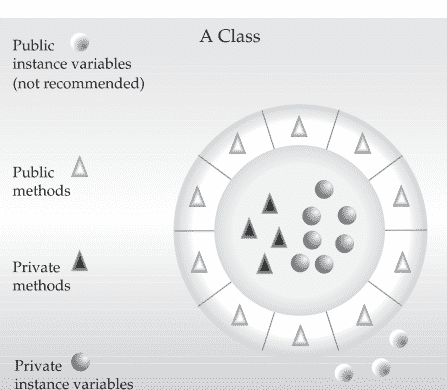

**图 2-1** 封装：可以使用公共方法保护私有数据。

如果你想描述一种更具体的动物类，例如哺乳动物，它们将具有更具体的属性，如牙齿类型和乳腺。这被称为动物的*子类*（subclass），而动物被称为哺乳动物的*超类*（superclass）。

由于哺乳动物是更精确指定的子类，它们*继承*类层次结构中每个祖先的所有属性。

继承与封装也有相互作用。如果给定类封装了某些属性，那么任何子类都具有相同的属性，*加上*它作为特化部分而添加的属性（见图 2-2）。这是面向对象程序增长的关键概念。

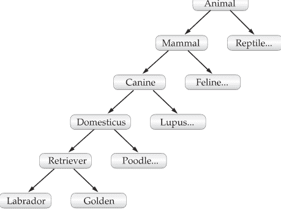

**图 2-2** 继承继承了所有的属性。

## 多态

多态（来自希腊语，意为“多种形式”）是一种允许一个接口用于不同实现的特性。更通俗地说，多态的概念通常用“一个接口，多个方法”这一短语来表达。这意味着设计一个支持许多操作的类是可能的。考虑非面向对象模型（即先进先出）。

## 多态、封装和继承的协同工作

当应用得当时，继承并结合可以产生比面向对象模型健壮得多的程序。通过应用面向对象的原则，复杂程序的各个部分可以汇聚成一个凝聚、健壮且易于维护的整体。

正如你所看到的，正是通过封装、继承和多态的应用，各个部分才转化为被称为“汽车”的对象。计算机程序也是如此。

正如在本节开头提到的，每个 Java 程序都是面向对象的。或者，更精确地说，每个 Java 程序都涉及封装、继承和多态。尽管在本章其余部分和接下来几章中显示的短示例程序似乎没有展示所有这些特性，但这些特性是存在的。

正如你所看到的，Java 提供的特性是其内置类库的一部分，这些库广泛地使用了封装、继承和多态。

## 第一个简单程序

现在已经讨论了 Java 的基本面向对象基础，让我们来看一些实际 Java 程序。让我们从编译和运行这里显示的短示例程序开始。正如你所看到的，这涉及的工作比你想象的要多一点。

```java
/*
这是一个简单的 Java 程序。
  将此文件命名为 "Example.java"。
*/
class Example {
  // 你的程序始于调用 main()
  public static void main(String[] args) {
    System.out.println("This is a simple Java program.");
  }
}
```

**注意**：使用标准 SE 开发工具包（JDK）的描述可以从 Oracle 获取。（也有开源版本可用）。如果你正在使用集成开发环境（IDE），你需要按照不同的步骤来编译和执行 Java 程序。在这种情况下，请查阅你的 IDE 文档以获取详情。

## 进入程序

对于某些计算机语言来说，保存程序源代码的文件名并不重要。然而，Java 并非如此。你学习 Java 的第一件事就是，你给源文件起的名字非常重要。对于这一点，源文件的名称应该是 `Example.java`。让我们来看看为什么。

在 Java 中，源文件正式称为*编译单元*。它是一个文本文件，其中包含（除外）一个或多个定义。（现在为了这一点，我们将使用只包含一个类的源文件。）Java 编译器要求源文件使用 `java` 文件名扩展名。

通过观察程序可以看到，程序中定义的类名在类内部也是 Example。这并非巧合。根据惯例，主类的名称应该与持有程序的文件的名称匹配。你还应该确保文件名的大小写与类名匹配。之所以这样做，是因为 Java 是区分大小写的。但这种文件名与类名相对应的惯例似乎是任意的。然而，这种约定使得维护和组织你的程序变得更容易。此外，正如你将在本书后的部分看到的，在某些情况下，这是要求的。

## 编译程序

要编译 `Example` 程序，请执行编译器 `javac`，并在命令行中指定源文件的名称，如下：

```bash
C:\javac Example.java
```

`javac` 编译器创建一个 `Example.class` 文件，其中包含程序的字节码。正如前面讨论的，Java 字节码是程序的中间表示，包含了 Java 虚拟机将执行的指令。因此，`javac` 的输出不是可以执行的代码。

实际上要运行程序，你必须使用名为 `java` 的 Java 启动器。这样做的方法是将类名 `Example` 作为命令行参数传递，如下：

```bash
C:>java Example
```

当程序运行时，将显示以下输出：

```
This is a simple Java program.
```

当 Java 源代码被编译时，每个单独的类都被放入以类命名并使用 `.class` 扩展名的输出文件中。这就是为什么给 Java 源文件起与类相同的名称是一个好主意——源文件的名称将与 `.class` 文件名匹配。当你像刚才执行 `java` 时，你实际上是在指定你想执行的类名。它会自动搜索具有 `.class` 扩展名的同文件。如果找到了，它将执行指定类中包含的代码。

> 注意：从 JDK 11 开始，Java 提供了一种直接从源文件运行某些简单程序的方法，而无需调用 `javac`。这种技术在某些情况下非常有用，在附录 C 中描述。对于本书而言，假设你正在使用上面描述的普通编译过程。

## 仔细观察第一个示例程序

尽管 `Example.java` 非常短，但它包含了所有 Java 程序共有的关键特性。让我们仔细检查程序的每个部分。程序从以下几行开始：

```
/*
这是一个简单的 Java 程序。
 将此文件命名为 "Example.java"。
 */
```

这是一个注释。与大多数其他编程语言一样，Java 允许你在其中输入备注。（注：此处原文文本包含大量 OCR 错误和重复，翻译已根据核心逻辑进行处理。）

行的最后一个字符是 `{`。它标志着 `main()` 方法体的开始。所有定义方法的代码都将出现在方法的起始大括号和结束大括号之间。

另一点是：`main()` 仅仅是你程序的起点。一个复杂的程序有几十个类，其中一个类将需要一个 `main()` 来让程序继续运行。此外，对于某些类型的程序，你根本不需要 `main()`。然而，对于书中的大多数程序，`main()` 是必须的。

接下来的代码行所示：注意，它发生在 `main()` 内部。

```java
System.out.println("This is a simple Java program.");
```

这一行在屏幕上输出字符串 "This is a simple Java program."，并紧跟一个换行。输出是通过内置的 `println()` 方法实现的。在这种情况下，`println()` 显示传递给它的字符串。正如你将看到的，`println()` 可以用于显示其他类型的信息。在这种类型中，`System` 是一个预定义的类，提供了对系统的访问，而 `out` 是连接到控制台的输出流。

正如你所猜的，控制台输出（和输入）在现实世界的应用中并不常用。大多数现代计算环境本质上是图形化的，控制台 I/O 主要用于工具程序、演示程序和服务器端代码。在书的后面，你将学习使用 Java 生成输出的其他方法。但现在，我们将继续使用控制台 I/O。


注意 `println()` 语句以分号结尾。Java 中的许多语句都以分号结尾。正如你将看到的，分号是 Java 语法中的重要组成部分。程序中的 `{ }` 结束了 `main()`，而最后一个 `}` 结束了 `Example` 类的定义。

## 第二个短程序

可能没有哪个概念比“变量”对编程语言更基础了。正如你可能所知，变量是一个命名的位置，你的程序可以对其赋值值。变量的值在程序执行过程中可能会改变。下一个程序展示了如何声明变量以及如何对其赋值。该程序还说明了控制台输出的一些新方面。正如程序顶部注释所示，将此文件命名为 `Example2.java`。

```
/*
这里另一个短示例。
将此文件命名为 "Example2.java"。
*/
```

```java
class Example2 {
    public static void main(String[] args) {
        int num; // 这声明了一个名为 num 的变量
    }
}
```

```java
num = 100; // 这给 num 赋值 100

System.out.println("This is num: " + num);

num = num * 2;
```

```java
System.out.print("The value of num * 2 is ");
System.out.println(num);
```

当你运行这个程序时，你将看到以下输出：

```
This is num: 100
The value of num * 2 is 200
```

让我们仔细观察为什么会生成这个输出。程序中的第一行所示：

```java
int num; // 这声明了一个名为 num 的变量
```

这一行声明了一个整数变量 `num`。Java（像许多其他语言一样）要求在变量使用之前对其声明。

以下是变量声明的通用形式：

```java
type var-name;
```

在这里，`type` 指定要声明的变量的类型，`var-name` 是变量名。如果你想声明多个指定类型的变量，可以使用逗号分隔的变量列表。Java 定义了几种数据类型，包括整数、字符和浮点数。关键字 `int` 指定整数类型。

在程序中，

```java
num = 100; // 这给 num 赋值 100
```

给 `num` 赋值为 100。赋值运算符是单个等号。

下一行代码输出 `num` 的值，前面紧跟字符串 "This is"：在这条语句中，`num` 的值被赋值给它之前的字符串（实际上，`num` 先从整数转换为其字符串，然后与它之前的字符串拼接。这个过程在书后面会详细描述）。这种方法可以泛化。使用 `+` 运算符，你可以在单个 `println()` 语句中连接任意数量的项。

下一行代码赋值 `num` 乘以 2 的值。像大多数其他语言一样，Java 使用 `*` 运算符表示乘法。执行这一行后，`num` 将包含值 200。

以下是程序中的后续几行：

```java
System.out.print("The value of num * 2 is ");
System.out.println(num);
```

这里发生了几件新事情。第一，使用内置方法 `print()` 来显示字符串 "The value of num * 2 is"。这意味着当生成下一个输出时，它后面不会跟一个换行。`print()` 方法类似于 `println()`，区别在于它在输出后不输出换行符。`print()` 和 `println()` 都可以用于输出值。

## if 语句

Java `if` 语句与许多语言非常相似。它根据条件是否真决定执行流。它的最简单形式所示：

```java
if(condition) statement
```

在这里，`condition` 是一个布尔表达式。（布尔表达式求值为真或假。）如果条件为真，执行语句。如果为假，则跳过语句。

### Java 关系运算符

| 运算符 | 含义 |
| --- | --- |
| < | 小于 |
| > | 大于 |
| == | 等于 |

注意相等性测试是双等号。这里是一个演示 if 的程序：

```
/*
演示 if。
将此文件命名为 "IfSample.java"。
*/
class IfSample {
  public static void main(String[] args) {
    int x, y;

    x = 10;
    y = 20;

    if(x < y) System.out.println("x is less than y");

    x = x * 2;
    if(x == y) System.out.println("x now equal to y");

    x = x * 2;
    if (x > y) System.out.println("x now greater than y");

    // 不显示任何内容
    if (x == y) System.out.println("you won't see this");
  }
}
```

该程序的输出所示：

```
x is less than y
x now equal to y
x now greater than y
```

## for 循环

循环语句是几乎任何编程语言的重要组成部分，因为它们提供了重复执行某些任务的方法。正如你将在第5章看到的，Java 提供了一套强大的循环结构。也许最灵活的是 `for` 循环。`for` 循环的最简单形式所示：

```java
for(initialization; condition; iteration) statement;
```

在最常见的形式中，循环的初始化部分为变量设置初始值。条件是测试循环变量的布尔表达式。如果测试结果为真，执行语句并继续迭代循环。如果结果为假，循环终止。迭代表达式决定了循环变量在每次迭代时如何变化。这里是一个展示 `for` 循环的短程序：

```
/*
演示 for 循环。
将此文件命名为 "ForTest.java"
*/
class ForTest {
  public static void main(String[] args) {
    int x;
    for(x = 0; x<10; x = x+1) {
      System.out.println("This is x: " + x);
    }
  }
}
```

该程序产生以下输出：

```
This is x: 0
This is x: 1
This is x: 2
This is x: 3
This is x: 4
This is x: 5
This is x: 6
This is x: 7
This is x: 8
This is x: 9
```

在这个示例中，`x` 是循环控制变量。它在 `for` 的初始化部分被初始化为零。在每次迭代的开始时（包括第一次），`for` 循环执行条件测试 `x < 10`。如果该测试的结果为真，则执行 `println()` 语句，然后执行循环迭代，使 `x` 加 1。这个过程一直持续，直到条件测试为假。

有趣的一点是，在专业编写的 Java 代码中，你几乎永远不会像前面的程序那样编写循环的迭代。也就是说，你很少看到像这样的语句：

```java
x = x + 1;
```

其由于是 Java 包含一个特殊的递增运算符，它可以更高效地执行此操作。递增运算符是 `++`。（也就是说，两个加号连在一起）。递增运算符将其操作的值增加 1。通过使用递增运算符，前面的语句可以写成这样：

```java
x++;
```

因此，前面程序中的 `for` 通常会写成这样：

```java
for(x = 0; x<10; x++)
```

你可能想尝试一下。正如你所看到的，循环的运行方式与之前完全相同。Java 还提供了一个递减运算符，指定为 `--`。该运算符将其操作的值减少 1。

## 代码块

Java 允许将两个或多个语句组合为代码块，称为代码块（code blocks）。这是通过将语句封装在左、右括号之间实现的。一旦创建了代码块，它就变成了一个逻辑单元，可以用于任何单语句可以使用的地方。例如，代码块可以作为 Java 的 `if` 和 `for` 语句的目标。考虑此语句：

```java
if(x < y) { // 开始一个块
    x = y;
    y = 0;
} // 块结束
```

在这里，如果 `x` 小于 `y`，块中的两个语句都将被执行。因此，块中的两个语句形成了一个逻辑单元，如果其中一个不执行，另一个也无法执行。这里的关键点是，每当你需要逻辑上连接两个或多个语句时，你都可以通过创建一个代码块来实现。

让我们来看另一个示例。下面的程序使用代码块作为 `for` 循环的目标。

```java
/*
演示代码块。

将此文件命名为 "BlockTest.java"
*/
class BlockTest {
    public static void main(String[] args) {
        int x, y;

        y = 20;

        // 此循环的目标是一个代码块
        for(x = 0; x < 10; x++) {
            System.out.println("This is x: " + x);
            System.out.println("This is y: " + y);
            y = y - 2;
        }
    }
}
```

该程序生成的输出所示：

```
This is x: 0
This is y: 20
This is x: 1
This is y: 18
This is x: 2
This is y: 16
This is x: 3
This is y: 14
This is x: 4
This is y: 12
This is x: 5
This is y: 10
This is x: 6
This is y: 8
This is x: 7
This is y: 6
This is x: 8
This is y: 4
This is x: 9
This is y: 2
```

在这种情况下，`for` 循环的目标是一个代码块，而不仅仅是一个语句。

## 词法问题

Java 是一种自由语言。这意味着你不需要遵循任何缩进规则。Java 中的空白包括空格、制表符、换行符。

## 标识符

标识符用于命名，例如类、变量和方法。Java 是区分大小写的，因此 `VALUE` 和 `Value` 是不同的标识符。有效的标识符可以由以下字符组成：

| 大写字母 | 小写字母 | 数字 | 下划线 | $ 符号 |
| :--- | :--- | :--- | :--- | :--- |

无效的标识符名称包括：

| 以数字开头 | 包含空格 | 其他 |
| :--- | :--- | :--- |

## 字面量

Java 中的常量值是通过使用字面量创建的。例如，这里有一些字面量：

| 100 | 98.6 | 'X' | "这是一个字符串" |
| :--- | :--- | :--- | :--- |

## 注释

如前所述，Java 定义了三种类型的注释。你已经见过两种：单行注释和多行注释。第三种类型是文档注释。这种类型以 `/**` 开始，以 `*/` 结束。文档注释在附录 A 中解释。

## 分隔符

在 Java 中，有一些字符作为分隔符。Java 最常用的分隔符是分号。分隔符所示：

| 符号 | 名称 | 目的 |
| :--- | :--- | :--- |
| () | 圆括号 | 用于包含方法定义和调用中的参数列表。还用于定义表达式中的优先级、控制语句中的表达式以及封装转换类型。 |
| {} | 大括号 | 用于包含自动初始化数组的值。用于定义类、方法和局部作用域的块。 |
| [] | 方括号 | 用于声明数组类型。也用于引用数组值。 |
| ; | 分号 | 终止语句。 |
| , | 逗号 | 分隔变量声明中连续的标识符。还用于连接语句。 |
| . | 点 | 用于分离包名与包以及类。还用于分离变量或方法与引用。 |
| :: | 冒号 | 用于创建方法或构造函数。 |
| ... | 省略号 | 表示变长参数。 |
| @ | @ 符号 | 开始注解。 |

## Java 关键字

| abstract | assert | boolean | break | byte | case |
|---|---|---|---|---|---|
| catch | char | class | const | continue | default |
| do | double | else | enum | exports | extends |
| final | finally | float | for | goto | if |
| implements | import | instanceof | int | interface | long |
| module | native | new | non-sealed | open | opens |
| package | permits | private | protected | provides | public |
| record | requires | return | sealed | short | static |
| strictfp | super | switch | synchronized | this | throw |
| throws | to | transient | transitive | try | uses |
| var | void | volatile | while | with | yield |

**表 2-1** Java 关键字

除了关键字之外，Java 还预留了三个从一开始就属于 Java 的名称：`true`、`false` 和 `null`。这些值由 Java 定义。你不能使用这些单词作为变量、类等等的名称。

## Java 类库

本章展示的示例程序使用了 Java 的两个内置方法：`println()` 和 `print()`。如所述，这些方法通过 `System.out` 可用。`System` 是 Java 定义的一个类，它会自动包含在你的程序中。从宏观来看，Java 环境依赖于几个内置类库，这些库包含了许多内置方法，为 I/O、字符串处理、网络和图形等内容提供支持。标准类还提供了对图形用户界面（GUI）的支持。因此，Java 整体是 Java 语言本身及其标准类的结合。正如你将看到的，类库提供了 Java 随带的大部分功能。事实上，成为 Java 程序员的一部分工作就是学习使用标准 Java 类。在本书的第一部分中，将根据需要描述标准库类和方法的各种元素。在第二部分中，将详细描述若干个类库。

# 第 3 章 数据类型、变量和数组

本章将研究 Java 最基础的三个元素之一：数据类型、变量和数组。与所有现代编程语言一样，Java 支持多种类型的数据。你可以使用这些类型来声明变量和创建数组。正如你将看到的，Java 处理这些项目的方法是简洁、高效且具有内聚性的。

## Java 是一种强类型语言

在开头必须说明的是，Java 是一种强类型语言。事实上，Java 的安全性和健壮性源于这一事实。让我们看看这意味着什么。首先，每个变量都有类型，每个表达式都有类型，并且每个类型都经过严格定义。其次，所有的赋值（无论是显式的还是通过方法调用中的参数传递）都会经过类型兼容性检查。在某些语言中，冲突类型之间不会进行自动转换。Java 编译器会检查所有表达式和参数，以确保类型是兼容的。任何类型不匹配都是错误，必须在编译器完成代码编译之前修正。

## 基本数据类型

Java 定义了八种基本数据类型：`byte`、`short`、`int`、`long`、`char`、`float`、`double` 和 `boolean`。基本类型通常也被称为简单类型，书中将使用这两个术语。它们可以分为四组：

- **整数**：该组包括 `byte`、`short`、`int` 和 `long`，用于整数值。
- **浮点数**：该组包括 `float` 和 `double`，表示具有小数精度的数字。
- **字符**：该组包括 `char`，表示字符集中的符号，如字母和数字。
- **布尔值**：该组包括 `boolean`，是一种用于表示真/假值的特殊类型。

你可以直接使用这些类型，也可以构建数组或你自己的类类型。因此，它们构成了你所创建的所有其他类型数据的基础。

基本类型表示单个值——而不是复杂对象。尽管 Java 是完全面向对象的，但基本类型并不是。它们类似于在其他非对象语言中找到的简单类型。之所以这样做是为了效率考虑。将基本类型制为对象会严重损害性能。

基本类型定义了显式的范围和数学行为。诸如 C 和 C++ 等语言允许整数的大小根据执行环境的要求而变化。Java 则不同。由于 Java 的可移植性要求，所有数据类型都有定义的范围。例如，`int` 是 32 位的，无论特定平台如何。

## 整数

Java 定义了四个整数：`byte`、`short`、`int` 和 `long`。所有这些都是有符号的。Java 不支持无符号整数。许多其他语言支持无符号类型，但 Java 认为没有必要。这些类型的宽度各异，如下表所示：

| 名称 | 宽度 | 范围 |
|---|---|---|
| long | 64 | -9,223,372,036,854,775,808 到 9,223,372,036,854,775,807 |
| int | 32 | -2,147,483,648 到 2,147,483,647 |
| short | 16 | -32,768 到 32,767 |


| byte | 8 | -128 到 127 |

## byte

最小的整数类型是 `byte`。它是一种符号 8 位类型，范围为 -128 到 127。当你处理来自网络或文件的流时，`byte` 类型变量特别有用。当你处理可能与其他类型直接兼容的原始二进制数据时，它们也很有用。使用 `byte` 关键字声明变量。例如，以下代码声明了变量 `b` 和 `c`：

```java
byte b, c;
```

## short

`short` 是一种符号 16 位类型。它的范围是 -32,768 到 32,767。它可能是最常用的 Java 类型。以下是 `short` 变量声明的示例：

```java
short s, t;
```

## int

最常用的整数类型是 `int`。它是一种符号 32 位类型，范围从 -2,147,483,648 到 2,147,483,647。除了其他用途外，`int` 类型变量通常用于控制循环和索引数组。在不需要 `int` 的更大范围的情况下（尽管可能如此），使用 `byte` 或 `short` 会比使用 `int` 更高效。原因是当 `byte` 和 `short` 值用于表达式时，在求值时会被提升为 `int`。（类型提升在本章稍后介绍。）因此，在需要整数时，`int` 是最佳选择。

## long

`long` 是一种符号 64 位类型，适用于 `int` 类型不足以容纳所需值的情况。`long` 的范围很大。这使得它在需要大整数时非常有用。例如，这里有一个计算光在指定天数内移动距离的程序：

```java
// 使用 long 变量计算距离。
class Light {
    public static void main(String[] args) {
        int lightspeed;
        long days;
        long seconds;
        long distance;

        // 每秒英里的光速
        lightspeed = 186000;

        days = 1000;
        seconds = 2 * 24 * 60 * 60; // 转换为秒
        distance = (long)lightspeed * seconds; // 计算距离

        System.out.print("In " + days + " days");
        System.out.print(" light will travel about ");
        System.out.println(distance + " miles.");
    }
}
```

该程序生成以下输出：

```
在 1000 天内，光将传播大约 16070400000000 英里。
```

显然，该结果不能存储在 `int` 变量中。

## 浮点类型

浮点数（也称为实数）用于评估需要分数精度的表达式。例如，像平方根计算，或者正弦、余弦等超越函数的计算，其结果的精度需要浮点类型。Java 实现了标准的 (IEEE-754) 浮点类型和运算符。浮点类型有两种类：`float` 和 `double`，分别表示单精度和双精度数字。它们的宽度和范围所示：

| 名称 | 宽度（位） | 估算范围 |
| :--- | :--- | :--- |
| double | 64 | 4.9e-324 到 1.8e+308 |
| float | 32 | 1.4e-045 到 3.4e+038 |

接下来将逐一介绍这些浮点类型。

## float

`float` 类型指定了使用 32 位存储的单精度值。单精度在某些处理器上速度更快，且占的空间是双精度的一半，但当值非常大或非常小时，它会变得不精确。当你需要一个功能组件但不需要高精度时，`float` 类型的变量非常有用。例如，在表示美元和分时，`float` 可能很有用。

以下是一些 `float` 变量定义的示例：

```java
float heightemp;
```

## double

双精度由 `double` 关键字表示，使用 64 位存储一个值。在某些针对高速数学计算优化的现代处理器上，双精度实际上比单精度更快。所有的超越数学函数（如 `sin()`、`cos()` 和 `sqrt()`）都返回 `double` 值。当你需要在多次迭代计算中保持准确性，或者处理大数值时，`double` 是最佳选择。

这是一个使用 `double` 变量计算圆面积的程序：

```java
// 计算圆面积。
class Area {
  public static void main(String[] args) {
    double pi, r, a;
    r = 10.8; // 圆的半径
    pi = 3.1416; // pi，近似值
    a = pi * r * r; // 计算面积

    System.out.println("Area of circle is " + a);
  }
}
```

## 字符

在 Java 中，用于存储字符的数据类型是 `char`。Unicode 定义了一个完全国际化的字符集，可以表示所有人类语言中找到的所有字符。它是几十种字符集的统一，例如拉丁语、希腊语、阿拉伯语、西里尔语、希伯来语、片假名、韩语等。在 Java 创建时，Unicode 需要 16 位。因此，Java `char` 是 16 位的类型。`char` 的范围是 0 到 65,535。没有负数字符。被称为 ASCII 的标准字符集范围如既往是 0 到 127，而扩展 8 位字符集 ISO-Latin-1 的范围是 0 到 255。由于 Java 的设计目标是允许在全球范围内编写程序，因此使用 Unicode 来表示字符是有意义的。当然，对于英语、德语、西班牙语或法语等字符可以轻松包含在 8 位内的语言来说，Unicode 有些低效。但这是为了实现全球移植性必须付出的代价。

> **注意** 关于 Unicode 的更多信息可以访问 <http://www.unicode.org>。

以下是一个演示 `char` 变量的程序：

```java
// Demo char 数据类型。
class CharDemo {
    public static void main(String[] args) {
        char ch1, ch2;

        ch1 = 88; // X 的代码
        ch2 = 'Y';

        System.out.print("ch1 and ch2: ");
        System.out.println(ch1 + " " + ch2);
    }
}
```

该程序显示以下输出：

```
ch1 and ch2: X Y
```

> **注意** `char` 被赋予了值 88，这是对应字母 X 的 ASCII（以及 Unicode）值。如所述，ASCII 字符集占据了 Unicode 字符集中前 127 个值。出于这个原因，你在其他语言中可能对字符使用的所有“老技巧”在 Java 中同样有效。

虽然 `char` 设计用于处理 Unicode 字符，但它也可以作为整数类型，可以在上面执行算术运算。例如，你可以将两个字符相加，或者增加字符变量的值。考虑以下程序：

```java
// char 变量的行为像整数。
class CharDemo2 {
    public static void main(String[] args) {
        char chl;

        chl = 'X';
        System.out.println("chl contains " + chl);

        chl++; // 增加 chl
        System.out.println("chl is now " + chl);
    }
}
```

该程序生成的输出如下：

```
chl contains X
chl is now Y
```

在程序中，`chl` 首先被赋予值 `X`。接着，`chl` 递增。这导致 `chl` 包含 `Y`，即 ASCII（Unicode）集中的下一个字符。

## 布尔值

Java 有一个原始类型 `boolean`，它只有两个可能的值：`true` 或 `false`。它被用于条件表达式。以下是一个演示布尔值的程序：

```java
// 演示布尔值。
class BoolTest {
    public static void main(String[] args) {
        boolean b;

        b = true;
        System.out.println("b is " + b);

        b = false;
        System.out.println("b is " + b);
    }
}
```

该程序生成的输出如下：

```
b is true
b is false
```

## 整数字面量

`922337023685477807L` 是最大的 `long` 类型。只要在范围内，整数也可以赋值给 `char` 类型。

你可以使用二进制来指定整数字面量。为此，只需在值前加上前缀 `0b` 或 `0B`。例如，这使用二进制字面量指定了十进制的 10：

```java
int x = 0b1010;
```

除其他外，二进制字面量的加入使得输入位掩码的值变得更容易。在这种情况下，该值的十进制（十六进制）表示在直观上无法传达其相对于用途的含义。而二进制字面量则可以。

你可以在整数字面量中嵌入一个或多个下划线。这样做使得大整数字面量更容易阅读。在编译字面量时，下划线会被丢弃。例如，

```java
int x = 123_456_789;
```

赋给 `x` 的值为 123,456,789。下划线将被忽略。下划线只能用于分隔数字。它们不能出现在字面量的开头或结尾。然而，在两个数字之间使用多个下划线是被允许的。例如，这是有效的：

```java
int x = 123___456_789;
```

在整数字面量中使用下划线在编码电话号码、客户 ID 号、零件号等内容时特别有用。它们在指定二进制字面量时提供视觉分组也有用。例如，二进制值通常以四位一组的形式进行视觉分组，如下：

```java
int x = 0b101_0101_0001_1010;
```

## 浮点数字面量

浮点数表示带有小数部分的十进制值。标准记法由一个整数、一个小数点以及随其后的小数部分组成。例如，`2.0`、`3.14159` 和 `0.6667` 是有效的标准浮点数。科学计数法使用标准记法的浮点数加上一个后缀，该后缀指定了数字所乘以 10 的幂次。指数由 `E` 或者 `e` 表示，后面跟一个数字（可以是正数也可以负数）。科学字面量包括 `6.022E23`、`3.1419E-05` 和 `2e+100`。

Java 中的浮点数字面量默认是双精度。要指定 `float` 字面量，你必须在常量后附加 `F` 或 `f`。指定 `double` 字面量可以附加 `D` 或 `d`，当然这是冗余的。默认的 `double` 类型占用 64 位存储，而 `float` 类型需要 32 位。

Java 也支持十六进制浮点数字面量，但它们很少被使用。它们必须采用类似于科学计数法的格式，使用 `P` 或 `p` 而不是 `E` 或 `e`。例如，`0x12.2P2` 是一个浮点数字面量。`P` 之后的值称为二进制指数，表示数字所乘以 2 的幂次。因此，`0x12.2P2` 代表 72.5。

你可以在浮点数字面量中嵌入一个或多个下划线。此功能与前面描述的整数字面量相同。其目的是让大浮点数字面量更容易阅读。在编译字面量时，下划线会被丢弃。例如，

```java
double num = 9_423_497_862.0;
```

赋给 `num` 的值将是 9,423,497,862.0。下划线将被忽略。与整数字面量一样，下划线只能用于分隔数字。它们不能位于字面量的开头或结尾。在两个数字之间使用多个下划线是允许的。在数字的小数部分使用下划线也是允许的。例如，

```java
double num = 9_423_497.1_0_9;
```

这种情况是合法的，小数部分为 `.109`。

## 布尔字面量

布尔字面量非常简单。布尔值只有两种逻辑值：`true` 和 `false`。`true` 和 `false` 的值不会转换为任何数值表示。Java 中的 `true` 字面量不等于 1，`false` 字面量不等于 0。在 Java 中，布尔字面量只能赋值给声明为 `boolean` 的变量，或用于带有布尔运算符的表达式。

## 字符字面量

Java 中的字符是 Unicode 字符集的索引。它们是 16 位的值，可以转换为整数并使用整数运算符（如加法和减法运算符）进行操作。字面字符表示在一对单引号内。所有可见的 ASCII 字符都可以输入引号内，例如 `'a'` 和 `'z'`。对于无法直接输入的字符，有几种转义序列允许你输入字符，例如用于单引号字符的 `'\''` 和用于换行符的 `'\n'`。还有一种直接以八进制或十六进制输入字符值的方法机制。对于八进制，使用反斜杠后跟三位数字。例如，`'\u0432'` 是日语片假名。表 3-1 显示了字符转义序列。

### 表 3-1 转义序列

| 转义序列 | 描述 |
| :--- | :--- |
| `\'` | 单引号 |
| `\"` | 双引号 |
| `\n` | 换行 |
| `\r` | 回车 |
| `\f` | 换页 |
| `\t` | 制表符 |
| `\b` | 退格 |
| `\s` | 空格 |
| `\uXXXX` | Unicode 字符 |

## 字符串字面量

Java 中的字符串字面量的指定方式与在相同语言中相似，使用双引号括起来。例如：

```java
"Hello World"
```

## 变量

变量是存储的基本单元。在 Java 中，变量由类型、名称和可选初始化器定义。要声明多个相同类型，使用逗号分隔。

### 声明变量

在 Java 中，所有变量必须在使用之前声明。变量声明的基本形式为：

```java
type 标识符 [ = value ]
```

### 动态初始化

之前的示例仅使用常量作为初始化器，Java 允许在声明时使用任何有效的表达式动态初始化变量。

例如，这里有一个短程序根据两条边的长度计算直角三角形的斜边：

```java
// 演示动态初始化。
class DynInit {
    public static void main(String[] args) {
        double a = 3.0, b = 4.0;

        // c 是动态初始化的
        double c = Math.sqrt(a * a + b * b);
        System.out.println("Hypotenuse is " + c);
    }
}
```

### 变量的作用域

到目前为止，所有使用的变量都在 `main()` 方法开始处声明。然而，Java 允许在任何块中声明变量。正如第 2 章所解释的，块由左大括号开始并由右大括号结束。块定义了一个作用域。因此，每当你开始一个新块时，你都在创建一个新的作用域。作用域决定了哪些对象对程序的其他部分是可见的。它还决定了这些对象的生命周期。

将作用域分为大类：全局和局部，这种做法并不罕见。这些传统的作用域与 Java 严格的面向对象模型并不完全匹配。虽然可以创建等同于全局作用域的内容，但这完全是例外，而非规则。在 Java 中，两个主要的作用域分别由类定义和由方法定义。这种区分某种程度上是人为的。然而，由于类作用域具有不适用于方法定义作用域的独特属性和特征，这种区分是有一定意义的。由于这些差异，关于类作用域（以及其中声明的变量）的讨论将推迟到第 6 章（即定义类时）。目前，我们只检查由方法定义或在方法内部定义的作用域。

由方法定义的作用域始于左大括号。然而，如果方法有参数，这些参数会被包含在方法的作用域内。方法的作用域结束于右大括号。这段代码块被称为方法体。

作为一个一般规则，在作用域内部声明的变量对作用域外部的代码是不可见的（即不可访问的）。那么，当你在作用域内声明变量时，你是在将其局部化，并使其免受未经授权的访问和/或修改。事实上，作用域为封装提供了基础。在块中声明的变量被称为局部变量。

作用域是可以嵌套的。例如，每当你创建一个代码块，你就创建了一个新的作用域。当这种情况发生时，外部作用域包含了内部作用域。这意味着在外部作用域中声明的对象对内部作用域是可见的。然而，反过来不然。在内部作用域中声明的对象在外部是不可见的。

为了理解嵌套作用域的影响，请考虑以下程序：

```java
// 演示块作用域。
class ScopeDemo {
    public static void main(String[] args) {
        int x; // 对 main 内的所有代码可见

        x = 10;
        if (x == 10) { // 开始新作用域
            int y = 20; // 仅对该块可见

            // x 和 y 都可见
            System.out.println("x and y: " + x + " " + y);
            x = y * 2;
        }
        // y = 100; // 错误！y 在此处不可见

        // x 仍然可见
        System.out.println("x is " + x);
    }
}
```

如注释所示，变量 `x` 在 `main()` 作用域开始时声明，并且 `main()` 内部的所有后续代码都可以访问。在 `if` 块内部声明了 `y`。由于块定义了一个作用域，`y` 只对该块内的其他代码可见。这就是为什么在它的块外部，行 `y = 100;` 被注释掉了。如果你删除开头的注释符号，将会发生编译错误，因为 `y` 在块外部是不可见的。在 `if` 块内部，可以使用 `x`。代码块（即嵌套作用域）可以访问由闭包作用域声明的变量。

在块内部，变量可以在任何点声明，但仅在声明后才有效。因此，如果你在方法开始定义一个变量，它对该方法内部的所有代码都可用。相反，如果你在块的末尾声明一个变量，它实际上是没用的，没有代码可以访问它。例如，此片段中的 `count` 在其声明之前被使用：

```java
// 此片段是错误的！
count = 100; // 哎！不能在声明之前使用 count！
int count;
```

这里有另一个需要记住的重要点：变量在进入其作用域时创建，在离开其作用域时销毁。这意味着变量一旦离开作用域，它将不再持有原来的值。因此，在方法内部声明的变量在对该方法的多次调用之间不会持有其值。同样，在块内部声明的变量在离开块时会丢失其值。因此，变量的生命周期被限制在其作用域内。

如果变量声明包含初始化器，那么该变量在每次被声明时都会被重新初始化。例如，考虑下一个程序：


# 第 3 章 数据类型、变量和数组

## 变量的生命周期

```java
// 展示变量的生命周期。
class Lifetime {
    public static void main(String[] args) {
        int x;

        for(int x = 0; x < 3; x++) {
            int y = -1; // 每次进入块时 y 被初始化
            System.out.println("y is: " + y); // 这始终会打印
            y = 100;
            System.out.println("y is now: " + y);
        }
    }
}
```

此程序生成的输出如下：

```
y is: -1
y is now: 100
y is: -1
y is now: 100
y is: -1
y is now: 100
```

你可以看到，`y` 在每次进入块时都会重新初始化为 `-1`。

最后一点：块可以嵌套，但你不能在同一个作用域内声明同名的变量。例如，以下程序是非合法的：

```java
// 此程序无法编译
class Test {
    public static void main(String[] args) {
        int x = 10;
        int x = 20; // 错误：变量 x 已定义
    }
}
```

## 类型转换与强制转换

如果你想将较小类型的值赋值给较大类型（例如从 `int` 到 `long`），Java 会自动执行转换。然而，如果你是将较大类型赋值给较小类型（例如从 `double` 到 `int`），你必须使用强制转换。它的通用形式为：

```
(target-type) value
```

这里，`target-type` 指定了要转换的目标类型。这种转换有时被称为窄转换，因为可能会丢失信息。例如，如果将浮点值赋值给整数类型，小数部分将会丢失。

### Java 的自动转换

当将浮点值赋值给整数类型时，小数部分会被截断。例如，如果将 `1.23` 赋值给整数类型，结果将是 `1`。`0.23` 被截断了。当然，如果整数的大小无法放入整数类型中，则该值将对范围取模。

当满足以下两个条件时，会自动发生转换：

- 目标类型大于源类型。
- 两种类型是兼容的（例如整数类型和浮点类型）。

### 不兼容类型的强制转换

以下程序演示了需要强制转换的一些类型转换：

```java
// 展示强制转换。
class Conversion {
    public static void main(String[] args) {
        byte b;
        int i = 257;
        double d = 323.142;

        System.out.println("Conversion of int to byte.");
        b = (byte) i;
        System.out.println("i and b = " + i + " = " + b);
        
        System.out.println("Conversion of double to int.");
        i = (int) d;
        System.out.println("d and i = " + d + " = " + i);
        
        System.out.println("Conversion of double to byte.");
        b = (byte) d;
        System.out.println("d and b = " + d + " = " + b);
    }
}
```

此程序产生以下输出：

```
Conversion of int to byte.
i and b = 257 = 1
Conversion of double to int.
d and i = 323.142 = 323
Conversion of double to byte.
d and b = 323.142 = 67
```

让我们来看每一次转换。当将值 `257` 强制转换为 `byte` 变量时，结果是 `257` 除以 `256`（`byte` 的范围）的余数，在这种情况下结果为 `1`。当 `d` 转换为 `int` 时，其小数部分会丢失。当 `d` 转换为 `byte` 时，其小数部分会丢失，且该值将对 `256` 取模，在这种情况下结果为 `67`。

## 表达式中的自动类型提升

除了赋值之外，表达式中还有可能发生某些类型转换的地方。为了理解为什么，请考虑以下内容。在表达式中，中间值的精度有时会超过任一操作数的范围。例如，查看以下表达式：

```java
byte a = 40;
byte b = 50;
byte c = 100;
int d = a * b / c;
```

中间项 `a * b` 的结果很容易超过其任一 `byte` 操作数的范围。为了处理这类问题，Java 在评估表达式时会自动提升每个 `byte`、`short` 或 `char` 操作数。这意味着子表达式 `a*b` 是使用整数而非 `byte` 提升的。因此，中间表达式 `50 * 40` 的结果 `2000` 是合法的，尽管 `a` 和 `b` 都指定为 `byte` 类型。

尽管自动提升非常有用，但它们可能会导致误解的编译错误。例如，这段看似正确的代码导致了问题：

```java
byte b = 50;
b = b * 2; // 错误！无法将 int 赋值给 byte！
```

代码试图将 `50 * 2`（一个完全有效的 `byte` 值）存回 `byte` 变量中。然而，因为在评估表达式时操作数被自动提升为 `int`，结果变成了 `int` 类型，如果不使用强制转换，则无法赋值给 `byte`。即使在这种特定情况下，赋值的值仍然符合目标类型，情况也是如此。

在你理解溢出后果的情况下，你应该使用显式强制转换，如下：

```java
byte b = 50;
b = (byte)(b * 2);
```

这产生了正确的值 `100`。

### 类型提升规则

Java 定义了适用于表达式的若干类型提升规则。规则如下：首先，所有的 `byte`、`short` 和 `char` 值都被提升为 `int`，如上述描述。如果一个操作数是 `long`，整个表达式被提升为 `long`。如果一个操作数是 `float`，整个表达式被提升为 `float`。如果任何操作数是 `double`，结果即为 `double`。

以下程序演示了表达式中的每个值如何被提升以匹配每个二元运算符的第二个参数：

```java
class Promote {
    public static void main(String[] args) {
        byte b = 42;
        char c = 'a';
        short s = 1024;
        int i = 50000;
        float f = 5.67f;
        double d = .124;
        double result = (f * b) + (i / c) - (d * s);
        System.out.println((f * b) + " + " + (i / c) + " + " + (d * s));
        System.out.println("result = " + result);
    }
}
```

让我们仔细观察程序中这一行代码的类型提升：

```java
double result = (f * b) + (i / c) - (d * s);
```

在第一个子表达式中，`f * b` 被提升为 `float`，该子表达式的结果是 `float`。在子表达式 `i/c` 中，它被提升为 `int`，结果类型为 `int`。在 `d * s` 中，它被提升为 `double`，子表达式的类型是 `double`。最后，考虑这些中间值：`float`、`int` 和 `double`。`float` 加上 `int` 的结果是 `float`。结果 `float` 使得最后一个 `double` 被提升为 `double`，这正是表达式最终结果的类型。

## 数组

**数组**是一组通过名称引用的相同类型变量。可以创建任何类型的数组，并且它们可以有一维或多个维度。数组中的特定元素通过其索引访问。数组提供了分组相关信息的方便方法。

### 一维数组

**一维数组**本质上是一系列相同类型变量的列表。要创建一个数组，你必须先创建一个所需类型的数组。一维数组声明的通用形式如下：

```
type[] var-name;
```

例如：

```
int[] month_days;
```

虽然这个声明建立了 `month_days` 是数组变量的事实，但实际上并不存在数组。要将 `month_days` 与实际的整数物理数组关联，你必须分配一个新的数组并将其赋值给 `month_days`。`new` 是一个分配内存的特殊运算符。

你将在后面的章节更详细地查看 `new`，但你需要使用它为数组分配内存。`new` 应用一维数组的通用形式如下：

```
array-var = new type[size];
```

在这里，`type` 指定要分配的数据类型，`size` 指定元素数量，`array-var` 是与数组关联的变量。也就是说，要使用数组，必须指定类型和元素数量。之后，使用 `new` 分配数组。

可以将数组的声明与数组的分配结合，如下：

```
int[] month_days = new int[12];
```

这是你通常在专业程序中看到的写法。数组可以在声明时进行初始化。该过程与初始化简单类型相似。*数组初始化器*是用花括号括起来的逗号分隔表达式列表。逗号分隔数组的值。数组将自动足够容纳你在数组初始化器中指定的元素。不需要使用 `new`。例如，为了存储每个月份的天数，以下代码创建了一个初始化的整数数组：

```java
// 上一个程序的改进版本
class AutoArray {
    public static void main(String[] args) {
        int[] month_days = { 31, 28, 31, 30, 31, 30, 31, 31, 30, 31, 30, 31 };
        System.out.println("April has " + month_days[3] + " days.");
    }
}
```

运行此程序时，你会看到与之前的版本相同的输出。

Java 严格检查以确保你不会意外存储或引用范围之外的值。Java 运行时会检查所有数组索引是否在正确范围内。例如，运行时将检查 `month_days` 中每个索引的值，以确保它在 `0` 到 `11` 之间。如果你尝试访问数组范围外的元素（负数或大于数组长度的数），将导致运行时错误。

这里是使用一维数组的另一个示例。它计算一组数字的平均值：

```java
// 计算数组值的平均值
class Average {
    public static void main(String[] args) {
        double[] nums = {10.1, 11.2, 12.3, 13.4, 14.5};
        double result = 0;
        int i;

        for(i=0; i<5; i++)
            result = result + nums[i];
        System.out.println("Average is " + result / 5);
    }
}
```

### 多维数组

在 Java 中，多维数组被实现为数组的数组。要声明多维数组变量，可以使用另一组方括号来指定每个额外的索引。例如，下面的代码定义了一个名为 `twoD` 的多维数组变量：

```java
int[][] twoD = new int[4][5];
```

这分配了一个 4 行 5 列的数组并将其赋值给 `twoD`。在内部，它被实现为一个 `int` 数组的数组。从概念上讲，这个数组看起来就像图 3-1 所示。

下面的程序从左到右、从上到下对数组中的每个元素进行编号，然后显示这些值：

```java
// 展示一个二维数组。
class TwoDArray {
    public static void main(String[] args) {
        int[][] twoD = new int[4][5];
        int i, j, k = 0;

        for(i=0; i<4; i++) {
            for(j=0; j<5; j++) {
                twoD[i][j] = k;
                k++;
            }
        }

        for(i=0; i<4; i++) {
            for(j=0; j<5; j++) {
                System.out.print(twoD[i][j] + " ");
            }
            System.out.println();
        }
    }
}
```

该程序生成以下输出：

```
0 1 2 3 4
5 6 7 8 9
10 11 12 13 14
15 16 17 18 19
```

当为多维数组分配内存时，你只需要指定第一（最左侧）维度的内存。你可以单独分配其余维度。

例如，下面的代码在声明 `twoD` 时为其第一维度分配了内存。它单独分配了第二个维度。

```java
int[][] twoD = new int[4];
twoD[0] = new int[5];
twoD[1] = new int[5];
twoD[2] = new int[5];
twoD[3] = new int[5];
```

虽然在这种情况下没有必要单独分配第二个维度的数组，但可能存在其他情况。例如，当你单独分配维度时，不需要为每个维度分配相同数量的元素。正如前面提到的，由于多维数组实际上是数组的数组，因此每个数组的长度都由你控制。例如，下面的程序创建了一个二维数组，其第二维的大小是不相等的：

```java
// 手动分配不同的第二维尺寸。
class TwoDAgain {
    public static void main(String[] args) {
        int[][] twoD = new int[4];
        twoD[0] = new int[1];
        twoD[1] = new int[2];
        twoD[2] = new int[3];
        twoD[3] = new int[4];

        int i, j, k = 0;

        for(i=0; i<4; i++)
            for(j=0; j<i+1; j++)
                twoD[i][j] = k++;
        
        for(i=0; i<4; i++) {
            for(j=0; j<i+1; j++)
                System.out.print(twoD[i][j] + " ");
            System.out.println();
        }
    }
}
```

该程序生成以下输出：

```
0
1 2
3 4 5
6 7 8 9
```

该程序创建的数组如下：

| 行 | 元素 |
|---|---|
| 0 | 0 |
| 1 | 0, 1 |
| 2 | 0, 1, 2 |
| 3 | 0, 1, 2, 3 |

使用不均匀（不规则）多维数组在许多应用中可能并不常见，因为这与人们在遇到多维数组时预期的结果相悖。然而，不规则数组在某些情况下可以有效使用。例如，如果你需要一个非常大且稀疏的二维数组（即并不是所有元素都会被使用），那么不规则数组可能是完美的解决方案。

多维数组是可以初始化的。要这样做，只需将每个维度封装在自己的大括号中。下面的程序创建了一个矩阵，其中每个元素包含行索引和列索引的乘积。还要注意，你可以在初始化数组中使用表达式，也可以使用字面量值。

```java
// 初始化二维数组。
class Matrix {
    public static void main(String[] args) {
        double[][] m = {
            { 0*0, 1*0, 2*0, 3*0 },
            { 0*1, 1*1, 2*1, 3*1 },
            { 0*2, 1*2, 2*2, 3*2 },
            { 0*3, 1*3, 2*3, 3*3 }
        };
        int i, j;

        for(i=0; i<4; i++) {
            for(j=0; j<4; j++) {
                System.out.print(m[i][j] + " ");
            }
            System.out.println();
        }
    }
}
```

当你运行此程序时，你将得到以下输出：

```
0.0 0.0 0.0 0.0
0.0 1.0 2.0 3.0
0.0 2.0 4.0 6.0
0.0 3.0 6.0 9.0
```


## 图 3-1 一个 4x5 二维数组的构视图

例如，下面的代码在声明 `twoD` 时为其第一维度分配了内存。它单独分配了第二个维度。

```java
int [] twoD = new int [4];
twoD[0] = new int [5];
twoD[1] = new int [5];
twoD[2] = new int [5];
twoD[3] = new int [5];
```

虽然在这种情况下没有数组可以单独分配分配第二个维度的数组，但可能存在其他情况。例如，当你单独分配维度时，不需要为每个维度分配相同数量的元素。正如前面提到的，由于多维数组实际上是数组的数组，因此每个数组的长度都由你控制。例如，下面的程序创建了一个二维数组，其第二维的大小是不相等的：

```java
// 手动分配不同的第二维尺寸。
class TwoDAgain {
  public static void main(String[] args) {
    int [] twoD = new int [4];
    twwoD[0] = new int [1];
    twwoD[1] = new int [2];
    twwoD[2] = new int [3];
    twwoD[3] = new int [4];

    int i, j, k = 0;

    for(i=0; i<4; i++)
      for(j=0; j<i+1; j++)
        twoD[i][j] = k;
      k++;

    for(i=0; i<4; i++)
      for(j=0; j<i+1; j++)
        System.out.print(twoD[i][j] + " ");
      System.out.println();
  }
}
```

该程序生成以下输出：

```
0
1 2
3 4 5
6 7 8 9
```

该程序创建的数组如下：

| 0 | 0 |
|---|---|
| 1 | 0 | 1 | 1 |
| 2 | 0 | 2 | 1 | 2 | 2 |
| 3 | 0 | 3 | 1 | 3 | 2 | 3 | 3 |

使用不均匀（不规则）多维数组在许多应用中可能并不合适，因为这与人们在遇到多维数组时预期的结果相悖。然而，不规则数组在某些情况下可以有效使用。例如，如果你需要一个非常大且稀疏的二维数组（即并不是所有元素都会被使用），那么不规则数组可能是完美的解决方案。

初始化多维数组是可能的。要这样做，只需将每个维度封装在它自己的大括号中。下面的程序创建了一个矩阵，其中每个元素包含行索引和列索引的乘积。此外，注意，你可以在初始化数组中使用表达式，也可以使用字面量值。

```java
// 初始化二维数组。
class Matrix {
  public static void main(String[] args) {
    double[] m = {
      { 0*0, 1*0, 2*0, 3*0 },
      { 0*1, 1*1, 2*1, 3*1 },
      { 0*2, 1*2, 2*2, 3*2 },
      { 0*3, 1*3, 2*3, 3*3 }
    };
    int i, j;

    for(i=0; i<4; i++) {
      for(j=0; j<4; j++) {
        System.out.print(m[i][j] + " ");
      }
      System.out.println();
    }
  }
}
```

当你运行此程序时，你将获得以下输出：

```
0.0 0.0 0.0 0.0
0.0 1.0 2.0 3.0
0.0 2.0 4.0 6.0
0.0 3.0 6.0 9.0
```

初始化多维数组是可能的。下面的程序...

```java
// 有趣的是在下面的序列中，var既被用作声明的类型
// 也被用作初始化器的变量名
var k = -var;
System.out.println("Value of k: " + k);
}
```

以下是输出：

```
Value of avg: 10.0
Value of var: 1
Value of k: -1
```

上一个示例使用 `var` 来声明简单变量，但你也可以使用 `var` 来声明一个数组。例如：

```
var myArray = new int[10]; // 这是有效的。
```

注意，`var` 和 `myArray` 都没有括号。相反，`myArray` 的类型被推断为 `[int]`。此外，你不能在 `var` 声明的左侧使用括号。以下这两种声明都是无效的：

```
var[] myArray = new int[10]; // 错误
var myArray[] = new int[10]; // 错误
```

在第一行中，尝试给 `var` 加上括号。在第二行中，尝试给 `myArray` 加上括号。在两种情况下，所使用的括号类型都是从初始化器的类型推断出的变量类型。

需要强调的是，只有当变量被初始化时，可以使用 `var` 来声明变量。例如，以下语句是错误的：

```
var counter; // 错误！需要初始化器。
```

此外，记住，`var` 只能用于声明局部变量。例如，它不能用于声明实例变量、参数或返回类型。

尽管前面的讨论和示例引入了局部类型推断的各种知识，但它们还没有展示它的全部威力。你将在第 7 章中看到，局部变量类型推断在缩短涉及长类名的声明时特别有效。它还可以用于泛型类型（见第 14 章）、在 `try-with-resources` 语句中（见第 13 章）以及 `for` 循环（第 5 章）。

## var 的某些限制

除了前面讨论中提到的那些限制外，`var` 的使用还存在其他限制。一次只能声明一个变量；变量不能使用 `null` 作为初始化器；被声明的变量不能被初始化表达式使用。

## 第 3 章 数据类型、变量和数组 65

虽然你可以使用 `var` 声明数组类型，但你不能将 `var` 与数组初始化器一起。例如，以下是有效的：

```
var myArray = new int[10]; // 这是有效的。
```

但这种是不行的：

```
var myArray = { 1, 2, 3 }; // 错误
```

如前面提到的，`var` 不能作为类的名称。它还不能作为其他引用类型的名称，包括接口、枚举、注解，或者作为泛型类型参数的名称，这些在书的后半部分都会描述。这里还有另外两个与后续章节描述的 Java 特性相关的限制，但为了完整性起见，在这里提到了它们。局部变量类型推断不能用于通过 `catch` 语句声明异常类型。`lambda` 表达式和方法引用都不能作为初始化器。

> **注意** 在编写时，本书的许多读者将使用不支持局部变量类型推断的 Java 环境。因此，为了许多代码示例对所有读者都完整且可，在本书的剩余部分，大多数程序将不会使用局部变量类型推断。使用完整的声明语法也可以非常清楚地表明创建了什么种类型的变量，这对于示例代码非常重要。当然，在以后，你应该在自己的代码中适当的地方使用局部变量类型推断。

## 关于字符串的几句话

正如你可能注意到的，在前面对数据类型和数组的讨论中，没有提到字符串或字符串数据类型。这并不是因为 Java 不支持这种类型——只是因为 Java 的字符串类型（称为 `String`）不是原始类型。它也不仅仅是字符数组。相反，`String` 定义了一个对象，对其进行完整描述需要对多个对象相关的特性有理解。因此，它将在书的后半部分在描述对象之后介绍。然而，为了让你能在示例程序中使用字符串，以下介绍是必须的：

`String` 用于声明字符串变量。你也可以声明字符串数组。带引号的字符串可以赋值给 `String` 变量。`String` 类型的变量可以赋值另一个 `String` 类型的变量。你可以将 `String` 类型的对象作为 `println()` 的参数。考虑以下片段：

```
String str = "this is a test";
System.out.println(str);
```

在这里，`str` 是 `String` 类型的对象。它被赋值字符串 `"this is a test"`。这个字符串由 `println` 语句显示。

正如你以后将看到的，`String` 对象具有许多特殊特性和属性，使得它们非常强大且易于使用。然而，在接下来的章节中，你将以最简单的形式使用它们。

本页特意空白

## 第 4 章 运算符

Java 提供了一个丰富的运算符环境。它们大多数分为四组：算术、位运算、关系和逻辑运算符。

## 算术运算符

| 运算符 | 结果 |
|---|---|
| `+` | 加法 |
| `-` | 减法 |
| `*` | 乘法 |
| `/` | 除法 |
| `%` | 取模 |
| `++` | 增一 |
| `--` | 减一 |
| `+=` | 加法赋值 |
| `-=` | 减法赋值 |
| `*=` | 乘法赋值 |
| `/=` | 除法赋值 |
| `%=` | 取模赋值 |

算术运算符——加、减、乘、除——所有用于数学表达式的都可以应用于浮点类型，也可以应用于整数类型。下面的示例演示了基本运算符：

```java
// 展示基本运算符。
class BasicMath {
    public static void main(String[] args) {
        int a = 1;
        int b = 2;
        int c = 3;
        int d = 4;
        int e = 5;

        System.out.println("Integer Arithmetic");
        System.out.println("a + b = " + (a + b));
        System.out.println("a - b = " + (a - b));
        System.out.println("a * b = " + (a * b));
        System.out.println("a / b = " + (a / b));
        System.out.println("a % b = " + (a % b));
        System.out.println("a++ = " + a++);
        System.out.println("a-- = " + a--);
        System.out.println("a += b = " + (a += b));
        System.out.println("a -= b = " + (a -= b));
        System.out.println("a *= b = " + (a *= b));
        System.out.println("a /= b = " + (a /= b));
        System.out.println("a %= b = " + (a %= b));

        System.out.println("Floating Point Arithmetic");
        double da = 1.0;
        double db = 2.0;
        double dc = 3.0;
        double dd = 4.0;
        double de = 5.0;

        System.out.println("da + db = " + (da + db));
        System.out.println("da - db = " + (da - db));
        System.out.println("da * db = " + (da * db));
        System.out.println("da / db = " + (da / db));
        System.out.println("da % db = " + (da % db));
        System.out.println("da++ = " + da++);
        System.out.println("da-- = " + da--);
        System.out.println("da += db = " + (da += db));
        System.out.println("da -= db = " + (da -= db));
        System.out.println("da *= db = " + (da *= db));
        System.out.println("da /= db = " + (da /= db));
        System.out.println("da %= db = " + (da %= db));
    }
}
```

当你运行这个程序时，将看到如下输出：

```
Integer Arithmetic
a + b = 3
a - b = -1
a * b = 2
a / b = 0
a % b = 1
a++ = 2
a-- = 1
a += b = 3
a -= b = 1
a *= b = 2
a /= b = 1
a %= b = 1
Floating Point Arithmetic
da + db = 3.0
da - db = -1.0
da * db = 2.0
da / db = 0.5
da % db = 1.0
da++ = 2.0
da-- = 1.0
da += db = 3.0
da -= db = 1.0
da *= db = 2.0
da /= db = 1.0
da %= db = 1.0
```

## 算术复合赋值运算符

Java提供了特殊的运算符，可以将算术运算与赋值结合。正如你可能知道的，下面的语句非常常见：

```
a = a + 4;
```

在Java中，你可以如下所示重写该语句：

```
a += 4;
```

这个版本使用了 `+=` 复合赋值运算符。这两个语句执行相同的操作：它们将a的值增加了4。

这里另一个例子，

```
a %= 2;
```

它可以被表示为

```
a %= 2;
```

在这种情况下，`%=` 获取 `a /2` 的余数并将该结果存回 `a` 中。

所有的算术二元运算符都有复合赋值运算符。

因此，任何形式为

```
var = var op expression;
```

## 取模运算符

取模运算符 `%` 返回除法运算的余数。它可以应用于浮点类型，也可以应用于整数类型。下面的示例演示了 `%`：

```java
// 展示 % 运算符。
class Modulus {
    public static void main(String[] args) {
        int x = 42;
        double y = 42.25;

        System.out.println("x mod 10 = " + x % 10);
        System.out.println("y mod 10 = " + y % 10);
    }
}
```

当你运行这个程序时，你将得到如下输出：

```
x mod 10 = 2
y mod 10 = 2.25
```

## 算术复合赋值运算符

Java提供了特殊的运算符，可以将算术运算与赋值结合。正如你可能知道的，下面的语句在编程中非常常见：

```
a = a + 4;
```

在Java中，你可以如下所示重写该语句：

```
a += 4;
```

这个版本使用了 `+=` 复合赋值运算符。这两个语句执行相同的操作：它们将a的值增加了4。

这里另一个例子，

```
a %= 2;
```

它可以被表示为

```
a %= 2;
```

在这种情况下，`%=` 获取 `a /2` 的余数并将该结果存回 `a` 中。

所有的算术二元运算符都有复合赋值运算符。

因此，任何形式为

```
var = var op expression;
```


## 第 3 章 数据类型、变量和数组

虽然你可以使用 `var` 声明数组类型，但你不能将 `var` 与数组初始化器一起使用。例如，以下是有效的：

```java
var myArray = new int[10]; // 这是有效的。
```

但这种是不行的：

```java
var myArray = { 1, 2, 3 }; // 错误
```

如前面提到的，`var` 不能作为类的名称。它还不能作为其他引用类型的名称，包括接口、枚举、注解，或者作为泛型类型参数的名称，这些在书的后半部分都会描述。这里还有另外两个与后续章节描述的 Java 特性相关的限制，但为了完整性起见，在这里提到了它们。局部变量类型推断不能用于通过 `catch` 语句声明异常类型。`lambda` 表达式和方法引用都不能作为初始化器。

> **注意** 在编写时，本书的许多读者将使用不支持局部变量类型推断的 Java 环境。因此，为了使许多代码示例对所有读者都完整且可用，在本书的剩余部分，大多数程序将不会使用局部变量类型推断。使用完整的声明语法也可以非常清楚地表明创建了什么种类型的变量，这对于示例代码非常重要。当然，在以后，你应该在自己的代码中适当的地方使用局部变量类型推断。

## 关于字符串的几句话

正如你可能注意到的，在前面对数据类型和数组的讨论中，没有提到字符串或字符串数据类型。这并不是因为 Java 不支持这种类型——只是因为 Java 的字符串类型（称为 `String`）不是原始类型。它也不仅仅是字符数组。相反，`String` 定义了一个对象，对其进行完整描述需要对多个对象相关的特性有理解。因此，它将在书的后半部分在描述对象之后介绍。然而，为了让你能在示例程序中使用字符串，以下介绍是必须的：

`String` 用于声明字符串变量。你也可以声明字符串数组。带引号的字符串可以赋值给 `String` 变量。`String` 类型的变量可以赋值另一个 `String` 类型的变量。你可以将 `String` 类型的对象作为 `println()` 的参数。考虑以下片段：

```java
String str = "this is a test";
System.out.println(str);
```

在这里，`str` 是 `String` 类型的对象。它被赋值字符串 `"this is a test"`。这个字符串由 `println` 语句显示。

正如你以后将看到的，`String` 对象具有许多特殊特性和属性，使得它们非常强大且易于使用。然而，在接下来的章节中，你将以最简单的形式使用它们。

## 第 4 章 运算符

Java 提供了一个丰富的运算符环境。它们大多数分为四组：算术、位运算、关系和逻辑运算符。

### 算术运算符

| 运算符 | 结果 |
| :--- | :--- |
| `+` | 加法 |
| `-` | 减法 |
| `*` | 乘法 |
| `/` | 除法 |
| `%` | 取模 |
| `++` | 增一 |
| `--` | 减一 |
| `+=` | 加法赋值 |
| `-=` | 减法赋值 |
| `*=` | 乘法赋值 |
| `/=` | 除法赋值 |
| `%=` | 取模赋值 |

算术运算符——加、减、乘、除——所有用于数学表达式的都可以应用于浮点类型，也可以应用于整数类型。下面的示例演示了基本运算符：

```java
// 展示基本运算符。
class BasicMath {
    public static void main(String[] args) {
        int a = 1;
        int b = 2;
        int c = 3;
        int d = 4;
        int e = 5;

        System.out.println("Integer Arithmetic");
        System.out.println("a + b = " + (a + b));
        System.out.println("a - b = " + (a - b));
        System.out.println("a * b = " + (a * b));
        System.out.println("a / b = " + (a / b));
        System.out.println("a % b = " + (a % b));
        System.out.println("a++ = " + a++);
        System.out.println("a-- = " + a--);
        System.out.println("a += b = " + (a += b));
        System.out.println("a -= b = " + (a -= b));
        System.out.println("a *= b = " + (a *= b));
        System.out.println("a /= b = " + (a /= b));
        System.out.println("a %= b = " + (a %= b));

        System.out.println("Floating Point Arithmetic");
        double da = 1.0;
        double db = 2.0;
        double dc = 3.0;
        double dd = 4.0;
        double de = 5.0;

        System.out.println("da + db = " + (da + db));
        System.out.println("da - db = " + (da - db));
        System.out.println("da * db = " + (da * db));
        System.out.println("da / db = " + (da / db));
        System.out.println("da % db = " + (da % db));
        System.out.println("da++ = " + da++);
        System.out.println("da-- = " + da--);
        System.out.println("da += db = " + (da += db));
        System.out.println("da -= db = " + (da -= db));
        System.out.println("da *= db = " + (da *= db));
        System.out.println("da /= db = " + (da /= db));
        System.out.println("da %= db = " + (da %= db));
    }
}
```

当你运行这个程序时，将看到如下输出：

```
Integer Arithmetic
a + b = 3
a - b = -1
a * b = 2
a / b = 0
a % b = 1
a++ = 2
a-- = 1
a += b = 3
a -= b = 1
a *= b = 2
a /= b = 1
a %= b = 1
Floating Point Arithmetic
da + db = 3.0
da - db = -1.0
da * db = 2.0
da / db = 0.5
da % db = 1.0
da++ = 2.0
da-- = 1.0
da += db = 3.0
da -= db = 1.0
da *= db = 2.0
da /= db = 1.0
da %= db = 1.0
```

### 取模运算符

取模运算符 `%` 返回除法运算的余数。它可以应用于浮点类型，也可以应用于整数类型。下面的示例演示了 `%`：

```java
// 展示 % 运算符。
class Modulus {
    public static void main(String[] args) {
        int x = 42;
        double y = 42.25;

        System.out.println("x mod 10 = " + x % 10);
        System.out.println("y mod 10 = " + y % 10);
    }
}
```

当你运行这个程序时，你将得到如下输出：

```
x mod 10 = 2
y mod 10 = 2.25
```

### 算术复合赋值运算符

Java 提供了特殊的运算符，可以将算术运算与赋值结合。正如你可能知道的，下面的语句在编程中非常常见：

```java
a = a + 4;
```

在 Java 中，你可以如下所示重写该语句：

```java
a += 4;
```

这个版本使用了 `+=` 复合赋值运算符。这两个语句执行相同的操作：它们将 `a` 的值增加了 4。

这里另一个例子：

```java
a = a % 2;
```

它可以被表示为：

```java
a %= 2;
```

在这种情况下，`%=` 获取 `a / 2` 的余数并将该结果存回 `a` 中。

所有的算术二元运算符都有复合赋值运算符。

因此，任何形式为：

```java
var = var op expression;
```

可以被重写为：

```java
var op= expression;
```

复合赋值运算符提供了两个优点。首先，它们节省了你的输入工作，因为它们是等效长形式的“简写”。其次，在某些情况下，它们比等效的长形式更高效。由于这些原因，你经常会在专业编写的 Java 程序中看到复合赋值运算符。

这里是一个展示多个 `op=` 赋值操作的示例程序：

```java
// 演示几种赋值运算符。
class OpEquals {
    public static void main(String[] args) {
        int a = 1;
        int b = 2;
        int c = 3;

        a += 5;
        b *= 4;
        c += a * b;
        System.out.println("a = " + a);
        System.out.println("b = " + b);
        System.out.println("c = " + c);
    }
}
```

该程序的输出如下：

```
a = 6
b = 8
c = 27
```

### 递增与递减

`++` 和 `--` 是 Java 的递增和递减运算符。它们在第 2 章中介绍，并将详细讨论。正如你所看到的，它们具有一些特殊的属性，非常有趣。让我们先回顾一下递增和递减运算符的具体作用。

递增运算符将其操作数加 1。递减运算符将其操作数减 1。对于这个例子，语句：

```java
x = x + 1;
```

可以使用递增运算符重写为：

```java
x++;
```

同样，这条语句：

```java
x = x - 1;
```

等同于：

```java
x--;
```

这些运算符的独特之处在于，它们既可以以后置形式出现（如所示，在操作数之后），也可以以前缀形式出现（在操作数之前）。在前面的示例中，前缀和后置形式没有区别。然而，当递增和/或递减运算符是更大表达式的一部分时，这两种形式之间存在细微但强大的区别。在前缀形式中，操作数在获取用于表达式的值之前先进行递增或递减。在后置形式中，则先获取用于表达式之前的值。例如：

```java
x = 42;
y = ++x;
```

在这种情况下，`y` 会如你预期的那样设置为 43，因为递增发生在 `x` 赋值给 `y` 之前。语句 `y = ++x;` 等同于以下这两条语句：

```java
x = x + 1;
y = x;
```

但是，如果写成这样：

```java
x = 42;
y = x++;
```

在执行递增运算符之前就获取了 `x` 的值，因此 `y` 的值是 42。当然，在两种情况下，`x` 都被设置为 43。在这里，语句 `y = x++;` 等同于以下两条语句：

```java
y = x;
x = x + 1;
```

下面的程序演示了递增运算符。

```java
// 演示 ++。
class IncDec {
    public static void main(String[] args) {
        int a = 1;
        int b = 2;
        int c;
        int d;
        c = ++b;
        d = a++;
        c++;
        System.out.println("a = " + a);
        System.out.println("b = " + b);
        System.out.println("c = " + c);
        System.out.println("d = " + d);
    }
}
```

该程序的输出如下：

```
a = 2
b = 3
c = 4
d = 1
```

### 位运算符

Java 定义了若干种可以应用于整数类型的位运算符：`long`、`int`、`short`、`char` 和 `byte`。这些运算符作用于操作数的单个二进制位。它们总结在下表所示：

| 运算符 | 结果 |
| :--- | :--- |
| `~` | 位按一元取反 |
| `&` | 位按与 |
| `\|` | 位按或 |
| `^` | 位按异或 |
| `>>` | 右移 |
| `>>>` | 右移补零 |
| `<<` | 左移 |
| `&=` | 位按与赋值 |
| `\|=` | 位按或赋值 |
| `^=` | 位按异或赋值 |
| `>>=` | 右移赋值 |
| `>>>=` | 右移补零赋值 |
| `<<=` | 左移赋值 |

由于位运算符操作整数内部的位，理解这些操作对值产生的影响至关重要。具体来说，了解 Java 如何存储整数值以及如何表示负数是非常有用的。因此，在继续之前，让我们简要回顾一下这两个主题。

所有整数类型都由不同宽度的二进制数表示。例如，`42` 的二进制字节是 `00101010`。

```java
System.out.println(" a = " + binary[a]);
System.out.println(" b = " + binary[b]);
System.out.println("a|b = " + binary[c]);
System.out.println("a&b = " + binary[d]);
System.out.println("a^b = " + binary[e]);
System.out.println("~a&b = " + binary[f]);
System.out.println("~a = " + binary[g]);
```

在这个示例中，`a` 和 `b` 的位代表了两个二进制数字的所有种可能：0-0、0-1、1-0 和 1-1。你可以通过 `c` 和 `d` 中的结果看到 `&` 和 `^` 是如何在每个位上操作的。赋值给 `a` 和 `b` 的值相同，并说明了 `^` 是如何工作的。字符串数组 `binary` 存储了从 0 到 15 的数字的人类可读二进制表示。在这个示例中，该数组通过索引来显示每个结果的二进制表示。该数组的构造方式使得二进制 `n` 的正确字符串表示存储在 `binary[n]` 中。`~a` 的值与 `0xf`（二进制为 `0000 1111`）进行与运算，以便将其值减到 16 以下，从而可以使用 `binary` 进行打印。以下是我们程序的输出：

```
a = 0011
b = 0110
a|b = 0111
a&b = 0010
a^b = 0101
~a&b = 0101
~a = 1100
```

### 左移

左移运算符 `<<` 将值中的所有位向左移动指定的次数。它具有以下通用形式：

```java
value << num
```

在这里，`num` 指定了数值向左移动的位数。也就是说，`<<` 将指定值中的所有位向左移动 `num` 指定的位数。对于每次左移，高阶位被移出，并在右侧引入一个零。这意味着当对 `int` 类型的操作数应用左移时，位一旦移过第 31 位就会丢失。如果值是 `long`，则位在移过第 63 位后丢失。

Java 的自动类型提升在使用 `byte` 和 `short` 值时会产生意外的结果。如你所知，当评估表达式时，`byte` 和 `short` 值会被提升为 `int`。此外，表达式的结果是 `int`。这意味着对 `byte` 或 `short` 值执行左移的结果是 `int`，位在移过第 31 位之前不会丢失。`byte` 或 `short` 值在提升为 `int` 时会进行符号扩展，高阶位将填充为 1。由于这些原因，为了对 `byte` 或 `short` 值执行左移，必须丢弃 `int` 结果的高阶位。

值将提升为 `int` 然后进行位移。如果你想要得到 `byte` 值的左移位结果，最简单的方法是将结果强制转换回 `byte`。以下程序演示了这一概念：

```java
// 左移一个 byte 值。
class ByteShift {
    public static void main(String[] args) {
        byte a = 64, b;
        int i;

        i = a << 2;
        b = (byte) (a << 2);

        System.out.println("original value of a: " + a);
        System.out.println("i and b: " + i + " " + b);
    }
}
```

该程序的输出如下：

```
Original value of a: 64
i and b: 256 0
```


由于 `a` 被提升为 `int`，将值 64 (0100 0000) 左移两次的结果是 256 (1000 0000)。然而，位移后 `b` 中的值为 0，低阶位被移出了。每次左移都有原值翻倍的效果，程序员经常将其作为乘以 2 的高效替代方案。但需要注意，如果你将一个位移入高阶位置（第 31 或 63 位），值将变为负数。以下程序说明了这一点：

```java
// 左移作为乘以 2 的快速方法。
class MultByTwo {
    public static void main(String[] args) {
        int i;
        int num = 0xFFFFFF;

        for(i=0; i<4; i++) {
            num = num << 1;
            System.out.println(num);
        }
    }
}
```

程序生成了以下输出：

```
53687090
1073741816
2147483632
```

## 右移

右移 `>>` 将值中的所有位向右移动指定的次数。它具有以下形式：

```
value >> num
```

在这里，`num` 指定了数值向右移动的位置数。也就是说，`>>` 将指定值中的所有位向右移动 `num` 指定位数。对于每次右移，低阶位被移出（out），符号位引入。这意味着当对 `int` 操作数应用右移时，位一旦移过第 0 位就会丢失。如果值是 `long`，则位在移过第 63 位后丢失。每次右移都有原值减半的效果，程序员经常将其作为除以 2 的高效替代方案。但需要注意，如果你将一个位移入高阶位置（第 31 或 63 位），值将变为负数。

## 无符号右移

右移 `>>` 自动用之前的内容填充高阶位。这保留了值的符号。然而，有时这是不希望的。例如，如果你正在移动一个不代表数值的内容，你可能不希望发生符号扩展。这种情况在处理像素值时很常见。在这种情况下，无论初始值是什么，你通常都会向高阶位移动零。这被称为*无符号移动*。为了实现这一点，你需要使用 Java 的无符号右移运算符 `>>>`，它向高阶位移动零。

以下代码演示了 `>>>`。在这里，`a` 被设置为 -1，将 32 位都设置为二进制 1。该值向右移动 24 位，用零填充高 24 位，忽略符号扩展。此时的 `a` 是 **255**。

```java
int a = -1;
a = a >>> 24;
```

以下是相同操作的二进制形式，以说明发生了什么：

```
11111111 11111111 11111111 11111111 -1 (int 的二进制)
00000000 00000000 00000000 11111111 255 (int 的二进制)
```

`>>>` 运算符通常没有你想象的那么有用，因为它只对 32 位和 64 位的值有意义。记住，较小的值在表达式中会自动提升为 **int**。这意味着会发生符号扩展，且位移将在 32 位上而非 8 位或 16 位上进行。也就是说，人们可能会期望一个无符号移动对一个字节值从第 7 位开始进行零填充。但情况并非如此，因为实际上位移的是一个 32 位的值。接下来的程序演示了这一效果：

```java
// 无符号位移一个字节值。
class ByteShift {
    public static void main(String[] args) {
        char[] hex = {
            '0', '1', '2', '3', '4', '5', '6', '7',
            '8', '9', 'a', 'b', 'c', 'd', 'e', 'f'
        };

        byte b = (byte) 0xf1;
        byte c = (byte) (b >> 4);
        byte d = (byte) (b >>> 4);
        byte e = (byte) (b & 0xff);

        System.out.println(hex[(b >> 4) & 0x0f] + hex[b & 0x0f]);
        System.out.println(hex[(c >> 4) & 0x0f] + hex[c & 0x0f]);
        System.out.println(hex[(b >>> 4) & 0x0f]);
        System.out.println(hex[(d >> 4) & 0x0f] + hex[d & 0xff]);
        System.out.println(hex[(e >> 4) & 0x0f] + hex[e & 0xff]);
    }
}
```

接下来的程序输出显示，在处理字节时，`>>>` 运算符似乎什么也没做。这是由于符号扩展。在 `b` 被提升为 `int` 之前右移 4 位，你可能期望得到 `0xf0`，但实际上使用 AND 运算符对 `b` 进行掩码 8 位后右移 4 位，产生了 `0xff` 的值。注意无符号位移运算符没有用于 `d`，符号位状态。

```
b = 0xf1;
b >> 4 = 0xff
b >>> 4 = 0xff
(b & 0xff) >> 4 = 0
```

## 位运算符复合赋值

所有的位运算符都具有类似于逻辑运算符的复合形式。例如，这两个语句将 `a` 右移 4 位并进行位与赋值：

```
a = a;
a >>= 4;
```

同样，这两个语句将 `a` 与 `b` 进行位或赋值：

```
a | b;
a |= b;
```

接下来的程序创建了几个整数变量，然后使用复合赋值来操作变量：

```java
class OpBitEquals {
    public static void main(String[] args) {
        int a = 1;
        int b = 2;
        int c = 3;

        a |= 4;
        b >>= 1;
        c <<= 1;
        System.out.println("a = " + a);
        System.out.println("b = " + b);
        System.out.println("c = " + c);
    }
}
```

该程序的输出如下：

```
a = 3
b = 1
c = 6
```

## 关系运算符

关系运算符确定一个操作数与另一个操作数之间的关系。具体来说，它们确定相等性和顺序。关系运算符所示：

| Operator | 结果 |
| --- | --- |
| == | 等于 |
| != | 不等于 |
| > | 大于 |
| < | 小于 |
| >= | 大于等于 |
| <= | 小于等于 |

这些操作的结果是一个布尔值。关系运算符经常用于控制 `if` 语句和各种循环语句的表达式。

Java 中的任何类型（包括整数、浮点数和布尔值）都可以使用相等测试 `==` 和不相等测试 `!=` 进行比较。注意在 Java 中相等用两个等号表示，而不是一个（单个是赋值运算符）。只有数值类型可以使用顺序运算符来比较哪个更大或更小。

所述，关系运算符产生的是布尔值。

```
int a = 4;
int b = 1;
boolean c = a < b;
```

在这种情况下，`a < b` (false) 的结果存储在 `c` 中。

如果你来自 C/C++ 背景，请注意以下内容。在 C/C++ 中，这类语句非常常见：

```
int done;
//...
if((done)... // 在 C/C++ 中有效
if (done !=    //但在 Java 中无效
```

在 Java 中，这些语句必须写成这样：

```
if(done == 0)... // 这是 Java 风格
if (done != 0)...
```

原因是 Java 定义 true 和 false 的方式与 C/C++ 不同。在 C/C++ 中，true 是任何非零值，false 是零。在 Java 中，true 和 false 是与零无关的数值。因此，要测试零或非零，必须明确使用一个或多个关系运算符。

## 布尔逻辑运算符

这里显示的逻辑运算符只操作布尔操作数。所有的二进制逻辑运算符都将两个布尔值结合形成结果布尔值。

| Operator | 结果 |
|---|---|
| & | 逻辑与 |
| \| | 逻辑或 |
| ^ | 逻辑异或 (异或) |
| \|\| | 短路或 |
| && | 短路与 |
| ! | 逻辑非 |
| &= | 与赋值 |
| \|= | 或赋值 |
| ^= | 异或赋值 |

逻辑运算符 `|` 和 `^` 操作布尔值的方式与其操作整数位的方式相同。逻辑 `!` 操作布尔状态：`!true == false` 和 `!false == true`。下面的表显示了每个逻辑操作的效果：

| A | B | A&B | A\|B | A^B |
| --- | --- | --- | --- | --- |
| False | False | False | False | False |
| True | False | False | True | True |
| False | True | False | True | True |
| True | True | True | True | False |

这是一个与 BitLogic 示例几乎相同但操作布尔值的程序：

```java
// 演示布尔逻辑运算符。
class BoolLogic {
  public static void main(String[] args) {
    boolean a = true;
    boolean b = false;
    a &= b;
    a |= b;
    a ^= b;
    System.out.println("a = " + a);
    System.out.println("b = " + b);
    System.out.println("c = " + c);
    // 注意：此处代码中存在未定义的变量 c 逻辑错误，遵循原文
  }
}
```


```java
class OpBitEquals {
    public static void main(String[] args) {
        int a = 1;
        int b = 2;
        int c = 3;

        a |= 4;
        b >>= 1;
        c <<= 1;
        System.out.println("a = " + a);
        System.out.println("b = " + b);
        System.out.println("c = " + c);
    }
}
```

该程序的输出如下：

```
a = 3
b = 1
c = 6
```

## 关系运算符

关系运算符确定一个操作数与另一个操作数之间的关系。具体来说，它们确定相等性和顺序。关系运算符如下所示：

| Operator | 结果 |
| --- | --- |
| `==` | 等于 |
| `!=` | 不等于 |
| `>` | 大于 |
| `<` | 小于 |
| `>=` | 大于等于 |
| `<=` | 小于等于 |

这些操作的结果是一个布尔值。关系运算符经常用于控制 `if` 语句和各种循环语句的表达式。

### Java 中的类型比较

Java 中的任何类型（包括整数、浮点数和布尔值）都可以使用相等测试 `==` 和不相等测试 `!=` 进行比较。注意在 Java 中相等用两个等号表示，而不是一个（单个是赋值运算符）。只有数值类型可以使用顺序运算符来比较哪个更大或更小。

如前所述，关系运算符产生的是布尔值。

```java
int a = 4;
int b = 1;
boolean c = a < b;
```

在这种情况下，`a < b` (false) 的结果存储在 `c` 中。

如果你来自 C/C++ 背景，请注意以下内容。在 C/C++ 中，这类语句非常常见：

```c
int done;
//...
if(done) ... // 在 C/C++ 中有效
```

但在 Java 中无效：

```java
if (done) // 无效
```

在 Java 中，这些语句必须写成这样：

```java
if(done == 0) ... // 这是 Java 风格
if (done != 0) ...
```

原因是 Java 定义 true 和 false 的方式与 C/C++ 不同。在 C/C++ 中，true 是任何非零值，false 是零。在 Java 中，true 和 false 是与零无关的数值。因此，要测试零或非零，必须明确使用一个或多个关系运算符。

## 布尔逻辑运算符

这里显示的逻辑运算符只操作布尔操作数。所有的二进制逻辑运算符都将两个布尔值结合形成结果布尔值。

| Operator | 结果 |
| --- | --- |
| `&` | 逻辑与 |
| `\|` | 逻辑或 |
| `^` | 逻辑异或 (异或) |
| `\|\|` | 短路或 |
| `&&` | 短路与 |
| `!` | 逻辑非 |
| `&=` | 与赋值 |
| `\|=` | 或赋值 |
| `^=` | 异或赋值 |

逻辑运算符 `\|` 和 `^` 操作布尔值的方式与其操作整数位的方式相同。逻辑 `!` 操作布尔状态：`true == false` 和 `!false == true`。下面的表显示了每个逻辑操作的效果：

| A | B | A&B | A\|B | A^B |
| --- | --- | --- | --- | --- |
| False | False | False | False | False |
| True | False | False | True | True |
| False | True | False | True | True |
| True | True | True | True | False |

这是一个与 BitLogic 示例几乎相同但操作布尔值的程序：

```java
// 演示布尔逻辑运算符。
class BoolLogic {
    public static void main(String[] args) {
        boolean a = true;
        boolean b = false;
        boolean c = true; // 假设补充变量 c 以修复原代码逻辑错误
        a &= b;
        a |= b;
        a ^= b;
        System.out.println("a = " + a);
        System.out.println("b = " + b);
        System.out.println("c = " + c);
    }
}
```

## 赋值运算符

赋值运算符是单个等号 `=`。它的工作方式与其他语言大致相同，即形式为 `var = expression`。这里，`var` 的类型必须与 `expression` 的类型兼容。

赋值运算符有一个有趣的属性：你可以将它们串联在一起，以便将同一个值赋给一组变量。例如：

```java
int x, y, z;
x = y = z = 100;
```

这段代码将 `z` 的值设为 100，然后将其赋值给 `y`，而 `y` 又赋值给 `x`。使用“赋值链”是为一组变量设置相同值的简单方法。

## `?` 运算符

Java 包含一种特殊的三元（三路）运算符，它可以替换某些类型的 `if-then` 语句。该运算符是 `?`。起初看起来可能有些令人困惑，但一旦掌握，它非常有效。`?` 具有以下通用形式：

```java
expression1 ? expression2 : expression3
```

在这里，`expression1` 可以是任何求值为布尔值的表达式。如果 `expression1` 为真，则求值 `expression2`；否则求值 `expression3`。`?` 操作的结果是所求值表达式的结果。`expression2` 和 `expression3` 都要求返回相同（或兼容）的类型，不能不同。

以下是 `?` 的用法示例：

```java
ratio = denom == 0 ? 0 : num / denom;
```

当 Java 评估此赋值时，它首先查看问号左侧的表达式。如果 `denom` 等于零，则计算问号和冒号之间的表达式，并将其结果作为实体 `?` 的值。如果 `denom` 不等于零，则计算冒号后的表达式，并将其结果作为实体 `?` 的值。`?` 运算符产生的结果被赋值给 `ratio`。

这是一个演示 `?` 运算符的程序。它利用它来获取变量的绝对值。

```java
// Demonstrate ?.
class Ternary {
    public static void main(String[] args) {
        int i, k;

        i = 10;
        k = i < 0 ? -i : i; // 获取 i 的绝对值
        System.out.print("Absolute value of ");
        System.out.println(i + " is " + k);

        i = -10;
        k = i < 0 ? -i : i; // 获取 i 的绝对值
        System.out.print("Absolute value of ");
        System.out.println(i + " is " + k);
    }
}
```

程序生成的输出如下：

```
Absolute value of 10 is 10
Absolute value of -10 is 10
```

## 运算符优先级

表 4-1 显示了 Java 运算符的优先级，从高到低排列。同一行的运算符优先级相等。在二元运算中，求值顺序是从左到右（赋值除外，赋值是从右到左评估）。尽管 `[` `]` `(` `)` 和 `.` 在技术上是分隔符，但它们也可以像运算符一样工作。在这种情况下，它们具有最高优先级。此外，注意箭头运算符 (`->`)。它被用于 lambda 表达式。

### 表 4-1 Java 运算符的优先级

| 优先级 | 运算符 |
| :--- | :--- |
| 最高 | `++` (后置) `--` (后置) |
| | `++` (前缀) `--` (前缀) `+` (一元) `-` (一元) `~` (按位取反) `!` (逻辑非) `(类型转换)` |
| | `*` `/` `%` |
| | `+` `-` |
| | `>>` `>>>` `<<` |
| | `>` `>=` `<` `<=` `instanceof` |
| | `==` `!=` |
| | `&` |
| | `^` |
| | `\|` |
| | `&&` |
| | `\|\|` |
| | `?:` |
| | `->` |
| | `=` `+=` `-=` `*=` `/=` `%=` `>>=` `<<=` `&=` `^=` `\|=` |
| 最低 | |

## 使用括号

括号可以提高其内部操作的优先级。这对于获得你想要的结果通常是必要的。例如，考虑以下表达式：

```java
a >> b + 3
```

该表达式首先将 `b` 加上 3，然后将 `a` 向右移动该结果。也就是说，该表达式可以使用冗余括号重写为：

```java
a >> (b + 3)
```

但是，如果你想将 `a` 向右移动 `b` 位，然后对结果加上 3，则需要这样对表达式加括号：

```java
(a >> b) + 3
```

除了改变运算符的正常优先级外，有时可以使用括号来帮助澄清表达式的含义。对于阅读你代码的人来说，复杂的表达式可能很难理解。在复杂表达式中添加冗余但清晰的括号有助于防止以后的混淆。例如，以下哪个表达式更容易读？

```java
a | 4 + c >> b & 7
a | (((4 + c) >> b) & 7)
```

另一点：括号（无论是否冗余）都不会降低你程序的性能。因此，添加括号来消除歧义并不会对你的程序产生负面影响。

# 第 5 章：控制语句

编程语言使用控制语句使执行流根据程序状态的变化而推进和分支。Java 的程序控制语句可以分为以下几类：选择、迭代和跳转。选择语句允许程序根据表达式的结果或变量的状态选择不同的执行路径。迭代语句允许程序执行执行一次或多次。跳转语句允许你将控制转移到代码的其他部分。

## 选择语句

选择语句允许程序根据表达式的结果或变量的状态选择不同的执行路径。Java 支持两种选择：`if` 和 `switch`。

### `if`

`if` 语句是最常用的选择语句。它允许程序仅在条件为真时执行代码块。如果条件为假，则跳过该块。你还可以使用 `else` 子句在条件为假时提供一个替代代码块。

```java
if (condition) {
    // 条件为真时执行代码
} else {
    // 条件为假时执行代码
}
```

你还可以使用 `else if` 子句来检查多个条件：

```java
if (condition1) {
    // 如果 condition1 为真执行代码
} else if (condition2) {
    // 如果 condition2 为真执行代码
} else {
    // 如果以上都不为真则执行代码
}
```

### `switch`

`switch` 语句用于对单个变量的多个可能值进行检查。它通常比长系列 `if-else` 语句更整洁。

```java
switch (expression) {
    case value1:
        // 如果表达式等于 value1 则执行代码
        break;
    case value2:
        // 如果表达式等于 value2 则执行代码
        break;
    default:
        // 如果表达式不匹配任何分支值则执行代码
}
```

## 嵌套 `if`

嵌套 `if` 是位于另一个 `if` 或 `else` 内部的 `if` 语句。这用于需要顺序检查多个条件的情况。

```java
if (condition1) {
    if (condition2) {
        // 如果 condition1 和 condition2 都为真则执行代码
    }
}
```

如前所述，记住 `else` 语句指的是同一代码块内且尚未与任何 `else` 关联的最近 `if`。

```java
int month = 4; // April
String season;

if (month == 12 || month == 1 || month == 2)
    season = "Winter";
else if (month == 3 || month == 4 || month == 5)
    season = "Spring";
else if (month == 6 || month == 7 || month == 8)
    season = "Summer";
else if (month == 9 || month == 10 || month == 11)
    season = "Autumn";
else
    season = "Bogus Month";

System.out.println("April is in the " + season + ".");
```

以下是程序产生的输出：

```
April is in the Spring.
```

在继续之前，你可能想尝试一下这个程序。你会发现，无论你给 `month` 赋什么值，阶梯结构中都只有唯一的赋值语句会被执行。

## 传统的 `switch`

`switch` 语句是 Java 的多路分支语句。它提供了一种简单的方法，根据表达式的值将执行分发到代码的不同部分。因此，它通常比大一系列 `if-else` 语句提供更好的替代方案。

首先，需要说明从 JDK 14 开始，`switch` 得到了显著增强，其新功能远超其传统形式。传统的 `switch` 形式从 Java 之初就是 Java 的一部分，因此被广泛使用，它是适用于所有 Java 开发环境和所有读者的形式。由于近期 `switch` 增强的实质性特征，它们在第 17 章中结合 Java 的其他新添加内容进行了描述。在这里，我们考察传统 `switch` 语句的传统形式。以下是 `switch` 的结构：

```java
switch (expression) {
    case value1:
        // statement sequence
        break;
    case value2:
        // statement sequence
        break;
    case valueN:
        // statement sequence
        break;
    default:
        // default statement sequence
}
```

对于 JDK 7 之前的 Java 版本，`expression` 必须解析为 `byte`、`short`、`int`、`char` 类型或枚举（枚举在第 12 章中描述）。今天，`expression` 也可以是 `String` 类型。`case` 语句中指定的每个值必须是一个唯一的常量表达式（例如字面量值）。不允许出现重复的 `case` 值。每个值的类型必须与 `expression` 的类型兼容。

传统的 `switch` 语句工作原理如下：`switch` 的值与 `case` 语句中的每个值进行比较。如果找到匹配项，则执行该语句后续的代码序列。如果没有常量与表达式的值匹配，则 `default` 语句是可选的。如果没有 `case` 匹配且没有出现 `default`，则不采取任何进一步的操作。

`break` 语句用于 `switch` 内部，以终止语句序列。当遇到 `break` 语句时，执行将跳转到 `switch` 语句之后的第一行代码。这具有“跳出” `switch` 的效果。

这是一个使用 `switch` 语句的简单示例：

```java
// A simple example of the switch.
class SampleSwitch {
    public static void main(String[] args) {
        for (int i = 0; i < 6; i++) {
            switch (i) {
                case 0:
                    System.out.println("i is zero.");
                    break;
                case 1:
                    System.out.println("i is one.");
                    break;
                case 2:
                    System.out.println("i is two.");
                    break;
                case 3:
                    System.out.println("i is three.");
                    break;
                default:
                    System.out.println("i is greater than 3.");
            }
        }
    }
}
```

此程序产生的输出在此：

- i is zero.
- i is one.
- i is two.
- i is three.
- i is greater than 3.

你可以看到，每次循环，与 `i` 匹配的 `case` 语句都会执行。在 `i` 大于 3 之后，没有 `case` 匹配，执行 `default` 语句。`break` 语句是可选的。如果你省略了 `break`，执行将继续到下一个 `case`。在它们之间有多个没有 `break` 的语句是有效的。例如，考虑以下程序：


# 控制语句

虽然前面的示例当然是为了说明而人为构造的，但能够使用字符串 `switch` 可以简化许多情况。例如，使用基于字符串的 `switch` 比一连串的 `if/else` 语句有所改进。然而，对字符串进行切换比切换整数代价更高。因此，最好只在控制数据已经是字符串形式的情况下对字符串进行 `switch`。

```java
// An improved version of season example.
class Switch {
    public static void main(String[] args) {
        int month = 4;
        String season;

        switch (month) {
            case 12:
            case 2:
                season = "Winter";
                break;
            case 3:
            case 4:
            case 5:
                season = "Spring";
                break;
            case 6:
            case 7:
            case 8:
                season = "Summer";
                break;
            case 9:
            case 11:
                season = "Autumn";
                break;
            default:
                season = "Bogus Month";
        }
        System.out.println("April is in the " + season + ".");
    }
}
```

你也可以使用 `switch` 来控制语句。

```java
// Use a switch to control a statement.
class StringSwitch {
    public static void main(String[] args) {
        String str = "two";

        switch (str) {
            case "one":
                System.out.println("one");
                break;
            case "two":
                System.out.println("two");
                break;
            case "three":
                System.out.println("three");
                break;
            default:
                System.out.println("no match");
                break;
        }
    }
}
```

程序的输出是：

```
two
```

## 嵌套 switch 语句

你可以将 `switch` 作为外部 `switch` 语句语句序列的一部分。这被称为嵌套 `switch`。由于 `switch` 语句定义了自己的块，内部 `switch` 和外部 `switch` 之间的 `case` 常量之间不会产生冲突。例如，以下片段是有效的：

```java
switch(count) {
    case 1:
        switch(target) { // nested switch
            case 0:
                System.out.println("target is zero");
                break;
            case 1: // 与外部 switch 无冲突
                System.out.println("target is one");
                break;
        }
        break;
    case 2: // ...
}
```

总结来说，`switch` 语句有三个重要的特征需要注意：

- `switch` 与 `if` 的区别在于，`switch` 只能测试相等性，而 `if` 能够评估任何布尔表达式。也就是说，`switch` 只寻找表达式的值与其某个 `case` 常量之间的匹配项。
- 同一个 `switch` 语句中的两个 `case` 常数不能具有相同的值。当然，`switch` 语句与其嵌套的外部 `switch` 可以具有相同的 `case` 常数。
- `switch` 语句通常比一组嵌套的 `if` 效率更高。

最后一点特别有趣，因为它让我们了解了 Java 编译器是如何工作的。当它编译一个 `switch` 语句时，Java 编译器会检查每个 `case` 常数，并创建一个“跳转表”（`jump table`），它将根据表达式的值来选择执行路径。如果你需要在一组大量的范围内进行选择，`switch` 语句的运行速度会比使用 `if-else` 编写的相等逻辑快得多。编译器之所以能做到，是因为它知道 `case` 常数都是相同类型，并且必须与 `switch` 表达式进行等值比较。而编译器对长长的表达式列表没有此类信息。

> **记住**：最近，`switch` 的功能和特性已经大幅扩展，超过了上述描述的传统 `switch`。有关增强型 `switch` 的细节，请参阅第 17 章。

## 迭代语句

Java 的迭代语句包括 `for`、`while` 和 `do-while`。这些语句创建了我们常用的循环。正如你可能知道的，循环会重复执行相同的指令集，直到满足终止条件。正如你将看到的，Java 有适用于任何编程需求的循环。

### while

`while` 循环是 Java 最基础的循环语句。当控制表达式为真时，它会重复执行语句或块。它的通用形式如下：

```java
while(condition) {
  // 循环体
}
```

`condition` 可以是任意布尔表达式。只要条件表达式为真，就会执行循环体。当 `condition` 变为假时，控制立即传递到紧随循环的行代码。如果只重复一个语句，则大括号是不必要的。

这是一个从 10 开始倒计数的 `while` 循环，恰好打印十行 "tick"：

```java
// 演示 while 循环。
class While {
  public static void main(String[] args) {
    int n = 10;

    while(n > 0) {
      System.out.println("tick " + n);
      n--;
    }
  }
}
```

当你运行这个程序时，它会 "tick" 十次：

```
tick 10
tick 9
tick 8
tick 7
tick 6
tick 5
tick 4
tick 3
tick 2
tick 1
```

由于 `while` 循环在循环顶部评估条件表达式，即使初始条件为假，循环体也不会执行。例如，以下代码片段将不会执行 `println()`，因为它永远不会被执行：

```java
int a = 10, b = 20;

while(a > b)
System.out.println("This will not be displayed");
```

`while`（或 Java 的任何其他循环）的体可以是空的。这是因为在 Java 中，空语句（由一个分号构成的语句）在语法上是有效的。例如，考虑以下程序：

```java
// 循环的目标可以是空的。
class NoBody {
  public static void main(String[] args) {
    int i, j;
    i = 100;
    j = 200;

    // 寻找 i 和 j 之间的中点
    while(++i < --j); // 此循环没有体
    System.out.println("Midpoint is " + i);
  }
}
```

这个程序找到 `i` 和 `j` 之间的中点。它生成了以下输出：

```
Midpoint is 150
```

`while` 循环的工作原理：`i` 的值增加，`j` 的值减小。然后对这些值进行相互比较。如果 `i` 的新值仍然小于 `j` 的新值，则循环重复。如果 `i` 等于或大于 `j`，则循环停止。

由于 `while` 循环在循环顶部评估条件表达式，即使初始条件为假，循环体也不会执行。

### do-while

`do-while` 循环至少执行一次，即使条件在开始时为假。正如你所看到的，有时你希望在结尾测试条件，而不是在开始。它的通用形式如下：

```java
do {
  // 语句
} while (condition);
```

`do-while` 循环首先执行循环体。如果 `condition` 为真，循环将重复。否则，循环停止。在 `do-while` 循环中，`condition` 必须是一个布尔表达式。

这是一个演示 `do-while` 循环的：

```java
// 演示 do-while 循环。
class DoWhile {
  public static void main(String[] args) {
    int n = 10;

    do {
      System.out.println("tick " + n);
      n--;
    } while (n > 0);
  }
}
```

当你运行这个程序时，它会 "tick" 十次：

```
tick 10
tick 9
tick 8
tick 7
tick 6
tick 5
tick 4
tick 3
tick 2
tick 1
```

在上面的示例中，`n` 的值被递减。这与 `while` 循环逻辑类似，可以写成：

```java
do {
    System.out.println("tick " + n);
    n--;
} while (n > 0);
```

在 `while` 循环中，`condition` 表达式在开始评估。在 `do-while` 循环中，`condition` 表达式在结尾评估。

### for 语言

`do-while` 循环在处理菜单时特别有用，因为你通常希望循环体至少执行一次。考虑以下实现 Java 选择语句和迭代语句的简单帮助系统：


```java
// 使用 do-while 处理菜单
class Menu {
    public static void main(String[] args)
        throws java.io.IOException {
        char choice;

        do {
            System.out.println("Help on: ");
            System.out.println(" 1 if; ");
            System.out.println(" 2 switch; ");
            System.out.println(" 3 while; ");
            System.out.println(" 4 do-while; ");
            System.out.println(" 5 for; ");
            System.out.println("Choose one: ");
            choice = (char) System.in.read();
        } while (choice < '1' || choice > '5');

        System.out.println("\n");

        switch (choice) {
            case '1':
                System.out.println("The if:\n");
                System.out.println("if (condition) statement;");
                System.out.println("else statement;");
                break;
            case '2':
                System.out.println("The switch:\n");
                System.out.println("switch (expression) {");
                System.out.println(" case constant; ");
                System.out.println(" statement sequence; ");
                System.out.println(" break; ");
                System.out.println(" // ...; ");
                break;
            case '3':
                System.out.println("The while:\n");
                System.out.println("while (condition) statement; ");
                break;
            case '4':
                System.out.println("The do-while:\n");
                System.out.println("do { ");
                System.out.println(" statement; ");
                System.out.println(" } while (condition); ");
                break;
            case '5':
                System.out.println("The for:\n");
                System.out.print("for (init; condition; iteration) { ");
                System.out.println(" statement; ");
                break;
        }
    }
}
```

# 第 5 章 控制语句

这里是该程序的一个运行示例：

**帮助信息：**

1. if
2. switch
3. while
4. do-while
5. for

选择一个：

do-while:
{
  statement;
}(condition);

在程序中，`do-while` 循环用于验证用户是否输入了有效的选择。如果不是，用户将重新收到提示。由于菜单必须显示一次，因此 `do-while` 是完成此任务的完美循环。

关于此示例的另外几点：注意，通过调用 `System.in.read()` 从键盘读取字符。这是 Java 的控制台函数之一。虽然控制台 I/O 方法直到第 13 章才会进行详细讨论，但这里使用了 `System.in.read()` 来获取用户的选择。它从标准输入中读取字符（以整数形式返回，这就是为什么返回值被强制转换为 `char`）。默认情况下，标准输入是缓冲的，因此在输入任何字符之前，必须按下 ENTER 键，这些字符才会发送到你的程序。

Java 的控制台输入处理起来可能有些笨拙。出于这些原因，大多数真实的 Java 程序使用图形用户界面（GUI）。然而，在这种语境下它是很有用的。另一点需要考虑的是：由于使用了 `System.in.read()`，程序必须指定 `throws java.io.IOException` 子句。这一行对于处理输入错误是必要的。它是 Java 异常处理功能的一部分，将在第 10 章中讨论。

## for

你在第 2 章中介绍了 `for` 循环的简单形式。正如你所看到的，它是一个强大且多功能的结构。

`for` 循环有两种形式。第一种是传统的“for-each”形式，第二是 JDK 5 中引入的“for”。这里将讨论这两种 `for` 循环，从传统形式开始。

以下是传统的 `for` 语句的一般形式：

```
for(initialization; condition; iteration) {
  // body
}
```

如果只重复一个语句，则不需要大括号。

`for` 循环的操作机制如下：当循环开始时，循环的*initialization*（初始化）部分被执行。通常，这是一个设置*循环控制变量*值的表达式，该变量充当控制循环的计数器。需要的是，初始化表达式只执行一次。接下来，评估*condition*（条件）。这必须是一个布尔表达式。

它通常将循环控制变量与目标值进行比较。如果该表达式为真，则执行循环体。如果为假，则循环终止。接下来，执行循环的*iteration*（迭代）部分。这通常是一个递增或减少循环控制变量的表达式。然后循环进行迭代，首先评估条件表达式，执行循环体，然后在每次循环结束时执行迭代表达式。这个过程不断重复，直到控制表达式为假为止。

这是一个使用 for 循环的“tick”程序版本：

```java
// Demonstrate the for loop.
class ForTick {
    public static void main(String[] args) {
        int n;

        for(n=10; n>0; n--)
            System.out.println("tick " + n);
    }
}
```

### 在 for 循环内部声明控制变量

通常，控制 for 循环的变量只需要用于循环本身，而不在其他地方使用。在这种情况下，可以在 for 的初始化部分声明该变量。例如，这里是重新排列了之前的程序，使得循环变量在 for 内部被声明为 int：

```java
// Declare a loop control variable inside the for.
class ForTick {
    public static void main(String[] args) {
        // here, n is declared inside of the for loop
        for(int n=10; n>0; n--)
            System.out.println("tick " + n);
    }
}
```

在 for 循环内部声明变量时，有一个重要的点需要记住：该变量的作用范围仅限于 for 循环。在 for 循环之外，该变量将不再存在。如果你需要在程序的其他地方使用循环控制变量，你将无法在 for 内部声明它。

当控制变量在其他地方不需要时，简单的 Java 程序员会在 for 内部声明它。例如，这里有一个测试质数的简单程序。注意控制变量 `i` 是声明在 for 内部的，因此在其他地方不需要它。

```java
// Test for primes.
class FindPrime {
    public static void main(String[] args) {
        int num;
        boolean isPrime;

        num = 14;

        if (num < 2) isPrime = false;
        else isPrime = true;

        for(int i=2; i <= num/i; i++) {
            if(num % i == 0) {
                isPrime = false;
                break;
            }
        }

        if (isPrime) System.out.println("Prime");
        else System.out.println("Not Prime");
    }
}
```

### 使用逗号

有时你可能想在 for 循环的初始化和迭代部分中包含多个语句。例如，考虑以下程序中的循环：

```java
class Sample {
    public static void main(String[] args) {
        int a, b;

        b = 4;
        for(a=1; a<b; a++) {
            System.out.println("a = " + a);
            System.out.println("b = " + b);
            b--;
        }
    }
}
```

你可以看到，循环是由两个变量的相互作用控制的。由于循环由两个变量管理，如果可以将它们都包含在 for 语句中而不是手动处理 `b`，将会非常有用。幸运的是，Java 提供了实现这种方法。为了允许两个或多个变量控制 for 循环，Java 允许在 for 的初始化和迭代部分包含多个语句。每个语句之间用逗号隔开。

使用逗号，之前的 for 循环可以更高效地编码，如下所示：

```java
// Using the comma.
class Com {
    public static void main(String[] args) {
        int a, b;

        for(a=1, b=4; a<b; a++) {
            System.out.println("a = " + a);
            System.out.println("b = " + b);
            b--;
        }
    }
}
```

### for 变体

for 循环支持多种变体。最常见的变体是下面所示。例如，for 循环可以是空的：

```
for(;;) {
  // ...
}
```

为了计算和，`nums` 中的每个元素按照从开始到结束的顺序被读取。因此，整个数组是按严格顺序读取的。这是通过循环控制变量 `i` 手动对 `nums` 数组进行索引来实现的。

for-each 风格替换了此述循环。具体来说，它消除了建立循环计数器、指定开始和结束值以及手动对数组进行索引的需求。相反，它会自动遍历整个数组，从头到尾顺序每次获取一个元素。例如，这里是使用 for-each 风格重写的之前的代码片段：

```java
int[] nums = { 1, 2, 3, 4, 5, 6, 7, 8, 9, 10 };
int sum = 0;

for(int x : nums) {
  sum += x;
}
```

在循环的每次通过中，`x` 都会被自动赋予等于 `nums` 中元素的值。因此，在第一次迭代中，`x` 包含 1；在第二次迭代中，`x` 包含 2；以此类推。这不仅简化了语法，而且防止了边界错误。

这里是一个演示上述 for 循环的 for-each 版本的示例：

```java
// 使用 for-each 风格的循环。
class Each {
  public static void main(String[] args) {
    int[] nums = { 1, 2, 3, 4, 5, 6, 7, 8, 9, 10 };
    int sum = 0;

    // 使用 for-each 风格显示并求和
    for(int x : nums) {
      System.out.println("Value is: " + x);
      sum += x;
    }

    System.out.println("Summation: " + sum);
  }
}
```

程序的输出显示在此：

Value is: 1
Value is: 2
Value is: 3
Value is: 4
Value is: 5
Value is: 6
Value is: 7
Value is: 8
Value is: 9
Value is: 10
Summation: 55

正如此输出所示，for-each 风格会自动从最低索引到最高索引顺序循环数组。

尽管 for-each for 循环会一直迭代到数组中的所有元素都被检查完毕，但可以使用 `break` 语句提前终止循环。例如，此程序只求了 `nums` 的前五个元素的和：

```java
// 在 for-each 风格中使用 break。
class ForEach {
  public static void main(String[] args) {
    int sum = 0;
    int[] nums = { 1, 2, 3, 4, 5, 6, 7, 8, 9, 10 };

    // 使用 for-each 显示并求和值
    for(int x : nums) {
      System.out.println("Value is: " + x);
      sum += x;
      if(x == 5) break; // 获取到 5 时停止循环
    }
    System.out.println("Summation of first 5 elements: " + sum);
  }
}
```

产生的输出为：

```
Value is: 1
Value is: 2
Value is: 3
Value is: 4
Value is: 5
Summation of first 5 elements: 15
```

显而易见，`for` 循环在获取第五个元素后停止。`break` 语句也可以用于 Java 的其他循环，并在本章稍后的部分详细讨论。理解 for-each 风格循环有一点重要的点：它的迭代变量相对于底层数组来说是“只读”的。对迭代变量的赋值对底层数组没有影响。换句话说，你不能通过给迭代变量赋新值来改变数组的内容。例如，考虑这个程序：

```java
// for-each 循环本质上是只读的。
class NoChange {
  public static void main(String[] args) {
    int[] nums = { 1, 2, 3, 4, 5, 6, 7, 8, 9, 10 };

    for(int x : nums) {
      System.out.print(x + " ");
      x = x * 10; // 对 nums 无影响
    }
    System.out.println();

    for(int x : nums) {
      System.out.print(x + " ");
    }
    System.out.println();
  }
}
```

第一个 for 循环将迭代变量的值增加了 10 倍。然而，正如第二个 for 循环所示，赋值对底层数组 `nums` 没有影响。输出显示在此处，证明了这一点：

```
1 2 3 4 5 6 7 8 9 10
1 2 3 4 5 6 7 8 9 10
```

### 遍历多维数组

for 循环的增强版本也适用于多维数组。记住，在 Java 中，多维数组是由数组的数组构成的。（例如，二维数组是一个一维数组的数组。）这在遍历多维数组时非常重要，因为每次迭代提供的是下一个数组，而不是单个元素。此外，for 循环中的迭代变量必须与数组兼容。例如，在二维数组的情况下，迭代变量必须是一维数组的引用。通常，当使用 for-each 遍历 N 维时，获取的对象将是 N-1 维数组。为了理解这一点，请考虑以下程序。它使用嵌套循环从行到行遍历二维数组的元素。


# Java 控制语句详解

## for-each 循环示例

```java
// 二维数组的 for-each 风格 for。
class ForEach {
  public static void main(String[] args) {
    int sum = 0;
    int[][] nums = new int[3][5];

    // 给 nums 赋一些值
    for(int i = 0; i < 3; i++) {
      for(int j = 0; j < 5; j++) {
        nums[i][j] = (i+1) * (j+1);
      }
    }

    // 使用 for-each 显示并求和
    for(int[] x : nums) {
      for(int y : x) {
        System.out.println("Value is: " + y);
        sum += y;
      }
    }
    System.out.println("Summation: " + sum);
  }
}
```

该程序的输出显示在此：

```
Value is: 1
Value is: 2
Value is: 3
Value is: 4
Value is: 5
Value is: 4
Value is: 6
Value is: 8
Value is: 10
Value is: 3
Value is: 6
Value is: 9
Value is: 12
Summation: 90
```

在程序中，注意此行：

```java
for(int[] x : nums) {
```

注意 `x` 是如何声明的。它是整数数组的引用。这是因为 `for` 的每次迭代从 `nums[0]` 开始获取下一个数组。内部循环显示每个元素的值。

## 应用增强 for

由于 `for-each` 风格只能按顺序循环数组，你可能认为它是有限的，但事实并非如此。许多算法都需要机制。最常见的搜索。例如，下面的程序使用 `for` 循环搜索未排序数组。如果找到了值，则停止。

```java
// 使用 for-each 风格搜索数组。
class Search {
  public static void main(String[] args) {
    int[] nums = { 6, 8, 3, 7, 5, 6, 1, 4 };
    int val = 5;
    boolean found = false;

    // 使用 for-each 搜索 val
    for(int x : nums) {
      if(x == val) {
        found = true;
        break;
      }
    }
    if (found) {
      System.out.println("Value found!");
    }
  }
}
```

`for-each` 风格在此应用中是一个很好的选择，因为它按顺序涉及未排序数组的每个元素。（当然，如果数组是排序的，可以使用二分查找，那需要不同的循环风格。）其他受益于 `for-each` 循环的应用类型包括计算平均、寻找集合的最大最小值等。

尽管本章的示例使用了数组，但在操作第二部分描述的框架集合时，`for-each` 风格特别有用。更确切地说，`for` 可以遍历任何对象集合，只要该集合满足某些约束（将在第 20 章描述）。

## 循环中的局部变量类型推断

正如第 3 章所示，JDK 10 引入了一项名为局部变量类型推断的特性，它允许从初始化器的类型推断变量的类型。要使用局部变量类型推断，变量类型指定为 `var` 且变量必须初始化。局部变量类型推断可以在传统的 `for` 循环内部声明和初始化循环控制变量时，或者在 `for-each` 循环中指定迭代变量。下面的程序显示了每种情况的示例：

```java
// 在 for 循环中使用类型推断。
class TypeInferenceFor {
  public static void main(String[] args) {
    // 在循环控制变量中使用类型推断。
    System.out.print("Values of x: ");
    for(var x = 2.5; x < 100.0; x = x * 2)
      System.out.print(x + " ");
    
    // 在迭代变量中使用类型推断。
    int[] nums = { 1, 2, 3, 4, 5, 6 };
    System.out.print("Values in nums array: ");
    for (var v : nums)
      System.out.print(v + " ");
    
    System.out.println();
  }
}
```

输出显示在此：

```
Values of x: 2.5 5.0 10.0 20.0 40.0 80.0
Values in nums array: 1 2 3 4 5 6
```

在这个示例中，此行中的循环控制变量 `x`：

```java
for(var x = 2.5; x < 100.0; x = x * 2)
```

被推断为 `double`，因为那是初始化器的类型。此行中的迭代变量 `v`：

```java
for(var v : nums)
```

被推断为 `int`，因为它是数组 `nums` 的元素。

最后一点：由于许多读者在早于 JDK 10 的环境中工作，本书的大部分 `for` 循环将不会使用局部变量类型推断。当然，你应该在编写新代码时考虑它。

## 嵌套循环

与其他编程语言一样，Java 允许循环嵌套。也就是说，一个循环可以位于另一个循环内部。例如，这里有一个嵌套 `for` 循环的程序：

```java
// Loops may be nested.
class Nested {
    public static void main(String[] args) {
    int i, j;

    for(i=0; i<10; i++) {
        for(j=i; j<10; j++) {
            System.out.print(".*");
        }
    }
    System.out.println();
    }
}
```

该程序产生的输出所示：

```
....
....
....
....
....
....
........
```

## 跳转语句

Java 支持三种跳转语句：`break`、`continue` 和 `return`。这些语句将控制权转移到程序的其他部分。这里对每种语句都进行了阐述。

> **注意**：除了这里讨论的跳转语句外，Java 还支持另一种你用来改变程序执行流的方法：异常处理。异常处理提供了一种结构化方法，使程序能够捕获并处理运行时错误。它由关键字 `try`、`catch`、`throw`、`throws` 和 `finally` 支持。从本质讲，异常处理机制允许程序执行非局部分支。由于异常处理是一个大话题，它将在单独的章节第 10 章中讨论。

## 使用 break

在 Java 中，`break` 语句有三种用法。首先，如你所见，它会终止 `switch` 语句中的语句序列。其次，它可以用于退出循环。第三，它可以作为 `goto` 的“文明化”形式。这里将解释后两种用法。

### 使用 break 退出循环

通过使用 `break`，你可以强制立即终止循环，跳过条件表达式和循环体中的任何剩余代码。当循环内部遇到 `break` 语句时，循环将终止，控制权恢复到循环之后的下一个语句。这里是一个简单的示例：

```java
// Using break to exit a loop.
class BreakLoop {
    public static void main(String[] args) {
    for(int i=0; i<100; i++) {
        if(i == 10) // terminate loop if i is 10
            break;
        System.out.println("i: " + i);
    }
    System.out.println("Loop complete.");
    }
}
```

该程序生成以下输出：

```
i: 0
i: 1
i: 2
i: 3
i: 4
i: 5
i: 6
i: 7
i: 8
i: 9
Loop complete.
```

可见，尽管 `for` 循环设计为从 0 运行到 99，但 `break` 语句导致它在 `i` 等于 10 时提前终止。

`break` 语句可以用于 Java 的任何循环，有意中断无限循环。例如，这里是使用 `while` 循环编写的前述程序。该程序的输出与之前相同。

```java
// Using break to exit a while loop.
class BreakLoop2 {
    public static void main(String[] args) {
    int i = 0;

    while(i < 100) {
        if(i == 10) // terminate loop if i is 10
            break;
        System.out.println("i: " + i);
        i++;
    }
    System.out.println("Loop complete.");
    }
}
```

当在一组嵌套循环内部使用时，`break` 语句只会跳出内层循环。例如：

```java
// Using break with nested loops.
class BreakLoop3 {
    public static void main(String[] args) {
        for(int i=0; i<3; i++) {
            System.out.print("Pass " + i + ": ");
            for(int j=0; j<10; j++) {
                if(j == 5) break; // exit inner loop
                System.out.print(j + " ");
            }
            System.out.println();
        }
        System.out.println("Loops complete.");
    }
}
```

该程序生成以下内容：

```
Pass 0: 0 1 2 3 4 
Pass 1: 0 1 2 3 4 
Pass 2: 0 1 2 3 4 
Loops complete.
```

可见，内层循环中的 `break` 语句会导致该循环终止。外层循环不受影响。关于 `break` 有两点需要记住：

- 第一，循环中可以出现多个 `break` 语句。要注意；过多的 `break` 语句会破坏代码。
- 第二，`break` 终止的是 `switch` 语句而不是任何嵌套循环。

> **记住**：`break` 的设计是为了提供终止循环的正常手段。循环的条件表达式起此作用。`break` 语句应在发生某种情况时使用。

### 使用 break 作为 goto 的形式

除了 `switch` 语句和循环，`break` 语句本身也可以提供 `goto` 的“文明”形式。Java 没有以任意方式跳转的 `goto` 语句。这使得 `goto` 代码难以理解和维护。它阻止了某些优化。然而，有些地方 `goto` 是有用的且合法的。例如，当你退出深度嵌套的循环时，通过使用这种形式的 `break`，你可以退出一个或多个块。此外，你可以精确指定恢复的位置，因为这种形式的 `break` 配合标签工作。

标签 `break` 语句的通用形式所示：

```
break label;
```

通常，`label` 是标识代码块的名称。当使用这种形式的 `break` 语句时，控制权转移出标签块。标签块必须包含 `break` 语句，但它不需要是紧邻的块。这意味着，例如，你可以使用标签 `break` 语句退出一组嵌套循环。执行从标签块的结束恢复。例如，以下程序显示了三个嵌套块，每个块都有自己的标签：

```java
// Using break as a civilized form of goto.
class Break {
    public static void main(String[] args) {
        boolean t = true;

        first:
        second:
            third:
                System.out.println("Before the break."); // break out of second
                if (t) break second; // break out of second
                System.out.println("This won't execute");
            System.out.println("This won't execute");
        System.out.println("This is after second block.");
    }
}
```

运行此程序产生输出：

```
Before the break.
This is after second block.
```

标签 `break` 最常用的用法之一是退出嵌套循环。例如，在以下程序中，外层循环只执行一次：

```java
// Using break to exit from nested loops
class BreakLoop4 {
    public static void main(String[] args) {
        outer: for (int i=0; i<3; i++) {
            System.out.print("Pass " + i + ": ");
            for (int j=0; j<10; j++) {
                if (j == 5) break outer; // exit both loops
                System.out.print(j + " ");
            }
            System.out.println("This will not print");
        }
        System.out.println("Loops complete.");
    }
}
```

该程序产生输出：

```
Pass 0: 0 1 2 3 4 
Loops complete.
```

可见，当内层循环 `break` 到外层循环时，两个循环都已终止。注意此示例标记了 `for` 语句，其目标是一个代码块。

记住，你不能跳转到任何未为包含循环定义的标签。例如，以下程序是无效的且无法编译：

```java
// This program contains an error.
class BreakErr {
    public static void main(String[] args) {
        for (int i=0; i<3; i++) {
            System.out.print("Pass " + i + ": ");
            // missing label for break
        }
    }
}
```

由于标签没有包含 `break` 语句，因此无法退出该块。

## 使用 continue

有时，使用循环的早期迭代是有用的。也就是说，你可能想继续循环，但停止该特定迭代中循环体中的剩余代码。这实际上是跳转到循环体之后、循环结束处的 `goto`。`continue` 语句执行此类操作。在 `while` 和 `do-while` 循环中，`continue` 语句导致控制直接转移到控制循环的条件表达式。在 `for` 循环中，控制进入 `for` 语句的迭代部分，然后进入条件表达式。对于所有循环，使用 `continue` 导致每行打印两个数字：

```java
// Demonstrate continue.
class Continue {
    public static void main(String[] args) {
        for(int i=0; i<10; i++) {
            System.out.print(i + " ");
            if (i%2 == 0) continue;
            System.out.println("");
        }
    }
}
```

这段代码使用 `%` 运算符来检查 `i` 是否为偶数。如果是，循环将继续执行而不打印换行。以下是该程序的输出：

```
0 1
2 3
4 5
6 7
8 9
```

与 `break` 语句一样，`continue` 也可以指定一个标签来描述要继续的嵌套循环。这里是一个使用 `continue` 打印 0 到 9 的三角形乘法表的示例程序：

```java
// 使用标签配合 continue。
class ContinueLabel {
    public static void main(String[] args) {
        outer: for (int i=0; i<10; i++) {
            for (int j=0; j<10; j++) {
                if (j > i) {
                    System.out.println();
                    continue outer;
                }
                System.out.print(" " + (i * j));
            }
        }
        System.out.println();
    }
}
```

此示例中的 `continue` 语句终止了计数 `j` 的循环，并继续计数 `i` 循环的迭代。以下是该程序的输出：

```
0 
0 1 
0 2 4 
0 3 6 9 
0 4 8 12 16 
0 5 10 15 20 25 
0 6 12 18 24 30 36 
0 7 14 21 28 35 42 49 
0 8 16 24 32 40 48 56 64 
0 9 18 27 36 45 54 63 72 81 
```

`continue` 的良好用法并不多见。原因之一是 Java 提供了一套丰富的循环语句，能够适用于大多数应用程序。然而，在需要提前迭代的特殊情况下，`continue` 语句提供了一种结构化的方式来实现这一目标。


最后一点：在前面的程序中，`if(t)` 语句是必要的。如果没有它，Java 编译器会标记“无法访问的代码”错误，因为编译器会知道最后一个 `println()` 语句永远不会执行。为了防止此错误，在这里使用 `if` 语句是为了欺骗编译器以进行演示。

# 第 6 章 类

类是 Java 的核心。它是构建整个 Java 语言的逻辑结构，因为它定义了对象的形状和本质。因此，类构成了 Java 面向对象编程的基础。你想在 Java 程序中实现的任何概念都必须封装在类中。

由于类对 Java 至关重要，本章及后续几章将致力于它。在这里，你将接触类的基本元素，并学习如何使用类来创建对象。你还将学习方法、构造函数和 `关键字`。

## 类基础

从本书开始就已经使用了类。然而，直到目前，只展示了类最基础的形式。前面章节中创建的类主要用于封装 `main()` 方法，该方法被用于演示语法基础。正如你所见到的，类比目前展示的简单类要强大得多。

关于类最重要的一点也许是它定义了一个新的数据类型。一旦定义，这种新类型就可以创建该类型的对象。因此，类是对象的 `模板`，而对象是类的 `实例`。因为对象是类的实例，你经常会看到 `object`（对象）和 `instance`（实例）这两个词交叉使用。

## 通用形式

当你定义一个类时，你在声明它的精确形式和本质。你通过指定它包含的数据和操作这些数据的代码来实现这一点。虽然非常简单的类可能只包含代码或数据，但现实世界中的类两者兼备。正如你会看到的，类的代码定义了其数据的接口。

类通过 `class` 关键字声明。到目前为止使用的类是非常简单的示例。类通常会复杂得多。这里展示了类的简化形式：

```java
class className {
    type instance-variable1;
    type instance-variable2;
    // ...
    type instance-variableN;

    type methodname1(parameter-list) {
        // 方法体
    }
    type methodname2(parameter-list) {
        // 方法体
    }
    // ...
    type methodnameN(parameter-list) {
        // 方法体
    }
}
```

类内部的数据被称为实例变量。代码包含在方法中。总的来说，类内部的方法和变量被称为类的成员。在大多数情况下，实例变量由类定义的方法操作和访问。因此，作为一般规则，类的实例（即每个类对象）拥有这些变量的副本。我们将回到这一点，但这是一个重要的概念。所有方法都有与 `main()` 相同的通用形式。你指定的 `main()` 方法是程序的起点。此外，某些 Java 应用程序完全不需要 `main()` 方法。

## 一个简单的类

让我们从一个简单的示例开始学习类。这里有一个包含三个实例变量的类：`width`、`height` 和 `depth`。目前 `Box` 不包含任何方法（但很快就会添加）。

```java
class Box {
    double width;
    double height;
    double depth;
}
```

如所述，类定义了一个新类型。必须记住，类的声明只是创建了一个模板；它并没有创建一个实际的对象。要创建一个 `Box` 对象，你会使用如下语句：

```java
Box mybox = new Box(); // 创建一个名为 mybox 的对象
```

执行此语句后，`mybox` 将指向 `Box` 的实例。暂时不要担心此语句的细节。正如之前提到的，每当你创建一个类的实例时，你都在创建一个拥有每个实例变量独立副本的对象。要访问这些，你会使用点运算符 (`.`)。点运算符将对象的名称与实例变量的名称连接起来。一点：尽管通常被称为“点运算符”，但 Java 将其分类为分隔符。这里是一个使用类的完整程序：

```java
/* 使用 BoxDemo 的程序 */
class Box {
    double width;
    double height;
    double depth;
}

// 这个类声明了 Box 类型的对象。
class BoxDemo {
    public static void main(String[] args) {
        Box mybox = new Box();
        double vol;

        // 为 mybox 的实例变量赋值
        mybox.width = 10;
        mybox.height = 20;
        mybox.depth = 15;

        // 计算体积
        vol = mybox.width * mybox.height * mybox.depth;
        System.out.println("Volume is " + vol);
    }
}
```

你应该将包含此程序的文件命名为 `BoxDemo.java`，因为 `main()` 方法在 `BoxDemo` 类中，而不是 `Box` 类中。当你编译此程序时，你会发现创建了两个 `.class` 文件，一个用于 `Box`，一个用于 `BoxDemo`。Java 编译器将每个类放入它自己的 `.class` 文件中。`Box` 和 `BoxDemo` 不需要都在同一个源文件中。你可以分别将每个类放在自己的文件中，`Box.java` 和 `BoxDemo.java`。

要运行此程序，必须执行 `BoxDemo.class`。当你这样做时，你会看到以下输出：

```
Volume is 3000.0
```

和之前一样，每个对象都有实例变量的副本。这意味着如果你有两个对象，每个对象都有自己的深度、宽度和高度副本。重要的是，一个对象的实例变量的变化对另一个对象的实例没有影响。例如，下面的程序声明了两个对象：

```java
// 这个程序声明了两个 Box 对象。

class Box {
    double width;
    double height;
    double depth;
}

class BoxDemo2 {
    public static void main(String[] args) {
        Box mybox1 = new Box();
        Box mybox2 = new Box();
        double vol;

        // 为 mybox1 的实例变量赋值
        mybox1.width = 10;
        mybox1.height = 20;
        mybox1.depth = 15;

        /* 为 mybox2 的
        实例变量赋值不同的值 */
        mybox2.width = 3;
        mybox2.height = 6;
        mybox2.depth = 9;

        // 计算第一个箱的体积
        vol = mybox1.width * mybox1.height * mybox1.depth;
        System.out.println("Volume is " + vol);

        // 计算第二个箱的体积
        vol = mybox2.width * mybox2.height * mybox2.depth;
        System.out.println("Volume is " + vol);
    }
}
```

该程序产生的输出如下：

```
Volume is 3000.0
Volume is 162.0
```

如你所见，`mybox1` 的数据与 `mybox2` 中的数据是完全分离的。

## 声明对象

正如刚才解释的，当你创建一个类时，你实际上是在创建一个新类型。你可以使用该类型来声明该类型的对象。然而，获取类的对象是一个两步过程。首先，你必须声明一个类类型的变量。这个变量并没有定义对象。相反，它只是一个可以引用对象的变量。你必须获取对象的实际物理副本并赋值给该变量。你可以使用 `new` 运算符来实现这一点。`new` 运算符为对象动态分配（即在运行时）内存并返回对该对象的引用。这个引用本质上是 `new` 分配的对象的地址。然后，该引用被存储在变量中。因此，在 Java 中，所有类对象都必须动态分配内存。让我们来看此过程的细节。

在之前的示例中，使用了类似下面的一行来声明一个 `Box` 类型的对象：

```java
Box mybox = new Box();
```

该语句结合了上述的两个步骤。它可以被重写以更清晰地显示每一步：

```java
Box mybox; // 声明对象的引用
mybox = new Box(); // 分配一个 Box 对象
```

第一行将 `mybox` 声明为指向 `Box` 类型对象的引用。此时，`mybox` 并没有引用实际的对象。下一行分配并将引用赋值给 `mybox`。在执行第二行之后，你就可以像使用 `Box` 对象一样使用 `mybox` 了。但实际上，`mybox` 本质上仅持有实际 `Box` 对象的内存地址。

## 深入理解 new

正如刚才解释的，`new` 运算符为对象动态分配内存。在赋值上下文中，它具有以下通用形式：

```java
class-var = new Classname();
```

在这里，`class-var` 是正在创建的类类型的变量。`Classname` 是正在实例化的类名。类名后跟括号定义了类的构造函数。构造函数定义了在创建类对象时会发生什么。构造函数是所有类的重要部分，并具有许多重要属性。大多数现实世界的类在其类定义中定义自己的构造函数。然而，如果没有指定显式构造函数，Java 将自动提供一个默认构造函数。`Box` 就是这种情况。目前，我们将使用默认构造函数。很快，你将看到如何定义自己的构造函数。

理解 `new` 在运行时为对象分配内存是非常重要的。这样做的优势是，你的程序在执行期间可以根据需要创建多个或少量对象。然而，由于内存是有限的，可能 `new` 无法为对象分配内存，因为内存不足。如果发生这种情况，将产生运行时异常。（将在第 10 章学习如何处理异常。）本书中的示例程序不需要担心内存不足，但在你编写的现实世界程序中需要考虑这种可能性。

让我们再次回顾类和对象的区别。类是蓝图或模板，而对象是类的实例。你可以从一个类创建多个对象，每个对象都有自己的状态。

## 对象变量赋值

当你将一个对象变量赋值给另一个变量时，你并没有复制对象本身，而是复制了对象的引用。这意味着两个变量将指向同一个对象。如果你通过一个变量更改对象，该更改在使用另一个变量时将会反映。

## 方法介绍

你可能认为盒子体积的计算最适合由 `Box` 类处理，而不是 `BoxDemo` 类。毕竟，由于盒子的体积取决于盒子的大小，让 `Box` 类进行计算是合理的。为了实现这一点，你必须在 `Box` 中添加一个方法，如下：

```java
// 此程序在 Box 类内部包含一个方法。
class Box {
    double width;
    double height;
    double depth;

    // 显示盒子的体积
    void volume() {
        System.out.print("Volume is: ");
        System.out.println(width * height * depth);
    }
}

class BoxDemo3 {
    public static void main(String[] args) {
        Box mybox1 = new Box();
        Box mybox2 = new Box();

        // assign values to mybox1's instance variables
        mybox1.width = 10;
        mybox1.height = 20;
        mybox1.depth = 15;

        /* assign different values to mybox2's
        instance variables */
        mybox2.width = 3;
        mybox2.height = 6;
        mybox2.depth = 9;

        // display volume of first box
        mybox1.volume();

        // display volume of second box
        mybox2.volume();
    }
}
```

该程序生成如下输出，与之前的版本相同。

```
Volume is 3000.0
Volume is 162.0
```

仔细观察以下代码行：

```java
mybox1.volume();
mybox2.volume();
```

第一行在 `mybox1` 上调用了 `volume()` 方法。也就是说，它相对于 `mybox1` 对象调用了 `volume()`，使用了对象名后接点运算符的方式。因此，对 `mybox1.volume()` 的调用显示了由 `mybox1` 定义的箱子的体积，而对 `mybox2.volume()` 的调用显示了由 `mybox2` 定义的箱子的体积。每当 `volume()` 被调用时，它都会显示指定箱子的体积。

如果你不熟悉调用方法的概念，下面的讨论将帮助你理清思路。当 `mybox1.volume()` 执行时，Java 运行时系统会将控制权转移到 `volume()` 内部定义的代码。执行内部语句后，控制权返回到调用程序，并从调用后的代码行继续执行。从最一般的意义上说，方法是 Java 实现变量的方式。

在 `volume()` 方法内部有一个值得注意的奇怪之处：实例变量 `width`、`height` 和 `depth` 是被直接引用的，而没有在它们前面加上对象名或点运算符。当一个方法使用由其所属类定义的实例变量时，它是在不显式引用对象或使用点运算符的情况下完成此操作。如果你思考一下，这很容易理解。方法总是相对于其所属类的某个对象被调用的。一旦发生了这种调用，对象就是已知的。因此，在方法内部，不需要指定它需要的对象。这意味着 `volume()` 内部的 `width`、`height` 和 `depth` 隐式指向调用 `volume()` 的对象的变量代码。

回顾一下：当实例变量由定义该实例变量的类之外的代码访问时，必须通过对象并使用点运算符来完成。然而，当实例变量由与该实例变量相同类的代码访问时，该变量可以被直接引用。同样的情况也适用于方法。

## 返回值

虽然 `volume()` 的实现确实将箱子体积的计算移动到了它所属的类内部，但这不是实现它的最佳方法。例如，如果你程序的其他部分想要知道箱子的体积，但不想显示它的值怎么办？实现 `volume()` 的更好方法是计算箱子的体积并将结果返回给调用者。下面的示例是前一个程序的改进版本，它正是这样做的：

```java
// Now, volume() returns the volume of a box.

class Box {
    double width;
    double height;
    double depth;

    // compute and return volume
    double volume() {
        return width * height * depth;
    }
}

class BoxDemo4 {
    public static void main(String[] args) {
        Box mybox1 = new Box();
        Box mybox2 = new Box();
        double vol;

        // assign values to mybox1's instance variables
        mybox1.width = 10;
        mybox1.height = 20;
        mybox1.depth = 15;

        /* assign different values to mybox2's instance variables */
        mybox2.width = 3;
        mybox2.height = 6;
        mybox2.depth = 9;

        // get volume of first box
        vol = mybox1.volume();
        System.out.println("Volume is " + vol);
        // get volume of second box
        vol = mybox2.volume();
        System.out.println("Volume is " + vol);
    }
}
```

如所示，当 `volume()` 被调用时，它被放在赋值语句的右侧。左侧是一个变量 `vol`，在这种情况下它将接收 `volume()` 返回的值。因此，在执行


`vol = mybox1.volume();` 后，`mybox1.volume()` 的值为 3000，然后该值存储在 `vol` 中。理解返回值有两个点需要注意：

- 方法返回的数据类型必须与指定的返回类型兼容。例如，如果方法的返回类型是 `boolean`，则不能返回整数。
- 接收方法返回值的变量（在这种情况下为 `vol`）也与方法指定的返回类型兼容。

另一点：之前的程序可以写得更高效一些，因为实际上不需要 `vol` 变量。`volume()` 的调用可以在 `println()` 语句中使用，如下：

```java
System.out.println("Volume is" + mybox1.volume());
```

## 添加带参数的方法

虽然某些方法不需要参数，但大多数方法都需要。参数允许方法处理各种情况。为了说明这一点，让我们使用以下代码：

```java
class Box {
    double width;
    double height;
    double depth;

    // compute and return volume
    double volume() {
        return width * height * depth;
    }

    // sets dimensions
    void setDim(double w, double h, double d) {
        width = w;
        height = h;
        depth = d;
    }
}
```

在上面的示例中，`setDim()` 方法接受三个参数。在 `main` 方法中使用它的如下：

```java
class BoxDemo5 {
    public static void main(String[] args) {
        Box mybox1 = new Box();
        Box mybox2 = new Box();
        double vol;

        // initialize each box
        mybox1.setDim(10, 20, 15);
        mybox2.setDim(3, 6, 9);

        // get volume of first box
        vol = mybox1.volume();
        System.out.println("Volume is " + vol);
    }
}
```

### 构造函数

在创建实例时初始化类中的所有变量是非常麻烦的。因为初始化需求非常常见，Java 允许对象在创建时进行初始化。这种自动初始化通过使用构造函数完成。

构造函数在创建对象时立即初始化对象。它与其所属的类具有相同的名称，并且语法上与方法相似。一旦定义，构造函数会在对象创建时自动调用，在新对象完成创建之前调用。

构造函数的作用是初始化对象的内部状态，以便创建实例的代码能够立即获得一个完全初始化且可用的对象。

你可以回想 `Box` 示例，在对象构建时，盒子的尺寸会自动初始化。要实现这一点，请将 `setDim()` 替换为构造函数。

让我们从定义一个简单的构造函数开始，将每个盒子的尺寸设置为这些值。此版本所示：

```java
class Box {
    double width;
    double height;
    double depth;

    // This is the constructor for Box
    Box() {
        System.out.println("Constructing Box");
        width = 10;
        height = 10;
        depth = 10;
    }

    // compute and return volume
    double volume() {
        return width * height * depth;
    }
}

class BoxDemo6 {
    public static void main(String[] args) {
        // declare, allocate, and initialize Box objects
        Box mybox1 = new Box();
        Box mybox2 = new Box();

        double vol;

        // get volume of first box
        vol = mybox1.volume();
        System.out.println("Volume is " + vol);

        // get volume of second box
        vol = mybox2.volume();
        System.out.println("Volume is " + vol);
    }
}
```

当运行此程序时，会生成以下结果：

```
Constructing Box
Constructing Box
Volume is 1000.0
Volume is 1000.0
```

如你所见，`mybox1` 和 `mybox2` 在创建时都通过 `Box()` 构造函数进行了初始化。由于构造函数赋予了所有盒子相同的尺寸（10乘以 10），`mybox1` 和 `mybox2` 的体积将相同。`println()` 语句 `Box()` 仅用于说明。大多数构造函数都不会显示任何内容，它们仅仅是初始化一个对象。

在继续之前，让我们检查 `new` 操作符。如你所知，当你分配一个对象时，使用以下通用格式：

```
class-var var = new className();
```

现在你可以理解为什么类名后需要括号了。实际上发生的是调用了类的构造函数。因此，在这一行中：

```
Mybox1 = new Box();
```

`new Box()` 正在调用 `Box()` 构造函数。当你没有为类显式定义构造函数时，Java 会为该类创建一个默认构造函数。这是在早期未定义构造函数的 `Box` 版本中使用的前一行代码。使用默认构造函数时，所有未初始化的实例变量将具有它们的默认值，对于数值类型、引用类型和布尔类型，分别为 0、`null` 和 `false`。默认构造函数对于简单情况是足够的，但对于更复杂的对象则不适用。一旦你定义了自己的构造函数，默认构造函数不再被使用。

## 参数构造函数

虽然上一个示例中的 `Box()` 构造函数确实初始化了 `Box` 对象，但它并不好用——所有盒子的尺寸都相同。我们需要一种构建不同尺寸 `Box` 对象的方法。简单的解决方案是在构造函数中添加参数。如你所见，这使得它有用得多。例如，`Box` 的这个版本定义了一个参数化构造函数，根据这些参数设置盒子的尺寸。特别注意 `Box` 对象是如何创建的。

```java
/* 这里，Box 使用参数化构造函数来
初始化盒子的尺寸。 */
class Box {
    double width;
    double height;
    double depth;

    // 这是 Box 的构造函数
    Box(double w, double h, double d) {
        width = w;
        height = h;
        depth = d;
    }

    // 计算并返回体积
    double volume() {
        return width * height * depth;
    }
}

class BoxDemo {
    public static void main(String[] args) {
        // 声明、分配并初始化 Box
        Box mybox1 = new Box(10, 20, 15);
        Box mybox2 = new Box(3, 6, 9);

        double vol;

        // 获取第一个盒子的体积
        vol = mybox1.volume();
        System.out.println("Volume is " + vol);

        // 获取第二个盒子的体积
        vol = mybox2.volume();
        System.out.println("Volume is " + vol);
    }
}
```

此程序的输出所示所示：

```
Volume is 3000.0
Volume is 162.0
```

如你所见，每个对象都是按照其构造函数中指定的参数进行初始化的。例如，在以下行中：

```
Box mybox1 = new Box(10, 20, 15);
```

当 `new` 创建对象时，值 10、20 和 15 被传递给 `Box()` 构造函数。因此，`mybox1` 的宽度、高度和深度副本将分别包含值 10、20 和 15。

## `this` 关键字

有时，方法需要引用调用它的对象。为了实现这一点，Java 定义了 `this` 关键字。`this` 可以在任何方法内部使用以引用当前对象。也就是说，`this` 是对调用该方法的对象的引用。你可以在任何允许引用当前类类型对象的地方使用 `this`。

为了更好地理解 `this` 指的是什么，请考虑 `Box()` 的以下版本：

```java
// 对 this 的冗余使用。
Box(double w, double h, double d) {
    this.width = w;
    this.height = h;
    this.depth = d;
}
```

此版本的 `Box()` 运行与之前的版本完全相同。`this` 的使用是冗余的，但完全正确。在 `Box()` 内部，`this` 将始终指向该对象。

## 实例变量隐藏

如果方法的参数名称与实例变量相同，则参数将隐藏实例变量。例如：

```java
// 实例变量被隐藏
Box(double width, double height, double depth) {
    width = width;
    height = height;
    depth = depth;
}
```

在此版本中，参数 `width`、`height` 和 `depth` 隐藏了同名的实例变量。因此，赋值语句只是将参数值赋给了参数本身，实例变量保持未初始化状态（默认为 0）。要解决此问题，必须使用 `this` 关键字来引用实例变量。

## 垃圾回收

对象不再需要时，Java 会自动处理内存回收。在 C++ 等语言中，必须手动删除对象。在 Java 中，运行时环境会识别不可达的对象并回收其内存。

## `Stack` 类

```java
// 此类定义了一个可以容纳10个值的整数栈
class Stack {
    int[] stck = new int[10];
    int tos;

    // 初始化栈顶
    Stack() {
        tos = -1;
    }

    // 将元素推入栈中
    void push(int item) {
        if (tos == 9)
            System.out.println("Stack is full.");
        else
            stck[++tos] = item;
    }

    // 从栈中弹出元素
    int pop() {
        if (tos < 0) {
            System.out.println("Stack underflow.");
            return 0;
        } else
            return stck[tos--];
    }
}
```

如你所见，`Stack` 类包含两个数据项、两个方法和一个构造函数。

整数栈由数组 `stck` 保存。该数组由变量 `tos` 索引，`tos` 始终包含栈顶的索引。`Stack()` 构造函数将 `tos` 初始化为 -1，表示栈为空。`push()` 方法将一个项置于栈顶。要检索一个项，请调用 `pop()`。由于通过 `push()` 和 `pop()` 访问栈，因此栈存储在数组中的这一事实实际上与使用栈并无关。例如，栈可以存储在更复杂的数据结构中（如链表），但 `push()` 和 `pop()` 定义的接口保持不变。

这里显示的 `TestStack` 类演示了 `Stack` 类。它创建了两个整数栈，向每个栈推入了一些值，然后将它们弹出。

```java
class TestStack {
    public static void main(String[] args) {
        Stack myst1 = new Stack();
        Stack myst2 = new Stack();

        // 向栈推入一些数字
        for (int i = 0; i < 10; i++) myst1.push(i);
        for (int i = 0; i < 20; i++) myst2.push(i);

        // 将这些数字弹出栈
        System.out.println("Stack in myst1:");
        for (int i = 0; i < 10; i++)
            System.out.println(myst1.pop());

        System.out.println("Stack in myst2:");
        for (int i = 0; i < 10; i++)
            System.out.println(myst2.pop());
    }
}
```

该程序生成以下输出：

```
Stack in myst1:
9
8
7
6
5
4
3
2
1
0

Stack in myst2:
19
18
17
16
15
14
13
12
11
10
```

如你所见，每个栈的内容是分开的。

关于 `Stack` 类的最后一点。按照目前的实现方式，持有栈的数组 `stck` 可能会被 `Stack` 类外部的代码修改。这使得 `Stack` 容易被误用或破坏。在下一章中，你将看到如何解决这种状况。

# 第 7 章 深入理解方法和类

本章继续了上一章开始的方法和类的讨论。它检查了与方法相关的几个主题，包括重载、参数传递和递归。然后回到类，讨论了访问控制、`static` 关键字的使用以及 Java 最重要的内置类之一：`String`。

## 方法重载

在 Java 中，可以在同一个类中定义两个或多个具有相同名称的方法，只要它们的参数声明不同。在这种情况下，这些方法被称为重载，该过程被称为方法重载。方法重载是 Java 支持多态的方式之一。如果你从未用过允许方法重载的语言，那么这个概念初看起来可能很奇怪。但正如你将看到的，方法重载是 Java 最令人兴奋且实用的特性之一。

当调用被重载的方法时，Java 将使用重载方法的版本和/或参数的数量作为指导来确定实际调用哪一个版本。因此，重载方法在参数的类型或数量上有所不同。虽然重载方法具有不同的返回类型，但仅凭返回类型不足以区分方法的版本。当 Java 遇到对重载方法的调用时，它简单地执行参数与调用中所使用的参数匹配的方法版本。

这里是一个说明方法重载的简单示例：

```java
// 演示方法重载。
class OverloadDemo {
    void test() {
        System.out.println("No parameters");
    }

    // 针对一个整数参数的重载测试
    void test(int a) {
        System.out.println("a: " + a);
    }

    // 针对两个整数参数的重载测试
    void test(int a, int b) {
        System.out.println("a and b: " + a + " " + b);
    }

    // 针对 double 参数的重载测试
    double test(double a) {
        System.out.println("double a: " + a);
        return a * a;
    }
}

class Overload {
    public static void main(String[] args) {
        OverloadDemo ob = new OverloadDemo();
        double result;

        // 调用所有版本的 test()
        ob.test();
        ob.test(10);
        ob.test(10, 20);
        result = ob.test(123.25);
        System.out.println("Result of ob.test(123.25): " + result);
    }
}
```

该程序生成了以下输出：

```
No parameters
a: 10
a and b: 10 20
double a: 123.25
Result of ob.test(123.25): 15190.5625
```

如你所见，`test()` 被重载了四次。第一个版本不接受参数，第二个版本接受一个整数参数，第三个接受两个参数，第四个接受 `double` 参数。`test()` 第四个版本返回一个值的事实对重载是有意义的，因为返回类型在解析过程中不起作用。

当调用被重载的方法时，Java 在调用方法时使用的参数与方法的参数之间寻找匹配项。然而，在某些情况下，Java 的自动类型转换可以发挥作用。例如，考虑以下程序：

```java
// 自动类型转换适用于重载。
class OverloadDemo {
    void test() {
        System.out.println("No parameters");
    }

    // 针对两个整数参数的重载测试
    void test(int a, int b) {
        System.out.println("a and b: " + a + " " + b);
    }
}
```


```java
// 针对 double 参数的重载测试
void test(double a) {
    System.out.println("Inside test (double) a: " + a);
}

class Overload {
    public static void main(String[] args) {
        OverloadDemo ob = new OverloadDemo();
        int i = 88;

        ob.test();
        ob.test(10, 20);

        ob.test(i); // 这将调用 test(double)
        ob.test(123.2); // 这将调用 test(double)
    }
}
```

程序生成以下输出：

```
No parameters

a and b: 10 20

Inside test (double) a: 88.0

Inside test (double) a: 123.2
```

如你所见，`OverloadDemo` 未定义 `test(int)`。因此，当使用整数参数调用 `test()` 时，未找到匹配的方法。Java 可以自动将整数转换为 `double` 以解析调用。在未找到 `test(int)` 后，Java 将 `i` 提升为 `double` 然后调用 `test(double)`。

方法重载支持多态是因为 Java 实现了“一个接口，多个方法”的范式。要理解其原理，请考虑以下：在不支持重载的语言中，每个不同数据类型的方法必须有唯一的名称。然而，你需要为不同数据类型实现本质相同的方法。考虑绝对值函数。例如，在 C 中，函数 `abs()` 返回长整数的绝对值，而 `fabs()` 返回浮点数的绝对值。由于 C 不支持重载，每个函数都有自己的名字，尽管这些函数执行相同的操作。通过重载的应用，许多名称被减少到了一个。因此，名称代表了执行的通用操作。


## 重载构造函数

由编译器来选择特定情况的正确版本。你，程序员，只需要记住通用的操作。通过多态的应用，许多名称被减少到了一个。尽管这个示例非常简单，如果你扩展这个概念，就能看到重载如何帮助你管理复杂性。

除了重载普通方法，还可以重载构造方法。事实上，你创建的大多数现实类，重载构造函数是常态而不是异常。为了理解为什么，回到上一章开发的 `Box` 类。以下是 `Box` 的最新版本：

```java
class Box {
    double width;
    double height;
    double depth;

    // 这是 Box 的构造函数
    Box(double w, double h, double d) {
        width = w;
        height = h;
        depth = d;
    }

    // 计算并返回体积
    double volume() {
        return width * height * depth;
    }
}
```

如你所见，`Box()` 构造函数需要三个参数。这意味着所有 `Box` 对象的声明必须向 `Box()` 构造函数传递三个参数。例如，以下语句是无效的：

```java
Box ob = new Box();
```

由于 `Box()` 需要三个参数，如果不传递这些参数调用它就是错误。这引发了一些重要的问题。如果你只是一个箱而不知道（或不知道）它的尺寸是什么？或者，如果你想通过指定一个将用于三个维度的值来初始化一个立方体？

## 第7章 深入理解方法与类 141

幸运的是，这些问题的解决方法非常简单：只需重载 `Box` 构造函数，使其处理上述描述的情况即可。以下是一个包含改进版 `Box` 的程序，实现了上述功能：

```java
/* 这里，Box 定义了三个构造函数，以多种方式初始化箱的尺寸 */
class Box {
    double width;
    double height;
    double depth;

    // 当所有维度都指定时使用的构造函数
    Box(double w, double h, double d) {
        width = w;
        height = h;
        depth = d;
    }

    // 当未指定维度时使用的构造函数
    Box() {
        width = -1; // 使用 -1 表示未初始化
        depth = -1; // 箱
    }

    // 当创建立方体时使用的构造函数
    Box(double len) {
        width = height = depth = len;
    }

    // 计算并返回体积
    double volume() {
        return width * height * depth;
    }
}

class OverloadCons {
    public static void main(String[] args) {
        // 使用各种构造函数创建箱
        Box mybox1 = new Box(10, 20, 15);
        Box mybox2 = new Box();
        Box mycube = new Box(7);

        double vol;

        // 获取第一个箱的体积
        vol = mybox1.volume();
        System.out.println("Volume of mybox1 is " + vol);

        // 获取第二个箱的体积
        vol = mybox2.volume();
        System.out.println("Volume of mybox2 is " + vol);

        // 获取立方体的体积
        vol = mycube.volume();
        System.out.println("Volume of mycube is " + vol); // 将变量从 volume 改为 vol
    }
}
```

该程序产生的输出所示：

```
Volume of mybox1 is 3000.0

Volume of mybox2 is -1.0

Volume of mybox3 is 343.0
```

如你所见，在执行 `new` 时，会根据指定的参数调用相应的重载构造函数。

## 使用对象作为参数

到目前为止，我们一直使用简单类型作为方法的参数。然而，将对象传递给方法既是正确的也是常见的。例如，考虑以下简短程序：

```java
// 对象可以传递给方法
class Test {
    int a, b;

    Test(int i, int j) {
        a = i;
        b = j;
    }

    // 如果 o 等于调用对象，则返回 true
    boolean equalTo(Test o) {
        if (o.a == a && o.b == b) return true;
        else return false;
    }
}

class PassObj {
    public static void main(String[] args) {
        Test obj1 = new Test(100, 22);
        Test obj2 = new Test(100, 22);
        Test obj3 = new Test(-1, -1);

        System.out.println("obj1 == obj2: " + obj1.equalTo(obj2));
        System.out.println("obj1 == obj3: " + obj1.equalTo(obj3));
    }
}
```

此程序产生以下输出：

```
obj1 == obj2: true
obj1 == obj3: false
```

## 第7章 深入理解方法与类

如你所见，`Test` 内部的 `equalTo()` 方法比较两个对象的相等性并返回结果。也就是说，它比较调用对象和被传递的对象。如果它们包含相同的值，方法返回 `true`。否则，返回 `false`。注意 `equalTo()` 中的参数 `o` 指定了 `Test` 为其类型。尽管 `Test` 是由程序创建的类，但它的使用方式与 Java 的内置类型相同。对象参数最常用的用途之一是构造函数。你经常希望构造一个新对象使其与某个现有对象相同。为了实现这一点，必须定义一个接收对象参数的构造函数。例如，以下 `Box` 版本允许一个对象初始化另一个：

```java
// 这里，Box 允许一个对象初始化另一个。
class Box {
    double width;
    double height;
    double depth;

    // 这个构造函数接收一个 Box 类型的对象。
    Box(Box ob) {
        width = ob.width;
        height = ob.height;
        depth = ob.depth;
    }

    // 当所有维度都指定时使用的构造函数
    Box(double w, double h, double d) {
        width = w;
        height = h;
        depth = d;
    }

    // 当未指定维度时使用的构造函数
    Box() {
        width = -1; // 使用 -1 表示
        height = -1; // 未初始化
        depth = -1; // 箱
    }

    // 当创建立方体时使用的构造函数
    Box(double len) {
        width = height = depth = len;
    }

    // 计算并返回体积
    double volume() {
        return width * height * depth;
    }
}

class OverloadCons2 {
    public static void main(String[] args) {
        // 使用各种构造函数创建箱
        Box mybox1 = new Box(10, 20, 15);
        Box mybox2 = new Box();
        Box mycube = new Box(7);

        Box myclone = new Box(mybox1); // 创建 mybox1 的副本

        double vol;

        // 获取第一个箱的体积
        vol = mybox1.volume();
        System.out.println("Volume of mybox1 is " + vol);
        // 获取第二个箱的体积
        vol = mybox2.volume();
        System.out.println("Volume of mybox2 is " + vol);
        // 获取立方体的体积
        vol = mycube.volume();
        System.out.println("Volume of cube is " + vol);

        // 获取副本的体积
        vol = myclone.volume();
        System.out.println("Volume of clone is " + vol);
    }
}
```

由于你将创建自己的类，通常需要提供多种形式的构造函数，以便以方便的方式构造对象。

## 参数传递深入理解

通常，计算机有两种方式将参数传递给子程序。第一种是值传递（call-by-value）。这种方法将参数的值复制到子程序的形式参数中。因此，对子程序参数的修改对参数没有影响。参数参数的另一种方式是引用传递（call-by-reference）。在这种方法中，传递的是参数的引用（而不是参数的值）。在子程序内部，该引用被用于访问指定的参数。这意味着对参数的修改将影响调用子程序的参数。正如你将看到的，尽管 Java 使用值传递来传递所有参数，但传递的是基本类型还是引用类型，其实效果是不同的。

当你向方法传递基本类型时，它是值传递的。因此，创建了参数的副本，接收参数的参数发生对方法外部没有影响。例如，考虑以下程序：

```java
// 基本类型是通过值传递的。
class Test {
    void meth(int i, int j) {
        i *= 2;
        j /= 2;
    }
}
```

## 第7章 深入理解方法与类 145

```java
// 基本类型是通过值传递的。
class Test {
    int a, b;
    Test(int i, int j) {
        a = i;
        b = j;
    }
    void meth(Test o) {
        o.a *= 2;
        o.b /= 2;
    }
}

class CallRef {
    public static void main(String[] args) {
        Test ob = new Test(15, 20);
        System.out.println("ob.a and ob.b before call: " + ob.a + " " + ob.b);
        ob.meth(ob);
        System.out.println("ob.a and ob.b after call: " + ob.a + " " + ob.b);
    }
}
```

该程序的输出为：

```
ob.a and ob.b before call: 15 20
ob.a and ob.b after call: 30 10
```

如你所见，`meth()` 内部的操作影响了作为参数的对象。

> 记住，当对象引用传递给方法时，引用本身是通过值传递传递的，由于传递的值指向一个对象，该值的副本仍然指向与其对应的参数相同的对象。

## 返回对象

方法可以返回任何类型的数据，包括你创建的类类型。例如，在以下程序中，如果调用 `incrByTen()` 方法，它将返回一个 `a` 的值大于十的对象。

```java
// 返回一个对象。
class Test {
    int a;
    Test(int i) {
        a = i;
    }
    Test incrByTen() {
        Test temp = new Test(a + 10);
        return temp;
    }
}

class RetOb {
    public static void main(String[] args) {
        Test ob1 = new Test(2);
        Test ob2;

        ob2 = ob1.incrByTen();

        System.out.println("ob1.a: " + ob1.a);
        System.out.println("ob2.a: " + ob2.a);

        ob2 = ob2.incrByTen();

        System.out.println("ob2.a after second increase: " + ob2.a);
    }
}
```

该程序生成的输出如下：

```
ob1.a: 2
ob2.a: 12
ob2.a after second increase: 22
```

如你所见，`incrByTen()` 创建了一个新对象，并将该对象的引用返回给调用程序。之前的程序说明了另一点：由于所有对象都是使用 `new` 动态分配的，因此你不需要担心对象会因为创建它的方法而超出作用域。只要你的程序中某处还有对它的引用，该对象就会继续存在。当不再有对它的引用时，该对象将在下一次垃圾回收发生时被释放。

## 递归

递归是通过定义自身来定义内容的过程。在 Java 编程中，递归是允许方法调用自身的属性。调用方法自己的方法被称为**递归方法**。递归的经典例子是计算阶乘。数字 N 的阶乘是 1 到 N 之间所有数字的积。例如，数字 3 的阶乘是 1 x 2 x 3，或 6。以下是使用递归方法计算阶乘的方式：

```java
// 递归的简单示例

class Factorial {
    // 这是一个递归方法
    int fact(int n) {
        if (n == 1) return 1;
        return fact(n - 1) * n;
    }
}

class Recursion {
    public static void main(String[] args) {
        Factorial f = new Factorial();

        System.out.println("factorial of 3 is " + f.fact(3));
        System.out.println("factorial of 4 is " + f.fact(4));
        System.out.println("factorial of 5 is " + f.fact(5));
    }
}
```

另一个使用递归的示例：

```java
class AccessTest {
    int[] values;

    AccessTest(int i) {
        values = new int[i];
    }

    // 递归地显示数组
    void printArray(int i) {
```


```java
if (i <= 0) return;

else printArray(i - 1);

System.out.println((i - 1) + " = " + values[i - 1]);

}
}
```

```java
class Recursion {

    public static void main(String[] args) {

        AccessTest ob = new AccessTest(10);

        int i;

        for (i = 0; i < 10; i++) ob.values[i] = i;

        ob.printArray(10);

    }

}
```

该程序产生以下输出：

```
0 = 0
1 = 1
2 = 2
3 = 3
4 = 4
5 = 5
...
9
```

### 引入访问控制

如你所知，封装将数据与操作数据的代码紧密结合。然而，封装还提供了另一个重要属性：访问控制。通过封装，你可以控制程序的哪些部分可以访问类的成员。通过控制访问，你可以防止数据的误用。因此，当类类时，它会创建一个“黑盒”，该盒可以使用，但其内部运作不会暴露以防篡改。然而，第 6 章末尾介绍的类并没有完全实现这一目标。虽然 `push()` 和 `pop()` 方法确实为栈提供了受控制的接口，但这个接口并没有被强制执行。也就是说程序的其他部分可能会绕过这些方法直接访问栈。当然，如果落入错误的人之手，可能会导致问题。在本节中，你将学习一种可以精确控制对类各种成员访问的机制。

成员如何能被访问取决于其在声明时附加的访问修饰符。Java 提供了一套丰富的访问修饰符。访问控制的某些方面主要与继承或包有关。（包本质上是类的某种分组。）Java 访问控制机制的这些部分将在后续章节中讨论。在这里，让我们从适用于单个类的访问控制开始研究。一旦你理解了访问控制的基础，其余部分就变得简单了。

> **注意**：JDK 9 添加的模块功能也会影响可访问性。模块将在第 16 章中描述。

Java 访问修饰符有 `public`、`private` 和 `protected`。Java 还定义了默认访问级别。`protected` 只在涉及继承时才适用。接下来描述其他访问修饰符。

让我们从定义 `public` 和 `private` 开始。当类的成员被 `public` 修饰时，该成员可以被任何其他代码访问。当类的成员被指定为 `private` 时，该成员只能被其所属类的其他成员访问。现在你可以理解为什么 `main` 方法前面总是跟有 `public` 修饰符了。它是由执行程序的代码调用的——也就是说是由 Java 运行时系统调用的。当不使用访问修饰符时，类的默认值在自己的包内是 `public` 的，但不能在包外访问。（包将在第 9 章中讨论）。

在到目前开发的类中，类的所有成员都使用了默认访问模式。然而，这通常不是你希望的情况。通常，你会希望限制对类数据成员的访问——只允许访问特定的成员。

## 理解 static

某些情况下，你可能定义一个类成员，该成员可以独立于该类的任何对象而被使用。通常，类成员必须在与其类的对象结合时才能访问。然而，可以创建一个可以独立使用而无需引用特定实例的成员。要创建这样的成员，请在它的声明之前加上 `static` 关键字。当成员被声明为 `static` 时，可以在该类的任何对象被创建之前访问它，且无需引用任何对象。你可以将方法和变量都声明为 `static`。静态成员最常见的例子是 `main()`。`main()` 被声明为 `static` 是因为它必须在任何对象存在之前被调用。

声明为 `static` 的实例变量本质上是全局变量。当声明该类的对象时，不会创建静态变量的副本。相反，该类的所有实例共享同一个静态变量。

声明为 `static` 的方法有几个限制：

- 它们只能调用该类的其他静态方法。
- 它们只能访问该类的静态变量。
- 它们不能以任何方式引用 `this` 或 `super`。（`super` 关键字与继承有关，将在下一章描述）。

如果你需要在初始化你的静态变量时进行计算，可以声明一个静态块（`static block`），它会在类首次被加载时执行一次。下面的示例展示了一个具有静态方法、一些静态变量和一个静态初始化块的类：

```java
// 静态变量、方法和块。

class UseStatic {

    static int a = 3;

    static int b;

    static void meth(int x) {

        System.out.println("x = " + x);

        System.out.println("a = " + a);

        System.out.println("b = " + b);

    }

    static {

        System.out.println("static block initialized.");

        b = a * 4;

    }

    public static void main(String[] args) {

        meth(42);

    }

}
```

一旦 `UseStatic` 类被加载，所有的 `static` 语句都会运行。首先，`a` 被设置为 3，然后执行静态块，打印一条消息并将 `b` 初始化为 `a*4` 或 12。调用 `main()`，它又调用 `meth()`，并将 42 传递给 `x`。第一个 `println()` 引用两个静态变量 `a` 和 `b`，以及参数 `x`。

以下是程序的输出：

```
Static block initialized.
x = 42
a = 3
b = 12
```

在定义它们的类之外，静态方法和变量可以独立于任何对象被使用。要做到这一点，你只需要它们的类名，后跟一个点运算符 `.`。例如，如果你想从类外部调用静态方法，可以使用以下格式：

```
classname.method()
```

在这里，`classname` 是声明该静态方法的类名。如你所见，这与通过对象引用变量调用非静态方法相似。静态变量也可以以相同的方式访问——通过在类名上使用点运算符。这就是 Java 实现受控版本的全局方法和全局变量的方式。

这里有一个示例。在 `main()` 中，通过它们的类 `StaticDemo` 访问了静态方法 `call()` 和静态变量 `b`。

```java
class StaticDemo {

    static int a = 42;

    static int b = 99;

    static void callme() {

        System.out.println("a = " + a);

    }

}

class StaticByName {

    public static void main(String[] args) {

        StaticDemo.callme();

        System.out.println("b = " + StaticDemo.b);

    }

}
```

以下是该程序的输出：

```
a = 42
b = 99
```

## 引入 final

字段可以声明为 `final`。这样做可以防止其内容被修改，使其本质上成为常量。这意味着在声明时必须初始化 `final` 字段。你有两种方法可以：第一，在声明时给它一个值；第二，在构造函数中赋值。第一种方法可能是最常用的。这里有一个示例：

```java
final int NEW = 1;

final int OPEN = 2;

final int SAVE = 3;

final int SAVAS = 4;

final int QUIT = 5;
```

程序的后续部分现在可以使用 `OPEN` 等标识，就像它们是常量一样。使用大写标识符作为 `final` 字段是一种常见的惯例。`final` 关键字也可以应用于方法和局部变量，但其在变量上的含义不同。`final` 的额外用法将在下一章中描述。

## 数组

数组在书的前面介绍过。现在你已经了解了类，关于数组有一个重要的点：它们是作为对象实现的。正因如此，有一个特殊的属性是可以利用的。数组的大小——即数组可以容纳的元素数量——在它的变量中。所有数组都有这个变量，并且它始终持有数组的大小。这里有一个演示该属性的程序：

```java
// 演示 length 成员。

class Length {

    public static void main(String[] args) {

        int[] a1 = new int[10];

        int[] a2 = {3, 5, 7, 1, 8, 99, 4};

        int[] a3 = {4, 3, 2, 1};

        System.out.println("length of a1 is " + a1.length);

        System.out.println("length of a2 is " + a2.length);

        System.out.println("length of a3 is " + a3.length);

    }

}
```

此程序显示：

```
length of a1 is 10
length of a2 is 8
length of a3 is 4
```

如你所见，每个数组的大小都被显示了。记住，`length` 的值与实际使用的元素数量无关。你可以在许多情况下使用 `length` 成员。例如，这里有一个改进版本的 `Stack` 类。你可能记得，该类的早期版本创建十元素的栈。以下版本允许你创建任意大小的栈。`stck.length` 用于防止溢溢。

```java
// 使用 length 成员的 Stack 类。

class Stack {

    private int[] stck;

    private int tos;

    // 分配并初始化栈

    Stack(int size) {

        stck = new int[size];

        tos = -1;

    }

    // 向栈压入一个元素

    void push(int item) {

        if(tos==stck.length-1) // 使用 length

            System.out.println("Stack is full.");

        else

            stck[++tos] = item;

    }

    // 从栈中弹出一个元素

    int pop() {

        if(tos < 0) {

            System.out.println("Stack underflow.");

            return 0;

        } else

            return stck[--tos];

    }

}

class TestStack2 {

    public static void main(String[] args) {

        Stack mystack1 = new Stack(5);

        Stack mystack2 = new Stack(8);

        // 向栈压入一些数字

        for(int i=0; i<5; i++) mystack1.push(i);

        for(int i=0; i<8; i++) mystack2.push(i);

        // 从栈中弹出这些数字

        System.out.println("Stack in mystack1:");

        for(int i=0; i<5; i++)

            System.out.println(mystack1.pop());

        System.out.println("Stack in mystack2:");

        for(int i=0; i<8; i++)

            System.out.println(mystack2.pop());

    }

}
```

注意程序创建了两个栈：一个深度为五，另一个深度为八。你可以看到，数组维护自身长度信息的事实使得创建任意大小的栈变得简单。

## 引入嵌套类和内部类

在另一个类内部定义类是可能的；此类类被称为嵌套类（`nested classes`）。嵌套类的范围由其外部类的范围限制。因此，如果 B 定义在类 A 内部，则 B 不独立于 A 存在。嵌套类可以访问其所嵌套的类的成员，包括私有成员。然而，外部类没有访问嵌套类成员的权限。直接在其外部类内部声明的嵌套类是其外部类的成员。还可以声明一个局部于块的嵌套类。

嵌套类有两种类型：静态（`static`）和非静态（`non-static`）。静态嵌套类是应用了 `static` 修饰符的类。因为它是静态的，它必须像访问对象一样访问其外部类的非静态成员。也就是说，它不能直接引用外部类的非静态成员。

嵌套类的第二种类型是内部类（`inner class`）。内部类是非静态的嵌套类。它可以访问其外部类的所有变量和方法，并可以像外部类的其他非静态成员以的方式引用它们。

该程序的输出所示：

```
display: outer_x = 100
```

在程序中，在 `Outer` 类的范围内定义了一个名为 `Inner` 的内部类。因此，`Inner` 类中的任何代码都可以直接访问变量 `outer_x`。`Inner` 内部定义了一个实例方法 `display()`。该方法在标准输出流上显示 `outer_x`。`InnerClassDemo` 的 `main()` 方法创建了 `Outer` 类的实例并调用了它的 `test()` 方法。方法创建了 `Outer` 类的实例并调用了 `display()` 方法。

重要的是，`Inner` 的实例只能在 `Outer` 类的范围内创建。否则 Java 编译器将生成错误信息。通常情况下，内部类是通过其包含作用域内的代码创建的，如示例所示。

正如所过的，内部类可以访问其外部类的所有成员，但反过来则不然。内部类的成员仅在内部类的作用域内可用，且不能被外部类使用。例如：

```java
// 此程序将无法编译。

class Outer {

    int outer_x = 100;

    void test() {

        Inner inner = new Inner();

        inner.display();

    }

    // 这是一个内部类

    class Inner {

        int y = 10; // y 是 Inner 的局部变量

        void display() {

            System.out.println("display: outer_x = " + outer_x);

        }

    }

    void showy() {

        System.out.println(y); // 错误，此处未知 y！

    }

}

class InnerClassDemo {

    public static void main(String[] args) {

        Outer outer = new Outer();

        outer.test();

    }

}
```

`y` 被声明为 `Inner` 的实例变量。因此，它在类外部是不可知的，不能被 `showy()` 使用。

尽管我们一直在关注声明为外部类作用域内成员的内部类，但在任何块作用域内定义内部类都是可以的。例如，你可以在方法定义的块内定义嵌套类，甚至可以在 `for` 循环体内部定义，如下一个程序所示：

```java
// 在 for 循环内部定义内部类。

class Outer {

    int outer_x = 100;

    void test() {

        for(int i=0; i<10; i++) {

            class Inner {

                void display() {

                    System.out.println("display: outer_x = " + outer_x);

                }

            }

            Inner inner = new Inner();

            inner.display();

        }

    }

}

class InnerClassDemo {

    public static void main(String[] args) {

        Outer outer = new Outer();

        outer.test();

    }

}
```

该版本程序的输出所示：

```
display: outer_x = 100
display: outer_x = 100
display: outer_x = 100
display: outer_x = 100
display: outer_x = 100
display: outer_x = 100
display: outer_x = 100
display: outer_x = 100
display: outer_x = 100
```


嵌套类并不适用于所有情况，它们在处理事件时特别有用。我们将在第 25 章重新讨论嵌套类的话题。在那里，你将看到如何使用内部类来简化处理某些类型事件所需的代码。你还将学习匿名内部类，即没有名称的内部类。

一个值得感兴趣的点是：Java 最初的 1.0 规范并不允许嵌套类。它们是在 Java 1.1 中引入的。

## 探索 `String` 类

虽然本书的第二部分将深入研究 `String` 类，但现在有必要对其进行简要探索，因为我们将在第一部分末尾的一些示例程序中使用字符串。`String` 可能是 Java 库中最常用的类。

关于字符串的第一点是，你创建的每个字符串都是 `String` 类型的对象。即使是常量字符串实际上也是 `String` 对象。例如，在语句

```java
System.out.println("This is too");
```

其中字符串 "This is too" 就是一个 `String` 对象。

关于字符串的第二点是 `String` 类型的对象是不可变的；一旦创建了对象，其内容就无法更改。这看起来像是一种限制，但其实不是，原因有两个：

- 如果你需要更改字符串，始终可以创建一个包含修改内容的新字符串。
- Java 定义了 `String` 的对等类 `StringBuffer` 和 `StringBuilder`，它们允许字符串被修改，因此所有普通操作仍然可用（`StringBuffer` 和 `StringBuilder` 在本书的第二部分进行了描述）。

可以通过多种方式构造字符串。最简单的方法是使用：

```java
String my = "this is a test";
```

一旦你创建了 `String` 对象，就可以在任何地方使用它。例如，该语句显示 `my`：

```java
System.out.println(my);
```

Java 为 `String` 对象定义了 `+` 运算符：它用于拼接字符串。例如，该语句

```java
String myString = "I" + " " + "Java.";
```

结果 `myString` 包含 "I Java."。下面的程序演示了这些概念：

```java
// 演示字符串。

class StringDemo {

    public static void main(String[] args) {

        String str01 = "First String";

        String str02 = "Second String";

        String str03 = str01 + " " + str02;

        System.out.println(str01);

        System.out.println(str02);

        System.out.println(str03);

    }

}
```

该程序产生的输出所示：

- First String
- Second String
- First String and Second String

`String` 类包含几个你可以使用的方法。这里是其中几个。你可以使用 `equals()` 测试两个字符串是否相等。你可以通过调用 `length()` 方法获取字符串的长度。你可以通过调用 `charAt()` 获取字符串中指定索引处的字符。这三个方法的一般形式所示：

```java
boolean equals(String str)
int length()
char charAt(int index)
```

这里是一个演示这些方法的程序：

```java
// 演示某些 String

class StringDemo2 {

    public static void main(String[] args) {

        String str01 = "First String";

        String str02 = "Second String";

        String str03 = str01;

        System.out.println("Length of str01: " + str01.length());

        System.out.println("Char at index 3 in str01: " + str01.charAt(3));

        if (str01.equals(str02)) {

            System.out.println(str01 == str02);

        } else {

            System.out.println(str01 != str02);

        }

        if (str01.equals(str03)) {

            System.out.println(str01 == str03);

        } else {

            System.out.println(str01 != str03);

        }

    }

}
```

该程序生成以下输出：

```
Length of str01: 12
Char at index 3 in str01: s
str01 != str02
str01 == str03
```

当然，你可以拥有字符串数组，就像你可以拥有其他类型的数组一样。例如：

```java
// 演示字符串数组。

class StringDemo3 {

    public static void main(String[] args) {

        String[] str = { "one", "two", "three" };

        for(int i=0; i<str.length; i++) {

            System.out.println("str[" + i + "]: " + str[i]);

        }

    }

}
```

该程序的输出所示：

```
str[0]: one
str[1]: two
str[2]: three
```

正如将在下一节所示，字符串数组在许多 Java 程序中起着重要作用。

## 使用命令行参数

有时你会在运行程序时传递信息。这是通过向 `main()` 传递命令行参数来实现的。命令行是在执行时直接跟在程序名称后面的信息。在 Java 程序内部访问命令行参数非常简单——它们存储在传递给 `main()` 的 `args` 数组中。第一个命令行参数存储在 `args[0]`，第二个存储在 `args[1]`，依此类推。例如，该程序显示它调用的所有命令行参数：

```java
// 显示所有命令行参数。

class CommandLine {

    public static void main(String[] args) {

        for(int i=0; i<args.length; i++) {

            System.out.println("args[" + i + "]: " + args[i]);

        }

    }

}
```

当执行此程序时所示：

```bash
java CommandLine this is a test 100 -1
```

当你这样做时，你将看到以下输出：

```
args[0]: this
args[1]: is
args[2]: a
args[3]: test
args[4]: 100
args[5]: -1
```

**记住** 所有命令行参数都是以字符串形式传递的。你必须像第 19 章解释的那样，手动将数值转换为其内部形式。

## 变长参数：可变长度参数

现代版本的 Java 包含一项功能，可以简化创建需要接收可变数量参数的方法。这项功能被称为 varargs，它是 variable-length arguments（可变长度参数）的缩写。接收可变数量参数的方法被称为变元数方法（variable-arity method），或简单称为 varargs 方法。

需要向方法传递可变数量参数的情况并不罕见。例如，一个打开 Internet 连接的方法可能接收用户密码、文件名、协议等，但如果未提供其中某些信息，则提供默认值。在这种情况下，只传递默认值不适用的参数会非常方便。另一个例子是 Java I/O 库中的 `printf` 方法。正如你将在第 22 章中看到的，它接收可变数量的参数并对其进行格式化和输出。

在 Java 早期，变长参数可以通过两种方式处理，这两种方式都不特别高效。首先，如果已知，你可以为方法创建重载版本，为每种方式都创建一个方法版本。虽然这种方法可行并适用于某些情况，但它仅适用于一小类情况。

在潜在参数最大数量较大或未知的情况下，使用了第二种方法：将参数放入数组中，然后将数组传递给方法。这种方法你可能在旧的遗留代码中仍然看到，如下程序所示：

```java
// 使用数组向方法传递可变数量的
// 参数。这是处理变长参数的
// 旧方法。

class PassArray {

    static void vaTest(int[] v) {

        System.out.println("Number of args: " + v.length +
            " // Contents: ");

        for(int x : v)
            System.out.println(x + " ");

        System.out.println();

    }

    public static void main(String[] args) {

        // 注意必须创建一个数组来
        // 存放参数。

        int[] n1 = { 10 };

        int[] n2 = { 1, 2, 3 };

        int[] n3 = { };

        vaTest(n1); // 1 个参数
        vaTest(n2); // 3 个参数
        vaTest(n3); // 无参数

    }

}
```

程序的输出所示：

```
Number of args: 1 Contents: 10
Number of args: 3 Contents: 1 2 3
Number of args: 0 Contents:
```

在程序中，方法 `vaTest()` 通过数组 `v` 传递了其参数。这种旧式的变长参数方法使 `vaTest()` 能够接收任意数量的参数。然而，它要求在调用 `vaTest()` 之前手动将这些参数封装成数组。每次调用 `vaTest()` 都要构造一个数组不仅繁琐，而且容易出错。`varargs` 变量提供了一个更简单、更好的选择。

变长参数通过三个点 (`...`) 来指定。例如，这里是使用 vararg 编写 `vaTest()` 的方式：

```java
static void vaTest(int ... v) {
```

这种语法告诉编译器 `vaTest()` 可以用零个或多个参数调用。因此，它被隐式声明为 `int[]` 类型的数组。因此，`vaTest()` 和 `v` 使用标准的数组语法进行访问。以下是使用 vararg 重写的之前的程序：

```java
// 演示变长参数。

class VarArgs {

    // vaTest() 现在使用 vararg。

    static void vaTest(int ... v) {

        System.out.println("Number of args: " + v.length +
            " // Contents: ");

        for(int x : v)
            System.out.println(x + " ");

        System.out.println();

    }

    public static void main(String[] args) {

        vaTest(10);      // 1 个参数
        vaTest(1, 2, 3); // 3 个参数
        vaTest();        // 无参数

    }

}
```

该程序的输出如下：

```
Number of args: 1 Contents: 10
Number of args: 3 Contents: 1 2 3
Number of args: 0 Contents:
```

### 变长参数与标准参数

变长参数可以与标准参数结合使用。例如：

```java
static void vaTest(int n, int ... v) {
```

在这种情况下，第一个参数 `n` 是一个标准参数，而 `v` 是变长参数。当使用这种方法时，标准参数必须位于参数列表的首位，且变长参数必须位于末尾。

### 变长参数与重载

变长参数方法可以被重载。然而，由于变长参数的性质，可能会出现歧义。考虑以下程序：

```java
// 变长参数重载歧义。

class VarArgsAmbiguity {

    static void vaTest(int ... v) {
        System.out.println("vaTest(int ...): " + "Number of args: " + v.length);
    }

    static void vaTest(boolean ... v) {
        System.out.println("vaTest(boolean ...): " + "Number of args: " + v.length);
    }

    public static void main(String[] args) {
        vaTest(1, 2, 3); // OK
        vaTest(true, false); // OK
        vaTest(); // 错误：歧义！
    }
}
```

在这个程序中，`vaTest()` 的重载是完全正确的。然而，此程序将因为以下原因无法编译：

```
vaTest(); // 错误：歧义！
```

由于变长参数可以为空，此调用可以翻译为调用 `vaTest(int ...)` 或 `vaTest(boolean ...)`。两者都同样有效。因此，此调用本质上是歧义的。

这是另一个歧义示例。以下 `vaTest()` 的重载版本即使其中一个接收原生参数，也不是本质上歧义的：

```java
static void vaTest(int ... v) // ...
static void vaTest(int n, int ... v) // ...
```

尽管 `vaTest()` 的参数列表不同，但编译器没有方法解析以下调用：

```
vaTest(1)
```

这会被翻译为对一个带有一个变长参数的 `vaTest(int ...)` 的调用，还是为对一个没有变长参数的 `vaTest(int, int ...)` 的调用？编译器没有办法回答这个问题。这种情况是歧义的。

由于会出现像所示的歧义错误，有时你可能放弃重载，简单地使用两个不同的方法名。此外，在某些情况下，歧义错误暴露了你代码中的概念缺陷，你可以通过精心设计解决方案来修复它。

## 引用类型的本地变量类型推断

正如你在第 3 章所示，从 JDK 10 开始，Java 支持本地变量类型推断。记住，变量的类型指定为 `var` 且变量必须初始化。早期的示例已经显示，引用类型的类型推断是一个主要用途。这里有一个简单的示例声明了一个名为 `myStr` 的 String 变量：

```java
var myStr = "Hello";
```

由于使用了引号字符串作为初始化器，因此推断出类型为 `String`。

正如第 3 章解释的那样，本地变量类型推断的优点之一是它能够简化代码，而在引用类型中，这种简化尤为明显。

这是因为 Java 中的许多类型名称很长。例如，在第 13 章中，你将学习 `FileInputStream` 类，它用于打开文件进行输入操作。在过去，你会使用所示的传统声明来声明并初始化 `FileInputStream`：

```java
FileInputStream fin = new FileInputStream("test.txt");
```

使用 `var` 后，可以这样写：

```java
var fin = new FileInputStream("test.txt");
```

在这里，`fin` 被推断为 `FileInputStream` 类型，因为那是它的初始化器的类型。没有需要显式重复类型名称。结果是，`fin` 的此声明比编写传统方式要短得多。这种好处在更复杂的声明中（例如涉及泛型的声明）会变得更加明显。通常情况下，本地变量类型推断的简化属性有助于减少在程序中输入长名称的枯燥感。

当然，必须谨慎使用本地变量类型推断的简化方面，以避免降低代码的可读性，从而掩盖其含义。例如，考虑如下所示的声明：

```java
var x = o.getNext();
```

在这种情况下，阅读你代码的人可能无法立即看出 `x` 的类型是什么。从本质上说，本地变量类型推断是一个你应该明智使用的特性。

正如你所预期的，你也可以在用户定义的类上使用本地变量类型推断，如下面程序所示。它创建了一个类 `MyClass` 并使用本地变量类型推断来声明和初始化该类的对象。

```java
class MyClass {
    // 类定义
}

public class VarDemo {
    public static void main(String[] args) {
        var mc = new MyClass();
    }
}
```


// 使用用户定义类类型的本地变量类型推断。

```java
class MyClass {

    private int i;

    MyClass(int k) { i = k; }

    int getI() { return i; }

    void setI(int k) { if (k >= 0) i = k; }

}

class RefVarDemo {

    public static void main(String[] args) {

        var mc = new MyClass(10); // 注意这里对 var 的使用。

        System.out.println("Value of i in mc is " + mc.getI());

        mc.setI(19);

        System.out.println("Value of i in mc is now " + mc.getI());

    }

}
```


程序的输出在此处显示：

```
Value of i in mc is 10
Value of i in mc is now 19
```

在程序中，特别注意这一行：

```
var mc = new MyClass(10); // 注意这里对 var 的使用。
```

在这里，`mc` 的类型将被推断为 `MyClass`，因为那是初始化器的类型，一个新的 `MyClass` 对象。

正如本书前面解释的那样，为了那些在不支持本地变量类型推断的 Java 环境中工作的读者考虑，本书剩余部分的大多数示例将不再使用它。这样，大多数示例都可以在尽可能多的读者处编译并运行。

# 第 8 章

## 继承

继承是面向对象编程的基石之一，因为它允许创建分级分类。通过继承，你可以创建一个通用类，定义一组相关项的共有的特征。该类随后可以被更具体的类继承，并添加所有该类特有的内容。在 Java 的术语中，被继承的类被称为**父类**（superclass），继承它的类被称为**子类**（subclass）。

## 继承基础

要继承一个类，只需使用 `extends` 关键字将一个类合并到另一个类中。为了演示如何继承，让我们从一个简单的示例开始。以下程序创建了父类 `A` 和子类 `B`。

```java
// 继承的简单示例。

// 创建父类。
class A {

    int i, j;

    void show() {
        System.out.println("i and " + i + " " + j);
    }

}

// 通过扩展 A 创建子类。
class B extends A {

    int k;

    void show() {
        System.out.println("k: " + k);
    }

}
```

```java
class SimpleInheritance {

    public static void main(String[] args) {

        A superOb = new A();
        B subOb = new B();

        superOb.i = 10;
        superOb.j = 20;
        superOb.show();

        subOb.i = 7;
        subOb.j = 8;
        subOb.show();

    }

}
```

此程序的输出在此处显示：

```
i and 10 20
k: 0
i and 7 8
k: 0
```

你可以看到，子类包含了父类的所有成员。这就是为什么 `B` 可以访问 `i` 和 `j` 并调用 `show()`。此外，在 `sum()` 中，`i` 和 `j` 可以被引用，就像它们是 `B` 的一部分一样。

即使 `A` 是 `B` 的父类，它也是完全独立的类。作为子类的父类并不意味着父类不能被单独使用。此外，子类可以作为另一个子类的父类。

继承父类的类通用形式所示：

```java
class subclass-name extends superclass-name {
    // 类体
}
```

你创建的任何类只能指定一个父类。Java 不支持将多个父类继承到一个子类。正如所述，你可以创建一个继承层次，其中子类成为另一个子类的子类。然而，任何类不能是自身的子类。

## 成员访问与继承

尽管子类包含了父类的所有成员，但它无法访问父类中被声明为私有的成员。例如，考虑以下简单的类层次结构：

```java
/* 在类层次结构中，私有成员对其所属类保持私有。
此程序包含错误且无法编译。 */

// 创建父类。
class A {
    int i; // 默认访问
    private int j; // 对 A 私有

    void setij(int x, int y) {
        i = x;
        j = y;
    }
}

// A 的 j 在这里是不可访问的。
class B extends A {
    int total;

    void sum() {
        total = i + j; // 错误，j 不可访问
    }
}

class Access {
    public static void main(String[] args) {
        B subOb = new B();
        subOb.setij(10, 12);
        subOb.sum();
        System.out.println("Total is " + subOb.total);
    }
}
```

此程序无法编译，因为在 `B` 类的 `sum()` 方法内部使用 `j` 会导致访问违规。由于 `j` 被声明为 `private`，它只能由该类的其他成员访问。子类无权访问它。

> 记住，被声明为 `private` 的成员对于该类仍然是私有的。类外部任何代码都无法访问它，包括子类。

## 更实用的示例

让我们来看一个更实用的示例，这将说明继承的力量。在这里我们将扩展在前章节中开发的 `Box` 类的最终版本，以包含一个名为 `weight` 的第四组件。因此，新类将包含箱的宽度、高度和深度。

```java
// 此程序使用继承来扩展 Box。
class Box {

    double width;
    double height;
    double depth;

    // 对象的克隆
    Box(Box ob) { // 将对象传递给构造函数
        width = ob.width;
        height = ob.height;
        depth = ob.depth;
    }

    // 指定所有维度时使用的构造函数
    Box(double w, double h, double d) {
        width = w;
        height = h;
        depth = d;
    }

    // 未指定维度时使用的构造函数
    Box() {
        width = -1; // 使用 -1 表示
        height = -1; // 未初始化
        depth = -1; // 箱子
    }

    // 创建立方体时使用的构造函数
    Box(double len) {
        width = height = depth = len;
    }

    // 计算并返回体积
    double volume() {
        return width * height * depth;
    }
}

// 这里，Box 被扩展以包含重量。
class BoxWeight extends Box {
    double weight; // 箱的重量

    // BoxWeight 的构造函数
    BoxWeight(double w, double h, double d, double m) {
        width = w;
        height = h;
        depth = d;
        weight = m;
    }
}

class DemoBoxWeight {
    public static void main(String[] args) {
        BoxWeight mybox1 = new BoxWeight(10, 20, 15, 34.3);
        BoxWeight mybox2 = new BoxWeight(2, 3, 4, 0.076);
        double value;

        value = mybox1.volume();
        System.out.println("Volume of mybox1 is " + value);
        System.out.println("Weight of mybox1 is " + mybox1.weight);
        System.out.println();

        value = mybox2.volume();
        System.out.println("Volume of mybox2 is " + value);
        System.out.println("Weight of mybox2 is " + mybox2.weight);
    }
}
```

此程序的输出所示：

```
Volume of mybox1 is 3000.0
Weight of mybox1 is 34.3

Volume of mybox2 is 24.0
Weight of mybox2 is 0.076
```

**BoxWeight 继承了 Box 的所有特征，并将它们添加到重量组件中。** 没有必要通过扩展 BoxWeight 来重新创建 Box 中发现的所有功能。它可以扩展 Box 以满足自己的目的。

继承的优势在于，你创建了一个父类，定义了一组对象共有的属性，它可以被用于创建任意数量更具体的子类。每个子类都可以定制自己的分类。例如，接下来的类继承了 Box 并添加了颜色属性：

```java
// 这里，ColorBox 被扩展以包含颜色。
class ColorBox extends Box {
    int color; // 箱的颜色

    ColorBox(double w, double h, double d, int c) {
        width = w;
        height = h;
        depth = d;
        color = c;
    }
}
```

记住，一旦你创建了可以被继承以形成对象通用特征的父类，父类就可以简单地形成专门的类。每个子类只需添加其特有的属性。这就是继承的精髓。

## 父类变量可以引用子类对象

父类的引用变量可以赋值为任何自该父类派生的子类的引用。你将发现继承的这一方面在许多情况下都非常有用。例如，考虑以下情况：

```java
class RefDemo {
    public static void main(String[] args) {
        BoxWeight weightbox = new BoxWeight(3, 5, 7, 8.37);
        Box plainbox = new Box();
        double vol;

        vol = weightbox.volume();
        System.out.println("Volume of weightbox is " + vol);
        System.out.println("Weight of weightbox is " + weightbox.weight);
        System.out.println();

        // 将 BoxWeight 引用赋值给 Box 引用
        plainbox = weightbox;

        vol = plainbox.volume(); // OK，volume() 在 Box 中定义
        System.out.println("Volume of plainbox is " + vol);

        /* 下面的语句是非法的，因为 plainbox
           没有定义 weight 成员。 */
        // System.out.println("Weight of plainbox is " + plainbox.weight);
    }
}
```

这里，`weightbox` 是 `BoxWeight` 对象的引用，而 `plainbox` 是 `Box` 对象的引用。由于 `BoxWeight` 是 `Box` 的子类，因此允许将 `weightbox` 赋值给 `plainbox`。

重要的是，父类变量的类型决定了可以访问哪些成员，而不是对象的实际类型。如果子类中定义了与父类同名的成员，那么子类的成员将隐藏父类的成员。在这种情况下，你可以使用 `super` 关键字来访问父类的成员。当子类需要引用父类的成员时，可以通过 `super` 来实现。

`super` 有两种通用形式。第一种是调用父类构造函数。第二种用于访问被子类隐藏的父类成员。这里将对它们进行检查。

### 使用 super 调用父类构造函数

子类可以通过以下 `super` 形式调用其父类定义的构造函数：

```
super(arg-list);
```

在这里，`arg-list` 指定了父类构造函数所需的参数。`super()` 必须是子类构造函数内部执行的第一条语句。为了看到 `super()` 如何使用，请考虑这个改进的 `BoxWeight` 类：

```java
// BoxWeight 现在使用 super 初始化其 Box 属性
class BoxWeight extends Box {
    double weight; // 箱的重量

    // 使用 super() 初始化 width, height 和 depth
    BoxWeight(double w, double h, double d, double m) {
        super(w, h, d); // 调用父类构造函数
        weight = m;
    }
}
```

在这里，`BoxWeight()` 使用参数 `w`、`h` 和 `d` 调用了 `super()`。这导致 `Box` 构造函数被调用，使用这些值初始化 `width`、`height` 和 `depth`。`BoxWeight` 不再需要自己初始化它们。它只需要初始化其特有的值：`weight`。这使得 `Box` 可以根据意愿将这些值设为私有。

在上一个示例中，`super()` 使用三个参数进行调用。由于构造函数可以重载，`super()` 可以使用父类定义的任何形式进行调用。执行的构造函数将是与参数匹配的那一个。例如，这里是 `BoxWeight` 的完整实现，提供了针对各种方式可以构造一个盒子。在每种情况下，都会使用相应的参数调用 `super()`。注意 `width`、`height` 和 `depth` 是在 `Box` 类中定义的。

```java
// BoxWeight 的完整实现
class Box {
    private double width;
    private double height;
    private double depth;

    // 构造对象的克隆
    Box(Box ob) { // 将对象传递给构造函数
        width = ob.width;
        height = ob.height;
        depth = ob.depth;
    }

    // 指定所有维度时使用的构造函数
    Box(double w, double h, double d) {
        width = w;
        height = h;
        depth = d;
    }

    // 未指定任何维度时使用的构造函数
    Box() {
        width = -1; // 使用 -1 表示
        height = -1; // 未初始化的
        depth = -1; // 盒子
    }

    // 创建立方体时使用的构造函数
    Box(double len) {
        width = height = depth = len;
    }

    // 计算并返回体积
    double volume() {
        return width * height * depth;
    }
}

// BoxWeight 现在完整实现了所有的构造函数
class BoxWeight extends Box {
    double weight; // 盒子的重量

    // 构造对象的克隆
    BoxWeight(BoxWeight ob) { // 将对象传递给构造函数
        super(ob);
        weight = ob.weight;
    }

    // 指定所有参数时使用的构造函数
    BoxWeight(double w, double h, double d, double m) {
        super(w, h, d);
        weight = m;
    }
}
```


super(w, h, d); // 调用父类构造函数

weight = m;

}

    // 默认构造函数

    BoxWeight() {

      super();

      weight = -1;

    }

    // 创建立方体时使用的构造函数

    BoxWeight(double len, double m) {

      super(len);

      weight = m;

    }

}

class DemoSuper {

  public static void main(String[] args) {

    BoxWeight mybox1 = new BoxWeight(10, 20, 15, 34.3);

    BoxWeight mybox2 = new BoxWeight(2, 3, 4, 0.076);

    BoxWeight mybox3 = new BoxWeight(); // 默认

    BoxWeight mycube = new BoxWeight(3, 2);

    BoxWeight myclone = new BoxWeight(mybox1);

    double vol;

    vol = mybox1.volume();

    System.out.println("Volume of mybox1 is " + vol);

    System.out.println("Weight of mybox1 is " + mybox1.weight);

    System.out.println();

    vol = mybox2.volume();

    System.out.println("Volume of mybox2 is " + vol);

    System.out.println("Weight of mybox2 is " + mybox2.weight);

    System.out.println();

    vol = mybox3.volume();

    System.out.println("Volume of mybox3 is " + vol);

    System.out.println("Weight of mybox3 is " + mybox3.weight);

    System.out.println();

    vol = myclone.volume();

    System.out.println("Volume of myclone is " + vol);

    System.out.println("Weight of myclone is " + myclone.weight);

    System.out.println();

    vol = mycube.volume();

    System.out.println("Volume of mycube is " + vol);

    System.out.println("Weight of mycube is " + mycube.weight);

    System.out.println();

  }

}

```

该程序产生以下输出：

```
Volume of mybox1 is 3000.0
Weight of mybox1 is 34.3
Volume of mybox2 is 24.0
Weight of mybox2 is 0.076
Volume of mybox3 is -1.0
Weight of mybox3 is -1.0
Volume of myclone is 3000.0
Weight of myclone is 34.3
```

注意 `BoxWeight` 中的这个构造函数：

```java
// 构造对象的克隆
BoxWeight(BoxWeight ob) { // 将对象传递给构造函数
    super(ob);
    weight = ob.weight;
}
```

注意 `super()` 是一个 `BoxWeight` 类型的对象——而不是 `Box` 类型。这仍然会调用 `Box(Box ob)` 构造函数。正如之前提到的，父类变量可以用于引用派生自该类的任何对象。因此，通过了解自身的成员，我们能够将它们传递给构造函数。让我们复习一下 `super()` 背后的核心概念。当子类调用 `super()` 时，它调用的是其直接父类的构造函数。这在多级层次结构中也是成立的。此外，`super()` 必须是子类内部执行的第一条语句。

# 184 第一部分 Java 语言

```
vol = shipment2.volume();
System.out.println("Volume of shipment2 is " + vol);
System.out.println("Weight of shipment2 is "
      + shipment2.weight);
System.out.println("Shipping cost: $\\$" + shipment2.cost());
}
```

该程序的输出显示在这里：

```
Volume of shipment1 is 3000.0
Weight of shipment1 is 10.0
Shipping cost: $3.41
Volume of shipment2 is 24.0
Weight of shipment2 is 0.76
Shipping cost: $1.28
```

由于继承的存在，`Shipment` 可以利用之前定义的 `Box` 和 `BoxWeight` 类，仅需添加其自身特定应用所需的额外信息。这是继承的一部分：它允许代码的重用。

这个示例说明了一个重要的点：`super()` 始终引用最近的父类中的构造函数。`Shipment` 中的 `super()` 调用了 `BoxWeight` 中的构造函数。`BoxWeight` 中的 `super()` 调用了 `Box` 中的构造函数。在类层次结构中，如果父类需要参数，所有子类都必须将这些参数“向上传递”。

> 注意：在以下程序中，整个类层次结构（包括 `Box`、`BoxWeight` 和 `Shipment`）都显示在一个文件中。这仅为了您的方便。在 Java 中，这三个类可以放在各自的文件中并单独编译。事实上，在创建层次结构时，使用单独的文件是常态而非例外。

## 构造函数的执行

当一个类被创建时，构成层次结构的类的构造函数按什么顺序创建？例如，给定一个子类 B 和一个父类 A，是 A 在 B 之前构造，还是反之？答案是在类层次结构中，构造函数按照派生顺序从父类到子类依次完成执行。此外，使用 `super()` 必须是构造函数中执行的第一条语句，无论是否使用 `super` 都是如此。如果不使用 `super()`，则将执行每个父类的默认或无参数构造函数。以下程序说明了构造函数是如何执行的：

```java
// 演示构造函数的执行。

// 创建一个父类。

class A {

A() {

    System.out.println("Inside A's constructor.");

}

}
```

```java
// 通过扩展类 A 创建一个子类。

class B extends A {

B() {

    System.out.println("Inside B's constructor.");

}

}
```

```java
// 通过扩展 B 创建另一个子类。

class C extends B {

C() {

    System.out.println("Inside C's constructor.");

}

}
```

```java
class CallingCons {

    public static void main(String[] args) {

        C c = new C();

    }

}
```

该程序的输出显示在这里：

```
Inside A's constructor
Inside B's constructor
Inside C's constructor
```

如你所示，构造函数是按照派生顺序执行的。
仔细考虑，构造函数按照派生顺序完成执行是有道理的。因为父类对任何子类一无所知，任何初始化都需要在子类执行的任何初始化之前作为先决条件进行。因此，它必须完成自己的首次执行。

## 方法重写

在类层次结构中，子类中的方法与其父类中的方法具有相同的名称和类型签名。当说一个被重写的方法重写了父类中的方法时，当通过子类调用该重写的方法时，它将始终引用子类定义的方法版本。子类定义的方法版本将被隐藏。考虑以下代码：

```java
// 方法重写。

class A {

int i, j;

A(int a, int b) {

    i = a;

    j = b;

}

// 显示 i 和 j

void show() {

    System.out.println("i and j: " + i + " " + j);

}

}
```

```java
class B extends A {

int k;

B(int a, int b, int c) {

  super(a, b);

  k = c;

}

// 显示 k - 这重写了 A 中的 show()

void show() {

  System.out.println("k: " + k);

}

}
```

```java
class Test {

    public static void main(String[] args) {

        A a = new A(1, 2);

        a.show();

        B b = new B(3, 4, 5);

        b.show();

    }

}
```


# 第8章 继承 189

```java
A r; // 获取类型为 A 的引用

r = a; // // r 指向一个 A 对象

r.callme(); // 调用 A 版本的 callme

r = b; // // r 指向一个 B 对象

r.callme(); // 调用 B 版本的 callme

r = c; // // r 指向一个 C 对象

r.callme(); // 调用 C 版本的 callme

}
```

程序的输出显示在此：

```
Inside A's callme method
Inside B's callme method
Inside C's callme method
```

该程序创建了一个超类 A 和它的两个子类，分别称为 B 和 C。子类 B 和 C 重写了在 A 中声明的 `callme()`。在 `main()` 方法中，声明了类型为 A、B 和 C 的对象。此外还声明了一个类型为 A 的引用 `r`。程序随后将每个类型对象的引用赋值给 `r`，并使用它调用 `callme()`。从输出所示，`callme()` 的版本由调用时所引用对象的类型决定。如果由引用变量 `r` 的类型来决定，将看到三次对 A 的 `callme()` 方法的调用。

> 注意：熟悉 C++ 或 R 的人会发现 Java 中的重写方法与这些语言中的虚函数相似。

# 为什么要重写方法？

如前所述，重写方法允许 Java 支持运行时多态。多态性对于面向对象编程至关重要，原因在于：它允许一个通用类指定所有派生类通用的方法，并允许子类定义这些方法中部分或全部的具体实现。重写方法是 Java 实现多态性“一个接口，多个实现”特性的另一种方式。

成功应用多态的关键之一是理解子类和子类形成了一个从低特化化到高特化化的层级结构。使用得当时，超类提供了子类可以直接使用的所有元素。它还定义了派生类必须自己实现的方法。这使得子类具有定义自己方法的灵活性，同时强制了统一的接口。通过将继承与重写方法相结合，超类可以定义所有子类将使用的方法的通用形式。

动态的运行时多态是面向对象设计为代码复用和健壮性带来的最强大的机制之一。现有代码库在不重新编译的情况下调用新类实例的方法，同时保持整洁的抽象接口的能力，是一项极其强大的工具。

# 应用方法重写

让我们来看一个使用方法重写的更实用的示例。以下程序创建了一个超类 `Figure`，用于存储二维对象的尺寸。它还定义了一个 `area()` 方法来计算对象的面积。程序从 `Figure` 导出两个子类：第一个是 `Rectangle`（矩形），第二个是 `Triangle`（三角形）。这两个子类都重写了 `area()`，以便分别返回矩形三角形的面积。

```java
// 使用运行时多态。

class Figure {

    double dim1;

    double dim2;

    Figure(double a, double b) {

        dim1 = a;

        dim2 = b;

    }

    double area() {

        System.out.println("Area for Figure is undefined.");

        return 0;

    }

}

class Rectangle extends Figure {

    Rectangle(double a, double b) {

        super(a, b);

    }

    // 为矩形重写 area

    double area() {

        System.out.println("Inside Area for Rectangle.");

        return dim1 * dim2;

    }

}

class Triangle extends Figure {

    Triangle(double a, double b) {

        super(a, b);

    }

    // 为直角三角形重写 area

    double area() {

        System.out.println("Inside Area for Triangle.");

        return dim1 * dim2 / 2;

    }

}

class FindAreas {

    public static void main(String[] args) {

        Figure f = new Figure(10, 20);

        Rectangle r = new Rectangle(5, 4);

        Triangle t = new Triangle(10, 5);

        f.area();

        r.area();

        t.area();

    }

}
```

该程序的输出如下：

```
Area for Figure is undefined.
Inside Area for Rectangle.
Inside Area for Triangle.
```

（注：原文提供的代码块在 `FindAreas` 部分似乎存在乱码或重复，翻译已根据逻辑进行了整理，以确保代码可读性并符合要求。）


# 第8章 继承 193

一个抽象类，以便它可以用于指向子类对象。你将在下一个示例中看到这一特的应用。

使用抽象类，你可以改进之前显示的 `Figure` 类。由于对于未定义的二维图形，“面积”并没有有意义的概念，以下版本的程序在 `Figure` 中将 `area()` 声明为抽象方法。这意味着所有派生自 `Figure` 的类必须实现 `area()`。

```java
// 使用抽象方法和类。

abstract class Figure {

    double dim1;

    double dim2;

    Figure(double a, double b) {

        dim1 = a;

        dim2 = b;

    }

    // area 现在是一个抽象方法

    abstract double area();

}

class Rectangle extends Figure {

    Rectangle(double a, double b) {

        super(a, b);

    }

    // 为矩形重写 area

    double area() {

        System.out.println("Inside Area for Rectangle.");

        return dim1 * dim2;

    }

}

class Triangle extends Figure {

    Triangle(double a, double b) {

        super(a, b);

    }

    // 为直角三角形重写 area

    double area() {

        System.out.println("Inside Area for Triangle.");

        return dim1 * dim2 / 2;

    }

}

class AbstractAreas {

    public static void main(String[] args) {

        Figure f = new Figure(10, 10); // 现在是非法的

        Rectangle r = new Rectangle(9, 5);
```


Triangle t = new Triangle(10, 8);

Figure figref; // 这是可以的，没有创建对象

```java
figref = r;

System.out.println("Area is " + figref.area());
```

正如 `main()` 内部的注释所示，不再可以声明 `Figure` 类型的对象，因为它是抽象的。而且，`Figure` 的所有子类都必须重写 `area()`。为了向自己证明这一点，请创建一个没有重写 `area()` 的子类。你将收到一个编译错误。

虽然无法创建 `Figure` 类型的对象，但你可以创建一个 `Figure` 类型的引用变量。变量 `figref` 被声明为 `Figure` 的引用，这意味着它可以用于引用任何派生自 `Figure` 的类的对象。正如所解释的样，通过父类引用变量，重写的方法将在运行时进行解析。

# 在继承中使用 final

`final` 关键字有三种用法。第一，它可以用于创建等同于命名常量的内容。这在前一章中描述过。`final` 的另外两种用法与继承有关。这里将对这两种进行检查：

## 使用 final 防止重写

虽然方法重写是 Java 最强大的功能之一，但在某些时候你可能希望阻止它的发生。要不允许某个方法被重写，请在声明方法时指定 `final` 为修饰符。声明为 `final` 的方法不能被重写。以下代码片段说明了 `final`：

```java
class A {

    final void method() {

        System.out.println("This is a final method.");

    }

}
```

```java
class B extends A {

    void method() { // 错误！不能重写。

        System.out.println("Illegal!");

    }

}
```

由于 `method()` 被声明为 `final`，因此它在 `B` 中不能被重写。如果你尝试这样做，就会发生编译错误。

声明为 `final` 有时可以提供性能增强：编译器可以自由地内联调用，因为它“知道”这些调用不会被子类重写。当调用一个较小的 `final` 方法时，Java 编译器可以将子程序的字节码直接内联到调用该方法的代码中，从而消除与方法调用相关的昂贵开销。内联是 `final` 方法的一个选项。通常情况下，Java 在运行时动态解析对方法的调用。这被称为晚绑定（late binding）。然而，由于 `final` 方法不能被重写，对它的调用可以在编译时解析。这被称为早绑定（early binding）。

## 使用 final 防止继承

有时你会希望防止一个类被继承。要做到这一点，请在类声明之前加上 `final`。将一个类声明为 `final` 会隐式地将其所有方法都声明为 `final`。正如你预期的那样，将一个类同时声明为 `abstract` 和 `final` 是非法的；抽象类本身是不完整的，它依赖于它的子类来提供完整的实现。

这是一个 `final` 类的示例：

```java
final class A {

    // ...

}

// 下类是非法的。

class B extends A { // 错误！不能有子类

    // ...

}
```

正如注释暗示的，**B** 继承 **A** 是非法的，因为 **A** 被声明为 `final`。

> 注意：从 JDK 17 开始，Java 增加了对类进行*密封（seal）*处理的能力。密封（Sealing）为继承提供了精细粒度的控制。

## 本地变量类型推断与继承

正如第 3 节所示，JDK 10 在 Java 语言中增加了本地变量类型推断，这由关键字 `var` 支持。理解它在继承中如何工作至关重要。记住，父类引用可以指向派生类，这一特性是 Java 支持多态的一部分。然而，至关重要的是，使用本地类型推断时，变量的推断类型基于其初始化器的声明类型。因此，如果初始化器是子类，则变量将是声明的类型。例如，考虑这个程序：

```java
class MyClass {

    // ...

}

class FirstDerived extends MyClass {

    int x;

    // ...

}

class SecondDerivedClass extends MyClass {

    int y;

    // ...

}

class TypeInferenceAndInheritance {

    // 返回 MyClass 的某种类型

    static Object getObj(int which) {

        switch (which) {

            case 0: return new MyClass();

            case 1: return new FirstDerived();

            default: return SecondDerivedClass();

        }

    }

    public static void main(String[] args) {

        // 尽管 getObj() 在 MyClass 层次结构中

        // 返回不同对象，但它的声明返回类型是 MyClass。

        // 结果是，在此处显示的三个情况下，变量

        // 被推断为 MyClass，尽管所引用的实际

        // 对象有所不同。

        var mc = getObj();

        var mc2 = getObj(1);

        var mc3 = getObj(2);

        // 因为 mc2 和 mc3 的类型都是

        // MyClass（getObj() 的返回类型），mc2 或 mc3

        // 访问 FirstDerived 或 SecondDerivedClass 的字段。

        mc2.x = 10; // 错误！MyClass 没有 x 字段。

        mc3.y = 10; // 错误！MyClass 没有 y 字段。

    }

}
```

# Object 类

有一个特殊的类 `Object`，由 Java 定义。所有其他类都是 `Object` 的子类。这意味着 `Object` 类型的引用变量可以指向任何类的对象。此外，由于数组被实现为类，Object 变量也可以指向任何数组。

`Object` 定义了以下方法，这意味着每个对象都可以使用：

| 方法 | 目的 |
| :--- | :--- |
| Object clone() | 创建与被隆对象相同的对象。 |
| boolean equals(Object object) | 判断对象是否相等。 |
| void finalize() | 在未使用对象回收前调用。（自 JDK 9 起弃用） |
| Class<?> getClass() | 返回对象的类。 |
| int hashCode() | 返回与调用对象相关的哈希码。 |
| void notify() | 恢复等待调用对象的线程执行。 |
| void notifyAll() | 恢复所有等待调用对象的线程执行。 |
| String toString() | 返回描述对象的字符串。 |
| void wait() | 等待另一个执行线程。 |
| void wait(long milliseconds) | |
| void wait(long milliseconds, int nanoseconds) | |

方法 `getClass()`、`notify()`、`notifyAll()` 和 `wait()` 被声明为 `final`。你可以重写其他方法。这些方法在本书的其他地方有描述。然而，注意两个方法：`equals()` 和 `toString()`。`equals` 方法比较两个对象。如果对象类型相等则返回 `true`，否则返回 `false`。等等的精度取决于所比较对象的类型。`toString()` 方法返回一个包含对象描述的字符串。此外，当使用 `println()` 输出对象时，会自动调用此方法。许多类重写了此方法，允许它们为创建的特定类型对象定制描述。

## 第 9 章 包与接口

本章将探讨 Java 中两个最具创新性的特性：包和接口。包是类的容器。它们用于保持类命名空间的分隔化。例如，一个包允许你创建一个名为 `List` 的类，你可以将其存储在自己的包中，而不必担心它会与存储在其他地方的 `List` 类冲突。包以分级的方式存储，并在新的类定义中被显式导入。正如你将在第 16 章中看到的，包在模块中也起着重要作用。

在之前的章节中，你已经看到了方法是如何定义类中数据的接口的。通过使用 `interface` 关键字，Java 允许你将接口从其实现中完全抽象出来。使用 `interface`，你可以指定一组可以由一个或多个类实现的方法。在传统形式中，接口本身实际上并没有定义任何实现。尽管它们与抽象类相似，但接口具有一项额外能力：一个类可以实现多个接口。相比之下，一个类只能继承一个父类（抽象父类或其他）。

## 包

在前面的章节中，每个示例类的名称都取自同一个命名空间。由于每个名称都是唯一的，因此必须为每个类使用该名称以避免命名冲突。一段时间后，如果没有某种管理命名空间的方法，你可能会耗尽用于类的方便且具有描述性的名称。你还需要某种方法来确保你为类选择的包是唯一的，且不会与其他程序员选择的类名冲突。（想象一小群程序员在争夺谁可以使用 "Foobar" 作为类名。或者想象整个互联网社区在争夺谁先将一个类命名为 "Espresso"。）坦率地说，Java 提供了一种机制，可以将类命名空间划分为可管理的类。这种机制既是一种命名控制机制，也是一种可见性控制机制。你可以在包内部定义包外代码无法访问的类。你还可以定义暴露给同一包内其他成员的类成员。这允许你的类彼此有深入的了解，但不会将这些知识暴露给世界的其他部分。

## 定义包

创建一个包非常简单：只需在 Java 源文件的第一条语句中包含 `package` 命令即可。在该文件中声明的所有类都将属于指定的包。`package` 语句定义了存储类的命名空间。如果你省略了 `package` 语句，类将放入默认包中，默认包没有名称。（这就是为什么你以前不需要担心包的原因。）虽然默认包对于示例程序是可以的，但对于实际应用程序来说是不够的。大多数情况下，你会为代码定义一个包。

这是 `package` 语句的一般形式：

```
package pkg;
```

在这里，`pkg` 是包名。例如，以下语句创建了一个名为 `mypackage` 的包：

```
package mypackage;
```

通常，Java 使用文件系统目录来存储包，这也是书中示例假设的方法。例如，你声明的属于 `mypackage` 包的任何类的类文件必须存储在名为 `mypackage` 的目录中。记住大小写敏感，且目录名称必须与包名完全匹配。

多个文件可以包含 `package` 语句。`package` 语句仅指定了文件中定义的类属于哪个包。它并没有排除其他文件中的类成为该包的一部分。大多数现实世界中的包都分布在许多文件中。

你可以创建包的层级结构。要这样做，只需使用点 `.` 将每个包名与其上级包名隔开。多级包 `package` 语句的一般形式所示：

```
package pkg1.pkg2.pkg3;
```

层级结构必须反映在你 Java 开发系统的文件系统中。例如，声明为如下的包：

```
package a.b.c;
```

在 Windows 环境下需要存储在 `a\b\c` 中。请务必仔细选择你的包名。在不重命名存储类的目录的情况下，你无法重命名包。

## 查找包和 CLASSPATH

正如所述，包通常由目录镜像。这引发了一个重要问题：Java 运行时系统如何知道去哪里查找你创建的包？对于书中的示例，答案包含三个部分。首先，默认情况下，Java 运行时系统使用当前工作目录作为起点。因此，如果你的包在当前目录的子目录中，它将被找到。其次，你可以通过设置 `CLASSPATH` 环境变量来指定一个或多个目录路径。

第三，你可以使用 `java` 和 `javac` 的 `-classpath` 选项来指定你的类的路径。需要指出的是，从 JDK 9 开始，包可以成为模块的一部分，从而在模块路径上找到。然而，关于模块和模块路径的讨论推迟到了第 16 章。目前，我们只使用类路径（class paths）。

例如，考虑以下包规范：

```
package mypack;
```

为了找到 `mypack`，程序可以在 `mypack` 所在目录的父目录中执行，或者必须将 `CLASSPATH` 设置为包含指向 `mypack` 的路径。有用的一点是，在 `java` 运行时，使用 `-classpath` 选项来指定类的路径。在 Windows 环境下，`java` 必须指定到 `mypack` 的路径。

# 访问控制

| | 私有 (Private) | 无修饰符 | 保护 (Protected) | 公有 (Public) |
| :--- | :---: | :---: | :---: | :---: |
| 同一类 | 是 | 是 | 是 | 是 |
| 同包子类 | 否 | 是 | 是 | 是 |
| 同包非子类 | 否 | 是 | 是 | 是 |
| 不同包子类 | 否 | 否 | 是 | 是 |
| 不同包非子类 | 否 | 否 | 否 | 是 |

**表 9-1** 类成员访问

虽然 Java 的访问控制机制看起来很复杂，但我们可以将其简化如下：任何声明为 `public` 的元素都可以从不同的类和不同的包进行访问。任何声明为 `private` 的元素在类之外都是不可见的。当一个成员没有显式指定时，它对子类以及同一包中的其他类可见。这是默认的访问权限。如果你想允许某个元素在包外可见，但仅对直接子类可见，请将该元素声明为 `protected`。

表 9-1 仅适用于类成员。嵌套类只有两种可能的访问级别：默认和公有。当一个类被声明为 `public` 时，它可以从包外访问。如果一个类具有默认访问权限，则只能由其所在包内的其他代码访问。当一个类是公有的时，它必须是文件中声明的唯一公有类，并且必须与文件名相同。

> **注意** 模块功能也会影响访问性。模块将在第 16 章中描述。

# 访问示例

以下示例展示了访问控制修饰符的所有组合。此示例包含两个包和五个类。请记住，两个不同包的类需要存储在以各自包命名的目录中——在这种情况下为 `p1` 和 `p2`。

第一个包的源码定义了三个类：**Protection**、**Derived** 和 **SamePackage**。第一个类在每种合法的保护模式下定义了四个 `int` 变量。变量 `n` 使用默认保护权限声明，`n_pri` 是 `private`，`n_pro` 是 `protected`，而 `n_pub` 是 `public`。

该类中的每个子类都将尝试访问该类实例中的变量。由于访问限制而无法编译的行已被注释掉。在这些每行代码之前，都有一条注释列出了该保护级别允许访问的地方。

第二个类 **Derived** 是同一包 `p1` 中 **Protection** 的子类。这允许 **Derived** 访问 **Protection** 中的每个变量，但 `n_pri`（那个 `private` 变量）除外。第三个类 **SamePackage** 不是 **Protection** 的子类，但处于同一个包中，并且也可以访问除 `n_pri` 以外的所有变量。

这是文件 Protection.java：

```java
package p1;

public class Protection {

    int n = 1;

    private int n_pri = 2;

    protected int n_pro = 3;

    public int n_pub = 4;

    public Protection(){

        System.out.println("base constructor");

        System.out.println("n = " + n);

        System.out.println("n_pri = " + n_pri);

        System.out.println("n_pro = " + n_pro);

        System.out.println("n_pub = " + n_pub);

    }

}
```

这是文件 Derived.java：

```java
package p1;

class Derived extends Protection {

    Derived() {

        System.out.println("derived constructor");

        System.out.println("n = " + n);

        // class only

        System.out.println("n_pri = " + n_pri);

        System.out.println("n_pro = " + n_pro);

        System.out.println("n_pub = " + n_pub);

    }

}
```

这是文件 SamePackage.java：

```java
package p1;

class SamePackage {

    SamePackage() {

        Protection p = new Protection();
    }

}
```


System.out.println("same package constructor");

System.out.println("n = " + p.n);

// class only

System.out.println("n_pri = " + p.n_pri);

System.out.println("n_pro = " + p.n_pro);

System.out.println("n_pub = " + p.n_pub);

}

}

# 第 9 章 包与接口

以下是另一个包 `p2` 的源码。`p2` 中定义的两个类涵盖了受访问控制影响的另外两种情况。第一个类 `Protection2` 是 `p1.Protection` 的子类。这允许访问 `p1.Protection` 的所有变量，但 `n_pri`（私有的）和 `n`（使用默认保护声明的变量）除外。请记住，默认权限只允许从类内部或包内部访问，不允许包子类访问。最后，`OtherPackage` 类只能访问一个变量 `n_pub`，它是被声明为公有的。

这是文件 `Protection2.java`：

```java
package p2;

class Protection2 extends p1.Protection {

  Protection2() {

    System.out.println("derived other package constructor");

    // class or package only

    System.out.println("n = " + n);

    // class or package only

    System.out.println("n_pri = " + n_pri); // 这在编译时实际上会失败

    System.out.println("n_pro = " + n_pro);

    System.out.println("n_pub = " + n_pub);

  }

}
```

这是文件 `OtherPackage.java`：

```java
package p2;

class OtherPackage {

    OtherPackage() {

        p1.Protection p = new p1.Protection();

        System.out.println("same package constructor");

        System.out.println("n = " + p.n);

        System.out.println("n_pri = " + p.n_pri); // 这在编译时实际上会失败

        System.out.println("n_pro = " + p.n_pro);

        System.out.println("n_pub = " + p.n_pub);

    }

}
```

# 接口

```java
System.out.print("-----> ");

System.out.println(name + ": $" + bal);

}
```

如你所见，`Balance` 现在是公共的（`public`）。同样，它的构造函数和 `show()` 方法也是公共的。这意味着 `mypack` 包之外的任何类型代码都可以访问它。例如，`TestBalance` 导入 `mypack` 后就可以使用 `Balance` 类：

```java
import mypack.*;

class TestBalance {

    public static void main(String[] args) {

        /* 因为 Balance 是公共的，你可以使用 Balance
           类并调用它的构造函数。 */

        Balance test = new Balance("J. Jaspers", 99.88);

        test.show(); // 你也可以调用 show()

    }

}
```

作为一个实验，请从 `Balance` 类中移除 `public` 饰符，然后尝试编译 `TestBalance`。正如前面解释的，将会报错。

## 接口

使用 `interface` 关键字，你可以将类的接口从其实现中完全抽象出来。也就是说，使用接口，你可以指定一个类**必须做什么**，而不是它**如何做**。接口在语法上与类相似，但它们缺少实例变量，而且根据一般规则，它们的方法声明是不带主体的。在实践中，这意味着你可以定义那些不对实现方式做任何假设的接口。一旦定义，任意数量的类都可以实现一个接口。同样，一个类也可以实现任意数量的接口。

要实现接口，类必须提供接口所需的完整方法集。通过提供 `interface` 关键字，Java 允许你充分利用“一个接口，多个方法”的多态性。

接口的设计是为了支持运行时的动态方法解析。通常情况下，为了从一个类调用到另一个类中的方法，这两个类在编译时都必须存在，以便 Java 编译器可以检查并确保方法签名兼容。这一要求本身就创建了一个静态且不可扩展的分类环境。在这样的系统中，功能被不断推向更高层次的子类。接口的设计为了避免这个问题。它们将方法（或一组方法）的定义与继承层次结构解耦。由于接口与类处于不同的层次结构中，类层次结构中不相关的类可以实现同一个接口。这正是接口真正的威力所在。

### 定义接口

接口的定义与类非常相似。这是一个接口的简化通用形式：

```java
access interface name {

    return-type method-name1(parameter-list);

    return-type method-name2(parameter-list);

    type final-varname1 = value;

    type final-varname2 = value;

    //...

    return-type method-nameN(parameter-list);

    type final-varnameN = value;

}
```

当不使用访问饰符时，将产生默认访问权限，该接口仅对其所在包中的其他成员可见。当被声明为 `public` 时，包外的代码可以使用该接口。在这种情况下，该接口必须是文件中声明的唯一公共接口，且文件名必须与接口名相同。`name` 是接口的名称，可以是任何有效的标识符。注意，声明的方法没有主体。它们以分号或参数列表结束。它们本质上是抽象方法。每个包含接口的类都必须实现所有这些方法。

在继续之前，需要说明一个点。在 JDK 8 之前，接口不能定义任何实现代码。前文所示的简化形式就是其中没有方法声明提供主体。因此，在 JDK 8 之前，接口只能定义“做什么”，而不能定义“如何”。JDK 8 改变了这一点。从 JDK 8 开始，可以为接口方法添加默认实现。此外，JDK 8 还增加了静态方法，而从 JDK 9 开始，接口可以包含私有方法。

接口定义示例：

```java
interface Callback {

    void callback(int p);

}
```

### 接口的实现

以下是接口的示例：

```java
interface Callback {

    void callback(int p);

}
```

实现接口的类示例：

```java
class Client implements Callback {

    public void callback(int p) {

        System.out.println("callback called with " + p);

    }

}
```

```java
class AnotherClient implements Callback {

    public void callback(int p) {

        System.out.println("Another version of callback");

        System.out.println("p squared is " + (p * p));

    }

}
```

```java
class TestIface {

    public static void main(String[] args) {

        Callback c = new Client();

        c.callback(42);

        c = new AnotherClient();

        c.callback(42);

    }

}
```

该程序的输出如下：

```
callback called with 42

Another version of callback

p squared is 1764
```

如你所见，被调用的 `callback()` 版本取决于引用 `runtime` 的对象 `c` 的类型。这是一个非常简单的例子，但很快就会看到另一个更实用的例子。

### 部分实现

如果一个类包含一个接口但没有完全实现该接口要求的方法，那么该类必须声明为抽象类（`abstract`）。例如：

```java
abstract class Incomplete implements Callback {

    int a, b;

    void show() {

        System.out.println(a + " " + b);

    }

    //...

}
```

在这里，类 `Incomplete` 没有实现 `callback()`，因此必须声明为抽象类。任何继承 `Incomplete` 的类必须实现 `callback()`，或者本身也声明为抽象类。

### 嵌套接口

接口可以声明为类或另一个接口的成员。这种接口被称为成员接口或嵌套接口。嵌套接口可以声明为 `public`、`private` 或 `protected`。这与顶层接口不同，顶层接口必须声明为 `public` 或使用之前描述的默认访问级别。当嵌套接口在其所属的作用域之外时，必须通过其所属的类或接口的名称进行限定。在声明嵌套接口的类或接口外部，其名称必须是全限定的。

这里是一个嵌套接口的示例：

```java
// 嵌套接口示例。
// 此类包含一个成员接口。

class A {

  // 这是一个嵌套接口

  public interface NestedIF {

    boolean isNotNegative(int x);

  }

}
```

```java
// B 实现了嵌套接口。

class B implements A.NestedIF {

    public boolean isNotNegative(int x) {

        return x < 0 ? false : true;

    }

}

class NestedIFDemo {

    public static void main(String[] args) {

        // 使用嵌套接口引用

        A.NestedIF nif = new B();

        if (nif.isNotNegative(10)) {

            System.out.println("10 is not negative");

        }

        if (nif.isNotNegative(-12)) {

            System.out.println("this won't be displayed");

        }

    }

}
```

注意 `A` 定义了一个成员类 `NestedIF` 且它被声明为 `public`。接下来，`B` 通过指定名称实现了该嵌套接口。注意该名称通过所属类的名称进行了全限定。在 `main()` 方法内部，创建了一个 `A.NestedIF` 类型的引用 `nif`，并为它赋值了一个 `B` 对象的引用。因为 `B implements A.NestedIF`，所以这是合法的。

### 接口的应用

为了理解接口的力量，让我们来看一个更实用的例子。在早期的章节中，你开发了一个固定大小的栈。然而，实现栈有很多方法。例如，栈可以是固定大小的，也可以是“可增长的”。栈也可以存储数组、链表、二叉树等。无论栈如何实现，`push` 和 `pop()` 都定义了接口，且独立于实现的细节。因为栈的接口与其实现是分离的，因此定义一个栈接口很容易，将具体细节留给每个实现。让我们来看两个例子。

首先，是定义整数栈的接口。将其放入名为 `IntStack.java` 的文件中。这个接口将被两个栈实现类使用。

```java
// 定义一个整数栈接口。

interface IntStack {

    void push(int item); // 存储一个元素

    int pop(); // 获取一个元素

}
```

以下程序创建了一个 `FixedStack` 类，它实现了一个固定长度的整数栈：

```java
// 使用固定存储的 IntStack 的实现。

class FixedStack implements IntStack {

    private int[] stck;

    private int tos;

    // 分配并初始化栈

    FixedStack(int size) {

        stck = new int[size];

        tos = -1;

    }

    // 向栈推入一个元素

    public void push(int item) {

        if (tos == stck.length - 1) // 使用 length 成员

            System.out.println("Stack is full.");

        else

            stck[++tos] = item;

    }

    // 从栈中弹出一个元素

    public int pop() {

        if (tos < 0) {

            System.out.println("Stack underflow.");

            return 0;

        } else

            return stck[tos--];

    }

}
```

```java
class IFTest {

    public static void main(String[] args) {

        FixedStack mystack1 = new FixedStack(5);

        FixedStack mystack2 = new FixedStack(8);

        // 向栈中推入一些数字

        for (int i = 0; i < 5; i++) mystack1.push(i);

        for (int i = 0; i < 8; i++) mystack2.push(i);

        // 从栈中弹出这些数字

        System.out.println("Stack in mystack1:");

        for (int i = 0; i < 5; i++) System.out.println(mystack1.pop());

        System.out.println("Stack in mystack2:");

        for (int i = 0; i < 8; i++) System.out.println(mystack2.pop());

    }

}
```

下面是 `IntStack` 的另一个实现，它创建一个“可增长”栈。在这个实现中，如果超过长度，栈就会增加。

```java
// 实现可增长的栈。

class DynStack implements IntStack {

    private int[] stck;

    private int tos;

    // 分配并初始化栈

    DynStack(int size) {

        stck = new int[size];

        tos = -1;

    }

    // 向栈推入一个元素

    public void push(int item) {

        if (tos == stck.length - 1) { // 扩展数组

            int[] newck = new int[stck.length * 2];

            for (int i = 0; i <= tos; i++) newck[i] = stck[i];

            stck = newck;

        }

        stck[++tos] = item;

    }

    // 从栈中弹出一个元素

    public int pop() {

        if (tos < 0) {

            System.out.println("Stack underflow.");

            return 0;

        } else

            return stck[tos--];

    }

}
```

```java
class InterfaceTest {

    public static void main(String[] args) {

        IntStack mystack1 = new FixedStack(5);

        IntStack mystack2 = new DynStack(8);

        // 向栈中推入一些数字

        for (int i = 0; i < 12; i++) mystack1.push(i);

        for (int i = 0; i < 20; i++) mystack2.push(i);

        // 从栈中弹出这些数字

        System.out.println("Stack in mystack1:");

        for (int i = 0; i < 12; i++) System.out.println(mystack1.pop());

        System.out.println("Stack in mystack2:");

        for (int i = 0; i < 20; i++) System.out.println(mystack2.pop());

    }

}
```


# 接口常量与扩展

包含此类接口的类实际上并没有实现任何内容。这就像是类将常量字段作为最终变量导入到类命名空间中一样。下一个示例使用了这种技术来实现一个自动的“决策者”：

```java
import java.util.Random;

interface SharedConstants {
    int NO = 0;
    int YES = 1;
    int MAYBE = 2;
    int LATER = 3;
    int SOON = 4;
    int NEVER = 5;
}
```

```java
class Question implements SharedConstants {
    Random rand = new Random();

    int ask() {
        int prob = (int) (100 * rand.nextDouble());
        if (prob < 30)
            return NO;
        else if (prob < 60)
            return YES;
        else if (prob < 75)
            return LATER;
        else if (prob < 98)
            return SOON;
        else
            return NEVER;
    }
}
```

```java
class AskMe implements SharedConstants {
    static void answer(int result) {
        switch (result) {
            case NO:
                System.out.println("No");
                break;
            case YES:
                System.out.println("Yes");
                break;
            case MAYBE:
                System.out.println("Maybe");
                break;
            case LATER:
                System.out.println("Later");
                break;
            case SOON:
                System.out.println("Soon");
                break;
            case NEVER:
                System.out.println("Never");
                break;
        }
    }

    public static void main(String[] args) {
        Question q = new Question();
        answer(q.ask());
        answer(q.ask());
        answer(q.ask());
        answer(q.ask());
    }
}
```

注意，这个程序使用了 Java 的标准类之一：`Random`。该类提供伪随机数。它包含了几个方法，允许你以程序所需的格式获取随机数。在程序中，使用了 `nextDouble()` 方法。它返回 0.0 到 1.0 范围内的随机数。

在这个程序中，两个类 `Question` 和 `AskMe` 都实现了 `SharedConstants` 接口，其中定义了 `NO`、`YES`、`MAYBE`、`SOON`、`LATER` 和 `NEVER`。在每个类内部，代码引用这些常量的方式就像每个类都直接定义或继承了它们一样。以下是该程序示例运行的输出。注意，每次运行的结果都是不同的。

- Later
- Soon
- No
- Yes

> **注意** 正如前面所述，这种使用接口定义共享常量的技术是有争议的。这里描述它是为了完备性。

# 接口可以被扩展

一个接口可以通过 `extends` 关键字继承另一个接口。语法与继承类相同。当类实现一个继承另一个接口的接口时，它必须为接口继承链要求的所有方法提供实现。以下是一个示例：

```java
// 一个接口可以扩展另一个接口。
interface A {
    void meth1();
    void meth2();
}

// B 现在包含了 meth1() 和 meth2() -- 它增加了 meth3()。
interface B extends A {
    void meth3();
}
```

```java
// 这个类必须实现 A 和 B 的所有方法
class MyClass implements B {
    public void meth1() {
        System.out.println("Implement meth1().");
    }

    public void meth2() {
        System.out.println("Implement meth2().");
    }

    public void meth3() {
        System.out.println("Implement meth3().");
    }
}
```

```java
interface IFExtend {
    public static void main(String[] args) {
        MyClass ob = new MyClass();
        ob.meth1();
        ob.meth2();
        ob.meth3();
    }
}
```

作为一个实验，你可能想尝试移除 `MyClass` 中对 `meth1()` 的实现。这将导致编译错误。如之前所述，任何实现接口的类必须实现该接口要求的所有方法，包括从中继承的任何方法。

## 默认方法

正如前面解释的，在 JDK 8 之前，接口不能定义任何实现体。这意味着接口必须由类提供实现。今天，默认方法的引入增加了灵活性。

默认方法的另一个动机是希望扩展接口而不破坏现有代码。例如，如果你在一个广泛使用的接口中添加新方法，实现该接口的所有类都必须提供实现。通过提供默认实现，接口使得这变得可选。现有的类不需要为了新方法进行更新。

重要的一点是，默认方法并没有改变接口的一个方面：它无法维护状态信息。例如，接口不能拥有实例变量。此外，无法创建接口本身的实例。它必须由类来实现。因此，尽管从 JDK 8 开始接口可以定义默认方法，接口也必须由类来实现才能使用。

# 默认方法基础

接口的默认方法与类定义方法的方式相似。主要的区别在于声明之前跟有一个 `default` 关键字。例如，考虑下面这个简单的接口：

```java
public interface MyIF {
    // 这是一个“普通”接口方法声明。
    // 它没有定义默认实现。
    int getNumber();

    // 这是一个默认方法。注意它提供了
    // 默认实现。
    default String getString() {
        return "Default String";
    }
}
```

由于 `getString()` 包含默认实现，因此实现类没有必要对其进行重写。换句话说，如果实现类没有提供自己的实现，则将使用默认实现。例如，接下来所示的 `MyFImp` 类是完全有效的：

```java
// Implement MyIF
class MyFImp implements MyIF {
    // 只需要实现 MyIF 定义的 getNumber()。
    // getString() 可以保持默认值。
    public int getNumber() {
        return 100;
    }
}
```

以下代码创建了 `MyFImp` 的实例，并使用它调用了 `getNumber()` 和 `getString()`。

```java
// Use the default method.
class DefaultMethodDemo {
    public static void main(String[] args) {
        MyFImp obj = new MyFImp();
        // 可以调用 getNumber(),因为它被 MyFImp
        // 显式实现了。
        System.out.println(obj.getNumber());
        // 也可以调用 getString(),因为有默认
        // 实现。
        System.out.println(obj.getString());
    }
}
```

输出结果所示：

```
100
Default String
```

如你所见，`getString()` 的默认实现被自动使用了。`MyFImp` 没有必要定义它。因此，对于 `getString()`，类中的实现是可选的。（当然，如果该类将 `getString()` 用于超出支持范围的某些用途，则需要由类对其进行实现。）

实现类为默认方法定义自己的实现是可能且常见的。例如，`MyFImp2` 重写了 `getString()`：

```java
class MyFImp2 implements MyIF {
    // 这里提供了 getNumber() 和 getString() 的两种实现。
    public int getNumber() {
        return 100;
    }

    public String getString() {
        return "This is a different string.";
    }
}
```

现在，当调用 `getString()` 时，返回了一个不同的字符串。

## 更具实用性的示例

尽管前面的示例展示了默认方法的机制，但为了讨论，它并没有说明这些在更实际场景中的实用性。为了这一点，让我们再次回到本章早前的 `IntStack` 接口。为了讨论，假设 `IntStack` 被广泛使用，许多程序都依赖于它。此外，我们现在想为 `IntStack` 添加一个清空栈的方法，以便栈可以重用。因此，我们想要演进定义新功能的 `IntStack` 接口，但又不想破坏任何现有的代码。在这种情况下，这本是不可能的，但随着默认方法的引入，现在变得很容易做到。例如，`IntStack` 接口可以这样增强：

```java
interface IntStack {
    void push(int item); // 存储一个项目
    int pop(); // 获取一个项目

    // 因为 clear() 有默认值，它不需要由
    // 使用 IntStack 的现有类去实现。
    default void clear() {
        System.out.println("clear not implemented.");
    }
}
```

在这里，`clear()` 的行为仅仅显示一条消息，表示它尚未实现，因为任何现有的 `IntStack` 类都不会调用 `clear()`，因为它在早期版本的 `IntStack` 中并未定义。然而，`clear()` 可以由一个实现 `IntStack` 的新类来实现。此外，只有当 `clear()` 被使用时，才需要由新的实现来定义它。因此，默认方法赋予了你：

- 一种随时间推移进行优雅扩展的方式

一点：在现实世界中，`clear()` 应该抛出一个异常，而不是显示错误消息。异常将在下一章中描述。在学习完该内容后，你可能想尝试修改 `clear()` 以使得它抛出异常。

## 继承问题

如前所述，Java 不支持类的多继承。现在接口包含了默认方法，你可能会想接口是否可以提供一种绕过此限制的方法。答案是，不能。

类和接口之间的区别在于，类可以维护状态，而接口不能。

## 私有接口方法

JDK 9 为接口增加了私有方法。这允许你定义一个私有方法，供接口内的其他默认方法调用，从而避免代码重复。例如：

```java
interface IntStack {
    void push(int item);
    int pop();

    // 默认方法，返回一个包含
    // 栈顶部 n 个元素的数组。
    default int[] popElements(int n) {
        // 返回请求的元素。
        return getElements(n);
    }

    // 默认方法，跳过某些元素后，返回栈中后续 n 个元素的数组。
    default int[] skipAndPopElements(int skip, int n) {
        // 跳过指定数量的元素。
        getElements(skip);
        // 返回请求的元素。
        return getElements(n);
    }

    // 私有方法，返回一个包含
    // 栈顶部 n 个元素的数组
    private int[] getElements(int n) {
        int[] elements = new int[n];
        for (int i = 0; i < n; i++) elements[i] = pop();
        return elements;
    }
}
```

注意 `popElements()` 和 `skipAndPopElements()` 使用了私有的 `getElements()` 方法来获取返回的数组。这防止了这两个方法需要重复相同的代码。请记住，由于 `getElements()` 是私有的，它无法由 `IntStack` 外部的代码调用。它的使用仅限于 `IntStack` 内部的默认方法。此外，`getElements()` 使用 `pop()` 方法来获取栈元素，这将自动调用由 `IntStack` 实现提供的 `pop()` 方法。因此，`getElements()` 适用于任何实现了 `IntStack` 的类。

虽然私有接口方法是一个你很少用到的特性，但在需要时，你会发现它非常有用。

## 关于包和接口的最后思考

尽管我们在书中包含的示例没有频繁使用包或接口，但这两个工具都是 Java 编程环境的重要部分。你用 Java 编写的几乎所有真实程序都包含在包中。许多类可能也会实现接口。因此，熟练掌握它们的用法是非常重要的。

# 第 10 章
## 异常处理

本章将探讨 Java 的异常处理机制。异常是代码序列在运行时出现的一种异常状态。换句话说，异常是一种运行时错误。在不支持异常处理的计算机语言中，必须手动检查并处理错误——通常通过使用错误代码等方式。这种方法既繁琐又麻烦。Java 的异常处理避免了这些问题，并在过程中将运行时错误管理带入了面向对象的世界。

## 异常处理基础

异常是一个描述代码中发生的异常状态（即错误状态）的对象。当发生异常状态时，会创建一个表示该异常的对象，并产生于导致错误的方法中。该方法可以选择自己处理该异常，也可以将其传递下去。无论如何，在某个点上，异常会被捕获并处理。异常可以由 Java 运行时系统生成，也可以由你的代码手动生成。Java 抛出的异常与违反 Java 语言规则或运行时环境的基础错误有关。手动生成的异常通常用于向方法的调用者报告某些错误状态。

Java 异常处理通过五个关键字管理：`try`、`catch`、`throw`、`throws` 和 `finally`。它们的工作原理如下：你想监控异常的语句包含在 `try` 块中。如果在 `try` 块内发生异常，异常会被抛出。你的代码可以捕获此异常（使用 `catch`）并以某种方式处理它。系统生成的异常由 Java 运行时系统自动抛出。要手动抛出异常，请使用关键字 `throw`。任何抛出方法的异常都必须在 `throws` 子句中指定。任何必须在 `try` 块完成后绝对执行的代码都应放在 `finally` 块中。

这是异常处理块的一般形式：

```java
try {
    // 监控错误的代码块
}
catch (ExceptionType1 exOb) {
    // 针对 ExceptionType 的异常处理器
}
catch (ExceptionType2 exOb) {
    // 针对 ExceptionType 的异常处理器
}
// ...
finally {
    // 在 try 块结束后要执行的代码块
}
```


在这里，`ExceptionType` 是发生异常的类型。本章的剩余部分描述了如何应用此框架。

> 注意：`try` 语句还有另一种形式，支持自动资源管理。这种形式的 `try` 称为 try-with-resources，将在第 13 章结合文件的管理描述，因为文件是最常用的资源之一。

## 异常类型

所有异常类型都是内置 `Throwable` 的子类。因此，`Throwable` 位于异常层次结构的顶端。`Throwable` 之下有两个子类，将异常分为两个不同的分支。一个分支由 `Exception` 引导。这也是用户程序应该捕获的异常状态的类。你将通过派生此类来创建自己的自定义异常类型。`RuntimeException` 是 `Exception` 的一个重要子类。这种类型的异常会自动为你编写的程序定义，包括除以零和无效的数组索引等情况。

另一个分支是 `Error`，它定义了程序在正常情况下预计不会捕获的异常。`Error` 类型的异常由 Java 运行时系统用于表示与运行时环境本身相关的错误。栈溢出（stack overflow）就是此类错误的示例。本章将不会处理 `Error` 类型的异常，因为这些异常通常由于你的程序无法处理的灾难性故障而产生。

## 第 10 章：未捕获的异常

在学习如何处理异常之前，了解如果不处理异常会发生什么很有用。这里有一个引入除以零的小程序：

```java
class Exc0 {
    public static void main(String[] args) {
        int d = 0;
        int a = 42 / d;
    }
}
```

当运行时系统检测到除以零的操作，它会构造一个新的异常并抛出。由于我们没有提供任何异常处理器，Java 运行时系统提供的默认处理器会打印堆栈轨迹并终止程序：

```
java.lang.ArithmeticException: / by zero
at Exc0.main(Exc0.java:4)
```

堆栈轨迹始终显示导致错误的序列。例如，这里是上述程序的另一个版本，引入了相同的错误但在 `main()` 方法之外：

```java
class Excl {
    static void subroutine() {
        int d = 0;
        int a = 10 / d;
    }

    public static void main(String[] args) {
        Excl.subroutine();
    }
}
```

来自异常处理器的堆栈轨迹显示了整个调用栈：

```
java.lang.ArithmeticException: by zero
at Excl.subroutine(Excl.java:4)
at Excl.main(Excl.java:7)
```

你可以看到，栈的底部是第 7 行，这是调用 `subroutine()` 的地方，导致了第 4 行的异常。调用栈有助于有用，因为它指向了导致错误的精确步骤。

## 使用 try 和 catch

Java 运行时系统处理的默认异常对于调试很有用，但你通常想自己处理异常。这样做有两个好处：首先，它允许你修复错误；其次，它防止程序自动终止。如果你的程序每当发生错误就停止运行并打印堆栈轨迹，大多数用户会感到非常困惑！幸运的是，防止这种情况很容易。

```java
class Excl2 {
    public static void main(String[] args) {
        int d, a;
        try { // 监控代码块。
            d = 0;
            a = 42 / d;
            System.out.println("这不会被打印。");
        } catch (ArithmeticException e) { // 捕获除以零错误
            System.out.println("Division by zero.");
        }
        System.out.println("After catch statement.");
    }
}
```

此程序产生以下输出：

```
除以零。
After catch statement。
```

请注意，`try` 块内部的 `println()` 调用永远不会执行。一旦抛出异常，程序控制就会从 `try` 块转移到 `catch` 块。换句话说，`catch` 并不是被“调用”的，因此没有执行流从 `catch` “返回”到 `try` 块。因此，“This will not be printed.”这一行不会显示。一旦 `catch` 语句执行完毕，程序控制将继续执行程序中整个 `try-catch` 机制之后的下一行代码。

一个 `try` 语句及其 `catch` 语句形成一个单元。`catch` 的范围局限于紧接其前的 `try` 语句中的那些语句。`catch` 无法捕获由任何 `try` 语句抛出的异常（稍后将描述的嵌套 `try` 语句除外）。被 `try` 保护的语句必须用大括号括起来（也就是说它们必须在一个代码块内）。你不能使用 `try` 来设置单个语句。

构建良好的 `catch` 子句的目标应该是解决异常情况，如果错误从未发生，则继续执行。例如，`for` 循环的程序迭代获取两个整数。这两个整数相互相除，结果用于除以值 12345。最终结果放入 `a` 中。如果任何除法操作导致除以零的错误，它会被捕获，`a` 的最终结果被设置为零，程序继续运行。

```java
// 处理异常并继续执行。
import java.util.Random;

class HandleError {
    public static void main(String[] args) {
        int a = 0, b = 0, c = 0;
        Random r = new Random();
        for (int i = 0; i < 3200; i++) {
            try {
                b = r.nextInt();
                c = r.nextInt();
                a = 12345 / (b / c);
            } catch (ArithmeticException e) {
                System.out.println("Division by zero.");
                a = 0; // 将 a 设置为零并继续
            }
            System.out.println("a: " + a);
        }
    }
}
```

### 显示 toString() 方法的描述

`Throwable` 重写 `toString` 方法（由 `Object` 定义），使其返回一个包含异常描述的字符串。你可以通过简单地将异常作为参数传递给 `println()` 语句中显示此描述。例如，上述程序中的 `catch` 块可以这样写：

```java
catch (ArithmeticException e) {
    System.out.println("Exception: " + e);
    a = 0; // 将 a 设置为零并继续
}
```

当此版本替换到程序中并运行时，每个除以零的错误都会显示以下内容：

```
Exception: java.lang.ArithmeticException: / by zero
```

虽然在这种语境下它没有特殊的意义，但在其他情况下，显示异常描述的能力是非常有价值的——特别是当你正在测试异常或进行调试时。

## 多个 catch 子句

在某些情况下，单段代码可能会抛出多个异常。为了处理这种情况，你可以指定两个或多个 `catch` 子句，每个子句捕获一种不同类型的异常。当抛出异常时，会顺序检查每个 `catch` 语句，并执行第一个匹配异常类型的语句。在执行完一个 `catch` 块后，其他子句将被跳过，执行将在 `try/catch` 块之后继续。下面的示例捕获了不同的异常类型：

```java
// 演示多个 catch 语句。
class MultipleCatches {
    public static void main(String[] args) {
        try {
            int a = args.length;
            System.out.println("a = " + a);
            int b = 42 / a;
            int[] c = { 1 };
            c[42] = 99;
        } catch (ArithmeticException e) {
            System.out.println("Divide by 0: " + e);
        } catch (ArrayIndexOutOfBoundsException e) {
            System.out.println("Array index out of bounds: " + e);
        }
        System.out.println("After try/catch blocks.");
    }
}
```

如果启动此程序时没有提供命令行参数，它将导致除以零异常，因为 `a` 将等于 0。如果你提供了命令行参数将 `a` 设置为大于 0 的值，它将跳过除法错误。但它会导致 `ArrayOutOfBoundsException`，因为 `int` 数组 `c` 的长度为 1，而程序却尝试为 `c[42]` 赋值。

以下是按这两种方式运行生成的输出：

```
C:\> Java MultipleCatches
a = 0
Divide by 0: java.lang.ArithmeticException: / by zero
After try/catch blocks.

C:\> Java MultipleCatches TestArg
a = 1
Array index out: java.lang.ArrayIndexException: Index 42 out of bounds for length 1
After try/catch blocks.
```

当我们使用多个 `catch` 语句时，必须记住异常的子类必须在其任何父类之前。这是因为使用父类的 `catch` 语句会捕获该类型以及其任何子类的异常。因此，如果子类排在其父类之后，则永远无法被访问。此外，在 Java 中，不可达代码是一个错误。例如，考虑以下情况：

*此程序包含一个错误。在系列 catch 语句中，子类必须排在其父类之前。如果你尝试编译此程序，将收到一个错误，说明第二个 catch 语句是不可达的。要解决这个问题，请反转 catch 语句的顺序。由于 ArithmeticException 是 Exception 的子类，第一个 catch 将处理所有 Exception 异常。这意味着第二个 catch 语句永远不会执行。*

```java
class SuperCatch {
    public static void main(String[] args) {
        try {
            int a = 0;
        } catch (Exception e) {
            System.out.println("Generic catch.");
        } catch (ArithmeticException e) { // 不可达
            System.out.println("This is unreachable.");
        }
    }
}
```

## 嵌套 try 语句

`try` 语句可以嵌套。也就是说，一个 `try` 语句位于另一个块内部。每当进入 `try` 语句时，异常上下文就会入栈。如果内部 `try` 语句没有针对特定异常的处理器，栈将回溯并检查下一个 `try` 语句。这将一直持续到下一个 `try` 执行成功或耗尽所有的嵌套 `try` 语句。如果没有 `catch`，运行时系统将处理该异常。这是一个使用嵌套 `try` 的示例：

```java
// 嵌套 try 语句的示例。
class NestTry {
    public static void main(String[] args) {
        try {
            int a = args.length;
            /* 如果没有命令行参数，
               以下语句将产生
               除以零异常。 */
            int b = 42 / a;
            System.out.println("a = " + a);
            try { // 嵌套 try 块
                /* 使用一个命令行参数时，
                   以下代码产生
                   除以零异常。 */
                if (a == 1) a /= a;
                /* 使用两个命令行参数时，
                   产生越界异常。 */
                if (a == 2) {
                    int[] c = { 1 };
                    c[42] = 99; // 产生越界异常
                }
            } catch (ArrayIndexOutOfBoundsException e) {
                System.out.println("Array out of bounds: " + e);
            }
        } catch (ArithmeticException e) {
            System.out.println("Divide by 0: " + e);
        }
    }
}
```

正如你看到的，此程序在一个 `try` 块中嵌套了另一个。程序的工作如下：当没有命令行参数的情况下运行程序时，外部 `try` 块会产生除以零异常。使用一个命令行参数执行程序会在嵌套 `try` 块中产生除以零异常，由于内部块没有捕获此异常，它被传递给外部 `try` 块并在那里被处理。如果你使用两个命令行参数执行，数组边界异常是由内部 `try` 块生成的。以下是说明每种情况的示例运行：

```
C:\java NestTry
Divide by 0: java.lang.ArithmeticException: / by zero

C:\java NestTry One
a = 1
Divide by 0: java.lang.ArithmeticException: / by zero

C:\java NestTry One Two
a = 2
Array index out-of-bounds:
java.lang.ArrayIndexOutOfBoundsException
Index 42 out of bounds for length 1
```

涉及方法调用时，`try` 语句的嵌套可能会以不太明显的方式发生。例如，你可以将方法调用封装在一个 `try` 块中。在该方法内部是另一个 `try` 语句。在这种情况下，方法内部的 `try` 仍然嵌套在调用方法的外部 `try` 块内部。这里是之前的程序，将嵌套的 `try` 块移动到了方法 `nestry(int a)` 内部：

```java
/* Try 语句通过以下方式隐式嵌套 */
class MethNestTry {
    static void nestry(int a) {
        try { // 嵌套的 try 块
            /* 如果使用了一个命令行参数，
               那么下面的代码将生成
               除以零异常。 */
            if (a <= 1) a = a / (a - a); // 除以零
            /* 如果使用了两个命令行参数，
               则生成一个越界异常。 */
            if (a >= 2) {
                int[] c = { 1 };
                c[42] = 99; // 生成一个越界异常
            }
        } catch (ArrayIndexOutOfBoundsException e) {
            System.out.println("Array out-of-bounds: " + e);
        }
    }

    public static void main(String[] args) {
        try {
            int a = args.length;
            /* 如果没有命令行参数，
               以下语句将生成
               除以零异常。 */
            int b = 42 / a;
            System.out.println("a = " + b + a);
            nestry(a);
        } catch (ArithmeticException e) {
            System.out.println("Divide by 0: " + e);
        }
    }
}
```

该程序的输出与之前的示例相同。

## throw

到目前为止，你只捕获了由 Java 运行时系统抛出的异常。然而，你的程序完全可以使用 `throw` 语句显式地抛出异常。`throw` 的通用形式所示：

```java
throw ThrowableInstance;
```


# 异常处理

在这里，`ThrowableInstance` 必须是 `Throwable` 类型的对象或其子类。基本数据类型（如 `int` 或 `char`）以及非 `Throwable` 类（如 `String` 和 `Object`）不能用作异常。你有两种获取 `Throwable` 对象的方法：使用 `catch` 子句中的参数，或者使用运算符创建一个新对象。

执行流在 `throw` 语句之后立即停止；任何随后的语句都不会执行。将检查最近的闭层 `try` 块，查看它是否有与异常类型匹配的 `catch` 语句。如果找到匹配，控制权将转移到那里。如果没有，将检查下一个闭层 `try` 语句，如果仍未找到匹配的 `catch`，则由默认异常处理器处理程序和堆栈跟踪。

这里有一个创建并抛出异常的示例程序。捕获异常的处理器将其将其抛给外部处理器。

```java
// 演示 throw。

class ThrowDemo {

  static void demproc() {

    try {

      throw new NullPointerException("demo");

    } catch (NullPointerException e) {

      System.out.println("Caught inside demproc.");

      throw e; // 重抛出异常

    }

  }

  public static void main(String[] args) {

    try {

      demproc();

    } catch (NullPointerException e) {

      System.out.println("Recaught: " + e);

    }

  }

}
```

该程序获得了两次机会处理同一个错误。首先，`main()` 设置了异常上下文并调用了 `demproc()`。`demproc()` 方法随后设置了另一个异常处理上下文并立即抛出一个 `NullPointerException` 的新实例，该异常在下一行被捕获。然后异常被重新抛出。以下是生成的输出：

```
Caught inside demproc.
Recaught: java.lang.NullPointerException: demo
```

该程序还说明了如何创建 Java 的标准异常对象之一。请密切注意这一点：

```java
throw new NullPointerException("demo")
```

在这里，`new` 用于构造一个 `NullPointerException` 实例。许多 Java 的内置异常至少有两个构造函数：一个无参数的以及另一个接受一个字符串参数的。当使用第二个构造函数时，参数指定了一个描述异常的字符串。当该对象作为 `print()` 或 `println()` 的参数时，会显示此字符串。它也可以通过调用 `getMessage()` 方法获得，该方法由 `Throwable` 定义。

## throws

如果一个方法可能会导致它本身不处理的异常，则它必须指定这种行为，以便该方法的调用者能够提防该异常。这通过在方法声明中包含一个 `throws` 子句来实现。`throws` 子句列出了方法可能抛出的异常类型。对于所有异常，除了 `Error` 或 `RuntimeException` 或它们的任何子类外，这都是必须的。方法可以声明的所有其他异常都可以在 `throws` 子句中声明。如果没有声明，将导致编译错误。这是包含 `throws` 子句的方法声明的通用形式：

```java
type method-name(parameter-list) throws exception-list
{
  // 方法体
}
```

在这里，`exception-list` 是一个方法可以抛出的异常的逗号分隔的列表。下面是一个错误的程序示例，它试图抛出一个它本身没有捕获的异常。由于程序没有指定 `throws` 子句来声明这一事实，该程序将无法编译。

```java
// 此程序包含一个错误且无法编译。

class ThrowsDemo {

  static void throwOne() {

    System.out.println("Inside throwOne.");

    throw new IllegalAccessException("demo")

  }

  public static void main(String[] args) {

    throwOne();

  }

}
```

为了使这个示例生效，你需要做两个更改。首先，你需要声明 `throwOne()` 抛出 `IllegalAccessException`。其次，`main()` 必须使用捕获此异常的 `try catch` 语句。

修正后的示例所示：

```java
// 现在是正确的。

class ThrowDemo {

    static void throwOne() throws IllegalAccessException {

        System.out.println("Inside throwOne.");

        throw new IllegalAccessException("demo");

    }

    public static void main(String[] args) {

        try {

            throwOne();

        } catch (IllegalAccessException e) {

            System.out.println("Caught " + e);

        }

    }

}
```

运行此示例生成的输出如下：

```
inside throwOne
caught java.lang.IllegalAccessException: demo
```

## finally

当抛出异常时，方法的执行会采取一条突然的非线性路径，改变方法的正常流。取决于方法的编码方式，异常甚至会导致方法提前返回。这在某些方法中可能是一个问题。例如，如果一个方法在进入时打开并在退出时关闭，那么关闭文件的代码将被异常处理机制跳过。`finally` 关键字是为了应对这种情况设计的。

`finally` 块由代码组成，在 `try/catch` 块完成之后、在 `try/catch/finally` 块之后的代码执行之前执行，无论是否抛出了异常。如果抛出了异常，且没有 `catch` 语句匹配该异常，则 `finally` 块将执行。每当方法准备从 `try/catch` 块内部返回到调用者时（无论是通过意外异常还是显式的 `return` 语句），`finally` 子句也会在方法返回之前执行。这对于使用句柄以及释放方法开始处可能分配的任何资源非常有用，其意是在返回之前处理这些资源。`finally` 子句是可选的。然而，每个 `try` 语句至少需要一个 `catch` 或 `finally` 子句。

这里有一个示例程序，展示了以各种方式退出但没有执行其 `finally` 子句的方法：

```java
// 演示 finally。

class FinallyDemo {

    // 从方法抛出异常。

    static void procA() {

        try {

            System.out.println("inside procA");

            throw new RuntimeException("demo");

        } finally {

            System.out.println("procA's finally");

        }

    }

    // Return from within a try block.

    static void procB() {

        try {

            System.out.println("inside procB");

            return;

        } finally {

            System.out.println("procB's finally");

        }

    }

    // Execute a try block normally.

    static void procC() {

        try {

            System.out.println("inside procC");

        } finally {

            System.out.println("procC's finally");

        }

    }

    public static void main(String[] args) {

        try {

            procA();

        } catch (Exception e) {

            System.out.println("Exception caught");

        }

        procB();

        procC();

    }

}
```

在这个示例中，`procA` 通过抛出异常提前跳出了 `try` 块。`finally` 子句在退出时会被执行。`procB()` 的 try 语句通过一个 `return` 语句执行。在 `procB()` 返回之前，`finally` 子句会被执行。在 `procC()` 中，try 语句正常执行，没有错误。然而，`finally` 块仍然会被执行。

记住：如果一个 `finally` 块与 `try` 块关联，则 `finally` 块将在 `try` 结束时执行。

以下是上述程序生成的输出：

```
inside procA
procA's finally
Exception caught
inside procB
procB's finally
inside procC
procC's finally
```

## Java 内置异常

在标准包 `java.lang` 中定义了多个异常类。上述示例使用了其中几个。这些异常中最泛化的是标准类型 `RuntimeException` 的子类。正如前面所解释的，这些异常不需要包含在任何方法的 `throws` 列表中。在 Java 语言中，这些被称为“未检查异常”（unchecked exceptions），因为编译器不会检查方法是否处理了或抛出了这些异常。`java.lang` 中定义的未检查异常如表 10-1 所示。表 10-2 列出了方法可能会生成但自身不处理的异常。这些被称为“已检查异常”（checked exceptions）。除了 `java.lang` 中的异常外，Java 还定义了几个与其其他标准包相关的异常。

### 表 10-1 java.lang 中定义的 Java 未检查 RuntimeException 子类

| Exception | 含义 |
|---|---|
| ArithmeticException | 算术错误，如除零。 |
| ArrayOutOfBoundsException | 数组索引越界。 |
| ArrayStoreException | 向不兼容类型的数组元素赋值。 |
| ClassCastException | 无效的类型转换。 |
| EnumConstantPresentException | 尝试使用未定义的枚举值。 |
| IllegalArgumentException | 调用方法时使用了非法参数。 |
| IllegalCallerException | 调用代码无法合法地执行该方法。 |
| IllegalMonitorException | 非法监器操作，例如在未锁定的线程上等待。 |
| IllegalStateException | 环境或应用程序处于错误状态。 |
| IllegalThreadException | 请求的操作与当前线程状态不兼容。 |
| IndexOutOfBoundsException | 某种索引越界。 |
| LayerInstantiationException | 无法创建模块。 |
| NegativeArraySizeException | 使用负数大小创建数组。 |
| NullPointerException | 对空引用的无效使用。 |
| NumberFormatException | 字符串转换为数值格式时无效。 |
| SecurityException | 尝试违反安全性。 |
| StringIndexOutOfBoundsException | 尝试在字符串边界外进行索引。 |
| TypeNotPresentException | 未找到类型。 |
| UnsupportedOperationException | 遇到不支持的操作。 |

### 表 10-2 java.lang 中定义的 Java 已检查异常

| Exception | 含义 |
|---|---|
| NotFoundException | 未找到类。 |
| CloneNotSupportedException | 尝试克隆未实现 Cloneable 接口的对象。 |
| IllegalAccessException | 拒绝访问类。 |
| InstantiationException | 尝试创建抽象类或接口的对象。 |
| InterruptedException | 一个线程被另一个线程中断。 |
| NoSuchFieldException | 请求的字段不存在。 |
| NoSuchMethodException | 请求的方法不存在。 |
| ReflectiveOperationException | 反射相关异常的父类 |

# 创建你自己的异常子类

尽管 Java 的内置异常处理了大多数常见错误，但你可能想要创建自己的异常来处理特定于应用程序的情况。这很容易：定义 `Exception` 的子类（它当然是 `Throwable` 的子类）。你的子类实际上不需要实现任何内容——它们在系统类型中的存在让你能够将它们用作异常。

`Exception` 类没有定义任何属于自己的方法。当然，它继承了由 `Throwable` 定义的方法。因此，所有异常（包括你创建的异常）也可以在你创建的异常类中重写这些方法中的一个或多个。它们提供的 `Throwable` 定义的方法所示表 10-3。

`Exception` 定义了四个公共构造函数。其中两个支持链式异常（将在下一节描述）。另外两个显示在这里：

```
Exception()
Exception(String msg)
```

第一种形式创建一个没有描述的异常。第二种形式允许你指定异常的描述。

虽然在创建异常时指定描述很有用，但有时重写 `toString()` 更好。这是因为：由 `Throwable` 定义并 `Exception` 继承的 `toString()` 版本首先显示异常名称，后跟着冒号，然后是描述。

### 表 10-3 Throwable 定义的方法

| Method | 描述 |
|---|---|
| `final void addSuppressed(Throwable exc)` | 将 `exc` 添加到与调用异常相关的抑制异常列表中。主要用于资源尝试语句。 |
| `Throwable fillInStackTrace()` | 返回一个包含完整堆栈轨迹的 `Throwable` 对象。该对象可以被重新抛出。 |
| `Throwable getCause()` | 返回底层的异常。如果没有底层异常，则返回 `null`。 |
| `String getLocalizedMessage()` | 返回异常的本地化描述。 |
| `String getMessage()` | 返回异常的描述。 |
| `StackTraceElement [] getStackTrace()` | 返回一个包含堆栈轨迹的数组，每次一个 `StackTraceElement`。堆栈顶端的方法是抛出异常之前调用的最后一个方法。该方法位于数组的第一个元素。`StackTraceElement` 类允许程序访问轨迹中每个元素的信息，例如方法名。 |
| `final Throwable[] getSuppressed()` | 返回与调用异常相关的抑制异常，并返回包含结果的数组。抑制异常主要由 try 语句生成。 |
| `Throwable initCause(Throwable causeExc)` | 将 `causeExc` 与调用异常关联作为其原因。返回异常的引用。 |
| `void printStackTrace()` | 显示堆栈轨迹。 |
| `void printStackTrace(PrintStream stream)` | 将轨迹发送到指定的流。 |
| `void printStackTrace(PrintWriter stream)` | 将堆栈轨迹发送到指定的流。 |
| `void setStackTrace(StackTraceElement [] elements)` | 将堆栈轨迹设置为传入的元素。此方法用于特殊应用程序，而不是正常使用。 |
| `String toString()` | 返回一个包含异常描述的字符串对象。当 `println()` 输出 `Throwable` 对象时调用此方法。 |

下面的示例声明了 `Exception` 的子类，并在方法中使用该子类来信号错误条件。它重写了 `toString()` 方法，允许显示精心定制的异常描述。

```java
// This program creates a custom exception type.

class MyException extends Exception {

    private int detail;

    MyException(int a) {

        detail = a;

    }

    public String toString() {

        return "MyException[" + detail + " "]";

    }

}
```


# 第 10 章 异常处理

## 自定义异常示例

```java
class ExceptionDemo {

    static void compute(int a) throws Exception {

        System.out.println("Called compute (" + a + ")");

        if (a > 10) {

            throw new MyException(a);

        }

        System.out.println("Normal exit");

    }

    public static void main(String[] args) {

        try {

            compute(1);

            compute(20);

        } catch (MyException e) {

            System.out.println("Caught " + e + ")");

        }

    }

}
```

这个示例定义了一个名为 `MyException` 的 `Exception` 子类。该子类非常简单：它只有一个构造函数，但有一个重写的 `toString()` 方法来显示异常的值。`ExceptionDemo` 类定义了一个名为 `compute()` 的方法，会抛出一个 `MyException` 对象。当 `compute()` 的整数参数大于 10 时，就会抛出异常。`main()` 方法为 `MyException` 设置了异常处理器，然后用一个合法值（小于 10）和一个非法值调用 `compute()`，以显示代码的两种路径。执行结果如下：

```
Called compute(1)
Normal exit
Called compute(20)
Caught MyException[20]
```


## 链式异常

几年前，异常子系统中引入了一个特性：链式异常。链式异常允许你将另一个异常与异常关联起来。第二个异常描述了第一个异常的原因。例如，想象一种情况：一个方法在尝试除以 0 时抛出了 `ArithmeticException`。然而，问题的实际原因是一个 I/O 错误，这导致除数被设置不当。尽管该方法必须抛出 `ArithmeticException`（因为这是实际发生的错误），但你可能也想让调用者知道底层原因是 I/O 错误。链式异常允许你处理这种情况，以及任何其他存在层次异常的情况。

为了支持链式操作，`Throwable` 添加了两个构造函数和方法。构造函数如下所示：

```
Throwable(Throwable causeExc)
Throwable(String msg, Throwable causeExc)
```

在第一种形式中，`causeExc` 是导致当前异常的异常。也就是说，`causeExc` 是异常发生的底层原因。第二种形式允许你在指定原因异常的同时也指定一个原因。这两个构造函数也被添加到了 `Error`、`Exception` 和 `RuntimeException` 类中。

`Throwable` 支持的链式异常方法是 `getCause()` 和 `initCause()`。这些方法在表 10-3 中列出，为了讨论重复出现。

```
Throwable getCause()
Throwable initCause(Throwable causeExc)
```

`getCause()` 方法返回当前异常的底层异常。如果没有底层异常，则返回 `null`。`initCause()` 方法将 `causeExc` 与调用的异常关联并返回它的引用。因此，你可以在异常创建后为异常关联原因。然而，原因只能设置一次。这意味着你每个异常只能调用一次 `initCause()`。此外，如果原因是由构造函数设置的，你**不能**使用 `initCause()` 再次设置它。通常，`initCause()` 用于为不支持前述两个额外构造函数的旧异常类设置原因。

这里是一个说明处理链式异常机制的示例：

```java
// Demonstrate exception chaining.
class ChainExDemo {

    static void demoproc() {
        // create an exception
        NullPointerException e = new NullPointerException("top layer");
        // add a cause
        e.initCause(new ArithmeticException("cause"));
        throw e;
    }

    public static void main(String[] args) {
        try {
            demoproc();
        } catch (NullPointerException e) {
            // display top level exception
            System.out.println("Caught: " + e);
            // display cause exception
            System.out.println("Original cause: " + e.getCause());
        }
    }
}
```

程序的输出在此：

```
Caught: java.lang.NullPointerException: top layer
Original cause: java.lang.ArithmeticException: cause
```

在这个示例中，顶层异常是 `NullPointerException`。它被添加了一个原因 `ArithmeticException`。当异常从 `demoproc()` 抛出时，它被 `main()` 捕获。显示顶层异常，随后是通过调用 `getCause()` 获取的底层异常。

链式异常可以延伸到任何必要的深度。因此，异常本身也可以有一个原因。请注意，过长的异常链可能意味着设计不当。

链式异常并不是每个程序都需要的。但在了解底层原因很有用的情况下，它们提供了一种优雅的解决方案。

## 三个额外的异常特性

从 JDK 7 开始，三个有趣且实用的特性成为了异常系统的一部分。第一个特性自动实现了资源（如文件）在不再需要时释放的过程。它是基于 `try-with-resources` 的扩展形式，并在第 13 章介绍文件时进行了描述。第二个特性是多异常捕获，第三个有时被称为最终抛出或更精确的重抛。这里将描述这后两个特性。

### 多异常捕获

多异常捕获允许让两个或多个异常被同一个 `catch` 子句捕获。两个异常处理器使用相同的代码序列虽然它们响应不同的异常，但这并不罕见。对于每种异常类型，你可以使用单个 `catch` 来处理所有异常，而无需代码重复。

要使用多异常捕获，在 `catch` 子句中使用逻辑或运算符 `|` 分隔每个异常类型。多异常捕获的参数是隐式的 `final`。

这是一个使用多异常捕获来捕获 `ArithmeticException` 和 `ArrayIndexOutOfBoundsException` 的 `catch` 语句：

```java
catch (ArithmeticException | ArrayIndexOutOfBoundsException e) {
```

下面的程序展示了多异常捕获特性的用法：

```java
// Demonstrate the multi-catch feature.
class MultiCatch {
    public static void main(String[] args) {
        int a = 0, b = 0;
        int[] vals = { 1, 2, 3 };
        try {
            int result = a / b; // generate ArithmeticException
            vals[10] = 19; // generate ArrayIndexOutOfBoundsException
        // This catch clause catches both exceptions.
        } catch (ArithmeticException | ArrayIndexOutOfBoundsException e) {
            System.out.println("Exception caught: " + e);
        }
        System.out.println("After multi-catch.");
    }
}
```


当尝试除以零时，程序将产生 `ArithmeticException`。如果你注释掉除法语句并取消下一行的注释，就会产生 `ArrayIndexOutOfBoundsException`。这两个异常都被同一个 `catch` 语句捕获。

更精确的抛出限制了可以重抛的异常类型，仅限于 `try` 块抛出、未被先前的 `catch` 子句处理且是参数子类的异常。虽然这种能力可能不需要，但它现在已经可以使用。为了使更精确抛出特性生效，异常参数必须是有效的 `final`（这意味着它在 `catch` 块内部没有被赋值新值），或者显式声明为 `final`。

# 使用异常

异常处理为具有动态运行特性的复杂程序提供了一种强大的机制。将 `try`、`throw` 和 `catch` 视为处理程序逻辑中错误和异常边界条件的方式是非常重要的。不要使用错误码来指示失败，而是使用 Java 的异常处理能力。因此，当一个方法可能会失败时，它可以抛出一个异常。

最后一点：Java 异常处理语句不应被视为非局部跳转的通用机制。这样做只会让你的代码变得混乱并难以维护。

# 章节 多线程编程

Java 为多线程编程提供了内置支持。一个多线程程序包含两个或多个可以并发运行的部分。这种程序的每个部分被称为一个线程（thread），每个线程都定义了一个独立的执行路径。因此，多线程是多任务处理的一种特殊形式。

你几乎肯定熟悉多任务处理，因为几乎所有现代操作系统都支持它。然而，多任务处理有两种不同的类型：基于进程的和基于线程的。基于进程的多任务是更熟悉的形式。从本质上，进程是一个正在执行的程序。因此，基于进程的多任务是允许你并发运行两个或多个程序的功能。例如，你可以在访问网站的同时运行文本编辑器。在基于进程的多任务中，程序是调度程序可以分发的最小代码单元。

在多线程环境中，线程是执行的最小单元，这意味着单个程序可以同时执行两个或多个任务。例如，文本编辑器可以在打印的同时格式化文本，只要这两个动作是由不同的线程执行的。因此，基于进程的多任务处理的是“大局”，而基于线程的多线程处理的是细节。

多任务线程的开销比多任务进程要小。进程是重量级任务，需要它们自己独立的地址空间。进程通信是昂贵的且有限的。从一个进程到另一个进程的上下文切换也是昂贵的。另一方面，线程是轻量级的。它们共享相同的地址空间，并协作共享同一个重量级进程。线程通信是廉价的，从一个线程到下一个线程的上下文切换成本较低。虽然 Java 程序利用基于进程的多线程环境，但基于进程的多任务并不受 Java 的直接控制。然而，多线程多任务是受控的。

多线程允许你编写高效的程序，最大限度地利用系统的处理能力。多线程实现这一点的重要方式是将空闲时间减少到最低。这对于 Java 运行的交互式网络环境特别重要，因为在那里空闲时间很常见。例如，网络数据的传输速率远低于计算机处理它的速率。即使是本地文件系统资源的读写速度也比 CPU 处理的速度慢得多。而且，输入远比计算机慢得多。在单线程环境中，你的程序必须等待这些任务中的每一个完成后才能继续下一个——尽管程序在大部分时间里处于等待输入的空闲状态。多线程帮助你减少这种空闲时间，因为当一个线程等待时，另一个线程可以运行。

如果你为 Windows 等操作系统编写过程序，那么你已经熟悉多线程编程了。然而，Java 管理线程的事实使得多线程变得特别方便，因为许多细节已经为你处理好了。

## Java 线程模型

Java 运行时系统依赖于许多因素，所有的类库设计时都考虑了多线程。事实上，Java 使用线程来实现环境的异步。这有助于通过防止 CPU 周期被浪费来提高效率。

多线程环境的价值最好通过与其对应的对比来理解。单线程系统使用带有轮询的事件循环。在这种模型中，单个线程在无限循环中运行，使用单个事件队列来决定下一步做什么。一旦这种轮询机制返回一个网络文件已准备好读取的信号，事件循环就会控制权交给适当的事件处理器。当这个事件处理器返回时，程序中就不会发生任何其他事情。这浪费了 CPU 时间。它还可能导致程序的某部分支配系统并防止任何其他事件被处理。通常情况下，在单线程环境中，当线程阻塞（即挂起）等待资源时，整个程序就停止了。

Java 多线程的用处是消除了主循环/轮询机制。一个线程可以在不停止程序其他部分的情况下运行。例如，线程从网络读取数据或等待输入时产生的空闲时间可以被其他地方利用。多线程允许循环在每帧之间睡眠一秒，而不会导致整个系统暂停。当 Java 程序中的线程阻塞时，只有这一个线程被阻塞。所有其他线程继续运行。

正如大多数读者所知，在过去的几年里，多核系统已变得司空见惯。当然，单核系统仍然被广泛使用。重要的是要理解 Java 的多线程特性在这两类系统中都能工作。在单核系统中，并发执行的线程共享 CPU，每个线程接收一段 CPU 时间片。因此，在单核系统中，两个或多个线程实际上并没有同时运行，但利用了空闲的 CPU 时间。然而，在多核系统中，两个或多个线程可能实际上同时执行。在许多情况下，这可以进一步提高程序效率并增加某些操作的速度。

> **注意** 除了本章描述的多线程特性外，你可能还会探索 Fork/Join 框架。它提供了一种创建多线程应用程序的强大手段，这些应用程序可以自动扩展以最大限度地利用多核环境。Fork/Join 框架是 Java 支持并行编程的一部分，并行编程是对于具有多个 CPU 的系统中优化某些类型并行执行的技术的常用名称。有关 Fork/Join 框架和其他并发工具的讨论，请参阅第 29 章。这里描述了 Java 传统的多线程能力。

线程存在几种状态。这里有一个通用的描述。线程可以是运行的。它可以处于准备就绪状态，等待获取 CPU 时间。线程可以是挂起的，这会暂时停止它的活动。挂起的线程可以恢复，允许它从停止的地方继续。当线程等待资源时，它是阻塞的。在任何时候，线程都可以被终止，这会导致执行停止。一旦终止，线程无法恢复。

## 线程优先级

Java 为每个线程分配一个优先级，以决定该线程相对于其他线程如何调度。线程优先级是设置线程相对优先级的整数。作为绝对值，优先级是没有意义的；如果只有一个线程运行，高优先级线程运行得并没有比低优先级线程快。相反，线程优先级用于决定何时从一个线程切换到下一个。这被称为上下文切换。决定何时切换的规则是：

- 线程可以放弃控制。这发生在显式让出、睡眠或阻塞时。在这种情况下，将检查所有其他线程，优先级最高的就绪线程将获得 CPU。
- 线程可以被高优先级线程抢占。在这种情况下，低优先级线程无论在做什么，都会被高优先级线程抢占。基本上，只要有高优先级线程想要运行，就称为抢占式多任务。

在两个具有相同优先级的线程竞争 CPU 周期的情况下，情况有点复杂。对于某些操作系统，等优先级的线程会自动以轮询方式划分时间片。对于其他类型的操作系统，等优先级的线程必须自愿向同伴让出控制。如果不这样做，其他线程就不会运行。

> **警告** 操作系统切换等优先级线程的方式差异会导致可移植性问题。

## 同步

由于多线程为你的程序引入了异步行为，你需要在需要时强制同步的方法。例如，如果你想让两个线程通信并共享一个数据结构（如链表），你需要某种方法来确保它们不会发生冲突。也就是说，你必须防止一个线程在另一个线程正在读取数据时对其进行写入。为了实现这一目的，Java 对古老的进程间同步模型进行了优雅的改进：监视器（Monitor）。监视器是由 C.A.R. Hoare 最初定义的控制机制。你可以将监视器想象成可以容纳一个线程的小盒子。所有其他线程必须等待该线程退出监视器。通过这种方式，监视器可以用来保护共享资源，防止被多个线程同时操作。

在 Java 中，没有名为 `Monitor` 的类；每个对象都有其隐式监视器，当调用对象的某个 `synchronized` 方法时，该监视器会自动进入。一旦线程进入 `synchronized` 方法内部，任何其他线程都无法调用该对象上的任何其他 `synchronized` 方法。这允许你编写出清晰简洁的多线程代码，因为同步支持已内置在语言中。

## 消息传递

当你将程序划分为单独的线程后，你需要定义它们如何相互通信。用其他语言编程时，你必须依赖操作系统来建立线程间的通信。这显然增加了开销。相比之下，Java 提供了一种简洁、低成本的方法让两个或多个线程相互通信，通过调用所有对象都拥有的预定义方法。Java 的消息系统允许线程进入对象的 `synchronized` 方法，并等待另一个线程显式地通知它退出。

## Thread 类和 Runnable 接口

Java 多线程是使用 `Thread` 类、其方法以及它的辅助接口 `Runnable` 构建的。`Thread` 封装了一个执行线程。由于你无法直接引用运行线程的虚幻状态，你将通过它的代理——即产生它的 `Thread` 实例来处理它。要创建一个新线程，你的程序将扩展 `Thread` 或实现 `Runnable` 接口。

`Thread` 类定义了几个管理线程的方法。这里展示了本章使用的几种：

| 方法 | 含义 |
| --- | --- |
| `getName()` | 获取线程名称。 |
| `getPriority()` | 获取线程的优先级。 |
| `isAlive()` | 确定线程是否仍在运行。 |
| `join()` | 等待线程终止。 |
| `run()` | 线程的入口点。 |
| `sleep()` | 挂起线程一段时间。 |
| `start()` | 通过调用其 `run()` 方法来启动线程。 |

到目前为止，书中的所有示例都使用了单线程执行。本章的剩余部分将解释如何使用 `Thread` 和 `Runnable` 来创建和管理线程，从所有 Java 程序都拥有的那一个线程开始：主线程。

### 主线程

当 Java 程序启动时，一个线程会立即开始运行。这通常被称为程序的主线程（main thread），因为它是程序启动时执行的那个线程。主线程很重要，原因有两个：

- 它是产生其他“子”线程的线程。
- 通常情况下，它必须是最后一个完成执行的线程，因为它执行了各种关闭操作。

尽管主线程在程序启动时自动创建，但可以通过 `Thread` 对象对其进行控制。要做到这一点，你必须通过调用 `currentThread()` 方法获取它的引用，该方法是 `Thread` 的公共静态成员。其通用形式为：

```java
static Thread currentThread()
```

该方法返回调用它的所在线程的引用。一旦你获得了主线程的引用，你就可以像对待其他线程一样对其进行控制。让我们通过查看以下示例开始：

```java
// 控制主线程

class CurrentThreadDemo {

    public static void main(String[] args) {

        Thread t = Thread.currentThread();

        System.out.println("Current thread: " + t);

        // 修改线程名称

        t.setName("My Thread");

        System.out.println("After name change: " + t);

        try {

            for(int n = 5; n > 0; n--) {

                System.out.println(n);

                Thread.sleep(1000);

            }

        } catch (InterruptedException e) {

            System.out.println("* thread interrupted");

        }

    }

}
```

在这个程序中，通过调用 `currentThread()` 获取当前线程（此处为主线程）的引用，并将该引用存储在局部变量 `t` 中。程序随后显示线程的信息。调用 `setName()` 修改线程的内部名称。然后重新打印线程的信息。下一个循环从五开始倒计时，每行间隔一秒。暂停通过 `sleep(long)` 方法实现。`sleep(long)` 的参数指定毫秒数。注意此循环周围的 `try/catch` 块。`Thread` 中的 `sleep(long)` 方法可能会抛出 `InterruptedException`。如果其他线程想要中断这个正在睡眠的线程，就会发生。此示例在被中断时只会打印一条消息。以下是该程序的输出：

```
Current thread: Thread[main, 5,main]
After name change: Thread[My Thread, 5,main]
5
4
3
2
1
```

### 创建线程

在最一般的情况下，你可以通过实例化 `Thread` 对象来创建线程。Java 定义了两种实现方式：

- 实现 `Runnable`。
- 扩展 `Thread` 类。

后续章节将分别讨论。

### 实现 Runnable

创建线程的最简单方法是实现 `Runnable` 接口的类。`Runnable` 抽象了执行代码。为了实现 `Runnable`，类只需要实现一个方法 `run()`，声明如下：

```java
public void run()
```

在 `run()` 内部，你定义构成新线程的代码。重要的是 `run()` 可以调用其他方法、使用其他类并声明变量，就像主线程一样。唯一的区别是 `run()` 建立了另一个线程的入口点。当 `run()` 返回时，该线程将结束。

创建实现 `Runnable` 的类后，你会从该类实例化 `Thread` 对象。`Thread` 定义了多个构造函数。我们使用的是：

```java
Thread(Runnable threadOb, String threadName)
```

在这个构造函数中，`threadOb` 是实现 `Runnable` 接口的类的实例。它定义了新线程执行的地方。新线程的名称由 `threadName` 指定。

这是一个创建一个新线程并启动运行的示例：

```java
// 创建第二个线程

class NewThread implements Runnable {

    Thread t;

    NewThread() {
        // 创建一个新的、第二个线程
        t = new Thread(this, "Demo Thread");
        System.out.println("Child Thread: " + t);
    }

    // 这是第二个线程的入口点。
    public void run() {
        try {
            for (int i = 5; i > 0; i--) {
                System.out.println("Child Thread: " + i);
                Thread.sleep(500);
            }
        } catch (InterruptedException e) {
            System.out.println("Child interrupted.");
        }
        System.out.println("Exiting child thread.");
    }
}

class ThreadDemo {

    public static void main(String[] args) {
        NewThread nt = new NewThread(); // 创建新线程
        nt.t.start(); // 启动线程

        try {
            for (int i = 5; i > 0; i--) {
                System.out.println("Main Thread: " + i);
                Thread.sleep(1000);
            }
        } catch (InterruptedException e) {
            System.out.println("Main thread interrupted.");
        }
        System.out.println("Main thread exiting.");
    }
}
```

在 `NewThread` 的构造函数内部，通过以下语句创建了一个新的 `Thread` 对象：

`t = new Thread(this, "Demo Thread");`

将 `this` 作为第一个参数表示新线程将调用该对象的 `run()` 方法。在 `main()` 中，调用了 `start()`，它会启动从 `run()` 方法开始的执行线程。这导致子线程的 for 循环开始。接下来，主线程进入它的 for 循环。两个线程都继续运行，在单核系统中共享 CPU，直到它们的循环结束。该程序产生的输出如下。你的输出可能会根据特定的执行环境而异。

```
Child Thread: [Demo Thread,5]
Main Thread: 5
Child Thread: 5
Child Thread: 4
Main Thread: 4
Child Thread: 3
Child Thread: 2
Main Thread: 3
Child Thread: 1
Exiting child thread.
Main Thread: 2
Main Thread: 1
Main thread exiting.
```

如前所述，在多线程程序中，主线程最后完成运行通常是很有用的。前面的程序确保了主线程最后结束，因为主线程在每次迭代之间睡眠 1,000 毫秒，而子线程只睡眠 500 毫秒。这导致子线程比主线程早终止。不久后，你将看到等待线程完成的更好方法。

### 扩展 Thread

创建线程的第二种方法是创建一个扩展 `Thread` 的新类，然后创建该类的实例。扩展类必须重写 `run()` 方法，它是新线程的入口。与之前一样，调用 `start()` 会开始新线程的执行。以下是重写为扩展 `Thread` 的前面的程序：

```java
// 通过扩展 Thread 创建第二个线程

class NewThread extends Thread {
```


```java
NewThread() {

    // 创建一个新的、第二个线程

    super("Demo Thread");

    System.out.println("Child thread: " + this);

}

// 这是第二个线程的入口点。

public void run() {

    try {

        for (int i = 5; i > 0; i--) {

            System.out.println("Child Thread: " + i);

            Thread.sleep(500);

        }

    } catch (InterruptedException e) {

        System.out.println("Child interrupted.");

    }

}

}

class ExtendThread {

    public static void main(String[] args) {

        NewThread nt = new NewThread(); // 创建新线程

        nt.start(); // 启动线程

        try {

            for (int i = 5; i > 0; i--) {

                System.out.println("Main Thread: " + i);

                Thread.sleep(1000);

            }

        } catch (InterruptedException e) {

            System.out.println("Main thread interrupted.");

        }

        System.out.println("Main thread exiting.");

    }

}
```

该程序生成的输出与之前的版本相同。你可以看到，子线程是通过实例化 `NewThread` 对象创建的，而该类派生自 `Thread`。

# 256 第一部分 Java 语言

注意 `NewThread` 内部对 `super()` 的调用。这调用了以下形式的 `Thread` 构造函数：

```java
public Thread(String threadName)
```

在这里，`threadName` 指定了线程的名称。

## 选择方法

此时，你可能会疑惑为什么 Java 有两种创建子线程的方法，以及哪种方法更好。这些问题的答案取决于同一个关键点。`Thread` 类定义了几个可以被派生类重写的方法。在这些方法中，只有一个必须重写的，即 `run()`。这与实现 `Runnable` 时要求的方法是相同的。许多 Java 程序员认为，只有当类被某种方式地增强或适配时才应该被扩展。因此，如果你不会重写 `Thread` 的其他任何方法，可能实现 `Runnable` 是最好的。此外，通过实现 `Runnable`，你的类不需要继承 `Thread`，使其能够自由地继承另一个类。最终，使用哪种方法取决于你。然而，在本章的其余部分，我们将通过实现 `Runnable` 的类来创建子线程。

## 创建多个线程

到为止，你一直在使用两个线程：主线程和一个子线程。然而，你的程序可以根据需要产生任意数量的线程。例如，下面创建三个线程：

```java
// 创建多个线程。

class NewThread implements Runnable {

    String name; // 线程名称

    Thread t;

    NewThread(String name) {

        name = name;

        t = new Thread(this, name);

        System.out.println("New thread: " + t);

    }

    // 这是线程的入口点。

    public void run() {

        try {

            for (int i = 5; i > 0; i--) {

                System.out.println(name + ": " + i);

                Thread.sleep(1000);

            }

        } catch (InterruptedException e) {

            System.out.println(name + " Interrupted");

        }

        System.out.println(name + " exiting.");

    }

}
```

# 第11章 多线程编程 257

```java
class MultiThreadDemo {

    public static void main(String[] args) {

        Thread nt1 = new Thread("One");

        Thread nt2 = new Thread("Two");

        Thread nt3 = new Thread("Three");

        // 启动线程。

        nt1.start();

        nt2.start();

        nt3.start();

        try {

            // 等待其他线程结束

            Thread.sleep(10000);

        } catch (InterruptedException e) {

            System.out.println("Main thread Interrupted");

        }

        System.out.println("Main thread exiting.");

    }

}
```

该程序的示例输出。（你的输出可能会根据执行环境而异。）

```
New thread: Thread[One,5]
New thread: Thread[Two,5]
New thread: Thread[Three,5]
One: 5
Two: 5
Three: 5
One: 4
Two: 4
Three: 4
One: 3
Two: 3
Three: 3
One: 2
Two: 2
Three: 2
One: 1
Two: 1
Three: 1
One exiting.
Two exiting.
Three exiting.
Main thread exiting.
```

# 第11章 多线程编程 259

```java
class DemoJoin {

    public static void main(String[] args) {

        NewThread nt1 = new NewThread("One");

        NewThread nt2 = new NewThread("Two");

        NewThread nt3 = new NewThread("Three");

        // 启动线程

        nt1.start();

        nt2.start();

        nt3.start();

        System.out.println("Thread One is alive: " + nt1.isAlive());

        System.out.println("Thread Two is alive: " + nt2.isAlive());

        System.out.println("Thread Three is alive: " + nt3.isAlive());

        // 等待线程结束

        try {

            System.out.println("Waiting for threads to finish.");

            nt1.join();

            nt2.join();

            nt3.join();

        } catch (InterruptedException e) {

            System.out.println("Main thread interrupted");

        }

        System.out.println("Thread One is alive: " + nt1.isAlive());

        System.out.println("Thread Two is alive: " + nt2.isAlive());

        System.out.println("Thread Three is alive: " + nt3.isAlive());

        System.out.println("Main thread exiting.");

    }

}
```

此程序的示例输出在此处。（你的输出可能会根据特定的执行环境而异。）

```
New thread: Thread[One,5,main]
New thread: Thread[Two,5,main]
New thread: Thread[Three,5,main]
Thread One is alive: true
Thread Two is alive: true
Thread Three is alive: true
Waiting for threads to finish.
One: 5
Two: 5
Three: 5
One: 4
Two: 4
Three: 4
One: 3
Two: 3
Three: 3
One: 2
Two: 2
Three: 2
One: 1
Two: 1
Three: 1
Two exiting.
Three exiting.
One exiting.
Thread One is alive: false
Thread Two is alive: false
Thread Three is alive: false
Main thread exiting.
```

如你所见，在调用 `join()` 返回后，线程已经停止执行。

## 线程优先级

线程优先级用于线程调度器来决定何时允许每个线程运行。理论上，在一段时间内，高优先级的线程比低优先级线程获得更多的 CPU。在实践中，线程获得的时间通常取决于优先级之外的几个因素（例如，操作系统的多任务处理如何影响 CPU 时间的相对可用性）。高优先级线程也可以抢占低优先级线程。例如，当一个低优先级线程正在运行时而高优先级线程恢复（例如从睡眠或等待 I/O 中恢复）时，它将抢占低优先级线程。

理论上，等优先级的线程获得平等的 CPU 访问权限。但你必须小心。Java 的设计用于广泛各种环境。某些环境实现多任务处理的方式与其他不同。为了安全起见，共享相同优先级的线程应该让出控制权。这确保了在没有抢占式操作系统的情况下，所有线程都有运行的机会。在实践中，即使在抢占式环境中，大多数线程仍然 get 运行的机会，因为大多数线程不可避免地会遇到某些阻塞，例如等待 I/O。当这种情况发生时，阻塞的线程被挂起，其他线程运行。但如果你希望实现流畅的多线程执行，最好不要依赖这一点。此外，某些类型的任务是 CPU 密集型的。线程主导 CPU。对于这些类型的线程，你希望偶尔让出控制权，以便其他线程运行。

要设置线程优先级，使用 `setPriority()` 方法，它是 `Thread` 的成员方法。其通用形式如下：

```java
final void setPriority(int level)
```

在这里，`level` 指定调用线程的新优先级设置。`level` 的值必须在 `MIN_PRIORITY` 和 `MAX_PRIORITY` 范围内。目前，这两个值是 1 和 10。要将线程恢复到默认优先级，指定 `NORM_PRIORITY`，它目前为 5。这些优先级定义为 `Thread` 内部静态 final 变量。
你可以通过调用 `Thread` 的 `getPriority()` 方法获取当前的优先级设置，如下所示：

```java
final int getPriority();
```

Java 的实现在调度方面具有截然不同的行为。大多数不一致性源于线程依赖抢占式行为，而不是协作地让出 CPU 时间。使用 Java 获取可预测的跨平台行为的最安全方法是使用自愿放弃 CPU 控制权的线程。

## 同步

当两个或多个线程需要访问共享资源时，它们需要某种方式来确保资源一次只有一个线程使用。实现这一目标的过程被称为同步。如你所见，Java 为此提供了独特的、语言级的支持。

同步的关键是监视器（monitor）的概念。监视器是一个用作互斥锁的对象。在给定时刻，只有一个线程可以拥有监视器。当线程获取锁时，被称为进入了监视器。所有其他尝试进入被锁监视器的线程都将挂起，直到第一个线程退出监视器。拥有监视器的线程如果需要，可以重新进入监视器。你可以通过两种方式同步你的代码。两者都涉及使用 `synchronized` 关键字，如下：

# 使用同步方法

为了理解同步的必要性，让我们从一个不使用同步的简单示例开始。以下程序有三个类。第一个类 `Callme` 有一个 `call()` 方法。`call()` 方法接受参数 `msg`。有趣的是，在 `call()` 之后它打开括号和 `msg` 字符串。有趣的是它还创建一个新线程将调用此对象的 `run()` 方法。`Caller` 的 `run()` 方法对 `Callme` 实例调用 `call()` 方法，传入 `msg` 字符串。最后，`Sync` 类通过创建一个 `Callme` 实例以及三个 `Caller` 实例，每个有一个唯一的字符串。相同的 `Callme` 实例被传递给每个 `Caller`。

262 第一部分 Java 语言

```java
// 此程序没有同步。

class Callme {

    void call(String msg) {

        System.out.print("" + msg);

        try {

            Thread.sleep(1000);

        } catch (InterruptedException e) {

            System.out.println("Interrupted");

        }

        System.out.println("");

    }

}

class Caller implements Runnable {

    String msg;

    Callme target;

    Thread t;

    public Caller(Callme targ, String s) {

        target = targ;

        msg = s;

        t = new Thread(this);

    }

    public void run() {

        target.call(msg);

    }

}

class Sync {

    public static void main(String[] args) {

        Callme target = new Callme();

        Caller ob1 = new Caller(target, "Hello");

        Caller ob2 = new Caller(target, "Synchronized");

        Caller ob3 = new Caller(target, "World");

        // 启动线程

        ob1.t.start();

        ob2.t.start();

        ob3.t.start();

        // 等待线程结束

        try {

            ob1.t.join();

            ob2.t.join();

            ob3.t.join();

        } catch (InterruptedException e) {

            System.out.println("Interrupted");

        }

    }

}
```

# 第11章 多线程编程 263

以下是该程序的输出：

```
[Hello[Synchronized[World
]}
```

如你所见，通过调用 `sleep()`，`call()` 方法允许执行切换到另一个线程。这导致了三个消息字符串的输出混杂。在这个程序中，没有任何机制可以阻止所有三个线程同时在同一个对象上调用同一种方法。这被称为**竞态条件**（race condition），因为三个线程正在竞争完成该方法。这个示例使用 `sleep()` 是为了使效果变得可重复且易于观察。在大多数情况下，竞态条件更加微妙且难以预测，因为你无法确定上下文切换何时发生。这可能导致程序在一次运行时是正确的，而在下一次运行时是错误的。

要修复前面的程序，你必须对 `call()` 的访问进行序列化。也就是说，你必须限制一次时间只有一个线程可以访问它。要做到这一点，你只需要在 `call()` 的定义之前加上 `synchronized` 关键字，如下所示：

```
class Callme
```


## synchronized 方法

```java
synchronized void call(String msg) {

}
```

这防止了线程在另一个线程正在使用 `call()` 时进入该方法。在 `call()` 中添加 `synchronized` 之后，程序的输出如下：

```
[Hello
[Synchronized]
[World]
```

每当你在多线程环境下，有一个方法（或一组方法）操作对象的内部状态时，你都应该使用 `synchronized` 关键字来保护状态免受竞态条件的影响。记住，一旦线程进入了实例上的 `synchronized` 方法，其他线程无法进入该实例上的任何 `synchronized` 方法。然而，实例上的非同步方法仍然可以被调用。

## synchronized 语句

虽然在你创建的类内部使用 `synchronized` 方法是实现同步的一种简单有效的方法，但它在所有情况下都不适用。为了理解为什么，请考虑以下情况。假设你想同步访问一个并非为多线程访问设计的类。也就是说，该类没有使用 `synchronized` 方法。此外，该类不是由你创建的，而是由第三方创建的，你无法访问源代码。因此，你无法在该类内部适当的方法上添加 `synchronized`。如何对该类对象的访问进行同步？幸运的是，这个问题的解决方案非常简单：只需将对该类定义的方法调用放在 `synchronized` 块内部即可。

这是 `synchronized` 语句的一般形式：

```java
synchronized(objRef) {
    // 需要同步的语句
}
```

在这里，`objRef` 是被同步对象的引用。`synchronized` 块确保对 `objRef` 类的成员同步方法的调用只有在当前线程成功进入 `objRef` 监视器后才会发生。

以下是前面示例的另一种版本，在 `run()` 方法内部使用了 `synchronized` 块：

```java
// 此程序使用了 synchronized 块。
class Callme {
    void call(String msg) {
        System.out.print("[" + msg + ");\n");
        try {
            Thread.sleep(1000);
        } catch (InterruptedException e) {
            System.out.println("Interrupted");
        }
        System.out.println("]");
    }
}

class Caller implements Runnable {
    String msg;
    Callme target;
    Thread t;

    public Caller(Callme targ, String s) {
        target = targ;
        msg = s;
        t = new Thread(this);
    }

    // 同步对 call() 的调用
    public void run() {
        synchronized (target) { // synchronized
            target.call(msg);
        }
    }
}

class Synch1 {
    public static void main(String[] args) {
        Callme target = new Callme();
        Caller ob1 = new Caller(target, "Hello");
        Caller ob2 = new Caller(target, "Synchronized");
        Caller ob3 = new Caller(target, "World");

        // 启动线程。
        ob1.t.start();
        ob2.t.start();
        ob3.t.start();

        // 等待线程结束
        try {
            ob1.t.join();
            ob2.t.join();
            ob3.t.join();
        } catch (InterruptedException e) {
            System.out.println("Interrupted");
        }
    }
}
```

这里，`call()` 方法没有被 `synchronized` 修饰。相反，`synchronized` 语句位于 `Caller` 的 `run()` 方法内部。这导致了与前面示例相同的正确输出，因为每个线程在继续之前都会等待另一个线程完成。

## 线程间通信

前面的示例无条件地阻止了其他线程异步访问某些方法。这种在 Java 对象中使用隐式监视器的方法是强大的，但你可以对进程间通信实现更微妙的控制。正如你将看到的，这在 Java 中尤其如此。

正如之前讨论的，多线程通过将任务划分为离散的逻辑单元来取代事件循环。线程还提供了次要优势：它们消除了轮询。轮询通常通过反复检查某个条件来实现。一旦条件为真，就会采取行动。这浪费了 CPU 时间。例如，考虑经典的队列问题，一个线程产生数据，另一个线程消费数据。为了让问题更有趣，假设生产者必须等待消费者完成才能生成更多数据。在轮询系统中，消费者在等待生产者时会浪费许多 CPU 周期。一旦生产者完成，并以此类推。显然，等待消费者是不理想的。

为了避免轮询，Java 通过 `wait()`、`notify()` 和 `notifyAll()` 方法引入了一种优雅的通信机制。这些方法在 `Object` 中被实现为 final 方法，因此所有类都拥有这些方法。这三个方法只能在 `synchronized` 上下文中调用。尽管从计算机科学的角度来看是高级概念，但使用这些方法的规则非常简单：

- `wait()` 告诉线程放弃监视器并睡眠，直到另一个线程调用 `notify()` 或 `notifyAll()`。
- `notify()` 唤醒在同一对象上调用过 `wait()` 的线程。
- `notifyAll()` 唤醒所有在同一对象上调用过 `wait()` 的线程。其中一个线程将获得访问权限。

这些方法在 `Object` 中定义如下所示：

```java
final void wait() throws InterruptedException
final void notify()
final void notifyAll()
```

`wait()` 的其他重载方法允许你指定等待的时间。

在通过演示线程间通信的示例之前，需要说明重要一点。尽管 `wait()` 通常会等待直到 `notify()` 或 `notifyAll()` 被调用，但在极少数情况下，线程可能会被虚假唤醒。在这种情况下，线程在没有被调用 `notify()` 或 `notifyAll()` 的情况下恢复运行。本质上，线程在没有明显原因的情况下恢复了。由于这一点，Java API 文档建议将 `wait()` 的调用放在循环中，用以检查线程正在等待的条件。

## 生产者-消费者问题示例

### 错误示例：未使用 wait/notify

```java
class Q {
    int n;

    synchronized int get() {
        System.out.println("Got: " + n);
        return n;
    }

    synchronized void put(int n) {
        this.n = n;
        System.out.println("Put: " + n);
    }
}

class Producer implements Runnable {
    Q q;
    Thread t;

    Producer(Q q) {
        this.q = q;
        t = new Thread(this, "Producer");
    }

    public void run() {
        int i = 0;
        while (true) {
            q.put(i++);
        }
    }
}

class Consumer implements Runnable {
    Q q;
    Thread t;

    Consumer(Q q) {
        this.q = q;
        t = new Thread(this, "Consumer");
    }

    public void run() {
        while (true) {
            q.get();
        }
    }
}

class PC {
    public static void main(String[] args) {
        Q q = new Q();
        Producer p = new Producer(q);
        Consumer c = new Consumer(q);

        // Start threads.
        p.t.start();
        c.t.start();

        System.out.println("Press Control-C to stop.");
    }
}
```

**Q** 上的 `put()` 和 `get()` 方法是同步的，没有什么能阻止生产者超过消费者，也不会阻止消费者两次消费同一个队列值。因此，你会得到此处所示的错误输出（具体输出随处理器速度和任务负载而异）：

- Put: 1
- Got: 1
- Got: 1
- Got: 1
- Got: 1
- Got: 1
- Put: 2
- Put: 3
- Put: 4
- Put: 5
- Put: 6
- Put: 7
- Got: 7

如你所见，生产者放入 1 后，消费者启动并连续获取了五次相同的 1。然后，生产者恢复并产生了 2 到 7，而没有给消费者机会消费它们。

### 正确示例：使用 wait/notify

在 Java 中编写此程序的正确方法是使用 `wait()` 和 `notify()` 进行双向信号传递，如下所示：

```java
// 正确的生产者和消费者实现。
class Q {
    int n;
    boolean valueSet = false;

    synchronized int get() {
        while (!valueSet) {
            try {
                wait();
            } catch (InterruptedException e) {
                System.out.println("InterruptedException caught");
            }
        }
        System.out.println("Got: " + n);
        valueSet = false;
        notify();
        return n;
    }

    synchronized void put(int n) {
        while (valueSet) {
            try {
                wait();
            } catch (InterruptedException e) {
                System.out.println("InterruptedException caught");
            }
        }
        this.n = n;
        valueSet = true;
        System.out.println("Put: " + n);
        notify();
    }
}

class Producer implements Runnable {
    Q q;
    Thread t;

    Producer(Q q) {
        this.q = q;
        t = new Thread(this, "Producer");
    }

    public void run() {
        int i = 0;
        while (true) {
            q.put(i++);
        }
    }
}

class Consumer implements Runnable {
    Q q;
    Thread t;

    Consumer(Q q) {
        this.q = q;
        t = new Thread(this, "Consumer");
    }

    public void run() {
        while (true) {
            q.get();
        }
    }
}

class PCFixed {
    public static void main(String[] args) {
        Q q = new Q();
        Producer p = new Producer(q);
        Consumer c = new Consumer(q);

        // Start the threads.
        p.t.start();
        c.t.start();

        System.out.println("Press Control-C to stop.");
    }
}
```

在 `get()` 内部调用了 `wait()`。这会导致其执行挂起，直到生产者通知你有某些数据就绪。当这种情况发生时，`get()` 内部的执行恢复。获取数据后，`get()` 调用 `notify()`。这告诉生产者可以向队列放入更多数据。在 `put()` 内部，`wait()` 挂起执行直到消费者从队列中移除项。当执行恢复时，下一个数据项被放入队列，并调用 `notify()`。这告诉消费者它不应该移除它。

以下是该程序的输出，显示了整洁的同步行为：

```
Put: 1
Got: 1
Put: 2
Got: 2
Put: 3
Got: 3
Put: 4
Got: 4
Put: 5
Got: 5
```

## 死锁

你需要避免的一种专门与多任务相关的特殊错误是死锁，当两个线程对一对同步对象产生循环依赖时，就会发生死锁。例如，假设一个线程进入了 X 的监视器，另一个线程进入了 Y 的监视器。如果 X 中的线程尝试调用 Y 上的任何同步方法，它将如预期地阻塞。然而，如果 Y 中的线程尝试调用 X 上的任何同步方法，该线程将永远等待，因为要访问 X，它必须释放自己对 Y 的锁，而第一个线程才能完成操作。死锁是一个很难调试的错误，原因有两个：

- 通常情况下，它极少发生，只有当两个线程的时间片划分方式恰好合适时才会发生。
- 它可能涉及两个以上的线程和两个同步对象。（也就是说，死锁可以通过比描述更复杂的事件序列发生。）

为了理解死锁，看到它的运行过程是有帮助的。接下来的示例创建了两个类 `A` 和 `B`，分别具有 `foo()` 和 `bar()` 方法，它们在尝试调用另一个方法之前会暂停。`Deadlock` 类创建了 `A` 和 `B` 实例，然后调用 `deadlock()` 启动第二个线程来设置死锁。`foo()` 和 `bar()` 方法使用 `sleep()` 来强制发生死锁。

```java
// 死锁的一个示例。
class A {
    synchronized void foo(B b) {
        String name = Thread.currentThread().getName();
        System.out.println(name + " entered A");
        try {
            Thread.sleep(1000);
        } catch (Exception e) {
            System.out.println("A interrupted");
        }
        System.out.println(name + " trying to call B");
        b.last();
    }

    synchronized void last() {
        System.out.println("Inside A");
    }
}

class B {
    synchronized void bar(A a) {
        String name = Thread.currentThread().getName();
        System.out.println(name + " entered B");
        try {
            Thread.sleep(1000);
        } catch (Exception e) {
            System.out.println("B interrupted");
        }
        System.out.println(name + " trying to call A");
        a.last();
    }
}

class Deadlock implements Runnable {
    A a = new A();
    B b = new B();
    Thread t;

    Deadlock() {
        Thread.currentThread().setName("MainThread");
        t = new Thread(this, "RacingThread");
    }

    void deadlock() {
        t.start();
        a.foo(b); // get lock on a in this thread
        System.out.println("Back in main thread");
    }

    public void run() {
        b.bar(a); // get lock on b in other thread
        System.out.println("Back in other thread");
    }

    public static void main(String[] args) {
        Deadlock dl = new Deadlock();
        dl.deadlock();
    }
}
```

当你运行此程序时，你会看到这里的输出，尽管 `A.foo()` 或 `B.bar()` 先执行取决于环境：


MainThread entered `A.foo`

RacingThread entered `B.bar`

MainThread trying to call `B.last()`

RacingThread trying to call `A.last()`

由于程序已死锁，你需要按下 `CTRL-BREAK` 来停止程序。在按下 `CTRL-BREAK` 时，你会看到完整的线程和监视器 dump。此时 `RacingThread` 拥有 `b` 的监视器，而 `MainThread` 拥有 `a` 并等待 `a` 的监视器。此程序永远不会完成。正如示例所示，如果多线程程序偶尔锁定，死锁是你应该检查的条件之一。


## 挂起、恢复和停止线程

挂起线程执行是有用的。例如，可以使用单独线程显示时间。如果用户不需要，就可以挂起它的线程。无论如何，挂起线程都是简单的事。一旦挂起，重启线程也是简单的。挂起、停止和恢复线程的机制在 Java 早期版本（如 Java 1.0）在 Java 2 之前，程序使用 `suspend()`、`resume()` 和 `stop()`，这些是 `Thread` 定义的用于暂停、重启和停止线程执行的方法。尽管这些方法似乎是管理线程执行的合理且方便的方法，但在新的 Java 程序中不能使用。原因如下：`Thread` 类的 `suspend()` 方法在几年前就被 Java 2 废弃了。这样做是因为 `suspend()` 会导致严重的系统故障。如果线程在该点被挂起，这些锁不会释放。等待这些资源的其他线程将死锁。

`resume()` 方法被废弃了。它不会引起问题，但没有 `Thread` 类的 `suspend()` 方法就无法使用。

`stop()` 方法被 Java 2 废弃了。这样做是因为该方法有时会导致严重的系统故障。如果线程正在写入至关重要的数据结构且仅完成了部分更改。如果该线程在该点被挂起，数据结构可能被留在损坏状态。问题在于 `stop()` 会释放调用线程持有的任何锁。损坏的数据可能会被等待同一把锁的另一个线程使用。

由于你无法使用 `suspend()`、`resume()` 或 `stop()` 方法来控制线程，你可能认为没有方法可以暂停、重启或终止线程。幸运的是，事实并非如此。线程必须设计成使 `run()` 方法定期检查该线程是否应该挂起、恢复或停止自身的执行。通常，这是通过建立一个指示线程执行状态的标志变量来实现。只要此标志被设置为 "running"，`run()` 方法就必须继续执行。如果此变量被设置为 "suspend"，线程必须暂停。如果设置为 "stop"，线程必须终止。

以下示例显示了继承自 `Object` 的 `wait()` 和 `notify()` 方法如何用于控制线程执行。考虑我们的示例。`NewThread` 类包含一个名为 `suspendFlag` 的布尔变量，用于控制线程的执行。它由构造函数初始化为 `false`。`run()` 方法使用同步语句检查 `suspendFlag`。如果值为 `true`，则调用 `wait()` 方法挂起线程执行。`myspend()` 方法将 `suspendFlag` 设置为 true。`myresume()` 方法将 `suspendFlag` 设置为 false 并调用 `notify()` 来唤醒线程。`main()` 方法已修改为调用 `myspend()` 和 `myresume()` 方法。

```java
// 现代方式挂起和恢复线程。

class NewThread implements Runnable {

    String name; // 线程名称
    Thread t;
    boolean suspendFlag;

    NewThread(String threadname) {
        name = threadname;
        t = new Thread(this, name);
        System.out.println("New thread: " + t);
        suspendFlag = false;
    }

    // 这是线程的入口点
    public void run() {
        try {
            for (int i = 15; i > 0; i--) {
                System.out.println(name + " " + i);
                Thread.sleep(200);
                synchronized (this) {
                    while (suspendFlag) {
                        wait();
                    }
                }
            }
        } catch (InterruptedException e) {
            System.out.println(name + " interrupted.");
        }
        System.out.println(name + " exiting.");
    }

    synchronized void myspend() {
        suspendFlag = true;
    }

    synchronized void myresume() {
        suspendFlag = false;
        notify();
    }
}

class suspendResume {
    public static void main(String[] args) {
        NewThread ob1 = new NewThread("One");
        NewThread ob2 = new NewThread("Two");

        ob1.t.start(); // 启动线程
        ob2.t.start(); // 启动线程

        try {
            Thread.sleep(1000);
            ob1.myspend();
            System.out.println("Suspending thread One");
            Thread.sleep(1000);
            ob1.myresume();
            System.out.println("Resuming thread One");
            ob2.myspend();
            System.out.println("Suspending thread Two");
            Thread.sleep(1000);
            ob2.myresume();
            System.out.println("Resuming thread Two");
        } catch (InterruptedException e) {
            System.out.println("Main thread Interrupted");
        }

        // 等待线程完成
        try {
            System.out.println("Waiting for threads to finish.");
            ob1.t.join();
            ob2.t.join();
        } catch (InterruptedException e) {
            System.out.println("Main thread Interrupted");
        }
        System.out.println("Main thread exiting.");
    }
}
```

当你运行程序时，你将看到线程挂起和恢复。在书中，你将看到更多关于现代线程控制机制的示例。尽管这种机制看起来不像旧方法那么简单，但它是确保不发生运行时错误的方法。这是所有新代码都必须使用的方法。

## 获取线程状态

正如本章前面提到的，线程可以处于多种不同的状态。你可以通过调用 `Thread` 类定义的 `getState()` 方法来获取线程的当前状态。示例如下：

`Thread.getState()`

它返回一个 `State` 类型的值，表示调用发生时线程所处的状态。`State` 是由 `Thread` 定义的一个枚举（枚举是命名常量的列表，将在第 12 章中讨论）。以下是 `getState()` 可能返回的值：

| 值 (Value) | 状态 (State) |
| --- | --- |
| BLOCKED | 线程等待锁而挂起执行。 |
| NEW | 尚未开始执行的线程。 |
| RUNNABLE | 当前正在执行或将在获得 CPU 访问权限后将执行的线程。 |
| TERMINATED | 已经完成执行的线程。 |
| TIMED_WAITING | 线程在指定的时间段内挂起执行，例如它调用了 `sleep()`。当调用带超时的版本的 `wait()` 或 `join()` 时也会进入此状态。 |
| WAITING | 线程因等待某些操作发生而挂起执行。例如，它是因为调用了非超时版本的 `wait()` 或 `join()`。 |

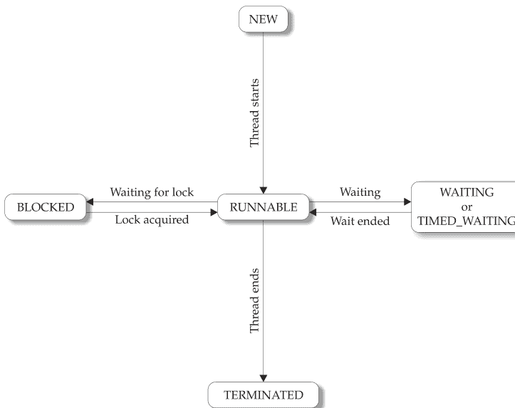

图 11-1 线程状态

图 11-1 展示了各种线程状态之间的关系。

给定一个 `Thread` 实例，你可以使用 `getState()` 来获取线程状态。例如，以下序列确定了在调用 `getState()` 时，线程 `thrd` 是否处于 `RUNNABLE` 状态：

```java
State ts = thrd.getState();
if (ts == Thread.State.RUNNABLE) // ...
```

重要一点是，线程的状态在调用 `getState()` 之后可能会改变。因此，取决于具体情况，调用 `getState()` 获取的状态可能无法反映片刻后线程的实际状态。出于这些（以及其他）原因，`getState()` 并不是提供同步线程的方法。它主要用于调试或分析线程的运行时特征。

## 使用工厂方法创建并启动线程

在某些情况下，没有必要将线程的创建与其执行的开始分开。换句话说，有时同时创建并启动线程是方便的。实现此点的方法之一是使用静态方法。工厂方法是一种返回类对象的方法。通常工厂方法是类的静态方法。

## 使用多线程

利用 Java 多线程特征的关键在于有效地进行并发思考，而不是串行思考。例如，当你拥有：

```java
try {
    Thread.sleep(1000);
    ob1.myspend();
    System.out.println("Suspending thread One");
    Thread.sleep(1000);
    ob1.myresume();
    System.out.println("Resuming thread One");
    ob2.myspend();
    System.out.println("Suspending thread Two");
    Thread.sleep(1000);
} catch (InterruptedException e) {
    System.out.println("Main thread Interrupted");
}

// ... (后续代码同上文)
```

# 第 12 章 枚举、自动装箱和注解

本章检查了三个最初并不包含、但随着时间的推移已成为 Java 不可或缺的特性：枚举（enumerations）、自动装箱（autobox）和注解（annotations）。它们最初由 JDK 5 引入，每项特性都是 Java 程序员赖以生存的，因为它们为处理常见任务提供了一种简洁的方法。本章还讨论了 Java 的类型包装并引入了反射。

## 枚举 (Enumerations)

在最简单的形式下，枚举是定义新数据类型及其合法值的命名常量列表。因此，枚举对象只能持有列表中声明的值。其他值是不允许的。换句话说，枚举提供了一种显式指定数据类型可以拥有的值的方法。枚举通常用于定义一组代表项目集合的值。例如，你可能使用枚举来表示某些操作产生的错误代码（如成功、失败或等待中）；或者设备可能处于的状态列表（如运行、停止或暂停）。在 Java 的早期版本中，这些是使用 `final` 变量定义的。

尽管 Java 枚举乍看起来可能与其他语言中的枚举相似，但这种相似性仅于表面，因为在 Java 中，枚举定义了一个类。通过将枚举转换为类，枚举的能力得到了大大扩展。例如，在 Java 中，枚举可以拥有构造函数、方法和实例变量。由于它们的强大和活性，枚举在整个 Java API 库中被广泛使用。

### 枚举基础

枚举是使用 `enum` 关键字创建。例如，这里有一个列出各种苹果品种的简单枚举：

```java
// 一种苹果品种的枚举
enum Apple {
    Jonathan, GoldenDel, RedDel, Winesap, Cortland
}
```

`Jonathan`、`GoldenDel` 等标识符被称为枚举常量。此外，它们的类型是声明时所属枚举的类型，作为 `Apple` 的公共、静态且最终的成员。在这种情况下，每个常量都是 `Apple` 类型。因此，在 Java 语言中，这些常量被称为“自类型”（self-typed），其中“自”指的是包含它的枚举。

一旦定义了枚举，你就可以创建该类型的变量。然而，尽管枚举定义了一个类类型，但你不需要对其进行实例化（`new`）。相反，你像使用基本类型一样声明和使用枚举变量。例如，这行代码将 `ap` 声明为 `Apple` 枚举类型的变量：

```java
Apple ap;
```

因为 `ap` 是 `Apple` 类型，唯一可以赋值（或包含）的值由该枚举定义。例如，这行代码为 `ap` 赋值为 `RedDel` 值：

```java
ap = Apple.RedDel;
```

注意 `RedDel` 前面带有 `Apple.`。

两个枚举常量可以使用 `==` 关系运算符进行相等性比较。例如，此语句比较了 `ap` 中的值与 `GoldenDel` 常量：

```java
if (ap == Apple.GoldenDel) { //
```

枚举也可以用于控制 `switch` 语句。当然，`case` 语句必须使用 `switch` 表达式所使用的枚举中的常量。例如，这个 `switch` 语句是完全有效的：

```java
// 使用枚举控制 switch 语句。
switch (ap) {
    case Jonathan:
        //
    case Winesap:
        //
}
```

注意在 `case` 语句中，使用了枚举量的名称而没有通过其枚举类型进行限定。即使用的是 `Winesap` 而不是 `Apple.Winesap`。这是因为 `switch` 表达式中的枚举类型已经指定了 `case` 常量的类型。没有必要在 `case` 语句中使用其枚举类型来限定常量。事实上，尝试这样做会导致编译错误。

当枚举常量被显示时（例如在 `println()` 语句中），会输出它的名称。例如，给定此语句：

```java
System.out.println(Apple.Winesap);
```

显示名称 `Winesap`。

以下程序整合了所有部分并演示了 `Apple` 枚举：

```java
// 一种苹果品种的枚举。
enum Apple {
    Jonathan, GoldenDel, RedDel, Winesap, Cortland
}

class EnumDemo {
    public static void main(String[] args) {
        Apple ap;
        ap = Apple.RedDel;

        // 输出枚举值。
        System.out.println("Value of ap: " + ap);
        System.out.println();

        ap = Apple.GoldenDel;

        // 比较两个枚举值。
        if (ap == Apple.GoldenDel)
            System.out.println("ap contains GoldenDel.\n");

        // 使用枚举控制 switch 语句。
        switch (ap) {
            case Jonathan:
                System.out.println("Jonathan is red.");
                break;
            case GoldenDel:
                System.out.println("Golden Delicious is yellow.");
                break;
            case RedDel:
                System.out.println("Red Delicious is red.");
                break;
            case Winesap:
                // ...
        }
    }
}
```


# 第 12 章 枚举、自动装箱与注解

## values() 和 valueOf() 方法

所有枚举自动包含两个预定义方法：`values()` 和 `valueOf()`。它们的通用格式如下：

```java
public static enum-type [] values()
public static enum-type valueOf(String str)
```

`values()` 方法返回一个包含枚举常量列表的数组。`valueOf()` 方法返回值与传入 `str` 字符串相对应的枚举常量。在这两种情况下，`enum-type` 都是枚举的类型。例如，在前面的 `Apple` 枚举中，`Apple.valueOf("Winesap")` 的返回类型是 `Winesap`。

以下程序演示了 `values()` 和 `valueOf()` 方法：

```java
// 使用内置枚举方法。

// 一种苹果品种的枚举。

enum Apple {
    Jonathan, GoldenDel, RedDel, Winesap, Cortland
}

class EnumDemo2 {
    public static void main(String[] args) {
        Apple ap;
        System.out.println("Here are all Apple constants:");
        // 使用 values()
        Apple[] allapples = Apple.values();
        for (Apple a : allapples)
            System.out.println(a);
        System.out.println();
        // 使用 valueOf()
        ap = Apple.valueOf("Winesap");
        System.out.println("ap contains " + ap);
    }
}
```

程序的输出显示此处：

```
Here are all Apple constants:
Jonathan
GoldenDel
RedDel
Winesap
Cortland
```

虽然上一个示例只包含一个构造函数，但枚举可以像其他类一样提供两个或多个重载形式。对于此示例，`Apple` 提供了一个默认构造函数，将价格初始化为 -1，表示没有可用价格数据。

```java
// Use an enum constructor.

enum Apple {
    Jonathan(10), GoldenDel(9), RedDel, Winesap(15), Cortland(8);

    private int price; // 每个每个苹果的苹果

    // 构造函数
    Apple(int p) { price = p; }

    // 重载构造函数
    Apple() { price = -1; }

    int getPrice() { return price; }
}
```

注意在这个版本中，`RedDel` 没有赋予参数。这意味着调用了默认构造函数，并给 `RedDel` 的价格变量赋值为 -1。这里有两个适用于枚举的限制。首先，枚举不能继承另一个类。其次，枚举不能是子类。但此枚举是可以被扩展的。否则，枚举的行为就像任何其他类型。关键是要记住，每个枚举常量都是其所属类的对象。

## 枚举继承 Enum

尽管在声明枚举时不能继承子类，但所有枚举都自动继承 `java.lang.Enum`。该类定义了所有枚举可用的几个方法。`Enum` 类在第二部分有详细描述，但其中三个方法在此时值得讨论。

你可以获取一个表示枚举在常量列表中位置的值。这被称为它的“序数值”（ordinal value），通过调用 `ordinal()` 方法来获取，如下所示：

```java
final int ordinal()
```

它返回被调用常量的值。序数值从 0 开始。因此，在 `Apple` 枚举中，`Jonathan` 的序值为 0，`GoldenDel` 的序值为 1，`RedDel` 的序值为 2，依此类推。

你可以使用 `compareTo()` 方法比较同一个枚举中两个常数的值。它的通用形式如下：

```java
final int compareTo(enum-type e)
```

在这里，`enum-type` 是枚举的类型，`e` 是与被调用常量比较的常量。记住，调用常量和 `e` 必须是同一种枚举类型。如果调用常量的序值小于 `e`，则 `compareTo()` 返回负值。如果两个序值相同，则返回 0。如果调用常量的序值大于 `e`，则返回正值。

你可以使用 `equals()` 方法将枚举常量与其他任何对象进行相等性比较，该方法重写了 `Object` 类定义的 `equals()` 方法。虽然 `equals()` 可以比较枚举与任何对象，但只有当两个对象引用同一个枚举中的同一个常量时，它们才相等。如果两个常量来自不同的枚举，仅仅具有相同的序数值不会导致 `equals()` 返回 true。

记住，你可以使用 `equals()` 比较两个枚举引用是否相等。以下程序演示了 `ordinal()`、`compareTo()` 和 `equals()` 方法：

```java
// ordinal(), compareTo(), and equals()

// 苹果品种的枚举。

enum Apple {
    Jonathan, GoldenDel, RedDel, Winesap, Cortland
}

class EnumDemo4 {
    public static void main(String[] args) {
        Apple ap, ap2, ap3;

        // 使用 ordinal() 获取所有序数值。
        System.out.println("Here are all apple constants " +
            + " and ordinal values: ");
        for (Apple a : Apple.values()) {
            System.out.println(a + " " + a.ordinal());
        }

        ap = Apple.RedDel;
        ap2 = Apple.GoldenDel;
        ap3 = Apple.RedDel;
        System.out.println();

        // compareTo() and equals()
        if (ap.compareTo(ap2) < 0) {
            System.out.println(ap + " comes before " + ap2);
        }
        if (ap.compareTo(ap2) > 0) {
            System.out.println(ap2 + " comes before " + ap);
        }
        if (ap.compareTo(ap3) == 0) {
            System.out.println(ap + " equals " + ap3);
        }
        System.out.println();
        if (!ap.equals(ap2)) {
            System.out.println("Error!");
        }
        if (ap.equals(ap3)) {
            System.out.println(ap + " equals " + ap3);
        }
        if (ap == ap3) {
            System.out.println(ap + " = " + ap3);
        }
    }
}
```

程序的输出结果所示：

```
Here are all apple constants and ordinal values:
Jonathan 0
GoldenDel 1
RedDel 2
Winesap 3
Cortland 4

GoldenDel comes before RedDel
RedDel equals RedDel
RedDel = RedDel
```

## 另一个枚举示例

在继续之前，我们将查看另一个使用枚举的示例。在第 9 章中，创建了一个自动决策程序。在那个版本中，接口内部声明了名为 `NO`、`MAYBE`、`LATER` 和 `NEVER` 的变量并用于表示答案。虽然这种方法没有错，但枚举是更好的选择。这里是使用枚举定义答案的改进版程序。你应该将其与第 9 章中的原始代码进行比较。

```java
import java.util.Random;

// 所有可能答案的枚举。
enum Answers {
    NO, YES, MAYBE, LATER, SOON, NEVER
}

class Question {
    Random rand = new Random();
    Answers ask() {
        int prob = (int) (100 * rand.nextDouble());
        if (prob < 15)
            return Answers.MAYBE;
        else if (prob < 30)
            return Answers.NO;
        else if (prob < 60)
            return Answers.YES;
        else if (prob < 75)
            return Answers.LATER;
        else if (prob < 98)
            return Answers.SOON;
        else
            return Answers.NEVER;
    }
}

class AskMe {
    static void answer(Answers result) {
        switch (result) {
            case NO:
                System.out.println("No");
                break;
            case YES:
                System.out.println("Yes");
                break;
            case MAYBE:
                System.out.println("Maybe");
                break;
            case LATER:
                System.out.println("Later");
                break;
            case SOON:
                System.out.println("Soon");
                break;
            case NEVER:
                System.out.println("Never");
                break;
        }
    }

    public static void main(String[] args) {
        Question q = new Question();
        answer(q.ask());
        answer(q.ask());
        answer(q.ask());
        answer(q.ask());
        answer(q.ask());
        answer(q.ask());
    }
}
```

## 类型包装类

众所周知，Java 使用基本类型（如 `int` 或 `double`）来持有值。为了处理这些（以及其他）情况，Java 提供了包装类，它们是封装了基本类型的类。包装类在第二部分有详细描述，但在这里引入是因为它们与自动装箱功能相关。包装类包括 `Double`、`Float`、`Long`、`Integer`、`Short`、`Byte`、`Character` 和 `Boolean`。它们都继承 `Object`。我们将检查 `Character`。

### Character

`Character` 是 `char` 的包装器。`Character` 的构造函数为：

```java
Character(char ch)
```

在这里，`ch` 指定了被创建的 `Character` 对象封装的字符。然而，从 JDK 9 开始，`Character` 的构造函数被废弃了，从 JDK 16 开始，它已被标记为移除。今天，强烈建议使用静态方法 `valueOf()` 来获取 `Character` 对象。如下所示：

```java
static Character valueOf(char ch)
```

它返回一个封装了 `ch` 的 `Character` 对象。要获取 `Character` 对象中的字符值，调用 `charValue()`：

```java
char charValue()
```

它返回封装的字符。

### Boolean

`Boolean` 是 `boolean` 值的包装器。它定义了这些构造函数：

```java
Boolean(boolean booleanValue)
Boolean(String string)
```

在第一个版本中，`booleanValue` 必须是 `true` 或 `false`。在第二个版本中，如果 `booleanString` 包含“true”（不区分大小写），则新的 `Boolean` 对象为 `true`；否则，为 `false`。

然而，从 JDK 9 开始，`Boolean` 的构造函数被废弃了，从 JDK 16 开始，它们已被移除。今天，强烈建议使用静态方法 `valueOf()` 来获取 `Boolean` 对象。它有两个版本：

```java
static Boolean valueOf(boolean booleanValue)
static Boolean valueOf(String booleanString)
```

每个方法都返回一个封装了指定值的 `Boolean` 对象。

要从 `Boolean` 对象获取布尔值，请使用 `booleanValue()`，如下所示：

```java
boolean booleanValue()
```

它返回被调用对象的等效布尔值。

### 数值类型包装类

到目前，常用的类型包装类是表示数值的包装类。它们是 `Byte`、`Short`、`Integer`、`Long`、`Float` 和 `Double`。所有的数值包装类都继承自抽象类 `Number`。`Number` 声明了在不同数值格式下返回对象值的方法。这些方法所示：

- `byteValue()`
- `doubleValue()`
- `floatValue()`
- `intValue()`
- `longValue()`
- `shortValue()`

例如，`doubleValue()` 将对象的值作为 `double` 返回，`floatValue()` 亦是同然。这些方法由每个数值包装类实现。

所有的数值包装类都定义了构造函数，允许从给定的值或该值的字符串表示来构造对象。例如，这里是 `Integer` 的构造函数：

```java
Integer(int)
Integer(String)
```

如果 `str` 不包含有效的数值，则会抛出 `NumberFormatException`。

然而，从 JDK 16 开始，数值类型包装类的构造函数已被弃用，并且从今天开始被弃用。强烈建议您使用 `valueOf()` 方法之一来获取包装对象。`valueOf()` 是所有数值类的静态方法，用于将数值值或字符串转换为对象。例如，`Integer` 有两个这样的方法：

```java
static Integer valueOf(int val)
static Integer valueOf(String valStr) throws NumberFormatException
```

这里，`val` 指定一个整数值，`valStr` 指定一个表示格式正确的字符串形式的数值。每个方法都返回一个包装了指定值的 `Integer`。这里是一个示例：

```java
Integer i0 = Integer.valueOf(100);
```

在该语句之后，值 100 被作为一个 `Integer` 返回。因此，`iob` 在对象中包装了值 100。除了刚刚所示的 `valueOf()` 形式外，整数包装类 `Byte`、`Short`、`Integer` 和 `Long` 还提供了一种允许您指定进制的格式。


# 所有的类型包装类都重写了 `toString()`

它返回包装器中包含的值的可读形式。这允许您通过将类型包装对象传递给 `println()` 来输出值，例如，而无需将其转换为原始类型。

# 第12 章 枚举、自动装箱和注解

以下程序演示了如何使用数值类型包装类来封装一个值并提取该值。

```java
// 演示类型包装类。
class Wrap {
    public static void main(String[] args) {
        Integer iOb = Integer.valueOf(100);
        int i = iOb.intValue();
        System.out.println(i + " " + iOb); // 显示 100 100
    }
}
```

此程序将值 100 封装在一个名为 `iOb` 的 `Integer` 对象中。程序通过调用 `intValue()` 获取此值并将结果存储在 `i` 中。

在对象内部封装值的过程称为装箱（boxing）。因此，在程序中，该行将 100 装箱为 Integer：

```java
Integer iOb = Integer.valueOf(100);
```

从类型包装类中提取值的过程称为拆箱（unboxing）。例如，程序通过以下语句对 `iOb` 中的值进行拆箱：

```java
int i = iOb.intValue();
```

前一个程序用于装箱和拆箱值的相同过程自 Java 原始版本以来一直可用。然而，在今天，Java 提供了一种更简化的方法，将在下文中描述。

## 自动装箱

现代版本的 Java 提供两个特性：自动装箱（autoboxing）和自动拆箱（auto-unboxing）。自动装箱是指每当需要该类型的对象时，将原始类型自动封装（装箱）为其等效类型包装类的过程。不需要显式地构造对象。自动拆箱是指当需要装箱对象的值时，从类型包装类中提取（拆箱）该值的过程。不需要调用如 `intValue()` 或 `doubleValue()` 等方法。

自动装箱和自动拆箱简化了多个算法的代码，消除了手动装箱和拆箱值的繁琐工作。它们还有助于防止错误。此外，它们对于只操作对象的泛型（generics）来说至关重要。最后，自动装箱使得与集合框架（Collections Framework，在第二部分描述）的操作变得简单得多。

有了自动装箱，没有必要为了包装原始类型而手动构造对象。你只需要从该值到类型包装类的引用即可。Java 会自动为你构造对象。例如，这里是构造一个值为 100 的 `Integer`：

```java
Integer iOb = 100;
```

注意，该对象没有被显式装箱。要拆箱一个对象，只需将对象引用赋值给原始变量。你可以使用这一行：

```java
int i = iOb;
```

这里是使用自动装箱/拆箱重写的上一个程序：

```java
// 演示自动装箱/拆箱。
class AutoBox {
    public static void main(String[] args) {
        Integer iOb = 100;
        int i = iOb;
        System.out.println(i + " " + iOb); // 显示 100 100
    }
}
```

## 自动装箱与方法

除了简单的赋值情况外，每当必须将原始类型转换为对象时，就会发生自动装箱；每当对象必须转换为原始类型时，就会发生自动拆箱。因此，自动装箱/拆箱可能会在向方法传递参数时，或当方法返回值时发生。例如：

```java
// 方法参数和返回值处发生自动装箱/拆箱。
class AutoBox2 {
    static int m(Integer v) {
        return v; // 自动拆箱为 int
    }

    public static void main(String[] args) {
        // 将 int 传递给 m(Integer) 并将赋值给 Integer。
        // 这里，参数 100 被自动装箱为 Integer。
        Integer iOb = m(100);
        System.out.println(iOb);
    }
}
```

此程序显示以下结果：

## 表达式中的自动装箱/拆箱

在程序中，注意 `m()` 指定了一个 `Integer` 参数并返回一个 `int` 结果。在 `main()` 中，向 `m()` 传递了值 100。由于 `m()` 需要一个 `Integer`，该值被自动装箱。然后，`m()` 返回其表达式的等值。接下来，这个 `int` 值被赋值给 `main()` 中的 `iOb`，导致返回值被自动装箱。

```java
// 自动装箱/拆箱发生在表达式内部。
class Autobox3 {
    public static void main(String[] args) {
        Integer i2;
        int i;

        Integer iOb = 100;
        System.out.println("Original value of iOb: " + iOb);

        // iOb 被拆箱，
        // 执行增加，并将结果重新装箱回 iOb。
        ++iOb;
        System.out.println("after iOb: " + iOb);

        // 这里 iOb 被拆箱，
        // 表达式被求值，结果重新装箱并赋值给 i2。
        i2 = iOb + (iOb / 3);
        System.out.println("expression: " + i2);

        // 相同的表达式被求值，
        // 但结果没有重新装箱。
        i = iOb + (iOb / 3);
        System.out.println("after expression: " + i);
    }
}
```

输出如下：

```
Original value of iOb: 100
after iOb: 101
expression: 134
after expression: 134
```

在上一个程序中，请注意这一行：

```java
++iOb;
```

这导致 `iOb` 中的值增加。它的工作原理是：`iOb` 被拆箱，执行增加，并将结果重新装箱回 `iOb`。

自动拆箱还允许你在表达式中混合不同类型的数值对象。一旦值被拆箱，就会应用标准的类型提升和转换。例如，以下程序是完全有效的：

```java
class AutoBox4 {
    public static void main(String[] args) {
        Integer iOb = 100;
        Double dOb = 98.6;

        dOb = dOb + iOb;
        System.out.println("dOB after expression: " + dOb);
    }
}
```

输出如下：

```
Double: 98.6
```

可以看到，Double 对象 `dOb` 和 Integer 对象 `iOb` 都参与了加法，结果被重新装箱并存储在 `dOb` 中。

由于自动拆箱，你可以使用 `Integer` 数值对象来控制 `switch` 语句。考虑这段代码片段：

```java
Integer iOb = 2;
switch (iOb) {
    case 1: System.out.println("one");
        break;
    case 2: System.out.println("two");
        break;
    default: System.out.println("error");
}
```

当求值 `switch` 表达式时，`iOb` 被拆箱并获取其 `int` 值。

正如程序示例所示，由于自动装箱，在表达式中使用数值对象既直观又简单。在 Java 早期，此类代码将涉及对 `intValue()` 等方法的调用和强制转换。

## 布尔和字符值的自动装箱/拆箱

如前所述，Java 还为 `boolean` 和 `char` 提供了包装类。它们是 `Boolean` 和 `Character`。自动装箱/拆箱也适用于这些包装类。例如，考虑以下程序：

```java
// Boolean 和 Character 的自动装箱/拆箱。
class AutoBox5 {
    public static void main(String[] args) {
        // 自动装箱/拆箱 boolean。
        Boolean b = true;

        // 在下面，b 在用于条件表达式时
        // 会被自动拆箱，例如：
        if (b) System.out.println("b is true");

        // 自动装箱/拆箱 char。
        Character ch = 'x'; // 将 char 装箱
        char ch2 = ch; // 将 char 拆箱

        System.out.println("ch2 is " + ch2);
    }
}
```

输出所示：

```
b is true
ch2 is x
```

关于此程序最重要的注意点是 `if` 条件表达式内部对 `b` 的自动拆箱。你应该记住，条件表达式控制的 `if` 必须评估为 `Boolean` 类型。由于自动装箱的存在，`b` 中包含的 `boolean` 值在条件表达式求值时会被自动拆箱。因此，通过自动装箱/拆箱，可以使用 `Boolean` 对象来控制 `if` 语句。

由于自动装箱，现在可以使用 `Boolean` 对象来控制 Java 的任何循环语句。当 `Boolean` 被用作 `while`、`for` 或 `do-while` 的条件表达式时，它会被自动拆箱为其对应的 `boolean` 等值。例如，这段代码是完全有效的：

```java
Boolean b;
// ...
while(b) { // ... }
```

# 自动装箱/拆箱有助于防止错误

除了提供的便利性外，自动装箱/拆箱还可以帮助防止错误。例如，考虑以下程序：

```java
// 手动拆箱产生的错误。
class UnboxingError {
    public static void main(String[] args) {
        Integer i = 1000; // 将值 1000 自动装箱
        int i = i.byteValue(); // 手动拆箱为 byte !!!

        System.out.println(i); // 没有显示 1000 ！
    }
}
```

该程序显示了预期的值 1000，或者 -24！原因是 `i` 内部值通过调用 `byteValue()` 进行了手动拆箱，这导致存储在 `i` 中的值（1,000）被截断。结果导致垃圾值 -24 被赋值给 `i`。自动拆箱可以防止这种错误，因为 `i` 中的值始终会自动拆箱为与 `int` 兼容的值。

通常情况下，自动装箱总是创建正确的对象，而自动拆箱总是产生正确的值，该过程没有可能产生错误类型的对象或值。在极少数情况下，当你想要一个类型与自动化过程产生的类型不同的类型时，你仍然可以手动对值进行装箱和拆箱。当然，自动装箱/拆箱的优势就消失了。通常情况下，你应该使用自动装箱/拆箱。这是 Java 代码的编写方式。

## 警告语

由于自动装箱和自动拆箱，有些人可能会倾向于只使用 `Integer` 或 `Double` 等对象，而完全放弃基本数据类型。例如，通过自动装箱/拆箱，可以写出如下所示的代码：

```java
// 自动装箱/拆箱的错误用法！
Double a, b, c;

a = 10.0;
b = 4.0;

c = Math.sqrt(a*a + b*b);

System.out.println("Hypotenuse is " + c);
```

在此例中，`Double` 类型持有了计算直角三角形斜边的所有值。尽管这在技术上是正确的，而且确实可以正常工作，但这是自动装箱/拆箱的一种非常糟糕的用法。它比使用基本类型 `double` 编写等等代码效率低得多。原因是自动装箱和自动拆箱增加了在使用基本类型时并不具备的开销。

通常情况下，你应该将对类型包装类的使用限制在需要基本数据类型的对象表示的情况下。将自动装箱/拆箱引入 Java 并不是作为一种消除基本数据类型的“后门”方法。

## 注解

Java 提供了一项功能，允许你向源文件嵌入补充信息。这种称为注解（annotation）的信息不会改变程序的行为。因此，注解保持了程序的语义不变。然而，这些信息可以在开发和部署期间由各种工具使用。例如，一个注解可能会被源代码生成器处理。元数据（metadata）一词也被用于描述这种功能，但“注解”一词是最描述性且常用的术语。

# 第 12 章 枚举、自动装箱和注解 295

# 注解基础

注解是通过基于接口的机制创建的。让我们从一个示例开始。这里是一个名为 `MyAnno` 的注解的声明：

```java
// 一个简单的注解类型。
@interface MyAnno {
    String str();
    int val();
}
```

首先，注意 `interface` 关键字之前的 `@` 符号。这告诉编译器注解类型是通过声明创建的。接下来，注意成员 `str()` 和 `val()`。所有注解都完全由方法声明组成。然而，你并不需要为这些方法提供实现。相反，Java 会实现这些方法。此外，正如你所看到的，这些方法的作用就像字段一样。

注解可以包含一个 `extends` 子句。然而，所有注解都自动扩展 `Annotation` 接口。因此，`Annotation` 是所有注解的父接口。它声明在 `java.lang.annotation` 包中。它重写了 `hashCode()` 和 `equals()`。

## 指定保留策略

在进一步解释注解之前，有讨论保留策略（retention policies）。保留策略决定了注解何时被丢弃。

Java 定义了三种策略，它们封装在 `java.lang.annotation.RetentionPolicy` 中。它们是 `SOURCE`、`CLASS` 和 `RUNTIME`。


保留策略为 `SOURCE` 的注解保留在源文件中并在编译期间被丢弃。

保留策略为 `CLASS` 的注解在编译期间存储在 `.class` 文件中。然而，它在运行时无法通过 JVM 访问。

保留策略为 `RUNTIME` 的注解在编译期间存储在 `.class` 文件中，并在运行时可以通过 JVM 访问。因此，`RUNTIME` 提供了最强大的注解功能。

注意：局部变量上的注解不会保留在 `.class` 文件中。

通过使用 Java 的内置注解之一为注解指定保留策略：`@Retention(retention-policy)`

`@Retention`

在这里，`retention-policy` 必须是讨论过的枚举常量之一。如果没有为注解指定保留策略，则使用默认的 `CLASS` 策略。

下面的 `MyAnno` 版本使用 `@Retention` 来指定 `RUNTIME` 保留策略。因此，`MyAnno` 在程序执行期间对 JVM 可用。

```java
@Retention(RetentionPolicy.RUNTIME)
@interface MyAnno {
  String str();
  int val();
}
```

## 通过反射在运行时获取注解

虽然注解主要设计其他开发或部署工具，但如果它们指定了 `RUNTIME` 保留策略，那么 Java 程序就可以通过反射在运行时对其查询。反射是能够在运行时获取类信息的功能。反射 API 包含在 `java.lang.reflect` 包中。使用反射有多种方法，我们在这里不会检查所有的。然而，我们将遍历几个适用于注解的示例。

使用反射的第一步是获取一个表示你想要获取注解的类的 `Class` 对象。`Class` 是 Java 的内置类之一，定义在 `java.lang` 中。它在第二部分有描述。获取 `Class` 对象有多种方法。最简单的方法之一是获取 `getClass()`，它是 `Object` 定义的一个方法。其通用形式所示：

```java
final Class<?> getClass()
```

它返回表示调用对象的 `Class` 对象。

注意刚才显示的 `getClass()` 方法中 `Class` 之后的 `<?>`。这与 Java 的泛型功能有关。`getClass()` 以及本章讨论的几个其他反射方法都使用了泛型。

# 第 12 章 枚举、自动装箱与注解 297

在获取 `Class` 对象后，你可以使用它的方法来获取该类声明的各种项的信息，包括它的注解。如果你想获取与类中声明的特定项相关的注解，必须首先获取一个表示该项的对象。例如，`Class` 提供了（以及其他）`getMethod()`、`getField()` 和 `getConstructor()`，它们分别获取有关方法、字段和构造器的信息。这些方法返回 `Method`、`Field` 和 `Constructor` 类型的对象。

为了理解这个过程，让我们通过一个获取与方法相关的注解的示例。要做到这一点，你首先获取一个表示该方法的 `Class` 对象，然后在该 `Class` 上调用 `getMethod()`，并指定方法的名称。`getMethod()` 的通用格式如下：

```java
Method getMethod(String methodName, Class<?> ... paramTypes)
```


# Java 注解与反射详解

## 方法反射基础

方法名通过 `methodName` 传递。如果该方法有参数，则通过 `paramTypes` 指定表示这些类型的 Class 对象。注意，`paramTypes` 是一个变长参数（varargs）。这意味着你可以指定任意数量的参数，包括零个。`getMethod()` 返回一个表示该方法的 `Method` 对象。如果找不到该方法，将抛出 `NoSuchMethodException`。

从 `Class`、`Method`、`Field` 或 `Constructor` 对象，你可以通过 `getAnnotation()` 获取与该方法相关的特定注解。其通用格式如下：

```java
<A Annotation> getAnnotation(Class<A> annotationType)
```

这里，`annotationType` 是表示你感兴趣的注解的类。该方法返回注解的引用。使用该引用，你可以获取与注解成员关联的值。如果未找到注解，方法将返回 `null`，如果注解没有 `RUNTIME` 留存（retention），就会出现这种情况。

## 反射获取注解示例

这是一个组装了之前所有部分的程序，并使用反射显示与以下内容相关的注解：

```java
import java.lang.annotation.*;
import java.lang.reflect.*;

// 一个注解类型声明。
@Retention(RetentionPolicy.RUNTIME)
@interface MyAnno {
    String str();
    int val();
}

class Meta {
    // 为方法添加注解。
    @MyAnno("Annotation Example", val = 100)
    public static void myMeth() {
        Meta ob = new Meta();

        // 获取此方法的注解
        // 并显示成员的值。
        try {
            // 首先，获取一个表示此类的 Class 对象。
            Class<?> c = ob.getClass();

            // 现在，获取一个表示此方法的 Method 对象。
            Method m = c.getMethod("myMeth");

            // 接下来，获取此类的注解。
            MyAnno anno = m.getAnnotation(MyAnno.class);

            // 最后，显示这些值。
            System.out.println(anno.str() + " " + anno.val());
        } catch (NoSuchMethodException exc) {
            System.out.println("Method Not Found.");
        }
    }

    public static void main(String[] args) {
        myMeth();
    }
}
```

程序的输出所示：

```
Annotation Example 100
```

该程序使用了上述的反射机制来获取并显示 `Meta` 类中与 `myMeth()` 相关的 `MyAnno` 注解中 `str` 和 `val` 的值。有两个点需要特别注意。

首先，在此处：

```java
MyAnno anno = m.getAnnotation(MyAnno.class);
```

注意表达式 `MyAnno.class`。该表达式求值为类型为 `MyAnno` 的 Class 对象。该注解构造了一个类字面量（Class literal）。当你需要已知类的 Class 对象时，可以使用这种表达式。例如，此语句可以用于获取 `Meta` 的 Class 对象：

```java
Class<?> c = Meta.class;
```

这种方法仅在你提前知道对象的类名时有效，而情况可能并非如此。通常，你可以为类、接口、基本数据类型和数组获取类字面量。（记住，`<?>` 语法与 Java 的泛型功能有关，在第 14 章描述）。

第二个感兴趣的点是，`str` 和 `val` 关联的值是通过以下输出获取的：

```java
System.out.println(anno.str() + " " + anno.val());
```

注意它们是使用方法调用语法被调用的。每当需要注解标记的值时，都会使用这种方法。

## 第二个反射示例：带参数的方法

在前面的示例中，`myMeth()` 没有参数。然后调用了 `getMethod()`，只传递了名称 `myMeth`。然而，要获取一个带有参数的方法，你必须将表示这些参数类型的 Class 对象作为参数传递给 `getMethod()`。例如，这里是前面示例略有不同的版本：

```java
import java.lang.annotation.*;
import java.lang.reflect.*;

@Retention(RetentionPolicy.RUNTIME)
@interface MyAnno {
    String str();
    int val();
}

class Meta {
    // myMeth 现在有两个参数。
    @MyAnno(str = "Two Parameters", val = 19)
    public static void myMeth(String str, int i) {
        Meta ob = new Meta();

        try {
            Class<?> c = ob.getClass();
            Method m = c.getMethod("myMeth", String.class, int.class);
            MyAnno anno = m.getAnnotation(MyAnno.class);
            System.out.println(anno.str() + " " + anno.val());
        } catch (NoSuchMethodException exc) {
            System.out.println("Method Not Found.");
        }
    }

    public static void main(String[] args) {
        myMeth("test", 10);
    }
}
```

（注：此处原文 OCR 文本存在混乱，已根据逻辑调整代码结构）

该版本的输出所示：

```
Two Parameters 19
```

在这个版本中，`myMeth()` 接收一个 `String` 和一个 `int` 参数。要获取该方法的信息，你必须将表示这些参数类型的 Class 对象作为 `getMethod()` 的参数。例如：

```java
Method m = c.getMethod("myMeth", String.class, int.class);
```

这里，表示 `String` 和 `int` 的 Class 对象被作为额外参数传递。

## 获取所有注解

你可以通过对项调用 `getAnnotations()` 来获取与其相关的具有 `RUNTIME` 留存的所有注解。它的通用形式为：

```java
Annotation[] getAnnotations()
```

它返回一个注解数组。`getAnnotations()` 可以在 `Class`、`Method`、`Constructor` 和 `Field` 等对象上调用。

另一个反射示例展示了如何获取与类和方法相关的所有注解。它使用 `getAnnotations()` 显示类和方法的所有注解。

## 使用默认值

你可以为成员指定默认值，当在应用注解时未指定值，将使用该默认值。通过在成员声明中添加默认子句（default clause）来指定默认值。通用格式如下：

```java
type member() default value;
```

该值的类型必须与成员类型兼容。以下是重写后的 `@MyAnno`，其中包含了默认值：

```java
@Retention(RetentionPolicy.RUNTIME)
@interface MyAnno {
    String str() default "Testing";
    int val() default 9000;
}
```

此声明为 `str` 和 `val` 赋予了默认值 "Testing" 和 9000。这意味着在使用 `@MyAnno` 时，不需要指定任何一个成员的值。然而，如果根据需要，也可以为其中一个或两者都赋予值。因此，`@MyAnno` 有四种使用方式：

```java
@MyAnno() // str 和 val 都有默认值
@MyAnno(str = "some string") // val 使用默认值
@MyAnno(val = 100) // str 使用默认值
@MyAnno(str = "Testing", val = 100) // 不使用默认值
```

该程序演示了注解中默认值的使用。

```java
import java.lang.annotation.*;
import java.lang.reflect.*;

// 包含默认值的注解类型声明。
@Retention(RetentionPolicy.RUNTIME)
@interface MyAnno {
    String str() default "Testing";
    int val() default 9000;
}

class Meta3 {

    // 使用默认值注解一个方法。
    @MyAnno()
    public static void myMeth() {
        Meta3 ob = new Meta3();

        // 获取该方法的注解
        // 并显示成员的值。
        try {
            Class<?> c = ob.getClass();
            Method m = c.getMethod("myMeth");
            MyAnno anno = m.getAnnotation(MyAnno.class);

            System.out.println(anno.str() + " " + anno.val());
        } catch (NoSuchMethodException exc) {
            System.out.println("Method Not Found.");
        }
    }

    public static void main(String[] args) {
        myMeth();
    }
}
```

输出结果如下：

```
Testing 9000
```

## 标记注解

标记注解（Marker annotation）是一种特殊的注解，它不包含任何成员。它的唯一目的是标记某个项。其作为注解的存在本身就足够了。判断标记注解存在的最佳方法是使用 `isAnnotationPresent()`，该方法由 `AnnotatedElement` 接口定义。

这是一个使用标记注解的示例。由于标记接口不包含任何成员，只需判断它是否存在即可：

```java
import java.lang.annotation.*;
import java.lang.reflect.*;

// 一个标记注解
@Retention(RetentionPolicy.RUNTIME)
@interface MyMarker {}

class Marker {

    // 使用标记注解一个方法。
    // 注意，不需要 ( )。
    @MyMarker
    public static void myMeth() {
        Marker ob = new Marker();

        try {
            Method m = ob.getClass().getMethod("myMeth");
            System.out.println("Marker is present.");
        } catch (NoSuchMethodException exc) {
            System.out.println("Method Not Found.");
        }
    }

    public static void main(String[] args) {
        myMeth();
    }
}
```


此处显示的输出证实了 `@MyMarker` 的存在：

```
Marker is present.
```

在程序中，请注意在使用 `@MyMarker` 时不需要在其后紧跟括号。因此，只需通过名称即可应用 `@MyMarker`，如下：

```java
@MyMarker
```

提供一对空括号并不是错误的，但并没有必要。

## 单成员注解

单成员注解只包含一个成员。它的工作与普通注解类似，不同在于它允许使用简写形式指定成员的值。当仅存在一个成员时，你可以在应用注解时直接指定该成员的值——不需要指定成员名称。然而，为了使用这种简写，成员名称必须为 `value`。

以下是一个创建并使用单成员注解的示例：

```java
import java.lang.annotation.*;
import java.lang.reflect.*;

// 单成员注解。
@Retention(RetentionPolicy.RUNTIME)
@interface MySingle {
    String value();
}

class Single {

    // 使用单成员注解注解一个方法。
    @MySingle("Testing")
    public static void myMeth() {
        Single ob = new Single();

        try {
            Class<?> c = ob.getClass();
            Method m = c.getMethod("myMeth");
            MySingle anno = m.getAnnotation(MySingle.class);
            System.out.println(anno.value());
        } catch (NoSuchMethodException exc) {
            System.out.println("Method Not Found.");
        }
    }

    public static void main(String[] args) {
        myMeth();
    }
}
```

## 内置标准注解

### @Override

`@Override` 是一个标记注解，只能用于方法。标记了 `@Override` 的方法必须重写父类中的方法。如果没有重写，将导致编译时错误。它用于确保父类方法确实被重写了，而不仅仅是重载。

### @Deprecated

`@Deprecated` 表示该声明已过时，不建议使用。从 JDK 9 开始，`@Deprecated` 还允许你指定发生弃用操作的 Java 版本，以及该被弃用元素计划被移除的时间。

### @FunctionalInterface

`@FunctionalInterface` 是一个设计用于接口的标记注解。它表示被注解的接口是一个函数接口。函数接口是包含且仅包含一个抽象方法的接口。函数接口用于 lambda 表达式。（有关函数接口和 lambda 表达式的详细信息，请参阅第 15 章）。如果被注解的接口不是函数接口，将报告编译错误。需要理解的是，创建函数接口并不需要 `@FunctionalInterface`。根据定义，任何恰好包含一个抽象方法的接口都是函数接口。因此，`@FunctionalInterface` 纯粹是信息性的。

### @SafeVarargs

`@SafeVarargs` 是一个可以应用于方法和构造函数的标记注解。它表示不会发生与变长参数（varargs）相关的不安全操作。它用于抑制原本安全代码上的未检查警告，因为这些代码涉及不可靠的变长类型和参数实例化。（不可靠的变长类型本质上是泛型类型。泛型在第 14 章中描述。）它只能应用于变长方法或构造函数。这些方法必须是静态的、final 的且私有的。

### @SuppressWarnings

`@SuppressWarnings` 指定抑制编译器可能发出的一个或多个警告。要抑制的警告以字符串形式的形式指定。

## 类型注解 (Type Annotations)

如前所述，注解最初只允许在声明上。然而，对于 Java 的现代版本，在大多数使用类型的地方也可以指定注解。注解的这一扩展方面被称为类型注解。例如，你可以对方法的返回类型、方法内部的 `this` 类型、强制类型转换、数组层级、被继承的类以及 `throws` 子句进行注解。你还可以对泛型类型进行注解，包括类型参数边界和泛型类型参数。（有关泛型的讨论，请参阅第 14 章。）

类型注解非常重要，因为它们允许工具对代码执行额外的检查以防止错误。请理解，按照规定，`javac` 本身不会执行这些检查。此目的使用单独的工具，尽管此类工具可能作为编译器插件运行。

类型注解必须包含 `ElementType.TYPE` 作为目标。（记住，有效的注解是使用 `@Target` 注解指定的，如前所述。）类型注解应用于注解其之前的类型。例如，某些类型注解为 `throws @Anno`，其后续如下：

```java
void myMethod() throws @Anno NullPointerException
```

在这里，`@Anno` 注解了 `throws` 子句中的 `NullPointerException`。

你也可以注解 `this` 的类型（称为接收者）。如你所知，这是实例方法的隐式参数，它指向调用对象。要注解你的类型需要使用另一个最初不是 Java 一部分的功能。从 JDK 8 开始，你可以显式地将其声明为方法的第一个参数。在此声明中，`this` 的类型必须是其所属类的类型；例如：

```java
class SomeClass {
    int myMethod(SomeClass this, int i, int j)
}
```

在这里，因为 `myMethod` 是由 `SomeClass` 定义的方法，所以 `this` 的类型是 `SomeClass`。使用此声明，你可以注解 `this` 的类型。例如，假设 `@Anno` 是一个类型注解，其后续如下：

```java
int myMethod(@Anno SomeClass this, int i, int j) { // ...
```


重要的是理解，除非你对它进行注解，否则没有必要声明它。（如果未声明，它仍然是隐式传递的，一如既往。）此外，显式声明这不会改变方法签名的任何方面——这在默认是隐式声明的。再次，只有当你想要对其应用类型注解时才会声明它。如果你声明了它，它必须是第一个参数。

以下程序展示了类型注解可以使用的地方。它定义了几个注解，其中几个是类型注解。注解的名称和目标如下：

| 注解 | 目标 |
| --- | --- |
| `@Anno` | `ElementType.TYPE_USE` |
| `@MaxLen` | `ElementType.TYPE_USE` |
| `@NotZeroLen` | `ElementType.TYPE_USE` |
| `@Unique` | `ElementType.TYPE_USE` |
| `@What` | `ElementType.TYPE_PARAMETER` |
| `@EmptyOK` | `ElementType.FIELD` |
| `@Recommended` | `ElementType.METHOD` |

注意 `@EmptyOK`、`@Recommended` 和 `@What` 不是类型注解。它们被包含是为了比较目的。特别感兴趣的是 `@What`，它用于注解泛型类型参数声明。程序中的注释描述了每种用法。

```java
// 展示几种类型注解。
import java.lang.annotation.*;
import java.lang.reflect.*;
```

```java
// 一个可以应用于类型的标记注解。
@Target(ElementType.TYPE_USE)
@interface TypeAnno { }
```

```java
// 另一个可以应用于类型的标记注解。
@Target(ElementType.TYPE_USE)
@interface NotZeroLen { }
```

```java
// 还是另一个可以应用于类型的标记注解。
@Target(ElementType.TYPE_USE)
@interface Unique { }
```

```java
// 一个可以应用于类型的参数注解。
@Target(ElementType.TYPE_USE)
@interface MaxLen {
  int value();
}
```

```java
// 一个可以应用于类型参数的注解。
@Target(ElementType.TYPE_PARAMETER)
@interface What {
  String description();
}
```

```java
// 一个可以应用于字段声明的注解。
@Target(ElementType.FIELD)
@interface EmptyOK { }
```

```java
// 一个可以应用于方法声明的注解。
@Target(ElementType.METHOD)
@interface Recommended { }
```

## 312 第一部分 Java 语言

最后，让我们通过以下语句对数组进行标注：

```
String @MaxLen(10) [] @NotZeroLen [] w;
```

在这一声明中，`@MaxLen` 标注了第一层类型，而 `@NotZeroLen` 标注了第二层类型。

```
@TypeAnno Integer[] vec;
```

这里对元素类型也进行了标注。

## 重复注解

从 JDK 8 开始，注解可以在同一个元素上重复。这被称为重复注解（repeating annotations）。要使一个注解是重复的，它必须使用 `@Repeatable` 注解进行标注，该注解定义在 `java.lang.annotation` 中。它的 `value` 字段指定了重复注解的容器类型。该容器被指定为注解类型的数组。要创建一个可重复的注解，你必须先创建一个容器注解，然后将该注解作为 `@Repeatable` 注解的参数。

要使用 `getAnnotation()` 等方法访问重复的注解，你将使用容器注解，而不是可重复的注解。下面的程序展示了这种方法。它将之前显示的 `MyAnno` 版本转换为可重复的，并演示了它的用法。

```java
// 演示重复注解。

import java.lang.annotation.*;
import java.lang.reflect.*;

// 使 MyAnno 可变为重复。
@Retention(RetentionPolicy.RUNTIME)
@Repeatable(MyRepeatedAnnos.class)
@interface MyAnno {
    String str() default "Testing";
    int val() default 9000;
}
```

```java
// 这是容器注解。
@Retention(RetentionPolicy.RUNTIME)
@interface MyRepeatedAnnos {
    MyAnno[] value();
}
```

```java
class RepeatAnnotation {
    // 在 myMeth() 上重复使用 MyAnno
    @MyAnno(str = "First annotation", val = -1)
    @MyAnno(str = "Second annotation", val = 100)
    public static void myMeth(String str, int i) {
        RepeatAnnotation ob = new RepeatAnnotation();

        try {
            Class<?> c = ob.getClass();

            // 获取 myMeth() 的注解
            Method m = c.getMethod("myMeth", String.class, int.class);

            // 显示重复的 MyAnno 注解。
            Annotation anno = m.getAnnotation(MyRepeatedAnnos.class);
            System.out.println(anno);

        } catch (NoSuchMethodException exc) {
            System.out.println("Method Not Found.");
        }
    }

    public static void main(String[] args) {
        myMeth("test", 10);
    }
}
```

输出所示：

```
@MyRepeatedAnnos(value={@MyAnno(val=-1, str="First annotation"), @MyAnno(val=100, str="Second annotation")})
```

如所述，为了使 `MyAnno` 成为重复的，它必须被 `@Repeatable` 注解标注，该注解指定了它的容器注解。容器注解名为 `MyRepeatedAnnos`。程序通过调用 `getAnnotation()` 访问重复注解，传入的是容器注解的类，而不是可重复注解本身。如输出所示，重复的注解之间是用逗号分隔的。它们不是被单独返回的。

获取重复注解的另一种方法是使用 `AnnotatedElement` 中的方法之一，这些方法可以直接作用于重复注解。这些是 `getAnnotationsByType()` 和 `getDeclaredAnnotationsByType()`。这里，我们将使用前者。示例如：

```java
default <T extends Annotation> T[] getAnnotationsByType(Class<T> annotationType)
```

它返回一个与调用对象相关的类型为 `annotationType` 的注解数组。如果没有对应的注解，数组长度将为零。这里有一个示例。假设接上程序，以下序列使用 `getAnnotationsByType()` 获取重复注解：

```java
Annotation[] ann = m.getAnnotationsByType(MyAnno.class);
for (Annotation a : ann) {
  System.out.println(a);
}
```

在这里，重复的注解类型（即 `MyAnno`）被传递给 `getAnnotationsByType()`。返回的数组包含了与 `myMeth()` 关联的所有 `MyAnno` 实例，在本例中，有两个。每个重复的注解都可以通过数组中的索引访问。

在这种情况下，每个 `MyAnno` 注解都通过 `for-each` 循环显示。

## 某些限制

注解声明适用于许多限制条件。首先，没有任何注解可以继承另一个注解。其次，注解声明的所有方法都不能有参数。

此外，它们必须返回以下类型之一：

- 原始数据类型，如 `int` 或 `double`
- 类型为 `String` 或 `Class` 的对象
- `enum` 类型的对象
- 另一个注解类型的对象
- 合法类型的数组

注解不能是泛型的。换句话说，它们不能带有类型参数。（泛型已在第 14 章中描述。）最后，注解方法不能指定 `throws` 子句。

## 第 13 章 I/O、Try-with-Resources 以及其他主题

本章介绍了 Java 最重要的包之一——`java.io`，它支持 Java 的基础 I/O（输入/输出）系统，包括文件 I/O。对 Java 核心 API 库的支持，并非来自语言关键字。因此，关于此主题的深入讨论可以在本书的第二部分找到，该部分检查了几个 I/O 包。在这里，介绍了这个重要子系统的基础，以便你看到它是如何融入 Java 编程和执行环境的宏大背景的。本章还检查了 `try-with-resources` 语句和更多内容。

## I/O 基础

正如你可能注意到的，I/O 通过流（streams）执行。流是产生或消耗信息的抽象。流通过 Java 连接到物理设备。无论设备如何，所有流的行为都是相同的。因此，输入流可以来自磁盘文件、键盘或网络。同样，输出流可以指向控制台、磁盘文件或网络。Java 在 `java.io` 包中实现了流。

> **注意：** 除了 `java.io` 中定义的流 I/O，Java 还提供了基于缓冲区和通道的 I/O，这些定义在 `java.nio` 中。它们将在第 23 章介绍。

## 字节流与字符流

Java 定义了两种类型的流：字节和字符。字节流提供了处理字节输入输出的方便方法。例如，用于读取或写入二进制数据。字符流提供了处理字符输入输出的方便方法。它们使用 Unicode，因此可以国际化。在某些情况下，字符流比字节流更高效。

Java 的原始版本（Java 1.0）没有字符流，因此所有 I/O 都是面向字节的。字符流是在 Java 1.1 中引入的，某些面向字节的类和方法已被弃用。尽管未使用字符流的旧代码越来越少，但偶尔会遇到。作为一般原则，旧代码应该更新以利用字符流。

另一个点是：在最底层，所有 I/O 仍然是面向字节的。字符流提供了处理字符的方便且高效的方法。

接下来的章节将介绍面向字节流和面向字符流的概述。

## 字节流类

字节流由两个类层次结构定义。顶端是两个抽象类：`InputStream` 和 `OutputStream`。每个抽象类都有多个具体的子类，处理各种设备之间的差异，例如磁盘文件、网络连接甚至内存缓冲区。`java.io` 中的非弃用字节流类如表 13-1 所示。这些类中的一些将在本节稍后讨论。记住，要使用流类，你必须导入 `java.io`。

### 表 13-1 java.io 中未废弃的字节流类

| 流类 | 含义 |
| --- | --- |
| `BufferedInputStream` | 缓冲输入流 |
| `BufferedOutputStream` | 缓冲输出流 |
| `ByteArrayInputStream` | 从字节数组读取的输入流 |
| `ByteArrayOutputStream` | 写入字节数组的输出流 |
| `DataInputStream` | 包含读取 Java 标准数据类型方法的输入流 |
| `DataOutputStream` | 包含写入 Java 标准数据类型方法的输出流 |
| `FileInputStream` | 从文件读取的输入流 |
| `FileOutputStream` | 写入文件的输出流 |
| `FilterInputStream` | 实现 `InputStream` |
| `FilterOutputStream` | 实现 `OutputStream` |
| `InputStream` | 描述流对象的抽象类 |
| `ObjectInputStream` | 用于对象的输入流 |
| `ObjectOutputStream` | 用于对象的输出流 |
| `OutputStream` | 描述流输出的抽象类 |
| `PipedInputStream` | 输入管道 |
| `PipedOutputStream` | 输出管道 |
| `PrintStream` | 包含 `print()` 和 `println()` 的输出流 |
| `PushbackInputStream` | 允许将字节返回到输入流的输入流 |
| `SequenceInputStream` | 两个或多个输入流的组合，将按顺序返回 |

抽象类 `InputStream` 和 `OutputStream` 定义了其他流类实现的关键方法。其中最重要的两个是 `read()` 和 `write()`，分别读取和写入数据字节。每个方法都有一个抽象形式，必须由派生流类重写。

## 字符流类

字符流通过两个类层次结构定义。顶部是两个抽象类：`Reader` 和 `Writer`。这些抽象类处理 Unicode 字符流。Java 为这些每个类都提供了几个具体的子类。`java.io` 中的字符流类如表 13-2 所示。

### 表 13-2 java.io 中的字符流类

| 流类 | 含义 |
| --- | --- |
| `BufferedReader` | 缓冲输入字符流 |
| `BufferedWriter` | 缓冲输出字符流 |
| `CharArrayReader` | 从字符数组读取的输入流 |
| `CharArrayWriter` | 写入字符数组的输出流 |
| `FileReader` | 从文件读取的输入流 |
| `FileWriter` | 写入文件的输出流 |
| `FilterReader` | 过滤读取器 |
| `FilterWriter` | 过滤写入器 |
| `InputStreamReader` | 将字节转换为字符的输入流 |
| `LineNumberReader` | 计算行数的输入流 |
| `OutputStreamWriter` | 将字符转换为字节的输出流 |
| `PipedReader` | 输入管道 |
| `PipedWriter` | 输出管道 |
| `PrintWriter` | 包含 `print()` 和 `println()` 的输出流 |
| `PushbackReader` | 允许将字符返回到输入流的输入流 |
| `Reader` | 描述字符输入的抽象类 |
| `StringReader` | 从字符串读取的输入流 |
| `StringWriter` | 写入字符串的输出流 |
| `Writer` | 描述字符输出的抽象类 |

抽象类 `Reader` 和 `Writer` 定义了其他流类实现的关键方法。最重要的方法是 `read()` 和 `write()`，分别读取和写入数据字符。每个都有抽象形式，必须由子类重写。

## 预定义流

如所知，所有的 Java 程序都会自动导入 `java.lang` 包。该包定义了一个 `System` 类，它封装了运行时环境的各个方面。例如，通过它的某些方法，你可以获取当前时间和与系统相关的各种属性的设置。`System` 还包含三个预定义变量：`in`、`out` 和 `err`。这些字段在 `System` 中声明为 `public`、`static` 和 `final`。这些字段可以被程序的任何部分使用，而无需引用特定的 `System` 对象。

`System.out` 指向标准输出流。默认情况下，它是控制台。`System.in` 指向标准输入。`err` 指向标准错误。这些流可以重定向到任何设备。

`System.in` 是 `InputStream` 的对象。`System.out` 和 `err` 是 `PrintStream` 的对象。这些都是字节流，尽管它们通常用于控制台读取和写入字符。正如你所看到的，如果需要，可以对这些流进行包装。

之前的章节在示例中使用过 `System.out`。今天，读取控制台输入的方法是使用基于字符的流。正如下一节所示，使用 `System.in` 稍微复杂一些。

## 读取控制台输入

在早期的 Java 时代，读取控制台输入的唯一方法是使用字节流。今天，使用字节流读取控制台输入仍然是可以接受的。然而，对于应用程序，读取控制台输入的优选方法是使用基于字符的流。这使得你的程序更容易国际化和维护。

在 Java 中，通过读取 `System.in` 来使用 `BufferedReader`。

调用 `System.console()` 获取 `Console` 对象。它返回控制台的引用，如果没有控制台则返回 `null`。因此，下面的序列显示了将 `System.in` 包装在 `BufferedReader` 中的方法：

```java
Console con = System.console(); // 获取控制台
if (con == null) return; // 如果没有控制台，返回

BufferedReader br = new BufferedReader(new InputStreamReader(System.in, con.charset()));
```

当然，在已知控制台存在的情况下可以将序列简化为：


```
BufferedReader br = new BufferedReader(new InputStreamReader(System.in, System.console().charset()));
```

因为运行书中的示例显然需要控制台，所以我们使用这种形式。一点：也可以通过 `Console` 定义的 `read()` 方法获取与控制台关联的 `Reader`。然而，我们将使用上述方法，因为它显式地演示了字节流和字符流如何交互。

# 读取字符

要从 `BufferedReader` 读取字符，请使用 `read()`。我们将使用的 `read()` 版本是：

```java
int read() throws IOException
```

每次调用 `read()` 时，它都会从输入流读取一个字符并将其作为整数值返回。当尝试读取流末尾时，它返回 `-1`。正如你所看到的，除非用户输入 `'q'` 否则它可能会抛出 `IOException`。注意，可能产生的 I/O 异常直接从 `main()` 方法抛出。

使用 `BufferedReader` 从控制台读取字符。

```java
import java.io.*;

class BRReader {
    public static void main(String[] args) throws IOException {
        char c;
        BufferedReader br = new BufferedReader(
            new InputStreamReader(System.in, System.console().charset()));
        System.out.println("输入字符，'q' 退出。");
        // 读取字符
        do {
            c = (char) br.read();
            System.out.println(c);
        } while (c != 'q');
    }
}
```

这里是一个示例运行：

```
输入字符，输入 'q' 退出。
123abc
1
2
3
a
b
c
q
```

此输出可能与你预期的略有不同，因为 `System.in` 默认是行缓冲的。这意味着在按下回车键（ENTER）之前，没有任何输入会被传递给程序。正如你所能看到的，这使得 `read()` 对于交互式控制台输入并没有特别价值。

## 读取字符串

要从键盘读取字符串，请使用 `BufferedReader` 类成员的 `readLine()` 版本。它的通用形式为：

```java
String readLine() throws IOException
```

如你所见，它返回一个 `String` 对象。

接下来的程序演示了 `BufferedReader` 和 `readLine()` 方法；该程序会读取并显示文本行，直到你输入单词“stop”为止：

```java
// 使用 BufferedReader 从控制台读取字符串。
import java.io.*;

class BRReadLines {
    public static void main(String[] args) throws IOException {
        // 使用 System.in 创建一个 BufferedReader
        BufferedReader br = new BufferedReader(
            new InputStreamReader(System.in, System.console().charset()));
        String str;
        System.out.println("输入文本行.");
        do {
            str = br.readLine();
            System.out.println(str);
        } while (!str.equals("stop"));
    }
}
```

下一个示例创建了一个微型编辑器。它创建了一个 `String` 对象数组并读取文本行，将每行存储在数组中。它将最多读取 100 行，或者直到你输入“stop”为止。它使用 `BufferedReader` 从控制台读取。

```java
// 一个微型编辑器。
import java.io.*;

class TinyEdit {
    public static void main(String[] args) throws IOException {
        // 创建一个 BufferedReader
        BufferedReader br = new BufferedReader(
            new InputStreamReader(System.in, System.console().charset()));

        String[] str = new String[100];
        System.out.println("输入文本行.");
        System.out.println("输入 'stop' 退出.");
        for (int i = 0; i < 100; i++) {
            str[i] = br.readLine();
            if (str[i].equals("stop")) break;
        }
        // 显示行
        System.out.println("\n这是你的文件:");
        for (int i = 0; i < 100; i++) {
            if (str[i].equals("stop")) break;
            System.out.println(str[i]);
        }
    }
}
```

这里是一个示例运行：

```
输入文本行。
输入 'stop' 退出。
这是第一行。
这是第二行。
Java 让字符串操作变得简单。
只需创建 String 对象即可。
stop
这是你的文件：
这是第一行。
这是第二行。
Java 让字符串操作变得简单。
只需创建 String 对象即可。
```

## 写入控制台输出

控制台输出主要通过前面的 `print()` 和 `println()` 完成，这些方法用于本书中的大多数示例中。这些方法由 `PrintStream` 类定义（`System.out` 引用的对象类型就是该类）。尽管 `System.out` 是一个字节流，但将其用于简单的程序输出仍然是可以接受的。然而，下一节将描述一种基于字符的替代方案。

由于 `PrintStream` 是派生自 `OutputStream` 的输出流，它还实现了低级方法 `write()`。然后，可以使用 `write()` 写入控制台。这里显示了 `PrintStream` 定义的 `write()` 的简单形式：

```java
void write(int byteval)
```

该方法写入由 `byteval` 指定字节。尽管 `byteval` 被声明为整数，但只有低 8 位会被写入。这里有一个短小的示例，使用 `write()` 输出字符 "A" 然后紧跟一个换行符：

```java
// 演示 System.out.write().
class WriteDemo {
    public static void main(String[] args) {
        int b;

        b = 'A';
        System.out.write(b);
        System.out.write('\n');
    }
}
```

你不会使用 `write()` 执行控制台输出（尽管在某些情况下会这样做），因为 `print()` 和 `println()` 使用起来要方便得多。

## PrintWriter 类

使用 `System.out` 写入控制台是可以接受的，它可能对于调试目的或示例程序（如本书所示）是最好的。对于真实的程序，在使用 Java 时，写入控制台的推荐方法是通过 `PrintWriter` 流。`PrintWriter` 是基于字符的类之一。使用基于字符的类进行输出会让程序的国际化变得更容易。

`PrintWriter` 定义了多个构造函数。这里将展示其中一个：

```java
PrintWriter(OutputStream outputStream, boolean flushingOn)
```

在这里，`outputStream` 是 `OutputStream` 类型的对象，`flushingOn` 控制每当调用 `println()` 方法（以及其他方法）时 Java 是否刷新输出。如果 `flushingOn` 为 `true`，则会自动进行刷新。如果为 `false`，则不自动刷新。

`PrintWriter` 支持 `print()` 和 `println()` 方法。然后，你可以像使用 `System.out` 一样使用这些方法。要使用 `PrintWriter` 写入控制台，指定输出。例如，这行代码创建了一个 `PrintWriter`：

```java
PrintWriter pw = new PrintWriter(System.out, true);
```

下面的应用说明了使用 `PrintWriter` 处理输出：

```java
// 演示 PrintWriter
import java.io.*;

class PrintWriterDemo {
    public static void main(String[] args) {
        PrintWriter pw = new PrintWriter(System.out, true);

        pw.println("这是一个字符串");
        int i = -7;
        pw.println(i);
        double d = 4.5e-7;
        pw.println(d);
    }
}
```

该程序的输出所示：

```
这是一个字符串
-7
4.5E-7
```

在学习或调试程序时，使用 `System.out` 向控制台写入文本是没有问题的。然而，使用 `PrintWriter` 可以让真实的应用程序更容易国际化。因为在本书的示例中使用 `PrintWriter` 没有优势，我们将继续使用 `System.out` 写入控制台。

# 读取和写入文件

Java 提供了许多类和方法来允许你读写文件。在开始之前，重要的是文件 I/O 主题非常广泛，文件 I/O 在第二部分有详细介绍。本节的目的是介绍读取和写入文件的基本技术。

两个常用的类是 `FileInputStream` 和 `FileOutputStream`，它们创建与文件相关的流。要打开文件，只需创建这些类中的一个对象，并将文件名作为构造函数的参数。虽然这两个类都支持额外的构造函数，但我们将使用的形式如下：

```java
FileInputStream(String fileName) throws FileNotFoundException
FileOutputStream(String fileName) throws FileNotFoundException
```

在这里，`fileName` 指定要打开的文件名。当你创建一个输入流时，如果文件不存在，则抛出 `FileNotFoundException`。对于输出流，如果无法打开或创建文件，则抛出 `FileNotFoundException`。`FileNotFoundException` 是 `IOException` 的子类。当打开输出文件时，存在的文件将被覆盖。

注意在存在安全管理器的情况下，多个文件类（包括 `FileInputStream` 和 `FileOutputStream`）在打开文件时发生安全违规时将抛出 `SecurityException`。默认情况下，使用 Java 的应用程序不需要关注此类安全管理器。然而，其他类型的应用程序可能会使用安全管理器，并且此类应用程序执行的文件 I/O 可能会产生 `SecurityException`。在这种情况下，你将需要妥善处理此异常。

## 第 13 章 I/O、Try-with-Resources 以及其他主题

当你完成对一个文件的操作后，必须关闭它。这通过调用 `close()` 方法来实现，该方法由 `FileInputStream` 和 `FileOutputStream` 实现。具体如下所示：

```java
void close() throws IOException
```

关闭文件会释放分配给文件的系统资源，允许其他文件使用它们。未关闭文件可能会导致“内存泄漏”，因为未使用的资源仍处于分配状态。

> `close()` 由 `java.lang` 中的 `AutoCloseable` 接口指定。`java.io` 中的 `Closeable` 接口继承了 `AutoCloseable`。这两个接口都被流类（包括 `FileInputStream` 和 `FileOutputStream`）实现。

在继续之前，重要的是，当你完成任务后，有两种基本方法可以关闭文件。第一种是**传统方法**，在文件不再需要时显式调用 `close()`。这是 JDK 7 之前所有 Java 版本所使用的方法，常见于所有 JDK 7 之前的遗留代码中。第二种是使用 JDK 7 添加的 `try-with-resources` 语句，它在文件不再需要时自动关闭文件。在这种方法中，不需要显式调用 `close()`。由于你可能仍然遇到 JDK 7 之前的遗留代码，因此了解并理解传统方法至关重要。此外，在某些情况下，传统方法可能仍然是最好的。我们将从这种方法开始。自动化方法将在下一节中描述。

要从文件中读取内容，你可以使用 `FileInputStream` 中定义的 `read()` 版本。我们使用的版本如下：

```java
int read() throws IOException
```

每次调用它时，它都会从文件中读取单个字节，并将其作为整数值返回。当尝试在流的末尾进行读取时，`read()` 返回 `-1`。它可能会抛出 `IOException`。

以下程序使用 `read()` 输入并显示包含 ASCII 文本的文件内容。文件名作为命令行参数指定。

```java
/* 显示文本文件。

要使用此程序，请指定
你想查看的文件名。

例如，要查看名为 TEST.TXT 的文件，
请使用以下命令行。

java ShowFile TEST.TXT
*/

import java.io.*;

class ShowFile {
    public static void main(String[] args) {
        int i;
        FileInputStream fin;

        // 首先，确认是否指定了文件名。
        if (args.length != 1) {
            System.out.println("Usage: ShowFile filename");
            return;
        }

        // 尝试打开文件。
        try {
            fin = new FileInputStream(args[0]);
        } catch (FileNotFoundException e) {
            System.out.println("Cannot Open File");
            return;
        }

        // 此时，文件已打开并可以读取。
        // 以下代码读取字符直到遇到 EOF（文件结束符）。
        try {
            do {
                i = fin.read();
                if (i != -1) System.out.print((char) i);
            } while (i != -1);
        } catch (IOException e) {
            System.out.println("Error Reading File");
        }

        // 关闭文件。
        try {
            fin.close();
        } catch (IOException e) {
            System.out.println("Error Closing File");
        }
    }
}
```

在程序中，注意处理可能发生的 I/O 错误的 `try/catch` 块。每个 I/O 操作都受到异常监控，如果发生异常，则会进行处理。我们知道，在简单程序或示例代码中，将 I/O 异常直接从 `main()` 抛出是常见做法，正如之前的控制台 I/O 示例中所所示。在真实世界的代码中，让异常传播到调用程序可能很有帮助，以便知道 I/O 操作失败。然而，书中的大多数 I/O 示例都显式处理了所有 I/O 操作，例如为了演示。

尽管前面的示例在读取文件后关闭了流，但通常还有另一种变体。该变体是在 `finally` 块中调用 `close()`。在这种方法中，所有访问文件的方法都包含在 `try` 块中，并使用 `finally` 块关闭文件。这样，无论 `try` 块如何终止，文件都会被关闭。假设前面的示例，以下是 `try` 块读取文件的重写方式：

```java
try {
    do {
        i = fin.read();
        if (i != -1) System.out.print((char) i);
    } while (i != -1);
} catch (IOException e) {
    System.out.println("Error Reading File");
} finally {
    // 在离开 try 块时关闭文件。
    try {
        fin.close();
    } catch (IOException e) {
        System.out.println("Error Closing File");
    }
}
```

虽然在此例中不适用，但这种方法的一个优点是：即使访问文件的代码由于某些非 I/O 相关的异常终止，文件仍然会被 `finally` 块关闭。


有时，将打开文件的程序部分封装在单个 `try` 块中（不拆分这两个部分），然后使用 `finally` 块关闭文件会更简单。以下是编写 `ShowFile` 的另一种方式：

* 显示文本文件。要使用此程序，请指定你想查看的文件名。例如，要查看名为 TEST.TXT 的文件，请使用以下命令行。

```java
import java.io.*;
class ShowFile {
  public static void main(String[] args) {
    int i;
    FileInputStream fin = null;

    // 首先，确认是否指定了文件名。
    if (args.length != 1) {
      System.out.println("Usage: ShowFile filename");
      return;
    }

    // 尝试打开文件。
    try {
      fin = new FileInputStream(args[0]);
    } catch (FileNotFoundException e) {
      System.out.println("Cannot Open File");
      return;
    }

    // 此时，文件已打开并可以读取。
    // 以下代码读取字符直到遇到 EOF。
    try {
      i = fin.read();
      if (i != -1) System.out.print((char) i);
    } catch (IOException e) {
      System.out.println("Error Reading File");
    }

    // 关闭文件。
    try {
      fin.close();
    } catch (IOException e) {
      System.out.println("Error Closing File");
    }
  }
}
```

这种变体是 `ShowFile`：

```java
try {
    i = fin.read();
    if (i != -1) System.out.print((char) i);
} while (i != -1);

catch (IOException e) {
  System.out.println("Error Reading File");
} finally {
  // 在离开 try 块时关闭文件。
  try {
    fin.close();
  } catch (IOException e) {
    System.out.println("Error Closing File");
  }
}
```

虽然在此例中不适用，但这种方法的一个优点是：即使访问文件的代码由于某些非 I/O 相关的异常终止，文件仍然会被 `finally` 块关闭。

有时，将打开文件的程序部分封装在单个 `try` 块中（不拆分这两个部分），然后使用 `finally` 块关闭文件会更简单。这是另一种写入方式：

## 第 13 章 I/O、Try-Resources 以及其他主题 327

要向文件写入内容，你可以使用 `FileOutputStream` 中定义的 `write()` 方法。其最简单的形式如下：

```java
write(int byteval) throws IOException
```

该方法将 `byteval` 指定的字节写入文件。尽管 `byteval` 被声明为整数，但只有低位会被写入文件。如果在写入过程中发生错误，将抛出 `IOException`。下面的示例使用 `write()` 复制文件：

* 复制文件。要使用此程序，请指定源文件名和目标文件名。例如，将名为 FIRST.TXT 的文件复制到名为 SECOND.TXT 的文件，请使用以下命令行。

```java
java CopyFile FIRST.TXT SECOND.TXT
```

```java
import java.io.*;

class CopyFile {
    public static void main(String[] args) throws IOException {
        int i;
        FileInputStream fin = null;
        FileOutputStream fout = null;

        // 首先，确认是否指定了两个文件。
        if(args.length != 2) {
            System.out.println("Usage: CopyFile from to");
            return;
        }

        // 复制文件。
        try {
            // 尝试打开文件。
            fin = new FileInputStream(args[0]);
            fout = new FileOutputStream(args[1]);

            do {
                i = fin.read();
                if (i != -1) fout.write(i);
            } while (i != -1);
        } catch (IOException e) {
            System.out.println("I/O Error: " + e);
        } finally {
            try {
                if(fin != null) fin.close();
            } catch (IOException e2) {
                System.out.println("Error Closing Input File");
            }
        }
    }
}
```

```java
try {
    if (fout != null) fout.close();
} catch (IOException e2) {
    System.out.println("Error Closing Output File");
}
```

在程序中，请注意在关闭文件时使用了两个独立的 `try` 块。这确保了即使调用 `fin.close()` 抛出异常，文件也能被关闭。

通常，请注意在前面的两个程序中，所有的 I/O 错误都是通过异常处理的。这与某些使用错误代码来报告文件错误的计算机语言不同。这不仅使文件处理更加整洁，还允许 Java 在执行输入时轻松地区分文件末尾连接与普通文件。

## 自动关闭文件

在前面的一节中，示例显式地调用了 `close()` 来在文件不再需要时将其关闭。正如前面提到的，这是使用直到 JDK 7 之前的 Java 版本时的方法。这种方法仍然有效，而 JDK 7 增加了一个功能，通过自动化关闭过程提供了另一种管理资源（如文件）的办法。这种方法有时被称为自动资源管理（ARM），它是基于 `try` 语句的扩展版本。自动资源管理的主要优势是它防止了文件（或其他资源）在不再需要后被意外释放的情况。正如所解释的，忘记关闭文件可能会导致内存泄漏并引发其他问题。

自动资源管理是基于 `try` 语句的扩展版本。

```java
try (resource-specification) {
    // 使用资源
}
```

通常，`resource-specification` 是一个声明并初始化资源（例如文件流）的语句。它包含一个变量声明，该变量被初始化为指向所管理对象的引用。当 `try` 块结束时，资源会自动释放。对于文件来说，这意味着文件会被自动关闭。（因此，不需要（显式地）调用 `close()`。）当然，这种形式的 `try` 也可以包含 `catch` 和 `finally` 子句。这种形式的 `try` 称为 `try-with-resources` 语句。

> **注意** 从 JDK 9 开始，`try` 的资源规格也可以关闭在程序早些已声明并初始化的变量。然而，该变量必须是“有效终态”（effectively final），这意味着它在初始值赋值之后没有被分配过新值。

`try-with-resources` 语句只能与那些实现了 `java.lang.AutoCloseable` 接口的资源配合使用。该接口定义了 `close()` 方法。`AutoCloseable` 被 `java.io` 中的 `Closeable` 接口继承。这两个接口都由流类实现。因此，在处理流（包括文件流）时，可以使用 `try-resources`。

作为自动关闭文件的第一个示例，这里是 **ShowFile** 程序的重构版本，它使用了该特性：

```java
/* 此版本的 ShowFile 程序使用 try-with-resources 
   语句在文件不再需要后自动关闭文件。 */
```

```java
import java.io.*;

class ShowFile {
    public static void main(String[] args) {
        int i;

        // 首先，确认已指定文件名。
        if (args.length != 1) {
            System.out.println("Usage: ShowFile filename");
            return;
        }

        // 下面代码使用 try-with-resources 语句打开文件
        // 并在离开 try 块时自动关闭它。
        try(FileInputStream fin = new FileInputStream(args[0])) {
            i = fin.read();
            if (i != -1) System.out.print((char)i);
            while (i != -1);
        } catch (FileNotFoundException e) {
            System.out.println("File Not Found.");
        } catch (IOException e) {
            System.out.println("An I/O Error Occurred");
        }
    }
}
```


## 自动关闭文件

在前面的一节中，示例显式地调用了 `close()` 来在文件不再需要时将其关闭。正如前面提到的，这是使用直到 JDK 7 之前的 Java 版本时的方法。这种方法仍然有效，而 JDK 7 增加了一个功能，通过自动化关闭过程提供了另一种管理资源（如文件）的办法。这种方法有时被称为自动资源管理（ARM），它是基于 `try` 语句的扩展版本。自动资源管理的主要优势是它防止了文件（或其他资源）在不再需要后被意外释放的情况。正如所解释的，忘记关闭文件可能会导致内存泄漏并引发其他问题。

自动资源管理是基于 `try` 语句的扩展版本。

```java
try (resource-specification) {
    // 使用资源
}
```

通常，`resource-specification` 是一个声明并初始化资源（例如文件流）的语句。它包含一个变量声明，该变量被初始化为指向所管理对象的引用。当 `try` 块结束时，资源会自动释放。对于文件来说，这意味着文件会被自动关闭。（因此，不需要显式地调用 `close()`。）当然，这种形式的 `try` 也可以包含 `catch` 和 `finally` 子句。这种形式的 `try` 称为 `try-with-resources` 语句。

> **注意** 从 JDK 9 开始，`try` 的资源规格也可以关闭在程序早些已声明并初始化的变量。然而，该变量必须是有效终态（effectively final），这意味着它在初始值赋值之后没有被分配过新值。

`try-with-resources` 语句只能与那些实现了 `java.lang.AutoCloseable` 接口的资源配合使用。该接口定义了 `close()` 方法。`AutoCloseable` 被 `java.io` 中的 `Closeable` 接口继承。这两个接口都由流类实现。因此，在处理流（包括文件流）时，可以使用 `try-with-resources`。

作为自动关闭文件的第一个示例，这里是 **ShowFile** 程序的重构版本，它使用了该特性：

```java
/* 此版本的 ShowFile 程序使用 try-with-resources
   语句在文件不再需要后自动关闭文件。 */

import java.io.*;

class ShowFile {
```


```java
public static void main(String[] args) {

    int i;

    // 首先，确认已指定文件名。

    if (args.length != 1) {

        System.out.println("Usage: ShowFile filename");

        return;

    }

    // 下面代码使用 try-with-resources 语句打开文件
    // 并在离开 try 块时自动关闭它。

    try (FileInputStream fin = new FileInputStream(args[0])) {

        i = fin.read();

        if (i != -1) System.out.print((char) i);

        while (i != -1);

    } catch (FileNotFoundException e) {

        System.out.println("File Not Found.");

    } catch (IOException e) {

        System.out.println("An I/O Error Occurred");

    }

}
```

在程序中，请注意 `try-with-resources` 语句的用法：`try(FileInputStream fin = new FileInputStream(args[0])) { ... }`。

在程序中，注意 `try-with-resources` 语句打开了文件：`try(FileInputStream fin = new FileInputStream(args[0])) { ... }`。

在程序中，注意 `try-with-resources` 语句声明了资源：`try(FileInputStream fin = new FileInputStream(args[0])) { ... }`。

在程序中，请注意 `try-with-resources` 语句的打开方式：`try(FileInputStream fin = new FileInputStream(args[0])) { ... }`。

在程序中，注意 `try-with-resources` 语句中的资源初始化：`try(FileInputStream fin = new FileInputStream(args[0])) { ... }`。

# 334 第一部分 Java 语言

## volatile

`volatile` 修饰符告诉我们，被 `volatile` 修饰的变量可能会被程序的其他部分意外更改。这些情况之一就涉及多线程程序。在多线程程序中，有时两个或多个线程会共享同一个变量。出于效率考虑，每个线程可以保留该共享变量的自己的私有副本。变量的真实（或主）副本会在各种时间进行更新，例如在进入一个 `synchronized` 方法时。虽然这种方法运行良好，但有时可能很低效。在某些情况下，真正重要的是变量的主副本能够反映其当前状态。为了确保这一点，只需简单地将该变量指定为 `volatile` 即可，这会告诉编译器它必须始终使用 `volatile` 变量的主副本，或者至少始终保持任何私有副本与主副本保持同步，反之亦然。对共享变量的访问必须按照程序指示的精确顺序执行。

## 介绍 instanceof

有时，知道运行时的执行类型是有用的。例如，你可能有一个执行线程生成各种类型的对象，而另一个线程处理这些对象。在这种情况下，处理线程在接收每个对象时知道每个对象的类型可能是很有用的。另一种涉及运行时了解对象类型的情况是强制类型转换。在 Java 中，无效的强制转换会导致运行时错误。许多无效的强制转换可以在编译时捕获。然而，向下类层次的转换可能会产生只有在运行时才能检测到的无效强制转换。例如，超类 A 可以将对象转换为两个子类 B 和 C。因此，将 B 转换为类型 A 或将 A 对象转换为类型 C（反之亦然）是不合法的，那么在尝试转换为类型 C 之前，如何判断对象的实际引用类型呢？因为 A 的对象可以引用 B 或 C 的对象，你可以在运行时知道在它成为 B 类型对象之前实际引用的是什么种类型的对象，否则将抛出运行时异常。Java 提供了运行时运算符 `instanceof` 来回答这个问题。

在开始之前，有必要说明，`instanceof` 在 JDK 17 中通过一个基于模式匹配的强大新功能得到了显著增强。传统的 `instanceof` 形式已被引入。增强形式将在第 17 章中介绍。

传统的 `instanceof` 运算符具有以下通用语法：

```text
obj instanceof type
```

在这里，`obj` 是一个类的引用，`type` 是一个类类型。如果 `obj` 是指定的类型或可以强制转换为指定的类型，则 `instanceof` 运算符求值为 `true`。否则，它的结果为 `false`。因此，`instanceof` 是你的程序获取对象运行时信息的手段。

下面的程序演示了 `instanceof`：

```java
// Demo instanceof 运算符。

class A {

    int i, j;

}

class B {

    int i, j;

}

class C extends A {

    int k;

}

class D extends A {

    int k;

}

class InstanceOf {

    public static void main(String[] args) {

        A a = new A();

        B b = new B();

        C c = new C();

        D d = new D();

        if (a instanceof A) {

            System.out.println("a is instance of A");

        }

        if (b instanceof B) {

            System.out.println("b is instance of B");

        }

        if (c instanceof C) {

            System.out.println("c is instance of C");

        }

        if (c instanceof A) {

            System.out.println("c can be cast to A");

        }

        if (a instanceof C) {

            System.out.println("a can be cast to C");

        }

        System.out.println();

        // 比较派生类型的类型

        A ob;

        ob = d; // 对 d 的引用

        System.out.println("ob now refers to d");

        if (ob instanceof D) {

            System.out.println("ob is instance of D");

        }

        System.out.println();

        ob = c; // 对 c 的引用

        System.out.println("ob now refers to c");

        if (ob instanceof D) {

            System.out.println("ob can cast to D");

        } else {

            System.out.println("ob cannot be cast to D");

        }

        System.out.println();

        if (ob instanceof A) {

            System.out.println("ob can cast to A");

        }

        System.out.println();

        // 所有对象都可以强制转换为 Object

        if (a instanceof Object) {

            System.out.println("a may cast to Object");

        }

        if (b instanceof Object) {

            System.out.println("b may cast to Object");

        }

        if (c instanceof Object) {

            System.out.println("c may cast to Object");

        }

        if (d instanceof Object) {

            System.out.println("d may cast to Object");

        }

    }

}
```

该程序的输出所示：

```text
a is instance of A
b is instance of B
c is instance of C
c can be cast to A
ob now refers to d
ob is instance of D
ob now refers to c
ob can cast to D
ob cannot be cast to D
ob can cast to A
a may cast to Object
b may cast to Object
c may cast to Object
d may cast to Object
```

`instanceof` 运算符并不是大多数简单程序所需要的，因为你通常知道你正在处理的对象类型。当你编写代码时，它可能非常有用。

## 断言

```java
// 返回一个整数。

static int getnum() {

    return val--;

}

public static void main(String[] args) {

    int n;

    for (int i = 0; i < 10; i++) {

        n = getnum();

    }

    assert n > 0; // 当 n为0时失败

    System.out.println("n is " + n);

}
```

要在运行时启用断言检查，你必须指定 `-ea` 选项。例如，要为 `AssertDemo` 启用断言，请使用以下行执行：

```bash
java -ea AssertDemo
```

按照描述编译并运行后，程序将产生以下输出：

```text
n is 3
n is 2
n is 1
Exception in thread "main" java.lang.AssertionError
   at AssertDemo.main(AssertDemo.java:17)
```

在 `main()` 中，反复调用方法 `getnum()`，该方法返回一个整数值。`getnum()` 的返回值赋值给 `n`，然后使用断言语句进行测试：

```java
assert n > 0; // 当n为0时失败
```

该语句在 `n` 等于 0 时失败，在第四次调用后 `n` 将等于 0。当这种情况发生时，会抛出一个异常。

如所解释，你可以指定断言失败时显示的消息。例如，如果将

```java
assert n > 0 : "n is not positive!";
```

替换掉前一个程序中的断言，将生成以下输出：

```text
n is 3
n is 2
n is 1
Exception in thread "main" java.lang.AssertionError: n is not
positive!
   at AssertDemo.main(AssertDemo.java:17)
```

理解断言的一个重要点是，你绝不能依赖断言来执行程序实际所需的任何操作。这是因为通常情况下，发布后的代码将在禁用断言的情况下运行。例如，考虑前一个程序的变体：

```java
// 使用 assert 的糟糕方式！！！

class AssertDemo {

    // 获取随机数生成器

    static int val = 3;

    // 返回一个整数。

    static int getnum() {

        return val--;

    }

    public static void main(String[] args) {

        int n = 0;

        for (int i = 0; i < 10; i++) {

            assert (n = getnum()) > 0; // 这不是好主意！
        }
    }
}
```


System.out.println("n is " + n);

    }

}

```

在这个版本的程序中，对 `getnum()` 的调用被移动到了断言语句内部。尽管在启用断言时有效，但在禁用断言时会导致功能异常，`getnum()` 的调用将永远不会执行！事实上，`n` 必须初始化，因为编译器会识别出它可能没有通过断言语句赋值。

断言非常有用，因为它们简化了开发中常见的检查类型。例如，在没有 `assert` 之前，如果你想在前一个程序中验证 `n` 是否为正，你会使用类似这样的代码序列：

```java
if(n < 0) {
    System.out.println("n is negative!");
    return; // 或者抛出异常
}
```

使用 `assert`，你只需要一行代码。此外，你不需要从发布代码中移除断言语句。

## 断言启用和禁用选项

在执行代码时，你可以使用 `-da` 选项禁用所有断言。你可以通过在 `-ea` 或 `-da` 选项后面指定名称并加上三个点来启用或禁用特定的包（及其所有子包）。例如，要在一个名为 `MyPack` 的包中启用断言，使用

```
-ea:MyPack...
```

要禁用 `MyPack` 中的断言，使用

```
-da:MyPack...
```

你也可以用 `-ea` 或 `-da` 选项指定一个类。例如，这会单独启用 `AssertDemo`：

```
-ea:AssertDemo
```

## 静态导入

Java 包含一种名为静态导入的功能，它扩展了 `import` 关键字的功能。通过在 `import` 后面跟上关键字 `static`，可以使用导入语句导入类或接口的静态成员。当使用静态导入时，可以直接通过名称引用静态成员，而无需使用类名对其进行限定。这简化并规避了使用静态方法时所需的语法。

为了理解静态导入的用处，让我们从一个不使用它的示例开始。以下程序计算直角三角形的边。它使用了 Java 内置类 `Math` 的两个静态方法，该类是 `java.lang` 的一部分。第一个是 `Math.pow()`，它返回指定幂的值。第二个是 `Math.sqrt()`，它返回参数的平方根。

```java
// 计算直角三角形的斜边。

class Hypot {

    public static void main(String[] args) {

        double side1, side2;

        double hypot;

        side1 = 3.0;

        side2 = 4.0;

        // 注意 sqrt() 和 pow() 必须通过

        // 类名限定，即 Math。

        hypot = Math.sqrt(Math.pow(side1, 2) + 
                Math.pow(side2, 2));

        System.out.println("Given sides of lengths " + 
                           side1 + " and " + side2 + 
                           " the hypotenuse is " + 
                           hypot);
    }

}
```

由于 `pow()` 和 `sqrt()` 是静态方法，必须通过它们的类名 `Math` 来调用。这导致斜边计算变得繁琐：

```java
hypot = Math.sqrt(Math.pow(side1, 2) +
        Math.pow(side2, 2));
```

这个简单的示例说明为每个 `pow()` 或 `sqrt()`（或 Java 的其他数学方法，如 `sin()`、`cos()` 和 `tan()`）指定类名是非常繁琐的。

你可以通过使用静态导入来消除指定类名的繁琐工作，如下所示：

```java
// 使用静态导入将 sqrt() 和 pow() 引入视图。

import static java.lang.Math.sqrt;
import static java.lang.Math.pow;

// 计算直角三角形的斜边。

class Hypot {

    public static void main(String[] args) {

        double side1, side2;

        double hypot;

        side1 = 3.0;

        side2 = 4.0;

        // 现在可以直接使用 sqrt() 和 pow()，无需类名限定。

        hypot = sqrt(pow(side1, 2) + 
                pow(side2, 2));

        System.out.println("Given sides of lengths " + 
                           side1 + " and " + side2 + 
                           " the hypotenuse is " + 
                           hypot);
    }

}
```

为了理解 `this()` 如何使用，让我们来看一个简短的示例。首先，考虑以下没有使用 `this()` 的类：

```java
class MyClass {

    int a;
    int b;

    // 分别初始化 a 和 b
    MyClass(int i, int j) {
        a = i;
        b = j;
    }

    // 将 a 和 b 初始化为相同的值
    MyClass(int i) {
        a = i;
        b = i;
    }

    // 给 a 和 b 赋默认值 0
    MyClass() {
        a = 0;
        b = 0;
    }
}
```

该类包含三个构造函数，每个构造函数都初始化 `a` 和 `b` 的值。第一个构造函数接收 `a` 和 `b` 的独立值。第二个只接收了一个值，并将该值同时赋值给 `a` 和 `b`。第三个给 `a` 和 `b` 赋默认值零。

通过使用 `this()`，可以将 `MyClass` 重写为如下所示：

```java
class MyClass {

    int a;
    int b;

    // 分别初始化 a 和 b
    MyClass(int i, int j) {
        a = i;
        b = j;
    }

    // 将 a 和 b 初始化为相同的值
    MyClass(int i) {
        this(i, i); // 调用 MyClass(i, i);
    }

    // 给 a 和 b 赋默认值 0
    MyClass() {
        this(0); // 调用 MyClass(0);
    }
}
```

在 `MyClass` 的这个版本中，唯一真正为 `a` 和 `b` 字段赋值的构造函数是 `MyClass(int, int)`。另外两个构造函数只是通过 `this()`（直接或间接地）调用。例如，考虑当执行此语句时会发生什么：

```java
MyClass mc = new MyClass(8);
```

调用 `MyClass(8)` 会导致执行 `this(8, 8)`，这会被翻译为对 `MyClass(8, 8)` 的调用，因为这个版本的 `MyClass` 构造函数的参数列表与通过 `this()` 传递的参数匹配。现在考虑以下语句：

```java
MyClass mc2 = new MyClass();
```

在这种情况下，调用了 `this(0)`。这导致调用了 `MyClass(0)`，因为它是带有参数列表的构造函数。当然，`MyClass(0)` 随后会如上所述调用 `MyClass(0,0)`。

通过 `this()` 调用重载构造函数的一个用处是它可以防止代码不必要的重复。在许多情况下，减少重复代码可以缩短加载类对象所需的时间。对于通过 Internet 交付的程序，当加载时间是一个问题时，这一点尤为重要。当构造函数包含大量重复代码时，使用 `this()` 还有助于结构化代码。

然而，你需要小心。调用 `this()` 的构造函数执行速度会比其所有初始化代码执行慢一点。这是因为被调用的第二个构造函数增加了开销。如果你的类仅用于创建极少数对象，或者调用 `this()` 的构造函数很少被使用，那么这种运行时性能的下降可能是忽略不计的。但是，如果你的类在程序执行期间将用于创建大量对象（数千个），开销增加带来的负面影响可能会很有意义。因为对象创建会影响该类的所有用户，在某些情况下，你必须仔细权衡快速加载的优点与创建对象所需时间增加之间的平衡。

另一个考虑因素是：对于短构造函数（如 `MyClass` 使用的），是否使用 `this()` 在对象代码的大小上区别不大。（实际上，在某些情况下并没有实现对象代码大小的减少。）这是因为设置和从 `this()` 调用的字节码指令。

```java
void showType() {
    System.out.println("Type of T is " +
        ob.getClass().getName());
}
```

```java
// Demo泛型类。

class Demo {
    public static void main(String[] args) {
        // 为 Integers 创建一个 Gen 引用。
        Gen<Integer> iob;

        // 创建一个 Gen-Integer 对象并将其
        // 引用赋值给 iob。使用自动装箱
        // 将值 88 封装在 Integer 对象中。
        iob = new Gen<Integer>(88);

        // 显示 iob 使用的数据类型类型。
        iob.showType();

        // 获取 iob 中的值。注意
        // 无需进行类型转换。
        int v = iob.getOb();

        System.out.println("value: " + v);
        System.out.println();

        // 为 Strings 创建一个 Gen 对象。
        Gen<String> strOb = new Gen<String>("Generics Test");

        // 显示 strOb 使用的数据类型。
        strOb.showType();

        // 从 strOb 获取值。再次，注意
        // 无需进行类型转换。
        String str = strOb.getOb();

        System.out.println("value: " + str);
    }
}
```

程序产生的输出如下所示：

```
Type of T is java.lang.Integer
value: 88

Type of T is java.lang.String
value: Generics Test
```

让我们仔细检查这个程序。
首先，注意通过下面行是如何声明 `Gen` 的：

```java
class Gen<T> {
```

在这里，`T` 是类型参数的名称。该名称用作占位符，表示在创建对象时传递给 `Gen` 的实际类型。因此，每当需要类型参数时，`T` 就会在 `Gen` 中使用。注意 `T` 被包含在 `< >` 之中。这种语法可以泛化。每当声明类型参数时，它都会在角括号内指定。因为 `Gen` 使用了类型参数，所以 `Gen` 是一个泛型类，称为参数化类型。

在 `Gen` 的声明中，名称 `T` 并没有特殊意义。可以使用任何有效的标识符，`T` 是一种传统做法。此外，建议类型参数名称使用单字符字母。其他常用的类型参数名称是 `V` 和 `E`。关于类型参数有一点：从 JDK 10 开始，你不能使用 `var` 作为类型参数的名称。

接下来，用 `T` 声明一个对象 `obj`，如下：

```java
T obj // 声明一个类型为 T 的对象
```

正如解释，`T` 是创建 `Gen` 对象时将指定的实际类型的占位符。因此，`obj` 将是传递给 `T` 的类型的对象。例如，如果将 `String` 类型传递给 `T`，那么在实例中，`obj` 将是 `String` 类型。
现在看 `Gen` 的构造函数：

```java
Gen(T o) {
    obj = o;
}
```

注意它的参数 `o` 的类型是 `T`。这意味着实际类型是由创建 `Gen` 对象时传递给它的类型决定的。此外，由于参数 `o` 和成员变量 `obj` 都是 `T` 类型，当创建 `Gen` 对象时，它们将具有相同的实际类型。

类型 `T` 还可以用于指定方法的返回类型，这里的 `getObj()` 方法所示：

```java
T getObj() {
    return obj;
}
```

由于 `obj` 是 `T` 类型，它的类型与 `getObj()` 指定的返回类型兼容。`showType` 通过对 `obj` 运行 `getClass()` 返回的 `Class` 对象调用 `getName()` 来显示 `T` 的类型。`getClass()` 方法由 `Object` 定义，是所有类的成员。它返回一个与被调用对象所在的类类型对应的 `Class`。`Class` 定义了 `getName()` 方法，该方法返回该类的名称。

# 第14章 泛型

为了理解泛型的优势，首先考虑以下程序，它创建了 `Gen` 的非泛型等效类：

```java
// NonGen 在功能上相当于 Gen
// 但没有使用泛型。

class NonGen {
    Object ob; // ob 的类型为 Object

    // 向构造函数传递一个
    // 对象的引用
    NonGen(Object o) {
        ob = o;
    }

    // 返回类型为 Object。
    Object getOb() {
        return ob;
    }

    // 显示 ob 的类型。
    void showType() {
        System.out.println("Type of ob is " + ob.getClass().getName());
    }
}
```

```java
// 展示非泛型类。

class NonGenDemo {
    public static void main(String[] args) {
        NonGen iob;

        // 创建 NonGen 对象并在其中存储
        // 一个 Integer。仍然发生了自动装箱。
        iob = new NonGen(88);

        // 显示 iob 使用的数据类型。
        iob.showType();

        // 获取 iob 的值。
        // 这一次，必须进行强制转换。
        int v = (Integer) iob.getOb();

        System.out.println("value: " + v);
        System.out.println();

        // 创建另一个 NonGen 对象
        // 在其中存储一个 String。
        NonGen strOb = new NonGen("Non-Generics Test");

        // 显示 strOb 使用的数据类型。
        strOb.showType();

        // 获取 strOb 的值。
        // 再次注意，必须进行强制转换。
        String str = (String) strOb.getOb();

        System.out.println("value: " + str);

        // 这段代码可以编译，但在概念上是错误的！
        // v = (Integer) strOb.getOb(); // 运行时错误！
        // v = ...
    }
}
```

在这个版本中有几个值得关注的地方。首先，`NonGen` 用 `Object` 替换了所有的 `T`。这使得 `NonGen` 能够存储任何类型的对象，正如泛型版本一样。然而，它阻止了 Java 编译器获取关于 `NonGen` 中存储的数据类型的任何真实知识，原因有两个：第一，必须使用显式的强制类型转换来检索存储的数据。第二，在运行期间可能会发现许多类型的类型不匹配错误。让我们仔细观察每个问题。

注意这一行：

```java
int v = (Integer) iob.getOb();
```

由于 `getOb()` 的返回类型是 `Object`，因此必须强制转换为 `Integer`，以便该值能够自动装箱并存储在 `v` 中。如果你移除强制转换，程序将无法编译。在泛型版本中，这种强制转换是隐式的。在非泛型版本中，强制转换必须是显式的。不仅是一种不便，还是潜在的错误来源。

现在，考虑程序末尾附近的以下序列：

```java
// 这段代码可以编译，但在概念上是错误的！
iob = strOb;
v = (Integer) iob.getOb(); // 运行时错误！
```


在这里，`strOb` 被赋值给 `iob`。`NonGen` 指向一个包含字符串的对象，而不是整数。这种赋值在语法上是有效的，因为 `NonGen` 可以引用任何其他 `NonGen` 对象。正如该行所示，该语句在语义上是错误的。`getOb()` 的返回类型被强制转换为 `Integer`，并尝试将此值赋值给 `v`。问题是 `iob` 指向一个存储 `String` 而不是 `Integer` 的对象。遗憾的是，由于使用了泛型，编译器无法知道这一点。当强制转换为 `Integer` 时，会发生运行时异常。正如你所指出的，你的代码中发生运行时异常是极可能的！

使用泛型时不会发生上述序列。如果在此程序的泛型版本中尝试此序列，编译器将捕获它并报告错误，防止导致运行时异常的严重 bug。这种在编译时捕获类型不匹配错误并创建类型安全代码的能力是泛型的一个主要优势。虽然使用 `Object` 引用来创建“泛型”代码一直是可能的，但那种代码不是类型安全的，其误用可能会导致运行时异常。泛型防止了这种情况的发生。本质上，通过泛型，运行时错误被转换为编译时错误。这是一个巨大的优势。

# 354 第一部分 Java 语言

# 带有两个类型参数的泛型类

你可以在泛型类型中声明多个类型参数。要指定两个或更多参数，只需使用用逗号分隔的列表。例如，下面的 `TwoGen` 类是 `Gen` 的变体，它有两个类型参数：

```java
// 一个带有两个参数 T 和 V 的简单泛型类。
class TwoGen<T, V> {
    T ob1;
    V ob2;

    // 向构造函数传递一个类型 T 对象和一个类型 V 对象的引用。
    TwoGen(T o1, V o2) {
        ob1 = o1;
        ob2 = o2;
    }

    // 显示 T 和 V 的类型。
    void showTypes() {
        System.out.println("Type of T is " + ob1.getClass().getName());
        System.out.println("Type of V is " + ob2.getClass().getName());
    }

    T get1() {
        return ob1;
    }

    V get2() {
        return ob2;
    }
}
```

```java
// 展示 TwoGen。
class TwoGenDemo {
    public static void main(String[] args) {
        TwoGen<Integer, String> tgObj = new TwoGen<>(88, "Hello");
        tgObj.showTypes();
        Integer v = tgObj.get1();
        System.out.println("value: " + v);
        String str = tgObj.get2();
        System.out.println("value: " + str);
    }
}
```

# 390 356 第一部分 Java 语言

# 泛型类的通用形式

该程序的输出是：

```
Type of T is java.lang.Integer
Type of V is java.lang.String
value: 88
value: Hello
```

注意 `TwoGen` 是如何定义的：

```java
class TwoGen<T, V>
```

在这种情况下，两个参数用逗号分隔。这里是声明泛型类的语法：

```java
class ClassName<T1, T2, ...>
```

在这里可以使用任意数量的参数。这里是声明泛型类的语法（单个参数）：

```java
class ClassName<T> {
```

这里是声明带边界的泛型类的语法：

```java
class ClassName<T extends Superclass> {
```

这里指定了 `T` 必须是 `Superclass` 的子类。这当你要在泛型类中使用 `Superclass` 的方法时非常有用，如下所示：

```java
class ClassName<T extends Superclass>
```

# 边界类型

在下面的示例中，你想要限制传递给 `T` 的类型。例如，你想指定 `T` 是数字，包括整数和双精度。为了创建一个这样的类，你可能会尝试：

```java
// Stats 尝试（失败）创建一个泛型类
class Stats<T> {
    T[] nums;

    // 向构造函数传递一个类型数组引用。
    Stats(T[] o) {
        nums = o;
    }

    // 返回所有情况下的 double 类型。
    double average() {
        double sum = 0.0;
        for (int i = 0; i < nums.length; i++)
            sum += nums[i].doubleValue(); // 错误！！！
        return sum / nums.length;
    }
}
```

在 `Stats` 中，`average()` 方法通过调用 `doubleValue()` 获取 `nums` 数组中每个数字的 `double` 版本。由于所有数字类（如 `Integer` 和 `Double`）都是 `Number` 的子类，且 `Number` 定义了 `doubleValue()` 方法，因此该方法对所有包装类都是可用的。问题是编译器不知道如何使用数字类型创建 `Stats`。因此，当你尝试编译 `Stats` 时，会报告 `doubleValue()` 方法未知。要解决这个问题，你需要方法告诉编译器你打算向 `T` 传递数字类型。此外，你需要方法确保实际传递的是数字类型。为了处理这种情况，Java 提供了边界类型。在指定类型参数时，你可以创建一个上限，声明所有参数必须派生自的父类。这是通过在指定类型参数时使用 `extends` 关键字实现的，如下：

```java
<T extends superclass>
```

这指定了 `T` 只能被子类或子类的替换。因此，子类定义了一个包含性的上限。

你可以通过指定 `Number` 为上限来修复之前所示 `Stats` 类，如下：

```java
// 在这个版本的 Stats 中，T 的类型参数必须是 Number 或派生自 Number 的类。
class Stats<T extends Number> {
    T[] nums; // Number 或子类的数组

    // 向构造函数传递一个类型 T 的数组。
    Stats(T[] o) {
        nums = o;
    }

    // 返回所有情况下的 double 类型。
    double average() {
        double sum = 0.0;
        for (int i = 0; i < nums.length; i++)
            sum += nums[i].doubleValue();
        return sum / nums.length;
    }
}
```

```java
// Demonstrate Stats.
class BoundsDemo {
    public static void main(String[] args) {
        Integer[] inums = { 1, 2, 3, 4, 5 };
        Stats<Integer> iob = new Stats<>(inums);
        double v = iob.average();
        System.out.println("iob average is " + v);

        Double[] dnums = { 1.1, 2.2, 3.3, 4.4, 5.5 };
        Stats<Double> dob = new Stats<>(dnums);
        double w = dob.average();
        System.out.println("dob average is " + w);

        // This won't compile because String is not a subclass of Number.
        String[] strs = { "1", "2", "3", "4", "5" };
        Stats<String> strob = new Stats<>(strs);
        double x = strob.average();
        System.out.println("strob average is " + x);
    }
}
```

输出所示：

```
Average is 3.0
Average is 3.3
```

注意这一行是如何声明 `Stats` 的：

```java
class Stats<T extends Number> {
```

# 第 14 章 泛型 359

由于类型 `T` 被限制为 `Number`，Java 编译器知道所有类型 `T` 的对象都可以调用 `doubleValue()`，因为它是 `Number` 中声明的方法。这本身就是一个巨大的优势。然而，作为额外的奖励，`T` 的边界限制防止了非数值类型 `Stats` 的创建。例如，如果你尝试取消程序末尾的注释并尝试重新编译，你将收到编译时错误，因为 `String` 不是 `Number` 的子类。

除了使用类类型作为边界外，你还可以使用接口类型。事实上，你可以指定多个接口作为边界。此外，边界可以同时包含一个类类型和一个或多个接口。在这种情况下，必须指定类类型。当边界包含一个接口时，只有实现了该接口的类型才是合法的。在指定具有类和接口（或多个接口）的边界时，使用 `&` 运算符将它们连接起来。例如，这种交集类型：

```java
class T extends MyClass & MyInterface> { ... }
```

在这里，`T` 被一个名为 `MyClass` 的类和一个名为 `MyInterface` 的接口限制。因此，传递给 `T` 的任何参数必须是 `MyClass` 的子类并实现 `MyInterface`。有一个感兴趣的一点是，你也可以在情况下使用接口类型。

# 使用通配符参数

与任何类型参数一样，它有时会阻碍完全接受的结构。例如，假设如上一节末尾所示 `Stats`，你想添加一个名为 `isSameAvg` 的方法，用于判断哪些 `Stats` 包含产生相同平均值的数组，无论每个对象持有何种数值数据。例如，如果一个对象包含整数值 1.0、2.0 和 3.0，而另一个对象实现 `isSameAvg(obj)`，则将其作为 `Stats` 参数传递，并将其平均值与调用对象进行比较，仅在平均值相同时返回 `true`。例如，你想要调用 `isSameAvg(obj)`，如下所示：

```java
Integer[] nums = { 1, 2, 3, 4, 5 };
Double[] dnums = { 1.1, 2.2, 3.3, 4.4, 5.5 };
```

```java
Stats<Integer> iob = new Stats<>(nums);
Stats<Double> dob = new Stats<>(dnums);
```

```java
if (iob.isSameAvg(dob)) {
    System.out.println("Averages are the same.");
} else {
    System.out.println("Averages differs.");
}
```

首先，`isSameAvg(obj)` 看起来是一个简单的问题。由于 `Stats` 是泛型的，且它的 `average()` 可以作用于任何类型的 `Stats` 对象，创建一个 `isSameAvg()` 方法应该是轻而易举的。然而，当你尝试声明一个 `Stats` 类型的参数时，麻烦就开始了。由于 `Stats` 是参数化类型，当你声明一个 `Stats` 类型的参数时该指定什么？

首先，你可能会想到这样的解决方案，其中 `T` 被用作类型：

```java
// 这不起作用！
// 判断两个平均值是否相同。
boolean isSameAvg(Stats<T> ob) {
    if (average() == ob.average()) {
        return true;
    }
    return false;
}
```

这种方法的麻烦在于它只与与调用对象类型相同的对象作用。例如，如果调用对象是 `Stats<Integer>` 类型，那么参数 `ob` 也必须是 `Stats<Integer>` 类型。它不能用于比较 `Stats<Double>` 对象与 `Stats<Short>` 对象的平均值。创建一个泛型的 `isSameAvg()` 方法，你必须使用 Java 的另一个特性：通配符。通配符代表一个未知类型。这里使用 `isSameAvg()` 方法的一种方法：

```java
// 判断两个平均值是否相同
// 注意通配符的使用。
boolean isSameAvg(Stats<?> ob) {
    if (average() == ob.average()) {
        return true;
    }
    return false;
}
```

在这里，`Stats<?>` 匹配任何 `Stats` 对象，允许比较两个 `Stats` 对象的平均值。以下程序演示了这一点：

```java
// 使用通配符。
class Stats<T extends Number> {
    T[] nums; // Number 或子类的数组

    // 向构造函数传递一个 Number 或子类数组的引用
    Stats(T[] o) {
        nums = o;
    }

    // 所有情况下返回 double 类型。
    double average() {
        double sum = 0.0;
        for (int i = 0; i < nums.length; i++) {
            sum += nums[i].doubleValue();
        }
        return sum / nums.length;
    }

    // 判断两个平均值是否相同。
    // 注意通配符的使用。
    boolean isSameAvg(Stats<?> ob) {
        if (average() == ob.average()) {
            return true;
        }
        return false;
    }
}

// Demo通配符。
class Demo {
    public static void main(String[] args) {
        Integer[] nums = { 1, 2, 3, 4, 5 };
        Stats<Integer> iob = new Stats<>(nums);
        double v = iob.average();
        System.out.println("iob average is " + v);

        Double[] dms = { 1.1, 2.2, 3.3, 4.4, 5.5 };
        Stats<Double> dob = new Stats<>(dms);
        double w = dob.average();
        System.out.println("dob average is " + w);

        Float[] fnums = { 1.1f, 2.2f, 3.3f, 4.4f, 5.5f };
        Stats<Float> fob = new Stats<>(fnums);
        double x = fob.average();
        System.out.println("fob average is " + x);

        if (iob.isSameAvg(dob)) {
            System.out.println("Averages are the same.");
        } else {
            System.out.println("Averages differs.");
        }

        if (iob.isSameAvg(fob)) {
            System.out.println("Averages are the same.");
        } else {
```


System.out.println("Averages differs.");

}

}

}

```

输出所示：

iob average is 3.0
dob average is 3.3
fob average is 3.0
Averages of iob and dob differ.
Averages of iob and fob are the same.

# 362 第一部分 Java 语言

最后一点：重要的是理解通配符不会影响创建什么类型的 `Stats` 对象。这由 `Stats` 声明中的 `extends` 子句决定。通配符只需匹配任何有效的 `Stats` 对象。

# 边界通配符

通配符参数可以像类型参数的方式被限制。当你正在创建一个作用于类层次的泛型类型时，边界通配符尤为重要。为了理解为什么，让我们来看一个例子。考虑以下封装坐标的类层次：

```java
// 二维坐标
class TwoD {
    int x, y;
    TwoD(int a, int b) {
        x = a;
        y = b;
    }
}
```

```java
// 三维坐标
class ThreeD extends TwoD {
    int z;
    ThreeD(int a, int b, int c) {
        super(a, b);
        z = c;
    }
}
```

```java
// 四维坐标
class FourD extends ThreeD {
    int t;
    FourD(int a, int b, int c, int d) {
        super(a, b, c);
        t = d;
    }
}
```

# 第14章 泛型 363

注意 `Coords` 指定了一个由 `TwoD` 限定的类型参数。这意味着存储在 `Coords` 对象中的数组将包含 `TwoD` 类型或其一个子类的类型。

现在，假设你想编写一个方法来显示 `Coords` 对象中 `coords` 数组的每个元素的 X 和 Y 坐标。由于所有 `Coords` 的类型都至少有两个坐标（X 和 Y），使用通配符很容易就能实现，如下所示：

```java
static void showXY(Coords<?> c) {
    System.out.println("Y Coordinates:");
    for(int i=0; i < c.coords.length; i++) {
        System.out.println(c.coords[i].x + " " + c.coords[i].y);
    }
    System.out.println();
}
```

由于 `Coords` 是一个以 `TwoD` 为上界的边界泛型类型，所有可用于创建 `Coords` 对象的类型都将是 `TwoD` 数组或派自 `TwoD` 的类。因此，`showXY()` 可以显示任何 `Coords` 对象的内容。

然而，如果你想创建一个显示 `ThreeD` 或 `FourD` 对象的 X、Y、Z 坐标的方法呢？麻烦在于并不是所有的 `Coords` 对象都有三个坐标，因为 `Coords<TwoD>` 只有 X 和 Y。你如何编写一个方法来显示 `Coords<ThreeD>` 和 `Coords<FourD>` 对象的 X、Y、Z 坐标，同时防止它们使用 `Coords<TwoD>` 对象呢？答案是**边界通配符**（bounded wildcard）。

边界通配符为类型指定了上界或下界。这允许你限制方法将操作的对象类型。最常见的边界通配符是上界，它使用 `extends` 子句创建，其方法与创建边界类型时相同。

使用边界通配符，可以轻松创建一个显示 `Coords` 对象 X、Y、Z 坐标的方法（前提是该对象具有三个坐标）。例如，下面的 `showXYZ()` 方法显示了存储在 `Coords` 对象中的元素的 X、Y、Z 坐标，前提是这些元素是 `ThreeD` 类型元素或派自 `ThreeD` 的元素：

注意在参数 `c` 的声明中为通配符添加了一个 `extends` 子句。它表示 `?` 只要是 `ThreeD` 或派自 `ThreeD` 的类，就可以匹配任何类型。因此，`extends` 子句建立了一个 `?` 可以匹配的上界。正因如此，调用 `showXYZ()` 可以使用 `Coords<ThreeD>` 或 `Coords<FourD>` 类型对象的引用，但不能使用 `Coords<TwoD>` 类型的引用。尝试使用 `Coords<TwoD>` 引用调用 `showXYZ` 将导致编译错误，从而确保了类型安全。

这里是一个演示边界通配符参数作用的完整程序：

```java
// 边界通配符参数。

// 二维坐标。
class TwoD {
    int x, y;
    TwoD(int a, int b) {
        x = a;
        y = b;
    }
}

// 三维坐标。
class ThreeD extends TwoD {
    int z;
    ThreeD(int a, int b, int c) {
        super(a, b);
        z = c;
    }
}

// 四维坐标。
class FourD extends ThreeD {
    int t;
    FourD(int a, int b, int c, int d) {
        super(a, b, c);
        t = d;
    }
}

// 此类持有一个坐标对象的数组。
class Coords<T extends TwoD> {
    T[] coords;
    Coords(T[] o) { coords = o; }
}

// 演示边界通配符。
class BoundedWildcard {
    static void showXY(Coords<?> c) {
        System.out.println("Y Coordinates:");
        for(int i=0; i < c.coords.length; i++)
            System.out.println(c.coords[i].x + " " + c.coords[i].y);
        System.out.println();
    }

    static void showXYZ(Coords<? extends ThreeD> c) {
        System.out.println("Y Z Coordinates:");
        for(int i=0; i < c.coords.length; i++) {
            System.out.println(c.coords[i].x + " " + c.coords[i].y + " " + c.coords[i].z);
        }
        System.out.println();
    }

    static void showAll(Coords<? extends FourD> c) {
        System.out.println("Y Z T Coordinates:");
        for(int i=0; i < c.coords.length; i++) {
            System.out.println(c.coords[i].x + " " + c.coords[i].y + " " + c.coords[i].z + " " + c.coords[i].t);
        }
        System.out.println();
    }

    public static void main(String[] args) {
        TwoD[] td = {
            new TwoD(0, 0),
            new TwoD(7, 9),
            new TwoD(18, 4),
            new TwoD(1, -23)
        };

        Coords<TwoD> tdloc = new Coords<TwoD>(td);
        System.out.println("Contents of tdloc.");
        showXY(tdloc); // OK, 是 a TwoD
        showXYZ(tdloc); // Error, 不是 a ThreeD
        showAll(tdloc); // Error, 不是 a FourD

        // 现在，创建 FourD 对象。
        FourD[] fd = {
            new FourD(1, 2, 3, 4),
            new FourD(6, 8, 14, 8),
            new FourD(22, 9, 4, 9),
            new FourD(3, -2, 23, 17)
        };

        Coords<FourD> fdloc = new Coords<FourD>(fd);
        System.out.println("Contents of fdloc.");
        // 这些都是 OK 的。
        showXY(fdloc);
        showXYZ(fdloc);
        showAll(fdloc);
    }
}
```

# 368 第一部分 Java 语言

two is in strs
seven is not in strs

让我们仔细观察 `isIn()`。首先注意它是如何通过这一行声明的：

```java
static <T extends Comparable<T>, V extends T> boolean isIn(T x, V y) {
```

类型参数在方法的返回类型之前声明。还要注意 `T extends Comparable<T>`。`Comparable` 是声明在 `java.lang` 中的一个接口。实现 `Comparable` 的类定义了可以排序的对象。因此，要求 `Comparable` 作为上界来 `extends isIn()` 意味着 `isIn()` 只能与可以比较的对象一起使用。`Comparable` 是泛型的，它的类型参数指定了它所比较的对象的类型（很快你就会看到如何使用泛型接口）。接下来，注意类型 `V` 被 `T` 上界限制。因此，`V` 要么是与 `T` 相同的类型，要么是 `T` 的子类。这种关系确保了 `isIn` 只能用相互兼容的参数进行调用。此外，`isIn()` 是静态的，使其能够独立于任何对象被调用。但要理解，泛型方法可以是静态的也可以是非静态的。这方面没有限制。

现在，注意在 `main()` 中是如何调用 `isIn` 的，使用标准的调用语法，不需要指定类型参数。这是因为参数的类型会被自动识别，且 `T` 和 `V` 的类型会被正确调整。例如，在第一个情况下：

```java
if(isIn(2, nums))
```

第一个参数的类型是 `Integer`（自动装箱），这导致 `Integer` 被替换为 `T`。第二个参数的基本类型也是 `Integer`，这使得 `Integer` 替换了 `V`。在第二次调用中，使用了 `String` 类型，`T` 和 `V` 的类型被替换为 `String`。

虽然推断泛型方法泛型方法调用，但如果需要，你可以显式指定类型参数。例如，这里是指定类型参数时 `isIn()` 的第一次调用：

```java
GenMethodDemo.<Integer, Integer>isIn(2, nums)
```

在这种情况下，指定类型参数并没有带来任何收益。此外，JDK 8 改进了与方法相关的类型推断。结果是，现在需要显式类型参数的情况变少了。

注意这里显示的注释掉的代码：

```java
// if(isIn("two", nums))
// System.out.println("two is in str");
```

如果你删除注释并尝试编译程序，你将收到一个错误。原因是类型参数 `V` 在其声明的 `extends` 子句中被 `T` 限制。这意味着 `V` 要么是类型 `T`，要么是 `T` 的子类。在这种情况下，第一个参数是 `String` 类型，使 `T` 变为 `String`，但第二个参数是 `Integer` 类型，它不是 `String` 的子类。这导致了编译时的类型不匹配错误。这种强制类型安全的能力是泛型方法最重要的优势之一。

创建 `isIn()` 使用的语法可以泛化。这里是泛型方法的语法：

```java
<type-param-list> ret-type-name(param-list) { // ...
```

在所有情况下，`type-param-list` 都是逗号分隔的类型参数列表。注意对于泛型方法，类型参数列表位于返回类型之前。

# 泛型构造函数

构造函数可以是泛型的，即使它们所属类不是。例如，考虑以下简短程序：

```java
// 使用泛型构造函数。
class GenCons {
    private double val;
    <T extends Number> GenCons(T arg) {
        val = arg.doubleValue();
    }
    void showVal() {
        System.out.println("val: " + val);
    }
}

class GenConsDemo {
    public static void main(String[] args) {
        GenCons test = new GenCons(100);
        GenCons test2 = new GenCons(123.5);
        test.showVal();
        test2.showVal();
    }
}
```

输出显示在这里：

```
val: 100.0
val: 123.5
```

由于 `GenCons()` 指定了一个泛型类型的参数，该参数必须是 `Number` 的子类，因此 `GenCons()` 可以用任何数值类型调用，包括 `Integer`、`Float` 或 `Double`。因此，尽管 `GenCons` 不是泛型类，但它的构造函数是泛型的。

## 泛型接口

除了泛型类和泛型方法外，你还可以拥有泛型接口。泛型接口的指定与泛型类一样。这里是一个示例。它创建名为 `MinMax` 的接口，该接口声明了 `min()` 和 `max()` 方法，预计将返回某些对象的最小值和最大值。

```java
// 泛型接口示例。

// Min/Max 接口。
interface MinMax<T extends Comparable<T>> {
    T min();
    T max();
}

// 现在实现 MinMax
class MyClass<T extends Comparable<T>> implements MinMax<T> {
    T[] vals;
    MyClass(T[] o) { vals = o; }

    // 返回 vals 中的最小值。
    public T min() {
        T v = vals[0];
        for(int i=1; i < vals.length; i++) {
            if(vals[i].compareTo(v) < 0) v = vals[i];
        }
        return v;
    }

    // 返回 vals 中的最大值。
    public T max() {
        T v = vals[0];
        for(int i=1; i < vals.length; i++) {
            if(vals[i].compareTo(v) > 0) v = vals[i];
        }
        return v;
    }
}
```

```java
// Create a Gen object for Strings.
Gen<String> strB = new Gen<String>("Generics Test");
```

```java
// Create a raw-type Gen object and give it
// a Double value.
Gen raw = new Gen(Double.valueOf(98.6));
```

```java
// Cast here is necessary because type is unknown.
double d = (Double) raw.getObj();
System.out.println("value: " + d);
```

```java
// The use of a raw type can lead to run-time
// exceptions. Here are some examples.
```


```java
// The following cast causes a run-time error!
int i = (Integer) raw.getObj(); // run-time error
```

```java
// This assignment overrides type safety.
strB = raw; // OK, but potentially wrong
String str = strB.getObj(); // run-time error
```

```java
// This assignment also overrides type safety.
raw = i; // OK, but potentially wrong
d = (Double) raw.getObj(); // run-time error
```

This program contains several interesting things. First, a raw type of the generic `Gen` class is created by the following declaration:

```java
Gen raw = new Gen(Double.valueOf(98.6));
```

Notice that no type arguments are specified. In essence, this creates a `Gen` object whose type `T` is replaced by `Object`.
A raw type is not type safe; a variable of raw type can be assigned to any type of `Gen`. The reverse is also allowed; a variable of a specific `Gen` type can be assigned to a raw `Gen` object. However, both operations are potentially unsafe because the checking mechanism of generics is circumvented.
This lack of type safety is illustrated by the commented-out lines at the end of the program. Let's examine each case. First, consider the following situation:

```java
int i = (Integer) raw.getObj(); // run-time error
```

In this statement, the value of `ob` inside `raw` is obtained, and this is cast to `Integer`. The trouble is that `raw` contains a `Double` value, not an integer value. However, this cannot be detected at compile time because the type of `raw` is unknown. Thus, this statement fails at runtime.
The next sequence assigns to `strB` (a reference of `Gen<String>`) a reference to a raw `Gen` object:

```java
strB = raw; // OK, but potentially wrong
String str = strB.getObj(); // run-time error
```

The assignment itself is syntactically correct, but questionable. Because `strB` is of type `Gen<String>`, it is assumed to contain a `String`. However, after the assignment, the object referred to by `strB` contains a `Double`. Thus, at runtime, an attempt is made to assign the contents of `strB` to `str`; a run-time error results because `strB` now contains a `Double`. Thus, the assignment of a raw to a generic reference bypasses the safety mechanism.

The following sequence invokes the preceding case:

```java
raw = i; // OK, but potentially wrong
d = (Double) raw.getObj(); // run-time error
```

Here, a generic reference is assigned to a raw reference. Although this is syntactically correct, it can lead to problems, illustrated by the second line. In this case, `raw` now refers to an object that contains an `Integer` object, but the code assumes that it contains a `Double`. This error cannot be prevented at compile time. Rather, it causes a run-time error.

Because of the potential for inherent unsafety in raw types, `javac` gives unchecked warnings when a raw type is used in a way that might jeopardize type safety. In the preceding program, these generate unchecked warnings:

```java
Gen raw = new Gen(Double.valueOf(98.6));
```

```java
strB = raw; // OK, but potentially wrong
```

In the first line, it is the call to the `Gen` constructor with a type argument that causes the warning. In the second line, it is the assignment of a raw reference to a generic variable that generates the warning.

At first, one might think that this line should also generate an unchecked warning, but it does not:

```java
raw = i; // OK, but potentially wrong
```

No compiler warning is issued because the assignment does not cause any further loss of type safety than `raw` was created with.

One final point: You should limit the use of raw types to those in which you mix legacy code with new code. Raw types are simply a transitional feature and not something that should be used for new code.

## Generic Class Hierarchies

Generic classes can be part of a class hierarchy in the same way as non-generic classes. Thus, a generic class can act as a superclass or be a subclass. The key difference between generic and non-generic hierarchies is that in a generic hierarchy, any type arguments needed by a generic superclass must be passed up the hierarchy by all subclasses. This is similar to the way that constructor arguments must be passed up a hierarchy.

## Using a Generic Superclass

Here is a simple example of a hierarchy that uses a generic superclass:

```java
// A simple generic class hierarchy.
class Gen<T> {
    T ob;
    Gen(T o) {
        ob = o;
    }
    // Return ob.
    T getOb() {
        return ob;
    }
}

// A subclass of Gen.
class Gen2<T> extends Gen<T> {
    Gen2(T o) {
        super(o);
    }
}
```

## A Generic Subclass

It is perfectly acceptable for a non-generic class to be the superclass of a generic subclass.
For example, consider this program:

```java
// A non-generic class can be the superclass
// of a generic subclass.
// A non-generic class.
class NonGen {
    int num;
    NonGen(int i) {
        num = i;
    }
    int getnum() {
        return num;
    }
}

// A generic subclass.
class Gen<T> extends NonGen {
    T ob; // declare an object of type T
    // Pass the constructor a reference to
    // an object of type T.
    Gen(T o, int i) {
        super(i);
        ob = o;
    }
    // Return ob.
    T getOb() {
        return ob;
    }
}

// Create a Gen object.
class HierDemo2 {
    public static void main(String[] args) {
        // Create a Gen object for String.
        Gen<String> w = new Gen<String>("Hello", 47);
        System.out.print(w.getOb() + " ");
        System.out.println(w.getnum());
    }
}
```

程序的输出显示在此：

```
Hello 47
```

在程序中，请注意下面的声明中 `Gen` 是如何继承 `NonGen` 的：

```java
class Gen<T> extends NonGen {
```

由于 `NonGen` 不是泛型类，因此没有指定类型参数。因此，尽管 `Gen` 声明了类型参数 `T`，但 `NonGen` 不需要它（`NonGen` 也没有使用它）。因此，`Gen` 以普通方式继承了 `NonGen`。没有特殊的条件。

## 泛型层级结构中的运行类型比较

回想第 13 章引入的运行类型信息运算符 `instanceof`。正如所解释，`instanceof` 判断一个对象是否是某个类的实例。如果对象属于指定的类型或可以强制转换为指定的类型，则返回 true。`instanceof` 运算符可以应用于泛型类的对象。下面的类演示了泛型层级结构的一些类型影响：

```java
// 带有泛型类层级结构的 instanceof 运算符。
class Gen<T> {
    T ob;
    Gen(T o) {
        ob = o;
    }
    // 返回 ob。
    T getOb() {
        return ob;
    }
}

// Gen 的子类。
class Gen2<T> extends Gen<T> {
    Gen2(T o) {
        super(o);
    }
}

// 演示泛型
// 类层级结构的运行类型 ID 影响。
class HierDemo3 {
    public static void main(String[] args) {
        // 为 Integer 创建一个 Gen 对象。
        Gen<Integer> iob = new Gen<Integer>(88);

        // 为 Integer 创建一个 Gen2 对象。
        Gen2<Integer> iOB2 = new Gen2<Integer>(99);

        // 为 String 创建一个 Gen2 对象。
        Gen2<String> strOB2 = new Gen2<String>("Generics Test");

        // 如果 iOB2 是某种形式的 Gen2。
        if (iOB2 instanceof Gen2<?>)
            System.out.println("iOB2 is instance of Gen2");

        // 如果 iOB2 是某种形式的 Gen。
        if (iOB2 instanceof Gen<?>)
            System.out.println("iOB2 is instance of Gen");

        System.out.println();

        // 如果 strOB2 是一个 Gen2。
        if (strOB2 instanceof Gen2<?>)
            System.out.println("strOB2 is instance of Gen2");

        // 如果 strOB2 是一个 Gen。
        if (strOB2 instanceof Gen<?>)
            System.out.println("strOB2 is instance of Gen");

        System.out.println();

        // 如果 iOB 是 Gen2 的实例，但它不是。
        if (iob instanceof Gen2<?>)
            System.out.println("iob is instance of Gen2");

        // 如果 iOB 是 Gen 的实例，但它不是。
        if (iob instanceof Gen<?>)
            System.out.println("iob is instance of Gen");
    }
}
```

程序的输出显示在此：

```
iOB2 is instance of Gen2
iOB2 is instance of Gen
strOB2 is instance of Gen2
strOB2 is instance of Gen
iOB is instance of Gen
```

在该程序中，`Gen2` 是 `Gen` 的子类，而 `Gen` 是基于类型参数 `T` 的泛型。在 `main()` 中，创建了三个对象。第一个是 `iob`，它是类型为 `Gen<Integer>` 的对象。第二个是 `iOB2`，它是 `Gen2<Integer>` 的实例。最后，`strOB2` 是类型为 `Gen2<String>` 的对象。

然后，程序对 `iOB2` 的类型执行了这些 `instanceof` 测试：

```java
// 如果 iOB2 是某种形式的 Gen2。
if (iOB2 instanceof Gen2<?>)
    System.out.println("iOB2 is instance of Gen2");
```

```java
// 如果 iOB2 是某种形式的 Gen。
if (iOB2 instanceof Gen<?>)
    System.out.println("iOB2 is instance of Gen");
```


如输出所示，两次都成功了。在第一次测试中，检查 `iOB2` 是否为 `Gen2<?>`。此测试成功，是因为它仅仅确认了 `iOB2` 是某种类型的 `Gen2` 对象。使用通配符 `instanceof` 来确定 `iOB2` 是否是任何类型的 `Gen2` 对象。接下来，对 `iOB2` 进行父类类型 `Gen<?>` 的测试。这也是正确的，因为 `iOB2` 是某种形式的 `Gen`，`main()` 中接下来的几行对 `strOB2` 显示了相同的序列（以及相同的结果）。

接下来，这些行代码测试了 `iOB` 是 `Gen<Integer>`（父类）的哪一个实例：

```java
// 如果 iOB 是 Gen2 的实例，但它不是。
if(iOB instanceof Gen2<?>)
    System.out.println("iOB is instance of Gen2");
```

```java
// 如果 iOB 是 Gen 的实例，但它不是。
if(iOB instanceof Gen<?>)
    System.out.println("iOB is instance of Gen");
```

第一个 `if` 失败了，因为 `iOB` 不是某种类型的 `Gen2` 对象。第二个测试成功，因为 `iOB` 是某种类型的 `Gen` 对象。

# 强制转换

只有当两个类型相互兼容且它们的类型参数相同时，你才能将泛型类的实例转换为另一个类型。例如，假设如下，此强制转换是合法的：

```java
MyClass<Integer, String> mCoB = new MyClass<>(98, "A String");
```

但这种强制转换：

```java
MyClass<Integer, String> mCoB = new MyClass<Long>(98, "A String");
```

是不合法的，因为 `iOB` 不是 `Gen`。

# 泛型类中的方法重写

泛型类的方法可以像其他方法一样被重写。例如，考虑下面的泛型类：

```java
class MyClass<T, V> {
  T ob1;
  V ob2;
  MyClass(T o1, V o2) {
    ob1 = o1;
    ob2 = o2;
  }
}
```

# 泛型的类型推断

从 JDK 7 开始，创建泛型实例语法变得可行。例如，考虑下面的泛型类：

```java
class MyClass<T, V> {
  T ob1;
  V ob2;
  MyClass(T o1, V o2) {
    ob1 = o1;
    ob2 = o2;
  }
  // ...
}
```

在 JDK 7 之前，要创建 `MyClass` 的实例，你需要使用类似下面的语句：

```java
MyClass<Integer, String> mCoB = new MyClass<Integer, String>(98, "A String");
```

在这里，类型参数 `Integer` 和 `String` 被指定了两次：第一次是在声明 `mCob` 时，第二次是在创建 `MyClass` 实例时。由于泛型是从 JDK 5 引入的，这是之前所有 Java 版本要求的格式。虽然这种格式本身没有问题，但它比需要的要冗长。在新语句中，类型参数可以从 `mCob` 的类型轻松推断出来，因此没有必要再次指定它们。为了解决这种情况，JDK 7 添加了一个语法元素，允许你避免指定。

前面的声明可以重写为：

```java
MyClass<Integer, String> mCoB = new MyClass<>(98, "A String");
```

注意实例创建部分仅使用了 `<>`，这是一个空类型参数列表。这被称为新表达式中的菱形（diamond）。编译器借此推断构造函数所需的类型参数。这种类型推断语法的主要优势是缩短了非常长的声明语句。前面的内容可以泛化。当使用类型推断时，泛型引用的声明和实例创建语法具有如下形式：

```
class-name<type-arg-list> var-name = new class-name<>(cons-arg-list);
```

在这里，新语句中构造函数的类型参数列表是空的。类型推断也可以应用于参数传递。例如，如果为 `MyClass` 添加了以下方法：

```java
boolean isSame(MyClass<T, V> o) {
  if (ob1 == o.ob1 && ob2 == o.ob2) return true;
  else return false;
}
```

那么以下调用是合法的：

```java
if (mcOb.isSame(new MyClass<>(1, "test"))) System.out.println("Same");
```

在这种情况下，传递给 `isSame` 的参数类型可以从参数的类型推断出来。

书中大部分示例在声明泛型类实例时将继续使用完整语法。这样，示例可以在任何支持泛型的 Java 编译器上运行。使用全长度语法还能精确地明确创建了什么，这对于书籍中展示的示例代码非常重要。然而，在你自己的代码中，使用类型推断语法将简化你的声明。

## 局部变量类型推断与泛型

正如刚才解释过的，通过使用菱形运算符，泛型已经支持类型推断。然而，你也可以结合 JDK 10 添加的局部变量类型推断功能使用泛型类。例如，假设前面的示例使用了 `MyClass`，如下声明：

```java
MyClass<Integer, String> mcOb =
new MyClass<Integer, String>(98, "A String");
```

可以使用这种局部变量类型推断重写为：

```java
var mcOb = new MyClass<Integer, String>(98, "A String");
```

在这种情况下，`mcOb` 的类型被推断为 `MyClass<Integer, String>`，因为这是它的初始化器的类型。此外注意，使用 `var` 得到的声明比原来的短。通常，泛型类型名称可能非常长（在某些情况下很复杂）。使用 `var` 是大幅简化声明另一种方式。由于解释菱形运算符的原因相同，书中剩余示例将继续使用完整的泛型语法，但在你自己的代码中，使用局部变量类型推断非常有帮助。

## 擦除 (Erasure)

通常，不需要知道 Java 编译器将你的源代码转换为机器代码的细节。但在某些情况下，对该过程的通理解是重要的，因为它解释了为什么泛型功能是那样工作的，以及为什么它们的行为有时会令人惊讶。因此，对泛型在 Java 中的实现进行简要讨论如下：

限制泛型如何添加到 Java 中的一个重要约束是需要与旧版本的 Java 兼容。简单来说，泛型代码必须与现有的非泛型代码兼容。因此，对 Java 语言语法或 JVM 的任何更改都必须避免破坏原有顺序。Java 通过使用擦除在满足这一约束的同时实现了泛型。

通常情况下，擦除如下。当你的 Java 代码被编译时，所有的泛型信息都会被移除（擦除）。这意味着将类型参数替换为它们的边界类型（如果没有指定显式边界，则为 `Object`），然后应用适当的转换（由类型参数决定）以保持与类型参数指定的类型之间的类型兼容性。编译器也会强制这种类型兼容性。这种泛型方法意味着运行时不存在任何类型参数。它们仅仅是源代码层面的机制。

## 桥接方法 (Bridge Methods)

偶尔，编译器需要向类添加一个桥接方法，以处理以下情况：即子类中重写方法的擦除结果与父类中方法的擦除结果不同。在这种情况下，会生成一个使用父类擦除结果的方法，该方法会调用具有子类指定的类型擦除类型的方法。当然，桥接方法只出现在字节码层面，不可供你直接使用。

虽然桥接方法不是你需要担心的事情，但看到其生成的情况是有启发意义的。考虑以下程序：

```java
// 创建桥接方法的情况。
class Gen<T> {
    T ob; // 声明一个类型为 T 的对象
    // 向构造函数传递
    // 类型为 T 的对象的引用。
    Gen(T o) {
        ob = o;
    }
    // 返回 ob。
    T getOb() {
        return ob;
    }
}

// Gen 的子类。
class Gen2 extends Gen<String> {
    Gen2(String o) {
        super(o);
    }
    // 对 getOb() 进行 String 特有的重写。
    String getOb() {
        System.out.print("You called String getOb(): ");
        return ob;
    }
}
```

```java
// 展示需要桥接方法的情况。
class Gen2Demo {
    public static void main(String[] args) {
        // 为 Strings 创建一个 Gen2 对象。
        Gen2 strOb2 = new Gen2("Generics Test");
        System.out.println(strOb2.getOb());
    }
}
```

在子类 `Gen2` 中扩展了 `Gen`，但正如其声明所示，它是使用 `String` 特有版本的 `Gen`：

```java
class Gen2 extends Gen<String> {
```

此外，`Gen2` 的 `getOb()` 以 `String` 指定返回类型进行了重写：

```java
// 对 getOb() 进行 String 特有的重写。
String getOb() {
    System.out.print("You called String getOb(): ");
    return ob;
}
```

这一切都是完全允许的。唯一的问题在于由于擦除，`getOb()` 的预期形式将是：

```java
Object getOb(); // ...
```

为了解决这个问题，编译器生成了一个具有父类签名的桥接方法。如果你使用 `javap` 工具检查类，你会看到：

```java
public Object getOb() { // 桥接方法
    return getOb();
}
```

在这里，桥接方法的类型是 `Object`。桥接方法调用 `String` 特有的 `getOb()` 以确保多态性正常工作。

## 歧义错误 (Ambiguity Errors)

歧义错误发生在两个方法在擦除后具有相同签名时。例如：

```java
class Ambiguity<T> {
    void set(T o) { ... }
    void set(Object o) { ... }
}
```

在这种情况下，两个方法都被擦除为 `set(Object)`，编译器无法区分调用哪一个。为了解决这个问题，可以使用不同的名称：

```java
class Ambiguity<T> {
    void setFromT(T o) { ... }
    void setObject(Object o) { ... }
}
```

## 泛型的一些限制 (Some Generic Restrictions)

在使用泛型时，你需要注意几项限制。它们涉及创建类型参数的对象、静态成员、异常和数组。这里对每一项进行了检查。

### 类型参数无法实例化

创建类型参数实例是不可能的。例如，考虑此行：

```java
// 无法实例化 T。
class Gen<T> {
  Gen() {
    ob = new T(); // 非法!!!
  }
}
```

在这里，实例化 `T` 是非法的。原因很容易理解：编译器不知道要创建什么类型的对象。`T` 仅仅是一个占位符。

### 静态成员的限制

静态成员不能使用内部类声明的类型参数。例如，该类的两个静态成员都是非法的：

```java
class Wrong<T> {
  // 错误，没有类型为 T 的静态变量。
  static T ob;
}
```


// 错误，静态方法无法使用 `T`。

```java
static T getOb() {
  return ob;
}
```

虽然你不能声明使用内部类声明的类型参数的静态成员，但你可以声明静态泛型方法，这些方法定义它们自己的类型参数，正如在本章前面介绍的那样。

## 泛型数组限制

有两个适用于数组的泛型限制。首先，你不能实例化一个元素类型为类型参数的数组。其次，你不能创建特定类型泛型引用的数组。下面的短程序展示了两种情况：

```java
// 泛型与数组。

class Gen<T extends Number> {
  T ob;
  T[] vals; // OK

  Gen(T o, T[] nums) {
    ob = o;
    // 这条语句是非法的。
    // vals = new T[10]; // 无法创建 T 数组
    // 但是，这条语句是 OK 的。
    vals = nums; // 给已存在的数组赋值是允许的
  }
}
```

```java
class GenArrays {
  public static void main(String[] args) {
    Integer[] n = { 1, 2, 3, 4, 5 };
    Gen<Integer> iOb = new Gen<Integer>(50, n);
    // 无法创建特定类型泛型引用的数组。
    // Gen<Integer>[] gens = new Gen<Integer>[10]; // 错误！
    // 这是 OK 的。
    Gen<?>[] gens = new Gen<?>[10]; // OK
  }
}
```

正如程序所示，声明一个类型为 `T` 的数组引用是有效的，正如这一行所示：

```java
T[] vals; // OK
```

但是，你不能实例化 `T` 数组，正如被注释掉的行所尝试的那样：

```java
// vals = new T[10]; // 无法创建 T 数组
```

无法创建 `T` 数组的原因是编译器不知道实际要创建什么种类型的数组。

然而，在创建对象时，你可以将一个类型兼容的数组引用传递给 `Gen()` 并将引用赋值给 `vals`，正如程序所示：

```java
vals = nums; // 给已存在的数组赋值是允许的
```

这之所以有效，是因为传递给 `Gen` 的数组具有已知类型，该类型在对象创建时将与 `T` 类型相同。

在 `main()` 内部，注意你不能声明一个指向特定泛型类型的引用数组。也就是说，通过这一行：

```java
// Gen<Integer>[] gens = new Gen<>[10]; // 错误！
```

然而，如果你使用通配符，就可以创建一个指向泛型类型的引用数组，如下处所示：

```java
Gen<?>[] gens = new Gen<?>[10]; // OK
```

这种方法比使用原始类型数组更好，因为至少仍然会强制某些类型检查。

## 泛型异常限制

泛型类不能继承 `Throwable`。这意味着你不能创建泛型异常类。

# 第 15 章：Lambda 表达式

在 Java 的持续开发和演进过程中，自最初的 1.0 版本发布以来已经增加了许多功能。然而，有两个功能脱颖而出，因为它们深刻地重塑了这门语言，从根本上改变了代码的编写方式。第一个是 JDK 5 添加的泛型（参见第 14 章）。第二个是 Lambda 表达式，它是本章的主题。

由 JDK 8 添加的 Lambda 表达式（以及相关功能）由于两个原因显著增强了 Java。首先，它们添加了新的语法元素，增加了语言的表达能力。在此过程中，它们简化了某些构造的实现方式。其次，Lambda 表达式的添加使得 API 库整合了新能力。这些能力包括轻松利用多核环境并行处理的能力（特别是在处理 for-each 风格的操作时），以及提供数据流水线操作的新 API。Lambda 表达式的添加还为新的 Java 特性提供了催化剂，包括默认方法（第 9 章描述，它允许你为接口方法定义默认行为）以及方法引用（此处描述，它允许在不执行方法的情况下引用该方法）。

从最终分析来看，正如泛型在年前重塑了 Java 一样，Lambda 表达式继续重塑着今天。简单来说，Lambda 表达式将影响所有的 Java 程序员。它们非常重要。

## 引入 Lambda 表达式

要理解 Java 对 Lambda 表达式的实现，需要两个构造。第一个是 Lambda 表达式本身；第二个是函数式接口。让我们从每个者的简单定义开始。

Lambda 表达式本质上是一个匿名（即未命名的）方法。然而，这个方法并不是独立执行的。相反，它被用于实现由函数式接口定义的方法。Lambda 表达式也称为闭包。

函数式接口是一个包含且仅包含抽象方法的接口。通常，该方法指定了接口的预期目的。因此，函数式接口通常表示单个动作。例如，一个函数式接口只定义了一个方法：`run()`。因此，`run()` 定义了目标。这里有一个关键点：Lambda 表达式只能在指定了其目标类型的上下文中使用。另外一点：函数式接口有时被称为 SAM，其中 SAM 代表单一抽象方法。

> **注意**：函数式接口可以指定任何公共方法，例如 `equals()`，而不影响其“函数式接口”状态。公共方法是函数式接口的成员，因为它们是自动实现的。

让我们仔细观察 Lambda 表达式和函数式接口。

## Lambda 表达式基础

Lambda 表达式为 Java 语言引入了一个新的语法元素。该运算符有时被称为 Lambda 运算符或箭头运算符是 `->`。它将 Lambda 表达式分为两部分。左侧指定 Lambda 表达式所需的任何参数（如果不需要参数，则使用空参数列表）。右侧是 Lambda 主体，它指定了 Lambda 表达式的动作。`->` 可以读作“变为”或“进入”。

Java 定义了两种类型的 Lambda 主体。一个由单一表达式组成，另一个由代码块组成。我们将从定义单一表达式的 Lambda 开始。带有块体的 Lambda 将在本章稍后部分讨论。

在此处，在继续之前，查看几个 Lambda 表达式示例会有帮助。让我们从你可能编写的最简单的 Lambda 表达式开始。它返回一个常量值，如下所示：

```java
() -> 123.45
```

这个 Lambda 表达式不接受任何参数；参数列表为空。它返回常量值 123.45。因此，它类似于以下方法：

```java
double myMethod() { return 123.45; }
```

当然，由 Lambda 表达式定义的方法没有名字。这里展示了一个稍微有趣一点的 Lambda 表达式：

```java
() -> Math.random() * 100
```

这个 Lambda 表达式从 `Math.random()` 获取一个伪随机值，将其乘以 100 并返回结果。它同样不需要参数。

当 Lambda 表达式需要参数时，它在 Lambda 运算符左侧的 Lambda 列表中指定。这是一个例子：

```java
(n) -> (n % 2)==0
```

如果参数 `n` 的值为偶数，该 Lambda 表达式返回 `true`。虽然可以显式指定参数（如 `n`）的类型，但通常不需要这样做，因为它的类型可以被推断。像命名方法一样，Lambda 表达式可以指定任意数量的参数。

## 函数式接口

正如前面提到的，函数式接口是仅指定一个抽象方法的接口。如果你已经用 Java 编程了一段时间，你可能首先认为所有接口方法都是隐式抽象的。尽管在 JDK 8 之前确实如此，但现在发生了变化。正如第 9 章解释的，从 JDK 8 开始，可以为接口中声明的方法指定默认实现。私有和静态接口方法提供了实现。因此，如果接口方法没有指定实现，则它是抽象的。由于非默认、非静态、非私有的接口方法是隐式抽象的，因此不需要使用 `abstract` 修饰符（如果你愿意的话，也可以指定）。

这是一个函数式接口的示例：

```java
interface MyNumber {
    double getValue();
}
```

在这种情况下，`getValue()` 方法是隐式抽象的，它是 `MyNumber` 定义的唯一方法。因此，`MyNumber` 是函数式接口，其功能由 `getValue()` 定义。

正如提到的，Lambda 表达式并不是独立执行的。相反，它形成了指定其目标类型的函数式接口的抽象方法的实现。因此，Lambda 表达式只能在定义了目标类型的环境中指定。这些环境之一是在 Lambda 表达式赋值给函数式接口引用时创建的。其他目标类型环境包括变量初始化、返回语句和方法参数。

让我们通过 Lambda 表达式如何在赋值环境中使用的示例。首先，声明函数式接口 `MyNumber` 的引用：

```java
// 创建 MyNumber 实例的引用。
MyNumber myNum;
```

接下来，将 Lambda 表达式赋值给该接口引用：

```java
// 在赋值环境中使用 Lambda。
myNum = () -> 123.45;
```

当 Lambda 表达式出现在目标类型环境中，会自动创建一个实现函数式接口的类实例，由 Lambda 表达式定义函数式接口声明的抽象方法的行为。当通过目标调用该方法时，Lambda 表达式就会执行。因此，Lambda 表达式为我们提供了一种代码段转换为对象的方法。

在前面的示例中，lambda 表达式变成了 `getValue()` 方法的实现。结果，下面的代码显示了值 123.45：

```java
// Call getValue(), which is implemented by the previously assigned
// lambda expression.
System.out.println(myNum.getValue());
```

由于赋值给 `myNum` 的 lambda 表达式返回值 123.45，这就是当调用 `getValue()` 时获得的值。

为了在类型上下文中使用 lambda 表达式，抽象方法的类型与 lambda 表达式的类型必须兼容。例如，如果抽象方法指定了 `int` 参数，则 lambda 必须指定类型为 `int` 或由上下文隐式推断为 `int` 的参数。通常情况下，lambda 表达式参数的类型和数量必须与方法的参数兼容；返回类型必须兼容；lambda 表达式抛出的任何异常必须是方法可以接受的。

## Some Lambda 表达式示例

考虑到前面的讨论，让我们来看一些简单的示例，说明基本的 lambda 表达式概念。第一个示例整合了前一节所示的内容。

```java
// Demonstrate a simple lambda expression.
```

```java
// A functional interface.
interface MyNumber {
    double getValue();
}
```

```java
class LambdaDemo {
    public static void main(String[] args) {
        MyNumber myNum; // declare an interface reference

        // Here, the lambda expression is simply a constant expression.
        // When it is assigned to myNum, a class instance will be
        // constructed, in which the lambda expression implements
        // the getValue() method in MyNumber.
        myNum = () -> 123.45;

        // Call getValue(), which is provided by the previously assigned
        // lambda expression.
        System.out.println("A fixed value: " + myNum.getValue());

        // Here, a more complex expression is used.
        myNum = () -> Math.random() * 100;

        // call the lambda expression in the previous line.
        System.out.println("A random value: " + myNum.getValue());
        System.out.println("Another random value: " + myNum.getValue());

        // A lambda expression must be compatible with the method
        // defined by the functional interface. Therefore, this won't work:
        // myNum = () -> "123.03"; // Error!
    }
}
```

程序的示例输出在此处：

```text
A fixed value: 123.45
A random value: 88.90663650412304
Another random value: 53.00582701784129
```

如前提到的，lambda 表达式必须与它旨在实现的抽象方法兼容。出于这个原因，前面程序末尾注释掉的行是非法的，因为 `String` 类型的值与 `double` 不兼容，后者是 `getValue()` 要求的返回类型。

下一个示例展示了在 lambda 表达式中使用参数：

```java
// Demonstrate a lambda expression that takes a parameter.
// Another functional interface.
interface NumericTest {
    boolean test(int n);
}

class LambdaDemo2 {
    public static void main(String[] args) {
        // A lambda expression that tests if a number is even.
        NumericTest isEven = (n) -> (n % 2) == 0;

        if(isEven.test(10)) System.out.println("10 is even");
        if(!isEven.test(9)) System.out.println("9 is not even");

        // Now, use a lambda expression that tests if a number
        // is non-negative.
        NumericTest isNonNeg = (n) -> n >= 0;

        if(isNonNeg.test(1)) System.out.println("1 is non-negative");
        if(!isNonNeg.test(-1)) System.out.println("-1 is negative");
    }
}
```

该程序的输出在此处：

```text
10 is even
9 is not even
1 is non-negative
-1 is negative
```

这个程序展示了关于 lambda 表达式的一个值得仔细检查的关键事实。特别注意执行偶数性测试的 lambda 表达式。它如下：

```java
(n) -> (n % 2) == 0
```

注意 `n` 的类型没有被指定。相反，它的类型是从上下文推断出来的。在这种情况下，它的类型是从 `NumericTest` 接口定义的 `test()` 参数类型推断出来的，即 `int`。在 lambda 表达式中也可以显式指定参数的类型。例如，这也是上述代码的有效写法：

```java
(int n) -> (n % 2) == 0
```

在这里，`n` 被显式指定为 `int`。通常没有必要显式指定类型，但在需要的情况下你可以这样做。在 JDK 11 中，你还可以使用 `var` 来显式指示 lambda 表达式参数的变量类型推断。

这个程序展示了关于 lambda 表达式的另一个重要要点：函数接口引用可以用于执行与其兼容的 lambda 表达式。注意，程序定义了两个与函数接口 `NumericTest` 的 `test()` 方法兼容的 lambda 表达式。第一个称为 `isEven`，用于判断一个值是否为偶数。第二个称为 `isNonNeg`，检查一个值是否为负数。在每个情况下，都测试了 `n` 的值。每个 lambda 表达式都与 `test()` 兼容，可以通过 `NumericTest` 执行。

在继续之前还有一点。当 lambda 表达式只有一个参数时，如果它位于 lambda 运算符的左侧，没有必要将参数包裹在括号内。例如，这是程序中所用 lambda 表达式的有效写法：

```java
n -> (n % 2) == 0
```

为了一致性，我们将所有的 lambda 表达式参数列表包裹在括号中，即使只有一个参数。当然，你可以采用不同的风格。

下一个程序演示了一个接受两个参数的 lambda 表达式。在这种情况下，lambda 表达式测试一个数是否是另一个数的因子。

```java
// Demonstrate a lambda expression that takes two parameters.
interface NumericTest2 {
    boolean test(int n, int d);
}
```


# Lambda 表达式示例与详解

## 简单 Lambda 表达式

```java
class LambdaDemo3 {

    public static void main(String[] args) {

        // This lambda expression determines if one is a number

        // a factor of another.

        NumericTest2 isFactor = (n, d) -> (n % d) == 0;

        if (isFactor.test(10, 2)) System.out.println("2 is a factor of 10");

        if (!isFactor.test(10, 3)) System.out.println("3 is not a factor of 10");

    }

}
```

输出如下：

```
2 is a factor of 10
3 is not a factor of 10
```

## Block Lambda Expressions (块 lambda 表达式)

前面示例中的 lambda 体由单个表达式组成。这些类型的 lambda 被称为表达式体，拥有表达式体的 lambda 有时称为表达式型 lambda。在表达式体中，lambda 运算符右侧的代码必须由单个表达式组成。虽然表达式型 lambda 非常有用，但有时的情况需要于一个表达式。为了处理这种情况，Java 支持第二种 lambda 表达式，其 lambda 运算符右侧的代码由一个可以包含多条语句的代码块组成。这种类型的 lambda 体被称为块体。拥有块体的 lambda 有时被称为块型 lambda。

Lambda 块扩展了 lambda 表达式中可以处理的操作类型，因为它允许块体包含多条语句。例如，在 lambda 块中，你可以声明变量、使用循环、`if` 和 `switch` 语句、创建嵌套块等。创建 lambda 块非常简单，只需像创建其他语句一样将块体包裹在大括号中即可。

除了允许多条语句外，lambda 块的使用方式与 lambda 表达式相似。然而，区别在于你必须显式地使用 `return` 语句来返回值。这是因为 lambda 块体没有返回的表达式。

这里是一个使用 lambda 块来计算并返回 `int` 值的示例：

```java
// 一个计算阶值的 lambda 块

interface NumericFunction {

    int func(int n);

}

class BlockLambdaDemo {

    public static void main(String[] args) {

        // 计算阶值的 lambda 块

        NumericFunction factorial = (n) -> {

            int result = 1;

            for(int i=1; i <= n; i++)

                result = i * result;

            return result;

        };

        System.out.println("阶值的 3 是 " + factorial.func(3));

        System.out.println("阶值的 5 是 " + factorial.func(5));

    }

}
```

输出如下所示：

```
阶值的 3 是 6
阶值的 5 是 120
```

另一个 lambda 块的示例在下面的程序中。它反转字符串中的字符。

```java
// 反转字符串中字符的 lambda 块。

interface StringFunc {

    String func(String n);

}

class BlockLambdaDemo2 {

    public static void main(String[] args) {

        // 反转字符串中字符的 lambda 块

        StringFunc reverse = (str) -> {

            String result = "";

            int i;

            for(i = str.length()-1; i >= 0; i--)

                result += str.charAt(i);

            return result;

        };

        System.out.println("Lambda 反转是 " + reverse.func("Lambda"));

    }

}
```

输出如下所示：

```
Lambda 反转是 adbmnal
反转是 noisserE
```

在这个示例中，函数接口 `StringFunc` 声明了 `func()` 方法。该方法接收一个 `String` 参数并返回 `String` 类型。因此，在 `reverse` lambda 表达式中，`str` 的类型被推断为 `String`。注意在 `str` 上调用了 `charAt()` 方法。这是合法的，因为推断 `str` 是 `String` 类型。

## 泛型函数接口

lambda 表达式本身无法指定类型。因此，lambda 表达式不能泛型的。（当然，由于推断，所有的 lambda 表达式都表现出某些“类泛型”的特性。）然而，与 lambda 表达式关联的函数接口可以是泛型的。在这种情况下，lambda 表达式的目标类型部分由声明函数接口引用时指定的类型参数决定。

### Java 语言

为了理解泛型函数接口的价值，请考虑这一点。上一节中的两个示例使用了两个不同的函数接口，分别称为 `NumericFunc` 和 `StringFunc`。然而，它们都定义了一个接收一个参数并返回结果的 `func()` 方法。在第一情况下，参数类型和返回类型都是 `int`。在第二情况下，参数和返回类型是 `String`。因此，两者之间的唯一区别在于它们所需的数据类型方法。与其使用两个仅数据类型上不同的函数接口，不如声明一个可以处理两种情况的泛型接口。下面的程序展示了这种方法：

```java
// 使用 lambda 表达式配合泛型函数接口。

// 一个泛型函数接口。

interface SomeFunc<T> {

    T func(T t);

}

class GenericFunctionalInterfaceDemo {

    public static void main(String[] args) {

        // 使用基于 String 的 SomeFunc 版本。

        SomeFunc<String> reverse = (str) -> {

            String result = "";

            int i;

            for(i = str.length()-1; i >= 0; i--)

                result += str.charAt(i);

            return result;

        };

        System.out.println("Lambda 反转是 " + reverse.func("Lambda"));

        // 现在，使用基于 Integer 的 SomeFunc 版本。

        SomeFunc<Integer> factorial = (n) -> {

            int result = 1;

            for (int i=1; i <= n; i++)

                result = i * result;

            return result;

        };

        System.out.println("阶值的 3 是 " + factorial.func(3));

        System.out.println("阶值的 5 是 " + factorial.func(5));

    }

}
```

## 作为参数传递 lambda 表达式

正如解释，lambda 表达式可以在任何上下文中使用。事实上，传递 lambda 参数是一种强大的用法。下面的程序演示了这一点：

```java
// 使用 lambda 表达式参数。

interface StringFunc {

    String func(String n);

}

class LambdaArguments {

    public static void main(String[] args) {

        String inStr = "Lambdas add power to Java";

        System.out.println("输入字符串是：" + inStr);

        // 这里，一个大写字符串的简单 lambda

        // 被传递给 stringOp()。

        String outStr = stringOp((str) -> str.toUpperCase(), inStr);

        System.out.println("大写的字符串：" + outStr);

        // 这传递了一个移除空格的 lambda 块。

        outStr = stringOp((str) -> {

            String result = "";

            int i;

            for (i = 0; i < str.length(); i++)

                if (str.charAt(i) != ' ')

                    result += str.charAt(i);

            return result;

        }, inStr);

        System.out.println("移除空格后的字符串：" + outStr);

    }

    static String stringOp(StringFunc sf, String s) {

        return sf.func(s);

    }

}
```

// 当然，也可以传递由早的 lambda 表达式创建的
// StringFunc 实例。例如，
// 在执行此声明后，reverse 指向
// StringFunc 的实例。
```java
StringFunc reverse = (str) -> {
    String result = "";
    int i;

    for (i = str.length()-1; i >= 0; i--)
        result += str.charAt(i);

    return result;
};

// 现在，reverse 可以作为第一个参数传递给 stringOp()
// 因为因为它指向一个 StringFunc 对象。
System.out.println("反转后的字符串：" + 
    stringOp(reverse, inStr));
```

## 第 15 章 Lambda 表达式 403

在程序中，注意 `stringOp()` 方法。它有两个参数。第一个类型是 `StringFunc`，这是一个函数式接口。因此，该参数可以接收任何 `StringFunc` 实例的引用，包括由 lambda 创建的实例。`stringOp()` 的第二个参数是 `String` 类型，这是要操作的字符串。
接下来是 `stringOp()` 的第一次调用，在此再次显示：

```java
outStr = stringOp((str) -> str.toUpperCase(), inStr);
```

在这里，将一个简单的 lambda 作为参数传递。当发生此操作时，会创建一个函数式接口 `StringFunc` 的实例，并将该对象的引用传递给 `stringOp()` 的第一个参数。因此，嵌入在类实例中的 lambda 代码被传递给该方法。目标上下文由参数类型定义。因为 lambda 表达式与该类型兼容，所以调用是有效的。在方法内部嵌入简单的 lambda（如示例所示的）通常是一种方便的技术——特别是当该 lambda 表达式仅打算使用一次时。
接下来，程序将一个块状 lambda（block lambda）传递给 `stringOp()`。这个 lambda 会从其字符串中删除空格。在此再次显示：

```java
outStr = stringOp((str) -> {

    String result = "";

    int i;

    for (i = 0; i < str.length(); i++) {

        if (str.charAt(i) != ' ')

            result += str.charAt(i);

    }

    return result;

}, inStr);
```

虽然这里使用了块状 lambda，但传递 lambda 表达式的过程与描述简单表达式 lambda 时相同。然而在这种情况下，某些程序员会觉得语法有点显别扭。
lambda 写在方法调用中显得太长了，像之前的示例那样，将 lambda 赋值给函数式接口变量很容易的。然后，你可以简单地传递方法的引用。这种技术在程序最后显示。定义了一个反转字符串的块状 lambda。该 lambda 被赋值给 `reverse`，它是指向一个 `StringFunc` 实例的引用。因此，`reverse` 可以作为 `stringOp()` 第一个参数的参数。程序随后调用 `stringOp()`，传入 `reverse` 和要操作的字符串。由于评估每个 lambda 表达式得到的实例都是 `StringFunc` 的实现，因此每个都可以作为 `stringOp()` 的第一个参数。
最后一点：除了变量初始化、赋值和参数传递外，以下内容也构成类型上下文：强制转换、`?` 运算符、数组初始化器返回语句以及 lambda 表达式本身。


## Lambda 表达式与异常

Lambda 表达式可以抛出异常。然而，如果它抛出一个受检异常（checked exception），那么该异常必须与函数式接口中抽象方法的 `throws` 子句列出的异常兼容。这里有一个说明这一事实的示例。它计算双精度值数组的平均值。如果传递了一个长度为零的数组，它将抛出自定义的 `EmptyArrayException`。如示例，此异常列在 `DoubleNumericArrayFunc` 接口内部声明的 `func()` 的 `throws` 子句中。

// 从 lambda 表达式抛出异常。

```java
interface DoubleNumericArrayFunc {

    double func(double[] n) throws EmptyArrayException;

}
```

```java
class EmptyArrayException extends Exception {

    EmptyArrayException() {

        super("Array Empty");

    }

}
```

```java
class LambdaExceptionDemo {

    public static void main(String[] args) throws EmptyArrayException {

        double[] values = { 1.0, 2.0, 3.0, 4.0 };

        // 此块计算双精度值数组的平均值。

        DoubleNumericArrayFunc average = (n) -> {

            if(n.length == 0)

                throw new EmptyArrayException();

            double sum = 0;

            for(int i=0; i < n.length; i++)

                sum += n[i];

            return sum / n.length;

        };

        System.out.println("The average is " + average.func(values));

        // 这会导致抛出异常。

        System.out.println("The average is " + average.func(new double[0]));

    }

}
```


第一次调用 `average.func()` 返回值 2.5。第二次调用传递了一个长度为零的数组，导致抛出 `EmptyArrayException`。记住，在 `func()` 中包含 `throws` 子句是必要的。如果没有，程序将无法编译，因为 lambda 表达式不再与 `func()` 兼容。

## Lambda 表达式与变量捕获

此示例演示了关于 lambda 表达式的另一个重要点。注意函数式接口 `DoubleNumericArrayFunc` 中 `func(` 指定参数是一个数组。然而，lambda 表达式的参数只是 `n`，而不是 `double`。记住，lambda 表达式的类型将从目标上下文推断。在这种情况下，目标上下文是 `double`；因此它的类型将是 `double`。没有必要（也不合法）将其指定为 `n`。显式将其声明为 `double[] n` 是合法的，但在这种情况下这样做没有任何处。

由 lambda 表达式闭包作用域定义的变量在 lambda 表达式内部是可以访问的。例如，lambda 表达式可以使用闭包作用域中的变量。然而，该变量必须是最终（final）或有效最终（effectively final）。如果变量被修改，程序将无法编译。

此示例演示了捕获局部变量。

## 方法引用

与 lambda 表达式相关的一个重要特性是方法引用。方法引用提供了一种在不执行方法的情况下引用方法的方法。它与 lambda 表达式有关，因为它需要一个由兼容函数式接口组成的类型上下文。评估时，方法引用也会创建一个函数式接口实例。

有不同类型的方法引用。我们将从静态方法引用开始。

### 静态方法引用

要创建静态方法引用，使用通用语法：

```
ClassName::methodName
```

注意类名和方法名通过双冒号隔开。`::` 是 Java 8 专门为此目的添加的分隔符。该方法引用可以使用任何与其目标类型兼容的地方。

```java
// 演示静态方法的方法引用。

// 用于字符串操作的函数式接口。
interface StringFunc {
    String func(String n);
}

// 此类定义了一个名为 strReverse() 的静态方法。
class MyStringOps {
    // 反转字符串的静态方法。
    static String strReverse(String str) {
        String result = "";
        int i;
        for (i = str.length() - 1; i >= 0; i--)
            result += str.charAt(i);
        return result;
    }
}

class MethodRefDemo {
    // 此方法以一个函数式接口作为其第一个
    // 参数的类型。因此，它可以传递该接口的
    // 任何实例，包括一个方法引用。
    static String stringOp(StringFunc sf, String s) {
        return sf.func(s);
    }

    public static void main(String[] args) {
        String inStr = "Lambdas add power to Java";
        String outStr;

        // 这里，将 strReverse 的方法引用传递给 stringOp。
        outStr = stringOp(MyStringOps::strReverse, inStr);

        System.out.println("Original string: " + inStr);
        System.out.println("String reversed: " + outStr);
    }
}
```

输出结果所示：

```
Original string: Lambdas add power to Java
String reversed: avaJ over rewop dddamL
```

在程序中，请特别注意这一行：

```java
outStr = stringOp(MyStringOps::strReverse, inStr);
```

在这里，在 `MyStringOps` 内部声明的静态 `strReverse()` 的引用作为第一个参数传递给 `stringOp()`。这之所以可行，是因为 `strReverse` 与 `StringFunc` 函数式接口兼容。因此，表达式 `MyStringOps::strReverse` 评估为一个对象的引用，该对象通过 `strReverse` 提供了 `StringFunc` 中 `func()` 的实现。

## 实例方法的引用引用

要传递特定对象的实例方法引用，请使用此语法：

```
objRef::methodName
```

你可以看到，该语法与用于静态方法的语法相似，区别在于使用的是对象引用而不是类名。以下是将之前的程序重写为使用实例方法引用：

```java
// 演示对实例方法的方法引用

// 用于字符串操作的函数式接口。
interface StringFunc {
    String func(String n);
}

// 现在，这个类定义了一个实例方法 strReverse()。
class MyStringOps {
    String strReverse(String str) {
        String result = "";
        int i;
        for (i = str.length() - 1; i >= 0; i--) {
            result += str.charAt(i);
        }
        return result;
    }
}

class MethodRefDemo {
    // 此方法以一个函数式接口作为其第一个
    // 参数的类型。因此，它可以作为该接口的
    // 实例传递，包括方法引用。
    static String stringOp(StringFunc sf, String s) {
        return sf.func(s);
    }

    public static void main(String[] args) {
        String inStr = "Lambdas add power to Java";
        String outStr;

        // 创建一个 MyStringOps 对象。
        MyStringOps strOps = new MyStringOps();

        // 现在，将实例方法 strReverse 的引用
        // 传递给 stringOp()。
        outStr = stringOp(strOps::strReverse, inStr);

        System.out.println("Original string: " + inStr);
        System.out.println("String reversed: " + outStr);
    }
}
```

此程序产生的输出与之前的版本相同。

## 第 15 章 Lambda 表达式 409

在程序中，注意 `strReverse()` 现在是 `MyStringOps` 的一个实例方法。在 `main()` 中，创建了一个名为 `strOps` 的 `MyStringOps` 实例。该实例被用于在调用字符串中创建方法引用 `strReverse`，正如你此处所示：

```java
outStr = stringOp(strOps::strReverse, inStr);
```

在这个示例中，`strReverse()` 在 `strOps` 对象上被调用。

也可能处理一种情况，即你想指定一个可以用于给定类的任何对象的实例方法——而不仅仅是特定对象。在这种情况下，你将像这里一样创建一个方法引用：

```
ClassName::instanceMethodName
```

在这里，使用了类名而不是特定对象，尽管指定的是实例方法。使用这种形式，函数式接口的第一个参数是调用者对象，第二个参数匹配方法中指定的参数。在这里，它定义了一个名为 `counter()` 的方法，用于统计数组中满足 `MyFunc` 函数式接口 `func()` 方法定义条件的对象数量。在这种情况下，它统计了 `HighTemp` 类的实例。

```java
// 使用带有不同对象的实例方法。

// 接收两个引用参数并
// 返回布尔结果的函数式接口。
interface MyFunc<T> {
    boolean func(T v1, T v2);
}

// 一个存储一天内高温的类。
class HighTemp {
    private int hTemp;
    HighTemp(int ht) { hTemp = ht; }

    // 如果调用的 HighTemp 对象与 ht2 的
    // 温度相同，则为真。
    boolean sameTemp(HighTemp h2) {
        return hTemp == h2.hTemp;
    }

    // 如果调用的 HighTemp 对象温度
    // 小于 ht2，则为真。
    boolean lessThanTemp(HighTemp h2) {
        return hTemp < h2.hTemp;
    }
}

class MethodRefDemo {
    // 此方法以一个函数式接口作为其第一个
    // 参数的类型。因此，它可以传递该接口的
    // 任何实例，包括一个方法引用。
    static <T> int counter(T[] vals, MyFunc<T> f, T v) {
        int count = 0;
        for (int i = 0; i < vals.length; i++)
            if (f.func(vals[i], v)) count++;
        return count;
    }

    public static void main(String[] args) {
        int count;

        HighTemp[] weekDayHighs = {
            new HighTemp(89), new HighTemp(82),
            new HighTemp(90), new HighTemp(89),
            new HighTemp(89), new HighTemp(91),
            new HighTemp(84)
        };

        // 使用 HighTemp::sameTemp 引用实例方法。
        // 注意第一个参数是调用对象。
        count = counter(weekDayHighs, HighTemp::sameTemp, new HighTemp(89));
        System.out.println("Days with high of 89: " + count);

        // 使用 HighTemp::lessThanTemp 引用实例方法。
        count = counter(weekDayHighs, HighTemp::lessThanTemp, new HighTemp(89));
        System.out.println("Days with high less than 89: " + count);
    }
}
```


```java
// 此方法以一个函数式接口作为其第一个
// 参数的类型。因此，它可以传递该接口的
// 任何实例，包括一个方法引用。
static String stringOp(StringFunc sf, String s) {
    return sf.func(s);
}
```

```java
public static void main(String[] args) {
```

```java
String inStr = "Lambdas add power to Java";
String outStr;
```

```java
// 这里，将 strReverse 的方法引用传递给 stringOp。
outStr = stringOp(MyStringOps::strReverse, inStr);
```

```java
System.out.println("Original string: " + inStr);
System.out.println("String reversed: " + outStr);
```

输出结果所示：

Original string: Lambdas add power to Java

String reversed: avaJ over rewop dddamL

在程序中，请特别注意这一行：

```java
outStr = stringOp(MyStringOps::strReverse, inStr);
```

在这里，在 `MyStringOps` 内部声明的静态 `strReverse()` 的引用作为第一个参数传递给 `stringOp()`。这之所以可行，是因为 `strReverse` 与 `StringFunc` 函数式接口兼容。因此，表达式 `MyStringOps::strReverse` 评估为一个对象的引用，该对象通过 `strReverse` 提供了 `StringFunc` 中 `func()` 的实现。

## 实例方法的引用

要传递特定对象的实例方法引用，请使用此语法：

```java
objRef::methodName
```

你可以看到，该语法与用于静态方法的语法相似，区别在于使用的是对象引用而不是类名。以下是将之前的程序重写为使用实例方法引用：

```java
// 演示对实例方法的方法引用
```

```java
// 用于字符串操作的函数式接口。
interface StringFunc {
    String func(String n);
}
```

```java
// 现在，这个类定义了一个实例方法 strReverse()。
class MyStringOps {
    String strReverse(String str) {
        String result = "";
        int i;

        for (i = str.length()-1; i >= 0; i--) {
            result += str.charAt(i);
        }

        return result;
    }
}
```

```java
class MethodRefDemo {
```

```java
// 此方法以一个函数式接口作为其第一个
// 参数的类型。因此，它可以作为该接口的
// 实例传递，包括方法引用。
static String stringOp(StringFunc sf, String s) {
    return sf.func(s);
}
```

```java
public static void main(String[] args) {
    String inStr = "Lambdas add power to Java";
    String outStr;

    // 创建一个 MyStringOps 对象。
    MyStringOps strOps = new MyStringOps();

    // 现在，将实例方法 strReverse 的引用
    // 传递给 stringOp()。
    outStr = stringOp(strOps::strReverse, inStr);

    System.out.println("Original string: " + inStr);
    System.out.println("String reversed: " + outStr);
}
```

此程序产生的输出与之前的版本相同。

## 第 15 章 Lambda 表达式 409

在程序中，注意 `strReverse()` 现在是 `MyStringOps` 的一个实例方法。在 `main()` 中，创建了一个名为 `strOps` 的 `MyStringOps` 实例。该实例被用于在调用字符串中创建方法引用 `strReverse`，正如你此处所示：

```java
outStr = stringOp(strOps::strReverse, inStr);
```

在这个示例中，`strReverse()` 在 `strOps` 对象上被调用。

也可能处理一种情况，即你想指定一个可以用于给定类的任何对象的实例方法——而不仅仅是特定对象。在这种情况下，你将像这里一样创建一个方法引用：

## ClassName::instanceMethodName

在这里，使用了类名而不是特定对象，尽管指定的是实例方法。使用这种形式，函数式接口的第一个参数是调用者对象，第二个参数匹配方法中指定的参数。在这里，它定义了一个名为 `counter()` 的方法，用于统计数组中满足 `MyFunc` 函数式接口 `func()` 方法定义条件的对象数量。在这种情况下，它统计了 `HighTemp` 类的实例。

```java
// 使用带有不同对象的实例方法。
```

```java
// 接收两个引用参数并
// 返回布尔结果的函数式接口。
interface MyFunc<T> {
    boolean func(T v1, T v2);
}
```

```java
// 一个存储一天内高温的类。
class HighTemp {
    private int hTemp;
    HighTemp(int ht) { hTemp = ht; }

    // 如果调用的 HighTemp 对象与 ht2 的
    // 温度相同，则为真。
    boolean sameTemp(HighTemp h2) {
        return hTemp == h2.hTemp;
    }

    // 如果调用的 HighTemp 对象温度
    // 小于 ht2，则为真。
    boolean lessThanTemp(HighTemp h2) {
        return hTemp < h2.hTemp;
    }
}
```

# 412 第一部分 Java 语言

```
class GenericMethodRefDemo {

    // 此方法将 Func 泛型接口作为
    // 第参数的类型。另外两个参数
    // 接收一个数组和一个值，两个类型均为 T。
    static <T> int myOp(Func<T> f, T[] vals, T v) {
        return f.apply(vals, v);
    }

    public static void main(String[] args) {
        Integer[] vals = { 1, 2, 3, 4, 2, 3, 4, 5 };
        String[] strs = { "One", "Two", "Three", "Two" };
        int count;

        count = myOp(MyArrays::<Integer>countMatching, vals, 4);
        System.out.println("vals contains " + count + " 4s");

        count = myOp(MyArrays::<String>countMatching, strs, "Two");
        System.out.println("strs contains " + count + " Twos");
    }
}
```

输出所示：

```
vals contains 3 4s
strs contains 2 Twos
```

在程序中，`MyArrays` 是一个非泛型类，包含一个名为 `countMatching()` 的泛型方法。该方法返回数组中具有指定值的元素计数。注意泛型参数是如何指定的。例如，在此处所示的在 `main(args)` 中的第一次调用：

```
count = myOp(MyArrays::<Integer>countMatching, vals, 4);
```

传递了参数。注意它出现在 `::` 之后。这种语法是通用的：当将一个泛型方法指定为引用时，它的类型参数位于 `::` 之后、方法名之前。需要指出的是，在这种情况下（以及许多其他情况下），并不要求显式指定类型参数，因为类型参数可以自动被推断。在指定了泛型类的情况下，类型参数跟在类名之后，在 `::` 之前。

尽管前面的示例展示了方法引用的机制，但它们没有展示其实际用处。方法引用与第 20 节描述的集合框架结合使用时会非常有用。不过，为了完整性，这里包含了一个简短但有效的示例，它使用方法引用来帮助确定集合中的最大元素。（如果你不熟悉集合框架，请在完成相关工作后再返回此处）

找到集合中最大元素的一种方法是使用 `Collections` 类定义的 `max()` 方法。对于此处使用的 `max()` 版本，你必须传递一个集合的引用以及一个实现 `Comparator<T>` 接口的对象实例。该接口规定了对象如何进行比较。它定义了一个名为 `compare()` 的抽象方法，该方法接受两个参数，每个参数类型都是被比较对象的类型。如果第一个参数大于第二个，它必须返回 `greater`；如果参数相等，则返回 `zero`；如果第一个对象小于第二个，则返回 `less`。

在过去，要对自定义对象使用 `max()`，必须通过类显式实现来实现一个 `Comparator<T>` 实例，然后创建该类的实例。随后，将该实例作为比较器传递给 `max()`。从 JDK 8 开始，现在可以只需向 `max()` 传递比较方法的引用，因为这样做可以通过创建一个 `MyClass` 对象的 `ArrayList` 然后然后在列表中具有最高值（由比较方法定义）的元素来自动完成。

```java
// 使用方法引用帮助找到集合中的最大值。
import java.util.*;
```

```java
class MyClass {
    private int val;

    MyClass(int v) { val = v; }

    int getVal() { return val; }
}
```

```java
class UseMethodRef {
    // 与 Comparator<T> 定义的方法兼容的 compare() 方法
    static int compareMC(MyClass a, MyClass b) {
        return a.getVal() - b.getVal();
    }
}
```

```java
public static void main(String[] args) {
    ArrayList<MyClass> al = new ArrayList<MyClass>();

    al.add(new MyClass(1));
    al.add(new MyClass(4));
    al.add(new MyClass(2));
    al.add(new MyClass(9));
    al.add(new MyClass(3));
    al.add(new MyClass(7));

    // 使用 compareMC 方法找到 al 中的最大值。
    MyClass maxVal = Collections.max(al, UseMethodRef::compareMC);

    System.out.println("Maximum value is: " + maxVal.getVal());
}
```

输出所示：

Maximum value is: 9

在程序中，注意 `MyClass` 既没有定义它自己的比较方法，也没有实现 `Comparator`。然而，通过调用 `max()` 仍然可以获取 `MyClass` 列表的最大值，因为 `UseMethodRef` 定义了兼容的静态方法 `compare()`。因此，没有必要显式地实现并创建实例。

## 构造函数引用

类似于你可以创建方法引用的方式，你也可以创建构造函数的引用。以下是你将使用的语法的通用形式：此引用可以赋值给任何定义了与构造函数兼容方法的函数接口。这里有一个简单的示例：

// 演示构造函数引用。

// MyFunc 是一个函数接口，其方法返回一个 MyClass 。

interface MyFunc {

    MyClass func(int n);

}

class MyClass {

    private int val;

    // 带有参数的构造函数。

    MyClass(int v) { val = v; }

    // 默认构造函数。

    MyClass() { val = null; }

    // ...

    int getVal() { return val; }

}

```java
class ConstructorRef {
    // 带有参数的构造函数。
    public static void main(String[] args) {
        // 创建 MyClass<Integer> 的构造函数引用。
        MyFunc<Integer> myClassCons = MyClass<Integer>::new;

        // 通过该构造函数创建一个 MyClass。
        MyClass<Integer> mc = myClassCons.func(100);

        // 打印 结果。
        System.out.println("val in mc is " + mc.getVal());
    }
}
```

此程序与之前的版本输出相同。区别在于现在 `MyFunc` 和 `MyClass` 都是泛型的。因此，在创建构造函数引用时可以包含类型参数（尽管并非总是需要），如下：

```java
MyFunc<Integer> myClassCons = MyClass<Integer>::new;
```

因为在创建 `myClassCons` 时指定了类型 `Integer`，它可以被用于创建 `MyClass` 对象，如下：

```java
MyClass<Integer> mc = myClassCons.func(100);
```

在程序中，注意 `MyClass` 定义了两个构造函数：第一个指定了 `int` 参数。第二个是默认的无参构造函数。现在，观察以下：

```
MyFunc myClassCons = MyClass::new;
```

在这里，`MyClass::new` 创建了 `MyClass` 构造函数的引用。在这种情况下，`MyFunc` 的 `func(int)` 方法接受一个 `int` 参数，被引用的构造函数是 `MyClass(int v)`。同样注意该构造函数的引用被赋值给名为 `myClassCons` 的 `MyFunc` 引用。在该语句执行后，`myClassCons` 可以用于创建 `MyClass` 实例，如下：

```
MyClass mc = myClassCons.func(100);
```

本质上，`myClassCons` 有另一种方式调用 `MyClass(int v)`。泛型类的构造函数引用创建方式相同。唯一的区别是可以指定类型参数。这与使用泛型类创建方法引用的方法相同：只需在类名之后指定类型参数即可。下面的示例通过修改之前的示例演示了这一点，使 `MyFunc` 和 `MyClass` 变为泛型。

```
// 针对泛型类演示构造函数引用。

// MyFunc 现在是一个泛型接口。
interface MyFunc<T> {
    MyClass<T> func(T n);
}
```

```java
class MyClass<T> {
    private T val;

    // 带有参数的构造函数。
    MyClass(T v) { val = v; }

    // 这是默认的构造函数。
    MyClass() { val = null; }

    // ...

    T getVal() { return val; }
}
```

```java
// 默认构造函数。此构造函数
// 没有被程序使用。
MyClass() { val = null; }
// ...
```

```java
T getVal() { return val; }
}
```

```java
// 一个简单的非泛型类。
class MyClass2 {
  String str;
```

```java
// 一个带有参数的构造函数。
MyClass2(String s) { str = s; }
```

```java
// 默认构造函数。此
// 构造函数没有被程序使用。
MyClass2() { str = ""; }
// ...
```

```java
String getVal() { return str; }
}
```

```java
class ConstructorRefDemo3 {
```


```java
// 类对象的工厂方法。该类必须
// 有一个接收类型为 T 的参数的构造函数。
// R 指定要创建的对象的类型。
static R<T, T> myClassFactory(MyFunc<R, T>, T v) {
  return cons.func(v);
}
```

```java
public static void main(String[] args) {
```

```java
// 创建一个 MyClass 构造函数的引用。
// 在这种情况下，new 指向接收
// 一个参数的构造函数。
MyFunc<MyClass<Double>, Double> myClassCons = MyClass<Double>::new;
```

```java
// 使用工厂方法创建一个 MyClass 实例。
MyClass<Double> mc = myClassFactory(myClassCons, 100.1);
```

```java
// 使用刚刚创建的 MyClass 实例。
System.out.println("val in mc is " + mc.getVal());
```

```java
// 使用 MyFactory() 创建一个不同的类。
MyFunc<MyClass2, String> myClassCons2 = MyClass2::new;
```

```java
// 使用工厂方法创建一个 MyClass2 实例。
MyClass2 mc2 = myClassFactory(myClassCons2, "Lambda");
```

```java
// 使用刚刚创建的 MyClass 实例。
System.out.println("str in mc2 is " + mc2.getVal()));
}
```

输出所示：

```
val in mc is 100.1
str in mc2 is Lambda
```

你可以看到，`myFactory()` 被用于创建类型为 `MyClass<Double>` 和 `MyClass2` 的对象。虽然这些类不同（例如 `MyClass` 是泛型的而 `MyClass2` 不是），但它们都是通过 `myFactory()` 创建的，因为它们都拥有与 `MyFunc` 中 `func()` 兼容的构造函数。这之所以可行，是因为 `myFactory()` 被传递了它所构建的对象的构造函数。你可能想用不同类型的 `MyClass` 对象实验这个程序。此外你还会发现，`myFactory()` 可以创建任何类型的对象，只要该类有一个与 `MyFunc` 中 `func()` 兼容的构造函数。尽管这个例子非常简单，但它暗示了构造函数引用为 Java 带来的力量。

在继续之前，重要的是提到用于数组的另一种构造函数引用语法形式。要为数组创建构造函数引用，请使用此结构：

```
type[]::new
```

在这里，`type` 指定要创建的对象类型。例如，假设 `MyClass` 的形式如第一个构造函数引用示例（`ConstructorRefDemo`）所示，并给定此处所示的 `MyArrayCreator` 接口：

```java
interface MyArrayCreator<T> {
  T func(int n);
}
```

以下代码创建了一个包含两个 `MyClass` 对象的数组，并为每个元素赋予了初始值：

```
MyArrayCreator<MyClass[]> mcArrayCons = MyClass[]::new;
MyClass[] a = MyArrayCons.func(2);
a[0] = new MyClass(1);
a[1] = new MyClass(2);
```

在这里，对 `func(2)` 的调用创建了一个两个元素的 `MyClass` 数组。通常，函数接口必须包含一个接收单个 `int` 参数的方法，以便用于引用数组。

# 预定义函数接口

到目前，本章的示例已经定义了自己的函数接口，以便清晰地说明 lambda 表达式和函数接口背后的概念。然而，在许多情况下，你不需要定义函数接口，因为 `java.util` 包提供了几个预定义的接口。这里是一个采样：

| 接口 | 目的 |
|---|---|
| `UnaryOperator<T>` | 对对象 `T` 执行一元操作并返回结果，结果类型也是 `T`。 |
| `BinaryOperator<T>` | 对两个对象 `T` 执行操作并返回结果，结果类型也是 `T`。 |
| `Consumer<T>` | 对对象 `T` 执行操作。 |
| `Supplier<T>` | 返回一个类型为 `T` 的对象。 |
| `Function<T, R>` | 对对象 `T` 执行操作并返回类型为 `R` 的结果。 |
| `Predicate<T>` | 判断对象 `T` 是否满足某些约束。返回一个指示结果的布尔值。 |

以下程序显示了使用 `Block` 的函数接口，演示了 lambda 示例。

```java
import java.util.function.Function;

class FunctionDemo {
    public static void main(String[] args) {
        // 使用函数接口计算阶乘。
        Function<Integer, Integer> factorial = (n) -> {
            int result = 1;
            for (int i = 1; i <= n; i++) {
                result *= i;
            }
            return result;
        };

        // 使用创建的函数实例。
        System.out.println("factorial of 5 is " + factorial.apply(5));
        System.out.println("factorial of 10 is " + factorial.apply(10));
    }
}
```

输出是：

```
factorial of 5 is 120
factorial of 10 is 3628800
```

# 第 16 章 模块

Java 9 引入了一项重大新增：模块。模块是可以通过名称引用的包和资源的组。在最基本的意义上，模块定义在一个 Java 源文件中。该文件被编译为一个类并被称为模块描述。`module-info.java` 文件必须包含一个模块定义。

模块的支持由语言元素和工具共同提供。具体来说，模块有助于减少大型软件系统的复杂性。

## 模块基础知识

模块是可以通过名称引用的包和资源的组。在最基本的意义上，模块定义在一个 Java 源文件中。该文件被编译为一个类并被称为模块描述。`module-info.java` 文件必须包含一个模块定义。

## 创建模块化应用程序

注意：本章展示了如何使用命令行工具创建、编译和运行基于模块的代码。这种方法有两个优势。首先，对于所有 Java 程序员来说，不需要 IDE。其次，它非常清晰地展示了模块系统的原理以及它是如何利用目录的。为了跟随练习，您需要手动创建目录并确保每个文件都放置在正确的目录中。正如您预期的那样，在创建真实的模块化应用程序时，您可能会发现支持模块的 IDE 更好用，它可以自动化很多过程。然而，使用命令行工具学习模块的基础知识可以确保您对该主题有深入的理解。

该应用程序定义了两个模块。第一个模块称为 `appstart`。它包含一个名为 `appstart` 的包。`Mymymodappdemo` 在 `MyModAppDemo` 类中定义了应用程序的入口。因此，`MyModAppDemo` 定义了应用程序的主方法。第二个模块称为 `appfuncs`。它包含一个名为 `simplefuncs` 的包，其中包含 `SimpleMathFunc` 类。该类定义了三个实现简单数学函数的方法。整个应用程序将包含在一个以 `mymyapp` 开头的目录中。

在继续之前，有几句关于模块的话是恰当的。首先，在接下来的示例中，模块（如 `appfuncs`）是它包含的包（如 `appfuncs.simplefuncs`）名称的前缀。这不是强制要求的，但在这里被用作清晰指示包属于哪个模块的方法。通常，在学习和实验模块时，简短、简单的名称（如本章使用的名称）是有帮助的，您可以使用任何您喜欢的方便的名称。然而，在创建适用于分发的模块时，您必须对所选择的名称非常小心，因为您希望名称是唯一的。在编写本文时，建议的方法是使用反向域名法。在这种方法中，将“拥有”项目的反向域名用作模块的前缀。例如，与 `herbschchild.com` 关联的项目将使用 `com.herbschchild` 作为模块前缀。请注意，由于命名规范可能会随着时间的演变而变化，您可能需要检查 Java 文档以获取当前的建议。

现在让我们通过以下步骤开始创建必要的源码目录：

1. 创建一个名为 `mymyapp` 的目录。这是整个应用程序的顶层目录。
2. 在 `mymyapp` 下，创建一个名为 `appsrc` 的子目录。这是应用程序源码的顶层目录。
3. 在 `appsrc` 下，创建一个名为 `appstart` 的子目录。在此目录下，创建一个名为 `mymodappdemo` 的目录。因此，从 `mymyapp`、`appsrc` 开始，您已经创建了如下树结构：`appsrc/appstart/mymodappdemo`
4. 同样在 `appsrc` 下，创建一个名为 `appfuncs` 的子目录。在此目录下，创建一个同样叫 `appfuncs` 的目录。在此目录下，从 `mymyapp` 开始，您已经创建了如下树结构：`appsrc/appfuncs/appfuncs/simplefuncs`

您的目录树应该像此处所示。

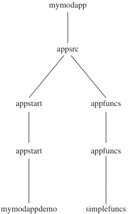

在设置好这些目录后，您可以创建应用程序的源文件。此示例将使用四个源文件。两个是定义应用程序的源文件。第一个是所示的 `SimpleMathFunctions.java`。注意 `SimpleMathFunctions` 被封装在 `appfuncs.simplefuncs` 中。

```java
// 一些简单的数学函数。

package appfuncs.simplefuncs;

public class SimpleMathFunctions {

    // 判断 a 是否是 b 的因数。
    public static boolean isFactor(int a, int b) {
        if((b & a) == 0) return true;
        return false;
    }

    // 返回 a 和 b 的最小正因数。
    public static int lcf(int a, int b) {
        // 使用正值。
        a = Math.abs(a);
        b = Math.abs(b);

        int min = a < b ? a : b;

        for (int i = 2; i <= min/2; i++) {
            if(isFactor(i, a) && isFactor(i, b)) {
                return i;
            }
        }
        return 1;
    }
    // 返回 a 和 b 的最大正因数。
    public static int gcf(int a, int b) {
        // 使用正值。
        a = Math.abs(a);
        b = Math.abs(b);

        int min = a < b ? a : b;

        for(int i = min/2; i >= 2; i--) {
            if(isFactor(i, a) && isFactor(i, b)) {
                return i;
            }
        }
        return 1;
    }
}
```

`SimpleMathFuncs` 定义了三个静态数学函数。首先，`isFactor()` 在 `a` 是 `b` 的因数时返回 `true`。`lcf()` 方法返回 `a` 和 `b` 的最小公因数。换句话说，它返回 `a` 和 `b` 的最小公约数。`gcf()` 方法返回 `a` 和 `b` 的最大公约数。在两种情况下，如果没有找到公因数，则返回 `1`。此文件必须放在以下目录：

`appfuncs/simplefunctions`

这是 `appfuncs.simplefunctions` 包目录。第二个源文件是接下来所示的 `MyModAppDemo.java`。它使用了 `SimpleMaths` 方法。注意它被封装在 `appstart.mymodappdemo` 中。此外，它的运行依赖于 `SimpleMaths`。

```java
// 演示基于模块的应用程序。
package appstart.mymodappdemo;

import appfuncs.simplefunctions.SimpleMaths;

public class MyModAppDemo {
    public static void main(String[] args) {
        if(SimpleMaths.isFactor(2, 10)) {
            System.out.println("2 是 10 的因数");
        }
        System.out.println("35 和 105 的最小公因数是 " + SimpleMaths.lcf(35, 105));
        System.out.println("35 和 105 的最大公因数是 " + SimpleMaths.gcf(35, 105));
    }
}
```

此文件必须放在以下目录：

`appsrc/appstart/mymodappdemo`

这是 `appstart.mymodappdemo` 。接下来，您将为每个模块添加 `module-info.java`。这些文件包含模块定义。首先添加这个定义 `appfuncs` 模块的：

```java
// 模块定义
module appfuncs {
    // 导出包 appfuncs.simplefuncs。
    exports appfuncs.simplefuncs;
}
```

注意 `appfuncs` 导出了 `appfuncs.simplefuncs` 包，这使得其他模块可以访问它。此文件必须放在此目录：`appsrc/appfuncs`

因此，它位于 `appfuncs` 模块目录，位于包目录上方。最后是所示 `appstart` 模块的 `module-info.java`。注意 `appstart` 需要 `appfuncs`。

```java
// 主应用程序的模块定义
module appstart {
    // 需要模块 appfuncs。
    requires appfuncs;
}
```

此文件必须放在其模块目录：`appsrc/appstart`

在检查 `requires`、`exports` 和 `module` 语句之前，让我们先编译并运行它。确保您已按照说明正确创建了目录并将每个文件输入到正确的目录。

## 编译并运行第一个示例

从 JDK 9 开始，`javac` 已更新支持模块。因此，与所有 Java 程序一样，基于模块的程序也使用 `javac` 进行编译。过程很简单，不同之处在于通常会指定一个模块路径。模块路径告诉编译文件所在的位置。在跟随此示例时，请确保从 `mymyapp` 目录执行 `javac` 命令，以确保路径正确。记住 `mymyapp` 是整个模块应用程序的顶层目录。

为了开始，使用此命令编译 `SimpleMathFunc.java`：

```
javac -d appmodules/appfuncs appsrc/appfuncs/simplefuncs/SimpleMathFunc.java
```

记住，此命令必须从 `mymyapp` 目录执行。使用 `-d` 选项告诉 `javac` 在何处放置输出 `.class` 文件。对于本章的示例，编译代码的目录树顶部是 `appmodules`。此命令将根据需要在 `appmodules/appfuncs` 下创建 `appfuncs.simplefunctions` 的输出包目录。

接下来，是编译 `appmodules` 的 `module-info.java` 的 `javac` 命令：

```
javac -d appmodules/appfuncs appsrc/appfuncs/module-info.java
```

这会将 `module-info.class` 文件放入 `appmodules/` 目录。虽然前面的两个步骤过程可行，但它主要为了为了讨论而展示的。通常情况下，在一行命令行中使用 `module-info.java` 及其源文件编译模块会更简单。在这里，将两个 `javac` 命令合并为了一个：

```
javac -d appmodules/appfuncs appsrc/module-info.java appsrc/appfuncs/simplefunctions/SimpleMathFunc.java
```

在这种情况下，每个编译文件都在其正确的模块或包目录中。现在，为 `appstart` 模块编译 `module-info.java` 和 `MyAppDemo.java`，使用以下命令：

```
javac --module-path appmodules -d appstart appsrc/appstart/module-info.java appsrc/appstart/mymodappdemo/MyModAppDemo.java
```


注意 `--module-path` 选项。它指定了模块路径，即编译器用于 `module-info.java` 文件的自定义模块路径。在这种情况下，它将查找 `appfuncs` 模块，因为 `appstart` 模块需要它。此外，注意它指定输出目录为 `appstart`。这意味着 `module-info.class` 文件将位于 `appmodules\appstart` 模块目录，而 `MyModAppDemo.class` 将位于 `appstart\appstart\mymodappdemo` 包目录。

完成编译后，可以使用命令运行应用程序：

```
java --module-path appmodules -m appstart/appstart.mymodappdemo.MyModAppDemo
```

在这里，`--module-path` 选项指定应用程序模块的路径。正如提到的，`appmodules` 是编译模块的目录。`-m` 选项指定应用程序入口点的类，在本情况下，即包含 `main()` 方法的类名。运行程序时，您将看到以下内容：

+ 2 是 10 的因数
+ 35 和 105 的最小公因数是 5
+ 35 和 105 的最大公因数是 7

# 428 第一部分 Java 语言

## 深入理解 requires 和 exports

之前的基于模块的示例依赖于模块系统的两个基础特性：指定依赖的能力以及满足该依赖的能力。这些功能是通过在模块声明中使用 `requires` 和 `exports` 语句来指定的。每一项都值得此时进行更仔细的检查。

以下是示例中使用的 `requires` 语句的形式：

```
requires moduleName;
```

在这里，`moduleName` 指定了出现 `requires` 语句的模块所需要的模块名称。这意味着，被需要的模块必须存在，该模块才能编译。在模块的语言中，当前模块将读取 `requires` 语句中的模块。当需要多个模块时，必须在它们各自的 `requires` 语句中对其进行指定。因此，一个模块声明可以包含多个不同的语句。总的来说，`requires` 语句为你提供了一种方法，确保你的程序能够访问它所需的模块。

以下是示例中使用的 `exports` 语句的一般形式：

```
exports packageName;
```

在这里，`packageName` 指定了出现该语句的模块所导出的包名称。一个模块可以根据需要导出任意数量的包，每个包都在单独的 `exports` 语句中指定。因此，一个模块可能有多个 `exports` 语句。

当模块导出一个包时，它使得该包中所有的公共和受保护类型对其他模块可见。此外，这些类型的公共和受保护成员也是可见的。然而，如果模块中的某个包没有被导出，那么它对于该模块就是私有的，包括它所有的公共类型。例如，即使一个类在包内被声明为公共，如果该包没有被导出，其他模块也无法访问它。需要理解的一点是，一个包的公共和受保护类型，无论是否导出，在相应模块的包内都是可见的。`exports` 语句仅仅是让它们对外部模块可见。因此，任何未导出的包仅供该模块的内部使用。

理解 `requires` 和 `exports` 的关键在于它们是协同工作的。如果一个模块依赖于另一个模块，它必须通过 `requires`（即使可见）另一个模块必须显式导出的包来指定这种依赖关系。如果这种依赖关系的任何一方缺失，模块将无法编译。对于前面的示例，`MyModDemo` 使用了 `SimpleMathFuncs` 中的函数。结果，`appstart` 模块声明需要 `affFunc` 模块。`affFunc` 模块导出了 `SimpleMathFuncs` 类中可公共类型。由于依赖关系的双方都已满足，应用程序就可以编译并运行。如果缺少其中任何一个，编译将失败。

必须强调的是，`requires` 和 `exports` 语句必须仅出现在模块语句内部。此外，模块语句本身必须存在于一个名为 `module-info.java` 的文件中。

## java.base 和平台模块

正如本章开头提到的，从 JDK 9 开始，Java API 包已经整合到了模块中。事实上，API 的模块化是引入模块后实现的主要优势之一。由于它们的特殊角色，API 模块被称为平台模块，它们的所有名称都以前缀 `java`。这里是一些示例：`java.base`、`java.desktop` 和 `java.xml`。通过对 API 进行模块化，可以只使用 `requires` 所需的包来部署应用程序，而不是整个 Java 运行时环境 (JRE)。由于 JRE 的体积巨大，这是一个非常重要的改进。

所有 Java API 包现在都在模块中的这一事实引出了以下问题：在前面的示例中 `MyModAppData` 中的 `main()` 方法如何在不 `requires` 包含 `System` 类的模块的情况下使用 `System.out.println()`？显然，如果没有 `System`，程序将无法编译和运行。同样的问题也适用于 `SimpleMathFuncs` 中 `Math` 类的使用。这个问题的答案可以在 `java.base` 中找到。

在所有模块中，最重要的 `java.base`。它导入并导出许多对 Java 至关重要的包，例如 `java.lang`、`java.io` 和 `java.util` 等。由于其重要性，`java.base` 对所有模块都是可见的。此外，所有其他模块自动要求 `java.base`。在需要在模块声明中包含 `requires java.base` 语句。有趣的一点是，没有必要显式指定 `java.base`，没有必要。因此，就像 `java.lang` 在不使用 `import` 语句的情况下对所有程序自动可见一样，`java.base` 在不显式请求的情况下对所有模块程序自动可见。

由于 `java.lang` 包含 `lang` 包，且 `java.lang` 包含 `System` 类，前面示例中的 `MyModAppData` 可以在没有显式 `requires` 语句的情况下自动使用 `System.out.println()`。同样适用于 `SimpleMathFuncs` 中的 `Math` 类，`Math` 类也在 `java.lang` 中。当你开始创建自己的基于模块的应用程序时，你会发现你通常需要的 API 类都在 `java.base` 包含的包中。`java.base` 的引入简化了基于模块的代码创建，因为 `java.base` 的核心包是自动可见的。

最后一点：从 JDK 9 开始，由于 `java.base` 的核心包是自动可见的，`java.base` 无需显式指定。否则，你的模块声明必须包含对于所需的模块。

## 遗留代码与未命名模块

在学习示例程序时，你可能会产生另一个问题：由于 Java 支持模块，且 API 包现在都位于模块中，为什么前面的章节中的其他程序在不使用模块的情况下也能编译运行？考虑到 Java 最初的“一次编写，到处运行”的哲学，这非常重要，因为必须保持向下兼容。正如你将看到的，Java 通过提供一条平滑、非交互、无破坏的过渡路径来回答这个问题。对遗留代码的支持由两个特性提供。第一个是未命名模块。当你使用不属于命名模块的代码时，它会自动成为未命名模块的一部分。未命名模块有两个重要的属性。首先，未命名模块中的所有内容自动导出。其次，未命名模块可以访问所有其他模块。因此，当程序不使用模块时，所有的模块都可以通过未命名模块访问。

支持遗留代码的第二个特性是使用类路径而不是模块路径。当你编译一个不使用模块的程序时，类路径机制自 Java 发布以来一直那样工作。这是在模块出现之前的。

在继续之前，需要说明重要的一点。对于书中其他地方使用的示例程序以及一般的示例程序来说，使用模块没有好处。将它们模块化会增加混乱并使其复杂。对于许多程序，没有必要将它们包含在模块中。正如章初所述，模块在创建商业程序时通常具有最大的收益。因此，本章之外的示例将不使用模块。这使得这些示例可以在旧版本的 Java 环境中编译和运行，这对于使用旧版本的读者来说很重要。

## 导出到特定模块

`exports` 语句的基本形式使包对任何及所有其他模块可见。这正是你所想要的。然而，在某些特殊的开发情况下，可能希望让一个包仅对一组特定的模块可见，而不是所有其他模块可见。例如，库开发者可能希望对库内的某些其他模块支持某个包，但不将其开放给通用使用。在 `exports` 语句中使用 `to` 子句提供了一种实现这一点的方法。

## 第 16 章 模块 431

在 `exports` 语句中，`to` 子句指定了一个一个或多个可以访问导出包的模块列表。此外，只有在 `to` 子句中命名的模块才具有访问权限。在模块语言中，`to` 子句创建了所谓的“限定导出”。

包含 `to` 的 `exports` 形式所示：

```
exports moduleName to moduleNames;
```

在这里，`moduleNames` 是一个逗号分隔的模块列表，导出模块向这些模块授予权限。

你可以尝试如下所示修改 `appfuncs` 模块的 `module-info.java` 文件：

```java
// 使用子句的模块定义
module appfuncs {
  // 将包 appfuncs.simplefuns 导出给 appstart
  exports appfuncs.simplefuns to appstart;
}
```

现在，`simplefuncs` 仅导出给 `appstart`，而不给任何其他模块。在进行此更改后，你可以使用以下 `javac` 命令编译应用程序：

```bash
javac -d modules --module-source-path appsrc
appsrc/appstart --module myappdemo=MyModAppDemo.java
```

编译完成后，你可以像之前一样运行该程序。

此示例还使用了另一个模块相关的特性。仔细观察前面的 `javac` 命令。首先注意到它指定了 `--module-source-path` 选项。模块源路径指定了顶级源模块的路径。`--module-source-path` 选项会自动编译指定目录树下的文件，在本例中 `appsrc` 就是该目录。`--module-source-path` 选项必须与 `-d` 选项配合使用，以确保编译后的模块存储在 `modules` 目录下的正确目录下。`javac` 被称为多模块模式，是因为它允许同时编译多个模块。多模块编译特别有用，因为 `to` 子句引用了特定的模块，而请求模块必须具有访问导出包的权限。因此，在两种情况下，都需要 `appstart` 和 `appfuncs` 以避免在编译期间出现警告和/错误。模块模式避免了这个问题，因为两个模块是同时被编译的。

`javac` 的多模块模式还有另一个优势。它会自动找到并编译应用程序的所有源文件，创建必要的输出目录。由于多模块编译带来的优势，接下来的示例将都会使用该特性。

> 注意：作为一般规则，限定导出是一个特例。在大多数情况下，你会提供包的非限定导出，或者根本不导出该包（使其保持为不可访问状态）。因此，此处讨论限定导出主要是为了完整性考虑。此外，限定导出本身并不能防止包被伪装成目标模块的恶意代码所滥用。防止这种情况发生所需的安全技术是本书的范围。有关这方面的细节以及泛指 Java 安全，请参阅 Oracle 文档。

## 使用 requires transitive

考虑存在三个模块 A、B 和 C 的情况，它们具有以下依赖关系：

- A 依赖 B。
- B 依赖 C。

鉴于这种情况，很明显 A 依赖于 B，B 依赖于 C，因此 A 对 C 有间接依赖。由于 A 没有直接使用 C 的任何内容，你只需在它的 `module-info` 文件中编写 `requires B`，并在其 `module-info` 文件中导出 A 所需的包，如下：

```java
// A 的 module-info 文件：
module A {
  requires B;
}
```

```java
// B 的 module-info 文件：
module B {
  exports somepack;
  requires C;
}
```

在这里，`somepack` 是 B 导出并供 A 使用的包的占位符。只要 A 不需要使用 C 中的任何内容，这种方法就是有效的；但如果 A 想要访问 C 中的某个类型，就会出现问题。在这种情况下有两种解决方案。

第一个解决方案是在 A 的文件中添加 `requires C` 语句，如下：

```java
// A 的 module-info 文件：
module A {
  requires B;
  requires C;
}
```

第二个解决方案是使用 `requires transitive`。这允许模块 B 传递其对 C 的依赖性，使得任何依赖 B 的模块（如 A）也能隐式地读取 C。语法如下：

```java
// B 的 module-info 文件：
module B {
  exports somepack;
  requires transitive C;
}
```

现在，模块 A 只需 `requires B` 即可访问 C 导出的类型，无需显式声明 `requires C`。这简化了依赖管理，特别是当 C 是 B 实现细节的一部分时。

最后，更新 `MyModDemo.java` 以反映这些更改。具体来说，它现在必须导入 `SupportFuncs` 类，并在调用 `isFactor()` 时指定它，如下所示：

```java
// Updated to use SupportFunc.
package appstart.mymodappdemo;

import appfuncs.simplefuncs.SimpleMathFuncs;
import appsupport.supportfuncs.SupportFuncs;

public class MyAppData {
    public static void main(String[] args) {
        // Now, isFactor() is referred to via SupportFuncs.
        // not SimpleMathFuncs.
        if(SupportFuncs.isFactor(2, 10)) {
            System.out.println("2 is a factor of 10");
        }
        System.out.println("Smallest factor common to both 35 and 105 is " + 
SimpleMathFuncs.lcf(35, 105));

        System.out.println("Largest factor common to both 35 and 105 is " + 
SimpleMathFuncs.gcf(35, 105));
    }
}
```

一旦你完成了所有前面的步骤，就可以使用此多模块编译命令重新编译整个程序：

```
javac -d modules --module-source-path appsrc
appsrc\appstart\appstart\mymodappdemo\MyModAppData.java
```

如之前解释过的，多模块编译将使用 `modules` 目录自动创建平行的模块子目录。你可以使用此命令运行程序：

```
java --module-path appmodules -m appstart/appstart.mymodappdemo.MyModAppData
```

它将产生与之前版本相同的输出。然而，这三个不同的模块是必须的。为了证明传递的 `module-info.java` 文件是应用程序所需的，请从 `appfuncs` 的 `module-info.java` 文件中删除它。然后编译程序。如你所看到的，这将导致错误，因为 `appsupport` 不再可被 `appstart` 访问。

这里另一个例子。在 `appsupport` 的 `module-info` 文件中，通过限定导出将 `appsupport.supportfuncs` 包仅导出给 `appfuncs`，如下所示：

```
exports appsupport.supportfuncs to appfuncs;
```

接下来，尝试编译程序。如你所见，由于支持函数 `isFactor()` 对位于 `appstart` 模块的 `MyAppDataDemo` 不可用，程序现在无法编译。如前所述，限定导出将对包的访问限制为仅由 `to` 子句指定的模块。

最后一点，由于 Java 语言语法中的特殊异常，`requires` 语句中如果 `transitive` 后面紧跟一个分隔符（如分号），它将被解释为标识符（例如，模块名）而不是关键字。

# 使用服务

在编程中，将“必须做什么”与“如何做”分开通常是有用的。正如你在第 9 章中学到的，Java 中实现这一目标的方法是使用接口。接口指定了“做什么”，而实现类指定了“如何做”。这个概念可以扩展，使得通过插件让实现类由你程序外部的代码提供。使用这种方法，可以通过简单更改插件来增强、升级或更改应用程序的能力。应用程序的核心保持不变。Java 提供可插式架构的一种方式是通过使用服务和服务提供者。由于它们具有重要性，特别是在大型商业应用中，Java 模块系统为它们提供了支持。

在我们开始之前，有必要说明，使用服务的应用程序通常已经得到了充分满足。因此，你可能会发现你不需要基于服务的模块功能。然而，由于对服务的支持构模块系统中相当重要的一部分，对这些功能如何工作有一个通用的理解是非常重要的。此外，还提供了一个简单的示例，说明了使用它们所需的核心技术。

# 服务和服务提供者基础

在 Java 中，服务是一个程序单元，其功能由接口或抽象类定义。因此，服务以一种通用的方式指定了某种形式的程序活动。服务的具体实现由服务提供者提供。换句话说，服务定义了动作的形式，而服务提供者提供该动作。

正如提到的，服务通常用于支持可插式架构。例如，一个服务可能被用于支持从一种语言到另一种语言的翻译。在这种情况下，服务支持通用翻译。服务提供者提供具体的翻译，例如德语到英语或法语到中文。由于所有服务提供者都实现了相同的接口，不同的翻译器可以不同的语言，而无需更改应用程序的核心。你只需要更改服务提供者即可。


服务由 `ServiceLoader` 类提供。`ServiceLoader` 是封装在 `java.util` 中的泛型类。它的声明如下：

在这里，`S` 指定了服务类型。服务通过 `load()` 方法加载。它有几种形式；我们将使用的形式在这里：

```java
public static <S> ServiceLoader<S> load(Class<S> serviceType)
```

在这里，`serviceType` 指定了所需服务类型的 `Class` 对象。记住 `Class` 是一个封装了类信息的类。获取 `Class` 实例有多种方法。我们在这里使用方法涉及类字面量（class literal）。记住类字面量具有这种通用形式：

```java
className.class
```

在这里，`className` 指定了类的名称。当调用 `load()` 时，它返回一个应用程序的 `ServiceLoader` 实例。

# 基于服务的关键字

模块通过关键字 `requires`、`uses` 和 `provides` 支持服务：

- `requires`：用于表示一个模块需要特定的服务。
- `uses`：用于表示一个模块使用了特定的服务。
- `provides`：用于表示一个模块提供特定的服务。

本质上说，这些关键字允许模块以结构化的方式声明它们的依赖和能力。

# 基于服务的示例

为了演示服务，我们将创建一个示例，通过提供新函数来扩展应用程序的版本。记住 `SimpleMath` 类提供了三个函数：`isFactor()`、`lcf()` 和 `gcf()`。虽然向此类中添加更多函数是可能的，但这样做需要重新编译应用程序。通过实现服务，可以在运行时“插入”新函数，这就是本示例将要做的。在这种情况下，服务函数接受两个参数并返回一个 `int` 结果。当然，如果提供了额外的接口，也可以支持其他类型的函数，但对于我们的目的，支持二元函数已经足够，并且保持了示例源代码的可维护性。

# 服务接口

需要两个服务接口。一个指定动作的形式，另一个指定该动作提供者的形式。它们都位于**二进制目录 (binary directories)** 中，并且都在 `user.binaryfuncs` 包中。第一个被称为 `BinaryFunc`，声明了二元函数的形式。如下所示：

```java
// 此接口定义了一个接受两个 int
// 参数并返回 int 结果的函数。因此，它可以
// 描述两个 int 之间的任何返回 int 
// 的二元操作。
package userfuncs.binaryfuncs;

public interface BinaryFunc {
    // 获取函数的名称。
    public String getName();

    // 这是要执行的函数。它将
    // 由具体的实现提供。
    public int func(int a, int b);
}
```

`BinaryFunc` 声明了可以实现二元整数函数的对象的形式。这是通过 `func()` 方法指定的。方法名称可以通过 `getName()` 获取。名称将用于确定实现了什么种类型的函数。该接口由提供二元函数的类实现。

第二个接口声明了服务提供者的形式。它被称为 `BinFuncProvider`，如下所示：

```java
// 此接口定义了服务提供者的形式，
// 获取 BinaryFunc 实例。
package userfuncs.binaryfuncs;

import userfuncs.binaryfuncs.BinaryFunc;

public interface BinFuncProvider {
    // Obtain a BinaryFunc.
    public BinaryFunc get();
}
```

`BinFuncProvider` 仅声明了一个方法 `get()`，它用于获取 `BinaryFunc` 的实例。该接口必须由想要提供 `BinaryFunc` 实例的类来实现。

## 实现类

在本示例中，支持 `BinaryFunc` 的两个具体实现。第一个是 `AbsPlus`，它返回其参数的绝对值。第二个是 `AbsMinus`，它返回第一个参数的绝对值减去第二个参数绝对值的结果。这些实现由 `AbsPlusProvider` 和 `AbsMinusProvider` 类提供。这些类的源代码必须存储在 `userfuncsimp.binaryfuncs` 包中。

`AbsPlus` 的代码所示：

```java
// AbsPlus 是 BinaryFunc 的具体实现。
// 它返回 abs(a) + abs(b) 的结果。
package userfuncsimp.binaryfuncsimp;

import userfuncs.binaryfuncs.BinaryFunc;

public class AbsPlus implements BinaryFunc {
    // 返回此函数的名称。
    public String getName() {
        return "absPlus";
    }

    // 实现 AbsPlus 函数。
    public int func(int a, int b) { return Math.abs(a) + Math.abs(b); }
}
```

`AbsPlus` 实现了 `func()`，使其返回 `a` 和 `b` 的绝对值之和。注意 `getName()` 返回了字符串 `"absPlus"`。它标识了该函数。接下来是 `AbsMinus` 类：

```java
// AbsMinus 是 BinaryFunc 的具体实现。
// 它返回 abs(a) - abs(b) 的结果。
package userfuncsimp.binaryfuncsimp;

import userfuncs.binaryfuncs.BinaryFunc;

public class AbsMinus implements BinaryFunc {
    // 返回此函数的名称。
    public String getName() {
        return "absMinus";
    }

    // 实现 absMinus 函数。
    public int func(int a, int b) { return Math.abs(a) - Math.abs(b); }
}
```

`func()` 的实现返回 `a` 和 `b` 的绝对值之间的差，并且 `getName()` 返回字符串 `"absMinus"`。

要获取实例 `AbsPlus`，使用了 `AbsPlusProvider`。它实现了 `BinFuncProvider`，其代码所示：

```java
// 这是 AbsPlus 函数的提供者。
package userfuncsimp.binaryfuncsimp;

import userfuncs.binaryfuncs.*;

public class AbsPlusProvider implements BinFuncProvider {
    // 提供一个 AbsPlus 对象。
    public BinaryFunc get() { return new AbsPlus(); }
}
```

`get()` 方法返回一个新的 `AbsPlus()` 对象。虽然这个提供者非常简单，但重要的是指出，某些服务提供者将复杂得多。`AbsMinus` 的提供者被称为 `AbsMinusProvider`，其所示：

```java
// 这是 AbsMinus 函数的提供者。
package userfuncsimp.binaryfuncsimp;

import userfuncs.binaryfuncs.*;

public class AbsMinusProvider implements BinFuncProvider {
    // 提供一个 AbsMinus 对象。
    public BinaryFunc get() { return new AbsMinus(); }
}
```

它的 `get()` 方法返回一个 `AbsMinus` 对象。

## 模块定义文件

接下来，需要两个模块定义文件。第一个是用于 `userfuncs` 模块的，所示：

```java
module userfuncs {
    exports userfuncs.binaryfuncs;
}
```

此代码必须包含在 `userfuncs` 目录下的 `module-info.java` 文件中。注意它导出了 `userfuncs.binaryfuncs` 包。这是定义 `BinaryFunc` 和 `BinFuncProvider` 接口的包。第二个 `module-info.java` 文件所示。它定义了包含实现的模块。位于 `userfuncsimp` 目录。

```java
module userfuncsimp {
    requires userfuncs;

    provides userfuncs.binaryfuncs.BinFuncProvider with
        userfuncsimp.binaryfuncs.AbsPlusProvider,
        userfuncsimp.binaryfuncs.AbsMinusProvider;
}
```

模块需要 `userfuncs`，因为 `BinaryFunc` 和 `BinFuncProvider` 接口是实现所需的。该模块提供了 `AbsPlusProvider` 和 `AbsMinusProvider`。

## 在 MyAppDemo 中演示提供者

为了使用服务，`MyAppDemo` 的 `main()` 方法被扩展为通过 `ServiceLoader.load()` 在运行时使用 `AbsPlus` 和 `AbsMinus`。更新后的代码如下：

```java
// 一个基于模块的演示服务和服务提供者的应用程序。

package appstart.mymoddemo;

import java.util.ServiceLoader;

import appfuncs.simplefuncs.SimpleMaths;
import userfuncs.binaryfuncs.*;

public class MyAppDemo {
    public static void main(String[] args) {
        // 首先，使用内置函数。
        if (SimpleMaths.isFactor(2, 10)) {
            System.out.println("2 is a factor of 10");
        }
        System.out.println("Smallest factor common to both 35 and 105 is " + 
            SimpleMaths.lcf(35, 105));

        System.out.println("Largest factor common to both 35 and 105 is " + 
            SimpleMaths.gcf(35, 105));
    }
}
```

```java
// 现在使用基于服务的操作。

// 获取函数的服务加载器。
ServiceLoader<BinFuncProvider> ldr =
ServiceLoader.load(BinFuncProvider.class);

BinaryFunc binOp = null;

// 查找 absPlus 的提供者并获取函数。
for(BinFuncProvider bfp : ldr) {
    if (bfp.getName().equals("absPlus")) {
        binOp = bfp.get();
        break;
    }
}
```

```java
if(binOp != null) {
    System.out.println("Result of absPlus function: " + 
    binOp.func(12, -4));
}
```

```java
else
System.out.println("absPlus function not found");
```

```java
binOp = null;

// 现在，查找 absMinus 的提供者并获取函数。
for(BinFuncProvider bfp : ldr) {
    if (bfp.getName().equals("absMinus")) {
        binOp = bfp.get();
        break;
    }
}
```

```java
if(binOp != null) {
    System.out.println("Result of absMinus function: " + 
    binOp.func(12, -4));
}
```

```java
else
System.out.println("absMinus function not found");
```

仔细观察前面的代码如何加载和执行服务。首先，通过此语句创建 `BinFuncProvider` 服务的加载器：

```java
ServiceLoader<BinFuncProvider> ldr =
ServiceLoader.load(BinFuncProvider.class);
```

注意 `ServiceLoader` 的类型参数是 `BinFuncProvider`。这意味着将找到实现此接口的提供者。因此，在该执行后，`AbsPlusProvider` 和 `AbsMinusProvider` 均可用。

接下来，声明类型为 `BinaryFunc` 的引用 `binOp` 并初始化为 `null`。它将用于引用提供特定类型二进制函数的实现。接下来，后续操作在 `ldr` 中搜索名为 `"absPlus"` 的项。

在这里，`for` 循环遍历 `ldr`。在循环内部，检查提供者提供的函数名称。如果匹配 `"absPlus"`，则通过调用提供者的 `get()` 方法将函数赋值给 `binOp`。最后，如果函数为 `null`（在本例中），则通过此语句执行：

```java
if (binOp != null) {
    System.out.println("Result of absPlus function: " + 
        binOp.func(12, -4));
}
```

在这种情况下，`binOp` 指向 `AbsPlus` 的实例，对 `func()` 的调用执行了绝对加。使用类似的序列来查找并执行 `AbsMinus`。由于 `MyAppDemo` 现在使用了 `BinFuncProvider`，我们的模块定义文件包含了指定这一事实的语句。`MyAppDemo` 位于 `appstart` 模块。因此，你更改所示的 `appstart` 的 `module-info.java` 文件：

```java
// 主应用程序的模块定义。
// 它使用了 BinFuncProvider。
module appstart {
    // 需要 appfuncs 和 userfuncs 模块。
    requires appfuncs;
    requires userfuncs;

    // appstart 现在使用 BinFuncProvider。
    uses userfuncs.binary.BinFuncProvider;
}
```

## 编译并运行基于服务的示例

完成所有步骤后，可以通过执行以下命令编译并运行示例：

```bash
javac -d modules --module-source-path appsrc
appsrc\userfuncsimp\module-info.java
appsrc\appstart\appstart\mymodappdemo\MyModDemo
java --module-path modules -m appstart/appstart.mymodappdemo.MyModDemo
```

以下是输出：

- 2 是 10 的因子，35 和 105 的公因数是 5
- 35 和 105 的最小公因数是 7
- 35 和 105 的最大公因数是 7
- absPlus 函数的结果：16
- absMinus 函数的结果：8

如输出所示，二进制函数已成功定位并执行。需要强调的是，如果 `userfuncsimp` 模块中提供的语句缺失，或者 `appstart` 模块中的 `uses` 语句缺失，应用程序将执行失败。

最后一点：之前的示例保持得非常简单，是为了清晰地展示模块对服务的支持，但实际上可以实现更复杂的用法。例如，你可以使用一个服务来提供一个 `sort()` 方法，对各种集合进行排序。可以通过服务支持并提供各种算法。然后，可以根据所需的运行时特性、数据的性质和/或大小选择特定的排序方法，并支持对数据进行随机访问。你可能想要尝试实现这样一个服务，作为进一步实验模块中服务的一种。

# 模块图

在处理模块时，可能会遇到一个术语是“模块图”。在编译期间，编译器通过创建一个表示依赖关系的模块图来解析模块之间的依赖关系。该过程确保了所有依赖关系都得到解决，包括间接依赖。例如，如果 A 需要模块 B，而 B 需要模块 C，那么即使 A 没有直接使用 C，模块图中也会包含模块 C。


模块图可以通过图形的形式进行视觉化，以说明模块之间的关系。这是一个简单的示例。假设有六个模块 A、B、C、D、E 和 F。进一步假设 A 需要 B 和 C，B 需要 D 和 E，而 C 需要 F。下图直观地描绘了这种关系。（由于 `java.base` 是自动包含的，因此图中显示。）

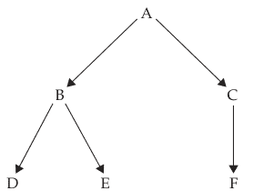

在 Java 中，箭头从依赖模块指向所需的模块。因此，模块图的绘图描述了哪些模块可以访问哪些其他模块。

坦率地说，由于许多商业级应用涉及的复杂性，只有规模最小的应用程序才能对其模块图进行视觉化表示。

## 三种特殊的模块特性

之前的讨论描述了 Java 语言支持的模块的关键特性，这些特性也是你在创建模块时通常会依赖的特性。然而，还有三个额外的模块相关特性在某些情况下非常有用。这些是：**开放模块 (open module)**、**opens** 语句以及 **requires static** 的使用。这些特性中的每一个都旨在处理特殊情况，尽管如此，对于所有 Java 程序员来说，了解它们的用途是非常重要的。

## 开放模块 (Open Modules)

正如在本章早期学到的，默认情况下，模块包中的类型只有在通过 **exports** 语句显式导出时才是可访问的。这通常是你所需要的，但在某些情况下，启用对模块中所有包的运行时访问是有用的，无论该包是否被导出。为了允许这一点，你可以创建一个开放模块。通过在 **module** 关键字之前加上 **open** 修饰符来声明开放模块，如下：

```
open module moduleName {
  // module definition
}
```

在开放模块中，其所有包中的类型在运行时都是可访问的。然而，请理解，只有显式导出的包在编译时是可用的。**open 修饰符仅允许运行时访问。** 开放模块的主要目的是允许模块中的包通过反射（reflection）进行访问。正如第12章解释的，反射是允许程序在运行时进行分析的特性。

## opens 语句 (The opens Statement)

模块可以针对某个特定包允许其他模块的运行时访问以及反射式访问，而不是开放整个模块。要做到这一点，请使用下所示的 **opens** 语句：

```
opens packageName;
```

在这里，`packageName` 指定要打开的包。还可以包含一个 **to** 子句，列出哪些模块对该包是开放的。

重要的是，**opens** 并不授予编译时的访问权限。它仅用于开放包以供运行时和反射访问。然而，你可以同时对模块进行导出（export）和开放。另一点：**opens** 语句不能在开放模块中使用。记住，开放模块中的所有包已经是开放的。

## requires static

如你所知，`requires` 指定了一个依赖关系，该关系默认在编译和运行时都会强制执行。然而，可以放宽这种要求，使得模块在运行时是不需要的。这是通过在 **requires** 语句中使用 **static** 修饰符来实现的。例如，这指定了编译需要 `mymod`，但运行时不需要：

```
requires static mymod;
```

在这种情况下，添加 **static** 使得 `mymod` 在运行时是可选的。这对于程序在功能存在时可以使用它、但并不要求其必须存在的情况非常有帮助。

## 引入 jlink 和模块 JAR 文件 (Introducing jlink and Module JAR Files)

如前面的讨论所示，模块代表了 Java 语言的重大增强。模块系统还支持运行时的增强。最重要的功能之一是能够创建一个专门为你的应用程序定制的运行镜像（run-image）。为了实现这一点，你可以使用 jlink。jlink 工具会创建一个专门为你的应用程序定制的运行镜像。

### JMOD 文件 (JMOD Files)

如前面的讨论所示，jlink 工具还可以链接使用 JDK 9 引入的全新 JMOD 格式的文件。JMOD 文件可以包含不适用于 JAR 文件的内容。它们由新的 jmod 工具创建。大多数应用程序将继续使用模块化 JAR 文件，但 JMOD 文件在特殊情况下将具有价值。作为一点，， JDK 9 开始，平台模块包含在 JMOD 文件中。

> **注意**：jlink 也可以被最近添加的 jpackage 工具使用。该工具可以创建一个原生安装的应用程序。

### 关于层和自动模块的简要说明

在学习模块时，你可能会遇到两个与模块相关的额外特性。这些是层（layers）和自动模块（automatic modules）。这两者都是为了对模块进行专门的、高级的工作，或者在迁移现有的应用程序时设计的。虽然大多数程序员可能不需要使用这些特性，但为了完整起见，这里对每种特性都进行了简要描述。

模块层（module layer）使用类加载器（class loader）来适配模块图中的模块。因此，不同的层可以使用不同的类加载器。层使得更特殊类型的应用程序能够更容易构建。

自动模块是通过在模块类路径（module path）上指定一个非模块化的 JAR 文件创建的，其名称是自动得出的。（也可以在清单文件中显式地为自动模块指定一个名称。）自动模块允许普通模块（normal modules）依赖于自动模块中的代码。自动模块为从非模块化代码迁移到完全模块化的代码提供了辅助。因此，它们主要是一个过渡性特性。

## 关于模块的最后思考

前面的讨论引入并演示了 Java 模块系统的核心元素。这些是每个 Java 程序员应该至少基本了解的特性。正如你可能猜到的那样，模块系统提供了额外的特性，让你对模块的创建和使用进行细粒度的控制。例如，javac 和 Java 拥有的许多相关选项比本章描述的要多得多。由于模块是 Java 的一个重要补充，模块系统随着时间的推移而演变。你可能希望关注 Java 这一创新方面的增强。

## 第 17 章：switch 表达式、记录以及其他最近添加的特性

Java 的一个关键属性一直是其能够适应现代计算环境日益增长的需求。多年来，Java 整合了许多新特性，每种特性都对应于计算环境的变化或计算机语言设计的创新。这一持续的过程使 Java 能够成为世界上最重要且最受欢迎的计算机语言之一。正如前面解释过的，本书已针对 JDK 17 进行更新，它是 Java 的一个长期支持（LTS）版本。JDK 17 整合了自上一个 LTS 版本（即 JDK 11）以来添加到 Java 的许多新语言特性。前面的几个章节已经描述了一些较小的新增。在本章中，将检查几项主要新增。

- 对 switch 的增强
- 文本块（Text blocks）
- 记录（Records）
- instanceof 中的模式（Patterns）
- 密封类和接口（Sealed classes and interfaces）

以下是每种特性的简要描述。switch 以多种方式得到了增强，影响最大的是 switch 表达式。switch 表达式允许 switch 产生一个值。文本块允许字符串字面量占据多行。由新关键字 `record` 支持，记录允许你创建一个专门设计用于持有一组值的类。还增加了第二形式的 `instanceof`，它使用类型模式（type pattern）。通过这种形式，你可以指定一个变量，当测试的类型 `instanceof` 成功时接收该类型的实例。现在可以指定一个密封类（sealed class）或接口。密封类只能被显式指定的子类继承。密封接口只能由显式指定的类实现，或只能由显式指定的接口扩展。因此，对一个类或接口进行密封可以让你对它的继承实现进行细粒度的控制。

### 对 switch 的增强

switch 语句从 Java 之初就是 Java 的一部分。它是 Java 程序控制语句的一个关键元素，并提供了多路分支。此外，switch 对编程来说是如此基础，以至于在其他流行的编程语言中也能以各种形式找到。switch 的传统形式在第 5 章中描述。从 JDK 14 开始，switch 通过添加四项新特性得到了实质性的增强，在此所示：

- switch 表达式
- yield 语句
- 对 case 常量列表的支持
- 带箭头的 switch (switch with an arrow)

在随后的讨论中将详细检查每个新特性，但这里有一个简要描述：switch 表达式本质上是一个产生值的 switch。因此，switch 表达式可以使用在赋值的右侧，例如。`yield` 语句指定由 switch 表达式产生的值。现在在产生常量列表的 case 语句中包含多个 case 常量是可行的。还增加了第二种形式的 case，它使用箭头（用 `->` 代替冒号）。箭头提供了新的能力。

总而言之，对 switch 的增强代表了 Java 语言的相当重大的变化。它们不仅提供了新功能，在某些情况下，它们还提供了传统方法的优越替代方案。因此，坚实理解新 switch 特性背后的“如何”和“为什么”是非常重要的。

理解 switch 增强最好的方法之一是从一个使用传统 switch 的示例开始，然后逐步引入每个新特性。这样，增强的使用和益处将显而易见。首先，想象某个设备产生指示各种事件的整数代码，你想为每个事件代码关联一个优先级级别。大多数事件将具有普通优先级，但少数事件将具有更高的优先级。这里有一个使用传统 switch 给定事件代码提供优先级的程序：

```java
// 使用传统的 switch 根据匹配的 
// 事件代码设置优先级级别。
class TraditionalSwitch {
    public static void main(String[] args) {
        int priorityLevel;

        int eventCode = 6010;

        // 一个传统的 switch 提供一个与 
        // case 关联的值。
        switch(eventCode) {
            case 1000: // 在这个传统的 switch 中，使用了 case 堆叠。
            case 1205:
            case 8900:
              priorityLevel = 1;
              break;
        }
    }
}
```


# 第 17 章：switch 表达式、记录以及其他最近添加的特性

Java 的一个关键属性一直是能够适应现代计算环境日益增长的需求。多年来，Java 整合了许多新特性，每种特性都对应于计算环境的变化或计算机语言设计的创新。这一持续的过程使 Java 能够成为世界上最重要且最受欢迎的计算机语言之一。正如前面解释过的，本书已针对 JDK 17 进行更新，它是 Java 的一个长期支持（LTS）版本。JDK 17 整合了自上一个 LTS 版本（即 JDK 11）以来添加到 Java 的许多新语言特性。前面的章节已经描述了一些较小的新增。在本章中，将检查几项主要新增。

- 对 switch 的增强
- 文本块
- 记录
- instanceof 中的模式
- 密封类和接口

以下是每种特性的简要描述。switch 以多种方式得到了增强，影响最大的是 switch 表达式。switch 表达式允许 switch 产生一个值。文本块允许字符串字面量占据多行。由新关键字 `record` 支持，记录允许你创建一个专门设计用于持有一组值的类。还增加了第二形式的 `instanceof`，它使用类型模式。通过这种形式，你可以指定一个变量，当测试的类型 `instanceof` 成功时接收该类型的实例。现在可以指定一个密封类或接口。密封类只能被显式指定的子类继承。密封接口只能由显式指定的类实现，或只能由显式指定的接口扩展。因此，对一个类或接口进行密封可以让你对它的继承实现进行细粒度的控制。

## 对 switch 的增强

switch 语句从 Java 之初就是 Java 的一部分。它是 Java 程序控制语句的一个关键元素，并提供了多路分支。此外，switch 对编程来说是如此基础，以至于在其他流行的编程语言中也能以各种形式找到。switch 的传统形式在第 5 章中描述。从 JDK 14 开始，switch 通过添加四项新特性得到了实质性的增强，在此所示：

- switch 表达式
- `yield` 语句
- 对 case 常量列表的支持
- 带箭头的 switch

在随后的讨论中将详细检查每个新特性，但这里有一个简要描述：switch 表达式本质上是一个产生值的 switch。因此，switch 表达式可以使用在赋值的右侧，例如。`yield` 语句指定由 switch 表达式产生的值。现在在产生常量列表的 case 语句中包含多个 case 常量是可行的。增加了第二种形式的 case，它使用箭头（用 `->` 代替冒号）。箭头提供了新的能力。

总而言之，对 switch 的增强代表了 Java 语言的相当重大的变化。它们不仅提供了新功能，在某些情况下，它们还提供了传统方法的优越替代方案。因为如此，坚实理解新 switch 特性背后的“如何”和“为什么”是非常重要的。

理解 switch 增强的最好方法之一是从一个使用传统 switch 的示例开始，然后逐步引入每个新特性。这样，增强的使用和益处将显而易见。首先，想象某个设备产生指示各种事件的整数代码，你想为每个事件代码关联一个优先级级别。大多数事件将具有普通优先级，但少数事件将具有更高的优先级。这里有一个使用传统 switch 给定事件代码提供优先级的程序：

```java
// 使用传统的 switch 根据匹配的 
// 事件代码设置优先级级别。
class TraditionalSwitch {
    public static void main(String[] args) {
        int priorityLevel;

        int eventCode = 6010;

        // 一个传统的 switch 提供一个与 
        // case 关联的值。
        switch(eventCode) {
            case 1000: // 在这个传统的 switch 中，使用了 case 堆叠。
            case 1205:
            case 8900:
              priorityLevel = 1;
              break;
        }
    }
}
```

指定 switch 表达式非常简单。只需在需要值的地方语境中使用 `switch` 即可，例如赋值语句的右侧、方法的参数或返回值。例如，下面这一行表示启用了 switch 表达式：

```java
int x = switch (y) { // ...
```

在这里，switch 的结果被赋值给变量 `x`。使用 switch 表达式的一个关键点是，每个 case（加上 `default`）必须产生一个值（除非它抛出异常）。换句话说，switch 表达式中的每条路径都必须产生一个结果。

switch 表达式的引入简化了每个 case 都为某个变量赋值的情况编码。这种情况可以通过多种不同的方式出现。例如，每个 case 可能会设置一个布尔变量，用于指示 switch 之后某个操作的成功或失败。然而，设置 switch 是前一个程序中所使用的 switch 的主要目的。它的工作是提供与事件代码相关的优先级级别。在传统的 switch 语句中，每个 case 语句必须单独地为变量分配值，而这个值就变成了 switch 的事实结果。前一个程序使用的就是这种方法，其中变量 `priorityLevel` 的值由每个 case 设置。尽管这种方法已经在 Java 程序中使用了几十年，但由于 switch 本身产生所需的值，switch 表达式提供了一个更好的解决方案。

程序的后续版本通过将 switch 语句转换为 switch 表达式，将之前的决策付诸实施：

```java
// 将 switch 语句转换为 switch 表达式。
class SwitchExpr {
    public static void main(String[] args) {
        int eventCode = 6010;

        //这是一个 switch 表达式。注意它的值是如何赋值
        // 给 priorityLevel 变量的。同样注意 switch 的值
        //是由 switch 语句提供的。
        int priorityLevel = switch (eventCode) {
            case 1,
            case 2000, 6010, 9128:
            case 2,
            case 1002, 7023, 9300:
            case 3,
            default: // normal priority
                yield 0;
        };

        System.out.println("*Priority level for event code " + eventCode +
            " is " + priorityLevel);
        }
}
```

仔细观察程序中的 `switch`。注意它与之前示例中使用的有重要不同。这个版本不是由每个 case 单独为 `priorityLevel` 分配值，而是将 switch 本身的结果赋值给 `priorityLevel` 变量。

因此，只需要对 `priorityLevel` 赋值，switch 的长度也缩短了。使用 switch 表达式确保了每个 case 都会产生一个值，避免了在某个 case 中忘记给 `priorityLevel` 赋值的可能性。注意 switch 的值是由每个 case 内部的 `yield` 语句产生的。正如所解释的，`yield` 会 switch 立即终止，因此不会发生 case 之间的穿透。因此，不需要 `break`，也不允许使用 `break`。需要注意的是 switch 结束大括号后面的分号。因为这个 switch 被用于赋值语句中，所以它必须以分号结束。

switch 表达式有一个适用的重要限制：case 语句必须处理所有出现的值。例如，如果它的控制表达式是 `int` 类型，那么所有值都必须由 switch 处理。这无疑构成了大量的 case 语句！由于此原因，大多数 switch 表达式将有一个 `default` 语句。该规则的例外是使用了枚举，并且枚举的每个值都由一个 case 匹配。

## 在 case 语句中引入箭头

虽然在前一个程序中使用 `yield` 是指定 switch 表达式值的完全有效方法，但它并不是唯一的方法。在许多情况下，提供值的更简单方法是使用一种新形式，用 `->` 替 case 中的冒号。例如，这一行：

```java
case 'X': // ...
```

可以使用箭头重写为：

```java
case 'X' -> ...
```

为了避免混淆，我们在本文将带箭头的 case 称为 arrow case，将基于冒号的形式称为 colon case。两种 case 语句的精确执行有三个非常不同的之处：

首先，箭头 case 不穿透到下一个 case。执行在箭头 case 结束时直接终止。冒号 case 的穿透一直是 Java 的一部分，穿透一直受到批评，因为它会在程序员忘记添加 `break` 语句防止穿透时产生 bug。箭头 case 避免了这种情况。其次，当用于 switch 表达式时，箭头 case 提供了一种提供值的简写。由于此原因，箭头 case 的目标可以是表达式、块或抛出异常。因此，箭头 case 将以下形式之一：

```java
case constant -> expression;
case constant -> { block }
case constant -> throw ...
```

总体来说，这两个形式代表了主要的用法。

可以说，箭头 case 在 switch 表达式中最常见的用法是目标为表达式，因此我们从这里开始。箭头 case 的目标是表达式，当匹配 case 时，该表达式变为 switch 的值。这在许多情况下为 `yield` 语句提供了非常有效的替代方案。例如，这里的 event code 重写为箭头 case：

```java
case 1000, 1205, 8900 -> 1;
```

在这里，当匹配 case 时，表达式的值（即 1）自动成为 switch 的值。换句话说，表达式变为 switch 返回的值。注意这个语句是紧凑地表达了提供值的意图。在后续程序中，整个 switch 已完全重写为使用 case：“简写”来提供优先级级别。

```java
// 使用 "shorthand" 提供优先级级别。
class SwitchExpr2 {
    public static void main(String[] args) {
    int eventCode = 6010;
    // 在这个 switch 表达式中，注意它的值是如何赋值
    // 给 priorityLevel 变量的。同样注意 switch 的值
    //是由 switch 语句提供的。
    int priorityLevel = switch (eventCode) {
        case 1000, 1205, 8900 -> 1;
        case 2000, 6010, 9128 -> 2;
        case 1002, 7023, 9300 -> 3;
        default -> 0; // normal priority
    };

    System.out.println("Priority level for event code " + eventCode +
        " is " + priorityLevel);
    }
}
```

此输出与之前相同。观察代码很容易看出这种形式的箭头 case 适用于许多 switch。

## 进一步观察箭头 case

箭头 case 提供了足够的灵活性。首先，当使用其表达式形式时，表达式可以是任何类型。例如，下面是一个有效的 case 语句：

```java
case -1 -> getErrorCode();
```

在这里，调用 `getErrorCode()` 的结果成为 switch 表达式的值。这里是另一个例子：

```java
case 0 -> normalCompletion = true;
```

在这种情况下，赋值的结果（即 true）成为返回的值。点在于，只要它与 switch 类型兼容，任何表达式都可以作为箭头 case 的目标。

正如所提到的，`->` 的结果也可以是一个代码块。每当你需要多个表达式时，都需要使用块作为箭头 case 的目标。例如，这个 event code 程序中的每个 case 都设置一个名为 `stop` 的布尔变量的值以指示是否需要终止，然后返回优先级级别。


# 第 17 章 Switch 表达式、记录以及最近添加的其他特性

## Switch 表达式、记录和其他新增特性

### 使用带头的块

```java
// 使用带头的块。
class BlockArrowCase {

    public static void main(String[] args) {
        boolean stopNow;

        int eventCode = 9300;
        // 使用带头的块。再次注意
        // 不需要 break 语句（也不允许）
        // 来防止穿透。因为箭头的目标
        // 是块，所以必须使用 yield 来提供值。
        int priorityLevel = switch (eventCode) {
            case 1000, 8290 -> { // 使用带头的块
                stopNow = false;
                System.out.println("Alert");
                yield 1;
            }
            case 2000, 6010, 9128 -> {
                stopNow = false;
                System.out.println("Warning");
                yield 2;
            }
            case 1002, 9300 -> {
                stopNow = true;
                System.out.println("Danger");
                yield 3;
            }
            default -> {
                stopNow = false;
                System.out.println("Normal.");
                yield 0;
            }
        };
        System.out.println("Priority level for event code " + eventCode + 
            " is " + priorityLevel);
        if (stopNow) System.out.println("Stop required.");
    }
}
```

输出如下：

```
Danger
Priority level for event code 9300 is 3
Stop required.
```

如所示，当使用块时，你必须使用 `yield` 为 `switch` 表达式提供值。此外，尽管使用了块目标，`switch` 表达式中的每条路径都必须提供一个值。

虽然前面的程序提供了一个箭头分支块目标的简单说明，但它也引发了一个有趣的问题。注意，`switch` 中的每个 `case` 都设置了两个变量的值。`priorityLevel` 是被 `yield` 的值。那么 `switch` 表达式有可以 `yield` 多个值的方法吗？从直接意义上，答案是“否”，因为 `switch` 只能产生一个值。但是，可以将两个或多个值封装在一个类中，并 `yield` 该类的一个对象。从 JDK 16 开始，Java 提供了一种特别简洁且高效的方式来实现这一点：`record`。在本章稍后的描述中，`record` 将两个或多个值聚合到单个逻辑单元中。对于此示例而言，`record` 可以同时持有 `priorityLevel` 和 `stopNow` 值，并且这个 `record` 可以作为一个整体被 `switch` `yield` 出来。`record` 为 `switch` `yield` 多个值提供了一种方便的方法。

尽管箭头分支在 `switch` 表达式中非常有用，但必须强调，它不仅限于此。箭头分支也可以用于 `switch` 语句，这允许你编写不会发生任何分支穿透的 `switch`。在这种情况下，不需要（也不允许）使用 `yield` 语句，且 `switch` 不产生任何值。本质上，它的工作方式类似于传统的 `switch`，但没有穿透现象。这里有一个示例：

### 在 switch 语句中使用箭头分支

```java
// 在 switch 语句中使用箭头分支
class StatementSwitchWithArrows {
    public static void main(String[] args) {
        int up = 0;
        int down = 0;
        int left = 0;
        int right = 0;

        char direction = 'R';

        // 在 switch 语句中使用箭头。注意
        // 没有产生任何值。
        switch(direction) {
            case 'L' -> {
                System.out.println("Turning Left");
                left++;
            }
            case 'R' -> {
                System.out.println("Turning Right");
                right++;
            }
            case 'U' -> {
                System.out.println("Moving Up");
                up++;
            }
            case 'D' -> {
                System.out.println("Moving Down");
                down++;
            }
        }
        System.out.println(right);
    }
}
```

在这个程序中，`switch` 是一个语句，而不是一个表达式。这是由于两个原因。首先，它没有产生任何值。其次，它不是穷尽的，因为不包含 `default` 语句。（记住 `switch` 表达式是穷尽的，但 `switch` 语句不是）。注意，由于箭头分支不会发生穿透，因此不需要 `break` 语句。作为趣味性一点，由于每个 `case` 增加一个不同变量的值，无法将此 `switch` 转换为表达式。它会产生什么值呢？四个 `case` 均增加了一个不同的变量。

最后一点：你不能在同一个 `switch` 中混合使用箭头分支和传统的冒号分支。你必须选择其中其一。例如，下面的序列是无效的：

```java
// 这行不起通！你不能将冒号分支与箭头分支混合。
switch(direction) {
    case 'L' -> {
        System.out.println("Turning Left");
        left++;
    }
    case 'R' : {
        System.out.println("Turning Right");
        right++;
    }
    case 'U' -> {
        System.out.println("Moving Up");
        up++;
    }
    case 'D' -> {
        System.out.println("Moving Down");
        down++;
    }
}
```

## 文本块

从 JDK 15 开始，Java 提供了文本块。文本块是一种新的字符串字面量，可以占据多行。文本块减少了程序员在创建长字面量时的麻烦，因为可以在文本块中使用换行符。此外，文本块中也可以输入制表符和双引号。

### 文本块基础

文本块由一个新的分隔符支持，即三个双引号：`"""`。文本块通过在这些分隔符内封装字符串来创建。具体而言，文本块紧接分隔符后的换行符开始。因此，包含分隔符的行必须以换行符结束。文本块在下一行开始。这里有一个简单的示例：

```java
"""
Text blocks make
lines easy.
"""
```

这创建一个字符串，其中 "Text blocks make" 和 "lines easy." 之间换行符分隔。不需要使用转义符即可获得换行。因此，文本块会自动保留文本中的换行符。再次，文本块从起始符开始，在结束符结束。因此，第二行的换行符也被保留了。

必须强调的是，尽管文本块使用了 `"""` 分隔符，它仍然是 `String`。前面的文本块可以赋值给 `String` 变量，如这里所示：

```java
String str = """
Text blocks make
lines easy.
""";
```

当使用以下语句输出 `str` 时：

```java
System.out.println(str);
```

显示如下：

```
Text blocks make
lines easy.
```

注意此示例的另一个细节。由于最后一行以换行符结束，该换行符也会出现在字符串中。如果你不想要尾随换行符，可以将结束符放在行的末尾，如下：

```java
String str = """
Text blocks make
lines easy.""";
```

### 理解领先空格

在之前的示例中，块中的文本被左对齐。然而，这并不是强制的。你可以在文本块中使用领先空格。你可能想要领先空格有两个主要原因。首先，它能让文本与周围代码的缩进级别更好地对齐。其次，它支持块内部的一个或多个缩进级别。

通常，文本块中的领先空格会被自动移除。然而，从每行中移除的领先空格数量取决于缩进最小的行的领先空格数量。例如，如果所有行都是对齐的，在左侧之后，不会删除任何空格。如果所有行都缩进了两个空格，则每行都会删除两个空格。然而，如果第一行缩进两个空格，下一行缩进四个空格，第三行缩进六空格，则只从每行的开头删除两个空格。这移除了领先空白，同时保留了块内文本的缩进。下面的程序说明了这一机制：

```java
// 文本块中的缩进
class TextBlockDemo {
    public static void main(String[] args) {
        String str = """
            Text blocks support strings that
            span two or more lines and preserve
            indentation. They reduce the
            tedium associated with the
            entry of long or complicated
            strings into a program.
        """;
        System.out.println(str);
    }
}
```

该程序产生以下输出：

```
Text blocks support strings that
span two or more lines and preserve
indentation. They reduce the
tedium associated with the
entry of long or complicated
strings into a program.
```

如你所见，领先空白已被删除到最左侧行的水平，但没有超过它。因此，文本块可以在程序中进行缩进，以更好地适应代码的缩进，而在创建字符串时会移除领先空白。然而，分隔符（结束的 `"""`）之后的任何空白都会参与决定删除的空白量，因为它们也可以设置缩进水平。

一个关键点是，删除的空白也会设置缩进水平。因此，如果结束分隔符是对齐的，则不会删除任何空白。否则，将删除空白到第一个文本字符或遇到结束分隔符为止。例如，以下序列：

```java
String str = """
A
B
C
"""; // 这将决定缩进的起始

String str2 = """
A
B
C
"""; // 这没有影响

String str3 = """
A
B
C
"""; // 这会删除到 """ 之前的空白
System.out.print(str);
System.out.print(str2);
System.out.print(str3);
```

该序列显示了以下内容：

```
A
B
C
A
B
C
```

特别注意 `str2` 结束分隔符的位置。因为包含 A 和 C 的行之前的空格数少于 `"""` 之前的空格数，所以结束分隔符对删除的空格数没有影响。

### 在文本块中使用双引号

文本块的另一个主要优势是可以使用双引号，而无需使用 `\"` 转义序列。在文本块中，双引号被视为任何其他字符。例如，考虑以下程序：

```java
// 在文本块中使用双引号。
class TextBlockDemo {
    public static void main(String[] args) {
        String str = """
            A text block can use double quotes
            without the need for escape sequences. For example:

            He said, "The cat is on the roof."
            She asked, "How did it get up there?"
        """;
        System.out.println(str);
    }
}
```

输出所示：

```
A text block can use double quotes without the need for escape sequences. For example:

He said, "The cat is on the roof."
She asked, "How did it get up there?"
```

如你所见，没有需要使用 `\"` 转义序列。此外，由于双引号被视为“普通”字符，它们在文本块中也不需要成对出现。例如：

```
"""
"xyz"
"""
```

这是完全可以的。只需记住，三个双引号作为一个单元定义了文本块的分隔符。

### 文本块中的转义序列

文本块可以使用转义序列，如 `\n` 或 `\t`。由于可以直接输入双引号、换行和制表符，因此通常不需要它们。尽管如此，随着文本块的加入，Java 增加了两个新的转义序列：第一个是 `\s`，它指定空格。因此，它可以用于指示尾随空格。第二个是 `\`（行终止符转义）。由于 `\` 必须跟随行终止符，因此它只能在行末尾使用。在文本块中，`\` 防止换行符被包含在其行的末尾。因此，`\` 本质上是一个行延续指示。例如，

```java
String str = """
one \
two \
three \
four \
""";
System.out.println(str);
```

因为 `one` 和 `three` 之后的换行被抑制了，所以输出如下：

```
one two
three four
```

必须指出，`\` 只能在文本块中使用。它不能用于继续三引号字符串字面量，例如。

在离开文本块主题之前的最后一点：文本块提供了一种更好、更简单的方法在程序中输入多种类型的字符串，预计它们将被 Java 程序员社区广泛使用。你可能会在你工作的代码中遇到它们，或者在你创建的代码中使用它们。只需记住，你的 JDK 版本至少是 15 或更高版本。

## 记录

从 JDK 16 开始，Java 支持一种名为记录的特殊用途类。记录的设计旨在提供一种易于使用的方法存储值。例如，你可能使用记录来存储账户和余额；集装箱的长度、宽度和高度等。因为它持有一组值，所以记录通常被称为聚合类型。然而，记录不仅仅是分组数据的手段，因为记录具有类的一些功能。记录的一个核心动机之一是减少创建主要用于分组数据的类的工作量。虽然一直可以使用类来实现此目的，但这样做可能需要编写许多行代码来处理构造函数、get 方法，并可能重写从 `Object` 继承的一个或多个方法。正如你将看到的，通过使用记录创建数据聚合，这些元素将自动为你处理，极大地简化了你的代码。添加记录的另一个原因是清晰地表明该类的意图是存储数据，而不是一个全功能类。由于这些优势，记录是 Java 的一个非常简洁的补充。

### 记录基础

如所述，记录是一个关注点窄的、专门的类。它通过使用 `record` 上下文敏感关键字来声明。因此，`record` 仅在记录声明的上下文中是关键字。然而，它被视为一个没有特殊含义的用户定义标识符。因此，`record` 的添加不会影响或破坏现有代码。

记录声明的通用形式如下：

```
record recordName(component-list) {
    // 可选的体语句
}
```

通用形式所示，记录声明紧接着一个由逗号分隔的参数声明列表，称为组件列表。该列表定义了记录将持有的数据。其次，注意体是可选的。这之所以可能，是因为编译器将自动提供存储数据的元素；构造记录；创建访问数据的 get 方法；以及重写自 `Object` 的 `toString()`、`equals()` 和 `hashCode()`。因此，对于记录的许多用途，不需要体，因为记录声明本身定义了记录。

这里是一个简单记录声明的示例：

```
record Employee(String name, int idNum)
```

在这里，记录是 `Employee`，它有两个组件：字符串 `name` 和整数 `idNum`。它在体中没有指定任何语句，所以它是空的。正如名称所示，记录可以用于存储员工的姓名和编号。


根据上文显示的 `Employee` 声明，会自动创建许多元素。首先，分别为 `name` 和 `idNum` 声明了私有的 final 字段，类型分别为 `String` 和 `int`。其次，声明了公共的只读访问方法（getter 方法），其名称和类型与记录组件 `name` 和 `idNum` 相同。因此，getter 方法被称为 `name()` 和 `idNum()`。通常情况下，每个 record 都有一个由编译器创建的相应的 final 字段和一个只读 getter 方法。

编译器自动创建的另一个元素将是规范构造函数（canonical constructor）。该构造函数有一个参数列表，其中包含的元素与记录声明中的组件列表相同，顺序也相同。传递给构造函数的值会自动赋值给记录中对应的字段。在 record 中，规范构造函数取代了类使用的默认构造函数。

record 通过 `new` 来实例化，就就像你创建一个类实例一样。例如，这创建了一个新的 `Employee`，名字为 "Doe", "John"，ID 编号为 1047：

```java
Employee emp = new Employee("Doe", "John", 1047);
```

在此声明之后，final 字段 `name` 和 `idNum` 将分别包含值 "Doe", "John" 和 1047。因此，你可以使用以下语句显示 `emp` 的信息：

```java
System.out.println("The Employee ID for " + emp.name() + " is " + emp.idNum());
```

结果输出所示：

```
The Employee ID for Doe, John is 1047
```

关于 record 的关键点是，它的数据存储在私有的 final 字段中，并提供了方法。因此，record 持有的数据是不可变的（immutable）。换句话说，一旦构造了 record，其内容就无法更改。然而，如果 record 引用了某个对象，你可以对该对象进行更改，但你不能更改 record 引用的对象。在 Java 术语中，record 被称为浅层次的（shallow）。

下面的程序将讨论付诸实践。record 经常用作列表的元素。例如，业务可能需要一个 `Employee` 记录列表来存储员工姓名及其 ID 编号。下面的程序展示了此类用法的简单示例。它创建了一个小的 `Employee` 记录数组。它遍历该数组，显示每个记录的内容。

```java
// 一个简单的 record 示例。

// 声明一个员工记录。这会自动创建一个
// 记录类，带有名为 name 和 idNum 的私有 final 字段，
// 以及带有名为 name() 和 idNum() 的只读访问器。
record Employee(String name, int idNum) {}

class RecordDemo {
    public static void main(String[] args) {
        // 创建一个 Employee 记录数组。
        Employee[] list = new Employee[4];

        // 创建一个使用 Employee 记录的员工列表。
        // 注意每个记录是如何被构造的。参数
        // 会自动赋值给正在创建的 record
        // 中的 name 和 idNum 字段。
        Employee[] empList = list;
        empList[0] = new Employee("Doe, John", 1047);
        empList[1] = new Employee("Jones, Robert", 1048);
        empList[2] = new Employee("Smith, Rachel", 1049);
        empList[3] = new Employee("Martin, Dave", 1050);

        // 使用 record 访问器显示姓名和 ID。
        for (Employee e : empList) {
            System.out.println("The ID for " + e.name() + " is " + e.idNum());
        }
    }
}
```

输出所示：

```
The Employee ID for Doe, John is 1047
The Employee ID for Jones, Robert is 1048
The Employee ID for Smith, Rachel is 1049
The Employee ID for Martin, Dave is 1050
```

在考虑之前，提到提到与 record 相关的关键点。

首先，record 不能继承其他类。然而，所有的 record 都隐式地继承 `java.lang.Record`，该类指定了 record 声明中定义的 `equals()`、`hashCode()` 和 `toString()` 方法的抽象重载。record 类型不能被扩展。因此，所有的 record 声明都被视为 `final` 的。虽然 record 不能继承另一个类，但它可以实现一个或多个接口。除了 `equals()` 之外，你不能使用 `Object` 定义的方法名作为 record 组件的名称。除了与 record 组件相关的字段外，任何其他字段必须是 `static` 的。最后，record 可以是泛型的（generic）。

# 创建 Record 构造函数

尽管你经常会发现自动提供的规范构造函数正是你所需，但你也可以声明一个或多个自己的构造函数。你可能会定义规范构造函数的自定义实现。你可能因为许多原因声明 record 构造函数。例如，构造函数可以检查某个值是否在要求的范围内、验证某个值的格式是否正确、确保对象实现了可选功能，或确认参数不为空。对于 record，你可以显式创建两种类型的构造函数：规范的（canonical）和非规范的（non-canonical），并且它们之间存在一些差异。这里将检查每种类型的创建，从定义你自己的规范构造函数实现开始。

# 声明规范构造函数

尽管规范构造函数有一个特定的预定义形式，但你有两种方法可以编写你的实现。首先，你可以显式地声明规范构造函数的完整形式。其次，你可以使用所谓的*紧凑型记录构造函数*（compact record constructor）。这里将检查每种方法，从完整形式开始。

要定义规范构造函数的实现，只需像定义任何其他构造函数一样，指定 record 的名称及其参数列表。需要强调的是，对于规范构造函数，类型和参数名必须与*record 声明*中指定的相同。这是因为参数名与*record 声明*中自动创建的字段和访问方法相关联。因此，它们在类型和名称上必须一致。此外，每个组件必须在构造函数完成时被完全初始化。以下限制也同样适用：构造函数的访问权限至少要与其*record 声明*相同；如果访问修饰符是 *public*，则该构造函数也必须指定为 *public*。构造函数不能是泛型的，且不能包含 *throws* 子句。它还不能调用为 record 定义的另一个构造函数。

这是一个 *Employee* 记录的示例，它显式地定义了规范构造函数。它使用此构造函数移除姓名中的任何前导或空格。这确保了姓名以一致的方式存储。

```java
record Employee(String name, int idNum) {
    // 使用规范构造函数移除姓名中可能存在的
    // 前后的空格。这确保了姓名是以
    // 一致的方式存储的。
    public Employee(String name, int idNum) {
        // 移除任何前导和后缀空格。
        this.name = name.trim();
        this.idNum = idNum;
    }
}
```

在构造函数中，通过调用 `trim()` 移除前导和/或空格。`String` 类定义的 `trim()` 删除字符串中所有的前导和后缀空格并返回结果。（如果没有前导或后缀空格，则原封不动返回原始字符串。）生成的字符串被赋值给字段 `this.name`。因此，任何 `Employee record` 都不会包含前导或后缀空格。`idNum` 的值赋值给 `this.idNum`。因为标识符 `name` 和 `idNum` 对于对应 `Employee` 组件的字段以及用于规范构造函数参数的名称是相同的，所以字段必须通过 `this` 进行限定（qualified by）。

尽管像这样创建一个规范构造函数当然没有什么错，但通常有一种更简单的方法：通过使用*紧凑型构造函数*（compact constructor）。紧凑型记录构造函数通过指定 record 的名称但不带参数来声明。紧凑型构造函数隐式地拥有与 record 组件相同的参数，并且其组件会自动赋予传递给构造函数的参数的值。然而，在紧凑型构造函数内部，你可以在参数值赋值给 record 之前更改一个或多个参数。

# 468 第一部分 Java 语言

以下示例将之前的规范构造函数转换为其紧凑形式：

```java
// 使用紧凑构造函数来移除 name 字符串中任何
// 前导和后尾空格。
public Employee {
    // 移除任何前导和后尾空格。
    name = name.trim();
}
```

在这里，`trim()` 的结果被应用于 `name` 参数（该参数由紧凑构造函数隐式声明），并将结果赋值给 `name` 参数。在紧凑构造函数结束时，`name` 的值会自动赋值给其对应的字段。`idNum` 参数的值也是，因为参数在构造函数结束时会被隐式地赋值给它们对应的字段。当构造函数结束时，不需要显式地初始化字段。此外，编写一个演示紧凑规范构造函数的程序将是不合法的。

这里是之前程序的重构版本，它演示了紧凑规范构造函数：

```java
// 使用紧凑 record 构造函数。

// 声明一个 employee record。
record Employee(String name, int idNum) {

    // 使用规范构造函数来移除 name 字符串中任何
    // 前导和后尾空格。
    public Employee {
        // 移除任何前导和后尾空格。
        name = name.trim();
    }
}

class RecordDemo {
    public static void main(String[] args) {
        Employee[] empList = new Employee[4];

        // 创建一个使用 Employee record 的员工列表。
        empList[0] = new Employee("Doe, John", 1047);
        empList[1] = new Employee("Jones, Robert", 1048);
        empList[2] = new Employee("Smith, Rachel", 1049);
        empList[3] = new Employee("Martin, Dave", 1050);

        // 使用 record 访问器显示名称和 ID。
        // 注意所有前导和/或后尾空格已通过构造函数
        // 从 name 组件中移除。
        for (Employee e : empList) {
            System.out.println("The employee ID for " + e.name() + " is " +
                e.idNum());
        }
    }
}
```

# 第17 章 Switch 表达式、Records 以及其他最近添加的功能

输出所示：

```
The employee ID for Doe, John is 1047
The employee ID for Jones, Robert is 1048
The employee ID for Smith, Rachel is 1049
The employee ID for Martin, Dave is 1050
```

如你所见，名称已经标准化并移除了前导和后尾空格。为了向自己证明调用 `trim()` 对于实现这一结果是必要的，只需移除紧凑构造函数，重新编译并运行程序。名称中将会存在前导和后尾空格。

# 声明一个非规范构造函数

虽然一个非规范构造函数就足够了，但你也可以声明其他构造函数。关键要求是，任何非规范构造函数必须首先通过 `this` 调用 record 中的另一个构造函数。被调用的构造函数将是规范构造函数。这最终确保了所有字段都被赋值。声明非规范构造函数允许你创建特殊情况的 record。例如，你可能使用构造函数来创建一个其中一个或多个组件作为默认占位值的 record。

以下程序为 `Employee` 声明了一个非规范构造函数，它将 `name` 初始化为已知值，但给 `idNum` 赋了一个特殊值 `pendingID`（值为 -1），以便在创建 record 时识别 ID 值：

```java
// 在 record 中使用非规范构造函数。

// 声明一个 employee record，它显式声明了
// 规范和非规范构造函数。
record Employee(String name, int idNum) {

    // 在 record 中使用静态字段。
    static int pendingID = -1;

    // 使用紧凑构造函数来移除 name 字符串中任何
    // 前导和后尾空格。
    public Employee {
        // 移除任何前导和后尾空格。
        name = name.trim();
    }

    // 这是一个非规范构造函数。注意它没有
    // 传递 ID 数字。相反，它将 pendingID 传递给
    // 规范构造函数以创建 record。
    public Employee(String name) {
        this(name, pendingID);
    }
}

class RecordDemo3 {
    public static void main(String[] args) {
        Employee[] empList = new Employee[4];

        // 创建一个使用 Employee record 的员工列表。
        empList[0] = new Employee("Doe, John", 1047);
        empList[1] = new Employee("Jones, Robert", 1048);
        empList[2] = new Employee("Smith, Rachel", 1049);

        // 这里，ID 数字是待定的。
        empList[3] = new Employee("Martin, Dave");

        // 显示名称和 ID。
        for (Employee e : empList) {
            System.out.print("The Employee ID for " + e.name() + " is ");
            if (e.idNum() == Employee.pendingID) System.out.println("Pending");
            else System.out.println(e.idNum());
        }
    }
}
```

注意通过非规范构造函数创建 Martin, Dave 的 record 的方式。该构造函数将 `name` 参数传递给规范构造函数，但指定 `pendingID` 的值作为 `idNum`。这使得在不指定 ID 数字的情况下可以创建一个占位符 record。有一点：注意 `pendingID` 的值被声明为 `Employee` 中的 `static` 字段。正如之前解释的，record 中不允许有实例字段，但静态字段是合法的。

注意这个版本的 `Employee` 同时声明了规范和非规范构造函数。这是完全有效的。只要遵循 record 的规则，record 可以根据需要定义许多不同的构造函数。

需要强调的是，record 是不可变的。

# 另一个构造函数示例

在离开构造函数主题之前，你可能会发现思考一些方法，可以改进构造函数验证名称符合正确格式的能力。例如，你可能想要探索一种使用正则表达式的方法（参见第 31 章）。

作为顺带，你可能会发现对构造函数的验证是必要的。以下是 `Employee` record 的一个版本，当名称不符合 `lastname,firstname` 格式时会抛出异常：

```java
// 使用规范构造函数来移除 name 组件中任何
// 前导和后尾空格。同时也对传递给
// name 参数的 lastname, firstname 格式进行基本检查。
public Employee {
    // 移除任何前导和后尾空格。
    name = name.trim();

    // 对 name 符合 lastname, firstname 格式进行最小化检查。
    // 首先，确认 name 只包含一个逗号。
    int i = name.indexOf(','); // 寻找分隔名称的逗号。
    int j = name.lastIndexOf(',');
    if (i != j)
        throw new IllegalArgumentException("Multiple commas found.");
}
```


```java
// 接下来，确认逗号前至少有一个字符，
// 且逗号后至少有一个字符。
if (i < 1 || name.length() == i+1)
    throw new IllegalArgumentException("Required format: last, first");
```

使用此构造函数时，以下语句是正确的：

```java
empList[0] = new Employee("Doe, John", 1047);
```

然而，以下三个是无效的并会导致异常：

```java
// 姓和名之间没有逗号。
empList[1] = new Employee("Jones Robert", 1048);
```

```java
// 多个逗号。
empList[1] = new Employee("Jones, Robert", 1048);
```

```java
// 缺少姓。
empList[1] = new Employee("Robert", 1048);
```

# 第17 章 Switch 表达式、Records 以及其他最近添加的功能

虽然在真实世界的程序中需要更详尽、更严谨的验证，但这足以作为构造函数可能扮演的角色的示例。

## 创建 Record 访问器方法

尽管没有必要，但你也可以创建自己的访问器（getter）方法实现。当你声明 getter 时，隐式版本将不再提供。你想要声明 getter 的一个可能原因是：在不满足某些条件时抛出异常。例如，如果一个 record 持有一个文件名和一个 URL，如果文件在 URL 处不存在，则文件名的 getter 可能会抛出 `FileNotFoundException`。这里有一个非常重要的要求，在你创建你的 getters 之后：它们必须遵循 record 是不可变的原则。因此，即使这种代码在语法上是正确的，一个返回修改后值的 getter 在语义上也是值得怀疑的（并且应该避免）。

如果你声明了 getter 的实现，则有若干条规则需要适用。getter 必须与它所获取的组件具有相同的返回类型和名称。它还必须声明为 `public`。（因此，对于 record 中的 getter 声明，默认的访问权限是不够的。）getter 中不允许有 `throws` 子句。最后，getter 必须是非泛型且非静态（`non-static`）。

在想要修改组件值的情况下，覆盖 getter 的替代方案是声明一个具有独立名称的独立方法。例如，使用 `Employee` record，你可能只想获取组件的姓。使用标准的 getter 来实现此将涉及修改从组件中获取的值。这样做是一个坏主意，因为会违反 record 的不可变性。然而，你可以声明另一个方法 `lastName()`，它只返回姓。下面的程序演示了这种方法。它使用了上一节中的格式化构造函数（format-constructor）来确保名称以 `lastname, firstName` 的形式存储。

// 在 record 中使用实例方法。

```java
// 此版本的 Employee 提供了一个名为 lastName() 的方法
// 仅返回 name 组件的姓。
// 它还包含了紧凑构造函数的版本，
// 用于检查是否符合传统的 lastname, firstname 格式。
record Employee(String name, int idNum) {

    // 使用规范构造函数移除 name 组件中
    // 任何前导尾空格。还进行
    // 基础检查，确保传递给 name 参数的格式
    // 为 lastname, firstname。
    public Employee {
        // 移除任何前导尾空格。
        name = name.trim();
    }

    // 执行一个简单的检查，确保 name 遵循
    // lastname, firstname 格式。
    // 首先，确认 name 只包含一个逗号。
    int i = name.indexOf(','); // 寻找分隔名称的逗号。
    int j = name.lastIndexOf(',');
    if (i != j) throw
        new IllegalArgumentException("Multiple commas found.");
}
}
```

# 第17 章 Switch 表达式、Records 以及其他最近添加的特性

```java
// 接下来，确认在至少一个前导字符后
// 存在逗号，并且逗号后至少有一个
// 字符。
if (i < 1 || name.length() == i+1) throw
new IllegalArgumentException("Required format: last, first");
```

```java
// 一个只返回姓而不包含
// 名的实例方法。
String lastName() {
    return name.substring(0, name.trim().indexOf(','));
}
```

```java
class RecordDemo4 {
    public static void main(String[] args) {
        Employee emp = new Employee("Jones, Robert", 1048);

        // 显示未修改的名称组件。
        System.out.println("Employee name is " + emp.name());

        // 只显示姓。
        System.out.println("Employee last name is " + emp.lastName());
    }
}
```

```
Employee full name is Jones, Robert
Employee last name is Jones
```

如输出所示，`name` 组件的 getter 返回了未修改的姓。实例方法 `lastName()` 只获取姓。通过这种方法，保留了 `Employee` record 的不可变属性，同时提供了获取姓的便利手段。

## 使用 instanceof 进行模式匹配

`instanceof` 运算符的传统形式在第 13 章中引入。正如那里解释的，如果一个对象属于指定类型或可以转换为该类型，则 `instanceof` 结果为 `true`。从 JDK 16 开始，Java 添加了第二种形式的 `instanceof` 运算符，支持模式匹配功能。通俗地讲，模式匹配定义了一种机制，用于确定一个值是否符合某种通用格式。在 `instanceof` 中，模式匹配被用于针对特定类型测试值的类型（值必须是引用类型）。这种模式被称为类型模式（type pattern）。如果模式匹配，模式变量将接收与模式匹配的对象的引用。

在此处展示了模式匹配：

```
objref instanceof type pattern-var
```

如果 `instanceof` 成功，将创建 `pattern-var` 并包含指向匹配模式的对象的引用。如果失败，`pattern-var` 则永远不会创建。这种形式的 `instanceof` 如果 `objref` 所引的对象可以转换为 `type` 且 `objref` 的静态类型不是 `type` 的子类型。

例如，下面的代码片段创建了一个名为 `myObj` 的 `Number` 引用，它指向一个 `Integer` 对象。（记得 `Number` 是所有数值原始包装类的父类。）它使用 `instanceof` 运算符来确认 `myObj` 所引的对象是一个 `Integer`，它将在一个名为 `iObj` 的类型为 being 的对象中包含匹配的值。

```java
Number myObj = Integer.valueOf(9);

// 使用模式匹配版本的 instanceof
if (myObj instanceof Integer iObj) {
    // iObj 是已知且在作用域内的。
    System.out.println("iObj refers to integer: " + iObj);
}
// iObj 在这里不存在
```

如注释所示，`iObj` 只在 `if` 语句的作用域内已知。它在 `if` 之外是不可知的。如果包含了 `else` 子句，它在 `else` 中也是不可知的。至关重要的是理解模式变量 `iObj` 仅在模式匹配成功时才被创建。

`instanceof` 模式匹配的主要优势是它减少了传统 `instanceof` 形式通常会减少的代码量。例如，考虑以下这个使用传统方式的、与上一个示例功能等效对应的版本：

```java
// 使用传统的 instanceof
if (myObj instanceof Integer) {
    // 使用显式强制转换获取 iObj。
    Integer iObj = (Integer) myObj;
    System.out.println("iObj refers to integer: " + iObj);
}
```

使用传统形式，需要声明语句和显式强制转换来创建 `iObj` 变量。`instanceof` 的模式匹配简化了这一过程。

### 逻辑与表达式中的模式

一个 `instanceof` 可以用于逻辑与（AND）表达式。然而，你需要记住，模式变量只有在创建后才在作用域内。例如，只有当 `myObj` 指向 `Integer` 且其值为非负时，下面的 `if` 才会成功。特别注意此表达式：

```java
if ((myObj instanceof Integer iObj) && (iObj >= 0)) { // OK
```

`iObj` 只在左侧成功时创建。这是因为使用了与运算符的短路形式，只有当左侧为真时才会评估右侧。如果你尝试像这样写前面的语句：

```java
if ((myObj instanceof Integer iObj) & (iObj >= 0)) { // 错误
```

会导致编译错误，因为如果左侧失败，`iObj` 将不在作用域内。记得 `&` 运算符会评估两边，但 `iObj` 仅在左侧为真时在作用域内。类似的情况出现在这段片段中：

```java
int count = 10;
if((count < 100) && myObj instanceof Integer iObj) { // OK
  iObj = count;
}
```

这段片段可以编译，因为块只有在 `&&` 两边都为真时执行。尽管如此，在块中使用 `iObj` 是有效的。如果你尝试使用 `&` 而不是 `&&`，如所示，将发生编译错误：

```java
if((count < 100) & myObj instanceof Integer iObj) { // 错误
```

有一点：逻辑表达式不能引入两次相同的模式变量。例如，在逻辑与中，如果两个操作数创建相同的模式变量，则是一个错误。

### 其他语句中的模式匹配

虽然 `instanceof` 的模式匹配经常被用于 `if` 语句，但绝不仅限于此。它也可以用于循环语句的条件部分。例如，想象你正在处理一组对象，可能包含在数组中。此外，数组开头有几个字符串，你想处理这些字符串，但不处理列表中的任何其他对象。下面的序列使用 `for` 循环完成此任务，循环中的条件使用 `instanceof` 来确认对象是 `String` 并提取该字符串以便在循环内部处理。模式匹配被用于控制 `for` 循环的执行并获取下一个待处理的值。

```java
Object[] someObjs = {
    new String("Alpha"),
    new String("Beta"),
    new String("Omega"),
    Integer.valueOf(10)
};

int i;

// 此循环一直迭代到元素不再是 String，或者到达
// 数组的结尾。
for(i = 0; (someObjs[i] instanceof String str) && (i < someObjs.length); i++) {
    System.out.println("Processing " + str);
}

System.out.println("列表中的前 " + i + " 个项目是字符串.");
```

该片段的输出如下：

```
Processing Alpha
Processing Beta
Processing Omega
列表中的前 3 个项目是字符串。
```

`instanceof` 的模式匹配形式在 `while` 循环中也有用。例如，这里是使用 `for` 循环的代码，被编码为 `while`：

```java
i = 0;
while((someObjs[i] instanceof String str) && (i < someObjs.length)) {
    System.out.println("Processing " + str);
    i++;
}
```

虽然技术上可以在此类循环的条件部分模式匹配 `instanceof`，但它受到严重限制；模式变量无法在循环体中使用，因为在执行 `instanceof` 运算符之前，它不在作用域内。

## 密封类与接口

在 JDK 17 中，可以声明一个可以被特定子类继承的类。这种类被称为密封类（sealed class）。在密封类出现之前，继承是一种“全有或全无”的情况。一个类可以被任何子类扩展，或者被标记为 `final`（最终），后者会完全阻止其继承。密封类介于这两个极端之间，因为它们允许你精确指定父类允许哪些子类。以类似的方式，也可以声明一个密封接口（sealed interface），在其中你仅指定实现该接口的类和/或扩展该密封接口的接口。密封类和接口共同使你对继承拥有了更强大的控制力，这在设计类库时可能尤为重要。

### 密封类

要声明一个密封类，在声明之前加上 `sealed`。然后，在类名之后，包含一个 `permits` 子句，用于指定允许的子类。`sealed` 和 `permits` 都是上下文敏感关键字，仅在类或接口声明中具有特殊意义。在类或接口声明之外，`sealed` 和 `permits` 是无限制的且没有特殊意义。这里有一个密封类的简单示例：

```java
public sealed class MySealedClass permits Alpha, Beta {
}
```

在这里，该密封类名为 `MySealedClass`。它只允许两个子类：`Alpha` 和 `Beta`。如果任何其他类尝试继承 `MySealedClass`，将发生编译时错误。这里是 `Alpha` 和 `Beta`，即 `MySealedClass` 的两个子类：

```java
public final class Alpha extends MySealedClass {
}
```

```java
public final class Beta extends MySealedClass {
}
```

注意每个类都被指定为 `final`。通常情况下，密封类的子类必须声明为 `final`、`sealed` 或 `non-sealed`（非密封）。让我们来看看每个选项。首先，在这个示例中，子类被声明为 `final`。这意味着 `MySealedClass` 的子类是 `Alpha` 和 `Beta`，且不能创建它们的任何子类。因此，继承链在 `Alpha` 和 `Beta` 结束。

要指示一个密封类本身也是密封的，它必须声明为 `sealed` 并指定其允许的子类。例如，这个版本的 `Alpha` 允许 `Gamma`：

```java
public sealed class Alpha extends MySealedClass permits Gamma {
}
```

当然，类 `Gamma` 然后必须被声明为 `sealed`、`final` 或 `non-sealed`。

起初这可能令人惊讶，但你可以通过将其声明为 `non-sealed` 来撤销密封类。由于 `non-sealed` 关键字在 JDK 17 中引入，它可以解锁密封类的限制。例如，`non-sealed` 允许密封类的继承，`Beta` 的代码如下：

```java
public non-sealed class Beta extends MySealedClass {
}
```


# 密封类

要声明一个密封类，在声明之前加上 `sealed`。然后，在类名之后，包含一个 `permits` 子句，用于指定允许的子类。`sealed` 和 `permits` 都是上下文敏感关键字，仅在类或接口声明中具有特殊意义。在类或接口声明之外，`sealed` 和 `permits` 是无限制的且没有特殊意义。这里有一个密封类的简单示例：

```java
public sealed class MySealedClass permits Alpha, Beta {
}
```

在这里，该密封类名为 `MySealedClass`。它只允许两个子类：`Alpha` 和 `Beta`。如果任何其他类尝试继承 `MySealedClass`，将发生编译时错误。这里是 `Alpha` 和 `Beta`，即 `MySealedClass` 的两个子类：

```java
public final class Alpha extends MySealedClass {
}
```

```java
public final class Beta extends MySealedClass {
}
```

注意每个类都被指定为 `final`。通常情况下，密封类的子类必须声明为 `final`、`sealed` 或 `non-sealed`。让我们来看看每个选项。首先，在这个示例中，子类被声明为 `final`。这意味着 `MySealedClass` 的子类是 `Alpha` 和 `Beta`，且不能创建它们的任何子类。因此，继承链在 `Alpha` 和 `Beta` 结束。

要指示一个密封类本身也是密封的，它必须声明为 `sealed` 并指定其允许的子类。例如，这个版本的 `Alpha` 允许 `Gamma`：

```java
public sealed class Alpha extends MySealedClass permits Gamma {
}
```

当然，类 `Gamma` 然后必须被声明为 `sealed`、`final` 或 `non-sealed`。

起初这可能令人惊讶，但你可以通过将其声明为 `non-sealed` 来撤销密封类。由于 `non-sealed` 关键字在 JDK 17 中引入，它可以解锁密封类的限制。例如，`non-sealed` 允许密封类的继承，`Beta` 的代码如下：

```java
public non-sealed class Beta extends MySealedClass {
}
```

# 密封类与接口

在 JDK 17 中，可以声明一个可以被特定子类继承的类。这种类被称为密封类（sealed class）。在密封类出现之前，继承是一种“全有或全无”的情况。一个类可以被任何子类扩展，或者被标记为 `final`（最终），后者会完全阻止其继承。密封类介于这两个极端之间，因为它们允许你精确指定父类允许哪些子类。以类似的方式，也可以声明一个密封接口（sealed interface），在其中你仅指定实现该接口的类和/或扩展该密封接口的接口。密封类和接口共同使你对继承拥有了更强大的控制力，这在设计类库时可能尤为重要。

```java
non-sealed class Alpha extends MySealedClass implements MySealedIF {
    public void myMethod() { System.out.println("In Alpha myMethod()"); }
    // ...
}
```

```java
final class Beta extends MySealedClass implements MySealedIF {
    public void myMethod() { System.out.println("In Beta myMethod()"); }
    // ...
}
```

最后一点：密封类和接口对于需要严格控制子类和子接口的 API 库开发者来说，更容易接受。

# 未来方向

从 JDK 12 开始，Java 的发布可能会（通常也是）包含预览特性。预览特性是 Java 的一项全新的、完全开发的增强功能。然而，预览特性尚未正式成为 Java 的一部分。相反，提供预览特性是为了让程序员有时间对该功能进行实验，并在需要时向正在开发中的特性反馈他们的想法和意见。这一过程使新功能通过实际用户的开发得到改进或优化。因此，预览特性可能会发生变化，甚至可能被撤回。这意味着预览特性不应该用于你打算公开发布的代码。尽管如此，预计大多数预览特性最终将成为 Java 的一部分，可能在经过一段时间的完善之后。预览特性规划了 Java 的发展方向。

JDK 17 包含一个预览特性：switch 的模式匹配（JEP 406）。它为 `switch` 添加了模式匹配能力。正如本章早些时候提到的，模式匹配是通过 JDK 16 对 `instanceof` 的增强首次引入的。在 `switch` 中添加模式匹配继续了这一过程。由于这是一个可能会变化的预览特性，本文书中不再对其进行进一步讨论。

Java 发布可能包含孵化模块，它们类似于正在开发中的预览特性或 API。孵化特性可能会发生变化。此外，孵化特性在未来可能会被移除。目前无法保证孵化模块在未来会完全成为 Java 的一部分。孵化特性为开发者提供了实验 API 或工具的机会，并可能提供反馈。JDK 17 包含两个孵化模块。第一个是外部函数和内存 API（JEP 412）。第二个是 Vector API（JEP 414）。

需要强调的是，预览特性和孵化模块可以在任何 Java 版本中引入。因此，你需要在每个新的 Java 版本中关注它们。它们提供了一个机会，让你在成为 Java 正式部分之前尝试新的增强。也许重要的是，预览特性和孵化模块为你提供了 Java 发展方向的提前信息。

# 第二部分 Java 库

| 章节 | 标题 |
| :--- | :--- |
| 第 18 章 | 字符串处理 |
| 第 19 章 | 探索 java.lang |
| 第 20 章 | java.util 部分 1：集合框架 |
| 第 21 章 | java.util 部分 2：更多实用类 |
| 第 22 章 | 输入/输出：探索 java.io |
| 第 23 章 | 探索 NIO |
| 第 24 章 | 网络 |
| 第 25 章 | 事件处理 |
| 第 26 章 | 介绍 AWT：处理窗口、图形和文本 |
| 第 27 章 | 使用 AWT 控件、布局管理器和菜单 |
| 第 28 章 | 图像 |
| 第 29 章 | 并发工具类 |
| 第 30 章 | 流 API |
| 第 31 章 | 正则表达式和其他包 |

## 第 18 章 字符串处理

第 7 章中简要介绍了 Java 的字符串处理。在本章中，将对其进行详细描述。与大多数其他编程语言一样，在 Java 中，字符串是字符序列。但与其他某些将字符串实现为字符数组的语言不同，Java 将字符串实现为 `String` 对象。

将字符串实现为内置对象允许 Java 提供完善的字符串处理功能。例如，Java 有方法可以比较两个字符串、搜索子字符串或更改字符串内的大小写。此外，`String` 对象可以使用许多方式构造，以便在需要时进行更改。

意外的是，当你创建一个 `String` 对象时，你创建了一个不可更改的字符串。也就是说，一旦创建了 `String` 对象，你就无法更改该字符串的字符。这似乎是一个严重的限制。

`String` 类是不可变的。这意味着一旦创建了 `String` 对象，你就无法更改该字符串的字符。这似乎是一个严重的限制。

`String` 类支持多个构造函数。要创建一个空字符串，调用默认构造函数：

```java
String s = new String();
```

从字符串字面量创建字符串，使用所示构造函数：

```java
String s = new String("abc");
```

从字符数组创建字符串，使用该构造函数：

```java
char[] chars = {'a', 'b', 'c'};
String s = new String(chars);
```

从字符数组的子范围创建字符串，使用该构造函数：

```java
char[] chars = {'a', 'b', 'c', 'd', 'e', 'f'};
String s = new String(chars, 2, 3);
```

从另一个字符串创建字符串，使用该构造函数：

```java
String s1 = "abc";
String s2 = new String(s1);
```

`String` 类还提供了一个从字节数组创建字符串的构造函数。由于 8 位 ASCII 字符串很常见，`String` 类提供了在给定 `byte` 数组时化的构造函数：

```java
byte[] ascii = {65, 66, 67, 68, 69, 70};
String s = new String(ascii);
```

从字节数组的子范围创建字符串，使用该构造函数：

```java
byte[] ascii = {65, 66, 67, 68, 69, 70};
String s = new String(ascii, 2, 3);
```

从 `StringBuilder` 创建字符串，使用该构造函数：

```java
StringBuilder sb = new StringBuilder("Java");
String s = new String(sb);
```

以下构造函数支持扩展 Unicode 字符集：

```java
String(int[] codePoints, int startIndex, int numChars);
```

在这里，`codePoints` 是一个包含 Unicode 码点的数组。生成的字符串是由从 `startIndex` 开始、长度为 `numChars` 的范围构建而成的。

此外，还有允许你指定 `Charset`（字符集）的构造函数。

注意：关于 Unicode 代码点以及 Java 如何处理它们的讨论，请参见第 19 章。

### 字符串长度

字符串的长度是它包含的字符数。要获取此值，请调用 `length()` 方法，如下所示：

```java
int length()
```

以下片段打印 "3"，因为字符串 `s` 中有三个字符：

```java
char[] chars = { 'a', 'b', 'c' };
String s = new String(chars);
System.out.println(s.length());
```

### 特殊字符串操作

由于字符串是编程中常见且重要的一部分，Java 增加了多种字符串操作。这些操作包括从字符串字面量自动创建 `String`、使用 `+` 运算符拼接多个 `String` 对象，以及将其他数据类型转换为字符串。虽然可以使用显式方法来执行这些功能，但 Java 为了方便程序员，会自动完成这些操作。

#### 字符串字面量


之前的示例展示了如何使用 `new` 运算符从字符数组创建 `String` 实例。然而，使用字符串字面量是实现此目的的简单方法。对于程序中的每个字面量，Java 会自动构造一个 `String` 对象。因此，你可以使用字面量来初始化 `String` 对象。例如，以下代码创建了两个字符串：

```java
char[] chars = { 'a', 'b', 'c' };
String s1 = new String(chars);
String s2 = "abc"; // 使用字符串字面量
```

由于每个字符串字面量都会创建一个 `String`，你可以像使用对象一样直接对引号内的字符串调用方法。如下语句所示：

```java
System.out.println("abc".length());
```

## 字符串拼接

通常情况下，Java 不允许将运算符应用于 `String` 对象。此规则的唯一例外是 `+` 运算符，它可以拼接字符串并产生一个 `String` 对象。这允许你链式使用 `+` 操作。例如，以下片段拼接了三个字符串：

```java
String age = "9";
String s = "He is " + age + " years old.";
System.out.println(s);
```

这显示了 "He is 9 years old."。

字符串拼接的一个实际用途出现在当你创建非常长的字符串时。与其让长字符串在源码中换行，你可以使用 `+` 将其拆分为较小的部分进行拼接。这是一个示例：

```java
// 使用拼接防止长行。
class Concat {
    public static void main(String[] args) {
        String longstr = "This could have been " +
                        "a very long line that would have " +
                        "wrapped around. But string concatenation " +
                        "prevents this.";
        System.out.println(longstr);
    }
}
```

## 其他类型的拼接

你可以将字符串与其他类型拼接。例如，考虑这个略有不同的示例：

```java
int age = 9;
String s = "He is " + age + " years old.";
System.out.println(s);
```

在这种情况下，`age` 是 `int` 类型而不是 `String`，但产生的输出与之前相同。这是因为 `age` 中的 `int` 值被自动转换为 `String` 对象内部的字符串表示。然后像之前一样进行拼接。只要 `+` 的另一个操作数是 `String`，编译器就会将其操作数转换为字符串。

将其他类型操作与字符串拼接混合时要小心，可能会得到意外的结果。考虑以下代码：

```java
String s = "four: " + 2 + 2;
System.out.println(s);
```

该片段显示的 `22` 而不是你预期的 `four: 4`。原因是运算符优先级导致 `"four"` 与 `2` 的字符串形式先拼接。该结果再次与 `2` 的字符串形式拼接。要完成整数加法，你必须使用括号，如下：

```java
String s = "four:" + (2 + 2);
```

现在 `s` 包含字符串 `"four: 4"`。

## 转换为 toString()

数据转换为字符串表示的一种方法是调用 `String` 定义的重载字符串转换方法 `valueOf()`。`valueOf()` 对所有原始类型和 `Object` 类型进行了重载。`valueOf()` 返回一个包含调用值的可读等价物的字符串。对于对象，`valueOf()` 调用对象的 `toString()` 方法。我们将在本章稍后仔细查看 `valueOf()`。在这里，让我们检查 `toString()` 方法，因为通过它我们可以确定你创建的类的字符串表示。

每个类都实现了 `toString()`，因为它是由 `Object` 定义的。然而，`toString()` 的默认实现往往是不足够的。对于你需要的大多数重要类，你需要重写 `toString()` 并提供你自己的字符串表示。幸运的是，这很容易。`toString()` 方法具有这种通用形式：

```java
String toString()
```

要实现 `toString()`，只需返回一个包含适当描述你类对象的可读字符串的 `String` 对象。

通过为你创建的类重写 `toString()`，你允许它们完全集成到 Java 的编程环境中。例如，它们可以用于 `print()` 和 `println()` 语句以及拼接表达式。以下程序通过重写 `Box` 类的 `toString()` 演示了这一点：

```java
// 为 Box 类重写 toString()。
class Box {
    double width;
    double height;
    double depth;

    Box(double w, double h, double d) {
        width = w;
        height = h;
        depth = d;
    }

    public String toString() {
        return "Dimensions are " + width + " " + height + " " +
               depth + " = " + height + ".";
    }
}
class toStringDemo {
    public static void main(String[] args) {
        Box b = new Box(10, 12, 14);
        String s = "Box: " + b; // 拼接 Box 对象
        System.out.println(b); // Box 转字符串
        System.out.println(s);
    }
}
```

该程序的输出为：

```
Dimensions are 10.0 14.0 12.0
Box: Dimensions 10.0 14.0 12.0
```

可以看到，当 `Box` 对象用于拼接表达式或 `println()` 时，其 `toString()` 方法会被调用。

## 字符提取

`String` 提供了多种从 `String` 对象提取字符的方法。这里检查了几个示例。虽然 `String` 对象内部的字符不能像数组那样被索引，但许多 `String` 方法为其操作提供了字符串的索引（偏移量）。与数组一样，字符串从零开始。

### charAt()

要从 `String` 中提取单个字符，你可以通过 `charAt()` 方法直接引用单个字符。它具有这种通用形式：

```java
charAt(int where)
```

在这里，`where` 是你想要获取的字符索引。`where` 的值必须是非负且指定字符串内的位置。`charAt()` 返回指定位置的字符。例如：

```java
char ch;
ch = "abc".charAt(1);
```

将 `b` 赋值给 `ch`。

### getChars()

如果你需要一次提取多个字符，可以使用 `getChars()` 方法。它具有这种通用形式：

```java
void getChars(int sourceStart, int sourceEnd, char[] target, int targetStart)
```

在这里，`sourceStart` 指定子字符串起始的索引，`sourceEnd` 指定目标子字符串结束位置之后的索引。因此，子字符串包含从 `sourceStart` 到 `sourceEnd–1` 的字符。用于接收这些字符的数组由 `target` 指定。子字符串拷贝到 `target` 中的索引通过 `targetStart` 传入。必须确保目标数组足够大，以容纳指定子字符串中的字符数。

以下程序演示了 `getChars()`：

```java
class getCharsDemo {
    public static void main(String[] args) {
        String s = "This is a demo of the getChars method.";
        int start = 10;
        int end = 14;
        char[] buf = new char[end - start];

        s.getChars(start, end, buf, 0);
        System.out.println(buf);
    }
}
```

这是该程序的输出：

```
demo
```

### getBytes()

`getChars()` 的另一种替代方案是将字符存储在字节数组中。该方法被称为 `getBytes()`，它使用平台提供的默认字符到字节转换。以下是它的简单形式：

```java
byte[] getBytes()
```

其他形式的 `getBytes()` 也是可用的。当你将 `String` 值导出到不支持 16 位 Unicode 字符的环境时，`getBytes()` 最为有用。

### toCharArray()

如果你想将 `String` 对象中的所有字符转换为字符数组，最简单的方法是调用 `toCharArray()`。它返回一个包含整个字符串的字符数组。这具有相同的结果。

```java
char[] toCharArray()
```

提供此函数是为了方便起见，因为可以使用 `getChars()` 实现相同的结果。

## 字符串比较

`String` 类包含了许多比较字符串或字符串内部子字符串的方法。这里检查了其中几种。

### equals() 和 equalsIgnoreCase()

要比较两个字符串是否相等，请使用 `equals()`。它具有如下格式：

```java
boolean equals(Object str)
```

在这里，`str` 是与调用 `String` 对象进行比较的 `String` 对象。如果两个字符串包含相同顺序的相同字符，则返回 `true`，否则返回 `false`。该比较是区分大小写的。

要执行忽略大小差异的比较，请使用 `equalsIgnoreCase()`。它会将 A-Z 视为 a-z。它具有如下格式：

```java
boolean equalsIgnoreCase(String str)
```

在这里，`str` 是与调用 `String` 对象进行比较的 `String` 对象。如果两个字符串包含相同顺序的相同字符，它也返回 `true`，否则返回 `false`。这里有一个演示了 `equals()` 和 `equalsIgnoreCase()` 的示例：

```java
// equals() and equalsIgnoreCase()
class equalsDemo {
    public static void main(String[] args) {
        String s1 = "Hello";
        String s2 = "Hello";
        String s3 = "Good-bye";
        String s4 = "HELLO";
        System.out.println(s1 + " equals " + s2 + " -> " + s1.equals(s2));
        System.out.println(s1 + " equals " + s3 + " -> " + s1.equals(s3));
        System.out.println(s1 + " equals " + s4 + " -> " + s1.equals(s4));
        System.out.println(s1 + " equalsIgnoreCase " + s4 + " -> " + s1.equalsIgnoreCase(s4));
    }
}
```

程序的输出在此处：

```
Hello equals Hello -> true
Hello equals Good-bye -> false
Hello equals HELLO -> false
Hello equalsIgnoreCase HELLO -> true
```

### regionMatches()

`regionMatches()` 方法比较字符串内部的特定区域与另一个字符串的特定区域。它有一个重载格式允许你忽略大小写。以下是这些方法的通用形式：

```java
boolean regionMatches(int startIndex, String str2, int strStartIndex, int numChars)
```

```java
boolean regionMatches(boolean ignoreCase, int startIndex, String str2, int strStartIndex, int numChars)
```

对于这两个版本，`startIndex` 指定调用 `String` 对象中区域开始的索引。比较的字符串由 `str2` 指定。比较开始的索引由 `strStartIndex` 指定。子字符串的长度由 `numChars` 指定。在第二个版本中，如果 `ignoreCase` 为 `true`，则忽略字符的大小写，否则大小写敏感。

### startsWith() 和 endsWith()

`String` 定义了两个 `regionMatches()` 的特殊形式方法。`startsWith()` 方法判断给定字符串是否以指定的字符串开头。相反，`endsWith()` 判断字符串是否以指定的字符串结尾。它们具有以下通用形式：

- `startsWith(String str)`
- `endsWith(String str)`

在这里，`str` 是被测试的字符串。如果字符串匹配，返回 `true`。否则返回 `false`。例如：

```java
"Foobar".endsWith("bar")
```

和

```java
"Foobar".startsWith("Foo")
```

都是 `true`。`startsWith()` 的第二形式允许指定起始点：

```java
boolean startsWith(String str, int startIndex)
```

在这里，`startIndex` 指定调用 `String` 中开始搜索的索引。例如：

```java
"Foobar".startsWith("bar", 3)
```

返回 `true`。

### equals() 与 ==

重要的是 `equals()` 方法和 `==` 运算符执行的是不同的操作。`equals()` 方法比较 `String` 对象内部的字符。`==` 运算符比较对象引用是否指向同一个实例。以下程序显示不同的 `String` 对象可以包含相同的字符，但这些对象的引用并不相等：

```java
// equals() ==
class EqualsNotEqual {
    public static void main(String[] args) {
        String s1 = "Hello";
        String s2 = new String(s1);

        System.out.println(s1 + " equals " + s2 + " -> " + s1.equals(s2));
        System.out.println(s1 + " == " + s2 + " -> " + (s1 == s2));
    }
}
```

变量 `s1` 指向由 `"Hello"` 创建的 `String` 实例。`s2` 使用 `s1` 创建。如前面的示例所示，`String` 的内容相同，但是不同的对象：

```
Hello equals Hello -> true
Hello == Hello -> false
```

### compareTo()

知道字符串是否相同是不够的。对于排序应用程序，你需要知道哪个小于、等于或大于下一个。如果在字典顺序上在另一个之前，则小于另一个。如果在字典顺序上在另一个之后，则大于另一个。`compareTo()` 方法为此提供了服务。它由 `String` 实现的 `Comparable<T>` 接口指定。它具有如下形式：

```java
int compareTo(String str)
```

在这里，`str` 是与调用 `String` 进行比较的字符串。比较的结果被返回并解释为：

| 值 | 含义 |
| --- | --- |
| 小于零 | 调用字符串小于 `str`。 |
| 大于零 | 调用字符串大于 `str`。 |
| 零 | 字符串相等。 |

这是一个对字符串数组排序的示例程序。程序使用 `compareTo()` 来确定冒泡排序的顺序：

```java
// A bubble sort for Strings.
class StringSort {
    static String[] arr = {
        "Now", "is", "the", "time", "for", "all", "good", "men",
        "to", "come", "to", "the", "aid", "of", "their", "country"
    };
    public static void main(String[] args) {
        for(int i = 0; i < arr.length; i++) {
            for(int j = i + 1; j < arr.length; j++) {
                if (arr[i].compareTo(arr[j]) > 0) {
                    String t = arr[j];
                    arr[j] = arr[i];
                    arr[i] = t;
                }
            }
        }
        for(String s : arr) {
            System.out.println(s);
        }
    }
}
```

该程序的输出是单词列表：

- Now
- aid
- all
- come
- country


# 搜索字符串

**String** 类提供了两个方法，允许你在字符串中搜索指定的字符或子字符串：

- `indexOf()` 搜索字符或子字符串的首次出现。
- `lastIndexOf()` 搜索字符或子字符串的最后一次出现。

这两个方法在多种方式上被重载。在所有情况下，方法返回找到字符或子字符串的索引，或者在失败时返回 -1。

要查找字符的第一次出现：
```java
int indexOf(int ch)
```

要查找字符的最后一次出现：
```java
int lastIndexOf(int ch)
```
这里，`ch` 是要查找的字符。

要查找子字符串的第一次或最后一次出现：
```java
int indexOf(String str)
int lastIndexOf(String str)
```
这里，`str` 指定搜索的起始点。

你可以使用以下形式指定搜索的起始点：
```java
int indexOf(int ch, int startIndex)
int lastIndexOf(int ch, int startIndex)
int indexOf(String str, int startIndex)
int lastIndexOf(String str, int startIndex)
```
这里，`startIndex` 指定搜索开始的索引。对于 `indexOf()`，搜索从 `startIndex` 运行到字符串末尾。对于 `lastIndexOf()`，搜索反向运行到零。

下面的示例展示了如何使用索引方法在 `String` 内部搜索：
```java
// 演示 indexOf() 和 lastIndexOf().
class indexOfDemo {
    public static void main(String[] args) {
        String s = "Now is the time for all good men " + 
                   "to come the aid of their country.";

        System.out.println(s);
        System.out.println("indexOf(t) = " + 
            s.indexOf("t"));
        System.out.println("lastIndexOf(t) = " + 
            s.lastIndexOf("t"));
        System.out.println("indexOf(the) = " + 
            s.indexOf("the"));
        System.out.println("lastIndexOf(the) = " + 
            s.lastIndexOf("the"));
        System.out.println("indexOf(t, 10) = " + 
            s.indexOf("t", 10));
        System.out.println("lastIndexOf(t, 60) = " + 
            s.lastIndexOf("t", 60));
        System.out.println("indexOf(the, 10) = " + 
            s.indexOf("the", 10));
        System.out.println("lastIndexOf(the, 60) = " + 
            s.lastIndexOf("the", 60));
    }
}
```

该程序的输出如下：
```
Now is the time for all good men to come to the aid of their country.
indexOf(t) = 7
lastIndexOf(t) = 65
indexOf(the) = 7
lastIndexOf(the) = 55
indexOf(t, 10) = 11
lastIndexOf(t, 60) = 55
indexOf(the, 10) = 44
lastIndexOf(the, 60) = 55
```

# 修改字符串

由于 `String` 对象是不可变的，每当你想要修改字符串时，你必须将其复制到 `StringBuffer` 或 `StringBuilder` 中，或者使用 `String` 方法来构建一个完成你修改的新字符串副本。这里描述了这些方法的部分内容。

## substring()

你可以使用 `substring()` 提取子字符串。它有两种形式。第一种是：
```java
String substring(int startIndex)
```
`startIndex` 指定子字符串开始的索引。它返回一个从 `startIndex` 开始并运行到调用字符串末尾的字符串副本。

`substring()` 的第二种形式允许你同时指定字符串的起始索引和结束索引：
```java
String substring(int startIndex, int endIndex)
```
`startIndex` 指定起始索引，`endIndex` 指定停止点。返回的字符串包含从起始索引开始到但不包括该索引的所有字符。

下面的程序使用 `substring()` 将一个子字符串的所有实例替换为另一个字符串：
```java
// 字符串替换。
class StringReplace {
    public static void main(String[] args) {
        String org = "This is a test. This is, too.";
        String search = "is";
        String sub = "was";
        String result = "";
        int i;

        do { // 替换匹配的子字符串
            System.out.println(org);
            i = org.indexOf(search);
            if(i != -1) {
                result = org.substring(0, i);
                result = result + sub;
                result = result + org.substring(i + search.length());
            }
        } while (i != -1);
    }
}
```

该程序的输出如下：
```
This is a test. This, too.
This was a test. This was, too.
This was a test. This was, too.
This was a test. This was, too.
This was a test. This was, too.
```

## concat()

你可以使用 `concat()` 拼接字符串：
```java
String concat(String str)
```
该方法创建一个新对象，其末尾附加了调用字符串的内容。`concat()` 的功能与 `+` 相同。例如：
```java
String s1 = "one";
String s2 = s1.concat("two");
```
将字符串 "onetwo" 给 `s2`。它生成的结果与以下序列相同：
```java
String s1 = "one";
String s2 = s1 + "two";
```

## replace()

`replace()` 方法有两种形式。第一种将调用字符串中所有的字符替换为另一个字符：
```java
String replace(char original, char replacement)
```
这里，`original` 指定要被 `replacement` 替换的字符。返回生成的字符串。例如：
```java
String s = "Hello".replace('l', 'w');
```
将字符串 "Hewwo" 给 `s`。

`replace()` 的第二种形式将一个字符序列替换为另一个：
```java
String replace(CharSequence original, CharSequence replacement)
```

## trim() 和 strip()

`trim()` 方法返回调用字符串的副本，并移除其中的任何前尾空格。与该方法有关，空格由值小于 32 的字符组成。
```java
String trim()
```

示例：
```java
String s = "Hello World".trim();
```
将字符串 "Hello World" 给 `s`。在使用用户命令时，`trim()` 方法有用。例如，下面的程序提示用户输入州名并显示该州的首府。它使用 `trim()` 来移除用户无意输入的前后空格。

```java
// 使用 trim() 处理命令。
import java.io.*;

class UseTrim {
    public static void main(String[] args) 
        throws IOException {
            // 使用 System.in 创建 BufferedReader
            BufferedReader br = new BufferedReader(new
                InputStreamReader(System.in, System.console().charset()));
            String str;

            System.out.println("输入 'stop' 退出。");
            System.out.println("输入州名:");
            do {
                str = br.readLine();
                str = str.trim(); // 移除空格

                if (str.equals("Illinois")) {
                    System.out.println("首府是 Springfield.");
                } else if (str.equals("Missouri")) {
                    System.out.println("首府是 Jefferson City.");
                } else if (str.equals("California")) {
                    System.out.println("首府是 Sacramento.");
                } else if (str.equals("Washington")) {
                    System.out.println("首府是 Olympia.");
                }
            } while (!str.equals("stop"));
        }
}
```

Java 还提供了 `strip()`、`stripLeading()` 和 `stripTrailing()` 方法。`strip()` 方法移除调用字符串开头和结尾的所有空白（由 Java 定义）。`stripLeading()` 和 `stripTrailing()` 删除空白。JDK 15 添加了 `stripIndent()` 方法，它在保持缩进的同时移除多余空白，以及 `translateEscapes()` 方法，它将转义序列替换为相应的字符。

## 使用 valueOf() 进行数据转换

`valueOf()` 将数据从其内部格式转换为人类可读的形式。它是一个静态方法，对 Java 的内置类型都进行了重载，以便类型可以正确转换为字符串。以下是其中几个：

- `static String valueOf(double num)`
- `static String valueOf(long num)`
- `static String valueOf(Object obj)`
- `static String valueOf(char chars)`

如所述，当需要其他类型数据的字符串表示时，可以调用 `valueOf()`。你可以直接用任何数据类型调用此方法并获得一个合理的 `String` 表示。所有简单类型都被转换为它们的字符串表示。任何传递给 `valueOf()` 的对象将返回调用该对象的 `toString()` 方法的结果。事实上，你可以直接调用 `toString()` 就能得到相同的结果。

对于数组，`valueOf()` 返回一个指示它是某种数组的字符串。对于 `char` 数组，会创建一个包含 `char` 数组中字符的 `String`。`valueOf()` 有一个特殊版本允许你指定 `char` 数组的子集：
```java
static String valueOf(char chars, int startIndex, int numChars)
```
这里，`chars` 是持有字符的数组，`startIndex` 是子字符串开始的数组索引，`numChars` 指定子字符串的长度。

## 修改字符串内字符的大小

`toLowerCase()` 方法将字符串中的所有字符从大写转换为小写。`toUpperCase()` 方法将字符串中的所有字符从小写转换为大写。非字母字符（如数字）不受影响。这些是这些方法简单的形式：
- `String toLowerCase()`
- `String toUpperCase()`

这两个方法都返回一个包含调用字符串的大写或小写等价物的 `String` 对象。在两种情况下，都由默认区域控制转换。

## join()

`String` 类定义了 `join()` 方法用于连接字符串。示例：
```java
// 展示 String 类定义的 join() 方法。
class StringJoinDemo {
    public static void main(String[] args) {
        String result = String.join(",", "Alpha", "Beta", "Gamma");
        System.out.println(result);

        result = String.join(",", "Join", "ID#: 569", "E-mail: John@HerbSchildt.com");
        System.out.println(result);
    }
}
```

输出所示：
```
Alpha,Beta,Gamma
Join,ID#: 569,E-mail: John@HerbSchildt.com
```

在第一次调用 `join()` 时，每个字符串之间都插入了一个逗号。在第二次调用中，分隔符同样是逗号。这说明分隔符并不仅仅是一个单字符。

`join` 的第二形式允许你连接从实现 `Iterable` 接口的对象获取的字符串列表。`Iterable` 由第 20 章中描述的集合框架类等实现。有关 `Iterable` 的信息请参阅第 19 章。

# 额外的字符串方法

除了之前讨论的方法外，`String` 还有许多其他方法。其中几种汇总在下表中：

| 方法 | 描述 |
| :--- | :--- |
| `int codePointAt(int i)` | 返回 `i` 指定位置的 Unicode 代码点。 |
| `int codePointBefore(int i)` | 返回 `i` 之前位置的 Unicode 代码点。 |
| `int codePointCount(int start, int end)` | 返回调用字符串中从 `start` 到 `end-1` 之间的代码点数量。 |
| `boolean contains(CharSequence str)` | 如果调用对象包含 `str` 指定的字符串，则返回 true；否则返回 false。 |
| `boolean contentEquals(CharSequence str)` | 如果调用的字符串包含与 `str` 相同的字符串，则返回 true；否则返回 false。 |
| `boolean contentEquals(StringBuilder str)` | 如果调用的字符串包含与 `str` 相同的字符串，则返回 true；否则返回 false。 |
| `static String format(String fmtstr, Object... args)` | 返回按 `fmtstr` 指定格式格式化的字符串。（有关格式的详细信息请参阅第 20 章。） |
| `static String format(Locale loc, String fmtstr, Object... args)` | 返回按 `fmtstr` 指定格式化的字符串。格式由 `loc` 指定的区域控制。（有关格式的详细信息请参阅第 20 章。） |


| 方法 | 描述 |
| :--- | :--- |
| `String formatted(Object ... args)` | 返回一个将调用字符串应用于 `args` 的格式化字符串。（有关格式的详细信息请参阅第 21 章。） |
| `String indent(int num)` | 当 `num` 为正时，将调用字符串中的每行缩进 `num` 个空格。当 `num` 为负时，在可能的情况下删除每行的前导空白。否则，当 `num` 为负时，将删除空白直到遇到第一个非空白字符。在所有情况下（包括 `num` 为零时），每行都将以换行符结束。返回生成的字符串。 |
| `boolean isEmpty()` | 如果调用的字符串不包含任何字符且长度为零，则返回 true。 |


# 502 第二部分 Java 库

| 方法 | 描述 |
| :--- | :--- |
| `Stream<String> lines()` | 根据回车符和换行符将字符串分解为单独的行，并返回一个包含这些行的 Stream。 |
| `boolean matches(String regExp)` | 如果调用的字符串匹配传入 `regExp` 的正则表达式，则返回 `true`；否则返回 `false`。 |
| `int offsetByCodePoints(int start, int num)` | 返回调用字符串中距离由 `start` 指定的起始索引 `num` 个代码点的索引。 |
| `String replaceFirst(String regExp, String newStr)` | 返回一个字符串，其中第一个匹配 `regExp` 指定正则表达式的子字符串被 `newStr` 替换。 |
| `String replaceAll(String regExp, String newStr)` | 返回一个字符串，其中所有匹配 `regExp` 指定正则表达式的子字符串都被 `newStr` 替换。 |
| `String[] split(String regex)` | 将调用字符串分解为部分并返回一个包含结果的数组。每个部分都由传入 `regex` 的正则表达式分隔。 |
| `String[] split(String regExp, int max)` | 将调用字符串分解为部分并返回一个包含结果的数组。每个部分都由传入 `regExp` 的正则表达式分隔。部分的数量由 `max` 指定。如果 `max` 为负数，则调用字符串被完全分解。否则，如果 `max` 包含非零值，则返回数组中的最后一项包含调用字符串的剩余部分。如果 `max` 为零，则调用字符串被完全分解，但不包含空字符串。 |
| `CharSequence subSequence(int startIndex, int stopIndex)` | 返回调用字符串的子字符串，从 `startIndex` 开始并到 `stopIndex` 结束。此方法是 `CharSequence` 接口要求的，`String` 实现了该接口。 |

注意，这些方法中的几个是处理正则表达式的。正则表达式在第 31 章中描述。一点：从 JDK 12 开始，`String` 实现了 `Constable` 和 `ConstantDesc` 接口。

## StringBuffer

`StringBuilder` 支持可修改的字符串，而不是不可变的字符序列。相比之下，`String` 表示不可变的字符序列。`StringBuilder` 可以在中间插入字符和子字符串，也可以在末尾追加。`StringBuilder` 会自动增长以留出空间。

## StringBuffer 构造函数

`StringBuffer` 定义了这些构造函数：

```java
StringBuffer()
StringBuffer(int size)
StringBuffer(CharSequence)
```

默认构造函数（无参数）保留空间。第二个版本接受一个整数设置大小。第三个版本接受一个字符串。

## ensureCapacity()

如果你想在创建 `StringBuffer` 后预留某些数量的空间，可以使用 `ensureCapacity()`。

```java
void ensureCapacity(int minCapacity)
```

这里，`minCapacity` 指定了缓冲区的大小。（可能比当前的大。）

## setLength()

要设置字符串的长度，使用 `setLength()`。其通用形式：

```java
void setLength(int len)
```

这里，`len` 指定字符串的长度。该值不能为负数。当你调用 `setLength()` 设置一个小于当前长度的值时，超出长度的字符将会丢失。下面的 `setLength` 程序用于缩短 `StringBuffer` 的长度。

# 第 18 章 字符串处理 505

以下是该程序生成的输出：

```
buffer before = Hello
charAt(1) before = e
buffer after = Hi
charAt(1) after = i
```

## getChars()

要将 `StringBuffer` 的子字符串拷贝到数组中，请使用 `getChars()` 方法。它的通用形式如下：

```java
void getChars(int sourceStart, int sourceEnd, char[] target, int targetStart)
```

在这里，`sourceStart` 指定子字符串起始的索引，`sourceEnd` 指定指向目标子字符串结束位置之后的索引。这意味着子字符串包含了从 `sourceStart` 到 `sourceEnd-1` 的字符。接收字符的数组由 `target` 指定。子字符串拷贝到的内部索引是 `targetStart`。必须确保目标数组足够大，能够容纳指定子字符串中的字符数量。

## append()

`append()` 将任何其他类型数据的字符串表示连接到调用 `StringBuffer` 对象的末尾。它有几个重载版本。以下是其中几个：

- `StringBuffer append(String str)`
- `StringBuffer append(int num)`
- `StringBuffer append(Object obj)`

首先，获取每个参数的字符串表示。然后，将结果附加到当前的 `StringBuffer` 对象上。每个版本的 `append()` 都会返回该缓冲区。这允许进行链式调用，如下例所示：

```java
// appendDemo()
class appendDemo {
  public static void main(String[] args) {
    String s;
    int a = 42;
    StringBuffer sb = new StringBuffer(40);

    s = sb.append("a = ").append(a).append("!").toString();
    System.out.println(s);
  }
}
```

该示例的输出所示：

```
a = 42!
```


## insert()

`insert()` 方法将一个字符串插入另一个字符串中。它经过重载，以接受所有原始类型的值，加上 `String`、`Object` 和 `CharSequence`。与 `append()` 一样，它获取被调用时传入值的字符串表示。然后将此字符串插入调用的 `StringBuilder` 对象中。这些是它的几种形式：

- `StringBuilder insert(int index, String str)`
- `StringBuilder insert(int index, char ch)`
- `StringBuilder insert(int index, Object obj)`

在这里，`index` 指定了字符串插入到调用的 `StringBuilder` 对象中的索引。

下面的示例程序将 "like" 插入到 "I" 和 "Java" 之间：

```java
// Demonstrate insert().
class insertDemo {
    public static void main(String[] args) {
        StringBuilder sb = new StringBuilder("I Java!");

        sb.insert(2, "like ");
        System.out.println(sb);
    }
}
```

该示例的输出所示：

```
I like Java!
```

## reverse()

你可以使用 `reverse()` 反转 `StringBuilder` 对象中的字符，如下所示：

```java
StringBuilder reverse()
```

该方法返回调用对象的反转结果。以下程序演示了 `reverse()`：

```java
// Using reverse() to reverse a StringBuilder.
class ReverseDemo {
    public static void main(String[] args) {
        StringBuilder s = new StringBuilder("abcdef");

        System.out.println(s);
        s.reverse();
        System.out.println(s);
    }
}
```

这里是该程序产生的输出：

```
abcdef
fedcba
```

## delete() and deleteCharAt()

你可以使用 `delete()` 和 `deleteCharAt()` 方法删除 `StringBuffer` 中的字符。这些方法如下所示：

```java
StringBuffer delete(int startIndex, int endIndex)
StringBuffer deleteCharAt(int loc)
```

`delete()` 方法从调用对象中删除一段字符。在这里，`startIndex` 指定要删除的第一个字符的索引，`endIndex` 指定指向最后一个要删除字符之后的索引。因此，删除了从 `startIndex` 到 `endIndex-1` 的子字符串。返回生成的 `StringBuffer` 对象。

以下是一个演示 `delete()` 和 `deleteCharAt()` 方法的程序：

```java
// delete() and deleteCharAt()
class deleteDemo {
    public static void main(String[] args) {
        StringBuffer sb = new StringBuffer("This is a test.");

        sb.delete(4, 7);
        System.out.println("After delete: " + sb);

        sb.deleteCharAt(0);
        System.out.println("After deleteCharAt: " + sb);
    }
}
```

产生如下输出：

```
After delete: This a test.
After deleteCharAt: his a test.
```

## replace()

你可以通过调用 `replace()` 将 `StringBuffer` 对象内部的一组字符替换为另一组。其签名如下：

```java
StringBuffer replace(int startIndex, int endIndex, String str)
```

被替换的子字符串通过索引 `startIndex` 和 `endIndex` 进行替换。因此，`startIndex` 到 `endIndex-1` 的子字符串被替换。替换字符串通过 `str` 传入。返回生成的 `StringBuffer` 对象。

以下程序演示了 `replace()`：

```java
// replace()
class replaceDemo {
    public static void main(String[] args) {
        StringBuffer sb = new StringBuffer("This is a test.");

        sb.replace(5, 7, "was");
        System.out.println("After replace: " + sb);
    }
}
```

输出所示：

```
After replace: This was a test.
```

## substring()

你可以通过调用 `substring()` 获取 `StringBuffer` 的部分。它具有以下形式：

- `String substring(int startIndex)`
- `String substring(int startIndex, int endIndex)`

第一种形式返回从 `startIndex` 开始到结尾的子字符串。第二种形式返回从 `startIndex` 开始到 `endIndex-1` 的子字符串。这些方法的工作原理与之前为 `String` 定义的方法相似。

## Additional StringBuffer Methods

除了描述的方法，`StringBuffer` 还提供了其他方法。在下表中总结：

| 方法 | 描述 |
| :--- | :--- |
| `StringBuffer appendCodePoint(int ch)` | 将一个 Unicode 代码点附加到调用对象的末尾。返回对象的引用。 |
| `int codePointAt(int i)` | 返回 `i` 指定位置处的代码点。 |
| `int codePointBefore(int i)` | 返回 `i` 之前的代码点。 |
| `int codePointCount(int start, int end)` | 返回 `start` 到 `end` 之间的代码点数量。 |
| `int indexOf(String str)` | 在 `StringBuffer` 中搜索 `str` 的首次出现位置。如果未找到，则返回 -1。 |
| `int indexOf(String str, int startIndex)` | 从 `startIndex` 开始在字符串中搜索 `str` 的首次出现位置。如果未找到，则返回 -1。 |
| `int lastIndexOf(String str)` | 在 `StringBuffer` 中搜索 `str` 的最后出现位置。如果未找到，则返回 -1。 |
| `int lastIndexOf(String str, int startIndex)` | 从 `startIndex` 开始在字符串中搜索 `str` 的最后出现位置。如果未找到，则返回 -1。 |
| `int offsetByCodePoints(int start, int num)` | 返回在起始索引之后 `num` 个代码点的索引。 |
| `CharSequence subSequence(int startIndex, int endIndex)` | 返回从 `startIndex` 开始到 `endIndex` 的子字符串。该方法是 `CharSequence` 接口要求的，`StringBuffer` 实现了该接口。 |
| `void trimToSize()` | 请求缩小调用对象的缓冲区大小以适应当前内容。 |

第 18 章 字符串处理 509

以下程序演示了 `indexOf()` 和 `lastIndexOf()`：

```java
class IndexOfDemo {
    public static void main(String[] args) {
        StringBuilder sb = new StringBuilder("one two one");
        int i;

        i = sb.indexOf("one");
        System.out.println("First index: " + i);

        i = sb.lastIndexOf("one");
        System.out.println("Last index: " + i);
    }
}
```

输出所示：

- First index: 0
- Last index: 8

## StringBuilder

`StringBuilder` 与 `StringBuffer` 相似，但有一个重要的区别：它不是同步的，这意味着它不是线程安全的。`StringBuilder` 的优势是性能更快。然而，在可变字符串会被多个线程访问且没有采用外部同步的情况下，你必须使用 `StringBuffer` 而不是 `StringBuilder`。

# 第 19 章 探索 java.lang

本章讨论了由 `java.lang` 定义的类和接口。如你所知，`java.lang` 会自动导入到所有程序中。它包含了几乎所有 Java 编程所基础的类和接口。它是使用最广泛的包。从 JDK 9 开始，所有的 `java.lang` 都是 `java.base` 模块的一部分。`java.lang` 包含了以下类：

| 类 | 类 | 类 |
| :--- | :--- | :--- |
| `Boolean` | `Float` | `StringBuilder` |
| `Byte` | `InheritableThreadLocal` | `ProcessBuilder.Redirect` |
| `Character` | `Integer` | `Record` |
| `Character.Subset` | `Long` | `Runtime` |
| `Character.UnicodeBlock` | `Math` | `RuntimePermission` |
| `Class` | `Number` | `SecurityManager` |
| `ClassLoader` | `Object` | `Short` |
| `Double` | `Package` | `StackTraceElement` |
| `Enum` | `Process` | `StrictMath` |
| `Error` | `ProcessBuilder` | `String` |
| `Exception` | `ProcessHandle` | `StringBuffer` |
| `System` | `System.LoggerFinder` | `Thread` |
| `Throwable` | `Void` | `ThreadGroup` |
| `ThreadLocal` | | |


# 第19章 探索 java.lang

本章讨论由 `java.lang` 定义的类和接口。如你所知，`java.lang` 会自动导入到所有程序中。它包含了几乎所有 Java 编程所基础的类和接口。它是使用最广泛的包。从 JDK 9 开始，所有的 `java.lang` 都是 `java.base` 模块的一部分。

`java.lang` 包含以下类：

| Boolean | Float | StringBuilder |
| :--- | :--- | :--- |
| Byte | InheritableThreadLocal | ProcessBuilder.Redirect |
| Character | Integer | Record |
| Character.Subset | Long | Runtime |
| Character.UnicodeBlock | Math | RuntimePermission |
| Class | Module | ThreadGroup |
| ClassLoader | ModuleLayer | SecurityManager |
| ClassValue | ModuleLayer.Controller | Short |
| Compiler | Number | StackTraceElement |
| Double | Object | StackWalker |
| Enum | Package | StrictMath |
| Enum.EnumDesc | Process | String |
| | | Void |

`java.lang` 定义以下接口：

| Appendable | Iterable | StackWalker.StackFrame |
| :--- | :--- | :--- |
| AutoCloseable | ProcessHandle | System.Logger |
| CharSequence | ProcessHandle.Info | Thread.UncaughtExceptionHandler |
| Cloneable | Readable | |
| Comparable | Runnable | |

## 第二部分 Java 库

`java.lang` 中包含的若干类包含已弃用的方法，许多可以追溯到 Java 1.0。Java 仍然提供已弃用方法以支持遗留代码，但不建议在新代码中使用。因此，在大多数情况下，这里会讨论这些已弃用方法。

## 原始类型包装类

如本书第一部分所述，出于性能考虑，Java 使用原始类型（如 `int` 和 `char`）。这些数据类型不是对象层次结构的一部分。它们通过值传递给方法，而不能直接通过引用传递。此外，没有办法让两个方法引用同一个 `int` 实例。有时，你可能需要为这些原始类型之一创建一个对象表示。例如，第 20 章中讨论的集合类只处理对象；要存储原始类型，你必须对该原始类型进行包装。为了解决这个问题，Java 提供了与每个原始类型对应的类。从本质上说，这些类将原始类型封装或包装起来。因此，它们被称为类型包装器。类型包装器在第 12 章引入。在这里将进行详细检查。

在此之前，需要提到一个重要的点。从 JDK 16 开始，原始类型包装类现在被记录为基于值的（value-based），并适用各种规则和限制。例如，你应该避免使用一个基于值的类实例进行同步。有关基于值的类的更多信息，请参阅第 13 章。

## Number

抽象类 `Number` 定义了一个超类，由包装 `byte`、`short`、`int`、`long`、`float` 和 `double` 数字类型的类实现。`Number` 具有抽象方法，返回对象在不同数字格式下的值。例如，`doubleValue()` 返回 `double` 类型的值，`floatValue()` 返回 `float` 类型的值，依此类推。这些方法如下所示：

```
byteValue()
double doubleValue()
float floatValue()
int intValue()
long longValue()
short shortValue()
```

这些方法返回的值可能会由于收窄转换的影响而被舍入、截断或产生“垃圾”值。

`Number` 拥有持有每个原始数字类型显式值的具体子类：`Double`、`Float`、`Byte`、`Short`、`Integer` 和 `Long`。

## Double 和 Float

`Double` 和 `Float` 分别是 `double` 和 `float` 类型浮点值的包装器。

`Float` 的构造函数如下所示：

```
Float(double num)
Float(float num)
Float(String str) throws NumberFormatException
```

`Float` 对象可以使用 `float` 或 `double` 类型的值构造。也可以从浮点数的字符串表示构造。从 JDK 9 开始，这些构造函数已被弃用，并在 JDK 16 中，它们被标记为移除。`valueOf()` 方法是强烈推荐的替代方案。

`Double` 的构造函数如下所示：

```
Double(double num)
Double(String str) throws NumberFormatException
```

`Double` 对象可以使用 `double` 值或包含浮点值的字符串构造。从 JDK 9 开始，这些构造函数已被弃用，并在 JDK 16 中，它们被标记为移除。`valueOf()` 方法是强烈推荐的替代方案。

`Float` 定义的常用方法见表 19-1。`Double` 定义的常用方法见表 19-2。从 JDK 12 开始，`Float` 和 `Double` 还实现了 `Comparable` 和 `ConstantDesc` 接口。

`Float` 和 `Double` 都定义了以下常量：

| 常量 | 描述 |
| :--- | :--- |
| BYTES | float 或 double 的字节宽度 |
| MAX_EXPONENT | 最大指数 |
| MAX_VALUE | 最大正值 |
| MIN_EXPONENT | 最小指数 |
| MIN_NORMAL | 最小正规值 |
| MIN_VALUE | 最小正值 |
| NaN | 不是数字 |
| POSITIVE_INFINITY | 正无穷大 |
| NEGATIVE_INFINITY | 负无穷大 |
| SIZE | 包装值的位宽 |
| TYPE | float 或 double 的 Class 对象 |

示例创建了两个 `Double` 对象——一个使用 `double` 值，另一个通过传递一个可以解析为 `double` 的字符串：

```java
class DoubleDemo {
    public static void main(String[] args) {
        Double d1 = new Double(3.14);
        Double d2 = new Double("3.14");
        System.out.println(d1);
        System.out.println(d2);
    }
}
```

`Number` 定义的转换方法如下（这些方法可能会由于收窄转换的影响而被舍入、截断或产生“垃圾”值）：

| 方法 | 描述 |
| :--- | :--- |
| `byteValue()` | 返回调用对象的 `byte` 值。 |
| `doubleValue()` | 返回调用对象的 `double` 值。 |
| `floatValue()` | 返回调用对象的 `float` 值。 |
| `intValue()` | 返回调用对象的 `int` 值。 |
| `longValue()` | 返回调用对象的 `long` 值。 |
| `shortValue()` | 返回调用对象的 `short` 值。 |


# 第19章 探索 java.lang

| TYPE | `float` 或 `double` 的 Class 对象 |
| :--- | :--- |

示例创建了两个 `Double` 对象——一个使用 `double` 值，另一个通过传递一个可以解析为 `double` 的字符串：

```java
class DoubleDemo {
    public static void main(String[] args) {
        Double d1 = new Double(3.14);
        Double d2 = new Double("3.14");
        System.out.println(d1);
        System.out.println(d2);
    }
}
```

| 方法 | 描述 |
| :--- | :--- |
| `byteValue()` | 返回调用对象的 `byte` 值。 |
| `double doubleValue()` | 返回调用对象的 `double` 值。 |
| `float floatValue()` | 返回调用对象的 `float` 值。 |
| `int intValue()` | 返回调用对象的 `int` 值。 |
| `long longValue()` | 返回调用对象的 `long` 值。 |
| `short shortValue()` | 返回调用对象的 `short` 值。 |

## 表 19-1 Float 方法

| 方法 | 说明 |
| :--- | :--- |
| `static float sum(float val, float val2)` | 返回 `val + val2` 的结果。 |
| `static String toHexString(float num)` | 返回一个包含 `num` 十六进制格式值的字符串。 |
| `String toString()` | 返回调用对象的等效字符串。 |
| `static String toString(float num)` | 返回 `num` 指定的值的等效字符串。 |
| `static Float valueOf(float num)` | 返回一个包含传入 `num` 的值的 `Float` 对象。 |
| `static Float valueOf(String str) throws NumberFormatException` | 返回一个包含 `str` 指定的值的 `Float` 对象。 |

## 表 19-2 Double 定义的常用方法

| 方法 | 说明 |
| :--- | :--- |
| `byteValue()` | 将调用对象的值作为 `byte` 返回。 |
| `static int compare(double num1, double num2)` | 比较 `num1` 和 `num2` 的值。如果值相等则返回 0。如果 `num1` 小于 `num2` 则返回负值。如果 `num1` 大于 `num2` 则返回正值。 |
| `int compareTo(Double d)` | 比较调用对象的数值与 `d` 的数值。如果值相等则返回 0。如果调用对象的值较小则返回负值。如果调用对象的值较大则返回正值。 |
| `static long doubleToLongBits(double num)` | 返回与 `num` 对应的符合 IEEE 标准的双精度位模式。 |
| `static long doubleToRawLongBits(double num)` | 返回与 `num` 对应的符合 IEEE 标准的双精度位模式。保留 NaN 值。 |
| `double doubleValue()` | 将调用对象的值作为 `double` 返回。 |
| `boolean equals(Object DoubleObj)` | 如果 `Double` 对象与 `DoubleObj` 等效则返回 `true`。否则返回 `false`。 |
| `float floatValue()` | 将调用对象的值作为 `float` 返回。 |
| `int hashCode()` | 返回调用对象的哈希码。 |
| `static int hashCode(double num)` | 返回 `num` 的哈希码。 |
| `int intValue()` | 将调用对象的值作为 `int` 返回。 |
| `static boolean isFinite(double num)` | 如果 `num` 不是 NaN 不是无穷大则返回 `true`。 |
| `boolean isInfinite()` | 如果调用对象包含无穷大值则返回 `true`。否则返回 `false`。 |
| `static boolean isInfinite(double num)` | 如果 `num` 指定无穷大值则返回 `true`。否则返回 `false`。 |
| `boolean isNaN()` | 如果调用对象包含一个不是数字的值则返回 `true`。否则返回 `false`。 |
| `static boolean isNaN(double num)` | 如果 `num` 指定一个不是数字的值则返回 `true`。否则返回 `false`。 |
| `static double longBitsToDouble(long num)` | 返回 `num` 指定的符合 IEEE 标准的双精度等效 `double`。 |
| `long longValue()` | 将调用对象的值作为 `long` 返回。 |
| `static double max(double val, double val2)` | 返回 `val` 和 `val2` 的最大值。 |
| `static double min(double val, double val2)` | 返回 `val` 和 `val2` 的最小值。 |
| `static double parseDouble(String str) throws NumberFormatException` | 使用基数 10 返回 `str` 指定字符串中包含数字的 `double` 等效值。 |
| `short shortValue()` | 将调用对象的值作为 `short` 返回。 |
| `static double sum(double val, double val2)` | 返回 `val + val2` 的结果。 |
| `static String toHexString(double num)` | 返回包含 `num` 十六进制值的字符串。 |
| `String toString()` | 返回调用对象的等效字符串。 |
| `static String toString(double num)` | 返回 `num` 指定值的等效字符串。 |
| `static Double valueOf(double num)` | 返回包含传入 `num` 的值的 `Double` 对象。 |
| `static Double valueOf(String str) throws NumberFormatException` | 返回由 `str` 指定值的 `Double` 对象。 |

从以下输出可以看出，`valueOf()` 的两种版本创建了相同的 `Double` 实例，`equals()` 方法返回 `true`：

```
3.14159 true
```

## 理解 isInfinite() 和 isNaN()

`Float` 和 `Double` 提供了 `isInfinite()` 和 `isNaN()` 方法，用于处理两个特殊的 `double` 和 `float` 值：无穷大和 NaN（非数字）。`isInfinite()` 在测试值在极大或极小时返回 `true`。`isNaN()` 在测试值不是数字时返回 `true`。

以下示例创建了 `Double` 对象；一个是无穷大的，另一个是数字：

```java
// DemonstrateInfinite() and NaN()
class IsNaN {
    public static void main(String[] args) {
        Double d1 = Double.POSITIVE_INFINITY;
        Double d2 = Double.NaN;

        System.out.println("d1 = " + d1 + " infinite: " + d1.isInfinite() + ", NaN: " + d1.isNaN());
        System.out.println("d2 = " + d2 + " infinite: " + d2.isInfinite() + ", NaN: " + d2.isNaN());
    }
}
```

该程序产生以下输出：

```
d1 = Infinity infinite: true, NaN: false
d2 = NaN infinite: false, NaN: true
```

`Float`、`Double`、`Byte`、`Short`、`Integer` 和 `Long` 分别是 `float`、`double`、`byte`、`short`、`int` 和 `long` 的包装类。它们用于将这些原始值表示为对象。

`Float`、`Double`、`Byte`、`Short`、`Integer` 和 `Long` 类提供了将原始值转换为包装对象以及反亦然的方法。例如，`Float`、`Integer` 和 `Long` 类中的 `valueOf()` 方法可以从原始值创建包装对象。`Float`、`Double`、`Byte`、`Short`、`Integer` 和 `Long` 中的 `valueOf()` 方法也可以从字符串创建包装对象。

`Float`、`Double`、`Byte`、`Short`、`Integer` 和 `Long` 类还提供了将字符串解析为原始值的方法。例如，`Float.parseFloat()`、`Double.parseDouble()`、`Byte.parseByte()`、`Short.parseShort()`、`Integer.parseInt()` 和 `Long.parseLong()` 用于解析字符串为原始值。

`Float`、`Double`、`Byte`、`Short`、`Integer` 和 `Long` 类还提供了将包装对象转换为原始值的方法。例如，`Float.floatValue()`、`Double.doubleValue()`、`Byte.byteValue()`、`Short.shortValue()`、`Integer.intValue()` 和 `Long.longValue()` 用于将包装对象转换为原始值。

`Float`、`Double`、`Byte`、`Short`、`Integer` 和 `Long` 类还提供了比较包装对象的方法。例如，`equals()` 和 `compareTo()` 方法用于比较两个包装对象。

`Float`、`Double`、`Byte`、`Short`、`Integer` 和 `Long` 类还提供了获取哈希码的方法。例如，`hashCode()` 方法用于为包装对象生成哈希码。

`Float`、`Double`、`Byte`、`Short`、`Integer` 和 `Long` 类还提供了将包装对象转换为字符串的方法。例如，`toString()` 方法用于将包装对象转换为字符串表示。

`Float`、`Double`、`Byte`、`Short`、`Integer` 和 `Long` 类还提供了检查特殊值的方法。例如，`Float` 和 `Double` 类中的 `isInfinite()` 和 `isNaN()` 可检查值是否为无穷大或非数字。

`Float`、`Double`、`Byte`、`Short`、`Integer` 和 `Long` 类还提供了执行位操作的方法。例如，`Byte`、`Short`、`Integer` 和 `Long` 提供了 `and()`、`or()`、`xor()`、`shiftLeft()` 等方法。

## 表 19-3 Byte 方法

| 方法 | 说明 |
| :--- | :--- |
| `byteValue()` | 将调用对象的值作为 `byte` 返回。 |
| `static int compare(byte num1, byte num2)` | 比较 `num1` 和 `num2` 的值。如果值相等则返回 0。如果 `num1` 小于 `num2` 则返回负值。如果 `num1` 大于 `num2` 则返回正值。 |
| `int compareTo(Byte b)` | 比较调用对象的数值与 `b` 的数值。如果值相等则返回 0。如果调用对象的值较小则返回负值。如果调用对象的值较大则返回正值。 |
| `boolean equals(Object obj)` | 如果 `Byte` 对象与 `obj` 等效则返回 `true`。否则返回 `false`。 |
| `int hashCode()` | 返回调用对象的哈希码。 |
| `static int hashCode(byte num)` | 返回 `num` 的哈希码。 |
| `int intValue()` | 将调用对象的值作为 `int` 返回。 |
| `long longValue()` | 将调用对象的值作为 `long` 返回。 |
| `static byte parseByte(String str) throws NumberFormatException` | 使用基数 10 返回 `str` 指定字符串中包含数字的 `byte` 等效值。 |
| `static byte parseByte(String str, int radix) throws NumberFormatException` | 使用指定的 `radix` 返回 `str` 指定字符串中包含数字的 `byte` 等效值。 |
| `String toString()` | 返回调用对象的等效字符串。 |
| `static Byte valueOf(byte num)` | 返回一个包含传入 `num` 的值的 `Byte` 对象。 |
| `static Byte valueOf(String str) throws NumberFormatException` | 返回由 `str` 指定值的 `Byte` 对象。 |
| `static Byte valueOf(String str, int radix) throws NumberFormatException` | 使用指定的 `radix` 返回由字符串指定值的 `Byte` 对象。 |
| `static int toUnsignedInt(byte val)` | 将 `val` 作为无符号整数返回。 |
| `static long toUnsignedLong(byte val)` | 将 `val` 作为无符号长整型返回。 |

## 表 19-4 Short 方法

| 方法 | 描述 |
| :--- | :--- |
| `byte byteValue()` | 将调用对象的值作为 `byte` 返回。 |
| `static int compare(short num1, short num2)` | 比较 `num1` 和 `num2` 的值。如果值相等，返回 0。如果 `num1` 小于 `num2`，则返回负值。如果 `num1` 大于 `num2`，则返回正值。 |
| `int compareTo(Short s)` | 将调用对象的数值与 `s` 进行比较。如果值相等，返回 0。如果调用对象的数值较低，则返回负值。如果调用对象的数值较大，则返回正值。 |
| `static int compareUnsigned(short num1, short num2)` | 对 `num1` 和 `num2` 进行无符号比较。如果值相等，返回 0。如果 `num1` 小于 `num2`，则返回负值。如果 `num1` 大于 `num2`，则返回正值。 |
| `static Short decode(String str) throws NumberFormatException` | 返回一个包含字符串 `str` 中指定值的 `Short` 对象。 |
| `double doubleValue()` | 将调用对象的值作为 `double` 返回。 |
| `boolean equals(Object ShortObj)` | 如果调用对象等于 `ShortObj`，则返回 `true`。否则，返回 `false`。 |
| `float floatValue()` | 将调用对象的值作为 `float` 返回。 |
| `int hashCode()` | 返回调用对象的哈希码。 |
| `static int hashCode(short num)` | 返回 `num` 的哈希码。 |
| `int intValue()` | 将调用对象的值作为 `int` 返回。 |
| `long longValue()` | 将调用对象的值作为 `long` 返回。 |
| `static short parseShort(String str) throws NumberFormatException` | 返回由 `str` 指定字符串中包含的数字 `short`。 |
| `static short parseShort(String str, int radix) throws NumberFormatException` | 返回由指定的 `radix` 指定字符串中包含的数字 `short`。 |
| `static short reverseBytes(short num)` | 交换 `num` 的高、低位字节并返回结果。 |
| `short shortValue()` | 将调用对象的值作为 `short` 返回。 |


# 表 19-4 Short 定义的常用方法

| 方法 | 描述 |
| --- | --- |
| `String toString()` | 返回一个包含调用对象十进制等值的字符串。 |
| `static String toString(short num)` | 返回一个包含 `num` 十进制值的字符串。 |
| `static int toUnsignedInt(short val)` | 将 `val` 的值作为无符号整数。 |
| `static long toUnsignedLong(short val)` | 将 `val` 的值作为无符号整数。 |
| `static Short valueOf(short num)` | 返回一个包含传入 `num` 值的 `Short` 对象。 |
| `static Short valueOf(String str) throws NumberFormatException` | 返回一个包含基 10 字符串中指定值的 `Short` 对象。 |
| `static Short valueOf(short str, int radix) throws NumberFormatException` | 返回一个包含使用指定基的字符串值的 `Short` 对象。 |

# 表 19-5 Integer 定义的常用方法

| 方法 | 描述 |
| --- | --- |
| `static int bitCount(int num)` | 返回 `num` 中设置位（1位）的数量。 |
| `byte byteValue()` | 将调用对象的值作为 `byte`。 |
| `static int compare(int num1, int num2)` | 比较 `num1` 和 `num2` 的值。如果值相等，返回 0。如果 `num1` 小于 `num2`，则返回负值。如果 `num1` 大于 `num2`，则返回正值。 |
| `int compareTo(Integer i)` | 将调用对象的数值与 `i` 进行比较。如果值相等，返回 0。如果调用对象的数值较低，则返回负值。如果调用对象的数值较大，则返回正值。 |
| `static int compareUnsigned(int num1, int num2)` | 对 `num1` 和 `num2` 进行无符号比较。如果值相等，返回 0。如果 `num1` 小于 `num2`，则返回负值。如果 `num1` 大于 `num2`，则返回正值。 |
| `static int divideUnsigned(int dividend, int divisor)` | 返回由 `divisor` 无符号除法的结果（无符号值）。 |
| `double doubleValue()` | 将调用对象的值作为 `double`。 |
| `boolean equals(Object IntegerObj)` | 如果调用的 `Integer` 等于 `IntegerObj`，则返回 `true`。否则，返回 `false`。 |
| `float floatValue()` | 将调用对象的值作为 `float`。 |
| `static Integer getInteger(String propertyName)` | 返回与由 `propertyName` 指定的环境属性相关的值。如果失败，返回 `null`。 |
| `static Integer getInteger(String propertyName, int defaultValue)` | 返回与由 `propertyName` 指定的环境属性相关的值。如果失败，返回 `defaultValue` 的值。 |
| `int hashCode()` | 返回调用对象的哈希码。 |
| `static int hashCode(int num)` | 返回 `num` 的哈希码。 |
| `int intValue()` | 将调用对象的值作为 `int`。 |
| `long longValue()` | 将调用对象的值作为 `long`。 |
| `static short parseShort(String str) throws NumberFormatException` | 返回由 `str` `radix` 指定字符串中包含的数字 `short`。 |
| `static short parseShort(String str, int radix) throws NumberFormatException` | 返回由指定的 `radix` 指定字符串中包含的数字 `short`。 |
| `static byte reverseBytes(short num)` | 交换 `num` 的高、低位字节并返回结果。 |
| `short shortValue()` | 将调用对象的值作为 `short`。 |
| `String toString()` | 返回一个包含调用对象十进制等值的字符串。 |
| `static String toString(int num)` | 返回一个包含 `num` 十进制值的字符串。 |
| `static String toString(int num, int radix)` | 返回一个包含使用指定基的 `num` 十进制等值的字符串。 |
| `static int toUnsignedInt(int val)` | 将 `val` 的值作为无符号整数。 |
| `static long toUnsignedLong(int val)` | 将 `val` 的值作为无符号整数。 |
| `static Integer valueOf(int num)` | 返回一个包含传入 `num` 值的 `Integer` 对象。 |
| `static Integer valueOf(String str) throws NumberFormatException` | 返回一个包含基 10 字符串中指定值的 `Integer` 对象。 |
| `static Integer valueOf(String str, int radix) throws NumberFormatException` | 返回一个包含使用指定基的字符串值的 `Integer` 对象。 |
| `static int remainderUnsigned(int dividend, int divisor)` | 返回由 `divisor` 无符号除法的余数（无符号值）。 |
| `static int reverse(int num)` | 反转 `num` 的位序并返回结果。 |
| `static int reverseBytes(int num)` | 反转 `num` 的字节序并返回结果。 |
| `static int rotateLeft(int num, int n)` | 返回 `num` 向左旋转 `n` 位的结果。 |
| `static int rotateRight(int num, int n)` | 返回 `num` 向右旋转 `n` 位的结果。 |
| `static int sign(int num)` | 如果 `num` 为负则返回 -1，为零则返回 0，为正则返回 1。 |
| `static int sum(int val, int val2)` | 返回 `val + val2` 的结果。 |
| `static String toBinaryString(int num)` | 返回一个包含 `num` 二进制等值的字符串。 |
| `static String toHexString(int num)` | 返回一个包含 `num` 十六进制等值的字符串。 |
| `static String toOctalString(int num)` | 返回一个包含 `num` 八进制等值的字符串。 |
| `static String toUnsignedString(int val)` | 返回一个包含 `val` 无符号整数十进制值的字符串。 |
| `static String toUnsignedString(int val, int radix)` | 返回一个字符串，其中包含 `val` 在 `radix` 指定基数表示的无符号整数值。 |

# 表 19-6 Long 定义的常用方法

| 方法 | 描述 |
| --- | --- |
| `static int bitCount(long num)` | 返回 `num` 中设置为 1 的位的数量。 |
| `byte byteValue()` | 将调用对象的值作为字节（`byte`）返回。 |
| `static int compare(long num1, long num2)` | 比较 `num1` 和 `num2` 的值。如果两个值相等则返回 0。如果 `num1` 小于 `num2` 则返回负值。如果 `num1` 大于 `num2` 则返回正值。 |
| `int compareTo(Long l)` | 将调用对象的数值与 `l` 进行比较。如果值相等则返回 0。如果调用对象的值较小则返回负值。如果调用对象的值较大则返回正值。 |
| `static int compareUnsigned(long num1, long num2)` | 对 `num1` 和 `num2` 进行无符号比较。如果两个值相等则返回 0。如果 `num1` 小于 `num2` 则返回负值。如果 `num1` 大于 `num2` 则返回正值。 |
| `static long decode(String str) throws NumberFormatException` | 返回一个包含 `str` 中指定值的 `Long` 对象。 |
| `static long divideUnsigned(long dividend, long divisor)` | 返回除以 `divisor` 的无符号除的结果（无符号值）。 |
| `static long remainderUnsigned(long dividend, long divisor)` | 返回除以 `divisor` 的无符号取模的结果（无符号值）。 |
| `double doubleValue()` | 将调用对象的值作为双精度浮点数（`double`）返回。 |
| `boolean equals(Object LongObj)` | 如果 `Long` 对象等于 `LongObj`，则返回 `true`。否则返回 `false`。 |
| `float floatValue()` | 将调用对象的值作为单精度浮点数（`float`）返回。 |
| `static long getLong(String propertyName)` | 返回与 `propertyName` 指定的环境属性相关的值。如果失败，则返回 `null`。 |
| `static long getLong(String propertyName, long defaultValue)` | 返回与 `propertyName` 指定的环境属性相关的值。如果失败，则返回默认值 `defaultValue`。 |
| `int hashCode()` | 返回调用对象的哈希码。 |
| `static int hashCode(long num)` | 返回 `num` 的哈希码。 |
| `static long highestOneBit(long num)` | 确定 `num` 中最高位的位置。它返回一个只有该位设置为 1 的值。如果没有位被设置为 1，则返回 0。 |
| `int intValue()` | 将调用对象的值作为 `int` 返回。 |
| `long longValue()` | 将调用对象的值作为 `long` 返回。 |
| `static long lowestOneBit(long num)` | 确定 `num` 中最低位的位置。它返回一个只有该位设置为 1 的值。如果没有位被设置为 1，则返回 0。 |
| `static long max(long val, long val2)` | 返回 `val` 和 `val2` 的最大值。 |
| `static long min(long val, long val2)` | 返回 `val` 和 `val2` 的最小值。 |
| `static int numberOfLeadingZeros(long num)` | 返回 `num` 前导 0 的个数。 |
| `static int numberOfTrailingZeros(long num)` | 返回 `num` 尾随 0 的个数。 |
| `static int numberOfOneBits(long num)` | 返回 `num` 中设置为 1 的位的数量。 |
| `static long shiftLeft(long num, int distance)` | 将 `num` 向左移动 `distance` 位。 |
| `static long shiftRight(long num, int distance)` | 将 `num` 向右移动 `distance` 位。 |
| `static long unsignedShiftRight(long num, int distance)` | 将 `num` 无符号向右移动 `distance` 位。 |
| `static long rotateLeft(long num, int distance)` | 将 `num` 循环左移 `distance` 位。 |
| `static long rotateRight(long num, int distance)` | 将 `num` 循环右移 `distance` 位。 |
| `static long parseLong(String str) throws NumberFormatException` | 返回由 `str` 指定字符串中包含的数字 `long`。 |
| `static long parseLong(String str, int radix) throws NumberFormatException` | 返回由指定的 `radix` 指定字符串中包含的数字 `long`。 |
| `static long reverse(long num)` | 反转 `num` 的位序并返回结果。 |
| `static long reverseBytes(long num)` | 反转 `num` 的字节序并返回结果。 |
| `static int sign(long num)` | 如果 `num` 为负则返回 -1，为零则返回 0，为正则返回 1。 |
| `static long sum(long val, long val2)` | 返回 `val + val2` 的结果。 |
| `static String toBinaryString(long num)` | 返回一个包含 `num` 二进制等值的字符串。 |
| `static String toHexString(long num)` | 返回一个包含 `num` 十六进制等值的字符串。 |
| `static String toOctalString(long num)` | 返回一个包含 `num` 八进制等值的字符串。 |
| `String toString()` | 返回一个包含调用对象十进制等值的字符串。 |
| `static String toString(long num)` | 返回一个包含 `num` 十进制值的字符串。 |
| `static String toString(long num, int radix)` | 返回一个包含使用指定基的 `num` 十进制等值的字符串。 |
| `static String toUnsignedString(long val)` | 返回一个包含 `val` 无符号整数十进制值的字符串。 |
| `static String toUnsignedString(long val, int radix)` | 返回一个字符串，其中包含 `val` 在 `radix` 指定基数表示的无符号整数值。 |
| `static Long valueOf(long num)` | 返回一个包含 `num` 值的 `Long` 对象。 |
| `static Long valueOf(String str) throws NumberFormatException` | 返回一个包含 `str` 中指定值的 `Long` 对象。 |
| `static Long valueOf(String str, int radix) throws NumberFormatException` | 返回一个使用指定基数并包含字符串 `str` 中指定值的 `Long` 对象。 |


| 方法 | 描述 |
| :--- | :--- |
| `boolean equals(Object LongObj)` | 如果 `Long` 对象等于 `LongObj`，则返回 `true`。否则返回 `false`。 |
| `float floatValue()` | 将调用对象的值作为 `float` 返回。 |
| `int hashCode()` | 返回调用对象的哈希码。 |
| `static int hashCode(long num)` | 返回 `num` 的哈希码。 |

# 第 19 章 探索 java.lang

## 字符串与数字的转换

编程中常见的任务之一是将数字的字符串表示转换为二进制格式。Java 提供了实现此点的简单方法。`Byte`、`Short`、`Integer` 和 `Long` 类提供了 `parseByte()`、`parseShort()`、`parseInt()` 和 `parseLong()` 方法。这些方法会返回所调用的数值字符串对应的 `byte`、`short`、`int` 或 `long` 等效值（`Float` 和 `Double` 类也存在类似的方法）。

下面的程序演示了 `parseInt()` 的用法。它累加用户输入的整数列表。它使用 `readLine()` 和 `parseInt()` 将这些字符串转换为等效的整数。

```java
/* 此程序累加用户输入的整数列表。它使用 parseInt() 将每个数字的字符串表示转换为 int。 */
```

```java
import java.io.*;

class ParseDemo {
    public static void main(String[] args) throws IOException {
        // 使用 System.in 创建 BufferedReader
        BufferedReader br = new BufferedReader(new InputStreamReader(System.in, System.console().charset()));
        String str;
        int i;
        int sum = 0;

        System.out.println("输入数字，输入 0 退出.");
        do {
            try {
                str = br.readLine();
                i = Integer.parseInt(str);
            } catch (NumberFormatException e) {
                System.out.println("格式无效");
                i = 0;
            }
            sum += i;
            System.out.println("当前和为: " + sum);
        } while (i != 0);
    }
}
```

要将数字转换为十进制字符串，可以使用 `Byte`、`Short`、`Integer` 或 `Long` 类定义的 `toString()` 版本。此外还提供了 `toBinaryString()`、`toHexString()` 和 `toOctalString()` 方法，它们分别将值转换为二进制、十六进制或八进制字符串。

以下程序演示了二进制、十六进制和八进制的转换：

```java
/*
 * 将整数转换为二进制、十六进制
 * 和八进制。
 */
class StringConversions {
    public static void main(String[] args) {
        int num = 19648;
        System.out.println(num + " 的二进制: " + Integer.toBinaryString(num));
        System.out.println(num + " 的八进制: " + Integer.toOctalString(num));
        System.out.println(num + " 的十六进制: " + Integer.toHexString(num));
    }
}
```

该程序的输出如下：

```
19648 的二进制: 100110011000000
19648 的八进制: 46300
19648 的十六进制: 4cc0
```

## Character

`Character` 是对 `char` 的一个简单包装类。`Character` 的构造函数为：

`Character(ch)`

这里 `ch` 指定了被创建的 `Character` 对象要封装的字符。从 JDK 9 开始，此构造函数已弃用；从 JDK 16 开始，它被标记为删除。`valueOf()` 方法是强烈推荐的替代方案。要获取 `Character` 对象中的 `char` 值，请调用 `charValue()`，如下：

`char charValue()`

它返回该值。`Character` 类定义了几个常量，包括以下内容：

| 常量 | 描述 |
| :--- | :--- |
| `BYTES` | `char` 在字节中的宽度 |
| `MAX_RADIX` | 最大基数 |
| `MIN_RADIX` | 最小基数 |
| `MAX_VALUE` | 最大的字符值 |
| `MIN_VALUE` | 最小的字符值 |
| `TYPE` | `char` 的 `Class` 对象 |

`Character` 包含了几个静态方法，用于对字符进行分类和修改。表 19-7 显示了部分示例。接下来的示例演示了其中几个方法：

```java
// 演示 Is... 方法。
class IsDemo {
    public static void main(String[] args) {
        char[] a = {'a', 'b', '5', '?', 'A', ' '};

        for (int i = 0; i < a.length; i++) {
            if (Character.isDigit(a[i])) {
                System.out.println(a[i] + " 是数字.");
            }
            if (Character.isLetter(a[i])) {
                System.out.println(a[i] + " 是字母.");
            }
            if (Character.isWhitespace(a[i])) {
                System.out.println(a[i] + " 是空白字符.");
            }
            if (Character.isUpperCase(a[i])) {
                System.out.println(a[i] + " 是大写字母.");
            }
            if (Character.isLowerCase(a[i])) {
                System.out.println(a[i] + " 是小写字母.");
            }
        }
    }
}
```

| 方法 | 描述 |
| :--- | :--- |
| `static boolean isDefined(char ch)` | 如果 `ch` 由 Unicode 定义，则返回 `true`。否则，返回 `false`。 |
| `static boolean isDigit(char ch)` | 如果 `ch` 是数字，则返回 `true`。否则，返回 `false`。 |
| `static boolean isIdentifierIgnorable(char ch)` | 如果 `ch` 在标识符中应该被忽略，则返回 `true`。否则，返回 `false`。 |
| `static boolean isISOControl(char ch)` | 如果 `ch` 是 ISO 控制字符，则返回 `true`。否则，返回 `false`。 |
| `static boolean isIdentifierPart(char ch)` | 如果 `ch` 允许作为 Java 标识符的一部分（第一个字符外），则返回 `true`。否则，返回 `false`。 |
| `static boolean isIdentifierStart(char ch)` | 如果 `ch` 允许作为 Java 标识符的第一个字符，则返回 `true`。否则，返回 `false`。 |
| `static boolean isLetterOrDigit(char ch)` | 如果 `ch` 是字母或数字，则返回 `true`。否则，返回 `false`。 |
| `static boolean isLowerCase(char ch)` | 如果 `ch` 是小写字母，则返回 `true`。否则，返回 `false`。 |
| `static boolean isMirrored(char ch)` | 如果 `ch` 是镜像字符，则返回 `true`。否则，返回 `false`。 |
| `static boolean isSpaceChar(char ch)` | 如果 `ch` 是空格字符，则返回 `true`。否则，返回 `false`。 |
| `static boolean isTitleCase(char ch)` | 如果 `ch` 是标题字符，则返回 `true`。否则，返回 `false`。 |
| `static boolean isUnicodePart(char ch)` | 如果 `ch` 允许作为 Unicode 的一部分，则返回 `true`。否则，返回 `false`。 |
| `static boolean isUnicodeStart(char ch)` | 如果 `ch` 允许作为 Unicode 标识符的字符，则返回 `true`。否则，返回 `false`。 |
| `static boolean isUpperCase(char ch)` | 如果 `ch` 是大写字母，则返回 `true`。否则，返回 `false`。 |
| `static boolean isWhitespace(char ch)` | 如果 `ch` 是空白字符，则返回 `true`。否则，返回 `false`。 |

表 19-7 各种 `Character` 方法

该程序的输出如下：

```
a 是字母.
a 是小写字母.
b 是字母.
b 是小写字母.
5 是数字.
A 是字母.
A 是大写字母.
  是空白字符.
```

`Character` 包含了几个静态方法，用于对字符进行分类和修改。`Character` 定义了两个方法 `forDigit()` 和 `digit()`，它们允许你在数值和它们表示的数字之间进行转换。如下：

```java
static char forDigit(int num, int radix)
static int digit(char digit, int radix)
```

`forDigit()` 返回与 `num` 对应的字符。转换基数由 `radix` 指定。`digit()` 根据指定的 `radix` 返回指定的字符（`digit` 还有另一种形式可以接收代码点）。

`Character` 还定义了另一个方法 `compareTo()`，形式如下：

`int compareTo(Character c)`

如果调用对象和 `c` 相同，则返回 `0`。如果调用对象的值小，则返回负值。否则，返回正值。

`Character` 包含一个名为 `getDirectionality()` 的方法，用于确定字符的方向。定义了一些常量来描述方向。大多数程序不需要使用字符方向。

`Character` 还定义了 `equals()` 和 `hashCode()`，并提供了许多其他方法。两个相关的字符类是 `Character.Subset`（描述 Unicode 子集）和 `Character.UnicodeBlock`（包含字符块）。

### 支持代码点的 Unicode 扩展

几年前，`Character` 进行了重大扩展以支持 32 位的 Unicode 字符。在 Java 早期，所有字符都可以由 16 位存储，即 `char` 的大小（`Character` 对象中封装的字符的大小），因为这些值的范围是从 `0` 到 `FFFF`。然而，Unicode 字符集已经扩展，需要超过 16 位。现在字符的范围可以从 `0` 到 `10FFFF`。

这里有两个重要的术语。代码点是 `0` 到 `10FFFF` 范围内的字符。大于 `FFFF` 的字符被称为补充字符。基本多语言平面（BMP）是 `0` 到 `FFFF` 之间的字符。

Unicode 集的扩展为 Java 带来了一个基本问题。因为补充字符的值大于 `char` 能容载的值，因此需要处理补充字符的方法。Java 通过两种方式解决了这个问题。首先，Java 使用多个 `char` 来表示一个补充字符。第一个 `char` 称为高代理，第二个称为低代理。并提供了如 `codePointAt()` 等方法，在码点和补充字符之间进行转换。

其次，Java 重载了 `Character` 类中的几个预存方法。重载形式使用了 `int` 而不是 `char` 数据。由于 `int` 足够大容纳任何字符作为值，因此它可以用于存储任何字符。例如，表 19-7 中的所有方法都有针对 `int` 操作的重载形式。如下：

```java
static boolean isDigit(int cp)
static boolean isLetter(int cp)
static int toLowerCase(int cp)
```

除了重载以接受码点的方法外，`Character` 还增加了为码点提供额外支持的方法。表 19-8 显示了示例。

| 方法 | 描述 |
| :--- | :--- |
| `static int charCount(int cp)` | 如果 `cp` 可以由单个 `char` 表示，返回 `1`。如果需要两个 `char`，返回 `2`。 |
| `static int codePointAt(CharSequence sequence, int loc)` | 返回 `loc` 指定位置的码点。 |
| `static int codePointAt(char[] chars, int loc)` | 返回 `loc` 指定位置的码点。 |
| `static int codePointBefore(CharSequence sequence, int loc)` | 返回 `loc` 指定位置之前的码点。 |
| `static int codePointBefore(char[] chars, int loc)` | 返回 `loc` 指定位置之前的码点。 |
| `static boolean isBmpCodePoint(int cp)` | 如果 `cp` 是基本多语言平面（BMP）的一部分，返回 `true`，否则返回 `false`。 |
| `static boolean isHighSurrogate(char ch)` | 如果 `ch` 包含有效的高代理字符，返回 `true`。 |
| `static boolean isLowSurrogate(char ch)` | 如果 `ch` 包含有效的低代理字符，返回 `true`。 |
| `static boolean isSupplementaryCodePoint(int cp)` | 如果 `cp` 包含补充字符，返回 `true`。 |
| `static boolean isSurrogatePair(char highCh, char lowCh)` | 如果 `highCh` 和 `lowCh` 形成有效的代理对，返回 `true`。 |
| `static boolean isValidCodePoint(int cp)` | 如果 `cp` 包含有效的码点，返回 `true`。 |

表 19-8 码点相关方法示例

## Boolean

`Boolean` 是 `boolean` 类型值的一个非常薄的封装，主要用于你想通过引用传递布尔变量的场景。它包含了常量 `TRUE` 和 `FALSE`，它们定义了真和假的 `Boolean` 对象。`Boolean` 还定义了 `TYPE` 字段，它是 `boolean` 的类对象。`Boolean` 定义了这些构造函数：

```java
Boolean(boolean booleanValue)
Boolean(String booleanString)
```

在第一个版本中，`booleanValue` 必须为 `true` 或 `false`。在第二个版本中，如果 `booleanString` 包含字符串 `"true"`（大写或小写），新的 `Boolean` 对象将为 `true`。否则，它为 `false`。从 JDK 9 开始，这些构造函数已被标记为弃用并准备移除。`valueOf()` 方法是强烈推荐的替代方案。

`Boolean` 定义的常用方法见表 19-9。从 JDK 15 开始，`Boolean` 还实现了 `Comparable` 接口。

## Void

`Void` 类有一个字段 `TYPE`，它持有指向类型 `void` 的类对象的引用。你不会创建此类的实例。

## Process

抽象类 `Process` 封装了一个进程——即一个正在执行的程序。它主要用作 `Runtime` 类中 `exec()` 或 `ProcessBuilder` 类中 `start()` 方法创建的类型对象的超类。`Process` 方法的示例所示


# 第 19 章 探索 java.lang

## Unicode 码点支持

| 方法 | 描述 |
|---|---|
| `static char[] toChars(int cp)` | 将 `cp` 中的码点转换为其 `char` 等效值，这可能需要两个 `char`。返回一个持有结果的数组。 |
| `static int toChars(int cp, char[] target, int loc)` | 将 `cp` 中的码点转换为其 `char` 等效值，并将结果存储在 `target[loc]`。如果 `cp` 可以由单个 `char` 表示，返回 1。否则返回 2。 |
| `static int toCodePoint(char highCh, char lowCh)` | 将 `highCh` 和 `lowCh` 转换为它们的等效码点。 |

表 19-8 提供 32 位 Unicode 码点支持的方法示例

## ProcessHandle (JDK 9+)

在表 19-10 中。从 JDK 9 开始，你可以在 `ProcessHandle` 实例中获取进程的句柄，并获取有关封装在 `ProcessHandle` 实例中的进程的信息。这些方法提供了关于进程的额外控制和信息。一个特别有趣的信息是进程的量

## Boolean 类

| 方法 | 描述 |
|---|---|
| `boolean booleanValue()` | 返回布尔等效值。 |
| `static int compare(boolean b1, boolean b2)` | 如果 `b1` 和 `b2` 值相同，返回 0。如果 `b1` 为 true 且 `b2` 为 false，返回正值。否则，返回负值。 |
| `int compareTo(Boolean b)` | 如果调用对象和 `b` 值相同，返回 0。如果调用对象为 true 且 `b` 为 false，返回正值。否则返回负值。 |

表 19-9 `Boolean` 定义的常用方法

从 JDK 15 开始，`Boolean` 还实现了 `Comparable` 接口。

## Runtime 类

| 方法 | 说明 |
|---|---|
| `void addShutdownHook(Thread thrd)` | 将 `thrd` 注册为 Java 虚拟机终止运行时的线程。 |
| `Process exec(String progName) throws IOException` | 作为独立进程执行由 `progName` 指定程序。返回一个描述新进程的 `Process` 对象。 |
| `Process exec(String progName, String[] environment) throws IOException` | 使用 `environment` 指定的环境作为独立进程执行由 `progName` 指定程序。返回一个描述新进程的 `Process` 对象。 |
| `Process exec(String[] comLineArray) throws IOException` | 作为独立进程执行由 `comLineArray` 指定命令行。返回一个描述新进程的 `Process` 对象。 |
| `Process exec(String[] comLineArray, String[] environment) throws IOException` | 使用 `environment` 指定的环境作为独立进程执行由 `comLineArray` 指定命令行。返回一个描述新进程的 `Process` 对象。 |
| `void exit(int exitCode)` | 停止并将 `exitCode` 的值返回父进程。按照约定，0 表示正常终止。其他值表示某种形式的错误。 |
| `long freeMemory()` | 返回 Java 运行系统可用的空内存的近似字节数。 |
| `void gc()` | 启动垃圾回收。 |
| `static Runtime getRuntime()` | 返回当前的 `Runtime` 对象。 |
| `void halt(int code)` | 立即终止 Java 虚拟机。不运行终止线程或终结器。`code` 的值将返回给调用进程。 |
| `void load(String libraryFileName)` | 加载由 `libraryFileName` 指定的动态库文件，该文件必须指定完整路径。 |
| `void loadLibrary(String libraryName)` | 加载与 `libraryName` 关联的动态库。 |
| `boolean removeShutdownHook(Thread thrd)` | 从 Java 虚拟机终止时运行的线程列表中移除 `thrd`。如果成功（即线程已移除），则返回 `true`。 |
| `void runFinalization()` | 启动对未使用但尚未回收的对象的 `finalize()` 方法的调用。 |
| `long totalMemory()` | 返回程序可用的总内存字节数。 |
| `static Runtime.Version version()` | 返回正在使用的 Java 版本。详情请参见 `Runtime.Version`。 |

表 19-11 `Runtime` 定义的方法示例

### 执行其他程序

在安全环境中，你可以使用 Java 在你的多任务操作系统上执行其他重量级进程（即程序）。`exec()` 方法的几种形式允许你指定要运行的程序名称及其输入参数。`exec()` 方法返回一个 `Process` 对象，该对象可以用于控制你的 Java 程序与此新运行进程的交互的方式。由于 Java 可以在多种平台和各种操作系统下运行，因此 `exec()` 本质上是依赖环境的。

以下示例使用 `exec()` 启动了记事本（Windows 的简单文本编辑器）。显然，这必须在 Windows 操作系统下运行。

```java
// Demonstrate exec()
class ExecDemo {
    public static void main(String[] args) {
        Runtime r = Runtime.getRuntime();
        Process p = null;

        try {
            p = r.exec("notepad");
        } catch (Exception e) {
            System.out.println("Error executing notepad.");
        }
    }
}
```

`exec()` 有几种替代形式，但示例中显示的这种通常足够了。`exec()` 返回的 `Process` 对象可以在新程序启动后通过 `Process` 的方法进行操作。你可以使用 `destroy()` 方法杀死子进程。`waitFor()` 方法导致你的程序等待直到子进程完成。`exitValue()` 方法返回子进程退出时的退出值。以下示例演示了等待子进程退出：

```java
// Demonstrate wait()
class ExecDemo {
    public static void main(String[] args) {
        Runtime r = Runtime.getRuntime();
        Process p = null;

        try {
            p = r.exec("notepad");
            p.waitFor();
        } catch (Exception e) {
            System.out.println("Error executing notepad.");
        }
        System.out.println("Exit value: " + p.exitValue());
    }
}
```

在子进程运行时，你可以通过 `getOutputStream()` 向子进程写入标准输入，通过 `getInputStream()` 从子进程读取标准输出，通过 `getErrorStream()` 从子进程读取标准错误。这些方法允许你与子进程进行交互。从 JDK 7 开始，你还可以使用 `getInputStream()` 和 `getErrorStream()` 方法来重定向 I/O。

```java
// Demonstrate I/O
class ExecDemo {
    public static void main(String[] args) {
        Runtime r = Runtime.getRuntime();
        Process p = null;

        try {
            p = r.exec("notepad");
            OutputStream os = p.getOutputStream();
            os.write("Hello Notepad".getBytes());
            os.flush();
            p.waitFor();
        } catch (Exception e) {
            System.out.println("Error executing notepad.");
        }
    }
}
```

### Runtime.Version

`Runtime.Version` 封装了版本信息。从 JDK 9 开始，你可以通过 `version()` 方法获取版本。以下示例演示了版本号：

```java
// Demonstrate version()
class VerDemo {
    public static void main(String[] args) {
        Runtime.Version v = Runtime.version();

        System.out.println("Feature: " + v.feature());
        System.out.println("Interim: " + v.interim());
        System.out.println("Update: " + v.update());
        System.out.println("Patch: " + v.patch());
    }
}
```

除了上述的方法外，`Runtime.Version` 还可以获取各种可选数据。例如，你可以通过 `build()` 获取构建版本号（如果存在）。预发布信息（如果存在）由 `pre()` 返回。其他可选信息可能也存在，并通过 `optional()` 获取。

```java
// Demonstrate optional features
class VerDemo {
    public static void main(String[] args) {
        Runtime.Version v = Runtime.version();

        if (v.build() != null) {
            System.out.println("Build: " + v.build());
        }
        if (v.pre() != null) {
            System.out.println("Pre: " + v.pre());
        }
    }
}
```

你可以使用 `compareTo()` 或 `compareToOptional()` 比较版本。

```java
// Demonstrate compareTo
class VerDemo {
    public static void main(String[] args) {
        Runtime.Version v1 = Runtime.version();
        Runtime.Version v2 = Runtime.Version.of("17.0.1");

        System.out.println(v1.compareTo(v2));
    }
}
```

## ProcessBuilder 类

`ProcessBuilder` 提供了另一种启动和管理进程的方式。正如之前所述，所有进程都由 `Process` 类表示，并且进程可以通过 `Runtime.exec()` 启动。例如，你可以设置当前工作目录。

`ProcessBuilder` 定义了这些构造函数：

*   `ProcessBuilder(List<String> args)`
*   `ProcessBuilder(String... args)`

你可以使用 `ProcessBuilder` 来设置进程的属性。

```java
// Demonstrate ProcessBuilder
class ExecDemo {
    public static void main(String[] args) {
        ProcessBuilder pb = new ProcessBuilder("notepad");
        pb.directory(new File("C:\\Windows"));
        try {
            Process p = pb.start();
            p.waitFor();
        } catch (Exception e) {
            e.printStackTrace();
        }
    }
}
```

| 方法 | 描述 |
|---|---|
| `List<String> command()` | 返回一个包含程序名称及其参数的 `List` 引用。对此列表的更改会影响调用者对象。 |
| `ProcessBuilder command(List<String> args)` | 设置由 `args` 指定程序名称及其参数。对此列表的更改会影响调用者对象。返回调用者对象的引用。 |
| `ProcessBuilder command(String... args)` | 设置由 `args` 指定程序名称及其参数。返回调用者对象的引用。 |
| `File directory()` | 返回调用对象的当前工作目录。如果该目录与启动进程的 Java 程序目录相同，则该值为 `null`。 |
| `ProcessBuilder directory(File dir)` | 设置调用对象的当前工作目录。返回调用者对象的引用。 |
| `Map<String, String> environment()` | 返回与调用对象相关的键值对形式的环境变量。 |
| `ProcessBuilder inheritIO()` | 使被调用进程使用与调用进程相同的标准 I/O 流源和目标。 |
| `ProcessBuilder.Redirect redirectError()` | 返回 `ProcessBuilder.Redirect` 对象作为标准错误的目标。 |
| `ProcessBuilder redirectError(File f)` | 将标准错误的目标设置为指定的文件。返回调用者对象的引用。 |
| `ProcessBuilder redirectError(ProcessBuilder.Redirect target)` | 将 `target` 设置为标准错误的目标。返回调用者对象的引用。 |
| `boolean redirectErrorStream()` | 如果标准错误流已重定向到标准输出流，则返回 `true`。如果流是分离的则返回 `false`。 |
| `ProcessBuilder redirectErrorStream(boolean merge)` | 如果为 `true`，则将标准错误流重定向到标准输出。如果 `merge` 为 `false`，流保持分离，这是默认状态。返回调用者对象的引用。 |
| `ProcessBuilder.Redirect redirectInput()` | 返回 `ProcessBuilder.Redirect` 对象作为标准输入的源。 |
| `ProcessBuilder redirectInput(File f)` | 将标准输入源设置为指定的文件。返回调用者对象的引用。 |
| `ProcessBuilder redirectInput(ProcessBuilder.Redirect source)` | 将 `source` 设置为标准输入的源。返回调用者对象的引用。 |
| `ProcessBuilder.Redirect redirectOutput()` | 返回 `ProcessBuilder.Redirect` 对象作为标准输出的目标。 |
| `ProcessBuilder redirectOutput(File f)` | 将标准输出的目标设置为指定的文件。返回调用者对象的引用。 |
| `ProcessBuilder redirectOutput(ProcessBuilder.Redirect target)` | 将 `target` 设置为标准输出的目标。返回调用者对象的引用。 |
| `Process start() throws IOException` | 开始调用对象指定的进程。换句话说，它运行指定的程序。 |
| `static List<Process> startPipeline(List<ProcessBuilder> pbList) throws IOException` | 对 `pbList` 中的进程进行管道化处理。 |

表 19-12 `ProcessBuilder` 定义的方法

例如，你可以通过调用 `to()` 重定向文件，通过 `from()` 重定向文件，并通过调用 `appendTo()` 向文件追加内容。通过调用 `file(file)` 设置要打开的 `File` 对象。这里显示了这些方法：


# 第19章 探索 java.lang

## ProcessBuilder.Redirect

```java
static ProcessBuilder.redirectTo(File f)
static ProcessBuilder.redirectFrom(File f)
static ProcessBuilder.appendTo(File f)
file(file);
```

`ProcessBuilder.Redirect` 支持的另一个方法是 `type()`，它返回枚举类型 `ProcessBuilder.Redirect.Type` 的值。该枚举描述了重定向类型：APPEND，INHERIT，PIPE，READ 或 WRITE。`ProcessBuilder.Redirect` 定义了这些常量：INHERIT, PIPE 和 DISCARD。

要创建一个进程，使用 `source` 设置的标准输入源。使用 `currentTimeMillis()` 获取自 1970 年以来的毫秒数。

```java
class SystemDemo {
    public static void {
        try {
            ProcessBuilder proc = new ProcessBuilder("test");
            proc.start();
        } catch (Exception e) {
            System.out.println("Error");
        }
    }
}
```

## System 类

System 类包含了一些静态方法。System 的标准输入、输出和错误如表 19-13 所示：

### 表 19-13 System 定义的方法

| 方法 | 描述 |
| --- | --- |
| static void loadFile(String fileName) | 加载由 `fileName` 指定的文件库。 |
| static void loadLibrary(String libraryName) | 加载名为 `libraryName` 的动态库。 |
| static String mapLibraryName(String lib) | 返回库的特定平台名称。 |
| static long nanoTime() | 获取系统中最精确的计时器。 |
| static void runFinalization() | 调用未使用但未收集的对象的 `finalize()` 方法。 |
| static void setErr(PrintStream oStream) | 将错误流设置为 `oStream`。 |
| static void setIn(InputStream iStream) | 将标准输入设置为 `iStream`。 |
| static void setOut(PrintStream oStream) | 将标准输出设置为 `oStream`。 |
| static void setProperties(Properties sysProperties) | 根据 `sysProperties` 设置当前系统属性。 |
| static Map<String, String> getenv() | 返回环境变量。 |
| static String getProperty(String which) | 返回 `which` 属性的值。 |
| static String getProperty(String which, String default) | 如果未找到 `which` 属性，则返回 `default`。 |
| static Properties getProperties() | 系统属性 |
| static void setProperty(String which, String v) | 将 `v` 赋值给 `which` 属性。 |
| static int identityHashCode(Object obj) | 返回 `obj` 的标识哈希值。 |
| static Channel getChannel() | 返回标准通道。 |
| static String lineSeparator() | 返回包含换行符的字符串。 |

### 表 19-13 System 定义的方法（继续）

| 方法 | 描述 |
| --- | --- |
| static void exit(int exitCode) | 使用指定的退出码停止执行。 |
| static void gc() | 启动垃圾收集。 |

## 使用 currentTimeMillis() 为执行计时

System 类中你可能觉得特别有趣的方法之一是使用 `currentTimeMillis()` 方法来了解程序部分的执行时间。`currentTimeMillis()` 方法返回自 1970 年 1 月 1 日以来的毫秒数。要对程序的某部分进行计时，在开始该部分之前存储此值。完成后立即再次调用 `currentTimeMillis()`。经过的时间是结束时间减去开始时间。以下程序演示了这一点：

```java
// 为执行计时。
class Elapsed {
    public static void main(String[] args) {
        long start, end;
        System.out.println("正在对从 0 到 100,000,000 的循环进行计时");

        start = System.currentTimeMillis();
        for (int i = 0; i < 100000000; i++) {
            // 执行某些操作
        }
        end = System.currentTimeMillis();
        System.out.println("经过的时间: " + (end - start) + "ms");
    }
}
```

```java
start = System.currentTimeMillis(); // 获取起始时间
for(long i=0; i < 100000000L; i++);
end = System.currentTimeMillis(); // 获取结束时间
```

```java
System.out.println("Elapsed time: " + (end-start));
}
```

这里是一个示例运行（记住结果会有所不同）：

对从 0 到 100,000,000 的 for 循环进行计时

耗时: 10ms

如果你的系统提供纳秒级精度，则可以使用 `nanoTime()` 代替 `currentTimeMillis()` 来重写上述程序。例如，这里是使用 `nanoTime()` 重写的关键部分：

```java
start = System.nanoTime(); // 获取起始时间
for(long i=0; i < 100000000L; i++);
end = System.nanoTime(); // 获取结束时间
```

## 使用 arraycopy()

`arraycopy()` 方法可以快速将任何类型的数组从一个地方复制到另一个地方。这比在 Java 中等等循环快得多。下面是使用 `arraycopy()` 方法两个数组的示例。首先，将 a 复制到 b。接下来，将 a 的所有元素向下移动一位。然后，将 b 向上移动一位。

从下面的输出可以看出，你可以根据每个方向使用源和目标位置进行复制：

- a = ABCDEFGHI
- b = MMM000000M
- a = ABCDEFGHI
- b = ABCDEFGHI
- a = AABCDEFGHI
- b = BCDEFGHIJ

## 环境属性

在编写时，可以使用以下属性。

| file.separator | java.vendor | java.vm.version |
| java.class.path | java.vendor.url | line.separator |
| java.class.version | java.vendor.version | native.encoding |
| java.compiler | java.version | os.arch |
| java.home | java.version.date | os.name |
| java.io.tmpdir | java.vm.name | os.version |
| java.library.path | java.vm.specification.name | path.separator |
| java.specification.name | java.vm.specification.vendor | user.dir |
| java.specification.vendor | java.vm.specification.version | user.home |
| java.specification.version | java.vm.vendor | user.name |

你可以通过调用 `System.getProperty()` 方法获取各种环境变量的值。例如，以下程序显示了当前用户目录的路径：

```java
class ShowUserDir {
    public static void main(String[] args) {
        System.out.println(System.getProperty("user.dir"));
    }
}
```

## System.Logger 和 System.LoggerFinder

`System.Logger` 接口和 `System.LoggerFinder` 类支持程序日志。可以通过 `System.getLogger()` 找到日志器。`System.Logger` 日志器的接口。

## Object

如第一部分所述，Object 是所有其他类的子类。Object 定义了表 19-14 所示的方法，这些方法对每个对象都可用。

### 使用 clone() 和 Cloneable 接口

Object 定义的大多数方法在本书的其他地方有所讨论。然而，有一个方法值得特别关注：`clone()`。`clone()` 方法生成被调用对象的副本。只有实现了 `Cloneable` 接口的类才能被克隆。`Cloneable` 接口没有定义方法。它用于指示一个类允许创建对象的精确副本（即克隆）。如果你尝试对未实现 `Cloneable` 的类调用 `clone()`，将抛出 `CloneNotSupportedException`。当克隆时，被克隆对象的构造函数不会被调用。按照 Object 的实现，克隆是原始对象的精确副本。

克隆是一个潜在的危险操作，因为它可能导致意外的副作用。例如，如果克隆的对象包含一个名为 `obRef` 的引用变量，那么在克隆时，克隆中的 `obRef` 将引用原始对象中 `obRef` 相同的对象。如果克隆更改了 `obRef` 所指对象的内容，它也将更改原始对象。

### 表 19-14 Object 定义的方法

| 方法 | 说明 |
| --- | --- |
| Object clone() | 创建一个与调用相同的新对象。 |
| CloneNotSupportedException | |
| boolean equals(Object object) | 如果调用对象与 object 等效，则返回 true。 |
| void finalize() throws Throwable | 默认 finalize() 方法。在对象被回收之前调用。（JDK 9 已弃用）。 |
| final Class<?> getClass() | 获取一个描述对象的 Class 对象。 |
| int hashCode() | 返回与调用对象相关的哈希码。 |
| void notify() | 通知等待调用对象的线程。 |
| void notifyAll() | 通知所有等待调用对象的线程。 |
| String toString() | 返回一个描述对象的字符串。 |
| void finalWait() | 在另一个执行线程上等待。 |
| void finalWait(long milliseconds) throws InterruptedException | 在另一个执行线程上等待指定的毫秒数。 |
| void finalWait(long milliseconds, int nanoseconds) throws InterruptedException | 在另一个执行线程上等待指定的毫秒数加纳秒数。 |

克隆引起的影响有时难以察觉。起初可能认为某个类是可以克隆的，但实际上并非如此。通常情况下，如果没有理由，不应该实现 `Cloneable`。克隆引起的影响是容易观察的。以下示例展示了如何使用 `clone()`：

```java
class TestClone implements Cloneable {
    int a;
    double b;

    public TestClone(int a, double b) {
        this.a = a;
        this.b = b;
    }

    @Override
    public Object clone() throws CloneSupportedException {
        try {
            return super.clone();
        } catch (CloneNotSupportedException e) {
            throw e;
        }
    }

    public static void main(String[] args) throws CloneSupportedException {
        TestClone t1 = new TestClone(10, 5);
        TestClone t2 = (TestClone) t1.clone();
        System.out.println("t1: " + t1.a + ", " + t1.b);
        t1.a = 20;
        System.out.println("after t1: " + t1.a + ", " + t1.b);
        System.out.println("t2: " + t2.a + ", " + t2.b);
    }
}
```

展示浅克隆会导致问题的示例如下：

```java
class ShallowClone {
    int a;
    int[] b;

    public ShallowClone(int a, int[] b) {
        this.a = a;
        this.b = b;
    }

    @Override
    public Object clone() throws CloneNotSupportedException {
        return super.clone();
    }

    public static void main(String[] args) throws CloneNotSupportedException {
        ShallowClone s1 = new ShallowClone(1, new int[]{2, 3});
        ShallowClone s2 = (ShallowClone) s1.clone();
        System.out.println("s1: " + s1.a + ", " + s1.b[0]);
        s1.b[0] = 4;
        System.out.println("s2: " + s2.a + ", " + s2.b[0]);
    }
}
```

要执行深克隆，必须手动复制字段：

```java
class DeepClone {
    int a;
    int[] b;

    public DeepClone(int a, int[] b) {
        this.a = a;
        this.b = b;
    }

    @Override
    public Object clone() throws CloneNotSupportedException {
        DeepClone dc = (DeepClone) super.clone();
        dc.b = b.clone();
        return dc;
    }

    public static void main(String[] args) throws CloneNotSupportedException {
        DeepClone d1 = new DeepClone(1, new int[]{2, 3});
        DeepClone d2 = (DeepClone) d1.clone();
        System.out.println("d1: " + d1.a + ", " + d1.b[0]);
        d1.b[0] = 4;
        System.out.println("d2: " + d2.a + ", " + d2.b[0]);
    }
}
```

## Class

Class 封装了类的运行时状态。Class 类型的对象在类加载时自动创建。通常情况下，你无法显式声明 Class 对象。通过调用对象的 `getClass()` 方法获取 Class。Class 是一个泛型类，描述为：

```
Class<T>
```


这里，`T` 是所表示的类或接口的类型。`Class` 定义的方法采样如表 19-15 所示。注意 `getModule()` 方法。它是 JDK 9 添加的模块功能支持。`Class` 实现了多个接口，包括 `Constable` 和 `TypeDescriptor`。

| 方法 | 说明 |
| --- | --- |
| `static Class<?> forName(Module mod, String name)` | 返回对应于完整名称和所在模块的 `Class`。 |
| `static Class<?> forName(String name) throws ClassNotFoundException` | 根据名称返回 `Class` 对象。 |
| `static Class<?> forName(String name, boolean initialize, ClassLoader loader) throws ClassNotFoundException` | 根据完整名称返回 `Class` 对象。使用指定的 `loader` 加载对象。如果为 `true`，则初始化对象；否则不。 |
| `<A extends Annotation> getAnnotation(Class<A> annotationType)` | 返回包含调用对象的 `annotationType` 的 `Annotation` 对象。 |
| `Annotation[] getAnnotations()` | 获取调用对象的所有注解并将其存储在 `Annotation` 对象数组中。返回该数组的引用。 |
| `<A extends Annotation> A[] getAnnotationsByType(Class<A> annotationType)` | 返回与调用对象相关的 `annotationType` 注解（包括重复注解）的数组。 |

**表 19-15** Class 定义的方法采样（继续）

## 第二部分 Java 库

| 方法 | 描述 |
| --- | --- |
| `Class<?>[] getClasses()` | 为调用对象所代表的类的每个公有类和接口返回一个 `Class` 对象。 |
| `ClassLoader getClassLoader()` | 返回加载该类或接口的 `ClassLoader` 对象。 |
| `Constructor<T> getConstructor(Class<?>... paramTypes) throws NoSuchMethodException, SecurityException` | 返回一个 `Constructor` 对象，代表调用对象所代表的类的、且参数类型由 `paramTypes` 指定的构造函数。 |
| `Constructor<?>[] getConstructors() throws SecurityException` | 获取调用对象所代表的类的每个公有构造函数的 `Constructor` 对象，并以数组形式返回。返回该数组的引用。 |
| `Annotation[] getDeclaredAnnotations()` | 获取调用对象所声明的所有注解的 `Annotation` 对象，并以数组形式返回。返回该数组的引用。（忽略继承的注解。） |
| `<A extends Annotation> A[] getDeclaredAnnotationsByType(Class<A> annoType)` | 返回与调用对象相关的 `annoType` 的非继承注解（包括重复注解）的数组。 |
| `Constructor<?>[] getDeclaredConstructors() throws SecurityException` | 获取调用对象所声明的每个构造函数的 `Constructor` 对象并将其存储在数组中。返回该数组的引用。（忽略父类构造函数。） |
| `Field[] getDeclaredFields() throws SecurityException` | 获取调用对象所代表的类或接口声明的每个字段的 `Field` 对象并将其存储在数组中。返回该数组的引用。（忽略继承的字段。） |
| `Method[] getDeclaredMethods() throws SecurityException` | 获取调用对象所代表的类或接口声明的每个方法的 `Method` 对象并将其存储在数组中。返回该数组的引用。（忽略继承的方法。） |
| `Field getField(String fieldName) throws NoSuchMethodException, SecurityException` | 返回代表调用对象所代表的类或接口中由 `fieldName` 指定字段的 `Field` 对象。 |
| `Field[] getFields() throws SecurityException` | 获取调用对象所代表的类或接口的每个公有字段的 `Field` 对象并将其存储在数组中。返回该数组的引用。 |
| `Class<?>[] getInterfaces()` | 在类的对象上调用时，此方法返回该类所实现的接口数组。在表示接口的对象上调用时，此方法返回该接口所扩展的接口数组。 |
| `Method getMethod(String methodName, Class<?>... paramTypes) throws NoSuchMethodException, SecurityException` | 返回代表调用对象所代表的类或接口中由 `methodName` 指定且参数类型由 `paramTypes` 指定的公有方法的 `Method` 对象。 |

表 19-15 类定义方法示例（续）

## 第 19 章 探索 java.lang

| 方法 | 描述 |
| --- | --- |
| `Method[] getMethods() throws SecurityException` | 获取调用对象所代表的类或接口的每个公有方法的 `Method` 对象并将其存储在数组中。返回其引用。 |
| `Module getModule()` | 返回调用类所属模块的 `Module` 对象。 |
| `String getName()` | 返回调用对象所代表的类或接口的完整名称。 |
| `String getPackageName()` | 返回调用类所属的包名。 |
| `ProtectionDomain getProtectionDomain()` | 返回与调用对象关联的保护域。 |
| `Class<? super T> superClass()` | 返回调用对象所代表的类型的父类。如果所代表类型是 `Object` 或不是类，则返回 `null`。 |
| `boolean isInterface()` | 如果调用对象所代表的类型是接口，则返回 `true`。否则返回 `false`。 |
| `String toString()` | 返回调用对象所代表的类型或接口的字符串表示。 |

**表 19-15** 类定义方法示例

类定义通常在需要对象的运行时信息时非常有用。表 19-15 显示，方法允许你确定特定类的额外信息，如其公有构造函数、字段和方法。此外，这对于 Java Beans 功能很重要，该功能将在后文中讨论。

以下程序演示了 `getClass()`（继承自 `Object`）和 `getClass()`（来自 `Class`）：

```java
// 演示运行时类型。

class X {
    int a;
    float b;
}

class Y extends X {
    double c;
}

class RTTI {
    public static void main(String[] args) {
        X x = new X();
        Y y = new Y();
        Class<?> cObj = x.getClass(); // 获取 Class
        System.out.println("x is object of type: " + cObj.getName());
        Class<?> cloObj = y.getClass(); // 获取 Class
        System.out.println("y is object of type: " + cloObj.getName());
        cloObj = cloObj.getSuperclass();
        System.out.println("my superclass is " + cloObj.getName());
    }
}
```

该程序的输出如下：

```
x is object of type: X
y is object of type: Y
y's superclass is X
```

## 舍入函数

`Math` 类定义了多个方法，提供了各种类型的舍入操作。它们在表 19-16 中。注意表格末尾的 `ulp()` 方法。在此语境下，ulp 代表“最后一位的单位”（units in the last place）。它表示一个值与下一个更高值之间的距离。它可以用于帮助评估结果的准确性。

| 方法 | 描述 |
|---|---|
| `static int abs(int arg)` | 返回 `arg` 的绝对值。 |
| `static long abs(long arg)` | 返回 `arg` 的绝对值。 |
| `static float abs(float arg)` | 返回 `arg` 的绝对值。 |
| `static double abs(double arg)` | 返回 `arg` 的绝对值。 |
| `static double ceil(double arg)` | 返回大于或等于 `arg` 的最小整数。 |
| `static double floor(double arg)` | 返回小于或等于 `arg` 的最大整数。 |
| `static int floorDiv(int dividend, int divisor)` | 返回被数/除数结果的向下取整。 |
| `static long floorDiv(long dividend, int divisor)` | 返回被数/除数结果的向下取整。 |
| `static long floorDiv(long dividend, long divisor)` | 返回被数/除数结果的向下取整。 |
| `static int floorMod(int dividend, int divisor)` | 返回被数/除数余数的向下取整结果。 |
| `static long floorMod(long dividend, int divisor)` | 返回被数/除数余数的向下取整结果。 |
| `static long floorMod(long dividend, long divisor)` | 返回被数/除数余数的向下取整结果。 |
| `static int max(int x, int y)` | 返回 `x` 和 `y` 的最大值。 |
| `static long max(long x, long y)` | 返回 `x` 和 `y` 的最大值。 |
| `static float max(float x, float y)` | 返回 `x` 和 `y` 的最大值。 |
| `static double max(double x, double y)` | 返回 `x` 和 `y` 的最大值。 |
| `static int min(int x, int y)` | 返回 `x` 和 `y` 的最小值。 |
| `static long min(long x, long y)` | 返回 `x` 和 `y` 的最小值。 |
| `static float min(float x, float y)` | 返回 `x` 和 `y` 的最小值。 |
| `static double min(double x, double y)` | 返回 `x` 和 `y` 的最小值。 |
| `static double nextAfter(double arg, double toward)` | 从 `arg` 的值开始，向 `toward` 的方向返回下一个值。如果 `arg = toward`，则返回 `toward`。 |

表 19-16 Math 定义的舍入方法（续）

| 方法 | 描述 |
| --- | --- |
| `static float nextAfter(float arg, double toward)` | 从 `arg` 的值开始，向 `toward` 的方向返回下一个值。如果 `arg == toward`，则返回 `toward`。 |
| `static double nextDown(double val)` | 返回比 `val` 小的下一个值。 |
| `static float nextDown(float val)` | 返回比 `val` 小的下一个值。 |
| `static double nextUp(double arg)` | 返回从 `arg` 正方向的下一个值。 |
| `static float nextUp(float arg)` | 返回从 `arg` 正方向的下一个值。 |
| `static double rInt(double arg)` | 返回 `arg` 中最最近的整数。 |
| `static int roundInt(float arg)` | 将 `arg` 向上舍入到最近的 `int`。 |
| `static double roundLong(double arg)` | 将 `arg` 向上舍入到最近的 `long`。 |
| `static float ulp(float arg)` | 返回 `arg` 的 ulp。 |
| `static double ulp(double arg)` | 返回 `arg` 的 ulp。 |

**表 19-16** Math 定义的舍入方法

## 杂 Math 方法

除了所示的方法外，`Math` 还定义了其他方法，显示在表 19-17 中。注意有几个方法使用了 `Exact` 后缀。如果发生溢出，它们会抛出 `ArithmeticException`。因此，这些方法为您提供了一种简单的方法来监控各种操作的溢出。

| 方法 | 描述 |
| --- | --- |
| `static int abs(int arg)` | 返回 `arg` 的绝对值。 |
| `static long abs(long arg)` | 返回 `arg` 的绝对值。 |
| `static int add(int arg1, int arg2)` | 返回 `arg1 + arg2`。如果发生溢出，抛出 `ArithmeticException`。 |
| `static long add(long arg1, long arg2)` | 返回 `arg1 + arg2`。如果发生溢出，抛出 `ArithmeticException`。 |
| `static double copySign(double arg, double sign)` | 返回与 `sign` 符号相同的 `arg`。 |
| `static float copySign(float arg, float sign)` | 返回与 `sign` 符号相同的 `arg`。 |
| `static int decrement(int arg)` | 返回 `arg - 1`。如果发生溢出，抛出 `ArithmeticException`。 |
| `static long decrement(long arg)` | 返回 `arg - 1`。如果发生溢出，抛出 `ArithmeticException`。 |
| `static double fma(double arg1, double arg2, double arg3)` | 将 `arg3` 加到 `arg1` 和 `arg2` 的积上并返回舍入后的结果。该名称代表融合乘加。 |
| `static float fma(float arg1, float arg2, float arg3)` | 将 `arg3` 加到 `arg1` 和 `arg2` 的积上并返回舍入后的结果。该名称代表融合乘加。 |
| `static int exponent(double arg)` | 返回 `arg` 的二进制表示所使用的底数为2指数。 |

**表 19-17** Math 定义的其他方法（续）

| 方法 | 描述 |
| --- | --- |
| `static int getExponent(float arg)` | 返回 `arg` 的二进制表示所使用的底数为2指数。 |
| `static int hypot(double side1, double side2)` | 在给定两个直角边长度的情况下，返回直角三角形斜边的长度。 |
| `static double IEEremainder(double dividend, double divisor)` | 返回被数 / 除数的余数。 |
| `static int incrementExact(int arg)` | 返回 `arg + 1`。如果发生溢出，抛出 `ArithmeticException`。 |
| `static long incrementExact(int arg)` | 返回 `arg + 1`。如果发生溢出，抛出 `ArithmeticException`。 |
| `static long multiplyExact(int arg, int arg2)` | 返回 `arg * arg2`。如果发生溢出，抛出 `ArithmeticException`。 |
| `static long multiplyExact(long arg1, int arg2)` | 返回 `arg1 * arg2`。如果发生溢出，抛出 `ArithmeticException`。 |
| `static long multiplyExact(long arg1, long arg2)` | 返回 `arg1 * arg2`。如果发生溢出，抛出 `ArithmeticException`。 |


## 舍入函数

`Math` 类定义了多个方法，提供了各种类型的舍入操作。它们在表 19-16 中。注意表格末尾的 `ulp()` 方法。在此语境下，ulp 代表“最后一位的单位”（units in the last place）。它表示一个值与下一个更高值之间的距离。它可以用于帮助评估结果的准确性。

| 方法 | 描述 |
|---|---|
| `static int abs(int arg)` | 返回 `arg` 的绝对值。 |
| `static long abs(long arg)` | 返回 `arg` 的绝对值。 |
| `static float abs(float arg)` | 返回 `arg` 的绝对值。 |
| `static double abs(double arg)` | 返回 `arg` 的绝对值。 |
| `static double ceil(double arg)` | 返回大于或等于 `arg` 的最小整数。 |
| `static double floor(double arg)` | 返回小于或等于 `arg` 的最大整数。 |
| `static int floorDiv(int dividend, int divisor)` | 返回被数/除数结果的向下取整。 |
| `static long floorDiv(long dividend, int divisor)` | 返回被数/除数结果的向下取整。 |
| `static long floorDiv(long dividend, long divisor)` | 返回被数/除数结果的向下取整。 |
| `static int floorMod(int dividend, int divisor)` | 返回被数/除数余数的向下取整结果。 |
| `static long floorMod(long dividend, int divisor)` | 返回被数/除数余数的向下取整结果。 |
| `static long floorMod(long dividend, long divisor)` | 返回被数/除数余数的向下取整结果。 |
| `static int max(int x, int y)` | 返回 `x` 和 `y` 的最大值。 |
| `static long max(long x, long y)` | 返回 `x` 和 `y` 的最大值。 |
| `static float max(float x, float y)` | 返回 `x` 和 `y` 的最大值。 |
| `static double max(double x, double y)` | 返回 `x` 和 `y` 的最大值。 |
| `static int min(int x, int y)` | 返回 `x` 和 `y` 的最小值。 |
| `static long min(long x, long y)` | 返回 `x` 和 `y` 的最小值。 |
| `static float min(float x, float y)` | 返回 `x` 和 `y` 的最小值。 |
| `static double min(double x, double y)` | 返回 `x` 和 `y` 的最小值。 |
| `static double nextAfter(double arg, double toward)` | 从 `arg` 的值开始，向 `toward` 的方向返回下一个值。如果 `arg = toward`，则返回 `toward`。 |

**表 19-16** `Math` 定义的舍入方法（续）

| 方法 | 描述 |
|---|---|
| `static float nextAfter(float arg, double toward)` | 从 `arg` 的值开始，向 `toward` 的方向返回下一个值。如果 `arg == toward`，则返回 `toward`。 |
| `static double nextDown(double val)` | 返回比 `val` 小的下一个值。 |
| `static float nextDown(float val)` | 返回比 `val` 小的下一个值。 |
| `static double nextUp(double arg)` | 返回从 `arg` 正方向的下一个值。 |
| `static float nextUp(float arg)` | 返回从 `arg` 正方向的下一个值。 |
| `static double rInt(double arg)` | 返回 `arg` 中最最近的整数。 |
| `static int roundInt(float arg)` | 将 `arg` 向上舍入到最近的 `int`。 |
| `static double roundLong(double arg)` | 将 `arg` 向上舍入到最近的 `long`。 |
| `static float ulp(float arg)` | 返回 `arg` 的 ulp。 |
| `static double ulp(double arg)` | 返回 `arg` 的 ulp。 |

**表 19-16** `Math` 定义的舍入方法

## 杂 Math 方法

除了所示的方法外，`Math` 还定义了其他方法，显示在表 19-17 中。注意有几个方法使用了 **Exact** 后缀。如果发生溢出，它们会抛出 `ArithmeticException`。因此，这些方法为您提供了一种简单的方法来监控各种操作的溢出。

| 方法 | 描述 |
|---|---|
| `static int abs(int arg)` | 返回 `arg` 的绝对值。 |
| `static long abs(long arg)` | 返回 `arg` 的绝对值。 |
| `static int add(int arg1, int arg2)` | 返回 `arg1 + arg2`。如果发生溢出，抛出 `ArithmeticException`。 |
| `static long add(long arg1, long arg2)` | 返回 `arg1 + arg2`。如果发生溢出，抛出 `ArithmeticException`。 |
| `static double copySign(double arg, double sign)` | 返回与 `sign` 符号相同的 `arg`。 |
| `static float copySign(float arg, float sign)` | 返回与 `sign` 符号相同的 `arg`。 |
| `static int decrement(int arg)` | 返回 `arg - 1`。如果发生溢出，抛出 `ArithmeticException`。 |


## Math 类的其他方法

| 方法 | 描述 |
| --- | --- |
| `static long decrement(long arg)` | 返回 `arg - 1`。如果发生溢出，抛出 `ArithmeticException`。 |
| `static double fma(double arg1, double arg2, double arg3)` | 将 `arg3` 加到 `arg1` 和 `arg2` 的积上并返回舍入后的结果。该名称代表融合乘加。 |
| `static float fma(float arg1, float arg2, float arg3)` | 将 `arg3` 加到 `arg1` 和 `arg2` 的积上并返回舍入后的结果。该名称代表融合乘加。 |
| `static int exponent(double arg)` | 返回 `arg` 的二进制表示所使用的底数为 2 的指数。 |
| `static int getExponent(float arg)` | 返回 `arg` 的二进制表示所使用的底数为 2 的指数。 |
| `static int hypot(double side1, double side2)` | 在给定两个直角边长度的情况下，返回直角三角形斜边的长度。 |
| `static double IEEERemainder(double dividend, double divisor)` | 返回被除数 / 除数的余数。 |
| `static int incrementExact(int arg)` | 返回 `arg + 1`。如果发生溢出，抛出 `ArithmeticException`。 |
| `static long incrementExact(long arg)` | 返回 `arg + 1`。如果发生溢出，抛出 `ArithmeticException`。 |
| `static int multiplyExact(int arg1, int arg2)` | 返回 `arg1 * arg2`。如果发生溢出，抛出 `ArithmeticException`。 |
| `static long multiplyExact(long arg1, int arg2)` | 返回 `arg1 * arg2`。如果发生溢出，抛出 `ArithmeticException`。 |
| `static long multiplyExact(long arg1, long arg2)` | 返回 `arg1 * arg2`。如果发生溢出，抛出 `ArithmeticException`。 |
| `static int floorDiv(int arg1, int arg2)` | 返回 `arg1 / arg2` 的向下取整结果。如果发生溢出，抛出 `ArithmeticException`。 |
| `static long floorDiv(long arg1, long arg2)` | 返回 `arg1 / arg2` 的向下取整结果。如果发生溢出，抛出 `ArithmeticException`。 |
| `static int ceilDiv(int arg1, int arg2)` | 返回 `arg1 / arg2` 的向上取整结果。如果发生溢出，抛出 `ArithmeticException`。 |
| `static long ceilDiv(long arg1, long arg2)` | 返回 `arg1 / arg2` 的向上取整结果。如果发生溢出，抛出 `ArithmeticException`。 |

**表 19-17** Math 定义的其他方法（续）

---

## Thread 类

`threadOb` 是一个实现了 `Runnable` 接口的类实例，它定义了线程执行的开始。线程名称由 `threadName` 指定。当未指定名称时，由 Java 虚拟机创建。`groupOb` 指定了新线程所属的线程组。当未指定线程组，默认的新线程将与父线程属于同一个组。

`Thread` 定义了以下常量：

```
MAX_PRIORITY
MIN_PRIORITY
NORM_PRIORITY
```

如预期，这些常量指定了最大、最小和默认线程优先级。

### 未废用的方法

**表 19-18** Thread 定义的未废用方法（续）

| 方法 | 说明 |
| --- | --- |
| `static int activeCount()` | 返回该线程所属组中活动线程的大致数量。 |
| `static Thread currentThread()` | 返回一个封装了调用此方法的线程的 `Thread` 对象。 |
| `static void dumpStack()` | 显示线程的调用堆栈。 |
| `static int enumerate(Thread[] threads)` | 将当前线程组中所有 `Thread` 对象的副本放入 `threads` 数组中。返回线程的数量。 |
| `static Map<Thread, StackTraceElement[]> getAllStackTraces()` | 返回一个包含活动线程堆栈轨迹的 Map。在 map 中，每个条目由一个键（`Thread` 对象）和一个值（`StackTraceElement` 数组）组成。 |
| `ClassLoader getContextClassLoader()` | 返回用于加载此线程类和资源的上下文类加载器。 |
| `static Thread.UncaughtExceptionHandler getDefaultUncaughtExceptionHandler()` | 返回默认的未捕获异常处理器。 |
| `long getId()` | 返回调用线程的 ID。 |
| `final String getName()` | 返回线程名称。 |
| `final int getPriority()` | 返回线程的优先级设置。 |
| `StackTraceElement[] getStackTrace()` | 返回一个包含调用线程堆栈轨迹的数组。 |
| `Thread.State getState()` | 返回调用线程的状态。 |
| `final ThreadGroup getThreadGroup()` | 返回调用线程所属成员的 `ThreadGroup` 对象。 |
| `Thread.UncaughtExceptionHandler getUncaughtExceptionHandler()` | 返回调用线程的未捕获异常处理器。 |
| `static boolean holdsLock(Object obj)` | 如果调用线程拥有 `obj` 的锁，则返回 `true`；否则返回 `false`。 |
| `void interrupt()` | 中断线程。 |
| `static boolean interrupted()` | 如果当前执行的线程被中断，则返回 `true`；否则返回 `false`。 |
| `final boolean isAlive()` | 如果线程仍处于活动状态，则返回 `true`；否则返回 `false`。 |
| `final boolean isDaemon()` | 如果是守护线程，则返回 `true`；否则返回 `false`。 |
| `boolean isInterrupted()` | 如果调用线程被中断，则返回 `true`；否则返回 `false`。 |
| `final void join() throws InterruptedException` | 等待线程终止。 |
| `final void join(long milliseconds) throws InterruptedException` | 等待被调用的线程最多指定的毫秒数以终止。 |
| `final void join(long milliseconds, int nanoseconds) throws InterruptedException` | 等待被调用的线程最多指定的毫秒加纳秒数以终止。 |
| `static void onSpinWait()` | 调用表示执行正在等待循环中，以实现运行时优化。 |
| `void run()` | 开始执行线程。 |
| `void setContextClassLoader(ClassLoader cl)` | 设置此线程使用的上下文类加载器为 `cl`。 |
| `final void setDaemon(boolean state)` | 将线程标记为守护线程。 |
| `static void setDefaultUncaughtExceptionHandler(Thread.UncaughtExceptionHandler e)` | 设置默认的未捕获异常处理器为 `e`。 |
| `final void setName(String threadName)` | 设置线程为指定的名称。 |
| `final void setPriority(int priority)` | 设置线程的优先级为指定的优先级。 |
| `void setUncaughtExceptionHandler(Thread.UncaughtExceptionHandler e)` | 设置调用线程的默认的未捕获异常处理器为 `e`。 |
| `static void sleep(long milliseconds) throws InterruptedException` | 挂起线程指定的毫秒数。 |
| `static void sleep(long milliseconds, int nanoseconds) throws InterruptedException` | 挂起线程指定的毫秒加纳秒数。 |
| `void start()` | 开始执行线程。 |
| `String toString()` | 返回线程的字符串表示。 |
| `static void yield()` | 调用线程让出 CPU 给另一个线程。 |

### 已废用的方法

`Thread` 还包括已废用的方法 `suspend()` 和 `resume()`。然而，这些方法被废弃是因为它们在本质上是不稳定的。`countStackFrames()` 也被废弃，因为它调用了 `suspend()`；`destroy()` 也被废弃，因为它可能导致死锁。此外，通过 JDK 11，`destroy()` 和一个版本的 `stop()` 已从 `Thread` 中移除。此外，JDK 17 将 `checkAccess()` 标记为废弃并准备移除。

**表 19-19** Thread 定义的废弃方法

| 方法 | 说明 |
| --- | --- |
| `void suspend()` | 挂起线程。 |
| `void resume()` | 恢复线程。 |
| `int countStackFrames()` | 返回堆栈帧数量。 |
| `void destroy()` | 销毁线程。 |
| `void stop()` | 停止线程。 |
| `void stop(Throwable obj)` | 停止线程并抛出指定异常。 |
| `void checkAccess()` | 检查访问权限。 |

---

## ThreadGroup 类

`ThreadGroup` 创建一个线程组。它定义了以下两个构造函数：

```
ThreadGroup(String groupName)
ThreadGroup(ThreadGroup parentOb, String groupName)
```

对于两种形式，`groupName` 指定线程组名称。第一种形式创建一个以当前线程为父线程的新组。第二种形式指定 `parentOb`。

### 方法

| 方法 | 说明 |
| --- | --- |
| `int activeCount()` | 返回所属组中活动线程的大致数量。 |
| `int activeGroupCount()` | 返回包括自身在内的活动线程组的大致数量。 |
| `int enumerate(Thread[] threads)` | 将当前线程组中所有 `Thread` 对象的副本放入 `threads` 数组中。返回线程的数量。 |
| `int enumerate(Thread[] threads, boolean recurse)` | 将组成组的线程放入 `threads`。 |
| `int enumerate(ThreadGroup[] groups)` | 将当前线程组中所有 `ThreadGroup` 对象的副本放入 `groups` 数组中。返回线程组的数量。 |
| `int enumerate(ThreadGroup[] groups, boolean recurse)` | 将组中的线程组放入 `groups`。 |
| `final int getMaxPriority()` | 返回组的最大优先级。 |
| `final String getName()` | 返回组的名称。 |
| `final ThreadGroup getParent()` | 如果 `ThreadGroup` 对象没有父组，则返回 `null`；否则返回父对象。 |
| `final void interrupt()` | 调用组内及任何子组所有线程的 `interrupt` 方法。 |
| `final boolean isDaemon()` | 如果是守护线程组，则返回 `true`；否则返回 `false`。 |
| `boolean isDestroyed()` | 如果线程组已被销毁，则返回 `true`。 |
| `void setDaemon(boolean daemon)` | 将线程组标记为守护线程组。 |
| `void setMaxPriority(int priority)` | 设置组的最大优先级。 |
| `String toString()` | 返回线程组的字符串表示。 |


## ThreadGroup 方法

| 方法 | 描述 |
| --- | --- |
| `void list()` | 显示关于组的信息。 |
| `boolean parentOf(ThreadGroup group)` | 如果调用线程是组的父组或自身，则返回 `true`；否则返回 `false`。 |
| `void setMaxPriority(int priority)` | 设置组的最大优先级。 |
| `String toString()` | 返回组的字符串表示。 |
| `void uncaughtException(Thread thread, Throwable e)` | 此方法在发生异常时被调用。 |

`ThreadGroup` 提供了一种作为单元管理一组线程的方便方法。这在你想停止和恢复多个相关线程时特别有用。例如，想象一个程序，其中一组线程用于打印文档，另一组用于在屏幕上显示内容，另一组用于将数据保存到磁盘文件。如果打印取消，你希望有一种简单的方法来停止所有与打印相关的线程。线程组提供了这种便利。下面的程序创建了两个各两个线程组，说明了这种用法：

```java
System.out.println(getName()) + " exiting.";
}
```

```java
synchronized void mysuspend() {
  suspendFlag = true;
}
```

```java
synchronized void myresume() {
  suspendFlag = false;
  notify();
}
```

```java
class ThreadGroupDemo {
  public static void main(String[] args) {
    ThreadGroup groupA = new ThreadGroup("Group A");
    ThreadGroup groupB = new ThreadGroup("Group B");

    NewThread ob1 = new Thread("One", groupA);
    NewThread ob2 = new Thread("Two", groupA);
    NewThread ob3 = new Thread("Three", groupB);
    NewThread ob4 = new Thread("Four", groupB);
    
    ob1.start();
    ob2.start();
    ob3.start();
    ob4.start();

    System.out.println("\nHere is output from list:");
    groupA.list();
    groupB.list();
    System.out.println();

    System.out.println("Suspending Group A");
    Thread[] tga = new Thread[groupA.activeCount()];
    groupA.enumerate(tga); // 获取线程
    for (int i = 0; i < tga.length; i++) {
      ((NewThread) tga[i]).mysuspend(); // 挂起每个线程
    }

    try {
      Thread.sleep(4000);
    } catch (InterruptedException e) {
      System.out.println("Main thread interrupted.");
    }

    System.out.println("Resuming Group A");
    for (int i = 0; i < tga.length; i++) {
      ((NewThread) tga[i]).myresume(); // 继续组内线程
    }

    // 等待线程结束
    try {
      System.out.println("Waiting for threads to finish.");
      ob1.join();
      ob2.join();
      ob3.join();
      ob4.join();
    } catch (Exception e) {
      System.out.println("Exception in Main thread");
    }

    System.out.println("Main thread exiting.");
  }
}
```

此程序的示例输出所示（你看到的输出结果可能有所不同）：

```
New thread: Thread[One, 5, Group A]
New thread: Thread[Two, 5, Group A]
New thread: Thread[Three, 5, Group B]
New thread: Thread[Four, 5, Group B]

Here is output from list():
java.lang.ThreadGroup[name=Group A, maxpri=10]
Thread[One, 5, Group A]
Thread[Two, 5, Group A]
java.lang.ThreadGroup[name=Group B, maxpri=10]
Thread[Three, 5, Group B]
Thread[Four, 5, Group B]

Suspending Group A
Three: 5
Four: 4
Three: 4
Four: 4
Three: 3
Four: 3
Three: 2
Four: 2

Resuming Group A
Waiting for threads to finish.
One: 5
Two: 5
Three: 1
Four: 1
One: 4
Two: 4
Three exiting.
Four exiting.
One: 3
Two: 3
One: 2
Two: 2
One: 1
Two: 1
One exiting.
Two exiting.
Main thread exiting.
```

## 第19章 探索 java.lang (559)

在程序内部，注意线程组 A 被挂起了四秒。如输出确认的那样，这导致线程 One 和 Two 暂停，但线程 Three 和 Four 继续运行。四秒后，One 和 Two 被恢复。注意线程是如何恢复的。

## StackTraceElement

`StackTraceElement` 类描述了单个堆栈帧，它是异常发生时堆栈跟踪中的一个独立元素。每个堆栈帧代表一个执行点，包括如类名、方法名、文件名以及源代码行号。从 JDK 9 开始，还包含了模块信息。`StackTraceElement` 定义了构造函数，但通常你不需要直接使用它们，因为各种方法（如 `Throwable` 和 `Thread` 类的 `getStackTrace()`）会返回一个 `StackTraceElement` 数组。

`StackTraceElement` 支持的方法如表 19-21 所示。这些方法提供了对堆栈轨迹的程序化访问。

### 表 19-21 StackTraceElement 定义的方法

| 方法 | 描述 |
| --- | --- |
| `boolean equals(Object obj)` | 如果调用的 `StackTraceElement` 与传入的 `obj` 相同，则返回 `true`。否则返回 `false`。 |
| `String getClassName()` | 返回在调用的 `StackTraceElement` 所描述的执行点中用于加载该类的类名。如果对象不包含类加载器信息，则返回 `null`。 |
| `String getClassName()` | 返回在调用的 `StackTraceElement` 所描述的执行点中的类名。 |
| `String getFileName()` | 返回在调用的 `StackTraceElement` 所描述的执行点所存储的源代码中的文件名。 |
| `int getLineNumber()` | 返回调用的 `StackTraceElement` 所描述的执行点发生时的源代码行号。在某些情况下，行号不可用，此时返回一个负值。 |
| `String getMethodName()` | 返回调用的 `StackTraceElement` 所描述的执行点所发生的方法名。 |
| `String getModuleName()` | 返回调用的 `StackTraceElement` 所描述的执行点所属的模块名称。如果对象不包含模块信息，则返回 `null`。 |
| `String getModuleVersion()` | 返回调用的 `StackTraceElement` 所描述的执行点所属的模块版本。如果对象不包含模块信息，则返回 `null`。 |
| `int hashCode()` | 返回调用的 `StackTraceElement` 的哈希码。 |
| `boolean isNativeMethod()` | 如果调用的 `StackTraceElement` 所描述的执行点发生在原生方法中，则返回 `true`。否则返回 `false`。 |
| `String toString()` | 返回调用的序列的字符串等效表示。 |

## StackWalker and StackFrame

`StackWalker` 类和 `StackWalker.StackFrame` 接口由 JDK 9 添加，支持堆栈遍历操作。`StackWalker` 实例通过 `StackWalker` 定义的静态方法 `getInstance()` 获取。堆栈遍历通过调用 `StackWalker` 的 `walk()` 方法启动。每个堆栈帧被封装为一个 `StackWalker.StackFrame` 对象。还添加了 `StackWalker.Option` 枚举。

## Enum

如第 12 节所述，枚举是命名常量的列表。（记住，枚举是使用 `enum` 关键字创建的。）所有枚举自动继承 `Enum`。`Enum` 是一个在此声明的泛型类：

```java
class Enum<E> extends Enum<E>
```

这里，`E` 代表枚举类型。`Enum` 没有公共构造函数。

`Enum` 定义了常用方法，如表 19-22 所示。

从 JDK 12 开始，`Enum` 还实现了 `Constable` 接口，该接口指定了 `describeConstable()` 方法。JDK 12 还添加了 `Enum.EnumDesc` 类。

### 表 19-22 Enum 的常用方法

## Record

`Record` 由 JDK 16 添加，是所有 record 的超类。换句话说，所有 record 自动继承 `Record`。它没有定义自己的方法，而是重写了继承自 `Object` 的 `equals()`、`hashCode()` 和 `toString()`。第 17 节中讨论了 Records。

## ClassValue

`ClassValue` 可用于将值与类型关联。它是一个定义如下的泛型类：

```java
class ClassValue<T>
```

这里，`T` 代表类型。

## CharSequence Interface

`CharSequence` 接口定义了对序列进行只读访问的方法，如表 19-23 所示。该接口由 `String`、`StringBuffer` 和 `StringBuilder` 实现。

### 表 19-23 CharSequence 定义的方法

| 方法 | 描述 |
| --- | --- |
| `charAt(int idx)` | 返回索引 `idx` 处的字符。 |
| `static int compare(CharSequence seqA, CharSequence seqB)` | 比较 `seqA` 和 `seqB`。如果 `seqA` 小于 `seqB`，返回负值；如果相等，返回 0；如果 `seqA` 大于 `seqB`，返回正值。 |
| `default IntStream chars()` | 返回调用序列的字符点的流。 |
| `default boolean isEmpty()` | 如果调用序列为空，返回 `true`；否则返回 `false`。 |
| `int length()` | 返回调用序列的字符数。 |
| `default CharSequence subSequence(int startIdx, int stopIdx)` | 返回从 `startIdx` 到 `stopIdx` 的调用序列子集。 |
| `String toString()` | 返回调用序列的字符串等效表示。 |

## Comparable Interface

`Comparable` 接口表示类是可以排序的。换句话说，实现 `Comparable` 的类必须是泛型的，如下：

```java
interface Comparable<T>
```

这里，`T` 代表被比较对象的类型。它定义了一个抽象方法，如下：

```java
int compareTo(T obj)
```

该方法比较调用对象与 `obj`。如果值相等，返回 0；如果调用对象小于 `obj`，返回负值；如果调用对象大于 `obj`，返回正值。该接口由许多类实现，包括 `Byte`、`Double`、`Float`、`Long`、`Short`、`Integer`。

## Appendable Interface

`Appendable` 接口表示对象作为字符源。它定义了三个方法：

- `append(char ch) throws IOException`
- `append(CharSequence chars) throws IOException`
- `append(CharSequence chars, int begin, int end) throws IOException`

第一种形式中，`ch` 被添加到调用对象。第二种形式，`chars` 被添加到调用对象。第三种形式允许从 `begin` 到 `end` 的序列。

## Iterable Interface

`Iterable` 接口必须被用于遍历的类实现，如下：

```java
interface Iterable<T>
```

这里，`T` 是对象的类型。它定义了一个方法，如下：

```java
Iterator<T> iterator()
```

它返回一个指向对象包含元素的迭代器。`Iterable` 还定义了两个默认方法。第一个是 `forEach()`：

```java
default void forEach(Consumer<? super T> action)
```

对于每个迭代的元素，`forEach` 执行 `action`。（`Consumer` 是一个函数式接口。）

第二个默认方法是 `spliterator()`：

```java
default Spliterator<T> spliterator()
```

它返回一个指向迭代序列的 `Spliterator`。（详见第 20 和 30 节）。

注意迭代器在第 20 节中有详细描述。

## Readable Interface

`Readable` 接口表示对象可以作为字符源。它定义了一个名为 `read()` 方法，如下：

```java
int read(CharBuffer buf) throws IOException
```

该方法将字符读入 `buf`。它返回读取的字符数，如果遇到 EOF 则返回 -1。

## AutoCloseable Interface

`AutoCloseable` 为 `try-with-resources` 语句提供了支持，该语句有时被称为自动资源管理（ARM）。`try-with-resources` 语句自动处理在不再需要时释放资源（如流）。（详见第 13 节。）只有实现了 `AutoCloseable` 的类对象才能用于 `try-with-resources`。`AutoCloseable` 接口只定义了 `close()` 方法，如下：

```java
void close() throws Exception
```

该方法关闭对象，释放它可能持有的任何资源。它在 `try-with-resources` 语句结束时自动调用，从而消除了显式调用 `close()` 的需要。`Closeable` 由多个类实现，包括所有打开流的 I/O 类。

## Thread.UncaughtExceptionHandler Interface

静态 `Thread.UncaughtExceptionHandler` 接口由类实现以处理未捕获的异常。它由 `ThreadGroup` 实现。它声明了一个方法，如下：

```java
void uncaughtException(Thread thrd, Throwable exc)
```

这里，`thrd` 是生成异常的线程的引用，`exc` 是异常的引用。

## java.lang 子包

Java 定义了 `java.lang` 的若干个子包。除另有说明外，这些包都存在于 `java.base` 模块中。

- `java.lang.annotation`
- `java.lang.constant`
- `java.lang.instrument`
- `java.lang.invoke`
- `java.lang.management`
- `java.lang.ref`
- `java.lang.reflect`

这里对每个子包进行了简要描述。

### java.lang.annotation

Java 的注解功能由 `java.lang.annotation` 支持。它定义了 `Annotation` 接口、`ElementType` 和 `RetentionPolicy` 枚举，以及几个预定义的注解。注解在第 12 章中进行了描述。

### java.lang.constant


# java.lang.constant

`java.lang.constant` 是一个特殊的包，用于支持常量的描述符。它通常用于访问字节码的应用程序，并在 JDK 12 中被引入。

# java.lang.instrument

`java.lang.instrument` 定义了用于对程序执行各个方面进行插桩的功能。它定义了 `Instrumentation` 和 `ClassFileTransformer` 接口以及 `ClassDefinition` 类。该包位于 `java.instrument` 模块中。

# java.lang.invoke

`java.lang.invoke` 支持动态语言特征。它包含了 `CallSite`、`MethodHandle` 和 `MethodType` 等类。

# java.lang.management

`java.lang.management` 包为 JVM 和执行环境提供管理支持。使用 `java.lang.management` 中的功能，你可以观察并管理程序执行的各个方面。该包位于 `java.management` 模块中。

# java.lang.module

`java.lang.module` 包提供了模块。它包括 `ModuleReference` 类以及 `ModuleFinder` 和 `ModuleReader` 接口。

# java.lang.ref

你之前学习过，Java 中的垃圾回收机制会自动判断对象何时不再被任何引用。该对象被假设为不再需要，其内存会被回收。`java.lang.ref` 包中的类对垃圾回收过程提供了更灵活的控制。

# java.lang.reflect

反射是程序在运行时分析代码的能力。`java.lang.reflect` 包提供了获取有关类的字段、构造函数、方法和修饰符信息。出于其他原因，你需要这些信息来构建能够使你操作 JavaBeans 组件的软件工具。这些工具使用反射来动态确定组件的特征。反射在第 12 章引入，并在第 31 章也进行了探讨。

`java.lang.reflect` 定义了几个类，包括 `Method`、`Field` 和 `Constructor`。它还定义了几个接口，包括 `AnnotatedElement`、`Member` 和 `Type`。此外，`java.lang.reflect` 包包含 `Array` 类，允许你动态创建和访问数组。


# 第 20 章 java.util 第一部分：集合框架

本章开始我们对 `java.util` 的研究。这个重要的包包含了大量的类和接口，支持广泛的功能。例如，`java.util` 拥有用于生成伪随机数、管理日期和时间、支持事件、操作位集、处理格式化数据的类。`java.util` 包还包含了 Java 最强大的子系统之一：集合框架。集合框架是一个由接口和类构成的复杂层级结构，为管理对象组提供了先进的技术。它值得所有程序员密切关注。从 JDK 9 开始，`java.util` 是 `java.base` 模块的一部分。

由于 `java.util` 包含了广泛的功能，它非常庞大。以下是它的顶层类列表：

| AbstractCollection | Formatter | PropertyPermission |
| :--- | :--- | :--- |
| AbstractList | GregorianCalendar | Random |
| AbstractMap | HashMap | ResourceBundle |
| AbstractQueue | HashSet | Scanner |
| AbstractSequentialList | Hashtable | ServiceLoader |
| AbstractSet | HexFormat | SimpleTimeZone |
| ArrayDeque | IdentityHashMap | Spliterators |
| ArrayList | IntSummaryStatistics | SplittableRandom |
| Arrays | LinkedHashMap | Stack |
| Base64 | LinkedHashSet | StringJoiner |
| BitSet | LinkedList | StringTokenizer |
| Calendar | ListResourceBundle | Timer |
| Collections | Locale | TimerTask |
| Currency | LongSummaryStatistics | TimeZone |
| Date | Objects | TreeMap |
| Dictionary | Observable (JDK 9 已废用) | TreeSet |
| DoubleSummaryStatistics | Optional | UUID |
| EnumMap | OptionalDouble | Vector |
| EnumSet | OptionalInt | WeakHashMap |
| EventListenerProxy | OptionalLong | |
| EventObject | PriorityQueue | |
| Formattable | Properties | |

接下来是 `java.util` 定义的接口：

| Collection | Map.Entry | ServiceLoader.Provider |
| :--- | :--- | :--- |
| Comparator | NavigableMap | Set |
| Deque | NavigableSet | SortedMap |
| Enumeration | Observer (JDK 9 已废用) | SortedSet |
| EventListener | PrimitiveIterator | Spliterator |
| Formattable | PrimitiveIterator.OfDouble | Spliterator.OfDouble |
| Iterator | PrimitiveIterator.OfInt | Spliterator.OfInt |
| List | PrimitiveIterator.OfLong | Spliterator.OfLong |
| ListIterator | Queue | Spliterator.OfPrimitive |

## 集合概述

集合框架的设计是为了实现几个目标。首先，框架必须是高性能的。其次，框架必须允许不同类型的集合以类似的方式工作。第三，扩展和适配集合必须是容易的。为了这一目标，集合框架构建在一组接口之上。为了方便起见，提供了一些实现。你也可以根据需要自己实现。

算法是集合的另一个重要部分。算法对集合操作，并定义为 `Collections` 类中的静态方法。因此，它们适用于所有集合。每个集合并不需要实现自己的版本。算法提供了操作集合的标准方法。

迭代器提供了一种通用、标准化的方法逐个访问集合中的元素。因为每个集合都提供迭代器，可以通过 `Iterator` 定义的方法访问任何集合的元素。因此，只需稍作修改，循环代码就可以遍历列表，等等。

JDK 8 增加了另一种迭代器类型称为分割器。简而言之，分割器提供了并行迭代的支持。支持分割器的接口是 `Spliterator` 以及支持原始类型的嵌套接口。

`Map` 存储键值对。虽然 `Map` 在严格术语上不是集合，但你可以获取 `Map` 的集合视图，该视图包含存储在集合中的元素。因此，你可以像处理集合一样处理 `Map` 的内容。

> **注意** 如果你熟悉 C++，那么你会发现 Java 集合技术与 C++ 定义的标准模板库 (STL) 相似。C++ 称为 container，而 Java 称为 collection。然而，集合框架与 STL 之间存在显著差异。

## 集合接口

集合框架定义了几个核心接口。本节提供了每个接口的概述。从集合接口开始是必要的，因为它们决定了集合类的基本性质。换句话说，具体类仅提供了标准接口的不同实现。支撑集合的接口总结如下表所示：

| 接口 | 描述 |
| :--- | :--- |
| Collection | 允许你处理一组对象；它位于集合层次结构的顶端。 |
| Deque | 扩展 `Queue` 以处理双端队列。 |
| List | 扩展 `Collection` 以处理序列（对象列表）。 |
| NavigableSet | 扩展 `SortedSet` 以处理基于最接近搜索的元素检索。 |
| Queue | 扩展 `Collection` 以处理特殊类型的列表，列表中的元素仅从头部移除。 |
| Set | 扩展 `Collection` 以处理集合，集合必须包含唯一元素。 |
| SortedSet | 扩展 `Set` 以处理排序集合。 |

除了集合接口外，集合还使用了 `Comparator`、`RandomAccess`、`Iterator`、`ListIterator` 和 `Spliterator` 接口，这些接口将在本章后面进行详细介绍。`Comparator` 定义了如何比较两个对象；`Iterator`、`ListIterator` 和 `Spliterator` 用于枚举集合中的对象。通过实现 `RandomAccess`，列表表示它支持对其元素进行高效的随机访问。

为了提供最大的使用灵活性，集合接口允许某些方法是可选的。可选方法允许你修改集合的内容。支持这些方法的集合被称为**可修改的**。不允许更改其内容的集合被称为**不可修改的**。如果尝试对不可修改的集合使用这些方法之一，将抛出 `UnsupportedOperationException`。所有内置集合都是可修改的。

后续章节将解释集合接口。

## Collection 接口

`Collection` 是集合框架构建的基础，因为任何定义集合的类必须实现它。`Collection` 是一个具有如下声明的泛接口：

```java
interface Collection<E>
```

在这里，`E` 指定了集合将包含的对象类型。`Collection` 扩展了 `Iterable` 接口。这意味着所有集合都可以使用 for 循环进行遍历。（记住，所有实现 `Iterable` 的类都可以通过 for 循环遍历。）

`Collection` 声明了所有集合都具有的核心方法。对这些方法进行了总结，因为集合实现了 `Collection`，所以熟悉它的方法对于清晰地理解框架是必要的。其中几个方法可能会抛出 `UnsupportedOperationException`。如所述，如果集合无法被修改，就会发生这种情况。当一个对象与另一个不兼容时，会产生 `ClassCastException`，例如尝试向集合中添加不兼容的对象时。如果尝试存储 `null` 对象且集合不允许 `null` 元素，则会抛出 `NullPointerException`。如果（此处原文缺失）将抛出 `IllegalArgumentException`。

| 方法 | 描述 |
| :--- | :--- |
| `boolean add(E obj)` | 将 `obj` 添加到调用的集合中。如果 `obj` 已添加到集合中，则返回 `true`。如果 `obj` 已经是集合的成员且集合不允许重复，则返回 `false`。 |
| `boolean addAll(Collection<? extends E> c)` | 将 `c` 的所有元素添加到调用的集合中。如果集合发生了变化（即添加了元素），则返回 `true`。否则，返回 `false`。 |
| `void clear()` | 移除调用的集合中的所有元素。 |
| `boolean contains(Object obj)` | 如果 `obj` 是调用的集合中的一个元素，则返回 `true`。否则，返回 `false`。 |
| `boolean containsAll(Collection<?> c)` | 如果调用的集合包含 `c` 的所有元素，则返回 `true`。否则，返回 `false`。 |
| `boolean equals(Object obj)` | 如果调用的集合和 `obj` 相等，则返回 `true`。否则，返回 `false`。 |
| `int hashCode()` | 返回调用的集合的哈希码。 |
| `boolean isEmpty()` | 如果调用的集合为空，则返回 `true`。否则，返回 `false`。 |
| `Iterator<E> iterator()` | 返回调用的集合的迭代器。 |
| `default Stream<E> parallelStream()` | 返回一个使用调用的集合作为元素源的流。如果可能，该流支持并行操作。 |
| `boolean remove(Object obj)` | 从集合中移除一个 `obj` 实例。如果元素被移除，则返回 `true`。否则，返回 `false`。 |
| `boolean removeAll(Collection<?> c)` | 从调用的集合中移除 `c` 的所有元素。如果集合发生了变化（即移除了元素），则返回 `true`。否则，返回 `false`。 |
| `default boolean removeIf(Predicate<? super E> predicate)` | 移除调用的集合中满足 `predicate` 指定条件的元素。 |
| `boolean retainAll(Collection<?> c)` | 移除调用的集合中除 `c` 中的元素以外的所有元素。如果集合发生了变化（即移除了元素），则返回 `true`。否则，返回 `false`。 |
| `int size()` | 返回调用的集合中的元素数量。 |
| `default Spliterator<E> spliterator()` | 返回调用的集合的拆分器。 |

**表 20-1** `Collection` 声明的方法（续）

| 方法 | 描述 |
| :--- | :--- |
| `default Stream<E> stream()` | 返回一个使用调用的集合作为元素源的流。该流是顺序的。 |
| `default <T> T[] toArray(IntFunction<T[]> arrayGen)` | 返回调用的集合中元素的数组。返回的数组由 `arrayGen` 指定的函数创建。如果任何集合元素的类型与数组类型不兼容，将抛出 `ArrayStoreException`。 |
| `Object[] toArray()` | 返回调用的集合中元素的数组。 |
| `<T> T[] toArray(T[] array)` | 返回调用的集合中元素的数组。如果数组的大小等于元素数量，则将它们返回在数组中。如果数组的大小小于元素数量，则将分配并返回所需大小的新数组。如果数组的大小大于元素数量，则将最后一个集合元素之后的数组元素设置为 `null`。如果任何集合元素的类型与数组类型不兼容，则将抛出 `ArrayStoreException`。 |

## List 接口

`List` 扩展 `Collection` 并定义了存储元素序列的集合的行为。可以通过元素在列表中的位置（使用零基础索引）插入或访问元素。列表可以包含重复元素。`List` 是一个泛型接口，声明如下：

```java
interface List<E>
```

在这里，`E` 指定了列表将包含的对象类型。

除了 `Collection` 定义的方法外，`List` 定义了一些它自己的方法，总结在表 20-2 中。注意，如果列表无法修改，这些方法中的几个将抛出 `UnsupportedOperationException`；当一个对象与要添加的对象类型不兼容时将产生 `ClassCastException`。此外，如果使用了无效索引，几个方法将抛出 `IndexOutOfBoundsException`。如果尝试存储 `null` 对象且列表不允许 `null` 元素，将抛出 `NullPointerException`。如果使用了无效参数，将抛出 `IllegalArgumentException`。

相对于 `Collection` 定义的 `add()` 和 `addAll()`，`List` 方法在指定的索引处插入元素。此外，`add(E)` 和 `addAll(Collection)` 方法由 `List` 定义，以便将元素添加到列表末尾。你可以使用 `replaceAll()` 修改存储在特定位置的集合中的任何元素。

要获取特定位置的对象，调用 `get()` 并传入对象的索引。要给列表赋值，调用 `set()` 并指定要更改的对象的索引。要查找对象的索引，使用 `indexOf()` 或 `lastIndexOf()`，并指定子列表的起始和结束索引。

你可以通过调用 `subList()` 获取子列表，这使得过程变得非常方便。排序列表的一种方法是使用 `List` 的 `sort()` 方法。


# 第 20 章 java.util 第 1 部分：集合框架

## List 接口

从 JDK 9 开始，`List` 包含了 `of()` 工厂方法，它有多个重载。每个版本都返回一个不可修改的、基于值的集合，由传递的参数组成。`of()` 的主要目的是提供一种方便、高效的方法创建小型 `List` 集合。`of()` 有 12 个重载。其中没有一个是接收并创建条目的。显示所示：

```java
static <E> List<E> of()
```

## 表 20-2 List 定义的方法

| 方法 | 描述 |
| --- | --- |
| `void add(int index, E obj)` | 在传递的 `index` 处将 `obj` 插入到调用列表中。插入点处或之后的任何现有元素都会向后移动。因此，没有元素被覆盖。 |
| `boolean addAll(int index, Collection<? extends E> c)` | 在传递的 `index` 处将 `c` 的所有元素插入到调用列表中。插入点处或之后的任何现有元素都会向后移动。如果调用列表发生变化返回 `true`，否则返回 `false`。 |
| `static <E> List<E> copyOf(Collection<? extends E> from)` | 返回一个包含与 `from` 指定相同元素的列表。返回的列表是不可修改且基于值的。不允许空值。 |
| `E get(int index)` | 返回调用集合中指定索引处存储的对象。 |
| `int indexOf(Object obj)` | 返回调用列表中 `obj` 第一次实例的索引。如果 `obj` 不是列表元素，返回 -1。 |
| `int lastIndexOf(Object obj)` | 返回调用列表中 `obj` 最后一次实例的索引。如果 `obj` 不是列表元素，返回 -1。 |
| `ListIterator<E> listIterator()` | 返回指向列表起始部分的迭代器。 |
| `ListIterator<E> listIterator(int index)` | 返回从指定索引开始的列表迭代器。 |
| `static <E> List<E> of(parameter-list)` | 创建一个包含 `parameter-list` 中元素的不可修改列表。不允许空元素。 |
| `E remove(int index)` | 从调用列表中移除 `index` 处的元素并返回该元素。结果列表会紧凑。因此，后续元素的索引减一。 |
| `default void replaceAll(UnaryOperator<E> opApply)` | 使用从 `opApply` 获取的值更新列表中的元素。 |
| `E set(int index, E obj)` | 将 `obj` 分配给调用列表中指定的 `index`。返回旧值。 |
| `default void sort(Comparator<? super E> comp)` | 使用 `comp` 排序列表。 |
| `List<E> subList(int start, int end)` | 返回包含调用列表中从 `start` 到 `end-1` 元素的列表。返回的列表由调用列表引用。 |

## Set 接口

`Set` 定义了一个集合。`Set` 扩展 `Collection` 并指定了不允许重复元素的集合行为。因此，如果尝试向集合添加重复元素，`add()` 方法返回 `false`。除了两个异常外，它没有指定任何自己的方法。`Set` 是一个泛型接口，声明如下：

```java
interface Set<E>
```

在这里，`E` 指定了集合将包含的对象类型。

从 JDK 9 开始，`Set` 包含了 `of()` 工厂方法，它有多个重载。每个返回一个由其参数组成的不可修改的基于值的集合。`of()` 的主要目的是提供一种方便、高效的方法创建小型 `Set` 集合。`of()` 有 12 个重载。其中一个不接受参数并创建空集合。显示所示：

```java
static <E> Set<E> of()
static <E> Set<E> of(E obj1)
static <E> Set<E> of(E obj1, E obj2)
static <E> Set<E> of(E obj1, E obj2, E obj3)
static <E> Set<E> of(E obj1, E obj2, E obj3, E obj4, E obj5, E obj6, E obj7, E obj8, E obj9, E obj10)
```

十个重载接收 1 到 10 个参数并创建一个包含指定元素的集合。最后的 `of()` 可变参数接收任意数量的元素或元素数组。显示所示：

```java
static <E> Set<E> of(E ...)
```

对于所有版本，都不允许空元素。`Set` 的实现未指定。

从 JDK 10 开始，`Set` 包含了此处所示的静态 `copyOf()` 方法：

```java
static <E> Set<E> copyOf(Collection<? extends E> from)
```

它返回一个与 `from` 元素相同的集合。不允许空值。返回的集合是不可修改且基于值的。

## SortedSet 接口

`SortedSet` 接口扩展 `Set` 定义了按升序排序的集合的行为。`SortedSet` 是一个泛型接口，声明如下：

```java
interface SortedSet<E>
```

`E` 指定了集合将包含的对象类型。

除了 `Set` 提供的方法外，`SortedSet` 接口声明了表 20-3 中的方法。当项不在调用集合时，几个方法抛出 `NoSuchElementException`。当对象与集合中的元素不兼容时，抛出 `ClassCastException`。如果尝试使用 `null` 对象且集合不允许 `null`，则抛出 `NullPointerException`。如果使用了无效参数，将抛出 `IllegalArgumentException`。

`SortedSet` 定义了几个方法，使得集合处理更加方便。要获取集合中的第一个对象，调用 `first()`。要获取最后一个，使用 `last()`。你可以通过调用 `subSet()` 获取集合的子集，指定集合中的第一个最后一个对象。如果你需要从集合第一个元素开始的子集，使用 `headSet()`。如果你想要到集合结束的子集，使用 `tailSet()`。

## 表 20-3 SortedSet 定义的方法

| 方法 | 描述 |
| --- | --- |
| `Comparator<? super E> comparator()` | 返回调用集合的比较器。如果该集合使用自然排序，则返回 `null`。 |
| `E first()` | 返回调用集合中的第一个元素。 |
| `SortedSet<E> headSet(E end)` | 返回包含调用集合中 `end` 之前的元素的 `SortedSet`。返回的排序集合也被调用集合引用。 |
| `E last()` | 返回调用集合中的最后一个元素。 |
| `SortedSet<E> subSet(E start, E end)` | 返回包含从 `start` 到 `end–1` 元素的 `SortedSet`。 |
| `SortedSet<E> tailSet(E start)` | 返回包含排序集合中大于或等于 `start` 元素的 `SortedSet`。返回的集合也被调用对象引用。 |

## NavigableSet 接口

`NavigableSet` 接口扩展了 `SortedSet`，并声明了一种集合的行为，该集合支持根据与给定值或多个值的最接近匹配来检索元素。`NavigableSet` 是一个泛型接口，其声明如下：

```java
interface NavigableSet<E>
```

在这里，`E` 指定了集合将包含的对象的类型。除了从 `SortedSet` 继承的方法外，`NavigableSet` 还增加了表 20-4 所示汇总的方法。

## 表 20-4 NavigableSet 声明的方法

| 方法 | 描述 |
| --- | --- |
| `ceiling(E obj)` | 查找满足 `e >= obj` 的最小元素 `e`。如果找到了该元素，则返回它。否则，返回 `null`。 |
| `descendingIterator()` | 返回一个从最大到最小移动的迭代器。换句话说，它返回一个反向迭代器。 |
| `descendingSet()` | 返回一个与调用集合反向的 `NavigableSet`。结果集合由调用集合支持。 |
| `floor(E obj)` | 查找满足 `e <= obj` 的最大元素 `e`。如果找到了该元素，则返回它。否则，返回 `null`。 |
| `NavigableSet<E> headSet(E upperBound, boolean incl)` | 返回一个包含调用集合中小于 `upperBound` 的所有元素的 `NavigableSet`。如果 `incl` 为 `true`，则包含等于 `upperBound` 的元素。结果集合由调用集合支持。 |
| `higher(E obj)` | 查找满足 `e > obj` 的最小元素 `e`。如果找到了该元素，则返回它。否则，返回 `null`。 |
| `lower(E obj)` | 查找满足 `e < obj` 的最大元素 `e`。如果找到了该元素，则返回它。否则，返回 `null`。 |
| `pollFirst()` | 返回第一个元素，在此过程中移除元素。由于集合是排序的，这是值最小的元素。如果集合为空，则返回 `null`。 |
| `pollLast()` | 返回最后一个元素，在此过程中移除元素。由于集合是排序的，这是值最大的元素。如果集合为空，则返回 `null`。 |
| `NavigableSet<E> subSet(E lowerBound, boolean incl)` | 返回一个包含调用集合中大于 `lowerBound` 的所有元素的 `NavigableSet`。如果 `incl` 为 `true`，则包含等于 `lowerBound` 的元素。结果集合由调用集合支持。 |
| `NavigableSet<E> tailSet(E lowerBound, boolean incl)` | 返回一个包含调用集合中大于 `lowerBound` 的所有元素的 `NavigableSet`。如果 `incl` 为 `true`，则包含等于 `lowerBound` 的元素。结果集合由调用集合支持。 |

当对象与集合中的元素不兼容时，会抛出 `ClassCastException`。如果尝试使用 `null` 对象且集合不允许 `null`，则抛出 `NullPointerException`。如果使用了无效参数，则抛出 `IllegalArgumentException`。

## Queue 接口

`Queue` 接口扩展了 `Collection` 并描述了队列的行为，队列通常是一个先入先出的列表。然而，某些类型的队列其排序是基于特定标准的。`Queue` 是一个泛型接口，其声明如下：

```java
interface Queue<E>
```

在这里，`E` 指定了队列将包含的对象的类型。`Queue` 声明的方法如表 20-5 所示。

当对象与队列中的元素不兼容时，多个方法会抛出 `ClassCastException`。如果尝试存储 `null` 对象且队列不允许 `null`，则抛出 `NullPointerException`。如果使用了无效参数，则抛出 `IllegalStateException`。如果尝试向已满的固定长度队列添加元素，则抛出 `IllegalStateException`。如果尝试从空队列中移除元素，则抛出 `NoSuchElementException`。

尽管 `Queue` 结构简单，但它提供了几个有趣点。首先，元素只能被移除。其次，有两个方法可以获取元素：`element()` 和 `peek()`。它们的区别在于当队列为空时，`element()` 会抛出异常，而 `peek()` 返回 `null`。第三，有两个方法可以添加元素：`add()` 和 `offer()`。它们的区别在于当队列已满（对于固定长度），`add()` 会抛出异常，而 `offer()` 返回 `false`。最后，有两个方法可以移除元素：`remove()` 和 `poll()`。它们的区别在于当队列为空时，`remove()` 会抛出异常，而 `poll()` 返回 `null`。

## 表 20-5 Queue 声明的方法

| 方法 | 描述 |
| --- | --- |
| `add(E e)` | 将元素添加到队尾。如果队列已满，则抛出 `IllegalStateException`。 |
| `offer(E e)` | 将元素添加到队尾。如果队列已满，则返回 `false`；否则返回 `true`。 |
| `element()` | 获取但不移除元素。如果队列为空，则抛出 `NoSuchElementException`。 |
| `peek()` | 获取但不移除元素。如果队列为空，则返回 `null`。 |
| `remove()` | 移除并返回头部元素。如果队列为空，则抛出 `NoSuchElementException`。 |
| `poll()` | 移除并返回头部元素。如果队列为空，则返回 `null`。 |

## Deque 接口

`Deque` 接口扩展了 `Queue` 并描述了双端队列的行为。双端队列可以作为先入先出的队列，也可以作为后进先出的栈。`Deque` 是一个泛型接口，其声明如下：

```java
interface Deque<E>
```

在这里，`E` 指定了队列将包含的对象的类型。除了从 `Queue` 继承的方法外，`Deque` 还增加了表 20-6 汇总的方法。

## 表 20-6 Deque 声明的方法

| 方法 | 描述 |
| --- | --- |
| `addFirst(E e)` | 将元素添加到头部。如果队列已满，则抛出 `IllegalStateException`。 |
| `addLast(E e)` | 将元素添加到队尾。如果队列已满，则抛出 `IllegalStateException`。 |
| `offerFirst(E e)` | 将元素添加到头部。如果队列已满，则返回 `false`；否则返回 `true`。 |
| `offerLast(E e)` | 将元素添加到队尾。如果队列已满，则返回 `false`；否则返回 `true`。 |
| `removeFirst()` | 移除返回头部元素。如果队列为空，则抛出 `NoSuchElementException`。 |
| `removeLast()` | 移除返回队尾元素。如果队列为空，则抛出 `NoSuchElementException`。 |
| `pollFirst()` | 移除返回头部元素。如果队列为空，则返回 `null`。 |
| `pollLast()` | 移除返回队尾元素。如果队列为空，则返回 `null`。 |
| `getFirst()` | 获取但不移除头部元素。如果队列为空，则抛出 `NoSuchElementException`。 |
| `getLast()` | 获取但不移除队尾元素。如果队列为空，则抛出 `NoSuchElementException`。 |
| `peekFirst()` | 获取但不移除头部元素。如果队列为空，则返回 `null`。 |
| `peekLast()` | 获取但不移除队尾元素。如果队列为空，则返回 `null`。 |
| `push(E e)` | 将元素添加到头部。如果队列已满，则抛出 `IllegalStateException`。 |
| `pop()` | 移除并返回头部元素。如果队列已空，则抛出 `NoSuchElementException`。 |
| `removeFirstOccurrence(Object obj)` | 移除队列中第一个出现的 `obj`。如果移除了元素，返回 `true`；否则返回 `false`。 |
| `removeLastOccurrence(Object obj)` | 移除队列中最后一个出现的 `obj`。如果移除了元素，返回 `true`；否则返回 `false`。 |
| `descendingIterator()` | 返回一个从最大到最小移动的迭代器。换句话说，它返回一个反向迭代器。 |

## 集合类

现在你已经熟悉了集合接口，准备好检查标准类了。某些类提供了可以直接使用的完整实现。另一些类是抽象的骨架实现，用于创建具体集合的起点。作为一个一般原则，集合类不是同步的，但正如你在本章中看到的，可以获取同步版本。

核心集合类总结在下表中：

| 类 | 描述 |
| --- | --- |
| `AbstractCollection` | 实现了 `Collection` 接口的大部分。 |
| `AbstractList` | 继承 `AbstractCollection` 并实现了 `List` 接口的大部分。 |
| `AbstractQueue` | 继承 `AbstractCollection` 并实现了 `Queue` 接口的部分。 |
| `AbstractSequentialList` | 继承 `AbstractList`，供使用顺序访问而非随机访问元素的集合使用。 |
| `LinkedList` | 通过继承 `AbstractSequentialList` 实现链表。 |
| `ArrayList` | 通过继承 `AbstractList` 实现动态数组。 |
| `AbstractDeque` | 继承 `AbstractCollection` 并实现 `Deque` 接口实现动态双端队列。 |
| `AbstractSet` | 继承 `AbstractCollection` 并实现了 `Set` 接口的大部分。 |
| `EnumSet` | 继承 `AbstractSet`，用于枚举元素。 |
| `HashSet` | 继承 `AbstractSet`，用于哈希表。 |
| `LinkedHashSet` | 继承 `HashSet` 以允许按照插入顺序迭代。 |


| PriorityQueue | 继承 `AbstractQueue` 以支持基于优先级的队列。 |
| TreeSet | 实现存储在树中的集合。继承 `AbstractSet` |

> 注意：除了集合类外，如 `Vector`、`Stack` 和 `Hashtable` 等遗留类也经过重新设计以支持集合。这些将在本章稍后部分进行检查。

## ArrayList 类

`ArrayList` 类继承 `AbstractList` 并实现了 `List` 接口。`ArrayList` 是一个泛型类，其声明如下：

```java
class ArrayList<E>
```

`E` 指定列表将持有的对象类型。

`ArrayList` 支持可以随需要增长的动态数组。在 Java 中，标准数组是固定长度的。数组创建后，它们不能增长或缩小，这意味着你必须预先知道数组将包含多少个元素。有时，你可能直到运行时才能确切知道数组需要多大。为了处理这种情况，集合框架扩展了 `ArrayList`。从本质上说，一个 `ArrayList` 是一个变长度的对象引用的数组。也就是说，`ArrayList` 的大小可以动态地增加或减小。数组列表在创建时有一个初始大小。当超过此大小时，集合会自动扩充。当移除对象时，数组可以缩小。

> 注意：遗留类 `Vector` 也支持动态数组，它将在本章稍后部分进行描述。

`ArrayList` 具有此处所示的构造函数：

```
ArrayList()
ArrayList(Collection<? extends E> c)
ArrayList(int capacity)
```

第一个构造函数构建一个空数组列表。第二个构造函数构建一个用 `c` 的元素初始数组列表。第三个构造函数构建一个具有指定初始容量的数组列表。容量是底层数组的大小，当元素添加到数组列表时，容量会自动增长。

下面的程序显示了一个 `ArrayList` 示例。为 `String` 类型的对象创建了一个数组列表，然后向其添加了几个字符串。（记住，带引号的字符串会被转换为 `String` 对象。）然后显示列表。移除一些元素并再次显示列表。

```java
// 演示 ArrayList。
import java.util.*;

class ArrayListDemo {
    public static void main(String[] args) {
        // 创建一个数组列表。
        ArrayList<String> al = new ArrayList<String>();

        System.out.println("Initial size of al: " +
            al.size());

        // 向数组列表添加元素。
        al.add("C");
        al.add("A");
        al.add("E");
        al.add("B");
        al.add("D");
        al.add("F");
        al.add(1, "A2");

        System.out.println("Size of al after additions: " +
            al.size());

        // 显示数组列表。
        System.out.println("Contents of al: " + al);

        // 从数组列表中移除元素。
        al.remove("F");
        al.remove(2);

        System.out.println("Size of al after deletions: " +
            al.size());

        System.out.println("Contents of al: " + al);
    }
}
```

该程序的输出所示：

```
Initial size of al: 0
Size of al after additions: 7
Contents of al: [C, A2, A, E, B, D, F]
Size of al after deletions: 5
Contents of al: [C, A2, E, B, D]
```

注意，`al` 将从空开始，并随着元素的添加而增长。当元素被移除时，它的大小会减小。

在前面的示例中，集合的内容是使用 `toString()` 的默认转换显示的，它是继承自 `AbstractCollection` 的。虽然对于简短的示例程序已经足够了，但在真实世界的集合中，你会使用此方法显示集合的内容。通常，你会提供自己的输出例程。但对于接下来的几个示例，转换为 `toString()` 的默认输出就足够了。

尽管 `ArrayList` 的容量会随着存储在其中的对象被增加而自动增加，但你可以通过调用 `ensureCapacity()` 手动增加 `ArrayList` 的容量。如果你知道要在集合中存储比它当前持有的更多的项目，你可能想这样做。通过在开始时一次增加其容量，可以防止后续的多次迁移。因为迁移在时间上是昂贵的，防止不必要的迁移可以提高性能。`ensureCapacity()` 的签名所示：

```
void ensureCapacity(int cap)
```

在这里，`cap` 指定数组的最小容量。

相反，如果你想缩小数组的大小使其等于当前项目的数量，调用 `trimToSize()`，所示：

```
void trimToSize()
```

## 从 ArrayList 获取数组

在使用 `ArrayList` 时，你有时需要获取数组。你可以通过调用 `toArray()` 实现，它是由 `Collection` 定义的。有几个原因你可能想将集合转换为数组，例如：

- 为了某些操作获得更快的速度
- 将数组传递给不接受集合的方法

无论原因如何，将 `ArrayList` 转换为数组都是很容易的。正如之前提到的，有三个版本的 `toArray()`，此处再次给出以便参考：

```
Object[] toArray()
<T>[] toArray(T[] array)
default T[] toArray(Function<[], T[]> arrayGen)
```

第二和三种形式返回与 `T` 类型相同的数组。在这里，我们为了方便使用第二种形式。下面的程序展示了它的运行效果。

```java
// 将 ArrayList 转换为数组。
import java.util.*;

class ArrayToArray {
    public static void main(String[] args) {
        // 创建一个数组列表。
        ArrayList<Integer> al = new ArrayList<Integer>();

        // 向数组列表添加元素。
        al.add(1);
        al.add(2);
        al.add(3);
        al.add(4);

        System.out.println("Contents of al: " + al);

        // 获取数组。
        Integer[] ia = new Integer[al.size()];
        ia = al.toArray(ia);

        int sum = 0;

        // 累加数组。
        for (int i : ia) sum += i;

        System.out.println("Sum is: " + sum);
    }
}
```

程序首先创建一个整数集合。接下来，调用 `toArray()` 并获取一个 `Integer` 数组。然后，使用 for-each 风格循环对数组内容求和。

程序中还有另一个值得注意的地方。正如你所知，集合只能存储引用，而不是原始类型的值。然而，自动装箱使得将 `int` 类型的值传递给 `add()` 是可能的，而无需手动将它们封装在 `Integer` 中，正如程序所示。自动装箱导致它们被自动封装。通过这种方式，自动装箱极大地提高了使用集合存储原始类型值的易用性。

## LinkedList 类

`LinkedList` 类继承自 `AbstractSequentialList` 并实现了 `List`、`Deque` 和 `Queue` 接口。它提供了一种链表数据结构。`LinkedList` 是一个泛型类，其声明如下：

```java
class LinkedList<E>
```

在这里，`E` 指定了列表将包含的对象类型。`LinkedList` 具有所示两个构造函数：

```
LinkedList()
LinkedList(Collection<? extends E> c)
```

第一个构造函数构建一个空列表。第二个构造函数构建用集合 `c` 中的元素初始化的链表。

由于 `LinkedList` 实现了 `Deque` 接口，因此你可以访问由 `Deque` 定义的方法。例如，要向列表添加元素，可以使用 `addFirst()` 或 `offerFirst()`。要向列表末尾添加元素，可以使用 `addLast()` 或 `offerLast()`。要获取第一个元素，可以使用 `getFirst()` 或 `peekFirst()`。要获取最后一个元素，使用 `getLast()` 或 `peekLast()`。要移除第一个元素，使用 `removeFirst()` 或 `pollFirst()`。要移除最后一个元素，使用 `removeLast()` 或 `pollLast()`。

下面的程序演示了 `LinkedList`：

```java
// Demonstrate LinkedList.
import java.util.*;

class LinkedListDemo {
    public static void main(String[] args) {
        // 创建一个列表。
        LinkedList<String> ll = new LinkedList<String>();

        // 向链表中添加元素。
        ll.add("F");
        ll.add("B");
        ll.add("D");
        ll.add("E");
        ll.add("C");
        ll.addLast("Z");
        ll.addFirst("A");

        ll.add(1, "A2");

        System.out.println("Original contents of ll: " + ll);

        // 从链表中移除元素。
        ll.remove("F");
        ll.remove(2);

        System.out.println("Contents of ll after deletion: " + ll);
    }
}
```

```java
// 移除第一个和最后一个元素。
ll.removeFirst();
ll.removeLast();

System.out.println("ll after deleting first and last: "
+ ll);

// 获取并设置值。

String val = ll.get(2);
ll.set(2, "Changed");

System.out.println("ll after change: " + ll);
```

该程序的输出如下：

- ll 的原始内容：[A, A2, F, B, D, E, C, Z]
- 删除后 ll 内容：[A, A2, D, E, C, Z]
- 删除第一个和最后一个元素后 ll：[A2, D, E, C]
- 修改后 ll：[A2, D, E, C]

由于 `LinkedList` 实现了 `List` 接口，调用 `add(E)` 会将项添加到列表末尾，如示例中调用 `add(1, "A2")` 所示。

注意如何通过调用 `get(2)` 和 `set(2)` 来改变 `ll` 中的第三个元素。要获取元素的当前值，使用 `get(i)` 指定元素存储的索引。要为索引分配新值，使用 `set(i)` 指定索引及其新值。

## HashSet 类

`HashSet` 继承自 `AbstractSet` 并实现了 `Set` 接口。它创建了一个使用哈希表存储的集合。`HashSet` 是一个泛型类，其声明如下：

```java
class HashSet<E>
```

`E` 指定了集合将包含的对象类型。

大多数读者可能知道，键的信息内容被用于确定一个唯一值，称为其哈希码。在哈希过程中，哈希码随后被用于确定与键关联的数据存储的索引。键转换为哈希码的过程是自动完成的——你永远看不到哈希集本身。你无法直接对哈希表进行索引。哈希的优势在于，即使对于大型集合，`add()`、`remove()` 和 `size()` 的执行时间也可以保持常数。

定义了以下构造函数：

```
HashSet()
HashSet(Collection<? extends E> c)
HashSet(int capacity)
HashSet(int capacity, float loadRatio)
```

第一种形式构建默认哈希集。第二种形式使用 `c` 中的元素初始化哈希集。第三种形式将哈希集的容量初始化为 `capacity`。（默认容量为 16。）第四种形式同时初始化容量和填充率（也称为负载因子 `load factor`）。填充率介于 0.0 和 1.0 之间，它决定了哈希集在向上扩容之前可以有多满。具体而言，当元素数量大于哈希集容量乘以其填充率的乘积时，哈希集将被扩展。对于不接受填充率的构造函数，使用 0.75。

`HashSet` 没有定义除其父类和接口提供的方法之外的任何额外方法。

需要注意的是，`HashSet` 不保证其元素的顺序，因为哈希过程通常会导致排序集合的创建。如果你需要排序顺序，那么 `TreeSet` 是更好的选择。这里有一个演示 `HashSet` 的示例：

```java
// Demonstrate HashSet.
import java.util.*;

class HashSetDemo {
    public static void main(String[] args) {
        // 创建一个集合。
        HashSet<String> hs = new HashSet<>();

        // 向集合中添加元素。
        hs.add("C");
        hs.add("A");
        hs.add("B");
        hs.add("E");
        hs.add("F");
        hs.add("D");

        System.out.println(hs);
    }
}
```

该程序的输出是：

```
[A, B, C, D, E, F]
```

## LinkedHashSet 类

`LinkedHashSet` 继承自 `AbstractSet` 并实现了 `Set` 接口。它创建了一个使用哈希表存储的集合。`LinkedHashSet` 是一个泛型类，其声明如下：

```java
class LinkedHashSet<E>
```

`E` 指定了集合将包含的对象类型。

大多数读者可能知道，键的信息内容被用于确定一个唯一值，称为其哈希码。在哈希过程中，哈希码随后被用于确定与键关联的数据存储的索引。键转换为哈希码的过程是自动完成的——你永远看不到哈希集本身。你无法直接对哈希表进行索引。哈希的优势在于，即使对于大型集合，`add()`、`remove()` 和 `size()` 的执行时间也可以保持常数。

定义了以下构造函数：

```
LinkedHashSet()
LinkedHashSet(Collection<? extends E> c)
LinkedHashSet(int capacity)
LinkedHashSet(int capacity, float loadRatio)
```

第一种形式构建默认哈希集。第二种形式使用 `c` 中的元素初始化哈希集。第三种形式将哈希集的容量初始化为 `capacity`。（默认容量为 16。）第四种形式同时初始化容量和填充率（也称为负载因子 `load factor`）。填充率介于 0.0 和 1.0 之间，它决定了哈希集在向上扩容之前可以有多满。具体而言，当元素数量大于哈希集容量乘以其填充率的乘积时，哈希集将被扩展。对于不接受填充率的构造函数，使用 0.75。

## TreeSet 类

`TreeSet` 继承自 `AbstractSet` 并实现了 `Set` 接口。它创建一个排序的集合。`TreeSet` 是一个泛型类，其声明如下：

```java
class TreeSet<E>
```

`E` 指定了集合将包含的对象类型。

如果你需要排序顺序，`TreeSet` 是更好的选择。

## PriorityQueue

在构造 `PriorityQueue` 时，如果没有指定比较器（`comparator`），则将使用存储在队列中的数据类型的默认比较器。默认比较器将按升序顺序排列队列。因此，队列的头部将是最小值。然而，通过提供自定义的比较器，你可以指定不同的排序方案。例如，在存储包含时间戳的项目时，你可以对队列进行排序，使得旧的元素优先。你可以通过调用 `comparator()` 方法获取比较器的引用，如下所示：


## Comparator<? super E> comparator()

它返回该比较器。如果使用自然顺序调用，则返回 null。需要注意的一点：虽然你可以遍历 `PriorityQueue`，但迭代器的类型是未定义的。要正确使用 `PriorityQueue`，你必须调用 `Queue` 接口中定义的 `poll()` 和 `peek()` 等方法。

### ArrayDeque 类

`ArrayDeque` 继承自 `AbstractCollection` 并实现了 `Deque`。它创建一个动态数组且没有容量限制。`Deque` 接口支持尊重此类容量限制的实现。`ArrayDeque` 是一个泛型类，其声明如下：

```java
class ArrayDeque<E>
```

这里，`E` 指定集合中对象的类型。`ArrayDeque` 定义了以下构造函数：

```java
ArrayDeque()
ArrayDeque(int size)
ArrayDeque(Collection<? extends E> c)
```

第一个构造函数构建一个空队列。第二个构造函数构建一个具有指定初始容量的队列。第三个构造函数创建一个用 `c` 传递的元素初始队列。在所有情况下，容量都会根据需要增长，以处理添加到队列中的元素。程序通过使用 `ArrayDeque` 创建栈来演示其用法：

```java
import java.util.*;

class ArrayDequeDemo {
    public static void main(String[] args) {
        // Create ArrayDeque
        ArrayDeque<String> adq = new ArrayDeque<>();
        // Use ArrayDeque as a stack.
        adq.push("A");
        adq.push("B");
        adq.push("D");
        adq.push("E");

        System.out.print("Popping the stack: ");
        while (adq.peek() != null) {
            System.out.print(adq.pop() + " ");
        }
        System.out.println();
    }
}
```

输出结果所示：

```
Popping the stack: E D B A
```

### EnumSet 类

`EnumSet` 继承自 `AbstractSet`。它专门用于枚举（enum）类型的元素。它是一个泛型类，其声明如下：

```java
class EnumSet<E extends Enum<E>>
```

这里，`E` 指定元素。注意 `E` 必须继承 `Enum`，这强制了元素必须是指定的枚举类型的要求。`EnumSet` 没有定义公共构造函数。相反，它使用表 20-7 中的工厂方法来创建对象。所有方法都可能抛出 `NullPointerException`。`copyOf()` 和 `range()` 方法也会抛出 `IllegalArgumentException`。注意 `of()` 方法被重载了多次。这是为了效率考虑：当参数数量较少时传递变长参数。

### 通过迭代器访问集合

通常，你想要遍历集合中的元素。例如，你可能想显示每个元素。实现此目的的方法之一是使用 `Iterator` 或 `ListIterator` 接口。`Iterator` 允许遍历集合，获取或移除元素。`ListIterator` 扩展了 `Iterator`，允许对列表进行双向遍历并修改元素。`Iterator` 和 `ListIterator` 是泛型接口，声明如下：

```java
interface Iterator<E>
interface ListIterator<E>
```

这里，`E` 指定被迭代对象的类型。`Iterator` 声明了如表 20-8 所示的方法。`ListIterator` 声明的方法（以及从 `Iterator` 继承的方法）如表 20-9 所示。在这两种接口中，都不支持修改底层集合的操作。例如，当与只读集合配合 `remove()` 时，将抛出 `UnsupportedOperationException`。可能发生其他各种异常。

> **注意** 你也可以使用 `Spliterator` 来遍历集合。`Spliterator` 的工作方式与 `Iterator` 不同，将在本章稍后部分描述。

### 表 20-7 EnumSet 声明的方法

| 方法 | 描述 |
| --- | --- |
| `static <E extends Enum<E>> EnumSet<E> allOf(Class<E> t)` | 创建一个包含枚举 `t` 中所有元素的 `EnumSet<E>` |
| `static <E extends Enum<E>> EnumSet<E> complementOf(EnumSet<E> e)` | 创建一个由 `e` 中未存储的元素组成的 `EnumSet<E>` |
| `static <E extends Enum<E>> EnumSet<E> copyOf(EnumSet<E> c)` | 从 `c` 中存储的元素创建一个 `EnumSet` |
| `static <E extends Enum<E>> EnumSet<E> copyOf(Collection<E> c)` | 从 `c` 中存储的元素创建一个 `EnumSet` |
| `static <E extends Enum<E>> EnumSet<E> noneOf(Class<E> t)` | 创建一个包含由 `t` 指定枚举中不存在的元素的 `EnumSet`，根据定义这是一个空集 |
| `static <E extends Enum<E>> EnumSet<E> of(E... v)` | 创建一个带有指定元素的 `EnumSet` |
| `static <E extends Enum<E>> EnumSet<E> range(E v1, E v2)` | 创建一个范围从 `v1` 到 `v2` 的 `EnumSet` |

### 表 20-8 Iterator 方法

| 方法 | 描述 |
| --- | --- |
| `default void forEachRemaining(Consumer<? super E> action)` | 在每个未处理的元素上执行该操作。 |
| `boolean hasNext()` | 如果有更多元素，则返回 `true`。否则返回 `false`。 |
| `E next()` | 返回下一个元素。如果没有下一个元素，抛出 `NoSuchElementException`。 |
| `default void remove()` | 移除当前元素。如果在尝试移除之前没有调用 `next()`，则抛出 `IllegalStateException`。 |

### 表 20-9 ListIterator 提供的方法

| 方法 | 描述 |
| --- | --- |
| `void add(E obj)` | 将 `obj` 插入到 `next()` 调用返回的元素之前。 |
| `default void forEachRemaining(Consumer<? super E> action)` | 在每个未处理的元素上执行由 `action` 指定的操作。 |
| `boolean hasNext()` | 如果有下一个元素，则返回 `true`。否则返回 `false`。 |
| `boolean hasPrevious()` | 如果有上一个元素，则返回 `true`。否则返回 `false`。 |
| `E next()` | 返回下一个元素。如果没有下一个元素，抛出 `NoSuchElementException`。 |
| `int nextIndex()` | 返回下一个元素的索引。如果没有下一个元素，返回列表的大小。 |
| `E previous()` | 返回上一个元素。如果没有上一个元素，抛出 `NoSuchElementException`。 |
| `int previousIndex()` | 返回上一个元素的索引。如果没有上一个元素，返回 `-1`。 |
| `void remove()` | 从列表中移除当前元素。如果在调用 `next()` 或 `previous()` 之前调用 `remove()`，则抛出 `IllegalStateException`。 |
| `void set(E obj)` | 将 `obj` 赋值给当前元素。这是 `next()` 或 `previous()` 调用返回的最后一个元素。 |

在通过迭代器访问集合之前，你必须获取一个。每个集合类都提供一个 `iterator()` 方法，返回指向集合开头的迭代器。通过该迭代器，你可以每次访问集合中的一个元素。通常，要使用迭代器遍历集合的内容，请遵循以下步骤：

1. 调用集合的 `iterator()` 方法获取指向集合开头的迭代器。
2. 设置一个调用 `hasNext()` 的循环。只要 `hasNext()` 返回 `true`，循环就继续。
3. 在循环内部，通过调用 `next()` 获取每个元素。

接下来的示例实现了这些步骤，展示了 `Iterator` 和 `ListIterator` 接口。它使用了一个 `ArrayList` 对象，但通用原理适用于任何类型的集合。当然，`ListIterator` 仅适用于实现了 `List` 接口的集合。

```java
// Demonstrate iterators.
import java.util.*;

class IteratorDemo {
    public static void main(String[] args) {
        // 创建一个 array list.
        ArrayList<String> al = new ArrayList<String>();

        // 向 array list 添加元素。
        al.add("C");
        al.add("A");
        al.add("E");
        al.add("B");
        al.add("D");
        al.add("F");

        // 使用 iterator 显示 al 的内容。
        System.out.print("Original contents of al: ");
        Iterator<String> itr = al.iterator();
        while (itr.hasNext()) {
            String element = itr.next();
            System.out.print(element + " ");
        }
        System.out.println("");

        // 修改正在迭代的对象。
        ListIterator<String> lit = al.listIterator();
        while (lit.hasNext()) {
            String element = lit.next();
            lit.set(element + " +");
        }

        System.out.print("Modified contents of al: ");
        itr = al.iterator();
        while (itr.hasNext()) {
            String element = itr.next();
            System.out.print(element + " ");
        }
        System.out.println("");

        // 现在，反向显示列表。
        System.out.print("Modified list backwards: ");
        while (lit.hasPrevious()) {
            String element = lit.previous();
            System.out.print(element + " ");
        }
        System.out.println("");
    }
}
```

输出如下：

```
Original contents of al: C A E B D F
Modified contents of al: C+ A+ E+ B+ D+ F+
Modified list backwards: F+ D+ B+ E+ C+
```

请特别注意列表反向显示的方式。在列表修改后，`lit` 指向列表的末尾。（记住，当到达列表末尾时，`lit.hasNext()` 返回 `false`）。要遍历列表，程序继续使用 `lit`，但这次它检查是否有上一个元素。只要有上一个元素，就会获取并显示该元素。

### Iterator 的替代方案：For-Each

如果你不需要修改集合的内容，也不需要反序获取元素，那么 `for` 循环的 for-each 版本通常是使用 `Iterator` 遍历集合更方便的替代方案。`for` 循环可以遍历任何实现了 `Iterable` 接口的对象集合。由于所有集合类都实现了此接口，因此每个集合都可以通过 `for` 循环操作。

此示例展示了如何遍历集合的内容：

```java
import java.util.*;

class ForEachDemo {
    public static void main(String[] args) {
        // 创建一个用于整数的 array list。
        ArrayList<Integer> vals = new ArrayList<Integer>();

        // 向 array list 添加值。
        vals.add(1);
        vals.add(2);
        vals.add(3);
        vals.add(4);
        vals.add(5);

        // 使用 for 循环显示值。
        System.out.print("Contents of vals: ");
        for(int v : vals) {
            System.out.print(v + " ");
        }
        System.out.println();

        // 现在，使用 for 循环对值求和。
        int sum = 0;
        for(int v : vals) {
            sum += v;
        }
        System.out.println("Sum of values: " + sum);
    }
}
```

程序的输出显示在此：

```
Contents of vals: 1 2 3 4 5
Sum of values: 15
```

如你所见，`for` 循环比基于迭代器的方法要短得多且使用更简单。然而，它只能正向遍历集合，并且你不能修改集合的内容。

### Spliterators（分迭代器）

JDK 8 增加了另一种名为 spliterator 的迭代器，由 `Spliterator` 接口定义。spliterator 遍历元素序列，在这方面，它与刚才描述的迭代器相似。然而，使用它所需的技术不同。此外，它提供的功能比 `Iterator` 或 `ListIterator` 都多得多。`Spliterator` 最重要的方面是它能够提供对序列部分并行迭代的支持。因此，`Spliterator` 支持并行编程。（参见第 29 章关于并发和并行编程的内容）。然而，即使你不进行并行执行也可以使用 `Spliterator`，因为它提供了一种将 `hasNext` 和 `next` 操作合并为方法的简化方法。`Spliterator` 是一个泛型接口，定义如下：

```java
interface Spliterator<T>
```

这里，`T` 是被迭代元素的类型。使用 `Spliterator` 处理基本任务非常简单：只需 `tryAdvance()` 直到它返回 `false`。下面的程序提供了 `Spliterator` 的简单示例。注意这些方法将 `hasNext()` 和 `next()` 合并为一次调用。

```java
// A simple Spliterator demonstration.
import java.util.*;

class SpliteratorDemo {
```

### 表 20-10 Spliterator 方法

| 方法 | 说明 |
| --- | --- |
| `int characteristics()` | 返回迭代器的特性。 |
| `long estimateSize()` | 估计剩余数量。如果无法计数则返回 `Long.MAX_VALUE`。 |
| `default void forEachRemaining(Consumer<? super T> action)` | 对数据源中的每个未处理元素应用操作。 |
| `Comparator<? super T> getComparator()` | 返回迭代器使用的比较器，如果没有自然排序则返回 `null`。如果无序则抛出 `IllegalStateException`。 |
| `long getExactSizeIfKnown()` | 如果是有大小的，返回剩余元素的数量。否则返回 `-1`。 |
| `boolean hasCharacteristics(int characteristics)` | 如果调用迭代器具有传入的特性则返回 `true`。否则返回 `false`。 |
| `boolean tryAdvance(Consumer<? super T> action)` | 对迭代的下一个元素执行操作。如果有下一个元素则返回 `true`。如果没有剩余元素则返回 `false`。 |


| 方法 | 描述 |
| --- | --- |
| `trySplit()` | 如果可能，则拆分迭代器并返回指向新分区的迭代器引用。否则返回 `null`。如果成功，原始迭代器遍历序列的一个部分，返回的迭代器遍历另一部分。 |

## 20-10 由 Spliterator 定义的方法

```java
public static void main(String[] args) {
  // 创建一个用于 double 的 array list。
  ArrayList<Double> vals = new ArrayList<>();

  // 向 array list 添加值。
  vals.add(1.0);
  vals.add(2.0);
  vals.add(3.0);
  vals.add(4.0);
  vals.add(5.0);

  // 使用 tryAdvance() 显示 vals 的内容。
  System.out.print("contents of vals:\n");
  Spliterator<Double> spliterator = vals.spliterator();
  while(spliterator.tryAdvance((n) -> System.out.println(n)));
  System.out.println();

  // 创建包含平方根的新列表。
  spliterator = vals.spliterator();
  ArrayList<Double> sqrs = new ArrayList<>();
  while(spliterator.tryAdvance((n) -> sqrs.add(Math.sqrt(n))));
}
```

```java
// Use ForEach to display contents of sqrs.
System.out.print("Contents of sqrs:\n");
Spliterator<Double> splittr = sqrs.spliterator();
splittr.forEachRemaining((n) -> System.out.println(n));
```

输出结果如下：

```
Contents of vals:

1.0

2.0

3.0

4.0

5.0

Contents of sqrs:

1.0

1.4142135623730951

1.7320508075688772

2.0

2.23606797749979
```

尽管这个程序演示了使用 `Spliterator` 的机制，但它并没有展现出其全部威力。如所述，`Spliterator` 的最大优势在于涉及并行处理的情况。

在表 20-1 中，注意 `characteristics()` 和 `hasCharacteristics()` 方法。每个 `Spliterator` 都拥有一组与其相关的属性，称为特性。这些特性由 `Spliterator` 中的静态 `int` 字段定义，例如 `SORTED`、`DISTINCT`、`SIZED` 和 `IMMUTABLE` 等。你可以通过调用 `characteristics()` 获取这些特性。可以通过调用 `hasCharacteristics()` 来判断某个特性是否存在。通常情况下，你不需要访问 `Spliterator` 的特性，但在某些情况下，它们可以帮助创建健壮的代码。

> **注意**：关于 `Spliterator` 的进一步讨论，请参阅第 30 章，该章节在流 API 的文中对其进行了使用。关于 lambda 表达式的讨论，请参阅第 15 章。关于并行编程和并发的讨论。

有几个为原始类型 `double`、`int` 和 `long` 设计的 `Spliterator` 嵌套类。这些被称为 `Spliterator.OfDouble`、`Spliterator.OfInt` 和 `Spliterator.OfLong`。还有一个名为 `Spliterator.OfPrimitive()` 的通用版本，它提供了额外的灵活性，并作为上述接口的超父接口。

# 在集合中存储用户自定义类

为了简单起见，前面的示例在集合中存储了内置对象（如 `String` 或 `Integer`）。当然，集合并不限于存储内置对象。恰恰相反，集合的强大之处在于它可以存储任何类型的对象，包括你创建的类的对象。例如，考虑以下使用 `LinkedList` 存储邮件地址的示例：

```java
// 一个简单的邮件列表示例。

import java.util.*;

class Address {

    private String name;

    private String street;

    private String city;

    private String state;

    private String code;

    Address(String n, String s, String c,
           String st, String cd) {

        name = n;
        street = s;
        city = c;
        state = st;
        code = cd;
    }

    public String toString() {
        return "\n" + street + "\n" +
               city + " " + state + " " + code;
    }
}

class Maillist {

    public static void main(String[] args) {
        LinkedList<Address> ml = new LinkedList<Address>();

        // 向链表列表添加元素。
        ml.add(new Address("J.W. West", "11 Oak Ave",
               "Urbana", "IL", "61801"));

        ml.add(new Address("Ralph Baker", "1142 Maple Lane",
               "Mahomet", "IL", "61853"));

        ml.add(new Address("Tom Carlton", "867 Elm St",
               "Champaign", "IL", "61820"));

        // 显示邮件列表。
        for (Address element : ml) {
            System.out.println(element + "\n");
        }

        System.out.println();
    }
}
```

程序的输出结果如下：

```
J.W. West
11 Oak Ave
Urbana IL 61801

Ralph Baker
1142 Maple Lane
Mahomet IL 61853

Tom Carlton
867 Elm St
Champaign IL 61820
```

除了在集合中存储用户自定义类之外，前面的程序值得注意的另一个点是它非常短。当你考虑到它仅用 50 行代码就设置了一个可以存储、检索和处理邮件地址的链表时，集合框架的威力就显而易见了。正如大多数读者所知的，如果所有这些功能都要手动编写，程序将长很多倍。集合为各种编程问题提供了现箱即用的解决方案。只要情况出现，你就应该使用它们。

# RandomAccess 接口

`RandomAccess` 接口不包含成员。然而，通过实现此接口，集合表示它支持对元素进行随机访问。虽然集合可能支持随机访问，但其效率可能并不高。通过检查 `RandomAccess` 接口，客户端可以在运行时判断集合何时适用于某些随机访问操作——特别是当应用于集合时。（你可以使用 `instanceof` 来确定一个类是否实现了该接口）。`ArrayList` 和旧的 `Vector` 类等都实现了 `RandomAccess`。

# 操作 Map

Map（映射）是一个存储键与值（或键/值对）关联的对象。给定一个键，你就可以找到它的值。键和值都是对象。键必须是唯一的，但值可以重复。某些 map 可以接受 `null` 键和 `null` 值，而另一些不能。

关于 map 有一个重要的点需要在开头提到：它们没有实现 `Iterable` 接口。这意味着你不能直接使用 `for` 样式的循环来遍历 map。此外，你可以获取 map 的迭代器。但是，正如你很快看到的，你可以获取 map 的集合视图，这允许使用 `for` 循环或迭代器。

# Map 接口

由于 map 接口定义了 map 的特征和本质，对 map 的讨论从它们开始。以下接口支持 map：

| 接口 | 描述 |
| --- | --- |
| `Map` | 将唯一的键映射到值。 |
| `Map.Entry` | 描述 map 中的元素（键/值对）。这是 `Map` 的嵌套接口。 |
| `NavigableMap` | 扩展 `SortedMap`，用于处理基于最匹配搜索的条目检索。 |
| `SortedMap` | 扩展 `Map`，使键按升序顺序排列。 |

接下来将逐一检查每个接口。

## Map 接口

`Map` 接口将唯一的键映射到值。键是你用于在日后检索值的对象。给定一个键和一个值，你可以将该值存储在 `Map` 对象中。在存储值之后，你通过其键来检索它。`Map` 是泛型的，声明如下：

```java
interface Map<K, V>
```


在这里，`K` 指定键的类型，`V` 指定值的类型。

`Map` 声明的方法总结在表 20-1 中。多个方法在对象与 map 中的元素不兼容时抛出 `ClassCastException`。当使用 `null` 对象而 map 不允许 `null` 时，会抛出 `NullPointerException`。当尝试更改不可修改的 map 时，会抛出 `UnsupportedOperationException`。使用无效参数时会抛出 `IllegalArgumentException`。

`Map` 围绕两个基本操作：`get(key)` 和 `put(key, value)`。要将值放入 map，使用 `put()` 指定键和值。要获取值，调用 `get(key)` 并传递键作为参数。返回结果。

正如前面提到的，尽管 map 是集合框架的一部分，但它们并不是集合，因为它们没有实现 `Collection` 接口。然而，你可以获取 map 的集合视图。使用 `entrySet()` 方法即可返回一个包含 map 中元素的 `Set`。获取键的集合视图请使用 `keySet()`。获取值的集合视图请使用 `values()`。对于这三个集合视图，集合都由 map 支持。更改其中一个会影响另一个。

从 JDK 9 开始，`Map` 包含了 `of()` 工厂方法，它有多个重载。每个版本都返回一个不可修改的基于值的 map，该 map 由其接收的参数组成。`of()` 的主要目的是提供一种方便、高效的

### 表 20-11 Map 声明的方法

| 方法 | 描述 |
|---|---|
| `void clear()` | 移除调用者 map 中的所有键/值对。 |
| `default V compute(K k, BiFunction<? super K, ? super V, ? extends V> func)` | 调用 `func` 来构造一个新值。如果 `func` 返回非空，则将新的键/值对添加到 map 中，移除任何先前的映射，并返回该新值。如果 `func` 返回 `null`，则移除任何先前的映射并返回 `null`。 |
| `default V computeIfAbsent(K k, Function<? super K, ? extends V> func)` | 返回与键 `k` 关联的值。否则，通过调用 `func` 构造该值，并将映射加到 map 中，然后返回构造的值。如果无法构造值，则返回 `null`。 |
| `default V computeIfPresent(K k, BiFunction<? super K, ? super V, ? extends V> func)` | 如果 `k` 在 map 中，则通过调用 `func` 构造一个新值，并用新值替换 map 中的旧值。在这种情况下，返回该新值。如果 `func` 返回的值为 `null`，则从 map 中移除现有的键值。 |
| `boolean containsKey(Object k)` | 如果调用者 map 包含 `k` 作为键，则返回 `true`。否则返回 `false`。 |
| `boolean containsValue(Object v)` | 如果 map 包含 `v` 作为值，则返回 `true`。否则返回 `false`。 |
| `static <K, V> Map<K, V> copyOf(Map<? extends K, ? extends V> from)` | 返回一个包含与 `from` 指定相同键/值对的 map。返回的 map 是不可修改的且基于值的。不允许 `null` 键或值。 |
| `static <K, V> Map<K, V> entry(K k, V v)` | 返回一个由指定键和值组成的不可修改的基于值的 map。不允许 `null` 键或值。 |
| `Set<Map.Entry<K, V>> entrySet()` | 返回一个包含 map 中所有条目的 `Set`。该集合包含 `Map.Entry` 类型的对象。此方法提供了调用者 map 的集合视图。 |
| `boolean equals(Object obj)` | 如果 `obj` 是 Map 且包含相同的条目，则返回 `true`。否则返回 `false`。 |
| `default void forEach(BiConsumer<? super K, ? super V> action)` | 对调用者 map 中的每个元素执行 `action`。如果在处理过程中删除了元素，将抛出 `ConcurrentModificationException`。 |
| `V get(Object k)` | 返回与键 `k` 关联的值。如果未找到键，则返回 `null`。 |
| `default V getOrDefault(Object k, V defVal)` | 如果 `k` 在 map 中，则返回与其关联的值。否则返回 `defVal`。 |
| `int hashCode()` | 返回调用者 map 的哈希值。 |
| `boolean isEmpty()` | 如果调用者 map 为空，则返回 `true`。否则返回 `false`。 |

### 表 20-11 Map 声明的方法（续）

| 方法 | 描述 |
|---|---|
| `Set<K> keySet()` | 返回一个包含调用者 map 中键的 `Set`。此方法提供了调用者 map 中键的集合视图。 |
| `default V merge(K k, V v, BiFunction<? super K, ? super V, ? extends V> func)` | 如果 `k` 不在 map 中，则将映射 `k, v` 添加到 map 中。否则，`func` 根据旧值返回一个新值，键更新为该值，并且 `merge` 返回该值。如果 `func` 返回的值为 `null`，则从 map 中移除现有的键值并返回 `null`。 |
| `static <K, V> Map<K, V> of(parameter-list)` | 创建一个包含 `parameter-list` 中指定条目的不可修改的基于值的 map。不允许 `null` 键或值。提供了重载版本。详细信息请见文中的讨论。 |
| `static <K, V> Map<K, V> ofEntries(Map.Entry<? extends K, ? extends V>... entries)` | 返回一个不可修改的基于值的 map，包含由传入的条目描述的键/值映射。不允许 `null` 键或值。 |
| `V put(K k, V v)` | 将条目放入调用者 map 中，覆盖与该键关联的任何先前值。键和值分别为 `k` 和 `v`。如果键不存在，则返回 `null`。否则，返回与该键关联的先前值。 |
| `void putAll(Map<? extends K, ? extends V> m)` | 将 `m` 中的所有条目放入此 map 中。 |
| `default V putIfAbsent(K k, V v)` | 如果映射不存在或现有值为 `null`，则将键/值对插入调用者 map 中。返回旧值。当不存在先前的映射或值为 `null` 时，返回 `null` 值。 |
| `V remove(Object key)` | 移除条目键。 |
| `default boolean remove(Object k, Object v)` | 如果由 `k` 和 `v` 指定的键值对在调用者 map 中，则将其移除并返回 `true`。否则返回 `false`。 |
| `default boolean replace(K k, V oldV, V newV)` | 如果键为 `k` 且值为 `oldV`，则将其替换为 `newV`。 |
| `default V replace(K k, V v)` | 如果 `k` 在 map 中，则用 `v` 替换旧值。返回旧值。 |
| `default void replaceAll(BiFunction<? super K, ? super V, ? extends V> func)` | 对 map 中的每个元素执行 `func` 操作。 |

### 表 20-11 Map 声明的方法（继续）

| 方法 | 描述 |
|---|---|
| `int size()` | 返回调用者 map 中条目的数量。 |
| `Collection<V> values()` | 返回一个包含 map 中所有值的集合。 |

### 表 20-13 由 NavigableMap 声明的方法

| 方法 | 描述 |
|---|---|
| `Map.Entry<K,V> ceilingEntry(K obj)` | 在 map 中查找最小的满足 `>= obj` 的 `k`。如果找到了这样的 `k`，则返回其条目。否则，返回 `null`。 |
| `K ceilingKey(K obj)` | 在 map 中查找最小的满足 `>= obj` 的 `k`。如果找到了这样的 `k`，则返回它。否则，返回 `null`。 |
| `NavigableSet<K> descendingKeySet()` | 返回一个包含调用 map 中键的逆序排列的 `NavigableSet`。它返回一个键的逆序集合视图。生成的集合由 map 支持。 |
| `NavigableMap<K,V> descendingMap()` | 返回一个与调用 map 逆序的 `NavigableMap`。生成的 map 由 map 支持。 |
| `Map.Entry<K,V> firstEntry()` | 返回 map 中的第一个条目。这是键值最小的条目。 |
| `Map.Entry<K,V> floorEntry(K obj)` | 在 map 中查找最大的满足 `<= obj` 的 `k`。如果找到了这样的 `k`，则返回其条目。否则，返回 `null`。 |
| `K floorKey(K obj)` | 在 map 中查找最大的满足 `<= obj` 的 `k`。如果找到了这样的 `k`，则返回它。否则，返回 `null`。 |
| `NavigableMap<K,V> headMap(K upperBound, boolean incl)` | 返回一个包含调用 map 中所有键小于 `upperBound` 的条目的 `NavigableMap`。如果 `incl` 为 `true`，则包含一个等于 `upperBound` 的元素。生成的 map 由调用 map 支持。 |
| `Map.Entry<K,V> higherEntry(K obj)` | 在 map 中查找最小的满足 `> obj` 的 `k`。如果找到了这样的 `k`，则返回其条目。否则，返回 `null`。 |
| `K higherKey(K obj)` | 在 map 中查找最小的满足 `> obj` 的 `k`。如果找到了这样的 `k`，则返回它。否则，返回 `null`。 |
| `Map.Entry<K,V> lastEntry()` | 返回 map 中的最后一个条目。这是键最大的条目。 |
| `Map.Entry<K,V> lowerEntry(K obj)` | 在 map 中查找最大的满足 `< obj` 的 `k`。如果找到了这样的 `k`，则返回其条目。否则，返回 `null`。 |
| `K lowerKey(K obj)` | 在 map 中查找最大的满足 `< obj` 的 `k`。如果找到了这样的 `k`，则返回它。否则，返回 `null`。 |

### 表 20-13 由 NavigableMap 声明的方法（续）

| 方法 | 描述 |
|---|---|
| `NavigableSet<K> navigableKeySet()` | 返回一个包含调用 map 中键的 `NavigableSet`。生成的集合由调用 map 支持。 |
| `Map.Entry<K,V> pollFirstEntry()` | 返回第一个条目并在过程中移除该条目。由于 map 是排序的，这是键值最小的条目。如果 map 为空，则返回 `null`。 |
| `Map.Entry<K,V> pollLastEntry()` | 返回最后一个条目并在过程中移除该条目。由于 map 是排序的，这是键值最大的条目。如果 map 为空，则返回 `null`。 |
| `NavigableMap<K,V> subMap(K lowerBound, boolean lowIncl, K upperBound, boolean highIncl)` | 返回一个包含调用 map 中所有大于 `lowerBound` 且小于 `upperBound` 的条目的 `NavigableMap`。如果 `lowIncl` 为 `true`，则包含一个等于 `lowerBound` 的元素。如果 `highIncl` 为 `true`，则包含一个等于 `upperBound` 的元素。生成的 map 由调用 map 支持。 |
| `NavigableMap<K,V> tailMap(K lowerBound, boolean incl)` | 返回一个包含调用 map 中所有键大于 `lowerBound` 的条目的 `NavigableMap`。如果 `incl` 为 `true`，则包含一个等于 `lowerBound` 的元素。生成的 map 由调用 map 支持。 |

### 表 20-14 Map.Entry 声明的非静态方法

| 方法 | 描述 |
|---|---|
| `boolean equals(Object obj)` | 如果 `obj` 是 `Map.Entry` 且其键和值与调用对象的键值相等，则返回 `true`。 |
| `K getKey()` | 返回此 map entry 的键。 |
| `V getValue()` | 返回此 map entry 的值。 |
| `int hashCode()` | 返回此 map entry 的哈希码。 |
| `V setValue(V v)` | 设置此 map entry 的值为 `v`。如果 `v` 不是 map 的正确类型，则抛出 `ClassCastException`。如果 `v` 有问题，则抛出 `IllegalArgumentException`。如果 `v` 为 `null` 且 map 不允许 `null` 键，则抛出 `NullPointerException`。如果 map 无法更改，则抛出 `UnsupportedOperationException`。 |

## Map 类

有几个类提供了 map 接口的实现。这里总结了可用于 map 的类：

| 类 | 描述 |
|---|---|
| `AbstractMap` | 实现 `Map` 接口的大部分内容。 |
| `EnumMap` | 扩展 `AbstractMap` 以用于枚举键。 |
| `HashMap` | 扩展 `AbstractMap` 以使用哈希表。 |
| `TreeMap` | 扩展 `AbstractMap` 以使用树。 |
| `WeakHashMap` | 扩展 `AbstractMap` 使用弱引用。 |
| `LinkedHashMap` | 扩展 `AbstractMap` 使用插入顺序。 |
| `IdentityHashMap` | 扩展 `AbstractMap` 使用引用相等性。 |

注意 `AbstractMap` 是所有 map 实现的父类。接下来将讨论 `HashMap` 类。

## HashMap 类

`HashMap` 类扩展 `AbstractMap` 并实现 `Map` 接口。它使用哈希表存储 map。其声明如下：

```
```


# HashMap 类

```java
class HashMap<K,V>
```

这里 `K` 指定了键的类型，`V` 指定了值的类型。定义的构造函数如下：

- `HashMap()`
- `HashMap(Map<? extends K, ? extends V> m)`
- `HashMap(int capacity)`

第一种形式构造 map。第二种形式初始化 map。第三种形式初始化容量。注意 `HashMap` 不保证 `get()` 和 `put()` 的执行顺序。

# 第 20 章 java.util 第 1 部分：集合框架

以下程序说明了 `HashMap`。它映射名称到余额。注意如何获取并使用集合视图。

```java
import java.util.*;

class HashMapDemo {

    public static void main(String[] args) {

        // 创建一个哈希 map。
        HashMap<String, Double> hm = new HashMap<String, Double>();

        // 将元素放入 map
        hm.put("John Doe", 3434.34);
        hm.put("Tom Smith", 123.22);
        hm.put("Jane Baker", 1378.00);
        hm.put("Tom Hall", 99.22);
        hm.put("Ralph Smith", -19.08);

        // 获取条目的集合。
        Set<Map.Entry<String, Double>> set = hm.entrySet();

        // 显示集合。
        for (Map.Entry<String, Double> me : set) {
            System.out.print(me.getKey() + " : ");
            System.out.println(me.getValue());
        }

        // 向 John Doe 的账户存款 1000。
        double balance = hm.get("John Doe");
        hm.put("John Doe", balance + 1000);
        System.out.println("John Doe 的新余额: " + hm.get("John Doe"));
    }
}
```

此程序的输出在此处显示（顺序可能会变化）：

```
Ralph Smith: -19.08
Tom Smith: 123.22
John Doe: 3434.34
Tom Hall: 99.22
Jane Baker: 1378.00

John Doe 的新余额: 4434.34
```

`put()` 方法会自动将与指定键关联的任何预存值替换为新值。因此，John Doe 的账户被更新，哈希映射仍然只包含一个 "John Doe" 账户。

## TreeMap 类

`TreeMap` 继承自 `AbstractMap` 并实现了 `NavigableMap` 接口。它创建存储在树形结构中的映射。`TreeMap` 提供了一种按排序顺序存储键/值对的高效方法，并允许快速检索。您应该注意，与哈希映射不同，树形映射保证其元素将按升序排列。`TreeMap` 是一个泛型类，声明如下：

```java
class TreeMap<K, V>
```

在这里，`K` 指定键的类型，`V` 指定值的类型。
`TreeMap` 的构造函数被定义如下：

```java
TreeMap()
TreeMap(Comparator<? super K> comp)
TreeMap(Map<? extends K, ? extends V> m)
TreeMap(SortedMap<K, ? extends V> sm)
```

第一种形式构造一个空的树 map，它将根据键的自然顺序排序。第二种形式构造一个空的基于树的 map，它将根据 `Comparator` 排序。第三种形式使用来自 `m` 的条目初始化 map，它将根据键的自然顺序排序。第四种形式使用来自 `sm` 的条目初始化 map，它将按照 `sm` 相同的顺序排序。

`TreeMap` 除了 `NavigableMap` 接口和 `AbstractMap` 类指定的方法外，没有其他 map 方法。

以下程序对前面的示例使用了 `TreeMap`：

```java
import java.util.*;

class TreeMapDemo {

    public static void main(String[] args) {

        // 创建一个树 map。
        TreeMap<String, Double> tm = new TreeMap<String, Double>();

        // 将元素放入 map。
        tm.put("John Doe", 3434.34);
        tm.put("Tom Smith", 123.22);
        tm.put("Jane Baker", 13780.00);
        tm.put("Tod Hall", 99.22);
        tm.put("Ralph Smith", -19.08);

        // 获取条目集合。
        Set<Map.Entry<String, Double>> set = tm.entrySet();

        // 显示元素。
        for (Map.Entry<String, Double> me : set) {
            System.out.print(me.getKey() + ": ");
            System.out.println(me.getValue());
        }

        // 向 John Doe 的账户存入 1000。
        double balance = tm.get("John Doe");
        tm.put("John Doe", balance + 1000);
        System.out.println("John Doe's new balance: " + tm.get("John Doe"));
    }
}
```

以下是程序的输出：

```
Jane Baker: 1378.0
John Doe: 3434.34
Ralph Smith: -19.08
Todd Hall: 99.22
Tom Smith: 123.22

John Doe' current balance: 4434.34
```

注意 `TreeMap` 对键进行了排序。然而，在这种情况下，它们是按名字而不是姓排序的。您也可以在创建 map 时指定比较器来更改此行为，正如短文描述的那样。

## LinkedHashMap 类

`LinkedHashMap` 继承自 `HashMap`。它按照插入的顺序维护 map 中的条目。这允许对 map 进行插入顺序的迭代。也就是说，在遍历 `LinkedHashMap` 的集合视图时，您还可以创建一个按照元素访问顺序返回元素的 `LinkedHashMap`。`LinkedHashMap` 是一个泛型类，其声明如下：

```java
class LinkedHashMap<K, V>
```

在这里，`K` 指定键的类型，`V` 指定值的类型。
`LinkedHashMap` 定义了构造函数：

```java
LinkedHashMap()
LinkedHashMap(Map<? extends K, ? extends V> m)
LinkedHashMap(int capacity)
LinkedHashMap(int capacity, float floatRatio)
LinkedHashMap(int capacity, float floatRatio, boolean Order)
```

第一种形式构造默认 `LinkedHashMap`。第二种形式使用来自 `m` 的元素构造。第三种形式初始化容量。第四种形式同时初始化容量和浮点比例。容量和浮点比例的含义与 `HashMap` 相同。默认容量为 16。最后一种形式允许您指定元素是按插入顺序还是按最后访问顺序存储在链表中。如果 `Order` 为 `true`，则使用访问顺序。如果 `Order` 为 `false`，则使用插入顺序。

`LinkedHashMap` 在 `HashMap` 定义的方法的基础上增加了一个方法。该方法是 `removeEldestEntry()`，显示在此：

```java
protected boolean removeEldestEntry(Map.Entry<K, V> e)
```

此方法由 `put()` 和 `putAll()` 调用。`e` 是最旧的条目。默认情况下，此方法返回 `false` 且都不做。然而，如果您重写了这个方法，可以让 `LinkedHashMap` 移除 map 中最旧的条目。要这样做，可以重写返回 `true`。要保留最旧条目，返回 `false`。

## IdentityHashMap 类

`IdentityHashMap` 继承自 `AbstractMap` 并实现了 `Map`。它与 `HashMap` 类似，但在比较键时使用的是引用相等性。`IdentityHashMap` 是一个泛型类，其声明如下：

```java
class IdentityHashMap<K, V>
```

这里的 `Comparator` 之前的内容，是原文的错误。

## EnumMap 类

`EnumMap` 继承自 `AbstractMap` 并实现了 `Map`。它是专门为枚举类型设计的。`EnumMap` 是一个泛型类，声明如下：

```java
class EnumMap<K, V>
```

在这里，`K` 指定键的类型，`V` 指定值的类型。
`EnumMap` 定义了构造函数：

```java
EnumMap(Class<K> keyType)
EnumMap(Map<? extends K, ? extends V> m)
EnumMap(Comparator<? super K> cmp)
```

第一种形式使用 `keyType` 创建一个 `EnumMap`。第二种形式使用 `m` 初始化 `EnumMap`。第三种形式使用 `comparator` 创建 `EnumMap`。

## Comparators

`TreeSet` 和 `TreeMap` 按排序顺序存储元素。然而，默认情况下，它们使用自然顺序（A 在 B 之前）。如果你想以不同方式排序，可以在构造 set 或 map 时指定 `Comparator`。`Comparator` 是一个泛型接口，如下：

```java
Comparator<T>
```

在这里，`T` 指定被比较的对象。在 JDK 8 之前，`Comparator` 接口只定义了两个方法：`compare()` 和 `equals()`。`compare()` 方法在此：

```java
int compare(T obj1, T obj2)
```

`obj1` 和 `obj2` 是要比较的对象。通常，如果对象相等，此方法返回零。如果 `obj1` 大于 `obj2`，则返回正值。否则，返回负值。该方法在对象类型不兼容时可能会抛出异常。通过实现 `compare()`，你可以更改对象的排序方式。`equals()` 方法在此测试对象是否等于调用对象：

```java
boolean equals(Object obj)
```

在这里，`obj` 是要测试相等性的对象。如果 `obj` 和调用对象都是 `Comparator` 对象且使用相同的排序，则返回 `true`。否则返回 `false`。重写 `equals()` 没有必要，简单的比较器就可以了。

多年来，上述方法是 `Comparator` 定义的所有方法。随着 JDK 8 的发布，情况发生了巨大变化。JDK 8 通过默认和静态接口方法为 `Comparator` 增加了大量功能。每个方法如下：

你可以使用 `reversed` 获取一个反转调用顺序的比较器：

```java
default Comparator<T> reversed()
```

它返回反序。例如，假设有一个对 A 到 Z 使用自然排序的比较器，反转比较器会将 B 放在 A 之前，C 放在 B 之前，依此类推。与 `reversed()` 相关的方法是 `reverseOrder()`，如下：

```java
static <T extends Comparable<? super T>> Comparator<T> reverseOrder()
```

它返回一个反转元素自然顺序的比较器。相反，你可以通过调用静态方法 `naturalOrder()` 获取一个使用自然顺序的比较器：

```java
static <T extends Comparable<? super T>> Comparator<T> naturalOrder()
```

如果你想要一个可以处理空值的比较器，使用 `nullFirst()` 或 `nullLast()`，如下：

```java
static <T> Comparator<T> nullFirst(Comparator<? super T> comp)
static <T> Comparator<T> nullLast(Comparator<? super T> comp)
```

`nullFirst()` 方法返回一个比较器，将 `null` 值视为小于其他值。`nullLast()` 方法返回一个比较器，将 `null` 值视为大于其他值。在这两种情况下，如果要比较的两个值非空，则由 `comp` 执行比较。如果传递给 `comp` 的 `null`，则所有非空值都被视为等价。

另一个默认方法是 `thenComparing()`。它返回一个比较器，当第一次比较的结果表明对象相等时，它会执行第二次比较。因此，它可以用于创建一个“先按 X 比较再按 Y 比较”的序列。例如，在比较城市时，第一次比较可能是比较名称，第二次比较比较州份。（因此，假设按照正常的字母顺序，伊利诺伊州的 Springfield 将排在密苏里州的 Springfield 之前。）`thenComparing()` 有三种形式。第一种形式（此处）允许你通过传递 `Comparator` 实例来指定第二个比较器：

```java
default Comparator<T> thenComparing(Comparator<? super T> thenByComp)
```

在这里，`thenByComp` 比较的是当第一次比较返回相等时调用的比较器。

`thenComparing()` 的版本允许你指定标准的函数接口 `Function`（来自 `java.util.function`）。它们显示所示：

```java
default <U extends Comparable<? super U>> Comparator<T>
thenComparing(Function<? super T, ? extends U> getKey)

default <U> Comparator<T>
thenComparing(Function<? super T, ? extends U> getKey,
                                 Comparator<? super U> keyComp)
```

在这两种中，`getKey` 返回一个获取下一个比较键的函数，该函数在第一次比较返回相等时被使用。在第二种版本中，`keyComp` 指定了用于比较键的比较器。（在此处以及后续使用中，`U` 指定了键的类型。）

`Comparator` 还为原始类型添加了以下专门的“后继比较”方法版本：

```java
default Comparator<T>
thenComparingDouble(ToDoubleFunction<? super T> getKey)

default Comparator<T>
thenComparingInt(ToIntFunction<? super T> getKey)

default Comparator<T>
thenComparingLong(LongFunction<? super T> getKey)
```

在所有方法中，`getKey` 返回一个获取下一个比较键的函数。

最后，`Comparator` 有一个名为 `comparing()` 的方法。它返回一个比较器，从传递给方法的函数获取其比较键。`comparing()` 有两个版本，显示所示：

```java
static <T, U extends Comparable<? super U>> Comparator<T>
comparing(Function<? super T, ? extends U> getKey)

static <T, U> Comparator<T>
comparing(Function<? super T,? extends U> getKey,
Comparator<? super U> keyComp)
```

在此处，`keyComp` 指向获取下一个比较键的比较器。在第二种版本中，`keyComp` 指定了用于比较键的比较器。`Comparator` 还为原始类型添加了以下这些方法的专门化版本：

```java
static <T> Comparator<T>
comparingDouble(ToDoubleFunction<? super T> getKey)

static <T> Comparator<T>
comparingInt(ToIntFunction<? super T> getKey)

static <T> Comparator<T>
comparingLong(LongFunction<? super T> getKey)
```


# 使用比较器

以下是一个展示自定义比较器威力的示例。它为字符串实现了 `compare()` 方法，该方法的操作方式与正常情况相反。因此，它会导致树按反序进行排序。

```java
// 使用自定义比较器。
import java.util.*;

// 针对字符串的反序比较器。
class MyComp implements Comparator<String> {
    public int compare(String aStr, String bStr) {
        // 反转比较。
        return bStr.compareTo(aStr);
    }
    // 不需要重写 equals 或默认方法。
}

class CompDemo {
    public static void main(String[] args) {
        // 使用自定义比较器。
        TreeSet<String> tree = new TreeSet<>(new MyComp());
        tree.add("Apple");
        tree.add("Banana");
        tree.add("Cherry");
        tree.add("Date");
        tree.add("Elderberry");
        tree.add("Fig");
        tree.add("Grape");
        tree.add("Honeydew");
        tree.add("Kiwi");
        tree.add("Lemon");
        tree.add("Mango");
        tree.add("Nectarine");
        tree.add("Orange");
        tree.add("Pear");
        tree.add("Quince");
        tree.add("Raspberry");
        tree.add("Strawberry");
        tree.add("Tomato");
        tree.add("Uglifruit");
        tree.add("Watermelon");
        tree.add("Ximen melon");
        tree.add("Zucchini");
        // 显示元素。
        for (String fruit : tree) {
            System.out.print(fruit + " ");
        }
    }
}
```

输出：
```
Zucchini Ximen melon Watermelon Uglifruit Tomato Strawberry Raspberry Quince Pear Orange Nectarine Mango Lemon Kiwi Honeydew Grape Fig Elderberry Date Cherry Banana Apple
```

## 按姓氏排序示例

```java
// 姓氏起始的索引。
i = aStr.lastIndexOf(' ');
j = bStr.lastIndexOf(' ');
k = aStr.substring(i).compareToIgnoreCase(bStr.substring(j));
if (k == 0) // 最后一次匹配，检查整个姓名
    return aStr.compareToIgnoreCase(bStr);
else
    return k;
}

// 不需要重写 equals。
class TreeMapDemo2 {
    public static void main(String[] args) {
        // 创建一个 tree map。
        TreeMap<String, Double> tm = new TreeMap<String, Double>(new TComp());
        // 将元素放入 map 中。
        tm.put("John Doe", 3434.34);
        tm.put("Tom Smith", 123.22);
        tm.put("Jane Baker", 1378.00);
        tm.put("Todd Hall", 99.22);
        tm.put("Ralph Smith", -19.08);
        // 获取条目集合。
        Set<Map.Entry<String, Double>> set = tm.entrySet();
        // 显示元素。
        for (Map.Entry<String, Double> me : set) {
            System.out.print(me.getKey() + " : ");
            System.out.println(me.getValue());
        }
        System.out.println();
        // 向 John Doe 的账户存入 1000。
        double balance = tm.get("John Doe");
        tm.put("John Doe", balance + 1000);
        System.out.println("John Doe's balance: " + tm.get("John Doe"));
    }
}
```

请注意：账户现在按姓氏进行了排序：
```
Jane Baker: 1378.0
John Doe: 3434.34
Todd Hall: 99.22
Ralph Smith: -19.08
Tom Smith: 123.22
John Doe's new balance: 4434.34
```

`TComp` 类比较包含名字和姓氏的字符串。它通过首先比较姓氏来实现。为了这样做，它找到每个字符串中最后一个空格的索引，并比较每个元素从该点开始的子字符串。在姓氏相同的情况下，比较名字。这是一个按姓氏排序的 tree map，并且在相同姓氏内部按名字排序。你可以从这一点看出，因为 `Ralph Smith` 在逻辑顺序上排在 `Tom Smith` 之前。

## 使用 `thenComparing()` 方法

还有另一种方法可以编写前面的程序，以便使用 `thenComparing()` 方法。记得 `thenComparing()` 允许你在调用的比较器返回相等结果时，指定第二个要使用的比较器。以下程序演示了这种方法，该程序使用 `thenComparing()` 重新编写了之前的示例：

```java
// 使用 thenComparing() 先按姓、后按名排序。
import java.util.*;

// 一个比较姓氏的比较器。
class CompLastNames implements Comparator<String> {
    public int compare(String aStr, String bStr) {
        int i, j;
        // 姓氏起始的索引。
        i = aStr.indexOf(' ');
        j = bStr.indexOf(' ');
        return aStr.substring(i).compareToIgnoreCase(bStr.substring(j));
    }
}

// 当姓氏相同时，按名字排序。
class CompThenByFirstName implements Comparator<String> {
    public int compare(String aStr, String bStr) {
        int i, j;
        i = aStr.indexOf(' ');
        j = bStr.indexOf(' ');
        return aStr.substring(i).compareToIgnoreCase(bStr);
    }
}

class TreeMapDemo2A {
    public static void main(String[] args) {
        // 使用 thenComparing() 创建一个比较器，
        // 先比较姓氏，当姓氏相同时再比较条目。
        CompLastNames compLN = new CompLastNames();
        Comparator<String> compLastFirst = compLN.thenComparing(new CompThenByFirstName());
        // 创建一个 tree map。
        TreeMap<String, Double> tm = new TreeMap<String, Double>(compLastFirst);
        // 将元素放入 map 中。
        tm.put("John Doe", 3434.34);
        tm.put("Tom Smith", 123.22);
        tm.put("Jane Baker", 1378.00);
        tm.put("Tod Hall", 99.22);
        tm.put("Ralph Smith", -19.08);
        // 获取条目集合。
        Set<Map.Entry<String, Double>> set = tm.entrySet();
        // 显示元素。
        for (Map.Entry<String, Double> me : set) {
            System.out.print(me.getKey() + ": ");
            System.out.println(me.getValue());
        }
        System.out.println();
        // 向 John Doe 的账户存入 1000。
        double balance = tm.get("John Doe");
        tm.put("John Doe", balance + 1000);
        System.out.println("John Doe's balance: " + tm.get("John Doe"));
    }
}
```

此版本的输出与之前相同。不同之处在于其实现方式。首先，注意创建一个名为 `CompLastNames` 的比较器。该比较器只比较姓氏。第二个比较器 `CompThenByFirstName` 则从名字开始比较整个字符串。接下来，通过以下序列创建 `TreeMap`：

```java
CompLastNames compLN = new CompLastNames();
Comparator<String> compLastFirst = compLN.thenComparing(new CompThenByFirstName());
```

在这里，主比较器是 `compLN`。它是 `CompLastNames` 的实例。结果被赋值给 `compLastFirst`。该比较器用于构造 `TreeMap`：

```java
TreeMap<String, Double> tm = new TreeMap<String, Double>(compLastFirst);
```

每当比较的项目姓氏相同时，就会从名字开始比较整个字符串。这意味着名字根据姓氏排序，然后根据名字排序。

# 第 20 章 java.util 部分 1：集合框架

Collections Framework 定义了几个可以应用于集合和映射的算法。这些算法在 `Collections` 类中被定义为静态方法。汇总见表 20-15。

| 方法 | 说明 |
| :--- | :--- |
| `static <E> boolean addAll(Collection<? super E> c, E... elements)` | 将指定的元素添加到集合 `c` 中。如果添加了元素则返回 `true`，否则返回 `false`。 |
| `static <T> List<T> asList(Deque<T> c)` | 返回 `c` 的一个列表形式视图。 |
| `static <T> int binarySearch(List<? extends Comparable<? super T>> list, T key, Comparator<? super T> c)` | 根据 `c` 在排序的列表中搜索值。返回值在列表中的索引，如果未找到则返回负值。 |
| `static <T> int binarySearch(List<? extends Comparable<? super T>> list, T key)` | 在列表中搜索值。列表必须是已排序的。返回值在列表中的索引，如果未找到则返回负值。 |
| `static <E> Collection<E> checkedCollection(Collection<E> c, Class<E> type)` | 返回集合的运行时安全视图。尝试插入不兼容的元素将导致 `ClassCastException`。 |
| `static <E> List<E> checkedList(List<E> c, Class<E> type)` | 返回列表的运行时安全视图。尝试插入不兼容的元素将导致 `ClassCastException`。 |
| `static <K, V> Map<K, V> checkedMap(Map<K, V> c, Class<K> keyType, Class<V> valueType)` | 返回映射的运行时安全视图。尝试插入不兼容的元素将导致 `ClassCastException`。 |
| `static <K, V> NavigableMap<K, V> checkedNavigableMap(NavigableMap<K, V> c, Class<K> keyType, Class<V> valueType)` | 返回 `NavigableMap` 的运行时安全视图。尝试插入不兼容的元素将导致 `ClassCastException`。 |
| `static <E> NavigableSet<E> checkedNavigableSet(NavigableSet<E> s, Class<E> type)` | 返回 `NavigableSet` 的运行时安全视图。尝试插入不兼容的元素将导致 `ClassCastException`。 |
| `static <E> Queue<E> checkedQueue(Queue<E> q, Class<E> type)` | 返回队列的运行时安全视图。尝试插入不兼容的元素将导致 `ClassCastException`。 |

表 20-15 Collections 定义的算法（续）

| 方法 | 说明 |
| :--- | :--- |
| `static <E> Set<E> checkedSet(Set<E> c, Class<E> type)` | 返回集合的运行时安全视图。尝试插入不兼容的元素将导致 `ClassCastException`。 |
| `static <K, V> SortedMap<K, V> checkedSortedMap(SortedMap<K, V> c, Class<K> keyType, Class<V> valueType)` | 返回 `SortedMap` 的运行时安全视图。尝试插入不兼容的元素将导致 `ClassCastException`。 |
| `static <E> SortedSet<E> checkedSortedSet(SortedSet<E> c, Class<E> type)` | 返回 `SortedSet` 的运行时安全视图。尝试插入不兼容的元素将导致 `ClassCastException`。 |
| `static <T> void copy(List<? super T> dest, List<? extends T> src)` | 将 `src` 的元素复制到 `dest`。 |
| `static boolean disjoint(Collection<?> c1, Collection<?> c2)` | 比较 `c1` 和 `c2` 中的元素。如果集合不包含公共元素（即集合包含不相交的元素集），则返回 `true`。否则返回 `false`。 |
| `static <T> Enumeration<T> emptyEnumeration()` | 返回一个空枚举器，即没有元素的枚举器。 |
| `static <T> Iterator<T> emptyIterator()` | 返回一个没有元素的迭代器。 |
| `static <T> List<T> emptyList()` | 返回一个不可变的空列表。 |
| `static <T> ListIterator<T> emptyListIterator()` | 返回一个空列表迭代器，即没有元素的列表迭代器。 |
| `static <K, V> Map<K, V> emptyMap()` | 返回一个不可变的空映射。 |
| `static <K, V> NavigableMap<K, V> emptyNavigableMap()` | 返回一个不可变的空 `NavigableMap`。 |
| `static <E> NavigableSet<E> emptyNavigableSet()` | 返回一个不可变的空 `NavigableSet`。 |
| `static <T> Set<T> emptySet()` | 返回一个不可变的空集合。 |
| `static <K, V> SortedMap<K, V> emptySortedMap()` | 返回一个不可变的空 `SortedMap`。 |
| `static <E> SortedSet<E> emptySortedSet()` | 返回一个不可变的空 `SortedSet`。 |


# 第 20 章 java.util 第 1 部分：集合框架

| 方法 | 描述 |
| --- | --- |
| `static <T> Enumeration<T> emptyEnumeration(Class<T> c)` | 返回对 `c` 的枚举器。（参见本章后面对应的“Enumeration 接口”）。 |
| `static int frequency(Collection<?> c, Object obj)` | 统计 `obj` 在 `c` 中出现的次数并返回结果。 |
| `static int indexOfSubList(List<?> list, List<?> subList)` | 在 `list` 中搜索 `subList` 第一次出现的位置。返回第一次匹配的索引，如果未找到则返回 -1。 |
| `static int lastIndexOfSubList(List<?> list, List<?> subList)` | 在 `list` 中搜索 `subList` 最后一次出现的位置。返回最后一次匹配的索引，如果未找到则返回 -1。 |
| `static <T> ArrayList<T> list(Enumeration<T> e)` | 返回一个包含 `e` 中元素的 `ArrayList`。 |
| `static <T> T max(Collection<? extends T> c, Comparator<? super T> comp)` | 返回由 `comp` 确定的 `c` 中的最大元素。 |
| `static <T extends Comparable<? super T>> T max(Collection<? extends T> c)` | 返回由自然排序确定的 `c` 中的最大元素。集合不需要排序。 |
| `static <T> T min(Collection<? extends T> c, Comparator<? super T> comp)` | 返回由 `comp` 确定的 `c` 中的最小元素。集合不需要排序。 |
| `static <T extends Comparable<? super T>> T min(Collection<? extends T> c)` | 返回由自然排序确定的 `c` 中的最小元素。 |
| `static <T> List<T> nCopies(int n, T obj)` | 返回一个包含 `n` 个 `obj` 拷贝的不可变列表。`n` 必须大于等于零。 |
| `static <E> Set<E> newFromMap(Map<E, Boolean> m)` | 创建并返回一个由指定的 `map` 支撑的集合，该 `map` 在调用此方法时必须为空。 |
| `static <T> boolean replaceAll(List<T> list, T oldVal, T newVal)` | 将 `list` 中所有的 `oldVal` 替换为 `newVal`。如果至少发生了一次替换则返回 `true`；否则返回 `false`。 |
| `static void reverse(List<?> list)` | 反转 `list` 中的序列。 |
| `static <T> Comparator<T> reverseOrder(Comparator<T> comp)` | 返回一个基于传入 `comp` 的反向比较器。也就是说，返回的比较器会反转使用 `comp` 进行比较的结果。 |
| `static Comparator<?> reverseOrder()` | 返回一个反向比较器，即反转两个元素之间比较结果的比较器。 |
| `static void rotate(List<?> list, int distance)` | 将 `list` 向右旋转 `distance` 个位置。要向左旋转，请对 `distance` 使用负值。 |
| `static void shuffle(List<?> list, Random rnd)` | 使用 `rnd` 作为随机数源洗乱（即随机化）`list` 中的元素。 |
| `static void shuffle(List<?> list)` | 洗乱（即随机化）`list` 中的元素。 |
| `static <T> Set<T> singleton(T o)` | 将 `o` 作为不可变集合返回。这是将单个对象转换为集合的简单方法。 |
| `static <T> List<T> singletonList(T o)` | 将 `o` 作为不可变列表返回。这是将单个对象转换为列表的简单方法。 |
| `static <K, V> Map<K, V> singletonMap(K key, V value)` | 将键/值对 `key`/`value` 作为不可变 `map` 返回。这是将单个键值对转换为 `map` 的简单方法。 |
| `static <T> void sort(List<T> list, Comparator<? super T> c)` | 根据 `c` 决定对 `list` 中的元素进行排序。 |
| `static <T extends Comparable<? super T>> void sort(List<T> list)` | 根据自然排序对 `list` 中的元素进行排序。 |
| `static void swap(List<?> list, int i, int j)` | 交换 `list` 中由 `i` 和 `j` 指定索引的元素。 |
| `static <T> Collection<T> synchronizedCollection(Collection<T> c)` | 返回一个由 `c` 支撑的线程安全的集合。 |
| `static <T> List<T> synchronizedList(List<T> list)` | 返回一个由 `list` 支撑的线程安全的列表。 |
| `static <K, V> Map<K, V> synchronizedMap(Map<K, V> m)` | 返回一个由 `m` 支撑的线程安全的 `map`。 |
| `static <K, V> NavigableMap<K, V> synchronizedNavigableMap(NavigableMap<K, V> m)` | 返回一个由 `m` 支撑的同步可导航 `map`。 |
| `static <T> NavigableSet<T> synchronizedNavigableSet(NavigableSet<T> s)` | 返回一个由 `s` 支撑的同步可导航集合。 |
| `static <K, V> SortedMap<K, V> synchronizedSortedMap(SortedMap<K, V> m)` | 返回一个由 `m` 支撑的线程安全的排序 `map`。 |
| `static <T> SortedSet<T> synchronizedSortedSet(SortedSet<T> s)` | 返回一个由 `s` 支撑的线程安全的排序集合。 |
| `static <T> Collection<T> unmodifiableCollection(Collection<? extends T> c)` | 返回一个由 `c` 支撑的不可修改集合。 |
| `static <T> List<T> unmodifiableList(List<? extends T> list)` | 返回一个由 `list` 支撑的不可修改列表。 |
| `static <K, V> Map<K, V> unmodifiableMap(Map<? extends K, ? extends V> m)` | 返回一个由 `m` 支撑的不可修改 `map`。 |
| `static <K, V> NavigableMap<K, V> unmodifiableNavigableMap(NavigableMap<K, V> m)` | 返回一个由 `m` 支撑的不可修改可导航 `map`。 |
| `static <T> NavigableSet<T> unmodifiableNavigableSet(NavigableSet<T> s)` | 返回一个由 `s` 支撑的不可修改可导航集合。 |
| `static <K, V> SortedMap<K, V> unmodifiableSortedMap(SortedMap<K, V> m)` | 返回一个由 `m` 支撑的不可修改排序 `map`。 |
| `static <T> SortedSet<T> unmodifiableSortedSet(SortedSet<T> s)` | 返回一个由 `s` 支撑的不可修改排序集合。 |

> **表 20-15** 集合定义的算法

如果你尝试修改集合，这些方法中的某些会抛出 `UnsupportedOperationException`。这在你想要为集合提供只读访问时非常有用。接下来的程序演示了部分算法。它创建并初始化了一个链表列表。`reverseOrder()` 方法返回一个反转 `Integer` 对象比较的比较器。元素将根据此进行排序。


## 数组

`Arrays` 类提供了各种静态实用方法，在处理数组时非常有用。这些方法有助于弥补集合与数组之间的差距。本节将对 `Arrays` 定义的每个方法进行详细介绍。

`asList()` 方法返回一个由指定数组支持的 `List`。换句话说，列表和数组都指向同一个位置。它具有以下签名：

```
static <T> List<T> asList(T... a)
```

`binarySearch()` 方法使用二分查找来寻找指定的值。此方法必须应用于排序后的数组。以下是它的某些形式。（其他形式允许你搜索子范围）：

```
static int binarySearch(byte[] a, byte key)
static int binarySearch(char[] a, char key)
static int binarySearch(double[] a, double key)
static int binarySearch(float[] a, float key)
static int binarySearch(int[] a, int key)
static int binarySearch(long[] a, long key)
static int binarySearch(short[] a, short key)
static int binarySearch(Object[] a, Object key)
static <T> int binarySearch(T[] a, T key, Comparator<? super T> c)
```

在这里，`a` 是要搜索的数组，`key` 是要定位的值。如果 `a` 包含无法比较的元素（例如 `Double` 和 `StringBuffer`）或 `key` 与 `a` 中的类型不兼容，这两种形式都会抛出 `ClassCastException`。在最后一种形式中，`Comparator` 用于确定数组中元素的顺序。在所有情况下，如果 `key` 存在于 `a` 中，则返回该元素的索引。否则，返回一个负值。

`copyOf()` 方法返回数组的副本，并具有以下形式：

```
static boolean[] copyOf(boolean[] original, int newLength)
static byte[] copyOf(byte[] original, int newLength)
static char[] copyOf(char[] original, int newLength)
static double[] copyOf(double[] original, int newLength)
static float[] copyOf(float[] original, int newLength)
static int[] copyOf(int[] original, int newLength)
static long[] copyOf(long[] original, int newLength)
static short[] copyOf(short[] original, int newLength)
static <T> T[] copyOf(T[] original, int newLength)
static <T,U> T[] copyOf(U[] original, int newLength, Class<? extends T[]> newType)
```

原始数组由 `original` 指定，副本的长度由 `newLength` 指定。如果副本比 `original` 长，则副本将用零（对于数值数组）、`null`（对于对象数组）或 `false`（对于布尔数组）填充。如果副本比 `original` 短，则副本被截断。在最后一种形式中，`newType` 的类型成为数组的类型。

```
static boolean deepEquals(Object[] a1, Object[] a2)
```

如果传入的数组 `a1` 和 `a2` 包含相同的元素，则返回 `true`。如果 `a1` 和 `a2` 包含嵌套数组，则还会检查这些嵌套数组的内容。如果数组或任何嵌套数组不同，则返回 `false`。

`fill()` 方法为数组中的所有元素分配一个值。换句话说，它用指定的值填充数组。`fill()` 方法有两个版本。第一个版本（具有以下形式）用于填充整个数组：

```
static void fill(boolean[] a, boolean val)
static void fill(byte[] a, byte val)
static void fill(char[] a, char val)
static void fill(double[] a, double val)
static void fill(float[] a, float val)
static void fill(int[] a, int val)
static void fill(long[] a, long val)
static void fill(short[] a, short val)
static void fill(Object[] a, Object val)
```

在这里，`val` 被分配给 `a` 中的所有元素。`fill()` 方法的第二个版本为数组的子集分配值。

`sort()` 方法对数组进行排序，使其按升序排列。`sort()` 方法有两个版本。这里显示的第一个版本对整个数组排序：

```
static void sort(byte[] a)
static void sort(char[] a)
static void sort(double[] a)
static void sort(float[] a)
static void sort(int[] a)
static void sort(long[] a)
static void sort(short[] a)
static void sort(Object[] a)
static <T> void sort(T[] a, Comparator<? super T> c)
```

在这里，`a` 是要排序的数组。在最后形式中，`c` 是用于对数组元素排序的 `Comparator`。如果排序数组元素不可比较，这两种形式可能会抛出 `ClassCastException`。`sort()` 的第二个版本允许你指定要排序的范围。

`Arrays` 中一个强大的方法是 `parallelSort()`，因为它按升序排序并合并结果。这种方法可以极大加快排序速度。`parallelSort()` 有两种基本类型，每种都有多个重载。第一种对整个数组排序，如所示：

```
static void parallelSort(byte[] a)
static void parallelSort(char[] a)
static void parallelSort(double[] a)
static void parallelSort(float[] a)
static void parallelSort(int[] a)
static void parallelSort(long[] a)
static void parallelSort(short[] a)
static void parallelSort(Object[] a)
static <T> void parallelSort(T[] a, Comparator<? super T> c)
```


# Arrays 类方法详解

## copyOf() 方法

`copyOf()` 方法返回数组的副本，具有以下形式：

```java
static boolean[] copyOf(boolean[] source, int len)
static byte[] copyOf(byte[] source, int len)
static char[] copyOf(char[] source, int len)
static double[] copyOf(double[] source, int len)
static float[] copyOf(float[] source, int len)
static int[] copyOf(int[] source, int len)
static long[] copyOf(long[] source, int len)
static short[] copyOf(short[] source, int len)
static <T> T[] copyOf(T[] source, int len)
static <T,U> T[] copyOf(U[] source, int len, Class<T> resultT)
```

原始数组由 `source` 指定，副本的长度由 `len` 指定。如果副本比 `source` 长，则副本将用零（对于数值数组）、`null`（对于对象数组）或 `false`（对于布尔数组）填充。如果副本比 `source` 短，则副本被截断。在最后一种形式中，`resultT` 的类型成为数组的类型。

## deepEquals() 方法

```java
static boolean deepEquals(Object[] a, Object[] b)
```

如果传入的数组 `a` 和 `b` 包含相同的元素，则返回 `true`。如果 `a` 和 `b` 包含嵌套数组，还会检查这些嵌套数组的内容。如果数组或任何嵌套数组不同，则返回 `false`。

## fill() 方法

`fill()` 方法为数组中的所有元素分配一个值。换句话说，它用指定的值填充数组。`fill()` 方法有两个版本。第一个版本填充整个数组：

```java
static void fill(boolean[] array, boolean value)
static void fill(byte[] array, byte value)
static void fill(char[] array, char value)
static void fill(double[] array, double value)
static void fill(float[] array, float value)
static void fill(int[] array, int value)
static void fill(long[] array, long value)
static void fill(short[] array, short value)
static void fill(Object[] array, Object value)
```

在这里，`value` 被分配给 `array` 中的所有元素。`fill()` 方法的第二个版本为数组的子集分配值。

## sort() 方法

`sort()` 方法对数组进行排序，使其按升序排列。`sort()` 方法有两个版本。第一个版本对整个数组排序：

```java
static void sort(byte[] array)
static void sort(char[] array)
static void sort(double[] array)
static void sort(float[] array)
static void sort(int[] array)
static void sort(long[] array)
static void sort(short[] array)
static void sort(Object[] array)
static <T> void sort(T[] array, Comparator<? super T> c)
```

在这里，`array` 是要排序的数组。在最后形式中，`c` 是用于对数组元素排序的 `Comparator`。如果排序数组元素不可比较，这两种形式可能会抛出 `ClassCastException`。`sort()` 的第二个版本允许你指定要排序的范围。

## parallelSort() 方法

`Arrays` 中一个强大的方法是 `parallelSort()`，因为它按升序排序并合并结果。这种方法可以极大加快排序速度。`parallelSort()` 有两种基本类型，每种都有多个重载。第一种对整个数组排序，如所示：

```java
static void parallelSort(byte[] array)
static void parallelSort(char[] array)
static void parallelSort(double[] array)
static void parallelSort(float[] array)
static void parallelSort(int[] array)
static void parallelSort(long[] array)
```


`Arrays` 类提供了各种静态实用方法，在处理数组时非常有用。这些方法有助于弥补集合与数组之间的差距。

## asList() 方法

```java
static <T> List<T> asList(T[] array)
```

`asList()` 方法返回一个由指定数组支持的 `List`。换句话说，列表和数组都指向同一个位置。

## binarySearch() 方法

`binarySearch()` 方法使用二分查找来寻找指定的值。此方法必须应用于排序后的数组。以下是它的某些形式（其他形式允许你搜索子范围）：

```java
static int binarySearch(byte[] array, byte value)
static int binarySearch(char[] array, char value)
static int binarySearch(double[] array, double value)
static int binarySearch(float[] array, float value)
static int binarySearch(int[] array, int value)
static int binarySearch(long[] array, long value)
static int binarySearch(short[] array, short value)
static int binarySearch(Object[] array, Object value)
static <T> int binarySearch(T[] array, T value, Comparator<? super T> c)
```

在这里，`array` 是要搜索的数组，`value` 是要定位的值。如果 `array` 包含无法比较的元素（例如 `Double` 和 `StringBuffer`）或 `value` 与 `array` 中的类型不兼容，这两种形式都会抛出 `ClassCastException`。在最后一种形式中，`Comparator` 用于确定数组中元素的顺序。在所有情况下，如果 `value` 存在于 `array` 中，则返回该元素的索引。否则，返回一个负值。

---

# 遗留类和接口

正如本章开头解释过的，`java.util` 的早期版本并不包含集合框架。相反，它定义了几个类和一个接口，提供了额外的功能（由 J2SE 1.2 引入），其中几个原始类被重新设计以支持集合接口。因此，它们在技术上现在已是集合框架的一部分。然而，当现代集合重复了遗留类的功能时，你通常希望使用较新的集合类。

这里展示了 `java.util` 定义的遗留类：

| Dictionary | Hashtable | Properties | Stack | Vector |

有一个名为 `Enumeration` 的遗留接口。接下来的章节将依次检查 `Enumeration` 及其每个遗留类。

## Enumeration 接口

`Enumeration` 接口定义了用于枚举对象集合中元素（一次获取一个）的方法。这个遗留接口已被 `Iterator` 取代。虽然没有被废弃，但对于新代码来说，`Enumeration` 被认为是过时的。然而，它被遗留类（如 `Vector` 和 `Properties`）定义的几个方法以及其他几个 API 类使用。它在 JDK 5 中针对泛型进行了改造。其声明如下：

```java
interface Enumeration<E>
```

其中 `E` 指定了所枚举元素的类型。

`Enumeration` 指定了以下两个抽象方法：

```java
boolean hasMoreElements()
E nextElement()
```

在实现时，`hasMoreElements()` 在仍有更多元素待提取时必须返回 `true`，当所有元素都已枚举完毕时返回 `false`。`nextElement()` 返回枚举中的下一个对象。其中，每次调用 `nextElement()` 都会获取枚举中的下一个对象。当枚举完成时，它会抛出 `NoSuchElementException`。

JDK 9 为 `Enumeration` 提供了一个名为 `asIterator()` 的默认方法。显示如下：

```java
default Iterator<E> asIterator()
```

它返回一个指向枚举中元素的迭代器。这样，它提供了一种将旧风格的 `Enumeration` 转换为现代 `Iterator` 的简单方法。此外，如果在调用 `asIterator()` 之前已经读取了其中一个元素，则返回的迭代器将只访问剩余的元素。


## Vector

`Vector` 实现了一个动态数组。它与 `ArrayList` 类似，但有两个不同：**Vector** 是同步的，并且它包含了许多与集合框架定义的方法功能相同的遗留方法。随着集合的出现，**Vector** 被重新设计为扩展 `AbstractList` 并实现 `List` 接口。随着 JDK 5 的发布，它针对泛型进行了改造，并重新设计以实现 `Iterable`。这意味着 **Vector** 与集合完全兼容，并且 **Vector** 的内容可以通过增强型 `for` 循环进行迭代。

`Vector` 的声明如下：

```java
class Vector<E>
```

在这里，`E` 指定了存储的元素类型。

以下是 `Vector` 的构造函数：

```java
Vector()
Vector(int size)
Vector(int size, int incr)
Vector(Collection<? extends E> c)
```

第一种形式创建一个初始容量为 10 的默认 vector。第二种形式创建一个初始容量为 `size` 的 vector。第三种形式创建一个初始容量为 `size` 且增量为 `incr` 的 vector。第四种形式创建一个包含集合 `c` 元素的 vector。

所有 vector 都有一个初始容量。当达到这个初始容量后，当你尝试在 vector 中存储对象时，vector 会分配比所需内存更多的额外空间。这种分配方式非常重要，因为分配操作是昂贵的。如果你不指定增量，vector 的大小在每次分配周期中都会翻倍。

`Vector` 定义了这些受保护成员：

```java
int capacityIncrement;
int elementCount;
Object[] elementData;
```

增量值存储在 `capacityIncrement` 中。vector 中的元素数量存储在 `elementCount` 中。持有 vector 的数组存储在 `elementData` 中。

除了 `List` 接口定义的方法外，`Vector` 还定义了几个遗留方法，如表 20-16 所示。

由于 `Vector` 实现了 `List`，你可以像使用 `ArrayList` 实例一样使用 vector。例如，在实例化 `Vector` 之后，你可以通过调用 `addElement()` 向其添加元素。要获取特定位置的元素，调用 `elementAt()`。要获取 vector 中的第一个元素，调用 `firstElement()`。要获取最后一个元素，调用 `lastElement()`。你可以使用 `indexOf()` 和 `lastIndexOf()` 获取元素的索引。要删除一个元素，调用 `removeElement()` 或 `removeAt()`。

### 表 20-16 Vector 遗留方法

| 方法 | 描述 |
| :--- | :--- |
| `void addElement(E element)` | 将指定的 `element` 添加到 vector 中。 |
| `int capacity()` | 返回 vector 的容量。 |
| `Object clone()` | 返回 vector 的副本。 |
| `boolean contains(Object element)` | 如果 vector 包含元素则返回 `true`，否则返回 `false`。 |
| `void copyInto(Object[] array)` | 将 vector 中的元素复制到数组中。 |
| `E elementAt(int index)` | 返回指定索引处的元素。 |
| `Enumeration<E> elements()` | 返回 vector 中元素的枚举。 |
| `void ensureCapacity(int size)` | 设置 vector 的最小容量。 |
| `E firstElement()` | 返回 vector 中的第一个元素。 |
| `int indexOf(Object element)` | 返回元素首次出现的索引，未找到则返回 -1。 |
| `int lastIndexOf(Object element)` | 返回元素最后一次出现的索引，未找到则返回 -1。 |
| `boolean removeElement(Object object)` | 从 vector 中删除首次出现的元素。如果成功返回 `true`，未找到则返回 `false`。 |
| `void removeAt(int index)` | 删除指定索引处的元素。 |
| `void setElementAt(E element, int index)` | 将指定索引处的元素设置为 `element`。 |
| `void setSize(int size)` | 设置 vector 中的元素数量。 |
| `int size()` | 返回 vector 中当前的元素数量。 |
| `String toString()` | 返回 vector 的字符串表示。 |
| `void trimToSize()` | 将 vector 的容量设置为其当前持有的元素数量。 |
| `void insertElementAt(E element, int index)` | 在指定索引处向 vector 添加元素。 |


# 第 20 章 java.util 第 1 部分：集合框架

## Vector 遗留方法

| 方法 | 描述 |
| :--- | :--- |
| `void insertAt(E element, int index)` | 在指定索引处向 vector 添加元素。 |
| `boolean isEmpty()` | 如果 vector 为空则返回 true，包含元素则返回 false。 |
| `E lastElement()` | 返回 vector 中的最后一个元素。 |
| `int indexOf(Object element)` | 返回元素首次出现的索引，未找到则返回 -1。 |
| `int lastIndexOf(Object element, int start)` | 返回 start 之前元素最后一次出现的索引，未找到则返回 -1。 |
| `void removeAllElements()` | 清空 vector。此方法执行后，vector 的大小为 0。 |
| `boolean removeElement(Object object)` | 从 vector 中删除首次出现的元素。如果 vector 中存在多个对象实例，则删除第一个。成功返回 true，未找到则返回 false。 |
| `void removeAt(int index)` | 删除指定索引处的元素。 |

**表 20-16** Vector 定义的遗留方法

以下程序使用 vector 存储各种类型的数值对象。它演示了 Vector 定义的几个遗留方法。它还演示了 Enumeration 接口。

```java
// Demonstrate various Vector operations.
import java.util.*;

class VectorDemo {
    public static void main(String[] args) {
        // 初始大小为 3，增量为 2
        Vector<Integer> v = new Vector<Integer>(3, 2);
        System.out.println("初始大小: " + v.size());
        System.out.println("初始容量: " + v.capacity());

        v.addElement(1);
        v.addElement(2);
        v.addElement(3);
        v.addElement(4);
        System.out.println("四次添加后的容量: " + v.capacity());

        v.addElement(5.45); // 自动装箱为 Double? 此处原文逻辑存疑，但保留原样
        v.addElement(6);
        v.addElement(7);
        v.addElement(8);
        v.addElement(9);
        System.out.println("当前容量: " + v.capacity());

        v.addElement(10);
        v.addElement(11);
        v.addElement(12);
        System.out.println("当前容量: " + v.capacity());

        System.out.println("第一个元素: " + v.firstElement());
        System.out.println("最后一个元素: " + v.lastElement());

        if (v.contains(3)) {
            System.out.println("Vector 包含 3 个元素。"); // 原文输出逻辑可能为 contains(3) 为真
        }

        // 使用 Enumeration 显示内容
        Enumeration<Integer> vEnum = v.elements();
        System.out.println("\nVector 中的元素：");
        while (vEnum.hasMoreElements()) {
            System.out.print(vEnum.nextElement() + " ");
        }
        System.out.println();
    }
}
```

```
初始大小: 0
初始容量: 3
四次添加后的容量: 5
当前容量: 5
当前容量: 7
当前容量: 9
第一个元素: 1
最后一个元素: 12
Vector 包含 3 个元素。
Vector 中的元素：
1 2 3 4 5 6 7 8 9 10 11 12
```

与其依赖 Enumeration 循环遍历对象（如前一个程序所做的那样），你可以使用迭代器。例如，以下基于迭代器的代码可以替换到程序中：

```java
// 使用迭代器显示内容。
Iterator<Integer> vitr = v.iterator();
System.out.println("\nElements in vector:");
while (vitr.hasNext()) {
    System.out.print(vitr.next() + " ");
}
System.out.println();
```

你也可以使用 for-each 循环来遍历 Vector，如下所示：

```java
// 使用增强 for 循环显示内容
System.out.println("\nElements in vector:");
for (int i : v) {
    System.out.print(i + " ");
}
System.out.println();
```

由于新代码不推荐使用 Enumeration，你通常会使用迭代器或 for-each 循环来枚举 Vector 的内容。当然，遗留代码会使用 Enumeration。幸运的是，枚举和迭代器的工作方式几乎相同。

## Stack

Stack 是 Vector 的子类，实现了标准的后进先出栈。Stack 只定义了默认构造函数，该函数创建一个空栈。从 JDK 5 发布开始，Stack 进行了泛型重构，并声明如下：

```java
class Stack<E>
```

这里，`E` 指定存储在栈中的元素类型。

Stack 包含了 Vector 定义的所有方法，并添加了几个自己的方法，如表 20-17 所示。

要将对象放入栈顶，请调用 `push()`。要移除并返回元素，调用 `pop()`。你可以使用 `peek()` 返回但不移除栈顶对象。如果在栈为空时调用 `pop()` 或 `peek()`，将抛出 `EmptyStackException`。如果栈上没有任何内容，`empty()` 方法返回 true。`search()` 方法确定对象是否存在于栈中，并返回将其移到栈顶所需的弹出次数。以下是一个示例，它创建一个栈，向其中添加了几个 Integer 对象，然后将它们弹出：

| 方法 | 说明 |
| :--- | :--- |
| `boolean empty()` | 如果栈为空则返回 `true`，如果栈包含元素，则返回 `false`。 |
| `E peek()` | 返回栈顶元素，但不将其移除。 |
| `E pop()` | 返回栈顶元素，并在在此过程中将其移除。 |
| `E push(E element)` | 将 `element` 推入栈中。它也会被返回。 |
| `int search(Object element)` | 在栈中搜索 `element`。如果找到，返回它相对于栈顶的偏移量。否则，返回 -1。 |

**表 20-17** Stack 定义的方法

```java
// 演示 Stack 类。
import java.util.*;

class StackDemo {
    static void showpush(Stack<Integer> st, int a) {
        st.push(a);
        System.out.println("push " + a);
        System.out.println("stack: " + st);
    }

    static void showpop(Stack<Integer> st) {
        System.out.print("pop -> ");
        Integer a = st.pop();
        System.out.println(a);
        System.out.println("stack: " + st);
    }

    public static void main(String[] args) {
        Stack<Integer> st = new Stack<Integer>();

        System.out.println("stack: " + st);
        showpush(st, 42);
        showpush(st, 66);
        showpush(st, 99);
        showpop(st);
        showpop(st);
        showpop(st);

        try {
            showpop(st);
        } catch (EmptyStackException e) {
            System.out.println("empty stack");
        }
    }
}
```

以下是程序的输出；注意如何使用 `EmptyStackException` 的异常处理器，以便能够优雅地处理栈下溢：

```
stack: []
push 42
stack: [42]
push 66
stack: [42, 66]
push 99
stack: [42, 66, 99]
pop -> 99
stack: [42, 66]
pop -> 66
stack: [42]
pop -> 42
stack: []
empty stack
```

## Hashtable

| 方法 | 描述 |
| :--- | :--- |
| `void clear()` | 重置并清空哈希表。 |
| `Object clone()` | 返回调用对象的副本。 |
| `boolean contains(Object value)` | 如果哈希表中存在某个等于 value 的值，则返回 true。如果未找到该值，则返回 false。 |
| `boolean containsKey(Object key)` | 如果哈希表中存在某个等于 key 的键，则返回 true。如果未找到该键，则返回 false。 |
| `boolean containsValue(Object value)` | 如果哈希表中存在某个等于 value 的值，则返回 true。如果未找到该值，则返回 false。 |
| `Enumeration<V> elements()` | 返回哈希表中包含的值的枚举。 |
| `V get(Object key)` | 返回与 key 关联的值的对象。如果 key 不在哈希表中，则返回 null 对象。 |
| `boolean isEmpty()` | 如果哈希表为空，返回 true；如果包含至少一个键，则返回 false。 |
| `Enumeration<K> keys()` | 返回哈希表中包含的键的枚举。 |
| `V put(K key, V value)` | 向哈希表中插入一个键和一个值。如果 key 不在哈希表中，则返回 null；如果 key 已经在哈希表中，则返回与 key 关联的旧值。 |
| `void rehash()` | 增加哈希表的大小并对其所有键进行重新哈希。 |
| `V remove(Object key)` | 移除键及其值。返回与 key 关联的值。如果 key 不在哈希表中，则返回 null 对象。 |
| `int size()` | 返回哈希表中的条目数量。 |
| `String toString()` | 返回哈希表的字符串表示形式。 |

**表 20-19** Hashtable 定义的遗留方法

下面的示例对之前展示的银行账户程序进行了改进，使其使用 Hashtable 来存储银行存款人的姓名及其当前余额：

```java
// 演示 Hashtable 的用法。
import java.util.*;

class HTDemo {
    public static void main(String[] args) {
        Hashtable<String, Double> balance =
            new Hashtable<String, Double>();

        Enumeration<String> names;
        String str;
        double bal;

        balance.put("John Doe", 3434.34);
        balance.put("Tom Smith", 123.22);
        balance.put("Jane Baker", 1378.00);
        balance.put("Tod Hall", 99.22);
        balance.put("Ralph Smith", -19.08);

        // 显示哈希表中所有的余额。
        names = balance.keys();
        while (names.hasMoreElements()) {
            str = names.nextElement();
            System.out.println(str + ": " + balance.get(str));
        }

        System.out.println();

        // 向 John Doe 的账户中存入 1000。
        bal = balance.get("John Doe");
        balance.put("John Doe", bal + 1000);
        System.out.println("John Doe's new balance: " + balance.get("John Doe"));
    }
}
```

该程序的输出如下：

```
Todd Hall: 99.22
Ralph Smith: -19.08
John Doe: 3434.34
Jane Baker: 1378.0
Tom Smith: 123.22

John Doe's new balance: 4434.34
```

一个重要的点是：和 Map 类一样，Hashtable 不直接支持迭代器。然而，前面的程序使用枚举来显示 balance 的内容。我们可以使用迭代器来显示 balance 的内容。为了实现这一点，可以使用 Map 提供的方法，如 `entrySet()` 或 `keySet()`。以下是使用迭代器对该程序进行重写后的版本：

```java
// 使用迭代器演示 Hashtable。
import java.util.*;

class HTDemo2 {
    public static void main(String[] args) {
        Hashtable<String, Double> balance =
            new Hashtable<String, Double>();

        String str;
        double bal;

        balance.put("John Doe", 3434.34);
        balance.put("Tom Smith", 123.22);
        balance.put("Jane Baker", 1378.00);
        balance.put("Tod Hall", 99.22);
        balance.put("Ralph Smith", -19.08);

        // 显示哈希表中所有的余额。
        Set<String> set = balance.keySet();
        Iterator<String> itr = set.iterator();
        while (itr.hasNext()) {
            str = itr.next();
            System.out.println(str + ": " + balance.get(str));
        }

        System.out.println();

        // 向 John Doe 的账户中存入 1000。
        bal = balance.get("John Doe");
        balance.put("John Doe", bal + 1000);
        System.out.println("John Doe's new balance: " + balance.get("John Doe"));
    }
}
```

## Properties

Properties 是 Hashtable 的子类，它用于持久化字符串键值对。例如，你可以使用 `store()` 方法来保存这些值。除了继承 Hashtable 的方法外，Properties 还定义了以下构造函数：

- `Properties()`
- `Properties(Properties defaults)`
- `Properties(int capacity)`

第一个构造函数创建一个没有默认值的 Properties 对象。第二个构造函数使用 `propDefaults` 作为默认值。在两种情况下，属性列表都是空的。除了 Hashtable 定义的方法外，Properties 还包含一个过时的方法：`save()`。因为它无法正确处理错误，已被 `store()` 取代。

| 方法 | 描述 |
| :--- | :--- |
| `String getProperty(String key)` | 返回与之关联的值。如果 key 不在列表或默认列表中，则返回 null。 |
| `String getProperty(String key, String defaultValue)` | 返回与 key 关联的值。如果 key 不在列表或默认列表中，则返回 defaultValue。 |
| `void list(PrintStream streamOut)` | 将属性列表发送到输出流。 |
| `void list(Writer streamOut)` | 将属性列表发送到写入器。 |
| `void load(InputStream inputStream) throws IOException` | 从输入流加载属性列表。 |


# Properties 类方法表

| 方法 | 说明 |
| --- | --- |
| `void load(Reader reader)` throws `IOException` | 从读取器加载属性列表。 |
| `void loadFromXML(InputStream inputStream)` throws `IOException`, `InvalidFormatException` | 从 XML 文档加载属性列表。 |
| `Object setProperty(String key, String value)` | 将值与键关联。返回与键关联的值，如果没有关联则返回 `null`。 |
| `void store(OutputStream streamOut, String description)` throws `IOException` | 在写入字符串描述后，将属性列表写入输出流。 |
| `void store(Writer streamOut, String description)` throws `IOException` | 在写入字符串描述后，将属性列表写入写入器。 |
| `void storeToXML(OutputStream streamOut, String description)` throws `IOException` | 将属性列表和描述的字符串作为 XML 文档写入输出流。 |
| `void storeToXML(OutputStream streamOut, String description, String encoding)` | 使用指定的编码将属性列表和描述的字符串作为 XML 文档写入输出流。 |
| `void storeToXML(OutputStream streamOut, String description, Charset cs)` | 使用指定的字符集将属性列表和描述的字符串作为 XML 文档写入输出流。 |
| `Set<String> propertyNames()` | 返回键的集合。 |

# Properties 默认属性机制

`Properties` 类的一个功能是，你可以指定一个默认属性，当某个键没有关联值时，返回该属性。例如，你可以在 `getProperty()` 方法中为键指定一个默认值——如 `getProperty("name", "default value")`。如果找不到 "name" 值，则将返回 "default value"。在构造 `Properties` 对象时，可以传递另一个 `Properties` 实例来作为新实例的默认属性。在这种情况下，如果你对给定的 `Properties` 对象调用 `getProperty("foo")` 且 "foo" 不存在，Java 将在默认的 `Properties` 对象中查找 "foo"。这允许属性层级的任意嵌套。

# PropDemo 示例

接下来的示例演示了 `Properties`。它创建了一个属性列表，其中键是州的名称，值是它们首府名称。注意查找佛罗里达州（Florida）首府的尝试包含了一个默认值。

```java
// 展示一个 Property 列表。
import java.util.*;

class PropDemo {
    public static void main(String[] args) {
        Properties capitals = new Properties();

        capitals.setProperty("Illinois", "Springfield");
        capitals.setProperty("Missouri", "Jefferson City");
        capitals.setProperty("Washington", "Olympia");
        capitals.setProperty("California", "Sacramento");
        capitals.setProperty("Indiana", "Indianapolis");

        // 获取键的集合视图。
        Set<?> states = capitals.keySet();

        // 显示所有的州和首府。
        for (Object name : states) {
            System.out.println("The capital of " +
                name + " is " +
                capitals.getProperty((String) name)
                + ".");
        }

        System.out.println();

        // 查找不在列表中的州——指定默认值。
        String str = capitals.getProperty("Florida", "Not Found");
        System.out.println("The capital of Florida is " +
            str + ".");
    }
}
```

该程序的输出如下：

```
The capital of Missouri is Jefferson City.
The capital of Illinois is Springfield.
The capital of Indiana is Indianapolis.
The capital of California is Sacramento.
The capital of Washington is Olympia.

The capital of Florida is Not Found.
```

由于佛罗里达州不在列表中，因此使用了默认值。

尽管在调用 `getProperty()` 时使用默认值是完全有效的，但如前面的示例所示，对于属性列表的大多数应用，处理默认值有更好的方法。为了获得更大的灵活性，在构造 `Properties` 对象时指定一个默认属性列表。

# PropDemoDef 示例：使用默认属性列表

以下是前面程序的稍作修改版本，带有一个默认主列表。现在，当查找佛罗里达州时，它将在默认列表中找到：

```java
// 使用默认属性列表。
import java.util.*;

class PropDemoDef {
    public static void main(String[] args) {
        Properties defList = new Properties();
        defList.setProperty("Florida", "Tallahassee");
        defList.setProperty("Wisconsin", "Madison");

        Properties capitals = new Properties(defList);

        capitals.setProperty("Illinois", "Springfield");
        capitals.setProperty("Missouri", "Jefferson City");
        capitals.setProperty("Washington", "Olympia");
        capitals.setProperty("California", "Sacramento");
        capitals.setProperty("Indiana", "Indianapolis");

        // 获取键的集合视图。
        Set<?> states = capitals.keySet();

        // 显示所有的州和首府。
        for (Object name : states) {
            System.out.println("The capital of " +
                name + " is " +
                capitals.getProperty((String) name)
                + ".");
        }

        System.out.println();

        // 佛罗里达州将在默认列表中找到。
        String str = capitals.getProperty("Florida");
        System.out.println("The capital of Florida is " +
            str + ".");
    }
}
```

# 使用 store() 和 load()

`Properties` 最实用的方面之一是，`Properties` 对象包含的信息可以使用 `store()` 和 `load()` 方法轻松地从磁盘存储或加载。你可以在任何时候将 `Properties` 对象写入流中或将其读回。这使得属性列表在实现简单数据库时变得特别方便。例如，下面的程序使用属性列表创建一个简单的电话簿，存储姓名和电话号码。要查找某人，你输入他的名字。程序使用 `store()` 和 `load()` 方法来存储和检索列表。当程序执行时，它首先尝试从名为 `phonebook.dat` 的文件中加载列表。如果存在，则加载列表。然后你可以向列表中添加内容。如果你这样做了，新列表将在你终止程序时保存。注意实现一个小型但功能完备的电话簿需要多少少的代码。

```java
/* 使用属性列表的简单电话号码数据库。 */
import java.io.*;
import java.util.*;

class Phonebook {
    public static void main(String[] args)
    throws IOException {

        Properties ht = new Properties();
        BufferedReader br = new BufferedReader(
            new InputStreamReader(System.in, System.console().charset()));
        String name, number;
        FileInputStream fin = null;
        boolean changed = false;

        // 尝试打开 phonebook.dat 文件。
        try {
            fin = new FileInputStream("phonebook.dat");
        } catch (FileNotFoundException e) {
            // 忽略
        }

        /* 如果 phonebook 存在，则加载。 */
        try {
            if (fin != null) {
                ht.load(fin);
                fin.close();
            }
        } catch (IOException e) {
            System.out.println("读取文件错误.");
        }

        // 让用户输入新的姓名。
        do {
            System.out.println("输入姓名 " +
                "('quit' 停止): ");
            name = br.readLine();
            if (name.equals("quit")) continue;

            System.out.println("输入号码: ");
            number = br.readLine();
            ht.setProperty(name, number);
            changed = true;
        } while (!name.equals("quit"));

        // 如果数据已改变，则保存。
        if (changed) {
            FileOutputStream fout = new FileOutputStream("phonebook.dat");
            ht.store(fout, "Phonebook");
            fout.close();
        }
    }
}
```

# 关于集合的结语

集合框架为程序员提供了一套针对常见任务的良好解决方案。下次需要存储和检索信息时，请考虑使用集合。记住，集合并不仅适用于“大型任务”，例如企业数据库、邮件列表或库存系统。坦率地说，能够从集合解决方案中获益的问题类型仅限于你的想象力。最后一点：在第 30 章中将讨论流 API。由于流与集合集成，操作集合时考虑使用流。

# 第 21 章 java.util 第 2 部分：更多工具类

本章继续讨论 `java.util`，检查不属于集合框架的类和接口。这些包括支持计时器、处理日期、计算随机数以及封装资源。还涵盖了 `Formatter` 和 `Scanner` 类，它们可以方便地写入和读取格式化数据，以及 `Optional` 类，它可以简化值不存在的情况。最后，在本章结束总结了 `java.util` 的子包。特别感兴趣的是 `java.util.function`，它定义了一些函数式接口。最后一点：`Observer` 接口和 `Observable` 类从 JDK 9 起已被弃用。因此，我们在这里不讨论它们。

# StringTokenizer

文本处理通常包括解析格式化的输入字符串。解析是将文本划分一组离散的部分（或标记），这些部分在序列中可以传达语义含义。`StringTokenizer` 类提供了此解析过程的第一步，通常称为词法分析器（lexer）或扫描器。`StringTokenizer` 实现了 `Enumeration` 接口。因此，给定一个输入字符串，可以使用 `StringTokenizer` 枚举其中的单个标记。在我们开始之前，重要的是说明 `StringTokenizer` 主要是为了程序员的利益。新的正则表达式（将在第 31 章讨论）提供了更现代的替代方案。

使用 `StringTokenizer` 需要指定一个输入字符串和一个包含分隔符的字符串。分隔符是分隔标记的字符。分隔符字符串中的每个字符都被视为有效的分隔符——例如 `,;:` 将分隔符设置为逗号、分号和冒号。默认分隔符集由空白字符组成：空格、制表符、分页符、换行符和回车符。

`StringTokenizer` 的构造函数如下：

*   `StringTokenizer(String str)`
*   `StringTokenizer(String str, String delimiters)`
*   `StringTokenizer(String str, String delimiters, boolean delimAsToken)`

在所有版本中，`str` 是将要分词的字符串。在第一个版本中，使用默认分隔符。在第二个和第三个版本中，`delimiters` 是一个指定分隔符的字符串。在第三版本中，如果 `delimAsToken` 为 `true`，则在解析标记时也会返回分隔符。否则，前两个标记不会返回分隔符。

一旦创建了 `StringTokenizer` 对象，就可以使用 `nextToken()` 方法提取连续的标记。`hasMoreTokens()` 方法在还有更多标记待提取时返回 `true`。由于 `StringTokenizer` 实现了 `Enumeration`，因此也实现了 `hasMoreElements()` 和 `nextElement()` 方法，它们的作用分别相当于 `hasMoreTokens()` 和 `nextToken()`。

## 表 21-1 StringTokenizer 定义的方法

| 方法 | 说明 |
| --- | --- |
| `int countTokens()` | 使用当前的分隔符集，该方法确定剩余标记的数量并返回结果。 |
| `boolean hasMoreElements()` | 如果字符串中还有更多标记，则返回 `true`，否则返回 `false`。 |
| `boolean hasMoreTokens()` | 如果字符串中还有更多标记，则返回 `true`，否则返回 `false`。 |
| `Object nextElement()` | 返回下一个标记。 |
| `String nextToken()` | 返回下一个标记。 |
| `String nextToken(String delimiters)` | 返回下一个标记并设置指定的分隔符。 |

## StringTokenizer 解析示例

使用 `StringTokenizer` 解析 "key=value" 对的示例。连续的 "key=value" 队列由分号分隔。

```java
class Demo {
    static String input = "Title=Java: The Complete Reference;" +
        "author=Schildt;" +
        "publisher=McGraw Hill;" +
        "copyright=2022";

    public static void main(String[] args) {
        StringTokenizer st = new StringTokenizer(input, ";");
        while (st.hasMoreTokens()) {
            String token = st.nextToken();
            StringTokenizer st2 = new StringTokenizer(token, "=");
            if (st2.countTokens() == 2) {
                System.out.println(st2.nextToken() + " " + st2.nextToken());
            }
        }
    }
}
```

该程序的输出所示：

```
Title Java: The Complete Reference
author Schildt
publisher McGraw Hill
copyright 2022
```

# BitSet

`BitSet` 类创建了一个特殊的数组，用于存储布尔值。该数组可以根据需要调整大小。这类似于位向量。`BitSet` 的构造函数如下：

```
BitSet()
BitSet(int size)
```

第一个版本创建一个默认对象。第二个版本允许你指定大小（即它可以包含的位数）。所有位都初始化为 `false`。

## 表 21-2 BitSet 定义的方法

| 方法 | 说明 |
| --- | --- |


| 方法 | 说明 |
| --- | --- |
| `void and(BitSet bitSet)` | 将调用 `BitSet` 对象的内容与指定的 `bitSet` 进行与运算，并将结果放入调用对象中。 |
| `void andNot(BitSet bitSet)` | 对于 `bitSet` 中的每个位，清除调用 `BitSet` 中对应的位。 |
| `int cardinality()` | 返回调用对象的位数。 |
| `void clear()` | 将所有位置零。 |
| `void clear(int index)` | 将指定的位置零。 |
| `void clear(int startIndex, int endIndex)` | 将 `startIndex` 到 `endIndex-1` 的位置零。 |
| `Object clone()` | 复制调用 `BitSet`。 |
| `void flip(int index)` | 反转指定的位。 |
| `void flip(int startIndex, int endIndex)` | 反转 `startIndex` 到 `endIndex-1` 的位。 |
| `boolean get(int index)` | 返回指定索引位的状态。 |
| `BitSet get(int startIndex, int endIndex)` | 返回由 `startIndex` 到 `endIndex-1` 的位组成的 `BitSet`。调用对象不改变。 |
| `int hashCode()` | 返回调用对象的哈希码。 |
| `boolean intersects(BitSet bitSet)` | 如果调用对象和 `bitSet` 之间至少有一位被设置，则返回 `true`。 |

**21-2** BitSet 定义的方法（续）

# 第 21 章 java.util 部分 2：更多实用类

| 方法 | 说明 |
| --- | --- |
| `boolean isEmpty()` | 如果调用对象中的所有位都已清除，则返回 `true`。 |
| `int length()` | 返回存储内容所需的位数。由最后一个位的位置决定。 |
| `int nextClearBit(int startIndex)` | 从指定的 `startIndex` 开始返回下一个置零位（即下一个位）。 |
| `int nextSetBit(int startIndex)` | 从指定的 `startIndex` 开始返回下一个置位位（即下一个位）。如果没有置位，则返回 `-1`。 |
| `void or(BitSet bitSet)` | 将调用 `BitSet` 对象的内容与指定的 `bitSet` 进行或运算，并将结果放入调用对象中。 |
| `int previousClearBit(int startIndex)` | 在指定的 `startIndex` 之前返回上一个置零位（即上一个位）。如果没有找到置零位，则返回 `-1`。 |
| `int previousSetBit(int startIndex)` | 在指定的 `startIndex` 之前返回上一个置位（即上一个位）。如果没有置位，则返回 `-1`。 |
| `void set(int index)` | 设置索引位。 |
| `void set(int index, boolean v)` | 将索引位传入的值 `v`。 |
| `void set(int startIndex, int endIndex)` | 设置 `startIndex` 到 `endIndex-1` 的位。 |
| `void set(int startIndex, int endIndex, boolean v)` | 将 `startIndex` 到 `endIndex-1` 的位设置为传入的值 `v`。 |
| `int size()` | 返回调用对象的位数。 |
| `IntStream stream()` | 返回一个包含从低到高的置位位置的流。 |
| `byte[] toByteArray()` | 返回一个包含 `BitSet` 对象的字节数组。 |
| `long[] toLongArray()` | 返回一个包含 `BitSet` 对象的长型数组。 |
| `String toString()` | 返回调用对象的字符串表示。 |
| `static BitSet valueOf(byte[] v)` | 返回一个包含 `v` 中位的 `BitSet`。 |
| `static BitSet valueOf(ByteBuffer v)` | 返回一个包含 `v` 中位的 `BitSet`。 |
| `static BitSet valueOf(long[] v)` | 返回一个包含 `v` 中位的 `BitSet`。 |
| `static BitSet valueOf(LongBuffer v)` | 返回一个包含 `v` 中位的 `BitSet`。 |
| `void xor(BitSet bitSet)` | 将调用 `BitSet` 对象的内容与指定的 `bitSet` 进行异或运算。 |

## 工具类

### Optional, OptionalDouble, OptionalInt 和 OptionalLong

从 JDK 8 开始，`Optional`、`OptionalDouble`、`OptionalInt` 和 `OptionalLong` 类提供了一种处理值可能也可能不存在的方法。在过去，我们通常使用 `null` 来表示值不存在。然而，如果尝试解引用空引用，就会产生指针异常。因此，必须频繁检查 `null`。这些类提供了一种更好的处理方式。另一点是：这些类是基于值的（描述见第 13 章）。

这些类中第一个且最通用的是 `Optional`。由于这个原因，它是本文讨论的重点。如下所示：

```java
class Optional<T>
```

在这里，`T` 指定了存储值的类型。重要的是，`Optional` 可以包含类型 `T` 的值，也可以为空。此外，`Optional` 对象并不一定包含值。`Optional` 没有定义构造函数，但它定义了许多操作对象的方法。例如，你可以判断值是否存在、在存在时获取值、在不存在时获取默认值以及构造一个 `Optional`。`Optional` 方法所示表 21-3。

| 方法 | 说明 |
| --- | --- |
| `static <T> Optional<T> empty()` | 返回一个 `isPresent()` 返回 `false` 的对象。 |
| `boolean equals(Object object)` | 如果调用对象相等则返回 `true`，否则返回 `false`。 |
| `Optional<T> filter(Predicate<? super T> condition)` | 如果调用对象满足条件，则返回一个包含相同值的 `Optional` 实例；否则返回一个空的 `Optional`。 |
| `Optional<U> flatMap(Function<? super T, Optional<U>> mapFunc)` | 如果调用对象包含值，则将 `mapFunc` 指定的映射函数应用于对象并返回结果；否则返回空对象。 |
| `T get()` | 返回调用对象中的值。然而，如果没有值，将抛出 `NoSuchElementException`。 |
| `int hashCode()` | 返回调用对象的哈希码。如果没有值则返回 0。 |
| `void ifPresent(Consumer<? super T> func)` | 如果调用对象包含值，则调用 `func` 并传递对象。如果值不存在，不执行任何操作。 |
| `void ifPresentOrElse(Consumer<? super T> func, Runnable onEmpty)` | 如果调用对象包含值，则调用 `func` 并传递对象；如果值不存在，将执行 `onEmpty`。 |

**21-3** Optional 定义的方法（续）

| 方法 | 描述 |
| --- | --- |
| `boolean isEmpty()` | 如果调用对象不包含值，则返回 `true`。如果存在值，则返回 `false`。 |
| `boolean isPresent()` | 如果调用对象包含值，则返回 `true`。如果不存在值，则返回 `false`。 |
| `<U> Optional<U> map(Function<? extends T, ? extends U> mapFunction)` | 如果调用对象包含值，则将 `mapFunction` 指定的映射函数应用于调用对象并返回结果。否则，返回一个空对象。 |
| `static <T> Optional<T> of(T val)` | 创建一个包含 `val` 的 `Optional` 实例并返回结果。`val` 的值不能为 `null`。 |
| `static <T> Optional<T> ofNullable(T val)` | 创建一个包含 `val` 的 `Optional` 实例并返回结果。如果 `val` 为 `null`，则返回一个空的 `Optional` 实例。 |
| `Optional<T> or(Supplier<? extends Optional<? extends T>> func)` | 如果调用对象中不存在值，则调用 `func` 来构造并返回一个包含值的 `Optional` 实例。否则，返回一个包含调用对象值的 `Optional` 实例。 |
| `T orElse(T defVal)` | 如果调用对象包含值，则返回该值。否则，返回由 `defVal` 指定的值。 |
| `T orElseGet(Supplier<? extends T> getFunc)` | 如果调用对象包含值，则返回该值。否则，返回从 `getFunc` 获取的值。 |
| `T orThrow()` | 返回调用对象中的值。但如果不存在值，则抛出 `NoSuchElementException`。 |
| `<X extends Throwable> T orThrow(Supplier<? extends X> exc)` | 返回调用对象中的值。但如果不存在值，则抛出 `exc` 生成的异常。 |
| `Stream<T> stream()` | 返回一个包含调用对象值的流。如果不存在值，则流将不包含任何值。 |
| `String toString()` | 返回与调用对象对应的字符串。 |

**表 21-3** Optional 定义的方法

使用 `Optional` 的最佳方法是通过一个使用其核心方法的示例。`Optional` 的基础是 `isPresent()` 和 `get()`。你可以通过调用 `isPresent()` 来判断值是否存在。如果可用，它将返回 `true`。否则，返回 `false`。如果 `Optional` 实例中存在值，你可以通过调用 `get()` 获取它。但是，如果你对一个不包含值的对象调用 `get()`，将抛出 `NoSuchElementException`。因此，在对 `Optional` 对象调用 `get()` 之前，你应该始终确认值是否存在。在 JDK 10 中，可以使用无参数版本的 `orThrow()` 代替 `get()`，增加操作的清晰度。然而，书中的示例将使用 `get()`，以便代码能够兼容旧版本的 Java。

当然，调用两个方法来获取值会增加每次访问的开销。幸运的是，`Optional` 定义了值的处理。其中一个方法是 `orElse()`。如果调用它的对象包含一个值，则返回该值。否则，返回一个默认值。


## Date

`Date` 类封装了当前的日期时间。在开始对 `Date` 进行检查之前，指出它相对于 Java 1.0 版本发生了重大变化是重要的。当 Java 1.1 发布时，原始 `Date` 类执行的许多功能被移动到了 `Calendar` 和 `Format` 类中，导致许多 1.0 的 `Date` 方法被弃用。由于弃用的 1.0 方法不应用于新代码，因此在这里不对其进行描述。

| 方法 | 描述 |
| --- | --- |
| `boolean after(Date date)` | 如果调用对象晚于 `date` 指定的对象，则返回 `true`。否则，返回 `false`。 |
| `boolean before(Date date)` | 如果调用对象早于 `date` 指定的对象，则返回 `true`。否则，返回 `false`。 |
| `Object clone()` | 复制调用对象。 |
| `boolean equals(Object date)` | 将调用对象的值与 `date` 进行比较。如果它们相等，则返回 `true`。 |
| `static Date from(Instant t)` | 返回与 `t` 对应的 `Date`。 |
| `long getTime()` | 返回已通过的毫秒数。 |
| `int hashCode()` | 返回调用对象的哈希码。 |
| `void setTime(long time)` | 将日期设置为指定的时间。 |
| `Instant toInstant()` | 返回一个表示调用对象的 `Instant`。 |
| `String toString()` | 将调用对象转换为字符串。 |

**表 21-4** Date 定义的方法

`Date` 支持以下构造函数：

- `Date()` - 使用当前日期初始化对象。
- `Date(long millis)` - 接受自 1970 年 1 月 1 日以来的毫秒数。

如你所见，`Date` 还实现了 `Comparable` 接口。以下程序演示了如何使用 `Date` 方法。

```java
// Show date and time using Date.
import java.util.Date;

class DateDemo {
    public static void main(String[] args) {
        // Instantiate a Date object
        Date date = new Date();

        // display time and date
        System.out.println(date);

        // Display number of milliseconds since January 1, 1970
        long msec = date.getTime();
        System.out.println("Milliseconds since 1, 1970 = " + msec);
    }
}
```

示例输出如下：

```
Sat Jan 01 10:52:44 CST 2022
Milliseconds since 1970 = 1641059651341
```

## Calendar

抽象 `Calendar` 类提供了一组方法，允许你将毫秒时间转换为组件。可以提供的信息类型包括年、月、日、小时和秒。旨在让 `Calendar` 子类提供根据其规则解释时间的特定功能。这是 Java 类库的一个方面，使能够编写能够在国际环境中运行的程序。子类的示例是 `GregorianCalendar`。

注意：另一个日期 API 位于 `java.time`。请参见第 31 章。

`Calendar` 没有提供公共构造函数。`Calendar` 定义了几个保护实例变量：`areFieldsSet` 是指示时间组件是否已设置的布尔值。`fields` 是存储时间组件的 `int` 数组。`isSet` 是指示特定时间组件是否已设置的布尔数组。`time` 是存储该对象当前时间的 `long` 值。`getTimeSet` 是指示当前时间是否已设置的布尔值。`Calendar` 定义的方法采样见表 21-5。

| 方法 | 描述 |
| --- | --- |


# 第21章 java.util 部分 2：更多实用类

| 方法 | 描述 |
|---|---|
| `abstract void add(int wh, int val)` | 向由 `which` 指定的时间或日期组件添加 `val`。要进行减法，请添加负值，该值必须是 `Calendar` 定义的字段之一，例如 `Calendar.HOUR`。 |
| `boolean after(Object calendarObj)` | 如果调用 `Calendar` 对象包含晚于 `calendarObj` 指定的日期，则返回 `true`。否则，返回 `false`。 |
| `boolean before(Object calendarObj)` | 如果调用 `Calendar` 对象早于 `calendarObj` 指定的日期，则返回 `true`。否则，返回 `false`。 |

表 21-5 Calendar 定义的方法采样（继续）

| 方法 | 描述 |
|---|---|
| `final void clear()` | 将所有时间分量置零。 |
| `final void clear(int which)` | 将调用对象中由 `which` 指定的时间组件置零。 |
| `Object clone()` | 返回调用对象的副本。 |
| `boolean equals(Object calendarObj)` | 如果调用的 `Calendar` 对象包含与 `calendarObj` 指定的相等的日期，则返回 `true`。否则，返回 `false`。 |
| `int get(int calendarField)` | 返回调用对象的其中一个组件的值。该组件由 `calendarField` 指定。可以请求的组件示例包括 `Calendar.YEAR`、`Calendar.MONTH` 等。 |
| `static Locale[] getAvailableLocales()` | 返回一个 `Locale` 对象的数组，该数组包含可用日历的区域设置。 |
| `static Calendar getInstance()` | 返回默认区域设置和时区的 `Calendar`。 |
| `static Calendar getInstance(TimeZone tz)` | 返回一个用于 `tz` 指定时区的 `Calendar` 对象。使用默认区域设置。 |
| `static Calendar getInstance(Locale locale)` | 返回一个用于 `locale` 指定区域设置的 `Calendar`。使用默认时区。 |
| `static Calendar getInstance(TimeZone tz, Locale locale)` | 返回一个用于 `tz` 指定时区和 `locale` 指定区域设置的 `Calendar`。 |
| `final Date getTime()` | 返回等于调用对象时间的 `Date` 对象。 |
| `TimeZone getTimeZone()` | 返回调用对象的时区。 |
| `final boolean isSet(int which)` | 如果时间分量已设置，则返回 `true`。否则，返回 `false`。 |
| `void set(int which, int val)` | 设置调用对象中由 `val` 指定的日期或时间组件。`which` 必须是 `Calendar` 定义的字段之一，例如 `Calendar.HOUR`。 |
| `final void set(int year, int month, int dayOfMonth)` | 设置调用对象的各种日期和时间组件。 |
| `final void set(int year, int month, int dayOfMonth, int hours, int minutes)` | 设置调用对象的各种日期和时间组件。 |
| `final void set(int year, int month, int dayOfMonth, int hours, int seconds)` | 设置调用对象的各种日期和时间组件。 |

**表 21-5** `Calendar` 定义的方法抽样（续）

| 方法 | 描述 |
|---|---|
| `final void setTime(Date d)` | 设置调用对象的各种日期和时间组件。这些信息从 `Date d` 获取。 |
| `void setTimeZone(TimeZone tz)` | 将调用对象的时区设置为 `tz` 指定的时区。 |
| `final Instant toInstant()` | 返回一个与 `Calendar` 实例对应的 `Instant` 对象。 |

**表 21-5** `Calendar` 定义的方法抽样

`Calendar` 定义了以下 `int` 常量，在获取或设置日历组件时会使用这些常量。

| | | |
|---|---|---|
| `ALL_STYLES` | `HOUR_OF_DAY` | `PM` |
| `AM` | `JANUARY` | `SATURDAY` |
| `AM_PM` | `JULY` | `SECOND` |
| `APRIL` | `JUNE` | `SEPTEMBER` |
| `AUGUST` | `LONG` | `SHORT` |
| `DATE` | `LONG_FORMAT` | `SHORT_FORMAT` |
| `DAY_OF_MONTH` | `LONG_STANDALONE` | `SHORT_STANDALONE` |
| `DAY_OF_WEEK` | `MARCH` | `SUNDAY` |
| `DAY_OF_WEEK_IN_MONTH` | `MAY` | `THURSDAY` |
| `DAY_OF_YEAR` | `MILLISECOND` | `TUESDAY` |
| `DECEMBER` | `MINUTE` | `UNDECIMBER` |
| `DST_OFFSET` | `MONDAY` | `WEDNESDAY_OF_MONTH` |
| `ERA` | `MONTH` | `WEEK_OF_YEAR` |
| `FEBRUARY` | `NARROW_FORMAT` | `WEEK_OF_YEAR` |
| `FIELD_COUNT` | `NARROW_STANDALONE` | `YEAR` |
| `FRIDAY` | `NOVEMBER` | `ZONE_OFFSET` |
| `HOUR` | `OCTOBER` | |

以下程序演示了几个 `Calendar` 方法：

```java
// 演示 Calendar
import java.util.Calendar;

class CalendarDemo {
    public static void main(String[] args) {
        String[] months = {
            "Jan", "Feb", "Mar", "Apr",
            "May", "Jun", "Jul", "Aug",
            "Sep", "Oct", "Nov", "Dec"
        };

        // 创建一个用默认区域和时区中的当前日期时间初始化的日历。
        Calendar calendar = Calendar.getInstance();

        // 显示当前的时间日期信息。
        System.out.print("Date: ");
        System.out.print(months[calendar.get(Calendar.MONTH)]);
        System.out.print(" " + calendar.get(Calendar.DATE) + ": ");
        System.out.println(calendar.get(Calendar.YEAR));

        System.out.print("Time: ");
        System.out.print(calendar.get(Calendar.HOUR) + ": ");
        System.out.print(calendar.get(Calendar.MINUTE) + ": ");
        System.out.println(calendar.get(Calendar.SECOND));

        // 设置时间和日期信息并显示它。
        calendar.set(Calendar.HOUR, 10);
        calendar.set(Calendar.MINUTE, 10);
        calendar.set(Calendar.SECOND, 29);
        System.out.print("Date: ");
        System.out.print(months[calendar.get(Calendar.MONTH)]);
        System.out.print(" " + calendar.get(Calendar.DATE) + ": ");
        System.out.println(calendar.get(Calendar.YEAR));

        System.out.print("Time: ");
        System.out.print(calendar.get(Calendar.HOUR) + ": ");
        System.out.print(calendar.get(Calendar.MINUTE) + ": ");
        System.out.println(calendar.get(Calendar.SECOND));
    }
}
```

示例输出：

```
Date: Jan 1: 2023
Time: 10:10:29
Updated time: 10:10:29
```

| 方法 | 说明 |
|---|---|
| `static void setDefault(TimeZone tz)` | 设置在此主机上使用的默认时区。`tz` 是指向要使用的 `TimeZone` 对象的引用。 |
| `void setID(String tzName)` | 将时区（即它）的名字设置为由 `tzName` 指定。 |
| `abstract void setOffset(int millis)` | 设置相对于 GMT 的毫秒偏移量。 |
| `toZoneId()` | 将调用者对象转换为 `ZoneId` 并返回结果。`ZoneId` 封装在 `java.time` 中。 |
| `abstract boolean useDaylightTime()` | 如果调用对象使用夏令时，则返回 `true`。否则返回 `false`。 |

表 21-6 TimeZone 定义的方法示例

## SimpleTimeZone

`SimpleTimeZone` 类是 `TimeZone` 的一个方便的子类。它实现了 `TimeZone` 的抽象方法，并允许你处理基于格列哥日历的时区。它会计算夏令时。

`SimpleTimeZone` 定义了四个构造函数。其中一个是：

`SimpleTimeZone(int timeDelta, String tzName)` 对象。

此构造函数创建一个 `SimpleTimeZone` 对象。相对于格林威治标准时间 (GMT) 的偏移量为 `timeDelta`。时区名为 `tzName`。

第二个 `SimpleTimeZone` 构造函数是：

`SimpleTimeZone(int timeDelta, String tzld, int dstMonth0, int dstDayInMonth0, int day0, int time0, int dstMonth1, int dstDayInMonth1, int day1, int time1)`

在这里，相对于 GMT 的偏移量由 `timeDelta` 指定。时区通过 `tzld` 传入。夏令时的开始由参数 `dstMonth0`、`dstDayInMonth0`、`dstDay0` 和 `time0` 指定。夏令时的结束由参数 `dstMonth1`、`dstDay1` 和 `time1` 指定。

第三个 `SimpleTimeZone` 构造函数是：

`SimpleTimeZone(int timeDelta, String tzld, int dstMonth0, int dstDayInMonth0, int day0, int time0, int dstMonth1, int dstDayInMonth1, int time1, int timeDelta, int dstDelta)`

在这里，`dstDelta` 是夏令时期间节省的毫秒数。

第四个 `SimpleTimeZone` 构造函数是：

`SimpleTimeZone(int timeDelta, String tzld, int dstMonth0, int dstDayInMonth0, int day0, int time0, int timeMode, int dstMonth1, int dstDayInMonth1, int day1, int time1, int timeMode)`

在这里，`timeMode` 指定开始时间的模式，`timeMode` 指定结束时间的模式。有效的模式值包括：

| `STANDARD_TIME` | `WALL_TIME` | `UTC_TIME` |
|---|---|---|

时间模式指示如何解释时间值。其他构造函数使用的默认模式是 `WALL_TIME`。

## Locale

`Locale` 类被实例化以产生描述地理或文化区域的对象。它是多个类之一，使你能够编写在不同国际环境中执行的程序。用于显示日期、时间和数字的格式在不同地区是不同的。

国际化是一个很大的话题，超出了本书的范围。然而，许多程序只需要处理它的基础知识，包括设置当前的 locale。

`Locale` 类定义了以下常量，对处理多个常量很有用：

| `CANADA` | `GERMAN` | `KOREAN` |
|---|---|---|
| `CANADA_FRENCH` | `GERMANY` | `PRC` |
| `CHINA` | `ITALIAN` | `SIMPLIFIED_CHINESE` |
| `CHINESE` | `ITALY` | `TAIWAN` |
| `FRANCE` | `JAPANESE` | `TRADITIONAL_CHINESE` |
| `FRENCH` | `KOREA` | `US` |

例如，表达式 `Locale.CANADA` 代表加拿大的 `Locale`。`Locale` 的构造函数有：

- `Locale(String language)`
- `Locale(String language, String country)`
- `Locale(String language, String country, String variant)`

这些构造函数构建一个 `Locale` 对象来表示特定的语言，在后两个情况下还表示国家。这些值必须包含标准的语言和国家代码。辅助变体信息可以在 `variant` 中提供。

`Locale` 定义了几个方法。其中最重要的之一是 `setDefault()`，所示如下：

`static void setDefault(Locale localeObj)`

将 JVM 使用的默认 locale 设置为指定的 `localeObj`。

其他一些有趣的方法包括：

- `final String getDisplayCountry()`
- `final String getDisplayLanguage()`
- `final String getDisplayName()`

这些方法返回人类可读的字符串，用于显示国家名称、语言名称以及 locale 的完整描述。

可以使用 `getDefault()` 获取默认 locale，所示如下：

```java
static Locale getDefault()
```

JDK 7 为 `Locale` 类增加了大量内容，以支持互联网工程任务组 (IETF) BCP 47（它定义了标识语言的标签）和 Unicode 技术标准 (UTS) 35（它定义了 Locale 数据标记语言 DLML）。为了支持 BCP 47 和 UTS 35，`Locale` 添加了几个功能，包括几个新方法，如 `getScript()`（获取 locale 的脚本）和 `toLanguageTag()`（获取 locale 标签的字符串）。`Locale.Builder` 类构建 `Locale` 实例。确保 locale 是有效的。

## Random

`Random` 类用于生成伪随机数。它提供了生成整数、长、浮点数布尔流的方法。`Random` 类使用线性并发生成器产生序列。生成器由用户初始化。如果没有提供种子，则使用当前系统时间。

`Random` 类定义了以下构造函数：

```java
Random()
Random(long seed)
```

第一个 `Random` 构造函数使用当前系统时间初始化 `Random` 对象。第二个 `Random` 构造函数使用指定的种子初始化 `Random` 对象。

`Random` 类提供了以下方法：

- `nextBoolean()`: 返回一个随机布尔值。
- `nextBytes(byte[] bytes)`: 用随机字节填充给定的字节数组。
- `nextDouble()`: 返回 0.0 到 1.0 之间的随机双精度数。
- `nextFloat()`: 返回 0.0 到 1.0 之间的随机浮点数。
- `nextGaussian()`: 返回均值为 0.0、标准差为 1.0 的随机高斯分布双精度数。
- `nextInt()`: 返回一个随机整数。
- `nextInt(int bound)`: 返回 0（包含）到 `bound` 之间的随机整数。
- `nextLong()`: 返回一个随机长整数。
- `nextLong(long bound)`: 返回 0（包含）到 `bound` 之间的随机长整数。

`Random` 类还提供了生成整数、长、浮点数布尔流的方法。例如，`ints(int count, int bound)` 返回整数流。

## Date

`Date` 类用于表示特定的瞬间。它代表自纪元（1970 年 1 月 1 日 00:00:00 GMT）以来的毫秒数。

`Date` 类提供了几个方法来获取和设置日期组件：

- `getTime()`: 返回自纪元以来的毫秒数。
- `getYear()`: 返回年份，偏移量为 1900 年。
- `getMonth()`: 返回月份（0-11）。
- `getDay()`: 返回一个月中的几号（1-31）。


- `getHours()`: 返回小时（0-23）。
- `getMinutes()`: 返回分钟（0-59）。
- `getSeconds()`: 返回秒（0-59）。

`Date` 类是旧有的类，建议使用 Java 8 引入的 `java.time` 包进行日期和时间操作。

# 672 第二部分 Java 库

## Random 类

这是一个运行的示例程序。如你所见，获取了类似钟形分布的数字。

```
Average of values: 0.0702235271133344
**
******
*****
****************
********************
n***
**********
***
```

值得指出的是，JDK 8 为 `Random` 添加了三个支持流 API 的方法。它们分别称为 `doubles()`、`ints()` 和 `longs()`，每个方法都返回一个包含指定类型伪随机值序列的流的引用。每个方法都定义了多个重载。以下是它们简单的形式：

```
DoubleStream doubles()
IntStream ints()
LongStream longs()
```

`doubles()` 方法返回一个包含伪随机 `double` 值的流。（这些值的范围将小于 1.0 但大于或等于 0.0。）`ints()` 方法返回一个包含伪随机 `int` 值的流。`longs()` 方法返回一个包含伪随机 `long` 值的流。对于这三个方法，返回的流实际上上是无限的。每个方法都提供了多个重载，允许你指定流的大小、起点和上界。

# Timer 和 TimerTask

`java.util` 提供的一项有趣且实用的功能是可以在未来时间调度任务执行。支持此功能的类是 `Timer` 和 `TimerTask`。使用这些类，你可以创建一个在后台运行的线程，等待特定的时间。当时间到达时，与该线程关联的任务就会执行。各种选项允许你调度重复执行的任务，以及在特定日期运行的任务。虽然总是手动创建一个在特定时间执行的任务，但 `Thread` 类、`Timer` 和 `TimerTask` 极大地简化了这一过程。

`Timer` 和 `TimerTask` 协同工作。`Timer` 是你用于调度任务执行的类。任务应该是 `TimerTask` 的一个实例。因此，要调度任务，你将首先创建一个 `TimerTask` 对象，并使用 `Timer` 实例将其调度执行。

`TimerTask` 实现了 `Runnable` 接口；因此，它可以用于创建执行线程。它的构造函数所示：

```
protected TimerTask()
```

# 第 21 章 java.util 第 2 部分：更多实用类 673

| 方法 | 描述 |
| --- | --- |
| `boolean cancel()` | 终止任务。如果阻止了任务执行，则返回 `true`。否则，返回 `false`。 |
| `abstract void run()` | 包含任务的代码。 |
| `long scheduledExecution()` | 返回上一次调度执行任务的时间。 |

**表 21-8** `TimerTask` 定义的方法

`TimerTask` 定义了表 21-8 所示的方法。注意 `run()` 是抽象的，这意味着它必须被重写。由 `Runnable` 接口定义的 `run()` 方法包含将要执行的代码。因此，创建定时任务最简单的方法是扩展 `TimerTask` 并重写 `run()`。

一旦创建了任务，将由类型为 `Timer` 的对象调度执行。`Timer` 的构造函数所示：

- `Timer()`
- `Timer(boolean DThread)`
- `Timer(String TName, boolean DThread)`

第一个版本创建一个作为普通线程运行的 `Timer` 对象。第二个版本在 `DThread` 为 `true` 时使用守护线程。守护线程只有在程序其余部分继续运行时才会执行。第三个构造函数允许你为线程指定名称。`Timer` 定义的方法所示表 21-9。

一旦创建了 `Timer`，你将通过调用你创建的 `Timer` 的 `schedule()` 来创建一个任务。如表 21-9 所示，`schedule()` 有多种形式，允许以各种方式调度任务。

如果你创建一个非守护任务，你可能希望在程序结束时调用 `cancel()` 以结束任务。如果不这样做，你的程序将“挂”一段时间。

下面的程序演示了 `Timer` 和 `TimerTask`。它定义了一个定时任务，其 `run()` 方法显示消息“Timer executed.”。该任务被调度为在初始一秒延迟后每半秒运行一次。

```java
// Demonstrate Timer and TimerTask.

import java.util.*;

class MyTimerTask extends TimerTask {
    public void run() {
        System.out.println("Timer task executed.");
    }
}

class TTest {
    public static void main(String[] args) {
        MyTimerTask myTask = new MyTimerTask();
        Timer myTimer = new Timer();
    }
}
```


# 674 第二部分 Java 库

| 方法 | 描述 |
| --- | --- |
| `void cancel()` | 取消定时线程。 |
| `int purge()` | 从定时器的队列中删除已取消的任务。 |
| `void schedule(TimerTask TTask, long wait)` | `TTask` 在 `wait` 结束后被调度执行。`wait` 参数以毫秒为单位。 |
| `void schedule(TimerTask TTask, long wait, long repeat)` | `TTask` 在 `wait` 结束后被调度执行。然后任务按照 `repeat` 指定的间隔重复执行。`wait` 和 `repeat` 都以毫秒为单位。 |
| `void schedule(TimerTask TTask, Date targetTime)` | `TTask` 在 `targetTime` 指定的时间调度执行。 |
| `void schedule(TimerTask TTask, Date targetTime, long repeat)` | `TTask` 在 `targetTime` 指定的时间调度执行。然后任务按照传入的 `repeat` 指定的间隔重复执行。`repeat` 参数以毫秒为单位。 |
| `void scheduleAtFixedRate(TimerTask TTask, long wait, long repeat)` | `TTask` 在 `wait` 结束后被调度执行。然后任务按照 `repeat` 指定的间隔重复执行。`wait` 和 `repeat` 都以毫秒为单位。每次重复的时间相对于第一次执行，而不是上一次执行。因此，总的执行速率是固定的。 |
| `void scheduleAtFixedRate(TimerTask TTask, Date targetTime, long repeat)` | `TTask` 在 `targetTime` 指定的时间调度执行。然后任务按照传入的 `repeat` 指定的间隔重复执行。`repeat` 参数以毫秒为单位。每次重复的时间相对于第一次执行，而不是上一次执行。因此，总的执行速率是固定的。 |

**表 21-9** `Timer` 定义的方法

```java
/* 
 * 设置一秒初始延迟，
 * 然后每秒重复一次。
 */
myTimer.schedule(myTask, 1000, 500);

try {
  Thread.sleep(5000);
} catch (InterruptedException exc) {}

myTimer.cancel();
```

# 第 21 章 java.util 第 2 部分：更多实用类 675

| 方法 | 描述 |
| --- | --- |
| `static Set<Currency> getAvailableCurrencies()` | 返回支持的货币集合。 |
| `String getCode()` | 返回描述调用货币的代码（ISO 4217 定义）。 |
| `int getDefaultFractionDigits()` | 返回货币通常使用的小数点后位数。例如，美元使用两位小数。 |
| `String getDisplayName()` | 返回默认区域设置的调用货币名称。 |
| `String getDisplayName(Locale locale)` | 返回指定区域设置的调用货币名称。 |
| `static Currency getInstance(Locale localeObj)` | 返回 `localeObj` 指定的货币实例。 |
| `static Currency getInstance(String code)` | 返回与传入代码关联的货币实例。 |
| `int getNumericCode()` | 返回调用货币的数字（ISO 4217 定义）。 |
| `String getNumericCode()` | 以字符串形式返回调用货币的代码（ISO 4217 定义）。 |
| `String getSymbol()` | 返回调用对象的货币符号（如 `$`）。 |
| `String getSymbol(Locale localeObj)` | 返回传入 `localeObj` 对应的货币符号（如 `$`）。 |
| `String toString()` | 返回调用货币的货币代码。 |

**表 21-10** `Currency` 定义的方法

## Currency

`Currency` 类封装了有关货币的信息。它没有定义构造函数。`Currency` 支持的方法如表 21-10 所示。下面的程序演示 `Currency`：

```java
// Demonstrate Currency.
import java.util.*;

class CurDemo {
    public static void main(String[] args) {
        Currency c;

        c = Currency.getInstance(Locale.US);

        System.out.println("Symbol: " + c.getSymbol());
        System.out.println("Default fractional digits: " + c.getDefaultFractionDigits());
    }
}
```

输出显示在此：

符号：$

默认小数位数：2

## 格式化器 (Formatter)

Java 支持创建格式化输出的核心是 `Formatter` 类。它提供了格式转换功能，允许你以几乎喜欢的任何格式显示数字、字符串和时间。它的工作方式与 C/C++ 的 `printf()` 函数类似，这意味着如果你熟悉 C/C++，那么学习使用 `Formatter` 将非常容易。它进一步简化了从 C/C++ 代码到 Java 的转换。如果你不熟悉 C/C++，格式化数据仍然相当容易。

**注意** 尽管 Java 的 `Formatter` 的工作方式与 C/C++ 的 `printf()` 函数非常相似，但仍存在一些差异和新功能。例如，如果你有 C/C++ 背景，建议仔细阅读。

## Formatter 构造函数

在可以使用 `Formatter` 格式化输出之前，你必须创建一个 `Formatter` 对象。通常，`Formatter` 的工作原理是将程序使用的数据二进制形式转换为格式化文本。它将格式化后的文本存储在缓冲区中，你的程序可以在需要时随时从该中获取其内容。你可以让 `Formatter` 自动提供此缓冲区，也可以在创建 `Formatter` 对象时显式指定缓冲区。

`Formatter` 定义了许多构造函数，允许你以多种方式构建 `Formatter`。以下是示例：

- `Formatter(Appendable buf)`
- `Formatter(Appendable buf, Locale loc)`
- `Formatter(String filename) throws FileNotFoundException`
- `Formatter(String filename, String charset) throws FileNotFoundException, UnsupportedEncodingException`
- `Formatter(File out) throws FileNotFoundException`
- `Formatter(OutputStream out)`

在这里，`buf` 为格式化输出提供了一个缓冲区。如果 `buf` 为 `null`，`Formatter` 会自动分配一个 `StringBuilder` 来存放格式化输出。`loc` 参数指定一个位置。如果没有指定位置，则使用默认区域设置（locale）。`filename` 参数指定将接收格式化输出的文件名。`charset` 参数指定字符集。如果没有指定字符集，则使用默认字符集。`out` 参数指定一个接收输出的已打开文件的引用。`outStream` 参数指定一个接收输出的输出流的引用。当使用文件时，所有输出也会写入该文件。

也许最广泛使用的构造函数是第一个，它没有参数。它使用默认区域设置并分配一个 `StringBuilder` 来存放格式化输出。

## Formatter 方法

| 方法 | 描述 |
| --- | --- |
| `void close()` | 关闭调用的 `Formatter`。这会导致对象使用的任何资源被释放。`Formatter` 关闭后，将无法再次重用。尝试使用已关闭的 `Formatter` 将导致 `FormatterClosedException` 异常。 |
| `void flush()` | 刷新缓冲区。这会导致缓冲区中当前的任何输出写入目标。这主要适用于绑定到文件的 `Formatter`。 |
| `Formatter format(String fmtString, Object ... args)` | 根据 `fmtString` 中的占位符对通过 `args` 传递的参数进行格式化。返回调用的对象。 |
| `Formatter format(Locale loc, String fmtString, Object ... args)` | 根据 `fmtString` 中的占位符对通过 `args` 传递的参数进行格式化。区域设置 `loc` 用于此格式化。返回调用的对象。 |
| `IOException toException()` | 如果底层对象作为输出目标时抛出 `IOException`，则返回此异常。否则，返回 `null`。 |
| `Locale locale()` | 返回调用对象的区域设置。 |
| `Appendable out()` | 返回作为输出目的的底层对象的引用。 |
| `String toString()` | 返回包含格式化输出的字符串。 |

**表 21-1** `Formatter` 定义的方法

## 格式化基础

在创建 `Formatter` 后，你可以使用它来格式化输出。

在你已经了解了创建格式化字符串的通用机制后，本节剩余部分将详细介绍每种转换。它还描述了各种选项，如对齐、最小字段宽度和精度。

# 680 第二部分 Java 库

`%g` 格式特殊说明会导致 `Formatter` 根据格式化的值和精度（默认值为 6）使用 `%f` 或 `%e`。以下程序演示了 `%f` 和 `%e` 格式说明符的效果。

```java
// Demonstrate the %f and %e format specifiers.
import java.util.*;

class FormatDemo {
    public static void main(String[] args) {
        Formatter fmt = new Formatter();

        for(double i=1.23; i < 1.0+e6; i *= 100) {
            fmt.format("%f %e", i, i);
            System.out.println(fmt);
        }
        fmt.close();
    }
}
```

它产生了以下输出：

```
1.230000 1.230000e+00
1.230000 1.230000e+00 123.000000 1.230000e+02
1.230000 1.230000e+00 123.000000 1.230000e+02 1230.000000 1.230000e+04
```

你可以分别使用 `%o` 和 `%x` 以八进制或十六进制格式显示整数。例如，这段代码片段：

```java
fmt.format("Hex: %x, Octal: %o", 196, 196);
```

产生此输出：

```
Hex: c4, Octal: 304
```

你可以使用 `%a` 以十六进制格式显示浮点值。`%a` 产生的格式初眼看起来可能有点奇怪。这是因为它的表示法使用了一种类似于科学计数法的形式，由十六进制有效数字和 2 的十进制指数组成。以下是通用格式：

```
0x1.sigexp
```

在这里，`sig` 包含有效数字的小数部分，`exp` 包含指数。`p` 表示指数的开始。例如，此调用：

```java
fmt.format("%a", 512.0);
```

产生此输出：

```
0x1.0p9
```

# 格式化时间和日期


更强大的转换说明符之一是 `%t`。它允许你格式化时间和日期信息。`%t` 说明符的工作方式与其他符号不同，因为它需要使用后缀来描述所需的时间或日期的部分和精确格式。后缀如表 21-13 所示。例如，显示分钟时你会使用 `%tm`，其中 `M` 表示两个字符字段中的分钟。与 `%t` 说明符对应的参数必须是 `Calendar`、`Date`、`Long`、`long` 或 `TemporalAccessor` 类型。

| 后缀 | 替换为 |
|---|---|
| `n` | 简写的星期几名称 |
| `A` | 星期几全称 |
| `b` | 简写的月份名称 |
| `B` | 月份全称 |
| `c` | 标准日期和时间字符串，格式为：日 月 日 hh:mm:ss 时区 年 |
| `C` | 年的前两位数字 |
| `d` | 十进制形式的每月几 (01—31) |
| `D` | 月/日/年 |
| `e` | 十进制形式的每月几 (1—31) |
| `F` | 年-月-日 |
| `h` | 简写的月份名称 |
| `H` | 小时 (00 到 23) |
| `I` | 小时 (01 到 12) |
| `j` | 十进制形式的一年第 (001 to 366) |
| `k` | 小时 (0 to 23) |
| `l` | 小时 (1 to 12) |
| `L` | 毫秒 (000 to 999) |
| `m` | 十进制形式的月份 (01 to 12) |
| `M` | 十进制形式的分钟 (00 to 59) |
| `N` | 纳秒 (000000000 to 999999999) |
| `p` | 小小写的 AM 或 PM |
| `Q` | 自 1970 年来的毫秒 |
| `r` | hh:mm (12小时制格式) |
| `R` | hh:mm (24小时制格式) |
| `S` | 秒 (00 to 60) |
| `s` | 自 1970 年来的秒 |
| `T` | hh:mm:ss (24小时制格式) |
| `y` | 不含世纪的十进制年份 (00 to 99) |
| `Y` | 包含世纪的十进制年份 (0001 to 9999) |
| `z` | UTC 偏移 |
| `Z` | 时区名称 |

**表 21-13 时间日期格式后缀**

这是一个演示多种格式的程序：

```java
// Formatting time and date.
import java.util.*;

class TimeDateFormat {
    public static void main(String[] args) {
        Formatter fmt = new SimpleDateFormat();
        Calendar cal = Calendar.getInstance();

        // 显示12小时制格式。
        fmt.format("%tr", cal);
        System.out.println(fmt);
        fmt.close();

        // 显示完整的日期和时间信息。
        fmt = new SimpleDateFormat();
        fmt.format("%tc", cal);
        System.out.println(fmt);
        fmt.close();

        // 只显示小时和分钟。
        fmt = new SimpleDateFormat();
        fmt.format("%tl:%tM", cal);
        System.out.println(fmt);
        fmt.close();

        // 显示月份名称和数字。
        fmt = new SimpleDateFormat();
        fmt.format("%tB %tm", cal, cal);
        System.out.println(fmt);
        fmt.close();
    }
}
```

示例输出如下：

```
03:15:34 PM
Sat Jan 01 15:34 CST 2022
3:15
January
```

## %n 和 %% 说明符

`%n` 说明符与其他不同，因为它们不匹配参数。相反，它们只是插入换行。`%%` 插入百分号。以下是一个演示 `%n` 和 `%%` 的示例：

```java
// Demonstrate the %n and %% specifiers.
import java.util.*;

class FormatDemo {
    public static void main(String[] args) {
        Formatter fmt = new Formatter();

        fmt.format("Copying file%n%%n", 88);
        System.out.println(fmt);
        fmt.close();
    }
}
```

它的输出是：

```
Copying file
88%
```

## 指定字段宽度

最小宽度修饰符通常用于生成列。例如，`%5d` 用空格填充数字以确保其达到特定长度。以下程序演示了立方表格的字段宽度：

```java
// Create a table of squares and cubes
import java.util.*;

class FieldWidthDemo {
    public static void main(String[] args) {
        Formatter fmt = new Formatter();

        for(int i=1; i <= 10; i++) {
            fmt.format("%4d %4d %4d", i, i*i, i*i*i);
            System.out.println(fmt);
        }
        fmt.close();
    }
}
```

它的输出是：

```
   1   1   1
   2   4   8
   3   9  27
   4  16  64
   5  25 125
   6  36 216
   7  49 343
   8  64 512
   9  81 729
  10 100 1000
```

## 指定精度

精度说明符可以应用于 `%f`。

当你使用 `%f` 或 `%s` 说明符将精度说明符应用于浮点数据时，它决定了小数位数。例如，`%10.4f` 显示一个至少有十个字符且带有四位小数数字。当使用 `%g` 时，精度决定有效数字数。默认精度是

应用于字符串时，精度说明符指定了最大字段长度。例如，`%5s` 显示一个至少五个且不超过七个字符的字符串。如果字符串超过最大字段宽度，末尾字符将被截断。

以下程序说明了精度说明符：

```java
// Demonstrate the precision modifier.
import java.util.*;
class PrecisionDemo {
    public static void main(String[] args) {
        Formatter fmt = new Formatter();
        // 格式化 4 位小数。
        fmt.format("%.4f", 123.1234567);
        System.out.println(fmt);
        fmt.close();

        // 在 16 字符字段内格式化 2 位小数。
        fmt = new Formatter();
        fmt.format("%.6.2e", 123.1234567);
        System.out.println(fmt);
        fmt.close();

        // 在字符串中最多显示15 个字符。
        fmt = new Formatter();
        fmt.format("%.15s", "Formatting with Java is now easy.");
        System.out.println(fmt);
        fmt.close();
    }
}
```

它产生了以下输出：

```
123.1235
1.23e+02
Formatting with
```

## 使用格式标志

`Formatter` 识别一组格式标志（format flags），这些标志允许你控制转换的各个方面。所有的格式标志都是单字符，并且格式标志紧跟在格式规范中的 `%` 之后。这些标志显示所示：

| 标志 | 效果 |
|---|---|
| `-` | 左对齐 |
| `#` | 替代转换格式 |
| `0` | 输出用 0 填充而不是空格 |
| `space` | 正数数值输出前有一个空格 |
| `+` | 正数数值输出前有一个 + 号 |
| `,` | 数值包含分组分隔符 |
| `(` | 负数数值包含在括号内 |

并不是所有的标志都适用于所有的格式器。接下来的章节将详细解释每种标志。

## 输出的对齐

默认情况下，输出是右对齐的。也就是说，如果字段宽度大于打印的数据，则数据将位于字段的右边缘。你可以通过在 `%` 之前直接放置一个减号来强制输出左对齐。例如，`%-10.2f` 在 10 个字符的字段中将一个保留两位小数的浮点数左对齐。例如，考虑此程序：

```java
// 数字左对齐。
import java.util.*;

class LeftJustify {
    public static void main(String[] args) {
        Formatter fmt = new Formatter();

        // 默认右对齐
        fmt.format("%-10.2f", 123.12);
        System.out.println(fmt);
        fmt.close();

        // 现在，左对齐。
        fmt = new Formatter();
        fmt.format("|%-10.2f|", 123.12);
        System.out.println(fmt);
        fmt.close();
    }
}
```

它产生以下输出：

```
|      123.12      |
|123.12           |
```

你可以看到，第二行在 10 个字符的字段内是左对齐的。

## Space、+、0 和 ( 标志

为了在正数数值前显示 `+` 号，请添加 `+` 标志。例如，

```java
fmt.format("%+d", 100);
```

创建此字符串：

```
+100
```

在创建数字列时，有时在正值前输出一个空格是很有用的，这样正负值就可以对齐。要做到这一点，请添加 `space` 标志。例如，

```java
// 数字 space 格式规范符。
import java.util.Formatter.*;

class Demo5 {
    public static void main(String[] args) {
        Formatter fmt = new Formatter();

        fmt.format("% d", -100);
        System.out.println(fmt);
        fmt.close();

        fmt = new Formatter();
        fmt.format("%+d", 100);
        System.out.println(fmt);
        fmt.close();

        fmt = new Formatter();
        fmt.format("% d", -200);
        System.out.println(fmt);
        fmt.close();

        fmt = new Formatter();
        fmt.format("%+d", 200);
        System.out.println(fmt);
        fmt.close();
    }
}
```

输出显示在此：

```
-100
+100
-200
+200
```

注意，正值有一个领先空格，这使得列中的数字能够正确对齐。

## 第二部分 Java 库

为了在括号内显示负数数值输出，而不是使用前导的 `–`，请使用 `(` 标志。例如，

```java
fmt.format("%d", -100);
```

创建此字符串：

```
(100)
```

`0` 标志导致输出用 0 填充而不是空格。

## 逗号标志

在显示大数字时，添加分组分隔符通常是有用的，在英语中这些是逗号。例如，值 1234567 在格式化为 1,234,567 时非常易读。要添加分组分隔符，请使用逗号标志标志。例如，

```java
fmt.format("%2f", 435678349.34);
```

创建此字符串：

```
435,678,349.34
```

## # 标志

`#` 可以应用于 `%o`、`%x`、`%X`、`%e` 和 `%f`。对于 `%e` 和 `%f`，`#` 确保在没有数字时存在一个小数点。如果你在 `%x` 规范符前面加上 `#`，十六进制数字将带有前缀打印。在 `%o` 规范符前面加上 `#` 会导致数字带有前导零打印。

## 大写选项

如前面提到的，几个格式规范符有大写版本，可以在适当的地方将转换转换为大写。下表描述了其效果：

| 规范符 | 效果 |
|---|---|
| `%A` | 使十六进制数字 f 到 f 显示为 A。此外，前缀显示为 P。 |
| `%B` | 将 true 和 false 转换为大写。 |
| `%E` | 使指示指数的符号显示为大写。 |
| `%G` | 使指示指数的符号显示为大写。 |
| `%H` | 不支持。 |
| `%S` | 将相应的字符串转换为大写。 |
| `%X` | 使十六进制数字 f 到 f 显示为 A。此外，可选的前缀显示为 #。 |

例如，这个：

```java
fmt.format("%X", 250);
```

创建此字符串：

```
FA
```

## 使用参数索引

`Formatter` 包含一个非常有用的功能，允许你指定规范符所适用的参数。普通的规范符和参数从左到右顺序匹配。也就是说，第一个规范符匹配第一个参数，第二个规范符匹配第二个，依此类推。然而，通过使用参数索引，你可以显式地控制规范符匹配哪个参数。

参数索引紧跟在格式规范中的 `%` 之后。使用参数索引允许你复用参数。例如，考虑这个：

```java
fmt.format("%3$d %1$d %2$d", 10, 20, 30);
```

产生以下输出：

```
30 10 20
```

在这个示例中，第一个规范符匹配 30，第二个匹配 10，第三个匹配 20。参数索引的优势是它们允许你不严格按照从左到右顺序使用参数。有一种简便的简写方法称为 `<`。例如，

```java
fmt.format("%d in hex is %<x", 255);
```

产生以下字符串：

```
255 in hex is ff
```

你可以看到，参数 255 被两个规范符使用。只需指定 `<` 作为参数索引。例如，

```java
fmt.format("%d in hex is %<x", 255);
```


相对索引在创建自定义的时间和日期格式时特别有用。考虑此示例：

```java
// 使用相对索引简化
// 时间和日期格式的创建。
import java.util.*;

class FormatDemo6 {
    public static void main(String[] args) {
        Formatter fmt = new Formatter();
        Calendar cal = Calendar.getInstance();

        fmt.format("Today is %te of %tB, %tY", cal);
        System.out.println(fmt);
        fmt.close();
    }
}
```

这是示例输出：

Today is day 1 of January,

通过相对索引，参数 `cal` 只需要传递一次，而不是三次。

## 关闭 Formatter

通常情况下，你应该在完成 `Formatter` 后关闭它。这样做可以释放正在使用的资源。这在格式化文件时尤其重要，但在其他情况下也可能。如前面的示例所示，关闭 `Formatter` 的一种方法是显式调用 `close()`。然而，`Formatter` 还实现了 `AutoCloseable` 接口。这意味着它支持 `try-with-resources` 语句。使用这种方法，`Formatter` 在不再需要时会自动关闭。

`try-with-resources` 语句在第 13 章中结合文件进行了描述，因为文件是最常见的需要关闭的资源之一。相同的基本技术也适用于这里。例如，这里是用自动资源管理重写的第一个 `Formatter` 示例：


```java
// 使用自动资源管理配合。
import java.util.*;

class FormatDemo {
    public static void main(String[] args) {
        try (Formatter fmt = new Formatter()) {
            fmt.format("Formatting %s is easy %d %f", "with Java", 10, 98.6);
            System.out.println(fmt);
        }
    }
}
```

# Java `printf()` 的联系

输出结果与之前相同。

一旦你创建了 `Scanner`，使用它来读取格式化输入就很简单了。通常情况下，`Scanner` 从你在创建 `Scanner` 时指定的底层源中读取令牌（tokens）。对于 `Scanner` 而言，输入的一部分由一组分隔符定义，默认情况下是空白字符。令牌通过与 `regular expression`（正则表达式）匹配来读取，该表达式定义了数据的格式。虽然 `Scanner` 允许你定义下一次输入操作将匹配的表达式类型，但它包含了许多预定义的模式，这些模式匹配原始数据类型（如 `int` 和 `double`）以及字符串。因此，通常你不需要指定匹配模式。

通常，遵循以下步骤：

- 通过调用 `Scanner` 的 `hasNextX` 方法之一来确定是否存在特定类型的输入，其中 `X` 是所需的数据类型。
- 如果可用，则通过调用 `Scanner` 的 `nextX` 方法之一来读取它。
- 重复此过程，直到输入耗尽。
- 通过调用 `close()` 关闭 `Scanner`。

如上一行所示，`Scanner` 定义了两组允许你读取输入的方法。第一组是 `hasNext` 方法，如表 21-15 所示。这些方法确定特定类型的输入是否可用。例如，`hasNextInt` 仅在下一个要读取的令牌是整数时才返回 `true`。如果所需数据可用，则通过调用 `Scanner` 的 `nextX` 方法之一来读取它，如表 21-16 所示。

## 表 21-14 Scanner 构造函数示例

| 方法 | 描述 |
| --- | --- |
| `Scanner(File from)` throws `FileNotFoundException` | 创建一个 `Scanner`，使用 `from` 指定的文件作为输入源。 |
| `Scanner(File, String charset)` throws `FileNotFoundException` | 创建一个 `Scanner`，使用由 `charset` 指定编码指定的文件作为输入源。 |
| `Scanner(InputStream from)` | 创建一个 `Scanner`，使用 `from` 指定的流作为输入源。 |
| `Scanner(InputStream from, String charset)` | 创建一个 `Scanner`，使用由 `charset` 指定编码指定的 `from` 指定的流作为输入源。 |
| `Scanner(Path from)` throws `IOException` | 创建一个 `Scanner`，使用 `from` 指定的文件作为输入源。 |
| `Scanner(Path, String charset)` throws `IOException` | 创建一个 `Scanner`，使用由 `charset` 指定编码指定的 `from` 指定的文件作为输入源。 |
| `Scanner(Readable from)` | 创建一个 `Scanner`，使用 `from` 指定的 `Readable` 对象作为输入源。 |
| `Scanner(ReadableByteChannel from)` | 创建一个 `Scanner`，使用 `from` 指定的 `ReadableByteChannel` 作为输入源。 |
| `Scanner(ReadableByteChannel, String charset)` | 创建一个 `Scanner`，使用由 `charset` 指定编码指定的 `from` 指定的 `ReadableByteChannel` 作为输入源。 |
| `Scanner(String from)` | 创建一个 `Scanner`，使用 `from` 指定的字符串作为输入源。 |

## 表 21-15 Scanner hasNext 方法

| 方法 | 描述 |
| --- | --- |
| `boolean hasNext()` | 如果有任何类型的令牌可读，返回 `true`。否则返回 `false`。 |
| `boolean hasNext(Pattern pattern)` | 如果有匹配传入 `pattern` 模式的令牌可读，返回 `true`。否则返回 `false`。 |
| `boolean hasNext(String pattern)` | 如果有匹配传入 `pattern` 模式的令牌可读，返回 `true`。否则返回 `false`。 |
| `boolean hasNextBigDecimal()` | 如果有可以存储在 `BigDecimal` 对象中的值可读，返回 `true`。否则返回 `false`。 |
| `boolean hasNextBigInteger()` | 如果有可以存储在 `BigInteger` 对象中的值可读，返回 `true`。否则返回 `false`。（除非更改，默认基数为 10） |
| `boolean hasNextBigInteger(int radix)` | 如果有指定基数下可以存储在 `BigInteger` 对象中的值可读，返回 `true`。否则返回 `false`。 |
| `boolean hasNextBoolean()` | 如果有布尔值可读，返回 `true`。否则返回 `false`。 |
| `boolean hasNextByte()` | 如果有字节可读，返回 `true`。否则返回 `false`。（除非更改，默认基数为 10） |
| `boolean hasNextByte(int radix)` | 如果有指定基数下的字节可读，返回 `true`。否则返回 `false`。 |
| `boolean hasNextDouble()` | 如果有 `double` 可读，返回 `true`。否则返回 `false`。 |
| `boolean hasNextFloat()` | 如果有 `float` 可读，返回 `true`。否则返回 `false`。 |
| `boolean hasNextInt()` | 如果有 `int` 可读，返回 `true`。否则返回 `false`。（除非更改，默认基数为 10） |
| `boolean hasNextInt(int radix)` | 如果有指定基数下的 `int` 可读，返回 `true`。否则返回 `false`。 |
| `boolean hasNextLine()` | 如果有一行输入可用，返回 `true`。 |
| `boolean hasNextLong()` | 如果有 `long` 可读，返回 `true`。否则返回 `false`。（除非更改，默认基数为 10） |
| `boolean hasNextLong(int radix)` | 如果有指定基数下的 `long` 值可读，返回 `true`。否则返回 `false`。 |
| `boolean hasNextShort()` | 如果有 `short` 值可读，返回 `true`。否则返回 `false`。（除非更改，默认基数为 10） |
| `boolean hasNextShort(int radix)` | 如果有指定基数下的 `short` 值可读，返回 `true`。否则返回 `false`。 |

## 表 21-16 Scanner 方法

| 方法 | 描述 |
| --- | --- |
| `String next()` | 返回输入源中任何类型的令牌。 |
| `String next(Pattern pattern)` | 返回输入源中匹配传入 `pattern` 模式的令牌。 |
| `String next(String pattern)` | 返回输入源中匹配传入 `pattern` 模式的令牌。 |
| `BigDecimal nextBigDecimal()` | 返回 `BigDecimal` 对象。 |
| `BigInteger nextBigInteger()` | 返回 `BigInteger` 对象。使用默认基数。（除非更改，默认基数为 10） |
| `BigInteger nextBigInteger(int radix)` | 返回指定基数下的 `BigInteger` 对象。 |
| `boolean nextBoolean()` | 返回布尔值。 |
| `byte nextByte()` | 返回字节。使用默认基数。（除非更改，默认基数为 10） |
| `byte nextByte(int radix)` | 返回指定基数下的字节。 |
| `double nextDouble()` | 返回 `double` 值。 |
| `float nextFloat()` | 返回 `float` 值。使用默认基数。（除非更改，默认基数为 10） |
| `int nextInt()` | 返回 `int` 值。使用默认基数。（除非更改，默认基数为 10） |
| `int nextInt(int radix)` | 返回指定基数下的 `int` 值。 |
| `String nextLine()` | 返回下一行输入字符串。 |
| `long nextLong()` | 返回 `long` 值。使用默认基数。（除非更改，默认基数为 10） |
| `long nextLong(int radix)` | 返回指定基数下的 `long` 值。 |
| `short nextShort()` | 返回 `short` 值。使用默认基数。（除非更改，默认基数为 10） |
| `short nextShort(int radix)` | 返回指定基数下的 `short` 值。 |

## 第 21 章 java.util 第 2 部分：更多实用类 695

当下一个标记不是整数时，`while` 循环就会停止。因此，当输入流中遇到非整数时，循环停止读取整数。如果 `next` 方法无法找到正在寻找的数据类型，它将抛出 `InputMismatchException`。如果没有更多输入，则会抛出 `NoSuchElementException`。因此，最好在调用 `next` 方法之前，先调用 `hasNext` 确认所需数据类型是否可用。

## 一些 Scanner 示例

`Scanner` 将可能繁琐的任务变得简单。为了理解为什么，让我们来看一些示例。接下来的程序计算从键盘输入的一组数字列表的平均值：

```java
// 使用 Scanner 计算数值的平均值。
import java.util.*;

class AvgNums {
    public static void main(String[] args) {
        Scanner conin = new Scanner(System.in);
        int count = 0;
        double sum = 0.0;
        System.out.println("Enter numbers to average.");
        // 读取并累加数字。
        while (conin.hasNextDouble()) {
            sum += conin.nextDouble();
            count++;
        } else {
            String str = conin.next();
            if (str.equals("done")) break;
            else {
                System.out.println("Data format error.");
                return;
            }
        }
        conin.close();
        System.out.println("Average is " + sum / count);
    }
}
```

## 696 第二部分 Java 库

该程序从键盘读取数字，并在过程中对其进行求加，直到用户输入字符串 'done' 为止。它停止输入并显示数字的平均值。

以下是运行示例：

```
Enter numbers to average.
1.2
2
3.4
4
done
Average is 2.65
```

程序一直读取数字，直到遇到一个不能表示有效 `double` 的标记。当这种情况发生时，它会确认该标记是否为字符串 'done'。如果是，程序将正常终止。否则，它将显示错误。

数字是通过调用 `nextDouble()` 读取的。该方法读取任何可以转换为 `double` 值的数字，包括整数值（如 2）和浮点数（如 3.4）。因此，通过 `nextDouble()` 读取的数字不需要指定小数点。这一通用原则适用于所有 `next` 方法。它们将匹配并读取任何可以表示所请求值类型的数据。

`Scanner` 的一个优点是，用于从一个源读取的相同技术可以用于从另一个源读取。例如，这里是重构后的程序，用于读取文件中包含数字列表：

```java
// 使用 Scanner 计算文件中数值的平均值。
import java.util.*;
import java.io.*;

class AvgFile {
    public static void main(String[] args) throws IOException {
        int count = 0;
        double sum = 0.0;
        // 将输出写入文件。
        FileWriter fout = new FileWriter("test.txt");
        fout.write("2 3.4 5 6 7.4 9.1 10.5 done\n");
        fout.close();

        FileReader fin = new FileReader("test.txt");
        Scanner src = new Scanner(fin);

        // 读取并累加数字。
        while (src.hasNext()) {
            if (src.hasNextDouble()) {
                sum += src.nextDouble();
                count++;
            } else {
                String str = src.next();
                if (str.equals("done")) break;
                else {
                    System.out.println("File format error.");
                    return;
                }
            }
        }
        src.close();
        System.out.println("Average is " + sum / count);
    }
}
```

## 第 21 章 java.util 第 2 部分：更多实用类 697

以下是输出：

```
Average is 6.2
```

前面的程序说明了 `Scanner` 的另一个重要特性。注意，`fin` 所引的文件没有被直接关闭。相反，它在 `src` 调用 `close()` 时被自动关闭。当你调用一个 `Scanner` 的 `close()` 时，与其关联的 `Readable` 也会被关闭（如果 `Readable` 实现了 `Closeable` 接口）。因此，在这种情况下，当 `src` 关闭时，`fin` 所引的文件也会自动关闭。

`Scanner` 还实现了 `AutoCloseable` 接口。这意味着它可以由 `try-with-resources` 块管理。正如第 13 章解释，当使用 `try-with-resources` 时，扫描器在块结束时自动关闭。例如，前面程序中的 `src` 可以像这样管理：

```java
try (Scanner src = new Scanner(fin)) {
    // 读取并累加数字。
    while (src.hasNext()) {
        if (src.hasNextDouble()) {
            sum += src.nextDouble();
            count++;
        } else {
            String str = src.next();
            if (str.equals("done")) break;
            else {
                System.out.println("File format error.");
                return;
            }
        }
    }
}
```

为了清楚地演示 `Scanner` 的关闭，接下来的示例将显式调用 `close()`，但在适当的情况下，你应该在代码中使用 `try-with-resources`。

## 698 第二部分 Java 库

另一点：为了保持此示例和其他示例的紧凑，I/O 异常是由 `main` 抛出的。然而，现实世界的代码通常会处理这些异常。例如，考虑这个程序：


```java
// 使用 Scanner 读取各种类型的数据。
import java.util.*;
import java.io.*;

class ScanMixed {
    public static void main(String[] args)
    throws IOException {

        int i;
        double d;
        boolean b;
        String str;

        // 将输出写入文件。
        FileWriter fout = new FileWriter("test.txt");

        // 现在，存储逗号分隔列表。
        fout.write("Testing 10 12.2 one false");
        fout.close();

        FileReader fin = new FileReader("test.txt");
        Scanner src = new Scanner(fin);

        // 读取到结束。
        while (src.hasNext()) {
            if (src.hasNextInt()) {
                i = src.nextInt();
                System.out.println("int: " + i);
            } else if (src.hasNextDouble()) {
                d = src.nextDouble();
                System.out.println("double: " + d);
            } else if (src.hasNextBoolean()) {
                b = src.nextBoolean();
                System.out.println("boolean: " + b);
            } else {
                str = src.next();
                System.out.println("String: " + str);
            }
        }

        src.close();
    }
}
```

这里是输出：

```
String: Testing
int: 10
double: 12.2
String: one
boolean: false
```

在读取混合数据类型时（如前面的所示），你需要小心调用 `next` 方法的顺序。例如，如果循环交换了 `nextInt()` 和 `nextDouble()` 的顺序，两个数值都将作为 double 读取，因为 `nextDouble()` 匹配任何可以表示为 double 的字符串。

## 设置分隔符

`Scanner` 根据一组分隔符定义标记的开始和结束。默认分隔符是空白字符，这也是示例使用的分隔符。然而，可以通过调用 `useDelimiter()` 方法更改分隔符，如下：

```java
Scanner useDelimiter(String pattern)
Scanner useDelimiter(Pattern pattern)
```

在这里，`pattern` 是指定分隔符集的正则表达式。

这里是重构之前的程序，使其读取由逗号和任意数量空格分隔的数字列表：

```java
// 使用 Scanner 计算逗号分隔数值的平均值。
import java.util.*;
import java.io.*;

class SetDelimiters {
    public static void main(String[] args)
    throws IOException {
        int count = 0;
        double sum = 0.0;

        // 将输出写入文件。
        FileWriter fout = new FileWriter("test.txt");

        // 现在，存储逗号分隔列表。
        fout.write("2, 3.4, 5, 6, 7.4, 9.1, 10.5, done");
        fout.close();

        FileReader fin = new FileReader("test.txt");
        Scanner src = new Scanner(fin);

        // 设置分隔符为逗号后跟任意空白字符。
        src.useDelimiter(",\\s*");

        while (src.hasNext()) {
            if (src.hasNextDouble()) {
                sum += src.nextDouble();
                count++;
            } else {
                String str = src.next();
                if (str.equals("done")) break;
            }
        }
        src.close();
        System.out.println("Average is " + sum / count);
    }
}
```

在数字中，test.txt 中的版本由逗号和空格分隔。分隔符模式 `",\\s*"` 告诉 `Scanner` 匹配一个逗号和零或多个空格作为分隔符。输出与之前相同。

你可以通过调用 `delimiter()` 获取当前分隔符，如下所示：

```java
Pattern delimiter()
```

## 其他 Scanner 特性

除了已经讨论的方法外，`Scanner` 还定义了其他几个方法。其中 `findLine()` 在某些情况下特别有用。它的通用形式如下：

```java
String findLine(Pattern pattern)
String findLine(String pattern)
```

此方法在下一行文本中搜索指定的模式。如果找到该模式，则消耗并返回匹配的标记。否则，返回 `null`。它独立于任何设置的分隔符。如果你想定位特定模式，此方法非常有用。例如，以下程序定位了输入字符串中的 `Age` 字段并显示年龄：

```java
// Demonstrate findLine().
import java.util.*;

class FindLineDemo {
    public static void main(String[] args) {
        String instr = "Name: Age: 28 ID: 77";
        Scanner conin = new Scanner(instr);

        // Find and display age.
        conin.findLine("Age:"); // find Age

        if (conin.hasNext()) {
            System.out.println(conin.next());
        } else {
            System.out.println("Error!");
        }

        conin.close();
    }
}
```

输出为 28。在程序中，`findLine()` 被用于寻找 "Age" 的出现。一旦读取了下一个标记，就是年龄。

与 `findLine()` 相关的是 `findWithinHorizon()`。如下所示：

```java
String findWithinHorizon(String pattern, int count)
```

此方法尝试在接下来的 `count` 个字符内寻找指定模式的出现。否则，返回匹配的模式或返回 `null`。如果 `count` 为 0，则将一直搜索直到找到匹配或遇到输入结束。

你可以使用 `skip()` 跳过某个模式，如下：

```java
Scanner skip(Pattern pattern)
Scanner skip(String pattern)
```

如果匹配了模式，`skip()` 仅跳过该模式并返回调用对象的引用。如果未找到模式，`skip()` 将抛出 `NoSuchElementException`。

其他 `Scanner` 方法包括：`radix()`（返回 `Scanner` 使用的默认基数）、`useRadix()`（设置基数）、`reset()`（重置扫描）以及 `close()`。JDK 9 定义了 `tokens()`，它以 `Stream<String>` 的形式返回所有标记；以及 `findAll()`，它以 `Stream<MatchResult>` 的形式返回匹配指定模式的标记。

## ResourceBundle、ListResourceBundle 和 Property 类

`java.util` 包包含了三个用于程序国际化的类。第一个是抽象类 `ResourceBundle`。它定义了许多方法，允许你管理一组区域敏感的资源，例如用于标记程序中用户界面元素的字符串。你可以定义两个或多个组支持不同语言（如英语、德语或中文）的字符串，每种翻译设置都由其自己的资源包。然后，你可以加载适用于当前区域的资源包，并使用这些字符串构建程序的用户界面。

资源包通过其族名（也称为基名）来识别。在族名后可以添加指定语言的语言代码。在这种情况下，如果请求的区域与语言代码匹配，则使用该版本的资源包。


例如，一个名为 `SampleRB` 的资源包可以有一个名为 `SampleRB_de` 的德语版本和一个名为 `SampleRB_ru` 的俄语版本（注意：下划线连接了族名和语言代码）。因此，如果区域是 `Locale.GERMAN`，将使用 `SampleRB_de`。

还可以通过在语言代码后指定国家代码来指示与特定国家的语言变体，例如澳大利亚的 `AU` 或印度的 `IN`。当与族名链接时，国家代码前也有一个下划线。

（注：原文中此处存在大量重复描述，翻译已根据逻辑进行了精简并保留核心说明）

### 表 21-17 ResourceBundle 定义的方法

| 方法 | 描述 |
| :--- | :--- |
| `static void clearCache()` | 删除缓存中的所有条目。 |
| `static boolean contains(String key)` | 如果键在缓存中，则返回 true。 |
| `static String getBaseBundleName(String name)` | 如果可用，返回基名。 |
| `static ResourceBundle getBundle(String familyName)` | 加载默认区域的资源包。 |
| `static ResourceBundle getBundle(String familyName, Locale loc)` | 加载指定区域的资源包。 |
| `static ResourceBundle getBundle(String familyName, Locale loc, ClassLoader ldr)` | 使用指定的区域和类加载器加载资源包。 |
| `static ResourceBundle getBundle(String familyName, ResourceBundle.Control cntl)` | 加载默认区域的资源包。过程受 `cntl` 控制。 |
| `static ResourceBundle getBundle(String familyName, Locale loc, ClassLoader ldr, ResourceBundle.Control cntl)` | 使用指定的区域和类加载器加载族名的资源包。过程受 `cntl` 控制。 |
| `abstract Enumeration<String> getKeys()` | 以字符串枚举的形式返回资源包的键。也会获取父类的键。 |
| `Locale getLocale()` | 返回资源包支持的区域。 |
| `final Object getObject(String key)` | 返回与键 `key` 关联的对象。如果 `key` 不在资源中，抛出 `MissingResourceException`。 |
| `final String getString(String key)` | 返回与键 `key` 关联的字符串。如果 `key` 不在资源中，抛出 `MissingResourceException`。如果与 `key` 关联的对象不是字符串，抛出 `ClassCastException`。 |
| `final String[] getStringArray(String key)` | 返回与键 `key` 关联的字符串数组。如果 `key` 不在资源中，抛出 `MissingResourceException`。如果关联的对象不是字符串数组，抛出 `ClassCastException`。 |
| `protected Object handleGetObject(String key)` | 返回与键 `key` 关联的对象。如果 `key` 不在资源包中，返回 `null`。 |
| `protected Set<String> handleKeySet()` | 以集合的形式返回资源包的键。不获取父类的键。 |
| `Set<String> keySet()` | 返回资源包的键集合。也会获取父包的键。 |
| `protected void setParent(ResourceBundle parent)` | 设置父包。当查找键时，如果在调用者的资源包中未找到，将搜索父对象。 |

注意 JDK 9 为 `ResourceBundle` 添加了支持模块的方法。此外，模块的引入引发了几个超出本文讨论范围的问题。

`ResourceBundle` 有两个子类。第一个是 `PropertyResourceBundle`，它使用属性文件来管理资源。它有自己的方法。第二个是抽象类 `ListResourceBundle`，它在键值对数组中管理资源。`ListResourceBundle` 的子类必须实现 `getContents()` 方法。如下所示：

```java
protected Object[][] getContents()
```

它返回一个包含资源的键值对的二维数组。键通常是字符串，但值可以是其他类型。

这是一个示例，展示了如何在命名模块中使用资源包。`ResourceBundle` 的名称是 `SampleRB`。该系列资源包通过扩展 `ListResourceBundle` 创建。第一个是默认（英语）版本， `SampleRB`，如下：

```java
import java.util.*;

public class SampleRB extends ListResourceBundle {
    @Override
    protected Object[][] getContents() {
        Object[][] resources = new Object[3][2];

        resources[0][0] = "title";
        resources[0][1] = "My Program";

        resources[1][0] = "StopText";
        resources[1][1] = "Stop";

        resources[2][0] = "StartText";
        resources[2][1] = "Start";

        return resources;
    }
}
```

下一个资源包名为 `SampleRB_de`。它包含了德语翻译。

```java
import java.util.*;

// 德语版本。
public class SampleRB_de extends ListResourceBundle {
    @Override
    protected Object[][] getContents() {
        Object[][] resources = new Object[3][2];

        resources[0][0] = "title";
        resources[0][1] = "Mein Programm";

        resources[1][0] = "StopText";
        resources[1][1] = "Anschlag";

        resources[2][0] = "StartText";
        resources[2][1] = "Anfang";

        return resources;
    }
}
```

下面的程序通过显示与每个键关联的字符串来演示这两个资源包（默认版本和德语版本）：


```java
System.out.println("String for StartText key: " + 
    rd.getString("StartText"));
```

程序的输出在此所示：

**英语版本：**

String for Title key : My Program

String for StopText key: Stop

String for StartText key: Start

**德语版本：**


String for Title key: Mein Programm

String for StopText key: Anschlag

String for StartText key: Anfang

# 杂项类和接口

除了已经讨论过的类，`java.util` 包含以下类：

| 类 | 描述 |
| --- | --- |
| Base64 | 支持 Base64 编码。定义了 `Encoder` 和 `Decoder` 嵌套类。 |
| DoubleSummaryStatistics | 支持 `double` 值的统计。提供以下统计：平均、最小、计数和和。 |
| ListenerProxy | 扩展 `EventListener` 类以允许额外的参数。关于事件监听器的讨论请见第25章。 |
| JSONObject | 所有事件类的超类。事件在第25章中讨论。 |
| FormidableFlags | 定义与 `Formidable` 接口使用的标志。 |
| HexFormat | 提供十六进制字符串和数字之间的各种转换。它是一个基于值的类。 |
| IntSummaryStatistics | 支持 `int` 值的统计。提供以下统计：平均、最小、计数和和。 |
| Objects | 各种对对象的操作的方法。 |
| PropertyPermission | 管理属性权限。 |
| ServiceLoader | 提供查找提供者的方法。 |
| StringJoiner | 支持 `CharSequence` 的拼接，可以包含分隔符、前缀和后缀。 |
| UUID | 封装并管理通用唯一标识符 (UUIDs)。 |

接口也封装在 `java.util` 中：

| 接口 | 描述 |
| --- | --- |
| EventListener | 表示一个类是事件监听器。事件在第25章中讨论。 |
| Formidable | 使类能够自定义格式化。 |

# java.util 子包

Java 定义了 `java.util` 的以下子包：

- `java.util.concurrent`
- `java.util.concurrent.atomic`
- `java.util.concurrent.locks`
- `java.util.function`
- `java.util.jar`
- `java.util.logging`
- `java.util.prefs`
- `java.util.random`
- `java.util.regex`
- `java.util.spi`
- `java.util.stream`
- `java.util.zip`

`java.util.concurrent` 包提供了并发编程工具。`java.util.concurrent.atomic` 包提供了原子变量类。`java.util.concurrent.locks` 包提供了锁机制。`java.util.function` 包定义了多个函数式接口。`java.util.jar` 包提供了读写归档（JAR）文件的能力。`java.util.logging` 包提供了日志记录框架。`java.util.prefs` 包管理用户偏好。`java.util.random` 包提供了随机数生成器。`java.util.regex` 包提供了正则表达式。`java.util.spi` 包定义了服务提供者接口。`java.util.stream` 包提供了函数式操作的支持。`java.util.zip` 包提供了压缩和解压缩工具。

# 第 21 章 java.util 部分 2：更多实用类

## 表 21-18 由 java.util.function 定义的函数式接口及其抽象方法

| 接口 | 抽象方法 |
| --- | --- |
| BiConsumer<T, U> | `void accept(T tVal, U uVal)` |
| BiFunction<T, U, R> | `R apply(T tVal, U uVal)` |
| BinaryOperator<T> | `T apply(T val1, T val2)` |
| BiPredicate<T, U> | `boolean test(T tVal, U uVal)` |
| BooleanSupplier | `boolean getAsBoolean()` |
| Consumer<T> | `void accept(T tVal)` |
| DoubleBinaryOperator | `double applyAsDouble(double val1, double val2)` |
| DoubleConsumer | `void accept(double doubleVal)` |
| DoubleFunction<R> | `R apply(double doubleVal)` |
| DoublePredicate | `boolean test(double doubleVal)` |
| DoubleSupplier | `double getAsDouble()` |
| DoubleToIntFunction | `int applyAsInt(double doubleVal)` |
| DoubleToLongFunction | `long applyAsLong(double doubleVal)` |
| DoubleUnaryOperator | `double applyAsDouble(double doubleVal)` |
| Function<T, R> | `R apply(T tVal)` |
| IntConsumer | `void accept(int val)`<br>**描述：** 作用于 `val`。 |
| IntFunction<R> | `R apply(int val)`<br>**描述：** 作用于一个 `int` 值并返回结果。 |
| IntPredicate | `boolean test(int val)`<br>**描述：** 如果 `val` 满足 `test()` 定义的条件则返回 `true`，否则返回 `false`。 |
| IntSupplier | `int getAsInt()`<br>**描述：** 返回一个 `int` 结果。 |
| IntToDoubleFunction | `double applyAsDouble(int val)`<br>**描述：** 作用于一个 `int` 值并将结果作为 `double` 返回。 |
| IntToLongFunction | `long applyAsLong(int val)`<br>**描述：** 作用于一个 `int` 值并将结果作为 `long` 返回。 |
| IntUnaryOperator | `int applyAsInt(int val)`<br>**描述：** 作用于一个 `int` 并返回一个 `int` 结果。 |
| LongBinaryOperator | `long applyAsLong(long val1, long val2)`<br>**描述：** 作用于两个 `long` 值并返回一个 `long` 结果。 |
| LongConsumer | `void accept(long val)`<br>**描述：** 作用于 `val`。 |
| LongFunction<R> | `R apply(long val)`<br>**描述：** 作用于一个 `long` 值并返回结果。 |
| LongPredicate | `boolean test(long val)`<br>**描述：** 如果 `val` 满足 `test()` 定义的条件则返回 `true`，否则返回 `false`。 |
| LongSupplier | `long getAsLong()`<br>**描述：** 返回一个 `long` 结果。 |
| LongToDoubleFunction | `double applyAsDouble(long val)`<br>**描述：** 作用于一个 `long` 值并将结果作为 `double` 返回。 |
| LongToIntFunction | `int applyAsInt(long val)`<br>**描述：** 作用于一个 `long` 值并将结果作为 `int` 返回。 |
| LongUnaryOperator | `long applyAsLong(long val)`<br>**描述：** 作用于一个 `long` 并返回一个 `long` 结果。 |
| ObjDoubleConsumer<T> | `void accept(T val1, double val2)`<br>**描述：** 作用于 `val1` 和 `double` 值 `val2`。 |
| ObjIntConsumer<T> | `void accept(T val1, int val2)`<br>**描述：** 作用于 `val1` 和 `int` 值 `val2`。 |
| ObjLongConsumer<T> | `void accept(T val1, long val2)`<br>**描述：** 作用于 `val1` 和 `long` 值 `val2`。 |
| Predicate<T> | `boolean test(T val)`<br>**描述：** 如果 `val` 满足 `test()` 的条件则返回 `true`，否则返回 `false`。 |
| Supplier<T> | `T get()`<br>**描述：** 返回一个 `T` 类型的对象。 |
| ToDoubleBiFunction<T, U> | `double applyAsDouble(T tVal, U uVal)`<br>**描述：** 作用于 `tVal` 和 `uVal` 并结果作为 `double` 返回。 |
| ToDoubleFunction<T> | `double applyAsDouble(T tVal)`<br>**描述：** 作用于 `tVal` 并结果作为 `double` 返回。 |
| ToIntBiFunction<T, U> | `int applyAsInt(T tVal, U uVal)`<br>**描述：** 作用于 `tVal` 和 `uVal` 并结果作为 `int` 返回。 |
| ToIntFunction<T> | `int applyAsInt(T tVal)`<br>**描述：** 作用于 `tVal` 并结果作为 `int` 返回。 |
| ToLongBiFunction<T, U> | `long applyAsLong(T tVal, U uVal)`<br>**描述：** 作用于 `tVal` 和 `uVal` 并结果作为 `long` 返回。 |
| ToLongFunction<T> | `long applyAsLong(T tVal)`<br>**描述：** 作用于 `tVal` 并结果作为 `long` 返回。 |
| UnaryOperator<T> | `T apply(T t)`<br>**描述：** 作用于 `t` 并返回结果。 |

# 第 22 章 输入/输出：探索 java.io

本章探索 `java.io`，它提供了读取和写入文件的技术。早期程序员就了解到，`java.io` 系统包含了字节流、字符流和对象序列化（对象的存储）。虽然 `java.io` 系统在物理上是不同的，但它们以相同的方式运行。然而，从 1.4 版本开始，Java 添加了第二个 I/O 系统，被称为 NIO（New I/O 的缩写）。在这里，不要将此处使用的 I/O 类与 JDK 8 添加的 I/O 流混淆。

由 `java.io` 定义的 I/O 类列在这里：

| 类 | 类 | 类 |
| --- | --- | --- |
| BufferedInputStream | FileWriter | PipedInputStream |
| BufferedOutputStream | FilterInputStream | PipedOutputStream |
| BufferedReader | FilterOutputStream | PipedReader |
| BufferedWriter | FilterReader | PipedWriter |
| ByteArrayInputStream | FilterWriter | PrintStream |
| ByteArrayOutputStream | InputStream | PrintWriter |
| CharArrayReader | InputStreamReader | PushbackInputStream |
| CharArrayWriter | LineNumberReader | PushbackReader |
| Console | ObjectFilter | RandomAccessFile |
| DataInputStream | ObjectInputStream | Reader |
| DataOutputStream | ObjectOutputStream | SequenceInputStream |
| File | ObjectOutputStream | Serializable |
| FileDescriptor | ObjectClass | StreamTokenizer |
| FileInputStream | ObjectField | StringReader |
| FileOutputStream | ObjectField | StringWriter |
| FilePermission | OutputStream | Writer |
| FileReader | OutputStreamWriter | Writer |

以下接口由 **java.io** 定义：

| 接口 | 接口 | 接口 |
| --- | --- | --- |
| Closeable | FilenameFilter | ObjectInputValidation |
| DataInput | Flushable | ObjectOutput |
| DataOutput | ObjectOutput | ObjectStreamConstants |
| Externalizable | ObjectInputFilter | Serializable |
| FileFilter | ObjectInputFilter.FilterInfo | |

## File


虽然 `java.io` 定义的大多数类都对流（streams）进行操作，但 `File` 类例外。它直接处理文件和文件系统。`File` 类没有指定信息如何在文件中检索或存储；它描述的是文件的属性。`File` 对象用于获取或维护与磁盘相关的信息，例如权限、时间、日期和目录路径，并用于在层级结构中导航。

> **注意**：`Path` 接口和 `Files` 类是 NIO 系统的一部分，在许多情况下提供了 `File` 的强大替代方案。详情请参见第 23 章。

文件是许多程序中数据的主要源和目的地。尽管出于安全考虑，在不可信的代码中使用文件受到严格限制，但文件是存储持久化和共享信息的核心资源。Java 中的目录被简单地视为 `File`，但多了一个属性——一个可以通过 `list()` 方法检查的文件名列表。

可以使用以下构造函数来创建 `File` 对象：

```
File(String directoryPath)
File(String directoryPath, String filename)
File(File dirObj, String filename)
File(URI uriObj)
```

在这里，`directoryPath` 是文件或子目录的路径；`dirObj` 是指定目录的 `File` 对象；`uriObj` 是描述文件的 `URI` 对象。接下来的示例创建了三个文件：f1、f2 和 f3。第一个 `File` 对象是用目录路径作为唯一参数构造的。第二个包含两个参数——路径和文件名。第三个包含路径 f1 和一个文件名；f3 指向与 f2 相同的文件。

> **注意**：Java 会根据路径分隔符习惯（在 UNIX 和 Windows 约定之间切换）来绘制正确的路径。如果你在 Windows 系统上使用正斜杠（/），路径仍然可以正确解析。记住，如果你使用 Windows 的反斜杠字符（\）习惯，你需要在字符串中使用其转义序列 `\\`。

`File` 定义了许多获取 `File` 对象标准属性的方法。例如，`getName()` 返回文件名；`getParent()` 返回父目录名称；`exists()` 如果文件存在则返回 true，否则则返回 false。接下来的示例演示了几个 `File` 方法。它假设在根目录下存在一个名为 `java` 的目录，且该目录包含一个文件。

```java
// Demonstrate File.
import java.io.File;

class FileDemo {
    static void p(String s) {
        System.out.println(s);
    }

    public static void main(String[] args) {
        File f1 = new File("/java/COPYRIGHT");

        p("File Name: " + f1.getName());
        p("Path: " + f1.getPath());
        p("Parent: " + f1.getParent());
        p(f1.exists() ? " exists" : " does not exist");
        p(f1.canWrite() ? " is writable" : " is not writable");
        p(f1.canRead() ? " is readable" : " is not readable");
        p("is " + (f1.isDirectory() ? " a directory" : " not a directory"));
        p(f1.isFile() ? " is file" : " might be a named pipe");
        p(f1.isAbsolute() ? " is absolute" : " is not absolute");
        p("File last modified: " + f1.lastModified());
        p("File size: " + f1.length() + " Bytes");
    }
}
```

该程序将产生类似的输出：

```
File Name: COPYRIGHT
Path: \java\COPYRIGHT
Abs Path: C:\java\COPYRIGHT
Parent: \java
exists
is writable
is readable
is not a directory
is normal file
is not absolute
File last modified: 1228323030047
File size: 695 Bytes
```

大多数 `File` 方法都是自言自足的。`isFile()` 和 `isAbsolute()` 则不是。`isFile()` 在文件上返回 true，在目录上调用时返回 false。此外，`isFile()` 对于某些特殊文件（如设备驱动程序和命名管道）返回 false，因此此方法可以用于确保文件确实是一个文件。`isAbsolute()` 方法如果文件具有绝对路径则返回 true，如果路径是相对的则返回 false。

`File` 包含了两个特别关注的实用工具方法。第一个是 `renameTo()`，如下所示：

```java
boolean renameTo(File newName)
```

在这里，由 `newName` 指定的文件将成为该文件的新名称。成功后返回 true，如果无法重命名文件则返回 false（例如，当你尝试重命名一个在使用已存在的文件时）。

第二个实用方法是 `delete()`，它删除由调用它的 `File` 对象路径所代表的磁盘文件。如下所示：

```java
boolean delete()
```

你可以使用 `delete()` 删除目录（如果该目录为空）。如果删除了文件则返回 true，如果无法删除文件则返回 false。这里是其他你可能会发现有用的 `File` 方法：

| 方法 | 说明 |
| :--- | :--- |
| `void onDeleteExit()` | 当 Java 虚拟机终止时删除与调用对象关联的文件。 |
| `long getFreeSpace()` | 返回可用空空间。 |
| `long getTotalSpace()` | 返回分区的总大小。 |
| `long getUsableSpace()` | 返回分区上的可用空间。 |
| `boolean isHidden()` | 如果文件被隐藏则返回 true。 |
| `boolean setLastModified(long millisecond)` | 设置文件的修改时间。 |
| `boolean setReadOnly()` | 将文件标记为只读。 |

## Directories

目录是一个包含其他文件列表的 `File`。当你创建一个代表目录的对象时，`isDirectory()` 方法将返回 true。在这种情况下，你可以对该对象调用 `list()` 来提取文件和目录列表。它有两种形式。第一种如下所示：

```java
String[] list()
```

文件列表以 String 对象的数组返回。

这里的程序演示了如何使用 `list()` 来检查目录的内容：

```java
// Using directories.
import java.io.File;

class DirList {
    public static void main(String[] args) {
        String dirname = "/java";
        File f1 = new File(dirname);

        if (f1.isDirectory()) {
            System.out.println("Directory of " + dirname);
            String[] s = f1.list();
            for (int i = 0; i < s.length; i++) {
                File f = new File(dirname + "/" + s[i]);
                if (f.isDirectory()) {
                    System.out.println(s[i] + " is a directory");
                } else {
                    System.out.println(s[i] + " is a file");
                }
            }
        } else {
            System.out.println(dirname + " is not a directory");
        }
    }
}
```

这里是程序的示例输出。（当然，你看到的输出将根据目录中的内容而不同）。

```
Directory of /java
bin is a directory
lib is a directory
demo is a directory
COPYRIGHT is a file
README is a file
index.html is a file
include is a directory
src.zip is a file
src is a directory
```

## Using FilenameFilter

你可能会限制 `list()` 方法返回的文件数量，仅包含具有特定文件名模式或过滤的文件。为了实现，你必须使用 `list()` 的第二形式，如下所示：

```java
String[] list(FilenameFilter FFObj);
```

在这种形式中，`FFObj` 是实现 `FilenameFilter` 接口的类的对象。

`FilenameFilter` 只定义了一个方法 `accept()`，该方法会在列表中的每个文件上被调用。其通用形式如下：

```java
boolean accept(File directory, String filename)
```

`accept()` 方法对于 `directory` 指定的目录中应该包含在列表中的文件（即匹配 `filename` 参数的文件）返回 `true`，而对于应该被排除的文件返回 `false`。

所示的 `OnlyExt` 类实现了 `FilenameFilter`。它将用于修改前面的程序，以限制 `list()` 方法返回的文件可见性，使其仅限于以构造对象时指定的特定扩展名结尾的文件。

```java
import java.io.*;

public class OnlyExt implements FilenameFilter {
    String ext;

    public OnlyExt(String ext) {
        this.ext = "." + ext;
    }

    public boolean accept(File dir, String name) {
        return name.endsWith(ext);
    }
}
```

这里是修改后的目录列表程序。现在它将只显示使用 .html 扩展名的文件。

```java
// Directory of .HTML files.
import java.io.*;

class DirListOnly {
    public static void main(String[] args) {
        String dirname = "/java";
        File f = new File(dirname);
        FilenameFilter only = new OnlyExt("html");
        String[] s = f.list(only);

        for (int i = 0; i < s.length; i++) {
            System.out.println(s[i]);
        }
    }
}
```

## listFiles() 替代方案

`list()` 方法有一个变体，称为 `listFiles()`，你可能会觉得很有用。`listFiles()` 的签名如下：

```
File[] listFiles()
File[] listFiles(FilenameFilter FFObj)
File[] listFiles(FileFilter FObj)
```

这些方法以 `File` 对象数组的形式返回文件列表，而不是字符串。第一个方法返回所有文件，第二个方法返回满足指定 `FilenameFilter` 的文件。除了返回 `File` 对象数组外，这两个版本的 `listFiles()` 工作方式与等效 `list()` 方法相同。

第三个 `listFiles()` 返回路径满足指定 `FileFilter` 的文件。`FileFilter` 只定义了一个方法 `accept()`，它会在列表中的每个文件上被调用一次。其通用形式如下：

```java
boolean accept(File path)
```

`accept()` 对于应该包含在列表中的文件（即匹配 `path`）返回 `true`，对于应该排除的文件返回 `false`。

## 创建目录

另一个有用的 `File` 工具方法是 `mkdir()` 和 `mkdirs()`。`mkdir()` 创建一个目录，成功时返回 `true`，失败时返回 `false`。失败可能由于多种原因，例如 `File` 中指定的路径已经不存在，或者无法创建目录。要创建一个不存在路径的目录，请使用 `mkdirs()` 方法。它会同时创建目录以及该目录的所有父目录。

## AutoCloseable, Closeable 和 Flushable 接口

有三个接口对流类非常重要。两个是 `Closeable` 和 `Flushable`，它们定义在 `java.io` 中。第三个 `AutoCloseable` 封装在 `java.lang` 中。

`AutoCloseable` 为 `try-with-resources` 语句提供了支持，该语句自动化了关闭资源的过程（参见第 13 章）。只有实现了 `AutoCloseable` 的类对象才能被 `try-with-resources` 管理。`AutoCloseable` 在第 18 章中讨论，但为了方便起见，在这里进行了回顾。`AutoCloseable` 接口定义了唯一的 `close()` 方法：

```java
void close() throws Exception
```

该方法关闭调用对象，释放其可能持有的任何资源。它在 `try-with-resources` 语句结束时自动被调用。

> **注**：此处原文似乎存在部分重复或断句，翻译已根据语意进行了逻辑上的平顺处理。

## I/O 异常

两个异常在 I/O 处理中起着重要作用。第一个是 `IOException`。对于本章描述的大多数 I/O 类，如果发生 I/O 错误，就会抛出 `IOException`。在许多情况下，如果无法打开文件，`FileNotFoundException` 是 `IOException` 的子类，因此可以使用单个 `catch` 块来捕获两者。为了简洁，这是本章中大多数示例代码所采用的方法。

另一个在执行 I/O 操作时重要的异常是 `SecurityException`。正如第 13 章所解释，在存在安全管理器的情况下，当尝试打开文件时发生安全违规，文件类将抛出 `SecurityException`。

## 关闭流的方法

通常，你有两种基本方法可以关闭流。第一种是显式调用 `close()`。这是自 Java 最初发布以来一直使用的传统方法，如下所示：

```java
try {
    // open file
} catch (IOException e) {
    // ...
} finally {
    // close()
}
```

第二种方法是使用 JDK 7 中引入的 `try-with-resources` 语句来实现自动化。它具有如下形式：

```java
try (resource) {
    // use resource
}
```

Java 的流 I/O 构建在四个抽象类之上：`InputStream`、`OutputStream`、`Reader` 和 `Writer`。这些类在第 13 章中简要讨论过。它们被用于创建具体的流子类。`InputStream` 和 `OutputStream` 为字节流设计。`Reader` 和 `Writer` 为字符流设计。

形成不同的层次结构。通常情况下，在处理字符或字符串时，你应该使用字符类；而在处理字节或其他二进制对象时，应该使用流类。

在本章的剩余部分中，将检查面向字节的和面向字符的流。

## 字节流

字节流类为处理面向字节的 I/O 提供了丰富的环境。字节流可以用于任何类型的对象，包括二进制数据。这种多功能使得它们对许多类型的程序都非常重要。由于字节流类由 `InputStream` 和 `OutputStream` 顶层抽象，我们的讨论将从这两个类开始。

## InputStream


# InputStream

`InputStream` 是一个抽象类，定义了 Java 的字节输入流模型。它实现了 `AutoCloseable` 和 `Closeable` 接口。该类中的大多数方法在发生 I/O 错误时会抛出 `IOException`。（例外的方法是 `mark()` 和 `markSupported()`）。表 22-1 显示了 `InputStream` 中的方法。

> **注意**：表 22-1 中描述的大多数方法由 `InputStream` 的子类实现。`mark()` 和 `reset()` 方法是例外；请在后续讨论中注意每个子类实现（或未实现）这些方法。

| 方法 | 描述 |
| --- | --- |
| `int available()` | 返回当前可读取的字节数。 |
| `void close()` | 关闭输入源。进一步的读取尝试将产生 `IOException`。 |
| `void mark(int numBytes)` | 在输入流的当前点放置一个标记，该标记在读取完 `numBytes` 字节之前保持有效。 |
| `boolean markSupported()` | 如果调用的流支持 `mark()` / `reset()`，则返回 `true`。 |
| `static InputStream nullStream()` | 返回一个打开的空输入流，该流不包含任何数据。因此，流始终位于末尾，无法获取任何输入。该流可以关闭。 |
| `int read()` | 返回下一个可用输入字节的整数表示。当尝试在流末尾读取时，返回 -1。 |
| `int read(byte[] buffer)` | 尝试读取最多 `length` 字节到 `buffer`，并返回成功读取的字节数。当尝试在流末尾读取时，返回 -1。 |
| `int read(byte[] buffer, int offset, int numBytes)` | 尝试从 `buffer(offset)` 开始读取最多 `numBytes` 字节到 `buffer`，返回成功读取的字节数。当尝试在流末尾读取时，返回 -1。 |
| `byte[] readBytes()` | 从当前位置开始到流的末尾，返回一个包含输入的字节数组。 |
| `byte[] readBytes(int numBytes)` | 尝试读取 `numBytes` 字节并返回字节数组。如果在读取 `numBytes` 之前到达流末尾，返回的内容少于 `numBytes`。 |
| `int readBytes(byte[] buffer, int offset, int numBytes)` | 尝试从 `buffer(offset)` 开始读取最多 `numBytes` 字节到 `buffer`，返回成功读取的字节数。 |
| `void reset()` | 重置到之前设置的标记。 |
| `int skip(long numBytes)` | 跳过流中的指定字节数。 |
| `void skipNBytes(int numBytes)` | 跳过流中的指定字节数。 |
| `long transferTo(OutputStream out)` | 从此流拷贝到指定的输出流，返回复制的字节数。 |

# OutputStream

`OutputStream` 是一个抽象类，定义了字节输出流。它实现了 `AutoCloseable`、`Closeable` 和 `Flushable` 接口。该类定义的大多数方法返回 `void` 并在发生 I/O 错误时抛出 `IOException`。表 22-2 显示了 `OutputStream` 中的方法。

# FileInputStream

`FileInputStream` 创建一个 `InputStream`，你可以用它从文件中读取字节。这里有两个通用的构造函数：

```
FileInputStream(String filePath)
FileInputStream(File fileObj)
```

这两个构造函数都可能抛出 `FileNotFoundException`。这里，`filePath` 是文件的完整路径名，`fileObj` 是描述文件的 `File` 对象。

以下示例创建了两个使用相同文件的 `FileInputStream`，分别使用了两个构造函数：

```java
FileInputStream f0 = new FileInputStream("/autoexec.bat")
File f = new File("/autoexec.bat")
FileInputStream f1 = new FileInputStream(f);
```

虽然第一个构造函数可能更常用，但第二个允许你在将文件附加到输入流之前，使用 `File` 方法仔细检查文件。


# FileOutputStream

`FileOutputStream` 创建了一个可以使用它将字节写入到文件的 `OutputStream`。它实现了 `AutoCloseable`、`Closeable` 和 `Flushable` 接口。这里展示了它的四个构造函数：

```
FileOutputStream(String filePath)
FileOutputStream(File fileObj)
FileOutputStream(String filePath, boolean append)
FileOutputStream(File fileObj, boolean append)
```

这些构造函数可能会抛出 `FileNotFoundException`。在这里，`filePath` 是文件名的路径，`fileObj` 是一个描述该对象的 `File` 对象。如果 `append` 为 `true`，则以追加模式打开文件。

`FileOutputStream` 的创建不依赖于文件是否已存在。当你创建对象时，`FileOutputStream` 会打开文件进行输出之前创建该文件。如果你尝试打开一个只读文件，将会抛出异常。

下面的示例通过首先创建一个字符串并使用 `getBytes()` 方法提取等效的字节数组，创建了一个字节缓冲区。它创建了三个文件。第一个文件 `file1.txt` 将包含样本中的每个字节。第二个文件 `file2.txt` 和第三个文件 `file3.txt` 将仅包含最后四分之一的内容。

```java
// 演示 FileOutputStream。
// 此程序使用传统方法关闭文件。

import java.io.*;

class FileOutputStreamDemo {
    public static void main(String[] args) {
        String source = "Now is the time for all good men\n"
            + " and to come to the aid of their country\n"
            + " and pay their due taxes.";
        byte[] buf = source.getBytes();
        FileOutputStream f0 = null;
        FileOutputStream f1 = null;
        FileOutputStream f2 = null;

        try {
            f0 = new FileOutputStream("file1.txt");
            f1 = new FileOutputStream("file2.txt");
            f2 = new FileOutputStream("file3.txt");

            // 写入第一个文件
            for (int i=0; i < buf.length; i += 2) f0.write(buf[i]);

            // 写入第二个文件
            f1.write(buf);

            // 写入第三个文件
            f2.write(buf, buf.length-buf.length/4, buf.length/4);
        } catch (IOException e) {
            System.out.println("An I/O Error Occurred");
        }
        finally {
            try {
              if(f0 != null) f0.close();
            } catch (IOException e) {
                System.out.println("Error Closing file1.txt");
            }
            try {
              if(f1 != null) f1.close();
            } catch (IOException e) {
                System.out.println("Error Closing file2.txt");
            }
            try {
              if(f2 != null) f2.close();
            } catch (IOException e) {
                System.out.println("Error Closing file3.txt");
            }
        }
    }
}
```

运行此程序后，每个文件的内容如下。首先是 `file1.txt`：

```
Nwi h iefralgo e
t oet h iftercu n a hi u ae.
```

接下来是 `file2.txt`：

```
Now is the time for the all good men
to come to the aid of their country
and pay their dues taxes.
```

最后是 `file3.txt`：

```
nd pay your dues taxes.
```

正如程序顶部的注释所说，前面的程序展示了在文件不再需要时使用传统方法关闭文件的方法。这种方法是 JDK 7 之前所有 Java 版本的要求的，并在遗留代码中广泛使用。如你所见，显式调用 `close()` 需要一些笨拙的代码，因为如果关闭操作失败，每个都可能生成 `IOException`。使用 `try-with-resources` 语句可以对程序进行大幅改进。作为对比，这里是修改后的版本。注意它要短且精简得多：

```java
// 演示 FileOutputStream
// 此版本使用了 try-with-resources。
import java.io.*;

class FileOutputStreamDemo {
    public static void main(String[] args) {
      String source = "Now is the time for all good men\n"
      + " to come to the aid of their country\n"
      + " and pay their dues taxes.";
      byte[] buf = source.getBytes();

      // 使用 try-with-resources 关闭文件。
      try (FileOutputStream f0 = new FileOutputStream("file1.txt");
           FileOutputStream f1 = new FileOutputStream("file2.txt");
           FileOutputStream f2 = new FileOutputStream("file3.txt")) {
        // 写入第一个文件
        for (int i=0; i < buf.length; i += 2) f0.write(buf[i]);

        // 写入第二个文件
        f1.write(buf);

        // 写入第三个文件
        f2.write(buf, buf.length-buf.length/4, buf.length/4);
      } catch (IOException e) {
        System.out.println("An I/O Error Occurred");
      }
    }
}
```

# 第 22 章 输入/输出：探索 java.io

# ByteArrayInputStream

`ByteArrayInputStream` 是输入流的一种实现，它使用字节数组作为源。该类有两个构造函数，每个构造函数都需要一个字节数组来提供数据源。

```
ByteArrayInputStream(byte[] array)
ByteArrayInputStream(byte[] array, int start, int numBytes)
```

这是一个示例。第二个构造函数从数组中从指定索引开始且长度为 `numBytes` 的子集创建 `InputStream`。下面的示例展示了：

```java
// 演示 ByteArrayInputStream。
import java.io.*;

class ByteArrayInputStreamDemo {
    public static void main(String[] args) {
        String temp = "abcdefuvwxyz";
        byte[] b = temp.getBytes();

        ByteArrayInputStream input1 = new ByteArrayInputStream(b);
        int c;
        while ((c = input1.read()) != -1) {
            System.out.print((char) c);
        }
        System.out.println();

        ByteArrayInputStream input2 = new ByteArrayInputStream(b, 0, 3);
        for (int i=0; i<3; i++) {
            System.out.print((char) input2.read());
        }
        System.out.println();
    }
}
```

# ByteArrayOutputStream

`ByteArrayOutputStream` 是输出流的一种实现，它使用字节数组作为目的地。`ByteArrayOutputStream` 有两个构造函数，所示：

```
ByteArrayOutputStream()
ByteArrayOutputStream(int numBytes)
```

在第一种形式，创建一个 32 字节的缓冲区。在第二种形式下，创建一个与 `numBytes` 大小的缓冲区。如果需要，缓冲区会自动增加。缓冲区持有的字节数包含在 `count` 字段中。下面的示例展示了：

```java
// 演示 ByteArrayOutputStream。
import java.io.*;

class ByteArrayOutputStreamDemo {
    public static void main(String[] args) {
        ByteArrayOutputStream f = new ByteArrayOutputStream();
        f.write('a');
        f.write('b');
        f.write('c');
        byte[] b = f.toByteArray();
        System.out.println(new String(b));
    }
}
```

# ByteArrayOutputStream writeTo() 方法演示

`ByteArrayOutputStream` 是输出流的一种实现，它使用字节数组作为目的地。`writeTo()` 方法将缓冲区的内容写入另一个 `OutputStream`。下面的示例演示了：

```java
// 演示 ByteArrayOutputStream writeTo() 方法。
import java.io.*;

class ByteArrayOutputStreamWriteToDemo {
    public static void main(String[] args) {
        ByteArrayOutputStream f = new ByteArrayOutputStream();
        String s = "This should end up in the array";
        byte[] buf = s.getBytes();
        f.write(buf);

        try (FileOutputStream f2 = new FileOutputStream("test.txt")) {
            f.writeTo(f2);
        } catch (IOException e) {
            System.out.println("I/O Error: " + e);
            return;
        }
    }
}
```

# 向 OutputStream 写入 / 执行重置

XXX


此示例使用 `writeTo()` 便捷方法将 `f` 的内容写入 `test.txt`。检查上一个示例中创建的 `test.txt` 文件内容，可以看到我们预期的结果：

这应该位于数组中

# 过滤字节流

过滤流（Filtered streams）仅仅是对底层输入或输出流的封装，它们能够透明地提供某些扩展功能。这些流通常由期望通用流的方法进行访问，而通用流是过滤流的父类。典型的扩展包括缓冲、字符转换和原始数据转换。过滤字节流是 `FilterInputStream` 和 `FilterOutputStream`。它们的构造函数所示所示：

```
FilterOutputStream(OutputStream os)
FilterInputStream(InputStream is)
```

这些类提供的方法与 `InputStream` 和 `OutputStream` 中的方法相同。

# 缓冲字节流

对于面向字节的流，缓冲流（buffered stream）通过在 I/O 流上附加一个内存缓冲区来扩展过滤流。该缓冲区允许 Java 一次对多个字节进行 I/O 操作，从而提高性能。由于缓冲区的存在，流的跳过（skipping）、标记（marking）和重置（resetting）变得可能。缓冲字节流类是 `BufferedInputStream` 和 `BufferedOutputStream`。`PushbackInputStream` 也实现了缓冲流。

# BufferedInputStream

缓冲 I/O 是一种常见的性能优化。Java 的 `BufferedInputStream` 允许你将任何 `InputStream` “封装”为缓冲流以提高性能。`BufferedInputStream` 有两个构造函数：

```
BufferedInputStream(InputStream inputStream)
BufferedInputStream(InputStream inputStream, int bufSize)
```

第一形式使用默认缓冲区大小创建缓冲流。在第二种形式中，传入 `bufSize` 作为缓冲区大小。使用页大小、磁盘块等倍数的大小会对性能产生显著影响。然而，这取决于实现。最佳缓冲区大小通常取决于主机操作系统、可用内存以及机器的配置。要很好地利用缓冲并不一定需要这种复杂程度。大小的一个良好估计值是 8,192 字节，而且即使在 I/O 流上附加一个相当小的缓冲区也是一个好主意。

这样，低层系统就可以从磁盘或网络读取数据块并将结果存储在你的缓冲区中，即使你是在按字节从 `InputStream` 读取数据，你大部分文本的操作都在处理快速内存。

对输入流进行缓冲还为在可用缓冲区流中向后移动提供了基础。除了 `InputStream` 中实现的 `read()` 和 `skip()` 方法外，`BufferedInputStream` 还支持 `mark()` 和 `reset()` 方法。这些方法通过 `BufferedInputStream.markSupported()` 返回 `true` 来表示支持。

下面的示例构思了一种情况，在其中我们使用 `mark()` 来记住我们正处于输入流中，并使用 `reset()` 返回。此示例正在解析流以查找版权符号的 HTML 实体引用（HTML entity reference）。引用以 ampersand 符号（`&`）开始，并以分号（`;`）结束，中间没有空格。示例输入有两个 ampersand 符号，用以展示 `reset()` 发生和不发生的情况。

```
// 使用缓冲输入。
import java.io.*;
class BufferedInputStreamDemo {
    public static void main(String[] args) {
        String s = "This is a &; copyright symbol " +
            "but this is &copy not.\n";
        byte[] buf = s.getBytes();
        ByteArrayInputStream in = new ByteArrayInputStream(buf);
        int c;
        boolean marked = false;

        // 使用 try-with-resources 来管理文件。
        try (BufferedInputStream f = new BufferedInputStream(in)) {
            while ((c = f.read()) != -1) {
                switch (c) {
                    case '&':
                        if (!marked) {
                            f.mark(32);
                            marked = true;
                        } else {
                            marked = false;
                        }
                        break;
                    case ';':
                        if (marked) {
                            marked = false;
                            System.out.print("(" + c + ")");
                        } else {
                            System.out.print((char) c);
                        }
                        break;
                    case ' ':
                        if (marked) {
                            marked = false;
                            f.reset();
                            System.out.print("&");
                        } else {
                            System.out.print((char) c);
                        }
                        break;
                    default:
                        if (!marked) {
                            System.out.print((char) c);
                            break;
                        }
                }
            }
        } catch (IOException e) {
            System.out.println("I/O Error: " + e);
        }
    }
}
```


注意此示例使用了 `mark(32)`，它保留了后续读取的 32 个字节的标记（这对于所有实体引用都是足够的）。以下是程序产生的输出：

This is a (c) copyright symbol but this is &copy not.

# BufferedOutputStream

`BufferedOutputStream` 与任何 `OutputStream` 相似，异常是 `flush()` 方法用于确保数据缓冲区写入被缓冲的流中。`BufferedOutputStream` 的意义是通过减少系统实际写入数据的次数来提高性能，你可能需要调用 `flush()` 以确保缓冲区中的任何数据被立即写入。与缓冲输入不同，输出缓冲并不提供额外的功能。输出缓冲区是为了提高性能。以下是可用的构造函数：

```
BufferedOutputStream(OutputStream output)
BufferedOutputStream(OutputStream output, int bufferSize)
```

第一形式使用默认缓冲区大小创建缓冲流。在第二种形式中，传入了缓冲区的大小。

# PushbackInputStream

缓冲的用途之一是回推（pushback）的实现。回推用于输入流，允许将一个字节被读取并返回（即“推回”）到流中。`Pushback` 类实现了这一想法。它提供了一种机制，可以“查看”从输入流传来的内容而不破坏它。

`PushbackInputStream` 有以下构造函数：

```
PushbackInputStream(InputStream inputStream)
PushbackInputStream(InputStream inputStream, int numBytes)
```

第一形式创建一个允许将一个字节返回输入流的流对象。第二种形式创建一个具有长度为 `numBytes` 的回推缓冲区的流。这允许将多个字节返回输入流。

除了 `InputStream` 熟悉的方法外，`PushbackInputStream` 还提供了 `unread()`，如下所示：

```
void unread(int b)
void unread(byte[] buffer, int offset, int numBytes)
```

第一形式推回 `b` 的低位字节。这将是后续调用 `read()` 返回的字节。第二种形式从缓冲区的 `offset` 开始推回字节。如果在回推缓冲区满时尝试推回字节，将抛出 `IOException`。

下面的示例展示了编程语言解析器如何使用 `PushbackInputStream` 的 `unread()` 来处理 `==` 运算符和赋值之间的区别：

```
// Demo unread().

import java.io.*;

class PushbackInputStreamDemo {
    public static void main(String[] args) {
        String s = "if (a == 4) a = 0;\n";
        byte[] buf = s.getBytes();
        ByteArrayInputStream in = new ByteArrayInputStream(buf);
        int c;

        try (PushbackInputStream f = new PushbackInputStream(in)) {
            while ((c = f.read()) != -1) {
                switch (c) {
                    case '=':
                        if ((c = f.read()) == '=') {
                            System.out.print(".=");
                        } else {
                            System.out.print("<-");
                            f.unread(c);
                        }
                        break;
                    default:
                        System.out.print((char) c);
                        break;
                }
            }
        } catch (IOException e) {
            System.out.println("I/O Error: " + e);
        }
    }
}
```

这是此示例的输出。注意到 `==` 被替换为 "eq."，而 `=` 被替换为 "<-"。

```
if (a .eq. 4) a < 0;
```

> 注意：`PushbackInputStream` 具有副作用，它会使用于创建它的 `InputStream` 的 `mark()` 或 `reset()` 方法失效。永远不要使用 `markSupported()` 来检查你将要使用 `mark()/reset()` 的流。

# SequenceInputStream

`SequenceInputStream` 类允许你连接 `InputStreams`。`SequenceInputStream` 的构造与任何其他 `InputStream` 都不同。`SequenceInputStream` 构造函数使用一对 `InputStreams` 或一个 `InputStreams` 的 `Enumeration` 作为其参数：

```
SequenceInputStream(InputStream first, InputStream second)
SequenceInputStream(Enumeration<? extends InputStream> streamEnum)
```

在操作上，该类会满足第一个 `InputStream` 的请求，直到其耗尽，然后切换到第二个。在 `Enumeration` 中，它将继续遍历所有的 `InputStream` 直到到达最后一个流的末尾。当到达每个文件的末尾时，其关联的流将被关闭。关闭由 `SequenceInputStream` 创建的流会导致所有未连接的流都被关闭。

这是一个简单的示例，使用 `SequenceInputStream` 输出两个文件的内容。为了演示之目的，该程序使用了关闭文件的传统技术。作为一项练习，你可能想将其更改为使用 `try-with-resources` 语句。

```
// 演示顺序输入。
// 此程序使用传统方法关闭文件。

import java.io.*;
import java.util.*;

class InputStreamEnumerator implements Enumeration<InputStream> {
    private Enumeration<String> files;

    public InputStreamEnumerator(Vector<String> files) {
        this.files = files.elements();
    }

    public boolean hasMoreElements() {
        return files.hasMoreElements();
    }

    public FileInputStream nextElement() {
        try {
            return new FileInputStream(files.nextElement().toString());
        } catch (IOException e) {
            return null;
        }
    }
}

class SequenceInputStreamDemo {
    public static void main(String[] args) {
        int c;
        Vector<String> files = new Vector<String>();

        files.addElement("file1.txt");
        files.addElement("file2.txt");
        files.addElement("file3.txt");
        InputStreamEnumerator ise = new InputStreamEnumerator(files);
        InputStream input = new SequenceInputStream(ise);

        try {
            while ((c = input.read()) != -1) {
                System.out.print((char) c);
            }
        } catch (NullPointerException e) {
            System.out.println("Error File.");
        } catch (IOException e) {
            System.out.println("I/O Error: " + e);
        } finally {
            try {
                input.close();
            } catch (IOException e) {
                System.out.println("Error Closing InputStream");
            }
        }
    }
}
```

此示例创建了一个 `Vector` 并向其添加三个文件名。它将名称 vector 传递给 `InputStreamEnumerator` 类，该类设计用于为 vector 提供一个包装器，其中返回的元素不是文件名，而是基于这些名称打开的 `FileInputStream`。`SequenceInputStream` 依次打开每个文件，此示例打印了文件的内容。

注意 `nextElement()` 中，如果文件无法打开，则返回 `null`。这会导致 `NullPointerException`，该异常在 `main()` 中被捕获。

# PrintStream


`PrintStream` 类提供了自本书开头以来你一直在 `System` 文件句柄 `System.out` 中使用的所有输出能力。这使得 `PrintStream` 成为 Java 最常用的类之一。它实现了 `Appendable`、`AutoCloseable`、`Closeable` 和 `Flushable` 接口。

`PrintStream` 定义了几个构造函数。接下来显示的那些从开始就已经指定：

```
PrintStream(OutputStream outputStream)
PrintStream(OutputStream outputStream, boolean autoFlush)
PrintStream(OutputStream outputStream, boolean autoFlush, String charset)
```

在此处，`outputStream` 指定了接收输出的 `OutputStream`。`autoFlush` 参数控制在每次写入换行符字节数组或调用 `println()` 时是否自动刷新。如果 `autoFlush` 为 true，则会发生刷新。第一个构造函数不会自动刷新。你可以通过传递 `charset` 指定字符编码。

下一组构造函数提供了一种从 `File` 对象构造 `PrintStream` 的简单方法：

```
PrintStream(File file) throws FileNotFoundException
PrintStream(File file, String charset) throws FileNotFoundException
PrintStream(File file, boolean autoFlush) throws FileNotFoundException
PrintStream(File file, boolean autoFlush, String charset) throws FileNotFoundException
```

这些构造函数允许根据文件名创建 `PrintStream`。在任何情况下，文件都会被创建。一旦创建，`PrintStream` 对象会将所有输出指向指定的文件。你可以通过传递 `charset` 指定字符编码。

> 注意：如果存在安全管理器，`PrintStream` 构造函数将在发生安全违规时抛出 `SecurityException`。请注意 `SecurityManager` 已被移除。

支持所有类型的 `print()` 和 `println()` 方法。如果参数不是原始类型，`PrintStream` 将调用对象的 `toString()` 方法并显示结果。`PrintStream` 还支持 `write` 方法并处理错误。几年前，`PrintStream` 添加了非常有用的 `printf()` 方法。它允许指定数据的精确格式。`printf()` 方法的格式见第21章的 `Formatter`。`printf()` 有以下通用形式：

```
PrintStream printf(String fmtString, Object ... args)
PrintStream printf(Locale loc, String fmtString, Object ... args)
```

第一个版本使用默认区域根据 `fmtString` 将 `args` 写入标准输出。第二个版本允许你指定 `locale`。两者都返回调用的 `PrintStream`。

---

通常，`print()` 的工作方式与 `Formatter` 中的 `format()` 方法类似。`fmtString` 包含两类型项目。第一类型是直接复制到输出缓冲区字符。第二类型包含格式说明符，定义了后续参数 `args` 如何显示。有关格式输出的完整信息（包括格式说明符的描述），请参见第20章的 `Formatter` 类。

由于 `System.out` 是一个 `PrintStream`，你可以在 `System.out` 上调用 `print()`。因此，在向控制台写入所需的输出时可以使用 `print()` 替换 `println()`。例如，下面的程序使用 `print()` 输出各种格式的数值。在过去，这种格式化需要一些工作。随着 `print()` 的添加，这不再是困难。

```
// 演示 print();
```

输出所示：

这里是不同格式的数值。

各种整数格式：3 (3) +3 00003

默认浮点格式：1234567.123000

带逗号的浮点格式：1,234,567.123000

负浮点默认：-1,234,567.123000

负浮点选项：(1,234,567.123000)

对齐正值和负值：

1,234,567.12

-1,234,567.12

`PrintStream` 还定义了 `format()` 方法。它具有以下通用形式：

```
PrintStream format(String fmtString, Object ... args)
PrintStream format(Locale loc, String fmtString, Object ... args)
```

它的工作原理与 `printf()` 完全一致。

## DataOutputStream 和 DataInputStream

`DataOutputStream` 和 `DataInputStream` 允许你向流写入或从流中读取原始数据。它们分别实现了 `DataOutput` 和 `DataInput` 接口。这些接口定义了原始值与字节序列之间的转换。这些流可以方便地在文件中存储二进制数据，例如整数或浮点值。这里将对它们逐一进行。

`DataOutputStream` 继承自 `FilterOutputStream`，而 `FilterOutputStream` 又继承自 `OutputStream`。除了实现 `DataOutput` 之外，`DataOutputStream` 还实现了 `AutoCloseable`、`Closeable` 和 `Flushable`。`DataOutputStream` 定义了以下构造函数：

```
DataOutputStream(OutputStream stream)
```

`DataOutput` 指定了要写入数据的输出流。当 `DataOutput` 被关闭（通过调用 `close()`）时，由 `outputStream` 指定底层流也会自动关闭。

`DataOutput` 支持其子类定义的所有方法。然而，它是由 `DataOutput` 接口定义的，这使得它非常有趣。`DataOutput` 定义了将原始类型的值转换为序列并将其写入底层流的方法。以下是部分方法示例：

```
final void writeDouble(double value) throws IOException
final void writeBoolean(boolean value) throws IOException
final void writeInt(int value) throws IOException
```

在这里，`value` 是写入流中的值。

`DataInputStream` 是 `DataOutputStream` 的互补。它继承自 `FilterInputStream`，而 `FilterInputStream` 又继承自 `InputStream`。除了实现 `Data` 接口外，`DataInputStream` 还实现了 `AutoCloseable` 和 `Closeable`。这里是它的唯一构造函数：

```
DataInputStream(InputStream inputStream)
```

在这里，`inputStream` 指定了读取数据的输入流。当 `DataInputStream` 被关闭（通过调用 `close()`）时，由 `inputStream` 指定的底层流也会自动关闭。

与 `DataOutputStream` 类似，`DataInputStream` 支持其子类的所有方法，但正是 `DataInput` 接口定义的方法使其与独特。这些方法读取字节序列并将其转换为原始类型的值。以下是这些方法的示例：

```
final double readDouble() throws IOException
final boolean readBoolean() throws IOException
final int readInt() throws IOException
```

以下程序演示了 `DataOutputStream` 和 `DataInputStream` 的用法：

```java
// Demonstrate DataInputStream and DataOutputStream.

import java.io.*;
class DataIODemo {
    public static void main(String[] args) throws IOException {

        // 第一，写入数据。
        try (DataOutputStream dout = 
            new DataOutputStream(new FileOutputStream("Test.dat")))
        {
            dout.writeDouble(98.6);
            dout.writeInt(1000);
            dout.writeBoolean(true);
        } catch (FileNotFoundException e) {
            System.out.println("Cannot Open Output File");
            return;
        } catch (IOException e) {
            System.out.println("I/O Error: " + e);
        }

        // 现在，读取数据。
        try (DataInputStream din = 
            new DataInputStream(new FileInputStream("Test.dat")))
        {
            double d = din.readDouble();
            int i = din.readInt();
            boolean b = din.readBoolean();

            System.out.println("Here are the values: " +
                d + " = " + i + " = " + b);
        } catch (FileNotFoundException e) {
            System.out.println("Cannot Open Input File");
            return;
        } catch (IOException e) {
            System.out.println("I/O Error: " + e);
        }
    }
}
```

输出结果如下：

Here are the values: 98.6 1000 true

## RandomAccessFile

`RandomAccessFile` 封装了一个随机访问文件。它并不派自 `InputStream` 或 `OutputStream`。相反，它实现了 `DataInput` 和 `DataOutput` 接口，这两个接口定义了基本的 I/O 方法。它还实现了 `AutoCloseable` 和 `Closeable` 接口。`RandomAccessFile` 的特殊之处在于它支持定位——可以在文件内定位文件指针。它有两个构造函数：

```
RandomAccessFile(File file, String access)
throws FileNotFoundException
```

```
RandomAccessFile(String filename, String access)
throws FileNotFoundException
```

在第一种形式中，`fileObj` 以 `File` 对象的形式指定要打开的文件。在第二种形式中，文件名被称为 `filename`。在两种情况下，`access` 决定了允许的访问类型。如果是 "r"，则文件可以读取但不可写入；如果是 "rw"，则以读写模式打开文件。此时，对文件数据或元数据的任何更改都将立即写入物理设备。

这里的 `seek()` 方法用于设置文件指针在文件中的当前位置：

```
void seek(long newPos) throws IOException
```

在这里，`newPos` 指定了文件指针在文件中的位置。`RandomAccessFile` 实现了如 `setLength` 等标准方法：

```
void setLength(long len) throws IOException
```

该方法设置调用文件的长度。如果新长度小于当前长度，文件将被截断。如果新长度大于当前长度，文件将被扩展，新区域将用零填充。

# 第 22 章 输入/输出：探索 java.io

| 方法 | 说明 |
| --- | --- |
| `Writer append(char ch)` | 将 `ch` 追加到调用输出流的末尾。返回调用输出流的引用。 |
| `Writer append(CharSequence chars)` | 将 `chars` 追加到调用输出流的末尾。返回调用输出流的引用。 |
| `Writer append(CharSequence chars, int begin, int end)` | 将由 `begin` 和 `end-1` 指定的 `chars` 的子范围追加到调用输出流的末尾。返回调用输出流的引用。 |
| `abstract void close()` | 关闭输出流。后续的尝试将产生 `IOException`。 |
| `abstract void flush()` | 完成输出以便清空所有缓冲区。也就是说，刷写输出缓冲区。 |
| `static Writer nullWriter()` | 返回一个打开的但为空的写入器，该写入器不会向其实际写入任何输出。可以调用它的输出方法，但并不会产生任何实际输出。然而，该写入器可以， |
| `void write(int ch)` | 向调用的输出流写入一个字符。参数是 `int` 类型，允许你直接对表达式调用 `write` 而无需将其强制转换为 `char`。然而，只会写入低 16 位。 |
| `void write(char[] buffer)` | 向调用的输出流写入完整的字符数组。 |
| `void write(char[] buffer, int offset, int numChars)` | 将数组 `buffer` 中从 `offset` 开始的长度为 `numChars` 的字符子范围写入调用的输出流。 |
| `void write(String str)` | 向调用的输出流写入 `str`。 |
| `void write(String str, int offset, int numChars)` | 将字符串 `str` 中从指定的 `offset` 开始的长度为 `numChars` 的字符子范围 |

表 22-4 由 `Writer` 定义的方法

## FileReader

`FileReader` 类创建一个 `Reader`，你可以用它来读取文件的内容。这里显示了常用的构造函数：

- `FileReader(String filePath)`
- `FileReader(File fileObj)`

这两者都可能抛出 `FileNotFoundException`。这里，`filePath` 是文件的完整路径，`fileObj` 是描述文件的 `File` 对象。

下面的示例展示了如何从文件中读取行并将其显示在标准输出设备上。它读取了源文件，该文件必须位于当前目录中。

```java
// Demonstrate FileReader

import java.io.*;

class FileReaderDemo {
    public static void main(String[] args) {

        try (FileReader fr = new FileReader("FileReader.java")
```

## FileWriter

`FileWriter` 创建一个 `Writer`，你可以用它来写入文件。常用的构造函数在这里：

```
FileWriter(String filePath)
FileWriter(String filePath, boolean append)
FileWriter(File fileObj)
FileWriter(File fileObj, boolean append)
```

它们都可能抛出 `IOException`。这里，`filePath` 是文件的完整路径名，`fileObj` 是描述文件的 `File` 对象。如果 `append` 为 true，则输出将追加到文件的末尾。

`FileWriter` 的创建不依赖于文件已存在。当尝试打开一个只读文件时，`FileWriter` 在打开输出之前创建文件，将抛出 `IOException`。

下面的示例是之前讨论 `OutputStream` 时某个示例的字符流版本。该版本通过创建一个 `String` 然后使用 `getChars()` 方法从示例中提取等效的字符数组，创建一个示例字符缓冲区。第一个文件 `file1.txt` 将包含示例中的每隔字符。第二个文件 `file2.txt` 将包含整个字符集。最后，第三个文件 `file3.txt` 将包含最后的四分之一。

```java
// Demonstrate FileWriter

import java.io.*;
```


# FileWriterDemo

```java
class FileWriterDemo {
    public static void main(String[] args) throws IOException {
        String source = "Now is the time for all good men\n"
            + " to come to the aid of their taxes.";
        char[] buffer = new char[source.length()];
        source.getChars(0, source.length(), buffer, 0);

        try {
            FileWriter f0 = new FileWriter("file1.txt");
            FileWriter f1 = new FileWriter("file2.txt");
            FileWriter f2 = new FileWriter("file3.txt");

            // 写入第一个文件
            for (int i = 0; i < buffer.length; i += 2) {
                f0.write(buffer[i]);
            }

            // 写入第二个文件
            f1.write(buffer);

            // 写入第三个文件
            f2.write(buffer, buffer.length - buffer.length / 4, buffer.length / 4);
        } catch (IOException e) {
            System.out.println("An I/O Error Occurred");
        }
    }
}
```

# CharArrayReader

`CharArrayReader` 是输入流的一种实现，它使用字符数组作为源。该类有两个构造函数，每个都需要一个字符数组来提供数据：

- `CharArrayReader(char[] array)`
- `CharArrayReader(char[] array, int start, int numChars)`

这里，`array` 是输入。第二个构造函数从字符数组的子集中创建一个 `Reader`，从 `start` 处的字符开始，长度为 `numChars`。

`CharArrayReader` 实现的 `close()` 方法不抛出任何异常。这是因为它可以失败。

下面的示例使用了一对 `CharArrayReaders`：

- Demonstrate CharArrayReader.

```java
import java.io.*;

class CharArrayReaderDemo {
    public static void main(String[] args) {
        String temp = "abcdefuvwxyz";
        char[] c = new char[temp.length()];
        temp.getChars(0, temp.length(), c, 0);

        CharArrayReader cr1 = new CharArrayReader(c);
        CharArrayReader cr2 = new CharArrayReader(c, 0, 5);

        System.out.print("Reader1: ");
        int i;
        while ((i = cr1.read()) != -1) {
            System.out.print((char) i);
        }
        System.out.println();

        System.out.print("Reader2: ");
        while ((i = cr2.read()) != -1) {
            System.out.print((char) i);
        }
        System.out.println();
    }
}
```

# CharArrayWriter

`CharArrayWriter` 是输出流的一种实现，它使用字符数组作为目标。`CharArrayWriter` 有两个构造函数，这里所示：

- `CharArrayWriter()`
- `CharArrayWriter(int numChars)`

第一种形式创建一个默认大小的缓冲区。在第二种形式中，通过 `numChars` 指定缓冲区大小。缓冲区位于 `CharArrayWriter` 的 `buf` 字段中。缓冲区会在需要时增大。缓冲区包含的字符数位于 `CharArrayWriter` 的 `count` 字段中。`buf` 和 `count` 都是保护字段。

`close()` 方法对 `CharArrayWriter` 没有影响。

下面的示例通过重构之前讨论 `ByteArray` 的示例来演示 `CharArrayWriter`。它与之前的版本产生相同的输出。


```java
// Demonstrate CharArrayWriter.
import java.io.*;

class CharArrayWriterDemo {
    public static void main(String[] args) throws IOException {
        CharArrayWriter f = new CharArrayWriter();
        String s = "This should end up in the array";
        char[] buf = new char[s.length()];

        s.getChars(0, s.length(), buf, 0);

        try {
            f.write(buf);
        } catch (IOException e) {
            System.out.println("Error Writing to Buffer");
            return;
        }

        System.out.println("Buffer as a string");
        System.out.println(f.toString());
        System.out.println("Into array");

        char[] c = f.toCharArray();
        for (int i = 0; i < c.length; i++) {
            System.out.print(c[i]);
        }

        System.out.println("\nTo a FileWriter");

        // 使用 try-with-resources 管理文件流。
        try (FileWriter f2 = new FileWriter("test.txt")) {
            f.write(f2);
        } catch (IOException e) {
            System.out.println("I/O Error: " + e);
        }

        System.out.println("Doing a reset");
        f.reset();

        for (int i = 0; i < 3; i++) f.write('X');
        System.out.println(f.toString());
    }
}
```

# BufferedReader

`BufferedReader` 通过缓冲输入提高性能。它有两个构造函数：

- `BufferedReader(Reader inputStream)`
- `BufferedReader(Reader inputStream, int bufSize)`

第一种形式使用默认缓冲区大小创建缓冲字符流。在第二种形式中，缓冲区大小通过 `bufSize` 传入。

关闭 `BufferedReader` 也会导致由 `inputStream` 指定底层流被关闭。

与字节定向流的情况类似，对输入字符进行缓冲也为支持在可用缓冲区内向流后后移动提供了基础。为了支持这一点，`BufferedReader` 实现了 `mark()` 和 `reset()` 方法，并且 `BufferedReader.markSupported()` 返回 `true`。`BufferedReader` 较期添加的一个方法是 `lines()`。它返回一个表示由读取器读取的行序列的 `Stream`。（`Stream` 是第 30 章中讨论的 API 的）。

下面的示例重构了之前的 `BufferedInputStream` 示例，因此它使用 `BufferedReader` 字符流而不是缓冲字节流。它利用了 `mark()` 和 `reset()` 方法来解析字符串，以查找版权符号的 HTML 实体引用。引用以和（`&`）开头并以分号（`;`）结束，中间没有空格。示例输入包含两个 `&`，以展示 `reset()` 发生和不发生的情况。输出与上方所示相同。

```java
// 使用缓冲输入。
import java.io.*;

class BufferedReaderDemo {
    public static void main(String[] args) throws IOException {
        String s = "This is a copy& copyright symbol " +
                   "but this is & copy not.\n";
        char[] buf = new char[s.length()];
        s.getChars(0, s.length(), buf, 0);

        CharArrayReader in = new CharArrayReader(buf);
        int c;
        boolean marked = false;

        try (BufferedReader f = new BufferedReader(in)) {
            while ((c = f.read()) != -1) {
                switch (c) {
                    case '&':
                        if (!marked) {
                            f.mark(32);
                            marked = true;
                        } else {
                            marked = false;
                        }
                        break;
                    case ';':
                        if (marked) {
                            marked = false;
                            System.out.print(";");
                        } else
                            System.out.print((char) c);
                        break;
                    case ' ':
                        if (marked) {
                            marked = false;
                            f.reset();
                            System.out.print("&");
                        } else
                            System.out.print((char) c);
                        break;
                    default:
                        if (!marked) {
                            System.out.print((char) c);
                            break;
                        }
                }
            }
        } catch (IOException e) {
            System.out.println("I/O Error: " + e);
        }
    }
}
```

## BufferedWriter

`BufferedWriter` 是一个对输出进行缓冲的 `Writer`。使用 `BufferedWriter` 可以减少数据实际物理写入输出设备的次数，从而提高性能。

`BufferedWriter` 有以下两个构造函数：

- `BufferedWriter(Writer out)`
- `BufferedWriter(Writer out, int bufSize)`

第一形式使用默认大小的缓冲区创建缓冲流。在第二种形式中，缓冲区的大小通过 `bufSize` 传入。

## PushbackReader

`PushbackReader` 允许将一个或多个字符返回输入流，从而允许你对输入流进行向前查看。以下是它的两个构造函数：

- `PushbackReader(Reader in)`
- `PushbackReader(Reader in, int bufSize)`

第一种形式创建了一个允许推回一个字符的缓冲流。在第二种形式中，缓冲区的大小通过 `bufSize` 传入。

`PushbackReader` 也会通过 `inputStream` 关闭底层流。`PushbackReader` 提供了 `unread()`，它将一个或多个字符返回给调用流。此处展示了三种形式：

```java
void unread(int c) throws IOException
void unread(char[] buffer, int offset, int numChars) throws IOException
void unread(char[] buffer, int offset)
```

第一形式推入传入的字符 `c`。这将是后续调用 `read()` 时返回的下一个字符。第二形式返回 `buffer` 中的字符。第三形式从缓冲区的 `offset` 处推回 `numChars` 个字符。如果在推回缓冲区满时尝试返回字符，将抛出 `IOException`。

下面的程序通过用 `StringBuilderReader` 替换 `PushbackInputStream` 重构了之前的 `PushbackInputStream`。在此，它展示了编程语言解析器如何使用推回来处理 `==` 运算符和赋值 `=` 运算符之间的差异。


```java
import java.io.*;

class PushbackReaderDemo {
    public static void main(String[] args) {
        String s = "if (a == 4) a=0;\n";
        char[] buf = new char[s.length()];
        s.getChars(0, s.length(), buf, 0);
        CharArrayReader in = new CharArrayReader(buf);

        int c;
        try (PushbackReader f = new PushbackReader(in)) {
            while ((c = f.read()) != -1) {
                switch (c) {
                    case '=':
                        if ((c = f.read()) == '=') {
                            System.out.print(".eq.");
                        } else {
                            System.out.print("<-");
                            f.unread(c);
                        }
                        break;
                    default:
                        System.out.print((char) c);
                        break;
                }
            }
        } catch (IOException e) {
            System.out.println("I/O Error: " + e);
        }
    }
}
```

## PrintWriter

`PrintWriter` 本质上是 `PrintStream` 的字符面向视图。它实现了 `Appendable` 和 `AutoCloseable` 接口。`PrintWriter` 有多个构造函数。以下是从 `PrintWriter` 开始已提供的：

- `PrintWriter(OutputStream out)`
- `PrintWriter(OutputStream out, boolean autoFlushOn)`
- `PrintWriter(Writer out)`
- `PrintWriter(Writer out, boolean autoFlushOn)`

每个指定一个接收输出的 `OutputStream`。`autoFlushOn` 参数控制在调用 `println()`、`printf()` 或 `format()` 时是否自动刷新。如果 `autoFlushOn` 为 `true`，则会自动刷新。如果是 `false`，则不自动。未指定 `autoFlushOn` 参数的构造函数不自动刷新。

下一组构造函数提供了一种构造写入文件的 `PrintWriter` 的方法。

```java
PrintWriter(File outputFile) throws FileNotFoundException
PrintWriter(File outputFile, Charset charset) throws FileNotFoundException, UnsupportedEncodingException
PrintWriter(String fileName) throws FileNotFoundException
PrintWriter(String fileName, Charset charset) throws FileNotFoundException
```

这些可以通过 `File` 对象或指定文件名来创建 `PrintWriter`。无论何种情况，文件都会自动创建。如果文件已存在，`PrintWriter` 对象将引导所有输出直达该文件。你可以通过在 `charset` 中传递名称来指定字符编码。也有构造函数允许指定 `Charset` 参数。

`PrintWriter` 对所有类型（包括 `Object`）都使用 `print()` 和 `println()` 方法。如果参数不是基本类型，`PrintWriter` 方法会调用对象的 `toString()` 方法并输出结果。

`PrintWriter` 还支持 `printf()` 方法。它的工作方式与 `PrintStream` 相同，允许你指定数据的精确格式。以下是 `printf()` 在 `PrintWriter` 中的声明：

```java
PrintWriter printf(String fmtString, Object ... args)
PrintWriter printf(Locale loc, String fmtString, Object ... args)
```

第一个版本使用默认区域按 `fmtString` 指定的格式输出。第二个版本允许指定一个 `locale`。两者都返回 `PrintWriter` 实例。

还支持 `format()` 方法。它具有以下通用形式：

```java
PrintWriter format(String fmtString, Object ... args)
PrintWriter format(Locale loc, String fmtString, Object ... args)
```

它的功能与 `printf()` 完全一致。

## Console 类

`Console` 用于从控制台读取和向控制台写入（如果控制台存在）。它实现了 `Flushable` 接口。`Console` 是一个便利类，因为它的大部分功能可以通过 `System.in` 和 `System.out` 实现。然而，它的使用可以简化某些类型的交互，特别是从控制台读取字符串时。

`Console` 不提供构造函数。相反，通过调用 `System.console()` 获取 `Console` 对象，如下所示：

```java
static Console console()
```

## 第 22 章 输入/输出：探索 java.io

如果可用控制台（console），则返回它的引用。否则，返回 `null`。控制台在所有情况下并不都是可用的。因此，如果返回 `null`，则无法进行控制台 I/O。

`Console` 定义了表 22-5 所示的方法。注意，如 `readLine()` 等输入方法在发生错误时会抛出异常。`IOException` 是 `Exception` 的子类。它表示程序无法控制的 I/O 故障。因此，你通常会捕获 `IOException`。如果在访问控制台时抛出 `IOException`，通常意味着发生了灾难性的系统故障。

还要注意 `readPassword()`。这些方法允许你的应用程序读取密码，而不会显示已输入的内容。在读取密码后，你应该“清零”存储用户输入字符串的数组以及存储正在进行测试的密码的数组。这可以减少恶意程序通过扫描内存获取密码的概率。

| 方法 | 描述 |
|---|---|
| `Charset charset()` | 获取与控制台关联的 `Charset` 并返回结果。（JDK 17 添加。） |
| `void flush()` | 导致输出物理地写入控制台。 |
| `Console format(String fmtString, Object...args)` | 使用 `fmtString` 指定格式将 args 写入控制台。 |
| `Console printf(String fmtString, Object...args)` | 使用 `fmtString` 指定格式将 args 写入控制台。 |
| `Reader reader()` | 返回连接到控制台的 `Reader` 引用。 |
| `String readLine()` | 读取并返回键盘输入的字符串。用户按回车键时停止输入。如果到达控制台输入流的末尾，则返回 `null`。失败时抛出 `IOException`。 |
| `char[] readPassword()` | 读取键盘输入的字符串。该字符串不被显示。如果到达控制台输入流的末尾，则返回 `null`。失败时抛出 `IOException`。 |
| `char[] readPassword(String fmtString, Object... args)` | 显示一个按照 `fmtString` 和 `args` 格式化后的提示字符串，然后返回键盘输入的字符串。用户按回车键时停止输入。字符串不被显示。如果到达控制台输入流的末尾，则返回 `null`。失败时抛出 `IOException`。 |
| `PrintWriter writer()` | 返回连接到控制台的 `Writer` 引用。 |

**表 22-5** Console 定义的方法

这里是一个演示 `Console` 类的示例：

```java
// Demonstrate Console.
import java.io.*;

class ConsoleDemo {
    public static void main(String[] args) {
        String str;
        Console con;

        // 获取控制台的引用。
        con = System.console();
        // 如果控制台不可用，退出。
        if(con == null) return;

        // 读取一个字符串并显示它。
        str = con.readLine("Enter a string: ");
        con.printf("Here is your string: %s\n", str);
    }
}
```

以下是示例输出：

```
Enter a string: This is a test.

Here is your string: This is a test.
```

## 序列化

序列化是将对象写入字节流的过程。当你想要将对象的状态保存到持久化存储区域（如文件）时，这种方法非常有用。在稍后的时候，你可以通过反序列化过程恢复这些对象。

实现方法调用（RMI）也需要序列化。RMI 允许一台机器上的 Java 对象调用另一台机器上 Java 对象的方法。对象可以作为参数传递给远程方法。发送方法对对象序列化并传输。接收机器对其进行反序列化。（有关 RMI 的更多信息请见第 31 章。）

假设要序列化的对象引用其他对象，而这些对象又引用更多对象。这组对象及其之间的关系形成了一个有向图。图中可能存在循环引用。也就是说，对象 X 可能包含指向对象 Y 的引用，而 Y 可能包含指向对象 X 的引用。对象可能包含指向自身的引用。序列化和反序列化设施的设计使其能够在这些情况下正常工作。如果你尝试序列化任何对象图顶部的对象，所有引用的对象都将递归加载并序列化。在反序列化过程中，所有这些对象及其引用都会被正确恢复。值得注意的是，序列化和反序列化会影响安全性，特别是当涉及到对你不信任的项目（即不可信的数据）进行反序列化时。由于安全主题不在本书的涵盖范围内，请查阅 Java 文档获取有关安全以及一般安全性的最新信息。

以下是支持序列化的接口和类的概述。

## Serializable

只有实现 `Serializable` 接口的对象才能被序列化设施保存和恢复。`Serializable` 接口没有定义任何成员。它仅用于指示一个类可能是可序列化的；其所有子类也是可序列化的。

通常，所有的实例变量都会被序列化保存。然而，声明为 `transient` 的变量不会被序列化设施保存。此外，静态变量也不被保存。（也可以通过 `serialPersistentFields` 显式指定哪些变量将被保存。）

## Externalizable

Java 的序列化和反序列化设施的设计使得保存和恢复对象状态的大部分工作自动完成。然而，在某些情况下，程序员可能需要控制这些过程。例如，使用压缩或加密技术可能是必要的。`Externalizable` 接口正是为了这些情况设计的。

`Externalizable` 接口定义了这些方法：

```java
void readExternal(ObjectInputStream in)
void writeExternal(ObjectOutputStream out)
```

在这些方法中，`in` 是要读取的字节流，`out` 是要写入的字节流。

## ObjectOutput

`ObjectOutput` 接口扩展了 `DataOutput` 和 `Closeable` 接口，支持对象序列化。它定义了表 22-6 所示的方法。

| 方法 | 描述 |
| --- | --- |
| `void close()` | 关闭调用的流。后续尝试将产生 `IOException`。 |
| `void flush()` | 结束输出状态并清空缓冲区。也就是说，它刷新输出。 |
| `void write(byte[] b)` | 将字节数组写入调用的流。 |
| `void write(byte[] b, int offset, int numBytes)` | 从数组 b 的 offset 处开始写入 numBytes 个字节。 |
| `void write(int b)` | 将单个字节写入调用的流。写入的字节是 b 的低位。 |
| `void writeBoolean(boolean b)` | 将布尔值写入调用的流。 |
| `void writeByte(int b)` | 将字节写入调用的流。写入的字节是 b 的低位。 |
| `void writeBytes(String str)` | 将代表 str 的字节写入调用的流。 |
| `void writeChar(char c)` | 将字符写入调用的流。 |
| `void writeChars(String str)` | 将 str 中的字符写入调用的流。 |
| `void writeDouble(double d)` | 将双精度浮点数写入调用的流。 |
| `void writeFloat(float f)` | 将单精度浮点数写入调用的流。 |
| `void writeInt(int i)` | 将整数写入调用的流。 |
| `void writeLong(long l)` | 将长整数写入调用的流。 |
| `final void writeObject(Object obj)` | 将对象写入调用的流。 |
| `void writeShort(short i)` | 将短整数写入调用的流。 |

**表 22-6** ObjectOutput 定义的方法

## ObjectOutputStream

`ObjectOutputStream` 类扩展了 `OutputStream` 类并实现了 `ObjectOutput` 接口。它负责将对象写入流。该类的一个构造函数所示：

```java
ObjectOutputStream(OutputStream out) throws IOException
```

参数 `out` 是写入序列化对象的流。关闭 `ObjectOutputStream` 会关闭指定的流。

该类使用的几个方法见表 22-7。它们在发生错误时会抛出 `IOException`。它还有一个嵌套类

| 方法 | 描述 |
| --- | --- |
| `void close()` | 关闭调用的流。后续尝试将产生 `IOException`。底层流被关闭。 |
| `void flush()` | 结束输出状态并清空所有缓冲区。也就是说，它刷新输出。 |
| `void write(byte[] b)` | 将字节数组写入调用的流。 |
| `void write(byte[] b, int offset, int numBytes)` | 从数组 b 的 offset 处开始写入 numBytes 个字节。 |
| `void write(int b)` | 将单个字节写入调用的流。写入的字节是 b 的低位。 |
| `void writeBoolean(boolean b)` | 将布尔值写入调用的流。 |
| `void writeByte(int b)` | 将字节写入调用的流。写入的字节是 b 的低位。 |
| `void writeBytes(String str)` | 将代表 str 的字节写入调用的流。 |
| `void writeChar(char c)` | 将字符写入调用的流。 |
| `void writeChars(String str)` | 将 str 中的字符写入调用的流。 |
| `void writeDouble(double d)` | 将双精度浮点数写入调用的流。 |
| `void writeFloat(float f)` | 将单精度浮点数写入调用的流。 |
| `void writeInt(int i)` | 将整数写入调用的流。 |
| `void writeLong(long l)` | 将长整数写入调用的流。 |
| `final void writeObject(Object obj)` | 将对象写入调用的流。 |
| `void writeShort(short i)` | 将短整数写入调用的流。 |

**表 22-7** ObjectOutputStream 常用方法采样

## 第 22 章 输入/输出：探索 java.io 757

| 方法 | 描述 |
| --- | --- |
| `int available()` | 返回输入缓冲区中当前可用的字节数。 |
| `void close()` | 关闭调用的流。随后的读取尝试将产生 `IOException`。 |
| `int read()` | 返回输入流中下一个可用字节的表示。当尝试读取到流末尾时，返回 -1。 |
| `int read(byte[] buffer)` | 尝试读取最多 `buffer-length` 个字节到缓冲区中，返回成功读取的字节数。当尝试读取到流末尾时，返回 -1。 |


## 表 22-8 ObjectInput 定义的方法

| 方法 | 描述 |
| :--- | :--- |
| `int read(byte[] buffer, int offset, int numBytes)` | 尝试从 `buffer[offset]` 开始读取最多 `numBytes` 个字节到缓冲区中，返回成功读取的字节数。当尝试读取到流末尾时，返回 -1。 |
| `Object readObject()` | 从调用的流中读取一个对象。 |
| `long skip(int numBytes)` | 忽略（即跳过）调用流中的 `numBytes` 个字节，返回实际忽略的字节数。 |

调用 `PutField`。它有助于持久化字段的写入，其用法超出了本书的范围。

## ObjectInput

`ObjectInput` 接口扩展了 `DataInput` 和 `AutoCloseable` 接口，并定义了表 22-8 所示的方法。它支持对象序列化，特别是 `readObject()` 方法。该方法用于反序列化对象。所有这些方法会在错误条件下抛出 `IOException`。`readObject()` 方法还可以抛出 `ClassNotFoundException`。

## ObjectInputStream

`ObjectInputStream` 类扩展了 `InputStream` 类并实现了 `ObjectInput` 接口。`ObjectInputStream` 负责从流中读取字节。该类的构造函数如下所示：

```
ObjectInputStream(InputStream inStream) throws IOException
```

参数 `inStream` 是用于读取序列化对象的输入流。关闭 `ObjectInputStream` 会自动关闭由 `inStream` 指定的底层流。

该类中的几个常用方法如表 22-9 所示。它们在错误条件下将抛出 `IOException`。`readObject()` 方法还可以抛出 `ClassNotFoundException`。`ObjectInputStream` 中还有一个嵌套类，为

## 表 22-9 常用方法

| 方法 | 描述 |
| :--- | :--- |
| `int available()` | 返回输入缓冲区中当前可用的字节数。 |
| `void close()` | 关闭调用的流。随后的读取尝试将产生 `IOException`。底层流也会被关闭。 |
| `int read()` | 返回输入流中下一个可用字节的整数表示。当尝试读取到流末尾时，返回 -1。 |
| `int read(byte[] buffer, int offset, int numBytes)` | 尝试从 `buffer[offset]` 开始读取 `numBytes` 个字节到缓冲区中，返回成功读取的字节数。当尝试读取到流末尾时，返回 -1。 |
| `boolean readBoolean()` | 从调用的流中读取并返回一个布尔值。 |
| `byte readByte()` | 从调用的流中读取并返回一个字节。 |
| `char readChar()` | 从调用的流中读取并返回一个字符。 |
| `double readDouble()` | 从调用的流中读取并返回一个双精度浮点型。 |
| `float readFloat()` | 从调用的流中读取并返回一个单精度浮点型。 |
| `void readFully(byte[] buffer)` | 将 `buffer.length` 个字节读取到缓冲区中。只有在读取所有字节后才返回。 |
| `void readFully(byte[] buffer, int offset, int numBytes)` | 从 `buffer[offset]` 开始读取 `numBytes` 个字节到缓冲区中。只有在读取完 `numBytes` 个字节后才返回。 |
| `int readInt()` | 从调用的流中读取并返回一个整数。 |
| `long readLong()` | 从调用的流中读取并返回一个长整数。 |
| `final Object readObject()` | 从调用的流中读取并返回一个对象。 |
| `short readShort()` | 从调用的流中读取并返回一个短整数。 |
| `int readUnsignedByte()` | 从调用的流中读取并返回一个无符号字节。 |
| `int readUnsignedShort()` | 从调用的流中读取并返回一个无符号短整数。 |

**ObjectInputStream** 调用 `PutField`。它有助于持久化字段的写入，其用法超出了本书的范围。

## 序列化示例

以下程序说明了写入和读取序列化数据的基本机制。

```java
import java.io.*;

public class SerializationDemo {
    public static void main(String[] args) {
        // 序列化
        try (ObjectOutputStream outStream = 
                new ObjectOutputStream(new FileOutputStream("serial"))) {

            MyClass object1 = new MyClass("Hello", -7, 2.7e10);
            System.out.println("object1: " + object1);
            outStream.writeObject(object1);
        } catch (IOException e) {
            System.out.println("序列化期间异常: " + e);
        }

        // 反序列化
        try (ObjectInputStream inStream = 
                new ObjectInputStream(new FileInputStream("serial"))) {

            MyClass object2 = (MyClass)inStream.readObject();
            System.out.println("object2: " + object2);
        } catch (Exception e) {
            System.out.println("反序列化期间异常: " + e);
        }
    }
}
```

```java
class MyClass implements Serializable {
    String s;
    int i;
    double d;

    public MyClass(String s, int i, double d) {
        this.s = s;
        this.i = i;
        this.d = d;
    }

    @Override
    public String toString() {
        return "s=" + s + ", i=" + i + ", d=" + d;
    }
}
```

## 第22章 输入/输出：探索 java.io

关键行代码如下：

```
ObjectInputFilter myfilter =
    ObjectInputFilter.Config.createFilter("MyClass;!*");
objInputStream.setObjectFilter(myfilter);
```

`ObjectInputFilter` 是通过 `ObjectInputFilter.Config` 嵌套类定义的静态方法 `createFilter()` 创建的。该方法允许你指定一个字符串模式来帮助验证输入。例如，你可以指定一个或多个允许序列化的类名，每个名称之间用分号隔开。在这种情况下，指定了 `MyClass`。模式 `!` 表示所有其他类都将被拒绝。结果是只有 `MyClass` 的实例被允许反序列化。通常情况下，在类名之前放置 `!` 会导致其被拒绝。`*` 通配符匹配所有字符。过滤器创建后，通过调用 `setObjectFilter()` 将其与 `objInputStream` 关联。此调用后，过滤器将在输入流上生效。

上一个示例指定了特定于 `objInputStream` 的过滤器。因此，另一个 `ObjectInputStream` 将不会具有相同的过滤器。然而，你可以定义一个供所有 `ObjectStream` 使用的过滤器。这被称为 JVM 范围过滤器。它是通过调用 `ObjectInputFilter.Config` 中的 `setSerialFilter()` 方法设置的。例如，执行此序列后，所有 `ObjectStream` 都将使用指定的过滤器：

```
ObjectInputFilter.Config.setSerialFilter(myfilter);
```

决定使用 JVM 范围过滤器还是特定流的过滤器很重要，你必须在从流中读取之前设置它。此外，如果使用 JVM 范围过滤器，则必须在创建 `ObjectInputStream` 之前设置。此外，过滤器只能被设置一次。

在使用过滤器时，你还可以检查资源限制。这些限制由 `maxdepth`、`maxrefs`、`maxbytes` 和 `maxarray` 模式限制，这些模式必须包含一个 `=` 后跟一个值。例如，`maxbytes` 限制限制了输入流的最大长度。以下是之前的过滤器，重写后包含了 80 字节的最大输入流长度：

```
ObjectInputFilter myfilter =
    ObjectInputFilter.Config.createFilter("MyClass;!*;maxbytes=80");
```

现在，任何提供超过 80 字节的 `ObjectInputStream` 都将被拒绝。除了刚刚展示的示例外，还有其他几种过滤器模式可用。查看 Java 文档获取有关反序列化过滤器的更多信息。最后一点：有一些与序列化相关的文档注释。（参见附录 A，其中讨论了文档注释。）

**记住**序列化和反序列化存在重大的安全问题。在这方面，咨询最新的 Java 文档很重要。


## 流处理的优势

Java 的 I/O 流式接口为复杂且通常繁琐的任务提供了一个整洁的抽象。过滤流类的组合允许你动态构建自定义流式接口，以适应你的数据传输需求。为了遵循抽象、高层的 `InputStream`、`OutputStream`、`Reader` 和 `Writer` 类编写的 Java 程序，即使具体的流类发生演变，在未来也应该继续正常运行。正如你将在第 24 章看到的，当我们从基于文件系统的流切换到网络和套接字流时，这种模型运行得非常好。最后，对象的序列化在许多类型的 Java 程序中起着重要作用。Java 的序列化 I/O 类为这个有时棘手的任务提供了一个可移植的解决方案。

## 第23章 探索 NIO

从 1.4 版本开始，Java 提供了第二个 I/O 系统，称为 NIO（New I/O 的缩写）。它支持基于缓冲区、基于通道（channel）的 I/O 操作。随着 JDK 7 的发布，NIO 系统得到了极大扩展，为文件处理和文件系统功能提供了增强的支持。事实上，NIO.2 这个术语经常使用的变化很大。由于 NIO 文件类支持的能力，NIO 已成为文件处理的一种重要方法。本章将探索 NIO 系统的几个关键特性。

## NIO 类

NIO 类包含在所示的包中。从 JDK 9 开始，所有类都在 `java.base` 模块中。

| 包 | 用途 |
| :--- | :--- |
| `java.nio` | NIO 系统的顶层包。封装了包含 NIO 系统操作数据的各种类型的缓冲区。 |
| `java.nio.channels` | 支持通道，通道本质上是打开的 I/O 连接。 |
| `java.nio.channels.spi` | 支持通道的服务提供者。 |
| `java.nio.charset` | 封装字符集。还支持将字符分别转换为字节的编码器和解码器。 |
| `java.nio.charset.spi` | 支持字符集的服务提供者。 |
| `java.nio.file` | 提供对文件的支持。 |
| `java.nio.file.attribute` | 提供对文件属性的支持。 |
| `java.nio.file.spi` | 支持文件系统的服务提供者。 |

在开始之前，重要的是 NIO 子系统并没有替换 `java.io` 中的基于流的 I/O 类（这些类在第 22 章中讨论过），良好的流式 I/O 知识有助于理解 NIO。

## NIO 基础

NIO 系统构建在两个基础项目之上：缓冲区（buffers）和通道（channels）。缓冲区持有数据。通道代表到 I/O 设备（如文件或套接字）的打开连接。通常，要使用 NIO 系统，你需要获取通道和一个缓冲区来存放数据。你对缓冲区进行操作，根据需要输入或输出数据。后续章节将检查缓冲区和通道。

## 缓冲区

缓冲区定义在 `java.nio` 包中。所有缓冲区都是 `Buffer` 类的子类，该类定义了所有缓冲区的核心功能：位置（position）、限制（limit）和容量（capacity）。当前位置是缓冲区内的索引，下次读取或写入操作将放置的位置。限制是缓冲区中最后一个值之后的索引值。容量是缓冲区可以容纳的元素数量。缓冲区还支持标记（mark）和重置（reset）。`Buffer` 定义了几个方法，如表 23-1 所示。

## 表 23-1 Buffer 定义的方法

| 方法 | 描述 |
| :--- | :--- |
| `abstract Object array()` | 如果缓冲区由数组支持，则返回数组的引用。否则，抛出 `UnsupportedOperationException`。如果数组是只读的，抛出 `ReadOnlyBufferException`。 |
| `abstract int arrayOffset()` | 如果缓冲区由数组支持，则返回第一个元素的索引。否则，抛出 `UnsupportedOperationException`。如果数组是只读的，抛出 `ReadOnlyBufferException`。 |
| `final int capacity()` | 返回缓冲区能够容纳的元素数量。 |
| `final Buffer clear()` | 清除缓冲区并返回缓冲区的引用。 |
| `abstract Buffer duplicate()` | 返回一个与缓冲区相同的缓冲区。因此，两个缓冲区将包含相同的元素。 |
| `final Buffer flip()` | 将缓冲区的限制设置为当前位置，并将当前位置重置为 0。返回缓冲区的引用。 |
| `abstract boolean hasArray()` | 如果缓冲区由读/写数组支持，则返回 true，否则返回 false。 |
| `final boolean hasRemaining()` | 如果缓冲区中还有剩余元素，则返回 true。否则返回 false。 |
| `abstract boolean isDirect()` | 如果缓冲区是直接的，则返回 true，这意味着 I/O 操作直接作用于其上。否则返回 false。 |
| `abstract boolean isReadOnly()` | 如果缓冲区是只读的，则返回 true。否则返回 false。 |
| `final int limit()` | 返回缓冲区的限制。 |
| `final Buffer limit(int n)` | 将缓冲区的限制设置为 n。返回缓冲区的引用。 |
| `final Buffer mark()` | 设置标记并返回缓冲区的引用。 |
| `final int position()` | 返回当前位置。 |
| `final Buffer position(int n)` | 将缓冲区设置为 n。返回缓冲区的引用。 |
| `int remaining()` | 返回到达限制之前的可用元素数量。换句话说，返回限制减去当前位置。 |
| `final Buffer reset()` | 将位置重置为之前设置的标记。返回缓冲区的引用。 |
| `final Buffer rewind()` | 将缓冲区的位置设置为 0。返回缓冲区的引用。 |
| `abstract Buffer slice()` | 返回一个从缓冲区当前位置开始的元素的缓冲区。因此，两个缓冲区将包含并引用相同的元素。 |


| abstract Buffer slice(int startidx, int size) | 返回一个从 startidx 开始、大小为 size 的元素的缓冲区。因此，两个缓冲区将包含并引用相同的元素。 |

表 23-1 Buffer 定义的方法

从 `Buffer` 派生了以下特定的缓冲区类，持有其名称所暗示的数据类型：

| ByteBuffer | CharBuffer | DoubleBuffer | FloatBuffer |
| :--- | :--- | :--- | :--- |
| IntBuffer | LongBuffer | MappedByteBuffer | ShortBuffer |

`MappedByteBuffer` 是 `ByteBuffer` 的子类，用于将文件映射到缓冲区。

上述所有的缓冲区都提供了各种 `get()` 和 `put()` 方法，允许你从缓冲区获取数据或向缓冲区存入数据。（如果缓冲区是只读的，则无法用 `put()` 操作）。表 23-2 显示了 `ByteBuffer` 定义的 `get()` 和 `put()` 方法。其他缓冲区类具有类似的方法。所有缓冲区类还支持执行各种缓冲区操作的方法。例如，你可以使用 `allocate()` 手动分配缓冲区。你可以使用 `wrap()` 将数组封装在缓冲区。你可以使用 `slice()` 创建缓冲区的子序列。

# 766 第二部分 Java 库

| 方法 | 描述 |
| --- | --- |
| abstract byte get() | 返回当前位置的字节。 |
| ByteBuffer get(byte[] vals) | 将调用者的缓冲区复制到 `vals` 所引的数组中。返回 `vals` 的引用。如果缓冲区中剩余元素少于 `vals`，则抛出 `BufferUnderflowException`。 |
| ByteBuffer get(byte[] vals, int start, int num) | 从 `start` 指定索引开始，从调用者缓冲区复制 `num` 个元素到 `vals` 所引的数组中。返回缓冲区的引用。如果缓冲区中剩余元素少于 `num`，则抛出 `BufferUnderflowException`。 |
| abstract byte get(int idx) | 返回调用缓冲区中由 `idx` 指定索引的字节。 |
| ByteBuffer get(int bufferStartIdx, byte[] vals) | 从 `bufferStartIdx` 指定索引开始，将调用缓冲区中的所有元素复制到 `vals` 所引的数组中。返回缓冲区的引用。`vals` 数组必须足够大以容纳这些元素。否则，将抛出 `IndexOutOfBoundsException`。 |
| ByteBuffer get(int bufferStartIdx, byte[] vals, int arrayStartIdx, int num) | 从 `bufferStartIdx` 开始，从调用缓冲区复制 `num` 个元素到 `vals` 所引的数组中，该数组从 `arrayStartIdx` 指定索引开始。返回缓冲区的引用。`vals` 数组必须足够大以容纳这些元素。否则，将抛出 `IndexOutOfBoundsException`。 |
| abstract ByteBuffer put(byte b) | 将 `b` 复制到调用缓冲区当前的位置。返回缓冲区的引用。如果缓冲区已满，则抛出 `BufferOverflowException`。 |
| final ByteBuffer put(byte[] vals) | 从当前位置开始，将 `vals` 的所有元素复制到调用缓冲区。返回缓冲区的引用。如果缓冲区无法容纳所有元素，则抛出 `BufferOverflowException`。 |
| ByteBuffer put(byte[] vals, int start, int num) | 从 `vals` 的 `start` 位置开始将 `num` 个元素复制到调用缓冲区。返回缓冲区的引用。如果缓冲区无法容纳所有元素，则抛出 `BufferOverflowException`。 |
| ByteBuffer put(ByteBuffer bb) | 从当前位置开始将 `bb` 中的元素复制到调用缓冲区。如果缓冲区无法容纳所有元素，则抛出 `BufferOverflowException`。返回缓冲区的引用。 |

**表 23-2 为 ByteBuffer 定义的 get() 和 put() 方法（续）**

| 方法 | 描述 |
| --- | --- |
| abstract ByteBuffer put(int idx, byte b) | 将 `b` 复制到调用缓冲区中由 `idx` 指定的位置。返回缓冲区的引用。 |
| ByteBuffer put(int bufferStartIdx, byte[] vals) | 从 `bufferStartIdx` 指定索引开始，将 `vals` 所引的数组中的所有元素复制到调用缓冲区。返回缓冲区的引用。 |
| ByteBuffer put(int bufferStartIdx, byte[] vals, int arrayStartIdx, int num) | 从 `arrayStartIdx` 开始，从 `vals` 所引的数组中复制 `num` 个元素到调用缓冲区，该缓冲区从 `bufferStartIdx` 指定索引开始。返回缓冲区的引用。 |
| ByteBuffer put(int bufferStartIdx, ByteBuffer bb, int num) | 从 `bufferStartIdx` 开始，从 `bb` 所引的缓冲区中复制 `num` 个元素到调用缓冲区，该缓冲区从 `bufferStartIdx` 指定索引开始。返回缓冲区的引用。 |

**表 23-2** 为 `ByteBuffer` 定义的 `get()` 和 `put()` 方法

# 通道 (Channels)

通道定义在 `java.nio.channels` 中。通道代表与 I/O 源或目的地的连接。通道实现了 `Channel` 接口。它扩展了 `Closeable`，并扩展了 `AutoCloseable`。通过实现 `AutoCloseable`，通道可以被管理。通过 `try-with-resources` 语句，通道在不再需要时可以自动关闭。获取通道的方法是通过调用 `getChannel()`，以下 I/O 类支持这种 `try-with-resources`：

| DatagramSocket | FileInputStream | FileOutputStream |
| :--- | :--- | :--- |
| RandomAccessFile | ServerSocket | Socket |

`getChannel()` 返回的类型取决于调用的对象。例如，调用 `FileInputStream`、`FileOutputStream` 或 `RandomAccessFile` 时，它返回 `FileChannel`。另一种方法是使用 `Files` 类的静态方法。例如，通过 `Files`，你可以通过 `newByteBuffer()` 获取缓冲区。它返回一个 `SeekableByteBuffer`，该接口由 `FileChannel` 实现。（`Files` 类将在后文中详细介绍。）

`FileChannel` 支持以下允许你通过通道执行 I/O 操作的 `read()` 和 `write()` 方法：

| 方法 | 描述 |
|---|---|
| abstract int read(ByteBuffer bb) | 从调用缓冲区读取到 `bb` 直到缓冲区满或没有更多输入。返回读取的字节数。当尝试读取文件末尾时，返回 -1。 |
| abstract int read(ByteBuffer bb, long start) | 从 `start` 指定的位置开始，从调用缓冲区读取到 `bb` 直到缓冲区满或没有更多输入。当前位置不变。返回读取的字节数。当尝试读取文件末尾时，返回 -1。 |
| abstract int write(ByteBuffer bb) | 从当前位置开始，将 `bb` 的内容写入调用缓冲区。返回写入的字节数。 |
| abstract int write(ByteBuffer bb, long start) | 从 `start` 指定的位置开始，将 `bb` 的内容写入调用缓冲区。当前位置不变。返回写入的字节数。 |

所有通道都支持额外的方法来访问和控制通道。例如，`FileChannel` 支持获取或设置当前位置、在通道之间传输信息、获取通道当前大小以及锁定通道等。`FileChannel` 提供了一个名为 `open()` 的静态方法，打开文件并返回其通道。`FileChannel` 还提供了 `map()` 方法，允许将文件映射到缓冲区。

# 字符集 (Charsets) 和选择器 (Selectors)

另外另外两个实体是字符集和选择器。字符集定义了字节映射字符的方式。你可以使用编码器将字符序列转换为字节。你可以使用解码器将字节序列转换为字符。字符集、编码器和解码器由 `java.nio.charset` 包中的类支持。由于提供了默认的编码器解码器，你不需要显式地处理字符集。

选择器支持基于键的非阻塞多路复用 I/O。换句话说，选择器允许你通过多个通道执行 I/O。选择器由 `java.nio.channels` 包中的类支持。选择器最适用于套通道。

在本章中我们不会使用字符集或选择器，但它们可能对你的应用程序有所帮助。

# NIO.2 增加的增强

从 JDK 7 开始，NIO 系统得到了重大的增强和改进。除了支持 `try-with-resource` 语句（它提供了自动资源管理），改进还包括三个新包（`java.nio.file`、`java.nio.file.attribute` 以及 `java.nio.file.spi`）中的多个类、接口和方法；以及对基于流的 I/O 直接支持。这些新增极大地扩展了 NIO 的使用方式，特别是在文件方面。接下来的章节描述了其中几个关键新增。

## Path 接口

可能是 NIO 系统最重要的新增是 `Path` 接口，因为它封装了指向文件的路径。正如你所见的，`Path` 是连接许多 NIO.2 基础特性的胶水。它描述了文件在目录结构中的位置。`Path` 封装在 `java.nio.file` 包中，并继承了以下接口：`Watchable`、`Iterable<Path>` 和 `Comparable<Path>`。`Watchable` 接口描述了一个可以监控变化的对象。`Iterable` 和 `Comparable` 接口在本章的较早部分介绍过。

`Path` 声明了许多在路径上操作的方法。表 23-3 显示了示例。请特别注意 `getName()` 方法。它用于从路径中获取元素。它通过索引工作。索引 0 是靠近根目录的路径，即路径中最左的元素。随后的索引指向根的右侧。可以通过调用 `getNameCount()` 获取路径中的元素数量。如果你想获取整个路径的字符串表示，只需调用 `toString()`。注意，你可以使用 `resolve()` 方法将路径解析为绝对路径。

从 JDK 11 开始，一个名为 `of()` 的重要新静态方法根据路径名称或 URL 返回 `Path` 实例。因此，它提供了一种构造新 `Path` 实例的方法。

还有：当更新使用 `java.io` 定义的 `File` 类的遗留代码时，可以通过调用 `File` 对象的 `toPath()` 将 `File` 实例转换为 `Path` 实例。此外，可以通过调用 `Path` 定义的 `toFile()` 方法获取 `File` 实例。

| 方法 | 描述 |
| --- | --- |
| default boolean endsWith(String path) | 如果调用的 Path 以 path 指定的路径结尾，则返回 true。否则返回 false |
| boolean endsWith(Path path) | 如果调用的 Path 以 path 指定的路径结尾，则返回 true。否则返回 false |
| Path getFileName() | 返回与 Path 关联的文件名 |
| Path getName(int idx) | 返回一个包含调用对象中由 idx 指定的路径元素名称的 Path 对象。最左侧的元素位于索引 0。这是最近的根。最右侧的元素是 getNameCount()–1 |
| int getNameCount() | 返回调用 Path 中根目录之外的元素数量 |
| Path getParent() | 返回一个包含调用 Path 所指定的文件名之外的整个路径的 Path |
| Path getRoot() | 返回调用 Path 的根 |
| boolean isAbsolute() | 如果调用的 Path 是绝对路径，则返回 true。否则返回 false |

表 23-3 Path 指定方法的示例（续）

## Java 库（Library）

| 方法 | 描述 |
| --- | --- |
| static Path of(String pathname, String ... parts) | 返回一个封装了指定路径的 Path。如果没有使用 parts 变长参数，则必须由 pathname 完整指定路径。否则，通过 parts 传递的参数将添加到 pathname（通常带有适当的分隔符）以形成整个路径。在任何情况下，如果指定的路径在语法上无效，将发生 InvalidPathException。 |
| static Path of(URI uri) | 返回对应于 uri 的路径。 |
| Path resolve(Path path) | 如果 path 是绝对路径，则返回 path。如果 path 不包含根，则以调用 Path 指定的根为前缀并返回结果。如果 path 为空，则返回调用的 Path。否则，行为未定义。 |
| default Path resolve(String path) | 如果 path 是绝对路径，则返回 path。如果 path 不包含根，则以调用 Path 指定的根为前缀并返回结果。如果 path 为空，则返回调用的 Path。否则，行为未定义。 |
| default boolean startsWith(String path) | 如果调用的 Path 以指定的 path 开头，则返回 true。否则返回 false。 |
| default boolean startsWith(Path path) | 如果调用的 Path 以指定的 path 开头，则返回 true。否则返回 false。 |
| Path toAbsolutePath() | 将调用的 Path 作为绝对路径返回。 |
| String toString() | 返回调用的 Path 的字符串表示。 |

**表 23-3** Path 指定方法的示例

## Files 类

你对文件执行的许多操作都是由 `Files` 类中的静态方法提供的。要操作的对象由其 `Path` 指定。因此，这些方法使用 `Path` 来指定所操作的文件。`Files` 包含了广泛的功能。例如，它有某些方法可以让你打开或创建一个具有指定路径的文件。你可以获取有关 `Path` 的信息，例如它是否是可执行的、隐藏的、只读的。`Files` 还提供了让你复制或移动文件的方法。表 23-4 显示了示例。除了 `IOException`，还可能发生其他异常。`Files` 还包括这四个方法：`list()`、`walk()`、`lines()` 和 `find()`。它们都返回 `Stream` 对象。这些方法有助于将 NIO 与第三十章描述的流 API 结合。`Files` 还包括 `readString()` 和 `writeString()`，它们返回包含文件中字符的 `String`，或将 `CharSequence`（如 `String`）写入文件。

## 第 23 章 探索 NIO 771

| 方法 | 描述 |
| --- | --- |
| static Path copy(Path src, Path dest, CopyOption ... how) throws IOException | 将 src 指定的文件复制到 dest 指定的位置。how 参数指定如何进行复制。 |
| static Path createDirectory(Path path, FileAttribute<?> ... attrs) throws IOException | 创建路径 指定的目录。目录属性由 attrs 指定。 |
| static Path createFile(Path path, FileAttribute<?> ... attrs) throws IOException | 创建路径 指定的文件。文件属性由 attrs 指定。 |
| static void delete(Path path) throws IOException | 删除路径 指定的文件。 |
| static boolean exists(Path path, LinkOption ... opts) | 如果路径 指定的文件存在，则返回 true。否则返回 false。如果没有指定 opts，则跟随符号链接。防止跟随符号链接，请传递 NOFOLLOW_LINKS。 |
| static boolean isDirectory(Path path, LinkOption ... opts) | 如果路径指定目录，则返回 true。否则返回 false。如果没有指定 opts，则跟随符号链接。防止跟随符号链接，请传递 NOFOLLOW_LINKS。 |
| static boolean isExecutable(Path path) | 如果路径 指定的文件可执行，则返回 true。否则返回 false。 |
| static boolean isHidden(Path path) throws IOException | 如果路径 指定的文件是隐藏的，则返回 true。否则返回 false。 |


| 方法 | 说明 |
| --- | --- |
| `static boolean isReadable(Path path)` | 如果路径的文件可以读取，则返回 `true`。否则返回 `false`。 |
| `static boolean isRegularFile(Path path, LinkOption ... opts)` | 如果路径指定文件，则返回 `true`。否则返回 `false`。如果没有指定 `opts`，则跟随符号链接。防止跟随符号链接，请传递 `NOFOLLOW_LINKS`。 |
| `static boolean isWritable(Path path)` | 如果路径的文件可以写入，则返回 `true`。否则返回 `false`。 |
| `static Path move(Path src, Path dest, CopyOption ... how) throws IOException` | 将 `src` 指定的文件移动到 `dest` 指定的位置。`how` 参数指定如何进行移动。 |
| `static SeekableByteChannel newByteChannel(Path path, OpenOption ... how)` | 根据 `how` 打开路径指定的文件。返回一个可以更改当前位置的 `SeekableByteChannel`。`SeekableByteChannel` 由 `FileChannel` 实现。 |
| `static DirectoryStream<Path> newDirectoryStream(Path path) throws IOException` | 打开路径指定目录。返回与目录关联的 `DirectoryStream`。 |

**表 23-4** Files 定义方法的示例（续）

> **Note**

## 772 第二部分 Java 库

| 方法 | 说明 |
| --- | --- |
| `static InputStream newInputStream(Path path, OpenOption ... how) throws IOException` | 根据 `how` 规范打开 `path` 指定的文件。返回一个与文件关联 `InputStream`。 |
| `static OutputStream newOutputStream(Path path, OpenOption ... how) throws IOException` | 根据 `how` 规范打开调用对象指定的文件。返回一个与文件关联 `OutputStream`。 |
| `static boolean exists(Path path, LinkOption ... opts)` | 如果 `path` 指定的文件不存在则返回 `true`，否则返回 `false`。如果未指定 `opts`，则遵循符号链接。要防止遵循符号链接，请在 `opts` 使用 `NOFOLLOW_LINKS`。 |
| `static <A extends BasicFileAttributes> A readAttributes(Path path, Class<A> attrType, LinkOption ... opts) throws IOException` | 获取与 `path` 指定的文件关联的属性。在 `attrType` 中指定要获取的属性类型。如果未指定 `opts`，则遵循符号链接。要防止遵循符号链接，请在 `opts` 使用 `NOFOLLOW_LINKS`。 |
| `static long size(Path path) throws IOException` | 返回 `path` 指定的文件的大小。 |

**表 23-4** 文件定义的方法示例

注意，表 23-4 中的方法接受类型为 `OpenOption` 的参数。这是一个描述如何打开文件的接口。它由 `StandardOpenOption` 枚举实现，该枚举包含了表 23-5 中的值。

## Paths 类

由于 `Path` 是一个接口而不是类，因此你不能直接通过构造函数创建 `Path` 实例。相反，你应当通过调用一个返回 `Path` 的方法来获取 `Path`。在 JDK 11 之前，你通常通过由 `Paths` 类定义的 `get()` 方法来实现。`get()` 有两种形式，所示如下：

```
static Path get(String pathname, String ... parts)
```

它返回一个封装了指定路径的 `Path`。该路径可以通过两种方式指定。如果没有使用 `parts`，则必须通过 `pathname` 完整指定路径。或者，你可以分段传递路径，第一部分通过 `pathname`，后续元素通过 `parts` 可变参数指定。在任何一种情况下，如果指定的路径在语法上无效，`get()` 将抛出 `InvalidPathException`。

`get()` 的第二种形式返回从 URI 获取的 `Path`。所示如下：

```
static Path get(URI uri)
```

返回与 `uri` 对应的 `Path`。

尽管上述 `Paths.get()` 方法自 JDK 7 起一直在使用，且在编写时仍然可用，但不再被推荐使用。相反，Java API 文档现在推荐使用 JDK 11 添加的新方法 `Path.of()` 方法。正因如此，`Path.of` 现在是首选方法。或者，如果你使用的编译器早于 JDK 11，则必须继续使用 `Paths.get()`。

重要的一点是理解，获取文件的 `Path` 并不会打开或创建文件。它只是创建了一个 `Path`。

## Attributes 接口

文件的属性是描述文件的元数据，但它不是文件内容本身。属性通过 `java.nio.file.attribute` 包进行访问。有几种类型的属性：

- `BasicFileAttributes`：大多数文件系统上可用的通用属性。
- `DosFileAttributes`：特定于 DOS 文件系统的属性。
- `PosixFileAttributes`：特定于 POSIX 兼容文件系统的属性。

要获取属性，你通常使用 `Files` 类的 `readAttributes()` 方法。

```java
static <A extends BasicFileAttributes>
A readAttributes(Path path, Class<A> attrType, LinkOption... opts)
throws IOException
```

该方法返回一个封装了指定文件属性的对象。返回的属性类型由 `attrType` 参数决定。

## 774 第二部分 库

| 方法 | 说明 |
| --- | --- |
| `FileTime creationTime()` | 返回创建文件的时间。如果文件系统未提供创建时间，则返回一个取决于实现的值。 |
| `Object fileKey()` | 返回文件的唯一标识。如果不支持，则返回 `null`。 |
| `boolean isDirectory()` | 如果是目录则返回 `true`。 |
| `boolean isOther()` | 如果不是文件、符号链接或目录，则返回 `true`。 |
| `boolean isRegularFile()` | 如果是普通文件则返回 `true`。 |
| `boolean isSymbolicLink()` | 如果是符号链接则返回 `true`。 |
| `FileTime lastAccessTime()` | 返回访问文件的时间。如果文件系统未提供访问时间，则返回一个取决于实现的值。 |
| `FileTime lastModifiedTime()` | 返回修改文件的时间。如果文件系统未提供最后修改时间，则返回一个取决于实现的值。 |
| `long size()` | 返回以字节为单位的文件的大小。 |

**表 23-6** BasicFileAttributes 定义的方法

`PosixFileAttributes` 封装了由 POSIX 标准定义的属性（POSIX 代表可移植操作系统接口）。它定义的方法如下：

| 方法 | 说明 |
| --- | --- |
| `GroupPrincipal group()` | 返回文件的组所有者。 |
| `UserPrincipal owner()` | 返回文件的所有者。 |
| `Set<PosixFilePermission> permissions()` | 返回文件的权限。 |
| `void setPermissions(Set<PosixFilePermission> perms)` | 设置文件的权限。 |

## 第 23 章 探索 NIO

获取文件属性的一种方法是调用 `Files` 类定义的 `getFileAttribute()`。NIO 定义了多个属性视图接口，包括 `AttributeView`、`BasicFileAttribute`、`DosFileAttribute` 和 `PosixFileAttribute` 等。虽然我们在本章中没有使用属性视图，但在某些情况下，你可能会发现它们是很有有帮助的特性。

在某些情况下，你不需要直接使用文件接口，因为 `Files` 类提供了静态便利方法，可以访问若干个属性。例如，`Files` 包含了 `isHidden()` 和 `isWritable()` 等方法。

重要的一是，并不是所有的文件系统都支持所有属性。例如，DOS 文件属性适用于 DOS 定义的旧 FAT 系统。适用于各种文件系统的属性由 `BasicFileAttributes` 描述。因此，本章的示例中使用了这些属性。

## FileSystem、FileSystems 和 FileStore 类

你可以通过 `java.nio.file` 包中的 `FileSystem` 和 `FileSystems` 类轻松地访问文件系统。事实上，使用 `FileSystems` 定义的 `newFileSystem()` 方法，甚至可以获取一个新的文件系统。`FileStore` 封装了整个文件系统结构。虽然在本章中没有直接使用这些类，但你可能会发现它们在你自己的应用程序中很有帮助。

## 使用 NIO 系统

本节说明了如何将 NIO 系统应用于各种任务。在开始之前，需要强调的是，从 JDK 7 开始，NIO 子系统得到了极大的扩展。结果，它的用途也大大扩展。正如前面提到的，增强版本有时被称为 NIO.2。NIO.2 添加的特性是大量的，它们改变了基于 NIO 的代码编写方式，并增加了 NIO 可以应用的任务类型。由于其重要性，本章剩余的讨论和示例利用了 NIO.2 特性，因此需要现代版本的 Java。

过去，NIO 的主要目的是基于通道的 I/O，这是一个非常重要的用途。然而，你现在可以使用 NIO 进行基于流的 I/O 以及执行文件操作。因此，使用 NIO 的讨论分为三个部分：

- 基于通道的 I/O NIO
- 基于流的 I/O NIO
- 路径和文件系统操作 NIO

由于最常见的 I/O 设备是磁盘，本章的其余示例使用了磁盘文件。由于所有文件通道操作都是基于字节的，因此我们将使用的缓冲区类型是 `ByteBuffer`。

在为 NIO 系统打开文件之前，你必须使用描述该文件的 `Path`。过去，实现此点的一种方法是调用 `Paths.get()` 工厂方法。然而，正如前面提到的，从 JDK 11 开始，优选的方法是使用 `Path.of()` 而不是 `Paths.get()`。因此，示例使用了 `Path.of()`。如果你使用的是 JDK 11 之前的 Java 版本，只需在程序中将 `Path.of()` 替换为 `Paths.get()` 即可。示例中使用的 `of()` 形式所示：

```
static Path.of(String pathname, String, ...parts)
```

回想该调用可以通过两种方式指定。它可以分段传递，第一部分通过 `pathname` 传递，随后的元素通过 `parts` 变长参数传递。或者，整个路径都可以在 `pathname` 中指定，而不使用 `parts`。这是示例所采用的方法。

## 使用 NIO 进行基于通道的 I/O

NIO 的一个重要用途是通过通道和缓冲区访问文件。接下来的章节将演示一些可以使用通道对文件进行读写的技术。

## 通过通道读取文件

有多种方法通过通道读取数据。以下章节演示了你可以使用通道读取和写入文件的一些技术。

# 第 23 章 探索 NIO 779

```java
// Allocate a buffer.
ByteBuffer mBuf = ByteBuffer.allocate(128);

do {
    // Read a buffer.
    count = fchan.read(mBuf);

    // 当到达文件末尾时停止。
    if (count != -1) {
        // 重置缓冲区以便进行读取。
        mBuf.rewind();

        // 从缓冲区中读取字节并将它们
        // 作为字符显示在屏幕上。
        for(int i=0; i < count; i++) {
            System.out.print((char)mBuf.get());
        }
    }
} while (count != -1);

System.out.println();
catch (InvalidPathException e) {
    System.out.println("Path Error " + e);
} catch (IOException e) {
    System.out.println("I/O Error " + e);
}
```

在这个版本中，不再需要变量 `filepath`，并且两个异常都由**同一个语句**处理。由于这种方法更加紧凑，因此它是本章其余示例中所使用的方法。当然，在你的代码中，你可能会遇到创建 `Path` 对象与获取通道需要分离的情况。在这些情况下，可以使用之前的方法。

读取文件的另一种方法是将其映射到缓冲区。其优点是缓冲区会自动包含文件的内容。不需要显式的读取操作。要映射并读取文件内容，请遵循以下通用步骤：首先，按照之前描述的方法获取一个封装文件的 `Path` 对象。接下来，通过调用 `Files.newChannel()` 获取指向该文件的通道，传递 Path 并将返回的对象强制转换为 `FileChannel`。解释来说，`newChannel()` 返回一个 `SeekableChannel`。当使用默认系统时，该对象可以被强制转换为 `FileChannel`。然后，通过在通道上调用 `map()` 方法将通道映射到缓冲区。`map()` 方法由 `FileChannel` 定义。这就是为什么需要 `FileChannel` 的原因。这里展示的 `map()` 函数如下：

```java
MappedByteBuffer map(FileChannel.MapMode mode, long pos, long size) throws IOException
```

`map()` 方法将文件中的数据映射到内存中。`how` 中的值决定了允许哪些类型的操作。它可能是以下值之一：

| MapMode.READ_ONLY | MapMode.READ_WRITE | MapMode.PRIVATE |
| :--- | :--- | :--- |

读取文件时，使用 `MapMode.READ_ONLY`。读写时，使用 `MapMode.READ_WRITE`。`MapMode.PRIVATE` 会创建一个文件的私有副本，对缓冲器的更改不会影响底层文件。在文件中开始映射的位置由 `pos` 指定，要映射的字节数由 `size` 指定。对此缓冲器的引用作为 `MappedByteBuffer` 返回，它是 `ByteBuffer` 的子类。一旦文件被映射到缓冲区，你就可以从该缓冲区读取文件。这里有一个说明这种方法的示例：

```java
// 使用映射文件来读取一个文件。
```

在程序中，使用 `newByteChannel()` 创建并打开文件。通道被强制转换为 `FileChannel` 并存储在 `fchan` 中。接下来，通过在通道上调用 `size()` 获取文件大小。然后，通过在 `fchan` 上调用 `map()` 将整个文件映射到内存，并将缓冲区的引用存储在 `mbuf` 中。注意，`mbuf` 被声明为 `MappedByteBuffer` 的引用。`mbuf` 中的字节通过 `get()` 读取。

## 通过通道写入文件

当从文件中读取时，有几种方法使用通道向文件写入数据。我们将从最常见的方法开始。在这种方法中，手动分配一个缓冲区，向缓冲区写入数据，并执行显式的写入操作以写入文件。在写入文件之前，你必须打开它。为了做到这一点，首先获取一个描述文件的 `Path` 并使用此 `Path` 打开文件。在本示例中，通过调用 `Files.newByteChannel()` 打开文件。如前一节所示，`newByteChannel` 方法将如下使用：


```java
static SeekableChannel newChannel(Path path, OpenOption ... how)
```

它返回一个 `SeekableChannel` 对象，封装了用于文件操作的通道。要打开文件，`how` 参数必须指定 `StandardOpenOption.WRITE`。如果你想在文件不存在时创建它，则必须指定 `StandardOpenOption.CREATE`。（表 23-5 所示其他选项如前一节所示，`SeekableChannel` 是一个描述可用于文件操作的通道的接口。当使用文件系统时，返回的对象可以强制转换为 `FileChannel`。）

这是使用通道通过显式调用 `write()` 写入文件的方法。（首先，获取文件的 `Path` 并通过 `newByteChannel()` 打开它。接下来，分配字节缓冲区并向缓冲区写入数据。缓冲区上的写入操作增加了当前位置，必须重置。）然后，在通道上调用 `write()` 并传递缓冲区。以下程序演示了将字母表写入文件 `test.txt`。

```java
// 使用 NIO 写入文件。
```

```java
import java.nio.*;
import java.nio.channels.*;
import java.nio.file.*;
```

```java
public class ExplicitChannelWrite {
    public static void main(String[] args) {
        // 在 try-with-resources 块中打开文件通道。
        try (FileChannel fchan = (FileChannel) 
                                            Files.newByteChannel(Path.of("test.txt"),
                                 StandardOpenOption.WRITE,
                                 StandardOpenOption.CREATE) ) {

             // 创建一个缓冲区。
            ByteBuffer mBuf = ByteBuffer.allocate(26);

            // 向缓冲区写入一些字节。
            for(int i=0; i < 26; i++) {
                mBuf.put((byte)('A' + i));
            }
            // 重置缓冲区以便读取。
            mBuf.rewind();
            // 将缓冲区写入文件。
            fchan.write(mBuf);
        }
    }
}
```


# 第23章 探索 NIO

```java
// 将缓冲区写入文件。
fchan.write(mBuf);
```

```java
catch (InvalidPathException e) {
    System.out.println("Path Error " + e);
} catch (IOException e) {
    System.out.println("I/O Error " + e);
}
System.exit(1);
```

强调该程序的一个方面是有用的。如前提到的，在数据写入 `mBuf` 之后，写入文件之前，调用了 `rewind()`。记住，对 `mBuf` 的每次 `put()` 都会移动当前位置。因此，有必要重置当前位置。

处理输入和输出操作之间缓冲区重置的另一种方法是使用 `flip()` 而不是 `rewind()`。在示例中，由于缓冲区的容量等于它的限制，可以使用 `flip()` 代替 `rewind`。然而，这两种方法在所有情况下都不是互换的。

通常，你必须在读写操作之间重置缓冲区。例如，假设前所述，以下循环会将字母表写入三次。特别注意 `rewind()` 的调用。

```java
for(int h=0; h<3; h++) {
    // 向缓冲区写入一些字节。
    for(int i=0; i<26; i++) {
        mBuf.put((byte)('A' + i));
    }
    // 重置缓冲区以便再次写入。
    mBuf.rewind();
    // 将缓冲区写入输出文件。
    fchan.write(mBuf);
    // 重置缓冲区以便再次写入。
    mBuf.rewind();
}
```

写入文件。

注意在每次读和写操作之间都调用了 `rewind()`。程序另一个值得提到的点是：当缓冲区写入文件时，文件中的前 26 个字节将包含字母表。如果文件存在，则在程序执行后，`test.txt` 的前 26 个字节将包含字母表，但文件的其余部分将保持不变。

另一种方法是将文件映射到缓冲区。这种方法的优点是写入缓冲区的数据将自动写入文件。不需要显式操作。要映射并写入文件内容，我们将使用以下通用步骤；首先，获取一个封装文件的 `Path` 对象并创建一个该文件的通道。

通过调用 `Files.newByteChannel()` 并传入 `Path` 来打开该文件。将 `newByteChannel()` 返回的引用强制转换为 `FileChannel`。接下来，通过在通道上调用 `map()` 将通道映射到缓冲区（buffer）。`map()` 方法在上一节中已经详细描述过，在这里列出是为了方便参考。

```
MappedByteBuffer map(FileChannel.MapMode mode, long position, long size) throws IOException
```

`map()` 方法将文件中的数据映射到缓冲区内存中。`mode` 值定义了允许哪些类型的操作。若要写入文件，必须使用 `MapMode.READ_WRITE`。文件内开始映射的位置由 `position` 指定，要映射的字节数由 `size` 指定。该方法会返回此缓冲区的引用；一旦文件被映射到缓冲区，你就可以向该缓冲区写入数据，数据将自动写入文件。因此，不需要对通道进行任何显式操作。

以下是重新映射后的之前的程序，使用了映射文件。请注意在调用 `newByteChannel()` 时，添加了 `StandardOpenOption.READ` 选项。这是因为映射的缓冲区可以是只读的，也可以是读/写的。因此，若要写入映射文件，必须以读/写模式打开。

```java
// 写入一个映射文件。
```

```java
import java.nio.*;
import java.nio.channels.*;
import java.nio.file.*;

public class MappedChannelWrite {
    public static void main(String[] args) {

        // 在 try-with-resources 块中打开一个文件的通道。
        try (FileChannel fchan = (FileChannel) Files.newByteChannel(Path.of("test.txt"),
                StandardOpenOption.READ, StandardOpenOption.WRITE,
                StandardOpenOption.CREATE)) {

            // 将文件映射到缓冲区。
            MappedByteBuffer mbuf = fchan.map(FileChannel.MapMode.READ_WRITE, 0, 26);

            // 向缓冲区写入一些字节，这会自动写入文件。
            for (int i = 0; i < 26; i++)
                mbuf.put((byte)('A' + i));
        } catch (InvalidPathException e) {
            System.out.println("Path Error " + e);
        } catch (IOException e) {
            System.out.println("I/O Error " + e);
        }
    }
}
```

如你所见，对通道本身没有显式的写操作。由于 `mbuf` 被映射到文件，对 `mbuf` 的更改会自动反映在底层文件中。


## 使用 NIO 复制文件

NIO 简化了多种类型的文件操作。尽管我们无法列举所有操作，但通过一个示例可以让你了解可用的功能。以下程序通过调用静态 NIO 方法 `copy()` 来复制文件：它是 `Files` 定义的一个静态方法。该方法有多种形式；我们将使用的形式是：

```
static Path copy(Path src, Path dest, CopyOption ... ) throws IOException
```

由 `src` 指定的文件被复制到 `dest` 指定的文件。如何执行复制由 `how` 指定。它是一个变长参数，可以省略。如果指定，它可以是以下值中的一个或多个值，这些值对所有文件系统都有效：

| 选项 | 描述 |
| :--- | :--- |
| `StandardCopyOption.COPY_ATTRIBUTES` | 请求复制文件的属性。 |
| `LinkOption.NOFOLLOW_LINKS` | 不跟随符号链接。 |
| `StandardCopyOption.REPLACE_EXISTING` | 覆盖已存在的文件。 |

根据实现的不同，可能还支持其他选项。

以下程序演示了 `copy()` 的用法。源文件和目标文件在命令行中指定，先指定源文件。注意这个程序非常简短。你可能想将这个版本的文件复制程序与第 13 章中找到的程序进行比较。你会发现，这里展示的 NIO 版本程序中，实际复制文件的部分要短得多。

```java
// 使用 NIO 复制文件。
import java.io.*;
import java.nio.*;
import java.nio.channels.*;
import java.nio.file.*;

public class NIOCopy {

    public static void main(String[] args) {

        if (args.length != 2) {
            System.out.println("Usage: Copy from to");
            return;
        }

        try {
            Path source = Path.of(args[0]);
            Path target = Path.of(args[1]);

            // 复制文件。
            Files.copy(source, target, StandardCopyOption.REPLACE_EXISTING);

        } catch (InvalidPathException e) {
            System.out.println("Path Error " + e);
        } catch (IOException e) {
            System.out.println("I/O Error " + e);
        }
    }
}
```

## 使用 NIO 进行基于流的 I/O

从 NIO.2 开始，你可以使用 NIO 打开一个 `OutputStream`。一旦你拥有了 `Path`，就可以调用 `newInputStream()` 或 `newOutputStream()` 来打开，这些是 `Files` 定义的静态方法。在任何情况下，都可以按照第 21 章描述的方式操作流，相同的技术同样适用。使用 `Path` 打开文件的优点是，所有 NIO 定义的功能都可以供你使用。

要打开一个用于流式输入的文件，请使用 `Files.newInputStream(Path path)`。其定义如下：

```
static InputStream newInputStream(Path path, OpenOption ... how) throws IOException
```

在这里，`path` 确认要打开的文件并指定打开文件的方式。它可以是前文描述的 `StandardOpenOption` 定义的其中一个或多个值（当然，只有与输入流相关的选项有效）。如果没有指定任何选项，文件将以 `StandardOpenOption.READ` 模式打开。

一旦打开，你就可以使用 `InputStream` 定义的任何方法。例如，你可以使用 `read()` 从文件中读取字节。

以下程序演示了基于 NIO 的流的用法。要查看此效果，请在命令行中指定文件名。

```java
// 使用流显示文件。
import java.io.*;
import java.nio.file.*;

class ShowFile {
    public static void main(String[] args) {
        if (args.length != 1) {
            System.out.println("Usage: ShowFile");
            return;
        }

        // 打开文件并获取流。
        try (InputStream fin = Files.newInputStream(Path.of(args[0]))) {
            int i;
            while ((i = fin.read()) != -1) {
                System.out.print((char) i);
            }
        } catch (InvalidPathException e) {
            System.out.println("Path Error " + e);
        } catch (IOException e) {
            System.out.println("I/O Error " + e);
        }
    }
}
```

`newInputStream()` 返回的是普通流，可以像其他流一样直接使用。例如，你可以将其包装在 `BufferedInputStream` 中以提供缓冲，如下：

```java
new BufferedInputStream(Files.newInputStream(Path.of(args[0])))
```

现在，所有的读取将都是缓冲。

要打开文件，请使用 `Files.newOutputStream()`。其定义如下：

```
static OutputStream newOutputStream(Path path, OpenOption ... how) throws IOException
```

在这里，`path` 确认要打开的文件，`how` 指定打开文件的方式。它可以是前文描述的 `StandardOpenOption` 定义的其中一个或多个值（当然，只有与输出流相关的选项有效）。如果没有指定任何选项，文件将以 `StandardOpenOption.WRITE`、`StandardOpenOption.TRUNCATE_CREATE` 和 `StandardOpenOption.EXISTING` 打开。

使用 `newOutputStream()` 的方法与之前 `newInputStream()` 类似。例如，你可以使用 `write()` 向文件写入字节。你也可以将流包装在 `BufferedOutputStream` 中进行缓冲。

以下程序使用 `newOutputStream()` 进行流输出。它将字母写入名为 `test.txt` 的文件。注意缓冲 I/O 的使用。

```java
// 基于 NIO 的流输出。
import java.io.*;
import java.nio.file.*;

class OutputStreamWrite {
    public static void main(String[] args) {
        // 打开文件并获取与其关联的流。
        try (OutputStream out = new BufferedOutputStream(
                Files.newOutputStream(Path.of("test.txt")))) {
            // 向流写入字节。
            for (int i = 0; i < 26; i++)
                out.write((byte) ('A' + i));
        } catch (InvalidPathException e) {
            System.out.println("Path Error " + e);
        } catch (IOException e) {
            System.out.println("I/O Error: " + e);
        }
    }
}
```

## 使用 NIO 进行路径和文件系统操作

在第 22 章的开头，我们检查了 `java.io` 包中的 `File` 类。正如那里所解释的，`File` 类处理文件系统以及与文件相关的各种属性，例如文件是否为只读等。它还用于获取有关路径的信息。虽然 `File` 类仍然完全可以使用，但 NIO2 定义的接口和类提供了执行这些功能的更好方法。其优势包括了对符号链接的支持、对目录遍历的更好支持以及对元数据的改进处理。接下来的章节将介绍常用文件系统操作的示例：获取路径和文件的信息以及获取其内容。

> 记住，如果你想将使用 `java.io.File` 的代码更改为 `Path` 接口，可以使用 `toPath()` 方法从 `File` 实例获取 `Path` 实例。

## 获取路径和文件的信息

可以使用 `Path` 定义的方法获取有关路径的信息。与文件相关的某些属性（如文件是否隐藏）通过 `Files` 定义的方法来获取。这里使用的 `Path` 方法有 `getName()`、`getParent()` 和 `toAbsolutePath()`。`Files` 提供的方法有 `isExecutable()`、`isHidden()`、`isReadable()`、`isWritable()` 和 `exists()`。这些总结在表 23-3 和 24-3 中。


> 注意，使用诸如 `isExecutable()`、`isReadable()`、`isWritable()` 和 `exists()` 等方法时必须谨慎，因为在调用后文件系统的状态可能会发生变化，导致程序故障。这种情况可能会产生安全影响。

其他文件属性通过调用 `Files.readAttributes()` 请求属性列表来获取。在程序中，调用此方法是为了获取与文件相关的 `BasicFileAttributes`，但通用方法也适用于其他类型的属性。

接下来的程序演示了几个 `Path` 和 `Files` 方法，以及由 `BasicFileAttributes` 提供的方法。该程序假设名为 `test.txt` 的文件存在于一个是当前目录子目录的目录中。

```java
// 获取路径和文件的信息。
import java.io.*;
import java.nio.file.*;
import java.nio.file.attribute.*;
```


```java
class PathDemo {
    public static void main(String[] args) {
        Path filepath = Path.of("examples\\test.txt");

        System.out.println("File Name: " + filepath.getFileName());
        System.out.println("Path: " + filepath);
        System.out.println("Absolute Path: " + filepath.toAbsolutePath());
        System.out.println("Parent: " + filepath.getParent());

        if (Files.exists(filepath)) {
            System.out.println("File exists");
        } else {
            System.out.println("File does not exist");
        }

        try {
            if (Files.isHidden(filepath)) {
                System.out.println("File is hidden");
            } else {
                System.out.println("File is not hidden");
            }
        } catch (IOException e) {
            System.out.println("I/O Error: " + e);
        }

        if (Files.isWritable(filepath)) {
            System.out.println("File is writable");
        }

        if (Files.isReadable(filepath)) {
            System.out.println("File is readable");
        }

        try {
            BasicFileAttributes attributes = Files.readAttributes(filepath, BasicFileAttributes.class);

            if (attributes.isDirectory()) {
                System.out.println("The file is a directory");
            } else {
                System.out.println("The file is not a directory");
            }

            if (attributes.isRegularFile()) {
                System.out.println("The file is a normal file");
            } else {
                System.out.println("The file is not a normal file");
            }

            if (attributes.isSymbolicLink()) {
                System.out.println("The file is a symbolic link");
            } else {
                System.out.println("The file is not a symbolic link");
            }

            System.out.println("File last modified: " + attributes.lastModifiedTime());
            System.out.println("File size: " + attributes.size() + " Bytes");
        } catch (IOException e) {
            System.out.println("Error reading attributes: " + e);
        }
    }
}
```

如果你从名为 MyDir 的目录中执行此程序：

```
File Name: test.txt
Path: examples\test.txt
Absolute Path: C:\MyDir\examples\test.txt
Parent: examples
File exists
File is not hidden
File is writable
File is readable
File is not a directory
File is not a normal file
File is not a symbolic link
File modified: 2017-01-01T01:20:46.380445
File size: 18 Bytes
```

如果你正在使用支持 FAT 系统（DOS 文件系统）的计算机，那么你可能想尝试使用由 `DosFileAttributes` 定义的方法。

## 列出目录内容

可以使用 `Path` 定义的方法获取有关路径的信息。与文件相关的某些属性通过 `Path` 描述（如文件是否隐藏）通过 `Files` 定义的方法获取。这里使用的 `Path` 方法有 `getName()`、`getParent()` 和 `toAbsolutePath()`。`Files` 提供的方法有 `isExecutable()`、`isHidden()`、`isReadable()`、`isWritable()` 和 `exists()`。这些总结在表 23-3 和 24-3 中。

> 注意，使用诸如 `isExecutable()`、`isReadable()`、`isWritable()` 和 `exists()` 等方法时必须谨慎，因为在调用后文件系统的状态可能会发生变化，导致程序故障。这种情况可能会产生安全影响。

通过调用 `Files.readAttributes()` 请求属性列表来获取其他文件属性。在程序中，调用此方法是为了获取与文件相关的 `BasicFileAttributes`，但通用方法也适用于其他类型的属性。

如果你正在使用支持 POSIX 系统的计算机，那么你可能想尝试使用 `PosixFileAttributes`。


```java
class PathDemo {
    public static void main(String[] args) {
        Path filepath = Path.of("examples\\test.txt");

        System.out.println("File Name: " + filepath.getFileName());
        System.out.println("Path: " + filepath);
        System.out.println("Absolute Path: " + filepath.toAbsolutePath());
        System.out.println("Parent: " + filepath.getParent());

        if (Files.exists(filepath)) {
            System.out.println("File exists");
        } else {
            System.out.println("File does not exist");
        }

        try {
            if (Files.isHidden(filepath)) {
                System.out.println("File is hidden");
            } else {
                System.out.println("File is not hidden");
            }
        } catch (IOException e) {
            System.out.println("I/O Error: " + e);
        }

        if (Files.isWritable(filepath)) {
            System.out.println("File is writable");
        }

        if (Files.isReadable(filepath)) {
            System.out.println("File is readable");
        }

        try {
            BasicFileAttributes attributes = Files.readAttributes(filepath, BasicFileAttributes.class);

            if (attributes.isDirectory()) {
                System.out.println("The file is a directory");
            } else {
                System.out.println("The file is not a directory");
            }

            if (attributes.isRegularFile()) {
                System.out.println("The file is a normal file");
            } else {
                System.out.println("The file is not a normal file");
            }

            if (attributes.isSymbolicLink()) {
                System.out.println("The file is a symbolic link");
            } else {
                System.out.println("The file is not a symbolic link");
            }

            System.out.println("File last modified: " + attributes.lastModifiedTime());
            System.out.println("File size: " + attributes.size() + " Bytes");
        } catch (IOException e) {
            System.out.println("Error reading attributes: " + e);
        }
    }
}
```

如果你从一个名为 `MyDir` 的目录中执行此程序：

```
File Name: test.txt
Path: examples\test.txt
Absolute Path: C:\MyDir\examples\test.txt
Parent: examples
File exists
File is not hidden
File is writable
File is readable
File is not a directory
File is not a normal file
File is not a symbolic link
File modified: 2017-01-01T01:20:46.380445
File size: 18 Bytes
```

如果你正在使用支持 FAT 系统（DOS 文件系统）的计算机，那么你可能想尝试使用由 `DosFileAttributes` 定义的方法。

## 列出目录内容

可以使用 `Path` 定义的方法获取有关路径的信息。与文件相关的某些属性通过 `Path` 描述（如文件是否隐藏）通过 `Files` 定义的方法获取。这里使用的 `Path` 方法有 `getName()`、`getParent()` 和 `toAbsolutePath()`。`Files` 提供的方法有 `isExecutable()`、`isHidden()`、`isReadable()`、`isWritable()` 和 `exists()`。这些总结在表 23-3 和 24-3 中。

> 注意，使用诸如 `isExecutable()`、`isReadable()`、`isWritable()` 和 `exists()` 等方法时必须谨慎，因为在调用后文件系统的状态可能会发生变化，导致程序故障。这种情况可能会产生安全影响。

通过调用 `Files.readAttributes()` 请求属性列表来获取其他文件属性。在程序中，调用此方法是为了获取与文件相关的 `BasicFileAttributes`，但通用方法也适用于其他类型的属性。

接下来的程序演示了几个 `Path` 和 `Files` 方法，以及由 `BasicFileAttributes` 提供的方法。该程序假设名为 `test.txt` 的文件存在于一个是当前目录子目录的目录中。

```java
// 获取路径和文件的信息。
import java.io.*;
import java.nio.file.*;
import java.nio.file.attribute.*;
```


如果你想将使用 `java.io.File` 的代码更改为 `Path` 接口，可以使用 `toPath()` 方法从 `File` 实例获取 `Path` 实例。

以下程序显示了名为 `MyDir` 的目录的内容：

```java
// 显示目录。

import java.io.*;
import java.nio.file.*;
import java.nio.file.attribute.*;

class DirList {

    public static void main(String[] args) {

        String dirname = "\\MyDir";

        // 在 try 块中获取并管理目录流。

        try (DirectoryStream<Path> dirstrm = Files.newDirectoryStream(Path.of(dirname))) {

            System.out.println("Directory of " + dirname);

            // 因为 DirectoryStream 实现 Iterable，我们可以使用 "foreach" 循环来显示目录。

            for (Path entry : dirstrm) {

                BasicFileAttributes attrs = Files.readAttributes(entry, BasicFileAttributes.class);

                if (attrs.isDirectory()) {
                    System.out.print("<DIR>");
                } else {
                    System.out.print(entry.getFileName() + " ");
                }
            }

        } catch (InvalidPathException e) {
            System.out.println("Path Error " + e);
        } catch (NotDirectoryException e) {
            System.out.println(dirname + " is not a directory.");
        } catch (IOException e) {
            System.out.println("I/O Error: " + e);
        }
    }
}
```

这是该程序的示例输出：

```
Directory of \MyDir
    DirList.class DirList.java 
    examples <DIR>
    Test.txt 
```

你可以通过两种方式过滤目录内容。简单的方法是使用此版本的 `newDirectoryStream()`：

```java
static DirectoryStream<Path> newDirectoryStream(Path pathDir, String wildcard) throws IOException
```

在此版本中，只有与目录文件名通过通配符匹配的文件会被获取。对于通配符，你可以指定完整文件名或通配符（glob）。

## 第 23 章 探索 NIO 791

通配符字符。它们分别匹配零或多个任意字符以及任意一个字符。在 glob（通配模式）中，还可以识别以下内容：

| 语法 | 说明 |
|---|---|
| `*` | 匹配任意目录的零或多个任意字符。 |
| `[chars]` | 匹配 `chars` 中的任意一个字符。`chars` 内部的 `***` 或 `*?*` 将被视为普通字符，而不是通配符。可以使用连字符指定范围，例如 `[x-z]`。 |
| `[globlist]` | 匹配由逗号分隔的列表 `globlist` 中指定的任何 glob 模式。 |

你可以使用 `\*` 和 `\?` 来指定 `*` 或 `?`。要使用它们，你可以通过将程序中的此调用替换为 `newDirectoryStream()` 来对 glob 进行实验：

```java
Files.newDirectoryStream(Path.of(dirname), "Path,Dir*", "java,class*")
```

这可以获取一个目录流，其中仅包含文件名以 "Path" 或 "Dir" 开头且使用 "java" 或 "class" 扩展的文件。因此，它会匹配 `List.java` 和 `PathDemo.java`，但不会匹配 `MyPathDemo.java`。

过滤目录的另一种方法是使用此版本的 `newDirectoryStream()`：

```java
static DirectoryStream<Path> newDirectoryStream(Path dirPath, Filter<? super Path> filefilter) throws IOException
```

在这里，`DirectoryStream.Filter` 是一个实现以下方法的接口：
`boolean accept(T entry) throws IOException`
在这种情况下，如果你想将 entry 包含在列表中，则返回 `true`。否则，返回 `false`。`newDirectoryStream()` 的这种优势在于可以根据文件名以外的其他内容对目录进行过滤。例如，你可以根据大小、创建日期、修改日期或属性进行过滤，而不仅仅是名称。

下面的程序演示了这一过程。它将只列出可写的文件：

```java
// 显示仅包含可写文件的目录

import java.io.*;
import java.nio.file.*;
import java.nio.file.attribute.*;

class DirList {

    public static void main(String[] args) {

        String dirname = "MyDir";

        // 创建一个仅对可写文件返回 true 的过滤器。

        DirectoryStream.Filter<Path> how = new DirectoryStream.Filter<Path>() {
            public boolean accept(Path filename) throws IOException {
                if (Files.isWritable(filename)) return true;
                return false;
            }
        };

        // 获取并管理可写文件的 DirectoryStream<Path> 目录流。

        try (DirectoryStream<Path> dirstrm = Files.newDirectoryStream(Path.of(dirname), how)) {
            System.out.println("Directory of " + dirname);

            for (Path entry : dirstrm) {
                BasicFileAttributes attrs = Files.readAttributes(entry, BasicFileAttributes.class);

                if (attrs.isDirectory()) {
                    System.out.print("DIR> ");
                } else {
                    System.out.print(" ");
                }

                System.out.println(entry.getName(1));
            }
        } catch (InvalidPathException e) {
            System.out.println("Path Error " + e);
        } catch (NotDirectoryException e) {
            System.out.println(dirname + " is not a directory.");
        } catch (IOException e) {
            System.out.println("I/O Error: " + e);
        }
    }
}
```

## 使用 `walkFileTree()` 列出目录树

前面的示例使用了 `newDirectoryStream()` 来遍历目录。然而，有时你可能需要获取目录树的内容。`walkFileTree()` 方法提供了这种便利。这里是它的定义形式：

```java
static Path walkFileTree(Path root, FileVisitor<? super Path> fv)
```

在这种情况下，`root` 是起始点。`fv` 是 `FileVisitor` 的实例。`FileVisitor` 决定了如何遍历目录树。当发生异常时，会抛出 `IOException`。

```java
interface FileVisitor<T>
```


# 第 23 章 探索 NIO

`walkFileTree()` 有两种形式。在这里，`FileVisitor` 接口定义了以下方法：

| 方法 | 说明 |
|---|---|
| `preVisitDirectory(Path dir, BasicFileAttributes attrs)` | 在访问目录之前调用。`dir` 是目录，`attrs` 是该目录的属性。 |
| `postVisitDirectory(Path dir, IOException exc)` | 在访问目录之后调用。如果访问目录时发生异常，`exc` 将包含异常。 |
| `visitFile(Path file, BasicFileAttributes attrs)` | 在访问文件时调用。`file` 是文件，`attrs` 是该文件的属性。 |
| `visitFileFailed(Path file, IOException exc)` | 当访问文件失败时调用。`file` 是文件，`exc` 是异常。 |

注意 `FileVisitResult` 枚举定义了值：

- `CONTINUE`：继续遍历。
- `SKIP_SIBLINGS`：跳过当前目录的兄弟节点。
- `SKIP_SUBTREE`：跳过子目录。
- `TERMINATE`：停止遍历。

通常，为了继续遍历目录及其兄弟节点，方法应返回 `CONTINUE`。为了跳过子目录，返回 `SKIP_SUBTREE`。要停止遍历，返回 `TERMINATE`。

虽然可以创建一个实现这些方法的 `FileVisitor` 类，但通常我们使用 `SimpleFileVisitor` 提供的默认实现。这里有一个简单的示例说明了这一点：

```java
// 一个使用 walkFileTree() 显示目录的简单示例。

import java.io.*;
import java.nio.file.*;
import java.nio.file.attribute.*;

// 创建一个覆盖 visitFile() 方法的自定义 FileVisitor。

class MyFileVisitor extends SimpleFileVisitor<Path> {

    public FileVisitResult visitFile(Path path, BasicFileAttributes attrs) throws IOException {

        System.out.println(path);

        return FileVisitResult.CONTINUE;

    }

}

class DirTreeList {

    public static void main(String[] args) {

        String dirname = "\\MyDir";

        System.out.println("Directory tree starting with " + dirname + ":\n");

        try {

            Files.walkFileTree(Path.of(dirname), new MyFileVisitor());

        } catch (IOException exc) {

            System.out.println("I/O Error");

        }

    }

}
```

这里是程序用于之前所示的 MyDir 树产生的示例输出。在这个示例中，名为 `examples` 的子目录包含名为 `MyProgram.java` 的文件。

```
\MyDir\List.class
\MyDir\List.java
\MyDir\examples\MyProgram.java
\MyDir\Test.txt
```

# 第 24 章 网络

从诞生开始，Java 就与互联网编程紧密相关。这有许多原因，其中最重要的原因之一是它能够生成安全、跨平台且可移植的代码。然而，Java 成为网络编程首选语言最重要的原因之一是 `java.net` 包中定义的类。它们为各种技能水平的程序员提供了一种方便的方法，用以访问网络资源。从 JDK 11 开始，Java 还在 `java.net.http` 包中为 HTTP 客户端提供了增强的网络支持。该包被称为 HTTP Client API，它进一步巩固了 Java 的网络能力。

本章将探讨 `java.net` 包，并通过介绍 `java.net.http` 包作为结束。需要强调的是，网络是一个非常大且有时很复杂的话题。本书无法讨论这两个程序包中包含的所有功能。在本章中，我们将重点关注其中的几个核心类和接口。

## 网络基础

在开始之前，回顾一些网络概念和术语将很有帮助。Java 网络的核心是对*套接字*（socket）的支持。套接字标识网络中的一个端点。套接字范式是 20 世纪 80 年代 4.2BSD Berkeley UNIX 发布的一部分。正因如此，使用了*伯克利套接字*（Berkeley socket）这一术语。套接字是现代网络的基础，因为套接字允许单个服务器同时为许多客户端提供服务，并提供许多不同类型的信息。这是通过使用*端口*实现的，端口是特定机器上的编号套接字。服务器进程被认为在“监听”端口，直到客户端与其连接。服务器允许多个客户端连接到同一个端口，尽管每个会话是唯一的。为了管理多个客户端连接，服务器进程必须是多线程的，或者具有其他某种方法对同时进行的 I/O 进行复用。

套接字通信通过协议进行。*网际协议 (IP)* 是一种低层路由协议，它将数据拆分成小数据包并发送到跨网络的某个地址，但它不保证将数据包递送到目的地。*传输控制协议 (TCP)* 是一种更高层的协议，它能够稳健地将数据包连接在一起，并在需要时进行排序和重传，以可靠地传输数据。

第三种协议用户数据报协议 (UDP) 位于 TCP 之侧，可以直接用于支持快速、无连接、不可靠的数据包传输。

一旦建立连接，就会出现更高层的协议，这取决于你使用的端口。TCP/IP 为特定协议预留了低端的 1024 个端口。你可能对其中几个熟悉。例如，端口号 21 用于 FTP；23 用于 Telnet；25 用于电子邮件；43 用于 WHOIS；80 用于 HTTP；119 用于网络新闻。客户端如何与端口交互取决于每个协议的决定。

例如，HTTP 是 Web 浏览器和服务器用于传输超文本页面和图像的协议。对于一个基础的页面浏览类 Web 服务器来说，这是一个非常简单的协议。它的工作原理如下：当客户端从 HTTP 服务器请求文件时（这种动作称为“命中”，hit），它以特殊格式将文件名发送到预定义的端口，并读回文件内容。服务器用状态码进行响应，告诉客户端请求是否可以实现以及原因。

互联网的一个组件是地址。互联网上的每台计算机都有一个地址。互联网地址是一个唯一标识网络上每台计算机的数字。最初，所有的互联网地址都由 32 位值组成，组织为四个 8 位值。这种地址类型由 IPv4（互联网协议第 4 版）指定。然而，一种较新的命名方案 IPv6（互联网协议第 6 版）已经出现。IPv6 使用 128 位值表示地址，组织成 16 位块。IPv6 具有优势的几个原因，主要由于它支持比 IPv4 大得多的地址空间。幸运的是，使用 Java 时，你不需要担心使用的是 IPv4 还是 IPv6 地址，因为 Java 会为你处理这些细节。

正如 IP 地址的数字及其域名一样，它描述了机器在命名空间中的位置。例如，`www.HerSchchild.com` 属于顶级域名（由美国商业站点）；它被称为 HerSchchild，而 www 标识 Web 请求的服务器。互联网域名通过域名解析服务 (DNS) 映射到 IP 地址。这使用户可以使用域名工作，但互联网是基于 IP 地址运行的。

## java.net 网络类和接口

`java.net` 包包含了 Java 原始的网络功能，这些功能自 1.0 版本以来一直可用。它通过扩展第 22 章引入的已建立的 I/O 接口支持 TCP/IP，并通过添加构建跨网络 I/O 操作所需的功能。Java 同时支持 TCP 和 UDP 协议族。TCP 用于跨网络的可靠基于流的 I/O。UDP 支持一种更简单、更快速的点对点面向数据报的模型。`java.net` 包中的类所示如下：

| Authenticator | InetAddress | SocketAddress |
|---|---|---|
| CacheRequest | InetSocketAddress | SocketImpl |
| CacheResponse | InterfaceAddress | SocketPermission |
| ContentHandler | JarURLConnection | StandardSocketOption |
| CookieHandler | MulticastSocket | UnixDomainSocketAddress |
| CookieManager | NetPermission | URI |
| DatagramPacket | NetworkInterface | URL |
| DatagramSocket | PasswordAuthentication | URLClassLoader |
| DatagramSocketFactory | URLConnection | URLDecoder |
| DatagramSocketImpl | URLEncoder | URLPermission |
| HttpClient | URLStreamHandler | URLStreamHandlerFactory |

（注：原文表格不完整且有重复，此处根据标准 JDK 类库补充完整）

## InetAddress

`InetAddress` 类用于封装 IPv4 和 IPv6 地址。它表示机器在命名空间中的位置。

### 工厂方法

`InetAddress` 类没有可见的构造函数。要创建 `InetAddress` 对象，你必须使用它的工厂方法。正如本书前面介绍的，常用的 `InetAddress` 工厂方法如下：

```java
static InetAddress getLocalHost()
static InetAddress getByName(String hostName)
static InetAddress[] getAllByName(String hostName)
```

`getLocalHost()` 方法返回主机的 `InetAddress`。`getByName()` 方法返回传递给它的主机名对应的地址。在互联网上，一个名称可能用于许多机器。`getAllByName()` 方法返回名称解析出的地址数组。如果无法解析到一个地址，它将抛出 `UnknownHostException`。

`InetAddress` 包括 `getAddress()` 方法，它获取 IP 地址并返回其字节。以下示例打印了本地机器和两个互联网站点的地址：

```java
// Demonstrate InetAddress.

import java.net.*;

class InetAddressTest {

    public static void main(String[] args) throws UnknownHostException {

        InetAddress address = InetAddress.getLocalHost();

        System.out.println(address);

        address = InetAddress.getByName("www.HerSchchild.com");

        System.out.println(address);

        InetAddress[] sw = InetAddress.getAllByName("www.nba.com");

        for (int i = 0; i < sw.length; i++) {

            System.out.println(sw[i]);

        }

    }

}
```

这是该程序的输出。（当然，你看到的输出可能会略有不同。）

```
default/166.203.115.212
www.HerSchchild.com/216.92.65.44
www.nba.com/23.67.86.30
www.nba.com/2600:1407:2800:3a4:0:0:1f5f
www.nba.com/2600:1407:2800:33ad:0:0:1f55
```

### 实例方法

`InetAddress` 类还有其他几个方法，可以在上述方法返回的对象上使用。这里是一些示例：

| 方法 | 说明 |
|---|---|
| `boolean equals(Object other)` | 如果此对象与其他对象的 Internet 地址相同，则返回 true。 |
| `byte[] getAddress()` | 返回表示对象 IP 地址的字节数组。 |
| `String getHostAddress()` | 返回表示与 `InetAddress` 对象关联的主机地址的字符串。 |
| `String getHostName()` | 返回表示与 `InetAddress` 对象关联的主机名的字符串。 |
| `boolean isMulticastAddress()` | 如果这是一个多播地址，则返回 true。否则返回 false。 |
| `String toString()` | 返回一个列出名称和 IP 地址的字符串，以便于显示。 |

互联网地址在系列分级缓存服务器中进行查找。这意味着你的本地计算机可能自动知道某个特定的名称到 IP 的映射，例如对于它自己以及最近的服务器。对于其他名称，它可能会向 DNS 服务器询问 IP 信息。如果该服务器没有特定的地址，它可以去到远程站点询问该地址。这个过程可以一直持续到根服务器。这个过程可能需要很长时间，因此在设计代码时，使其在本地缓存 IP 地址而不是反复查找它，是明智的。

## Inet4Address 和 Inet6Address

Java 包含了对 IPv4 和 IPv6 地址的支持。正因如此，创建了 `InetAddress` 的两个子类：`Inet4Address` 和 `Inet6Address`。`Inet4Address` 表示传统的风格 IPv4 地址。`Inet6Address` 封装了较新的 IPv6 地址。因为它们是 `InetAddress` 的子类，所以 `InetAddress` 引用可以指向其中任何一个。这是 Java 能够添加 IPv6 功能而不破坏现有代码或添加更多类的一种方法。在大多数情况下，当你处理 IP 地址时可以使用 `InetAddress`，因为它可以容纳两种样式。

## TCP/IP 客户端 Socket

TCP/IP socket 用于实现 Internet 上主机之间可靠的、双向的、持久的、点对点的、基于流的连接。`Socket` 可将 Java 的 I/O 系统连接到可能位于本地机器或 Internet 上任何其他机器的程序，受限于安全限制。

Java 中有两种类型的 TCP socket。一种用于服务器，另一种用于客户端。`ServerSocket` 类被设计成一个“监听器”，在执行任何操作之前等待客户端。因此，`ServerSocket` 是用于服务器的。`Socket` 类用于客户端。它被设计用于连接到服务器 socket 并启动协议交换。由于客户端 socket 是 Java 程序最常用的，因此我们在这里对它们进行检查。

创建一个 `Socket` 对象会隐式地建立客户端和服务器之间的连接。没有方法或构造函数显式地暴露建立该连接的细节。这里是两个用于创建客户端 socket 的构造函数：

| 构造函数 | 说明 |
|---|---|
| `Socket(String hostName, int port)` throws `UnknownHostException`, `IOException` | 创建一个连接到指定主机和端口的 socket。 |
| `Socket(InetAddress address, int port)` throws `IOException` | 使用预定义的 `InetAddress` 对象和端口创建一个 socket。 |

`Socket` 定义了几个实例方法。例如，可以使用以下方法在任何时间对 `Socket` 检查与其关联的地址和端口信息：

| 方法 | 说明 |
|---|---|
| `getAddress()` | 返回与 `Socket` 对象关联的 `InetAddress`。如果 socket 未连接，则返回 null。 |
| `getPort()` | 返回调用的 `Socket` 连接的远程端口。如果 socket 未连接，则返回 0。 |
| `getLocalPort()` | 返回调用的 socket 绑定的本地端口。如果 socket 未绑定，则返回 -1。 |

你可以通过使用 `getInputStream()` 和 `getOutputStream()` 方法访问与 `Socket` 关联的输入和输出流，如下所示。如果 socket 因为连接丢失而失效，每个方法都可能抛出 `IOException`。这些流的使用方法与第 22 章描述的 I/O 流完全相同，用于发送和接收数据。

| 方法 | 说明 |
|---|---|
| `getInputStream()` throws `IOException` | 返回与调用的 socket 关联的 `InputStream`。 |
| `getOutputStream()` throws `IOException` | 返回与调用的 socket 关联的 `OutputStream`。 |

其他方法也是常用的，包括 `connect()`，它允许你指定一个新的连接；`isConnected()`，如果 socket 已连接到服务器，则返回 true；`isBound()`，如果 socket 已绑定到地址，则返回 true；以及 `isClosed()`，如果 socket 已关闭，则返回 true。关闭 socket 使用 `close()`。关闭 socket 也会关闭与 socket 关联的 I/O 流。`Socket` 还实现了 `Closeable`，这意味着你可以使用 try-with-resources 来管理 socket。

下面的程序提供了一个简单的 `Socket` 示例。它打开一个到 InterNIC 服务器上 "whois" 端口（端口 43）的连接，通过 socket 发送命令行参数，然后打印返回的数据。InterNIC 将尝试将该参数作为注册的 Internet 域名进行查找，然后返回该站点的 IP 地址和联系信息。

```java
// 演示 Sockets。
```


# 第24 章 网络

## Whois 示例

```java
import java.net.*;
import java.io.*;

class Whois {
    public static void main(String[] args) throws Exception {
        int c;

        // 创建一个连接到网络端口43的socket。
        Socket s = new Socket("whois.internet.net", 43);

        // 获取输入和输出流。
        InputStream in = s.getInputStream();
        OutputStream out = s.getOutputStream();

        // 构建一个请求字符串。
        String str = (args.length == 0 ? "WHProfessional.com" : args[0]) + "\n";

        // 转换为字节。
        byte[] buf = str.getBytes();

        // 发送请求。
        out.write(buf);

        // 读取并显示响应。
        while ((c = in.read()) != -1) {
            System.out.print((char) c);
        }
    }
}
```

这里是程序的工作原理。首先，创建了一个指定主机和端口的 socket。接下来，打开了输入和输出流。然后，字符串转换为字节数组并发送到 socket。接着读取并显示了响应。最后，关闭了 socket。

在这个版本中，socket 在 `try` 结束时会自动关闭。所以对于早期的 Java 版本，你需要显式调用 `close()`。在你的代码中，异常仍然抛自 `main()`，但可以通过在 `try` 块末尾添加 `catch` 句来处理。你应该考虑使用资源管理，因为它提供了一种更精简的方法。

### try-resources 示例

```java
public static void main(String[] args) throws Exception {
    int c;

    // 创建一个连接到网络端口43的socket。使用 try-resources 管理
    try (Socket s = new Socket("whois.internet.net", 43)) {
        // 获取输入和输出流。
        InputStream in = s.getInputStream();
        OutputStream out = s.getOutputStream();

        // 构建一个请求字符串。
        String str = (args.length == 0 ? "WHProfessional.com" : args[0]) + "\n";

        // 转换为字节。
        byte[] buf = str.getBytes();

        // 发送请求。
        out.write(buf);

        // 读取并显示响应。
        while ((c = in.read()) != -1) {
            System.out.print((char) c);
        }
        // socket 从未被关闭（由 try-with-resources 自动关闭）。
    }
}
```

## URL

之前的示例相当晦涩，因为现代 Internet 不再是关于较旧的协议（如 finger 和 FTP）的。它是关于 WWW，即世界维网。Web 是高层协议和文件格式的松散集合，在 Web 浏览器中统一。Web 最重要的方面之一是 Tim Berners-Lee 分配了一种可扩展的方法来定位 Net 的所有资源。人们可以可靠地命名任何事物，这变成了一种非常强大的范式。统一资源定位符 (URL) 正是如此。

URL 提供了一种易于理解的形式来唯一标识或地址 Internet 上的信息。URL 无处不在。在 Java 的网络类库中，`URL` 类提供了简单、简洁的 API，通过 URL 访问 Internet 上的信息。

所有的 URL 都共享相同的基本格式，尽管允许某些变化。这里有两个例子：`http://www.HerbSchildt.com/` 和 `http://www.HerbSchildt.com:80/index.html`。

URL 规范基于四个部分。第一部分是要使用的协议，通过冒号（`:`）与定位器的其余部分分开。常见的协议有 HTTP、FTP 和 file，尽管现在几乎所有操作都是通过 HTTP 完成的（事实上，如果你在 URL 规范中省略“http://”，大多数浏览器也能正常处理）。第二部分是要使用的宿主机名或 IP 地址；它左侧由双斜杠（`//`）分隔，右侧由斜杠（`/`）或可选的冒号（`:`）分隔。第三部分是端口，是一个可选参数，左侧由冒号（`:`）与主机名分隔，右侧由斜杠（`/`）分隔。（它默认端口 80，即预定义的 HTTP 端口；“80”是多余的）。第四部分是实际的文件路径。大多数 HTTP 服务器会为直接引用资源源的 URL 提供文件名 `index.html` 或 `index.htm`。可以看到，`http://www.HerbSchildt.com/` 等于 `http://www.HerbSchildt.com/index.html`。

Java 的 `URL` 类有几个构造函数；每个构造函数都可能抛出 `MalformedURLException`。常用的形式是通过一个与你在浏览器中看到的完全相同的字符串来指定 URL：

```java
URL(String urlSpecifier) throws MalformedURLException
```

构造函数的后续形式允许你将 URL 拆分为各个部分：

```java
URL(String protocolName, String hostName, int port, String file)
    throws MalformedURLException
```

另一个频繁使用的构造函数允许你使用现有 URL 作为引用内容，然后从该内容创建一个新的 URL。虽然这听起来有点复杂，但实际上非常简单且实用。

```java
URL(URL urlObj, String urlSpecifier) throws MalformedURLException
```

以下示例创建了一个指向 HerbSchildt.com 上页面的 URL 并检查了它的属性：

```java
// Demonstrate URL.
import java.net.*;

class URLDemo {
    public static void main(String[] args) throws MalformedURLException {
        URL hp = new URL("http://www.HerbSchildt.com/WhatsNew");

        System.out.println("Protocol: " + hp.getProtocol());
        System.out.println("Port: " + hp.getPort());
        System.out.println("Host: " + hp.getHost());
        System.out.println("File: " + hp.getFile());
        System.out.println("Ext: " + hp.toExternalForm());
    }
}
```

运行此程序，你将得到以下输出：

```
Protocol: http
Port: -1
Host: www.HerbSchildt.com
File: /WhatsNew
Ext: http://www.HerbSchildt.com/WhatsNew
```

注意端口为 -1；这意味着没有显式给出端口。给定一个 URL，你可以检索与它关联的数据。要访问 URL 的实际位或内容信息，请使用 `openConnection()` 方法为其创建一个 `URLConnection` 对象，如下：

```java
URLConnection urlc = url.openConnection();
```

`openConnection()` 抛出的通用形式如下：

```java
URLConnection openConnection() throws IOException
```

返回与调用的 `URL` 对象关联的 `URLConnection` 对象。注意它可能会抛出 `IOException`。

## URLConnection

`URLConnection` 是用于访问远程资源属性的通用类。一旦连接到远程服务器，你就可以使用 `URLConnection` 在将其传输到本地之前检查资源的属性。这些属性由 HTTP 协议规范暴露，因此它们仅对于使用 HTTP 协议的 URL 对象有意义。

`URLConnection` 定义了几个方法。

| 方法 | 描述 |
| :--- | :--- |
| `int getContentLength()` | 返回与资源关联的内容的字节大小。如果长度不可用，则返回 -1。 |
| `long getContentLengthLong()` | 返回与资源关联的内容的字节大小。如果长度不可用，则返回 -1。 |
| `String getContentType()` | 返回资源中找到的内容类型。这是 `content-type` 头部字段的值。如果内容类型不可用，则返回 null。 |
| `long getDate()` | 返回响应的时间和日期，以自 1970 年 1 月 1 日 GMT 以来的毫秒表示。 |
| `long getExpiration()` | 返回资源的过期时间和日期，以自 1970 年 1 月 1 日 GMT 以来的毫秒表示。如果过期日期不可用，则返回 0。 |
| `String getHeaderField(int idx)` | 返回索引为 idx 的头部字段的值。（头部字段索引从 0 开始）。如果 idx 的值超过字段数量，则返回 null。 |
| `String getHeaderField(String fieldName)` | 返回由 fieldName 指定的头部字段的值。如果未找到指定的名称，则返回 null。 |
| `String getHeaderFieldKey(int idx)` | 返回索引为 idx 的头部字段键。（头部字段索引从 0 开始）。如果 idx 的值超过字段数量，则返回 null。 |
| `Map<String, List<String>> getHeaderFields()` | 返回一个包含所有头部字段和值的 Map。 |
| `long getLastModified()` | 返回资源修改的时间和日期，以自 1970 年 1 月 1 日 GMT 以来的毫秒表示。如果最后修改日期不可用，则返回 0。 |
| `InputStream getInputStream() throws IOException` | 返回资源内容的输入流。 |

以下示例演示了如何使用 `URLConnection` 获取头部信息：

```java
// 获取头部字段的列表和一组头部键的集合。
Map<String, List<String>> hdrMap = hpCon.getHeaderFields();
Set<String> hdrField = hdrMap.keySet();

System.out.println("\nHere is the header:");
// 显示所有的头部键和值。
for (String k : hdrField) {
    System.out.println("Key: " + k + 
        " Value: " + hdrMap.get(k));
}
```

这里是程序输出的一小部分。（当然，`www.google.com` 返回的确切响应会随时间变化。）

```
Request method is GET
Response code is 200
Response Message is OK

Here is the header:
Key: Transfer-Encoding Value: [chunked]
Key: null Value: [HTTP/1.1 200 OK]
Key: Server Value: [gws]
```

注意头部键和值是如何显示的。首先，通过调用 `getHeaderFields()`（继承自 `URLConnection`）获取一个头部键和值的 map。接下来，通过在 map 上调用 `keySet()` 获取头部键的 set。然后，使用 for-each 样式的循环遍历键。每个键关联的值通过调用 map 上的 `get()` 方法获取。

## URI 类

`URI` 类封装了统一资源标识符（URI）。URI 与 URL 相似。事实上，URL 是 URI 的子集。URI 代表了标识资源的标准方式。URI 同时也描述了如何访问资源。

## Cookies

`java.net` 包包含了可以创建有状态的（相对于无状态的）HTTP 会话的类和接口。这些类包括 `CookieHandler`、`CookieManager` 和 `HttpCookie`。接口包括 `CookiePolicy` 和 `CookieStore`。创建有状态的 HTTP 会话超出了本书的范围。

> **注意**：关于与 Servlet 配合使用的 Cookie 信息，请参阅第 36 章。

## TCP/IP Sockets

如前所述，Java 有不同的 Socket 类必须用于创建应用程序。`ServerSocket` 类用于创建服务器，监听本地或远程客户端连接到其发布的端口上。`ServerSocket` 与普通的 `Socket` 有很大不同。当你创建一个 `ServerSocket` 时，它会在系统中注册，表示其对客户端连接感兴趣。构造函数反映了你想要接受连接的端口号，以及你希望该端口的队列有多长。队列长度告诉系统在拒绝连接之前可以留多少个客户端连接等待。默认值为 50。在不利的情况下，构造函数可能会抛出 `IOException`。以下是它的三个构造函数：

| 构造函数 | 描述 |
| :--- | :--- |
| `ServerSocket(int port) throws IOException` | 在指定的端口上创建一个队列长度为 50 的服务器 socket。 |
| `ServerSocket(int port, int maxQueue) throws IOException` | 在指定的端口上创建一个最大队列长度为 maxQueue 的服务器 socket。 |
| `ServerSocket(int port, int maxQueue, InetAddress localAddress) throws IOException` | 在指定的端口上创建一个最大队列长度为 maxQueue 的服务器 socket。在具有多个网卡配置的主机上，`localAddress` 指定了该套接字绑定的 IP 地址。 |

`ServerSocket` 有一个方法 `accept()`，这是一个阻塞调用，将等待客户端发起通信并返回一个普通的 `Socket`，该 socket 将用于与客户端进行通信。

## 数据报 (Datagrams)

TCP/IP 风格的网络适用于大多数网络需求。它提供了一个序列化的、可预测的、可靠的数据包流。但这并非没有代价。TCP 包含了许多处理拥挤网络流量的复杂算法，以及对数据包丢失的悲观预期。这导致数据传输方式效率较低。数据报提供了一种替代方案。

数据报是在于机器之间传递的信息包。就像一个训练良好但戴着眼罩的捕手向三垒手掷出的硬球。一旦数据报释放到目标位置，就无法保证它会到达，甚至无法保证在那里接住它。同样，当接收到数据报时，无法保证它在传输过程中没有损坏，或者发送它的人是否仍在那里接收响应。

Java 在 UDP 协议之上实现了数据报，使用了两个类：`DatagramPacket` 对象是数据容器，而 `DatagramSocket` 是用于发送或接收 `DatagramPacket` 的机制。这里将分别检查这每一个类。

## DatagramSocket

`DatagramSocket` 定义了四个公共构造函数。它们显示在这里：

```java
DatagramSocket() throws SocketException
DatagramSocket(int port) throws SocketException
DatagramSocket(int port, InetAddress ipAddress) throws SocketException
DatagramSocket(SocketAddress address) throws SocketException
```

第一个创建一个绑定到本地计算机上任何未使用端口的 `DatagramSocket`。第二个创建一个绑定到由 `port` 指定端口的 `DatagramSocket`。第三个构造一个绑定到指定 `InetAddress` 和端口的 `DatagramSocket`。第四个构造一个绑定到指定 `SocketAddress` 的 `DatagramSocket`。`SocketAddress` 是一个抽象类，由具体类 `InetSocketAddress` 实现，它封装了一个带有端口号的 IP 地址。如果在创建套接字时发生错误，所有这些都可能抛出 `SocketException`。

`DatagramSocket` 定义了许多方法。其中最重要的两个是 `send()` 和 `receive()`，它们显示在这里：

```java
void send(DatagramPacket packet) throws IOException
```

```java
void receive(DatagramPacket packet) throws IOException
```


`send()` 方法将数据包发送到 `packet` 指定的端口。`receive()` 方法等待接收数据包并返回结果。

`DatagramSocket` 还定义了 `close()` 方法，用于关闭套接字。`DatagramSocket` 还实现了 `AutoCloseable`。

| 方法 | 描述 |
| :--- | :--- |
| `getLocalAddress()` | 返回地址。如果没有连接，则返回 null。 |
| `getLocalPort()` | 返回本地端口。 |
| `getPort()` | 返回端口号。如果未连接，则返回 -1。 |
| `isBound()` | 如果套接字已绑定，返回 true。 |
| `isConnected()` | 如果套接字已连接，返回 true。 |
| `setTimeout(int millis)` | 将超时时间设置为通过的毫秒数。 |

# DatagramPacket

`DatagramPacket(byte[])` 定义了几个构造函数。这里显示四个：

```java
DatagramPacket(byte[] data, int offset, int size)
DatagramPacket(byte[] data, int offset, int size)
DatagramPacket(byte[] data, int offset, int size, InetAddress ipAddress, int port)
DatagramPacket(byte[] data, int offset, SocketAddress, int port)
```

第一个构造函数指定了一个将接收数据的缓冲区和数据包的大小。它用于通过 `DatagramSocket` 接收数据。第二种形式允许你指定缓冲区的偏移量。第三种形式指定了目标地址和端口，`DatagramSocket` 用它们确定数据包将去向何处。第四种形式从指定的偏移量开始传输包。前两种形式是构建“箱子”，后两种是添加“信封”。

`DatagramPacket` 定义了几个方法，用于访问数据包的地址和端口，以及原始数据及其长度：

| 方法 | 描述 |
| :--- | :--- |
| `getAddress()` | 返回数据的源（对于接收的数据报）或目的地（对于发送的数据报）。 |
| `getData()` | 返回数据报包含的字节数组。通常用于在接收数据报后从中提取数据。 |
| `getLength()` | 返回 `getData()` 方法返回的字节数组包含的数据长度。这可能不整个数组的长度。 |
| `getOffset()` | 返回数据的起始索引。 |
| `getPort()` | 返回端口号。 |
| `setAddress(InetAddress address)` | 设置发送数据包的地址。该地址由 `address` 指定。 |
| `setData(byte[] data)` | 设置数据为 data，偏移量为零，长度为数据中的字节数。 |
| `setData(byte[] data, int idx, int size)` | 设置数据为 data，偏移量为 idx，长度为 size。 |
| `setLength(int size)` | 设置数据包长度为 size。 |
| `setPort(int port)` | 设置端口为 port。 |

# 数据报示例

以下示例实现了一个简单的网络通信客户端和服务器。消息在服务器窗口中输入并跨网络传输到客户端，在客户端侧显示。

```java
// 演示数据报。

import java.net.*;
```

```java
class WriteServer {

    public static int serverPort = 998;

    public static int clientPort = 999;

    public static int buffer_size = 1024;

    public static DatagramSocket ds;

    public static byte[] buffer = new byte[buffer_size];

    public static void theServer() throws Exception {

        int pos = 0;

        while (true) {

            int c = System.in.read();

            switch (c) {

                case -1:

                    System.out.println("Server Quits.");

                    ds.close();

                    return;

                case '\r':

                    break;

                case '\n':

                    ds.send(new DatagramPacket(buffer, pos,
                        InetAddress.getLocalHost(), clientPort));

                    pos = 0;

                    break;

                default:

                    buffer[pos++] = (byte) c;

            }

        }

    }

    public static void theClient() throws Exception {

        while (true) {

            DatagramPacket p = new DatagramPacket(buffer, buffer.length);

            ds.receive(p);

            System.out.println(new String(p.getData(), 0, p.getLength()));

        }

    }

    public static void main(String[] args) throws Exception {

        if (args.length == 1) {

            ds = new DatagramSocket(serverPort);

            theServer();

        } else {

            ds = new DatagramSocket(clientPort);

            theClient();

        }

    }

}
```

此示例程序受 `DatagramSocket` 构造函数的限制，仅可在本地机器的两个端口之间运行。要使用该程序，请在一个窗口中运行：

```
java WriteServer
```

这将是客户端。然后运行：

```
java WriteServer 1
```

# 第 24 章 网络 813

这将是服务器。在服务器窗口中输入的任何内容将在接收到换行符后发送到客户端窗口。

**注意**：你的计算机可能不允许使用数据报（例如，防火墙可能会阻止其使用）。如果是这种情况，则无法使用前面的示例。此外，程序中使用的端口号在作者的系统上有效，但可能需要根据你的环境进行调整。

## 介绍 java.net.http

前面的内容介绍了 Java 通过 `java.net` 提供的传统网络支持。该 API 在 Java 的所有版本中都得到了增强并被广泛使用。因此，对于所有程序员来说，了解 Java 传统的网络处理方法是重要的。然而，从 JDK 11 开始，`java.net.http` 模块中添加了一个新的网络包 `java.net.http`。它为 HTTP 客户端提供了更增强、更更新的网络支持。此 API 通常被称为 **HTTP Client API**。

对于许多类型的网络应用，`java.net.http` 中 API 定义的功能可以提供更优的解决方案。除了提供精简且易于使用的 API 外，其他优势还包括支持异步通信、HTTP/2 和流控制。总来说，HTTP Client API 被设计为 `HttpURLConnection` 功能的优越替代方案。它还支持用于双向通信的 WebSocket 协议。

接下来的讨论将探索 HTTP Client API 的关键特性。由于它包含的内容比这里描述的更多，如果你将编写复杂的网络代码，那么这是一个你想要仔细检查的包。我们的目的是介绍与此重要模块相关的一些基础知识。

## 三个核心元素

讨论重点位于三个核心 HTTP Client API 元素上：

| 类/接口 | 描述 |
| :--- | :--- |
| `HttpClient` | 封装一个 HTTP 客户端。它提供了发送请求并获取响应的手段。 |
| `HttpRequest` | 封装一个请求。 |
| `HttpResponse` | 封装一个响应。 |

这些元素共同支持 HTTP 的请求/响应功能。通用流程如下：创建一个 `HttpClient` 实例，然后构造一个 `HttpRequest`，通过调用 `HttpClient` 的 `send()` 方法发送它。

与响应相关的头信息封装在 `HttpHeaders` 类的实例中。它包含了各种允许你访问头信息的方法。示例使用的方法是 `map()`，如下所示：

```java
Map<String, List<String>> map()
```

它返回一个包含所有头信息字段和值的 map。

HTTP Client API 的优势之一是能够自动以多种方式处理响应。响应由 `HttpResponse.BodyHandler` 接口的实现类处理。`HttpResponse.BodyHandlers` 类提供了许多预定义的正体工厂方法。以下是三个示例：

| 方法 | 描述 |
| :--- | :--- |
| `static HttpResponse.BodyHandler<Path> ofFile(Path filename)` | 将响应体写入由 filename 指定的文件。获取响应后，`HttpResponse.body()` 将返回指向文件的 `Path`。 |
| `static HttpResponse.BodyHandler<InputStream> ofInputStream()` | 打开指向响应正体的 `InputStream`。获取响应后，`HttpResponse.body()` 将返回 `InputStream` 的引用。 |
| `static HttpResponse.BodyHandler<String> ofString()` | 将响应体放入字符串中。获取响应后，`HttpResponse.body()` 返回该字符串。 |

其他预定义的处理器可以将响应体作为字节数组、行流、下载文件和 `Flow.Publisher` 获取。它支持非阻塞消费者。在继续之前，重要的是，`inputStream()` 返回的流应该被完整读取。这样做可以释放关联资源。如果由于某些原因无法读取整个正体，请调用 `close()` 关闭流，这可能关闭 HTTP 连接。通常情况下，最好是读取整个流。

## 一个简单的 HTTP 客户端示例

下面的示例落实了上述描述的 HTTP Client API 功能。它演示了发送请求、显示响应体以及获取响应头信息列表。你应该将其与之前所示的 `UCDemo` 和 `HTTPURLDemo` 程序中的并行代码段进行比较。注意，它使用 `ofInputStream()` 来获取与响应体关联的输入流。

```java
// Demonstrate HttpClient.

import java.net.*;
import java.net.http.*;
import java.io.*;
import java.util.*;

class HttpClientDemo {

    public static void main(String[] args) throws Exception {

        // 获取一个使用默认设置的客户端。
        HttpClient myHC = HttpClient.newHttpClient();

        // 创建请求
        HttpRequest myReq = HttpRequest.newBuilder()
            .uri(new URI("http://www.google.com"))
            .build();

        // 发送请求并获取响应。这里是一个 InputStream
        HttpResponse<InputStream> myResp = myHC.send(myReq,
            HttpResponse.BodyHandlers.ofInputStream());

        // 显示响应状态和响应方法。
        System.out.println("* " + myResp.statusCode());
        System.out.println("Request method is " + myReq.method() + ");");

        // 从响应获取头信息。
        HttpHeaders hd = myResp.headers();

        // 获取头信息的 map。
        Map<String, List<String>> hdrMap = hd.map();

        Set<String> hdrField = hdrMap.keySet();

        System.out.println("\nHere is the header:");

        // 显示正体。
        System.out.println("\nHere is the body: ");

        try (InputStream is = myResp.body()) {
            int c;
            while ((c = is.read()) != -1) {
                System.out.print((char) c);
            }
        }
    }
}
```

程序首先创建一个 `HttpClient`，然后使用该客户端向 www.google.com 发送请求（当然，你可以替换任何你喜欢的网站）。正体处理器通过 `ofInputStream()` 使用了输入流。接下来，显示响应状态码和请求方法。然后显示头信息，最后是正体。由于在 `send()` 方法中指定了 `ofInputStream()`，`body()` 方法将返回一个 `InputStream`。该流随后被用于读取和显示正体。

之前的程序使用输入流处理正体，是为了与之前使用的 `UCDemo` 程序进行比较，后者使用了并行方法。然而，还有其他选项。例如，你可以使用 `ofString()` 将正体处理为字符串。在这种方法下，当获取响应时，正体将是一个字符串。要尝试这种，首先将调用 `send()` 的行替换为：

```java
HttpResponse<String> myResp = myHC.send(myReq,
    HttpResponse.BodyHandlers.ofString());
```

接下来，将使用输入流读取并显示正体的代码替换为字符串正体，它可以直接输出：

```java
System.out.println(myResp.body());
```

由于响应体已经存储在字符串中，你可能想尝试其他正体处理器。特别感兴趣的是 `ofLines()`，它允许你按行访问正体。HTTP Client API 的好处之一是针对各种情况都有内置处理器。

## java.net.http 中的探索内容

之前的介绍描述了 `java.net.http` 中 HTTP Client API 的许多功能，但还有许多你想要探索的内容。最重要的之一是 `WebSocket` 类，它支持双向通信。另一个是 API 支持的异步能力。通常，如果网络编程是你的未来，你将想要彻底探索 `java.net.http`。它是 Java 网络 API 的重要补充。

# 第 25 章：事件处理

本章探讨了 Java 的一个重要方面：事件处理是 Java 编程的根本，因为它对于创建许多类型的应用程序至关重要。例如，任何用户界面都是事件驱动的。

# 第 25 章 事件处理 821

在这里，**Type** 是事件的名称，而 **el** 是事件监听器的引用。例如，注册键盘事件监听器的方法被称为 `addKeyListener()`。注册鼠标监听器的方法被称为 `addMouseListener()`。当事件发生时，所有已注册的监听器都会收到通知，并接收事件对象的副本。这被称为事件的*多路广播*（multicasting）。在所有情况下，通知只发送给接收这些的监听器。

某些源可能只允许注册一个监听器。此类方法的通用形式如下所示：

```java
public void addType(EventListener el) throws java.util.TooManyListenersException
```

在这里，**Type** 是事件的名称，而 **el** 是事件监听器的引用。当事件发生时，已注册的监听器会收到通知。这被称为*单播*（unicasting）。

源还必须提供一个方法，允许监听器取消对特定类型事件的关注。此类方法的通用形式如下所示：

```java
public void removeType(EventListener el)
```


# 事件处理

在这里，`Type` 是事件的名称，而 `el` 是事件监听器的引用。例如，要移除键盘监听器，你可以调用 `removeKeyListener()`。

添加或移除监听器的方法由产生事件的源提供。例如，`Component` 是由 AWT 定义的顶层类，它提供了添加和移除键盘鼠标监听器的方法。

## 事件监听器

监听器是一个在事件发生时被通知的对象。它有两个要求：首先，它必须已经在一个或多个源中注册，以便接收有关特定类型事件的通知；其次，它必须实现方法来接收并处理这些通知。

接收并处理事件的方法定义在接口中，例如在 `java.awt.event` 中的接口。例如，`MouseListener` 接口定义了两个方法用于在鼠标被拖动或移动时接收通知。如果任何对象提供了此接口的实现，它就可以拥有其中一个或两个监听器。其他监听器接口将在本章后续和其他章节中讨论。

这里是关于事件的一个关键点：事件处理程序必须快速返回。在大多数情况下，GUI 程序不应该处于一种长时间保持控制状态的运行“模式”。相反，它必须响应事件执行特定操作，然后将控制权交回运行系统。未能这样做会导致你的程序看起来很缓慢，甚至没有响应。如果你的程序需要执行重复任务（例如滚动横幅），它必须通过启动单独线程来完成。简而言之，当你的程序接收到事件时，它必须立即处理它然后返回。

## 事件类

表示事件的类是 Java 事件处理机制的核心。因此，讨论事件处理必须从事件类开始。然而，重要的是，Java 定义了多种类型的事件，并不是所有的事件类都能在本章中讨论。


可以说，在本文编写期间，最广泛使用的事件是由 AWT 定义和 Swing 定义的事件。本章侧重于 AWT 事件。（这些事件的大部分也适用于 Swing。）几个特定的 Swing 事件将在第 32 章介绍 Swing 时进行描述。

在事件类层次结构的根部是 `EventObject`，它位于 `java.util` 中。它是所有事件的超类。它的其中一个构造函数在此处所示：

```java
EventObject(Object src)
```

在这里，`src` 是产生此事件的对象。
`EventObject` 定义了两个方法：`getSource()` 和 `toString()`。`getSource()` 返回事件的源。它的通用形式在此：

```java
Object getSource()
```

正如预期的，`toString()` 返回事件的字符串等效值。
定义在 `java.awt` 包中的类 `AWTEvent` 是 `EventObject` 的子类。它是委托模型使用的基于 AWT 事件的（直接或间接）超类。它具有 `getID()`，可以用于确定事件的类型。该方法的签名在此：

```java
int getID()
```

通常，你不会直接使用由 `AWTEvent` 定义的功能。相反，你会使用它的子类。此时，只需要知道本节中讨论的所有其他类都是 `AWTEvent` 的子类即可。
总结一下：

- `EventObject` 是所有事件的超类。
- `AWTEvent` 是所有由委托模型处理的 AWT 事件的超类。

`java.awt.event` 包定义了由各种界面元素生成的许多类型的事件。表 25-1 显示了常用的事件类，并提供了关于它们生成时机的简要描述。每个类中常用的构造函数和方法将在后续节中描述。

### 表 25-1 常用事件类

| 事件类 | 描述 |
|---|---|
| `ActionEvent` | 当按钮按下、菜单项被双击或被选择时生成。 |
| `AdjustmentEvent` | 由滚动条生成。 |
| `ComponentEvent` | 当组件的大小、位置、可见性改变时生成。 |
| `ContainerEvent` | 当组件被添加或移除时生成。 |
| `FocusEvent` | 当组件获得焦点时。 |
| `InputEvent` | 所有输入的抽象超类。 |
| `ItemEvent` | 当做出选择时生成。 |
| `KeyEvent` | 来自键盘。 |
| `MouseEvent` | 当鼠标移动时生成。 |
| `MouseWheelEvent` | 当鼠标轮移动时生成。 |
| `TextEvent` | 当文本区域改变时生成。 |
| `WindowEvent` | 当窗口被激活、关闭或打开时生成。 |

## ActionEvent 类

当按钮被按下时，会生成一个 `ActionEvent`。`ActionEvent` 在按钮按下、菜单项被双击或被选择时生成。`ActionEvent` 定义了可以用于识别任何事件的整数常量：`ALT_MASK`、`CTRL_MASK`、`META_MASK`、`SHIFT_MASK`。
`ActionEvent` 有以下构造函数：

```java
ActionEvent(Object src, int type, String cmd)
ActionEvent(Object src, String cmd)
ActionEvent(Object src, int type, int modifiers)
```

## AdjustmentEvent 类

`AdjustmentEvent` 由滚动条生成。有五种调整事件。`AdjustmentEvent` 类定义了用于识别它们的整数常量。这些常量及其含义在此所示：

| 常量 | 含义 |
|---|---|
| `BLOCK_DECREMENT` | 用户点击滚动条内部以减小值。 |
| `BLOCK_INCREMENT` | 用户点击滚动条内部以增加值。 |
| `TRACK` | 滑块被拖动。 |
| `UNIT_DECREMENT` | 用户点击滚动条末端的按钮以减小值。 |
| `UNIT_INCREMENT` | 用户点击滚动条末端的按钮以增加值。 |

此外，有一个整数常量 `ADJUSTMENT_VALUE_CHANGED` 表示发生了变化。
这里有一个 `AdjustmentEvent` 构造函数：

```java
AdjustmentEvent(Adjustable src, int id, int type, int val)
```

在这里，`src` 是产生此事件的引用。`id` 指定事件。事件类型由 `type` 指定，其关联的值为 `val`。
`getAdjustable()` 方法返回产生事件的对象。其形式所示：

```java
Adjustable getAdjustable()
```

调整事件类型可以通过 `getAdjustmentType()` 方法获取。它返回 `AdjustmentEvent` 定义的常量之一。通用形式在此：

```java
int getAdjustmentType()
```

调整量可以通过 `getValue()` 方法获取，所示：

```java
int getValue()
```

## ComponentEvent 类

`ComponentEvent` 在组件的大小、位置、可见性改变时生成。有四种组件事件。`ComponentEvent` 类定义了用于识别它们的整数常量。这些常量及其含义在此所示：

| 常量 | 含义 |
|---|---|
| `COMPONENT_HIDDEN` | 组件被隐藏。 |
| `COMPONENT_MOVED` | 组件被移动。 |
| `COMPONENT_RESIZED` | 组件被调整了大小。 |
| `COMPONENT_SHOWN` | 组件变得可见。 |

`ComponentEvent` 有如下构造函数：

```java
ComponentEvent(Component src, int type)
```

在这里，`src` 是产生此事件的对象的引用。事件的类型由 `type` 指定。

`ComponentEvent` 是 `ContainerEvent`、`FocusEvent`、`KeyEvent`、`MouseEvent` 和 `WindowEvent` 等类的直接或间接父类。

`getComponent()` 方法返回产生该事件的组件。其形式所示：

```java
Component getComponent()
```

## ContainerEvent 类

当组件被添加到容器中或从容器中移除时，就会产生一个 `ContainerEvent`。容器事件有两种类型。`ContainerEvent` 类定义了用于识别这些类型的 `int` 类型常量：`CONTAINER_ADDED`（容器添加）和 `CONTAINER_REMOVED`（容器移除）。它们表示一个组件已添加到容器中或从容器中移除。

`ContainerEvent` 是 `ComponentEvent` 的子类，并有如下构造函数：

```java
ContainerEvent(Container src, int type, Component child)
```

在这里，`src` 是产生此事件的容器的引用。事件的类型由 `type` 指定，`child` 是被添加到或从容器中移除的组件。

你可以使用 `getContainer()` 方法获取产生此事件的容器引用，其形式所示：

```java
Container getContainer()
```

`getChild()` 方法返回被添加到或从容器中移除的组件引用。其通用形式所示：

```java
Component getChild()
```

## FocusEvent 类

当组件获得或失去焦点时，会产生一个 `FocusEvent`。这些事件通过整数常量 `FOCUS_GAINED`（获得焦点）和 `FOCUS_LOST`（失去焦点）标识。`FocusEvent` 是 `ComponentEvent` 的子类，并有如下构造函数：

```java
FocusEvent(Component src, int type, Component other, boolean temporaryFlag)
```

在这里，`src` 是产生此事件的组件的引用。事件的类型由 `type` 指定。如果焦点事件是临时的，则参数 `temporaryFlag` 设置为 `true`。否则，它设置为 `false`。（临时性焦点事件发生在另一个用户界面操作期间。例如，假设焦点在文本字段中。如果用户移动鼠标调整滚动条，焦点会暂时丢失。）

参与焦点变化的另一个组件被称为“对立组件”，通过 `other` 参数传入。因此，如果发生了 `FOCUS_GAINED` 事件，`other` 将指向失去焦点的组件。相反，如果发生了 `FOCUS_LOST` 事件，`other` 将指向获得焦点的组件。

第四个构造函数由 JDK 9 添加。该参数指定产生事件的原因。它被指定为 `FocusEvent.Cause` 枚举值，用于识别焦点产生的原因。`FocusEvent.Cause` 枚举也由 JDK 9 添加。你可以通过调用 `getOppositeComponent()` 来确定另一个组件，形式所示：

```java
Component getOppositeComponent()
```

返回对立组件。
`isTemporary()` 方法指示此焦点变化是否为临时的。其形式所示：

```java
boolean isTemporary()
```

如果变化是临时的，方法返回 `true`。否则返回 `false`。
从 JDK 9 开始，你可以通过调用 `getCause()` 获取事件的原因，如下：

```java
final FocusEvent.Cause getCause()
```

原因以 `FocusEvent.Cause` 枚举的形式返回。

## InputEvent 类

抽象类 `InputEvent` 是 `ComponentEvent` 的子类，是输入事件的父类。它的子类是 `KeyEvent` 和 `MouseEvent`。
`InputEvent` 定义了几个整数常量，代表与事件可能相关的任何修饰符（例如控制键被按下）。最初，`InputEvent` 类定义了以下八个值来表示修饰符，这些值可能在旧的遗留代码中找到：

| 原始修饰符 |
|---|
| `ALT_MASK` |
| `BUTTON2_MASK` |
| `META_MASK` |
| `ALT_GRAPH_MASK` |
| `BUTTON3_MASK` |
| `SHIFT_MASK` |
| `BUTTON1_MASK` |
| `CTRL_MASK` |

然而，由于键盘事件和鼠标事件使用的修饰符之间可能存在冲突，添加了以下扩展修饰符：

| 扩展修饰符 |
|---|
| `ALT_DOWN_MASK` |
| `BUTTON2_DOWN_MASK` |
| `META_DOWN_MASK` |
| `ALT_GRAPH_DOWN_MASK` |
| `BUTTON3_DOWN_MASK` |
| `SHIFT_DOWN_MASK` |
| `BUTTON1_DOWN_MASK` |
| `CTRL_DOWN_MASK` |

编写代码时，应该使用新的扩展修饰符，而不是原始修饰符。此外，原始修饰符从 JDK 9 起已弃用。

要测试在事件产生时某个修饰符是否被按下，请使用 `isAltDown()`、`isAltGraphDown()`、`isControlDown()`、`isMetaDown()` 和 `isShiftDown()` 方法。这些方法所示：

```java
boolean isAltDown()
boolean isAltGraphDown()
boolean isControlDown()
boolean isMetaDown()
boolean isShiftDown()
```

可以通过调用 `getModifiers()` 方法获取包含所有原始修饰符标记的值。所示：

```java
int getModifiers()
```

虽然在遗留代码中可能仍遇到 `getModifiers()`，但重要的是原始修饰符标记已被 JDK 9 弃用。相反，你应该通过调用 `getModifiersEx()` 获取修饰符，所示：

```java
int getModifiersEx()
```

## ItemEvent 类

当点击选框或列表项，或者选择菜单项时，会产生 `ItemEvent`。（选框和列表框将在书中后面介绍。）有两种项目事件，通过以下整数常量标识：

| 常量 | 含义 |
|---|---|
| `ITEM_SELECTED` | 选中项目。 |
| `ITEM_DESELECTED` | 取消选中项目。 |

`ItemEvent` 是 `InputEvent` 的子类，有如下构造函数：

```java
ItemEvent(Component src, int type, Object state)
```

在这里，`src` 是产生此事件的组件的引用。事件的类型由 `type` 指定，`state` 是被选中或取消选择的项。

你可以使用 `getState()` 方法获取产生此事件的项的状态，所示：

```java
Object getState()
```

`getItem()` 方法返回被选中或取消选择的项的引用。其形式所示：

```java
Object getItem()
```


# 事件处理

## 修饰符方法

```java
boolean isControlDown()
boolean isMetaDown()
boolean isShiftDown()
```

可以通过调用 `getModifiers()` 方法获取包含所有原始修饰符标记的值：

```java
int getModifiers()
```

虽然在遗留代码中可能仍遇到 `getModifiers()`，但重要的是原始修饰符标记已被 JDK 9 弃用。相反，你应该通过调用 `getModifiersEx()` 获取修饰符：

```java
int getModifiersEx()
```

## ItemEvent 类

当点击选框或列表项，或者选择菜单项时，会产生 `ItemEvent`。（选框和列表框将在书中后面介绍。）有两种项目事件，通过以下整数常量标识：

| 常量 | 说明 |
| --- | --- |
| ITEM_SELECTED | 项目被选中 |
| ITEM_DESELECTED | 项目被取消选中 |

`ItemEvent` 是 `InputEvent` 的子类，有如下构造函数：

```java
ItemEvent(Component src, int type, Object state)
```

在这里，`src` 是产生此事件的组件的引用。事件的类型由 `type` 指定，`state` 是被选中或取消选择的项。

你可以使用 `getState()` 方法获取产生此事件的项的状态：

```java
Object getState()
```

`getItem()` 方法返回被选中或取消选择的项的引用：

```java
Object getItem()
```

## FocusEvent 类

当组件获得或失去焦点时，产生一个 `FocusEvent`。这些事件通过整数常量 `FOCUS_GAINED` 和 `FOCUS_LOST` 标识。`FocusEvent` 是 `ComponentEvent` 的子类，有这些构造函数：

```java
FocusEvent(Component src, int type, Component other, boolean temporaryFlag)
```

在这里，`src` 是产生此事件的组件的引用。事件的类型由 `type` 指定。如果焦点事件是临时的，参数 `temporaryFlag` 设置为 `true`。否则，它设置为 `false`。（临时性焦点事件发生在另一个用户界面操作期间。例如，假设焦点在文本字段中。如果用户移动鼠标调整滚动条，焦点会暂时丢失。）

参与焦点变化的另一个组件被称为对立组件，通过 `other` 传入。因此，如果发生了 `FOCUS_GAINED` 事件，`other` 将指向失去焦点的组件。相反，如果发生了 `FOCUS_LOST` 事件，`other` 将指向获得焦点的组件。

第四个构造函数由 JDK 9 添加。该参数指定产生事件的原因。被指定为 `FocusEvent.Cause` 枚举值，用于识别焦点的原因。`FocusEvent.Cause` 枚举也由 JDK 9 添加。你可以通过调用 `getOppositeComponent()` 来确定另一个组件：

```java
Component getOppositeComponent()
```

返回对立组件。

`isTemporary()` 方法指示此焦点变化是否为临时的：

```java
boolean isTemporary()
```

如果变化是临时的，方法返回 `true`。否则返回 `false`。

从 JDK 9 开始，你可以通过调用 `getCause()` 获取事件的原因：

```java
final FocusEvent.Cause getCause()
```

原因以 `FocusEvent.Cause` 枚举的形式返回。

## InputEvent 类

抽象类 `InputEvent` 是 `ComponentEvent` 的子类，是输入事件的父类。它的子类是 `KeyEvent` 和 `MouseEvent`。

`InputEvent` 定义了几个整数常量，代表与事件可能相关的任何修饰符（例如控制键被按下）。最初，`InputEvent` 类定义了以下八个值来表示修饰符，这些值可能在旧的遗留代码中找到：

| 常量 | 常量 | 常量 |
| --- | --- | --- |
| ALT_MASK | BUTTON2_MASK | META_MASK |
| ALT_GRAPH_MASK | BUTTON3_MASK | SHIFT_MASK |
| BUTTON1_MASK | CTRL_MASK | |

## MouseEvent 类

有八种类型的鼠标事件。`MouseEvent` 类定义了以下常量：

| 常量 | 说明 |
| --- | --- |
| MOUSE_CLICKED | 用户点击了鼠标 |
| MOUSE_DRAGGED | 用户拖动了鼠标 |
| MOUSE_ENTERED | 鼠标进入组件 |
| MOUSE_EXITED | 鼠标离开组件 |
| MOUSE_MOVED | 鼠标移动 |
| MOUSE_PRESSED | 鼠标被按下 |
| MOUSE_RELEASED | 鼠标被释放 |
| MOUSE_WHEEL | 滚轮移动 |

`MouseEvent` 是 `InputEvent` 的子类。这里有一个构造函数：

```java
MouseEvent(Component src, int type, long when, int modifiers, int x, int y, int clicks, boolean triggersPopup)
```

在这里，`src` 是产生此事件的组件的引用。事件的类型由 `type` 指定。鼠标事件发生的时间传入 `when`。`modifiers` 参数指示在鼠标事件发生时哪些修饰符被按下。鼠标坐标传入 `x` 和 `y`。点击次数传入 `clicks`。`triggersPopup` 标记指示此事件是否会在此平台上产生弹出菜单。

该类两个常用的方法是 `getX()` 和 `getY()`。它们返回事件发生时在组件内的 X 和 Y 坐标：

```java
int getX()
int getY()
```

或者，你可以使用 `getPoint()` 方法获取鼠标坐标：

```java
Point getPoint()
```

它返回一个包含 X、Y 整数成员的 `Point` 对象。

`translatePoint()` 方法改变事件的位置：

```java
void translatePoint(int x, int y)
```

参数 `x` 和 `y` 被加到事件坐标上。

`getClickCount()` 方法获取此事件的点击次数：

```java
int getClickCount()
```

`isPopupTrigger()` 方法测试此事件是否会在此平台上产生弹出菜单：

```java
boolean isPopupTrigger()
```

还可以使用 `getButton()` 方法：

```java
int getButton()
```

它返回一个表示触发事件的按钮的值。对于大多数情况，返回值将是 `MouseEvent` 中定义的这些常量之一：

| 常量 | 说明 |
| --- | --- |
| NOBUTTON | 没有按钮被按下或释放 |
| BUTTON1 | 鼠标按钮 1 |
| BUTTON2 | 鼠标按钮 2 |
| BUTTON3 | 鼠标按钮 3 |

此外，还有三个方法可以获取鼠标相对于屏幕而非组件的坐标：

```java
Point getLocationOnScreen()
int getXOnScreen()
int getYOnScreen()
```

`getLocationOnScreen()` 方法返回一个包含 X 和 Y 坐标的 `Point` 对象。其他方法则返回指定的坐标。

### MouseWheelEvent 类

`MouseWheelEvent` 封装了一个鼠标滚轮事件。它是 `MouseEvent` 的子类。并不是所有的鼠标都有滚轮。如果鼠标带有滚轮，它通常位于左键和右键之间。`MouseWheelEvent` 定义了这两个整数常量：

| 常量 | 说明 |
| --- | --- |
| WHEEL_BLOCK_SCROLL | 发生了翻页的滚动事件 |
| WHEEL_UNIT_SCROLL | 发生了逐行的滚动事件 |

下面是为 `MouseWheelEvent` 定义的构造函数之一：

```java
MouseWheelEvent(Component src, int type, long when, int modifiers,
                int x, int y, int clicks, boolean triggersPopup,
                int scrollType, int scrollAmount, int wheelRotation)
```

在这里，`src` 是生成对象的引用。事件类型由 `type` 指定。鼠标事件发生时的系统时间通过 `when` 传入。`modifiers` 参数表示事件发生时按下了哪些修饰符。鼠标的坐标通过 `x` 和 `y` 传入。点击次数通过 `clicks` 传入。`triggersPopup` 标志指示此事件在当前平台上是否会导致弹出菜单的出现。滚动类型必须是 `WHEEL_UNIT_SCROLL` 或 `WHEEL_BLOCK_SCROLL` 之一。要滚动的单位数通过 `scrollAmount` 传入。`wheelRotation` 参数表示滚轮移动的旋转单位数。

`MouseWheelEvent` 定义了允许你访问滚轮事件的方法。要获取旋转单位数，调用 `getWheelRotation()`：

```java
int getWheelRotation()
```

它返回旋转单位数。如果该值为正，滚轮逆时针移动。如果值为负，滚轮顺时针移动。还有一个名为 `getPreciseWheelRotation()` 的方法，它支持高分辨率滚轮。它的工作方式与 `getWheelRotation()` 类似，但返回一个 `double`。

要获取滚动类型，调用 `getScrollType()`：

```java
int getScrollType()
```

它返回 `WHEEL_UNIT_SCROLL` 或 `WHEEL_BLOCK_SCROLL`。

如果滚动类型为 `WHEEL_UNIT_SCROLL`，你可以通过调用 `getScrollAmount()` 获取滚动的单位数：

```java
int getScrollAmount()
```

## TextEvent 类

该类的实例描述文本事件。这些事件是在用户或程序输入字符时由文本字段和文本区域生成的。`TextEvent` 定义了整数常量 `TEXT_VALUE_CHANGED`。

该类的构造函数如下：

```java
TextEvent(Object src, int type)
```

在这里，`src` 是生成此事件对象的引用。事件类型由 `type` 指定。

`TextEvent` 对象不包含生成事件的文本组件中当前存在的字符。相反，你的程序必须使用该文本组件的其他方法来检索这些信息。此操作与本节中讨论的其他事件对象不同。将文本事件通知视为给监听器的信号，监听器应该从特定的文本组件中检索信息。

## WindowEvent 类

共有十种类型的窗口事件。`WindowEvent` 类定义了可以识别它们的整数常量：

| 常量 | 说明 |
| --- | --- |
| WINDOW_ACTIVATED | 窗口被激活 |
| WINDOW_CLOSED | 窗口已关闭 |
| WINDOW_CLOSING | 用户请求关闭窗口 |
| WINDOW_DEACTIVATED | 窗口被去激活 |
| WINDOW_DEICONIFIED | 窗口被去图标化 |
| WINDOW_GAINED_FOCUS | 窗口获得了输入焦点 |
| WINDOW_ICONIFIED | 窗口被最小化 |
| WINDOW_LOST_FOCUS | 窗口丢失了输入焦点 |
| WINDOW_OPENED | 窗口被打开 |
| WINDOW_STATE_CHANGED | 窗口状态发生了变化 |

`WindowEvent` 是 `ComponentEvent` 的子类。它定义了几个构造函数。第一个是：

```java
WindowEvent(Window src, int type)
```

在这里，`src` 是生成此事件对象的引用。事件类型是 `type`。接下三个构造函数提供了更详细的控制：

```java
WindowEvent(Window src, int type, Window other)
WindowEvent(Window src, int type, int fromState, int toState)
WindowEvent(Window src, int type, Window other, int fromState, int toState)
```

其他方法在发生焦点或激活事件时指定另一个窗口。`fromState` 指定之前的状态，`toState` 指定新状态。

该类中常用的一个方法是 `getWindow()`：

```java
Window getWindow()
```

`WindowEvent` 还定义了返回旧状态和新状态的方法：

```java
int getOldState()
int getNewState()
```

## 事件源

任何派自 `Component` 的类（如 `Frame`）都可以生成事件。以下列表列了一些生成事件的源：

| 事件源 | 描述 |
| --- | --- |
| Button | 当按钮按下时产生动作事件 |
| Check box | 当复选框被选中或取消选择时产生事件 |
| Choice | 当选择发生改变时产生事件 |
| List | 当某项被选中时产生动作事件 |
| Menu item | 当菜单项改变时产生事件 |
| Scroll bar | 当滚动条被操纵时产生调整事件 |
| Text components | 产生文本事件 |
| Window | 在激活、关闭、去激活、去图标化、最小化、打开或退出时产生事件 |

## 事件监听器接口

委托模型包含两个部分：源和监听器。监听器是通过实现 `java.awt.event` 包中定义的一个或多个接口来创建的。当事件发生时，源会调用监听器定义的相应方法，并提供一个事件对象作为参数。下表列出了常用的监听器接口，并对它们定义进行了简要描述：

| 接口 | 描述 |
| --- | --- |
| ActionListener | 定义了一个接收动作事件的方法 |
| AdjustmentListener | 定义了一个接收调整事件的方法 |
| ComponentListener | 定义了四个方法用于识别组件的隐藏、调整大小或显示 |
| ContainerListener | 定义了两个方法用于识别组件的添加或移除 |
| FocusListener | 定义了两个方法用于识别组件获得或丢失焦点 |
| ItemListener | 定义了一个方法用于识别项目的改变 |
| KeyListener | 定义了三个方法用于识别按键按下、释放或键入 |
| MouseListener | 定义了五个方法用于识别鼠标点击、进入组件、退出组件或释放鼠标 |
| MouseMotionListener | 定义了两个方法用于识别鼠标的拖动或移动 |
| MouseWheelListener | 定义了一个方法用于识别滚轮的滚动移动 |
| TextListener | 定义了一个方法用于识别文本值的改变 |
| WindowFocusListener | 定义了两个方法用于识别窗口获得或丢失输入焦点 |
| WindowListener | 定义了七个方法用于识别窗口激活、关闭、去激活、去图标化、最小化、打开或退出 |

## ActionListener 接口

该接口定义了 `actionPerformed` 方法，该方法在事件发生时被调用：

```java
void actionPerformed(ActionEvent ae)
```

## AdjustmentListener 接口

此接口定义了 `adjustmentValueChanged()` 方法，当调整事件发生时调用：

```java
void adjustmentValueChanged(AdjustmentEvent ae)
```

## ComponentListener 接口

此接口定义了四个方法，当组件被调整大小、移动、显示或隐藏时会被调用：

```java
void componentResized(ComponentEvent ce)
void componentMoved(ComponentEvent ce)
void componentShown(ComponentEvent ce)
void componentHidden(ComponentEvent ce)
```

## ContainerListener 接口

此接口包含两个方法。当组件被添加到容器时，会调用 `componentAdded()`。当组件从容器中移除时，会调用 `componentRemoved()`：

```java
void componentAdded(ContainerEvent ce)
void componentRemoved(ContainerEvent ce)
```

## FocusListener 接口

此接口定义了两个方法。当组件获得键盘焦点时，会调用 `focusGained()`。当组件失去键盘焦点时，会调用 `focusLost()`：

```java
void focusGained(FocusEvent fe)
void focusLost(FocusEvent fe)
```

## ItemListener 接口

此接口定义了 `itemChanged()` 方法，当项目的状态发生变化时调用：

```java
void itemChanged(ItemEvent ie)
```


# KeyListener 接口

此接口定义了三个方法。`keyPressed()` 和 `keyReleased()` 方法分别在按键按下和释放时调用。`keyTyped()` 方法在输入字符时调用。

例如，如果用户按下并释放 A 键，则会按顺序生成三个事件：按下、输入和释放。如果用户按下并释放 HOME 键，则按顺序生成两个按键事件：按下和释放。

这些方法的通用形式如下：

```java
void keyPressed(KeyEvent event)
void keyReleased(KeyEvent event)
void keyTyped(KeyEvent event)
```

# MouseListener 接口

此接口定义了五个方法。如果鼠标在同一点按下并释放，则会调用 `mouseClicked()`。当鼠标进入组件时，会调用 `mouseEntered()` 方法。当鼠标离开时，会调用 `mouseExited()`。当鼠标被按下和释放时，分别调用 `mousePressed()` 和 `mouseReleased()`。这些方法的通用形式如下：

```java
void mouseClicked(MouseEvent event)
void mouseEntered(MouseEvent event)
void mouseExited(MouseEvent event)
void mousePressed(MouseEvent event)
void mouseReleased(MouseEvent event)
```

# MouseMotionListener 接口

此接口定义了两个方法。当拖动鼠标时，`mouseDragged()` 方法会被调用多次。当移动鼠标时，`mouseMoved()` 方法会被调用多次。它们的通用形式如下：

```java
void mouseDragged(MouseEvent event)
void mouseMoved(MouseEvent event)
```

# MouseWheelListener 接口

此接口定义了 `mouseWheelMoved()` 方法，当鼠标轮发生滚动时被调用。其通用形式如下：

```java
void mouseWheelMoved(MouseWheelEvent mwe)
```

# TextListener 接口

此接口定义了 `textChanged()` 方法，当文本区域或文本字段发生变化时调用。其通用形式如下：

```java
void textChanged(TextEvent te)
```

# WindowFocusListener 接口

此接口定义了两个方法：`windowGainedFocus()` 和 `windowLostFocus()`。它们在窗口获得或失去输入焦点时被调用。它们的通用形式如下：

```java
void windowGainedFocus(WindowEvent we)
void windowLostFocus(WindowEvent we)
```

# WindowListener 接口

此接口定义了多个方法。`windowActivated()` 和 `windowDeactivated()` 方法分别在窗口激活或取消激活时被调用。如果窗口被最小化，会调用 `windowIconified()` 方法。当窗口取消最小化时，会调用 `windowDeiconified()` 方法。当窗口打开或关闭时，分别调用 `windowOpened()` 和 `windowClosed()` 方法。当窗口正在关闭时，会调用 `windowClosing()` 方法。这些方法的通用形式为：

```java
void windowActivated(WindowEvent e)
void windowClosed(WindowEvent e)
void windowClosing(WindowEvent e)
void windowDeactivated(WindowEvent e)
void windowDeiconified(WindowEvent e)
void windowIconified(WindowEvent e)
void windowOpened(WindowEvent e)
```

# 使用委托事件模型

现在你已经学习了事件模型后的理论并对其各种组件有了概述，是时候在实践中观察它了。使用委托事件模型实际上非常简单。只需遵循以下两个步骤：

1. 在监听器中实现相应的接口，以便它可以接收所需的事件类型。
2. 实现代码来注册和注销（如有必要）该监听器，将其作为事件通知的接收者。

记住，源可能会产生多种类型的事件。每个事件必须单独注册。此外，一个对象可以注册接收多种类型的事件，但它必须实现接收这些事件所需的所有接口。在所有情况下，事件处理器必须返回控制。如前所述，事件处理器不能长时间保留控制权。

为了看到委托模型如何工作，我们将查看处理鼠标和键盘事件的示例。

# 一些 AWT 概念

为了演示事件处理的基本知识，我们将使用几个简单的基于 GUI 的程序。

```java
// Handle mouse clicked.
public void mouseClicked(MouseEvent me) {
    msg = msg + " click received";
    repaint();
}
```

```java
// Handle mouse entered.
public void mouseEntered(MouseEvent me) {
    mouseX = 100;
    mouseY = 100;
    msg = "Mouse entered.\n";
    repaint();
}
```

```java
// Handle mouse exited.
public void mouseExited(MouseEvent me) {
    mouseX = 100;
    mouseY = 100;
    msg = "Mouse exited.\n";
    repaint();
}
```

```java
// Handle button pressed.
public void mousePressed(MouseEvent me) {
    // save coordinates
    mouseX = me.getX();
    mouseY = me.getY();
    msg = "Button down";
    repaint();
}
```

```java
// Handle button released.
public void mouseReleased(MouseEvent me) {
    // save coordinates
    mouseX = me.getX();
    mouseY = me.getY();
    msg = "Button Released";
    repaint();
}
```

```java
// Handle mouse moved.
public void mouseMoved(MouseEvent me) {
    msg = "Moving mouse at " + me.getX() + ", " + me.getY();
    repaint();
}
```

```java
// Display msg in the window at current X,Y location.
public void viewPaint(Graphics g) {
    g.drawString(msg, mouseX, mouseY);
}
```

```java
public static void main(String[] args) {
    MouseEventsDemo appwin = new MouseEventsDemo();
    appwin.setSize(new Dimension(300, 300));
    appwin.setTitle("MouseEventsDemo");
    appwin.setVisible(true);
}

// When the close box in the frame is clicked,
// the window and exit the program.
class MyWindowAdapter extends WindowAdapter {
    public void windowClosing(WindowEvent we) {
        System.exit(0);
    }
}
```

该程序的示例输出所示：


让我们仔细观察这个例子。首先，注意 `MouseEventsDemo` 继承了 `Frame`。因此，它形成了应用程序的顶层窗口。接下来，注意它同时实现了 `MouseListener` 和 `MouseMotionListener` 接口。这两个接口包含了接收和处理各种类型鼠标事件的方法。注意 `MouseEventsDemo` 既是这些事件的源，也是监听器。之所以能这样做，是因为 `Frame` 提供了 `addMouseListener()` 和 `addMouseMotionListener()` 方法。对于简单的 GUI 程序来说，事件的源和监听器是同一个对象是不常见的。

在 `MouseEventsDemo` 构造函数内部，程序将自己注册为鼠标事件的监听器。这是通过调用 `addMouseListener()` 和 `addMouseMotionListener()` 实现的。它们在这里显示：

```java
void addMouseListener(MouseListener ml)
void addMouseMotionListener(MouseMotionListener mml)
```

在这里，`ml` 是接收鼠标事件对象的引用，而 `mml` 是接收鼠标移动事件对象的引用。在程序中，同一个对象被用于两者。`MouseEventsDemo` 实现了 `MouseListener` 和 `MouseMotionListener` 接口定义的所有方法。这些是各种鼠标事件的事件处理器。每个方法处理其事件并返回它们。

注意 `MouseEventsDemo` 构造函数还添加了一个 `WindowListener`。这是为了让程序在用户点击关闭框时能够响应窗口关闭。该监听器使用一个适配器来实现 `WindowListener` 接口。适配器类提供了监听器接口的空实现，使你能够重写感兴趣的方法。本章将详细描述它们，但这里使用了一个适配器来极大地简化了关闭程序所需的代码。在这种情况下，重写了 `windowClosing()` 方法。该方法在窗口关闭时由 AWT 调用。在这里，它调用 `System.exit()` 来结束程序。

现在注意事件处理器。每当发生鼠标事件时，`msg` 都是一个描述发生了什么的字符串，然后调用 `repaint()`。在这种情况下，`repaint()` 最终会导致 AWT 调用 `paint()` 来显示输出。（此过程在第 26 章中有详细解释。）注意 `paint()` 有一个 `Graphics` 类型的参数。该类描述了程序的图形上下文。它是输出所必需的。程序使用 `Graphics` 的 `drawString()` 方法实际上在指定的 X, Y 位置的窗口中显示字符串。程序中使用的格式在此：

```java
void drawString(String msg, int x, int y)
```

在这里，`msg` 是从 `x, y` 开始的字符串。在 Java 窗口中，左上角是 0,0。如所述，`mouseX` 和 `mouseY` 跟踪鼠标的位置。这些值被传递给 `drawString`，作为显示输出的位置。

最后，通过创建 `MouseEventsDemo` 实例，并设置窗口的大小、标题以及使窗口可见来启动程序。这些特性在第 26 章中有详细描述。

# 处理键盘事件

为了处理事件，你使用与前节鼠标事件相同的通用架构。当然，区别在于你将实现 `KeyListener` 接口。

在展望之后之前，回顾键盘事件是如何生成的是有用的。当按下键时，会产生一个键事件。当释放键时，会产生一个释放事件。当输入键时，会产生一个输入事件。如果你想处理特殊键（例如箭头键或功能键），你需要在 `keyPressed()` 处理器中对它们进行响应。它们无法通过 `keyTyped()` 获取。

```java
case KeyEvent.VK_PAGE_UP:
    msg += "PgUp>";
    break;
case KeyEvent.VK_LEFT:
    msg += "<Left Arrow>";
    break;
case KeyEvent.VK_RIGHT:
    msg += "<Right Arrow>";
    break;
```

```java
}
repaint();
}
```

```java
// 处理按键释放。
public void keyReleased(KeyEvent ke) {
    keyState = "Key Up";
    repaint();
}
```

```java
// 处理字符输入。
public void keyTyped(KeyEvent ke) {
    msg += ke.getKeyChar();
    repaint();
}
```

```java
// 显示按键轨迹。
public void paint(Graphics g) {
    g.drawString(msg, 20, 100);
    g.drawString(keyState, 20, 50);
}
```

```java
public static void main(String[] args) {
    KeyEventsDemo appwin = new KeyEventsDemo();
    appwin.setSize(new Dimension(200, 150));
    appwin.setTitle("KeyEventsDemo");
    appwin.setVisible(true);
}
```

```java
// 当点击框架中的关闭框时，
// 关闭窗口并退出程序。
class MyAdapter extends WindowAdapter {
    public void windowClosing(WindowEvent we) {
        System.exit(0);
    }
}
```

# 适配器类

下面的程序提供了适配器的另一个示例。它使用 `MouseAdapter` 来响应点击和拖拽事件。如表 25-4 所示，`MouseAdapter` 实现了所有的鼠标监听接口。因此，可以使用它来处理所有类型的鼠标事件。当然，你只需要重写程序使用的那些方法。在以下示例中，`MyAdapter` 继承自 `MouseAdapter` 并重写了 `mouseClicked()` 和 `mouseDragged()` 方法。所有其他鼠标事件都会被静默忽略。注意 `MyAdapter` 构造函数传递了 `AdapterDemo` 实例引用。

| 适配器类 | 监听接口 |
| --- | --- |
| ComponentAdapter | ComponentListener |
| ContainerAdapter | ContainerListener |
| FocusAdapter | FocusListener |
| KeyAdapter | KeyListener |
| MouseAdapter | MouseListener, MouseMotionListener, and MouseWheelListener |
| MouseMotionAdapter | MouseMotionListener |
| WindowAdapter | WindowListener, WindowFocusListener, and WindowStateListener |

**表 25-4** 适配器类实现的常用监听接口

`AdapterDemo` 实例。该引用被保存，然后使用一个字符串赋值给 `msg`，并在接收到事件通知的对象上调用 `repaint()`。与之前一样，使用一个 `WindowAdapter` 来处理窗口关闭事件。

```java
// 演示适配器类。
import java.awt.*;
import java.awt.event.*;

public class AdapterDemo extends Frame {
    String msg = "";

    public AdapterDemo() {
        addMouseListener(new MyAdapter(this));
        addMouseMotionListener(new MyAdapter(this));
        addWindowListener(new MyWindowAdapter());
    }

    // 显示鼠标信息。
    public void paint(Graphics g) {
        g.drawString(msg, 20, 80);
    }

    public static void main(String[] args) {
        AdapterDemo appwin = new AdapterDemo();
        appwin.setSize(new Dimension(200, 150));
    }
}
```


```java
appwin.setTitle("AdapterDemo");

appwin.setVisible(true);

}
}

// 只处理鼠标点击和拖拽事件。
class MyMouseAdapter extends MouseAdapter {

    AdapterDemo adapterDemo;

}
```


# 846 第二部分 Java 库

```java
public MouseAdapter(AdapterDemo adapterDemo) {

    this.adapterDemo = adapterDemo;

}
```

```java
// 处理鼠标点击。
public void mouseClicked(MouseEvent me) {

    adapterDemo.msg = "Mouse clicked";

    adapterDemo.repaint();

}
```

```java
// 处理鼠标拖拽。
public void mouseDragged(MouseEvent me) {

    adapterDemo.msg = "Mouse dragged";

    adapterDemo.repaint();

}
```

```java
// 当点击框架中的关闭按钮时，
// 关闭窗口并退出程序。
class MyWindowAdapter extends WindowAdapter {

    public void windowClosing(WindowEvent we) {

        System.exit(0);

    }

}
```

正如通过观察程序可以看出，不需要花费大量精力去实现 `MouseListener`、`MouseMotionListener` 和 `MouseWheelListener` 接口定义的所有方法，这可以防止你的代码被空方法充斥。作为一个练习，你可能想要尝试重写之前所示的输入示例。

# 内部类 (Inner Classes)

在第 7 章中，解释了内部类的基础。在这里，你将看到它们的好处。内部类是定义在另一个类中的类。本节展示了内部类如何简化代码。为了理解内部类提供的优势，请考虑之前所示的程序。正如之前，**WindowAdapter** 用于处理窗口关闭事件。

# 匿名内部类 (Anonymous Inner Classes)

匿名内部类是没有赋值名称的类。本节展示了匿名内部类如何方便编写处理程序。考虑下方列表中的程序。与之前一样，目标是在按下鼠标时显示 "Mouse Pressed"。

# 第 25 章 事件处理 849

```java
// 用于处理鼠标按下事件的匿名内部类。
addMouseListener(new MouseAdapter() {

    public void mousePressed(MouseEvent e) {

        msg = "Mouse Pressed.";

        repaint();

    }

});
```

```java
// 用于处理窗口关闭事件的匿名内部类。
addWindowListener(new WindowAdapter() {

    public void windowClosing(WindowEvent e) {

        System.exit(0);

    }

});
```

```java
public void paint(Graphics g) {

    g.drawString(msg, 20, 80);

}
```

```java
public static void main(String[] args) {

    AnonymousInnerClassDemo appwin =

        new AnonymousInnerClassDemo();

    appwin.setSize(new Dimension(200, 150));

    appwin.setTitle("AnonymousInnerClassDemo");

    appwin.setVisible(true);

}
```

程序中顶层类：`AnonymousInnerClassDemo`。它的构造函数调用了 `addListener` 方法。这是一个定义并实例化匿名内部类的表达式。让我们仔细分析这个表达式。`new MouseAdapter(){}` 语法告诉编译器大括号之间的代码是一个匿名内部类。此外，该类继承自 `MouseAdapter`。这个新类没有名称，但当执行此表达式时，它会被实例化。这种语法可以泛化为……

由于这个匿名内部类定义在 `AnonymousInnerClassDemo` 的作用范围内，因此它可以访问该类作用范围内的所有变量和方法。因此，它可以直接调用 `repaint()` 方法并访问 `msg`。

正如刚才所示，具名内部类和匿名内部类都以一种简单而有效的方式解决了问题。它们还允许你创建更高效的代码。


# 第 26 章 引入 AWT：处理窗口、图形和文本

Abstract Window Toolkit（抽象窗口工具包）是 Java 的第一个 GUI 框架，从 1.0 版本开始一直是 Java 的一部分。它包含了许多类和方法，允许你创建窗口和简单的控件。AWT 在第 25 章中介绍，当时它被用于几个演示事件处理的短示例。本章将开始进行更详细的检查。在这里，你将学习如何管理窗口、处理字体、输出和利用图形。第 27 章描述了各种 AWT 控件、布局管理器和菜单。它进一步解释了 Java 事件处理机制的各个方面。第 28 章介绍了 AWT 的图像子系统。

在开始时说明一点非常重要：你很少仅基于 AWT 构建 GUI，因为 Java 已经开发了更强大的 Java 框架（如本书后部分描述的 Swing）。尽管如此，AWT 仍然是 Java 的重要部分。为了理解为什么，请考虑以下内容。

在编写时，最流行的框架是 Swing。Swing 提供了比 AWT 更丰富、更灵活的 GUI 框架，很容易得出 AWT 已过时并完全被 Swing 取代的结论。但这种假设是错误的。相反，理解 AWT 仍然很重要，因为它是 Swing 的基础，许多 AWT 类直接或间接地被 Swing 使用。因此，为了有效使用 Swing，仍然需要具备扎实的 AWT 知识。此外，对于对 GUI 使用极少的小型程序，使用 AWT 可能仍然是合适的。因此，即使 AWT 成了 Java 最古老的 GUI 框架，其基础工作知识在今天仍然重要。

在开始之前的最后一点：AWT 非常庞大，完整的描述很容易填满整本书。因此，不可能详细描述每一个 AWT 类、方法或实例变量。然而，本章及随后的章节解释了使用 AWT 所需的基本技术。从那里，你可以自己探索 AWT 的其他部分。你也将准备好转向 Swing。

> **注意** 如果还没有阅读过第 25 章，请现在阅读。它提供了事件处理的概述，本章中的许多示例都使用了它。

# AWT 类

AWT 类位于 `java.awt` 包中。这是 Java 最大的包之一。坦率地说，它在逻辑上按自上而下的层次结构组织，比你可能想象或认为的更容易理解和使用。从 JDK 9 开始，`java.awt` 是 `java.desktop` 模块的一部分。表 26-1 列出了一些 AWT 类。

尽管 AWT 的基本结构自 Java 1.0 以来保持不变，某些原始方法已被弃用并被新方法取代。为了向后兼容，AWT 仍然支持所有原始的 1.0 方法。然而，由于这些方法不再用于新代码，本书不再描述它们。

| 类 | 描述 |
| --- | --- |
| AWTEvent | 封装 AWT 事件。 |
| AWTMulticaster | 将事件分发给多个监听器。 |
| BorderLayout | 布局管理器。边界布局使用五个组件：北、南、东、西、中。 |
| Button | 创建一个推按钮。 |
| Canvas | 一个空白的、无语义的窗口。 |
| CardLayout | 布局管理器。卡片布局模拟卡片。只有最顶部的显示。 |
| Checkbox | 创建一个复选框。 |
| CheckboxGroup | 创建一组复选框。 |
| CheckboxMenuItem | 创建一个菜单项。 |
| Choice | 创建一个下拉列表。 |
| Color | 管理颜色。 |
| Component | AWT 组件的抽象父类。 |
| Container | 可以包含其他组件的 Component 子类。 |
| Cursor | 封装位图光标。 |
| Dialog | 创建一个对话框。 |
| Dimension | 指定对象的尺寸。宽度在 width 中，高度在 height 中。 |
| EventQueue | 队列事件。 |
| FileDialog | 创建一个从中选择文件的窗口。 |

表 26-1 AWT 类采样

# 第 26 章 引入 AWT：处理窗口、图形和文本 853

| 类 | 描述 |
| --- | --- |
| FlowLayout | 流布局管理器。流布局从左到右、从上到下排列组件。 |
| Font | 封装字体。 |
| FontMetrics | 封装与字体相关的信息。这些信息帮助你在窗口中显示文本。 |
| Frame | 创建一个带有标题栏、调整角和菜单栏的标准窗口。 |
| Graphics | 封装图形上下文。该上下文被各种输出方法用于输出。 |
| GraphicsDevice | 描述图形设备，如屏幕或打印机。 |
| GraphicsEnvironment | Font 和 GraphicsDevice 对象的集合。 |
| GridBagConstraints | 定义与 GridBagLayout 相关的约束。 |
| GridBagLayout | 布局管理器。Grid bag 根据 GridBagConstraints 指定的显示组件。 |
| GridLayout | 布局管理器。网格布局在二维网格中显示组件。 |
| Image | 封装图形图像。 |
| Insets | 封装容器的边界。 |
| Label | 创建一个显示字符串的标签。 |
| List | 创建一个用户从中选择的列表。类似于标准的列表框。 |
| MediaTracker | 管理媒体对象。 |
| Menu | 创建一个下拉菜单。 |
| MenuBar | 创建一个菜单栏。 |
| MenuComponent | 各种菜单类实现的抽象类。 |
| MenuItem | 创建一个菜单项。 |
| MenuShortcut | 封装菜单项的键盘快捷键。 |
| Panel | Container 最简单的具体子类。 |
| Point | 封装笛卡尔坐标对，存储在 x 和 y 中。 |
| Polygon | 封装多边形。 |
| PopupMenu | 封装一个弹出菜单。 |
| Printable | 代表打印作业的抽象类。 |
| Rectangle | 封装矩形。 |
| Robot | 支持基于 AWT 的应用程序的自动化测试。 |
| Scrollbar | 创建一个滚动控件。 |
| ScrollPane | 为另一个组件提供水平和/或垂直滚动条的容器。 |

表 26-1 AWT 类采样（续）

# 854 第二部分 Java 库

| 类 | 描述 |
|---|---|
| SystemColor | 包含 GUI 控件的颜色，如窗口、滚动条、文本等。 |
| TextArea | 创建一个多行编辑控件。 |
| TextComponent | TextArea 和 TextField 的超类。 |
| TextField | 创建单行编辑控件。 |
| Toolkit | AWT 实现的抽象类。 |
| Window | 创建一个没有框架、没有菜单栏且没有标题的窗口。 |

表 26-1 AWT 类节选

## 窗口基础

AWT 根据类层次结构定义窗口，每个层级都增加了功能和特殊性。两个最重要的与窗口相关的类是 `Frame` 和 `Panel`。`Frame` 封装了一个顶级窗口，通常用于创建人们认为的标准的窗口。`Panel` 提供了一个容器，可以向其中添加其他组件。`Panel` 还是 `Applet` 的父类，而 `Applet` 自 JDK 9 以来已被弃用。`Frame` 和 `Panel` 的大部分功能继承自它们的父类。因此，理解与这两个类相关的类层次结构描述对于理解它们至关重要。图 26-1 显示了 `Panel` 和 `Frame` 的类层次结构。现在让我们来看这些类。

## 组件 (Component)

AWT 层次结构的顶端是 `Component` 类。`Component` 是一个抽象类，封装了所有视觉组件的属性。除了菜单外，所有显示在屏幕上并与用户交互的用户界面元素都是 `Component` 的子类。

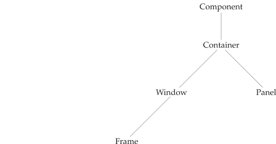

图 26-1 Panel 和 Frame 的类层次结构

它定义了一百多个公共方法，负责管理事件（如鼠标和键盘输入）、窗口的位置和大小，以及重绘。`Component` 对象负责记住当前的前景颜色、背景颜色以及当前选定的文本字体。

## 容器 (Container)

`Container` 是 `Component` 的子类。它拥有额外的方法，允许其他 `Component` 对象嵌套在其中。其他 `Container` 对象可以存储在 `Container` 内部（因为它们本身就是 `Component` 的实例）。这形成了一个多级包含系统。`Container` 负责布局（即定位）它包含的任何对象。它通过使用各种布局管理器来实现这一点，你将在第 27 章中学习这些管理器。

## 面板 (Panel)

`Panel` 类是 `Container` 的具体子类。`Panel` 可以被认为是一个递归嵌套的实体屏幕组件。可以通过其 `add()` 方法将其他组件添加到 `Panel` 对象中。

## 窗口 (Window)

`Window` 类创建一个顶级窗口。顶级窗口不包含任何其他对象内部；它直接位于桌面上。通常，你不会直接创建 `Window` 对象。相反，你将使用 `Window` 的一个子类 `Frame`（见下文描述）。

## 框架 (Frame)

`Frame` 封装了通常认为的“窗口”。它是 `Window` 的子类，具有标题栏、菜单栏和可调整大小的角。`Frame` 的具体外观在不同环境中会有不同。

## 画布 (Canvas)

虽然它不是 `Panel` 或 `Frame` 层次结构的一部分，但你会发现另一个非常有用的类：`Canvas`。`Canvas` 派生自 `Component`，封装了一个可以在上面绘制的空白窗口。你将在本书的后面看到 `Canvas` 的示例。

## 使用 Frame 窗口

通常，你经常创建的基于 AWT 的应用程序窗口类型派生自 `Frame`。如提到的，它创建了一个标准的顶级窗口，具有通常与应用程序窗口关联的所有特征，如关闭框和标题。


以下是两种 `Frame` 的 `HeadlessException` 构造函数：

```java
Frame() throws HeadlessException

Frame(String title) throws HeadlessException
```

第一种形式创建一个不包含标题的标准窗口。第二种形式创建一个标题由 `title` 指定的窗口。注意，你无法指定窗口的维度。相反，你必须在窗口创建后设置窗口的大小。如果在不支持用户交互的环境中尝试创建 `Frame` 实例，将抛出 `HeadlessException`。

操作 `Frame` 窗口时，你会用到几个关键方法。它们在这里：

### 设置窗口尺寸

`setSize()` 方法用于设置窗口的尺寸。显示如下：

```java
void setSize(int newWidth, int newHeight)

void setSize(Dimension newSize)
```

窗口的新尺寸由 `newWidth` 和 `newHeight` 指定，或者通过传递给 `newSize` 的 `Dimension` 对象的 `width` 和 `height` 字段指定。尺寸以像素为单位。

`getSize()` 方法用于获取窗口的当前尺寸。其形式之一如下：

```java
Dimension getSize()
```

该方法返回窗口当前尺寸，封装在 `Dimension` 对象的 `width` 和 `height` 字段中。

### 隐藏和显示窗口

帧创建后，在调用 `setVisible()` 之前，它是不可见的。其签名显示如下：

```java
void setVisible(boolean visibleFlag)
```

如果此方法的参数为 `true`，则组件可见。否则，它被隐藏。

### 设置窗口标题

你可以使用 `setTitle()` 修改帧窗口中的标题，其通用形式为：

```java
void setTitle(String newTitle)
```


在这里，`newTitle` 是新标题。

## 关闭 Frame 窗口

当顶级窗口关闭时，你可以简单地调用 `System.exit()` 终止程序。要拦截窗口关闭事件，必须实现 `WindowListener` 的 `windowClosing()` 方法。（有关 `WindowListener` 接口的详情请参见第 25 章。）

## paint() 方法

输出到窗口通常发生在基于 AWT 的应用程序必须重绘时。这种情况可能由于多种原因引起。例如，窗口可能被另一个窗口覆盖后重新显示。如果窗口被最小化并恢复，`paint()` 也会在首次显示时被调用。无论原因如何，每当窗口必须重绘其输出时，就会调用 `paint()`。这意味着你的程序必须有某种方式来保留其输出，以便在每次执行时都能重新显示。该方法显示如下：

```
void paint(Graphics context)
```

`paint()` 方法有一个 `Graphics` 参数。该参数将包含程序运行的图形环境。每当需要向窗口输出内容时，都会使用该参数。

## 显示字符串

要向 Frame 输出字符串，请使用 `drawString()`，它是 `Graphics` 类的一个成员。它在第 25 章引入，我们将在下一章中大量使用它。这是我们使用的形式：

```
void drawString(String message, int x, int y)
```

在这里，`message` 是在 `x,y` 输出的字符串。在 Java 窗口中，左上角是位置 0,0。`drawString()` 方法不会识别换行符。如果你想在另一行开始一行文本，必须手动指定，指定让该行开始的精确 Y 位置。（正如你将在下一章看到的，有一些技术可以让这个过程变得简单）

## 设置前景和背景颜色

你可以通过 Frame 设置前景和背景颜色。要设置背景颜色，使用 `setBackground()`。要设置前景颜色（文本显示的颜色），使用 `setForeground()`。这些方法由 `Component` 定义，并具有以下通用形式：

```
void setBackground(Color newColor)
void setForeground(Color newColor)
```

在这里，`newColor` 指定新颜色。`Color` 类定义了此处所示常量，可用于指定颜色。（这些常量也提供了大写版本）。

| Color.black | Color.magenta |
| Color.blue | Color.orange |
| Color.cyan | Color.pink |
| Color.darkGray | Color.red |
| Color.gray | Color.white |
| Color.green | Color.yellow |
| Color.lightGray | |

例如，以下代码将背景颜色设置为绿色，将前景颜色设置为红色：

```
setBackground(Color.green);
setForeground(Color.red);
```

你也可以创建自定义颜色。设置前景和背景颜色的良好位置是在 frame 的构造函数中。程序执行期间，你可以根据需要更改这些颜色。

你可以通过调用 `getBackground()` 和 `getForeground()` 获取当前的背景和前景设置。它们也由 `Component` 定义，如下所示：

```
Color getBackground();
Color getForeground();
```

## 请求重绘

通常情况下，应用程序只有在 AWT 调用 `paint()` 方法时才会写入其窗口。这提出了一个有趣的问题：程序如何导致窗口更新以显示新输出？例如，如果程序显示一个移动的横幅，它使用什么机制来更新窗口？记住，对 GUI 程序的一个基本架构限制是它必须快速返回 AWT。例如，你不能在 `paint()` 内部创建一个反复滚动横幅的循环。这将防止控制传回 AWT。考虑到这一限制，输出到窗口最多可能是困难的。幸运的是，情况并非如此。每当程序需要更新窗口中显示的信息时，只需调用 `repaint()`。

`repaint()` 方法由 `Component` 定义。对于 `Frame`，该方法会导致 AWT 执行 `update()` 方法（也由 `Component` 定义）。然而，`update()` 的默认实现调用 `paint()`。因此，要输出到窗口，只需存储并调用 `repaint()`。例如，如果程序的一部分需要输出一个字符串，可以将该字符串存储在变量变量中然后调用 `repaint()`。在 `paint()` 中，你将使用 `drawString()` 输出字符串。

`repaint()` 方法有四种形式。让我们依次查看每一个。这里显示了简单的 `repaint()` 版本：

```
void repaint()
```

此版本导致整个窗口重绘。以下版本指定了一个区域：

```
void repaint(int left, int top, int width, int height)
```

在这里，区域的左上角坐标由 `left` 和 `top` 指定，区域的 `width` 和 `height` 以像素传递。通过指定区域可以节省时间。窗口更新在时间是有成本的。如果你只需要更新窗口的一小部分，只重绘该区域更高效。

调用 `repaint()` 本质上是请求某时重绘窗口。如果你的系统缓慢或繁忙，`update()` 可能不会被立即调用。短时间内发生的多次重绘请求会被 AWT 合并，导致 `update()` 只被偶尔调用。这在许多情况下都是一个问题，包括需要一致更新时间的动画。一种解决方案是使用以下形式的 `repaint()`：

```
void repaint(long maxDelay, int x, int y, int width, int height)
```

在这里，`maxDelay` 指定在 update 之前经过的最大毫秒数。

> 注意：可以使用 `paint()` 或 `update()` 方法的方法输出到窗口。要这样做，你必须通过调用 `getGraphics()`（由 `Component` 定义）获取图形上下文，然后使用该上下文输出窗口。然而，对于大多数应用程序，通过 `paint()` 路由窗口输出并在窗口内容变化时调用 `repaint()` 更好且更容易。

## 创建基于 Frame 的应用程序

虽然通过创建 `Frame` 的实例创建一个窗口很简单，但你很少这样做，因为你无法对其做很多事情。例如，你将无法接收或处理发生在其中的事件，也无法向其输出信息。因此，创建一个基于 Frame 的应用程序，通常会创建一个 `Frame` 的子类。由于其他原因，你会重写 `paint()` 并提供事件处理。


正如 25 章中的示例所示，创建一个新的基于 Frame 的应用程序实际上简单。通常，你创建一个 `Frame` 的子类，重写 `paint()` 为窗口提供你的输出，并实现事件监听器。在所有情况下，你都需要实现 `WindowListener` 接口的 `windowClosing()` 方法。在顶层帧中，你通常会调用 `System.exit(0)` 来终止程序。要简单地从屏幕上移除二级帧，可以在窗口关闭时调用 `setVisible(false)`。

一旦定义了 `Frame` 子类，你可以创建该类的实例。这会导致窗口出现，但它初始不是可见的。通过调用 `setVisible(true)` 使其可见。窗口给了一个默认的高度和宽度。你可以通过 `setSize()` 方法显式设置窗口的大小。

## 介绍图形

（注：此处后续文本为重复内容，已按要求不进行重复输出处理）

## 绘图方法

以下程序演示了上述的绘图方法。

```java
// 绘制图形元素。

import java.awt.event.*;
import java.awt.*;

public class GraphicsDemo extends Frame {

    public GraphicsDemo() {
        // 匿名内部类处理窗口事件
        addWindowListener(new WindowAdapter() {
            public void windowClosing(WindowEvent we) {
                System.exit(0);
            }
        });
    }

    public void paint(Graphics g) {
        // 绘制线条。
        g.drawLine(20, 40, 100, 90);
        g.drawLine(20, 90, 100, 40);
        g.drawLine(40, 45, 250, 80);

        // 绘制矩形。
        g.drawRect(20, 150, 60, 50);
        g.fillRect(110, 150, 60, 50);
        g.drawRoundRect(200, 150, 60, 50, 15);
        g.fillRoundRect(290, 150, 60, 50, 40);

        // 绘制椭圆和圆。
        g.drawOval(20, 250, 50, 50);
        g.fillOval(100, 250, 75, 50);
        g.drawOval(200, 260, 100, 40);

        // 绘制弧。
        g.drawArc(20, 350, 70, 70, 0, 180);
        g.fillArc(70, 350, 70, 70, 0, 180);

        // 绘制多边形。
        int[] xpoints = {20, 20, 200, 200};
        int[] ypoints = {450, 450, 650, 650};
        g.drawPolygon(xpoints, ypoints, 4);
    }

    public static void main(String[] args) {
        GraphicsDemo appwin = new GraphicsDemo();
        appwin.setSize(300, 400);
        appwin.setTitle("GraphicsDemo");
        appwin.setVisible(true);
    }
}
```

图 26-1 GraphicsDemo 程序的输出


## 调整大小

通常情况下，你希望绘制的大小适应当前窗口的大小。为了做到，首先通过 `getSize()` 获取框架的尺寸。它返回一个包含四个整数值（`left`、`right`、`top`、`bottom`）的 `Insets` 对象。然而，绘图区域需要减去 `getSize()` 返回的边框/标题栏尺寸。因此，绘图区域的左上角坐标是 `left`、`top`，右下角坐标是 `right`、`bottom`。一旦你有了尺寸和内边距，就可以相应调整图形输出。为了演示这种技术，有一个程序其初始尺寸为 200×200。每次点击鼠标，宽度和高度增加 25，直到尺寸大于 500×500。在该点，下次点击将将其返回 200×200，循环开始。在绘图区域内，绘制填充区域。

```java
// 调整输出以适应当前大小

import java.awt.*;
import java.awt.event.*;

public class ResizeMe extends Frame {

    final int inc = 25;
    int max = 500;
    int min = 200;
    Dimension d;

    public ResizeMe() {
        // 匿名内部类处理释放事件。
        addMouseListener(new MouseAdapter() {
            public void mouseReleased(MouseEvent me) {
                int w = (d.width + inc) > max ? max : d.width + inc;
                int h = (d.height + inc) > max ? max : d.height + inc;
                setSize(new Dimension(w, h));
            }
        });

        // 匿名内部类处理窗口关闭。
        addWindowListener(new WindowAdapter() {
            public void windowClosing(WindowEvent we) {
                System.exit(0);
            }
        });
    }

    public void paint(Graphics g) {
        Insets i = getInsets();
        d = getSize();
        g.drawLine(i.left, i.top, d.width - i.right, d.height - i.bottom);
        g.drawLine(i.left, d.height - i.bottom, d.width - i.right, i.top);
    }

    public static void main(String[] args) {
        ResizeMe appwin = new ResizeMe();
        appwin.setSize(new Dimension(200, 200));
        appwin.setTitle("ResizeMe");
        appwin.setVisible(true);
    }
}
```

## 处理颜色

Java 以一种可移植的、设备无关的方式支持颜色。AWT 颜色系统允许你指定任何颜色。它会根据执行程序的显示硬件限制，为该颜色寻找最佳匹配。因此，你的代码不需要担心各种硬件设备支持颜色的方式差异。颜色由 `Color` 类封装。

如你所见，`Color` 定义了一些常量（例如 `Color.black`）来指定常用颜色。你也可以使用 `Color` 构造函数创建自己的颜色。这里显示了三种常用的形式：

- `Color(int red, int green, int blue)`
- `Color(int rgbValue)`
- `Color(float red, float green, float blue)`

第一个构造函数接收三个整数，指定颜色为红、绿、蓝的混合。这些值必须在 0 到 255 之间，例所示：

```java
new Color(255, 100, 100); // 浅红色
```

第二个构造函数接收一个包含 RGB 值的单个整数。
第三个构造函数 `Color(float, float, float)` 接收三个位于 0.0 和 1.0 之间的浮点值。示例所示：

```java
new Color(1.0f, 0.4f, 0.4f); // 浅红色
```

一旦创建了颜色，就可以使用它来设置前景和背景。

### 颜色方法

### 使用色相、饱和度和亮度

色相-饱和度-亮度（HSB）模型是红-绿-蓝（RGB）模型的替代方案。饱和度是另一个从 0.0 到 1.0 的范围，代表从浅色到强色调。亮度值范围也从 0.0 到 1.0，其中 1 是亮白色，0 是黑色。`Color` 提供了两个方法让你在 RGB 和 HSB 之间转换。它们所示：

```
static int HSBToRGB(float hue, float saturation, float brightness)
static float[] RGBToHSB(int red, int green, int blue, float[] values)
```

`HSBToRGB` 返回一个与 `Color` 构造函数兼容的封装 RGB 值。
`RGBToHSB` 返回与 RGB 整数对应的浮点值数组。如果 `values` 不为空，则给该数组赋值并返回。否则，创建一个新数组并返回 HSB 值。在任何情况下，数组索引 0 包含色相，索引 1 为饱和度，索引 2 为亮度。

## 演示程序

以下程序构造了几种颜色并使用这些颜色绘制各种对象：

### 设置当前图形颜色

默认情况下，图形对象使用前景颜色绘制。你可以通过调用 Graphics 方法 `setColor(Color color)` 来更改：

```
void setColor(Color newColor)
```

在这里，`newColor` 指定新的绘制颜色。
你可以通过调用 `getColor()` 获取当前颜色，所示：

```
Color getColor()
```


# getRed()、getGreen()、getBlue()

你可以使用 `getRed()`、`getGreen()` 和 `getBlue()` 独立获取颜色的红、绿、蓝分量，如下所示：

```java
int getRed()
int getGreen()
int getBlue()
```

这些方法每个返回调用 `Color` 对象中整数低 8 位的 RGB 颜色分量。

# 第 26 章 介绍 AWT：处理窗口、图形与文本

```java
public class ColorDemo extends Frame {

    public ColorDemo() {
        addWindowListener(new WindowAdapter() {
            public void windowClosing(WindowEvent event) {
                System.exit(0);
            }
        });
    }

    // 使用不同的颜色绘图。
    public void paint(Graphics g) {
        Color c1 = new Color(255, 100, 100);
        Color c2 = new Color(100, 255, 100);
        Color c3 = new Color(100, 100, 255);

        g.setColor(c1);
        g.drawLine(20, 40, 100, 100);
        g.drawLine(20, 100, 100, 200);

        g.setColor(c2);
        g.drawOval(40, 45, 250, 180);
        g.drawLine(75, 90, 400, 400);

        g.setColor(c3);
        g.drawOval(20, 150, 40, 40);
        g.drawLine(25, 280, 40, 191);

        g.setColor(Color.red);
        g.drawOval(20, 40, 50, 50);
        g.fillOval(70, 90, 140, 100);

        g.setColor(Color.blue);
        g.drawOval(190, 40, 90, 60);
        g.drawRect(40, 40, 55, 50);

        g.setColor(Color.cyan);
        g.fillRect(100, 40, 60, 70);
        g.drawRoundedRect(190, 40, 60, 60, 15);
    }

    public static void main(String[] args) {
        ColorDemo appwin = new ColorDemo();
        appwin.setSize(new Dimension(340, 260));
        appwin.setTitle("ColorDemo");
        appwin.setVisible(true);
    }
}
```

# 设置绘图模式

绘图模式决定了对象如何在窗口中被绘制。默认情况下，向窗口的新输出会覆盖任何已存在的内容。然而，可以使用 `setXORMode()` 将新对象以异或（XOR）的方式绘制到窗口上，如下：

```java
void setXORMode(Color xorColor)
```

在这里，`xorColor` 指定了在绘制对象时与窗口进行异或运算的颜色。异或模式的优势是，无论绘制在什么对象上，新对象都能保证可见。

要覆盖该模式，请调用 `setPaintMode()`，如下所示：

```java
void setPaintMode()
```

通常情况下，你希望对普通输出使用覆盖模式，对特殊目的使用异或模式。例如，程序显示了跟踪鼠标指针的十字准星。准星以异或方式绘制在窗口上，无论底层颜色是什么，它们始终是可见的。

```java
// 演示异或模式。
import java.awt.*;
import java.awt.event.*;

public class XOR extends Frame {

    int chX = 100, chY = 100;

    public XOR() {
        addMouseListener(new MouseAdapter() {
            public void mouseMoved(MouseEvent me) {
                int x = me.getX();
                int y = me.getY();
                chX = x - 10;
                chY = y - 10;
                repaint();
            }
        });

        addWindowListener(new WindowAdapter() {
            public void windowClosing(WindowEvent we) {
                System.exit(0);
            }
        });
    }

    // 演示异或模式。
    public void paint(Graphics g) {
        g.setColor(Color.green);
        g.fillRect(20, 40, 60, 70);

        g.setColor(Color.blue);
        g.fillRect(110, 40, 60, 70);

        g.setColor(Color.black);
        g.fillRect(200, 40, 60, 70);

        g.setColor(Color.red);
        g.fillRect(60, 120, 160, 110);

        // XORMode(Color.black)
        g.setXORMode(Color.black);
        g.drawLine(chX - 10, chY, chX + 10, chY);
        g.drawLine(chX, chY - 10, chX, chY + 10);
        g.setPaintMode();
    }

    public static void main(String[] args) {
        XOR appwin = new XOR();
        appwin.setSize(new Dimension(300, 260));
        appwin.setTitle("ColorDemo");
        appwin.setVisible(true);
    }
}
```

`XORMode(Color.black)` 的输出所示：


# 处理字体

AWT 为字体操作提供了灵活性。字体被封装在 `Font` 类中。

| 方法 | 描述 |
| :--- | :--- |
| `equals(Object obj)` | 如果对象相同则返回 true。 |
| `getFamily()` | 返回族名。 |
| `getSize()` | 返回字号大小。 |
| `hashCode()` | 返回哈希值。 |
| `isBold()` | 如果字体加粗则返回 true。 |
| `isItalic()` | 如果字体斜体则返回 true。 |
| `isPlain()` | 如果字体为普通则返回 true。 |
| `toString()` | 返回字体的字符串表示。 |

## 可用字体

在处理字体时，通常需要知道哪些字体是可用的。为了获取这些信息，可以使用 `GraphicsEnvironment` 定义的 `getAvailableFamilyNames()` 方法如下：

```java
String[] getAvailableFamilyNames()
```

该方法返回一个包含可用字体名称的数组。此外，`GraphicsEnvironment` 定义了 `getAllFonts()` 方法，如下：

```java
Font[] getAllFonts()
```

由于这些是 `GraphicsEnvironment` 的成员，你需要一个 `GraphicsEnvironment` 引用来调用它们。你可以通过使用 `GraphicsEnvironment` 定义的静态方法 `getLocalGraphicsEnvironment()` 来获取此引用，它返回：

```java
static GraphicsEnvironment getLocalGraphicsEnvironment()
```

这里是一个显示如何获取可用字体族的程序：

```java
// 显示字体。
import java.awt.event.*;
import java.awt.*;

public class ShowFonts extends Frame {

    String msg = "前五个字体: ";
    GraphicsEnvironment ge;

    public ShowFonts() {
        addWindowListener(new WindowAdapter() {
            public void windowClosing(WindowEvent event) {
                System.exit(0);
            }
        });

        // 获取本地图形环境。
        ge = GraphicsEnvironment.getLocalGraphicsEnvironment();

        // 获取字体列表。
        String[] fontList = ge.getAvailableFamilyNames();

        // 创建前5个字体的字符串。
        for (int i = 0; i < 5 && i < fontList.length; i++)
            msg += fontList[i] + " ";
    }

    // 显示字体。
    public void paint(Graphics g) {
        g.drawString(msg, 10, 60);
    }

    public static void main(String[] args) {
        ShowFonts appwin = new ShowFonts();
        appwin.setSize(new Dimension(500, 100));
        appwin.setTitle("ShowFonts");
        appwin.setVisible(true);
    }
}
```

该程序的示例输出所示。然而，当你运行此程序时，你看到的字体集合可能与插图中显示的不同。


## 创建和选择字体

要创建一个新字体，需要构造一个描述它的 `Font` 对象。其中一个 `Font` 构造函数的通用形式如下：

```java
Font(String fontName, int fontStyle, int pointSize)
```

在这里，`fontName` 指定了所需的字体名称。名称可以通过族名或字面名来指定。所有的 Java 环境都支持以下字体：`Dialog`、`DialogInput`、`SansSerif`、`Serif` 和 `Monospaced`。`Dialog` 用于你的系统对话框。如果你没有显式设置字体，`Dialog` 就是默认字体。你也可以使用特定环境的其他字体，但要小心——这些字体可能并非通用。

字体的样式由 `fontStyle` 指定。它可能由这三个常量中的一个或多个组成：`Font.PLAIN`、`Font.BOLD` 和 `Font.ITALIC`。要组合样式，请使用或运算符。例如，`Font.BOLD | Font.ITALIC` 指定粗体斜体样式。

字体的大小（以磅为单位）由 `pointSize` 指定。

要使用你创建的字体，必须使用 `setFont()` 进行选择，该方法由 `Component` 定义。其通用形式如下：

```java
void setFont(Font fontObj)
```

在这里，`fontObj` 是包含所需字体的对象。

以下程序输出标准字体的示例。每当你点击窗口鼠标时，就会选择一个新的字体并显示其名称。

```java
// 显示字体。
import java.awt.*;
import java.awt.event.*;

public class SampleFonts extends Frame {

    int next = 0;
    Font f;
    String msg;

    public SampleFonts() {
        f = new Font("Dialog", Font.PLAIN, 12);
        msg = "Dialog";
        setFont(f);

        addMouseListener(new MouseAdapter(this));
        addWindowListener(new WindowAdapter() {
            public void windowClosing(WindowEvent we) {
                System.exit(0);
            }
        });
    }

    public void paint(Graphics g) {
        g.drawString(msg, 10, 60);
    }

    public static void main(String[] args) {
        SampleFonts appwin = new SampleFonts();
        appwin.setSize(new Dimension(200, 100));
        appwin.setTitle("SampleFonts");
        appwin.setVisible(true);
    }
}

class MouseAdapter extends MouseAdapter {

    SampleFonts sampleFonts;

    public MouseAdapter(SampleFonts sampleFonts) {
        this.sampleFonts = sampleFonts;
    }

    public void mousePressed(MouseEvent me) {
        // 每次点击切换字体。
        sampleFonts.next++;

        switch (sampleFonts.next) {
            case 0:
                sampleFonts.f = new Font("Dialog", Font.PLAIN, 12);
                sampleFonts.msg = "Dialog";
                break;
            case 1:
                sampleFonts.f = new Font("DialogInput", Font.PLAIN, 12);
                sampleFonts.msg = "DialogInput";
                break;
            case 2:
                sampleFonts.f = new Font("SansSerif", Font.PLAIN, 12);
                sampleFonts.msg = "SansSerif";
                break;
            case 3:
                sampleFonts.f = new Font("Serif", Font.PLAIN, 12);
                sampleFonts.msg = "Serif";
                break;
            case 4:
                sampleFonts.f = new Font("Monospaced", Font.PLAIN, 12);
                sampleFonts.msg = "Monospaced";
                break;
        }

        if (sampleFonts.next == 4) sampleFonts.next = -1;

        sampleFonts.setFont(sampleFonts.f);
        sampleFonts.repaint();
    }
}
```


该程序的示例输出在此：

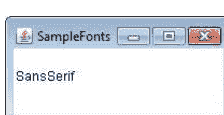

## 获取字体信息

假设你想获取有关当前选择字体的信息。要做到这一点，你必须首先调用 `getFont()` 获取当前字体。该方法由 `Graphics` 类定义，如下：

```java
Font getFont()
```

一旦获取了当前选择的字体，就可以使用 `Font` 定义各种方法检索相关信息。在本示例中，此程序将显示当前选择字体的名称、族、大小和样式：

```java
// 显示字体信息。

import java.awt.event.*;
import java.awt.*;

public class FontInfo extends Frame {

    public FontInfo() {
        addWindowListener(new WindowAdapter() {
            public void windowClosing(WindowEvent we) {
                System.exit(0);
            }
        });
    }

    public void paint(Graphics g) {
        Font f = g.getFont();
        String fontName = f.getName();
        String fontFamily = f.getFamily();
        int fontSize = f.getSize();
        int fontStyle = f.getStyle();
        String msg = "Family: " + fontName;
        msg += " Font: " + fontFamily;
        msg += " Size: " + fontSize + " Style: ";
        if ((fontStyle & Font.BOLD) == Font.BOLD)
            msg += " Bold ";
        if ((fontStyle & Font.ITALIC) == Font.ITALIC)
            msg += " Italic ";
        if ((fontStyle & Font.PLAIN) == Font.PLAIN)
            msg += " Plain ";
        g.drawString(msg, 10, 60);
    }

    public static void main(String[] args) {
        FontInfo appwin = new FontInfo();
        appwin.setSize(new Dimension(300, 100));
        appwin.setTitle("FontInfo");
        appwin.setVisible(true);
    }
}
```

## 使用 FontMetrics 管理文本输出

正如刚才解释的，Java 支持多种字体。对于大多数字体，字符并不是完全相同的——大多数是等比例的。此外，每个字符的高度、降迹（descenders，字母的悬挂部分，如 y）的长度以及水平线之间的距离也随字体而异。此外，字号大小可以更改。这些（以及其他）属性并不至于让 Java 要求你管理几乎所有的文本输出。考虑到每个字体的大小可能不同，且字体在程序执行过程中可能会更改，必须有某种方法来确定当前选择字体的尺寸和各种属性。例如，一个一个写入文本意味着你有某种方法知道字体有多高以及行间需要多少像素。为了补充这一点，AWT 包含了 `FontMetrics` 类，它封装了关于字体的各种信息。让我们从定义描述字体时的常用术语开始：

| 方法 | 说明 |
|---|---|
| Height | 一行文本从顶到尾的大小 |
| Baseline | 字符对齐的线（不包括降迹） |
| Ascent | 从基线到顶部的距离 |
| Descent | 从基线到底部的距离 |
| Leading | 行之间的间距 |

`FontMetrics` 定义了若干方法来帮助管理文本输出。常用的方法列如表 26-3 所示。

| 方法 | 说明 |
|---|---|
| `bytesWidth(byte[] b, int start, int numBytes)` | 返回从数组 `b` 开始的 `numBytes` 个字节的宽度 |
| `charsWidth(char[] c, int start, int numChars)` | 返回从字符 `c` 开始的 `numChars` 个字符的宽度 |
| `charWidth(char c)` | 返回 `c` 的宽度 |
| `charWidth(int c)` | 返回 `c` 的宽度 |
| `getAscent()` | 返回升部高度 |
| `getDescent()` | 返回降迹高度 |
| `getFont()` | 返回字体 |
| `getHeight()` | 返回一行文本的高度。此值可以用于在窗口中输出多行文本 |
| `getLeading()` | 返回行之间的间距 |
| `getMaxAdvance()` | 返回最宽字符的估计宽度。如果该值不可用，则返回 -1 |
| `getMaxAscent()` | 返回最大升部高度 |
| `getMaxDescent()` | 返回最大降迹高度 |
| `getWidths()` | 返回前 256 个字符的宽度 |
| `stringWidth(String str)` | 返回由 `str` 指定的字符串宽度 |
| `toString()` | 返回调用对象的字符串表示形式 |

表 26-3 FontMetrics 定义的方法采样

# 第 26 章 介绍 AWT：与窗口、图形和文本交互 877

在很多情况下，你不需要使用这些单独的数值。通常，你只需要知道行的总高度，它是行间距（leading space）、字体上升（ascent）和下降（descent）值之和。获取此值最简单的方法是使用 `getHeight()`。在很多情况下，当你想输出文本并移动到下一行时，只需将 Y 坐标增加该值即可。

每一行的开头，你必须知道要显示的每个字符串的像素长度。要获取此值，请调用 `stringWidth()`。你可以使用此值在每次绘制时增加 X 坐标。

以下程序展示了如何在窗口中处理多行文本。它在同一行上显示多个句子。注意变量 `curX` 和 `curY`，它们用于跟踪当前文本输出的位置。

```java
// 演示多行输出。

import java.awt.event.*;
import java.awt.*;

class MultiLine extends Frame {

    int curX = 20, curY = 40; // 当前位置

    public MultiLine() {
        Font f = new Font("SansSerif", Font.PLAIN, 12);
        setFont(f);
        addWindowListener(new WindowAdapter() {
            public void windowClosing(WindowEvent event) {
                System.exit(0);
            }
        });
    }

    public void paint(Graphics g) {
        FontMetrics fm = g.getFontMetrics();
        nextLine("This is on one line.", g);
        nextLine("This is on line two.", g);
        sameLine("This is on same line.", g);
        sameLine("This, too.", g);
        nextLine("This is on line three.", g);
        curX = 20;
        curY = 40; // 每次重复重置坐标
    }

    // 移动到下一行。
    void nextLine(String s, Graphics g) {
        FontMetrics fm = g.getFontMetrics();
        curY += fm.getHeight(); // 移动到下一行
        curX = 20;
        g.drawString(s, curX, curY);
        curX += fm.stringWidth(s); // 移动到行尾
    }

    // 在同一行显示。
    void sameLine(String s, Graphics g) {
        FontMetrics fm = g.getFontMetrics();
        g.drawString(s, curX, curY);
        curX += fm.stringWidth(s); // 移动到行尾
    }

    public static void main(String[] args) {
        MultiLine appwin = new MultiLine();
        appwin.setSize(new Dimension(300, 120));
        appwin.setTitle("MultiLine");
        appwin.setVisible(true);
    }
}
```

该程序的示例输出所示：


# 第 27 章 使用 AWT 控件、布局管理器和菜单

## 使用 AWT 控件、布局管理器和菜单

本章继续对抽象窗口工具包（AWT）进行概述。首先查看了 AWT 的若干控件和布局管理器。然后讨论了菜单和菜单栏。本章还包含了对对话框的讨论。

控件是允许用户以各种方式与应用程序交互的组件——例如，一种常用的控件是推按钮。布局管理器会自动在容器内对组件进行定位。因此，窗口的外观是由其包含的控件和用于定位它们的布局管理器共同决定的。

除了控件之外，帧窗口（frame）还可以包含标准式的菜单栏。菜单栏中的每个条目都会激活一个下拉选项菜单，用户可以从中进行选择。这构成了应用程序的主菜单。根据一般规则，菜单栏位于窗口的顶部。菜单栏的外观虽然不同，但处理方式与其他控件相同。

虽然可以在窗口内手动对组件进行定位，但这样做是非常繁琐的。布局管理器负责管理这项任务。在本章的第一部分（即介绍各种控件）中，将使用一个简单的布局管理器，它通过按行、从上到下的组织方式在容器中显示组件。一旦涵盖了控件，将检查其他一些布局管理器。然后，你将看到如何更好地管理控件的定位。

在继续之前，重要的一点是，今天你将基于 AWT 创建 GUI，因为 Java 已经开发了更强大的 GUI 框架。然而，这里介绍的内容仍然非常重要，原因如下：首先，与控件和事件处理相关的许多信息和技术可以通用于 Swing。（如在前章提到的，Swing 是构建在 AWT 之上的。）其次，这里描述的布局管理器也被 Swing 使用。第三，对于某些小型应用程序，这些方法是合适的。最后，你可能会遇到使用 AWT 的代码。

## AWT 基础

AWT 支持以下内容：
- 标签
- 推按钮
- 复选框
- 列表
- 滚动条

除了被动的标签外，所有控件在被用户访问时都会产生事件。

## 添加和移除控件

要将控件包含在窗口中，必须添加。使用以下方法：

```java
add(Component c)
```

对于 `add()`，`c` 是你想添加的控件。要从窗口中移除控件，调用 `remove()`。其形式如下：

```java
remove(Component c)
```

在这里，`c` 是你想移除的控件。

## 响应控件

正如第 25 章所示，一旦安装了监听器，事件就会发送给它。后续章节将指定每个控件的接口。

## HeadlessException

本章描述的大多数 AWT 控件的构造函数在非交互环境（如没有显示器或键盘的环境）实例化 GUI 时可能会抛出 `HeadlessException`。你可以捕获此异常编写适应非交互环境的代码。（当然，这并不总是可能的。）本章程序没有处理此异常，因为需要交互环境。

## 标签

最易使用的控件是标签。标签是 `Label` 类型的对象，它包含一个显示的字符串。标签是不支持用户交互的被动控件。`Label` 定义了以下构造函数：

- `Label()` throws HeadlessException
- `Label(String str)` throws HeadlessException
- `Label(String str, int how)` throws HeadlessException

第一个版本创建一个空白标签。第二个版本创建一个包含字符串 `str` 的标签，该字符串左对齐。第三个版本创建一个包含字符串 `str` 并使用 `how` 指定对齐方式的标签。`how` 的值必须是常量之一：`Label.LEFT`、`Label.RIGHT` 或 `Label.CENTER`。

你可以通过 `setText()` 方法设置或更改标签中的文本。可以通过调用 `getText()` 获取当前标签。这些方法如下：

```java
void setText(String str)
String getText()
```

对于 `setText()`，`str` 指定新标签。对于 `getText()`，返回当前标签。

你可以通过 `setAlignment()` 设置标签内字符串的对齐方式。通过调用 `getAlignment()` 获取当前对齐方式。方法如下：

```java
void setAlignment(int how)
int getAlignment()
```

在这里，`how` 必须是之前所示常量之一。以下示例创建了三个标签并将它们添加到 Frame 中。

```java
// 演示标签.

import java.awt.*;
import java.awt.event.*;

public class LabelDemo extends Frame {

    public LabelDemo() {
        // Use a flow layout.
        setLayout(new FlowLayout());

        Label one = new Label("One");
        Label two = new Label("Two");
        Label three = new Label("Three");

        // Add labels to frame.
        add(one);
        add(two);
        add(three);

        addWindowListener(new WindowAdapter() {
            public void windowClosing(WindowEvent we) {
                System.exit(0);
            }
        });
    }

    public static void main(String[] args) {
        LabelDemo appwin = new LabelDemo();
        appwin.setSize(new Dimension(300, 100));
        appwin.setTitle("LabelDemo");
        appwin.setVisible(true);
    }
}
```

这里是 `LabelDemo` 程序的示例输出。


注意，标签在窗口中从左到右排列。这是由 `FlowLayout` 布局管理器自动处理的，它是 AWT 提供的布局管理器之一。在这种默认配置中，组件按行排列，从左到右、从上到下并居中显示。正如你稍后看到的，它支持多个选项，但目前它的默认行为已经足够了。注意，通过与容器关联的 `setLayout()` 方法选择了 `FlowLayout` 作为布局管理器，在本例中容器是封装框架。虽然 `FlowLayout` 非常方便且能够满足我们目前的需求，但它没有让你对窗口内组件的放置进行详细控制。在稍后详细讨论布局管理器时，你将看到如何获得对窗口结构的更多控制权。

## 使用按钮

也许最广泛使用的控件是推按钮。推按钮是一个包含标签并在按下时产生事件的组件。推按钮是 `Button` 类型的对象。`Button` 定义了这两个构造函数：

- `Button()` throws HeadlessException
- `Button(String str)` throws HeadlessException

第一个版本创建一个空按钮。第二个版本创建一个包含 `str` 作为标签的按钮。

在创建按钮后，你可以通过 `setLabel()` 设置其标签。你可以通过 `getLabel()` 获取其标签。这些方法如下：

```java
void setLabel(String str)
String getLabel()
```


在这里，`str` 为按钮创建新标签。

## 处理按钮

每当按下按钮时，就会产生一个动作事件（action event）。该事件会被发送给之前注册了接收组件动作通知的监听器。每个监听器都实现了 `ActionListener` 接口。它定义了 `actionPerformed()` 方法，该方法在事件发生时被调用。该方法提供一个 `ActionEvent` 对象作为参数。它包含了指向产生事件的按钮的引用，以及指向命令字符串（即按钮的标签）的引用。按钮引用或动作命令字符串都可以作为按钮的标签。（你很快就会看到每种方法的示例。）

这里有一个示例创建了三个标记为“Yes”、“No” 和“Undecided”的按钮。每当按下其中一个时，就会显示一条消息，报告哪个按钮被按下。在这个版本中，按钮的动作命令（默认是其标签）被用于判断哪个按钮被按下。标签是通过调用传递给 `actionPerformed()` 的 `ActionEvent` 对象的 `getActionCommand()` 方法获取的。

```java
// Demonstrate Buttons.

import java.awt.*;

import java.awt.event.*;

public class ButtonDemo extends Frame implements ActionListener {

    String msg = "";

    Button yes, no;

    public ButtonDemo() {

        // Use a flow layout.

        setLayout(new FlowLayout());
    }
}
```


## 884 第二部分 Java 库

```java
// Create some buttons.

yes = new Button("Yes");

no = new Button("No");

maybe = new Button("Undecided");
```

```java
// Add them to the frame.

add(yes);

add(no);

add(maybe);
```

```java
// Add action listeners for the buttons.

yes.addActionListener(this);

no.addActionListener(this);

maybe.addActionListener(this);
```

```java
// Handle button action events.

public void actionPerformed(ActionEvent ae) {

    String str = ae.getActionCommand();

    if (str.equals("Yes")) {

        msg = "You pressed Yes.";

    } else if (str.equals("No")) {

        msg = "You pressed No.";

    } else {

        msg = "You pressed Undecided.";

    }

    repaint();
}
```

```java
public void paint(Graphics g) {

    g.drawString(msg, 20, 100);
}
```

```java
public static void main(String[] args) {

    ButtonDemo appwin = new ButtonDemo();

    appwin.setSize(new Dimension(250, 150));

    appwin.setTitle("ButtonDemo");

    appwin.setVisible(true);
}
```

## 第 27 章 使用 AWT 控件、布局管理器和菜单 885

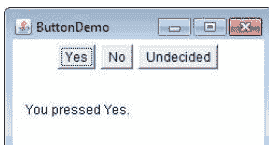

ButtonDemo 程序的示例输出如图 27-1 所示。正如所述，除了比较命令字符串外，你还可以通过其对象引用来确定哪个按钮被按下。还可以通过调用 `setActionCommand()` 将动作命令字符串设置为标签以外的内容。此方法会更改动作命令字符串，但不会影响用于标签的字符串。因此，动作命令和按钮的标签可以不同。

```java
maybe.addListener((ae) -> {

  msg = "You pressed " + ae.getActionCommand();

  repaint();

});
```

这段代码之所以有效，是因为 `ActionListener` 定义了一个函数接口，即一个恰好只有一个方法的接口。因此，它可以被 lambda 表达式使用。通常情况下，当监听器定义了函数接口时，你可以使用 lambda 表达式来处理 AWT 事件。例如，`ItemListener` 也是一个函数接口。当然，使用传统方法、匿名内部类还是 lambda 表达式，取决于你应用程序的性质。

## 应用复选框 (Check Boxes)

复选框是一种用于开启或关闭状态的控件。它由一个小框组成，框内可以包含标记也可以不包含。每个复选框都关联一个标签，描述该框代表的含义。你通过点击来改变复选框的状态。复选框可以单独使用，也可以作为组的一部分。复选框是 `Checkbox` 类的对象。

`Checkbox` 支持以下构造函数：

- `Checkbox(String str) throws HeadlessException`
- `Checkbox(String str, boolean on) throws HeadlessException`
- `Checkbox(String str, boolean on, CheckboxGroup bGroup) throws HeadlessException`
- `Checkbox(String str, CheckboxGroup bGroup, boolean on) throws HeadlessException`

第一种形式创建一个标签初始为空的复选框。该复选框的状态为未选中。第二种形式创建一个标签由 `str` 设置的复选框。该复选框的状态为未选中。第三种形式允许你设置复选框的初始状态。如果 `on` 为 `true`，则复选框初始为选中；否则清除。第四和第五种形式创建一个标签由 `str` 设置且组由 `bGroup` 指定的复选框。如果此复选框不属于某个组，则 `bGroup` 必须为 `null`。（复选框组将在下一节描述）。`on` 的值决定了复选框的初始状态。

要获取复选框的当前状态，调用 `getState()`。要设置状态，调用 `setState()`。你可以通过 `getLabel()` 获取与复选框关联的标签。要设置标签，调用 `setLabel()`。这些方法如下：

```java
boolean getState()

void setState(boolean on)

String getLabel()

void setLabel(String str)
```

在这里，如果 `on` 为 `true`，则框被选中。如果 `on` 为 `false`，则框被清除。传入 `str` 的字符串将成为与调用复选框关联的新标签。


## 处理复选框

每当复选框被选中或取消选择时，就会生成一个项目事件（item event）。该事件会被发送给之前注册了该组件项目事件通知的所有监听器。每个监听器都实现了 `ItemListener` 接口，该接口定义了 `stateChanged()` 方法。该方法的参数是一个 `ItemEvent` 对象。它包含了有关事件的信息（例如，是选中还是取消选中）。

以下程序创建了四个复选框。显示第一个框的初始状态。每当你改变每个复选框的状态时，状态就会更新。

```java
// 演示复选框。

import java.awt.*;

import java.awt.event.*;

public class CheckboxDemo extends Frame implements ItemListener {

    String msg = "";

    Checkbox windows, android, linux, mac;

    public CheckboxDemo() {

        // 使用流式布局。

        setLayout(new FlowLayout());

        // 创建复选框。

        windows = new Checkbox("Windows", true);

        android = new Checkbox("Android");

        linux = new Checkbox("Linux");

        mac = new Checkbox("Mac OS");

        // 将复选框添加到框架中。

        add(windows);

        add(android);

        add(linux);

        add(mac);

        // 添加项目监听器。

        windows.addItemListener(this);

        android.addItemListener(this);

        linux.addItemListener(this);

        mac.addItemListener(this);

        addWindowListener(new WindowAdapter() {

            public void windowClosing(WindowEvent we) {

                System.exit(0);

            }

        });
    }

    public void itemChanged(ItemEvent ie) {

        repaint();
    }
}
```

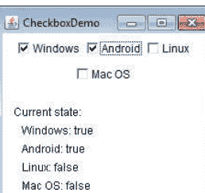

图 27-2 CheckboxDemo 程序的示例输出

```java
// 显示复选框当前状态。

public void paint(Graphics g) {

    String msg = "Current state: ";

    g.drawString(msg, 20, 120);

    msg = "Windows: " + windows.getState();

    g.drawString(msg, 20, 140);

    msg = "Android: " + android.getState();

    g.drawString(msg, 20, 160);

    msg = "Linux: " + linux.getState();

    g.drawString(msg, 20, 180);

    msg = "Mac OS: " + mac.getState();

    g.drawString(msg, 20, 200); // 注意：根据上下文调整了逻辑
}

public static void main(String[] args) {

    CheckboxDemo appwin = new CheckboxDemo();

    appwin.setSize(240, 220);

    appwin.setTitle("CheckboxDemo");

    appwin.setVisible(true);
}
```

## CheckGroup（复选框组）

可以创建一组互斥的复选框，其中任意只能被一个。这些复选框的作用类似于单选按钮——一次只能选中一个。示例输出如图 27-2 所示。

## Choice 控件（选择控件）

Choice 控件用于创建一个弹出项目列表，用户可以从中进行选择。因此，Choice 控件是菜单的一种。在非活动状态下，Choice 组件仅占据显示当前选中项目的空间。当用户点击它时，整个选择列表会弹出，从而进行新的选择。

## 892 第二部分 Java 库

要确定当前选中了哪个项目，你可以调用 `getSelectedItem()` 或 `getSelectedIndex()`。这些方法显示如下：

```java
String getSelectedItem()

int getSelectedIndex()
```

`getSelectedItem()` 方法返回一个包含项目名称的字符串。
`getSelectedIndex()` 返回项目的索引。第一个项目的索引为 0。默认情况下，先添加到列表中的第一个项目会被选中。

要获取列表中的项目数量，请调用 `getItemCount()`。你可以使用 `select()` 方法通过从 0 开始的整数索引或与列表中名称匹配的字符串来设置当前项目。这些方法显示如下：

```java
int getItemCount()

void select(int index)

void select(String name)
```

给定一个索引，你可以通过调用 `getSelectedItem()` 获取与该索引相关的项目名称，其通用形式如下：

```java
String getSelectedItem(int index)
```

在这里，`index` 指定所需项目的索引。

## 处理选择列表

每当选择一个项目时，就会生成一个项目事件。该事件会被发送给之前注册过接收该组件项目事件通知的监听器。每个监听器都实现了 `ItemListener` 接口。该接口定义了 `itemStateChanged()` 方法。该方法提供一个 `ItemEvent` 对象作为参数。

这里是一个创建 `Choice` 菜单的示例。一个人选择操作系统，另一个人选择浏览器。

```java
// 选择列表。

import java.awt.*;

import java.awt.event.*;

public class ChoiceDemo extends Frame implements ItemListener {

    Choice os, browser;

    String msg = "";

    public ChoiceDemo() {

        // 使用流布局。

        setLayout(new FlowLayout());

        // 创建选择列表。

        os = new Choice();

        browser = new Choice();
    }
}
```

```java
// 向 os 列表添加项目。

os.add("Windows");

os.add("Android");

os.add("Linux");

os.add("Mac OS");
```

```java
// 向 browser 列表添加项目。

browser.add("Edge");

browser.add("Firefox");

browser.add("Chrome");
```

```java
// 将选择列表添加到窗口。

add(os);

add(browser);
```

```java
// 添加项目监听器。

os.addItemListener(this);

browser.addItemListener(this);
```

```java
addWindowListener(new WindowAdapter() {

    public void windowClosing(WindowEvent e) {

        System.exit(0);

    }

});
```

```java
public void itemStateChanged(ItemEvent e) {

    repaint();
}
```

```java
// 显示当前选择项。

public void paint(Graphics g) {

    msg = "Current OS: ";

    msg += os.getSelectedItem();

    g.drawString(msg, 20, 120);

    msg = "Current Browser: ";

    msg += browser.getSelectedItem();

    g.drawString(msg, 20, 140);
}
```

```java
public static void main(String[] args) {

    ChoiceDemo appwin = new ChoiceDemo();

    appwin.setSize(new Dimension(240, 180));

    appwin.setTitle("ChoiceDemo");

    appwin.setVisible(true);
}
```


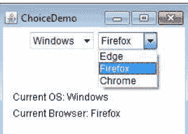

**图 27-4** ChoiceDemo 程序的示例输出

示例输出如图 27-4 所示。

## 使用列表

`List` 类提供了一个紧凑的、多选的、可滚动的选择列表。与 `Choice` 对象（只在菜单中显示选中的项目）不同，`List` 对象可以构造为在可见窗口中显示许多选项。它还可以被创建为允许多项选择。`List` 提供了这些构造函数：

- `List()` throws `HeadlessException`
- `List(int numRows)` throws `HeadlessException`
- `List(int numRows, boolean multipleSelect)` throws `HeadlessException`

第一个版本创建一个允许同时选择一个项目的 `List`。在第二种形式中，`numRows` 的值指定列表中始终可见的条目数量（其他的可以通过滚动查看）。在第三种形式中，如果 `multipleSelect` 为 `true`，则用户可以同时选择两个或多个项目。如果为 `false`，则只能选择一个项目。

要向列表添加选择项，调用 `add(String)`。它具有以下形式：

```java
void add(String name)
void add(String name, int index)
```

在这里，`name` 是添加到列表的项目名称。第一种形式将项目添加到列表末尾。第二种形式通过 `index` 指定项目。索引从 0 开始。你可以指定 -1 将项目添加到列表末尾。

```java
String getSelectedItem()
int getSelectedIndex()
```

`getSelectedItem()` 返回一个包含项目名称的字符串。如果选中了多个项目，或者没有进行选择，则返回 `null`。`getSelectedIndex()` 返回项目的索引。第一个项目的索引为 0。如果选中了多个项目，或者没有进行选择，则返回 -1。

## 使用 AWT 控件、布局管理器和菜单

`List` 类提供了一个紧凑的、多选的、可滚动的选择列表。与 `Choice` 对象（只在菜单中显示选中的项目）不同，`List` 对象可以构造为在可见窗口中显示许多选项。`getSelectedIndex()` 返回项目的索引。第一个项目的索引为 0。如果选中了多个项目，或者没有进行选择，则返回 -1。

`newValue` 指定了滚动条的新值。当你设置一个值时，滚动条内部的滑块将定位到新位置以反映该新值。

你也可以通过 `getMinimum()` 和 `getMaximum()` 获取最小值和最大值，如下所示：

```java
int getMinimum()
int getMaximum()
```

它们返回请求的数量。
默认情况下，每当滚动条向上或向下滚动一行时，都会增加或减去增量。你可以通过调用 `setUnitIncrement()` 来更改此增量。
默认情况下，上页和下页的增量为 10。你可以通过调用 `setBlockIncrement()` 来更改此值。这些方法如下所示：

```java
void setUnitIncrement(int newIncr)
void setBlockIncrement(int newIncr)
```

# 处理滚动条

要处理滚动事件，你需要实现 `AdjustmentListener` 接口。
用户每当与滚动条交互时，都会生成一个 `AdjustmentEvent`。
可以使用 `getAdjustmentType()` 方法确定调整的类型。调整事件的类型如下：

| 常量 | 说明 |
| :--- | :--- |
| `BLOCK_DECREMENT` | 产生了一个向下页事件。 |
| `BLOCK_INCREMENT` | 产生了一个向上页事件。 |
| `TRACK` | 产生了一个绝对跟踪事件。 |
| `UNIT_DECREMENT` | 滚动条中的向下行按钮被按下。 |
| `UNIT_INCREMENT` | 滚动条中的向上行按钮被按下。 |

下面的示例创建了垂直和水平滚动条。显示了滚动条的当前设置。如果你在窗口内拖动鼠标，将使用每个拖动事件的坐标来更新滚动条。在当前拖动位置处会显示一个星号。注意使用 `setPreferredSize()` 来设置滚动条的大小。

```java
// 演示滚动条。
import java.awt.*;
import java.awt.event.*;

public class SBDemo extends Frame implements AdjustmentListener {

    String msg = "";
    Scrollbar vertSB, horSB;

    public SBDemo() {
        // 使用流布局。
        setLayout(new FlowLayout());

        // 创建滚动条并设置首尺寸。
        vertSB = new Scrollbar(Scrollbar.VERTICAL, 0, 1, 0, 200);
        vertSB.setPreferredSize(new Dimension(20, 100));

        horzSB = new Scrollbar(Scrollbar.HORIZONTAL, 0, 1, 0, 100);
        horzSB.setPreferredSize(new Dimension(100, 20));

        // 将滚动条添加到框架中。
        add(vertSB);
        add(horzSB);

        // 为滚动条添加 AdjustmentListeners。
        vertSB.addAdjustmentListener(this);
        horzSB.addAdjustmentListener(this);

        // 添加 MouseMotionListener。
        addMouseMotionListener(new MouseAdapter() {
            // 更新滚动条以反映鼠标拖动。
            public void mouseDragged(MouseEvent me) {
                int x = me.getX();
                int y = me.getY();
                vertSB.setValue(y);
                horzSB.setValue(x);
                repaint();
            }
        });

        addWindowListener(new WindowAdapter() {
            public void windowClosing(WindowEvent we) {
                System.exit(0);
            }
        });
    }

    public void adjustmentValueChanged(AdjustmentEvent e) {
        repaint();
    }

    // 显示滚动条的当前值。
    public void paint(Graphics g) {
        String msg = "Vertical: " + vertSB.getValue();
        msg += " Horizontal: " + horzSB.getValue();
        g.drawString(msg, 20, 160);

        // 显示鼠标拖动位置
        g.drawString("*", horzSB.getValue(), vertSB.getValue());
    }

    public static void main(String[] args) {
        SBDemo appwin = new SBDemo();
        appwin.setSize(new Dimension(300, 180));
        appwin.setTitle("SBDemo");
        appwin.setVisible(true);
    }
}
```

**SBDemo** 程序的示例输出如图 27-6 所示。

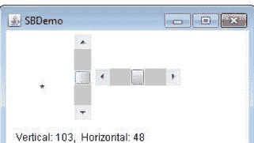

**图 27-6** SBDemo 程序的示例输出。

# 使用 TextField

**TextField** 类实现了一个单行文本输入区域，通常称为 *编辑控件*。文本字段允许用户输入字符串，并使用方向键、剪切和粘贴键以及鼠标选择来编辑文本。**TextField** 是 **Component** 的子类。**TextField** 定义了以下构造函数：

```java
TextField() throws HeadlessException
TextField(int numChars) throws HeadlessException
TextField(String str) throws HeadlessException
TextField(String str, int numChars) throws HeadlessException
```

第一个版本创建一个默认文本字段。第二个形式创建一个宽度为 `numChars` 个字符的文本字段。第三个用 `str` 中包含的字符串初始化文本字段。第四种形式初始化文本字段并设置其宽度。**TextField**（及其父类 **TextComponent**）提供了几个方法：

```java
String getText()
void setText(String str)
```

你可以通过 `getText()` 获取文本字段的内容。要设置文本，调用 `setText()`。


`newValue` 指定了滚动条的新值。当你设置一个值时，滚动条内部的滑块将定位到新位置以反映该新值。

你也可以通过 `getMinimum()` 和 `getMaximum()` 获取最小值和最大值，如下所示：

```
int getMinimum()
int getMaximum()
```

它们返回请求的数量。
默认情况下，每当滚动条向上或向下滚动一行时，都会增加或减去增量。你可以通过调用 `setUnitIncrement()` 来更改此增量。
默认情况下，上页和下页的增量为10。你可以通过调用 `setBlockIncrement()` 来更改此值。这些方法所示：

```
void setUnitIncrement(int newIncr)
void setBlockIncrement(int newIncr)
```

# 处理滚动条

要处理滚动事件，你需要实现 `AdjustmentListener` 接口。
用户每当与滚动条交互时，都会生成一个 `AdjustmentEvent`。
可以使用 `getAdjustmentType()` 方法确定调整的类型。调整事件的类型如下：

| 常量 | 说明 |
| --- | --- |
| `BLOCK_DECREMENT` | 产生了一个向下页事件。 |
| `BLOCK_INCREMENT` | 产生了一个向上页事件。 |
| `TRACK` | 产生了一个绝对跟踪事件。 |
| `UNIT_DECREMENT` | 滚动条中的向下行按钮被按下。 |
| `UNIT_INCREMENT` | 滚动条中的向上行按钮被按下。 |

下面的示例创建了垂直和水平滚动条。显示了滚动条的当前设置。如果你在窗口内拖动鼠标，将使用每个拖动事件的坐标来更新滚动条。在当前拖动位置处会显示一个星号。注意使用 `setPreferredSize()` 来设置滚动条的大小。

```java
// 演示滚动条。
import java.awt.*;
import java.awt.event.*;

public class SBDemo extends Frame implements AdjustmentListener {

  String msg = "";
  Scrollbar vertSB, horSB;

  public SBDemo() {
    // 使用流布局。
    setLayout(new FlowLayout());

    // 创建滚动条并设置首选尺寸。
    vertSB = new Scrollbar(Scrollbar.VERTICAL, 0, 1, 0, 200);
    vertSB.setPreferredSize(new Dimension(20, 100));

    horzSB = new Scrollbar(Scrollbar.HORIZONTAL, 0, 1, 0, 100);
    horzSB.setPreferredSize(new Dimension(100, 20));

    // 将滚动条添加到框架中。
    add(vertSB);
    add(horzSB);

    // 为滚动条添加 AdjustmentListeners。
    vertSB.addAdjustmentListener(this);
    horzSB.addAdjustmentListener(this);

    // 添加 MouseMotionListener。
    addMouseMotionListener(new MouseAdapter() {
        // 更新滚动条以反映鼠标拖动。
        public void mouseDragged(MouseEvent me) {
            int x = me.getX();
            int y = me.getY();
            vertSB.setValue(y);
            horzSB.setValue(x);
            repaint();
        }
    });

    addWindowListener(new WindowAdapter() {
        public void windowClosing(WindowEvent we) {
            System.exit(0);
        }
    });
  }

  public void adjustmentValueChanged(AdjustmentEvent e) {
    repaint();
  }

  // 显示滚动条的当前值。
  public void paint(Graphics g) {
    String msg = "Vertical: " + vertSB.getValue();
    msg += " Horizontal: " + horzSB.getValue();
    g.drawString(msg, 20, 160);

    // 显示鼠标拖动位置
    g.drawString("*", horzSB.getValue(), vertSB.getValue());
  }

  public static void main(String[] args) {
    SBDemo appwin = new SBDemo();
    appwin.setSize(new Dimension(300, 180));
    appwin.setTitle("SBDemo");
    appwin.setVisible(true);
  }
}
```

**SBDemo** 程序的示例输出如图 27-6 所示。

# 使用 TextField

**TextField** 类实现了一个单行文本输入区域，通常称为 *编辑控件*。文本字段允许用户输入字符串，并使用方向键、剪切和粘贴键以及鼠标选择来编辑文本。**TextField** 是 **Component** 的子类。**TextField** 定义了以下构造函数：

```
TextField() throws HeadlessException
TextField(int numChars) throws HeadlessException
TextField(String str) throws HeadlessException
TextField(String str, int numChars) throws HeadlessException
```

第一个版本创建一个默认文本字段。第二个形式创建一个宽度为 `numChars` 个字符的文本字段。第三个用 `str` 中包含的字符串初始化文本字段。第四种形式初始化文本字段并设置其宽度。**TextField**（及其父类 **TextComponent**）提供了几个方法：

```
String getText()
void setText(String str)
```

这里，`ch` 指定了回显字符。如果 `ch` 为 0，则恢复默认显示。你可以通过 `getText()` 获取文本字段的内容。要设置文本，调用 `setText()`。

# 使用 TextArea

有时，单行文本输入对于某些任务来说是不够的。为了处理这些情况，AWT 包含一个名为 `TextArea` 的简单多行编辑器。以下是 `TextArea` 的构造函数：

```
TextArea() throws HeadlessException
TextArea(int numLines, int numChars) throws HeadlessException
TextArea(String str) throws HeadlessException
TextArea(String str, int numLines, int numChars) throws HeadlessException
TextArea(String str, int numLines, int numChars, int sbars) throws HeadlessException
```

在这里，`numLines` 指定文本区域的高度（以行计数），`numChars` 指定其宽度（以字符计数）。初始文本可以通过 `str` 指定。在第五种形式中，你可以指定想要控制的滚动条。`sbars` 必须是以下值之一：

| 常量 | 说明 |
| --- | --- |
| `SCROLLBARS_BOTH` | 显示水平和垂直滚动条。 |
| `SCROLLBARS_HORIZONTAL_ONLY` | 仅显示水平滚动条。 |
| `SCROLLBARS_VERTICAL_ONLY` | 仅显示垂直滚动条。 |
| `SCROLLBARS_NONE` | 不显示滚动条。 |

`TextArea` 是 `TextComponent` 的子类。因此，它支持前节中描述的 `getText()`、`setText()`、`getSelectedText()`、`select()`、`isEditable()` 和 `setEditable()` 方法。

`TextArea` 添加了以下编辑方法：

```
void append(String str)
void insert(String str, int pos)
void replaceRange(String str, int startIndex, int endIndex)
```

`append()` 方法将 `str` 指定的字符串追加到当前文本的末尾。`insert()` 将传入 `str` 的字符串插入到指定的索引 `pos` 处。要替换文本，调用 `replaceRange()`。它将从 `startIndex` 到 `endIndex-1` 的字符替换为 `str` 中的替换文本。

文本区域几乎是自包含的控件。你的程序几乎没有管理开销。通常情况下，你的程序仅在需要时更新当前文本即可。不过，如果你愿意，也可以监听 `TextEvent`。

以下程序创建了一个 `TextArea` 控件：

```java
// Demo TextArea。
import java.awt.*;
import java.awt.event.*;

public class TextAreaDemo extends Frame {

  public TextAreaDemo() {
    // 使用流式布局。
    setLayout(new FlowLayout());

    String val =
      "JDK 17 is the latest version of one of the most\n" +
      "widely-used computer languages for Internet programming.\n" +
      "Building on a rich heritage, Java has advanced both\n" +
      "the art and science of computer language design.\n\n" +
      "One of the reasons for Java's ongoing success is its\n" +
      "constant, steady rate of evolution. Java has never stood\n" +
      "still. Instead, Java has consistently adapted to the\n" +
      "rapidly changing landscape of the networked world.\n" +
      "Moreover, Java has often led the way, charting the\n" +
      "course for others to follow.";

    TextArea text = new TextArea(val, 10, 30);
    add(text);

    addWindowListener(new WindowAdapter() {
      public void windowClosing(WindowEvent event) {
        System.exit(0);
      }
    });
  }

  public static void main(String[] args) {
    TextAreaDemo appwin = new TextAreaDemo();
    appwin.setSize(new Dimension(300, 220));
    appwin.setTitle("TextAreaDemo");
    appwin.setVisible(true);
  }
}
```

这里是 `TextAreaDemo` 程序的示例输出：

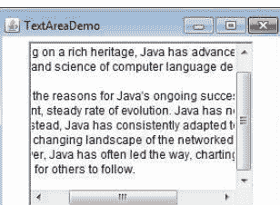

# 理解布局管理器

我们到目前为止展示的所有组件都是通过 `FlowLayout` 布局管理器进行定位的。正如我们在章开头提到的，布局管理器通过使用某种类型的管理器自动在窗口内排列控件。

虽然手动布局 Java 界面是可行的，但由于两个主要原因，你通常不想这样做。首先，手动布局大量组件是非常繁琐的。其次，当你需要安排某些控件时，其宽度和高度信息可能还不可用，因为原生工具包组件尚未实现。这是一个“先有鸡蛋还是先有鸡”的问题：发现可以使用给定组件的大小来相对于另一个组件进行定位是令人困惑的。

每个 `Container` 都关联着一个布局管理器。布局管理器通过 `setLayout()` 方法设置。如果没有调用 `setLayout()`，则将使用实现 `LayoutManager` 接口的类的实例，即默认布局管理器。每当容器调整大小（或第一次调整）时，布局管理器都会被用于对其中的每个组件进行定位。

`setLayout()` 方法具有以下通用签名：

```java
void setLayout(LayoutManager layoutObj)
```

在这里，`layoutObj` 是布局管理器的引用。如果你想禁用布局管理器并手动定位组件，请为 `layoutObj` 传递 `null`。如果你这样做，将需要使用 `Component` 定义的 `setBounds()` 方法手动确定每个组件的大小和位置。通常情况下，你会想要使用布局管理器。

每个布局管理器都维护一个按名称存储的组件列表。每当你向容器添加一个组件时，布局管理器都会收到通知。每当容器需要调整大小时，都会通过其 `minimumLayoutSize()` 和 `preferredLayoutSize()` 方法咨询布局管理器。由布局管理器管理的每个组件都包含 `getPreferredSize()` 和 `getMinimumSize()` 方法。这些方法返回显示每个组件所需的理想尺寸和最小尺寸。布局管理器将尽可能遵守这些请求，同时保持布局的完整性。你可以覆盖这些类的这些方法，否则提供了默认值。

Java 有几个预定义的 `LayoutManager` 类，接下来将描述其中几个。

## FlowLayout

你已经看到 `FlowLayout` 的运行了。它实现了一种简单的布局样式，类似于文本编辑器中的文字流。布局的方向由容器的对齐属性控制，默认是从左到右。因此，默认情况下，从左上角开始行排列。在所有情况下，当一行满时，布局将移到下一行。组件之间在上下以及左右都有小的间距。这里是它的构造函数：

```
FlowLayout()
FlowLayout(int how)
FlowLayout(int how, int horz, int vert)
```

第一种形式创建默认布局，组件之间留有五个像素的间距。第二种形式允许你指定每行的对齐方式。`how` 的有效值如下：

- `FlowLayout.LEFT`
- `FlowLayout.CENTER`
- `FlowLayout.RIGHT`
- `FlowLayout.LEADING`
- `FlowLayout.TRAILING`

这些值分别指定左、居中、右、起始边缘和结束边缘对齐。第三种构造函数允许你指定组件之间的水平和垂直间距。你可以通过替换早先 `CheckboxDemo` 程序中的行来查看使用 `FlowLayout` 指定对齐的示例：

```java
setLayout(new FlowLayout(FlowLayout.LEFT));
```

进行此更改后，输出将如所示。与原始输出（见图 27-2）进行比较。

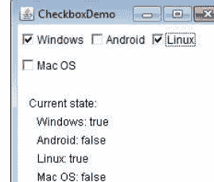

## BorderLayout

`BorderLayout` 实现了一种布局样式，在边缘有四个窄的固定宽度组件，中心有一个大区域。四侧被称为北、南、东、西。中间区域是中心。`BorderLayout` 是 `Frame` 的默认布局。这里是由 `BorderLayout` 定义的构造函数：

```
BorderLayout()
BorderLayout(int horz, int vert)
```

第一种形式创建默认布局。第二种允许你分别指定组件之间的水平和垂直间距（分别为 `horz` 和 `vert`）。`BorderLayout` 定义了以下常用的常量来指定区域：

| 常量 | 说明 |
| --- | --- |
| `BorderLayout.CENTER` | 中心区域 |
| `BorderLayout.NORTH` | 北部区域 |
| `BorderLayout.SOUTH` | 南部区域 |
| `BorderLayout.EAST` | 东部区域 |
| `BorderLayout.WEST` | 西部区域 |

在添加组件时，你将使用这些常量配合以下形式的 `add()`，该方法由 `Container` 定义：


## void add(Component compRef, Object region)

在这里，`compRef` 是要添加组件的引用，而 `region` 指定了组件添加的位置。

这里是一个在每个布局区域都包含组件的 `BorderLayout` 示例：

```java
// Demonstrate BorderLayout.

import java.awt.*;
import java.awt.event.*;

public class BorderLayoutDemo extends Frame {

    public BorderLayoutDemo() {
        // 这里，默认使用 BorderLayout
        add(new Button("This is across the top."), BorderLayout.NORTH);
        add(new Label("The footer message might go here."), BorderLayout.SOUTH);
        add(new Button("Right"), BorderLayout.EAST);
        add(new Button("Left"), BorderLayout.WEST);

        String msg = "The reasonable man adapts " + 
                     "himself to the world,\n" + 
                     "the unreasonable one persists in " + 
                     "trying to adapt the world to himself.\n" + 
                     "Therefore all progress depends " + 
                     "on the unreasonable man.\n" + 
                     "" + 
                     "George Shaw\n\n";

        add(new TextArea(msg), BorderLayout.CENTER);

        addWindowListener(new WindowAdapter() {
            public void windowClosing(WindowEvent event) {
                System.exit(0);
            }
        });
    }

    public static void main(String[] args) {
        BorderLayoutDemo appwin = new BorderLayoutDemo();
        appwin.setSize(new Dimension(300, 220));
        appwin.setTitle("BorderLayoutDemo");
        appwin.setVisible(true);
    }
}
```


## 908 第二部分 Java LayoutDemo

这里展示了 `BorderLayout` 程序的示例输出：

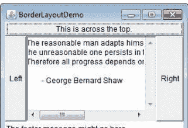

## 使用 Insets（内边距）

有时你可能在包含组件的容器与其包含的窗口之间留出少量空间。要实现这一点，请重写由 `Container` 定义的 `getInsets()` 方法。该方法返回一个 `Insets` 对象，包含了显示容器时使用的顶部、底部、左侧和右侧内边距。这些值被布局管理器用于在布局窗口时设置内边距。`Insets` 的构造函数如下：

```
Insets(int top, int left, int bottom, int right)
```

传递的 `top`、`left`、`bottom` 和 `right` 值指定了容器与其外层窗口之间的空间大小。

`getInsets()` 方法具有以下通用形式：

```
Insets getInsets()
```

在重写此方法时，你必须返回一个包含所需内边距的新 `Insets` 对象。

以下是修改后的 `BorderLayout` 示例，使其对其组件设置内边距。可以将背景颜色设置为青色，以帮助内边距更加可见。

```java
// Demonstrate BorderLayout with insets.

import java.awt.*;
import java.awt.event.*;

public class InsetsDemo extends Frame {

    public InsetsDemo() {
        // 这里，默认使用 BorderLayout。
        // 设置背景颜色以便清楚地看到内边距
        setBackground(Color.cyan);
        setLayout(new BorderLayout());

        add(new Button("This is across the top."), BorderLayout.NORTH);
        add(new Label("The footer message might go here."), BorderLayout.SOUTH);
        add(new Button("Right"), BorderLayout.EAST);
        add(new Button("Left"), BorderLayout.WEST);

        String msg = "The reasonable man adapts " + 
                     "himself to the world,\n" + 
                     "the unreasonable one persists in " + 
                     "trying to adapt the world to himself.\n" + 
                     "Therefore all progress depends " + 
                     "on the unreasonable man.\n\n" + 
                     "George Bernard Shaw\n\n";

        add(new TextArea(msg), BorderLayout.CENTER);

        addWindowListener(new WindowAdapter() {
            public void windowClosing(WindowEvent we) {
                System.exit(0);
            }
        });
    }

    // Override Insets to add inset values.
    public Insets getInsets() {
        return new Insets(40, 20, 10, 20);
    }

    public static void main(String[] args) {
        InsetsDemo appwin = new InsetsDemo();
        appwin.setSize(new Dimension(300, 220));
        appwin.setTitle("InsetsDemo");
        appwin.setVisible(true);
    }
}
```

这里是 `InsetsDemo` 程序的示例输出：


## GridLayout（网格布局）

`GridLayout` 在二维网格中布局组件。当实例化 `GridLayout` 时，你需要定义行和列。支持 `GridLayout` 的构造函数有：

```
GridLayout()
GridLayout(int rows, int columns)
GridLayout(int rows, int columns, int horz, int vert)
```

第一种形式创建一个单列网格。第二种形式创建一个指定行列的网格。第三种形式允许指定组件之间的水平 `horz` 和垂直 `vert` 空间。

这里有一个创建一个 4x4 网格的示例程序，并填充了带有标签的按钮：

```java
// Demonstrate GridLayout

import java.awt.*;
import java.awt.event.*;

public class GridLayoutDemo extends Frame {

    static final int n = 4;

    public GridLayoutDemo() {
        // 使用 GridLayout。
        setLayout(new GridLayout(n, n));
        setFont(new Font("Serif", Font.BOLD, 24));

        for(int i = 0; i < n; i++) {
            for(int j = 0; j < n; j++) {
                int k = i * n + j;
                if (k > 0) {
                    add(new Button("Button " + k));
                }
            }
        }

        addWindowListener(new WindowAdapter() {
            public void windowClosing(WindowEvent event) {
                System.exit(0);
            }
        });
    }

    public static void main(String[] args) {
        GridLayoutDemo appwin = new GridLayoutDemo();
        appwin.setSize(new Dimension(300, 220));
        appwin.setTitle("GridLayoutDemo");
        appwin.setVisible(true);
    }
}
```

以下是 `GridLayout` 程序生成的示例输出：

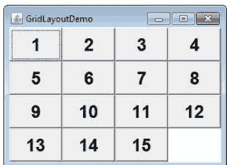

> **提示** 你可以尝试将此示例作为 15 格谜的起点。

## CardLayout（卡片布局）

`CardLayout` 类与其他布局管理器不同之处在于它可以存储多个不同的布局。每个布局都可以被看作是组中的一个独立索引，可以洗牌，使得任何时候都有一个卡片位于顶部。这对于可以根据用户输入动态启用或禁用组件的界面非常有用。你可以预先准备其他布局并让它们保持隐藏，以便需要时激活。

`CardLayout` 提供了两个构造函数：

```
CardLayout()
CardLayout(int horz, int vert)
```

第一种形式创建一个默认卡片布局。第二种形式允许你指定组件之间的水平 `horz` 和垂直 `vert` 空间。

使用 `CardLayout` 比其他布局需要更多工作。卡片通常存储在 `Panel` 对象中。该面板必须使用 `CardLayout` 作为其布局管理器。构成牌组的卡片也是 `Panel` 类型。因此，你需要创建一个包含牌组的面板，并包含牌组中的每个卡片。然后，将这些面板添加到使用 `CardLayout` 作为布局管理器的面板中。最后，将此面板添加到窗口中。完成这些步骤后，你必须提供一种让用户选择卡片的方法。常见的方法为牌组中的每个卡片包含一个按钮。

当卡片被添加到面板时，它们通常会被赋予一个名称。一种方法是在使用以下形式的 `add()` 方法将卡片添加到面板时：

```
void add(Component panelRef, Object name)
```

在这里，`name` 是一个字符串，指定由 `panelRef` 指定的面板的卡片名称。

在你创建了牌组后，你的程序通过调用 `CardLayout` 定义的方法之一来激活卡片：

```java
void first(Container deck)
void last(Container deck)
void next(Container deck)
void previous(Container deck)
void show(Container deck, String cardName)
```

在这里，`deck` 是持有卡片的容器（通常是面板）的引用，`cardName` 是卡片的名称。调用 `first()` 会显示牌组中的第一张卡片。要显示最后一张卡片，调用 `last()`。要显示下一张卡片，调用 `next()`。要显示上一个卡片，调用 `previous()`。`next()` 和 `previous()` 会自动循环回到牌组的顶部或底部。`show()` 显示传入 `cardName` 名称的卡片。

下面的示例展示了一个两级牌组，允许用户选择操作系统。基于 Windows 的操作系统显示在一个卡片中。Mac OS、Android 和 Linux 显示在另一个卡片中。

```java
// 演示 CardLayout。

import java.awt.*;
import java.awt.event.*;

public class CardLayoutDemo extends Frame {

    Checkbox windows10, windows7, windows8, android, linux, mac;
    Panel osCards;
    CardLayout cardLO;
    Button win, other;

    public CardLayoutDemo() {
        // 为主框架使用流式布局。
        setLayout(new FlowLayout());

        win = new Button("Windows");
        other = new Button("Other");
        add(win);
        add(other);

        // 设置 osCards 面板使用 CardLayout。
        cardLO = new CardLayout();
        osCards = new Panel();
        osCards.setLayout(cardLO);

        windows7 = new Checkbox("Windows 7", true);
        windows8 = new Checkbox("Windows 8");
        windows10 = new Checkbox("Windows 10");
        android = new Checkbox("Android");
        linux = new Checkbox("Linux");
        mac = new Checkbox("Mac OS");

        // 将窗口复选框添加到面板中。
        Panel winPan = new Panel();
        winPan.add(windows7);
        winPan.add(windows8);
        winPan.add(windows10);

        // 将其他操作系统复选框添加到面板中。
        Panel otherPan = new Panel();
        otherPan.add(android);
        otherPan.add(linux);
        otherPan.add(mac);

        // 将面板添加到卡牌组面板。
        osCards.add(winPan, "Windows");
        osCards.add(otherPan, "Other");

        // 将卡片添加到主框架面板。
        add(osCards);

        // 使用 lambda 表达式处理按钮事件。
        win.addActionListener(e -> cardLO.show(osCards, "Windows"));
        other.addActionListener(e -> cardLO.show(osCards, "Other"));

        // 注册鼠标按下事件。
        addMouseListener(new MouseAdapter() {
            // 循环切换面板。
            public void mousePressed(MouseEvent me) {
                cardLO.next(osCards);
            }
        });

        addWindowListener(new WindowAdapter() {
            public void windowClosing(WindowEvent we) {
                System.exit(0);
            }
        });
    }

    public static void main(String[] args) {
```


# 914 第二部分 Java 类库

这里是 `CardLayoutDemo` 程序生成的示例输出。每张卡片都通过点击其按钮来激活。你也可以通过点击鼠标来循环切换卡片。

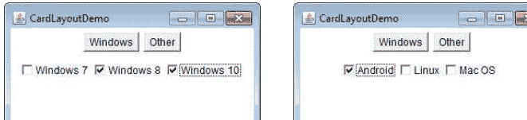

# GridBagLayout

尽管前面的布局对于许多用途来说完全可以，但在某些情况下，你可能需要组件的排列方式进行更多的控制。实现此点的良好方法是使用网格包，它由 `GridBagLayout` 类指定。网格包的有用在于，你可以通过指定组件在网格内单元格中的位置来指定组件的相对位置。网格包的关键在于，每个组件可以是不同的大小，并且网格中的每一行可以有不同的列数。这就是为什么这种布局被称为网格包的原因。它是连接在一起的小网格的集合。

网格包中每个组件的位置和大小是由一组链接到它的约束决定的。约束包含在类型为 `GridBagConstraints` 的对象中。约束包括单元格的高度和宽度，组件的位置、其对齐方式以及在单元格内的任意点。

使用网格包的一般步骤是创建一个新的 `GridBagLayout` 对象并将其设置为当前布局管理器。然后，设置适用于将添加到网格包的每个组件的约束。最后，将约束添加到布局管理器。`GridBagLayout` 比其他布局管理器稍微复杂，但一旦你理解了它的工作原理，它仍然易于使用。

## GridBagLayout()

`GridBagLayout` 定义了几个方法，其中许多是受保护的，不供普通使用。有一个是你必须使用的：`setConstraints()`。它显示在这里：

- `void setConstraints(Component comp, GridBagConstraints cons)`

在这里，`comp` 是应用约束的组件。使用网格包的关键在于正确设置约束，约束存储在 `GridBagConstraints` 对象中。`GridBagConstraints` 还定义了许多字段，见下表。

# 27 GridBagConstraints 定义的约束

| 字段 | 目的 |
| :--- | :--- |
| anchor | 指定其在单元格内的位置。 |
| fill | 如果组件小于单元格，指定如何调整大小。 |
| gridheight | 以单元格为单位指定的行高。 |
| gridwidth | 以单元格为单位指定的列宽。 |
| gridx | 组件要添加到单元格的 X 坐标。 |
| gridy | 组件要添加到单元格的 Y 坐标。 |
| insets | 指定围绕组件的内边。 |
| ipadx | 用于增加单元格最小大小的水平内边。 |
| ipady | 用于增加单元格最小大小的垂直内边。 |
| weightx | 决定容器中的额外空间分配到每列的比例。 |
| weighty | 决定容器中额外空间分配到每行的比例。 |

# 916 第二部分 Java 类库

正如其名称所示，这些值将导致组件放置在特定位置。可以赋予 `anchor` 的第二种值是相对的，这意味着这些值相对于容器的方向，这对于非西方语言可能有所不同。相对值在此处显示：

| 字段 | 目的 |
| :--- | :--- |
| FIRST_LINE_END | |
| FIRST_LINE_START | |
| LAST_LINE_END | |
| LAST_LINE_START | |

它们的名称描述了放置位置。
可以赋予 `anchor` 的第三种值允许你相对于行的基线来定位组件。这些值在此处显示：

| 字段 | 目的 |
| :--- | :--- |
| BASELINE | |
| BASELINE_LEADING | |
| BASELINE_TRAILING | |
| ABOVE_BASELINE | |
| ABOVE_BASELINE_LEADING | |
| ABOVE_BASELINE_TRAILING | |
| BELOW_BASELINE | |
| BELOW_BASELINE_LEADING | |

## 第 27 章 使用 AWT 控件、布局管理器和菜单 917

```java
public class GridBagDemo extends Frame implements ItemListener {

    String msg = "";

    Checkbox windows, android, linux, mac;

    public GridBagDemo() {

        // 使用 GridBagLayout
        GridBagLayout gbag = new GridBagLayout();
        GridBagConstraints gbc = new GridBagConstraints();
        setLayout(gbag);

        // 定义复选框。
        windows = new Checkbox("Windows ", true);
        android = new Checkbox("Android");
        linux = new Checkbox("Linux");
        mac = new Checkbox("Mac OS");

        // 定义网格布局约束。
        // 第一行使用默认权重 0。
        gbc.weightx = 1.0; // 使用列权重 1
        gbc.ipadx = 200; // 填充 200 个单位
        gbc.insets = new Insets(0, 6, 0, 0); // 从左侧略微内内边距
        gbc.anchor = GridBagConstraints.NORTHEAST;
        gbc.gridwidth = GridBagConstraints.RELATIVE;
        gbc.setConstraints(windows, gbc);

        gbc.gridwidth = GridBagConstraints.REMAINDER;
        gbc.setConstraints(android, gbc);

        // 给第二行赋予权重 1。
        gbc.weighty = 1.0;
        gbc.gridwidth = GridBagConstraints.RELATIVE;
        gbc.setConstraints(linux, gbc);

        gbc.gridwidth = GridBagConstraints.REMAINDER;
        gbc.setConstraints(mac, gbc);

        // 添加组件。
        add(windows);
        add(android);
        add(linux);
        add(mac);

        // 注册接收项目事件。
        windows.addItemListener(this);
        android.addItemListener(this);
        linux.addItemListener(this);
        mac.addItemListener(this);
    }

    addWindowListener(new WindowAdapter() {
        public void windowClosing(WindowEvent event) {
            System.exit(0);
        }
    });

    // 当复选框状态改变时重绘。
    public void itemStateChanged(ItemEvent ie) {
        repaint();
    }

    // 显示复选框的当前状态。
    public void paint(Graphics g) {
        msg = "Current state: ";
        g.drawString(msg, 20, 100);
        msg = "Windows: " + windows.getState();
        g.drawString(msg, 30, 120);
        msg = "Android: " + android.getState();
        g.drawString(msg, 30, 140);
        msg = "Linux: " + linux.getState();
        g.drawString(msg, 30, 160);
        msg = "Mac OS: " + mac.getState();
        g.drawString(msg, 30, 180);
    }

    public static void main(String[] args) {
        GridBagDemo appwin = new GridBagDemo();
        appwin.setSize(new Dimension(250, 200));
        appwin.setTitle("GridBagDemo");
        appwin.setVisible(true);
    }
}
```

程序生成的示例输出所示。

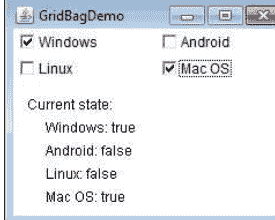

在此布局中，操作系统的复选框被放置在了一个 2x2 的网格中。每个单元格都有 200 的水平内边距。每个组件从左侧略微内缩（6 个单位）。列宽被设置为 1，这导致任何额外的水平空间都均匀地分布在各个列之间。第一行使用默认权重 0；第二行的权重为 1。这意味着任何额外的垂直空间都将增加到第二行中。

## 第 27 章 使用 AWT 控件、布局管理器和菜单 919

`GridBagLayout` 是一种强大的布局管理器。值得花一些时间来实验它，一旦你理解了各种设置的作用，就可以使用 `GridBagLayout` 以高精度的对齐组件。

## 菜单栏和菜单

顶层窗口可以关联一个菜单栏。菜单栏显示一组顶层菜单选择列表。每个选择都关联一个下拉菜单。这个概念在 AWT 中通过以下类实现：`MenuBar`、`Menu` 和 `MenuItem`。通常情况下，菜单栏包含一个或多个 `Menu` 对象。每个 `Menu` 对象包含 `MenuItem` 对象列表。每个 `MenuItem` 代表用户可以选择的内容。由于 `Menu` 是 `MenuItem` 的子类，可以创建子菜单层次。也可以包含可点击的菜单项。这些是选择时的选项。要创建一个菜单栏，首先创建一个 `MenuBar` 实例。该类定义了默认构造函数。接下来创建显示在栏上的 `Menu` 实例。`Menu` 的构造函数有：

- `Menu() throws HeadlessException`
- `Menu(String optionName) throws HeadlessException`
- `Menu(String optionName, boolean removable) throws HeadlessException`

这里 `itemName` 指定菜单的名称。如果 `removable` 为 `true`，菜单可以被移除并释放；否则，它将保持连接（取决于实现）。第一行创建一个空菜单。菜单项是 `MenuItem`。它们定义了这些构造函数：

- `MenuItem() throws HeadlessException`
- `MenuItem(String itemNameName) throws HeadlessException`
- `MenuItem(String itemNameName, Shortcut keyAccel) throws HeadlessException`

这里，`itemName` 在菜单中显示，`keyAccel` 是该项的快捷键。你可以使用 `setEnabled()` 方法启用或禁用菜单项。其格式所示：

```java
void setEnabled(boolean enabledFlag)
```

如果 `enabledFlag` 为 `true`，则菜单项是启用的；如果是 `false`，则菜单项被禁用。可以通过调用 `isEnabled()` 来确定项的状态。该方法所示：

```java
boolean isEnabled()
```

如果调用它的菜单项是启用的，则 `isEnabled()` 返回 `true`；否则返回 `false`。你可以通过 `setLabel()` 更改菜单名称。通过使用 `getLabel()` 获取当前名称。这些方法如下：

```java
void setLabel(String newName)
String getLabel()
```


## 第 27 章 使用 AWT 控件、布局管理器和菜单 921


# 第 27 章 使用 AWT、布局管理器和菜单

```java
// 举例菜单。
import java.awt.*;
import java.awt.event.*;

class MenuDemo extends Frame {
    String msg = "";
    CheckboxMenuItem debug, test;

    public MenuDemo() {
        // 创建菜单栏并将其添加到框架。
        MenuBar mbar = new MenuBar();
        setMenuBar(mbar);

        // 创建菜单项。
        Menu file = new Menu("File");
        MenuItem item1, item2, item3, item4;
        file.add(item1 = new MenuItem("New..."));
        file.add(item2 = new MenuItem("Open..."));
        file.add(item3 = new MenuItem("Close"));
        file.add(item4 = new MenuItem("-"));
        file.add(new MenuItem("..."));
        mbar.add(file);

        Menu edit = new Menu("Edit");
        MenuItem item6, item7, item8, item9;
        edit.add(item6 = new MenuItem("Cut"));
        edit.add(item7 = new MenuItem("Copy"));
        edit.add(item8 = new MenuItem("Paste"));
        edit.add(item9 = new MenuItem("-"));
        mbar.add(edit);

        Menu sub = new Menu("Special");
        MenuItem item10, item11, item12;
        sub.add(item10 = new MenuItem("First"));
        sub.add(item11 = new MenuItem("Second"));
        sub.add(item12 = new MenuItem("Third"));
        edit.add(sub);

        // 这些是可以更改的菜单项。
        debug = new CheckboxMenuItem("Debug");
        edit.add(debug);
        test = new CheckboxMenuItem("Testing");
        edit.add(test);

        // 创建一个处理动作和项目事件的对象。
        MyHandler handler = new MyMenuHandler();

        // 注册接收这些事件。
        item1.addActionListener(handler);
        item2.addActionListener(handler);
        item3.addActionListener(handler);
    }
}
```

```java
item4.addActionListener(handler);
item6.addActionListener(handler);
item7.addActionListener(handler);
item8.addActionListener(handler);
item9.addActionListener(handler);
item10.addActionListener(handler);
item11.addActionListener(handler);
item12.addActionListener(handler);
debug.addActionListener(handler);
test.addActionListener(handler);
```

```java
// 使用 lambda 表达式处理退出选择。
item5.addActionListener((ae) -> System.exit(0));
```

```java
addWindowListener(new WindowAdapter() {
    public void windowClosing(WindowEvent e) {
        System.exit(0);
    }
});
```

```java
public void paint(Graphics g) {
    g.drawString(msg, 10, 220);
}
```

```java
if (debug.getState()) {
    g.drawString("Debug is on.", 10, 240);
} else
    g.drawString("Debug is off.", 10, 240);
```

```java
if (test.getState()) {
    g.drawString("Testing is on.", 10, 260);
} else
    g.drawString("Testing is off.", 10, 260);
```

```java
public static void main(String[] args) {
    MenuDemo appwin = new MenuDemo();
    appwin.setSize(new Dimension(250, 300));
    appwin.setTitle("MenuDemo");
    appwin.setVisible(true);
}
```

```java
// 一个用于处理菜单动作事件和项目事件的内部类。
class MyMessageHandler implements ActionListener, ItemListener
```

```java
// 处理动作事件。
public void actionPerformed(ActionEvent e) {
    msg = "You selected";
    String arg = ae.getActionCommand();

    if (arg.equals("New..."))
        msg += "New";
    else if (arg.equals("Open..."))
        msg += "Open";
    else if (arg.equals("Close"))
        msg += "Close";
    else if (arg.equals("Edit"))
        msg += "Edit";
    else if (arg.equals("Cut"))
        msg += "Cut";
    else if (arg.equals("Copy"))
        msg += "Copy";
    else if (arg.equals("Paste"))
        msg += "Paste";
    else if (arg.equals("First"))
        msg += "First";
    else if (arg.equals("Second"))
        msg += "Second";
    else if (arg.equals("Third"))
        msg += "Third";
    else if (arg.equals("Debug"))
        msg += "Debug";
    else if (arg.equals("Testing"))
        msg += "Testing";

    repaint();
}

// 处理项目事件。
public void itemStateChanged(ItemEvent ie) {
    repaint();
}
```

MenuDemo 程序的示例输出如图 27-8 所示。

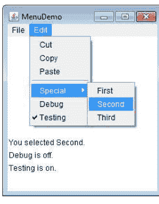

**图 27-8** MenuDemo 程序的示例输出

# 第二部分 Java 库

还有另一个与菜单相关的类，但它产生的是一个可以在特定位置显示的菜单。`PopupMenu` 的工作方式与 `Menu` 相同，它为某些类型的菜单场景提供了一个灵活且实用的替代方案。

# 对话框

通常，你可能想要使用对话框来包含一组相关的控件。对话框主要用于获取用户输入，是顶层窗口的子窗口。对话框没有菜单栏，但在其他方面，它们的功能类似于帧窗口（你可以像向窗口添加控件一样向对话框中添加控件）。对话框可以是模态的（`modal`）也可以是非模态的（`modeless`）。通常来说，当一个模态对话框处于激活状态时，在你关闭对话框之前，无法访问程序中的其他窗口（对话框窗口的子窗口除外）。当非模态对话框处于激活状态时，焦点可以指向程序中的另一个窗口，程序中的其他部分保持激活状态且可访问。从 JDK 6 开始，通过 `Dialog.ModalityType` 枚举指定了不同的模态类型。默认是 `APPLICATION_MODAL`，它会阻止使用应用程序中的其他顶层窗口。这是传统的模态类型。其他类型如 `DOCUMENT_MODAL` 和 `TOOLKIT_MODAL`。还包含了 `MODELESS` 类型。

在 AWT 中，对话框的类型是 `Dialog`。这里显示了两个常用的构造函数：

- `Dialog(Frame parent, boolean mode)`
- `Dialog(Frame parent, String title, boolean mode)`

`Dialog` 是对话框的所有者。如果 `mode` 为 `true`，则对话框使用默认模态性。否则，它是非模态的。对话框可以传递标题（`title`）。通常，你会子类 `Dialog`，并添加应用程序所需的功能。

以下是前述对话框的修改版本，当选择新新选项时会显示一个非模态对话框。调用了 `dispose()`。这由 `Window` 定义，它会释放与对话框相关的所有资源。

```java
// 示例说明对话框。
import java.awt.*;
import java.awt.event.*;

class DialogDemo extends Frame {
    String msg = "";
    CheckboxMenuItem debug, test;
    SampleDialog myDialog;
}

public DialogDemo() {
    // 创建对话框。
    myDialog = new SampleDialog(this, "New Dialog");
}
```

# 27 使用 AWT 控件、布局管理器和菜单

```java
// 创建菜单栏并将其添加到帧。
MenuBar mbar = new MenuBar();
setMenuBar(mbar);
```

```java
// 创建菜单项。
Menu file = new Menu("File");
MenuItem item1, item2, item3, item4, item5;
file.add(item1 = new MenuItem("New..."));
file.add(item2 = new MenuItem("Open..."));
file.add(item3 = new MenuItem("Close"));
file.add(item4 = new MenuItem("-"));
file.add(item5 = new MenuItem("Quit..."));
mbar.add(file);
```

```java
Menu edit = new Menu("Edit");
MenuItem item6, item7, item8, item9;
edit.add(item6 = new MenuItem("Cut"));
edit.add(item7 = new MenuItem("Copy"));
edit.add(item8 = new MenuItem("Paste"));
edit.add(item9 = new MenuItem("First"));
```

```java
Menu sub = new Menu("Special");
MenuItem item10, item11, item12;
sub.add(item10 = new MenuItem("Second"));
sub.add(item11 = new MenuItem("Third"));
sub.add(item12 = new MenuItem("Debug"));
edit.add(sub);
mbar.add(edit);
```

```java
// 这些是可改变的项目。
debug = new CheckboxMenuItem("Debug");
test = new CheckboxMenuItem("Testing");
```

```java
// 注册以接收这些事件。
item1.addActionListener(handler);
item2.addActionListener(handler);
item3.addActionListener(handler);
item4.addActionListener(handler);
item5.addActionListener(handler);
item6.addActionListener(handler);
item7.addActionListener(handler);
item8.addActionListener(handler);
item9.addActionListener(handler);
item10.addActionListener(handler);
item11.addActionListener(handler);
item12.addActionListener(handler);
```

```java
// 创建一个处理这些事件的对象。
MyMenu handler = new MyMenu();
```

这里是 **DialogDemo** 程序的示例输出：

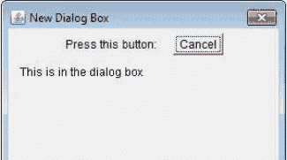

**提示**：请你亲自尝试为菜单中提供的其他选项定义对话框。

## 关于重写 paint() 的说明

在开始研究 AWT 控件之前，有必要简单要说明一下重写 `paint()`。虽然这与书中的简单 AWT 示例无关，但在重写 `paint()` 时，有时需要调用父类的 `paint()` 实现。因此，对于某些程序，你将需要此 `paint()` 骨架：

```java
public void paint(Graphics g) {
    // 用于重绘此窗口的代码

    // 调用父类的 paint()
    super.paint(g);
}
```

在 Java 中，组件有两种通用的类型：重量级和轻量级。重量级组件拥有自己的原生窗口，这被称为它的*对等*（peer）。轻量级组件完全用 Java 代码实现，并使用祖先组件提供的窗口。本章描述和使用的 AWT 控件都是重量级的。然而，如果一个容器持有任何轻量级组件（即拥有轻量级组件），你对该容器的 `paint()` 重写必须调用 `super.paint()`。通过调用 `super.paint()`，你可以确保任何轻量级组件都能作为轻量级控件得到正确的绘制。如果你不确定子组件的类型，可以调用 `Component` 定义的 `isLightweight()`。如果组件是轻量级的，则返回 `true`，否则返回 `false`。

# 第 28 章 图像

本章将研究 `Image` 类和 `java.awt.image` 包。它们共同提供了图像支持（图形图像的显示和操作）。图像简单来说就是一个矩形图形对象。图像是网页设计的关键组件。事实上，NCSA（国家超级计算机应用中心）的 Mosaic 浏览器中引入 `` 标签是帮助 Web 在 1993 年爆炸式增长的催化剂。该标签用于将图像嵌入超文本流中。Java 扩展了这一基本概念，使用类允许在程序控制下管理图像。由于其重要性，Java 为图像处理提供了广泛的支持。

图像由 `Image` 类支持，该类是 `java.awt.image` 包的一部分。使用该包中的类对图像进行操作。`java.awt.image` 定义了大量的图像处理类和接口，无法逐一检查。相反，我们将关注那些构成图像处理基础的类。以下是本章讨论的 `java.awt.image` 类：

| CropImageFilter | MemoryImageSource |
| :--- | :--- |
| FilteredImageSource | PixelGrabber |
| ImageFilter | RGBImageFilter |

我们将使用的接口是 `ImageConsumer` 和 `ImageProducer`。

## 文件格式


最初，网页图像只能是 GIF 格式。GIF 格式由 CompServe 在 1987 年创建，以便图像能够在网上查看，同时也适应互联网。每张 GIF 图像最多只有 256 种颜色。这种局限性导致主要的浏览器厂商在 1995 年增加了对 JPEG 图像的支持。JPEG 格式由一组摄影专家创建，用于存储全色谱、连续调的图像。这些图像在创建得当时，比相同源图像的 GIF 编码具有更高的保真度，压缩率也更高。另一种文件格式是 PNG。它是 GIF 的替代方案。在几乎所有情况下，你永远不需要关心或注意到程序中使用哪种格式。Java 图像类通过整洁的接口抽象了背后的差异。

## 图像基础：创建、加载和显示

在处理图像时通常会发生常见操作：创建图像、加载图像和显示图像。在 Java 中，`Image` 类被用于引用内存中的图像以及从外部源加载的图像。因此，Java 提供了让你创建新图像对象的方法以及加载图像的方法。它还提供了显示图像的方法。让我们逐一查看。

## 创建图像对象

你可能认为可以使用类似下面的代码创建图像：

```java
Image test = new Image(200, 100); // 错误 -- 无法工作
```

并非如此。因为图像必须在窗口上绘制才能看到，`Image` 类没有足够的环境信息来为屏幕创建正确的格式。`java.awt` 中的 `Component` 类有一个名为 `createImage()` 的工厂方法，用于创建 `Image` 对象。请记住，所有的 AWT 组件都是 `Component` 的子类，因此所有组件都支持此方法。

`createImage()` 方法有以下形式：

```java
createImage(ImageProducer imgProd)
createImage(int width, int height)
```

第一种形式返回由 `imgProd` 的图像，它是实现 `ImageProducer` 接口的类的对象。（我们稍后会查看图像生产者）。第二种形式返回一个具有指定宽度和高度的空白（空的）图像，它是 `Canvas` 的一个实例。这里有一个示例：

```java
Canvas c = new Canvas();
Image test = c.createImage(200, 100);
```

这创建了一个 `Canvas` 实例并调用 `createImage()` 方法来实际制作图像。此时图像是空白的。

## 加载图像

获取图像的另一种方法是从文件或 URL 加载。最简单的方法是使用 `ImageIO` 类。这里有一个加载图像的程序：

```java
import java.awt.*;
import java.awt.event.*;
import javax.imageio.*;
import java.io.*;

public class SimpleLoad extends Frame {
    Image img;

    public SimpleLoad() {
      try {
        File imageFile = new File("Lilies.jpg");

        // 加载图像。
        img = ImageIO.read(imageFile);
      } catch (IOException exc) {
        System.out.println("无法加载图像.");
        System.exit(0);
      }

      addWindowListener(new WindowAdapter() {
        public void windowClosing(WindowEvent event) {
          System.exit(0);
        }
      });
    }

    public void paint(Graphics g) {
      g.drawImage(img, getInsets().left, getInsets().top, null);
    }

    public static void main(String[] args) {
      SimpleLoad appwin = new SimpleLoad();

      appwin.setSize(new Dimension(400, 365));
      appwin.setTitle("SimpleLoad");
      appwin.setVisible(true);
    }
}
```

## 显示图像

一旦有了图像，就可以通过 `Graphics` 类的 `drawImage()` 方法来显示它。这里有一个加载并显示图像的程序：

```java
import java.awt.*;
import java.awt.event.*;
import javax.imageio.*;
import java.io.*;

public class SimpleLoad extends Frame {
    Image img;

    public SimpleLoad() {
      try {
        File imageFile = new File("Lilies.jpg");

        // 加载图像。
        img = ImageIO.read(imageFile);
      } catch (IOException exc) {
        System.out.println("无法加载图像.");
        System.exit(0);
      }

      addWindowListener(new WindowAdapter() {
        public void windowClosing(WindowEvent event) {
          System.exit(0);
        }
      });
    }

    public void paint(Graphics g) {
      g.drawImage(img, getInsets().left, getInsets().top, null);
    }

    public static void main(String[] args) {
      SimpleLoad appwin = new SimpleLoad();

      appwin.setSize(new Dimension(400, 365));
      appwin.setTitle("SimpleLoad");
      appwin.setVisible(true);
    }
}
```

## 双缓冲

图像不仅可以存储图片（正如我们刚刚展示的那样），你还可以将其用作离线绘制表面。这允许你将任何图像渲染到一个离线缓冲区，并在稍后显示它。这样做的好处是图像只有在完成时才被看到。一个复杂的图像可能需要几毫秒或更长时间，这会被用户看到为闪烁。这种闪烁会分散注意力，并导致用户认为你的渲染速度比实际的慢。使用离线图像来减少闪烁被称为双缓冲，因为屏幕被认为是像素的缓冲区，而离线图像是第二个缓冲区，你可以在其中准备用于显示的像素。

```java
Graphics gc = test.getGraphics();
gc.setColor(Color.red);
gc.fillRect(0, 0, 200, 100);
```

一旦你构建并填充了离屏图像，它仍然是不可见的。要实际显示该图像，请调用 `drawImage()`。这里有一个示例，它绘制了一幅耗时的图像，以展示双缓冲在感知绘图中可以达到的效果：

```java
// Demonstrate the use of an off-screen buffer.
import java.awt.*;
import java.awt.event.*;

public class DoubleBuffer extends Frame {
    int gap = 3;
    int mx, my;
    boolean flicker = true;
    Image buffer = null;
    int w = 400, h = 400;

    public DoubleBuffer() {
        addMotionListener(new MouseMotionAdapter() {
            public void mouseDragged(MouseEvent me) {
                mx = me.getX();
                my = me.getY();
                flicker = false;
                repaint();
            }
            public void mouseMoved(MouseEvent me) {
                mx = me.getX();
                my = me.getY();
                flicker = true;
                repaint();
            }
        });
        addWindowListener(new WindowAdapter() {
            public void windowClosing(WindowEvent we) {
                System.exit(0);
            }
        });
    }

    public void paint(Graphics g) {
        Graphics screencg = null;

        if (!flicker) {
            screencg = g;
            g = buffer.getGraphics();
        }
        g.setColor(Color.blue);
        g.fillRect(0, 0, w, h);

        g.setColor(Color.red);
        for (int i=0; i<w; i+=gap)
            g.drawLine(i, 0, i, w-1);
        for (int i=0; i<h; i+=gap)
            g.drawLine(0, i, w-gap, i);

        g.setColor(Color.black);
        g.drawString("Press mouse button to double buffer", 10, h/2);

        g.setColor(Color.yellow);
        g.fillOval(mx - gap, my - gap, gap*2+1, gap*2+1);

        if (!flicker) {
            screencg.drawImage(buffer, 0, 0, null);
        }
    }

    public void update(Graphics g) {
        paint(g);
    }

    public static void main(String[] args) {
        DoubleBuffer appwin = new DoubleBuffer();

        appwin.setSize(new Dimension(400, 400));
        appwin.setTitle("DoubleBuffer");
        appwin.setVisible(true);

        // Create an off-screen-buffer.
        appwin.buffer = appwin.createImage(appwin.w, appwin.h);
    }
}
```

这个简单的程序包含一个 `paint()` 方法。它用蓝色填充背景，并在上方绘制一个红色的斑点图案。上方再画一些黑色，然后于坐标 `mx`, `my` 处绘制一个黄色圆圈。重写了 `mouseMoved()` 和 `mouseDragged()` 方法以跟踪鼠标位置。这两个方法完全相同，区别在于设置 `flicker` 变量。`mouseMoved()` 和 `mouseDragged()` 将 `flicker` 设置为 `true`；这的效果是在鼠标移动（但未按下）时调用 `repaint()` 且 `flicker` 为 `true`，并且在按下任何按钮并拖动鼠标时，将其设置为 `false`。

当 `paint()` 将 `flicker` 设置为 `true` 时，我们可以看到每一个绘图操作在屏幕上的执行过程。在按下按钮且 `flicker` 为 `false` 时调用 `paint()` 的情况下，我们看到的是完全不同的画面。`paint()` 方法将 `Graphics` 引用切换为离屏图像的图形对象。所示结果如图 28-2 所示。

`grabPixels()` 的定义如下：

```java
boolean grabPixels()
throws InterruptedException
```

```java
boolean grabPixels(long milliseconds)
throws InterruptedException
```

这两个方法在成功时返回 `true`，否则返回 `false`。在第二种形式中，`milliseconds` 指定了方法等待像素的时间。如果执行被另一个线程中断，两者都会抛出 `InterruptedException`。

下面的示例演示了从图像中获取像素并创建像素亮度直方图。直方图仅仅是在 0 到 255 的所有亮度设置之间，具有特定亮度的像素计数。在程序绘制图像后，它会在上方绘制该直方图。

```java
// Demonstrate PixelGrabber.
import java.awt.*;
import java.awt.event.*;
import java.awt.image.*;
import java.imageio.*;
import java.io.*;

public class HistoGrab extends Frame {
Dimension d;
Image img;
int iw, ih;
int[] pixels;
int[] hist = new int[256];
int max_hist = 0;
Insets ins;

public HistoGrab() {
try {
File imageFile = new File("Lilies.jpg");

// Load the image.
img = ImageIO.read(imageFile);

iw = img.getWidth(null);
ih = img.getHeight(null);
pixels = new int[iw * ih];
PixelGrabber pg = new PixelGrabber(img, 0, 0, iw, ih, pixels, 0, iw);
grabPixels();
} catch (InterruptedException e) {
System.out.println("Interrupted");
return;
} catch (IOException exc) {
System.out.println("Cannot load image file.");
System.exit(0);
}
```

```java
for (int i=0; i<iw*ih; i++) {
    int p = pixels[i];
    int r = 0xff & (p >> 16);
    int g = 0xff & (p >> 8);
    int b = 0xff & (p);
    int y = (.33 * r + .56 * g + .11 * b);
    hist[y]++;
}
for (int i=0; i<256; i++) {
    if (hist[i] > max_hist)
        max_hist = hist[i];
}
```

```java
addWindowListener(new WindowListener() {
    public void windowClosing(WindowEvent we) {
        System.exit(0);
    }
});
```

```java
public void paint(Graphics g) {
    // Get the border/header inlets
    ins = getInsets();
g.drawImage(img, ins.left, ins.top, null);

    for (int x = (iw - 256) / 2; x < iw; x++) {
        int y = ih - ih * hist[x] / max_hist;
        g.setColor(new Color(x, x, x));
        g.fillRect(x+ins.left, y+ins.top, 1, ih-y);
        g.setColor(Color.red);
        g.drawLine((x-1)+ins.left,y+ins.top,x+ins.left,y+ins.top);
    }
}
```


```java
public static void main(String[] args) {
    HistoGrab appwin = new HistoGrab();

    appwin.setSize(new Dimension(400, 380));
    appwin.setTitle("HistGrab");
    appwin.setVisible(true);
}
```

图 28-4 显示了一个示例图像及其直方图。

## ImageFilter

给定了 `ImageProducer` 和 `ImageConsumer` 接口对——以及它们的具体类 `MemoryImageSource` 和 `PixelGrabber`——你可以创建任意一组转换过滤器，这些过滤器接收像素源、修改它们，并将它们传递给任意消费者。这种机制类似于从抽象 I/O 类 `InputStream`、`OutputStream`、`Reader` 和 `Writer`（在第 22 节中描述）创建类的方式。这种图像流式模型通过引入 `ImageFilter` 类得到了完善。`java.awt` 包中 `ImageFilter` 的某些子类包括 `AreaAveragingScaleFilter`、`CropFilter`、`ReplicateScaleFilter` 和 `RGBImageFilter`。还有一种名为 `FilteredImageSource` 的 `ImageProducer` 实现，它接收任意的 `ImageFilter` 并将其封装在 `ImageProducer` 之上以过滤像素。`FilteredImageSource` 的实例可以在调用 `createImage()` 时作为 `ImageProducer` 使用，就像 `BufferedInputStream` 可以作为 `InputStream` 使用一样。

在本章中，我们检查了两个过滤器：`CropFilter` 和 `RGBImageFilter`。

## CropFilter

`CropFilter` 过滤图像以提取矩形区域。这种过滤器有价值的一种情况是，当你想要从单一较大的源图像中使用多个小图像时。加载 2K 图像比加载一个包含许多动画帧平铺在其中的 40K 图像要慢得多。如果每个子图像的大小相同，你可以轻松地在程序启动后使用 `CropFilter` 分解块来提取这些图像。这是一个示例，展示了从单张图像创建的 16 张图像。

随后通过交换 16 张图像中的随机随机对 32 次，对这些磁片进行了打乱。


图 28-4 HistoGrab 的示例输出

```java
// Demonstrate PixelFilter.
import java.awt.*;
import java.awt.event.*;
import java.awt.image.*;
import java.imageio.*;
import java.io.*;

public class HistoGrab extends Frame {
    Dimension d;
    Image img;
    int iw, ih;
    int[] pixels;
    int[] hist = new int[256];
    int max_hist = 0;
    Insets ins;

    public HistoGrab() {
        try {
            File imageFile = new File("Lilies.jpg");

            // Load the image.
            img = ImageIO.read(imageFile);

            iw = img.getWidth(null);
            ih = img.getHeight(null);
            pixels = new int[iw * ih];
            PixelGrabber pg = new PixelGrabber(img, 0, 0, iw, ih, pixels, 0, iw);
            grabPixels();
        } catch (InterruptedException e) {
            System.out.println("Interrupted");
            return;
        } catch (IOException exc) {
            System.out.println("Cannot load image file.");
            System.exit(0);
        }
    }
}
```

```java
for (int i = 0; i < iw * ih; i++) {
    int p = pixels[i];
    int r = 0xff & (p >> 16);
    int g = 0xff & (p >> 8);
    int b = 0xff & (p);
    int y = (.33 * r + .56 * g + .11 * b);
    hist[y]++;
}
for (int i = 0; i < 256; i++) {
    if (hist[i] > max_hist)
        max_hist = hist[i];
}
```

```java
addWindowListener(new WindowListener() {
    public void windowClosing(WindowEvent we) {
        System.exit(0);
    }
});
```

```java
public void paint(Graphics g) {
    // Get the border/header inlets
    ins = getInsets();
    g.drawImage(img, ins.left, ins.top, null);

    for (int x = (iw - 256) / 2; x < iw; x++) {
        int y = ih - ih * hist[x] / max_hist;
        g.setColor(new Color(x, x, x));
        g.fillRect(x + ins.left, y + ins.top, 1, ih - y);
        g.setColor(Color.red);
        g.drawLine((x - 1) + ins.left, y + ins.top, x + ins.left, y + ins.top);
    }
}
```

```java
public static void main(String[] args) {
    HistoGrab appwin = new HistoGrab();

    appwin.setSize(new Dimension(400, 380));
    appwin.setTitle("HistGrab");
    appwin.setVisible(true);
}
```

## RGBImageFilter

`RGBImageFilter` 用于逐像素将一个图像转换为另一个，在此过程中转换颜色。这种过滤器可以用于增强图像、增加其对比度或将其转换为灰度。

为了演示 `RGBImageFilter`，我们开发了一个相当复杂的示例，该示例为程序图像处理过滤器采用了插件策略。我们创建了一个接口，使得程序可以简单地加载这些过滤器。


图 28-5 HistoGrab 的示例输出

```java
// 创建顶部标签。
lab = new Label("");
add(lab, BorderLayout.NORTH);
```

```java
// 加载图片。
try {
    File imageFile = new File("Lilies.jpg");
    // 加载图片。
    img = ImageIO.read(imageFile);
} catch (IOException exc) {
    System.out.println("无法加载图片文件.");
    System.exit(0);
}
```

```java
// 获取一个加载的 LoadedImage 并将其添加到中心。
lim = new LoadedImage(img);
add(lim, BorderLayout.CENTER);
```

```java
addWindowListener(new WindowAdapter() {
    public void windowClosing(WindowEvent we) {
        System.exit(0);
    }
});
```

```java
public void actionPerformed(ActionEvent ae) {
    String a = "";

    try {
        a = ae.getActionCommand();
        if (a.equals("Reset")) {
            lim.set(img);
            lab.setText("Normal");
        } else {
            // 获取选定的过滤器。
            pif = (PluginInFilter)(Class.forName(a)).Constructor().newInstance();
            img = pif.filter(this, img);
            lim.set(img);
            lab.setText("Filtered: " + a);
        }
        repaint();
    } catch (ClassNotFoundException e) {
        lab.setText(a + " not found");
        lim.set(img);
        repaint();
    } catch (InstantiationException e) {
        lab.setText("could't new " + a);
    } catch (IllegalAccessException e) {
        lab.setText("no access: " + a);
    } catch (NoSuchMethodException | InvocationTargetException e) {
        lab.setText("Filter creation error: " + e);
    }
}
```

```java
public static void main(String[] args) {
    ImageFilterDemo appwin = new ImageFilterDemo();
    appwin.setSize(new Dimension(420, 420));
    appwin.setTitle("ImageFilterDemo");
    appwin.setVisible(true);
}
```

图 28-6 显示了程序在首次加载时的样子。

## PluginInFilter.java

`PluginInFilter` 是一个用于抽象图像过滤的简单接口。它只有一个方法 `filter()`，它接收帧和源图像，并返回一个经过某种方式过滤的新图像。

```java
interface PluginInFilter {
    Image filter(java.awt.Frame f, java.awt.Image in);
}
```

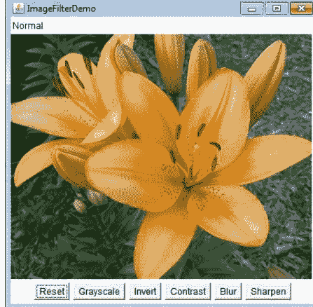

图 28-6 ImageFilterDemo 的示例正常输出

## LoadedImage.java

`LoadedImage` 是 `Canvas` 的一个方便子类。它在布局管理器的控制下表现正常，因为它重写了 `getPreferredSize()` 和 `getMinimumSize()` 方法。此外，它还有一个名为 `set()` 的方法，用于设置要在在该 `Canvas` 中显示的新 `Image`。也就是说，当插件过滤完成后，就会显示过滤后的图像。

```java
import java.awt.*;

public class LoadedImage extends Canvas {
    Image img;

    public LoadedImage(Image i) {
        set(i);
    }

    void set(Image i) {
        img = i;
        repaint();
    }

    public void paint(Graphics g) {
        if (img == null) {
            g.drawString("no image", 10, 30);
        } else {
            g.drawImage(img, 0, 0, this);
        }
    }

    public Dimension getPreferredSize() {
        return new Dimension(img.getWidth(this), img.getHeight(this));
    }

    public Dimension getMinimumSize() {
        return getPreferredSize();
    }
}
```

## Grayscale.java

`Grayscale` 过滤器是 `RGBImageFilter` 的子类，这意味着 `Grayscale` 可以将自己作为 `FilteredImageSource` 构造函数的 `ImageFilter` 参数。然后它做的就是重写 `filterRGB` 来更改传入的颜色值。它获取红、绿、蓝值，并使用 NTSC（国家电视委员会）颜色到亮度系数计算像素的亮度。它简单地返回一个与源图像亮度相同的灰色像素。

```java
// 灰度过滤器。
import java.awt.*;
import java.awt.image.*;

class Grayscale extends RGBImageFilter {
    public Grayscale() {}

    public Image filter(Frame f, Image in) {
        return f.createImage(new FilteredImageSource(in.getSource()), this);
    }

    public int filterRGB(int x, int y, int rgb) {
        int r = (rgb >> 16) & 0xff;
        int g = (rgb >> 8) & 0xff;
        int b = rgb & 0xff;
        int k = (int) (0.5 * g + 0.3 * r + 0.1 * b);
        return (0xff000000 | k << 16 | k << 8 | k);
    }
}
```

## Invert.java

`Invert` 过滤器也很简单。它获取红、绿、蓝值，通过从 255 中减去它们来反转它们。这些反转后的值被封装回像素结果中。

```java
// 反转颜色。
import java.awt.*;
import java.awt.image.*;

class Invert extends RGBImageFilter {
    public Invert() {}

    public Image filter(Frame f, Image in) {
        return f.createImage(new FilteredImageSource(in.getSource()), this);
    }

    public int filterRGB(int x, int y, int rgb) {
        int r = 0xff - ((rgb >> 16) & 0xff);
        int g = 0xff - ((rgb >> 8) & 0xff);
        int b = 0xff - (rgb & 0xff);
        return (0xff000000 | r << 16 | g << 8 | b);
    }
}
```

图 28-7 显示了通过 `Invert` 过滤器后的图像。

## Contrast.java

`Contrast` 过滤器与 `Grayscale` 非常相似，它的 `filterRGB()` 方法稍微复杂。用于对比增强的算法分别获取红、绿、蓝值，如果它们大于 128，则将其增强 1.2 倍。如果它们小于 128，则除以 1.2。增强后的值通过 `multclamp()` 方法被限制在 255。


```java
// 对比度过滤器。
import java.awt.*;
import java.awt.image.*;

class Contrast extends RGBImageFilter implements PluginInFilter {

    public Image filter(Frame f, Image in) {
        return f.createImage(new FilteredSource(in.getSource()), this);
    }

    private int multclamp(int in, double factor) {
        in = (int) (in * factor);
        return in > 255 ? 255 : in;
    }

    double gain = 1.2;
    private int cont(int in) {
        return (in < 128) ? (int)(in/gain) : multclamp(in, gain);
    }

    public int filterRGB(int x, int y, int rgb) {
        int r = cont((rgb >> 16) & 0xff);
        int g = cont((rgb >> 8) & 0xff);
        int b = cont(rgb & 0xff);
        return (0xff000000 | r << 16 | g << 8 | b);
    }
}
```

图 28-8 显示了 `Contrast` 后的图像。

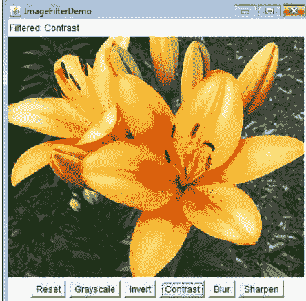

**图 28-8** 在 `ImageFilterDemo` 中使用 `Contrast` 过滤器

## Convolver.java

抽象类 `Convolver` 通过实现 `ImageConsumer` 接口处理卷积过滤器，将源像素移动到名为 `imgpixels` 的数组中。它还创建了第二个数组 `newpixels` 用于过滤后的数据。卷积过滤器采样图像中每个像素周围的小矩形，称为*卷积核*（convolution kernel）。在演示中，3×3 像素的区域用于更改中心像素。

> 注意：过滤器不能修改 `imgpixels` 数组的原因是下一行的像素将使用上一个像素的原始值，而该像素已经被过滤过了。

接两个具体子类简单地实现了 `convolve()` 方法，使用 `imgpixels` 作为源数据并使用 `newpixels` 存储结果。

```java
// 卷积过滤器。
import java.awt.*;
import java.awt.image.*;

abstract class Convolver implements ImageConsumer, PluginInFilter {
    int width, height;
    int[] imgpixels, newpixels;
    boolean imageReady = false;

    abstract void convolve(); // 过滤器在此处...

    public Image filter(Frame f, Image in) {
        imageReady = false;
        in.getSource().startProduction(this);
        waitForImage();
        newpixels = new int[width*height];
        try {
            convolve();
        } catch (Exception e) {
            System.out.println("Converter failed: " + e);
            e.printStackTrace();
        }

        return f.createImage(
        MemorySource(width, height, newpixels, 0, width));
    }

    synchronized void waitForImage() {
        try {
            while (!imageReady)
                wait();
        } catch (Exception e) {
            System.out.println("Interrupted");
        }
    }
    public void setProperties(java.util.Hashtable<?>,? dummy) {}
    public void setColor(ColorModel dummy) {}
    public void setHints(int dummy) {}

    public synchronized void imageComplete(int dummy) {
        imageReady = true;
        notifyAll();
    }

    public void setDimensions(int x, int y) {
        width = x;
        height = y;
        imgpixels = new int[x*y];
    }

    public void setPixels(int x1, int y1, int w, int h) {
        ColorModel model, byte[] pixels, int off, int scanize);
        int pix, x, y, x2, sx, sy;
        x2 = x1+w;
        y2 = y1+h;
        sy = off;
        for (y=y1; y<y2; y++) {
            sx = sy;
            for (sx=x1; sx<x2; sx++) {
                pix = model.getRGB(pixels[sx++]);
                if((pix & 0xff000000) == 0)
                    pix = 0x00ffffffff;
            }
        }
    }
}
```

```java
imgpixels[y*width+x] = pix;
)
sy += scansize;
}
```

```java
public void setPixels(int x1, int y1, int w, int h,
    ColorModel model, int[] pixels, int off, int scansize) {
int pix, x, y, x2, y2, sx, sy;

nx2 = x1+w;
y2 = y1+h;
sy = off;
for(y=y1; y<y2; y++) {
sx = sy;
for(x=x1; x<x2; x++) {
    pix = model.RGB(pixels[sx]);
    if ((pix & 0xff000000) == 0)
        pix = 0x00ffffffff;
    imgpixels[y*width+x] = pix;
}
sy += scansize;
}
}
```

注：`java.awt.image` 提供了一个内置的卷积过滤器 `ConvolveOp`。你可能想自己探索它的功能。

# Blur.java

`Blur` 是 `Convolver` 的子类，它简单地遍历源图像数组 `imgpixels` 中的每个像素，并计算其周围 3x3 框的平均值。`newimgpixels` 中对应的输出像素就是该平均值。

```java
public class Blur extends Convolver {
public void convolve() {
for(int y=1; y<height-1; y++) {
for(int x=1; x<width-1; x++) {
int rs = 0;
int gs = 0;
int bs = 0;

for(int k=-1; k<=1; k++) {
for(int j=-1; j<=1; j++) {
    int rgb = imgpixels[(y+k)*width+x+j];
int r = (rgb >> 16) & 0xff;
int g = (rgb >> 8) & 0xff;
int b = rgb & 0xff;
rs += r;
gs += g;
}
}
```

```java
bs += b;
}
}
rs /= 9;
gs /= 9;
bs /= 9;
newimgpixels[y*width+x] = (0xff000000 |
  rs << 16 | gs << 8 | bs);
}
}
```

图 28-9 显示了 `Blur` 处理后的图像。

# Sharpen.java

`Sharpen` 过滤器也是 `Convolver` 的子类，并且（某种程度上）是 `Blur` 的逆操作。它遍历源图像数组 `imgpixels` 中的每个像素，并计算其周围 3x3 框的平均值（不包括中心像素）。`newimgpixels` 中对应的输出像素加上了中心像素与周围平均值之差。这基本上意味着，如果一个像素比周围环境亮了 30，就让它再亮 30。

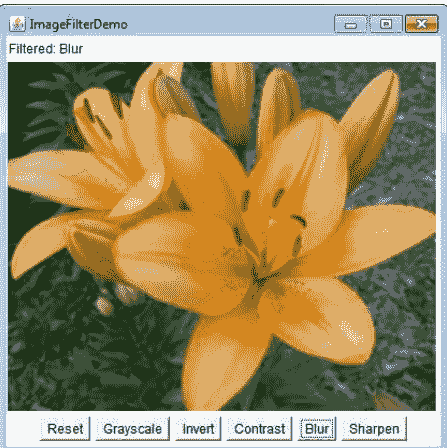

图 28-9 在 `ImageFilterDemo` 使用 `Blur` 过滤器

然而，如果它比周围暗了 10，就让它再暗 10。这种方法趋向于增强边缘，同时保持平滑区域不变。

```java
public class Sharpen extends Convolver {
```

```java
private final int clamp(int c) {
    return (c < 255 ? (c < 0 ? 0 : c) : 255);
}
```

```java
public void convolve() {
    int r0=0, g0=0, b0=0;
```

```java
for(int y=1; y<height-1; y++) {
    for(int x=1; x<width-1; x++) {
        int rs = 0;
        int gs = 0;
        int bs = 0;

        for(int k=-1; k<=1; k++) {
            for(int j=-1; j<=1; j++) {
                int rgb = imgpixels[(y+k)*width+x+j];
                int r = (rgb >> 16) & 0xff;
                int g = (rgb >> 8) & 0xff;
                int b = rgb & 0xff;
                if (j == 0 && k == 0) {
                    r0 = r;
                    g0 = g;
                    b0 = b;
                } else {
                    rs += r;
                    gs += g;
                    bs += b;
                }
            }
        }

        rs >>= 3;
        gs >>= 3;
        bs >>= 3;
        newimgpixels[y*width+x] = (0xff000000 |
            clamp(r0+r0-rs) << 16 |
            clamp(g0+g0-gs) << 8 |
            clamp(b0+b0-bs));
    }
}
```

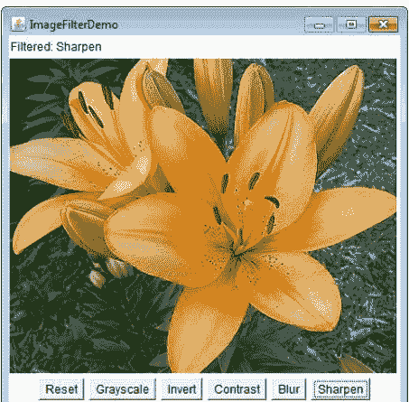

**图 28-10** 在 `ImageFilterDemo` 使用 `Sharpen` 过滤器

图 28-10 显示了 `Sharpen` 处理后的图像。

# 其他类

除了本章描述的类之外，`java.awt.image` 还提供了处理各种格式的其他类。正如你所预料的，围绕并发的许多问题都是复杂的。讨论它的所有方面超本书的范围。尽管如此，对于所有程序员来说，对并发 API 的关键方面具有通用且有效的知识是非常重要的。即使在不是密集并行的程序中，可调用线程（`callable threads`）和执行器（`executors`）等功能适用于许多情况。最重要的是，由于多核计算机的兴起，使用 Fork/Join 框架的解决方案变得越来越常见。由于这些原因，本章介绍了并发工具定义的几个核心功能的概述，并展示了演示它们用途的示例。最后以 Fork/Join 框架的介绍。

并发工具包含在 `java.util.concurrent` 包及其两个子包中：`java.util.concurrent.atomic` 和 `java.util.concurrent.locks`。从 JDK 9 开始，所有内容都在 `java.base` 模块中。这里是它们内容的简要概述。

# 工具类

从开始，Java 就提供了对多线程的内置支持。原始的并发 API 相当大，多年来的增加增加了其规模。正如你可以想象的，并行执行可以极大提高某些操作的速度。由于多核系统现在已随处可见，引入 Fork/Join 框架是非常强大的。Fork/Join 框架在 JDK 8 中得到了增强。

此外，JDK 8 和 JDK 9 都为并发 API 的部分添加了功能。因此，多年来并发 API 不断演进和扩展以满足现代环境的需求。

`java.util.concurrent` 定义了支持同步和线程通信替代方案的核心功能。这些包括：

- 同步器 (Synchronizers)
- 执行器 (Executors)
- 并发集合 (Concurrent collections)
- Fork/Join 框架

同步器提供了多线程间同步的高级方式。`java.util.concurrent` 定义的同步器类包括：

| 类名 | 说明 |
| :--- | :--- |
| `Semaphore` | 实现信号量类。 |
| `CountDownLatch` | 等待指定数量的事件发生。 |
| `CyclicBarrier` | 允许一组线程在预定义的执行点处等待。 |
| `Exchanger` | 在两个线程之间交换数据。 |
| `Phaser` | 同步通过多个阶段操作的线程。 |

## 第29 章 并发工具

请注意，每个同步器都为特定类型的同步问题提供了解决方案。这使得每个同步器都能针对其预期的用途进行优化。在 Java 早期，这些类型的同步对象必须手工构建。并发 API 将它们标准化，并让所有 Java 程序员可以使用。

`Executors` 管理线程的执行。`Executor` 层次结构的顶层是 `Executor` 接口，`ExecutorService` 扩展了 `Executor` 并包含了执行的方法。`ExecutorService` 有三种实现：`ThreadPoolExecutor`、`ScheduledThreadPoolExecutor` 和 `ForkJoinPool`。`java.concurrent` 还定义了 `Executors` 工具类，它包含许多简化创建各种执行器的静态方法。

与执行器相关的是 `Future` 和 `Callable` 接口。`Future` 包含线程在执行后返回的值。它的值定义在“未来”，即线程终止时。`Callable` 定义了一个返回值的线程。

`java.util.concurrent` 定义了几个并发集合类，包括 `ConcurrentHashMap`、`LinkedBlockingQueue` 和 `CopyOnWriteArrayList`。它们为 Collections Framework 中定义的相关类提供了并发替代方案。

Fork/Join 框架支持并行编程。其主要类是 `ForkTask`、`ForkJoinPool`、`RecursiveTask` 和 `RecursiveAction`。

为了处理线程计时，`java.util.concurrent` 定义了 `TimeUnit` 枚举。从 JDK 9 开始，`java.util.concurrent` 还包含了一个提供数据流控制机制系统。它基于 `Flow` 类及其嵌套接口：`Flow.Subscriber`、`Flow.Publisher`、`Flow.Processor` 和 `Flow.Subscription`。`Flow` 及其嵌套接口支持响应式流规范。虽然本章未详细讨论 Flow 系统，但这里有一个简要描述。该规范定义了数据消费者防止数据生产者超过消费者处理数据能力的方法。在这种方法中，数据由发布者产生并由订阅者消费。通过某种形式的背压（back pressure）来实现控制。

## java.util.concurrent.atomic

`java.util.concurrent.atomic` 利用在并发环境中使用变量而不使用锁。它提供了高效更新变量值的方法。这是通过使用如 `AtomicInteger` 和 `AtomicLong` 等类，以及 `compareAndSet()`、`decrementAndGet()` 和 `getAndSet()` 等方法实现的。这些方法作为单一的、不可中断的操作执行。


## java.util.concurrent.locks

`java.util.concurrent.locks` 提供了 `synchronized` 方法的替代方案。这种替代方案的核心是 `Lock` 接口，它定义了用于获取和释放对象访问权限的机制。关键方法是 `lock()`、`tryLock()` 和 `unlock()`。使用这些方法的优点是对同步具有更大的控制力。

本章的剩余部分将详细查看并发 API 的组成部分。


## 使用同步对象

同步对象由 `Semaphore`、`CountDownLatch`、`CyclicBarrier`、`Exchanger` 和 `Phaser` 类支持。它们合在一起使你能够轻松处理以前困难的同步情况。它们也适用于广泛的程序——甚至是那些仅包含有限并发的程序。由于同步对象将几乎所有 Java 程序都感兴趣，因此这里对每个对象都进行了详细检查。

## Semaphore

许多读者会立即识别出 `Semaphore` 这个同步对象，它实现了一个经典的信号量。信号量通过使用计数器来控制对共享资源的访问。如果计数器大于零，则允许访问。如果为零，则拒绝访问。计数器的值代表允许访问共享资源的许可。因此，要访问资源，线程必须从信号量处获得许可。

通常情况下，要使用信号量，想要访问共享资源的线程会尝试获取许可。如果信号量的计数大于零，则该线程获取许可，这会导致信号量的计数减 1。否则，线程将被阻塞，直到获取许可为止。当线程不再需要资源时，它会释放许可，这会导致信号量的计数加 1。如果有另一个线程在等待许可，那么该线程将在此时获取许可。Java 的 `Semaphore` 类实现了这种机制。

`Semaphore` 具有此处所示的两个构造函数：

```java
Semaphore(int num)
```

```java
Semaphore(int num, boolean fair)
```

在这里，`num` 指定初始许可计数。因此，`num` 指定了任何时候可以访问共享资源的线程数。如果 `num` 为 1，则任何时刻只有一个线程可以访问资源。默认情况下，等待的线程以未定义的顺序授予许可。通过将 `fair` 设置为 `true`，你可以确保等待的线程按照它们请求访问的顺序授予许可。

要获取许可，调用 `acquire()` 方法，它有两种形式：

```java
void acquire() throws InterruptedException
void acquire(int num) throws InterruptedException
```

第一种形式获取一个许可。通常使用第一种形式。如果在调用时无法授予许可，调用线程将挂起，直到许可可用。

要释放许可，调用 `release()`，它有两种形式：

```java
void release()
void release(int num)
```

第一种形式释放一个许可。第二种形式释放由 `num` 指定数量的许可。

要使用信号量控制对资源的访问，每个想要使用该资源的线程在访问资源之前必须先调用 `acquire()`。当线程完成资源的使用后，必须调用 `release()`。这里是一个使用信号量的简单示例。

```java
import java.util.concurrent.*;

class SemDemo {

    static class Shared {
        static int count = 0;
    }

    static class IncThread implements Runnable {
        Semaphore sem;
        String name;

        IncThread(Semaphore s, String n) {
            sem = s;
            name = n;
        }

        public void run() {
            System.out.println("Starting " + name);
            try {
                // 首先，获取许可。
                System.out.println(name + " is waiting for a permit.");
                sem.acquire();
                System.out.println(name + " gets a permit.");

                // 现在，访问共享资源。
                for(int i=0; i < 5; i++) {
                    Shared.count++;
                    System.out.println(name + ": " + Shared.count);
                }

                // 现在，允许上下文切换——如果可能。
                Thread.sleep(10);
            } catch (InterruptedException e) {
                e.printStackTrace();
            }
            // 释放许可。
            System.out.println(name + " releases the permit.");
            sem.release();
        }
    }

    static class DecThread implements Runnable {
        Semaphore sem;
        String name;

        DecThread(Semaphore s, String n) {
            sem = s;
            name = n;
        }

        public void run() {
            System.out.println("Starting " + name);
            try {
                // 首先，获取许可。
                System.out.println(name + " is waiting for a permit.");
                sem.acquire();
                System.out.println(name + " gets a permit.");

                // 现在，访问共享资源。
                for(int i=0; i < 5; i++) {
                    Shared.count--;
                    System.out.println(name + ": " + Shared.count);
                }

                // 现在，允许上下文切换——如果可能。
                Thread.sleep(10);
            } catch (InterruptedException e) {
                e.printStackTrace();
            }
            // 释放许可。
            System.out.println(name + " releases the permit.");
            sem.release();
        }
    }

    public static void main(String[] args) {
        Semaphore sem = new Semaphore(1);
        new Thread(new IncThread(sem, "A")).start();
        new Thread(new DecThread(sem, "B")).start();
    }
}
```

程序的输出在此处显示。（线程执行的精确顺序会有不同。）

```
A: 1
开始 B
B 正在等待许可。
A: 2
A: 3
A: 4
A: 5
A 释放了许可。
B 获取了许可。
B: 4
B: 3
B: 2
B: 1
B: 0
B 释放了许可。
```

该程序使用了 `Shared` 类。`Shared.count` 被 `IncThread` 中的 `run()` 方法变量增加了 5 次，并被 `DecThread` 减少了 5 次。为了防止两个线程同时访问 `Shared.count`，只有在从控制信号量（semaphore）中获取许可后才允许访问。访问完成后，许可会被释放。通过这种方式，一次只有一个线程会访问 `Shared.count`，输出也证明了这一点。

在 `IncThread` 和 `DecThread` 中，`run()` 方法内部对 `sleep()` 的调用用于“证明”对 `Shared.count` 的访问是通过信号量同步的。在 `run()` 中，`sleep()` 的调用会导致调用线程在每次访问 `Shared.count` 之间暂停。这通常会让第二个线程得以运行。然而，由于信号量的存在，第二个线程必须等待直到第一个线程释放许可，而这只有在第一个线程完成所有访问后才会发生。`Shared.count` 被 `DecThread` 增加了 5 次并减少了 5 次。加法减法操作不是交织在一起的。

如果没有信号量，两个线程对 `Shared.count` 的访问将同时发生，加法和减法操作将交织在一起。为了确认这一点，请尝试调用 `acquire()` 和 `release()`。当你运行该程序时，你会发现 `Shared.count` 不再是同步的，每个线程在获得时间片后就会进行访问。

信号量的许多用法如前面的程序所示简单直接，但也存在更具趣的用法。这里有一个示例。以下程序对第 11 章中所示的生产者/消费者程序进行了改进：它使用两个信号量来调节生产者和消费者线程，确保每次 `put()` 调用后都跟着一个相应的 `get()` 调用：

```java
// 一个生产者和消费者的实现
// 使用信号量来控制同步。
```

```java
import java.util.concurrent.Semaphore;

class Q {
    int n;

    // 初始化时消费者信号量可用。
    static Semaphore semCon = new Semaphore(0);
    static Semaphore semProd = new Semaphore(1);

    void get() {
        try {
            semCon.acquire();
        } catch (InterruptedException e) {
            System.out.println("捕获 InterruptedException");
        }

        System.out.println("Got: " + n);
        semProd.release();
    }

    void put(int n) {
        try {
            semProd.acquire();
        } catch (InterruptedException e) {
            System.out.println("捕获 InterruptedException");
        }

        this.n = n;
        System.out.println("Put: " + n);
        semCon.release();
    }
}

class Producer implements Runnable {
    Q q;

    Producer(Q q) {
        this.q = q;
    }

    public void run() {
        for (int i=0; i < 20; i++) q.put(i);
    }
}

class Consumer implements Runnable {
    Q q;

    Consumer(Q q) {
        this.q = q;
    }

    public void run() {
        for (int i=0; i < 20; i++) q.get();
    }
}

class ProdCon {
    public static void main(String[] args) {
        Q q = new Q();
        new Thread(new Consumer(q), "Consumer").start();
        new Thread(new Producer(q), "Producer").start();
    }
}
```

程序的部分输出如下：

```
Put: 0
Got: 0
Put: 1
Got: 1
Put: 2
Got: 2
Put: 3
Got: 3
Put: 4
Got: 4
Put: 5
Got: 5
```

## CyclicBarrier

第一种形式等待所有线程到达屏障点。第二种形式仅等待由 `wait` 指定的一段时间。`wait` 表示的单位由 `unit` 指定。两种形式都返回一个值，表示线程到达屏障点的顺序。第一个线程返回的值等于等待的线程数减一。最后一个线程返回 0。

这是一个说明 `CyclicBarrier` 的示例。它等待一组线程到达屏障点。当这种情况发生时，由 `BarAction` 指定的线程执行。

`CyclicBarrier` 的一个示例：

```java
import java.util.concurrent.*;

class BarDemo {
    public static void main(String[] args) {
        CyclicBarrier cb = new CyclicBarrier(3, new BarAction());

        System.out.println("Starting");

        new Thread(new MyThread(cb, "A")).start();
        new Thread(new MyThread(cb, "B")).start();
        new Thread(new MyThread(cb, "C")).start();

    }
}

// 使用 CyclicBarrier 的线程

class MyThread implements Runnable {
    CyclicBarrier cbar;
    String name;

    MyThread(CyclicBarrier c, String n) {
        cbar = c;
        name = n;
    }

    public void run() {
        System.out.println(name);

        try {
            cbar.await();
        } catch (BrokenBarrierException exc) {
            System.out.println(exc);
        } catch (InterruptedException exc) {
            System.out.println(exc);
        }
    }
}

// 当 CyclicBarrier 结束时，调用此类的对象

class BarAction implements Runnable {
  public void run() {
    System.out.println("Barrier Reached!");
  }
}
```

此处显示输出。（线程执行的具体顺序可能不同。）

- Starting
- A
- B
- C
- Barrier Reached!

`CyclicBarrier` 可以重用，因为每当指定数量的线程调用 `await()` 时，它都会释放等待线程。例如，如果你在程序中调用 `main()`，它看起来如下：

```java
public static void main(String[] args) {
  CyclicBarrier cb = new CyclicBarrier(3, new BarAction());

  System.out.println("Starting");

  new Thread(new MyThread(cb, "A")).start();
  new Thread(new MyThread(cb, "B")).start();
  new Thread(new MyThread(cb, "C")).start();
  new Thread(new MyThread(cb, "Y")).start();
  new Thread(new MyThread(cb, "Z")).start();
}
```

将产生以下输出。（线程执行的具体顺序可能不同。）

- Starting
- A
- B
- C
- Barrier Reached!
- X
- Y
- Z
- Barrier Reached!

如前面的示例所示，`CyclicBarrier` 为之前的问题提供了解决方案。

## Exchanger


# Exchanger

同步类中最有趣的可能是 `Exchanger`。它设计用于简化两个线程之间的数据交换。`Exchanger` 的操作异常地简单：它只是等待两个不同的线程调用它的 `exchange()` 方法。


当这种情况发生时，它交换线程提供的数据。这种机制既优雅又易用。`Exchanger` 很容易想象。例如，一个线程可以准备一个缓冲区通过网络连接接收信息。另一个线程可以使用连接的信息填充该缓冲区。两个线程每当需要新缓冲区就会进行交换。

`Exchanger` 是一个泛型类，声明如下：

```java
Exchanger<V>
```

`V` 指定要交换的数据类型。

`Exchanger` 定义的方法是 `exchange()`，它具有两种形式：

```java
V exchange(V objRef) throws InterruptedException
V exchange(V objRef, long timeout, TimeUnit unit) throws InterruptedException, TimeoutException
```

在这里，`objRef` 是数据的引用。返回从另一个线程接收的数据。`exchange()` 的第二种形式允许指定超时。`exchange()` 的关键在于它在两个不同的线程调用之前不会成功。因此，`exchange()` 同步了数据的交换。

这是一个演示 `Exchanger` 的示例。它创建了两个线程。一个创建一个空缓冲区，接收第二个线程放入的数据。在这种情况下，数据是一个字符串。因此，第一个线程用空字符串交换一个完整的字符串。

```java
import java.util.concurrent.Exchanger;

class ExchangerDemo {
    public static void main(String[] args) {
        Exchanger<String> exgr = new Exchanger<String>();

        new Thread(new UseString(exgr)).start();
        new Thread(new MakeString(exgr)).start();
    }
}

// 构造字符串的线程
class MakeString implements Runnable {
    Exchanger<String> ex;
    String str;

    MakeString(Exchanger<String> c) {
        ex = c;
        str = new String();
    }

    public void run() {
        char ch = 'A';

        for (int i = 0; i < 3; i++) {
            // 填充缓冲区
            for (int j = 0; j < 5; j++) {
                str += ch++;
            }

            try {
                // 用空缓冲区交换一个完整的缓冲区。
                str = ex.exchange(str);
            } catch (InterruptedException exc) {
                System.out.println(exc);
            }
        }
    }
}

// 使用 Exchanger 的线程
class UseString implements Runnable {
    Exchanger<String> ex;
    String str;

    UseString(Exchanger<String> c) {
        ex = c;
    }

    public void run() {
        try {
            str = ex.exchange("");
            System.out.println(str);
        } catch (InterruptedException exc) {
            System.out.println(exc);
        }
    }
}
```

这是程序产生的输出：

- ABCDE
- FGHI
- KLMNO

# Phaser

也许最有趣的同步类是 `Phaser`。它的设计用于简化多个线程之间的数据交换。例如，你可能有一组线程用于多个阶段。当这种情况发生时，`Phaser` 会执行。它等待直到一组线程到达。

要开始，有助于理解 `Phaser` 的工作方式，类似于 `CyclicBarrier`，但它支持多个阶段。`Phaser` 等待特定的阶段完成。引入 `Phaser` 后，过程变得简单得多。以下是可以在此部分使用的构造函数：

```java
Phaser()
Phaser(int numParties)
```

第一个创建一个注册计数为 0 的 `Phaser`。第二个设置注册计数为 `numParties`。术语“参与方”通常应用于注册 `Phaser` 的对象。虽然注册者数量与同步的线程数量之间存在一一对应，但并非必须如此。在两种情况下，当前阶段都是 0。也就是说，当创建 `Phaser` 时，它初始化为阶段 0。

通常，使用方法如下：首先，创建一个 `Phaser` 实例。接下来，向 `Phaser` 注册一个或多个参与者，可以通过 `register()` 或在构造函数中指定参与者数量。对于每个注册参与者，`Phaser` 等待所有参与者完成一个阶段。参与者通过调用 `Phaser` 提供的多种方法（如 `arrive()` 或 `arriveAndAwaitAdvance()`）发出信号。当所有参与者到达后，`Phaser` 进入下一个阶段（如果存在）或终止。

要注册已构造的 `Phaser`，调用如下所示：

```java
int register()
```

它返回它所属的阶段。

要信号一个参与者已完成一个阶段，必须调用 `arrive()` 或 `arrive()` 的任何变体。当到达数等于注册者数时，阶段完成，`Phaser` 进入下一个阶段（如果存在）。

### `arrive()` 方法

```java
int arrive()
```

该方法信号一个参与者（通常是执行线程）完成了任务（或部分任务）。它返回当前阶段号。如果 `Phaser` 已终止，它返回一个负值。`arrive()` 方法不挂起调用线程的执行。这意味着它不会等待阶段完成。此方法应仅由已注册的伙伴调用。

如果您想指示某个阶段的完成，然后等待直到所有注册者也完成了该阶段，请使用 `arriveAndAwaitAdvance()`。示例如所示：

```java
int arriveAndAwaitAdvance()
```

它会等待直到所有参与者都到达。它返回下一个阶段号，如果该阶段已终止，则返回一个负值。此方法应仅由已注册的伙伴调用。

线程可以通过调用 `arriveAndDeregister()` 来到达并注销自己。示例如所示：

```java
int arriveAndDeregister()
```

它返回当前阶段号，如果该阶段已终止，则返回一个负值。它不会等待阶段完成。此方法应仅由已注册的伙伴调用。

要获取当前阶段号，请调用 `getPhase()`，如下所示：

```java
final int getPhase()
```

当创建一个 `Phaser` 时，第一阶段为 0，第二个阶段为 1，第三阶段为 2，依此类推。如果被调用的 `Phaser` 已经终止，则返回一个负值。

这是一个显示 `Phaser` 操作的示例。它创建了三个线程，每个线程都有三个阶段。它使用一个 `Phaser` 来同步每个阶段。

```java
// Phaser 示例
import java.util.concurrent.*;

class PhaserDemo {
    public static void main(String[] args) {
        Phaser phaser = new Phaser(1);
        int curPhase;

        System.out.println("Starting");

        new Thread(new MyThread(phaser, "A")).start();
        new Thread(new MyThread(phaser, "B")).start();
        new Thread(new MyThread(phaser, "C")).start();

        // 注销主线程。
        phaser.arriveAndDeregister();

        if (phaser.isTerminated()) {
            System.out.println("The Phaser is terminated");
        }
    }
}

class MyThread implements Runnable {
    Phaser phaser;
    String name;

    MyThread(Phaser p, String n) {
        phaser = p;
        name = n;
        phaser.register();
    }

    public void run() {
        System.out.println("Thread " + name + " Beginning Phase One");
        phaser.arriveAndAwaitAdvance(); // 到达并等待推进。

        curPhase = phaser.getPhase();
        System.out.println("Thread " + name + " Beginning Phase Two");
        phaser.arriveAndAwaitAdvance(); // 到达并等待推进。

        curPhase = phaser.getPhase();
        System.out.println("Thread " + name + " Beginning Phase Three");
        phaser.arriveAndDeregister(); // 到达并注销。

        System.out.println("Phase " + curPhase + " Complete");
    }
}
```

示例输出如下（您的输出可能有所不同）：

- Starting
- Thread A Beginning Phase One
- Thread C Beginning Phase One
- Thread B Beginning Phase One
- Phase 0 Complete
- Thread B Beginning Phase Two
- Thread C Beginning Phase Two
- Thread A Beginning Phase Two
- Phase 1 Complete
- Thread C Beginning Phase Three
- Thread B Beginning Phase Three
- Thread A Beginning Phase Three
- Phase 2 Complete
- The Phaser is terminated

```java
// 等待指定数量的阶段完成。
while (!phr.isTerminated()) {
    phr.arriveAndAwaitAdvance();
}
```

```java
System.out.println("The Phaser is terminated");
}
```

```java
// 使用 Phaser 的执行线程。
class MyThread implements Runnable {
    Phaser phr;
    String name;
```

```java
MyThread(Phaser p, String n) {
    phr = p;
    name = n;
    phr.register();
}
```

```java
public void run() {
    while (!phr.isTerminated()) {
        System.out.println("Thread " + name + " Beginning Phase " +
            phr.getPhase());
    }
```

```java
phr.arriveAndAwaitAdvance();
}
```

```java
// 用于防止输出混乱的标志位。这仅用于说明。
// 它对于 phaser 的正常运行并不是必需的。
```

```java
try {
    Thread.sleep(100);
} catch (InterruptedException e) {
    System.out.println(e);
}
```

程序的输出所示：

Starting

```
Thread B Beginning Phase 0
Thread A Beginning Phase 0
Thread C Beginning Phase 0
Phase 0 completed.
```

```
Thread A Beginning Phase 1
Thread B Beginning Phase 1
Thread C Beginning Phase 1
Phase 1 completed.
```

# 976 第二部分 Java 类库

Thread C Beginning Phase 2
Thread B Beginning Phase 2
Thread A Beginning Phase 2
Phase 2 completed.

Thread C Beginning Phase 3
Thread B Beginning Phase 3
Thread A Beginning Phase 3
Phase 3 completed.

The Phaser is terminated

在 `main()` 中，创建了一个 `Phaser` 实例。它将 4 作为参数传递进去，这意味着它将执行四个阶段然后停止。接下来，创建了三个线程并进入了以下循环：

```java
// 等待指定数量的阶段完成
while (!phaser.isTerminated()) {
    phaser.arriveAndAwaitAdvance();
}
```

这个简单的循环调用 `arriveAndAwaitAdvance()` 直到 phaser 终止。在执行了指定数量的阶段之前，phaser 不会终止。在这种情况下，循环将一直执行直到四个阶段运行。接下来，线程也在循环内部调用 `arriveAndAwaitAdvance()` 直到 phaser 终止。这意味着它们将一直执行直到指定数量的阶段完成。

现在，仔细观察 `onAdvance()` 的代码。每当调用 `onAdvance()` 时，都会传递当前阶段数和注册的参与人数。如果当前阶段等于指定的阶段，或者注册的参与人数为零，`onAdvance()` 将返回 `true`，从而停止 phaser。这是通过这行代码实现的：

```java
// 如果所有阶段已完成，返回 true
if (p == numPhases || regParties == 0) return true;
```

如你所见，只需要很少的代码就能实现所需的结果。

在继续之前，需要指出，你不一定需要像前面的示例那样通过扩展 `Phaser` 来重写 `onAdvance()`。在某些情况下，可以使用匿名内部类重写 `onAdvance()` 来创建更紧凑的代码。

`Phaser` 具有可能在你的应用程序中有用的额外功能。你可以通过调用 `awaitAdvance()` 来等待特定的阶段，如下所示：

```java
int awaitAdvance(int phase)
```

这里，`phase` 表示阶段数，`awaitAdvance()` 将等待该阶段过渡到下一个阶段。如果传递给 `phase` 的参数不等于当前阶段，它将立即返回。如果 phaser 已终止，它也会立即返回。然而，如果 `phase` 是当前阶段，它将等待直到阶段递增。此方法应仅由注册的参与者调用。该方法还有一个可中断的版本，称为 `awaitAdvanceInterruptibly()`。

# 第 29 章 并发工具

要注册多个参与者，请调用 `bulkRegister()`。要获取注册的参与人数，调用 `getRegisteredParties()`。你还可以通过分别调用 `getArrivedParties()` 和 `getUnarrivedParties()` 来获取已到达参与者和未到达参与者的数量。要强制 phaser 进入终止状态，调用 `forceTermination()`。

`Phaser` 还允许你创建 phaser 树。这通过两个额外的构造函数支持，它们允许你指定父节点，以及 `getParent()` 方法。

# 使用 Executor

并发 API 提供了一种名为 executor（执行器）的功能，用于启动和控制线程的执行。因此，executor 提供了通过 `Thread` 类管理线程的替代方案。

其核心是 `Executor` 接口。它定义了以下方法：

```java
execute(Runnable thread)
```

执行由 `thread` 指定线程。因此，`execute()` 启动了线程。`ExecutorService` 接口通过有助于管理和控制线程执行的方法扩展了 `Executor`。例如，`ExecutorService` 定义了所示的 `shutdown()`：

```java
shutdown()
```

`ExecutorService` 还定义了执行返回结果、执行一组线程以及确定关闭状态的方法。我们稍后会查看其中几个方法。


定义的还有 `ScheduledExecutorService` 接口，它扩展了 `ExecutorService` 以支持线程的调度。

并发 API 提供了三个预定义的执行器类：`ThreadPoolExecutor`、`ScheduledThreadPoolExecutor` 和 `ForkJoinPool`。`ThreadPoolExecutor` 实现了 `Executor` 和 `ExecutorService` 接口，并为管理的线程池提供支持。`ScheduledThreadPoolExecutor` 也实现了 `ScheduledExecutorService` 接口，允许对线程池进行调度。`ForkJoinPool` 实现了 `Executor` 和 `ExecutorService` 接口，被 Fork/Join 框架使用。它在本章稍后会有描述。

线程池提供了一组用于执行任务的线程。不是每个任务都使用自己的线程，而是使用池中的线程。这减少了创建许多独立线程相关的开销。虽然你直接使用 `ThreadPoolExecutor` 和 `ScheduledThreadPoolExecutor`，但通常情况下，你会通过调用 `Executors` 工具类定义的静态工厂方法之一来获取执行器。这里是一些示例：

```java
static ExecutorService newCachedThreadPool()
static ExecutorService newFixedThreadPool(int numThreads)
static ScheduledExecutorService newScheduledThreadPool(int numThreads)
```

`newCachedThreadPool()` 创建一个根据需要添加线程并在可能的情况下重用线程的线程池。`newFixedThreadPool()` 创建一个由指定数量线程组成的线程池。


## 978 第二部分 Java 类库

`newScheduledThreadPool()` 创建一个支持线程调度的线程池。每个方法都返回一个 `ExecutorService` 的引用，用于管理该池。

## 一个简单的 Executor

在继续之前，一个使用执行器的简单示例将很有价值。以下程序创建了一个包含两个线程的固定池。它使用执行器执行四个任务。四个任务共享池中的两个线程。在任务完成后，池被关闭，程序结束。

```java
// 一个使用 Executor 的简单示例。

import java.util.concurrent.*;
class SimExecutor {
    public static void main(String[] args) {
        CountDownLatch cdl1 = new CountDownLatch(5);
        CountDownLatch cdl2 = new CountDownLatch(5);
        CountDownLatch cdl3 = new CountDownLatch(5);
        CountDownLatch cdl4 = new CountDownLatch(5);
        ExecutorService es = Executors.newFixedThreadPool(2);

        System.out.println("Starting");

        // 启动线程
        es.execute(new MyThread(cdl1, "A"));
        es.execute(new MyThread(cdl2, "B"));
        es.execute(new MyThread(cdl3, "C"));
        es.execute(new MyThread(cdl4, "D"));

        try {
            cdl1.await();
            cdl2.await();
            cdl3.await();
            cdl4.await();
        } catch (InterruptedException exc) {
            System.out.println(exc);
        }

        es.shutdown();
        System.out.println("Done");
    }
}

class MyThread implements Runnable {
    String name;
    CountDownLatch latch;

    MyThread(CountDownLatch c, String n) {
        latch = c;
        name = n;
    }

    public void run() {
        for(int i = 0; i < 5; i++) {
            System.out.println(name + ": " + i);
            latch.countDown();
        }
    }
}
```

程序的输出在此所示。（线程执行的精确顺序可能会有所不同。）

- Starting
- A: 0
- A: 1
- A: 2
- A: 3
- A: 4
- C: 0
- C: 1
- C: 2
- C: 3
- C: 4
- D: 0
- D: 1
- D: 2
- D: 3
- D: 4
- B: 0
- B: 1
- B: 2
- B: 3
- B: 4
- Done

如输出所示，尽管线程池只包含两个线程，所有四个任务仍然被执行了。然而，只有两个任务可以同时运行。其他任务必须等待池中的某一个线程可用。

调用 `shutdown()` 是重要的。如果程序中没有这个调用，程序将不会终止，因为执行器将保持处于活动状态。如果你想亲自尝试，只需注释掉 `shutdown()` 的调用并观察结果。

## 使用 Callable 和 Future

并发 API 中最有趣的特性之一是 `Callable` 接口。该接口表示一个返回值的线程。应用程序可以使用 `Callable` 对象来计算结果并返回给调用线程。这是一个强大的机制，因为它便利了许多类型数值计算的编码，在这些计算中，部分结果是同时计算的。它还可以用于运行一个返回状态码的线程，表示线程成功完成。

`Callable` 是一个泛型接口，定义如下：

```java
interface Callable<V>
```

`V` 表示任务返回的数据类型。`Callable` 只定义了一个方法 `call()`，显示如下：

```java
V call() throws Exception
```

在 `call()` 内部，你定义了想要执行的任务。在该任务完成后，返回 `result`。如果无法计算结果，`call()` 必须抛出一个异常。

`Callable` 是通过 `ExecutorService` 执行的，通过调用其 `submit()` 方法。`submit()` 有多种形式，但只有一种形式用于执行 `Callable`。显示如下：

```java
<T> Future<T> submit(Callable<T> task)
```

在这里，`task` 是在相应线程中执行的 `Callable`。结果通过 `Future` 类型的对象返回。

`Future` 是一个泛型接口，表示将由 `Callable` 对象返回的值。由于这个值是在未来的某个时间获取，因此 `Future` 这个名字是合适的。`Future` 定义如下：

```java
interface Future<V>
```

在这里，`V` 指定了结果的类型。

要获取结果值，你将调用 `Future` 的 `get()` 方法，它有两种形式：

```java
V get()
throws InterruptedException, ExecutionException
V get(long wait, TimeUnit unit)
throws InterruptedException, ExecutionException, TimeoutException
```

第一种形式无限等待结果。第二种形式允许你指定指定时间的超时时间。等待单位通过 `unit` 传入，它是 `TimeUnit` 枚举的一个对象，将在本章稍后部分描述。

下面的程序通过创建三个执行不同计算的任务，说明了 `Callable` 和 `Future`。第一个返回一个值的求和，第二个在给定边长的情况下计算直角三角形斜边的长度，第三个则计算一个值的阶乘。所有三个计算都是同时发生的。

```java
// 一个使用 Callable 的示例。
import java.util.concurrent.*;
class CallableDemo {
    public static void main(String[] args) {
        ExecutorService es = Executors.newFixedThreadPool(3);
        Future<Integer> f1;
        Future<Double> f2;
        Future<Integer> f3;

        System.out.println("Starting");

        f1 = es.submit(new Sum(10));
        f2 = es.submit(new Hypot(3, 4));
        f3 = es.submit(new Factorial(5));

        try {
            System.out.println(f1.get());
            System.out.println(f2.get());
            System.out.println(f3.get());
        } catch (InterruptedException exc) {
        } catch (ExecutionException exc) {
        }

        es.shutdown();
        System.out.println("Done");
    }
}
```

以下是使用 Callable 的任务：

```java
class Sum implements Callable<Integer> {
    int value;
    Sum(int v) { value = v; }
    public Integer call() {
        int sum = 0;
        for (int i = 0; i <= value; i++) {
            sum += i;
        }
        return sum;
    }
}

class Hypot implements Callable<Double> {
    double side1, side2;
    Hypot(double s1, double s2) { side1 = s1; side2 = s2; }
    public Double call() {
        return Math.sqrt(side1*side1 + side2*side2);
    }
}

class Factorial implements Callable<Integer> {
    int stop;
    Factorial(int v) { stop = v; }
    public Integer call() {
        int fact = 1;
        for (int i = 2; i <= stop; i++) {
            fact *= i;
        }
        return fact;
    }
}
```

## TimeUnit 枚举

`TimeUnit` 枚举定义了许多转换单位的方法。最初由 `TimeUnit` 定义的方法所示：

- `convert(long tval, TimeUnit)`
- `toMicros(long tval)`
- `toMillis(long tval)`
- `toNanos(long tval)`
- `toSeconds(long tval)`
- `toDays(long tval)`
- `toHours(long tval)`
- `toMinutes(long tval)`

`convert()` 方法将 `tval` 转换为指定的单位并返回结果。`to` 方法执行指定的转换并返回结果。对于这些方法，JDK 9 增加了 `toTimeUnit()` 方法，用于在 `java.time.temporal.ChronoUnits` 和 `TimeUnit` 之间转换。JDK 11 增加了另一个 `convert()` 版本，可以将 `java.time.Duration` 对象转换为 `long`。

`TimeUnit` 还定义了以下计时方法：

- `sleep(long delay) throws InterruptedException`
- `timedJoin(Thread thread, long delay) throws InterruptedException`
- `timedWait(Object obj, long delay) throws InterruptedException`

在这里，`sleep()` 根据指定的枚举常量暂停执行，持续指定的延迟期。它被转换为对 `Thread.sleep()` 的调用。`timedJoin()` 是 `Thread.join()` 的特殊版本，线程根据 `delay` 指定的时间段暂停，该时间是根据 `TimeUnit` 描述的。`timedWait()` 是 `Object.wait()` 的特殊版本，对 `obj` 根据 `delay` 指定的时间期进行等待，该时间是根据调用的时间单位描述的。

## 并发集合

如前所述，并发 API 定义了一些为并发操作而设计的集合类。它们包括：

- `ArrayBlockingQueue`
- `ConcurrentHashMap`
- `ConcurrentLinkedDeque`
- `ConcurrentLinkedQueue`
- `ConcurrentSkipListMap`
- `ConcurrentSkipListSet`
- `CopyOnWriteArrayList`
- `CopyOnWriteArraySet`
- `DelayQueue`
- `LinkedBlockingDeque`
- `LinkedBlockingQueue`
- `LinkedTransferQueue`
- `PriorityBlockingQueue`
- `SynchronousQueue`

这些类提供了集合框架中定义的相关类的并发替代方案。这些集合的工作方式与普通集合非常相似，不同之处在于它们提供了并发支持。熟悉集合框架的程序员在使用这些并发集合时不会遇到困难。

## 锁

`java.util.concurrent.locks` 包提供了对锁的支持，锁是提供 `synchronized` 替代方案的对象，用于控制对共享资源的访问。通常情况下，锁的工作机制如下：在访问共享资源之前，必须获取保护该资源的锁。当资源访问完成后，将释放锁。如果第二个线程在锁被另一个线程使用时尝试获取该锁，则第二个线程将一直等待，直到锁被释放为止。通过这种方式，可以防止对共享资源的冲突。

当多个线程需要访问共享数据的值时，锁变得特别有用。例如，一个库存应用程序可能有一个线程用于确认商品是否有货，并在发生销售时减少现有库存数量。如果有两个或多个线程在运行，且没有某种形式的同步，可能会出现其中一个线程在执行交易中间时，第二个线程开始了它的交易。结果可能是两个线程都认为有足够的库存，即使库存仅足以满足某一次销售。在这种情况下，锁为处理所需的同步提供了一种方便的方法。

`Lock` 接口定义了一个锁。`Lock` 定义的方法如表 29-1 所示。通常，要获取锁，调用 `lock()`。如果锁不可用，`lock()` 将等待。要释放锁，调用 `unlock()`。要检查锁是否可用并在可用时获取，使用 `tryLock()`。

| 方法 | 说明 |
|---|---|
| `void lock()` | 等待直到可以获取调用者的锁为止。 |
| `void lockInterruptibly() throws InterruptedException` | 等待直到可以获取调用者的锁为止，除非被中断。 |
| `Condition newCondition()` | 返回一个与调用者锁相关的 `Condition` 对象。 |
| `boolean tryLock()` | 尝试获取锁。如果锁不可用，此方法不会等待。相反，如果已获取锁则返回 true，如果当前正被另一个线程使用则返回 false。 |
| `boolean tryLock(long wait, TimeUnit unit) throws InterruptedException` | 尝试获取锁。此方法等待的时间不会超过指定的 `wait`（以 `unit` 为单位）。如果已获取锁则返回 true，如果在规定时间内无法获取锁则返回 false。 |
| `void unlock()` | 释放锁。 |

表 29-1 Lock 方法

如果锁不可用，该方法将不会等待锁。相反，如果获取了锁则返回 true，否则返回 false。`newCondition()` 方法返回一个与锁相关的 `Condition` 对象。使用 `Condition`，你可以通过 `await()` 和 `signal()` 等方法对锁进行详细控制，这些方法提供了与 `Object.wait()` 和 `Object.notify()` 类似的功能。

`java.util.concurrent.locks` 包提供了一个名为 `ReentrantLock` 的 `Lock` 实现。`ReentrantLock` 是一个重入锁，即当前持有锁的线程可以重复进入该锁。当然，在重入的情况下，所有对 `lock()` 的调用必须通过相等次数的 `unlock()` 调用抵消。否则，试图获取锁的线程将挂起，直到锁不再使用。


以下程序演示了锁的使用。它创建了两个访问名为 `Shared.count` 共享资源的线程。在线程访问 `Shared.count` 之前，它必须获取锁。获取锁后，`Shared.count` 加 1，然后释放锁并进入睡眠状态。这导致第二个线程尝试获取锁。然而，由于锁被第一个线程持有，第二个线程必须等待直到第一个线程停止并释放锁。输出显示对 `Shared.count` 的访问已通过锁进行了同步处理。

```java
// 一个简单的锁示例。
import java.util.concurrent.locks.*;
class LockDemo {
    public static void main(String[] args) {
        ReentrantLock lock = new ReentrantLock();

        new Thread(new LockThread(lock, "A")).start();
        new Thread(new LockThread(lock, "B")).start();
    }

    // 共享资源。
    class Shared {
        static int count = 0;
    }

    // 一个递加 count 的执行线程。
    class LockThread implements Runnable {
        String name;
        ReentrantLock lock;

        LockThread(ReentrantLock lock, String name) {
            lock = lock;
            name = name;
        }

        public void run() {
            try {
                lock.lock();
                System.out.println("Starting " + name);
                Shared.count++;
                Thread.sleep(1000);
            } catch (InterruptedException exc) {
                exc.printStackTrace();
            } finally {
                lock.unlock();
                System.out.println(name + " unlocking");
            }
        }
    }
}
```

![img/d756925f9a0b725d986]

## 读写锁 (ReadWriteLock)

`java.util.concurrent.locks` 包定义了 `ReadWriteLock`，这是一个提供使用 `synchronized` 块控制共享资源访问替代方案的接口。`ReadWriteLock` 允许多个读取者访问共享资源，只要没有写入者持有它。写入者具有排他访问权限，防止任何其他读取者或写入者访问该资源。

`ReentrantReadWriteLock` 是 `ReadWriteLock` 的实现。`ReentrantReadWriteLock` 是一个重入锁，这意味着线程可以被持有它的锁重复重入，每个线程都有自己的锁。

```java
// 一个简单的读写锁示例。
import java.util.concurrent.locks.*;

class RWLockDemo {
    public static void main(String[] args) {
        ReentrantReadWriteLock lock = new ReentrantReadWriteLock();

        new Thread(new Reader(lock, "A")).start();
        new Thread(new Reader(lock, "B")).start();
        new Thread(new Writer(lock, "C")).start();
    }

    class Shared {
        static int count = 0;
    }

    class Reader implements Runnable {
        ReentrantReadWriteLock lock;
        String name;

        Reader(ReentrantReadWriteLock lock, String name) {
            lock = lock;
            name = name;
        }

        public void run() {
            try {
                lock.readLock().lock();
                System.out.println(name + " reading " + Shared.count);
                Thread.sleep(1000);
            } catch (InterruptedException exc) {
                exc.printStackTrace();
            } finally {
                lock.readLock().unlock();
            }
        }
    }

    class Writer implements Runnable {
        ReentrantReadWriteLock lock;
        String name;

        Writer(ReentrantReadWriteLock lock, String name) {
            lock = lock;
            name = name;
        }

        public void run() {
            try {
                lock.writeLock().lock();
                System.out.println(name + " writing");
                Shared.count++;
                Thread.sleep(1000);
            } catch (InterruptedException exc) {
                exc.printStackTrace();
            } finally {
                lock.writeLock().unlock();
            }
        }
    }
}
```

## 标记锁 (StampedLock)

Java 8 `java.util.concurrent.locks` 包提供了 `StampedLock`，这是一个提供三种访问模式的锁：写入、读取和乐观读取。`StampedLock` 不重入。如果线程尝试获取它已持有的锁，会导致死锁。

在读取频繁且写入稀少的情况下，`StampedLock` 通常比 `ReentrantReadWriteLock` 更高效。乐观读取允许线程在不实际获取锁的情况下读取数据，这可以显著减少竞争。

## 原子操作 (Atomic Operations)

`java.util.concurrent.atomic` 包提供了对单个变量进行原子操作的类。这些操作在不使用锁的情况下完成，在并发环境中性能更高。

原子操作通过使用 `AtomicInteger` 和 `AtomicLong` 等类以及 `get()`、`set()`、`compareAndSet()`、`decrementGet()` 和 `getAndSet()` 等方法来实现。这里演示了如何通过原子对共享整数进行同步。

```java
// 原子类的简单示例。
import java.util.concurrent.atomic.*;

class AtomicDemo {
    public static void main(String[] args) {
        new Thread(new AtomicThread("A")).start();
        new Thread(new AtomicThread("B")).start();
        new Thread(new AtomicThread("C")).start();
    }
}
```

```java
class Shared {
    static AtomicInteger ai = new AtomicInteger(0);
}

// 一个递加 count 的执行线程。
class AtomicThread implements Runnable {
    String name;

    AtomicThread(String name) {
        name = name;
    }

    public void run() {
        System.out.println("Starting " + name);
        for (int i=1; i <= 3; i++) {
            System.out.println(name + " got: " + Shared.ai.getAndSet(i));
        }
    }
}
```

输出如下（线程执行的顺序可能会不同）：

Starting A

A got: 0

A got: 1

A got: 2

Starting B

B got: 3

B got: 4

B got: 5

Starting C

C got: 6

C got: 7

C got: 8

通常情况下，当涉及单个变量时，原子操作提供了其他同步机制方便（且可能高效）的替代方案。除了其他功能外，`java.util.concurrent.atomic` 还提供了支持无锁累加操作的四个类。这些是 `DoubleAccumulator`、`DoubleAdder`、`LongAccumulator` 和 `LongAdder`。累加器类支持一系列用户指定的操作。加器类维护累加和。

# 通过 Fork/Join 框架进行并行编程

近年来，软件开发中出现了一个重要趋势：并行编程。并行编程是利用包含两个或更多处理器（多核）的计算机技术的通用术语。正如大多数读者所知，多核计算机已变得随处可见。多处理器环境提供的优势是能够显著提高程序性能。因此，需要一种机制，让 Java 程序员能够以一种清晰且可扩展的方式来利用处理器。为了解决这个问题，在 JDK 7 发布时，并发 API 中引入了一些支持并行编程的新类和接口。它们通常被称为 Fork/Join 框架。Fork/Join 框架定义在 `java.util.concurrent` 包中。

Fork/Join 框架从两个重要方面增强了多线程。首先，它简化了多个线程的创建和使用。其次，它自动利用多个处理器。换句话说，通过使用 Fork/Join 框架，你可以让你的应用程序扩展到匹配可用处理器的数量。这两个特性使得 Fork/Join 框架成为在需要并行处理时多线程的推荐方法。

在继续之前，注意传统多线程与并行编程之间的区别是非常重要的。过去，大多数计算机只有一个 CPU，多线程主要用于利用空闲时间，例如程序正在等待输入时。换句话说，在单 CPU 系统上，多线程用于允许两个或多个任务共享 CPU。这种多线程通常由 `Thread` 类型的对象（第 11 节描述）支持。尽管这种多线程将一直有用，但它并没有针对可用两个或多个 CPU（多核处理器）的情况进行优化。

当存在多个 CPU 时，需要第二种多线程能力来支持并行执行。有了两个或多个 CPU，就可以同时执行程序的某些部分，每个部分在自己的 CPU 上执行。这可以用于显著提高某些类型操作的执行效率，例如排序、转换或搜索大型数组。在许多情况下，这些类型的操作可以分解为更小的部分（每个部分作用于数组的一部分），并且每个部分可以在一个 CPU 上运行。正如你可以想象的，效率的提升将是巨大的。简单来说：并行编程将成为几乎每个程序员未来的部分，因为它是一种极大地提高程序性能的方法。

# 主要 Fork/Join 类

Fork/Join 框架封装在 `java.util.concurrent` 包中。Fork/Join 框架的核心是以下四个类：

| 类名 | 说明 |
| :--- | :--- |
| `ForkJoinTask<V>` | 一个定义任务的抽象类 |
| `ForkJoinPool` | 管理 `ForkJoinTasks` 的执行 |
| `RecursiveAction` | `ForkJoinTask<V>` 的子类，用于不返回值的任务 |
| `RecursiveTask<V>` | `ForkJoinTask<V>` 的子类，用于返回值的任务 |

# 第 29 节 并发工具类

以下是它们的关系。`ForkJoinPool` 管理 `ForkJoinTasks` 的执行。`ForkJoinTask` 是一个抽象类，由抽象类 `RecursiveAction` 和 `RecursiveTask` 扩展。通常，你的代码将扩展这些类来创建任务。在详细查看过程之前，对每个类的关键方面进行概述将会有帮助。

注意 `CountedCompleter` 扩展了 `ForkJoinTask`。然而，对 `CountedCompleter` 的讨论超出了书的范围。

# ForkJoinTask<V>

`ForkJoinTask<V>` 是一个抽象类，定义了一个可以由 `ForkJoinPool` 管理的任务。类型参数 `V` 指定任务的结果。`ForkJoinTask` 与 `Thread` 的区别在于，`ForkJoinTask` 代表任务的轻量级抽象，而不是执行线程。`ForkJoinTasks` 由 `ForkJoinPool` 线程池管理的线程执行。这种机制允许大量任务由极少数的实际线程进行管理。与线程相比，`ForkJoinTasks` 要高效得多。`ForkJoinTask` 定义了许多方法。核心是 `fork()` 和 `join()`，如下：

```java
final ForkJoinTask<V> fork()

final V join()
```

`fork()` 方法提交调用者的任务以进行异步执行。这意味着调用 `fork()` 的线程将继续运行。`fork()` 方法在任务被调度执行后返回此任务对象。在 JDK 8 之前，`fork()` 只能在运行于 `ForkJoinPool` 内部的另一个 `ForkJoinTask` 的计算池内执行。然而，在现代版本的 Java 中，如果在 `ForkJoinPool` 内部执行时没有调用 `fork()`，则会自动使用公共池。`join()` 方法等待直到它被调用的任务完成，并返回任务的结果。通过使用 `fork()` 和 `join()`，你可以启动更多任务并等待它们完成。

另一个重要的 `ForkJoinTask` 方法是 `invoke()`。它将 `fork` 和 `join` 操作合并为单一调用，因为它开始一个任务并等待它结束。如下所示：

```java
final V invoke()
```

返回调用者任务的结果。

你可以通过 `invokeAll()` 一次调用多个任务。它的两种形式如下：

```java
static void invokeAll(ForkJoinTask<?> taskA, ForkJoinTask<?> taskB)
static void invokeAll(Collection<ForkJoinTask<?>> tasks, ...taskList)
```

在第一种情况下，执行 `taskA` 和 `taskB`。在第二种情况下，执行所有指定的任务。与 `fork()` 类似，最初 `invoke()` 和 `invokeAll()` 方法只能在运行于 `ForkJoinPool` 内部的另一个 `ForkJoinTask` 计算池内执行。JDK 8 对公共池的引入放宽了这一要求。


# RecursiveAction

`RecursiveAction` 是 `ForkJoinTask` 的子类，封装了一个不返回结果的任务。通常，你的代码将扩展 `RecursiveAction` 来创建一个返回类型为 `void` 的任务。`RecursiveAction` 指定了四个方法，但通常只有一个是感兴趣的：抽象方法 `compute()`。当你扩展 `RecursiveAction` 创建具体类时，会将定义任务的代码放在 `compute()` 中。`compute()` 方法代表任务的计算部分。

`compute()` 方法在 `RecursiveAction` 中的定义如下：

```java
protected abstract void compute()
```

注意 `compute()` 是保护且抽象。这意味着它必须由子类实现（除非子类也是抽象的）。

通常，`RecursiveAction` 用于实现不返回结果的递归分治策略（参见本章节后面的“递归分治策略”）。

# RecursiveTask<V>


`RecursiveTask<V>` 是 `ForkJoinTask` 的另一个子类。它封装了一个返回结果的任务。通常，结果类型由 `V` 指定。你的代码将扩展 `RecursiveTask<V>` 来创建一个返回值的任务。与 `RecursiveAction` 类似，它的抽象 `compute()` 通常是最感兴趣的，因为它代表任务的计算部分。当你扩展 `RecursiveTask<V>` 创建具体类时，会将返回任务的代码放在 `compute()` 中。该代码必须返回任务的结果。

`compute()` 方法在 `RecursiveTask<V>` 中的定义如下：

注意 `compute()` 是保护且抽象。这意味着它必须由子类实现。

# ForkJoinPool

`ForkJoinTask` 的执行在 `ForkJoinPool` 中进行，它也管理任务的执行。因此，为了执行 `ForkJoinTask`，你必须先有一个 `ForkJoinPool`。有两种方法获取 `ForkJoinPool`。首先，你可以使用 `ForkJoinPool` 构造函数显式创建一个。其次，你可以使用所谓的公共池（在 JDK 8 中添加），这是一个自动供你使用的静态 `ForkJoinPool`。我们将在此介绍每个方法，从手动构建池开始。

`ForkJoinPool` 定义了多个构造函数。这里是两个常用的：

```java
ForkJoinPool()
ForkJoinPool(int pLevel)
```

第一种方法创建一个默认池，其支持的并行度等于系统中可用处理器的数量。第二种方法允许你指定并行度。其值必须大于 0 且不超过实现范围的限制。并行度决定了可以并发执行的线程数。由于并行度实际上决定了可以同时执行的任务数（当然，同时执行的任务数不能超过处理器的数量），但重要的是要理解，并行度并没有限制池可以管理的任务数量。`ForkJoinPool` 可以管理的任务数量可以与其并行度等同。此外，并行度只是一个目标值，它并不是一种保证。

在创建了 `ForkJoinPool` 实例后，你可以通过多种不同的方式启动任务。第一个任务通常被认为是主任务。通常，主任务启动的子任务也由池来管理。启动主任务的常用方法是在 `ForkJoinPool` 上调用 `invoke()`。如下所示：

```java
<T> T invoke(ForkJoinTask<T> task)
```

该方法开始由 `task` 指定的任务，并返回任务的结果。调用代码将等待直到 `invoke()` 返回。

若要在不等待任务完成的情况下启动任务，可以使用 `execute()`。这里是其中一种用法：

```java
void execute(ForkJoinTask<?> task)
```

在这种情况下，任务被启动，但调用代码不会等待其完成。相反，调用代码将继续异步执行。

对于现代版本的 Java，没有必要显式地构建 `ForkJoinPool`，因为已经提供了一个公共池供使用。一般情况下，如果你没有使用池，将自动使用公共池。虽然并不总是必要的，但你可以通过调用 `ForkJoinPool` 定义的 `commonPool()` 来获取公共池的引用。如下所示：

```java
static ForkJoinPool commonPool()
```

返回一个指向公共池的引用。公共池提供一个默认的并行度。它可以被系统池使用（详情请参 API 文档）。通常，默认池是许多应用程序的良好选择。当然，你也可以构建自己的池。

使用公共池启动任务有基本方法。首先，你可以获取池的引用，然后像上面的那样调用 `invoke()` 或 `execute()`。其次，你可以在任务的外部计算部分对任务调用 `ForkJoinTask` 方法，如 `fork()` 或 `invoke()`。在这种情况下，将自动使用公共池。换句话说，如果任务尚未在一个 `ForkJoinPool` 中运行，则 `fork()` 和 `invoke()` 将使用公共池启动任务。

`ForkJoinPool` 使用工作窃取方法管理任务的执行。每个工作线程维护一个任务队列。如果某个工作线程的队列为空，它将从另一个工作线程获取一个任务。这提高了整体效率并有助于维持负载。（由于其他进程对 CPU 时间的需求，两个各自队列中具有相同任务的工作线程可能无法完成）


一点：`ForkJoinPool` 使用守护线程。当所有线程都终止时，守护线程会自动终止。因此，不需要关闭 `ForkJoinPool`。但是，除了公共池外，可以通过调用 `shutdown()` 来关闭。`shutdown()` 对公共池没有影响。

# 分治策略

作为一条一般规则，ForkJoin 框架的用户将采用基于递归的分治策略。这就是为什么 `ForkJoinTask` 的子类被称为 `RecursiveAction` 和 `RecursiveTask` 的原因。预计你在创建 fork/join 任务时会扩展这些类之一。

分治策略基于递归地将任务划分为子任务，直到子任务的大小足够小到可以顺序处理。例如，一个对 N 个整数数组的每个元素执行转换的任务可以被分解两个子任务，每个子任务转换数组的一半。即，一个子任务处理 0 到 $N/2$ 的元素，另一个处理 $N/2$ 到 $N$ 的元素。反之，每个子任务都可以进一步还原为另一组子任务，每个子任务处理剩余元素的一半。这个划分数组的过程将持续，直到达到一个阈值，此时顺序解决方案比创建另一个划分更快。

分治策略的优势在于该过程可以并行发生。因此，与其用单线程循环整个数组，不如可以同时处理数组的切片。当然，分治方法在许多不存在数组（或集合）的情况下也有效，但最常见的用法涉及某种类型的数组、集合或数据分组。

使分治策略正确的关键点之一是选择使用顺序处理（而非进一步划分）的阈值。通常，通过对执行特征进行性能分析可以获得最优阈值。然而，即使使用非最优阈值，仍然会发生显著的加速。最好避免过大或过小的阈值。在编写本文时，Java 的 `ForkJoinTask` API 文档指出，根据经验法则，一个任务应该在 100 到 10,000 个计算步骤之间执行。

重要的是，最优阈值也受到计算所花费时间的影响。如果每个计算步骤都相当长，那么较小的阈值可能更好。相反，如果每个计算步骤很短，较大的阈值可能会产生更好的结果。对于运行在已知系统（具有已知数量）上的应用程序，你可以根据处理器数量对阈值做出明智的决策。然而，对于运行在未知能力的各种系统上的应用程序，你无法对执行环境做任何假设。

一点：虽然系统可能有多个处理器，但其他任务（以及操作系统本身）将与你的应用程序争夺 CPU 时间。因此，不要假设你的程序将无限制地访问所有 CPU。此外，由于负载的变化，相同程序的不同运行可能会显示不同的特征。

# 简单的 ForkJoin 示例

此时，一个演示 ForkJoin 框架和分治策略的简单示例将很有帮助。以下是一个将 `double` 数组元素转换为平方根的程序。它通过 `RecursiveAction` 的子类实现。注意它使用了 `ForkJoinPool`。

```java
// 分治策略的简单示例。
// 在这种情况下，使用了 RecursiveAction。
import java.util.concurrent.*;
import java.util.*;

// ForkJoinTask（通过 RecursiveAction）将
// double 数组的元素转换为平方根。
class SqrtTransform extends RecursiveAction {
    // 阈值在示例中被设置为 1000。
    // 在实际代码中，其最优值可以通过
    // 性能分析和实验确定。
    final int seqThreshold = 1000;

    // 要访问的数组。
    double[] data;

    // 确定处理数据的部分。
    int start, end;

    SqrtTransform(double[] vals, int s, int e ) {
        data = vals;
        start = s;
        end = e;
    }

    // 这是并行计算的方法。
    protected void compute() {
        // 如果元素数量小于顺序阈值，
        // 则按顺序处理。
        if((end - start) < seqThreshold) {
            // 将每个元素转换为平方根。
            for(int i = start; i < end; i++) {
                data[i] = Math.sqrt(data[i]);
            }
        } else {
            // 否则，继续将数据拆分为更小的部分。
            // 找到中间点。
            int middle = (start + end) / 2;
            // 使用划分后的数据调用新任务。
            invokeAll(new SqrtTransform(data, start, middle),
                      new SqrtTransform(data, middle, end));
        }
    }
}

// 演示并行执行。
class ForkJoinDemo {
    public static void main(String[] args) {
        // 创建一个线程池。
        ForkJoinPool fjp = new ForkJoinPool();

        double[] nums = new double[1000000];

        // 给 nums 赋予一些值。
        for(int i = 0; i < nums.length; i++)
            nums[i] = (double)i;

        System.out.println("原始序列的一部分:");

        for(int i = 0; i < 10; i++)
            System.out.print(nums[i] + " ");
        System.out.println("\n");

        SqrtTransform task = new SqrtTransform(nums, 0, nums.length);

        // 启动主 ForkJoinTask。
        fjp.invoke(task);

        System.out.println("变换后的序列的一部分（保留四位小数）");
        for(int i = 0; i < 10; i++)
            System.out.format("%.4f ", nums[i]);
        System.out.println();
    }
}
```

程序的输出所示：

原始序列的一部分：

0.0 1.0 2.0 3.0 4.0 5.0 6.0 7.0 8.0 9.0

变换后的序列的一部分（保留四位小数）：

0.0000 1.0000 1.4142 1.7321 2.0000 2.2361 2.4495 2.6458 3.0000

如你所见，元素数组已经转换为它们的平方根。

让我们仔细观察它的工作原理。首先，注意 `SqrtTransform` 是一个继承 `RecursiveAction` 的类。正如所解释，对于不返回结果的任务，`RecursiveAction` 继承了 `ForkJoinTask`。接下来，是最终变量 `seqThreshold`。这是决定何时进行顺序处理的值。该值（在某种任意的情况下）设定为 1,000。接下来，注意数组的引用存储在 `data` 中，而 `start` 和 `end` 字段用于指示要访问的元素的边界。

程序的主要操作发生在 `compute()` 中。它首先检查要处理的元素数量是否低于顺序处理阈值。如果是，则顺序处理这些元素（在本例中是计算它们的平方根）。如果不是，通过调用 `invokeAll()` 启动两个新任务。在这种情况下，每个子任务都会处理自身。正如之前解释的，`invokeAll()` 将等待任务返回。在所有递归回溯之后，数组中的每个元素都将完成修改，且计算是并行进行的（如果有多个可用的处理器）。

如所述，没有必要构造 `ForkJoinPool`，因为有一个可用的公共池供你使用。此外，使用公共池的方法是简单的 `commonPool()`。例如，你可以通过调用 `ForkJoinPool` 定义的静态方法 `commonPool()` 来获取公共池的引用。因此，可以通过将对 `ForkJoinPool` 构造函数的调用替换为对 `commonPool()` 的调用来重写前面的程序，如下所示：

```java
ForkJoinPool fjp = ForkJoinPool.commonPool();
```

或者，没有必要显式定义公共池的引用，因为对尚未属于池的任务调用 `ForkJoinTask` 方法 `invoke()` 或 `fork()` 将导致其自动在公共池中执行。例如，在前面的程序中，你可以完全消除 `fjp` 变量并使用此行启动任务：

```java
task.invoke();
```

正如这段讨论所示，公共池可能比创建自己的池更容易使用。此外，在许多情况下，公共池是更优的方法。

# 理解并行度级别的影响

在继续之前，理解并行度级别对 fork/join 任务性能的影响以及阈值如何相互作用是重要的。本节中的程序允许你实验不同的并行度级别和阈值。假设你正在使用一台多核计算机，你可以交互式地观察这些值的影响。

在前面的示例中，使用了默认的并行度。然而，你可以指定你想要的并行度。一种方法是在使用此构造函数创建 `ForkJoinPool(int level)` 时指定它：

```java
ForkJoinPool(int pLevel)
```

在这里，`pLevel` 指定了并行度，它必须大于0且小于实现定义的限制。

下面的程序创建了一个转换双精度数组的 fork/join 任务。转换是任意的，但它的设计目的是为了消耗几个 CPU 周期。这样做是为了：


以确保更改阈值或并行度产生的影响能更清楚地显示。要使用该程序，请在命令行上指定阈值和并行度。程序会运行任务。它还会显示任务运行所需的时间。为了做到这一点，使用 `System.nanoTime()`，它返回 JVM 高精度计时器的当前值。

```java
// 这是一个简单的程序，允许你实验更改
// ForkJoinTask 阈值和并行度带来的影响。
import java.util.concurrent.*;

// 一个对双精度数组执行 
// 变换的 ForkJoinTask（通过 RecursiveAction 实现）。
class Transform extends RecursiveAction {
    // 顺序阈值，由构造函数设置。
    int seqThreshold;

    // 要访问的数组。
    double[] data;

    // 决定处理数据的哪部分。
    int start, end;

    Transform(double[] vals, int s, int e, int t) {
        data = vals;
        start = s;
        end = e;
        seqThreshold = t;
    }

    // 并行计算将发生在该中。
    protected void compute() {
        // 如果元素数量低于顺序阈值，
        // 则按顺序处理。
        if((end - start) < seqThreshold) {
            // 以下代码将偶数索引的元素
            // 赋予其原始值的平方根。奇数索引的
            // 元素被赋予其值。
            for(int i = start; i < end; i++) {
                if (i % 2 == 0) data[i] = Math.sqrt(data[i]);
            }
        } else {
            int middle = (start + end) / 2;
            invokeAll(new Transform(data, start, middle, seqThreshold),
                      new Transform(data, middle, end, seqThreshold));
        }
    }
}
```

*(注：由于原文代码片段在 `compute` 方法处似乎不完整或存在重复，翻译时保持了逻辑结构并根据代码语境进行了功能性对齐)*

*纠正：由于提供的原始文本中 `compute` 方法的代码逻辑在呈现上显得有些错乱或重复，根据要求，以下是基于原文文本的完整翻译：*


# 994 第二部分 Java 库

```java
// 使用划分后的数据调用新任务。
invokeAll(new SqrtTransform(data, start, middle),
          new SqrtTransform(data, middle, end));
```

```java
// 演示并行执行。
class ForkJoinDemo {
    public static void main(String[] args) {
        // 创建一个线程池。
        ForkJoinPool fjp = new ForkJoinPool();

        double[] nums = new double[1000000];

        // 给 nums 赋予一些值。
        for(int i = 0; i < nums.length; i++)
            nums[i] = (double)i;

        System.out.println("原始序列的一部分:");

        for(int i = 0; i < 10; i++)
            System.out.print(nums[i] + " ");
        System.out.println("\n");
    }
}
```

```java
SqrtTransform task = new SqrtTransform(nums, 0, nums.length);
```

```java
// 启动主 ForkJoinTask。
fjp.invoke(task);

System.out.println("变换后的序列的一部分 + \
（保留四位小数）");
for(int i = 0; i < 10; i++)
    System.out.format("%.4f ", nums[i]);
System.out.println();
```

程序的输出所示：

原始序列的一部分：

0.0 1.0 2.0 3.0 4.0 5.0 6.0 7.0 8.0 9.0

变换后的序列的一部分（保留四位小数）：

0.0000 1.0000 1.4142 1.7321 2.0000 2.2361 2.4495 2.6458 3.0000

如你所见，元素数组已经转换为它们的平方根。

让我们仔细观察它的工作原理。首先，注意 `SqrtTransform` 是一个继承 `RecursiveAction` 的类。正如所解释，对于不返回结果的任务，`RecursiveAction` 继承了 `ForkJoinTask`。接下来，是最终变量 `seqThreshold`。这是决定何时进行顺序处理的值。该值（在某种任意的情况下）设定为 1,000。接下来，注意数组的引用存储在 `data` 中，而 `start` 和 `end` 字段用于指示要访问的元素的边界。

程序的主要操作发生在 `compute()` 中。它首先检查要处理的元素数量是否低于顺序处理阈值。如果是，则顺序处理这些元素（在本例中是计算它们的平方根）。如果不是，则通过调用 `invokeAll()` 启动两个新任务。在这种情况下，每个子任务都会处理自身。正如之前解释的，`invokeAll()` 将等待任务返回。在所有递归回溯之后，数组中的每个元素都将完成修改，且计算是并行进行的（如果有多个可用的处理器）。

如所述，没有必要构造 `ForkJoinPool`，因为有一个可用的公共池供你使用。此外，使用公共池的方法是简单的 `commonPool()`。例如，你可以通过调用 `ForkJoinPool` 定义的静态方法 `commonPool()` 来获取公共池的引用。因此，可以通过将对 `ForkJoinPool` 构造函数的调用替换为对 `commonPool()` 的调用来重写前面的程序，如下所示：

```java
ForkJoinPool fjp = ForkJoinPool.commonPool();
```

或者，没有必要显式定义公共池的引用，因为对尚未属于池的任务调用 `ForkJoinTask` 方法 `invoke()` 或 `fork()` 将导致其自动在公共池中执行。例如，在前面的程序中，你可以完全消除 `fjp` 变量并使用此行启动任务：

```java
task.invoke();
```

正如这段讨论所示，公共池可能比创建自己的池更容易使用。此外，在许多情况下，公共池是更优的方法。

# 理解并行度级别的影响

在继续之前，理解并行度级别对 fork/join 任务性能的影响以及阈值如何相互作用是重要的。本节中的程序允许你实验不同的并行度级别和阈值。假设你正在使用一台多核计算机，你可以交互式地观察这些值的影响。

在前面的示例中，使用了默认的并行度。然而，你可以指定你想要的并行度。一种方法是在使用此构造函数创建 `ForkJoinPool(int level)` 时指定它：

```java
ForkJoinPool(int pLevel);
```

在这里，`pLevel` 指定了并行度，它必须大于0且小于实现定义的限制。

下面的程序创建了一个转换双精度数组的 fork/join 任务。转换是任意的，但它的设计目的是为了消耗几个 CPU 周期。这样做是为了


以确保更改阈值或并行度产生的影响能更清楚地显示。要使用该程序，请在命令行上指定阈值和并行度。程序会运行任务。它还会显示任务运行所需的时间。为了做到这一点，使用 `System.nanoTime()`，它返回 JVM 高精度计时器的当前值。

```java
// 这是一个简单的程序，允许你实验更改
// ForkJoinTask 阈值和并行度带来的影响。
import java.util.concurrent.*;

// 一个对双精度数组执行
// 变换的 ForkJoinTask（通过 RecursiveAction 实现）。
class Transform extends RecursiveAction {
    // 顺序阈值，由构造函数设置。
    int seqThreshold;

    // 要访问的数组。
    double[] data;

    // 决定处理数据的哪部分。
    int start,
    end;

    Transform(double[] vals, int s, int e, int t) {
        data = vals;
        start = s;
        end = e;
        seqThreshold = t;
    }

    // 并行计算将发生在该中。
    protected void compute() {
        // 如果元素数量低于顺序阈值，
        // 则按顺序处理。
        if((end - start) < seqThreshold) {
            // 以下代码将偶数索引的元素
            // 赋予其原始值的平方根。奇数索引的
            // 元素被赋予其值。
        }
    }
}
```

# 第 29 章 并发工具 999

关键区别在于 `compute()` 方法会返回结果。然后，你必须聚合这些结果，以便当第一次调用完成时，它会返回整体结果。另一个区别是，你通常会显式地调用 `fork()` 和 `join()` 来启动子任务（而不是通过调用 `invokeAll()`），例如。下面的程序演示了 `RecursiveTask`。它创建了一个名为 `Sum` 的任务，用于返回 `double` 数组中数值的总和。在这个示例中，数组包含 5,000 个元素。然而，每隔一个值就是负数。因此，数组中的前几个值是 0, -1, 2, -3 和 4，依此类推。（注意，这个示例创建了它自己的线程池。你可以尝试将其更改为使用公共池作为示例。）

```java
// 一个使用 RecursiveTask<V> 的简单示例
import java.util.concurrent.*;
```

```java
// RecursiveTask 计算 double 数组的求和。
class Sum extends RecursiveTask<Double> {
    final int seqThresh = 500;
```

```java
// 要访问的数组。
    double[] data;
```

```java
// 确定处理数据的哪部分。
    int start, end;
```

```java
Sum(double[] vals, int s, int e ) {
    data = vals;
    start = s;
    end = e;
}
```

```java
// 查找 double 数组的求和。
protected Double compute() {
    double sum = 0;
```

```java
// 如果元素数量低于顺序阈值，
if((end - start) < seqThresh) {
    // 累加元素。
    for (int i = start; i < end; i++) sum += data[i];
    return sum;
```

```java
else {
    // 否则，继续将数据拆分为更小的任务
```

```java
// 找到中间点。
    int middle = (start + end) / 2;
```

```java
// 使用拆分后的数据调用新任务。
    Sum subTaskA = new Sum(data, start, middle);
    Sum subTaskB = new Sum(data, middle, end);
```

```java
// 通过 fork 启动每个子任务。
    subTaskA.fork();
    subTaskB.fork();
```

```java
// 等待子任务返回并聚合结果。
    sum = subTaskA.join() + subTaskB.join();
}
```

```java
// 返回最终总和。
    return sum;
}
```

```java
// 演示并行执行。
class RecurTaskDemo {
    public static void main(String[] args) {
        // 创建任务池。
        ForkJoinPool jfp = new ForkJoinPool();
```

```java
    double[] nums = new double[5000];
```

```java
// 初始化 nums，使用交替
// 正数和负数的值。
    for(int i=0; i<nums.length; i++)
        nums[i] = (double)((i%2) == 0) ? i : -i;
```

```java
    Sum task = new Sum(nums, 0, nums.length);
```

```java
// 启动 ForkJoinTasks。注意，在这种情况下，
// invoke() 返回一个结果。
    double summation = jfp.invoke(task);
```

```java
    System.out.println("Summation " + summation);
}
```

输出如下：

Summation -2500.0

这个程序中有几个有趣的点。首先，注意到两个子任务是通过调用 `fork()` 执行的，如下所示：

```java
subTaskA.fork();
subTaskB.fork();
```

在这种情况下，使用 `fork()` 是因为它启动了一个任务但不会等待它完成。（因此，异步地通过调用 `join()` 获取每个任务的结果，如下所示：

```java
sum = subTaskA.join() + subTaskB.join();
```

这条语句会等待直到每个任务结束。它将每个任务的结果相加，并将总和赋值给 `sum`。因此，每个子任务的和都会被加到运行总量中。最后，`compute()` 通过返回 `sum` 结束，当第一次调用返回时，它将是最终的总和。

处理子任务的异步执行还有其他方法。例如，以下序列使用 `fork()` 启动 `subTaskA` 并使用 `invoke()` 启动并等待 `subTaskB`：

```java
subTaskA.fork();
sum = subTaskB.invoke() + subTaskA.join();
```

另一种选择是让 `subTaskB` 直接调用 `compute()`，如下所示：

```java
subTaskA.fork();
sum = subTaskB.compute() + subTaskA.join();
```

## 异步执行任务


# Fork/Join 框架进阶

## 异步任务执行

之前的程序在 `ForkJoinPool` 上调用了 `invoke()` 来启动任务。当调用线程必须等待任务完成时（这通常如此），这种方法很常用，因为 `invoke()` 不返回任务结束时的值。然而，你可以异步启动任务。这种方法会继续执行。因此，调用线程和任务同时执行。要异步启动任务，请使用 `execute()`，它由 `ForkJoinPool` 定义。它具有所示的两种形式：

```java
void execute(ForkJoinTask<?> task);
void execute(Runnable task);
```

在这两种形式中，`task` 指定了要执行的任务。

## 取消任务

## ForkTask 的其他功能

在某些情况下，你希望确保 `invokeAll()` 和 `fork()` 方法仅在任务内部调用。这通常是一个简单的问题，但有时你可能有从任务内部或外部执行的代码。你可以通过调用 `ForkJoinPool()` 来判断代码是否在任务内部执行。

## 判断任务的完成状态

除了刚刚描述的 `isCancelled()`，`ForkJoinTask` 还包含两个用于判断状态的方法。第一个是 `isCompletedNormal()`，如下：

```java
final boolean isCompletedNormal();
```

如果任务正常完成，则返回 true，即任务没有抛出异常也没有被取消。否则返回 false。另一个是 `isCompletedAbnormal()`，如下：

```java
final boolean isCompletedAbnormal();
```

如果任务因为取消或抛出异常而完成，则返回 true。否则返回 false。

## 重启任务

通常，你不能重新运行任务。也就是说，一旦任务完成，就无法重新启动。然而，你可以初始化任务的状态（在它完成后），以便它可以再次运行。这是通过调用 `reinitialize()` 实现的，如下：

```java
void reinitialize();
```

该方法重置调用任务的状态。任务操作的任何持久化数据所做的修改都不会被撤销。例如，如果任务修改了数组，这些修改不会因为调用 `reinitialize()` 而撤销。

## 探索内容

之前的讨论介绍了 `Fork/Join` 框架的基础，并描述了一些常用的方法。然而，`Fork/Join` 是一个丰富的框架，包含了你可以扩展并发控制的各种。虽然研究并行编程和 `Fork/Join` 框架的所有问题和细节超出了本书的范围，但这里列出了其他功能的示例。

# 第 29 章 并发工具类

池中的其他线程可能会通过 `SurplusQueuedTaskCount()` 来“窃取”这些任务。记住，在 Fork/Join 框架中，工作窃取（work-stealing）是实现高效率的一种方式。尽管这个过程是自动的，但在某些情况下，这些信息被证明对优化吞吐量有所帮助。

ForkJoinTask 定义了 `join()` 和 `invoke()` 的以下变体，它们以 `quietly` 为前缀。在此处显示：

| 方法 | 描述 |
| --- | --- |
| `final void join()` | 合并任务，但不返回结果或抛出异常 |
| `final void invoke()` | 调用任务，但不返回结果或异常 |

从本质上说，这些方法与非静默版本的对应体相似：它们不返回值或异常。

ForkJoinTask 实现了 `Serializable` 接口。因此，它可以被序列化。然而，在执行过程中并不使用序列化。

## 其他 ForkJoinPool 特性的采样

在调优 fork/join 应用时，一个实用的方法是 ForkJoinPool 对 `toString()` 的重写。它使用了池的“用户友好”状态。要查看其运行情况，请在前面的任务实验程序的 `Experiment` 类中使用以下序列来启动并等待池：

```java
// 异步启动主 ForkJoinTask。
fjp.execute(task);

// 在等待时显示池的状态。
while(!task.isDone()) {
    System.out.println(fjp);
}
```

当你运行程序时，你会在屏幕上看到一系列描述池状态的消息。这里是一个示例。当然，你的输出可能会根据处理器数量、阈值值、负载等因素而异。

```
java.util.concurrent.ForkJoinPool@4id6d3[Running, parallelism = 2, size = 2, active = 0, steals = 0, submissions = 1]
```

你可以通过调用 `isQuiescent()` 来判断一个线程是否空闲。如果池没有活动线程，则返回 true，否则返回 false。

你可以通过调用 `getPoolSize()` 获取当前池中工作线程的数量。可以通过调用 `getActiveThreadCount()` 获取池中活动线程的近似计数。

要关闭池，请使用 `shutdown()`。当前活跃的任务仍将执行，但不会再启动新任务。要立即停止池，请使用 `shutdownNow()`。在这种情况下，会尝试取消当前活跃的任务。（但需要指出，这两个方法都不会影响公共池 common pool。）你可以通过调用 `isShutdown()` 判断池是否已关闭。如果池已关闭，则返回 true，否则返回 false。要确定池已关闭且所有任务都已完成，请调用 `isTerminated()`。

## 一些 Fork/Join 提示

这里有一些提示可以帮助你避免在使用 Fork/Join 框架时遇到的一些较为棘手的陷阱。首先，顺序阈值（sequential threshold）设置得太低。通常，设置高一点比设置得低好。如果阈值太低，在处理任务时可能会消耗更多时间在生成和切换任务上。其次，通常使用默认的并行级别是最好的。如果你使用较小的数字，可能会显著减少使用 Fork/Join 框架带来的收益。

总的来说，ForkJoinTask 不应该使用 `synchronized` 方法或 `synchronized` 代码块。此外，你通常不需要使用其他类型的同步，例如信号量（semaphore）。但在适当的情况下可以使用 `Phaser`——它与 Fork/join 机制兼容。记住，ForkJoinTask 背后的核心思想是分治策略（divide-and-conquer）。这种方法通常不会导致需要外部同步的情况。此外，避免发生大量的阻塞。通常，ForkJoinTask 不会执行 I/O。简单来说，为了充分利用 Fork/Join 框架，任务应该执行可以在不阻塞或同步的情况下运行的计算。

最后一点：除非出现特殊情况，否则不要对代码运行的执行环境做假设。这意味着你不应该假设会有特定数量的处理器可用，或者假设你程序的执行特性会受到同时运行的其他进程的影响。

## 并发工具类对比 Java 的传统方法

鉴于并发工具类所包含的力量和灵活性，自然会产生以下问题：它们取代了 Java 传统的多线程和同步方法吗？答案是否定的！对多线程的原始支持和内置的同步功能仍然是许多 Java 程序可以采用的机制。例如，`synchronized`、`wait()` 和 `notify()` 为广泛的问题提供了优雅的解决方案。然而，当需要额外的控制时，可以使用并发工具类来处理这些任务工作。此外，Fork/Join 框架提供了一种将并行编程技术集成到你更复杂的应用程序中的强大方法。

# 第 30 章 Stream API

年来，Java 一直处于持续进化的过程中，每次发布都增加了扩展语言丰富性和强大性的特性。其中两个具有特别重要的特性是 Lambda 表达式和 Stream API。Lambda 表达式在第 15 章中描述过。Stream API 在此处描述。正如你所看到的，Stream API 的设计时考虑了 Lambda 表达式。此外，Stream API 提供了 Lambda 为 Java 带来强大性的一些重要演示。

尽管其设计上与 Lambda 表达式的兼容性令人印象深刻，但 Stream API 的关键在于它能够执行复杂的操作，对数据进行搜索、过滤、映射或其他操纵。Stream API 提供了 Lambda 为 Java 带来强大性的一些重要演示。

## Stream 接口

从 `BaseStream` 派生出了多种流接口。其中最通用的是 `Stream`。它的声明如下：

```java
interface Stream<T> extends BaseStream<T, Stream<T>>
```

在这里，`T` 指定了流中元素的类型。由于它是泛型的，`Stream` 用于所有的引用类型。除了从 `BaseStream` 继承的方法外，`Stream` 接口还增加了几个它自己的方法，表 30-2 显示了其中示例。

### 表 30-2 `Stream` 声明的方法示例（部分）

| 方法 | 描述 |
| --- | --- |
| `<R, A> R collect(Collector<? super T, A, R> collectorFunc)` | 将元素收集到一个容器中（该容器是可变的），并返回该容器。这被称为可变归约操作。`R` 指定结果容器的类型，`T` 指定调用流的元素类型。`A` 指定内部累积类型。`collectorFunc` 指定收集过程的方式。（终端操作。） |
| `long count()` | 统计流中元素的数量并返回结果。（终端操作。） |
| `Stream<T> filter(Predicate<? super T> pred)` | 产生一个包含调用流中满足 `pred` 指定谓词的元素的流。（中间操作。） |
| `void forEach(Consumer<? super T> action)` | 对于调用流中的每个元素，执行由 `action` 指定的代码。（终端操作。） |
| `<R> Stream<R> map(Function<? super T, ? extends R> mapFunc)` | 将 `mapFunc` 应用于调用流中的元素，产生一个包含元素的新流。（中间操作。） |
| `DoubleStream mapToDouble(ToDoubleFunction<? super T> mapFunc)` | 将 `mapFunc` 应用于调用流中的元素，产生一个包含元素的新 `DoubleStream`。（中间操作。） |
| `LongStream mapToLong(ToLongFunction<? super T> mapFunc)` | 将 `mapFunc` 应用于调用流中的元素，产生一个包含元素的新 `LongStream`。（中间操作。） |
| `Optional<T> max(Comparator<? super T> comp)` | 使用 `comp` 指定排序，查找并返回调用流中的最大元素。（终端操作。） |
| `Optional<T> min(Comparator<? super T> comp)` | 使用 `comp` 指定排序，查找并返回调用流中的最小元素。（终端操作。） |
| `T reduce(T identityVal, BinaryOperator<T> accumulator)` | 根据调用流中的元素返回结果。这被称为归约操作。（终端操作）。 |
| `Stream<T> sorted()` | 产生一个新流，其中包含调用流的元素并按自然顺序排序。（中间操作）。 |
| `Object[] toArray()` | 从调用流中的元素创建一个数组。（终端操作）。 |
| `default List<T> toList()` | 从调用流中的元素创建一个不可变的 `List`（终端操作）。 |

在表中，请注意许多方法被标记为*terminal*（终端的）或*intermediate*（中间态的）。这两者之间的区别非常重要。*终端操作*会消耗流。它被用于产生结果，例如在流中找到最小值，或者执行某些操作（如 `forEach()` 方法所示）。一旦流被消耗，它就无法重用。**中间操作**会产生另一个流。因此，中间操作可以用来创建一个执行一系列操作的*流水线*。另一点是：中间操作不会立即发生。相反，当在中间操作创建的新流上执行终端操作时，指定的操作才会执行。这种机制被称为*惰性行为*（lazy behavior）。这种惰性行为使得流 API 能够更高效地执行。

流的另一个关键方面是某些中间操作是*stateless*（无状态的），而某些是*stateful*（有状态的）。在无状态操作中，每个元素的处理都独立于其他元素。在有状态操作中，对元素的处理可能依赖于其他元素。例如，排序是一个有状态的操作，因为元素的顺序取决于其他元素的值。因此，`sorted()` 方法是有状态的。然而，基于无状态谓词过滤元素是无状态的，因为每个元素都是单独处理的。因此，`filter()` 也是无状态的。当需要处理流时，无状态和有状态操作的区别尤为重要，因为有状态操作可能需要多次遍历才能完成。

由于 **Stream** 作用于对象引用，它不能作用于基本数据类型。为了处理基本数据类型，流 API 定义了以下接口：

- `DoubleStream`
- `IntStream`
- `LongStream`

这些流扩展了 **BaseStream**，并具有与 **Stream** 类似的能力，只是它们作用于基本数据类型而不是引用类型。它们还提供了一些便利方法，如 `boxed()`，方便它们的使用。由于对象流是最常见的，`Stream` 是本章的重点，但基本类型流可以使用非常相同的方式。

## 如何获取流

你可以通过多种方式获取流。可能常见的是为集合获取流。从 JDK 8 开始，`Collection` 接口扩展了两个从集合获取流的方法。第一个是 `stream()`，如下：

```java
default Stream<E> stream()
```

它的默认实现返回一个顺序流。第二个方法是 `parallelStream()`，如下所示：

```java
default Stream<E> parallelStream()
```

它的默认实现在可能的情况下返回一个并行流。并行流支持并行执行。也可以从数组获取流，使用 `stream()` 方法，该方法被添加到 `Arrays` 类中。例如，给定一个数组，获取流：

```java
static <T> Stream<T> stream(T[] array)
```

`stream()` 的重载也有定义，用于处理基本类型。它们返回 `IntStream`、`DoubleStream` 或 `LongStream` 类型。流也可以从其他地方获取，例如在 `BufferedReader` 上调用 `lines()`。

## 一个简单的流示例

在继续之前，让我们来看一个使用流的示例。以下程序创建一个名为 `myList` 的 `ArrayList`，它处理整数（自动装箱为 `Integer` 类型）。接下来，它获取以 `myList` 为源的流。它演示了各种流操作。

```java
// Demonstrate流操作。

import java.util.*;
import java.util.stream.*;

class StreamDemo {

    public static void main(String[] args) {

        // 创建整数列表。

        ArrayList<Integer> myList = new ArrayList<>();

        myList.add(7);
        myList.add(18);
        myList.add(10);
        myList.add(24);
        myList.add(17);
        myList.add(5);

        System.out.println("原始列表: " + myList);

        // 获取列表的 Stream。

        Stream<Integer> myStream = myList.stream();
    }
}
```


# 第 30 章 Stream API 入门 101

```java
// 使用 min(), max(), isPresent() 和 get() 获取最小值和最大值。

Optional<Integer> minVal = myStream.min(Integer::compare);

if (minVal.isPresent()) System.out.println("最小值: " + minVal.get());

// 因为之前的 min() 是消耗流的终端操作，必须获取一个新的流。

myStream = myList.stream();

Optional<Integer> maxVal = myStream.max(Integer::compare);

if (maxVal.isPresent()) System.out.println("最大值: " + maxVal.get());

// 使用 sorted() 排序流。

Stream<Integer> sortedStream = myList.stream().sorted();

// 使用 forEach() 显示排序后的流。

System.out.print("排序后的流: ");

sortedStream.forEach((n) -> System.out.print(n + " "));

}
}
```

```java
oddVals.forEach((n) -> System.out.print(n + " "));

System.out.println();
```

输出所示：

* 原始列表：[7, 18, 10, 24, 17, 5]
* 最小值：5
* 最大值：24
* 排序后的流：5 7 10 17 18 24
* 奇数值：5 7 17
* 大于 5 的奇数：7 17

让我们仔细观察每个流操作。在创建一个 `ArrayList` 后，程序通过调用 `stream()` 获取该列表的流，如下：

```java
Stream<Integer> myStream = myList.stream();
```

正如所述，`Collection` 接口定义了 `stream()` 方法，该方法从调用的集合获取一个流。由于每个集合类都实现了 `Collection`，因此可以使用 `stream()` 来获取任何类型集合的流，这里使用的是 `ArrayList`。在这种情况下，流的引用是 `myStream`。

接下来，程序获取流中的最小值并将其显示出来，如下：

```java
Optional<Integer> minVal = myStream.min(Integer::compare);

if (minVal.isPresent()) System.out.println("Minimum value: " + minVal.get());
```

回想表 30-2，`min()` 在此处声明：

```java
Optional<T> min(Comparator<? super T> comp)
```

首先，注意 `min()` 参数的类型是 `Comparator`。此比较器被用于比较流中的两个元素。在示例中，`min()` 是 `Integer` 的 `compare()` 方法的方法引用，用于实现能够比较两个 `Integer` 的 `Comparator`。接下来，`min()` 的返回值是 `Optional`。`Optional` 类在第 21 章中描述，但它的工作原理如下：`Optional` 是 `java.util` 中的一个泛型类，声明如下：

```java
Optional<T>
```

在这里，`T` 指定元素类型。`Optional` 实例可以包含类型 `T` 的值，也可以为空。假设值可用，可以通过调用 `get()` 获取，或者如果你使用的是 JDK 10 或更高版本，可以使用 `orElseThrow()`。在这里使用了 `get()`。在这个示例中，返回的对象将持有关于 `Integer` 对象的流的最小值。

关于上一行的另一点是：`min()` 是一个消耗流的终端操作。因此，在 `min()` 执行后，无法再次使用 `myStream`。


## 第二部分 Java 库

接下来几行获取并显示流中的最大值：

```java
myStream = myList.stream();

Optional<Integer> maxVal = myStream.max(Integer::compare);

if (maxVal.isPresent()) System.out.println("Maximum value: " + maxVal.get());
```

首先，`myStream` 再次被赋值为 `myList.stream()` 返回的流。正如刚才解释，这是必要的，因为之前的 `min()` 调用消耗了流。因此需要一个新的流。接下来，调用 `max()` 方法获取最大值。与 `min()` 类似，`max()` 返回一个 `Optional` 对象。它的值通过调用 `get()` 获取。

程序通过使用这一行获取一个排序后的流：

```java
Stream<Integer> sortedStream = myList.stream().sorted();
```

在 `myList.stream()` 返回的流上调用了 `sorted()` 方法。由于 `sorted()` 是中间操作，它返回一个新流，该流被赋值给 `sortedStream`。排序后的流的内容通过 `forEach()` 显示：

```java
sortedStream.forEach((n) -> System.out.print(" " + n + " "));
```

在这里，`forEach()` 方法对 `sortedStream` 中的每个元素执行操作。这是通过使用 lambda 表达式实现的。`forEach()` 方法具有如下通用形式：

```java
void forEach(Consumer<? super T> action)
```

`Consumer` 是 `java.util` 中的一个函数接口。它的抽象方法是 `accept()`，如下：

```java
void accept(T obj)
```

`forEach()` 调用中的 lambda 表达式提供了 `accept()` 的实现。`forEach()` 方法是终端操作。因此，在它完成后，流已被消耗。接下来，排序流通过 `filter()` 进行过滤，以便包含奇数值：

```java
Stream<Integer> oddVals = myList.stream().sorted().filter((n) -> n % 2 == 1);
```

`filter()` 方法根据谓词过滤流。它返回一个仅包含符合谓词元素的流：

```java
Stream<T> filter(Predicate<? super T> pred)
```

`Predicate` 是 `java.util` 中定义的泛型函数接口。它的抽象方法是 `test()`，如下：

```java
boolean test(T obj)
```

如果 `obj` 指的对象符合谓词则返回 `true`，否则返回 `false`。传递给 `filter()` 的 lambda 表达式实现了此方法。由于 `filter()` 是中间操作，它返回一个包含过滤值的新流，在这种情况下，这些元素是奇数。这些元素通过 `forEach` 显示：

```java
oddVals = myList.stream().filter((n) -> n % 2 == 1).filter((n) -> n > 5);
```

注意 lambda 表达式传递给了两个过滤器。

## 规约操作

考虑前面示例中的 `min()` 和 `max()` 方法。它们都是根据流中的元素返回结果的终端操作。在 Stream API 语言中，它们代表规约，因为每个操作将流规约为单个值。除了 `min()` 和 `max()`，还有其他规约操作，如 `count()`，它统计元素的数量。然而，Stream API 通过提供 `reduce()` 方法泛化了这一概念。通过使用 `reduce()`，你可以根据任何标准从流返回一个值。根据定义，所有的规约操作都是终端的。Stream 定义了两个 `reduce` 版本。我们将使用的两个是：

```java
Optional<T> reduce(BinaryOperator<T> accumulator)

T reduce(T identityValue, BinaryOperator<T> accumulator)
```

第一种形式返回 `Optional` 类型的对象，包含结果。两种形式中，`accumulator` 都是对两个值操作并产生结果的函数。在第二种形式中，`identityValue` 是值。例如，如果操作是相加，那么 `identityValue` 将是 0，因为 `0 + x` 是 `x`。对于乘法，值将是 1，因为 `1 * x` 是 `x`。

`BinaryOperator` 是在 `java.util.function` 中定义的函数接口，它扩展了 `BiFunction` 接口。`BiFunction` 定义了此抽象方法：

```java
R apply(T val, U val2)
```

在这里，`R` 指定结果类型，`T` 是第一个操作数的类型，`U` 是第二个操作数的类型。因此，`apply()` 将函数应用于两个操作数（`val` 和 `val2`）并返回结果。当 `BinaryOperator` 扩展 `BiFunction` 时，它为所有类型参数指定相同的类型。因此，对于 `BinaryOperator`，`apply()` 如下：

```java
T apply(T val, T val2)
```


此外，对于 `reduce()`，`val` 将包含结果，`val2` 将包含下一个元素。在第一次调用时，`val` 将包含标识值或第一个元素，取决于使用的是哪个版本的 `reduce()`。

重要的是，累加操作必须满足三个约束。它必须是：

- 无状态的（Stateless）
- 非干扰的（Non-interfering）
- 结合律的（Associative）

正如前面提到的，无状态意味着操作不依赖任何状态信息。因此，每个元素都是独立处理的。非干扰意味着数据源不会被操作修改。最后，操作必须满足结合律。在这里，“结合律”一词用于其正常的算术含义，意味着在给定的系列操作中使用结合律运算符的情况下，处理哪一对操作数并不重要。例如：

```java
(10 * 2) * 7
```

产生与

```java
10 * (2 * 7)
```

相同的结果。

结合律对于在并行流上使用 `reduce()` 操作特别重要，这将在下一节中讨论。

以下程序演示了上述 `reduce()` 方法的使用：

```java
// Demo reduce() 方法。

import java.util.*;

import java.util.stream.*;

class StreamDemo2 {

    public static void main(String[] args) {

        // 创建一个 Integer 值的列表。

        ArrayList<Integer> myList = new ArrayList<>();

        myList.add(7);

        myList.add(18);

        myList.add(10);

        myList.add(24);

        myList.add(17);

        myList.add(5);

        // 使用 reduce() 获取 myList 中

        // 元素的乘积的两种方式。

        Optional<Integer> productObj = myList.stream().reduce((a, b) -> a * b);

        if (productObj.isPresent())

            System.out.println("Product as Optional: " + productObj.get());

    }

}
```

```java
int product = myList.stream().reduce(1, (a, b) -> a * b);

System.out.println("Product as int: " + product);
```

这里的输出显示，`reduce()` 的两种用法产生相同的结果：

```
Product as Optional: 2570400

Product as int: 2570400
```

在第一个版本的 `reduce()` 中，使用 lambda 表达式来产生两个值的乘积。在这种情况下，流包含 `Integer` 值，`Integer` 对象会自动拆箱以进行乘法，并装箱以返回结果。这两个值代表运行中流的当前值以及流中的下一个元素。最终结果以 `Optional` 类型的对象返回。通过对返回的对象调用 `get()` 方法获取该值。

在第二个版本中，显式指定了标识值，对于乘法来说为：1。注意结果是以元素类型对象返回的，在本例中是 `Integer`。

虽然像乘法这样简单的归约操作对于示例很有用，但归约操作并不限于此。例如，假设前述程序，以下代码仅获取偶数值的乘积：

```java
int evenProduct = myList.stream().reduce(1, (a, b) -> {

    if (b % 2 == 0) return a * b; else return a;

});
```

特别注意这个 lambda 表达式。如果 `b` 是偶数，则返回 `a * b`。否则，返回 `a`。这之所以有效，是因为如前所述，`a` 持有当前结果而 `b` 持有下一个元素。

# 使用并行流

在探索 API 的任何流之前，讨论并行流将很有帮助。正如本书之前指出的，通过多核处理器并行执行代码可以显著提高性能。正因如此，并行编程已成为现代程序员工作的重要部分。流库的优势之一能够轻松且可靠地处理某些操作。

请求流的并行处理非常简单：只需使用并行流即可。如前所述，获取并行流的一种方法是使用 `Collection` 定义的 `parallelStream()` 方法。另一种获取并行流的方法是在顺序流上调用 `parallel()` 方法。`parallel()` 方法由 `BaseStream` 定义，如下：

```java
parallel()
```

它返回一个基于调用它的顺序流的并行流。（如果调用的是一个已经并行的流，则返回调用者流）。当然，理解...


即使是并行流，只有在环境支持的情况下才能实现并行化。

一旦获得了并行流，假设环境支持并行，流上的操作就可以并行进行。例如，前述程序中的第一个 `reduce()` 操作可以通过将 `stream()` 调用替换为 `parallelStream()` 来并行化：

```java
Optional<Integer> productObj = myList.parallelStream().reduce((a, b) -> a * b);
```

结果将是相同的，但乘法可以在不同的线程中进行。

根据一般规则，应用于并行流的任何操作必须是无状态的、非干扰的且具有结合性的。这确保了在并行流上执行获得的结果与从顺序流执行获得的结果相同。

在使用并行流时，你可能会发现以下版本的 `reduce()` 特别有用。它允许你指定部分结果是如何合并的：

```java
<U> U reduce(U identityVal, BiFunction<U, ? super T, U> accumulator, BinaryOperator<U> combiner)
```

在这个版本中，`combiner` 定义了合并由累加器函数产生的两个值的函数。假设前述程序，以下语句通过并行流计算 `myList` 中元素的乘积：

```java
int parallelProduct = myList.parallelStream().reduce(1, (a, b) -> a * b, (a, b) -> a * b);
```

如你所见，在这个示例中，累加器和合并器执行相同的功能。然而，在某些情况下，累加器的动作必须与合并器不同。例如，考虑以下程序。在这里，`myList` 包含双类型值。它使用 `reduce()` 的合并器版本来计算列表中每个元素的平方根。

```java
// 演示在 reduce() 中使用 combiner

import java.util.*;

import java.util.stream.*;

class StreamDemo3 {

    public static void main(String[] args) {

        // 现在这是一个 double 值的列表。

        List<Double> myList = new ArrayList<>();

        myList.add(7.0);

        myList.add(18.0);

        myList.add(10.0);

        myList.add(24.0);

        myList.add(17.0);

        myList.add(5.0);
```


# 第 30 章 Stream API

```java
double productOfSqrRoots = myList.parallelStream().reduce(
    1.0,
    (a, b) -> a * Math.sqrt(b),
    (a, b) -> a * b
);
```

```java
System.out.println("Product of square roots: " + productOfSqrRoots);
}
}
```

注意...

```java
// 将 myList 中的元素平方根映射到新的流中。
Stream<Double> sqrtStrm = myList.stream().map((a) -> Math.sqrt(a));
```

```java
// 找到平方根的乘积。
double productOfSqrRoots = sqrtStrm.reduce(1.0, (a, b) -> a * b);
```

```java
System.out.println("平方根的乘积为 " + productOfSqrRoots);
```

输出是结果。这个版本与之前的版本的区别仅在于转换（即平方根的计算）是在映射（mapping）期间发生的，而不是在规约（reduction）期间。正因如此，可以使用 `reduce()` 的双参数形式来计算乘积，因为不再需要提供组合器函数（combiner function）。

下面是一个使用 `map()` 创建新流的示例，该流仅包含原始流中选定的字段。在这种情况下，原始流包含 `NameEmail` 类型的对象，其中包含名称、电话号码和电子邮件地址。程序仅将名称和电话号码映射到新的 `NamePhone` 对象流。电子邮件地址被丢弃了。

## 使用 `map()` 创建仅包含原始流所选方面的新流

```java
import java.util.*;
import java.util.stream.*;

class NameEmail {
    String name;
    String phonenum;
    String email;

    NameEmail(String n, String p, String e) {
        name = n;
        phonenum = p;
        email = e;
    }
}

class NamePhone {
    String name;
    String phonenum;

    NamePhone(String n, String p) {
        name = n;
        phonenum = p;
    }
}
```


```java
class StreamDemo {

    public static void main(String[] args) {
        // 包含名称、电话号码和电子邮件地址的列表
        ArrayList<NameEmail> myList = new ArrayList<>();
        myList.add(new NameEmail("Larry", "555-5555", "Larry@email.com"));
        myList.add(new NameEmail("James", "555-4444", "James@email.com"));
        myList.add(new NameEmail("Mary", "555-3333", "Mary@email.com"));

        System.out.println("myList 中的原始值:");
        myList.stream().forEach((a) -> {
            System.out.println(a.name + " " + a.phonenum + " " + a.email);
        });

        // 将名称和电话号码映射到新的流。
        Stream<NamePhone> nameAndPhone = myList.stream().map(
            (a) -> new NamePhone(a.name, a.phonenum));

        System.out.println("名称和电话号码列表:");
    }
}
```

这种类型的过滤操作在创建数据库风格的查询时非常常见。随着你 Stream API 经验的增加，你会发现此类操作可以创建非常复杂的查询、合并和选择。

除了上面描述的版本外，还提供了 `map()` 的其他版本。它们返回原始类型流（primitive stream）：

```java
IntStream mapToInt(ToIntFunction<? super T> mapFunc)
LongStream mapToLong(ToLongFunction<? super T> mapFunc)
DoubleStream mapToDouble(DoubleFunction<? super T> mapFunc)
```

每个 `mapFunc` 必须实现指定接口定义的抽象方法，返回指示类型的值。例如，`ToDoubleFunction` 指定了 `applyAsDouble(T val)` 方法，该方法必须将其参数的值作为 double 返回。

这里是一个使用原始类型流的示例。它创建了一个 `Double` 值的 `ArrayList`。

```java
import java.util.*;
import java.util.stream.*;

class StreamDemo {
    public static void main(String[] args) {

        // 一个 double 值的列表。
        ArrayList<Double> myList = new ArrayList<>();
        myList.add(1.1);
        myList.add(3.6);
        myList.add(9.2);
        myList.add(4.7);
        myList.add(12.1);
        myList.add(5.0);

        System.out.print("myList 中的原始值: ");
        myList.stream().forEach((a) -> {
            System.out.print(a + " ");
        });
        System.out.println();

        // 将 myList 中的元素向上取整映射到 IntStream。
        IntStream cStream = myList.stream().mapToInt((a) -> (int) Math.ceil(a));

        System.out.print("myList 的向上取整值: ");
        cStream.forEach((a) -> {
            System.out.print(a + " ");
        });
    }
}
```

```java
System.out.println("Names and phone numbers in a List:");
for (NamePhone e : npList)
    System.out.println(e.name + " : " + e.phonenum);
```

```java
// 获取另一个包含姓名和电话的 map。
nameAndPhone = myList.stream().map(
    (a) -> new NamePhone(a.name, a.phonenum)
);
```

```java
// 现在，使用 collect() 创建一个 Set。
Set<NamePhone> npSet = nameAndPhone.collect(Collectors.toSet());
```

```java
System.out.println("\nNames and phone numbers in a Set:");
for (NamePhone e : npSet)
    System.out.println(e.name + " : " + e.phonenum);
```

输出结果所示：

List 中的姓名和电话：

Larry: 555-5555

James: 555-4444

Mary: 555-3333

Set 中的姓名和电话：

James: 555-4444

Larry: 555-5555

Mary: 555-5555

在程序中，以下行通过 `toList()` 将姓名和电话收集到 `List` 中：

```java
List<NamePhone> npList = nameAndPhone.collect(Collectors.toList());
```

在这一行之后，由 `npList` 引用的集合可以被任何其他 `List` 集合使用。例如，它可以通过 `for-each` 循环进行遍历，如下行所示：

```java
for (NamePhone e : npList)
    System.out.println(e.name + " : " + e.phonenum);
```

通过 `collect(Collectors.toSet())` 创建 `Set` 的工作原理相同。从集合转换为流，再转换回集合的能力是流 API 的一个强大特性。它让你能够通过流对集合进行操作，但又将其重新封装为集合。此外，如果适用，流操作是并行执行的。

上一个示例使用的 `collect()` 版本非常方便，而且通常也是你需要的，但还有第二个版本，可以让你对收集过程有更多的控制。显示如下：

```java
<R> collect(Supplier<R> target, BiConsumer<R, T> accumulator,
BiConsumer<R, R> combiner)
```

在这里，`target` 指定了用于创建结果的对象。例如，要使用 `LinkedList` 作为结果集合，你需要指定它的构造函数。`accumulator`（累加器）向结果添加元素，而 `combiner`（合并器）合并两个部分结果。这些函数的工作方式与在 `reduce()` 中的类似。对于两者，它们必须是稳定且互不干扰的。它们也可以是结合性的。

注意 `target` 参数的类型是 `Supplier`。它是在 `java.util.function` 中声明的函数式接口。它只指定了 `get()` 方法，该方法没有参数，并返回一个类型为 R 的对象。因此，当涉及 `collect()` 时，`get()` 返回的是一个可变存储对象的引用，例如集合。

注意 `accumulator` 和 `combiner` 的类型是 `BiConsumer`。这是在 `java.util.function` 中声明的函数式接口。它指定了此处所示的抽象方法 `accept()`：

```java
void accept(T obj, U obj)
```

该方法对 `obj` 和 `obj2` 执行某种类型的操作。当涉及 `accumulator` 时，`obj` 指定目标集合，`obj2` 指定要添加到该集合的元素。当涉及 `combiner` 时，`obj` 和 `obj2` 指定两个将合并的集合。

使用你刚刚描述的 `collect()` 版本，你可以在前面的程序中使用 `LinkedList`，如下：

```java
LinkedList<NamePhone> npList = nameAndPhone.collect(
    () -> new LinkedList<>(),
    (list, element) -> list.add(element),
    (list, listB) -> list.addAll(listB));
```

注意 `collect()` 的参数是一个返回 `LinkedList` 的 lambda 表达式。第二个参数使用标准的集合 `add()` 方法将元素添加到列表中。第三个元素使用 `addAll()` 来合并两个列表。很有趣的一点是，你可以使用 `LinkedList` 定义的任何方法向列表添加元素。例如，你可以使用 `addFirst(element)` 将元素添加到列表开头，如下所示：

```java
(list, element) -> list.addFirst(element)
```

正如你可能已经想到的，没有必要为 `collect()` 的参数指定 lambda 表达式。通常情况下，方法引用和构造器引用就足够了。例如，假设前面的程序，创建一个包含 `NameAndPhone` 中所有元素的 `HashSet`：

```java
HashSet<NamePhone> npSet = nameAndPhone.collect(HashSet::new,
    HashSet::add,
    HashSet::addAll);
```

注意第一个参数是 `HashSet` 的构造器。第二个和第三个方法引用指向 `HashSet` 的 `add` 和 `addAll` 方法。

最后一点：在 API 层面，`collect()` 执行的是所谓的归约。这是因为归约的结果是一个可变的存储对象，例如集合。如果你想从流获取不可变集合，那么从 JDK 16 开始，可以使用 `Stream` 的 `toList()` 方法。

## 迭代器与流

虽然 Stream API 提供了处理集合的强大方式，但理解如何遍历它们同样重要。`Iterator` 接口是遍历集合的传统方式，但 Stream API 提供了替代方案。

### 在 Stream 中使用 Iterator

要从流获取迭代器，调用 `iterator()`。它返回一个标准的 `Iterator` 对象，允许你逐个遍历元素。

```java
import java.util.*;
import java.util.stream.*;

class StreamDemo8 {

    public static void main(String[] args) {
        // 创建一个列表。
        ArrayList<String> myList = new ArrayList<>();
        myList.add("Alpha");
        myList.add("Beta");
        myList.add("Gamma");
        myList.add("Delta");
        myList.add("Phi");
        myList.add("Omega");

        // 从列表获取流。
        Stream<String> myStream = myList.stream();

        // 从流获取迭代器。
        Iterator<String> itr = myStream.iterator();

        // 遍历元素。
        while (itr.hasNext()) {
            System.out.println(itr.next());
        }
    }
}
```

输出结果所示：

Alpha

Beta

Gamma

Delta

Phi

Omega

### 使用 Spliterator

`Spliterator` 提供了 `Iterator` 的替代方案，特别是涉及并行处理时。通常，`Spliterator` 比 `Iterator` 更复杂，关于 `Spliterator` 的讨论可以在第 20 章找到。然而，回顾它的关键特征是有用的。`Spliterator` 定义了多个方法，但我们只需要三个。第一个是 `tryAdvance()`。它对下一个元素执行操作并移动迭代器。

```java
boolean tryAdvance(Consumer<? super T> action)
```

由于 `tryAdvance` 在没有更多元素可处理时返回 false，这使得迭代器结构变得非常简单，例如：

```java
while(splitItr.tryAdvance( // 在此执行操作 ));
```

```java
public static void main(String[] args) {

    // 创建一个 String 列表。
    ArrayList<String> myList = new ArrayList<>();
    myList.add("Alpha");
    myList.add("Beta");
    myList.add("Gamma");
    myList.add("Delta");
    myList.add("Phi");
    myList.add("Omega");

    // 获取数组列表的 Stream。
    Stream<String> myStream = myList.stream();

    // 获取一个 Spliterator。
    Spliterator<String> splitIt = myStream.spliterator();

    // 迭代流的元素。
    while (splitIt.tryAdvance(n -> System.out.println(n)));
}
```

输出与之前相同。

在某些情况下，你可能希望对每个元素集体地执行某些操作，而不是一个一个执行。为了处理这种情况，`Spliterator` 提供了 `forEachRemaining()` 方法，显示如下：

```java
default void forEachRemaining(Consumer<? super T> action)
```

该方法将操作作用于每个未处理的元素，然后返回。例如，假设前面的程序，以下内容显示了流中剩余的字符串：


```java
splitItr.forEachRemaining((n) -> System.out.println(n));
```

注意此方法如何消除了逐个提供元素循环的需要。这是 `Spliterator` 的另一个优势。

另一个特别感兴趣的 `Spliterator` 方法是 `trySplit()`。它分割已迭代的元素，并返回其中一个分区的新的 `Spliterator`。另一个分区保持激活状态。它显示所示：

```java
Spliterator<T> trySplit()
```

如果无法分割调用的 `Spliterator`，则返回 `null`。否则，返回指向该分区的引用。例如，这里是前面程序的另一个版本，它演示了 `trySplit()`：

```java
// 演示 trySplit().
```

```java
import java.util.*;
import java.util.stream.*;
```

# 第30 章 Stream API

```java
class StreamDemo {
    public static void main(String[] args) {

        // 创建一个 String 列表。
        ArrayList<String> myList = new ArrayList<>();
        myList.add("Alpha");
        myList.add("Beta");
        myList.add("Gamma");
        myList.add("Delta");
        myList.add("Phi");
        myList.add("Omega");

        // 获取数组列表的 Stream。
        Stream<String> myStream = myList.stream();

        // 获取一个 Spliterator。
        Spliterator<String> splitItr = myStream.spliterator();

        // 现在，分割第一个迭代器。
        Spliterator<String> splitItr2 = splitItr.trySplit();

        // 如果 splitItr2 不为空，则优先使用 splitItr2。
        if (splitItr2 != null) {
            System.out.println("Output from splitItr2: ");
            splitItr2.forEachRemaining((n) -> System.out.println(n));
        }

        // 现在，使用 splitItr。
        System.out.println("\nOutput from splitItr: ");
        splitItr.forEachRemaining((n) -> System.out.println(n));
    }
}
```

输出所示：

```text
Output from splitItr2:
Alpha
Beta
Gamma

Output from splitItr:
Delta
Phi
Omega
```

虽然在这个简单的示例中分割 `Spliterator` 没有什么实际价值，但在并行处理大型数据集时，分割可能具有巨大的价值。然而，在许多情况下，使用其他流并结合并行流会更好，而不是用 `Spliterator` 手动处理这些细节。`Spliterator` 主要用于预定义方法似乎都不合适的情况。

# 更多探索

本章讨论了流的几个关键方面，并介绍了 Stream API 的许多高级特性。这里是 Stream API 提供的其他方法：

- 确定流中的元素是否满足指定的谓词，使用 `allMatch()`、`anyMatch()` 或 `noneMatch()`。
- 获取流中的元素数量，使用 `count()`。
- 获取仅唯一元素的流，使用 `distinct()`。
- 创建包含指定元素的流，使用 `of()`。

最后一点：Stream API 具有强大的功能。

# 第31 章 正则表达式

## 其他包

当 Java 最初发布时，它包含了正则表达式包。随后的版本增加了许多包。今天，正则表达式包允许你执行匹配操作。本章将介绍正则表达式的示例。

## 正则表达式处理

有两个支持正则表达式的类：`Pattern` 和 `Matcher`。

### Pattern

`Pattern` 类没有构造函数。相反，通过调用 `compile()` 方法创建模式。其一种形式所示：

```java
static Pattern compile(String pattern)
```

在这里，`pattern` 是你想使用的正则表达式。`compile()` 方法将字符串 `pattern` 转换为用于匹配的 `Pattern` 对象。一旦你创建了 `Pattern` 对象，就可以使用它创建一个 `Matcher`。这是通过调用 `Pattern` 定义的 `matcher()` 方法实现的。所示：

```java
Matcher matcher(CharSequence str)
```

在这里 `str` 是与之匹配的序列。`CharSequence` 是一个定义只读字符集的接口。它由 `String` 类实现。因此，你可以将字符串传递给 `matcher()`。

### Matcher

`Matcher` 没有构造函数。相反，通过调用 `Pattern` 定义的 `matcher()` 方法创建一个 `Matcher`。一旦你创建了 `Matcher`，就可以使用它的方法执行各种匹配操作。这里描述了几个。

最简单的匹配方法是 `matches()`，它确定字符序列是否与模式匹配。所示：

```java
boolean matches()
```

如果序列与模式匹配，则返回 `true`，否则返回 `false`。注意，整个序列必须与模式匹配，而不仅仅是它的子序列。

要确定输入序列的子序列是否匹配模式，使用 `find()`。一种形式所示：

```java
boolean find()
```

如果存在匹配子序列，则返回 `true`，否则返回 `false`。此方法可以反复调用，以便找到所有匹配子序列。每次调用 `find()` 都从上一次停止的地方开始。

如果不存在匹配，两者都会抛出 `IllegalStateException`。

你可以使用 `replaceAll()` 将所有匹配序列替换为另一个序列。这里显示了其中一个：

```java
String replaceAll(String newStr)
```

在这里，`newStr` 指定了将替换匹配模式序列的新字符序列。更新后的输入序列将作为字符串返回。

## 正则表达式语法

在演示 `Pattern` 和 `Matcher` 之前，有必要解释如何构建正则表达式。没有任何一条规则本身是复杂的，但规则非常多，完全的讨论超出了本章的范围。然而，这里描述了一些常用的构造结构。

通常情况下，正则表达式由普通字符、字符类（字符集）、通配符和量词组成。普通字符按原样匹配。因此，如果模式由 `xy` 组成，那么唯一匹配它的输入序列是 `xy`。换行符和制表符等字符使用带有 `\` 的转义序列指定。例如，换行符由 `\n` 指定。在正则表达式的语言中，普通字符也称为字面量。

字符类是一组字符。字符类通过将字符放在类括号中来指定。例如，`[wxyz]` 匹配 w、x、y 或 z。要反转一个集合，在字符前加上 `^`。例如，`[^wxyz]` 匹配除 w、x、y 或 z 之外的任何字符。你可以使用连字符来指定字符范围，以匹配数字 1 到 9。例如，要指定一个匹配数字 1 到 9 的字符类，请使用 `[1-9]`。

通配符是 `.`（点），它可以匹配任何字符。因此，由 `.` 组成的模式将匹配这些（以及其他）输入序列：`A`、`a` 等。

量词决定了表达式匹配的次数。这里显示了基本的量词：

| 匹配 | 说明 |
| :--- | :--- |
| `+` | 匹配一次或多次。 |
| `*` | 匹配零或多次。 |
| `?` | 匹配零或一次。 |

例如，模式 `x*` 将匹配 `x`、`xx` 和 `xxx` 等。正如你所看到的，它支持影响匹配执行方式的变体。

一点：通常情况下，如果你指定了一个无效表达式，将抛出 `PatternSyntaxException`。

## 演示模式匹配

理解正则表达式模式匹配如何运作的最佳方法是运行一些示例。这里显示的第一个示例在寻找与字面量模式的匹配：

```java
// 一个简单的模式匹配演示。
import java.util.regex.*;

class RegExpr {
    public static void main(String[] args) {
        Pattern pat;
        Matcher mat;
        boolean found;

        pat = Pattern.compile("Java");
        mat = pat.matcher("Java");
        found = mat.matches(); // 检查匹配

        System.out.println("Testing Java against Java.");
        if (found) System.out.println("Matches");
        else System.out.println("No Match");

        System.out.println("Testing Java against Java SE.");
        mat = pat.matcher("Java SE"); // 创建一个新的匹配器

        found = mat.matches(); // 检查匹配
        if (found) System.out.println("Matches");
        else System.out.println("No Match");
    }
}
```

程序的输出显示在这里：

```text
Testing Java against Java.
Matches
Testing Java against Java SE.
No Match
```

让我们仔细观察这个程序。程序首先创建一个包含序列 "java" 的模式。接下来，为该模式创建一个输入序列为 "Java" 的匹配器。然后，调用 `matches()` 方法来确定输入序列是否匹配该模式。由于序列和模式相同，`matches()` 返回 `true`。接下来，为输入序列 "Java SE" 创建一个新的匹配器并调用 `matches()`。在这种情况下，模式和输入序列不同，没有找到匹配项。记住，只有当输入序列精确匹配模式时，`matches()` 才会返回 `true`。它不会因为子序列就返回 true。

你可以使用 `find()` 来确定输入序列是否包含匹配模式的子序列。考虑以下程序：

```java
// 使用 find() 查找子序列。
import java.util.regex.*;

class RegExpr {
    public static void main(String[] args) {
        Pattern pat = Pattern.compile("Java");
        Matcher mat = pat.matcher("Java SE");

        System.out.println("Looking for Java in Java SE.");
    }
}
```

输出显示在这里：

```text
Looking for Java in Java SE.
subsequence found
```

在这种情况下，`find()` 方法可以用于搜索输入序列中模式的重复出现，每次调用 `find()` 都会从上一次停止的地方继续。例如，下面的程序找到了模式 'test' 的两次出现：

```java
// 使用 find() 查找多个子序列。
import java.util.regex.*;

class RegExp3 {
    public static void main(String[] args) {
        Pattern pat = Pattern.compile("test");
        Matcher mat = pat.matcher("test test test");

        while (mat.find()) {
            System.out.println("Subsequence found: " + mat.group());
        }
    }
}
```

## 通配符和量词

如输出所示，模式 `.` 匹配任何单个字符。为了匹配字符序列，我们使用量词。`+` 量词匹配一次或多次，`*` 匹配零或多次，`?` 匹配零或一次。要将贪婪量词变为懒惰量词，添加一个 `?`。例如，`.+?` 将匹配最短的字符串。

# 使用 replaceAll()

`Matcher` 提供的 `replaceAll()` 方法允许你执行使用正则表达式的强大搜索和替换操作。例如，以下程序将所有以 "Jon" 开头的序列替换为 "Eric"：

```java
// 使用 replaceAll()
import java.util.regex.*;

class RegExp8 {
    public static void main(String[] args) {
        String str = "Jon Jonathan Ken Todd";

        Pattern pat = Pattern.compile("Jon.*? ");
    }
}
```

输出如下：

- 原始序列：Jon Jonathan Frank Ken Todd
- 修改后的序列：Eric Eric Frank Ken Todd

由于正则表达式 `Jon.*` 匹配任何以零或多个字符开头、后接空格的字符串，它可以用于匹配并把 "Jon" 和 "Jonathan" 替换为名称 "Eric"。这种替换通过简单的模式匹配能力是很难实现的。

# 使用 split()

你可以使用 `Pattern` 定义的 `split()` 方法将输入序列还原为各个单独的标记。这里是 `split()` 方法的一种形式：

```java
String[] split(CharSequence str)
```

它处理传入 `str` 的输入序列，根据模式中指定的分隔符将其还原为标记。

例如，以下程序查找由空格、逗号、句号和感叹号分隔的标记：

```java
// 使用 split()
import java.util.regex.*;

class RegExp9 {
    public static void main(String[] args) {
        // 匹配小写单词。
        Pattern pat = Pattern.compile("[ ..!]+");
        String[] strs = pat.split("one two,alpha9 12!done.");

        for (int i = 0; i < strs.length; i++) {
            System.out.println("Next token: " + strs[i]);
        }
    }
}
```

输出如下：

```text
Next token: one
Next token: two
Next token: alpha9
Next token: 12
Next token: done
```

如输出所示，输入序列被还原为了各个单独的标记。注意分隔符是不包含在内的。

# 两种模式匹配选项

虽然前面的模式匹配技术提供了最大的灵活性，但在某些情况下，你可能会发现两种替代方案很有用。如果你只需要执行一次模式匹配，可以使用 `Pattern` 定义的 `matches()` 方法。如下所示：

```java
static boolean matches(String pattern, CharSequence str)
```

如果 `pattern` 匹配 `str` 则返回 `true`，否则返回 `false`。这会自动编译模式并查找匹配项。如果你将反复使用同一个模式，那么使用 `matches()` 的效率低于编译模式并使用之前描述的由 `Matcher` 定义的模式匹配方法。

你也可以使用 `String` 实现的 `matches()` 方法执行模式匹配。如下所示：

```java
boolean matches(String pattern)
```

如果调用它的字符串匹配 `pattern` 中的正则表达式，则 `matches()` 返回 `true`。否则返回 `false`。

# 探索正则表达式

本节介绍的表达式概述仅暗示了它们的威力。由于文本解析、操纵和标记化是编程的很大一部分，你可能会发现 Java 的正则表达式子系统是一个强大的工具，你可以利用它来为己所用。因此，探索正则表达式的能力是明智之举。尝试几种不同类型的模式和输入序列。一旦你理解了正则表达式模式匹配的工作原理，你将发现它在你的许多编程尝试中都非常有用。

# 第二部分 Java 类库

| 类 | 主要功能 |
| :--- | :--- |
| `AccessibleObject` | 允许你绕过默认的访问控制检查。 |
| `Array` | 允许你动态创建和操作数组。 |
| `Constructor` | 提供关于构造函数的信息。 |
| `Executable` | 被 `Method` 和 `Constructor` 扩展的抽象超类。 |
| `Field` | 提供关于字段的信息。 |
| `Method` | 提供关于方法的信息。 |
| `Modifier` | 提供关于类和访问修饰符的信息。 |
| `Parameter` | 提供关于参数的信息。 |
| `Proxy` | 支持动态类。 |
| `RecordComponent` | 提供关于记录的标识。 |
| `ReflectPermission` | 允许反射类的私有或受保护成员。 |


# 反射

反射是在运行时分析对象的能力。这由 `java.lang.reflect` 包和 `Class` 中的元素提供。从 JDK 9 开始，`java.lang.reflect` 是 `java.base` 模块的一部分。反射是一项重要的能力，特别是在使用 Java Beans 组件时。它允许你动态分析软件组件并描述其功能，而不是在编译时。例如，通过反射，你可以确定一个类支持哪些方法、构造函数和字段。反射在 12 章中介绍。在这里我们进一步探讨：

`java.lang.reflect` 包含几个接口。特别感兴趣的是 `Member`，它定义了允许你获取类的字段、构造函数或方法的方法。该包中有 11 个类。这些类列在表 31-1。下面的应用说明了 Java 反射能力的简单用法。它打印了 `java.awt.Dimension` 类的构造函数、字段和方法。程序首先使用 `Class` 的 `getName()` 方法获取 `java.awt.Dimension` 的类对象。一旦获取，就使用 `getConstructors()`、`getFields()` 和 `getMethods()` 来分析该类。它们返回 `Constructor`、`Field` 和 `Method` 数组，这些类定义了几个可以获取对象信息的方法。你想要自己探索这些内容。不过，每个都支持 `toString()` 方法，如程序所示。

```java
// 反射。
import java.lang.reflect.*;
public class ReflectionDemo {
    public static void main(String[] args) {
        try {
            Class<?> c = Class.forName("java.awt.Dimension");
            System.out.println("Constructors:");
            Constructor<?>[] constructors = c.getConstructors();
            for(int i = 0; i < constructors.length; i++) {
                System.out.println(" " + constructors[i]);
            }

            System.out.println("Fields:");
            Field[] fields = c.getFields();
            for(int i = 0; i < fields.length; i++) {
                System.out.println(" " + fields[i]);
            }

            System.out.println("Methods:");
            Method[] methods = c.getMethods();
            for(int i = 0; i < methods.length; i++) {
                System.out.println(" " + methods[i]);
            }
        } catch (Exception e) {
            System.out.println("Exception: " + e);
        }
    }
}
```

这是该程序的输出。（当你运行程序时看到的输出可能与此有不同。）

```
Constructors:
public java.awt.Dimension(int, int)
public java.awt.Dimension()
public java.awt.Dimension(java.awt.Dimension)
Fields:
public int java.awt.Dimension.width
public int java.awt.Dimension.height
Methods:
public int java.awt.Dimension.hashCode()
public boolean java.awt.Dimension.equals(java.lang.Object)
public String java.awt.Dimension.toString()
public int java.awt.Dimension.getSize()
public void java.awt.Dimension.setSize(double, double)
public void java.awt.Dimension.setSize(java.awt.Dimension dim)
public void java.awt.Dimension.setSize(int, int)
public double java.awt.Dimension.getHeight()
public double java.awt.Dimension.getWidth()
public java.lang.Object clone(java.awt.geom.Dimension2D clone)
public void java.awt.Dimension.geom()
```

## Modifier 类

| 方法 | 描述 |
| --- | --- |
| `static boolean isAbstract(int val)` | 如果 `val` 设置了抽象（`abstract`）标记，则返回 `true`，否则 `false`。 |
| `static boolean isFinal(int val)` | 如果 `val` 设置了最终（`final`）标记，则返回 `true`，否则 `false`。 |
| `static boolean isInterface(int val)` | 如果 `val` 设置了接口（`interface`）标记，则返回 `true`，否则 `false`。 |
| `static boolean isNative(int val)` | 如果 `val` 设置了原生（`native`）标记，则返回 `true`，否则 `false`。 |
| `static boolean isPrivate(int val)` | 如果 `val` 设置了私有（`private`）标记，则返回 `true`，否则 `false`。 |
| `static boolean isProtected(int val)` | 如果 `val` 设置了保护（`protected`）标记，则返回 `true`，否则 `false`。 |
| `static boolean isPublic(int val)` | 如果 `val` 设置了公共（`public`）标记，则返回 `true`，否则 `false`。 |
| `static boolean isStatic(int val)` | 如果 `val` 设置了静态（`static`）标记，则返回 `true`，否则 `false`。 |
| `static boolean isStrict(int val)` | 如果 `val` 设置了严格（`strict`）标记，则返回 `true`，否则 `false`。 |
| `static boolean isSynchronized(int val)` | 如果 `val` 设置了同步（`synchronized`）标记，则返回 `true`，否则 `false`。 |
| `static boolean isTransient(int val)` | 如果 `val` 设置了瞬态（`transient`）标记，则返回 `true`，否则 `false`。 |
| `static boolean isVolatile(int val)` | 如果 `val` 设置了 `volatile`（`volatile`）标记，则返回 `true`，否则 `false`。 |

表 31-2 用于确定修饰符的 "is" 方法

下一个示例使用 Java 反射功能来获取类的公共方法。程序从初始化类 `A` 开始。对此对象引用应用 `getClass()` 方法，它返回类 `A` 的 `Class` 对象。`getDeclaredMethods()` 方法返回 `Method` 对象的数组，描述由该类声明的方法。不包括继承自 `Object` 等父类的方法。

方法数组中的每个方法都会被处理。`getModifiers()` 方法返回一个 `int` 值，其中包含了哪些修饰符适用于该元素。`Modifier` 类提供了一组 `int` 方法（如表 31-2 所示），用于检查此值。例如，静态方法 `isPublic()` 如果其参数包含公共修饰符，则返回 `true`。否则返回 `false`。在以下程序中，如果方法支持公共访问，则通过 `getName()` 方法获取其名称并打印。

```java
// 显示公共方法。
import java.lang.reflect.*;
public class ReflectionDemo2 {
    public static void main(String[] args) {
        try {
            A a = new A();
            Class<?> c = a.getClass();
            System.out.println("Public Methods:");
            Method[] methods = c.getDeclaredMethods();
            for (int i = 0; i < methods.length; i++) {
                int modifiers = methods[i].getModifiers();
                if (Modifier.isPublic(modifiers)) {
                    System.out.println("* " + methods[i].getName());
                }
            }
        } catch (Exception e) {
            System.out.println("*Exception: " + e);
        }
    }

    class A {
        public void a1() {
        }
        public void a2() {
        }
        protected void a3() {
        }
        private void a4() {
        }
    }
}
```

以下是该程序的输出：

```
Public Methods:
a1
a2
```

`Modifier` 还包含一组静态方法，用于返回可以应用于特定类型程序元素的修饰符类型。这些方法是：

- `static int classModifiers()`
- `static int constructorModifiers()`
- `static int fieldModifiers()`
- `static int interfaceModifiers()`
- `static int methodModifiers()`
- `static int parameterModifiers()`

例如，`methodModifiers()` 返回可以应用于方法的修饰符。每个方法返回标记位，并封装进一个 `int` 中，指示哪些修饰符是合法的。修饰符的值由 `Modifier` 中的常量定义，包括 `PROTECTED`、`PUBLIC`、`PRIVATE`、`STATIC`、`FINAL` 等。

# RMI 示例

## 第三步：编写服务器主程序

第三个源文件 `AddServer.java` 包含了服务器机器的主程序。它的主要功能是更新该机器上的 RMI 注册。这是通过使用 `java.rmi` 中 `Naming` 类的 `rebind()` 方法实现的。该方法将一个名称与对象引用关联。`rebind()` 方法的第一个参数是一个将服务器命名为 "AddServer" 的字符串。它的第二个参数是对 `AddServerImpl` 实例的引用。

```java
import java.net.*;
import java.rmi.*;

public class AddServer {
    public static void main(String[] args) {
        try {
            AddServerImpl addServerImpl = new AddServerImpl();
            Naming.rebind("AddServer", addServerImpl);
        } catch (Exception e) {
            System.out.println("Exception: " + e);
        }
    }
}
```

## 第四步：编写客户端程序

源文件 `AddClient.java` 实现了此分布式应用的客户端。`AddClient.java` 需要三个参数。第一个是服务器机器的 IP 地址或名称。第二个和第三个参数是要求和的数字。

应用程序从构建一个符合 URL 语法的字符串开始。该 URL 使用 `rmi` 协议。字符串包含了服务器的 IP 地址或名称以及 "AddServer" 方法。程序调用 `Naming` 的 `lookup()` 方法。

```java
import java.rmi.*;

public class AddClient {
    public static void main(String[] args) {
        try {
            String addServerURL = "rmi://" + args[0] + "/AddServer";
            AddServerIntf addServerf = (AddServerIntf) Naming.lookup(addServerURL);
            System.out.println("The first number is: ");
            double d1 = Double.parseDouble(args[1]);
            System.out.println("The second number is: ");
            double d2 = Double.parseDouble(args[2]);
            System.out.println("The sum is: " + addServerf.add(d1, d2));
        } catch (Exception e) {
            System.out.println("Exception: " + e);
        }
    }
}
```

## 第六步：启动客户端

`AddClient` 软件需要三个参数：服务器机器的名称或 IP 地址，以及两个要相加的数字。你可以使用这里显示的两种格式之一从命令行调用它：

```
java AddClient server1 8
java AddClient 11.12.13.14 9
```

在第一行中，提供了服务器的名称。第二行使用了它的 IP 地址（11.12.13.14）。

你可以在没有实际远程服务器的情况下尝试这个示例。简单的方法是：在同一台机器上安装所有程序，启动 `rmiregistry`，启动 `AddServer`，然后使用此命令行执行 `AddClient`：

```
java AddClient 127.0.0.1 8
```

在这里，`127.0.0.1` 是本地机器的“环回”地址。使用此地址允许你在无需实际在远程计算机上安装服务器的情况下执行远程 RMI 机制。（如果你使用防火墙，则此方法可能不起作用）。

无论何种情况，程序的示例输出如下：

```
The first number is: 8
The second number is: 9
The sum is: 17.0
```

# 第 31 章 正则表达式和其他包

## 使用 java.text 格式化日期时间

`java.text` 包允许你对文本进行格式化、解析、搜索和操作。从 JDK 9 开始，`java.text` 是 `java.base` 模块的一部分。本节介绍了两个常用的类：用于日期时间和信息的类。然而，在开头说明，本章描述的新日期时间 API 提供了一种处理日期的现代方法，同时也支持格式化。当然，旧代码在一段时间内将继续使用这里显示的类。

### DateFormat 类

`DateFormat` 是一个抽象类，提供了格式化和解析日期时间的能力。

`getDateInstance()` 方法返回 `DateFormat` 的实例，可以格式化日期信息。它有以下格式可用：

```
static final DateFormat getDateInstance()
static final DateFormat getDateInstance(int style)
static final DateFormat getDateInstance(int style, Locale locale)
```

`style` 是以下值之一：`DEFAULT`、`SHORT`、`MEDIUM`、`LONG` 或 `FULL`。这些是由 `Format` 定义的 `int` 常量。它们会导致呈现日期的不同细节。参数 `locale` 指定区域语言（有关 `Locale` 的详情请参见第 20 章）。如果未指定 `style` 和/或 `locale`，则使用默认值。

该类中最常用的方法之一是 `format()`。它有多个重载形式，这里显示其中一个：

```
final String format(Date d)
```

参数是一个要显示的 `Date` 对象。该方法返回一个包含格式化信息的字符串。

下面的列表说明了如何格式化日期信息。它首先创建一个捕获当前日期和时间信息的 `Date` 对象。然后使用不同的样式和区域语言输出日期。


// 演示日期格式。
import java.text.*;
import java.util.*;

public class DateDemo {
    public static void main(String[] args) {
        Date date = new Date();
        DateFormat df;

        df = DateFormat.getDateInstance(DateFormat.SHORT, Locale.JAPAN);
        System.out.println("Japan: " + df.format(date));

        df = DateFormat.getDateInstance(DateFormat.MEDIUM, Locale.KOREA);
        System.out.println("Korea: " + df.format(date));

        df = DateFormat.getDateInstance(DateFormat.LONG, Locale.UK);
        System.out.println("United Kingdom: " + df.format(date));

        df = DateFormat.getDateInstance(DateFormat.FULL, Locale.US);
        System.out.println("United States: " + df.format(date));
    }
}
```

该程序的示例输出如下：

- Japan: 2021/06/30
- Korea: 2021. 6. 30
- United Kingdom: 30 June 2021
- United States: Wednesday, June 30, 2021

`getDateInstance()` 方法返回一个可以格式化日期的 `DateFormat` 实例。在这些版本中可用：

```
static DateFormat getDateInstance()
static DateFormat getDateInstance(int style)
static DateFormat getDateInstance(int style, Locale locale)
```

在这里，`style` 是以下值之一：DEFAULT、SHORT、MEDIUM、LONG 或 FULL。这些是由 `DateFormat` 定义的 `int` 常量。它们携带关于日期的不同细节。参数 `locale` 指定区域语言。如果没有指定 `style` 或 `locale`，则使用默认值。

下面的列表说明了如何格式化时间信息。它通过创建一个 `Date` 对象来捕获当前的日期时间信息。然后使用不同的样式和区域语言输出时间信息。

```java
// 演示时间格式。
import java.text.*;
import java.util.*;

public class TimeDateFormat {
    public static void main(String[] args) {
        Date date = new Date();
        DateFormat df;

        df = DateFormat.getTimeInstance(DateFormat.SHORT, Locale.JAPAN);
        System.out.println("Japan: " + df.format(date));

        df = DateFormat.getTimeInstance(DateFormat.LONG, Locale.UK);
        System.out.println("United Kingdom: " + df.format(date));

        df = DateFormat.getTimeInstance(DateFormat.FULL, Locale.CANADA);
        System.out.println("Canada: " + df.format(date));
    }
}
```

该程序的示例输出如下：

- Japan: 13:03
- United Kingdom: 13:03 GMT-05:00
- Canada: 13:31 Daylight Time

`DateFormat` 类还有一个 `getTimeInstance()` 方法，可以格式化时间信息。你可以对其进行实验。

## SimpleDateFormat 类

`SimpleDateFormat` 是 `DateFormat` 的子类。它允许你定义用于显示日期时间的模式。这里显示了它的构造函数之一：`SimpleDateFormat(String)` 描述了如何显示日期时间。用法示例为：

```
SimpleDateFormat sdf = new SimpleDateFormat("dd MMM yyyy hh:mm:ss zzz");
```

格式化使用的符号决定了显示的信息。表 31-3 列出了这些符号并对每个符号进行了描述。

| Symbol | Description |
|---|---|
| a | AM 或 PM |
| d | 月几 (1–31) |
| h | AM/PM 小时 (1–12) |
| k | 天的小时 (1–24) |
| m | 小时分钟 (0–59) |
| s | 分钟秒 (0–59) |
| u | 星期，从周一开始 |
| w | 年周 (1–52) |
| y | 年 |
| z | 时区 |
| D | 年几 (1–366) |
| E | 星期 (例如，星期四) |
| F | 月中的星期 |
| G | 时代 (例如，AD 或 BC) |
| H | 天的小时 (0–23) |
| K | AM/PM 小时 (0–11) |
| L | 月 |
| M | 月 |
| S | 秒的毫秒 |
| W | 月周 (1–5) |
| X | ISO 8601 格式的时区 |
| Y | 年 |
| Z | RFC 822 格式的时区 |

表 31-3 SimpleDateFormat 的格式化字符串

在很多情况下，符号重复的次数决定了数据的呈现方式。如果模式重复少于四次，文本信息将以缩写形式显示。使用缩写形式。例如，`zzzz` 模式可以显示 Daylight Time，而 `zzz` 模式可以显示 PDT。

对于数字，模式重复的次数决定了显示的位数。例如，`hh:mm:ss` 可以呈现 01:51:15，但 `h:mm:ss` 显示的值为 1:51:15。

最后，`M` 或 `MM` 将月份显示为一位或两位数字。然而，`M` 重复三次或以上会将月份显示为文本字符串。

下面的程序显示了如何使用该类：

```java
// 演示 SimpleDateFormat
import java.text.*;
import java.util.*;

public class SimpleDateFormatDemo {
    public static void main(String[] args) {
        Date date = new Date();
        SimpleDateFormat sdf;
        sdf = new SimpleDateFormat("hh:mm:ss");
        System.out.println(sdf.format(date));
        sdf = new SimpleDateFormat("dd MMM yyyy hh:mm:ss zzz");
        System.out.println(sdf.format(date));
        sdf = new SimpleDateFormat("E MMMM dd yyyy");
        System.out.println(sdf.format(date));
    }
}
```

该程序的示例输出显示：

```
01:30:51
30 Jun 2021 01:30:51 CDT
Wed 30 Jun 2021
```

## java.time 日期 API

在第 20 章中，讨论了 Java 通过 `Calendar` 和 `GregorianCalendar` 等类处理日期的长期方法。预计这种传统方法将继续流行很一段时间，因此是所有 Java 程序员都需要熟悉的内容。从 JDK 8 开始，引入了另一种处理日期时间的方法。这种方法定义在以下包中：

| 包 | 说明 |
|---|---|
| java.time | 提供支持日期时间的顶层类。 |
| java.time.chrono | 支持替代的非格列哥日历。 |
| java.time.format | 支持日期时间格式化。 |
| java.time.temporal | 支持扩展日期时间功能。 |
| java.time.zone | 支持时区。 |

这些包定义了大量的类、接口和枚举，为日期时间操作提供了广泛且细粒度的支持。由于构成新日期时间 API 的元素很多，它看起来可能相当令人敬畏。然而，它组织良好且结构逻辑。它的规模反映了它所提供的细节控制和灵活性。虽然在本书范围内无法检查这一广泛 API 的每个元素，但我们将查看它的几个主要类。正如你所看到的，这些类对于许多用途已经足够。从 JDK 9 开始，这些包位于 `java.base` 模块中。

# 时间和日期基础

`java.time` 定义了几个顶层类，让你能够方便地访问时间和日期。其中三个是 `LocalDate`、`LocalTime` 和 `LocalDateTime`。正如它们的名称所暗示的，它们封装了日期、时间和以及日期时间。使用这些类，可以轻松地获取当前日期和时间、格式化日期，以及比较日期和时间等操作。这些类与 `java.time` 中的许多其他类一样，都是基于值的（关于基于值的类的信息，请参阅第 13 章）。

`LocalDate` 封装了一个使用 ISO 8601 指定格列历的日期。`LocalTime` 封装了一个时间，而 `LocalDateTime` 同时封装了日期和时间。这些类包含大量方法，可以让你访问日期和时间组件、比较日期和时间，或者减去日期或时间组件。由于采用了通用的方法命名约定，一旦你学会了如何使用其中一个，就能轻松掌握其他的。

`LocalDate`、`LocalTime` 和 `LocalDateTime` 没有定义公共构造函数。相反，要获取实例，你需要使用工厂方法。一个非常方便的方法是 `now()`，它为这三个类都定义了。每个类定义了多个版本，但我们将使用最简单的形式。以下是 `LocalDate` 定义的版本：

```
static LocalDate now();
```

`LocalTime` 的版本所示：

```
static LocalTime now();
```

`LocalDateTime` 的版本所示：

```
static LocalDateTime now();
```

如你所见，在每种情况下都会返回一个适当的对象。`now()` 返回的对象可以通过 `println()` 语句以其默认的人类可读形式显示，例如。不过，也可以对日期和时间的格式化进行完全控制。

以下程序使用 `LocalDate` 和 `LocalTime` 获取当前日期并显示它们。展示了如何调用 `now()` 来检索当前日期时间和。

```java
// LocalDate 和 LocalTime 的简单示例。
import java.time.*;

class DateTimeDemo {
    public static void main(String[] args) {
        LocalDate curDate = LocalDate.now();
        System.out.println(curDate);

        LocalTime curTime = LocalTime.now();
        System.out.println(curTime);
    }
}
```

示例输出所示：

```
2021-06-30
14:57:29.621839100
```

输出反映了赋予日期和时间的默认格式。（下一节将显示如何指定不同的格式。）

由于前一个程序显示了日期和当前时间，使用 `LocalDateTime` 类来编写可能会更简单。在方法中，只需要创建一个实例并调用一次 `now()`，如下所示：

```
LocalDateTime curDateTime = LocalDateTime.now();
System.out.println(curDateTime);
```

使用这种方法，默认输出同时包含了日期和时间。这里是一个示例：

```
2021-06-30T14:58:56.498907300
```

有一点：从 `LocalDateTime` 实例中，可以使用 `toLocalDate()` 和 `toLocalTime()` 方法引用日期或时间组件，如下所示：

```
LocalDate toLocalDate()
LocalTime toLocalTime()
```

每个方法都返回指向指定元素的引用。

# 格式化日期和时间

虽然前面的示例中显示的默认格式对于某些用途已经足够，但你通常会想要不同的格式。幸运的是，`LocalDate`、`LocalTime` 和 `LocalDateTime` 都提供了 `format()` 方法，所示：

```
String format(DateTimeFormatter fmttr)
```

在这里，`fmttr` 指定提供格式的 `DateTimeFormatter` 实例。

`DateTimeFormatter` 类在 `java.time.format` 包中。要获取 `DateTimeFormatter` 实例，你通常会使用它的工厂方法之一。这里显示了三个：

- `static DateTimeFormatter ofLocalizedDate(FormatStyle fmtDate)`
- `static DateTimeFormatter ofLocalizedTime(FormatStyle fmtTime)`
- `static DateTimeFormatter ofLocalizedDateTime(FormatStyle fmtDate, FormatStyle fmtTime)`

当然，你创建的 `DateTimeFormatter` 类型将基于它的操作的对象类型。例如，如果你格式化 `LocalDate` 实例中的数据，使用 `ofLocalizedDate()`。特定格式由 `FormatStyle` 参数指定。

`FormatStyle` 是封装在 `java.time.format` 中的一个枚举。它定义了以下常量：

- FULL
- LONG
- MEDIUM
- SHORT

这些指定了将显示的详细程度。（因此，这种形式的 `DateTimeFormatter` 工作方式类似于之前描述的 `java.text.DateFormat`。）这里有一个使用 `DateTimeFormatter` 显示当前日期和时间的示例：

```java
// Demonstrate DateTimeFormatter.
import java.time.*;
import java.time.format.*;

class DateTimeDemo {
    public static void main(String[] args) {
        LocalDate curDate = LocalDate.now();
        System.out.println(curDate.format(
            DateTimeFormatter.ofLocalizedDate(FormatStyle.FULL)));

        LocalTime curTime = LocalTime.now();
        System.out.println(curTime.format(
            DateTimeFormatter.ofLocalizedTime(FormatStyle.SHORT)));
    }
}
```

示例输出所示：

```
Wednesday, June 30, 2021
14:57
```


```
// Demonstrate DateTimeFormatter.
import java.time.*;
import java.time.format.*;

class DateTimeDemo {
    public static void main(String[] args) {
        LocalDate curDate = LocalDate.now();
        System.out.println(curDate.format(
            DateTimeFormatter.ofLocalizedDate(FormatStyle.FULL)));

        LocalTime curTime = LocalTime.now();
        System.out.println(curTime.format(
            DateTimeFormatter.ofLocalizedDate(FormatStyle.SHORT)));
    }
}
```

示例输出所示：

Wednesday, June 30, 2021

由于前面的示例中显示的默认格式对于某些用途已经足够，但你通常会想要不同的格式。幸运的是，`LocalDate`、`LocalTime` 和 `LocalDateTime` 都提供了 `format()` 方法，所示：

`String format(DateTimeFormatter fmttr)`

在这里，`fmttr` 指定提供格式的 `DateTimeFormatter` 实例。

`DateTimeFormatter` 包在 `java.time` 中。要获取 `DateTimeFormatter` 实例，你通常会使用它的工厂方法之一。这里显示了三个：

- `static DateTimeFormatter ofLocalizedDate(FormatStyle fmtDate)`
- `static DateTimeFormatter ofLocalizedTime(FormatStyle fmtTime)`
- `static DateTimeFormatter ofLocalizedDateTime(FormatStyle fmtDate, FormatStyle fmtTime)`

当然，你创建的 `DateTimeFormatter` 类型将基于它的操作的对象类型。例如，如果你格式化 `LocalDate` 实例中的数据，使用 `ofLocalizedDate()`。特定格式由 `FormatStyle` 参数指定。

`FormatStyle` 是封装在 `java.time.format` 中的一个枚举。它定义了以下常量：

- `FULL`
- `LONG`
- `MEDIUM`
- `SHORT`

这些指定了将显示的详细程度。（因此，这种形式的 `DateTimeFormatter` 工作方式类似于之前描述的 `java.text.date`。）这里有一个使用 `DateTimeFormatter` 显示当前日期和时间的示例：

```
// Demonstrate DateTimeFormatter.
import java.time.*;
import java.time.format.*;

class DateTimeDemo {
    public static void main(String[] args) {
        LocalDate curDate = LocalDate.now();
        System.out.println(curDate.format(
            DateTimeFormatter.ofLocalizedDate(FormatStyle.FULL)));

        LocalTime curTime = LocalTime.now();
        System.out.println(curTime.format(
            DateTimeFormatter.ofLocalizedDate(FormatStyle.SHORT)));
    }
}
```

示例输出所示：

2021年6月30日 上午12:01

# java.time 中其他值得探索的内容

尽管你想要探索所有的日期和时间包，但一个很好的起点是 `java.time`。它包含了许多你可能会发现非常有用的功能。首先检查 `LocalDate`、`LocalTime` 和 `LocalDateTime` 定义的方法。每个类都拥有允许你添加或减少日期和/或时间、通过给定的分量调整日期和/或时间的方法，以及根据日期和/或时间分量创建实例等。`java.time` 中你可能特别感兴趣的其它类包括 `Instant`、`Duration` 和 `Period`。`Instant` 封装了一个时间点。`Duration` 封装了一段长度。你可能还想探索 JDK 17 添加的新接口 `InstantSource` 接口，它由 `Clock` 类实现。

---

# 第三部分：使用 Swing 介绍 GUI 编程

- 第 32 章 介绍 Swing
- 第 33 章 探索 Swing
- 第 34 章 介绍 Swing 菜单

---

# 第 32 章：介绍 Swing

在第二部分，你学习了如何使用 AWT 类构建简单的用户界面。尽管 AWT 仍然是 Java 的关键部分，但其组件集已不再广泛用于创建图形用户界面。今天，程序员通常使用 Swing 来实现这一目的。Swing 是一个框架，提供了比 AWT 更强大、更灵活的 GUI 组件。因此，它是 Java 程序员二十多年来被广泛使用的 GUI。

Swing 的内容分为三个章节。本章介绍了 Swing。首先描述了 Swing 的核心概念。然后展示了一个简单的 Swing 程序示例。接着是一个使用事件处理的示例。本章节最后通过解释如何在 Swing 中实现绘图来结束。下一章将介绍常用的 Swing 组件。第三章引入了基于 Swing 的菜单。需要理解的是，Swing 包中的类和接口数量非常大（事实上，全面涵盖 Swing 需要专门的一整本书来写）。然而，这三个章节将让你对这个重要主题有一个基础的了解。

> 注意：欲对 Swing 的全面介绍，请参阅 McGraw Hill 出版的我的书籍《Swing: A Beginner's Guide》(2007)。

## Swing 的起源

Swing 在 Java 早期并不存在。相反，它是对 Java 原始 GUI 子系统——抽象窗口工具包（Abstract Window Toolkit，AWT）缺陷的响应。AWT 定义了一组基本的控件、窗口和对话框，支持一个可用但受限的图形界面。AWT 局限性的原因之一是将其各种组件转换为相应的、平台特定的等效物，或对等体（peers）。这意味着组件的外观和感受（look and feel）是由平台定义的，而不是 Java。由于 AWT 组件使用原生代码资源，它们被称为重量级（heavyweight）。

原生对等体的使用导致了几个问题。首先，由于操作系统之间的差异，组件在不同平台上的外观、甚至行为都可能不同。这种潜在的可变性威胁了 Java 的核心哲学：一次编写，到处运行。其次，每个组件的外观和感受都是固定的（它由平台定义），并且无法（轻易）更改。第三，重量级组件的使用导致了一些令人沮丧的限制。例如，一个重量级组件始终是不透明的。

在 Java 原始发布后不久，人们明显发现 AWT 中存在的局限性和限制足够严重，需要一种更好的方法。解决方案就是 Swing。Swing 于 1997 年引入，作为 Java 基础类（JFC）的一部分。Swing 起初作为一个独立的库供 Java 1.1 使用，从 Java 1.2 开始，Swing（以及 JFC 的其他部分）完全集成到 Java 中。

## Swing 构建在 AWT 之上

在继续之前，有必要说明重要一点：尽管 Swing 消除了 AWT 中固有的许多局限性，但 Swing 并没有取代它。相反，Swing 是在 AWT 的基础之上构建的。这就是为什么 AWT 仍然是 Java 的关键。Swing 也使用与 AWT 相同的事件处理机制。因此，使用 Swing 需要对 AWT 和事件处理有基本的了解（AWT 在第 26 和 27 章介绍。事件处理在第 25 章描述）。

## 两个关键 Swing 特性

如所述，Swing 的创建是为了解决 AWT 中存在的局限性。它通过两个关键特性来实现：轻量级组件和可插拔的外观感受（pluggable look and feel）。它们共同为 AWT 的问题提供了一个优雅、易于使用的解决方案。比其他任何特性都重要的是，这两个特性定义了 Swing 的本质。这里将对每一个进行检查。

### Swing 组件是轻量级的

除少数例外，Swing 组件都是轻量级的。这意味着它们是用 Java 编写的，并且不直接映射到平台特定的对等体。因此，轻量级组件更高效、更灵活。此外，由于轻量级组件不转换为原生对等体，每个组件的外观和感受是由 Swing 决定的，而不是底层操作系统。结果是每个组件在所有平台上将以一致的方式工作。

### Swing 支持可插拔的外观感受

Swing 支持可插拔的外观感受（PLAF）。因为每个 Swing 组件都是由 Java 代码而不是原生对等体渲染的，所以每个组件的外观感受都在 Swing 的控制之下。这意味着可以将组件的外观感受与组件的逻辑分离，这正是 Swing 所做的。分离外观和感受提供了巨大的优势：可以在不影响任何其他方面的情况下更改外观和感受。

可插拔的外观感受提供了几个重要优势。可以创建一个类似于特定平台的外观感受。也可以设计自定义的外观感受。最后，外观和感受可以在运行时更改。

Java 外观感受（如 Metal 和 Nimbus）供所有 Swing 用户使用。Metal 外观也被称为 Java 外观感受。它是平台无关的，适用于所有执行环境。它是默认的外观感受。本书使用 Java 外观感受（Metal），因为它是平台无关的。

## MVC 连接

通常，一个视觉组件由三个不同的方面组成：

- 组件在屏幕上渲染时的样式
- 组件对用户响应的方式
- 与组件的状态信息

无论使用什么架构来实现组件，它都必须包含这三个部分。多年来，一种组件架构被证明是非常有效的：模型-视图-控制器（Model-View-Controller），简称 MVC。

MVC 架构之所以成功是因为每个部分都对应组件的一个方面。在 MVC 术语中，模型对应于与组件的状态信息。例如，在复选框的情况下，模型包含一个指示框是否被选中的字段。视图决定组件在屏幕上的显示方式，包括受模型当前状态影响的视图方面。控制器决定组件如何响应用户。例如，当用户点击复选框时，控制器通过更改模型来反映用户的选择（选中或未选中）。这导致了视图的更新。通过将组件拆分为模型、视图和控制器，可以更改每个部分的特定实现而不影响其他两个部分。例如，不同的视图实现可以用不同的方式渲染同一个组件，而不会影响模型或控制器。

尽管 MVC 架构及其背后的原理在概念上是合理的，但视图和控制器之间高水平分离对于 Swing 组件并不有益。相反，Swing 使用了一种修改后的 MVC 版本，将视图和控制器结合在一起。

Swing 的可插式外观和感受是通过其模型-代理（Model-Delegate）架构实现的。由于视图（外观）和控制器（感受）与模型分离，因此可以更改外观和感受，而不影响组件在程序中的使用方式。反之，也可以自定义模型，而不影响组件在屏幕上的显示方式或对用户输入的响应。

为了支持模型-代理架构，Swing 组件包含两个对象。第一个对象代表模型（model）。第二个代表 UI 代理（UI delegate）。模型由接口定义。例如，按钮的模型由 `ButtonModel` 接口定义。UI 代理是继承 `ComponentUI` 的类。例如，按钮的 UI 代理是 `ButtonUI`。通常情况下，程序不会直接与 UI 代理交互。

## 组件与容器

一个 GUI 由两个关键项组成：组件（components）和容器（containers）。然而，这种区别大部分是概念上的，因为所有容器也都是组件。两者的区别在于它们的预期用途：在常用术语中，组件是一个独立的视觉控件，例如按钮或滑块。容器容纳一组组件。因此，容器是一种设计用于容纳其他组件的特殊类型组件。此外，为了显示组件，必须将其放置在容器内。因此，所有的 GUI 都至少有一个容器。因为容器是组件，所以容器也可以容纳其他容器。这允许 Swing 定义了所谓的容器层次结构（container hierarchy），其顶端必须是一个顶层容器（top-level container）。

让我们更仔细地看看组件和容器。

### 组件

所有的 Swing 组件由 `javax.swing` 包中定义的类表示。下表列出了 Swing 组件的类名（包括作为容器使用的类）。

| JApplet (已废弃) | JButton | JCheckBox | JCheckBoxMenuItem |
| :--- | :--- | :--- | :--- |
| JColorChooser | JComboBox | JComponent | JDesktopPane |
| JDialog | JEditorPane | JFileChooser | JFormattedTextField |
| JFrame | JInternalFrame | JLabel | JLayer |
| JLayeredPane | JList | JMenu | JMenuBar |
| JMenuItem | JOptionPane | JPanel | JPasswordField |
| JPopupMenu | JProgressBar | JRadioButton | JRadioButtonMenuItem |
| JRootPane | JScrollBar | JScrollPane | JSeparator |
| JSlider | JSpinner | JSplitPane | JTabbedPane |
| JTable | JTextArea | JTextField | JTextPane |
| JToggleButton | JToolBar | JToolTip | JTree |
| JViewport | JWindow | | |

注意，所有组件都以字母 J 开头。例如，标签的类是 `JLabel`；推按钮的类是 `JButton`；滚动窗格的类是 `JScrollPane`。

### 容器

Swing 定义了两种容器。第一种是顶层容器：`JFrame`、`JApplet`、`JWindow` 和 `JDialog`。这些容器不继承 `JComponent`。然而，它们继承了 `Component` 和 `Container`。与 Swing 其他轻量级（lightweight）组件不同，顶层容器是重量级的（heavyweight）。这使得顶层容器成为 Swing 组件库中的一个特殊位置。

正如名义所示，顶层容器必须位于容器层次结构的顶端。顶层容器不包含在任何其他容器中。此外，每个层次结构都必须从顶层容器开始。应用程序中最常用 `JFrame`。在过去，用于 applet 的是 `JApplet`。正如第 1 章所解释的，从 JDK 9 开始，applet 已废弃，并且现在被标记为即将移除。因此，`JApplet` 也被标记为即将移除。此外，从 JDK 11 开始，支持已将其移除。

Swing 支持的第二类容器是轻量级容器。轻量级容器继承 `JComponent`。轻量级容器的一个示例是 `JPanel`，它是一个通用容器。轻量级容器通常用于组织和管理一组相关的组件，因为轻量级容器可以被包含在另一个容器中。因此，你可以使用如 `JPanel` 这样的轻量级容器来创建包含在外部容器内的控件子组。

### 顶层容器面板

每个顶层容器都定义了一组面板（panes）。层次结构的顶端是 `JRootPane`。`JRootPane` 是一个轻量级容器，其目的是管理其他面板。它还帮助管理可选的菜单栏。这些面板被称为玻璃面板（glass pane）、内容面板（content pane）和分层面板（layered pane）。

玻璃面板是顶层面板。它位于所有其他面板之上并覆盖它们。玻璃面板允许你管理影响整个容器（而不是单个控件）的鼠标事件，或者在任何其他组件上进行绘制。在大多数情况下，你不需要直接使用玻璃面板，但如果你需要，它就在那里。


分层面板是 `JLayeredPane` 的实例。分层面板允许为组件赋予一个深度值。该值决定了哪个组件覆盖在另一个组件之上。（因此，分层面板允许你为组件指定 Z 序，尽管这通常不需要这样做）。分层面板持有内容面板和（可选的）菜单栏。

尽管玻璃面板和分层面板对于顶层容器的操作至关重要且具有重要用途，但在它们在背后提供的很多功能中，你的程序交互的面板是内容面板，因为这是你将添加视觉组件的面板。换句话说，当你向顶层容器添加组件（如按钮）时，你将其添加到内容面板。默认情况下，内容被添加到此处。

### Swing 包

所有的 Swing 组件由 `javax.swing` 包中定义的类表示。下表显示了 Swing 组件的类名（包括作为容器使用的类）。

| JApplet (已废弃) | JButton | JCheckBox | JCheckBoxMenuItem |
| :--- | :--- | :--- | :--- |
| JColorChooser | JComboBox | JComponent | JDesktopPane |
| JDialog | JEditorPane | JFileChooser | JFormattedTextField |
| JFrame | JInternalFrame | JLabel | JLayer |
| JLayeredPane | JList | JMenu | JMenuBar |


| JMenuItem | JOptionPane | JPanel | PasswordField |
| JPopupMenu | JProgressBar | JRadioButton | JRadioButtonMenuItem |
| JRootPane | JScrollPane | JScrollPane | Separator |
| JSlider | JSpinner | JSplitPane | JTabbedPane |
| JTable | JTextArea | JTextField | JPane |
| JToggleButton | ToolBar | JToolTip | JTree |
| JViewport | JWindow | | | |

注意，所有组件都以字母 J 开。例如，标签的类是 `JLabel`；推按钮的类是 `JButton`；滚动条的类是 `JScrollPane`。

# 容器

Swing 定义了两种容器。第一种是顶层容器：`JFrame`、`JApplet`、`JWindow` 和 `JDialog`。这些容器不继承 `JComponent`。然而，它们继承了 `Component` 和 `Container`。与 Swing 其他轻量级组件不同，顶层容器是重量级的。这使得顶层容器成为 Swing 组件库中的一个特殊位置。

正如名其实义所示，顶层容器必须位于容器层次结构的顶端。顶层容器不包含在任何其他容器中。此外，每个层次结构都必须从顶层容器开始。应用程序中最常用 `JFrame`。在过去，用于 applet 的是 `JApplet`。正如第 1 章所解释的，从 JDK 9 开始，applet 已废弃，并且现在被标记为即将移除。因此，`JApplet` 也被标记为即将移除。此外，从 JDK 11 开始，支持已将其移除。

Swing 支持的第二类容器是轻量级容器。轻量级容器继承 `JComponent`。轻量级容器的一个示例是 `JPanel`，它是一个通用容器。轻量级容器通常用于组织和管理一组相关的组件，因为轻量级容器可以被包含在另一个容器中。因此，你可以使用如 `JPanel` 这样的轻量级容器来创建包含在外部容器内的控件子组。

# 顶层容器面板

每个顶层容器都定义了一组面板（panes）。层次结构的顶端是 `RootPane`。`RootPane` 是一个轻量级容器，其目的是管理其他面板。它还帮助管理可选的菜单栏。这些面板被称为玻璃面板（glass pane）、内容面板（content pane）和分层面板（layered pane）。

玻璃面板是顶层面板。它位于所有其他面板之上并覆盖它们。玻璃面板允许你管理影响整个容器（而不是单个控件）的鼠标事件，或者在任何其他组件上进行绘制。在大多数情况下，你不需要直接使用玻璃面板，但如果你需要，它就在那里。


分层面板是 `JLayerPane` 的实例。分层面板允许为组件赋予一个深度值。该值决定了哪个组件覆盖在另一个组件之上。（因此，分层面板允许你为组件指定 Z 序，尽管这通常不需要这样做）。分层面板持有内容面板和（可选的）菜单栏。

尽管玻璃面板和分层面板对于顶层容器的操作至关重要且具有重要用途，但在它们在背后提供的很多功能中，你的程序交互的面板是内容面板，因为这是你将添加视觉组件的面板。换句话说，当你向顶层容器添加组件（如按钮）时，你将将其添加到内容面板。默认情况下，内容被添加到此处。

# Swing 包

所有的 Swing 组件由 `javax.swing` 包中定义的类表示。下表显示了 Swing 组件的类名（包括作为容器使用的类）。

| JApplet (已废弃) | JButton | CheckBox | CheckBoxMenuItem |
| :--- | :--- | :--- | :--- |
| JColorChooser | JComboBox | JComponent | DesktopPane |
| JDialog | EditorPane | JFileChooser | FormattedTextField |
| JFrame | InternalFrame | JLabel | JLayer |
| JLayeredPane | JList | JMenu | JMenuBar |
| JMenuItem | JOptionPane | JPanel | PasswordField |
| JPopupMenu | JProgressBar | JRadioButton | JRadioButtonMenuItem |
| JRootPane | JScrollPane | JScrollPane | Separator |
| JSlider | JSpinner | JSplitPane | JTabbedPane |
| JTable | JTextArea | JTextField | JPane |
| JToggleButton | ToolBar | JToolTip | JTree |
| JViewport | JWindow | | | | |

注意，所有组件都以字母 J 开。例如，标签的类是 `JLabel`；推按钮的类是 `JButton`；滚动条的类是 `JScrollPane`。

# 一个简单的 Swing 应用

Swing 程序与之前的控制台程序和 AWT 程序不同。Swing 程序对线程有特殊要求。理解 Swing 程序的最佳方法是通过一个示例。在开始之前，有必要指出使用 Swing 的程序类型。第一是桌面应用程序。这种 Swing 应用被广泛使用，是书中描述的类型。第二是 applet。由于 applet 现在已废弃且不再适用于新代码，因此不再在书中讨论。

下面的程序展示了编写 Swing 应用的一种方法。它演示了 Swing 的几个关键特性。它使用了 `JFrame` 和 `JLabel`。`JFrame` 是常用的顶层容器，`JLabel` 是显示信息的 Swing 组件。标签是 Swing 最简单的组件，因为它是被动的。也就是说，标签不响应用户输入，它只是显示输出。

```java
// A simple application.
import javax.swing.*;

class SwingDemo {

    SwingDemo() {
        // 创建一个新的 JFrame 容器。
        JFrame jfrm = new JFrame("A Simple Swing Application");

        // 给帧一个初始大小。
        jfrm.setSize(275, 100);

        // 当用户关闭应用程序时终止程序。
        jfrm.setDefaultCloseOperation(JFrame.EXIT_ON_CLOSE);

        // 创建文本标签。
        JLabel label = new JLabel("Swing means powerful GUIs.");

        // 将标签添加到内容面板。
        jfrm.add(label);

        // 显示帧。
        jfrm.setVisible(true);
    }

    public static void main(String[] args) {
        // 在事件分发线程上创建帧。
        SwingUtilities.invokeLater(new Runnable() {
            public void run() {
                new SwingDemo();
            }
        });
    }
}
```

Swing 程序的编译和运行方式与其他 Java 相同。因此，要编译此程序，你可以使用以下命令行：

```bash
javac SwingDemo.java
```

要运行程序，请使用以下命令行：

```bash
java SwingDemo
```

# 1068 第三部分 使用 Swing 引入 GUI 编程

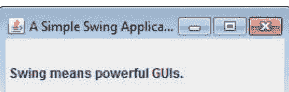

图 32-1 由 SwingDemo 程序产生的窗口

当程序运行时，它会产生一个与图 32-1 所示相似的窗口。由于 SwingDemo 程序展示了 Swing 的核心概念，我们将逐行仔细检查它。程序从导入 `javax.swing` 包开始的。如前所述，该包包含了 Swing 定义的组件和模型。例如，`javax.swing` 定义了实现标签、按钮、文本控件和菜单的类。它将被包含在所有使用 Swing 的程序中。

接下来，程序声明了 `SwingDemo` 类以及该类的构造函数。构造函数是程序执行大部分操作发生的地方。它首先使用下面这行代码创建一个 `JFrame`：

```java
jFrame = new JFrame("A Simple Swing Application");
```

这创建了一个名为 JFrame 的容器，它定义了一个带有标题栏、关闭、最小化、最大化和恢复按钮以及系统菜单的矩形窗口。因此，它创建了一个标准的顶层窗口。窗口的标题被传递给构造函数。

接下来，使用该语句调整大小：

```java
jFrame.setSize(275, 100);
```

`setSize()` 方法（`JFrame` 从 AWT `Component` 继承而来）设置窗口的尺寸，以像素为单位。其通用形式所示：

```text
void setSize(int width, int height)
```

在本例中，窗口的宽度被设置为 275，高度设置为 100。默认情况下，当顶层窗口关闭时（例如用户点击关闭按钮时），窗口会从屏幕上移除，但应用程序不会终止。虽然这种默认行为在某些情况下是有用的，但它并不是大多数应用程序所需要的。相反，你通常希望在顶层窗口关闭时终止整个应用程序。有几种方法可以实现这一点。最简单的方法是使用 `setDefaultCloseOperation()`，正如程序中所做的那样：

```java
jFrame.setDefaultCloseOperation(JFrame.EXIT_ON_CLOSE);
```

调用此方法后，关闭窗口将导致整个应用程序终止。`setDefaultCloseOperation()` 的通用形式所示：

```text
void setDefaultCloseOperation(int what)
```

# 第 32 章引入 Swing 1069

传递给 `what` 的值决定了窗口关闭时发生什么。除了 `JFrame.EXIT_ON_CLOSE` 之外还有其他几个选项。所示：

```text
DISPOSE_ON_CLOSE
HIDE_ON_CLOSE
DO_NOTHING_ON_CLOSE
```

它们的名称反映了相应的动作。这些常量声明在 `SwingConstants` 中，这是一个在 `javax.swing` 中定义的接口，由 `JFrame` 实现。下一行代码创建了一个 Swing `JLabel` 组件：

```java
JLabel jlab = new JLabel("Swing makes powerful GUIs.");
```

`JLabel` 是最简单且易用的组件，因为它不接受用户输入。它只是显示信息，信息可以是文本、图标或两者的结合。代码创建的标签仅包含文本，并传递给它的构造函数。

下一行代码将标签添加到框架的内容面板（content pane）中：

```java
jframe.add(jlab);
```

正如所解释的，所有顶层容器都有一个用于存储组件的内容面板。因此，要将组件添加到框架中，你需要将其添加到框架的内容面板。这是通过对 `JFrame` 引用（在本例中为 `jframe`）调用 `add()` 实现的。`add()` 的通用形式所示：

```text
add(Component comp)
```

`add()` 方法 `JFrame` 继承自 AWT 类 `Container`。默认情况下，与 `JFrame` 关联的内容面板使用边界布局（border layout）。`add()` 版本仅将标签添加到中心位置。`add()`的其他版本允许你指定边界之一。当组件被添加到中心时，它会自动调整以适应中心的大小。

在继续之前，需要说明一个重要的历史点。在 JDK 5 之前，向内容面板添加组件时，不能直接在 `JFrame` 实例上调用 `add()` 方法。你需要对 `JFrame` 对象的内容面板调用 `add()`。可以通过调用 `JFrame` 实例上的 `getContentPane()` 获取内容面板。该方法所示：

```java
getContentPane()
```

它向内容面板返回一个 `Container`。然后在该引用上调用 `add()` 方法以将组件添加到内容面板中。因此，在过去，你必须使用以下语句将标签添加到 `jframe`：

```java
jframe.getContentPane().add(jlab); // 旧样式
```

在这里，`getContentPane()` 首先获取内容面板的引用，然后 `add()` 将组件添加到与此面板链接的容器中。调用 `remove()` 移除组件以及使用 `setLayout()` 为内容面板设置布局管理器也需要相同的步骤。这就是为什么你会在整个 5.0 之前的遗留代码中经常看到显式的 `getContentPane()` 调。在今天，使用 `getContentPane()` 是不再必须的。你可以直接在 `JFrame` 上调用 `add()` 或 `remove()`。然而，当你需要修改 GUI 时，必须确保在事件分发线程（event dispatch thread）上完成。要这样做，请使用 `invokeLater`：

```java
SwingUtilities.invokeLater(new Runnable() {
  // 代码
});
```

如果你需要等待代码执行完成，使用 `invokeAndWait()`：

```java
SwingUtilities.invokeAndWait(new Runnable() {
  // 代码
});
```

# 1070 第三部分 使用 Swing 引入 GUI 编程


这两个方法之间的区别是 `invokeLater()` 会立即返回，而 `invokeAndWait()` 会等待到 `run()` 返回。通常你会使用 `invokeLater()`，正如程序所做的那样。这里是 [第 1105 页]


图 32-2 EventDemo 程序的输出

# 事件处理

前面的示例展示了 Swing 程序的基本形式，但它忽略了用户，它不产生事件。由于 `JLabel` 不接收输入，因此不需要事件处理。然而，其他 Swing 组件确实响应用户输入，这些交互产生的事件需要被处理。事件也可以通过与用户输入无关的方式产生。例如，当定时器触发时产生事件。无论情况如何，事件处理都是 Swing 的大部分。

Swing 使用的事件处理机制与 AWT 使用的相同。这种方法被称为*委托事件模型*（delegation event model），在第25 章中有描述。在许多情况下，Swing 使用与 AWT 相同的事件，这些事件封装在 `java.awt.event` 中。Swing 特有的事件存储在 `javax.swing.event` 中。

```java
// 当用户关闭应用程序时终止程序。
jframe.setDefaultCloseOperation(JFrame.EXIT_ON_CLOSE);
```

```java
// 创建两个按钮。
jbtnAlpha = new JButton("Alpha");
jbtnBeta = new JButton("Beta");
```

```java
// 为 Alpha 添加动作监听器。
jbtnAlpha.addActionListener(new ActionListener() {
    public void actionPerformed(ActionEvent ae) {
        jlab.setText("Alpha was pressed.");
    }
});
```

```java
// 为 Beta 添加动作监听器。
jbtnBeta.addActionListener(new ActionListener() {
    public void actionPerformed(ActionEvent ae) {
        jlab.setText("Beta was pressed.");
    }
});
```

```java
// 将按钮添加到内容面板。
jframe.add(jbtnAlpha);
jframe.add(jbtnBeta);
```

```java
// 创建一个文本标签。
jlab = new JLabel("Press a button.");
```

```java
// 将标签添加到内容面板。
jframe.add(jlab);
```

```java
// 显示框架。
jframe.setVisible(true);
```

```java
public static void main(String[] args) {
    // 在事件分发线程上创建框架。
    SwingUtilities.invokeLater(new Runnable() {
        public void run() {
            new EventDemo();
        }
    });
}
```


首先，请注意程序现在导入了 `java.awt` 和 `java.awt.event` 包。需要 `java.awt` 包是因为它包含了 `FlowLayout` 类，该类提供了用于在框架中布局组件的标准流布局（有关布局管理器的内容请参见第 27 章）。需要 `java.awt.event` 包是因为它定义了 `ActionListener` 接口和 `EventClass` 类。

`EventDemo` 构造函数首先创建一个 `JFrame jframe`。然后，它将 `jframe` 内容面板的布局管理器设置为 `FlowLayout`。默认情况下，内容面板使用 `BorderLayout` 作为其布局管理器。然而，对于这个示例，`FlowLayout` 更方便。

在设置了标题和默认关闭操作后，`EventDemo()` 创建了两个推按钮，如下所示：

```java
JButton jbtnAlpha = new JButton("Alpha");
JButton jbtnBeta = new JButton("Beta");
```

第一个按钮将包含文本 "Alpha"，第二个按钮将包含文本 "Beta"。Swing 按钮是 `JButton` 的实例。`JButton` 提供了几个构造函数。这里使用的是：

```java
JButton(String msg)
```

`msg` 参数指定了要在按钮内部显示的字符串。当按钮被按下时，它会生成一个 `ActionEvent`。因此，`JButton` 提供了 `addActionListener()` 方法用于添加动作监听器。`JButton` 还提供了 `removeActionListener()` 来移除监听器，但程序没有使用该方法。正如第 25 节所示，`ActionListener` 接口只定义了一个方法：`actionPerformed(ActionEvent)`。为了方便起见，在这里显示如下：

```java
void actionPerformed(ActionEvent ae)
```

该方法在按钮被按下时被调用。换句话说，它是在发生按钮按下时调用的事件处理器。

接下来，代码为按钮的动作事件添加了事件监听器：

```java
// 为 Alpha 添加动作监听器。
jbtnAlpha.addActionListener(new ActionListener() {
    public void actionPerformed(ActionEvent ae) {
        jlab.setText("Alpha was pressed.");
    }
});
```

```java
// 为 Beta 添加动作监听器。
jbtnBeta.addActionListener(new ActionListener() {
    public void actionPerformed(ActionEvent ae) {
        jlab.setText("Beta was pressed.");
    }
});
```

使用匿名内部类来为这两个按钮提供事件处理器。每当按钮被按下时，`jlab` 中显示的字符串就会更改，以反映哪个按钮被按下了。

从 JDK 8 开始，也可以使用 lambda 表达式来实现某些类型的事件处理器。例如，Alpha 按钮的事件处理器可以写成：

```java
jbtnAlpha.addActionListener((ae) -> jlab.setText("Alpha was pressed."));
```

可以看到，这种代码更短。当然，你选择的方法取决于情况和喜好。接下来，将按钮添加到内容面板：

```java
jfrm.add(jbtnAlpha);
jfrm.add(jbtnBeta);
```

最后，将 `jlab` 添加到内容面板并使窗口可见。当你运行程序时，每次点击按钮，标签中都会显示按钮被按下的消息。最后一点：记住所有事件监听器（如 `actionPerformed()`）都是在事件分发线程上调用的。因此，为了避免降低运行速度，如果你的应用程序需要执行某些操作，必须使用单独的线程。

## 绘图

Swing 组件集非常强大，你不局限于它，因为 Swing 还允许你直接写入框架的显示区域或 Swing 的其他组件（如 `JLabel`）。虽然大多数 Swing 的用法不涉及直接向组件表面绘图，但对于需要这种功能的应用程序它是可用的。要向组件表面绘图，你将使用 AWT 定义的一个或多个绘制方法，如 `drawLine()` 或 `drawRect()`。因此，第 26 章描述的许多技术和方法也适用于 Swing。然而，它们存在一些重要的差异，将在本文讨论。

### 绘图基础

在组件表面绘图时，你必须小心将输出限制在边框内部的区域。虽然 Swing 会自动裁剪任何超出组件边界的输出，但仍然可能绘制到边框中，这在绘制边框时将会被覆盖。为了避免这种情况，你必须计算组件的可绘制区域。该区域由组件当前的大小减去边框占用的空间定义。因此，在向组件绘图之前，你必须获取边框的宽度并相应调整你的绘图。

### 计算可绘制区域

这些值随后被用于根据组件的宽度和高度计算绘制区域。你可以通过调用组件的 `getWidth()` 和 `getHeight()` 获取组件的宽度和高度。它们显示如下：

```java
getWidth()
getHeight()
```

通过减去内边距的值，你可以计算出组件的可用宽度和高度。

### 绘制示例

这里的程序实现了上述讨论。它创建了一个名为 `PaintPanel` 的类，该类继承自 `JPanel`。程序随后扩展该类的对象，以显示端点随机生成的线条。示例输出如图 32-3 所示。

```java
// 在面板上绘制线条。
import java.awt.*;
import java.awt.event.*;
import javax.swing.*;
import java.util.*;

// 此类继承自 JPanel。它重写了
// paintComponent() 方法，以便在面板
// 中绘制随机的线条。
class PaintPanel extends JPanel {
    Insets ins; // 存储面板的内边距
    Random rand; // 用于生成随机数

    // 构建面板。
    PaintPanel() {
        // 在面板周围添加边框。
        setBorder(BorderFactory.createLineBorder(Color.RED, 5));
        rand = new Random();
    }

    // 重写 paintComponent() 方法。
    protected void paintComponent(Graphics g) {
        // 始终先调用父类方法。
        super.paintComponent(g);
        int x, y, x2, y2;

        // 获取组件的高度宽。
        int height = getHeight();
        int width = getWidth();

        // 获取内边距。
        Insets ins = getInsets();

        // 绘制端点为随机生成的线条。
        for (int i = 0; i < 10; i++) {
            // 获取定义每条线条
            // 端点的随机坐标。
            x = rand.nextInt(width - ins.left);
            y = rand.nextInt(height - ins.bottom);
            x2 = rand.nextInt(width - ins.left);
            y2 = rand.nextInt(height - ins.bottom);

            // 绘制线条。
            g.drawLine(x, y, x2, y2);
        }
    }
}
```

```java
// 演示直接在面板上绘制。
class PaintDemo {
    JLabel jlab;
    PaintPanel pp;

    PaintDemo() {
        // 创建一个新的 JFrame 容器。
        JFrame jframe = new JFrame("Paint Demo");
        // 给帧一个初始大小。
        jframe.setSize(200, 150);
        // 当用户关闭应用程序时终止程序。
        jframe.setDefaultCloseOperation(JFrame.EXIT_ON_CLOSE);
        // 创建将要绘制的面板。
        pp = new PaintPanel();
        // 将面板添加到内容面板。由于使用了默认
        // 边框布局，面板将自动
        // 调整以适应中心区域。
        jframe.add(pp);
        // 显示帧。
        jframe.setVisible(true);
    }

    public static void main(String[] args) {
        // 在事件调度线程上创建帧。
        SwingUtilities.invokeLater(new Runnable() {
            public void run() {
                new PaintDemo();
            }
        });
    }
}
```

让我们仔细检查这个示例。`PaintPanel` 类继承自 `JPanel`。`JFrame` 是 Swing 的轻量级容器之一，这意味着它可以被添加到 `JFrame` 内容面板中。为了处理绘制，`PaintPanel` 重写了 `paintComponent()` 方法。这使得 `PaintPanel` 能够在组件表面写入。面板的大小没有指定，因为程序使用了默认布局且面板被添加到中心。这使得面板适应窗口的大小。如果你更改窗口的大小，面板的大小将正确调整。

注意构造函数还指定了 5 像素的红色边框。这是通过使用 `setBorder(Border)` 方法实现的，如下：

```java
void setBorder(Border border)
```

`Border` 是封装边框的接口。你可以通过调用 `BorderFactory` 类定义的工厂方法来获取边框。程序中使用 `createLineBorder(Color)`，它创建一个单线边框，如下：

```java
static Border createLineBorder(Color clr, int width)
```

在这里，`clr` 指定边框的颜色，`width` 指定像素。在 `paintComponent()` 的重写中，注意它首先调用了 `super.paintComponent()`。这是为了确保组件被正确绘制。接下来，面板的宽度和高度用于确保线条位于面板的绘制区域内。

# 第 33 章 探索 Swing

## JLabel 和 ImageIcon

`JLabel` 是 Swing 中最简单的组件之一。与标签相关的图标和文本可以通过以下方法获取：

```java
Icon getIcon()
String getText()
```

与标签相关的图标和文本可以通过这些方法设置：

```java
void setIcon(Icon icon)
void setText(String str)
```

在这里，`icon` 和 `str` 分别是图标和文本。因此，使用 `setText()` 可以在程序执行期间更改标签内的文本。

以下程序说明如何创建并显示一个包含图标和文本的标签。它通过为文件 `hourglass.png` 创建 `ImageIcon` 对象开始，该文件描述了一个沙漏。这作为 `JLabel` 构造函数的第二个参数。`JLabel` 构造函数的第一个和最后一个参数是标签文本和对齐方式。最后，将标签添加到内容面板。

```java
import java.awt.*;
import javax.swing.*;

public class JLabelDemo {
    public JLabelDemo() {
        // 设置 JFrame
        JFrame jframe = new JFrame("JLabelDemo");
        jframe.setLayout(new FlowLayout());
        jframe.setDefaultCloseOperation(JFrame.EXIT_ON_CLOSE);
        jframe.setSize(260, 210);

        // 创建图标
        ImageIcon ii = new ImageIcon("hourglass.png");

        // 创建标签。
        JLabel jl = new JLabel("Hourglass", ii, JLabel.CENTER);
        jframe.add(jl);
        jframe.setVisible(true);
    }

    public static void main(String[] args) {
        new JLabelDemo();
    }
}
```

标签示例的输出如图所示。

## JTextField

`JTextField` 是最简单的 Swing 组件。它可能也是最广泛使用的文本组件。`JTextField` 允许你编辑一行文本。它派生自 `JComponent`，后者提供了所有 Swing 文本组件通用的基本功能。`JTextField` 使用 `Document` 接口作为模型。这里显示了 `JTextField` 的三个构造函数：

```java
JTextField(int cols)
JTextField(String str, int cols)
JTextField(String str)
```

在这里，`str` 是要初始化的字符串，`cols` 是文本框中的列数。如果没有指定字符串，文本框初始为空。如果未指定列数，则文本框的大小将调整以适应指定的字符串。

`JTextField` 响应用户交互产生事件。例如，当用户按下 ENTER 键时，会触发一个 `ActionEvent`。每当光标（即插入点）改变位置时，都会触发一个 `CaretEvent`（`CaretEvent` 封装在 `javax.swing.event` 中）。也可能发生其他事件。在许多情况下，你的程序不需要处理这些事件。相反，你只需要在需要时获取文本框中的字符串即可。要获取文本框中当前的文本，调用 `getText()`。

示例说明了 `JTextField`。它创建了一个 `JTextField` 并将其添加到内容面板中。当用户按下 ENTER 键时，会生成一个事件。这通过在标签中显示文本来处理。

```java
// 演示 JTextField。
import java.awt.*;
import java.awt.event.*;
import javax.swing.*;

public class JTextFieldDemo {
    public JTextFieldDemo() {
        // 设置框架。
        JFrame jfrm = new JFrame("JTextFieldDemo");
        jfrm.setLayout(new FlowLayout());
        jfrm.setDefaultCloseOperation(JFrame.EXIT_ON_CLOSE);
        jfrm.setSize(260, 120);

        // 向内容面板中添加文本框。
        JTextField jtf = new JTextField(15);
        jfrm.add(jtf);

        // 添加一个标签。
        JLabel jlab = new JLabel();
        jfrm.add(jlab);

        // 处理动作事件。
        jtf.addActionListener(new ActionListener() {
            public void actionPerformed(ActionEvent ae) {
                jlab.setText(jtf.getText());
            }
        });
    }

    public static void main(String[] args) {
        SwingUtilities.invokeLater(new Runnable() {
            public void run() {
                new JTextFieldDemo();
            }
        });
    }
}
```


jtf.addActionListener(new ActionListener() {
    public void actionPerformed(ActionEvent ae) {
        // 当用户按下 ENTER 键时显示文本。
        jlab.setText(jtf.getText());
    }
});

// 显示框架。
jfrm.setVisible(true);
}

public static void main(String[] args) {
    // 在事件分发线程上创建框架。
    SwingUtilities.invokeLater(new Runnable() {
        public void run() {
            new JTextFieldDemo();
        }
    });
}
}

```

文本框示例的输出所示：

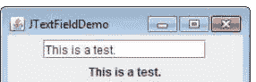

# Swing 按钮

Swing 定义了四种类型的按钮：`JButton`、`JToggleButton`、`JCheckBox` 和 `JRadioButton`。它们都是 `AbstractButton` 类的子类，该类扩展了 `JComponent`。因此，它们共享一组共同特征。

`AbstractButton` 包含许多允许你控制按钮行为的方法。例如，你可以定义按钮在被禁用、被按下或被选中时显示的不同图标。另一个图标可以作为鼠标悬停图标。以下方法设置了这些图标：

```
void setDisabledIcon(Icon di)
void setPressedIcon(Icon pi)
void setSelectedIcon(Icon si)
void setRolloverIcon(Icon ri)
```

在这里，`di`、`pi`、`si` 和 `ri` 是用于指定用途的图标。按钮的文本可以通过以下方法进行读取和写入：

```
String getText()
void setText(String str)
```

在这里，`str` 是要为按钮定义的文本。

所有按钮使用的模型由 `ButtonModel` 接口定义。当按钮被按下时，它会生成一个事件。也可能发生其他事件。接下来将检查每个按钮类。

## JButton

`JButton` 类提供了推入按钮的功能。你已经在上一章中见过了它的简单形式。`JButton` 允许将图标、字符串或两者都与推入按钮关联。这里是它的三个构造函数：

```
JButton(Icon icon)
JButton(String str)
JButton(String str, Icon icon)
```

在这里，`str` 和 `icon` 是用于按钮的字符串和图标。

当按钮被按下时，会生成一个 Action。使用传递给注册的 `ActionListener` 的 `actionPerformed` 方法的 `Action` 对象，你可以获取与按钮关联的动作命令。默认情况下，这是按钮内部显示的字符串。因此，在应用程序中使用两个或多个按钮时，动作命令可以识别是哪个按钮被按下了。在上一章中，你看到了一个基于文本的按钮示例。下面演示了一个基于图标的按钮。每个按钮都显示一个代表计时器的图标。它的声明如下：

```java
// 基于图标的 JButton
import java.awt.*;
import java.awt.event.*;
import javax.swing.*;

public class JButtonDemo implements ActionListener {
    JLabel jlab;

    public JButtonDemo() {
        // 设置 JFrame。
        JFrame jfrm = new JFrame("JButtonDemo");
        jfrm.setLayout(new FlowLayout());
        jfrm.setDefaultCloseOperation(JFrame.EXIT_ON_CLOSE);
        jfrm.setSize(500, 450);

        // 向内容面板添加按钮。
        ImageIcon hourglass = new ImageIcon("hourglass.png");
        JButton jb = new JButton(hourglass);
        jb.setActionCommand("Hourglass");
        jb.addActionListener(this);
        jfrm.add(jb);

        ImageIcon analog = new ImageIcon("analog.png");
        jb = new JButton(analog);
        jb.setActionCommand("Analog Clock");
        jb.addActionListener(this);
        jfrm.add(jb);

        ImageIcon digital = new ImageIcon("digital.png");
        jb = new JButton(digital);
        jb.setActionCommand("Digital Clock");
        jb.addActionListener(this);
        jfrm.add(jb);

        ImageIcon stopwatch = new ImageIcon("stopwatch.png");
        jb = new JButton(stopwatch);
        jb.setActionCommand("Stopwatch");
        jb.addActionListener(this);
        jfrm.add(jb);

        // 创建并将其标签添加到内容面板。
        jlab = new JLabel("Choose a Timepiece");
        jfrm.add(jlab);

        // 显示框架。
        jfrm.setVisible(true);
    }

    // 处理按钮事件。
    public void actionPerformed(ActionEvent ae) {
        jlab.setText("You selected " + ae.getActionCommand());
    }

    public static void main(String[] args) {
        // 在事件分发线程上创建框架。
        SwingUtilities.invokeLater(new Runnable() {
            public void run() {
                new JButtonDemo();
            }
        });
    }
}
```

按钮示例的输出所示：

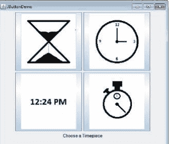

## JToggleButton

推入按钮的一种变体称为切换按钮。切换按钮看起来和推入按钮一样，但它的行为不同，因为它有两个状态：按下和释放。也就是说，当你按下切换按钮时，它会保持按下状态，而不是像普通推入按钮那样弹起。当你再次按下切换按钮时，它会释放（弹起）。因此，每次按下切换按钮时，它都会在状态之间切换。

切换按钮是 `JToggleButton` 类的对象。`JToggleButton` 实现了 `AbstractButton`。除了创建标准的切换按钮外，`JToggleButton` 还是其他表示双状态控件的 Swing 组件的父类。这些组件包括 `JCheckBox` 和 `JRadioButton`，将在本章后部分描述。`JToggleButton` 定义了多个构造函数。下面示例使用的构造函数所示：

```java
JToggleButton(String str)
```

这创建了一个包含 `str` 中文本的切换按钮。默认情况下，按钮处于关闭位置。其他构造函数允许你创建包含图像或图像和文本的切换按钮。

`JToggleButton` 使用一个由嵌套类 `JToggleButton.ToggleButtonModel` 定义的模型。通常情况下，你不需要直接与模型交互来使用标准的切换按钮。

与 `JButton` 一样，`JToggleButton` 在每次按下时都会产生一个事件。但与 `JButton` 不同的是，`JToggleButton` 还会产生项目事件。该事件被支持选择概念的组件使用。当 `JToggleButton` 被按下时，它处于被选中状态；当它弹起时，它处于未选中状态。

为了处理项目事件，你必须实现 `ItemListener` 接口。回顾第 25 章，当产生项目事件时，它会被传递给 `ItemListener` 定义的 `itemStateChanged()` 方法。在 `itemStateChanged()` 内部，可以在 `ItemEvent` 对象上调用 `getItem()` 方法以获取生成事件的 `JToggleButton` 实例的引用。所示：

```java
Object getItem()
```

返回一个按钮的引用。你需要将此引用强制转换为 `JToggleButton`。确定切换按钮状态最简单的方法是调用生成事件的按钮调用的继承自 `AbstractButton` 的 `isSelected()` 方法。所示：

```java
boolean isSelected()
```

如果按钮被选中则返回 `true`，否则返回 `false`。这里是一个使用切换按钮的示例。注意项目监听器正在工作。它简单地调用 `isSelected()` 来确定按钮的状态。

```java
// Demonstrate JToggleButton.
import java.awt.*;
import java.awt.event.*;
import javax.swing.*;

public class JToggleButtonDemo {
    public JToggleButtonDemo() {
        // Set up the JFrame.
        JFrame jfrm = new JFrame("JToggleButtonDemo");
        jfrm.setLayout(new FlowLayout());
        jfrm.setDefaultCloseOperation(JFrame.EXIT_ON_CLOSE);
        jfrm.setSize(200, 100);

        // Create a label.
        JLabel label = new JLabel("Button is off.");

        // Make a toggle button.
        JToggleButton jbtn = new JToggleButton("On/Off");

        // Add an item listener for the toggle button.
        jbtn.addItemListener(new ItemListener() {
            public void stateChanged(ActionEvent ie) {
                if (jbtn.isSelected())
                    label.setText("Button is on.");
                else
                    label.setText("Button is off.");
            }
        });

        // Add the toggle button and label to the content pane.
        jfrm.add(jbtn);
        jfrm.add(label);

        // Display the frame.
        jfrm.setVisible(true);
    }

    public static void main(String[] args) {
        // Create the frame on the event dispatching thread.
        SwingUtilities.invokeLater(new Runnable() {
            public void run() {
                new JToggleButtonDemo();
            }
        });
    }
}
```

切换按钮示例的输出所示：


## 复选框

`JCheckBox` 类提供了复选框的功能。它的直接父类是 `JToggleButton`，正如前面所述，它提供了对双状态按钮的支持。`JCheckBox` 定义了几个构造函数。这里使用的一个是：

```java
JCheckBox(String str)
```

它创建了一个带有 `str` 指定文本作为标签的复选框。其他构造函数允许你指定初始选择状态或取消选中复选框并指定图标。

当用户选择时，通过对传递给 `ItemListener` 定义的 `itemStateChanged()` 方法的 `ItemEvent` 调用 `getItem()` 来获取生成事件的 `JCheckBox` 引用。检测复选框选中状态最简单的方法是在 `JCheckBox` 实例上使用 `isSelected()`。

以下示例说明了复选框。它显示了四个框和一个标签。当用户点击复选框时，会产生一个 `ItemEvent`。在 `itemStateChanged()` 方法内部，获取生成事件的 `JCheckBox` 对象引用。接下来，调用 `isSelected()` 来确定框是被选中还是被清除。`getText()` 方法获取该复选框的文本并将其用于设置标签内部的文本。

```java
// Demonstrate JCheckBox.
import java.awt.*;
import java.awt.event.*;
import javax.swing.*;

public class JCheckBoxBoxDemo implements ItemListener {
    JLabel jlab;

    // Set up the JFrame.
    JFrame jfrm = new JFrame("CheckBoxDemo");
    jfrm.setLayout(new FlowLayout());
    jfrm.setDefaultCloseOperation(JFrame.EXIT_ON_CLOSE);
    jfrm.setSize(250, 100);

    // Add check boxes to the content pane.
    JCheckBox cb = new JCheckBox("C");
    cb.addItemListener(this);
    cb = new JCheckBox("D");
    cb.addItemListener(this);
    cb = new JCheckBox("E");
    cb.addItemListener(this);
    cb = new JCheckBox("F");
    cb.addItemListener(this);

    // ... (rest of implementation logic for brevity)
}
```

## 单选按钮

单选按钮是一组互斥的按钮，其中只能有一个按钮被选中。它们由 `JRadioButton` 类支持，该类继承自 `JToggleButton`。`JRadioButton` 定义了几个构造函数。示例中使用的所示：

```java
JRadioButton(String str)
```

在这里，`str` 是按钮的标签。其他构造函数允许你指定初始选择状态或取消选中并指定图标。

为了激活它们的互斥性，单选按钮必须配置到一个组中。例如，当用户按下组中的某个单选按钮时，组内之前选中的按钮会自动取消选中。按钮组通过 `ButtonGroup` 类创建。其默认构造函数为此调用。然后通过以下方法将元素添加到组：

```java
void add(AbstractButton ab)
```

在这里，`ab` 是要添加的按钮的引用。

```java
// 创建单选按钮并将其添加到内容面板。
JRadioButton b1 = new JRadioButton("A");
b1.addActionListener(this);
jfrm.add(b1);

JRadioButton b2 = new JRadioButton("B");
b2.addActionListener(this);
jfrm.add(b2);

JRadioButton b3 = new JRadioButton("C");
b3.addActionListener(this);
jfrm.add(b3);

// 定义一个按钮组。
ButtonGroup bg = new ButtonGroup();
bg.add(b1);
bg.add(b2);
bg.add(b3);

// 创建一个标签并将其添加到内容面板。
label = new JLabel("Select One");
```


jfrm.add(jlabel);

```java
// 显示框架。
jfrm.setVisible(true);
```

```java
// 处理按钮选择。
public void actionPerformed(ActionEvent ae) {
  jlabel.setText("You selected " + ae.getActionCommand());
}
```

```java
public static void main(String[] args) {
  // 在事件分发线程上创建框架。
  SwingUtilities.invokeLater(
    new Runnable() {
      public void run() {
        new JRadioButtonDemo();
      }
    }
  );
}
```

单选按钮示例的输出在此：


# 1092 第三部分 使用 Swing 引入 GUI 编程

## JTabbedPane

`JTabbedPane` 封装了一个标签页面板。它通过将组件与标签关联来管理一组组件。选择一个标签会将与该标签相关的组件带到最前面。标签页面板在现代 GUI 中非常常见，你无疑用过很多次。鉴于标签页面板的复杂性，但它的创建和使用却出奇地简单。

`JTabbedPane` 定义了三个构造函数。我们将使用它的默认构造函数，它会创建一个标签页位于面板顶部的空控件。另外两个构造函数选择标签的位置，可以是四边中的任意一边。`JTabbedPane` 使用 `SingleSelectionModel` 模型。

通过调用 `addTab()` 添加标签。这里是它的其中形式之一：

```java
void addTab(String name, Component component)
```

在这里，`name` 是标签的名称，`comp` 是应该添加到标签的组件。通常，添加到标签的组件是一个包含一组相关组件的 `JPanel`。这种技术允许一个标签页持有一组组件。

使用标签页面板的一般步骤如下：

- 创建 `JTabbedPane` 实例。
- 通过调用 `addTab()` 添加每个标签。
- 将标签添加到内容面板。

接下来的示例展示了一个标签页面板。第一个标签标题为“Cities（城市）”，包含四个按钮。每个按钮显示城市的名称。第二个标签标题为“Colors（颜色）”，包含三个框。每个框显示颜色的名称。第三个标签标题为“Flavors（口味）”，包含一个框。这允许用户从三个选项中选择一个。

```java
// 演示 JTabbedPane。
import javax.swing.*;
import java.awt.*;

public class JTabbedPaneDemo {
    public JTabbedPaneDemo() {
        // 设置 JFrame。
        JFrame jframe = new JFrame("JTabbedPaneDemo");
        jframe.setLayout(new FlowLayout());
        jframe.setDefaultCloseOperation(JFrame.EXIT_ON_CLOSE);
        jframe.setSize(400, 200);

        // 创建标签页面板。
        JTabbedPane jtp = new JTabbedPane();
        jtp.addTab("Cities", new CitiesPanel());
        jtp.addTab("Colors", new ColorsPanel());
        jtp.addTab("Flavors", new FlavorsPanel());
        jframe.add(jtp);

        // 显示框架。
        jframe.setVisible(true);
    }
}
```

```java
public static void main(String[] args) {
  // 在事件分发线程上创建框架；
  SwingUtilities.invokeLater(
    new Runnable() {
      public void run() {
        new JTabbedPaneDemo();
      }
    }
  );
}
```

```java
// 创建将要添加到标签页面板的面板。
class CitiesPanel extends JPanel {
  public CitiesPanel() {
    JButton b1 = new JButton("New York");
    add(b1);
    JButton b2 = new JButton("London");
    add(b2);
    JButton b3 = new JButton("Hong Kong");
    add(b3);
    JButton b4 = new JButton("Tokyo");
    add(b4);
  }
}
```

```java
class ColorsPanel extends JPanel {
  public ColorsPanel() {
    JCheckBox cb1 = new JCheckBox("Red");
    add(cb1);
    JCheckBox cb2 = new JCheckBox("Green");
    add(cb2);
  }
}
```

```java
class FlavorsPanel extends JPanel {
  public FlavorsPanel() {
    JComboBox<String> jcb = new JComboBox<>();
    jcb.addItem("Vanilla");
    jcb.addItem("Chocolate");
    jcb.addItem("Strawberry");
    add(jcb);
  }
}
```

# 1094 第三部分 使用 Swing 引入 GUI 编程

```java
// 标签页面板的输出如下
```

# 1095 探索 Swing

## JScrollPane

使用滚动面板的步骤如下：

1. 创建 `JScrollPane` 实例。
2. 将组件添加到其中。
3. 将滚动面板添加到内容面板。

接下来的示例展示了一个滚动面板。如果组件大于视口，滚动条将会出现。

```java
// 演示 JScrollPane。
import javax.swing.*;
import java.awt.*;

public class JScrollPaneDemo {
    public JScrollPaneDemo() {
        // 设置 JFrame。
        JFrame frame = new JFrame("JScrollPaneDemo");
        frame.setLayout(new BorderLayout());
        frame.setDefaultCloseOperation(JFrame.EXIT_ON_CLOSE);
        frame.setSize(400, 400);

        // 创建一个面板并添加 400 个按钮。
        JPanel jp = new JPanel();
        jp.setLayout(new GridLayout(20, 20));

        for (int i = 0; i < 20; i++) {
            for (int j = 0; j < 20; j++) {
                jp.add(new JButton("Button " + i + "," + j));
            }
        }

        // 创建滚动面板。
        JScrollPane jsp = new JScrollPane(jp);

        // 将滚动面板添加到内容面板。
        // 因为使用了默认布局，滚动面板将添加到中心。
        frame.add(jsp, BorderLayout.CENTER);

        // 显示框架。
        frame.setVisible(true);
    }

    public static void main(String[] args) {
      // 在事件分发线程上创建框架。
      SwingUtilities.invokeLater(
        new Runnable() {
          public void run() {
            new JScrollPaneDemo();
          }
        });
    }
}
```

# 1096 第三部分 使用 Swing 引入 GUI 编程

## JList

在 Swing 中，基类类是 `JList`。它支持从列表中选择一个或多个项目。虽然列表通常由字符串组成，但也可以创建任何可以显示的对象的列表。`JList` 在 Java 中非常广泛，你很有可能从未见过它。

在过去，`JList` 中的元素是用 `Object` 引用表示的。然而，从 JDK 7 开始，`JList` 变为泛型，现在的声明方式如下：

```java
class JList<E>
```

在这里，`E` 代表列表中的项目类型。

`JList` 提供了多个构造函数。这里使用的是一个：

```java
JList(E[] items)
```

这创建了一个包含由 `items` 数组指定的项的 `JList`。

## 第 33 章 探索 Swing 1097

`JList` 基于两个模型。第一个是 `ListModel`。该接口定义了实现访问列表数据的方式。第二个模型是 `ListSelectionModel` 接口，它定义了确定选择了哪些列表项或多个列表项的方法。

虽然 `JList` 本身可以正常工作，但大多数情况下，你会将 `JList` 包装在 `JScrollPane` 中。这个长列表将自动滚动，这简化了 GUI 设计。它还让你轻松更改列表中的条目数量，而无需更改 `JList` 组件的大小。

当用户进行选择时，`JList` 会生成一个 `ListSelectionEvent`。当用户选择一个项目时，也会生成此事件。它通过实现 `ListSelectionListener` 来进行处理。该监听器只指定了一个方法，称为 `valueChanged()`，如下所示：

```java
void valueChanged(ListSelectionEvent e)
```

在这里，`e` 是事件的引用。`ListSelectionEvent` 提供了一些它自己的方法，通常你会通过查询 `JList` 对象来确定发生了什么。`ListSelectionEvent` 和 `ListSelectionListener` 都封装在 `javax.swing.event` 包中。

默认情况下，`JList` 允许用户选择列表中的多个范围的项目，你可以通过调用 `JList` 定义的 `setSelectionMode()` 来更改此行为。如下所示：

```java
void setSelectionMode(int mode)
```

在这里，`mode` 指定了选择模式。它必须是 `ListSelectionModel` 定义的值之一：

- `SINGLE_SELECTION`
- `SINGLE_INTERVAL_SELECTION`
- `MULTIPLE_INTERVAL_SELECTION`

默认的多间距选择允许用户选择列表中的多个范围的项目。在单间距选择中，用户只能选择一个项目。当然，在其他两种模式下也可以选择单个项目，只是它们也允许选择一个范围。

你可以通过调用 `getSelectedIndex()` 获取被选中第一个项目的索引（在单选择模式下，这也是唯一被选中项目的索引），如下所示：

```java
int getSelectedIndex()
```

索引从零开始。因此，如果选择了第一个项目，该方法将返回 0。如果没有选择项目，则返回 -1。

与其获取选择的索引，不如通过调用 `getSelectedValue()` 获取与选择关联的值：

```java
Object getSelectedValue()
```

它返回第一个被选中值的引用。如果没有选择任何值，它将返回 `null`。

## 1098 第三部分 使用 Swing 引入 GUI 编程

以下程序演示了一个 `JList`。每当在列表中选择一个城市时，就会生成一个 `ListSelectionEvent`，该事件由 `ListSelectionListener` 的 `valueChanged()` 方法处理。它的响应是获取被选中项目的索引并在标签中显示被选中城市的名称。

```java
// 演示 JList.
import javax.swing.*;
import javax.swing.event.*;
import java.awt.*;
import java.awt.event.*;

public class JListDemo {
    // 创建城市数组。
    String[] cities = { "New York", "Chicago", "Houston",
      "Denver", "Los Angeles", "Seattle",
      "London", "Paris", "New Delhi",
      "Hong Kong", "Tokyo", "Sydney" };

    public JListDemo() {
        // 设置框架。
        JFrame jfrm = new JFrame("JListDemo");
        jfrm.setLayout(new FlowLayout());
        jfrm.setDefaultCloseOperation(JFrame.EXIT_ON_CLOSE);
        jfrm.setSize(200, 200);

        // 创建一个 JList。
        JList<String> jlist = new JList<String>(cities);
        // 将选择模式设置为单选。
        jlist.setSelectionMode(ListSelectionModel.SINGLE_SELECTION);
        // 将列表添加到滚动面板中。
        JScrollPane jscrollPane = new JScrollPane(jlist);
        jscrollPane.setPreferredSize(new Dimension(120, 90));

        // 创建一个显示选择的标签。
        JLabel jlab = new JLabel("Choose a City");

        // 为列表添加选择监听器。
        jlist.addSelectionListener(new ListSelectionListener() {
            public void valueChanged(ListSelectionEvent e) {
                int idx = jlist.getSelectedIndex();
                // 如果选择了项目，显示选择。
                if (idx != -1)
                    jlab.setText("Current selection: " + cities[idx]);
                // 否则，
                else
                    jlab.setText("Choose a City");
            }
        });

        // 将列表添加到内容。
        jfrm.add(jscrollPane);
        // 将标签添加到内容。
        jfrm.add(jlab);

        // 显示框架。
        jfrm.setVisible(true);
    }
}
```

```java
public static void main(String[] args) {
  // 在事件分发线程上创建框架。
  SwingUtilities.invokeLater(
    new Runnable() {
      public void run() {
        new JListDemo();
      }
    }
  );
}
```

下拉框的输出是：


# JComboBox

当用户选择一个项目时，`JComboBox` 生成一个事件。当用户取消项目时也会生成此事件。它通过实现 `ActionListener` 来处理。该监听器指定了一个方法，称为 `actionPerformed()`，如下：

```java
public void actionPerformed(ActionEvent e)
```

在这里，`e` 是事件的引用。`ActionEvent` 提供了一些它自己的方法，通常你会通过查询 `JComboBox` 对象来确定发生了什么。`ActionEvent` 和 `ActionListener` 都封装在 `java.awt.event` 包中。

默认情况下，`JComboBox` 允许用户选择列表中的一个项目，你可以通过调用 `JComboBox` 定义的 `setEditable()` 来更改此行为，使其可编辑。


默认的多间距选择允许用户选择列表中的多个范围的项目。在单间距选择中，用户只能选择一个项目。当然，在其他两种模式下也可以选择单个项目，只是它们也允许选择一个范围。

你可以通过调用 `getSelectedIndex()` 获取被选中第一个项目的索引（在使用单选择模式时，这也是唯一被选中项目的索引），如下所示：

```
int getSelectedIndex()
```

索引从零开始。因此，如果选择了第一个项目，该方法将返回 0。如果没有选择项目，则返回 -1。

与其获取选择的索引，不如通过调用 `getSelectedValue()` 获取与选择关联的值：

```
Object getSelectedValue()
```

它返回第一个被选中值的引用。如果没有选择任何值，它返回 null。

以下程序演示了一个 `JList`。每当在列表中选择一个城市时，就会生成一个 `ListSelectionEvent`，该事件由 `ListSelectionListener` 的 `valueChanged()` 方法处理。它的响应是获取被选中项目的索引并在标签中显示被选中城市的名称。

```java
// 演示 JList.
import javax.swing.*;
import javax.swing.event.*;
import java.awt.*;
import java.awt.event.*;

public class JListDemo {
    // 创建城市数组。
    String[] cities = { "New York", "Chicago", "Houston",
        "Denver", "Los Angeles", "Seattle",
        "London", "Paris", "New Delhi",
        "Hong Kong", "Tokyo", "Sydney" };

    public JListDemo() {
        // 设置框架。
        JFrame jfrm = new JFrame("JListDemo");
        jfrm.setLayout(new FlowLayout());
        jfrm.setDefaultCloseOperation(JFrame.EXIT_ON_CLOSE);
        jfrm.setSize(200, 200);

        // 创建一个 JList。
        JList<String> jlist = new JList<String>(cities);
        // 将选择模式设置为单选。
        jlist.setSelectionMode(ListSelectionModel.SINGLE_SELECTION);
        // 将列表添加到滚动面板中。
        JScrollPane jscrollPane = new JScrollPane(jlist);
        jscrollPane.setPreferredSize(new Dimension(120, 90));

        // 创建一个显示选择的标签。
        JLabel jlab = new JLabel("Choose a City");

        // 为列表添加选择监听器。
        jlist.addSelectionListener(new ListSelectionListener() {
            public void valueChanged(ListSelectionEvent e) {
                int idx = jlist.getSelectedIndex();
                // 如果选择了项目，显示选择。
                if (idx != -1)
                    jlab.setText("Current selection: " + cities[idx]);
            }
        });
    }
}
```

## 树

树是一种呈现数据分级视图的组件。用户有能力在此显示中展开或折叠单个子树。树在 Swing 中通过 `JTree` 类实现。以下是其构造函数的示例：

```
JTree(Object[] obj)
JTree(Vector<?> v)
JTree(TreeNode node)
```

在第一种形式中，树是从数组 `obj` 中的元素构建的。第二种形式从向量 `v` 的元素构建树。在第三种形式中，树的根节点由 `tn` 指定。

尽管 `JTree` 封装在 `javax.swing` 包中，但它的支持类和接口封装在 `javax.swing.tree` 中。这是因为支持 `JTree` 需要的类和接口数量很大。

`JTree` 依赖于两个模型：`TreeModel` 和 `TreeSelectionModel`。`JTree` 生成多种事件，但这些事件专门与树相关：`TreeChangeEvent`、`TreeSelectionEvent` 和 `TreeModelEvent`。当节点展开或折叠时，会发生 `TreeChangeEvent`。当用户在树中选择或取消选择节点时，会生成 `TreeSelectionEvent`。当树的数据或结构发生变化时，会生成 `TreeModelEvent`。这些事件的监听器分别是 `TreeExpansionListener`、`TreeSelectionListener` 和 `TreeModelListener`。树事件类和监听器接口封装在 `javax.swing` 中。

本节所示示例程序处理的事件是 `TreeSelectionEvent`。要监听该事件，需要实现 `TreeSelectionListener`。它只定义了一个方法 `valueChanged()`，该方法接收 `TreeSelectionEvent` 对象。你可以通过调用事件对象上的 `getPath()` 方法来获取节点的路径：

```
TreePath getPath()
```

返回一个 `TreePath` 对象，描述通到发生变化节点的路径。`TreePath` 类封装了关于树中特定节点的信息。它提供了几个构造函数和方法。在本书中只使用了 `toString()` 方法。它返回一个描述路径的字符串。

`TreeNode` 接口声明了关于树节点的信息。例如，可以获取父节点的引用或子节点的枚举。`MutableTreeNode` 接口扩展了 `TreeNode`。它声明了可以插入和删除子节点或更改父节点的方法。

`DefaultMutableTreeNode` 类实现了 `MutableTreeNode` 接口。它代表树中的一个节点。它的构造函数之一是：

```
DefaultMutableTreeNode(Object obj)
```

在这里，`obj` 是要封装在此树中的对象。新树没有父节点或子节点。

要创建一个层次树，可以使用 `DefaultMutableTreeNode` 的 `add()` 方法。其签名所示：

```
void add(TreeNode child)
```

在这里，`child` 是一个可变节点。

`JTree` 本身不提供任何滚动功能。相反，`JTree` 通常被放置在 `JScrollPane` 中。这个巨大的树可以通过较小的视口进行滚动。使用树的步骤如下：

1. 创建 `JTree` 实例。
2. 创建一个 `JScrollPane` 并指定树为要滚动的对象。
3. 将滚动面板添加到内容面板中。

## JTree 示例

下面的示例说明了如何创建树并处理选择事件。程序创建了一个标签为“Options”的 `DefaultMutableTreeNode` 实例。这是树层次结构中的顶层节点。随后创建了额外的树节点，并调用 `add()` 方法将这些节点连接到树。树中顶层节点的引用作为 `JTree` 构造函数的参数提供。树作为 `JScrollPane` 构造函数的参数呈现。该滚动面板被添加到内容面板中。创建一个标签并将其添加到内容面板中。树显示在这个标签中。为了接收来自树的选择事件，为树注册了一个 `TreeSelectionListener`。在 `valueChanged()` 方法中，获取并显示当前选择的路径。

```java
// 演示 JTree
import java.awt.*;
import javax.swing.event.*;
import javax.swing.*;
import javax.swing.tree.*;

public class JTreeDemo {

    public JTreeDemo() {

        // 设置 JFrame。使用默认的 BorderLayout 布局
        JFrame jfrm = new JFrame("JTreeDemo");
        jfrm.setDefaultCloseOperation(JFrame.EXIT_ON_CLOSE);
        jfrm.setSize(200, 250);

        // 创建树的根。
        DefaultMutableTreeNode top = new DefaultMutableTreeNode("Options");

        // 创建 "A" 的子树
        DefaultMutableTreeNode a = new DefaultMutableTreeNode("A");
        top.add(a);
        DefaultMutableTreeNode a1 = new DefaultMutableTreeNode("A1");
        a.add(a1);
        DefaultMutableTreeNode a2 = new DefaultMutableTreeNode("A2");
        a.add(a2);

        // 创建 "B" 的子树
        DefaultMutableTreeNode b = new DefaultMutableTreeNode("B");
        top.add(b);
        DefaultMutableTreeNode b1 = new DefaultMutableTreeNode("B1");
        b.add(b1);
        DefaultMutableTreeNode b2 = new DefaultMutableTreeNode("B2");
        b.add(b2);
        DefaultMutableTreeNode b3 = new DefaultMutableTreeNode("B3");
        b.add(b3);

        // 创建树。
        JTree tree = new JTree(top);

        // 将树添加到滚动面板中。
        JScrollPane jsp = new JScrollPane(tree);

        // 将滚动面板添加到内容面板中。
        jfrm.add(jsp);

        // 将标签添加到内容面板中。
        JLabel jlab = new JLabel();
        jfrm.add(jlab, BorderLayout.SOUTH);

        // 处理树选择事件。
        tree.addTreeSelectionListener(new TreeSelectionListener() {
            public void valueChanged(TreeSelectionEvent tse) {
                jlab.setText("Selection: " + tse.getPath());
            }
        });

        // 显示框架。
        jfrm.setVisible(true);
    }

    public static void main(String[] args) {
        SwingUtilities.invokeLater(new Runnable() {
            public void run() {
                new JTreeDemo();
            }
        });
    }
}
```

## JTable

`JTable` 是一个显示行和列的组件。从核心上来说，`JTable` 是非常简单的。它由一或多列信息组成。每列的顶部有一个标题。除了描述数据外，标题还提供了用户更改列大小的机制。`JTable` 不提供任何滚动功能。相反，你通常将 `JTable` 封装在 `JScrollPane` 中。

`JTable` 依赖于三个模型。第一个是表格模型，由 `TableModel` 接口定义。该模型定义了与二维格式显示相关的内容。第二个是列模型，由 `TableColumnModel` 表示。`JTable` 根据列定义，这两个模型封装在 `javax.swing` 中。第三个模型决定如何选择项目，它由 `ListSelectionModel` 指定。`JTable` 在描述 `JList` 时描述过。

`JTable` 可以生成多种不同的事件。对于表格操作最基础的是 `ListSelectionEvent` 和 `TableModelEvent`。当用户在表中选择内容时，会生成 `ListSelectionEvent`。`JTable` 允许选择一个或多个完整行，但你可以更改此行为以允许选择一个或多个列，或一个或多个单元格。当表格数据以某种方式变化时，会触发 `TableModelEvent`。处理这些事件比处理之前描述的组件生成的事件要困难得多，并且超出本书的范围。然而，如果你只是想使用 `JTable` 显示数据（如下例所示），你就不需要处理任何事件。

设置用于显示数据的 `JTable` 的步骤如下：

1. 创建 `JTable` 实例。
2. 创建一个 `JScrollPane` 对象，指定表格为要滚动的对象。
3. 将滚动面板添加到内容面板中。

以下示例说明了如何创建和使用简单的表格。创建了一个名为 `colHeads` 的一维字符串数组作为列标题。创建了一个名为 `data` 的二维字符串数组作为表格单元格。你可以看到数组中的每个元素都是一个包含三个字符串的数组。这些数组被传递给 `JTable` 构造函数。将表格添加到滚动面板中，然后将滚动面板添加到内容面板中。表格显示 `data` 中的数据。表格的配置还允许编辑单元格的内容。更改将影响底层的数组（在例中为 `data`）。

```java
// Demonstrate JTable.
import java.awt.*;
import javax.swing.*;

public class JTableDemo {
    // Initialize column headings.
    String[] colHeads = {"Name", "Extension", "ID#" };

    // Initialize data.
    Object[][] data = {
        {"Gail", "4567", "865"},
        {"Ken", "7566", "555"},
        {"Viviane", "5634", "587"},
        {"Melanie", "7345", "922"},
        {"Anne", "1237", "333"},
        {"John", "5565", "314"},
        {"Matt", "5673", "217"},
        {"Claire", "6741", "444"},
        {"Erwin", "9023", "519"},
        {"Ellen", "1134", "532"},
        {"Jennifer", "5689", "112"},
        {"Ed", "9030", "133"},
        {"Helen", "6751", "145"}
    };

    public JTableDemo() {
        // Set up the Frame. Use default BorderLayout.
        JFrame jframe = new JFrame("JTableDemo");
        jframe.setDefaultCloseOperation(JFrame.EXIT_ON_CLOSE);
        jframe.setSize(300, 300);

        // Create the table
        JTable table = new JTable(data, colHeads);

        // Add the table to a scroll pane.
        JScrollPane jsp = new JScrollPane(table);
        // Add the scroll pane to the content pane.
        jframe.add(jsp);

        // Display the frame.
        jframe.setVisible(true);
    }

    public static void main(String[] args) {
        // Create the frame on the event dispatching thread.
        SwingUtilities.invokeLater(
            new Runnable() {
                public void run() {
                    new JTableDemo();
                }
            });
    }
}
```

此示例的输出如下：

| Name | Extension | ID# |
|---|---|---|
| Gail | 4567 | 865 |
| Ken | 7566 | 555 |
| Viviane | 5634 | 587 |
| Melanie | 7345 | 922 |
| Anne | 1237 | 333 |


| John | 5565 | 314 |
| Matt | 5673 | 217 |
| Claire | 6741 | 444 |
| Erwin | 9023 | 519 |
| Ellen | 1134 | 532 |

# 第 33 章 探索 Swing

# 介绍 Swing 菜单

本章介绍了 Swing GUI 环境的另一个基本方面：菜单。菜单是许多应用程序不可或缺的一部分，因为它们向用户展示了程序的功能。由于其重要性，Swing 为菜单提供了广泛的支持。这是 Swing 实力显而易见的领域。

Swing 菜单系统支持几个关键元素，包括：

- 菜单栏（menu bar），应用程序的主菜单。
- 标准菜单（standard menu），可以包含其他待选项目或其他菜单（子菜单）。
- 弹出菜单（popup menu），通常通过鼠标右键激活。
- 工具栏（toolbar），提供快速访问程序的功能，通常与菜单项并行。
- 动作（action），允许单个对象管理两个或多个不同的组件。动作常用于菜单和工具栏。

Swing 菜单还支持快捷键（accelerator keys），允许在无需激活菜单的情况下选择菜单项；以及助记键（mnemonics），允许在菜单选项显示后通过键盘选择菜单项。

# 菜单基础

菜单系统由一组相关类支持。本章使用的类如表 34-1 所示，它们代表了菜单系统的核心。虽然初看起来可能有些困惑，但 Swing 菜单非常易用。如果需要，Swing 允许高度定制化；然而，你通常会直接使用这些菜单类，因为它们支持所有最需要的选项。例如，你可以轻松地向菜单添加图像和键盘快捷键。

| 类 | 描述 |
| --- | --- |
| `JMenuBar` | 应用程序顶层菜单的对象。 |
| `JMenu` | 可以包含项的菜单。 |
| `JMenuItem` | 菜单中的单个项目。 |
| `JCheckBoxMenuItem` | 具有切换状态的菜单项。 |
| `JRadioButtonMenuItem` | 可以互斥的菜单项。 |
| `JSeparator` | 用于对菜单项分组的水平线。 |
| `JPopupMenu` | 在右键点击时出现的菜单。 |

`JMenuBar` 定义了一些在特殊应用程序中可能认为很有用的方法。你可以通过调用 `getSubElements()` 获取菜单栏中菜单的引用数组。你可以通过调用 `isSelected()` 来判断菜单是否被选中。

一旦创建并填充了菜单，就可以通过对 `JFrame` 实例调用 `setMenuBar()` 将其添加到 `JFrame` 中。（菜单栏不会被添加到内容窗格中）。

这里显示了 `setMenuBar()` 方法：

```java
void setMenuBar(JMenuBar menuBar)
```

在这里，`mb` 是菜单栏的引用。菜单栏将显示在外观和感觉（look and feel）决定的位置。通常位于窗口的顶部。

## JMenu

`JMenu` 封装了一个菜单，该菜单由 `JMenuItems` 填充。如所述，它继承自 `JMenuItem`。这意味着 `JMenu` 可以是另一个 `JMenu` 中的一个选择项。这使得一个菜单可以成为另一个菜单的子菜单。`JMenu` 定义了许多构造函数。

例如，这里是本章使用的：

```java
JMenu(String name)
```

此构造函数创建一个标题由 `name` 指定的菜单。当然，你不必给菜单命名。若要创建一个未命名的菜单，你可以使用默认构造函数：

```java
JMenu()
```

还支持其他构造函数。在每种情况下，在向菜单添加项之前，菜单都是空的。

`JMenu` 定义了许多方法。这里是常用方法的简要描述。

要向菜单添加项，请使用 `add()` 方法，它有多种形式，包括这里显示的两种：

```java
JMenuItem add(JMenuItem item)
```

```java
Component add(Component item, int idx)
```

在这里，`item` 是要添加的菜单项。第一种形式将项添加到菜单的末尾。第二种形式在 `idx` 指定索引处添加项。如所预期，索引从零开始。两种形式都返回所添加项的引用。有趣的一点是，你还可以使用 `insert()` 向菜单添加菜单项。

你可以通过调用 `addSeparator()` 向菜单中添加分隔符（`JSeparator` 类型的对象），如所示：

```java
void addSeparator()
```

分隔符被添加到菜单的末尾。你可以通过调用 `insertSeparator(int idx)` 在菜单中插入分隔符：

```java
void insertSeparator(int idx)
```

在这里，`idx` 指定分隔符将被添加的零基索引。

你可以通过调用 `remove()` 从菜单中移除项。这里显示了它的两种形式：

```java
void remove(JMenuItem menu)
```

```java
void remove(int idx)
```

在这种情况下，`menu` 是要删除项的引用，`idx` 是要删除项的索引。

你可以通过调用 `getMenuComponentCount()` 获取菜单项的数量，如所示：

```java
int getMenuComponentCount()
```

你可以通过调用 `getMenuComponents()` 获取菜单中项的数组，如下所示：

```java
Component[] getMenuComponents()
```

返回一个包含组件的数组。

## JMenuItem

`JMenuItem` 封装了菜单中的一个元素。该元素是与某些程序关联的选择（例如“保存”或“关闭”），或者可以导致按钮显示。如所述，`JMenuItem` 继承自 `AbstractButton`，菜单中的每个项都可以被视为一种特殊的按钮。因此，当菜单项被选中时，会产生一个动作事件（action event）（这类似于 `JButton` 在被按下时触发事件的方式。）`JMenuItem` 定义了许多构造函数。本章使用的在此处：

- `JMenuItem(String name)`
- `JMenuItem(Icon image)`
- `JMenuItem(String name, Icon image, int mnem)`
- `JMenuItem(Action action)`

第一个构造函数创建一个名称由 `name` 指定的菜单。第二个构造函数创建一个显示由 `image` 指定图像的菜单。第三个构造函数创建一个名称由 `name` 指定且图像由 `image` 指定菜单。第四个构造函数创建一个名称由 `name` 指定的菜单项，并使用由 `mnem` 指定的键盘快捷键（mnemonic）。该快捷键允许你通过按下指定的键从菜单中选择某项。最后一个构造函数使用 `action` 中指定的信息创建一个菜单项。它还支持默认构造函数。

由于它继承了 `AbstractButton`，你可以访问 `AbstractButton` 提供的功能。一个对菜单经常很有用的方法是 `setEnabled()`，你可以用它来启用或禁用菜单项。如所示：

```java
void setEnabled(boolean enable)
```

如果 `enable` 为 `true`，则菜单项被启用。如果 `enable` 为 `false`，则该项被禁用且无法被选中。

## 创建主菜单

传统上，最常用的菜单是主菜单。这是由主栏定义的菜单，它是定义应用程序所有（或几乎所有）功能的菜单。幸运的是，Swing 让创建和管理主菜单变得简单。后续章节将向你展示如何向其添加选项。

构建主菜单需要几个步骤。首先，创建 `JMenuBar` 对象并添加将包含菜单的 `JMenuItem` 对象。接下来，构建将位于主栏中的每个菜单。通常情况下，菜单的构建是先创建一个 `JMenu` 对象并向其添加 `JMenuItems`。菜单创建后，将其添加到菜单栏中。然后通过调用 `setMenuBar()` 将菜单栏本身添加到框架（frame）。最后，对于每个菜单项，你必须添加一个处理动作事件的动作监听器。理解创建和管理菜单过程的好方法是运行一个示例。这里有一个菜单栏包含三个菜单：文件、选项和帮助。文件菜单包含四个项：打开、关闭、保存和退出。选项菜单包含两个子菜单：颜色和优先级。输出如图 34-1。

```java
import java.awt.*;
import java.awt.event.*;
import javax.swing.*;

class MenuDemo implements ActionListener {
    JLabel jlab;

    MenuDemo() {
        // 创建一个新的 JFrame
        JFrame jfrm = new JFrame("Menu");

        // 为框架指定布局管理器
        jfrm.setLayout(new FlowLayout());

        // 设置框架初始大小
        jfrm.setSize(200, 200);

        // 用户关闭应用程序时终止程序
        jfrm.setDefaultCloseOperation(JFrame.EXIT_ON_CLOSE);

        // 创建一个显示选择标签
        jlab = new JLabel();

        // 创建菜单栏
        JMenuBar jmb = new JMenuBar();

        // 创建文件菜单
        JMenu jFile = new JMenu("File");
        JMenuItem jmiOpen = new JMenuItem("Open");
        JMenuItem jmiClose = new JMenuItem("Close");
        JMenuItem jmiSave = new JMenuItem("Save");
        JMenuItem jmiExit = new JMenuItem("Exit");
        jFile.add(jmiOpen);
        jFile.add(jmiClose);
        jFile.add(jmiSave);
        jFile.addSeparator();
        jFile.add(jmiExit);
        jmb.add(jFile);

        // 创建选项菜单
        JMenu jOptions = new JMenu("Options");

        // 创建颜色子菜单
        JMenu jColors = new JMenu("Colors");
        JMenuItem jmiRed = new JMenuItem("Red");
        JMenuItem jmiGreen = new JMenuItem("Green");
        JMenuItem jmiBlue = new JMenuItem("Blue");
        jColors.add(jmiRed);
        jColors.add(jmiGreen);
        jColors.add(jmiBlue);
        jOptions.add(jColors);

        // 创建优先级子菜单
        JMenu jPriority = new JMenu("Priority");
        JMenuItem jmiHigh = new JMenuItem("High");
        JMenuItem jmiLow = new JMenuItem("Low");
        jPriority.add(jmiHigh);
        jPriority.add(jmiLow);
        jOptions.add(jPriority);

        // 创建重置菜单项
        JMenuItem jmiReset = new JMenuItem("Reset");
        jOptions.addSeparator();
        jOptions.add(jmiReset);

        jmb.add(jOptions);

        // 将菜单栏添加到框架中
        jfrm.setMenuBar(jmb);

        // 将标签添加到内容窗格
        jfrm.add(jlab);

        // 使框架可见
        jfrm.setVisible(true);
    }
}
```

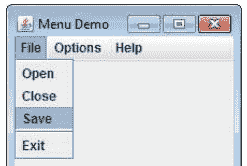

图 34-1 MenuDemo 程序的示例输出

```java
// 最后，将整个选项菜单添加到
// 菜单栏
jmb.add(jOptions);
```

```java
// 为菜单项添加动作监听器。
jmiOpen.addActionListener(this);
jmiClose.addActionListener(this);
jmiSave.addActionListener(this);
jmiExit.addActionListener(this);
jmiRed.addActionListener(this);
jmiGreen.addActionListener(this);
jmiBlue.addActionListener(this);
jmiHigh.addActionListener(this);
jmiLow.addActionListener(this);
jmiReset.addActionListener(this);
jmiAbout.addActionListener(this);
```

```java
// 将标签添加到内容面板中。
jfrm.add(jlab);
```

```java
// 将菜单栏添加到框架中。
jfrm.setJMenuBar(jmb);
```

```java
// 显示框架。
jfrm.setVisible(true);
}
```

```java
// 处理菜单项事件。
public void actionPerformed(ActionEvent ae) {
    // 从菜单选择中获取动作命令。
    String comstr = ae.getActionCommand();
}
```

```java
// 如果用户选择“退出”，则退出程序。
if(comstr.equals("Exit")) System.exit(0);
```

```java
// 否则，显示选择的内容。
jlab.setText(comstr + " - Selected");
}
```

```java
public static void main(String[] args) {
    // 在事件分发线程上创建框架。
    SwingUtilities.invokeLater(new Runnable() {
        public void run() {
            new MenuDemo();
        }
    });
}
```

# 第 34 章 介绍 Swing 菜单

让我们详细检查此程序中的菜单是如何创建的，从 `MenuDemo` 构造函数开始。它首先创建一个 `JFrame` 并设置其布局管理器、大小和默认操作。（这些操作在第 32 章中描述过）。随后构造了一个 `JLabel`。它被用于显示菜单选择。接下来，构造菜单栏，并通过该语句将它的引用赋值给 `jmb`：

```java
// 创建菜单栏。
JMenuBar jmb = new JMenuBar();
```

然后，通过以下序列创建文件菜单 `jFile` 及其项：

```java
// 创建文件菜单。
JMenu jFile = new JMenu("File");
JMenuItem jmiOpen = new JMenuItem("Open");
JMenuItem jmiClose = new JMenuItem("Close");
JMenuItem jmiSave = new JMenuItem("Save");
JMenuItem jmiExit = new JMenuItem("Exit");
```

“打开”、“关闭”、“保存”和“退出”将作为菜单选择显示。接下来，通过该序列将菜单项添加到文件菜单中：

最后，通过这一行将菜单添加到菜单栏：

```java
jmb.add(jFile);
```

一旦完成前面的代码序列，菜单栏将包含一个条目：文件（File）。菜单将按此顺序包含四个选择：打开、关闭、保存和退出。然而，请注意，在“退出”之前添加了一个分隔符。这在视觉上将“退出”与之前的三个选择隔离开来。

选项菜单（Options）是通过与文件菜单相同的基本过程构造的。然而，选项菜单包含两个子菜单：颜色（Colors）和优先级（Priority），以及一个重置（Reset）项。子菜单是单独构造并添加到选项菜单的。重置项被添加。然后，将选项菜单添加到菜单栏。帮助菜单（Help）也是使用相同的过程构造的。

请注意，`MenuDemo` 实现了 `ActionListener`，并且由选择生成的动作事件由 `MenuDemo` 定义的 `actionPerformed()` 方法处理。因此，程序将此添加为菜单项的动作监听器。注意，没有为“颜色”或“优先级”项添加监听器，因为它们实际上并不是可选择项，它们仅仅是用于激活子菜单。

最后，通过以下行将菜单栏添加到框架中：

```java
jfrm.setMenuBar(jmb);
```

如所述，菜单栏不会被添加到内容面板中。它们被直接添加到 `JFrame` 中。


`actionPerformed()` 方法处理菜单生成的动作事件。它通过调用事件上的 `getActionCommand()` 获取与选择相关的动作命令字符串。它将此字符串的引用存储在 `comstr` 中。然后，如下所示，对动作命令与“Exit”进行测试：

```java
if(comstr.equals("Exit")) System.exit(0);
```

如果动作命令是“Exit”，则程序通过调用 `System.exit()` 终止。该方法会导致程序立即终止，并将其参数作为状态码传递给调用进程（通常是操作系统）。按照惯例，状态码零表示正常终止。任何其他值都表示程序异常终止。对于所有其他菜单，选择的内容将显示出来。


此时，你可能想实验一下 `MenuDemo` 程序。尝试添加另一个菜单，或在每个菜单中添加额外的项。在继续学习之前，理解基本概念是非常重要的，因为这个程序将在本章中不断演变。

# 为菜单项添加助记符和加速器

在前一个示例中创建的菜单具有功能性，但可以使其变得更好。在实际应用程序中，菜单通常包含对键盘快捷键的支持，因为让经验丰富的用户能够快速选择菜单项。键盘快捷键有两种形式：助记符和加速器。对于菜单而言，助记符定义了通过键盘选择激活菜单的键。加速器是一种可以在不激活菜单的情况下通过键盘选择项的键。

助记符可以在 `JMenuItem` 和 `JMenu` 对象中以两种方式设置。第一种是在构造 `JMenuItem` 时通过这种：

- `JMenuItem(String name, int mnemonic)`

在这种情况下，传递的是 `name` 和 `mnemonic`。第二种是通过调用 `setMnemonic()` 为 `JMenu` 设置助记符。该方法由 `AbstractButton` 定义，如下：

```java
void setMnemonic(int mnemonic)
```

这里，`mnemonic` 指定了助记符。它应该是 `java.awt.event.KeyEvent` 中定义的常量之一。

## 加速器

加速器可以与 `JMenuItem` 关联。它通过调用 `setAccelerator()` 指定，如下所示：

```java
void setAccelerator(KeyStroke ks)
```

这里，`ks` 是选择菜单项的按键组合。`KeyStroke` 类包含若干个工厂方法，用于构造不同类型的加速器。以下是三个示例：

```java
static KeyStroke getStroke(char ch)
static KeyStroke getStroke(Character ch, int modifier)
static KeyStroke getStroke(int ch, int modifier)
```

这里，`ch` 指定了加速字符。在第一个版本中，字符作为 `char` 值指定。在第二个中，它作为 `Character` 对象指定。在第三个中，它是之前描述的 `KeyEvent` 值。`modifier` 的值必须是以下定义的 `java.awt.event.InputEvent` 常量：

| 常量 | 常量 |
| :--- | :--- |
| `InputEvent.ALT_DOWN_MASK` | `InputEvent.ALT_GRAPH_DOWN_MASK` |
| `InputEvent.CTRL_DOWN_MASK` | `InputEvent.META_DOWN_MASK` |
| `InputEvent.SHIFT_DOWN_MASK` | |

因此，如果你将 `VK_A` 传递给字符并将 `InputEvent.CTRL_DOWN_MASK` 传递给修饰符，加速键组合就是 CTRL-A。

以下序列为之前节中创建的文件菜单添加助记符和加速器。之后，你可以通过输入 Alt-F 选择文件菜单。然后你可以使用助记符 o、c、s 或 e 来选择选项。或者，你可以通过按下 CTRL-O、CTRL-C、CTRL-S 或 CTRL-E 直接选择文件菜单。

```java
// 创建带有助记符和加速器的文件菜单。
JMenu jmFile = new JMenu("File");
jmFile.setMnemonic(KeyEvent.VK_F);

JMenuItem jmiOpen = new JMenuItem("Open", KeyEvent.VK_O);
jmiOpen.setAccelerator(KeyStroke.getKeyStroke(KeyEvent.VK_O, InputEvent.CTRL_DOWN_MASK));

JMenuItem jmiClose = new JMenuItem("Close", KeyEvent.VK_C);
jmiClose.setAccelerator(KeyStroke.getKeyStroke(KeyEvent.VK_C, InputEvent.CTRL_DOWN_MASK));

JMenuItem jmiSave = new JMenuItem("Save", KeyEvent.VK_S);
jmiSave.setAccelerator(KeyStroke.getKeyStroke(KeyEvent.VK_S, InputEvent.CTRL_DOWN_MASK));

JMenuItem jmiExit = new JMenuItem("Exit", KeyEvent.VK_E);
jmiExit.setAccelerator(KeyStroke.getKeyStroke(KeyEvent.VK_E, InputEvent.CTRL_DOWN_MASK));
```

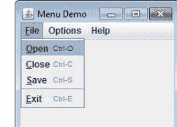

## 在菜单项中添加图像和工具提示

你可以为菜单项添加图像，或者使用图像代替文本。添加图像最简单的方法是在构造菜单项时，使用以下构造函数之一指定它：

- `JMenuItem(Icon image)`
- `JMenuItem(String name, Icon image)`

第一个创建一个显示由 `image` 指定图像的菜单项。第二个创建一个具有由 `name` 指定名称和由 `image` 指定图像的菜单项。例如，“关于”菜单项在创建时是与一个图像相关联的：

```java
Icon icon = new ImageIcon("AboutIcon.gif");
JMenuItem jmiAbout = new JMenuItem("About", icon);
```

添加之后，当显示“帮助”菜单时，`icon` 指定的图标将显示在文本“About”旁边。如图 34-3 所示。你也可以通过调用继承自 `AbstractButton` 的 `setIcon()` 方法在菜单项创建后向其添加图标。

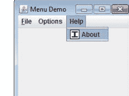

你可以通过调用 `setHorizontalTextPosition()` 指定图像相对于文本的水平对齐方式。

你可以通过调用 `setDisabledIcon()` 指定一个禁用的图标，该图标会在菜单项被禁用时显示。通常情况下，当菜单项被禁用时，默认图标会以灰色显示。如果指定了禁用的图标，则当菜单项被禁用时将显示该图标。

工具提示是一个描述项目的小消息。如果鼠标停留在项目上片刻，它就会自动显示。你可以通过在项目上调用 `setToolTipText()` 为菜单项添加工具提示，指定你想要显示的文本。其显示所示：

```java
void setToolTipText(String msg)
```

在这种情况下，`msg` 是当工具提示激活时将要显示的字符串。例如，这为“关于”项创建了一个工具提示：

```java
jmiAbout.setToolTipText("Info about the MenuDemo program.")
```

值得感兴趣的是，`setToolTipText` 是 `JMenuItem` 继承自 `Component` 的。这意味着你可以为其他类型的组件（如推送按钮）添加工具提示。你可能想自己尝试一下。

## JRadioButtonMenuItem 和 JCheckBoxMenuItem

虽然前面的示例使用的菜单项类型原则上是通用的，但 Swing 定义了另外两种：复选框和单选按钮。这些组件允许菜单提供在其他情况下需要额外、独立组件才能实现的功能，从而简化 GUI。此外，有时在菜单中包含复选框或单选按钮似乎是某特定功能的最自然位置。无论你的原因何，Swing 都让在菜单中使用复选框和单选按钮变得简单，这里将对这两者都进行检查。

要在菜单中添加复选框，请创建一个 `JCheckBoxMenuItem`。它定义了几个构造函数。本章使用的是一个：

```java
JCheckBoxMenuItem(String name)
```

在这里，`name` 指定了项目的名称。复选框的初始状态是未选中的。如果你想指定初始状态，可以使用此构造函数：

```java
JCheckBoxMenuItem(String name, boolean state)
```

在这种情况下，如果 `state` 为 `true`，则框初始为选中。否则会被清除。`JCheckBoxMenuItem` 还提供了让你指定图标的构造函数。这里有一个示例：

```java
JCheckBoxMenuItem(String name, Icon icon)
```

在这种情况下，`name` 指定项目的名称，与项目相关的图像通过 `icon` 传入。该项目初始为未选中。还支持其他构造函数。例如，它们在状态更改时会生成动作事件和项目事件。复选框在菜单中特别有用，当你有一系列可选选项并且想要显示它们的选中/未取消状态时。

```java
// 创建 Options 菜单。
JMenu jOptions = new JMenu("Options");

// 创建 Colors 子菜单。
JMenu jColors = new JMenu("Colors");

// 使用复选框选择颜色。这允许
// 用户选择多种颜色。
JCheckBoxMenuItem jmiRed = new JCheckBoxMenuItem("Red");
JCheckBoxMenuItem jmiGreen = new JCheckBoxMenuItem("Green");
JCheckBoxMenuItem jmiBlue = new JCheckBoxMenuItem("Blue");

jColors.add(jmiRed);
jColors.add(jmiGreen);
jColors.add(jmiBlue);
jOptions.add(jColors);

// 创建 Priority 子菜单。
JMenu jPriority = new JMenu("Priority");

// 使用单选按钮设置优先级。
// 这让菜单显示使用了哪个优先级，
// 但同时也确保任何时候只有一个且只有一个优先级
// 被选中。注意，
// 高（High）单选按钮初始是选中的。
JRadioButtonMenuItem jmiHigh = new JRadioButtonMenuItem("High", true);
JRadioButtonMenuItem jmiLow = new JRadioButtonMenuItem("Low");

jPriority.add(jmiHigh);
jPriority.add(jmiLow);
jOptions.add(jPriority);

// 为单选按钮菜单项创建按钮组。
ButtonGroup bg = new ButtonGroup();
bg.add(jmiHigh);
bg.add(jmiLow);

// 创建 Reset 项。
JMenuItem jmiReset = new JMenuItem("Reset");
jOptions.addSeparator();
jOptions.add(jmiReset);

// 最后，将整个选项菜单添加到
// 菜单栏
jmb.add(jOptions);
```

## 创建弹出菜单

菜单栏的一种流行替代方案是弹出菜单。弹出菜单通过在组件上点击鼠标右键来激活。Swing 通过 `JPopupMenu` 类支持弹出菜单。`JPopupMenu` 有两个构造函数。在本章中，只使用了默认构造函数：

```java
JPopupMenu()
```

它创建一个默认的弹出菜单。另一个构造函数允许你为菜单指定标题。该标题是否显示取决于外观。

通常情况下，弹出菜单的构建方式类似于普通菜单。创建一个 `JPopupMenu` 对象，然后向其添加菜单项。菜单项的选择也采用相同的方式：通过监听动作事件。弹出菜单与普通菜单的主要区别在于激活过程。

激活弹出菜单需要三个步骤：

1. 你需要为鼠标事件注册一个监听器。
2. 在鼠标事件处理器内部，你必须监控弹出触发。
3. 当接收到弹出触发时，你必须通过调用 `show()` 方法来显示弹出菜单。

让我们仔细检查每一个步骤。

弹出菜单通常是在鼠标指针悬停在定义事件源的组件上，通过点击鼠标右键激活的。弹出触发通常是由于在启用了弹出菜单的组件上点击鼠标右键引起的。要监听弹出触发，需要实现 `MouseListener` 接口并通过调用 `addMouseListener()` 方法注册该监听器。如第 25 章所述，`MouseListener` 的方法定义在这里：

```java
void mouseClicked(MouseEvent me)
void mouseEntered(MouseEvent me)
void mouseExited(MouseEvent me)
void mousePressed(MouseEvent me)
void mouseReleased(MouseEvent me)
```

在这些方法中，有两个相对于弹出菜单而言非常重要：`mousePressed()` 和 `mouseReleased()`。根据外观和感觉，通常使用 `MouseAdapter` 来实现 `MouseListener` 接口并简单地重写 `mousePressed()` 和 `mouseReleased()` 会更方便。

`MouseEvent` 类定义了几个方法，但在激活弹出菜单时通常只需要四个。它们如下：

```java
int getX()
int getY()
boolean isPopupTrigger()
Component getComponent()
```

通过调用 `getX()` 和 `getY()` 可以找到鼠标相对于事件源的当前 X、Y 位置。这些值被用于指定弹出菜单显示时的左上角位置。如果鼠标事件代表弹出触发，`isPopupTrigger()` 方法返回 `true`，否则返回 `false`。你将使用此方法来确定何时弹出菜单。要获取生成鼠标事件的组件引用，请调用 `getComponent()`。

要实际显示弹出菜单，调用 `JPopupMenu` 定义的 `show()` 方法，如下：

```java
void show(Component invoker, int upperX, int upperY)
```

在这里，`invoker` 是菜单将显示的相对组件。`upperX` 和 `upperY` 的值定义了菜单相对于 `invoker` 左上角的 X、Y 位置。调用 `invoker` 的常用方法是对传递给鼠标处理器的事件对象调用 `getComponent()`。

上述理论可以通过向在本章开头显示的 `MenuDemo` 添加一个弹出菜单来实践。该菜单将包含三个项：Cut、Copy 和 Paste。通过开始向 `MenuDemo` 添加以下实例变量：

```java
JPopupMenu jpu;
```

`jpu` 变量将持有弹出菜单的引用。

接下来，在 `MenuDemo` 构造函数中添加以下代码序列：

```java
// 创建一个编辑弹出菜单。
jpu = new JPopupMenu();

// 创建弹出菜单项。
JMenuItem jmiCut = new JMenuItem("Cut");
JMenuItem jmiCopy = new JMenuItem("Copy");
JMenuItem jmiPaste = new JMenuItem("Paste");

// 将菜单项添加到弹出菜单中。
jpu.add(jmiCut);
jpu.add(jmiCopy);
jpu.add(jmiPaste);

// 为弹出触发添加监听器。
jfrm.addMouseListener(new MouseAdapter() {
    public void mousePressed(MouseEvent event) {
        if (event.isPopupTrigger()) {
            jpu.show(event.getComponent(), event.getX(), event.getY());
        }
    }
    public void mouseReleased(MouseEvent event) {
        if (event.isPopupTrigger()) {
            jpu.show(event.getComponent(), event.getX(), event.getY());
        }
    }
});
```

该序列首先构造 `JPopupMenu` 实例并将其存储在 `jpu` 中。然后，它以通常的方式创建 Cut、Copy 和 Paste 三项，并将它们添加到 `jpu`。这完成了弹出 Edit 菜单的构建。弹出菜单不会被添加到菜单栏或任何其他对象中。

接下来，通过创建一个匿名内部类添加一个 `MouseListener`。

# 工具栏

工具栏是一个提供一组常用操作按钮的组件。工具栏通常放置在窗口的顶部或底部，但可以拖动到任何侧边。此外，工具栏可以拖出窗口，在这种情况下它变成一个浮动工具栏。

工具栏通常与使用边界布局的窗口一起使用。这有两个原因：第一，它允许工具栏初始定位在某个边界位置之一。通常使用顶部位置。第二，它允许工具栏被拖动到任何侧边。

要创建一个工具栏，你使用 `JToolBar` 类。它的构造函数允许你指定工具栏的标题和方向：


## JToolbar 构造函数

```
JToolbar()
JToolbar(String title)
JToolbar(int how)
JToolbar(String title, int how)
```

第一个构造函数创建一个没有标题的水平工具栏。第二个创建一个带有标题的水平工具栏。标题仅在工具栏未停靠时显示。第三个构造函数创建一个由 `how` 指定方向的工具栏。`how` 的值必须是 `JToolbar.VERTICAL` 或 `JToolbar.HORIZONTAL`。第四个构造函数创建一个带有标题和方向的工具栏。

向工具栏添加按钮（或其他组件）的方式类似于菜单栏。只需调用 `add()` 即可。组件按照它们被添加的顺序在工具栏中显示。

一旦创建了工具栏，就不要将其添加到菜单栏。相反，要将其添加到窗口容器中。为了说明工具栏，将在 `MenuDemo` 程序中添加一个。该工具栏将提供三个调试选项：设置断点、清除断点和恢复执行。

## 第 34 章 引入 Swing 菜单

### 修改 MenuDemo 以使用边框布局

首先，从程序中删除此行：

```
jfrm.setLayout(new FlowLayout());
```

通过删除此行，`JFrame` 将自动使用边框布局（`BorderLayout`）。

其次，由于使用了边框布局（`BorderLayout`），请修改标签 `jlab` 添加到框架中的代码行，如下所示：

```
jfrm.add(jlab, BorderLayout.CENTER);
```

此行显式地将 `jlab` 添加到边框布局的中心。（从技术上讲，显式指定中心位置并不是必要的，因为默认情况下，当阅读代码的人能看出在使用边框布局且 `jlab` 位于中心时，组件会被添加到中心）。

### 创建调试工具栏

接下来，添加以下代码，这些代码创建了调试（Debug）工具栏：

```java
// 创建一个调试工具栏。
JToolBar jtb = new JToolBar("Debug");

// 加载图像。
ImageIcon set = new ImageIcon("setBP.gif");
ImageIcon clear = new ImageIcon("clearBP.gif");
ImageIcon resume = new ImageIcon("resume.gif");

// 创建工具栏按钮。
JButton jbtnSet = new JButton(set);
jbtnSet.setActionCommand("Set Breakpoint");
jbtnSet.setToolTipText("Set Breakpoint");

JButton jbtnClear = new JButton(clear);
jbtnClear.setActionCommand("Clear Breakpoint");
jbtnClear.setToolTipText("Clear Breakpoint");

JButton jbtnResume = new JButton(resume);
jbtnResume.setActionCommand("Resume");
jbtnResume.setToolTipText("Resume");

// 将按钮添加到工具栏中。
jtb.add(jbtnSet);
jtb.add(jbtnClear);
jtb.add(jbtnResume);

// 将工具栏添加到内容面板（content pane）
// 的北侧。
jfrm.add(jtb, BorderLayout.NORTH);
```

让我们仔细观察这段代码。首先，创建了一个 `JToolBar` 并设置标题为 "Debug"。

创建了一组 `ImageIcon` 对象，用于工具栏按钮的图像。

接下来，创建了三个工具栏按钮。注意每个按钮都有图像，但没有文本。此外，每个按钮都显式地赋予了一个动作命令（action command）和一个提示文本（tooltip）。由于按钮在构造时没有赋予名称，因此设置了动作命令。当提示文本应用于基于图标的工具栏组件时，格外有用，因为有时很难设计出让所有用户都直观的图像。然后将按钮添加到工具栏中，最后将工具栏添加到框架边框布局的北侧。

最后，为工具栏添加动作监听器（action listeners），如下：

```java
// 添加工具栏动作监听器
jbtnSet.addActionListener(this);
jbtnClear.addActionListener(this);
jbtnResume.addActionListener(this);
```

用户每当按下工具栏按钮时，就会触发一个动作，其处理方式与其他菜单相关的事件相同。图 34-6 显示了工作中的工具栏。

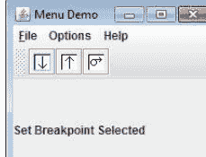

### 动作操作（Action Actions）

通常，工具栏和菜单项包含共同点。例如，上一个示例中调试工具栏提供的相同功能可能也可以通过菜单选择提供。在这种情况下，选择一个选项（如设置断点）会导致动作发生，而与使用的是菜单还是工具栏无关。此外，工具栏按钮和菜单项（很可能）使用相同的图标。而且，当工具栏按钮被禁用时，相应的菜单项也需要被禁用。这种情况通常会导致大量重复且相互依赖的代码，这并不是最优的。幸运的是，Swing 提供了一个解决方案：动作（action）。

`Action` 是 `Action` 接口的一个实例。`Action` 扩展了 `ActionListener` 接口，并提供了一种将状态信息与 `actionPerformed()` 事件处理程序相结合的方法。这种组合允许一个动作管理两个或多个组件。例如，一个动作可以让你最终确定对工具栏按钮和菜单项的控制和处理。与其拥有重复的代码，你的程序只需要创建一个自动处理这两个组件的动作即可。

由于 `Action` 扩展了 `ActionListener`，因此动作必须提供 `actionPerformed()` 方法的实现。此处理器将处理由与动作关联的对象所生成的动作事件。

除了继承的 `actionPerformed()` 方法外，`Action` 还定义了自己的几个方法。特别感兴趣的是 `putValue()`。它设置了与动作相关的各种属性的值，并在此所示：

```java
void putValue(String key, Object val)
```

它将 `val` 分配给 `key` 指定的代表所需属性的属性。虽然后面的示例没有使用它，但知道 `Action` 还提供了指定属性的 `getValue()` 方法是有帮助。在此所示：

```java
Object getValue(String key)
```

它返回由 `key` 指定的属性的引用。`putValue()` 和 `getValue()` 使用的键包括此处：

| 键值 | 描述 |
| --- | --- |
| `ACCELERATOR_KEY` | 代表加速器属性。加速器被指定为 `KeyStroke` 对象。 |
| `ACTION_COMMAND_KEY` | 代表动作命令属性。动作命令被指定为字符串。 |
| `DISPLAYED_MNEMONIC_INDEX_KEY` | 代表由助记（mnemonic）显示的字符的索引。这是一个索引。 |
| `LARGE_ICON` | 代表与动作相关的图标。 |
| `LONG_DESCRIPTION` | 代表动作的详细描述。 |
| `MNEMONIC_KEY` | 代表动作的助记。 |
| `NAME` | 代表动作的名称。 |
| `SELECTED_KEY` | 代表选中状态。 |
| `SHORT_DESCRIPTION` | 代表动作相关的提示文本。 |
| `SMALL_ICON` | 代表与动作相关的图标。 |

例如，要设置助记为 X，使用此 `putValue()` 调用：

```java
action.putValue(MNEMONIC_KEY, KeyEvent.VK_X);
```

通过 `putValue()` 和 `getValue()` 访问的一个属性是启用/禁用状态。这种情况下使用 `setEnabled()` 和 `isEnabled()` 方法。在此所示：

```java
void setEnabled(boolean enabled)
```

```java
boolean isEnabled()
```

对于 `setEnabled()`，如果 `enabled` 为 `true`，则启用动作；否则禁用。如果 `isEnabled()` 返回 `true`；否则返回 `false`。

虽然你可以自己实现 `Action` 接口，但你不需要这样做。相反，Swing 提供了一个名为 `AbstractAction` 的部分实现，你可以扩展它。通过扩展 `AbstractAction`，你只需要实现一个方法：`actionPerformed()`。其他方法已提供。`AbstractAction` 提供了三个构造函数。本章使用的所示：

```java
AbstractAction(String name, Icon image)
```

它构造了一个具有 `name` 指定名称和 `image` 指定图标的 `AbstractAction`。一旦你创建了动作，就可以将其添加到 `JToolBar` 并用于构造 `JMenuItem`。要将动作添加到 `JToolBar`，使用此 `add()` 版本：

```java
JButton add(Action actObj)
```

在这里，`actObj` 是被添加到工具栏的动作。`actObj` 定义的属性用于创建工具栏按钮。要从动作创建菜单项，使用 `JMenuItem` 构造函数：

```java
JMenuItem(Action actObj)
```

在这里 `actObj` 是根据其属性构造菜单项的动作。

> **NOTE** 除了 `JToolBar` 和 `JMenuItem`，动作还被许多其他 Swing 组件支持，例如 `JPopupMenu`、`JButton`、`JRadioButton`、`JCheckBox`、`JRadioButtonMenuItem` 和 `JCheckBoxMenuItem`。

## 使用 Action 实现调试功能

首先创建一个名为 `DebugAction` 继承 `AbstractAction` 的内部类，如下所示：

```java
// 为 Debug 菜单和
// 工具栏创建一个 action 类。
class DebugAction extends AbstractAction {
    public DebugAction(String name, Icon image, int mnemonic,
        int accel, String tTip) {
        super(name, image);
        putValue(ACCELERATOR_KEY, KeyStroke.getKeyStroke(accel, InputEvent.CTRL_DOWN_MASK));
        putValue(MNEMONIC_KEY, mnemonic);
        putValue(SHORT_DESCRIPTION, tTip);
    }

    // 处理工具栏和
    // Debug 菜单的事件。
    public void actionPerformed(ActionEvent ae) {
        String comStr = ae.getActionCommand();

        jlab.setText(comStr + " Selected");

        // 切换 Set（设置断点）和 Clear（清除断点）选项的状态。
        if (comStr.equals("Set Breakpoint")) {
            clearAct.setEnabled(true);
            setAct.setEnabled(false);
        } else if (comStr.equals("Clear Breakpoint")) {
            clearAct.setEnabled(false);
            setAct.setEnabled(true);
        }
    }
}
```

`DebugAction` 继承 `AbstractAction`。它创建了一个 action 类，用于定义与 Debug 菜单和工具栏相关的属性。它的构造函数有五个参数，供你指定以下内容：

- 名称 (Name)
- 图标 (Icon)
- 助记键 (Mnemonic)
- 加速键 (Accelerator)
- 提示 (Tooltip)

前两个参数通过 `super` 传递给 `AbstractAction` 的构造函数。另外三个属性通过调用 `putValue()` 设置。

`DebugAction` 的 `actionPerformed()` 处理该 action 的事件。这意味着当使用 `DebugAction` 实例创建工具栏按钮和菜单项时，由这些组件生成的任何事件都由 `DebugAction` 中的 `actionPerformed()` 方法处理。注意，该处理器显示了 `jlab`。此外，如果选择了 Set Breakpoint 选项，Clear Breakpoint 选项将被启用而 Set Breakpoint 选项将被禁用。如果选了 Clear Breakpoint 选项，Set Breakpoint 选项将被启用而 Clear Breakpoint 选项将被禁用。这说明了如何使用 action 来启用或禁用组件。当一个 action 被禁用时，该 action 的所有使用处都会被禁用。在这种情况下，如果 Set Breakpoint 被禁用，那么它在工具栏和菜单中都会被禁用。

接下来，在 `MenuDemo` 中添加这些 `DebugAction` 变量：

```java
DebugAction setAction;
DebugAction clearAction;
DebugAction resumeAction;
```

接下来，创建代表 Debug 选项的 `ImageIcons`，如下所示：

```java
// 加载 action 的图像。
ImageIcon setIcon = new ImageIcon("setBP.gif");
ImageIcon clearIcon = new ImageIcon("clearBP.gif");
ImageIcon resumeIcon = new ImageIcon("resume.gif");
```

现在，创建管理 Debug 选项的 action，如下所示：

```java
// 创建 action。
setAction =
new DebugAction("Set Breakpoint",
setIcon,
KeyEvent.VK_S,
KeyEvent.VK_B,
"Set a break point.");

clearAction =
new DebugAction("Clear Breakpoint",
clearIcon,
KeyEvent.VK_C,
KeyEvent.VK_L,
"Clear a break point.");

resumeAction =
new DebugAction("Resume",
resumeIcon,
KeyEvent.VK_R,
KeyEvent.VK_R,
"Resume execution after break point.");
```

```java
// 初始化禁用 Clear Breakpoint 选项。
clearAction.setEnabled(false);
```

注意，Set Breakpoint 的加速键是 B，而 Clear Breakpoint 的加速键是 L。使用这些键而不是 S 和 C 的原因是这些键已经由 File 菜单分配给了 Save（保存）和 Close（关闭）。然而，它们仍然可以作为助记键使用，因为每个助记键都局限于其自己的菜单。同样注意，代表 Clear Breakpoint 的 action 初始化是禁用的。它只有在设置了断点后才会被启用。

接下来，使用这些 action 为工具栏创建按钮，然后将添加到工具栏中，如下所示：

```java
// 创建按钮。
JButton jSet = new JButton(setAction);
JButton jbtnClear = new JButton(clearAction);
JButton jResume = new JButton(resumeAction);
```

```java
// 创建工具栏。
JToolBar jtb = new JToolBar();
```

```java
// 将按钮添加到工具栏。
jtb.add(jSet);
jtb.add(jbtnClear);
jtb.add(jResume);
```

```java
// 将工具栏添加到内容面板。
jfrm.add(jtb, BorderLayout.NORTH);
```

最后，创建 Debug 菜单，如下：

```java
// 创建菜单。
JMenu jDebug = new JMenu("Debug");
```

```java
// 将项目添加到菜单。
jDebug.add(setAction);
jDebug.add(clearAction);
jDebug.add(resumeAction);
```

```java
// 将菜单添加到菜单栏。
jmb.add(jDebug);
```


# 1138 第三部分 使用 Swing 引入 GUI 编程

以下版本的 `MenuDemo` 包含了本章描述的所有新增内容。为了清晰起见，程序重组为：

```java
import java.awt.*;
import java.awt.event.*;
import javax.swing.*;

class MenuDemo implements ActionListener {

    JLabel jlab;
    JMenuBar jmb;
    JToolBar jtb;
    JPopupMenu jpu;

    DebugAction setAction;
    DebugAction clearAction;
    DebugAction resumeAction;

    MenuDemo() {
        // 创建框架。
        JFrame jfrm = new JFrame("Breakpoints");

        // 使用默认布局。
        jfrm.setLayout(new BorderLayout());

        // 用户关闭框架时退出程序。
        jfrm.setDefaultCloseOperation(JFrame.EXIT_ON_CLOSE);

        // 创建标签。
        jlab = new JLabel();

        // 创建菜单栏。
        jmb = new JMenuBar();

        // 给框架设置大小。
        jfrm.setSize(360, 200);

        // 让框架可见。
        jfrm.setVisible(true);

        // 创建工具栏。
        jtb = new JToolBar();

        // 将工具栏添加到内容面板的北部。
        jfrm.add(jtb, BorderLayout.NORTH);

        // 将标签添加到内容面板的中心。
        jfrm.add(jlab, BorderLayout.CENTER);

        // 为框架设置菜单栏。
        jfrm.setJMenuBar(jmb);

        // 创建 File 菜单。
        makeFile();

        // 创建 action。
        makeActions();

        // 创建工具栏。
        makeToolbar();

        // 创建 Debug 菜单。
        makeOptionsMenu();

        // 创建 Help 。
        makeHelpMenu();

        // 创建 Edit 菜单。
        makeEditMenu();
    }

    void makeFile() {
        // 创建 File 菜单。
        JMenu jFile = new JMenu("File");
        // 创建 Exit 菜单项。
        JMenuItem jExit = new JMenuItem("Exit");
        // 为 Exit 添加监听器。
        jExit.addActionListener(this);
        // 将 Exit 添加到菜单。
        jFile.add(jExit);
        // 将菜单添加到菜单栏。
        jmb.add(jFile);
    }

    void makeActions() {
        // 创建 action。
        setAction =
            new DebugAction("Set Breakpoint",
                setIcon,
                KeyEvent.VK_S,
                KeyEvent.VK_B,
                "Set a break point.");

        clearAction =
            new DebugAction("Clear Breakpoint",
                clearIcon,
                KeyEvent.VK_C,
                KeyEvent.VK_L,
                "Clear a break point.");

        resumeAction =
            new DebugAction("Resume",
                resumeIcon,
                KeyEvent.VK_R,
                KeyEvent.VK_R,
                "Resume execution after break point.");

        // 初始化禁用 Clear Breakpoint 选项。
        clearAction.setEnabled(false);
    }

    void makeToolbar() {
        // 创建工具栏。
        jtb = new JToolBar();

        // 创建按钮。
        JButton jSet = new JButton(setAction);
        JButton jbtnClear = new JButton(clearAction);
        JButton jResume = new JButton(resumeAction);

        // 将按钮添加到工具栏。
        jtb.add(jSet);
        jtb.add(jbtnClear);
        jtb.add(jResume);
    }

    void makeOptionsMenu() {
        // 创建 Debug 菜单。
        JMenu jDebug = new JMenu("Debug");

        // 将项目添加到菜单。
        jDebug.add(setAction);
        jDebug.add(clearAction);
        jDebug.add(resumeAction);

        // 将菜单添加到菜单栏。
        jmb.add(jDebug);
    }

    void makeHelpMenu() {
        // 创建 Help 菜单。
        JMenu jHelp = new JMenu("Help");
        jmb.add(jHelp);
    }

    void makeEditMenu() {
        // 创建弹出菜单。
        jpu = new JPopupMenu();
    }

    public void actionPerformed(ActionEvent ae) {
        // 获取菜单选择的动作命令。
        String comStr = ae.getActionCommand();

        // 如果用户使用 Exit，则退出程序。
        if (comStr.equals("Exit")) System.exit(0);

        // 否则，显示选择。
        jlab.setText(comStr + " Selected");
    }
}
```

```java
// 用于 Debug 菜单
// 工具栏的动作类
class DebugAction extends AbstractAction {
    public DebugAction(String name, Icon image, int mnem,
        int accel, String tTip) {
        putValue(ACCELERATOR_KEY,
            KeyStroke.getKeyStroke(accel, InputEvent.CTRL_DOWN_MASK));

        putValue(MNEMONIC_KEY, mnem);
        putValue(SHORT_DESCRIPTION, tTip);
    }
}

// 处理工具栏和 Debug
// 菜单的事件。
public void actionPerformed(ActionEvent ae) {
    String comStr = ae.getActionCommand() + " Selected";

    // 切换“设置断点”（Set Breakpoint）和
    //“清除断点”（Clear Breakpoint）选项的状态。
    if (comStr.equals("Set Breakpoint")) {
        clearAct.setEnabled(true);
        setAct.setEnabled(false);
    } else if (comStr.equals("Clear Breakpoint")) {
        clearAct.setEnabled(false);
        setAct.setEnabled(true);
    }
}

// 创建带有记忆键和加速键的 菜单。
void makeFileMenu() {
    JMenuItem jmiFile = new JMenuItem("File");
    jmiFile.setMnemonic(KeyEvent.VK_F);

    JMenuItem jmiOpen = new JMenuItem("Open");
    jmiOpen.setAccelerator(
        KeyStroke.getKeyStroke(KeyEvent.VK_O, InputEvent.CTRL_DOWN_MASK));

    JMenuItem jmiClose = new JMenuItem("Close");
    jmiClose.setAccelerator(
        KeyStroke.getKeyStroke(KeyEvent.VK_C, InputEvent.CTRL_DOWN_MASK));

    JMenuItem jmiSave = new JMenuItem("Save");
    jmiSave.setAccelerator(
        KeyStroke.getKeyStroke(KeyEvent.VK_S, InputEvent.CTRL_DOWN_MASK));
}

JMenuItem jmiExit = new JMenuItem("Exit", KeyEvent.VK_E);

jmiExit.setAccelerator(
    KeyStroke.getKeyStroke(KeyEvent.VK_E, InputEvent.CTRL_DOWN_MASK));
```

```java
jmiFile.add(jmiOpen);
jmiFile.add(jmiClose);
jmiFile.add(jmiSave);
jmiFile.addSeparator();
jmiFile.add(jmiExit);
jmiOptions.add(jmiFile);
```

```java
// 为 File 菜单添加动作监听器。
jmiOpen.addActionListener(this);
jmiClose.addActionListener(this);
jmiSave.addActionListener(this);
jmiExit.addActionListener(this);
```

```java
// 创建 Colors（颜色）子菜单。
JMenu jmiColors = new JMenu("Colors");
```

```java
// 为 Colors 使用复选框。
// 让用户可以选择多种颜色。
JCheckBoxMenuItem jmiRed = new JCheckBoxMenuItem("Red");
JCheckBoxMenuItem jmiGreen = new JCheckBoxMenuItem("Green");
JCheckBoxMenuItem jmiBlue = new JCheckBoxMenuItem("Blue");
```

```java
// 将项添加到 Colors 菜单。
jmiColors.add(jmiRed);
jmiColors.add(jmiGreen);
jmiColors.add(jmiBlue);
jmiOptions.add(jmiColors);
```

```java
// 创建 Priority（优先级）子菜单。
JMenu jmiPriority = new JMenu("Priority");
```

```java
// 使用单选按钮进行优先级设置。
// 这让菜单显示正在使用优先级，
// 但同时也确保在任何时候只能选择且仅选择一个优先级。注意
// 高优先级按钮最初是被选中的。
JRadioButtonMenuItem jmiHigh =
    new JRadioButtonMenuItem("High", true);
JRadioButtonMenuItem jmiLow =
    new JRadioButtonMenuItem("Low");
```

```java
// 将项添加到 Priority 菜单。
jmiPriority.add(jmiHigh);
```

```java
jmiPriority.add(jmiLow);
jmiOptions.add(jmiPriority);
```

```java
// 为单选按钮创建一个按钮组。
ButtonGroup bg = new ButtonGroup();
bg.add(jmiHigh);
bg.add(jmiLow);
```

```java
// 现在，创建创建可以使用
// 菜单项的 Debug 菜单。使用动作来
// 创建项：
JMenu MenuItemDebug = new JMenu("Debug");
JMenuItem MenuItemSetBP = new JMenuItem("set");
JMenuItem MenuItemClearBP = new JMenuItem("clear");
JMenuItem MenuItemResume = new JMenuItem("resume");
```

```java
// 将项添加到 Debug 菜单。
MenuItemDebug.add(MenuItemSetBP);
MenuItemDebug.add(MenuItemClearBP);
MenuItemDebug.add(MenuItemResume);
jmiOptions.add(MenuItemDebug);
```

```java
// 创建 Reset（重置）项。
JMenuItem jmiReset = new JMenuItem("Reset");
jmiOptions.addSeparator();
jmiOptions.add(jmiReset);
```

```java
// 最后，将整个 Options 菜单
// 添加到菜单栏
jmb.add(jmiOptions);
```

```java
// 为 Debug 菜单支持的
// Options 菜单添加动作监听器。
jmiRed.addActionListener(this);
jmiGreen.addActionListener(this);
jmiBlue.addActionListener(this);
jmiHigh.addActionListener(this);
jmiLow.addActionListener(this);
jmiReset.addActionListener(this);
```

```java
// 创建 Help（帮助）菜单。
JMenu jmiHelp = new JMenu("Help");
```

```java
// 为 About（关于）项添加图标。
ImageIcon icon = new ImageIcon("AboutIcon.gif");
```

```java
JMenuItem jmiAbout = new JMenuItem("About");
jmiAbout.setToolTipText("Info about the MenuDemo program.");
jmiHelp.add(jmiAbout);
jmb.add(jmiHelp);
```

```java
// 为 About 添加监听器。
jmiAbout.addActionListener(this);
```

// 构造 Debug 菜单和
// 工具栏所需的动作。

void makeActions() {

    // 加载动作所需的图像。

    ImageIcon setIcon = new ImageIcon("setBP.gif");
    ImageIcon clearIcon = new ImageIcon("clearBP.gif");
    ImageIcon resumeIcon = new ImageIcon("resume.gif");

    // 创建动作。

    setAct = 
        new DebugAction("Set Breakpoint",
            setIcon,
            KeyEvent.VK_S,
            KeyEvent.VK_B,
            "Set a breakpoint.");

    clearAct = 
        new DebugAction("Clear Breakpoint",
            clearIcon,
            KeyEvent.VK_C,
            KeyEvent.VK_L,
            "Clear a breakpoint.");
}
```


KeyEvent.VK_L,

"Clear a breakpoint.");

resumeAct = 

    new DebugAction("Resume",

        resumeIcon,

        KeyEvent.VK_R,

        KeyEvent.VK_R,

        "Resume after breakpoint.");

// 最初禁用断点选项。

clearAct.setEnabled(false);

}

// 创建 Debug 工具栏。

void makeToolbar() {

    // 使用动作创建工具栏按钮。

    JButton jbtnSet = new JButton(setAct);

    JButton jbtnClear = new JButton(clearAct);

    JButton jbtnResume = new JButton(resumeAct);

    // 创建 Debug 工具栏。

    jtb = new JToolBar("Breakpoints");

    // 将按钮添加到工具栏。

    jtb.add(jbtnSet);

    jtb.add(jbtnClear);

    jtb.add(jbtnResume);

}

```

```java
// 创建 Edit（编辑）弹出菜单。

void makeEditPopupMenu() {

    jpu = new JPopupMenu();
}
```

```java
// 创建弹出菜单项

JMenuItem jmiCut = new JMenuItem("Cut");

JMenuItem jmiCopy = new JMenuItem("Copy");

JMenuItem jmiPaste = new JMenuItem("Paste");
```

```java
// 将菜单项添加到弹出菜单。

jpu.add(jmiCut);

jpu.add(jmiCopy);

jpu.add(jmiPaste);
```

```java
// 添加编辑弹出菜单动作监听器。

jmiCut.addActionListener(this);

jmiCopy.addActionListener(this);

jmiPaste.addActionListener(this);

}
```

```java
public static void main(String[] args) {

    // 在事件分发线程上创建框架。

    SwingUtilities.invokeLater(new Runnable() {

        public void run() {

            new MenuDemo();

        }

    });

}
```

# 继续对 Swing 的探索

Swing 定义了一个非常大的 GUI 工具包。它有许多你想要自己探索的功能。例如，它提供了对话框类，如 `JOptionPane` 和 `JDialog`，提供了超出第 33 章介绍范围的额外控件。你可能想要探索 `JSpinner`（创建一个数值调节控件）和 `JFormattedTextField`（支持格式化文本）。你还可能想要尝试为各种组件定义自己的模型。坦率地说，熟悉 Swing 能力的最好方法就是对其进行实验。

本页特留白。

# 第四部分 应用 Java

## 第 35 章
Java Beans

## 第 36 章
引入 Servlets

本页特留白。

# 第 35 章 Java Beans

本章概述了创建 Java Beans。Beans 非常重要，因为它们允许你从软件组件构建复杂的系统。这些组件可以由你提供，也可以由一个或多个不同的供应商提供。Java Beans 使用 JavaBeans 架构，该架构规定了这些构建块如何运行。

从一组数据点生成饼图的软件是一个可以在本地执行的 Bean 示例。然而，一个提供来自股票或大宗商品交易所实时价格信息的 Bean 则需要与其他分布式软件协作以获取其数据。

## Beans 的优势

以下列表列出了 JavaBeans 为组件开发者提供的一些益处：

- Bean 享有了 Java “一次编写，随处运行”范式的所有优势。
- Bean 类中暴露给另一个应用程序的属性、事件和方法是可以被控制的。
- 可以提供辅助软件来帮助配置 Bean。该软件仅在设置该组件的设计时参数时才需要。它不需要包含在运行时环境中。
- Bean 的状态可以保存到持久化存储中，并在稍后恢复。
- Bean 可以注册接收来自其他对象的事件，并可以生成发送给其他对象的事件。

## 内省（Introspection）

Bean 编程的核心是内省。这是分析 Bean 以确定其能力范围的过程。这是 JavaBeans API 的一项至关重要的功能，因为它允许另一个应用程序作为设计工具，获取有关组件的信息。如果没有内省，JavaBeans 技术将无法运行。

Bean 的开发者有两种方式来指示其哪些属性、事件和方法应该被暴露。第一种方法使用了简单的命名约定。这些约定允许内省机制推导出有关 Bean 的信息。第二种方法提供了一个扩展自 `BeanInfo` 接口的额外类，显式地指定这些信息。这两种方法在这里都将进行介绍。

## 属性的设计模式

属性是 Bean 状态的子集。赋值给属性的值决定了组件的行为和外观。属性通过 setter 方法（设置方法）设置。属性通过 getter 方法（获取方法）获取。属性有两种类型：简单属性和索引属性。

### 简单属性

简单属性具有单一值。可以通过以下设计模式识别，其中 N 是属性名称，T 是其类型：

```
public T getN()

public void setN(T arg)
```

读/写属性同时具有这两个方法来访问其值。只读属性只有一个 `get` 方法。只写属性只有一个 `set` 方法。

以下是三个读/写简单属性及其对应的 getter 和 setter 方法：

```java
private double depth, height, width;

public double getDepth() {
    return depth;
}

public void setDepth(double d) {
    depth = d;
}

public double getHeight() {
    return height;
}

public void setHeight(double h) {
    height = h;
}

public double getWidth() {
    return width;
}

public void setWidth(double w) {
    width = w;
}
```

注意：对于布尔类型属性，也可以使用形式为 `isPropertyName()` 的方法作为访问器。

### 索引属性

索引属性由多个值。可以通过以下模式识别，其中 N 是属性名称，T 是其类型：

```
public T getN(int index);

public void setN(int index, T value);

public void setN(T[] values);
```

以下是一个名为 `data` 的索引属性及其对应的 getter 和 setter 方法：

```java
private double[] data;

public double getData(int index) {
    return data[index];
}

public void setData(int index, double value) {
    data[index] = value;
}

public double[] getData() {
    return data;
}

public void setData(double[] values) {
    data = new double[values.length];
    System.arraycopy(values, 0, data, 0, values.length);
}
```

## 事件的设计模式

Beans 使用了之前讨论过的委托方法。Beans 可以生成事件并发送给其他对象。这些可以通过设计模式识别，其中 T 是监听器类型：

```
public void addEventListener(T listener)

public void removeEventListener(T listener)
```

| 接口 | 描述 |
| --- | --- |
| BeanInfo | 此接口允许设计者指定关于 Bean 的属性、事件和方法的信息。 |
| Customizer | 此接口允许设计者提供一个图形用户界面，通过该界面可以对 Bean 配置。 |
| DesignMode | 此接口中的方法确定 Bean 是否正在设计模式下执行。 |
| ExceptionListener | 当发生异常时，会调用此接口中的一个方法。 |
| PropertyChangeListener | 当绑定属性发生变化时，会调用此接口中的一个方法。 |
| PropertyEditor | 实现此接口的对象允许设计者更改和显示属性值。 |
| VetoableChangeListener | 当约束属性发生变化时，会调用此接口中的一个方法。 |
| Visibility | 此接口中的方法允许 Bean 在没有图形用户界面的环境中执行。 |

**表 35-1** java.beans 中未被弃用的接口

## JavaBeans API

JavaBeans 的功能由 `java.beans` 包中的一组类和接口提供。从 JDK 9 开始，该包位于 `java.desktop` 模块中。本节提供了其内容的简要概述。表 35-1 列出了 `java.beans` 中未被弃用的接口并对其功能进行了简要描述。表 35-2 列出了 `java.beans` 中的类。

| 类 | 描述 |
| --- | --- |
| BeanDescriptor | 此类提供关于 Bean 的信息。它还允许你将通信器与 Bean 关联。 |
| Beans | 此类用于获取有关 Bean 的信息。 |
| DefaultPersistenceDelegate | `PersistenceDelegate` 的具体子类。 |
| Encoder | 编码一组 Bean 的状态。可将信息写入流中。 |
| EventHandler | 此类支持事件处理。 |
| EventSetDescriptor | 此类的实例描述由 Bean 生成的事件。 |
| Expression | 封装对返回结果的方法调用。 |
| FeatureDescriptor | 它是 `PropertyDescriptor`、`EventSetDescriptor` 和 `MethodDescriptor` 等类的父类。 |

**表 35-2** java.beans 中的类（续接）

| 类 | 描述 |
| --- | --- |
| IndexedPropertyChangeEvent | `PropertyChangeEvent` 的子类，表示索引属性的变化。 |
| IndexedPropertyDescriptor | 此类的实例描述 Bean 的索引属性。 |
| IntrospectionException | 如果在分析 Bean 时发生问题，则会生成此类型的异常。 |
| Introspector | 此类分析 Bean 并构造一个描述组件的 `BeanInfo` 对象。 |
| MethodDescriptor | 此类的实例描述 Bean 的方法。 |
| ParameterDescriptor | 此类的实例描述方法参数。 |
| PersistenceDelegate | 处理对象的状态信息。 |
| PropertyChangeEvent | 当绑定或约束属性发生变化时会生成此事件。它被发送给对这些事件感兴趣并实现了 `PropertyChangeListener` 或 `VetoableChangeListener` 接口的对象。 |
| PropertyChangeListenerProxy | 扩展 `EventListener` 并实现 `PropertyChangeListener`。 |
| PropertyChangeSupport | 绑定属性的 Bean 可以使用此类通知 `PropertyChangeListener` 对象。 |
| PropertyDescriptor | 此类的实例描述 Bean 的属性。 |
| PropertyEditorManager | 此类为给定类型定位 `PropertyEditor` 对象。 |
| PropertyEditorSupport | 此类提供了在编写属性编辑器时可以使用的功能。 |
| PropertyVetoException | 如果约束属性被否决，则会生成此类型的异常。 |
| SimpleBeanInfo | 此类提供了在编写 Bean 类时可以使用的功能。 |
| Statement | 封装对方法的调用。 |
| VetoableChangeListenerProxy | 扩展 `EventListener` 并实现 `VetoableChangeListener`。 |
| VetoableChangeSupport | 约束属性的 Bean 可以使用此类通知 `VetoableChangeListener` 对象。 |
| XMLDecoder | 用于从 XML 文档读取 Bean。 |
| XMLEncoder | 用于将 Bean 写入 XML 文档。 |

**表 35-2** java.beans 中的类

虽然讨论所有类超出了本章范围，但有四个类特别值得关注：`Introspector`、`PropertyDescriptor`、`EventSetDescriptor` 和 `MethodDescriptor`。这里将对每个类进行简要检查。

## Introspector

`Introspector` 类提供了支持内省的多个静态方法。重要的是 `getBeanInfo()`。它返回一个可以获取 Bean 信息的 `BeanInfo` 对象。`getBeanInfo()` 方法有多种形式，包括这里的：

```java
static BeanInfo getBeanInfo(Class<?> bean) throws IntrospectionException
```

返回的对象包含指定 Bean 的信息。

## PropertyDescriptor

`PropertyDescriptor` 类描述 Bean 的特征。它支持多种管理和描述属性的方法。例如，你可以调用 `isBound()` 来判断属性是否是绑定的。要判断属性是否受约束，调用 `isConstrained()`。你可以调用 `getName()` 获取属性名称。

## EventSetDescriptor

`EventSetDescriptor` 类表示一组 Bean 事件。它支持多种方法，用于获取 Bean 用于添加或删除监听器以及其他管理事件的方法。例如，使用添加监听器的方法，调用 `getAddListenerMethod()`。获取删除监听器的方法，调用 `getRemoveListenerMethod()`。获取监听器类型，调用 `getListenerType()`。你可以调用 `getName()` 获取事件名称。

## MethodDescriptor

`MethodDescriptor` 类表示一个 Bean 方法。获取方法名称，调用 `getName()`。你可以通过 `getName()` 获取有关方法的信息。

```java
System.out.println("Events:");

EventSetDescriptor[] eventSetDescriptors = beanInfo.getEventSetDescriptors();

for(int i = 0; i < eventSetDescriptors.length; i++) {
    System.out.println("\t" + eventSetDescriptors[i].getName());
}
```

```java
catch(Exception e) {
    System.out.println("Exception caught. " + e);
}
```


该程序的输出如下：

+ Properties:
rectangular
Events:
mouseWheel
mouse
mouseMotion
component
hierarchyBounds
focus
hierarchy
propertyChange
inputMethod
key

注意输出中的两点。首先，由于 `ColorsBean` 重写了 `getPropertyDescriptors()`，导致返回的唯一属性是未重写的 `rectangular`。然而，由于 `getSetDescriptors()` 被 `ColorsBeanInfo` 重写，因此使用了设计模式内省（design-pattern introspection），并找到了所有事件，包括 `Colors` 的子类 `Canvas` 中的事件。请记住，如果你没有重写 `SimpleBean` 定义的方法之一，则将使用默认的设计模式内省。为了观察 `ColorsBeanInfo` 带来的差异，请删除其类文件并再次运行 `IntpectorDemo`。这次它将报告更多的属性。


# 第36 章 Servlet 简介

本章将介绍 Servlet 基础。Servlet 是在 Web 连接的服务器端执行的小型程序。Servlet 的主题非常广泛，涵盖所有内容超出了本章的范围。相反，我们将重点关注核心概念、接口和类，并开发几个示例。

## 背景

为了理解 Servlet 的优势，你必须基本了解浏览器和服务器如何协作为用户提供内容。考虑一个静态 Web 页面的请求。用户在浏览器中输入统一资源定位符（URL）。浏览器生成器向相应的 Web 服务器发送一个 HTTP 请求。Web 服务器将此请求映射到特定文件。该文件通过 HTTP 响应返回给浏览器。响应中的 HTTP 头部指示了内容的类型。多用途互联网邮件扩展（MIME）便用于此目的。例如，普通 ASCII 文本的 MIME 类型为 `text/plain`。Web 页面的超文本标记语言（HTML）源码的 MIME 类型为 `text/html`。

现在考虑动态内容。假设一个在线商店使用数据库来存储其业务信息。这包括销售商品、价格、可用性、订单等。它希望通过 Web 页面让客户访问这些信息。这些 Web 页面的内容将动态生成，以反映数据库中的最新信息。

在 Web 早期，服务器可以通过创建一个独立的进程来处理每个客户端请求，从而动态构建页面。该进程打开与一个或多个数据库的连接以获取所需信息。它通过称为通用网关接口（CGI）的接口与 Web 服务器通信。CGI 允许独立进程从 HTTP 请求中读取数据并将数据写入 HTTP 响应。可以使用多种不同的语言来构建 CGI 程序，包括 C、C++ 和 Perl。

## 应用 Java

CGI 遭遇了几个性能问题。为每个客户端请求创建一个独立进程在处理器和内存资源方面是非常昂贵的。为每个客户端请求打开和关闭数据库连接也是昂贵的。此外，CGI 程序不依赖平台。因此，引入了其他技术。其中就包括 Servlet。

与 CGI 相比，Servlet 具有多个优势。首先，性能显著提高。Servlet 在 Web 服务器的地址空间内执行。没有必要为每个客户端请求创建一个独立的进程。其次，由于 Servlet 用 Java 编写的，因此它们是平台无关的。第三，可以实施一组限制来保护服务器机器上的资源。最后，Servlet 可以使用 Java 类库的完整功能。它可以通过你已经过的 sockets 和 RMI 机制与其他软件通信。

## Servlet 的生命周期

有三个方法是 Servlet 生命周期的核心。这些方法是 `init()`、`service()` 和 `destroy()`。它们由每个 Servlet 实现，并在特定时间由服务器调用。我们考虑一个典型的用户场景来理解这些方法何时被调用。

首先，用户在 Web 浏览器中输入统一资源定位符（URL）。随后浏览器为该 URL 生成 HTTP 请求。该请求随后发送到相应的 Servlet。

其次，Web 服务器接收到 HTTP 请求。该请求映射到特定的 Servlet。Servlet 被动态重新加载并加载到服务器的地址空间中。

第三，Servlet 调用自身的 `init()` 方法。该方法仅在 Servlet 首次加载到内存时被调用。可以向 Servlet 传递初始化参数，以便其进行配置。

第四，Servlet 调用自身的 `service()` 方法。你会发现 Servlet 可以读取 HTTP 请求中提供的数据。它还可以为客户端制定 HTTP 响应。

Servlet 留存在服务器的地址空间中，并可以处理从客户端收到的任何 HTTP 请求。每个 HTTP 请求都会调用 `service()` 方法。最后，服务器可能决定从内存中卸载 Servlet。做出此决定的算法是特定的。

## Servlet 开发选项

为了实验 Servlet，你需要访问 Servlet 容器的权限。两个流行的容器是 Glassfish 和 Apache Tomcat。Apache Tomcat 是由 Apache 软件基金维护的开源产品。虽然 NetBeans 和 Eclipse 等 IDE 非常有用并可以简化 Servlet 的创建，但它们并非必须的。

> 注意，然而，如果你在使用不同 Servlet 容器的环境中开发，这里介绍的概念仍然适用。只是准备测试的机制略有不同。

## 使用 Tomcat

Tomcat 包含了创建和测试 Servlet 所需的类库、文档运行时支持。有多个版本的 Tomcat 可用，在你写作时最新版本是 10.0.7。接下来的说明也将适用于 10.0.7。使用此版本的 Tomcat 是因为它是一个现代版本，适用于广泛的读者。你可以从 tomcat.apache.org 下载 Tomcat。你应该根据自己的环境选择合适的版本。

本章中的示例是 64 位 Windows 环境。假设 64 位版本的 Tomcat 10.0.7 已解压到根目录，默认位置是：

```
C:\apache-tomcat-10.0.7
```

这是书中示例所假设的位置。如果你在其他位置使用 Tomcat（或使用不同版本的 Tomcat），则需要对示例进行相应的更改。你可能需要设置环境变量 `JAVA_HOME` 指向 Java 开发工具包安装的顶级目录。

安装后，你可以通过选择 apache-tomcat-10.0.7 目录下的 `startup.bat` 来启动 Tomcat。要停止 Tomcat，执行 bin 目录下的 `shutdown.bat`。

构建 Servlet 所需的类和接口包含 `servlet-api.jar` 中，它位于以下目录：

```
C:\apache-tomcat-10.0.7\lib
```

为了使 `servlet-api.jar` 可用，请更新你的 `CLASSP` 环境变量使其包含：

```
C:\apache-tomcat-10.0.7\lib\servlet-api.jar
```

或者，你可以在编译 servlet 时指定此文件。例如，以下命令编译了第一个 servlet 示例：

```
javac HelloServlet.java -classpath "C:\apache-tomcat-10.0.7\lib\servlet-api.jar"
```

一旦你编译了 servlet，就必须让 Tomcat 能够找到它。对于我们的目的，是将将其放入 Tomcat 的 `webapps` 目录下的子目录，并将其名称输入 `web.xml` 文件中。为了简单起见，本章中的示例使用了 Tomcat 为自身的示例 servlet 提供的目录和 `web.xml`。这样，你就不需要创建任何文件或目录来实验示例 servlet。以下是你将遵循的步骤：

首先，将 servlet 的类复制到以下目录：

```
C:\apache-tomcat-10.0.7\webapps\examples\WEB-INF\classes
```

接下来，将 servlet 的名称和映射添加到该目录下的 `web.xml` 文件中：

```
C:\apache-tomcat-10.0.7\webapps\examples\WEB-INF
```

例如，假设第一个示例命名为 `HelloServlet`，你将在定义 servlet 的部分中添加以下行：

```
<servlet>
  <servlet-name>HelloServlet</servlet-name>
  <servlet-class>HelloServlet</servlet-class>
</servlet>
```

接下来，你将在定义 servlet 映射的部分中添加以下行：

```
<servlet-mapping>
  <servlet-name>HelloServlet</servlet-name>
  <url-pattern>/servlets/servlet/HelloServlet</url-pattern>
</servlet-mapping>
```

对所有示例遵循这一简单的步骤。

## 一个简单的 Servlet

为了熟悉 servlet 的核心概念，我们将开始构建并测试一个简单的 servlet。基本步骤如下：

1. 创建并编译 servlet 源代码。然后，将 servlet 的类复制到正确的目录，并将 servlet 的名称和映射添加到正确的 `web.xml` 文件中。
2. 启动 Tomcat。
3. 启动浏览器并请求该 servlet。

我们将详细检查这些每一个步骤。

### 创建并编译 Hello Servlet 代码

首先，创建一个名为 `HelloServlet.java` 的文件，其中包含以下程序：

```
import java.io.*;
import jakarta.servlet.*;

public class HelloServlet extends GenericServlet {
    public void service(ServletRequest request,
                         ServletResponse response)
            throws ServletException, IOException {
        response.setContentType("text/html");
        PrintWriter pw = response.getWriter();
        pw.println("<html>Hello!</html>");
        pw.close();
    }
}
```

让我们仔细观察这个程序。首先，注意它导入了 `jakarta.servlet` 包。该包包含了构建 servlet 所需的类和接口。你将在本章稍后学习更多关于这些内容。接下来，程序将 `HelloServlet` 定义为 `GenericServlet` 的子类。`GenericServlet` 类简化了 servlet 的创建。例如，它提供了 `init()` 和 `destroy()` 的版本，这些版本可以直接使用。你只需要 `service()` 方法。

在 `HelloServlet` 内部，重写了（从自 `GenericServlet`）`service()` 方法。该方法处理来自客户端的请求。注意第一个参数是一个 `ServletRequest` 对象。这使得 servlet 能够读取通过客户端请求提供的数据。第二个参数是 `ServletResponse` 对象。这使得 servlet 能够为客户端制定响应。

`setContentType()` 的调用建立了 HTTP 响应的 MIME 类型。在程序程序中，MIME 类型为 `text/html`。这表示浏览器应该将内容解释为 HTML 源代码。

接下来，`getWriter()` 方法获取一个 `PrintWriter`。写入此流的任何内容都将作为 HTTP 响应的一部分发送给客户端。然后使用 `println()` 将一些 HTML 源代码作为 HTTP 响应。

编译此源代码并将 `HelloServlet.class` 文件放置在前节描述的 Tomcat 目录中。同时，如所述将 `HelloServlet` 添加到 `web.xml` 文件。

### 启动 Tomcat

如之前所述启动 Tomcat。在尝试执行 servlet 之前，Tomcat 必须正在运行。

### 启动浏览器和 Servlet

启动浏览器并通过输入 URL 请求 servlet：

```
http://localhost:8080/examples/servlets/HelloServlet
```


# Servlet API

`jakarta.servlet` 包包含了构建 servlet 所需的类和接口。下表总结了关键接口：

| 接口 | 说明 |
| --- | --- |
| `Servlet` | 声明生命周期方法。 |
| `ServletConfig` | 允许 servlet 获取初始化参数。 |
| `ServletContext` | 使 servlet 能够记录事件并访问其环境信息。 |
| `ServletRequest` | 用于从客户端读取数据。 |
| `ServletResponse` | 用于向客户端写入数据。 |

下表总结了 `jakarta.servlet` 包中提供的核心类：

| 类 | 说明 |
| --- | --- |
| `GenericServlet` | 实现 `Servlet` 和 `ServletConfig` 接口。 |
| `ServletInputStream` | 封装了用于从客户端读取请求的输入流。 |
| `ServletOutputStream` | 封装了用于向客户端写入响应的输出流。 |
| `ServletException` | 表示 servlet 错误。 |
| `UnavailableException` | 表示 servlet 不可用。 |

让我们详细地检查这些接口和类。

## Servlet 接口

所有 servlet 都实现 `Servlet` 接口。它声明了由服务器在 servlet 生命周期期间调用的 `init()`、`service()` 和 `destroy()` 方法。还提供了一个方法允许 servlet 获取任何初始化参数。`Servlet` 定义的方法如表 36-1 所示。

| 方法 | 说明 |
| --- | --- |
| `void destroy()` | 在 servlet 卸载时调用。 |
| `ServletConfig getServletConfig()` | 返回包含任何初始化参数的 `ServletConfig` 对象。 |
| `String getServletInfo()` | 返回描述 servlet 的字符串。 |
| `void init(ServletConfig sc) throws ServletException` | 在 servlet 初始化时调用。servlet 的初始化参数可以通过 `sc` 获取。如果无法初始化 servlet，应抛出 `ServletException`。 |
| `void service(ServletRequest req, ServletResponse res) throws ServletException, IOException` | 处理来自客户端的请求。来自客户端的请求可以通过 `req` 读取。向客户端的响应可以通过 `res` 写入。如果发生 servlet 或 IO 问题，将产生异常。 |

**表 36-1 Servlet 定义的方法**

## ServletConfig 接口

`ServletConfig` 接口允许 servlet 在加载时获取配置数据。此接口声明的方法总结如下：

| 方法 | 描述 |
|---|---|
| `ServletContext getServletContext()` | 返回此 servlet 的上下文。 |
| `String getInitParameter(String param)` | 返回命名为 param 的初始化参数的值。 |
| `Enumeration<String> getInitParameterNames()` | 返回所有初始化参数名称的枚举。 |
| `String getServletName()` | 返回调用该 servlet 的名称。 |

## ServletContext 接口

`ServletContext` 接口允许 servlet 获取其有关其环境的信息。它的其中几个方法总结在表 36-2 中。

| 方法 | 描述 |
|---|---|
| `Object getAttribute(String attr)` | 返回命名为 attr 的服务器属性值。 |
| `String getMimeType(String file)` | 返回文件的 MIME 类型。 |
| `String getRealPath(String vpath)` | 返回与相对路径 vpath 对应的真实（即绝对）路径。 |
| `String getServerInfo()` | 返回有关服务器的信息。 |
| `void log(String s)` | 将 s 写入 servlet 日志。 |
| `void log(String s, Throwable e)` | 将 s 和 e 的堆栈跟踪写入 servlet 日志。 |
| `void setAttribute(String attr, Object val)` | 将 attr 指定的属性设置为传入的 val 值。 |

**表 36-2** ServletContext 定义的各种方法

## ServletRequest 接口

`ServletRequest` 接口允许 servlet 获取有关客户端请求的信息。它的其中几个方法总结在表 36-3 中。

| 方法 | 描述 |
| --- | --- |
| `Object getAttribute(String attr)` | 返回命名为 attr 的属性值。 |
| `String getCharacterEncoding()` | 返回请求的字符编码。 |
| `int getContentLength()` | 返回请求的大小。如果大小不可用，则返回 -1。 |
| `String getContentType()` | 返回请求类型。如果无法确定类型，则返回 null 值。 |
| `ServletInputStream getInputStream() throws IOException` | 返回一个用于从请求中读取二进制数据的 `ServletInputStream`。如果在此对象上之前调用过 `getReader()`，则抛出 `IllegalStateException`。 |
| `String getParameter(String pname)` | 返回命名为 pname 的参数的值。 |
| `Enumeration<String> getParameterNames()` | 返回请求参数名称的枚举。 |
| `String[] getParameterValues(String name)` | 返回一个包含与指定名称参数关联的值的数组。 |
| `String getProtocol()` | 返回协议的描述。 |
| `BufferedReader getReader() throws IOException` | 返回一个用于从请求中读取文本的缓冲器。如果在此对象上之前调用过 `getInputStream()`，则抛出 `IllegalStateException`。 |
| `String getRemoteAddr()` | 返回客户端 IP 地址的字符串等值。 |
| `String getRemoteHost()` | 返回客户端主机名的字符串等值。 |
| `String getScheme()` | 返回用于请求的 URL 传输方案（例如 'http'、'ftp'）。 |
| `String getServerName()` | 返回服务器的名称。 |
| `int getServerPort()` | 返回端口号。 |

**表 36-3** ServletRequest 定义的各种方法

## ServletResponse 接口

`ServletResponse` 接口允许 servlet 为客户端制定响应。它的其中几个方法总结在表 36-4 中。

| 方法 | 描述 |
| --- | --- |
| `String getCharacterEncoding()` | 返回响应的字符编码。 |
| `ServletOutputStream getOutputStream() throws IOException` | 返回一个用于向响应中写入二进制数据的 `ServletOutputStream`。如果在此对象上之前调用过 `getWriter()`，则抛出 `IllegalStateException`。 |
| `PrintWriter getWriter()` | 返回一个用于向响应写入文本的 `PrintWriter`。如果在此对象上之前调用过 `getOutputStream()`，则抛出 `IllegalStateException`。 |
| `void setContentLength(int size)` | 设置响应的长度。 |
| `void setContentType(String type)` | 设置响应的内容类型。 |

**表 36-4** ServletResponse 定义的各种方法

## GenericServlet 类

`GenericServlet` 类实现了 `Servlet` 和 `ServletConfig`。此外，`GenericServlet` 提供了生命周期方法 `log()`。其签名如下：

- `void log(String s)`
- `void log(String s, Throwable e)`

## ServletInputStream 类

`ServletInputStream` 类继承自 `InputStream`。它由 servlet 容器提供，用于从请求中读取二进制数据。它定义了：

- `int read()`
- `int read(byte[] buffer, int offset, int size)` 将字节放入缓冲区。如果遇到流结束条件，则返回 -1。

## ServletOutputStream 类

`ServletOutputStream` 类继承自 `OutputStream`。它由 servlet 容器提供，用于向响应写入二进制数据。它定义了：

- `void print()`
- `void println()`

## 异常类

`jakarta.servlet` 定义了异常。第一个是 `ServletException`，表示发生了问题。第二个是 `UnavailableException`，表示 servlet 不可用。

## 读取 Servlet 参数

`ServletRequest` 接口包含了允许你读取请求参数名称和值的方法。我们将开发一个 servlet 来演示它们的用法。网页定义在 `PostParameters.html` 中，而 servlet 定义在 `PostParametersServlet.java` 中。

`PostParameters.html` 的代码所示。它包含两个标签和文本字段。一个标签是 Employee，另一个是 Phone。还有一个提交按钮。注意表单的 action 属性指定了 URL。该 URL 标识了处理 HTTP 请求的 servlet。

编译 servlet。接下来，将它复制到相应的目录，并按照之前的描述更新 `web.xml` 文件。然后，执行以下步骤测试此示例：

1. 启动 Tomcat（如果它尚未运行）。
2. 在浏览器中显示网页。
3. 在文本字段中输入员工姓名和电话号码。
4. 提交网页。

按照这些步骤操作，浏览器将显示由 servlet 动态生成的响应。

## jakarta.servlet.http 包

之前的示例使用了在 `jakarta.servlet` 中定义的类和接口，例如 `HttpServlet`、`HttpServletResponse` 和 `GenericServlet`，用来说明 servlet 的基本功能。然而，在处理 HTTP 时，你通常会使用 `jakarta.servlet.http` 中的接口和类。正如你所看到的，它的功能可以轻松构建与 HTTP 请求和响应协作的 servlet。

下表总结了本章使用的接口：

| 接口 | 说明 |
|---|---|
| `HttpServletRequest` | 允许 servlet 从 HTTP 请求中读取数据。 |
| `HttpServletResponse` | 允许 servlet 向 HTTP 响应写入数据。 |
| `HttpSession` | 允许读取和写入会话数据。 |

下表总结了本章使用的类。其中最重要的是 `HttpServlet`。Servlet 开发者通常会扩展此类以便处理 HTTP 请求。

| 类 | 说明 |
|---|---|
| `Cookie` | 允许在客户端机器上存储状态信息。 |
| `HttpServlet` | 提供处理 HTTP 请求和响应的方法。 |

## HttpServletRequest 接口

`HttpServletRequest` 接口允许 servlet 获取有关客户端请求的信息。表 36-5 显示了它的其中几个方法。

| 方法 | 说明 |
|---|---|
| `String getAuthType()` | 返回身份验证方案。 |
| `Cookie[] getCookies()` | 返回此请求中的 cookie 数组。 |
| `long getDateHeader(String field)` | 返回名为 field 的头部字段的值。 |
| `String getHeader(String field)` | 返回名为 field 的头部字段的值。 |
| `Enumeration<String> getHeaderNames()` | 返回头部名称的枚举。 |
| `int getIntHeader(String field)` | 返回名为 field 的头部字段的 int 等值。 |
| `String getMethod()` | 返回此请求的 HTTP 方法。 |
| `String getPathInfo()` | 返回位于 servlet 路径和 URL 查询之后的任何路径信息。 |
| `String getPathTranslated()` | 返回位于 servlet 路径和 URL 查询之后的任何路径信息，并将其转换为真实路径。 |
| `String getQueryString()` | 返回 URL 中的任何查询字符串。 |
| `String getRemoteUser()` | 返回请求此请求的用户名。 |
| `String getRequestedSessionId()` | 返回会话的 ID。 |
| `StringBuffer getRequestURL()` | 返回 URI。 |
| `String getServletPath()` | 返回 URL 中标识 servlet 的部分。 |
| `HttpSession getSession()` | 返回此请求的会话。如果不存在会话，则创建并返回它。 |
| `HttpSession getSession(boolean create)` | 如果 create 为 true 且不存在会话，则为此请求创建并返回会话。否则，返回此请求的现有会话。 |
| `boolean isRequestedSessionIdFromCookie()` | 如果 cookie 包含 session ID，则返回 true。否则返回 false。 |
| `boolean isRequestedSessionIdFromURL()` | 如果 URL 包含 session ID，则返回 true。否则返回 false。 |
| `boolean isRequestedSessionIdValid()` | 如果请求的 session ID 在当前会话上下文中有效，则返回 true。 |

**表 36-5** HttpServletRequest 定义的各种方法

## HttpServletResponse 接口

`HttpServletResponse` 接口允许 servlet 为客户端制定 HTTP 响应。该接口定义了几个常数（constants）。这些常量对应于可以分配给 HTTP 响应的不同状态码。例如，`SC_OK` 表示 HTTP 请求成功，`SC_NOT_FOUND` 表示请求的资源不可用。该接口的几个方法总结在表 36-6 中。

| 方法 | 说明 |
|---|---|
| `void addCookie(Cookie cookie)` | 向 HTTP 响应中添加 cookie。 |
| `boolean containsHeader(String field)` | 如果 HTTP 响应头部包含名为 field 的字段，则返回 true。 |
| `String encodeURL(String url)` | 确定 session ID 是否必须以标识的形式在 URL 中编码。如果是，返回 url 的修改版本。否则，返回 url。由 servlet 生成的所有 URL 都应通过此方法处理。 |
| `String encodeRedirectURL(String url)` | 确定 session ID 是否必须以标识的形式在 URL 中编码。如果是，返回 url 的修改版本。否则，返回 url。传递给 `sendRedirect()` 的 URL 都应通过此方法处理。 |
| `void sendError(int sc) throws IOException` | 向客户端发送错误代码 sc。 |
| `void sendError(int sc, String msg) throws IOException` | 向客户端发送错误代码 sc 和消息。 |
| `void sendRedirect(String location) throws IOException` | 将客户端重定向到 location。 |
| `void setDateHeader(String field, long date)` | 向头部添加字段，其值为 date（自 1970 年 1 月 1 日以来的毫秒）。 |
| `void setHeader(String field, String value)` | 向头部添加值为 value 的字段。 |
| `void setIntHeader(String field, int value)` | 向头部添加值为 value 的字段。 |
| `void setStatus(int sc)` | 设置此响应的状态为 sc。 |

**表 36-6** HttpServletResponse 定义的各种方法

## HttpSession 接口

`HttpSession` 接口允许 servlet 读取和写入与 HTTP 会话关联的状态信息。它的几个方法总结在表 36-7 中。如果会话已经失效，所有这些方法都会抛出 `IllegalStateException`。

| 方法 | 说明 |
| ------|---|
| `Object getAttribute(String name)` | 返回与名称 name 关联的值。如果未找到 name 则返回 null。 |
| `Enumeration<String> getAttributeNames()` | 返回与会话关联的属性名称枚举。 |
| `long getCreationTime()` | 返回调用会话的创建时间（自 1970 年 1 月 1 日以来的毫秒）。 |
| `String getId()` | 返回会话 ID。 |
| `long getLastAccessedTime()` | 返回客户端对调用会话进行最后请求的时间（自 1970 年 1 月 1 日以来的毫秒）。 |
| `void invalidate()` | 使会话失效并将其从上下文中移除。 |
| `boolean isNew()` | 如果会话是由服务器创建且尚未被客户端访问，则返回 true。 |
| `void removeAttribute(String name)` | 从会话中移除指定的属性。 |
| `void setAttribute(String name, Object value)` | 将传递的值 value 与属性名称 name 关联。 |

**表 36-7** HttpSession 定义的各种方法

## Cookie 类

**Cookie** 类封装了一个 cookie。cookie 存储在客户端上并包含信息。Cookie 对于跟踪用户活动非常有价值。例如，假设用户访问了一个在线商店。cookie 可以保存用户的姓名、地址和其他信息。用户不需要每次访问商店都向服务器写入 cookie。Servlet 通过 `HttpServletResponse` 接口的 `addCookie()` 方法向服务器写入 cookie。这些数据随后包含在发送给浏览器的响应头部中。

cookie 的名称和值存储在用户的机器上。每个 cookie 可以保存的一些信息包括：

- cookie 的名称
- cookie 的值
- cookie 的过期日期
- cookie 的域和路径

| 方法 | 说明 |
| ------|---|
| `Object clone()` | 返回此对象的副本。 |
| `String getComment()` | 返回注释。 |
| `String getDomain()` | 返回域名。 |
| `int getMaxAge()` | 返回最大年龄（秒）。 |
| `String getName()` | 返回名称。 |
| `String getPath()` | 返回路径。 |
| `boolean getSecure()` | 如果 cookie 是安全的，则返回 true。否则返回 false。 |
| `String getValue()` | 返回值。 |
| `int getVersion()` | 返回版本。 |
| `boolean isHttpOnly()` | 如果 cookie 具有 HttpOnly 属性，则返回 true。 |
| `void setComment(String comment)` | 将注释设置为 comment。 |
| `void setDomain(String domain)` | 将域名设置为 domain。 |
| `void setHttpOnly(boolean httpOnly)` | 如果 httpOnly 为 true，则向 cookie 中添加 HttpOnly 属性。如果 httpOnly 为 false，则移除 HttpOnly 属性。 |
| `void setMaxAge(int expiry)` | 设置 cookie 的最大年龄，该 cookie 将在此秒数后被删除。 |
| `void setPath(String path)` | 将路径设置为 path。 |
| `void setSecure(boolean secure)` | 将安全标志设置为 secure。 |
| `void setValue(String value)` | 将值设置为 value。 |
| `void setVersion(int version)` | 将版本设置为 version。 |

**表 36-8** Cookie 定义的方法

## HttpServlet 类

`HttpServlet` 类扩展了 `GenericServlet`。它通常用于开发接收和处理 HTTP 请求的 servlet。`HttpServlet` 类的方法总结在表 36-9 中。

| 方法 | 描述 |
| :--- | :--- |
| `void doDelete(HttpServletRequest req, HttpServletResponse resp) throws IOException, ServletException` | 处理 HTTP DELETE 请求。 |
| `void doGet(HttpServletRequest req, HttpServletResponse resp) throws IOException, ServletException` | 处理 HTTP GET 请求。 |
| `void doHead(HttpServletRequest req, HttpServletResponse resp) throws IOException, ServletException` | 处理 HTTP HEAD 请求。 |
| `void doOptions(HttpServletRequest req, HttpServletResponse resp) throws IOException, ServletException` | 处理 HTTP OPTIONS 请求。 |
| `void doPost(HttpServletRequest req, HttpServletResponse resp) throws IOException, ServletException` | 处理 HTTP POST 请求。 |
| `void doPut(HttpServletRequest req, HttpServletResponse resp) throws IOException, ServletException` | 处理 HTTP PUT 请求。 |
| `void doTrace(HttpServletRequest req, HttpServletResponse resp) throws IOException, ServletException` | 处理 HTTP TRACE 请求。 |
| `long getLastModified(HttpServletRequest req)` | 返回请求的资源修改的时间（自 GMT 1970 年 1 月 1 日午夜以来的毫秒）。 |
| `void service(HttpServletRequest req, HttpServletResponse resp) throws IOException, ServletException` | 当 HTTP 请求到达此 servlet 时，由服务器调用。参数提供了对 HTTP 请求和响应的访问。 |

**表 36-9** HttpServlet 定义的方法

## 处理 HTTP 请求和响应

**HttpServlet** 类提供了处理各种类型 HTTP 请求的专用方法。开发者通过实现 `doDelete()`、`doGet()`、`doHead()`、`doOptions()`、`doPost()`、`doPut()` 和 `doTrace()` 来开发这些方法之一。不同类型 HTTP 请求的完整描述超出了本书的范围。然而，GET 和 POST 请求在处理表单输入时常用。在本节中介绍了这些情况的示例。

## 处理 HTTP GET 请求

在这里我们将定义一个处理 GET 请求的 servlet。当网页上的表单被提交时，该 servlet 会被调用。示例包含两个文件。在 `ColorGet.html` 中定义了一个网页，在 `ColorGet.java` 中定义了一个 servlet。`ColorGet.html` 的 HTML 源代码如下列表所示。它定义了一个包含 select 元素和提交按钮的表单。注意，表单的 action 属性指定了一个 URL。该 URL 标识了处理 GET 请求的 servlet。

```html
```


# Servlet 示例与会话跟踪

## 处理 GET 请求

以下是一个简单的 HTML 表单，用于向 `ColorGetServlet` 发送 GET 请求：

```html
<html>
<body>
<center>
<form name="Form1" action="http://localhost:8080/examples/servlets/servlet/ColorGetServlet">
<B>Color:</B>
<select name="color" size="1">
<option value="Red">Red</option>
<option value="Green">Green</option>
<option value="Blue">Blue</option>
</select>
<br><br>
<input type="submit" value="Submit">
</form>
</center>
</body>
</html>
```

`ColorGetServlet.java` 的源代码如下。重写了 `doGet()` 方法以处理发送到此 Servlet 的任何 HTTP GET 请求。它使用 `HttpServletRequest` 的 `getParameter()` 方法来获取用户所选，然后制定响应。

```java
import java.io.*;
import jakarta.servlet.*;
import jakarta.servlet.http.*;

public class ColorGetServlet extends HttpServlet {

    public void doGet(HttpServletRequest request, HttpServletResponse response)
    throws ServletException, IOException {

        String color = request.getParameter("color");

        response.setContentType("text/html");
        PrintWriter pw = response.getWriter();

        pw.println("<B>The selected color is: ");
        pw.println(color);
    }
}
```

**部署与测试步骤：**

1. 编译 Servlet。
2. 将其拷贝到相应目录，并更新 `web.xml`。
3. 启动 Tomcat。
4. 在浏览器中显示网页。
5. 选择颜色。
6. 提交表单。

URL 问号后面的字符被称为查询字符串。

## 处理 POST 请求

我们将开发一个处理 POST 请求的 Servlet。当网页上的表单被提交时，该 Servlet 会被调用。示例包含两个文件：`ColorPost.html` 定义了一个网页，`ColorPostServlet.java` 定义了一个 Servlet。`ColorPost.html` 的 HTML 源代码如下所示。除了表单 `method` 属性指定为 `POST` 外，它与 `ColorGet.html` 相同。

```html
<html>
<body>
<center>
<form name="Form1" method="post" action="http://localhost:8080/examples/servlets/servlet/ColorPostServlet">
<B>Color:</B>
<select name="color" size="1">
<option value="Red">Red</option>
<option value="Green">Green</option>
<option value="Blue">Blue</option>
</select>
<br><br>
<input type="submit" value="Submit">
</form>
</center>
</body>
</html>
```

`ColorPostServlet.java` 的源代码如下。重写了 `doPost()` 方法以处理发送到此 Servlet 的任何 HTTP POST 请求。它使用 `HttpServletRequest` 的 `getParameter()` 方法来获取用户所选，然后制定响应。

```java
import java.io.*;
import jakarta.servlet.*;
import jakarta.servlet.http.*;

public class ColorPostServlet extends HttpServlet {

    public void doPost(HttpServletRequest request, HttpServletResponse response)
    throws ServletException, IOException {

        String color = request.getParameter("color");

        response.setContentType("text/html");
        PrintWriter pw = response.getWriter();

        pw.println("<B>The selected color is: ");
        pw.println(color);
    }
}
```

**部署与测试步骤：**

1. 编译 Servlet。
2. 将其拷贝到相应目录，并更新 `web.xml`。
3. 启动 Tomcat。
4. 在浏览器中显示网页。
5. 选择颜色。
6. 提交表单。

## 使用 Cookie

现在让我们开发一个演示如何使用 Cookie 的 Servlet。示例包含三个文件：

| 文件 | 描述 |
| :--- | :--- |
| `AddCookie.html` | 允许为名为 `MyCookie` 的 Cookie 设置值 |
| `AddCookieServlet.java` | 处理 `AddCookie.html` 的提交 |
| `GetCookiesServlet.java` | 显示 Cookie 值 |

### AddCookie.html

`AddCookie.html` 的代码包含一个可以输入值的文本字段和一个提交按钮。当按下此按钮时，文本将通过 HTTP POST 请求发送到 `AddCookieServlet`。

```html
<html>
<body>
<center>
<form name="Form1" method="post" action="http://localhost:8080/examples/servlets/servlet/AddCookieServlet">
<B>Enter value for MyCookie:</B>
<input type="text" name="data" size=25 value="">
<input type="submit" value="Submit">
</form>
</center>
</body>
</html>
```

### AddCookieServlet.java

`AddCookieServlet.java` 的源代码如下。它获取名为 `data` 的参数值，创建一个名为 `MyCookie` 并包含该参数值的 `Cookie` 对象。通过 `addCookie()` 方法将 Cookie 添加到 HTTP 响应头中，并向浏览器写入反馈消息。

```java
import java.io.*;
import jakarta.servlet.*;
import jakarta.servlet.http.*;

public class AddCookieServlet extends HttpServlet {

    public void doPost(HttpServletRequest request, HttpServletResponse response)
    throws ServletException, IOException {

        String data = request.getParameter("data");
        Cookie cookie = new Cookie("MyCookie", data);
        response.addCookie(cookie);

        response.setContentType("text/html");
        PrintWriter pw = response.getWriter();
        pw.println("<B>The cookie has been set.</B>");
        pw.close();
    }
}
```

**关键代码片段解析：**

```java
// 从 HTTP 请求中获取参数。
String data = request.getParameter("data");
```

```java
// 创建 Cookie。
Cookie cookie = new Cookie("MyCookie", data);
```

```java
// 将 Cookie 添加到 HTTP 响应。
response.addCookie(cookie);
```

```java
// 将输出写入浏览器。
response.setContentType("text/html");
PrintWriter pw = response.getWriter();
pw.println("<B>Cookie has been set to:</B>");
pw.println(data);
pw.close();
```

### GetCookiesServlet.java

`GetCookiesServlet.java` 的源代码如下。它调用 `getCookies()` 方法来读取 HTTP GET 请求包含的任何 Cookie。然后将这些 Cookie 的名称和值写入 HTTP 响应中。请注意，通过调用 `getName()` 和 `getValue()` 方法来获取这些信息。

```java
import java.io.*;
import jakarta.servlet.*;
import jakarta.servlet.http.*;

public class GetCookiesServlet extends HttpServlet {

    public void doGet(HttpServletRequest request, HttpServletResponse response)
    throws ServletException, IOException {

        response.setContentType("text/html");
        PrintWriter pw = response.getWriter();

        Cookie[] cookies = request.getCookies();
        if (cookies != null) {
            for (Cookie cookie : cookies) {
                pw.println("Name: " + cookie.getName() + ", Value: " + cookie.getValue() + "<br>");
            }
        } else {
            pw.println("No cookies found.");
        }
    }
}
```

**部署与测试步骤：**

1. 编译 Servlet。
2. 将它们复制到相应的目录，并更新 `web.xml` 文件。
3. 启动 Tomcat（如果尚未运行）。
4. 在浏览器中显示 `AddCookie.html`。
5. 为 `MyCookie` 输入一个值。
6. 提交网页。

完成这些步骤后，你将看到浏览器显示了一条反馈消息。接下来，通过浏览器请求以下 URL：

```
http://localhost:8080/examples/servlets/servlet/GetCookiesServlet
```

观察浏览器中显示的 Cookie 名称和值。在此例中，我们没有通过 `Cookie` 的 `setMaxAge()` 方法显式为 Cookie 分配过期时间。因此，Cookie 在浏览器会话结束时过期。你可以尝试使用 `setMaxAge()` 并观察 Cookie 是否保存在了客户端机器上。

## 会话跟踪

HTTP 是一个无状态协议。每个请求都独立于之前的请求。然而，在某些应用程序中，必须保存状态以便从浏览器与服务器之间的多次交互中收集信息。会话提供了这种机制。

可以通过 `HttpServletRequest` 的 `getSession()` 方法创建会话。返回一个 `HttpSession` 对象。该对象可以存储一组将名称与对象关联起来的绑定。使用 `HttpSession` 的 `setAttribute()`、`getAttribute()`、`getAttributeNames()` 和 `removeAttribute()` 方法来管理这些绑定。会话状态由所有与客户端关联的 Servlet 共享。

下面的 Servlet 演示了如何使用会话。`getSession()` 方法获取当前会话。如果不存在会话，则会创建一个新会话。调用 `getAttribute()` 方法获取与名称 `"date"` 绑定的对象。该对象是一个 `Date` 对象，封装了此页面最后访问的日期和时间（首次访问时无此绑定）。然后创建一个封装了当前日期和时间的 `Date` 对象，调用 `setAttribute()` 方法绑定名称 `"date"`。

```java
import java.io.*;
import java.util.*;
import jakarta.servlet.*;
import jakarta.servlet.http.*;

public class DateServlet extends HttpServlet {

    public void doGet(HttpServletRequest request, HttpServletResponse response)
    throws ServletException, IOException {

        // 获取 HttpSession 对象。
        HttpSession hs = request.getSession(true);

        // 获取写入器。
        response.setContentType("text/html");
        PrintWriter pw = response.getWriter();
        pw.print("<B>");

        // 获取上次访问的日期/时间。
        Date date = (Date) hs.getAttribute("date");
        if (date != null) {
            pw.print("Last access: " + date + "<br>");
        }

        // 显示当前日期/时间。
        date = new Date();
        hs.setAttribute("date", date);
        pw.println("Current date: " + date);
    }
}
```

当你第一次请求此 Servlet 时，浏览器会显示包含当前日期时间的一行。在随后的调用中，会显示两行：第一行显示 Servlet 最后访问的日期和时间，第二行显示当前的日期时间。

---

# 附录

## A 使用 Java 注释
## B 简单的 Java
## C 编译与运行

## Javadoc 标签

`javadoc` 识别多个标签，包括以下：

| 标签 | 含义 |
| :--- | :--- |
| `@author` | 文档的作者。 |
| `@code` | 原样显示信息，不处理 HTML。 |
| `@deprecated` | 指定该元素已过时。 |
| `@docRoot` | 指定到根目录的路径。 |
| `@exception` | 标识方法抛出的异常。 |
| `@hidden` | 防止元素出现在文档中。 |
| `@index` | 指定用于索引的术语。 |
| `@inheritDoc` | 继承父类的注释。 |
| `@link` | 插入指向另一个主题的链接。 |
| `@linkplain` | 插入指向另一个主题的链接，但使用等宽字体。 |
| `@literal` | 原样显示信息，不处理 HTML 样式。 |
| `@param` | 文档参数。 |
| `@provides` | 文档模块提供的服务。 |
| `@return` | 文档方法的返回值。 |
| `@see` | 指定指向另一个主题的链接。 |
| `@serial` | 文档可序列化字段。 |
| `@serialData` | 文档由 `writeObject()` 或 `writeExternal()` 方法写入的数据。 |
| `@serialField` | 文档 `ObjectStreamField`。 |
| `@since` | 说明引入更改的版本。 |
| `@summary` | 文档项的摘要。 |
| `@systemProperty` | 说明该名称是系统属性。 |
| `@throws` | 等于 `@exception`。 |
| `@uses` | 文档模块需要的服务。 |
| `@value` | 显示常量的值。 |
| `@version` | 指定程序元素的版本。 |

以 `@` 符号开头的文档标签被称为块级标签（也称为独立标签），它们必须放在单独一行的开头。以大括号开头（例如 `{@code}`）的标签被称为内联标签，它们可以在较大的描述中使用。你还可以在文档注释中使用其他静态 HTML 标签。

### @author

`@author` 标签记录了程序元素的作者。它的语法如下：

```
@author description
```

这里，`description` 主要是作者的姓名。在执行 `javadoc` 时，你需要指定 `-author` 选项，以便 `@author` 字段包含在 HTML 文档中。

### {@code}

`{@code}` 标签用于在文档注释中原样显示文本，不处理 HTML 标签。


# `{@code}`

`{@code}` 标签允许你向注释中嵌入文本，例如代码段。该文本将以代码字体的形式直接显示，而不进行任何进一步处理（例如 HTML 渲染）。其语法如下：

```
{@code code-snippet}
```

# `@deprecated`

`{@deprecated}` 标签指定某个程序元素已废用。建议包含 `{@see}` 或 `{@link}` 标签以告知程序员可用的替代方案。其语法如下：

```
{@deprecated description}
```

在这里，`description` 是描述废用情况的信息。`{@deprecated}` 标签可以用于字段、方法、构造函数、类和接口的文档。

# `@docRoot`

`{@docRoot}` 指定指向当前文档根目录的路径。

# `@exception`

`{@exception}` 标签描述方法中抛出的异常。如今，`@throws` 是首选的替代方案，但 `{@exception}` 仍然受支持。其语法如下：

```
{@exception exception-name explanation}
```

在这里，`exception-name` 指定了异常的全限定名称，`explanation` 是一个描述异常如何发生情况的字符串。`{@exception}` 标签只能用于方法或构造函数的文档。

# `@hidden`

`{@hidden}` 标签防止元素出现在文档中。

# `@{index}`

`{@index}` 标签指定一个将被索引的项，并在使用搜索功能时找到。其语法如下：

```
{@index term usage-str}
```

在这里，`term` 是要索引的项（可以是带引号的字符串）。`usage-str` 是可选的。因此，在下面的 `@throws` 标签中，`{@index}` 会导致 "error" 被添加到索引中：

```
@throws IOException On input {@index error}.
```

注意，“error" 一词将作为文档的一部分显示。只是它现在也被包含在索引中。如果你包含了可选的 `usage-str`，则该描述将显示在索引和搜索框中，以指示该术的用法。例如，`{@index error Serious execution failure}` 将在索引和搜索框的 "error" 下显示 "Serious execution failure"。

# `{@inheritDoc}`

此标签继承自其直接父类的注释。

# `{@link}`

`{@link}` 提供了一个指向额外信息的内联链接。其语法如下：

```
{@link mod-name/pkg-name.class-name#member-name text}
```

在这里，`mod-name/pkg-name.class-name#member-name` 指定要添加链接的类或方法的名称，`text` 是要显示的字符串。`text` 字段是可选的。如果不包含，则将 `member` 作为链接显示。注意模块名（如果存在）通过 `/` 与包分隔。例如，`{@link java.base/java.io.Writer}` 定义了一个指向 `java.io` 中 `Method` 写入器的链接，而该写入器位于 `java.base` 模块中。

# `{@linkplain}`

插入指向另一个主题的内联链接。该链接以纯文本字体显示。否则，它与 `{@link}` 类似。

# `{@literal}`

`{@literal}` 允许你向注释中嵌入文本。该文本将按原样显示，而不进行任何进一步处理（例如 HTML 渲染）。其语法如下：

```
{@literal description}
```

在这里，`description` 是嵌入的文本。

# `@param`

`{@param}` 文档化参数。其语法如下：

```
{@param parameter-name explanation}
```

在这里，`parameter-name` 指定了参数的名称。`explanation` 描述了该参数的含义。`{@param}` 标签只能用于方法、构造函数或泛型类/接口的文档。

# `@provides`

`{@provides}` 文档化模块提供的服务。其语法如下：

```
{@provides type explanation}
```

在这里，`type` 指定了服务提供者类型，`explanation` 描述了服务提供者。

# 附录 使用 Java 文档注释

# `@return`

`@return` 标签描述方法的返回值。它有两种形式。第一种是你在这里看到的块标签：

```
@return explanation
```

在这里，`explanation` 描述了方法返回值的类型和含义。因此，该标签只能用于方法文档。第二种是内联标签：

```
{@return explanation}
```

这种形式必须位于方法文档注释的顶部。

# `@see`

`@see` 标签提供了指向额外信息的引用。这里有两种常用的形式：

```
@see anchor
```

```
@see mod-name/pkg-name.class-name#member-name text
```

在第一种形式中，`anchor` 是指向绝对或相对 URL 的链接。在第二种形式中，`mod-name/pkg-name.class-name#member-name` 指定了项的名称，`text` 是该项的显示内容。`text` 参数是可选的，如果没有使用，则显示成员名。因此，除了特定的方法或字段外，你还可以指定指向模块、包、类或接口的引用。

# `@serial`

`@serial` 标签定义默认字段的注释。其基本形式如下：

```
@serial description
```

在这里，`description` 是该字段的注释。另外两种形式允许你指示类或包是否可序列化：

```
@serial include
```

```
@serial exclude
```

# `@serialData`

`@serialData` 标签文档化由 `writeObject()` 和 `writeExternal()` 方法写入的数据。其语法如下：

```
@serialData description
```

在这里，`description` 是该数据的注释。

# `@serialField`

对于实现序列化的类，`serialField` 提供了字段。其语法如下：

```
@serialField name description
```

在这里，`name` 是名称，`description` 是描述。

# `@since`

`@since` 标签指出该元素在哪个版本引入。其语法如下：

```
@since release
```

在这里，`release` 是一个字符串。

# `{@summary}`

`{@summary}` 标签明确指定了项的摘要。它位于文档的第一行：

```
{@summary explanation}
```

在这里，`explanation` 是摘要。

```java
public class SquareNum {

    /**

     * 此方法返回 num 的平方。

     * 这是一个多行描述。你可以

     * 根据需要编写任意数量的。

     * @param num 要计算平方的值。

     * @return num 的平方。

     */

    public double square(double num) {

        return num * num;

    }

    /**

     * 此方法从用户处输入数字。

     * @return 以 double 类型输入的值。

     * @throws IOException 输入错误时。

     * @see IOException

     */

    public double getNumber() throws IOException {

        // 使用 System.in 创建一个 BufferedReader

        InputStreamReader isr = new InputStreamReader(System.in);

        BufferedReader inData = new BufferedReader(isr);

        String str;

        str = inData.readLine();

        return (new Double(str)).doubleValue();

    }

    /**

     * 此方法演示了 square()。

     * @param args 未使用。

     * @throws IOException 输入错误时。

     * @see IOException

     */

    public static void main(String[] args)

    throws IOException {

        SquareNum ob = new SquareNum();

        double val;

        System.out.println("Enter value to be squared: ");

        val = ob.getNumber();

        val = ob.square(val);

        System.out.println("Squared value is " + val);

    }

}
```

# 附录

# B 介绍 JShell

从 JDK 9 开始，Java 包含了一个名为 JShell 的工具。它提供了一个交互式环境，让你能够快速方便地对 Java 代码进行实验。JShell 实现了所谓的“读取-求值-打印循环”（REPL）执行。使用这种机制，系统会提示你输入代码片段，例如 `println()` 语句自动产生的输出、表达式的结果或变量的当前值。然后 JShell 会提示你输入下一段代码，该过程持续持续（即循环）。在 JShell 的语言中，每一段代码序列被称为“片段”（snippet）。

理解 JShell 的一个关键点是，你不需要输入一个完整的 Java 程序即可使用它。每个片段在你输入时都会被立即求值。这是因为 JShell 为你处理了许多与 Java 程序相关的细节。这让你能够专注于特定的功能，而无需编写完整的程序，这使得 JShell 在你初学 Java 时特别有用。

正如你预期的那样，JShell 对经验丰富的程序员也有用。因为 JShell 会存储状态信息，你可以在 JShell 中输入多行代码序列并运行它们。这使得 JShell 在你需要原型化概念时非常有用，因为它让你对代码进行交互实验，而无需开发和编译完整的程序。

本附录介绍了 JShell 并探索了它的几个关键特性，主要关注对 Java 初学者最有用的那些特性。

## JShell 基础

JShell 是一个命令行工具。因此，它在命令提示符窗口中运行。要启动 JShell 会话，请从命令行执行 `jshell`。之后，你将看到 JShell 提示符：

```
jshell>
```

显示此提示符时，你可以输入代码片段或 JShell 命令。

在最简单的形式下，JShell 允许你输入单个语句并立即看到结果。首先，回想书中的第一个 Java 程序示例。它在这里再次显示：

```java
class Example {
    // 你的程序从调用 main() 开始。
    public static void main(String[] args) {
        System.out.println("This is a simple Java program.");
    }
}
```

在这个程序中，`println()` 语句实际上执行了一个操作，并在屏幕上显示消息。代码的其他部分仅提供了所需的类和方法声明。在 JShell 中，不需要显式指定类或方法即可执行 `println()` 语句。在 JShell 提示符处输入以下行进行查看：

```
System.out.println("This is a simple Java program.");
```

然后，按回车。输出如下：

```
This is a simple Java program.

jshell>
```

你可以看到，调用 `println()` 会求值并输出其字符串。然后，提示符重新显示。

在继续之前，解释为什么 JShell 能够执行单个语句（例如调用 `println()`）是有用的，因为编译器 `javac` 需要一个完整的程序。JShell 能够执行单个语句，因为它在后台为你自动提供了必要的程序框架。这由一个合成类和一个合成方法组成。在这种情况下，`println()` 语句嵌入在一个合成方法中。结果，即使你没有看到所有的细节，前面的代码仍然是 Java 程序的一部分。这种方法提供了一种非常快速且方便的方式来实验 Java 代码。

接下来，让我们看看 JShell 是如何支持变量的。在 JShell 中，你可以声明变量、为变量赋值，并在任何有效表达式中使用它。例如，在提示符处输入以下行：

```
int count;
```

执行后，你将看到：

```
count == 0
```

这表示 `count` 已添加到合成类中并初始化为零。此外，它已被添加为合成类的静态变量。

## 添加方法

如第 6 章所示，方法存在于类内部。然而，在使用 JShell 时，你可以在不需要显式在类中声明方法的情况下对方法进行实验。如之前提到的，这是因为 JShell 会自动将代码片段封装在一个合成类（synthetic class）中。因此，你可以轻松快速地编写方法，而无需提供类框架。这一特性在学习 Java 方法基础知识或进行代码原型设计时特别有用。为了理解这一过程，我们将通过一个示例。

首先，启动一个新的 JShell 会话，并在提示符下输入该方法：

```java
double reciprocal(double val) {
    return 1.0/val;
}
```

这创建了一个返回其参数倒数的方法。输入此内容后，JShell 响应如下：

```
created method reciprocal(double)
```

这表示该方法已添加到 JShell 的合成类中并准备好使用。要调用 `reciprocal()`，只需指定其名称，而无需任何对象或类引用。例如：

```java
System.out.println(reciprocal(4.0));
```

JShell 响应显示了 0.25。你可能会奇怪为什么不需要使用点操作符和引用就可以调用 `reciprocal()`。答案在此处：当你在 JShell 中创建一个独立方法（如 `reciprocal()`）时，JShell 会自动将其变为合成类的静态成员。如你从第 7 章所知，静态方法与其类相关，而不是某个特定对象。因此，不需要对象。这与所述的独立变量变为合成类的静态变量类似。

JShell 的另一个重要特性是支持在方法内部进行**前向引用**（forward reference），即使第二个方法尚未定义。这允许你输入一个依赖于其他方法，而无需担心先输入哪一个。这是一个简单的示例。在 JShell 中输入：

```java
void myMethod() { myMethod2(); }
```

JShell 响应如下：

```
created method myMethod(), however, it cannot be invoked until myMethod2() is declared
```

你可以看到，JShell 知道 `myMethod2()` 尚未声明，但它仍然允许你定义 `myMethod()`。正如你预期的，如果你此时尝试调用 `myMethod()`，你将看到错误信息，因为 `myMethod2()` 尚未定义，但你仍然可以输入 `myMethod()` 的代码。

接下来，像如下定义 `myMethod2()`：

```java
void myMethod2() { System.out.println("JShell is powerful."); }
```

现在 `myMethod2()` 已经定义，你就可以调用 `myMethod()` 了。除了在方法中使用它外，你还可以在类的字段初始化器中使用前向引用。

## 创建类

JShell 自动提供一个封装代码片段的合成类，你可以在 JShell 中创建自己的类。此外，你还可以实例化类的对象。这允许你在 JShell 的交互式环境中对类进行实验。以下示例说明了这一过程。启动一个新的 JShell 会话并逐行输入以下类：

```java
class MyClass {
    double v;
    MyClass(double d) { v = d; }
    // 返回 v 的倒数。
    double reciprocal() { return 1.0 / v; }
}
```

当你完成代码输入后，JShell 将响应：

```
created MyClass
```

现在你已经添加了 `MyClass`，可以使用它了。例如，你可以通过以下行创建一个 `MyClass` 对象：

```java
MyClass ob = new MyClass(10.0);
```

JShell 将响应告诉你它已将 `ob` 添加为类型为 `MyClass` 的变量。接着尝试以下行：

```java
System.out.println(ob.reciprocal());
```

JShell 响应显示值为 0.1。有趣的一点是，当你将一个类添加到 JShell 时，它会变成合成类的静态嵌套成员。

## 使用接口

JShell 对接口的支持与类相同。因此，你可以在 JShell 中声明接口并由类来实现它。让我们来看一个简单的示例。在开始之前，启动一个新的 JShell 会话。

我们在接口中声明一个名为 `isLegalVal()` 的方法，用于判断值对于某个用途是否有效。如果值合法则返回 `true`，否则返回 `false`。当然，什么构成合法值将由实现接口的每个类决定。首先在 JShell 中输入以下接口：


## 接口与类定义

```java
interface MyIF {
  boolean isLegalVal(double v);
}
```

JShell 响应：

- | created interface MyIF

接下来输入以下实现 `MyIF` 的类：

```java
class MyClass implements MyIF {
  double start;
  double end;

  MyClass(double a, double b) { start = a; end = b; }

  // 判断 v 是否在 start 到 end（包含边界）的范围内。
  public boolean isLegalVal(double v) {
    if ((v >= start) && (v <= end)) return true;
    return false;
  }
}
```

JShell 响应：

- | created class MyClass

注意 `MyClass` 通过判断值 `v` 是否在 `MyClass` 实例变量 `start` 和 `end` 的值范围内（包含边界）来实现 `isLegalVal()`。由于 `MyIF` 和 `MyClass` 都已经添加，你可以创建一个 `MyClass` 对象。

## 会话保存与加载

你可以使用 `/save` 来保存会话。其最简单的形式如下所示：

```
/save filename
```

在这里，`filename` 指定了要保存的文件名。默认情况下，`/save` 保存你当前的源代码，但它支持几个选项，其中两个特别值得关注。指定 `-all` 会保存你输入的每一行，包括你输入错误的行。你可以使用 `-history` 选项来保存你的会话历史（即你输入过的命令列表）。

你可以使用 `/open` 加载已保存的会话。其格式如下所示：

```
/open filename
```

在这里，`filename` 是要加载的文件名。

## 列表命令

JShell 提供了几个命令，可以让你列出工作中的各种元素。它们显示如下：

| 命令 | 效果 |
|---|---|
| `/types` | 显示类、接口和枚举。 |
| `/imports` | 显示导入语句。 |
| `/methods` | 显示方法。 |
| `/vars` | 显示变量。 |

例如，如果你输入了以下几行：

```java
int start = 0;
int end = 10;
int count = 5;
```

然后输入 `/vars` 命令，你将看到：

```
int start = 0;
int end = 10;
int count = 5;
```

另一个经常使用的命令是 `/history`。它允许你查看当前会话的历史。历史包含了你在命令行提示符处输入的内容列表。

# 进一步探索 JShell

精通 JShell 的最好方法是与它一起工作。尝试输入不同的 Java 结构，并观察 JShell 的响应。随着你对 JShell 进行实验，你将发现适合自己的使用模式。这将帮助你找到有效的方法，将 JShell 集成到你的学习或开发过程中。此外，请记住，JShell 不仅适用于初学者。因此，即使你是一个经验丰富的专家，在需要探索新领域时，仍然会发现 JShell 很有帮助。

简单来说：JShell 是一个进一步增强整体 Java 开发体验的重要工具。

# 附录

## 一步编译并运行简单的单文件程序

在第 2 章中，你学习了如何使用 `javac` 编译器将 Java 程序编译成字节码，然后使用 Java 启动器 `java` 运行生成的 `.class` 文件。这是自 Java 诞生以来 Java 程序编译和运行的方式，也是你在开发应用程序时将使用的方法。然而，使用 JDK 11，可以直接从源文件编译并运行某些类型的简单 Java 程序，无需先调用 `javac`。要实现这一点，将使用 `.java` 扩展名的源文件名传递给 `java`。这会导致 `java` 自动调用编译器并执行程序。

例如，以下命令将自动编译并运行书中的第一个示例：

```
java Example.java
```


在这种情况下，`Example` 类是在单一步内完成编译和运行的。不需要使用 `javac`。但请注意，不会创建 `.class` 文件。相反，编译是在后台完成的。因此，要重新运行程序，你必须执行源文件。你无法执行它的 `.class` 文件，因为不会生成它。

源文件启动能力的一个作用是方便在脚本中使用 Java 程序。它对于短期使用的程序也很有用。在某些情况下，当你正在实验 Java 时，它能让运行简单的示例程序变得稍微容易一些。然而，它并不是 Java 正常编译/执行过程的通用替代方案。

尽管这种直接从源文件启动 Java 程序的新方法很有吸引力，但它也存在限制。首先，整个程序必须包含在一个源文件中。然而，现实世界的程序通常使用多个源文件。其次，它将允许执行找到的第一个类，且该类必须包含一个 `main()` 方法。如果文件中的第一个类不包含 `main()` 方法，则启动将失败。这意味着如果你想对代码进行组织，你必须遵循严格的组织结构。第三，由于没有创建 `.class` 文件，使用 `java` 运行单文件程序不会产生可以被其他程序重用的类文件。由于这些限制，使用 `java` 运行单文件源程序是有用的，但它本质上构成了一种特殊技巧。

对于此书而言，可以使用单源文件启动功能来尝试书中的许多示例；只需确保带有 `main()` 方法的类位于文件的开头即可。尽管如此，它在所有情况下都不是适用或恰当的。此外，书中的讨论（以及许多示例）假设你正在使用正常的编译过程，即调用 `javac` 将源文件编译成字节码，然后使用 `java` 运行字节码。这是真实世界开发中使用的机制，理解这一过程是学习 Java 的重要部分。你必须彻底熟悉它，这是至关重要的。在尝试书中的示例时，强烈建议在所有情况下都使用正常的方法来编译和运行 Java 程序。这样做可以确保你在 Java 工作原理方面拥有坚实的基础。当然，你可能会发现尝试单文件启动选项很有趣！

注意：可以从未使用 `.java` 扩展名的文件执行单个程序。要这样做，你必须指定 `--source APIVer` 选项，其中 `APIVer` 指定 JDK 版本号。

# 索引

## 符号

- `&` 位与 AND, 72, 73, 74–75
- `&&` 短路 AND, 81, 83
- `*` 乘法运算符, 31, 67, 68
- `**` glob 语法, 791
- `@` 注解语法, 279, 333
- `@` 用于 tags (javadoc), 1184, 119
- `|` 位或 OR, 72, 73, 74–75
- `||` 短路 OR, 81, 83
- `]` 字符类, 1033
- `^` 位异或 OR (XOR), 72, 73, 74–75
- `^` 布尔异或 OR (XOR), 81, 82
- `^` 字符类规格, 1033
- `+` 构造函数引用, 37, 414, 418
- `+` 方法引用, 37, 406, 412
- `,` 格式标记, 688
- `}` 匿名类语法, 849
- `$` 用于临时变量名, 1198
- `=` 赋值运算符, 31, 48, 81, 83–84
- `=` 布尔逻辑运算符, 81
- `=` 关系运算符, 32, 80, 81, 278, 284
- `!` 81, 72, 761
- `!=` 80, 81
- `/` 67, 68
- `/* */` 28, 1183
- `/** */` 37, 1183, 1189
- `//` 29, 1183
- `<` 参数语法, 689–690
- `<` 菱形运算符, 382–383
- `<` 泛型参数, 350
- `>` 296, 298, 360
- `<<` 72, 75–77
- `<<` 格式标记, 686
- `->` lambda运算符, 18, 67, 85, 32, 99
- `->` 用于 case statement, 450, 454
- `%-` 34, 67, 70–71
- `%` 用于转换语法, 67
- `%` 取模运算符, 67, 69
- `%` 格式标记, 688
- `)` 用于 lambda, 392, 396, 397
- `)` 用于提高优先级, 37, 45, 88, 858
- `.` 和调用静态接口方法, 223
- `.` 点运算符, 85, 119, 125, 154, 180, 223
- `.` 用于 import statement, 206
- `.` 在多级语句, 200, 206
- `.` 和嵌套接口, 213
- `.` 正则表达式通配符, 1033, 1036
- `...` 启用/禁用断言, 339–340
- `...` 变长参数, 367, 164, 167
- `+` 加法运算符, 67, 68
- `+` 拼接运算符, 31, 160–161, 487–488
- `+` 格式标记, 686, 687
- `+` 正则表达式量化, 1033, 1035–1037
- `+` 一元加, 67
- `++` 34, 70–72
- `++` 格式标记, 686, 688
- `++` 正则表达式量化, 1033, 1036–1037
- `?` 通配符参数指定, 360, 363, 366, 380, 389, 790
- `?:` if-then-else 运算符, 82, 84
- `"""` 文本块分隔符, 459–460, 461–463
- `>>` 32, 77–78, 78–79
- `>=` 80
- `;` 分号, 300
- `;` 用于 try-with-resources 语句, 333
- `~` 位或运算符, 72, 74

## A

- 算法，集合, 573, 625–636
- `allMatch()`, 1030
- `allocate()`, 765, 776, 778
- `and` 约束字段, 915–916
- AND 表达式，使用 `instanceof` 逻辑, 474–485
- AND 运算符
    - 位运算 (`&`), 72, 73, 74–75
    - 布尔逻辑 (`&`), 81, 82, 83
    - `and` 有边界类型声明 (`&`), 359
    - 短路 (`&&`), 81, 83
- 注解的接口 (Annotated interface), 300, 301, 313, 569
- 注解接口 (Annotation interface), 295, 301, 568
- 注解成员,
    - 给 a 赋值, 295, 304, 305
    - an 的默认值, 302–303
    - 获取 an 的值, 297, 298
- 注解 (Annotation), 16, 294–314, 568
    - 内置的, 305–307
    - 容器, 312, 313
    - 声明示例, 295
    - 并且, 1197
    - 标记 (marker), 303–304
    - 成员: 注解成员
    - 获取所有, 300–
    - 通过反射获取, 296–301
    - 重复的, 301, 312–314
    - 限制限制, 314
    - 留存策略, 295–296
    - 单成员的, 304–305
    - 类型, 307–312
- `annotationType()`, 295
- `anyMatch()`, 1030
- Apache 软件基金会, 1158
- Apache Tomcat, 1158. 另参见 Tomcat
- `APPEND`, 538
- `append()`, 505, 566, 774, 903
- `Appendable` 接口, 566, 679, 737, 744, 751
- `appendTo()`, 538
- `Applet`, 8–9
- API 已废用以移除, 10
- 已弃用的 (deprecated), 11
- 对该的支持移除, 9, 11, 19, 1065
- `Applet` 类, 854
- `Applet`, Swig, 1065, 1066, 1071
- 应用程序启动器 (), Java 查看 (Java application launcher)
- `apply()`, 419, 708, 709, 710, 1013–1014, 1018
- `applyAsDouble()`, 708, 710, 1021
- `AreaAveragingScaleFilter`, 940
- `areFields` Calendar 类实例变量, 662
- 参数 (Argument), 124, 128
    - 命令行, 29, 162–163
    - 索引, 689–690
    - 作为传递的 lambda 表达式, 401–403
    - 以及重载构造函数, 142
    - 传递, 144–146
    - 类型. Type argument()
    - 变长的. 参见 Varargs
    - 通配符. 参见 Wildcard arguments
- 算术运算符, 67–72
- `ArithmeticException`, 229, 230, 240, 551
- `Array` 类, 569, 1040
- 数组 (Array), 29, 55–62, 155, 196
    - 边界检查, 57
    - 以及 集合, 631
    - 构造函数引用, 418
    - 转换为集合, 576, 587–588
    - 使用 `arraycopy()`, 539, 541
    - 使用 `var` 声明, 64, 65
    - 动态的, 585–597, 634–641
    - 以及 for-循环, 103–107
    - 实现为, 155
    - 索引, 55, 56
    - 初始化, 57, 60–61
    - 数组 的长度, 155–173
    - 二维的, 58, 62, 105–116
    - 一维的, 55–58
    - 序列化字段, 755
    - 以及 拆分, 634
    - 以及 流式 API, 1009
    - 使用字符串初始化, 65, 162
    - 以及 `valueOf()`, 499
    - 以及 可变参数, 164
- `ArrayBlockingQueue` 类, 983
- `arraycopy()`, 540, 542
- `ArrayDeque` 类, 585, 594, 693
- 数组越界异常 (`ArrayOutOfBoundsException`), 233, 240–242
- `ArrayList` 类, 588–554, 608, 637, 638

## B

- `awaitAdvance()`, 970, 971, 973, 976
- `awaitAndRegister()`, 16, 67
- 箭头运算符 (`->`), 18, 67, 85, 392
- ASCII 字符集, 43, 44, 47, 494, 来自 Internet, 485
- `Base64`, 706
- `BaseStream` 接口, 1006–1007, 1010, 1015, 方法, 106
- `BASIC`, 4
- 汇编语言, 4
- 多语言 (BMP), 528
- `BasicAttributes` 类, 773, 774, 775, 方法, 774
- `BasicFileAttribute` 接口, 775
- `assert` 语句, 16, 337–339
- 断言 (Assertions), 337–340
- `AssertionError`, 337
- 赋值运算符 `=`, 31, 81, 83–84
- 算术 (op=), 66, 69–70
- 位运算, 72, 79–80
- `BeanInfo`, 1146, 1148, 1159, 1152, 类的命名规范
- 布尔逻辑, 618
- 原子操作, 986–987
- `AtomicInteger` 类, 957, 988
- `AtomicLong` 类, 957, 实现该, 1148
- `AttributeView` 接口, 775
- 自动装箱/拆箱, 16, 287, 294–351–352
- 自动资源管理 (ARM), 228
- `available()`, 725–726, 757
- `availableProcessors()`, 998
- `await()`, 964–966, 987
- `awaitAdvance()`, 976
- `BinaryOperator<T>` 预定义函数 Search
- `Arrays` 方法, 631
- `BitSet` 类, 655
- 位运算符, 72–80
- AWT (抽象窗口), 819, 836, 851–852, 类, 类型, 852–854, 颜色系统, 856, 控件.参见 Controls, AWT
- `AWTEvent` 类, 822, 852
- Body 处理器, HTTP Client API, 814, 815, 816, 817, 818
- `body()`, 815, 816, 817
- `Boolean`, 39
- 表达式, 32, 33
- 字面量, 47
- 逻辑运算符, 81–83
- `Boolean` 类, 287, 521
- 自动装箱/拆箱, 292–293
- 常用方法表, 531
- `boolean` 数据类型, 39, 44–47, 52
- 以及 关系运算符, 44, 45, 80–81
- `booleanValue()`, 287, 251
- `Border` 接口, 1078
- `BorderFactory` 类, 1078
- `BorderLayout` 类, 852, 906–908, 1073, 1128, 输入, 908–909
- `boxed()`, 1078
- 装箱, 289
- `break` 语句, 90, 91–93, 109–113, 452, 455
- 以及 for-循环, 105
- `Buffer` 类, 764–765, 方法, 764–765
- `BufferedInputStream` 类, 317, 732–734, 785
- `BufferedReader` 类, 318, 319, 320–322, 748–750
- `BufferedWriter` 类, 318, 750
- 缓冲, 932–935
- `build()`, 536, 814, 815
- `bulkRegister()`, 977
- `Button` 类, SWT, 852, 883, 事件, 223, 832, 883, 组, 119, 992
- `ButtonGroup` 类, 1079
- `ButtonModel` 接口, 1064, 1083
- `ButtonUI`, 1064
- `Byte` 类, 287, 288, 517, 524, 525, 类型的, 常量, 518, 519, 522
- `byte` 类型, 39, 40–41, 以及 自动转换, 52, 以及 自动提升, 54, 75–76, 78–79
- `ByteArrayInputStream` 类, 317, 729–730
- `ByteArrayOutputStream` 类, 317, 730–732
- `ByteBuffer` 类, 765, 775, 776, 780, `get()` 以及 `put()` 方法, 766–777
- 字节码, 11, 12, 14–20, 28, 37, 344, 553, 1157, 513, 524, 526
- `byteValue()`, 288, 512, 514, 515, 518, 522

## C

- C, 6, 8
- 历史, 4–5, 以及 Java, 3, 5, 7, 13
- C 编程语言 (Kernighan and Ritchie), 5
- C++, 历史, 5–6, 以及 Java, 3, 8–13
- C# 和 Java, 8
- `Calendar` 类, 660, 661, 662–666, 666, 1071, 常量, 664, 方法表, 662–664
- 引用传递, 144, 145–146
- 值传递, 144–145, 146
- `call()`, 980, 1002
- `Callable` 接口, 975, 982, 1002
- `CallSite` 类, 568
- `cancel()`, 673, 674, 1001, 1002
- `canRead()`, 56
- `canUse()`, 51
- `Canvas` 类, SWT, 852, 855, 930
- `capacity()`, 503, 638, 764, `capacity` Vector 数据成员, 638
- `Card` 列表, 911–914
- `CardLayout` 类, 852, 911–914
- `CaretEvent` 类, 1081–1082
- 常量(1), 91, 92, 95, 40, 以及 堆叠, 451, 452, 列表, 450–452
- 大写敏感性和 Java, 27, 29, 36, 200
- `case` 语句, 90–95, 451–452, 箭头, 454–458, 冒号, 454, 458, 以及 `switch`, 453–454
- 强制转换 (Casts), 52–54, 348, 351, 352, 以及 将泛型实例强制转换为另一个, 380, 以及 擦除, 351, 384, 使用 `instanceof`, 334–336, 使用类型交集, 359
- `catch` 子句(), 227, 228, 230–234, 236, 237–238, 246, 在内部显示异常描述, 232, 以及更精确的 (`final`) 功能, 245,246
- `catch` 子句(s) (续). 多 `catch` 获特性, 245–246, 嵌套系统, 231, 234
- CGI (Common Gateway Interface), 122–158
- `Channel` 接口, 767, `Channel(s)`, NIO, 764, 767–768, 基于通道的 I/O 数据类型, 39, 43–44, 46, 72, 785, 算术运算符, 67
- `Character` 类, 287, 511, 526–529, 以及拆箱, 292–293, 方法表, 527, 530
- `Character(s)`, 39, 43–44, 多语言 (BMP), 528, 改变的, 499–500, 527, 码点, 528, 正则表达式, 提取对象, 489–490, 个个, 679, 字面量, 475
- `Character` 类, 528, `CharacterBlock(s)`, 601, 602, `CharArrayReader` 类, 318, 746–747, `CharArrayWriter` 类, 318, 748–747
- `CharBuffer` 类, 765, 序列接口, 483, 500, 565, 方法表, 1032
- `Charset` 类, 486, 738, 752, `charset(s)`, 319, 753, 以及控制输入, 319–320, 以及 NIO, 768
- `charValue()`, 287, 526
- `Charsets`, AWT, 880, 887–889, 事件, 823, 827, 832, 888, Swing, 1088–1099, 以及 Swing, 1121–123
- `checkAccess()`, 554
- `Checkbox` 类, 852, 887–889
- `CheckboxGroup`, 852, 889–911
- `CheckboxMenuItem`, 852, 919, 920, 方法, 625–626
- `checkedCollection()`, 625, 629
- `checkedList()`, 625, 629
- `checkedMap()`, 625, 629
- `checkedSet()`, 626, 629
- `Choice` 类, 852, 891–898, `Choice` 控件, 832, 880–891, 作为事件源, 823, 827, 832
- `Class` 类, 296–297, 298, 301, 350, 436–437, 529, 545–548, 774, 1040, 方法表, 545–547
- 类文件, 120, 200, 201
- `className`, 扩展, 28
- `class` 关键字, 297
- `CLASS` 留存策略, 295–296
- 类(es), 28, 117–136, 抽象, 191, 194, 212, 访问级别, 202–230, 器, 844–846, 匿名, 68. 另参见内部类
- 字符, 正则表达式, 1033, 1037, 以及代码, 27, 117, 202, 颜色, 存储定义的, 602–604, 构造函数, 300, 301, 569, 1040
- 控制访问. 参见 访问控制
- 作为数据类型, 117, 119, 121, 122, 123, 134, 术语定义, 23
- 封装, 213, 234
- `final`, 192, 通用形式, 117–118
- 泛型. 参见 泛类层次结构, 24, 181–184, 208
- `inner`. 内部类
- 实例, 23, 117, 119, 122, 以及接口, 199, 208–213, 371
- 使用 JShell 进行实验, 196
- 库, 27, 38, 476, 字面量, 298
- 成员. 参见 成员类
- 名称和源文件名, 27, 28, 嵌套, 157–159
- 作为容器的包, 199, 202, 206
- 路径, 430
- `public`, 203
- 一个 `record` 作为特殊用途, 464
- 由 a 定义的代码, 50
- `sealed`, 20, 17, 195, 449, 476–480
- 以及状态信息, 220, 223
- 合成的, 1192, 1195, 1196
- 边界类型的 `type`, a, 357–359
- 基于值的, 345, 512, 658, 1052
- `ClassCastException`, 240, 574–575, 577, 580, 582, 605, 608, 609, 617, 629, 631, 634, 634
- `ClassDefinition` 类, 568
- `ClassFile` 接口, 558
- `ClassLoader` 类, 548
- `ClassModifiers()`, 243
- `ClassNotFoundException`, 241, 757
- `CLASSPATH`, 200, 201, 1046
- `--classpath` 选项, 201
- `ClassValue` 类, 563
- `clear()`, 575, 576, 606, 645, 655, 663, 764
- 客户端服务器模型, 8–9, 11, 795
- 时钟和, 799–807
- `clone()`, 197, 542–545, 564, 638, 645, 665, 661, 667, 1172
- `Cloneable` 接口, 542–545
- `CloneNotSupportedException`, 241, 542, 564
- 拷贝与枚举, 564
- 潜在的危险, 543, 545
- `close()`, 325, 326–328, 330, 331, 533, 567, 690, 692, 697, 701, 720, 721, 722, 724, 725, 728, 729, 730, 740, 743, 744, 746, 747, 755, 757, 756, 778, 800, 801, 802, 810, 816, 1006
- 在 `finally` 块中, 326, 330–371
- `Closeable` 接口, 325, 330–331, 697, 720, 723, 727, 737, 740, 742, 743, 744, 751, 757, 761
- `COUBES`, 391

## 代码块, 32, 35–40, 88–89
- 以及 `break` 语句, 111–113
- 以及作用域, 49, 50–51
- 静态的, 153
- `synchronized`, 263–265, 1004
- 作为数组用例的目标, 454, 456–457
- 代码点, 定义, 528
- 片段, 1191, 1193, 1194, 1196, 1199
- 不可达的, 115, 233
- `codePoint()`, 501, 528, 539
- `codePointBefore()`, 501, 508, 530
- `codePointCount()`, 501, 508
- `collect()`, 1007, 1022–1025
- `Collection` 接口, 574–577, 582, 605, 1009, 1011
- 方法定义, 575–576
- `Collections`, 573, 604, 605, 646
- `Collection(s)`, 347, 572–652
    - 算法, 573, 625–630
    - 进入数组, 576, 587–588
    - 自动装箱, 588
    - 类, 347, 584–593
    - 并发, 556, 983–984
    - 循环, 573, 595–602, 641
    - 动态类型转换的, 529
    - 以及 for 循环, 103, 579–600, 641
    - Framework... 573–584
    - 接口, 573, 577–599, 602–606
    - 合法类和接口, 636–662
    - 可修改的与未修改的, 574
    - 基本类型, 518
    - 随机访问, 604
    - 存储用户定义的类, 602–604
    - 以及 stream API, 652, 1005, 1006, 1009, 1021, 1024
    - stream API 获取 a, 1025–1026
    - 以及同步, 584, 629, 636
    - 以及类型安全, 629
    - 使用, 652
- `Collections` 类, 412, 573, 629, 636
- 算法定义, 625–629
- Collections Framework, 15, 103, 107, 289, 571–582
- 泛型应用于,
- 类和接口, 636–662
- 以及方法引用, 412–414
- 概述, 572–573
- `Collector` 接口, 1022
- `Collectors`, 552
- `Color` 类, AWT, 852, 858–867
- 指定颜色列表, 858
- 操作类的方法, 865–867
- `Color`, 带 867
- 组合框, Swing, 1099–1101
- `ComboBoxModel` 接口, 1100
- 注释(s), 28, 29
- 文档, 36–37, 1183–1190
- Common Gateway 接口, 12, 1157–1158
- `commonPool()`, 991, 995
- `Comparable` 接口, 368, 371, 493, 566, 661, 717
- `Comparator` 接口, 413, 414, 574, 609, 614, 617, 1011
- `comparator()`, 580, 594, 609
- `Comparators`, 592, 593, 594, 614, 615–626
- 使用 lambda 表达式, 620–621, 624
- `compute()`, 413–414, 514, 515, 518, 519, 522, 531, 565, 617, 619–620, 635, 1011
- `compareAndSet`, 957, 987
- `compareTo()`, 283–285, 493–494, 514, 515, 518, 519, 520, 528, 531, 536, 564, 566, 620, 661
- `compareToIgnoreCase()`, 494
- `compareUnsigned()`, 635
- `comparing()`, 618–619
- `comparingByKey()`, 609
- `comparingByValue()`, 609
- `comparingDouble()`, 619
- `comparingInt()`, 619
- `comparingLong()`, 619
- 编译单元, 227
- `compile()`, 1032
- 编译时编译器, 11
- 即时编译 (JIT), 10, 14
- `Compiler` 类, 553
- Java 编译器, 27–28
- 以及 `main()`, 29
- `Component` 类, 821, 832, 852, 854–855, 859, 860, 872, 880, 905, 928, 930, 1064, 1065, 1068, 1070, 1074, 1111
- `ComponentAdapter` 类, 845
- `componentAdded()`, 834
- `ComponentEvent`, 833, 823–824, 825, 826
- `componentHidden()`, 834
- `ComponentListener` 接口, 833, 834, 845
- `componentMoved()`, 834
- `componentRemoved()`, 834
- `componentResized()`, 834
- `Components`, AWT, 1061–1062, 1064
- `Components` 和 Java Beans, 软件, 1045
- `Components` Swing, 1064–1065, 1079–1107
- 架构, 1063–1064
- 类类型, 1064–1065
- 以及 Swing 分发线程, 1070
- 重型, 1062
- 轻型, 1079
- 绘制, 1074–1078
- 以及可插拔和外观, 1062–1063, 1064
- 以及标签页, 1092–1094
- `componentShown()`, 834
- `ComponentUI`, 1064
- `compute()`, 990, 995, 999, 1001, 1004
- `concat()`, 497
- 并发工具, 16, 955–1004
- 与传统多线程以及同步, 955, 1004
- Concurrent API, 955–956
- 包, 957
- 并发类, 956, 983–984
- 索引, 983
- 并发程序, 定义, 955
- `ConcurrentHashMap` 类, 957, 983
- `ConcurrentLinkedDeque`, 983
- `ConcurrentLinkedQueue` 类, 957, 983
- `ConcurrentSkipListMap` 类, 957
- `ConcurrentSkipListSet`, 983
- `Condition` 类, 985
- `connect()`, 800
- `Console` 类, 310, 322, 752–754
- 方法, 753
- Console I/O, 99, 315, 319–324, 752–754
- `console()`, 320, 539, 752–753
- `const` 关键字, 378
- `Constantable` 接口, 502, 513, 517, 528, 529, 545, 564
- `ConstantDesc` 接口, 502, 513, 517
- `Constants`, 36
- `case`: 事件(s)
- 使用以定义, 216–218
- `Constructor` 类, 297, 300, 561, 1060
- `Constructor` 接口, 414–418
- 用于数组, 418
- `Constructor()`, 121, 129–132
- 在类层次结构中, 执行顺序, 184–185
- 默认, 121, 131
- 枚举, 281–283
- 工厂方法重载, 797
- 泛型, 369
- 对象参数, 143–144
- 重载, 140–142
- 参数化的, 131–132
- 引用. 查看 Constructor(s)
- `record`. 查看 Record 构造函数
- 以及 `super()`, 177, 180, 345
- `this()` 以及重载, 344

## D

- `DefaultMutableTreeNode` 类, 1102, 1103
- 默认 `Properties` 实例, 647
- `Delay` 类, 983
- 委托事件模型 (Delegation event model), 820–821
- 以及 Beans, 1148
- 以及监听器, 820, 821, 833–836
- 以及事件源, 820–821, 832–833
- 以及 Swing, 1071
- 使用, 836–844
- 删除运算符, 1133
- `delete()`, 507, 717, 771
- `deleteCharAt()`, 507
- `deleteOnExit()`, 717
- `delimiter()`, 700
- 分隔 (Delimit), 654, 699–700
- 弃用的内置注解, 305, 307
- 弃用 (deprecated), 语定义, 11
- `Deque` 接口, 574, 583–584, 589, 594
- 方法表, 583–584
- `descendingIterator()`, 581, 583, 584
- `deserializeObject()`, 564
- 反序列化 (Deserialization)
- 过滤器, 760
- 以及安全, 754, 761
- `destroy()`, 532, 533, 554
- 以及 servlets, 1158, 1161, 1163
- 对话框, 924–928
- `Dialog` 类, 852, 924
- 对话窗口, 1141
- 菱形运算符 `<>`, 305, 382–383
- 字典类 (dictionary class), 572, 636, 634–644
- 抽象方法表, 643
- `digit()`, 528
- `Dimension` 类, 852, 856, 863
- 使用反射的示例, 1040–1041
- 作为 `File` 目录, 715, 717–718
- 创建, 720
- 目录与包, 文件系统, 200
- 目录 (Directory), 列出内容
- 使用 `list()`, 717–719
- 使用 `listFiles()`, 719–720
- 使用 NIO, 789–792
- 目录树, 获取文件列表, 792–794
- `DirectoryStream<Path>` 类, 1089
- `DirectoryStream.Filter` 接口, 771
- `DISCARD`, 538
- `dispose()`, 924
- `distinct()`, 1030
- `do-while` 循环, 97–99
- 以及 `continue`, 113
- 模式匹配形式的实例使用, `instanceof`, 476
- `Document` 接口, 1081
- `@Documented` 内置注解, 305, 306
- `doDelete()`, 1172, 1173
- `doGet()`, 1172, 1174
- `doHead()`, 1172, 1173
- 域名, 796, 797
- 域名系统服务 (DNS), 796
- `doOptions()`, 1172, 1173
- `doPost()`, 1173, 1175
- `doPut()`, 1173
- `DosFileAttributes` 类, 773, 774, 789
- `DosFileAttributes` 视图, 775
- `dot` operator(), 85, 119, 125, 206, 223
- `dotTrace()`, 1173
- 双重缓冲, 932–935
- `Double` 类, 287, 288–512, 524
- `Double` 方法表, 515–516
- `double` 数据类型, 39, 42–43, 46
- 以及自动类型转换, 52, 54–55
- `DoubleAccumulator` 类, 987
- `DoubleAdder` 类, 987
- `DoubleBinaryOperator` 功能接口, 634
- `DoubleBuffer` 类, 765
- `doubleToRawLongBits()`, 672
- `DoubleStream` 接口, 1008, 1009
- `DoubleSummaryStatistics` 类, 706
- `doubleValue()`, 288, 357, 512, 514, 515, 518, 522
- `draw()`, 861
- `drawImage()`, 931, 933, 934
- `drawLine()`, 860, 1074
- `drawOval()`, 861
- `drawPolygon()`, 861–862
- `drawRect()`, 869, 1074
- `drawRoundRect()`, 861
- `drawString()`, 840, 857, 858, 875, 876
- `Duration` 类, 983, 1057
- 动态调度, 188–191
- `duration`, 208, 211, 216

## E

- `E` (Math), 548
- 早期绑定, 194
- `echoChar()`, 901
- Eclipse IDE, 1158
- `elementCount`, 900
- `element()`, 582
- `elementAt()`, 638
- `elementData` Vector 成员, 638, 644, 645
- `elementType.FIELD`, 319
- `elementType.METHOD`, 311
- `elementType.TYPE_USE`, 308
- `empty()`, 641, 642, 658
- `EMPTY_LIST` 静态变量, 629
- `EMPTY_MAP` 静态变量, 629
- `EMPTY_SET` 静态变量, 629
- `Enumeration`, 641, 643
- 封装, 5, 22–24, 26–27, 34, 174
- 以及访问控制, 149
- 以及范围规则, 505
- `end()`, 1032–1033
- `endsWith()`, 492, 769
- `ensureCapacity()`, 504, 508, 637
- `entrySet()`, 605, 600, 609, 613
- `enum`, 278, 594, 616
- `enum` 类, 283, 564
- 方法表, 564
- `Enum.EnumDesc` 类, 596
- `enumerate()`, 554, 560
- `enumeration` 接口, 636–637, 639–641, 644, 653, 654, 736
- `enumeration(s)`, 16, 277–286
- `=` 关系运算符, 278, 254
- 作为类型中的类, 277, 271–283
- `consts`, 277, 278, 279, 280, 281, 282, 283
- 构造函数, 281–283
- 限制, 283
- `switch` 语句中的值, 278–280
- 声明变量, 278
- `EnumMap` 类, 612, 615
- `EnumSet` 类, 585, 595
- 工厂方法表, 596
- 环境属性列表, 542
- `equals()`, 161, 197–284, 295, 464, 466, 491, 514, 515, 516, 518, 519, 520, 528, 531, 536, 543, 563, 564, 565, 575, 577, 606, 611, 117, 620, 632, 634, 655, 658, 661, 663, 698, 780
- 比较 `==`, 492–493
- `equalsIgnoreCase()`, 491
- `equalsIgnoreCase()`, 536
- 擦除 (Erasure), 351–383
- 以及歧义错误, 386–387
- `bridge` 方法, 384–385
- `err`, 318, 533. 另见 `System`
- `Error` 类, 228, 229, 247, 252
- `ErrorReader()`, 531
- Errors
- 以及歧义, 360–387
- 用于断言的, 337–339
- 自动装箱/拆箱以及规避, 293–294
- 自动类型提升, 55–54
- 编译时与运行时, 354
- 以及规避, 352–354
- 原始类型与运行时, 374
- 运行时, 13, 14, 227, 334
- 不可到达的代码, 115, 233
- 转义序列, 47, 48, 499
- 以及文本块, 459–462
- 事件定义, 820
- Bean 设计模式, 118
- 调度以及 Swing, 1070
- 驱动的程序, 819, 1070
- 监听器, 820–821, 833–836
- 事件循环与池化, 248
- 模型. 另见 事件模型
- 多播与单播, 821, 1148
- 源, 820, 821–833
- 时间戳, 823
- 事件处理, 819–849
- 以及适配器类, 844–886
- 事件类, 821–832
- 以及立即及快速事件处理, 821, 836, 858, 1074
- 以及内部类, 159, 846–849, 886
- 事件处理 (续)
- 键盘, 840–844
- 以及 lambda 表达式, 228–887, 1073–1074
- 鼠标, 835–840
- 以及 Swing, 222, 1062–1071
- 监听器接口, 833–836
- 以及适配器类, 844–886
- 常用表, 833
- `EventListener` 接口, 706
- `EventListenerProxy` 类, 706
- `EventDescriptor`, 706, 822
- `EventSetDescriptor` 类, 1148, 1150, 1152
- `Exception` 类, 228, 229, 241, 243, 244
- 以及泛型, 389
- 内置层次, 228
- 异常处理, 14, 99, 109–227–326–330
- 一般形式, 228
- 以及链式异常, 16, 244
- 以及自定义异常, 241–243
- 以及默认异常处理器, 229–230
- 以及 lambdas, 404–405
- 以及更精确的 (`final`) 抛出, 245
- 多异常捕获, 245
- 以及抑制的异常, 242, 333
- 以及未捕获的异常, 229–230, 567
- `Exception(s)`
- 术语定义, 227
- 以及 JShell, 199
- 内置异常, 240–241
- 检查异常表, 241
- 运行时构造函数, 用于, 237
- 未检查异常表, 240
- I/O 异常, 721
- 示例, 967, 968, 969
- `ExecutionException` 类, 958, 967–969
- `exec()`, 529, 534–535
- `execute()`, 977, 999, 1001
- 执行点, 563
- `Executor` 接口, 957, 977
- `Executors`, 956, 957
- 使用, 977, 979
- `Executors` 类, 957, 977
- `ExecutorService` 接口, 957, 977, 980
- `exists()`, 715, 751, 787
- `exit()`. 另见 `System.exit()`
- `exitValue()`, 532, 534
- `exports`, 模块关键字, 37, 38, 422
- `exports` 语句, 422, 426, 428
- 以及 限定导出, 430–431
- 表达式 lambda, 397. 另见 Lambda 表达式
- 表达式
- 以及自动装箱/拆箱, 291–292
- 自动类型提升在, 55–54
- 使用 JShell, 1198
- 正则. 另见 正则表达式
- 条目, 171, 213, 218, 357, 375
- 以及边界泛型, 363, 366
- `Externalizable` 接口, 755, 1149

## F

- `false`, 38, 44, 45, 47, 81, 131
- `FALSE`, 529
- FAT 文件系统, 773, 775, 789
- 功能发布, 123
- `feature()`, 535–536
- `Field` 类, 297, 300, 561, 1060
- `Field` 接口, 154–155
- `fieldModifiers()`, 103
- `fields` 数组 (Calendar 类), 662
- 文件 (Files)
- 访问, 715–720, 787
- 接口, 773–777
- 使用, 774–777, 788
- NIO 以及基于通道的 I/O
- 到 `Path`, 获取, 769, 772–773
- 指针, 742
- 源. 另见 Files
- 访问系统, 自动关闭, `try-with-resources`, 325–333, 728
- `FileChannel` 类, 767–768, 779, 780, 833
- `FileDialog` 类, 852
- `FileFilter` 接口, 720
- `FileInputStream` 类, 317, 324–325, 723–726, 767
- `FilenameFilter` 接口, 718–719, 720
- `FileNotFoundException`, 324, 328, 721, 723, 727, 744
- `FileOutputStream` 类, 317, 324–325, 729, 727–729
- `FileReader` 类, 318, 691, 744–745
- `FileWriter` 类, 318
- `final` 类, 154, 225, 246
- `flatMap()`, 1022
- `flatMapToLong()`, 1022
- `flip()`, 655, 764, 782
- `Float` 类, 287, 288, 512–515, 516–517, 524
- 常用方法, 514–515
- `float` 数据类型, 39, 46
- 以及类型提升, 54–55
- 浮点数(s), 39, 42–43
- 字面量, 46–47
- `strictfp`, 以及 336
- `FloatBuffer` 类, 766
- `floatValue()`, 286, 512, 514, 515, 518, 519, 522
- `Flow` 类, 957
- 控制数据流的 `Flow` 系统, 957
- `Flow.Processor` 接口, 957
- `Flow.Publisher` 接口, 816, 957
- `Flow.Subscriber` 接口, 957
- `Flow.Subscription` 接口, 957
- `FlowLayout` 类, 852, 822, 1062–1071
- `flush()`, 725, 729, 738, 740, 744, 747, 751, 757, 761, 780, 783, 786, 800, 816
- `for` 循环, 95–99, 103–107
- `forEach()`, 567, 597, 1007, 1008, 1012, 1017
- `forEachOrdered()`, 1017
- `forRemaining()`, 596, 597, 600–602, 1028
- Fork/Join Framework, 17–18, 249, 270, 955–956, 957, 988–1004
    - 使用它的优点, 998, 1004
    - 类, main, 998–992
    - 使用它的贴士, 1004
- Fork/Join Framework 分治策略, 390, 992–1005, 以及顺序处理线程与值并行处理的交互, 995–998
- Fork/Join Framework 任务, 989
    - 异步执行, 1001
    - 取消, 1001
    - 完成状态, 1002
    - 以及并行性级别, 991, 1004
    - 启动, 1002
    - 启动, 991, 1001
    - 以及子任务, 991, 1002
    - 标签, 1003
    - 不返回值的任务, 990, 998–999
- `fork()`, 989, 995, 999, 1000
- `ForkJoinPool` 类, 957, 977, 988, 989–992, 993, 995, 998, 1001–1003
    - 公共池, 991, 995, 998, 1004
    - 以及工作窃取, 1013
- `ForkJoinTask` 类, 957, 988, 990, 991, 994, 995, 1001, 1002–1003, 1004
- `ForkJoinWorkerThread` 类, 992
- 格式标志位, 686–688
- 格式占位符（转换）, 676, 677–690
    - 带参数索引, 689–690
    - 以及格式标志位, 686–688
    - 以及指定最小字段宽度, 683–684
    - 以及指定精度, 685
    - 日期和表格的后缀, 681–682
    - 表格, 678
    - 大写形式的版本, 688–689
- `format()`, 501, 677–679, 689, 740, 752, 753, 1048, 1053
- `FormatStyle` 枚举, 1054
- `Formattable` 接口, 706
- `FormatFlagsConversionMismatchException`, 706
- 格式化输入, 使用 `Scanner` 读取, 691–701
- `Formatter` 类, 676–691, 738, 739, 参见 格式占位符
    - 关闭实例, 690–691
    - 构造函数, 676–677
    - 方法, 方法表, 677
- `forName()`, 545, 1040
- FORTRAN, 4, 5
- 前向引用, 1195
- `Frame` 类, 832, 833, 837, 839, 853, 854, 855, 906
    - Frame window(), 855–860
    - 以及创建一个基于 Frame 的应用程序, 859–860
    - 默认布局管理器, 906
    - 用于操作的方法, 856–858
    - 需要绘制的, 858–859
- Frank, E, 66
- `front()`, 531, 666
- FTP（文件传输协议）, 702
- `FunctionalInterface`: 定义, 419, 618
- 函数式接口, 18, 307, 391, 392, 393–394, 396, 887
    - 以及它们的抽象方法, 方法表, 708–710
    - 以及 lambda 表达式的形式, 401–403
    - 预定义的, 418–419
    - 以及 `Object`, 392
    - `@FunctionalInterface` 注解, 305, 307
- `Future` 接口, 957, 980–982
- 垃圾回收, 113, 137, 149, 158
- 语定义, 348
- 带一个参数的示例, 348–352
- 带两个参数的示例, 355–356
- 通用形式, 356
- 层次结构, 374–381
- 在重写的方法, 380–381
- 接口, 882–883
- 通用构造函数, 369
- 通用接口, 348, 370–372
- 通用方法, 368, 360, 366–369
- 以及注解, 314
- 以及数组, 388–393
- 以及强制转换, 351, 352, 354
- 以及集合框架, 347
- 与泛型代码的兼容性, 372–374, 383
- 检查安全性, 351, 352–354, 373–389
- 通用类, 289–349, 1161, 1163, 1166, 1167
- 缓冲区, 577, 578, 590, 605, 612, 643, 644, 658, 669, 710, 722, 773–775, 780, 808, 982–983, 1011, 1012, 1025
- `getBackground()`, 858
- `getBeanInfo()`, 1152
- `getBlue()`, 866
- `getButton()`, 830
- `getAddress()`, 798
- `getByName()`, 797, 798
- `getBytes()`, 490, 727
- `getCause()`, 242, 244–245
- `getChannel()`, 767
- `getChars()`, 489–490, 505, 745
- `getChild()`, 825
- `getClass()`, 197, 296–297, 530, 543, 545, 547–548, 1042
- `getClassLoader()`, 546
- `getClickCount()`, 829
- `getColor()`, 866
- `getCommonPoolParallelism()`, 998
- `getComponent()`, 825, 1124, 1125, 1126
- `getContentPane()`, 852, 1069–1070
- `getContentType()`, 704
- `getCurrencyInstance()`, 1047–1048
- `getDate()`, 804, 805
- `getDateTimeInstance()`, 1049
- `getDeclaredAnnotation()`, 301, 546, 561, 562
- `getDeclaredAnnotations()`, 301, 313, 301, 313, 546, 546
- `getDeclaredMethods()`, 546, 1042
- `getDefault()`, 667, 670
- `getDocument()`, 876, 877
- `getDisplayCountry()`, 669
- `getDisplayLanguage()`, 669
- `getDisplayName()`, 669, 675
- `getEchoChar()`, 901
- `getEventDescriptors()`, 1148, 1155
- `getField()`, 297, 546
- `getFields()`, 546, 1040
- `getFileAttributeView()`, 775
- `getFirst()`, 583, 589
- `getFont()`, 870, 874, 876
- `getForeground()`, 858
- `getForkJoinTask()`, 1003
- `getFreeSpace()`, 717
- `getGraphics()`, 858, 932
- `getGreen()`, 866
- `getHeaders()`, 805
- `getHeaderFields()`, 805, 808
- `getHeight()`, 876, 877
- `getHostAddress()`, 799
- `getHostName()`, 799
- `getHours()`, 1056
- `getIcon()`, 1080
- `getID()` AWTEvent method, 822
- `getInetAddress()`, 800, 810
- `getInputStream()`, 532, 535, 800
- `getInsets()`, 864, 908, 1075
- `getInstance()`, 564, 663, 675
- `getItem()`, 827, 892, 895, 920, 1088
- `getItemCount()`, 892, 895
- `getItemSelectable()`, 828, 895
- `getKey()`, 611, 613
- `getKeyChar()`, 828
- `getKeyCode()`, 828
- `getKeyStroke()`, 1119
- `getLabel()`, 833, 887, 919–920
- `getLast()`, 583, 589
- `getLayer()`, 562
- `getLeading()`, 876, 877
- `getListenerType()`, 1152
- `getLocale()`, 871
- `getLocalHost()`, 797, 798
- `getLocalPort()`, 800, 810
- `getLocationOnScreen()`, 830
- `getLogger()`, 539, 542
- `getMaximum()`, 898
- `getMenuComponent()`, 1113
- `getMenuComponents()`, 1113
- `getMenuCount()`, 1111
- `getMessage()`, 237, 242
- `getMethod()`, 297, 299, 546, 1152, 1169
- `getMethodDescriptors()`, 1148, 1154, 1155
- `getMethods()`, 547, 1040
- `getMinimum()`, 898
- `getMinimumSize()`, 905
- `getModifiers()`, 823, 827, 1042
- `getMouseEx()`, 827
- `getModule()`, 545, 547, 562
- `getMonth()`, 1056
- `getMethod` design pattern, 1146, 1147
- `getName()`, 250, 352, 547, 554, 557, 561, 562, 769, 787, 870, 1042, 1152, 1177
- `getNameCount()`, 769
- `getNestHost()`, 548
- `getNestMembers()`, 548
- `getNewState()`, 832
- `getObjectFilter()`, 758
- `getOldState()`, 832
- `getOppositeComponent()`, 826
- `getOppositeWindow()`, 832
- `getOutputStream()`, 532, 535, 816
- `getPackage()`, 561, 562
- `getParallelism()`, 998
- `getParameter()`, 1165, 1167, 1174, 1175
- `getParameterNames()`, 1165, 1167
- `getParent()`, 555, 715, 769, 977
- `getPath()`, 1102, 1172
- `getPermittedSubclasses()`, 548
- `getPhase()`, 971, 973
- `getPoint()`, 829
- `getPoolSize()`, 1003
- `getPort()`, 800, 810
- `getPreciseWheelRotation()`, 831
- `getPreferredSize()`, 905
- `getPriority()`, 250, 261, 905
- `getProperties()`, 539, 647
- `getProperty()`, 539, 642–648
- `getPropertyDescriptors()`, 1148, 1154, 1155
- `getQueuedTaskCount()`, 1002
- `getRaster()`, 548
- `getRed()`, 866
- `getRegisteredParties()`, 977
- `getRemoveListenerMethod()`, 1152
- `getResourceAsStream()`, 562
- `getRGB()`, 866
- `getRuntime()`, 532, 533
- `getScript()`, 670
- `getScrollAmount()`, 831
- `getScrollType()`, 831
- `getSelectedCheckbox()`, 890
- `getSelectedIndex()`, 892, 894, 1097
- `getSelectedItem()`, 892, 894, 1100
- `getSelectedItems()`, 895
- `getSelectedText()`, 900, 901, 903
- `getSelectedValue()`, 1097
- `getServletConfig()`, 1163
- `getServletContext()`, 1164
- `getServletInfo()`, 1163
- `getServletName()`, 1164
- `getSession()`, 719, 1178
- `getSize()`, 856, 863, 870
- `getSource()`, 822, 826, 832
- `getStackTrace()`, 242, 563
- `getState()`, 250, 274, 555
- `getStateChange()`, 828, 832
- `getSubimage()`, 931
- `getSuperclass()`, 547
- `getText()`, 881, 900, 901, 1081
- `getTime()`, 663, 667, 804, 805
- `getTimeInstance()`, 1049
- `getTimeZone()`, 667
- `getToolkit()`, 856
- `getTransferHandler()`, 1075
- `getType()`, 804, 805
- `getValue()`, 611, 897, 1172
- `getValues()`, 897
- `getVSpace()`, 887, 920
- `getWidth()`, 856, 863, 870
- `getWindow()`, 832
- `getX()`, 829, 830
- `getY()`, 829, 830
- `GregorianCalendar` 类, 660, 661, 666
- `GridBagConstraints` 类, 914–916
- `GridBagLayout` 类, 852, 914–916
- `GridLayout` 类, 852, 909–911
- `group()`, 1032–1033
- `groupCount()`, 1033
- `groupEnd()`, 1033
- `groupStart()`, 1033

## G

- `get()` 方法, 605, 607, 612, 614, 616, 643, 645, 766, 767, 777, 782
- `getAndAdd()`, 987
- `getAndDecrement()`, 987
- `getAndIncrement()`, 987
- `getAndSet()`, 987
- `getAndUpdate()`, 987
- `getClass()`, 197, 296–297, 530, 543, 545, 547–548, 1042
- `getDeclaredAnnotations()`, 301, 313, 546
- `getDeclaredFields()`, 546
- `getDeclaredMethods()`, 546, 1042
- `getDefault()`, 667, 670
- `getDocument()`, 876, 877
- `getDisplayCountry()`, 669
- `getDisplayLanguage()`, 669
- `getDisplayName()`, 669, 675
- `getEchoChar()`, 901
- `getEventDescriptors()`, 1148, 1155
- `getField()`, 297, 546
- `getFields()`, 546, 1040
- `getFileAttributeView()`, 775
- `getFirst()`, 583, 589
- `getFont()`, 870, 874, 876
- `getForeground()`, 858
- `getForkJoinTask()`, 1003
- `getFreeSpace()`, 717
- `getGraphics()`, 858, 932
- `getGreen()`, 866
- `getHeaders()`, 805
- `getHeaderFields()`, 805, 808
- `getHeight()`, 876, 877
- `getHostAddress()`, 799
- `getHostName()`, 799
- `getHours()`, 1056
- `getIcon()`, 1080
- `getID()` AWTEvent method, 822
- `getInetAddress()`, 800, 810
- `getInputStream()`, 532, 535, 800
- `getInsets()`, 864, 908, 1075
- `getInstance()`, 564, 663, 675
- `getItem()`, 827, 892, 895, 920, 1088
- `getItemCount()`, 892, 895
- `getItemSelectable()`, 828, 895
- `getKey()`, 611, 613
- `getKeyChar()`, 828
- `getKeyCode()`, 828
- `getKeyStroke()`, 1119
- `getLabel()`, 833, 887, 919–920
- `getLast()`, 583, 589
- `getLayer()`, 562
- `getLeading()`, 876, 877
- `getListenerType()`, 1152
- `getLocale()`, 871
- `getLocalHost()`, 797, 798
- `getLocalPort()`, 800, 810
- `getLocationOnScreen()`, 830
- `getLogger()`, 539, 542
- `getMaximum()`, 898
- `getMenuComponent()`, 1113
- `getMenuComponents()`, 1113
- `getMenuCount()`, 1111
- `getMessage()`, 237, 242
- `getMethod()`, 297, 299, 546, 1152, 1169
- `getMethodDescriptors()`, 1148, 1154, 1155
- `getMethods()`, 547, 1040
- `getMinimum()`, 898
- `getMinimumSize()`, 905
- `getModifiers()`, 823, 827, 1042
- `getMouseEx()`, 827
- `getModule()`, 545, 547, 562
- `getMonth()`, 1056
- `getMethod` design pattern, 1146, 1147
- `getName()`, 250, 352, 547, 554, 557, 561, 562, 769, 787, 870, 1042, 1152, 1177
- `getNameCount()`, 769
- `getNestHost()`, 548
- `getNestMembers()`, 548
- `getNewState()`, 832
- `getObjectFilter()`, 758
- `getOldState()`, 832
- `getOppositeComponent()`, 826
- `getOppositeWindow()`, 832
- `getOutputStream()`, 532, 535, 816
- `getPackage()`, 561, 562
- `getParallelism()`, 998
- `getParameter()`, 1165, 1167, 1174, 1175
- `getParameterNames()`, 1165, 1167
- `getParent()`, 555, 715, 769, 977
- `getPath()`, 1102, 1172
- `getPermittedSubclasses()`, 548
- `getPhase()`, 971, 973
- `getPoint()`, 829
- `getPoolSize()`, 1003
- `getPort()`, 800, 810
- `getPreciseWheelRotation()`, 831
- `getPreferredSize()`, 905
- `getPriority()`, 250, 261, 905
- `getProperties()`, 539, 647
- `getProperty()`, 539, 642–648
- `getPropertyDescriptors()`, 1148, 1154, 1155
- `getQueuedTaskCount()`, 1002
- `getRaster()`, 548
- `getRed()`, 866
- `getRegisteredParties()`, 977
- `getRemoveListenerMethod()`, 1152
- `getResourceAsStream()`, 562
- `getRGB()`, 866
- `getRuntime()`, 532, 533
- `getScript()`, 670
- `getScrollAmount()`, 831
- `getScrollType()`, 831
- `getSelectedCheckbox()`, 890
- `getSelectedIndex()`, 892, 894, 1097
- `getSelectedItem()`, 892, 894, 1100
- `getSelectedItems()`, 895
- `getSelectedText()`, 900, 901, 903
- `getSelectedValue()`, 1097
- `getServletConfig()`, 1163
- `getServletContext()`, 1164
- `getServletInfo()`, 1163
- `getServletName()`, 1164
- `getSession()`, 719, 1178
- `getSize()`, 856, 863, 870
- `getSource()`, 822, 826, 832
- `getStackTrace()`, 242, 563
- `getState()`, 250, 274, 555
- `getStateChange()`, 828, 832
- `getSubimage()`, 931
- `getSuperclass()`, 547
- `getText()`, 881, 900, 901, 1081
- `getTime()`, 663, 667, 804, 805
- `getTimeInstance()`, 1049
- `getTimeZone()`, 667
- `getToolkit()`, 856
- `getTransferHandler()`, 1075
- `getType()`, 804, 805
- `getValue()`, 611, 897, 1172
- `getValues()`, 897
- `getVSpace()`, 887, 920
- `getWidth()`, 856, 863, 870
- `getWindow()`, 832
- `getX()`, 829, 830
- `getY()`, 829, 830
- `GregorianCalendar` 类, 660, 661, 666
- `GridBagConstraints` 类, 914–916
- `GridBagLayout` 类, 852, 914–916
- `GridLayout` 类, 852, 909–911
- `group()`, 1032–1033
- `groupCount()`, 1033
- `groupEnd()`, 1033
- `groupStart()`, 1033

## H

- `Hoare, C.A.R.`, 250
- `Holzmann, Gerard J.`, 936
- HotSpot 技术, 10
- HSB（色调-饱和度-亮度）模型, 865
- `HSBtoRGB()`, 866
- HTML（超文本标记语言）, 1157, 1161
- 以及 javadoc, 1183, 1184, 1189
- HTTP, 796
    - GET 请求，处理, 1173–1174
    - 以及 `HttpURLConnection` 类, 806
    - 端口, 796
    - POST 请求，处理, 1173–1175
    - 请求, 1157, 1158–1169, 1173
    - 响应, 1157, 1158–1169, 1161–1169
    - 以及 `URLConnection` 类, 804
- HTTP API 类, 19, 795–818
    - 以及异步通信, 818
    - 以及双向通信, 813, 818
- HTTP 会话
    - 有状态的, 808
    - 跟踪, 1178–1179
- `HttpClient` 类, 813–814
    - `HttpClient.Builder` 接口, 814
    - `HttpClient.Redirect` 枚举, 814
- `HttpCookie` 类, 808
- `HttpHeaders` 类, 816
- `HttpRequest`, 813, 815
    - `HttpRequest.Builder`, 815
- `HttpResponse` 响应, 813, 815–816
    - `HttpResponse.BodyHandler` 接口, 816
    - `HttpResponse.BodyHandlers` 类, 914, 816
- `HttpServlet` 类, 1167, 1171
    - 方法, 的, 1172–1173
- `HttpServletRequest` 接口, 1168, 1174, 1175
    - 方法，表格, 1169
- `HttpServletResponse` 接口, 1168–1169,
    - 方法，的, 1170
- `HttpSession` 接口, 1168, 1169
    - 方法，表格, 1171
- `HttpURLConnection` 类, 806–808, 813
    - 方法，采样, 807

## I

- 标识符, 29, 36, 38, 49
- `IdentityHashMap` 类, 612, 616
- `if` 语句, 32–33, 34, 44, 85–90
    - 用于控制的 `Boolean` 对象, 293
    - 用于控制的 `boolean` 变量, 88, 293
    - 与模式匹配形式一起使用的 `instanceof`, 474, 475
    - 嵌套的, 89
    - 以及递归方法, 148
    - 与 `switch` 语句对比, 94–95
- `if-else` 或阶梯形, 90
- `IllegalArgumentException`, 237, 241
- `IllegalArgumentException`, 240, 575–577, 582, 584, 595, 605, 608, 632
- `IllegalArgumentException`, 679
- `IllegalStateException`, 240, 576, 582, 1034, 1033, 1169
- `Image` 类, 853, 929, 930, 931, 932, 937
- `ImageConsumer` 接口, 937–939
- `ImageFilter` 类, 940, 942
- `ImageIcon` 类, 1079, 1080, 1128
- `ImageIO`, 930
- `Image` 观察者, 931
- `ImageObserver` 接口, 931
- `ImageProducer` 接口, 930, 935, 970
- 图像, 929–954
    - 创建，加载, 930–932
    - 双缓冲，以及 932–935
    - Web 格式, 929–930
    - 过滤器, 940–954
    - 流式模型, 940
- `implements` 子句, 210
    - 以及泛型接口, 371, 372
- `import` 语句, 206–207, 1199
    - 以及静态导入, 340–342
- `in`, 318, 535, 338, 752, 见 `System.in`
- 增运算符 (`++`), 34, 67–72
- `indexOf()`, 494–496, 508, 509, 577, 578, 638
- `IndexOutOfBoundsException`, 240, 577
- `Inet4Address` 类, 799
- `Inet6Address` 类, 799
- `InetAddress`, 797–799, 810
- `InetSocketAddress`, 810
- 无限（IEEE 浮点规范）, 516
- `inJoinPool()`, 9
- `INHERIT`, 535
- `inheritDoc`, 1189
- 继承, 5, 22, 23–24, 26–27, 150, 152, 171–195
    - 以及注解, 314
    - 以及枚举, 283
    - `final` 以及 194–195
    - 以及泛型接口, 199, 208–219, 222–223, 224
    - 以及本地接口, 195–196
    - 多层级的, 181–184
    - 多子类, 173, 199
    - 以及密封类和接口, 20, 195, 476–480
- `@Inherited` 内置注解, 305, 306
- `init()` 以及服务, 1158, 1161, 163
- `initCause()`, 242, 244
- 内部类, 157, 859–846
    - 匿名, 159, 848–849, 886, 887, 1073, 1090, 1111, 1125–1126
- `InputEvent` 类, 823, 826–827, 828, 829, 111
- `InputMismatchException`, 695
- `InputStream` 类, 316, 317, 691, 722, 723, 724, 729, 732, 735, 736, 740, 757, 762, 785, 816, 116
    - 方法，的, 724
    - 对象，拼接
- `InputStreamReader` 类, 318, 319, 320
- `insert()`, 506, 903, 112
- `insertSeparator()`, 112
- `Insets`
    - 术语定义, 863–864
- `Insets` 类, 853, 964, 908–901
- 类的实例, 23, 117, 122
- 实例变量
    - 访问, 119, 124, 125, 128
    - 默认值, 131
    - 术语定义, 23, 118
    - 以及接口, 220
    - 静态, 153–154
    - `transient`, 333
    - 对象特有的, 119, 120–121
    - 使用 `super` 访问隐藏的, 180–181
- `instanceof`, 67, 334–336, 604
    - 以及泛型类, 378–380
    - 以及模式匹配, 20, 334, 336, 473–476
- `Instant` 类, 661, 1057
- `InstantSource` 类, 1057
- `Instrumentation` 类, 568
- `int`, 31, 39, 40, 41
    - 以及自动类型转换, 52–75–76, 78
    - 以及整数字面量
- `Integer` 类, 267, 288, 289, 292, 517, 524–525, 1011
    - 构造函数, 288
    - 方法，常用的, 520–522
- `interface` 关键字, 199, 208
- 以及注解, 295
- 接口方法
    - 默认, 18, 199, 209–223, 391, 533
    - 扩展, 219
    - 私有, 19, 209–225
    - 静态, 209–223
    - 传统的, 208, 210, 393
- 接口, 199, 208–
    - 函数式的形式, 见 Functional interfaces
    - 泛型, 见 Generics
    - 实现, 210–212
    - 继承层次结构, 208
    - 继承, 218–219, 223
    - 以及 JShell, 1196–1197
    - 成员, 212
    - 方法。见 接口方法
    - 变量, 210–212, 216
    - 密封, 20, 37, 449, 478–480, 548
    - 以及状态信息, 220, 223
    - 边界类型, 359
- `interfaceModifiers()`, 1043
- `interrupt()`, 535, 336
- Internet, 3, 6, 7, 8, 9, 15, 205
    - 地址, 798–799
    - 方案, 796
    - 以及可移植性, 7–10
    - 以及安全性, 8, 9
- Internet 工程任务组 (IETF), 690
- Internet Protocol (IP) 地址, 796
- 术语定义, 795
- `InterruptedException`, 241, 255–238
- `Introspector` 类, 1151, 1152
- `IntStream` 接口, 1008, 1009, 1102
- `intValue()`, 288, 289, 512, 514, 518, 519, 520
- `InvalidPathException`, 772
- `invoke()`, 898, 991, 995, 1001
- `invokeAll()`, 899, 995, 999, 1002
- `invokeAndWait()`, 1070
- `invokeLater()`, 1070
- I/O, 310, 335–733, 762
    - 基于通道的, 15, 316, 763
    - 见 NIO 和泛型 I/O 类, 714
    - 控制台, 305, 399, 315, 324–752
    - 错误处理, 326–330
    - 文件, 323–324, 715–720
    - 格式化的。见 I/O, formatted, 16
    - 格式化。见 specifiers
    - Formatting, 676–691
    - 使用 `print()`, 163, 738–740
    - 使用 `Scanner`, 691–701
    - `io` 包。见 `java.io`
- `IOError`, 753
- `IOException`, 999, 320, 324, 325, 328, 329, 721, 723, 724, 328, 735, 743, 744, 751, 756, 757, 770, 789, 792, 800, 804, 809
- `ipadx` 约束字段, 915, 916
- `ipady` 字段, 915, 916
- IPv4（Internet 协议第4）, 796, 797, 798, 799
- IPv6（Internet 协议第6）, 796, 797, 798, 799

## 索引

- `isAbsolute()`, 716, 769
- `isAlive()`, 250, 258–260, 531, 532, 555
- `isAltDown()`, 827
- `isAltGraphDown()`, 827
- `isAnnotationPresent()`, 301, 303, 561
- `isBound()`, 800, 810, 1152
- `isCancelled()`, 1001, 1002
- `isClosed()`, 800
- `isCompletedAbnormally()`, 1002
- `isCompletedNormally()`, 1002
- `isConnected()`, 800, 810
- `isControlDown()`, 827
- `isDigit()`, 526, 527, 529
- `isDirectory()`, 717–718, 771, 774
- `isEditable()`, 901
- `isEmpty()`, 501, 565, 575, 576, 606, 639, 644, 643, 655
- `isEnabled()`, 919, 1131
- `isExecutable()`, 771, 787
- `isExported()`, 562
- `isFile()`, 716
- `isHidden()`, 717, 771, 772, 775, 787
- `isInfinite()`, 514, 516
- `isLowerCase()`, 526, 527
- `isUpperCase()`, 526, 527
- `isWhitespace()`, 526, 527
- `isMetaDown()`, 827
- `isMulticast()`, 799
- `isNamed()`, 562
- `isNaN()`, 514, 517
- `isOpen()`, 562
- `isPopupTrigger()`, 829, 1129, 1224
- `isPresent()`, 659, 1011
- `isPropertyName()`, 1147
- `isQuiescent()`, 1003
- `isReadable()`, 771, 787
- `isRecord()`, 548, 561
- `isSealed()`, 548, 561
- `isSelected()`, 1086, 1088, 1090
- `isShiftDown()`, 827
- `isShutdown()`, 1004
- `isTemporary()`, 826, 832
- `isTerminated()`, 1004
- `isTime()` (Calendar 实例), 662
- `isWritable()`, 771, 775, 787

## J

- `ItemEvent`, 823, 827–828, 888, 892, 920, 1086, 1088
- `ItemListener`, 833, 834, 887, 888, 892, 920, 1086, 1088
- `ItemSelectable` interface, 828
- `itemStateChanged()`, 834, 888, 892, 1086, 1088
- `Iterable` interface, 501, 566–567, 574, 599, 604, 637
- `Iterator` interface, 573, 574, 595, 597–599, 600, 637, 1026, 1027
    - methods, 类型, 596
- `iterator()`, 566, 575, 577, 579, 1006, 1026
- `Iterator(s)`, 573, 575, 599–602, 604
    - obtaining an, 594
    - and primitive types, 573
    - and `PriorityQueue`, 594
    - and stream API, 1026–1029
    - and synchronized collections, 629
- Java
    - preview features, 480
    - release schedule, 12, 19
    - as a strictly typed language, 14, 39, 45
    - versions of, 15–20, 535–536
    - and the World Web, 7, 13
- Java Archive (JAR) files, 448, 707
    - modular, 447
- Java Beans, 547, 569, 1031, 1040, 1145–1155
    - advantages of, 116
    - API, 1150–1152
    - customizers, 119
    - demonstration program, 1152–1155
    - events, design pattern for, 1148
    - introduction, 1146–1149, 1152, 1145–1155
    - properties. 见 Java Bean
    - serialization, 1149
- Java Community Process (JCP), 20
- Java filename extension, 27, 1201
- Java Foundations (JFC), 1062
- `java` (Java application), 28, 29, 201, 324, 448, 1021, 1202
    - and `main()`, 29
    - and modules, 421, 427, 448
- `java` package, 201, 207
- Java Runtime Environment (JRE), 10, 11, 429
- Java SE, 7–18
- Java SE, 9–19
- Java SE, 10, 19
- Java SE, 11, 19
- Java Virtual Machine (JVM), 10, 11, 14, 15, 20, 28, 292, 554, 568
- Java Web Start, 11
- `java.awt` package, 819, 822, 852, 930, 1072
    - classes of, 852–854
- `java.awt.Dimension` class, reflection example using the, 1040–1041
- `java.awt.event` package, 819, 821, 822, 833, 844, 1071, 1072
    - adapter classes, table of, 845
    - events, table of, 823
    - interfaces, table of, 833
- `java.awt.event.InputEvent` 类, 823, 826–827, 828, 829
- `java.base` module, 429, 511, 568, 571, 707, 763, 799, 818, 852, 956, 1006, 1031, 1040, 1052
- `java.beans` package, 1148–1152
    - classes, 列表, 1150–1152
    - 表格中的接口, 非弃用的, 1150
- `java.desktop` module, 429, 819, 920, 1060, 1150
- `java.instrument` module, 568
- `java.io` package, 315, 316–318, 325, 330, 713–714, 720, 763, 787
    - 由 JShell 自动生成, 199
    - classes, 列表, 714。另参 bytes; Streams
    - interfaces, 列表, 714
- `java.io.Externalizable`, 1752, 115
- `java.io.IOException`. 另参 IOException
- `java.io.Serializable`, 1149. 另参 Serializable
- `java.lang` package, 207, 240, 305, 318, 325, 330, 368, 371, 483, 429, 511–569, 720
    - classes and interfaces, 列表, 207, 511
    - subpackages, 568–569
- `java.lang.annotation` package, 295, 305, 312, 568
- `java.lang.annotation.RetentionPolicy` 枚举, 258
- `java.lang.constant` package, 568
- `java.lang.image` package, 937
- `java.lang.instrument` package, 568
- `java.lang.invoke` package, 568
- `java.lang.management` package, 568
- `java.lang.module` package, 562, 568, 569
- `java.lang.Record`, 468
- `java.lang.ref` package, 568, 569
- `java.lang.reflect` package, 296, 301, 368, 569, 1031, 1040
    - classes, 列表, 1040
- `java.management` module, 568
- `java.net` package, 795, 808, 813
    - classes and interfaces, 列表, 796–797
- `java.net.http`, 19, 795, 813–818
- `java.nio` package, 316, 713, 763, 764
- `java.nio.channels` package, 763, 767, 768
- `java.nio.channels.spi` package, 763
- `java.nio.charset` package, 763, 768
- `java.nio.charset.spi` package, 763
- `java.nio.file` package, 717, 763, 768
- `java.nio.file.attribute` package, 763, 768, 773
- `java.nio.file.spi` package, 763, 769
- `java.nio.file.WatchService`, 794
- `java.prefs` module, 710
- `java.rmi` module, 1031, 1044
- `java.rmi` package, 1031, 1044
- `java.text` package, 1031, 1047
- `java.time` package, 662, 1031, 1051, 1052
- `java.time.Duration`, 983, 1057
- `java.time.format` package, 1051, 1053, 1054
- `java.time.temporal.ChronoUnits`, 883
- `java.util` package, 436, 571–572, 636, 653, 819, 822, 1011, 1026
    - 由 JShell 自动生成, 199
    - classes, 顶层, 571–572
    - interfaces, 列表, 572
    - subpackages, 707–711
- `java.util.concurrent` package, 707, 956–957, 982, 988
- `java.util.concurrent.atomic` package, 707, 956, 957, 986
- `java.util.concurrent.locks` package, 707, 956, 957, 984, 986
- `java.util.function` package, 18, 419, 567, 600, 618, 634, 707, 1012, 1013, 1018
    - functional interfaces, 类型, 708–710
- `java.util.jar` package, 707
- `java.util.List` class. 另参 `List` 类 (`java.util`)
- `java.util.logging` package, 707, 710
- `java.util.prefs` package, 707, 710
- `java.util.random` package, 707, 711
- `java.util.regex` package, 707, 711, 1031
- `java.util.spi` package, 707, 711
- `java.util.stream` package, 707, 711, 1006, 1022, 1030
- `java.util.zip` package, 707, 711
- `java.xml` module, 429
- `JAVA_HOME` 环境变量, 446
- `javac` (Java 编译器), 27–28, 201, 308, 374, 1192, 1194, 1201, 1202
    - modules, 421, 422, 426–448
    - `javac --module-info` 编译代码, 431
- `javadoc`, 19, 1183–1189
    - tags, 1183–1189
- `JavaFX`, 19, 837
- `javap`, 385
- `javax.imageio` package, 930, 954
- `javax.servlet` package, 1162

## 索引

- `javax.swing` package, 1066, 1066, 1068, 1069, 1072, 1102
    - classes, 列表, 1064–1065
- `javax.swing.event` package, 1071, 1082, 1097, 1120
- `javax.swing.table` package, 1105
- `javax.swing.tree` 类, 1102
- `JButton` 类, 1065, 1073, 1083–1085, 1110, 1113, 1131
- `JCheckBox` 类, 1079, 1083, 1086, 1089, 1131
- `JCheckBoxMenuItem` 类, 1110, 1121, 1122–1123, 1131
- `JComboBox` 类, 1079, 1099–1101
- `JComponent` 类, 1064, 1065, 1074, 1075, 1079, 1083, 1121
- `JDialog` 类, 1065, 1141
- `JEditorPane` 类
- `JFormattedTextField` 类
- `JFrame` 类, 1066, 1067, 1068, 1070–1078
    - 向其添加菜单, 1112, 1114, 1117
    - content pane 布局管理器, 1069, 1072–1073
- `JIT` (即时) 编译器, 10
- `JLabel` 类, 1066, 1067, 1069, 1071, 1074, 1079–1081, 1117
- `JLayeredPane` 类, 1066
- `jlink` 工具, 1, 18, 446–448
- `JList` 类, 1079–1096
- `JMenu` 类, 1110, 1111, 1112, 1113, 1118
- `JMenuBar` 类, 1110, 1111, 1112, 1114, 1122, 1127
- `JMenuItem` 类, 1110, 1111, 1112, 1114, 1122, 1127
    - accelerator key, 1119
    - 创建 action, 1113
    - action 事件, 1113, 1114, 1117, 1118
- `JMOD` 文件, 18, 446–447
- `join()`, 255–260, 500–501, 555, 983, 989, 999, 1003
- `JOptionPane` 类, 1141
- `Joy, Bill`, 6
- `JPanel` 类, 1065, 1066, 1076, 1078, 1092, 1094
- JPEG 格式, 929
- `JPopupMenu` 类, 1120, 1123–1131
    - mouse 事件, 1124, 1125–1126
- `JRadioButton` 类, 1079, 1083, 1086, 1089–1091, 1131
- `JRadioButtonMenuItem` 类, 1110, 1122–1123, 1131
- `JRootPane` 类, 1065
- `JScrollBar` 类, 1065, 1112
- `JScrollPane` 类, 1065, 1094–1096, 1097, 1102, 1103, 1105
- `JShell`, 1191
- `JShell`, 19, 1191–1200
    - commands, 1199–1200
    - state 信息, 1191, 1193
- `JTabbedPane` 类, 1079, 1092–1094
- `JTable` 类, 1019, 1105–1107
- `JTextComponent` 类, 1081
- `JTextField` 类, 1079, 1081–1083
- `JToggleButton` 类, 1083, 1085–1087, 1089
- `JToggleButton` 类, 1086
- `JToolBar` 类, 1110–1127
    - 向其添加 action, 1131
- `JTree` 类, 1079, 1110–1111
- jump 事件, 87, 109–115
- Just In Time (JIT) 编译器, 10
- `JVM` (Java 虚拟机), 10, 11, 14, 15, 20, 28, 29, 532, 554, 568
- `JWindow` 类, 1065

## K

- `Kernighan, Brian`, 4
- Key codes, 822, 842
- Keyboard 事件, 840–844
- `KeyAdapter` 类, 845, 846
- `KeyEvent` 类, 823, 825, 826, 828, 1119
- `KeyListener` 类, 833, 834–835, 840–844, 845
- `keyPressed()`, 833–845, 840, 842
- `keyReleased()`, 834–835, 840
- `keys()`, 643, 644, 665
- `keySet()`, 605, 607, 646, 704, 808
- `KeyStroke` 类, 1119
- `keyTyped()`, 834–835, 840, 842
- Keywords
    - context-sensitive, 37, 68, 422
    - Java 索引, 38

## L

- `Label` 类, AWT, 853, 880, 894–897
- `Label` 控件, 832, 880–891
- `Label` 事件源, 作为 en, 823, 827, 832, 895
- `Label` pop-up, 891
- `List` 类 (java), 853, 894, 895
- `List` 接口 (`java.util`), 574–577, 579, 585, 590, 597, 598, 631, 638
    - 从流 API, 获取一个实例, 1022–1024
    - methods, 索引, 578
    - obtaining an unmodified, 1025
- `List`, Swing, 1096–1099
- `list()`, 648, 770
- and directories, 715–719
- `list()`, `ThreadGroup`, 557
- `listFiles()`, 719–720
- `ListIterator` 接口, 574, 595–599, 600
    - methods, 的, 597
- `ListIterator`, 597
- `ListModel` 接口, 1097
- `ListResourceBundle`, 704–706
- `ListSelectionEvent`, 1097, 1098
- `ListSelectionListener`, 1097, 1098
- `ListModel` 接口, 1097, 1105
- Literals, 36, 45–48
    - class, 298
    - regular expression, 103
- `load()`, 436–437, 441–442, 534, 640–652
- `Locale` 类, 500, 669–670
- `Locale` Data Markup Language (LDML), 670
- `Locale.Builder` 类, 670
- `LocalTime` 类, 1052, 1053, 566
- `LocalDateTime` 类, 1052, 1053, 566
- `lock()`, 957, 984
- `Lock` 接口, 954, 985, 986
    - methods, 索引, 984
- `lock()`, 957, 984
- `locks`, 984, 986
    - reentrant, 985, 986
- `Log`, package, 542
- `log()`
    - math method, 549
    - let method, 1164, 1166
- Logical operators, 73–75
    - Boolean, 81–83

## M

- `main` (默认名称), 252
- `main()`, 29–30, 117, 118, 150
    - the Java launcher, 29
    - command-line arguments, 29, 162–163
    - and the source-file feature, 1201, 1202
    - and programs, 1070
- `major()`, 536
- `MalformedURLException`, 803
- `Map` 接口, 605–608, 609, 612, 616, 643, 644
    - methods, 的, 606–608
- `map()`, 659, 760, 779, 780, 816
    - and stream API, 1007–1018
- `Map(s)`, 573, 604–616
    - classes, 612–616
    - collection-view of, 获取一个, 573, 604, 605
    - interfaces, 605–611
    - and stream API streams, 1018–1022
    - maps of, 608–609
- `Map.Entry` 接口, 605, 609, 613
    - methods, 静态静态的, 611
- `MapMode.PRIVATE`, 779, 780
- `MapMode.READ_ONLY`, 779, 780
- `MapMode.WRITE`, 779, 780, 783
- `mapMulti()`, 1022
- `mapToDouble()`, 1007, 1021–1022
- `mapToInt()`, 1007, 1021–1022
- `mapToLong()`, 1007
- `mark()`, 723, 724, 729, 733, 736, 743, 749, 765
- `markSupported()`, 723, 724, 733, 736, 743, 749
- `Matcher` 类, 1031, 1032–1034, 1035, 1038, 1039
- `matcher()`, 1032
- `matches()`, 502, 1032, 1036
- `Math` 类, 493, 529
    - exponential functions, 用于, 549
    - miscellaneous methods, 的, 551–552
    - rounding methods, 的, 550–551
    - and example, 340–342
    - trigometric functions, 用于, 549
- `max()`, 412–414, 516, 520, 523, 1007, 1012, 1013
    - algorithm defined by Collections, 627, 630
- `MAX_EXPONENT`, 513
- `MAX_PRIORITY`, 260–551
- `MAX_RADIX`, 526
- `MAX_VALUE`, 513, 524, 526
- `MediaTracker` 类, 283
- `Member` 类, 23, 118
    - access and inheritance, 173–174
    - access, 的, 203
    - cntrolling access to a, 149–152, 202–206
    - static, 153–154
- `Member` 接口, 569
- Memory allocation using `new`, 56, 57, 121–122
- deallocation, 133
- leaks, 325, 720
- management in Java, 14, 133
- `MemoryImageSource` 类, 935–937, 940
- `Menu` 类, AWT, 853, 919, 920, 924
- Menu bars and AWT, 878, 819–924
- and command string of, for a, 891
- Menu, choice as form of, 891
- `Menu` 类, AWT, 853, 919, 920, 924
- 作为事件源的菜单项，AWT, 823, 827, 832, 920
- 菜单(Menu), Swing, 1110–1141
- 加速键, 1110, 1118, 1119–1220, 1123–1126
- 工厂(factory), 动作命令字符串, 1110–1111, 1118
- 用于管理多个组件的动作
- 使用一个, 1129–1234
- 以及复选框, 1221–1122
- 类，核心类的交互, 1110–1111
- 演示程序, 1135–1141
- 事件, 1111–1113, 1114, 1117–1121, 1122, 1124, 1125–1126
- 以及图像, 1120–1121
- 作为事件源的菜单项, 822, 827, 832
- 主，创建一个 1114–1118
- 菜单栏, 1109–1111, 1112, 1114, 1125, 1127
- 助记符(mnemonics), 1110, 1113, 1118, 1119–1133–1134
- 弹出(popup), 1109, 1120, 1122–1123
- 以及单选按钮, 1121, 1122
- 以及子菜单, 1110, 1112, 1113
- 工具栏, 1110, 1127–1129
- 以及工具提示, 1121, 1127, 1128, 1129
- `MenuBar` 类, 853, 920
- `MenuDragEvent`, 1111
- `MenuEvent`, 1111
- `MenuItem` 类, AWT, 853, 919–920
- `MenuKeyEvent`, 1111
- `MenuListener`, 1111
- 元数据(Metadata), 289, 294. 参见注解(Annotations)
- Metal 外观与感觉, 1063
- `Method` 类, 297, 300, 301, 569, 1040, 1042, 1152
- 方法引用(Method references), 391, 406–414
    - 以及集合框架, 412–414
    - 以及泛型, 411–414
    - 针对实例方法, 407–411
    - 针对静态方法, 406–407
    - 父类版本的方法, 411
- `Method` 类, 315
- 方法(Method), 23, 118, 123
    - 抽象的。参见抽象方法(Abstract methods)
    - 以及注解, 295, 314
    - 以及自动装箱, 290–291
    - 桥接(bridge), 384–385
    - 调用, 125, 126
    - 收集器(collector), 1022
    - 默认接口, 18, 19, 209, 219–223, 391, 393
    - 分发(dispatch), 动态, 188–191
    - 以及点 (.)运算符, 119, 125
    - 工厂(factory), 275–276, 797
    - 最终(final), 155, 194
    - 通用形式, 123–124
    - 泛型(generic), 348, 360, 366–369, 388
    - 访问器(getter), 464, 465–472, 1146–1147
    - 隐藏，使用 `super` 访问, 180–181, 186
    - 内联(inlining), 194
    - 接口。参见接口方法(Interface methods)
    - 以及 Lava Bean 反射, 1148
    - 以及 JShell, 1195–1196
    - 查找, 动态, 211
    - 原生(native), 337
    - 重载(overloading), 137–162, 166, 187, 386–387
    - 重写(overriding)。参见重写方法(Overriding method)
    - 以及参数, 124–127
    - 向传递对象, 145–146
    - 递归, 147–149
    - 引用(reference)。参见方法引用(Method references)
    - 解析, 动态, 208, 211, 212
    - 从方法返回对象, 146–147
    - 从方法返回值, 54–52
    - 由...定义的范围, 50–1147
    - 静态(static), 153–154, 223–224, 340–342, 406–407
    - 子类, 192
    - 同步(synchronized), 250, 261, 263–957, 1004
    - 成(synthetic), 1192
    - 类型接口, 368, 382–383
    - 变长参数(varargs)。参见变长参数
    - 变元个数(arity), 163
- `MethodDescriptor` 类, 1148, 1151, 1152
- `MethodHandler` 类, 568
- 方法修饰符(Modifiers()), 1043
- `MethodType` 类, 568
- 微(Micro), 8
- MIME (多用途扩展) 类型, 1157, 1161
- `min()`, 514, 516, 520, 550, 1007, 1012
    - 由 Collections 定义, 627, 630
- `minimumLayout()`, 905
- `minor()`, 536
- `MIN_EXPONENT`, 513
- `MIN_NORMAL`, 513
- `MIN_PRIORITY`, 260, 261, 554
- `MIN_RADIX`, 526
- `MIN_VALUE`, 513, 524, 526
- `mismatch()`, 635
- `mkdir()`, 720
- `mkdirs()`, 720
- 代理组件(Delegate component), 1064
- 模型-视图-控制器 (MVC) 架构, 1063–1064
- `Modifier` 类, 1040, 1042, 1043
    - "is" 表, 1042
- `Module` 类, 561
- 模块
    - 上下文敏感关键字, 37, 38, 422
- `Module(s)`, 18–19, 321–448
    - 访问控制, 150, 421, 422, 430–431, 445
    - 自动(automatic), 448
    - 基于编译的代码, 426–427
    - 模块代码库, 422–426
    - 声明(declaration), 421
    - 术语定义, 421
    - 描述, 444–445
    - Java API 类, 18, 421, 429
    - 以及遗留代码, 429–430
    - 多模块编译模式, 431, 435
    - 命名规范, 423
    - 开放(open), 445
    - 以及包, 201
    - 路径, 201, 426, 427, 430, 446
    - 平台, 429, 447
    - 以及服务及服务提供者，437–444
    - 未命名(unnamed), 429
- `module-info.java`, 422, 426, 427, 428
- `ModuleDescriptor` 类, 562, 569
- `ModuleFinder` 接口, 569
- `ModuleLayer` 类, 562
- `ModuleLayer.Controller` 类, 562
- `ModuleReader` 接口, 569
- `ModuleReference` 类, 569
- `mod` 运算符 (`%`), 67, 69
- 监控器(Monitor), 250, 261, 264, 265, 271
- 鼠标处理, 837–840
- `MouseAdapter` 类, 844, 845, 849, 1124, 1125–1126, 1153
- `mouseClicked()`, 835, 844, 1124
- `mouseDragged()`, 835, 834, 933
- `mouseEntered()`, 835, 834, 1124
- `MouseEvent` 类, 823, 825, 829–830, 1124
- `mouseExited()`, 835, 1124
- `MouseListener` 接口, 833, 835, 837–840, 845, 846, 1125–1126
- `MouseMotionAdapter` 类, 834, 845, 846
- `MouseMotionListener` 接口, 821, 813, 835, 837–840, 844, 845
- `mouseMoved()`, 835, 844, 934
- `mousePressed()`, 835, 847, 1124, 1163
- `mouseReleased()`, 835, 1124, 1126
- `MouseWheelEvent` 类, 823, 830, 837
- `MouseWheelListener` 接口, 833, 835, 837, 845, 846
- `mouseWheelMoved()`, 835
- 多核系统, 17–18, 246, 271, 955, 956, 998, 992, 1015
- 多任务处理(Multitasking), 247
- 基于线程的, 247
- 多线程编程, 8, 14, 247–276, 553
- 有效使用, 266
- 单核系统, 248
- 并发实用程序, 955, 1004
- 并行编程, 988
- `StringBuilder` 类, 509
- 同步。参见 Synchronization
- `MutableComboBoxModel`, 1100
- `MutableTreeNode` 接口, 1102
- 模型-视图-控制器 (MVC) 架构, 1063–1064
- 命名空间(Namespaces), 133, 199, 207, 342
- `Naming` 类, 1044
- `NaN`, 513, 516
- `nanoTime()`, 540, 541, 996
- 原生注解, 305
- 原生修饰符, 337
- 自然排序(Natural ordering), 566, 616
- `naturalOrder()`, 617
- `NavigableMap` 接口, 605, 609, 614, 表, 610–611
- `NavigableSet` 接口, 574, 581–582, 592, 593, 表, 581
- Java 中的负数, 72–73
- `NEGATIVE_INFINITY`, 513
- `NegativeArraySizeException`, 240, 632
- `NestHost`, 548
- `NestMembers`, 548
- `NetBeans`, 1158
- 网络基础, 795–796
- 定向通信，以及, 813
- `new`, 56, 171, 121–122, 129, 147, 192, 237, 465
- `newBoolean()`, 670, 671, 694
- `newByte()`, 670, 671
- `newDouble()`, 218, 671, 694, 696
- `newElement()`, 637, 654, 737
- `newFixedThreadPool()`, 977–978
- `newHttpClient()`, 814
- `newInputStream()`, 772–785
- `newInstance()`, 683
- `newOutputStream()`, 772, 785, 786–787
- `newScheduledThreadPool()`, 977, 978
- `next()`, 596, 597, 600, 694, 912, 1026
- `nextBoolean()`, 670, 671, 694
- `nextBytes()`, 670, 671
- `nextDouble()`, 218, 671, 694, 696
- `nextElement()`, 637, 654, 737
- `newFileSystem()`, 775
- NIO.2, 176, 773, 787
- `non-sealed`, 上下文敏感关键字, 20, 37, 448, 479
- `noneMatch()`, 1030
- `NORM_PRIORITY`, 261, 554
- `NoSuchElementException`, 580, 582, 584, 608, 637, 659, 695, 701
- `NoSuchMethodException`, 241, 297
- `notify()`, 197, 265, 266, 268, 269, 272, 274, 543, 955, 1004
- `notifyAll()`, 197, 265, 266, 268, 269, 272, 274, 543, 955, 1004
- `now()`, 1052, 1053
- `null`, 38, 131
- `NullPointerException`, 237, 240, 575, 580, 582, 584, 595, 605, 608, 632, 644, 702, 737
- `nullsFirst()`, 617–618
- `nullsLast()`, 617–618
- `Number` 类, 288, 357, 511, 512
- `NumberFormatException`, 240, 288
- 数字
    - 格式化, 679–680, 683–689
    - 伪随机的(pseudonymous), 670
- `ObjectOutput` 接口, 755–756
    - 由...定义的，表, 755
- `ObjectOutputStream` 类, 756–757
    - 由...定义的，表, 756
- `Object` 类, 706
- `Observable` 类, 653
- `Oak`, 6
- 八进制数, 45
- 字符值, 47
- 以及字符串行, 48
- `of()`, 577, 578–580, 595, 596, 605, 607, 608, 639, 669, 769, 770, 773, 776, 778–779, 983, 1030, 582, 583
- `ofNullable()`, 582, 583
- `offsetByCodePoints()`, 502, 508
- `ofInputStream()`, 816, 817
- `ofLines()`, 818
- `ofLocalizedDate()`, 1053, 1054
- `ofLocalizedDateTime()`, 1053
- `ofLocalizedTime()`, 659, 660
- `ofPattern()`, 1055
- `ofString()`, 816, 818
- `onAdvance()`, 973–974, 976
- `open`
- `Object` 引用变量
    - 以及抽象类, 192–193, 194
    - 以及参数传递, 144, 145–146
    - 以及克隆, 543
    - 声明, 121
    - 上下文敏感关键字, 37, 38, 422
    - 修饰符, 445
    - 以及动态分发, 188–191
    - 给父类变量赋值
    - 子类, 176, 180
- 面向对象编程 (OOP), 5, 21–27, 117
- Java 中的模型, 13
- 创建/声明, 119, 121–122
- 动作拷贝(clone), 052–543
- 构造函数的初始化, 129–132
- 向方法传递, 145–146
- `openConnection()`, 804, 805–806
- `OpenOption` 接口, 772
- `opens`
- 监控器, 250, 264
- 参数, 142–144
- 转换, 146–147
- 序列化。参见 Serialization
- 确定类型， 333–336
- `Object.notify()`。参见 `notify()`
- `Object.wait()`。参见 `wait()`
- `opens` 语句, 445
- `ObjectInput` 接口, 757
    - 由...定义的，表, 757
- `ObjectInputFilter`, 758
- `ObjectInputFilter.Config`, 758, 761
- `ObjectInputFilter.Info`, 758
- `ObjectInputFilter.Status`, 758
- `ObjectInputStream` 类, 317, 757–758
    - 由...定义的，表, 758

## 运算符

- 算术, 67–72
- 赋值。参见赋值运算符(Assignment operators)
- 位运算, 72–80
- 布尔逻辑的, 81–83
- 条件与, 83
- 条件或, 83
- 菱形 (`<>`), 382–383
- 括号以及, 85–86
- 优先级，表, 85
- 关系, 32, 44, 80–81
- 三元 if-then-else (`?:`), 82, 84

## O

- `Optional` 类, 658–660, 1011, 1012, 1013
    - 方法，表格, 658–659
- `optional()`, 536
- `OptionalDouble` 类, 658, 660
- `OptionalInt` 类, 658, 660
- `OptionalLong` 类, 658, 660
- OR 运算符
    - bitwise (`|`), 72, 73, 74–75
    - 按位异或 (`^`), 72, 73, 74–75
    - 布尔逻辑 (`|`), 81, 82
    - 布尔逻辑异或 (`^`), 81, 82
    - 短路 (`||`), 81, 83
- Oracle, 17
- 序数值，枚举常量, 283, 284
- `ordinal()`, 288–285, 564
- `orElse()`, 659, 660
- `out` 输出流, 30, 38, 319, 319, 323–324, 535, 538。另参见 `System.out`
- `out()`, 677, 699
- `OutputStream`, 316, 317, 323, 722, 723, 726, 732, 738, 740, 752, 756, 762, 785, 1186
    - 方法，表格, 725
- `OutputStreamWriter`, 531, 535
- `outputWriter()`, 531
- 重写方法, 142–166, 188–386–387
    - `@Override`, 内置注解, 305
- 重写, 方法, 185–191
    - 与抽象类, 191–194
    - 与桥接方法, 384–385
    - 与动态方法分发, 188–191
    - 用于防止使用, 199
    - 作为泛型类, 380–381
    - 与运行时多态, 188, 189, 191

## P

- 包（Package）, 150, 199–228
    - 对包内类的访问, 202, 206, 207
    - 构建的标准 Java 类和, 206, 207
    - 默认, 200, 206
    - 定义, 200
    - 查找, 200–201
    - 导入, 206–208 以及 JShell, 1198–1199
    - 与模块, 201
    - Swing, 1066
- `Package` 类, 301, 560–561
    - 方法，表格, 560–561
- `package` 语句, 200, 206
- 绘制模式, 868–869
- `paint()`, 837, 840, 857, 858, 934, 1074–1075, 1154
    - 轻级 AWT 组件及重写, 928
- 可绘制区域的计算, 1075–1076
- `paintBorder()`, 1074–1075
- `paintChildren()`, 1074–1078
- `paintComponent()`, 1074–1078
- 在 Swing 中绘制, 1074–1078
- `Panel` 类, 853, 858, 865, 911
- `Panels`, Swing 容器, 1065–1066。另参见 content pane
- 并行处理, 18, 391, 600, 602
    - 流 API 的并行处理, 1005, 1008, 1009, 1015–1017, 1024, 1029, 并行的
- 并行处理。参见 Programming
- `parallel()`, 1006–1016
- `parallelPrefix()`, 634
- `parallelSort()`, 633–634
- `parallelStream()`, 575, 577, 1009, 1015
- 参数, 29, 124
    - 与构造函数, 131–132
    - `final`
    - 与 lambda 表达式, 392–393, 394, 397, 405
    - 与实例名, 133
    - 作为对象, 142–144
    - 与重载构造函数, 140–141
    - 与重载方法, 137, 138
    - 与方法的作用域, 350
    - servlet, 1166
    - 类型（Type）
    - 变长参数（varargs）, 165, 579
    - 参数化的类型, 348, 350
- `parameterModifiers()`, 1043
- `parse()`, 536, 1056
- `parseByte()`, 518, 524
- `parseDouble()`, 516
- `parseFloat()`, 514
- `parseInt()`, 521, 524–525
- `parseLong()`, 523, 524
- `parseShort()`, 519, 524
- 解析, 定义, 653
- Pascal, 4
- 密码, 读取, 754
- `patch()`, 535–536
- `Path` 接口, 715, 717, 769–770, 776, 787, 789–790
    - 将 `File` 对象转换为实例, 717, 769, 787
    - 基于流的 I/O, 785–787
    - 获取实例, 772–773, 775–776, 779, 780–883
    - 方法，表格, 769–790
- `Path.of()`, 773, 776
- `Paths` 类, 722, 773
- `Paths.get()`, 772–773, 776
- `Pattern` 类, 1031, 1032, 1035, 1039
    - 与正则表达式, 1031–1034
    - 与 `switch`, 480
- `PatternSyntaxException`, 1033
- `peek()`, 582, 642
- `peekFirst()`, 583, 589
- `peekLast()`, 583, 589
- `Peers`, 928, 1061–1062
- `Period` 类, 1057, 477, 489
- `permits`, 上下文敏感关键字, 33, 38, 477
- 持久化（Java Beans）, 1149
- `Phaser` 类, 956, 950–970
    - 与 fork/join 的兼容性, 1004
- `PI`（常量）, 548
- `PIPE`, 538
- 流 API 流水线, 38, 391, 1008, 1020–1021
- `PipedInputStream` 类, 317
- `PipedOutputStream` 类, 317
- `PipedReader` 类, 318
- `PipedWriter` 类, 318
- `PixelGrabber` 类, 937
- 可插件式外观外观（PLAF）, 1062–1063, 1064
- 插件式应用程序架构, 436, 438
- PNG 文件格式, 930
- `Point` 类, 829, 830, 853
- `poll()`, 582, 594
- `pollFirst()`, 581, 583, 589
- 轮询, 248, 265
- `pollLast()`, 581, 583, 589
- `Polygon` 类, 853, 862
- 多态, 5, 22–27, 195
    - 与动态分发, 188–191, 192
    - 与接口, 208, 211, 216
    - 与重载方法, 137, 139, 140
- `pop()`, 583, 584, 642
- `Popup` 触发器, 1124, 1126
- `PopupMenu` 类, 853, 924
- `PopupMenuEvent`, 1111
- `Port`, 795, 980
- 可移植操作系统接口 (POSIX), 774
- 可移植性问题, 6–7, 8–9, 10–12, 14
    - 数据与线程上下文切换, 249
- `POSITIVE_INFINITY`, 513
- `PosixFileAttributes` 类, 773, 774
- `PosixFileAttributeView` 接口, 775
- 强性行为（正则表达式匹配）, 1037
- `post()`, 340–342, 549
- `pow()`, 536
- 预测的函数接口, 419, 110
- `preferredLayoutSize()`, 905
- `preVisitDirectory()`, 793
- `print()`, 597, 912
- `PrimitiveIterator` 类, 573, 1026
- `PrimitiveIterator.OfDouble` 接口, 573, 1026
- `PrimitiveIterator.OfInt` 接口, 573, 1026
- `PrimitiveIterator.OfLong` 接口, 573, 1026
- `print()`, 31, 38, 323, 488, 738, 752, 1156
    - 函数, C/C++, 678, 736
    - java, 163, 691, 738–740, 752, 1166
- `println()`, 30, 31, 197, 323–488, 679, 752
    - 布尔输出, 45
    - `String` 对象, 65
- `PrintStream` 类, 317, 319, 623, 731–740
- `PrintWriter` 类, 318–323, 691, 751–752, 1161
- `PriorityBlockingQueue` 类, 983
- `PriorityQueue` 类, 585, 589–594
- `private` 修饰符, 29, 150–152, 202–203
    - 与继承, 173–174
- `Process` 类, 529, 530, 534
    - 方法，表格, 532
    - 定义, 247, 529
    - 与基于线程的多任务处理, 247
- `ProcessBuilder`, 529, 536–538
    - 方法，表格, 537–538
- `ProcessBuilder.Redirect` class, 536
- `ProcessBuilder.Redirect` enumeration, 538
- `ProcessHandle` 类, 530–531
- `ProcessHandle.Info`, 530–531
- Program log, 542
- 编程, 多线程。参见 Multithreaded
- 编程, 面向对象。参见 Object-oriented
- 编程, 面向过程, 21, 22, 26
- 编程, 结构化, 4
- 编程, 并行, 17–18, 249, 600, 956, 987, 1015
    - 与并行级别, 991
    - 指定并行级别, 991, 995–1994
- Project Coin, 17
- `Properties` 类, 572, 636–647
    - 方法，表格, 648
    - `Properties` 环境, 542
- Java Bean, 1146, 1154
    - 布尔, 1147
    - 与绑定实例, 1149
    - 设计模式, 1146–1147, 1149
- `PropertyChangeEvent`, 1149
- `PropertyChangeListener`, 1149, 1150
- `PropertyDescriptor` 类, 1148, 1152, 1154
- `PropertyPermission` 类, 706
- `PropertyResourceBundle` 类, 704
- `PropertyVetoException`, 114
- `protected` 修饰符, 150, 202–203
- 协议, 网络概览, 795–795
- `provides`, 上下文敏感, 37, 382
- `provides` 语句, 437, 576
- 伪随机数, 670
- `public` 修饰符, 229, 150, 202–203
- Push 按钮, AWT, 880, 883–887
    - 动作命令字符串, 883, 885, 886, 1083–1094
- Push 按钮, Swing, 1071–1074, 1083–1085
- `push()`, 584, 641, 642
- `Pushback`, 734–736
- `PushbackInputStream`, 317, 732, 734–736
- `PushbackReader` 类, 318, 750–751
- `put()`, 605, 607, 612, 614, 616, 643, 645
    - 与缓冲区, 755, 766, 767, 782
- `putAll()`, 607, 616
- `putField` 内部类, 756–757
- `putValue()`, 1130–1131, 1132

## Q

- 查询字符串, 1174
- `Queue`, 双端队列, 583–584
- `Queue` 接口, 574, 582, 583, 589, 593, 594
    - 方法，表格, 582
- `queueInvoke()`, 1003
- `queueJoin()`, 1003

## R

- 竞态条件, 263
- 单选按钮, 889
- 与 Swing, 1089–1091
- 基数, 517
- `radix()`, 701
- `Random` 类, 218, 680–680
    - 方法，表格, 672
- `RandomAccess` 接口, 574, 604
- `RandomAccessFile` 类, 773, 774
- `RandomGenerator` 接口, 670
- `range()`, 595, 596
- 强性类型, 32, 34

## S

- `rewind()`, 765, 778, 781, 782
- RGB（红-绿-蓝）颜色模型, 865
- `Ritchie, Dennis`, 4, 5
- `rmi` 协议, 1045
- RMI (远程方法调用), 15, 754, 1031, 1044–1047, 1058
- `rmic` 编译器, 1046
- `rmiregistry` (RMI 注册表), 1047
- 运行时
    - 系统, Java, 102. 另见 虚拟机 (JVM)
    - 类型信息, 15, 334, 378–380
- `run()`, 250, 253, 254, 392, 555, 633, 672, 1070
- 覆写, 255, 256, 673
- 使用变量使用标志, 272–274
- `RUNNABLE`, 274
- 运行时异常 (Runtime exception), 250, 252, 399, 553–554, 673, 675, 951, 1002, 1070
- 实现, 的, 253–254
- `Runtime`, 529, 535, 539
    - 执行其他程序, 以及 533–545
    - 表格方法, 535
- `RUNTIME` 留存策略, 295–296, 297, 300
- `Runtime.exec()`, 529, 533–534, 535
- `Runtime.version()`, 535–536
- `RuntimeException` 类, 228, 229, 237, 240, 244
- `RuntimePermission` 类, 562

## S (续)

- `@SafeVarargs` 内置, 305, 307
- `SAM` (单抽象方法类型) 类型, 392
- `save()`, 647
- `Scanner`, 653
- `Scanner` 类, 691–702
    - 关闭实例的, 697
    - 构造函数, 691, 692
    - 分隔符, 691–699
    - 演示程序, 695–699
    - `hasNext()`, 方法, 的, 693
    - 如何使用, 691–692, 694–695
    - 杂项方法, 700–701
    - `next()`, 方法, 的, 694
- `schedule()`, 673, 674
- `ScheduledExecutorService`, 977
- `ScheduledThreadPoolExecutor` 类, 957, 958
- 科学计数法, 679–680
- Java 中的作用域, 49–52
- 嵌套, 50–158
- 滚动条, 880, 897–900, 1094
- 作为事件源, 824, 832, 898
- 滚动面板 (Scroll pane), 1094–1096
- `Scrollbar` 类, 853, 897
- `ScrollPane` 类, 853
- `sealed` (密封), 上下文敏感关键字, 20, 37, 38, 477–479
- `search()`, 641, 642
- 安全管理器, 324, 540, 721, 738
- 安全问题, 8, 9, 10, 22, 754, 761
- `security()`, 736
- `SecurityException`, 240, 324, 532, 721, 789, 792
- `SecurityManager`, 652
- `seek()`, 722
- `SeekableByteChannel`, 676, 777, 779, 781
- `select()`, 892, 895–900, 903
- 选择语句, 85–99
- 选择器 (Selectors), 768
- 信号量 (Semaphore), 955, 958–963, 1004
    - 以及初始同步, 963
- `Semaphore` 类, 956, 958
- `send()`, 830, 813, 814, 818
- 分隔符, 376
- `SequenceInputStream` 类, 317, 736–737
- `sequential()`, 1006, 1017
- `Serializable` 接口, 755, 799, 1003, 1149
- 序列化, 754, 761, 762
    - 以及反序列化过滤器, 760–761
    - 示例程序, 759–761
    - JavaBeans, 1149
    - 变量, 754, 759
    - `transient` 变量, 755, 759
- `serialFields` 数组, 754
- `serialVersionUID` 类, 760
- 服务器进程, 795
- `ServerSocket` 类, 767, 799, 809
- `service()`, 1158, 1161, 1163, 1173, 1178
- `ServiceLoader` 类, 436, 666
- 服务, 436–444
    - 基于模块的应用程序, 437–444
- `Servlet` 接口, 1162, 1163, 1166
- `Servlet(s)`, 12, 1157–1179
    - 优势, 1158
    - 开发选项, 1158–1160
    - 单个示例程序, 1160–1162
    - 生命周期, 1158
    - 参数, 1166–1168
    - 会话跟踪, 1178–1179
- `ServletConfig` 接口, 1162, 1164, 1165
- `ServletContext` 接口, 1162, 1164
    - 方法, 的, 1165
- `ServletException` 类, 1163
- `ServletInputStream`, 1163, 1166
- `ServletOutputStream`, 1163, 1166
- `ServletRequest`, 1162, 1164, 1166
    - 方法, 的, 1165
- `ServletResponse` 接口, 1161, 1162, 1164
    - 方法, 的, 1165
- 会话跟踪, 1178, 1179
- `Set` 接口, 574, 579–580, 595, 608
    - 来自流 API 的实例, 1022–1024
- `Set`-视图, 613, 646
- `set()`, 577, 578, 590, 597, 656, 663, 987
- `setAccelerator()`, 1119
- `setActionCommand()`, 886, 920, 1083–1084
- `setAlignment()`, 881
- `setAll()`, 634
- `setAttribute()`, 1164, 1178
- `setBackground()`, 857, 865
- `setBlockIncrement()`, 898
- `setBorder()`, 1078
- `setBounds()`, 855, 905
- `setCharAt()`, 504–505
- `setColor()`, 866
- `setConstraints()`, 914
- `setContentType()`, 1161, 1165
- `setDefault()`, 668, 669
- `setDefaultCloseOperation()`, 1068–1069
- `setDisabledIcon()`, 1083, 1121
- `setDisplayedMnemonicIndex()`, 1118
- `setEchoChar()`, 901
- `setEditable()`, 901, 903
- `setEnabled()`, 919, 1113
- `setFont()`, 872
- `setForeground()`, 857, 865
- `setForkJoinTaskTag()`, 1003
- `setHorizontalTextPosition()`, 1121
- `setJMenuBar()`, 1112, 1114
- `setLabel()`, 883, 887, 919–920
- `setLastModified()`, 717
- `setLayout()`, 882, 905
- `setLength()`, 504, 942
- `setLocation()`, 855
- `setMaxAge()`, 1172, 1178
- `setName()`, 251, 252, 555
- `setObjectFilter()`, 758
- `setPaintMode()`, 868
- `setPreferredSize()`, 855, 898
- `setPressed()`, 1083
- `setPriority()`, 260, 261, 555
- `setReadOnly()`, 717
- `setSelectedCheckbox()`, 890
- `setSelectionMode()`, 1097
- `setSerializer()`, 761
- `setSoTimeout()`, 639, 855, 856, 1060
- `setStackTrace()`, 887, 920
- `setText()`, 881, 900, 1083, 1080
- `setTile()`, 856
- `setToolTipText()`, 1121
- `setUnitIncrement()`, 898
- `setValue()`, 611, 897, 1172
- `setValues()`, 897
- `setVisible()`, 856, 859, 1070
- `setXORMode()`, 866–889
- `Sheridan, Mike`, 6
- 位操作符, 72–75
- `Short` 类, 287, 288, 511, 517, 524, 525
    - 常用方法, 519
- `short` 类型, 39, 40, 41
    - 自动转换, 52
    - 自动提升, 54, 75
- `ShortBuffer` 类, 765
- `shortValue()`, 288, 512, 514, 519, 521, 523
- `SOURCE` 留存策略, 295–296
- `show()`, 912, 1124, 1125, 1126
- `shuffle()`, 627, 628, 330
- `shutdown()`, 977, 979, 992, 1003–1004
- `shutdownNow()`, 1003–1004
- 扩展, 75–79
- `signal()`, 985
- `SimpleBeanInfo` 类, 1149, 1154, 1155
- `SimpleDateFormat` 类, 670, 1049–1051
    - 格式化字符串, 1050
- `SimpleFileVisitor` 类, 793
- `SimpleTimeZone` 类, 668–669
- `sin()`, 549
- `size()`, 52, 549
- `SingleSelectionModel`, 1092
- `SIZE`, 512, 534
- `size()`, 575, 576, 608, 639, 643, 644, 645, 772, 780
- `skip()`, 701, 725–726, 733, 743, 757
- `SKIP_SIBLINGS`, 793
- `SKIP_SUBTREE`, 793
- `sleep()`, 250, 251–252, 257, 258
- `slice()`, 765
- `Slider`, 897
- `Snippet` 代码, 1191, 1193, 1194, 1196, 1199
    - ID, 1194
- `Socket` 类, 767, 799–802, 809
- `Socket` 类型
    - datagram, 809–810
    - 概述, 795–796
    - 服务, 1158
    - TCP/IP 客户端, 799–802
    - TCP/IP 服务器, 809
- `SocketAddress` 类, 810
- `SocketChannel` 类, 767, 768
- `SocketException`, 810
- `sort()`, 577, 578, 633
- `sorted()`, 1002, 1018
- `SortedMap` 接口, 605, 608–609
    - 方法, 的, 609
- `SortedSet` 接口, 574, 580, 581
    - 方法, 的, 580
- `source` 名称, 27
- `source file`, 27–28
    - 直接编译并运行程序, 28, 1201–1202
    - 命名, 27
- `split()`, 502, 1038–1039
- `split` 数组, 567, 573, 577, 600–602
- `Spliterator` 接口, 567, 574, 595, 600–602
    - 声明方法, 601
- `spliterator()`, 567, 577, 634, 636
- `Spliterator.OfDouble` 接口, 602
- `Spliterator.OfInt` 接口, 602
- `Spliterator.OfLong` 接口, 602
- `Spliterator.OfPrimitive` 接口, 502
- `sqrt()`, 42, 49, 340–342, 549
- 栈定义, 25, 134
- 帧 (frame), 563, 564
- trace, 229–230, 236, 563
- 实现方法, 123
- `Stack` 类, 572, 585, 633, 641–643
    - 方法, 的, 642
- `StackWalker` 类, 564
- `StackWalker.Option` 枚举, 564
- `StackWalker.StackFrame` 接口, 564
- `StampedLock` 接口, 986
- `StandardCopyOption.ATOMIC_MOVE`, 784
- `StandardCopyOption.REPLACE_EXISTING`, 784
- `StandardOpenOption` 枚举, 772, 785, 786
    - 表格, 773
- `StandardOpenOption.CREATE`, 773, 781, 786
- `StandardOpenOption.READ`, 773, 785
- `StandardOpenOption.TRUNCATE_EXISTING`, 773, 786
- `StandardOpenOption.WRITE`, 773, 781, 786
- 标准模板库 (STL), 573
- `start()`, 250, 253, 255, 529, 538, 556, 1032–1035
- `startsWith()`, 492, 770
- `static`, 29, 153–154, 157, 340
    - 成员限制, 387–388
    - 在 `requires` 语句中使用, 446
- 静态导入, 16, 340–342
- `statusCode()`, 815
- `stop()`, 15, 272, 554
- `store()`, 647, 648, 650–652
- `str()`, 295
- Stream API, 18, 1010
    - 集合, 18, 1005, 1006, 1009, 1011, 1024
    - 接口, 1006–1009
    - 以及 lambda 表达式, 1005
    - 以及 NIO, 770
- `Stream` 接口, 567, 574, 595, 600–602
    - 方法, 的, 601
- `Stream` 类型, 508
- 原始类型, 508, 1009
- 流操作, 108
- 中间操作, 108
- 惰性执行, 108
- 终端操作, 108
- 管道操作, 108
- 组合操作, 108
- 映射操作, 108
- 过滤操作, 108
- 排序操作, 108
- 限制操作, 108
- 匹配操作, 108
- 收集操作, 108
- 转换操作, 108
- 组合操作, 108
- 合并操作, 108
- 连接操作, 108
- 聚合操作, 108
- 查找操作, 108
- 拆分操作, 108
- 扁平操作, 108
- 去重操作, 108
- 计数操作, 108
- 截取操作, 108
- 跳过操作, 108
- 限制操作, 108
- 排序操作, 108
- 拆分操作, 108
- 组合操作, 108
- 转换操作, 108
- 过滤操作, 108
- 映射操作, 108
- 排序操作, 108
- 拆分操作, 108
- 组合操作, 108
- 转换操作, 108
- 过滤操作, 108
- 映射操作, 108
- 排序操作, 108
- 拆分操作, 108

## 索引

- `String` 类, 160, 483, 485, 486–502, 565, 676, 677, 706
    - 方法，部分表格, 486–502
- `StringBuffer` 类, 160, 483, 485, 496, 502–509, 565
    - 方法，部分表格, 某些
- `StringBufferInputStream` 已弃用的类, 714
- `StringBuilder` 类, 160, 483, 485, 509, 565, 676, 677
    - 以及同步, 209
- `StringJoiner` 类, 706
- `StringReader` 类, 318
- `StringTokenizer` 类, 653–655
    - 方法的, 表格, 654
- `StringWriter` 类, 318
- `strip()`, 498
- `stripIndent()`, 499, 498
- `stripLeading()`, 499, 498
- `Stroustrup, Bjarne`, 6
- `Stubs` (RMI), 104
- 子类, 24, 171–189
    - 泛型的, 374–378
- `subList()`, 577, 578
- `subMap()`, 606, 609, 611
- `submit()`, 980
- `subSequence()`, 502, 508, 565
- `subSet()`, 581, 593
- `substring()`, 496–497, 508
- `Sun Microsystems`, 6, 15, 16, 17
- `super`, 153, 177
    - 以及有界通配符参数, 366
    - 以及接口方法, 223
    - 以及方法引用, 411
    - 以及方法或变量, 180–181, 186
- `super()` 和父类构造函数, 177–180, 182, 256
- 父类, 24, 171, 189, 199
    - 抽象的, 191–194
    - 泛型的, 374–376
- 补充字符, 定义, 528
- `Supplier<T>` 预定义函数式接口, 419, 719, 1025
- `@SuppressWarnings` 内置注解, 305, 307
- `suspend()`, 15, 272, 554
- Swing, 15, 315, 836–879, 1061–1107
    - applet, 1066
    - 简单的放大, 1066–1071
    - 以及 AWT, 851, 879, 1061–1062
    - 组件类, 列表, 1064–1065
    - 组件. 见 Components, Swing
    - 容器. 见 Container(s), Swing
    - 事件处理, 1070–1074
    - 历史, 1061–1062
    - 菜单. 见 Menu(s), Swing
    - 以及 MVC 架构, 1063–1064
    - 包, 列表, 106
    - 以及绘图, 1074–1078, 1070
- `Swing: 学者指南` (Schildt), 1061
- `SwingConstants` 接口, 1080
- `SwingUtilities` 类, 1070–459
- `switch` 表达式, 20, 449, 454–458
    - 以及箭头 case, 454–458
    - 以及代码块, 456–457
    - 以及 records, 457, 352–454
- `switch` 语句, 传统的, 90–95, 109, 111, 449, 450
    - 以及箭头 case, 457–458
    - 以及自动拆箱, 292
    - 嵌套的, 94–95
    - 模式匹配和, 480
    - 使用枚举常量用于一个, 480
    - 91–28
    - 使用 `String` 来控制一个, 16, 91, 93–94
    - 对比 `if` 语句, 94–95
- 同步, 24–250, 261–265
    - 以及原子操作, 986–987
    - 以及集合, 584, 629, 636
    - 以及死锁, 270–271
    - 以及进程间通信, 265–270
    - 对象, 958–977
    - 竞态条件和, 623
    - `StringBuilder` 类, 509
    - 以及基于值的类, 345, 512
    - 通过同步方法, 263–265, 629
    - 通过同步块, 251–262
    - vs 并发工具, 传统的, 95–104
- `synchronized` 修饰符, 261, 955, 1004
    - 与方法一起, 261–263
    - 与对象一起, 263–265
- `synchronizedList()`, 628, 629
- `synchronizedSet()`, 628, 632
- 同步器, 955–957
- `SynchronousQueue` 类, 983
- `System` 类, 30, 38, 318, 538–542
    - 方法的, 非弃用的, 539–540
- `System.console()`, 320, 539, 752–753
- 以及错误流, 318, 319, 538
- `System.exit()`, 337, 840, 857, 899, 1118
- `System.getLogger()`, 539, 542
- `System.getProperty()`, 539, 647
- `System.in` 标准输入流, 318, 319, 535, 538, 691, 752
- `System.in.read()`, 99
- `System.Logger` 接口, 542
- `System.LoggerFinder` 类, 542
- `System.nanoTime()`, 540, 541, 996
- `System.out` 标准输出流, 30, 318, 319, 322, 324, 535, 538, 691, 759
- `732` 静态导入, 342
- 标签页, 1092–1094
- 表格, Swing, 1105–1107
- `TableModel`, 1105
- `TableModelEvent` 类, 1105
- `TableRowSorter`, 1105
- `Map()`, 600, 608, 611
- `Set()`, 580, 581
- `@Target` 注解, 305, 306, 308
- TCP/IP, 14, 796
    - 客户端 sockets, 799–802
    - 缺点, 809
    - 服务器 sockets, 799, 809
    - 见 Transmission Control Protocol (TCP)
- `TERMINATE`, 793
- `TERMINATED`, 274
- 三元 if-then-else 运算符 (`?:`), 82, 84
- `test()`, 419, 708, 709, 1012–1013
- `TextArea`, 831, 835, 903–904
    - 作为事件源, 831, 832
- 编辑代码, 880, 900–904
- 使用 Java 类格式化, 1031, 1047–1052
- 使用字体度量, 875–878
- 作为转义序列, 459, 462–463
- 以及空白, 460–462
- AWT, 900–902
- `TextArea` 类, AWT, 854, 903–904
- `TextComponent` 类, 854, 900, 903
- `TextEvent`, 823, 831, 903
- `TextField` 类, AWT, 854, 900–901
- `TextListener` 接口, 833, 835
- `Thomson, Ken`, 4
- `Thread` 类, 15, 250, 251, 256, 272, 274, 553–556, 672, 958
    - 构造函数, 253, 256, 253–554
    - 继承, 255–256
    - 非弃用的方法, 554–556
- 线程池, 955, 977–979, 989, 990–992, 995,
    - 共同, 989, 991, 992, 998, 1004
- `Thread(s)`
    - 线程间的通信, 265–270
    - 创建, 252–257
    - 创建并启动, 275–276
    - 死锁, 692, 991, 1002
    - 以及, 270–271, 554, 1070
    - 术的终止, 247
    - 使用执行器来管理, 957, 977–979
    - 组, 252, 556–560
    - 局部变量, 560
    - main, 250–252, 254, 257, 1088
    - 优先级, 249–260, 261–554
    - 竞态条件, 263
    - 恢复, 272–274, 557–560
    - 返回一个, 979–982
    - 可能的状态, 249, 274–275
    - 挂起, 250, 252, 274, 557–560
    - 以及分发, 1070
- `Thread.UncaughtExceptionHandler` 接口, 567
- `ThreadGroup` 类, 553, 556, 560
- `ThreadLocal` 类, 560
- `ThreadPoolExecutor`, 957, 977
- `Throwable` 类, 228, 229, 232, 236, 241, 234, 339, 562, 563
- `throws`, 227–238, 240
- `TimeUnit`, 957, 980, 982–983
- `Timer` 类, 672–674
    - 方法的, 表格, 674
- `TimerTask` 类, 672–674
    - 方法的, 表格, 673
- `Timestamp`, 事件, 823
- `TimeZone` 类, 667–668
    - 定义的表格, 667–668
- `to`, 上下文敏感的关键字, 37, 48, 422, 432–436
- `to` 语句, 445
- `toAbsolutePath()`, 770, 787
- `toArray()`, 576, 588–1008
- `toBinaryString()`, 521, 523, 524, 525–526
- `toDays()`, 552–553
- `ToDoubleFunction` 接口, 710, 1021
- `toFile()`, 769
- `Toggle` Button, Swing, 1085–1087
- `toHexString()`, 521, 524, 525–526
- `toString()`, 197, 232, 241, 242, 288, 295, 301, 323, 464, 486, 499, 515, 516, 518, 519, 521, 524, 525, 543, 547, 556, 561, 562, 563, 565, 567, 587, 634, 639, 645, 656, 657, 659, 661, 675, 677, 679, 738, 752, 769, 770, 799, 822, 870, 876, 1003, 1140
    - 重写的, 197, 488–489
- `toDuration()`, 531
- `toUpperCase()`, 499–500
- `toZonedDateTime()`, 666
- `transient` 修饰符, 313, 349
- `transitive`, 上下文敏感的关键字, 37, 48, 422, 432–436
- `trim()`, 467, 498
- `trimToSize()`, 508, 587, 639
- `true`, 38, 44, 45, 47, 81, 82, 529
- Java 中的 `true` 和 `false`, 47, 81
- `TRUE`, 529
- 截断, 53–54
- `try` 块, 172, 227, 236, 238, 241, 325, 330, 567, 690, 718, 738, 752, 769, 770, 799, 822, 870, 876, 1003, 1140
- `try-with-resources` 语句, 16, 325–333, 728
    - 优势, 197, 488–489
- `Type` 类, 568
- `TypeVariable` 接口, 568

## U

- UDP 协议, 706, 809
- UI 代理, 1064
- `ulp()`, 550, 551
- `UnaryOperator<T>` 函数式接口, 419, 710
- 不可用, 1163, 1166
- 拆箱, 289
- `UncaughtExceptionHandler` 接口, 567
- `uncaughtException()` 方法, 567
- 未检查的警告和原始类型, 374
- `UnicastRemoteObject`, 1044
- Unicode, 43, 44, 47, 36, 317, 385, 486, 490, 528, 742
    - 某些支持的 `Character` 方法的码点, 530
- Unicode 标准 (UTS) 37, 670
- 统一资源标识符 (URI), 808
- 统一资源定位符 (URL). 参见 URL (Uniform Resource Locator)
- UNIX, 5, 795
- `UnknownHostException`, 798
- `unlock()`, 957, 984, 885
- 可修改集合方法, 628
- `unordered()`, 1006, 1017
- 不可到达的代码, 113, 253
- `unread()`, 735, 750–571
- `UnsupportedOperationException`, 222, 240, 574, 577, 595, 629, 774
- `update()`, 535–536, 859, 860
- `URI` 标识符, 808
- `URI` 类, 808
- `URL` (Uniform Resource Locator), 802–803, 808, 1157, 1159
    - 查询字符串, 1174
    - 规范格式, 802–803
- `URL` 类, 802–804, 805, 806
- `URLConnection` 类, 804–807
    - 方法，列表, 804–805
- `useDelimiter()`, 699–700
- 用户数据报协议 (UDP), 786, 809
- `userRadix()`, 771

## V

- `Varargs` (可变参数), 163–168
    - 与歧义性, 166–177
    - 方法, 重载, 166–167
    - 与 Java 的 `print()`, 163
    - 参数, 165, 579
- `Variable`, 48–52
    - 捕获, 406
    - 声明, 31, 33, 48–49–50, 62–65
    - 术语定义, 30, 48
    - 动态初始化, 49
    - 枚举, 278
    - `final`, 155, 277
    - 实例. 参见实例变量
    - 接口, 209, 216–218
    - 接口引用, 210–212, 216
    - 与 JShell, 1192–1193
    - 循环控制, 99–102, 103
    - 成员, 23
    - 对象引用. 参见对象引用变量
    - 模式, 473–476
    - 范围和生命周期, 49–52
    - 临时, 198
    - 类型引用. 参见类型
- `volatile`, 334

## W

- `wait()`, 197, 265, 266, 268, 269, 272, 274, 543, 955, 1004
- `walk()`, 793, 794
- `Walker` 类, 793
- `WeakHashMap` 类, 612, 616
- `WeakReference` 类, 569
- `Web` 服务, 1157
- `while` 循环, 95–97
- `Window` 类, 853, 854, 855, 906, 1065
- `WindowAdapter` 类, 845
- `WindowEvent`, 823, 832, 833
- `WindowListener` 接口, 833, 834, 845
- `WindowStateListener` 接口, 833
- `with()`, 1052, 1053
- `Worker` 线程, 989
- `wrap()`, 765, 776, 777, 779, 780, 781, 783
- `write()`, 323, 324, 533, 725, 726, 729, 730, 732, 738, 740, 744, 747, 751, 757, 761, 777, 780, 783, 786, 800, 816, 1074
- `writeBoolean()`, 727
- `writeByte()`, 727
- `writeBytes()`, 727
- `writeChar()`, 727
- `writeDouble()`, 727
- `writeFloat()`, 727
- `writeInt()`, 727
- `writeLong()`, 727
- `writeObject()`, 756, 757
- `writeShort()`, 727
- `writeUTF()`, 727

## X

- `XOR` 运算符 (`^`), 72, 73, 74–75, 81, 82

## Y

- `yield()`, 250, 251, 257, 258, 555

## Z

- `ZoneId` 类, 1052, 1053
- `ZoneOffset` 类, 1052, 1053
- `ZonedDateTime` 类, 1052, 1053, 1057
- `zip` 文件, 711
- `ZipEntry` 类, 711
- `ZipFile` 类, 711
- `ZipInputStream` 类, 711
- `ZipOutputStream` 类, 711
