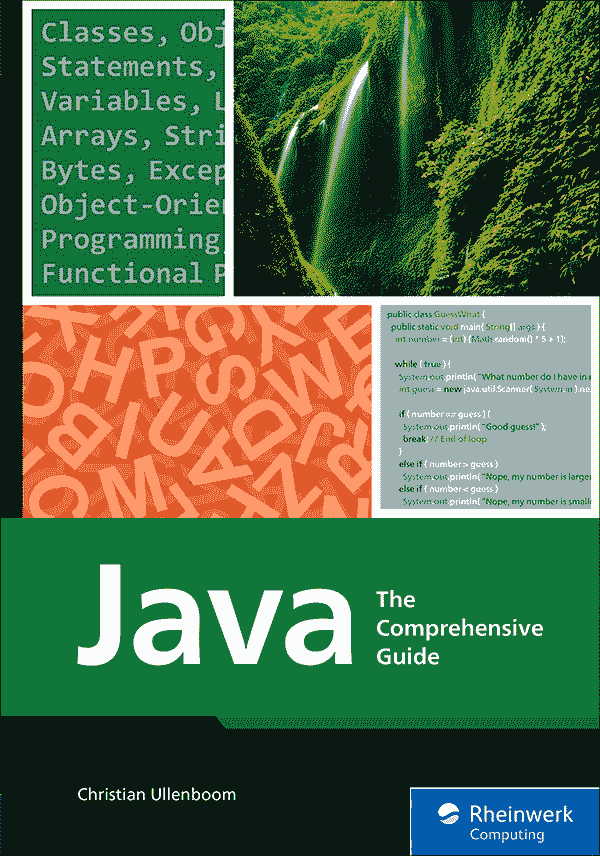
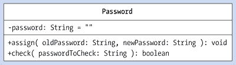
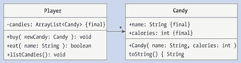
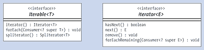
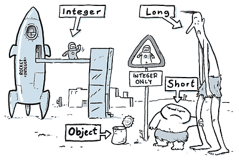

# Java：专业人士 Java 编程高级指南



# 亲爱的读者

您手中这本书的初版是于 2003 年面向德国读者出版的。今天，这本畅销指南在德国已经出版了第 16 版。写一本书的 16 版意味着什么？想象一下：在 20 年反复阅读你的作品；不断扩展、重写和完善，直到你对文字了如指掌；评估主题领域的变化，并在数百页文本中筛选，以对 `Java` 语言进行最细微的更新；阅读、审查和测试代码段；当然，还有处理 16 版的编辑反馈和评判。

在许多方面，这次翻译是第 17 版，建立在多年之前的工作基础之上。Christian Ullenboom 再次完善了他的手稿，进行了关键更新，以确保本指南是新手 `Java` 程序员和资深专业人士的最佳资源。他通过新的语言完成了工作，将他几十年的知识带给英语读者。我相信您会发现他的专业知识是无价的。

您对《Java：全面指南》有什么看法？您的评论和建议是帮助我们把书籍做得最好的工具。请随时与我联系并分享您的任何赞誉或批评。

感谢购买 SAP PRESS 的书籍！

Hareem Shafi

SAP PRESS 编辑员

[hareems@rheinwerk-publishing.com](mailto:hareems@rheinwerk-publishing.com)

[www.rheinwerk-computing.com](https://www.rheinwerk-computing.com)

Rheinwerk Publishing • 波士顿，MA

# 使用说明

本电子书受版权保护。通过购买本电子书，您同意接受并遵守版权规定。您有权出于个人目的使用本电子书。您也可以进行打印和复制，但仅限个人使用。然而，不允许与他人共享电子或纸质副本，无论是整体还是部分。当然，在互联网或公司网络上提供副本也是非法的。

有关且具有法律约束力的使用条件，请参阅法律说明部分。

本电子书副本包含数字水印，该签名指示了谁可以使用此副本：

# 屏幕显示说明

您正在以文件格式（EPUB 或 `Mobi`）阅读本电子书，这种格式使书籍内容适应您的阅读设备的显示选项和个人需求。这是一好事；但遗憾的是，并不是每个设备都以相同的方式显示内容，图片和表格等功能的渲染或连字符可能会导致困难。本电子书已针对尽可能多的常用阅读设备的显示进行了优化。

如果您想放大图片（特别是在 iPad 的 iBooks 上），请点击一下相应的图片。再次点击即可返回上一个屏幕。您可以在服务页面找到更多关于屏幕布局的建议。

## 16.3 Class 类

### 16.3.1 获取类对象

### 16.3.2 类也是一种类型

## 16.4 工具类系统与成员

### 16.4.1 虚拟机的内存

### 16.4.2 CPU 或核心数

### 16.4.3 Java 环境的系统属性

### 16.4.4 从控制台设置自定义属性*

### 16.4.5 换行符与 line.separator

### 16.4.6 操作系统的环境变量

## 16.5 不同国家的语言

### 16.5.1 通过 Locale 对象处理区域语言

## 16.6 重要日期类概览

### 16.6.1 Unix 时间：1970 年 1 月 1 日

### 16.6.2 `System.currentTimeMillis()`

### 16.6.3 通过 `TimeUnit` 进行简单的时间转换

## 16.7 日期时间 API

### 16.7.1 概述

### 16.7.2 人类时间与机器时间

### 16.7.3 `LocalDate` 日期类

## 16.8 使用 Java 进行日志记录

### 16.8.1 日志编程接口

### 16.8.2 使用 `java.util.logging` 日志

## 16.9 Maven：解决构建管理与依赖问题

### 16.9.1 需要接受的依赖

### 16.9.2 本地仓库与远程仓库

### 16.9.3 周期、阶段与 Maven 插件

## 16.10 扩展阅读

# 17 并发编程简介

## 17.1 并发与并行

### 17.1.1 多任务处理、进程与线程

### 17.1.2 线程与进程

### 17.1.3 并发程序如何提高速度

### 17.1.4 Java 如何提供并发支持

## 17.2 生成现有线程与新线程

### 17.2.1 主线程

### 17.2.2 我是谁？

### 17.2.3 实现 `Runnable` 接口

### 17.2.4 使用 `Runnable` 启动线程

### 17.2.5 为 `Runnable` 参数化

### 17.2.6 继承 `Thread` 类

## 17.3 线程成员与状态

### 17.3.1 线程的名称

### 17.3.2 线程的状态

### 17.3.3 招募睡眠者

### 17.3.4 线程何时结束

### 17.3.5 使用 `Interrupts` 优雅地终止线程

### 17.3.6 未处理的异常、线程结束与 `UncaughtExceptionHandler`

### 17.3.7 外部的 `stop()` 与 `ThreadDeath` 的营救

### 17.3.8 停止与恢复工作

### 17.3.9 优先级

## 17.4 进入 `Executor`

### 17.4.1 `Executor` 接口

### 17.4.2 团体的快乐：线程池

### 17.4.3 通过 `Callable` 使用线程

### 17.4.4 `Future` 的记忆：`Future` 返回值

### 17.4.5 处理多个 `Callable` 对象

### 17.4.6 `CompletionService` 与 `ExecutorService`

### 17.4.7 `ScheduledExecutorService`：重复任务与时间

### 17.4.8 使用 `CompletableFuture` 进行异步编程

## 17.5 扩展阅读

# 18 数据结构与算法简介

## 18.1 列表 (Lists)

### 18.1.1 第一个列表示例

### 18.1.2 选择 `ArrayList` 或 `LinkedList`

### 18.1.3 `List` 接口

### 18.1.4 `ArrayList`

### 18.1.5 `LinkedList`

### 18.1.6 数组 `Arrays.asList(...)`

### 18.1.7 `ListIterator`

### 18.1.8 理解 `Collection` 的 `toArray(...)`：陷阱

### 18.1.9 在数据结构中管理基本类型元素

## 18.2 集合 (Sets)

### 18.2.1 第一个集合示例

### 18.2.2 `Set` 接口的方法

### 18.2.3 `HashSet`

### 18.2.4 `TreeSet`：排序集合

### 18.2.5 `NavigableSet` 与 `SortedSet` 接口

### 18.2.6 `LinkedHashSet`

## 18.3 关联性内存 (Associative Memory)

### 18.3.1 `HashMap` 类、`TreeMap` 类以及静态 Map 方法

### 18.3.2 插入与查询关联性内存

## 18.4 Stream API

### 18.4.1 声明式编程

### 18.4.2 内部迭代与外部迭代

### 18.4.3 什么是 Stream？

## 18.5 创建 Stream

### 18.5.1 `Stream.of(...)`

### 18.5.2 `Stream.generate(...)`

### 18.5.3 `Stream.iterate(...)`

### 18.5.4 并行流或顺序流

## 18.6 终端操作 (Terminal Operations)

### 18.6.1 元素数量

### 18.6.2 现在使用 `forEach(...)`

### 18.6.3 从 Stream 中获取单个元素

### 18.6.4 使用 `Predicates` 进行存在性测试

### 18.6.5 将 Stream 归约为最小或最大元素

### 18.6.6 使用自定义函数约 Stream

### 18.6.7 将结果写入容器，部分 1：`collect(...)`

### 18.6.8 将结果写入容器，部分 2：`Collector` 与 `Collectors`

### 18.6.9 将结果写入容器，部分 3：分组

### 18.6.10 将 Stream 元素传输到数组或 `Iterator`

## 18.7 中间操作 (Intermediary Operations)

### 18.7.1 元素预览

### 18.7.2 过滤元素

### 18.7.3 有状态的中间操作

### 18.7.4 前缀操作

### 18.7.5 图片

## 18.8 扩展阅读

# 19 文件与数据流

## 19.1 `java.io` 与 `java.nio` 中的旧世界与新世界

### 19.1.1 带有 `File` 类的 `java.io` 包

### 19.1.2 `NIO.2` 与 `java.nio` 包

## 19.2 文件系统与路径

### 19.2.1 `FileSystem` 与 `Path`

### 19.2.2 `Files` 工具类

## 19.3 随机访问文件 (Random Access Files)

### 19.3.1 打开用于读写的 `RandomAccessFile`

### 19.3.2 从 `RandomAccessFile` 读取

### 19.3.3 使用 `RandomAccessFile` 写入

### 19.3.4 `RandomAccessFile` 的长度

### 19.3.5 在文件内来回移动

## 19.4 输入/输出基类

### 19.4.1 四个抽象基类

### 19.4.2 `OutputStream` 抽象类

### 19.4.3 `InputStream` 抽象类

### 19.4.4 `Writer` 抽象类

### 19.4.5 `Appendable` 接口

### 19.4.6 `Reader` 抽象类

### 19.4.7 `Closeable`、`AutoCloseable` 与 `Flushable` 接口

## 19.5 从文件读取与写入文件

### 19.5.1 通过 `Files` 获取字节定向数据流

### 19.5.2 通过文件获取面向字符的字节流

### 19.5.3 `OpenOption` 在 `Files.new(...)` 方法中的作用

### 19.5.4 从模块路径和 JAR 文件加载资源

## 19.6 延伸阅读

# 20 使用 JDBC 进行数据库管理简介

## 20.1 关系型数据库与 Java 访问

### 20.1.1 关系模型

### 20.1.2 用于访问关系型数据库的 Java 应用程序接口

### 20.1.3 JDBC API 与实现：JDBC 驱动

### 20.1.4 H2 是 Java 中的工具

## 20.2 示例查询

### 20.2.1 查询数据库的步骤

### 20.2.2 使用 Java 访问关系型数据库

## 20.3 延伸阅读

# 21 位与字节、数学与货币

## 21.1 位与字节

### 21.1.1 位运算符：取反、与、或、异或

### 21.1.2 Java 中整数的表示：补码

### 21.1.3 二进制、八进制和十六进制位值系统

### 21.1.4 类型转换对位模式的影响

### 21.1.5 无符号符号运算

### 21.1.6 移位运算符

### 21.1.7 设置、清除、反转和测试位

### 21.1.8 `Integer` 和 `Long` 类的位操作方法

## 21.2 Java 中的浮点数运算

### 21.2.1 无穷大、零和非数字的特殊值

### 21.2.2 浮点数的标准计数法与科学计数法

### 21.2.3 尾数与指数

## 21.3 `Math` 类的成员

### 21.3.1 `Math` 类的对象变量

### 21.3.2 绝对值与符号

### 21.3.3 最大值/最小值

### 21.3.4 数值舍入

### 21.3.5 整数除法的余数

### 21.3.6 向负无穷方向取整的除法与其他余数

### 21.3.7 乘累加

### 21.3.8 平方与指数方法

### 21.3.9 对数

### 21.3.10 角度方法

### 21.3.11 随机数

## 21.4 精度、类型取值范围与溢出控制

### 21.4.1 最大值与最小值

### 21.4.2 完全精确溢出

### 21.4.3 `ulp` 方法的作用是什么？

## 21.5 随机数：`Random`、`ThreadLocalRandom` 与 `SecureRandom`

### 21.5.1 `Random` 类

### 21.5.2 `ThreadRandom`

### 21.5.3 `SecureRandom` 类

## 21.6 大数

### 21.6.1 `BigInteger` 类

### 21.6.2 示例：使用 `BigInteger` 计算长阶乘

### 21.6.3 使用 `BigDecimal` 处理大浮点数

### 21.6.4 通过 `MathContext` 方便地设置计算

### 21.6.5 使用可变实现更快的计算

## 21.7 金钱与货币

### 21.7.1 金额的表示

### 21.7.2 ISO 4217

### 21.7.3 在 Java 中表示货币

## 21.8 延伸阅读

# 22 使用 JUnit 进行测试

## 22.1 软件测试

### 22.1.1 编写测试用例的步骤

## 22.2 JUnit 测试框架

### 22.2.1 JUnit 版本

### 22.2.2 集成 JUnit

### 22.2.3 测试驱动开发与测试优先方法

### 22.2.4 测试、实现、测试、实现、测试、庆喜

### 22.2.5 运行 JUnit 测试

### 22.2.6 `Assertions` 类的 `assert(...)` 方法

### 22.2.7 异常测试

### 22.2.8 设置执行时间限制

### 22.2.9 使用 `@DisplayName` 标签

### 22.2.10 嵌套测试

### 22.2.11 忽略测试

### 22.2.12 使用 `Assumptions` 类的方法取消测试

### 22.2.13 参数化测试

## 22.3 Java 断言库与 AssertJ

### 22.3.1 `AssertJ`

## 22.4 测试用例的结构

### 22.4.1 固具

### 22.4.2 测试类的集合与组织

## 22.5 良好的设计有利于测试

## 22.6 Dummy、Fake、Stub 和 Mock

## 22.7 JUnit 扩展与测试插件

### 22.7.1 Web 测试

### 22.7.2 测试数据库接口

## 22.8 延伸阅读

# 23 JDK 的工具

## 23.1 概述

### 23.1.1 结构与常用开关

## 23.2 翻译 Java 源码

### 23.2.1 Java 开发包中的 Java 编译器

### 23.2.2 原生编译器

## 23.3 Java 运行时

### 23.3.1 Java 虚拟机的开关

### 23.3.2 `java.exe` 与 `javaw.exe` 的区别

## 23.4 使用 Javadoc 文档注释

### 23.4.1 设置文档注释

### 23.4.2 使用 `javadoc` 工具创建文档

### 23.4.3 文档注释中的 HTML 标签

### 23.4.4 生成的文件

### 23.4.5 文档注释简介

### 23.4.6 Javadoc 与 Doclets

### 23.4.7 已废弃的类型与成员

### 23.4.8 使用 `DocLint` 进行 Javadoc 验证

## 23.5 JAR 存档格式

### 23.5.1 使用 `jar` 实用程序

### 23.5.2 清单文件

### 23.5.3 在 Java 存档中启动应用程序：可执行 JAR 文件

## 23.6 延伸阅读

起初，有道。很久之后，1995 年 5 月 23 日，在旧金山的 SunWorld 大会上，当时 Sun Microsystems 公司科学办公室的负责人 John Gage 和 Netscape 联合创始人 Marc Andreessen 推介绍了新的 Java 编程语言，并将其集成到 Netscape 浏览器中。这一事件标志着这种语言凯旋之旅的开始，它提供了在任何平台上进行编程的优雅方式，并能以面向对象（OO）的方式表达思想。该语言及其库的可能性本身并不是新鲜事物，但它们被封装得非常好，使得 Java 编程变得既愉快又流畅。Java 如今是全球最受欢迎的编程语言之一。本书在 23 章内容中探讨了 Java 技术，并重点关注 Java 编程语言。重要主题包括面向对象编程（OOP）、类设计以及 Java 标准库的结构。

# 目标群体

本书的章节专为 Java 编程语言的初学者以及高级用户设计。具备结构化编程语言（如 `C`、`Python`、`JavaScript` 或 `Visual Basic`）的基础知识以及 `OOP` 知识将会有帮助，因为本书没有显式介绍计算机体系或编程的本质。所以，如果你已经用任何语言编写过程序，那么这本书就是适合你的！

# 本书不是什么

本书不应被视为面向初学者的编程书籍。如果你从未编程过，并且主要将“翻译”一词与“解释”联系起来，你应该从基础教程开始，或者同步学习一门教程。本书涵盖了工业级程序员生活中的许多领域，深度仅限于表面，但本书无法替代《Java 语言规范》（`JLS`），后者可以通过 [https://docs.oracle.com/javase/specs](https://docs.oracle.com/javase/specs) 获取。


# Java 技术在近年来呈爆炸式增长

Java 技术在近年来呈爆炸式增长，以至于最初的可管理性已让位于了高度的专业化。今天，想在一本书中涵盖所有内容是不可能的，我们也绝不会追求这一目标。一本专门介绍图形用户界面（GUI）`JavaFX` 或 `Swing`（两者都是标准 Java 的部分）的书，其深度可能与你手中的这本书一样广泛。其他特殊主题包括 OO 分析/设计、统一建模语言（`UML`）、并行或分布式编程、Enterprise JavaBeans（`EJBs`）、数据库连接、对象关系映射、Web 服务、动态网页以及许多其他主题。对于所有这些主题，可能需要专门的著作来满足你的好奇心。

本 Java 书将训练你编程语言的语法、重要标准库的处理、开发工具和环境、OO 分析与设计、设计模式以及程序规范。但本书无法帮助你在派对上给那些酷的 IT 极客留下深刻印象。抱歉。

# 我的生活与 Java，或者说“为什么写 Java 书？”

我与 Java 的接触开始于 20 多年前，与一门大学必修课程有关。1997 年，我们的项目小组处理一个 OO 对话规范。我们需要编写一个状态机，这就出现了使用哪种编程语言的问题。由于我想向研讨会的参与者介绍 Java，我为演示准备了一套幻灯片。除了幻灯片，教授要求以研讨论文的形式进行详细说明。使用 Java 很有趣，与我在此之前习惯的完全不同。在学习 Java 之前，我用 `Assembler` 编写了大约 10 年代码；随后，我使用了高级语言 `Pascal` 和 `C`，主要编写编译器。我尝试并测试代码，记录经验，并学习 Java 及其库。工作随着我的经验而增长。在那个小组项目期间，一位同学找我担任讲师进行 Java 培训。我想这样做，但没有任何文档。于是，我继续为课程编写培训材料。当教授在小组项目结束时要求提交研讨论文时，本书的初稿已经非常详尽，以至于这部分引言在多程度上成了那篇研讨论文。

那是 1997 年的事了，当然，我可以在提交后立即停止写作。但直到今天，我仍然喜欢 Java，并期待每一个新版本。我的乐观并不孤单：Java 的前景依然良好，因为 Java 的使用在银行和保险业已经变得像 `COBOL` 那样根根稳固了。这就是为什么人们不断谈论 Java 是“新的 COBOL”。

在约二十年后，我现在认为这本书是为想要探索幕后的雄心勃勃的开发者提供的多方面 Java 资源。它的详细程度是任何其他关于 Java 基础的英文书籍无法比拟的——至少据我所知！我很享受扩展这本书，即使许多主题在普通的 Java 课程中几乎未被触及。

# 软件与版本

本书的基础是 Java 平台标准版（`Java SE`）版本 17，使用了免费的 `OpenJDK` 实现，这是一种 Java 开发包（`JDK`）。`JDK` 基本上由一个编译器和一个运行时环境——Java 虚拟机（`JVM`）组成，适用于 Windows、`macOS`、`Linux` 和 `Solaris` 平台。

名为集成开发环境（`IDE`）的图形开发界面不是 `JDK` 的一部分。虽然我不主依赖某个厂商（因为厂商吸引不同的开发者群体），但本书更详细地介绍了 `IntelliJ` 开发环境。我们的示例程序基本上可以输入任何其他开发环境或文本编辑器——例如 `Microsoft Visual Studio Code`（`VS Code`）或 `vi`——并在命令行上编译。然而，纯文本编辑器在开发中已经过时，图形化的命令行方法简化了程序的创建。

## 使用什么种 Java 版本

自从 Oracle（当时由 Sun 领导）在 1995 年引入 Java 编程语言以来，版本的轮转不可逆转。每 6 个月发布一个新版本，每 2 年发布一个长期支持版本（`LTS`），提供更长时间的支持。最新的 `LTS` 是 Java 17。对于编写 Java 书的书作者来说，特别会产生一个应该基于哪个 Java 版本以及描述哪些库的问题。在本书中，我们始终描述最新版本的功能，即写作时的 Java 18。对于 `OOP` 的教学来说，版本问题遗憾地无关。

本书中的示例始终基于 Java 17。

# 如何使用本书学习

本书非常适合自学。第一章用于热身。如果你在计算机上没有安装开发环境，应该先从 Oracle 安装 `JDK`。由于 `JDK` 只安装命令行工具，每位开发者都应该安装一个图形化 `IDE`，因为 `IDE` 会让 Java 程序的开发变得舒适得多。相比原始命令行，`IDE` 具有许多优势，如下：

*   通过击键或鼠标点击，编辑、编译和运行 Java 程序变得快速快捷。
*   编辑器应该用颜色高亮 Java 语法（语法高亮）。
*   上下文相关帮助可以显示方法的参数，并提供应用程序编程接口（`API`）文档。
*   其他功能如 GUI 生成器、项目管理和调试也包含内，但在本书中不起任何作用。

在软件开发中，API 接口的文档至关重要。文档通常可以通过开发环境中的按钮进行查看，也可以在网上找到。[第 1 章]也提供了可用文档的 URL。

一切真正从第 2 章开始，从那时起，我们将逐步深入。任何了解 JavaScript、C、C# 或 C++ 的人都可以轻松地浏览[第 2 章]。对 `C#` 或 `C++` 中的 OOP 更熟悉的读者可以快速阅读第 3 章然后直接开始。第 6 章和第 7 章构成了书中的核心：这些章节讲解了类、方法、关联、继承和动态绑定等 OO 概念。在[第 7 章]之后，基础 OO 训练就完成了，通过[第 15 章]，你将接触 Java 的所有基础。

## 个人学习策略

如果自学时使用本书，可以描述一种成功的学习策略。正如通常情况一样，理解的关键在于学习心理学，它研究了文本可以被优化理解的阅读条件。我想介绍的方法被称为 PQ4R 方法，它代表以下步骤：

*   **Preview (预览)**：首先，你应该对章节有一个初步的概述，例如通过浏览目录并跳过各个章节的页面。多看一会儿图表和表格，因为它们已经揭示了内容并让你想要阅读文本。
*   **Questions (提问)**：每个章节都试图传达一个主题块。在阅读之前，你应该考虑你想让章节回答的问题。
*   **Read (阅读)**：现在开始——你必须阅读文本。除非你借了图书馆的书，否则你应该用大量的颜色标记你认为重要的章节，并在边角添加注释。新术语也是如此。每个人都应该回答之前提出的问题。如果有新问题，请把它们存在记忆里！
*   **Reflect (思考)**：无论是否有动力——另一项研究的有趣发现——任何人都可以学习。成功仅取决于知识处理的深度（称为精细加工）。在这个过程中，必须将主题与其他主题联系起来。思考这些陈述是如何与其他部分相匹配的。现在也是进行练习的好时机。对于书中给出的示例，你应该想出自己的例子。如果我们用年龄来描述一个 `if` 语句，你自己的主意可以是关于身高的 `if` 语句。
*   **Recite (复述)**：到此时，你应该能够在不看文本的情况下回答之前提出的问题。对我来说，写作是反思我所知识的好方法，但每个人都应该用自己的方式重述内容。在洗澡时思考所有的关键词及其含义、抽象类与接口之间的关系等，会很有趣。

### 小贴士

大声解释有助于解决许多类型的问题——只要对着烤面包机聊天吧。更好的方法是和某人一起学习并互相解释步骤。一种有趣的视觉化技术是心脑图，它可以用于组织内容。

*   **Review (复习)**：现在，再次过一遍章节，看看你是否在没有进一步疑问的情况下理解了一切。某些“快速”解释可能证明是错误的。也许，文本也没有说明一切。那么，写给我的笔记（`ullenboom@gmail.com`）将非常受欢迎。

PQ4R 方法促进了知识的获取。然而，像所有学到的东西一样，如果你不经常刷新知识，你就会忘记它。因此，PQ4R 方法应该增加一个额外的“R”以获得长期成功：“R”代表“重复 (repeat)”或“刷新 (refresh)”。通常，人们在开始时过度阅读某些内容，很少关注细节。以后，当有了更多的背景知识，即使是基础事物也会呈现新的视角并融入整体。因此，读者应该反复拿起书并翻阅。

## 关注核心内容

某些章节是为经验丰富的程序员或计算机科学家编写的。新手在某些点可能偏离章节的顺序路径，因为某些章节可能需要背景信息和对编程语言的熟悉。与其他编程语言的比较旨在放松和对比，对于理解 Java 并不是必要的。

## 特殊章节

Java 世界充满了微妙之处，往往让新手感到困惑。因此，本书以两种方式分配知识权重。首先，独立于正文的框提供了专门的高级信息。此外，某些标题以星号 (*) 结尾，这意味着读者可以跳过该部分而不丢失后续章节的任何精华。

## 任务

通过本书和可靠的开发环境，你可以编写自己的第一个程序。然而，仅仅阅读不足以学习一种新的编程语言。如果你想学习一种编程语言，你必须练习并像说外语一样说它。

本书附带了练习题，可以在 `https://tutego.de/javabuch/aufgaben/index_en.html` 获取。在该网站上，你会找到完整答案的链接。该网站定期更新新的任务和答案。

## 本书结构

第 1 章 突出了 Java 语言的特殊特征。在本章中，我与其他流行语言进行了比较。这一章并不特别技术化，还描述了 Java 演变的历史进程。该章节的结构并不是教学化的，因此某些概念直到后面的章节才被深入介绍；学者应该快速浏览。我们还将展示如何获取和安装 JDK，以便你的第一个程序可以编译和运行。有了开发环境学习会更有趣，因此也提供了 IDE 的介绍。

许多问题的根源在于“字符和字符串处理方式”的变化，我们将在第 5 章中介绍。在本章中，将介绍重要的类型 `Character`（单个字符的数据类型）、`String` 和 `StringBuilder`（字符串的数据类型）。关于字符串，有时必须对某些部分进行剪切、识别和转换。你可以使用 `String` 类中的 `split(...)` 方法，也可以使用 `Scanner` 类通过分隔符将字符串拆分为子字符串。`Format` 对象可以将任何输出转换为所需的格式，包括小数的输出格式。

在掌握了这些关于对象创建和引用的知识后，就可以进行下一步：第 6 章涉及编写自定义类。我们将通过游戏和房间来对对象属性进行建模。本章还描述了构造函数、静态属性和枚举等重要概念。

对象关系，即对象之间的关联（也称为“使用 A 关系”）和继承关系，是第 7 章的主题。本章介绍了“真正的”面向对象编程（OOP），并涵盖了动态绑定、抽象类和可见性。

Java 支持多种类型，除了类之外，另一个重要类型是接口。第 8 章也介绍了这种特殊类型，以及其他两种类型：枚举类型和记录。

异常在第 9 章中讨论，它们是所有程序的重要骨干，因为错误几乎无法避免。因此，建议积极支持对异常的处理，因为这会迫使程序员关注并修复错误。

第 10 章描述了如何将类嵌套在内部。这种嵌套可以提高封装性，因为实现细节也可以是局部的。

第 11 章描述了 Java 库中核心的类，例如比较类、包装类以及 `Object` 类（后者是所有 Java 类的父类）。

泛型可以用于带有类型占位符的类、接口和方法，而具体的类型在稍后定义。第 12 章提供了对这项技术的见解。

Lambda 表达式自 Java 8 起就存在；它们特别简化了函数式编程。我们将第 13 章用于语言特性。在本章中，你还将学习许多函数式编程中常用的标准类型。

到此时，基础已经奠定，剩余章节将在已所得知识的基础上进行构建。第 14 章引入了 SOLID 原则，展示了良好的 OOP 应用，并引入了设计模式。通过各种示例，本章演示了如何在 Java 中有效使用接口和类层次结构。关键在于要小处思考，但要编写大型应用程序。

第 15 章描述了如何在 Java 中将单个组件或组件系统灵活地用于其他应用程序。

在完成前 15 章后，读者将几乎完全熟悉 Java 语言。然而，由于 Java 不仅仅是一种语言，还是一个标准库，书的后半部分重点关注基础 API。在每章的末尾，“延伸阅读”部分提供了有趣在线资源的引用。此时，读者可以离开顺序阅读路径，关注单独主题，因为剩余的主题之间通常不具有直接依赖关系。

Java 库包含超过 4,000 个类、接口、枚举、异常和注解。第 16 章提供了最重要的包的概述，并从库中挑选了一些类，例如加载类。在本章中，你还会找到用于配置应用程序或运行外部程序的类。

第 17 章到第 22 章提供了精选 Java SE API 的概述。第 17 章介绍了并发编程，而第 18 章以实用的方式展示了常见的数据结构，如列表、集合和关联内存（映射）。第 19 章提供了如何读写文件的概述。如果你想使用关系型数据库存储数据，你将在第 20 章中找到有用信息。第 21 章向你介绍了 `Math` 类，它提供了典型的数学方法来执行三角计算等。通过另一个类，你可以生成随机数。该章还涵盖了任意长度整数或浮点的处理。

应用程序的自动测试有助于检测代码中的错误，特别是当后续引入了愚蠢的代码更改导致程序不再符合规范时。第 22 章引入了用例的概念，并演示了如何轻松、自动地执行用例。此外，本章还关注可测试性应用程序的设计。

最后，第 23 章简要介绍了命令行工具，例如用于编译 Java 程序的 `javac` 和用于启动 JVM 并执行 Java 程序的 `java`。

## 约定

书中使用了以下约定：

*   新引入的术语使用斜体，索引将指向该具体位置。此外，文件名、HTTP 地址、可执行程序名称、程序选项和文件扩展名（`.txt`）也使用斜体。
*   用户界面（UI）术语使用粗体。
*   代码列表、方法和其他程序元素使用 `编程` 字体。在某些地方，列表行后放置了一个折线箭头  作为特殊字符标记换行。这样，下一行的代码仍然属于上一个。
*   方法名和构造函数后面总是跟着一对括号，以区分方法/构造函数与对象/类变量。因此，在编写 `System.out` 和 `System.gc()` 时，你可以清楚地看出前者是一个类变量，而后者是一个方法。
*   如果方法或构造函数具有参数，则类型被括在括号中，例如 `Math.abs(double a)` 或 `Point(int x, int y)`。通常参数名也会省略，例如，“`System.exit(int)` 以指定的返回值退出程序。”Java API 文档也是这样做的。如果一个方法或构造函数有参数列表，但在文中并不相关，则用省略号缩写，如“...”。例如：“`System.out.print(...)` 方法将传递的参数转换为字符串并将它们打印出来。”因此，一对空括号意味着该方法或构造函数确实没有参数列表。为了使规范既短又精确，你会在文中看到像 `getProperty(String key[, String def])` 这样的规范，它是 `getProperty(String key)` 和 `getProperty(String key, String def)` 的缩写。在其他地方，当实现细节或屏幕输出对于理解内容不再需要进一步阐述时，也会看到省略号 `(...)`。
*   为了指定一组方法，`*` 标识符代表占位符。例如，`print*(...)` 代表方法 `println(...)`、`print(...)` 和 `printf(...)`。从上下文中，你应该清楚地看到指的是哪些方法。
*   长的包名有时会被缩写，例如 `com.tutego.island.game` 变为 `c.t.i.g`。
*   为了指示程序代码中的编译错误或运行时错误，某行可能包含一个 。因此，你一眼就能看出该行未编译，或者由于编程错误在运行时抛出了异常，例如以下代码：

```
int p = new java.awt.Point();     // 

Compiler error: Type mismatch 
```

*   在编译错误的情况下——如上一点——消息通常由 `javac` 编译器打印，部分由 Eclipse Java 编译器打印。两个编译器都能检测到错误，只是输出的措辞不同。
*   Facebook 现在被称为 Meta，而 Sun 在 2010 年初成为了 Oracle。“Sun”这个名字只在书中讨论一项由 Sun 发起且在 Sun 负责期间进入市场的技术时才会出现。年轻一代几乎不会记得 Sun Microsystems（太阳微系统公司），那是很久以前的事了。2010 年，Apple 发布了第一代 iPad，这也是很久以前了。


## 程序列表

整个程序列表按如下方式结构：

```
class Candy {
} 
```

**Listing 1** `Candy.java`

所示的源代码位于 `Candy.java` 文件中。如果该类型（类、枚举、接口或注解）位于某个包中，则路径规范将放在文件名之前：

```
package com.tutego.island;
class Candy { } 
```

**Listing 2** `com/tutego/island/Candy.java`

为了节省空间，书中经常展示代码片段。完整的源代码可以在互联网上找到（[www.rheinwerk-computing.com/5557](http://www.rheinwerk-computing.com/5557)）。如果显示了类似 `Person.java` 文件的节，我们将在标题中说明这种编辑，例如通过以下方式：

Person.java (片段)

Person.java, main(), Part 1

如果为某些类提供了示例程序，这些程序的类名通常以 `Demo` 结尾。因此，对于 `DateFormat` Java 类，演示 `DateFormat` 类功能的示例程序命名为 `DateFormatDemo`。

## 本书中的应用程序接口文档

类/对象变量、构造函数和方法位于一个特殊的列表中，便于在书中查找并作为参考资料使用。

```
abstract class java.text.
                DateFormat
extends Format
implements Cloneable, Serializable 
```

*   `Date parse(String source) throws ParseException`

    解析日期或时间字符串。


矩形框包含完全限定的类名或接口名（例如 `java.text` 包中的 `DateFormat` 类），或注解或枚举类型的名称。接下来的行列出了父类（`DateFormat` 继承自 `Format`）和实现的接口（`DateFormat` 实现了 `Cloneable` 和 `Serializable`）。由于任何没有显式父类的类自动继承自 `Object`，因此未指定此继承关系。除非另有说明，可见性为 `public`，这对于库方法很常见。如果描述了接口，则这些方法自动是抽象且公共的。如果使用 `throws` 指定了错误，则它们是检出的异常。过时的方法不会列出，但如果没有替代方案，则可能会提及。

## 可执行程序

命令行上的可执行程序可以通过开头的美元符号 `$` 来识别（即使其他操作系统和命令行显示不同的提示符）。用户输入的字符以**粗体**设置；输出则不加粗，如下例：

```
$ java Joke
Where do fish sleep? In the riverbed.
```

## 致谢

当我 9 岁时，我的父母用 Commodore 64 为我开启了计算机的大门。因为我缺乏保存程序和数据的媒介，我别无选择重启后重新输入一切——这就是我学习编程的方式。感谢我的父母提供的计算机，感谢你们的爱，以及对我的信任。

要感谢 Sun Microsystems，他们在 1991 年开始了 Java 的开发。没有 Sun，就没有 Java；没有 Java，就不会有这本书。还要感谢作为 Sun 购买者的 Oracle，因为可能如果没有这次收购，Java 已经终结了。

## 本书资源

所有的示例程序都可以从本书的网站下载：访问[www.rheinwerk-publishing.com/5557](http://www.rheinwerk-publishing.com/5557)。点击“Resources”（资源）选项卡查看可下载文件以及每个文件的简要描述。点击“Download”（下载）按钮开始下载过程。根据文件的大小（以及您的网络连接），下载可能需要一些时间完成。

## 反馈

无论我们对这本书的章节审阅得多么仔细，在 1100 多页中也可能存在差异，就像任何软件都可能存在纯统计学错误一样。如果你对特定点或通用教学方法有任何意见、建议、修正或问题，请随时通过电子邮件联系我：ullenboom@gmail.com。我随时欢迎建议、赞誉和批评。

现在，我们准备好探索大括号之间的世界了，并跟随希腊哲学家柏拉图的观点，他说：“开头是工作最重要的部分。”

# 1 引言

“我们今天正在在大量生产信息，就像过去的汽车一样。”

——约翰·奈斯比特 (1929–2021)

在 20 年后，Java 终于确立了自己的平台地位。全球数百万软件开发者依靠这种语言维持生，数十亿设备运行着 Java 程序（例如，所有的蓝光播放器）。每周，Oracle 的运行时环境被下载数百万次。在本章中，我们将向你介绍 Java，讨论它的特性，与其他编程语言进行比较，并探索它的平台和开发环境。


**图 1.1** 许多设备使用 Java

## 1.1 历史背景

在 20 世纪 70 年代，当嬉皮士还在随着吉米·亨德克斯的音乐跳舞时，比尔·乔（Bill Joy）就想要创建一种结合了 MESA [[ 1 ]](footnotes.html_ftn-fn01_01) 和 `C` 所有优点的编程语言。太阳微系统（Sun Microsystems）的联合创始人乔最初无法实现这一愿望，直到 20 世纪 90 年代，他才在他的文章《Further》（展望）中描述了一种新的面向对象（OO）语言可能是什么样的。对于乔来说，它的基本原则应该基于 `C++`。直到后来他才意识到 `C++` 不适合作为基础语言，而且对于大型程序来说过于臃肿。

那时，詹姆斯·高斯林（James Gosling）正在研究标准广义标记语言（SGML）。他使用 `C++` 进行开发，但对这种语言也不满意。新语言 `Oak` 正是因为这种不满而诞生的。高斯林看向窗外看到一棵橡树时，脑中出现了这个名字，但可能只是一个传说，因为 `Oak` 也代表 Object Application Kernel（对象应用内核）。

帕特里克·诺顿（Patrick Naughton）于 1990 年 12 月启动了 Green 项目，高斯林和迈克·谢里登（Mike Sheridan）参与其中。Green 项目的一个遗留是 `Duke`，它变成了一个著名的符号。[[ 2 ]](footnotes.html_ftn-fn01_02)。


**图 1.2** Duke：Java 的吉祥物

该项目的初衷是为交互式电视和其他消费电子设备开发软件。该项目的组件包括操作系统 `Green-OS`、高斯林的解释器 `Oak` 以及一些硬件组件。乔向 Green 项目的成员展示了他的文章《Further》，并开始实现图形用户界面（GUI）。高斯林用 `C` 编写了原始编译器，随后诺顿、高斯林和谢里登也用 `C` 设计了运行时解释器。最终，`C++` 语言从未被使用。`Oak` 在 1991 年 8 月运行了它的第一批程序。因此，Green 梦想之队开发了一种名为 `7 (Star Seven)` 的设备，并于 1992 年秋季内部推出。前太阳公司首席执行官斯考特·麦尼尼利（Scott McNealy，他在 2010 年 1 月 Oracle 收购太阳公司后离开了该公司）对 `*7` 留下了深刻印象，随后该团队在当年 11 月变成了 First Person, Inc.。现在，它就是 `*7` 了。

在 1993 年初，太阳公司将目光转向网络。经过多次更改，`Oak` 语言被更名为 `Java`，因为 `Oak` 这个名字已经被注册。1994 年，帕特里克·诺顿演示了浏览器的原型，该原型于 1995 年 5 月在 SunWorld 上向公众展示。1996 年 1 月 23 日，Java 开发包（JDK）1.0 发布，它首次提供了编写 Java 应用程序和 applet（将“applet”定义为“小型应用程序”）的方法。在 JDK 1.0 完成之前，Green 团队的其余成员创立了 JavaSoft 公司。

### 太阳去哪了？Oracle 在 2010 年收购太阳微系统

Java 最初由太阳微系统开发，这是一家在操作系统和硬件领域拥有悠久历史的公司。太阳为现代 IT 系统奠定了许多基础，但许多人仅通过 Java 熟悉它。

太阳微系统作为一家公司经营得并不好。它因其产品而闻名并尊重，但缺乏将其产品和服务转化为现金的能力。在遭受重大收入损失后，Oracle 公司以 74 亿美元收购了太阳微系统，以及 Java、MySQL、Solaris、OpenOffice、VirtualBox 及其他产品的所有权利和专利。自此以后，Oracle 停止了一些开源项目，但大型且具有商业价值的项目仍然良好。

## 1.2 Java 的受欢迎的原因：关键特性

Java 是一种面向对象的语言，以几个关键特性为特征，使其具有通用性，并作为一种稳健的编程语言吸引公司。由于 Java 支持面向对象，开发者可以创建现代且可重用的软件组件。

在某种，Java 看起来相当保守，但这是因为 Java 语言的设计者不会立即整合所有当下流行的事物。Java 一直将在其他编程语言中证明有效且良好的特性纳入语言核心。然而，太阳和随后的 Oracle 避免在语言中包含只有少数程序员使用或经常导致错误的内容。

### 1.2.1 字节码

首先，Java 是一种与其他语言类似的编程语言。但与传统的编程语言解释器不同，后者通常为特定的处理器（例如针对 `x86` 微处理器或 `ARM` 架构的处理器）和特定的平台（如 `Linux` 或 `Windows`）生成机器码，而 Java 编译器从源文件中生成所谓的**字节码**。这些程序代码是二进制的，作为虚拟机（`VM`）运行的起点。字节码可以比作某种虚拟处理器的微处理器代码，它知道如算术运算、跳转等语句。

### 1.2.2 通过虚拟机执行字节码

为了让虚拟处理器的程序代码能够执行，一种称为 Java 虚拟机（`JVM`）的运行时环境会在程序代码翻译成字节码后处理这些字节码。[[ 3 ] ](footnotes.html_ftn-fn01_03)。运行时环境（也称为运行时解释器）加载字节码、检查字节码并在受控环境中执行它。`JVM` 提供了一整系列额外服务，例如清理内存的自动垃圾回收器，以及在定义良好的内存和线程模型下的强类型检查。

### 1.2.3 平台无关性

Java 的核心特性是其平台无关性或操作系统无关性。这种灵活性通过两个关键概念实现：首先，Java 不将自己绑定到特定的处理器或架构；相反，编译器生成字节码，然后由运行时环境处理这些字节码。其次，Java 从具体操作系统的属性中抽象出来，并创建了（例如）输入输出系统的接口或用于 GUI 的应用程序接口（`API`）。开发者总是针对 Java `API` 编写程序，而绝不是针对实际平台的 `API`（如 `Windows` 或 `Unix` `API`）。Java 运行时环境将调用映射到相应的系统文件，因此它是 Java 程序与实际操作系统 `API` 之间的媒介。

平台无关的编程语言和运行时环境现在已成为标准，Java 不再是例外。如今的顶级语言有 `JavaScript`、`Python`、`Ruby`、`PHP`、`Kotlin` 和 `C#`，它们都有运行时环境，而某些语言还可以被编译成原生代码。平台无关性很难实现，因为编程语言和产生字节码的编译器只是一部分——更大部分是运行时环境和广泛的 `API`。虽然 `C` 本身是一种可移植语言，且 `ANSI C` 程序可以被任何带有编译器的任何操作系统上的 `C` 编译器编译，但问题在于库，这些库仅限于少数简单的文件操作。

### 1.2.4 作为语言、运行时环境和标准库的 Java

Java 不仅仅是一种编程语言；它还是运行时系统，Oracle 希望通过使用“Java 平台”这一术语来明确这一点。编程语言和 `JVM` 配配有一套用于数据结构、字符串处理、日期/时间处理、GUI、输入输出操作、后台线程、网络操作等的标准库。这些库构成了高价值服务（如数据库连接和 Web 服务）的基础。

### 1.2.5 Java 中的面向对象

Java 设计成一种语言是为了便于编写大型、无 bug 的应用程序。在 `C` 程序中，从统计上看，每 55 行程序预计会出现一个错误。即使在大型软件中（代码量超过 100 万行），平均每 200 行程序就会发现一个错误，无论底层编程语言是什么。这些错误必须被解决，尽管到目前为止还没有发现针对大规模软件开发的全面策略。计算机科学的大许多工作都关注成千上万的程序员如何协作并在几十年内设计软件。这个问题并不容易解决，在 20 世纪 60 年代中期的软件危机期间曾引起激烈争议。

运行时环境消除了许多技术性问题。`OOP` 尝试对软件问题的复杂性进行更好的建模。其哲学是人类是以面向对象的方式思考的，因此编程环境应该反映这种人类的思维方式。就像现实世界一样，对象在软件世界中相互连接和通信。对象由**属性**组成，描述了一个对象“拥有”和“可以”做的事情。汽车“拥有”轮子和座椅，并“可以”加速和刹车。对象是由**类**创建的，类是对对象结构的描述。

Java 语言并不是完全面向面向对象的，正如 `Smalltalk` 所示的那样。存在针对数字或 Unicode 字符的原始数据类型，且它们不作为对象管理。这种设计的原因是，通过分离，编译器和运行时环境可以更好地优化程序。然而，微软针对 `.NET` 平台的 `VM` 以及其他现代编程语言显示出，即使没有这种分离，也可以获得良好的性能。

### 1.2.6 Java 广泛且广为人知

无论语言的性能如何，最终只有业务才是关键：客户所需的系统能多快、多廉价地构建？它有多稳定且易于更改？此外，一些进一步的问题包括：市场上有哪些文献？有哪些培训路径？团队在紧急情况下可以在哪里找到开发者或顾问？这些点在计算机科学家比较语言时并不一定首要考虑，但这些问题对于一个软件平台的成功可能是决定性的。几乎每所大学都教 Java，而有了 Java，工作就稳了。会议引入了新趋势并创造了趋势。这条链是无法打破的，即使今天出现了一种名为“Bali”的新超级语言，也需要多年才能创建一个与之相当的系统。请注意：这段讨论没有谈论创新或性能——仅关乎市场饱和度，但这正是让许多人对 Java 感兴趣的原因。

今天，Java 是许多成功产品的基础，其中许多产品运行在服务端，例如 `Facebook`、`LinkedIn`、`Twitter`、`Amazon` 和 `eBay`。在客户端，Java 较少见，尽管游戏 `Minecraft` 是一个例外。

#### [»] Java 开发者很快乐

Andrew Vos 查看了开发者通过版本控制添加到程序中的注释。[[ 4 ] ](footnotes.html_ftn-fn01_04)。在此过程中，他统计了提交时出现了多少 `omg` 和 `wtf` 等“坏”词汇。他的方法在统计学上并不严谨，但他检查的项目中，Java 开发者表现良好，没什么可抱怨的。这些注释读起来很有趣，并提供了不同的解释，例如 `JavaScript` 程序员真的只抱怨 `Internet Explorer`，而不是 `JavaScript` 语言本身，而 `Python` 程序员太文雅了不会骂人。

即时编译（JIT）编译器技术是解决该问题的第一步。`JIT` 编译器通过在运行时将字节码（即 `VM` 的程序指令）翻译为相应平台的机器码，来加速程序的执行。在运行时进行翻译具有巨大的优化潜力，因为 `JVM` 能够天生地知道使用的是哪种 CPU，并能为该 CPU 生成最优的机器码。一个例子是针对 x86 处理器的名为流式 SIMD 扩展 2（`SSE2`）的指令集扩展：如果 `JVM` 发现这种类型的处理器，就可以生成 `SSE2` 代码；否则则不能。

翻译完成后，程序将以适应架构的形式存在于内存中，物理处理器可以快速执行，而无需解释。通过这种技术，其运行速度与其他编译型语言的速度持平。然而，一个良好的 `JIT` 并会翻译所有内容；相反，编译器使用各种启发式算法来判断翻译（翻译本身需要耗时）是否值得。因此，`JVM` 始终从解释开始，并在必要时切换到编译模式。因此，Java 基本上是一种编译型语言，也是一种解释型编程语言——除了通过硬件执行之外。`JVM` 中的 Java 编译器可能是整体上运行最频繁的编译器。结果非常出色，在比较 Java 与其他语言时就可以看到。

Sun 的 `JIT` 编译器不断改进并演进，变为现在被称为 HotSpot 的 `VM` 家族。其中一个特殊特性是 `HotSpot` 在运行时监控执行情况并发现“热点”（即关键点），例如具有多次重复的循环。`JVM` 就可以有针对性地控制翻译和优化。优化包括如表达式合并等经典操作，但也有许多动态优化也属于这一领域，静态的 `C++` 编译器由于缺乏上下文而无法理解这些优化。此外，`JVM` 可以随时重新加载字节码，这些部分将以与之前加载的所有部分相同的方式进行优化。新引入的程序代码甚至可以使旧的优化和机器码失效，`JVM` 然后会重新编译。


**图 1.3** 传统编译器与带有运行时环境的 Java 编译器

HotSpot 与运行时系统一样，是在免费的 GNU 通用公共许可证（GPL）下发布的，并供所有人查看。`JVM` 主要用 `C++` 编写，但出于性能考虑，某些部分是机器码，这使得移植并不容易。Zero-Assembler 项目（[`openjdk.java.net/projects/zero`](https://openjdk.java.net/projects/zero)）旨在实现无需机器码的 `HotSpot`，以便于移植。`HotSpot VM` 有自己自己的开发号和版本号。

像 GraalVM（[`www.graalvm.org`](https://www.graalvm.org)）等解决方案提供了全新的选项，它除了 Java 之外还可以混合 JavaScript、Ruby、R 和 Python。`GraalVM` 还可以编译原生可执行文件，因为不再需要通过经典的运行时环境路径。

### 1.2.8 指针与引用

在 Java 中不存在指向内存区域的指针，因为它们在其他编程语言中是为人知且令人恐惧的。然而，由于 `OOP` 语言离开引用无法运行，Java 引入了引用。引用代表一个对象，变量存储该引用（称为引用变量）。程序员只与引用工作，而 `JVM` 将引用与内存区域关联；这种访问称为解引用，是间接的。因此，引用和内存块是分离的，这非常灵活，因为 Java 可以在内存中移动对象。

在内存中构建的对象具有不可更改的类型，这被称为对象类型：汽车仍然是汽车，而不是层压系统。Java 中的引用可以取不同的类型；我们称之为引用类型。例如，Java 程序也可以将汽车看作交通工具。

#### 示例

以下程序显示了在 `C++` 中进行“乱改”是可行且简易的，你可以通过指针算术访问私有元素。出于我们的目的，请考虑这个警示故事：

```cpp
#include <cstring>
#include <iostream>
using namespace std;

class VeryUnsafe {
public:
  VeryUnsafe() { strcpy( password, "HaL9124f/aa" ); }
private:
  char password[ 100 ];
};

int main() {
  VeryUnsafe badguy;
  char *pass = reinterpret_cast<char*>( & badguy );
  cout << "Password: " << pass << endl;
}
```

这个示例演示了使用指针会有多问题。`badguy` 指针最初本打算作为 `VeryUnsafe` 类的引用，通过显式类型转换变为了一个 `char` 指针 `pass`。可以毫无问题地逐字节从内存中读取字符，这也允许了间接访问私有数据。


# 在 Java 中，你无法访问内存的任意部分

此外，私有变量目前是安全的。如果程序尝试访问私有变量，编译器会带上错误信息终止——或者运行时系统会抛出异常。

## 1.2.9 扫垃圾，垃圾回收器！

在 `C++` 等编程语言中，大约一半的错误可以追溯到错误的内存分配。与对象和结构体工作避免地意味着创建和删除它们。然而，`JVM` 独立负责管理这些对象。结果是对象不需要释放；Java 的垃圾回收器会删除它们。在显式构建对象后，Java 的运行时系统会永久监控该对象是否仍需要（即仍然被引用）。相反，垃圾回收也意味着，如果对象上仍然存在秘密引用，垃圾回收器就无法删除该对象。注意，这些悬挂引用是令人厌烦的，可能只有通过长时间的调试才能发现。

垃圾回收器是后台的一个并发线程，定期发现并标记未引用的对象并移除它们。因此，垃圾回收器消除了手动内存查询的需求。我们应该欢迎这项技术，因为许多问题可以消失，例如内存泄漏——即“忘记”释放导致被占用内存不断膨胀。

## 1.2.10 异常处理

并不是一切都可以计划妥的。有时，网络连接会中断；有时，文件会消失；有时，整数除法过程中的除数为 0。Java 提供了异常（exceptions）来处理运行时错误。异常是在运行时生成的错误对象，用于指示错误并中断程序的通用执行流。这些问题区域可以通过程序构造结构进行封装。在许多情况下，这种解决方案比在程序流中使用返回值和不可读的表达式要整洁得多。

出于速度考虑，`C++` 默认不会通过范围检查来检查数组边界，这可能会导致许多安全问题。错误访问大小为 `n` 的数组的元素 `n + 1` 可能会导致两种结果：发生访问错误，或者——更糟糕的是——在写入访问期间其他数据被覆盖，且错误变得不可追溯。

Java 的运行时系统会自动检查数组边界。这些监控是无法关闭的，就像其他编程语言的编译器有时被允许关闭的那样。聪明的运行时环境会发现是否可能发生溢出，然后优化掉该查询；因此，数组检查不再是昂贵的，也不会自动由于性能下降而显露痕迹。

### 1.2.11 库与工具的范围

Java 已经存在很久了，因此有大量的工具，从带有支持编辑器的开发环境到良好的调试器和构建管理工具。除了标准库之外，还可以添加其他商业或开源库。无论是编写 PDF 文档、读取 Microsoft Excel 文档、将数据传输到 SAP，还是控制 ATM 的现金吐出——Java 库涵盖了所有这些功能。


新的编程语言很难跟上脚步。近年来编程语言的数量呈爆炸式增长，但它们并不能真正吸引大众，因为缺乏工具和库。更有趣的是基于 `JVM` 的新语言，因为这些编程语言仍然允许使用已知工具和已建立的库。

然而，工具和库有时是阻止团队切换到 Java 的原因。特别是在游戏开发中，团队在 `C++` 方面拥有丰富经验，并投入多年精力开发游戏框架——工具就在那里，但在 Java 中，这些工具（尚未）可用。

### 1.2.12 相对简单的语法

与 `C++` 或 Perl 等语言相比，Java 的语法相当简单，并不充斥着操作符或复杂性。Java 从 C 继承了简单基础的语法（如大括号），但避免了用各种杂物过度语法。由于程序的阅读次数远大于编写次数，因此语法必须清晰且一致——开发者越容易一眼看出发生了什么，就越好。

> “在编写代码时，始终假设最终维护你代码的人是一个知道你住在哪儿的暴力精神病态者。”——John Woods

如果程序仅仅是紧凑的但人类理解所需的时间呈指数级增长，那么紧凑性本身没有任何价值。代码越紧凑，人类解码所需的时间越长。尽管下面这个来自“第五届混淆 Perl 竞赛结果”的 Perl 示例被故意设计成一个不可读的程序；任何遇到这个程序的人光是看着它都会头晕：

```
#:: ::-| ::-| .-. :||-:: 0-| .-| ::||-| .:|-. :||
open(Q,$0);while(<Q>){if(/^#(.*)$/){for(split('-',$1)){$q=0;for(split){s/\|
/:.:/xg;s/:/../g;$Q=$_?length:$_;$q+=$q?$Q:$Q*20;}print chr($q);}}}print"\n";
#.: ::||-| .||-| :|||-| ::||-| ||-:: :|||-| .:| 
```

更简单的语法既可以被看作诅咒（更多的打字），也可以被看作祝福（通常更容易理解）。Java 相当“啰嗦”，并且在某些地方放弃了紧凑性。例如，在继承关系中，Java 的调用方式类似于 `class Rum extends Drink`；在 Kotlin 中，你会写成 `class Rum : Drink`；在 Ruby 中，则是 `class Rum < Drink`。

### 1.2.13 放弃有争议的概念

Java 基本上可以从不同的编程语言中接管一切并成为超级语言；然而，语言的设计者没有这样做，也不想这样做。`C++` 的两个 Java 中省略的特性将在接下来的两个章节作为示例介绍。

#### Java 中不存在用户定义的重载操作符

当我们使用像加号这样的操作符并用它来相加表达式时，通常针对已知的算术量，如浮点数或整数。由于同一个操作符字符在不同的数据类型上都是有效的，因此这种操作符被称为重载（overloaded）。像 `+`、`-`、`*` 和 `/` 这样的操作符对于数字是重载的，就像整数和布尔值的 `OR`、`AND` 或 `XOR` 操作符一样。比较操作符 `==` 和 `!=` 也是重载的，因为它们可以用于数字，也可以用于真值或对象引用。一个明显的重载操作符是字符串中的加号。可以使用加号轻松创建字符串。程序员在这种语境下使用“字符串拼接”（word concatenation，很少用 catenation）一词。对于字符串 `"Hello" + " " + "you there"`，`"Hello you there"` 就是字符串的拼接。

在 Java 中，你不能给现有的操作符赋予新的含义。其他编程语言可能允许这种重定义，其中 Python、`C++`、`C#` 甚至 1968 年的 ALGOL 例如，加号可能被用于相几何点对象、相除分数或向文件写入一行。如果对象代表数学构造体，使用短操作符字符命名的操作会非常方便——使用较长方法名的 `matrix1.add(matrix2)` 比 `matrix1 + matrix2` 更臃肿。虽然用户定义的重载操作符有时非常有用，但这种可能性往往会引发毫无意义的使用。出于这个原因，Java 的设计者没有在 Java 中提供这一选项，但 `JVM` 上的某些替代语言（例如 Kotlin 或 Scala）允许这样做，因为这是语言限制，而不是虚拟机的限制。

#### 没有用于文本替换的预处理器

许多 `C++` 程序包含预处理器指令，例如 `#define`、`#include` 或 `#if`，用于包含原型定义或进行条件编译。Java 中不存在这些预处理器指令。没有了预处理器，也就无法通过 `#ifdef` 进行条件编译。在 Java 的语句块内，取而代之可以构造如 `if (true)` 或 `if (false)` 类型的条件；通过在命令行使用 `-D` 选项，你可以引入变量，`if` 语句可以在运行时通过 `System.getProperty(...)` 检查这些变量。

标准库的源代码从 Java 1.0 起就已经可用了（如果安装了 `JDK`，这些源码可以在根目录下以 `src.zip` 的命名找到），任何感兴趣的人都可以查看其实现。尽管 Sun 公司当时公开了这些实现，但运行时环境、编译器或库都没有采用受认可的开源许可协议。在 Java 首次发布十年后，有人呼吁 Sun 公司将整个 Java 平台置于一种更熟悉的许可协议之下，例如 `GPL` 或伯克利源码分发（`BSD`）许可证。与此同时，Jonathan Schwartz 在 2006 年于旧金山的 JavaOne 大议上暗示：“这已经不是我们要不要开源 Java 的问题了，现在的问题是如何做。”既然问题是“如何做”而不是“是否”，那么 Rich Green 在 2007 年 5 月的 JavaOne 大议开幕式上宣布，Java 以开源 `GPL 2` 许可证正式发布为 `OpenJDK` [[11]](footnotes.html_ftn-fn01_11)。在此事件之前，编译器和虚拟机已于 2006 年底发布。

你可以在 [`www.openhub.net/p/openjdk`](https://www.openhub.net/p/openjdk) 找到关于 Java 使用的一些统计数据，如下：

* 总代码行数已超过 1100 万行。
* 自 `OpenJDK` 诞生以来，版本控制系统已有超过 66,000 次提交。
* `OpenJDK` 约 70% 是 Java 代码，约 10% 是 `C` 和 `C++`。
* 根据构造成本模型（`COCOMO`），这些代码投入了超过 3,600 年开发工作。

基本上，通过 `OpenJDK`，每个开发者都可以组合自己的 Java 源码并发布任何扩展。凭借 `GPL` 许可类型，Java 可以在那些此前因为许可原因不想集成 Java 的 Linux 发行版中找到之地。

## 1.2.15 Java 不适用于什么

Java 被设计为一种解决通用问题的编程语言，涵盖了广泛的应用领域（因此被称为通用编程语言）。然而，在某些用例下，其他编程语言显然会更好。一个例子是在脚本领域，每个 Java 程序都至少需要一个类和一个方法的限制相当烦人。同样，在自动化文本处理领域，其他编程语言使用正则表达式工作得更加优雅。

此外，当你有极度依赖机器和平台的需求时，Java 中的操作会变得繁琐。Java 的设计目标是平台无关的，因此所有方法都应该在所有系统上运行。极度系统相关的属性（如时钟频率）是不可见的，与安全相关的操作（如访问某些内存单元）也是被禁止的。

Java 默认无法完成的几件事包括：

* 在文本控制台上清屏、定位光标以及设置颜色
* 访问如 `ICMP` 等低层网络协议
* 自动化 Microsoft Office
* 从相机读取图像
* 访问 `USB` [[12]](footnotes.html_ftn-fn01_12) 或 `FireWire`

由于 Java 无法访问硬件的缺点，该语言无法轻易用于系统编程。处理显卡、声卡或网卡的驱动软件只能通过变通方法在 Java 中实现。同样的限制也适用于访问 `Windows`、`Linux` 或任何其他系统提供的操作系统通用功能。典型的系统编程语言是 `C++` 或 `Go`。此外，由于 `JVM` 有一定的尺寸，到目前 Java 并不是微控制器的选择。

由于这些局限性，请注意 Java 无法取代面向硬件的语言。但这种语言并不需要！每种语言都有其擅长的领域，而 Java 是一种通用应用程序编程语言；`C++` 仍然可以用于硬件驱动、嵌入式系统和虚拟机。标准的 `JVM`（到目前为止）是用 `C++` 编写的，并使用编译器垃圾回收器或 Microsoft Visual Studio Code (`VS Code`) 以及 `XCode` 进行编译。`C` 和 `C++` 永远不会消失；这些语言就像火山气体中的微生物——它们的寿命比所有生命都长。正如一个微生物会变成其他生物的食物，我们无法离开像 `C++` 或 `Go` 这样与相关的语言。

如果 Java 程序确实需要使用系统属性（通过适当的库可以没有问题），那么系统函数的原生调用（native call）将是一个很好的选择。原生方法（Native methods）不是在 Java 中实现的，而另一种编程语言（通常是 `C++`）中实现的子程序。在某些情况下，也可以调用外部程序来操作 `Windows 注册表` 或设置文件权限等。然而，最终的解决方案必须始终为每个平台重新实现。

# 1.3 Java 与其他语言

在处理新编程语言或语言扩展的设计时，通常会对比其他编程语言构造的适用性进行测试，如果成功，则将其纳入概念中。Java 也是一种不断演化的语言，具有其他语言的特征。

## 1.3.1 Java 和 C++

在语法上，Java 很大地基于 `C++`，例如数据类型、操作符或括号，但并没有采用 `C++` 的所有属性。在历史链条中，Java 通常被认为是 `C++` 的继者（以及 `C#` 的先驱），但 Java 编程语言刻意避免了指针等有问题的构造。

类的概念——以及面向对象的方法——深受 `Simula` 和 `Smalltalk` 的启发。提供优雅类组织方式的接口基于 `Objective-C`，在其中被称为协议（protocols）。虽然 `Smalltalk` 动态管理所有对象，而在 `C++` 中编译器将一切合并成一个整体，在 Java 中，每个类型都是一个类文件。所有类（可选地通过网络从另一台计算机加载）都由 `JVM` 在运行时加载。甚至通过网络调用方法也是可能的。[[13]](footnotes.html_ftn-fn01_13) 总之，Java 吸纳了已知的概念，该语言绝非革命；现代脚本语言在这方面更先进，并且也吸纳了函数式编程语言的概念。

## 1.3.2 Java 和 JavaScript

使用“Java”这个名称要小心。并不是所有带有 Java 字根的都与 Java 有关：JavaScript 与 Java 在命令式概念上有一些相似之处外，并没有什么共同点。JavaScript 由 Netscape 开发者 Brendan Eich 于 1995 年开发。1997 年，欧洲计算机工业协会（ECMA）将 JavaScript 的部分编码为 `ECMA-262` 标准，并将该编程语言命名为 `ECMAScript`。当前版本是 `ECMAScript 2020`。流行的浏览器厂商 Google (`Chrome`)、Microsoft (`Edge`) 和 Mozilla Foundation (`Firefox`) 实现了 `ECMAScript`，但通常会添加扩展。

Java 和 JavaScript 在许多方面都不同，就像钥匙孔和按键几乎毫无关系。JavaScript 使用其原型方法（prototype approach）在类的使用上与 Java 完全不同，而且 JavaScript 也可以被归为函数式编程语言之一，而 Java 确实不是。

## 1.3.3 关于微软、Java 和 J++ 的说明

在早期，微软围绕 Java 引起了不小的波动。通过 `Visual J++`，微软早期就提供了自己的 Java 编译器（作为 `Microsoft Development Kit` 的一部分）以及通过 `Microsoft Java Virtual Machine` (`MSJVM`) 提供的快速运行时环境。唯一的问题是，`RMI` 和 `Java Native Interface` (`JNI`) 等功能当时被故意忽略了——`JNI` 直到 1998 年才添加。违背所有标准的是，`J++` 编译器引入了 `multicast` 和 `delegate` 等新关键字。微软还添加了一些新方法和特性，例如 `J/Direct`，以为这种平台无关的编程语言赋予 Windows 品牌。通过 `J/Direct`，程序员可以直接从 Java 访问 `Win32 API` 的函数，从而用 Java 编写纯正的 Windows 程序。通过集成 `DirectX`，互联网编程语言 Java 具备了多媒体能力，这自然导致了一个问题：用 `J++` 构建的应用程序并不一定能在其他平台上运行。因此，Sun 起诉了微软。

由于 Sun 公司的财务状况并不理想，微软在 2004 年 4 月向该公司注资了 16 亿美元。微软借此终结了反垄断问题和专利纠纷。2004 年 1 月，微软停止了 `J++` 的开发，因为精力正转向 `.NET` 框架和 `.NET` 语言。最初，一个 Java 版本 `J#` 在微软的 `.NET` 运行时环境 `CLR` 上运行 Java 程序，但在 2007 年初，`J#` 也被停止了。

长期以来，微软几乎完全退出了 Java 开发。只追随一些较小的项目，如 `Microsoft JDBC Driver for SQL Server`。但对 Java 的支持再次变得广泛：微软已加入 `Jakarta EE Working Group`，在云计算服务 `Microsoft Azure` 中支持 Java 应用程序，并提供基于 `OpenJDK` 的运行时环境。也许微软会在某个时刻向 Oracle 祝贺，就像它在 Linux 20 周年时祝贺它一样。

## 1.3.4 Java 和 C#/.NET

由于 `C#` 在 Java 出现后不久、且在微软与 Sun 发生纠纷之后出现，加上这两种语言在语法上非常相似，你可能会认为 Java 是 `C#` 编程语言的教父。但那是很久以前的事了。在此期间，`C#` 的发展动力如此强劲，以至于微软的编程语言比 Java 更具创新性。多年来 `C#` 变得复杂，微软在没有太多投票环节将元素整合到编程语言中，而在 Java 世界，有数以万的人在讨论和投票。有时，你可能会觉得 Java 终于可以实现 `C#` 提供的功能。从这个角度来看，今天的 Java 受益于在 `C#` 世界中获得的经验。Java 8 添加 lambda 表达式也显式地强调了对 `C#` 语法的采纳，而微软文档则否认 `C#` 和 Java 之间存在任何相似之处。

Oracle 将 Java 分为用于“通用”程序的 `Java Platform, Standard Edition (Java SE)`，以及作为“大型”企业系统扩展的 `Jakarta EE`（以前称为 `Java Platform, Enterprise Edition (Java EE)`）。相比之下，微软将所有内容都放在一个名为 `.NET` 的单一框架中。`.NET` 比 Java 框架更大，可以用于编写 Windows 能够实现的任何程序。这一特性在 GUI 领域尤为明显，那里平台无关的 Java 提供的功能较少。


目前的方向是 `.NET Core`，这是一个基于“大”`.NET` 框架的开源替代方案，适用于 Windows、macOS 和 Linux x64。代码库的所有更改可以在 `https://github.com/dotnet/core` 查看。由于现有的 `.NET` 应用程序无法在自定义的情况下迁移，`.NET Core` 的采用尚未像 `.NET` 那样。

带某种讽刺意味的是，Java 之所以活着或许仅仅是因为微软通过 `.NET` 专注于 Windows，但世界想要其他东西。微软在 `.NET Core` 上等待得太久了，因为它不想加强其他平台。

## 1.4 进一步发展与损失

在 Java 的持续演进过程中，总会有开发相当缓慢的阶段，然后是许多新新许多阶段。有时，特性也会被移除，这相当令人惊讶，因为后兼容性在 Oracle 处起着非常重要的作用，在早期的 Sun 处也曾如此。

### 1.4.1 Java 的发展及其未来前景

二十年前，Java 有两个主要优势：与其前身 `C++` 相比的简单性，以及缺乏“危险”的语法结构。作为语言的之父之一，James Gosling（在 Oracle 收购 Sun 后离开）在 1997 年写道：

> “Java 是一门蓝领语言。它不是博士论文的素材，而是一门工作的语言。Java 让许多不同的程序员感到非常熟悉，因为我非常倾向于选择那些已被大量使用过的东西，而不是那些听起来是个好主意的东西。”

对简单语言的渴望今天仍然存在；然而，过去 20 年里发生了很多变化，Java 变得复杂得多。重大语言变化发生在 Java 5（在 Java 引入约 10 年后）和 Java 8 中。Java 9 中的模块系统也带来了新的挑战。

在 Java 平台的三位一体中——1) 作为编程语言的 Java，2) 标准库，以及 3) 作为运行时环境的 `JVM`——不同的编程语言之间存在巨大的活力。一个日益明显的事实是，使用 Java 编程的开发者将继续使用 Java，但也会使用第二种编程语言。因此，除了 Java 编程语言外，还存在各种替代方案，如 `Kotlin`、`Clojure`、`Scala`、`Groovy`、`JRuby` 或 `Jython`，它们都运行在 `JVM` 上——不同的语言，相同的运行时环境。Java 平台的脚本语言非常受欢迎；它们建立了不同的语法，但使用 `JVM` 和库。由于这些替代编程语言基于 `JVM`，它们可以使用所有的 Java 库，因此在某些领域可以取代 Java 编程语言。替代语言调用标准库的这一点运行得很顺畅；但反过来，例如在 `Jython` 内部使用 `Scala` 库，尚未（目前）标准化。这种灵活性在 `.NET` 平台上效果更好，在那里，无论你声明或使用 `C#` 还是 `VB.NET` 类，其实没有区别。

当收购 Sun 近在咫尺时，Oracle 曾致力于 Sun 的技术。2010 年收购后，情况发生了某种变化，Oracle 制造了更多负面头条，例如它停止了对 OpenSolaris 的支持，缩小了 MySQL 的规模并将其视为自身数据库的威胁，而且推迟了将 OpenOffice 交给 Apache。（LibreOffice 已经发展出了自己的天地）。在信息政策和对用户群的支持方面，Oracle 的行为与 Sun 也大不相同。通过 Android 的版权侵权起诉 Google，Oracle 也没有赢得任何朋友。Android 被认为是 Java 在客户端确实取得成功的证明。当 Java 中被发现安全漏洞时，该公司的声誉再次遭受了损害。总的来说，评估可能会说：“Oracle 已经努力满足各项需求。”

在收购近 10 年后，发生了新的激进变化。Oracle 首次移除了 Java SE 库的部分，例如 CORBA 支持、JAXB、JAX-RS（网络服务）、applets、Java Web Start 和 JavaFX。此外，JavaScript 引擎现在已经消失了。因此，曾经神圣不可侵的向后兼容准则被废除了——当前的 `JVM` 无法在所有情况下运行旧的 Java 软件。

### 1.4.2 特性、增强与规范请求

Java 随着版本的更新而增长，因此库会定期发生重大增加，同时语言发生按比例的变化，而对 `JVM` 的更改是极小的。Java SE 平台的更改分为特性（features）和增强（enhancements）。增强是一种不值一提的小改动——例如，在 `String` 类中添加了如 `isEmpty()` 这样的小函数。这些增强不需要太多的协调和计划，Oracle 员工可以轻松集成。

另一方面，特性在实现工作量方面要大一些。在这种情况下，社区可能迫切需要这种功能——他们通过在 Oracle 网站上提交特性请求来明确表达这一需求，然后许多人为该特性投票。另一个奇特之处在于计划了多少项特性，因为通常会创建一个 Java 规范请求（`JSR`），该请求规定了特定的规划顺序。库的大多数更改都由 `JSR` 描述，现在存在数百个 `JSR`，正如你可以在 `https://jcp.org/en/jsr/overview` 所示。

在早期，实现本身就是规范，但现在已经有了针对 Java 编译器、`JVM` 和各种库的描述性规范，对 Java 整体也是如此。Java SE 是一个规范，它实现了诸如 `Oracle JDK` 和 `OpenJDK`。`Oracle JDK` 基于 `OpenJDK`，而 `OpenJDK` 采用 GPL 许可证授权。`OpenJDK` 是参考实现，因此它定义了标准，如果某些属性没有被记录，那么这一点非常重要。

### 1.4.3 Applets

将 Java 的广泛使用归功于网络是一种过分保守的说法。Java 在 20 世纪 90 年代中期通过 applets（由浏览器执行的 Java 程序）变得流行。一个 HTML 文件引用该 applet，applet 被分配在网页上的一个位置，浏览器独立地通过网络检索取类文件和资源，并在 `JVM` 中执行它们。

随着时间的推移，由于另一种也于 1995 年出现的语言——`JavaScript`，Java applet 的重要性下降了。Java applet 最初为原本静态的网页带来了动态效果和移动图形，但当 `CSS`（1996 年）和 `SVG`（2001 年）网络标准出现时，越来越多的网页开发者转向将 `JavaScript` 与这些标准结合。Java applet 就像 `Flash` 或 `Silverlight` 一样，都有一个问题：它们需要浏览器插件，这使得它们对公司来说没有吸引力，因为互联网上不应该排除任何客户。在过去，当网络标准还不先进时，`Flash` 和 `Silverlight` 使得构建交互式网页成为可能，但今天，通过 `HTML5`、`CSS` 和 `JavaScript` 就可以实现复杂的 Web 应用。

自从早期 Netscape 和 Internet Explorer 浏览器集成 `JVM` 已经很久；在某个时刻，这些供应商移除了它。一段时间内，Oracle 发布了 `Java Plug-in`（拼写如此）将其自己的 `JVM` 集成到浏览器中。然而，现代浏览器不再支持 `Java Plug-in`。由于浏览器缺乏支持以及缺乏良好的网络标准，Oracle 在 Java 9 中将 applet 标记为弃用并在 Java 10 中将其完全移除。

### 1.4.4 JavaFX

富交互 Web 应用（RIA）是图形丰富的 Web 应用，通常从互联网获取数据。多年来，Adobe Flash 主导了该领域，几乎占据了 100%，微软也曾通过 `Silverlight` 参与其中。出于战略考虑，Oracle 也不想将该领域留给竞争对手。当明显 applet 不受欢迎且对于复杂的 GUI 应用来说太不灵活时，Oracle 在经过长时间内部项目阶段后，于 2008 年发布了 `JavaFX` 平台。`JavaFX` 是一个全新的 GUI 栈，完全与 `Swing` 和抽象窗口工具包（`AWT`）解耦。

在第一个 JavaFX 版本中，`JavaFX Script` 编程语言是 JavaFX 的一部分，但从 JavaFX 2 版本开始，Oracle 改变了方向：`JavaFX` 现在是一个纯 Java 库，而奇异的 `JavaFX Script` 编程语言已成为过去。然而，有了 `JVM` 上的脚本语言，可以保证类似的“感觉”。

一段时间内，看起来 `JavaFX` 似乎可以继承 GUI 栈 `AWT/Swing`。`Swing` 是一个 GUI 库，自 Java 1.2（1998 年）以来一直是标准的一部分，但 10 年来没有收到任何重大特性，尽管一直在修复漏洞。但在 `JavaFX` 的最初热潮之后，Oracle 撤走了许多开发者并将 JavaFX 置于边缘化。对于 Oracle 来说，桌面技术不再起作用，这就是为什么 Oracle 在 2018 年完全告别了 JavaFX：从 Java 11 开始，JavaFX 不再集成。Oracle 已将 JavaFX 转移到 OpenJFX 项目 `https://openjfx.io/`，作为一个开源项目进一步开发——镜像位于 `https://github.com/teamfx`。对于 JavaFX 粉丝来说，开源的利大于弊，因为解耦允许了更灵活的开发。OpenJFX 将像任何其他模块一样。

## 1.5 Java 平台

Java 平台由允许运行 Java 程序的项目组成。目前区分四个平台：Java SE；Java 平台微版（Java ME）；Java Card 以及 Java EE/Jakarta EE。

### 1.5.1 Java Platform, Standard Edition

Java SE 是用于开发和执行 Java 程序的环境。Java SE 包含了开发 Java 程序的所有内容。虽然术语有些模糊，但 Java SE 可以被理解为规范而非实现。然而，为了编译和执行 Java 程序，必须在计算机上安装具体的编译器、解释器和 Java 库。Java SE 有多种实现，例如 `OpenJDK`。

#### Java Platform, Standard Edition 的版本

1995 年 5 月 23 日，Sun 首次向公众引入 Java。从那时以后发生了很多，在每个版本中，Java 库都得到了扩展。然而，版本之间几乎没有不兼容性，而且在 Java n 下编译的内容几乎可以在 Java n + 1 下进行编译，因为在字节码兼容性上很少做出妥协。

| 版本 | 日期 | 说明 |
| :--- | :--- | :--- |
| 1.0 | 1995 年 1 月 | 第一版本。随后的 1.0.x 版本解决了各种安全问题。 |
| 1.1 | 1997 年 2 月 | 事件处理的新功能、Unicode 文件处理（使用读取器/写入器而不仅仅是流）、通过 Java 数据库连接 (JDBC) 的数据库支持、嵌套类以及对非 Java 代码（原生代码）的标准支持。 |
| 1.2 | 1998 年 11 月 | 不再称为 JDK，而是 Java 2 软件开发包 (SDK)。Swing 是新的 GUI 库，并提供了用于数据结构和算法的集合 API。 |
| 1.3 | 2000 年 5 月 | 使用 Java 命名和目录接口 (JNDI) API 的命名服务、使用 RMI/IIOP 的分布式编程以及音频支持。 |
| 1.4 | 2002 年 2 月 | XML 解析器接口、日志记录、新 IO 系统 (NIO)、正则表达式和断言。 |
| 5 | 2004 年 9 月 | Java SDK 重新命名为 JDK。新功能包括泛型、类型安全的枚举、扩展的 `for` 循环、自动装箱和注解。 |
| 6 | 2006 年底 | Web 服务、脚本支持、Java 编译器 API、将 Java 对象绑定到 XML 文档以及系统托。 |
| 7 | 2011 年 7 月 | 语言细微变化、NIO2、GPL 协议下的第一个免费版本。 |
| 8 | 2014 年 3 月 | 语言变更、Lambda 表达式和流 API。 |
| 9 | 2017 年 9 月 | 应用的模块化。 |
| 10 | 2018 年 3 月 | 使用 `var` 声明局部变量。 |
| 11 | 2018 年 9 月 | 移除 `java.ee` 模块。 |
| 12 | 2019 年 3 月 | 紧凑数字格式化，移除各种 `finalize()` 方法。 |
| 13 | 2019 年 9 月 | 更好的 Javadoc 搜索功能。 |
| 14 | 2020 年 3 月 | Switch 表达式。 |
| 15 | 2020 年 9 月 | 文本块。 |
| 16 | 2021 年 3 月 | Record 和带有 `instanceof` 的模式匹配。 |
| 17 | 2021 年 9 月 | 密封类 (Sealed classes)。 |
| 18 | 2022 年 3 月 | 许多预览功能。 |

产品周期显示出了一些跳跃，特别是 Java 9 被推迟了两次。

### 兼容性

Sun 士（以及现在是 Oracle）非常重视**向上兼容性**；即为版本 `n` 编译的 Java 程序可以由版本 `n + 1` 的 `JVM` 执行。通常情况下，Java 程序是向后兼容的。Java 8 和 Java 11 之间存在某些不兼容之处，但从 Java 11 开始，问题很少。

### 功能发布与基于时间的发布

对于 20 年来，功能决定了新 Java 版本的发布：开发者将某些创新列入愿望清单，当所有功能都实现并测试完成后，就会进行正式发布 (GA)。这种基于功能的发布模型的主要问题是与实现问题相关的延迟。Java 9 的发布被广泛讨论，因为它应该包含一个模块系统。

Oracle 针对这些问题以及 Java 社区对更频繁发布的需求，做出了“JEP 322：基于时间的发布版本控制”的响应。计划四个版本：

* 在 3 月和 9 月发布重大版本（如 Java 10、Java 11、Java 12 等）。
* 更新在重大版本发布 1 个月后出现，然后每 3 个月发布一次。

换句话说：每 6 个月进行一次更新，这允许 Oracle 在我们快速变化的 IT 世界中进一步开发语言和库，并集成新的语言特性。如果发生延迟，这些问题并不会立即停止整个发布进程。Java 10 是在 2018 年 3 月按照该计划发布的第一个版本。

### 代码代号、名称更改和供应商版本号

早期的 Java 版本是 Java 1.0、Java 1.1 等。从 Java 5 开始，产品的版本标识符中去掉了“1.”前缀，因此简单地称为 Java 5、Java 6 等。然而，在开发者版本中，带有“1.”的表示法一直有效到 Java 9。在 Java 10 中，基于时间的发布版本增加了一个供应商标识符，因此除了 Java 10 和 Java 11 之外，还提到了 Java 18.3 和 Java 18.9——在 Java 12 中，Oracle 再次删除了这个供应商版本字符串。

### 1.5.2 Java 平台微型版：面向微型设备的 Java

Java ME 是资源受限设备的标准，例如 PDA、组织器、手机和内存小于 1 MB 的嵌入式系统。Java ME 的意义在于嵌入式设备，而像树莓派 (Raspberry Pi) 这样的系统已经足够强大可以运行普通的 JVM。

Android 是由 Google 发起、现由 Openset Alliance 管理的项目，它几乎完全取代了 Java ME。基于 Java ME，Oracle 规定了 TV 运行时环境；但这些解决方案并非处于焦点。

### 1.5.3 面向极微型设备的 Java

通过 Java Card，Oracle 定义了智能卡（如 SIM 卡）上类 Java 程序的标准。然而，Java Card 的语言标准具有局限性。Java 编译器的输出是类似于标准字节码的字节码。该字节码随后在位于智能卡上的 Java Card 虚拟机上执行。但由于此类系统的内存需求差异巨大，其运行时无法与标准 JVM 相比。Java Card 缺乏线程和垃圾回收。库方面也存在差异。不仅缺少许多常用类，相反，包中包含了强大的加密算法，并且包含一个允许卡片应用与外界通信的包。在标准 Java Card 3.0 之外，还有不同的版本，如经典版 (Classic Edition) 和连接版 (Connected Edition)。连接版不再有许多限制，并且现在有了线程和垃圾回收。

有了标准的 Java Card，将程序引入不同制造商的卡变得很容易——只要卡符合标准。在 Java Card 之前，这种兼容性总是很困难，因为每个厂商都使用不同的 API 和工具，且卡通常用 C 语言编程。现在，Oracle 不怎么关注 Java Card。

### 1.5.4 面向大型设备的 Java：Jakarta EE（原 Java 平台企业版）

Jakarta EE——原 Java 平台企业版 (Java EE)——是 Java SE 的一个扩展，集成了开发企业应用程序所需的包。这些包包括企业豆 (EJB) 组件技术、用于依赖注入的 CDI、Servlet、JSP、用于动态 Web 页面的 JSF、JavaMail API 等。企业规范的实现（Eclipse GlassFish，Jakarta EE 的参考实现）由应用程序服务器处理。

在过去的几年里，Jakarta EE 的部分内容已迁移到 Java SE，例如 JAX-WS（Web 服务）、JNDI（目录服务）或 JAXB（对象 XML 映射）。这些 API 现在已成为标准，不再被仅仅视为大型企业应用的一部分。


`Jakarta EE` 的第一个版本追溯到 1999 年，当时它被称为 `J2EE`。近年来，关于 `Jakarta EE` 的热度不断增加。长期以来，由 Sun 以及后来的 Oracle 定义了该标准。随后，一切陷入了沉默，Oracle 未能建立一个能够优化支持微服务和容器虚拟化的轻量级替代方案。这种缺失加强了 `Spring (Boot)` 等替代性企业框架的发展。随后在 2017 年 9 月，Oracle 宣布放弃 `Java EE`——恰好与 `Java EE-8` 发布的时间同时——将其交给了 Eclipse 基金会，该基金会将其命名为 Eclipse Enterprise for Java (EE4J)。然而，Oracle 反对使用“Java”这一名称，因此最终名称定为 `Jakarta EE`。如今，Eclipse 基金会是以厂商中立的方式进一步开发 Java 标准和解决方案的最重要组织之一。

## 1.5.5 实时 Java (Real-Time Java)

虽然 `Java ME` 在内存减少且处理能力有限的设备上运行程序，但这并没有说明运行时环境对外部事件的响应能力。当汽车保险杠上的传感器报告碰撞时，运行时环境不能在处理事件和弹出气囊之前在内存清理操作上阻塞 20 毫秒。为了弥补这一差距，Java 社区在 2001 年初定义了 `JSR 1`，即“Java 实时规范”（`RTSJ`）。(`JSR 282` 是 `RTSJ 1.1` 的继任者)。

实时应用的特点是：最大确定性等待时间可能会阻塞系统，例如，使自动垃圾回收无法响应传感器的变化。实时系统应该保证响应时间，这是普通虚拟机无法做到的。原因有两点：在普通运行时环境中，自动垃圾回收的时间是不定的，并且添加了其他持续时间不定的操作。例如，如果 `Java` 加载一个类，它是在运行时进行的，这可能会导致任何数量的额外依赖和加载周期。因此，在执行方法之前，可能需要数百个类文件，且加载过程可能花费不确定的时间。

有了实时能力，工业系统也可以用 `Java` 进行控制，来自航空航天、医疗、电信和消费电子领域的软件也可以用 `Java` 实现。这一领域长期以来对 Java 是关闭的，一直是 `C(++)` 的领域。为了在 `Java` 中实现这一点，`JVM` 和操作系统必须匹配。虽然传统的 `JVM` 几乎运行在任何操作系统上，但对实时 Java 的要求更为严格。基础始终是一个具有实时能力的操作系统，称为实时操作系统（`RTOS`），例如 `Solaris 10`、`Realtime Linux`、`QNX`、`OS-9` 或 `VxWorks`。实时 `JVM` 基于此实时规范实现。因此，实时 Java（`RT-Java`）也有不同之处，例如内存区域可以直接分配和释放（作用域内存），可以使用更多的线程优先级，并且调度明显地掌握在开发者手中。开发方式虽不同，但在熟悉的工具下进行，如集成开发环境（IDEs）、测试工具和库。然而，近年来，实时 Java 的热度有所消退。

## 1.6 Java 平台标准版实现 (Java Platform, Standard Edition, Implementations)

`Java SE` 平台基本上只是规范，而不是实现。为了编译和执行程序，你需要真正的编译器、一个运行时环境以及库的实现。不同制造商提供不同的实现。如果某个实现通过了一系列被称为技术兼容性套件（`TCK`）的测试，它们就可以自称为“与 Java SE 兼容”。

### 1.6.1 OpenJDK

受 `GPL` 许可的免费 `OpenJDK` ([`openjdk.java.net`](https://openjdk.java.net)) 是 `Java SE` 的参考实现。所有开发工作都在 `OpenJDK` 中进行。可以实时观察进度，数百名开发者定期修复和扩展代码库。`OpenJDK` 的源码可以在 GitHub 仓库中找到：[`github.com/openjdk/jdk`](https://github.com/openjdk/jdk)。Oracle 之前仅在 `Oracle JDK` 中拥有的许多技术已转移到 `OpenJDK`，例如 `Java Flight Recorder`、`Java Mission Control`、`Application Class-Data Sharing` 以及 `Zero Garbage Collector (ZGC)`。

### 二进制参考实现 (Binary Reference Implementation)

`Java SE` 参考实现的可执行文件链接在 [`jdk.java.net/`](https://jdk.java.net/)。网页 [`jdk.java.net/17/`](https://jdk.java.net/17/) 列出了适用于 Linux/AArch64、Linux/x64、macOS/AArch64、macOS/x64 和 Windows/x64 系统的 `Java 17` 实现。这些产品根据 `GPL v2` 许可，带有 `Classpath Exception`。（参考实现的另一种名称是 `Oracle OpenJDK`）。Oracle 本身已宣布，当新 Java 版本发布时，将不再为旧版本发布更新。

### Eclipse 构建的 OpenJDK (OpenJDK Builds by Eclipse)

`Eclipse Adoptium`（以前称为 `AdoptOpenJDK`）定期发布 `OpenJDK` 构建版本，集成了其他包（如 `JavaFX` 实现 `OpenJFX`），并集成了替代运行时环境（如 `Eclipse OpenJ9`）。还提供了带有错误修复的旧版本。支持者包括 Amazon、IBM/Red Hat、Microsoft、Pivotal 等。可以从网站 [`adoptium.net/`](https://adoptium.net/) 下载适用于不同操作系统的版本。`Eclipse Adoptium` 目前是最流行的 `OpenJDK` 发行版之一。

### 其他 OpenJDK 构建 (Other OpenJDK Builds)

公司 `Azul` 提供名为 `Zulu` 的构建版本，可以在 [`www.azul.com/downloads/?package=jdk`](https://www.azul.com/downloads/?package=jdk) 建立支持合同。除了 Windows、Linux 和 macOS 平台，Azul 还提供 Docker 镜像。

`Red Hat` 构建的 `OpenJDK` 除了 Linux 外，还提供了 Windows 版本的 `OpenJDK` 位于 [`developers.redhat.com/products/openjdk/overview`](https://developers.redhat.com/products/openjdk/overview)。与 Linux 的集成特别出色，且 Red Hat 仍在为旧 Java 版本维护安全更新。

`SAP` 为各种操作系统提供了构建版本，以及一个带有 `SapMachine` 的 Docker 镜像 ([`sap.github.io/SapMachine`](https://sap.github.io/SapMachine))。

`Amazon Corretto` ([`aws.amazon.com/corretto/`](https://aws.amazon.com/corretto/)) 在 Amazon 云端内部使用并免费提供。

`Alibaba Dragonwell` ([`github.com/alibaba/dragonwell8`](http://github.com/alibaba/dragonwell8) 和 [`github.com/alibaba/dragonwell11`](https://github.com/alibaba/dragonwell11)) 是阿里巴巴基于 `OpenJDK` 的衍生实现。目前仅支持 Linux。

来自 `BellSoft` 的 `Liberica JDK` ([`bell-sw.com`](https://bell-sw.com)) 适用于大量的不同平台，并且与 VMware 在 Spring Native Applications 方面有合作。

`Apple` 长期以来维护着完全独立的 `JVM`，直到该公司将代码交给 Oracle 以用于 `OpenJDK`。Google 最近也开始在 Android 中使用 `OpenJDK`。

你可能疑惑，为什么 Oracle 一方面提供参考实现，另一方面又提供另一个发行版（即 Oracle JDK）。Oracle JDK 是由 Oracle Java 下载网站提供的“官方”版本。一些细微差异包括打包方式（Oracle JDK 带有安装程序，而 Oracle OpenJDK 只是一个 ZIP 文件）、版本标识以及其他一些模块。[[25]](footnotes.html_ftn-fn01_25) Oracle JDK 在 Oracle 免费许可下提供，可以用于私用和商业用途。Oracle 承诺该版本的更新至少持续到 2024 年 9 月。

### 长期支持 (LTS)

每半年发布一次 Java 版本意味着当新版本发布时，旧版本总是过时的。对于公司来说，跟进变化可能会产生问题，并带来压力。因此，Oracle 提供了一个具有长期支持（LTS）的 Java 版本，并为该版本提供更新和安全补丁。Java 8 之后的 LTS 版本是 Java 11（2018 年 9 月）和目前的 Java 17（2021 年 9 月）。该版本对于灵活性较低的公司非常有用。Oracle 计划在未来许多年里维护其 Java SE 8 实现。该计划是将 LTS 周期从 3 年缩短为 2 年。

### Oracle Java SE 订阅

公司通常希望对冲风险；因此，Oracle 还提供了 Java SE 订阅。通过此服务，当生产运行中出现问题或错误时，Oracle 会提供商业支持。成本可能会迅速增加，但公司可以获得支持，这对于旧的 Java 8 版本特别有用，该版本在未来几年可能获得支持。一个缺点是订阅模型仅适用于 LTS 版本，因此公司如果想要支持，就被迫进行较大的版本跨越。像 Azul 等其他公司更便宜，并且也为非 LTS 版本提供支持。

### Oracle 认证系统配置

理想、经过完美测试并支持的环境被认为是 Oracle 认证系统配置。这种操作系统与已安装服务包的组合在公司网站上进行了详细描述，包括所有之前的版本。[[26]](footnotes.html_ftn-fn01_26) 仅支持 64 位操作系统；32 位系统不再支持。

在非认证平台报告 bug 可能会很快收到“抱歉，这是一个不支持的平台，我们不再进一步处理”。以 Linux 为例，Gentoo 发行版不在列表中，因此它会被显示“在 Oracle VM 上未认证”。Java 仍然可以在那里运行，但如果发生错误，可能不会寻求修复。Solaris SPARC 不再是一个认证平台。

## 1.7 安装 Java 开发工具包

以下章节描述了如何从 Oracle 安装 Java SE JDK。Linux、macOS 和 Windows 的下载包可以在 [`www.oracle.com/java/technologies/downloads`](https://www.oracle.com/java/technologies/downloads) 获取。

### 1.7.1 在 Windows 上安装 Oracle JDK

JDK 可以在 [`www.oracle.com/java/technologies/downloads/#jdk17-windows`](https://www.oracle.com/java/technologies/downloads/#jdk17-windows) 下载 Windows 版，提供 EXE 文件、MSI 安装程序和 ZIP 压缩包：

* [`download.oracle.com/java/17/latest/jdk-17_windows-x64_bin.zip`](https://download.oracle.com/java/17/latest/jdk-17_windows-x64_bin.zip)
* [`download.oracle.com/java/17/latest/jdk-17_windows-x64_bin.exe`](https://download.oracle.com/java/17/latest/jdk-17_windows-x64_bin.exe)
* [`download.oracle.com/java/17/latest/jdk-17_windows-x64_bin.msi`](https://download.oracle.com/java/17/latest/jdk-17_windows-x64_bin.msi)

MSI 可以轻松安装，不需要特殊设置。默认情况下，安装目录为 `C:\Program Files\Java\jdk-17`。不需要指定位置；你可以选择任何目录。

如果你获得的是 ZIP 压缩包，则必须先将其解压；ZIP 版本的一个缺点是 Java 解释器没有包含在搜索路径中。

#### Java 目录下的程序和目录

默认情况下，安装程序将 Java 17 安装到 `C:\Program Files\Java\jdk-17` 目录。安装程序包含可执行程序（如编译器和解释器）以及库和各种源代码，但不包含 Javadoc。

| 目录/文件 | 含义 |
| --- | --- |
| bin | 开发工具，包括解释器 `java` 和（带有 JDK 的）编译器 `javac`。 |
| conf | 配置文件；此处很少需要调整。 |
| include | 用于将 Java 绑定到 C(++) 程序的文件。 |
| jmods | JDK 中的 Java 模块，例如基础模块。 |
| legal | 一系列版权文本文件。 |
| lib | JDK 内部工具。 |
| lib/src.zip | 公共库源码的压缩包。 |
| release | 包含键值对的文件。 |

**表 1.2** 目录结构

#### 测试安装

一旦通过安装程序安装了 JDK，Java 解释器就会包含在搜索路径中，因此你可以调用以下命令：

```
$ java -version
java version "17" 2021-09-14 LTS
Java(TM) Server Environment (build 17.0.x)
HotSpot 64-Bit VM (mixed mode, sharing)
```

调用 `java -version` 显示安装的版本。如果屏幕出现输出，说明安装成功，可以使用这些程序。

#### 设置搜索路径（针对 ZIP 安装）

如果你加载了 ZIP 压缩包，由于每次调用都要指定 JDK 的完整路径很不方便。为了永久设置这些路径，必须修改环境变量 `PATH`。

为了让路径信息在重启后生效，你需要根据系统修改不同的设置。在 Windows 10 中，搜索“编辑账户环境变量”。打开环境变量对话框。在上方“用户变量”中，找到 `Path`。通过“编辑”，将 JDK 的 bin 目录 `C:\Program Files\Java\jdk-17\bin` 添加到路径之后。通过点击确定确认此更改。

现在如果你打开一个新的命令提示符，就可以调用 `javac` 或 `java`。

#### 卸载 Java 开发包

可以直接删除 Java 目录。如果你设置了 `PATH`，应该在系统属性中将其删除。如果你是通过安装程序安装的 JDK，可以像往常通过“添加或删除程序”卸载软件。

#### Java 开发包文档

主文档页面位于 [`docs.oracle.com/en/java/javase/17`](https://docs.oracle.com/en/java/javase/17)。标准库的 API 文档和工具文档不包含在 JDK 中。这种分离是合理的，否则下载量会变得不必要的大，而且文档也可以在线查看。

在本节中，我们将通过命令行使用 Java 编译器和解释器。如果你想立即获得一个合适的开发环境，可以轻松跳过此部分并继续使用其他 IDE。书中的示例是基于 Windows 的。

Java 程序的源代码不能仅通过这种方式执行。一种特殊的程序——编译器（也称为解释器）会将编写好的程序转换为另一种表示形式。在 Java 中，编译器会生成每个程序的 DNA——字节码。

### 1.8.1 一个平方数程序

我们的第一个 Java 程序将运行一段重复的屏幕输出，复制一首用于无聊旅程的歌曲。输出应当如下：

```
99 bottles of beer on the wall, 99 bottles of beer. Take one down, pass it around,
98 bottles of beer on the wall, 98 bottles of beer. Take one down, pass it around,
97 bottles of beer on the wall, 97 bottles of beer. Take one down, pass it around,
96 bottles of beer on the wall, 96 bottles of beer. Take one down, pass it around,
[...]
3 bottles of beer on the wall, 3 bottles of beer. Take one down, pass it around,
2 bottles of beer on the wall, 2 bottles of beer. Take one down, pass it around,
1 last bottle of beer on the wall, 1 last bottle of beer.
```

对于此示例，请将源代码放在当前用户的文件夹 `%homepath%\Documents` 中（例如 `C:\Users\User\Documents`）。源代码文件名为 `NinetyNineBottlesOfBeer.java`。由于源代码是纯文本，你可以使用任何文本编辑器创建并编辑它。


对于 Windows 用户，可以在“开始 • 程序 • 附件工具 • 编辑器”下找到记事本编辑器。当使用记事本通过“文件 • 另存为”保存时，“文件名”字段必须为 `NinetyNineBottlesOfBeer.java`，并且在“另存类型”字段中必须选择“所有文件 (*.*)”，这样编辑器就不会自动分配文件扩展名 `.txt`。

```
public class NinetyNineBottlesOfBeer {
  public static void main( String[] args ) {
    for ( int i = 99; i > 1; i-- ) {
      System.out.print( i );
      System.out.print( " bottles of beer on the wall, " );
      System.out.print( i );
      System.out.println( " bottles of beer. Take one down, pass it around," );
    }

                    System.out.println( "1 bottle of beer on the wall, 1 bottle of beer." );
  }
} 
```

**列表 1.1** `C:\Users\User\Documents\NinetyNineBottlesOfBeer.java`

整个程序逻辑位于 `NinetyNineBottlesOfBeer` 类中，该类包含一个方法。在 Java 这样的 OOP 语言中，所有方法都必须放在类中。名为 `main(String[])` 的特殊子程序作为 JVM 的入口。`main(String[])` 方法执行循环并产生屏幕输出。

## 1.8.2 编译运行

现在，切换到命令行（控制台）并导航到源代码目录。如果源代码文件可用，编译器就会将其翻译为字节码。对于我们在 `NinetyNineBottlesOfBeer.java` 文件中的 Java 类，将使用以下路径：

```
C:\Users\User\Documents>
                javac NinetyNineBottlesOfBeer.java 
```

只要程序没有错误，编译器现在就会创建 `NinetyNineBottlesOfBeer.class` 文件，其中包含字节码。调用 `javac` 时，必须完整指定要翻译的文件，包括其文件扩展名。但也支持通配符：因此，`javac *.java` 会翻译当前目录下的所有 Java 类。虽然在 Windows 中不重要，但应该遵守大小写敏感。

### 编译错误

如果编译器在某行发现语法错误，编译器将通过指定文件和行号来报告错误。让我们再次查看程序，并在 `main(...)` 方法的第 9 行引入一个错误（分号被删除键误掉了）。

换句话说，初始的

```
System.out.print( i ); 
```

变成了：

```
System.out.print( i ) 
```

编译运行报告了以下错误：

```
C:\Users\User\Documents>
                    javac NinetyNineBottlesOfBeer.java
      System.out.print( i )
                           ^
1 error 
```

当编译器由于语法错误无法翻译成 Java 字节码时，我们称之为编译错误或翻译错误。尽管“编译错误”这个词听起来像是编译器本身出了错，但实际上是我们的程序有问题。

## 1.8.3 运行时环境

编译器生成的字节码并不是针对特定处理器的通用机器码，因为 Java 被设计为一种平台无关语言。这时运行时环境就派上用场了。该环境逐句读取字节码并在实际的微处理器上执行它。java 解释器导致程序的执行，结果如下：

```
C:\Users\User\Documents>
                java NinetyNineBottlesOfBeer
99 bottles of beer on the wall, 99 bottles of beer. Take one down, pass it around,
98 bottles of beer on the wall, 98 bottles of beer. Take one down, pass it around,
97 bottles of beer on the wall, 97 bottles of beer. Take one down, pass it around,
… 
```

作为参数，运行时环境 `java` 获取包含 `main(...)` 方法的类，因此被认为是可执行的。在这种情况下不能提供 `.class` 结尾，因为我们引用的是类而不是文件名。

### 直接执行单文件程序

如果整个程序只有一个文件（称为单文件程序），运行时环境可以在无需翻译的情况下执行程序，因为字节码可以存储在内存中。注意文件后缀 `.java`：

```
C:\Users\User\Documents>
                    java NinetyNineBottlesOfBeer.java
99 bottles of beer on the wall, 99 bottles of beer. Take one down, pass it around,
98 bottles of beer on the wall, 98 bottles of beer. Take one down, pass it around,
97 bottles of beer on the wall, 97 bottles of beer. Take one down, pass it around,
… 
```

## 1.8.4 常见的编译器和解释器问题

如果在命令行级别（shell）工作而非 IDE，可能会出现各种问题。如果编译器的路径设置错误，命令行解释器会抛出如下格式的错误信息：

```
 $ 
                javac NinetyNineBottlesOfBeer.java
该命令拼写错误或无法找到。
请检查拼写和环境变量 'PATH'。
```

在 Unix 上，信息如 usual 的短：

```
javac: Command not found 
```

因此，在这种情况下解决方法是如之前所述将 `javac` 包含搜索路径。

如果编译运行成功，你可以通过 `java` 程序调用解释器。如果你在类名上写错误或给类名加上 `.class` 后缀，解释器会报错。例如，尝试让不存在的类 `Q` 运行，解释器向错误通道写入以下消息：

```
C:\Users\User\Documents>
                java Q
Error: Could not find or load main class Q
Caused by: java.lang.ClassNotFoundException: Q 
```

如果类文件的名称是正确的，但 `main` 方法没有 `public static void main(String[])` 签名，Java 解释器将无法找到开始程序执行的方法。例如，如果你在 `NinetyNineBottlesOfBeer` 的 `main(...)` 方法中写错了，将会出现以下错误信息：

```
C:\Users\User\Documents>
                java NinetyNineBottlesOfBeer
Error: Main method not found in class NinetyNineBottlesOfBeer, please define the main method as:
   public static void main(String[] args)
or a JavaFX application class must extend javafx.application.Application 
```

### Note

Java 编译器 `javac` 和 Java 启动器 `java` 都有一个 `-help` 选项，可以显示更多信息。

## 1.9 开发环境

可以使用 JDK 在命令行中编译和执行 Java 程序，尽管这种场景对于开发来说并不理想。因此，近年来不同的厂商都在努力简化 Java 开发。与简单的文本编辑器相比，现代开发环境的优势在于，它们能够专门帮助该语言的初学者熟悉正确的语法。例如，IDE 现在会用波浪线标出错误片段，就像现代文字处理器一样。此外，IDE 在开发过程中提供了必要的帮助，例如语法高亮、自动代码补全、访问版本管理，甚至可以使用向导通过少量条目生成用于 GUI 或 Web 服务访问的源码。关于 Java IDE 在现实世界中的分布，排名前四的几乎总是以下 IDE：

1. IntelliJ IDEA
2. Eclipse IDE
3. VS Code
4. NetBeans

### 1.9.1 IntelliJ IDEA

总部位于捷克的软件公司 JetBrains 证明了公司仍然可以通过开发环境盈利。Java 开发环境 IntelliJ IDEA ([`www.jetbrains.com/idea`](https://www.jetbrains.com/idea)) 提供两个版本：

* 免费的开源基础版本称为 Community Edition（社区版），涵盖 Java SE 开发所需的所有内容。源代码可以在 GitHub 上供所有人使用。[[ 28 ]](footnotes.html_ftn-fn01_28)
* 商业版的 Ultimate Edition 旨在 Java 企业级（支持 Jakarta EE, Spring, Micronaut, Quarkus, Helidon）开发。第一年费用为 $499.00，第二年为 $399.00，后续每年为 $299.00。[[ 29 ]](footnotes.html_ftn-fn01_29)

基础版本已经包含了 GUI 生成器、对测试框架的支持以及对版本管理系统的支持。免费社区版不提供对 Spring 或 Jakarta EE 等框架的支持，在这种情况下，采用 Ultimate Edition 会更有优势。扩展可以部分升级免费社区版在框架支持方面。

JetBrains 是 Kotlin 编程语言的开发者，这就是为什么它在 IntelliJ 中的支持是理想的。学生和老师可以申请 Ultimate Edition 并免费获取。[[ 30 ]](footnotes.html_ftn-fn01_30)这些版本之间的差异在 [`www.jetbrains.com/idea/features/editions_comparison_matrix.html`](https://www.jetbrains.com/idea/features/editions_comparison_matrix.html) 中摘要。

#### 安装 IntelliJ Community

Windows、macOS 和 Linux 的免费 Community Edition 可以从 [`www.jetbrains.com/idea/download`](https://www.jetbrains.com/idea/download) 下载，Ultimate Edition 也是如此，它可以试用 30 天。

下载后，你必须运行安装程序。该过程自言自之（非常直观）。

#### 创建你的第一个 Maven 项目

启动 IntelliJ 后，你可以导入现有项目或创建新项目。如果在安装后启动 IntelliJ，会弹出一个带有 Create New Project（新建项目）选项的对话框。左侧会显示几个选项。

创建项目有两种不同的方法：

* 选项 1：简单 Java 项目
    对于此选项，选择 Java 然后点击 Next。在下一个窗口中，不要勾选复选框并再次点击 Next。然后，命名项目并点击 Finish 创建项目。桌面会出现。在左侧区域，你会看到该项目。如果展开，你会看到三个目录 `idea`、`out` 和 `src`。虽然这种方法很简单，但我们不推荐这种选项，因为这种类型的类型的局限性。
* 选项 2：Maven 项目
    如果你选择 Maven（稍后导航到菜单路径 `File • New • Project`），将打开一个新的对话框。不要激活 Create from Archetype（从构型创建），只需点击 Next。对话框会发生变化，现在你可以在 Name 字段中输入项目名称。
    此步还建议了 IntelliJ 存储项目的路径部分，但可以更改路径。点击 Artifact Coordinates 旁的小箭头以显示更多文本字段，包括设置项目中心属性，这些属性被称为坐标：
    * Group id：分组名称类似于包名。它代表公司。
    * Artifact id：构件的名称（即正在构建的产品）。
    * Version：版本号。
    IDE 将填充这些坐标，但你也可以更改它们。
    点击 Finish 完成项目创建。

#### 标准目录布局

Java 项目需要适当的目录结构，组织文件有两种方法。最简单的形式是将源代码、类文件和资源放在一个目录中。但在实践中，这种混合并没有优势。

通常情况下，源代码和翻译后的类文件应该是分开的。基本上，目录可以以任何方式命名和组织，但存在一种通用的标准目录布局。[[ 31 ]](footnotes.html_ftn-fn01_31)

| 目录 | 内容 |
| --- | --- |
| `src/main/java` | 源代码 |
| `src/main/resources` | 资源 |
| `src/test/java` | 测试用例 |
| `src/test/resources` | 测试用例的资源 |
| `src/site` | 网站 |
| `target` | 构建结果 |
| `LICENSE.txt` | 项目许可证类型（例如 Apache, BSD, GPL） |
| `NOTICE.txt` | 其他项目的引用或依赖 |
| `README.txt` | 自述 |

**表 1.3 标准目录布局和常用文件**

Maven 将类、测试用例和资源分为不同的子目录。当项目编译时，生成的类文件位于 `target/classes`。

### Note

构建软件和监控模块依赖应该是自动发生的活动，而不是手动。开源软件 Apache Maven 已成为该领域的一种标准。可以从 [`maven.apache.org/`](https://maven.apache.org/) 获取 Maven 并作为命令行工具，也可以很好地集成到开发环境中。所有主流 IDE 都支持 Maven。

当你在 IntelliJ 中打开 `pom.xml` 文件时，请注意生成器是如何放置坐标信息的，并引入确定 Java 版本号的 `properties` XML 元素的：

```
<project …>
  <modelVersion>4.0.0</modelVersion>
  <groupId>…</groupId>
                      <artifactId>…</artifactId>
  <version>…</version>
  <properties>
    <maven.compiler.target>17</maven.compiler.target>
    <maven.compiler.source>17</maven.compiler.source>
  </properties>
</project> 
```

你可以手动为 `properties` XML 元素添加另一个用于编码的子元素，该编码应始终为 UTF-8：

```
<properties>
  <maven.compiler.target>17</maven.compiler.target>
  <maven.compiler.source>17</maven.compiler.source>
  <project.build.sourceEncoding>UTF-8</project.build.sourceEncoding>
</properties> 
```

### [+] 贴士

如果 IDE 没有设置版本号，或者设置错误，你始终可以在 `pom.xml` 中手动添加和更改版本。

### 添加类

如果激活 `src` 文件夹上的右键菜单，选择 `New`（新建）然后选择 `Java Class`（Java 类）打开对话框，你可以在其中输入类名。我们将类命名为 `NinetyNineBottlesOfBeer` 并继续。

在编辑器中，让我们来完成程序：

```
public class NinetyNineBottlesOfBeer {
  public static void main( String[] args ) {
    for ( int i = 99; i > 1; i-- ) {
      System.out.print( i );
      System.out.print( " bottles of beer on the wall, " );
      System.out.print( i );
      System.out.println( " bottles of beer. Take one down, pass it around," );
    }
    System.out.println( "1 last bottle of beer on the wall, 1 last bottle of beer." );
  }
} 
```

### 翻译与执行

IntelliJ 没有保存按钮，它会在后台自动工作。要运行该程序，请点击 `main` 方法所在行的绿色三角形并启动程序。


### 1.9.2 Eclipse 集成开发环境

为了取代旧的 WebSphere 系列和 Visual Age for Java 环境，IBM 开发了 Eclipse ([`www.eclipse.org`](http://www.eclipse.org))。2001 年 11 月，IBM 将其 IDE 作为开源软件发布，随后与 Eclipse 基金会组成财团以确定进一步开发。Eclipse 根据通用公共许可（Common Public License）授权，并作为开源软件供所有人免费使用。每年发布一次更新，发布版本称为 YYYY-MM（其中 YYYY 代表年份，MM 代表月份）。

Eclipse 使得以插件形式集成工具成为可能。许多供应商已经对其产品适配 Eclipse，开发工作正在全球快速进行。

Eclipse 是一个 Java 产品，具有原生 GUI，工作既快速又流畅。它的运行速度也非常快，是因为 Eclipse 使用了所谓的“增量编译器”。当用户保存 Java 源代码文件时，编译器会自动翻译该文件。这一功能被称为 `autobuild`。

Eclipse 背后的推动力量是 Erich Gamma，他在 2011 年加入了微软，并成为 `VS Code` 的团队负责人，VS Code 是一个具有精简开发环境的新编辑器。对于 Web 开发，VS Code 迅速赢得了许多用户，Java 开发也是可能的，尽管重构能力仍然落后于 Eclipse 或 IntelliJ。然而，VS Code 可能会快速追赶。

#### Eclipse 集成开发环境包与安装

Eclipse 开发环境主要使用 Java 编写，运行至少需要 Java 8 版本。由于 GUI 等部分是用 C 语言实现的，因此 Eclipse 并非 100% 纯 Java 程序，在下载时必须确保选择合适的系统。

Windows、Linux 和 macOS 提供了两种安装选项：

*   通过原生安装程序，它会从网络加载组件并包含一个 JVM
*   通过 Eclipse 程序包（ZIP 压缩包），你只需将其解压并启动

Eclipse 分为不同的包。对于 Java 开发者来说，最重要的包包括：

*   **Eclipse IDE for Java Developers**：用于开发 Java SE 应用程序的最小版本。该包包含了 XML 编辑器、Maven 支持和 Git 客户端。
*   **Eclipse IDE for Enterprise Java and Web Developers**：此版本包含用于 Web 应用程序和 Java 企业级应用程序开发的各种扩展。该包包含了 JavaScript 和 TypeScript 的编辑器、Jakarta Persistence、数据工具等。此包是一个很好的选择。

这些包的下载链接位于 [`www.eclipse.org/downloads/packages`](https://www.eclipse.org/downloads/packages)。

在下载页面上，你可以找到当前版本以及最新发布。主版本被称为维护包（Maintenance Packages）。除了这些包之外，还有稳定构建可用，而勇敢的人可以考虑集成构建（integration builds）和每日构建（nightly builds），它们提供了即将发布版本的预览。默认情况下，开发环境的标签为英语，但通过 Eclipse 语言包，可以使用德语、西班牙语、意大利语、日语、中文和其他语言的翻译，以及子项目（WST, JST）的单独更新。

### 1.9.3 NetBeans

NetBeans 是另一个曾经流行的开发环境。当时主要开发由 Sun Microsystems 执行，但当 Oracle 收购 Sun 后，开发环境不再是优先任务。Oracle 最终将代码库交给了 Apache 基金会，因此与该 IDE 分手。它的新家是 [`netbeans.apache.org`](https://netbeans.apache.org)。

### 1.10 扩展阅读

Sun 出版过一本小书《Hello World(s)! From Code to Culture: A 10 Year Celebration of Java》（[`www.pearson.com/us/higher-education/program/Sun-Microsystems-Hello-World-s-From-Code-to-Culture-A-10-Year-Celebration-of-Java-Technology/PGM129811.html`](https://www.pearson.com/us/higher-education/program/Sun-Microsystems-Hello-World-s-From-Code-to-Culture-A-10-Year-Celebration-of-Java-Technology/PGM129811.html)），提供了关于 Java 起的信息。有关开发团队和 * 项目的更多在线信息由 [`utego.de/go/star7`](http://utego.de/go/star7) 和 [`utego.de/go/javasaga`](http://utego.de/go/javasaga) 提供。

“当我指挥过的一百场歌剧后，就是时候我重新学习它了。”

—阿图罗·托斯卡尼尼 (Arturo Toscanini，1867–1957)

Java 程序不是用口语来描述的；而是通过一套规则和语法来定义其语法和语义。在接下来的章节中，我们将探索一些较小的 Java 程序示例，为大型程序铺平道路。


## 2.1 Java 编程语言的元素

首先，让我们来讨论规范 Java 编程语言的规则（语法和结构），并查看 Unicode 编码、标记（tokens）和标识符等。例如，在命名方法时，你可以选择大量的字符；这些字符集被称为词法表（lexicon）。

Java 程序的语法定义了标记，从而形成了词汇表。然而，编写正确的程序并不意味着它是正确的。因此，“语义”（semantics）一词总结了语法上正确程序的含义。语义决定了程序的功能。抽象顺序如下：词法表、语法和语义。编译器在生成字节码之前会经过这些步骤。

### 2.1.1 标记 (Tokens)

标记是一个词法单元，为编译器提供程序的构建块。根据语言的语法，编译器识别哪些字符序列构成一个标记。例如，对于标识符，这种识别意味着“只要字母后面只跟着字母或数字，就继续读取后续字符”。例如，像 `1982` 这样的数字通过以下规则形成一个标记：“读取数字直到后面没有数字为止”。对于注释，`/*` 和 `*/` 的组合构成一个标记。

遗憾的是，在 C(++) 中，像 `*s/*t` 这样的表达式不会按预期进行解析。只有在除法符号和星号之间加上空格，才能“帮助”解析器识别预期的除法。

#### 空格

编译器必须能够区分不同的标记。因此，我们使用分隔符，包括空格、制表符、换行符和分页符等空白字符。这些字符除了作为分隔符外没有其他意义。因此，你可以在标记之间放置任意数量的空白字符——标记之间有任意数量的空格都是有效的。由于你不需要对它们吝啬，空白字符可以极大地清晰化程序的区域。留有大量空间的格式化程序更具可读性。

#### 分隔符

除了分隔符外，还有 12 个由定义为分隔符的 ASCII 字符生成的标记：

```
(   )   {   }   [   ]   ;   ,   .   ...   @   :: 
```

以下非常不利于阅读，尽管编译器接受它：


### 2.1.2 Unicode 字符文本编码

Java 通过 Unicode 字符编码文本。每个字符被分配一个唯一的数值（代码点），例如，大写“A”位于位置 65。Unicode 字符集包括从 0 到 127 的 ISO-US-ASCII 字符（十六进制 `0x00` 到 `0x7f`，即 7 位）以及根据 ISO 8859-1 (Latin-1) 的扩展编码，它添加了 128 到 255 的字符。关于 Unicode 的更多细节请见第 5 章。

### 2.1.3 标识符

对于变量（以及常量）、方法、类和接口，分配标识符用于后续标识程序中对应的模块。数据随后通过变量可用。方法是面向对象编程 (OOP) 语言中的子程序，而类是面向对象 (OO) 程序的构建块。

标识符是一个字符序列，长度几乎可以是任意的（长度在理论上是固定的）。这些字符是 Unicode 字符集中的元素，每个字符对于识别都关键。因此，一个长度为 100 个字符的标识符必须始终正确地指定所有 100 个字符。某些 C 和 FORTRAN 编译器在这方面大方一些，只评估前几个数字。

#### 示例

在下面的 Java 程序中，标识符已**加粗**显示：

```java
class Application {
  public static void main(String[] args) {
    System.out.println( "Hello World" );
  }
}
```

`String` 加粗是因为 `String` 是一个类，而不是像 `int` 那样的内置数据类型。虽然 `String` 类在 Java 中受到了优待——并且可以使用加号连接 `String`——但它仍然是一个类类型。

每个 Java 标识符都是 Java 字母和 Java 数字的序列。Java 字母不仅包括我们范围从“A”到“Z”（以及“a”到“z”）的拉丁字母，还包括 Unicode 字母表中许多其他字符，例如下划线、货币字符——如美元 ($)、欧元 (€) 和日元 (¥)—以及希腊字母和阿拉伯字母。尽管标识符字母可以使用大量的通配符，编程时仍应使用英文标识符名称。在此我们再次强调，Java 是严格区分大小写的。

| 有效标识符 | 原因 |
| --- | --- |
| `Mami` | `Mami` 仅由字母组成，因此是正确的。 |
| `__RAPHAEL_IS_NICE__` | 允许使用下划线。 |
| `Bóoláñ` | 这个标识符是正确的，尽管它包含重音。 |
| `α` | 希腊字母是有效的 Java 字母。 |
| `RECE$ION` | 美元符号是有效的 Java 字母。 |
| `¥€$` | 实际上，这些字母也是有效的 Java 字母。 |

| 无效标识符 | 原因 |
| --- | --- |
| `2plus2is4` | 第一个符号必须是 Java 字母而不是数字。 |
| `get your shots` | 标识符中不允许空格。 |
| `faster!` | 感叹号像许多特殊字符一样，是无效的。 |
| `null class` | 该名称已被 Java 占用。`null`（区分大小写）或 `clás` 是可能的。 |
| `_` | 单下划线被视为保留关键字。 |

在 Java 程序中，标识符名称通常由描述性的复合词组成。例如，在“open file read only”这样的句子中，空格会被移除，且第一个单词之后的单词将以大写字母开头。因此，示例句子变成了 `openFileReadOnly`。语言学家将单词中间的大写字母称为“内层大写字母”（inner majuscule）。相反，程序员和精通 IT 的人们喜欢称为“驼峰命名法”（CamelCase），因为其形状像有两个驼峰的驼。在使用大写缩写时（如 `HTTP` 或 `URL`），混合大小写命名会变得困难；在这种情况下，Java 库并不统一，因此如 `HttpConnection` 或 `HTTPConnection` 等类名都是可以接受的。

### 2.1.4 字面量

字面量是一个常量表达式。存在多种类型的字面量：

*   布尔值 `true` 和 `false`
*   用于数字（如 `122`）的整数字面量
*   浮点数字面量，如 `12.567` 或 `9.999E-2`
*   用单引号括起来的字符字面量，如 `'X'` 或 `'\n'`
*   用双引号括起来的字符串字面量，如 `"The rotation of earth 'really' makes my day."`
*   `null` 代表一种特殊的引用类型。

#### 示例

在下面的 Java 程序中，三个字面量已**加粗**显示：

```java
class Application {
  public static void main( String[] args ) {
    System.out.println( 
                    "Hello World" );
    System.out.println( 
                    1 + 
                    2.65 );
  }
}
```

### 2.1.5（保留）关键字

某些单词不能作为标识符，因为它们被编译器特殊地视为关键字。关键字决定了编译器的“语言”，在编程时你无法添加自己的关键字。

#### 示例

在下面的列表中，关键字已**加粗**显示：

```java
 class Application {

                    public static void main( String[] args ) {
    System.out.println( "Hello World" );
  }
}
```

#### 关键字

表 2.3 中的字符串是关键字，因此不能在 Java 中用标识符名称使用。

| `abstract` | `continue` | `for` | `new` | `switch` |
| `assert` | `default` | `goto` † | `package` | `synchronized` |
| `boolean` | `do` | `if` | `private` | `this` |
| `break` | `double` | `implements` | `protected` | `throw` |
| `byte` | `else` | `import` | `public` | `throws` |
| `case` | `enum` | `instanceof` | `return` | `transient` |
| `catch` | `extends` | `int` | `short` | `try` |
| `char` | `final` | `interface` | `static` | `void` |
| `class` | `finally` | `long` | `strictfp` | `volatile` |
| `const` † | `float` | `native` | `super` | `while` |
| `_` | | | | |

**表 2.3** Java 中的（保留）关键字

虽然带有标记 † 的单词目前尚未被 Java 使用，但不能声明此类名称的变量。我们称这些关键字为保留关键字，因为它们被预留供以后使用。然而，我们无法预见到 `goto` 会被使用的时刻。

#### 受限标识符和字面量

插入新关键字可能会破坏旧程序代码。因此，几年前，Oracle 增加了一种扩展语法的新方法：受限标识符（restricted identifiers）。`var`、`yield` 和 `record` 就是此类受限标识符的示例。除了关键字外，字面量 `true`、`false` 和 `null` 也不能用于标识符。

### 2.1.6 词法分析总结

当编译器翻译 Java 程序时，会对源代码进行词法检查。我们已经学习了核心元素，但让我们通过查看下面的简单程序来总结一下：

```java
class Application {
  public static void main( String[] args ) {

                    String text = "Hello World";
    System.out.println( text );
    System.out.println( 1 + 2.65 );
  }
}
```

编译器将跳过所有注释，而分隔符将引导编译器从一个标记移动到另一个标记。可以识别出以下标记：

| 标记类型 | 示例 | 解释 |
| --- | --- | --- |
| 标识符 | `Application`, `main`, `String`, `args`, `text`, `System`, `out`, `println` | 类、变量、方法等的名称 |
| 关键字 | `class`, `public`, `static`, `void` | 保留词 |
| 字面量 | `" Lumberjack Song"`, `1`, `2.65` | 常量值，如字符串、数字等 |
| 运算符 | `=`, `+` | 用于赋值、计算等的运算符 |
| 分隔符 | `(`, `)`, `{`, `}`, `;` | 除分隔符字符外用于分隔标记的符号 |

**表 2.4** 我们的示例程序中的标记

### 2.1.7 注释

编程不仅是为了用语言表达正确的算法，更是为了以一种易于理解的方式组织我们的思维。这种表述可以通过例如通过给类、方法和变量等程序元素赋予有意义的名称来实现。自解释其类的类名在开发过程中非常有帮助。但是，即使使用了最完美的变量名，解决方案的概念和算法也不一定会变得清晰。为了让外部人员（以及在几个月后，可能是你们自己）能够快速理解解决方案的概念并在之后扩展或修改程序，你可以在源代码中编写注释。这些注释仅帮助人类阅读程序，对程序的处理完全没有影响。

## 注释的不同类型

在 Java 中，你可以通过以下三种方式编写注释：

*   **行注释**：这些注释以双斜杠 `//` 开头，并注释掉一行的剩余部分。注释从这些字符开始有效，直到行尾（即直到换行符为止）。
*   **块注释**：使用 `/* */`，你可以注释掉单独的部分。块注释中的文本不能包含 `*/` 本身，因为块注释不能嵌套。
*   **Javadoc 注释**：这些注释是特殊的块注释，包含 Javadoc 注释并包含在 `/** */` 之中。例如，Javadoc 注释描述了方法或参数，以便以后生成应用程序编程接口（API）文档。

让我们来看一个包含所有三种注释类型的示例：


/*
 * 此源代码属于公有领域。
 */
// Magic. 勿触碰。
/**
 * @author Christian Ullenboom
 */
class DoYouHaveAnyCommentsToMake {
    // TODO: 稍后命名
    // 当我写这个时，只有上帝和我知道我在做什么
    // 现在，只有上帝知道
    public static void main(String[] args
            /* Command line argument */) {
        System.out.println("Sleeps all /*night*/ and he //works// all day");
    }
}

对于编译器来说，注释是一个标记（token），这就是为什么 `1/*2*/3` 产生的不是标记 `13`，而是两个标记 `1` 和 `3`。但通俗来说，对编译器而言，带有注释的文件和不带注释的文件看起来是一样的，就像 `class DoYouHaveAnyCommentsToMake { public static void main( String[] args ) { System.out.println("Sleeps all /*night*/ and he //works// all day" ); } }` 一样。

控制台输出为 `Sleeps all /*night*/ and he //works// all day`，这字符串字面量内部不存在注释；符号 `/*`、`*/` 和 `//` 属于字符串。

字节码内容完全相同——所有注释都被编译器丢弃了；字节码中不包含任何注释。

## 带风格的注释

所有注释和备注应用英文编写，以便于其他国家项目成员阅读。

Javadoc 注释通常记录“是什么”（what），而块注释记录“怎么做”（how）。

对于普通注释，你应该使用 `//` 字符，这有两个优势：

- 在不支持注释高亮的编辑器中或命令行上的简单源码输出中，你可以快速地看到以 `//` 开头的一行是注释。要跟踪一段被注释字符 `/*` 和 `*/` 中断了好几页的源码是非常困难的。行注释可以清楚地显示注释从哪里开始，哪里结束。
- 使用行注释更适合在开发和调试阶段注释掉代码块。如果你使用块注释编写程序文档，你将受到限制，因为你不能嵌套这种类型的注释。行注释可以更容易地嵌套。

在 IntelliJ 中，按下 `(Ctrl)+(/)` 可以注释或取消注释一行或一个块。但记住，正斜杠 (`/`) 必须通过键盘上的数字小键盘选择！如果选择了多行，该组合键将用行注释注释所有选中的行。在已注释的行中，再次按下 `(Ctrl)+(/)` 即可取消注释。

## 2.2 从类到语句

程序是操作序列，其核心由语句组成。这些语句被组合成更大的构建块——方法，而方法又形成了类。类本身收集在包中，包的集合作为 Java 归档交付。

### 什么是语句？

Java 属于命令式编程语言，程序员通过语句来指定算法的处理步骤。语句可能包含以下元素：

- 表达式语句，例如赋值或方法调用
- 分支区分，例如通过 `if`
- 用于重复的循环，例如使用 `for` 或 `do`-`while`

#### 注意

命令式命令形式对于编程语言来说并不总是完全自然，而且确实存在其他范式。声明式编程语言遵循相反的哲学，逻辑处于前景，并且不制定程序流。声明式编程的著名代表包括 SQL、正则表达式和（通用的）函数式和逻辑编程语言。后一类别的代表是 Prolog 语言，系统会独立地找到问题描述的解决方案。挑战在于描述任务足够精确，以便系统找到解决方案。在 SQL 数据库语言中，你必须描述结果应该是什么样的。然后，数据库管理系统（DBMS）就可以开始工作，但你无法它的内部过程。

### 类声明

程序由语句组成。但在 Java 中，语句不能简单地写入文件并传递给编译器。它们必须首先被封装到一个框架中。这个框架被称为编译单元，它声明了一个带有方法和变量的类。

以下几行程序代码初看起来可能有点奇怪（我们稍后会详细解释它的元素）。以下文件获得了（可以自由选择）名称 `Application.java`：

```java
public
class Application {

    public static void main(String[] args) {
        // 这是我们程序的开始
        // 这里有空间编写我们自己的语句
        // 这是我们程序的结束地
    }

}
```

**列表 2.1** `src/main/java/Application.java`

双斜杠 `//` 后面跟着一个行注释。该注释适用于整行直到其结束，用于为源代码行添加解释，使代码更易于理解。

现代集成开发环境（IDEs）以颜色显示关键字、字面量和注释。这种颜色方案可以随时更改；例如在 IntelliJ 中，你可以通过 `File • Settings • Appearance & Behavior • Appearance • Theme` 更改这些设置。

Java 是一种面向对象（OOP）语言，它不允许在类之外编写程序语句。因此，`Application.java` 文件使用 `class` 关键字声明了一个 `Application` 类，以便稍后指定一个包含程序逻辑的方法。类名是一个标识符，基本上可以是你喜欢的任何名称。然而，存在一个限制：对于用 `public` 声明的类，其类名必须与文件名相同。

类的大括号之后紧跟的是该类所提供的方法（即子程序）的声明。方法是同一个方法名下的语句集合。

## 命名规范

Java 中的所有关键字都以小写字母开头，而类名通常以大写字母开头。方法（如 `main`）是小写的，这与 C# 不同，C# 中的方法是大写的。

### 2.2.3 旅程从 main(String[]) 开始

`public static void main(String[] args)` 方法对于运行时来说是特殊的，因为当调用 Java 解释器并传入类名时，该方法会被执行。[[38]](footnotes.html_ftn-fn02_06) 因此，大括号内的精确语句会被执行。如果你错误地没有遵循起始点的语法，解释器将无法启动程序执行，尽管该方法本身的格式是正确的，但我们产生了语义错误。在 `main(String[])` 内部，参数名为 `args`。这个名字是随机选取的，但我们将始终使用 `args`。我们必须遵守 `public` 和 `static` 关键字。

错误用波浪线下划标记在开发环境中已被接受，这类似于文字处理程序中拼写错误的视觉化。IDE 在发生错误时提供许多提示。源代码中的错误用红色波浪线表示，而警告则用黄色波浪线下划表示。在 IntelliJ 中，按下 `(F2)` 可以跳转到错误处，而按下 `(Shift)+(F2)` 则返回到上一个错误。

### 2.2.4 第一次方法调用：println(...)

Java 拥有庞大的类库，允许开发者创建文件、打开窗口、访问数据库、调用 Web 服务等。在类库的底部，方法将负责执行所需的操作。

一个简单的方法是 `println(...)`。该方法在屏幕（控制台）上输出消息。在 `println(...)` 的括号内，你可以指定参数。

例如，`println(...)` 方法允许你使用字符串作为参数，这些字符串将显示在控制台上。字符串是由双引号括起来的字母、数字或特殊字符序列。让我们用以下代码实现一个 [[39]](footnotes.html_ftn-fn02_07) 完整的 Java 类，其中包含一个方法调用，通过 `println(...)` 向屏幕输出内容：

```java
class Application2 {

    public static void main(String[] args) {
        // Start of program

        System.out.println("Hello Javanese");

        // End of program
    }
}
```

**列表 2.2** `src/main/java/Application2.java`

## 为什么控制台输出不直接叫 println(...)？

与许多脚本语言不同，Java 没有那种“直接存在于那里”的内置方法。每个方法总是“属于”某种类型。在这种情况下，`println(...)` 属于 `out`，而 `out` 也属于某些东西，即 `System` 类。只有通过完整的符号表示，Java 编译器和运行时环境才能明确究竟是谁或什么负责输出。

字符串可以包含转义序列来表示特殊字符：

```java
System.out.println("'Hello' \"Javanese\"");
```

转义序列 `\"` 在字符串中放置一个双引号。当单引号包含在用于字符串的双引号内时，不需要在字符串进行转义。该语句导致如下屏幕输出：`'Hello' "Javanese"`。

可以使用 `\n` 插入换行符：

```java
System.out.println("Hello\nJavanese");
```

输出如下：

```
Hello
Javanese
```

## 注意

“方法”（method）是 Java 中子程序的正确术语——Java 语言规范（JLS）并不使用“函数”（function）这一术语。

### 2.2.5 原子级语句与语句序列

如下的方法调用被称为原子（也称为基本）语句：

- `System.out.println()`
- 空语句，仅由分号组成
- 变量声明（稍后将介绍）

这些不可分割的语句被组合成语句序列，进而构成了程序。

## 示例

让我们来看下面的语句序列：

```java
System.out.println("Those who get up all wrinkled in the morning, ");
System.out.println("have the best opportunities during the day.");
System.out.println();
```

空语句（即带有分号的行）通常只存在于循环体内。

JVM 按照指定的顺序逐条执行序列中的每条语句。然而，语句不能随意放在任何地方，只能放在特定位置，例如方法体内部。

### 2.2.6 关于用于屏幕输出的 print(...), println(...), 和 printf(...)

大多数方法通过其名称揭示其功能，对于你自己的程序，使用有意义的名称是有意义的。如果 Java 开发者简单地将输出方法命名为 `glubschi()` 而不是 `println()`，那么方法的含义将保持隐藏。然而，`println()` 通过根词“print”（打印）表示内容正在被“打印”，即写入到屏幕上。后缀 `ln`（line 的缩写）意味着还会输出一个换行符。在口语中，新的输出从下一行开始。除了 `println(...)` 之外，库方法 `print(...)` 不追加换行符。

`print(...)` 方法 [[40]](footnotes.html_ftn-fn02_08) 可以在括号内接收不同的参数。参数是在调用方法时传递给方法的值。即使你不向方法传递参数，在方法名后也必须跟一对括号。这种包含必须保持绝对一致，以便你清楚地看到这是一个方法调用而不是其他。否则，它可能会与变量混淆。

#### 重载方法

Java 允许具有相同名称但可以传递不同内容的方法；我们称这些方法为重载方法。例如，`print(...)` 方法就是重载的，除了 `String` 参数类型外，还接受单字符、布尔值或数字——或者什么都不。

```java
public class OverloadedPrintln {

    public static void main(String[] args) {
        System.out.println(
                "Arrest the usual suspects!");
        System.out.println(
                true);
        System.out.println(
                -273);
        System.out.println(); // 输出一个空行
        System.out.println(
                1.6180339887498948);
    }
}
```

列表 2.3 `src/main/java/OverloadedPrintln.java`

输出如下：

```
Arrest the usual suspects!
true
–273

1.618033988749895
```

在最后一行中，你可以很容易地看到关于精度的一些问题——我们将在第 21 章、第 21.2 节 中详细讨论这一现象。

## 可变参数列表

Java 支持可变参数列表，这意味着你可以向某些方法传递任意数量的参数（或者不传递任何参数）。例如，`printf(...)` 方法允许使用可变参数列表根据格式指令来准备并输出后续的方法参数——该字符串必须作为第一个参数传递，如下例所示：

```java
public class VarArgs {
    public static void main(String[] args) {
        System.out.printf("The curfew episode in season 10:%n");
        System.out.printf("%d channels, and nothing but %s.%n", 200, "cats");
    }
}
```

列表 2.4 `src/main/java/VarArgs.java`

程序的输出如下：

```
The curfew episode in season 10:
200 channels, and nothing but cats.
```

`%n` 格式占位符设置换行符，`%d` 是整数的格式说明符（`%f` 是浮点数的占位符），而 `%s` 是字符串或可转换为字符串内容的占位符。其他格式占位符将在第 5 章、第 5.5 节 中引入。

### 2.2.7 应用程序接口文档

程序员最重要的信息来源是 Oracle 的官方 API 文档，在那里你可以学习到，例如 `println(...)` 方法属于 `PrintStream` 类。多个同名的方法可以接收整数、浮点数、真值、字符或字符串作为参数。

该文档既不是 JRE 的部分也不是 JDK 的部分，因为帮助信息太大，无法包含其中。相反，你可以在在线通过 [`docs.oracle.com/en/java/javase/17/docs/api/`](https://docs.oracle.com/en/java/javase/17/docs/api/) 阅读文档，或者从 Oracle 网站 [`www.oracle.com/java/technologies/downloads`](https://www.oracle.com/java/technologies/downloads) 下载并将其解压为一组 HTML 文档集，如图 2.1 所示。


图 2.1 Oracle 上的在线文档

你也可以从开发环境中访问 API 文档，因此不需要搜索网站。


图 2.2 IntelliJ 通过快捷键 Ctrl+Q 在小对话框中显示 API 文

### 2.2.8 表达式

表达式在求值时产生结果。在列表 2.3 所示的 `OverloadedPrintln.java` 示例中，`main(...)` 方法包含以下内容：

```java
System.out.println(
        "Arrest the usual suspects!");
System.out.println(
        true);
System.out.println(
        -273);
System.out.println(
        1.6180339887498948);
```

`println(...)` 的参数（如字符串、真值或数字）都是表达式。在这个示例中，表达式源自字面量，但可以使用运算符来形成更复杂的表达式，例如 `(1 + 2) * 1.19`，如下例所示：

```java
System.out.println(
        (1 + 2) * 1.19);
```

表达式的值被称为其结果。表达式始终有值，而语句（如循环）则不然。由于这个原因，表达式可以存在于任何需要值的地方，例如作为 `println(...)` 的参数。这个值可以是一个数值（来自算术表达式）、一个真值（`boolean`）或一个引用（如对象创建）。

### 2.2.9 表达式语句

程序由语句组成。某些表达式和方法调用如果以分号结束，也可以用作语句，这被称为表达式语句。例如，每个带有分号的方法调用都是一个表达式语句。方法本身是否返回返回值并不重要。

```java
System.out.println(); // println() 没有返回值 (void)
Math.random(); // random() 返回一个浮点数
```

`Math.random()` 方法返回的结果结果是 0（包含，所以 0 被包含）和 1（不包含，所以 1 永远不会被选值）之间的随机值。由于对表达式的结果没有任何操作，返回值被丢弃了。对于随机方法，丢弃返回值没有意义，因为方法本身除了计算外不做任何事情。


除了带结尾的方法调用，其他类型的表达式语句包括赋值。所有表达式语句的共同点是最后的分号。

> **注意**
>
> 不是所有的表达式都可以成为表达式语句。例如，`1+2` 是一个表达式，但 `1+2;`（以分号结束的表达式）并不是有效的语句。在 JavaScript 中这是允许的，但在 Java 中不允许。

## 2.2.10 面向对象的初步见解

在面向对象的语言中，所有方法都绑定到特定的对象（因此有了“面向对象”这一术语）。例如，让我们考虑收音机对象：打开电源并设置电台和音量后，收音机就会播放音乐。因此，收音机提供了某些服务（操作），如`音乐开启`/`关闭`、`音量增大`/`减小`。此外，对象还有状态，例如`音量`或`制造年份`。

请注意，在面向对象（OO）语言中，无例外，操作和状态始终绑定到对象或类（关于这种区别的更多信息请参见第 3 章和第 6 章）。在对象上调用方法会将请求精确导向该特定对象。如果 Java 程序中只存在一个 `louder` 调用，那么当存在三个 `radio` 对象时，编译器并不知道该问谁。如果还有一个具有相同操作的电视呢？由于这个原因，你将可以执行某操作的对象与操作关联起来。用点 `.` 将对象与其操作或状态分开。因此，`println(...)` 属于一个 `out` 对象，该对象负责屏幕输出。而 `out` 对象又属于 `System` 类。

运行时系统提供了两个输出通道：一个用于标准输出，另一个可供你重定向错误。这种划分的优点之一是它允许你将错误与常规输出分离。标准输出到 `System.out`，而错误输出重定向到 `System.err`。对于 `out` 和 `err`，`print*(...)` 方法是相同的，它们具有相同的数据类型，如下例：

```
System.
                out.println( "This is a normal output" );
System.
                err.println( "This is an error output" ); 
```

**列表 2.5** `src/main/java/SystemOutErr.java`, `main()`

在这种情况下，面向对象的特性再次变得特别清晰。`out` 和 `err` 对象是两个可以执行相同事情的对象，即通过 `print*(...)` 输出内容。但你不能在没有显式引用式对象的情况下调用 `println()` 方法，并期望运行时环境知道请求是发送到了 `System.out` 还是 `System.err`。


**图 2.3** IntelliJ 用不同的颜色显示标准输出和错误输出以便区分每个通道。System.err 对象不应被用于将屏幕上的所有内容变红！

### 2.2.11 修饰符

类或方法的声明可以包含一个或多个修饰符，例如可以限制其用法或同步并行访问。

#### 示例

在以下程序中，三个地方出现了不同的修饰符，并已加粗显示：

```java
public class Application {

    public static void main( String[] args ) {
        System.out.println( "Hello World" );
    }
}
```

`public` 关键字是一个可见性修饰符，它决定了类或方法对其他类的程序代码是否可见。

`static` 关键字允许你在不创建类实例的情况下调用该方法。换句话说，如果没有 `static`，则必须实例化对象，并且必须通过具体对象调用该方法。在本书的前两个章节中，我们只会使用静态方法，从第 3 章开始我们将向你介绍非静态方法。

### 2.2.12 使用块分组语句

块（block）总结了一组按顺序执行的语句。因此，块是一种语句，它在大括号 `{}` 内将一系列语句组合成一个新的语句。换句话说，当语句序列放在大括号内时，它变成了一个新语句，从而将多个语句合并成单个块，如下：

```java
{
    Statement1;
    Statement2;
    …
}
```

任何可以放置单个语句的地方都可以放块。然而，新块在变量方面有一个特殊特性，因为它为其内部的语句形成了一个局部区域，包括其（局部）变量。

#### 带有风格的代码

用大括号括起来的行通常使用空白字符缩进。通常使用两个空格（如本书所示）或四个空格。许多作者将大括号放在单独的行。许多其他代码风格建议侧重于提高人类的易读性和理解。例如，行不应过长（80 到 100 个字符是理想长度），应该避免深度嵌套，并应该使用空行创建独立的主题单元。`https://google.github.io/styleguide/javaguide.html` 中的“Google Java 风格指南”提供了一些建议。

#### 空块

没有语句的块 `{}` 被称为空块。它的行为像语句，即像分号。在某些情况下，块确实是空的。

#### 嵌套块

块可以根据你的意愿任意嵌套，产生内部块和外部块，如下例：

```java
{             // 开始外部块
    {           // 开始内部块
    }           // 结束内部块
}             // 结束外部块
```

对于空块，以下代码在静态方法 `main()` 中是允许的：

```java
public static void main( String[] args ) {
    { System.out.println( "Hello" ); 
    {}{}}
}
```

块在分组根据条件执行一次或多次的语句方面起着重要作用。在第 2.5 节和第 2.6 节中，我们将回到这个话题。

## 2.3 数据类型、类型、变量和赋值

与命令式编程语言一样，Java 使用变量来存储数据。变量是一个预留内存区域，根据内容占用固定数量字节。所有变量（以及表达式）都有一个在编译时已知的类型。类型也被称为数据类型，因为变量包含数据值。简单数据类型的示例包括整数、浮点数、布尔值字符。类型还决定了允许的操作，例如布尔值不能相加，而整数可以。相反，浮点数可以相加，但不能通过异或逻辑连接。由于每个变量都有由程序员指定的固定数据类型（该类型在编译时已知且随后无法更改），且由于 Java 对允许的操作非常谨慎，并至少在运行时知道每个表达式的类型，因此 Java 被认为既是静态类型也是严格（强类型）编程语言。

#### 注意

在 Java 中，变量的数据类型必须在编译时已知。这种要求被称为静态类型。相反是动态类型，这是 JavaScript 使用的。在动态类型中，变量的类型可以根据其包含的内容在运行时更改。

Java 数据类型分为两类：

-   **原始类型**：原始（简单）类型是 Java 语言中硬编码的数据类型，用于表示数字、Unicode 字符和真值。
-   **引用类型**：这种数据类型可以用于管理对对象的引用，例如字符串、数据结构或计算机游戏中的玩家对象。

在当时，Sun（太阳公司）决定这种分类的原因非常简单：Java 被设计为一种支持小型、低功耗设备的编程语言。在这些设备上，最初仍以解释执行的 Java 软件必须尽可能地运行。如果编译器能够区分原始类型和引用类型，它就能相对容易地生成同样区分这两个类型的字节码。这种区分还允许运行时环境以更快的速度执行程序代码，并使用相对简单的编译器。这一标准在早期更为重要，但在今天已不再重要了，因为运行时环境执行了各种优化。

### 与 Smalltalk 和 .NET 的语言比较

在 Smalltalk 中，一切都是对象，包括内置语言数据类型。对于数字，基础类型 `Number` 拥有 `Integer`、`Float` 和 `Fraction` 子类型。然后，存在算术运算符，如 `+`、`-`、`*`、`/`、`//` 和 `\\`（列举所有），但这些运算符只是 `Number` 类的方法。对于 Java 开发者来说，像 `+` 或 `-` 这样的方法名是不寻常的，但在 Smalltalk 中并不如此。在语法上，`1 + 2` 在 Java 和 Smalltalk 中没有区别，但在 Smalltalk 中，加法是 `Integer` 对象 `1` 调用 `+` 方法的消息，参数为 `2`，而结果也是一个 `Integer` 对象——编译器独立于字面量构建对象。用于整数的 `Integer` 类还有其他方法，如 `asCharacter` 和 `floor`。注意，这种差异只影响语言端的语义模型；与运行时环境如何优化这些特定的消息调用无关。通过将 Java 分为原始数据类型和引用类型，该语言的创建者为了优化 20 世纪 90 年代初的解释运行时接受了背离面向对象的原则——从今天的角度来看，这种优化是不必要的。

.NET 更像 Java：编译器知道内置数据类型并对其进行特殊处理；它们不是方法调用。加法和减法等语句也可以在字节码（在 .NET 中称为公共中间语言，或 CIL）中找到。但与 Java 相比还有一点不同：编译器将 .NET 语言的数据类型映射到 .NET 类，而这些类拥有方法。在 C# 中，内置的 `float` 数据类型与 `Single` 数据类型（来自 .NET `System` 包）相同，开发者编写 `float f` 还是 `Single f` 并不重要。然而，与 Smalltalk 相比，`Single`（或 `float`）没有数学运算，但有像 `ToString()` 这样的方法。因此，在 .NET 中，内置数据类型的行为像对象：它们拥有方法，但与 Java 具有相同的值语义（例如在方法调用中），并且在字节码中看起来相似，这使得它们具有同样良好的性能。

接下来的章节涉及原始数据类型。引用仅在对象出现时才使用。我们将在第 3 章第 3.7.1 节详细介绍引用。

### 2.3.1 原始数据类型概述

在 Java 中，存在两种内置原始数据类型：

-   算术类型，用于整数，例如整类型、浮点数和 Unicode 字符
-   用于状态 `true` 和 `false` 的真值

表 2.5 提供了这些数据类型的概述。我们将更详细地查看每种数据类型。

| 类型 | 分配（值范围） |
| --- | --- |
| `boolean` | `true` 或 `false` |
| `char` | 16 位 Unicode (0x0000-xFFFF) |
| `byte` | –128 到 127 |
| `short` | –32,768 到 32,767 |
| `int` | –2,147,483,648 到 2,147,483,647 |
| `long` | –9,223,372,036,854,775,808 到 9,223,372,036,854,775,807 |
| `float` | 1.4 × 10⁻⁴5 到 3.4 × 10³38 |
| `double` | 4.9 × 10⁻³24 到 1.7 × 10³08 |

### 详细知识

严格来说，Java 语言的语法并没有提供负数字面量。对于像 `-1.2` 或 `-1` 这样的数字，减号是一个一元运算符，不属于数字。在字节码本身中，负数会被再次映射。

| 类型 | 大小 | 格式 |
| --- | --- | --- |
| 整数 | | |
| `byte` | 8 位 | 补码 |
| `short` | 16 位 | 补码 |
| `int` | 32 位 | 补码 |
| `long` | 64 位 | 补码 |
| 浮点数 | | |
| `float` | 32 位 | IEEE 754 |
| `double` | 64 位 | IEEE 754 |
| 其他数据类型 | | |
| `boolean` | 1 位 | `true`, `false` |
| `char` | 16 位 | 16 位 Unicode |

> **注意**：字符串被优先对待，但它们仅仅是对象的引用，而不是原始数据类型。

原始数据类型通过以下两个主要方面进行区分：

*   所有数据类型都有固定长度，且在任何情况下都不会改变。在某些高级语言中数据类型的长度可能会改变，这种情况在 Java 中是不存在的。在 `C++` 中，这种长度始终是不确定的，而且迁移到 64 位机器带来了很多问题。`char` 数据类型为 16 位。
*   数值数据类型 `byte`、`short`、`int` 和 `long` 是有符号的，`float` 和 `double` 则是浮点值。遗憾的是，它们的使用并不总是很实用的，但你应该始终记住这一点。例如，当给 `byte` 赋值 240 时会产生问题，因为 240 超出了从 128 到 127 的值范围。`char` 基本上是一个无符号整数类型。

要按大小对数值数据类型进行排序（暂不考虑 `char`），你可以为整数和浮点数构建两行，如下例：

```
byte < short < int < long
float < double
```

#### Note

`Byte`、`Integer`、`Long`、`Short`、`Character`、`Double` 和 `Float` 类声明了常量 `MAX_VALUE` 和 `MIN_VALUE`，它们指定了值范围内允许的最大值或每个数据类型值范围的限制：

```
System.out.println( Byte.MIN_VALUE );       // -128
System.out.println( Byte.MAX_VALUE );       // 127
System.out.println( Character.MIN_VALUE );  // '\u0000'
System.out.println( Character.MAX_VALUE );  // '\uFFFF'
System.out.println( Double.MIN_VALUE );     // 4.9E-324
System.out.println( Double.MAX_VALUE );     // 1.7976931348623157E308
```

每个原始数据类型都有一个带有辅助方法的独立类对应。关于这些特殊类的更多信息，请参阅第 11 章和第 11.5 节。

### 2.3.2 变量声明

变量可以用于存储程序可以读取和写入的数据。要使用变量，必须首先对其进行声明。变量声明的表示始终相同：类型名后跟着变量名。声明是一条语句，因此必须以分号结束。在 Java 中，编译器确切知道每个变量和表达式的类型。

让我们在 `main(...)` 方法中声明几个（局部）变量，以存储糖果的共同属性。

```java
public class FirstVariable {

    public static void main( String[] args ) {
        String  name;
        int     quantity;
        double  price;
        boolean sticky;
        boolean chewy;
    }
}
```

**Listing 2.6** `src/main/java/FirstVariable.java`

在左侧，使用了原始类型（如 `int`）或引用类型（如 `String`）。声明并不那么困难，因为 Java 中不存在 C 语言常见的晦涩规范。变量名（随后成为标识符）可以包含 Unicode 字符集中的所有字母和数字，但数字不能作为标识符的开头。此外，标识符不能与任何保留关键字相同。

#### 紧凑地声明多个变量

在前面的列表中，两个变量（`sticky` 和 `chewy`）具有相同的类型。只要变量类型相同，就可以用逗号分隔变量来缩短声明，如下例：

```java
boolean sticky, chewy;
```

#### 带有值初始化的变量声明

在声明中，可以使用初始值对变量进行初始化。等号后面是值，该值通常是一个字面量。

```java
public class Lollipop {

    public static void main( String[] args ) {
        String  name     = "Lollipop";
        int     quantity = 12;
        double  price    = 0.99;
        boolean sticky   = false;
        boolean chewy    = false;
    }
}
```

**Listing 2.7** `src/main/java/Lollipop.java`

与之前一样，请注意，当声明多个相同类型的变量时，用逗号分隔标识符。例如，考虑以下代码：

```java
boolean sticky, chewy;
String  person1    = "Silvio";
String  person2    = "Ruby";
double  bodyHeight = 165;
```

这些行声明了几个变量。`x` 和 `y` 保持未初始化状态。

#### 计算利息：变量声明、初始化和输出示例

使用控制台输出，我们现在可以编写一个简单的利息程序。该程序应该输出在给定本金和给定利率下的利息。


```java
public class InterestRates {
  public static void main(String[] args) {
    double capital = 20000 /* Euro */;
    double interestRate = 3.6   /* percent */;
    double totalInterestRate = capital * interestRate / 100; //  
    System.out.print("Interest: ");
    System.out.println(totalInterestRate); // 720.0
  }
} 
```

**Listing 2.8** `src/main/java/InterestRates.java`

#### Tip

字符串可以使用加号连接。如果片段不是字符串，它将转换为字符串并连接。

```java
System.out.println("Interest: " + totalInterestRate); // 720.0
```

更多示例请参见第 2.4.11 节。

### 2.3.3 使用 var 进行自动类型检测

在声明变量时，在某些情况下变量类型可以被 `var` 替换。

```java
var name = "Lollipop";
var quantity = 12;
var price = 1;
var sticky = false;
var chewy = false;
```

**Listing 2.9** `src/main/java/VarLollipop.java` (Snippet)

请注意，与我们之前的示例不同，在声明变量时，代码中的 `string` 或 `int` 等变量类型不再是显式的，只有 `var`。然而，这种省略并不意味着编译器留空了类型！编译器绝对需要等号右侧的信息来确定类型。这种情况被称为局部变量类型推断。

由于原因，我们的程序中存在差异，即在 `var price = 1` 处，这清楚地展示了 `var` 的一个问题。变量不再是之前的 `double`，但 `1` 是一个整数字面量，因此 Java 编译器给变量 `price` 分配了 `int` 类型。

使用 `var` 是为了帮助开发者编写更短的代码，特别是当变量名已经清楚指示类型时。如果我们发现一个 `text` 变量，那么 `string` 类型是显而易见的，就像 `length` 或 `size` 是 `int`，或者前缀 `is` 或 `has` 表示一个 `boolean` 变量一样。

但如果使用 `var` 以牺牲可读性为代价，就不应该使用该缩写。Java 编译器还提供了以下限制：

- 只有在初始化指定类型时才能使用 `var`。不允许初始化的声明 `var age;` 会导致编译器错误。
- `var` 只能用于局部变量。但 Java 可以在其他地方声明变量，例如在无法使用 `var` 的地方。

#### [»] 语言比较

Java 引入 `var` 相对晚。其他静态类型语言很早就提供了这一选项，例如 C++ 的 `auto` 或 C# 的 `var`。JavaScript 虽然也使用 `var`，但语境完全不同：在 JavaScript 中，变量在运行时之前没有类型，且所有操作在执行之前都不进行类型检查，而 Java 并没有因为使用 `var` 就放弃类型安全。

### 2.3.4 Final 变量与 final 修饰符

可以使用 `final` 修饰符声明变量，使得只能赋值一次。因此，这个额外的关键字禁止了对该变量的进一步赋值，使其无法再更改。该修饰符的一个常见用例是定义常量，如下例：

```java
int width = 40, height = 12;

final int area = width * height;

final int perimeter;

final var random = Math.random() * 100;
perimeter = width * 2 + height * 2;
area = 200;         // 编译器错误
perimeter = 100;    // 编译器错误 
```

如果尝试第二次赋值，将发生编译器错误。

Java 允许对 final 变量进行延迟初始化。因此，在变量声明时赋值并不是强制性的，正如我们在示例中的 `perimeter` 变量所示。

如果变量已经过声明和初始化，就可以同时使用 `final` 和 `var`。某些编程语言为这种情况提供了它们自己的关键字（例如 `val`），但 Java 没有。

#### [»] 展望

对象变量和类变量也可以是 final 的。但是，这些变量必须在声明时赋值，或者在构造函数中的延迟初始化中赋值。我们将在第 6 章、第 6.4.1 节中详细介绍这个主题。如果继承了 final 变量，子类无法覆盖此值（这可能是一个问题，但对于某些常量来说可能也是优势）。

`final` 关键字在继承语境下还有额外的含义。我们稍后第 2.7.2 节中也会讨论这一点。

### 2.3.5 控制台输入

到为止，你已经学习了输出方法和 `random()`。`println(...)` 方法“挂”在 `System.out` 或 `System.err` 对象上，而 `random()` “挂”在 `Math` 对象上。

`print(...)` 的对应物是控制台输入，有几种变体。最简单的变体涉及 `java.util.Scanner` 类。在第 5 章、第 5.10.2 节中，我们将更详细地检查这个类。然而，此时此地，我们只想强调字符串、整数和浮点数是如何读取的。

| 读取类型的输入 | 语句 |
| --- | --- |
| String | `String s = new java.util.Scanner(System.in).nextLine();` |
| int | `int i = new java.util.Scanner(System.in).nextInt();` |
| double | `double d = new java.util.Scanner(System.in).nextDouble();` |

**表 2.7** 读取字符串、整数和浮点数

让我们将这三种可能性合并到一个示例中。下一个程序将首先读取一个字符串，然后是一个整数，最后是一个浮点数。

```java
public class SmallConversation {
  public static void main(String[] args) {
    System.out.println("Hey! What's favorite candy?");
    String name = new java.util.Scanner(System.in).nextLine();

    System.out.printf("How many %s candy can you eat?%n", name);
    int quantity = new java.util.Scanner(System.in).nextInt();

    System.out.printf("I see, %d. And how much did that cost?%n", quantity);
    double value = new java.util.Scanner(System.in).nextDouble();

    System.out.printf("%s? I see, I was guessing %s.%n",
                       value, value * 3);
  }
}
```

**列表 2.10** `SmallConversation.java`

对话看起来如下所示：

```
Hey! What's favorite candy?
Tootsie Roll
How many Tootsie Roll candy can you eat?
9
I see, 9. And how much did that cost?
6.90
6.9? I see, I was guessing 4.6000000000005
```

浮点数必须以本地化的方式输入。浮点数通常无法非常精确地表示，因此产生了奇怪的输出。

通过 `printf` 输出也可以写入本地化的浮点数，使用格式说明符 `%f` 和 `%g`。

#### [+] 对话输入

如果输入不是来自控制台，而是来自独立的对话框，来自 `Swing` 包的类会很有帮助，如下例所示：

```java
String input = javax.swing.JOptionPane.showInputDialog("Input");
```

### 2.3.6 真值

`boolean` 数据类型描述一个 `true` 或 `false` 的真值。字符串 `true` 和 `false` 是保留字，并与常量字符串和原始数据类型一起构成字面量。真值没有其他可能的值；特别是，数值值不会被解释为真值。

`boolean` 类型用于条件、分支和循环，例如。作为规则，真值源于比较。

### 2.3.7 整数数据类型

Java 提供了五种整数数据类型：`byte`、`short`、`char`、`int` 和 `long`，长度分别为 1、2、2、4 和 8 字节，这是 Java 的一项基本特性。Java 中的整数类型始终是有符号的（`char` 除外）；不像 C(++) 那样存在 `unsigned`（无符号）修饰。负数通过在前面加上负号形成。正数也可以加正号。`int` 和 `long` 是首选类型。`byte` 很少出现，`short` 仅在极少数情况下出现，例如带有图像数据的数组。

#### 整数默认为 int 类型

查看下行代码，乍看之下并没有错误：

```java
System.out.println(123456789012345);      // 
```

尽管如此，编译器不会翻译这一行，因为它假设没有显式指定大小的整数字面量为 32 位的 `int`。因此，该行会导致编译器错误，因为我们的数字不在 `int` 的有效值范围（–2,147,483,648 到 +2,147,483,647）之内，而是远超出此（2,147,483,647 < 123,456,789,012,345）。因此，Java 不预留所需的位数，也不会自动选择合适的范围。

#### 使用 long 处理更大的整数

Java 编译器会自动将任何整数字面量视为 `int`。如果大约 +/-20 亿的值范围不足，开发者将求助于下一个高级数据类型 `long` 类型。一个数字是否为 `long` 必须显式说明。为了此目的，在 `long` 类型的整数字面量末尾放置 `l` 或 `L`。为了让数字 `123456789012345` 的输出有效，你必须这样写：

```java
System.out.println(123456789012345L); 
```

##### 提示

小写的“l”看起来和数字 1 相似。因此，在指定长度时应始终使用大写的“L”。

##### 问题

以下语句将输出什么？

```java
System.out.println(123456789 + 5432L);
```

#### byte 数据类型

`byte` 是一种值范围从 –128 到 +127 的数据类型。像下面的初始化

```java
byte b = 200;                 // 
```

是不允许的，因为 200 > 127。因此，从 128 到 255 的所有数字（十六进制 `0x80` 到 `0xFF`）都被丢弃。在数据处理中，Java 的 `byte` 并不真正有用，因为它带有符号，特别是在文件处理中，需要 0 到 255 的值范围。

Java 不允许无符号整数，但通过显式类型转换，数字 200 可以存储在 `byte` 中，例如在以下代码中：

```java
byte b = (byte) 200; 
```

Java 编译器简单地获取 200 的位赋值（`0b00000000_00000000_00000000_11001000`），在类型转换期间截掉高 3 个字节，并将最高位解释为符号位，如下面的输出所示：

```java
byte b = (byte) 200;
System.out.println(b);      // -56 
```

关于类型转换的更多信息将在第 2.4.10 节介绍。

#### short 数据类型

`short` 数据类型很少遇到。凭借 2 字节，这种数据类型可以表示从 –32,768 到 +32,767 的值范围。与其他整数一样，符号位占用 1 位。因此，该类型有 16 位，但只有 15 位用于数字。然而，与 `byte` 一样，无符号的 `short` 也可以通过两种方式初始化：

```java
short s = (short) 33000;
System.out.println(s);      // -32536 
```

### 2.3.8 数字中的下划线

在应用的某些领域中，数字增长得非常快，例如在转换上下文中。例如，`System.currentTimeMillis()` 方法返回根据系统时钟自 1970/1/1 00:00 以来经过的毫秒数。在 2020 年 9 月 13 日 12:26:40 (UTC)，那是 1,600,000,000。我们如何转换这个数字？要将毫秒转换为天，可以进行除法操作。将毫秒转换为秒，除以 1000；从秒转换为分钟，除以 60；从分钟转换为小时，除以 60；最后从小时转换为天，除以 24。

```java
long currentMillis = System.currentTimeMillis();
long days = currentMillis / 86400000;
System.out.println(days);   // 1853 
```

`86400000` 特别不直读。Java 提供了通过下划线使数字字面量更具可读性的解决方案。与其写 `86400000`，我们可以写成：

```java
long days = currentMillis / 86_400_000;
```

另一个解决方案是完全避免使用这样的数字，并通过 `24 * 60 * 60 * 1000` 来构建它——这种方法不会增加运行时成本，因为这个常量表达式在翻译时就已经固定了。在这种情况下，构建数字是更好的方法。

#### 示例

下划线符号对于二进制和十六进制表示的字面量也有帮助，因为下划线也可以区分块，如下例所示：

```java
int i = 0b01101001_01001101_11100101_01011110;
long l = 0x7fff_ffff_ffff_ffffL;
```

二进制表示的字面量以 `0b` 开头，十六进制以 `0x` 开头。更多细节请见第 21 章第 21.1.3 节。

下划线可以用于任何数字字面量，但不允许连续两个下划线，且它不能位于开头。

#### 注意事项

字面量中的下划线只是像缩进空格一样的辅助工具，不会被转换为字节码。在类文件中，`0b01101001_01001101_11100101_01011110` 和 `0b01101001010011011110010101011110` 看起来是一样的，特别是因为它们本身就被存储为整数 `1766712670`。

字母数字数据类型 `char`（源自 character）的大小为 2 字节，存储一个 Unicode 字符。`char` 是无符号的。字符字面量置于单引号中。语言初学者经常会将单引号与字符串的双引号搞混淆。一个简单的助记规则是：一个字符用单引号；多个字符用双引号。

#### 示例

以下示例显示了字符和字符串的正确引号：

```java
char c = 'a';
String s = "Already barked today?";
```

由于编译器可以自动将 `char` 转换为 `int`，因此表达式 `int c = 'a';` 也是有效的。

### 2.3.10 float 和 double 数据类型

对于单精度和高精度的浮点数（也称为小数），Java 提供了 `float` 和 `double` 数据类型。这些数据类型在 IEEE-754 标准中描述，`float` 的长度为 4 字节，`double` 的长度为 8 字节。float 字面量可以包含整数部分和小数部分，由小数点分隔（不使用逗号）。float 字面量在小数点前后都不需要任何数字，因此以下代码也是有效的：

```java
double d = 10.0 + 20. + .11; 
```

仅使用一个点显然是无意义的，而 `.0` 是被允许的。

#### 注意

`float` 数据类型是一个关于 4 字节（即 32 位）的冷笑话。`double` 数据类型使用 64 位就完全没问题。IA32、x86-64 和 Itanium 处理器支持 80 位的“双扩展”模式，从而提供了更高的精度。

#### 注意

如果浮点数无法被精确读取，编译器不会报告错误。编写以下内容并没有错误：

```java
double pi = 3.141592653589793238462643383279502884197169399375105820974944592;
```

#### float 数据类型

默认情况下，float 字面量是 `double` 类型。末尾的 `f`（或 `F`）告诉编译器该值是一个 `float`。

#### 示例

`double` 和 `float` 类型的有效赋值包括：

```java
double pi = 3.1415, delta = .001;
float ratio = 4.33F;
```


`double` 数据类型也可以添加 `d`（或 `D`），但如果源代码中已经是十进制字面量，则这种添加并非必须的；像 `3.1415` 这样的数字自动就是 `double` 类型。然而，虽然 `1 + 2 + 4.0` 先将 `1` 和 `2` 作为 `int` 相加，然后将结果转换为 `double`，最后加上 `4.0`，但表达式 `1D + 2 + 4.0` 会直接从浮点数 `1` 开始。因此，`1D` 也等于 `1.` 或 `1.0`。

### 问题

以下代码行的输出结果是什么？

```
System.out.println( 20000000000F == 20000000000F+1 );
System.out.println( 20000000000D == 20000000000D+1 );
```

### 提示

`float` 和 `double` 的取值范围是多少？

### 更高的浮点数精度

不存在比 `double` 解析更高或精度更高的浮点数类型。标准库在 `java.math` 中提供了 `BigDecimal` 类来实现此任务，在第 21 章第 21.6 节中有更详细描述。该类对于需要极高精度的数据（如货币）非常有用。

### 语言比较

在 C# 中，`decimal` 数据类型拥有 128 位（即 16 字节），因此也能提供表示如 `0.000000000000000000000000001` 等数字的精度。

## 2.3.11 好命名与坏命名

为了提高代码的可读性和理解性，开发者在编写时应考虑以下几点：

- 一致的命名方案非常重要。分子是被称为 `nu`、`num`、`nur` 还是 `numerator`？此外，我们应该编写正确的文本并注意拼写错误；否则，`necessaryConnection` 会变成 `nesesarryConnection`。应避免使用相似的变量，如 `counter` 和 `counters`。

- 也应避免抽象标识符。声明 `int TEN = 10;` 是荒谬的。另一个无意义的想法是：`boolean FALSE = true, TRUE = false;`。程序代码随后将使用 `FALSE` 和 `TRUE` 运行。这样编写的代码会在最糟糕的 Java 程序中获得头名。

- 标识符可以包含某些 Unicode 字符，但应尽量避免。不过语句 `int Ⅳ = 4; int Ⅴ = 5; double λ = Ⅳ + Ⅴ;` 是正确的。

- `0` 和 `O` 以及 `1` 和 `l` 容易混淆。“rn”的组合难以阅读，且取决于字符集，容易与“m”混淆。同样有效但糟糕的写法是：`int ínt, ìnt, intér; boolean bôõañ;`

### 备注

为变量使用唯一的名称至关重要。当使用像 `temp1`、`temp2` 等模糊名称时，你如何区分它们呢？

如果标识符名称选择得不佳（pneumonoultramicroscopicsilicovolcanoconiosis 确实很长），仍然可以进行重命名。选择 **重构 • 重命名…** 或按 `Shift`+`F6`；光标必须位于标识符上。同时，该变量的所有引用都会相应更改。

## 2.3.12 局部变量无自动初始化

运行时环境或编译器不会自动将局部变量初始化为空值或将真值变初始化为 `false`。在读取之前，必须手动初始化局部变量；否则会发生编译错误。

在下面的示例中，两个局部变量 `quantity` 和 `chewy` 没有自动初始化，因此当尝试输出 `quantity` 和 `chewy` 时会发生编译器错误。这是因为在读取访问之前必须进行初始化。

```
int     
                quantity;
boolean 
                chewy;
System.out.println( 
                quantity );    // 

// variable quantity might not have been initialized
quantity = 18;
if ( 
                quantity >= 10 )              // case distinction: if-then

                chewy = true;
System.out.println( 
                chewy );  // 

// variable chewy might not have been initialized 
```

由于条件语句中的赋值可能不会执行，编译器会对 `System.out.println(chewy)` 报告错误，因为它确定了一种没有赋值的程序流。由于 `chewy` 仅在 `if` 查询后才被赋值为 `true`，对 `chewy` 的写入访问只会发生，而随后的读取访问只有在 `quantity` 大于或等于 `10` 的情况下才可能。但由于编译器假设可能存在其他情况，访问未初始化的变量将是一个错误。


**图 2.4** IntelliJ 在局部变量未初始化但被访问时显示的提示和改进建议。

## 2.4 表达式、操作数和运算符

让我们从一些数学表达式开始，然后说明它们在 Java 中是如何编写的。一个数学公式（例如表达式 `-27 * 9`）由操作数和运算符组成。例如，操作数可以是变量、字面量或方法调用的返回值。对于变量，值是从变量中读取的，并使用该值进行计算。

运算符连接操作数。根据操作数的数量，可以区分以下类型的运算符：

*   定义在恰一个操作数上的运算符称为一元运算符（或单目运算符）。操作数前的减号（负号）是一个一元运算符，因为它恰好适用于紧随后的一个操作数。

*   常用的运算符（加、减、乘、除）是二元（双目）运算符。

*   问号运算符用于条件表达式，它包含 3 个字符。

运算符允许将单个表达式连接到新表达式。某些运算符在学校里很常见，例如加法、比较、赋值等。C++ 程序员会认出许多“老朋友”。

### 2.4.1 赋值运算符

在 Java 中，等号 `=` 用于赋值。右侧的值被求值，然后存储在左侧的变量中。

#### 示例

```java
int quantity, total;
quantity = 12;
total = quantity * 2;
```

求值的顺序如下例所示：

```java
int quantity = 10;
System.out.println( (quantity = 2) * quantity );  // 4
```

#### 语言比较

简单的等号 `=` 用于赋值。为了区分赋值和比较，Java 使用了 `==`，它返回一个 `boolean` 结果。

```java
int quantity = 1;
System.out.println( quantity == 1 );   // "true": 比较的表达式
System.out.println( quantity = 2 );    // "2": 赋值的表达式
```

#### 赋值也是表达式

虽然赋值通常作为表达式语句出现，但赋值可以任何允许表达式的地方，例如在 `print(...)` 等方法调用中：

```java
int quantity = 1; // 带初始化的声明
quantity = 2; // 赋值语句
System.out.println( quantity = 3 ); // 赋值的表达式。交付 3。
```

#### 一步中的多次赋值

允许类型为 `a = b = c = 0` 的赋值，它等同于三个语句 `c = 0; b = c; a = b;`。

显式的括号 `a = (b = (c = 0))` 再次明确了赋值是可以嵌套的，并且像 `c = 0` 这样的赋值是返回值的表达式。然而，考虑以下情况：

```java
a = (b = c + d) + e;
```

与以下相比，这是一个很好的简化：

```java
b = c + d;
a = b + e;
```

通常，你应该每行使用一次赋值。

### 2.4.2 算术运算符

算术运算符通过加 (`+`)、减 (`-`)、乘 (`*`) 和除 (`/`) 运算符连接操作数。此外，取余运算符 (`%`) 考虑除法留下的余数。所有运算符都适用于整数值和浮点值。算术运算符是二元的，左右两侧类型都是数值类型。结果类型也是数值类型。

#### 数值提升

对于不同数值数据类型的表达式，例如 `int` 和 `double`，编译器在应用操作之前会将所有操作数转换为更全面的类型。因此，在评估 `1 + 2.0` 之前，整数 `1` 被转换为 `double`，然后执行加法操作——结果再次具有 `double` 类型。这种特征被称为**数值提升**（numeric promotion）。对于 `byte` 和 `short`，适用一条特殊规则，即它们首先被转换为 `int`。[[59]](footnotes.html_ftn-fn02_27)（此外，在 Java 字节码中，`byte`、`short` 和 `char` 不能进行任何算术运算）。然后执行操作，结果类型对应于更全面的类型。

### 除法运算符

二元运算符 `/` 形成被除数和除数的商。其左侧是被除数，右侧是除数。除法运算针对整数和浮点数定义。整数除法向零舍入，结果不是浮点数，因此 `1/3` 的结果是 `0` 而不是 0.333....。结果的数据类型由操作数决定，而不是由运算符。如果结果应该是 `double` 类型，则至少有一个操作数也必须是 `double`。

```
System.out.println( 1.0 / 3 );          // 0.3333333333333333
System.out.println( 1   / 3.0 );        // 0.3333333333333333
System.out.println( 1   / 3 );          // 0 
```

### 除零惩罚

在学校数学中告诉我们不允许除以零。如果我们在 Java 中执行除数为 0 的整数除法，Java 会抛出一个 `ArithmeticException` 来惩罚我们。如果未处理 `ArithmeticException`，执行线程将终止；而如果该未检查异常发生在 `main` 线程且未被捕获，程序将结束。对于浮点数，除以零不会产生异常，而是产生 +/- 无穷，且 `0.0/0.0` 导致产生特殊值，而非非数字 NaN（详见第 21 章,第 21.2.1 节）。NaN 有时被称为“非数字”，是处理器在无法执行数学运算（如除以零）时生成的。

#### 旁注

在“约克敦号”（USS Yorktown）导引巡洋舰上，一名船员意外输入了数字零。这次尝试除以零的操作导致错误传播，直到软件崩溃。该船只在水面上漂浮了几个小时，没有任何动力。

### 余数运算符 %

整数除法并不总是能平整除，例如 `9 / 2` 的情况。在这种情况下，存在余数 `1`。这个余数由余数运算符（`%`）提供，通常称为取模（modulo）[[60]](footnotes.html_ftn-fn02_28)。操作数也可以是负数。

#### 示例

```
System.out.println( 9 % 2 );            // 1
```

除法和余数在 Java 中基于一个简单的公式：`(int)(a/b) × b + (a%b) = a`。

#### 示例

如果我们选择例如 `a = 10` 和 `b = 3`，则满足该方程：`(int)(10/3) = 3` 且 `10 % 3` 结果为 `1`。然后，`3 * 3 + 1 = 10`。

如该方程所示，使用余数，只有当被除数为负时结果才为负；只有当被除数为正时结果才为正。很容易看出，剩余运算的结果始终真实小于除数的值。与整数除法的情况相同，除值为 0 的除数会抛出 `ArithmeticException` 并导致浮点数结果为 NaN。

```
System.out.println( "+5 % 3 = " + (+5 % 3) );  // 2
System.out.println( "+5 / 3 = " + (+5 / 3) );  // 1
System.out.println( "+5 % -3 = " + (+5 % -3) );  // 2

System.out.println( "+5 / -3 = " + (+5 / -3) );  // -1

System.out.println( "-5 % 3 = " + (-5 % 3) );  // -2
System.out.println( "-5 / 3 = " + (-5 / 3) );  // -1

System.out.println( "-5 % -3 = " + (-5 % -3) );  // -2
System.out.println( "-5 / -3 = " + (-5 / -3) );  // 1 
```

**列表 2.11** `src/main/java/RemainderAndDemo.java`, `main()`

第一个操作数（被除数）决定余数的符号，而第二个操作数（除数）永远不决定，这一事实需要习惯。在第 21 章,第 21.3.6 节中，你将学习 `floorMod(...)` 方法，它的工作方式略有不同。

#### 注意

如果你想使用 `value % 2 == 1` 来测试 `value` 是否为奇数，`value` 必须是正数，因为 Java 计算 `-3 % 2` 为 `-1`。奇数测试只有在 `value % 2 != 0` 时才是正确的。

### 浮点数的余数

余数运算符也适用于浮点数，操作数再次可以是负数。

#### 示例

测试一个 `double` 数字到底是否为整数：`(d % 1) == 0`。

如果你觉得这个表达式对你来说太疯狂，也可以使用 `d == Math.rint(d)`。

### 浮点数的余数和 Math.IEEEremainder()

使用前面提到的公式，你可以轻松计算浮点数的余数运算结果。注意，该运算符的行为与 IEEE 754 标准下的行为不同，因为该标准规定余数运算是从“舍入除法”（rounding division）计算的，而不是“截断除法”（truncating division）。因此，其行为不会与整数余数相似。然而，Java 定义浮点数余数的方式与其定义整数余数相同。如果你想要 IEEE 754 规定的余数行为，可以使用静态库方法 `Math.IEEEremainder(...)`。[[61]](footnotes.html_ftn-fn02_29)

你永远不应该期望浮点数余数运算产生异常。任何错误都会用 NaN 指出，正如标准描述所示。可能会上溢或下溢，但无法测试。

### 2.4.3 一元负和加

二元运算符位于两个操作数之间，而一元运算符仅接受一个操作数。例如，一元负（符号反转运算符）会反转操作数的符号。因此，正值变为负值，负值变为正值。

#### 示例

反转数字的符号：`a = -a`。

另一种方案是：`a = -1 * a`。

一元加实际上是没有必要的；但 Sun 团队为了建立对称性包含了它。[[62]](footnotes.html_ftn-fn02_30)

#### 示例

减号 `-` 和加号 `+` 直接位于操作数前面，编译器会独立判断这是一元运算符还是二元运算符。编译器还可以识别以下结构：

```
int i = - - - 2 + - + 3;
```

该表达式的结果为 `-5`。如果我们包含操作顺序并在脑海中设置括号：`-(-(-2)) +(+(+3))`，就会更容易理解编译器了。另一方面，编译器不识别像 `---2+-+3` 这样的表达式，因为连续的减号被解释为自减运算符，而不是一元运算符。因此，分隔符（在这种情况下为空格）是重要的。

### 2.4.4 前置或后置自增自减

变量的递减是一项常见操作，前身语言 `C` 的开发者也提供了相应的运算符。实用的运算符 `++` 和 `--` 简化了自增自减的代码行：

```
quantity++;            // quantity = quantity + 1 的简写
quantity--;            //               quantity = quantity - 1 
```

然而，局部变量必须提前初始化，因为在写入访问之前会发生读取访问。因此，`++`/`--` 完成了两个任务：除了返回值外，它还会改变变量。

#### 注意

注意 `C++` 编程语言名称中的后置自增。`++` 想要表达 `C++` 是“加一的 C”（即一个改进后的 `C`）。然而，了解后置运算符后发现，这种增加只在使用之后才发生——所以 `C++` 也仅仅是 `C`，优势是随之来的。`Java` 的开发者之一 Bill Joy 曾将 `Java` 描述为 `C++--`，他的意思是去掉了那些难以维护的 `C++` 特性。

#### 在之前之后？

这两个运算符都返回一个表达式，因此也返回一个值。然而，根据运算符放置的位置，会产生细微的差别。事实上，运算符有两种形式：它可以放在变量之前，如 `++i`（前置表示法），也可以放在变量之后，如 `i++`（后置表示法）。前置运算符在表达式评估之前改变变量，而后置运算符在表达式评估之后改变变量。换句话说，如果你使用前置运算符，变量会先自增或自减，然后提供该值。

#### 示例

考虑在输出语句中使用前置/后置运算符的用法：

| 前置自增自减 | 后置自增自减 |
| --- | --- |


### 2.4.4 自增与自减运算符

| `int i = 10, j = 20;` `System.out.println( ++i ); // 11` <br>`System.out.println( --j ); // 19` <br>`System.out.println( i ); // 11` <br>`System.out.println( j ); // 19` | `int i = 10, j = 20;` `System.out.println( i++ ); // 10` <br>`System.out.println( j-- ); // 20` <br>`System.out.println( i ); // 11` <br>`System.out.println( j ); // 19` |

**表 2.8** 输出语句中的前缀和后缀

变量增加和减少可能导致以下四种变体：

| | 前置 | 后置 |
| --- | --- | --- |
| 自增 | 前自增，`++i` | 后自增，`i++` |
| 自减 | 前自减，`--i` | 后自减，`i--` |

**表 2.9** 自增和自减的前缀和后缀

#### [»] 注意

在 `Java` 中，所有数值数据类型（包括浮点值）都允许自增（`++`）和自减（`--`）：

```java
double price = 12;
System.out.println( --price );              // 11.0
price = 12.456;
System.out.println( --price );              // 11.456
```

#### 奇特性

最后，让我们处理一个不应该模仿的后置自增的特殊情况。考虑以下情况：

```java
int i = 1;
i = ++i;
System.out.println( i ); // 2
int j = 1;
j = j++;
System.out.println( j ); // 1
```

第一种情况并不意外，因为 `++i` 将值 1 增加了 1，然后将 2 赋值给变量 `i`。`j++` 的情况更为复杂：变量 `j` 的值 1 被记住。然后，`j++` 增加了值为 1 的变量。

### 2.4.5 带运算的赋值（复合赋值运算符）

在 `Java` 中，赋值可以与数值运算符结合。对于表达式 `a = b` 中的二元运算符（符号表示为 `#`），复合赋值运算符会截断表达式 `a # b`。让我们看一些例子。

| 详细表示法 | 使用赋值运算符的表示法 |
| --- | --- |
| `a = a + 2` | `a += 2` |
| `a = a - 10` | `a -= 10` |
| `a = a * -1` | `a *= -1` |
| `a = a / 10` | `a /= 10` |

**表 2.10** 复合赋值运算符的详细变体与简写

前置/后置自增自减只增加 1，而紧凑的复合操作允许更大的增加/减少，例如 `a+=2` 或 `a-=10`。

#### [eg] 示例

赋值始终是一个表达式，如下例所示：

```java
int a = 0;
System.out.println( a );        // 0
System.out.println( 
    a = 2 );    // 2
System.out.println( 
    a += 1 );   // 3
System.out.println( a );        // 3
```

特别注意像 `a *= 3 + 5` 这样的表达式自动添加括号，即 `a = a * (3 + 5)`，而不是所谓的点减减规则 `a = a * 3 + 5`。

#### [»] 双关语：新运算符？

“睡眠运算符” `-=` 很少使用。例如，考虑 `i -= i`。在这里到底发生了什么？

#### 数组访问的单次评估

如果复合赋值运算符的左侧是数组访问（见`第 4 章，第 4.1 节`），索引计算将只执行一次。在使用前置/后置运算符或具有副作用的方法调用（例如更改像枚举器那的状态）时，这一事实是重要的。

你可以从数组访问中的复合赋值运算符中获益，因为首先，这种写法非常简洁；其次，索引的计算只会发生一次。考虑以下示例：

```java
int[] array1 = { 10, 90, 0 };
int i = 0;
array1[++i] = array1[++i] + 10;
System.out.println( Arrays.toString( array1 ) );  // [10, 10, 0]
int[] array2 = { 0, 90, 0 };
int j = 0;
array2[++j] += 10;
System.out.println( Arrays.toString( array2 ) );  // [0, 100, 0]
```

### 2.4.6 关系运算符与相等运算符

关系运算符是用于比较表达式之间关系的比较运算符，其结果是 `boolean` 类型的真值。Java 提供的用于数值比较的运算符包括：

- 大于 (`>`)
- 小于 (`<`)
- 大于等于 (`>=`)
- 小于等于 (`<=`)

特殊运算符 `instanceof` 用于测试类型关系。

此外，Java 中还提供了两种比较运算符，称为相等运算符：

- 测试相等性 (`==`)
- 测试不相等性 (`!=`)

Java 区分相等运算符和比较运算符的原因是它们的优先级略有不同，但这种优先级顺序不需要你进一步担心。

像算术运算符一样，关系运算符会将其操作数匹配为公共类型。如果类型是引用类型，则只允许使用比较运算符 `==` 和 `!=`。例外是 `string`，在其中也允许使用 `+`。

#### 由 == 和 = 引起的混淆

关系运算符 `==` 和赋值运算符 `=` 的使用经常会给初学者带来困扰，因为在数学中，比较和赋值总是只使用一个等号。幸运的是，Java 中的问题并不像 C(++) 那么极端，因为运算符的类型不同。比较运算符始终只返回 `boolean` 值。然而，数值类型的赋值结果仍然是数值类型。因此，不会发生以下问题：

```java
int a = 10, b = 11;
boolean result1 = ( 
    a = b );        // 编译错误
boolean result2 = ( 
    a == b ); 
```

#### [eg] 示例

例如，假设如果价格高于 10，真值变量 `isExpensive` 应该为 `true`：

```java
int price = 12;
boolean isExpensive = price > 10;
```

评估序列如下：首先计算比较的结果，然后将该真值复制给 `isExpensive`。通常将右侧的表达式放在括号中可以提高可读性，如下例所示：

```java
boolean isExpensive = (price > 10);
```

#### [»] (反-)风格

在与 `==` 的比较中，两个操作数的位置可以交换——前提是双方都不会产生影响性的副作用（例如状态变化）。由于比较运算符具有交换律，结果不会改变。因此，以下行在语义上是相同的：

- `if ( worldExpoShanghaiCostInUSD == 58000000000L )`
- `if ( 58000000000L == worldExpoShanghaiCostInUSD )`

在变量与字面量之间的相等比较中，许多具有 C 语言经验的开发者会将常量放在左侧，将变量放在右侧。这种风格（被称为 Yoda 风格）是为了避免错误。如果在 C 语言中缺少一个等号，那么 `if(worldExpoShanghaiCostInUSD = 58000000000L)` 仍然可以编译为赋值（尽管会有警告），而 `if(58000000000L = worldExpoShanghaiCostInUSD)` 则无法编译。第一个错误版本会初始化变量并始终跳转到 `if` 语句，因为在 C 中，每个非 0 的表达式（这里来自赋值赋值表达式）都会被解释为真。这种错误是逻辑错误，而第二种写法防止了这种情况，因为它会导致编译错误。在 Java 中，除非变量类型为 `boolean`，否则这种错误不会发生，而且即使比较通常也不会用 `== false` 或 `== true` 来编写。简而言之，Java 中不应使用 Yoda 记法。

### 2.4.7 逻辑运算符：NOT, AND, OR 和 XOR

程序代码的处理通常与条件相关。这些条件的结构通常很复杂，最常用的运算符有三种：

- NOT（取反）：反转语句；true 变为 false，false 变为 true。
- AND（与）：两个语句都为真，整个语句才为真。
- OR（或）：两个语句中只要有一个为真，整个语句就为真。

#### [»] 注意

实际上并不是这三个逻辑运算符就能实现所有可能的逻辑操作。在数学中，这被称为布尔代数。

逻辑运算符用于根据定义的模式连接真值。逻辑运算符只作用于 `boolean` 类型，其他类型会导致编译错误。Java 提供了运算符 NOT (`!`)、AND (`&&`)、OR (`||`) 和 XOR (`^`)。XOR 是一种仅当两个操作数中恰好有一个为 `true` 时才返回 true 的操作。如果两个操作数相等（即均为 `true` 或 `false`），结果则为 `false`。XOR 也称为排异或。“要么……或者……”短语很好地捕捉了这一点：要么是一个，要么是另一个，但不能同时。例如：“你想去看电影还是看 DVD？” `a ^ b` 是 `(a && !b) || (!a && b)` 的缩写。

| `boolean a` | `boolean b` | `! a` | `a && b` | `a || b` | `a ^ b` |
| :--- | :--- | :--- | :--- | :--- | :--- |
| true | true | false | true | true | false |
| true | false | false | false | true | true |
| false | true | true | false | true | true |
| false | false | true | false | false | false |
| false | true | true | false | true | true |
| false | false | true | false | false | false |

**表 2.11** 逻辑运算符 NOT、AND、OR 和 XOR 的关系

逻辑运算符始终作用于 `boolean` 类型。在第 22 章、第 22.1.1 节中，我们将看到可以在整数的任意位上执行相同的操作。

#### 命题逻辑概览

这类关系在命题逻辑或布尔代数中非常重要。我们熟悉的 `AND`、`OR` 和 `XOR` 术可能有不同的名称。`AND` 关系称为合取（conjunction），`OR` 关系称为析取（disjunction），而异或关系称为反对相（contravalence）。这三个二元运算符 `AND`、`OR` 和 `XOR` 涵盖了某些关系，但并非所有关系都是可能的。命题逻辑还包含蕴含（implication，如果-那么 关系）和等价（equivalence）。

### 2.4.8 短路运算符

只有当最终结果仍可能变化时，才需要进一步评估逻辑表达式。如果在评估所有部分之前结果已经不可反驳地确定，编译器就会缩短程序流。两个运算符 `&&` (AND) 和 `||` (OR) 对于优化表达式非常有用：

- `AND`: 如果两个表达式中有一个为假，则表达式就不可能为真。结果为假。
- `OR`: 如果至少有一个表达式为真，那么整个表达式也为真。

例如，`true || Math.random() > 0.5`。在这种情况下，该方法不会被调用，因为运算符 `&&` 和 `||` 是短路运算符。[[ 66 ]](footnotes.html_ftn-fn02_34)因此，短路运算符的特点是，当表达式的结果确定时，它们充当捷径；剩余的表达式不会被评估。

#### 非短路运算符

在某些情况下，运行时环境评估所有子表达式是一种很有用的方法。也许某个方法旨在图产生副作用，例如状态变化。出于此原因，Java 额外提供了 `|` 和 `&` 运算符，它们不通过短路工作，而是强制对所有部分表达式进行评估。评估结果与之前相同。

以下程序记录了该操作，你可以很容易看到，只有当非短路运算符执行评估时，变量才会增加。

```java
int a = 0, b = 0, c = 0 , d = 0;
System.out.println( true || a++ == 0 );  // true, a 未递增
System.out.println( a );                 // 0
System.out.println( true | b++ == 0 );   // true, b 递增
System.out.println( b );                 // 1
System.out.println( false && c++ == 0 ); // false, c 未递增
System.out.println( c );                 // 0
System.out.println( false & d++ == 0 );  // false, d 递增 
```

**列表 2.12** `src/main/java/CircuitNotCircuitOperator.java`, `main()`

XOR 不能使用短路运算符，因为在结果确定之前，必须评估两个操作数。

#### 注意事项

在某些条件下，省略短路运算符可能会提高性能，因为编译器可以避免分支和跳转。

### 2.4.9 运算符在评估顺序中的优先级

乘法和除法运算优先级高于加法和减法的规则是众所周知的。因此，表达式 `1 + 2 × 3` 的结果是 7 而不是 9。

#### 示例

尽管像 `a() + b() * c()` 这样的表达式首先形成积，但二元运算符的评估顺序规定必须先评估操作操作，这意味着 Java 先调用 `a()` 方法。

除了加法和乘法外，许多运算符都有自己的优先级规则。[[ 67 ]](footnotes.html_ftn-fn02_35)例如，乘法运算符的优先级更高，因此评估顺序与加法运算符不同。

运算符排名（或运算符优先级）列在表 2.12 中，其中省略了 lambda 箭头 `->`。算术类型表示整数和浮点数，积分类型代表 `char` 和整数，而“primitive”代表任何原始数据类型（即也包括 `boolean`）。

| 运算符 | 排名 | 类型 | 说明 |
| --- | --- | --- | --- |
| `++`, `--` | 1 | arithmetic | 递增和递减 |
| `+`, `-` | 1 | arithmetic | 一元正、负 |
| `~` | 1 | integral | 按位取反 |
| `!` | 1 | `boolean` | 逻辑取反 |
| `(Type)` | 1 | any | 类型转换 |
| `*`, `/`, `%` | 2 | arithmetic | 乘法、除法和取余 |
| `+`, `-` | 3 | arithmetic | 加法和减法的二元运算符 |
| `+` | 3 | `String` | 字符串拼接 |
| `<<` | 4 | integral | 左移 |
| `>>` | 4 | integral | 带符号右移 |
| `>>>` | 4 | integral | 无符号右移 |
| `<`, `<=`, `>=`, `>=` | 5 | arithmetic | 数值比较 |
| `instanceof` | 5 | object | 类型比较 |
| `==`, `!=` | 6 | primitive | 值的相等/不相等 |
| `==`, `!=` | 6 | object | 用的相等/不相等 |
| `&` | 7 | integral | 按位与 |
| `&` | 7 | `boolean` | 逻辑与 |
| `^` | 8 | integral | 按位异或 |
| `^` | 8 | `boolean` | 逻辑异或 |
| `|` | 9 | integral | 按位或 |
| `|` | 9 | `boolean` | 逻辑或 |
| `&&` | 10 | `boolean` | 逻辑条件与，短路 |
| `||` | 11 | `boolean` | 逻辑条件或，短路 |
| `?:` | 12 | any | 条件运算符 |
| `=` | 13 | any | 赋值 |
| `*=`, `/=`, `%=`, `+=`, `-=`, `<<=`, `>>=`, `>>>=`, `&=`, `^=`, `|=` | 14 | 算术 | 带操作的赋值 |
| `+=` | 14 | `String` | 带有字符串拼接的赋值 |

**表 2.12** Java 中具有优先级的运算符（运算符优先级）

乘法和除法操作优先级高于加法和减法的规则很容易记忆。此外，请注意，典型的算术运算符（如加法和乘法）优先级通常高于比较操作。但对于在程序中出现频率较低的众多运算符，求值过程变得更加复杂。

### [eg] 示例

下一个表达式的评估结果是什么？

```java
boolean sticky = false,
        chewy  = false,
        hard   = true;
System.out.println( sticky && chewy || hard );
```


结果可能是 `true` 或 `false`，取决于优先级。但表 2.11 显示，在这个例中，逻辑与（AND）的结合比逻辑或（OR）强。因此，表达式被读取为 `(sticky && chewy) || hard` 而不是 `sticky && (chewy || hard)`，因此评估结果为 `true`。

程序员可能隐含地知道这种优先级顺序，或者将优先级表贴在了显示器上。但在阅读别人的代码时，如果需要查阅表格来确定位异或或位与中哪一个结合得更紧密，将非常方便。

### [+] 提示

所有超出“乘除优先级高于加减”这一简单规则的表达式都应该放在括号中。由于一元运算符的结合性也相当强，在这种情况下可以省略括号。

#### 左结合性和右结合性

数学中的交换律和结合律适用于运算符 `+` 和 `*`。换句话说，操作数可以重新排列而不影响结果。在除法中，你可以额外区分左结合和右结合，示例 `A / B / C` 清楚地说明了。在这种情况下，Java 从左到右评估表达式，即 `(A / B) / C`。因此，除法运算符是左结合的。括号在这种语文中非常有用，因为如果编译器将表达式评估为 `A / (B / C)`，该评估将等同于 `A * C / B`。在 Java 中，大多数运算符都是左结合的，但也有例外，例如 `A = B = C` 类型的赋值，编译器将其评估为 `A = (B = C)`。

### [»] 注意事项

如果由于溢出或不可表示导致计算错误，数学上的结合律无疑会受到威胁。例如，考虑以下代码：

```
float a = -16777217F;
float b =  16777216F;
float c =  1F;
System.out.println( a + b + c );    // 1.0
System.out.println( a + (b + c) );  // 0.0
```

从数学上讲，–16,777,217 + 16,777,216 等于 –1，而 –1 加上 +1 等于 0。在第二种情况下，–16.777.217 + (16.777.216 + 1) = –16.777.217 + 16.777.217 = 0。但 Java 通过限制 `float` 将 `a + b` 评估为 0，因此对于 0 加上 `c`，输出是 1 而不是 0。

### 2.4.10 类型转换 (Casting)

Java 是一种静态类型语言，但这种语言并没有强类型到产生阻碍。因此，编译器可以毫无问题地翻译以下行：

```
int  anInt = 1;
long long1 = 
                1;
long long2 = 
                anInt; 
```

严格来说，如果类型很强，编译器可能会拒绝最后两行，因为字面量 `1` 的类型是 `int` 而不是 `long`。此外，在 `long2 = anInt` 中，`anInt` 的类型是 `int` 而不是需要的 `long`。

#### 类型转换类型

因此，在实践中必须转换数据类型，这被称为类型转换（typecasting）。Java 了两种类型转换：

- 自动（隐式）类型转换：较小类型的数据自动匹配到较大的类型。编译器进行这种调整。由于由于原因，我们的第一个示例 `long2 = anInt` 是可以工作的。

- 显式类型转换：可以将较大的类型分配给较小类型，可能会丢失信息。

基本数据类型和引用类型都有类型转换。虽然后续章节描述了简单类型的一些适配，但第 6 章涵盖了引用的兼容性。

#### 大小的自动调整

`byte` 和 `short` 数据类型的值在算术运算期间转换为 `int` 数据类型。如果操作数是 `long` 类型，则所有操作数都扩展为 `long`。但是，如果结果需要 `short` 或 `byte`，则必须通过显式类型转换指定此数据类型的更改。只有结果值的最低位会被传递。Java 通常自动执行类型转换。

| 源类型 | 目标类型 |
| --- | --- |
| `byte` | `short`, `int`, `long`, `float`, `double` |
| `short` | `int`, `long`, `float`, `double` |
| `char` | `int`, `long`, `float`, `double` |
| `int` | `long`, `float`, `double` |
| `long` | `float`, `double` |
| `float` | `double` |

表 2.13 隐式类型转换


**图 2.5** 自动类型转换的图形表示

这种调整被称为拓宽转换（widening conversion），因为它自动扩大了值的范围。`boolean` 类型未出现在此列表中，因为它无法转换为任何其他原始类型。

### [»] 注意

`long` 可以转换为 `double` 这一事实（同样适用于 `int` 到 `float` 的转换）可能被视为 Java 语言中的一个 bug，因为在这一缩短过程中丢失了信息。`double` 使用 64 位表示整数的效率并不像 `long` 那么“高效”。例如，考虑以下代码：

```
System.out.println( Long.MAX_VALUE ); // 9223372036854775807
double d = Long.MAX_VALUE;
System.out.printf( "%.0f%n", d );     // 922337203685477
                        6000
System.out.println( (long) d );       // 922337203685477
                        5807
```

然而，隐式类型转换应该是完全无损的。

### [»] 注意

尽管从数据类型的大小来看，`char`（16 位）位于 `byte`（8 位）和 `int`（32 位）之间，但该类型没有出现在表 2.13 的右侧列，因为 `char` 无法存储符号。其他数据类型（`byte`、`short`、`int`、`long`、`float` 和 `double`）都有符号。因此，以下代码无法运行：

```
byte b = 'b';
char c = b;    // 

Type mismatch: cannot convert from byte to char
```

### 显式类型转换

显式转换会缩小类型，因此这种操作被称为窄转换（narrowing conversion）。类型转换的目标类型放在要转换的数据类型的括号中。你必须明确，任何显式类型转换都可能导致信息丢失。

### [eg] 示例

将 `float` 转换为整数时，整个小数部分都会消失，如下代码所示：

```
int n = 
                        (int) 3.1415;                  // n = 3
```

类型转换的优先级非常高。因此，表达式可能需要加括号。

### [eg] 示例

在下面的示例中，对 `n` 的赋值是错误的：

```
int n = 
                        (int) 1.0315 + 2.1;
int m = (int)(1.0315 + 2.1);            // 那是正确的
```


**图 2.6** 如果表达式的类型不匹配，按 Ctrl+1

### 从浮点数到整数的类型转换

当然，从 `double` 和 `float` 显式类型转换到整数类型会导致精度的损失以及值范围的限制。在转换浮点数时，Java 使用向零舍入，因此它简单地截断了小数部分。

### [eg] 示例

下面的示例显示了从浮点数到 `int` 的显式类型转换：

```
System.out.println( (int) +12.34 );     //  12
System.out.println( (int) +67.89 );     //  67
System.out.println( (int) -12.34 );     // -12
System.out.println( (int) -67.89 );     // -67
int r = 
                        (int)(Math.random() * 5 );      // 0 <= r <= 4
```

### byte 和 short 计算到 int 的自动类型转换*

`int` 类型的操作与 `int` 运算返回结果类型 `int`，`long` 与 `long` 运算返回 `long`。

**列表 13** `src/main/AutoConvert.java`

```
int  int1 = 1;
int  int2 = 2;
int  int3 = int1 + int2;

long long1 = 1;
long long2 = 2;
long long3 = long1 + long2;
```

这些行会被编译器编译。因此，直觉上认为对于 `short` 和 `byte` 数据类型也是如此。以下代码可以工作：

```
short short1 = 1, short2 = 2;
byte byte1 = 1, byte2 = 2;
```

然而，以下代码不行：

```
short short3 = short1 + short2; // Type mismatch: cannot convert from int to short
byte byte3 = byte1 + byte2;     // Type mismatch: cannot convert from int to byte
```

在不进行显式类型转换的情况下，你无法相 `short` 或 `byte` 数字。代码正确版本如下：

```
short short3 = (short)(short1 + short2);
byte byte3 = (byte)(byte1 + byte2);
```

这种限制的原因可以在编译器中找到。当小于 `int` 类型的整数表达式绑定到操作符时，编译器会将类型任意调整为 `int`。因此，所有涉及 `short` 和 `byte` 的整数操作都会自动导致结果类型为 `int`。如果右侧是 `int` 类型而左侧是较小类型 `byte` 或 `short`，会导致示例中的赋值问题，编译器必须报告错误。我们可以使用显式类型转换来强制这种转换。

我们必须接受编译器进行了这种调整。`int` 和 `int` 仍然是 `int`；`long` 和 `long` 仍然是 `long`。当 `int` 与 `long` 运算时，结果类型变为 `long`。如果操作符作用于 `short` 或 `byte`，结果就是 `int`。

### [+] 提示

`short` 和 `byte` 等小类型经常会导致问题。如果没有刻意在大数组中使用且内存空间不是绝对标准，那么 `int` 证明是最佳选择，因为 Java 并不擅长特别直观的类型转换。例如，考虑以下代码中一元减号和加号会发生什么：

```
byte b = 0;
b = -b;             // 

                         Cannot convert from int to byte
b = +b;             // 

                         Cannot convert from int to byte
```

编译器报告了错误，是因为右侧的表达式被一元运算符转换为 `int`，这对于 `byte`、`short` 和 `char` 类型来说总是成立的。[[ 68 ]](footnotes.html_ftn-fn02_36)

### 简单类型与引用类型之间没有类型转换

简单类型与引用类型之间不存在通用转换。例如，以下语句是错误的：

```
String s = (String) 1;      // 

                     Cannot cast from int to String
int i = (int) “1”;          // 

                     Cannot cast from String to int 
```

**列表 2.14** `src/main/java/TypecastPrimRef.java`, `main()` (片段)

### [»] 装箱的技巧

有时，某些操作看起来像是类型转换，但实际上使用的是称为自动装箱（autoboxing）的技术。第 11 章，第 11.5 节提供了更多细节，但现在考虑以下代码：

```
Long lông = (Long) 2L;      // 替代：Long lông = 2L;
System.out.println( (Boolean) true );
((Integer)2).toString();
```

**列表 2.15** `src/main/java/TypecastPrimRef.java`, `main()` (片段)

### 类型转换方法

在整数进行显式类型转换的情况下，Java 会截断高位字节。从 `long`（8 字节）转换为 `int`（4 字节）时，高 4 字节会被丢弃。如果这四个高位字节为 `0x00`——我们只考虑正整数——那么就没有信息丢失。如果我们想从 `long` 转换为 `int` 但需要报告信息丢失，可以使用静态 `Math` 方法 `toIntExact(long value)`。使用此方法时，如果转换涉及数据丢失，将抛出异常。

将浮点数转换为整数时，始终会发生小数部分的截断。`Math` 类拥有可以舍入数字的方法，例如两个静态 `Math` 方法 `int round(float)` 和 `long round(double)`。第 21 章，第 21.3.4 节提供了关于 `Math` 的详细信息。

### 使用复合赋值运算符进行类型转换

复合赋值运算符的操作不仅仅是将 `E1 #= E2` 解析为 `E1 = (E1) # (E2)`，其中 `#` 代表二进制运算符。有趣的是，`E1` 的类型也起了作用，因为表达式 `E1 # E2` 在赋值之前被设置为 `E1` 的数据类型，因此表达式 `E1 #= E2` 将变为 `E1 = (type of E1)((E1) # (E2))`。

#### [eg]

复合赋值运算符本用于向浮点数加上一个整数，如下例：

```
int total = 1973;
total += 30.2;
```

使用复合赋值运算符是可以的，因为解释器执行了隐式类型转换，所以其含义是 `total = (int)(total + 30.2)`。Java 作为直观且简单的编程语言也就如此了。

### 2.4.11 字符串的重载加号

尽管在 Java 中几乎所有运算符都指的是原始数据类型，但加号运算符也用于另一个领域。Java 引入这个重载加号是因为经常需要拼接字符串。`String` 类型对象可以通过加号运算符与其他字符串和其他数据类型连接。如果连续的部分并不都是 `String` 数据类型，它们将自动转换为字符串。结果类型始终是 `String`。

#### [eg]

让我们把五个部分组合成一个字符串：

```
String s = '"' + ... 
```

### [»] 注意

字符串的加号运算符严格从左到右处理，有时会对嵌入的算术表达式引起问题。在这种情况下，使用括号会有帮助，如下例所示：

```
int quantity = 10;
String s = "You have " + (quantity == 12 ? "a dozen" : quantity);
System.out.println( s ); // You have 10
```

#### 拼接中的字符

只有双引号括起来的才是字符串，只有这样加号运算符才会发挥它的特殊作用。Java 根据计算中的类型转换规则，将单引号中的单个字符转换为 `int`，且加法是整数加法。

```
System.out.println( '0' + 2 );     // 50，因为 '0' 的 ASCII 值是 48
System.out.println( 'A' + 'a' );   // 162，因为 'A'=65, 'a'=97 
```

### 2.4.12 缺失的运算符

某些编程语言具有幂运算符（例如 `**`），这在 Java 中不存在。由于 Java 中不存在指针操作，C++ 中用于引用（`&`）和解引用（`*`）的运算符字符也不。同样，`sizeof` 也是必要的，因为运行时系统和编译器总是知道类的大小，且原始数据类型始终具有固定长度。

像 Perl 或 Python 这样的脚本语言不仅提供了简单的数据类型；它们还定义了列表或关联内存等。例如，运算符会自动关联，比如用于查询数据结构中的值或插入元素。此外，许多脚本语言还允许你使用正则表达式对字符串进行检查，例如带有 `=~` 和 `!~` 运算符的 Perl。

为了测试引用的身份性（identity），Java 提供了 `==` 运算符。一些编程语言额外提供了 `===` 运算符，以便用一个运算符进行相等性测试，而用另一个进行身份性测试。我们将在第 3 章第 3.7.1 节中更详细地讨论身份和 `==` 运算符。

## 2.5 条件语句或分支区分

控制结构在编程语言中用于在特定条件下执行程序的特定部分。Java 提供了 `if` 和 `if-else` 语句以及 `switch` 语句来执行程序的各个部分。除了分支之外，循环还用于多次执行程序部分。在“控制结构”这个短语中，“结构”一词是关键，因为这种结构应该通过一眼就能显而易见。如果没有循环和“高级”控制结构（只有 if/then 和跳转），程序的逻辑将变得不直观，结果被称为“面条代码”（spaghetti code）。虽然在 Java 中无法通过 `goto` 进行通用跳转，但该语言仍然有一种特殊的跳转变体。在循环中，`continue` 和 `break` 允许定义好的跳转目标。


### 2.5.1 使用 if 语句进行分支

`if` 语句由关键字 `if` 组成，后面紧跟一个括号内的 `boolean` 类型表达式。该表达式之后是一个语句，该语句通常是一个块语句（block statement）。

例如，让我们使用 `if` 语句来测试用户是否正确猜了一个随机数：

```java
public class WhatsYourNumber {

  public static void main( String[] args ) {
    int number = (int) (Math.random() * 5 + 1);

    System.out.println( "What number do I have in mind between 1 and 5?" );
    int guess = new java.util.Scanner( System.in ).nextInt();

                if ( number == guess ) {
      System.out.println( "Good guess!" );
    }

                    System.out.println( "Restart the program and guess again!" );
  }
} 
```

**列表 2.17** `src/main/java/WhatsYourNumber.java`

输出语句的处理取决于 `if` 中表达式的结果，方式如下所示：

*   如果表达式的结果为 `true`（`number == guess` 求值结果为 `true`），则执行后续语句（即带有 `"Good guess!"` 的控制台输出）。
*   如果表达式的结果为 `false`（`number == guess` 求值结果为 `false`），则跳过该语句，程序继续执行 `if` 语句后的第一个语句。

#### 编程语言的比较

在 Java 中，`if` 语句条件的测试表达式必须始终是 `boolean` 类型。循环条件也是如此。JavaScript、C++ 或 PHP 等其他编程语言在表达式计算结果不为 0 的情况下会将数值表达式求值为 `true`。因此，`if (10)` 在这些语言中也是有效的，这对应于 Java 中的 `if (true)`。在 PHP 或 JavaScript 中，空字符串或数组也是“假值”（falsy）。

#### if 查询与块

在 `if` 和条件之后，编译器期望看到一个语句。如我们的示例所示，`{}` 块是一个特殊的语句。如果根据条件只执行一个语句，则可以直接设置该语句而不使用块。因此，以下变体是等等的：

| 对语句显式加括号 | 不对语句加括号 |
| :--- | :--- |
| `if ( number == guess ) { System.out.println( "Super!"); }` | `if ( number == guess ) System.out.println( "Super!");` |

当缺少 `{}` 块但仍需要根据条件评估多个语句时，就会发生程序错误。让我们来看例子：一个 `if` 语句旨在测试猜测的数字是否等于随机数，如果是，则给 `number` 变量分配一个新的随机数并返回输出。首先，让我们考虑这种在语义上是错误的写法：

```java
if ( number == guess )
  number = (int)(Math.random() *5 + 1); 
System.out.println( "Good guess!"); 
```

该实现在语义上是错误的，因为无论测试结果如何，输出总是会出现。对于那些想要在视觉上创建并不存在的关系的程序员来说，这是一个巨大的风险。编译器在以下上下文中解释语句，其中缩进反映了实际执行情况：

```java
if ( number == guess )
  number = (int) (Math.random() * 5 + 1);
System.out.println( "Good guess!"); 
```

为了实现根据条件执行两个语句的预期逻辑，你需要使用块，如下例所示：

```java
if ( number == guess ) 
                    {
  number = (int) (Math.random() * 5 + 1);
  System.out.println( "Good guess!");

                    } 
```

基本上，将语句放在块中——即使块中只有一个语句——这并不是错误的。

> 提示：缩进不会改变程序的语义！缩进只会严重干扰理解。为了确保程序正确，你必须使用块并将语句放在一起。开发者应该一致地使用缩进来清晰关系。

#### 复合条件

之前的查询非常简单，但在实践中会 way 更复杂的条件。常用的逻辑运算符包括 `&&`（与）、`||`（或）和 `!`（非）。

例如，要测试是否

*   猜测的数字等于随机数 `guess` 或者
*   已经超过了特定次数的尝试次数（`trials` 大于 10），

那么我们以以下方式编写复合条件：

```java
if ( number == guess || trials > 10 ) 
```

如果逻辑链接的表达式更加复杂，应当将单个条件放在括号中，以提高可读性，因为并不是所有人都能立即熟练掌握表 2.11 中运算符的优先级规则。

### 2.5.2 使用 if-else 语句选择备选项

如果满足条件，则执行 `if` 分支。但如何编写程序，使得在相反的情况下（即条件不成立时）也执行程序代码呢？

一种解决方案是写一个带有取反条件的第二个 `if` 语句：

```java
if ( 
                number == guess )
  System.out.println( "Good guess!" );
if ( 
                number != guess )
  System.out.printf( "Well, not true, I thought %s!", number ); 
```

然而，有更好的解决方案：除了单侧备选项外，可以使用双侧方法。可选的关键字 `else` 连同其后的语句会在 `if` 测试为 `false` 时执行该备选方案。

如果我们小游戏的用户没有正确猜中数字，我们希望将随机数输出给用户。

```java
public class GuessTheNumber {

  public static void main( String[] args ) {
    int number = (int) (Math.random() * 5 + 1);

    System.out.println( "What number do I have in mind between 1 and 5?" );
    int guess = new java.util.Scanner( System.in ).nextInt();

                if ( number == guess )
      System.out.println( "Good guess!" );

                else
      System.out.printf( "Well, not true, I thought %d!", number );
  }
} 
```

**Listing 2.18** `src/main/java/GuessTheNumber.java`

如果表达式 `number == guess` 为 `true`，则执行第一个语句；否则执行第二个语句。通过这种方式，你可以确保语句在任何情况下都会被执行。

#### 悬空 else 问题 (Dangling else Problem)

对于带有 `else` 的分支，有一个为人知的问题被称为“悬空 else 问题”。`else` 属于哪一个语句？

```java
if ( 
                    expression1 )
  if ( 
                    expression2 )

                    statement1;

                    else

                    statement2; 
```

缩进表明 `else` 属于第一个 `if` 语句的备选项，然而这是错误的。Java（以及几乎所有其他编程语言）的语义定义为：`else` 属于最内部的 `if`。因此，这种情况唯一的编程建议是给 `if` 语句加上括号：

```java
if ( 
                    expression1 ) {
  if ( 
                    expression2 ) {

                    statement1;
  }
}
else {

                    statement2;
} 
```

这些括号从源上防止了混乱的产生。如果 `else` 总是属于最内部的 `if`，但这又不是你想要的，请像前文所示使用大括号，或者在 `else` 分支中添加一个空语句：

```java
if ( x >= 0 )
  if ( x != 0 )
    System.out.println( "x really greater than zero" );
  else
    ; // x 等于零
else
  System.out.println( "x really less than zero" ); 
```


**图 2.7** 在 if 之后按下 Ctrl+Space 允许你创建一个带的 if 语句

#### 邪恶的分号 (The Evil Semicolon)

此时，请注意，新手程序员可能会在 `if` 语句的右括号后写一个分号。然而，这样做会导致完全不同的执行序列。考虑以下示例：

```java
 int age = 29;
if ( age < 0 ) ;              // 

                     逻辑错误
  System.out.println( "Alright, still in the womb" );
if ( age > 150 ) ;            // 

                     逻辑错误
  System.out.println( "I see, a new Moses" ); 
```

分号会导致根据条件执行空语句，并且无论 `age` 变量的内容如何，始终会输出“Alright, still in the womb”和“I see, a new Moses”。这个结果显然不是我们的意图。该示例应被视为警告不要在每行中只写多个语句；带有分号的空语句本身就是一个语句。

如果 `if` 语句后面跟着两个没有由块语句组合的语句，那么 `else` 语句后面的那个将被报告为错误，因为关联的 `if` 分支缺失，因为 `if` 分支在第一个语句之后在没有 `else` 的情况下结束了。考虑以下示例：

```java
int age = 29;
if ( age < 0 )
  ;
System.out.println( "Alright, still in the womb" );
else if ( age > 150 ) ;       // 

                     编译器错误信息：'else' 没有 'if'
  System.out.println( "I see, a new Moses" ); 
```

#### 多分支或嵌套备选项

程序引导的 `if` 语句非常常见，比检查变量是否等于某个值还要常见。为了这个目的，`if` 和 `if-else` 语句经常被嵌套（级联）。如果变量匹配某个值，则执行该语句；否则，用另一个值测试变量，依此类推。

##### 示例

级联的 `if` 语句可以帮助你，例如赋值一个匹配月份（预赋值的 `month` 变量）的 `days` 变量以及是否为闰年的信息（预赋值的 `boolean` 变量 `isLeapYear`）：

```java
int month = 2; boolean isLeapYear = false; int days;
if ( month == 4 )
  days = 30;
else if ( month == 6 )
  days = 30;
else if ( month == 9 )
  days = 30;
else if ( month == 11 )
  days = 30;

                        else if ( month == 2 )
  if ( isLeapYear )      // 闰年的特殊处理
    days = 29;
  else
    days = 28;
else
  days = 31;
```

在这个小型程序中，使用了语义缩进；实际上，随着每个 `else`，语句会进一步向右移动。

缩进的分支也被称为积累 if 语句（或 if 级联），因为每个 `else` 语句依次包含其他的 `if` 语句，直到所有查询完成。

让我们将这一原理应用于我们的数字猜游戏中。也许，我们想给用户一个提示，告诉输入的数字是目标数字大还是小。

```java
public class GuessTheNumber2 {

  public static void main( String[] args ) {
    int number = (int) (Math.random() * 5 + 1);

    System.out.println( "What number do I have in mind between 1 and 5?" );
    int guess = new java.util.Scanner( System.in ).nextInt();

    if ( number == guess )
      System.out.println( "Good guess!" );

                    else if ( number > guess )
      System.out.println( "Nope, my number is larger than yours!" );
    else // number < guess
      System.out.println( "Nope, my number is smaller than yours!" );
  }
} 
```

**Listing 2.19** `src/main/java/GuessTheNumber2.java`

### 2.5.3 条件运算符

在 Java 中，单个运算符可以使用三个操作数，称为条件运算符（conditional operator）。该运算符允许你在不使用 `if` 语句的情况下，使表达式的值取决于某个条件。操作数之间用 `?` 和 `:` 分隔，并使用以下语法：

```
 条件 
                ? 
                如果条件为真的表达式 
                : 
                如果条件为假的的表达式 
```

#### 示例

确定最大值是说明条件运算符用法的好方法：

```java
max = ( a > b ) 
                    ? a 
                    : b;
```

变量 `max` 的值取决于条件 `a > b`。该表达式对应于以下 `if` 语句：

```java
if ( a > b ) max = a; else max = b;
```

条件运算符中出现了三个表达式，因此它是一个三元运算符（ternary operator）——源自拉丁语 ternarius（意为“由三个组成”）。第一个表达式（在本例中为比较 `a > b`）必须是 `boolean` 类型。如果满足条件，则给变量赋值第二个表达式的值；否则，变量 `max` 将赋予第三个表达式的值。

如果第二个和第三个操作数是数值类型、Boolean 类型或引用类型，可以使用条件运算符。不允许调用返回 `void` 的方法。因此，它并不是一种简单的用于根据条件调用任意两个方法的紧凑语法，因为条件运算符总有一个结果。我们可以用它做各种事情，例如直接输出。

#### 示例

要直接输出 `a` 和 `b` 的最大值，可以使用以下代码：

```java
System.out.println( ( a > b ) ? a : b );
```

使用 `if`-`else`，这种情况只有通过临时变量或两个 `println(...)` 语句才能实现。

#### 示例

*   两个数字的最大值或最小值分别由表达式 `a > b ? a : b` 或 `a < b ? a : b` 给出。
*   一个数字的绝对值返回 `x >= 0 ? x : -x`。
*   一个表达式旨在将位于 0 到 15 之间的数字 `n` 转换为十六进制数：`(char)((n < 10) ? ('0' + n) : ('a' – 10 + n ))`。

#### 条件运算符的嵌套应用

使用条件运算符可能会迅速导致程序变得不可读，因此，你应该谨慎地使用它。你必须使用足够的括号来确保表达式也按照预期的顺序求值。与大多数运算符不同，条件运算符是右结合的（赋值操作也是右结合的）。

因此，以下两个表达式是等价的：

```java
b1 ? a1 : b2 ? a2 : a3
b1 ? a1 : ( b2 ? a2 : a3 ) 
```

#### 示例

为了编写一个根据数字 `n` 的正负号并返回 -1、0 或 1 的表达式，你可以使用嵌套的条件运算符，例如，在如下代码中：


```
int sign = 
                        (n < 0) ? -
                        1 : 
                        (n > 0) ? 1 : 0;
```

然而，在冒号后的换行是有意义且清晰的：`int sign = (n < 0) ? -1 : (n > 0) ? 1 : 0;`

### 条件运算符不是左值 (L-Value)

条件运算符返回一个表达式作为结果，该结果可以用于赋值的右侧。它不能用在左侧（左值）。

### [eg] 示例

以下条件运算符的应用在 Java 中是不可能的：

```
boolean up = false, down = false;
int direction = 12;
((direction >= 0) ? up : down) = true;
```

### 2.5.4 switch 语句提供了另一种选择

`switch` 为特殊构造的 `if` 语句提供了简写形式。在 `switch` 块中，许多不同的目标每个都用 `case` 标记。`switch` 语句允许选择以下元素：

*   整数
*   包装类型（更多信息请参见第 11 章第 11.5 节）
*   枚举 (`enum`)
*   字符串

#### 内部事务

字节码仅包含一种整数 `switch` 变体。对于字符串、枚举和包装对象，编译器采用技巧将它们转换为基于整数的 `switch` 结构。

#### 用于整数（以及字符）的 switch

可以使用 `switch` 快速实现一个用于四个二元运算符的简单计算器。我们将使用 `charAt(0)` 方法从字符串输入中访问第一个字符以获取 `char`。

```java
public class Calculator {

  public static void main(String[] args) {

    double x = new java.util.Scanner(System.in).nextDouble();

    char operator = new java.util.Scanner(System.in).nextLine().charAt(0);

    double y = new java.util.Scanner(System.in).nextDouble();

    switch (operator) {

      case '+':
        System.out.println(x + y);
        break;

      case '-':
        System.out.println(x - y);
        break;

      case '*':
        System.out.println(x * y);
        break;

      case '/':
        System.out.println(x / y);
        break;

    }

  }

}
```

**Listing 2.20** `src/main/java/Calculator.java`

运行时环境会寻找跳转标签（也称为跳转目标），这是一个与 `switch` 中指定的表达式匹配的常量。如果匹配成功，将执行 `case` 之后的所有语句，直到由一个（可选的）`break` 终止执行。（如果没有 `break`，执行将自动继续到下一个 `case` 块；关于此主题的更多信息将在本节稍后我们讨论无 `break` 穿透时介绍。）如果 `case` 块中没有常量匹配 `switch` 表达式，则暂时 `switch` 块中的任何语句都不会被执行。`case` 常数必须不同；否则将产生编译器错误。

`switch` 语句具有一些局限性，如下：

*   JVM 只能对 `int` 数据类型的表达式执行 `switch`。因此，允许数据类型为 `byte`、`char` 和 `short` 元素，因为编译器会自动将类型调整为 `int`。同样，枚举和包装对象 `Character`、`Byte`、`Short` 和 `Integer` 也是可能的，因为 Java 会自动获取这些值。关于此主题的更多内容请参阅第 11 章第 11.5 节。数据类型 `boolean`、`long`、`float` 和 `double` 不能使用。虽然枚举和字符串也可以作为 `switch` 表达式类型，但在内部它们被映射为整数。除此之外，不允许通用对象。
*   `case` 之后列出的值必须是常量。动态表达式（例如方法调用的返回值）是不可能的。
*   不支持范围指定，这对于年龄等非常有用，例如定义 0-18、19-60、61-99 等范围。在这种情况下，唯一的解决方案是累积的 `if` 语句。

### Note

`case` 的规范必须是常量，但完全可以来自常量（final 变量）：

```java
final char PLUS = '+';

switch (operator) {

   case PLUS:
   …
}
```

### 使用 default 涵盖所有其他情况

如果只有在与任何其他 `case` 常数都不匹配时才处理程序的某部分，可以使用特殊的跳转标签 `default`。例如，在未知操作的情况下，如果你的程序应该输出错误信息，你可以编写以下代码：

```java
switch (operator) {

  case '+':
    System.out.println(x + y);
    break;

  case '-':
    System.out.println(x - y);
    break;

  case '*':
    System.out.println(x * y);
    break;

  case '/':
    System.out.println(x / y);
    break;

  default:
    System.err.println("Unknown operator " + operator);

}
```

使用 `default` 是为了检测输入错误的操作符，因为如果没有 `case` 常数等于 `switch` 表达式，`default` 之后的语句始终会被执行。`default` 也可以出现在 `case` 块之间，但这样不够清晰，因此不建议用于常规应用程序。因此，即使 `default` 之前的 `case` 部分没有 `break`，`default` 程序部分仍会被处理。只允许存在一个 `default`。

### Note

当然，编译器无法知道你使用的所有值是否都被某个 `case` 块覆盖。如果一个数字到达 `switch` 时程序没有为其存储任何操作，`default` 可以帮助更快地发现错误。如果不使用 `default`，未处理的值将没有任何后果地保留。

对于枚举，情况又有所不同，因为在这种情况下数量是可计数的。代码分析可以确定 `case` 块的数量是否与常量相等。例如，IntelliJ 可以对此报告。

### switch 无 break 穿透

到为止，我们在最后一行放置了 `break` 语句。如果没有 `break`，在匹配后将执行所有后续的语句。它们将运行到一个新区域，直到遇到 `break` 或到达 `switch` 的结束。这种场景类似于一个小球从顶部掉到底部，因此被称为“穿透”（fall-through）。忘记 `break` 是一种常见的编程错误，因此意图之中的穿透应该始终作为注释说明。

这种穿透允许你为不同的值始终执行相同的指令。下面的示例实现了一个简单日期值的小解析器。该解析器应该处理三种不同的日期，例如：

*   `"18 12"` : 短格式年份和月份
*   `"2018 12"` : 年份和月份
*   `"12"` : 仅月份（应隐式应用当前年份。）

```java
public class SimpleYearMonthParser {

  public static void main(String[] args) {

    String date = "17 12";

    int month = 0, year = 0;

    java.util.Scanner scanner = new java.util.Scanner(date);

    switch (date.length()) {

      case 5:  // YY MM
        year = 2000;
        // Fall-through

      case 7: // YYYY MM
        year += scanner.nextInt();
        // Fall-through

      case 2: // MM
        month = scanner.nextInt();

        if (year == 0)
          year = java.time.Year.now().getValue();
        break;

      default: 
        System.err.println("Wrong format");

    }

    System.out.println("month=" + month + ", year=" + year);

  }

}
```

**Listing 2.21** `src/main/java/SimpleYearMonthParser.java`

在这个示例中，`case` 语句通过长度来确定结构。如果长度为 5，年份会被缩短，我们把年份初始化为 `2000`，以便在后续步骤中通过 `scanner` 读取年份。如果输入的长度本为 7（即年份为 4 位数字），我们也会直接进入这一步。这段代码明确了年份部分，但我们仍然需要解析月份。如果我们直接处理一个长度为 2 的字符串，且之前没有设置年份，我们将通过 `java.time.Year.now().getValue()` 获取当前年份；否则，我们不会覆盖该变量。

读者本该从这个示例中中学到什么？实际上，什么也学不到，只能摇摇头，因为这个解决方案很难理解。贯穿（Fall-through）特性实际上只在总结多个 `case` 块时才有用。

## 语言对比

虽然缺失 `break` 可能会导致令人讨厌的编程错误，但 Java 的开发者继承了其语法前身 C 的这种行为。一个有趣的替代方案是把这种行为完全反转过来，并显式地要求贯穿，例如使用某个关键字。关于这方面有一个有趣的进展：Java 从 C++ 继承了这一属性，而 C++ 又从编程语言 B 继承了贯穿特性。B 的“发明者”之一是 Ken Thompson，他现在就于 Google，并参与了新编程语言 Go。在 Go 中，开发者将一个 `case` 块转发到下一个块时，必须显式使用 `fallthrough` 语句。新的 Swift 编程语言也是如此；在这种情况下，你也可以找到 `fallthrough` 语句。即使在 C++ 中，自 C++17 标准以来，标准的 `[[fallthrough]]` 属性指示编译器在发生贯穿时不要显示警告。

## 栈式 case 标签

如果将多个 `case` 块一个一个放置以映射区域，我们称之为栈式 case 标签（stack case labels）。假设变量 `hour` 代表一天中的某小时，我们想要判断现在是午休时间、晚间休息时间还是工作时间。考虑以下示例：

```
int hour = 12;

switch (hour) {

  // 晚上 10 点到第二天早上 6 点晚上休息
  case 10:
  case 11:
  case 12: case 0:
  case 1: 
  case 2: 
  case 3: 
  case 4:
  case 5: 
    System.out.println("Night rest");
    break;

  // 下午 1 点到 3 点下午休息
  case 1:
  case 2: 
    System.out.println("Afternoon rest");
    break;

  default:
    System.out.println("Work");
    break;

}
```
`src/main/java/RestOrWork.java (Snippet)`

`case` 块可以更紧凑地总结并用逗号分隔。例如，该示例可以重写如下：

```
int hour = 12;

switch (hour) {

  // 晚上 10 点到第二天早上 6 点晚上休息
  case 10, 11, 12, 0, 1, 2, 3, 4, 5:
    System.out.println("Night rest");
    break;

  // 下午 1 点到 3 点下午休息
  case 1, 2:
    System.out.println("Afternoon rest");
    break;

  default:
    System.out.println("Work");
    break;

}
```

Java 中不允许使用单个或多个范围规范，例如 `22 - 24` 或 `22 - 24, 0 - 5`！

### 字符串 switch

除了可以在整数上使用 `switch` 之外，对 `String` 对象使用 `switch` 语句也是可能的。

```
String input = javax.swing.JOptionPane.InputDialog("Input");

switch (input.toLowerCase()) {

  case "cookies":
    System.out.println("I like cookies.");
    break;

  case "cake":
    System.out.println("I like cake.");
    break;

  case "chocolate":
  case "liquorice":
    System.out.println("Hm. Yummy.");
    break;

  default:
    System.out.printf("Can you eat %s?", input);
    break;

}
```
`src/main/java/SweetsLover.java, main()`

虽然可以直接进行字符串比较，但无法进行正则表达式检查，而这种检查特别是在 Ruby 或 Perl 等脚本语言中提供的。与整数的 `switch` 一样，`String`-case 分支中的字符串可以来自最终常量变量。例如，如果预定义了 `final String COOKIES = "cookies";`，则 `case COOKIES` 是允许的。

### 2.5.5 switch 表达式

`switch` 关键字在 Java 中可以用于语句和表达式。总而言，`switch` 可以以四种形式出现。

| 语句/表达式 | Java 版本 | 语法 | 贯穿 (Fall-Through) | 完整覆盖 |
| :--- | :--- | :--- | :--- | :--- |
| 语句 | 1.0 | `:` | 是 | 否 |
| 语句 | 14 | `->` | 否 | 否 |
| 表达式 | 14 | `:` | 是 | 是 |
| 表达式 | 14 | `->` | 否 | 是 |

#### 简化 switch 语句，无贯穿，无全覆盖

在简化的 `switch` 语句中，标签或 `default` 后面没有冒号，而是你应该使用 `->`。这种 `->` 的用法与 Lambda 表达式无关，即使符号相同。箭头后面跟着一个表达式、一个大括号块，或者一个抛出异常的 `throw` 语句。隐式地，`break` 终止每个分支，因此不再发生贯穿。

##### 示例

变量 `operator` 被赋值为一个操作符字符。使用箭头表示法的 `switch` 语句用于为 `+` 和 `-` 提供输出。

```
String operator = "+";

switch (operator) {

  case "+" -> System.out.println("Plus");

  case "-" -> { String minus = "Minus"; System.out.println(minus); }

}
```

由于多条语句必须始终设置块，因此局部变量也不会超出作用域。可以设置 `default` 但不是强制性的。`switch` 不需要覆盖所有可能性，尽管这对于 `int` 数字和字符串来说本来是不行的。

通过简化的 `switch` 语句，可以实现多个具有相同处理逻辑的标签。标签之间用逗号分隔。

### [eg] 示例

运算符 `*` 和 `×` 的方式相同：

```
String operator = "+";

switch (operator) {

  case "+"      -> System.out.println("Plus");

  case "*", "×" -> System.out.println("Multiplied by");

}
```


### Switch 表达式、无穿透、全覆盖

传统上，case 分支是通过 `switch` 语句找到的，而语句不返回任何值。

#### 示例

字符串 `writtenOperator` 将直接由 `switch` 表达式确定的表达式初始化。

```java
String operator = "+";

String writtenOperator = (switch ( operator ) {
  case "+" -> "Plus";
  case "-" -> "Minus";
  default  -> "Unknown operator";
} ).toUpperCase();

System.out.println( writtenOperator );
```

表达式必须始终返回结果，因此 `switch` 必须始终提供通往值的路径。通常的情况是如所示的 `default`，但在某些特殊情况下（例如使用枚举），编译器可以检查所有可能性是否已覆盖。

#### 示例

在枚举的情况下（例如 `DayOfWeek` enum 中的星期几），编译器可以检查覆盖的完整性：

```java
DayOfWeek today = LocalDate.now().getDayOfWeek();

System.out.println( switch ( today ) {
  case MONDAY, TUESDAY, WEDNESDAY, THURSDAY, FRIDAY -> "Work";
  case SATURDAY, SUNDAY -> "Party";
} );
```

如果箭头右侧没有简单的表达式，而是写了一个代码块，则该代码块也必须返回结果。为此，使用了新关键字 `yield`，其后跟一个表达式。代码块必须有一个 `yield` 或抛出一个未检查异常。

#### 示例

在代码块中，`yield` 为 `switch` 表达式返回一个表达式：

```java
String operator = "+";

System.out.println( switch ( operator ) {
  case "+" -> "Plus";
  case "-" -> { String minus = "Minus"; 
                        yield minus; }
  default  -> throw new IllegalArgumentException( "Unknown operator" );
} );
```

### 使用冒号语法的 Switch 表达式、带穿透、全覆盖

冒号语法也可以作为表达式使用。使用冒号时再次允许发生穿透（fall-through）。`yield` 是强制性的；否则必须触发未检查异常。这种语法包含了穿透导致的错误源，因此这种变体可能是糟糕的。

#### 示例

带有 `yield` 的传统冒号 `switch` 语法表达式。

```java
String operator = "+";

System.out.println( switch ( operator ) {
  case "+" : yield "Plus";
  case "*" : System.out.println( "Asterisk" );
  case "×" : yield "Multiplied by";
  default  : throw new IllegalArgumentException( "Unknown operator" );
} );
```

## 2.6 循环始终相同

循环用于重复处理某些语句。循环包含循环条件和循环体。循环条件是一个布尔表达式，决定了在什么种条件下执行重复。根据循环条件，循环体可以执行多次。为此，在每次循环迭代中都会检查循环条件。结果决定是再次遍历一次循环体（`true`）还是终止循环（`false`）。Java 提供了四种循环。

| 循环类型 | 语法 |
| :--- | :--- |
| `while` 循环 | `while (condition) { statement }` |
| `do-while` 循环 | `do { statement } while (condition);` |
| 简单 `for` 循环 | `for (initialization; condition; update) { statement }` |
| 扩展 `for` 循环 | `for (variable : collection) { statement }` |

**表 2.15** Java 中的四种循环类型

前三种类型的循环将在后续节中描述，而扩展 `for` 循环仅用于集合（见第 4 章）和动态数据结构（见第 18 章）。

### 2.6.1 while 循环

`while` 循环是一种拒绝循环，它在每次进入循环之前检查循环条件。如果条件为真，程序执行循环体；否则终止循环。与 `if` 一样，`while` 循环的条件类型必须是 `boolean`。

在每次循环迭代之前，表达式都会重新求值，如果结果为 `true`，将执行循环体。当结果为 `false` 时，循环结束。即使在第一次进入循环体之前条件都不真，循环体也完全不会被遍历。

#### 示例

在下面的示例中，整数应该被除以 2，直到除法结果为 0：

```java
int number = 1234;

while ( number > 0 ) {
  number /= 2;
  System.out.println( number );
}
```

**列表 2.24** `src/main/java/WhileLoop.java`, `main()`

#### 注意事项

如果所有有趣的操作都在循环头中完成，仍然必须跟一个语句。这种情况是使用空语句 `;` 或空代码块 `{}` 的合适场景。

```java
while ( Files.notExists( Paths.get( "dump.bin" ) ) )
  ;
```

如果文件不存在，`notExists(...)` 返回 `true`，循环继续并紧接着进行新的存在性测试。如果文件存在，返回 `false`，从而引发循环的结束。这里有一个小提示：不要直接跳到下一个文件测试，你应该实现一个短延迟。

#### 无限循环

如果 `while` 循环的条件始终为真，那么循环就是无止的。结果是，循环将无休重复，如下例：

```java
public class WhileTrue {
  public static void main( String[] args ) {
    while ( true ) {
      // over and over again
    }
  }
}
```

**列表 2.25** `src/main/java/WhileTrue.java`

无限循环通常意味着程序的结束。但可以帮助的！你可以使用 `break` 跳出这个无限循环，我们将在第 2.6.5 节中详细描述它。不过，严格来说，未捕获的异常或 `System.exit(int)` 也会终止程序。


**图 2.8** 带有终止程序红色按钮的控制台视图


**图 2.9** 在环境中，可以从外部终止程序。IntelliJ 在激活后提供一个正方形红色按钮来终止任何运行中的程序。

#### 趣味

如果变量在循环中被递减，可以使用特殊的“运算符” `-->`。例如，如果要列出从 12 到 1 的数字，可以使用这个“递减运算符”：

```java
int month = 12;

while ( month  -->  0 )
  System.out.println( month + 1 );
```

这背后是什么原理？[[76]](footnotes.html_ftn-fn02_44)

### 2.6.2 do-while 循环

这种循环类型被称为“假设循环”，因为 `do-while` 直到每次循环执行之后才会检查循环条件。在进行第一次测试之前，循环体已经执行过了一次。这种循环类型非常适合我们的猜数字游戏，因为至少会有一次带输入的循环，只有当用户输入错误的数字时，才会再次遍历循环体。

```java
public class TheFinalGuess {
  public static void main( String[] args ) {
    int number = (int) (Math.random() * 5 + 1);
    int guess;
    do {
      System.out.println( "What number do I have in mind between 1 and 5?" );
      guess = new java.util.Scanner( System.in ).nextInt();
      if ( number == guess )
        System.out.println( "Good guess!" );
      else if ( number > guess )
        System.out.println( "Nope, my number is larger than yours!" );
      else // number < guess
        System.out.println( "Nope, my number is smaller than yours!" );
    } while ( number != guess );
  }
}
```

**列表 2.26** `src/main/java/TheFinalGuess.java`

请注意 `while` 语句后的分号。如果条件返回 `true`，循环体将再次执行。[[77]](footnotes.html_ftn-fn02_45) 否则，循环终止，程序继续执行循环后的语句。一个有趣的细节是，你现在必须在 `do`-`while` 块之外声明 `guess` 变量，因为在循环块中声明的变量在 `while` 重测时是不可见的。此外，编译器知道 `do`-`while` 块至少运行一次，且 `guess` 在任何情况下都会被初始化；禁止访问未初始变量，这会被视为错误。

#### while 循环与 do-while 循环的等效性

`do-while` 循环的使用频率低于 `while` 循环。尽管如此，两者可以合并。让我们通过将 `while` 循环替换为 `do-while` 循环来观察第一情况，语法如下：

```java
while ( expression )
  Statement
```

让我们看看发生了什么：取决于 `expression` 的值，循环体将被执行。由于先进行测试，`do-while` 循环将被执行。

### 2.6.3 for 循环

`for` 循环是 `while` 循环的一种特殊变体，通常用于计数。与 `while` 循环一样，`for` 循环也是选择性的：除非条件为真，否则循环体不会执行。

#### 示例

你可以在屏幕上输出从 1 到 10 的数字。

```java
for ( int i = 1; i <= 10; i++ )            // i 是计数器
  System.out.println( i );
```

**列表 2.27** `src/main/java/ForLoop.java`, `main()`

仔细观察循环，可以看到各个部分：

- **循环初始化**：`for` 循环的第一部分是一个类似于 `i = 1` 的表达式，它在循环执行之前恰执行一次。该表达式初始化变量 `i`，但结果随后会被丢弃。如果在评估过程中发生错误，处理将中断，循环无法完全执行。第一部分可以声明并初始化局部变量。该计数变量在块之外将不再有效。[[78]](footnotes.html_ftn-fn02_46) 局部变量不应共享同名。第一部分也可以为空。

- **循环测试/循环条件**：中间部分（如 `i <= 10`）在通过循环体之前（即在每次循环入口时）进行测试。如果表达式返回 `false`，则循环将不会执行，或者不再再次执行而改为终止。结果必须是 `boolean` 类型，就像 `while` 循环一样。`for` 循环的中间测试部分可以缺失，这相当于一个隐式的 `true`。

- **通过 for 语句进行循环递增**：最后一部分（例如 `i++`）始终在每次循环的结束时执行，但在进入下一次循环之前执行。其结果将不再被进一步使用。如果测试条件返回 `true`，那么在下一次进入循环体时，改变后的值将位于循环体内。最后一部分也可能缺失。

回顾我们之前的示例，将执行以下评估序列：

1. 将 `i` 初始化为 1。
2. 测试 `i <= 10` 是否为真。
3. 如果结果为 `true`，则执行代码块；否则，到达循环结束。
4. 将 `i` 加 1。
5. 回到第 2 步。

#### 循环计数器

如果使用 `for` 循环来遍历一个变量，该循环计数器被称为计数变量（count variable）或运行变量（run variable）。

初始化和结尾正确的查询至关重要。循环可能会多运行一次，导致结果错误。这种查询中的错误也称为“差一错误”（off-by-one error）。例如，如果你使用 `<` 而不是 `<=`，那么循环将运行到 9。循环错误的另一个名称是“栅栏柱错误”（fencepost-error）。考虑围一个 100 米长的栅栏需要多少根柱子，所有柱子的间距为 10 米：你需要 9 根、10 根还是 11 根柱子？

#### 何时使用 for 和 while 循环？

由于 `while` 和 `for` 循环相似，你可能好奇何时使用其中一个而不是另一个。不幸的是，紧凑的 `for` 循环可能会诱导你过度使用。一些程序员喜欢将所有内容挤在循环头部，而循环体只是一个空语句。这种糟糕的风格应该被避免。

当变量按常量增加时，应始终使用 `for` 循环。如果循环中没有递增或减少的循环变量，则应使用 `while` 循环。如果终止条件在循环结束之前无法评估，则应使用 `do`-`while` 循环。此外，当循环头部的三个表达式都引用同一个变量时，也应该使用 `for` 循环。应避免在循环头中使用分散的表达式。

如果变量在头部的同时也被被修改，那么在循环体中使用该变量的写访问是一个坏主意——这种方法很难理解，并且很容易导致无限循环。

`for` 循环并不固定于特定类型，尽管使用 `for` 循环进行递增暗示了隐含类型 `int`。初始化部分可以预分配任何内容，无论是 `int`、`double` 还是引用变量。条件可以测试任何想象中的内容，但结果必须是布尔值（boolean）。

#### for 循环不一定是计数循环

`for` 循环在循环头部紧凑地显示了所有基本信息，但不仅限于数值的计数。相反，一个很好的选择是一个其状态在每次迭代中发生变化的，且终止在某种程度上依赖于该变量。

#### 使用 for 的无限循环

由于 `for` 循环头部的三个表达式都是可选的，因此可以省略它们。如果 `for` 循环中没有指定循环条件，则表达式始终为真。例如，以下表示法

```java
for ( ; ; );
```

等同于

```java
for ( ; true; );
```

`for` 中的分隔分号是要求的。没有初始化，也没有对更新表达式的评估，这在语义上等同于以下语句：

```java
while ( true );
```

这三个变量都声明了一个无限循环。

#### 提示

汽车行业软件可靠性协会（MISRA）关于 C 语言的指南建议使用 `for(;;)` 表示无限循环。

#### 嵌套循环

循环（尤其是 `for` 循环）可以嵌套。在语法上，这种嵌套是符合逻辑的，因为任何语句都可以位于循环体内。要输出五行星号，且后的每行多出一个星号，你可以编写以下代码。

```java
for ( int i = 1; i <= 5; i++ ) {
  for ( int j = 1; j <= i; j++ )
    System.out.print( '*' );
  System.out.println();
}
```

**列表 2.28** `src/main/java/Superstar.java`

父循环是外部循环，子循环是内部循环。在我们的示例中，外部循环计算 `i`，内部循环输出星号。由于循环可以任意深度地嵌套，你必须特别注意运行时。内部循环的执行次数与外部循环通过次数相同。

此示例中的一个特殊元素是循环计数器 `j` 对 `i` 的依赖。代码产生了以下结果：

```
*
**
***
****
*****
```

#### 使用逗号将循环变量和表达式语句并排

在 `for` 循环的第一部分和最后部分可以插入逗号，以便将多个表达式连续排列。通过这种方式，你可以声明多个相同类型的变量，正如我们已经做的那样。使用变量 `i` 和 `j`，你可以如下所示构建一个小型乘法表：

```java
for ( int i = 1, j = 9; i <= j; i++, j-- )
  System.out.printf( "%d * %d = %d%n", i, j, i*j );
```

后续应产生以下输出：

```
1 * 9 = 9
2 * 8 = 16
3 * 7 = 21
4 * 6 = 24
5 * 5 = 25
```


另一个复杂条件的示例是在运行循环之前初始化变量 `x` 和 `y` 的值。然后，我们希望程序在 `x` 或 `y` 保持小于 10 时增加 `x` 和 `y` 并执行循环：

```java
double x, y;

for ( x = Math.random(), y = Math.random(), x++, y++;
      x < 10 || y < 10;
      x += Math.random(), y += Math.random() ) {
  // …
}
```

### 提示

复杂的 `for` 循环通过将三个 `for` 部分分行放置变得更具可读性。

### 2.6.4 循环条件与 `!=` 的比较

#### 问题

以下程序计数到 10，对吧？

```java
int input = new java.util.Scanner( System.in ).nextInt();

for ( int i = input; 
      i != 11; i++ ) 
  System.out.println( i );
```

如果变量 `i` 的值小于 11，计数时不会出现问题，因为循环最晚会在 11 时结束。然而，如果该值来自未知来源且确实大于 11，条件将一直成立，循环体将运行很长时间——准确地说，由于溢出最终会在 11 处停止。我们的意图是循环只在 `i` 小于 11 时计数，而不是等于 11。因此，以下代码更合适：

```java
int input = new java.util.Scanner( System.in ).nextInt();

for ( int i = input; 
      i < 11; i++ )  // 只计数到 10
  System.out.println( i );
```

现在，解释器不会在数字大于 11 时无限运行，而是立即停止循环。

#### 计算误差不是程序员的敌人

第二个问题出现在浮点数上。对浮点数进行比较是有问题的，如下例所示：

```java
double d = 0.0;

while ( d != 1.0 )           // 警告！是有问题的！
  d += 0.1;

System.out.println( d );
```

如果你让程序运行，你会看到循环迅速超过了目标，输出如下：

```
0.1
0.2
0.30000000000000004
0.4
0.5
0.6
0.7999999999999999
0.8999999999999999
0.9999999999999999
1.0
```

产生这个问题的原因是数字 `0.1` 无法被精确表示，并且每次加法操作会导致误差累积。

对于浮点值，一个好主意是始终使用关系运算符 `<`、`>` 和 `<=`。另一种可能性（除了小于/大于比较外）是定义一个允许的误差（`delta`）。数学家用希腊字母 `epsilon` 表示两个值之间的误差。在考虑容差的情况下比较两个浮点数，你可以简单地编写以下代码：

```java
if ( Math.abs(x - y) <= epsilon )
  … 
```

`epsilon` 是允许的误差。`Math.abs(x)` 计算数字 `x` 的绝对值。

#### 如何编写范围规范

对于 `a >= 2 && a <= 2` 类型的范围规范，我们建议包含最小值，但不包含上限（即包含下界，排除上限）。对于我们的 `a` 留在范围内的示例，以下写法更好：`a >= 2 && a < 3`。这一建议适用于浮点数和整数。考虑到以下几点，这种方法是合理的：

* 范围的大小是界限之差。
* 如果范围为空，界限相同。
* 左下界永远不会右上限。

##### 注意

标准库在处处使用这一约定，例如在 `String` 对象的 `substring(...)`、列表的 `subList(...)` 或指定数组索引值时。

我们的建议可以采用带有比较的普通循环。因此，执行十次的循环如果以以下方式编写看起来更好：

```java
for ( i = 0; i < 10; i++ )              // 更好
```

相比之下，以下代码虽然语义上等价，但不被推荐：

```java
for ( i = 0; i <= 9; i++ )              // 不好
for ( i = 1; i <= 10; i++ )             // 也不好
```

### 2.6.5 使用 `break` 终止循环并返回测试

`for`、`while` 或 `do-while` 循环中的 `break` 语句会终止循环，并在第一条语句继续处理。当出现决定循环结束的条件时，通过 `break` 终止无限循环是有用的。让我们这一原理应用到我们的数字游戏中。

```java
public class GuessWhat {

  public static void main( String[] args ) {

    int number = (int) (Math.random() * 5 + 1);

    while ( true ) {

      System.out.println( "我心里想的是 1 到 5 之间的哪个数字?" );

      int guess = new java.util.Scanner( System.in ).nextInt();

      if ( number == guess ) {

        System.out.println( "猜得好!" );

        break;                   // 结束循环

      }

      else if ( number > guess )

        System.out.println( "不对，我的数字比你的要大!" );

      else if ( number < guess )

        System.out.println( "不对，我的数字比你的要小!" );

    }

  }

}
```

**列表 2.29** `src/main/java/GuessWhat.java`

分类区分决定了用户必须在另一个循环中再次猜测，还是猜测正确；如果是后者，`break` 语句将结束循环。

##### 提示

由于 `break` 在程序文本中很快就会消失，但其意义重大，应该对该语句做一个短小的注释。

##### 标记位或 `break`

可以使用 `break` 轻松地跳出循环，而无需使用标记位：

```java
boolean endFlag = false;

do {

  if ( condition ) {

    …

    endFlag = true;

  }

} while ( OtherCondition && ! endFlag ); 
```

相反，你应该简单遵循以下语法：

```java
do {

  if ( condition ) {

    …

    break;

  }

} while ( OtherCondition ); 
```

##### 使用 `continue` 重新运行

在 `for`、`while` 或 `do-while` 循环中，你可以使用 `continue` 语句，它不像 `break` 那样终止循环，而是返回循环头部。在评估完后续 `for` 语句后，下一步是再次检查是否应该继续运行循环。`continue` 的频繁用法是在循环中，反复获取并测试体中的值，直到它们适用于后续处理。

```java
public class GuessRight {

  public static void main( String[] args ) {

    int number = (int) (Math.random() * 5 + 1);

    while ( true ) {

      System.out.println( "What number do I have in mind between 1 and 5?" );

      int guess = new java.util.Scanner( System.in ).nextInt();

      if ( guess < 1 || guess > 5 ) {

        System.out.println( "Only numbers between 1 and 5!" );

        continue;

      }

      if ( number == guess ) {

        System.out.println( "Good guess!" );

        break;                   // End of loop

      }

      else if ( number > guess )

        System.out.println( "Nope, my number is larger than yours!" );

      else if ( number < guess )

        System.out.println( "Nope, my number is smaller than yours!" );

    }

  }

} 
```

**Listing 2.30** `src/main/java/GuessRight.java`


然而，某些程序部分如果不使用 `continue` 会更具可读性。在 `if` 查询末尾使用 `continue` 可以通过 `else` 部分变得更加清晰。以下语法是一个糟糕的示例：

```java
while ( condition ) {       // 使用 continue 优化

  if ( OtherCondition ) {

    // 代码, 代码, 代码

    continue;

  }

  // 更优的代码

} 
```

一个更清晰的示例将遵循这种语法：

```java
while ( condition ) {

  if ( OtherCondition ) {

    // 代码, 代码, 代码

  }

  else {

    // 更优的代码

  }

} 
```

### 2.6.6 带有标签的 `break` 和 `continue`

尽管关键字 `goto` 出现在保留字列表中，但 Java 并不允许任意跳转，且 `goto` 缺乏实际功能。然而，在 Java 中，语句（或代表特殊语句的块）是可以标记的。引入标签的一个原因是 `break` 或 `continue` 可能会产生歧义。考虑以下几点：

* 如果你有两个嵌套循环，内部循环中的 `break` 只会终止内部循环。但是，如果外层循环也应该终止呢？如果希望外层循环继续执行而不是内部循环，那么 `continue` 的情况也是如此。
* 不仅循环会使用 `break` 关键字，`switch` 语句也是如此。如果一个循环包含一个 `switch` 语句，但本地的 `case` 分支不应该通过 `break` 终止，而整个循环却应该通过 `break` 终止呢？

Java 语言设计者决定引入标签，以便 `break` 和 `continue` 能够离开或再次通过带标签的语句。如果使用不当，你可能会得到来自无结构化编程语言世界的“意大利面条代码”。但作为负责任的 Java 程序员，当然你不应该滥用这一特性。

#### 用于循环的带标签 `break` 

让我们来看第一个带有标签的示例，其中 `break` 不仅跳出了内部的恶魔循环，还跳出了外部循环。标签的定义方式是在标识符后面加一个冒号并将其放在语句之前，从而对语句进行像循环一样的标记。

```java
heaven:
while ( true ) {
  hell:
  while ( true )
    break /* continue */ heaven;
  // System.out.println( "hell" );
}
System.out.println( "heaven" ); 
```

**Listing 2.31** `src/main/java/BreakAndContinueWithLabels.java`, `main()`

内部 `while` 循环中不带标签的 `break` 只会终止内部循环，而 `continue` 将导致这个内部 `while` 循环继续。我们的示例展示了在 `break` 和 `continue` 关键字之后使用标签。示例没有使用 `hell` 标签，且输出“hell”的行被刻意注释掉了，因为它是不可达的，否则会导致编译器错误。语句不可达这一事实是显而易见的，因为使用 `break heaven`，程序永远不会到达内部循环之后的下一个语句，因此控制台输出也是不可达的。

如果在内部循环中使用 `break hell` 而不是 `break heaven`，情况就会变了：

```java
heaven:
while ( true ) {
  hell:
  while ( true )
    break /* continue */ hell;
}
```

在这种情况下，“heaven”的输出是无法获得的，必须注释掉。内部循环中的 `break hell` 作用相当于一个不带标签的简单 `break`，运行的程序会不断在屏幕上输出文本“hell.”

##### 注意

标签可以定义在所有语句（包括块）之前。在我们的第一个案例中，我们将标签放在了 `while(true)` 循环之前。有趣的是，带标签的 `break` 不仅可以退出循环和 `case`，还可以退出一个简单的块，如下所示：

```java
label:
{
  …
  break label;
  …
}
```

因此，`break label` 对应于到块末端的 `goto`。`break` 不能被 `continue` 替代，因为 `continue` 在任何情况下都需要循环。此外，不带标签的普通 `break` 是无效的，无法离开块。

##### 思考

为什么编译器能够顺利地解释以下内容？

```java
class WithoutComplaint {

  static void main( String[] args ) {

    http://www.tutego.de/

    System.out.print( "IT training institute" );

  }

}
```

**Listing 2.32** `src/main/java/WithoutComplaint.java`

##### 使用带标签的 `break` 终止 `switch`

由于 `break` 在 Java 语言中有多种功能，当在 `switch` 语句的 `case` 块中使用 `break` 时，就会产生歧义。

在下面的示例中，一个循环遍历了一个字符串。字符串中字符的访问通过 `String` 对象的 `charAt(int)` 方法实现；字符串的长度由 `length()` 返回。`C`、`G`、`A` 和 `T` 是字符串中允许的字符。为了统计每个字母的数量，使用 `switch` 语句在每次命中时将相应的变量 `c`、`g`、`a` 和 `t` 加 `1`。如果字符串中存在不允许的字符，循环将终止。这种场景正是标签（label）大显身手的地方。

```java
// 胞碱 [C], 鸟嘌呤 [G], 腺碱基 [A] 或 胸嘧啶 [T]
String dnaBases = "CGCAGTTCTTCGGXAC";

int a = 0, g = 0, c = 0, t = 0;

loop:
for ( int i = 0; i < dnaBases.length(); i++ ) {
  switch ( dnaBases.charAt( i ) ) {
    case 'A', 'a':
      a++;
      break;
    case 'C', 'c':
      c++;
      break;
    case 'G', 'g':
      g++;
      break;
    case 'T', 't':
      t++;
      break;
    default:
      System.err.println( "Unknown nucleotide " + dnaBases.charAt( i ) );
      break loop;
  }
}

System.out.printf( "Total: A=%d, G=%d, C=%d, T=%d%n", a, g, c, t ); 
```

**列表 2.33** `src/main/java/SwitchBreak.java`, `main()`

#### [»] 谜题

如果以下代码包含在 `main(…)` 方法中，编译器会解释它吗？输出是什么？请注意空格！

```java
int val = 2;

switch ( val ) {
  case 1:
    System.out.println( 1 );
  case2:
    System.out.println( 2 );
  default:
```


## 2.7 类的方法

在面向对象编程（OOP）中，对象在运行时相互交互，并发送消息作为请求执行某些操作。这些请求会导致包含语句的方法调用，然后这些语句会被执行。在 Java 中，对象关于它“能做什么”的提供是通过方法来表达的。

你已经在我们的示例中学习了几个方法，特别是频繁使用的 `println(...)`。该方法是 `out` 对象的一个方法。现在程序的另一个部分向 `out` 对象发送消息，以执行 `println(...)` 方法。在接下来的描述中，我们不再进一步研究消息发送的活动部分；我们简单说方法被“调用”了。

声明方法有三个原因：

* 重复的程序部分不应反复编写，而应该在一个地方提供。如果代码组合在一起，就可以更容易地对功能进行更改。
* 复杂程序被拆分为较小的子程序，这样程序的复杂性也随之降低。这种组织有助于查看控制流。
* 类的操作（即对象的提供）是 OOP 语言中声明方法的原因。然而，其他理由也支持方法，我们将在本节中进行描述。

### 2.7.1 方法的组成部分

方法由几个部分组成：方法头（简称 head）和方法体（简称 body）。方法头包含一个返回类型（也称为结果类型）、方法名和可选的参数列表。

让我们考虑下一个示例中著名的静态 `main(String[])` 方法：

```java
public static void main( String[] args ) {
  System.out.println( "What happened to you? Did you run here?" );
}
```

这段代码包含以下组成部分：

* 该静态方法不返回任何内容，因此“返回类型”是 `void`。此时注意，`void` 在 Java 中并不是一种类型；`void` 仅仅意味着“空”、“真空”或“空腔”。
* 方法名为 `main`。
* 参数列表是 `String[] args`。
* 方法体只包含屏幕输出。

#### [»] 命名规范

与变量名一样，方法名以小写字母开头并使用混合大小写。标识符不应应该像关键字那样命名。

#### 方法签名

方法名和参数列表决定了方法的签名（signature）；返回类型和异常不属于其中。参数列表由参数的数量、顺序和类型描述。同一个类中只能存在一个签名相同的方法；否则编译器将报告错误。由于 `void main(String[])` 和 `main(String arguments)` 具有相同的签名——参数名并不重要——它们可以一起声明。

#### [»] 鸭子类型

特别是脚本语言（如 JavaScript、Python 或 Ruby）允许在不带参数类型的情况下声明方法，如下所示：

```java
printSum(a, b)
```

由于未指定参数类型，可以使用整数、浮点数或字符串调用该方法。运行时环境负责识别这种动态类型并在具体类型上执行加法操作。这种方法在 Java 中是不行的，因为类型必须对编译器是已知的。仅在运行时检查类型是否存在方法或运算符的编程语言被称为“鸭子类型”（duck typing）。该术语来自 James Whit Riley 的诗诗：“当我看到一只走得像鸭子、游得像鸭子、叫得像鸭子的鸟时，我称之为鸭子。”应用到我们的情况下，如果参数 `a` 和 `b` 支持“相加”操作，那么值就可以相加。

### 2.7.2 Java 应用程序接口中的签名描述

在 Java API 文档中，所有方法及其返回值和参数（包括可能的异常）都有精确定义。让我们查看 `Math` 类静态方法 `max(int, int)` 的文档。


**图 2.10** Math.max() 的在线文档

图 2.10 显示的帮助信息提供了方法完整签名的详细信息。返回类型是 `int`，静态名为 `max`，它期望两个 `int` 数字。我们隐藏了 `public` 和 `static` 关键字（它们被称为修饰符）。`public` 关键字指定了可见性以及谁可以使用该方法。让我们更仔细地观察这些关键字：

* 在 `public` 的情况下，任何人都可以使用此方法。相反的是 `private`，只有对象本身可以使用此方法。当方法旨在降低复杂性并解决子问题时，这种区分非常有用。私有方法通常不会显示在帮助文档，因为它们是实现细节。
* `static` 关键字表示该方法可以使用类名调用，也就是说不需要对象实例。

## 其他修饰符和异常

许多方法具有其他的修饰符和扩展的签名。API 文档中的另一个示例见图 2.11。该方法的可见性为 `protected`，这意味着只有派生类和同一目录（同一包）中的类可以使用此方法。另一个修饰符是 `final`，在继承中，它不允许子类重写该方法并赋予其新的程序代码。最后，`throws` 关键字后面跟着一个异常。此异常告诉您有关该方法可能引起的错误以及程序员必须注意的事项。关于继承，我们稍后会讨论 `protected` 和 `final`。第 9 章](img-f2.11.html)

**图 2.11** java.net.ServerSocket 类 API 文档摘录

### 2.7.3 调用方法

由于方法始终与类或对象相关，因此调用方法时必须指定方法的所属者。在 `System.out.println()` 的情况下，`println()` 是 `out` 对象的方法。如果我们通过 `Math.max(a, b)` 调用形成两个浮点数的最大值，那么 `max(...)` 就是 `Math` 类的一个（静态）方法。对于提供此方法并接收此消息的调用者来说，这一点是显而易见的。调用者看不见的是方法是如何工作的。方法调用会跳转到程序代码，但调用者不知道发生了什么，因为只使用了结果。

被调用的方法通过其名称来识别。参数列表包含在一对括号中。即使方法不包含任何参数，也必须包含这些括号。传递的值的数量和类型必须与方法的匹配。例如，`Math.max(...)` 需要恰好两个参数，如果数量正确或类型不正确，将发生编译错误。[[ 81 ]](footnotes.html_ftn-fn02_49)

#### 想要与无无，提供无与提供某些

像 `System.out.println()` 这样的方法作为“计算”的结果不返回任何内容。静态方法 `Math.max(...)` 和 `Math.random()` 则不同，因为它们确实返回了结果。总之，存在四种类型的方法。

| 方法 | 无返回值 | 有返回值 |
| --- | --- | --- |
| 无参数 | `System.out.println()` | `Math.random()` |
| 有参数 | `System.out.println(4)` | `Math.max(12, 33)` |

**表 2.16** 有返回值的方法

以下章节将按顺序描述这四种情况：

* 无参数且无返回值的方法
* 有参数且无返回值的方法
* 无参数且有返回值的方法
* 有参数且有返回值的方法

### 2.7.4 声明无参数方法

最简单的方法没有返回值也没有参数。程序代码封装在方法头后面的大括号中，从而形成方法体。如果方法不返回任何内容，则在方法名之前写入 `void`。如果方法返回某些内容，则用返回类型代替 `void`。

接下来让我们来写一个没有返回值和没有参数的静态方法，向屏幕输出一些内容。

```java
class FriendlyGreeter {
    static void greet() {
        System.out.println( "Good morning, and in case I don't see ya, "
                          + "good afternoon, good evening, and good night!");
    }

    public static void main(String[] args) {
        greet();
    }
}
```

**列表 2.34** src/java/FriendlyGreeter.java

当然，自定义方法可以像库方法一样命名，因为它们属于不同的类。所以，与其使用 `greet()`，我们也可以使用 `println` 名称，但为了避免混淆，我们可能应该这样做。

##### 提示

为方法命名并不容易。例如，让我们写一个复制文件的方法。脑中会浮出两个想要组合成方法名的单词：“file”和“copy”。但哪种组合呢？应该是 `copyFile()` 还是 `fileCopy()`？当这种冲突发生时，动词应该引导动作，所以我们会选择 `copyFile()`。方法名应该始终以活动词开头，然后是“什么”，即对象。

在点击标识符时按住 (Ctrl) 可以 IntelliJ 跳转到声明处；因此，自定义代码变成了一个可以导航的网页。

### 2.7.5 静态方法（类方法）

到为止，我们只使用了静态方法（也称为类方法）。静态方法的特殊之处在于它们没有绑定到对象，因此可以在没有显式创建对象的情况下被调用。因此，静态方法本身属于类，而不与特殊对象关联。你可以从调用我们的静态方法 `greet()` 中看到这种独立性——不需要方法绑定的对象。这种方法之所以可行，是因为方法被声明为 `static`，并且在类内部，所有方法都可以通过其名称调用，无需任何限定符。

静态方法必须用 `static` 关键字显式标识。如果缺少 `static` 修饰符，你可以用它声明一个对象方法，但只有在你之前创建了对象的情况下才能调用该方法。

但我们将这个主题留到第 3 章。不过，错误信息不应该吓到你。如果你在 `greet()` 声明中省略 `static` 并现在调用静态的 `main()` 方法（而不构建对象），那么不再静态的 `greet()` 将返回编译错误“Cannot make a static reference to the non-static method greet() from the type FriendlyGreeter.”

如果静态方法与调用者在同一个类中——在我们的案例中，即 `FriendlyGreeter` 类中的 `main(...)` 和 `greet()`——仅通过方法名即可进行唯一调用。然而，如果方法的声明和方法调用在不同的类中，调用者必须指明类名；你之前遇到过这种潜在问题，例如像 `Math.random(...)` 这样的调用。

| 声明 | 使用 |
| --- | --- |
| `class FriendlyGreeter { static void greet() { System.out.println( "Hey!" ); } }` | `class FriendlyGreeterCaller { public static void main( String[] args ) { FriendlyGreeter.greet(); } }` |

### 2.7.6 参数、实参与值的传递

值可以传递给方法，然后被包含在方法的操作中。例如，`println(2001)` 方法接收了一个值，因此变成了一个参数化方法。

#### 示例：示例

考虑以下方法声明 `printMax(double, double)`，它会将传入的两个值中较大的一个打印在屏幕上：

```java
static void printMax( 
                    double a, b ) {
  if ( 
                    a > 
                    b )
    System.out.println( 
                    a );
  else
    System.out.println( 
                    b );
}
```

形式参数（形参）用于处理传递给方法的值。从我们的静态方法 `printMax(double a, double b)` 中，`a` 和 `b` 是参数列表的形式参数。每个参数用逗号隔开列出，必须为每个参数指定类型；在通常的变量声明中使用简化形式（如 `double a, b`）是不可能的。当然，方法声明中的每个参数变量必须有不同的名称；否则，则没有限制。

#### 实参（当前参数）

方法的调用者必须为每个参数指定一个实参。在方法头部中声明的参数最终是方法体中的局部变量。当被调用时，运行时环境用传递给方法的实参初始化局部变量。例如，如果我们用 `printMax(10, 20)` 调用我们的参数化方法，字面量 `10` 和 `20` 就是实参（方法的当前参数）。当方法被调用时，运行时环境将实参放在局部变量中，从而将值 `10` 拷贝到参数变量 `a`，并将 `20` 拷贝到参数变量 `b`。在方法体内部，可以访问这些传递的值。当方法执行结束时，局部变量也随之销毁。方法执行的结束意味着参数变量的生命周期结束。

**图 2.12** “参数”与“实参”

#### 通过值传递实参

当方法被调用时，实参被传递给参数变量。这种技术被称为值传递。许多语言有多种传递方式。Java 只有简单的值传递（有时称为按值调用）。一个示例说明了这一点：

```java
int i = 2;
printMax( 10, i );         // 10 进入 a，2 进入 b
```

如果源代码直接跟在 `return` 语句之后，从可执行的角度来说，该代码是不可达的。`return` 总是终止方法并返回到调用者。如果 `return` 之后仍然存在源代码，编译器将报告错误，如下例所示：

```java
public static void main( String[] args ) {
  int i = 1;
  return;
  i = 2;              // Unreachable code!
} 
```

尝试将一个语句简化为唯一最必要的代码（分号）有时会导致有趣的结果，如下例所示：

```java
public static void main( String[] args ) {
  ;return;;           // 
} 
```

这个示例包含两个空语句：一个在 `return` 之前，一个在之后。但 `return` 之后的第二个分号是不允许的，因为它代表了一条不可达的语句。

### [+] 贴士
在某些情况下，在方法中间使用 `return` 是理想的。例如，如果方法在测试阶段不应该完全遍历，而应该在中间终止，可以使用 `if ( true ) return;` 这样的语句。

### 2.7.9 有返回值的方法
为了让方法向调用者返回值，必须满足两个条件：

* 方法声明的返回类型不等于 `void`。
* `return` 语句返回一个值。

### [eg] 示例
让我们来看一个返回 0 到小于 100 之间随机数的静态方法：

```java
static 
                    double largerRandom() {
                    return Math.random() * 100;
}
```

如果缺少表达式且仅有一个简单的 `return`，编译器将报告程序错误，说明需要一个表达式或方法不应返回任何内容。

### [+] 贴士
尽管有些程序员喜欢给每个表达式加上括号，但这样做并没有必要。括号的作用仅是为了复杂的表达式更具可读性。否则，带括号的表达式只是提醒你调用了一个方法，而在处理返回值时不应该产生这种混淆。

### [»] 其他编程语言可以做什么
虽然可以声明多个参数，但最多只能向调用者返回一个值。在 Python 语言中，可以通过所谓的“元组”（tuple）返回多个值。在 Java 中，可以使用返回的集合来模拟元组。


**图 2.13** IntelliJ 检测到缺少返回类型并在按下 Ctrl+Enter 时建议合适的类型

#### 取决于输入的返回
像 `Math.max(...)` 这样的静态方法返回的结果取决于参数。对于调用者来说，实现方式并不重要；它只是抽象并使用了该方法，而不是表达式。

### [eg] 示例
静态方法可以计算平均值并返回它，如下例所示：

```java
static 
                        double avg( double x, double y ) {
                        return (x + y) / 2;
}
```

#### 使用返回值
返回值不需要在调用位置使用。如果你的方法计算两个数字的平均值，而不使用该返回值就是一个编程错误。这个问题在 `String` 方法中频繁出现，这些方法并不修改 `String` 对象，而是返回新的 `String` 对象。

### [eg] 示例
忽略 `String` 方法的返回值是一个语义程序错误，而不是语法编译错误。考虑以下示例：

```java
String s = "Ja";
System.out.println( 
                        s.concat( "va" ); // Java
                        s.concat( "va" );                       // 返回值被忽略，错误！
System.out.println( s );                // Ja
```

#### 多个返回出口点
对于有返回值的方法，对于 `void` 方法，可以存在多个 `return`。但如果触发了任何 `return`，方法就会结束并返回到调用者。

为了这个目的，让我们来看一个确定数字符号的方法，如果数字数字是正、零或负，则分别返回 +1、0 或 –1：

```java
static int sign( int value ) {
```


if ( value < 0 )
    return -1;
else if ( value > 0 )
    return +1;
else
    return 0;
}

```

仔细观察，你会发现在 `return` 终止方法时，在任何情况下都无法进行其他测试。程序代码可以重写，因为在带有后续 `else-if` 备选项和 `return` 的 `if` 语句中，其语义等同于将 `else-if` 替换为简单的 `if`。等价的 `sign(int)` 方法可以如下所示使用：

```java
static int sign( int value ) {
  if ( value < 0 )
    return -1;
  if ( value > 0 )
    return +1;
  return 0;
}
```

#### 布尔返回值的紧凑主体
如果返回的是真值，如果预先评估一个直接决定返回值的表达式，则实现通常可以精简。某些结构可以更简洁地编写。

| 带有分支的结构 | 简化 |
| --- | --- |
| `if ( condition ) return true; else return false;` | `return condition;` |
| `if ( condition ) return false; else return true;` | `return ! condition;` |
| `return condition ? true : false;` | `return condition;` |
| `return condition ? false : true;` | `return ! condition;` |

**表 2.17** 代码优化

#### 不使用返回无效
对于带有返回值的方法，每种可能的程序流都必须以 `return value` 结束。编译器非常敏锐，能够注意到某个程序路径没有通向 `return` 完成。

### [eg] 示例
静态方法 `isLastBitSet(int)` 应该在整数的最后一位未设置时返回 0。如果最后一位已设置，它应该返回 1。这种位测试是使用与运算符执行的，如下例所示：

```java
static int isLastBitSet( int i ) {      //
                         编译错误
  switch ( i & 1 ) {
    case 0: return 0;
    case 1: return 1;
  }
}
```

尽管一个位只有已设置或未设置——两者之间不存在其他可能的状态——但该方法无法被解释，你会看到类似“此方法必须返回 int 类型的结果”的错误。

尽管某些内容对用户来说是显而易见的，但编译器在无法理解某些代码的含义时可能会放弃处理。对于一个接受整数参数（`0` 到 `6`）并返回字符串形式的星期几的方法，情况也是如此。在 `0 = 周一` 到 `6 = 周日` 的情况下，在我们看来，工作日不可能是 `99`。但编译器并不理解该方法，也不知道允许的取值范围。这个问题可以通过 `default` 轻松解决。

### [eg] 示例
静态方法 `posOrNeg(double)` 应该返回一个字符串，说明传入的浮点数是正数还是负数，例如所示：

```java
static String posOrNeg( double d ) {   // 
                         编译器错误
  if ( d >= 0 )
    return "pos";
  if ( d < 0 )
    return "neg";
}
```

惊讶的是，这段代码也存在 Bug，因为尽管它显然为正数或负数返回了相应的字符串，但有一种情况没有被该方法覆盖。同样，编译器无法识别第二个表达式应该是第一个表达式的否定。此外，在 Java 中，某些特殊值并不是数字；例如，数字 `d` 也可以是 `NaN`（负数的平方根）。这个特定值没有被 `posOrNeg(double)` 检查。对于没有 `NaN` 的简单情况，你只需将第二个 `if` 及其查询改为 `else`；或者省略该语句；或者在方法体内使用条件运算符紧凑地编写：`return d >= 0 ? "pos" : "neg";`。

返回如 `1` 等错误值的方法通常以这种方式实现：错误值始终在最后自动返回。然后，如果结尾合适，则在中间退出方法。

#### 使用排除法的边界区分
名为 `between(a, x, b)` 的方法 supposed 用于测试值 `x` 是否位于 `a`（下限）和 `b`（上限）之间。对于此类方法，你必须注意并记录测试应该针对严格小于（`<`）还是小于等于（`<=`）执行。在这个例子中，我们还想考虑两个值相等的情况。

实现上有两种方案，大多数程序员倾向于第一种方案。第一种方案是使用数学方程。我们想写 `a <= x <= b`，但这种结构在 Java 中是不允许的。因此，我们必须进行与逻辑比较；例如，如果 `a <= x && x <= b`：

```java
a <= x && x <= b
```

第二种实现显示可以通过排除法解决该问题：

```java
if (a <= x && x <= b)
```

### 方法重载
如果一个方法具有相同的名称但不同的参数，则该方法被重载。这可以通过两种实现：
- 方法的参数数量不同。
- 方法具有相同的名称但类型不同。

例如，让我们看看 `int`、`long`、`float`、`double`。`Math` 类提供了 `max(int)`、`max(long)`、`max(float)` 和 `max(double)`。

### [eg] 示例
你可以声明两个和三个参数的 `avg`：

```java
static double avg(int x, int y ) {
  return (x + y) / 2;
}

static double avg(double x, double y ) {
  return (x + y) / 2;
}

static double avg(double x, double y, double z ) {
  return (x + y + z) / 3;
}

static double avg(int x, int y, int z ) {
  return (x + y + z) / 3;
}
```

### [»] 注意
你不能在同一个类中声明两个具有名称和相同参数列表但返回类型不同的方法：

```java
static double largerRandom() { 
    return Math.random() * 100; 
}

static int largerRandom() { 
    return (int)(Math.random() * 100); 
}
```

如果代码写成 `System.out.println(largerRandom());`，编译器无法做出任何选择。

#### print(...) 和 println(...) 是重载的
众知的 `print(...)` 和 `println(...)` 方法是重载方法，通常如下如下声明：

```java
class PrintStream {
  ...
  void print(int arg ) { ... }
  void print(String arg ) { ... }
  void print(double arg ) { ... }
  ...
}
```

#### 反面示例与聪明人
通常，Java 库也遵循使用相同名称和不同类型的策略，这是一种非常丑且糟糕的风格。然而，存在一些例外。在图形库中可以找到以下三个方法：
- `draw(String str, int x, int y)`
- `draw(char[] data, int offset, int length, int x, int y)`
- `drawBytes(byte[] data, int offset, int length, int x, int y )`

另一个示例可以在 `DataOutputStream` 类中找到。在这个类中，方法被命名为 `writeInt(...)`、`writeChar(...)` 等。虽然初眼看之下这些方法命名可能有些费解，但这种命名是有意义的。`DataOutputStream` 类型的对象将原始值写入数据流。如果 `DataOutputStream` 中存在重载方法 `write(byte)`、`write(short)`、`write(int)`、`write(long)` 和 `write(char)`，并且我们向它们传递 `write(21)`，那么就会出现问题。Java 的类型转换会自动调整数据，导致数据流包含的数据比我们预想的要多，因为 `write(21)` 并没有调用 `write(short)` 来写入 2 个字节，相反，它调用了 `write(int)`，从而写入了 4 个字节。因此，为了跟踪已写入的字节数，在某些情况下，对数据类型进行显式标记是有值得的。

### 语言比较
重载方法并不是所有编程语言中都是支持的。例如，C# 和 C++ 允许重载方法；然而，JavaScript、PHP 和 C 则不支持。在没有重载方法的语言中，通常通过参数数组传递给方法或函数。因此，单个元素的类型可能会成为问题，对参数数量的限制也是如此。

### 2.7.11 作用域
变量可以在任何块和任何类中声明。每个变量都有作用域（也称为有效范围）。只有在作用域内，Java 程序才能访问该变量；在作用域外则无法访问。换句话说，变量在当前块及其深层嵌套的块中是有效的。只有当变量已初始化时，才允许读取访问。作用域直接决定了变量的生命周期。变量仅在其声明的块中“存”。在这个块中，变量是局部的。

让我们来看一个带有静态方法的示例：

```java
public class Scope {
  public static void main( String[] args ) {
                    int foo = 0;
    {
      int bar = 0;             // bar 仅在此块中有效
      System.out.println( bar );
      System.out.println( foo );
    }
    System.out.println( foo );
    System.out.println( bar ); // 
                 Error: bar cannot be resolved
  }
  static void qux() {
    int foo, 
        baz;              // foo 与 main() 中的 foo 没有任何共同点
    {
      int baz;                 // 
                 Error: Duplicate local variable baz
    }
  }
}
```

**列表 2.36** `src/main/java/Scope.java`

块可以在任何时候构建。在块之外，声明的变量是无效的。在内部块（声明了 `bar` 的块）完成后，将无法再访问 `bar`。在静态方法 `main(...)` 内部仍然允许访问 `foo`。但这个 `foo` 与静态方法 `qux()` 中的 `foo` 是不同的。块中的变量一直有效到该块被右大括号结束为止。

在块内部，变量名的选择不能与外部块的局部变量名相同，也不能与方法的参数名相同。你可以在我们示例中第二个静态方法使用 `baz` 声明时看到这种局限性。尽管其他编程语言（例如 C++）提供了访问高层块中被覆盖的局部变量的语法，但 Java 语言开发团队决定不这样做。内部块和外部块之间不允许出现相同的名称，这也是好事，并减少了潜在的错误源。在方法中声明的参数也是局部变量，属于方法块。

### 注意
作用域甚至更加复杂，因为还包含了从父类继承的成员（例如）。

### 2.7.12 未列出参数的默认值
如果在参数不存在的情况下需要使用预初始化的值，则可以有效地使用重载方法。因此，如果参数没有被占用，必须插入一个默认值。为了实现这种插入，我们只需重载该方法并使用默认值调用另一个方法。

### 示例
让我们使用两个静态方法 `tax(double cost, double taxRate)` 和 `tax(double cost)` 来计算税。在这个示例中，当调用静态方法 `tax(double cost)` 但没有明确指定税率时，税率应自动为 19%，即德国的增值税率。

```java
static double tax(double cost, double taxRate) {
  return cost * taxRate / 100.0;
}

static double tax(double cost) {
  return tax( cost, 19.0 );
}
```

### 2.7.13 递归方法
让我们从一个短的示例开始介绍递归。在穿过森林的途中，你遇到了一个仙子。她说：“你有三个愿望。”太棒的情况了。为了结束世界上所有的不幸，你避开了以自我为中心的愿望实现，转而追求一个社会主义的愿望：“我希望所有人和平、健康和繁荣。”砰的一声，事实如此，每个人都幸福地生活着……

有些读者可能会拍着额头说：“胡说八道！自我复制的花朵、宝可梦妙希座，以及一个能忍受我早上脾气的伴侣。”幸运的是，我们可以用递归来解决这个困境。这个想法很简单——而且已经在我们的梦中测试过了——即将最后一个愿望制定为“三个三个免费愿望”。

### 示例
考虑以下的小愿望方法：

```java
static void fairy() {
  wish();
  wish();
  fairy();
}
```

通过不断调用 `fairy()` 方法，我们拥有无限的免费愿望。因此，递归是调用我们所处的方法。递归也可以通过绕路来实现，此时它不再是直接递归，而是间接递归。递归是一种日常生活中的现象，我们也从麦克风/扬声器的反馈或对着镜子看镜子知道这一点。

#### 无限递归
现在让我们用 Java 方法替换我们的幻想程序（其运行时间和内存需求也很难以计算）。

### 示例
考虑以下无限递归的示例：

```java
static void down( int n ) {
  System.out.print( n + ", " );
  down( n - 1 );
}
```

**列表 2.37** `src/main/java/EndlessRecursion.java`, `down()`

如果我们调用 `down(10)`，屏幕上会打印出数字 10，然后调用 `down(9)`。如果继续执行这个示例，无限的输出最终会以 `StackOverflowError` 终止：

```
10, 9, 8, 7, 6, 5, 4, 3, 2, 1, 0, –1, –2, … 
```

#### 终止递归
此时，我们意识到递归本质上是无限的。然而，这种无限范围对程序是有不利的。因此，你必须制定一个类似于循环的终止条件，然后不再启动递归调用。终止条件以分支判断的形式编写，通过检查参数并使用 `return` 终止处理，如下例所示：

```java
static void down1( int n ) {
                    if ( n <= 0 )              // 递归结束
                    return;
  System.out.print( n + ", " );
  down1( n - 1 );
} 
```

**代码列表 2.38** `src/main/java/Recursion.java`, `down1()`

静态方法 `down1(int)` 现在只有在 `n` 大于零时才会调用 `down1(n - 1)`。这个条件被称为递归的终止条件。

#### 不同类型的递归
我们之前的程序的一个特点是，递归调用之后不存在任何语句，方法在调用处结束。这种类型的递归被称为“尾递归”（final recursion），相对容易理解。方法调用之后存在指令的递归则复杂一些。让我们考虑两个方法，第一个是已知的，第二个是新的。请密切注意 `print(…)` 的位置。

```java
static void 
                    down1( int n ) {
  if ( n <= 0 )   // 递归结束
    return;
  System.out.print( n + ", " );
                    down1( n - 1 );
}

static void 
                    down2( int n ) {
  if ( n <= 0 )   // 递归结束
    return;
                    down2( n - 1 );
  System.out.print( n + ", " );
} 
```

**代码列表 2.39** `src/main/java/Recursion.java`, `down1()` 和 `down2()`

区别在于 `down1(int)` 首先输出数字 `n`，然后递归地调用 `down1(int)`，因此调用 `down1(10)` 输出：

```
10, 9, 8, 7, 6, 5, 4, 3, 2, 1, 
```

然而，方法 `down2(int)` 首先不断向深层层，递归必须一直持续直到第一个 `print(...)` 出现。因此，与 `down1(...)` 不同，静态方法 `down2(10)` 按升序输出数字：

```
1, 2, 3, 4, 5, 6, 7, 8, 9, 10, 
```


如果我们观察事件序列，这个过程是显而易见的。当调用 `down2(10)` 时，`n` 与零的比较失败，因此再次调用了 `down2(9)` 但没有输出——没有输出是因为 `print(...)` 被放置在方法调用之后。程序递归地不断深入，直到 `n` 等于零。然后，最后一个方法通过 `return` 结束，输出在 `down2(int)`（调用者）之后继续。`print(...)` 是下一条指令。由于我们现在仍然处于深度嵌套中，`print(n)` 输出数字 1。然后，方法 `down2(int)` 再次终止（一个没有直接写的隐式 `return`），这跳转回调用者。该调用者再次是方法 `down2(int)`，但赋值为 `n = 2`。这个过程一直持续，直到程序返回到调用 `down(10)` 的调用者，例如静态方法 `main(...)`。现在的诀窍在于，每个方法都有自己的局部变量。

组合键 `Ctrl` + `Alt` + `H` 可以显示调用层级，让你能看到是谁在调用某个方法。因此，在 `down2(int)` 的调用中，`down2(int)` 以及 `main(...)` 因为递归调用而再次出现。

### 递归与栈以及 StackError 的危险

从示例中，你已经看到调用 `down2(10)` 是导致调用 `down2(9)` 的。而且只有当 `down2(9)` 被完全处理后，`down2(10)` 才能终止。可以说，`down2(10)` 是“开启”的，直到子调用链结束。现在，当然，当进行方法调用时，运行时必须记住在方法调用后从哪里继续。为了这项任务，环境使用调用栈（或简称栈）。例如，当调用 `down2(9)` 时，栈中填充了返回 `down2(10)` 上下文的返回地址。在每个上下文中，旧的局部变量再次可用。

如果递归没有终止条件，会有越来越多的返回地址添加到栈中，直到栈空间耗尽。此时，JVM 在运行时产生 `java.lang.StackOverflowError`，程序（线程）终止。通常，`StackOverflowError` 表示编程错误，但某些程序可能需要巨大的栈，而通常的栈大小可能太小了。

### 修改栈大小

Oracle JVM 为不同的操作系统使用不同的栈大小。栈大小可以通过 JVM 参数 `-Xss:n`（或使用稍长的格式 `-XX:ThreadStackSize=n`）来更改。要将栈大小设置为 2 MiB (2048 KiB)，必须编写以下命令：

```
$ java -Xss:2048 MyApplication
```

河内塔的传说据说最早由 Ed Lucas 于 1890 年在法国《Cosmo》杂志上发表。[[86]](footnotes.html_ftn-fn02_54) 根据传说，很久以前，河内的寺庙里立着三根柱子。第一根是铜制成的；第二根是银制的；第三根是金制的。一百个圆盘叠在铜柱上。每个圆盘中心都有一个孔，由紫岩制成。[[87]](footnotes.html_ftn-fn02_55) 周长最大的圆盘位于底部，所有较小的圆盘都在上面。一位老僧给自己设定了一个任务，将圆盘塔从铜柱移动到金柱。然而，每次只能移动一个圆盘，而且必须满足大圆盘不能放在小圆盘之上的条件。僧很快意识到他必须使用银柱；于是他坐在桌旁，制定了计划，经过深思熟虑做出了决定。他可以用三步解决问题。第二天，老僧将解决方案贴在寺庙门上：

* 如果塔包含多个圆盘，让你最年老的弟子使用第二柱将 (N – 1) 个圆盘的塔从第一柱移动到第三柱。
* 你自己将第一个圆盘从一根柱移动到另一根柱。
* 如果塔包含多个圆盘，让你最年老的弟子使用第一柱将 (N - 1) 个圆盘的塔从第三柱移动到另一根柱。

于是，老僧叫来最年老的弟子，告诉他利用银柱将 99 个圆盘的塔从铜柱移动到金柱，并向他汇报完成情况。根据传说，当僧工作时，世界就会结束。故事到此。假设你想用 Java 编写一个重新排列这些圆盘的算法；递归解决方案非常简单。以下程序在三个柱子上执行了这些移动：

```java
class TowerOfHanoi {

  static void move(int n, String fromPeg, String toPeg, String usingPeg) {

    if (n > 1) {

      move(n - 1, fromPeg, usingPeg, toPeg);

      System.out.printf("Move disc %d from %s to %s.%n", n, fromPeg, toPeg);

      move(n - 1, usingPeg, toPeg, fromPeg);

    } else

      System.out.printf("Move disc %d from %s to %s.%n", n, fromPeg, toPeg);

  }

  public static void main(String[] args) {

    move(4, "copper peg", "gold peg", "silver peg");

  }

}
```

Listing 2.40 `src/main/java/TowerOfHanoi.java`

如果我们用四个圆盘启动程序，将得到以下输出：

```
Move disc 1 from copper peg to silver peg.
Move disc 2 from copper peg to gold peg.
Move disc 1 from silver peg to gold peg.
Move disc 3 from copper peg to silver peg.
Move disc 1 from gold peg to copper peg.
Move disc 2 from gold peg to silver peg.
Move disc 1 from copper peg to silver peg.
Move disc 4 from copper peg to gold peg.
Move disc 1 from silver peg to gold peg.
Move disc 2 from silver peg to copper peg.
Move disc 1 from gold peg to copper peg.
Move disc 3 from silver peg to gold peg.
Move disc 1 from copper peg to silver peg.
Move disc 2 from copper peg to gold peg.
Move disc 1 from silver peg to gold peg.
```

仅仅四个圆盘就有 15 次移动了。即使我们的处理器每秒能执行数百万次操作，计算机也需要数千个地质时代才能处理完 100 个圆盘。这个例子说明了一点：原则上很多事情是可以计算的，但这种算法并不总是实用的。

## 2.8 扩展阅读

全面的来源是 JLS（Java 语言规范），可以在 [`docs.oracle.com/javase/specs`](https://docs.oracle.com/javase/specs) 找到。虽然某些信息有些分散，但 JLS 应该帮助你消除所有疑虑。

荷兰画家 M.C. Escher (1898–1972) 也在绘画中让递归闻名。关于他的作品和生活信息，例如可以在 [`en.wikipedia.org/wiki/M._C._Escher`](https://en.wikipedia.org/wiki/M._C._Escher) 找到。

在项目开始时，开发者应该建立代码规范。已经提到了一个良好的信息来源：[`google.github.io/styleguide/javaguide.html`](https://google.github.io/styleguide/javaguide.html)。在早期，开发者应该熟悉正确的缩进和空白字符的使用。

# 3 类和对象

“没有什么比常识分配得更公平了：没有人认为自己需要的比拥有的更多。”
—勒内·笛卡尔 (1596–1650)

Java 是一门面向对象的编程语言，本章重点关注由蓝图的对象。

## 3.1 面向对象编程

一本关于 Java 的书必须结合几个部分：

* 首先是基础编程（变量、运算符、循环、简单方法）
* 然后是面向对象的内容（对象、类、接口）
* 最后是库（字符串处理、输入/输出）

本章重点关注面向对象的范式，并演示语法，例如如何使用类和对象。

### 3.1.1 为什么要用面向对象编程？

由于人们以对象的方式感知世界，系统的分析通常也以面向对象的方式进行建模。但在只有子程序作为表达手段的面向过程系统中，将面向对象的设计映射到编程语言会变得困难，并且不可避免地会出现偏差。随着时间的推移，文档和实现将背节；因此，更好的方法是用面向对象的方式思考，然后使用面向对象的语言来映射这些想法。

对于每一个新项目，你可能会发现某些问题在之前的项目中已经得到了解决。当然，已经解决的问题不应该重新实现；相反，重复的部分应该在不同的语境中尽可能地复用。其目标是实现组件尽可能可能的复用。

程序部分的可用性在面向对象编程（OOP）语言出现之前就已经存在；然而，OOP 语言促进了可重用软件组件的编写。因此，库中的数千个类证明了开发者无需不断受数据结构实现（例如）或数据流缓冲的困扰。

尽管 `Java` 是一门 OOP 语言，但面向对象（OO）并不保证优雅的设计和理想的可用性。OO 语言有助于 OOP，但也可以在像 `C` 这样简单的编程语言中实现 OOP。在 `Java` 中，也可以编写出只包含一个类并包含 5000 行静态方法代码的程序。Bjarne Stroustrup（`C++` 的创建者，他的朋友亲切地叫他 Stumpy）在比较 `C` 和 `C++` 时曾这样贴切地评价道：

> “C 让你很容易射中自己的脚，C++ 让这变得困难，但当你真的做到了时，它会炸掉你的整条腿。”

本着我们教学方法的精神，本章将首先使用标准库中的一些类。我们将从 `Point` 类开始，它代表二维点。在第二步中，我们将编写自己的类。接下来，我们将关注 `Java` 中的抽象概念，即相关类组是如何设计的。

## 3.2 类的成员

类是 OOP 语言的一项重要特性。类定义了一个新类型，描述了对象的属性，从而规定了蓝图。

每个对象都是类的实例。

类本质上声明了两个内容：

* 属性（对象拥有的东西）
* 操作（对象能做什么）

属性和操作也被称为对象的成员。一个类究竟应该包含哪些是在分析和设计阶段决定的。我们不会在书中描述这一决策；对我们来说，类描述已经是现成的了。

类的操作通过 `Java` 编程语言的方法来实现。对象的属性定义了它的状态，并通过类/对象变量（也称为字段）来实现。

### 注意

“面向对象编程”一词包含“对象”一词，但并不包含我们经常使用的“类”一词。那么，为什么 OOP 不直接称为“基于类的编程”呢？原因是对于 OO 程序来说，类声明强制性的。另一种方法是基于原型的面向对象编程。在这种情况下，`JavaScript` 是最为人知的代表；只存在对象，这些对象与某种基类型（原型）连接在一起。

为了理解类，让我们使用一种有趣的第一人称方法（对象方法），这种方法也被用于分析和设计阶段。在这种第一人称方法中，我们将自己放入对象中，并对类说“我是……”，对属性说“我有……”，对操作说“我可以……”。读者应该尝试在 `human`、`car`、`worm` 和 `cake` 类上测试这个思想实验。

在深入研究自定义类之前，让我们先探索一下标准库中的一些类。一个简单的类是 `Point`，它通过坐标 `x` 和 `y` 描述二维平面上的点，并提供了一些修改点对象的操作。让我们再次用对象方法来测试一个点。

| 概念 | 解释 |
| :--- | :--- |
| 类名 | 我是一个点。 |
| 属性 | 我有一个 `x` 坐标和一个 `y` 坐标。 |
| 操作 | 我可以移动自己并设置我的位置。 |

**表 3.1** OOP 术语及其含义

关于点类，在 Oracle 的应用程序接口（API）文档 ([`docs.oracle.com/en/java/javase/17/docs/api/java.desktop/java/awt/Point.html`](https://docs.oracle.com/en/java/javase/17/docs/api/java.desktop/java/awt/Point.html)) 中，你可以看到它定义了对象变量 `x` 和 `y`，有一个 `setLocation(...)` 方法（以及其他），并提供了一个接受两个整数的构造函数。

## 3.3 使用统一建模语言进行自然建模

对于类的表示可以使用程序代码（即文本或图形表示法）。可用的图形描述类型之一是统一建模语言（UML）。图形说明对于人类来说更容易理解，并能提供更广泛的概述。

在 UML 图的第一部分，你可以读到对象的属性；在第二部分，是它的操作。成员前的 `+` 号（如图 3.1 所示）表示它们是公共的，任何人都可以使用。与 `Java` 相比，类型规范是反转的：先是变量名，然后是类型或（对于方法来说）返回值。其他编程语言如 `TypeScript` 或 `Kotlin` 也使用这种“翻转”的类型规范。

**图 3.1** UML 表示中的 Point 类

UML 定义了各种图的类型，可以描述软件的不同视图。不同的图对于软件设计中的各个阶段至关重要。让我们简要查看四种图及其应用领域。

* 用例图：用例图通常在需求阶段创建，通过展示人员（或现有程序）如何与系统交互来描述业务流程。执行的人员或活跃的系统被称为参与者（actors），并在图中以小人的形式表示。
* 类图：对于程序设计的静态视图，类图是最重要的类型之一。一方面，类图表示了类的元素（即其属性和操作），另一方面，表示了类之间的关系。类图在书中使用的频率最高，特别是用于显示与其他类的关联和继承。在类图中，类用矩形表示，类之间的关系用连线表示。
* 对象图：乍一看，类图和对象图非常相似。主要区别在于，对象图可视化了属性的赋值（即对象状态）。为了这个目的，使用了实例规范，其中包含了对象与其他对象之间的关系。例如，如果类图描述的是人，那么图中就会出现一个矩形。如果此人在运行时有朋友（即与其他人类对象有关联），那么在对象图中可以关联许多人，而类图无法表示这种实例。
* 序时图

序图表示了对象的动态行为。因此，该图显示了操作调用的顺序以及创建新对象的时机。每个对象都被赋予了一条垂直的生命线（lifeline），生命线之间的水平线则描述了操作或对象的创建。因此，该图从上到下阅读。

由于类图和对象图倾向于描述软件的结构，这些模型也被称为结构图（同类包图、组件图、组合结构图和部署图）。用例图和序图倾向于展示动态行为，因此被称为行为图。其他行为图包括状态图、活动图、交互概览图、通信图和时序图。然而，在 UML 中，目标是在图表中捕捉系统的核心陈述，因此混合使用不同的图类型并没有任何问题。

在本书中，你将主要看到类图。

## 3.4 创建新对象

类描述了对象应该是什么样的。用集合或元素关系表示，对象对应于元素，而类对应于包含这些对象作为元素的集合。这些对象具有可以使用的成员。如果一个点代表坐标，则将提供查询和更改这些状态的方法。

在接下来的章节中，我们将检查如何在运行时创建 `Point` 类的实例，以及如何访问 `Point` 对象的成员。

### 3.4.1 使用 new 关键字创建类实例

在 Java 中，对象必须始终显式地创建。为了这个目的，语言定义了 `new` 关键字。

#### [eg] 示例

Java 库为点声明了 `Point` 类型。以下代码将创建一个 `Point` 对象：

```
new java.awt.Point();
```

基本上，`new` 类似于一个一元运算符。`new` 关键字后面跟着要创建实例的类名。这里的类名是全限定的，因为 `Point` 位于 `java.awt` 包中（包是一组相关的类；在第 3.6.3 节，你将看到开发者如何缩写这种表示法）。类名后面有一对括号，用于调用构造函数。这种调用是一种方法调用，可用于传递初始化新对象所需的值。

如果 Java 的内存管理可以为要创建的对象留出空内存，并且构造函数可以有效传递，则 `new` 表达式随后向程序返回指向新对象的引用。如果我们不记住这个引用，自动垃圾回收可以释放该对象。

### 3.4.2 声明引用变量

`new` 的结果是对新对象的引用。该引用通常存储在引用变量中，以便以后访问对象的属性。

#### [eg] 示例

让我们声明一个类型为 `java.awt.Point` 的变量 `p`。变量 `p` 然后将获取通过 `new` 创建的新对象的引用，如下所示：

```
java.awt.Point p;
p = new java.awt.Point();
```

在下面的示例中，引用变量的声明和初始化可以合并（局部引用变量在开始也是未初始化的，就像基本类型的局部变量一样）：

```
java.awt.Point p = new java.awt.Point();
```

当然，类型必须是兼容的，`Point` 对象不会作为 `String` 传递。因此，尝试将点对象赋值给 `int` 或 `string` 变量将导致编译错误。请考虑以下示例：

```
int p = new java.awt.Point(); // Type mismatch: cannot convert from Point to int
String s = new java.awt.Point(); // Type mismatch: cannot convert from Point to String
```


所以，变量存储一个简单的值（类型为 `int`、`boolean`、`double` 等的变量）或对对象的引用。最终，引用在内部是指向内存区域的指针，但 Java 开发者无法以这种方式看到它。

引用类型有四种设计：类类型、接口类型、数组类型（称为字段类型）和类型变量（一种特殊的泛型类型）。我们的案例是类类型的示例。


**图 3.2** 按 Ctrl+1 允许为该表达式创建新的局部变量或对象变量

### 3.4.3 直奔正题：访问对象变量和方法

在类中声明的变量被称为对象变量或实例变量。每个创建的对象都有自己的一组对象变量，这些变量成了对象的状态。

点运算符（dot operator）允许你访问状态或调用方法。点位于提供引用的表达式和对象成员之间。API 文档描述了类提供了哪些成员——如果对象没有某个成员，编译器将禁止其使用。


**图 3.3** Ctrl+Space 显示引用的可能成员。按 Enter 选择成员，特别是对于方法，会将光标置在括号对之间

### [eg] 示例

变量 `p` 引用一个 `java.awt.Point` 对象。对象变量 `x` 和 `y` 应该被初始化，如下所示：

```java
java.awt.Point p = new java.awt.Point();

p.x = 1;

p.y = 2 + p.x;
```

方法调用与访问类或对象变量一样简单。带有引用的表达式后面跟着点和方法名。

#### 游戏棋盘上的门和棋子

初看之下，点对象似乎是数学构件，但它们可以被通用使用。任何在二维空间中具有位置的东西都可以用点对象表示。点为我们存储了 `x` 和 `y`，如果没有点对象，我们就必须始终单独存储 `x` 和 `y`。

现在让我们在游戏板上放置一个棋子和一个扇门。当然，这两个对象都有位置。如果没有对象，这些坐标的存储可能看起来像下面的示例：

```java
int playerX;
int playerY;
int doorX;
int doorY;
```

分别对 `x` 和 `y` 进行建模并不是理想的，因为使用 `Point` 类可以获得更好的抽象，该类还提供了几个实用的方法。

| 没有抽象，只有裸露数据 | 在对象中封装状态 |
| --- | --- |
| `int playerX;` `int playerY;` | `java.awt.Point player;` |
| `int doorX;` `int doorY;` | `java.awt.Point door;` |

表 3.2：对象封装状态

接下来的示例创建了两个点，分别代表游戏板上棋子和扇门的 x/y 坐标。一旦创建了这些点并设置了坐标，就会进行一项测试以查看示例中棋子和扇门之间的距离：

```java
class PlayerAndDoorAsPoints {
  public static void main(String[] args) {
    java.awt.Point player = new java.awt.Point();
    player.x = player.y = 10;
    java.awt.Point door = new java.awt.Point();
    door.setLocation(10, 100);
    System.out.println(player.distance(door)); // 90.0
  }
}
```

列表 3.1：PlayerAndDoorAsPoints.java

在第一种情况下，我们显式地为游戏的变量 `x` 和 `y` 赋值。在第二种情况下，我们不会通过变量直接设置对象的状态，而是通过 `setLocation(...)` 方法来更改这些状态。这两个对象拥有自己的坐标，不会互相干扰。


**图 3.4** 显示类与 `java.awt.Point` 之间虚线依赖关系的 UML 图。未显示 Point 对象的属性和操作。

### `toString()`

`toString()` 方法返回一个 `String` 对象作为结果，以显示点的状态。这个方法的特殊之处在于每个对象都有一个 `toString()` 方法——然而，输出并不在所有情况下都有用。

```java
class PointToStringDemo {
  public static void main(String[] args) {
    java.awt.Point player = new java.awt.Point();
    java.awt.Point door = new java.awt.Point();
    door.setLocation(10, 100);
    System.out.println(player.toString()); // java.awt.Point[x=0,y=0]
    System.out.println(door);              // java.awt.Point[x=10,y=100]
  }
}
```

列表 3.2：PointToStringDemo.java

#### [+] 提示

输出时不需要显式调用 `println(obj.toString())`，使用 `println(obj)` 同样有效。这个方法非常有用，因为 `println(Object)` 签名接受任何对象作为参数，并自动调用该对象的 `toString()` 方法。

### 点号之后，生活继续

正如你所见，`toString()` 方法返回一个 `String` 对象作为结果，如下代码所示：

```java
java.awt.Point p = new java.awt.Point();
String s = p.toString();
System.out.println(s); // java.awt.Point[x=0,y=0]
```

`String` 对象本身也有方法。其中一个 `String` 对象方法是 `length()`，它返回字符串的长度，如下例所示：

```java
System.out.println(s.length()); // 23
```

你可以将 `String` 对象的请求及其长度合并为一个表达式，这被称为级联调用（cascaded calls），如下例所示：

```java
java.awt.Point p = new java.awt.Point();
System.out.println(p.toString().length()); // 23
```

### 无变量赋值的对象创建

在使用对象成员时，点左侧的类型必须始终引用。引用是来自变量还是临时创建的并不重要。考虑以下示例：

```java
java.awt.Point p = new java.awt.Point();
System.out.println(p.toString().length()); // 23
```

下面的代码执行了完全相同的操作：

```java
System.out.println(new java.awt.Point().toString().length()); // 23
```


**图 3.5** 每次嵌套都会产生一个新类型

基本上下面的语句也是有效的：

```java
new java.awt.Point().x = 1;
```

然而，最后这种选项在这种语境下没有意义，因为虽然创建了对象并设置了对象变量，但该对象随后就会被自动回收。

#### [eg] 示例

你可以使用以下代码通过 `File` 对象确定文件大小：

```java
long size = new java.io.File("file.txt").length();
```

`File` 方法 `length()` 的返回值是以字节为单位的文件长度。

#### 3.4.4 `new`、堆与垃圾回收器的联系

如果运行时系统接收到 `new` 创建对象的请求，它会预留内存以适应所有对象成员和管理信息。`Point` 对象使用两个 `int` 值存储坐标，因此至少需要 2×4 字节。Java 运行时从堆获取内存空间。堆从初始大小增长到最大大小，以防止 Java 程序从操作系统获取任意数量的内存，这会导致机器崩溃。在 HotSpot Java 虚拟机 (JVM) 中，堆在启动时为 64，然后增长到最大 4 的内存。

#### [»] 注意

Java 中存在极少数特殊情况并非通过 `new` 创建 `new` 对象。因此，基于原生代码的 `newInstance()` 方法可以通过 `Constructor` 对象创建新对象。此外，`clone()` 可以作为另一个对象的副本创建一个新对象。通过 `+` 进行字符串拼接时，你没有看到 `new`，但编译器会构建内部代码来创建一个新的 `String` 对象。

如果系统无法为新对象提供足够的内存，自动垃圾回收将尝试在最后的营救操作中清除所有未使用的内容。如果仍然没有足够的可用内存，运行时环境将生成 `OutOfMemoryError` 并终止整个程序。 [[93]](footnotes.html_ftn-fn03_06)

## 堆与栈

JVM 规范提供了五种运行时数据区域。 [[94]](footnotes.html_ftn-fn03_07) 在进入堆内存之前，让我们快速看看栈内存。Java 运行时环境 (JRE) 使用它存储局部变量，例如。此外，Java 在调用带参数的方法时也会使用栈。参数在方法调用之前被压栈，被调用的的方法可以通过对栈进行读或写来访问这些值。在无限的递归方法调用中，会在某一点达到最大栈大小，并发生类型为 `java.lang.StackOverflowError` 的异常。由于 JVM 栈与每个线程相关，当线程结束时，其他线程将继续运行且不受影响。

## 自动垃圾回收：它消失了

让我们考虑以下场景：

```java
java.awt.Point binariumLocation;
binariumLocation = new java.awt.Point(50, 9);
binariumLocation = new java.awt.Point(51, 7);
```

在这段代码中，我们声明了一个 `Point` 变量，构建了一个实例并赋值。然后，我们创建了一个新的 `Point` 对象并覆盖了变量。但第一个点呢？

如果对象不再被程序引用，自动垃圾回收器会注意到并释放保留的内存。 [[95]](footnotes.html_ftn-fn03_08) 自动垃圾回收定期测试堆上的对象是否还需要。如果不需要，对象猎手就会删除它们。因此，堆周围始终存在着一种墓地的氛围，一旦对象的最后一个引用被移除，它就已经死亡了。存在多种垃圾回收算法，每个 JVM 供应商都有自己的处理程序。

### 3.4.5 Point 方法概述

`Point` 类的几个方法已经提到过，API 文档自然地列出了所有方法：

```java
class java.awt.Point
```

更有趣的方法包括：

* `double getX()`
* `double getY()`
    返回 x 或 y 坐标。
* `void setLocation(double x, double y)`
    同时设置 x 和 y 坐标。坐标会被四舍五入并存储为整数。
* `boolean equals(Object obj)`
    检查另一个点是否具有相同的坐标。如果是，返回 `true`；否则返回 `false`。如果传递了 `point` 以外的类型，编译器不会报错，但结果将始终为 `false`。


**图 3.6** Point2D 中的继承层次结构

### 注意

你可能会很惊讶，`Point` 将坐标存储为 `int`，但 `getX()` 和 `getY()` 方法返回 `double`，而 `setLocation(double, double)` 接收 `double` 类型坐标，对其进行四舍五入并存储为 `int`，从而丢失了精度。原因与继承有关，将在 第 7 章, 第 7.2 节 中详细讨论。`Point` 继承自 `Point2D`，已经存在 `double getX()`、`double getY()` 和 `setLocation(double, double)`；`Point` 子类不能简单地将 `double` 转换为 `int`。

### 关于继承和 API 文档的几句话

类不仅有自己的成员，总是从父类继承一些成员。对于 `Point` 来说，根据 API 文档，父类是 `Point2D`。即使 `Point2D` 也继承自 `Object`（这是将在第 7 章, 第 7.2 节 后讨论的魔法类），现在你必须理解父类会将对象变量和方法传递给子类。因此，开发者不仅要看类本身的方法，还要看其继承的方法。所以对于 `Point`，我们不仅需要理解 `Point` 本身的方法，还需要理解继承的方法。

让我们看看父类的方法。`Point` 的类声明包含 `extends Point2D`，这明确表示了父类的存在。 [[96]](footnotes.html_ftn-fn03_09)

```java
class java.awt.Point extends Point2D
```

* `static double distance(double x1, double y1, double x2, double y2)`
    根据欧几里得距离计算点之间的距离。
* `double distance(double x, double y)`
    计算当前点到指定坐标的距离。
* `double distance(Point2D pt)`
    计算当前点到传入点的坐标的距离。

### 两个点是同一个吗？

`equals()` 方法告诉你两个点是否相等，它的用法非常简单。让我们想象管理玩家、门和蛇的坐标，然后测试玩家是否在“门”上，以及蛇是否在玩家的位置上。

```java
class PointEqualsDemo {
  public static void main(String[] args) {
    java.awt.Point player = new java.awt.Point();
    player.x = player.y = 10;
    java.awt.Point door = new java.awt.Point();
    door.setLocation(10, 10);
    System.out.println(player.equals(door)); // true
    System.out.println(door.equals(player)); // true
    java.awt.Point snake = new java.awt.Point();
    snake.setLocation(20, 22);
    System.out.println(snake.equals(door)); // false
  }
}
```

**列表 3.3** PointEqualsDemo.java

由于玩家和门具有相同的坐标，`equals(...)` 返回 `true`。无论我们计算的是玩家到门的距离，还是从门到玩家的距离——`equals(...)` 的结果始终是对称的。

另一个测试选项来自于 `distance(...)`，因为如果点与点之间的距离为零，那么点自然重叠在一起，因此没有距离。

```java
class Distances {
  public static void main(String[] args) {
    java.awt.Point player = new java.awt.Point();
    player.setLocation(10, 10);
    java.awt.Point door = new java.awt.Point();
```


door.setLocation( 10, 10 );

java.awt.Point snake = new java.awt.Point();

snake.setLocation( 20, 10 );

System.out.println( 
    player.distance( door ) );             // 0.0

System.out.println( 
    player.distance( snake ) );            // 10.0

System.out.println( 
    player.distance( snake.x, snake.y ) ); // 10.0

}

} 

```

**Listing 3.4** Distances.java

玩家、门和蛇再次被表示为 `Point` 对象，并预分配了位置。对于 `player`，我们随后调用 `distance(...)` 方法并传递了门和蛇的引用。

### 3.4.6 使用构造函数

当使用 `new` 创建对象时，会调用构造函数。构造函数的任务是将对象置于初始状态，例如初始化对象变量。构造函数是初始化的一种良好方法，因为构造函数总是第一个被调用的，即使在调用任何其他方法之前也是。构造函数中的初始化确保了新对象具有有意义的初始状态：

```java
class java.awt.Point extends Point2D 
```

在 `Point` 的 API 文档中找到三个构造函数：

*   `Point()`
    创建一个坐标为 (0, 0) 的点。

*   `Point(int x, int y)`
    创建一个新点并用 `x` 和 `y` 的值对其进行初始化。

*   `Point(Point p)`
    创建一个新点并用传递点的坐标对其进行初始化。这种构造函数被称为拷贝构造函数。

没有参数的构造函数是无参数构造函数，有时也称为无参构造函数。每个类最多有一个无参数构造函数。你也可以拥有一个不声明无参数构造函数的类，只有带参数的构造函数（即带参数构造函数）。

#### [示例]

以下三个变体创建了具有相同坐标 (1, 2) 的 `Point` 对象。注意 `java.awt.Point` 已缩写为 `Point`：

```java
Point p = new Point(); p.setLocation( 1, 2 );

Point q = new Point( 1, 2 );

Point r = new Point( q );
```

无参数构造函数写在第一个，而第二个和第三个构造函数是有参数构造函数。

## 3.5 贪吃蛇游戏

一个经典的电脑游戏是吃蛇。屏幕上有一个玩家、一条蛇、一些黄金一扇门。门和黄金是固定的，玩家可以移动，而蛇会独立地向玩家移动。你必须尝试移动玩家到达黄金，然后到达门。如果你在实现这些目标之前被蛇抓到，你就运气不佳，游戏结束。

这个游戏初看起来可能很复杂，但你已经拥有了编写这个游戏的所有构建模块：

*   玩家、蛇、黄金和门都是预配置了坐标的 `Point` 对象。
*   一个循环遍历所有坐标。如果玩家、门、蛇或黄金被“命中”，则显示该图形的符号表示。
*   你将对游戏状态测试三个条件：1) 玩家是否收集了黄金并站在门上？（你赢了游戏。）2) 蛇是否咬了玩家？（你输了游戏。）3) 玩家是否收集了黄金？
*   `Scanner` 允许你响应按键并在板上移动玩家。
*   蛇必须向玩家的方向移动。虽然玩家只能水平或垂直移动，但蛇可以对角线移动。

该游戏对应的源代码如下：

```java
public class ZZZZZnake {

  public static void main( String[] args ) {

    java.awt.Point playerPosition = new java.awt.Point();

    java.awt.Point snakePosition  = new java.awt.Point( 30, 2 );

    java.awt.Point goldPosition = new java.awt.Point( 6, 6 );

    java.awt.Point doorPosition = new java.awt.Point( 0, 5 );

    boolean rich = false;

    while ( true ) {

      // 绘制网格和符号

      for ( int y = 0; y < 10; y++) {

        for ( int x = 0; x < 40; x++) {

          java.awt.Point p = new java.awt.Point( x, y );

          if ( playerPosition.equals( p ) )

            System.out.print('&');

          else if ( snakePosition.equals( p ) )

            System.out.print('S');

          else if ( goldPosition.equals( p ) )

            System.out.print('$');

          else if ( doorPosition.equals( p ) )

            System.out.print('#');

          else

            System.out.print('.');

        }

        System.out.println();

      }

      // 确定状态

      if ( rich && playerPosition.equals( doorPosition ) ) {

        System.out.println("赢了!");

        return;

      }

      if ( playerPosition.equals( snakePosition ) ) {

        System.out.println("SSSSSS. 你被蛇咬了!");

        return;

      }

      if ( playerPosition.equals( goldPosition ) ) {

        rich = true;

        goldPosition.setLocation( -1, -1 );

      }

      // 控制台输入并改变玩家位置

      // 保持游戏区域在 0..39/9

      switch ( new java.util.Scanner( System.in ).next() ) {

       case "u" -> playerPosition.y = Math.max( 0, playerPosition.y - 1 );

       case "d" -> playerPosition.y = Math.min( 9, playerPosition.y + 1 );

       case "l" -> playerPosition.x = Math.max( 0, playerPosition.x - 1 );

       case "r" -> playerPosition.x = Math.min( 39, playerPosition.x + 1 );

      }

      // 蛇向玩家移动

      if ( playerPosition.x < snakePosition.x )

        snakePosition.x--;

      else if ( playerPosition.x > snakePosition.x )

        snakePosition.x++;

      if ( playerPosition.y < snakePosition.y )

        snakePosition.y--;

      else if ( playerPosition.y > snakePosition.y )

        snakePosition.y++;

    } // 结束 while

  }

} 
```

**Listing 3.5** ZZZZZnake.java

使用的 `Point` 成员包括以下：

*   对象状态 `x`, `y`：玩家和蛇可以移动，并且必须重置坐标。
*   `setLocation(...)` 方法：一旦收集了黄金，你就设置坐标使得黄金的坐标不再出现在我们的网格上。
*   `equals(...)` 方法：测试一个点是否在另一个点之上。

#### [扩展]

如果你对对此任务进行更多编程感兴趣，请考虑以下增强方案：

*   玩家、蛇、金币和门应该设置为随机坐标。
*   不要只有一块金币，而应该是两块。
*   不要一条蛇，而应该是两条蛇。
*   有了两条蛇和两块金币，玩家的处境可能会变得紧张。让我们在开始时给玩家 5 步的先发优势，期间蛇不会移动。
*   针对高级开发者：目前仅包含在 `main` 方法中的程序应该拆分为不同的方法。

## 3.6 封装、导入与编译单元

Java 的类库非常庞大，包含成千上万的类型，涵盖了平台无关程序的开发者所需的所有基础。类库包括数据结构、用于日期/时间计算的类、文件处理等。大多数类型都是用 Java 本身实现的（源代码通常可以从开发环境中直接获取），但某些部分是原生实现的，例如从文件中读取内容时。

当你编写自己的类时，某种意义上说，你是在补充标准库；底线是，创建你自己的类增加了程序可以使用的可能类型数量。

### 3.6.1 Java 包

包（Package）是一组主题相关的类型。包可以按层次结构排列，使得一个包可以包含另一个包类似于文件系统的目录结构。包的示例包括：

*   `java.awt`
*   `java.util`
*   `com.google`
*   `org.apache.commons.math3.fraction`
*   `com.tutego.insel`

Java 标准库类位于以 `java` 和 `javax` 开头的包中。Google 使用 `com.google` 作为根包；Apache 基金会在 `org.apache` 发布 Java 代码。通过这种方式，你可以从外部看出自己的类依赖于哪些类型。

### 3.6.2 标准库中的包

逻辑分组和层次结构在 Java 库中可以很容易观察到。Java 标准库以 `java` 为根开始；某些类型在 `javax` 中。此包包含其他包，如 `awt`、`math` 和 `util`。例如，`java.math` 包含 `BigInteger` 和 `BigDecimal` 类，因为处理任意大小的整数和浮点数是数学的一部分。由 `Point` 和 `Polygon` 类表示的点和多边形是图形用户界面（GUI）包的一部分，该包即 `java.awt` 包。

如果有人将自定义类放在以 `java` 为前缀的包中（例如 `java.tutego`），程序作者可能会产生困惑，因为你无法轻易判断该包是否是某个发行版的组件。出于此原因，禁止自定义包使用 `java` 前缀。

以 `javax` 开头的包中的类可以是 Java SE 的一部分，例如 `javax.swing`，但这些类并不一定是 Java SE 的一部分；关于这个主题的更多内容将在第 16 章介绍。

### 3.6.3 全限定与导入声明

要在 `java.awt` 包之外使用位于 `java.awt` 包中的 `Point` 类（几乎总是如此），你必须通过整个包规范让编译器识别它。为此，仅有类名是不够的，因为类名可能存在歧义，且不同的包可能存在相同的类声明。

在指定包之前，类型无法被唯一标识符。用点号分隔包，因此你会写 `java.awt` 和 `java.util` 而不是只写 `awt` 或 `util`。由于世界上有无数的包和类，如果我们不这样做，唯一性将完全是不可行的。同名的类型可能位于不同的包中，例如 `java.util.List` 和 `java.awt.List` 或 `java.util.Date` 和 `java.sql.Date`。因此，只有包和类型共同构成了一个唯一标识符。

为了让编译器能够精确地将类分配给包，有两种方案可用：第一，类型可以是全限定的（fully qualified），正如我们一直以来做的那样。另一种更实用的方法是通过 `import` 声明让编译器感知包中的类型。

| 全限定名 | 导入声明 |
| :--- | --- |
| `class AwtWithoutImport {` | `import java.awt.Point;` |
| `  public static void main(String[] args){` | `import java.awt.Polygon;` |
| `    java.awt.Point p = new java.awt.Point();` | `class AwtWithImport {` |
| `    java.awt.Polygon t = new java.awt.Polygon();` | `  public static void main(String[] args){` |
| `    t.addPoint(10, 10);` | `    Point p = new Point();` |
| `    t.addPoint(10, 20);` | `    Polygon t = new Polygon();` |
| `    t.addPoint(20, 10);` | `    t.addPoint(10, 10);` |
| `    System.out.println(p);` | `    t.addPoint(10, 20);` |
| `    System.out.println(t.contains(15));` | `    t.addPoint(20, 10);` |
| `  }` | `    System.out.println(p);` |
| `}` | `    System.out.println(t.contains(15));` |
| | `  }` |
| | `}` |

```java
t.addPoint( 20, 10 );

System.out.println( p );

System.out.println( t.contains(15, 15) );

}
```
Listing 3.7: AwtWithImport.java

## 表 3.3 通过全限定名和 import 声明访问类型

左侧的源代码使用了全限定名方法，每次引用类型都会耗费更多的编写工作；而在右侧，`import` 声明仅提到了类名，并将包规范“替换”为 `import`。所有通过 `import` 命名的类型都会被编译器为该文件记录在一个数据结构中。当编译器处理到 `Point p = new Point();` 这一行时，它会在其数据结构中找到 `Point` 类型，并将该类型分配给 `java.awt` 包，从而再次提供不可或缺的限定名。

#### 注意
来自 `java.lang` 的类型是自动导入的，因此不需要 `import java.lang.String;`。

### 3.6.4 使用按需导入类型访问包中的所有类型

如果一个 Java 类访问了同一包中的几个其他类型，`import` 声明的数量可能会变得很大。在我们的示例中，我们只使用了 `java.awt` 中的两个类（`Point` 和 `Polygon`），但你可以很容易想象当从 GUI 包中包含更多的窗口、标签、按钮、滑块等时会发生什么。在这种情况下，允许使用星号 `*` 作为 `import` 声明的最后一个成员：

```java
import java.awt.*;

import java.math.*; 
```

通过这种语法，编译器知道 `java.awt` 和 `java.math` 包中的所有类型，因此编译器可以映射 `Point` 和 `Polygon` 类的包，以及 `BigInteger` 类的包。

#### 注意
`*` 仅允许出现在最后一个层级级结构上，并且始终适用于此包中的所有类型。以下示例在语法上是错误的：

```java
import *;            // Syntax error on token "*", Identifier expected

import java.awt.Po*; // Syntax error on token "*", delete this token
```


像 `import java.*;` 这样的声明在语法上是正确的，但没有效果，因为 `java` 包中不存在类型声明，只有子包。

`import` 声明仅引用一个目录（假设包映射到文件系统），并且不包含子目录。

尽管 `*` 确实减少了单独 `import` 声明的数量，但有两点需要记住：

- 如果两个不同的包包含同名的类型，例如 `java.util` 和 `java.sql` 中的 `Date`，或者 `java.awt` 和 `java.util` 中的 `List`，那么在使用该类型时会发生解释性错误，因为编译器不理解其含义。全限定名将解决这个问题。
- `import` 声明的数量可以反映复杂程度。你使用的 `import` 声明越多，说明对其他类的依赖性越强，这通常是一个红灯信号。虽然图形化工具可以准确地显示依赖关系，但 `import *` 可能会掩盖依赖的范围。

### 3.6.5 跨包的层级结构以及文件系统中的镜像

属于某个包的类通常位于相同的目录中。包名与目录名称相同（当然，反之亦然）。使用点符号而不是目录分隔符（如 `/` 或 `\\`）。

假设有以下带有辅助类的目录结构：
`com/tutego/insel/printer/DatePrinter.class`

在这种情况下，包名是 `com.tutego.insel.printer`，因此目录名是 `com/tutego/insel/printer`。应该避免变音符号和特殊字符，因为它们在文件系统中总是会引起麻烦。无论如何，标识符应该始终使用英文。

#### 包名的结构
基本上，包名可以是任意的，但层级结构通常由反转的域名组成。因此，网站 `http://tutego.com` 的域名变成了 `com.tutego`。这种命名方式确保了类在全球范围内是唯一的。包名通常完全采用小写字母。

### 3.6.6 包声明
要将 `DatePrinter` 类置于 `com.tutego.insel.printer` 包中，必须满足以下两个条件：

- 包物理上必须位于一个目录中（即 `com/tutego/insel/printer`）。
- 源代码的顶部包含一个 `package` 声明。

`package` 声明必须位于最开始；否则会发生解释性错误（当然，注释可以放在 `package` 声明之前）：

```java
package com.tutego.insel.printer;

import java.time.LocalDate;

import java.time.format.*;

public class DatePrinter {

    public static void printCurrentDate() {

        DateTimeFormatter fmt = DateTimeFormatter.ofLocalizedDate(FormatStyle.MEDIUM);

        System.out.println(LocalDate.now().format(fmt));

    }

}
```
Listing 3.6: src/main/java/com/tutego/insel/printer/DatePrinter.java

`package` 声明之后按照惯例是 `import` 声明和类型声明。

要使用该类，你有两种选择，正如你所知的：全限定名或 `import` 声明。以下代码是第一种变体的示例。

```java
public class DatePrinterUser1 {

    public static void main(String[] args) {

        com.tutego.insel.printer.DatePrinter.printCurrentDate();

    }

}
```
Listing 3.7: src/main/java/DatePrinterUser1.java

以下代码是第二种变体的示例，带有 `import` 声明：

```java
import com.tutego.insel.printer.DatePrinter;

public class DatePrinterUser2 {

    public static void main(String[] args) {

        DatePrinter.printCurrentDate();

    }

}
```
**列表 3.8** `src/main/java/DatePrinterUser2.java`

### [+] 提示

开发环境可以为你减轻大量工作，因此你很少会注意到创建目录等文件操作。现代集成开发环境 (IDE) 还会处理将类型移动到其他包、对文件系统的相关更改，以及为你调整 `import` 和 `package` 声明。

### 3.6.7 未命名包（默认包）

未命名包或默认包包含一个没有包说明的类。最佳实践是始终将你自己的类组织在包中。这样做可以实现更细粒度的可见性，并避免与其他公司和其他程序员发生冲突。如果 1) 每一家公司都乱七八糟地将所有类放在未命名包中，然后 2) 尝试更换库，就会出现大问题。冲突基本上会预先写好。

位于包中的类可以导入其他包中的任何其他可见类，但不能导入未命名包中的类。假设 `Sugar` 在未命名包中，`Chocolate` 在 `com.tutego` 包中：

`Sugar.class`

`com/tutego/insel/Chocolate.class`

`Chocolate` 类不能使用 `Sugar`，因为未命名包中的类对子包不可见。只有未命名包中的其他类可以使用未命名包中的类。

如果 `Sugar` 在包中（甚至在超包中！），`Chocolate` 就可以导入 `Sugar`：

`com/Sugar.class`

`com/tutego/insel/Chocolate.class`

### 3.6.8 编译单元

`.java` 文件是一个编译单元，按以下顺序由三个（可选）部分组成：

1. `package` 声明
2. `import` 声明(s)
3. 声明(s)

因此，编译单元最多包含一个 `package` 声明（如果类型在默认包中则不需要）、任意数量的 `import` 声明以及任意数量的类型声明。编译器将每个类型的编译单元翻译成自己的 `.class` 文件。包最终是编译单元的集合。通常情况下，编译单元是源代码文件；一般而言，代码行也可能来自数据库或在运行时生成。

### 3.6.9 静态导入

`import` 声明告知编译器包的信息，因此如果一个类型被显式列在 `import` 部分，或者该类型的包通过 `*` 命名，则它就不再需要完全限定名。

如果一个类指定了静态方法或常量，其成员始终通过类型名进行访问。Java 提供了静态导入作为选项，可以在不带前缀类型名的情况下直接使用静态方法或变量。因此，虽然普通的 `import` 为编译器命名类型，但静态 `import` 让编译器感知到类成员，从而更深了一层。

#### [eg] 示例

使用以下代码静态地导入 `System` 中的静态变量 `out` 用于屏幕输出：

```java
import static java.lang.System.out;
```

在通常通过 `System.out.print*(...)` 进行输出的情况下，静态导入后可以省略类名，因此你只需要 `out.print*(...)`。

让我们在下面的静态 `import` 示例中包含几个静态成员：

```java
package com.tutego.insel.oop;

import static java.lang.System.out;

import static javax.swing.JOptionPane.showInputDialog;

import static java.lang.Integer.parseInt;

import static java.lang.Math.max;

import static java.lang.Math.min;

class StaticImport {

    public static void main(String[] args) {

        int i = parseInt(showInputDialog("First number"));

        int j = parseInt(showInputDialog("Second number"));

        out.printf("%d is greater than or equal to %d.%n", max(i, j), min(i, j));

    }

}
```
**列表 3.9** `src/main/java/com/tutego/insel/oop/StaticImport.java`

#### 静态导入多个类型

以下静态导入导入了静态的 `max(...)/min(...)` 方法：

```java
import static java.lang.max;

import static java.lang.min;
```

如果你需要更多静态方法，通配符变体将超出单个枚举的范围，如下例：

```java
import static java.lang.Math.*;
```

##### [»] 最佳实践

即使 Java 提供了这种通配符，你也应该节制使用它。当类想要使用常量时，静态导入的可能性是有用的，但由于缺少了类型名，你面临着成员实际来源变得不可见的风险，同时它基于什么也变得未知。对于具有同名的方法也会产生问题：如果来自类类（或超类）的方法与静态导入的方法具有相同的签名，将不会出现编译器错误，但语义会发生变化，因为那时将使用自定义方法。

## 3.7 使用引用、标识和等效性

在 Java 中，`null` 是一个极其特殊的引用，可能会触发大量问题。但你离不开它，后续部分将展示它的重要性。在讨论之后，我们将查看比较是如何工作的以及标识与等效之间的区别。

### 3.7.1 null 引用与哲学问题

在 Java 中，存在三种特殊的引用：`null`、`this` 和 `super`。（关于 `this` 和 `super` 的描述推迟到第 6 章 6.1.4 节）。特殊字面量 `null` 可初始化引用变量。`null` 引用没有类型，因此可以赋值给任何引用变量并传递给任何等待对象的方法。

#### [eg] 示例

使用 `null` 初始化对象变量的声明如下例所示：

```java
Point p = null;

String s = null;

System.out.println(p);   // null
```

最后一行的控制台输出短暂返回“null”，这实际上是 `null` 类型的字符串表示。

由于 `null` 是没有类型的，且系统中只有一个 `null`，因此 `null` 可以与任何类型进行类型匹配。例如，`(String) null == null && (Point) null == null` 的结果为 `true`。`null` 字面量仅用于引用，而不能转换为任何基本数据类型（如整数 0）。[[ 99 ]](footnotes.html_ftn-fn03_12)

使用 `null` 可以完成很多工作。它的主要目的是指示一个未初始化的引用变量（即表示该引用变量没有引用任何对象）。例如，在列表或树结构中，`null` 表示不存在有效的后继节点；或者在图形化对话框中，表示用户取消了对话框进程。在这些情况下，`null` 是一个有效的指示器，而不是错误。

### Note
对于用 `null` 初始化的局部变量，使用 `var` 简写是无效的。以下示例将产生编译错误：

```java
var text = null;  // Cannot infer type: variable initializer is 'null'
```

### 除了 NullPointerException 外，null 没有任何操作都无法进行
由于 `null` 并不隐藏任何对象，你无法从 `null` 调用方法或查询对象变量。编译器知道每个表达式的类型，但只有运行时环境（即 JVM）知道引用的是什么。当尝试通过 `null` 引用访问对象的成员时，JVM 会抛出 `NullPointerException`。[[ 100 ]](footnotes.html_ftn-fn03_13)考虑以下示例：

```java
package com.tutego.insel.oop;                    // 1

public class NullPointer {                       // 2

    public static void main(String[] args) {     // 3

        java.awt.Point p = null;                 // 4

        String s = null;                         // 5

        p.setLocation(1, 2);                     // 6

        s.length();                              // 7

    }                                            // 8

}                                                // 9
```
**Listing 3.10** src/main/java/com/tutego/insel/oop/NullPointer.java

注意我们在运行时遇到了一个 `NullPointerException`，因为程序在 `p.setLocation(...)` 处终止，并输出了以下内容：

```
Exception in thread "main" java.lang.NullPointerException: Cannot invoke "java.awt.Point.setLocation(int, int)" because "p" is null
at com.tutego.insel.oop.NullPointer.main(NullPointer.java:6)
```

在错误消息中，运行时环境告诉你错误 `NullPointerException` 发生在第 6 行。要纠正该错误，你有两个选择。首先，你必须初始化变量，如下例所示赋值一个对象：

```java
p = new java.awt.Point();

s = "";
```

或者，在访问成员之前，你可以进行测试以确定对象变量是指向某些内容还是为 `null`，并根据测试结果决定是否允许访问成员。

### 其他编程语言中的 null
Java 是一种纯粹的 OOP 语言吗？不是，因为 Java 区分了基本类型和引用类型。让我们假设基本类型不存在。那么 Java 还是那种纯粹的 OOP 语言吗，即每个引用都引用一个纯对象？答案仍然是否，因为 `null` 是一个允许你初始化引用变量的东西，但它不代表任何对象，也没有方法。这种情况在解引用时可能会导致 `NullPointerException`。

其他编程语言有解决此问题的不同方法，`null` 引用是不可能的。例如，在 Ruby 中，万物皆对象。Java 使用 `null` 来表示“未分配”，而 Ruby 使用 `nil`。它们之间的细微区别在于，`nil` 是 `NilClass` 类的实例（严格来说，它是系统中只存在一次的单例）。`nil` 同样具有一些公共方法，如 `to_s`（类似于 Java 的 `toString()`），它会返回一个空字符串。有了 `nil`，就不再存在 `NullPointerException` 了，但当然，如果对这个 `NilClass` 类型的对象调用方法，仍然会产生错误。在 Objective-C（到目前 iOS 程序的标准语言）中，你有一个空对象 `nil`。通常情况下，向 `nil` 对象发送消息时什么都不会发生；该消息直接被忽略了。

### 3.7.2 测试引用
通过比较运算符 `==` 或不等于测试 `!=`，你可以轻松地判断引用变量是否真的引用了对象，例如通过以下代码：

```java
if (object == null)

    // 变量未引用任何内容，但已正确初始化

else

    // 变量引用了一个对象
```

### null 测试与短路操作符
此时，让我们回到常用的逻辑短路运算符和逻辑非短路运算符。前者仅从左到右求值操作数，直到操作结果确定。初看，所有子表达式是否被评估似乎并不重要。然而在某些表达式中，这种评估至关重要。在接下来的示例中，变量 `s` 类型为 `String`，当输入字符串时，程序应该输出字符串长度：

```java
String s = javax.swing.JOptionPane.showInputDialog("Input a string");

if (s != null && !s.isEmpty())
```


System.out.println( "Length of string: " + s.length() );

else

  System.out.println( "Dialog canceled or no input given" );

```
Listing 3.11 src/main/java/NullCheck.java, main
```

这种表示法经常出现，且用于连接的 AND 运算符必须是短路运算符，因为在这种情况下，显式地意味着只有当变量 `s` 引用 `String` 对象且不为 `null` 时，长度才会被确定。否则，如果每个子表达式都求值且 `s` 为 `null`，那么在 `s.isEmpty()` 上将会得到 `NullPointerException`。

### 3.7.2 他人的运气：空合并运算符

由于 `null` 出现得过于频繁，但必须避免 `null` 引用，你可能会看到许多如 `o != null ? o : non_null_o` 的代码。包括 JavaScript、Kotlin、Objective-C、PHP 和 Swift 在内的各种编程语言都为这种结构提供了一种快捷方式，称为“空合并运算符”。该运算符有时写为 `??` 或 `?:`，在我们的示例中，空合并运算符写为 `o ?? non_null_o`。这种结构对于类型 `o ?? p ?? q ?? r` 类型的顺序测试特别好用，它的含义类似于“返回第一个非空引用”。Java 并没有提供这样的运算符。

### 3.7.3 引用的赋值

引用允许访问被引用的对象，而引用变量存储的是引用。多个引用变量可以存储同一个引用，类似于一个对象在不同的名称下被寻址——就像一个人可能被同事们称为“老板”，而她的丈夫可能叫她“亲爱的”。这种昵称也被称为“别名（alias）”。

#### 示例

假设你想用另一个变量名来寻址一个 `Point` 对象。考虑以下示例：

```
Point p = new Point();

Point q = p;
```

创建了一个 `Point` 对象并通过变量 `p` 引用它。第二行现在在变量 `q` 中存储了相同的引用。此后，`p` 和 `q` 引用同一个对象。为了更好地理解，这里重要的是 `new` 出现的频率，因为这告诉你 JVM 将创建多少个对象。由于这两行代码中只存在一个 `new`，所以只创建了一个点对象。

如果两个对象变量引用同一个对象，自然的结果是对象的状态可以通过两条路径进行读取和修改。如果同一个人在公司里一如既往被称为“老板”，在家里被被称为“亲爱的”，那么大家都会很快乐。

让我们继续使用点对象对象的示例。如果 `p` 和 `q` 指向同一个 `Point` 对象，那么通过 `p` 进行的变化也可以通过 `q` 变量观察到，如下例所示：

```
public static void main( String[] args ) {

  Point p = new Point();

  Point q = p;

  p.x = 10;

  System.out.println( q.x ); // 10

  q.y = 5;

  System.out.println( p.y ); // 5

}
```

**Listing 3.12 ItsTheSame.java, main**

### 3.7.4 以引用类型作为参数的方法

同一个对象可以通过两个名称（即通过两个不同的变量）寻址这一事实可以在方法中观察到。通过参数接收对象引用的方法可以访问传递进去的对象。结果，该方法可以使用提供的方法更改此对象，或访问对象的变量。

在接下来的示例中，我们将声明两个方法。第一个方法 `initializePosition(Point)` 旨在用随机坐标初始化给定的点。随后在 `main(...)` 中向该方法传递了两个 `Point` 对象：一个用于玩家，一个用于蛇。第二个方法 `printScreen(Point, Point)` 在屏幕上打印游戏场，然后当坐标碰撞玩家时打印 `&`，当碰撞蛇时打印 `S`。如果玩家和蛇恰好相遇，蛇就“赢了”。

```
package com.tutego.insel.oop;

import java.awt.Point;

public class DrawPlayerAndSnake {

  static void initializePosition( 
                Point p ) {

    int randomX = (int)(Math.random() * 40); // 0 <= x < 40
    int randomY = (int)(Math.random() * 10); // 0 <= y < 10

    p.setLocation( randomX, randomY );
  }

  static void printScreen( 
                Point playerPosition,
                Point snakePosition ) {

    for ( int y = 0; y < 10; y++ ) {
      for ( int x = 0; x < 40; x++ ) {
        if ( snakePosition.distanceSq( x, y ) == 0 )
          System.out.print( 'S' );
        else if ( playerPosition.distanceSq( x, y ) == 0 )
          System.out.print( '&' );
        else System.out.print( '.' );
      }
      System.out.println();
    }
  }

  public static void main( String[] args ) {
    Point playerPosition = new Point();
    Point snakePosition  = new Point();

    System.out.println( playerPosition );
    System.out.println( snakePosition );

    initializePosition( playerPosition );
    initializePosition( snakePosition );

    System.out.println( playerPosition );
    System.out.println( snakePosition );

    printScreen( playerPosition, snakePosition );
  }
}
```

**Listing 3.13 src/main/java/com/tutego/insel/oop/DrawPlayerAndSnake.java**

代码应该产生以下输出：

```
java.awt.Point[x=0,y=0]
java.awt.Point[x=0,y=0]
java.awt.Point[x=38,y=1]
java.awt.Point[x=19,y=8]
........................................
......................................&.
........................................
........................................
........................................
........................................
........................................
...................S....................
........................................
```

当 `main(...)` 调用静态方法 `initializePosition(Point)` 时，我们为 `Point` 对象有两个名称：`playerPosition` 和 `p`。然而，这种双重命名只发生在 JVM 内部，因为 `initializePosition(Point)` 只通过 `p` 知道该对象，而不知道 `playerPosition` 变量。在 `main(...)` 中，情况反相反：在 `main(...)` 中只知道变量名 `playerPosition`，它完全不知道 `p` 的存在。

参数变量的名字完全可以与参数变量的名字相同，这不会改变语义。两者的命名空间是完全分离的，因此不会产生误解，因为调用方法和被调用方法都拥有完全独立的局部变量。

### 通过值传递进行值传递和引用传递

原始类型变量总是通过值传递的（call by value）。引用变量也是如此，引用可以被理解为一种指针，而指针本质上只是整数。由于这个原因，下面的静态方法没有副作用：

```java
package com.tutego.insel.oop;

import java.awt.Point;

public class JavaIsAlwaysCallByValue {

  static void clear( Point p ) {
    System.out.println( p );  // java.awt.Point[x=10,y=20]
    p = new Point();
    System.out.println( p );  // java.awt.Point[x=0,y=0]
  }

  public static void main( String[] args ) {
    Point p = new Point( 10, 20 );
    clear( p );
    System.out.println( p );  // java.awt.Point[x=10,y=20]
  }
}
```

**Listing 3.14 JavaIsAlwaysCallByValue.java**

在 `clear(Point)` 方法中赋值 `p = new Point()` 后，参数变量 `p` 引用了另一个点对象，因此传递给方法的引用就丢失了。当然，这种变化从外部是不可见的，因为 `clear(...)` 的参数变量 `p` 只是 `main` 中 `p` 的一个临时替代名称；对 `clear-p` 的重新赋值不会改变 `main-p` 的引用。结果是 `clear(...)` 的调用者（即 `main(...)`）并没有获得新对象。如果你想将点初始化为 `null`，你必须直接访问传递的对象的状态，例如如下所示：

```java
static void clear( Point p ) {
  p.x = p.y = 0;
}
```

### Java 中不存在引用传递：浅析 C 和 C++

在 C++ 中，另一种传递参数的方式被称为引用传递（call by reference）。`swap(...)` 函数是引用传递用性的一个良好示例：

```cpp
void swap( int& a, int& b ) { int tmp = a; a = b; b = tmp; }
```

指针和引用在 C++ 中是不同的，这很容易让该语言的初学者感到困惑。在 C++ 甚至 C 中，也可以指针实现类似的 `swap(...)` 函数：

```cpp
void swap( int *a, int *b ) { int tmp = *a; *a = *b; *b = tmp; }
```

该实现为 C(++) 提供了参数的引用。

### 最终声明的引用参数和缺失的 const

正如我们所见，`final` 变量告诉程序员变量不能被重写。局部变量、参数变量、对象变量和类变量都可以是 `final` 的。在任何情况下，新的赋值都是禁忌。参数变量是原始类型还是引用类型并不重要。因此，对于如下类型的方法声明，对 `p` 和对 `value` 的赋值都将是不允许：

```java
public void clear( 
  final Point p, 
  final int value )
```

如果参数变量不是 `final` 且是引用类型，我们将通过赋值丢失对原始对象的引用，正如我们在上一个示例中看到的，这毫无意义。声明为 `final` 的参数变量在程序代码中明确表示更改引用变量没有意义，且编译器会禁止赋值。在我们的 `clear(...)` 方法的情况下，初始化将直接被识别为编译器错误。考虑以下示例：

```java
static void clear( 
  final Point p ) {
  p = new Point();     // Cannot assign a value to final variable 'p'
}
```

总结一下：如果参数被声明为 `final`，则无法进行赋值。然而，`final` 并不禁止对对象的修改，因此 `final` 可以被理解为“确定的”。通过对象的引用，你可以很好地改变它的状态，就像我们在上一个示例程序中所的那样。

因此，`final` 并没有防止对对象进行写访问的任务。因此，一个带有引用的方法如果可以访问 `set(...)` 方法或变量，就可以修改对象。因此，文档必须显式地描述方法何时修改状态。在 C++ 中，为参数添加 `const` 允许编译器识别出对象状态不应被改变。如果一个程序从不修改常量对象，则该程序被称为“常量正确”（const-correct）。这种 `const` 是 C++ 中对象类型的扩展，这在 Java 中并不存在。尽管 Java 开发者预留了 `const` 关键字，但并没有使用它。

### 对象的标识性

比较运算符 `==` 和 `!=` 定义适用于所有数据类型，其方式是测试两个值之间的完全对应关系。对于原始数据类型，这种对应关系显而易见，对于引用类型，基本上是一样的。（记住：引用可以被理解为指针，即整数。）`==` 运算符测试引用以检查它们是否匹配（即引用同一个对象）。`!=` 运算符测试相反的情况（即是否不匹配），因此引用不相等。相应的，该测试反映了所引用对象的标识性（identity），但没有说明不同对象是否具有相同的内容。对象的内容不影响 `==` 和 `!=`。

#### 示例

下面的示例展示了两个对象三个不同的点变量（`p`、`q` 和 `r`），并说明了 `==` 的含义：

```java
Point p = new Point( 10, 10 );
Point q = p;
Point r = new Point( 10, 10 );

System.out.println( p == q ); // true，因为 p 和 q 引用同一个对象
System.out.println( p == r ); // false，因为 p 和 r 引用两个不同的点对象，尽管它们的坐标相同
```

由于 `p` 和 `q` 引用同一个对象，比较结果返回 `true`。`p` 和 `r` 引用不同的对象，但它们恰好具有相同的内容。但编译器如何知道两个点对象在内容上是否相等呢？这是因为点是由对象变量 `x` 和 `y` 表征的吗？运行时环境可能会匆忙地比较每个对象变量的赋值，但这种方法并不总是对应我们所需的正确比较。例如，一个点对象可能会额外记录方法调用的次数，而在基于两个点位置的比较中，这可能不会被考虑进去。

### 3.7.6 等价性与 equals(...) 方法

通用的解决方案是让类来决定对象何时相等（即具有相同的值）。为了实现这个目的，每个类都可以实现一个名为 `equals(...)` 的方法，在它的帮助下，该类的每个实例都可以与任何其他对象进行比较。类总是根据用例决定它们在相等测试中引用哪些对象变量，如果所需的状态（对象变量）匹配，则 `equals(...)` 返回 `true`。

#### 示例

两个内容相同但非同一的点对象可以通过 `==` 和 `equals(...)` 进行比较，如下例所示：

```
Point p = new Point( 10, 10 );
Point q = new Point( 10, 10 );

System.out.println( p == q );      // false
System.out.println( p.equals(q) ); // true, 因为对称地 q.equals(p)
```


在这种情况下，只有 `equals(...)` 测试内容的等价性。

因此，由于含义的不同，我们必须仔细区分对象的标识性（identity）和等价性（equivalence，也称为相等）。出于此原因，表 3.4 显示了总结。

| | 测试方式 | 实现 |
| --- | --- | --- |
| 引用的标识性 | `==` 或 `!=` | 无需处理 |
| 状态的等价性 | `equals(...)` 或 `! equals(...)` | 取决于类 |

**表 3.4** 对象的标识性与等价性

### Point 的 equals(...) 实现

如 API 文档所述，`Point` 类声明了 `equals(...)`。让我们接下来看一个实现以了解它是如何工作的。

```java
public class Point … {

  public int x;

  public int y;

  …

  public boolean equals( Object obj ) {

    …

    Point pt = (Point) obj;

      return 

                    (x == pt.x) && (y == pt.y);  // (*)

    …

  }

} 
```

**列表 3.15** java/awt/Point.java (片段)

尽管此示例中的某些内容是新的，但我们识别了行 `(*)` 中的比较。在这种情况下，`Point` 对象将其自身的对象变量与作为参数传递给 `equals(...)` 的点对象的变量进行比较。

### 总是存在 equals(...)：Object 超类及其 Equals

每个类都有一个 `equals(...)` 方法，这是因为通用的超类 `Object`（参见第 7 章）拥有该方法，它将继承 `Object` 类的实现，如下例所示：

```java
public class Object {

  public boolean equals( Object obj ) {

    return ( 

                    this == obj );

                      }

  …

} 
```

**列表 3.16** java/lang/Object.java (片段)

在这种情况下，等价性被映射到引用的标识性上，但没有发生内容的比较。这种等价性是给定实现唯一能做的事情，因为如果引用是相同的，对象自然就是相同的。唯一的只是基类 `Object` 并“不知道”关于状态的任何信息。

#### 语言比较

编程语言通常提供它们用于标识比较和等价性测试的各种运算符。Java 中的 `==` 和 `equals(...)` 类似于 Python 中的 `is` 和 `===`。

### 3.8 扩展阅读

在本章中，面向对象的主题介绍得相当快，这并不意味着 OOP 是容易的。

# 4 数组及其用途

“脱离队伍的人形成了队伍的开端。” —Erhard Bellermann (1937)

在你们之前的章节中看到的程序中，变量恰好存储一个值。在本章中，我们将看到变量后面可以有一个集合。我们称这些简单集合为数组。

## 4.1 基础字段工作

数组是一种特殊的数据类型，它将多个值组合成一个单元，就像展示柜一样，隔格是连续编号的。元素通过整数索引访问。每个隔格（例如对于蓝精灵来说）始终取相同类型的值。通常，数组的隔格（其元素）在内存中一个接一个，但虚拟机（VM）上的这一实现细节对程序员是不可见的。

每个数组只包含一种特定类型或基本类型的值，即：

* 基本数据类型（如 `int`、`byte`、`long` 等）
* 引用类型
* 其他数组的引用类型以形成多维数组

### 4.1.1 基本组件

使用数组需要你学习三个新知识：

1. 声明数组变量
2. 初始化数组变量以及分配空间
3. 访问数组，包括读写

#### 示例

1. 声明一个名为 `prices` 的引用数组变量：
   ```java
   double[] prices;
   ```

2. 用大小为 10 的数组对象初始化变量：
   ```java
   prices = new double[ 10 ];
   ```

3. 给第一个元素分配一个随机数，并将第一个元素的赋值的两倍分配给第二个元素：
   ```java
   prices[ 0 ] = Math.random();
   prices[ 1 ] = prices[ 0 ] * 2;
   ```

注意方括号在多个地方的使用：一次用于声明类型，一次构建数组，然后用于写入数组和从数组读取。现在我们将更详细地描述这三个元素。


**图 4.1** 数组的术语

### 4.1.2 声明数组变量

声明数组变量与普通声明相似，不同之处在于 `[` 和 `]` 被放在数据类型之后。让我们再次使用 `prices` 变量，它的目的是存储价格，定义方式如下：

```java
double[] prices; 
```

该声明的核心包含两类信息：它“是一个数组”以及它将“存储类型为 `int` 的元素”。

#### 提示

方括号是标记（tokens），因此在分离时并非强制要求使用空格。另一个有效的示例如下所示：

```java
double[]prices;
```

将方括号放在变量名之前在语法上也是有效的，但完全不建议这样做：

```java
double []prices;  // 违反了常用的 Java 风格指南
```

#### 注意

在声明数组变量时，方括号也可以放在标识符名称之后，但在这种情况下声明的方式略有不同。当声明多个变量时，这种差异会变得明显，如下例所示：

```java
double []prices,
       matrix[], threeDimMatrix[][];
```

这段代码对应的声明如下：

```java
double prices[], matrix[][], threeDimMatrix[][][];
```

下面的示例写得更加整洁：

```java
double[]     prices;
double[][]   matrix;
double[][][] threeDimMatrix;
```

为了避免此类错误，每行应只包含一种类型的声明。无论如何，根据纯的 Java 原则，括号应该放在类型标识符之后，正如 Java 创建者 James Gosling 设计的那样。

#### 包含非基本元素的数组

数组元素的数据类型不需要是基本数据类型。也可以声明对象引用的数组。这种数组只存储指向实际对象的引用。因此，内存中数组的大小是通过数组长度乘以引用变量所需的内存计算得出的。只会创建数组对象本身，而不会创建数组存储的对象，因为编译器甚至不知道该调用哪个构造函数。

#### 示例

以下示例声明了两个数组变量：

```java
String[] names;
Point[]  locations;
```

### 4.1.3 使用 new 创建数组对象

仅创建数组引用变量并不会创建一个特定长度的数组。在 Java 中，数组的创建与对象创建的本质一样动态。数组必须使用 `new` 关键字创建，因为数组也是对象。数组的长度在方括号中指定，可以是任何整数值，甚至是变量。即使是 0 可能的。之后，数组的大小无法更改。

#### 示例

以下示例创建了一个包含十个元素的数组：

```java
double[] prices;
prices = new double[ 10 ];
```

数组声明也可以与初始化一起发生，如下所示：

```java
double[] prices = new double[ 10 ];
```

Java 虚拟机 (JVM) 会默认初始化数组，例如，对于基本类型使用 `0`、`0.0` 或 `false`，对于引用类型使用 `null`。

#### 数组是非常普通的对象

有几个迹象证明数组是对象，具体如下：

* 一种特殊的 `new` 记法创建了数组类的副本；`new` 总是提醒我们正在运行时构建一个对象。
* 数组对象有一个名为 `length` 的对象变量，并在数组对象上声明了方法，如 `clone()` 以及 `java.lang.Object` 拥有的所有。
* `==` 和 `!=` 运算符遵循它们与对象相关的含义：这些运算符只比较两个变量是否引用同一个数组对象，在任何情况下，这些运算符都不会评估数组的内容（尽管 `Arrays.equals(...)` 可以做到）。

通过方括号 `[]` 访问数组元素可以理解为一种通过秘密方法（如 `array.get(index)`）进行的隐藏调用。其他对象并不提供 `[]` 运算符。

### 4.1.4 带有 { 内容 } 的数组

之前的数组变量声明并没有创建一个可以存储单个数组元素的数组对象。然而，如果需要直接为条目赋值，Java 的快捷方式可以自动创建一个数组对象并同时对其赋值。

#### 示例

考虑以下在初始化期间对数组进行值赋值的示例：

```java
double[] prices  = { 2.99, 3.10, 4.40 + 0.90 };
String[] names = {
    "Caramellos", "Gummi Fish",
    "Starbursts".toUpperCase(),    // STARBURSTS
    new StringBuilder( "M" ).append( '&' ).append( 'M' ).toString() // M&M
};
```

在这种情况下，会创建一个合适大小的数组，枚举中指定的元素会被复制到数组中。运行时的动态计算是可能的，因为值不需要是固定的。

#### 注意

也允许没有内容的空数组。这些数组被初始化但没有元素，它们的 `length` 为 0，如下例所示：

```java
String[] names = {};
```

或者

```java
double[] prices = new int[0];
```

你可以在右花括号前放置逗号，因此 `double[] prices = { 2, 3, }` 是有效的。这种语法简化了元素的添加，但不会产生任何空元素。在 Java 中，甚至可以使用 `double[] prices = { };`。

#### 注意

带有初始化的数组变量声明无法使用 `var`，如下例所示：

```java
var prices = { 2, 3 }; // 此处不允许数组初始化
```

### 4.1.5 通过对象变量读取数组长度

数组可以存储的元素数量被称为大小或长度，并存储在每个数组对象自由访问的对象变量 `length` 中，该变量是一个 `public`-`final`-`int` 变量，其值为正数或空。之后无法更改大小。

#### 示例

以下代码创建了一个数组并输出其长度：

```java
int[] prices = { 2, 3, 5, 7, 7 + 4 };
System.out.println( prices.length );          // 5
```

#### 数组长度是 final

数组的对象变量属性 `length` 不仅是 `public` 且类型为 `int`，也是 `final`。不允许写入访问，因为动态扩展数组是不可能的；写入访问会导致翻译错误。

#### 注意

其他容器也有长度，通常通过一个方法来获取。学者经常会感到困惑，例如，字符串的长度通过 `length()` 方法查询，数组的元素个数通过 `length` 属性查询，而在 `ArrayList` 数据结构中则通过 `size()` 查询。

### 4.1.6 通过索引访问元素

数组的元素是通过放置在数组对象引用之后的方括号 `[]` 来访问的。在 Java 中，数组从索引 0 开始（而不是像 Pascal 语言那样可以从一个可以自由选择的下限开始）。由于数组元素从 0 开始编号，因此最后一个有效索引比数组长度小 1。因此，对于一个长度为 `n` 的数组 `a`，有效范围是 `[0]` 到 `a[n-1]`。

由于变量是通过索引访问的，这些变量也被称为索引变量（indexed variables）。

#### 示例

以下示例访问了数组中的第一个和最后一个字符：

```java
char[] name  = { 'C', 'h', 'r', 'i', 's' };
char   first = name[ 0 ];                       // C
char   last  = name[ name.length - 1 ];         // s
```

#### 示例

以下示例运行了整个价格数组，并从 1 开始输出位置：

```java
double[] prices = { 2, 3, 5, 7, 11 };
for ( int i = 0; i < prices.length; i++ ) // 索引: 0 <= i < 5 = prices.length
  System.out.printf( "%d %s%n", i + 1, prices[ i ] );
```

#### 计算价格的算术平均值

我们的下一个程序不仅运行数组并输出值，还会计算并输出价格的算术平均值。

```java
public class PrintTheAverage {

  public static void main( String[] args ) {

    double[] numbers = { 1.9, 7.8, 2.4, 9.3 };

    double sum = 0;

    for ( int i = 0; i < numbers.length; i++ )
      sum += numbers[ i ];

    double avg = sum / numbers.length;

    System.out.println( avg );  // 5.35

  }

} 
```

**列表 4.1** src/main/java/com/tutego/insel/array/PrintTheAverage.java

数组必须至少有一个元素；否则在除以 0 时会发生异常。

#### 关于索引的类型

方括号内是一个 `int` 类型的正整数表达式，该表达式在运行时必须是可计算的。`long` 值、`boolean`、浮点数或引用是不可能的；然而，`int` 允许使用超过二十亿个元素。对于浮点数，访问技术的问题仍然而未决。在这种情况下，我们必须将值缩小到一个区间。

##### 注意

数组的索引必须是 `int` 类型，这也包括从 `byte`、`short` 和 `char` 的类型转换。当生成字符数组时（如下例所示），使用 `char` 类型的索引作为循环变量是有益的，例如：

```java
char[] alphabet = new char[ 'z' - 'a' + 1 ]; // 'a' 等于 97，'z' 等于 122
for ( char c = 'a'; c <= 'z'; c++ )
  alphabet[ c - 'a' ] = c;          // alphabet[0]='a', alphabet[1]='b', 等.
```

严格来说，在这种情况下，我们处理的也是 `int` 索引值，因为 `char` 值仍然预先计算。

#### 字符串不是数组

`char` 字符数组的类型与 `String` 对象完全不同。虽然数组允许使用方括号 `[]`，但 `String` 类不支持通过 `[]` 访问字符。然而，`String` 类提供了一个构造函数，以便从字符数组创建 `String` 对象。数组的所有字符都会被复制，之后数组和字符串之间将不再有联系。因此，如果数组随后发生变化，字符串不会随之改变。它无法这样做，因为字符串是不可变的。

### 4.1.7 典型的数组错误

在访问数组元素时可能会发生错误。首先，数组对象可能不存在，这意味着引用将失败。

#### 示例

编译器不会注意到以下内容，代价是运行时出现 `NullPointerException`。考虑以下情况：

```java
String[] names = null;
names[ 0 ] = 1;     
```

如果索引为负或大于数组大小，则会发生 `ArrayIndexOutOfBoundsException`。对数组的每次访问都会运行时进行测试，尽管编译器可能会发现某些错误。对于以下示例，编译器是健全的：

```java
int[] array = new int[ 100 ];
array[ -10 ] = 1;   // 运行时错误，而非编译错误
array[ 100 ] = 1;   // 运行时错误，而非编译错误
```

如果没有捕捉 `IndexOutOfBoundsException`，运行时系统将带有错误消息终止程序。检查数组边界的特性是 Java 安全概念的一部分，且无法关闭。然而，这种检查不再是一个主要的性能问题，因为运行时环境不需要检查每个索引以确保数组访问是正确的。

#### 技巧：索引与自增

在第 2 章中，我们研究了使用 `i = i++` 作为自增。该语句在数组访问中的处理方式相同，如下例所示：

```java
array[ i ] = i++;
```


在 `array[i]` 位置，`i` 的值被保存，然后进行赋值。当你围绕数组构建循环时，可以在初始化期间扩展它，如下例所示：

```java
int[] array = new int[4];
int i = 0;
while (i < array.length)
  array[i] = i++;
```

初始化结果为 0, 1, 2 和 3。由于缺乏清晰度，不建议这种用法。

### 4.1.8 将数组传递给方法

数组的引用可以像传递普通对象的引用一样传递给方法。在第 4.1.6 节之前，我们确定了数字序列的平均值。此计算逻辑可以完美地交换到方法，如下例所示：

```java
public class Avg1 {
  static double avg(double[] numbers) {
    double sum = 0;
    for (int i = 0; i < numbers.length; i++)
      sum += numbers[i];
    return sum / numbers.length;
  }

  public static void main(String[] args) {
    double[] prices = {2, 3, 4};
    System.out.println(avg(prices)); // 3.0
  }
}
```

Listing 4.2 `src/main/java/com/tutego/insel/array/Avg1.java`

#### 检查空引用

引用总是隐含了可能为 `null` 的问题。调用 `avg(null)` 在语法上是有效的。因此，实现中应该检查 `null` 并报告错误的参数，如下例所示：

```java
if (numbers == null || numbers.length == 0)
  throw new IllegalArgumentException("Array null or empty");
```

关于此主题的更多细节，请参阅第 9 章。

### 4.1.9 多返回值

当我们在 Java 中编写方法时，当使用 `return` 时，它们不能有超过一个返回值。但如果你需要返回多个值，就需要另一种解决方案。在这种情况下，两种可能的方案会很有用：

* 容器（如数组或其他集合）可以将值组合并将它们作为返回值返回。
* 传入一个特殊的容器，方法将返回值存入其中；不再需要 `return` 语句。

接下来让我们考虑一个静态方法，该方法将两个数的和和乘积以数组的形式返回。

```java
static int[] productAndSum(int a, int b) {
  return new int[]{a * b, a + b};
}

public static void main(String[] args) {
  System.out.println(productAndSum(9, 3)[1]);
}
```

Listing 4.3 `src/main/java/com/tutego/insel/array/MultipleReturnValues.java` (片段)

### 4.1.10 预初始化数组

如果我们想在 Java 中创建一个数组对象并立即初始化它的值，可以编写类似下面的代码：

```java
double[] prices = {2, 3, 5};
```

Java 不允许在变量声明后初始化数组内容，或者在不使用变量作为参数的情况下直接使用数组，如下例所示：

```java
prices = {2.2, 3.9};            // 编译器错误
avg({1.23, 4.94});              // 编译器错误
```

像这样的尝试将失败并触发编译器信息“此处不允许数组初始化器（Array initializer is not allowed here）”。

两种方法可以解决这个问题。第一种方法引入了一个新变量，如下例所示的 `tmpprices`：

```java
double[] prices;
double[] tmpprices = {2};
prices = tmpprices;
```

第二种方法是 `new` 语法的变体，通过一对方括号扩展。数组的初始值接着在大花括号中。数组的大小与值的数量完全对应。对于前面的示例，符号如下：

```java
double[] prices;
prices = new double[]{2, 5, 7, 11, 13};
```

下面的符号在传递数组的方法调用中也相当方便用：

```java
avg(new double[]{1.23, 4.94, 9.33, 3.91, 6.34});
```

由于在这种情况下，一个带有值的初始化数组被直接传递给方法，且没有使用额外的变量，这种数组被称为匿名数组。实际上，也存在其他类型的匿名数组，如 `new int[2000].length` 所示，在这种情况下，数组并没有用自己的值进行初始化。

#### 数组初始化的真相

尽管元素的紧凑初始化很方便，但这种方法也是消耗运行时和内存的。由于 Java 是一门动态语言，数组初始化的概念并不完全符合这一场景。因此，初始化只在运行时执行。

如下所示的数组

```java
int[] weights = {2, 3, 5, 7};
```

会被 Java 编译器转换，并以类似于下面的方式处理：

```java
int[] weights = new int[4];
weights[0] = 2;
weights[1] = 3;
weights[2] = 5;
weights[3] = 7;
```

经过片刻思考，实现的范围才变得显现：首先，方法将会有内存需求。如果 `weights` 数组在方法中声明并用值初始化，赋值将消耗运行时，因为我们有很多访问尝试，而这些访问都通过索引检查得到了良好的保护。此外，由于 JVM 的各种限制，单个方法的字节码长度可能有限，因此对于非常大的数组，这种空间可能会很快被耗尽。因此，我们不建议在程序代码中存储图像或大型表格。在 C 语言中，一种流行的方法是使用一个程序将文件转换为数组声明的序列。如果在 Java 中确实有必要，请考虑以下几点：

* 你可以使用静态数组（类变量），这样数组只需要在程序运行期间初始化一次。
* 如果值在字节范围内，你可以将这些值转换为字符串，稍后将字符串转换为数组。这种选项是方便处理二进制数据的机明方法。

### 4.2 扩展的 for 循环

`for` 循环经常遍历数组或数据结构。正如之前的第 4.1.6 节所示，在计算平均值时，我们可以使用以下代码：

```java
double sum = 0;
for (int i = 0; i < numbers.length; i++)
  sum += numbers[i];
double arg = sum / numbers.length;
```

循环变量 `i` 的唯一理由是作为索引；只有通过 `i` 才能访问数组特定位置的元素。

由于数组的完整遍历非常频繁，此类迭代可以使用以下快捷方式：

```java
for (类型 标识符 : 数组)
  …
```

扩展 `for` 循环脱离了索引并查询数组的每个元素。可以将此理解为遍历集合，因为冒号可以读作“在”。冒号右侧始终是一个数组，或者正如我们在本节后面看到的某种 `Iterable` 类型（例如数据结构）。在冒号左侧，声明了一个新的局部变量，它将接收每个元素。

现在让我们重写计算平均值的程序。静态方法 `avg()` 应该使用扩展的 `for` 遍历，而不是自己递增索引。异常指示数组引用是否为 `null` 或数组是否包含元素。

```java
static double avg(double[] numbers) {
  if (numbers == null || numbers.length == 0)
    throw new IllegalArgumentException("Array null or empty");

  double sum = 0;
  for (double n : numbers)
    sum += n;
  return sum / numbers.length;
}
```

Listing 4.4 `src/main/java/com/tutego/insel/array/Avg2.java`, `avg()`

因此，`for` 行应该读作“对于 `numbers` 中的类型为 `double` 的每个元素 `n` 执行……”。不再需要循环索引变量。

### 4.2.1 在扩展型 for 循环中使用匿名数组

在冒号右侧，你可以快速构建一个数组，然后让扩展型 `for` 循环在其上运行，如下例所示：

```java
for (int weight : new int[]{2, 3, 5, 7, 11})
  System.out.println(weight);
```

这种方法对于遍历一组固定的值非常方便，也适用于对象（例如字符串），如下例所示：

```java
for (String name : new String[]{"Butterfinger Crisp", "NutRageous"})
  System.out.println(name);
```

#### Note

在冒号右侧，你可以使用一个数组或类型为 `Iterable` 的对象：

```java
for (String name : Arrays.asList("Butterfinger Crisp", "NutRageous"))
  System.out.println(name);
```

`Arrays.asList(...)` 并不是返回一个数组，而是从可变参数列表构建一个集合，该集合是特殊的 `Iterable` 类型；任何实现了 `Iterable` 的类型都可以运行扩展型 `for` 循环。我们将在本节稍后回到这个话题。无论是否使用扩展型 `for`，使用 `Arrays.asList(...)` 还有另一个优势，例如用于元素查询，如下例：

```java
if (Arrays.asList(1, 2, 6, 7, 8, 10).contains(number))
  …
```

关于该方法的更多信息将在第 4.6 节介绍。

在内部，编译器实现这种扩展型 `for` 循环是非常经典的，因此两种变体的字节码是相同的。然而，这种变体的缺点包括：

* 扩展型 `for` 默认始终遍历整个数组。无法显式设置起始索引和结束索引。可以使用 `break` 终止循环，因此基本上可以提前结束循环。
* 顺序始终是“从前到后”。
* 步长始终为 1。
* 索引不可见。
* 循环可以返回元素，但无法写入数组。

如果有其他需求，只有经典的 `for` 循环可以提供帮助。

### 4.2.2 示例：使用字符串搜索数组

在我们的第一个示例中，我们想要一个非原始类型数组引用字符串，稍后检查数组中的任何用户输入是否存在。不区分大小写的字符串比较可以通过 `equalsIgnoreCase(...)` 实现，如下例所示：

```java
String[] validInputs = {"Banana", "Apple", "Cherry"};
String input = null;
boolean found = false;

while (!found) {
  input = new Scanner(System.in).nextLine();
  for (String s : validInputs)
    if (s.equalsIgnoreCase(input)) {
      found = true;
      break;
    }
}

System.out.println("Yummy " + input);
```

**Listing 4.5** `src/main/java/com/tutego/insel/array/UserInputInStringArray.java`, `main()`

为了初始化数组，程序使用了一种紧凑变体，结合了三件事：构建数组对象（具有足够的空间存储三个引用）、用三个对象引用初始化数组对象，最后用新数组初始化 `validInputs` 变量——所有操作都在一个语句中完成。

对于搜索，使用了扩展型 `for`，它嵌入在一个循环中，该循环在 `found` 标志变为 `true` 时精确结束。如果我们从未输入正确的字符串，外部循环将永远不会结束。如果我们找到了一个条目，就可以设置 `flag`，并且 `break` 将提前退出数组循环。

### 4.2.3 创建随机玩家位置

在第二个示例中，要将五个随机初始化的点存储在数组中。这些点代表玩家。

首先，让我们用以下代码初始化数组：

```java
Point[] players = new Point[5];
```

该声明为五个 `Point` 对象引用留留了空间，但并没有创建一个 `Point` 对象。默认情况下，数组元素用 `null` 引用初始化，因此 `System.out.println(players[0])` 会在屏幕上输出“null”。我们不希望它保持为 `null`，因此必须对单个数组位置进行初始化，例如 `System.out.println(players[0])`。

随机数通过数学方法 `Math.random()` 生成。但由于该静态方法返回的是 0（包含）到 1（不包含）之间的浮点数，首先对数字进行处理然后进行截断。

在最后一步，我们将输出一个网格，其中两个嵌套循环遍历所有 x/y 坐标，当点触及玩家时设置 `&`。

让我们来看完整的程序：

```java
Point[] players = new Point[5];
for (int i = 0; i < players.length; i++)
  players[i] = new Point((int)(Math.random() * 40), (int)(Math.random() * 10));

for (int y = 0; y < 10; y++) {
  for (int x = 0; x < 40; x++)
    if (Arrays.asList(players).contains(new Point(x, y)))
      System.out.print('&');
    else
      System.out.print('.');
  System.out.println();
}
```

**Listing 4.6** `src/main/java/com/tutego/insel/array/FivePlayers.java`, `main()`

表达式 `Arrays.asList(players).contains(new Point(x,y))` 检查 `players` 数组中是否存在点等于具有 x/y 坐标的点。

程序生成了以下输出：

```
........................................
...............&........................
&.......................................
........................................
........................................
................................&.......
```

虽然扩展型 for 循环适用于遍历数组，但它不支持初始化，因为扩展型 `for` 只适用于读取。元素初始化只能通过 `players[i]=` 完成，这需要一个带有索引的经典 `for` 循环。

## 4.3 具有可变参数的方法

对于许多方法，你会清楚地看到必须传递固定数量的参数。例如，`Math.random()` 方法不需要任何参数，而 `Math.sin(double)` 正好需要一个参数。

### 4.3.1 System.out.printf(...) Accept 任意数量的参数

在某些方法中，有效参数的数量基本上是无限的。一个例子是 `printf(String, ...)`，它首先期望一个字符串，但可以传递任何其他内容。该方法的有效调用包括以下示例。

| 调用 | 可变参数列表 |
| --- | --- |
| `System.out.printf("%n")` | 为空。 |
| `System.out.printf("%s", "One")` | 仅包含一个元素：`One`。 |
| `System.out.printf("%s,%s,%s", "1", "2", "3")` | 包含三个元素：`1`、`2` 和 `3`。 |

**表 4.1** `printf(...)` 的有效调用

为了使参数数量任意，Java 提供了具有可变参数的方法，称为 `varargs`（在其他编程语言中，这些被称为变长参数函数）。方法 `printf(formattingstring, arg1, args2, args3, ...)` 就是一个 varargs 方法的示例。


# Java 数组进阶

## 4.3 变长参数

### 4.3.1 基础概念

`class java.io.PrintStream extends FilterOutputStream implements Appendable, Closeable`

```java
PrintStream printf(String format, Object... args)
```

接受任意参数列表并根据给定的格式化字符串 `format` 对其进行格式化。格式化字符串决定了需要多少个参数。然而，编译器不会评估该字符串，因此即使在编译时无法检查其正确性（即检查数量是否正确）。

具有变数量参数的方法使用省略号 (`...`) 来明确可以指定任意数量的参数，包括指定零个元素。在这种情况下，类型并没有被丢弃，因为也被指定了。

### 4.3.2 寻找变长参数的平均值

在 Section 4.1.6 中，我们写了一个方法——`avg(double[] numbers)` 来计算值的算术平均值。现在我们将参数类型更改为 `avg(double... numbers)`，这样方法就可以方便地填充变长参数。只需要从 `[]` 到 `...` 的微小变化；否则，实现没有任何变化。让我们来看一个完全编写的示例。

```java
public class AvgVarArgs {

  static double avg(double... numbers) { /* 实现同前文 */ }

  public static void main(String[] args) {

    System.out.println(avg(1, 2, 9, 3)); // 3.75

  }

}
```

**列表 4.7** `src/main/java/com/tutego/insel/array/AvgVarArgs.java` (片段)

#### Note

如果在签名中定义了变长参数列表，它们只能形成最后一个参数；否则，编译器无法确定哪些参数是 varargs，哪些是下一个待填充的参数。这一限制自动意味着参数列表中最多只能使用一个 vararg。

### 变长参数与数组之间的联系

带有 vararg 的方法基本上是一个以数组作为参数类型的方法。字节码并没有真正说它是 `avg(double... numbers)`，而是说是 `avg(double[] numbers)`，并带有 `numbers` 是一个 vararg 的额外信息。因此，编译器允许任意数量的参数，而不仅仅是 `double[] 数组` 作为参数。

用户可以在不显式为参数定义数组的情况下调用 varargs 方法。他们甚至察觉不到编译器在后台创建了一个包含四个元素的数组。因此，从

```java
System.out.println(avg(1, 2, 9, 3));
```

编译器生成了以下内容：

```java
System.out.println(avg(new double[] { 1, 2, 9, 3 }));
```

从符号很容易看出，我们也可以手动传递数组：

```java
double[] values = { 1, 2, 9, 3 };
System.out.println(avg(values));
```

#### Note

由于 varargs 被实现为数组，因此重载变体如 `avg(int... numbers)` 和 `avg(int[] numbers)`——第一个使用 vararg，第二个使用数组——是不可能的。在这种情况下，更好的方法是始终使用 varargs 的变体，因为它更强大。某些作者还会使用变长参数编写初始方法 `main(String[] args)`，例如 `main(String... args)`。这个表达式是有效的，因为字节码中存在一个数组。

### 4.3.3 变长参数设计技巧

如果一个方法只有一个位于末尾数组，你可以轻松地将其替换为 vararg，这为调用者提供了更紧凑的语法。某些作者还会使用变长参数编写入口 `main(String[] args)`，以便可以方便地传递变长参数。如果必须保证最小参数数量——你应该使用如 `max(int first, int...)` 这样的声明。

出于性能考虑，我们建议提供固定大小的方法，例如 `max(double, double)`、`max(double, double, double)` 和 `max(...)`。通过这种方法，编译器始终会选择合适的方法，不需要临时数组。

## 4.4 多维数组

Java 将多维数组实现为数组的数组。多维数组可以用于表示数学矩阵或光栅图像等。本节描述了如何初始化、构建和使用多维数组对象。

以下代码声明了一个二维数组 `matrix`，空间共有 32 个单元格，排列为 4 行 8 列：

```java
int[][] matrix = new int[4][8];
```

多维数组基本上是带有数组的数组，可以很容易声明。与一维数组一样，多维数组可以在创建期间立即初始化，如下所示：

```java
int[][] matrix3x2 = { {1, 2}, {2, 3}, {3, 4} };
int[][] triangle  = { {1}, {2, 3}, {4, 5, 6} };
```

第二种表明数组不需要是矩形的。关于此主题的更多信息请参见 Section 4.4.1。

单个元素通过表达式 `matrix[i][j]` 进行访问。（footnotes.html_ftn-fn06）访问所需的括号对数与数组的维度相同。

### Example

二维数组的结构（以及对其访问）类似于矩阵或表格。那么，数组 `a[x][y]` 中的项可以通过下表读取：

```
a[0][0]  a[0][1]  a[0][2]  a[0][3]  a[0][4]  a[0][5]  …
a[1][0]  a[1][1]  a[1][2]  a[1][3]  a[1][4]  a[1][5]
a[2][0]  a[2][1]  a[2][2]  a[2][3]  a[2][4]  a[2][5]
…
```

接下来，让我们取如下字母定义：

```java
char[][] letter = { { ' ', '#', ' ' },
                    { '#', ' ', '#' },
                    { '#', ' ', '#' },
                    { '#', ' ', '#' },
                    { ' ', '#', ' ' } };
```

在这种情况下，我们可以以两种不同的方式应用 `length`：

- `letter.length` 的结果为 5，因为有五行。
- `letter[0].length` 的结果为 3——就像 `letter[1].length` 等以此类推——因为每个子数组的大小均为 3。

要向屏幕上输出我们示例中多维数组的字母，你可以使用两个嵌套循环，如下例所示：

```java
for (int line = 0; line < letter.length; line++) {
  for (int column = 0; column < letter[line].length; column++)
    System.out.print(letter[line][column]);
  System.out.println();
}
```

让我们把这些知识总结成一个程序，该程序向用户询问一个数字，然后以二进制形式输出该数字。数字 0 和 1 由几个符号组成，并顺时针旋转 90 度并一个一个放置，这样我们就不需要处理字母水平相邻的问题。

```java
package com.tutego.insel.array;

import java.util.Scanner;

public class BinaryBanner {

  static void printLetter(char[][] letter) {
    for (int column = 0; column < letter[0].length; column++) {
      for (int line = letter.length - 1; line >= 0; line--)
        System.out.print(letter[line][column]);
      System.out.println();
    }
    System.out.println();
  }

  static void printZero() {
    char[][] zero = { { ' ', '#', ' ' },
                      { '#', ' ', '#' },
                      { '#', ' ', '#' },
                      { '#', ' ', '#' },
                      { ' ', '#', ' ' } };
    printLetter(zero);
  }

  static void printOne() {
    char[][] one = { { ' ', '#' },
                     { '#', '#' },
                     { ' ', '#' },
                     { ' ', '#' },
                     { ' ', '#' } };
    printLetter(one);
  }

  public static void main(String[] args) {
    int input = new Scanner(System.in).nextInt();
    String bin = Integer.toBinaryString(input);
    System.out.printf("Banner for %s (binary %s):%n", input, bin);
    for (int i = 0; i < bin.length(); i++)
      switch (bin.charAt(i)) {
        case '0' -> printZero();
        case '1' -> printOne();
      }
  }
}
```

**Listing 4.8** `src/main/java/com/tutego/insel/array/BinaryBanner.java`

`printLetter(char[][])` 方法获取二维数组作为参数，其运行方式与种情况不同，以实现旋转。输入“2”产生如下输出：

```
Banner for 2 (binary 10):
   #
#####
 ###
#   #
 ###
```

### 4.4.1 非矩形数组

由于多维数组在 Java 中被实现为数组的数组，这些数组并不非是矩形的。数组中的每一行都可以有自己的大小。

#### 示例

下面的示例创建了一个长度分别为 1、2 和 3 的三角形数组：

```java
int[][] triangle = new int[3][];
for (int i = 0; i < 3; i++)
  triangle[i] = new int[i + 1];
```

#### 初始化子数组

当你声明一个多维数组时，隐藏的循环会自动创建内部数组。考虑以下示例：

```java
int[][] a = new int[3][4];
```

在这种情况下，运行时环境会自动创建相应的子数组。然而，以下代码中不会发生这种创建：

```java
int[][] a = new int[3][];
```

相反，你必须在访问元素之前手动初始化子数组，如下例所示：

```java
for (int i = 0; i < a.length; i++)
  a[i] = new int[4];
```

注意 `int[][] m = new int[][4]` 显然是不不起的！

#### 示例

你可以通过多种方式初始化多维数组：

```java
int[][] matrix3x2 = { {1,2}, {2,3}, {3,4} };
```

或者

```java
int[][] matrix3x2 = new int[][]{ {1,2}, {2,3}, {3,4} };
```

或者

```java
int[][] matrix3x2 = new int[][]{ new int[]{1,2}, {2,3}, {3,4} };
```

#### 杨辉三角形

下面的示例展示了非矩形数组的另一个应用，其中模拟了杨辉三角形。该三角形的结构使得元素形成上方两个数字之和。

```
 1
  1   2
 1   3   3
1   4   6
1   5   10  10  5
1   6  15  20  15  6
```

**Listing 4.9**

```java
class PascalsTriangle {
  public static void main(String[] args) {
    int[][] triangle = new int[7][];
    for (int row = 0; row < triangle.length; row++) {
      System.out.print(" ".repeat(14 - row));
      triangle[row] = new int[row + 1];
      for (int col = 0; col <= row; col++) {
        if ((col == 0) || (col == row))
          triangle[row][col] = 1;
        else
          triangle[row][col] = triangle[row - 1][col - 1] + triangle[row - 1][col];
        System.out.printf("%3d ", triangle[row][col]);
      }
      System.out.println();
    }
  }
}
```

字符串方法 `repeat(...)` 生成空格，使三角形居中。

#### 其他应用领域

对于二维数组，对称矩阵的管理非常，因为这些矩阵相对于对角线对称。因此，可以省略上矩阵或下矩阵。

## 4.5 数组库支持

数组是对象，但它们“能做”的很少。在许多其他编程语言（如 JavaScript）中完全不同。在 Java 中，方法被替换了，特别是在 `java.util.Arrays` 中。

### 4.5.1 克隆是有价值的：传播数组

要创建一个相同大小和元素类型的数组副本，可以使用对象方法 `clone()`。

#### 示例

下面的代码检查数组是否已经排序：

```java
int[] numbers = { 1, 2, 99 };
int[] numbersClone = numbers.clone();
Arrays.sort(numbersClone);
System.out.println(Arrays.equals(numbers, numbersClone)); // true
```

`Arrays.sort(...)` 会进行就地操作，因此如果进行了任何排序，它将更改原始数组。出于这个原因，我们创建一个副本并对该副本进行排序。在此示例中，`Arrays.equals(...)` 调用返回了 `true`，因为这些数组排序后的内容是相同的。

在克隆对象数组的情况下，请注意该拷贝是平坦的（flat）。第一个数组中的引用通过 `clone()` 复制到新数组中，但被引用的对象本身并没有被克隆。因此，对于多维数组，只有第一个维度被复制了，子数组是共享的。

#### 示例

在接下来的示例中，两个数组引用了同一个 `Point` 对象；拷贝是平坦的但不是深拷贝：

```java
Point[] pointArray1 = { new Point(1, 2), new Point(2, 3) };
Point[] pointArray2 = pointArray1.clone();
// 结果将为 true，但 pointArray1[0] 和 pointArray2[0] 指向同一个对象
System.out.println(Arrays.equals(pointArray1, pointArray2));
```

还会对每个子数组调用 `Arrays.toString(...)`，而像其他任何对象那样仅调用 `toString()`。

### 4.6.2 排序

各种静态方法 `Arrays.sort(...)` / `Arrays.parallelSort(...)` 可以对数组中的元素进行排序。对于基本类型元素（但不包括 `boolean`），不会出现问题，因为它们遵循自然顺序。

#### 示例

以下示例排序了两个数组：

```java
double[] profits = { -1.9, 3.1, 3.2, 3 };
String[] cities = { "Yuma", "Albuquerque", "Wichita" };
Arrays.sort(profits);
Arrays.sort(cities);
```


System.out.println( Arrays.toString( profits ) ); // [-1.9, 3.0, 3.1, 3.2]

System.out.println( Arrays.toString( cities ) );  // [Albuquerque, Wichita, Yuma]

如果数组由对象引用组成，则对象必须是可比较的。这种比较可以通过额外的 `Comparator` 完成，或者由类实现 `Comparable` 接口（例如 `String`）。第 11 章、第 11.4 节详细描述了这些选项。

```
class java.util.Arrays
```

*   `static void sort(***[] a)`
*   `static void sort(***[] a, int fromIndex, int toIndex)`
    对整个 `***` 类型列表（`***` 代表 `byte`、`char`、`short`、`int`、`long`、`float` 或 `double`）或选定部分进行排序。`fromIndex` 是包含的，`toIndex` 是不包含的。如果边界错误，方法将抛出 `IllegalArgumentException`（在 `fromIndex > toIndex` 的情况下）或 `ArrayIndexOutOfBoundsException`（`fromIndex < 0` 或 `toIndex > a.length`）。
*   `static void sort(Object[] a)`
*   `static void sort(Object[] a, int fromIndex, int toIndex)`
    对对象数组进行排序。元素必须实现 `Comparable`。在方法中，没有泛型类型参数在编译时强制元素实现 `Comparable`！
*   `static <T> void sort(T[] a, Comparator<? super T> c)`
    有关类型参数的信息请参见第 12 章。
*   `static <T> void sort(T[] a, int fromIndex, int toIndex, Comparator<? super T> c)`
    使用给定的 `Comparator` 对对象数组进行排序。

### 4.6.3 并行排序

特殊的排序方法用于非常大的数组。对于 `parallelSort(...)` 方法，库使用多个线程并行排序部分内容，这可以提高速度。然而，这不是保证，因为性能优势只有在大数组上才会真正产生。

该算法易于理解：首先，将数组划分为子数组，并行对子数组进行排序，然后合并成更大的排序数组。这个过程称为并行归并（parallel sort-merge）。

### 4.6.4 使用 Arrays.equals(...) 和 Arrays.deepEquals(...) 比较基本类型数组

静态方法 `Arrays.equals(...)` 比较两个数组以检查它们是否具有相同的内容；为了此目的，为所有重要类型定义了重载方法。如果两个数组实际上具有相同的内容，方法返回 `true`；否则返回 `false`。当然，两个数组必须具有相同数量的元素；否则测试立即结束，结果为 `false`。

#### [eg] 示例

让我们使用以下代码比较三个数组：

```java
int[] array1 = { 1, 2, 3 };
int[] array2 = { 1, 2, 3 };
int[] array3 = { 9, 2, 3 };
System.out.println( Arrays.equals( array1, array2 ) ); // true
System.out.println( Arrays.equals( array2, array3 ) ); // false
```

对于嵌套数组（指向数组的数组），`Arrays.equals(...)` 将内部数组视为对象并同样使用 `equals` 对其进行比较。然而，结果是，具有相同元素但非相同的内部数组被认为是不相等的。静态方法 `deepEquals(...)` 也包含了带有嵌套引用的数组。

#### [eg] 示例

以下示例说明了 `equals(...)` 和 `deepEquals(...)` 之间的差异：

```java
int[][] a1 = { { 0, 1 }, { 1, 0 } };
int[][] a2 = { { 0, 1 }, { 1, 0 } };
System.out.println( Arrays.equals( a1, a2 ) );     // false
System.out.println( Arrays.deepEquals( a1, a2 ) ); // true
System.out.println( a1[0] );                       // 例如 [I@10b6c9
System.out.println( a2[0] );                       // 例如 [I@82ba41
```

最后两个控制输出显示方法的工作的方式不同。`a1` 和 `a2` 引用的数组包含相同的元素，但它们是两个不同的对象，因此它们不是相同的。

#### » 注意

如下例所示，`deepEquals(...)` 也可以比较一维数组：

```java
Object[] b1 = { "1", "2", "3" };
Object[] b2 = { "1", "2", "3" };
System.out.println( Arrays.deepEquals( b1, b2 ) ); // true
```

```
class java.util.Arrays
```

*   `static boolean equals(***[] a, ***[] a2)`
    比较两个相同类型的数组，如果数组大小相同且元素成对相同，则返回 `true`。`***` 代表 `boolean`、`byte`、`char`、`int`、`short`、`long`、`double` 或 `float`。

```java
static boolean equals(***[] a, int aFromIndex, int aToIndex, ***[] b, int bFromIndex, int bToIndex)
```
比较两个数组但仅限于选定的区域。

### 4.6.5 使用 Arrays.equals(...) 和 Arrays.deepEquals(...) 比较对象数组

`Arrays.equals(...)` 方法也可以比较包含任意对象的数组。然而，这种方法没有通过 `==` 进行恒性检查，而是通过 `equals(...)` 检查等效性。也可以使用 `Comparator` 进行比较；关于此主题的更多信息请参阅第 11 章、第 11.4 节。

#### [eg] 示例

两个字符串数组是否包含相同的单词，且忽略大小写？

```java
String[] words1 = { "normal", "is" , "boring" };
String[] words2 = { "iS", "bOrinG" , "NoRmAL" };
Arrays.sort( words1, String.CASE_INSENSITIVE_ORDER );
Arrays.sort( words2, String.CASE_INSENSITIVE_ORDER );
System.out.println(                          // true
    Arrays.equals( words1, words2, String.CASE_INSENSITIVE_ORDER ) );
```

```
class java.util.Arrays
```

*   `static boolean equals(Object[] a, Object[] b)`
    比较两个对象引用的数组。对象数组可能包含 `null`。在这种情况下，对于 `a` 中的所有元素 `e1` 和 `b` 中相同位置的元素 `e2`，等效性成立：`e1==null ? e2==null : e1.equals(e2)`。

*   `static boolean deepEquals(Object[] a, Object[] b)`
    如果两个数组相等且所有子数组也相等（对于对象数组为递归相等），则返回 `true`。

*   `static <T> boolean equals(T[] a, T[] b, Comparator<? super T> cmp)`
    使用 `Comparator` 比较两个数组，且对于所有元素对，`cmp.compare(a[i], b[i])` 必须为 0，这两个元素才被视为相等。我们现在可以忽略 `<? super T>` 规范。

*   `static <T> boolean equals(T[] a, int aFromIndex, int aToIndex, T[] b, int bFromIndex, int bToIndex, Comparator<? super T> cmp)`
    使用 `Comparator` 比较数组的区域。

### 4.6.6 使用 Mismatch(...) 查找差异

此外，你可以使用以下方法：

*   `int mismatch(***[] a, ***[] b)`
*   `int mismatch(***[] a, int aFromIndex, int aToIndex, ***[] b, int bFromIndex, int bToIndex)`

这些方法返回第一个不相等元素的索引。如果两个数组都相等，则返回值为 `-1`。

对于查找对象数组中的差异，你也可以使用以下方法：

*   `int mismatch(Object[] a, Object[] b)`
*   `int mismatch(Object[] a, int aFromIndex, int aToIndex, Object[] b, int bFromIndex, int bToIndex)`
*   `<T> int mismatch(T[] a, T[] b, Comparator<? super T> cmp)`
*   `<T> int mismatch(T[] a, int aFromIndex, int aToIndex, T[] b, int bFromIndex, int bToIndex, Comparator<? super T> cmp)`

第一和第二个方法直接使用 `equals(...)`；第三和第四种方法使用外部 `Comparator`。

### 4.6.7 填充数组

`Arrays.fill(...)` 用固定值填充数组。可以指定开始-结束的范围。

#### [eg] 示例

假设我们有一个长度为 6 的 `String` 数组。前半部分应设置为 "Nums,"，后半部分设置为 "Orbit."。然后，对数组进行“洗牌”。

```java
String[] array = new String[ 6 ];
Arrays.fill( array, 0, array.length / 2, "Nums" );
Arrays.fill( array, array.length / 2, array.length, "Orbit" );
Collections.shuffle( Arrays.asList( array ) );
```

没有特定的方法来混合数组，但 `Collections` 类可以通过列表来实现这一点，列表提供了一个小小的迂路方案来启用 `shuffle()`。

```
class java.util.Arrays
```

*   `static void fill(***[] a, val)`
*   `static void fill(***[] a, int fromIndex, int toIndex, val)`
    将元素 `val` 放入数组中。`a` 的可能类型为 `boolean`、`char`、`byte`、`short`、`int`、`long`、`double` 或 `float` 或通过 `Object` 的任何对象。对于范围，`fromIndex` 包含，`toIndex` 不包含。

除了填充固定数组的能力，还有两个方法：`setAll(...)` 和 `parallelSetAll(...)`。这些方法遍历给定的数组，并为用于初始化的每个索引调用特定的方法。

#### [eg] 示例

以下代码用随机数填充 `double` 数组：

```java
double[] randoms = new double[ 10 ];
Arrays.setAll( randoms, v -> Math.random() );
System.out.println( Arrays.toString( randoms ) );
```

此示例使用 lambda 表达式来描述函数。我们将在第 13 章返回讨论这种语法。

* `static void parallelSetAll(double[] array, IntToDoubleFunction generator)`
* `static void parallelSetAll(int[] array, IntUnaryOperator generator)`
* `static void parallelSetAll(long[] array, IntToLongFunction generator)`
* `static <T> void parallelSetAll(T[] array, IntFunction<? extends T> generator)`

遍历给定的数组，并将索引逐步传递给 `generator` 步骤。`generator` 将索引映射到一个值，该值随后用于数组初始化。

### 4.6.8 复制数组部分

`Arrays` 类提供了一组 `copyOf(...)` 和 `copyOfRange(...)` 方法，它们相比 `clone()` 的优势在于它们允许指定范围，并且可以使新数组更大。在后的情况下，方法将根据类型用 `null`、`false` 或 `0` 填充数组。

#### [eg] 示例

将 `string` 数组 `names` 的部分传输到新数组中：

```java
String[] names = { "Big Hunk", "Mamba", "Charms", "Gushers" };
String[] slice1 = Arrays.copyOf( names, 2 );
System.out.println( Arrays.toString( slice1 ) ); // [Big Hunk, Mamba]
String[] slice2 = Arrays.copyOf( names, 5 );
System.out.println( Arrays.toString( slice2 ) );
// [Big Hunk, Mamba, Charms, Gushers, null]
String[] slice3 = Arrays.copyOfRange( names, 2, 4 );
System.out.println( Arrays.toString( slice3 ) ); // [Charms, Gushers]
String[] slice4 = Arrays.copyOfRange( names, 2, 5 );
System.out.println( Arrays.toString( slice4 ) ); // [Charms, Gushers, null]
```

```
class java.util.Arrays
```

* `static ***[] copyOf(***[] original, int newLength)`
* `static ***[] copyOfRange(***[] original, int from, int to)`
* `static <T> T[] copyOf(T[] original, int newLength)`
* `static <T,U> T[] copyOf(U[] original, int newLength, Class<? extends T[]> newType)`
* `static <T> T[] copyOfRange(T[] original, int from, int to)`
* `static <T,U> T[] copyOfRange(U[] original, int from, int to, Class<? extends T[]> newType)`

根据现有数组创建一个具有所需尺寸或范围的新数组。按照通常情况，索引 `from` 是包含的，而 `to`是不包含的。`***` 代表 `boolean`、`byte`、`char`、`short`、`int`、`long`、`float` 或 `double`。角括号中的规范是泛型，将在第 12 章中详细介绍。

#### [eg] 示例

让我们来看一个目标数组更大的 `copyOf(...)`示例。以下代码将两个数组连接在一起：

```java
public static <T> T[] concat( T[] first, T[] second ) {
  T[] result = 
                    Arrays.copyOf( first, first.length + second.length );
  System.arraycopy( second, 0, result, first.length, second.length );
  return result;
}
```


此示例使用泛型（见第 12 章，第 12.2 节）来保持类型的灵活。为了更好地理解，可以将 `T` 视为 `Object` 类型，并在脑中删除角括号中的内容。

### 4.6.9 二分查找

如果数组是排序过的，可以通过 `Arrays.binarySearch(...)` 执行二分查找。如果数组未排序，结果将不可预测。

#### 示例

以下示例在排序后的数组中搜索元素：

```java
int[] numbers = { 10, 100, 1000 };
System.out.println( Arrays.binarySearch( numbers, 100 ) ); // 2
```

`binarySearch` 找到元素时返回索引；否则返回值为负数。该方法返回一个负值，指示该元素可以插入的位置。

#### 示例

在以下示例中，数组中不存在 101：

```java
int[] numbers = { 1, 10, 100 };
System.out.println( Arrays.binarySearch( numbers, 101 ) ); // -4
```

返回值为 `-4`，是因为 `-4 = -3 - 1`，这给出了 3 这个可能的插入位置。此计算是正确的，因为 101 将以以下方式进入数组：1（位置 0），10（位置 1），100（位置 2）。

#### 提示

由于执行 `Arrays.binarySearch(...)` 时数组必须是排序的，因此先调用 `Arrays.sort(...)` 可以为此操作做好准备。考虑以下示例：

```java
int[] numbers = { 10, 100, 1000, 1 };
Arrays.sort( numbers );
System.out.println( Arrays.toString( numbers ) ); // [1, 10, 100, 1000]
System.out.println( Arrays.binarySearch( numbers, 100 ) ); // 2
```

排序只需要一次，不应重复。

```java
class java.util.Arrays
```

* `static int binarySearch(*** [] a, *** key)`

  使用二分查找搜索键。`***` 代表 `byte`、`char`、`int`、`long`、`float` 或 `double`。

* `static int binarySearch(Object[] a, Object key)`

  使用二分查找搜索 `key`。对象必须实现 `Comparable` 接口。通常，此要求元素必须是相同类型（例如，字符串和充气城堡不应混合）。

* `static <T> int binarySearch(T[] a, T key, Comparator<? super T> c)`

  使用特殊的比较对象 `c` 在对象数组中搜索元素。比较由 `c` 执行。

```java
static <T> int binarySearch(T[] a, int fromIndex, int toIndex, T key, Comparator<? super T> c)
```

将二分查找限制在特定范围内。

由于使用了泛型，`binarySearch(...)` 的 API 文档有些复杂（关于此主题的更多信息请参见第 12 章、第 12.1.6 节）。我们将在第 18 章、第 18.2.4 节回到任意列表的静态方法 `binarySearch(...)`。我们还将在第 11 章、第 11.4 节中详细解释 `Comparator` 和 `Comparable` 接口的含义。

### 4.6.10 使用 `compare(...)` 和 `compareUnsigned(...)` 进行数组字典序比较

各种 `int compare*(*** [] a, [] b)` 方法可以检查数组并测试所有对的顺序。返回值已在 `Comparator` 中已知：如果每个 `a[i] == b[i]`，则返回 `0`。如果查询序列中的某个 `a[i]` 小于 `b[i]`，则返回负数；如果某个 `a[i]` 大于 `b[i]`，则返回正数。该方法重载了一个变体，可以选择数组中的某个范围：`compare([] a, int aFromIndex, int aToIndex, [] b, int bFromIndex, int bToIndex)`。

对于 `byte`、`short`、`int` 和 `long`，还存在无符号比较方法：

* `int compareUnsigned([] a, [] b)`
* `int compareUnsigned([] a, int aFromIndex, int aToIndex, [] b, int bFromIndex, int bToIndex)`

对象也存在独立的方法，例如：

* `static <T extends Comparable<? super T>> int compare(T[] a, T[] b)`

  比较两个对象数组，其中 `Comparator` 决定对象对的顺序。

* `static <T extends Comparable<? super T>> int compare(T[] a, int aFromIndex, int aToIndex, T[] b, int bFromIndex, int bToIndex)`

  比较片段。

* `static <T> int compare(T[] a, T[] b, Comparator<? super T> cmp)`
* `static <T> int compare(T[] a, int aFromIndex, int aToIndex, T[] b, int bFromIndex, int bToIndex, Comparator<? super T> cmp)`

  使用外部 `Comparator` 对象进行比较。

### 4.6.11 使用 `Arrays.asList(...)` 将数组转换为列表：便于搜索和比较

如果数组未排序，`binarySearch(...)` 将无法工作。`Arrays` 类没有提供处理这种情况的方法。因此，需要一个单独的循环。但还有另一种选择：静态方法 `Arrays.asList(...)` 可以将数组装饰为类型为 `java.util.List` 的列表，该列表提供了如 `contains(...)`、`equals(...)` 或 `subList(...)` 等方便的方法。通过这些方法，可以在数组上进行更多操作，扩展了之前在 `Arrays` 对象本身定义的方法。

#### 示例

以下代码测试命令行中是否设置了 `-?` 关。运行时环境将命令行中的参数作为字符串数组传递给 `main(String[] args)` 方法：

```java
if ( Arrays.asList( args ).contains( "-?" ) )
  …
```

#### 示例

以下代码测试两个数组的部分是否相等：

```java
// 索引         0                1          2
String[] a = { "Asus",       "Elitegroup", "MSI" };
String[] b = { "Elitegroup", "MSI",        "Shuttle" };

System.out.println( Arrays.asList( a ).subList( 1, 3 ).
                    equals( Arrays.asList( b ).subList( 0, 2 ) ) );  // true 
```

在 `subList(...)` 的情况下，起始索引是包含的，结束索引是不包含的，这是 Java 中范围的标准表示法，类似于 `substring(...)` 或 `fill(...)`。

```java
class java.util.Arrays
```

* `static <T> List<T> asList(T... a)`

  给定类型为 `T` 的数组，返回类型为 `T` 的列表

静态方法 `asList(...)` 接受对象数组（但不是基本类型数组！）或通过变长参数枚举元素。

#### 注意

在枚举元素的情况下，允许没有元素或恰好有一个元素。考虑以下示例：

```java
System.out.println( Arrays.asList() );               // []
System.out.println( Arrays.asList("Nuts") );         // [Nuts]
```

#### 注意

传递给 `Arrays.asList(...)` 的基本类型数组不会返回基本元素的列表（没有填充了基本类型值的列表）。考虑以下示例：

```java
double[] prices = { 1.99, 2.19 };
System.out.println( Arrays.asList(prices).toString() ); // [D@46f7f36a]
System.out.println( Arrays.toString(prices) );          // [1.99, 2.19] 
```

原因很简单：`Arrays.asList(...)` 不将 `prices` 识别为对象数组，而是识别为枚举中的恰一个元素。因此，静态方法将基本类型数组作为列表中的一个元素，而 `java.util.List` 对象的 `toString()` 方法仅仅调用数组对象的 `toString()`，导致了晦涩的输出。

### 4.6.12 长蛇

现在让我们利用新学到的数组知识来增强第 3 章、第 3.5 节 中的贪吃蛇游戏，让蛇变长。之前蛇没有长度，只有棋盘上的位置。现在，数组中的程序应该始终记住蛇最后的位置。为了这个目的，需要进行以下更改：

* 不再将位置存储在 `Point` 对象中，而是将最后五个位置存储在 `Point[] snakePositions` 中。
* 如果玩家撞到这五个蛇的身体点之一，游戏就会结束。在屏幕输出中，如果某个坐标等于蛇的一个点，我们就画一个“S”。检查蛇的某个坐标是否撞到了点 `p` 是通过 `Arrays.asList(snakePositions).contains(p)` 完成的。

另一点是，蛇会移动，但这个包含五个点的数组始终只存储最后五次移动——旧的位置会被丢弃。程序通过所谓的环形缓冲区（又称循环缓冲区）[[ 110 ]](footnotes.html_ftn-fn04_10)来实现这一功能——除了位置外，我们还要维护一个指向蛇头的索引。蛇的每次移动都会让索引向后移动一位，直到在数组末尾时索引再次回到 0。

蛇的一些可能示例点可以用以下符号化方式表示：

```
snakeIdx = 0
snakePositions = { 
                [2,2], null, null, null, null }
snakeIdx = 1
snakePositions = { 
                [2,2], 
                [2,3], null, null, null }
…
snakeIdx = 4
snakePositions = { [2,2], [2,3], [3,3], [3,4], 
                [4,4] }
snakeIdx = 0
snakePositions = { 
                [5,5], [2,3], [3,3], [3,4], [4,4] } 
```

旧的位置会被新位置覆盖并替换。

让我们来看看应用这些更改后的游戏。

```java
package com.tutego.insel.array; 

import java.awt.Point;
import java.util.Arrays;

public class LongerZZZZZnake {

  public static void main( String[] args ) {
    Point playerPosition   = new Point( 10, 9 );
    Point goldPosition     = new Point( 6, 6 );
    Point doorPosition     = new Point( 0, 5 );

    Point[] snakePositions = new Point[5];
    int snakeIdx = 0;
    snakePositions[ snakeIdx ] = new Point( 30, 2 );
    boolean rich = false;

    while ( true ) {
      if ( rich && playerPosition.equals( doorPosition ) ) {
        System.out.println( "You won!" );
        break;
      }
      if ( Arrays.asList( snakePositions ).contains( playerPosition ) ) {
        System.out.println( "SSSSSS. You were bitten by the snake!" );
        break;
      }
      if ( playerPosition.equals( goldPosition ) ) {
        rich = true;
        goldPosition.setLocation( -1, -1 );
      }

      // Draw grid and symbols

      for ( int y = 0; y < 10; y++ ) {
        for ( int x = 0; x < 40; x++ ) {
          Point p = new Point( x, y );
          if ( playerPosition.equals( p ) )
            System.out.print( '&' );
          else if ( Arrays.asList( snakePositions ).contains( p ) )
            System.out.print( 'S' );
          else if ( goldPosition.equals( p ) )
            System.out.print( '$' );
          else if ( doorPosition.equals( p ) )
            System.out.print( '#' );
          else
            System.out.print( '.' );
        }
        System.out.println();
      }

      // Console input and change player position

      switch ( new java.util.Scanner( System.in ).next() ) {
        case "u" -> playerPosition.y = Math.max( 0, playerPosition.y - 1 );
        case "d" -> playerPosition.y = Math.min( 9, playerPosition.y + 1 );
        case "l" -> playerPosition.x = Math.max( 0, playerPosition.x - 1 );
        case "r" -> playerPosition.x = Math.min( 39, playerPosition.x + 1 );
      }

      // Snake moves towards the player

      Point snakeHead = new Point( snakePositions[snakeIdx].x,
                                   snakePositions[snakeIdx].y );

      if ( playerPosition.x < snakeHead.x )
        snakeHead.x--;
      else if ( playerPosition.x > snakeHead.x )
        snakeHead.x++;
      if ( playerPosition.y < snakeHead.y )
        snakeHead.y--;
      else if ( playerPosition.y > snakeHead.y )
        snakeHead.y++;

      snakeIdx = (snakeIdx + 1) % snakePositions.length;
      snakePositions[snakeIdx] = snakeHead;
    } // end while
  }
} 
```

**Listing 4.13** `src/main/java/com/tutego/insel/array/LongerZZZZZnake`


为了进行更高级的工作，尝试通过以下目标增强我们的游戏：

*   将数组替换为类型为 `ArrayList<Point>` 的动态结构。
*   用户每移动一步后，蛇都应该生长。
*   当玩家收集金币时，蛇应该缩小。

## 4.7 运行时系统的入口

在 Java 类中，特殊方法 `main(...)` 调用运行时系统。

### 4.7.1 启动方法的正确声明

为了让 JVM 启动程序，必须使用 `main(...)`。由于 Java 对大小写敏感，此方法必须是 `public static`，而不是 `MAIN`。

有两种方式声明启动方法：

*   `public static void main(String[] args)`
*   `public static void main(String... args)`

#### 错误的声明

只有头部为 `public static void main(String[] args)` 的方法会被接受为启动方法。头部如 `public static void Main(String[] args)` 在语法上是有效的，但 JVM 不调用它。如果 JVM 找不到启动方法，它会发布一条（国际化的）错误消息，如下所示：

```
Error: Main method not found in class ***, please define the main method as:
   public static void main(String[] args)
or a JavaFX application class must extend javafx.application
```

##### 注意

与 C++ 不同，数组索引为 0 的第一个元素不包含程序名（即主类的名称），而是命令行的第一个程序参数。

### 4.7.2 处理命令行参数

不需要一个传递给命令行参数数量的特殊变量，因为字符串数组通过 `length` 属性告诉我们这些信息。

让我们写一个接受命令行价格、对其进行排序并最终逐行输出输出的程序：

```java
package com.tutego.insel.array;

import java.util.Arrays;

class SortNumbers {
  public static void main( String[] args ) {
    if ( args.length > 0 ) {
      double[] numbers = new double[ args.length ];
      for ( int i = 0; i < args.length; i++ )
        numbers[ i ] = Double.parseDouble( args[ i ] );
      Arrays.sort( numbers );
      for ( double number : numbers )
        System.out.println( number );
    }
  }
}
```

**Listing 4.14** `src/main/java/com/tutego/insel/array/SortNumbers.java`

可以在命令行中如下调用该程序并产生相应的输出：

```
$ java com.tutego.insel.array.SortNumbers 10.9 1.90 111.20

                1.9

                10.9

                111.2
```

##### 库

对于解析命令行参数，Commons CLI ([`commons.apache.org/proper/commons-cli`](https://commons.apache.org/proper/commons-cli)) 或 picocli ([`picocli.info`](https://picocli.info)) 库特别有用。

在 IntelliJ 中，通过菜单路径 `Run • Edit Configuration…`，会出现一个对话框，你可以在其中通过开发环境（在 Program Argument 字段中）设置参数。

### 4.7.3 `main(...)` 和 `System.exit(int)` 的返回类型

启动方法 `main(...)` 的 `void` 返回类型确实值得讨论，因为 Java 开发者本可以要求程序始终向调用程序返回一个状态码。然而，他们没有选择这种要求，因为 Java 程序应该与周围操作系统的交互尽可能少，而且由于需要真正的平台独立性（例如用于运行在智能手机上的 Java 程序）。

当需要返回状态码时，可以使用静态方法 `System.exit(status)`；该方法会终止应用程序。传递给 `exit(int)` 的参数称为状态值（也称为退出状态或退出码），并返回给命令行。该值对于脚本程序非常重要，因为它们可以通过此返回值对 Java 程序的成功或失败做出反应。根据定义，值 0 表示成功，不等于 0 的值表示错误。值的范围应在 0 到 255 之间。在 Unix 命令行上，程序的返回值可以通过 `$?` 获取；在 Windows `cmd.exe` 中，可以通过一种动态环境变量 `%ERRORLEVEL%` 获取。

让我们来看一个返回状态值 `42` 的 Java 程序示例。

```java
package com.tutego.insel.array;

public class SystemExitDemo {
  public static void main( String[] args ) {
    System.exit( 42 );
  }
}
```

**列表 4.15** `src/main/java/com/tutego/insel/array/SystemExitDemo.java`


**图 4.3** IntelliJ 在控制台窗口显示退出码

以下 shell 程序首先输出状态值，并显示 shell 为状态值提供了哪种分类区分：

```batch
@echo off
cd target\classes
java com.tutego.insel.array.SystemExitDemo
echo %ERRORLEVEL%
if errorlevel 10 (
   echo Exit code is above 10, exactly %ERRORLEVEL%.
)
```

**列表 4.16** `showreturn.bat`

JVM 启动 Java 程序并通过 `System.exit(int)` 终止程序，这导致变量 `%ERRORLEVEL%` 被赋值为 `42`。脚本首先输出变量的赋值情况。Windows shell 针对退出码的分类区分有一个特殊的变体 `if errorlevel value`，它在当前退出码大于或等于指定值时准确生效。在我们的示例中，如果退出码大于 `10` 则会显示输出，而 `42` 恰好符合这一条件。因此，我们的小脚本将产生以下输出：

```text
> showreturn.bat
42
Error level is above 10, exactly 42
```

请记住，当后续有命令时，`%ERRORLEVEL%` 自然会被覆盖。因此，以下内容仅输出 0，因为 `dir` 可以成功完成，并且 `dir` 在执行后会将退出码设置为 0：

```batch
java SystemExitDemo
dir
echo %ERRORLEVEL%
```

如果在调用 JVM 和评估变量之间存在调用（这些调用可能会更改退出码），那么临时存储 `%ERRORLEVEL%` 的内容是有意义的，可以通过以下代码实现：

```batch
@echo off
cd target\classes
java SystemExitDemo
SET EXITCODE=%ERRORLEVEL%
dir > NUL:
echo %ERRORLEVEL%
echo %EXITCODE%
```

**列表 4.17** `showreturn2.bat`

此代码将产生以下输出：

```
0
42
```

```java
final class java.lang.System
```

*   `static void exit(int status)`

    终止当前 JVM 并将方法的参数作为状态返回。不等于 0 的值表示错误。因此，正常无错误退出的值为 0。如果调用代码未允许退出 JVM，则会抛出 `SecurityException`。这种情况在容器中的程序（如 Web 服务器）中尤为常见。

### 4.8 扩展阅读

数组可以作为返回值和参数类型，并间接出现在可变参数列表中。作为数据结构，它们并不常见，因为功能非常有限。虽然所有开发者都应该研究 `java.util.Arrays` 类的 Javadoc ([https://docs.oracle.com/en/java/javase/17/docs/api/java.base/java/util/Arrays.html])，但从长远来看，了解动态数据结构（如 `ArrayList` 或 `Stream` 类型 ([https://docs.oracle.com/en/java/javase/17/docs/api/java.base/java/util/stream/package-summary.html])）更为重要。

随着时间的推移，`ASCII` 标准更新了多次，删除了一些控制字符，但 `7` 位编码无法容纳自然语言中所有特定国家的字符。德语使用变音符号，俄语使用西里尔字母，希腊语有 alpha 和 beta 等。解决方案不再使用只能容纳 128 个字符的 7 位编码，而是直接使用 8 位，这使得能够对 256 个字符进行编码。由于世界上大部分地区使用拉丁字母，这种编码自然包含了所有这些字母以及大部分变音符号（例如：ü、á、à、ó、â、Å 和 Æ）。因此，标准化委员会在 1985 年创建了 `ISO/IEC 8859-1` 标准，该标准描述了 191 个字符，使得该编码对于德语、西班牙语、法语或非洲荷兰兰语等许多语言非常有用。`ASCII` 字符中的字符保留了它们的位置。由于拉丁字母的存在，非正式名称 `Latin-1` 已成为 `ISO/IEC 8859-1` 的替代方案。

`ISO/IEC 8859-1` 中的所有字符都是可打印的。因此，所有制表符或换行符等控制字符均未包含在内。在 256 个可能的位置中，由于 `ASCII` 留下了 65 个位置，即代码点 `0` 到 `31`（控制字符）、代码点 `127` 以及从 `128` 到 `159` 的代码点。

## ISO 8859-1

由于浪费可用空间没有意义，因此制定了 `ISO/IEC 8859-1` 标准的扩展，通常被称为 `ISO 8859-1`（不带 IEC）。`ISO 8859-1` 包含了 `ISO/IEC 8859-1` 中的所有字符，以及来自 `ASCII` 标准的代码点 `0` 到 `31` 和代码点 `127` 的控制字符。因此，`ASCII` 被完全包含在 `ISO 8859-1` 中，但只有可打印的 `ASCII` 字符位于 `ISO/IEC 8859-1` 中。代码点 `128` 到 `159` 在 `ISO 8859-1` 中也得到了定义，尽管它们都是不为人知的控制字符（如填充、选择开始、无换行等）。

## Windows-1252

由于代码点 `128` 到 `159` 的字符是无意义的控制字符，Windows 在这些代码点上覆盖了字母和标点符号，形成了所谓的 `Windows-1252` 编码。例如，代码点 `128` 被 `€` 符号占用，在 `153` 处你会找到商标符号（`™`）。这种对代码点 `128` 到 `159` 的重新分配现在也已经在非 Windows 世界中确立。现在，网页上声明为 `ISO-8859-1` 的内容可以包含来自 `Windows-1251` 标准的代码点 `128` 到 `159` 的符号，并以这种方式由浏览器显示。

### 5.1.3 Unicode

尽管 `Latin-1` 包含了大多数“主要”语言的所有字符，但它缺乏匈牙利语的细节（如 `Ő`、`ő`、`ű` 或 `Ű`）；完整的希腊字母表；西里尔字母；中日日文字符；印度文字；数学字符等更多内容。为了解决这个问题，成立了 Unicode 联盟（Unicode Consortium），其任务是对世界上每一个基础字符进行编码，并为它们分配唯一的代码点。因此，Unicode 包含了 `ISO/IEC 8859-1` 中的所有字符，这简化了许多文档的转换。例如，“A”保留了 `ISO/IEC 8859-1` 中的代码点 `65`，而该字母又是从 `ASCII` 继承而。但 Unicode 比 `ASCII` 或 `Latin-1` 强大得多：`Unicode` 标准当前版本定义了约 `150,000` 个字符。

由于字符非常多，要用十进制指定每个字符非常困难，因此十六进制规范占据了主流。`Unicode` 标准使用前缀 `U+ ` 后接十六进制数。因此，字母“A”变成了 `U+0041`。基本上，该范围包含了 `1,114,112` 个可能的代码点，从 `U+0000` 到 `U+10FFFF`。

#### Windows 上的 Unicode 表

在 Windows 上，微软包含了一个实用的 `charmap.exe` 程序，这是一个字符表，可用于检查每个字体已安装的字符。此外，字符表的一个方便的功能是它可以同时显示字符在 `Unicode` 表中的位置。

在 `Advanced View`（高级视图） • `Group by`（分组依据）下，你可以在新对话框中选择 `Unicode` 子范围，例如货币字符或不同的语言。例如，在 `Latin`（拉丁）子集中，你会找到法语脚本字符（例如 `U+00C7` 下方带变音符号的“Ç”）和西班牙语脚本字符（`U+00F1` 下方带波浪的“ñ”）。在 `General Punctuation`（通用标点）下，可以在 `U+00BF` 处找到反问号。


**图 5.2** Windows 上的字符表程序

#### 显示 Unicode 字符

`Unicode` 标准仅定义字符的位置，而非其图形外观。字符的图形表示被称为 `glyph`。像 `Times Roman` 或 `Arial` 这样的字体包含了 `glyphs`。然而，许多字体只包含子集。

此外，这些字符的显示（特别是在控制台上）是一个问题。`Unicode` 标准取决于平台。

### 注意

尽管 `Java` 编码所有字符串，但选择并不方便。

### 5.1.4 Unicode 字符

由于 `Unicode` 标准中有约 `150,000` 个字符，使用 `4` 字节（32 位）进行编码。对于大多数文本，`UTF-32` 是浪费的，因为如果文本由 `ASCII` 字符组成，就会产生零。因此，我们正在寻找能够紧凑编码大部分文本但允许使用 `Unicode` 字符的编码。常用的编码有两种：`UTF-8` 和 `UTF-16`。`UTF-8` 用 `1`、`2`、`3` 或 `4` 字节编码字符；在 `UTF-16` 中，字符用 `2` 字节或 `4` 字节编码。表 5.1 中的示例显示了字母“A”和“ß”的编码；中文字“东”的编码；以及来自德西里特（Deseret）字母表的一个字符。

| Glyph | A | ß |  |  |
| --- | --- | --- | --- | --- |
| Unicode 代码点 | `U+0041` | `U+00DF` | `U+6771` | `U+10400` |
| UTF-32 | `00000041` | `000000DF` | `00006771` | `00010400` |
| UTF-16 | `0041` | `00DF` | `6771` | `D801 DC00` |
| UTF-8 | `41` | `C3 9F` | `E6 9D B1` | `F0 90 90 80` |

**表 5.1** 不同 Unicode 版本中的字符编码

当交换文本时，它们通常采用 UTF-8 编码。对于网站来说，UTF-8 是一个很好的标准。UTF-16 在文档中不常见，但在内部文本表示中可能常见。例如，Java 虚拟机（`JVM`）和 .NET 运行时环境在内部使用 UTF-16。

### 5.1.5 转义序列

要在字符串或 `char` 中使用某些特殊字符（如换行或制表符），你需要使用转义序列[[ 111 ]](footnotes.html_ftn-fn05_01)

| 字符 | 含义 |
| --- | --- |
| `\b` | 退格 |
| `\n` | 换行（行行） |
| `\f` | 分页符（换页） |
| `\r` | 回车 |
| `\t` | 水平制表符 |
| `\"` | 双引号 |
| `\'` | 单引号 |
| `\\` | 反斜杠 |

**表 5.2** 转义序列

#### [eg] 示例

以下示例使用简单字符和特殊字符声明并初始化了一个 `char`：

```java
char theLetterA  = 'a',
     doubleqoute = '"',
     singlequote = '\'',
     newline     = '\n';
```

字符串的转义符号也是相同的。在这种情况下，某些字符也可以用转义序列表示，如下例所示：


```java
String s        = "Was she really 'chewing' a \"Tootsie Roll\"?";
String filename = "C:\\Documents\\Nevada\\Area-51.doc";
```

### 5.1.6 Unicode 字符的表示法和 Unicode 转义

由于 Java 编译器将所有输入都视为 Unicode，因此它可以处理带有德语变音符号、希腊符号和汉符的源代码。然而，你应该考虑程序是否应该直接包含 Unicode 字符，因为编辑器在处理 Unicode 字符时往往像文件系统一样困难。

#### Unicode 转义

任何 Unicode 字符都可以通过 Unicode 转义为编译器编写。源代码将显示为 `\uxxxx`，其中 `x` 是十六进制数字（即 0 到 9、A 到 F 以及 a 到 f，包含在内）。这六个 ASCII 字符可以描述一个 Unicode 字符，因此可以在任何 ASCII 文本编辑器中编写——不需要单独支持 Unicode 的编辑器。德语特殊字符的 Unicode 字符包括：

| 字符 | Unicode |
| --- | --- |
| Ä, ä | `\u00c4`, `\u00e4` |
| Ö, ö | `\u00d6`, `\u00f6` |
| Ü, ü | `\u00dc`, `\u00fc` |
| ß | `\u00df` |

**表 5.3** Unicode 中的特殊德语字符

#### [+] 提示

如果你的键盘上有像变音符号这样的特殊字符，则不应使用 Unicode 编码。作为源代码的作者，你不应该强迫读者手头有一张 Unicode 表。因此，这种备选显示方式只有在程序文本故意变得不可读时才有意义。但原则上讲，标识符最好用英语编写，这样 Unicode 转义只出现在字符串中。

#### [eg] 示例

以下示例在 GUI 对话框中显示了 π 符号和一个笑脸：

```java
System.out.println("Pi: \u03C0");                        // Pi: π
javax.swing.JOptionPane.showMessageDialog(null, "\u263A");
```

流行的笑脸  在 Unicode 中定义为 `\u263A`（白色笑脸）或 `\u2639`（白色皱脸）` 将输出一个制表符。Unicode 字符 `\uffff` 未定义，可以用字符串的结束符号。

#### 设置源代码的编码

如果源代码包含非 ASCII 字符（如变音符号），那么与 `\u` 表示法相比，这无疑是一个缺点，因为这意味着文件格式起了主要作用。可能会出现源代码存储在一种字符编码（如 UTF-8）中，但另一台计算机使用了不同的字符编码（可能是 Latin-1）。

### 5.1.7 Java 版本与标准并进

近年来，Unicode 标准已经扩展，Java 也随之进行了更新。

| Java 版本 | Unicode 版本 | 字符数量 |
| --- | --- | --- |
| 1.0 | 1.1 | 34,233 |
| 1.1 | 2.0 | 38,950 |
| 1.1.7, 1.2, 1.3 | 2.1 | 38,952 |
| 1.4 | 3.0 | 49,259 |
| 5, 6 | 4.0 | 96,447 |
| 7 | 6.0 | 109,242 |
| 8 | 6.2 | 110,182 |
| 9 | 8 | 120,737 |
| 11 | 10 | 136,690 |
| 12 | 11 | 137,374 |
| 13 | 12.1 | 137,928 |
| 15 | 13 | 143,859 |

**表 5.4** Java 版本及其支持的 Unicode

Java 1.0 到 1.4 版本使用的 Unicode 标准为每个字符预留了 16 位。因此，Java 将每个字符存储在 2 个字节中，并允许编码 U+0000 到 U+FFFF 范围内超过 65,000 个字符。该范围也被称为基本平面（BMP）。Java 5 首次支持了 Unicode 4.0 标准，该标准需要 32 位（即 4 字节）来映射字符。但随着 Unicode 4 的变化，`char` 字符内部长度没有增加，因此 `char` 的大小仍为 2 字节，范围仍为 0x0 到 0xFFFF。但作为结果，大于 65536 的字符必须以某种方式进行不同的编码。技巧是用两个 `char` 组合成一个“大”Unicode 字符。这对 16 位字符的组合被称为代理对。它们在 UTF-16 编码中形成一个 Unicode 4.0 字符。如果我们把 `char` 是一个真正的对象，它可能能更好地在内部隐藏存储实际占用的字节数。但 Java 必须有基本数据类型。

随着 Unicode 4 的引入，并不是每个字符都能存入 `char` 的 16 位中。因此，许多方法也假设使用 `int` 来表示完整的 Unicode 码点。然而，在本书中这个限制并不重要，因为来自高范围的 Unicode 字符（例如，腓尼基字母，它位于 Unicode 区块 U+10900 到 U+1091F——即紧接 65,536 之后，可以通过 2 字节进行映射）仅对一小部分兴趣小组重要。

## 开发者的困扰

字符到位置的映射是通过一个称为代码页（code page）的表完成的。但由于字符到位置的映射存在多种，交换文档时可能会出现问题。如果一个代码页将波号 (`~`) 放在第 161 位，而另一个代码页将字符 `ß` 放在第 161 位，冲突是不可避免的。因此，在交换文本文档时，必须始终提供文本所处格式的指示。遗憾的是，操作系统并不总是支持这种元数据。因此，在 XML 或 HTML 文档中，该指示被写在文本本身。遵循不同习惯的 Unicode UTF-16 文档：它们以十六进制值 `0xFEFF` 开始。这个值被称为字节序标记 (`BOM`)，旨在作为字节顺序的指示。

## 5.2 字符和字符串的数据类型

Java 语言和 Java 库提供了不同的数据类型，开发者必须学会哪种数据类型是正确的。以下数据类型经常出现：

* `char`: 这种原始数据类型存储一个 2 字节的 Unicode 字符。在 Java 中，无法对原始数据类型进行方法调用。因此，`char` 只能存储 1 个字符，但无法进行查询。单引号可以直接用于指定字符，例如 `'H'`。
* `Character`: 一个辅助类，带有许多静态方法用于查询字符的属性。
* `String`: 将多个字符组合为一个字符串。双引号中的任何内容都是 `String` 对象，例如 `"Dick Dastardly"`。一旦字符串构建完成，就无法更改。
* `StringBuilder`: 代表可变的字符串。可以追加单个字符或字符序列，并删除或交换字符（序列）。其应用程序接口 (API) 没有 `String` 的那么强大。`StringBuilder` 更多是方法内部的一种数据类型，作为参数/返回类型出现的频率较少。

## 5.3 字符类

`char` 是一个原始数据类型，没有方法。由于这个原因，`java.lang` 核心包中的 `Character` 类包含了大量处理单个字符有用的方法；其中许多方法是静态的。该类包含了测试方法，例如测试字符是否是数字、字母或特殊字符。

### 5.3.1 真是如此吗？

所有测试方法的共同点是它们都以前缀 `is` 开头并返回一个 `boolean`。此外，还有用于转换的方法，例如转换为大写或小写。以下列表包含几个示例：

| 表达式 | 结果 |
| --- | --- |
| `Character.isDigit('0')` | `true` |
| `Character.isDigit('-')` | `false` |
| `Character.isLetter('ß')` | `true` |
| `Character.isLetter('0')` | `false` |
| `Character.isWhitespace(' ')` | `true` |
| `Character.isWhitespace('-')` | `false` |

**表 5.5** 某些 is*() 方法的结果

所有这些方法都“知道”每个 Unicode 字符的属性。此外，无论程序在德国还是蒙古执行，每个 Unicode 字符的码点总是相同的。

#### 备注

“字母”一词不仅描述像“a”或“α”这样常见的字母。Unicode 包含超过 100,000 个字符，包括数百个字母和数字。

### 测试字符串是否仅由数字组成

在下面的示例中，我们将声明一个方法，遍历字符串并测试字符串是否仅由数字组成。虽然这种功能在实践中很有用，但 Java 平台标准版 (Java SE) 并没有提供简单的方法来实现。

```java
public class IsNumeric {

  /**
   * 如果 String 仅包含 Unicode 数字则返回 `true`。
   * 空字符串或 null 会导致 `false`。
   *
   * @param  string 输入字符串。
   * @return 如果字符串是数字则返回 `true`，否则返回 `false`。
   */
  public static boolean isNumeric(String string) {
    if (string == null || string.length() == 0)
      return false;

    for (int i = 0; i < string.length(); i++)
      if (!Character.isDigit(string.charAt(i)))
        return false;
    return true;
  }

  public static void main(String[] args) {
    System.out.println(isNumeric("1234"));  // true
    System.out.println(isNumeric("12.4"));  // false
    System.out.println(isNumeric("-123"));  // false
  }
}
```

**列表 5.1** `src/main/java/com/tutego/string/IsNumeric.java` (片段)

我们的方法定义了 `null` 和空字符串不被视为数字。你也可以指定 `null` 导致异常，并且空字符串绝对是数字的。这些约定取决于库的作者，具有此类函数的不同工具库有不同的用途。

我们的示例使用了两个 `String` 方法：`length()` 返回字符串长度，`charAt(int)` 返回指定位置的字符。循环遍历字符串并使用 `isDigit(...)` 测试每个字符。如果字符不是数字，`return false` 会自动退出循环。如果循环成功运行，则 `return true` 报告每个字符都是数字。

#### 重要的 is*(...) 方法概述

```java
final class java.lang.Character implements Serializable, Comparable<Character>
```

* `static boolean isDigit(char ch)`: 它是 0 到 9 之间的数字吗？
* `static boolean isLetter(char ch)`: 它是字母吗？
* `static boolean isLetterOrDigit(char ch)`: 它是字母数字吗？
* `static boolean isLowerCase(char ch)`
* `static boolean isUpperCase(char ch)`: 它是小写字母还是大写字母？
* `static boolean isWhiteSpace(char ch)`: 它是空格、换行符、回车还是制表符（即空白字符 [[112]](footnotes.html_ftn-fn05_02)）吗？

#### 术语选择

在书中，space（空格）仅指“ ”字符，它由空格键产生。该空格的 ASCII 码为 32，在 Unicode 中为 `\u0020`。另一方面，whitespace（空白字符）一术语代表任何产生空白区域的内容（即空格、制表符、回车等）。

### 5.3.2 将字符转换为大写/小写

要将字符转换为大写/小写，`Character` 类中声明了 `toUpperCase(...)` 和 `toLowerCase(...)` 方法。在遍历字符串时，经常会使用执行测试的 `is*(...)` 方法。

我们的下一个示例要求用户输入一个字符串。有效的字母应该转换为大写，任何空白字符都应该替换为下划线。为了运行输入，我们将再次使用 `String` 方法 `length()` 和 `charAt(int)`。

```java
String input = new java.util.Scanner(System.in).nextLine();

for (int i = 0; i < input.length(); i++) {
  char c = input.charAt(i);
  if (Character.isWhitespace(c))
    System.out.print('_');
  else if (Character.isLetter(c))
    System.out.print(Character.toUpperCase(c));
}
```

**Listing 5.2** `src/main/java/com/tutego/insel/string/UppercaseWriter.java` (片段)

例如，对于输入“honiara brotherhood guesthouse1”，输出是“HONIARA_BROTHERHOOD_GUESTHOUSE”。“1”消失了，因为它既不是空白字符也不是字母。

```java
final class java.lang.Character implements Serializable, Comparable<Character>
```

* `static char toUpperCase(char ch)`
* `static char toLowerCase(char ch)`: 静态方法返回匹配的大写或小写字母。

#### 注意

`toUpperCase(...)` 和 `toLowerCase(...)` 方法存在两次：一次是 `Character` 的静态方法——在这种情况下，它们接受一个 `char` 作为参数；另一次是 `String` 对象的实例方法。

在使用 `Character.toUpperCase('ß')` 时需要小心，因为结果是“ß”，这与 `String` 方法 `"ß".toUpperCase()` 返回结果“SS”不同，后者是一个长度增加的字符串。尽管现在有了大写的“ß”（Unicode U+00DF），Java 对于 `Character.toUpperCase('ß')` 仍然返回 Unicode U+00DF，而不是 U+1E9E。[[113]](footnotes.html_ftn-fn05_03)

### 5.3.3 从字符到字符串

要将一个 Unicode 字符转换为字符串，可以使用重载的静态 `String` 方法 `valueOf(char)`。`Character` 类中也存在一个可比的方法，即静态方法 `toString(char)`。这两个方法都局限于 Unicode 字符只能有 2 字节长。静态方法 `Character.toString(int)` 可以为任何 Unicode 字符创建字符串，因此，`Character.toString(128123)` 结果是一个带有幽灵符号的字符串。

### 5.3.4 从 char 到 int：从字符到数字

当字符来自用户输入时，你通常需要将它们转换为数字。数字 `'5'` 应该变为数值 5。根据旧的黑客传统，解决方案总是减去 `'0'` 的值。ASCII 零 `'0'` 的 `char` 值为 48，那么 `'1'` 的值为 49，直到 `'9'` 最终达到 57。逻辑上讲，`'5' - '0'` = 53 - 48 = 5。该解决方案的缺点是仅对 ASCII 数字有效。

例如，一个简洁的 Java 解决方案是将 `char` 转换为 `String`，然后通过 `Integer` 方法进行转换，例如如下：

```java
char c = '5';
int i = Integer.parseInt(String.valueOf(c));
```

`Integer.parseInt` 方法无法处理单个字符，因此 `Integer.parseInt("c")` 会抛出异常。


#### getNumericValue 方法

`Character` 方法 `getNumericValue(char)` 返回数字的数值。当然，这个方法已经经过过国际化。考虑以下情况：

```java
int i = Character.getNumericValue('5');
System.out.println(i); // 5
```

该方法要强大得多，因为它知道所有字符的实际值，例如，罗马数字（I, II, III, IV, V, VI, VII, VIII, IX, X, XI, XII, L, C, M），这些字符被放在 Unicode 中：

```java
System.out.println(Character.getNumericValue('M')); // 1000
```

#### digit 方法

`Character` 类还具有任何进制的数字转换方法，反之亦然。

*   `static int digit(char ch, int radix)`

    返回字符 `ch` 在进制 `radix` 下的数值；常用的是进制 10。例如，`Character.digit('f', 16)` 等于 15。允许任何在 `Character.MIN_RADIX` (2) 和 `Character.MAX_RADIX` (36) 之间的进制。如果无法转换，返回值为 -1。

*   `static char forDigit(int digit, int radix)`

    将数值转换为字符。例如，`Character.forDigit(6, 8)` 是“6，”而 `Character.forDigit(12, 16)` 是“c。”

示例

以下示例将数字字符串转换为整数：

```java
char[] chars = { '3', '4', '0' };
int result = 0;
for ( char c : chars ) {
  result = result * 10 + Character.digit( c, 10 );
  System.out.println( result );
}
```

输出为 3, 34 和 340。

## 5.4 Strings

字符串是字符的集合（数据类型 `char`），运行时环境以有序的方式将其存储在内存中。这些字符取自字符集，对应于 Java 中的 16 位 Unicode 标准——通过某些通通方法，也可以使用具有 32 位字符的 Unicode 4。

字符串可以结构化为 `char` 数组，但数组并不灵活。出于这个原因，Java 提供了三个核心类来方便地管理字符串。这些类在两个方面有所不同：

*   如果字符串是不可变的（immutable），那么它们在创建后就无法被更改。通常，状态不可更改的对象被称为不可变对象。相反，字符串应该是永久可变的（mutable）吗？
*   对字符串的操作是否受到了防止多线程并发访问的保护？

| 管理不可变字符串 | 管理可变字符串 |
| --- | --- |
| `String` | `StringBuffer` |
| – | `StringBuilder` |

**表 5.6** 三个管理字符串的类

`String` 类表示不可变字符串。因此，`String` 始终是线程安全的，因为只有在状态可能发生变化时才需要同步。`String` 类型的对象可以用于搜索字符或子字符串，字符串可以与另一个字符串进行比较，但字符串中的字符不能被修改。有些方法似乎在更改字符串，但它们实际上创建了表示修改后字符串的新 `String` 对象。因此，当两个 `String` 对象被拼接时，结果是用于该拼接字符串的第三个 `String` 对象。

#### [eg] 示例

`String` 对象本身不能被修改，但当然，可以将引用指向另一个 `String` 对象，如下例：

```java
String s = "tutego";
s = "TUTEGO";
```

我们所说的“修改”是指语句可以修改对象的状态，例如删除第一个字符。修改引用并不会改变所引用对象的状态。

与 `String` 不同，`StringBuilder` 和 `StringBuffer` 类表示动态的、任意更改的字符字符串。这些类 API 类之间的区别仅在于 `StringBuffer` 受到并发操作的保护，而 `StringBuilder` 则没有。这种区分对于 `String` 来说并不是必要的，因为如果对象随后无法被修改，并行读取访问就不会导致任何问题。

`CharSequence` 是 `String`、`StringBuilder` 和 `StringBuffer` 的共同接口，并在库中多次使用。让我们来看一个例子：`String` 类声明了一个 `contains(CharSequence s)` 方法，用于测试子字符串 `s` 是否出现在字符串中。现在，变量 `s` 的类型是什么？我们可以传递例如 `String`、`StringBuilder` 或 `StringBuffer` 的实例，因为这些实例都是 `CharSequence` 类型。我们将在稍后的 第 5.5 节 中更详细地讨论类型。此时，只需知道在任何编写 `CharSequence` 的地方，你都可以认为它是 `String`、`StringBuilder` 或 `StringBuffer`。

这三个类 `String`、`StringBuilder` 和 `StringBuffer` 对应于面向对象（OO）思想的理想实现（我们将在 第 6 章、第 6.1.2 节 中详细介绍）：字符串的具体存储方式对外部透明。OpenJDK 实现默认对 `String`/`StringBuilder`/`StringBuffer` 类型执行字符串压缩。在此过程中，实现会创建一个包含 Latin-1 或 UTF-16 编码字符串的 `byte` 数组，在 Latin-1 字符的特殊情况下使用一个字节，从而将内存需求减半。

所以，很棒的一点是类可以让你从自己管理字符串的工作中解放出来，而你不会注意到所有的内部优化。

## 5.5 String 类及其方法

Java 开发者在作为类的 `String` 和作为“内置”数据类型的 `String` 之间建立了共生关系。与其他对象相比，对 `String` 的特殊处理在两个方面显而易见：

*   语言允许直接从 `String` 字面量（双引号括的字符串）构造 `String` 对象，例如 `"Dick Dardly"`。
*   允许拼接（使用 `+` 连接多个字符串，如 `"Dick" + " " + "Dick Dardly"`），但任何其他类型不允许使用加号。例如，你不能加两个 `Point` 对象。因此，通过在 `String` 对象上使用加号，在 `String` 类定义了一个特殊的运算符；Java 不支持用户自定义重载运算符。

`String` 类仅提供了一个常量，类型为 `Comparator<String>` 的 `CASE_INSENSITIVE_ORDER`，几个构造函数，一些静态方法和一些对象方法。接下来我们将探索这些项目。

### 5.5.1 作为常量字符串的 String 字面量对象

要使用字符串，你必须有一个 `String` 类的对象。注意，方便的是，任何包含在双引号中的内容都会自动变成 `String` 对象。因此，可以在字符串字面量后直接放置一个点来进行方法调用。

#### [eg] 示例

代码 `"Peanut butter".length()` 返回字符串的长度。结果是 13。空格和特殊字符也包含在内。

只有用双引号括起来字符串才是字符串字面量，因此它们是预构建的对象。然而，对于 `StringBuilder`/`StringBuffer` 则并非如此，它们必须通过 `new` 手动创建。当使用字符串字面量时，你应该显式地避免通过 `new` 创建 `String` 对象。表达式 `s = new String("String")` 是意义的，但 `s = "String"` 是正确的。

## 5.5.2 使用 `+` 拼接

正如我们在几个示例中看到的，可以使用 `+` 轻松地拼接字符串。

### [eg] 示例

如果在拼接过程中各个片段的数据类型不同，且其中一个是 `String`，则后续所有的片段都将自动设置为 `String`。考虑以下示例：

```java
int quantity = 12;
double price = 0.99;
String s = "Quantity: " + quantity + ", price: " + price;
System.out.println( s );      // Quantity: 12, price: 0.99
```

### 5.5.3 使用 `"""` 多行文本块

带有换行符的字符串在程序中反复出现，例如在屏幕输出或嵌入的 HTML、XML、JSON 或 SQL 中。考虑以下示例：

```java
String joke =
    "A teacher asked her student “Why are you doing math on the floor?”\n" +
    "The student answered, “You told us not to use any tables!”"; 
```

在第一个字符串字面量中，`\n` 代表换。加号将两个字符串结合。Java 编译器独立地从这两个常量产生一个更大的字符串字面量。

#### 简单文本块

为了更优雅地解决这个问题，Java 提供了文本块（text blocks），这使得构建多行字符串变得更容易。三个双引号（称为起始分隔符）引入文本块，三个双引号再次关闭文本块（称为结束分隔符）。当你使用文本块时，我们可以按照以下方式重写之前的示例：

```java
String joke = """
    A teacher asked her student “Why are you doing math on the floor?”
    The student answered, “You told us not to use any tables!”""";
System.out.println( joke ); 
```

文本块始终以三个双引号引入，后面必须紧跟一个换行符。因此，文本块始终包含至少两行源代码，并且永远无法写在一行上。

在引入文本块后，编译器会在每个没有以三个引号结束的行末尾追加一个换行符，LINE-FEED（缩写为 LF；在 Unicode 中为 `\u000A`）。我们的示例只有一个换行符。如果我们把三个引号写在下一行，那么结果中将有两个换行符：

```java
String joke = """
        A teacher asked her student “Why are you doing math on the floor?”
        The student answered, “You told us not to use any tables!”
        """; 
```

三引号的位置决定了关闭文本块的三个引号是单独占的一行（生成的字符串以 LF 结尾），还是在字符串的末尾（生成的字符串不以 LF 结尾）。在编写时，更对称、更漂亮的方法是让文本块的开始和结束各占单行，但在末尾保留一个换行符并不总是我们所愿的。

文本块是双引号字符串的另一种表示法。在随后的字节码中，字符串是如何创建的将是不而易见的。文本块可以在需要字符串的所有地方像普通字符串一样使用，例如作为参数，如下例所示：

```java
System.out.println( """
        A teacher asked her student “Why are you doing math on the floor?”
        The student answered, “You told us not to use any tables!”""" ); 
```

如果文本块内源代码中的换行符是有用的（例如，为了防止某行过长），可以使用反斜杠来防止生成的字符串出现换行符，如下例所示：

```java
System.out.println( """
        A teacher asked her student \
        “Why are you doing math on the floor?”
        The student answered, \
        “You told us not to use any tables!”""" ); 
```

输出与之前相同。

#### 格式化

由于文本块是字符串，你可以使用 `+` 运算符拼接文本块，如下例所示：

```java
String teacher = "A teacher ";
String student = "The student ";
System.out.println(
    teacher + """
        asked her student “Why are you doing math on the floor?”

                            """ +
    student + """
        answered, “You told us not to use any tables!”""" ); 
```

注意插入变量内容并不特别优雅。然而，文本块的目标并不非要创建像 JavaScript 那样的字符串插值功能。

通过使用格式化字符串处理这些字符串更简单，如下例所示：

```java
String teacher = "A teacher ";
String student = "The student ";
System.out.printf(
    teacher + """
        asked her student “Why are you doing math on the floor?”

                            """ +
    student + """
        answered, “You told us not to use any tables!”""", teacher, student ); 
```

另一种方法是编写以下代码：

```java
String teacher = "A teacher ";
String student = "The student ";
String joke = String.format("""
    %s asked her student “Why are you doing math on the floor?”
    %s answered, “You told us not to use any tables!”""", teacher, student );
System.out.println( joke );
```

`String` 方法 `formatted()` 提供了另一种选择：

```java
String teacher = "A teacher ";
String student = "The student ";
String joke = """
    %s asked her student “Why are you doing math on the floor?”
    %s answered, “You told us not to use any tables!”"""
        .formatted(teacher, student);
System.out.println( joke );
```

#### 缩进的含义

文本块中行的缩进起着至关重要的作用。文本块的行不需要从行的开头（位置 0）开始，但可以向右缩进并遵循缩进的通常惯例。在缩进时，意外的空白（incidental whitespace）应该从文本块中排除。在这种情况下，Java 编译器应用了一个小算法。规则是：最靠左的行（带有三个引号的行就是其中之一）决定了被截断的意外空白。空白字符是制表符还是空格并不重要，即使在屏幕上看起来不同！本质空白将保留在该点的右侧。

### [eg] 示例 1

```java
String joke2 = """
    Do we even need Halloween anymore?
      I’ve been wearing a mask and eating candy for 30 months...""";
System.out.println( joke2 ); 
```

输出 1：

```
Do we even need Halloween anymore?
  I’ve been wearing a mask and eating candy for 30 months...
```

### [eg] 示例 2

```java
String joke2 = """
      Do we even need Halloween anymore?
    I’ve been wearing a mask and eating candy for 30 months...""";
System.out.println( joke2 ); 
```

输出 2：

```
 Do we even need Halloween anymore?
I’ve been wearing a mask and eating candy for 30 months...
```

### [eg] 示例 3

```java
String joke2 = """
    Do we even need Halloween anymore?
    I’ve been wearing a mask and eating candy for 30 months...
  """; 
System.out.println( joke2 );
```

输出 3：

```
 Do we even need Halloween anymore?
  I’ve been wearing a mask and eating candy for 30 months...
```

#### 转义序列


最后，让我们来谈几个规则。在源代码中，行尾可以通过文本中的不同符号表示：CR (`\u00D`)、CR-LF (`\u00D\u000A`) 或 LF (`\u00A`)。编译器会执行所谓的归一化处理，使得最终字符串末尾只存在一个 LF (`\u00A`)。

文本块可以包含所有的转义序列，包括 `\n`、`\t`、`\'`、`\"` 和 `\\`。它们不是原始字符串，原始字符串中反斜杠 (`\`) 被视为普通字符，因此反斜杠仍然必须转义。通过 `\r`，你可以创建一个 CR-LF 序列。

如果字符串中出现单引号或双引号，可以直接使用而无需转义。然而，有一种特殊情况：当双引号紧跟在三个结束双引号之前时；在这种情况下必须进行转义。

```java
String joke3 = """
    If you have 20 candy bars and eat 19 of them, what do you have?
    "Type 2 diabetes\"""";
System.out.println( joke3 ); 
```

如果输出本身应该显示三个引号，则必须对这三个引号中的一个进行转义，以避免被误判为终止符。考虑如何获得以下输出：

```
1 "
2 ""
3 """
4 """"
5 """""
6 """""" 
```

我们需要编写如下代码：

```java
System.out.println( """
                    1 "
                    2 ""
                    3 ""\"
                    4 ""\""
                    5 ""\"""
                    6 ""\"""\"""" ); 
```

然而，这样的字符串并不特别易读。

另一个规则是末尾的空格会被截断。考虑以下文本块：

```java
String s = """
1

"""; 
```

这个文本块变成了字符串 `"1\u002"`。这个“空框”  代表在打印时否则不可见的空白。

如果末尾的空格必须参与计数，你必须引入转义序列 `\s`。该转义序列会被翻译为普通空格 (`\u0020`)。对于我们之前的示例，你可以编写如下代码：

```java
String s = """
          1      \s
          2  \s
          """; 
```

让我们通过一个任务来测试你的理解：以下代码创建了什么样的字符串？

```java
String joke2 = """
    Do we even need Halloween anymore?\s\
    I’ve been wearing a mask and eating candy for 30 months\
    ...
        """; 
```

结果是一个等于以下输出的字符串：

```
"Do we even need Halloween anymore? I’ve been wearing a mask and eating candy for 30 months ...\n" 
```

### 5.5.4 字符串长度与空字符串测试

`String` 对象内部管理它们所代表的字符字符串，并提供了多种方法来暴露对象的属性。你已经使用了一个方法，即 `length()`。对于 `String` 对象，`length()` 的实现是返回字符串中字符的数量（字符串的长度）。要判断一个字符串是否没有字符，可以使用 `isEmpty()` 方法代替 `length() == 0`。`isBlank()` 方法测试字符串是否为空或仅由空白字符组成。在该方法的上下文中，空白字符是指任何 `Character.isWhitespace(int)` 返回为真的字符。

| 语句 | 结果 |
| --- | --- |
| `"".length()` | `0` |
| `"".isEmpty()` | `true` |
| `" ".length()` | `1` |
| `" ".isEmpty()` | `false` |
| `" ".isBlank()` | `true` |
| `String s = null; s.length();` | `NullPointerException` |

**表 5.7** `length(...)`、`isEmpty(...)` 和 `isBlank(...)` 方法的结果

###### [»] 注意

回想一下数组，`length` 是一个变量。对于 `String`，`length()` 是一个方法，因此需要括号。

#### 一个实用的方法：`isNullOrEmpty`

例如，虽然 .NET 框架提供了静态函数 `IsNullOrEmpty(String)` 来测试传递的引用是否为 `null` 或空，但在 Java 中必须单独测试。一个独立的工具方法会非常有用，如下所示：

```java
/**

 * 检查字符串是否为 null 或空。

 * <pre>

 * StringUtils.isNullOrEmpty(null) == true

 * StringUtils.isNullOrEmpty("") == true

 * StringUtils.isNullOrEmpty("bob") == false

 * StringUtils.isNullOrEmpty(" ") == false

 * </pre>

 *

 * @param str 要检查的字符串，可能为 null。

 * @return 如果字符串为空或 null，返回 true，否则返回 false。

 */

public static boolean isNullOrEmpty( String str ) {

  return str == null || str.isEmpty();

}
```

**列表 5.3** `src/main/java/com/tutego/string/LengthAndEmptyDemo.java` (片段)

然而，这个方法并没有测试字符串是否由空白字符组成。

### 5.5.5 使用 `charAt(int)` 访问特定字符

`String` 类最重要的方法可能是 `charAt(int)`。该方法返回位于 `index` 处的对应字符。因此，该方法提供了一种遍历字符串字符的方法（配合 `length()` 方法）。如果索引小于 0 或大于或等于字符串中的字符数，该方法将抛出一个带有错误位置的 `StringIndexOutOfBoundsException`。

###### [eg] 示例

以下代码返回字符串 `s` 中的第一个和最后一个字符：

```java
String s = "I'm not fat, just well-covered!";

char first = s.charAt( 0 );                          // 'I'

char last  = s.charAt( s.length() - 1 );             // '!'
```

你必须记住计数从 0 开始。因此，你必须从字符串长度中减 1。由于每次访问 `charAt(int)` 都会与正确范围进行比较，你应该考虑是否应该将字符串一次复制到自己的字符数组中（以防预期多次访问）。

###### [»] 注意

由于 Unicode 字符也可以由 2 个 Java `char` 组成（即代理对），因此有另一种替代方法：`int codePointAt(int index)`。该方法比 `charAt(...)` 慢，因为必须执行线性搜索。无法预先知道一个 Unicode 字符是由一个 `char` 还是两个 `char` 组成的，以及位于哪个位置。在本书中，我们始终假设 Unicode 字符可以编码在单个 `char` 中。

### 5.5.6 查找包含的字符和字符串

对象方法 `contains(CharSequence)` 测试子字符串是否出现在字符串中，如果是，则返回 `true`。该方法区分大小写。在接下来的程序中，我们将测试一个字符串是否包含允许的糖果名称：

```java
static boolean containsCandyName( String text ) {

  text = text.toLowerCase();

  String[] candyNames = {

      "starburst", "snackers", "n&n", "cold tamales" 

  };

  for ( String candyName : candyNames )

    if ( text.contains( candyName ) )

      return true;

  return false;

}

public static void main( String[] args ) {

  String msg1 = "Starburst is so delicious.";

  System.out.println( containsCandyName( msg1 ) );  // true

  String msg2 = "I only like warm milk.";

  System.out.println( containsCandyName( msg2 ) );  // false

} 
```

**Listing 5.4** `src/main/java/com/tutego/insel/string/ContainsCandyName.java` (代码片段)

#### 使用 `indexOf(...)` 返回找到的位置

`contains(...)` 方法没有针对 `char` 进行重载，因此除非字符串仅包含 1 个字符，否则我们无法搜索单个字符。然而，可以通过 `indexOf(...)` 方法实现这种搜索，它返回字符或子字符串的位置。如果 `indexOf(...)` 未找到任何内容，则返回 -1。

#### [eg] 示例

以下示例使用 `indexOf(...)` 查找一个字符：

```java
String s = "Ernest Gräfenberg";

int index1 = s.indexOf( 'e' );                     // 3

int index2 = s.indexOf( 'e', index1 + 1 );         // 11

int index3 = s.indexOf( 'e', 69696969 );           // -1 
```

`index1` 的赋值为 3，是因为在代码点 3 处首次出现 `'e'`。第二个方法 `indexOf(...)` 使用第二个表达式 `index1 + 1` 继续搜索（即从代码点 4 开始）。结果为 11。

与 `contains(...)` 类似，该搜索是区分大小写的。字符串中的字符像数组元素一样对齐进行编号，从 0 开始。如果索引参数小于 0，则该数字被忽略，且索引将自动设置为 0。

#### [eg] 示例

如果字符 `c` 描述一个转义字符（例如制表符或换行符），则可以按照以下方式继续处理：

```java
if ( "\b\t\n\f\r\"\\".indexOf(c) >= 0 ) {

  …

} 
```

我们无法使用 `contains(...)`，因为其参数类型仅为 `CharSequence` 而不是 `char`。

`indexOf(...)` 方法不仅可以以 `char` 参数化，还可以以 `String` 参数化，用于搜索整个字符串并返回起始点。

#### [eg] 示例

调用 `indexOf(String, int)` 查找部分字符串：

```java
String str = "I'll be ill if you remove the apostrophe.";

//            0123456789

String s = "ll";

int index = str.indexOf( s, str.indexOf(s) + 1 );       // 9 
```

下一个搜索位置是从旧的查找器位置计算的。结果为 9，因为子字符串 “ll”在那里出现了第二次。

#### 从末尾搜索

就像你可以从开头开始搜索字符串一样，也可以从末尾开始。

#### [eg] 示例

在以下示例中，此目的使用了 `lastIndexOf(...)` 方法：

```java
String str = "May the force be with you";

int index = str.lastIndexOf( 'o' );                 // 16
```

与 `indexOf(...)` 类似，重载版本可以从某个位置反向搜索。在这种情况下，你会这样写：

```java
index = str.lastIndexOf( 'o', index - 1 );          // 9
```

面向 `char` 的方法 `indexOf(...)` 和 `lastIndexOf(...)` 的参数均为 `int` 类型，而不是人们可能预期的 `char` 类型。要搜索的字符是作为第一个 `int` 参数传递的。遗憾的是，参数的顺序可能会引起混淆：在 `s.indexOf(start, c)` 中，第一个参数 `start` 被解释为字符，而 `c` 则被解释为起始位置。

#### 字符串的子字符串数量

到目前为止，Java 库还没有提供直接确定子字符串数量的方法。但是，可以通过以下快速编写此类方法：

```java
public class CountMatches {

  public static int frequency( String source, String part ) {

    if ( source == null || source.isEmpty() || part == null || part.isEmpty() )

      return 0;

    int count = 0;

    for ( int pos = 0; (pos = source.indexOf( part, pos )) != -1; count++ )

      pos += part.length();

    return count;

  }

  public static void main( String[] args ) {

    System.out.println( frequency( "cherry schnaps, schnitzel", "sch" ) );  // 2

    System.out.println( frequency( "cherry schnaps, schnitzel", "zel" ) );  // 1

    System.out.println( frequency( "cherry schnaps, schnitzel", "" ) );     // 0

  }

}
```

**Listing 5.5** `src/main/java/com/tutego/insel/string/CountMatches.java` (代码片段)

所选实现返回的是非重叠子字符串的数量。在调用 `frequency("aaaa", "aa")` 时，该实现返回结果 “2”，因为通过 `pos += part.length()`，实现每次向右移动与子字符串长度相同的距离。根据对任务的解释（以及其他算法），返回值 “3” 也是允许的，但那时循环每次只需向右移动一位。

* `int charAt(int)`
* `int length()`
* `boolean equals(Object)`
* `boolean contains(CharSequence)`
* `int indexOf(char)`, `int indexOf(String)`

现在让我们使用这些方法来制作一个小游戏，著名的吊带游戏（Hangman）。目标是猜出单词所有的字母。刚开始，每个字母都用下划线表示不可见。用户开始猜测并逐渐填充各个占位符。如果玩家在固定回合数后未能猜出单词，则他输了。

```java
String hangmanWord = "alligatoralley";

String usedChars = "";

String guessedWord = "";

for ( int i = 0; i < hangmanWord.length(); i++ )

  guessedWord += "_";

for ( int guesses = 0; ; guesses++ ) {

  if ( guesses == 10 ) {

    System.out.printf(

     "Sorry, game over after 10 attempts! Speaking of which, the word was '%s'.",

     hangmanWord );

    break;

  }

  System.out.printf(

      "Round %d. Previous guess: '%s'. What character do you choose?%n",

      guesses, guessedWord );

  char guessedChar = new java.util.Scanner( System.in ).next().charAt( 0 );

  if ( usedChars.indexOf( guessedChar ) >= 0 )
```


```java
System.out.printf( "'%c' you have entered before!%n", guessedChar );

else {  //Character has not been used yet

   usedChars += guessedChar;

  if ( hangmanWord.indexOf( guessedChar ) >= 0 ) {

    guessedWord = "";

    for ( int i = 0; i < hangmanWord.length(); i++ )

      guessedWord += usedChars.indexOf( hangmanWord.charAt( i ) ) >= 0 ?

                       hangmanWord.charAt( i ) : "_";

    if ( guessedWord.contains( "_" ) )

      System.out.printf( "Good guess, |%s| can be found in the word. " +

                         "But there’s something missing!%n", guessedChar );

    else {

      System.out.printf( "Congratulations, you have guessed the word '%s'!",

                         hangmanWord );

      break;

    }

  }

                else

    System.out.printf( "Bad luck, %c does not occur in the word!%n",

                       guessedChar );

}

}
```

**Listing 5.6** `src/main/java/com/tutego/insel/string/Hangman1.java`, `main(…)`

游戏从以下输出开始：

```
Round 0\. Previous guess: '______________'. What character do you choose? 
```

玩家输入一个字母，例如“e”，然后按回车（Enter）。程序将按以下方式响应：

```
e

Good guess, 'e' can be found in the word. But there's something missing!

Round 1\. Previous guess: '____________e_'. What character do you choose?

a

Good guess, 'a' can be found in the word. But there's something missing!

Round 2\. Previous guess: 'a____a___a__e_'. What character do you choose? 
```

这个游戏循环一直持续到游戏结束。

### 5.5.8 庆幸我们进行了比较

为了比较字符串，有很多方法和选项可用，例如：

* `String` 类的 `equals(...)` 方法用于查找绝对匹配。
* `String` 类的 `equalsIgnoreCase(...)` 方法可以用于不区分大小写的比较。
* `switch` 语句允许你通过一组跳转目标来与 `String` 对象进行比较。在内部，`equals(...)` 执行了比较。
* 字符串是否以某个单词开头或结尾，由 `String` 方法 `startsWith(...)` 和 `endsWith(...)` 指明。
* 为了比较特定区域，你可以使用 `String` 方法 `regionMatches(...)`，该方法也可以以不区分大小写的方式工作。
* 如果需要匹配正则表达式，`String` 的 `matches(...)` 方法以及专门用于正则表达式的特殊类 `Pattern` 和 `Matcher` 将会有帮助。

#### 注意

虽然绝大多数脚本语言以及 C# 均允许通过 `==` 进行字符串比较，但 Java 的语义是独特的：与 `==` 的比较只有在两个引用完全相同（即两个同一个 `String` 对象）时才为真。

#### The equals(...) 方法

`String` 类重写了从 `Object` 类继承的 `equals(...)` 方法来比较两个字符串。如果字符串长度相同且所有字符匹配，该方法返回 `true`。当通过 `==` 比较身份时，结果通常不同通过 `equals` 的结果。考虑以下示例：

```java
String input = javax.swing.JOptionPane.showInputDialog( "Password" );

String expected = "qwerty123";

System.out.println( input == expected );                 // (1)

System.out.println( input.equals( expected ) );          // (2.1)

System.out.println( expected.equals( input ) );          // (2.2)

System.out.println( Objects.equals( expected, input ) ); // (3)
```

假设 `input` 引用字符串 `qwerty123`，通过 `==` 的比较 (1) 得到 `false`，因为 `showInputDialog()` 返回的 `String` 对象与当前的密码 `qwerty123` 完全不同。在这种情况下，只有 `equals(...)` 比较（第 2.1 和 2.2 行）是正确的，因为比较的是纯字符，且它们是相等的。基本上，变体（在第 2.1 和 2.2 行）是相同的，因为 `equals(...)` 是对称的。但第 2.2 行有一个优势，因为 `input` 也可以为 `null`，所以不会像第 2.1 行那样抛出 `NullPointerException`。`Objects.equals(...)` 在这种语境下非常有用，因为该方法在内部检查了 `null`。

##### 注意

在 `equals(...)` 比较中，所有字符都起着作用，即使它们是不可见的。因此，以下比较将导致 `false`：

```java
System.out.println( "\t".equals( "\n" ) );                // false

System.out.println( "\t".equals( "\t " ) );               // false

System.out.println( "\u0000".equals( "\u0000\u0000" ) );  // false
```

当你进行比较时，`equals(...)` 是区分大小写的。通过 `equalsIgnoreCase(...)`，Java 库提供了一个额外的方法来不区分大小写地比较字符串；测试是逐字符进行的。

### 示例

让我们比较两个字符串，一个是区分大小写的，另一个是不区分大小写的：

```java
String str = "BOOMERANG";

boolean result1 = str.
                        equals( "boomerang" );             // false

boolean result2 = str.
                        equalsIgnoreCase( "BOOMerang" );   // true
```

### 方法比较

假设我们要忽略大小写地比较两个字符串（ß 是仅在德语使用的字母）。

```java
String s = "Spaß", t = "SPASS";

System.out.println( s.toUpperCase().equals( t.toUpperCase() ) ); // true

System.out.println( t.toUpperCase().equals( s.toUpperCase() ) ); // true

System.out.println( s.toLowerCase().equals( t.toLowerCase() ) ); // false

System.out.println( t.toLowerCase().equals( s.toLowerCase() ) ); // false

System.out.println( s.equalsIgnoreCase( t ) );                   // false

System.out.println( t.equalsIgnoreCase( s ) );                   // false
```

使用 `equalsIgnoreCase(...)` 时，会在开始比较长度。如果长度不等，结果会迅速确定。如果长度相等，则会对所有字符进行逐个比较。到目前为止，`Character.toUpperCase('ß')` 的结果也是“ß”。

#### 大于/小于关系的字典序比较

与 `equals(...)` 和 `equalsIgnoreCase(String)` 类似，`compareTo(String)` 和 `compareToIgnoreCase(String)` 方法将当前字符串与另一个字符串进行比较。但注意，`compareTo(String)` 的返回值不是 `boolean`，而是 `int`。该结果表示参数在字典序上是小于、大于还是等于该 `String` 对象。这些区别在排序方法等情况下非常。例如，排序算法必须在比较两个字符串时知道如何对它们排序。

### 示例

在接下来的示例中，我们将按照字典序比较三个字符串。所有的比较都显示为 `true`：

```java
System.out.println( "Justus".compareTo( "Bob" )    > 0 );

System.out.println( "Justus".compareTo( "Justus" ) == 0 );

System.out.println( "Justus".compareTo( "Peter" )  < 0 );
```

在第一情况下，由于“Justus”在字典序上大于“Bob”，因此 `compareTo(String)` 方法的数值返回值大于 0。

`compareTo(String)` 的比较仅基于 Unicode 字符的内部数值编码。因此，`compareTo(...)` 不考虑特定的区域特征，例如对德语变音符号的常规处理。出于此目的，我们需要使用 `Collator` 类。

`compareToIgnoreCase(...)` 用于排序（大于、小于、等于），而 `equalsIgnoreCase(...)` 用于测试等效性。

### 注意

`String` 类提供了 `compareTo(String)` 的不区分大小写版本，称为 `compareToIgnoreCase(String)`。与 `compareTo(String)` 一样，返回值是一个 `int`。比较同样不区分大小写。

#### 如果字符串以 ... 结尾是否以 ... 开

要确定一个字符串是否以特定的前缀开头，你可以调用 `startsWith(String)`。一个类似的方法 `endsWith(String)` 则检查字符串是否以特定的后缀结尾。

### 示例

以下代码测试了 `startsWith(String)` 和 `endsWith(String)`：

```java
String filename = "The best offers.";

boolean isTxt = filename.toLowerCase().endsWith(".txt"); // false

String email = "Thank you for your offer.";

boolean niceOpening = email.toLowerCase().startsWith("dear"); // false
```

#### 使用 regionMatches 比较字符串区域

`regionMatches(...)` 提供了全有全无比较方法的扩展，它可以比较一个字符串与另一个字符串的部分。与 `equals(...)` 类似，返回值是一个 `boolean`。

### 示例

在接下来的示例中，`regionMatches(...)` 的调用返回 `true`：

```java
String s = "She's a straight lemonhead!";

// Position: 0                17

boolean b = s.regionMatches(17, "Make life! Take the lemons back!", 20, 5);

// Position:                     0                    20
```

该方法从第 17 个字符开始比较，即字符串 `s` 中的“l”，以及比较字符串中的第 20 个字母。字符计数再次从 0 开始。从这些位置起共比较了五个字符。在这个示例中，比较“lemon”和“lemon”返回了 true。

### 示例

在接下来的示例中，如果比较应该不区分大小写，则重载方法的第一个参数为 `true`：

```java
String s = "She's a straight LEMONhead!";

// Position: 0                17

boolean b = s.regionMatches(true, 17, "Make life! Take the LemOns back!", 20, 5);
```

要测试电子邮件是否在忽略大小写的情况下以特定的称呼开头，你会使用 `regionMatches(...)`：

```java
String startWith = "Dear ";

String email = "DEAR HAROLD, when is it time for sports again?";

boolean niceOpening = email.regionMatches(true, 0, startWith, 0, startWith.length()); // true
```

### 5.5.9 提取字符串区域

此时，你已经多次使用了 `String` 类中最最重要的方法，即 `charAt(int index)`。然而，该方法并不是访问字符串某些区域的唯一方法。

### 使用 substring(...) 获取字符串的子部分作为字符串

要从字符串中提取子字符串，你可以使用 `substring(...)` 方法。该方法有两个变体，两者都会返回一个与原始字符串对应部分的新 `String` 对象。

### 示例

在下面的示例中，`substring(int)` 返回从某个索引开始到末尾的子字符串。结果是一个新的 `String` 对象：

```java
String s1 = "I think I am, therefore, I am. I think.";

// Position: 0                              31

String s2 = s1.
                        substring( 31 );          // I think.
```


`substring(int)` 的索引指定了字符复制到新子字符串的起始位置（从 0 开始）。`substring(int)` 返回从该字符到原始字符串末尾的部分。因此，对于任何非空字符串 `s`，`s.substring(0)` 都等于 `s`。

若要更精确地指定子字符串，你应该使用第二个变体，`substring(int, int)`。你的参数指示了所需部分的开始和结束。

### 示例

下面的示例截取了字符串的一个部分：

```java
String twitter = "Instagram is just Twitter for people who go outside.";

//                0                 18     25

System.out.println( twitter.substring( 18, 25 ) );   // Twitter
```

起始位置是包含在内的，而结束位置是不包含的。这种规范在 Java 中很常见。换句话说，在结束位置处，字符不再属于该子字符串。

`substring(int)` 方法仅仅是 `substring(int, int)` 的特化，因为带有起始索引的第一个变体也可以写为 `s.substring(beginIndex, s.length())`。

### 示例

下面的示例将文本的第一个字符转换为大写：

```java
public static String firstToUpper( String ){

  if ( string.isEmpty() ) return "";

  return string.substring( 0, 1 ).toUpperCase().concat( string.substring( 1 ) );

}
```

注意还有另一种解决方案，即如下：

```java
return Character.toUpperCase( string.charAt( 0 ) ) + string.substring( 1 );
```


当然，现在添加了各种索引检查——与 `charAt(int)` 一样，`StringIndexOutOfBoundsException` 会报告错误的位置信息。

# 分隔符字符串之前/后的字符串

`String` 类没有提供一个简单的库方法来处理“给定分隔符并请求该分隔符之前或之后的子字符串”的情况。这种方法将非常有用，例如对于用点分隔文件名和后缀的文件。你可以编写两个静态工具方法，`substringBefore(String string, String delimiter)` 和 `substringAfter(String string, String delimiter)`，它们恰好执行这些操作。应用时，它们看起来如下（暂时忽略文件名本身也可能包含点）：

* `substringBefore("index.html", ".")` 返回 `"index"` 。
* `substringAfter("index.html", ".")` 返回 `"html"` 。

这些方法的实现非常简单：在第一步中，方法通过 `indexOf(...)` 搜索分隔符。然后，它们通过 `substring(...)` 返回找到的分隔符字符串之前或之后的子字符串。有几个约定：分隔符不是返回结果的一部分。如果分隔符不在字符串中出现，`substringBefore(...)` 返回整个字符串，而 `substringAfter(...)` 返回空字符串。字符串和分隔符不能为 `null`。如果是这样，将抛出 `NullPointerException`，表示编程错误。编写出来后，这两个方法如下：

```java
public class StringUtils {

  /**
   * 返回分隔符第一次出现之前的子字符串。
   * 分隔符不是结果的一部分。
   *
   * @param string    从其中获取子字符串的字符串。
   * @param delimiter 要搜索的分隔符。
   * @return          分隔符第一次出现之前的子字符串。
   */
  public static String substringBefore(String string, String delimiter) {
    int pos = string.indexOf(delimiter);
    return pos >= 0 ? string.substring(0, pos) : string;
  }

  /**
   * 返回分隔符第一次出现之后的子字符串。
   * 分隔符不是结果的一部分。
   *
   * @param string    从其中获取子字符串的字符串。
   * @param delimiter 要搜索的分隔符。
   * @return          分隔符第一次出现之后的子字符串。
   */
  public static String substringAfter(String string, String delimiter) {
    int pos = string.indexOf(delimiter);
    return pos >= 0 ? string.substring(pos + delimiter.length()) : "";
  }
}
```

**列表 5.7** `src/main/java/com/tutego/insel/string/StringUtils.java` (片段)

# 通过 getChars(...) 将字符串提取数组从字符串

虽然 `charAt(int)` 仅返回字符串中的一个字符，但 `getChars(int srcBegin, int srcEnd, char[] dest, int dstBegin)` 将字符串中指定范围内的多个字符复制到传递的数组中。

### [eg] 示例

下面的示例将字符串的部分复制到数组中：

```java
String s = "Blessing of the Throats";
char[] chars = new char[5];
int srcBegin = 7;
s.getChars(srcBegin, srcBegin + 5, chars, 0);
System.out.println(new String(chars)); // blessing
```

`s.getChars(...)` 将字符串 `s` 从位置 7 开始的五个字符复制到数组 `chars` 的元素中。该部分的第一个字符随后位于 `chars[0]` 中。

`getChars(...)` 方法显然需要再次测试指定的参数是否在有效范围内，即起始值是否不小于 0 以及结束值是否超过了字符串的长度。如果参数不符合，该方法将抛出 `StringIndexOutOfBoundsException`。此外，如果起始值在结束值之后，将会产生 `StringIndexOutOfBoundsException`，这表明两个位置之间的差异有多大。最佳方法是像前面的示例中那样，从起始位置计算结束位置。如果所有字符都能放入数组中，`getChars(...)` 方法的实现将使用 `System.arraycopy(...)` 将字符从 `String` 对象的内部数组复制到你指定的目标数组中。

为了以字符数组的形式访问字符串完整内容，你可以使用 `toCharArray()` 方法。在内部，该方法也是通过 `getChars(...)` 实现的。作为目标数组，`toCharArray()` 只是创建一个新数组，然后我们再返回该数组。

### 注意
以下代码可以用于遍历字符串：

```java
String string = "Clones are people two.";
for (char c : string.toCharArray())
  System.out.println(c);
```

然而，这种解决方案是有代价的，因为仅仅为传递过程创建一个新的 `char[]` 对象就会消耗内存以及内存分配和垃圾收集的时间。因此，不建议使用这种变体。另一种方法是 `chars()`，它可以返回字符串的字符流，但这种方法不需要显式的 `for` 循环；我们将在第 18 章第 18.4 节中描述 Stream API。

### 分解的其他选项
提取字符串某些部分还有两种方法。一种是 `split(...)`，它允许你使用正则表达式分割字符串。你还可以使用 `lines()` 方法，它返回由换行符分隔的行流。

### 示例
字符串包含多行。以下示例剪除了每行开头和结尾的空白，然后输出所有行：

```java
String text = " I wouldn’t lie to you. \n Well...that’s a lie. \t ";
text.lines().forEach(line -> System.out.println(line.trim()));
```

此示例使用了 lambda 表达式，该表达式是第 13 章的主题。

## 5.5.10 字符串拼接、字符串合并、大小写敏感与空白
尽管 `String` 对象本身是不可变的，但 `String` 类提供了提取或添加字符串部分的方法。当然，这些更改并不是在调用方法的 `String` 对象本身上，而是方法返回一个带有修改内容的新 `String` 对象的引用。

### 拼接字符串
向字符串附加另一个字符串，有两种明显的可能性：

* 使用 `String` 方法 `concat(String)`
* 使用 `+` 运算符（这更灵活，因为非字符串类型会先转换为字符串）

稍后，我们将为你展示 `StringBuilder`/`StringBuffer` 类如何更进一步，为不同的数据类型提供重载的 `append(...)` 方法。

#### 示例
以下代码将当前时间（删除纳秒后）附加到字符串末尾：

```java
String s1 = "Current time: ";
String s2 = LocalTime.now().withNano(0).toString();
String s3 = s1.concat(s2); // Current time: 12:53:14
```

同样地，你可以编写以下代码：

```java
String s4 = "Current time: " + LocalTime.now().withNano(0).toString();
```

这段代码甚至可以更短，因为 `+` 运算符会自动对对象调用 `toString()`：

```java
String s5 = "Current time: " + LocalTime.now().withNano(0);
```

`concat(String)` 创建一个内部数组，通过 `getChars(...)` 将两个字符串复制其中，并使用 `String` 构造函数返回生成的字符串。

### 合并多个字符串
与 `join(...)` 相关的两个重载类方法可以合并多个并在链接之间插入分隔字符串。这些方法在参数列表方面不同：一个通过可变参数（vararg）直接接收链接，另一个通过 `Iterable` 接收：

* `static String join(CharSequence delimiter, CharSequence... elements)`
* `static String join(CharSequence delimiter, Iterable<? extends CharSequence> elements)`

参数必须是字符串，不能是自动转换为字符串的普通对象。此外，链接不能为 `null`。

#### 示例
以下示例用空格将单词组合在一起形成一个句子：

```java
String[] words = { "I", "programmed", "you", "to", "believe", "that." };
String s = String.join(" ", words);
```

分隔符字符串不能为 `null` 但可以是空的。`StringBuilder`/`StringBuffer` 中不存在可比较的方法，但一个较小的 `StringJoiner` 类可以完成 `join(...)` 的实际工作。

### 大小写敏感
`Character` 类声明了一些将单个字符转换为大写/小写的静态方法。我们可以使用 `String` 类中的 `toUpperCase()` 和 `toLowerCase()` 方法来节省对每个字符执行此操作的循环。

这两个方法的有趣之处在于它们观察到了某些依赖语言的细微差别。例如，德语中并没有真正的大写“ß”，因为“ß”会变成“SS”。为了考虑特定国家的特征，`to*Case()` 方法还可以传入一个 `Locale` 对象（代表语言区域）。

### 注意
取决于本地语言，某些大写/小写转换可能会产生不同的字符串。

为两个 `to*Case()` 方法指定 `Locale` 对于土耳其语应用程序尤为重要，如下例所示：

```java
System.out.println("TITANIK".toLowerCase());                    // titanik
System.out.println("TITANIK".toLowerCase(new Locale("tr")));    // tıtanık
```

注意这个细微差别：在第二个结果字符串中，“i”没有点！

无参数方法 `toUpperCase()` 和 `toLowerCase()` 可以根据操作系统的区域设置选择区域。在以下示例中，`toLowerCase()` 被区域设置修改了：

```java
public String toLowerCase() {
  return toLowerCase(Locale.getDefault());
}
```

因此，你应该记住，默认设置并不总是最好的。

### 移除空白
在用户输入或配置文件中，文本的重要部分的前后通常存在空白字符（如空格或制表符）。

这些空白字符应该在处理之前被移除。`String` 类提供了 `trim()`、`strip()`、`stripLeading()` 和 `stripTrailing()` 用于此目的。让我们来看看它们的区别。

| 方法 | 移除... |
| --- | --- |
| `trim()` | 字符串开头和结尾的所有小于或等于空格 U+0020 的代码点。 |
| `strip()` | 字符串开头和结尾的所有根据 `Character.isWhitespace(int)` 定义的空白字符。 |
| `stripLeading()` | 与 `strip()` 类似，但仅位于字符串开头。 |
| `stripTrailing()` | 与 `strip()` 类似，但仅位于字符串结尾。 |

**表 5.8** `trim()` 和 `strip*()` 的区别

这四个方法都无法移除字符串中间的空白字符。

#### [eg] 示例
以下示例移除字符串开头和结尾的空格及类似的填充字符：

```java
String s = " \tTalk to the hand.\n  \t ";
System.out.println("'" + s.trim() + "'"); // 'Talk to the hand.'
```

#### [eg] 示例
以下示例测试字符串在减去所有空白字符后是否为空：

```java
boolean isBlank = "".equals(s.trim());
```

另一种写法是如下所示：

```java
boolean isBlank = s.trim().isEmpty();
```

## 5.5.11 搜索、查找与替换
由于 `String` 对象是不可变的，修改方法只能返回一个带有更改的新字符串。

```java
final class java.lang.String
implements Serializable, Comparable<String>, CharSequence
```

在 Java 中，四个方法可以执行搜索和替换操作：

* `String replace(char oldChar, char newChar)`：将所有出现的 `oldChar` 字符替换为 `newChar`。
* `String replace(CharSequence target, CharSequence replacement)`：将一个字符序列替换为另一个字符序列。
* `String replaceAll(String regex, String replacement)`：替换所有由正则表达式描述的字符串。
* `String replaceFirst(String regex, String replacement)`：替换由正则表达式描述的第一个字符串。

### 不使用正则表达式进行替换
`replace(char, char)` 方法替换单个字符。

#### [eg] 示例
以下示例将字符串中出现的字母“o”更改为“u”：

```java
String s1 = "Honolulu";
String s2 = s1.replace('o', 'u'); // s2 = "Hunululu"
```

名为 `s1` 的 `String` 对象不会被改变。`replace(...)` 创建并返回了一个内容为 `Hunululu` 的新 `String` 对象。

如果必须替换某些内容，`replace(...)` 在内部会创建一个新的 `char` 数组，执行替换，并将内部字符数组转换为表示返回结果的 `String` 对象。如果没有内容需要替换，我们将获得发起请求的同一个 `String` 对象。`replace(...)` 方法总是替换所有字符。我们必须自己编写一个只替换第一个字符的变体。

第二个重载变体 `replace(CharSequence, CharSequence)` 搜索所有出现的字符串并将它们替换为另一个字符串。替换字符串也可以为空，在这种情况下，结果中的字符将被删除。

#### [eg] 示例
在以下示例中，对于字符串 `s`，“wristwatches”应该被替换为“watches”：

```java
String s = "Which wristwatches are Swiss wristwatches?";
System.out.println(s.replace("wristwatches", "watches"));
```

结果是：“Which watches are Swiss watches?”

### 使用正则表达式进行搜索和替换
`replaceAll()` 和 `replaceFirst()` 方法使用正则表达式在字符串中搜索并进行替换。如其所示，`replaceFirst()` 仅替换第一次出现的内容。

#### [eg] 示例
在以下示例中，连续两个以上的空格应压缩为一个空格：

```java
String s = "A  proper  copper    coffee pot.";
System.out.println(s.replaceAll(" +", " "));
```


// A proper coffee pot.

`System.out.println( s.replaceFirst( " +", " " ) );`

// A proper  copper    coffee pot.

由于搜索字符串总是正则表达式，且“.”或“+”等特殊字符具有特殊作用，`replaceAll()` 和 `replaceFirst()` 不直接适用于通用替换任务；相反，`replace()` 方法更合适且速度更快。

### 示例

对于字符串替换，你可以并列使用 `replace()` 和 `replaceAll()`，如下例所示：

```java
String s = """

    I’m Watt. \

    What’s your name? \

                            Watt’s my name. \

    Yes, what’s your name?""";

System.out.println( s.replace( ".", "!" ) );
```

该调用将所有的点替换为感叹号，因此结果将是以下：

```
I’m Watt! What’s your name? Watt’s my name! Yes, what’s your name?
```

使用 `s.replaceAll(".", "!")` 将不会成功，因为结果字符串将是：

```
!!!!!!!!!!!!!!!!!!!!!!!!!!!!!!!!!!!!!!!!!!!!!!!!!!!!!!!!!!!!!!!!!!
```

点（`.`）在正则表达式中表示任意字符。只有当使用反斜杠（`\`）转义点符号时（由于反斜杠用于字符串中的转义序列，因此该字符本身也必须被转义），像 `s.replaceAll("\\.", "!")` 这样的语句才会返回想要的结果。静态方法 `Pattern.quote(String)` 会自动转义模式中的特殊字符，因此 `s.replaceAll(Pattern.quote("."), "!")` 就能正常工作。API 文档 `docs.oracle.com/en/java/javase/17/docs/api/java.base/java/util/regex/Pattern.html` 除了完整文档外还提供了一些小型示例。

## 5.5.12 使用构造函数和重复方法创建 String 对象

`String` 类有多种方法来构建新的 `String` 对象，特别是因为 `String` 对象是不可变的。这些方法包括 `substring(...)`、`join(...)` 和 `format(...)`。

### 使用构造函数构建新的 String 对象

如果字符串不是以字符串字面量的形式存在，可以使用 `String` 类的各种构造函数构建新的 `String` 对象。大多数构造函数是为了特殊情况设计的，在普通程序中不会出现。快速概述一下，其功能是不言自明的：

```java
final class java.lang.String implements CharSequence<String>, Serializable
```

* `String()`: 创建一个没有字符的新对象（空字符串 `""`）。
* `String(String string)`: 创建一个包含 `string` 拷贝的新对象。基本上，这个构造函数是不必要的，因为 `String` 对象是不可变的。
* `String(char[] value)`: `String(char[] value, int offset, int length)`。
* `String(int[] codePoints, int offset, count)`。
* `String(byte[] bytes)`: `String(byte[] bytes, int offset, int length)`。
* `String(byte[] bytes, String charsetName) throws UnsupportedEncodingException`。
* `String(byte[] bytes, Charset charset)`: `String(byte[] bytes, int offset, int length, Charset charset) throws UnsupportedEncodingException`。
* `String(StringBuffer buffer)`
* `String(StringBuilder builder)`

特别是，只有当需要从外部表示（如 `StringBuilder`、`StringBuffer`、`char[]` 或 `byte[]`）及其部分（子字符串或子数组）构建 `String` 对象时，构造函数才是必要的。

### 示例

下面的示例测试两个字符串（忽略大小写）是否为字母异位，即两个字符串具有相同的字母：

```java
String a1 = "iPad", a2 = "Paid";

char[] a1chars = a1.toCharArray();

char[] a2chars = a2.toCharArray();

Arrays.sort(a1chars);

Arrays.sort(a2chars);

boolean isAnangram = new String(a1chars).equalsIgnoreCase(new String(a2chars));

System.out.println(isAnangram ); // true
```

`Arrays.sort(...)` 方法对数组进行排序，在此例中是对 `char` 数组。如果涉及大小敏感，可以使用 `Arrays.equals(char[], char[])`。

### 关于构造函数调用 `new String(String)`

有一个构造函数很容易引起混淆——采用另一个字符串的构造函数。因此，以下两行都会得到指向 `String` 对象的引用：

```java
String rudi = "There is no spoon";

String rudi = new String("There is no spoon");
```

第二种方案额外创建额外的 `String` 对象，因为字面量已经是一个完整的 `String` 对象了。该构造函数基本上是不必要的。

### 常量池中的字符串

JVM 会自动为每个字符串字面量创建一个相应的 `String` 对象。每个常量字符串这种创建最多发生一次，无论 JVM 在程序运行期间使用了多少次以及哪些类引用了该字符串。这个 `String` 对象“存”在一个名为常量池的区域。[[121]](footnotes.html_ftn-fn05_11)

### 注意

假设以下语句包含在一个类 `A` 和另一个类 `B` 中：

```java
System.out.println("tutego");
```

我们可以执行以下代码：

```java
int len = "tutego".length();
```

那么，字符串“tutego”在运行时环境中仅作为一个 `String` 对象存在一次。

对于常量值，编译器会进行优化，例如以相同的方式计算常量表达式。它不仅会对像 `1 + 2` 这样的表达式插入结果 `3`，编译器还会将用加号连接的断开常量部分组合成字符串。

### 示例

第一个和第二个声明在字节码中看起来是一样的：

```java
String s = "Operating systems are like underwear-nobody really wants to look at them.";

String s = "Operating systems are like underwear" + '-' + "nobody really wants to look at them.";
```

编译器会自动将字符串合并为一个大字符串，因此在运行时不需要拼接。编译器总是...

### 空字符串或空字符串

这两个语句都引用了不包含任何字符的 `String` 对象：

```java
String s = "";

String s = new String();
```

然而，第二种表示法创建了一个新的 `String` 对象，而在第一情况下，字符串字面量在常量池中。

我们将没有字符的字符串称为空字符串（empty string）或空字符串（null string）。不幸的是，后一个术语的选择不太理想，因此我们不会在书中使用它，因为“空字符串”（null string）很容易与“空引用”（null reference）术语混淆。但虽然访问空字符串可能是没问题的，对`空引用`进行解引用操作将会导致 `NullPointerException`，如下例所示：

```java
String s = null;

System.out.println( s );         // Output: null

s.length();                      // NullPointerException
```

`print*(null)` 会导致控制台输出“null”，且不会产生异常，这是因为 `print*(Object)` 和 `print*(String)` 中的分类讨论将 `null` 引用视为特殊情况。[[ 123 ]](footnotes.html_ftn-fn05_13) 相比之下，通过 `s.length()` 访问 `s` 则会导致常见的 `NullPointerException`。

## 从重复生成字符串

实用的对象方法 `repeat(int count)` 可以倍增字符串。

### 示例

以下代码将字符串 `s` 重复三次：

```java
String s = "tu";

System.out.println( s.repeat( 3 ) );    // tututu
```

## 5.6 使用 StringBuilder 和 StringBuffer 的可变字符串

Java 虚拟机中存储在 `String` 对象中的字符串有一个共同属性，即其内容不可修改。`StringBuilder` 和 `StringBuffer` 类的对象可以进行修改，它们的行为有所不同。修改随后会影响 `StringBuilder`/`StringBuffer` 对象本身，而不会返回新创建的对象，类似于传统 `String` 对象的加号运算符和 `concat(String)` 方法。但除了此区别外，`String` 对象和 `StringBuilder`/`StringBuffer` 对象的实现是类似的。在两种情况下，这些类都使用内部字符数组。

`StringBuilder` 类提供了与 `StringBuffer` 相同的方法，但不是同步的。在并发程序中，`StringBuilder` 对象的内部数据结构可能会变得不一致。`StringBuilder` 的运行速度更快，因为其实现不需要处理并发访问。然而，现在这种差异已不再显著；也就是说，对 `StringBuffer` 的非并行访问同样快速。

`StringBuilder` 和 `StringBuffer` 可以简单解释为：构造函数构建对象，`append(...)` 等修改方法进行修改，而 `toString()` 方法将结果作为字符串返回。

### 注意

由于 `StringBuffer` 和 `StringBuilder` 具有对称的 API，在后续章节中我们仅引用 `StringBuilder` 的方法。

### 5.6.1 创建 StringBuilder 对象

你可以使用各种构造函数来构建 `StringBuilder` 对象：

```java
final class java.lang.StringBuilder
implements Appendable, CharSequence, Comparable<StringBuilder>, Serializable
```

* `StringBuilder()`: 创建一个包含空字符行的新对象，并留有空间（初始时）最多 16 个字符。随后的插入操作会填充缓冲区并自动进一步增大它。
* `StringBuilder(int length)`: 与上一个构造函数类似，但对象的初始容量足够容纳指定数量的字符。理想情况下，你应该设置大小使其接近动态字符串的最终大小。
* `StringBuilder(String str)`: 构建一个包含来自 `str` 字符复制的对象。此外，该构造函数已经为额外的 16 个字符预留了空间。
* `StringBuilder(CharSequence seq)`: 从 `CharSequence` 创建一个新对象。因此，其他 `StringBuilder` 对象的字符串也可以作为该对象的基础。

由于语言仅直接支持 `String` 对象，你只能通过显式调用构造函数来创建 `StringBuilder` 对象。所有带引号的字符串字面量都是 `String` 类的实例。

### 注意

在 `String` 类或 `StringBuilder` 中都不存在一个显式允许将 `char` 作为参数来从给定字符构建字符串的构造函数。尽管如此，`StringBuilder` 有一个接受 `int` 的构造函数，其中传递的整数指定缓冲器的内部起始大小。如果我们使用 `char` 调用构造函数——例如 `'*'`——编译器会自动将字符转换为 `int`。生成的对象不包含任何字符，但只有 42 个字符的初始容量，因为 42 是星号的 ASCII 码。因此，构建填充起始字符 `c` 的可变字符串唯一正确方法是 `new StringBuilder(Character.toString(c))` 或 `new StringBuilder().append(c)`。

### 5.6.2 将 StringBuilder 转换为其他字符串格式

`StringBuilder` 通常在方法内部使用，很少作为参数或返回类型出现。从类的构造函数中可以注意到 `StringBuilder` 是如何为 `String` 参数类型构建的，但缺少了返回的方法。

```java
final class java.lang.StringBuilder
implements Appendable, CharSequence, Comparable<StringBuilder>, Serializable
```

* `String toString()`: 从当前字符串创建一个 `String` 对象。
* `void getChars(int srcBegin, int srcEnd, char[] dst, int dstBegin)`: 将指定区域复制到 `char` 数组中。

### 5.6.3 请求字符或字符串

`String` 中常见的请求方法也可以在 `StringBuilder` 中找到。因此，`charAt(int)` 和 `getChars(...)` 对于这两个类的实例来说的行为是相同的。此外，`substring(int start)` 和 `substring(int start, int end)` 在 `String` 类中也是为人知的。如果只需要这些方法，那么 `StringBuilder` 也是必要的，使用 `String` 对象就足够了。

### 5.6.4 附加数据

`StringBuilder` 对象最常用的用法是将来自不同类型的数据连接成文本。为了这一目的，这些类声明了许多针对不同数据类型重载的 `append(...)` 方法。`StringBuilder` 的 `append(...)` 方法返回一个 `StringBuilder`。`append(...)` 方法始终将数据追加到末尾，并在必要时增加内部空间（一个内部数组）。它们不会创建新的 `StringBuilder` 对象。让我们利用这些信息编写一个自定义的 `enumerate(...)` 方法，用于遍历字符串数组并生成屏幕枚举。

```java
public static String enumerate( String... lines ) {

  if ( lines == null || lines.length == 0 )
    return "";

  StringBuilder sb = new StringBuilder();

  for ( int i = 0; i < lines.length; i++ ) {
    sb.append( i + 1 );
    sb.append( ". " );
    sb.append( lines[i] ).append( System.lineSeparator() );
  }

  return sb.toString().trim();
}
```

**Listing 5.8** `src/main/java/com/tutego/insel/string/Enumerator.java`, `enumerate(...)`

调用 `enumerate("It's your choice to take this personally.", "Life is effort. I'll stop when I die!")` 返回的字符串如下所示的输出：

```
1. It’s your choice to take this personally.
2. Life is effort. I'll stop when I die!
```


摘要列出了所有的 `append(...)` 方法：

```java
final class java.lang.StringBuilder implements Appendable, CharSequence, Comparable<StringBuilder>, Serializable
```

*   `StringBuilder append(boolean b)`
*   `StringBuilder append(char c)`
*   `StringBuilder append(char[] str)`
*   `StringBuilder append(char[] str, int offset, int len)`
*   `StringBuilder append(CharSequence s)`
*   `StringBuilder append(CharSequence s, int start, int end)`
*   `StringBuilder append(double d)`
*   `StringBuilder append(float f)`
*   `StringBuilder append(int i)`
*   `StringBuilder append(long lng)`
*   `StringBuilder append(Object obj)`
*   `StringBuilder append(String str)`
*   `StringBuilder append(StringBuilder sb)`

`append(char)`、`append(CharSequence)` 和 `append(CharSequence, int, int)` 是 `Appendable` 接口要求的。

在实践中特别有用的是 `append(CharSequence, int, int)`，它允许你追加 `String`、`StringBuilder` 和 `StringBuffer` 对象的片段。

#### 注意

每个 `append(...)` 方法都会修改 `StringBuilder` 并返回它的引用。这种场景具有巨大的优势，因为 `append(...)` 方法的调用可以链式调用，如下例：

```java
StringBuilder sb = new StringBuilder("George Peppard")
                    .append(',');
sb.append(" Mr. T, ").append("Dirk Benedict, ").append("Dwight Schultz");
```

求值是从左到右的，所以结果是“George Peppard, Mr. T, Dirk Benedict, Dwight Schultz”。

#### Tips

在 `append(...)` 字符串内部使用加号运算符是适得其反的。例如，`sb.append(", " + value)` 不如 `sb.append(", ").append(value)` 好。

### 5.6.5 设置、删除和反转字符与字符串

由于字符可以在 `StringBuilder` 中被修改，可以使用 `append(...)` 方法之外的 `String` 类中缺失的其他方法。

#### 设置单个字符

```java
final class java.lang.StringBuilder implements Appendable, CharSequence, Comparable<StringBuilder>, Serializable
```

*   `void setCharAt(int index, char ch)` 用 `ch` 字符替换 `index` 位置并覆盖旧字符。

#### 示例

下面的示例将 `StringBuilder` 中的第一个字符更改为大写字母：

```java
StringBuilder sb = new StringBuilder("save water, shower together");
char upperCharacter = Character.toUpperCase(sb.charAt(0));
sb.setCharAt(0, upperCharacter);
```

`setCharAt(int, char)` 中的第一个参数 `0` 代表要设置的字符的位置。

#### 插入字符串

各种 `insert(...)` 方法在特定位置插入值的字符串表示形式，这与重载的 `append(...)` 方法相似：

```java
final class java.lang.StringBuilder implements Appendable, CharSequence, Comparable<StringBuilder>, Serializable
```

*   `StringBuilder insert(int offset, boolean b)`
*   `StringBuilder insert(int offset, char c)`
*   `StringBuilder insert(int offset, char[] str)`
*   `StringBuilder insert(int index, char[] str, int offset, int len)`
*   `StringBuilder insert(int dstOffset, CharSequence s)`
*   `StringBuilder insert(int dstOffset, CharSequence s, int start, int end)`
*   `StringBuilder insert(int offset, double d)`
*   `StringBuilder insert(int offset, float f)`
*   `StringBuilder insert(int offset, int i)`
*   `StringBuilder insert(int offset, long l)`
*   `StringBuilder insert(int offset, Object obj)`
*   `StringBuilder insert(int offset, String str)`

对于 `char` 数组，`insert(...)` 以一种修改的形式可用：`insert(int index, char[] str, int offset, int len)`。在这种情况下，该方法不会将整个数组传输到 `StringBuilder` 中，只有一部分。

### 删除单个字符和字符范围

可以通过 `delete(int start, int end)` 删除字符序列。同样，`deleteCharAt(int index)` 仅删除一个字符。在两种情况下，错误的索引都会抛出 `StringIndexOutOfBoundsException` 异常。

### 替换字符范围

`replace(int start, int end, String str)` 方法首先删除 `start` 和 `end` 之间的字符，然后从 `start` 开始插入新字符串 `str`。一如既往，结束位置是排他的；也就是说，它们指定了要更改部分之后的第一个字符。

#### 示例

以下示例替换了位置 4 和 5 处的子串（即包含但不包含位置 6）：

```java
StringBuilder sb = new StringBuilder("Sub-XX-Sens-O-Matic");
//                                     0123456
System.out.println(sb.replace(4, 6, "Etha"));  // Sub-Etha-Sens-O-Matic
```

### 反转字符串

另一个方法 `reverse()` 可以反转字符串。

#### 示例

以下示例测试字符串 `s` 是否为回文（不区分大小写）。回文从正反读都是一样的，例如“racecar”：

```java
boolean isPalindrome = new StringBuilder(s).reverse().toString().equalsIgnoreCase(s);
```

### 5.6.6 StringBuilder 对象的长度和容量

与字符串一样，可以通过 `length()` 方法查询长度和包含的字符数。然而，`StringBuilder` 对象还有一个内部缓冲区大小可以通过 `capacity()` 查询，并在构造函数中如所述进行设置。在这个缓冲区（本质上是一个 `char` 类型的数组）中会进行更改，如切割或追加字符。虽然 `length()` 指定了字符的数量，但 `capacity()` 总是大于或等于 `length()`，它告诉我们缓冲区在不需要新的更大的内部数组的情况下还能存储多少字符。

#### 示例

```java
StringBuilder sb = new StringBuilder("www.tutego.de");
System.out.println(sb.length());    // 13
System.out.println(sb.capacity());  // 29
```

对于长度查询，`sb.length()` 返回 13，但 `sb.capacity()` 返回 13 + 16 = 29。

初始大小应用预期大小初始化，以避免后续内部扩容，这会消耗更多的计算时间。如果 `StringBuilder` 拥有较大的内部缓冲区，但从长期来看字符较少，可以使用 `trimToSize()` 将缩小到较小尺寸。

### 修改长度

如果 `StringBuilder` 需要存储更多数据，`setLength(int)` 将长度更改为指定的字符数。参数是新长度。如果它比 `length()` 小，字符串的剩余部分将被截断，但这种方法不会改变内部缓冲区的大小。

#### 示例

以下示例使用分隔符连接数组中的所有字符串，并在最后截断最后一个分隔符：

```java
String[] elements = { "Manila", "Cebu", "Ipil" };
String separator = ", ";
StringBuilder sb = new StringBuilder();
for (String elem : elements)
    sb.append(elem).append(separator);
sb.setLength(sb.length() - separator.length());
System.out.println(sb);  // Manila, Cebu, Ipil
```

如果 `setLength(int)` 大，缓冲区会增加，该方法用空字符 `\0000` 填充剩余字符。`ensureCapacity(int)` 方法要求内部缓冲区足够容纳特定数量的字符。如有，该方法会创建一个新的更大的 `char` 数组，但不会更改 `StringBuilder` 对象所表示的字符串。

### 5.6.7 StringBuilder 实例与字符串的比较

众知的 `equals()` 方法可以比较 `Strings`。然而，该方法在 `StringBuilder` 中的实现并没有预期那样。此外，其他方法可以不区分大小写进行比较。

#### String 类的 equals(...)

`String` 类实现了 `equals(Object)` 方法，以便 `string` 可以与另一个 `string` 进行比较。然而，`String` 的 `equals(Object)` 只比较 `String/String` 对。只有当参数也是 `String` 类型时，该方法才开始比较。因此，编译器允许在 `equals(Object)` 处通过所有 `StringBuilder` 类型，但在运行时结果始终为 `false`，因为 `StringBuilder` 简单来说不是 `String` 类型。字符串是否相同无关。

#### String 的 contentEquals(...)

比较一个字符串与另一个字符串或 `StringBuilder` 的常用方法是 `contentEquals(CharSequence)`。如果 `string` 和 `CharSequence` 具有相同的字符内容，该方法返回 `true`。（记住 `String`、`StringBuilder` 和 `StringBuffer` 都是 `CharSequence` 类型的类）。缓冲区的内部长度并不重要。如果参数为 `null`，将抛出 `NullPointerException`。

#### 示例

以下示例比较了 `string` 和 `StringBuilder`：

```java
String s = "Cognition Amplifier";
StringBuilder sb = new StringBuilder("Cognition Amplifier");
System.out.println(s.equals(sb));                   // false
System.out.println(s.equals(sb.toString()));        // true
System.out.println(s.contentEquals(sb));            // true
```

### StringBuilder 没有自带的 equals(...) 方法

要比较两个 `StringBuilder` 对象，你不能使用 `equals(...)` 方法。对于继承自 `Object` 的普通方法，它比较的是对象的引用。换句话说，`StringBuilder` 没有重写 `equals(...)` 方法。因此，如果使用 `equals(...)` 比较两个内容相同但不同的 `StringBuilder` 对象，结果始终为 `false`。

#### 示例

要实现两个 `StringBuilder` 对象的内容的比较，你可以先用 `toString()` 将它们转换为字符串，然后使用 `String` 方法进行比较，如下例所示：

```java
StringBuilder sb1 = new StringBuilder("The Ocean Cleanup");
StringBuilder sb2 = new StringBuilder("The Ocean Cleanup");
System.out.println(sb1.equals(sb2));                        // false
System.out.println(sb1.toString().equals(sb2.toString()));  // true
System.out.println(sb1.toString().contentEquals(sb2));      // true
```

你将在下一节中学习另一种选择。

#### 字典序比较（StringBuilder 实现了 Comparable）

`StringBuilder` 通过 `int compareTo(StringBuilder another)` 方法进行字典序比较（`StringBuilder` 实现了 `Comparable<StringBuilder>` 接口）。因此，`String` 和 `StringBuilder` 都实现了一种排序（请参见第 5.5.8 节中关于字典序比较的章节）。

一个副作用是，对于相同的字符串，`compareTo(...)` 返回 0。然而，这种方法比先将 `StringBuilder` 转换为字符串要好得多。

`StringBuilder` 的 `compareTo(...)` 方法只与其他 `StringBuilder` 对象进行比较。`CharSequence` 中的静态方法 `compare(CharSequence, CharSequence)` 在这方面更加灵活。通过此方法，可以对所有可能的 `CharSequence` 实例进行字典序比较。

#### 示例

这些是比较两个 `StringBuilder` 实例的正确方法：

```java
StringBuilder sb1 = new StringBuilder("The Ocean Cleanup");
StringBuilder sb2 = new StringBuilder("The Ocean Cleanup");
System.out.println(sb1.compareTo(sb2) == 0);  // true
System.out.println(
```


### 5.6.8 StringBuilder 的 hashCode()

我们之前的讨论表明，一个比较 `StringBuilder` 对象内容的 `equals(...)` 方法并不是坏事。尽管如此，关于 `StringBuilder` 对象究竟何时应该被认为是相等的，仍然存在一个问题。这个问题很有趣，因为 `StringBuilder` 对象不仅由其内容决定，还由其内部缓冲区的大小（即容量）决定。如果内容相同，`equals(...)` 应该返回 `true`，还是只有内容和缓冲区大小都相同时才返回 `true`？由于每个开发者对等价性有不同观点，相同对象引用的默认测试仍然是唯一的。类似的推理适用于 `hashCode()` 方法，该方法为所有内容相同的对象返回相同的（理想情况下是唯一的）数值值。`String` 类有 `hashCode()` 方法，但 `StringBuilder` 原封地继承了 `Object` 类的实现。换句话说，这些类本身没有提供实现。

### 5.7 CharSequence 作为基类型

到为止，你已经学习了 `String`、`StringBuilder` 和 `StringBuffer` 类如何存储和传递字符串。`String` 是值对象，是程序中的重要工具，因为不可变值由它表示，而 `StringBuilder`/`StringBuffer` 则包含了可变字符串。

但当需要子串而不在乎原始对象是 `String`、`StringBuffer` 还是 `StringBuilder` 对象时会发生什么呢？如果允许只读访问以排除更改呢？一种解决方案是期望一切都是 `String` 对象（Java 库正是这样做的）。但这样内部使用 `StringBuilder`/`StringBuffer` 的程序部分必须先构造一个新的 `String`，这将消耗资源。

幸运的是，`String` 和 `StringBuilder`/`StringBuffer` 类有一个共同的基类型：`CharSequence`。该类型表示一个不可变的、只读的字符序列。（接口、基类型及其实现将在将在 第 8 章、第 8.1 节 中进一步描述。）因此，方法不再需要决定具体的类，而是简单地接受 `CharSequence` 对象作为参数或将其作为返回值传递。作为返回值，`CharSequence` 并不特别有用；在这种背景下，`String` 更加实用。`String` 和 `StringBuilder`/`StringBuffer` 对象拥有比 `CharSequence` 多得的方法，但作为参数类型，如果不需要更多功能，`CharSequence` 是非常合适的。

如果一个方法是为了获取字符串且不在乎具体类型，你可以像下面的示例一样进行实现：

```
void process( CharSequence s ) {

  …

}
```

通过这种方式，你可以避免使用以下两个方法：

```
void process( String s ) { … }

void process( StringBuilder sb ) {

  process( sb.toString() );

}
```

### 5.7.1 接口的基本操作

`CharSequence` 接口要求实现类必须实现三个方法：

```
interface java.lang.CharSequence
```

*   `char charAt(int index)`
    返回 `index` 位置的字符。
*   `int length()`
    返回字符字符串的长度。
*   `default boolean isEmpty()`
    测试 `length() == 0` 的缩写。
*   `CharSequence subSequence(int start, int end)`
    返回从 `start` 到 `end` 的新 `CharSequence`。`subSequence(...)` 返回一个 `CharSequence` 对象。其效果与在 `string` 上调用 `substring(begin, end)` 相同，只是返回类型不同。

以下方法已经通过超父类 `java.lang.Object` 存在：

*   `String toString()`
    返回序列的字符串表示。`toString()` 字符串的长度正好等于序列的长度。

此外，`String`/`StringBuilder`/`StringBuffer` 是 `CharSequence` 接口的实现类，并实现了这些方法：

```
class java.lang.String implements CharSequence, …
class java.lang.StringBuilder implements CharSequence, …
class java.lang.StringBuffer implements CharSequence, …
```

*   `CharSequence subSequence(int beginIndex, int endIndex)`
    返回一个只读子字符串。

### 5.7.2 CharSequence 中的静态 compare(...) 方法

`CharSequence` 有一个静态方法 `compare(...)`，它按字典字典序比较两个 `CharSequence` 对象：

```
interface java.lang.CharSequence
```

*   `static int compare(CharSequence cs1, CharSequence cs2)`
    按字典字典序比较两个字符串。

这个静态方法的优势在于，现在可以使用这一个方法检查 `CharBuffer`、`Segment`、`String`、`StringBuffer` 和 `StringBuilder` 的所有组合。此外，如果比较结果为 0，你也知道这些字符串包含相同的字符。

### 5.7.3 CharSequence 接口中的默认方法

该接口有两个默认方法：

```
interface java.lang.CharSequence
```

*   `default IntStream chars()`
*   `default IntStream codePoints()`

`default` 和接口的重要性将在第 7 章中讨论。在此处，我们只想强调 `chars()` 可以遍历字符的优势。然而，这个方法与扩展的 `for` 循环无关，而是与一种不同的编程范式有关。

#### 示例

下面的示例遍历字符串并输出每个字符：

```
"Drama is life with the dull bits left out.".chars().forEach( c ->
  System.out.print( (char) c )
 );
```

在语法上，这个示例使用了 lambda 表达式，它将在第 13 章详细介绍。

### 5.8 基本类型与字符串的转换

在数据类型输出到屏幕、发送到打印机或存储在 ASCII 文件之前，Java 程序必须将其转换为字符串。例如，如果我们不经转换就输出数字 7，我们在屏幕上看不到“7”，但取决于实现，你的电脑可能会发出哔哔声。反过来转换同样重要：如果用户在对话框中指定了他的年龄，这个值起初总是字符串。在第二步中，应用程序必须将此值转换为整数，以实现年龄查询等。

#### 5.8.1 将类型转换为字符串

重载的 `String.valueOf(...)` 方法返回基本类型值或对象的字符串表示。

##### 示例

下面的示例展示了数据类型的一些转换：

```
String s1 = String.valueOf( 10 );                // 10
String s2 = String.valueOf( Math.PI );           // 3.14159265358979
String s3 = String.valueOf( true );             // true
```

`valueOf(...)` 方法是重载的，总共为每个基本数据类型存在一个实现：

```
final class java.lang.String implements CharSequence, Comparable<String>, Serializable
```

*   `static String valueOf(boolean b)`
*   `static String valueOf(char c)`
*   `static String valueOf(double d)`
*   `static String valueOf(float f)`
*   `static String valueOf(int i)`
*   `static String valueOf(long l)`
    返回基本类型元素的字符串表示。
*   `static String valueOf(char[] data)`
*   `static String valueOf(char[] data, int offset, int count)`
    从 `char` 数组或 `char` 数组的部分返回一个 `String` 对象。

#### valueOf(Object) 方法

你可以将任何对象传递给 `valueOf(Object)` 方法。

##### 示例

下面的示例展示了一些对象到字符串的转换：

```
String r = String.valueOf( new java.awt.Point() );  // java.awt.Point[x=0,y=0]
String s = String.valueOf( java.nio.file.Paths.get( "." ) ); // .
String t = String.valueOf( java.time.LocalTime.now() ); // 09:48:28.047834
```

由于每个对象都有 `toString()` 方法，`valueOf(Object)` 只是委托给它。

```
public static String valueOf( Object obj ) {
  return (obj == null) ? "null" : obj.toString();
}
```

**列表 5.9** java/lang/String.java, valueOf()

`valueOf(Object obj)` 的实现简单地请求 `obj` 对象本身进行字符串转换。特殊处理会检查传递的是否 `null`，然后返回一个内容为 `"null"` 的有效字符串。由于 `String.valueOf(null)` 返回“null”，因此像 `System.out.println(null)` 的输出也会控制台输出字符串 `null`，因为 `println(Object)` 在内部调用了 `String.valueOf(… )`。同样，`System.out.println(null + "0")` 会产生输出 `"null0"`，因为 `null` 是加法链中的环节。

```
final class java.lang.String implements CharSequence, Comparable<String>, Serializable
```

*   `static String valueOf(Object obj)`
    如果 `obj` 不等于 `null`，则返回 `obj.toString()` 方法的结果，否则返回“null”。

### 5.8.2 将字符串内容转换为原始值

解析字符串——例如，将用户输入的 `"123"` 转换为整数 123——并不是 `String` 类的职责，而是为每种原始数据类型存在的特殊类的职责。表 5.9 中列出的类声明了静态 `parse*(string)` 方法。

#### 表 5.9 将字符串转换为原始类型的方法

| 类 | 转换方法 | 返回类型 |
| --- | --- | --- |
| `java.lang.Boolean` | `parseBoolean( s)` | `boolean` |
| `java.lang.Byte` | `parseByte( s)` | `byte` |
| `java.lang.Short` | `parseShort( s)` | `short` |
| `java.lang.Integer` | `parseInt( s)` | `int` |
| `java.lang.Long` | `parseLong( s)` | `long` |
| `java.lang.Double` | `parseDouble( s)` | `double` |
| `java.lang.Float` | `parseFloat( s)` | `float` |

对于每种原始类型，被称为包装类的类都提供了 `parse*(string)` 转换方法。第 11 章、第 11.5 节 详细详细解释了这些类的含义。此时，我们简要考虑一下转换功能。

#### Double.parseDouble(String) 示例

让我们在示例中使用 `Double.parseDouble(String)` 方法。在对话框中要求用户输入一个浮点数，然后将该数的正弦和余弦输出到屏幕。

```
String s = javax.swing.JOptionPane.showInputDialog( "Input decimal" );
double value = Double.parseDouble( s );
System.out.println( "Sine:   " + Math.sin( value ) );
System.out.println( "Cosine: " + Math.cos( value ) );
```

**列表 5.10** src/main/java/com/tut/string/SineAndCosine.java

#### parse*(String) 和潜在的 NumberFormatException 错误

如果 `parse*(String)` 方法无法执行转换（例如 `"1ala2"` 这样的字符串无法转换），它会抛出 `NumberFormatException`。当 `parseDouble(String)` 接收到逗号而不是点作为小数点分隔符时，也会出现此问题。对于静态方法 `parseBoolean(String)`，大小写无关。

> 此 `NumberFormatException` 错误可以作为判断字符串是否包含数字的测试，因为没有提供像 `Integer.isInteger(String)` 这样的检查方法。另一种方法是使用正则表达式并进行测试，例如在下面的示例中：
>
> ```
> stringWithNumber.matches("\\p{Digit}+")
> ```

#### parse*(...) 与加、减、空格字符的行为

如果字符串表示负数，则字符串以“-”开头；正数也可以以“+”开头。静态转换方法 `Integer.parseInt(String)` 不会裁剪空格，如果字符串结尾带有空格，它将报告解析错误。（然而，Java 库的创建者对 `Float.parseFloat(...)` 和 `Double.parseDouble(...)` 有不同看法，因为字符串在解析之前会自动被修剪。）

#### 示例

下面的示例删除了字符串中的空格并将其转换为整数：

```
String s = " 1234    ".trim();            // s = "1234"
int i = Integer.parseInt( s );            // i = 1234
```

在 `String.valueOf(...)` 中显示的结果（例如，这也是 `System.out.print*(...)` 的基础）可以被 `parse*(...)` 重新解析回相同的值。

#### 本地化的 parse*(String)

`parse*(...)` 方法不是本地化的，因此它们只能将英语格式的字符串转换为原始值。对于整数，这种方法没有问题，但对于浮点数会出现一个大问题，因为 `parseDouble("1,3")` 会导致 `NumberFormatException`，而 `parseDouble("1.3")` 则不会。解决这个问题有两种方法。一种是预先将小数点分隔符转换为点，如下例所示：

```
String s = "3,1";
double d = Double.parseDouble(
                    s.replace( ',', '.' )               // 3.1
```

然而，这种解决方案并不好。更好的方法是允许本地化解析的类，例如 `scanner`（我们将在第 5.10.2 节 回到这个类）：

```
String s = "3,1";
double d = new Scanner( s ).useLocale( Locale.GERMANY ).nextDouble(); // 3.1
```


### 5.8.3 二进制、十六进制和八进制格式的字符串表示

除了重载的静态 `String.valueOf(primitive)` 方法（它们从熟悉的十进制字符串表示返回数字）以及包装类的反向 `parse*(...)` 方法，其他方法可以将字符串转换并解析为以下进制：

* 二进制（基 2）
* 八进制（基 8）
* 十六进制（基 16）
* 任意进制（最高 36 进制）

这些方法并不在 `String` 类中，而是与 `Integer` 和 `Long` 类中用于解析的方法一起提供的。

#### 构建字符串表示

一方面，`Integer` 和 `Long` 类提供了适用于任意基数的通用类方法 `toString(int i, int radix)`。另一方面，对于基数 2、8 和 16，还存在专门的特殊方法。

```java
final class java.lang.Integer
    extends Number
    implements Comparable<Integer>, Serializable
```

* `static String toBinaryString(int i)`
* `static String toOctalString(int i)`
* `static String toHexString(int i)`
  创建无符号数的二进制表示（基数 2）、八进制数表示（基数 8）或十六进制表示（基数 16）。
* `static String toString(int i, int radix)`
  创建该数字到指定基数的字符串表示。

```java
final class java.lang.Long
    extends Number
    implements Comparable<Long>, Serializable
```

* `static String toBinaryString(long i)`
* `static String toOctalString(long i)`
* `static String toHexString(long i)`
  创建无符号数的二进制表示（基数 2）、八进制数表示（基数 8）或十六进制表示（基数 16）。
* `static String toString(long i, int radix)`
  创建该数字到指定基数的字符串表示。

负数在使用 `toString(...)` 方法时会带有负号，而上述提到的其他方法并非如此。

参数类型是 `int` 或 `long` 而不是 `byte`，这会导致考虑输出结果。同样，不会输出前导零。

| 语句 | 结果 |
| --- | --- |
| `Integer.toHexString(15)` | `f` |
| `Integer.toHexString(16)` | `10` |
| `Integer.toHexString(127)` | `7f` |
| `Integer.toHexString(128)` | `80` |
| `Integer.toHexString(255)` | `ff` |
| `Integer.toHexString(256)` | `100` |
| `Integer.toHexString(-1)` | `ffffffff` |
| `Long.toHexString(-1)` | `ffffffffffffffff` |

**表 5.10 toHexString() 方法示例**

如果数字是负数，它被视为无符号数，并加上 $2^{32}$（对于 `integer`）和 $2^{64}$（对于 `long`）。使用 `printf(...)` 输出或使用 `String.format(...)` 格式化提供了另一种选择，如第 5.11.1 节详细描述。

#### 注意

对于负数，使用 `toHexString(x)` 进行转换与 `toString(x, 16)` 不同，如下例所示：

```java
System.out.println(Integer.toHexString(-10));  // fffff6
System.out.println(Integer.toString(-10, 16)); // -a
```

在这种情况下，`toHexString(...)` 应用了 Java 文档中的备注说明，即对于负数，取无符号数（即 10）然后加上 $2^{32}$，而使用 `toString(...)` 配合任意基数时并非如此。

#### 使用基数解析字符串

在 `Integer` 和 `Long` 类中可以找到将字符串转换为指定基数的方法。只有 `Integer` 和 `Long` 类包含对非 10 基数的支持：

```java
final class java.lang.Integer
    extends Number
    implements Comparable<Integer>, Serializable
```
* `static int parseInt(String s)`
* `static int parseInt(String s, int radix)`

```java
final class java.lang.Long
    extends Number
    implements Comparable<Long>, Serializable
```
* `static long parseLong(String s)`
* `static long parseLong(String s, int radix)`

一些用例包括包括：

| 转换调用 | 结果 |
| --- | --- |
| `parseInt("0", 10)` | `0` |
| `parseInt("473", 10)` | `473` |
| `parseInt("-0", 10)` | `0` |
| `parseInt("-FF", 16)` | `-255` |
| `parseInt("100110", 2)` | `102` |
| `parseInt("2147483647", 10)` | `2147483647` |
| `parseInt("-2147483648", 10)` | `-2147483648` |
| `parseInt("2147483648", 10)` | `NumberFormatException` |
| `parseInt("99", 8)` | `NumberFormatException` |
| `parseInt("Papa", 10)` | `NumberFormatException` |
| `parseInt("Papa", 27)` | `500050` |

**表 5.11 不同数字基数的 Integer.parseInt(...) 示例**

#### 示例

基数最高可 36（即 10 个数字和 26 个小写字母）。例如，使用基数 36，整数 ID 的文本表示比十进制表示更紧凑。考虑以下示例：

```java
String string = Long.toString(2656437647773L, 36);
System.out.println(string);   // xwcmdz8d
long l = Long.parseLong(string, 36);
System.out.println(l); // 2656437647773
```

#### 谜题

表达式 `Long.parseLong("" + 1 / 0., 35)` 的结果是什么？

`parseInt(...)` 和 `parseLong(...)` 方法在处理负数的字符串表示时，其行为并不符合预期。考虑以下示例：

```java
int i = Integer.parseInt("7fffffff", 16); // 2147483647
int j = Integer.parseInt("80000000", 16); // NumberFormatException
```

0x7fffffff 是可以表示的最大正 `int` 数。然而，它并没有在 `0x80000000` 时返回值 -2,147,483,648，而是抛出了 `NumberFormatException`。Java API 文档也提供了这个示例，但并没有特别地说明这种行为。对于负数和 `parseInt(…)`/`parseLong(…)`，必须指定负号作为符号。因此，`parse*(...)` 方法并不是例如 `toHexString(...)` 的反向方法，而是始终对应于 `toString(...)` 方法。考虑以下示例：

```java
System.out.println(Integer.toString(-2147483648, 16)); // -80000000
System.out.println(Integer.parseInt("-80000000", 16)); // -2147483648
```

### 5.8.4 DatatypeConverter* 中的 parse*(...) 和 print*() 方法

`java.util.HexFormat` 类帮助我们完成生成和解析十六进制字符串的任务。

#### 示例

将字节数组转换为十六进制字符串表示。

```java
byte[] bytes = { 1, 2, 3, (byte) 254, (byte) 255 };
HexFormat hexFormat = HexFormat.ofDelimiter(" ").withPrefix("#");
String hex = hexFormat.formatHex(bytes);
System.out.println(hex);
```

### 5.9 字符串拼接

为了从部分字符串生成新字符串，Java 提供了以下选项：

* 用于相关 `String` 对象的 `+` 运算符
* `String` 类的 `concat(String)` 方法
* `StringBuilder` 和 `StringBuffer` 类及其 `append(...)` 方法
* `String` 类的 `join(...)` 方法或辅助类 `java.util.StringJoiner`，用于连接具有公共分隔符的部分
* 使用 `String` 的 `format(...)` 或辅助类 `java.util.Formatter`

此外，一些方法和类型也可以称为拼接：

* 在正则表达式上下文中进行替换时追加字符串的两个特殊 `append*(...)` 方法
* 一个具有 `append(...)` 和 `write(...)` 方法的特殊 `StringWriter`

#### 提示

新构建的 `StringBuilder` 理想情况下应该在构造函数中立即获得适当的缓冲区。然而，JVM 本身也会尝试优化拼接。

### 5.9.1 使用 StringJoiner 拼接字符串

为了使用公共分隔符将字符串拼接成一个大的结果，`String` 提供了方便的辅助方法 `join(...)`。该方法基于一个名为 `StringJoiner` 的较小类，该类也可以被直接使用。

#### 示例

假设我们有一个包含价格的数组，这些价格应该拼接成一个大字符串。各个段之间应该用分号和空格分隔，“USD” 应该放在每个价格前面，且价格应该使用 2 位小数并并点作为小数点分隔符。考虑以下示例：

```java
double[] prices = { 1.90, 2.49 };
StringJoiner joiner = new StringJoiner("; ");
for (double price : prices)
    joiner.add(String.format(Locale.ENGLISH, "USD %.2f", price));
System.out.println(joiner);                    // USD 1.90; USD 2.49
```

注意，静态的 `format(...)` 方法使用了英语格式进行本地化。

分隔符（当然也可以是空字符串 `""`）放置在每个添加的元素之间。`add(CharSequence)` 方法接收一个 `CharSequence` 类型的字符串并返回当前的 `StringJoiner`。`merge(StringJoiner)` 方法可以用于整合另一个 `StringJoiner` 的内容。

#### 使用中缀、前缀和后缀进行拼接

不仅可以指定分隔符本身，还可以指定起始和结束字符。

##### 示例

输出应该以“{”开头并以“}”结束：

```java
StringJoiner joiner = new StringJoiner(", ", "{", "}");
```

#### 无内容可拼接

有时，`StringJoiner` 没有得到任何需要连接的内容。在这种情况下，它仍然会使用前缀和后缀：

```java
StringJoiner joiner = new StringJoiner(", ", "{", "}");
System.out.println(joiner.toString()); // {}
```

如果这种行为不符合预期，`setEmptyValue(CharSequence)` 指定了一个替换值，该值恰当没有 `add(...)` 向 `StringJoiner` 添加任何内容时生效：

```java
StringJoiner joiner = new StringJoiner(", ", "{", "").setEmptyValue("-");
System.out.println(joiner.toString()); // -
```

总结，该类提供了两个构造函数五个方法：

```java
class java.util.StringJoiner
```

* `StringJoiner(CharSequence delimiter)`
* `StringJoiner(CharSequence delimiter, CharSequence prefix, CharSequence suffix)`
* `StringJoiner add(CharSequence newElement)`
* `StringJoiner merge(StringJoiner other)`
* `StringJoiner setEmptyValue(CharSequence emptyValue)`
* `int length()`
* `String toString()`

#### 注意

实际上，`StringJoiner` 类相当薄弱，甚至 `String.join(...)` 允许接受 `Iterable` 类型的集合，而 `StringJoiner` 作为 `String.join(…)` 的实现并不允许这样做。

### 5.10 分解字符串

Java 库提供了一些类和方法允许根据某些模式将大字符串拆分为较小的字符串。在这种背景下，标记（token）和分隔符（delimiter）这两个词值得注意：标记是字符串中被某些分隔符与其他标记隔开的部分。让我们以“Modern music is playing instruments according to notes”（Peter Sellers）为例。如果我们选择空格作为分隔符，那么各个标记将是“Modern”、“Music”等。

该 Java 库为字符串拆分提供了多种选项。列表中的前两个将在后续章节中介绍：

* `String` 的 `split(...)`：使用由正则表达式描述的分隔符进行分割。
* `String` 的 `lines()`：返回一个包含所有行的 `Stream<String>`。
* `Scanner`：一个好用的类，可以逐行遍历输入内容。
* `StringTokenizer`：分隔符仅支持单个字符。
* `BreakIterator`：用于查找字符、单词、行或句的边界。
* `Matcher`：与 `Pattern` 类配合使用，`Matcher` 使用正则表达式拆分字符串。

通常来说，这些方法和类是拼接选项的对应项。例如，`split(...)` 对应于 `join(...)`，而 `StringTokenizer` 对应于 `StringJoiner`。

### 5.10.1 通过 `split(...)` 分割字符串

`String` 对象的实例 `split(...)` 将其自身的字符串拆成子字符串。分隔符是完全任意的，并以正则表达式的形式描述。返回值是一个包含子字符串的数组或 `iterable`（迭代器）。

#### 示例

以下示例将一个域名拆分为它的各个组成部分：

```java
String path = "www.tutego.com";
String[] segs = path.split(Pattern.quote("."));
System.out.println(Arrays.toString(segs)); // [www, tutego, com]
```

由于点作为分隔符在正则表达式中是一个特殊字符，因此必须使用反斜杠对其进行适当转义。这可以通过静态方法 `Pattern.quote(String)` 实现，该方法会返回一个经过“去特殊化”处理的正则字符串。否则，`split(".")` 会在每个字符串上都返回一个长度为 0 的数组。

常见的分隔符是 `\s`，表示空白字符。

#### 示例

以下示例统计句子中的单词数量：


String string = "So just listen now to my musical doodle.";

int wordCount = string.split( "(\\s|\\p{Punct})+" ).length;

System.out.println( wordCount );       // 8

```
分隔符可以是空白字符或标点符号。或者，可以使用表达式 `[\\s\\p{Punct}]+`。
```

```java
final class java.lang.String implements CharSequence, Comparable<String>, Serializable
```

* `String[] split(String regex)`：使用正则表达式分割当前字符串。
* `String[] split(String regex, int limit)`：使用正则表达式分割当前字符串，但返回的子字符串数量有限制。

### 5.10.2 我们可以分割，我们也可以扫描：Scanner 类

`java.util.Scanner` 类可以将字符串拆分为标记（tokens），并能逐行读取简单文件。在拆分过程中，可以使用正则表达式来描述分隔符。这一特性使得 `Scanner` 比 `StringTokenizer` 更具灵活，因为后者只允许单个字符作为分隔符。

#### 构建 Scanner

要构建一个 `Scanner` 对象，该类提供了多个构造函数，用于接收从各种源解析的字符串，例如 `String`、数据流（当从命令行读取时，该数据流为 `System.in`）、`Path` 对象或其他各种输入源。如果源的类型是 `Closeable`（如 `Writer`），则应该通过 `close()` 关闭 `Scanner`，这会将 `close()` 方法转发给 `Closeable` 对象。当源是 `String` 时，你不需要调用 `close()`。

```java
final class java.util.Scanner implements Iterator<String>, Closeable
```

* `Scanner(String source)`
* `Scanner(Path source) throws IOException`
* `Scanner(Path source, String charsetName) throws IOException`
* `Scanner(Path source, Charset charset) throws IOException`
* `Scanner(File source) throws FileNotFoundException`
* `Scanner(File source, String charsetName) throws FileNotFoundException`
* `Scanner(File source, Charset charset) throws IOException`
* `Scanner(InputStream source)`
* `Scanner(InputStream source, String charsetName)`
* `Scanner(InputStream source, Charset charset)`
* `Scanner(Readable source)`
* `Scanner(ReadableChannel source)`
* `Scanner(ReadableChannel source, String charsetName)`
* `Scanner(ReadableChannel source, Charset charset)`

#### 逐行读取文件

一旦创建了 `Scanner` 对象，就可以使用 `hasNextLine()` 和 `nextLine()` 方法轻松地逐行读取文件。

程序旨在读取一个文件并反转行顺序，使得文件的最后一行位于顶部，第一行位于底部。控制台上的结果应该是一个首尾没有空格的字符串。

```java
InputStream resource = ReverseFile.class.getResourceAsStream( "EastOfJava.txt" );

try ( Scanner input = new Scanner( resource ) ) {
    StringBuilder result = new StringBuilder();
    while ( input.hasNextLine() )
        result.insert( 0, input.nextLine() + System.lineSeparator() );
    System.out.println( result.toString().trim() );
}
```

**Listing 5.11** `src/main/java/com/tutego/insel/string/ReverseFile.java` (代码片段)

使用 `try (...) { ... }` 的结构被称为“带资源的 try”，它会在使用后自动关闭文件。异常的处理以及 `try` 的特殊用法将在第 9 章第 9.6 节中更详细地解释。此外，应该始终指定编码，在我们的案例中，编码是 ISO 8859-1（即 Latin-1）。`Scanner` 构造函数所需的编码字符串来自 `StandardCharsets` 中的常量。

* `hasNextLine()`：如果可以读取下一行，则返回 `true`。
* `String nextLine()`：返回下一行。

### [+] 提示

如果我们用一个字符串初始化 `Scanner`，该字符串可以被 `Scanner` 逐行拆解。字符串方法 `lines()` 是另一种替代方案；其结果是一个行流（stream）。我们将在第 16 章中详细讨论流。

## 接下来

在创建 `Scanner` 对象后，如果 `hasNext()` 返回 `true`，`next()` 方法将返回下一个字符串。（这些方法同样也是 `Iterator` 接口的方法，但该接口没有实现 `remove()`。）

### [eg] 示例

在下面的示例中，将从标准输入读取一个 `String s`：

```java
Scanner scanner = new Scanner( System.in );
String s = scanner.next();
```

重要提示：在这种情况下不应关闭 `Scanner`！

除了只返回字符串的 `next()` 方法外，`Scanner` 还提供了各种 `next<type>()` 方法，它们可以读取下一个标记（token）并将其转换为所需的格式，例如通过 `nextDouble()` 转换为 `double`。配合相应数量的 `hasNext<type>()` 方法，你可以查询后续是否有该类型的标记。

### [eg] 示例

让我们通过下面的示例来看各个 `next*()` 和 `hasNext*()` 方法：

```java
Scanner scanner = new Scanner( "tutego 12 1973 12,03 True 123456789000" );

System.out.println( scanner.hasNext() );        // true
System.out.println( scanner.next() );           // tutego
System.out.println( scanner.hasNextByte() );    // true
System.out.println( scanner.nextByte() );       // 12
System.out.println( scanner.hasNextInt() );     // true
System.out.println( scanner.nextInt() );        // 1973
System.out.println( scanner.hasNextDouble() );  // true
System.out.println( scanner.nextDouble() );     // 12.03
System.out.println( scanner.hasNextBoolean() ); // true
System.out.println( scanner.nextBoolean() );    // true
System.out.println( scanner.hasNextLong() );    // true
System.out.println( scanner.nextLong() );       // 1234567890000
System.out.println( scanner.hasNext() );        // false
```

**列表 5.12** `src/main/java/com/tutego/insel/string/ScannerDemo.java`, `main()`

如果不是所有的标记都感兴趣，它们会被 `Scanner skip(Pattern pattern)` 或 `Scanner skip(String pattern)` 跳过，而分隔符会被忽略。

```java
final class java.util.Scanner implements Iterator<String>, Closeable
```

* `boolean hasNext()`
* `boolean hasNextBigDecimal()`
* `boolean hasNextBigInteger()`
* `boolean hasNextBigInteger(int radix)`
* `boolean hasNextBoolean()`
* `boolean hasNextByte()`
* `boolean hasNextByte(int radix)`
* `boolean hasNextDouble()`
* `boolean hasNextFloat()`
* `boolean hasNextInt()`
* `boolean hasNextInt(int radix)`
* `boolean hasNextLong()`
* `boolean hasNextLong(int radix)`
* `boolean hasNextShort()`
* `boolean hasNextShort(int radix)`
  如果可以读取请求类型的标记，则返回 `true`。

* `String next()`
* `BigDecimal nextBigDecimal()`
* `BigInteger nextBigInteger()`
* `BigInteger nextBigInteger(int radix)`
* `boolean nextBoolean()`
* `byte nextByte()`
* `byte nextByte(int radix)`
* `double nextDouble()`
* `float nextFloat()`
* `int nextInt()`
* `int nextInt(int radix)`
* `long nextLong()`
* `long nextLong(int radix)`
* `short nextShort()`
* `short nextShort(int radix)`
  返回下一个标记。

`useRadix(int)` 方法更改数字的基数，`radix()` 查询它。

## 5.11 输出格式化

反复地，数字、日期和文本必须以多种方式进行格式化。Java 为格式化提供了多种解决方案，如下：

* `format(...)` 和 `printf(...)` 方法启用格式化输出。
* 通过 `Format` 类进行格式化：通用格式化行为固定在抽象的 `Format` 类中。具体的子类（如 `NumberFormat` 和 `DateFormat`）处理特定的数据格式。
* 使用 `MaskFormatter` 根据给定的掩码进行字符串转换。

`Format` 类不仅通过 `format(...)` 提供与国家和语言相关的输出，还提供了将字符串分割回 `double` 或 `date` 等类型的反向方法。Format 对象生成的任何字符串也可以用解析器再次读取。

### 5.11.1 通过 format 进行格式化和输出

`String` 类通过静态方法 `format(...)` 提供了一种按照默认格式化字符串的方法。

### [eg] 示例

构建字符串“Hey Patrick, I thought of something funnier than 24… 25!”：

```java
String s = String.format( "Hey %s, I thought of something funnier than %d… %d!", "Patrick", 24, 24+1 );
System.out.println( s );
```

传递给 `format(...)` 的第一个字符串被称为格式字符串。除了要输出的字符外，它还包含额外的格式占位符，用于指示格式化器如何格式化参数。`%s` 代表字符串的未格式化输出。格式字符串之后是一个变长参数（或者直接是数组），包含了格式占位符所引的值。

| 占位符 | 代表 ... | 占位符 | 代表 ... |
| --- | --- | --- | --- |
| `%n` | 换行 | `%b` | 布尔值 |
| `%%` | 百分号 | `%s` | 字符串 |
| `%c` | Unicode 字符 | `%d` | 十进制数字 |
| `%x` | 十六进制法 | `%t` | 日期和时间 |
| `%f` | 浮点数 | `%e` | 科学计数法 |

**表 5.12** 最重要的格式占位符

### [+] Tip

换行符取决于操作系统，但 `%n` 是获取此换行符字符（或字符串）的良好手段。然而，使用 `String.format("%n")` 来查询分隔符，`System.lineSeparator()` 是一个更好的解决方案。

```java
final class java.lang.String implements CharSequence, Comparable<String>, Serializable
```

* `static String format(String format, Object… args)`：根据字符串和参数返回一个格式化后的字符串。
* `static String format(Locale l, String format, Object... args)`：返回一个由指定的语言、字符串和参数组成的格式化后的字符串。

在内部，`java.util.Formatter`（不存在 `java.text.Format` 对象）正在工作，你也可以直接使用它；文档也放置在该其中。

#### System.out.printf(…)

如果应该立即输出一个用 `String.format(...)` 格式化的字符串，则不需要使用 `System.out.print(String.format(format, args));`。方便的是，在 `String` 中熟悉的 `format(...)` 方法也包含在 `PrintWriter` 和 `PrintStream` 类中，用于格式化和输出。（`System.out` 对象的类型是 `PrintStream`。）然而，由于方法名 `format(...)` 与其他 `print*(...)` 方法并不完全一致，开发者让 `format(...)` 方法也以 `printf(...)` 的名称可用。（`printf(...)` 的实现只是简单地重定向到 `format(...)` 方法。）此外，通过 `printf(...)` 可以将 `locale` 作为第一个参数。

### [eg] Example

下面的示例以十六进制格式输出 0 到 15 的数字：

```java
for ( int i = 0x0; i <= 0xf; i++ )
    System.out.printf( "%x%n", i );  // 0 1 2 … e f
```


#### 使用格式占位符修饰字符串

格式占位符的数量非常多，且进一步的参数化非常多样，因此查看 API 文档是非常必要的。最重要的占位符有：

*   `%n` 产生换行符字符，每个字符与当前平台相关。这种表示法优于硬编码的 `\n`，后者可能也可能不是当前平台的换行符。
*   `%%` 返回百分号本身，就像 `\\` 在字符串中转义并屏蔽反斜杠一样。
*   `%s` 返回一个字符串，其中 `null` 会导致输出“null.”。`%S` 将输出转换为大写。
*   `%b` 写入 `Boolean`，即值 `true` 或 `false`。对于 `null` 输出始终为 `false`，对于 `Integer` 或 `String` 则为 `true`。`%B` 将字符串大写。
*   `%c` 写入一个字符，允许 `Character`、`Byte` 和 `Short` 类型。`%C` 写入大写字符。
*   对于使用 `%d`（十进制）、`%x`（十六进制）和 `%o`（八进制）的数值整数输出，允许包装类型 `Byte`、`Short`、`Integer`、`Long` 和 `BigInteger`；`%X` 将十六进制字母大写。
*   对于使用 `%f` 或 `%e` (`%E`）、`%g` (`%G`) 和 `%a` (`%A`）的浮点数，额外允许包装类型 `Float`、`Double` 和 `BigDecimal`。`%e`、`%E` 和 `%f` 的标准精度为六位小数。
*   对于使用 `%t` 或 `%T` 的日期/时间规范，允许：`Long`、`Calendar` 和 `Date`。`%t` 需要额外信息，如你在下一个示例中所示。
*   哈希码由 `%h` 或 `%H` 写入。如果值为 `null`，结果也是包含内容为“null.”的字符串。

可以使用额外的标志（例如用于长度规范和小数位数），如下例所示：

```java
PrintStream o = System.out;

int i = 123;

o.printf("|%d|%d|%n", i, -i);      // |123|-123|

o.printf("|%5d|%5d|%n", i, -i);      // |  123| -123|

o.printf("|%-5d|%-5d|%n", i, -i);      // |123  |-123 |

o.printf("|%+-5d|%+-5d|%n", i, -i);      // |+123 |-123 |

o.printf("|%05d|%05d|%n%n", i, -i);      // |00123|-0123|

o.printf("|%X|%x|%X|%n", 0xabc, 0xabc, -0xabc); // |ABC|abc|FFFFF544|

o.printf("|%04x|%#x|%n%n", 0xabc, 0xabc); // |0abc|0xabc|

double d = 12345.678;

o.printf("|%f|%f|%n", d, -d);    // |12345,678000|-12345,678000|

o.printf("|%+f|%+f|%n", d, -d);    // |+12345,678000|-12345,678000|

o.printf("|% f|% f|%n", d, -d);    // | 12345,678000|-12345,678000|

o.printf("|%.2f|%.2f|%n", d, -d);    // |12345,68|-12345,68|

o.printf("|%,.2f|%,.2f|%n", d, -d);    // |12.345,68|-12.345,68|

o.printf("|%(.2f|%(.2f|%n", d, -d);    // |12345,68|(12345,68)|

o.printf("|%10.2f|%10.2f|%n", d, -d);    // |  12345,68| -12345,68|

o.printf("|%010.2f|%010.2f|%n%n", d, -d);    // |0012345,68|-012345,68|

String s = "Gobbledygook";

o.printf("|%s|%n", s);                    // |Gobbledygook|

o.printf("|%S|%n", s);                    // |GOBBLEDYGOOK|

o.printf("|%20s|%n", s);                  // |        Gobbledygook|

o.printf("|%-20s|%n", s);                 // |Gobbledygook        |

o.printf("|%7s|%n", s);                   // |Gobbledygook|

o.printf("|%.7s|%n", s);                  // |Gobbled|

o.printf("|%20.7s|%n%n", s);              // |             Gobbled|

Date t = new Date();

o.printf("%tT%n", t);                     // 18:19:20

o.printf("%tD%n", t);                     // 09/13/21
```

**Listing 5.13** `src/main/java/com/tutego/insel/string/PrintfDemo.java`, `main()`

对于浮点数，这些值将根据 `RoundingMode.HALF_UP` 进行舍入。因此，例如，`System.out.printf("%.1f", 0.45);` 返回输出“0.5.”

从示例中可以读到一些标志，特别是针对浮点数的。逗号控制是否使用千分位分隔符。`+` 表示是否始终显示符号，而空格表示是否为正数字符留出空格。左括号不会为负数放置负号，而是将负数放在括号中。

### [+] 提示

如果调用 `format(...)` 或 `printf(...)` 时没有指定 `locale`（语言区域），则将使用操作系统的默认语言。请比较以下示例：

```java
double bitcoinPrice = ThreadLocalRandom.current().nextDouble(50_000);

System.out.printf("%.2f%n", bitcoinPrice);

System.out.printf(Locale.ENGLISH, "%.2f%n", bitcoinPrice);
```

将产生以下输出：

```
46714,42

46714.42
```

#### 日期值的格式标识符

从之前的示例中，注意 `%t` 并不是简单地输出时间，它总是期待另一个后缀来指定实际需要的哪个日期/时间部分。

| 符号 | 说明 |
| --- | --- |
| %tA, %ta | 星期的全称/缩写名称 |
| %tB, %tb | 月份的全称/缩写名称 |
| %tC | 世纪数字（00–99） |
| %te, %td | 不带前导零的数字日期（1–31） |
| %tk, %tl | 小时（24 小时制或 12 小时制，0–23） |
| %tj | 一年中的第（1–366） |
| %tM | 两位分钟（00–59） |
| %tm | 两位月份（01–12） |
| %tS | 两位秒（00–59） |
| %tY | 四位年份 |
| %ty | 年份的后两位（00–99） |
| %tZ | 缩写时区 |
| %tz | 与 GMT 的时间偏移 |
| %tR | 格式为 %H:%M 的小时和分钟 |
| %tT | 格式为 %H:%M:%S 的时/分/秒 |
| %tD | 格式为 %tm/%ty 的日期 |
| %tF | ISO-8601 格式 %Y-%tm-%td |
| %tc | 格式为 %ta %tb %td %tT %Z %Y 的完整日期时间 |

**表 5.13** 日期值的后缀

允许的数据类型为 `long`、`Long`、`Calendar` 和 `Date`；`TemporalAccessor` 的实现包括 `DayOfWeek`、`Instant`、`LocalDate`、`LocalDateTime`、`LocalTime`、`Month`、`MonthDay`、`OffsetDateTime`、`OffsetTime`、`Year`、`YearMonth`、`ZonedDateTime` 和 `ZoneOffset`。

格式字符串可以包含位置规范 `$$，其中 `1$` 指第一个参数，`2$` 指第二个，以此类推。（注意这里的编号不是从零开始的）。

### [eg] 示例

输出 2022 年 3 月 12 日的日期和月份：

```java
LocalDate date = LocalDate.of(2022, Month.MARCH, 12);

System.out.printf(Locale.ENGLISH, "%te. %1$tb%n", date);  // 12\. Mar

System.out.printf(Locale.FRENCH, "%te. %1$tb%n", date);   // 12\. mars
```

第一条语句根据年、月、日创建一个日期对象。

位置规范允许两件事：

*   如果如示例所示，多次使用了同一个参数，则你不需要对其指定多次。因此，`printf(" %te %tb.%tb%n", t, t)` 重复了参数 `t`，从而避免了重复指定位置。除了这种解决方案，你也可以写成 `%te. %1$tb%n`，从而为第二个参数也显式指定位置 `1`。
*   传递的参数顺序通常始终保持不变，但格式字符串可以将参数放在不同的位置上。

第二点对于本地化版本至关重要。让我们来看一个例子：屏幕输出应该以不同的语言输出名字和姓氏。然而，名字各部分的顺序可能是不同的，而且在每种语言中，名字并不总是位于姓氏之前。在英语中，欢迎词将是“Hello Christian Ullenboom”，但在另一种语言中，它可能是“nuqneH Ullenboom Christian”。

```java
Object[] formatArgs = { "Christian", "Ullenboom" };

String germanFormat = "Hello %1$s %2$s";

System.out.printf(englishFormat, formatArgs);

System.out.println();

String bwatutiFormat = "nuqneH %2$s %1$s";

System.out.printf(bwatutiFormat, formatArgs);
```

**Listing 5.14** `src/main/java/com/tutego/insel/string/FormatPosition.java`, `main()`

调用名字/姓氏的顺序总是相同的，但来自外部配置文件或数据库的格式字符串可以更改此顺序，以匹配本地语言。

### [+] 提示

如果后续的格式元素引用了前面的参数，可以设置 `<`：

```java
LocalDate d1 = LocalDate.of(1973, Month.MARCH, 1);

LocalDate d2 = LocalDate.of(1966, 4, 23);

System.out.printf(Locale.ENGLISH,
                  "%te. %<tb %<ty  -  %2$te. %<tb %<ty%n", d1, d2);
//                       1\. Mar 73  -  23\. Apr 66
```

月份和年份的规范在每个情况下都引用了前面的项。因此，`d1` 和 `d2` 只需要指定一次。

## 5.12 延伸阅读

如需更多信息，请查看 `String`、`StringBuilder`、`Scanner` 和 `Formatter` 类的 API 文档，并探索正则表达式（`Pattern` 和 `Matcher` 类），它们可以优雅地回答关于匹配以及子字符串位置的问题。

当大量数据作为字符串处理时，优化问题是非常相关的。JDK 的默认实现仅使用简单的搜索算法，这对于大型模式和搜索字符串来说效率相当。然而，在搜索算法领域，计算机科学在过去几十年产生了有趣的方法，例如最优不匹配算法。但是，具有 32 位的完整 Unicode 标准带来了一个问题。例如，用于解析 XML 或 JSON 的企业库并不一定支持包含数十万个字符的当前 Unicode 标准。

# 6 编写自定义类

“法律是普遍意志自身的抽象表现。”

—格奥·威廉·弗里德里希·黑格尔 (1770–1831)

在前面的章节中，你学习了许多面向对象的知识，但我们的讨论更多是从用户的角度出发的。你已经看到了如何构建对象，我们还实现了带有静态方法的简单类。现在是完善你对面向对象编程 (OOP) 知识并构建自己的自定义数据类型的时候。

### [»] 注意

我们将通过基于《毒品战争》（Drug Wars）游戏的程序来演示面向对象的概念。John Dell 在 20 世纪 80 年代初开发了基于 MS-DOS 的游戏，以展示经济学的的核心原理：低买高卖。凭借易于理解规则，可以在以下网站的浏览器中玩毒品战争：

*   [`classicreload.com/drug-wars.html`](https://classicreload.com/drug-wars.html) (第一版本)
*   [`archive.org/details/DruglordV2.0SW1992FantasyWareInc.Simulation`](https://archive.org/details/DruglordV2.0SW1992FantasyWareInc.Simulation) (扩展版本)

在我们的示例中，我们将硬毒改为软毒并使用糖果。我们将

## 6.1 带成员类的声明

类的声明通过 `class` 关键字引入。在类体内，你可以声明以下内容：

*   对象变量和类变量
*   方法
*   构造函数
*   类初始化器以及实例初始化器
*   嵌套类型，如类、接口和枚举

### 6.1.1 最小类

我们对糖果的关注由 `Candy` 类表示。

```java
package com.tutego.insel.game.c1

class Candy { }
```

**Listing 6.1** `src/main/java/com/tutego/insel/game/c/v1/Candy.java`


**图 6.1** 作为轮框的 Candy 类统一建模语言 (UML) 图

`Candy` 类有一个编译器生成的构造函数，`new Candy()` 从此蓝图创建一个实例。关于构造函数的细节将在 6.5.3 节中介绍。我们暂时省略可见性修饰符（如 `public`），然后在 6.2 节中更密切关注它们。

### [»] 本书中的代码缩写

与之前的章节一样，我们的代码片段中省略了 `package` 和 `import` 声明，以便代码更短一些。

### 6.1.2 声明对象变量

这个 `class Candy { }` 类没有对象变量，因此不能存储任何状态。让我们给糖果三个对象变量：一个用于名字（类型 `String`），第二个用于价格（类型 `int`），第三个用于糖果数量（类型 `int`）。

```java
class Candy {

    String name;

    int price;

    int quantity;
}
```

**Listing 6.2** `src/main/java/com/tutego/insel/game/c/v2/Candy.java` (片段)

### [»] 注意

你不能在对象变量上使用 `var`，因此必须指定数据类型。

第二个类 `Application` 在其静态 `main(...)` 方法中创建了两个糖果实例，描述了对象变量并读取了它们。

```java
Candy lollipop = new Candy();

lollipop.name = "Lollipop";

lollipop.price = 12;

lollipop.quantity = 2;

Candy licorice = new Candy();

licorice.name = "Licorice";

licorice.price = 22;

System.out.printf("%s, %d × %d = %d%n", // Lollipop, 2 × 12 = 24
                lollipop.name,
                lollipop.quantity,
                lollipop.price,
                lollipop.quantity *
                lollipop.price);

System.out.printf("%s, %d × %d = %d%n", // Licorice, 0 × 22 = 0
                licorice.name,
```


licorice.quantity, 

licorice.price,

licorice.quantity * 

licorice.price ); 

```

**Listing 6.3** `src/main/java/com/tutego/insel/game/c/v2/Application.java` (片段)


**图 6.2** 显示 Application 和 Candy 依赖关系的 UML 类图


**图 6.3** 显示两个 Candy 实例的 UML 对象图

当编辑器中打开了两个文件时，这就是键盘爱好者可能想要快速切换编辑器之间的点。在 IntelliJ 中，快捷键是 `(Ctrl)+ (Tab)` 和 `(Ctrl)+ (Shift)+ (Tab)`。

### 注意

对象变量没有特殊的命名规范。因此，尽管你可以为局部变量添加前缀（如 `f` 或 `_`）以区分它们，但即使是 Eclipse 也已经放弃了这种约定。基本上，对象变量也可以像方法一样命名，但这种方法并不寻常，因为变量名通常是名词，而方法是动词。此外，标识符不能与关键字相同。

### 初始化对象变量

与局部变量不同，JVM 在声明并初始化时为所有对象变量赋一个默认值——类变量也是如此，我们将在第 6.3 节中描述它们。以下是默认值：

* 数值和 `char` 为 `0`
* `boolean` 为 `false`
* 引用变量为 `null`

如果你不喜欢这些默认值，可以为变量赋值，如下例所示：

```
class Candy {

  String name;

  int    price;

  int    quantity 
                    = 1;

} 
```

因此，表达式 `new Candy().quantity == 1` 将返回 `true`。

### 设计提示

在使用简单数据类型或引用其他对象时，你可能会发现自己正在走钢丝。如果 `Candy` 存储价格，使用 `int`（或 `double`）会有问题，因为 `Candy` 还必须执行验证以确保价格永远不会变成负数；然而，这种行为并不符合糖的定义或功能！通 OOP 规则是：对于需要验证且可能与其他对象变量相关的数据，创建一个新的数据类型。

### 有效范围、可见性和生命周期

局部变量从声明和初始化的那一刻起开始生命周期。如果块结束，局部变量就不再有效，因为它已经从可见性区域消失而无法再次使用。对象变量的生命周期则不同。对象变量从通过 `new` 构建对象的那刻开始存在，一直持续到垃圾回收器清除对象为止。然而，变量在整个对象和所有块中始终是可见且有效的。[[ 124 ]](footnotes.html_ftn-fn06_01)

### 6.1.3 声明方法

对象变量通过方法连接，方法通常对对象变量操作。让我们给糖果添加两个方法：

* `totalPrice()`：计算数量与价格的积作为总价。
* `resetQuantity()`：将数量重置为 1。

与我们之前的静态方法不同，`Candy` 的这三个方法将是对象方法，因此它们不会带有 `static` 修饰符。

```
class Candy {

  String name;

  int    price;

  int    quantity = 1;

                int totalPrice() {

    return price * quantity;

  }

  void resetQuantity() {

    quantity = 1;

  }

} 
```

**Listing 6.4** `src/main/java/com/tutego/insel/game/c/v3/Candy.java` (片段)


**图 6.4** 带有两个方法的 Candy 类图

`totalPrice()` 方法通过数量和价格的积构建价格并返回结果。`resetQuantity()` 将数量重置为 1。

让我们通过创建一些糖果来测试我们的方法。

```
Candy lollipop = new Candy();

lollipop.name = "Lollipop";

lollipop.price = 12;

lollipop.quantity = 2;

System.out.println( 
                lollipop.totalPrice() ); // 24

                lollipop.resetQuantity();

System.out.println( 
                lollipop.totalPrice() ); // 12 
```

**Listing 6.5** `src/main/java/com/tutego/insel/game/c/v3/Application.java` (片段)

按下 `(Ctrl)+ (F12)` 会激活一个概览窗口。为了在编译单元中快速导航，小型文本字段可以搜索，光标键可以导航。按下 `Enter` 跳转到所选项。

### Java 虚拟机 (JVM)：内部信息

每个对象都有自己的对象状态，但并不是每个对象都复制方法代码，因为代码不会随对象改变。内部，方法只存在一次，并使用操作的对象数据的引用。

### 方法调用与副作用

类的所有变量和方法在类内部都是可见的。也就是说，在类内部，对象变量和方法通过它们的名称使用。因此，`totalPrice()` 方法直接访问对象变量 `price` 和 `quantity` 来执行程序逻辑。这种简写通常用于副作用。`resetQuantity()` 方法显式更改对象变量 `quantity`，从而修改对象的状态。相反，`totalPrice()` 只读取状态而不修改它。改变状态的方法应在应用程序接口（API）描述中适当说明。改变状态的方法也称为变变器（mutators）；执行读取操作的方法称为访问器方法（accessor methods）。

### 面向对象编程与过程编程的对比

来自过程化世界的开发者已经内化了一种不同的思维模型，因此在此处，我们想再次澄清对象面向对象的特殊性质。在良好的 OO 建模中，对象始终具有状态和行为；而在过程化世界中，只引用了内存区域；数据和行为之间是不连接的。当把过程化的思维方式映射到 Java 程序时，这种分离就会产生问题。让我们来看一个例子：`CandyData` 类是状态的纯数据容器，但没有声明行为。

```
class CandyData {

  String name;

  int    price;

  int    quantity = 1;

} 
```

**Listing 6.6** `src/main/java/com/tutego/insel/nonoop/CandyData.java`（片段）

现在，不像在第一个示例那样将方法整齐地附加到类上，在过程化世界中，子程序将获取正好一个数据对象，并从中请求或更改状态。

```
class CandyFunctions {

                    static int totalPrice( CandyData candy ) {

    return candy.price * candy.quantity;

  }

} 
```

**Listing 6.7** `src/main/java/com/tutego/insel/nonoop/CandyFunctions.java`（片段）

由于子程序现在不再绑定到对象，因此方法可以是静态的。然而，如果给 `CandyData` 类中的方法（无论静态与否）传递一个 `CandyData` 对象，它们同样是错误的。

这种非 OO 的方法在调用中显而可见。如表 6.1 所示，错误的方法在左侧，右侧是正确的 OO 建模方式。

| 过程化编程 | OOP |
| --- | --- |
| `CandyData lollipop = new CandyData();` `lollipop.price = 12;` `int p = CandyFunctions.totalPrice( lollipop ) ;` | `Candy lollipop = new Candy();` `lollipop.price = 12;` `int p = lollipop.totalPrice() ;` |

**Table 6.1** 过程化编程与 OOP 的对比

因此，OO 建模存在问题的迹象是对象被传递给外部方法，而不是将方法本身设置在对象上。

### 6.1.4 影子变量

如果一个方法引入了一个新变量，则在内部块中不能再次使用相同的变量名。

#### [eg] 示例

`main(...)` 方法中的以下代码会导致编译器错误：

```
public static void main( String[] 
                    args ) {

  int 
                    args = 1;    // 
                     Duplicate local variable args

}
```

然而，当变量离开一个块时，它的名称就会再次可用。因此，以下代码是允许的：

```
for ( int 
                i = 0; i < 10; i++ )

  System.out.println( i );

for ( int 
                i = 0; i < 10; i++ )

  System.out.println( i ); 
```

基本上，如果局部变量/参数变量与对象变量同名，就不会产生问题。在这种情况下，我们称之为为**影子变量**。编译器将使用局部变量，而不再使用对象变量。

#### [eg] 示例

在以下示例中，`totalPrice()` 中的局部变量 `price` 隐藏了对象变量 `price`：

```
class Candy {

  int price;

  int quantity = 1;

  int totalPrice() {

    int 
                    price = quantity;

                    price *= 
                    price * quantity;

    return 
                    price;

  }

}
```

在我们的示例中有两个 `price` 变量，但方法中对 `price` 的任何访问都会引用局部变量，而不是对象变量。

影子变量是有用的，因为如果没有这种概念，新插入的对象变量可能会破坏许多在正体中恰好也使用相同名称的方法。但如果我们想同时使用局部变量和同名的对象变量又该？

### 6.1.5 `this` 引用

在每个对象方法和构造函数中，都有一个名为 `this` 的引用可用，它引用的是实例本身。该引用允许你实现优雅的解决方案，如下示例所示：

*   `this` 引用解决了参数隐藏对象变量时可能出现的问题。
*   如果方法返回当前对象的 `this` 引用，则可以轻松地一个接一个放置方法。
*   `this` 可以给自己。

#### 使用影子变量

如上一节所述，如果局部变量与对象变量同名，则前者隐藏后者。然而，这并不意味着对象变量不再可以被访问。`this` 引用指向当前对象，因此可以随时访问对象成员。在下面的示例中，再次引入了局部 `price` 变量，但通过 `this.price` 实现对对象变量的访问：

```
class Candy {

  int price;

  int quantity = 1;

  int totalPrice() {

    int price = quantity * 
                    this.price;

    return price;

  }

}
```

**Listing 6.8** `src/main/java/com/tutego/game/c/v4/Candy.java`（片段）

#### 使用 this 用于 Setters

与 `this` 使用的常用元素包括初始化状态的方法或构造函数。开发者喜欢将参数变量命名为与拷贝变量相同，以表达强关联。所以，让我们用以下代码写一个 `setName(String)` 方法：

```
 class Candy {

  String name;

  public void setName( String name ) {

                    this.name = name;

  }

} 
```

传递给 `setName(String)` 的对象是为了初始化对象变量 `name`。因此，`this.name` 直接访问对象变量，所以赋值 `this.name = name` 使用参数初始化对象变量。

#### 使用 this 用于链式方法

`StringBuilder` 上的 `append(...)` 方法返回 `this` 引用，因此可以这样写：

```
StringBuilder sb = new StringBuilder();

sb.append( "'Ding Dong' or " ).append( "'Boom Boom'" ).append( '?' ); 
```

每个 `append(...)` 都会更改内部状态并返回调用它的它的 `StringBuilder` 对象，因此我们可以以链式方式附加方法。这种流线型风格被称为流式 API（fluent API）。

让我们使用这种级联方法并编写 `Candy` 类的另一种实现，使得 `name(String)` 和 `price(int)` 方法能够分配名称和价格。这两个方法都通过 `this` 引用返回自己的 `Candy` 对象：

```java
class Candy {

  String name;

  int    price;

                    Candy name( String name ) {

    this.name = name;

    return this;

  }

  String name() {

    return name;

  }

  Candy price( int price ) {

    this.price = price;

    return this;

  }

                          int price() {

    return price;

  }

} 
```

**Listing 6.9** `src/main/java/com/tutego/insel/game/c/v5/Candy.java` (片段)

接下来让我们创建一个 `Candy` 对象并级联调用方法。

```java
Candy candy = new Candy().

                    name( "Nerds Candy" ).price( 80 );

System.out.printf( "%s %d%n", 
                    candy.name(), 
                    candy.price() ); // Nerds Candy 80 
```

**Listing 6.10** `src/main/java/com/tutego/insel/game/c/v5/Application.java` (片段)


**图 6.5** 带有流式 API 的 Candy UML 类图

`new Candy()` 表达式返回一个引用，我们立即使用该引用进行方法调用。由于 `name(...)` 返回类型为 `Candy` 的对象引用，因此可以直接在它后面跟上 `.price(...)`。

因此，级联调用 `name("Nerds Candy").price(80)` 会导致名称和价格被设置，链中的下一个方法调用将通过 `this` 接收同一个对象的引用，但内部状态已经发生了变化。

这类示例在 Java 库的几处可以找到。它们被称为构建器（builders），这种类型通常只包含写操作的方法。

### 注意事项

`Candy name(String)` 方法的返回值非常方便，但它由于两个原因违反了 JavaBeans 规范（Section 6.2.6）：Setter 方法不能有返回值，且必须以 `set` 开头。因此，JavaBeans 与这种紧凑的构建器表示法并不兼容。

#### 通过 this 传递自身

如果对象 A 想要与对象 B 通信，以便 B “知道”另一个对象 A，那么 `this` 引用特别有用。让我们用一个例子来演示这个用例：`Luke` 和 `Darth` 两个类代表两个人，`Luke` 有一个名为 `dad` 的对象变量代表他的父亲。

```java
class Luke {

  Darth dad;

}

class Darth {

  void revealTruthTo( Luke son ) {

                    son.dad = this;

  }

} 
```


**Listing 6.11** `src/main/java/com/tutego/insel/oop/LukeAndVader.java` (部分 1)

`revealTruthTo(Luke)` 方法令人兴奋，因为它在传递的 `Luke` 对象上通过 `this` 引用设置了 `dad` 对象变量。通过这个方法，`Luke` 知道了他的父亲，这可以在下面的类中进行测试：

```java
Luke luke = new Luke();  
Darth vader = new Darth();
System.out.println( luke.dad ); // null
vader.revealTruthTo( luke );
System.out.println( luke.dad ); // com.tutego.insel.oop.Darth@01234567 
```

**Listing 6.12** `src/main/java/com/tutego/insel/oop/LukeAndVader.java` (部分 2)

### 注意事项

在静态方法中无法使用 `this` 引用，因为我们没有在类方法中引用具体的对象。

## 6.2 私有性与可见性

在类内部，所有方法和对象/类变量对方法都是可见的。你必须确保类的数据和方法受到外部访问的保护，或者显明确标记为对其他人可见。不同类型的可见性包括：

* 公有 (Public)
* 保护 (Protected)
* 包可见 (Package-visible)
* 私有 (Private)

三种可见性对应关键字，称为可见性修饰符。在本节中，我们将描述 `public`、`private` 和包可见（无修饰符，也称为 package-private）可见性；我们将在第 7 章 第 7.2 节 回到 `protected`。

### 6.2.1 公共的：public

类、构造函数、方法和其他类部分的 `public` 可见性修饰符指定所有这些区分元素对外部所有人可见的。用户是在同一个包还是不同的包中并不重要。

如果类是 `public` 的但成员是 `private` 的，外部类仍然无法访问该成员。如果成员是 `public` 的但类是 `private` 的，那么另一个类根本无法“获取”该成员。

### 6.2.2 非公开的：密码是 private

`private` 可见性修饰符禁止所有外部类访问成员。对于想要存储密码的类来说，这种控制是非常重要的。为了完成这项任务，你会声明一个带有名为 `password` 的私有变量的公有 `Password` 类。一个公有 `assign(String, String)` 方法允许你更改密码（即，如果旧密码已知），另一个公有方法 `check(String)` 用于检查密码。在开始密码为空字符串。

```java
public class Password {
    private String password = "";
    public void assign( String oldPassword, String newPassword ) {
        if ( password.equals(oldPassword) && newPassword != null ) {
            password = newPassword;
            System.out.println( "Password set" );
        } else
            System.out.println( "Password could not be set" );
    }
    public boolean check( String passwordToCheck ) {
        return password.equals( passwordToCheck );
    }
} 
```

**Listing 6.13** `src/main/java/com/tutego/insel/oop/Password.java` (片段)

注意公共对象方法如何自然地访问类的 `private` 元素。



**图 6.6** 显示私有成员（减号）和公有成员（加号）的 UML 图

第二个类 `PasswordDemo` 现在想要从外部访问密码。

```java
Password pwd = new Password();
pwd.assign( "", "earlyAlzheimers" );
pwd.assign( "earlyAlzheimers", "Z1ON0101" );
pwd.assign( "Z1ON0101", "P@$$w0rd" );
// System.out.println( pwd.password );  
// 字段 Password.password 不可见 
```

**Listing 6.14** `src/main/java/com/tutego/insel/oop/PasswordDemo.java` (片段)

`Password` 类包含私有字符串 `password`，它无法被引用。编译器会在翻译时或运行时检测并报告违规行为。

然而，有时，更好的方法是让编译器不要直接告诉你该元素是私有的，而是简单地报告特定元素不存在。


**图 6.7** 由于可见性错误导致的错误，IntelliJ 可以 Ctrl+Enter 更改可见性

### 6.2.3 为什么不对所有方法和变量都免费？

私有方法和变量主要用于为类提供模块化选项，这些选项不需要从外部可见。从结构化的角度来看，子任务被划分为方法，但这些方法绝不能从外部单独调用。由于实现细节是隐藏的，且程序员只能看到一种访问方法，这种方法有时被称为数据隐藏。例如，谁会把信用卡密码交给一个陌生人呢？或者考虑一台播放音乐的收音机：从外部看，收音机可能提供了如 `on()`、`off()`、`volumeUp()` 和 `playMusic()` 等方法，但让收音机播放音乐的物理过程是完全另一回事，收音机的普通用户对此感兴趣。

### 6.2.4 private 并不完全私有：取决于谁查看它

私有成员仅对其他类是私有的，但对类自身却不是，即使对象是不同的。因此，这种特殊情况允许通过引用变量访问另一个对象的私有成员，例如所示：

```java
public class Candy {
    private String name;
    public void setName( String name ) {
        this.name = name;
    }
    public boolean hasSameName( Candy that ) {
        return this.name.equals( that.name );
    }
}
```

**列表 6.15** `src/main/java/com/tutego/insel/game/c/v6/Candy` (片段)

`Candy` 类的 `hasSameName(Candy)` 方法接收了另一个糖果的引用 `that`。`hasSameName(...)` 将其自身对象变量（`this.name`）的字符串与另一个对象变量（`that.name`）的字符串进行比较。虽然 `this` 不是必须，但它的使用很好地说明了当前对象（自身对象）与外部对象之间的区别。此时，请注意，尽管 `name` 是私有的，访问 `that.name` 是被允许的。之所以允许这种访问是因为 `hasSameName(Candy)` 方法声明在 `Candy` 类中，且参数的类型也是 `Candy`。但是，对于子类（参见[第 7 章]第 7.2.1 节），这种访问无效。因此，私有状态和方法防止来自声明类的外部攻击。

### 6.2.5 为对象变量声明访问方法

对象变量是非常伟大且必要的东西。然而，你应该始终考虑对象的用户是否应该直接访问对象的状态，或者这种访问是否存在问题。例如，考虑有关访问的以下几点：

* 对于某些变量，存在必须遵守的值范围。玩家的年龄不能小于零，超过 200 岁的人只出现在《圣经》中。在将年龄设为私有时，类似如 `setAge(int)` 的访问方法可以使用范围检查来只将某些值传递给对象变量，并拒绝其他值。公共方法 `getAge()` 然后提供对变量的访问。
* 某些变量存在依赖关系。例如，如果玩家有一个年龄，玩家类可以同时为成年年龄声明一个布尔值变量。当然，现在存在了依赖关系。如果玩家大于 18 岁，该布尔变量应被设置为 `true`。这种依赖关系无法通过两个公共变量真正实现。然而，`setAge(int)` 方法可以为私有对象变量维护这种一致性。
* 如果提供了访问方法，可以轻松地在这些方法中设置调试断点。此外，还可以扩展方法以记录访问情况或检查调用者的权限。
* 秘密性原则适用于类。它们的内部操作应该通过私有（辅助）方法保持秘密，这同样适用于变量和变量类型。例如，如果开发者想将他们的对象变量从 `char` 更改为 `string` 并管理任何长度的字符串，就会出现一个大问题，因为在每个出现的地方都需要插入一个对象。如果我们想引入两个变量——一个 `char`（以便旧软件可以在不改变它的的情况下运行）和一个新的 `string`——我们就会遇到一致性问题。
* 调用者并不总是需要提供所有功能的详细细节。假设用户希望由对象提供高阶服务，这样可能完全不需要访问底层变量。

### 6.2.6 根据 JavaBeans 规范的 Setters 和 Getters

通过这些示例，我们希望你看到将对象变量私有化并提供读写公共方法的充分理由。因为这些方法访问对象变量，所以它们也被称为访问方法。对于每个对象变量，都声明了一个写方法和一个读方法，并遵循了固定的命名方案（根据 JavaBeans 约定）。访问方法使属性变得可访问。例如，以下内容适用于 `name` 属性和 `string` 类型：

* `String getName()`：该方法没有参数列表，返回类型为 `String`。
* `void setName(String name)`：该方法没有返回值，但恰有一个参数。

`get()` 方法被称为 getters；`set*(...)` 方法被称为 setters。这些方法是公共的，且 getter 的返回类型必须与 setter 的参数类型相同。

对于 `boolean` 对象变量，除了 `get()` 之外，你可以使用 `is()`（在某些情况下必须使用）。

在 Java 中，返回 `boolean` 的方法总是以 `is` 前缀开头，而在 Ruby 中，方法名以问号结尾。因此，`"".empty?` 返回 `true`，而 `"java".equal? "ruby"` 返回 `false`。[[ 128 ]](footnotes.html_ftn-fn06_05) Ruby 中这种常见的惯例表明，其他编程语言在允许的标识符方面可能更加宽松。

## 糖果的访问方法

以下示例为三个成员（`name`、`price` 和 `quantity`）中的每一个成员声明了 setter 和 getter。对象变量是私有的，且 setter 包含了验证测试，例如检查糖果的名称是否为 `null` 或空字符串。

```java
public class Candy {
    private String name;
    private int price;
    private int quantity = 1;
    public void setName( String name ) {
        if ( name != null && !name.trim().isEmpty() )
            this.name = name;
    }
    public String getName() {
        return name;
    }
    public void setPrice( int price ) {
        if ( price > 0 )
            this.price = price;
    }
    public int getPrice() {
        return price;
    }
    public void setQuantity( int quantity ) {
        if ( quantity >= 1 )
            this.quantity = quantity;
    }
    public int getQuantity() {
        return quantity;
    }
} 
```

**Listing 6.16** `src/main/java/com/tutego/insel/game/c/v7/Candy` (片段)

你不需要对无效值充耳而不闻，而是可以选择记录日志或将意外的值报告为异常，例如。

由于方法调用，让我们再多写一点代码：

```java
Candy lollipop = new Candy();
lollipop.setPrice( 12 );
System.out.println( lollipop.getPrice() * lollipop.getQuantity() ); // 12 
```

**Listing 6.17** `src/main/java/com/tutego/insel/game/c/v7/Application.java` (片段)

如果在程序随后的开发过程中需要更改，例如，如果现在价格最终要在内部存储为 `double`，则必须适配 getter 和 setter 的内部实现，而不需要更改 API（即“接口”）。

任何现代开发环境都可以自动生成 setter 和 getter。在 IntelliJ 中，你可以按 (Alt)+ (Insert)，然后在上下文菜单中选择 Getter 或 Setter 或 Getter and Setter。第二种选项仅对精确的一个对象变量有效：如果你的光标位于该变量上，从上下文菜单中选择 Refactor • Encapsulate Field … 允许你生成 setter 和 getter，并将对对象变量的直接访问转换为方法调用。

### 6.2.7 包级可见性

`public` 和 `private` 可见性是可见性范围上的两个极端。如果没有说明显式的可见性修饰符，则应用包可见性（package-visibility）。在这种可见性级别下，类只能对同一包中的其他类可见。同样的规则也适用于成员：只有同一包中的类型才能看到彼此的包可见成员。

让我们看一些分布在两个包中的四个类的示例：

```
com.tutego.insel.protecteda.Sugar
com.tutego.insel.protectedb.Caramels
com.tutego.insel.protecteda.Milk
com.tutego.insel.protectedb.Chocolate 
```

#### 示例 1

两个类（`Sugar` 和 `Caramels`）位于不同的包。`Sugar` 类是非公共的，由于没有可见性修饰符，因此它是包可见的：

```java
package com.tutego.insel.protecteda;
class Sugar { } 
```

`Caramels` 类想要引用 `Sugar` 但由于 `Sugar` 的“不可见性”而无法。结果是编译错误。

```java
package com.tutego.insel.protectedb;
class Caramels {
    com.tutego.insel.protecteda.Sugar sugar;
    // 'com.tutego.insel.protecteda.Sugar' is not public in
    // 'com.tutego.insel.protecteda'. Cannot be accessed from outside package
} 
```

**Listing 6.18** `src/main/java/com/tutego/insel/protectedb/Caramels.java`

当然，`import` 声明同样不起作用。

#### 示例 2

例如，如果 `Milk` 类是公共的，但它的一个成员是另一个包中的类型，且该类型仅包包可见。因此，无法访问。同样的限制也适用于 `Milk` 类中的静态变量 `CALORIES`。

```java
public class Milk {
    static final int CALORIES = 12;
}
```

**Listing 6.19** `src/main/java/com/tutego/insel/protecteda/Milk`

最后，让我们来看 `Chocolate` 类。

```java
package com.tutego.insel.protectedb;
import com.tutego.insel.protecteda.Milk;
class Chocolate {
    int calories = Milk.CALORIES;
```


// 'CALORIES' is not public in com.tutego.insel.protecteda.

// Cannot be accessed from outside package
}

```

**Listing 6.20** `src/main/java/com/tutego/insel/protectedb/Chocolate`

`Chocolate` 类能“看到” `Milk` 类，但“看不见”包可见的变量，因为 `com.tutego.insel.protecteda` 和 `com.tutego.insel.protectedb` 是两个不同的包。

换句话说，为了进入房子（包）中的特定房间（类型），仅仅找到房子是不够的，因为房间也必须是可以访问的。如果根本找不到房子，你根本就不需要考虑房间了。

包可见成员特别有用，因为你可以使用它们形成相互了解内部工作机制的类型组。这样就可以禁止从包外部访问这些部分，类似于 `private`。让我们用我们的 `Candy` 类来看一个例子：如果这个类在内部使用一个具有数据库访问权限的辅助类来处理有效产品名称，那么这个包可见的辅助类在包外部是不可见的。

- `private` 修饰符在类型声明中较为罕见，因为它只有在在一个编译单元（即文件）中声明了多个类型时才能使用。决定文件名的类型不能是 `private` 的，但允许其他类型（以及级联类）是不可见的——只有可见的类型随后才能使用它们。用 `private` 声明的方法和变量仅在其所属的类内部可见。异常情况是级联类，它们也可以访问外部类的私有成员。当一个类被扩展时，私有元素对子类是不可见的。

- 虽然 `private` 和 `public` 代表了极端情况，但包级可见性介于两者之间。这种默认可见性不需要修饰符。包可见的类型和成员仅对同一包中的类可见，也就是说，对其他包的类或子类都是不可见的。

- `protected` 可见性修饰符具有双重：首先，该修饰符的含义与包可见性相同；其次，它为子类释放了元素。无论子类是来自你自己的包（在这种情况下，默认可见性就足够了）还是来自另一个包都没有关系。可以使用 `private protected` 组合使成员仅对子类可见，而不会立即对同一包中的类可见。

| 成员 | 查看所属类 | 查看同一包中的类 | 查看其他包中的子类 | 查看其他包中的类 |
| --- | --- | --- | --- | --- |
| `public` | 是 | 是 | 是 | 是 |
| `protected` | 是 | 是 | 是 | 否 |
| 包可见 | 是 | 是 | 否 | 否 |
| `private` | 是 | 否 | 否 | 否 |

**表 6.2** 在哪些可见性下可以看到哪些成员？

通过 `public`、`private` 和 `protected` 关键字使用可见性级别，以及在没有显式关键字的情况下默认“包可见”，应该经过仔细考虑。面向对象编程（OOP）的特征是对类及其关系的深思使用。限制性越强的描述越好；即提供的公开性绝不应超过需要。这种方法有助于减少依赖，并使得后续对内部元素的更改更加容易。

#### 统一建模语言（UML）中的可见性
对于属性和操作的可见性，UML 提供了放置在相应成员前面的各种符号。

| 符号 | 可见性 |
| --- | --- |
| + | Public |
| – | Private |
| # | Protected |
| ~ | 包可见 |

**表 6.3** 属性和操作可见性的 UML 符号

#### 备注
UML 图中缺少可见性修饰符并不意味着它是“包可见的”，只是意味着可见性尚未定义。

#### 类中成员的顺序
类的各种元素必须放置在一个类中。虽然顺序并不重要，但一种常见的惯例是按照以下顺序划分类：
- 类变量
- 对象变量
- 构造函数
- 静态方法
- Setter/getter（设置/获取方法）
- 任何对象方法

在一个块内部，信息通常根据访问权限进行排序。在开头，你会看到可见成员，然后在后面的位置是私有成员。公共部分放在开头以提供快速概览。第二部分仅对继承类有意义，而最后部分仅为开发者描述受保护的信息。然而，通过将私有方法放在公共方法之前或之后，可以很容易打破这种顺序，从而将相关部分保持在一起。

#### 代码风格
源代码应始终使用空格而不是制表符进行缩进。经常遇到两个或四个空格的情况。许多开发者喜欢将块开始的左大括号放在行末尾，或者将其单独放在下一行。在所有现代开发环境中，代码格式化工具都可以自动纠正源代码。

快捷键 `(Ctrl)+(Alt)+(L)` 可激活自动格式化。缩进或空格放置等细微细节可以在 `File • Settings...` 下，然后在 `Editor • Code Style • Java` 对话框下设置。

## 6.3 万人可用：静态方法和类变量
对象变量与其对象密切相关。当创建一个对象时，它自己的一组实例变量代表了对象的状态。如果对象方法更改了对象中实例变量的值，此更改对其他对象的数据没有影响；每个对象存储一个独立的赋值。然而，在某些情况下，状态或方法并不与单个对象关联，而是与类关联——即对象的“蓝图”。

Java 通过静态成员支持这种关联。由于这些成员不属于任何对象（因此与对象成员不同），你也可以将它们称为类成员。静态成员拥有静态方法和静态变量，我们已经遇到过其中几个。

| 静态方法 | 静态变量 |
| --- | --- |
| `Math.random()` 返回一个随机数。 | `System.out` 引用标准输出的输出流。 |
| `Math.sin()` 计算正弦值。 | `Math.PI` 确定数字 3.1415... |
| `Integer.parseInt()` 将字符串转换为整数。 | `Integer.MAX_VALUE` 是可表示的最大 `int` 整数。 |
| `JOptionPane.showInputDialog()` 显示一个输入对话框。 | `Font.MONOSPACED` 代表等宽字体。 |
| `Color.HSBtoRGB()` 将颜色从 HSB 颜色空间转换为 RGB 颜色空间。* | `MediaSize.ISO.A4` 定义 A4 纸的大小，即 210 mm × 297 mm。 |
| * 是，该方法以大写字母开头，这很不寻常。 | |

**表 6.4** 静态方法和静态变量示例

这些成员没有分配给任何具体的对象，而是分配给类。`sine` 方法是 `Math` 类静态方法的示例，`MAX_VALUE` 是 `Integer` 类的类变量，而 `out` 是 `System` 类的类变量。这些成员没有一个绑定到任何单个对象，而是可以说是“跨对象”的成员。

### 6.3.1 为什么静态成员很有用
静态成员相对于对象成员的优势在于，它们所表达的程序不会使用对象的任何状态。让我们再次观察 `Math` 类中的静态方法。如果它们是对象方法，通常会使用对象状态。静态方法将没有参数，并且其工作值不是来自参数，而是来自对象的内部状态。但没有任何 `Math` 方法是这样做的。计算一个角度的正弦值，你不需要一个特定的数学对象。另一方面，糖果的 `setPrice(int)` 方法可以是非静态的，因为价格应该为每种糖果单独设置，而且在任何情况下所有糖果的价格都不总是相同的。

因此，静态方法比静态变量更常见，因为静态方法完全从参数获取其工作值。静态变量主要用作常量。

### 6.3.2 使用 `static` 的静态成员
在 Java 中实现静态成员，必须在声明变量或方法之前添加 `static` 关键字。访问时，你只需使用类名而不是引用变量。让我们为类名为 `City` 的新类声明一个静态方法和一个静态变量，包含以下成员：

*   常量 `KANDY_HERSHEY_DISTANCE` 代表两个城市之间的距离。
*   `distance(...)` 方法根据提供的城市名返回两个城市之间的距离。

```java
public class City {

    public static int KANDY_HERSHEY_DISTANCE = 124;

    public String name;

    public static int distance(String cityName1, String cityName2) {

        if (cityName1.equalsIgnoreCase(cityName2)) return 0;

        if ((cityName1.equalsIgnoreCase("kandy") &&
              cityName2.equalsIgnoreCase("hershey")) ||
             (cityName1.equalsIgnoreCase("hershey") &&
              cityName2.equalsIgnoreCase("kandy")))

            return KANDY_HERSHEY_DISTANCE;

        return -1;
    }
}
```

**列表 6.21** `src/main/java/com/tutego/insel/game/c/v8/City.java` (片段)


**图 6.8** 带有下划线静态成员的 UML 图

这些静态成员通过类名 `City` 来访问，如下例所示：

```java
System.out.println(
    City.KANDY_HERSHEY_DISTANCE);             // 124

City.KANDY_HERSHEY_DISTANCE = 120;

System.out.println(
    City.KANDY_HERSHEY_DISTANCE);             // 120

System.out.println(
    City.distance("Kandy", "Hershey"));       // 124

System.out.println(
    City.distance("Neijiangs", "hershey"));   // -1

System.out.println(
    City.distance("kandy", "kandy"));         // 0
```

**列表 6.22** `src/main/java/com/tutego/insel/game/c/v8/Application.java` (片段)

IntelliJ 默认用斜体显示静态成员。

#### [+]提示
如果一个类只声明了静态成员，那么指定一个私有构造函数来防止外部构建对象是没有问题的。第 6.5.1 节 详细介绍了构造函数，并解释了私有构造函数的其他用途。

#### 有效范围、可见性和生命周期
对于静态是非静态变量，你可以观察到它们生命周期上的显著差异。对象变量通过 `new` 开始生命，并在自动垃圾回收时结束。另一方面，静态变量在运行时环境加载并初始化类的一刻开始生命。静态变量的生命在 `JVM` 移除并清理该类时结束。在所有块中，始终允许访问静态变量，因为在对象方法中，静态变量比对象本身“早早就在那里了”，因为 `new` 预设了加载的类定义，而该定义准备了静态变量。当开发者忘记他们正在引用大型对象树时，静态变量可能会迅速导致内存问题。而且这些变量在内存中的停留时间与类本身一样，可能持续到应用程序结束。

### 6.3.3 通过引用使用静态成员？
如果一个类有一个类成员，该成员也可以通过引用像对象变量一样被访问。因此，如果存在对象实例且该类有一个类变量，就有两种选择。让我们回到 `City` 类的示例。要访问 `KANDY_HERSHEY_DISTANCE`，我们可以写以下代码：

```java
System.out.println(
    City.KANDY_HERSHEY_DISTANCE);    // 124
```

```java
City kandy = new City();

System.out.println(
    kandy.KANDY_HERSHEY_DISTANCE);   // bad
```

你永远不应该通过对象引用访问静态成员，因为程序员将不知道它是静态的还是非静态的。但知道一个成员是否是静态的重要。出于这个原因，你应该始终通过类名来访问静态成员。

#### [»] 注意
对于静态访问，引用并不重要，并且可以为 `null`。如果你想竞写出最糟糕的 Java 程序，你可以写：

```java
System.out.println(
    ((City) null).KANDY_HERSHEY_DISTANCE);
```

由于 `null` 没有类型，它可以转换为任何类型。表达式 `City.KANDY_HERSHEY_DISTANCE` 不仅更短，而且更整洁。

](img-f6.9.html)

**图 6.9** 重构时访问静态成员的 IntelliJ 消息

### 6.3.4 为什么大小写很重要
默认命名规范建议类名使用大写字母，变量/方法名使用小写字母（除非变量描述的是常量）。如果你遇到像 `Math.random()` 这样的代码片段，你将立即知道 `random()` 是一个静态方法，因为它前面是一个大写的标识符。因此，这段代码指示的不是引用而是类名。出于这个原因，你应该避免对对象名称大写。

以下示例清楚地展示了为什么引用变量应该以小写字母开头，为什么类名应该以大写字母开头：

```java
String stringModifier = "What is the Matrix?";

String t = stringModifier.trim();
```

`trim()` 方法是非静态的，正如代码所示。

如果你用小字母命名类，也会出现同样的问题，可能会引起困惑。考虑以下示例：

```java
class city {

    static void distance() { }
}
```

现在，有人可以写 `city.distance()`，程序员会假设 `city` 是一个引用变量，因为它是小写的，且 `distance()` 是一个对象方法。这个例子清楚地说明了为什么遵循这些大写/小写规范非常重要。

### 6.3.5 用于数据交换的静态变量
类的每个实例都可以访问其静态成员。由于静态变量在每个类中只存在一次，多个对象可以共享一个变量。利用这一知识，你可以允许在对象边界之外进行信息交换。在下一个示例中，我们将编写一个构造函数来计算创建的对象的数量；稍后的静态方法将返回目前为止的实例数量。

```java
public class Rollercoaster {

    private static int numberOfInstances;

    {
        numberOfInstances++;
    }

    public static int getNumberOfInstances() {
        return numberOfInstances;
    }

    public static void main(String[] args) {
        new Rollercoaster();
        new Rollercoaster();
        System.out.println(Rollercoaster.getNumberOfInstances()); // 2
    }
}
```

**Listing 6.23** `src/main/java/com/tutego/insel/oop/Rollercoaster.java` (片段)

静态变量 `numberOfInstances` 会通过构造函数为每个新实例递增。并没有直接编写构造函数，而是使用了实例初始化器（第 6.6.1 节），因为编译器会自动将代码复制到每个构造函数中。通过这种方法，开发者以后可以轻松为 `Rollercoaster` 添加新的构造函数，而不需要始终记住静态变量的递增。

### 注意
对静态变量的并发访问会导致问题。由于如此，你必须使用特殊的同步机制——尽管在本示例中没有使用这些机制。静态引用变量也可能快速导致内存问题，因为它们可以长时间存储对象。部署必须经过仔细考虑。


**图 6.10** 同步是必要的：不要同时获取静态变量

### 6.3.6 静态成员和对象成员
如前所述，你也可以通过对象引用来使用静态成员。然而，让我们回顾一下对象成员和静态成员是如何混合的。请记住，我们的第一个程序包含静态的 `main(...)` 方法，但我们的其他方法也必须是 `static` 的。这种包含是有意义的，因为静态方法在没有明确指定调用对象的情况下，只能调用其他静态方法。此外，如果不存在关联对象，静态方法应该如何调用对象方法？相反，任何对象方法都可以直接调用任何静态方法，对象变量也是如此。静态方法无法访问其自身的对象变量，因为不存在可以访问其成员的隐式对象。

#### this 引用和静态成员
此外，静态成员无法使用 `this` 引用。[130]。因此，如果静态方法不能使用 `this` 引用，那么 `this` 应该指向哪个对象？

```java
class InStaticNoThis {

    String name;

    void printName() {
        System.out.println(name);
    }

    public
```


```java
static void main(String[] args) {
    name = "Amanda"; // 无法对非静态字段 name 进行静态引用
    printName();     // 无法对类型 InStaticNoThis 的非静态方法 printName() 进行静态引用
    System.out.println(this); // 无法在静态上下文中使用 this
}
```

**Listing 6.24** `src/main/java/com/tutego/insel/oop/InStaticNoThis.java` (片段)

`this` 也不允许用于静态初始化块（第 6.6.2 节）。

## 6.4 常数和枚举

在程序运行时，某些变量会变化（例如循环计数器），而某些则不会。不变的变量包括例如每日新闻的开始时间或 A4 纸的尺寸。这些值不应该在源代码中重复，而应该通过它们的名称来访问。为了这个目的，声明了可以分配常量值的变量；这些常量随后被称为符号常量。

在 Java 中，你可以通过两种方式声明常量：

*   作为自定义的 `public static final` 变量。
*   通过 `enum` 作为枚举（其在内部也只有 `public final static` 值）。

### 6.4.1 通过静态 Final 变量常量

让我们再次考虑 `City` 类和静态变量：

```java
public class City {
    private static int KANDY_HERSHEY_DISTANCE = 124;
    …
}
```

任何可以访问 `City` 类的人都可以修改此变量。

静态变量也用于声明符号常量。为了保持变量不变，使用了 `final` 修饰符。通过这种方式，编译器被告知该变量只能赋值一次值。对于变量来说，此修饰符意味着它们是常量；任何重写将是一个错误。通常，常量是公共的，但当然，如果只在所属类中使用，它们也可以是私有的。

```java
public class City {
    private static final int KANDY_HERSHEY_DISTANCE = 124;
    …
}
```

现在，变量 `KANDY_HERSHEY_DISTANCE` 只能被读取，不能在后期修改。访问静态 final 变量看起来与访问其他静态变量相同。

### 提示

如果代码中存在像 `124` 这样的数字而没有明显的含义，这些数字通常被称为魔数。任务是将这些值定义为常量并以有意义的方式命名。因此，如果你在代码中需要 Kandy 和 Hershey 城市之间的距离，不要写 `124`。相反，写 `KANDY_HERSHEY_DISTANCE`。常见的做法是将常量名称全大写以强调其重要性。

### 6.4.2 类型不安全的枚举

常量是使源代码更具表达力和清晰性的宝贵方式，这很重要，因为代码的阅读频率远高于编写频率。通常，常量出现在数学常量或尺寸限制中。

常量作为枚举元素使用时是特殊的。枚举让人联想起完整的集合，例如：

*   星期（例如周一、周二等）
*   一年中的月份（例如一月、二月等）
*   字体样式（例如粗体、斜体等）
*   预定义的线型（例如实线、虚线等）

例如，星期以及一年中的月份都是通过 `java.util.Calendar` 类通过公共静态 `int` 常量提供的。

#### 示例

如果一对夫妇在六月得知他们要孩子了，他们什么时候可能需要买尿布？

```java
int month = Calendar.JUNE;
int conception = (month + 9) % 12;
System.out.println(conception);   // 2
```

让我们看看 `CandyType` 类的示例，该类应该为糖果的质地声明常量：

```java
public class CandyType {
    private CandyType() { }
    public static final int OTHER     = 0;
    public static final int CARAMELS  = 1;
    public static final int CHOCOLATE = CARAMELS + 1;
    public static final int GUMMIES   = CHOCOLATE * 2;
}
```

**Listing 6.25** `src/main/java/com/tutego/insel/game/c/v9/CandyType.java` (片段)

对于这些赋值，我们建议选择相对于其前者的常量，以简化在中间的插入，如 `CHOCOLATE` 和 `GUMMIES` 变量所示。该类有一个私有构造函数，防止从外部通过 `new` 创建它。关于构造函数，请参见第 6.5 节。

#### int 类型作为常量类型的问题

简单的常量类型——例如我们案例中的 `int`——会带来若干缺点。假设 `Candy` 类使用整数存储糖果类型。

```java
public class Candy {
    public int price;
    public int candyType;
}
```

**Listing 6.26** `src/main/java/com/tutego/insel/game/c/v9/Candy.java` (片段)

第一个缺点是，常量并不一定被所有人采用，开发者可能会直接使用这些值。

```java
Candy candy = new Candy();
candy.candyType = CandyType.CARAMELS;                 // :)
candy.candyType = 1;                                  // :-|
candy.candyType = Cursor.DEFAULT_CURSOR               // :-@
                  + GridBagConstraints.PAGE_END / Character.LETTER_NUMBER;
candy.candyType = CandyType.CARAMELS ^ CandyType.GUMMIES; // :-O
```

**Listing 6.27** `src/main/java/com/tutego/insel/game/c/v9/Application.java` (片段)

一旦后续的赋值发生改变，下一个问题就会出现。像 `Math.PI` 这样的常量不会发生这种变化，但如果以后插入了新的零食，糖果类型可能会发生这种变化。如果 `CARAMELS` 变成 2 而不是 1，而编译后的程序仍然与 1 比较糖果类型，这个新条目可能会破坏整个逻辑。

### 注意

然而，当枚举组合时，整数确实有一个优势，例如既是焦糖又是巧克力的糖果。这种组合可以通过 `CARAMELS + CHOCOLATE` 来表示，如果每个常量恰好占用 1 位唯一位，这种方式运行得良好。因此，如果常量的值为 1, 2, 4, 8, 16 等，就可以将它们相加，我们得到不同枚举的组合。

让我们总结一下：常量只是值的名称，在求值过程中，值保持不变。没有人能阻止直接传输这些值。使用字符串作为常量的值，我们也无法更接近解决方案。

摆脱整数或字符串的一种良好方法是使用类的对象作为常量。对于这项任务，你不需要求助于自定义类声明，Java 提供了它自己的语言结构。

## 6.4.3 枚举类型：使用 enum 实现类型安全的枚举

为了让枚举常量拥有自己的类型而不是整数或字符串，Java 通过 `enum` 关键字提供了一种语言结构。枚举的表示法在某种程度上让人联想起类和变量的声明，不同之处是用 `enum` 替换了 `class`，变量自动是静态且公共的，并且没有指定类型。Java 本身声明了许多枚举类型，例如星期几，但我们想为糖果类型引入一个名为 `CandyType` 的枚举类型。

```java
public enum CandyType {
    CARAMELS, CHOCOLATE, GUMMIES, OTHER
}
```

**Listing 6.28** `src/main/java/com/tutego/insel/game/c/va/CandyType.java` (片段)

常量名通常是大大写的，就像用作常量的静态变量是大写的一样。


**图 6.11** 使用枚举类型表示的 UML 枚举

### 使用枚举

为了理解如何使用枚举类型，让我们看看编译器是如何实现它们的。在内部，编译器会创建一个普通类，在我们的案例中是 `CandyType`。所有的枚举元素都是该枚举类型的静态变量（常量）。考虑以下示例：

```java
public class CandyType {
    public static final CandyType CARAMELS = ...;
    public static final CandyType CHOCOLATE = ...;
}
```

当类被加载时，会创建四个 `CandyType` 对象并初始化静态变量 `CARAMELS`、`CHOCOLATE`、`GUMMIES` 和 `OTHER`。现在你可以轻松使用这些枚举，因为它们像静态变量一样被引用，如下例所示：

```java
CandyType amedei = CandyType.CHOCOLATE;
```

枚举背后是可以像其他对象一样进一步处理的对象，如下例所示：

```java
if (amedei == CandyType.CHOCOLATE)
    System.out.println("Whew, that’s expensive!");
```

此外，`enum` 常量实现了 `toString()` 方法，该方法返回常量的名称。

### 通过 == 进行枚举比较

正如枚举类型的实现所示，每个常量构造一个对象，被称为单例（即只创建一次的对象）。我们无法构建自己的枚举对象，因为类只声明了一个私有构造函数。访问此对象就像访问静态变量。因此，比较两个常量等同于比较静态引用变量，通过 `==` 进行比较是完全正确的。不需要 `equals()`。

#### 示例

下面的方法判断糖果是否为未知的（`OTHER`）：

```java
public static boolean isUnknownCandyType(CandyType type) {
    return type == CandyType.OTHER;
}
```

#### switch 中的 enum 常量

枚举常量可以使用 `switch` 语句。让我们初始化一个 `CandyType` 类型的变量，并使用枚举进行分支区分来测试两种糖果类型；我们将使用三种替代表示法。

```java
CandyType werther = CandyType.CARAMELS;
switch (werther) {
    case CARAMELS:
    case CHOCOLATE: System.out.println("caramel/chocolate");
}

switch (werther) {
    case CARAMELS, CHOCOLATE: System.out.println("caramel/chocolate");
}

switch (werther) {
    case CARAMELS, CHOCOLATE -> System.out.println("caramel/chocolate");
}
```

**Listing 6.29** `src/main/java/com/tutego/insel/game/c/va/Application.java` (片段)

使用 `case` 时，`CandyType.CARAMELS` 匹配是不可能的，并且会导致编译错误。这是因为通过 `switch (werther)`，`CandyType` 类型已经通过变量 `werther` 确定了。`switch` 变量的类型不能与 `case` 中变量的类型不同。

### 枚举类型引用可以为空

枚举仅仅是对象这一事实产生了一个重要的结果。让我们先看下面的示例中枚举类型的变量声明 `type`，它是通过一个引用初始化的：

```java
CandyType type = CandyType.CARAMELS;
```

`type` 变量存储了 `CandyType.CARAMELS` 对象的引用。然而，引用变量不愉快之处在于，它们也可以被赋值为 `null`，从这个意义上说这并不是枚举的元素，如下所示：

```java
CandyType type = null;
```

如果这样一个 `null` 引用进入 `switch`，将抛出 `NullPointerException`，因为 `switch` 内部隐藏了对 `Enum` 对象中存储的序号的访问。

接收枚举元素（即对象引用）的方法通常应该检查 `null` 并抛出异常以指示错误部分；提供的辅助方法 `Objects.requireNonNull(...)` 可以处理这种检查。考虑以下示例：

```java
public class Candy {
    private CandyType type;

    public void setType(CandyType type) {
        this.type = Objects.requireNonNull(type, "CandyType can’t be null");
    }

    public CandyType getCandyType() {
        return type;
    }
}
```

**Listing 6.30** `src/main/java/com/tutego/insel/game/c/va/Candy.java` (片段)

#### 将枚举类型声明为嵌套类型

新的枚举类型也可以放在其他类型声明内部；在这种情况下，我们说的是嵌套类型。换句话说，`CandyType` 也可以在类或其他接口内部声明。如果嵌套枚举是公共的，任何人都可以使用它。然而，嵌套枚举遵循与类相同的可见性，因为枚举本质是编译器生成的类。类型内部的枚举总是隐式静态，因此不需要 `static` 关键字。

#### 示例

在下面的示例中，名为 `CandyType` 的类型嵌套在 `Candy` 中：

```java
public class Candy {
    public /* static */ enum CandyType {
        CARAMELS, CHOCOLATE, GUMMIES, OTHER
    }
}
```

### 枚举的静态导入

`enum` 常量是静态变量，可以通过不同的方式进行访问。让我们再次考虑独立编译单元中的 `CandyType`。

```java
package com.tutego.insel.game.enums;

public enum CandyType {
    CARAMELS, CHOCOLATE, GUMMIES, OTHER
}
```

**Listing 6.31** `src/main/java/com/tutego/insel/game/enums/CandyType.java`

`CandyType` 枚举位于 `com.tutego.insel.game.enums` 包中。要访问如 `CARAMELS` 的常量，可以使用不同的 `import` 变体。

| 导入声明 | 访问方式 |
| --- | --- |
| `import com.tutego.insel.game.enums.CandyType` | `CandyType.CARAMELS` |
| `import com.tutego.insel.game.enums.*` | `CandyType.CARAMELS` |
| `import static com.tutego.insel.game.enums.CandyType.*` | `CARAMELS` |

**Table 6.5** 导入声明与访问变体：顶层枚举

在我们的下一个示例中，我们在包中添加了 `Candy` 类的嵌套枚举：

```java
package com.tutego.insel.game.enums;

public class Candy {
    public enum CandyType {
        CARAMELS, CHOCOLATE, GUMMIES, OTHER
    }
}
```


**Listing 6.32** `src/main/java/com/tutego/insel/game/enums/CandyType.java` （等待，原文路径/编号有误，我将保持内容不变但显示为 Listing 6.32）

### 枚举类型的标准方法

创建的枚举对象默认获得若干额外的成员。它们重写了 `Object` 的 `toString()`、`hashCode()` 和 `equals(...)`，并额外实现了 `Serializable` 和 `Comparable`，但没有实现 `Cloneable`，因为枚举对象不能克隆。`toString()` 方法返回常量的名称，因此 `CandyType.CARAMELS.toString().equals("CARAMELS")` 为真。此外，每个枚举对象继承自特殊类 `Enum`。

## 6.5 创建和销毁对象

如果程序通过 `new` 关键字创建对象，运行时系统的内存管理会在系统堆上预留内存。然后，初始化对象状态。如果对象不再被引用，自动垃圾回收器会定期进行清理并将内存返回运行时系统。

### 6.5.1 编写构造函数

当程序通过 `new` 创建新对象时，会自动调用构造函数进行初始化。在 Java 中，每个类都必须有一个构造函数。要么编译器自动创建一个构造函数，要么由你自己创建。通过你自己的构造函数，你可以在对象创建后设置一个初始的、用户定义的状态。这种方法对于包含变量的类可能是必要的，因为如果没有先前的赋值或初始化，这些变量是没有意义的。

#### 构造函数声明

构造函数包含特殊的初始化，看起来与方法声明相似——并且使用了熟悉的可见性、参数列表和重载——但应该考虑两个明显的区别：

*   构造函数的名称始终与类相同。
*   构造函数声明没有返回类型——即使是 `void` 也没有。

如果我们的 `Candy` 类要获得构造函数，我们必须编写以下代码：

```java
class Candy {
  Candy() { } // Candy 类的构造函数
}
```

没有参数的构造函数被称为无参数构造函数（parameterless constructor）、空构造函数（no-arg constructor）或零参构造函数（nullary constructor）。

#### 调用顺序

构造函数在初始化期间（以及在外部方法调用之前）被调用的事实可以通过一个小示例来演示：

```java
class Candy {
  Candy() {
    System.out.println( "2 inside the constructor" );
  }

  void eat() {
    System.out.println( "4 eating" );
  }

  public static void main( String[] args ) {
    System.out.println( "1 before the constructor call" );
    Candy d = new Candy ();
    System.out.println( "3 after the constructor call" );
    d.eat();
    System.out.println( "5 tummy ache" );
  }
}
```

**Listing 6.33** `src/main/java/com/tutego/insel/game/c/vb/Candy.java` (片段)

调用顺序将按照以下序列输出在屏幕上：

```
1 before the constructor call
2 inside the constructor
3 after the constructor call
4 eating
5 tummy ache
```

#### Note

UML 知道属性和操作，但不知道 Java 意义上的构造函数。在 UML 图中，构造函数的标记方式与操作相似，命名方式与类名相同。

### 6.5.2 方法与构造函数的关系

方法和构造函数有许多共同点，例如：

* 它们拥有程序代码。
* 它们拥有（可选的）参数列表。
* 它们可以拥有修饰符。
* 它们可以访问对象变量并使用 `this`。

早些提到的另一个区别是，方法有返回值（即使仅是 `void`），但构造函数没有。另外两个区别涉及语法和语义。

构造函数总是带有其所属类的名称，由于惯例类名字母大写开头，因此构造函数也总是字母大写开头，而方法通常全都是小写。此外，方法通常是指令对象执行某些事的动词；而类名是名词，不是动词。

构造函数的程序代码会在对象创建后由 JVM 准确调用一次，即作为所有其他方法之前的第一个方法。方法可以被调用任意次，并由用户控制。构造函数不能以后对已存在的对象再次调用以重新初始化对象。构造函数的调用是隐式且自动与 `new` 关联的，无法离开 `new` 独立理解。

总而言之，构造函数是一种用于初始化对象的特殊方法。

#### Java 虚拟机：内部信息

Java 编译器将构造函数转换为名为 `<init>` 的 `void` 方法。

### 6.5.3 默认构造函数

如果你在类中完全没有指定构造函数，编译器会自动创建一个，因为必须存在一个构造函数。Java 语言规范 (JLS) 将这个要求的构造函数称为默认构造函数。

考虑以下代码：

```java
class Candy { }
```

编译器将其转换为一个在字节码上相同的版本，如下所示：

```java
class Candy {
  Candy() { }
}
```

给定的构造函数的可见性始终与类相同。如果类是包可见的（package-visible），那么构造函数也是。如果 `public`/`private`/`protected` 修饰符设置了类型可见性，自动引入的构造函数也将是 `public`/`private`/`protected`。

#### 默认构造函数或无参数构造函数

无参数构造函数是由编译器还是开发者创建的是一个实现细节，对类的用户来说无关。出于这个原因，我们自己创建一个无参数构造函数还是让编译器为我们生成一个指定的构造函数并不重要：在字节码中，这种作者身份的区别已无法区分，对类的用户也同样无关。即使为 `public class C1 {}` 和 `public class C2 { public C2(){} }` 生成的 Javadoc API 文档在结构上也是相同的。

因此，默认构造函数总是无参数构造函数。即使编译器创建了默认构造函数，在某些情况下，指定自己的无参数构造函数（即使函数体是空的）也是有用的。原因之一是用 Javadoc 对其进行文档说明；另一个原因是显式地选择可见性，例如，如果类是 `public` 的但构造函数应该是私有的。接下来将讨论更多关于此主题的内容。

#### 私有构造函数

构造函数可以是私有的，这防止从外部形成该类的实例。乍看之下这似乎相当局限，但如果是为了故意防止创建实例，事实证明这样做是非常聪明的。这种限制对于工具类（utility classes）是有意义的，工具类是只有静态方法的类，即辅助类。已经存在许多此类辅助类的示例，例如 `Math`。在这种情况下，调用 `max(...)` 并不需要实例，为什么要使用实例呢？因此，可以通过私有构造函数成功地防止对象的创建。

### 6.5.4 参数化和重载构造函数

默认构造函数没有参数，这就是为什么我们称之为无参数构造函数。然而，像方法一样，构造函数也可以有参数列表：这时，构造函数被称为参数化构造函数（parameterized constructor）或通用构造函数。构造函数像方法一样重载；也就是说可以使用不同的参数列表进行声明。

让我们实现以下需求：`City` 对象的创建必须始终带有一个名称。可选的是也可以传递人口数量。

```java
public class City {
  private String name;
  private int    population;

  public City( String name ) {
    setName( name );
  }

  public City( String name, int population ) {
    setName( name );
    setPopulation( population );
  }

  public void setName( String name ) {
    this.name = Objects.requireNonNull( name );
  }

  public String getName() {
    return name;
  }

  public void setPopulation( int population ) {
    if ( population >= 0 )
      this.population = population;
  }

  public int getPopulation() {
    return population;
  }
}
```

**Listing 6.34** `src/main/java/com/tutego/insel/game/c/vc/City.java` (片段)


**Figure 6.12** 带两个构造函数的 UML 图

该用例可能看起来像以下代码：

```java
City kandy = new City( "Kandy" );
System.out.printf( "%s %d%n",
                   kandy.getName(), kandy.getPopulation() );   // Kandy 0

City hershey = new City( "Hershey", 10_200 );
System.out.printf( "%s %d%n",
                   hershey.getName(), hershey.getPopulation() );                               // Hershey 10200
```

**Listing 6.35** `src/main/java/com/tutego/insel/game/c/vc/Application.java` (片段)

可以说，参数化构造函数将初始化与 setter 方法连接在了一起。可以直接给对象变量赋值，但我们希望将要设置的值传递给 setter，因为这样 setter 可以立即进行验证，从而将构造函数从验证任务中解放出来。正如我们在第 14 章 第 14.1 节 中讨论的那样，我们需要遵循不要重复自己（DRY）原则！在设置负数人口时，是直接忽略还是抛出异常，这显然取决于个人喜好，但那是另一个问题。

## 编译器何时不插入指定的构造函数？

如果我们手动实现了至少一个构造函数，编译器就不会再创建默认构造函数。因此，你将只有参数化构造函数——正如我们之前的示例所示——仅通过无参数构造函数 `new City()` 为我们的 `City` 类创建对象将导致编译错误，因为编译器没有生成默认构造函数：

```
City city = new City();      // 解析构造函数 'City()'
```

编译器不创建默认构造函数是有充分理由的：如果创建了，可能会在没有初始化重要变量的情况下创建对象。`City` 类的参数化构造函数强制在创建时指定城市名称，以便确保在构造后至少设置了名称，且引用变量默认不为 `null`。为了允许开发者在使用参数化构造函数的同时也使用无参数构造函数，我们需要手动添加它。

## 有用的构造函数是什么样子的？

如果一个对象有一组对象变量，构造函数通常想要初始化这些状态。如果一个类中有无限多个对象变量，我们是否也应该编写无限多个构造函数？如果一个类的对象变量通过 `set*(...)` 方法设置并通过 `get*()` 方法读取，那么你不需要在构造函数中设置这些对象变量。将对象处于初始状态的无参数构造函数是合适的；然后可以使用访问方法更改其状态，这是 JavaBeans 规范推荐的方法。涵盖最常见初始化场景的构造函数显然也是实用的。`java.awt.Point` 类对象也可以使用参数化构造函数，这将立即设置坐标值；因此，在第一次访问之前所有值都已经赋值。

### 6.5.5 拷贝构造函数

如果构造函数通过参数接受一个类型相同的对象，并从该对象获取自身状态的初始值，那么这种构造函数就非常有用。这样的构造函数被称为拷贝构造函数。

让我们来看一个示例：`Candy` 类有了一个接受另一个糖的构造函数。这样，一个已经初始化的 `Candy` 对象就可以作为新糖的模板传递给构造函数。参数化构造函数可以读取现有糖的所有（或选择选择的）对象变量，并将它们转移到新创建的糖中。实现类似于如下代码：

```java
public class Candy {
  public String name;
  public int    price;

  public Candy() {
  }

  public Candy( Candy other ) {
    this.name  = other.name;
    this.price = other.price;
  }
}
```

**列表 6.36** `src/main/java/com/tutego/insel/game/c/vd/Candy.java` (片段)

我们通过以下方式测试这段代码：

```
Candy sugarDaddy = new Candy();
sugarDaddy.name = "Sugar Daddy Caramel Pops";
sugarDaddy.price = 20;
Candy caramelPops = new Candy( sugarDaddy );
System.out.printf( "%s %d%n",             // Sugar Daddy Caramel Pops 20
                   caramelPops.name, caramelPops.price );
```

**列表 6.37** `src/main/java/com/tutego/insel/game/c/vd/Application.java` (片段)

`main(...)` 方法使用无参数构造函数创建了一个名为 `sugarDaddy` 的新糖，然后使用 `sugarDaddy` 的值初始化了一个名为 `caramelPops` 的新糖。这种模板被称为原型。

#### 备注

如果 `Candy` 类在参数化构造函数 `Candy(Candy)` 之外还声明了第二个构造函数 `Candy(Object)`，乍看之下在使用 `new Candy(sugarDaddy)` 时会产生冲突，因为两个构造函数都会匹配。Java 编译器通过始终调用最具体的构造函数来解决这种可能的混淆，即 `Candy(Candy)` 而不是 `Candy(Object)`。这种偏好对于 `new Candy(null)` 也同样适用——同样是构造函数 `Candy(Candy)`。

### 6.5.6 通过 this(...) 调用同类的另一个构造函数

有时会提供不同的构造函数，但只有一个隐藏了对象的实际初始化。让我们稍微修改 `City` 类，以便对象可以一次通过构造函数 `City(String name, int)` 初始化，一次通过拷贝构造函数 `City(City)` 初始化。

```java
public class City {
  public String name;
  public int    population;

  public City( String name, int population ) {
    this.name = name.trim();
    this.population = Math.max( 0, population );
  }

  public City( City other ) {
    this.name = other.name.trim();
    this.population = Math.max( 0, other.population );
  }
}
```

**列表 6.38** `src/main/java/com/tutego/insel/game/c/ve/City.java` (片段)

注意这两个构造函数都执行了三个任务：从名称中删除空白、确保人口不为负数，以及初始化对象变量 `name` 和 `population`。然而，请注意代码几乎是相同的。以下元素各出现了三次：对象变量赋值、空白删除和范围检查。

更智能的方法是让 `City(City)` 构造函数调用其所属类的 `City(String, int)` 构造函数。这样相同的程序代码就不需要重复多次。Java 允许通过 `this` 关键字进行这种构造重定向：

```java
public class City {
  public String name;
  public int    population;

  public City( String name, int population ) {
    this.name = name.trim();
    this.population = Math.max( 0, population );
  }

  public City( City other ) {
    this( other.name, other.population );
  }

  public City() {
    this( "Undefined", 0 );
  }
}
```


**列表 6.39** `src/main/java/com/tutego/insel/game/c/vf/City.java` (片段)

与之前的方案相比，一个优势是当发生变化时，只需要修改一个中心位置。这种优势在 `trim()` 中已经可以看出：以前，修剪操作包含在每个构造函数中，但更改后，修剪仅在在一个地方局部包含。假设我们按照这种风格为每种可能的情况实现了十个构造函数。如果我们需要在每个构造函数中同时初始化某些内容，那么程序代码（例如调用 `init(...)` 方法）必须插入到每个构造函数中。我们可以简单地通过将工作移动到一个构造函数来解决这个问题。现在，如果程序发生变化，导致在初始化时必须处处执行额外的程序代码，我们只需要更改所有调用的具体构造函数中的一行代码。因此，我们只需要少量的修改工作，这从软件的角度来看是一个巨大的优势。在 Java 库的各个地方都能看出这种技术。

### 注意
`this` 关键字在 Java 中被赋予两个功能：首先，`this` 是当前对象的引用；其次，当配合括号使用时，`this` 代表重定向到同类的另一个构造函数。使用类名作为方法调用，即编写 `City(other.name, other.population)` 而不是 `this(other.name, other.population)`，在语法上是不可行的，因为你实际上可能有一个大写字母的方法 `City(...)`，但它与构造函数无关。

### this(...) 的限制
当使用 `this(...)` 调用另一个构造函数时，必须记住两个重要的限制条件：

*   对 `this(...)` 的调用必须是构造函数的第一个条语句。
*   在构造函数调用 `this(...)` 之前，不能访问任何对象成员。因此，对象变量不能作为参数传递给 `this(...)`，也不能调用该类的其他对象方法来计算参数。只允许访问静态变量（例如作为常量的 final 变量）或调用静态方法。

第一个限制规定，创建对象始终是构造函数必须完成的第一件事。在初始化之前不能执行任何操作。第二个限制与事实有关：对象变量在调用 `this(...)` 之后才会被初始化，因此访问它们将没有任何意义，因为这些值通常为 null。

示例：

```java
class CottonCandy {

  static         int CALORIES = 630;

  /*non-static*/ int calories = 630;

  CottonCandy() {

    // this( calories );   

    this( CALORIES );

  }

  CottonCandy( int calories ) {

    this.calories = calories;

  }

} 
```

**Listing 6.40** `src/main/java/com/tutego/insel/oop/CottonCandy.java` (片段)

由于对象变量在某一点之前尚未被初始化（我们将在第 6.6 节 中描述），编译器不允许访问它们——只允许传递静态变量作为参数。因此，`this(calories)` 调用无效，因为 `calories` 是一个对象变量。编译错误信息为：“在调用父类构造函数之前无法引用 CottonCandy.calories”。然而，表达式 `this(CALORIES)` 是好的，因为 `CALORIES` 是静态变量。

### 6.5.7 不可变对象与 Wither 方法
状态无法改变的对象被称为不可变对象（immutable objects）。在这种情况下，这些类不声明公共变量，也不声明可能修改这些状态的带有副作用的方法。因此，对于不可变对象，完全不存在 setter，getter 也可能不存在。

对象获取值有多种方法，参数化构造函数非常适合这项任务。赋值可以在构造函数调用中传递，从而非常容易地直接写入 final 变量中。Java 库包含许多没有无参数构造函数的类，以及一些等待值的参数化类。传递给构造函数的值初始化对象，对象在整个生命周期内保留这些值。这些类包括：`Integer`、`Double`、`Color`、`File` 或 `Font`。

实现了 `equals(...)` 方法的不可变对象被称为值对象（value objects）。

### 从构造函数分配 final 值
final 变量只能赋值一次。这种限制并不一定意味着变量必须在声明位置赋值——赋值也可以在稍后发生。例如，构造函数可以描述 final 对象变量。final 变量与初始化构造函数的组合是一种常用的惯用写法，当变量值之后不会发生改变时。因此，在我们的下一个示例中，`name` 变量是 final 的，因为它只被设置一次。

```java
public class City {

  public final String name;

  public City( String name ) { 
    this.name = name; 
  }

  public String getName() { return name; }

}
```

**Listing 6.41** `src/main/java/com/tutego/insel/game/c/City.java` (片段)

### Java 风格
只要赋值不再改变（除了地初始化或在构造函数初始化），开发者应该使用 final 变量。

#### Wither 方法
尽管不能通过 setter 修改对象，但你通常可以创建状态改变的新对象。例如，考虑带有 `trim()` 和 `toUpperCase()` 方法的 `String` 类——结果是新字符串，而不是对原始字符串的修改。

要更改状态变量，你通常可以使用 wither 方法。这些方法与 setter 类似，但它们不改变当前对象的任何状态，而是产生一个具有更改状态的新对象。

| Getter | Setter | Wither |
| --- | --- | --- |
| `Type` `getXXX()` | `void setXXX(Type xxx)` | `ImmutableType` `withXXX(Type xxx)` |

**Table 6.7** 属性 xxx 的 Getter、Setter 和 Wither 方法命名规范

在 Java 库中，某些数据类型具有 wither 方法，通常是时间数据类型，例如 `LocalDate`、`LocalTime` 等。

让我们考虑另一个例子：城市有一个名称和人口数量。实例应该是不可变的。

```java
public class City {

  public final String name;

  public final int    population;

  public City( String name, int population ) {

    this.name = name;

    this.population = population;

  }

  public City withName( String name ) {

    return new City( name, population );

  }

  public City withPopulation( int population ) {

    return new City( name, population );

  }

} 
```

Listing 6.42 `src/main/java/com/tutego/insel/game/c/vh/City.java` (片段)

对象变量可以是 `public` 的，因为它们的值无法从外部被更改，因此我们可以像下面的示例那样省略不必要的 getter 方法：

```java
City almostKandy = new City( "H", 100 );

City kandy = almostKandy.withPopulation( 10_200 ).withName( "Hershey" );

System.printf( "%s %d", kandy.name, kandy.population ); // Hershey 10200 
```

Listing 6.43 `src/main/java/com/tutego/insel/game/c/vh/Application.java`, `main()`


图 6.13 带有 Wither 方法的 City

### 6.5.8 我们不再需要：垃圾回收器

幸运的是，在 Java 中编程时，你从释放对象内存的琐碎工作中解脱出来。如果一个对象不再被引用，垃圾回收器 [[ 134 ]](footnotes.html_ftn-fn06_11) 会找到该对象并处理其他所有事情，这无疑简化了开发过程。自动垃圾回收防止了两个大问题：

*   对象可能被删除，但引用仍然存在（悬挂指针）。
*   没有指针指向特定对象，但该对象仍然存在于内存中（内存泄漏）。

#### 注意

构造函数是特殊的代码块，运行时环境在创建对象过程中始终调用它们。C++、PHP、Python 和 Swift 等语言也熟悉析构函数的概念，每当对象不再需要时，就会调用这个特殊的代码块。

Java 没有通用的析构函数，而是提供了一种特殊的语言结构，以便自动关闭资源（参见 第 9 章，第 9.6 节）。

#### 垃圾回收器的通用工作模式

自动垃圾回收似乎是一个巧妙管理对象的神秘事物。但垃圾回收器是如何工作的呢？垃圾回收器被实现为一个低优先级的独立线程。该特性管理根对象，通过它们可以访问整个活跃对象网（对象图）。该对象图包含了线程组树的根以及所有活动方法调用的局部变量（所有线程的栈）。每隔一段时间，垃圾回收器就会标记不需要的对象并将其移除。

得益于 HotSpot 技术，在 Oracle JVM 上创建对象运行非常快。HotSpot 使用面向世代的垃圾回收，这种技术利用了两组对象存在显著不同寿命的事实。大多数对象都是就死的，但存活的少数对象会变得非常老。在这种情况下，策略是让对象在“幼儿园”中创建，幼儿园会定期搜索死亡对象且尺寸有限。存活的对象经过一段时间后从幼儿园毕业，然后移动到内存中的另一个代，那里很少被垃圾回收器搜索。通过这样，垃圾回收器遵循了 Joseph von Auffenberg 的哲学，他说：“改进必须在及时成功；在风暴中，你无法再修理帆了。”因此，自动垃圾回收持续进行清理；它不会在内存已满时才开始工作，那时已经太晚了。

#### 手动置空与内存泄漏

在下面的场景中，当运行时环境退出内部块时，垃圾回收器将移除引用变量 `reference` 之后的对象：

```java
 {

  {

    Candy reference = new Candy();

  }

  // candy 对象之后可以进行垃圾回收了 

} 
```

在外部程序中，你有时会遇到类似下面的语句：

```java
reference = null; 
```

这些语句通常是不必要的，因为就像我们的代码块一样，垃圾回收器知道何时从对象中获取了最后一个引用。如果变量的生命周期更长，例如对象变量甚至是静态变量或数组中引用的变量，情况会有所不同。如果被引用的对象不再需要，则应该将变量（或数组元素）设置为 `null`；否则，由于强引用，垃圾回收器将无法清除该对象。虽然自动垃圾回收可以找到所有不再引用的对象，但它并没有预言能力来检测由未使用但仍引用的对象引起的内存泄漏。

### 6.6 类和对象的初始化

优秀编程语言的一个重要特性是它们不创建未初始化状态的能力。对于局部变量，编译器在第一次读取之前会关注赋值（即是否已分配值）。对于对象变量和类变量，到目前为止我们发现它们会被自动赋值为 `0`、`null`、`false` 或它们自身的值。现在让我们详细探讨一下这是如何运作的。

#### 6.6.1 初始化对象变量

如果编译器看到一个带有对象或类变量的类，那么这些变量必须在某处初始化。如果它们只是声明而没有赋值，则由虚拟机控制。当变量被显式赋值一个值（可以是 `0`）时，情况变得更有趣。这时，编译器会自动生成额外的代码，因为简单来说，构造函数和方法之外不允许代码。

让我们先考虑这种对象变量的情况。

```java
class Joystick {

  int numberOfButtons = 6;

  Joystick() { }

  Joystick( int numberOfButtons ) {

    this.numberOfButtons = numberOfButtons;

  }

  Joystick( String producer ) { }

} 
```

Listing 6.44 `src/main/java/com/tutego/oop/Joystick.java` (片段)

`numberOfButtons` 变量被赋值为 `6`。然而，编译器构建了在每个构造函数中设置初始化代码，如下所示：

```java
class Joystick {

  int numberOfButtons;

  Joystick() {

    numberOfButtons = 6;

  }

  Joystick( int numberOfButtons ) {

    this.numberOfButtons = 6;

    this.numberOfButtons = numberOfButtons;

  }

  Joystick( String producer ) {

    numberOfButtons = 6;

  }

} 
```

注意变量实际上直到调用构造函数时才被初始化。赋值位于第一行。这种潜在的陷阱是因为例如，赋值顺序是有问题的。

#### 手动置空

严格来说，运行时环境首先将每个对象和类变量初始化为 `0`、`null` 或 `false`，然后赋值。由于这个原因，你不需要手动将变量置空，如下例所示：

```java
class Candy {

  String name  = null;               // 不需要

  int    price = 0;                  // 不需要

} 
```

编译器只会额外在每个构造函数中插入初始化语句 `name = null; price = 0;`。由于如此，以下代码也不是什么杰作：

```java
class Candy {

  int 
    price = 0;

  Candy( int price ) { 
    this.price = price; 
  }

} 
```

`price` 的初始赋值 `0` 会被不断覆盖。

### 6.6.2 静态块作为类初始化器

用于类对象本身（而不是类的实例）的构造器是 `static` 块，它可以被放置在类中一次或多次。每个块都会在类加载器将类加载到虚拟机时恰好执行。该块被称为类初始化器或静态初始化块。

```java
class StaticBlock {

  static {

    System.out.println( "Two fish are in a tank." );

  }

  public static void main( String[] args ) {

    System.out.println( "’How do you drive this thing?’" );

  }

  static {

    System.out.print( "One says, " );

  }

} 
```

**Listing 6.45** `src/main/java/com/tutego/insel/oop/StaticBlock.java` (片段)

当类加载器加载 `StaticBlock` 类时，它首先执行第一个 `static` 块，然后执行第二个 `static` 块。由于 `StaticBlock` 类也包含 `main(...)`，虚拟机随后执行启动方法，以便屏幕上显示如下输出：

```
Two fish are in a tank.
One says, ’How do you drive this thing?’ 
```

### 6.6.3 初始化类变量

最后，问题仍然是类变量应该在哪里初始化。这种初始化在构造函数中没有意义，因为类变量不需要创建对象。为了这个目的，你可以使用 `static{}` 块，每当类加载器将类加载到运行时环境时，它就会执行。因此，对于静态初始化，编译器将再次插入内容：

| 我们编写的内容 | 编译器生成的内容 |
| --- | --- |
| ```java<br>class Beer {<br>  static String isFreeFor = "Homer";<br>}<br>``` | ```java<br>class Beer {<br>  static String isFreeFor;<br>  static {<br>    isFreeFor = "Homer";<br>  }<br>}<br>``` |

**Table 6.8** 编译器如何实现初始化的静态变量

类初始化器并不是完全无害的，因为如果代码抛出异常，将抛硬性的 `ExceptionError`。你可以通过更改代码来测试这一点：

```java
static String isFreeFor = "Homer".substring(1);
```

然后，使用以下代码调用：

```java
System.out.println(isFreeFor);
```

### 6.6.4 类的编译赋值

如果变量是 `final`，那么它们只能有一次赋值。在下面的示例中，常量在编译时是已知的：

```java
class Finance {
```


static final int TAX = 19;
}

```

如果另一个类型访问 `TAX`，类文件中再次出现重复。这种重复出现是因为编译器将实例初始化器的所有语句复制到每个构造函数中。如果声明并调用一个方法而不是使用实例初始化器，就可以避免这种缺点。

### 6.6.5 实例初始化器

除了构造函数外，Java 语言的创建者还提供了另一种对象的的方法。这种选项对于匿名内部类变得格外重要，即位于另一个类中的类。

实例初始化器是一个没有名字的构造器。这种构造器由类声明中的一对大括号组成，类似于静态块，但没有 `static` 关键字。

```java
public class JavaInitializers {

  static {

    System.out.println( "static initializer" );

  }

  {

    System.out.println( "instance initializer" );

  }

  JavaInitializers() {

   System.out.println( "constructor" );

  }

  public static void main( String[] args ) {

    new JavaInitializers();
    new JavaInitializers();

  }

}
```

**Listing 6.46** `src/main/java/com/tutego/insel/oop/JavaInitializers.java` (片段)

生成的输出如下：

```
static initializer
instance initializer
constructor
instance initializer
constructor
```

静态初始化器只被处理一次，即恰好在类加载时。构造函数和实例初始化器在每次构造实例时都会被处理。实例初始化器的程序代码在构造函数中的实际程序代码之前被处理。

- `Instance initializers`（实例初始化器）很容易被忽略。查看构造函数不再能告诉它具体做了什么，因为分散的实例初始化器可能会改变或添加初始化。因此，初始化对代码的清晰度没有贡献。
- 另一个缺点是初始化仅针对新对象（即使用 `new` 时）执行。如果对象需要被复用，使用一个类似 `initialize(...)` 的私有方法（像新创建的一样初始化对象）并不坏。该方法可以随时被调用，从而使对象状态变得如新的一样。
- API 文档没有列出实例初始化器，因此构造函数必须解释这些任务的任务。

#### 多个实例初始化器

一个类中可以出现多个实例初始化器。它们按照顺序被遍历，即在实际构造函数之前。原因在于实现方式：实例初始化器的程序代码被放置在所有构造函数的开头。此时对象变量已经过初始化。考虑以下示例：

```java
class WhoIsAustin {

  String austinPowers = "Mike Myers";

  {

    System.out.println( "1 " + austinPowers );

  }

  WhoIsAustin() {

    System.out.println( "2 " + austinPowers );

  }

}
```

因此，这段代码被编译器转换为如下：

```java
class WhoIsAustin {

  String austinPowers;

  WhoIsAustin() {

    austinPowers = "Mike Myers";
    System.out.println( "1 " + austinPowers );
    System.out.println( "2 " + austinPowers );

  }

}
```

**Listing 6.47** `src/main/java/com/tutego/insel/oop/WhoIsAustin.java` (片段)

最后，请注意在实例初始化器中访问对象变量之前，该变量必须在程序中声明，因此编译器必须知道它。以下代码是正确的：

```java
class WhoIsDrEvil {

  String drEvil = "Mike Myers";

  {

    System.out.println( drEvil );

  }

}
```

以下代码将导致错误：

```java
class WhoIsDrEvil {

  {

    System.out.println( drEvil );      // 编译器错误

  }

  String drEvil = "Mike Myers";

}
```

这种限制相当不寻常，因为如果允许在构造函数中放置 `print` 语句的话。

##### 注意

实例初始化器并不能替代构造函数！它们很少被使用，主要用于内部匿名类，这一概念将在后面的第 10 章、第 10.5 节介绍。

### 6.6.6 在构造函数和静态块中设置 final 值

如前一节示例所示，对象变量首先在构造函数中设置，然后在 `static` 块中设置静态变量。我们现在必须将这一事实与 final 变量结合起来，这导致了它们也在构造函数或初始化块中赋值。与非 final 变量不同，final 变量在任何情况下都必须被设置，且只能有且一次写入访问。

#### 使用文件内容初始化常量

此过程也可用于指定“变量”常量，其赋值仅在运行时确定。你也可以将值放入文件中，并使用它们来分配 `final static` 常量变量。因此，更改常量不需要强制重新编译 Java 程序。

在接下来的示例中，类路径中的一个文件应该包含爆米花的热量计数：

```
582
```

**Listing 6.48** `src/main/resources/calories.txt`

`Popcorn` 类在 `static` 块中从文件中读取值并分配 `final static` 常量 `CALORIES`。

```java
public class Popcorn {

  public final static int CALORIES;

  static {

    try ( Scanner scanner = new Scanner(
        Popcorn.class.getResourceAsStream( "/calories.txt" ) ) ) {

      CALORIES = scanner.nextInt();

    }

  }

  public static void main( String[] args ) {

    System.out.printf( "%d cal", CALORIES );  // 582 cal

  }

}
```

**Listing 6.49** `src/main/java/com/tutego/insel/oop/Popcorn.java` (片段)

在这个示例中，多个类协作读取一个数字。开始时，`Class` 对象提供了对类路径中文件的访问；`Popcorn.class` 是引用我们自己的类的 `Class` 对象的符号。`getResourceAsStream(...)` 方法是 `Class` 对象的对象方法，返回一个指向文件内容的字节流，`Scanner` 类将其作为输入。对象方法 `nextInt()` 然后从文件中读取一个整数。

## 6.7 总结

在本章中，我们根据 UML 图构建了我们的第一个类。然而，类并不是孤立存在的，而是与其他类相关的。继续读下去以了解这些关系在 Java 中是如何实现的。

# 7 面对象关系

“离开一段糟糕的关系比离开一段好关系要困难。”
—惠特妮·休斯顿 (1963–2012)

对象不是孤立存在的，而是与其他对象以关系形式存在。在本章中，我们将观察对象和接口可以拥有的对象关系和类型关系。基本上，存在两种简单的关系：对象通过引用与其他对象相关，或者类继承自另一个类以便对象继承成员。在这方面，本章考虑了关联和继承关系。此外，本章还描述了抽象类和接口，它们是特殊的继承关系，因为它们可以规定行为。

## 7.1 对象之间的关联

面向对象系统的一个重要特性是协作，因为一个对象应该只做好一件事，并在需要时调用另一个负责不同任务的对象。为了这个目的，对象“知道”其他对象并传递请求。这种连接被称为关联，是构建对象关联最重要的工具。

### 7.1.1 关联类型

在关联的情况下，必须区分是一个方面感知另一个，还是可以双向进行导航：

- 单向关系只向一个（一个人有一个地址，但地址并不“知道”这个人）。
- 双向关系双向的（公司知道员工，员工也知道公司）。双向关系显然是一个巨大的优势，因为应用程序可以在任何方向遍历关联。

此外，关系可以通过它们的多数来定义，多数表示一方可以与多少对象建立关系。这对应于数据库中的基数概念。常见的关系有 1:1 关系和 1:n 关系。此外，你可以描述部分是否存在依赖或可以独立。


**图 7.1** 单向关系

### 7.1.2 单向 1:1 关系

在本节中，我们将引入一个新的玩家类（`Player`）；玩家应该位于一个城市中，并且能够旅行到一个新城市。

```java
class Player {

  private City location;

  void travelTo( City newLocation ) { this.location = newLocation; }

  City currentLocation() { return location; }

}
```

**Listing 7.1** `src/main/java/com/tutego/insel/game/c/vi/Player.java`, `Player`

为了允许玩家引用当前位置，`Player` 类有一个有一个类型为 `City` 的私有对象变量。该城市只有一个名称。

```java
class City {

  private final String name;

  public City( String name ) { this.name = name; }

  @Override public String toString() { return name; }

}
```

**Listing 7.2** `src/main/java/com/tutego/insel/game/c/vi/City.java`, `Player`

以下引用必须在运行时设置：

```java
City candyTown  = new City( "Candy Town" );
Player pillLady = new Player();
pillLady.travelTo( candyTown );
System.out.println( pillLady.currentLocation() ); // Candy Town
pillLady.travelTo( new City( "Giant City" ) );
System.out.println( pillLady.currentLocation() ); // Giant City
```

**Listing 7.3** `src/main/java/com/tutego/insel/game/c/vi/Application.java`, `main`

### 统一建模语言中的关联

统一建模语言（UML）通过涉及的类之间的连线来表示关联。如果关联具有方向，则关联末端的箭头指示了该流向的方向，如图 7.2 所示。

**图 7.2** 通过属性表示关联的 UML 图


**图 7.3** 表示有向关联的 UML 图

多重性指定为“下限..上限”，例如“1..4”。此外，在 UML 中，角色（role）可以指定该关系对某一方承担的任务。当一个类型指向自身时，角色对于反射关联（也称为循环或递归关联）非常重要。一个常见的例子是具有 `boss`（老板）和 `employee`（员工）角色的 `person` 类型。

### 7.1.3 成为朋友：双向 1 对 1 关系

有向关联在 Java 中实现非常简单，正如我们之前的示例所示。双向关联初看起来也同样简单，因为只需要在对方扩展一个引用变量即可。让我们从这样一个场景开始：玩家拥有一个糖果，而糖果“知道”哪个玩家在吃它，如图 7.4 所示。

**图 7.4** 带有两个箭头的双向关系 UML 图

现在让我们来连接这两个类，如图 7.4 所示：

```java
Player pillLady    = new Player();
pillLady.candy     = cottonCandy;
cottonCandy.player = pillLady;
```

**Listing 7.6** `src/main/java/com/tutego/insel/game/c/vj/Application.java` （代码片段）

#### 确保连接的准确性

双向关系需要更多的编程工作，因为你必须确保双方都拥有有效的引用。这个要求非常重要，因为如果关联在某一方断开了（例如通过将引用设置为 `null`），另一方也必须断开引用。考虑以下示例：

```java
player.candy = null; // 玩家不再想要糖果了
```

如果玩家选择了一个新糖果，那么旧糖果也必须“忘记”该玩家，反之亦然。如果糖果更换了玩家，原来的玩家也必须删除该糖果。

```java
Candy cottonCandy  = new Candy();
Player pillLady    = new Player();
pillLady.candy     = cottonCandy;
cottonCandy.player = pillLady;
```

**Listing 7.7** `src/main/java/com/tutego/insel/game/c/vj/Application.java`

在这种场景下，我们遇到了一个问题：玩家拥有任意数量的糖果，但如果我们询问 `pillLady`，它仍然指向 `cottonCandy`。问题的根源在于 `null`。如果我们把 `candy` 设置为 `null`，另一方也必须断开引用（注：此处原文逻辑存在重复描述，翻译已按原意保留）。

### 7.1.4 单向 1 对 n 关系

当一个对象需要引用多个对象时，仅靠对方的一个引用变量是不够的。有几种方法可以让一个对象引用多个对象。

#### 少量可管理数量的关系

如果关联的对象数量是固定且可管理的，可以使用多个变量。

##### 示例

玩家在以下示例中左手和右口袋各有一个糖果：

```java
class Player {
  Candy candyLeft, candyRightPocket;
}
```

如果对象旨在存储固定数量以上的引用，使用多个变量不再可行，特别是当引用的对象没有特殊状态时。合理的方法是分别考虑人的左右手，但如果玩家有 10 个糖果口袋，变量显然不应该命名为 `pocketCandy1`、`pocketCandy2`、`pocketCandy3` 等。

#### 数据结构（容器）

例如，如果玩家携带任意数量的糖果，数据结构就成了主角。我们在一方使用一个特殊的容器来存储引用。这一关键步骤将存储引用的责任交给了容器。

#### 大已知数量的关系

手机键盘有固定数量的键，桌子有固定数量的腿。对于这类集合，数组非常合适，特别是元素的数量是预先知的，因此可以通过索引访问元素。

##### 示例

一个玩家可以在以下示例中存储 10 个糖果：

```java
class Player {
  Candy[] candies = new Candy[ 10 ];
}
```

对于其他关系，如果引用的数量是动态的，数组并不是一个优雅的解决方案，因为手动扩大或缩小数组非常繁琐。

#### 使用动态数据结构 ArrayList 处理未知数量的关系

例如，如果一个玩家应该携带多块糖果，或者你希望城市中有任意数量的玩家，那么数组是不实用的。相反，使用 `java.util.ArrayList` 这样的动态数据结构会更有意义。我们将在第 18 章、第 18.1 节中详细介绍这些数据结构和算法，但此处可以介绍 `ArrayList` 的四种方法，它在列表（序列）中存储类型为 `E` 的元素：

- `boolean add(E e)` 将类型为 `E` 的对象添加到列表中。
- `E get(int index)` 返回位置 `index` 处的元素。
- `E remove(int index)` 删除位置 `index` 处的元素。
- `int size()` 返回列表中的元素数量。

此外，可以将 `list` 放在增强 `for` 循环冒号的右侧，这样就可以轻松遍历列表。

### 玩家想要很多糖果

当玩家只需要拥有一块糖果时，以下代码就足够了：

```java
class Player {
  Candy candy;
}
```

使用数据结构后，玩家可以轻松地存储多块糖果，如下例：

```java
class Player {
    ArrayList candies = new ArrayList();
}
```

之前，玩家拥有类型为 `Candy` 的引用变量；现在，玩家拥有类型为 `ArrayList` 的引用变量。有趣的是，`Player` 中并不存在直接的 1 对 n 关系，因为玩家仍然只一个引用。这个引用不再指向糖果，而是指向一个容器，而这个容器可以为玩家存储任意数量的糖果。

### 泛型快速上手


Java 是一种强类型编程语言，这意味着每个变量和表达式都有编译器已知且在运行时不会改变的类型。例如，计数变量的类型是 `int`，两点之间的距离可能是 `double` 类型，而坐标对可能是 `Point` 类型。然而，在类型检查上存在一些空隙。例如，以以下方式声明的糖果列表：

```java
List candies;
```

虽然变量 `candies` 现在被标记为 `List` 类型（这比没有类型要好），但不清楚列表具体存储了什么对象。容器里装的是糖果、独角兽还是生锈的船？一种实用的方法不仅仅让列表本身作为类型，而是要“进入”列表内部，仔细观察列表实际上引用了什么。这种可见性正是泛型要的任务。`ArrayList` 是一个泛型类型，可以携带额外的类型信息，这些信息放置在类型名（实际的“主类型”）之后的角括号中，如下例：

```java
ArrayList<Candy> candies = new ArrayList<Candy>();
```

角括号中的信息表示 `ArrayList` 应该存储 `Candy` 实例，而不是香肠或疫苗证等其他物品。

通过泛型，应用程序接口（API）设计者有了一个可以更精确地规定类型的工具。`List` 类型的开发者因此要求用户指定元素类型。此要求允许开发者更精确地告诉编译器他们正在使用的类型，并允许编译器执行更准确的测试。你可以选择不指定这个“次要类型”，但省略该次要类型会导致编译器警告，因此不建议这样做。你的类型规范得越准确，对大家就越好。

泛型类型在后续章节中会零星出现，例如 `Comparable`，它可以帮助比较对象。泛型的细节是第 12 章的主题，但我们只想强调，列表让玩家能够正确地存储任意数量的糖果。此时，我们只是想指出用户必须在角括号中输入类型。

让我们稍微扩展一下程序。玩家应该能够购买和吃掉糖果。所以，让我们先看看 `Candy` 的声明，它有一个名称和一个卡路里计数。

```java
public class Candy {
  public final String name;
  public final int calories;
  public Candy( String name, int calories ) {
    this.name     = Objects.requireNonNull( name );
    this.calories = calories;
  }
  @Override public String toString() { return name + ", " + calories; }
}
```

**列表 7.7** `src/main/java/com/tutego/insel/game/c/Candy.java`, Candy

玩家可以买糖果、吃掉它，并输出所有糖果的列表。这三个方法都访问私有变量 `candies`，如下例：

```java
public class Player {
  private final ArrayList<Candy> candies = new ArrayList<>();

  public void buy( Candy newCandy ) {
    candies.add( Objects.requireNonNull( newCandy ) );
  }

  public boolean eat( String name ) {
    for ( int i = 0; i < candies.size(); i++ )
      if ( candies.get( i ).name.equals( name ) ) {
        candies.remove( i );
        return true;
      }
    return false;
  }

  public void listCandies() {
    int sum = 0;

    for ( Candy candy : candies ) {
      System.out.println( candy );
      sum += candy.calories;
    }
    System.out.printf( "Total calories: %d%n", sum );
  }
}
```

**列表 7.8** `src/main/java/com/tutego/insel/game/c/Player.java`, Player



**图 7.6** 玩家引用任意数量糖果的 UML 图

数据结构本身是私有的，无法从外部访问。只有方法可以访问数据结构。接下来让我们仔细看看这三个方法：

*   `buy(Candy)` 将新的糖果插入 `ArrayList`。如果错误地调用 `buy(null)`，测试方法 `Objects.requireNonNull()` 将抛出 `NullPointerException`，因为 `null` 不是列表有效选择。

*   `eat(String)` 方法通过索引遍历列表，搜索列表中是否存在名称相同的糖果，并使用列表方法 `remove(int)` 删除该点的糖果。如果找到了并删除了糖果，`eat(...)` 返回 `true`；否则返回 `false`。

`listCandies()` 使用了一个非常好的语言特性：扩展 `for` 循环来遍历列表中的所有糖。在扩展 `for` 循环中，冒号右侧不仅允许数组，还允许像 `ArrayList` 这样的数据结构。在循环体中，每个 `Candy` 对象的 `toString()` 表示被输出到屏幕上，并提取并计算卡路里。循环结束后，总卡路里也会显示在屏幕上。

我们的小型示例程序可以如下所示编写：

```java
Player reese = new Player();
reese.buy( new Candy( "Kitty Katty", 200 ) );
reese.buy( new Candy( "P&Ps", 250 ) );

reese.buy( new Candy( "Snackers", 300 ) );
reese.buy( new Candy( "Snackers", 300 ) );
reese.buy( new Candy( "Bubba Hubba", 350 ) );
reese.listCandies();
System.out.println( reese.eat( "Chick-o-Stick" ) );
System.out.println( reese.eat( "Kitty Katty" ) );
reese.listCandies();
reese.buy( new Candy( "Kitty Katty", 200 ) );
reese.buy( new Candy( "Kitty Katty", 200 ) );
System.out.println( reese.eat( "Kitty Katty" ) );
reese.listCandies();
```

**Listing 7.10** `src/main/java/com/tutego/insel/game/c/vk/Application.java`, main 函数

该程序返回以下屏幕输出：

```
Kitty Katty, 200
P&Ps, 250
Snackers, 300
Snackers, 300
Bubba Hubba, 350
Total calories: 1400
false
true
P&Ps, 250
Snackers, 300
Snackers, 300
Bubba Hubba, 350
Total calories: 1200
true
P&Ps, 250
Snackers, 300
Snackers, 300
Bubba Hubba, 350
Kitty Katty, 200
Total calories: 1400
```

## 7.2 继承

从小起，我们就学会了如何建立对象之间的联系。关联（Associations）映射了对象之间的“拥有”（has）关系：一只泰迪熊有两个手臂，一张桌子有四条腿，一只狗有毛。

除了对象之间的关联，还存在另一种关系：即“是一种……的”（is-a-kind-of）关系。这种关系在日常生活中也很常见，例如以下情况：

*   苹果和梨是水果类。
*   人人和海鸥是生物。
*   人类和蝙蝠是哺乳动物。
*   空电波和力宝（Wrigley’s）是口香糖品牌。


**图 7.7** 继承与关联的示例

“是一种”关系的特殊之处在于，该组为组内所有元素指定了某些特征。水果可以生吃，建筑有表面，哺乳动物是温血动物，等等。我们在这里讨论的是泛化（generalization）和特化（specialization）。

编程语言通过继承来表达分组和层次结构的形成。继承基于父类将其特质传递给子类的思想。继承将类紧密地结合在一起。通过这种紧密的联系，你可以看到类在某种意义上是可交换的。一个程序可以表达为：“给我任何水果”，然后可能会返回一个苹果或一个梨。

### 7.2.1 Java 中的继承

Java 以层次级关系组织类型，使它们形成“是一种”的关系。新声明的类通过 `extends` 关键字继承另一个类。先前的类随后变为子类（也称为子类或扩展类）。子类所继承的类被称为超类（也称为父类）。一些作者还会使用祖先和后代等术语。

继承机制将超类的所有可见成员转移到子类。因此，超类传递成员，而子类继承这些成员。

#### Note

在 Java 中，只能声明类的子类型。对基本类型的限制——例如在值范围或小数位数上——是不可能的。Ada 语言允许基本类型的子类型，例如，子类型在 XML schema 中很常见，如 `xs:short`。

### 7.2.2 事件建模

在我们的游戏中，玩家应该能够移动，并且发生某些事情。我们将在层次结构中构建这些事件类型，其中超类定义一个事件，然后存在各种子类。

除了 `Nap`，让我们创建 `Event` 的另一个子类。事件的一个示例可能是午睡，它应该被建模为一个类。在语法上，继承通过 `extends` 关键字描述。`Nap` 声明带有 `extends`。

#### 所有共性的基类

基类（超类）将命名为 `Event`，由于每个事件都有 `about` 和 `duration`，该类将接收：

```java
class Event {
  String about;
  int duration;
}
```

**Listing 7.11** `src/main/java/com/tutego/insel/game/c/vl/Event.java`, Event

#### 子类

事件的一个示例可能是午睡，它应该被建模为一个子类。`Nap` 类继承 `Event` 且没有添加任何内容。

```java
class Nap extends Event { }
```

**Listing 7.12** `src/main/java/com/tutego/insel/game/c/vl/Nap.java`, Nap

除了 `Nap`，让我们创建 `Event` 的另一个子类：`Workout`。该类添加了一个独立的对象变量。

```java
public class Workout extends Event {
  int caloriesBurned;
}
```

**Listing 7.13** `src/main/java/com/tutego/insel/game/c/vl/Workout.java`, Workout

三个类 `Event`、`Nap` 和 `Workout` 可以在 UML 图表示，其中继承由指向超类的箭头指示。


**图 7.8** Nap 和 Workout 作为 Event 的子类

#### 子类继承成员并紧密耦合

`Nap` 和 `Workout` 类继承了超类的 `about` 和 `duration` 对象变量，并在它们自己的方法和构造函数可以轻松地访问它们。继承的成员保留了它们的可见性，因此 `public` 成员仍然是 `public`。私有成员对其他类可见，因此对子类也可见；因此它们不继承私有成员。由于这个原因，通过继承进行的耦合是紧密的，因为子类受限于超类变化的支配，因为超类对子类一无所知。

```java
Workout walking = new Workout();
walking.about = "Go for a run";      // 继承自对象的变量
walking.duration = 30;               // 继承自对象的变量
walking.caloriesBurned = 200;        // 继承自对象的变量

Nap sleeping = new Nap();
sleeping.about = "Recreational sleep";  // 继承自对象的变量
sleeping.duration = 60;              // 继承自对象的变量
```

**Listing 7.14** `src/main/java/com/tutego/insel/game/c/vl/Application.java`, main

这种“是一种”（is-a-kind-of）的层次结构并不局限于一层。你也可以想象在 `Nap` 下有一个名为 `PowerNap` 的子类，用来定义 `Nap` 的特化。`PowerNap` 可能会额外包含普通睡眠不具备的内容。而且由于 `Nap` 是一个 `Event`，且 `PowerNap` 是 `Nap` 的子类，因此 `PowerNap` 也是一种 `Event`。

### 7.2.3 隐式基类 `java.lang.Object`

如果在类名后没有添加显式的 `extends` 关键字——如 `Event` 示例所示——该类会自动继承自 `java.lang.Object`，这是一个隐式基类。因此，在没有显式父类的情况下，以下两个声明是等价的：

```java
class Event
class Event extends Object
```

因此，所有类直接或间接地以 `java.lang.Object` 类作为它们的基类，并继承许多方法，例如 `toString()`。出于这个原因，并非源于类本身的方法总是出现在集成开发环境（IDE）的键盘代码补全中，如图 7.9 所示。

**图 7.9** 绝对父类 `java.lang.Object` 的方法

### 7.2.4 单继承与多继承

在 Java 中，只允许直接的单继承。因此，在 `extends` 关键字之后只能放置一个类。其他面向对象的编程语言（如 C++、Python、Perl 或 Eiffel）允许多继承，并将多个类组合成一个新类。但为什么 Java（以及如 C#、Objective-C、Simula、Ruby 或 Delphi 等其他语言）不在类级别上提供多继承呢？

假设类 `O1` 和 `O2` 都声明了一个公共方法 `f()`，而 `U` 是一个继承自 `O1` 和 `O2` 的类。如果方法调用 `f()` 存在于 `U` 中，将无法确定这指的是哪一个方法。在 C++ 中，作用域运算符（`::`）解决了这个问题，让开发者始终指定要从哪个父类调用该函数。

另一个问题被称为菱形问题（也称为菱形问题）。两个类 `K1` 和 `K2` 从父类 `O` 继承了一个字段 `x`。子类 `U` 继承自类 `K1` 和 `K2`。在 `U` 中可以访问字段 `x` 吗？实际上，字段只存在一次，因此你不需要担心。尽管如此，这种场景带来了一个问题，因为编译器“忘记了” `x` 在子类 `K1` 和 `K2` 中没有发生变化。在单继承的情况下，这种困境甚至不会出现。

关于缺乏多继承是否限制了 Java 的争论仍在。不，这种缺乏并没有真正限制 Java。虽然 Java 不允许多个父类，但你仍然可以实现多个接口并采用不同的类型。（我们将在第 8 章, 第 8.1 节 中详细讨论接口。）

### 7.2.5 子类可以看到一切吗？protected 可见性

子类继承所有可见成员。我们已经熟悉了 `public`、包可见（package-visible）和 `private`。结果是：

*   如果成员在父类中是 `public` 的，则子类也能看到它们。通常情况下，所有人都能看到。
*   如果父类有包可见成员，只有当类位于同一个包时，子类才能看到它们。因此，即使类在不同的包中，包可见成员对于子类来说仍然是私有的。
*   继承可以通过 `private` 限制。这时，其他任何类都看不到这些成员：包括外部类和子类。

因此，对于 `public`、包可见和 `private` 成员，子类没有特殊地位；它们看到的并不“更多”。只有 `protected` 让子类拥有了“更多”。

#### 语言比较

Eiffel 编程语言有一个有趣的特性：如果一个新类具有 `inherit {NONE} superclass`，该类将继承自命名的父类，但这些成员在新类中是私有的，并且对该新类的其他子类不可用。

#### protected 关键字

除了这三种可见性外，还添加了第四种可见性选项：`protected`。这种可见性（奇怪的是）包含了两个成员：

*   `protected` 成员被所有子类继承。
*   位于同一个包中的类可以看到所有的 `protected` 成员，因为 `protected` 是包可见性的扩展。

因此，如果其他类在同一个包中且成员是 `protected` 的，那么对它们的可见性就是 `public`。对于其他包中的其他非子类，`protected` 成员是 `private` 的。因此，可见性顺序可以描述如下：

`public` > `protected` > 包可见 > `private`

#### 设计提示


如果一个成员在类中是 `protected` 的，那么该成员在所有子类中都是可见的，无论子类位于哪个包。例如，如果 `A` 有一个 `protected` 变量，`B` 继承自 `A`，`C` 继承自 `B`，那么 `C` 也能看到该 `protected` 变量。这种场景对于对象变量通常是一个问题，因为实现细节可能会泄露，导致代码变得脆弱。因此，应该省略 `protected` 变量。

## 7.2.6 继承中的构造函数和 super(...)

尽管构造函数与方法有一些相似之处（例如它们可以重载或抛出异常），但构造函数不会被继承。因此，子类必须指定完全新的构造函数，因为不能使用父类的构造函数来创建子类对象。这种情况是否纯面向对象尚待争议；例如在 Python 脚本语言中，构造函数也是可以继承的。在 Java 中，构造函数实际上属于类的静态部分。

在 Java 中，子类会自动收集父类的可见成员，但层级中各个成员的初始化仍然是层级中构造函数的任务。为了确保这种初始化，Java 会在任何类（除 `java.lang.Object` 之外）的构造函数自动调用父类的无参构造函数，以便父类可以初始化“其”对象变量。子类的构造函数是否带参数并不重要；子类中的任何构造函数必须调用父类中的构造函数。

### 构造函数重定向示例

让我们通过下面的示例再次观察构造函数链：

```java
class Event { }
class Nap extends Event { }
```

由于我们没有显式的构造函数，编译器会插入它们。由于 `Event` 继承自 `java.lang.Object`，运行时环境以如下方式看待这些类：

```java
class Event {
    Event() { }
}

class Nap extends Event {
    Nap() { }
}
```

### 寻找 super 调用

类的每个构造函数都会自动调用父类的无参构造函数这一事实也可以显式表示——必要的关键字是 `super`，并形成 `super()` 调用；括号的形式让人联方法调用。由于编译器会自动将 `super()` 作为构造函数的第一条语句插入，你不需要手动编写此语句。因此，无论你是手动在构造函数中放置 `super(...)` 还是让编译器放置，对于运行时环境来说，前述符号和后续符号是完全相同的：

```java
class Event extends Object {
    Event() {
        super();       // 调用 Object 的无参构造函数
    }
}

class Nap extends Event {
    Nap() {
        super();       // 调用 Event 的无参构造函数
    }
}
```

#### 注意

`super(...)` 必须始终是构造函数中的第一条语句。因此，在构建新对象时，构造函数中的运行时环境首先遍历层级到达 `java.lang.Object`，并从上到下开始初始化过程。如果 Java 虚拟机在调用 `super()` 初始化父类后返回自己的构造函数，则所有父类构造函数已经初始化了它们状态。因此，你稍可以在自己的构造函数中假设所有基本类型的变量已完全初始化。

### super() 也用于参数构造函数

所有构造函数（包括无参和带参的）默认都会通过 `super(...)` 调用父类的无参构造函数。让我们来看一个制作音乐的类，它在参数构造函数中假设了乐器。

```java
public class MusicMaking extends Event {
    public final String instrument;
    public MusicMaking(String instrument) { this.instrument = instrument; }
}
```

**Listing 7.15** `src/main/java/com/tutego/insel/game/c/vl/MusicMaking.java`, `MusicMaking`

不存在无参构造函数，只有一个带参构造函数，它也会调用基类 `Event` 的无参构造函数。此 `super(...)` 调用可以通过如下方式显式写出：

```java
public MusicMaking(String instrument) {
    super();   // 自动调用 Event 的无参构造函数
    this.instrument = instrument;
}
```

当然，`super(...)` 必须再次优先。

### 为 super(...) 填充参数

有时，你不仅需要在子类调用无参构造函数，可能还需要父类的另一个（带参）构造函数。为此，你可以使用带参数的 `super(...)`。也就是说，`super(...)` 的调用可以是参数化的，以便调用参数构造函数而不是无参构造函数。选择此选项的原因包括：

- 子类的参数构造函数将参数传递给父类；不应调用无参构造函数，因为父类构造函数应该接收并处理对象变量。
- 如果你在父类中没有找到无参构造函数，则必须在子类中使用 `super(argument)` 调用特殊的参数构造函数。

让我们逐步遍历继承层级，以便理解为什么带参数的 `super(...)` 是必要的。

首先，回到 `MusicMaking` 类及其参数构造函数。

```java
public class MusicMaking extends Event {
    public final String instrument;
    public MusicMaking(String instrument) { this.instrument = instrument; }
}
```

**Listing 7.16** `src/main/java/com/tutego/insel/game/c/vl/MusicMaking.java`, `MusicMaking`

如果一个 `MusicMakingAndRecording` 类继承了 `MusicMaking` 类以用于特殊类型的音乐会，将抛出以下编译错误：

```java
public class MusicMakingAndRecording extends MusicMaking {} // 编译错误
```

编译器的错误信息为“'com.tutego.insel.game.vl.MusicMaking' 中没有默认构造函数可用”。

原因很简单：`MusicMakingAndRecording` 包含一个编译器生成的默认构造函数，该构造函数寻找 `MusicMaking` 中带有 `super(...)` 的无参构造函数——该构造函数并不存在。

因此，你必须要么在父类中创建一个无参数的构造函数（这对于不可修改的类来说是不可能的），要么在 `MusicMakingAndRecording` 中使用 `super(...)` 来调用父类带有单个参数的构造函数，其写法可能像下面的示例：

```java
public class MusicMakingAndRecording extends MusicMaking {
    public MusicMakingAndRecording() {
        super("Guitar");
    }
    …
}
```

Listing 7.17 `src/main/java/com/tutego/insel/game/c/vl/MusicMakingAndRecording.java` (片段)

`MusicMakingAndRecording` 拥有无参数构造函数还是带参数构造函数并不重要：在这两种情况下，你都必须通过 `super(...)` 向直接父类的构造函数传递一个值。

通常，子类直接将接收到的构造函数参数传递给父类构造函数，如下所示：

```java
public class MusicMakingAndRecording extends MusicMaking {
    public MusicMakingAndRecording() {
        super("Guitar");
    }

    public MusicMakingAndRecording(String instrument) {
        super(instrument);
    }
}
```

Listing 7.18 `src/main/java/com/tutego/insel/game/c/vl/MusicMakingAndRecording.java`, `MusicMakingAndRecording`

### `this(...)-and-super(...)` 冲突

`this(...)` 和 `super(...)` 有一个共同点：它们都想成为构造函数的第一条语句。有时，会通过 `super(...)` 基类构造函数的参数化调用，同时，一个带参数的 `this(...)` 试图在一个中心构造函数中执行所有的初始化。但遗憾的是，两者这样做是不可能的。解决方案是放弃 `this(...)`，并将公共程序代码放入私有方法中，然后在调用 `super` 后调用该方法。

### 总结：构造函数与方法

方法和构造函数在签名上有一些相似之处，但也存在一些重要的区别，例如返回值或 `this` 和 `super` 的使用。表 7.1 总结了这些差异和相似之处：[[ 141 ]](footnotes.html_ftn-fn07_06)

| 用法 | 构造函数 | 方法 |
| --- | --- | --- |
| 修饰符 | 可见性 `public`、`protected`、包级可见和 `private`。不能是 `abstract`、`final`、`native`、`static` 或 `synchronized`。 | 可见性 `public`、`protected`、包级可见和 `private`。可以是 `abstract`、`final`、`native`、`static` 或 `synchronized`。 |
| 返回 | 无返回值，甚至没有 `void`。 | 返回类型或 `void`。 |
| 标识符名称 | 与类相同。按照习惯以大字母开头。 | 任意。按照习惯以小字母开头。 |
| `this` | `this` 是对象方法和构造函数中的引用，引用当前实例。 | |
| `this(...)` | `this(...)` 引用同类的另一个构造函数。如果使用 `this(...)`，它必须在第一行。 | 方法中不允许使用。 |
| `super` | `super` 是一个具有父类命名空间的引用，可以用于调用重写的对象方法。 | |
| `super(...)` | `super(...)` 调用父类的构造函数。如果使用，它必须是第一条语句。 | 方法中不允许使用。 |
| 继承 | 构造函数不可继承。 | 可见方法会被继承。 |

表 7.1 构造函数与方法的比较

## 7.3 层级中的类型

继承在类型兼容性方面涉及一些新方面。本节处理哪些类型是兼容的，以及如何在运行时测试类型的问题。

### 7.3.1 自动和显式类型转换

让我们回顾一下目前为止创建了哪些类型：我们将 `Nap` 和 `Workout` 类建模为 `Event` 的子类。自定义父类 `Event` 没有扩展显式的父类，因此隐含地 `java.lang.Object` 是其父类。`Event` 有两个对象变量（`about` 和 `duration`），它们被 `Nap` 和 `Workout` 继承，而 `Workout` 有额外的变量 `caloriesBurned` 用于表示“消耗”的卡路里。

#### 是类型关系与自动类型转换

在观察类型之间的关系时，可以看到与“是”（is-a-type-of）关系相关的一个有趣属性。我们可以按照以下方式分解这些关系：

* 一个事件是一个 `Event`。
* 一个 `Nap` 是一个 `Nap`。
* 一个 `Workout` 是一个 `Workout`。
* 一个 `Nap` 是一个 `Event`。
* 一个 `Workout` 是一个 `Event`。
* 一个 `Event` 是一个 `java.lang.Object`。
* 一个 `Nap` 是一个 `java.lang.Object`。
* 一个 `Workout` 是一个 `java.lang.Object`。

接下来让我们用 Java 编写这些关系。

```java
Nap napAsNap = new Nap();
Event napAsEvent = new Nap();
Object napAsObject = new Nap();
Workout workoutAsWorkout = new Workout();
Event workoutAsEvent = new Workout();
Object workoutAsObject = new Workout();
```

Listing 7.19 `src/main/java/com/tutego/insel/game/c/vl/TypeSuptype.java` (片段)

因此，每当需要某种类型时，允许使用子类型。编译器会执行隐式类型转换。我们将在第 7.3.2 节中查看这一被称为里斯科夫替换原则（Liskov substitution principle）的原则。

#### 编译器和运行时环境对我们的程序知道什么？

编译器和运行时环境对程序有不同的视角，且了解的内容也不同。通过使用 `new`，运行时只两种对象：`Nap` 和 `Workout`，即使我们有如下代码：

```java
Event workoutAsEvent = new Workout();
```

在这种情况下，`workoutAsEvent` 在运行时引用一个 `workout object`。但编译器“忘记”了这种关系，认为 `workoutAsEvent` 只是一个简单的 `Event`。


**图 7.10** 编译器只看到局部并得出了自己的结论

然而，在 `Event` 类中，只声明了 `about` 和 `duration`；没有定义 `caloriesBurned` 对象变量，尽管实际的 `Workout` 对象确实拥有 `caloriesBurned`。但在接下来的示例中，我们暂时无法访问 `caloriesBurned`：

```java
System.out.println(workoutAsEvent.about);
System.out.println(workoutAsEvent.caloriesBurned);
// Cannot resolve symbol 'caloriesBurned'
```

你可以按照以下方式更有限制性地编写这段代码：

```java
System.out.println(workoutAsObject.about);
// Cannot resolve symbol 'about'
```

在这种情况下，引用变量 `workoutAsObject` 背后仍然存在一个完整的 `Workout` 对象，但 `caloriesBurned` 或 `about`/`duration` 均无法使用；只剩下来自 `java.lang.Object` 的能力。

### 术语

在 Java 中，有套类型系统在运行：编译器的系统和运行时环境的系统。为了区分编译器熟悉的类型和 JVM 熟悉的类型，我们将分别使用 `reference type`（引用类型）和 `object type`（对象类型）。考虑以下示例：

```java
Event event = new Workout();
// ^^^^                 ^^^^^^^
// Reference type       Object type
```

在这个示例中，`Event` 是引用类型，而 `Workout` 是对象类型。（记忆辅助：`new` 在内存中构建对象，而编译器在引用变量中存储一个引用。）编译器只看到引用类型，而不看对象类型。简单来说：编译器只对如 `Event = new Workout()` 构造的左侧感兴趣，即 (Event)，而运行时环境只对右侧 `e = new Workout()` 感兴趣。

#### 显式转换

这种类型也适用于其他地方。如果声明了一个 `Event` 变量，我们不能用“更小”的类型来初始化它，如下例：

```java
Event event = new Workout();
```

在运行时，即使 `event` 引用一个 `Workout`，我们也无法访问 `caloriesBurned`，因为编译器只看到 `Event` 类型。但是，如果将变量强制转换为 `Workout`：

```java
Workout workoutAsObject = (Workout) event;
System.out.println(workoutAsObject.caloriesBurned);
```

如果我们尝试直接使用引用变量而不进行强制转换：

```java
Workout workoutAsObject = event;
// Cannot resolve symbol 'caloriesBurned'
```


在这种情况下，引用变量 `workoutAsObject` 背后仍然存在一个完整的 `Workout` 对象，但 `caloriesBurned` 或 `about`/`duration` 均无法使用；只剩下来自 `java.lang.Object` 的能力。

### 不可能的匹配和 ClassCastException

然而，只有当 `event` 实际上引用一个 `Workout` 时，强制转换才有效。如果我们尝试以下操作：

```java
Event event = new Nap();
Workout running = (Workout) event;
```

这会导致运行时抛出 `ClassCastException`：

```
java.lang.ClassCastException: class Nap cannot be cast to class Workout
   at ...
```

### 备注

在编程中，限制类型可能是相关的。如果你使用 `var`，变量的类型将变为右侧类型。例如，假设我们写了如下代码：

```java
Event event = new Workout()
```

在这种情况下，我们专门为 `event` 选择了 `Event` 类型。注意，当使用 `var` 声明变量时，该变量将获得与右侧完全相同的类型：

```java
var event = new Nap();
```

在这种情况下，`event` 是一个 `Nap`，所以它可以做的功能比 `Event` 多。

### 7.3.2 替换原则

假设我们需要找出两个事件（`Nap` 和 `Workout`）的总持续时间。第一次尝试可能涉及三个方法，这些方法可以用 `Nap` 和 `Workout` 的所有组合进行调用：

```java
int totalDuration(Nap event1, Nap event2) {
  return event1.duration + event2.duration;
}
int totalDuration(Workout event1, Nap event2) {
  return event1.duration + event2.duration;
}
int totalDuration(Workout event1, Workout event2) {
  return event1.duration + event2.duration;
}
```

这一起点引出了面向对象编程中的一个重要概念：“如果你想要少一点，就可以得到很多。”更准确地说，如果 `Nap` 或 `Workout` 等子类继承了父类 `Event`，那么在任何需要 `Event` 类型的地方都可以传递 `Nap` 或 `Workout` 对象，因为它们都是 `Event` 类型。此外，你也可以传递 `Event` 的其他子类，因为子类也带有 `Event` 的“基因”。这些内容都是兼容的。

在下一个示例中，我们将使用一个名为 `totalDuration(Event... events)` 的方法，它接受变数量的 `Event` 对象并计算总和。该方法完全不在乎对象的类型，因为方法等待的是 `Event`，你可以传递具体的 `Event` 类型对象，也可以传递 `Nap` 或 `Workout`。每个 `event` 都有 `duration` 成员，因为子类继承了这些成员。

```java
public class TotalDuration {
  public static int totalDuration( 
                Event... events ) {
    int sum = 0;
    for ( 
                Event event : events )
      sum += event.duration;
    return sum;
  }

  public static void main( String[] args ) {
                Workout running = new Workout();

                running.duration = 50;

                Event sleeping = new Nap();

                sleeping.duration = 40;
    System.out.println( totalDuration( 
                running, sleeping ) );
  }
}
```

**Listing 7.22** `src/main/java/com/tutego/insel/game/c/vl/TotalDuration.java`, TotalDuration

通过 `Event`，我们创建了一个基类，为所有子类教授基本功能（在本例中为 `duration` 成员）。因此，基类提供了一个公共的、每个子类都会有的成员或方法——这种类型关系比为 `Nap` 和 `Workout` 具体类型编写特殊方法要灵活得多。如果应用程序后续出现了新的 `Event` 类型，`totalDuration(Event...)` 自然然可以处理它们，而无需再次修改“算法”。

当子类对象代替对象本身出现时，这种现象被称为“替换”（substitution）。该原则由 Liskov 教授提出 [142]，在 Java 库中存在许多例子。`println(Object)` 方法就是一个例子。它接受任何 `Object` 类型的对象。替换意味着你可以放入任何对象，因为所有类都派自 `Object`。

### 7.3.3 使用 instanceof 运算符测试类型

在上一个示例中，`totalDuration(...)` 方法可以传递变数量的 `Event` 对象，因此该方法可以访问任何属于 `Event` 的东西。如果我们传递了“更多”（即传递了具体的子类），那么方法并不知道这些额外信息。有时你需要知道具体类型，关系运算符 `instanceof` 可以帮助你检查实例与引用类型的关系。该运算符在运行时确定引用是否不等于 `null` 是否属于特定类型。该运算符是二元的，因此有两个操作数。

让我们来看一个在计算总和时不添加任何 `Nap` 类型对象的示例：

```java
public static int totalDurationOfNapEvents( Event... events ) {
  int sum = 0;
  for ( Event event : events )
    if ( ! (
                event instanceof Nap) )
      sum += event.duration;
  return sum;
} 
```

**Listing 7.23** `src/main/java/com/tutego/insel/game/c/vl/TotalDuration.java`, totalDurationOfNapEvents

#### 注意

`instanceof` 运算符测试对象的层级结构。例如，`o instanceof Object` 对于每个对象都是真的，因为每个对象始终 `java.lang.Object` 的子类。在这种上下文中，编程语言 Smalltalk 使用两个消息来区分：`isMemberOf`（精确）和 `isKindOf`（类似于 Java 的 `instanceof`）。要测试精确类型，可以使用 `Class` 对象，例如表达式 `o.getClass() == Object.class`，它测试 `o` 是否确切是一个 `Object` 对象。

#### instanceof、引用类型和对象类型

基本上，编译器已经可以知道某些类型，但测试是在运行时执行的。让我们构建一个示例来说说明 `instanceof` 确实需要在运行时运行测试。在以下示例中，所有情况下在运行时对象都是 `Workout`，仅有引用类型不同：

```java
Workout wo1 = new Workout();
System.out.println( wo1 instanceof Workout );        // true
System.out.println( wo1 instanceof Event );          // true
System.out.println( wo1 instanceof Object );         // true

Event wo2 = new Workout();
System.out.println( wo2 instanceof Workout );        // true
System.out.println( wo2 instanceof Event );          // true
System.out.println( wo2 instanceof Object );         // true
System.out.println( wo2 instanceof Nap );            // false

Object wo3 = new Workout();
System.out.println( wo3 instanceof Workout );        // true
System.out.println( wo3 instanceof Event );          // true
System.out.println( wo3 instanceof Object );         // true
System.out.println( wo3 instanceof Nap );            // false
System.out.println( wo3 instanceof String );         // false 
```

**Listing 7.24** `src/main/java/com/tutego/insel/game/c/vl/InstanceofDemo.java`, main

#### 不允许使用 instanceof 测试任意类型

然而，编译器并不会让所有测试通过。如果两个类型在类型层级中完全不存在，编译器会拒绝该测试，因为继承关系本身已经是不兼容的，如下例所示：

```java
System.out.println( 
                    "Aye-aye" instanceof Event );
// 类型不可转换；无法将 ’java.lang.String’ 强制转换为 ’[…].Event’ 
```

该表达式是错误的，因为 `StringBuilder` 并不是 `String` 的基类。

### 注意事项

你可以使用 `instanceof` 根据实际类型来控制程序流，例如使用如 `if(reference instanceof type) A else B` 的代码。但是，按照规则，这种类型的控制逻辑通常指示了一个设计问题，而该问题通常可以通过不同的方式来解决。动态绑定就是其中一种解决方案，我们将在稍后的 第 7.5 节 中讨论。

### instanceof 和 null

对一个为 `null` 的引用进行 `instanceof` 测试始终返回 `false`，如下例所示：

```java
String ref = null;
System.out.println( ref instanceof String );      // false
System.out.println( ref instanceof Object );      // false 
```

这个测试结果是有意义的，因为 `null` 不对应于任何具体的对象。

### 提示

由于 `instanceof` 包含一个 `null` 测试，你不应该编写下面的代码：

```java
if ( s != null && s instanceof String )
```

相反，你应该始终使用下面的形式：

```java
if ( s instanceof String )
```

### 7.3 模式匹配 (Pattern Matching)

编译器和运行时拥有不同但强大的类型系统。对于 `instanceof`，编译器只知道类型是 `Object`，而运行时则知道精确的类型。有时，必须在 `instanceof` 测试中考虑 `Event` 实例。在运行时，通过 `instanceof` 运算符可以测试对象类型。

让我们看一个例子，如果 `instanceof` 测试成功，就会引入一个新变量，并提取。。。25 2/main/java/PatternMatching.Matching.Listing 25 src/main/java/PatternMatching.java (Snippet)** 的另一种实现方式如下：

```java
static boolean burnedCalories( Event event1, Event event2 ) {
  if (!(event1 instanceof Workout workout1 && event2 instanceof Workout workout2) )
    return false;
  return workout1.caloriesBurned == workout2.caloriesBurned;
} 
```

这种方法利用了短路逻辑。在开头，它测试两个事件是否为 `Workout` 类型。如果不是，方法将退出。

另一种实现方式是不在逻辑分支中退出，而是：

```java
static boolean burnedCalories( Event event1, Event event2 ) {
  return event1 instanceof Workout workout1 && event2 instanceof Workout workout2
         && workout1.caloriesBurned == workout2.caloriesBurned;
} 
```

这种情况非常常见，在逻辑分支中进行 `instanceof` 测试：

```java
static boolean burnedCalories( Event event1, Event event2 ) {
  if ( event1 instanceof Workout workout1 && event2 instanceof Workout workout2 ) {
    Workout workout1 = (Workout) event1;
    Workout workout2 = (Workout) event2;
    return workout1.caloriesBurned == workout2.caloriesBurned;
  }
  return false;
} 
```

在所有情况下，你都可以从代码中看到，这种方法可以写如下：

```java
static boolean burnedCalories( Event event1, Event event2 ) {
  if ( event1 instanceof Workout workout1 && event2 instanceof Workout workout2 ) {
    return workout1.caloriesBurned == workout2.caloriesBurned;
  }
  return false;
} 
```

在这种情况下，当 `instanceof` 测试成功时，变量就会被初始化。[[143 ]](footnotes.html_ftn07_08) 这种特性在 Java 中被称为 `instanceof` 模式匹配。

我们已经看到子类通过继承继承了其父类的可见成员。现在，子类可以反过来添加方法。在这种语境下，重载方法（即与父类中的另一个方法同名，但参数数量或参数类型不同的方法）被视为完全正规的、添加的方法。

### 7.4.1 在子类中提供新行为的方法

方法是对象提供的服务以及与外部的接口。首先，它关注的是“做什么”，而不是“怎么做”。子类必须无条件地能够完成与其父类相同的操作，但实现方式可能有所不同。在这种情况下，子类可以重写父类的方法。如果子类重新实现了该方法，它是在说：“我可以做得更好。”因此，子类的重写方法可以特化程序代码，并使用父类中未知的成员。此时，父类的被覆盖方法暂时退出了竞争，对子类对象的方法调用将被重写方法捕获。

要让方法重写另一个方法，子类必须具有相同名称且完全相同参数列表的方法（即相同的签名）。参数名称并不重要。如果返回类型是 `void` 或基本类型，则重写方法中的类型必须相同。对于引用类型，返回类型可以变化，我们将在 7.8.2 节详细讨论。

#### 备注

通常，我们谈论的是重写方法（overridden methods），但不谈论重写变量，因为变量不会被重写。它们只是被覆盖（covered）。对象变量也不是动态绑定的，这一优点将在 7.8.5 节中详细解释。

#### 重写 toString()

绝对基类 `java.lang.Object` 向所有子类传递了一个 `toString()` 方法，该方法输出对象的标识符，主要用于调试。

```java
public String toString() {
  return getClass().getName() + "@" + Integer.toHexString(hashCode());
}
```

`java/lang/Object, toString()`

该方法返回类名，随后是 `@` 和一个十六进制标识符。没有自己的 `toString()` 的 `Event` 类将用于测试效果。

```java
class Event {
  String about;
  int duration;
}
```

`src/main/java/com/tutego/game/vm/Event.java, Event`

在 `Event` 对象上，`toString()` 返回一个有些晦涩的标识符。


```java
Event e = new Event();
String s = e.toString();
System.out.println( s ); // com.tutego.insel.game.vm.Event@a2b3c4d
```

`src/main/java/com/tutego/game/vm/Application.java (Snippet)`

因此，在子类中重写 `toString()` 是一个好主意。文本对象标识符应该包含类名和对象的状态。对于一个拥有（继承自）`about`、`duration` 以及 `caloriesBurned` 的 `Workout`，代码可以这样写：

```java
public class Workout extends Event {
  int caloriesBurned;

  @Override 
  public String toString() {
    return String.format( "%s[about=%s, duration=%d, caloriesBurned=%d]",
                          getClass().getSimpleName(),
                          about, duration, caloriesBurned );
  }
}
```

`src/main/java/com/tutego/game/vm/Workout.java, Workout`

`getClass().getSimpleName()` 表达式采用了来自 `Object` 类的实现，因此动态获取了类名，这意味着你不需要将类名硬编码为字符串。这种方法在类名以后发生变化时特别有用。

图 7.11：作为 Event 子类的 Workout 拥有自己的 toString()。UML 刻类型标识了重写。

让我们来看下一个测试。

```java
Workout running = new Workout();
running.about = "Go for a run";
running.duration = 60;
running.caloriesBurned = 250;
System.out.println( running );
```

`src/main/java/com/tutego/game/vm/Application.java (Snippet)`

记住：对任何对象调用 `println(Object)` 都会调用该对象的 `toString()` 方法。输出结果如下：

```
Workout[about=Go for a run, duration=60, caloriesBurned=250]
```

#### 关于注解的旁注

到目前为止，你使用了许多修饰符，例如 `static` 或 `public`。这些修饰符的一个特殊之处是它们不影响程序控制，但代表了重要的额外信息。例如，修饰符为你的代码引入了语义。这种信息被称为元数据（metadata）。`static` 和 `public` 修饰符是编译器的元数据，但只要发挥想象力，你可以很容易想象出不是由编译器评估而是由库评估的元数据。例如，正如 `public` 告诉编译器某个元素对所有人可见，另一方面，特殊的元数据可以附加到元素上，以表示该元素可以取某些范围的值。

Java 提供了一种内置的元数据能力，称为注解（annotations）。将注解视为自定义修饰符。虽然你无法发明新的可见性，但你仍然可以通过注解向编译器、特定工具或运行时环境提供额外信息。让我们来看注解的一些示例和用例。

| 注解 | 解释 |
| :--- | :--- |
| `@WebService class Calculator { @WebMethod int add( int x, int y ) ... }` | 定义带有 Web 服务 方法的服务。 |
| `@Override public String toString()` | 重写父类的方法。 |
| `@XmlRoot class Person { ... }` | 启用对象到 XML 文件的映射。 |

表 7.2：注解示例及其用例

注解可以像额外的修饰符一样使用，但它们通过前面的 `@` 字符与它们开来。（`@` 字符意为“at”，也是 annotation 类型的很好的缩写）。因此，顺序并不重要，例如，你可以写以下任意一行代码：

* `@Override public String toString()`
* `public @Override String toString()`

然而，通常的做法是将注解放在开头。当注解放置在类型上时，注解通常会单独占一行。

注解类型是声明，类似于类类型。如果附加到元素上，则该注解被称为具体注解（concrete annotation）。因此，虽然 `Override` 本身是注解类型，但 `toString()` 之前的 `@Override` 是一个具体注解。

### @Override 注解

我们的示例类 `Workout` 对 `toString()` 方法使用了 `@Override` 注解，通过这种方式清晰地表明该类的 `toString()` 方法重写了父类型的方法。`@Override` 注解并不意味着该方法必须在子类中被重写，只表示它本身重写了一个方法。注解是额外的修饰符，可以由编译器检查或在之后进行查询。尽管你不需要使用 `@Override` 注解，但它有两个优点：

- 虽然运行时知道某个方法正在被重写，但代码也应该给程序员关于发生什么的所有必要信息。方法的重写是一件大事，应该在代码中记录。
- 此外，编译器会检查我们是否真的重写了父类中的方法。例如，如果我们在方法名上写了错误，从而无意中给子类添加了一个新方法，编译器将根据对 `@Override` 的理解报告此错误。像 `tostring()` 这样简单的拼写错误会被很快注意到。重载方法和重写方法是不同的：重载方法只是“恰好”与原始方法共享名称，但在逻辑上与它没有关系。因此，`@Override` 帮助开发者真正地重写方法，而不是意外地使用错误的参数重载方法。

### 继承中的 final 参数

如果一个方法被重写，那么参数列表的类型是决定因素，而不是名称。此外，参数变量是否为 `final` 并不重要。考虑这个针对特定方法的附加信息。因此，子类可以任意添加或删除 `final`。这样，旧库就可以被方便地重用。

### 7.4.2 使用 super 访问父类

当你重写一个方法时，你选择了一个完全新的实现。但如果整体功能很好，只是缺少了一个小点东西呢？在被重写的 `toString()` 方法的情况下，子类实现了一个完全新的实现，并且没有引用父类的逻辑。

如果子类想说“我的父母能做的事情其实并不糟糕”，你可以使用特殊引用 `super` 来访问父类命名空间中的成员。（当然，`super` 和 `this` 后的对象是同一个对象，只是命名空间不同。）通过这种方式，子类仍然可以做自己的事情，但来自父类的实现仍然可用。

在我们的游戏中，`Event` 没有 `toString()`，我们将在下一步更改它。

```java
class Event {
  String about;
  int    duration;

  @Override public String toString() {
    return String.format( "%s[about=%s, duration=%d]",
                          getClass().getSimpleName(),
                          about, duration );
  }
} 
```

**Listing 7.31** `src/main/java/com/tutego/insel/game/c/vn/Event.java`, Event

`Workout` 子类扩展了 `Event` 并应该重写 `toString()`，因为 `Workout` 有一个额外的对象变量：`caloriesBurned`。然而，如果在 `Workout` 中重写了 `toString()`，则 `toString()` 必须处理继承的成员（即 `about` 和 `duration`）。这种情况是不理想的，因为例如，如果在 `Event` 父类中添加或删除了一个对象变量，如果子类想要在字符串标识符中包含对象变量的所有赋值，那么所有子类的 `toString()` 方法都必须更改，这非常不方便。通常来说，子类不应该为父类负责。

该问题的一个解决方案是在像 `Workout` 这样的子类的 `toString()` 中访问 `Event` 父类的 `toString()` 方法，然后包含基类型的可能状态：

```java
public class Workout extends Event {
  int caloriesBurned;

  @Override public String toString() {
    return String.format( "%s[caloriesBurned=%d]",
                super.toString(),
                          caloriesBurned );
  }
} 
```

**Listing 7.32** `src/main/java/com/tutego/insel/game/c/vn/Event.java` (Snippet)

如果方法体中没有 `super.toString()` 而只有 `toString()`，那么方法调用将导致无限递归。由于这个原因，在没有 `super` 引用的情况下这段代码无法工作。

以下测试显示了结果：

```java
Workout running = new Workout();
running.about = "Go for a run";
running.duration = 60;
running.caloriesBurned = 250;
System.out.println( running ); 
```

**Listing 7.33** `src/main/java/com/tutego/insel/game/c/vn/Application.java` (Snippet)

结果是以下输出：

```
Workout[about=Go for a run, duration=60][caloriesBurned=250] 
```

### super 引用的属性

在重写的方法中，`super` 引用可以很有用地部署，但也存在其他应用。一个有趣的场景是应该调用父类的方法而不是自定义的重写方法。因此，下面的示例说明了在任何情况下，都应该调用 `Object` 父类的 `toString()` 方法，而不是它的重写自定义变体：

```java
public class ToStringFromSuper {

  public ToStringFromSuper() {
    System.out.println( super.toString() );  // Call toString() object
  }

  @Override
  public String toString() {
    return "(._.)";
  }

  public static void main( String[] args ) {
    new ToStringFromSuper();       // ToStringFromSuper@3e25a5
  }
} 
```

**Listing 7.34** `src/main/java/com/tutego/insel/oop/ToStringFromSuper.java`

当然，你只有在方法在父类中具有有效的可见性时才能使用 `super`。因此，你无法通过这种结构破坏私密性原则。

在更深层次的继承层级中，是不可能连续使用 `super` 关键字的。`super` 后面必须跟一个对象成员，因此它适用于被重写的方法或重写的对象变量。因此，像 `super.super.lol()` 这样的代码总是无效的。子类作为一个整体接收其父类的所有成员，而不会区分某个成员源自哪个继承层级。

## 7.5 测试动态绑定

在继承方面，在“是一种类型”（is-a-type-of）的关系中，子类总是与其父类具有相同的类型。因此，父类拥可见方法也存在于子类中。特化的优势在于父类指定了一个简单的实现，而子类可以对其进行重写。我们之前在 `toString()` 中看到过这种特化。然而，特化不仅从设计角度来说很有趣，从继承角度来看也是如此。如果父类提供了一个可见方法，你总是知道所有子类都拥有该方法，无论它们是否重写了该方法。正如你马上看到的，这种继承导致了 OOP 语言中最重要的构造之一。

### 7.5.1 绑定到 toString()

由于每个类都继承自 `java.lang.Object` 的成员，可以在任何对象上调用 `toString()` 方法。在我们的示例中，`Object`、`Event` 和 `Workout` 类都有自己的 `toString()` 方法。`Event` 重写了 `Object` 的 `toString()`，而 `Workout` 重写了 `Event` 的 `toString()` 方法。

现在，让我们来看一个有趣的场景，其中调用了 `toString()` 方法但引用类型和对象类型不同。

```java
Workout ww = new Workout();
ww.about = "Running";
ww.duration = 100;
ww.caloriesBurned = 300;
System.out.println( ww.toString() );

Event ew = new Workout();
ew.about = "Running";
ew.duration = 100;
System.out.println( ew.toString() );

Object ow = new Workout();
System.out.println( ow.toString() ); 
```

**Listing 7.35** `src/main/java/com/tutego/insel/game/c/vn/DynamicBinding.java`, main

`toString()` 方法被调用了三次，其中对象类型始终保持不变（`Workout`），但引用类型总是不同的（`Workout`、`Event` 或 `Object`）。

现在是问 OOP 中最令人兴奋的问题了：在 `toString()` 方法调用中发生了什么？

答案是如下输出：

```
Workout[about=Running, duration=100][caloriesBurned=300]
Workout[about=Running, duration=100][caloriesBurned=0]
Workout[about=null, duration=0][caloriesBurned=0] 
```

如果你考虑到有两个类型系统在工作，并且编译器的掌握的信息与运行时环境不同，那么这个输出很容易理解的。关键在于，运行时环境在调用方法时查看的是对象类型，而不是引用类型——这与 `instanceof` 的行为相同。由于程序中约定的变量类型并没有指示调用的是哪种 `toString()` 方法的实现，我们将这种场景称为晚动态绑定（简称为动态绑定）。只有在运行时（与翻译时间相比是晚期的），运行时环境才会动态地选择合适的对象方法，并匹配调用对象的实际类型。JVM 知道三个变量后面都存在一个 `Workout` 对象，因此它调用了 `Workout` 的 `toString()` 方法。

#### 语言比较

动态绑定在 Java 中是自动的，无法通过修饰符控制或关闭。在 C++ 中，函数——C++ 不使用“方法”一词——在没有明确指示的情况下是不动态绑定的。如果你想在 C++ 中动态绑定函数，必须显式地在函数前放置 `virtual` 关键字；结果是一个虚拟函数。

重要的是方法被重写了。假设 `Object` 中没有 `toString()`，而只有 `Nap` 和 `Workout` 子类中有该实现。那样我们无法从中获得任何好处！`Event`、`Workout` 和子类从 `Object` 继承 `toString()`。如果没有父类，就不存在任何连接纽，因此父类总是提供一个子类可以重写的方法。如果我们创建一个 `Object` 的新子类且不重写 `toString()`，运行时环境会在 `Object` 中找到 `toString()`，但该方法无论如何都会——无论是原始版本还是重写版本。

#### 术语

动态绑定通常被称为多态（polymorphism），而动态绑定的调用则被称为多态调用（polymorphic call）。这种含义在 Java 语文中是可以的；然而，在编程语言世界，“多态”可以代表许多不同的事物，例如参数多态（在 Java 中称为泛型 generics）。

### 7.5.2 实现 System.out.println(Object)

让我们来看一个让动态绑定更明显的程序。`print()` 方法被重载以接受任何对象，然后输出其字符串表示。

```java
public void println( Object x ) {
  String s = String.valueOf( x );
  // String s = (obj == null) ? "null" : obj.toString();
  synchronized ( this ) {
    print( s );
    newLine();
  }
} 
```


**Listing 7.36** `java/io/PrintStream.java`, `println()` (Snippet)

`println(Object)` 方法由三部分组成：首先，请求对象的字符串表示，这就是可以发现动态绑定用的地方。然后，将此字符串传递给 `print(String)`，最后，`newLine()` 产生换行。

编译器完全不知道 `x` 是什么，而且由于任何东西都是 `java.lang.Object`，所以 `x` 可以是任何类型。静态来说，无法从参数 `x` 中读取任何内容，因此运行时环境必须决定方法调用转到哪个类——这就是动态绑定的奇迹。

按下 `(Ctrl)`+`(H)` 时，IntelliJ 会显示类型层次结构，默认显示父类和已知的子类。

## 7.6 Final 类和 Final 方法

到为止，我们只在变量上遇到过 `final` 修饰符。在这种情况下，`final` 意味着变量只能在初始化期间被赋值一次。但 `final` 也可以作为类和方法的修饰符。

### 7.6.1 Final 类

如果一个类不应该形成子类，则为类提供了 `final` 修饰符。这种限制防止了子类后续更改成员。尝试继承 `final` 类将导致编译器错误。虽然这限制了面向对象的重用，但出于安全考虑，这种限制是可以接受的。例如，绝不应该允许简单的密码检查被重写。Java 库中存在许多 `final` 类，其中一些你已经见过了，如下：

* `String` 和 `StringBuilder`
* `Integer`, `Double` 等（作为包装类）
* `Math`
* `System` 和 `Locale`
* `Color`

#### [+] 提示

在类中将 `protected` 成员声明为 `final` 没什么意义，因为此时子类将无法使用该方法或变量。出于如此，该成员应该是包可见的（`protected` 包含“包可见”）、`private` 或 `public`。

### 7.6.2 不可重写的 (final) 方法

`Event` 类存储了一个时长，并且应该接收额外的 `format()` 方法，该方法根据 ISO-8601 标准返回该持续时间的字符串表示。

```java
public class Event {
  public int duration;

  /**
   * @return 使用 ISO-8601 的此事件时长字符串表示。
   */
  public String format() {
    return Duration.ofMinutes(duration).toString();
  }
}
```

**Listing 7.37** `src/main/java/com/tutego/insel/game/c/vo/Event.java`, `Event`

该格式通过 Javadoc 描述，因此调用者应该能够依赖时长始终按照 ISO-8601 进行格式化。

例如，字符串可以以以下方式构建：

```java
Event flight = new Event();
flight.duration = 6 /* h */ * 60 + 12 /* min */;
System.out.println(flight.format()); // PT6H12M
```

`SportsEvent` 子类现在认为这种表示太难以阅读，因此以不同的方式表示它：

```java
public class SportsEvent extends Event {
  @Override public String format() {
    return duration + " minutes";
  }
}
```

结果如预期的那样：

```java
Event tongaVsSamoa = new SportsEvent();
tongaVsSamoa.duration = 90;
System.out.println(tongaVsSamoa.format()); // 90 minutes
```

在这种情况下，问题在于违反了里氏替换原则（Liskov substitution principle）。子类不能破坏“合约”，如果基类型承诺了某种格式，那么子类必须遵守这种格式。解决此问题的方法之一是禁止子类重写方法。这种限制通过在方法声明中使用 `final` 修饰符来实现，如下例所示：

```java
final public String format() {
  return Duration.ofMinutes(duration).toString();
}
```

如果你在 `Event` 的 `format()` 方法中添加 `final` 修饰符，编译器会对 `SportEvent` 子类报告以下错误：

```
'format()' cannot override 'format()' in [...].Event'; overridden method is final
```

由于方法调用始终是动态绑定的，调用者不再可能无意中进入子类，因为 `final` 方法阻止了此类用的发生。

#### [»] 注意

私有方法也可以是 `final` 的，但私有方法无论如何无法被重写（如 7.4.1 节所述），所以 `final` 是多余的。

## 7.7 抽象类和抽象方法

类并不总是立即编写出来的，例如，如果父类想要为子类指定方法但不知道如何实现它们。在 Java 中，有两个概念实现了这种场景：抽象类和接口。`final` 基本上关闭了类并使子类成为可能，而抽象类则是相反的：没有子类，抽象类就是没用的。

因此，以下三种场景都是可能的：

| 类类型 | 含义 |
| --- | --- |
| 普通非抽象且非 final 类 | 可以创建子类，但不必创建。 |
| Final 类 | 不能创建子类。 |
| 抽象类 | 必须创建子类。 |

**表 7.3** 类类型对比

### 7.7.1 抽象类

到为止，你可以通过 `new` 从每个类形成对象。然而，创建实例并不总是有用的；例如，如果一个类应该只作为继承层次结构中的父类存在，则应该禁止实例化。

该父类随后可以表达“是一种某种类型的”（is-a-kind-of）关系，作为建模类，并从而为其子类指定签名。父类对子类有规范。换句话说，所有子类都继承父类的方法。父类的实例完全不需要存在。

为了在 Java 中表示这种场景，让我们在父类的类型声明之前放置 `abstract` 修饰符。此后无法形成该类的实例，任何创建对象的尝试都将导致编译器错误。除了这个限制外，抽象类的行为与普通类一样，包含相同的成员，并且也可以继承其他类。抽象类是具体类的对立面。

现在，让我们让 `Event` 类变为抽象，以作为所有事件的父类，因为直接实例化 `Event` 类是没有必要的。

```java
abstract class Event {
  String about;
  int    duration;
}
```

**Listing 7.38** `src/main/java/com/tutego/insel/game/c/vp/Event.java`, `Event`

通过现在变为抽象类的 `Event`，你可以表达它是一个不存在或无法形成具体对象的通用类。尝试会导致以下编译器错误：

```
Event flight = new Event(); // 'Event' 是抽象的；无法实例化
```

此错误背后的含义很简单：现实世界中不存在通用且未指定的事件，只有特定的事件子类型，例如午睡、足球比赛或吃糖果。因此，实例化 `Event` 类没有任何意义。该类应该只出现在层次结构中，并在那里对事件进行分类，并赋予它们属性。

你也可以使用抽象类来防止类被实例化。然而，不应该将 `abstract` 修饰符用于此目的。更好的方法是将构造函数的可见性设置为 `private` 或 `protected`。

#### 基类抽象类

抽象类总是与继承结合使用的。抽象超类是通用的，子类必须对基类型进行进一步特化。一个类将扩展抽象类，并且从该类——如果子类本身不是抽象的——可以创建一个实例。

此外，对于抽象类，“是一种（is-a-kind-of）”关系仍然适用，因此可以如下所示为 `Event` 的子类编写 `Nap` 和 `Workout`：

```java
Event   sleep   = new Nap();
Event   running = new Workout();
Event[] events  = { new Nap(), new Nap(), new Workout(), new Nap() };
```

**Listing 7.39** `src/main/java/com/tutego/insel/game/c/vp/Application.java` (片段)

`Event[] events` 的声明仅标识数组的类型，无论 `Event` 类是否为抽象类。数组包含指向 `Event` 子类的引用。

#### 注意

当然，抽象类反过来也可以拥有抽象子类。考虑以下示例：

```java
abstract class Event { }
abstract class Hackathon extends Event { }
```

注意，无法通过 `new` 从 `Hackathon` 创建任何实例。

### 7.7.2 抽象方法

`class` 关键字之前的 `abstract` 修饰符引入了抽象类的声明。但方法也可以是抽象的。在这种语境中，抽象方法仅指定了它的签名，子类在某处实现该方法。因此，抽象类负责方法头，而实现在其他地方完成——在“我可以做什么”和“我如何做”之间实现了清晰的分离。超类通过抽象方法的声明表达它可以做某事，而子类则实现了该行为代码的具体样子。简单来说，抽象方法表示它们对实现一无所知，且子类必须处理该行为。当然，整个内容必须在规范的范围内编写。

由于抽象类可以包含抽象方法，但不必包含，我们可以区分以下类型的类和方法：

* **纯（pure）抽象类**：该抽象类只包含抽象方法。
* **部分抽象类**：该类是抽象的，但也包含具体的实现（即非抽象方法）。这种方法为子类的使用提供了一个框架。

#### 旅程中可能会发生事件

在我们的小游戏中，假设我们希望玩家能够切换城市。在旅程途中，遗憾的是，可能会发生各种事件，例如：

* 玩家可能被抢劫，糖果被偷走。
* 玩家可能会饿了，然后他吃了一些甜点。
* 由于某种幸运的巧合，玩家可能会得到糖果。

这些事件都是随机的，也许在旅途中期间什么都不会发生。

对于其中一个事件，我们已经声明了一个类。现在，应该在 `Event` 超类中声明一个程序代码的抽象方法，它可以在事件发生时执行。为了让单个事件能够访问玩家，会将当前玩家传递给该方法。这种方法允许事件方法依赖玩家。在这个意义上，玩家被视为一个上下文对象。

让我们考虑用于这些事件的抽象方法：

```java
abstract class Event {
  String about;
  int    duration;

  abstract void process(Player player);
}
```

**Listing 7.40** `src/main/java/com/tutego/insel/game/c/vq/Event.java`, `Event`

由于抽象方法始终没有实现，我们在大括号中使用分号，而不是指定方法体。如果至少有一个方法是抽象的，那么整个类自动就是抽象的。因此，你必须在类名之前显式地写 `abstract` 关键字。如果你忘记为此类类写 `abstract` 关键字，将触发编译器错误。带有抽象方法的类必须是抽象的，否则任何人都可以构造实例并调用该方法。如果你尝试创建一个抽象类的实例，你也会得到编译器错误。当然，抽象类可以有非抽象成员，如 `Event` 通过对象变量 `about` 和 `duration` 显示的那样。也允许具体方法，但在这种情况下我们需要它们。（回想我们之前在 7.5.1 节 中编写了一个 `toString()` 方法。）

基本上，你也可以有一个空体，然后希望子类重写该方法。但将一个方法设为抽象应该是深思熟虑的决定，因为毕竟在任何特定事件中应该发生什么是不明确的。抽象方法表示这种实现是强制性的。

#### 传递抽象方法

当你从一个类继承抽象方法时，有两种可用方案：

* 你可以重写所有的抽象方法并实现它们。那么，子类就不再是抽象的（尽管它仍然可以是抽象的）。可以创建子类的普通实例。
* 你不重写抽象方法，因此它会被正常继承。换句话说，抽象方法留在我们的类中，且该类必须是抽象的。

回到示例：超类的抽象方法应该由每个子类（不同地）实现，因为每个事件对玩家的操作是不同的。让我们从抢劫事件开始。在这个过程中，玩家丢失了所有的糖果。

```java
class Mugging extends Event {
  @Override void process(Player player) {
    player.candy.quantity = 0;
  }
}
```

**Listing 7.41** `src/main/java/com/tutego/insel/game/c/vqi/Mugging.java` (片段)

礼物事件会好得多：玩家将获得随机数量的新糖果：

```java
class Gift extends Event {
  @Override void process(Player player) {
    player.candy.quantity += ThreadLocalRandom.current().nextInt(1, 10);
  }
}
```

**Listing 7.42** `src/main/java/com/tutego/insel/game/c/vq/Gift.java` (片段)

在我们的测试程序中，我们将初始化玩家，给他一颗糖果，然后抢劫他，最后再送他一份礼物。

```java
Candy liquorice = new Candy();
liquorice.quantity = 10;
liquorice.name = "Salty candy shell";
Player peter = new Player();
peter.candy = liquorice;

Event mugging = new Mugging();
Event gift    = new Gift();

System.out.println(peter.candy.quantity); // 10
mugging.process(peter);
System.out.println(peter.candy.quantity); // 0
gift.process(peter);
System.out.println(peter.candy.quantity); // 7
```

**代码列表 7.43** `src/main/java/com/tutego/insel/game/c/vq/Playground.java`, 主方法（main）

从输出中，你可以轻松看到事件处理如何影响玩家 `peter` 并改变糖果的数量。

### 注意事项

一旦类中存在带有方法体的方法，它们以后就再不能被抽象地重写。一旦有了具体实现，该方法的实现就不能再次被“要求”。例如，`toString()` 存在于 `Object` 中，因此在 `Event` 中不能再以抽象方式重写它，来强制 `Gift` 或 `Mugging` 子类必须重写 `toString()`。

如果一个类没有实现所有继承的抽象方法，该类本身必须再次变为抽象类。如果我们的抽象基类的子类不是抽象的，IntelliJ 提供了快捷键 `(Alt)`+`(Enter)`，它可以让当前类变为抽象类，或者用空方法体实现所有继承的抽象方法。

抽象方法的优之处在于，它们在任何情况下都可以由具体类实现。因此，多态方法调用始终可以发生。

### 玩到最后

到为止，我们还没有实现城市行为的变化，之前的示例只是为了说明类型关系。现在，让我们扩展一下游戏，让玩家可以更换城市，然后发生一些随机事件。

首先，再次查看这三个现在接收控制台输出的 `Event` 子类。

```java
class Mugging extends Event {
  @Override void process(Player player) {
    System.out.println("糟糕！有人偷走了你所有的糖果。");
    player.candy.quantity = 0;
  }
}
```

**代码列表 7.44** `src/main/java/com/tutego/insel/game/c/vq/Mugging.java`, Mugging

```java
class Gift extends Event {
  @Override void process(Player player) {
    System.out.println("你运气真好！有人送了你糖果。");
    player.candy.quantity += ThreadLocalRandom.current().nextInt(1, 10);
  }
}
```

**代码列表 7.45** `src/main/java/com/tutego/insel/game/c/vq/Gift.java`, Gift


```java
class Eating extends Event {
  @Override void process( Player player ) {
    System.out.println( "你饿了，于是吃了一些糖果。" );
    player.candy.quantity *= Math.random();
  }
} 
```

**代码列表 7.46** `src/main/java/com/tutego/insel/game/c/vq/Eating.java`, Eating

新出的部分是一个什么都不做的 `Event` 子类。我们称此类对象为**空空对象**（null objects）。

```java
class NoopEvent extends Event {
  @Override void process( Player player ) { }
} 
```

**代码列表 7.47** `src/main/java/com/tutego/insel/game/c/vq/NoopEvent.java`, NoopEvent

由于事件可能会随机发生，静态的 `random()` 方法应该返回一个随机事件。

```java
class RandomGameEvents {
  private RandomGameEvents() {}
  static Event next() {
    double random = Math.random();
    if ( random < 0.5 ) return new NoopEvent();    // 0.0 <= random < 0.5
    if ( random < 0.8 ) return new Gift();         // 0.5 <= random < 0.8
    if ( random < 0.9 ) return new Eating();       // 0.8 <= random < 0.9
    return new Mugging();                          // 0.9 <= random < 1.0
  }
} 
```

**代码列表 7.48** `src/main/java/com/tutego/insel/game/c/vq/RandomGameEvents.java`, RandomGameEvents

在这个方法中，注意事件发生的概率并不均等。旅行时 50% 的时间什么都不会发生，30% 的时间玩家会收到礼物，10% 的时间玩家饥饿，10% 的时间玩家会被抢劫。

因此，`Candy` 类被简化为只包含名称和数量：

```java
public class Candy {
  String name;
  int quantity;
}
```

**代码列表 7.49** `src/main/java/com/tutego/insel/game/c/vq/Candy.java`, Candy

`moveTo(String)` 方法接收一个任意城市，如果玩家已经在该城市，则旅行就是没必要的。当出现以下情况时，事情变得有趣：

```java
class Player {
  Candy  candy;
  String location;

  void moveTo( String cityName ) {
    if ( location.equalsIgnoreCase( cityName ) ) {
      System.out.println( "你已经在那儿了！" );
      return;
    }
    RandomGameEvents.next().process( this );
    location = cityName;
  }
} 
```

**代码列表 7.50** `src/main/java/com/tutego/insel/game/c/vq/Player.java`, Player

有趣的部分在旅行开始后：

```java
Candy liquorice = new Candy();
liquorice.quantity = 10;
liquorice.name = "Salty candy shell";
Player peter = new Player();
peter.candy = liquorice;
peter.location = "Dallas";

System.out.println( "输入你想去的旅行目的地。 "
                  + "空输入将结束游戏。" );
while ( true ) {
  System.out.printf( "你目前位于 %s，持有 %d 个 '%s'%n",
                     peter.location, peter.candy.quantity, peter.candy.name );
  System.out.print( "目的地: " );
  String input = new Scanner( System.in ).nextLine();
  if ( input.trim().isEmpty() ) break;
  peter.moveTo( input );
}
```

**代码列表 7.51** `src/main/java/com/tutego/insel/game/c/vq/Application.java`, 主方法

## 7.8 关于重写和动态绑定的更多信息

### 7.8.1 私有、静态和 final 方法不进行动态绑定

当私有、静态或 final 方法未被重写时，此类方法会被排除在动态绑定之外。如果子类中的方法与父类中的私有方法同名，这对编译器来说无关，这是好事，因为私有实现本身就是秘密且隐藏的。子类不应该知道父类中私有方法的任何信息。在这种语境下，我们不称为重写方法，而是覆盖（covering）或隐藏（concealing）。

私有、静态和最终方法不会被重写，这一事实对安全性是一项重要贡献。事实上，如果子类可以重写内部私有方法，我们就会违反父类的内部工作机制。换句话说，私有方法在子类中是不可见的，因此不会被重写。否则，私有实现可能会随后被更改，父类将不再能确保只使用它们自己的方法。

### 7.8.2 协变返回类型

如果一个引用类型的方法重写了另一个返回方法，那么重写的方法可以使用被重写方法返回类型的任何子类型作为其返回类型。这个解释听起来比实际要复杂，让我们来看一个简单的例子。

```java
class Event {}
class Workout extends Event {}

class Calendar {
  Event first() { return new Event(); }
}

class WorkoutCalendar extends Calendar {
  @Override 
  Workout first() {
    return new Workout();
  }
} 
```

**Listing 7.52** `src/main/java/com/tutego/insel/game/c/vr/Application.java`, main

`Calendar` 类声明了 `first()` 方法并返回一个 `Event`。`Calendar` 的子类 `WorkoutCalendar` 重写了 `first()` 方法，它当然可以使用 `Event` 返回类型，但它返回的是 `Event` 的子类型，即 `Workout`。这被称为*协变返回类型*，这种选项非常方便，因为开发者通常可以不需要显式的类型转换。

#### 注意

在这种语境下，奇怪的是 Java 一直存在修改后的访问权限。子类可以扩大可见性。此外，对于异常，子类可以创建比父类方法更具体的异常，或者与父类完全不同的异常。

### 7.8.3 数组类型与协变

“如果你想要一点，就能得到很多”这句话也适用于数组，因为如果 `Sub` 类是 `Super` 类的子类，那么 `Sub[]` 也是 `Super[]` 的子类型。这种特性被称为协变。由于 `Object` 是所有对象的基类，`Object` 数组也可以存储所有其他对象。

让我们通过构建一个静态的 `set(...)` 方法来探索协变，该方法简单地将一个元素放在数组的第一位置。

```java
public static void setFirst( Object[] array, Object element ) {
  array[ 0 ] = element;
} 
```

**Listing 7.53** `src/main/java/com/tutego/insel/oop/ArrayCovariance.java`, set()

协变在读取状态时不是问题，但在写入状态时可能是危险的。让我们看看下面的示例中使用不同数组和元素类型会发生什么：

```java
Object[] objectArray = new Object[ 1 ];
String[] stringArray = new String[ 1 ];
System.out.println( stringArray instanceof String[] );  // true
System.out.println( stringArray instanceof Object[] );  // true

setFirst( stringArray, "Life won’t wait" );   // 1
setFirst( objectArray, "Yes you can" );       // 2

setFirst( stringArray, new Object() );        // 3 

// Exception in thread "main" java.lang.ArrayStoreException: java.lang.Object
setFirst( stringArray, new StringBuilder( "Set clear targets" ) ); // 4 

// Exception in thread "main" java.lang.ArrayStoreException: java.lang.StringBuilder 
```

**Listing 7.54** `src/main/java/com/tutego/insel/oop/ArrayCovariance.java`, main

让我们总结一下：在第 1 行，字符串可以存储在 `String` 数组中。第 2 行的调用也可以，因为 `String` 也可以存储在 `Object` 数组中，因为 `String` 是 `Object` 的子类。

现在，我们面临一个难题：数组需要存储一个类型不兼容的引用。这个问题在 `setFirst(...)` 的第 3 行和第 4 行所示。在编译时，一切看起来正常，但在运行时，抛出了 `ArrayStoreException`，消息如下：

```
Exception in thread "main" java.lang.ArrayStoreException: java.lang.Object/StringBuilder 
```

我们理应受到惩罚，因为纯的 `Object` 或 `StringBuilder` 对象不能存储在 `String` 数组中。

总结，Java 的类型系统无法在翻译时检查这种细微之处。只有在运行时才能进行测试，结果是苦涩的 `ArrayStoreException`。这种情况场景与泛型有所不同，在泛型中，继承关系中的可比较结构是被禁止的。

### 7.8.4 即使在构造函数调用时的动态绑定

子类构造函数调用父类构造函数的实现可能会干扰子类变量的初始化。让我们先考虑以下代码：

```java
public class KingOfDenmark extends HardCandy {
  String type = "I am King of Denmark";
} 
```

现在，`type` 变量在哪里初始化？我们知道初始化总是在构造函数中完成的，但同时构造函数中有 `super()`。由于 Java 语言规范 (JLS) 禁止在 `super()` 之前编写代码，赋值必须在调用父类之后进行。现在的问题是，父类构造函数在子类变量初始化之前就被调用了。如果父类现在成功访问子类变量，那么稍后设置的值将会丢失。访问实际上成功了，但仅仅是通过欺骗，因为父类（例如 `HardCandy`）无法访问子类的变量。然而，在父类内部，你可以恰恰调用被重写的子类方法。由于方法调用是动态绑定的，方法可以读取该值，如下例所示：

```java
class HardCandy {
  HardCandy() {
    printType();
  }
  void printType() {
    System.out.println( "I do not know yet :-(" );
  }
}

public class KingOfDenmark extends HardCandy {

  String type = "I am King of Denmark";

  @Override
  void printType() {
    System.out.println( type );
  }

  public static void main( String[] args ) {
    HardCandy candy = new HardCandy();
    candy.printType();

    KingOfDenmark kingOfDenmark = new KingOfDenmark();
    kingOfDenmark.printType();
  }
} 
```

**Listing 7.55** `src/main/java/com/tutego/insel/oop/KingOfDenmark.java`

结果是如下的输出：

```
I do not know yet :-(
I do not know yet :-(
null
I am King of Denmark 
```

该程序的一个特殊特性是，重写的方法（这里是 `printType()`）是动态绑定的。即使对象尚未完全初始化，这种绑定也已经存在。因此，父类 `HardCandy` 的构造函数并没有调用 `HardCandy` 的 `printType()` 方法，而是调用了 `KingOfDenmark` 的 `printType()` 方法。

在这个示例中，当创建一个 `KingOfDenmark` 对象时，`KingOfDenmark` 会通过 `super()` 调用 `HardCandy` 的构造函数。该构造函数反而调用 `KingOfDenmark` 中的 `printType()` 方法，但找不到字符串，因为这些数据在 `super()` 之后才会被设置。让我们显式地为 `KingOfDenmark` 写一个构造函数来明确这一点：

```java
public class KingOfDenmark extends HardCandy {

  String type = "I am King of Denmark";

  KingOfDenmark() {
    super();
    type = "I am King of Denmark";
  }
  …
} 
```

结果，通过 `this` 引用进行的动态绑定方法调用在构造函数中可能是有害的，因此应该通过让构造函数调用私有（或 final）方法来避免，因为这些方法不是动态绑定的。如果构造函数调用了类中的私有（final）方法，那么该方法将保持私有（final）状态。

### 7.8.5 被覆盖的对象变量没有动态绑定

假设加拿大大胃王“狂暴彼特”以破纪录的速度吃掉一切；让我们用 Java 程序记录他吃披萨的壮举。`PizzaEater` 超类代表平均水平，吃一个 12 英寸的披萨估计需要 900 秒。`FuriousPete` 是一个特化类，可以在 32 秒内吃完一个 12 英寸的披萨。

```java
class PizzaEater {
  int consumptionTime = 900 /* Seconds */;

  void eat() {
    System.out.printf( "I eat a pizza in %d seconds%n", consumptionTime );
  }
}

public class FuriousPete extends PizzaEater {
  int consumptionTime = 32 /* Seconds */;

  @Override 
  void eat() {
    System.out.println( 
      consumptionTime );                     // 32
    System.out.println( 
      super.consumptionTime );               // 900
    System.out.println( 
      this.consumptionTime );                // 32
    System.out.println( 
      ((PizzaEater) this).consumptionTime ); // 900
  }

  public static void main( String[] args ) {
    new FuriousPete().eat();
  }
} 
```

**Listing 7.56** `src/main/java/com/tutego/insel/oop/FuriousPete.java`


`PizzaEater` 超类声明了一个 `consumptionTime` 对象变量，子类也声明了一个同名的对象变量。（在 Java 中，使用同名的对象变量可以使其遮蔽另一个同名的对象变量。）

子类可以通过 `super.consumptionTime` 进一步向上。引用 `super` 像 `this` 一样是一个特殊的引用，可以以相同的方式使用，只是 `super` 进入的是超类的命名空间。在更深层次的继承层级中无法连接 `super` 关键字。`super` 必须直接跟一个对象成员，因此像 `super.super.consumptionTime` 这样的代码总是无效的。

对于方法调用，运行时系统总是进行动态绑定，但访问对象变量并非如此。在这种情况下，编译器决定从哪个类中获取对象变量。我们的程序通过以下语句实现了这一行为：

```
System.out.println( ((PizzaEater) this).consumptionTime );     // 900 
```

输出 `900` 与 `System.out.println(super.consumptionTime)` 相同。`this` 引用在其语境中的类型为 `FuriousPete`。但如果我们将类型转换为基类型 `PizzaEater`，我们将恰恰获得来自继承层级中基类的 `consumptionTime` 赋值。对于动态绑定的方法调用，也永远不需要向超类型进行显式类型转换；运行时环境会独立决定调用去向。因此，在 `FuriousPete` 的 `eat()` 方法中，以下行是等等的：

```
((PizzaEater) this).eat();
eat(); 
```

在这种情况下，这种场景属于递归。

### 7.9 一项编程任务

良好的面向对象（OO）建模并不容易，需要大量的练习。许多开发者过早地开始以代码的方式进行“建模”，但这样做往往会导致糟糕的设计。

类是 Java 语言中最重要的类型，但它们并不是唯一的类型；你还会遇到接口、枚举类型、记录（records）和注解类型。注解类型（你将在第 11 章、第 11.7 节中学习更多）是一个与反射相关的主题，在本章中不会出现，本章将重点关注其他三种类型。

## 8.1 接口

接口是抽象类/方法的良好补充，我们在第 7 章、第 7.7 节中介绍过。在面向对象（OO）设计中，你必须将“做什么”与“怎么做”分离。抽象方法像接口一样描述的是“做什么”，但只有具体的实现才实现了“怎么做”。

### 8.1.1 接口是新类型

由于 Java 只支持单继承，为类提供多个类型是困难的。然而，在通用的面向对象建模中，一个类可以接受多种类型，因此我们可以使用接口的概念。类可以继承另一个类并实现任意数量的接口，并通过这种方式获得额外的类型。

和类一样，接口也是一种类型，两者有许多共同点，唯一的区别在于意图。接口可能包含以下元素：

* 抽象方法
* 私有和公共的具体方法（也称为默认方法）
* 私有和公共静态方法
* 常量（即静态变量）
* 嵌套类型（你将在第 10 章中学习更多），例如枚举

接口不能声明构造函数。这条规则是显而易见的，因为不能创建接口的实例，只能创建实现接口的具体类的实例。此外，接口不能声明对象变量；每个变量都自动成为类变量。

类继承始终是线性的。例如，`Candy` 继承自 `Object`，`Workout` 继承自 `Event`，而 `Event` 继承自 `Object`；从子类可以遍历到通父类的直接路径。由于 Java 不支持多重继承，你不能在某处（例如）说 `Candy` 是一个 `Object`，但还应该额外具备 `Buyable` 类型，因为它也可以有价格。类不能继承多个类型；你无法通过单继承做到。这种局限性是一个缺点，因为在实践中，一个类通常需要出现在不同的“视图”下，这正是接口大显身场。

### 8.1.2 声明接口

接口的声明让人联想到抽象类。不同之处在于，使用了 `interface` 关键字而不是 `class`，如下例所示：

```java
interface Buyable {
} 
```

然后该接口可以由类来实现。

### 8.1.3 接口中的抽象方法

接口中最重要的元素是抽象方法。在抽象类中，抽象方法没有实现，只声明了带有修饰符的方法头、返回类型和签名（但没有方法体）。因此，只声明了一条规则，而对象方法的实现随后由类完成。

假设游戏中的某些东西需要是“可购买的”；它们有价格。`Buyable` 接口旨在对所有类规定一个 `price()` 方法。

```java
interface Buyable {
  double price();
} 
```

**Listing 8.1** `src/main/java/com/tutego/insel/game/i/v1/Buyable.java`, Buyable

由于接口中的对象方法默认是抽象且公共的，`abstract` 和 `public` 修饰符是多余的，可以省略。接口声明的操作以分号结束，就像抽象方法一样。实现是可能的，我们稍将在第 8.1.14 节中讨论。

#### 注意

接口的名称通常以 `-ble` 结尾（例如 `Accessible`、`Adjustable` 或 `Runnable`）。名称通常不以“I”开头，尽管 Eclipse 开发者使用这种命名约定，这在 .NET 中也很常见。

### 8.1.4 实现接口

如果一个类想要使用接口，`implements` 关键字紧随类名，随后是接口的名称。该表达式的意思是类被继承。”

假设玩家可以为旅行买一辆自行车。自行车是可购买的，应该实现 `Buyable` 接口，如图 8.1 所示。每辆自行车的单价应始终为 199。

```java
public class Bike 
implements Buyable {

    @Override public double price() {
    return 199;
  }
}
```

**Listing 8.2** `src/main/java/com/tutego/insel/game/i/v1/Bike.java`, Bike

`@Override` 注解再次表示被重写的方法（在这种情况下是被实现的方法）。

#### 注意

如果接口中声明的操作是 `public` 的，则类中实现的方法也必须是 `public`。不允许使用 `protected` 作为可见性。而且私有接口方法在实现类中不可见。

`Bike` 是一个没有显式父类的类，所以 `Object` 扩展了它。因此，如果类继承另一个类并额外实现接口，就不会出现问题。

在下面的示例中，参观博物馆是一个可购买的事件：

```java
class MuseumVisit 
extends Event implements Buyable {
  int price;
  MuseumVisit( int price ) { this.price = price; }

    @Override public double price() {
    return price;
  }
}
```

**Listing 8.3** `src/main/java/com/tutego/insel/game/i/v1/MuseumVisit.java`, MuseumVisit

所以，正如我们的案例要求的，类扩展了另一个类并额外实现了来自接口的操作。一个小提示：在示例中，我们使用了 `Event` 类的简化版本：`abstract class Event {}`。


**Figure 8.1** UML Diagram of the Buyable Interface and the Bike and MuseumVisit Implementations

现在适用于以下类型关系，可以使用 `instanceof` 测试：

* `Event` 是一个 `Event`。
* `Event` 是一个 `Object`。
* `MuseumVisit` 是一个 `MuseumVisit`。
* `MuseumVisit` 是一个 `Event`。
* `MuseumVisit` 是一个 `Object`。
* `MuseumVisit` 是一个 `Buyable`。
* `Bike` 是一个 `Bike`。
* `Bike` 是一个 `Buyable`。
* `Bike` 是一个 `Object`。

如果一个方法需要某种类型的对象，有许多选项可用。

| 方法要求的类型 | 是否为有效的参数类型 |
| --- | --- |
| `Object` | `Object`, `Event`, `MuseumVisit`, `Bike`, `Buyable` |
| `Event` | `Event`, `MuseumVisit` |
| `Buyable` | `Buyable`, `Bike`, `MuseumVisit` |
| `Bike` | `Bike` |
| `MuseumVisit` | `MuseumVisit` |

**表 8.1** 方法在需要特定类型时可以获取的内容

总结来说，当需要特定类型（如 `Bike` 或 `MuseumVisit`）时，选择很少。而对于基类型，通常会有多个选择——如果你只想要一点，你也可以得到很多。如果一个类没有实现接口中的所有操作，它就会继承抽象方法，并本身被标记为抽象类。当你按下 `Ctrl+H` 时，IntelliJ 会显示类型层次结构。

### 8.1.5 接口的多态

虽然接口初看之下什么都“没做”；但程序员喜欢继承某些东西以节省工作。接口极其重要。接口可以用于描述对象的不同视图。每个接口都允许对象的某种新视图，即一种角色。如果一个类实现了多种接口，它的实例就可以在不同的角色中出现。在这种情况下，替换原则再次变得重要，例如当一个强大对象被作方法的参数时。然而，取决于上下文，方法的参数类型可能只是最小的接口。

通过 `Bike` 或 `MuseumVisit`，你有两个实现了 `Buyable` 的类。因此，存在两个具有共同类型和共同 `price()` 方法的类。

```java
Buyable hercules = new Bike();
Buyable binarium = new MuseumVisit( 8 );
System.out.println( hercules.price() );  // 19.0
System.out.println( binarium.price() );  // 8.0 
```

**Listing 8.4** `src/main/java/com/tutego/insel/game/i/v1/Application.java`, main

对于 `Buyable`，让我们写一个静态方法 `calculateSum(...)`，计算一组可购买对象集合的价格。为了允许 `calculateSum(...)` 接受任意数量的参数但至少有一个，你可以通过变长参数（vararg）来实现该方法。

```java
class PriceUtils {
  static double calculateSum(
                Buyable first, Buyable... more ) {
    double result = first.price();

    for ( Buyable buyable : more )
      result += buyable.price();

    return result;
  }
}
```

**Listing 8.5** `src/main/java/com/tutego/insel/game/i/v1/PriceUtils.java` 某些东西是可以购买的，不在乎具体的 `Buyable` 类型是什么。重要的是元素实现了 `Buyable` 接口。动态绑定发生在第一个表达式 `first.price()` 中。随后我们还对每个实现 `Buyable` 的对象调用了 `price()` 方法。通过累加不同的值，你可以计算出参数列表中元素的总价。该方法可以如下方式调用：

```java
Bike hercules = new Bike();
MuseumVisit binarium = new MuseumVisit( 8 );
Buyable winora = new Bike();
Buyable mimomenta = new MuseumVisit( 12 );
double sum = PriceUtils.calculateSum( hercules, binarium, winora, mimomenta );
System.out.println( sum );     // 41.0 
```

**Listing 8.6** `src/main/java/com/tutego/insel/game/i/v1/PriceUtilsDemo.java`, main

#### [+] 提示

如前所述，变量的类型应该总是所需的最小类型。接口作为变量类型是不被排除的。将所有变量声明为接口类型的开发者应用了“面向接口编程”的概念。因此，他们没有绑定到特定的实现，而是绑定到基类型。

总结一下，在接口上下文中，方法调用的纯动态绑定是可能的。

### 8.1.6 接口的多重继承

一个类不能有多个基类，无论该基类是否为抽象。原因是多重继承会导致问题：一个类从两个父类继承相同的方法，然后不知道应该包含哪一个方法。接口的情况不同；一个类可以实现任意数量的接口，因为接口不产生任何代码——只有实现规则。在最坏的情况下，某个操作的实现规则存在多次。

#### [»] 术语

当一些开发者说 Java 有多重继承而另一些人说 Java 没有多重继承时，双方都是正确的。在类继承（也称为实现继承）中，不允许有两个父类。在接口继承中，一个类完全可以拥有多个基类型。通常 Java 中不使用“多重继承”这一术语，因为它传统上指的是类继承。

让我们写一个名为 `Flight` 的新类，定义如下：

1. 该类代表一个事件，因此 `Flight` 可以是 `Event` 的子类。
2. 航班是可以购买的，该类可以实现 `Buyable` 接口，从而实现 `price()` 方法。
3. 你需要将某个航班的机票与其他航班机票进行比较。Java 库中已经有一个适用于此任务的接口：`java.lang.Comparable`。`Comparable` 接口要求我们的 `Flight` 类实现 `int compareTo(Flight)` 方法。方法的返回值显示了这张票价与另一张票价之间的关系。我们将定义较便宜的航班放在较贵航班的“之前”。在编程术语中，如果我们的航班比另一个航班“小”，则 `compareTo(...)` 返回一个负结果。如果我们的航班“大”（即更贵），则 `compareTo(...)` 返回一个正结果；否则，返回值为 `0`。我们将通过定义 `Double.compare(double, double)` 方法来完成此任务。（实际上，在实现 `Comparable` 方法的同时，我们还应该重写来自 `Object` 的 `equals(...)` 和 `hashCode()`，但我们目前的示例省略了这部分。）

最终的实现应该如下：

```java
class Flight 
                extends Event implements Buyable, Comparable<Flight> {
  final double ticketPrice;

  Flight( int ticketPrice ) { this.ticketPrice = ticketPrice; }

                @Override public double price() {
    return ticketPrice;
  }

  @Override public int compareTo( Flight other ) {
    return Double.compare( ticketPrice, other.ticketPrice );
  }
} 
```

**Listing 8.7** `src/main/java/com/tutego/insel/game/i/v1/Flight.java`, Flight

此实现使用了泛型 `Comparable<Magazine>`，你将在第 12 章 和第 12.1.6 节 中详细学习，但我们现在先使用它们。在后台，`Comparable` 现在确切知道应该与哪种其他类型进行比较。


**Figure 8.2** 具有多种父类的 Flight 类

这种“多重继承”为 `Flight` 提供了完全不同的类型，如下例所示的测试：

```java
Flight londonToDurban = new Flight( 1200 );
System.out.println( londonToDurban instanceof Flight );     // true
System.out.println( londonToDurban instanceof Event );      // true
System.out.println( londonToDurban instanceof Object );     // true
System.out.println( londonToDurban instanceof Buyable );    // true
System.out.println( londonToDurban instanceof Comparable ); // true 
```

**Listing 8.8** `src/main/java/com/tutego/insel/game/i/v1/FlightDemo.java`, main()


我们的 `Flight` 现在可以传递到任何需要 `Flight`、`Event`、`Object`、`Buyable` (`PriceUtils.calculateSum(...)`) 或 `Comparable` 的地方。

因此，`Comparable` 允许你以下方式比较两个航班：

```java
Flight londonToDurban     = new Flight( 1200 );
Flight dortmundToBrussels = new Flight( 200 );
System.out.println( londonToDurban.compareTo( londonToDurban ) );        // 0
System.out.println( londonToDurban.compareTo( dortmundToBrussels ) );    // 1
System.out.println( dortmundToBrussels.compareTo( londonToDurban ) );    //-1
System.out.println( dortmundToBrussels.compareTo( dortmundToBrussels ) );// 0 
```

**Listing 8.9** `src/main/java/com/tutego/insel/game/i/v1/FlightComparison.java`, `main()`

正如 `calculateSum(...)` 方法并不关心具体传递了哪些 `Buyable` 对象（这使得排序成为可能），这是 `Comparable` 一个特别实用的用例。排序方法并不关心它必须排序的具体是什么对象，只要这些对象能说明它们位于另一个对象的之前还是之后即可。考虑以下示例：

```java
Flight londonToDurban        = new Flight( 1200 );
Flight dortmundToBrussels    = new Flight( 200 );
Flight berlinNairobi       = new Flight( 1500 );
Flight duesseldorfTohoek = new Flight( 1400 );

Flight[] flights = {
  londonToDurban, dortmundToBrussels, berlinNairobi, duesseldorfTohoek
};

Arrays.sort( flights );
for ( flight : flights )
  System.out.print( (int) flight.price() + " "); // 200 1200 1400 1500 
```

**Listing 8.10** `src/main/java/com/tutego/insel/game/`

静态方法 `Arrays.sort(...)` 期望一个元素为 `Comparable` 的数组。排序算法通过 `compareTo(...)` 进行比较，但不需要知道关于对象的任何其他信息。因此，类型为 `Flight`、`Event`、`Object`、`Buyable` 和 `Comparable` 的航班可以在不同的语境中灵活地使用。因此，你不需要编写一个只能排序航班的特殊排序方法，或者一个仅适用于航班的计算总和的方法。相反，你可以模拟不同的应用场景，每种场景都有不同的接口，并对对象有不同的要求。

### 8.1.7 多重继承没有冲突风险*

在类的多重继承中，危险之处在于两个父类可能会以两种不同的实现将相同的方法继承给它们的子类。子类将不知道它继承了哪种逻辑，因此 Java 中需要特殊的语法来解决这个困境。Java 语言的设计者并不想启用多重继承。

这个问题在接口中不存在，因为即使两个实现接口规定了相同的操作，也不存在两种不同的业务逻辑实现。可以说，实现类收到了两次实现该操作的请求。假设一位政客必须结合两种特质：他必须平易近人，但也必须表现得果断。你可以按照以下方式建模这种逻辑：

```java
interface Likeable {
  void act();
}

interface Assertive {
  void act();
}

public class Politician 
  implements Likeable, Assertive {
  @Override 
  public void act() {
    // Implementation
  }
} 
```

**Listing 8.11** `src/main/java/com/tutego/oop/Politician.`

两个接口规定了相同的操作。一个类实现这两个接口并必须满足所有规范，如图 8.3 所示。


**Figure 8.3** 从多个父类继承相同操作的类

返回类型不是 Java 方法签名的一部分。如果一个类实现了两个接口，且这两个接口中操作的签名相同，那么它们的返回类型也必须相同。如果接口方法的签名相同（即相同的方法名和相同的参数列表），但返回类型不兼容，则在实现时会产生问题。原因很简单：一个类不能实现两个签名相同但返回类型不同的方法。如果 `Assertive` 有一个 `boolean act()` 方法，那么 `Politician` 就必须同时实现 `void act()` 和 `boolean act()`，这是不可能的。

### 8.1.8 扩展接口：子接口

子接口是另一个接口的扩展。与继承一样，这种扩展是通过 `extends` 关键字创建的。考虑以下示例，它评估了某物有多么“恶臭”：

```java
interface Disgusting {
  double disgustingValue();
}

interface Stinky 
  extends Disgusting {
  double olf();
} 
```

该接口模拟了特别令人反感的气味。此外，臭味源应该以“olf”为单位指示臭味的强度。现在实现 `Stinky` 的类必须实现来自这两个接口的抽象方法——因此既要实现 `Disgusting` 中的 `disgustingValue()` 方法，也要实现 `Stinky` 定义的 `olf()` 操作。如果不实现这两个方法，实现类将是抽象类。

#### 提示

子接口可以“覆盖”父接口的操作。虽然初看之下这种重写特性意义不大，但它实现了两个作用：

* 在子接口中，可以指定应用程序编程接口（API）文档。
* 由于协变返回（covariant returns），子接口中的操作可以接收更特殊的返回类型。

### 8.1.9 接口常量声明

接口不能拥有对象变量，因此不能存储状态，但它们可以声明命名常量。

#### 示例

假设我们的 `Buyable` 接口需要声明一个最大价格常量。你可以编写如下代码：

```java
interface Buyable {
  /* public static final */ 
  int MAX_PRICE = 10_000_000;
  double price();
}
```

接口的所有类变量（接口中不存在对象变量）始终隐式地为 `public static final`。这种情况防止了变量被重新赋值。你仍然可以设置这三个修饰符，但由于这些修饰符已经是隐含的，你应该省略它们。其他修饰符是不允许的。

虽然类变量可能是 `final` 的，但这个关键字并不能防止对象操作。操作是可能的，因为即使变量本身在初始化后不允许任何更改，被引用的可变对象之后可能会改变。

#### 示例与提示

在下面的示例中，`Volcano` 接口引用了一个可变的 `StringBuilder` 对象：

```java
interface Volcano {
  StringBuilder EYJAFJALLAJÖKULL = new StringBuilder( "Eyjafjallajökull" );
}
```

由于 `EYJAFJALLAJÖKULL` 是公共的 `StringBuilder` 变量，且 `StringBuilder` 是一个可变容器，像 `Volcano.EYJAFJALLAJÖKULL.replace(0, Volcano.EYJAFJALLAJÖKULL.length(), "Vesuvius")` 语句会修改内容，这与常量的概念完全矛盾。更好的方法是始终引用不可变对象，例如字符串。元素可以交换的数组也是问题的，所有如 `StringBuilder` 或 `ArrayList` 类的可变对象也是如此。

### 8.1.10 接口的后续实现

如果一个类没有实现特定的接口，它就无法通过该接口参与动态绑定，即使该类拥有一个可以通过接口进行抽象的方法。例如，如果非最终类 `FIFA` 有一个公共方法 `price()`，但没有通过同名方法实现 `Buyable`，你将需要使用一种技巧。通过创建一个新类，你可以从该类中引入现有的方法，并将接口中的方法引入类型层次结构，如下例所示：

```java
class FIFA {
  public 
  double price() { … }
}

interface Buyable {
  double price();
}

class FIFAisBuyable
  extends FIFA implements Buyable { 
```

`FIFAisBuyable` 子类继承自 `FIFA` 并实现了 `Buyable` 接口，因此编译器会将现有的 `price()` 方法与接口统一。现在，`FIFAisBuyable` 可以作为 `Buyable` 使用。父类的所有可见成员都被保留了。

### 8.1.11 接口中的静态方法

按照原则，接口声明操作（即抽象方法），类稍后必须实现这些方法。在类中实现的接口方法可以再次被重写，因此它可以参与动态绑定。接口不能声明对象状态——每个声明的变量自动是 `static` 的。接口允许使用静态方法，并作为工具方法放在常量旁边。因此，你可以编写静态类方法和静态接口方法；它们都不会被动态绑定。

#### 示例

此接口背后的设计思想是，任何可以购买的东西都实现此接口并拥有价格。此外，存在一个常量来规范化最大价格。考虑以下示例：

```java
interface Buyable {
  int MAX_PRICE = 10_000_000;

  static boolean isValidPrice( double price ) {
    return price >= 0 && price < MAX_PRICE;
  }
  double price();
}
```

此时就可以从外部调用 `Buyable.isValidPrice(123)`。

所有声明的成员默认都是 `public` 的，但也可以是 `private`。隐式地，常量总是 `static` 的。静态方法必须带有 `static` 修饰符，否则它们被视为抽象方法。

#### 注意

静态接口方法允许了一种声明 `main(...)` 方法的新方式：

```java
interface HelloWorldInInterfaces {
  static void main( String[] args ) {
    System.out.println( "A different Hello World!" );
  }
}
```

`interface` 关键字比 `class` 长四个字符，但通过省略 `public` 和分隔符，结果又缩短了三个字符——这又是一种在长度上进行讨价还价的方式。

访问静态接口方法只能通过接口名进行，或者可以静态导入这些成员。对于类的静态方法，基本上也允许通过引用来访问（尽管这并不理想），例如通过 `new Integer(12).MAX_VALUE`。然而，你不能对接口的静态方法使用这种方法。例如，如果 `Car` 实现了 `Buyable` 接口，那么 `new Car().isValidPrice(123)` 将导致编译错误。即使是 `Car.isValidPrice(123)` 也是错误的，这有点让人惊讶，因为静态方法通常是可继承的。

让我们总结一下接口允许的成员：

|  | 变量 | 方法 |
| --- | --- | --- |
| Object | 不，不允许 | 是，通常是抽象的 |
| Class | 是，作为常量 | 是，始终带有实现 |

**表 8.2** 接口允许的成员

接口方法可以包含实现，因此它们不必非是抽象的。

###### [»] 设计

只包含静态方法的接口是设计问题的指示，应该被一个带有私有构造函数的 `final` 类所取代。接口始终旨在设计为实现的规范。如果接口中只出现静态方法，那么该接口就没有实现提供可以不同方式实现的规范的目的。

### 8.1.12 扩展和修改接口

一旦接口被声明并传播到大型应用程序中，修改就会变得困难，因为它们会迅速破坏兼容性。更改参数变量的名字没有问题。但如果接口增加了一个新操作，如果不是所有实现类都实现了这个新方法，就会出现编译错误。因此，框架开发者在修改接口时非常小心，并且他们控制着兼容性破坏的程度。

###### [»] 历史教训

随后更改接口（即当许多类已经实现了该接口时）是一个坏主意。如果接口进行更新，例如，只增加了一个操作或更改了参数类型，那么所有的实现类突然就崩溃了。Sun 自己在 `java.sql.Connection` 接口上也面临了这种脆弱性风险。从 Java 5 到 Java 6 的过渡期间，该接口被扩展了，导致没有任何驱动实现可以再次编译。

#### 代码兼容性和二进制兼容性

如果你在接口中插入一个常量（`public static final` 变量）或更改参数名称，对于实现类来说，不会出现编译错误。在这种情况下，这些更改是代码兼容的。

然而，如果你向接口添加了一个新操作，所有实现类将立即出现编译错误。但是，如果你只是将接口重新编译为字节码，代码在运行时将运行良好，因为如果接口获得了一个新方法，JVM 根本不会产生任何问题。JVM 作用于类文件本身，并不关心一个类是否忠实地实现了接口的所有方法；它只解析方法引用。如果接口突然规定了“更多”，JVM 对此没有问题。

所以，虽然几乎所有的接口更改都会导致编译错误，但某些更改对 JVM 来说是好的。我们将这种兼容性称为二进制兼容性。例如，如果接口被修改、重新编译并放置在模块路径中，以下任务是可以行的：

* 在接口中添加新方法
* 接口继承一个额外的接口
* 添加或删除 `throws` 异常
* 将最后一个参数类型从 `T[]` 更改为 `T...`
* 添加新常量（即静态变量）

然而，某些更改不是二进制兼容的，会导致 JVM 错误，例如：

* 更改方法名
* 更改参数类型并重新排列参数
* 添加或删除形式参数

#### 修改接口的策略

当接口尚未被广泛使用时，修改更容易进行。例如，如果一个操作名称选择得不好，在集成开发环境（IDE）中重构将更改接口中的名称以及实现类中的任何标识符。更有问题的是外部用户依赖该接口时。这时，客户端也必须进行调整，或者开发者只能放弃更改方法名之类的“外观性更改”。

如果添加了操作，已经建立了一种在 Java 世界中经常遇到的约定：如果接口要通过操作进行扩展，就会产生一个扩展旧接口且名称以“2” 结尾的新接口。因此，`java.awt.LayoutManager2` 是图形界面领域的一个例子，`Attributes2`、`EntityResolver2` 和 `Locator2` 是 XML 处理中的例子。

### 8.1.13 默认方法

在接口传播之后，你仍然应该能够添加操作。开发者应该被允许引入新操作，而不需要要求子类实现它们。为了实现这种可能，接口必须有一个默认实现。通过这种方式，“强制实现”的问题得到了解决，因为如果已经存在实现，实现类就无话可说，并在需要时可以覆盖默认行为。Oracle 将这些接口中的方法称为默认方法。带有默认方法的接口被称为扩展接口。

默认方法是日后扩展接口的另一种方法。这些方法扩展了接口，但它们携带了现成的实现，因此子类并不一定需要提供实现。接下来让我们看看如何使用默认方法。

从语法上来说，默认方法与传统的隐式抽象声明有两个不同：

* 默认方法的声明以 `default` 关键字开头。
* 结尾不是分号，而是带有大括号的实现块标记默认方法的结束。

除了这些差异，扩展接口的行为与普通接口一样。实现接口的类继承所有的操作，无论是抽象方法还是默认方法。如果该类应该是非抽象的，它必须实现从接口继承的所有抽象方法。类可以覆盖默认方法，但没有必要，因为接口的默认方法已经提供了一个预实现。我们把默认方法的实现称为默认代码。

###### [»] 注意

扩展接口将“代码”放入接口中，但这种插入在以前也是可以的，例如，通过让隐式的公共和静态变量引用一个实现，如下例所示：

```java
interface Comparators {
  Comparator<String> TRIM_COMPARATOR = new Comparator<String>() {
    @Override public int compare( String s1, String s2 ) {
      return s1.trim().compareTo( s2.trim() );
    } };
}
```

在这种情况下，实现使用了一个内部匿名类，该概念在第 10 章 和第 10.5 节 中有更详细的探讨。

### 8.1.14 声明和使用扩展接口

让我们在一个示例中实现所有这些概念。对于事件，应该使生命周期可能。生命周期由 `start()` 和 `finish()` 方法定义，以接口的形式提供，可以由事件实现。因此，让我们从该接口的第 1 版本开始：


```java
interface EventLifecycle {
  void start();
  void finish();
}
```

**列表 8.12** `src/main/java/com/tutego/insel/game/i/v2/EventLifecycle.java`, `EventLifecycle`

当 `Event` 类以以下方式编写时，它实现了该接口：

```java
abstract class Event implements EventLifecycle {
  String about;
  int duration;

  abstract void process();

  @Override public void start() { }
  @Override public void finish() { }
}
```

**列表 8.13** `src/main/java/com/tutego/insel/game/i/v2/EventLifecycle.java`, `EventLifecycle`

该类将两个方法重写为空，以便像 `Nap` 或 `Workout` 这样的 `Event` 子类可以决定是否再次重写这些空方法。

然后可以用以下方式快速编写一个子类：

```java
class Nap extends Event {
  @Override void process() {
    System.out.println( "Yaaaawn" );
  }
}
```

**列表 8.14** `src/main/java/com/tutego/insel/game/i/v2/Nap.java`, `Nap`

软件运行得越久，设计错误就越发明显。转换整个架构是一项艰巨的任务，尽管像重命名这样的简单更改可以通过重构快速完成。假设我们收到了一个关于接口的更改请求，因为仅仅报告开始和结束是不够的。为了能够暂停事件，应该在接口中添加一个新方法：`pause()`。在 `EventLifecycle` 中添加新的 `pause()` 方法会有什么后果？

```java
interface EventLifecycle {
  void start();
  void finish();

  void pause();
}
```

那将会是一个问题！突然会产生一个关于 `Nap` 的错误，你会看到以下消息：

```
Class 'Nap' must either be declared abstract or implement abstract method 'pause()' in 'EventLifecycle'
```

在接口中添加方法是困难的，因为所有实现类都必须进行更改。在这种情况下，默认方法完美地符合我们的意图，因为你可以扩展接口但传递一个空的默认实现。因此，子类不需要实现 `pause()` 方法，但它们可以实现，正如我们现在扩展的 `EventLifecycle` 接口的第 2 版本所示：

```java
interface EventLifecycle {
  void start();
  void finish();

  default void pause() {}
}
```

已经使用了 `EventLifecycle` 的类不会注意到变化，这有一个优势：接口可以演变，但所有内容保持二进制兼容性，且不需要重新编译。现有代码可以使用新方法，该方法通过“空”实现自动存在。此外，默认方法的行为与接口的其他方法类似：当实现类重写这些方法时，动态绑定将继续被保持。例如，如果像 `Workout` 这样的实现在你暂停时执行某些操作，那么 `Workout` 会重写该方法并停止热量消耗，例如。相反，午睡（nap）没有什么可以暂停的，可以与 `pause()` 中的默认代码良好共处。这种程序与普通的非最终（final）方法类似：它们可以被重写，但重写它们并不是必要的。

#### [»] 注意

与其使用空块，不如方法体也可以包含 `throw new UnsupportedOperationException ("Not yet implemented")` 表达式，以宣布不存在实现。因此，添加的默认方法不会导致编译器错误，但在运行时，未被重写的方法会导致异常。基本上，这种场景与“已经实现了默认代码”的情况相反，因为默认没有执行任何逻辑。

#### 默认方法的上下文

默认方法的行为类似于抽象类中的方法，并可以调用接口的所有方法（包括继承的方法）。方法在运行时进行绑定。[152 接下来让我们检查一个用于可购买对象的名为 `Buyable` 的接口：

```java
interface Buyable {
  double price();
}
```

遗憾的是，接口并没有规定事物是否是购买的。像 `hasPrice()` 这样的方法在 `Buyable` 中会非常好。但默认实现是什么呢？你可以求助于 `price()` 并测试返回值是否为有效价格，如果价格大于 0 则为真。考虑以下示例：

```java
interface Buyable {
  double price();

  default boolean hasPrice() { return price() > 0; }
}
```

如果类实现了 `Buyable` 接口，它们必须实现 `price()`，因为该方法不是默认方法。然而，这些子类可以自由地重写 `hasPrice()`，用它们自己的逻辑填充，从而不使用默认实现。如果实现类没有选择新的实现，它们将获得默认代码并继承一个具体的 `hasPrice()` 方法。在这种情况下，`hasPrice()` 的调用将内部传递给 `price()`，然后传递给实现 `Buyable` 的类以及 `price()` 方法。调用是动态绑定的，并最终到达实际实现。

#### [»] 注意

接口也可以声明绝对父类 `java.lang.Object` 的方法，例如，使用 Javadoc 添加描述。然而，你不能使用默认代码来预设 `toString()` 或 `hashCode()` 方法。

除了可以使用自定义接口的方法进行绘制外，`this` 引用也是可用的。`this` 引用 特为重要，因为它允许默认代码委托给工具方法并传递自身的引用。例如，如果你已经在 `PriceUtils` 工具类中实现了一个 `hasPrice(Buyable)` 方法，那么默认代码可以通过以下代码通过简单的委托来实现：

```java
class PriceUtils {
  public static boolean hasPrice( Buyable b ) { return b.price() > 0; }
}

interface Buyable {
  double price();
  default boolean hasPrice() { return PriceUtils.hasPrice( this ); }
}
```

`PriceUtils.hasPrice(Buyable)` 方法为参数提供了 `Buyable` 类型，而默认代码中的 `this` 恰恰指的就是这样一个 `Buyable` 对象，这显然不是巧合，而是刻意选择的。`this` 引用在运行时的类型对应于实现该接口并创建了其对象实例的类类型。

如果默认方法具有额外的参数，这些参数也可以传递给静态方法，如下例所示：

```java
class PriceUtils {
  public static boolean hasPrice( Buyable b ) { return b.price() > 0; }
  public static double priceOr( Buyable b, double defaultPrice ) {
    if ( b != null && b.price() > 0 )
      return b.price();
    return defaultPrice;
  }
}
interface Buyable {
  double price();
  default boolean hasPrice() { return PriceUtils.hasPrice( this ); }
  default double priceOr( double defaultPrice ) {
    return PriceUtils.priceOr( this, defaultPrice );
  }
}
```

由于接口可以包含带有实现的静态工具方法，因此默认代码可以委托给这些静态方法。然而，你应该考虑大多数代码是否真的应该放在接口中，或者将其移动到包可见的实现中是更好的选择。我们建议更换实现，以防接口变得过于臃肿。如果 Java 开发工具包 (JDK) 使用默认代码，工具类中始终有一个静态方法可用。

### 8.1.15 公共和私有接口方法

静态方法和默认方法并不非是 `public`；它们也可以是 `private`。这是很好的，因为防止了代码重复；私有方法可以用于替换接口内部的程序部分。私有方法留在接口中，不会被实现类继承。

### 8.1.16 扩展接口、多重继承和歧义

引入默认方法是为了随后为接口配备新操作，而不会产生重大的编译器错误。理想的情况是添加新的默认方法并定义了默认行为，从而避免实现类的编译错误，或扩展了扩展接口的接口出现错误。

带有默认代码的扩展接口通常参与面向对象（OO）建模，可以被继承和重写，并且是动态绑定的。然而，存在一些我们应该检查的特殊情况，例如以下情况：

*   类从父类继承了一个方法，但同时从一个接口接收了相同方法的默认代码。
*   一个拥有两个扩展接口的类提供了不同的实现。

让我们来看一些不同的情况。

#### 重写默认代码

接口可以扩展其他接口并提供新的默认代码。换句话说，默认方法可以重写父接口的其他默认方法，并用新的行为实现它们。

让我们引入一个名为 `Priced` 的接口，它包含一个默认方法，如下例所示：

```java
interface Priced {
  default boolean hasPrice() { return true; }
}
```

另一个接口可以重写该默认方法，如下例所示：

```java
interface NotPriced extends Priced {
  @Override default boolean hasPrice() { return false; }
}
public class TrueLove implements NotPriced {
  public static void main( String[] args ){
    System.out.println( new TrueLove().hasPrice() ); // false
  }
}
```

当 `TrueLove` 类实现 `NotPriced` 接口时，一切正常，没有产生冲突。继承关系是线性的（`TrueLove` → `NotPriced` → `Priced`）。

#### 类实现优先默认方法

如果一个类实现了一个接口并从父类继承了它，可能会发生这种情况：接口有一个某个方法的默认代码，父类也继承了带有代码相同的方法。那么，子类从两个方面获得了实现。首先，编译器必须决定这种结构在语法上是否是正确的，这可以通过以下代码确认：

```java
interface Priced {
  default boolean hasPrice() { return true; }
}

class Unsaleable {
  public boolean hasPrice() { return false; }
}
public class TrueLove extends Unsaleable implements Priced {
  public static void main( String[] args ) {
    System.out.println( new TrueLove().hasPrice() ); // false
  }
}
```

`TrueLove` 从 `Unsaleable` 父类继承了 `hasPrice()` 实现，也从扩展的 `Priced` 接口继承了它。代码通过编译并结果输出 `false`，这意味着带有代码的类“胜过”了默认代码。这种功能可以从 `class ... extends ... implements...` 的顺序中很容易看到。在这种情况下，`extends` 位于开头，因此实现的方法高于扩展接口的方法。

#### 处理特殊父接口的默认方法

子类可以重写父类的具体方法，但仍然可以访问重写方法的实现。然而，调用必须通过 `super` 进行；否则，方法调用将变成递归。

默认方法也可以重写父接口的其他默认方法，并用新的行为实现它们。但就像普通方法一样，默认方法可以使用 `super` 从父类型中绘制默认行为。

作为一个例子，让我们使用我们熟悉的接口 `Buyable` 和一个新的扩展接口 `PeanutsBuyable`。考虑以下示例：

```java
interface Buyable {
  double price();

  default boolean hasPrice() { return price() > 0; }
}
interface PeanutsBuyable extends Buyable {
  @Override default boolean hasPrice() {
    return Buyable.super.hasPrice() && price() < 50_000_000;
  }
}
```

在 `Buyable` 接口中，`hasPrice()` 的默认代码表示所有大于 0 的物品都有价格。相反，`PeanutsBuyable` 使用了扩展定义，因此重新实现了默认行为。根据一位前德意志银行首席执行官的著名言论 [[153 ]](footnotes.html_ftn-fn08_08)，所有价格低于 5000 万的物品都是“小钱”，可以毫无问题地购买，不会产生任何痛苦——至少对德意志银行来说是如此。在 `hasPrice()` 的实现中，`PeanutsBuyable` 助于 `Buyable` 的默认代码来从超类型获取价格决策，并通过与（AND）操作变得更加特化。

### 从多个接口继承方法的默认代码

如果一个类从两个扩展接口中提供了相同的默认代码，将会产生编译错误。以下 `RockAndRoll` 类说明了这种困境：

```java
interface Sex {
  default boolean hasPrice() { return false; }
}
interface Drugs {
  default boolean hasPrice() { return true; }
}
public class RockAndRoll implements Sex, Drugs { } // Compiler error
```

即使两种实现完全相同，编译器也必须拒绝这段代码，因为代码可能会任何时候发生变化。

### 通过 super 解决多继承问题

`RockAndRoll` 类不能简单翻译，因为该类从两个来源获取代码。但通过在 `RockAndRoll` 中重写 `hasPrice()` 方法并将其委托给一个方法，可以轻松解决这个问题。

```java
interface Sex {
  default boolean hasPrice() { return false; }
}
interface Drugs {
  default boolean hasPrice() { return true; }
}
public class RockAndRoll implements Sex, Drugs {
  @Override public boolean hasPrice() { return Sex.super.hasPrice(); }
}
```

**Listing 8.15** `src/main/java/com/tutego/insel/oop/RockAndRoll.java`

在 `hasPrice()` 方法体中，你不能简单地编写 `hasPrice()`，因为会导致递归调用。此外，你不能写 `Drugs.hasPrice()`，因为这种语法被保留用于调用静态方法。因此，`super` 配合以下新语法登场了：`Drugs.super.hasPrice()`；接口 `Sex` 也是如此。

### 抽象重写接口操作会移除默认方法

默认方法有一个有趣的语言特性，即子类型可以将状态从“有实现”更改为“无默认实现”。考虑以下示例：


## 接口中的默认方法与抽象方法

### 默认方法的覆盖与移除

```java
interface Priced {
    default boolean hasPrice() { return false; }
}

interface Buyable extends Priced {
    @Override boolean hasPrice();
}
```

`Priced` 接口提供了一个默认方法。`Buyable` 扩展了 `Priced` 接口但覆盖了该方法——不是通过代码！这种方法让 `hasPrice()` 方法在 `Buyable` 中再次变为抽象。因此，抽象方法完全可以覆盖默认方法。在这种情况下，实现 `Buyable` 的类如果不想本身是抽象的，仍然需要实现 `hasPrice()` 方法。Java 的一个有趣的特性是，子类中默认方法的实现可以再次被“移除”。这种变化通过可见性是无法实现的，例如：一旦方法是公共的，子类就无法限制其可见性。

有了默认方法，编译器的行为具有巨大的优势：允许对超接口进行某些更改，且对子类型没有影响。假设 `hasPrice()` 之前不存在于 `Priced` 中，仅在 `Buyable` 中抽象形式存在。毕竟，默认代码仅仅是一种友好的姿态，应该可以毫无问题地集成到 `Priced` 中。换句话说，开发者可以在基类型中包含此类默认方法，而不会导致子类型出现错误。因此，可以在不触碰低层子类型的情况下更改超类型。然而，为了文档目的，可以将 `@Override` 注解设置在子接口中。

子接口可以“移除”默认方法，抽象类也可以移除默认方法，如下例所示：

```java
abstract class Food implements Priced {
    @Override public abstract double price();
}
```

`Priced` 接口带来了一个默认方法，但抽象类 `Food` 再次将其移除，因此扩展 `Food` 的类如果不想本身是抽象的，必须实现 `price()`。

### 8.1.17 使用默认方法创建构建块

#### 使用默认方法开发特性

## 面向对象编程（OOP）的核心概念是什么？

毫不犹豫，你可能会回答类、封装和抽象。类和类之间的关系是任何 Java 程序的框架。在继承的上下文中，子类是特化，并且适用于里氏替换原则（参见第 7 章, 第 7.3.2 节）。因此，如果需要某种类型，你也可以传递子类型。在完美的继承的情况下，子类对行为进行了特化，但并不是仅仅因为某个类有用功能就继承它。但实际上为什么不能呢？要说明的第一点是，继承往往因为其有用性违反了“是一种”（is-a）的关系。其次，Java 只允许单继承，即只能有一个超类。如果一个类提供了如日志记录之类的有用功能，而我们的类继承了它，它就不能同时继承另一个类（例如为了在配置数据中记录状态）。这种不幸的继承阻碍了随后的扩展。因此，“功能继承”的问题在于我们只能提交一次。

如果一个类仅仅需要某个功能，如果不是来自超类，那么该功能应该从哪里来？实际上，在这种情况下只有一种显而易见的方案：类可以通过委托访问其他对象。如果带颜色的点不应该继承自 `java.awt.Point`，颜色点可以简单在内部变量中引用 `point`。这是一种解决方案，但如果存在“是一种”的关系，它就不理想了。接口的引入专门是为了让一个类拥有多个类型。对接口和超类的抽象是重要的，而委托在这种情况下没有帮助。我们需要的是一种技术，将程序块放入类中——基本上类似于多继承，但不同之处在于，这些块并没有表现为完整的类型；块本身只是一个植入点，其本身并没有意义。更重要的是，无法通过这种块类型创建对象。

与这些构建块最接近的是抽象类，它们将是类，因此用户只能从该构建块继承一次。扩展接口提供了完全新的选项：它们构成了类可以访问附加功能的构建块。[^154] 这些构建块是有用的，因为它们允许将算法放入一个额外的编译单元中并更轻松地复用。例如，假设你有两个扩展接口：`PersistentPreference` 和 `Logged`。第一个扩展接口应该使用 `store()` 向中心配置写入键值对，而 `get()` 应该读取这些键值对，如下例所示：

```java
import java.util.prefs.Preferences;

interface PersistentPreference {
    default void store(String key, String value) {
        Preferences.userRoot().put(key, value);
    }
    default String get(String key) {
        return Preferences.userRoot().get(key, "");
    }
}
```

第二个扩展接口是 `Logged`，它提供了以下三个紧凑的日志方法：

```java
import java.util.logging.*;

interface Logged {
    default void error(String message) {
        Logger.getLogger(getClass().getName()).log(Level.SEVERE, message);
    }
    default void warn(String message) {
        Logger.getLogger(getClass().getName()).log(Level.WARNING, message);
    }
    default void info(String message) {
        Logger.getLogger(getClass().getName()).log(Level.INFO, message);
    }
}
```

类现在可以以下面的方式结合这些构建块：

```java
class Player implements PersistentPreference, Logged {
    // …
}
```

现在，这些方法已成为 `Player` 的一部分，并且可以被子类重写。我们的下一个任务是更改 `Player` 中 `store()` 的实现，使得键始终以 `player` 开头。你需要回答的问题是，`Player` 中的 `store()` 是否可以访问扩展接口中的 `store()`。

### 构建块中的状态？

并不是每个理想模块都能通过扩展接口实现。原因之一是接口不能引入状态。例如，让我们取容器作为一个存储和管理元素的数据结构。你不能轻松为容器实现一个块，因为容器管理子元素，这需要一个对象变量来表示状态。接口只有静态变量，这些变量对所有人可见。即使接口引用了可修改的数据结构，容器模块的每个用户都会受到这些更改的影响。由于没有可用状态，接口无法使用构造函数，因此此类块也不存在构造函数。没有状态，就没有东西需要初始化。如果默认方法需要状态，该方法必须自己请求该状态。Java 语言架构师 Brian Goetz 称这种技术为“虚拟字段模式”[^155]，在这种情况下可以使用，我们将在下面的示例中探讨。

如果容器引用一组可排序的对象，你可以实现一个带有 `sort()` 方法的 `Sortable` 块。`Comparable` 接口不应该直接实现，因为可排序的是元素，而不是类对象。此外，要在 `Sortable` 中添加一个新的 `sort()` 方法。为了让排序成功，实现必须某种获取数据，这就是技巧发挥的地方：尽管 `sort()` 是一个默认方法，但扩展接口 `Sortable` 有一个抽象方法 `getValues()`，由类实现并将数据传递给排序器。在源码中，将使用以下代码：

```java
import java.util.*;

interface Sortable<T extends Comparable<?>> {
    T[] getValues();
    void setValues(T[] values);

    default void sort() {
        T[] values = getValues();
        Arrays.sort(values);
        setValues(values);
    }
}
```

**列表 8.16**    `src/main/java/com/tutego/oop/SortableDemo.java` (部分 1)

总结，为了让 `sort()` 访问数据，`Sortable` 期望实现类提供 `getValues()` 方法，而为了在排序后写回数据，它期望第二个方法：`setValues(...)`。技巧在于，带有两个方法的 `Sortable` 实现允许排序器访问数据，但由于方法是公开的，也允许访问任何其他代码。这可能无意中留下了某种“糟糕的感觉”。

假设 `RandomValues` 应该是 `Sortable` 的一个用户；该类在内部生成随机数。

```java
class RandomValues implements Sortable<Integer> {
    private final List<Integer> values = new ArrayList<>();

    public RandomValues() {
        Random r = new Random();
        for (int i = r.nextInt(20) + 1; i > 0; i--) {
            values.add(r.nextInt(10000));
        }
    }

    @Override
    public Integer[] getValues() {
        return values.toArray(new Integer[values.size()]);
    }

    @Override
    public void setValues(Integer[] values) {
        this.values.clear();
        Collections.addAll(this.values, values);
    }
}
```

**Listing 8.17** `src/main/java/com/tutego/insel/oop/SortableDemo.java` (部分 2)

上部分准备了类型，演示的最后一部分以以下示例代码结束：

```java
public class SortableDemo {
    public static void main(String[] args) {
        RandomValues r = new RandomValues();
        System.out.println(Arrays.toString(r.getValues()));
        r.sort();
        System.out.println(Arrays.toString(r.getValues()));
    }
}
```

**Listing 8.18** `src/main/java/com/tutego/insel/oop/SortableDemo.java` (部分 3)

当调用该演示程序时，控制台显示以下示例输出：

```
[2732, 4568, 4708, 4302, 4315, 5946, 2004]
[2004, 2732, 4302, 4315, 4568, 4708, 5946]
```

尽管这个选项很有趣，但已经解决了一个问题：接口中的每个方法要么是 `public`，要么是 `private`。如果数据访问方法是 `protected` 的，从而只对实现类可见，那就太好了，但这是不可行的。

## 总结

在最后几个关于构建块的示例中，我们所做的是在不需要访问基类的情况下在类中包含默认行为，该基类只存在一次，且类没有委托给辅助类。通过这种工作方式，子类可以在任何情况下重写并特化方法。因此，你处理的是通用类以及扩展接口，这些接口本身并不形成独立的实体。

你应该再次记住抽象类和接口之间的区别：抽象类可以拥有对象变量和所有可见性的方法，并可以将它们设为 `final` 以便它们不再被重写。相反，接口设计为不包含状态，仅包含纯虚拟和公共方法，以允许实现被重写。

### 8.1.18 标记接口

没有方法的接口也是可能的，这些空接口被称为标记接口。它们很有用，因为你可以轻松使用 `instanceof` 来检查对象是否符合预期的类型。

Java 库已经包含了一些标记接口，例如：

* `java.util.RandomAccess`：数据结构通过索引提供快速访问。
* `java.rmi.Remote`：标识可以从外部调用操作的接口。
* `java.lang.Cloneable`：确保可以调用 `Object` 的 `clone()` 方法。
* `java.util.EventListener`：该类型由 Java 库中的许多监听器实现。
* `java.io.Serializable`：对象的状态可以写入数据流（关于此主题的更多内容将在第 19 章中介绍）。

#### 注意

由于注解已成为语言工具，通常不会遇到标记接口。

### 8.1.19 抽象类和接口

抽象类和接口是相似的：它们都规定操作。然而，一个重要的区别是，可以实现任意数量的接口，但只能扩展一个类——无论是否是抽象类。此外，抽象类可以包含状态，但接口不能。

#### 动态地、何地以及什么

方法的去向取决于它是包含在具体类、抽象类还是接口中。让我们通过以下内容探索这个主题：

```java
void fun(T t) {
    t.m();
}
```

如果方法请求一个类型为 `T` 的参数并在参数 `t` 上调用方法 `m()`，则以下语句成立：

* 如果 `T` 是一个 `final` 类，则调用 `m()`，因为不存在子类。
* 如果 `T` 是一个非 `final` 类且 `m()` 是一个 `final` 方法，则调用 `m()`，因为没有子类可以重写 `m()`。
* 如果 `T` 是一个非 `final` 类且 `m()` 不是 `final` 方法，则 `T` 的子类可以重写 `m()`，此时 `t.m()` 将调用被重写的方法。
* 如果 `T` 是一个抽象类且 `m()` 是一个抽象方法，则在每情况下都会调用 `m()` 的子类实现。
* 如果 `T` 是一个接口且 `m()` 不是默认实现，则在任何情况下都会调用实现类的 `m()` 实现。
* 如果 `T` 是一个接口且 `m()` 是一个默认实现，则 `t.m()` 最终可能指向默认实现，也指向实现类的重写版本。

## 8.2 枚举类型

每个枚举类型都继承自特有类 `Enum`。对于接下来的示例，让我们定义一些国家：

```java
public enum Country {
    GERMANY, UK, CHINA
}
```

**Listing 8.19** `src/main/java/com/tutego/insel/enums/v1/Country.java` (片段)

编译器将此代码翻译为类似于代码的枚举类：

```java
public class Country extends Enum {

    public static final Country GERMANY = new Country("GERMANY", 0);
    public static final Country UK      = new Country("UK", 1);
    // 其他常量...

    private Country(String s, int i) {
        super(s, i);
    }

    // 其他方法...
}
```

### 8.2.1 枚举对象上的方法

每个枚举元素都是对象，自动拥有来自父类 `java.lang.Enum` 的一些默认方法。一方面，这些默认方法重写了 `java.lang.Object` 的方法；另一方面，还添加了一些新的对象方法和静态方法，如图 8.4 所示。


**图 8.4** Enum 类型关系

### 字符串表示

常量名通过 `name()` 方法返回，它与熟悉的 `toString()` 方法关联，后者默认调用 `name()` 但可以被重写。`name()` 方法不能被重写。考虑以下示例：

```java
System.out.println(Country.GERMANY.toString()); // GERMANY
System.out.println(Country.GERMANY.name());     // GERMANY
```

**代码列表 8.20** `src/main/java/com/tutego/insel/enums/v1/CountyDemo.java` (片段)

### 从枚举元素名称到枚举对象

编译器生成的枚举类提供了一个静态 `valueOf(String)` 方法，返回与 `name()` 表示匹配的枚举元素。如果 `valueOf(String)` 接收到的字符串不存在对应的枚举元素，将抛出 `IllegalArgumentException`。此外，另一个静态方法 `Enum.valueOf(Class<T> enumType, String name)` 源自 `Enum` 父类。

以下示例说明了从字符串到相应 `Enum` 对象的转换：


## 枚举类型详解

### 基础用法

```
Country germany1 = Country.valueOf("GERMANY");
Country germany2 = Enum.valueOf(Country.class, "GERMANY");
System.out.println(germany1); // GERMANY
System.out.println(germany2); // GERMANY
```

**代码列表 8.21** `src/main/java/com/tutego/insel/enums/v1/CountyDemo.java` (片段)

#### 注意

虽然 `Enum.valueOf(Class, String)` 方法只存在一次，但编译器为每个枚举类型生成 `valueOf(String)` 方法；由于该方法是由编译器生成的，因此它不会出现在 Javadoc 中。

`Enum.valueOf(...)` 在使用上稍微动态一些，因为它允许通过 `Class` 对象使方法参数化。考虑以下示例：

```
String name = "GERMANY";
Class<Country> enumClass = Country.class;
Enum<Country> anEnum = Enum.valueOf(enumClass, name);
```

角括号中的数据是泛型的一部分（即类型规范）；第 12 章将更详细地解释泛型。

```
abstract class java.lang.Enum<E extends Enum<E>>
    implements Comparable<E>, Serializable
```

*   `final String name()`
    返回常量的名称。由于该方法像类中的许多其他方法一样是 final 的，名称无法更改。
*   `String toString()`
    返回常量的名称。该方法默认调用 `name()`，但因为不是 final 的，所以可以被重写。
*   `static <T extends Enum<T>> T valueOf(Class<T> enumType, String s)`
    允许根据常量名和 `Enum` 类搜索 `Enum` 对象。该方法返回给定字符串的 `Enum` 对象，如果无法为字符串分配 `Enum` 对象，则抛出 `IllegalArgumentException`。

### 枚举类的所有常量

一个实用的静态方法是 `values()`，它返回该枚举类型所有枚举元素的数组。该方法对于扩展 `for` 循环非常有用，可以用于枚举所有常量。具有相同结果的替代方案是 `Class` 方法 `getEnumConstants()`。

```
for (Country c : Country.values()) System.out.printf("%s ", c);
System.out.printf("%n%s%n", Arrays.asList(Country.class.getEnumConstants()));
```

**代码列表 8.22** `src/main/java/com/tutego/insel/enums/v1/CountyDemo.java` (片段)

结果如下：

```
GERMANY UK
```

### 序数

从 `Enum` 父类，每个枚举继承了一个期望名称和计数器的保护构造函数。因此，枚举的每个元素都变成 `Enum` 类型的对象，它存储了名称和 ID，即序数。当然，你也可以请求它的名称和计数器。

#### 示例

以下示例是一个方法，它返回元素的序数，如果常量不存在则返回 "-1"：

```
static int getOrdinal(String name) {
    try { return Country.valueOf(name).ordinal(); }
    catch (IllegalArgumentException e) { return -1; }
}
```

**代码列表 8.23** `src/main/java/com/tutego/insel/enums/v1/CountyDemo.java` (片段)

因此，`getOrdinal("UK") = 1` 且 `getOrdinal("ENGLAND") == -1`。

序数指定了在声明中的位置，也是 `compareTo(...)` 方法的排序标准。序数无法更改，并且始终代表声明常量的顺序。

```
abstract class java.lang.Enum<E extends Enum<E>>
    implements Comparable<E>, Serializable
```

*   `final int ordinal()`
    返回与常量相关的 ID。通常情况下这个序数并不重要，但像 `EnumSet` 或 `EnumMap` 等特殊数据结构会使用这个唯一 ID。数字顺序由它们指定的顺序决定。
*   `final boolean equals(Object other)`
    `Enum` 父类按照 `Object` 中的逻辑重写了 `equals(...)`（即对引用的比较），并将其标记为 final。
*   `protected final Object clone() throws CloneNotSupportedException`
    `clone()` 方法是 final 保护的，因此既不能被重写，也无法从外部调用。这样，任何 `Enum` 对象的实例都不会破坏 `enum` 中每个对象的标识性。但基本上，`clone()` 的自定义实现允许提供 `this` 引用。
*   `final int compareTo(E o)`
    由于 `Enum` 类实现了 `Comparable` 接口，因此可以使用 `compareTo(...)` 方法。它的比较是基于序数的。比较仅允许在 `Enum` 类型内部进行。
*   `final Class<E> getDeclaringClass()`
    为具体的 `Enum` 返回其所属枚举类的 `Class` 对象。警告：如果该方法应用于枚举类本身，它将返回 `null`。只有在枚举的元素上调用，该方法提供的值才有意义。因此，`Country.class.getDeclaringClass()` 将返回 `null`，但 `Country.UK.getDeclaringClass()` 将返回 `Class<Country>`。

### 注意事项

在 `Class` 对象中，`getEnumConstants()` 方法非常有意思，因为它和 `values()` 一样，该方法也会返回一个包含所有条条目的数组。然而，使用 `Class` 对象的优势在于它是通用的：静态方法 `values()` 的调用始终与类相关联；`getEnumConstants()` 适用于任何 `Class` 对象；而且即使该类不代表枚举类，返回结果也是 `null`。

### 8.2.2 带有自定义方法、构造函数和初始化器的枚举

由于 `enum` 类型是一种特殊的类声明，它也可以声明对象/类变量、方法、静态或对象初始化器，以及构造函数。每个枚举都自动拥有如 `name()` 和 `ordinal()` 这样的方法，开发者也可以添加自己的方法。

#### 带有额外类方法的 Country

枚举类型可以拥有静态方法。这些方法可以访问枚举类型的静态成员，例如，选择常量。`values()` 就是其中一个给定的静态方法，它返回一个包含所有枚举元素的数组。

##### 示例

下面的示例声明了一个名为 `Country` 的枚举以及两个静态方法，使得 `Country.getDefault()` 返回 `GERMANY`（德国），而 `Country.random()` 返回一个随机选择的国家：

```
public enum Country {
    GERMANY, UK, CHINA;
    public static Country getDefault() { return GERMANY; }
    public static Country random() { return values()[(int)(Math.random()*3)]; }
}
```

#### 额外的静态初始化器

在枚举类型的体中允许使用 `static { ... }` 类型的代码块。当类的运行时环境加载时，它会顺序初始化所有静态变量或执行 `static` 块。枚举是静态变量，并在加载时进行初始化。如果静态初始化器位于常量之后，它的被调用时间也会比构造函数晚，而构造函数可能想要访问由 `static` 块初始化的静态变量。考虑以下示例：

```
public enum Country {
    GERMANY, UK, CHINA;

    {
        System.out.println("Object initializer");
    }

    static {
        System.out.println("Class initializer");
    }

    private Country() {
        System.out.println("Constructor");
    }

    public static void main(String[] args) {
        System.out.println(GERMANY);
    }
}
```

**Listing 8.24** `src/main/java/com/tutego/insel/enums/v2/Country.java` (片段)

结果是如下输出：

```
Object initializer
Constructor
Object initializer
Constructor
Object initializer
Constructor
Class initializer
GERMANY
```

执行和输出都取决于声明的顺序，任何重新排列都会导致行为的变化。现在，程序员可能会尝试将潜在的 `static` 块放在开头（即常量之前），但读者应该测试其结果。我们将在本节稍后提回到构造函数。

#### 带有额外对象方法的 Country

让我们为名为 `Country` 的枚举提供一个方法，该方法返回相应枚举元素的 ISO-3166-2 国家代码。考虑以下示例：

```
public enum Country {
    GERMANY, UK, CHINA;

    public String getISO3Country() {
        return switch (this) {
            case GERMANY -> "DEU";
            case UK -> "GBR";
            default -> "CHN";
        };
    }
}
```

**Listing 8.25** `src/main/java/com/tutego/insel/enums/v3/Country.java` (片段)

现在可以通过以下方式在枚举上调用 `getISO3Country()` 方法：

```java
System.out.println(Country.CHINA.getISO3Country()); // CHN
```

注意，枚举可以使用 `switch` 语句，这非常有用。接下来我们写一个小的演示程序：

```
Country c = Country.GERMANY;

switch (c) {
    case GERMANY -> {
        System.out.println("A beer?");
        System.out.println(c.getISO3Country()); // DEU
    }
    default -> System.out.println("Different country");
}
```

**Listing 8.26** `src/main/java/com/tutego/insel/enums/v3/CountryEnumDemo.java` (片段)

#### 带有自定义构造函数的 enum

除了 `getISO3Country()` 的第一种变体外，假设我们需要使用第二种实现，并添加构造函数以不同的方式解决相同的问题。考虑以下示例：

```
public enum Country {
    GERMANY("DEU"),
    UK("GBR"),
    CHINA("CHN");

    private final String iso3Country;

    Country(String iso3Country) {
        this.iso3Country = iso3Country;
    }

    public String getISO3Country() {
        return iso3Country;
    }
}
```

**Listing 8.27** `src/main/java/com/tutego/insel/enums/v4/Country.java` (片段)

在声明常量时，在括号中传递构造函数的参数。构造函数将字符串存储在内部变量 `iso3Country` 中，由 `getISO3Country()` 引用。

##### 注意事项

枚举类型的构造函数始终是私有的，不能具有任何其他可见性。这种限制是逻辑，因为不允许从外部调用构造函数。方法可以有不同的可见性。

#### 重写方法的 enum

在枚举类型中，不仅可以添加方法，还可以重写方法。让我们为一个包含周几的新枚举编写本地化且重载的 `toString()` 方法。

```
public enum WeekdayInternational {
    SUNDAY, MONDAY, TUESDAY, WEDNESDAY, THURSDAY, FRIDAY, SATURDAY;

    @Override
    public String toString() {
        return toString(Locale.getDefault());
    }

    public String toString(Locale l) {
        return new SimpleDateFormat("", l).getDateFormatSymbols()
                                          .getWeekdays()[ordinal() + 1];
    }
}
```

**Listing 8.28** `src/main/java/com/tutego/insel/enums/WeekdayInternational.java` (片段)

第一种方法是在我们的 `Object` 超类内部被重写的，而第二种是作为重载方法添加的。下面的示例将澄清调用过程和功能：

```
System.out.println(WeekdayInternational.SATURDAY); 
// Saturday
System.out.println(WeekdayInternational.SATURDAY.toString()); 
// Saturday
System.out.println(WeekdayInternational.SATURDAY.toString(Locale.FRANCE)); 
// samedi
System.out.println(WeekdayInternational.SATURDAY.toString(Locale.ITALY)); 
// sabato
```

**Listing 8.29** `src/main/java/com/tutego/insel/enums/WeekdayInternationalDemo.java` (片段)

然而，此时，`enum` 语法的可能性并没有就此结束。类似于允许重写方法的内部匿名类语法，枚举类型提供了一种可比的语法，专门为特定常量重写方法。

让我们假设一个游戏有自己的货币，Pono 美元。现在，这种货币应该与参考货币欧元相关联；在接下来的示例中，我们将汇率简单地设定为 1:2：

```
public enum GameCurrency {
    EURO() {
        @Override public double convertTo(GameCurrency targetCurrency, double value) {
            return targetCurrency == EURO ? value : value / 2;
        }
    },
    PONODOLLAR() {
        @Override public double convertTo(GameCurrency targetCurrency, double value) {
            return targetCurrency == PONODOLLAR ? value : value * 2;
        }
    };

    public abstract double convertTo(GameCurrency targetCurrency, double value);
}
```

**Listing 8.30** `src/main/java/com/tutego/insel/enums/GameCurrency.java` (片段)


有趣的部分是抽象方法 `convertTo(...)` 的声明以及每个常量的本地实现。（当然，你不需要将 `enum` 中的每个方法都声明为抽象；它也可以是具体的。在这种情况下，并不是每个 `enum` 元素都实现该抽象方法。）

以下是对枚举的静态导入可以快速说明其用法和功能：

```
System.out.println( 
                    EURO.convertTo( EURO, 12 ) );               // 12.0
System.out.println( 
                    EURO.convertTo( PONODOLLAR, 12 ) );        //  6.0
System.out.println( 
                    PONODOLLAR.convertTo( EURO, 12 ) );        // 24.0
System.out.println( 
                    PONODOLLAR.convertTo( PONODOLLAR, 12 ) ); // 12.0 
```

**Listing 8.31**     src/main/java/com/tutego/insel/enums/GameCurrencyDemo.java (片段)

### enum 可以实现接口

`Enum` 的 API 文档表明该抽象类实现了两个接口：`Comparable` 和 `Serializable`。`enum` 中声明的每个常量都是 `Enum` 的子类，因此每个常量默认始终是可比较和可序列化的。除了这些默认接口外，`enum` 还可以实现其他接口。这一特性特别有用，因为通过这种方式为所有枚举元素规定了某种行为，然后每个枚举元素都提供这些操作。接口的操作可以通过两种方式实现：`enum` 本身在体体中实现接口的操作，或者由各个枚举元素以不同的方式分别实现。通常，元素本身可能会提供不同的实现。

我们的下一个 `enum` 示例（`DefaultIcons`）为图形图标实现了 `Icon` 接口。由于所有图标的尺寸相同，`Icon` 操作 `getIconWidth()` 和 `getIconHeight()` 总是相同的，并且只实现一次；而实际的 `paintIcon(...)` 实现（在这里仅作提示）是不同的。

```
public enum DefaultIcons 
                    implements Icon {

  WARNING {

                    @Override public void paintIcon( Component c, Graphics g, int x, int y ) {
      // g.draw*()
    } },
  ERROR {

                    @Override public void paintIcon( Component c, Graphics g, int x, int y ) {
      // g.draw*()
    } };

                    @Override int int getIconWidth() { return 16; }

                    @Override int int getIconHeight() { return 16; }
} 
```

**Listing 8.32**     src/main/java/com/tutego/insel/enums/DefaultIcons.java (片段)

`DefaultIcons.ERROR` 访问提供了一个对象，其类型除此之外是 `Icon`，可以传递到所有需要 `Icon` 的地方。

### 8.3 密封类和接口

在深入研究密封类主题之前，让我们简单回顾一下目前为止讨论的类型的属性。

| 类型 | 实例数量 | 可能的子类 | 行为可定制 | 状态可变异 |
| --- | --- | --- | --- | --- |
| 普通类 | 任意 | 是 | 是 | 是 |
| 带有抽象方法的类 | 任意 | 可能 | 是 | 是 |
| 带有 final 方法的类 | 任意 | 是 | 是 | 是 |
| final 类 | 任意 | 否 | 否 | 否 |
| 枚举类型 | 固定 | 否 | 否 | 否 |

**表 8.3** 不同类型在某些方面总是不同的——在一种类型中某些内容是被禁止的；而在另一种类型中，那些内容可能是必要的。

在枚举的情况下，无法直接创建实例，因为对象是在内部创建的。实例的数量等于枚举中元素的数量。枚举类型的显式子类通常是不可能的，但间接子类是可以的。为了实现这一目的，让我们首先在枚举类型中引入一个抽象方法（或实现接口），然后由各个枚举元素来实现。从这个意义上说，从非 final 普通类可以创建任意数量的子类，但从枚举类型只能创建有限的数量。

假设我们想要判断操作的结果有效还是无效。这种结果可以使用以下方式用枚举类型表示：

```
enum Result {
  Failure, Success
} 
```

以下方法可以返回 `Result` 类型的对象：

```
public class Baking {
  static Result cake() { return Failure or Success }
} 
```

调用者知道他们可以期待两种类型的 `Result`：要么 `Failure`，要么 `Success`。任何其他情况都是可能的。

但现在可能出现请求，要求同时也存储状态，例如可以记住消息，或者错误应该有错误代码。这些场景立即排除了枚举类型，而类则派上了用场。因此你将编写以下替代代码：

```
abstract class Result {
  Object body;
}
class Success extends Result { }
class Failure extends Result {
  final int errorCode;
} 
```

这种实现允许你存储状态。让我们回到 `cake()` 方法：

```
Result cake() { … } 
```

再次，该方法返回 `Result`，但接收者存在一个问题，因为除了 `Success` 或 `Failure` 之外，`cake()` 还可以创建并返回任意数量的 `Result` 类。

我们寻找的是一种限制可能的子类数量的方法，但在原则上仍允许具有不同状态的任意实例。这种场景正是密封类（sealed classes）大显身手的地方。

### 8.3.1 密封类和接口

通过密封类，我们预先知道它们扩展哪些类。编译器可以使用这些类来执行某些检查，例如像 `enum` 一样，通过 `switch` 进行完整性检查。

密封类是非类的（non-final），并通过 `permits` 列出允许的子类，如下例所示：

```
abstract sealed class Result 
                permits Failure, Success {
  final Object body;
  public Result( Object body ) { this.body = body;  }
} 
```

**Listing 8.33** src/main/java/com/tutego/insel/sealed/Result.java, Result

父类是否抽象对 `permits` 并没有影响。在我们的案例中，不需要任何直接的 `Result` 实例。`permits` 有点像软化的 `final`。使用 `final` 时，不能存在任何子类，而使用 `permits` 时，至少可以存在几个特殊的子类。

我们的示例只有 `Failure` 和 `Success` 两个子类。在我们的示例中，子类是 `final` 的，这样后续就不会再出现新类型；稍后我们将探索一些替代方案。

```
 final class Success extends Result {
  Success( Object body ) { super( body ); }
} 
```

**Listing 8.34** src/main/java/com/tutego/insel/sealed/Success.java, Success

```
 final class Failure extends Result {
  final int errorCode;
  Failure( int errorCode, Object body ) {
    super( body );
    this.errorCode = errorCode;
  }
} 
```

**Listing 8.35** src/main/java/com/tutego/insel/sealed/Failure.java, Failure

像 `cake()`这样的方法只能创建 `Success` 和 `Failure` 的实例，例如在下面的代码中：

```
public class Baking {
  static Result cake() {
    return Math.random() > 0.5 ? new Success( "Yummy" )
                               : new Failure( 29, "Burned" );
  }
} 
```

**Listing 8.36** src/main/java/com/tutego/insel/sealed/Baking.java, Baking

接收者像之前的枚举类型一样知道只有 `Success` 或 `Failure` 是可能的：

```
var result = Baking.cake();
if ( result instanceof Success )
  System.out.println( "Success: " + result.body );
else
  System.out.println( "Failure: " + result.body ); 
```

**Listing 8.37** src/main/java/com/tutego/insel/sealed/OperationDemo.java, main()

在情况判别中，我们的案例中只有两种情况需要区分。如果突然加入了第三个 `Result` 子类，将会产生大问题，因为在现有代码中它会被处理为 `Failure`。

#### 展望

通过密封类，具体有多少个子类是预先知的。“JEP 406: switch 的模式匹配”为一项最终未进入 Java 17 的新功能铺平了道路。因此，思路是重写以下代码：

```
if ( result instanceof Success success ) …
else if ( result instanceof Failure failure ) …
else throw …
```

相反，你应该编写如下代码：

```
switch ( result ) {
  case Success success -> …
  case Failure failure -> …
}
```

编译器知道只存在两个具体类型，因此没有必要默认分支。

除了类，接口也可以列出它们允许的实现；我们将在第 8.4 节中探索另一个示例。

### 8.3.2 子类是 final、密封的或非密封的

`sealed` 父类的子类必须是 `final`、`sealed` 或 `non-sealed`。回想我们之前关于 `final` 的示例，final 类禁止进一步的子类。然而，子类可以是 `sealed` 的，从而显式地列出新的子类。

`non-sealed` 修饰符有点奇异，因为这个关键字是唯一包含连字符的上下文关键字。此修饰意味着密封被移除，现在可以存在任意数量的子类。在数学中，交换律描述操作参数可以交换而不改变结果的操作。加法和乘法符合交换律；减法和除法不是。我们可以通过以下方式映射这些关联：

```
abstract 
                sealed class BinaryOperation

                permits Commutative, Noncommutative { }
abstract 
                sealed class Commutative extends BinaryOperation

                permits Addition, Multiplication { }

                final class Addition extends Commutative { }

                final class Multiplication extends Commutative { }

                non-sealed class Noncommutative extends BinaryOperation { }
class Subtraction extends Noncommutative { } 
```

**Listing 8.38** src/main/java/com/tutego/insel/sealed/BinaryOperation.java (Snippet)

对于交换律操作，只允许 `addition` 和 `multiplication`，不能创建任何子类。然而，你可以从 `Noncommutative` 创建任何子类。

### 8.3.3 缩写符号

正如我们在本节中所讨论的，`permits` 在两种特殊情况下不使用。

#### 同一编译单元中的子类

如果子类位于同一个编译单元，可以省略 `permits` 关键字。考虑以下示例：

```
public sealed class State { }
final class Open extends State { }
final class Closed extends State { } 
```

**Listing 8.39** src/main/java/com/tutego/insel/sealed/State.java (Snippet)

#### 嵌套类型

在 Java 中，类型声明可以放在其他类型声明内部，以表示类型之间的紧密绑定。这个主题将是第 10 章第 10.1 节的主题，但让我们先看预览：

```java
public 
                    sealed class Feeling {
  public enum Scale {
    Not_at_all, A_little, Moderately, Quite_a_lot, Extremely
  }

  public final Scale scale;

  protected Feeling( Scale scale ) { this.scale = Objects.requireNonNull( scale ); }

  public static final 
                    class Friendly extends Feeling {
    public Friendly( Scale scale ) { super( scale ); }
  }
  public static final 
                    class Tense extends Feeling {
    public Tense( Scale scale ) { super( scale ); }
  }
  public static final 
                    class Active extends Feeling {
    public Active( Scale scale ) { super( scale ); }
  }
} 
```

列表 8.40 `src/main/java/com/tutego/insel/sealed/Feeling.java`, Feeling

以下示例使用了这些类型：

```java
Feeling active = new Feeling.Active( Feeling.Scale.Moderately );
System.out.println( active.scale ); 
```

## 8.4 Records

除了类、接口和枚举类型外，另一种数据类型是：记录（records）。[[ 157 ]](footnotes.html_ftn-fn08_12) 与类一样，可以通过 `new` 从记录中创建对象，但与类不同，记录对象本质上是不可变的，至少记录的直接字段是这样。在语法方面，只需要少量代码即可将多个数据元素组合成轻量级的数据结构；规范将这种代码称为名义元组（nominal tuples）。

### 8.4.1 Simple Records

声明中的语法也与类略有不同。首先，使用了新的 `record` 关键字，紧接着是数据类型的名称，然后不是通常的大括号，而是圆括号。记录组件及其类型和名称紧跟在括号内——可选地，这些参数可以添加注解。这种圆括号的记法让人联想到构造函数参数列表，这正是记录稍后实例化的方式。右括号后面紧跟一个大括号代码块。该块的内容可以是空的。

在我们的第一个示例中，有一个名为 `Location` 的记录用于存储地理坐标。

```java
 public record Location(  //  名称
    double latitude,     // 头部中的组件
    double longitude
) { }                    // 主体 
```

列表 8.41 `src/main/java/com/tutego/insel/records/v1/Location.java`, Location


因此 `Location` 记录有两个组件：`latitude` 和 `longitude`。几乎所有的标识符都是有效的，但 `clone`、`finalize`、`getClass`、`hashCode`、`notify`、`notifyAll`、`toString` 和 `wait` 除外。

记录的声明非常紧凑，编译器会自动创建一个构造函数。虽然普通类有默认构造函数，但记录有一个规范构造函数（canonical constructor），用于初始化所有状态。至少存在一个规范构造函数，但也可以添加其他。它的可见性自动取决于记录的可见性；由于在示例中 `Location` 记录是 `public` 的，因此构造函数也是 `public`。

此外，编译器会生成许多方法。一方面，通过查询方法，getter 的命名方式并不起作用。另一方面，访问方法的调用方式与组件名相同。不存在变更方法，因为记录的状态是不可变的。

每个记录自动继承自 `java.lang.Record` 超类，该类记录了每个记录的 `equals(...)`、`hashCode()` 和 `toString()` 应该如何行为。类似于枚举类型，也存在到 `java.lang.Enum` 的继承关系。记录不能扩展任何其他类或记录。

考虑以下使用这些方法的示例：

```java
Location manila = 
                new Location( 14.60416, 120.98222 );
System.out.printf( "latitude=%f, longitude=%f%n",
                manila.latitude(), 
                manila.longitude() );
System.out.println( manila );

Location location1 = 
                new Location( 14.60416, 120.98222 );
System.out.println( 
                location1.equals( manila ) );
Location location2 = 
                new Location( 14, 120 );
System.out.println( 
                location2.equals( manila ) ); 
```

列表 8.42 `src/main/java/com/tutego/insel/records/v1/LocationDemo.java`, Location

结果是如下输出：

```
latitude=14.60416, longitude=120.98222
Location[14.60416, 120.98222]
true
false
```

记录是通过其值来标识的对象。因此，等效性是重要的，而不是恒等性。由于这个原因，每个记录都有一个 `equals(...)` 实现，其中引用的元素也必须有一个有意义的 `equals(...)`。

与内部状态解耦是不可能的，因为记录并不是为了该功能设计的。正如以下示例所示，在一个 `long` 中存储两个 `int` 值是不可能的：

```java
class Coordinate {
  private final long value;
  Coordinate( int x, int y ) { value = (((long) x) << 32) | (y & 0xffffffffL); }
  int x() { return (int) (value >> 32); }
  int y() { return (int) value; }
}
```

从外部来看，存在构造函数和访问方法，但记录内部映射非常不同。

## 8.4.2 Records with Methods

我们的 `Location` 记录设置得非常简单。状态处于记录前景这一事实从其顶部的状态声明可以看出。但记录的功能不仅仅是持有状态：它们可以在主体中声明对象方法和静态方法。[[ 158 ]](footnotes.html_ftn-fn08_13) 我们的下一个示例演示了这一特性：

```java
public record Location(
    double latitude,
    double longitude
) {

    Point2D.Double toPoint() {
        return new Point2D.Double( 
                longitude, latitude );
    }

    Location withLatitude( double latitude ) {
        return new Location( longitude, latitude );
    }

    Location withLongitude( double longitude ) {
        return new Location( longitude, latitude );
    }

    @Override public double longitude() {
        System.out.println( "Access" + longitude );
        return longitude;
    }

    @Override public String toString() {
        return latitude + "," + longitude;
    }

    static boolean isValid( double latitude, double longitude ) {
        return    ( -90 <= latitude  && latitude  <= +90)
                           && (-180 <= longitude && longitude <= +180);
    }
} 
```

列表 8.43 `src/main/java/com/tutego/insel/records/v2/Location.java`, Location

第一种方法 `toPoint()` 将坐标转换为并返回一个 `Point2D` 对象，它是直接访问在规范构造函数中自动设置的——私有且最终——对象变量实现的。在 record 中，直接访问状态变量也是可能的。wither 方法 `withLatitude(double)` 和 `withLongitude(double)` 展示了为不可变类型“更改”状态的方法，即通过创建一个具有更改后状态的新不可变 `Location` 对象。wither 方法在不可变数据类型中很常见，在 Date-Time API 中非常突出。此外，示例显示访问方法也可以被重写。`toString()` 方法也可以被重写。静态方法也没有问题，但 record 当然不能有任何抽象方法；record 也不能是抽象的，因为数据类型是 final 的。考虑以下示例：

```java
Location manila = new Location( 14.60416, 120.98222 );
System.out.println( manila.toPoint() );
System.out.println( manila.withLatitude( 14 ) );
System.out.println( manila.withLongitude( 120 ) );
System.out.println( manila.longitude() );
System.out.println( manila );
System.out.println( Location.isValid( 15, 120 ) );
System.out.println( Location.isValid( 200, 0 ) ); 
```

结果是如下输出：

```
Point2D.Double[120.98222, 14.60416]
120.98222,14.0
120.0,14.60416
Access120.98222
120.98222
14.60416,120.98222
true
false 
```

**Listing 8.44** `src/main/java/com/tutego/insel/records/v2/LocationDemo.java`, LocationDemo

## 8.4.3 自定义 Record 构造函数

Record 自动拥有一个构造函数，在 particular 构造函数中状态变量被初始化。让我们再次查看 `record Location(double latitude, double longitude) { }`。编译器生成的构造函数将自动读取 `this.latitude = latitude; this.longitude = longitude;`。

你可以在构造函数中包含代码来对参数进行验证或规范化。在这种情况下，你必须区分以下两种表示法：

```java
public record Location(
    double latitude,
    double longitude
) {

// -- 变体 1 -----------------------------------------

    public Location {
        if ( ! isValid( latitude, longitude ) )
            throw new IllegalArgumentException( "Invalid range" );
    }

// -- 变体 2 -----------------------------------------
//  
    public Location( double latitude, double longitude ) {
//        if ( ! isValid( latitude, longitude ) )
//            throw new IllegalArgumentException( "Invalid range" );
//        this.latitude = latitude;
//        this.longitude = longitude;
//  
    }

    private static boolean isValid( double latitude, double longitude ) {
        return    ( -90 <= latitude  && latitude  <= +90)
               && (-180 <= longitude && longitude <= +180);
    }
} 
```

**Listing 8.45** `src/main/java/com/tutego/insel/records/v3/Location.java`, Location

使用第二个构造函数，你可以直接访问、修改并保存参数变量。注意，赋值语句 `this.latitude = latitude; this.longitude = longitude;` 在任何情况下都会发生；否则将产生编译器错误，因为 final 变量必须在构造函数中初始化。在第一种紧凑表示法中，编译器会自动将初始化放入字节码中。还有一条规则适用：自定义构造函数的可见性必须至少与 record 的可见性相同。

接下来让我们考虑我们 record 的下一个演示：

```java
System.out.println( new Location( 14.60416, 120.98222 ) );
try {
    System.out.println( new Location( -1000, +1000 ) );
}
catch ( Exception e ) {
    e.printStackTrace();
} 
```

**Listing 8.46** `src/main/java/com/tutego/insel/records/v3/LocationDemo.java`, LocationDemo

输出结果结果：

```
Location[latitude=14.60416, longitude=120.98222]
java.lang.IllegalArgumentException: Invalid range
  at com.tutego.insel.records.v3.Location.<init>(Location.java:12)
  at com.tutego.insel.records.v3.LocationDemo.main(LocationDemo.java:9) 
```

## 8.4.4 添加构造函数

Record 总是拥有一个接受所有组件的规范构造函数。该构造函数无法被删除。你可以添加重载构造函数，当然，静态方法也是一种替代方案。让我们考虑这个包含三个构造函数和一个静态方法 `fromPoint(...)` 的小示例：

```java
public record Location(
    double latitude,
    double longitude
) {

    public Location( double latitude, double longitude ) {
        this.latitude = latitude;
        this.longitude = longitude;
    }

    public Location() {
        this( 0, 0 );
    }

    public static Location fromPoint( Point point ) {
        return new Location( point.y, point.x );
    }
}
```

**Listing 8.47** `src/main/java/com/tutego/insel/records/v4/Location.java`, Location

如果你编写了自己的构造函数，重要的是它必须调用规范构造函数。考虑以下示例：

```java
public Location( Point point ) {
    this.latitude = point.y;
    this.longitude = point.x;
}
```

在这种情况下，你会得到一个类型为“非规范 record 构造函数必须委托给另一个构造函数”的编译器错误。

## 8.4.5 Sealed 接口与 Record

Record 与 sealed 接口非常匹配，例如，GeoJSON 是一种表示地理数据的开放格式。我们的下一个程序应该通过 `GeoJSONshape` 接口列出允许的子类，例如 `GeoJSONpoint` 和 `GeoJSONline`：

```java
sealed interface GeoJSONshape
    permits GeoJSONpoint, GeoJSONline {
    record Coordinate(int x, int y) {
        @Override public String toString() { return '[' + x + "," + y + ']'; }
    }
}
```

**Listing 8.48** `src/main/java/com/tutego/insel/sealed/GeoJSONshape.java`, GeoJSONshape

一个带有 `x` 和 `y` 记录的 `GeoJSONline` record 被声明为嵌套类型。两个 record 实现了接口。点恰好包含一个坐标。

```java
record GeoJSONpoint(Coordinate coordinate) implements GeoJSONshape { }
```

**Listing 8.49** `src/main/java/com/tutego/insel/sealed/GeoJSONpoint.java`, GeoJSONpoint

线由坐标集合组成。一种特别有用的方法是使用可变参数，如下所示：

```java
record GeoJSONline(Coordinate... coordinates) implements GeoJSONshape { }
```

**Listing 8.50** `src/main/java/com/tutego/insel/sealed/GeoJSONline.java`, GeoJSONline

也许我们的程序不应该编写完整的 GeoJSON 文档，而只编写点和线的子树。我们将编写以下代码：


```java
static void printGeoJSONcoordinates(GeoJSONshape shape) {
    Objects.requireNonNull(shape);
    System.out.print("\"coordinates\": ");
    if (shape instanceof GeoJSONpoint point)
        System.out.printf("{ \"type\": \"Point\", \"coordinates\": %s }%n", point.coordinate());
    else if (shape instanceof GeoJSONline line)
        System.out.printf("{ \"type\": \"LineString\", \"coordinates\": [ %s ] }%n",
                Arrays.stream(line.coordinates())
                        .map(GeoJSONshape.Coordinate::toString)
                        .collect(Collectors.joining(",")));
    else
        throw new IllegalStateException("Unknown shape " + shape.getClass());
}
```

**Listing 8.51** `src/main/java/com/tutego/insel/sealed/GeoJSONwriter.java`, `printGeoJSONcoordinates()`

该方法将如下使用：

```java
GeoJSONpoint point = new GeoJSONpoint(new Coordinate(10, 20));
GeoJSONline poly = new GeoJSONline(new Coordinate(20, 30), new Coordinate(50, 90));
GeoJSONwriter.printGeoJSONcoordinates(point);
GeoJSONwriter.printGeoJSONcoordinates(poly);
```

**Listing 8.52** `src/main/java/com/tutego/insel/sealed/GeoJSONdemo.java`, `main()`

结果是如下输出：

```
"coordinates": { "type": "Point", "coordinates": 101,20] }
"coordinates": { "type": "LineString", "coordinates": [ 111,30],141,90] ] }
```

### 8.4.6 Records: 总结

Records 用于值的简单聚合，而不是为了创建继承关系；然而，正如我们刚刚看到的，record 可以实现接口。

在理想情况下，records 直到最后一个链接都是不可变的。组件类型本身也可以是 record，这有时非常有用。考虑以下示例：

```java
record City(String name, double population, int area, Location center) {}
```

**Listing 8.53** `src/main/java/com/tutego/insel/records/v3/City.java`, `City`

```java
City city = new City("Gothic", 234534, 8374, new Location(14, 120));
System.out.println(city.center()); // Location[latitude=14.0, longitude=120.0]
```

**Listing 8.54** `src/main/java/com/tutego/insel/records/v3/CityWithLocation.java`, `CityWithLocation`

#### 注意

尽管 records 拥有不可变的组件，但这些组件是可以改变的。`record Line(Point from, Point to) {}` 并不是“深度”不可变的；点本身不能被新的 `Point` 对象替换，但坐标（从而间接影响 record）是可以改变的：

```java
Line line = new Line(new Point(), new Point());
line.from().setLocation(1, 1);
System.out.println(line); // Line[from=[…]Point[x=1,y=1], to=[…]Point[x=0,y=0]]
```

不可变性的整个概念取决于：引用的仅是原始值或其他不可变数据类型，而不是可变对象。

# 9 必须有异常

“既然异常证明了规则，为什么不让异常本身成为规则呢？”

—Georg-Wilhelm Exler

程序错误是不可避免的：输入可能是错误的，文件可能会消失，网络连接可能会崩溃。意外错误带来了特殊的挑战，但 Java 提供了优雅的异常捕获技术，使程序能够从几乎任何情况下自救。

在早期的编程语言中，例程没有办法通过返回值来指示失败——在 C 语言中，这种局限性今天依然存在。依赖于返回值会导致两个问题：

*   错误代码通常是像 `-1`、`NULL` 或 `0` 这样的“魔术值”。然而，零也可以表示正确，这取决于任意的。查询这些值是强制性的，而且可能会引入诸如“这总是会成功的，不可能发生错误”的假设。如果程序未能识别出此错误并继续运行，可能会出现糟糕的意外。
*   对返回值的查询会中断程序流，这并不令人愉快，尤其是当返回值没有指示错误时，它可能被进一步使用。因此，返回值从广义上说被重载了，因为它指示了两种状态。通常，错误查询会伴随着级联的 `if` 查询出现，使得源代码难以阅读。这时，代码中实际算法会向右移动得越来越远。

#### 示例

Java 库为 `File` 类的 `delete()`、`mkdir()`、`mkdirs()` 和 `renameTo()` 方法没有提供良好的范例。这些方法没有使用异常来指示操作失败，而是返回 `false`，这很遗憾，因为许多开发者放弃了测试，导致了难以发现的 bug。

## 9.1 围栏问题区域

使用异常时，程序不会因查询返回状态而被中断。一个特殊的区分监控器会监控执行情况并在发生错误时调用。

### 9.1.1 Java 中的 try 和 catch 异常

受监控的程序区域（块）由 `try` 关键字引入。`try block` 后面通常跟着一个 `catch` 块，包含处理异常的程序代码，如下文简述：

```java
try {
    // 可能执行异常的程序代码
} catch (…) {
    // 处理异常的程序代码
}
// 正常继续，因为异常已被处理
```

错误导致异常，而这些异常由 `catch` 块处理。`catch` 后面是当异常发生时执行的程序块。例如，可以对错误进行处理、在命令行中报告或将其写入记录器。在运行时是否真的发生了错误实际上是未知的，但如果发生了，处理机制也已经准备就绪了。

在处理错误之后，程序可能难以在错误发生点之后继续运行。此外，如果在一个大型 `try` 块中存在多个触发异常的位置，你实际上无法回溯并确定错误发生的确切位置。然而，其他编程语言确实允许多个异常触发。

### 9.1.2 检查异常与未检查异常

*   已检查异常（Checked exceptions）必须通过捕获或重定向来处理。它们可以在发生错误时由方法或构造函数触发，通常出现在输入/输出操作中。
*   未检查异常（Unchecked exceptions）并不一定需要捕获。然而，如果异常发生且未被捕获，执行线程将会结束。

某些类型的异常可能发生在程序的许多位置，例如整数除以零 161 或在访问数组元素时的无效索引值。如果此类异常在程序运行时发生，它们通常是由于程序人员的逻辑错误导致的，且程序通常不应该尝试捕获并处理已抛出的异常。因此，在 Java 应用程序编程接口（API）中，`Exception` 的子类 `RuntimeException` 类标识了需要修复的编程错误。然而，“RuntimeException”这个名字起得很奇妙，因为所有异常总是在运行时生成、抛出并处理的。但这个名字表达了编译器对这些异常并不感兴趣，而是运行时的 Java 虚拟机（JVM）感兴趣。

#### 一个实用的方法是将 `RuntimeException` 视为一种“自责性错误”。例如，通过对值范围进行适当检查，许多 `RuntimeExceptions` 就不会发生。

### 9.1.3 NumberFormatException（未检查异常）

你之前已在 第 3 章、第 3.6.9 节 以及 第 5 章、第 5.8 节 中学习过 `Integer.parseInt(...)` 方法。该方法将字符串形式的数字转换为十进制。考虑以下示例：

```java
int vatRate = Integer.parseInt("19");
```

在这个示例中，转换是可能的，方法在没有异常的情况下完成了转换。如果字符串不代表数字，情况就会不同，例如下面的示例：

```java
package com.tutego.insel.exception;           /* 1 */
public class MissNumberFormatException {      /* 2 */
    public static int getVatRate() {            /* 3 */
        return Integer.parseInt("19%");         /* 4 */
    }                                           /* 5 */
    public static void main(String[] args) {    /* 6 */
        System.out.println(getVatRate());       /* 7 */
    }                                           /* 8 */
}                                             /* 9 */
```

程序的执行因异常而终止，JVM 自动输出了以下消息：

```
Exception in thread "main" java.lang.NumberFormatException: For input string: "19%"
    at java.base/java.lang.NumberFormatException.forInputString(NumberFormatException.java:65)
    at java.base/java.lang.Integer.parseInt(Integer.java:652)
    at java.base/java.lang.Integer.parseInt(Integer.java:770)
    at c.t.i.e.MissNumberFormatException.getVatRate(MissNumberFormatException.java:4)
    at e.t.i.e.MissNumberFormatException.main(MissNumberFormatException.java:7)
```

**列表 9.1** `src/main/java/com/tutego/insel/exception/MissNumberFormatException.java`

在第一行中，注意抛出了一个 `java.lang.NumberFormatException`。最后一行指示了程序中导致异常发生的位置。（你已经在 第 3 章、第 3.7.1 节 中观察过类似的错误输出，即 `NullPointerException`。）


**图 9.2** IntelliJ 在输出窗口中用红色显示异常。方便的是，错误信息像链接一样：点击一下，集成开发环境 (IDE) 就会显示抛出异常的行。

#### 捕获 NumberFormatException

处理异常的一种糟糕方案是程序简单终止且 JVM 结束。异常应该被捕获并报告。要捕获异常，你必须确切知道抛出的是哪种异常。我们的案例很容易理解，因为异常已经出现，并且可以明确地归因于某个原因。Java 文档在 `parseInt(…)` 方法也提到了这个 `NumberFormatException`。由于捕获的异常没有被处理，程序终止了，但 `NumberFormatException` 现在仍留待捕获。

为了捕获这个异常，我们将再次复习 `try-catch` 概念。

```java
String stringToConvert = "19%";
int vat = 19;

try {
    vat = Integer.parseInt(stringToConvert);
} catch (NumberFormatException e) {
    System.err.printf("'%s' cannot be converted to a number!%n", stringToConvert);
}
System.out.printf("Moving on to VAT=%d%n", vat);
```

**列表 9.2** `src/main/java/com/tutego/insel/exception/CatchNumberFormatException.java`, `main()`

整个结果是输出：

```
'19%' cannot be converted to a number!
Moving on to VAT=19
```

因为字符串不是数字，`Integer.parseInt("19%")` 导致了 `NumberFormatException`，我们将处理它以便继续执行控制台输出。

`try` 语句后面跟着一个被称为 try 块，我们将与 `catch` 子句结合使用。`catch(NumberFormatException e)` 代码声明了一个异常处理器，用于捕获类型为 `NumberFormatException` 的异常。变量 `e` 是异常参数。由于异常是对象，变量 `e` 引用了这个异常对象。在此处不允许使用 `var`，因此你不能写 `catch (var e)`。

### 9.1.4 向文本文件追加日期/时间（检查异常）

让我们编写另一个带有异常处理的程序，将当前日期/时间作为文本追加到文件中。`LocalDateTime.now()` 表达式返回这样的日期/时间。`Files.writeString(...)` 方法允许你写入文件。在这种情况下，你会编写以下行：

```java
String content = LocalDateTime.now() + "\n";
Files.writeString(Path.of("timestamps.txt"), content, StandardOpenOption.APPEND);
```

这些行无法以此编译，因此抛出了编译错误。错误的原因是 `Files.writeString(...)`，因为该方法可能会抛出 `IOException`，这是一种检查异常。也就是说，我们必须面对该异常可能抛出的事实，并为这种情况准备处理工作。

#### Javadoc 中记录的异常

异常的发生并不是真的意外，开发者必须做好准备，如果他们向方法或构造函数传递了错误的内容，可能会导致负面后果。在理想情况下，API 文档会解释哪些输入是有效的，哪些是的。方法的“接口”还包括发生错误时的行为。API 文档应该准确描述当方法接收到无效值时，可以预期什么种异常——或者在特殊返回值的情况下会有什么种响应。`Files.writeString(...)` 的 Javadoc 提供了这些信息，如图 9.3 所示。

**图 9.3** Javadoc 文档了所有可能的异常。

“IOException - 如果写入或创建文件时发生 I/O 错误，或者无法使用指定的字符集进行编码”这一描述可能有点模糊，未能解释错误发生的具体原因。但无论如何，你都必须处理该错误。请注意，`IOException` 可能不是我们列表中的唯一错误。可能会出现 `IllegalArgumentException`、`UnsupportedOperationException` 和 `SecurityException`，但并没有强制要求我们捕获这些错误，这正是检查异常（checked exception）与未检查异常（unchecked exception）之间的区别。

#### try-catch 处理


由于 `Files.writeString(...)` 可能会抛出 `IOException`（这是一个必须处理的检查异常），有两种解决方案：第一，你可以使用 `try`-`catch` 来处理错误；第二，你可以使用 `throws` 将错误传递给调用者。

让我们在下面的示例中首先通过直接的 `try`-`catch` 处理来解决程序中的 `IOException` 问题：

```java
public class TimestampWriter {
  public static void writeTimestamp() {
    String content = LocalDateTime.now().toString();

    try {
      Files.writeString(Path.of("timestamps.txt"),
                         content, StandardOpenOption.APPEND);
    } catch (IOException e) {
      e.printStackTrace();
    }
  }

  public static void main(String[] args) {
    writeTimestamp();
  }
}
```

**列表 9.3** `src/main/java/com/tutego/insel/exception/TimestampWriter.java`（片段）

一旦我们捕获了错误，错误就消失了，一切恢复正常运行。

#### 堆栈跟踪

虚拟机在堆栈中记录哪个方法调用了哪个其他方法，这些信息被称为堆栈跟踪（stack trace）。因此，如果静态方法 `main(...)` 调用了 `writeTimestamp()` 方法，而该方法又调用了 `writeString(...)`，那么执行 `writeString(...)` 时栈将类似于以下列表：

```
writeString
writeTimestamp
main
```

堆栈跟踪在发生错误时非常有用，因为通过它你可以读出是 `writeString(...)` 抛出了异常，而不是其他方法。

堆栈跟踪通常记录在程序中。包含在 `catch` 块中的方法在这种背景下非常有帮助：`e.printStackTrace()`。默认情况下，该方法将堆栈跟踪设置到 `System.err` 通道。

### 9.1.5 重复被取消的部分

Java 中没有任何语言支持的方法可以使异常返回到抛出异常的点。然而，这种返回通常是理想的，例如当必须重复输入错误的输入时。

让我们在控制台请求一个字符串并尝试将其转换为数字。当然，在这个过程中可能会出现问题。如果用户输入一个不能表示数字的字符串，`parseInt(...)` 将抛出 `NumberFormatException`。如果发生了该异常，我们希望重复输入，如下面的代码所示：

```java
int number;

while (true) {
  try {
    System.out.println("Please enter number:");
    String input = new java.util.Scanner(System.in).nextLine();
    number = Integer.parseInt(input);

    break;
  } catch (NumberFormatException e) {
    System.err.println("That was not a number!");
  }
}
System.out.printf("%d is a %s number%n", number,
                   Math.random() > 0.5 ? "wonderful" : "boring");
```

**列表 9.4** `src/main/java/com/tutego/insel/exception/ContinueInput.java`, `main()`

选择的解决方案非常简单：我们将在无限循环中编写整个部分。如果问题片段在没有异常的情况下通过了，我们将通过 `break` 结束循环。如果发生了 `NumberFormatException`，则 `break` 将不会执行，程序流将返回无限循环。

顺带一提，你可以写 `new java.util.Scanner(System.in).nextInt()` 来读取我们的整数，但如果方法没有接收到数字，将抛出 `InputMismatchException`，这也是一个未检查异常。

### 9.1.6 空 catch 块

Java 要求在 `catch` 块中处理（或向上路由）异常，但没有规定在 `catch` 块中必须发生什么。这些块可以包含有用的处理，也可以是空的。空的 `catch` 块通常没有特别用，因为异常异常会被无声无息地抑制。（这种场景类似于 C 语言函数中被忽略的状态返回值。）

建议通过 `System.err.println(e)` 进行最小的错误输出，或者你可以使用更具信息量的 `e.printStackTrace(...)` 来处理 `Exception e` 或对该异常进行记录。更好的做法是积极响应，因为输出本身并没有处理这个异常！在 `catch` 块中，一个完全合理的选项是改为抛出其他异常，从而转换异常并向上传递。

#### 注意

与 `Thread.sleep(...)` 一样，如果 `InterruptedException` 真的无关，该块当然可以是空的，但很少有这种选择的有用示例。当块为空时，注释通常有助于明确这种遗漏是有意为之。

### 9.1.7 捕获多个异常

在多个地方，程序块可能会抛出异常。例如，在下面的行中，某些内容被写了两次：

```java
try {
  Path p = Path.of("timestamps.txt");
  Files.writeString(p, LocalDateTime.now() + "\n", StandardOpenOption.APPEND);
  Files.writeString(p, LocalDateTime.now() + "\n", StandardOpenOption.APPEND);
} catch (IOException e) { … }
```

如果多个地方抛出了相同类型的异常，那么在随后的异常处理中，要追踪是哪一个语句导致了异常可能会很困难。如果此信息很重要，则应该使用两个独立的 `try` 块：可以是顺序使用两个块，也可以在一个块内部嵌套另一个块。

当抛出不同的异常时，情况会有所不同，例如抛出 `IOException` 和 `NumberFormatException`。

在这种情况下，可能会发生以下几种情况：

* 所有异常都被捕获了。
* 部分异常被捕获；其他异常被重定向给调用者。
* 所有异常都传递给了调用者。

在下一个示例中，应该从命令行读取一个整数，并向文本文件写入相同数量日期/时间戳。

```java
Path path = Path.of("timestamps.txt");
try {
  int count = new Scanner(System.in).nextInt();
  for (int i = 0; i < count; i++) {
    Files.writeString(path, LocalDateTime.now() + "\n",
                       StandardOpenOption.APPEND);
  }
} catch (InputMismatchException e) {
  System.err.println("Input was not an integer");
} catch (IOException e) {
  System.err.println("Error when writing to the file");
}
```

**Listing 9.5** `src/main/java/com/tutego/insel/exception/UserInputTimestampWriter.java` (片段)

`IOException` 是受检异常（checked exception），因此是强制处理的。`InputMismatchException` 是非检异常，并不一定需要处理，但如果解析了类似 `12ABC` 的内容，程序将带有堆栈跟踪发生崩溃，这是应该被避免的。在写入文件时可能会出现某些异常。你必须预见到这些潜在问题，因此在 `try` 块中编写这些问题部分。

如果随后 `try` 块中发生异常，`catch` 部分将捕获它。在我们的代码中，注意一个 `try` 块可以关联多个 `catch` 子句，每个子句捕获不同类型的异常。

### 9.1.8 使用多异常捕获合并相同的 catch 块

如果程序调用了多个可能失败的区域，在更复杂的过程中很快就会出现可能发生不同异常的情况。我们建议将程序代码写在一个大的 `try` 块中，然后通过 `catch` 块对所有阻止该块完全运行的可能异常做出响应。

通常会出现这样一种现象：被调用的程序部分抛出了不同类型的异常，但异常处理看起来是相同的。为了避免源代码重复，应该对程序代码进行总结。在 Java 中，可以用相同的方式处理多个异常；这种表示法被称为多捕获（multi-catch）。在 `catch` 的这种修改变体中，你不再仅仅预判一个异常，而是一组由 `|` 分隔的异常。（竖线是“或”运算符，因此在这种情况下也使用它，因为异常也可以被理解为逻辑或的关系。）异常变量是隐式的 final（只最终的）。

```java
Path path = Path.of("timestamps.txt");
try {
  int count = new Scanner(System.in).nextInt();
  for (int i = 0; i < count; i++) {
    Files.writeString(path, LocalDateTime.now() + "\n",
                       StandardOpenOption.APPEND);
  }
} catch (InputMismatchException | IOException e) {
  System.err.println("Program error");
  e.printStackTrace();
}
```

**Listing 9.6** `src/main/java/com/tutego/insel/exception/UserInputTimestampWriterMultiCatch.java` (片段)

## 9.2 在方法/构造函数的头部重定向异常和 throws

除了通过带有附加 `catch` 块处理的 `try` 块对问题块进行“隔离”之外，你还可以通过另一种方式响应异常：将它们重定向给调用者。

未捕获的非检异常将自动传递给调用者，如果未被捕获，线程将结束。如果只存在主线程，JVM 将终止程序。

### 9.2.1 构造函数和方法中的 throws

为了将异常传递给调用者，在相关方法或构造函数的头部引入了 `throws` 子句。该子句表示特定异常不由方法或构造函数处理，而是传递给调用实体。如果方法或构造函数中发生异常，则处理将结束，异常不会在本地被处理，而是必须由调用者负责该异常。

让我们重写 `writeTimestamp()` 方法，使其不再处理异常，而是传递它们。

```java
public class Timestamp2 {
  public static void writeTimestamp()
                throws IOException {
    String content = LocalDateTime.now() + "\n";
    Files.writeString(Path.of("timestamps.txt"),
                       content, StandardOpenOption.APPEND);
  }

  public static void main(String[] args) {
    try {
      writeTimestamp();
    } catch (IOException e) { e.printStackTrace(); }
  }
}
```

**Listing 9.7** `src/main/java/com/tutego/insel/exception/Timestamp2.java` (片段)

现在，`main(...)` 必须处理 `IOException`。注意 `main(...)` 也可以有它自己的 `throws` 子句；在这种情况下，JVM 将会推卸责任。向上重定向是非常常见的，因为通常方法或构造函数无法处理该异常并像什么都没发生过那样继续运行。

#### 提示

非检异常很少包含在 `throws` 中。然而，故意的非检异常应该出现在 Javadoc 中。

## 9.3 异常的类层次结构

异常是一个类型直接或间接派自 `java.lang.Throwable` 的对象。（以 -able 命名暗示了接口，但 `Throwable` 是一个非抽象类。）你与 `Throwable` 的直接交互很少，而是与其直接子类 `Exception` 或派自 `Exception` 的异常类交互。

### 9.3.1 异常对象的成员

传递给 `catch` 子句的异常对象包含了丰富的信息。通过这种方式，你可以发现涉及的是什么异常以及调用了什么错误消息。堆栈跟踪也可以被查询和输出，如下例所示：

```java
try {
  Integer.parseInt("19%");
} catch (NumberFormatException e) {
  String name = e.getClass().getName();
  String msg  = e.getMessage();
  String s    = e.toString();

  System.out.println(name); // java.lang.NumberFormatException
  System.out.println(msg);  // For input string: "19%"
  System.out.println(s);    // java.lang.NumberFormatException: For input string: "19%"

  e.printStackTrace();
}
```

**Listing 9.8** `src/main/java/com/tutego/insel/exception/NumberFormatExceptionElements.java`, `main()`

在最后一种情况下，通过 `e.printStackTrace()`，你将在 `System.err` 错误通道中获得与虚拟机在异常未被捕获时抛出的相同的输出。请考虑以下示例：

```
java.lang.NumberFormatException
For input string: "19%"
java.lang.NumberFormatException: For input string: "19%"

java.lang.NumberFormatException: For input string: "19%"
 at java.base/java.NumberFormatException.forInputString(
   NumberFormatException.java:65)
 at java.base/java.Integer.parseInt(Integer.java:652)
 at java.base/java.Integer.parseInt(Integer.java:770)
 at c.t.i.e.NumberFormatExceptionElements.main(NumberFormatExceptionElements.java:7)
```

输出包含异常的类名、消息和堆栈跟踪。`printStackTrace(...)` 是带参数的，也可以发送到输出通道。

### 9.3.2 基础类型 Throwable

所有异常都是 `Throwable` 的子类。从 `Throwable` 开始，异常类型的层次结构分支为 `java.lang.Exception` 和 `java.lang.Error`。从 `Error` 派生的类在本书书中不再进一步讨论，因为这些异常非常严重，通常通常不会被程序员捕获和处理。`Throwable` 继承了许多实用的方法，如图 9.4 所示，该图再次总结了继承关系。


**图 9.4** 重要 Throwable 超类的统一建模语言 (UML) 类图

### 9.3.3 异常层次结构

在库中，所有异常类都派自 `java.lang.Exception`。异常是你应该处理的错误或异常情况。`Exception` 类进一步划分为更具体的子类或子层次结构。图 9.5 显示了 `Exception` 类的一些子类。


**图 9.5** Exception 类的选定子类

### 9.3.4 捕获超异常

层次结构的一个结果是，捕获父类的异常通常是足够的。例如，如果发生了 `FileNotFoundException`，该类派自 `IOException`，这意味着 `FileNotFoundException` 是一个特化。如果你捕获每个 `IOException`，你同时也处理了 `FileNotFoundException`，如图 9.6 所示。

假设有以下处理：

```
try {
  …
}

catch ( FileNotFoundException e ) {
  e.printStackTrace();
}
catch ( IOException e ) {
  e.printStackTrace();
} 
```

由于 `catch` 块中的处理方式是相同的，`catch (IOException e)` 可以同时捕获 `FileNotFoundException`，如下例所示：

```
try {
  …
}

catch ( IOException e ) {
  e.printStackTrace();
} 
```

即使异常是通过父类捕获的，基本上稍后仍然可以通过 `instanceof` 再次识别该异常。例如，你可以编写以下代码：

```
catch ( IOException e ) {
  if ( e instanceof FileNotFoundException )
    System.err.println( "File does not exist!" );
  else
    System.err.println( "General input/output error!" );
} 
```

然而，出于清晰性的考虑，这种技术不应经常使用。


**图 9.6** 类图中的 IOException

### 9.3.5 已经捕获？

Java 编译器会检查异常是否可能在链中已经被捕获，如果 `catch` 块不可达，则报告错误。如前所述，`FileNotFoundException` 是一种特殊的 `IOException`，`catch(IOException e)` 可以立即捕获类型为 `FileNotFoundException` 的异常。考虑以下示例：

```
try {
  …
}
catch ( IOException e ) { // 获 IOException 及其所有子类
} 
```

当然，`FileNotFoundException` 仍然可以作为自身的类型被捕获，但你必须注意 `catch` 块的顺序。顺序是绝对相关的；类型检查从顶部开始一直持续到底。如果早期的 `catch` 已经捕获了某种类型的异常，例如对 `IOException` 的捕获涵盖了所有的输入输出错误，那么随后的对 `FileNotFoundException` 的捕获将是无效的。

假设一个 `try` 块可以抛出 `FileNotFoundException` 和 `IOException`。那么，表 9.1 左侧所示的处理是正确的，但右侧的示例是错误的。

| 正确 | 错误 |
| --- | --- |
| `try {`<br>`  …`<br>`}`<br>`catch ( FileNotFoundException e ) {`<br>`}`<br>`catch ( IOException e ) {`<br>`}` | `try {`<br>`  …`<br>`}`<br>`catch ( IOException e ) {`<br>`}`<br>`catch ( FileNotFoundException e ) { //`<br>``<br>`}` |

**表 9.1** Catch 块顺序很重要

###### [»] 注意

以下使用多异常捕获的示例是错误的：

```
try {
  new RandomAccessFile( "", "" );
}
catch ( FileNotFoundException | IOException | Exception e ) { }
```

Java 编译器会报告类型为“多异常捕获语句中的备选项无法通过子类关系相关”的错误并终止。

即使在没有多异常捕获的情况下，编译器也会进行集合检查，因此上述示例由于相同也是错误的：

```
try { new RandomAccessFile( "", "" ); }
catch ( Exception e ) { }
catch ( IOException e ) { }
catch ( FileNotFoundException e ) { }
```

虽然重新排列这些行可以修正错误，但在多异常捕获（multi-catch）中，顺序并不重要。

### 9.3.6 异常情况的处理流程

如果需要通过异常显示错误，运行时系统将生成一个异常对象。随后，程序的执行将立即中断，运行时系统将独立地移动到第一个 `catch` 子句（或者在发生 `throws` 或未检查异常的情况下进一步跳转到调用者）。如果第一个 `catch` 子句与遇到的异常类型不匹配，将按顺序一个一个检查所有剩余的 `catch` 子句，并跳转到（或选择）第一个匹配的子句。首先会尝试执行某些操作（这就是为什么称为 `try`），如果程序部分因为错误抛出了 `Exception` 对象，则在某个地方可以捕获该对象。由于总是选择第一个匹配的 `catch` 子句，在示例中，最后一个 `catch` 子句绝不能是第一个，因为它会匹配任何 `IOException`，而 `FileNotFoundException` 是 `IOException` 的子类。`catch` 块中的所有其他语句将不会执行；编译器将识别出此问题并发出错误。

### 9.3.7 不要进行通用捕获！

如果一个程序块抛出了 `IOException`、`MalformedURLException` 和 `FileNotFoundException`，并且这三个异常应该以相同的方式处理，那么 `catch (IOException e)` 可以同时捕获 `FileNotFoundException` 和 `MalformedURLException` 类型，因为它们都是 `IOException` 的子类。因此，一个代码块就可以处理所有三种异常类型，这非常有用。

然而，某些异常之间可能存在继承关系，例如 `InputMismatchException` 和 `IOException`。让我们再次回顾图 9.6 所示的 `UserInputTimestampWriterMultiCatch` 类示例，在那个示例中我们使用了以下多异常捕获代码：

```
try {
  …
}
catch ( InputMismatchException | IOException e ) {
  …
} 
```

由于 `InputMismatchException` 和 `IOException` 都是 `Exception` 的子类，你也可以编写以下代码：

```
try {
  …
}
catch ( Exception e ) {
  …
} 
```

在这种情况下选择的解决方案（即向上运行异常层次结构直到找到公共父类）并不是理想的。对于那些在层次结构中同样对应的异常类型（例如 `MalformedURLException`，它是一个 `IOException`），`catch(Exception e)` 是危险的，因为它捕获的内容得多，并在其异常处理中处理所有内容。例如，如果通过一个未初始化的引用类型变量出现了 `null` 引用并发生了 `NullPointerException`，该引用也会被错误地捕获，尽管程序错误与 `InputMismatchException` 或 `IOException` 无关。考虑以下示例：

```
try {
  Point p = null;
  p.x = 2;          // NullPointerException
  int i = 0;
  int x = 12 / i;   // Integer division by 0
  something can throw InputMismatchException...
  something can throw IOException...
}
catch ( Exception e ) { 
  Handling 
} 
```

`NullPointerException` 和 `ArithmeticException` 不应该被处理。这种情况下的核心问题是，这些异常是 `RuntimeException` 类型的未检查异常，而 `RuntimeException` 是 `Exception` 的子类。如果你捕获所有 `Exception` 类型，所有内容都会被捕获——包括 `RuntimeException`。你不能总是捕获所有非运行时异常，如果 `RuntimeException` 不是 `Exception` 的子类（例如 `Throwable`），那么这将可行，但 Java 语言的设计者并不是那样建模的。

#### 如果 main(String[]) 重定向了一切

如果主程序中的异常处理完全无关紧，你也可以将所有异常重定向到运行时环境，它将在发生错误时终止程序——确切地说是终止线程。

```
public static void main( String[] args ) throws Exception {
  Files.writeString( Path.of( "timestamps.txt" ),
                     LocalDateTime.now() + "\n",
                     StandardOpenOption.APPEND );
} 
```

**列表 9.9** `src/main/java/com/tutego/insel/exception/IDontCare.java`, `main()`

这种方法之所以有效，是因为所有异常都派自 `Exception` 类 [[162]](footnotes.html_ftn-fn-09_3)。如果异常在其他地方没有被捕获，将发出一条运行时错误消息，因为 `Exception` 对象已到达最外层调用级别的解释器（即虚拟机）。当然，这种风格是不被推荐的（尽管在书中为了保持程序简洁使用了它），因为异常在任何情况下都应该被处理。

### 9.3.8 已知的 RuntimeException 类

Java API 整体提供了大量的 `RuntimeException` 类，并且会有更多类出现。表 9.2 列出了一些已知的异常类型，并显示了哪些操作会抛出哪些异常。在这些异常集合中，我们预计将在本书的后部分引入几个特殊的 API。

| RuntimeException 的子类 | 触发错误的因素 |
| --- | --- |
| `ArithmeticException` | 整数除以 0。 |
| `ArrayIndexOutOfBoundsException` | 索引边界被忽略，例如通过 `(new int[0])[1]`。`ArrayIndexOutOfBoundsException` 是 `IndexOutOfBoundsException` 的子类，`StringIndexOutOfBoundsException` 也是如此。 |
| `ClassCastException` | 运行时无法进行类型转换。因此，`String s = (String) new Object();` 会抛出 `ClassCastException`，消息为“java.lang.Object 无法转换为 java.lang.String.” |
| `EmptyStackException` | 栈为空。执行 `new java.util.Stack().pop()` 会触发此错误。 |
| `IllegalArgumentException` | 方法用于报告了非法参数的常用异常。`Integer.parseInt("tutego")` 会抛出 `NumberFormatException`，它是 `IllegalArgumentException` 的一个子类。 |
| `IllegalMonitorStateException` | 线程想要等待但未获得监视器，例如 `new String().wait();`。 |
| `NullPointerException` | 报告常见的编程错误之一，例如通过 `((String) null).length()` 实现。 |
| `UnsupportedOperationException` | 不允许的操作，例如通过 `java.util.Arrays.asList(args).add("jv")`。 |

**表 9.2** 运行时类

### 9.3.9 可以拦截，但并非强制

`RuntimeException` 可以在代码中被捕获，但不是必须捕获。由于编译器并不强制要求拦截，从 `RuntimeException` 抛出的异常也被称为未检查异常（unchecked exceptions），而所有其他异常统称为检查异常（checked exceptions）。此外，`RuntimeException` 不一定非要在方法签名中使用 `throws` 声明，尽管某些作者为了文档目的会这样做。

方便的是，未检查异常可以像泡泡沿着方法调用链浮现，并最终被处理它的块的捕获。如果在运行时发生了 `RuntimeException` 且在调用层次结构的某处没有出现 `try`-`catch`，则 JVM 将终止正在执行的线程。因此，如果在 `main(...)` 中调用的操作抛出了 `RuntimeException`，那么这个主程序就结束了。

#### [+] 风格

你不需要在方法头中指定 `RuntimeException`，这应该在 Javadoc 中记录。

### 9.4 使用 finally 进行最终处理

除了 `catch` 之外，还可以与 `try` 配合另一个块，即 `finally`。该块用于最终处理，非常适合共享资源。

在接下来的示例中，我们将读取 GIF 图像的尺寸并学习如何正确关闭文件。GIF 图格式非常简单且文档详尽，例如可以在 [`www.fileformat.info/format/gif/egff.htm`](https://www.fileformat.info/format/gif/egff.htm) 查看。在该网站上，你可以学习如何读取 GIF 文件头中的尺寸，因为前几个字节 `'G'`、`'I'`、`'F'`、`'8'`、`'7'`（或 `'9'`）、`'a'` 之后是第 6、7 位的图像宽度以及第 8、9 位的高度。

**图 9.7** 十进制编辑器中 GIF 图像的前几个字节

### 9.4.1 忽略异常的版本

在第一个变体中，让我们简单写下算法而不关心错误处理。在我们的示例中，可能的异常由静态 `main(...)` 方法重定向到 JVM。

```java
import java.io.*;

public class ReadGifSizeIgnoringExceptions {

  public static void main( String[] args ) throws IOException {

    RandomAccessFile raf = new RandomAccessFile( "duke.gif", "r" );

    raf.seek( 6 );

    System.out.printf( "%s x %s Pixel%n", raf.read() + raf.read() * 256,
                                          raf.read() + raf.read() * 256 );

  }

}
```

**列表 9.10** `src/main/java/com/tutego/insel/exception/ReadGifSizeIgnoringExceptions.java`

在类中，我们还没有考虑一个微小的问题：关闭数据流。程序在读取字节后结束，但缺少了通过 `close()` 的关闭步骤。（程序很小，且 JVM 会释放所有原生资源。然而，由于 Java 程序可以运行很久，良好的做法是在操作完成后关闭。）

让我们在控制输出后添加以下行：

```java
System.out.printf( "%s x %s Pixel%n", raf.read() + raf.read() * 256,
                      raf.read() + raf.read() * 256 );
raf.close();
```


`close()` 反而也可能抛出 `IOException`，但事实已通过 `main` 签名中的 `throws` 宣布。当然，你可以将 `throws FileNotFoundException, IOException` 简写回 `throws IOException`。

## 9.4.2 良好的尝试

在我们案例中，一旦文件不可用就终止 `main` 线程并因此终止 JVM，这有点严酷。因此，我们将构建一个 `try`-`catch` 来正确捕获并记录该异常。考虑以下示例：

```java
import java.io.*;

public class ReadGifSizeCatchingExceptions {

  public static void main( String[] args ) {

    try {

      RandomAccessFile raf = new RandomAccessFile( "duke.gif", "r" );

      raf.seek( 6 );

      System.out.printf( "%s x %s Pixel%n", raf.read() + raf.read() * 256,
                                            raf.read() + raf.read() * 256 );

      raf.close();

    }
    catch ( FileNotFoundException e ) {

      System.err.println( "File does not exist!" );

    }
    catch ( IOException e ) {

      System.err.println( "General input/output error!" );

    }

  }

}
```

**列表 9.11** `src/main/java/com/tutego/insel/exception/ReadGifSizeCatchingExceptions.java`

但这个解决方案一切都吗？或者我们遗漏了什么？

## 9.4.3 从现在起，关闭已在日程中

假设打开文件没有产生异常，但访问字节时意外发生了异常。`read()` 被中断，JVM 将我们引导至异常块，那里打印了一条消息。问题是程序没有关闭数据流。你可能想在 `catch` 分支中也写一个 `close()`，但这样做会导致源代码重复，这是必须避免的。在这种情况下，`finally` 块派上了用场。

`finally` 块始终位于 `catch` 块之后，它们最重要的属性是 `finally` 块中的程序代码始终会被执行，无论是否发生了异常以及例程是否运行顺畅。我们需要 `finally` 块是为了共享资源。由于 `finally` 总是执行的，因此如果一切顺利，文件将被关闭（并释放内部文件句柄），发生异常的情况下也是如此。考虑以下示例：

```java
RandomAccessFile raf = null;

try {

  raf = new RandomAccessFile( "duke.gif", "r" );

  raf.seek( 6 );

  System.out.printf( "%s x %s Pixel%n", raf.read() + raf.read() * 256,
                                        raf.read() + raf.read() * 256 );

}
catch ( FileNotFoundException e ) {

  System.err.println( "File does not exist!" );

}
catch ( IOException e ) {

  System.err.println( "General input/output error!" );

}
finally {

  if ( raf != null )
    try { raf.close(); } catch ( IOException e ) { }

}
```

**Listing 9.12** `src/main/java/com/tutego/insel/exception/ReadGifSize.java`, `main()`

由于 `close()` 可能会抛出 `IOException`，因此调用本身必须被封装在 `try`-`catch` 中。这种场景会导致有些令人生畏的结构，如 `try`-`catch`-`finally`-`try`-`catch` (TCFTC)。另一个缺点是 `raf` 变量现在必须在 `try` 块之外声明。作为一个局部变量，这个变量具有更大的作用范围——比它应该的范围大。这个问题可以通过额外的块来解决，尽管它看起来并不那么美观。特殊的语言结构 `try-with-resources` 优雅地解决了这个问题；关于此主题的更多信息将在第 9.6.1 节中介绍。

### Note
在 `try` 块中声明的局部变量在随后的 `catch` 或 `finally` 块中是不可见的。

## 9.4.4 总结

一个或多个 `catch` 块可以可选地跟随一个 `finally` 块。运行时始终执行 `finally` 块中的语句，无论是否发生异常或 `try` 块中的语句是否最优地通过。因此，`finally` 块在任何情况下都会执行——在这里我们先撇开 `System.exit(int)` 或系统错误——即使 `try` 块中存在 `return`、`break` 或 `continue`，或者语句抛出了新异常。`finally` 块中的程序代码甚至不知道之前是否发生过异常或一切是否进展顺利。如果你对这些信息感兴趣，则 `try` 块末尾的语句必须赋值一个标记，然后 `finally` 块中的表达式可以对其进行测试。

如果某些操作必须始终执行，`finally` 块中的语句始终是有用的。一个典型的用例是资源共享，特别是关闭文件。

### Note
对象存在终结器（finalizer），但它与 `finally` 没有关系。终结器是每当垃圾回收器清理对象时被调用的特殊方法。终结器已经过时了。

## 9.4.5 没有 catch 的 try，但有 try-finally

`try` 块总是捕获异常，但添加 `catch` 块来处理它们并不是强制的；相反，`throws` 可以简单地将异常向上传递。只有没有 `catch` 的 `try {}` 类型是无效的，而没有 `catch` 但有 `finally` 的 `try` 块是完全合法的。这种结构在 Java 中非常常见且重要，例如，当不应该处理异常而应该始终执行程序代码时。

让我们回到程序来确定 GIF 图像的大小。如果在发生 IO 错误时没有可用的救援措施，如下例所示：

```java
import java.io.*;

public class ReadGifSizeWithFinally {

  public static void printGifSize( String filename ) throws IOException {

    RandomAccessFile raf = new RandomAccessFile( filename, "r" );

    try {

      raf.seek( 6 );

      System.out.printf( "%s x %s Pixel%n", raf.read() + raf.read() * 256,
                                            raf.read() + raf.read() * 256 );

    }
    finally {

      raf.close();

    }

  }

  public static void main( String[] args ) throws IOException {

    printGifSize( "duke.gif" );

  }

}
```

**Listing 9.13** `src/main/java/com/tutego/insel/exception/ReadGifSizeWithFinally.java`

在此实现中，你不仅不在 `finally` 块中捕获来自 `close()` 自身的 `IOException`，也可以在关闭时抛出异常时将其向上传递。例如，在 Listing 9.12 中的 ReadGifSize.java 示例中，我们写了以下代码：

```java
if ( raf != null )
  try { raf.close(); } catch ( IOException e ) { }
```

`close()` 上的 `IOException` 会静静地阻塞，因为处理器是空的。在 ReadGifSizeWithFinally.java 中，可能的异常在关闭时被重定向向上，但在 ReadGifSize.java 中不会，因为在这种情况下，程序流完全不同。由于另一个原因，语义是不同的，因此，如果 `finally` 块中可能抛出异常（如 ReadGifSizeWithFinally.java 所示），则不建议这种风格。

### 重要：Java 处理多个异常的行为

如果 `try` 块中发生异常，且 `finally` 块同时抛出异常，则 `try` 块中的异常将被忽略——这种场景被称为受抑制异常。考虑以下示例：

```java
try {

  throw new Error();

}
finally {

  System.out.println( "Let's be naughty: " + 1/0 );

}
```

`ArithmeticException` 在此语境中并不有趣，由于除以零而传递给调用者，但更重要的硬 `Error` 被抑制了。

在我们的示例中，如果在 `try` 块中发生异常，并且在关闭过程中 `finally` 块也发生了异常，那么关闭异常将覆盖任何其他异常。然而，`try` 块中的异常通常更重要，不应消失。为了解决这个问题，可以使用另一种语言工具，我们将在第 9.6 节中讨论。

## 9.5 触发自定义异常

到为止，异常仅被捕获而未被生成。在本节中，我们将向你展示如何抛出自定义异常。一方面，当 JVM 被触发时可能会产生异常（例如整数除以 0），也可以通过使用 `throw` 显式生成。

### 9.5.1 通过 throw 触发异常

如果一个方法或构造函数本身应该抛出异常，必须先创建一个异常对象，然后触发异常处理。在词法中，`throw` 关键字表示一个异常，处理在该处停止。

以下示例中的异常类型为 `IllegalArgumentException`，表示参数错误：

```java
Player( int age ) {

  if ( age <= 0 )
    throw new IllegalArgumentException(
                        "No age <= 0 allowed, age must be positive or 0" );

  this.age = age;

}
```

**列表 9.14** `com/tutego/insel/exception/v1/Player.java` (构造函数)

在此示例中，注意负年龄或为 `0` 的年龄是不允许的并会导致异常。在第一步中，`new` 通过参数构造函数创建异常对象。`IllegalArgumentException` 类提供了此类构造函数，接受一个字符串以传递更详细的异常原因。API 包含了关于哪些参数声明了各个异常类的信息。创建异常对象后，`throw` 终止本地处理，JVM 会寻找处理该异常的 `catch`。

### 注意

在本示例中，构造函数上的 `throws IllegalArgumentException` 是没必要的，因为 `IllegalArgumentException` 是 `RuntimeException`，不需要在方法签名中通过 `throws` 指定。

让我们考虑另一个初始化负年龄玩家的示例。

```java
try {

  Player d = new Player( -100 );

  System.out.println( d );

}
catch ( IllegalArgumentException e ) {

  e.printStackTrace();

}
```

**列表 9.15** `src/main/java/com/tutego/insel/exception/v1/Player.java`, `main()`

这种场景会导致异常，`printStackTrace()` 输出的堆栈跟踪显示如下消息：

```
Exception in thread "main" java.lang.IllegalArgumentException: No age <= 0 allowed, age must be positive or 0
 at com.tutego.insel.exception.v1.Player.<init>(Player.java:9)
 at com.tutego.insel.exception.v1.Player.main(Player.java:28)
```

### 注意

如果构造函数抛出异常，像下面示例中的用法将是有问题的：

```java
Player p = null;

try {

  p = new Player( v );

}
catch ( IllegalArgumentException e ) { }

p.getAge();   // BOOM: NullPointerException
```

如果 `v` 是负数，异常不会产生对象。因此，`p` 保持预设为 `null`。在 `BOOM` 行随后会出现 `NullPointerException`。期望对象但可能使用 `null` 进行计算的程序代码应该包含在 `try` 块中。通常此类异常代表编程错误且不被捕获。

由于 `IllegalArgumentException` 是一个 `RuntimeException`，在下面的示例中，技术上不需要 `try-catch`：

```java
public static void main( String[] args ) {

  Player d = new Player( -100 );

}
```

运行时异常并不一定需要捕获，但结果将是异常未被处理，程序将终止。

```java
class java.lang.IllegalArgumentException extends RuntimeException
```


* `IllegalArgumentException()`
    创建一个未指定错误信息的新异常。
* `IllegalArgumentException(String s)`
    创建一个带有详细错误信息的新异常对象。

### 9.5.2 了解并使用现有的异常类型

Java API 提供了大量的异常类，没有必要为每个情况声明单独的异常类。许多标准情况（如参数错误或程序状态错误）已由标准异常类涵盖。

### 注意

开发者永远不要编写 `throw new Exception()` 甚至 `throw new Throwable()`，而应该始终使用具体的子类。

接下来让我们简要探讨 `java.lang` 包中的一些运行时异常子类。

#### IllegalArgumentException

`IllegalArgumentException` 表示参数未正确指定。因此，这种异常类型可以在传递了错误参数的构造函数或方法中找到。通常，原因是忽略了值的范围。如果值基本正确，则不能触发此异常类型。关于此主题的更多细节将在第 9.53 节中给出。

#### IllegalStateException

对象通常具有状态。如果需要执行操作但状态不对，方法可以抛出 `IllegalStateException`，表示在当前状态下无法操作。如果条件正确，就不会发生异常。静态方法不应该有 `IllegalStateException`。[163]

#### UnsupportedOperationException

如果类实现了接口或实现了父类的抽象方法，则必须存在一个实现，即使子类无法或实际上不想实现该操作。与其仅仅让方法体为空并让潜在的调用者认为方法正在执行某些操作，这些方法应该抛出 `UnsupportedOperationException`。API 文档将子类可能不想实现的抽象方法标记为可选操作，如图 9.8 所示。


**图 9.8** java.util.List 中的可选操作

遗憾的是，也存在 `javax.naming.OperationNotSupportedException`，但不应该被使用。该异常专为命名服务设计，而且不是 `RuntimeException`。

#### IndexOutOfBoundsException

如果程序忽略了数组的 `bounds`（边界），JVM 会自动抛出 `IndexOutOfBoundsException`。当您进行索引访问（例如访问文件中的某行）但索引不在正确范围内时，也可以自己使用这种异常类型。`IndexOutOfBoundsException` 有子类 `ArrayIndexOutOfBoundsException` 和 `StringIndexOutOfBoundsException`。然而，程序员通常并不使用这些类型。在某些 `IllegalArgumentException` 和 `IndexOutOfBoundsException` 上存在一些不一致之处。例如，如果索引错误，某些作者选择第一种异常类型，而另一些人则使用第二种。基本上，两者都是有效的。然而，`IndexOutOfBoundsException` 更加具体，并且指示了更多的实现实现细节。参数化的构造函数 `IndexOutOfBoundsException(int)` 接收整数参数中作为错误的索引。为了便于故障排除，始终应该报告该索引值。

#### 抛出自定义的 NullPointerException？

`NullPointerException` 是最常见的异常之一。JVM 会针对类似下面示例的代码触发此异常：

```
String s = null;

s.length();         // 
                     NullPointerException 
```

`NullPointerException` 总是表示代码中的编程错误，因此通常查询这些异常没有意义，因为编程错误必须被修复。程序员很少自己抛出 `NullPointerException`，因为 JVM 会自动做到这一点。然而，当开发者需要额外的消息来提供清晰度，或者在方法头部检查参数的早期，可以故意触发此异常。

通常，这种 `NullPointerException` 会在将 `null` 值传递给方法时产生。在这种情况下，API 文档必须明确指定是否允许将 `null` 作为参数。如果不允许，那么在误传 `null` 后，方法抛出 `NullPointerException` 也是完全可以的。例如，检查 `null` 然后抛出 `IllegalArgumentException` 并不是真的必要的。然而，`IllegalArgumentException` 比 `NullPointerException` 更通用，且不那么针对特定实现。

##### 注意

要抛出 `NullPointerException`，可以使用简单的 `throw null;` 而不是 `throw new NullPointerException();`。然而，由于在没有额外错误消息的情况下自定义 `NullPointerException` 很少见，这种写法并不真正有用。

总结一下，`NullPointerException` 在以下情况下被抛出：

* 当您在 `null` 对象上调用对象方法时
* 在对 `null` 对象的对象状态进行读取或写入访问时
* 当通过 `length` 访问为 `null` 数组的长度时，例如 `int[] a = null; print(a.length);`
* 在对 `null` 数组进行元素访问时，例如 `int[] a = null; a[0]++;`
* 使用 `throw null` 时

### 9.5.3 测试参数和良好的错误信息

`IllegalArgumentException` 是一种非常有价值的异常，它指示一个内部异常，即使用错误的参数调用了方法。理想情况下，方法应该检查所有参数的正确范围，并根据快速失败（fail-fast）原则运行，即尽可能地报告异常，而不是忽略或延迟错误。例如，如果 `setAge(int)` 中的年龄不能为负数，那么 `IllegalArgumentException` 是一个很好的选择。如果异常字符串具有意义，那么此异常在排除故障时将非常有帮助：一个提示是指定一个有意义的消息。

##### 反面示例

当形成子字符串时值范围错误，或者索引对于数组访问来说大时，会发生 `StringIndexOutOfBoundsException` 或 `ArrayIndexOutOfBoundsException`。考虑以下示例：

```
System.out.println( "Oracle-Paul".substring( 0, 20 ) );  // 
```

此代码返回以下输出：

```
java.lang.StringIndexOutOfBoundsException: begin 0, end 20, length 11
```

然后，假设我们编写如下代码：

```
System.out.println( "Oracle-Paul".toCharArray()[20] );   // 
```

结果是以下输出：

```
java.lang.ArrayIndexOutOfBoundsException: Index 20 out of bounds for length 11
```

由于测试参数可能会变成一场巨大的 `if-throws` 循环，引入一个带有静态方法（如 `isNull(...)`、`isFalse(...)` 和 `isInRange(...)`）的辅助类是有意义的，如果参数不正确，将抛出 `IllegalArgumentException`。Java 标准库在 `Objects` 类中提供了各种 `check*` 方法。

#### null Checks

对于 `null` 检查，方法 `Objects.requireNonNull(reference)` 非常有用，每当 `reference` 为 `null` 时就会抛出 `NullPointerException`。可选可以通过第二个参数指定错误消息。

##### 工具支持

另一种方法涉及通过外部代码检查程序进行检查。例如，Google 在其大量的 Java 库使用了参数注解，例如 `@Nonnull` 或 `@Nullable`。静态分析工具（现在已集成到开发环境中）或外部工具如 SonarLint (`https://www.sonarlint.org`) 和 FindBugs (`http://findbugs.sourceforge.net/`) 可以检查用 `null` 调用方法的情况。然而，这些测试并不在运行时发生。

### 9.5.4 声明新的异常类

自定义异常总是 `Exception` 的直接（或间接）子类。（自定义异常也可以是 `Throwable` 的子类，但这种选择并不常见。）自定义 `Exception` 类通常提供两个构造函数：一个无参数的构造函数和一个带字符串参数的构造函数，用于接收并存储错误消息。

为了为 Listing 9.15 中的 `Player` 类声明新的异常类型，接下来让我们扩展 `RuntimeException` 得到 `PlayerException`。


**图 9.9** PlayerException 的 UML 图

```
package com.tutego.insel.exception.v2;

public class PlayerException 
                extends RuntimeException {

  public PlayerException() { }

  public PlayerException( String s ) {
    super( s );
  }
} 
```

**Listing 9.16** src/main/java/com/tutego/insel/exception/v2/PlayerException.java

让我们重新回顾关于年龄的初始化。在发生错误时，构造函数不再抛出 `IllegalArgumentException`，而是抛出我们更专业的 `PlayerException`。

```
if ( age <= 0 )
  throw new 
                PlayerException(
        "No age <= 0 allowed, age must be positive or 0" ); 
```

**Listing 9.17** src/main/java/com/tutego/insel/exception/v2/Player.java (片段)

在主程序中，你可以通过 `try`-`catch` 显式捕获 `PlayerException`，或者将其传递给调用者——毕竟，我们的异常是 `RuntimeException`，不需要直接捕获。考虑以下示例：

```
Exception in thread "main" 
                c.t.i.e.v2.PlayerException: No age <= 0 allowed, age must be positive or 0
 at com.tutego.insel.exception.v2.Player.<init>(Player.java:9)
 at com.tutego.insel.exception.v2.Player.main(Player.java:16) 
```


### 提示

创建 `Exception` 的子类始终是一个好主意。如果你没有创建任何子类，而是直接通过 `throw new Exception()` 指定异常，那么以后你无法将此异常与其他异常区分开。这是因为层级结构支持在存在多个 `catch` 句时进行专门化，并支持使用 `instanceof` 进行区分。如果异常完全是 `Exception` 类型，你将一直必须使用 `catch(Exception e)` 来捕获异常，从而捕获到所有其他异常，这可能导致缺乏有意义的区分。然而，开发者不应该过度使用异常层次结构；在许多情况下，标准异常就足够了。

### 9.5.5 自定义异常应该是 Exception 还是 RuntimeException 的子类？

Java 在异常处理并不孤单。所有现代编程语言都有这些语言工具。然而，有一点让 Java 颖颖而出：检查异常（checked exceptions）和非检查异常（unchecked exceptions）之间的区别。因此，在设计自定义异常类时，会出现它们是否应该是 `RuntimeException` 的子类的问题。

决策辅助因素包括以下考虑：

*   让我们看看 Java API 如何部署检查异常和非检查异常。通常情况下，非检查异常表示需要修复的编程错误。一个很好的例子是 `NullPointerException`、`ClassCastException` 或 `ArrayIndexOutOfBoundsException`。毫无疑问，这类异常是需要修复的编程错误。`catch` 是没有必要的，因为这种异常在正确的代码中不会发生。检查异常的情况则不同。这些异常表示在某些情况下可能会发生的错误。`IOException` 可能并不严重，因为文件不存在。但在做出这种区分时，请注意 JVM 是抛出异常的实体，而不是方法。
*   应用程序是否应该从异常中“恢复”？如果由于 `RuntimeException` 导致程序错误，应用程序不应该“崩溃”，而应该以合理的方式继续工作。检查异常则不同，它们通常表示错误是可以纠正的，程序随后可以正常继续。
*   模块内部可以使用 `RuntimeExceptions` 工作，而为系统建模接口的 API 设计师很好地利用检查异常。这种灵活性是为什么像 Jakarta EE（之前的 Java）或 Spring 等现代框架几乎完全依赖 `RuntimeException` 的原因之一：如果确实存在错误，处理并简单地纠正它可能是困难的。例如，如果内部模块在访问数据库期间显示异常，整个操作必须中止，且无法保存任何内容。在小范围内发生的 `NullPointerException` 情况也适用于大规模场景：异常是一个真实的问题，程序根本无法继续。
*   检查异常可以报告调用者是否符合方法契约。`FileNotFoundException` 就是一个例子。[166] 如果程序事先通过 `Files` 方法 `exists()` 询问了文件是否存在，你就不会看到这个异常了。（测试期间文件仍然存在，但随后在后台被删除的特殊情况也不应被忽视。）从某种意义上说，是调用者的错，因为它不符合通用条件，所以接收到了检查异常。在非检查异常的情况下，调用者对问题不负责，而是存在一个编程错误。由于检查异常出现在 Javadoc 中，如果开发者不遵守方法的预条件会发生什么应该是显而易见的。根据这种哲学，`NumberFormatException` 实际上应该是一个触发 `Integer.parseInt()` 的检查异常。在这种情况下，开发者向方法 `parseInt()` 投递了错误的值，从而违反了方法契约。在这种哲学的语境下，检查异常是正确的。另一方面，人们也可以认为忽略正确的参数是一个内部错误，因为确保使用正确的参数是调用者的职责，因此 `parseInt()` 可以以 `RuntimeException` 退出。

*   内部错误与外部错误之间的区别允许将异常分为检查异常（checked exceptions）和未检查异常（unchecked exceptions）。带有异常的编程错误（如 `NullPointerException` 或 `ClassCastException`）是可以避免的，因为作为程序员，我们可以控制源代码并消除这些错误。但对于外部错误，你别无选择。网络可能会突然崩溃并产生 `SocketException` 和 `IOException`。这些问题是我们无法控制的，即使是最细致的编程也无法防止。当然，这削弱了上一个列表点的论点：你可以通过查询文件是否存在来避免 `FileNotFoundException`，但如果硬盘突然起火了，我们肯定会得到 `IOException`，因为 Java 程序并不是这样创建的：“询问硬盘是否准备就绪，然后进行读取。”因此，如果错误不在程序内部而在外部，就可以使用检查异常。
*   方法签名中的检查异常要求用户了解特定的 API。在后期阶段更改异常类型是有问题的，因为所有的 `catch` 或 `throws` 子句都必须被修改。在这种背景下，`RuntimeException` 更具灵活性。在敏捷程序开发中，如果软件生命周期中检查异常的类型频繁变化，可能需要进行许多更改，这自然会消耗成本和金钱。

第一点导致了 Java API 中一些困扰开发人员但保持一致的决策，例如 `InterruptedException`。每个用于让线程睡眠的 `Thread.sleep(...)` 必须捕获 `InterruptedException`。当线程从外部发送中断信号时，就会发生此异常。由于此事件绝不是一种错误，因此 `InterruptedException` 是一个检查异常，尽管我们经常觉得它很讨厌，而且很少需要响应 `InterruptedException`。在创建 `URL` 时，`MalformedURLException` 同样很讨厌，但如果输入来自对话框，协议可能就是错误的。

检查异常对许多开发者来说是讨厌的，这导致当异常被简单捕获但什么都不发生时就会出现问题，例如空的 `catch` 块。然而，异常也许应该向上抛。对于 `RuntimeException`，这个问题较不常见，它通常在正确的中心位置被处理。

如果我们仔细观察之前的列表，另一个事实很快变得清晰——即今天对于正确的 `Exception` 基类还存在很多不确定性。虽然编译器强制你处理检查异常，但没有什么能阻止你对未检查异常做同样的事。`Integer.parseInt(...)` 和 `NumberFormatException` 是很好的例子：编译器并没有强制你执行测试，但你终究会这样做。如果开发者能够保持一致并独立检查异常，那么编译器通常不需要执行该测试。由于这个原因，一些开发者追求一种激进的策略，将所有异常都设计为 `RuntimeException`。至于应用程序随后应该“恢复”还是否，取决于查看者，这仅仅是纯粹的约定。有了这种“全未检查”的版本，Java 将与 C#、C++、Python、Groovy 等并齐。

### 特殊返回值还是异常？

异常并不总是必要的，但在必要时，应该发布一个如 `null` 或“-1”之类的返回值。何时应该抛出异常并不总是容易知道的，取决于上下文。例如，假设一个方法读取文件并执行搜索。如果某个子字符串不存在，该方法应该抛出异常吗？记住以下标准至关重要：

*   如果文档的第一行必须有一个标识符，且测试检查该标识符，那么如果标识符不存在，则存在日志错误。
*   在文档内部进行简单的文本搜索。可以包含搜索词，但不必包含。

在第一种情况下，异常是合适的，因为存在内部错误。如果标识符必须在文件中但不在，那么这个错误不能被丢弃，异常可以完美地证明这一事实。异常应该是检查的还是未检查的是另外一个问题。在第二种情况下，异常是不恰当的，因为如果文档中不包含搜索字符串并不是错误——这种情况可能会发生。`String` 的 `indexOf(...)` 或 `matches(...)` 也是如此——毕竟，如果没有匹配项，这些方法不会抛出任何异常。

### 9.5.6 捕获和重定向异常

被 `catch` 块捕获的异常可以通过另一个 `throw` 重新触发，这被称为重抛（rethrow）。一个示例将说明这个过程是如何工作的。一个名为 `createUriHost(String)` 的辅助方法会在主机名前前面加上 `http://` 并将结果作为 `URI` 对象返回。因此，`createUriHost("tutego.de")` 返回一个带有 `http://tutego.de` 的 URI。但如果主机名错误，`URI` 类的构造函数将抛出异常。

```java
public class Rethrow {

  public static URI createUriHost( String host ) throws URISyntaxException {

    try {

      return new URI( "http://" + host );

    }

    catch ( URISyntaxException e ) {

      System.err.println( "Wrong URI! " + e.getMessage() );

      throw e;

    }

  }

  public static void main( String[] args ) {

    try {

      createUriHost( "tutego.de" );

      createUriHost( "%" );

    }

    catch ( URISyntaxException e ) {

      e.printStackTrace();

    }

  }

}
```

**Listing 9.18** `src/main/java/com/tutego/insel/exception/Rethrow.java` (片段)

`URI` 类对字符串的测试比 `URL` 类更准确，这就是为什么我们在示例中使用 `URI`。异常也有些不同：`URISyntaxException` 是 `URI` 的异常；`MalformedURLException` 是 `URL` 的异常。我们通过向构造函数传递 `"http://%"` 来诱发正是这个异常，这显然是一个错误的 URI。我们的方法将捕获 `URISyntaxException`，在标准错误输出上报告错误，然后将其传递，因为我们的方法实际上无法处理该问题。方法只能报告，如果调用者没有做这一点，这就是一种优势。

结果是以下输出：

```java
Wrong URI! Malformed escape pair at index 7: http://%

java.net.URISyntaxException: Malformed escape pair at index 7: http://%

  at java.base/java.net.URI$Parser.fail(URI.java:2974)

  at java.base/java.net.URI$Parser.scanEscape(URI.java:3102)

  …

  at java.base/java.net.URI.<init>(URI.java:623)

  at com.tutego.insel.exception.Rethrow.createUriFromHost(Rethrow.java:9)

  at com.tutego.insel.exception.Rethrow.main(Rethrow.java:20) 
```

### 9.5.7 更改异常的调用栈（Call Stack）

如果你在异常处理中捕获了异常 `e`，然后通过 `throw e` 重定向该异常，你必须意识到异常 `e` 也会重定向调用栈。让我们回到之前的示例：

```java
Help! Malformed escape pair at index 7: http://%

java.net.URISyntaxException: Malformed escape pair at index 7: http://%

                 at java.base/java.net.URI$Parser.fail(URI.java:2915)

 …

                 at java.base/java.net.URI.<init>(URI.java:600)

                 at com.tutego.insel.exception.Rethrow.createUriFromHost(Rethrow.java:9)

 at com.tutego.insel.exception.Rethrow.main(Rethrow.java:20) 
```

`main(...)` 方法捕获了 `createUriFromHost(...)` 抛出的异常，但该方法并没有位于调用栈的顶端。异常并非来自 `createUriFromHost(...)` 本身，而是来自 `fail(...)`，因此 `fail(...)` 位于顶端。如果这种场景不是你想要的，你可以修正代码，因为所有异常的基类（`Throwable`）提供了 `fillInStackTrace()` 方法，该方法可以重新填充调用栈。我们著名的方法 `createUriFromHost(...)` 应该回退到 `fillInStackTrace()`，如下例所示：

```java
public static URI createUriFromHost( String host ) throws URISyntaxException {

  try {

    return new URI( "http://" + host );

  }

  catch ( URISyntaxException e ) {

    System.err.println( "Help! " + e.getMessage() );

    e.fillInStackTrace();

    throw e;

  }

} 
```

**Listing 9.19** `src/main/java/com/tutego/insel/exception/RethrowFillInStackTrace.java`, `createUriFromHost()`

如果 `URISyntaxException` 在 `createUriFromHost(...)` 中发生，我们的方法会捕获它。最初，在 `e` 中，调用栈是以 `fail(...)` 方法在顶端的形式的；然而，`fillInStackTrace()` 会首先清除整个堆栈轨迹，并根据当前线程调用 `fillInStackTrace()` 的路径进行重新填充，即 `createUriFromHost(...)`。由于这个原因，控制台输出也从我们的方法开始：

```java
Help! Malformed escape pair at index 7: http://%

java.net.URISyntaxException: Malformed escape pair at index 7: http://%

 at com.….RethrowFillInStackTrace.createUriFromHost(RethrowFillInStackTrace.java:12)

 at com.….RethrowFillInStackTrace.main(RethrowFillInStackTrace.java:20)
```

### 9.5.8 嵌套异常（Nested Exceptions）

异常的原因可能是一个嵌入的部分，这在异常中是成立的。假设你有一个 `foo()` 方法，如果它调用了执行输入/输出操作的子程序 `bar()` 失败，它抛出一个名为 `IOException` 的异常，这是合理的。

嵌套异常存储了另一个异常的引用。当创建异常对象时，原因可以作为参数传递给 `Throwable` 的两个构造函数之一：

```java
class java.lang.Throwable
implements Serializable

* `Throwable(Throwable cause)`
* `Throwable(String message, Throwable cause)`
```

通过 `Throwable getCause()` 方法查询异常的原因。由于 Java 中的构造函数不被继承，子类通常提供构造函数来假设原因。至少 `Exception` 是这样做的，因此它有四个构造函数：

```java
class java.lang.Exception
extends Throwable

* `Exception()`
* `Exception(String message)`
* `Exception(String message, Throwable cause)`
* `Exception(Throwable cause)`
```

一些更深层的子类拥有这些带有 `Throwable` 参数的构造函数类型，如 `IOException`、`SQLException` 或 `ClassNotFoundException`，而另一些则没有，例如 `PrinterException`。自定义子类也可以使用 `initCause(Throwable)` 来精确指定一次嵌套异常。

#### 包装检查异常（Wrapping Checked Exceptions）

在现代框架中，使用不需要检查的异常（即 `RuntimeException` 的实例）已变得越来越常见。已检查的异常被包装在 `RuntimeException` 对象（一种异常包装）中，这些对象存储了抛出非 RuntimeException 异常的引用。让我们考虑一个例子。以下三行指定了 URL 的网页是否可用：

```java
HttpURLConnection.setFollowRedirects( false );

HttpURLConnection con = (HttpURLConnection)(new URL( url ).openConnection());
```


boolean available = `con.getResponseCode() == HttpURLConnection.HTTP_OK`;

由于 `URL` 的构造函数可能会抛出 `MalformedURLException`，且网络访问可能会抛出 `IOException`，因此这两个异常要么被处理，要么传递给调用者。（`MalformedURLException` 是一种特殊的 `IOException`，这稍微缩短了程序。）让我们创建一个变体，其中我们将检查异常包装在 `RuntimeException` 中，这样工具方法就可以可用，从而调用者在一段时间内不需要处理任何异常。

```java
public static boolean isAvailable(String url) {

  try {

    HttpURLConnection.setFollowRedirects(false);

    HttpURLConnection con = (HttpURLConnection) (new URL(url).openConnection());

    return con.getResponseCode() == HttpURLConnection.HTTP_OK;

  } catch (IOException e) {

    throw new RuntimeException(e);

  }

}

public static void main(String[] args) {

  System.out.println(isAvailable("http://caliginous.junk/")); // false

  System.out.println(isAvailable("http://www.tutego.com/")); // true

  System.out.println(isAvailable("pigeon://germany/dortmund/huelshof/28/")); // 

}
```

Listing 9.20 `src/main/java/com/tutego/insel/exception/NestedException.java`, `NestedException`

最后一行导致了异常，因为“pigeon”协议并不存在。但程序在此之前就已经终止了，即在第一个 URL 处，因为无法连接到服务器。结果是输出输出：

```
Exception in thread "main" java.lang.RuntimeException: java.net.UnknownHostException: caliginous.junk
 at c.t.i.e.NestedException.isAvailable(NestedException.java:15)
 at c.t.i.e.NestedException.main(NestedException.java:23)
Caused by: java.net.UnknownHostException: caliginous.junk
 at java.base/sun.nio.ch.NioSocketImpl.connect(NioSocketImpl.java:567)
 at java.base/java.net.Socket.connect(Socket.java:633)
…
java.base/java.net.HttpURLConnection.getResponseCode(HttpURLConnection.java:529)
 at c.t.i.e.NestedException.isAvailable(NestedException.java:12)
 ... 1 more
```

在实践中，当存在大量的堆栈跟踪且发生拦截和重新封装的情况时，从输出中解析历史记录几乎是不可能的，因为各个部分被重复然后再次被缩写。

### 注意

与其使用参数化构造函数 `new RuntimeException(e)`，你可以使用 `initCause(...)`，如下例所示：

```java
catch (IOException e) {

  RuntimeException e2 = new RuntimeException();
  e2.initCause(e);
  throw e2;
}
```

然而，有一个重要的区别需要注意：如果不使用参数化构造函数而使用 `initCause(...)`，则不会自动调用 `fillInStackTrace()`，因此堆栈跟踪看起来不同。

#### UncheckedIOException

在 Java 中，输入/输出操作中的异常传统通过类型为 `IOException` 的检查异常报告。在框架中，这种场景有时会很困扰，因此你可以使用 `java.io` 包中的一种包装类，它将受检查的 `IOException` 嵌入到未检查的 `UncheckedIOException` 中。

```java
class java.io.UncheckedIOException extends RuntimeException
```

* `UncheckedIOException(IOException cause)`
    包装 `cause`。
* `UncheckedIOException(String message, IOException cause)`
    带有一个额外消息的 `cause`。

为止为止，Java 库仅在一个地方使用了这种异常类型，即 `BufferedReader` 类的 `lines()` 方法中。这样，在 Stream API 中，检查异常就不会产生障碍。

## 9.6 try with Resources (自动资源管理)

Java 具有自动垃圾回收能力，可以检测不再被引用的对象并自动释放它们的内存。现在，垃圾回收器专门指内存，但也许多其他资源，例如：

* 文件系统资源（如文件）
* 网络资源（如 socket 连接）
* 数据库连接
* 图形系统的本地绑定资源
* 同步对象

在这些语文中，工作完成后，为了释放资源，清理工作至关重要，例如关闭文件和数据库连接。

通过 `try-catch-finally` 结构，你已经看到了了如何释放资源。这需要编写大量的源代码，并且必须考虑 `try-catch-finally` 的三个方面：

* 如果变量要在 `finally` 中可访问，则它必须在 `try` 块之外声明，这为它提供了不必要的可见性。
* 关闭资源通常涉及额外的 `try-catch`。
* 在 `finally` 中抛出的异常（例如在调用 `close()` 时）会覆盖在 `try` 块中抛出的异常。

### 9.6.1 try with Resources

为了简化资源的关闭，可以使用 `try` 语句的特殊变体：try with resources。这种语言结构可用于自动关闭实现了 `java.lang.AutoCloseable` 接口的资源类型。输入/输出类如 `Scanner`、`InputStream`、`Writer` 和 `RandomAccessFile` 实现了此接口并可以直接使用。因为 try with resources 服务于自动资源管理 (ARM) 功能，所以这个特殊的 `try` 块也被 ARM 块。

让我们把这个想法投入实践：在我们之前的程序 `GifSizeWithFinally` 中，我们必须编写大量的代码来关闭 `RandomAccessFile`。使用 `try` with resources 让这个关闭步骤变得简单得多。

```java
public static void main(String[] args) {

  try (RandomAccessFile raf = new RandomAccessFile("duke.gif", "r")) {

    raf.seek(6);

    System.out.printf("%s x %s Pixel%n", raf.read() + raf.read() * 256,
                                          raf.read() + raf.read() * 256);

  } catch (IOException e) {

    System.err.println("Input/output error!");

  }

}
```

Listing 9.21 `src/main/java/com/tutego/insel/exception/ReadGifSizeTryWithResources.java`

之前，我们直接在 `try` 关键字后面设置一个块，但 try with resources 使用了它自己的扩展语法：`try` 后面跟的是括号中的资源规范而不是直接的 `{}` 块，然后然后是 `{}` 块——所以，在这种情况下，是 `try (...) {}` 而不是 `try {}`。

资源规范由一组括号和资源列表组成。资源是 `AutoCloseable` 类型的 final 变量，这些 final 变量稍后会被自动关闭。变量可以使用等号直接通过表达式进行初始化，例如使用构造函数或方法调用。允许使用 `var`。

在 `try` 中声明的局部变量仅在块内有效，并且会自动释放，无论 ARM 块是否被正确处理或在处理过程中是否发生异常。编译器都会插入所有必要的检查。

#### [»] Note
如果对类型 `AutoCloseable` 类型的变量没有调用 `close()`，或者在带资源的 `try` 场景中没有使用 `close()`，Java 编译器将发出警告。使用注解 `@SuppressWarnings("resource")` 后，警告将会消失。

### 9.6.2 AutoCloseable 接口

带资源的 `try` 会关闭“匹配” `AutoCloseable` 类型的资源。出于这个原因，让我们仔细观察以下接口：

```java
package java.lang;

public interface AutoCloseable {

  void close() throws Exception;

}
```

**Listing 9.22** `java/lang/AutoCloseable.java`

#### Exceptions
`close()` 值得注意的是，该方法可以抛出一个通用的 `Exception`。作为对比，输入/输出类在失败时会抛出 `IOException`，但不同的类在 `close()` 时可能会抛出不同的异常，或者完全不抛出异常。

| Type | Signature |
| --- | --- |
| `java.io.Scanner` | `close()` // 不带异常 |
| `javax.sound.sampled.Line` | `close()` // 不带异常 |
| `java.io.RandomAccessFile` | `close() throws IOException` |
| `java.sql.Connection` | `close() throws SQLException` |

**Table 9.3** 实现或扩展 AutoCloseable 的某些类型

如果类实现了该接口，可以省略 `throws` 上的异常。以 `Scanner` 类为例：`close()` 方法以及其他 `Scanner` 方法都不会抛出任何 IO 异常，而是 `Scanner` 在内部捕获异常，存储最后一个异常，并在稍后通过 `ioException()` 方法访问该异常。

### 9.6.3 close() 的异常

当使用带资源的 `try` 时，`close()` 上声明的异常会持续存在。该方法不会消除可能抛出的异常，因此需要一个捕获 `catch` 块，或者必须将异常向上传递。

当然，编译器在代码中报告了错误但该错误完全不可见，这有点奇怪。然而，你应该习惯这种行为，因为关闭指令始终存在于字节码中。如果 `close()` 抛出一个未处理的检查异常，无论编译器生成了 `close()` 语句还是你显式放置了 `close()`，都会发生编译器错误。

#### [eg] Example
`BufferedReader` 的 `close()` 方法抛出一个 `IOException`，因此以下方法无法被解析：

```java
void no() {

  try (Reader r = new BufferedReader(null)) { }    //

                     Compiler error

}
```

表达式 `new BufferedReader(null)` 不需要处理，因为构造函数抛抛异常。只有未处理的 `close()` 异常会导致“从资源变量 'r' 的隐式调用 close() 抛出异常”。

带资源的 `try` 的优势在于，相关的 `catch` 可以捕获来自 `close()` 的异常。考虑以下示例：

```java
try (RandomAccessFile raf = new RandomAccessFile("duke.gif", "r")) {

  raf.seek(6);

} catch (IOException e) {

  System.err.println("Input/output error!");

}
```

使用带资源的 `try`，编译器独立地在字节码中放置一个 `close()`，在示例中它抛出了 `IOException`——`catch` 捕获了它。例如，`Scanner` 在 `close()` 时不会抛出异常，因此不需要后续的 `catch` 块。

```java
InputStream in = ClassLoader.getSystemAsStream("EastOfJava.txt");

try (Scanner res = new Scanner(in)) {

  System.out.println(res.nextLine());

}
```

**Listing 9.23** `src/main/java/com/tutego/exception/ScannerTryResources.java` (Snippet)

`catch` 块并非强制，因为没有哪个方法抛出检查异常——无论是 `getSystemAsStream(...)`、`new Scanner(InputStream)`、`nextLine()`，还是带资源的 `try` 自动调用的 `close()` 都是如此。如果资源是 `RandomAccessFile` 或经典数据流（`InputStream`、`OutputStream`、`Reader`、`Writer`），情况会有不同，因为在这些情况下，`close()` 方法声明了 `IOException`。

### 9.6.4 AutoCloseable 和 Closeable 类型

在 Java 库中，有一个名为 `Closeable` 的接口。但由于 `close()` 方法声明了 `throws IOException`，因此 `Closeable` 仅用于 IO 资源，而 `Closable` 用于所有可以释放的资源，例如图形对象。`Closeable` 扩展了 `AutoCloseable`，因为关闭输入输出资源是关闭通用资源的特殊方式。

#### 谁是 AutoCloseable?

由于所有实现 `Closeable` 的类也自动属于 `AutoCloseable` 类型，因此在此上下文中许多类型符合条件。但基本上这些类来自 `java.io` 包，例如 `RandomAccessFile`、`Channel`、`Reader` 和 `Writer` 的实现类；`FileLock` 和 `XMLDecoder`；以及一些特殊的类型如 `URLClassLoader` 或 `ImageOutputStream`。来自 `java.sql` 包的类型也是受益者。线程领域的类（例如，锁可以被再次释放）或图形应用程序（例如，图形上下文必须被再次释放）没有实现 `AutoCloseable`。

### 注意
某些流必须保持打开。此规则适用于 `System.in`，它是由系统提供的 `InputStream`。即使封装在 `Scanner` 中，对 `Scanner` 调用 `close()` 也会变成对 `InputStream` 调用 `close()`，并且再次从 `System.in` 读取将收到“java.io.IOException: Stream closed.”的错误响应。因此，`try (Scanner in = new Scanner(System.in)) { ... }` 不是一个好主意。

### 9.6.5 使用多个资源

之前的示例演示了仅使用一个资源的情况。然而，也可以使用多个类型，并用分号分隔：

```java
try (InputStream in = Files.newInputStream(srcPath)
     ;
     OutputStream out = Files.newOutputStream(destPath)) {

  …

}
```

此外，嵌套流也是可能的，因为资源可以引用上一个资源，如下例：

```java
try (InputStream
     fis = Files.newInputStream(srcPath)
     ;
     InputStream bis = new BufferedInputStream(
```


fis ) ) {

  …

}

这种模型通常用于装饰器模式中的装饰器。

### 注意
这种分离是通过分号创建的，每个段可以声明不同的类型，例如 `InputStream/OutputStream`。因此，资源类型不需要相同，即使它们相同，类型也必须重写，例如：

```java
try ( InputStream in1 = …; InputStream in2 = … )
```

以下代码是无效的：

```java
try ( InputStream in1 = …, in2 = … )    // 编译器错误
```

在资源集合的结束处，你可以——但没有必要——放置一个分号，就像数组初始化末尾可以有逗号一样：

```java
int[] array = { 1, 2
                    , };
//                  ^ 逗号可选

try ( InputStream in = Files.newInputStream( path ); ) { … }
//                                                 ^ 分号可选

try ( InputStream  in  = Files.newInputStream( src );
      OutputStream out = Files.newOutputStream( dest )
                    ; ) { … }
//                                                    ^ 分号可选
```

这种风格是否可以接受必须每个人自行决定——Java 中没有无用的符号。

#### 关闭顺序
资源的关闭顺序与打开顺序相反。

### 示例
在以下示例中首先初始化 `in`，然后初始化 `out`。最后关闭 `out`，然后关闭 `in`：

```java
try ( InputStream  in  = Files.newInputStream( srcPath )
                        ;
      OutputStream out = Files.newOutputStream( destPath ) ) {
  …
}
```

在链创建过程中发生异常，只有已打开的资源会被关闭。因此，在之前的示例中，如果在 `in` 的第一次初始化期间发生异常，则不会开始 `out` 的赋值，因此它也不会被关闭。（内部，编译器将此场景实现为嵌套的 `try`-`catch`-`finally` 块）。

#### 对空资源使用 try with Resources
`try`-with-resources 块结束时并不总是调用 `close()`。只有当资源不为 `null` 时，才会尝试关闭。

### 示例
以下代码块编译代码并将结果作为输出打印到控制台上：

```java
try ( Scanner scanner1 = null; Scanner scanner2 = null ) {
  System.out.println( "Ok" );
}
```

使用构造函数时总是会一个对象，但某些工厂调用可能会返回 `null`。对于这些情况，`try`-with-resources 然后什么都不做以避免 `close()` 产生 `NullPointerException` 是非常方便的。

### 9.6.6 被抑制的异常
尽管编译器在 `try` 资源的情况下会自动在 `finally` 块中放置 `close()` 的调用，但它的用法并没有那么简单。可能会出现两种需要特殊关注的异常：

*   只有 `try` 块中的异常，基本上没有问题
*   `close()` 时的异常，也相当没有问题。但如果没有使用一个资源，会有多次 `close()` 调用，这很不方便。
*   更糟糕：`try` 块中发生异常，随后在 `close()` 时也发生了异常。这是一个大问题！

单个异常本身不是问题，但两个异常同时出现会引发大问题，因为程序块只能报告恰好一个异常，而不是异常序列。因此，如果 `try` 块和 `close()` 都抛出异常，必须解决几个问题：

*   哪个异常更重要？`try` 块中的异常还是来自 `close()` 的异常？
*   是否应该始终隐藏来自 `close()` 的异常，只让来自 `try` 块的异常到达用户？
*   如果两个异常同样重要，应该如何报告它们？

Java 工程师是如何决定的？在任何情况下，如果 `try` 块中并发发生异常，`close()` 方法上的异常都不能消失。那么，你如何报告这两个异常呢？

这里有一个技巧：由于 `try` 块中的异常更重要，它代表了“主”异常，而 `close()` 异常则作为额外信息附加在其后方。

这种行为将在下一个示例中展示。为了更好地控制异常，自定义的 `AutoCloseable` 实现应该在 `close()` 中抛出异常。

```java
public class NotCloseable implements AutoCloseable {
  @Override public void close() {
    throw new UnsupportedOperationException( "I do not like close()" );
  }
}
```

列表 9.24  `src/main/java/com/tutego/insel/exception/NotCloseable.java` (片段)

现在，让我们使用 `NotCloseable` 类作为资源：

```java
public class SuppressedClosed {
  public static void main( String[] args ) {
    try ( NotCloseable res = new NotCloseable() ) {
      throw new NullPointerException();
    }
  }
}
```

列表 9.25  `src/main/java/com/tutego/insel/exception/SuppressedClosed.java` (片段)

`NotCloseable` 在 `close()` 中抛出一个异常，该异常到达带资源的 `try` 块。如果没有 `catch`，JVM 将终止线程，控制台上的结果是：

```
Exception in thread "main" java.lang.NullPointerException
 at com.tutego.insel.exception.SuppressedClosed.main(SuppressedClosed.java:6)
                 Suppressed: java.lang.UnsupportedOperationException: I do not like close()
  at com.tutego.insel.exception.NotCloseable.close(NotCloseable.java:4)
  at com.tutego.insel.exception.SuppressedClosed.main(SuppressedClosed.java:7)
```

主异常是 `NullPointerException`。有趣的一行以 `Suppressed:` 开头，因为 `close()` 异常在那里被引用了。然而，对于调用者来说，失败的 `try` 块的异常并不是直接来自 `close()`，而是被封装在主异常中，并且必须单独请求。

作为对比，如果我们注释掉 `throw new NullPointerException()`，则只会剩下 `close()` 异常，控制台将显示以下消息：

```
Exception in thread "main" java.lang.UnsupportedOperationException: I do not like close()
 at com.tutego.insel.exception.NotCloseable.close(NotCloseable.java:4)
 at com.tutego.insel.exception.SuppressedClosed.main(SuppressedClosed.java:7)
```

所以，异常并没有被放在其他地方；它是“主异常”。重要的一点是关闭时可能会产生多个异常。让我们通过向示例中添加一行来再次模拟这一点：

```java
try ( NotCloseable res1 = new NotCloseable()
                ;
      NotCloseable res2 = new NotCloseable() ) {
    throw new NullPointerException();
}
```

列表 9.26  `src/main/java/com/tutego/insel/exception/SuppressedClosed2.java` (片段)

调用时，结果是如下输出：

```
Exception in thread "main" java.lang.NullPointerException
 at com.tutego.insel.exception.SuppressedClosed2.main(SuppressedClosed2.java:7)
                 Suppressed: java.lang.UnsupportedOperationException: I do not like close()
  at com.tutego.insel.exception.NotCloseable.close(NotCloseable.java:4)
  at com.tutego.insel.exception.SuppressedClosed2.main(SuppressedClosed2.java:8)
                 Suppressed: java.lang.UnsupportedOperationException: I do not like close()
  at com.tutego.insel.exception.NotCloseable.close(NotCloseable.java:4)
  at com.tutego.insel.exception.SuppressedClosed2.main(SuppressedClosed2.java:8)
```

任何被抑制的 `close()` 异常都会显示。

### 实现
在第 9.4 节中，引入了 `finally` 中的异常抑制 `try` 块中异常的行为。编译器将 `close()` 置于带资源的 `try` 中。然而，`finally` 块中的异常不应隐藏潜在的主异常。因此，编译器会捕获带资源 `try` 中所有可能的 `close()` 异常，如果有的话，则将其附加到主异常上。

#### Throwable 中的特殊方法
为了允许普通异常附加到被抑制的 `close()` 异常，基类 `Throwable` 中有两个特殊方法：

```
final class java.lang.Throwable
```

*   `final Throwable[] getSuppressed()`: 返回所有被抑制的异常。`printStackTrace()` 方法显示所有被抑制的异常并访问 `getSuppressed()`。对于用户来说，这种方法很少这种情况。
*   `final void addSuppressed(Throwable exception)`: 添加一个新的被抑制的异常。通常，带资源 `try` 的 `finally` 块会调用该方法，但你也可以使用方法本身来报告多个异常。Java 库目前在少数地方使用此特性。

除了这两个方法外，一个 `protected` 构造函数可以决定是否存在被抑制的异常，或者它们是否可以被完全吞噬。如果是这样，即使是 `printStackTrace()` 也不再显示它们了。

### 远远展望
在 C++ 中，析构函数可以在对象释放时执行任意语句。在这种情况下也可以实现资源的关闭。C# 使用特殊关键字 `using` 代替 `try`，使用实现 `IDisposable` 接口的类型，并使用 `Dispose()` 方法代替 `close()`。（在 Java 中，该接口原本也应该是 `Disposable` 而不是 `AutoCloseable`。）在 Python 2.5 中，通过 `with` 关键字实现了上下文管理协议，使得 Python 在进入块时自动调用 `__enter__()`，在退出块时调用 `__exit__()` 方法。这一特性的有趣之处在于有两个方法可用。在 Java 中，你只有退出块时才有 `close()`，但没有进入块的方法。

异常处理中隐藏着一些惊喜，我们将在本节中分别进行描述。

### 9.7.1 抛出异常的返回值
如果一个方法承诺有返回值，编译器会检查每个程序流是否都通向一个返回值。然而，你必须明确这一句话：“每一个结果类型不等于 `void` 的方法必须有一个 `return` 语句。”只有在一种特殊情况下，方法不需要有 `return` 语句，即当 `throw` 语句在方法结束之前终止了处理时，如下例所示：

```java
class Windows10KeyGenerator {
  public String generateKey() {
    throw new UnsupportedOperationException();
  }
}
```

观察 `generateKey()` 可以发现，尽管声明了返回值，但在方法体中找不到任何 `return` 语句。因此，在返回之前，处理就被异常中断了。如果编译器可以看到某个方法会抛出异常且 `return` 语句是不可达的，那么 `throw` 之后的所有内容都是不可达的，且之后不能有任何语句。

`generateKey()` 不需要通过 `throws` 声明此异常，因为 `UnsupportedOperationException` 是一个 `RuntimeException`。

### 9.7.2 异常与返回值的消失：return 和 finally 的组合
Java 异常处理中的一种异常现象发生在 `finally` 块内部的 `return` 语句中。首先，`finally` 块中的 `return` 会“覆盖” `try` 块中 `return` 的返回值。考虑以下示例：

```java
static String getIsbn() {
  try {
    return "3821829877";
  }
  finally {
    return "";
  }
}
```

调用者始终接收到一个空字符串。下面的程序也很有趣：

```java
public static int fun() {
  while ( true ) {
    try {
      return 0;
    }
    finally {
      break;
    }
  }
  return 1;
}
```

在这种情况下，控制台输出为 `1`。`finally` 中的 `break` 让运行时环境退出循环并忽略返回值。

另一个奇点是异常。当在 `finally` 块中执行 `return` 语句时，运行时环境不会将 `try` 块中抛出的异常传递给调用者，而是简单地提供返回值。

例如，以下方法抛出了 `RuntimeException`，但方法的调用者将永远看不到这个异常：

```java
static void translucentVsBillyButcher() {
  try {
    throw new RuntimeException();
  }
  finally {
    return;
  }
}
```

如果你删掉包含 `return` 的行，运行时环境的行为将符合预期。

IntelliJ 分别标记 `finally` 和 `return` 带有“'finally' 块无法正常完成”和“'finally' 块内的 'return'”，以指示问题。通过 `@SuppressWarnings("finally")` 注解，你可以关闭此提示。

### 9.7.3 重写方法上的 throws
在重写方法时必须遵循一条重要规则：子类中重写的方法抛出的异常不能比父类 `throws` 部分已列出的异常多。这样做将违反替换原则。因此，子类方法只能执行以下任务：

*   触发与高层类相同的异常
*   使用基类中异常的子类
*   省略异常

为了这一目的，请考虑以下针对前两种情况的示例，其中 `ProtocolException` 是 `IOException` 的子类：

```java
public class SubRandomAccessFile extends RandomAccessFile {
  public SubRandomAccessFile( File file, String mode ) throws FileNotFoundException {
    super( file, mode );
  }

  @Override
  public long length() {
    try {
      return super.length();
    }
    catch ( IOException e ) {
      return 0;
    }
  }

  @Override
  public void write( int b ) throws ProtocolException {
    try {
```


```java
super.write( b );

}

catch ( IOException e ) {

  throw new ProtocolException();

} 

}

@Override

public void close() {

}

}
```

**列表 9.27** `src/main/java/com/tutego/exception/SubRandomAccessFile.java` (片段)

`length()`、`write(int b)` 和 `close()` 方法在 `RandomAccessFile` 中抛出 `IOException`。我们的子类 `SubRandomAccessFile` 重写了 `length()` 并在签名中省略了异常。这个问题在用法上产生了一些后果。例如，你可能会作为 `SubRandomAccessFile` 类型使用该类，如下例所示：

```java
SubRandomAccessFile raf = ...

raf.length();
```

在这种情况下，`length()` 不再需要捕获异常，而且不能捕获，因为对 `IOException` 进行 `try`-`catch` 会导致编译错误。

考虑相反的情况。如果 `raf` 的类型是基类 `RandomAccessFile`，则在任何情况下都必须捕获异常，如下例：

```java
RandomAccessFile raf = ...;

try {

  raf.length();

}

catch ( IOException e ) { }

```

这种情况显示了在重写方法中省略异常的困难性。

对于 `write()` 方法，`throws` 将异常类型 `ProtocolException` 列为 `IOException` 的子类。当然，仅仅在 `write(int b)` 中留有 `super.write(b)` 是不够的，因为这只会抛出一个更通用的 `IOException`，而不是承诺的更具体的 `ProtocolException`。因此，你可以在方法体中截获 `super.write(b)` 并创建更具体的 `ProtocolException`。

###### [»] Design

相应，如果重写的子类方法无法添加检查异常，则基类型的设计必须允许子类能够报告必要的异常。

###### [»] Note

如果子类实现了自己的构造函数，并调用 `super(...)` 来一个会抛出异常的构造函数，则子类构造函数也必须报告此异常，因为新的构造函数无法捕获该异常。因此，在我们的示例中，以下代码是被禁止的：

```java
public SubRandomAccessFile( File file, String mode ) {

  try {

    super( file, mode );

  } catch ( Exception e ) { }

}

```

原因很简单：如果父类构造函数抛出异常，对象尚未完全初始化。此外，如果子类的构造函数随后捕获了该异常，子类可能会继承父类未完全初始成员，从而导致一个不完整的对象，这是不希望的。

### 9.7.4 不可及 catch 句

如果 `try` 块中的代码抛出异常且存在对应的 `catch` 句，则该 `catch` 句是可及的。此外，此 `catch` 句之前不能有另一个捕获该异常的 `catch` 句。例如，如果你提供 `catch(Exception e)` 作为第一个 catch 语句，它自然会处理所有异常。因此，`catch` 句必须始终从特殊到一般的异常类型进行排序（编译器也会防止任何其他情况）。

如果你创建一个 `RandomAccessFile` 对象并使用 `readLine()`，则 `FileNotFoundException` 必须由构造函数捕获，而 `IOException` 则由 `readLine()` 捕获。由于 `FileNotFoundException` 是一个特化（即 `IOException` 的子类），一个 `catch(IOException e)` 就足够了。因此，如果将 `FileNotFoundException` 的 `catch` 放在源码的后面，正如编译器正确指出的那样，该部分永远不会被执行。

#### 夸大的 throws 句

一个方法即使在 `throws` 句中指定了过多或过于通用的异常，也是可以通过编译的。考虑以下示例：

```java
void openFile() throws 

                    FileNotFoundException,

                       IOException,

                       InterruptedException {

  try ( RandomAccessFile r = new RandomAccessFile( "", "" ) ) { }

} 
```

**Listing 9.28** `src/main/java/com/tutego/insel/exception/TooManyExceptions.java`, `openFile()`

我们的 `openFile()` 方法调用了 `RandomAccessFile` 的构造函数，如我们知，这可能导致 `FileNotFoundException`。然而，`openFile()` 方法除了 `FileNotFoundException` 之外还给出了更通用的父类 `IOException`，并使用 `InterruptedException` 报告另一个受检异常，而方法体完全没有触发该异常。尽管如此，编译器仍然允许它通过。

在 `try` 块中调用此类方法时，声明过多的异常必须在 `catch` 句中捕获，即使它们实际上无法触及：

```java
try {

  openFile();

}

catch ( IOException e ) { }

catch ( InterruptedException e ) { } 
```

**Listing 9.29** `src/main/java/com/tutego/insel/exception/TooManyExceptions.java`, `useFile()`

这一点在于，这个问题很可能在方法的扩展之后发生（例如 `InterruptedException`），此时调用者已经为这种可能性做好了准备。

### 9.8 严重错误：Error*

派自 `java.lang.Error` 的类表示与 JVM 相关的严重错误。相比之下，派自 `Exception` 的类反应不同，因为它们代表一般的程序错误。一些具体的 `Error` 类的示例包括：

* `AnnotationFormatError`
* `AssertionError`
* `AWTError`
* `CoderMalfunctionError`
* `FactoryConfigurationError` (XML 错误)
* `IOError`
* `LinkageError`（带有许多子类）
* `ThreadDeath` 和 `TransformerFactoryConfigurationError` (XML 错误)
* `VirtualMachineError`（带有子类 `InternalError`, `OutOfMemoryError`, `StackOverflowError` 和 `UnknownError`）

在 `ThreadDeath` 的情况下，你可以推导出并不是 `Error` 类都以“Error”结尾，因为此异常在严格意义上可能不是错误，因为当程序想要使用 `stop()` 终止线程时，JVM 都会触发 `ThreadDeath`。

由于 `Error` 表示“异常”行为，可能抛出此类错误的操作不需要放在 `try` 块中，或通过 `throws` 向上传递（`Error` 错误被视为未检查异常，尽管 `Error` 并不是 `RuntimeException` 的子类！）。然而，你可以捕获这些错误，因为 `Error` 类是 `Throwable` 的子类，因此可以以相同的方式处理。在这方面，`catch` 是合法的，`finally` 也是正确的。然而，捕获是否有用另一个问题，因为如果 JVM 指明了错误，如何以合理的方式对错误做出响应仍然未决。在出现 `LinkageError` 时你该做什么？然而，在程序的某些部分捕获 `OutOfMemoryError` 是有益的。不应该应用 `Error` 的单独子类。

### 9.9 断言*

“断言”（assertion）一词的含义暗示了它的本质：**保证**。断言构成了在代码运行正常的情况下必须始终为真的的陈述。如果某个条件没有被满足，将抛出异常，表明程序中可能发生了某种错误。在代码中使用断言可以促进对有效程序状态的文档化。

你可以区分以下类型的断言：

-   前置条件（Precondition）：操作执行前必须为真的状态。
-   后置条件（Postcondition）：操作执行后必须为真的状态。

制定正确的状态是**契约设计**（design by contract）的核心元素，这种开发方法涉及建立关于程序必须做什么的“合同”。伯特兰·迈耶（Bertrand Meyer）也是 Eiffel 编程语言的发明者，他创造了这个术语。

### 9.9.1 在自定义程序中使用断言

Java 程序在源代码中使用 `assert` 语句来 get 断言。存在两种变体，一种带有通知信息，另一种不带：

```java
assert 

                AssertConditionExpression;

assert 

                AssertConditionExpression : 

                MessageExpression;  own
```

`AssertConditionExpression` 代表一个在运行时评估的谓词。该表达式没有使用括号，因为它不是方法调用。

### 9.9.2 启用断言和运行时错误

断言始终包含在类文件中，因为编译器始终将它们映射到字节码。然而，默认情况下断言在运行时会被忽略，因为它们是被禁用的。因此，程序执行期间的速度不会受到负面影响。要启用断言，启动运行时环境时必须使用开关 `-ea`（代表“启用断言”）。

如果启用了断言且 JVM 评估 `assert` 语句的结果为 `true`，运行时环境将继续正常处理。如果评估结果为 `false`，程序将以 `java.lang.AssertionError` 终止。

让我们回顾一下两种变体：

```java
assert 

                AssertConditionExpression;

assert 

                AssertConditionExpression : 

                MessageExpression; 
```

可选的第二个参数 `MessageExpression`是一段文本，会在堆栈跟踪的错误信息中作为消息显示。Java 中抛出的异常类型是 `Error` 而不是 `Exception` 类型，因此不应该被捕获，因为未满足的条件属于编程错误。

#### 注意

默认情况下，JVM 在执行期间忽略断言，仅在命令指示时激活。没有条件检查的程序反而是常态。因此，`assert` 语句中的表达式不能有任何副作用。考虑以下示例：

```java
assert counter-- == 0;
```

这个语句并不是一个好主意，因为减少变量是一个副作用，只有在 JVM 也启用了断言时才会发生。然而，此语句也可以用作技巧来强制在执行期间进行断言。例如，在类的静态初始化器中，我们可以编写以下代码：

```java
boolean assertEnabled = false;

assert assertEnabled = true;

if ( ! assertEnabled )

  throw new RuntimeException( "Assertions must be activated" );
```

#### 示例

单独静态方法 `subAndSqrt(double, double)` 确定两个数的差并根据结果计算平方根。当然，每个开发者都知道负数的平方根是不允许的，但这种计算在 Java 中可以通过，结果为 NaN。如果程序的任何部分随后用错误的数字调用 `subAndSqrt(double, double)` 方法且结果为 NaN，则必须发生断言错误，因为内部程序错误必须被修正。

考虑以下示例：

```java
public class AssertKeyword {

  public static double subAndSqrt( double a, double b ) {

    double result = Math.sqrt( a - b );

                    assert ! Double.isNaN( result ) : "Calculation result is NaN";

    return result;

  }

  public static void main( String[] args ) {

    System.out.println( "Sqrt(10-2)=" + subAndSqrt(10, 2) );

    System.out.println( "Sqrt(2-10)=" + subAndSqrt(2, 10) );

  }

} 
```

**Listing 9.30** `src/main/java/com/tutego/insel/assertion/AssertKeyword.java` (片段)

使用 `-ea` 开关运行程序：

```bash
$ 

                    java -

                    ea com.tutego.insel.assertion.AssertKeyword 
```

结果是以下输出：

```
Sqrt(10-2)=2.8284271247461903

Exception in thread "main" java.lang.AssertionError: Calculation result is NaN

  at com.tutego.insel.assertion.AssertKeyword.subAndSqrt(AssertKeyword.java:8)

  at com.tutego.insel.assertion.AssertKeyword.main(AssertKeyword.java:15) 
```

### 9.9.3 更详细地启用或禁用断言

断言不需要为整个程序全局设置，也可以用更详细的方式声明，例如针对某个类或包。通过使用 `-ea`（启用断言）和 `-da`（禁用断言）的巧妙变体，你可以精确控制运行时环境应该如何做。

#### 示例

以下示例为 `com.tutego.App` 类启用断言：

```bash
$ 

                    java -

                    ea com.tutego.App
```

以下示例为默认包启用断言（如省略号所示）：

```bash
$ 

                    java -

                    ea . 
```

以下示例为 `com.tutego` 包及其所有子包启用断言（同样如省略号所示）：

```bash
$ 

                    java -

                    ea com.tutego.. 
```

以下示例为 `com.tutego` 包及其所有子包启用断言，但为 `com.tutego.App` 类禁用断言：

```bash
$ 

                    java -

                    ea com.tutego..

                    -da com.tutego.App 
```

到为止，你已经学习了类、接口、枚举和记录（records），这些类型可以单独在文件中声明，也可以与文件中的其他类型一起声明（即一个编译单元）。此外，你还可以在一个类型声明中包含另一个类型声明。当动机是隐藏更多细节时（例如不需要更高可见性的局部类型声明），这种选项就很有意义了。


同样的原理也适用于局部变量：这些变量仅对方法可见，而对整个类可见。嵌套类型显示出紧密的依赖关系，因此，嵌套类型只有与外部类型配合使用才有用。

### 示例

一个名为 `In` 的类声明被放在类 `Out` 中。因此，`In` 是一个嵌套在 `Out` 中的类，如下例所示：

```java
class Out {

  class In {

  }

}
```

如果将一个类型声明放在另一个类型声明内部，我们称之为**嵌套类型**（nested type）。不仅类声明可以放在其他类声明中：接口声明或枚举类型允许放在类声明中，类声明也可以放在接口声明中；其他组合也是有效的。嵌套类型可以是静态的（static），也可以是非静态的。

《Java 语言规范》（JLS）描述了四种嵌套类型。

| 嵌套类型类型 | 嵌套类的示例 |
| --- | --- |
| 静态嵌套类型 (Static nested type) | ```java class Out { static class In {} } ``` |
| 内部类 (Inner type，非静态嵌套类型)) | ```java class Out { class In { } } ``` |
| 局部（内部）类型 (Local (inner) type) | ```java class Out { Out() { ``` |


## 10.1 嵌套类型概述

Java 支持四种嵌套类型，如表 10.1 所示。

| 类型 | 示例 |
| :--- | :--- |
| 静态嵌套类 | `class Out { static class In { } }` |
| 非静态嵌套类（内部类） | `class Out { class In { } }` |
| 局部类 | `class Out { void method() { class In { } } }` |
| 匿名内部类 | `class Out { Out() { Runnable r = new Runnable() { public void run() { } }; } }` |

**表 10.1** 四种嵌套类型

非静态嵌套类型被称为**内部类**（inner types）。内部类的特殊之处在于，它们始终拥有对其外部类型的引用。嵌套（非静态）类也被称为**成员类**（member class）。

嵌套类型的对立面是**顶层类型**（top-level types），这正是我们一直以来一直在处理的内容。运行时环境只认识顶层类型，而嵌套类型最终会变成“普通”类文件。

## 10.2 静态嵌套类型

嵌套类或接口的最简单变体像静态属性一样放在类型中，并被称为**静态嵌套类型**（static nested type）。这些嵌套类型可以执行与“普通”类型相同的操作，但它们形成了一个具有自身命名空间的小子包。特别是，按照这种模式，创建静态嵌套类的实例不需要外部类对象。（我们稍后将介绍的其他内部类都是非静态的，需要对外部对象的引用。）

让我们将 `SquirrelNutCaramel` 声明为外部类并将 `Peanut` 声明为静态嵌套类。

```java
public class SquirrelNutCaramel {

  static String name = "Squirrel Nut Caramel";

  int invented = 1890;

  static class Peanut {

    void print() {

      System.out.println( name );

      // System.out.println( invented );

    }

  }

  public static void main( String[] args ) {

    Peanut peanut = new Peanut();  // or SquirrelNutCaramel.Peanut peanut = …

    peanut.print();

  }

}
```

**列表 10.1** `src/main/java/com/tutego/insel/nested/Lamp.java`, `Lamp`

静态嵌套类 `Peanut` 可以访问外部类 `SquirrelNutCaramel` 的所有其他静态成员（在我们的例子中，是 `name` 变量）。从静态嵌套类无法访问对象变量，因为嵌套类被视为位于相同包中的独立类，这种访问在构造函数中是不可能的。例如，如果你编写以下代码：

```java
System.out.println( invented );
```

编译器将用错误信息回答此访问尝试：“非静态字段 ‘invented’ 无法从静态上下文中引用。”

从外部通过 `OuterType.NestedType` 符号访问静态嵌套类是可以成功的；因此，点符号的使用方式与访问静态成员的方式相同，使用包作为命名空间。静态嵌套类的名称必须与其外部类不同。

### 10.2.1 修饰符和可见性

允许的修饰符包括 `abstract`、`final` 和一些可见性修饰符。普通的顶层类可以是包可见的或 `public`；嵌套类也可以是 `public` 或包可见的，或者 `protected` 或 `private`。私有静态嵌套类应该被理解为普通的私有静态变量：该类可以被封闭外部类看到，但不能被其他顶层类看到。对于静态嵌套类型，`protected` 可以允许编译器生成稍微高效的字节码，但在其他方面并未使用。

### 10.2.2 记录作为容器

在 Java 中，如果一个方法应该有多个返回值，你必须使用数据结构。在这方面，记录（records）非常适合作为小型容器。考虑以下示例：

```java
public class MinMaxDemo {

  public record MinMax(int min, int max) {}

  public static MinMax minMax( int... values ) {

    IntSummaryStatistics stats = IntStream.of( values ).summaryStatistics();

    return new MinMax( stats.getMin(), stats.getMax() );

  }

}
```

**列表 10.2** `src/main/java/com/tutego/insel/nested/MinMaxDemo.java`, `MinMaxDemo`

实际功能的实现移动到了 Java 方法。（关于流的更多信息见第 18 章第 18.4 节。）

### 10.2.3 实现静态嵌套类型

编译器从嵌套类型生成普通类文件，但这些类文件配备了所谓的合成方法。对于嵌套类型，编译器根据模式 `OuterType$NestedType` 生成新名称。注意美元符号如何分隔外部和嵌套类型的名称。硬盘上相应的 `.class` 文件将使用此名称，这也称为嵌套类型的二进制名称。使用此名称很重要，例如在手动加载时。

## 10.3 非静态嵌套类型

非静态嵌套类型是类似于对象属性的内部类。让我们用以下示例代码在 `House` 中声明一个名为 `Room` 的内部类（示例中类名为 `AlmondJoy`，内部类为 `Coconut`）：

```java
class AlmondJoy {

  String name = "Almond Joy";

  private int introduced = 1946;

  class Coconut {

    void print() {

      System.out.println( name );

      System.out.println( introduced );

    }

  }

}
```

**列表 10.3** `src/main/java/com/tutego/insel/nested/AlmondJoy.java` (片段)

`Coconut` 类的实例可以访问 `AlmondJoy` 的所有成员，包括其私有成员。

### 10.3.1 创建内部类的实例

要创建 `Coconut` 的实例，必须先存在一个外部类的实例。在这方面，一个重要的区别在于静态嵌套类：如第 10.2 节所讨论的，静态嵌套类型即使在没有外部类对象的情况下也可以存在。

在外部类的构造函数或对象方法中，可以简单地通过 `new` 关键字创建内部类的实例。如果你是从外部类的外部（或从外部类的静态块内部）访问，并想要创建内部类的实例，对于非静态嵌套类，你必须确保有一个可用的外部类实例。Java 规定了通过 `new` 创建实例的特殊形式，其通用格式如下：

```
reference.new InnerClass(…)
```

在此语法中，`reference` 是外部类类型的引用。若要在该类的静态 `main(String[])` 方法中创建对象，你可以写下如下代码：

```java
AlmondJoy almondJoy = new AlmondJoy();
Coconut coconut = almondJoy.new Coconut();
```

**Listing 10.4** `src/main/java/com/tutego/insel/nested/AlmondJoy.java`, `main()`

这段代码甚至可以简化为单行：

```java
Coconut coconut = new AlmondJoy().new Coconut();
```

### 10.3.2 `this` 引用

如果内部类 `In` 想要访问其周围类 `Out` 的 `this` 引用，你必须编写 `Out.this`。如果内部类的变量与外部类的变量重名，你将通过 `Out.this.property` 来访问外部类 `Out` 的成员。

```java
class FurnishedHouse {

  String s = "House";

  class Room {

    String s = "Room";

    class Chair {

      String s = "Chair";

      void print() {

        System.out.println( s );                      // Chair

        System.out.println( this.s );                 // Chair

        System.out.println( Chair.this.s );           // Chair

        System.out.println( Room.this.s );            // Room

        System.out.println( FurnishedHouse.this.s );  // House

      }

    }

  }

  public static void main( String[] args ) {

    new FurnishedHouse().new Room().new Chair().print();

  }

}
```

**Listing 10.5** `src/main/java/com/tutego/insel/nested/FurnishedHouse.java`, `FurnishedHouse`

#### Note

非静态嵌套类可以任意嵌套，但由于名称是唯一的，你始终可以通过 `classname.this` 访问特定的属性。

考虑到我们之前的示例，可以通过以下方式创建内部类 `Room` 和 `Chair` 的对象：

```java
FurnishedHouse h             = new FurnishedHouse();  // FurnishedHouse 的实例
FurnishedHouse.Room r        = h.new Room();          // h 中的 Room 实例
FurnishedHouse.Room.Chair c  = r.new Chair();         // r 中的 Chair 实例
c.print();                                            // Chair 的方法
```

`FurnishedHouse.Room.Chair` 中点符号 `.` 的限定并不自动意味着 `FurnishedHouse` 是一个包含 `Room` 子包的包，而 `Chair` 类位于该子包中。双重使用点符号并没有提高可读性，而且你可能会在内部类和包之间产生混淆。因此，应该遵循命名规范：类名应以大写字母开头；包名应以小写字母开头。

### 10.3.3 编译器生成的类文件

对于我们的 `House` 和 `Room` 示例，编译器会创建相应的类。为了让内部类访问外部类的变量，编译器会生成 `House.class` 和 `House$Room.class` 文件。对于内部类的每一个实例，编译器会自动生成一个对外部类对象的引用。内部类可以访问外部类的变量，其代码如下：

```java
class House$Room {

  final House this$0;

  House$Room( House house ) {

    this$0 = house;

  }

}
```

`this$0` 变量引用了外部类实例（即外部类）。构造函数获得一个额外的 `House` 类型参数以初始化 `this$0`。由于你本来无法看到构造函数，这并不重要。

## 10.4 局部类

局部类也是内部类，但这些类并不是简单地设置在类体中。相反，你直接在方法、构造函数和初始化块中定义局部类。局部接口是不可能的。

### 10.4.1 自定义声明示例

在下面的示例中，`main` 方法声明了一个名为 `Snowden` 的内部类，其构造函数访问最终变量 `PRISM`：

```java
public class NSA {

  public static void main( String[] args ) {

    final int PRISM = 1;

    int tempora = 2;

    tempora++;                          // (*)

    class Snowden {

      Snowden() {

        System.out.println( PRISM );

//        System.out.println( tempora ); // 注释掉的编译错误

      }

    }

    new Snowden();

  }

}
```

**Listing 10.6** `src/main/java/com/tutego/insel/nested/NSA.java`, `NSA`

在这种情况下，局部类 `Snowden` 的声明被当作语句。局部类不支持访问权限修饰符，且类不能声明类方法和通用静态变量。（允许常量。）

任何局部类都可以访问外部类的方法。此外，局部类可以访问局部变量和参数，但前提是这些变量是 `final` 的。在此语境中，最终变量并不一定需要 `final` 修饰符才能是最终的。如果对变量没有写权限，它们实际上就是最终的。`PRISM` 变量显式标记了 `final` 修饰符，因此内部类可以访问它。`tempora` 不是最终的（`tempora++` 是写访问），因此在内部类中 `println(tempora)` 处的读取访问会导致编译错误。

### 10.4.2 使用局部类实现定时器

为了让这些示例更贴近实际情况，让我们来看看定时器如何执行重复性任务。Java 库已经提供了你所需的一切。我们的任务是创建一个 `java.util.Timer()` 实例，并将一个 `TimerTask` 类型的实例传递给 `scheduleAtFixedRate(...)` 对象方法。`TimerTask` 类规定了一个抽象方法 `run()`，在该方法中放置需要定期处理的并发程序代码。

让我们利用这个功能来编写一个程序，在立即以及之后每隔固定时间提醒我们去运动。

```java
public class SportReminder {

  public static void main( String[] args ) {

    class SportReminderTask extends TimerTask {

      @Override public void run() {

        System.out.println( "Come on, you candy-ass!" );

      }

    }

    new Timer().scheduleAtFixedRate(
      new SportReminderTask(),
      0,  /* ms delay */
      1000 /* ms period */
    );

  }

}
```

**Listing 10.7** `src/main/java/com/tutego/insel/nested/SportReminder.java`, `SportReminder`

我们继承 `TimerTask` 的 `SportReminderTask` 类直接在 `main(...)` 中声明。生成的对象稍后在 `scheduleAtFixedRate(...)` 中使用，定时器每秒提醒我们一次运动的重要性。局部类声明的优势是，除了 `main(...)` 之外，其他人看不到这个局部类。

## 10.5 匿名内部类

匿名类比局部类更进了一步：这些内部类没有名称，并且总是会自动创建一个对象；类声明和对象创建被合并到一个语言结构中。通用符号如下：

```
new ClassOrInterface() { /* 内部类的成员 */ }
```

在花括号块中可以声明新方法和对象变量，并可以重写方法。`new` 后面跟着类或接口的名称，有以下选项：

- `new ClassName(可选参数) { ... }`：如果 `new` 后面跟着一个类类型，那么匿名类就是 `ClassName` 的子类。可以指定基类构造函数的可能参数（这可能是必要的，例如，如果父类没有声明无参构造函数）。
- `new InterfaceName() { ... }`：如果 `new` 后面跟着接口的名称，那么匿名类继承自 `Object` 并实现指定的接口。如果匿名类没有实现接口的操作，则会报错。这种情况下对我们没有任何帮助，因为你将得到一个抽象内部类，无法从其创建任何对象。

对于匿名内部类，一个限制是不可能有任何额外的 `extends` 或 `implements` 规范。同样，不允许自定义构造函数（但允许实例初始化器），并且只允许对象方法和静态变量。

### 10.5.1 使用匿名内部类定时器

在 Listing 10.7 中，我们为定时器声明了一个新的局部类，但严格来说，我们只需要使用该类一次，即创建实例并传递 `scheduleAtFixedRate(...)`。这种场景非常适合匿名内部类。例如，你可以写以下代码：


class `SportReminderTask` extends `TimerTask` {

  @Override public void run() { … }

}

`new Timer().scheduleAtFixedRate( new SportReminderTask(), … );`

```
new Timer().scheduleAtFixedRate( new TimerTask() {
                                   @Override public void run() {
                                     System.out.println( "Come on, you candy-ass" );
                                   }
                                 },
                                 0 /* ms delay */,
                                 1000 /* ms period */);
```

**Listing 10.8** `src/main/java/com/tutego/insel/nested/ShorterSportReminder.java`, `main()`

所以，本质上，我们将 `new SportReminderTask()` 转换为 `new TimerTask() { ... }`。`SportReminderTask` 类名不再存在；该对象是匿名的。

#### 注意

匿名类可以重写父类的方法，实现接口的操作，甚至可以提供新的方法。考虑以下示例：

```java
String s = new Object() {
  String quote( String ) {
    return String.format( "'%s'", s );
  }
}.quote( "Cora" );

System.out.println( s );    // 'Cora'
```

**Listing 10.9** `src/main/java/com/tutego/insel/nested/ObjectWithQuote.java`, `main()`

新声明的匿名类型有一个可以直接调用的 `quote(...)` 方法。如果没有这个直接调用，`quote(...)` 方法是不可见的，因为该类型是匿名的，所以只有父类（在我们例中为 `Object`）或接口的方法是已知的。

### 10.5.2 实现匿名内部类

编译器也会为匿名内部类生成标准的类文件。正如你为“正常”嵌套类看到的那样，Java 编译器选择符号 `OuterClass$InnerClass`。当然，这种符号不适用于匿名内部类，因为我们缺少内部类的名称。因此，编译器为类名选择以下符号：`InnerToString$1`。如果你有多个内部类，将相应顺序出现 `$2`、`$3` 等。

#### 匿名内部类中的异常

在堆栈跟踪中，发生异常时会显示生成的类名。例如，假设声明嵌入在类 `T` 的 `main(...)` 方法中：

```java
new Object() { String nuro() { throw new IllegalStateException(); } }.nuro();
```

因此，在执行过程中，你将看到如下输出：

```
Exception in thread "main" java.lang.IllegalStateException
  at T$1.nuro(T.java:6)
  at T.main(T.java:6)
```

### 10.5.3 匿名内部类的构造函数

编译器将匿名类转换为标准的类文件。每个类都可以声明自己的构造函数，即使对于匿名类，你也应该能够在其中放入初始化代码。

让我们写一个作为 `java.awt.Point` 子类的内部类。这个内部类 supposed 应该重写 `toString()` 方法。

```java
Point p = new Point( 10, 12 ) {
                @Override public String toString() {
    return "(" + x + "," + y + ")";
  }
};

System.out.println( p );    // (10,12)
```

**Listing 10.10** `src/main/java/com/tutego/insel/nested/InnerToStringPoint.java`, `main()`

因此，匿名子类通过 `Point` 的普通构造函数进行初始化。

#### 匿名内部类的实例初始化块

然而，由于匿名类没有名称，我们需要找到某种方法让构造函数能够引用它们。在这种情况下，实例初始化块（即直接在类内部用大括号括起来代码块）可以提供帮助，如第 6 章和第 6.6.5 节 所示。实例初始化器在字节码中实际上并不存在，编译器会自动将程序代码放入每个构造函数中。虽然匿名类不能有直接的构造函数，但程序代码确实通过实例初始化器进入字节码文件的构造函数。

让我们来看一个例子：匿名类是 `Point` 的子类，并在构造函数中初始化了一个具有随机坐标的点。从这个特殊的点对象中，我们可以再次读取坐标。

```java
java.awt.Point p = new java.awt.Point() {
                    {
    x = (int)(Math.random() * 1000); y = (int)(Math.random() * 1000);
  }
};

System.out.println( p.getLocation() );  // java.awt.Point[…}

System.out.println( new java.awt.Point( -1, 0 ) {{
  y = (int)(Math.random() * 1000);
}}.getLocation() );                     // java.awt.Point[x=-1,y=…]
```

**Listing 10.11** `src/main/java/com/tutego/insel/nested/AnonymousAndInside.java`, `main()`

#### 语言

因为有两个大括号，这种变体也被称为双大括号初始化。

如果要初始化数据结构或分级对象，双大括号初始化是非常紧凑的。

#### 示例

让我们创建一个嵌套的 `map` —— 这是一个关联内存。这个 map 在某一点再次包含了另一个关联内存，如下例所示：

```java
Map<String,Object> map = new HashMap<String,Object>() {{
  put( "name", "Donald" );
  put( "address", new HashMap<String,Object>() {{
    put( "street", "1313 Webfoot Street" );
                            put( "city", "
                        Duckburg" );
  }} );
}};
```

#### 警告

双大括号初始化并不十分“廉价”，因为文件系统中为该子类生成了额外的类文件。此外，内部类持有对外部类的引用。再者，`equals(...)` 可能会出现一些问题，因为通过双大括号初始化，你创建了一个可能无法再通过 `equals(...)` 进行有效比较的子类。`Class` 对象现在不再相同了。总而言之，这反而倾向于反对使用这种设计。`Map` 类型通过使用静态的 `of(...)`/`entry(...)` 方法提供了更好的选择。

#### 并不是不能使用 super()

在“匿名构造函数”内部，不能使用 `super(...)` 来调用父类构造函数。这种限制是因为 `super(...)` 会被自动插入到初始化块中。所需的（重载）父类构造函数变体的参数在匿名类声明的开头指定，如下例所示：

```java
System.out.println( new java.awt.Point( -1, 0 ) {{
  y = (int)(Math.random() * 1000);
}}.getLocation() );                     // java.awt.Point[x=-1,y=…]
```

#### 示例

让我们初始化一个可以存储任意大小整数的 `BigDecimal` 对象。在匿名子类的构造函数，你可以使用继承的 `toString()` 方法输出值，如下例所示：

```java
new java.math.BigDecimal( "12345678901234567890" ) {{
  System.out.println( toString() );
}};
```

### 10.5.4 从本地类和匿名类访问局部变量

本地类和匿名类对闭包方法的局部变量和参数具有读取权限，但前提是该变量必须是 `final` 的。当然，本地类和内部类不能更改这些变量，因为 `final` 禁止了第二次写入访问。

如果需要更改，两个技巧可能非常有用：

* 使用长度为 1 的 `final` 数组来存储结果
* 使用 `java.util.concurrent.atomic` 包中的 `Atomic` 类来存储原始类型元素或引用

考虑以下示例：

```java
public static void main( String[] args ) {
                final int[] result1 = { 0 };
  final String[] result2 = { null };
  final AtomicInteger result3 = new AtomicInteger();
  final AtomicReference<String> result4 = new AtomicReference<>();

  System.out.println( result1[0] );     // 0
  System.out.println( result2[0] );     // null
  System.out.println( result3.get() );  // 0
  System.out.println( result4.get() );  // null

  new Object() {{
      result1[0] = 1;
      result2[0] = "snort wasabi hot sauce";
      result3.set( 1 );
      result4.set( "skateboard in lanes" );
  }};

  System.out.println( result1[0] );     // 1
  System.out.println( result2[0] );     // snort wasabi sauce
  System.out.println( result3.get() );  // 1
  System.out.println( result4.get() );  // skateboard in lanes
}
```

**Listing 10.12** `src/main/java/com/tutego/insel/nested/ModifyLocalVariable.java`, `main()`

`Atomic` 类实际上设计用于执行原子写操作，但在这种情况下可能有用。

### 10.5.5 嵌套类访问私有成员

外部闭包类可以访问嵌套类的私有成员，如下例所示：

```java
public class NotSoPrivate {
  private static class Family { 
                private String dad, mom; }
                  public static void main( String[] args ) {
    class Node { 
                private Node next; }
    Node n = new Node();
    n.next = new Node();
    Family ullenboom = new Family();
    ullenboom.dad = "Heinz";
    ullenboom.mom = "Eva";
  }
}
```

**Listing 10.13** `src/main/java/com/tutego/insel/nested/NotSoPrivate.java`, `NotSoPrivate`

在同一编译单元（即同一文件）定义的 `Outsider` 类无法访问 `NotSoPrivate.Family`，当然，来自另一个编译单元的类也没有访问权限。

## 10.6 嵌套（Nests）

嵌套类对于私有成员有一个特殊特性，即外部类型可以访问嵌套类的私有成员。同样，嵌套类也可以访问外部类的私有成员。这种场景在 Java 字节码中导致了一种特殊类型的实现，因为在虚拟机层面只存在顶层类。

Java 提供了嵌套[171] 以实现生成的字节码中的嵌套映射。`Class` 库中现在三个新的对象方法可用：`getNestHost()`、`isNestmateOf(Class)` 和 `getNestMembers()`。

```java
package com.tutego.insel.nested;

public class OuterNest {
  public static class In1 {
    private void intern1() {
      new OuterNest().new In2().intern2();
    }
  }

  public class In2 {
    private void intern2() {
      new In1().intern1w();
                }
  }

  public static void main( String[] args ) {
    for ( Class<?> clazz : 
            OuterNest.class.getNestMembers() ) {
      System.out.printf( "%s %b%n", clazz, 
            clazz.isNestmateOf( OuterNest.class ) );
    }
  }
}
```

**Listing 10.14** `src/main/java/com/tutego/insel/nested/OuterNest.java`

控制台上显示了如下输出：

```
class com.tutego.insel.nested.OuterNest true
class com.tutego.insel.nested.OuterNest$In1 true
class com.tutego.insel.nested.OuterNest$In2 true
```


## 10.7 结论

随着 lambda 表达式的引入，用于实现函数接口的嵌套类型（尤其是匿名内部类）变得不再那么重要。13 章

当我们使用 Java 平台标准版（Java SE）进行编程时，经常会无意识地使用标准库中的类型。这种连接通常完全没有被注意到，例如，`java.lang` 包是自动导入的——因此像 `String` 或 `Object` 这样的类型始终包含在内。另一方面，某些行为在后台发生，例如：

- 如果一个父类没有扩展它自己的类，它会自动继承自 `java.lang.Object`。
- 如果给出一个基本数据类型但需要对象类型，编译器会将简单数据类型转换为包装对象，这个过程被称为**装箱**（boxing）。
- 如果你使用 `+` 拼接字符串，编译器（至少在 Java 8 之前）会自动创建一个 `java.lang.StringBuilder`，使用 `append(...)` 拼接各个部分，然后通过 `toString()` 返回一个新的 `String`。对于其他任何引用类型，编译器不允许进行“加法”，只允许使用 `==` 或 `!=` 进行比较。
- 对于扩展 `for` 循环，编译器期望一个数组或 `Iterable` 类型的对象。从这些对象中，编译器查询 `iterator` 并独立地遍历集合。
- 对于带资源的 `try`，编译器期望一个实现了 `AutoCloseable` 的对象，并在 `finally` 块中调用这些对象的 `close()` 方法。
- 当使用 `enum` 声明枚举类型时，编译器会生成一个派自 `java.lang.Enum` 的类。对于记录（records），Java 编译器会自动扩展 `java.lang.Record` 父类。你不允许创建 `Enum` 或 `Record` 的子类，因为编译器禁止了这样做。

本章介绍了 Java 中在某些方面受到青睐或具有特殊地位的各种类型，因为它们无处不在，例如：

- `Object` 基类
- 比较对象
- 包装类
- 枚举以及 `Iterable` 和 `Iterator` 接口
- 枚举类型 (`enum`) 和特殊类 `Enum`

由于这些类型非常基础，它们被包含在 `java.lang` 包中。

## 11.1 Object 是所有类的母类

如图 11.1 所示，`java.lang.Object` 是所有父类的顶层类。因此，该类起着特殊作用，因为所有其他类都是它的子类，并继承或重写它的方法。


图 11.1 绝对基类 Object 的统一建模语言 (UML) 图

### 11.1.1 类对象

虽然每个对象都是类的实例这一事实，但类到底是什么？在 C++ 这样的语言中，类在运行时是不存在的，编译器将类结构翻译成可执行程序。与这种方法鲜明对比的是 Smalltalk：该运行时环境将类管理为对象。Java 也采用了将类表示为对象的想法——类是类型为 `java.lang.Class` 的对象。

```
class java.lang.Object
```

- `final Class<? extends Object> getClass()`

返回创建该对象的类对象的引用。`Class` 对象在 Java 虚拟机 (JVM) 中总是唯一的。因此，从类型为 `X` 的不同实例 `x` 调用 `x.getClass()` 总是返回相同的 `Class<X>` 对象，并且可以使用 `==` 安全地检查 `Class` 的实例。

###### [eg] 示例

`Class` 对象的 `getName()` 方法返回类的名称，如下例所示：

```
System.out.println( "Klaviklack".getClass().getName() ); // java.lang.String
```

#### 类字面量

类字面量是一个结构为 `datatype.class` 的表达式，其中 `datatype` 是类、接口、数组或基本类型。考虑以下示例：

- `String.class`
- `Integer.class`
- `int.class`（它与 `Integer.class` 并不相同）

表达式的类型始终是 `Class`。对于基本类型，编写 `primitiveType.class` 返回的结果与 `wrapperType.TYPE` 相同。因此，`Integer.TYPE` 等同于 `int.class`。`Class` 对象在通过反射进行动态查询中起着重要作用。在运行时，可以加载任何类、创建对象并调用方法。

### 11.1.2 通过 toString() 进行对象标识

每个对象都应该通过 `toString()` 方法通过字符串来标识自己，并将相关对象变量的内容作为字符串返回。

###### [eg] 示例

`Point` 类实现了 `toString()` 方法，使得返回的字符串包含坐标。考虑以下示例：

```
System.out.println( new java.awt.Point() );  // java.awt.Point[x=0,y=0]
```

非常棒的一点是，当调用 `print*(...)` 方法并将对象引用作为参数时，`toString()` 会被自动调用。同样，对于以对象引用为操作数的字符串运算符 `+` 如此，如下所示：

```java
public class Player {

  String name;

  int    age;

  @Override
  public String toString() {
    return getClass().getName() + "[name=" + name + ",age=" + age + "]";
  }
}
```

列表 11.1 `src/main/java/com/tutego/insel/object/tostring/Player.java`, `Player`

结果是如下输出：

```
Player tinkerbelle = new Player();
tinkerbelle.name   = "Tinkerbelle";
tinkerbelle.age    = 32;
System.out.println( tinkerbelle.toString() );
System.out.println( tinkerbelle );
```

列表 11.2 `src/main/java/com/tutego/insel/object/tostring/PlayerToStringDemo.java`, `main()`

结果为：

```
com.tutego.insel.object.tostring.Player[name=Tinkerbelle,age=32]
com.tutego.insel.object.tostring.Player[name=Tinkerbelle,age=32]
```

在你自己的实现中，你必须确保可见性为 `public`，因为 `toString()` 在 `Object` 超类中是公开指定的，而你不能在子类中限制其可见性。尽管规范没有明确说明 `toString()` 不得返回 `null`，但空字符串 `""` 显然更好。`@Override` 注解让重写变得清晰。

### 警告

某些富有创意的程序员使用 `toString()` 表示进行对象比较。例如，如果你有两个 `Point` 对象（`p` 和 `q`），并且 `p.toString().equals(q.toString())`，那么这两个点就是相等的。但由于以下原因，依赖 `toString()` 的返回值进行这种比较是非常危险的：显然，`toString()` 不需要被重写。其次，`toString()` 并不一定需要表示所有元素，且输出可能是缩减的。第三，当然，即使对象的字符串表示不相等，对象也可以是相等，例如 `URL` 对象就是如此。这种构造的唯一允许情况是 `String`/`StringBuilder`/`StringBuffer`/`CharSequence`，它们显式地处理字符串。除了错误行为外，通常还会产生巨大的性能问题。`equals(...)` 通常会采取捷径，例如，`obj.equals(obj)` 会立即返回 `true`，或者在数据结构的情况下，在比较元素之前会测试对象的长度是否相同。

### JDK 标准实现

新类应该重写 `toString()`。如果没有这样做，程序将到达 `Object` 中的默认实现，在那里，仅将类名和意义较小的哈希值以十六进制形式绑定在一起，如下所示：

```java
public String toString() {
  return getClass().getName() + "@" + Integer.toHexString(hashCode());
}
```

让我们学习更多关于该方法的信息：

```
class java.lang.Object
```

*   `String toString()`

    返回一个由类名和哈希值组成的对象字符串表示。

虽然哈希值本身说明不了什么，但对于没有重写 `toString()` 和 `hashCode()` 方法的类，哈希值的差异是两个引用不相同的第一个迹象。

### 示例

在接下来的示例中，创建了一个 `class A {}` 的对象，`toString()` 返回了它的 ID：

```java
class A {}
A a = new A();
System.out.println( "1. " + a + ", 2. " + a + ", 3. " + a );
```

输出可能如下：

```
1. A@455417c, 2. A@455417c, 3. A@74a148
```

在同一个实例上多次调用 `toString()`，返回结果保持不变。当程序重启时，哈希值可能看起来不同。

### 拥有 toString() 方法

虽然 `toString()` 方法对调试很有帮助，但手动输入方法非常烦人。有两个解决方案可以简化 `toString()` 的实现：

*   默认情况下，IntelliJ 可以通过上下文菜单为选定的变量生成 `toString()` 方法。顺便说，`equals(...)` 和 `hashCode()` 也是如此。
*   通过反射自动读取状态。在这种情况下，Apache Commons Lang ([`commons.apache.org/proper/commons-lang/`](https://commons.apache.org/proper/commons-lang/)) 会引导你走向正确的路径。

### 11.1.3 使用 equals(...) 和对象的对象相等

两个引用是否表示同一个对象由比较运算符 `==` 决定，而 `!=` 检查相反。这些运算符测试身份，但对内容等价一无所知。我们之前关于字符串的示例很好地说明了这一事实：`firstname == "Christian"` 的比较通常具有错误的、非预期的效果，尽管该表达式在语法上是正确的。此时，应该进行内容比较，评估字符串的所有字符是否匹配。`equals(...)` 方法应该检查对象的等价性。因此，`String` 对象具有一个逐字符比较字符串的实现，如下例所示：

```java
String firstname = "Christian";
if ( "Christian".equals( firstname ) )
  …
```

```
class java.lang.Object
```

*   `boolean equals(Object o)`

    测试另一个对象是否与自身相同。每个类对等价性的定义都不同，但基类仅比较引用 `o == this`。

### Object 和子类的 equals(...) 实现

来自绝对超类 `Object` 的默认实现无法感知特殊对象的等价性，仅测试引用。

```java
public boolean equals( Object obj ) {
  return  this == obj;
}
```

列表 11.3 `java/lang/Object.java`, `equals()`

如果一个类没有重写 `equals(Object)`，那么 `o1.equals(o2)` 的结果等同于 `o1 == o2`。子类通过重写此方法来实现对其自身状态的内容比较。该方法在子类中非常有用，因为每个类都需要不同的逻辑来判断一个对象何时与另一个对象相等。

并不是每个类都实现了它们自己的 `equals(Object)` 方法，因此运行时可能会在无意中退回到对 `Object` 的引用比较。这种场景会导致意想不到的后果，遗憾的是，这种误解发生在 `StringBuilder` 和 `StringBuffer` 类的实例上，因为它们没有实现自己的 `equals(...)` 方法。（我们之前已在 第 5 章、第 5.5.8 节 中详细描述过这个问题。）

## 重写 equals(…) 方法

在使用自声明的方法时必须非常小心，因为签名在这种语境下非常重要。该方法必须接受一个 `Object` 并返回 `boolean`。如果错误地使用了此签名，就会发生重载（而不是方法的重写），且如果返回类型不等于 `boolean`，则会创建一个相同签名的第二个方法，这在 Java 中是不允许的（因为 Java 还不允许协变参数类型）。为了尽量减少此类问题，应该在 `equals(Object)` 后面附加 `@Override` 注解。

`equals(Object)` 方法的使用有一些要求，如下：

* 如果调用的是 `equals(null)`，结果始终为 `false`。
* 如果涉及 `this`，可以使用快捷方式并返回 `true`。
* 参数的类型可能是 `Object` 类型，但尽管如此，我们始终在比较具体的类型。因此，类 `X` 的 `equals(Object)` 方法将只会比较类型为 `X` 的对象。一个有趣的问题是，类 `X` 中的 `equals(Object)` 是否也应该考虑 `X` 的子类。
* `equals(Object)` 的实现应该始终包含 `hashCode()` 的实现，因为如果两个对象根据 `equals(...)` 是相等，那么它们的哈希值也必须相等。然而，如果继承自 `Object` 的 `hashCode()` 方法，在所有情况下都无法满足这一点，因为可能对于相等的对象，`hashCode()` 仍然返回不同的结果。

### [»] 注意

`equals(Object)` 方法中参数的数据类型始终是 `Object` 而绝不是其他任何类型；否则，`equals(...)` 将不会被重写而是重载。因此，对于名为 `Candy` 的类，以下表示是错误的：

```
public class Candy {
  public int price;
  public boolean equals( Candy that ) { return this.price == that.price; }
}
```

用计算机科学家的话说，Java 尚不支持协变参数类型，但它支持协变返回类型。出于这个原因，良好的做法是设置 `@Override` 注解，因为当我们认为自己在重写一个方法但实际上并没有重写时，它会发出警报。

## equals(...) 方法的基本结构

上一个列表只涵盖了实际开始之前的准备工作。然后，比较就变成了比较自己的对象的状态与另一个对象的状态。通常，我们可以区分基本类型值测试、数组测试和引用类型测试：

* 对于 `boolean` 和所有基本整数类型值，可以进行简单的 `==` 比较。在浮点数的 `==` 比较中，由于特殊值：非数字 (NaN)，会发生问题。该值跳过了到整数位模式的转换。基本上，在这种情况下，使用包装类中的静态 `compareTo(...)` 方法也很有帮助，其中使用 `compareTo(...) == 0` 来检查相等性。
* 对于数组的比较，`Arrays.equals(array1, array2)` 是一个很好的选择。
* 对于引用的比较，比较传递给对象，确保引用变量为 `null`。实用的辅助方法 `Objects.equals(obj1, obj2)` 处理了这个问题。

### [+] 提示

当然，你可以退回到使用数值包装类的对象方法 `equals(...)`，但这样做将涉及为基本比较不断创建新对象。这种方法消耗了不必要的时间，因为 `equals(...)` 和 `hashCode()` 方法必须是快速的，因为它们经常在数据结构的操作期间被调用。

## 自定义 equals 方法示例

前两个要求很容易满足，可以快速实现一个带有 `price` 和 `quantity` 对象变量的 `Candy` 示例：

```java
@Override
public boolean equals( Object o ) {
  if ( o == null )
    return false;
  if ( o == this )
    return true;
  Candy that = (Candy) o;
  return    this.price == that.price
         && this.quantity == that.quantity;
}
```

这个解决方案看起来显而易见，但至少对于非 `Candy` 对象会导致 `ClassCastException`。可以通过以下方式快速解决问题：

```
if ( ! (o instanceof Candy) )
  return false;
```


### 注意

`equals(...)` 方法对于不匹配的类型始终返回 `false` 且不抛出异常。

## 对称性问题

虽然列出的实现对于 `final` 类有效，但对于子类来说，对称性被破坏了。为什么呢？简单来说，`instanceof` 测试的是层次结构中的类型，即使传递给 `equals(...)` 的参数是 `Candy` 的子类，它也会返回 `true`。该子类将与父类相同的对象变量；因此，从 `Candy` 的角度来看，一切正常。假设有两个变量（`candy` 和 `toxicWaste`），类型分别为 `Candy` 和 `ToxicWaste`（`Candy` 的一个虚拟子类）。如果这两个对象是相等的，`candy.equals(toxicWaste)` 返回 `true`。让我们调转过来问问 `toxicWaste.equals(candy)` 会返回什么。虽然我们还没有实现 `ToxicWaste`，但我们假设那里有一个 `equals(...)` 方法，该方法是使用与 `Candy` 相同的 `instanceof` 方案实现的。那么，测试将运行 `o instanceof ToxicWaste` 并结果为 `false`。然而，这会通过 `return false` 终止用例区分。让我们总结一下：

```
candy.equals(toxicWaste) == true
toxicWaste.equals(candy) == false
```

这种不一致性是不可接受的，为了解决这个问题，你不能使用 `instanceof`，而应该询问类型是否完全一致。这种检查可以通过 `getClass()` 和简单的引用比较来实现。[[172]](footnotes.html_ftn-fn11_01) 结果，下面的代码是正确的：

```java
public class Candy {

  int price;
  int quantity;

  @Override
  public boolean equals(Object o) {
    if (o == null)
      return false;
    if (o == this)
      return true;
    if (o.getClass() != getClass())
      return false;
    Candy that = (Candy) o;
    return this.price == that.price
           && this.quantity == that.quantity;
  }

  @Override
  public int hashCode() {
    return 31 * price + quantity;
  }
}
```

**Listing 11.4** `src/main/java/com/tutego/insel/object/Candy.java`, `Candy`

你将在 **第 11.1.5 节** 中学习更多关于 `hashCode()` 方法。我们在这里包含它是为了完整性，因为 `equals(...)` 和 `hashCode()` 应该始终成对出现。

### Records 和 equals(...)/hashCode()

Records 拥有一个自动实现的 `equals(...)` 方法。基本类型元素是使用相应包装类的静态 `equals(...)` 方法实现的，对于引用类型，自动实现会回退到 `Objects.equals(...)`。对于 `hashCode()`，可变参数方法 `Objects.hash(...)` 返回跨所有记录组件的哈希值。

### 一旦相同，永远相同

`equals(...)` 的另一个方面 [[173]](footnotes.html_ftn-fn11_02) 也值得注意：如果对象从不改变，则结果在对象的整个生命周期内必须保持不变。`URL` 类的 `equals(...)` 中出现了一个小问题，它比较两个指向相同资源的 URL 地址是否相等。根据文档：

> “如果两个 URL 对象具有相同的协议、等效的主机、在主机上具有相同的端口号以及相同的文件和文件片段，则它们是相等。”

如果两个主机名都指向同一个 IP 地址，或者在无法解析 IP 地址的情况下，两个主机名相等（不区分大小写）或为 `null`，则被认为是相等。然而，由于 `tutego.com/` 和 `www.tutego.com/` 背后最终存在 `www.tutego.de/`，`equals(...)` 在下面的示例中将返回 `true`：

```java
URL url1 = new URL("http://tutego.com/");
URL url2 = new URL("http://www.tutego.com/");
System.out.println(url1.equals(url2)); // true
```

**Listing 11.5** `src/main/java/com/tutego/insel/object/UrlEquals.java`, `main()`

动态将主机名映射到计算机的 IP 地址可能会因为以下几个原因出现问题：

*   （人类）读者直觉上期望其他结果。
*   如果没有可用的网络连接，则无法进行名称解析，比较将返回 `false`。然而，返回值不应依赖于是否存在网络连接。
*   两个 URL 指向同一服务器的事实可能会在运行时改变。

## 11.1.4 使用 clone() 克隆对象

有两种复制对象的方法：

*   构造函数（也称为拷贝构造函数），它接受现有对象作为模板，创建新对象并复制状态
*   一个公有的 `clone()` 方法

应用程序编程接口（API）文档描述了类可以提供的内容。

### 示例

下面的示例创建了一个 `Point` 对象然后克隆它：

```java
java.awt.Point p = new java.awt.Point(12, 23);
java.awt.Point q = (java.awt.Point) p.clone();
System.out.println(q); // java.awt.Point[x=12,y=23]
```

Java 库中超过 300 个类支持 `clone()` 方法，该方法返回一个相同状态的新实例。由于协变返回，重写的方法可以自定义返回类型。然而，`java.awt.Point` 的 `clone()` 方法仅使用 `Object` 返回类型。

数组对象默认提供 `clone()`。然而，如果数组存储非基本类型值，`clone()` 将返回一个浅拷贝，这意味着新数组对象（克隆）引用相同的对象，而不克隆条目本身。

### java.lang.Object 中的 clone()

由于 `clone()` 不被自动支持，问题在于如何以最小努力为你的类实现 `clone()`。直接调用 `clone()` 并不行的，因为该方法是 `protected` 的，所以目前是不可见的。

#### `class java.lang.Object`

*   `protected Object clone() throws CloneNotSupportedException`
    返回对象的副本。

自定义类会重写父类 `Object` 的 `protected` 方法 `clone()`，并将其设置为 `public`。在实现时可以考虑以下两种方案：

*   你可以手动创建一个新对象，复制所有对象变量，并返回新对象的引用。
*   运行时系统应该自己创建一个副本，然后我们返回该副本。第二种方案缩短了开发时间，而且更令人高效。

要让系统克隆对象，必须完成两项任务：

*   调用 `super.clone()` 会触发 `Object` 的 `clone()` 方法，导致运行时环境创建一个新对象并复制对象变量。该方法会逐个元素地将当前对象的数据复制到新对象中。该方法在父类中是 `protected` 的，但这正是诀窍所在：只有子类可以调用 `clone()`；继承层次之外的类则无法调用。
*   类实现了标记接口 `Cloneable`。如果从外部对一个没有实现 `Cloneable` 的类的对象调用 `clone()`，结果将抛出 `CloneNotSupportedException`。当然，`Object` 本身没有实现 `Cloneable` 接口，否则所有类将自动拥有这种类型，那样就毫无意义了。

`clone()` 返回新对象的引用，但如果没有可用的内存，则会抛出 `OutOfMemoryError`。

假设游戏中需要克隆 `players` 对象。你可以编写以下代码：

```java
package com.tutego.insel.object;

public class Player implements Cloneable {

  public String name;
  public int age;

  @Override
  public Player clone() {
    try {
      return (Player) super.clone();
    } catch (CloneNotSupportedException e) {
      // 由于实现了 Cloneable，这种情况实际上不会发生
      throw new InternalError();
    }
  }
}
```

**代码列表 11.6** `src/main/java/com/tutego/insel/object/Player.java`

由于 Java 支持协变返回类型，`clone()` 返回的不仅是 `Object`，而是 `Player` 子类，如图 11.2 所示。让我们通过以下方式测试该类：

```java
Player susi = new Player();
susi.age = 29;
susi.name = "Susi";
Player dolly = susi.clone();
System.out.println(dolly.name + " is " + dolly.age); // Susi is 29
```

**代码列表 11.7** `src/main/java/com/tutego/insel/object/PlayerCloneDemo.java`, `main()`


**图 11.2** Player 继承 Object 并实现 Cloneable

### 注意

如果你继承自一个已实现 `clone()` 方法的类（该方法本身通过 `super.clone()` 工作），你也将获得自身状态的复制。

#### clone() 和 equals(...)

`clone()` 方法与 `equals(...)` 方法是相关的，`equals(...)` 和 `hashCode()` 方法也是如此。如果重写了 `clone()` 方法，也应该相应调整 `equals(...)`，因为如果没有重写 `equals(...)`，以下代码将继承自 `Object`：

```java
public boolean equals(Object obj) {
  return this == obj;
}
```

**代码列表 11.8** `java/lang/Object.java`, `equals()`

然而，结果是，克隆对象（通常是一个新对象）由于其新的对象标识，不再与它的创建者 `equals(...)` 相等。从形式上说，这会导致 `o.clone().equals(o) == false`。这种语义可能是不希望。

#### 浅拷贝还是深拷贝？

默认情况下，系统的 `clone()` 方法创建浅拷贝。对于子对象，只复制了引用，原始对象和副本随后将指向同一个子对象（它们实际上共享这些对象）。例如，如果一个员工有一个雇主的对象变量，并创建了员工的副本，克隆体将引用同一个雇主。对于雇主来说，这种复制可能是一致的，但对于数据结构，有时倾向于深拷贝。在这种情况下，所有子对象也会被递归地克隆。`Object` 后面的库实现无法做到这一点。

#### 请克隆！

如果你既不想浅拷贝也不想要深拷贝，而是想从父类继承 `clone()` 实现，你可以阻止克隆。在这种情况下，你会重写 `clone()` 但抛出 `CloneNotSupportedException`，表示你不希望对象被克隆。然而，如果一个类已经重写了 `clone()` 方法并在过程中更改了签名，就会出现问题。在 `Object` 中，方法头写法如下：

```java
public class Object {
  …
  protected native Object clone() throws CloneNotSupportedException;
  …
}
```

**代码列表 11.9** `java/lang/Object.java`

该方法是 `native` 的，这意味着方法没有在 Java 中实现，而是在系统语言中。可见性为 `protected` 是因为只有子类应该看到这些方法。子类重写 `clone()` 并通常省略 `throws CloneNotSupportedException`。可见性通常会提升到 `public`。

对于 `Point2D`（`Point` 继承自 `clone()` 方法），我们可以编写如下代码：

```java
public abstract class Point2D implements Cloneable {
  …
  public Object clone()
  …
}
```

**代码列表 11.10** `java/awt/geom/Point2D.java`

```java
public class Point extends Point2D implements java.io.Serializable {
  …
}
```

**代码列表 11.11** `java/awt/Point.java`

如果一个类继承了一个删除了 `throws CloneNotSupportedException` 的 `clone()` 方法，它就无法重新引入该异常——子类可以省略 `throws` 子句，但不能添加。因此，以下代码是不可能的：

```java
public class PointSubclass extends java.awt.Point {
  @Override // 来自 Point2D
  public Object clone() throws CloneNotSupportedException // 编译错误！
  …
}
```

由于签名方法不再能够存储异常句，你必须使用一种技巧，将 `CloneNotSupportedException` 包装在运行时异常（runtime exception）中，例所示：

```java
public class ColoredPoint extends java.awt.Point {
  public int rgb;

  @Override // 来自 Point2D
  public Object clone() {
    throw new RuntimeException(new CloneNotSupportedException());
  }
}
```

**列表 11.12** `src/main/java/com/tutego/insel/object/ColoredPoint.java`, `ColoredPoint`

尝试复制会导致类似下面的输出：

```
Exception in thread "main" java.lang.RuntimeException: java.lang.CloneNotSupportedException
  at com.tutego.insel.object.ColoredPoint.clone(ColoredPoint.java:10)
  at …
Caused by: java.lang.CloneNotSupportedException
  ... 2 more
```

从技术上讲，将 `CloneNotSupportedException` 包装在 `RuntimeException` 中解决了我们的问题；但是，你应该意识到，你现在正在“禁用”一种之前被允许的行为。子类不应该剥夺任何行为。

## 11.1.5 通过 hashCode() 返回哈希值

`hashCode()` 方法应该为每个对象返回一个唯一的整数（正数或负数），并标识该对象。该整数被称为哈希码（hashcode）或哈希值（hash value），而 `hashCode()` 是哈希函数的实现。如果对象被放在根据哈希过程工作的特殊数据结构中，哈希值是必要的。带有哈希算法的数据结构提供了对其元素的高效访问。`java.util.HashMap` 类实现了这种数据结构。


# class `java.lang.Object`

```
*   `int hashCode()`
    返回对象的哈希值。基类 `Object` 原生实现了该方法。
```

## 带哈希函数的 `Player`

在下面的示例中，`Player` 类应该覆盖 `Object` 的 `hashCode()` 方法。为了成功地将对象存储在关联内存中，还需要 `equals(...)`，它在示例中也由 `Player` 类实现：

```java
package com.tutego.insel.object.hashcode;

public class Player {

  String name;

  int    age;

  double weight;

  /**
   * 返回此 `Player` 对象的哈希码值。
   *
   * @return 此对象的哈希码值。
   *
   * @see java.lang.Object#equals(java.lang.Object)
   * @see java.util.HashMap
   */
  @Override public int hashCode() {
    int result = 31 + age;
    result = 31 * result + ((name == null) ? 0 : name.hashCode());
    long temp = Double.doubleToLongBits(weight);
    result = 31 * result + (int) (temp ^ (temp >>> 32));
    return result;
  }

  /**
   * 判断两个玩家是否相等。
   * 如果两个 `Player` 实例的 `name`、`age`
   * 和 `weight` 成员字段的值相同，则相等。
   *
   * @param that   要与此 `Player` 比较的对象
   *
   * @return 如果要比较的对象是 `Player` 实例
   *         且具有相同的值，则返回 `true`；否则返回 `false`。
   */
  @Override
  public boolean equals(Object that) {
    if (this == that)
      return true;
    if (that == null)
      return false;
    if (getClass() != that.getClass())
      return false;
    Player other = (Player) that;
    if (age != other.age)
      return false;
    if (Double.compare(weight, other.weight) != 0)
      return false;
    if (!Objects.equals(name, other.name))
      return false;
    return true;
  }
}
```

**列表 11.13** `src/main/java/com/tutego/insel/object/hashcode/Player.java`

我们可以使用类似下面的代码测试该类：

```java
Player bruceWants = new Player();
bruceWants.name = "Bruce Wants";
bruceWants.age = 32;
bruceWants.weight = 70.3;

Player bruceLii = new Player();
bruceLii.name = "Bruce Lii";
bruceLii.age = 32;
bruceLii.weight = 70.3;

System.out.println(bruceWants.hashCode());                 // -340931147
System.out.println(bruceLii.hashCode());                   // 30193244
System.out.println(System.identityHashCode(bruceWants));   // 167171
System.out.println(System.identityHashCode(bruceLii));     // 139403
System.out.println(bruceLii.equals(bruceWants));           // false

bruceWants.name = "Bruce Lii";

System.out.println(bruceWants.hashCode());                 // 30193244
System.out.println(bruceLii.equals(bruceWants));           // true
```

**列表 11.14** `src/main/java/com/tutego/insel/object/hashcode/PlayerDemo.java`, `main()`

静态方法 `System.identityHashCode(...)` 返回对象的哈希码，就像在我们没有覆盖它时由 `Object` 的默认实现返回的一样。

### 注意

由于哈希码可能是负数，像 `o.hashCode() % array.length()` 这样的表达式是有问题的。如果 `o.hashCode()` 为负，余数也是负数，导致 `ArrayIndexOutOfBoundsException`。IDE 可以自动生成 `hashCode()` 和 `equals(...)` 方法，因此无需手动编写它们。

## 深度或浅层比较/哈希值

如果对象引用子对象，例如人引用 `String` 对象（而非基本类型），`equals(...)` 和 `hashCode()` 方法会将比较和哈希计算传递给引用的子对象（前提是引用不为 `null`）。`equals` 方法的以下片段说明了这一点：

```java
if (name == null)
  if (((Player)that).name != null)
    return false;
else if (!name.equals(((Player)that).name))
  return false;
```

**列表 11.15** `src/main/java/com/tutego/insel/object/hashcode/Player.java`, `equals()` (片段)

因此，`String` 类（`name` 类型为 `String`）的任务之一是执行等效性测试。因此，两个个体可以问题地 `equals` 相等，即使它们引用的是不相同但 `equals` 相等的 `String` 对象。

这种对子对象的委托也可以适用于 `hashCode()`，如例例所示：

```java
result = 31 * result + ((name == null) ? 0 : name.hashCode());
```

**列表 11.16** `src/main/java/com/tutego/insel/object/hashcode/Player.java`, `hashCode()` (片段)

# 包装类的 `hashCode()` 方法

每个包装类都声明了一个静态的 `hashCode(...)` 方法，你可以使用它来计算原始元素的哈希值。（第 11.5 节）

```java
int h2 = WrapperClass.hashCode(value2);
int h3 = WrapperClass.hashCode(value3);
...
```

生成器通常使用以下模式来链接哈希值，这是一个很好的起点：

```java
int result = h1;
result = 31 * result + h2;
result = 31 * result + h3;
...
```

如果你使用包装类的静态 `hashCode(...)` 方法，你只需要处理 `int` 数据类型，而不需要知道如何从 `double` 等计算哈希值。然而，计算哈希值可能会用到，以下是其实现：

| 类 | 类方法，静态 int | 实现 |
| --- | --- | --- |
| `Boolean` | `hashCode(boolean value)` | `value ? 1231 : 1237` |
| `Byte` | `hashCode(byte value)` | `(int)value` |
| `Short` | `hashCode(short value)` | `(int)value` |
| `Integer` | `hashCode(int value)` | `value` |
| `Long` | `hashCode(long value)` | `(int)(value ^ (value >>> 32))` |
| `Float` | `hashCode(float value)` | `floatToIntBits(value)` |
| `Double` | `hashCode(double value)` | `(int)(doubleToLongBits(value) ^ (doubleToLongBits(value) >>> 32))` |
| `Character` | `hashCode(char value)` | `(int)value` |

**表 11.1** 静态 `hashCode(...)` 方法及其实现

## （多维）数组的 `equals(...)` 和 `hashCode()` 计算

多维数组在涉及 `equals(...)` / `hashCode()` 时是一个特殊情况。多维数组无非就是数组的数组。第一维的数组引用了第二维的子数组。当涉及到如何根据 `equals(...)` 考虑第一维的引用时，这种实现就变得重要了。在这种情况下，问题是两个数组的子数组仅仅是相同的，还是也是同一个对象。（我们在第 4 章、第 4.6 节中详细讨论过这个问题。）

如果你的类包含一个数组，并且应该在 `equals(...)` 中考虑该数组，那么处理该数组有三种变体。如果比较中需要数组的身份标识，通过 `==` 像处理原始值一样比较数组是可以的。虽然许多类都重写了 `Object` 的 `equals(...)` 方法，但数组也是对象，只是它们没有提供自己的 `equals(...)` 方法。因此，调用 `arrays1.equals(arrays2)` 的结果将是身份比较。使用 `Arrays` 工具类的方法可以实现真正的内容比较。在这种情况下，可以使用两种方法：

* `Arrays.equals(Object[] a, Object[] a2)` 会遍历 `a` 的每个元素。在多维数组的情况下，每个子数组的引用都会被考虑并测试，以确定它是否与第二个数组 `a2` 相同。因此，如果两个相等但不同的主数组具有相同的子数组，`Arrays.equals(...)` 将返回 `true`。
* 如果子数组的相等性起作用，那么 `Arrays.deepEquals(...)` 是合适的方法，因为该方法始终通过 `equals` 查询子数组。

在计算哈希值时也存在类似的问题。`Arrays` 类提供了 `Arrays.hashCode(...)` 和 `Arrays.deepHashCode(...)` 方法来计算整个数组的哈希值。第一个方法通过 `Object` 提供的 `hashCode()` 方法向每个子元素询问哈希值。假设我们有一个多维数组，那么子元素也是数组。如所述，`Arrays.hashCode(...)` 将只对数组调用 `hashCode()` 方法，而 `Arrays.deepHashCode(...)` 还会进入子数组，并对所有子数组调用 `Arrays.deepHashCode(...)`，直到在非数组上可以进行 `equals` 比较。

这对于我们的 `equals(...)` / `hashCode()` 方法意味着什么？IntelliJ IDE 为一个二维 `char` 数组生成了以下代码，它使用了 `Arrays.deepEquals(...)`：

```java
char[][] chessboard = new char[8][8];

@Override public boolean equals(Object o) {
  if (this == o)
    return true;
  if (!(o instanceof Chess))
    return false;

  Chess chess = (Chess) o;

  return Arrays.deepEquals(chessboard, chess.chessboard);
}

@Override public int hashCode() {
  return Arrays.deepHashCode(chessboard);
}
```

## `float` 的哈希值

根据数据类型的不同，计算方式总是略有不同。虽然整数可以直接放入哈希值的整数表达式中，但在 `double` 的情况下，使用了静态转换方法 `Double.doubleToLongBits(double)` 和 `Float.floatToIntBits(float)`。

`double` 和 `float` 类型具有另一个特殊性，因为必须考虑 `Double.NaN`、`Float.NaN` 以及 0 的符号（详见第 21 章）。

结论是，如果 `x = +0.0` 且 `y = –0.0`，那么 `x == y`，但 `Double.doubleToLongBits(x)` != `Double.doubleToLongBits(y)`。

如果 `x = y = Double.NaN`，那么 `x != y`，但 `Double.doubleToLongBits(x)` == `Double.doubleToLongBits(y)`。

如果我们不想区别对待这两个零而是将它们视为相同，以下是一种常用的惯用法：

```java
x == 0.0 ? 0L : Double.doubleToLongBits(x)
```

`Double.doubleToLongBits(0.0)` 返回 “0”，但调用 `Double.doubleToLongBits(-0.0)` 返回 “–922337203685477508”。

### 等价、零与哈希

根据 `equals()` 方法具有相等内容的对象必须具有相同的哈希值。`hashCode()` 和 `equals()` 两个方法是相关的。通常当实现其中一个方法时，另一个方法的实现也是必要的，因为在对象等效的情况下，哈希值必须匹配，这在形式上可以写为：

```
x.equals(y) == y.hashCode()
```

该语句描述了如何根据坐标计算 `Point` 对象的哈希值。两个内容完全相同的点具有相同的坐标，因此具有相同的哈希值。如果对象具有相同的哈希值但并不相同（称为冲突），我们就有了等效性不成立的情况。换句话说，不要假设如果两个对象的哈希值相等，则对象也相等。冲突的概率可能很高，但这种场景并不一定保证两个对象真正相等。

### 11.1.6 `System.identityHashCode` 和非唯一引用问题

对象的等效性可以通过 `equals()` 方法重新定义。如果重新实现了 `equals()`，那么这种实现通常也适用于 `hashCode()` 方法，后者也应该被重写。`Object` 的默认实现按如下方式运行：即使对于取相同值的对象，也会计算不同的哈希值，这是你应该重写 `hashCode()` 的另一个原因。但 `Object` 的 `hashCode()` 实际上返回什么？这个 ID 唯一地标识对象。当重新实现 `hashCode()` 时，原始 ID 会丢失。但如果你对原始的 `hashCode()` 值感兴趣，可以使用 `System.identityHashCode()`。

> **注意**
>
> 尽管两个 `equals()` 等效对象的哈希值是相同的，但 `identityHashCode()` 通常返回不同的值：
>
> ```java
> Point p = new Point(0, 0);
> Point q = new Point(0, 0);
> System.out.println(System.identityHashCode(p)); // 例如 16032330
> System.out.println(System.identityHashCode(q)); // 例如 13288040
> System.out.println(p.hashCode());               // 0
> System.out.println(q.hashCode());               // 0
> ```
>
> 如果没有重写 `hashCode()`，则哈希值与 `identityHashCode()` 匹配。

**示例**

某些类没有重写 `hashCode()`，因此 `identityHashCode()` 等于哈希值。这种情况出现在例如 `StringBuilder` 类中，如以下例所示：


```java
StringBuilder sb1 = new StringBuilder(), sb2 = new StringBuilder();
System.out.printf("%d %d%n", System.identityHashCode(sb1), sb1.hashCode());
// 例如 1829164700 1829164700
System.out.printf("%d %d%n", System.identityHashCode(sb2), sb2.hashCode());
// 例如 460141958 460141958
```

此静态方法 `System.identityHashCode()` 返回对象的原始标识符。乍一看，这些标识符可能看起来像唯一的 ID，但可能并非。你确实可能内存中有两个不同的对象，它们的 `System.identityHashCode()` 结果相同。

### 11.1.7 同步

线程在过程中可以相互通信并共享数据。线程还可以等待某些条件的发生，例如新的输入数据。`Object` 类为线程同步声明了共五个版本的 `wait()`、`notify()` 和 `notifyAll()` 方法。

## 11.2 弱引用和清理器

日常生活中我们对周围对象的引用是强引用，因为自动垃圾回收永远不会释放被使用的对象。然而，除了强引用之外，通过弱引用，垃圾回收器会移除这些对象。起初听起来很疯狂的事情，在实现缓存数据结构时变得有趣起来：如果对象在缓存中，那是很好的且访问速度很快；如果对象不在缓存中，那也可以，但访问需要更长的时间。因此，你可以使用弱引用来创建缓存对象，当内存不足时允许自动垃圾回收清理这些对象。

因此，弱引用以一种简单的方式与自动垃圾回收进行交互，这涉及到 `java.base` 模块中 `java.lang.ref` 包中的几种类型。特有的容器可以引用对象，但仍可以被自动垃圾回收清空，例如以下：

*   `SoftReference<T>`：软可及对象的容器。当 JVM 接近 `OutOfMemoryError` 时，垃圾回收器会晚期释放这些对象。
*   `WeakReference<T>`：弱可及对象的容器。垃圾回收器在第一次垃圾回收时就会早期释放这些对象。
*   `PhantomReference<T>`：一种始终空的容器，用于跟踪垃圾回收器与对象分离的时机。
*   `Reference<T>`：`PhantomReference`、`SoftReference` 和 `WeakReference` “引用对象”的抽象基类。

容器本身不会被垃圾回收器移除，而是会进入 `ReferenceQueue<T>`。该队列可以用于确定哪些 `Reference` 容器是空的，并将其从数据结构中移除（例如）。空容器没有用且无法被回收。

该包中的另一种类型是 `Cleaner`。一个操作（类型为 `Cleaner.Cleanable`）可以注册到 `Cleaner` 上，每当自动垃圾回收发生且对象不再可用时，该操作就会调用。内部，该类使用了 `PhantomReference`。

#### [eg] 示例

让我们创建一个点并注册一个 `Cleaner`。然后，我们将通过消耗大量内存空间来刺激垃圾器，从而触发 `Cleaner`。

```java
Point p = new Point(1, 2);
Cleaner.create().register(p, () -> System.out.println("point is gone"));
p = null;
new byte[(int) Runtime.getRuntime().freeMemory()].clone();
```

**Listing 11.18** `src/main/java/com/tutego/insel/lang/ref/CleanerDemo`, `main()`

`register(Object obj, Runnable action)` 方法在第一个参数中接收要观察的对象，然后是一个 `Runnable`，每当 `Cleaner` 执行清理时就会调用 `run()` 方法。因此，由于我们需要内存的需求，控制台可能会输出“Point is gone!”。在任何情况下，清理操作都不再次引用 `p`。此示例还使用了 Lambda 表达式（带有箭头）来稍微缩短代码。关于此主题的更多内容将在 **第 13 章** 中介绍。

## 11.3 java.util.Objects 工具类

`Objects` 类包含了一些静态实用型函数。这些函数主要执行 `null` 测试，以避免在调用对象方法时出现随后的 `NullPointerException`。

### 11.3.1 用于 equals(...)/hashCode() 的内置空测试

例如，如果一个人的对象变量 `name` 为 `null`，那么不能直接调用 `name.hashCode()`，否则调用后会抛出 `NullPointerException`。`Objects` 的三种方法在传递给 `Object` 方法之前会执行 `null` 测试：`equals(...)`、`hashCode()` 和 `toString()`。另一个辅助方法与比较器一起工作，你将在 **第 11.4 节** 中学习更多。

```text
class java.util.Objects
```

*   `static boolean equals(Object a, Object b)`

    如果两个参数都为 `null` 或者 `a.equals(b)` 也返回 `true`，则返回 `true`；否则该方法返回 `false`。`Objects.equals(null, null)` 返回 `true` 是合理的，因此该方法为你节省了一些手动测试的工作。

*   `static int hashCode(Object o)`

    如果 `o` 为 `null` 则返回 0；否则返回 `o.hashCode()`。

*   `static int hash(Object... values)`

    对 `values` 集合中的每个对象调用 `hashCode()` 并将其合并到一个新的哈希值。其实现简单为 `return Arrays.hashCode(values)`。由于可变参数数组的构建以及基本类型可能的装箱操作，使用该方法相当昂贵。

*   `static <T> int compare(T a, T b, Comparator<? super T> c)`

    如果 `a` 和 `b` 都为 `null` 或者 `Comparator` 声明 `a` 和 `b` 相等，则返回 0。如果只有 `a` 或 `b` 为 `null`，结果取决于 `Comparator`。如果 `a` 和 `b` 都为 `null` 则调用 `compare(a, b)`。

#### [eg] 示例

让我们回顾玩家重写的 `hashCode()` 方法（在 **第 11.1.5 节** 中描述），其中玩家名称应该进入哈希值。

```java
result = 31 * result + ((name == null) ? 0 : name.hashCode());
```

**Listing 11.19** `src/main/java/com/tutego/insel/object/hashcode/Player.java`, `hashCode()` (片段)

使用 `Objects.hashCode(Object)`，可以省略 `null` 测试，因为静态方法已经执行了它。考虑以下示例：

```java
result = 31 * result + Objects.hashCode(name);
```

### 11.3.2 Objects.toString(...)

另一个静态方法是 `Objects.toString(Object)`。出于对称性考虑，该方法存在于类中，因为 `toString()` 是 `Object` 类的标准方法之一。不需要该方法是因为已经存在一个对应的 `String.valueOf(...)` 方法。

```text
class java.util.Objects
```

*   `static String toString(Object o)`

    如果参数为 `null`，则返回字符串 `"null"`；否则返回 `o.toString()`。

#### [] 注意

`String.valueOf(...)` 方法支持重载，对于基本类型参数来说比 `Objects.toString(Object)` 更合适，后者始终要求先创建包装对象。虽然 `String.valueOf(3.14)` 和 `Objects.toString(3.14)` 看起来一样，但在第二种情况下，会引入包装后的 `double` 对象。

### 11.3.3 使用内置异常处理的空检查

在前面的方法中，`null` 被视为一种特殊情况，并避免了异常。例如，`Objects.toString(null)` 或 `Objects.hashCode(null)` 都是良好的，并且“规避”了 `null`。然而，这种灵活性并不总是有用，因为传统上你希望避免将 `null` 作为参数和返回值。因此，良好的做法是在方法体中进行测试，以确定参数是否非 `null`，除非绝对需要 `null`。

对于检查引用是否非 `null` 的测试，`Objects` 提供了几个 `requireNonNull*(...)` 方法来执行 `null` 检查并在发生错误时抛出 `NullPointerException`。这些测试对于应该初始化值但想防止传递 `null` 的构造函数和 setter 方法非常有用。

#### [eg] 示例

`setName(...)` 方法应该禁止等于 `null` 的 `name` 参数。考虑以下示例：

```java
public void setName(String name) {
  this.name = Objects.requireNonNull(name);
}
```

或者，可能出现以下错误消息：

```java
public void setName(String name) {
  this.name = Objects.requireNonNull(name, "Name must not be null");
}
```

```text
class java.util.Objects
```

*   `static <T> T requireNonNull(T obj)`

    如果 `obj` 为 `null`，则抛出 `NullPointerException`。否则，返回 `obj`。该声明是泛型的，可以理解为参数类型与返回类型相同。

*   `static <T> T requireNonNull(T obj, String message)`

    类似于 `requireNonNull(obj)`，不同之处在于 `NullPointerException` 的消息是自定义的。

*   `static <T> T requireNonNull(T obj, Supplier<String> messageSupplier)`

    类似于 `requireNonNull(obj, message)`，但消息来自 `messageSupplier`。这对于构建开销较大的消息非常有用，因为 `Supplier` 推迟了创建字符串的成本，直到实际上发生 `NullPointerException`，因为只有在那时才需要该消息。

*   `static <T> T requireNonNullElse(T obj, T defaultObj)`

    返回第一个非 `null` 的对象。`defaultObj` 不得为 `null`；否则将抛出 `NullPointerException`。实现方式为 `return (obj != null) ? obj : requireNonNull(defaultObj, "defaultObj");`。

*   `static <T> T requireNonNullElseGet(T obj, Supplier<? extends T> supplier)`

    返回第一个非 `null` 的对象。如果 `obj` 为 `null`，则方法从 `supplier` 获取引用，则该引用也不得返回 `null`；否则将抛出 `NullPointerException`。

### 11.3.4 null 测试

在 `isNull(Object o)` 和 `nonNull(Object o)` 背后，提供了针对 `o == null` 或 `o != null` 的简单测试。

```text
class java.util.Objects
```

*   `static boolean isNull(Object obj)`
*   `static boolean nonNull(Object obj)`

    如果 `obj` 为 `null` 或非 `null`，则返回 `true`；否则返回 `false`。

在普通程序代码中，开发者不会使用这些方法，但这些方法对于方法引用非常有用，例如 `stream.filter(Objects::nonNull)` 就可以被读取。我们将在 **第 13 章** 中重新回到方法引用。

### 11.3.5 检查索引相关参数的正确性

在 **第 9 章第 9.1.2 节** 中，我们强调了检查值范围并抛出异常（例如 `IllegalArgumentException` 或 `IndexOutOfBoundsException`）的重要性，以防止错误的值渗透对象。

`Objects` 的其他方法检查索引方法的有效值范围，并在发生错误时抛出 `IndexOutOfBoundsException`。

```text
class java.util.Objects
```

*   `static int checkIndex(int index, int length)`
*   `static long checkIndex(long index, long length)`
*   `static int checkFromToIndex(int fromIndex, int toIndex, int length)`
*   `static long checkFromToIndex(long fromIndex, long toIndex, long length)`
*   `static int checkFromIndexSize(int fromIndex, int size, int length)`
*   `static long checkFromIndexSize(long fromIndex, long size, long length)`

#### [eg] 示例

以下示例是 `java.util.ArrayList` 中 `get(int)` 方法的实现：

```java
public E get(int index) {
  Objects.checkIndex(index, size);
  return elementData(index);
}
```

私有方法 `elementData(int index)` 直接通过 `elementData[index]` 访问内部数组，然而，该数组可能更大，因为 `ArrayList` 的实现具有特定的缓冲区大小。因此，先前的索引验证是必要的。

## 11.4 比较对象并建立顺序

`Object` 方法 `equals(Object)` 提供关于两个对象是否具有相同状态的信息，但它没有说明哪个对象“更大”或“更小”。然而，在许多应用程序中，对象的顺序起着重要作用。这种需求在排序操作中显而易见，但在一些简单的问题也是如此，例如在集合中找到最大或最小项。如果要在 Java 中比较对象，这些对象必须始终按照某种顺序排列。系统永远无法自行决定，而且通常由多个标准决定排序顺序。例如，为什么一种糖果比另一种糖果“小”？也许其中一种糖果有 20 卡路热量，而另一种有 600 卡路，或者可能只是因为它们的重量不同？

### 11.4.1 自然排序还是否？

在 Java 中，有两个不同的函数接口（位于两个不同的包）用于确定顺序：

*   `Comparable`

    当一个类实现 `Comparable` 时，对象就可以与其他对象进行比较。由于类通常只实现一个排序标准，因此在这种情况下实现了自然排序。

*   `Comparator`

    一个名为 `Comparator` 的实现类接收两个对象并对它们进行比较。例如，糖果的 `Comparator` 可以根据卡路里或重量进行比较，或者使用完全不同的逻辑。实现 `Comparable` 没有意义，因为在这种情况下只能实现一个标准（“自然”顺序），而糖果并没有自然顺序。

总结一下，虽然 `Comparable` 通常只实现一个排序标准，但可能存在许多 `Comparator` 类型的额外类，每个类定义了不同的顺序。

#### Java 编程接口中的 Comparable 和 Comparator

`Comparable` 的实现可以在自然排序显而易见的地方找到，例如类型：

*   `BigDecimal`, `BigInteger`, `Byte`, `Character`, `Double`, `Float`, `Integer`, `Long` 和 `Short`
*   `Date`, `Calendar`, `LocalTime` 和 `LocalDate`
*   `String`, `StringBuilder` 和 `StringBuffer`
*   `File` 和 `URI`
*   `Enum`
*   `TimeUnit`

API 文档中关于 `java.text.Collator` 及其子类 `Comparator` 的信息较少。


**图 11.3** Comparator 和 Comparable 的简易 UML 图

#### 注意

由于存在使用 `Comparator` 和 `Comparable` 定义排序两种方法，Java API 在需要排序时通常提供两种方法：一个带有 `Comparator`（此时对元素没有特殊要求），另一个不带 `Comparator`（但这种情况下元素必须实现 `Comparable` 接口）。如果缺少自然排序的变体，可以随时通过 `Comparator.naturalOrder()` 查询 `Comparator`，它将退回到 `Comparable` 的方法 `compareTo(...)`。

### 11.4.2 Comparable 和 Comparator 接口的 compare() 方法

函数接口 `Comparable` 源自 `java.lang` 包，并声明了一个 `compareTo(...)` 方法：

```
interface java.lang.Comparable<T>
```

*   `int compareTo(T o)`

    将自己与另一个对象进行比较。

函数接口 `Comparator` 来自 `java.util` 包（不像 `Comparable` 那样来自 `java.lang`，见图 11.3），并声明了一个抽象方法：

```
interface java.util.Comparator<T>
```

*   `int compare(T o1, T o2)`

    比较两个参数的顺序。

#### 注意

除了 `compare(...)`，`Comparator` 还声明了从 `Object` 继承 `equals(obj)`。这个方法不需要实现，因为 `Object` 已经提供了一个实现。接口中包含该方法是为了 API 文档说明 `equals(...)` 只测试 `Comparator` 对象是否相等。

### 11.4.3 返回值编码顺序

`Comparator` 的 `compare(...)` 或 `Comparable` 的 `compareTo(...)` 的返回值可能小于 0（负数）、等于 0 或大于 0（正数），从而决定对象的顺序——这被称为三路比较。假设你有两个实现 `Comparable` 类的对象 `o1` 和 `o2`。那么适用以下约定规则：

| `o1.compareTo(o2) < 0` | `o1.compareTo(o2) == 0` | `o1.compareTo(o2) > 0` |
| :--- | :--- | :--- |
| `o1` “小于” `o2`。 | `o1` “等于” `o2`。 | `o1` “大于” `o2`。 |

外部 `Comparator`（符号化地称为 `comp`）的行为类似：

| `comp.compare(o1, o2) < 0` | `comp.compare(o1, o2) == 0` | `comp.compare(o1, o2) > 0` |
| :--- | :--- | :--- |
| `o1` “小于” `o2`。 | `o1` “等于” `o2`。 | `o1` “大于” `o2`。 |

#### [eg] 示例

在下面的示例中，`LocalTime` 代表时间值，该类实现了 `Comparable` 接口：

```java
LocalTime elevenses = LocalTime.of(11, 0);
LocalTime lunchtime = LocalTime.of(12, 0);
System.out.println(elevenses.compareTo(lunchtime));  // -1
System.out.println(lunchtime.compareTo(elevenses));  // 1
```

### 11.4.4 使用示例比较器按卡路里排序糖果

假设我们需要根据卡路里对糖果进行排序，因此需要为此编写一个 `Comparator`——让糖果实现 `Comparable` 是不妥的，因为糖果不存在自然顺序。

因此，应该由一个外部的 `Comparator` 对象根据卡路里数量来决定哪个 `Candy` 对象“更大”。卡路里越少意味着糖果越“小”。

下面的 `Candy` 记录存储了卡路里值：

```java
public record Candy(int calories) {}
```

列表 11.20: `src/main/java/com/tutego/insel/util/Candy.java`, `Candy`

通过 `new Candy(100)` 构建的糖果应该“小于” `new Candy(623)`。为了实现，糖果 `Comparator` 必须使用卡路里，且没有其他标准。

```java
class CandyCaloriesComparator implements Comparator<Candy> {
  @Override public int compare(Candy candy1, Candy candy2) {
    return Integer.compare(candy1.calories(), candy2.calories());
  }
}
```

列表 11.21: `src/main/java/com/tutego/insel/util/CandyCaloriesComparator.java`, `CandyKcalComparator`

所有包装类都具有用于三路比较的 `compare(...)` 方法。这种构造比像下面的指令要短：

```java
int v1 = candy1.calories(), v2 = candy2.calories();
if (v1 < v2) return -1;
else if (v1 > v2) return 1;
return 0;
```

#### [+] 设计提示

比较器基本上可以拥有状态，例如当在比较中包含字符串时，可以通过状态来指定语言。无状态的比较器可以使用 `enum` 编写，或使用 lambda 表达式紧凑地编写。

库中的许多地方都需要排序，例如搜索最大元素或对列表排序。例如，`Collections.max(...)` 找到列表中的最大元素，而 `Arrays.sort(...)` 对数组进行排序。

让我们考虑一个示例，说明 `Comparator` 对象可以完成很多事情，例如在集合中找到最大或最小元素，或者排序数据结构。让我们对糖果数组进行排序。卡路里最少的糖果应该放在前面。

```java
Candy[] candies = { new Candy(100), new Candy(623), new Candy(123) };
Arrays.sort(candies, new CandyCaloriesComparator());
System.out.println(candies[0].calories());      // 100
```

列表 11.22: `src/main/java/com/tutego/insel/util/CandyCaloriesComparatorDemo.java` (片段)

图 11.4: 自定义比较器只需重写接口中的 `compare(...)`

排序方法始终调用 `Comparator` 来获取要比较的对，然后请求顺序。如果你在 `compare(...)` 方法中包含 `println(...)`，你可以观察排序算法的运行过程。

### 11.4.5 Comparator 和 Comparable 实现的细节

如果对象应该用 `Comparator` 进行比较，但应该过滤掉 `null` 值，那么 `Objects` 类中的静态方法 `compare(T a, T b, Comparator<? super T> c)` 就很有用。如果 `a` 和 `b` 都为 `null` 或者 `comparator` 声明 `a` 和 `b` 相等，则方法返回 0。如果只有 `a` 或 `b` 为 `null`，则返回 `c.compare(a, b)`。

对于 `Comparable` 的实现，除了 `compareTo(...)` 的实现外，适当的 `equals(...)` 实现也同样重要。只有当 `e1.compareTo(e2) == 0` 返回的结果与 `e1.equals(e2)` 相同时，该实现才是一致的（其中 `e1` 和 `e2` 相同）。违反此规则会迅速导致排序集合出现问题；API 文档提供了示例。此外，`hashCode()` 方法应该正确实现，因为如果对象相等，它们的哈希值也必须相等。最后，等价性由 `equals(...)`/`compareTo(...)` 决定。

即使 `e.equals(null)` 返回 `false`，`e.compareTo(null)` 也应该抛出 `NullPointerException`。在 `compareTo(...)` 中，`null` 通常不大于、小于或等于另一个值，因此抛出异常是唯一合理的响应。

Java 支持序列化，将复杂对象的状态顺序写入数据流中。通过这些数据，以后可以重建对象，这个过程被称为反序列化。可序列化对象实现 `Serializable` 接口。如果 `Comparator` 连接到某个数据结构——例如 `TreeSet` 或 `TreeMap`——并且该数据结构需要被序列化。那么 `Comparator` 的实现也必须实现 `Serializable`。

`Comparator` 接口提供了一整套静态和默认方法。（顺便提一下，`Comparable` 中没有静态或默认方法。）特别有趣的是将多个 `Comparator` 链接在一起的选项。

让我们从易理解的方法开始：

```
interface java.util.Comparator<T>
```

*   `static <T extends Comparable<? super T>> Comparator<T> naturalOrder()`

    返回一个使用对象自然顺序的 `Comparator`，这意味着 `int compare(Comparable<Object> c1, Comparable<Object> c2)` 的实现方式为 `return c1.compareTo(c2);`。

*   `static <T extends Comparable<? super T>> Comparator<T> reverseOrder()`

    该静态方法返回一个与 `naturalOrder()` 使用相同自然顺序的 `Comparator`，但反转了顺序，因此对应于 `Collections.reverseOrder()`。基本上，这个方法是一个 `compare(Comparable<Object> c1, Comparable<Object> c2)` 方法返回 `c2.compareTo(c1)` 的 `Comparator`。

*   `default Comparator<T> reversed()`

    返回一个当前 `Comparator` 的新 `Comparator` 以反转顺序。对应于 `Collections.reverseOrder(this)`。

*   `static <T> Comparator<T> nullsFirst(Comparator<? super T> comparator)` 和 `static <T> Comparator<T> nullsLast(Comparator<? super T> comparator)`

    对于给定的 `Comparator`，这些方法返回一个与 `null` 进行比较的新 `Comparator`，并将 `null` 放在其他值的之前或之后。

### 比较器的序列

通常，排序准则由多个条件组成，正如电话簿中的排序所示。首先，你可能按姓排序，然后按名排序。要通过 `Comparator` 对象实现这一目标，必须将所有单独的比较器封装进一个新的 `Comparator` 对象中，或者将单独的 `Comparator` 绑定在一起形成一个“超-`Comparator`”。第二种方案显然是推荐的方法，因为它增加了重用性，并且单独的 `Comparator` 然后可以轻松地用于其他场景。`Comparator` 提供了一个非常有用的方法，专门用于这种串联操作：

```
interface java.util.Comparator<T>
```

*   `default Comparator<T> thenComparing(Comparator<? super T> other)`

    首先应用自身的 `Comparator`，如果它显示状态为相等，则应用另一个 `Comparator`，`other`。换句话说，如果当前 `Comparator` 返回结果 0，则第二个的 `Comparator` 必须回答关于顺序的问题。

现在让我们在示例中使用 `Comparator` 的这些 `thenComparing(...)` 方法，按姓后按名对名称列表进行排序。

```java
public class ComparatorThenComparingDemo {

  record Candy(int calories, String name) {
    @Override public String toString() {
      return name + "/" + calories;
    }
  }

  static final Comparator<Candy> CANDY_CALORIES_COMPARATOR =
      new Comparator<Candy>() {
        public int compare(Candy c1, Candy c2) {
          return Integer.compare(c1.calories(), c2.calories());
        }
      };

  static final Comparator<Candy> CANDY_NAME_COMPARATOR =
      new Comparator<Candy>() {
        public int compare(Candy p1, Candy p2) {
          return p1.name().compareTo(p2.name());
        }
      };

  public static void main(String[] args) {
    List<Candy> candies = Arrays.asList(
        new Candy(230, "Special Dark Chocolate"),
        new Candy(230, "Milk Chocolate Bar"),
        new Candy(60, "Tootsie Pop"),
        new Candy(280, "Snickers Bar")
    );

    candies.sort(CANDY_CALORIES_COMPARATOR);
    System.out.println(candies);

    candies.sort(CANDY_NAME_COMPARATOR);
    System.out.println(candies);

    candies.sort(CANDY_CALORIES_COMPARATOR.thenComparing(CANDY_NAME_COMPARATOR));
    System.out.println(candies);
  }
}
```

列表 1.23 `ComparatorThenComparing.java`（片段）

结果如下：

```
[Tootsie Pop/60, Special Dark Chocolate/230, Milk Chocolate Bar/230, Snickers Bar/280]
[Tootsie Pop/60, Special Dark Chocolate/230, Milk Chocolate Bar/230, Snickers Bar/280]
```

使用第 13 章描述的 Lambda 表达式，整个内容可以用一种稍微紧凑的方式编写。

### 提取比较值并进行比较

`Comparator` 中的剩余方法都提供了一种特殊能力，即接收函数对象来提取用于比较的“键”，然后引用该键进行比较。通过方法引用的语法，你可以构建相当紧凑的 `Comparator` 对象。

接下来查看相关方法：

```
interface java.util.Comparator<T>
```

*   `static <T,U> Comparator<T> comparing(Function<? super T,? extends U> keyExtractor, Comparator<? super U> keyComparator)`


## 方法列表

*   `static <T,U extends Comparable<? super U>> Comparator<T> comparing(Function<? super T, ? extends U> keyExtractor)`
*   `static <T> Comparator<T> comparingInt(ToIntFunction<? super T> keyExtractor)`
*   `static <T> Comparator<T> comparingLong(ToLongFunction<? super T> keyExtractor)`
*   `static <T> Comparator<T> comparingDouble(ToDoubleFunction<? super T> keyExtractor)`
*   `default <U extends Comparable<? super U>> Comparator<T> thenComparing(Function<? super T, ? extends U> keyExtractor)`
*   `default <U> Comparator<T> thenComparing(Function<? super T, ? extends U> keyExtractor, Comparator<? super U> keyComparator)`
*   `default Comparator<T> thenComparingDouble(ToDoubleFunction<? super T> keyExtractor)`
*   `default Comparator<T> thenComparingInt(ToIntFunction<? super T> keyExtractor)`
*   `default Comparator<T> thenComparingLong(ToLongFunction<? super T> keyExtractor)`

### 示例

我们比较糖果的示例可以用不同的方式制定：你可以使用 lambda 表达式语法，或者使用更紧凑的方法引用；我们将在第 13 章中详细回到这个主题。考虑以下示例：

```
Comparator<Candy> comp = Comparator.comparingInt(candy -> candy.calories());
// Comparator<Candy> comp = Comparator.comparingInt(Candy::calories);
candies.sort(Comparator.comparingInt(Candy::calories)
                        .thenComparing(Candy::name));
```

**列表 11.24** `src/main/java/com/tutego/insel/util/ComparatorDemo.java` (片段)

## 11.5 包装类与自动装箱

类库为每个基本数据类型（如 `int`、`double` 或 `char`）提供了特殊的类。这些包装类（称为实体类）实现了三个重要的任务：

*   包装类提供了静态辅助方法，用于将基本数据类型转换为字符串（称为格式化）以及从字符串转换回基本数据类型（称为解析）。
*   Java 中使用的数据结构（如列表和集合）只能存储引用。因此，产生了如何将基本数据类型添加到这些容器中的问题。包装对象将简单的基本值封装在对象中，以便存在一个可以存储在预构建数据结构中的引用。
*   包装类型对于泛型至关重要。例如，如果一个特殊的 `function` 将整数映射到浮点数，那么 `Function<int, double>` 的实现是不正确的——它必须是 `Function<Integer, Double>`。即使使用泛型，不存在基本数据类型；总是使用包装类型。

所有基本数据类型都有包装类，如表 11.2 所示。

| 包装类 | 基本类型 |
| --- | --- |
| `Byte` | `byte` |
| `Short` | `short` |
| `Integer` | `int` |
| `Long` | `long` |
| `Double` | `double` |
| `Float` | `float` |
| `Boolean` | `boolean` |
| `Character` | `char` |

**表 11.2** 包装类与基本类型

### 11.5.1 包装类与基本类型

> **注意**
>
> 在包装类 `Integer` 中，存在三个静态重载方法：`getInteger(String)`、`getInteger(String, int)` 和 `getInteger(String, Integer)`。由于返回类型和参数相同，语言初很容易会将这些方法与 `valueOf(String)` 方法混淆。然而，`getInteger(String)` 方法读取一个环境变量，因此其任务与 `valueOf(String)` 完全不同。在包装类 `Boolean` 中，方法 `getBoolean(String)` 也具有相同的特性，即它会读取环境变量。

## 11.5.2 创建包装对象

包装对象可以通过两种方式创建：

*   通过静态 `valueOf()` 方法，访问基本类型或字符串。
*   通过装箱：从基本值开始，编译器会自动生成 `valueOf()` 调用。

#### 示例

以下示例创建了一些包装对象：

```
Integer int1 = Integer.valueOf("30");
Long lng1 = Long.valueOf(0L);
Double dobl = Double.valueOf(12.3);
Boolean bool = true;
Integer int2 = 42;
Long lng2 = 42L;
```

让我们比较并对比这两种方式：

*   装箱的编写工作量是最短的，通常也是最好的，因为这种选项最紧凑。（不过，装箱并非没有问题，正如第 11.5.2 节所述。）由于装箱访问了 `valueOf()` 方法，两种变体在语义上是等价的，区别在于程序代码。
*   与构造函数相比，用于创建对象的静态 `valueOf()` 方法有一个优势：与 `new` 不同，静态方法并不总是重新创建，也可以使用准备好的对象。这正是 `valueOf()` 对 `Byte`、`Short`、`Integer` 和 `Long` 四个类所做的：如果整数来自 -128 到 +127 的范围，`valueOf()` 将使用缓存中准备好的对象。当然，这种方法之所以有效是因为 `valueOf()` 的调用者获得的是不可变对象——包装对象在创建后无法更改。

#### 包装对象是不可变的

一旦创建了包装对象，存储在包装对象中的值就不能再更改。为了确保这种不可变性，所有的具体包装类都是 `final` 的。这些包装类的设计目的仅作为包装器，而不是作为完整的数据类型。由于值不能被更改（它是不可变的），具有此属性的对象也被称为值对象。例如，要将 `Integer` 对象 `io` 的内容增加 1，你必须引用一个新对象。请考虑以下示例：

```
Integer io = Integer.valueOf(12);
io = Integer.valueOf(io.intValue() + 1);
```

在最后，变量 `io` 引用了第二个 `Integer` 对象，而第一个值为 `12` 的 `io` 对象的值保持不变，这在本质上与使用 `String` 数据类型是相同的。当调用字符串 `s = "Co"; s = s + "ra";` 时，引用变量 `s` 也仅被赋值了一个新对象，但字符串本身并没有改变。

### 11.5.3 转换为字符串表示

所有的包装类都提供了静态的 `toString(value)` 方法，用于将基本元素转换为字符串。

```
String s1 = Integer.toString(1234567891),
       s2 = Long.toString(123456789123L),
       s3 = Float.toString(12.345678912f),
       s4 = Double.toString(12.345678912),
       s5 = Boolean.toString(true);
System.out.println(s1);  // 1234567891
System.out.println(s2);  // 123456789123
System.out.println(s3);  // 12.345679
System.out.println(s4);  // 12.345678912
System.out.println(s5);  // true
```

**Listing 11.25** `src/main/java/com/tutego/insel/wrapper/WrapperToString.java`, `main()`

> **Tip**
>
> 以下语句也是一种 Java 特有的转换惯用法：
>
> ```
> String s = "" + number;
> ```
>
> 字符串始终以英文书写形式出现。例如，小数使用句号而不是逗号。

> **Note**
>
> 在显示数字时，特定国家的格式化通常非常有用。你可以通过 `printf(...)` 访问这些格式选项。另一种选项是使用 `Locale` 指定作为第一个参数的语言。考虑以下示例：
>
> ```
> System.out.printf(Locale.GERMANY, "%f%n", 1000000.);  // 1000000,000000
> System.out.printf(Locale.ENGLISH, "%f%n", 1234.567);  // 1234.567000
> System.out.printf(Locale.CHINA, "%,.3f%n", 1234.567); // 1,234.567
> ```
>
> 浮点数的格式指定符是 `%f`。在最后的情况下，额外的规格 `,.3f` 导致了千位分隔符和三位小数。

#### 作为对象和类方法的 toString(...) 方法

如果存在包装对象，对象方法 `toString()` 返回包装对象所存储的值的字符串表示。具有相同名称的 `toString(...)` 静态方法和对象方法 `toString()` 不会引起混淆；虽然类方法从参数中提取工作值进行转换，而对象方法则使用包装对象中存储的值。

仅为了转换而创建包装对象的语句，例如 `Integer.valueOf(v).toString()`，可以很容易地重写为 `Integer.toString(v)`。此外，重载的静态方法 `String.valueOf(v)` 也很有用，正因为它是重载的，它为所有可能的数据类型都进行了声明。然而，`valueOf(v)` 内部也只使用 `WrapperClass.toString(v)`。

### 11.5.4 从字符串表示解析

包装类提供了静态的 `parse*(...)` 方法来将字符串转换为基本类型。这些方法是在 Java 5 中引入的。

### 11.5.5 用于包装对象的 Number 类

所有的包装类都提供任何数值类型的存储值。与 `double()` 类似，这些名称由 `Byte`、`Short`、`Integer`、`Long`、`Float` 和 `Double` 组成。

*   `abstract byteValue()`：返回 `byte` 类型的值。
*   `abstract doubleValue()`：返回 `double` 类型的值。
*   `abstract floatValue()`：返回 `float` 类型的值。
*   `abstract intValue()`：返回 `int` 类型的值。
*   `abstract longValue()`：返回 `long` 类型的值。
*   `abstract shortValue()`：返回 `short` 类型的值。

程序的逻辑和输出显然与之前完全相同，但开发者可能会认为编译器没有执行转换，而是引用了原始的 `Integer` 或 `Double` 对象；然而，编译器并没有这样做。在这种情况下，变量 `n1` 引用的是一个经过 `Integer` 拆箱并转换为 `double` 转换的 `Double` 对象，因此 `n1` 和 `i` 的引用完全不相同。

如果编译器真的要返回原始对象，则必须将 `Integer` 或 `Double` 对象显式地设置为 `Number`，这样就会关闭拆箱，并且条件运算符将假设只存在不需要被解释的任意引用，如下例所示：

```
Number n2 = b ? (Number) i : d;     // or Number n2 = b ? i : (Number) d;
System.out.println(n2);           // 1
System.out.println(n2 == i);      // true
```

### 11.5.6 使用 compare*(...), compareTo(...), equals(...), 和哈希值进行比较

如果我们面前有两个整数 1 和 2，说 1 比 2 小是一项轻而易举的任务。对于浮点数，这种比较要复杂一些，因为存在像无穷大、负 0 和正 0 这样的“特殊数字”。为了确保两个值的比较始终遵循相同的模式，包装类中的两种方法可以告诉你两个值是小于、大于还是相等：

*   一方面，在包装类中可以找到对象方法 `compareTo(...)`。该方法出现在类中并非偶然，因为包装类实现了 `Comparable` 接口（如第 11.4 节所述）。
*   包装类还有静态方法 `compare(x, y)`，有时还有 `compareUnsigned(x, y)`。

这些方法的返回值是一个 `int`，它编码了值大于、小于还是相等。

#### 示例

以下示例测试了几个不同的值：

```
System.out.println(Integer.compare(1, 2));         // -1
System.out.println(Integer.compare(1, 1));         //  0
System.out.println(Integer.compare(2, 1));         //  1

System.out.println(Double.compare(2.0, 2.1));      // -1
System.out.println(Double.compare(Double.NaN, 0)); //  1

System.out.println(Boolean.compare(true, false));  //  1
System.out.println(Boolean.compare(false, true));  // -1
```

**列表 11.26** `src/main/java/com/tutego/insel/wrapper/CompareToDemo.java`, `main()`

`true` “大于” `false`。

表 11.3 总结了包装类的方法。

| 类 | 来自 Comparable 的方法 | 静态方法 compare*(...) |
| --- | --- | --- |
| `Byte` | `int compareTo(Byte aByte)` | `int compareUnsigned` |
| `Short` | `int compareTo(Short aShort)` | `int compareUnsigned` |
| `Float` | `int compareTo(Float aFloat)` | `int compare(float f1, float f2)` |
| `Double` | `int compareTo(Double aDouble)` | `int compare(double d1, double d2)` |
| `Integer` | `int compareTo(Integer aInteger)` | `int compare(int x, int y)` |
| `Long` | `int compareTo(Long aLong)` | `int compare(long x, long y)` |
| `Character` | `int compareTo(Character aChar)` | `int compareUnsigned` |
| `Boolean` | `int compareTo(Boolean aBoolean)` | `int compare(boolean x, boolean y)` |

**表 11.3** 包装类的方法

静态方法 `compare*(...)` 的实现等于 `WrapperClass.valueOf(x).compareTo(WrapperClass.valueOf(y))`，只是后者的变体更慢且拼写更长。

#### 通过 equals(...) 进行相等性测试

所有包装类都重写了来自 `Object` 基类的 `equals(...)` 方法。这种场景允许你测试包装对象是否具有相同的值，即使这些包装对象本身不是。

#### 示例

让我们考虑一些相等测试的结果：


```
Boolean.TRUE.equals(Boolean.TRUE)                       true
Integer.valueOf(1).equals(Integer.valueOf(1))           true
Integer.valueOf(1).equals(Integer.valueOf(2))           false
Integer.valueOf(1).equals(Long.valueOf(1))              false
Integer.valueOf(1).equals(1L)                           false
```

注意`equals(...)`的参数类型始终是`Object`，但类型必须完全相同；否则比较将自动返回`false`。倒数第二个和最后一个示例展示了这一事实。第4行和第5行的`equals(...)`方法拒绝任何与非整数的比较，而`long`并不是`integer`。

#### [»] 展望

包装类实现了`equals(...)`这一事实是很好的，因为通过这种方式，包装对象可以轻松地放置在`ArrayList`等数据结构中并进行检索。此外，包装对象也是`Comparable`的，这一事实对于`TreeSet`等数据结构也非常棒，这些数据结构在没有外部提供的`Comparator`类进行比较的情况下，期望元素具有自然排序。

对象的哈希值将状态映射到一个紧凑的整数。如果两个对象的哈希值不等，则这两个对象也一定不等（至少在计算正确的情况下）。为了确定哈希值，每个类都通过父类`java.lang.Object`声明了`hashCode()`方法。所有的包装类都重写了这个方法。此外，还有静态方法，因此即使没有包装对象也可以轻松地计算哈希值。

### 示例

下面的示例演示了如何通过对象方法和静态方法计算哈码：

```java
Double d = 12.12;
System.out.println(d.hashCode());             // -469813427
System.out.println(Double.hashCode(12.12));   // -469813427
```

值本身并不重要。

有关哈希值的计算及其对数据结构的意义，请参考第11.1.5节。

### 11.5.6 包装类中的静态归约方法

在数值包装类`Integer`、`Long`、`Float`和`Double`中，你会发现三个方法`sum(...)`、`max(...)`和`min(...)`，它们的作用正如其所言。

```
final class java.lang.
                Integer|
                Long|
                Float|
                Double
extends Number
implements Comparable<Integer>
```

*   `static Type sum(Type a, Type b)`

    计算并返回两个值的和，对应于简单的`a + b`。`Type`指定代表对应的原始类型（`byte`、`short`、`int`、`long`、`float`或`double`），例如在`int sum(int a, int b)`中。

*   `static Type min(Type a, Type b)`

    返回两个数字之间的最小值。

*   `static Type max(Type a, Type b)`

    返回两个数字之间的最大值。

此外，`Boolean`类提供了用于三种布尔操作的方法：

```
final class java.lang.
                Boolean
implements Comparable<Boolean>, Serializable
```

*   `static boolean logicalAnd(boolean a, boolean b)`

    返回`a && b`。

*   `static boolean logicalOr(boolean a, boolean b)`

    返回`a || b`。

*   `static boolean logicalXor(boolean a, boolean b)`

    返回`a ^ b`。

这些方法本身并不令人兴奋。对于求和（加法），`+`运算符的效果同样很好（而且它本身就在`sum(...)`方法的背后），因此没有人会想到用`i = Integer.sum(i, 1)`来代替`i++`。对于最大值/最小值，`Math`类也已经提供了对应的方法`min(a, b)`和`max(a, b)`。我们提到这些方法是因为它们在函数式编程的背景下非常有趣，并且因为它们可以将两个值归约为一个值。

### 11.5.7 原始类型大小的常量

所有包装类都有名为`SIZE`的`int`常量（表示位数）以及一个名为`BYTES`的`int`常量（其赋值为关联原始数据类型的大小）。

| 包装类 | SIZE 赋值 | BYTES 赋值 |
| --- | --- | --- |
| `Byte` | 8 | 1 |
| `Short` | 16 | 2 |
| `Integer` | 32 | 4 |
| `Long` | 64 | 8 |
| `Float` | 32 | 4 |
| `Double` | 64 | 8 |
| `Character` | 16 | 2 |

**表 11.4** 包装类中的 BYTES 和 SIZE 常量

这些赋值对每个开发者来说基本上是清楚的，它们主要是为了工具或泛型库。

### 11.5.8 处理无符号数

所有整数数据类型（`char`除外）都是有符号的，Java可能不会像C#和C++那样引入新类型来区分正负数。开发者必须接受一个字节始终在–128到+127之间，而不是0到255的事实。即使语言没有引入新类型，Java API也通过包装类中的方法提供了帮助。

#### toUnsigned(...) 方法

第一类方法将位模式解释为无符号数。例如，如果一个`byte`被赋值位模式11111111，这个值并不代表“255”，而是代表“–1”。包装类的静态转换方法`toUnsigned(...)`可以帮助解释没有符号位的位模式，从而不需要更改到下一个更高的数据类型。这种变化是显而易见的，因为在11111111的情况下，`byte`由于限制在–127到128的范围内无法存储数字255，而`int`则可以。

| 类 | 方法 |
| --- | --- |
| `Byte` | `static int toUnsignedInt(byte x)` |
| | `static long toUnsignedLong(byte x)` |
| `Short` | `static int toUnsignedInt(short x)` |
| | `static long toUnsignedLong(short x)` |
| `Integer` | `static long toUnsignedLong(int x)` |

**表 11.5** Byte、Short 和 Integer 中的 toUnsigned*(...) 方法

显然，`long`没有提供此类方法，因为不存在比`long`更大的内置数据类型。

#### toUnsignedString(...) and parseUnsignedString(...)

然而，`Long`和`Integer`提供的还包括字符串表示的转换以及解析方法：

| `Integer` | `static String toUnsignedString(int i)` |
| --- | --- |
| | `static String toUnsignedString(int i, int radix)` |
| | `static int parseUnsignedInt(String s)` |
| | `static int parseUnsignedInt(String s, int radix)` |
| `Long` | `static String toUnsignedString(long i)` |
| | `static String toUnsignedString(long i, int radix)` |
| | `static long parseUnsignedLong(String s)` |
| | `static long parseUnsignedLong(String s, int radix)` |

**表 11.6** 创建和解析无符号数字的字符串表示

`parse*(...)`方法在格式错误时抛出`NumberFormatException`。

### 比较、除法和取余

最后，第三组方法更具数学性：用于比较、除法和创建余值的静态方法。

| `Integer` | `static int compareUnsigned(int x, int y)` |
| --- | --- |
| | `static int divideUnsigned(int dividend, int divisor)` |
| | `static int remainderUnsigned(int dividend, int divisor)` |
| `Long` | `static int compareUnsigned(long x, long y)` |
| | `static long divideUnsigned(long dividend, long divisor)` |
| | `static long remainderUnsigned(long dividend, long divisor)` |

**表 11.7** 数学方法

### 11.5.9 Integer 和 Long 类

`Integer`类将`int`类型的整数值封装在对象中，并提供以下元素：

* 常量
* 用于转换为字符串及反向转换的静态方法
* 其他具有数学性质的辅助方法

要将字符串转换为数字，可以使用`Integer.parseInt(String)`。

#### [eg] 示例

以下示例将字符串形式的整数38317转换为整数：

```java
String number = "38317";
int integer = 0;
try {
  integer = Integer.parseInt(number);
}
catch (NumberFormatException e) {
  System.err.println("Error converting " + number);
}
System.out.println(integer);
```

`NumberFormatException`是一个未检出的异常（详见第9章、第9.1.3节）。因此，你不需要将其封装在`try`块中。

静态方法`Integer.parseInt(String)`将字符串转换为`int`，反向方法`Integer.toString(int)`返回`String`。其他不同基数的变体在第5章、第5.8.2节中进行了详细描述。

```
final class java.lang.
                Integer
extends Number
implements Comparable<Integer>
```

* `static int parseInt(String s)`

  从字符串生成对应的数字。基数为10。

* `static int parseInt(String s, int radix)`

  根据给定的基数生成数字。

* `static String toString(int i)`

  将整数转换为字符串并返回它。

`parseInt(...)`不允许使用特定国家的千分位分隔符（例如德国使用的句号与某些英语国家使用的逗号）。

`Integer`和`Long`的API基本上相同，区别在于较小的数据类型`int`被替换为了`long`。

### 11.5.10 用于浮点数的 Double 和 Float 类

与其他包装类一样，`Double`和`Float`类具有双重功能性：一方面，它们将浮点数封装为对象；另一方面，它们提供了静态方法。我们将在第9章、第9.1.3节中返回更多细节。

### 11.5.11 Boolean 类

`Boolean`类封装了`boolean`数据类型。

#### 创建 Boolean 对象

除了构造函数和工厂方法外，`Boolean`声明了两个常量：`TRUE`和`FALSE`。

```
final class java.lang.Boolean
implements Serializable, Comparable<Boolean>
```

* `static final FALSE`
* `static final TRUE`

  真值的常量。

* `Boolean(boolean value)`

  创建一个新的`Boolean`对象。不应使用此构造函数；而应该使用`Boolean.TRUE`或`Boolean.FALSE`。`Boolean`对象是不可变的，因此没有必要`new Boolean(value)`。

* `Boolean(String s)`

  解析字符串并返回一个新的`Boolean`对象。

* `static Boolean valueOf(String s)`

  解析字符串并返回包装类型`Boolean.TRUE`或`Boolean.FALSE`。静态方法相比`Boolean(boolean)`构造函数的优势在于，它始终返回同一个不可变对象`Boolean.TRUE`或`Boolean.FALSE`，而不是创建新对象。由于这个原因，你很少需要调用构造函数来创建新的`Boolean`对象。

* `static boolean parseBoolean(String s)`

  解析字符串并返回`true`或`false`。

`Boolean(String name)`构造函数或两个静态方法`valueOf(String name)`和`parseBoolean(String name)`接受字符串，并在Java开发工具包(JDK)中执行测试`name != null && name.equalsIgnoreCase("true")`。因此，一方面大小写并不重要；另一方面，像“ false ”（带空格）、“false,”或“easter eggs”等内容会自动返回`false`，而“TRUE”或“True”则返回`true`。

###### [+] 提示

如果每个开发者都只使用常量`Boolean.TRUE`和`Boolean.FALSE`，那么使用`==`或`!=`进行比较对于这两个对象来说是安全的。然而，由于`Boolean`对象存在构造函数（尽管包装类为何存在构造函数这一点仍然非常有争议），最稳妥的方法是使用`boolean1.equals(boolean2)`。你无法确定像`Boolean isNice()`这样的库方法是基于这两个常量，还是创建了新的`Boolean`对象。

## 将 Boolean 转换为整数

原始类型`boolean`无法通过类型转换转换为另一种原始类型。但在实际操作中，你可能需要将`true`映射到1，将`false`映射到0。实现这种映射的常用方法是以下语句：

```java
int val = aBoolean ? 1 : 0;
```

### 11.5.12 自动装箱：装箱与拆箱

自动装箱是Java的一项特性，根据需要将原始数据类型和包装类型相互转换。考虑以下示例：

```java
int primInt = 4711;
Integer wrapInt = primInt; 
// 代表 wrapInt = Integer.valueOf(primInt)  (1)
primInt = wrapInt;         
// 代表 primInt = wrapInt.intValue()       (2)
```

`(1)`中的语句被称为装箱，并在必要时自动创建一个包装对象。符号`(2)`称为拆箱，代表从包装对象中获取元素。结果，每当编译器期望一个原始元素但实际存在包装对象时，就会使用匹配的`*Value(...)`方法使用包装中的值。编译器会自动生成代码；在随后的字节码中，自动装箱的痕迹是显而易见的。


**图 11.7** int/Integer 的自动装箱

## 运算符 ++ 和 --

编译器根据固定规则进行转换，并且允许使用`++`和`--`运算符。考虑以下示例：

```java
Integer i = 12;
i = i + 1;                   // (1)
i++;                         // (2)
System.out.println(i);       // 14
```

重要的是，`(1)`或`(2)`都没有改变原始为`12`的原始整数对象（因为所有包装对象都是不可变的），但`i`只引用了值为`13`和`14`的其他`Integer`对象。

### 注意

在循环中，虽然这样做是有效的，但由于产生了过对象，你不应该编写下面的代码：


```
for ( 
                        Double d = 1.0; d < 100; d *= 1.5 )   // 使用 double 更好，而不是 Double
  System.out.println( d ); 
```

## 动态数据结构的装箱（展望）

当需要在数据结构中存储“原始”元素时，自动装箱非常方便，如下所示：

```
ArrayList<Double> list = new ArrayList<Double>();
list.add( Math.sin(Math.PI / 4) );   // 通过 add(Double) 进行装箱
double d = list.get( 0 );            // 通过 get(int) 进行拆箱 
```

遗憾的是，列表的类型实际上必须用包装类型 `Double` 设置，而不是原始类型 `double`。（但也许这种限制某时会改变。）无论如何，自动装箱让这些过程变得稍微可以接受了。

## null 引用不会转换为 0

在拆箱期间，编译器或运行时环境不会执行从 `null` 到 0 的转换。换句话说，在下面的尝试赋值中，不会产生编译器错误，但在运行时会抛出 `NullPointerException`：

```
int n = (Integer) null;  // 运行时出现 java.lang.NullPointerException
```

### 注意

在 `switch` 块中，允许以下类型：`int`、枚举和字符串。对于整数，编译器会自动执行转换并拆箱为 `int`。然而，在拆箱过程中，`NullPointerException` 的风险是存在的。考虑以下示例：

```
Integer integer = null;
switch ( integer ) { } // 运行时出现 NullPointerException
```

## 数组的自动装箱？

由于原始数据类型和包装对象通过自动装箱相互转换，这种差异在实践中并不明显。然而，对于数组，这种差异变得显而易见，因为 Java 无法执行自动转换。即使例如 `char` 和 `Character` 可以自动相互转换，数组也是不可转换的。考虑以下对 `char` 类型的数组初始化：

```
Character[] chars = { 'S', 'h', 'a' }; 
```

这段代码在右侧包含了三次从 `char` 到 `Character` 的装箱，且元素层面的自动转换是有效的，因此下面的语句当然没问题：

```
char first = chars[ 0 ]; 
```

然而，对数组对象的类型强制转换是不正确的：

```
char[] sha = chars;   // 编译器错误！ 
```

因此，`char[]` 和 `Character[]` 是两个完全不同的类型，无法进行转换（更不用说 `null` 引用的问题了）。因此，在实践中，在不同类型之间进行转换，遗憾的是，Java 标准库没有提供此任务的方法。

## 自动装箱带来的问题多于解决方案吗？（部分 1）

与自动装箱相关的许多不规则，你需要注意这些规则以避免错误。其中一个不规则与拆箱有关，每当表达式期望原始值时，编译器就会执行拆箱。如果不需要原始元素，则不会执行拆箱。考虑以下示例：

```
Double d1 = Double.valueOf( 1 );
Double d2 = Double.valueOf( 1 );

System.out.println( d1 >= d2 );    // true
System.out.println( d1 <= d2 );    // true
System.out.println( d1 == d2 );    // false
System.out.println( d1 == d2-0 );  // true 
```

**列表 11.27** `src/main/java/com/tutego/insel/wrapper/Autoboxing.java` (片段)

与 `==` 的比较是引用比较。由于原始值上不会发生拆箱（unboxing），我们本质上只在比较原始值。如果编译器看到前面有两个引用变量，即使它们是包装类型，也没有理由进行拆箱。因此，对于两个不同的 `Integer` 对象，这种恒等比较始终为 `false`。这种这种情况当然是有问题的，因为旧的数学规则“如果 `i <= j` 且 `i >= j` 则自动推导出 `i == j`”不再有效。如果不存在相同值的不同 `Integer` 对象，那么这个问题也不会存在了。减去空值的技巧（minus-null trick）可以让你实现拆箱，从而再次对两个数字进行比较。或者，显式强制类型转换为 `int` 或访问对象方法 `intValue()` 进行刻的解包也有帮助。

## 自动装箱带来的问题多于解决方案？（部分 2）

知道的一个有趣事实是，当装箱将数字转换为包装对象时，到底发生了什么。此时，调用的不是构造函数，而是静态方法 `valueOf(...)`。考虑以下示例：

```
Integer n1 = new Integer( 10 );
Integer n2 = Integer.valueOf( 10 );

Integer n3 = 10;                  // Integer.valueOf( 10 );
Integer n4 = 10;                  // Integer.valueOf( 10 );
System.out.println( n1 == n2 );   // false
System.out.println( n2 == n3 );   // true
System.out.println( n1 == n3 );   // false
System.out.println( n3 == n4 );   // true 
```

**Listing 11.28** `src/main/java/com/tutego/insel/wrapper/Autoboxing.java` (片段)

在这个示例中，我们四次比较了包装对象的恒等性。注意的是，某些比较是错误的，这并不意外，并且可以通过 `new` 快速解释（在这些情况下，运行时环境总是创建新对象）。相同的对象（`n2`, `n3`, `n4`）是显眼的；它们是在装箱过程中通过随后的 `valueOf(int)` 创建的。这个谜可以通过 Javadoc 或查看 Oracle 创建的实现来解决。通过自动装箱创建的 `Integer` 对象源自一个池。使用该池，JDK 尝试通过 `==` 来解决问题，确定选定的包装对象真的是相同的，而 `==` 处理包装引用的方式与 `==` 处理原始值的方式相同。

由于并不是任意数量的包装对象都可以来自池，通过自动装箱创建的对象的恒等性仅在 –128 到 +127 之间的选定值范围内有效（即 `byte` 的值范围）。考虑以下示例：

```
Integer j1 = 2;
Integer j2 = 2;
System.out.println( j1 == j2 );   // true
Integer k1 = 127;
Integer k2 = 127;
System.out.println( k1 == k2 );   // true
Integer l1 = 128;
Integer l2 = 128;
System.out.println( l1 == l2 );   // false
Integer m1 = 1000;
Integer m2 = 1000;
System.out.println( m1 == m2 );   // false 
```

**Listing 11.29** `src/main/java/com/tutego/insel/wrapper/Autoboxing.java` (片段)

如前所述，即使对于包装对象，与 `==` 的比较始终是引用比较。因为 2 和 127 在 –128 到 +127 之间的值范围内，相应的 `Integer` 对象来自池。这对于 128 到 1000 之间的值并非如此，它们总是新对象。因此，`==` 比较也返回 `false`。

### 最终问题

屏幕上会显示什么输出？当 `i` 和 `j` 等于 2 时，会有变化吗？

```
Integer i = 1, j = 1;
boolean b = (i <= j && i != j);
System.out.println( b );
```

## 1.6 Iterator（迭代器）, Iterable（可迭代）

在许多程序中，不仅单个数据起作用，这些数据的集合也有意义。例如，数组是集合，就像 `ArrayList`、`HashSet` 或文件标准数据结构一样。集合的主要特征是添加和删除数据以及检查元素是否存在的方法。当然，这些可变数据结构中的每一个都有特定的 API，但在面向对象 (OO) 建模的精神下，在接口中描述这种行为是理想的。

有两个接口尤为突出：

- `Iterator`：提供了一种逐步遍历集合的方法。
- `Iterable`：提供这样的 `Iterator`，因此它是 `Iterator` 生产者。

### 1.6.1 Iterator 接口

迭代器是一个数据提供者，必须有一个方法来返回后续元素。然后，需要第二个方法来提供关于数据提供者是否有其他元素的信息。为了这个，Java API 声明了一个带有两个操作的 `Iterator` 接口。

| | 你还有更多吗？ | 给我下一个！ |
| --- | --- | --- |
| `Iterator` | `hasNext()` | `next()` |

**Table 11.8** Iterator 的两个核心方法

### 示例

迭代过程始终使用以下语法：

```
while ( iterator.hasNext() )
  process( iterator.next() );
```

`hasNext()` 方法确定是否存在下一个元素，如果存在，则 `next()` 可以获取下一个元素。每当你调用 `next()`，你都会获得数据结构的另一个元素。这个过程允许迭代器逐个遍历数据提供者（通常是数据结构）。无法进行随机访问。如果 `hasNext()` 返回 `false` 但我们仍在通过 `next()` 请求元素，将抛出 `NoSuchElementException`。

```
interface java.util.Iterator<E> 
```

- `boolean hasNext()`：如果迭代提供更多元素，则返回 `true`。
- `E next()`：返回枚举中的下一个元素并移动位置。在没有更多元素的情况下，会抛出 `NoSuchElementException`。

基本上，返回下一个元素的方法在定义上也可以返回 `null`，表示没有剩余元素，这样就可以省略 `hasNext()`。然而，那么 `null` 就不能是一个有效的迭代器值，这会很尴尬。

`Iterator` 接口本身并没有扩展另一个接口。

#### 对于迭代器来说，唯一的道路就是向前

与数组索引不同，迭代器不允许你再次读取某个对象（`next()` 会自动移动到下一个元素），也不允许向前跳跃或来回移动。迭代器可以用数据流来解释：例如，若要访问两次元素，或者再次从右到左遍历数据结构，你必须创建一个新的 `Iterator` 对象，或者记住中间的元素。只有在列表和排序的数据结构中，元素的顺序是可预测的。基本上，数据结构和迭代器的实现决定了元素的发布顺序。如果数据是排序的，迭代器也会遵循该顺序。（文档描述了细节。）

### 注意

在 Java 中，迭代器不是放置在元素上，而是放置在元素之间。`hasNext()` 方法告诉你是否存在下一个元素，而 `next()` 返回该元素并继续设置内部位置。无法反复查询当前元素的概念；`next()` 是有状态的。在迭代开始时，迭代器位于第一个元素之前。

#### 在迭代器的剩余元素上执行代码

在 `Iterator` 接口中，默认方法 `forEachRemaining(Consumer<? super E> action)` 可以在每个元素上执行任意代码段——通过 `Consumer` 传输。该默认方法的实现可以用三行代码编写：

```
default void forEachRemaining( Consumer<? super E> action ) {
  Objects.requireNonNull( action );
  while ( hasNext() )
    action.accept( next() );
} 
```

**列表 11.30** `java.util.Iterator.java`, `forEachRemaining()`

使用此方法，可以通过自定义循环将外部迭代转换为内部迭代，并且 Lambda 表达式可以缩短接口实现（如 第 13 章 所示）。

#### 示例

以下示例输出控制台输入的每个参数：

```
new Scanner( System.in ).forEachRemaining( System.out::println );
interface java.util.Iterator<E> 
```

*   `default void forEachRemaining(Consumer<? super E> action)`
    在迭代器从当前到最后一个每个元素上执行 `action`。

### 注意

每个 `Collection` 数据结构都提供了一个带有 `iterator()` 方法的 `Iterator`，在其上调用 `forEachRemaining(...)`。然而，Stream API 为处理程序代码提供了更灵活的替代方案，当流来自其他来源（如数组）时这种方案也有用。

#### 可选：通过迭代器删除元素

`Iterator` 方法 `next()` 是只读方法，不会更改底层数据结构。但 `Iterator` 接口还提供了一个 `remove()` 方法，可以从数据集中移除 `next()` 提供的最后一个对象。

由于此操作并不总是合理的（例如，对于不可变数据结构或当迭代器行读取文件时），该操作在 API 文档中被标记为可选。因此，具体的迭代器不需要支持删除操作，可能只是什么都不做，或者抛出 `UnsupportedOperationException`。

```
interface java.util.Iterator<E> 
```

*   `default void remove()`
    从底层集合中删除 `next()` 提供的最后一个对象。迭代器不一定提供此操作，如果没有被重写，则将抛出 `UnsupportedOperationException("remove")`。

### 11.6.2 迭代器的提供者

迭代器在 Java 中起着特别重要的角色，并在 JDK 中出现了数千次。唯一的问题是：迭代器来自哪里以便运行集合？数据提供者必须提供一个方法来提供迭代器。

#### 第一个示例

`Path` 的 `iterator()` 方法通过路径元素返回 `Iterator<Path>`。考虑以下示例：

```
Iterator<Path> iterator = Paths.get( "/chris/brain/java/20" ).iterator();
while ( iterator.hasNext() )
  System.out.println( iterator.next() ); 
```

该表达式返回包含“chris”、“brain”、“java”和“20”的四行。

#### 第二个示例

列表和集合等数据结构也声明了 `iterator()` 方法：

```
Iterator<Integer> iter = new TreeSet<>( Arrays.asList( 4, 2, 9 ) ).iterator(); 
```

使用 `while` 循环，输出将排序为 2、4 和 9。

#### 第三个示例

`Scanner` 类实现了 `Iterator<String>`，以便让熟悉的 `hasNext()`/`next()` 可以在令牌上运行，如下例所示：

```
Iterator<String> iterator = new Scanner( "Dog Mouse" ); 
```

输出包含三行。因此，在第一和第二种情况下，是通过调用 `iterator()` 获得一个 `Iterator`，而在第三种情况下，类本身就是一个带有构造函数的 `Iterator`。

### 11.6.3 Iterable 接口

在数据结构中经常找到返回 `Iterator` 的 `iterator()` 方法。这是由于：带有 `iterator()` 方法的类实现了 `java.lang.Iterable` 接口，该接口规定了 `iterator()` 操作。我们在示例中使用的 `TreeSet` 实现 `Iterable` 的方式与 `Path` 实现的方式相同。

```
interface java.lang.Iterable<T> 
```

*   `Iterator<T> iterator()`
    返回一个 `java.util.Iterator`，用于遍历所有类型为 `T` 的元素。



**图 11.8** Iterable 和 Iterator 的 UML 图

### 11.6.4 扩展 for 和 Iterable

到目前为止，我们在小型示例使用了扩展的 `for`，目标是运行元素数组。


```
for ( String s : new String[]{ "T. Noah", "S. Colbert", "J. Oliver" } )
  System.out.printf( "%s is great.%n", s ); 
```

**列表 11.31** `src/main/java/com/tutego/insel/iterable/SimpleIterable.java`, `main()`

扩展 `for` 循环不仅可以遍历数组，还可以遍历所有类型为 `Iterable` 的对象。由于许多数据结构类都实现了此接口，因此扩展的 `for` 循环几乎可以用于遍历结果集，如下例所示：

```
for ( String s : Arrays.asList( "T. Noah", "S. Colbert", "J. Oliver" ) )
  System.out.printf( "%s is great.%n", s ); 
```

## 11.6.5 内部迭代

`Iterable` 接口提供了两个具有默认实现的方法。有趣的方法是 `forEach(...)`，而 `spliterator()` 方法此时并不那么有趣。

```
interface java.util.Iterable<T> 
```

* `default void forEach(Consumer<? super T> action)`

    获取迭代器，遍历所有元素，然后调用消费者（consumer），并将元素传递给该消费者。

`forEach(...)` 方法实现了所谓的内部迭代。通过这一特性，你不需要使用 `hasNext()`/`next()` 组合对来构建循环，而是 `forEach(...)` 可以实现相同的目标。

### [eg] 示例

以下示例遍历了几个质数并输出它们：

```
Consumer<Integer> consumer = new Consumer<Integer>() {
  public void accept( Integer e ) { System.out.printf( "Prime: %d%n", e ); }
};
Arrays.asList( 2, 3, 5, 7, 11, 17, 19, 23, 31 )
      .forEach( consumer );
```

`Arrays.asList(...)` 调用返回一个 `java.util.List` 并且是 `Iterable` 类型。

使用 lambda 表达式可以大幅缩短看似大量的代码，如下例：

```
Arrays.asList( 2, 3, 5, 7, 11, 17, 19, 23, 31 )
      .forEach( e -> System.out.printf( "Prime: %d%n", e ) );
```

这种紧凑的写法是第 13 章的主题。

## 11.6.6 实现自定义 Iterable

为了让我们自己的对象紧放在扩展 `for` 循环之后，相应的类必须实现 `Iterable` 接口，并提供 `iterator()` 方法。`iterator()` 必须返回一个匹配的 `Iterator`，该迭代器又必须实现 `hasNext()` 和 `next()` 方法（用于指定枚举中的下一个元素并指示结束）。

我们的下一个示例包含一个实现了 `Iterable` 的类，它可以分解句子中的单词。基本实现是 `StringTokenizer`，它通过 `nextToken()` 返回下一个子序列，并通过 `hasMoreTokens()` 报告是否可以读取更多标记。

让我们从第一部分开始，即 `WordIterable` 类，它必须首先实现 `Iterable` 才能位于点符号右侧。然后，该实例必须通过 `iterator()` 返回一个遍历所有单词的 `Iterator`。这个迭代器可以实现为它自己的类，但我们将实现 `WordIterable` 类来同时体现 `Iterable` 和 `Iterator`；因此，只需要一个实例。这种方法的缺点是，无法为同一个 `WordIterable` 拥有多个不同的 `Iterator` 实例。

```
class WordIterable implements 
                Iterable<String>, Iterator<String> {

  private StringTokenizer tokenizer;

  public WordIterable( String s ) {
    tokenizer = new StringTokenizer( s );
  }

  // 来自 Iterable 接口的方法
  @Override public Iterator<String> iterator() {
    return this;
  }

  // 来自 Iterator 接口的方法
  @Override public boolean hasNext() {
    return tokenizer.hasMoreTokens();
  }

  @Override public String next() {
    if ( hasNext() )
      return tokenizer.nextToken();
    throw new NoSuchElementException();
  }
}
```

**Listing 11.32** `/src/main/java/com/tutego/iterable/WordIterable.java` (片段)

考虑以下示例：

```
String s = "Even miracles take a little time.";
for ( String word : new WordIterable(s) )
  System.out.println( word ); 
```

**Listing 11.33** `/src/main/java/com/tutego/iterable/WordIterableDemo.java`, `main()`

扩展 `for` 循环由 Java 编译器在内部按以下方式重构：

```
{
  String word; 
  Iterator<String> iterator = new WordIterable(s).iterator();
  while ( iterator.hasNext() ) {
    word = iterator.next();
    System.out.println( word );
  }
  word = null;
  iterator = null;
}
```

## 11.7 Java 平台标准版中的注解

在第 11.1 节中，你学习了作为自定义修饰符的注解。在此过程中，你多次遇到了 `@Override`。注解仅由编译器识别，并且仅在方法上有效。

### 11.7.1 注解的位置

注解可以设置在以下元素的声明中：

* 类型（即类、接口、枚举和其他注解类型）
* 成员（即构造函数、方法以及类/对象变量）

例如，可以为以下元素设置类型的注解：

* 变量声明
* `new` 关键字
* 强制转换（Typecasting）
* `implements` 子句
* 方法的 `throws` 子句

类型用法中的注解称为类型注解。这种形式允许对外部工具进行进一步的测试。Java 自带了一些注解类型，但到目前，这些注解类型仅用于声明，例如为人知的 `@Override`。

### 展望

外部库的一个示例是 Checker Framework ([`checkerframework.org/`](https://checkerframework.org/))，它提供了大量的注解类型和一个属性检查工具。该库可以用于编写如下代码示例：

```
@NonNull Object ref = new Object();
public int compareTo(@NonNull String other) { ... }
boolean lessThan(double[] arr1, double @SameLen("#1") [] arr2) { ... }
```

另一个示例是 Jakarta Bean Validation ([`beanvalidation.org/`](https://beanvalidation.org/))，它可以用于编写如下代码示例：

```
Optional<@Past LocalDate> getBirthday() { ... }
@Min(value = 18) @Max(value = 150) int age;
```

### 11.7.2 java.lang 中的注解类型

`java.lang` 包声明了五种注解类型，`@Override` 在书中已经出现过多次。

| 注解类型 | 效果 |
| :--- | :--- |
| `@Override` | 被注解的方法重写了父类的方法或实现了接口中的方法。 |
| `@Deprecated` | 被标记的元素已过时，不应再继续使用。 |
| `@SuppressWarnings` | 抑制某些编译器警告。 |
| `@SafeVarargs` | 针对可变参数数量和泛型参数类型方法的特殊标记。 |
| `@FunctionalInterface` | 用于恰好仅有一个（抽象）方法的接口。 |

## 表 11.9 来自 `java.lang` 包的注释

这五种注解对编译器或运行时系统具有特殊的语义。Java SE 在其他包中声明了其他注解类型（例如 `java.lang.annotation` 和 `javax.annotation` 包），这些在当前语文中并不相关。此外，还存在一些针对特定技术的特殊注解类型，用于 XML 对象映射或 Web 服务声明等。

### 11.7.3 @Deprecated

`@Deprecated` 注解的作用与 Javadoc 标签 `@deprecated` 相同。被标记的元素被认为是已过时的，表示开发者应该使用替代方案。

#### [eg] 示例

在下面的示例中，`fubar()` 方法被标记为已弃：

```java
@Deprecated
public void fubar() { … }
```

如果任何程序部分调用了 `fubar()`，编译器会输出一条简单的信息。

使用 `-Xlint:deprecation` 选项进行翻译提供精确的警告；目前，`-deprecation` 提供相同的输出。

元素也可以通过 Javadoc 标签标记为过时。仍然存在一个区别：Javadoc 标签只能由 Javadoc（或其他另一个 doclet）评估，而注解可以被其他工具评估。

### 11.7.4 带有额外信息的注解

`@Override` 和 `@Deprecated` 注解属于标记注解（marker annotations）一类，因为不需要（也不允许）额外的规范。此外，单值注解恰好获得一条额外信息，这与具有任意键值对的完整注解不同。

| 注解表示法 | 功能 |
| :--- | :--- |
| `@AnnotationType` | (标记)注解 |
| `@AnnotationType( value )` | 具有恰好一个值的注解 |
| `@AnnotationType( key1=value1, key2=value2, ... )` | 具有键值对的注解 |

## 表 11.10 带有和不带额外信息的注解

在标记注解中括号是可选的。

### 11.7.5 @SuppressWarnings

`@SuppressWarnings` 注解控制编译器警告。不同的值决定了哪些指示被抑制。例如，如果程序使用了泛型声明的数据类型但没有使用泛型，就会产生警告。来看这段程序代码：

```java
ArrayList list;
list = new ArrayList();
list.add( "SuppressWarnings" ); 
```

#### Eclipse 中的警告

`javac` 编译器通过 `-Xlint` 选项进行模糊报告。使用 `-Xlint` 选项后，你就可以看到细节：

```
warning: ArrayList is a raw type
ArrayList list;
list = new ArrayList();
warning: unchecked call
list.add( "SuppressWarnings" ); 
```

`@SuppressWarnings` 注解可以应用于类、方法或变量声明。

#### 选择性抑制

与其使用 `@SuppressWarnings("all")` 抑制所有警告，更好的策略是进行选择性抑制：

- 针对 `ArrayList list` 和 `list = new ArrayList()` 使用 `@SuppressWarnings("rawtypes")`
- 针对 `list.add("...")` 使用 `@SuppressWarnings("unchecked")`

由于不允许两个相同的修饰符——且两次使用 `@SuppressWarnings` 也是不允许的——因此选择了数组表示。

#### [eg] 示例

```java
@SuppressWarnings( "rawtypes", "unchecked" )
public static void main( String[] args ) {
  ArrayList list = new ArrayList();
  list.add( "SuppressWarnings" );
}
```

我们简要提到过 `@SuppressWarnings` 注解也可以用于变量声明。但对于我们的示例来说，如果在声明列表时关闭了所有警告，那么这个选项的帮助不大。考虑以下示例：

```java
@SuppressWarnings( "all" ) ArrayList list;
list = new ArrayList();          // Warning: ArrayList is a raw type
list.add( "SuppressWarnings" );  // Warning: Type safety … 
```

`@SuppressWarnings("all")` 仅应用于一个 `ArrayList list` 声明，而不适用于后续对 `list` 进行操作的语句。因此，为了清晰起见，我们的示例将注解放在了同一行。

#### [»] 注意

`@SuppressWarnings("xyz")` 表示法只是 `@SuppressWarnings({"xzy"})` 的快捷方式，而后者反而是 `@SuppressWarnings(value= {"xzy"})` 的快捷方式。

除了来自泛型的 `rawtype` 和 `unchecked` 标识符外，其他的标识符并没有很好的文档。这种缺乏文档的原因是，程序翻译期间的消息属于编译器基础设施，而不是运行时环境，因此不属于传统的 Java API。基本上，编译器可以对任何复杂度的代码进行分析，并在怀疑错误时发出警报。但请记住，这些只是警告：如果你作为程序员每一步都做对了，你就不会看到这些信息。尽管如此，理解这些警告仍然很重要，因为编译器有时会指出开发者想要刻意使用的某些内容，在这种情况下有必要关闭这些信息。

## 11.8 延伸阅读

`java.lang` 包中标准类的 API 文档非常有帮助，应该进行彻底学习：[`docs.oracle.com/en/java/javase/17/docs/api/java.base/java/lang/package-summary.html`](https://docs.oracle.com/en/java/javase/17/docs/api/java.base/java/lang/package-summary.html)。

## 12 泛型<T>

“世间的幸福意味着：不幸不至于频繁地降临在我们身上。”

—Karl Gutzkow (1811–1878)

在本章中，你将学习泛型，它通过为编译器提供更多类型信息来使你的代码更加稳定。

## 12.1 Java 泛型简介

泛型是 Java 中复杂的语言结构之一。由于这种复杂性，我们将分两步处理泛型：首先从用户的角度，然后从应用程序编程接口（API）设计者的角度。利用用泛型声明的类型其实很简单，所以让我们先挑选这个“易上手的果实”。

### 12.1.1 人与机器：编译器与运行时环境的类型检查

Java 的一个重要特性是编译器会检查类型，从而知道哪些成员存在，哪些不存在。通过这种方式，Java 与 Python 或 PHP 等动态编程语言不同，后者在运行后期才进行这种类型检查。

在 Java 中，有两个实例在检查类型，并且它们在不同方面都很智能。首先，Java 虚拟机（JVM）在运行你的应用程序并执行最终检查时具有绝对的类型智能，以确保没有对象被分配给错误的类型。然后，编译器会执行一些实用的检查，但有时会过于轻信并盲目地跟随开发者。不正确的显式类型转换会导致 JVM 抛出异常。

让我们来看一个例子，它目前看起来还并不复杂：

```
Object o = "String";
String s = (String) o; 
```

通过显式类型转换，`Object o` 被卖给编译器作为一个 `String`。这种情况下是没问题的，因为 `o` 实际上引用了一个 `String` 对象。如果类型无法转换为 `String`，就会出现问题，即使我们指示编译器执行类型转换，如下例所示：

```
Object o = Integer.valueOf( 42 );       // 或者使用自动装箱：Object o = 42;
String s = (String) o; 
```


编译器接受了类型转换，在翻译时没有产生错误。然而，这种适配显然无法由 JVM 执行。由于这个原因，运行时会产生 `ClassCastException`，因为 `Integer` 无法转换为 `String`。

泛型是为了为编译器提供更多关于类型的信息并避免 `ClassCastException` 错误。

## 12.1.2 火箭

我们之前的例子都是关于玩家和糖果的。让我们想象玩家有一个火箭用于旅行，火箭可以被加载。由于我们无法确切知道火箭携带了什么，我们将创建一个表示所有可能对象的基类型。在我们的第一个例子中，我们将从最通用的基类型 `Object` 开始，这样用户就可以用火箭运输一切。

```java
public class Rocket {
  private 
                Object value;
  public Rocket() {}
  public Rocket( 
                Object value ) { this.value = value; }
  public void set( 
                Object value ) { this.value = value; }
  public 
                Object get() { return value; }
  public boolean isEmpty() { return value == null; }
  public void empty() { value = null; }
} 
```

**Listing 12.1** `src/main/java/com/tutego/insel/nongeneric/Rocket.java`, Rocket

在这个例子中，我们有一个标准构造函数，还有一个参数化构造函数。对象可以通过 `set(...)` 放入火箭，并通过访问方法 `get()` 再次读取。让我们为玩家提供两个火箭，一个在右边，一个在左边：

```java
public class Player {
  public String name;
  public Rocket rightRocket;
  public Rocket leftRocket;
} 
```

**Listing 12.2** `src/main/java/com/tutego/insel/nongeneric/Player.java`, Player

现在，既然我们的玩家有一个火箭，让我们快速写一个示例方法。我们的玩家 `michael` 可以在每个火箭中运输数字。然后，我们将确定哪一个火箭里藏着更大的数字。

```java
Player michael = new Player();
michael.name = "Omar Arnold";
Rocket rocket = new Rocket();

                Long aBigNumber = 1111111111111L;
rocket.set( aBigNumber );                       (1)
michael.leftRocket  = rocket;
michael.rightRocket = new Rocket( 22222222222222222L );

System.out.println( michael.name + " transports " +
               michael.leftRocket.get() + " and " + michael.rightRocket.get() );

Long val1 = 
                (Long) michael.leftRocket.get();    (2)
Long val2 = 
                (Long) michael.rightRocket.get();

System.out.println( val1.compareTo( val2 ) > 0 ? "left" : "right" ); 
```

**Listing 12.3** `src/main/java/com/tutego/insel/nongeneric/PlayerRocketDemo.java`, main()

这个例子没有特别的陷阱；然而，有两个引人注目的问题。这两个问题都源于 `Rocket` 类声明使用 `Object` 类型来存储火箭的内容，以一种通用的方式使得火箭可以接受任何。考虑以下几点：

- 在初始化期间，良好的做法是说明火箭只能接收特定类型（即 `Long`）。如果这种限制是可能的，那么在第 `(1)` 行中，火箭中只能放入 `Long` 对象，而不是其他任何对象（例如 `Integer` 对象）。

- 当在行 `(2)` 中通过 `get()` 提取火箭的内容时，你必须记住你存入了什么。如果数据结构需要特殊类型，那么这些要求也应该被记录下来。但如果编译器知道无论如何火箭中存储的都是 `Long`，那么就可以省略类型转换，程序代码也会变得更短。此外，如果你尝试以 `Integer` 类型从火箭中检索 `Long`，编译器可以警告我们，但我们我们需要将这一知识传递给编译器！如果火箭中存在一个 `Long` 对象，但我们却期望它是一个 `Integer`（并设置了显式的 `Integer` 类型转换），编译器将不会报告错误。然而，在运行时，程序会抛出一个极其糟糕的 `ClassCastException`。

简而言之：编译器在我们的示例中没有充分考虑类型安全。显式的类型转换通常很混乱，应该尽量避免。但我们如何才能让我们的火箭变得类型安全呢？

一种解决方案是为存储在火箭中的每个类型声明一个新类，例如为 `long` 数据类型声明 `RocketLong`，可能为 `int` 声明 `RocketInteger`，为 `string` 声明 `RocketString` 等。这种方法的缺点是代码必须被复制，且重复的代码几乎是完全相同的。这种解决方案并不明智，因为你无法在保持逻辑不变的情况下为每个数据类型编写一个新类。理想情况下，我们应该写一点代码，以便在编译时获得类型安全，而避免在可能出现 `ClassCastException` 惊喜的运行时出现类型安全问题。通常，我们可以在声明类型时保持其类型自由（即“泛型”），一旦使用该火箭，就可以让编译器注意现在指定的这种类型，并确保使用的正确性。

这个问题的解决方案被称为泛型（generics）。[[ 181 ]](footnotes.html_ftn-fn12_02) 这一功能为开发者提供了完全全新的编程方法来编写数据结构和算法，这些方法独立于特定的数据类型，因此是“泛型的”。

## 12.1.3 声明泛型类型

要将 `Rocket` 转换为泛型类型，你必须在 `Object` 出现的正确位置插入类型代理（称为类型参数）；类型参数由类型变量表示。类型变量的必须在类声明中指定。

以下示例显示了 `Rocket` 泛型类型的语法：

```java
public class Rocket
                <T> {
  private 
                T value;
  public Rocket() {}
  public Rocket( 
                T value ) { this.value = value; }
  public void set( 
                T value ) { this.value = value; }
  public 
                T get() { return value; }
  public boolean isEmpty() { return value == null; }
  public void empty() { value = null; }
} 
```

**Listing 12.4** `src/main/java/com/tutego/insel/generic/Rocket.java`, Rocket

此时，我们已经定义了类型变量 `T`，现在可以在 `Rocket` 类中使用它代替 `Object`。

对于泛型类型，类型变量的规范只出现一次，位于类声明的开头，并放在类名后的尖括号内。简单来说，类型参数可以使用任何存在传统类型的地方。然而，由于原始类型（raw types）的存在，存在一些限制，我们将在 12.2.4 节 中详细描述。

在我们的示例中，我们可以直接将 `Object` 替换为 `T`，泛型类就准备就绪。

### 命名规范

类型参数通常是单个大写字母，如 `T`（代表“type”）、`E`（代表“element”）、`K`（代表“key”）或 `V`（代表“value”）。这些字母只是占位符，而不是真实的类型。以下代码是可能的，但绝对不推荐：

```java
public class Rocket<
                    Elf> {
  private 
                    Elf value;
  public void set( 
                    Elf value ) { this.value = value; }
  public 
                    Elf get() { return value; }
}
```

`Elf` 看起来更像是一个真实的类类型而不是类型参数，而在这种构造中，类中不仅允许精灵，还允许所有类型。

不仅类或接口可以声明为泛型，记录（record）也是。因此，以下内容显示了使 `Rocket` 泛型化的不可变替代方案：

```java
public record Rocket<
                T>(

                T value
) {
  public boolean isEmpty() { return value == null; }
}
```

**Listing 12.5** `src/main/java/com/tutego/insel/records/Rocket.java`, Rocket

### 泛型的其他用途领域

在许多示例中，像我们的火箭这样的内存结构不仅对于 `Long` 类型合理，而且基本上对于所有类型都合理，只要实现在任何（相对）独立于类型的地方都适用。这种灵活性例如适用于一个使用元素顺序的排序算法。如果一个元素大于、小于或等于另一个元素，算法只需要使用该顺序即可。类型并不重要——无论它们是 `Long` 或 `Double` 类型的数字，甚至是胡萝卜或客户。算法本身不会受到类型的影响。泛型最常见的用途是使容器具有类型安全性。

#### 历史课程

在 Java 中引入泛型的想法要早得多，可以追溯到 Pizza 项目或 GJ 子项目（一种泛型语言扩展），该项目由 Martin Odersky（他也是 Scala 编程语言的创建者）、Gilad Bracha、David Stoutamire 和 Philip Wadler 共同发起。GJ 随后成为了 Java 规范请求（JSR）14，“向 Java 编程语言添加泛型类型”。[[ 182 ]](footnotes.html_ftn-fn12_03)

## 12.1.4 使用泛型

要使用我们新的 `Rocket` 类，你需要在使用时指定类型参数，这创建了参数化类型。

```java
Rocket
                <Integer>  intRocket     = new Rocket
                <Integer>();
Rocket
                <String>   stringRocket  = new Rocket
                <String>(); 
```

**Listing 12.6** `src/main/java/com/tutego/insel/generic/RocketPlayer.java`, main(), Part 1

具体类型始终位于类/接口名后的尖括号内。[[ 183 ]](footnotes.html_ftn-fn12_04)火箭 `intRocket` 是带有具体类型参数 `Integer` 的泛型类型实例。这个火箭现在正式只能包含 `Integer` 值。

](img-f12.1.html)

**Figure 12.1** Rocket<Integer>: For Integer Only

另一方面，`stringRocket` 火箭只包含字符串。编译器也会检查这种一致性，并且不再需要类型转换。

```java
intRocket.set( 1 );
int x = intRocket.get();         // 不再需要类型转换
stringRocket.set( "Sesquipedalian" );
String s = stringRocket.get(); 
```

**Listing 12.7** `src/main/java/com/tutego/insel/generic/RocketPlayer.java`, `main()`, 第 2 部分

作为开发者，我们已经在程序代码中明确了火箭包含一个 `Integer` 且不包含其他内容。由于程序代码的阅读频率高于编写频率，因此你应该始终在程序代码中尽可能多包含有关上下文的信息。可读性可能会受到影响，因为特别是在实例化时，类型必须在左侧和右侧都指定，对于嵌套泛型，语法可能会变得冗长。但正如我们在第 12.1.5 节 中讨论的，这段代码可以简化。

类型安全的之处在于，所有成员都根据指定的类型进行检查。例如，当我们通过 `get()` 从 `intRocket` 元素时，该元素的类型是 `Integer`（通过拆箱等于 `int`），并且 `set(...)` 也只允许 `Integer`。因此，程序代码更加健壮，并且通过消除类型转换而变得更短、更易读。

### 无原生类型

Java 中的泛型参数可以是类、接口、枚举或类、接口、枚举的数组，但不能是原生数据类型。这限制了选项的数量，但由于可以使用自动装箱，这种限制是可以接受的。此外，如果 `Rocket<Integer>` 中存在 `null`，运行时的拆箱会导致 `NullPointerException`。

| 术语 | 示例 |
| --- | --- |
| 泛型类型 | `Rocket<T>` |
| 形式类型参数 | `T` |
| 参数化类型 | `Rocket<Long>` |
| 实际类型参数 | `Long` |
| 原始类型 | `Rocket` |

**Table 12.1** 泛型术语总结

### 嵌套泛型

如果给出一个像 `Rocket<T>` 这样的泛型类型，目前对 `T` 没有限制。因此，`T` 不限于简单的类或接口类型，而再次是一个泛型类型。这种广度是有逻辑的，因为每个泛型类型都是一个独立的类型，可以（几乎）像任何其他类型一样使用，如下例：

```java
Rocket<
                    Rocket<String>> rocketOfRockets = new Rocket<
                    Rocket<String>>();
rocketOfRockets.set( new Rocket<String>() );
rocketOfRockets.get().set( "Inner Rocket<String>" );
System.out.println( rocketOfRockets.get().get() ); // Inner Rocket<String> 
```

**Listing 12.8** `src/main/java/com/tutego/insel/generic/RocketPlayer.java`, `main()`, 第 3 部分

在这种情况下，火箭包含一个“内部火箭”，存储了一个名为 `"Inner Rocket<String>"` 的字符串。通过类似的构造，你可以快速看到泛型对编译器（以及对我们）有多大的帮助。如果没有泛型，所有的火箭看起来都将一样。

| 使用泛型时的精确 | 不使用泛型时的不精确 |
| --- | --- |
| `Rocket<String> stringRocket;` | `Rocket stringRocket;` |
| `Rocket<Integer> intRocket;` | `Rocket intRocket;` |
| `Rocket<Rocket<String>> rocketOfRockets;` | `Rocket rocketOfRockets;` |

**Table 12.2** 通过泛型进行明确化

只有通过良好的命名和精确的文档才能对非泛型声明的变量有所帮助。在引入泛型之前，开发者使用块注释来指示类型信息，例如，在 `Rocket/*<string>*/ stringRocket` 中。

### 无参数化类型数组

以下语句准备好了一个包含字符串数组的单个火箭：

```java
Rocket<String
                        []> rocketForArray = new Rocket<String
                        []>();
```

但是可以声明一个多个火箭的数组且每个火箭包含字符串吗？可以。然而，虽然声明仍然可行，但初始化是非法的，如下所示：

```java
Rocket<String>
                        [] arrayOfRocket;
arrayOfRocket = 
                        new Rocket<String>[2];  // 编译器错误
```

此错误的原因隐藏在字节码中，最佳解决方案是使用 `java.util` 提供的便利数据结构。对于开发者来说，`List<String>` 比 `Rocket[]` 更有用，而且性能几乎相同。然而，由于编译器在变长参数列表中在使用数组，如果参数变量是一个类型变量，就会出现问题。对于像 `f(T... params)` 的签名，`@Safevarargs` 注解有助于抑制编译器信息。


### 12.1.5 钻石即永恒

在初始化一个类型为泛型的变量时，注意实际类型参数必须指定两次。对于嵌套泛型，这种额外的工作是不方便的。考虑一个包含 `Map` 的列表，其中关联内存将日期值与 `String` 连接起来，如下例：

```java
List<Map<Date, String>> listOfMaps;
listOfMaps = new ArrayList<Map<Date, String>>();
```

实际类型参数 `Map<Date, String>` 分别位于变量声明一侧一次，在 `new` 关键字之后一次。

#### 钻石操作符

如果编译器拥有所有可用的类型信息，可以在 `new` 之后省略泛型类型参数，只留一对角括号。

**示例**

你应该避免编写以下代码：

```java
List<Map<Date, String>> listOfMaps = new ArrayList<Map<Date, String>>();
```

相反，你应该编写以下代码：

```java
List<Map<Date, String>> listOfMaps = new ArrayList<>();
```

你应该避免编写以下代码：

```java
Rocket<Rocket<String>> rocketOfRockets = new Rocket<Rocket<String>>();
```

相反，你应该编写以下代码：

```java
Rocket<Rocket<String>> rocketOfRockets = new Rocket<>();
```

编译器能够从上下文中推断类型，这追溯到一种名为 `type inference`（类型推断）的编译器特性，我们将在第 12.1.7 节再次遇到。由于使用了尖括号 `<>`，尖括号表示的类型也被称为 `diamond type`（钻石类型）。尖括号对 `<>` 也被称为 `diamond operator`（钻石运算符）。这种构造是一种运算符，因为它标识了类型，因此也被称为 `diamond type inference operator`。

## 菱形的使用区域

在我们的示例中，菱形替换了整个实际类型参数 `Map<Date, String>`。你不能将此运算符用于嵌套泛型。因此，`new ArrayList<Map>()` 会失败。此外，新的菱形运算符仅允许与 `new` 配合使用。因此，错误的用法是在变量声明的左侧以及实例创建的右侧都包含菱形运算符。像 `List<> listOfMaps;` 这样的声明会导致编译器错误，因为编译器无法在随后的每次使用推导出任何类型。

由于菱形与 `new` 一起使用，因此在创建实例时你始终可以使用它，但我们将在下一个小节中介绍少数例外。我们的下一个示例（没有任何意义）展示了四个使用区域：

```java
import java.util.*;

public class WhereToUseTheDiamond {

  public static List<String> foo(List<String> list) {
    return new ArrayList<>();
  }

  public static void main(String[] args) {
    List<String> list = new ArrayList<>();
    list = new ArrayList<>();
    foo(new ArrayList<>(list));
  }
}
```

在这个示例中，菱形运算符用于四个区域：

*   在类/对象变量和局部变量的声明和初始化中
*   在类/对象变量和局部变量/参数变量的初始化期间
*   作为方法/构造函数调用的参数
*   作为方法的返回值

疑问，第一两种情况是最用的。在几乎所有这些情况下，菱形运算符都能让你的代码更加简洁。特别是在第一种情况下，没有任何从根本上反对它的理由，但关于其他三个区域，你必须仔细考虑程序代码的可读性是否会受到影响。例如，如果数据结构在方法中间通过 `list = new ArrayList<>()` 初始化，但变量声明不在在屏幕的同一页上，有时读者可能会漏掉列表里究竟包含哪些类型。

## 使用菱形运算符并不总是可能的

在某些情况下，类型推导并不按预期工作。这种不一致性通常源于在方法调用或相互依赖的调用中使用菱形运算符。因此，在这些情况下，出于代码可读性的考虑，我们还建议放弃菱形运算符。

### 示例

对于编译器来说，以下语句是一个无法解决的情况：

```java
List<String> list = new ArrayList<>().subList(0, 1);
```

如示例所示，使用菱形运算符是不可能的，因为编译器报告“类型不匹配：无法从 List<Object> 转换为 List<String>”。类型推断是复杂的，[[ 184 ]](footnotes.html_ftn-fn12_05)，幸运的是，开发者不需要担心它的内部过程。显式的类型指定可以解决这个问题，例如 `new ArrayList<String>().subList(0, 1)`。

## 菱形运算符与 var

菱形运算符和 `var` 承担相似的任务，但信息源有所不同。以菱形为例，赋值的左侧为编译器提供了关于赋值右侧引用了什么种类型的信息。而使用 `var` 时，情况则反过来：右侧拥有上下文，因此左侧可以省略变量类型。考虑以下示例：

```java
List<String> list1 = new ArrayList<>();  // List<String>
var list2 = new ArrayList<String>();     // ArrayList<String>
var list3 = new ArrayList<>();           // ArrayList<Object>
```

在最后一种情况下没有编译器错误。然而，对实际类型参数一无所知，这就是为什么应用了 `Object`。

为了简化代码，你有两个选择：为“左侧”使用 `var` 或为“右侧”使用菱形运算符。

### 12.1.6 泛型接口

接口可以像类一样声明为泛型类型。让我们看看 `java.lang.Comparable` 接口以及 `java.util.Set` 的片段（这是一个规定集合操作的接口；关于此主题的更多内容将在 18、18.2 中介绍）。

**表 12.3** Comparable 和 Set 接口的泛型声明

| Comparable 接口 | Set 接口 |
| --- | --- |
| ```java<br>public interface Comparable<T> {<br>  int compareTo(T o);<br>}<br>``` | ```java<br>public interface Set<E> extends Collection<E> {<br>  boolean add(E e);<br>  int size();<br>  boolean isEmpty();<br>  boolean contains(Object o);<br>  Iterator<E> iterator();<br>  Object[] toArray();<br>  <T> T[] toArray(T[] a);<br>  …<br>}<br>``` |

如所述，方法访问类型变量 `T` 和 `E`。在 `Set` 的情况下，注意 `Set` 本身扩展了一个泛型接口。

在使用泛型接口时，可以推导出以下两种使用模式：

*   非泛型类型在实现期间解析泛型。
*   泛型类实现泛型接口并传递参数变量。

### 非泛型类型在实现期间解析泛型

在第一种情况下，类实现泛型接口并指定了一个具体类型。例如，所有的数值包装类都实现了 `Comparable`，且类型参数正好是该包装类的类型。考虑以下示例：

```java
public final class Integer extends Number implements Comparable<Integer> {
  public int compareTo(Integer anotherInteger) { … }
  …
}
```

**列表 12.9** java/lang/Integer.java (片段)

这种用法为用户释放了 `Integer` 类的泛型负担。

### 提示

复杂的泛型类型可以通过自定义类型声明大大简化。例如，与其反复编写 `HashMap<String, List<Integer>>`，你可以使用以下快捷方法：

```java
class StringToIntListMap extends HashMap<String, List<Integer>> {}
```

`Set` 接口规定了集合的操作。例如，实现 `Set` 的一个类是 `HashSet`。以下示例展示了类型声明的头部：

```java
public class HashSet<E> extends AbstractSet<E> implements Set<E>, Cloneable, java.io.Serializable
```

注意 `Set` 如何声明类型变量 `E`，该类型如何“传播”到 `HashSet`，即实现类并没有确定类型。然而，`Properties` 类显示了也可以不同的方式实现：

```java
public class Properties extends Hashtable<Object, Object>
```

### 注意事项

在某些情况下，`void` 也被用作实际类型参数。例如，如果 `interface I<T> { T foo(); }` 声明了一个类型变量 `T`，且在实现 `I` 时不返回任何内容，那么实际类型参数可以是 `Void`。考虑以下示例：

```java
class C implements I<Void> {
  @Override public Void foo() { return null; }
}
```

然而，`void` 和 `Void` 是不同的，因为使用 `Void` 需要一个返回值，这使得 `return null` 变得必要。

### 12.1.7 泛型方法/构造函数与类型推断

我们目前涵盖的泛型构造可以总结为以下方式：

* `class classname<T> { … }`
* `interface interfacename<T> { … }`

在类或接口声明中指定的类型变量可以在该类型的所有非静态成员中访问。

#### 示例

以下示例代码将导致错误：

```java
class Rocket<T> {
  static void foo(T t) { };       // Compiler error
}
```

然而，在以下场景中会出现一些复杂情况：

* 当（静态）方法想要使用它们自己的类型变量时
* 当不同的（静态）方法想要使用不同的类型变量时

类可以声明为非泛型，但拥有泛型方法。通常情况下，每个构造函数、对象方法和类方法都可以声明一个或多个类型参数。此时类型变量不再位于类中，而是在方法/构造函数的声明中，并且对于该方法或构造函数是“局部”的。声明泛型方法的通用格式如下：

```
modifier <type variable(s)> return type method name(parameter) throws clause
```

#### 偶然匹配的其中一个参数

泛型方法对于仅提供静态方法但本身不存在对象的工具类特别有用。以下示例使用 `random()` 方法说明了这种场景：

```java
public class GenericMethods {
  public static <T> T random(T m, T n) {
    return Math.random() > 0.5 ? m : n;
  }

  public static void main(String[] args) {
    String s = random("Woo-Hoo!", "D'Oh!");
    System.out.println(s);
  }
}
```

**Listing 12.10** src/main/java/com/tutego/insel/generic/GenericMethods.java, GenericMethods

在这种情况下，`<T> T random(T m, T n)` 声明了一个泛型方法，其中返回类型和参数类型由类型变量 `T` 决定。这种语法省略了类名处的 `<T>`，并将其移动到了方法的声明中。

### 注意事项

当然，一个类可以声明为泛型类型，而其中包含的方法可以声明为具有不同类型的泛型方法。在这种情况下，类型变量应该命名为不同以避免误导读者。在下面的示例中，`sit(...)` 中的 `T` 不是指向 `Lupilu` 类的参数变量，而是指向方法的参数值：

```java
interface Lupilu<T> { <T> void sit(T val); }  // 混淆
interface Lupilu<T> { <V> void sit(V val); }  // 更好
```

#### 编译器寻找共性

类型（对返回值很重要）是由编译器从上下文（即从参数）自动推导出的。这种特征被称为类型推断，它具有深远的影响。

在声明 `<T> T random(T m, T n)` 时，乍看可能认为变量类型 `m` 和 `n` 必须完全相等。但这个要求并不是真的，因为对于类型，编译器会沿着类型层次向上查找直到找到一个共同类型。

**Table 12.4 常见基类**

| 调用 | 识别出的类型 | 共同类型 |
| --- | --- | --- |
| `random("Quack", 1)` | `String, Integer` | `Object, Serializable, Comparable` |
| `random(1L, 1D)` | `Long, Double` | `Object, Number, Comparable` |
| `random(new Point(), new StringBuilder())` | `Point, StringBuilder` | `Object, Serializable, Cloneable` |

注意 `Object` 始终属于该组，这并不意外。

在 `random(...)` 的情况下，有效的返回类型是类型的交集。因此，`String` 和 `Integer` 被允许作为参数类型，如下例所示：

```java
Object s1 = random("Quack", 1);
Serializable s2 = random("Quack", 1);
Comparable s3 = random("Quack", 1);
```

#### 稀缺的工厂方法

菱形运算符可以简化带有引用变量初始化的声明。在以下示例中，泛型类型 `String` 必须指定两次：

```java
Rocket<String> r = new Rocket<String>();
```

相反，菱形运算符 (`<>`) 允许以下示例语句：

```java
Rocket<String> r = new Rocket<>();
```

如果我们自己构建创建者方法，类型推断提供了另一种替代方案。让我们为 `Rocket` 类提供一个工厂方法，如下所示：

```java
public static <T> Rocket<T> newInstance() {
  return new Rocket<T>();
}
```

因此，这种替代方案是可能的：

```java
Rocket<String> r = Rocket.newInstance();
```


从结果类型 `Rocket<String>` 中，编译器推导出火箭的实际类型参数 `String`。虽然我们无法显著减少编写像 `String` 这样简单类型的工作，但对于嵌套数据结构，代码无疑变得更短。如果火箭需要存储一个将字符串与数字列表关联的关联内存，下面的示例展示了一种紧凑的编写方式：

```
Rocket<Map<String,List<Integer>>> r = Rocket.newInstance();
```

### 带有显式实际类型参数的泛型方法

在某些情况下，编译器无法通过类型推断从文中导出正确的类型。例如，如果静态方法 `Arrays.asList(...)` 的参数是一个数组，那么显式的类型参数是必要的，因为编译器无法判断该数组本身是返回列表中的一个元素，还是该数组作为变长参数（vararg）转换且数组的所有元素都进入返回列表。考虑以下示例：

```
List<String> list11 = Arrays.asList( new String[] { "A", "B" } );

List<String> list12 = 
  Arrays.asList( "A", "B" );  // 参数定义为变长参数

System.out.println( list11 );   // [A, B]
System.out.println( list12 );   // [A, B]

List<String> list21 = Arrays.
                    <String>asList( new String[] { "A", "B" } );

List<String> list22 = Arrays.
                    <String>asList( "A", "B" );

System.out.println( list21 );   // [A, B]
System.out.println( list22 );   // [A, B]

List<String[]> list31 = Arrays.
                    <String[]>asList( new String[] { "A", "B" } );

// List<String[]> list32 = Arrays.
                    <String[]>asList( "A", "B" );

System.out.println( list31 );   // [[Ljava.lang.String;@69b332] 
```

首先，注意 `list11`、`list12`、`list21` 和 `list22` 的结果是完全相同的。编译器会自动将变长参数转换为数组并将数组传递给 `asList(...)` 方法。因此，在字节码中，这些调用看起来相同。对于 `list21` 和 `list22`，实际类型参数在每个情况下都显式指定，但这样做并不必要，因为结果分别类似于 `list11` 和 `list12`。但实际类型参数 `String` 清楚地表明数组中的元素（变长参数参数）是字符串。

`list31` 的情况变得非常有趣了。首先，让我们考虑这个问题：`new String[]{"A", "B"}` 是变长参数方法的参数，这是具有歧义的，因为这个数组可能是编译器自动构建的变长数组的第一个元素（在这种情况下，它将是数组中的数组）。或者，可能会应用默认的内部转换——Java 编译器将传递的数组解释为变长参数转换。这种歧义通过 `<String[]>` 解决了，因为在这种情况下，很清楚我们创建的字符串数组必须是新变长数组的唯一元素。此外，`Arrays.<String[]> asList(...)` 表示数组元素的类型是 `String[]`。出于这个原因，最后一个变量声明也无法作用，因为对于 `asList("A", "B")`，元素类型是 `String` 而不是 `String[]`。

这种语法需要一些时间适应，但在实践中很少需要显式指定。

## 12.2 实现泛型、类型擦除和原始类型

为了理解泛型并学习在运行时可以使用哪些信息，现在让我们看看编译器如何将泛型转换为字节码。

### 12.2.1 实现方案

通常，存在两种实现泛型类型的方法：

*   **异构变体**：
    为每个类型生成单独的代码（例如 `String`、`Integer` 或 `Point`，导致三个类文件）。这种变体也被称为代码特化（code specialization）。
*   **同构翻译**：
    从参数化类创建一个只使用 `Object` 的类，而不是使用类型参数。对于实际类型参数，编译器在语句中放置了类型转换。

Java 使用同构翻译，编译器只生成一个类文件。在字节码或内存中，都不存在该类的多个实例。

### 12.2.2 类型擦除

Java 有两个类型系统：一个在编译器中，另一个在 Java 运行环境 (JRE) 中。虽然泛型信息存在于字节码中——在所谓的签名属性（signature attributes）中——但 JVM 对泛型通常无能。因此，Java 编译器必须重写字节码以便 JVM 能够处理。

这个重写过程被称为擦除（erasure）。将其想象为丢弃括号内的所有内容，并将每个类型变量变为 `Object`。

| 带有泛型 | 类型擦除后 |
| :--- | :--- |
| ```java<br>public class Rocket<T> {<br>  private T value;<br>  public void set(T value) {<br>    this.value = value; }<br>  public T get() { return value; }<br>}``` | ```java<br>public class Rocket {<br>  private Object value;<br>  public void set(Object value) {<br>    this.value = value; }<br>  public Object get() { return value; }<br>}``` |

因此，在类型擦除后，程序代码完全对应于你没有使用泛型时编写的代码。擦除也发生在使用泛型的代码中：

| 带有泛型 | 类型擦除后 |
| :--- | :--- |
| ```java<br>Rocket<Integer> r = new Rocket<Integer>(1);<br>r.set(1);<br>Integer i = r.get();``` | ```java<br>Rocket r = new Rocket(1);<br>r.set(1);<br>Integer i = (Integer) r.get();``` |

在 `r.get()` 表达式中，编译器恰恰插入了我们在第一个示例中手动插入的显式类型转换。

这种类型擦除虽然令人遗憾，但它有历史原因。计划在未来的 Java 版本中引入实化泛型（reified generics），即在运行时也可以完全访问的泛型信息。

###### [»] Java 泛型与 C++ 模板

Java 泛型在类型描述方面远超 C++ 模板所提供的功能。在 C++ 中，任何类型参数都可以被使用，这会导致令人难以置信的错误信息。因此，C++ 编译器执行的是相当简单的替换。但由于异构实现，C++ 编译器会为使用的每个模板类型生成不同的（且经过极优化的）机器码。在 Java 中，异构变体会导致许多相似的类，它们仅在极少数类型转换上不同。无论如何，由于 Java 中只有引用可以作为类型变量（而没有基本类型），在此时无法进行任何特殊的优化。然而，代码特化（code specialization）使得 C++ 可以实现某些 Java 中无法实现的功能，例如模板元编程。在这种情况下，编译器被用作递归模板调用的一种解释器，以便后续生成最优程序代码，这本质上是带有编译器的函数式编程。

## 12.2.3 类型擦除产生

由于类型擦除（type erasure），代码中的某些操作是不可能的；让我们来看几个例子。

### 无法创建 new T()

由于 `Rocket<T>` 等声明中的类型擦除会将参数变量替换为 `Object`，因此在 `Rocket` 类内部无法编写以下代码，例如创建一个新的类型 `T` 传输器：

| 计划：使用泛型（编译器错误！） | 类型擦除的后果 |
| :--- | :--- |
| ```java<br>class Rocket<T> {<br>  T newRocketContent() {<br>    return new T(); } //<br>}``` | ```java<br>class Rocket<T> {<br>  Object newRocketContent() {<br>    return new Object(); }<br>}``` |

**表 12.7** 为什么 `new T()` 无法工作：只会创建一个 `Object()`

然而，作为 `newRocketContent()` 的调用者，我们并不总是期望得到一个普通的 `Object`，而是一个 `T` 类型的对象。

### 无法使用 instanceof

`instanceof` 运算符对于参数化类型是无效的，尽管使用它会非常方便，例如根据实际类型进行分类区分：

```
void printType( Rocket<?> p ) {
  if ( p instanceof Rocket<Number> )       // instanceof 的非合法泛型类型
    System.out.println( "Rocket with Number" );
  else if ( p instanceof Rocket<String> )  // instanceof 的非合法泛型类型
    System.out.println( "Rocket with String" );
} 
```

编译器正确地报告了错误——而不仅仅是警告——因为 `Rocket<String>` 和 `Rocket<Number>` 类型在运行时并不存在；只存在擦除后的 `Rocket` 对象。在类型擦除后，生成的代码将毫无意义：

```
void printType( Rocket r ) {
  if ( r instanceof Rocket )
    …
  else if ( r instanceof Rocket )
    …
} 
```

### 无法向参数化类型进行类型转换

如示例所示的类型转换是非法的：

```
Rocket<String> r = (Rocket<String>) new Rocket<Integer>(); // 编译器错误 
```

使用泛型，编译器会测试类型，而类型擦除会让实际类型参数消失。因此，编译器将生成以下代码：

```
Rocket r = (Rocket) new Rocket(); 
```

### 泛型类型无法使用 .class，且运行时没有带有实际类型参数的 Class 对象

在类型后放置 `.class` 会返回该类型对应对象的 `Class`：

```
Class<Object> objectClass = Object.class;
Class<String> stringClass = String.class; 
```

`Class` 本身被声明为泛型类型。

对于泛型类型，不允许使用 `.class`。注意，以下代码仍然有效（带有警告）：

```
Class<Rocket> rocketClass = Rocket.class; 
```

但以下代码不再有效：

```
Class<Rocket<String>> rocketClass = Rocket<String>.class;   // 编译器错误 
```

此错误的原因是类型擦除本身：一个类型的所有 `Class` 对象都是相同的，并且在运行时不包含关于实际类型参数的信息。考虑以下示例：

```
Rocket<String>  r1 = new Rocket<String>();
Rocket<Integer> r2 = new Rocket<Integer>();
System.out.println( r1.getClass() == r2.getClass() );       // true 
```

泛型的所有实例在运行时都由同一个 `Class` 对象表示。因此，在 `Rocket<String>` 和 `Rocket<Integer>` 背后，只存在 `Rocket`。简而言之，角括号中的所有内容在运行时都消失了。

### 泛型异常

基本上，像 `class MyClass<T> extends SuperClass` 的构造是允许的。但编译器包含一条特殊规则，防止泛型类继承 `Throwable`（`Exception` 和 `Error` 是 `Throwable` 的子类）。考虑以下示例：

```
class MyException<T> extends Exception { } // 编译器错误
```

如果该语句被允许，源代码可能会包含以下内容：

```
try { }
catch ( MyException<Type1> e ) { }
catch ( MyException<Type2> e ) { }
```

然而，类型擦除会导致相同的 `catch` 块，这是不允许的。

### 无法静态成员

静态成员属于类而不是单个对象。例如，`Rocket` 可以作为参数化类型 `Rocket<String>` 出现一次，作为 `Rocket<Integer>` 出现一次——即作为两个实例。但 `Rocket` 是否可以声明一个访问类类型参数的静态方法？不可以。`Rocket` 中的以下静态方法会得到关于 `T` 的错误信息：“无法对非静态类型 T 进行静态引用”：

```
public static boolean isEmpty( T value ) { return value == null; }
```

静态变量和静态方法的参数/返回值没有绑定到实例。然而，到目前为止，我们使用的类型变量总是与实例关联的。`value` 的 `T` 直到我们将 `Rocket<String>` 或 `Rocket<Integer>` 连接到实例时才被设置。例如通过 `Rocket.isEmpty("");`，编译器无法知道是什么类型，因为静态方法调用不需要实例。

静态泛型方法是可能的：如之前所述，它们将拥有自己的类型变量。

#### 无法使用类型变量进行重载

如果在类型擦除后只剩下 `Object`，那么显然，没有任何方法可以既使用类型变量参数化，又使用 `Object` 参数化。这种重载是不允许的。

```
public class Rocket<T> {
  public T value;
  public void set(T value) { this.value = value; }
  public void set(Object value) { this.value = value; }   // Compiler error!
} 
```

编译器会返回警告：“Method set(T) has the same erasure set(Object) as another method in type Rocket<T>”。

如果类型更具体，例如 `String`，情况又会有所不同。

### 无法创建泛型类的数组

编译器还限制了泛型在数组中的使用。以下语句是有效的，但会产生警告：

```
Rocket[] rockets = new Rocket[1]; 
```

此外，以下示例中的第 `(2)` 行会导致编译器错误“Cannot create a generic array of Rocket<String>”：

```
Rocket<String>[] rockets;                         // (1)
rockets = new Rocket<String>[1];                  // (2) Compiler error
```


这个示例无法以类型安全的方式使用，但可以考虑到三种快速解决方案：

- 完全不要使用泛型，并在数组变量上添加 `@SuppressWarnings("unchecked")`。
- 将类型替换为通配符，得到类似 `Rocket<?>[] rockets = new Rocket<?>[1];` 的结果。通配符是占位符，我们将在第 12.5.3 节详细描述。
- 直接切换到 Collection API 数据结构，在那里 `Collection<String> rockets = new ArrayList<>();` 不会引起任何问题。

总之，泛型类型的数组变量可以声明（如第 `(1)` 行所示），但不能创建数组对象（如第 `(2)` 行所示）。通过下面的技巧，你可以创建数组：

```java
class RocketFullOfMoney extends Rocket<BigInteger> {}

Rocket<BigInteger>[] rockets = new RocketFullOfMoney[1];
```

这种方法并不理想，因为你必须创建一个额外的临时类 `RocketFullOfMoney`。但在 Java 世界中这很常见。

### 12.2.4 原始类型

泛型声明的类型并不一定需要参数化，但通常情况下，你应该为编译器提供尽可能多的类型信息。下面的泛型声明 `Rocket<T>` 类的示例是完全合法的：

```java
Rocket r = new Rocket();       // Dangerous，正如我们稍后看到的

r.set("What’s the phone number of NASA? 10 9 8 7 6 5 4 3 2 1.");

String content = (String) r.get();
```

未作为参数化类型使用的（即没有实际类型参数）泛型类型被称为原始类型（raw type）。在我们的示例中，`Rocket` 是 `Rocket<T>` 的原始类型。使用原始类型，编译器无法检查类型一致性，因为原始类型是类型擦除后使用的类型。因此，`get()` 返回 `Object`，而 `set(Object)` 可以接受任何内容。

如果编译器遇到没有将泛型类型作为参数化类型的程序代码，将发出警告，因为编译器希望以泛型方式使用类型，如图 12.2 所示。


**图 12.2** 开发环境默认对原始类型发出警告

此外，通过 `set(...)`，编译器会发出警告，因为它意识到类型安全正处于危险之中。`set(...)` 方法设计用于接受与其参数化时相同的类型参数。由于使用了原始类型导致缺少具体类型，`Object` 将保留下来，编译器将对原本指定了类型的方法抛出警告。考虑以下示例：

```java
p.set("Type safety: The method set(Object) belongs to the " +
      "raw type Rocket. References to generic type " +
      "Rocket<T> should be parameterized");
```

注释指出该 rocket 应该被赋予类型。如果我们不注意这个警告，很快就会遇到问题，如下例所示：

```java
Rocket<String> r1 = new Rocket<>();

Rocket r2 = r1;                     // Compiler warning

r2.set(new Date());               // Compiler warning

String string = r1.get();           // ClassCastException

System.out.println(string);
```

编译器没有发出错误，但会发出一些警告。

### 类型转换

原始类型可以自动转换为更特殊的形式，当然，会有编译器的警告。考虑以下示例：

```java
Rocket r = new Rocket();              // (1) Warning

r.set("Get enough sleep");          // (2) Warning

Rocket<Point> stringRocket = r;       // (3) Warning

Point result = stringRocket.get();    // (4) ClassCastException
```

在变量 `r` 的情况下，在第 `(2)` 行中通过原始类型使用时，编译器完全不会在 `set(...)` 中检查任何类型，因为编译器从未识别过这些类型的存在。

第 `(3)` 行将原始类型作为参数化类型出售给编译器。显式类型转换是不必要的，因为类型转换仅在“真实”类型（如 `Object` 到 `Rocket`）之间有效，而不是从 `Rocket` 到 `Rocket<String>`，因为 `Rocket<String>` 是同一个 `Class` 类型（第 12.2.3 节）。

第 `(4)` 行的语句没有从 rocket 中获取 `String` 类型，翻译时也没有产生错误。然而，该语句在运行时内部类型转换时会导致问题：

```
Exception in thread "main" java.lang.ClassCastException: java.util.Date
cannot be cast to java.lang.String
```

因此，我们唯一的建议是在新程序中避免原始类型，因为它们的使用会导致运行时才会发现的异常。

### @SuppressWarnings 注解

在少数情况下，转换为类型是必要的。让我们以 `cast(Object)` 为例：

```java
public <T> T cast(Object obj) {
  return (T) obj; // Compiler warning: Type safety: Unchecked cast from Object to T
}
```

如果无法避免强制转换，你可以设置一个 `@SuppressWarnings` 注解来告知编译器类型以使其保持满意，如下例所示：

```java
@SuppressWarnings("unchecked")
public <T> T cast(Object obj) {
  return (T) obj;
}
```

根结底，泛型提供了使源代码更安全的方法。你不应该使用原始类型（raw types）破坏这种安全性。

## 12.3 通过边界限制类型

对于泛型规范，可以进一步限制类型。这种限制是有用的，因为任意类型往往太泛化。我们对 `random(...)` 的声明并没有对类型实施任何限制：

```java
public static <T> T random(T m, T n) {
  return Math.random() > 0.5 ? m : n;
}
```

因此，以下操作是可能的：

```java
Object o1 = new Object();
Object o2 = new Point();
System.out.println(random(o1, o2));
```

由于类型是任意的，可以传递一些可能毫无意义的对象，特别是当它们组合在一起时。

### 12.3.1 使用 extends 进行简单限制

当你声明一个泛型类型时，可以指定后续参数化的类型扩展特定的类或实现具体的接口。例如，如果我们的静态 `random(...)` 方法应该只接受 `CharSequence` 类型的对象（即如 `String` 和 `StringBuffer`/`StringBuilder` 等字符串），我们必须在声明中编写该要求，如下例所示：

```java
public class Bounds {
  public static <T extends CharSequence> T random(T m, T n) {
    return Math.random() > 0.5 ? m : n;
  }

  public static void main(String[] args) {
    String random1 = random("Shi", "Kar");
    System.out.println(random1);

    CharSequence random2 = random("Ushi", new StringBuilder("Taka"));
    System.out.println(random2);
  }
}
```

**Listing 12.11** `src/main/java/com/tutego/insel/generic/Bounds.java`, `Bounds`

带有两个字符串的调用被编译器正确允许，就像对于 `String` 和 `StringBuilder` 一样，此时返回类型仅为 `CharSequence`。

很容易引发错误，因为只需要向 `random(...)` 方法传递一个 `Point` 对象，而 `Point` 并不是 `CharSequence` 类型。因此，以下语句是错误的：

```java
System.out.println(random("", new Point())); // Compiler error "Bound mismatch"
```

该语句导致错误信息：“Bound mismatch：类型为 `Bounds` 的泛型方法 `random(T, T)` 不适用于参数 (String, Point)。推断出的类型 `Serializable` 不是边界参数 `<T extends CharSequence>` 的有效替代品。”

编译器进行类型推断；也就是说，它检查 `""` 和 `Point` 参数的共同类型，并得出 `Serializable`。然而，这个类型并没有帮助，因为我们的意图是使用 `CharSequence`。

#### 通用方法的类型限制

像 `<T extends CharSequence>` 这样的类型限制很有趣，因为你可以看到具体的实际类型参数（例如 `String` 或 `StringBuffer`）至少拥有 `CharSequence` 接口中的方法。这种限制是逻辑性的，因为如果类型被限制了，编译器可以确保具体类型实现了规定的接口（或扩展了类），通过这种方式，编译器就可以确保这些方法存在。

假设我们想要实现一个类型安全的 `max(...)`，它应该返回两个值中较大的那一个。如果对象实现了 `Comparable`，那么比较就很简单，因为 `compareTo(...)` 返回一个值，根据定义的指标指示哪个对象较小、较大或相等。

```java
public static <T extends Comparable<T>> T max(T m, T n) {
  return m.compareTo(n) > 0 ? m : n;
}
```

**Listing 12.12** `src/main/java/com/tutego/insel/generic/BondageBounds.java`, `max()`

该方法的使用非常简单，如下例所示：

```java
System.out.println(max("cinema", "reading")); // cinema/reading/reading
System.out.println(max(12, 100));
```

#### 注意释

在类型没有边界的情况下，你只能使用 `Object` 的方法，即如 `equals(...)`、`hashCode()` 和 `toString()` 等方法。让我们来看一个情况。直觉上，你可以假设任何 `Comparable` 类型的对象都是 `max(...)` 的有效参数。但这个假设是不精确的，因为我们写的是 `<T extends Comparable<T>> max(T m, T n)`，这意味着 `m` 和 `n` 的共同类型必须是 `Comparable`，而不是仅仅是其中一个。例如，编译器会带错误拒绝以下语句：

```java
System.out.println(max(12L, 100F)); // Compiler error "in mismatch"
```

在装箱后，编译器从 `Long 12` 和 `Float 100` 推导出共同类型 `Number`。（切记住：编译器会沿类型层次向上查找，直到找到一个可以用于 `T` 的共同类型，在本例中为 `Number`。）但 `Number` 并不是 `Comparable` 类型，因此会出现以下错误信息：

```
error: method max in class … cannot be applied to given types;
    System.out.println(max(12L, 100F));
                        ^
  required: V,V
  found: long,float
  reason: inference variable V has incompatible bounds
    equality constraints: Long,Float
    lower bounds: Float,Long
  where V is a type-variable:
    V extends Comparable<V> declared in method max(V,V)
```

#### 注意

`<T extends Comparable<T>>` 是一种递归类型边界。这种结构很少出现，我们不会进一步讨论。如果你对这个主题感兴趣，[`tutego.de/go/getthistrick`](http://tutego.de/go/getthistrick) 将提供进一步的指导。例如，`max(...)` 方法可以通过以下表达式错误地调用：

```java
static <T extends Comparable/*Missing*/> T max(T m, T n) { … }
```

编译器将发出警告“Comparable is a raw type. References to generic type `Comparable<T>` should be parameterized.”如果你忽略此警告，确实可以调用 `max(12L, 100F)`，但会抛出 `ClassCastException`，错误信息为“java.lang.Float cannot be cast to java.lang.Long.”。

### 12.3.2 使用 & 的其他父类型

如果具体类型应该符合多个类型，可以使用和符号（`&`）添加更多的父类型。但请注意，只能发生一次类继承规范。换句话说，由于 Java 在类级别不支持多继承，只能使用一次 `extends`（参见第 7 章、第 7.2.4 节），其余部分必须通过接口实现。对于类 `C` 和接口 `I1` 到 `In`，通用表示法为 `T extends C & I1 & I2 & … & In`。

让我们假设有一个虚拟的父类 `Endeavour` 以及接口 `Serializable` 和 `Comparable`。那么，以下声明基本上是允许的：

- `<T extends Endeavour>`
- `<T extends Serializable & Comparable>`
- `<T extends Endeavour & Serializable>`
- `<T extends Endeavour & Comparable & Serializable>`

语法上错误的是 `<T extends Endeavour & T extends Comparable>`，因为 `extends` 关键字只能出现一次。

### 12.4 throws 子句中的类型参数

在第 12.2.3 节中，你学习了类型擦除如何使得 `class MyException<T> extends Exception` 这样的构造变得不可能。然而，`throws` 子句允许使用类型参数。这种用法为根据用例抛出检查异常或非检查异常的类提供了有趣的选项。

### 12.4.1 声明带有类型变量 <E extends Exception> 的类

对于下一个示例，`CharIterable` 接口应该由提供字符流的类来实现。`CharIterable` 是一个泛型接口类型，带有一个形式类型参数，该参数以后必须是 `Exception` 的子类。考虑以下示例：

```java
public interface CharIterable<E extends Exception> {
  boolean hasNext() throws E;
  char next() throws E;
}
```


**Listing 12.13** `src/main/java/com/tutego/insel/generic/CharIterable.java`, `CharIterable`

字符可以来自文件、互联网资源或字符串，例如，但用法总是相同的：

```
while ( iter.hasNext() )
  System.out.print( iter.next() );
```

### 12.4.2 类型变量 `<E extends Exception>` 的泛型类型

让我们转向实现 `CharIterable` 的类，以便用户可以使用我们刚刚创建的循环处理字符。`CharIterable<E extends Exception>` 接口的声明包含一个限制为 `Exception` 的类型变量，这允许如下实现：

*   `class StringIterable implements CharIterable<RuntimeException>`
*   `class WebIterable implements CharIterable<IOException>`

在 `StringIterable` 的情况下，如果字符来自字符串，则不预期会有输入/输出异常。因此，实际类型参数是 `RuntimeException`。然而，在从文件或互联网资源读取时，可能会发生 `IOException`，所以 `WebIterable` 选择了实际类型参数（`IOException`）。

#### 泛型类型的示例实现

让我们实现两个类 `StringIterable` 和 `WebIterable`。由于 `StringIterable` 在实现接口时选择了实际类型参数 `RuntimeException`，我们将编写 `throws RuntimeException`，尽管 `throws` 子句是可选的可以省略。考虑以下示例：

```
public class StringIterable implements CharIterable<
                    RuntimeException> {

  private final String string;
  private int pos;

  public StringIterable( String string ) {
    this.string = string;
  }

  @Override public boolean hasNext() {
    return pos < string.length();
  }

  @Override public char next() {
    return string.charAt( pos++ );
  }
}
```
**Listing 12.14** `src/main/java/com/tutego/insel/generic/StringIterable.java`, `StringIterable`

对于 `WebIterable`，情况有所不同。在这种情况下，实际类型参数是 `IOException`，因此在方法签名处需要 `throws IOException`。

```
public class WebIterable implements CharIterable<
                    IOException> {

  private final Reader reader;

  public WebIterable( String url )
                    throws IOException {
    reader = new InputStreamReader( new URL( url ).openStream() );
  }

  @Override public boolean hasNext()
                    throws IOException {
    return reader.ready();
  }

  @Override public char next()
                    throws IOException {
    return (char) reader.read();
  }
}
```
**Listing 12.15** `src/main/java/com/tutego/insel/generic/WebIterable.java`, `WebIterable`

#### 使用 StringIterable 和 WebIterable

以下示例显示了在运行字符串时不需要异常处理，但在从网络读取字符时是必须的：

```
StringIterable iter1 = new StringIterable( "Shasha" );   // try 是不必要的

while ( iter1.hasNext() )
  System.out.print( iter1.next() );

System.out.println();

try {
  WebIterable iter2 = new WebIterable( "http://tutego.de/javabuch/aufgaben/bond.txt" );
  while ( iter2.hasNext() )
    System.out.print( iter2.next() );
}
catch ( IOException e ) {
  e.printStackTrace();
}
```
**Listing 12.16** `src/main/java/com/tutego/insel/generic/CharReadableExample.java`, `main()`

与其写 `StringIterable iter1 = new StringIterable(...)`，你当然可以写 `CharIterable<RuntimeException> iter1...`，同样地使用 `CharIterable<IOException> iter2` 代替 `WebIterable iter2`。

#### 总结

这些示例清楚地表明，实际类型参数 `RuntimeException` 禁用了即使是检查异常这样的基础特性。编译器的某些特性在于，它允许 `throws E` 这样的写法，并且此时 `E` 可以是检查异常也可以是未检查异常。然而，由于这种特性，我们可以按照以下方式声明 `CharIterable`：

```
public interface CharIterable
                    <E extends Exception> {
  boolean hasNext() throws E;
  char    next()    throws E;
}
```

这种方法特别有用，因为我们的用例明确了，在像 `StringIterable` 进行字符串遍历的情况下，出现未检查异常是完全可能的；毕竟，检查异常总是需要付出更多的精力。

## Scanner 类的应用程序接口设计

`Scanner` 代表一个类，其中 Java API 设计者不希望在 `next()` 方法上使用检查异常。`Scanner` 类可以分割普通字符串，此时 `next()` 不会抛出 `IOException`。但 `Scanner` 也可以获取输入流，此时输入/输出异常是非常可能的。

那么，你应该怎么办呢？是始终为 `next()` 方法触发 `IOExeption` 还是从不触发？如果 `next()` 方法不抛出异常（这是目前的设计），那么从数据流中读取时可能发生的错误就会被忽视。然而，如果 `next()` 方法声明了 `throws IOException`，那么在分割纯字符串时就会变得非常麻烦——开发者们并不希望那样。结果是 `IOException` 在 `next()` 中被丢弃了，必须通过 `ioException()` 方法显式请求。这与始终对输入/输出错误使用检查异常的想法背道而驰。顺便说，`PrintWriter` 也是如此：`write(...)` 和 `print*(...)` 方法不抛出 `IOException`，但开发者之后通过 `checkError()` 询问是否发生了问题。你可以考虑 `Scanner<E extends Exception>` 和像 `next() throws E` 这样的方法是否能解决这个问题。

## 12.5 泛型的继承与不变变性

继承和替换是 Java 开发者常见的概念，因此将它们扩展到泛型并不意外。例如，`toString()` 方法在所有对象上自然地被调用，且该调用是动态绑定的。同样，`String.toString(Object o)` 允许你传递任何对象，而静态方法会调用对象的 `toString()` 方法。

### 12.5.1 数组是协变的

以包装类的层次结构为例。当然，`Object` 位于顶端。所有的数值包装类都扩展了抽象的 `Number` 类。在这些包装类之下，例如 `Integer`、`Double` 以及其他数值包装类。在下面的示例代码中不应出现任何问题：

```
Number number = Integer.valueOf( 10 );
number = Double.valueOf( 1.1 );
```

首先，`number` 指向 `Integer`，然后指向一个 `Double` 对象。

但数组的情况如何？由于 `Number` 数组是 `Double` 数组的基类型，我们可以拥有以下语句：

```
Number[] numbers = new Double[ 100 ];
numbers[ 0 ] = 1.1;
```

`Double[]` 类型数组是 `Number[]` 的子类型，且 `Object[]` 位于所有非原始类型字段之上的事实被称为协变性。但这一概念如何应用于泛型呢？

### 12.5.2 泛型不是协变的，而是不变的

你可以写下面的代码：

```
Set<String> set = new HashSet<String>();
```

一个包含 `Strings` 的 `HashSet` 是一种包含 `Strings` 的 `Set`。然而，包含 `Strings` 的 `HashSet` 并不是包含 `Objects` 的 `Set`。因此，以下语句是错误的：

```
HashSet<Object> set = new HashSet<String>(); // 编译错误！
```

泛型不是协变的；它们是不变的。这个特性初看并不直观，但一个例子可以迅速纠正我们的认知。让我们继续使用 `Rocket` 示例和包装类。尽管 `Number` 是 `Integer` 的父类，但 `Rocket<Number>` 并不是 `Rocket<Integer>` 的父类型。如果是的话，下面的代码将可行并在运行时引起问题：

```
Rocket<Number> r;
r = new Rocket<Integer>();         // 这样可以吗？
r.set( 2.2 );
```

参数 `2.2` 涉及 `Double` 的自动装箱，因此似乎符合 `Number`。然而，完全不应该允许 `Double`，因为我们为 `Integer` 创建了一个火箭，而 `Integer` 火箭是不允许 `Double` 的。从这个例子可以得出，类型之间的推导关系并没有传递给泛型类。因此，`Rocket<Number>` 并不是一个允许火箭中包含所有想象的数值类型的父类。编译器会对下面的尝试立即抱怨：

```
Rocket<Number> r;
r = new Rocket<Integer>();
// 类型不匹配：无法从 Rocket<Integer> 转换为 Rocket<Number>
```

编译器甚至不会被下面的替代表示法所误导：

```
Rocket<Integer> r1 = new Rocket<>();
Rocket<Number> r2 = r1; // 类型不匹配：无法从 Rocket<Integer> 转换为 Rocket<Number>
```

#### [»] 注意事项

在只读不可变对象的情况下，不存在协变的理由。让我们假设以下声明是正确的：

```
Rocket<Number> r = new Rocket<Integer>( 1 );
Number n = r.get();
```

那么，`p.set(2.2)` 是不可行的，例如，因为 `Double` 与 `Integer` 不兼容。然而，如果对象是通过构造函数初始化的，例如，使用基类型对其进行读取（在此情况下为 `Number`）是没有问题的。但是，Java 无法判断一个类型是否是不可变的，因此无法对泛型设置此类异常。编译器总是假设具有读和写权限。

### 12.5.3 带有 `?` 的通配符

让我们写一个名为 `isOneRocketEmpty(...)` 的方法，它可以接收任意数量的火箭；火箭中携带的内容并不重要。该方法还应该测试火箭是否为空。在这个示例中，你可能会写如下方法调用：

```
Rocket<String>  r1 = new Rocket<>( "Bad-Bank" );
Rocket<Integer> r2 = new Rocket<>( 1500000 );
System.out.println( isOneRocketEmpty( r1, r2 ) );                     // false
```

对于方法头，我们可能会尝试写以下代码：

```
public static boolean isOneRocketEmpty( Rocket<Object>... rockets )
```

但停下！由于 `Rocket<Object>` 并不包含所有类型的火箭，而仅恰好匹配一个包含 `Object` 对象的火箭，如前所述，这种参数化对于 `isOneRocketEmpty(...)` 是没有用的。如果这种参数化是可能的，类型安全将受到威胁。如果此方法真的接受所有火箭内容，那么错误类型的值可以很容易被强加到火箭上。当使用 `Rocket<String>` 调用 `isOneRocketEmpty(...)` 时，由于 `isOneRocketEmpty(Rocket<Object>… rockets)`，对 `Rocket` 调用 `set(12)` 也将是有效的。现在，火箭中被放置的不再是预期的内容（`String`），而是一个 `Integer`，这这本不应该是合法的！

如果类型并不重要，请考虑原始类型。原始类型的一个缺点是编译器完全不进行检查，但我们希望进行某种检查。因此，`isOneRocketEmpty(Rocket... rockets)` 不是一个好主意，而且会导致各种警告。

解决方案是使用通配符类型（`?`），它随后代表一组类型。如果 `Rocket<Object>` 不是所有火箭内容的基类型，那么基类型就是 `Rocket<?>`。注意，`?` 并不代表 `Object`，而是代表一个未知类型！这个通配符现在可以用于实现 `isOneRocketEmpty(...)`。

```
public static boolean isOneRocketEmpty( Rocket<?>... rockets ) {
  for ( Rocket<?> rocket : rockets )
    if ( rocket.isEmpty() )
      return true;
  return false;
}

public static void main( String[] args ) {
  Rocket<String>  r1 = new Rocket<>( "Bad-Bank" );
  Rocket<Integer> r2 = new Rocket<>( 1500000 );
  System.out.println( isOneRocketEmpty( r1, r2 ) );                     // false
  System.out.println( isOneRocketEmpty( r1, r2, new Rocket<Byte>() ) ); // true
}
```


**Listing 12.17** `src/main/java/com/tutego/insel/generic/RocketsEmpty.java`

调用 `isOneRocketEmpty()` 时，如果没有传递火箭，结果不是 `false`，你现在可以这样假设。

在脑中，你必须严格将通配符与类型变量区分开。不允许使用通配符进行实例化，因为通配符不代表具体的类型，而是代表一系列可能的类型。此外，通配符不能像类型变量一样用于方法，即使类型是任意的。

| 类型变量的正确用法 | 通配符的错误用法（编译器错误！） |
| --- | --- |
| `Rocket<?> r = new Rocket<Byte>();` | `Rocket<?> r = new Rocket<?>();` |
| `static T random(T m, T n) { ... }` | `static ? random( ?, ? ) { ... }` |

**Table 12.8** 正确使用通配符

### 接口设计

在很多地方，可以使用类型变量代替 `?`，但如果类型不需要被捕获，就没有理由使用类型变量。让我们考虑 `java.util.Collections` 类中的一个示例：静态方法 `int frequency(Collection<?> c, Object o)` 决定等效对象 `o` 在集合 `c` 中出现的频率。集合类型并不相关，也没有用于第二个参数或返回类型。

#### 对读写操作的影响

如果我们使用通配符类型，如 `Rocket<?>`，那么我们对该类型一无所知，编译器将丢失所有信息。例如，考虑以下声明：

```
Rocket<?>        r1 = new Rocket<Integer>(); 
```

或者

```
Rocket<Integer>  r2 = new Rocket<Integer>();
Rocket<?>        r3 = r2; 
```

关于 `r1` 和 `r3` 的真实类型参数一无所知。这种信息的缺失对你可以在 `Rocket` 上调的方法有重要影响，例如：

*   调用 `r1.get()` 是合法的，因为该方法返回的所有内容始终 `Object`，即使是 `null`。因此，语句 `Object v = r1.get();` 是正确的。
*   `r1.set(value)` 是不允许的，因为编译器缺乏 `r1` 的实际类型参数，因此无法检查类型。在 `r1` 中，你不能使用 `Double`，因为 `Rocket` 应该只存储 `Integers`。唯一的例外是 `null`，因为 `null` 可以是任何类型。因此，`r1.set(null)` 是一个有效的语句，这意味着使用 `<??>` 创建的对象并不是自动是不可变的。

### 12.5.4 边界通配符 (Bounded Wildcards)

像 `Rocket<Integer>` 这样指定实际类型参数以及通配符变体 `Rocket<?>` 代表了两个极端。`Rocket<Integer>` 仅接受整数；而 `Rocket <??>` 则接受所有内容。但在两者之间还必须存在某种东西，例如，表示火箭应该只包含数字或字符串。

出于这个原因，使用 `extends` 和 `super` 进行类型限制是可能的。这导致了三种类型的通配符。

| 通配符 | 名称 | 实际类型参数 |
| --- | --- | --- |
| `?` | 通配符类型 | 任意的 |
| `? extends Type` | 上界通配符类型 | 扩展 `Type` 的所有类型（即子类）以及 `Type` 本身 |
| `? super Type` | 下界通配符类型 | `Type` 的所有父类以及 `Type` 本身 |

**表 12.9** 三种通配符类型

因此，通配符描述了实际类型参数的特征。考虑以下符号：

```
Rocket<? extends Number> r; 
```

所有可能的 `Number` 对象都可以在火箭 `p` 中。让我们通过另一个示例来澄清 `extends` 和 `super`，展示该语法描述了什么类型族。

| ? Extends CharSequence | ? super String |
| --- | --- |
| `CharSequence` | `String` |
| `String` | `CharSequence` |
| `StringBuffer` | `Object` |
| `StringBuilder` | |
| … | |

**表 12.10** 使用 extends 和 super 包含的部分类型

第一表的第一行提供了 `extends` 和 `super` 的清晰示例，包含了指定的类型本身。在 `<? extends CharSequence?>` 中，`CharSequence` 正好是通配符的上界，而在 `<? super String?>` 中，`String` 是通配符的下界。虽然具有下界的类型数量是的（父类的数量不能无限），但具有上界的类型数量基本上是未知的，因为总是可以创建新的子类。

#### 使用领域

这些通配符类型每种都有使用领域。例如，上界通配符和下界通配符可以在数据结构和算法的排序方法找到。

| 示例 | 含义 |
| --- | --- |
| `Rocket<?> p;` | 包含任何内容的火箭。 |
| `Rocket<? extends Number> p;` | 仅包含数字的火箭，即 `Number` 的子类，如 `Integer`、`Double`、`BigDecimal` 等。 |
| `Comparator<? super String> comp;` | 比较 `String`、`Object` 或 `CharSequence` 类型对象的 `Comparator`，即 `String` 的父类。例如，可以比较 `CharSequence` 对象的 `Comparator` 也可以比较 `String`，因为继承使得 `String` 成为一种 `CharSequence`。所有 `<? super String?>` 比较器都可以（以某种方式）比较字符串。 |

**表 12.11** 所有通配符类型的示例

#### 上界通配符的示例

上界通配符比下界变体更常见。出于这个原因，让我们来看一个澄清上界通配符常见用处的示例。我们的 `Player` 有一个右火箭和一个左火箭。然而，现在火箭应该存储任何东西，只有 `Portable` 类型的特殊对象。`Portable` 是一个接口，规定了可携对象的重量。有两种类型应该是可携的：`Pen` 和 `Cup`。你可以以以下方式实现 `Portable` 接口：

```java
interface Portable {

  double getWeight();

  void setWeight( double weight );

}

abstract class AbstractPortable implements Portable {

  private double weight;

  @Override public double getWeight() { return weight; }

  @Override public void setWeight( double weight ) { this.weight = weight; }

  @Override public String toString() { return getClass().getName() +
                                         "[weight=" + weight + "]"; }

}

class Pen extends AbstractPortable { }

class Cup extends AbstractPortable { }
```

**列表 12.18** `src/main/java/com/tutego/insel/generic/PortableDemo.java` (片段)

为了测试玩家是否携带了太多东西，`areLighterThan(...)` 方法将检查可携物品列表的重量是否保持在给定限制之下。我们对该方法的第一次尝试可能像下面的语句：

```
boolean areLighterThan( List<Portable> collection, double maxWeight ) 
```

等等！这个方法将再次接受 `Portable` 对象，因为协变并不适用。如果这个方法有效，那么可能通过 `collection.add(...)` 添加一个 `Pen`，即使传递的列表是用 `Cup` 声明的。这样的话，列表就会突然包含错误的内容。此外，`Portable` 是一个接口，所以参数类型为 `List<Portable>` 的 `areLighterThan(...)` 方法完全没有意义。只有像下面示例中那样使用上界通配符类型时，可能合理的表示：

```
boolean areLighterThan( List<? extends Portable> list, double maxWeight ) 
```

通过这种方式，该方法仅接受 `Portable` 对象的列表。这种限制是必要的，因为 `Portable` 对象具有重量，并且需要 `weight` 属性。

```java
class PortableUtils {

  public static boolean areLighterThan( 
                    List<? extends Portable> list,
                    double maxWeight ) {

    double accumulatedWeight = 0.0;

    for ( Portable portable : list )
      accumulatedWeight += portable.getWeight();

    return accumulatedWeight < maxWeight;

  }

}

public class PortableDemo {

  public static void main( String[] args ) {

    Pen pen = new Pen();
    pen.setWeight( 10 );

    Cup cup = new Cup();
    cup.setWeight( 100 );

    System.out.println( PortableUtils.areLighterThan( Arrays.asList( pen, cup ), 10 ) ); //false
    System.out.println( PortableUtils.areLighterThan( Arrays.asList( pen, cup ), 120 ) );  //true

  }

} 
```

**Listing 12.19** `src/main/java/com/tutego/insel/generic/PortableDemo.java` (片段)

如前所述，使用上界通配符声明的 `List<? extends Portable>` 数据结构只能被读取。该数据结构不能被修改。

### 12.5.5 边界通配符类型与边界类型变量

当然，边界通配符类型与边界类型变量之间存在联系，在声明时可以选择两种变体。让我们通过 `areLighterThan(...)` 方法来演示这些选项。最初，我们是如下方式声明方法的：

```java
boolean areLighterThan( List<? extends Portable> list, double maxWeight ) 
```

你也可以通过以下方式为方法本地声明一个类型参数：

```java
<T extends Portable> boolean areLighterThan( List<T> list, double maxWeight ) 
```

两种变体的作用相同。然而，第一种方案优于第二种。

#### [+] 最佳实践

当类型参数（例如 `T`）仅出现在签名（签名由方法名、参数列表和异常组成），且在方法体内部没有对 `T` 类型的引用时，你应该选择带有通配符的第一种变体。这种变体更短，而且更清楚地表明该类型不会再次出现（例如，在第二个参数或返回值中）。

类型参数是创建包括返回值在内的各个参数之间依赖关系的一种极方法。下一个示例包含了一些新方法，用于从火箭集合中返回最轻的对象。

```java
public static <T extends Portable> T lightest( Collection<T> collection ) {
  Iterator<T> iterator = collection.iterator();
  T lightest = iterator.next();
  while ( iterator.hasNext() ) {
    T next = iterator.next();
    if ( next.getWeight() < lightest.getWeight() )
      lightest = next;
  }
  return lightest;
} 
```

**Listing 12.20** `src/main/java/com/tutego/insel/generic/PortableDemo.java`, `PortableUtils`

编译器会确保返回值的类型与集合的类型匹配。

#### 在返回值中放弃边界通配符类型

如果你既可以使用边界通配符类型，可以使用边界类型变量，那么边界类型变量总是优的，除非适用于上框中的最佳实践。通配符类型不提供类型信息，因此让编译器通过类型推断给你一个更精确的类型通常是更好的。

假设我们有一个静态方法 `leftSublist(...)`，它从一个列表返回一个子列表。该子列表从第一个位置开始，到一半。

我们对该方法的第一次尝试如下：

```java
public static List<?> leftSublist( List<? extends Portable> list ) {
  return list.subList( 0, list.size() / 2 );
} 
```

返回类型 `List<?>` 是我们可以选择的最差选项，因为方法的调用者对返回值什么都做不了。调用者对列表的内容一无所知。

让我们用下面的示例再次尝试：

```java
public static List<? extends Portable> leftSublist( List<? extends Portable> list ) 
```

这个版本已经好了一点，因为在这种变体中，接收者至少获得了列表包含任何可携物品的信息。

当然，更好的做法是依赖编译器的类型推断，并向调用者返回与其提供的参数类型完全相同的类型。为了实现这一点，你必须插入一个类型变量，因为如果一个方法的参数或返回值带有多个通配符类型，真实的类型参数将是任意且无关的。

```java
public static <T extends Portable> List<T> leftSublist( List<T> list ) {
  return list.subList( 0, list.size() / 2 );
} 
```

**Listing 12.21** `src/main/java/com/tutego/insel/generic/PortableDemo.java`, `PortableUtils`

现在，输入的列表类型与输出的列表类型相同。使用 `extends`，列表只能是只读的。

#### [»] 注意

特别是在 Java 标准 API 的 `Collections` 类中，许多方法也可以以不同的方式编写。例如，而不是 `<T extends E> boolean addAll(Collection<T> c)`，作者选择了 `boolean addAll(Collection<? extends E> c)`。

### 12.5.6 PECS 原则

使用 `extends` 限制的类型允许读取操作，而 `super` 则则相反。在这种情况下，不允许读取，但允许写入。对于该概念一个很好的记忆方法是 PECS 原则，其定义如下：

生产者 = Extends，消费者 = Super (PECS)

让我们看一个例子：一个名为 `copyLighterThan(...)` 的静态方法应该从一个列表向另一个列表复制那些重量小于给定上限的元素。

我们对该方法的第一次尝试如下所示：

```java
public static void copyLighterThan( List<? extends Portable> src,
                                    List<? extends Portable> dest, double maxWeight ) {

  for ( Portable portable : src )
```


```java
if ( portable.getWeight() < maxWeight )
  dest.add( portable ); // 编译错误 !!
}
```

乍看之下，我们的代码看起来没问题，但程序无法通过编译。问题出在 `dest.add(portable)` 语句上。记住，不能对上界通配符进行写操作。这种限制是有意义的，因为 `src` 列表可以是 `Cup` 对象的列表，而 `dest` 可以是 `Pen` 对象的列表。它们都实现了 `Portable`，但仍然不兼容，因为 `Cup` 无法被复制到 `Pen` 中。那么，结果列表的类型应该是什么？让我们从源列表开始。在这种上下文中，`List<? extends Portable>` 是正确的，因为该列表可以包含所有可携带的物品。但目标列表的要求是什么？类型必须成什么样，才能让所有 `Portable` 类型的内容（如 `Cup` 或 `Pen`，甚至是 `Cup` 和 `Pen` 的子类）被存储？答案很简单：`Portable` 之上的任何类型！这些类型包括 `Portable` 本身和 `Object`，即所有父类型。然而，`Portable` 是下界通配符类型，我们写为 `super`。结果是：

```java
public static void copyLighterThan( 
                List<? extends Portable> src, 
                List<? super Portable> dest, double maxWeight ) {
  for ( Portable portable : src )
    if ( portable.getWeight() < maxWeight )
      dest.add( portable );
}
```

**Listing 12.22** `src/main/java/com/tutego/insel/generic/PortableDemo.java`, PortableUtils

以下示例调用了我们的方法：

```java
List<? extends Portable> src = Arrays.asList( pen, cup );
List<? super Portable>   dest = new ArrayList<>();
PortableUtils.copyLighterThan( src, dest, 20 );
System.out.println( dest.size() ); // 1
Object result = dest.get( 0 );
System.out.println( result );      // com.tutego.insel.generic.Pen[weight=10.0]
```

**Listing 12.23** `src/main/java/com/tutego/insel/generic/PortableDemo.java`, main() (片段)

`dest` 列表是可写的，但可读类型只有 `Object`——编译器并不知道列表中实际包含什么。编译器只知道 `Portable` 的任何父类型可能被包含，而可用的通用类型是 `Object`。

### 通配符捕获 (Wildcard Capture)

PECS 原则有一个重要的后果，在列表操作中尤为明显：使用通配符参数化的列表不能被修改。但是，你如何编写一个反转列表的方法呢？从 API 设计的角度来看，`reverse(...)` 方法可以这样写：

```java
public static void reverse( List<?> list );
```

或者该方法也可以写成这样：

```java
public static <T> void reverse( List<T> list );
```

正如之前提到的，对于完全自由的类型我们应该选择通配符表示，但现在我们面临着一个困境。

```java
public static <T> void reverse( List<?> list ) {
  for ( int i = 0; i < list.size() / 2; i++ ) {
    int j = list.size() - i - 1;
    ? tmp = list.get( i ); // 编译错误
    list.set( i, list.get( j ) );
    list.set( j, tmp );
  }
}
```

我们最终只能选择带有类型变量的变体，这样我们才能访问类型 `T`。

由于 `reverse(List<?> list)` 是 API 设计的偏好，但 `reverse(List<T> list)` 在实现中是必要的，问题在于如何结合两者。`reverse(List<?> list)` 可以重定向到一个内部反转方法 `reverse_(List<T>)`。虽然方法名必须不同，但从通配符到类型变量的映射是可以通行的，这就是所谓的“通配符捕获”。

```java
public class WildcardCapture {
    private static <T> void reverse_( List<T> list ) {
        for ( int i = 0; i < list.size() / 2; i++ ) {
            int j = list.size() - i - 1;
            T tmp = list.get( i );
            list.set( i, list.get( j ) );
            list.set( j, tmp );
        }
    }
    public static void reverse( List<?> list ) {
        reverse_( list );
    }
}
```

**Listing 12.24** `src/main/java/com/tutego/insel/generic/WildcardCapture.java`, WildcardCapture

编译器在 `reverse(list)` 处“捕获”列表的未知类型，并在 `reverse_(list)` 处“填充”该类型变量。

## 类型擦除的影响：类型令牌、数组

类型擦除通常不是大问题，但在特殊情况下，类型缺失可能会令人恼火。

### 类型令牌 (Type Tokens)

正如你所看到的，当火箭用类型变量 `T` 定义时，这个 `T` 并没有像文档中的查找和替换那样被实际参数替换。相反，通常只使用 `Object`。考虑以下示例：

```java
class Rocket<T> {
    T newContent() { return new T(); } // 编译错误
}
```

因此，类型擦除将 `new T()` 转换为 `new Object()`，这没有任何意义。但如何仍然创建类型并让 `T` 在运行时存在呢？

技巧是使用 `Class` 对象来表示类型。

| 实际类型参数 | Class 对象表示类型 |
| --- | --- |
| `String` | `String.class` |
| `Integer` | `Integer.class` |

**表 12.12** 通过 Class 对象传递实际类型参数

这个现在表示类型的 `Class` 对象被称为“类型令牌”。当然，将 `Class` 本身声明为泛型类型是这种情况，而且有两个有趣的方法也被“泛型化”了。

#### 示例

以下示例查询了 `Class` 对象：

```java
Class<String> clazz1 = String.class;
String newInstance = clazz1.getConstructor().newInstance();
Class<? extends String> clazz2 = newInstance.getClass();
System.out.println( clazz1.equals( clazz2 ) );  // true
```

首先，`getConstructor()` 方法使用 `Class` 对象选取无参构造函数。使用 `Constructor` 对象，`newInstance()` 创建 `Class` 对象表示的类型实例。

对于给定的对象，可以使用 `getClass()` 查询与该类相关的 `Class` 对象：

```java
class java.lang.Object {
    final native Class<?> getClass()
}
```

*   `final native Class<?> getClass()`：返回 `Class` 对象。

### 注意事项

`getClass()` 返回的 `Class<?>` 并不是最佳代码，尤其是这种通用的通配符。此外，此表达式阻止了以下语句的编写：

```java
Class<String> clazz = "Simulatte".getClass(); // "Type mismatch" 编译器错误
```

相反，查询应该是：

```java
Class<? extends String> clazz = "Simulatte".getClass();
```

由于 `Object` 没有声明泛型，`getClass()` 无法提供更精确的信息。

### 使用类型令牌（Type Tokens）的解决方案

要使用类型令牌，必须将 `Class` 对象作为参数传递给构造函数或方法。例如，你可以创建一个创建一个 `newInstance()` 方法，它可以捕获检查异常，并在发生错误时将它们报告为 `RuntimeException`。

`Class` 对象的类型可以通过以下方式轻松转换到返回值：

```java
public static <T> T newInstance( Class<T> type ) {
    try {
        return type.getConstructor().newInstance();
    } catch ( ReflectiveOperationException e ) {
        throw new RuntimeException( e );
    }
}
```

`ReflectiveOperationException` 是 `ClassNotFoundException`、`IllegalAccessException`、`InstantiationException`、`InvocationTargetException`、`NoSuchFieldException` 和 `NoSuchMethodException` 的父类。指定此基础类型是有用的，因为它节省了输入——反射可能会出现很多问题，而且存在无数的检查异常。

### 12.6.2 超类型令牌（Supertype Tokens）

`Class` 对象是表示类型的好方法，但存在一个问题。`Class` 对象本身无法表示泛型。

| 实际类型参数 | Class 对象表示的类型参数 |
| --- | --- |
| `String` | `String.class` |
| `Integer` | `Integer.class` |
| `Rocket<String>` | `Rocket<String>.class` 无效！ |

**表 12.13** Class 对象无法描述泛型类型

真实类型只能通过大量的技巧来确定和捕获。在此背景下使用了反射 API，因此我们通过一个示例简要地探索该类。

```java
public abstract class TypeRef<T> {
    public final Type type;
    protected TypeRef() {
        ParameterizedType superclass = (ParameterizedType) getClass().getGenericSuperclass();
        type = superclass.getActualTypeArguments()[0];
    }
}
```

**代码列表 12.25** `src/main/java/com/tutego/insel/generic/TypeRef.java`, TypeRef

以下示例创建了一个匿名子类，从而使类型可访问：

```java
TypeRef<Rocket<String>> ref1 = new TypeRef<>(){};
System.out.println( ref1.type ); // com.tutego.insel.generic.Rocket<java.lang.String>
TypeRef<Rocket<Byte>> ref2 = new TypeRef<>(){};
System.out.println( ref2.type ); // com.tutego.insel.generic.Rocket<java.lang.Byte>
```

**代码列表 12.26** `src/main/java/com/tutego/insel/generic/TypeRefDemo.java`, main()

通过这种方式，你允许通过 `java.lang.reflect.Type` 捕获类型参数，并且 `ref1` 明显不同于 `ref2`。

然而，该类型并不以 `Class` 对象的形式存在，且 `Type` 上无法执行 `getConstructor().newInstance()` 等操作，因为该接口没有声明任何方法，且只能表示类型。

### 12.6.3 泛型与数组

类型擦除（Type erasure）是数组无法以开发者期望的方式实现的原因。

> “计算机系统处理它们接收到的东西。如果输入的是垃圾，产出的也是垃圾。”
> —André Kostolany (1906–1999)

从机器语言（或汇编语言）到高级语言的发展说明了参数化的有趣历史。即使是第一代高级语言也允许对不同参数的函数进行参数化。Java “出生”于 1996 年，在第一代高级语言几十年之后，从一开始就提供了参数化的子程序。后来，增加了泛型（generics）来实现类型的参数化。函数式编程使得参数化行为成为可能——排序方法始终相同工作，但它在比较期间的行为是可以调整的。这种参数化的性质与传递不同的值完全不同。通过 Lambda 表达式，参数化一个行为变得非常简单。

## 13.1 函数式接口与 Lambda 表达式

接口在 Java 中起着重要作用，因为它们规定了应用程序接口（API），并代表了实现者与调用者之间的链接。要实现接口，你可以使用类和记录，对于某些接口，你还可以使用紧凑的 Lambda 表达式——这是本章的重点。

### 13.1.1 类实现接口

类声明可以存在代码的不同位置——让我们来看两种方式。

#### 嵌套类作为代码传输器

假设我们需要对字符串进行排序，使得比较时忽略开头和结尾的空格。例如，`" Newton "` 等于 `"Newton"`。对于这种类型的规范，必须将 `Comparator` 作为一段代码传递给排序算法，以便算法能够建立正确的顺序。在实践中，你会编写以下代码：

```java
public static void main( String[] args ) {
    class TrimComparator implements Comparator<String> {
        @Override public int compare( String s1, String s2 ) {
            return s1.trim().compareTo( s2.trim() );
        }
    }
    String[] words = { "M", "\nSkyfall", " Q", "\t\tAdele\t" };
    Arrays.sort( words, new TrimComparator() );
    System.out.println( Arrays.toString( words ) );
}
```

**Listing 13.1** `src/main/java/com/tutego/insel/lambda/TrimCompare.java`, main()

结果是如下输出：

```
[        Adele    , M,  Q, 
Skyfall]
```

`TrimComparator` 包含了 `compare(...)` 方法中比较逻辑的程序代码。创建一个 `TrimComparator` 对象并传递给 `Arrays.sort(...)`。在接下来的章节中，我们将看到如何让这段代码更加紧凑。

#### 匿名内部类作为代码传输器

类包含程序代码，类的对象被传递给 `sort(...)` 等方法以将程序代码发送到需要的地方。但这种方法并不优雅。对于程序代码的描述，你需要额外的类，这需要大量的输入工作。然而，通过使用匿名内部类，程序代码可以短一些，如下例：

```java
String[] words = { "M", "\nSkyfall", " Q", "\t\tAdele\t" };
Arrays.sort( words, new Comparator<String>() {
    @Override public int compare( String s1, String s2 ) {
        return s1.trim().compareTo( s2.trim() );
    }
} );
```


System.out.println( Arrays.toString( words ) );

然而，仍然需要大量工作：我们需要重写一个方法然后创建一个对象。对于程序作者来说，这项任务是烦人的，而且 JVM 必须处理许多多余的类元数据。如果编译器知道 `sort(...)` 需要一个 `Comparator`，如果 `Comparator` 只有一个方法，为什么编译器不能自己搞出来，而我们只需要编写方法的核心——语句 `s1.trim().compareTo(s2.trim())` 呢？

### 13.1.2 Lambda 表达式实现接口

Lambda 表达式使得将程序代码传递给方法变得更容易，因为这种紧凑的语法可以用一个操作来实现接口。因此，我们的示例可以重写为如下：

```java
String[] words = { "M", "\nSkyfall", " Q", "\t\tAdele\t" };

Comparator<String> c =
                (String s1, String s2) ->
                           { return s1.trim().compareTo( s2.trim() ); }

Arrays.sort( words, c );

System.out.println( Arrays.toString( words ) );
```

加粗的表达式是一个 Lambda 表达式，它是实现恰有一个方法的接口的紧凑方式：`Comparator` 接口恰好有一个操作，`compare(...)`。

Lambda 表达式和方法声明看起来相似，但修饰符、返回类型、方法名以及（潜在的）`throws` 子句在 Lambda 表达式中省略了。

| 方法声明 | Lambda 表达式 |
| --- | --- |
| ```java
public int compare
( String s1, String s2 )
{ return s1.trim().compareTo(s2.trim()); }
``` | ```java
( String s1, String s2 )
->
{ return s1.trim().compareTo(s2.trim()); }
``` |

**Table 13.1** 接口方法声明与 Lambda 表达式的比较

如果你将 Lambda 表达式视为接口的实现，那么不需要特别提到 `Comparator` 或 `compare(...)`——Lambda 表达式在多或少程度上代表了 Java 代码，并留下了编译器可以推断的信息。

你可以显式地将 Lambda 表达式存储在变量中，但更好的是你可以直接将其作为 `Arrays.sort(...)` 的参数，如下例：

```java
Arrays.sort( words,
                (String s1, String s2) -> { return s1.trim().compareTo(s2.trim()); );
```

当然，这种方法非常且紧凑，比使用匿名类要短得多。我们甚至可以通过 Lambda 表达式变得更加简洁，正如我们在后 [13.1.4 节] 中看到的。

#### Lambda 表达式的通用语法

所有的 Lambda 表达式都可以用具有以下通用形式的语法制定：

```
(
                    LambdaParameter ) -> {
                    Statements }
```

Lambda 参数可以说是指令的输入值。参数列表的声明与方法或构造函数是相同的，但在“Lambda 参数列表”中不允许变长参数。还有进一步语法快捷方式，正如我们在稍后 [13.1.6 节] 中看到的，但目前让我们坚持这种基本表示法。

###### 历史

Java 中的 Lambda 表达式术语可以追溯到 20 世纪 30 年代的 Lambda 演算，这是一种用于研究函数的正式语言。

### 13.1.3 函数式接口

并不是每个接口都有 Lambda 表达式的快捷方式，而且一个核心条件决定了何时可以使用 Lambda 表达式。

###### 定义

只有一个抽象方法的接口被称为函数式接口。函数描述符描述了这个方法。恰好有一个抽象方法的抽象类不属于函数式接口。

Lambda 表达式与函数式接口之间存在特殊的关系，因为 Lambda 表达式是函数式接口的实例。当然，类型和异常必须匹配。一个明显的局限性是，函数式接口规定只能有一个抽象方法，因为如果存在多个方法，Lambda 表达式将必须提供多个实现，或者以某种方式偏于其中一个方法而非其他。

因此，要创建一个函数式接口类型的对象，你有两个选择：你可以选择传统方式，通过创建实现函数式接口的类并使用 `new` 创建对象。

或者，你可以使用紧凑的 Lambda 表达式。现代集成开发环境（IDE）可以告诉你何时可以使用紧凑的 Lambda 表达式代替匿名内部类，并提供可能的重构建议。Lambda 表达式让你的代码更加紧凑，并且经过简短的学习曲线后，变得更加易读。

### 注意

函数式接口必须归结为一个待实现的方法，即使从上层接口规定了多个操作，但通过泛型的使用将其浓缩为一个操作。考虑以下示例：

```
interface I<S, T extends CharSequence> {
  void len( S text );
  void len( T text );
}
interface FI extends I<String, String> { }
```

`FI` 是我们的函数式接口，具有唯一的 `len(String)` 操作。静态方法和默认方法在函数式接口中不会干扰。

### Java 标准库中的多个函数式接口

Java 提供了许多被刻画为函数式接口的接口。其中一小部分接口包括：

* `interface Runnable { void run(); }`
* `interface Supplier<T> { T get(); }`
* `interface Consumer<T> { void accept(T t); }`
* `interface Comparator<T> { int compare(T o1, T o2); }`
* `interface ActionListener { void actionPerformed(ActionEvent e); }`

这些接口中的许多位于 Java 8 引入的 `java.util.function` 包中。接口是否具有其他静态方法或默认方法（即具有给定实现实现的接口方法）并不重要——重要的是该接口恰好声明了一个了一个待实现的操作。

### 示例

参数列表可以为空，返回值可以是 `void`，如 `Runnable` 接口的示例所示，它有一个 `void run()` 方法，因此，以下语句是 `Runnable` 接口对应的 Lambda 表达式：

```
Runnable run = () -> {};
```

### 13.1.4 Lambda 表达式的类型取决于目标类型

在 Java 中，每个表达式都有类型。表达式 `1` 和 `1*2` 有类型（即 `int`），就像 `"A" + "B"`（类型为 `String`）或 `String.CASE_INSENSITIVE_ORDER`（类型为 `Comparator<String>`）一样。Lambda 表达式也总是具有类型，因为 Lambda 表达式就像函数式接口的实例。然而，与 `1*2` 等表达式相比，Lambda 表达式的行为略有不同，因为 Lambda 表达式的类型完全取决于其上下文。让我们回想一下早的 `sort(...)` 方法：

```
Arrays.sort( words,
                (String s1, String s2) -> { return … } );
```

表达式中没有提到 `Comparator` 类型，但编译器可以根据 `sort(...)` 第二个参数的类型（来自 `Comparator`）判断 Lambda 表达式是否匹配 `Comparator` 的方法。

因此，Lambda 表达式的类型取决于它当前在相应上下文中实现了哪一个函数式接口。在不知道目标类型的情况下，编译器无法构建 Lambda 表达式，如图 13.1 所示。

**图 13.1** 编译器的类型推断

### 示例

`Callable` 和 `Supplier` 是函数式接口，其方法没有声明参数列表并返回引用；Lambda 表达式的代码看起来相同，如下例所示：

```java
java.util.concurrent.Callable<String> c =
                    () -> { return ""; };
java.util.function.Supplier<String>   s =
                    () -> { return ""; };
```

#### 谁决定了目标类型？

正因为无法从 Lambda 表达式读取类型，所以你可以在信息足够的地方使用 Lambda 表达式，包括但不限于以下位置：

| 上下文 | 示例 |
| --- | --- |
| 变量声明 | `Runnable run = () -> {};` |
| 已声明变量的赋值 | `Runnable run;` `run = () -> {};` |
| 方法或构造函数的参数 | `Arrays.sort( list, (s, t) -> { return 0; } );` |
| 方法返回值 | `Runnable boring() { return () -> {}; }` |
| 数组初始化 | `Runnable[] runnables = { () -> {}, () -> {} };` |
| 类型转换 | `Object o = (Runnable) () -> {};` |

**表 13.2** 为 Lambda 表达式提供上下文的位置

因此，只要足够的上下文信息，使用 Lambda 表达式总是可能的。这条规则也适用于条件运算符——它可以根据条件返回不同的 Lambda 表达式。考虑以下示例：

```
Supplier<Double> randomNegOrPos = Math.random() > 0.5
                                      ? () -> { return Math.random(); }
                                      : () -> { return -Math.random(); };
```

### 注意

使用 `var` 定义局部变量不支持 Lambda 表达式。Lambda 表达式需要放在左侧，而 `var` 类型放在右侧。

```
var o = () -> {};       // 错误
                         Lambda 表达式需要显式的目标类型
```

#### 参数类型

在实践中，最常见的情况是方法的参数类型指定了目标类型。Lambda 表达式的使用稍微改变了对重载方法的看法。我们使用 `() -> { return ""; }` 的示例说明了这种变化，因为它既“符合”目标类型 `Callable<String>` 也符合 `Supplier<String>`。假设有以下两个重载的 `run(...)` 方法：

```
class OverloadedFuntionalInterfaceMethods {
  static <V> void
                    run( Callable<V> callable ) { }
  static <V> void
                    run( Supplier<V> callable ) { }
}
```

接下来我们来看调用这些方法：

```
Callable<String> c = () -> { return "Don’t tell me how to eat donuts!"; };
Supplier<String> s = () -> { return "Don’t tell me how to eat donuts!"; };
run( c );
run( s );
// run( () -> { return "Don’t tell me how to eat donuts!"; } ); //
                     编译器错误
run(
                    (Callable<String>) () -> { return "Don’t tell me how to eat donuts!"; } );
```

如果你调用 `run(c)` 或 `run(s)`，就不会出现问题，因为 `c` 和 `s` 的类型是明确。然而，使用 Lambda 表达式调用 `run(...)` 是不可行的，因为目标类型（`Callable` 或 `Supplier`）是模糊的。在这种情况下，显式类型转换可以帮助。

### 应用程序接口设计技巧

从 API 设计师的角度来看，重载方法当然很好，但从用户的角度来看，类型转换并不友好。为了避免显式类型转换，如果重载方法的参数类型是函数接口，应该避免使用它们。相反，可以使用不同的命名（这对于构造函数显然无效）。在我们这种情况的情况下，如果方法命名为 `runCallable(...)` 和 `runSupplier(...)`，就不再需要类型转换，编译器可以推断类型。

### 返回类型

类型推断在 Lambda 表达式中起着重要作用。这种影响在返回类型上尤为明显，返回类型不在声明中出现，且完全没有相应的语法。相反，编译器“推断”合适的返回类型。考虑以下示例：

```
Comparator<String> c =
  (
                    String s1,
                    String s2) -> { return s1.trim().compareTo( s2.trim() ); };
```

在这种情况下，`string` 被显式提供为 `Comparator` 方法的参数类型；而表达式 `s1.trim().compareTo( s2.trim() )` 返回的类型 `int` 并没有出现。

有时，编译器需要帮助：让我们以函数接口 `Supplier<T>` 例，它声明了一个 `T get()` 方法。对于赋值，你会编写以下代码：

```
Supplier<Long> two  = () -> { return 2; }       //
                     编译器错误
```

然而，这段代码是不正确的，会导致编译器错误“类型不兼容：表达式中的返回类型错误”。在这种情况下，`2` 是 `int` own 字面量，编译器无法将此值适配为 `long`。因此，你必须编写以下代码：

```
Supplier<Long> two  = () -> { return 2L };
```

或者，你可以这样写：

```
Supplier<Long> two  = () -> { return (long) 2 };
```

最终，Lambda 表达式并不适用任何尚未应用于方法返回的新规则，因为即使是下面的方法声明也会被编译器批评：

```
Long two() { return 2; }      //
                     编译器错误
```

然而，由于泛型的存在，包装类型在函数接口更为常见，因此这些特征出现的频率高于方法声明。

### Lambda 表达式是对象吗？

Lambda 表达式是函数接口的实例，并作为对象出现。对于对象，通常始终存在与 `java.lang.Object` 的自然“是一种”（is-a-kind-of）关系。但如果缺少上下文，即使与 `java.lang.Object` 的“是一种”关系也会中断。在这种情况下，以下代码是不正确的：

```
Object o = () -> {};          //
                     编译器错误
```

编译器错误是：“类型不兼容：目标类型必须是函数接口”。只有显式的类型转换才能纠正错误并为编译器指定目标类型，如下例所示：

```
Object r =
                    (Runnable) () -> {};
```

Lambda 表达式本身并没有自己的类型，对 Java 的类型系统来说基本上没有发生变化。（不过，后续版本可能会引入更改。）

### 注意

Lambda 表达式是对象这一事实是一个不应过度使用的特征。因此，通常的 `Object` 方法 `equals(Object)`、`hashCode()`、`getClass()` 和 `toString()` 以及用于线程控制的方法尤为重要。你永远不要处于必须使用 `==` 来比较 Lambda 表达式的场景，因为根据 Java 语言规范 (JLS)，结果是未定义的。

真实的对象具有身份（身份哈希码），可以使用 `instanceof` 进行比较和测试，并可以使用同步块进行支持——这些特征都不适用于 Lambda 表达式。基本上，“Lambda 表达式”这个术语已经捕捉了你不应该忘记的一点：它是一个表达式，即一个被求值并产生的结果。

### 13.1.5 @FunctionalInterface 注解

任何恰好有一个抽象方法的接口都适合作为函数接口，因此适用于 Lambda 表达式。然而，API 中每个目前只声明了一个抽象方法的接口并不是每个都应该用于 Lambda 表达式。例如，可能计划进一步开发一个具有多个（抽象）方法的接口，但目前只有一个抽象方法可用。编译器不知道一个接口是否会演变。

为了指示一个接口旨在用作函数接口，`java.lang` 包中存在 `@FunctionalInterface` 注解类型。该注解表示该接口应无限期仅有一个抽象方法，因此在未来将继续是一个函数接口。

### 示例


# 自定义函数接口应该始终标记为 `@FunctionalInterface`

自定义函数接口应该始终标记为 `@FunctionalInterface`，如下例所示：

```
@FunctionalInterface
public interface Buyable {
  double price();
}
```

编译器会检查注解的接口是否包含恰好一个抽象方法，如果不包含将抛出错误。然而，出于兼容性考虑，编译器不会对函数式接口强制执行此注解。因此，你可以轻松将实现传统单方法接口嵌套类重写为 lambda 表达式。换句话说，该注解并不是在 lambda 表达式中使用接口的先决条件，仅用于文档目的。然而，在 Java 平台标准版（Java SE）中，所有的核心函数式接口都是以此方式标记的。

## Tip

任何标记有 `@FunctionalInterface` 的接口在 Javadoc 中都会获得额外的句子：“函数式接口：这是一个函数式接口，因此可以作为 lambda 表达式或方法引用的赋值目标。”这一添加使得函数式接口更加可见。

## Note

`FunctionalInterface` 注解类型在运行时也是可见的，这意味着程序也可以通过反射来测试接口是否标记了注解。[[ 188 ]](footnotes.html_ftn-fn13_01)

# 13.1.6 Lambda 表达式的语法

Lambda 表达式像方法一样有可能的参数和返回值。编写 lambda 表达式的 Java 语法提供了几个实用的语法简写。

## 详细表示法

由于各种构造都有简短版本，lambda 表达式可以用不同的方式编写。然而，一种始终适用的表示法如下：

```
( LambdaParameter ) -> { Statements }
```

完整写出的 lambda 参数——就像方法参数一样——由几个元素组成：

* 类型
* 名称
* 可选的修饰符

参数名为变量开启了一个新的作用域，其中参数名不能覆盖任何其他局部变量名。现在，lambda 参数变量的行为就像内部块中的新变量，而不是内部类中的变量（后者的可见性有所不同）。

### Example

以下代码在 lambda 表达式会导致编译器错误，因为 `s` 已经声明——lambda 表达式的参数变量必须是“新的”。考虑以下示例：

```
String s = "Donuts. Is there anything they can’t do?";
Comparator<String> c = (String s, String t) -> { … }; // 编译器错误
```

## 简短版本 1：类型推断（隐式类型）

Java 编译器可以从上下文中读取许多类型，这被称为类型推断。我们在第 12 章第 12.1.5 节讨论钻石运算符时涵盖过这个主题。使用该运算符，你可以编写类似下面的代码：

```
List<String> list = new ArrayList<>()
```

如果编译器可以使用足够的类型信息，则允许 lambda 表达式使用简短版本。以下声明是有效的：

```
Comparator<String> c = (String s1, String s2) -> { return s1.trim().compareTo( s2.trim() ); };
```

由于类型推断，编译器知道等号右侧存在一个 `Comparator<String>` 类型的表达式，并且 `Comparator` 方法 `compare(...)` 有两个 `String` 类型的参数。因此，以下简写有效：

```
Comparator<String> c = (s1, s2) -> { return s1.trim().compareTo( s2.trim() ); };
```

### Note

参数列表包含显式声明的参数类型或隐式推断的类型。不允许显式和隐式的混合，编译器会拦截类似 `(string s1, s2)` 或 `(s1, string s2)` 的写法并报错。

如果编译器可以确定类型，则参数类型是可选的。但类型推断并不总是可能的，因此简短版本也不总是可能的。此外，显式表示法还能提高可读性：简短表达式并不一定是最易理解的。

### Note

编译器通过类型来读取所有成员是否存在。类型通过显式或隐式方式提供。考虑以下示例：

```
Comparator<String> sc = (a, b) -> { return Integer.compare( a.length(),  b.length() ); };
Comparator<BitSet> bc = (a, b) -> { return Integer.compare( a.length(),  b.length() ); };
```

`String` 和 `BitSet` 类都拥有 `length()` 方法，因此该 lambda 表达式是正确的。源代码中相同的 lambda 代码可以用于两个完全不同且完全没有任何共同点的类，除了它们恰好都有一个名为 `length()` 的方法。

## 简短版本 2：Lambda 体可以是单个表达式或代码块

如果 lambda 表达式体只包含单个表达式，简短表示法可以让大括号和分号变得多余。因此，你可以编写以下代码：

```
( LambdaParameter ) -> { return expression; }
```

但以下代码更简洁：

```
( LambdaParameter ) -> expression
```

体内带有 `return` 语句的 lambda 表达式经常出现，因为这种构造对应于典型的函数。因此，lambda 表达式的缩写语法只需要表达式，由该表达式形成返回。表 13.3 显示了两个示例。

| 详细表示法 | 简短表示法 |
| --- | --- |
| `(s1, s2) -> { return s1.trim().compareTo( s2.trim() ); }` | `(s1, s2) -> s1.trim().compareTo( s2.trim() )` |
| `(a, b) -> { return Integer.compare( a.length(), b.length() ); }` | `(a, b) -> Integer.compare( a.length(), b.length() )` |

**表 13.3** 详细表示法与简短表示法

### Note

带有大括号的表示法与带有返回表达式的表示法不能混合。你要么有一个大括号块和一个 `return`，要么既没有大括号也没有 `return` 关键字。错误的混合（如下语句所示）会导致错误：

```
Comparator<String> c;
c = (s1, s2) -> { s1.trim().compareTo( s2.trim() ) };    // 编译器错误 (1)
c = (s1, s2) -> return s1.trim().compareTo( s2.trim() ); // 编译器错误 (2)
```

如果你在第 (1) 行使用了显式的 `return`，一切都是正常的；如果你在第 (2) 行省略了 `return`，该行也是可以编译的。

## void-兼容

在 Java 中，表达式也可以求值为 `void`，因此没有问题，像 `System.out.println()` 这样的调用可以在不带块的紧凑表示法中使用。换句话说，当使用短表达式语法 Lambda 表达式时，这些表达式可能会返回某些，但不必返回。

| 长表示法 | 短表示法 |
| --- | --- |
| `() -> { System.out.println(); }` | `() -> System.out.println()` |
| `(s) -> { System.out.println(s); }` | `(s) -> System.out.println(s)` |

**表 13.4** 长表示法与短表示法

Lambda 表达式是否有返回值由两个术语表示：

* `void` 兼容
    Lambda 实体不返回结果，要么是因为块不包含 `return`（或者包含一个没有返回值的 `return`），要么是因为在短表示法中使用了 `void` 表达式。因此，Lambda 表达式 `() -> System.out.println()` 是 `void` 兼容的，`() -> {}` 也是。
* 值兼容
    Lambda 实体通过一个返回值的 `return` 语句结束，或者由一个返回不等于 `void` 的紧凑表示法组成。

不允许 `void` 兼容和值兼容的混合，这与方法的情况相同，会导致编译错误。[[ 189 ]](footnotes.html_ftn-fn13_02)

## 短版本 3：使用单个标识符代替参数列表和括号

如果参数列表满足以下前提条件，可以省略括号：

* 仅存在单个标识符。
* 由于类型推断，类型是明确的。

| 长表示法 | 推断的类型 | 完全缩写 |
| --- | --- | --- |
| `(String s) -> s.length()` | `(s) -> s.length()` | `s -> s.length()` |
| `(int i) -> Math.abs( i )` | `(i) -> Math.abs( i )` | `i -> Math.abs( i )` |

**表 13.5** 不同程度的缩写

如果所有短版本结合在一起，可以节省大约一半的代码。因此，`(int i) -> { return Math.abs( i ); }` 将简单变为 `i -> Math.abs( i )`。

### 关于语法的说明

只有在恰好有一个 Lambda 参数的情况下，才能省略括号；否则，将存在歧义，需要复杂的规则来解析。例如，在 `foo( k, v -> { ... } )` 这样的表示法中，`foo` 是否声明了两个参数是不清楚的。第二个参数是一个 Lambda 表达式，还是恰好是一个参数，传递了一个本身声明了两个参数的 Lambda 表达式？为了避免这些问题，开发者一眼看出 `foo( k, v -> { ... } )` 显然表示两个参数，而 `foo( (k, v) -> { ... } )` 仅传递了一个参数。

## 短版本 4：通过 var 进行类型推断

在 Lambda 表达式中，也可以使用 `var`。然而，不允许显式类型、隐式类型和 `var` 类型的混合。考虑以下示例：

```
Comparator<String> c0 = (var x, var y) -> 0;
Comparator<String> c1 = (x, var y) -> 0;         // 隐式和 var
Comparator<String> c2 = (var x, y) -> 0;         // var 和 隐式
Comparator<String> c3 = (int x, var y) -> 0;     // var 和 显式
Comparator<String> c4 = (int x, y) -> 0;         // 显式和隐式
```

实际上，当你可以使用隐式类型时，使用 `var` 意义不大。

## Lambda 表达式中的未使用参数

有时，Lambda 表达式实现函数接口，但并不是每个参数都感兴趣。例如，让我们来看 Java SE 中的一个函数接口，按照下面的方式进行了了简化：

```
interface Consumer<T> { void accept( T t ); }
```

一个在引号中输出参数的消费者可以如下所示编写：

```
Consumer<String> printQuoted = s -> System.out.printf("'%s'", s);
```

现在，如果一个消费者完全不想访问参数，例如是因为存在当前时间呢？在这种情况下，你可以这样写：

```
Consumer<String> printNow = s -> System.currentTimeMillis();
```

参数列表中的变量 `s` 是未使用的，代码检查器可能会发出类似“未使用变量”的警告。对于未使用参数没有特殊的表示法，你无法省略变量名而仅指定类型。

# 13.1.7 Lambda 表达式的环境与变量访问

Lambda 表达式像代码的其他部分一样“看到”它的环境。对象变量和类变量可以通过读取和写入访问访问，没有任何问题。

## 对 Final、局部或参数变量的读取访问

Lambda 表达式对局部变量和方法参数具有只读访问权限，并且变量必须是（有效）final。变量是 final 的事实不需要用修饰符写入，但它必须是有效 final。如果一个变量不再被写入，则它就是有效 final。此时可以省略 `final` 修饰符。

例如，如果 Lambda 表达式在一个循环中，该表达式无法访问循环计数器，因为计数器在每次迭代中都会变化。（扩展 `for` 循环中的变量情况不同，它可以被 Lambda 表达式访问。）

例如，假设用户应该通过输入提供一个选项，指定在使用我们的裁剪 `Comparator` 进行字符串比较时是否忽略大小写。

```
public static void main( String[] args ) {
  final boolean ignoreCase = new Scanner( System.in ).nextBoolean();
  Comparator<String> c = (s1, s2) -> 
                    ignoreCase ? 
        s1.trim().compareToIgnoreCase( s2.trim() ) :
        s1.trim().compareTo( s2.trim() );
  String[] words = { "M", "\nSkyfall", " Q", "\t\tAdele\t" };
  Arrays.sort( words, c );
  System.out.println( Arrays.toString( words ) );
}
```

**列表 13.2** `src/main/java/com/tutego/insel/lambda/TrimIgnoreCaseCompare.java`, main

无论我们是否将 `ignoreCase` 设置为 `final`，因为在这种情况下变量被作为有效 final 使用。当然，总是加上 `final` 作为修饰符并没有坏处，可以让其他程序员意识到这一事实。

因此，新插入的访问局部变量或参数变量的 lambda 表达式可能会导致导致编译器错误。以下片段在没有 lambda 表达式的情况下是正确的：

```
boolean ignoreCase = new Scanner( System.in ).nextBoolean();  // 1
…                                                             // 2
ignoreCase = true;                                            // 3
```

如果在第 1 行和第 3 行之间插入一个访问 `ignoreCase` 的 lambda 表达式，将会发生编译器错误。然而，错误不在第 3 行，而是在 lambda 表达式中，因为更改后 `ignoreCase` 变量不再是有效最终的（effectively final），而这在 lambda 表达式中使用是要求的。

## 对本地变量或参数变量的写访问？

Lambda 表达式只能读取局部变量而不能对其进行写入。匿名内部类也是如此。（这种局限性涉及变量存储的位置：对象变量和静态变量“存”在堆上，而局部变量和参数则“存”在栈上。）现在，当线程介入时，通常会有不同的线程使用来自堆的变量，并且为该任务提供了同步选项。然而，线程无法访问另一个线程的局部变量，因为一个线程无法访问另一个线程的栈内存。

外部局部变量只能被 lambda 表达式读取的这一限制本身是一件好事，因为这种限制最小化了 lambda 表达式并发执行期间的错误：如果多个线程处理描述同一个局部变量的 lambda 表达式，否则就需要进行线程同步。

最终，并不是每种编程语言都禁止从 lambda 表达式写入局部变量。在 C# 中，lambda 表达式可以描述局部变量，然后它们会停止“存”在栈上。

通过数组等容器或来自 `java.util.concurrent.atomic` 包的特殊 `Atomic` 类，可以解决这个问题。例如，如果 lambda 表达式访问数组 `boolean[] ignoreCase = new boolean[1];`，`ignoreCase` 变量本身是 `final` 的，但 `ignoreCase[0] = true;` 是允许的，因为该语句是对数组的写访问，而不是对 `ignoreCase` 变量的访问。然而，取决于代码，当多个 lambda 表达式并行执行时，风险会增加。例如，如果 lambda 表达式可以更改数组的内容并并行执行，则访问将不是同步的，结果可能是“损坏”的，因为对变量的并行访问必须始终以协调的方式进行。

## Lambda 表达式中的实现细节与异常


当编译器开发者为 lambda 表达式构建原型时，他们在技术上使用嵌套类来实现它们——但仅在测试阶段如此，因为嵌套类对于 JVM 来说是完整的类且资源密集型的。加载和初始化类是非常昂贵的，并且由于许多微小的 lambda 表达式，会产生高开销。

目前，Java 编译器将 lambda 表达式转换为方法。如果我们对 Java 开发工具包（JDK）工具 `javap` 通过调用 `javap -p TrimIgnoreCaseCompare` 应用字节码，会发生以下结果（略有简化）：

```
public class TrimIgnoreCaseCompare {
  public TrimIgnoreCaseCompare();
  public static void main(String[]);

                    private static int lambda$0(boolean, String, String);
} 
```

私有静态方法 `lambda$0(...)` 的体包含代码块 `ignoreCase ? s1.trim() ...`。JVM 作为方法的调用者，传递了 `ignoreCase` 变量的内容。由于 Java 只有按值传递作为一种参数传递机制，`ignoreCase` 值的副本会进入方法。即使方法更改了参数变量，新的赋值也永远不会传出方法。

lambda 表达式被转换为方法的这一事实在栈跟踪异常中也清晰可见。让我们让 `Comparator` 使用以下代码来抛出 `ArithmeticException`：

```
Comparator<String> c = (s1, s2) -> 
                    1 / 0; 
```

执行随后处理以下输出：

```
Exception in thread "main" java.lang.ArithmeticException: / by zero
  at TrimIgnoreCaseCompare.
                    lambda$0(TrimIgnoreCaseCompare.java:6)
  at java.base/java.util.TimSort.countRunAndMakeAscending(TimSort.java:355)
  at java.base/java.util.TimSort.sort(TimSort.java:220)
  at java.base/java.util.Arrays.sort(Arrays.java:1442)
  at TrimIgnoreCaseCompare.main(TrimIgnoreCaseCompare.java:8) 
```

所以，编译器创建的 `lambda$0(...)` 方法可以被轻松读取。

现在，我们已经看到了 lambda 表达式代码去了哪里；然而，我们还不知道如何调用它。如果你编写 `Arrays.sort(words, (s1, s2) -> ...)`，JVM 必须为 lambda 表达式调用 `lambda$0(...)` 方法，这距离方法调用还有很远。在这种情况下，编译器利用了一种特殊的字节码：`invokedynamic`。这种特殊字节码的一个巨大优势是运行时环境有很大的优化空间。嵌套类只是 lambda 表达式的一种可能的技术实现：`invokedynamic` 实际上是声明式的变体，而嵌套类是命令式的、编程的。最终，`invokedynamic` 的开销很低，将程序代码从嵌套类重构为 lambda 表达式产生的字节码很小。从性能角度来看，lambda 表达式与函数接口及类的实现没有区别；相反，优化位于处理更少类文件的一侧。相反情况也是如此：当开发者用 lambda 表达式替换旧的现有函数接口实现时，字节码变得更加紧凑，因为一个小的 `invokedynamic` 比复杂的类文件短得多。

## 命名空间

如果匿名内部类在方法内部声明变量，它们总是“新的”。换句话说，新变量覆盖了来自外部上下文的现有局部变量。例如，`ignoreCase` 变量可以轻松地在 `compare(...)` 的体中重新声明，如下例所示：

```
 boolean 
                    ignoreCase = true;
Comparator<String> c = new Comparator<String>() {
  @Override public int compare( String s1, String s2 ) {
   boolean 
                    ignoreCase = false;        // 完全允许
   return… 
  }
}; 
```

在 lambda 表达式中，这种重新声明是不可能的，因此，以下代码会导致编译错误信息“variable ignoreCase is already defined”：

```
boolean 
                    ignoreCase = true;
Comparator<String> c = (s1, s2) -> {
  boolean 
                    ignoreCase = false;  // 

                     编译器错误
  return…
} 
```

### 参考文献

Lambda 表达式在 `this` 引用的指向对象上与内部（匿名）类有所不同：

- 对于 Lambda 表达式，`this` 始终指向嵌入该 Lambda 表达式的对象。
- 对于内部类，`this` 的是内部类，它是一个完全新的类型。

下面的示例说明了这一点：

```java
class InnerVsLambdaThis {
  InnerVsLambdaThis() {
    Runnable lambdaRun = () -> System.out.println( 
                    this.getClass().getName() );
    Runnable innerRun  = new Runnable() {
      @Override public void run() { System.out.println( 
                    this.getClass().getName()); }
    };

    lambdaRun.run();      // InnerVsLambdaThis
    innerRun.run();       // InnerVsLambdaThis
                    $1
  }
  public static void main( String[] args ) {
    new InnerVsLambdaThis();
  }
} 
```

**列表 13.3** `src/main/java/com/tutego/insel/lambda/InnerVsLambdaThis.java` (片段)

首先，我们在 `InnerVsLambdaThis` 类的构造函数中使用 Lambda 表达式中的 `this`。在这种情况下，`this` 指向新构建的 `InnerVsLambdaThis` 对象。对于内部类，`this` 引用的是另一个 `Runnable` 类型的对象。由于匿名类没有名称，它仅仅带有标识符 `InnerVsLambdaThis$1`。

## 递归 Lambda 表达式

Lambda 表达式可以引用自身。然而，由于 `this` 无法用于自引用，因此需要绕一个小弯路。首先，必须声明一个对象变量或类变量，然后将 Lambda 表达式赋值给该变量，随后 Lambda 表达式就可以访问该变量并开始递归调用。对于阶乘计算，你可以编写以下代码：

```java
public class RecursiveFactLambda {

  public static IntFunction<Integer> 
                    fact =
      n -> (n == 0) ? 1 : n * RecursiveFactLambda.
                    fact.apply( n - 1 );

  public static void main( String[] args ) {
    System.out.println( fact.apply( 5 ) );   // 120
  }
} 
```

**列表 13.4** `src/main/java/com/tutego/insel/lambda/RecursiveFactLambda.java` (片段)

`IntFunction` 是来自 `java.util.function` 包的函数式接口，包含一个 `T apply(int i)` 操作。在这种情况下，`T` 是泛型返回类型，我们将其分配为 `Integer`。顺便说，编写 `n * fact.apply( n - 1 )` 是不通的，因为编译器会报告：“无法在定义字段之前引用它”。`fact` 也可以被声明为普通方法。在这种情况下，使用 Lambda 表达式符号并没有提供多大的优势，特别是因为“匿名方法”这一术语已不再适用，因为 Lambda 表达式已经有了名称，即 `fact`。

## Lambda 表达式无法回退到自身的默认方法

函数式接口可能恰有一个抽象方法，但可以包含更多的静态和默认方法。如果一个类实现了函数式接口，方法可以退回到默认方法。考虑以下示例：

```java
class TruePredicate implements Predicate<Object> {
  @Override public boolean test( Object o ) {
    return 
                    negate().test( o );
  }
} 
```

**列表 13.5** `src/main/java/com/tutego/insel/lambda/InnerVsLambdaDefaultMethod.java` (片段)

在下面的示例中，Lambda 表达式无法回退到默认方法：

```java
Predicate<Object> truePredicate = o -> 
                    negate().test( o ); // 

                     编译错误 
```

在实践中，这个问题并不是真正的问题，它甚至能防止错误。默认方法几乎完全回退到抽象方法，自身“什么也做不了”，这从下面示例中 `Predicate` 的 `negate()` 方法可以看出：

```java
default Predicate<T> negate() {return (t) -> !
                    test(t);} 
```

**列表 13.6** `java/util/function/Predicate.java` (片段)

`negate()` 方法再次调用了 `test(…)`。如果在 `test(...)` 的实现中调用了 `negate` 方法。

## 13.1.8 Lambda 表达式中的异常

Lambda 表达式是函数式接口的实现，到目前为止，我们还没有考虑当 Lambda 表达式中的代码抛出异常时会发生什么，特别是由谁来捕获。

### Lambda 表达式代码块中的异常

在 `java.util.function` 中，你会找到名为 `Predicate` 的函数式接口，其基本声明如下：

```java
public interface Predicate<T> { 
boolean test( T ); }
```

`Predicate` 执行测试并返回真或假结果。Lambda 表达式可以实现此接口。假设你想测试一个文件的长度是否为 0，例如查找不活跃或未使用的文件。我们的第一次尝试将使用现有的 `Files` 类，它提供了 `size(...)` 方法，如下所示：

```java
Predicate<Path> isEmptyFile = path -> Files.size( path ) == 0; 
// 

                     编译错误 
```

现在的问题是 `Files.size(...)` 抛出一个 `IOException`，它必须作为检查异常被处理，而不是在包含 Lambda 表达式的块中处理，而是根据编译器的由 Lambda 表达式内部的代码处理。以下代码并不是解决方案：

```java
 try {
  Predicate<Path> isEmptyFile = path -> Files.size( path ) == 0; // 

} catch ( IOException e ) { …
                     } 
```

相反，你应该编写以下代码：

```java
Predicate<Path> isEmptyFile = path -> {

                    try {
    return Files.size( path ) == 0;

                    } catch ( IOException e ) { return false; }
}; 
```

Java 缺失的这一特性被称为**异常透明性**（exception transparency），在这种情况下，你可以清楚地看到检查异常和未检查异常之间的区别。有了异常透明性，Lambda 表达式中不需要进行异常处理，而可以在更高层级执行。

然而，由于 Java 缺少这一特性，你必须在 Lambda 表达式中直接处理检查异常。

### 带有 throws 子句的函数式接口

未检查异常总是会发生，并且（如果未捕获）将像 usual 一样导致线程终止。方法/构造函数不需要 `throws` 子句。但函数式接口可以声明带有检查异常的 `throws` 子句，且函数式接口的实现逻辑上可以抛出检查异常。

来自 `java.util.concurrent` 包的类似 `Callable` 的声明可以澄清这个问题。

```java
public interface Callable<V> {
  V call() 
                    throws Exception;
} 
```

这段代码可以通过以下 lambda 表达式来实现：

```java
Callable<Integer> randomDice = () -> (int)(Math.random() * 6) + 1; 
```

在 `randomDice` 上调用 `call()` 时，必须配合异常处理，因为 `call()` 抛出了 `Exception`，如下例所示：

```java
try {
  System.out.println( randomDice.call() );
  System.out.println( randomDice.call() );
}
catch ( Exception e ) { … } 
```

现在，很清楚调用者必须处理异常了。lambda 表达式的声明中没有对异常的引用，这与我们在上一个小节中描述的不同。

## 设计提示

函数式接口方法中的异常会严重限制其的用性，因此，例如 `java.util.function` 中的任何函数式接口都没有抛出检查异常（checked exception）。原因很简单：否则，每个方法的调用者都必须转发或处理该异常。[[ 190 ]](footnotes.html_ftn-fn13_03)

为了让 `throws` 子句相关的限制和问题更加清晰，让我们假设 `Predicate` 函数式接口在操作处包含一个 `throws Exception`（暂不考虑 `Exception` 类型本身的含义）。考虑以下示例：

```java
interface Predicate<T> { boolean test( T t ) 
                    throws Exception; } //这样怎样
```

结果将是每个 `test(...)` 的调用者现在都将获取 `Exception`，并且必须捕获它或转发它。如果 `test(...)` 的调用者通过 `throws exception` 将异常进一步向上传递，我们会在方法签名的所有地方突然得到 `throws Exception`，这在任何情况下都是不可内容的。例如，`Collection`（一个实现我们熟悉的 `ArrayList` 的接口）包含一个 `removeIf(Predicate filter)` 的声明；现在，`removeIf(...)`——它最终调用 `filter.test(...)`——必须处理异常，而 `removeIf(Predicate filter) throws Exception` 不是一个好主意。

### 从检查异常到未检查异常

检查异常在 lambda 表达式中并不友好。解决方案是将抛出检查异常的代码封装起来，并将检查异常嵌入到一个未检查异常（unchecked exception）中。你可能会编写类似下面的代码：


```java
public class PredicateWithException {
  @FunctionalInterface
  public interface ExceptionalPredicate<T, E extends Exception> {
    boolean test(T t) throws E;
  }
  public static <T> Predicate<T> asUncheckedPredicate(
      ExceptionalPredicate<T, Exception> predicate) {
    return t -> {
      try {
        return predicate.test(t);
      } catch (Exception e) {
        throw new RuntimeException(e.getMessage(), e);
      }
    };
  }
  public static void main(String[] args) {
    Predicate<Path> isEmptyFile =
        asUncheckedPredicate(path -> Files.size(path) == 0);
    System.out.println(isEmptyFile.test(Paths.get("c:/")));
  }
}
```

**列表 13.7** `src/main/java/com/tutego/insel/lambda/PredicateWithException.java` (片段)

`ExceptionalPredicate` 接口是一个带有可选异常的谓词。在我们自定义的辅助方法 `asUncheckedPredicate(ExceptionalPredicate)` 中，我们获取一个 `ExceptionalPredicate` 并将其封装在方法返回的 `Predicate` 中。检查异常被设置为 `RuntimeException` 类型的未检查异常。因此，`Predicate` 不得重定向检查异常，根据声明，它本身也无法做到这一点。

Java 库本身没有提供任何此类嵌入的标准方法。有一个内部方法执行了类似的操作。考虑以下示例：

```java
/**
 * 将 Closeable 转换为 Runnable，通过将检查的 IOException
 * 转换为 UncheckedIOException
 */
private static Runnable asUncheckedRunnable(Closeable c) {
  return () -> {
    try {
      c.close();
    } catch (IOException e) {
      throw new UncheckedIOException(e);
    }
  };
}
```

**列表 13.8** `java.nio.file.Files.asUncheckedRunnable`

现在 `UncheckedIOException` 类派上用场了。这个未检查异常被用作输入/输出错误的包装。例如，会在 `Files` 的 `lines()` 中发现 `UncheckedIOException`，它返回一个包含行的 `Stream<String>`——在这种背景下，检查异常只是阻碍。

### 带有抽象方法的类？

当 Java 语言的开发者讨论 lambda 表达式时，出现的一个问题是，只有抽象方法的抽象类是否也可以用于 lambda 表达式。[[191]](footnotes.html_ftn-13_04) 开发者们决定不这样做，其他原因之一是，JVM 在实现接口时可以进行深层次的优化。对于类来说，这变得困难，因为构造函数会进行带有副作用的大量初始化（更不用所有父类的构造函数了），并且可能抛出异常。然而，我们只需要执行函数式接口的实现，不需要其他代码。

## 方法引用

Lambda 表达式已经很短了，但对于某些调用，可以实现更简洁的构造。

#### 动机

软件系统变得越大，清晰度、可重用性和文档等事情就越重要。早些，我们为字符串比较器编写了一个实现，最初是通过内部类，后来是通过 lambda 表达式。无论如何，我们都写了代码。但如果一个工具类已经带有一个实现呢？那么当然，lambda 表达式可以委托给现有的实现，我们就可以节省代码。让我们通过一个示例来看这个主题：

```java
class StringUtils {
  public static int trimCompare(String s1, String s2) {
    return s1.trim().compareTo(s2.trim());
  }
}
public class TrimCompareWithDelegation {
  public static void main(String[] args) {
    String[] words = {"A", "B", "a"};
    Arrays.sort(words,
        (String s1, String s2) -> StringUtils.trimCompare(s1, s2));
    System.out.println(Arrays.toString(words));
  }
}
```

**列表 13.9** `src/main/java/com/tutego/insel/lambda/TrimCompareWithDelegation.java` (片段)

#### 使用 `::` 方法引用

示例中引人注目的是，引用的方法 `int trimCompare(String, String)` 从参数类型和返回值来看与 `int compare(String, String)` 相同。即使你省略了方法名，它的作用也与 `Comparator` 中的方法相同。正对于这类情况，存在另一种语法上的简写方式。

## Definition

方法引用是对方法的引用，但这种引用并不触发调用。在语法上，用两个冒号将左侧的类型名或引用与右侧的方法隔开。

考虑以下行：

```
Arrays.sort(words,
    (String s1, String s2) -> StringUtils.trimCompare(s1, s2));
```

这一行可以用以下方式通过方法引用缩写：

```
Arrays.sort(words,
    StringUtils::trimCompare);
```

现在，代码中不再有 lambda 表达式，只有一个方法引用。`sort` 方法期望来自 `Comparator` 的方法，该方法接收两个字符串并返回一个整数。类名和方法名无关，因此此时可以使用方法引用。

方法引用就像 lambda 表达式，类似于函数式接口的实例，但它是针对已知类的现有方法。按照惯例，上下文决定了该表达式的确切类型。

## Note

相同的方法引用代码可能导致完全不同的类型——上下文决定了差异。考虑以下示例：

```
Comparator<String> c1 =
    StringUtils::trimCompare;
BiFunction<String, String, Integer> c2 =
    StringUtils::trimCompare;
```

## 13.2.3 方法引用的变体

在示例中，`trimCompare(...)` 方法是静态的，冒号左侧是类型名。然而，这种方法引用的使用并不是唯一的用法——总共存在三种方法引用的变体。

| 对……的方法引用 | 方法引用的语法 | Lambda 表达式 |
| --- | --- | --- |
| 类方法 | `Type::classmethod` | `() -> Type.classmethod()` |
| | | `(p1) -> Type.classmethod(p1)` |
| | | `(p1[, p2[, …]]) -> Type.classmethod([p1[, p2[, …]])` |
| 对象方法 | `ref::objectmethod` | `() -> ref.objectmethod()` |
| | | `(p1) -> ref.objectmethod(p1)` |
| | | `([p1[, p2[, …]]) -> ref.objectmethod([p1[, p2[, …]])` |
| 类型的对象方法 | `ObjectType::objectMethod` | `(obj) -> obj.objectmethod()` |
| | | `(obj, p1) -> obj.objectmethod(p1)` |
| | | `(obj, p1, p2[, …]]) -> obj.objectmethod([p1[, p2[, …]])` |

**表 13.6** 不同方法引用

表 `13.6` 清楚地表明允许多个参数。参数在方法引用的表示法中并不出现。

### 静态方法的引用

`System.currentTimeMillis()` 返回自 1970/1/1 0 点以来已经过的毫秒数 `long` 类型。该方法可以作为 `Supplier` 使用：

```
Supplier<Long> time = System::currentTimeMillis;
```

`Math.max(...)` 是一个静态方法，它将两个元素归约为最大值，这正是 `BiFunction` 所做的。出于这个原因，以下代码适用：

```
BiFunction<Integer, Integer, Integer> max = Math::max;
```

如果在 `JavaApplication` 类中的主方法声明为 `main(String... args)`，则该方法可以匹配 `Runnable`：

```
Runnable r =
    JavaApplication::main;
```

对于 `main(String[])`，情况会有所不同，在这种情况下，参数是强制的，但变长参数也可以为空。

### 对象方法的引用

`System.out` 是一个引用，像 `println(...)` 这样的方法可以绑定到 `Consumer`。但 `println(...)` 也匹配 `Runnable`，因为 `println()` 在没有参数列表的情况下存在。考虑以下示例：

```
Consumer<String> out =
    System.out::println;  // s -> System.out.println(s)
out.accept("My cousin in Trinidad ...");
Runnable out =
    System.out::println;          // () -> System.out.println()
out.run();
```

### 类型的对象方法的引用

字符串方法 `isEmpty()` 在字符串为空时返回 `true`；否则返回 `false`。它类似于一个 `Predicate`。因此，你可以使用 `String::isEmpty` 代替 `s -> s.isEmpty()`。

`String::length` 是另一个例子。该函数将 `String` 映射到 `int`。在代码中，函数为 `Function<String, Integer> len = String::length`。

为了方便构建 `Comparator` 对象，我们可以使用键提取器，它需要一个函数。考虑以下泛型被简写的示例：

```java
static <…> Comparator<…> comparing(Function<…> keyExtractor)
```

假设你有一个 `Candy` 类和一个 `calories()` 方法。为了访问数据，你可以使用方法引用 `Candy::calories` 代替 `c -> c.calories()`。

### `this` 和 `super` 是可能的

与其选择引用变量的名字，`this` 也可以描述对象，而 `super` 也是可能的。当你想要将函数式接口的实现委托给自己类的方法时，`this` 就非常有用。例如，如果在 lambda 表达式所在的类中存在一个本地 `trimCompare(...)` 方法，且该方法要在 `Arrays.sort(...)` 中作为 `Comparator` 使用，你可能会写成 `Arrays.sort(words, this::trimCompare)`。

你无法通过方法引用选择特殊的（重载的）方法。像 `String::valueOf` 或 `Arrays::sort` 这样的规范是宽泛的。对于后者，编译器可以选择 18 个匹配的重载方法中的任何一个，因此编译器可能会选择错误的方法。在这种情况下，必须使用显式的 lambda 表达式来解决任何歧义。对于泛型类型，例如 `List<String>::length` 或 `List::length` 都可以使用。同样，编译器会自己识别一切。

## 这到底是怎么回事？

对于 Java 语言的新手来说，这一语言特性看起来就像是世界上最强大的魔法，即使是 Java 专业人士也会在这里由于恐惧或兴奋而感到手指发抖。在过去，Java 中的许多代码必须显式地编写，但有了这些新的方法引用，编译器可以独立完成很多工作。

这一特性在 Stream API 的函数式库中非常有用（我们稍后的 第 18 章、第 18.5 节 中介绍）。下面的示例提供了一个简要的概述：

```
Object[] words = {" ", '3', null, "2", 1, ""};
Arrays.stream(words)                   // " ", '3', null, "2", 1, ""
      .filter(Objects::nonNull)        // " ", '3', "2", 1, ""
      .map(Objects::toString)          // " ", "3", "2", "1", ""
      .map(String::trim)               // "", "3", "2", "1", ""
      .filter(s -> !s.isEmpty())       // "3", "2", "1"
      .map(Integer::parseInt)          // 3, 2, 1
      .sorted()                        // 1, 2, 3
      .forEach(System.out::println);   // 1 2 3
```

## 13.3 构造器引用

要创建一个对象，你需要使用 `new` 关键字。该关键字涉及构造函数的调用，可以可选地传递参数。然而，Java API 还声明了一些无法通过 `new` 直接创建对象的类型。相反，由工厂负责创建对象。这些工厂可以是静态方法或非静态方法。

构造器的典型示例包括：

* `new StringBuilder("1")` → `StringBuilder`
* `new File("dir")` → `File`
* `new BigInteger(val)` → `BigInteger`

工厂的示例包括：

* `LocalDate.of(2022, 02, 02)` → `LocalDate`
* `Paths.get("dir")` → `Path`
* `BigInteger.valueOf(val)` → `BigInteger`

构造器和工厂都可以被视为从一种类型转换为另一种类型的特殊函数，使它们非常适合转换。让我们对比以下两个示例：

| 构造器 | 方法 |
| --- | --- |
| `new BigDecimal(12.2)` | `BigDecimal.valueOf(12.2)` |

基本上，从 `double → BigDecimal` 的映射通过两种方式实现：一次通过 `new` 和构造器，另一次通过 `valueOf(double)` 方法。

### 13.3.1 编写构造器引用

方法引用可以指定静态方法和对象方法，而构造器引用提供了指定构造器的能力，以便将其作为创建者传递到其他地方。这一特性允许你优雅地指定构造器作为创建者，即使是从一个没有创建方法的类。与方法引用一样，函数式接口在上下文中起着至关重要的作用。但这次当函数式接口的方法被调用时，会导致构造器的调用。在语法上，对于方法引用，方法名放在冒号右侧；而对于构造器引用，你将使用 `new`。

带有 Stream API 方法的构造器引用用。

#### 示例

例如，Stream API 可以构建包含三个 `Double` 数字的流。这些浮点数被转换为 `BigDecimal` 对象，然后在输出结果之前计算它们的 20 次方：

```
Stream.of(12.5, 11.5, 9.5)
    .map(BigDecimal::valueOf)
    .map(s -> s.pow(20))
    .forEach(System.out::println);
```

简单来说，`map(...)` 期望一个 `Function<Double, BigDecimal>`——这与 `new` 执行的转换完全相同。

#### 示例


假设我们有如下函数式接口：

```java
interface DateFactory { create(); }
```

在示例中将构造器引用绑定到函数式接口的 `create()` 方法：

```java
DateFactory factory = Date::new;
System.out.print( factory.create() );
// 例如，Fri Oct 06 22:34:24 CET 2017
```

最后两行也可以这样总结：

```java
System.out.println( ((DateFactory)Date::new).create() );
```

如果只调用无参数构造器，函数式接口必须只有一个无参数且有返回值的方法。方法的返回类型必须匹配类类型。此规则适用于我们之前示例中的 `DateFactory` 类型。

Java API 经常包含 `Class` 类型的参数，用于作为类型规范，通过带有 `newInstance()` 方法的 `Class` 构造器创建对象。`Class` 的使用可以使用函数式接口代替，并可以使用构造器引用代替 `Class` 对象。

### 13.3.2 无参数和带参数构造器

对于无参数构造器，方法只有一个返回值。相反，对于带参数构造器，函数式接口的方法必须具有兼容的参数列表，如下例所示：

| 构造器 | `Date()` | `Date(long t)` |
| --- | --- | --- |
| 兼容的函数式接口 | `interface DateFactory { Date create(); }` | `interface DateFactory { Date create(long t); }` |
| 构造函数引用 | `DateFactory factory = Date::new;` | `DateFactory factory = Date::new;` |
| 调用 | `factory.create();` | `factory.create(1);` |

**表 13.7** 标准与参数构造函数及其对应的函数式接口

#### 注意

如果编译器的类型推断达到极限，则需要额外的类型信息。在这种情况下，额外信息通过冒号后的方括号提供，例如 `Class::<Type1, Type2>new`。

### 13.3.3 构造函数引用的常用预定义接口

适用于无参数构造函数的函数接口必须有返回值且不接受任何参数。相比之下，带参数构造函数的函数接口必须有相应的参数列表。通常，构造函数可能是无参数的，或者恰好有一个参数。对于这两种情况，Java API 提供了两个实用的（泛型声明的）函数式接口。

| 函数式接口 | 函数描述符 | 映射 | 匹配... |
| --- | --- | --- | --- |
| `Supplier<T>` | `T get()` | `() → T` | 无参数构造函数 |
| `Function<T,R>` | `R apply(T t)` | `(T) → R` | 简单参数构造函数 |

**表 13.8** 作为创建器的现有函数式接口

#### 示例

函数式接口 `Supplier<T>` 有一个 `T get()` 方法，你可以将其连接到 `Date` 的无参数构造函数，如下例：

```java
Supplier<Date> factory = Date::new;
System.out.print( factory.get() );
```

使用类型参数 `Date` 的 `Supplier` 泛型类型 `Supplier<Date>`，因此 `get()` 返回类型 `Date`。`factory.get()` 的调用会导致构造函数的执行。

#### 脑筋急转弯

构造函数可以是 `Supplier` 也可以是 `Function`。再次，检查异常是一个问题。你应该考虑构造函数 `URI(String str) throws URISyntaxException` 是否可以通过 `URI::new` 来解决。

## 13.4 函数式编程

函数式编程使得行为的参数化成为可能——排序方法始终以相同的方式工作，但它在比较期间的行为是不同的。这种参数化比仅仅传递简单值处于不同的抽象层级。

### 13.4.1 代码 = 数据

当你听到“数据”一词时，你可能首先想到数字、字节、字符串，甚至是带有状态的复杂对象。在本章中，我们将稍微扩展这种观点，将其指向程序代码。以一系列字节码形式体现的 Java 代码也是数据。

一旦你认同了代码等于数据这一观点，代码也可以像数据一样被传递，从而从一个点传输到另一个点、存储并在稍后引用。这种传输代码的能力使得自定义算法的行为变得简单。

让我们从几个传递程序代码并在稍后访问的示例开始：

*   线程在后台执行程序代码。Java 线程应该执行的程序代码被封装在 `Runnable` 类型的对象中（更准确地说，设置在 `run()` 方法中）。当轮到线程时，线程调用 `run()` 方法。
*   `Timer` 是 `java.util` 类，可以在特定时间执行程序代码。对象方法 `scheduleAtFixedRate(...)` 接收一个 `TimerTask` 类型的对象，该对象包含了程序代码。
*   为了排序数据，你可以定义自己的排序顺序，该顺序可以作为 `Comparator` 传递给排序器。`Comparator` 声明了一个比较方法，排序器通过该方法将两个对象放在所需的顺序中。
*   如果用户点击界面上的按钮，就会发生一个操作。例如，在图形用户界面 (GUI) 框架 Swing 中——程序代码位于 `ActionListener` 类型的对象中，并通过 `addActionListener(...)` 附加到按钮 `JButton`。如果触发了按钮激活，UI 系统将处理存储的 `ActionListener` 中 `actionPerformed(...)` 方法的程序代码。

为了将程序代码从一个地方移动到另一个地方，Java 始终使用相同的机制：类实现一个（通常是非静态的）方法，该方法包含要执行的程序代码。该类的对象被传递到另一个位置，相关方通过该方法访问程序代码。对象可以包含多个实现（如变量、常量和构造函数）这一事实在本文语境中并不重要。现在让我们通过探索它的变体来更仔细地观察这种机制。

### 13.4.2 范式：命令式或声明式

在某种程度上，开发者必须将眼下的问题描述为计算机最终可以执行的程序。在这种背景下，有不同类型的问题描述，被称为编程范式。到目前为止，我们主要处理的是命令式编程，它关注于语句。在英语中，动词有命令式（即命令形式），这可以与命令式编程进行很好的比较，因为在在这两种情况下，语句都捕获了像“做这个，做那个”这样的命令。这些“命令”通过变量、分支和跳转描述了程序和解决方案路径。

虽然命令式编程在技术上是描述程序的最老形式，但它并不是唯一的。相比之下，声明式编程描述的不是“如何”解决问题，而是“什么”（即实际上需要什么），而不纠结于具体的步骤。初看之下，这种编程听起来很抽象，但如果你执行过以下操作，你就已经熟悉了这一原理：

*   在命令行或 Windows 文件资源管理器的搜索框中进行诸如 `*.html` 的选择
*   使用 SQL 编写数据库查询
*   使用 XQuery 进行 XML 选择
*   使用 Maven 制定一个构建脚本
*   使用 XSLT 描述 XML 转换

让我们暂时留在 SQL 上，以清楚地说明一点。当然，到头来，CPU 以纯粹命令式方式执行表处理和结果评估，但声明式编程关注的是在更高抽象层级对程序进行描述。声明式程序通常要短得多，因此会产生其他优势，例如更易于扩展和可读性。由于声明式程序通常具有数学背景，形式化地证明描述的正确性也更加容易。

声明式编程是一种编程风格，声明式描述需要某种“运行时环境”，因为例如 `SQL` 无法直接控制 CPU。但是，与其只处理特殊用例（如数据库或 XML 查询），典型的算法也可以使用函数式编程以声明的方式表述。因此，命令式程序和函数式程序在能力上是同样强大的。

### 13.4.3 函数式编程原理

命令式编程关注语句的顺序，而面向对象编程（`OOP`）关注具有状态和行为的对象，函数式编程的特征则在于其他方面。

#### 无副作用的纯函数

在数学中，函数是从定义集元素到目标集中恰好一个元素的映射，例如 `double zero = Math.sin(Math.PI);`。同样，`String JOHNANDEVE = "johnAndEve".toUpperCase()` 是面向对象（`OO`）角度的另一个例子：一个值输入，一个值输出。

如果函数满足以下两个前提条件，则被称为纯函数：

*   它们始终为相同的输入提供相同的输出。
*   它们没有副作用（即不修改任何外部状态）。

因此，`Math.sin(...)` 是纯函数，但 `System.out.println()` 或 `Math.random()` 则不是。它们的实现确实改变了状态（例如在栈上），并描述了内存单元，但这并不重要——重要的是概念上的视图。API 文档应该足够能够命名副作用。

由纯函数构建的表达式称为纯表达式。这种表达式在计算机科学中具有一种称为**引用透明性**的特性，即表达式的结果可以替换表达式本身，而程序不会表现出任何不同的行为。与其使用 `Math.sin(Math.PI)`，编译器可以将表达式替换为 `0`，结果将是相同的。在存在引用透明性的情况下，编译器可以执行各种优化。

在 OOP 中，你将使用方法来修改对象的状态。收音机应该大一点吗？我们可以调用 `volumeUp()`，内部状态 `volume` 就会增加。在对象中拥有状态对于 OO 软件开发是自然的。

OO 开发者听到“函数式编程”时会有奇怪的感觉，因为听起来就像不存在状态，这是一种误解。状态仍然存在；它们只是在“别处”。为此，让我们来看 `"john&Eve".toUpperCase()`。在这种情况下状态是什么？`toUpperCase()` 修改了状态吗？`String` 方法没有改变现有 `String` 对象的状态。基本要点是 `toUpperCase()` 返回的是一个具有所需状态的新 `String` 对象。在函数式编程的核心，函数获取一个对象并返回一个对象，但这些对象不会被改变，并且可以（甚至应该）是不可变的。总结来说，在面向对象中，带有副作用的操作会导致对象的改变；在函数式编程中，操作产生一个新对象，而不对旧对象进行更改。

函数式库可以通过它们请求对象并返回对象被轻松识别。由于此，任何返回 `void` 的方法都会引起怀疑，因为状态必须在其他地方获取并存储。这种情况在编写时可能会导致问题，因此对于现代并行访问备份是必要的。

#### 嵌套调用代替语句序列

虽然命令式程序区分语句和表达式，但在函数式编程中，一切都是表达式。在函数式世界中，重点是表达式的评估而不是顺序处理。

当然，函数式程序的开发者并不会将所有内容写成一行，但他们会使用几行。许多函数式语言提供了一种类似于变量赋值的运算符，但这个运算符只是表达式的名称或符号——上下文再次引用透明性。这种方法与命令式语言非常不同，在命令式语言中变量代表内存区域。在函数式编程中，标识符只是让复杂的表达式更具可读性。

在 Java 中，少数语句也是表达式，例如带有返回值的方法调用。分支和循环不返回结果——这就是为什么函数式语言中不存在这些形式的原因。重复可以通过递归在函数式编程中实现。一个典型的例子是阶乘计算。公式是 `n! = 1 × 2 × 3 × ... × n`，并带有循环和变量。用命令式方法写，你会编写以下代码：

```java
public static int factorial(int n) {
  int result = 1;
  for (int i = 1; i <= n; i++)
    result *= i;
  return result;
}
```

显然，许多赋值和循环的分支是可以读懂的，这些是命令式程序的典型特征。循环计数器增加，因此状态进入了程序，因为当前索引必须保存在内存某处。递归变体完全不同。程序中没有进行赋值，符号让人联想到数学定义。考虑以下示例：

```java
public static int factorial(int n) {
  return n == 0 ? 1 : n * factorial( n - 1);
}
```

由于重复次数可能很高，且递归传统上会消耗栈，因此优化非常重要。因此，许多开发者密切关注尾递归方法——即那些最终再次调用方法自身的方法。在这种情况下，可以在栈上节省空间（JVM 目前还无法做到，对于 Oracle 工程师来说，这的优先级很低）。

#### 一阶函数和高阶函数

上述提到的两点也可以通过自律在 Java 中实现。然而，Java 有一点无法做到但在函数式编程语言中很常见：函数具有完全不同的地位——它们是自己的类型。

##### 示例

以下示例在 JavaScript 中分配并执行了一些函数：

```javascript
function printVodka() { console.log("Vodka"); }
function printWhiskey() { console.log("Whiskey"); }
var printDrink = Math.random() > 0.5 ? printVodka : printWhiskey;
printDrink();
```

在 Java 中，只存在基本类型和引用类型，而方法本身并不是类型。在函数式编程语言中，函数是值，因此可以实现以下操作：

*   函数可以赋值给变量。
*   函数可以传递给其他函数。
*   函数反过来返回函数。

因此，函数式编程涉及高阶函数，这允许对函数进行相当灵活的组合，因为函数可以很容易传递。

### 13.4.4 命令式编程与函数式编程

函数式编程是命令式编程的一种真正替代方案。属于这一范式的语言包括 `LISP`（首次引入 1958 年）及其衍生语言，如 `Clojure`、`Erlang`、`ML`（以及 `OCaml`）、`F#` 和 `Haskell`。`Java` 并不是函数式编程语言，因为它缺乏使用高阶函数的能力，但你可以通过一些技巧来弥补这一缺陷。

#### 为什么函数式编程进展缓慢

一份最流行的编程语言列表 [[193]](footnotes.html_ftn-fn13_06) 会显示，纯函数式编程语言并不十分流行。出于许多原因，许多开发者害怕函数式编程：

*   **可读性**
    从历史上看，1958 年的 `LISP` 代表了函数式编程语言的开始。这种语言非常灵活，但读起来很别扭。我们在 `LISP` 中的阶乘函数会写成 `defun factorial (n) (if (= n 1) 1 (* n (factorial (- n 1))))`。所有的括号让程序难以阅读，而且表达式使用的是前置符号 `- n 1` 而不是通常的 `n - 1`。其他函数式编程语言有所不同，但一种偏见仍然存在，认为所有函数式编程语言都难以阅读。
*   **术语**
    高阶函数、`幂等性`、函数、`函子`、谓词、`度`、`lambda`、闭包、柯里化、单元群和 `monad`——你可能认为这些函数式编程术语只属于数学家和计算机科学家。这些概念吓跑了许多开发者，导致他们不参与这一范式。
*   **学术化与数学化**
    函数式编程也带有学术色彩，因为在开发者眼中，这种编程范式通常只与数学函数相关。只有少数人实际上需要在程序中计算阶乘或斐波那契数，所以程序员很快就把函数式编程抛之脑后。但这些偏见毫无根据，我们建议在心理上将函数式编程与数学剥离开，因为绝大多数程序与真正意义上的数学函数无关，更多的是处理形式化描述的方法。
*   **性能与内存消耗**
    如果没有编译器和运行时环境的精巧优化，特别是递归调用会导致栈内存溢出和运行性能低下。
*   **纯函数式**
    某些被称为“纯”的函数式编程语言不允许状态改变。因此，开发输入/输出操作或简单的随机数生成变成了一件大事，这对于开发者来说已不再易于理解了。

#### 函数式面向对象语言很流行

近年来，许多 OOP 语言增加了对函数式编程的支持，或者出现了具有实用状态更改的新型函数式编程语言。从我们今天的观点来看，两种概念的结合对于未来是有前景的。函数式编程是一种具有优势的思维方式，特别是在并行执行的世界中，状态变化迅速变成问题。此外，声明式编程将更多责任交给了框架，框架随着优化的进展会变得越来越好。

#### 如何在 Java 中进行函数式编程？

`Java` 不允许你将方法作为值传递——没有值，也没有一等函数。由于我们不能传递函数，必须使用一种技巧。与其传递函数，不如执行以下任务：

1.  将功能放入方法中。
2.  将方法放入类中。
3.  创建该类的对象。
4.  将此对象作为函数的某种包装器传递。

为了防止接收者获取带有任何方法的对象，添加了一个接口作为中间环节：一方实现接口并遵守合约，接收者获得所需类型的内容并可以调用方法。

通过这种弯路 `Java` 也能走得不远，而且这个选项从 `Java` 1.0 起就存在了。然而，代码量很大，因此这条路径并不可行。现在，lambda 表达式是完美的语言工具，因为它们让函数式程序紧凑且易读，而且 `JVM` 具有优秀的优化能力。当然，`Java` 永远无法做到函数式编程语言能做（且强制要求）的 100%，但这些能力对于实际使用已经足够了。

因此，`Java` 同时支持 OOP 和函数式编程，开发者可以选择最适合解决问题的路径。当然，这种模糊性也会产生问题，因为每当存在多个可能的解决方案时，就会关于哪种变体是最好的产生争议。事实上，冲突的意见会在不同开发者之间流传。但函数式方法有一些不可否认的优势，我们接下来将密切关注这些。

### 13.4.5 Comparator 作为高阶函数的示例

让我们再次看第 13.1 节中的示例——字符串排序，但这次是从函数式编程者的角度来看。`Comparator` 是一个具有两个参数和一个返回值的简单“函数”。这个“函数”（作为方法实现）反过来被传递给 `sort(...)` 方法。所有这些任务都是函数式编程的，因为我们正在编写函数然后将它们传递。表 13.9 展示了通过 lambda 表达式实现函数。


| `Arrays.sort(array, c1);` | 取“函数”作为参数 |
| `Comparator c2 = Collections.reverseOrder(c1);` | 接受一个“函数”并返回一个函数 |

**表 13.9 传递和作为返回的函数示例**

我们已经确定在 `Java` 中不能传递函数，因此我们可以利用将功能放入方法的可能性，使得函数变成一个带有方法的对象，由该对象实现逻辑。Lambda 表达式或方法/构造函数引用提供了紧凑的语法，而没有了编写额外类的负担。

`Comparator` 类型是一个函数式接口，代表一个具有两个相同类型参数和一个整数返回值的特殊函数。其他函数式接口比 `Comparator` 灵活一点，例如允许返回值为 `double` 或其他类型（而不是 `int`）的接口。

### 13.4.6 将 Lambda 表达式视为映射或函数

回想 lambda 表达式可以表述为以下通用语法：

```
(
                LambdaParameter ) -> {
                Statements }
```

箭头清晰地表明，我们正在处理一个映射到其他内容的函数的 lambda 表达式。在 `Comparator` 的情况下，我们有一个从两个字符串到整数的映射，这可以用稍微更具数学化的符号表示为：`(String, String) → int`。

### [eg] 示例

方法存在有返回值和无返回值、以及有参数和无参数的情况。lambda 表达式也是如此。这里展示了一些 Java 代码示例及其对应的映射。

| Lambda 表达式 | 映射 |
| --- | --- |
| `(int a, int b) → a + b` | `(int, int) → int` |
| `(int a) → Math.abs(a)` | `(int) → int` |
| `(String s) → s.isEmpty()` | `(String) → boolean` |
| `(Collection c) → c.size()` | `(Collection) → int` |
| `() → Math.random()` | `() → double` |
| `(String s) → { System.out.print(s); }` | `(String) → void` |
| `() → {}` | `() → void` |

**表 13.10** Lambda 表达式及其如何映射函数

### [»] 术语：函数（Function）与方法（Method）

Java 语言定义并不包含“函数”这一术语，只谈论“方法”。方法总是绑定到类，这意味着方法总是绑定在一个特定的文中。这种绑定是面向对象编程的核心，因为方法对对象变量具有读写权限。相反，lambda 表达式实现了函数，这些函数首先纯粹从参数获取工作值，而不依赖于类或对象。函数式编程语言背后的思想是不依赖状态，也就是说，使用函数的方式是为了交付结果。对于特定的参数组合，函数总是返回相同的结果，无论周围程序的状态如何。

## 13.5 来自 java.util.function 包的函数式接口

函数实现映射，由于存在不同类型的映射，Java 标准库中的 `java.util.function` 包为最常见的情况提供了函数式接口。表 13.11 提供了概览。

| 接口 | 映射 |
| --- | --- |
| `Consumer<T>` | `(T) → void` |
| `DoubleConsumer` | `(double) → void` |
| `BiConsumer<T,U>` | `(T, U) → void` |
| `Supplier<T>` | `() → T` |
| `BooleanSupplier` | `() → boolean` |
| `Predicate<T>` | `(T) → boolean` |
| `LongPredicate` | `(long) → boolean` |
| `BiPredicate<T,U>` | `(T, U) → boolean` |
| `Function<T,R>` | `(T) → R` |
| `LongToDoubleFunction` | `(long) → double` |
| `BiFunction<T,U,R>` | `(T, U) → R` |
| `UnaryOperator<T>` | `(T) → T` |
| `DoubleBinaryOperator` | `(double, double) → double` |

**表 13.11** 一些预定义的函数式接口

### 13.5.1 带代码块与函数式接口 Consumer

代码指令可以放入对象的方法中并以这种方式传递。这种传递是一种常见需求，`java.util.function` 包为此指定了一个简单的 `Consumer` 函数式接口来表示消费者。该消费者接收并然后“消费”（消耗）数据，但不返回任何内容。

```
interface java.util.function.
                Consumer<T>
```

*   `void accept(T t)` 对传递的 `t` 执行操作。
*   `default Consumer<T> andThen(Consumer<? super T> after)`：返回一个新的 `Consumer`，它先执行当前的 `Consumer`，然后执行 `after`。

`accept(...)` 方法获取一个参数——尽管实现并不一定使用它——并且不返回任何内容。该类型无法进行转换，因为消费者只能通过间接方式保存结果，而且接口并非为此目的设计的。`Consumer` 类型更多地被设计为链的末端环节，例如，将数据写入之前处理过的文件。

#### 应用程序编程接口中的 Consumer 类型

在 Java API 中，`Consumer` 类型通常作为 `forEach(Consumer)` 方法的参数出现，该方法运行数据源并对每个元素调用 `accept(...)`。`Iterable` 类型上的方法很有趣，因为像 `ArrayList` 这样重要的 `Collection` 数据结构实现了此接口。因此，你可以轻松地遍历所有数据并为每个元素执行一段代码。`Iterator` 也有类似的方法，即 `forEachRemaining(Consumer)` 方法，其中“remaining”（剩余）一词清楚地表明 `Iterator` 可能已经过几次 `next()` 调用，因此消费者不一定能捕获第一个元素。

#### [eg] 示例

以下示例将列表中的每个元素输出到控制台：

```
Arrays.asList(1, 2, 3, 4).forEach(System.out::println);
```

与典型的迭代相比，函数式变体在代码上稍微短，但在其他方面没有区别。此外，`forEach(...)` 在 `Iterable` 上除了通过 `Iterator` 获取所有元素外，不会做任何其他操作。

#### 编写自定义包装 Consumer

消费者总是代表代码，现在 API 可以简单地接受类似于 `doSomethingWith(myConsumer)` 的代码块，以便例如在后台线程中处理它或重复执行它。此外，代码块可以在允许的最大持续时间后、特定时间间隔后等停止。

让我们编写一个 `Consumer` 包装器，记录另一个消费者的执行时间。

```java
class Consumers {
  public static <T> Consumer<T> executionTimeLogger(Consumer<T> block) {
    return t -> {
      long start = System.nanoTime();
      block.accept(t);
      long duration = System.nanoTime() - start;
      System.getLogger("executionTime").log(
          System.Logger.Level.INFO, "Execution time (ns): {0}", duration);
    };
  }
}
```

**列表 13.10** `src/main/java/com/tutego/insel/lambda/Consumers.java` (片段)

接下来的调用展示了该方法的用法：

```
Arrays.asList(1, 2, 3, 4)
      .forEach(
                    executionTimeLogger(System.out::println));
```

结果是如下的输出：

```
1
Jan. 23, 2023 12:16:31 PM c.t.i.l.Consumers lambda$executionTimeLogger$0
INFO: Execution time (ns): 87.800
Jan. 23, 2023 12:16:31 PM c.t.i.l.Consumers lambda$executionTimeLogger$0
INFO: Execution time (ns): 25.100
Jan. 23, 2023 12:16:31 PM c.t.i.l.Consumers lambda$executionTimeLogger$0
INFO: Execution time (ns): 18.100
Jan. 23, 2023 12:16:31 PM c.t.i.l.Consumers lambda$executionTimeLogger$0
INFO: Execution time (ns): 13.200
2
3
4
```

我们实现的是执行环方法模式（execute-around-method pattern）的一个示例，其中你可以在代码块周围放置其他内容。

### 13.5.2 Supplier

Supplier（也称为提供者）是一个工厂，用于提供对象。在 Java 中，`java.util.function` 包声明了用于对象提供者的 `Supplier` 函数式接口：

```java
interface java.util.function.
                Supplier<T>
```

*   `T get()`
    对传递的 `t` 执行操作。

`Supplier` 没有声明任何其他静态或默认方法。`get()` 确切返回的是实现任务。结果可能是新对象、始终是相同的对象（单例），或来自缓存的对象。

### 13.5.3 Predicates 和 java.util.function.Predicate

Predicate（谓词）是一个关于对象的陈述，其结果为真或假。`"tutego".isEmpty()` 询问的是字符串“tutego”是否为空。由于结果为“false”，因此 `isEmpty` 是一个谓词，因为它可以对一个对象（在我们的例中是字符串）做出真假陈述。

作为对象的谓词是灵活的，因为对象可以传递到不同的地方。因此，谓词可以决定从集合中删除哪些内容，或者集合中是否至少包含一个元素。

`java.util.function` 包以以下方式声明了灵活的 `Predicate` 函数式接口：

```java
interface java.util.function.
                Predicate<T>
```

*   `boolean test(T t)`
    对 `t` 进行测试，如果符合标准则返回 `true`；否则返回 `false`。

#### [eg] 示例

在下面的示例中，现在可以通过谓词对象以不同的方式执行字符是否为数字的测试：

```java
Predicate<Character> isDigit =
   c -> Character.isDigit(c);  // 短写：Character::isDigit
System.out.println(
                    isDigit.test('a'));  // false
```

如果 Java 1.0 就就有 `Predicate` 接口，就不需要 `Character.isDigit(...)` 方法了。`Predicate<Character>` 可以作为 `Character` 类中的静态变量，这样测试就可以写为 `Character.IS_DIGIT.test(...)`，或者作为 `Predicate<Character> isDigit()` 方法的返回值，并使用 `Character.isDigit().test(...)`。在未来，API 可能会发生变化，带有真值返回的对象的语句将不再作为类的方法实现（而是将作为谓词对象提供）。幸运的是，API 提供了灵活性。

#### 应用中的 Predicate 类型

使用 `Predicate` 的几个地方包括：

*   作为方法的参数，用于指定集合中应该删除的元素
*   在正则表达式中，用于连接谓词
*   在 Stream API 中，对象在通过过滤器进行过滤时通过谓词进行标识

#### [eg] 示例

下面的示例删除了列表中所有的数字字符：

```java
Predicate<Character> isDigit = Character::isDigit;
List<Character> list = new ArrayList<>(Arrays.asList('a', '1'));
list.removeIf(isDigit);
```

通过这种方式，重点不在于循环，而在于删除操作。

#### Predicate 的默认方法

`Predicate` 接口提供了许多默认方法：

```java
interface java.util.function.Predicate
```

*   `default Predicate<T> negate()`
    返回当前谓词的否定（实现为 `t -> !test(t)`）。
*   `static Predicate<T> not(Predicate<? super T> target)`
    返回 `target.negate()`。
*   `default Predicate<T> and(Predicate<? super T> p)`
    将当前谓词与另一个谓词进行逻辑与（AND）连接。
*   `default Predicate<T> or(Predicate<? super T> p)`
    将当前谓词与另一个谓词进行逻辑或（OR）连接。
*   `static Predicate<T> isEqual(Object targetRef)`
    返回一个与 `targetRef` 执行等效测试的新谓词，基本上是 `ref -> Objects.equals(ref, targetRef)`。

#### [eg] 示例

下面的示例从列表中删除不是数字的字符：

```java
Predicate<Character> isDigit = Character::isDigit;
Predicate<Character> isNotDigit = isDigit.negate();
List<Character> list = new ArrayList<>(Arrays.asList('a', '1'));
list.removeIf(isNotDigit);
// 或者：list.removeIf(Predicate.not(isDigit));
```

### 13.5.4 通过函数式接口 java.util.function.Function 实现函数编程意义上的函数可以是不同类型：带有参数列表/返回值或不带。但函数基本上是特殊形式，而 `java.util.function.Function` 函数式接口是为参数返回结果的最通用函数。

```java
interface java.util.function.
                Function<T,R>
```

*   `R apply(T t)`
    对输入 `t` 应用函数并提供返回值。

#### [eg] 示例

以下示例是一个用于确定绝对值的函数：

```
Function<Double,Double> abs = a -> Math.abs(a);  // 备用 Math::abs
System.out.println(
                    abs.apply(-12.));           // 12.0
```

对于函数，API 设计也出现了一个张力区域。基本上，现在的“函数”不再需要完全作为方法提供；类也可以作为 `Function` 对象提供它们。但由于方法引用可以轻松地从方法名桥接到对象，开发者可以很好地使用经典方法。

#### 应用程序编程接口中的 Function 类型

`Stream API` 是 `Function` 类型最大的受益者。在对象比较（`Comparator`）、并发包以及关联内存中都存在一些示例。在 `Stream API` 章节中，我们将探索更多示例。

#### [eg] 示例

关联内存应该被实现为一个缓存，将内容与文件名关联起来。如果键（文件名）尚不存在内容，则应该读取文件内容并将其放入关联内存中。考虑以下示例：


```java
class FileCache {
  private final Map<String, byte[]> map = new HashMap<>();
  public byte[] getContent(String filename) {
    return map.computeIfAbsent(filename, file -> {
      try {
        return Files.readAllBytes(Paths.get(file));
      } catch (IOException e) {
        throw new UncheckedIOException(e);
      }
    });
  }
}
```

**列表 13.11** `src/main/java/com/tutego/insel/lambda/FileCache.java` (片段)

我们将在第 18 章、第 18.3 节中返回此方法；我们只是想向您展示将函数传递给其他函数——在这种情况下，向 `computeIfAbsent(...)` 传递一个 `Function<String, byte[]>`。一旦 `getContent(String)` 调用了文件缓存，该方法将向 `Map` 请求一个值，如果该键没有值，则 lambda 表达式将返回文件名的内容。

### 通过方法引用作为函数的 Getter 方法

方法引用是 Java 语言中语法上最简洁的工具之一。与 getter 结合，可以读取出一种代码中经常看到的模式。首先，让我们通过以下示例回顾 `Function` 及其在方法引用中的用法：

```java
Function<String, String> func1a = (String s) -> s.toUpperCase();
Function<String, String> func1b = String::toUpperCase;
Function<Point, Double> func2a = (Point p) -> p.getX();
Function<Point, Double> func2b = Point::getX;
System.out.println(func1b.apply("jocelyn"));         // JOCELYN
System.out.println(func2b.apply(new Point(9, 0))); // 9.0
```

`Function` 匹配给定的方法引用这一点乍看是难以理解的，因为 `toUpperCase()` 和 `getX()` 的签名并没有声明参数。因此，这些方法并不是通常意义上的函数（即东西进入其中并从中出来的东西）。然而，我们处理的是一个特殊情况，因为方法引用中提到的方法满足了以下前提条件：

*   方法是非静态的（例如 `Math::max`）。
*   没有使用引用（例如 `System.out::print`）。

在这种情况下，编译器将恰好在作为函数式接口第一个参数传递的对象上调用对象方法。（请多读几遍！）

因此，在所有通过 getter 以某种方式查询状态的场景中，`Function` 都是一个实用的类型，例如在 `Comparator` 中通常如此。在这种场景下，静态方法非常有用，例如 `Comparator<...> Comparator.comparing(Function<...> keyExtractor)`。（注意，这里省略了泛型。）

## [eg] 示例

以下示例获取了从类加载器可以访问的包列表，并按名称对它们进行排序：

```java
List<Package> list = Arrays.asList(Package.getPackages());
Collections.sort(list, Comparator.comparing(Package::getName));
System.out.println(list); // [package java.io, … sun.util.locale …]
```

### Function 中的默认方法

函数式接口只规定了一个 `apply(...)` 方法，但声明了三个额外的默认方法：

```java
interface java.util.function.Function<T, R>
```

*   `static <T> Function<T, T> identity()`
    返回一个始终返回输入作为结果的函数，实现为 `return t -> t;`。
*   `default <V> Function<T, V> andThen(Function<? super R, ? extends V> after)`
    对应于 `t -> after.apply(apply(t))`。
*   `default <V> Function<V, R> compose(Function<? super V, ? extends T> before)`
    对应于 `v -> apply(before.apply(v))`。

`identity()` 看起来毫无意义，但如果在 API 中需要 `Function` 且什么都不应该改变、输入应该是输出，那么它就有作用。

`andThen(...)` 和 `compose(...)` 方法的区别在于调用顺序。好处是参数名（`before`、`after`）清楚地说明了在这里调用了什么以及顺序是怎样的。

## [eg] 示例

```java
Function<String, String> f1 = s -> "~" + s + "~";
Function<String, String> f2 = s -> "<" + s + ">";
System.out.println(f1.andThen(f2).apply(":)")); // <~:)>
System.out.println(f2.andThen(f1).apply(":)")); // ~<)>~
System.out.println(f1.compose(f2).apply(":)")); // ~<)>~
System.out.println(f2.compose(f1).apply(":)")); // <~:)>
```

### Function 与 Consumer/Predicate

基本上，由于以下原因，所有内容都可以表示为 `Function`：

*   `Consumer<T>` 也可以被理解为 `Function<T, Void>`（东西进入但没有东西出来）。
*   `Predicate<T>` 也可以被理解为 `Function<T, Boolean>`。
*   `Supplier<T>` 也可以被理解为 `Function<Void, T>`。

尽管如此，这些特殊类型发挥了作用，因为类型越准确越好。

`Function` 不是 `Consumer` 或 `Supplier` 的基类型，因为“无返回”或“无参数”无法通过泛型来表达，而这在 `Function<T, R>` 中是可以可能的。

### UnaryOperator

`java.util.function` 包中的另一个接口对 `Function` 进行了特化，即 `UnaryOperator`。`UnaryOperator` 是一个特殊的 `Function`，其“输入”和“输出”的类型是相同的。

```java
interface java.util.function.UnaryOperator<T> extends Function<T, T>
```

*   `static <T> UnaryOperator<T> identity()`
    返回将所有输入映射到输出的恒等运算符。

泛型清楚地表明方法参数的类型与结果类型是相同的。除了 `identity()` 之外，没有其他功能；该接口仅用于类型声明。

在 Java 库的某些地方也会出现这种类型，例如在 `List` 类型的 `replaceAll(UnaryOperator)` 方法中。

### [示例] Example

以下示例将列表中的每个元素加倍：

```java
List<Integer> list = Arrays.asList(1, 2, 3);
list.replaceAll(e -> e * 2);
System.out.println(list);  // [2, 4, 6]
```

### 13.5.5 我有两个

“Bi” 是一个著名的拉丁语前缀，意为“二”，当应用于 `java.util.function` 包中的类型时，意味着可以传递两个参数而不是只有一个参数。

| 类型 | 接口 | 操作 |
| --- | --- | --- |
| Consumer | `Consumer<T>` | `void accept(T t)` |
| | `BiConsumer<T, U>` | `void accept(T t, U u)` |
| Function | `Function<T, R>` | `R apply(T t)` |
| | `BiFunction<T, U, R>` | `R apply(T t, U u)` |
| Predicate | `Predicate<T>` | `boolean test(T t)` |
| | `BiPredicate<T, U>` | `boolean test(T t, U u)` |

**表 13.12** 单参数与双参数方法的对比

“bi”类型与非“bi”类型之间没有类型关系。

#### BiConsumer

`BiConsumer` 声明了带有两个参数的 `accept(T, U)` 方法，每个参数可以携带不同的类型。该类型在 Java 标准库中的主要用途是关联性内存，它将键和值传递给 `accept(...)`。例如，`Map` 声明了以下方法：

```java
interface java.util.Map<K, V>
```

*   `default void forEach(BiConsumer<? super K, ? super V> action)`
    遍历关联性内存并对每个键值对调用从传入的 `BiConsumer` 的 `accept(...)` 方法。

### [示例] Example

以下示例的输出结果为不同城市的温度：

```java
Map<String, Integer> map = Map.of("Manila", 25, "Dortmund", -5);
map.forEach((k, v) -> System.out.printf("%d°C in %s%n", v, k));
```

`BiConsumer` 拥有一个名为 `andThen(...)` 的默认方法，就像 `Consumer` 声明它用于链式调用一样。

```java
interface java.util.function.BiConsumer<T, U>
```

*   `default BiConsumer<T, U> andThen(BiConsumer<? super T, ? super U> after)`
    将当前的 `BiConsumer` 链接到 `after` 以形成一个新的 `BiConsumer`。

#### BiFunction 和 BinaryOperator

`BiFunction` 是一个带有两个参数的函数，而普通的 `Function` 只接受一个。

### [示例] Example

以下示例说明了如何结合方法引用使用 `Function` 和 `BiFunction`：

```java
Function<Double, Double> sign = Math::abs;
BiFunction<Double, Double, Double> max = Math::max;
```

Java 库使用 `Function` 比 `BiFunction` 更多。`BiFunction` 最常见的用法是围绕关联性内存，其中键和值被传递给 `Function`。

### [示例] Example

以下示例将 `HashMap` 的所有值转换为大写：

```java
Map<String, String> twitterNames = new HashMap<>();
twitterNames.put("elonmusk", "Elon Musk");
twitterNames.put("jimmyfallon", "Jimmy Fallon");
BiFunction<String, String, String> uppercaser = (k, v) -> v.toUpperCase();
twitterNames.replaceAll(uppercaser);
System.out.println(twitterNames); // {elonmusk=ELON MUSK, jimmyfallon=JIMMY FALLON}
```

如果 `BiFunction` 的三个类型都是相同的，Java API 提供了更特殊的类型 `BinaryOperator`：

*   `interface UnaryOperator<T> extends Function<T, T>`
*   `interface BinaryOperator<T> extends BiFunction<T, T, T>`

### [示例] Example

以下示例说明了 `BiFunction` 和 `BinaryOperator` 的用法：

```java
BiFunction<Double, Double, Double> max1 = Math::max;
BinaryOperator<Double> max2 = Math::max;
```

`BinaryOperator` 在所谓的归约（reductions）操作中起着主要作用，例如当两个值变为一个值时，如 `Math.max(...)`。我们在讨论 Stream API 时回到这个主题。

`BiFunction` 接口恰好声明了一个默认方法：

```java
interface java.util.function.BiFunction<T, U, R>
```

*   `default <V> BiFunction<T, U, V> andThen(Function<? super R, ? extends V> after)`

另一方面，`BinaryOperator` 有两个静态方法：

```java
public interface java.util.function.BinaryOperator<T> extends BiFunction<T, T, T>
```

*   `static <T> BinaryOperator<T> maxBy(Comparator<? super T> comparator)`
*   `static <T> BinaryOperator<T> minBy(Comparator<? super T> comparator)`

返回一个 `BinaryOperator`，它根据给定的 `comparator` 返回最大值/最小值。

### BiPredicate

`BiPredicate` 测试两个参数并将压缩为一个布尔值。与 `Predicate` 类似，`BiPredicate` 也声明了三个默认方法 `and(...)`、`or(...)` 和 `negate(...)`，尽管 `BiPredicate` 缺少像 `Predicate` 那样的静态方法 `isEqual(...)`。对于 `BiPredicate`，在 Java 标准库中只有一个用途，即一个用于查找文件的方法。这种用法非常罕见，而且由于谓词（predicate）始终是一个返回 `boolean` 的函数，因此实际上并没有迫切需要需要这个接口。

#### 示例

顺便提一下，带有 `Bi*` 且有两个参数的特化就此停止了；不存在像 `Tri*`、`Quad*` 等类型。这些类型在实践中是没必要的，因为一方面，通常可以进行归约——例如，`max(1, 2, 3)` 等于 `max(1, max(2, 3))`。另一方面，参数类型可以是集合，例如 `Function<List<Integer>, Integer> max`。

### 13.5.6 使用基本类型的函数式接口

目前为止介绍函数式接口由于泛型类型参数非常灵活，但缺失的是带有基本类型的签名——Java 有一个“问题”，即泛型仅适用于引用类型，而不适用于基本类型。由于这个原因，`java.util.function` 包中的几乎所有接口都存在四个版本：一个用于任意引用的泛版本，以及针对 `int`、`long` 和 `double` 类型的版本。API 设计者出于性能考虑掉了包装类型以及对某些基本类型的支持，以避免装箱（boxing）。

表 13.13 提供了函数式接口的概述，所有这些接口与其他接口都没有继承关系。

| 函数式接口 | 函数描述符 |
| --- | --- |
| `*Supplier` | |
| `BooleanSupplier` | `boolean getAsBoolean()` |
| `IntSupplier` | `int getAsInt()` |
| `LongSupplier` | `long getAsLong()` |


# 表 13.13 针对基本值的特殊函数式接口

| 接口 | 抽象方法 |
| :--- | :--- |
| `DoubleSupplier` | `double getAsDouble()` |
| `IntConsumer` | `void accept(int value)` |
| `LongConsumer` | `void accept(long value)` |
| `DoubleConsumer` | `void accept(double value)` |
| `ObjIntConsumer<T>` | `void accept(T t, int value)` |
| `ObjLongConsumer<T>` | `void accept(T t, long value)` |
| `ObjDoubleConsumer<T>` | `void accept(T t, double value)` |
| `IntPredicate` | `boolean test(int value)` |
| `LongPredicate` | `boolean test(long value)` |
| `DoublePredicate` | `boolean test(double value)` |
| `DoubleToIntFunction` | `int applyAsInt(double value)` |
| `IntToDoubleFunction` | `double applyAsDouble(int value)` |
| `LongToIntFunction` | `int applyAsInt(long value)` |
| `IntToLongFunction` | `long applyAsLong(int value)` |
| `DoubleToLongFunction` | `long applyAsLong(double value)` |
| `LongToDoubleFunction` | `double applyAsDouble(long value)` |
| `IntFunction<R>` | `R apply(int value)` |
| `LongFunction<R>` | `R apply(long value)` |
| `DoubleFunction<R>` | `R apply(double value)` |
| `ToIntFunction<T>` | `int applyAsInt(T t)` |
| `ToLongFunction<T>` | `long applyAsLong(T t)` |
| `ToDoubleFunction<T>` | `double applyAsDouble(T t)` |
| `ToIntBiFunction<T,U>` | `int applyAsInt(T t, U u)` |
| `ToLongBiFunction<T,U>` | `long applyAsLong(T t, U u)` |
| `ToDoubleBiFunction<T,U>` | `double applyAsDouble(T t, U u)` |
| `IntUnaryOperator` | `int applyAsInt(int operand)` |
| `LongUnaryOperator` | `long applyAsLong(long operand)` |
| `DoubleUnaryOperator` | `double applyAsDouble(double operand)` |
| `IntBinaryOperator` | `int applyAsInt(int left, int right)` |
| `LongBinaryOperator` | `long applyAsLong(long left, long right)` |
| `DoubleBinaryOperator` | `double applyAsDouble(double left, double right)` |

## 静态和默认方法

某些泛型声明的函数式接口类型具有默认方法或静态方法，在基本类型函数式接口也可以找到类似的方法：

*   `*Consumer` 接口声明了 `default *Consumer andThen(*Consumer after)`，但没有声明 `Obj*Consumer` 类型，后者没有默认方法；`*` 是前缀 `Int`、`Long` 和 `Double` 的缩写。
*   `*Predicate` 接口声明了以下方法：
    *   `default *Predicate negate()`
    *   `default *Predicate and(*Predicate other)`
    *   `default *Predicate or(*Predicate other)`
*   每一个 `*UnaryOperator` 都声明了以下方法：
    *   `default *UnaryOperator andThen(*UnaryOperator after)`
    *   `default *UnaryOperator compose(*UnaryOperator before)`
    *   `static *UnaryOperator identity()`
*   `BinaryOperator` 有两个静态方法 `maxBy(...)` 和 `minBy(...)`，这两个方法在原始类型类型的 `*BinaryOperator` 版本中是不存在的，因为在原始类型比较中不需要 `Comparator`。
*   `*Supplier` 接口没有声明静态方法或默认方法（与 `Supplier` 一样）。

# 13.6 Optional 不是一个好选择

Java 有一种特殊的引用会让开发者感到毛骨悚然，并且是长时间调试的原因：`null` 引用。实际上，`null` 仅仅表示：“已赋值，但未初始化”。让 `null` 变得如此棘手的是引用 `null` 表达式时抛出的 `NullPointerException`。

## [eg] 示例

开发者可能会忘记用对象初始化对象变量 `location`，导致 `setLocation(...)` 失败，如下例所示：

```java
class Place {
  private Point2D location;
  public void setLocation(double longitude, double latitude) {
    location.setLocation(longitude, latitude); // NullPointerException
  }
}
```

### 13.6.1 使用 null

这类错误的错误通过测试相对容易检测到。但真正的问题是，开发者通常喜欢将无类型的 `null` 视为一种特殊的魔法值，因此 `null` 有时除了“未初始化”之外的含义。考虑以下几点：

*   如果 API 允许在方法/构造函数的参数中使用 `null`，则 `null` 通常意味着“使用默认值”或“如果未提供，则忽略”。
*   在方法返回值中，`null` 通常代表“未执行任何操作”或“无返回”。相比之下，其他方法则通过返回 `null` 来编码操作已执行，而在其他情况下会返回错误对象。

#### 示例 1

让我们查看 `JavaCompiler` 接口中 Javadoc 记录的方法 `getTask(out, fileManager, diagnosticListener, options, classes, compilationUnits)`。该方法是 `null` 几种特定用法的示例：

*   `out` 意味着“编译器额外输出的写入器；如果为 null 则使用 `system.err`”。
*   `fileManager` 意味着“文件管理器；如果为 null 则使用编译器的标准管理器”。
*   `diagnosticListener` 意味着“诊断监听器；如果为 null 则使用编译器报告诊断的默认方法”。
*   `options` 意味着“编译器选项，null 意味着没有选项”。
*   `classes` 意味着“要由注解处理的类名，null 意味着没有类名”。
*   `compilationUnits` 意味着“要编译的编译单元，null 意味着没有编译单元”。

所有参数最终都可以为 `null`：例如，`getTask(null, null, null, null, null, null)` 是一个正确的调用。该 API 并不优，对于如此长的列表，有一种很好的替代方案，即构建器模式。通过这种模式，你可以写 `new CompilationTask.Builder().out(...).fileManager(...).build()`。

#### 示例 2

`BufferedReader` 允许从数据源逐行读取，如果没有更多行需要读取，`readLine()` 将返回 `null`。

#### 示例 3

关于关联内存，API 可能存在很多困惑。普通的 `HashMap` 可以获取 `null` 作为关联值，但即使不存在值，`get(key)` 也会返回 `null`。这种情况导致了歧义，因为 `get(...)` 的返回无法揭示是否存在到 `null` 的映射，还是键不存在。考虑以下示例：

```java
Map<Integer, String> map = new HashMap<>();
map.put(0, null);
System.out.println(map.containsKey(0));      // true
System.out.println(map.containsValue(null)); // true
System.out.println(map.get(0));              // null
System.out.println(map.get(1));              // null
```

如果 map 可以包含 `null` 值，那么必须始终存在 `if(map.containsKey(key))` 后接 `map.get(key)` 的组合。最终，最好的方法是让开发者在数据结构中放弃 `null`。

#### 文档化 null

为了控制 `null`，可以想象几种方法。首先，你必须考虑是否真的想使用 `null`。如果是，你应该始终在 API 文档中将 `null` 记录为潜在的返回值或有效的参数赋值。唯一的问题不是所有人都会读 Javadoc。因此，我们需要更显式的东西。可以将 `@Nullable` 和 `@NonNull` 等注解（它们不是 Java SE 的一部分）添加到类路径中，并由 IntelliJ 等静态分析工具进行评估。

当然，如果不允许将 `null` 作为参数，方法应该执行一个检查并抛出异常。你可以通过测试显式地进行此检查，例如使用 `if (param == null) throw new ...`，或者间接地通过 `Objects.requireNonNull(param)` 进行。

## null 的替代方案

由于 `null` 有许多使用场景，而且许多程序员会跳过 Javadoc 的阅读，因此你应该考虑对 `null` 的某些用法采用替代方案。有时，这种替换是简单的，例如当返回值为集合时。在这种情况下，`null` 的良好替代方案就是一个空集合。这种场景是空对象模式的一个特例。

如果始终正确地对 `null` 引用进行适当的测试，那么由于 `NullPointerException` 引起的错误当然可以完全避免。但开发者往往会忘记 `null` 检查，因为他们没有意识到或没有预期返回值可能是 `null`。我们需要的是一种程序结构，能够显式地表示此类值不存在，从而 `null` 不必承担这一角色。如果你能从代码中看出某个值是可选的（即可能存在也可能不存在），那么错误的可能性就会降低。

## 历史

Tony Hoare 被认为是 `null` 引用的“发明者”。今天，他对此表示遗憾，将这一决定称为“我的十亿美元错误”。[[197]](footnotes.html_ftn-fn13_10)

### 13.6.2 Optional 类型

Java 库提供了一种可能包含也可能不包含元素的容器。如果容器包含元素，其值绝不会是 `null`。可以查询该容器是否包含元素。因此，将 `null` 作为标识符是多余的。

### 示例

各种 `Optional` 对象的构造以及方法的的结果：

```java
Optional<String> opt1 = Optional.of("Aitazaz Hassan Bangash");
System.out.println(opt1.isPresent());   // true
System.out.println(opt1.isEmpty());     // false
System.out.println(opt1.get());         // Aitazaz Hassan Bangash

Optional<String> opt2 = Optional.empty();
System.out.println(opt2.isPresent());   // false
System.out.println(opt2.isEmpty());     // true
// opt2.get() -> java.util.NoSuchElementException: No value present

Optional<String> opt3 = Optional.ofNullable("Malala");
System.out.println(opt3.isPresent());   // true
System.out.println(opt3.isEmpty());     // false
System.out.println(opt3.get());         // Malala

Optional<String> opt4 = Optional.ofNullable(null);
System.out.println(opt4.isPresent());   // false
// opt4.get() -> java.util.NoSuchElementException: No value present

final class java.util.Optional<T>
```

*   `static <T> Optional<T> empty()`
    返回一个空的 `Optional` 对象。
*   `boolean isPresent()`
    如果此 `Optional` 对象有值，则返回 true，否则返回 `false`（如 `empty()` 的情况）。
*   `boolean isEmpty()`
    `isPresent()` 的反面。
*   `static <T> Optional<T> of(T value)`
    创建一个值不能为 `null` 的新 `Optional` 对象；否则你将得到 `NullPointerException`，因此将 `null` 放入 `Optional` 对象中是不行的。
*   `static <T> Optional<T> ofNullable(T value)`
    如果值不为 `null`，则返回带有值的 `Optional` 对象；如果是 `null`，则返回 `Optional.empty()`。
*   `T get()`
    返回该值。如果 `Optional` 对象因为 `isEmpty()` 而不包含值，将抛出 `NoSuchElementException`。
*   `T orElse(T other)`
    如果值 `isPresent()`，则返回该值；如果 `isEmpty()`，则返回 `other`。
*   `Stream<T> stream()`
    将 `Optional` 转换为 `Stream` 数据类型。

此外，`Optional` 重写了 `equals(...)`、`toString()` 和 `hashCode()` 方法以及我们之后将探索的其他方法。

## 注意事项

在内部使用 `null`（例如）有一个优点是对象可以序列化。`Optional` 没有实现 `Serializable`，这就是为什么 `Optional` 类型的对象变量是不可序列化的。因此，在通过远程方法调用 (RMI) 进行远程调用的情况下，这种类型的对象变量无法传输。此外，除非使用 JavaBean 属性代替内部对象变量，否则映射到 XML 或数据库将更加繁琐。

## 有配偶吗？

`Optional` 因此用于在代码中显式地表示一个值是否存在。这一规则在双方双方都适用：创建者必须显式地调用 `of*()`，而用户必须显式地调用 `isPresent()`、`isEmpty()` 或 `get()`。双方都意识到正在处理一个可选的值，即该值可能存在也可能不存在。让我们通过以下示例来说这个概念，对于一个可能有配偶的人：


```java
public class Person {
  private Person spouse;
  public void setSpouse( Person spouse ) {
    this.spouse = Objects.requireNonNull( spouse );
  }
  public void removeSpouse() {
    spouse = null;
  }
  public 
                    Optional<Person> getSpouse() {
    return 
                    Optional.ofNullable( spouse );
  }
} 
```

**列表 13.12**     `src/main/java/com/tutego/insel/lang/Person.java` (Snippet)

在这个示例中，指向配偶的内部引用可能是 `null`；然而，这种编码并不是为了传达给外部。因此，`getSpouse()` 不会直接返回该引用，而是使用 `Optional` 来表示某人是否有一个配偶。此外，通过 `setSpouse(...)`，我们不能接受 `null`，因为应该尽可能避免使用 `null` 参数。在这种情况下，`Optional` 并不合适，因为传递 `null` 会导致错误。此外，当然，Javadoc 应该在 `setSpouse(...)` 中说明传入 `null` 参数会导致 `NullPointerException`。因此，`Optional` 不适合作为参数类型。

```java
Person john = new Person();
System.out.println( john.getSpouse().isEmpty() );   // true
Person eve = new Person();
john.setSpouse( eve );
System.out.println( john.getSpouse().isPresent() ); // true
System.out.println( john.getSpouse().get() );       // com/…/Person
john.removeSpouse();
System.out.println( john.getSpouse().isEmpty() );   // true 
```

**列表 13.13** `src/main/java/com/tutego/insel/lang/OptionalDemo.java`, `main()`

### 13.6.3 使用 Optional 开始函数式接口

除了 `of(...)` 和 `isPresent()` 以及 `isEmpty()` 等方法外，其他方法也基于函数式接口：

```java
final class java.lang.
                Optional<T> 
```

*   `void ifPresent(Consumer<? super T> consumer)`

    如果 `Optional` 代表一个值，则用该值调用 `Consumer`；否则，什么都不做。

*   `void ifPresentOrElse(Consumer<? super T> action, Runnable emptyAction)`

    如果 `Optional` 代表一个值，则用该值调用 `Consumer`；否则执行 `emptyAction`。在这种情况下，必须使用 `java.lang` 中的类型 `Runnable`，因为 `java.util.function` 包中没有任何接口是既没有参数又不返回任何值的。

*   `Optional<T> filter(Predicate<? super T> predicate)`

    如果 `Optional` 包含一个值且谓词 `Predicate` 在该值上为真，则返回自身的 `Optional`（即 `this`）；否则返回 `Optional.empty()`。

*   `Optional<U> map(Function<? super T,? extends U> mapper)`

    如果 `Optional` 代表一个值，则应用该函数并将结果（如果结果不为 `null`）重新封装回 `Optional`。如果 `Optional` 没有值，则返回 `Optional.empty()`，当函数返回 `null` 时情况也是如此。

*   `Optional<U> flatMap(Function<? super T,Optional<U>> mapper)`

    类似于 `map(...)`，区别在于该函数返回的是 `Optional` 而不是直接的值。如果 `mapper` 函数返回一个空的 `Optional` 对象，则 `flatMap(...)` 的结果也是 `Optional.empty()`。

*   `Optional<T> or(Supplier<? extends Optional<? extends T>> supplier)`

    如果 `Optional` 代表一个值，则返回它。如果 `Optional` 为空，则从另一个 `Optional` 中获取值。

*   `T orElseGet(Supplier<? extends T> other)`

    如果 `Optional` 代表一个值，则返回它；如果 `Optional` 为空，则从 `Supplier` 获取备选值。

*   `<X> T orElseThrow(Supplier<? extends X> exception)`

    如果 `Optional` 代表一个值，则返回它；否则使用 `Supplier` 获取异常并触发它。

*   `T orElseThrow()`

    行为类似于 `get()`。

#### 示例

如果 `Optional` 没有值，则应该抛出 `NullPointerException` 而不是 `NoSuchElementException`，如下例所示：

```java
String s = optionalString.orElseThrow( NullPointerException::new );
```

这两个 `map(...)` 方法特别有意思，并且它们开启了一种全新的编程风格。让我们来看一个示例：以下两行代码在控制台中输出了“MICROSOFT 6TO ADAPTER”（从我的系统中获取）：

```java
String s = NetworkInterface.getByIndex( 2 ).getDisplayName().toUpperCase();
//                               ^ null?          ^ null?
System.out.println( s );
```

然而，这段程序代码并不理想，因为 `NetworkInterface.getByIndex(int)` 可能返回 `null`，`getDisplayName()` 也是。为了在不产生 `NullPointerException` 的情况下解决这个问题，你会编写如下代码：

```java
NetworkInterface networkInterface = NetworkInterface.getByIndex( 2 );
if ( networkInterface != null ) {
  String displayName = networkInterface.getDisplayName();
  if ( displayName != null )
    System.out.println( displayName.toUpperCase() );
} 
```

我们原始那两行代码的优雅已已所存。让我们在下面的示例中整合 `Optional`，它实际上是 `getByIndex()` 和 `getDisplayName()` 的极佳返回类型：

```java
Optional<NetworkInterface> networkInterface = Optional.ofNullable( NetworkInterface.getByIndex( 2 ) );
if ( networkInterface.isPresent() ) {
  Optional<String> name = Optional.ofNullable( networkInterface.get().getDisplayName() );
  if ( name.isPresent() )
    System.out.println( name.get().toUpperCase() );
} 
```

使用 `Optional`，你可以代替 `if` 取一个 Lambda 表达式并放入 `ifPresent(...)` 中，如下例所示：

```java
Optional<NetworkInterface> networkInterface = Optional.ofNullable( NetworkInterface.getByIndex( 2 ) );
networkInterface.ifPresent( ni -> {
  Optional<String> displayName = Optional.ofNullable( ni.getDisplayName() );
  displayName.ifPresent( name -> {
    System.out.println( name.toUpperCase() ); 
  } );
} ); 
```

现在，如果你删除了局部变量 `networkInterface` 和 `displayName`，你将得到以下代码：

```java
Optional.ofNullable( NetworkInterface.getByIndex( 2 ) ).ifPresent( ni -> {
  Optional.ofNullable( ni.getDisplayName() ).ifPresent( name -> {
    System.out.println( name.toUpperCase() );
  } );
} ); 
```

从结构上来说，这段代码与 `if` 查询是相同的，并且可以通过缩进轻松地识别。使用 `Optional` 和 `ifPresent(...)` 来重写分支判断（case distinctions）并不会带来任何优势。

在这种情况下，从分支判断的角度思考也没有帮助。请记住，`NetworkInterface.getByIndex( 2 ).getDisplayName().toUpperCase()` 是一个映射链。`NetworkInterface.getByIndex(int)` 映射到 `NetworkInterface`，`NetworkInterface` 的 `getDisplayName()` 映射到 `String`，而 `toUpperCase()` 从一个 `String` 映射到另一个 `String`。你可以拼接三个映射，从而表达出：如果映射失败，则停止映射。这就是 `Optional` 和 `map(...)` 发挥用场的地方。在代码中，你可以这样写：

```java
Optional<String> s = Optional.ofNullable( NetworkInterface.getByIndex( 2 ) )
                             .map( ni -> ni.getDisplayName() )
                             .map( name -> name.toUpperCase() );
s.ifPresent( System.out::println ); 
```

`Optional` 类帮助我们做两件事：首先，`map(...)` 在接收到 `null` 引用时映射到 `Optional.empty()`；其次，拼接空的 `Optionals` 并没有问题。什么都不会发生——`Optional.empty().map(...)` 不什么都不做，且返回的只是一个空的 `Optional`。在链的末尾，不存在 `String`（如示例开始时那样），相反我们拥有的是 `Optional<String>`。

使用方法引用重写并进一步简化后，以下代码既具有可读性，又能防止 `NullPointerException`：

```java
Optional.ofNullable( NetworkInterface.getByIndex( 2 ) )
        .map( NetworkInterface::getDisplayName )
        .map( String::toUpperCase )
        .ifPresent( System.out::println ); 
```

这种逻辑消除了外部的分支判断，并且仅通过可选映射工作，因此这段代码是函数式编程的一个良好示例。

### 13.6.4 带有特殊 Optional 类的原始类型 Optional

虽然引用可以为 `null` 并借此表示不存在，但这种用法很难应用于原始数据类型。如果一个方法返回 `boolean`，那么除了 `true` 和 `false` 之外没有剩下什么，“未赋值”的状态只能通过 `boolean` 重新包装并进行 `null` 测试。特别是对于整数，你可能会遇到像 `-1` 这样的返回值，如下例所示：

- 如果 `InputStreams read(...)` 没有剩余输入，将返回 `-1`。
- `List` 的 `indexOf(Object)` 如果搜索的对象不在列表中，则返回 `-1`，因此无法引用任何位置。
- 对于 MIDI 文件的未知字节长度（类型 `MidiFileFormat`），方法 `getByteLength()` 的返回值为 `-1`。

应该避免这些魔术值，因此可以引入 `Optional*`。

作为泛泛型，`Optional` 可以封装任何类型，原始值可以包装在包装类中。然而，这种方法并不高效，因此 Java 分别为原始类型 `int`、`long` 和 `double` 提供了特殊的 `Optional` 类型：`OptionalInt`、`OptionalLong` 和 `OptionalDouble`。

让我们探索表 13.14 中列出的四个 `Optional*` 类的方法：

| `Optional<T>` | `OptionalInt` | `OptionalLong` | `OptionalDouble` |
| :--- | :--- | :--- | :--- |
| `static Optional<T> empty()` | `static OptionalInt empty()` | `static OptionalLong empty()` | `static OptionalDouble empty()` |
| `T get()` | `int getAsInt()` | `long getAsLong()` | `double getAsDouble()` |
| `boolean isPresent()` | `boolean isPresent()` | `boolean isPresent()` | `boolean isPresent()` |
| `boolean isEmpty()` | `boolean isEmpty()` | `boolean isEmpty()` | `boolean isEmpty()` |
| `static <T> Optional<T> of(T)` | `static OptionalInt of(int)` | `static OptionalLong of(long)` | `static OptionalDouble of(double)` |
| `static <T> Optional<T> ofNullable(T)` | 不可用 | 不可用 | 不可用 |
| `T orElse(T)` | `int orElse(int)` | `long orElse(long)` | `double orElse(double)` |
| `Stream<T> stream()` | `IntStream stream()` | `LongStream stream()` | `DoubleStream stream()` |
| `boolean equals(Object)` | `boolean equals(Object)` | `boolean equals(Object)` | `boolean equals(Object)` |
| `int hashCode()` | `int hashCode()` | `int hashCode()` | `int hashCode()` |
| `String toString()` | `String toString()` | `String toString()` | `String toString()` |
| `void ifPresent(Consumer<? super T>)` | `void ifPresent(IntConsumer)` | `void ifPresent(LongConsumer)` | `void ifPresent(DoubleConsumer)` |
| `void ifPresentOrElse(Consumer<? super T>, Runnable)` | `void ifPresentOrElse(IntConsumer, Runnable)` | `void ifPresentOrElse(LongConsumer, Runnable)` | `void ifPresentOrElse(DoubleConsumer, Runnable)` |
| `T orElseGet(Supplier<? extends T>)` | `int orElseGet(IntSupplier)` | `long orElseGet(LongSupplier)` | `double orElseGet(DoubleSupplier)` |


| `<X extends Throwable> T orElseThrow(Supplier<? extends X>)` | `<X extends Throwable> int orElseThrow(Supplier<? extends X>)` | `<X extends Throwable> long orElseThrow(Supplier<? extends X>)` | `<X extends Throwable> double orElseThrow(Supplier<? extends X>)` |

| `Optional<T> filter(Predicate<? super T>)` | 不可用 | | |

| `<U> Optional<U> flatMap(Function<? super T, Optional<U>>)` | | | |

| `<U> Optional<U> map(Function<? super T, ? extends U>)` | | | |

## Optional 与基本类型对比比较。缺失的方法

`Optional` 方法缺失这一事实是不实际的，但如果需要进行转换，可以请求一个流（stream）。以下示例计算了一个“可选数字”的平方根：

```
OptionalDouble sqrt = OptionalDouble.of(16).stream().map(Math::sqrt).findFirst();
```

### 最佳实践

`Optional` 类型作为返回值类型是非常优秀的，也可以构想为参数类型，但它们作为对象变量并不具有吸引力。在内部，`null` 是一个可以接受的选择，因为这种“类型”速度快且节省内存。`Optional` 对于 API 的外部世界是很好的，但在内部使用 `null` 是可以的。

## 现在什么是函数式编程的？

到目前为止，这一节的大部分都在介绍 `java.util.function` 包中的类型，开发者可以使用这些函数式接口在 Java 中表示映射。现在，让我们更广泛地讨论函数式编程及其优势。

### 可重用性

首先，函数提供了额外的代码可重用性。考虑以下谓词：

```java
Predicate<Path> exists = path -> Files.exists(path);
```

这个 `exists` 谓词相对简单，并且省略了异常处理。但当然，你可以编写更复杂的内容。点在于这些谓词可以在各种地方重用，例如用于过滤列表或从列表中删除项。谓词可以作为函数传递，也可以连接到新的谓词，如下例所示：

```java
Predicate<Path> exists = path -> Files.exists(path);
Predicate<Path> directory = path -> Files.isDirectory(path);
Predicate<Path> existsAndDirectory = exists.and(directory);
```

像 `ifPresent(Predicate)` 或 `removeIf(Predicate)` 这样的方法会获取此谓词并执行操作。这些微型对象易于测试，从而最大限度地减少了你代码中的整体错误。

### 无状态、不可变性

函数式编程的核心在于不依赖外部状态来运行。纯函数式编程语言基于纯函数，即使在 `Java` 中，并不是每个方法都必须改变外部状态。然而，Java 开发者习惯于用状态来思考，这在本质上并不是错误的：内存中的一个文本文档与带有输入字段的图形应用程序一样，都是一个对象图。函数式编程的目标是对数据结构进行操作以及缺乏副作用的计算。

没有状态的纯函数有许多优点，例如：

* 函数可以执行任意次数而不会改变系统状态。
* 函数可以按任何顺序执行，而结果不会发生变化。
* 函数比广泛的状态变更更易测试。

从并行化的角度来看，这些优势特别具有吸引力，因为处理器并没有真的变快；我们只是拥有了更多可用的处理器核心。纯函数允许库在核心之间分配任务（如搜索和过滤）并并行化这些任务。状态对游戏的影响越小越好，因为状态需要同步，而同步会增加等待时间。

当然，开发者仍然必须小心，因为 lambda 表达式并不一定是纯的，可能会产生副作用。因此，你必须知道何时 lambda 表达式可能是并发的，从而需要同步。

### 示例

`Iterable` 接口声明了一个 `forEach(...)` 方法，其参数类型为函数式接口。在这种情况下，可以使用 lambda 表达式。然而，一个根本性的错误是让这个 lambda 表达式本身与集合冲突，如下例所示：

```java
List<Integer> ints = new ArrayList<>(Arrays.asList(1, 99, 2));
ints.forEach(v -> {
    System.out.println(ints + " " + v);
    ints.set(v, 0);
});
```

结果与预期相差甚远，这说明 lambda 表达式可能会导致非法的副作用，如下输出所示：

```
[1, 99, 2], 1
[1, 0, 2], 0
[0, 0, 2], 2
```

避免状态并结合值的不可变性，可以提高程序的可理解性，因为开发者往往很难在脑海中“重放”发生了所有变化的系统，特别是当变化并发发生时。我们之前的例子已经很好地说明了这一潜在问题。理解和调试此类系统是困难的。副作用越少，程序越容易理解。状态会让程序变得复杂，不仅是在并发环境中。如果一个方法是纯的，开发者只需要理解该方法的代码。如果一个方法依赖于对象的状态，开发者必须理解整个类的代码。

## 13.8 扩展阅读

函数式编程从根本上改变了 Java 程序的设计——从带有副作用的方法转向返回带有新状态对象的小型函数。未来将揭示如何在 Java 中进行开发的新颖模式和最佳实践。此外，函数式编程的进一步概念是否会引入 Java 和/或 JVM 还有待观察。目前，例如，不可变性并不是一种语言结构，但如果缺少 setter 和对变量的写访问，它就可以由 API 保证。然而，反射也可能给工作带来麻烦。Brian Goetz 展示了未来 Java 版本在模式匹配领域的方案，见 `https://www.youtube.com/watch?v=n3_8YcYKScw`。在 `https://openjdk.java.net/jeps/406`，你可以找到一个项目描述，在 Java 17 中，甚至已经可以使用 `--enable–preview` 选项使用模式匹配。JVM 端的尾调用优化（TCO）——这是其他函数式编程语言所珍视的——目前在 HotSpot JVM 中尚未实现。

Java 在 `java.util.function` 包中提供了常用场景的函数式接口。但这些接口可能还不够。例如，没有可用的函数式接口具有三个、四个、五个……参数。某些空白被填充了，例如通过 `https://www.vavr.io`，它除了不可变数据结构外还提供了 `Optional` 的新实现，并提供了 `Try` Monad。

为了进一步深入函数式编程思维，我们建议开发者研究 Haskell 等纯函数式编程语言，在这些语言中必须在没有副作用的情况下工作。对于 Java 程序员来说，ML 系列语言稍微容易，它也提供了 `while` 循环等命令式元素。对于 Java 程序员来说，这种混合通常很奇怪——流行的编程语言 `Scala` 或 `Kotlin` 几乎完美地结合了 OOP 和函数式编程。Java 开发者可能从 Stream API 中的函数式方法中受益最浅，这一点已经简要提到过。

本章简要描述了 lambda 表达式的实现。更多细节请参阅 `https://dzone.com/articles/hacking-lambda-expressions-in-java`。

# 14 架构、设计与应用面向对象

“人生中最悲哀的事情之一是，人必须做很多善事来证明他的能力，但只需犯一个错误就能证明他的不行。”

乔治·伯纳德·肖（1856–1950）

虽然从第 2 章到第 13 章的示例本质上适合一个小的 `main(...)` 方法，但在本章中，你将学习一些解耦类型以及在类型之间分发成员的最佳实践。


**图 14.1 专业架构与 SOLID 建模确保韧性**

## 14.1 SOLID 建模

如果你想编写良好的面向对象 (OO) 软件，应该遵循某些设计原则。这些最佳实践并不是强制性的，但通常会改进设计。

### 14.1.1 三条规则

前三条规则是：

* **不要重复自己 (DRY)**：应该避免代码重复，并将重复代码提取到方法中。此外，应该使用现有代码——来自你自己的库、Java 平台标准版 (Java SE) 或开源库。
* **保持简单，愚蠢蛋 (KISS)**：更准确地说，“保持简单且防止出错”。问题应该以简单易于理解的方式解决。对于开发者来说，这条规则意味着你应该编写简单的代码，可能只有几行，一眼就能看懂。
* **你不需要它 (YAGNI)**：这一原则应该提醒你编写简单的代码，只编写满足当前需求的代码。YAGNI 是极端编程 (XP) 的核心，也是“始终实现最简单解决方案”的想法的核心。编写的代码可能永远不会上线，这浪费了时间和金钱，但代码仍然需要文档、维护和测试。

### 14.1.2 SOLID

Michael Feathers 使用 SOLID 缩写来捕捉良好面向对象设计的五个点。具体的准则本身来自不同的作者。

#### S：单一职责原则

用比较轻率的话来说，这一原则代表了“只做一件事，并且把它做好”。一个类型应该恰好负责一个职责，这样在进行更改时，在理想情况下，只需要调整一处，而不是许多处。相反的被称为“上帝类”（God classes），即那些可以做任何事情的类——这是一种反模式。Robert C. Martin 在他的《敏捷软件开发：原则、模式与实践》一书中描述了单一责任原则，他也提到：“一个类的变更原因不应多于一个。”那么，这一原则在实际操作中意味着什么呢？

假设有一个 `person` 类存储了姓名、邮政编码和年龄。对于邮政编码和年龄存在某些需求：在美国，邮编仅由数字组成，且长度为 5 位。通常情况下，年龄永远不会是负数，并且是有限且确定的。然而，这两项验证是两个完全不同的事情，因此 `person` 类承担了本身与人完全无关的责任。相应，当验证逻辑发生变化时，该类需要在两个地方进行调整；两个原因多于一个原因，从而违反了单一责任原则。

如果建模时将单一责任原则推向极端，就会创建过多的小类型。如果由于这种混乱导致职责变得不可理解，那么这种类型的泛滥对其他代码开发者并没有帮助。

#### O：开闭原则

Bertrand Meyer 在他 1988 年的著作《面向对象的软件构造》中提出，模块必须是“开放”的（为了扩展）又是“关闭”的（为了修改）。当其他人使用“模块”一词时，Java 开发者应该将其想象成“类型”。传统的类对修改是关闭的，特别是带有私有状态的类，但子类允许在不更改父类代码的情况下添加新状态。此外，可以通过重写方法来定制实现。然而，子类不能给方法赋予不同的语义，否则将破坏对象的内聚性。

#### L：里氏替换原则 (LSP)

Barbara Liskov 在 1987 年的题为“数据抽象与层次结构”的演讲中提到一个事实：在程序中将对象替换为子类型对象应该是可能的，且不会牺牲正确性。当然，为了让替换能够生效，子类型必须知道什么是“正确”的，这样方法才不会实现破坏行为的错误实现。换句话说，子类必须继承并尊重父类的行为。这一规则在 Java 中并不容易实现，因为不存在前置条件、后置条件和不变式等语法结构；因此，开发者必须纯粹从 Javadoc（即文本信息）中提取出正确的行为。

#### I：接口隔离原则

接口隔离原则归功于 Robert Cecil Martin 在 Xerox 公司开发打印机系统时提出的。该原则的核心陈述是“多个特定客户端的接口比一个通用接口更好”。客户端是 Java 类型的用户，“接口”一词泛泛指的是方法的范围。在实际操作中，某些类型有许多方法，从而使这些类型变得“通用”。如果此类对象被到处传递，那么程序的各个位置都将获得包含所有方法的整个对象。然而，完整的方法范围并不总是必要的，共享所有方法甚至是危险的。更好的方法是保持应用程序接口（API）尽可能小，让各种实体仅获取它们真正需要的。

#### D：依赖倒置原则

“依赖于抽象，不要依赖具体实现”，是 Robert Cecil Martin 这样描述这一原则的。[[19]](footnotes.html_ftn-fn14_01)这一原则通过分层架构得到了最好的说明：上层利用深层提供的服务。然而，上层不应该依赖于具体类型，而应该只依赖于基本类型，例如 Java 接口。在这种背景下，面向接口编程的原则非常契合。

### 大局观

就像昆汀·塔伦蒂诺的电影一样，一切以某种方式在一个宏大的设计中连接。然而，设计实践是有重点的：单一责任原则涉及类型和架构。开闭原则涉及类型及其扩展。LSP 涉及继承和子类型，而接口隔离原则涉及业务逻辑和类型依赖。

### 14.1.3 不要太 STUPID

SOLID 中的每一个“做（do）”，STUPID 中都有一个对应的“不要（don’t）”。这个缩写代表了你应该避免的事项：

* **单例 (Singleton)**：单例是系统中只能存在一次的对象。此类对象无处不在，它们本身并不坏。然而，当许多开发者将单例本身写成一个类时，就会很快创建一个由于其全局状态而难以测试的实现。更好的方法是使用框架提供的对象副本供你工作。
* **紧耦合 (Tight coupling)**：良好设计的目标是减少依赖；代码依赖的模块/包/类型越少越好。具体来说，需要的 `import` 声明越少越好。
* **不可测试性 (Untestability)**：如果直到设计和编程之后才考虑测试，那么通常已经太晚了——结果就是代码难以测试，特别是当耦合过于紧密时。更好的方法是测试驱动开发（TDD），其中可测试性会影响设计。设计者和开发者在进行密集的实现之前，应该提前考虑特定类和特定功能如何能够被测试。
* **过早优化 (Premature optimization)**：开发者认为他们能感觉到程序的哪些部分消耗了性能，哪些部分运行很快。但他们往往是错的，浪费了大量时间去优化错误的位置。最好的方法是根据 KISS 原则实现简单的解决方案，然后让性能分析器（一种测量代码执行持续时间的软件）准确地告诉你哪里需要重构。
* **缺乏描述性的命名 (Undescriptive naming)**：如 `one`、`z`、`l`、`myvariable`、`var1`、`val10`、`theInt`、`aDouble`、`_1bool` 和 `button123` 等变量名没有特别的意义，必须避免。代码的未来读者应该立即理解变量是关于什么的。
* **重复 (Duplications)**：必须避免完全复制并进行微调的代码。重复代码可以通过各种集成开发环境（IDE）的工具和插件很好找到。

## 14.2 架构、设计与实现

“架构”一词并不完全直观，但它指的是大局（即创建软件时所做的基础决策）。也许描述架构最好的方式是，它一旦投入，更改的成本既高昂又耗时。

从客户的需求到完成的软件必须经过一段漫长的道路。在此期间，你会遇到需求文档、测试用例、基础设施选择、数据库选择、许可问题、人类虚荣心等等。由于本书关注软件开发，让我们在架构、设计和实现领域花费些时间。

在设计中，开发者负责将想法映射到包、类和接口。这个过程并不是独一的，因此存在许多选项。某些选项是糟糕的，因为它们影响了可读性、扩展性或性能；另一些选项则更好。但你的选择始终取决于上下文。因此，我们将查看一些设计模式，以帮助你在第 14.3 节中选择。

实现是将设计（可能编码在统一建模语言 (UML) 模型中）转换为编程语言的源代码。实现结合了静态模型（即哪个类继承自哪个类）并与必要的动态行为相结合。实现问题可能会被反复讨论，例如在选择合适的数据结构或实现并发时。

# 14.3 设计模式

在面向对象（OO）设计中，你已经学习过类不应该是紧耦合的，而应该是松耦合的。这一建议意味着类不应该了解太多其他类的信息，交互应该通过良好定义的接口进行，这样此后仍然可以修改类。松耦合有许多优点，包括提高重用性和使程序更易于更改。

让我们用一个例子来解释这些特性：客户数据必须存储在数据结构中。对于这个数据源，图形用户界面（GUI），如输入屏幕，显示并管理数据。当数据被输入、删除和更改时，这些更改应该传输到数据结构中。（稍后我们将描述另一种方式，从数据结构到可视化的过程。）尽管我们已经有了输入屏幕和数据结构之间的链接，但我们必须小心不要陷入设计中，因为据推编程归底就是两者紧密链接。很有可能，GUI 会以某种方式知道数据结构，输入屏幕的任何更改将直接调用具体数据结构的方法，而这正是我们想要避免的。此外，我们还没有考虑由于程序版本的更新，现在要绘制数据的图形化表示（例如条状图的形式）会发生什么。如果数据结构的内容通过另一个程序位置被更改，并强制重建屏幕显示，会发生什么？在这种情况下，我们将陷入方法调用的迷网中，我们的程序将不再易于更改。如果我们现在想将自制的数据结构替换为 SQL 数据库，会发生什么？

## 14.3.1 设计模式的动机

对基本设计标准的考量可以追溯到很久以前。在面向对象编程（OOP）之前，使用结构化编程，开发者乐于使用各种工具来更快速、更容易地构建软件。汇编程序员也乐于使用结构化编程来提高效率——毕竟，他们之所以使用子程序是因为这可以节省几个字节。但在汇编和结构化编程之后，我们现在进入了面向对象时代，此后还没有出现任何革命性的编程范式来取代面向对象。软件危机导致了新概念。几乎每个开发团队都意识到面向对象并非一切，但在经过多年的开发工作后，他们可能会非常惊讶并说：“噢，这全都是垃圾。”尽管面向对象可以非常完美，但在类图中让 10,000 个类跳跃和 10,000 行的 Fortran 程序一样令人困惑。由于过去为了几毫秒的运行时间而经常牺牲良好的设计，意外的是，某些程序不再可读。然而，正如排版程序 TeX（约 1985 年）所示，代码的寿命比硬件长，下一代多核处理器将很快渴望在我们的桌面电脑上大显身手。


因此，缺少了单个类和对象之上的一个层次，因为对象本身并不是问题，而是耦合导致了问题。耦合正是被称为设计模式的规则派上用场的地方。这些来自软件设计者的提示，他们注意到许多问题可以以类似的方式解决。出于这个原因，他们建立了一系列带有解决方案模式的规则，展示了组件的最优重用和易于更改。设计模式贯穿整个 Java 类库，最为人熟知的是观察者模式、单例模式、工厂模式和组合模式。

## 14.3.2 单例

单例是应用程序中只有一个实例的类。[[200]](footnotes.html_ftn-fn14_02) 这种限制对于在应用程序中应该恰好存在一次的东西是有用的，例如在以下示例中：

* 图形应用程序只有一个窗口。
* 控制台应用程序各有一个输入/输出流。
* 所有打印作业都进入打印机维护队列。

不可否认，唯一对象必须存在，但实现它们的方法充满了变数。基本上，可以对以下两种方法进行区分：

* 框架负责对象的单次构建，并在请求时返回对象。
* 你在 Java 代码中自己实现一个单例。

更好的解决方案是使用框架，例如 `CDI`、`Spring`、`Guice` 或 `Jakarta EE`（以前是 `Java EE`）。但 `Java SE` 不包含这些任何框架，这就是为什么我们想显式地强调它们进行演示。

技术实现是多样的；在 Java 中，枚举（`enum`）和普通类都适用于单例实现。在接下来的章节中，我们将假设一个应用程序想要集中访问配置数据。

### 枚举实现单例

使用单例的一种良好方法是作为枚举——乍看之下，枚举类型似乎并不是为单例设计的，因为枚举意味着有多个元素。但 `enum` 的属性非常适合单例，并且库实现了一些技巧来只创建一次对象，例如当枚举在网络传输序列化后被反序列化并重构时。这种想法是提供唯一一个元素（通常称为 `INSTANCE`），它最终将成为枚举类的唯一实例，以及相应的方法。

```java
public enum Configuration {
    INSTANCE;
    private final Properties props = new Properties(System.getProperties());
    public String getVersion() {
        return "1.2";
    }
    public String getUserDir() {
        return props.getProperty("user.dir");
    }
}
```

**Listing 14.1** `com/tutego/insel/pattern/singleton/Configuration.java`, `Configuration`

除了后面的公共静态 `INSTANCE` 变量外，`Configuration` 类型还声明了一个内部 `props` 变量，枚举可以使用它在那里存储或请求状态。我们在示例中通过 `getUserDir()` 进行只读操作。

用户在下面的示例中像往常一样访问枚举成员：

```java
System.out.println(Configuration.INSTANCE.getVersion());  // 1.2
System.out.println(Configuration.INSTANCE.getUserDir());  // C:\Users\…
```

**Listing 14.2** `com/tutego/insel/pattern/singleton/ConfigurationDemo.java`, `main()`

工厂方法比单例模式更进了一步。该方法并不恰恰生成一个实例，而是可能生成多个。然而，其基本思想是用户不通过构造函数创建实例，而是通常通过静态方法来创建。这种方法的优势在于，静态工厂方法可以执行以下操作：

* 可以从缓存中返回旧对象
* 可以将创建过程移动到子类
* 可以返回 `null`

构造函数总是会创建其所属类的实例。构造函数无法返回像 `null` 这样的值，因为使用 `new` 总是会创建一个新对象。错误只能通过异常显示。

Java 库中存在许多工厂方法的示例。一种命名约定使得它们易于识别：它们大多数时候被称为 `getInstance()`。在 API 文档中搜索可以发现 90 个这样的方法。其中许多方法带有参数，以精确指定工厂应该产生什么样的对象。例如，让我们考虑 `java.util.Calendar` 的一些静态工厂方法，如下：

* `Calendar.getInstance()`
* `Calendar.getInstance(java.util.Locale)`
* `Calendar.getInstance(java.util.TimeZone)`

无参数的方法返回一个默认的 `Calendar` 对象。然而，`Calendar` 本身是一个抽象基类。在 `getInstance(...)` 方法内部，你会发现以下源代码：

```java
static Calendar getInstance() {
    …
    return new GregorianCalendar();
    …
}
```

**Listing 14.3** `java.util.Calendar`, `getInstance()`

在 `getInstance(...)` 工厂方法的体内，特意选择了 `GregorianCalendar` 子类。该子类扩展了 `Calendar`，这是因为通过继承，子类 `GregorianCalendar` 是一个 `Calendar`。`getInstance(...)` 的调用者看不到这个精确类型，并按预期接收一个 `Calendar` 对象。此选项允许 `getInstance(...)` 测试 Java 虚拟机 (JVM) 运行的国家，并根据该国家选择合适的 `Calendar` 实现。

### 14.3.4 使用监听器实现观察者模式

现在让我们探索观察者模式。这种模式起源于 `Smalltalk-80`，也被称为模型-视图-控制器（MVC）。让我们仔细观察这种模式，它是使用 `Swing` 编写 GUI 时的核心概念。

监听器允许实现观察者模式。事件触发器发送特殊的事件对象，感兴趣的方则登录和注销触发器。涉及的类和接口遵循特定的命名约定；`*` 用于表示事件名称，例如 `Window`、`Click` 等。

在使用此模式工作时，你应该记住以下考虑因素：

* 用于事件对象的类被称为 `*Event`。事件对象可以存储诸如触发器、时间戳和其他数据。
* 感兴趣的方实现一个名为 `*Listener` 的 Java 接口作为监听器。你可以自由选择任何方法名，但通常会将 `*Event` 传递给它。该接口还可以规定多个操作。
* 事件触发器提供 `add*Listener(*Listener)` 和 `remove*Listener(*Listener)` 方法来订阅和取消订阅感兴趣的方。每当事件发生时，触发器都会创建事件对象 `*Event` 并通知列表中录入的每个监听器，该监听器调用了该方法。

一个示例将说明涉及的类型。

#### 广播广告

假设一个广播电台必须广播 `AdEvent` 对象来投放广告。事件对象将存储广告标语。考虑以下示例：

```java
package com.tutego.insel.pattern.listener;

import java.util.EventObject;

public class AdEvent extends EventObject {
    private final String slogan;

    public AdEvent(Object source, String slogan) {
        super(source);
        this.slogan = slogan;
    }
    public String getSlogan() {
        return slogan;
    }
}
```

**Listing 14.4** `com/tutego/insel/pattern/listener/AdEvent.java`

`AdEvent` 类扩展了 Java 基类 `EventObject`，该类传统上扩展所有事件类。`AdEvent` 的参数构造函数在第一个参数接收事件触发器并将其传递给父类构造函数 `super(source)`，从而将其存储并通过 `getSource()` 使用。使用基类并非强制，多年来也没有进行泛型适配，因此 `source` 仅仅是 `Object`。`AdEvent` 构造函数的第二个参数是我们的广告内容。

`AdListener` 是感兴趣的方实现的接口，如下：

```java
package com.tutego.insel.pattern.listener;

import java.util.EventListener;

interface AdListener extends EventListener {
    void advertisement(AdEvent e);
}
```

**Listing 14.5** `com/tutego/insel/pattern/listener/AdListener.java`

我们的 `AdListener` 实现 `EventListener` 接口（一个标记接口），所有的 Java 监听器都应该实现它。我们为具体的监听器只指定了一个 `advertisement(AdEvent)` 操作。你必须仔细考虑接口是否应该带有 `@FunctionalInterface`，因为在未来，事件触发器可能想要调用另一个方法来报告其他内容，例如。


**Figure 14.2** UML Class Diagram of AdListener Referencing AdEvent

现在广播可以注册和注销感兴趣的方，并通过定时器发送广告消息。这种实现有趣的地方在于，监听器并不是在自己的数据结构中管理的，而是使用了来自 `Swing` 包的特殊监听器类。

```java
package com.tutego.insel.pattern.listener;

import java.util.*;
import javax.swing.event.EventListenerList;

public class Radio {
    private final EventListenerList listeners = new EventListenerList();
    private final List<String> ads = List.of("A Bite of Heaven.",
                                             "Bag the sweets and run.",
                                             "Chew on this, for a while.",
                                             "Taste the explosion.");

    public Radio() {
        new Timer().schedule(new TimerTask() {
            @Override public void run() {
                Collections.shuffle(ads);
                notifyAdvertisement(new AdEvent(this, ads.get(0)));
            }
        }, 0, 500);
    }

    public void addAdListener(AdListener listener) {
        listeners.add(AdListener.class, listener);
    }

    public void removeAdListener(AdListener listener) {
        listeners.remove(AdListener.class, listener);
    }

    protected synchronized void notifyAdvertisement(AdEvent event) {
        for (AdListener l : listeners.getListeners(AdListener.class))
            l.advertisement(event);
    }
}
```

**Listing 14.6** `com/tutego/insel/pattern/listener/Radio.java`

此示例程序使用了 `Radio` 对象并实现了一个具体的监听器，一次通过匿名内部类实现，另一次通过 lambda 表达式实现。

```java
Radio r = new Radio();
class ComplainingAdListener implements AdListener {
    @Override public void advertisement(AdEvent e) {
        System.out.println("Oh no, advertising again: " + e.getSlogan());
    }
}
r.addAdListener(new ComplainingAdListener());
r.addAdListener(e -> System.out.println("I hear nothing"));
```

**Listing 14.7** `com/tutego/insel/pattern/listener/RadioDemo.java`, `main()`

Java API 文档包含一些泛型：

```java
class javax.swing.event.EventListenerList
```

* `EventListenerList()`
    创建一个监听器容器。
* `<T extends EventListener> void add(Class<T> t, T l)`
    添加一个类型为 `T` 的监听器 `l`。
* `Object[] getListenerList()`
    返回所有监听器的数组。
* `<T extends EventListener> T[] getListeners(Class<T> t)`
    返回所有类型为 `t` 的监听器数组。
* `int getListenerCount()`
    指定所有监听器的数量。
* `int getListenerCount(Class<?> t)`
    指定类型为 `t` 的监听器数量。
* `<T extends EventListener> void remove(Class<T> t, T l)`
    从列表中移除监听器 `l`。

## 14.4 扩展阅读

许多开发者只关注编程语言和 API，而很少关注架构和设计。我们建议学习专注于应用设计的书籍和其他文献。在这种背景下，特别值得注意的是《设计模式》（Design Patterns）：由 Gamma, Helm, Johnson 和 Vlissides 编写的可重用面向对象元素（Elements of Reusable Object-Oriented Software，Addison-Wesley, 1994）。

# 15 Java 平台模块系统

“整体大于部分之和。”

—亚里士多德（公元前 384–322 年）

在查看了类之间的交互之后，在本章中，你将看到单个类型或关联如何被其他程序轻松重用。我们将通过单个组件以及封装成归档的类集合来探索这一主题。

## 15.1 类加载器与模块/类路径

类加载器负责从后台内存或主内存中加载类的二进制表示。从数据源（通常是 `.class` 文件），类加载器返回一个包含信息的字节数组，这些信息用在第二步中将类带入运行时系统；这一过程被称为链接（linking）。某些类加载器是预定义的，但你也可以编写自己的类加载器，例如从网络获取加密的类文件，或加载存储在数据库中的压缩的 `.class` 文件。

### 15.1.1 按请求加载类

首先，让我们考虑一个包含三个类的简单程序：


```java
package com.tutego.insel.tool;

public class HambachForest {
  public static void main(String[] args) {
    boolean rweWantsToCutTrees = false;
    Forest hambachForest = new Forest();
    if (rweWantsToCutTrees) {
      Protest<Forest> p1 = new Protest<>();
      p1.believeIn = hambachForest;
    }
  }
}

class Forest { }

class Protest<T> {
  static java.awt.Rectangle MIN_BOUNDARY;
  T believeIn;
  java.time.LocalDate since;
}
```

当运行时环境启动 `HambachForest` 程序时，必须加载许多类。这些类的加载是在运行时动态执行的。显而易见的是至少 `HambachForest` 必须被加载。由于 Java 虚拟机（JVM）会调用静态 `main(String[])` 方法并传递选项，`String` 也必须被加载。此外，`String` 背后还存在其他引用的类。例如，`Object` 被加载是因为 `HambachForest` 的类声明隐式包含了 `class HambachForest extends Object`。内部，这些类型涉及到许多其他类型。`String` 实现了 `Serializable`、`CharSequence` 和 `Comparable`，因此这三个接口也必须加载。取决于运行哪些程序路径，程序将继续。但你必须理解，这些类文件是在过程中尽可能晚地加载的。


**图 15.1** 类型加载：加载吉他手需要加载放大器等

### 15.1.2 观察类加载器的工作

在我们的示例中，运行时环境独立地加载类（称为隐式类加载）。也可以使用 `Class.forName(String)` 通过名称加载类，这被称为显式类加载。

要查看加载了哪些类，可以在启动运行时环境时给 JVM 一个开关：`-verbose:class` 。然后在运行时，机器会输出它加载的所有类型。继续我们的示例，激活开关后，输出大约有 450 行。以下是片段：

```
java -verbose:class com.tutego.insel.tool.HambachForest
[0.008s][info][class,load] java.lang.Object source: shared objects file
[0.008s][info][class,load] java.io.Serializable source: shared objects file
[0.009s][info][class,load] java.lang.Comparable source: shared objects file
[0.009s][info][class,load] java.lang.CharSequence source: shared objects file
[0.009s][info][class,load] java.lang.constant.Constable source: shared objects file
…
[0.034s][info][class,load] sun.security.util.Debug source: shared objects file
[0.034s][info][class,load] com.tutego.insel.tool.HambachForest source: file:/C:/…/target/classes/
[0.035s][info][class,load] java.lang.PublicMethods$MethodList source: shared objects file
[0.035s][info][class,load] java.lang.PublicMethods$Key source: shared objects file
[0.035s][info][class,load] java.lang.Void source: shared objects file
[0.035s][info][class,load] com.tutego.insel.tool.Forest source: file:/C:/…/target/classes/
[0.035s][info][class,load] java.lang.Shutdown source: shared objects file
[0.035s][info][class,load] java.lang.Shutdown$Lock source: shared objects file
```

注意 `Protest` 类没有被加载。如果我们把 `rweWantsToCutTrees` 变量更改为 `true`，我们的 `Protest` 类就会被加载，并且输出中只会增加一行！这种场景乍看之下令人惊讶，因为该类引用了 `Rectangle` 和 `LocalDate`。但这两个类型都不是必需的，所以它们没有被加载。类加载器只有在程序流需要类时才会获取类，而不是仅仅通过将其声明为类/对象变量。如果我们用例如 `LocalDate.now()` 初始化 `LocalDate`，则会增加惊人的 200 个类文件。

### 15.1.3 JMOD 文件和 JAR 文件

类加载器不仅从目录获取 `.class` 文件，通常还从容器中获取。因此，不需要交换目录，只需要交换单个文件。容器格式包括 JMOD（Java 9 新引入）和 Java 归档文件（JAR 文件）。当交付 Java 软件时，JAR 或 JMOD 文件是一个很好的选择，因为这些文件更容易使用，并且通过传递压缩包而不是大型文件树来节省更多空间。

#### JAR 文件

Java 类文件和资源的集合通常被分组到 JAR 文件中。这些文件基本上是普通的 ZIP 归档。这些文件基本上是包含名为 `META-INF` 的普通 ZIP 归档。

搜索位置可以灵活指定，第一种方式是通过 `-classpath` 选项（短写 `-cp`）向 SDK 工具提供类文件或归档：

```
$ java -classpath classpath1;classpath2 my.package.with.MainClass
```

`classpath` 包含包的根目录和 JAR 文件，JAR 文件是类文件和资源的归档。

### [eg] 示例

当前目录下名为 `library.jar` 的 JAR 文件、`bin` 目录下的资源，以及 `lib` 目录下的所有 JAR 文件，可以通过以下方式包含在 `classpath` 中：

```
$ java -cp "library.jar;bin/.;lib/*" my.package.with.MainClass
```

在 Windows 上，分隔符是分号 `;`；在 Unix 上，你将使用冒号 `:`。`*` 代表所有 JAR 文件，但它不是一种常见的通配符（例如 `parser*.jar`）。当操作系统的命令行看到 `*` 时，它们通常会开始自己的处理。因此，整个路径规范必须包含在双引号中。

### CLASSPATH 环境变量

`-cp` 选项的替代方案是设置 `CLASSPATH` 环境变量，并指定路径信息的字符串：

```
$ SET CLASSPATH=classpath1;classpath2
$ java my.package.with.MeinClass
```

这些变量的全局性是一个问题，因此本地的 `-cp` 规范更好。此外，`-cp` 选项会“覆盖” `CLASSPATH` 中的项。最后，如果既没有设置 `CLASSPATH`也没有设置 `-cp` 选项，那么 JVM 的 `classpath` 将仅包含当前目录，即 `.`。

### [»] 注意

在开发环境中直接扩展 `classpath` 是不常见的，因为通常 Maven 或 Gradle 项目会确定依赖关系，然后集成开发环境（IDE）会自动将 Java 文件的路径包含在 `classpath` 中。

### 类路径地狱 (Classpath Hell)

在 JAR 文件中交付 Java 类是通常的方法。但类路径会导致两个问题：

*   由于失误，两个不同版本的 JAR 文件可能出现在 `classpath` 中。假设它们是 `parser-1.2.jar` 和 `parser-2.0.jar`，在新版本中，应用程序接口（API）和实现发生了细微变化。这种差异起初可能察觉不到，因为该类型实际上存在，所以不会引发类型加载错误——JVM 会采用它找到的第一个类型。如果程序使用了新 API，但加载的类来自旧 JAR，则会在运行时发生错误。在具有不同版本的重复 JAR 的情况下，`classpath` 中的重新排序会导致完全不同的结果。幸运的是，这个问题可以相对快速地解决。

*   两个 Java 库——我们称之为 `vw.jar` 和 `audi.jar`——都需要另一个 JAR 才能工作。但虽然 `vw.jar` 需要 `bosch-1.jar` 版本，但假设 `audi.jar` 需要 `bosch-2.jar` 版本。问题的产生是因为 JAR 在默认的 `classpath` 中始终是全局的，而不是分层级的。因此，没有哪个 JAR 可以拥有“本地”的子 JAR。

第二个问题的解决方案是存在的，其中引入了新的类加载器。OSGi——一种描述模块化系统的规范——广为人知，但在 Java 世界已失去势头。

## 15.2 导入模块

为了导入模块，Java 提供了 Java 平台模块系统（JPMS），也称为其项目名称 Jigsaw。它的重点是强封装：实现细节可以保持模块的机密性。即使是模块内部的辅助代码，即使是公共的，也不能泄露。其次，通过接口的行为抽象可以实现模块的内部类，从而使用户不知道具体类。作为第三点，显式依赖关系可以与其他模块的交互变得清晰。图形化表示可以帮助即使在大型架构中也能跟踪使用关系。

### 15.2.1 谁能看到谁？

类、包和模块可以通过以下方式被视为具有不同可见性的容器：

*   一个类型（无论是类还是接口）包含类/对象变量和方法。
*   包包含类型。
*   模块包含包。
*   类型中的私有成员在其他类型中不可见。
*   非公共类型在其他包中不可见。
*   未导出的包在模块外部不可见。

一个模块由几个元素定义：

1.  通过名称。
2.  通过其导出内容的规范。
3.  通过其为了自身工作所需的哪些模块的规范。

另一个方面很有趣：模块应该导出某些内容。如果什么都不导出，外部就什么都看不见。你希望外部看到的所有内容必须在模块描述中列出，因为模块并不是所有公共类型默认都是公共的；如果是那样，模块相对于 JAR 文件将没有任何优势。因此，通过新的模块化系统，你拥有了完全不同的可见性。从“四人帮”的 `public`、`protected`、`package-private`、`private` 中，可见性由模块决定。

*   `public`
*   `protected`
*   `package-private`
*   `private`

编译器和 JVM 负责可见性，如果模块没有授权，即使是使用反射技巧也不再是可能的。这种可见性适用于以下项目：

*   相同模块中的类型

### 模块类型

在本节中，我们将仔细查看三种类型的模块。当你编写新模块时，它们被称为命名模块。此外，出于兼容性考虑，可以使用自动模块和未命名模块来集成现有的 JAR 文件。Java SE 库本身被分为平台模块。运行时环境通过 `--list-modules` 切换显示所有平台模块。在 Java 9 之前使用该切换会导致错误。

### [eg] 示例

以下示例将列出约 70 个模块：

```
$ java --list-modules
java.base@17
java.compiler@17
java.datatransfer@17
java.desktop@17
java.instrument@17
java.logging@17
java.management@17
java.management.rmi@17
java.naming@17
…
jdk.unsupported.desktop@17
jdk.xml.dom@17
jdk.zipfs@17
```

文件夹 `C:\Program Files\Java\jdk-17\jmods` 包含了 JMOD 文件。

### 15.2.2 平台模块和 JMOD 示例

命令行工具 `jmod` 显示模块导出和需要的内容。让我们以用于数据库连接的 JDBC API 为例：类型位于一个独立的模块 `java.sql` 中。考虑以下示例：

```
C:\Program Files\Java\jdk-17\bin> jmod describe ..\jmods\java.sql.jmod
java.sql@17
exports java.sql
exports javax.sql
requires java.base mandated
requires java.logging transitive
requires java.transaction.xa transitive
requires java.xml transitive
uses java.sql.Driver
platform windows-amd64
```

从这段代码中，我们可以读取到以下信息：

*   名称。
*   模块导出的包，即 `java.sql` 和 `javax.sql`。
*   `java.sql` 需要的模块。`java.base` 总是被包含的；此外，可能还需要其他模块。
*   带有 `uses` 的消息与服务定位器（service locator）有关，我们目前可以忽略它。
*   编写 `jmod` 的平台信息（例如 `windows-amd64`，即构建服务器上系统属性 `os.arch` 的赋值）。

### 15.2.3 使用内部平台特性：--add-exports

当 Sun 在上世纪开始开发 Java 库时，许多内部辅助类也随着库一起出现。这些许多内部辅助类以 `com.sun` 和 `sun` 包前缀开头。这些类型一直被视为内部类型进行通信，但对于某些开发者来说，好奇心和兴趣太大了，以至于忽略了 Sun/Oracle 的警告。大变发生在 Java 9 中，因为从那时起，`public` 不再对所有模块之外的类自动是 `public` 的。内部类不再被导出，因此它们不再可用。

#### 阶段 1：源代码

在下例示例中，会发生编译错误：

```java
package com.tutego.insel.tool;

public class ShowRuntimeArguments {
  public static void main(String[] args) throws Exception {
    System.out.println(java.util.Arrays.toString(
                          jdk.internal.misc.VM.getRuntimeArguments()));
  }
}
```

**列表 15.1** com/tutego/insel/tools/ShowRuntimeArguments.java

我们的程序依赖 `VM` 类来查询命令行的实际占用情况。我们在 `main(String[] args)` 方法中通过 `args` 到的内容并不包含任何 JVM 参数。

#### 阶段 2：编译错误

在下例中，该程序无法在没有编译错误的情况下被解释：

```
$ javac com/tutego/insel/tool/ShowRuntimeArguments.java
com\tutego\insel\tool\ShowRuntimeArguments.java:6: error: package jdk.internal.misc is not visible
      jdk.internal.misc.VM.getRuntimeArguments() ) );
                  ^
  (package jdk.internal.misc is declared in module java.base, which does not export
it to the unnamed module)
1 error
```

该问题由编译器记录下来：`jdk.internal.misc` 对我们的程序是不可见的。

#### 阶段 3：魔法编译器开关

尽管 `VM` 类本身是 `public` 的，且 `getRuntimeArguments()` 方法也是 `public` 的，但 `jdk.internal.misc` 并没有导出。因此，我们的程序无法访问，因为 JVM 实现了访问控制。然而，我们可以关闭该控制。通过 `--add-exports` 开关，我们为类提供了来自 `java.base` 模块的 `jdk.internal.misc` 包。通用语法如下所示：


`--add-exports <source-module>/<package>=<target-module>(,<target-module>)*`

必须为编译器和运行时环境设置该规范。对于我们的示例，你需要编写以下代码：

```
$ javac --add-exports java.base/jdk.internal.misc=ALL-UNNAMED com/tutego/insel/tool/ShowRuntimeArguments.java
```

### 阶段 4：脾气的 Java 虚拟机

程序已经编译完成，让我们运行它。结果是输出输出：

```
$ java com/tutego/insel/tool/ShowRuntimeArguments
Exception in thread "main" java.lang.IllegalAccessError: class com.tutego.insel.tool.ShowRuntimeArguments (in unnamed module @0x4d591d15) cannot access class jdk.internal.misc.VM (in module java.base) because module java.base does not export jdk.internal.misc to unnamed module @0x4d591d15
  at com.tutego.insel.tool.ShowRuntimeArguments.main(ShowRuntimeArguments.java:6)
```

我们的程序无法运行！但错误信息看起来很眼熟。

### 阶段 5：Java 虚拟机想要编译器想要的（结束）

要解决这个问题，我们必须设置与编译器相同的开关：

```
$ java --add-exports java.base/jdk.internal.misc=ALL-UNNAMED com/tutego/insel/tool/ShowRuntimeArguments
```

程序正在运行，输出如下：

```
[--add-exports=java.base/jdk.internal.misc=ALL-UNNAMED]
```

像 `java.base/jdk.internal.misc` 这样的规范（模块在前面，包名在 `/` 后面）经常遇到。在等号后面，要么是我们的包（它可以看到 `jdk.internal.misc` 中的类型），要么（如我们的情况所示）是 `ALL-UNNAMED`。

### 使用 jdeps 查找内部类型

要确定程序是否使用了内部类型，你可以使用命令行程序 `jdeps`：

```
$ jdeps com/tutego/insel/tool/ShowRuntimeArguments.class
ShowRuntimeArguments.class -> java.base
 com.tutego.insel.tool  -> java.io             java.base
 com.tutego.insel.tool  -> java.lang           java.base
 com.tutego.insel.tool  -> java.util           java.base
 com.tutego.insel.tool  -> jdk.internal.misc   JDK API (java.base)
```

与 Java 编译器不同，在这种需要完整文件名（即包括 `.class`）。“JDK API”消息为即将发生的麻烦做好了准备。

通过这种方式，你可以相对容易地检查大型代码库，开发者可以主动解决有问题的依赖部分。

## 15.2.4 集成新模块

每个 Java SE 项目基于 `java.se` 模块，该模块涉及各种模块依赖，如图 15.2 所示。


**图 15.2** java.se 模块的依赖

> **注意**
>
> 并不是所有安装的模块都包含在 `java.se` 模块中，例如 JDK 模块和 `java.smartcardio`。然而，这些模块默认引用在模块路径中，如下单行代码所示：

```java
System.out.println(
    ModuleLayer.boot().modules().stream()
        .map(Module::getName).sorted().collect(Collectors.joining(", "))
);
```

结果列出了以下模块：

```
java.base, java.compiler, java.datatransfer, java.desktop, java.instrument, java.logging, java.management, java.management.rmi, java.naming, java.net.http, java.prefs, java.rmi, java.scripting, java.security.jgss, java.security.sasl, java.smartcardio, java.sql, java.sql.rowset, java.transaction.xa, java.xml, java.xml.crypto, jdk.accessibility, jdk.attach, jdk.charsets, jdk.compiler, jdk.crypto.cryptoki, jdk.crypto.ec, jdk.crypto.mscapi, jdk.dynalink, jdk.editpad, jdk.httpserver, jdk.internal.ed, jdk.internal.jvmstat, jdk.internal.le, jdk.internal.opt, jdk.jartool, jdk.javadoc, jdk.jconsole, jdk.jdeps, jdk.jdi, jdk.jdwp.agent, jdk.jfr, jdk.jlink, jdk.jpackage, jdk.jshell, jdk.jsobject, jdk.jstatd, jdk.localedata, jdk.management, jdk.management.agent, jdk.management.jfr, jdk.naming.dns, jdk.naming.rmi, jdk.net, jdk.nio.mapmode, jdk.random, jdk.sctp, jdk.security.auth, jdk.security.jgss, jdk.unsupported, jdk.unsupported.desktop, jdk.xml.dom, jdk.zipfs
```

所有这些模块都可以直接使用开关。

## 向核心模块添加并打开新模块

如果必须将外部模块添加到核心模块中，可以使用 `--add-modules` 参数。另一个参数是 `--add-exports`，它可以在编译或运行时打开所有公共类型和成员。

## 15.3 开发自定义模块

为了向你展示如何实际实现模块，让我们创建两个新的 Maven Java 项目以及必要的 module info 文件。

### 15.3.1 模块 `com.tutego.candytester`

现在，我们将创建一个坐标为 `com.tutego:candytester:1.0` 的新 Maven 项目。该项目应该包含以下简单类：

```java
package com.tutego.insel.candy;

import java.util.*;

public class YummyTester {
  public static boolean testYumminess(String name) {
    return List.of("ding ding tong", "meiji", "balikutsa", "pez", "gumballs")
               .contains(name.toLowerCase(Locale.ROOT));
  }
}
```

**Listing 15.2** `com/tutego/insel/candy/YummyTester.java`

该 Maven 项目具有以下简单的项目对象模型 (POM) 文件：

```xml
<?xml version="1.0" encoding="UTF-8"?>
<project xmlns="http://maven.apache.org/POM/4.0.0"
         xmlns:xsi="http://www.w3.org/2001/XMLSchema-instance"
         xsi:schemaLocation="http://maven.apache.org/POM/4.0.0 http://maven.apache.org/xsd/maven-4.0.0.xsd">
  <modelVersion>4.0.0</modelVersion>
  <groupId>com.tutego</groupId>
  <artifactId>candytester</artifactId>
  <version>1.0</version>
  <properties>
    <maven.compiler.source>17</maven.compiler.source>
    <maven.compiler.target>17</maven.compiler.target>
  </properties>
</project>
```

**Listing 15.3** `pom.xml`

注意 POM 文件中没有任何特殊信息指示模块系统。

### 15.3.2 使用 `module-info.java` 进行模块声明和导出

模块信息是通过一个名为 `module-info.java` 的文件（称为 module info 文件）声明的；不使用注解。这个中心化文件是模块与简单 JAR 文件之间的主要区别。只要特殊的类文件 `module-info.class` 出现在模块路径中，运行时就会开始将项目解释为模块。

我们的项目应该具有以下 module info 文件：

```java
module com.tutego.candytester {
  exports com.tutego.insel.candy;
}
```

**Listing 15.4** `module-info.java`

在 `module` 关键字之后，你将添加模块名称，在本例中为 `com.tutego.candytester`。该名称后面是一个大括号块。

通常，块中会有两个突出的关键字：`exports` 和 `requires`。由于我们目前不需要任何内容，且只提供内容，因此只有 `exports` 是相关的。虽然我们将需要 `(requires) java.base`，但默认模块不需要显示。

我们的 `exports` 仅导出了 `com.tutego.insel.candy` 包，该包在 `com.tutego.candytester` 模块的示例中并不存在（等等，文中说“不存在”，但在上一步中已经定义了它；我将保持原意）。

### 15.3.3 模块 `com.tutego.main`

现在，假设第二个模块应该使用 `com.tutego.candytester` 的功能。让我们先创建一个坐标为 `com.tutego:main:1.0` 的新 Maven 项目，如下 POM 所示：

```xml
<?xml version="1.0" encoding="UTF-8"?>
<project xmlns="http://maven.apache.org/POM/4.0.0"
         xmlns:xsi="http://www.w3.org/2001/XMLSchema-instance"
         xsi:schemaLocation="http://maven.apache.org/POM/4.0.0 http://maven.apache.org/xsd/maven-4.0.0.xsd">
  <modelVersion>4.0.0</modelVersion>
  <groupId>com.tutego</groupId>
  <artifactId>main</artifactId>
  <version>1.0</version>
  <properties>
    <maven.compiler.source>17</maven.compiler.source>
    <maven.compiler.target>17</maven.compiler.target>
  </properties>
  <dependencies>
    <dependency>
      <groupId>com.tutego</groupId>
      <artifactId>candytester</artifactId>
      <version>1.0</version>
      <scope>compile</scope>
    </dependency>
  </dependencies>
</project>
```

**Listing 15.5** `pom.xml`

### 15.3.4 带有 `requires` 的模块信息

第二个 module info 文件如下：

```java
module com.tutego.main {
  requires com.tutego.candytester;
  requires java.desktop;
}
```

**Listing 15.6** `module-info.java`

该模块有自己的唯一名称：`com.tutego.main`。此外，有两个模块依赖。`requires` 关键字明确它需要两个模块：`com.tutego.candytester` 和 `java.desktop`。后者可能会让人惊讶，因为没有模块系统的 Java 程序可以使用图形用户界面（GUI）库。然而，如果激活了模块系统，仅包含隐式的 `java.base` 模块，但它并不包含任何 GUI 元素（即没有 XML、SQL 等模块）。查看 Javadoc 会帮助：`https://docs.oracle.com/en/java/17/docs/api/java.base/module-summary.html`。

#### 信息

一个模块需要另一个模块，但导出一个包。你很容易混淆模块名和包名。

### 15.3.5 模块插入器：虚拟机开关 `-p` 和 `-m`

现在让我们添加一个部署 `YummyTester` 的主类：

```java
package com.tutego.insel.main;

import com.tutego.insel.candy.YummyTester;
import javax.swing.JOptionPane;

public class Main {
  public static void main(String[] args) {
    System.out.println(YummyTester.testYumminess("Chris")); // false
    JOptionPane.showMessageDialog(null, YummyTester.testYumminess("Meiji")); // true
  }
}
```

**Listing 15.7** `com/tutego/insel/main/Main`

当 JVM 启动程序时，它会加载主模块所有依赖模块。IntelliJ 生成了以下（缩短的）输出：

```bash
$ java.exe \
                --p C:\Users\Christian\workspace\main\target\classes;C:\Users\Christian\workspace\candytester\target\classes \
                -m com.tutego.main/com.tutego.insel.main.Main
false
true
```

在此背景下，两个开关（`-p` 和 `-m`）非常有趣。在以下示例中，完全缺少了 classpath 的指定：

*   `-p modulepath…` 或 `--module-path modulepath…`

    由分号分隔的目录列表，其中包含模块。

*   `-m module[/mainclass]` 或 `--module module[/mainclass]`

    确定主类所在的初始模块。

通过这些方式，你也可以从控制台自己启动程序。

### 15.3.6 对 Module Info 文件的实验

让我们开始对两个 `module-info.java` 文件进行实验：

| 模块 | 更改 | 结果 |
| --- | --- | --- |
| `com.tutego.candytester` `com.tutego.main` | `requires java.base;` | 这一行是可能的但没有必要的，因为 `java.base` 总是被需要的 (`requires`)。 |
| `com.tutego.candytester` | `// exports com.tutego.insel.candy;` | 导致编译器错误：“包 'com.tutego.insel.candy' 声明在模块 'com.tutego.candytester' 中，该模块没有向模块 'com.tutego.main' 导出它。” |


| `com.tutego.candytester` | `exports com.tutego.insel.candy to god;` | 只有 `god` 模块获得了 `com.tutego.island.greeter` 的访问。我们不是上帝，所以 `main` 模块报告了与上一行相同的错误。 |

| `com.tutego.candytester` | `exports com.tutego.insel.notexisting;` | 添加它会导致编译器错误：“未找到包：com.tutego.insel.notexisting。” |

| `com.tutego.main` | `// requires com.tutego.candytester;` | 编译器错误：“包 'com.tutego.insel.candy' 声明在模块 'com.tutego.candytester' 中，但模块 'com.tutego.main' 没有读取它。” |

| `com.tutego.main` | `exports com.tutego.insel.main;` | 没有结果，因为没有模块需要 (`requires`) `com.tutego.insel.main`。 |

**表 15.1** 模块语法及其影响

带有 `exports com.tutego.island.candy to god` 的语句被称为“限定导出”（qualified export）。

### 15.3.7 自动模块（Automatic Modules）

20 年来，JAR 文件在 Java 系统中一直起着核心作用；如果一夜之间废除它们将导致重大问题。查看 [`mvnrepository.com/repos`](https://mvnrepository.com/repos) 可以发现超过 2500 万个构件。尽管这些统计中包含了文档和其他文件，但这个数字说明了流通中有多少个 JAR 文件。

现在，JAR 文件的使用有两种方向：你可以将 JAR 放在 classpath 中，也可以放在 module path 中。如果 JAR 被用在 module path 中且它没有 module info 文件，则将创建一个自动模块。除了一个微小的限制外，此项功能适用于大多数现有的 Java 库。

自动模块在模块名称及其对依赖的影响方面具有某些属性，如下：

*   在没有 module info 文件的情况下，自动模块没有自选的名称，而是由系统分配一个名称，该名称源自文件名。简单来说，将删除附加的版本号和文件扩展名，并将所有非字母数字字符替换为点，但绝不会连续出现两个点。版本仍能被识别。文档提供了 `foo-bar-1.2.3-SNAPSHOT.jar` 的示例，它生成的模块名为 `foo.bar` 版本为 `1.2.3-SNAPSHOT`。

*   自动模块总是导出它们所有的包。因此，如果存在对该自动模块的依赖，调用者可以使用所有可见的类型和成员。

*   自动模块可以读取所有其他模块，甚至是未命名模块（unnamed ones）。

乍一看，迁移对于模块系统来说是一项简单的任务：所有的 JAR 无论是否存在 module info 文件，都进入 module path。然而，某些 JAR 文件会被 JVM 拒绝作为自动模块，即如果它们包含拆分包（split packages）。

### 15.3.8 未命名模块（Unnamed Modules）

JVM 在外部有一个 classpath，但在内部，classpath 看起来有所不同。如果缺少模块信息，JAR 仍然是一个普通的 JAR，正如 Java 开发者 20 多年前所知的那样。JAR 文件可以设置在新的 module path 中，也可以在已知的 classpath 中，这产生了四种组合。

“Unnamed”（未命名）已经表示该模块没有名称，因此我们使用的是单数形式，而不是复数。未命名模块与自动模块具有相同的属性，即它导出所有包。此外，由于它是迁移的一部分，未命名模块也具有访问所有其他模块权限。

### 15.3.9 可读性（Readability）与访问性（Accessibility）

运行时环境将模块分组成一个图。每个模块的依赖关系导致了可读性：如果模块 A 需要模块 B，则模块 A 读取模块 B，且 B 被 A 读取。这个概念对于模块系统的运行是基础的，因为通过这种方式，错误在编译时就已经被除了，例如循环或相同的包。

可访问性的概念又进了一步。如果一个模块基本上可以读取另一个模块，它并不意味着访问所有的包和类型，因为只有被导出的类型才是可见的。既可读又可达的类型被称为“可达类型”（reachable types）。

下一个问题是哪种模块类型访问哪些其他模块类型。表 15.2 总结了关于可读性的考虑因素。

| 模块类型 | 来源 | 导出包 | 访问 |
| --- | --- | --- | --- |
| 平台模块 | JDK | 显式 | |
| 命名模块 | module path 中带有 module info 的容器 | 显式 | 平台模块、其他命名模块和自动模块 |
| 自动模块 | module path 中无 module info 的容器 | 所有 | 平台模块、其他命名模块、自动模块和未命名模块 |
| 未命名模块 | classpath 中的类文件和 JAR 文件 | 所有 | 平台模块、命名模块和自动模块 |

**表 15.2** 模块的可读性

module info 文件是最重要的部分，因为该文件将 JAR 转换为模块化 JAR。如果缺少模块信息，JAR 仍然是一个普通的 JAR，正如 Java 开发者 20 多年前所知的那样。JAR 文件可以设置在新的 module path 中，也可以在已知的 classpath 中，这产生了四种组合。

| | Module Path | Classpath |
| --- | --- | --- |
| 包含模块信息的 JAR | 变为命名模块 | 变为未命名模块 |
| 不包含模块信息的 JAR | 变为自动模块 | 变为未命名模块 |

**表 15.3** Path 中的 JAR 包

在 classpath 中 JAR 存档是已知行为，而使用 module path 仍然罕见。

### 15.3.10 模块迁移

假设我们的单体应用没有外部库的依赖，并将将进行模块化。那么，第一步是将整个应用程序放入一个大型命名模块中。接下来，必须识别各个区域，以便逐渐构建块移动到各个模块中。这项任务并不总是容易的，尤其是当存在循环依赖时。Oracle 开发者在 `JDK` 的模块化方面遇到了很多麻烦。

#### 自动模块的问题

传统上，像 `Maven` 或 `Gradle` 这样的构建工具会生成 JAR 文件，文件名是以某种方式生成的。然而，如果这些 JAR 文件变成自动模块，文件名突然起到了主要作用，但文件名以前可能从未被刻意选择。如果一个命名模块引用了自动模块，可能会出现两个问题：如果文件名发生了变化（我们暂时暂将版本号不计），自动模块的名称也会随之变化，导致依赖无法解析。第二个问题更大：许多 Java 库还没有模块信息，因此开发者必须通过派生名称来表示对该自动模块的依赖。

例如，流行的开源库 `Google Guava`。版本 `31.0.1-jre` 的 JAR 文件的文件名为 `guava-31.0.1-jre.jar`。因此，自动模块被命名为 `guava`。命名模块可以通过 `required guava` 表达依赖。如果 Google 将该库转换为真正的 Java 模块，名称将更改。计划是使用 `com.google.guava`。但是，如果名称更改，所有仍在使用 `required guava` 的项目引用都将导致编译错误。使用别名是一个很棒的主意，但该功能并不。此外，问题不仅出现在我们引用 `Guava` 的代码中，还出现在传递依赖中。

一种解决方案可以缓解这个问题：在 JAR 清单文件中，可以设置一个 `Automatic-Module-Name` 条目，它可以“覆盖”自动模块的名称。

#### [eg] 示例

Apache Commons Lang 以以下方式设置名称：

```
Automatic-Module-Name: org.apache.commons.lang3
```

`Guava` 没有设置模块名称。

因此，依赖于自动模块的命名模块是有问题的。我们希望许多解决方案所依赖的中央 Java 库将尽快引入模块信息，这将是一个自下而上的解决方案。这种方法是唯一有希望的选择，但可能需要很长时间。尽管 Java 提供了模块系统，但很少有 Java 库拥有模块信息；相反，`Automatic-Module-Name` 更常见。

### 15.4 阅读阅读

要了解更多关于模块的历史，可以在 Java 创建者在 `https://openjdk.java.net/projects/jigsaw/` 提供的各种演示中获得深刻的见解。模块系统提供了更多选项，例如为反射开放，或通过 `requires transitive` 传递依赖，使得一个模块为用户共同决定另一个模块。此外，`provide ... with` 和 `uses` 语法用于服务加载器。如果你有一个接口 `I` 和一个实现 `C`，你可以指定模块信息 `provides I with C`，而服务加载器可以通过 `ServiceLoader.load(I.class)` 为类型 `C` 提供服务。这种方法不需要 Java 9 之前所需的 `META-INF/services` 文件。此外，`JDK` 模块可以被其他模块替换，类可以通过分配给其他模块来被“补丁”。

尽管新的模块系统很有趣，但批评源于它对某些团队来说做得不够。其中一个批评点是版本号，它目前只是装饰性的。通常情况下，对版本号的需求很小，更尖锐的批评者声称，模块系统的存在仅仅是因为 Oracle 自己想要改进其自身 `JDK` 的模块化。

几本特殊的书籍详细描述了这个主题，例如 Sander Mak 和 Paul Bakker 编写的《Java 9 Modularity: Patterns and Practices for Developing Maintainable Applications》（O’Reilly Media, 2017）。

# 16 类库

“我们需要一些疯子；看看那些正常人把我们带到了什么地。”——乔治·伯纳德·肖 (1856–1950)

在本章中，你将学习 Java 类库。

## 16.1 Java 类哲学

编程语言不仅包含语法，还像 `Java` 的情况一样包含一个编程库。一种平台无关的语言——正如许多人想象的 `C` 或 `C++` 那样——如果在每台计算机上都使用特定平台的特征，那么它并不是真正的平台无关。相反，Java 库试图抽象特定平台的特征。这些元素特别涵盖了数据结构、输入输出、图形和网络编程的核心区域。

### 16.1.1 模块、包和类型

Java 库的顶部是模块，模块又包含包，包又包含类型。

#### Java SE 模块

Java 平台标准版 (`Java SE`) 应用程序接口 (API) 由以下模块组成，所有模块都以 `java` 为开头：

| 模块 | 描述 |
| --- | --- |
| `java.base` | Java SE 的基本类型 |
| `java.compiler` | Java 语言模型、注解处理和 Java 编译器 API |
| `java.datatransfer` | 应用程序之间的数据传输 API（通常是剪贴板） |
| `java.desktop` | 使用 AWT 和 Swing 的 GUI、辅助功能 API、打印和 JavaBeans |
| `java.instrument` | 实例化是指在运行时修改 Java 程序 |
| `java.logging` | 日志 API |
| `java.management` | Java 管理扩展 (JMX) |
| `java.management.rmi` | 用于远程访问 JMX bean 的远程方法调用 (RMI) 连接 |
| `java.naming` | Java 命名和目录接口 (JNDI) API |
| `java.prefs` | 首好 API 用于存储用户偏好 |
| `java.rmi` | 使用 RMI API 的远程方法调用 |
| `java.scripting` | 脚本 API |
| `java.security.jgss` | IETF 通用安全服务 API (GSS API) 的 Java 绑定 |
| `java.security.sasl` | Java 支持 IETF 简单身份验证与安全层 (SASL) |
| `java.sql` | 用于访问关系数据库的 JDBC API |
| `java.sql.rowset` | JDBC RowSet API |
| `java.xml` | 包含 XML 处理 API (JAXP)、XML 流式 API (StAX)、XML 简单 API (SAX) 和 W3C 文档对象模型 (DOM) API 的 XML 类 |
| `java.xml.crypto` | XML 加密 API |

**表 16.1** Java SE 的模块

`java.base` 模块——最重要的模块——包含了 `Object` 和 `String` 等核心类。该模块是唯一一个本身不包含任何模块依赖的模块。然而，其他所有模块都引用了 `java.base`。Javadoc 包含一个良好的图形化表示，如图 16.1 所示。


**图 16.1** java.xml 模块对 java.base 模块有依赖

在某些情况下，存在更多的依赖关系，例如 `java.desktop` 模块，如图 16.2 所示。


**图 16.2** java.desktop 模块的依赖

#### java.se 模块

有一个特殊的模块是 `java.se`，它不声明自己的包或类型，而仅仅是将其他模块组合在一起。这种结构被称为聚合模块（aggregator module）。`java.se` 模块以这种方式定义了 Java SE 平台的 API，如图 16.3 所示。


**图 16.3** java.se 模块的依赖

##### 注意

在接下来的章节中，我们不会根据类型所属的模块来讨论 Java SE 类型。在构建 Java SE 的子集时，你只需要知道类型位于哪个模块中。

#### 其他模块

另外两个以 `java` 开头但不是 Java SE 标准部分的模块是：用于 Java 网络启动协议 (JNLP) 的 `java.jnlp` 以及根据国际标准 ISO/IEC 7816-4 与智能卡通信的 Java API `java.smartcardio`。

Java 开发包 (JDK) 是 Java SE 标准实现。该实现为开发者提供了更多包和类，例如 HTTP 服务器或 Java 编译器和 Javadoc 工具等 Java 工具。在此实现中，多个模块将以前缀 `jdk` 开头。

### 16.1.2 标准库包概述

Java 11 Core Java SE API 由以下模块和包组成：

| 模块 | 包含的包 |
| :--- | :--- |
| `java.base` | `java.io`, `java.lang`, `java.lang.annotation`, `java.lang.invoke`, `java.lang.module`, `java.lang.ref`, `java.lang.reflect`, `java.math`, `java.net`, `java.net.spi`, `java.nio`, `java.nio.channels`, `java.nio.channels.spi`, `java.nio.charset`, `java.nio.charset.spi`, `java.file`, `java.file.attribute`, `java.file.spi`, `java.security`, `java.security.cert`, `java.security.interfaces`, `java.security.spec`, `java.text`, `java.text.spi`, `java.time`, `java.time.chrono`, `java.time.format`, `java.time.temporal`, `java.time.zone`, `java.util`, `java.concurrent` |
| `java.base` | `java.util.concurrent.atomic`, `java.util.concurrent.locks`, `java.util.function`, `java.util.jar`, `java.util.regex`, `java.util.spi`, `java.util.stream`, `java.util.zip`, `javax.crypto`, `javax.crypto.interfaces`, `javax.crypto.spec`, `javax.net`, `javax.net.ssl`, `javax.security.auth`, `javax.security.auth.callback`, `javax.security.auth.login`, `javax.security.auth.spi`, `javax.security.auth.x500`, `javax.security.cert` |


| `java.compiler` | `javax.annotation.processing`, `javax.lang.model`, `javax.lang.model.element`, `javax.lang.model.type`, `javax.lang.model.util`, `javax.tools` |
| `java.datatransfer` | `java.awt.datatransfer` |
| `java.desktop` | `java.applet`, `java.awt`, `java.awt.color`, `java.awt.desktop`, `java.awt.dnd`, `java.awt.event`, `java.awt.font`, `java.awt.geom`, `java.awt.im`, `java.awt.im.spi`, `java.awt.image`, `java.awt.image.renderable`, `java.awt.print`, `java.beans`, `java.beans.beancontext`, `javax.accessibility`, `javax.imageio`, `javax.imageio.event`, `javax.imageio.metadata`, `javax.imageio.plugins.bmp`, `javax.imageio.plugins.jpeg`, `javax.imageio.plugins.tiff`, `javax.imageio.spi`, `javax.imageio.stream`, `javax.print`, `javax.print.attribute`, `javax.print.attribute.standard`, `javax.print.event`, `javax.sound.midi`, `javax.sound.midi.spi`, `javax.sound.sampled`, `javax.sound.sampled.spi`, `javax.swing`, `javax.swing.border`, `javax.swing.colorchooser`, `javax.swing.event`, `javax.swing.filechooser`, `javax.swing.plaf`, `javax.swing.plaf.basic`, `javax.swing.plaf.metal`, `javax.swing.plaf.multi`, `javax.swing.plaf.nimbus`, `javax.swing.plaf.synth`, `javax.swing.table`, `javax.swing.text`, `javax.swing.text.html`, `javax.swing.text.html.parser`, `javax.swing.text.rtf`, `javax.swing.tree`, `javax.swing.undo` |
| `java.instrument` | `java.lang.instrument` |
| `java.logging` | `java.util.logging` |
| `java.management` | `java.lang.management`, `javax.management`, `javax.management.loading`, `javax.management.modelmbean`, `javax.management.monitor`, `javax.management.openmbean`, `javax.management.relation`, `javax.management.remote`, `javax.management.timer` |
| `java.management.rmi` | `javax.management.remote.rmi` |
| `java.naming` | `javax.naming`, `javax.naming.directory`, `javax.naming.event`, `javax.naming.ldap`, `javax.naming.spi` |
| `java.prefs` | `java.util.prefs` |
| `java.rmi` | `java.rmi`, `java.rmi.activation`, `java.rmi.dgc`, `java.rmi.registry`, `java.rmi.server`, `javax.rmi.ssl` |
| `java.script` | `javax.script` |
| `java.security.jgss` | `javax.security.auth.kerberos`, `org.ietf.jgss` |
| `java.security.sasl` | `javax.security.sasl` |
| `java.sql` | `java.sql`, `javax.sql`, `javax.transaction` |
| `java.sql.rowset` | `javax.sql.rowset`, `javax.sql.serial`, `javax.sql.spi` |
| `java.xml` | `javax.xml`, `javax.xml.catalog`, `javax.xml.datatype`, `javax.xml.namespace`, `javax.xml.parsers`, `javax.xml.stream`, `javax.xml.stream.events`, `javax.xml.stream.util`, `javax.xml.transform`, `javax.xml.transform.dom`, `javax.xml.transform.sax`, `javax.xml.transform.stax`, `javax.xml.transform.stream`, `javax.xml.validation`, `javax.xml.xpath`, `org.w3c.dom`, `org.w3c.dom.bootstrap`, `org.w3c.dom.events`, `org.w3c.dom.ls`, `org.w3c.dom.ranges`, `org.w3c.dom.views`, `org.xml.sax`, `org.xml.sax.ext`, `org.xml.sax.helpers` |
| `java.xml.crypto` | `javax.xml.crypto`, `javax.xml.crypto.dom`, `javax.xml.crypto.dsig`, `javax.xml.crypto.dsig.dom`, `javax.xml.crypto.dsig.keyinfo`, `javax.xml.crypto.dsig.spec` |

**表 16.2** Java 17 Core Java SE API 模块中的包

开发者应该能够根据各自的功能映射以下包：

| 包 | 描述 |
| --- | --- |
| `java.awt` | AWT 包提供了用于图形输出和 GUI 使用的类。 |
| `java.awt.event` | 用于 GUI 中各种事件的接口。 |
| `java.io` / `java.nio` | 输入输出选项。文件以对象的形式表示。数据流允许对文件内容进行顺序访问。 |
| `java.lang` | 一个自动包含的包。包含不可或缺的类，如字符串、线程或包装类。 |
| `java.net` | 通过网络进行通信。提供了构建客户端和服务器系统的类，这些系统分别可以通过 TCP 和 IP 连接到互联网。 |
| `java.text` | 支持国际化程序。提供了处理文本以及格式化日期和数字的类。 |
| `java.util` | 提供数据结构、空间和时间、国际化部分内容以及随机数等类型。子包处理正则表达式和并发问题。 |
| `javax.swing` | 用于 GUI 的 Swing 组件。该包包含多个子包。 |

### 表 16.3 Java SE 中的重要包

对于开发者来说，无法避免学习 Java API 文档 [`docs.oracle.com/en/java/javase/17/docs/api/index.html`](https://docs.oracle.com/en/java/javase/17/docs/api/index.html)。

#### 官方接口 (java 和 javax 包)

Java 文档提供的列表代表了对库的许可访问。这些类型设计上是永久的，因此开发者可以确信在 100 年后仍然能够运行他们的 Java 程序。但 API 是谁定义的呢？本质上，有三个来源定义 API：

*   Oracle 开发者将新的包和类型放入 API 中。
*   Java 社区进程 (JCP) 采用一个新的 API。此时，Oracle 不再孤军行动，而是由一组共同制定新的 API 并定义其接口。
*   世界网协会联盟 (W3C) 为 XML 文档对象模型 (DOM) 提供 API。

一个好的记忆法是：任何以 `java` 或 `javax` 开头的内容都是许可的 API，而其他任何内容都可能导致不可移植的 Java 程序。某些并非官方 API 的类也受到支持，例如，用于控制界面外观的各种 Swing 类。

#### 标准扩展 API (javax 包)

某些 Java 包以 `javax` 开头。起初，这些扩展包是为了补充核心类。然而，随着时间的推移，许多最初必须包含的包现在已经迁移到了标准发行版中，因此今天有很大比例的包以 `javax` 开头，但不再代表需要额外安装的扩展。当时 Sun 不想重命名这些包，以免增加迁移的难度。因此，如果你现在在源代码中看到带有 `javax` 的包名，你无法再简单地判断是否必须包含外部源，还是该包已经是发行版的一部分（以及从哪个 Java 版本开始）。

真正的外部包包括以下包：

*   用于串行和并行接口的 Java Communications API
*   Java Telephony API
*   使用 Java Speech API 进行语音输入/输出
*   用于不同运行时共享内存的 JavaSpaces
*   用于建立 P2P 网络的 JXTA

底线是开发者处理的是以下库：

*   使用官方 Java API
*   使用 Java 规范请求 (JSR) 扩展的 API
*   使用非官方库，例如用于访问 PDF 文件或控制 ATM

`jakarta` 包中的类型也起着重要角色，它是 Jakarta EE（以前称为 Java EE）的一部分，属于半官方类型。

## 16.2 简单的时间测量与性能分析

除了管理日期值的便捷类外，还有两个静态方法提供了简单的方法来测量程序段落的时间：

```
final class java.lang.System
```

*   `static long currentTimeMillis()`
    返回自 1970/1/1 00:00:00 协调世界时 (UTC) 以来的毫秒数。
*   `static long nanoTime()`
    返回来自最精确系统计时器的时间。此方法没有任何日期的参考点。

两个时间值之间的差可以粗略估计程序的执行时间。

### [+] 提示

`nanoTime()` 的值总是递增的，而 `currentTimeMillis()` 并不一定如此，因为 Java 是从操作系统获取时间的。系统时间可能会改变，例如当用户调整时间时。此时 `currentTimeMillis()` 时间戳的差是完全错误的，甚至可能是负数。

### 16.2.1 性能分析器 (Profilers)

性能分析器可以显示 Java 虚拟机 (JVM) 在程序中何处浪费时钟周期。优化可以从这些点开始。Java Mission Control 是 JDK 的一个强大程序，并集成了一个免费的性能分析器。Java VisualVM 是另一个可以从 [`visualvm.github.io/`](https://visualvm.github.io/) 获取的免费程序。在专业和商业领域，JProfiler ([https://www.ej-technologies.com/products/jprofiler/overview.html]) 和 YourKit ([https://www.yourkit.com/java/profiler]) 是竞争对手。IntelliJ 的 Ultimate 版本也包含性能分析器。

## 16.3 类 (The Class)

假设我们想写一个类浏览器。这个程序应该显示运行中程序的所有类，以及额外的信息，例如变量赋值、声明的方法、构造函数以及关于继承层次结构的一些信息。为了这个目的，你需要库类 `Class`。`Class` 的实例是对象，它们代表一个 Java 类、记录 (record) 或 Java 接口。

在这方面，Java 不同于许多传统的编程语言，因为当前运行程序可以使用 `Class` 对象查询类的成员。`Class` 的实例是一种受限的元对象——包含 Java 类型的描述，但仅揭示部分信息。除了普通类，接口也由 `Class` 对象表示，甚至包括数组和原始数据类型——相对于 `Class`，类名 `Type` 可能会更合适。

### 16.3.1 获取类对象

首先，对于给定的类，你必须识别关联 `Class` 对象。`Class` 对象本身只能由 JVM 创建。（我们无法创建实例，因为 `Class` 的构造函数是私有的。）为了获取 `Class` 对象的引用，有以下解决方案：

*   如果有类的实例，可以调用对象的 `getClass()` 方法并获取关联类的 `Class` 实例。
*   每个类型都包含一个名为 `.class` 的 `Class` 类型静态变量，它引用了相关的 `Class` 实例。
*   原始数据类型也允许使用 `.class`。相同的 `Class` 对象会返回包装类的静态变量 `TYPE`。因此，`int.class == Integer.TYPE` 为 `true`。
*   类方法 `Class.forName(String)` 可以查询一个类，你将获得相关的 `Class` 实例作为结果。如果该类型尚未加载，`forName(String)` 将搜索并绑定该类。由于搜索可能会失败，因此可能会抛出 `ClassNotFoundException`。
*   如果你已经有一个 `Class` 对象，但对它的祖类感兴趣，你可以简单地通过 `getSuperclass()` 获取父类的 `Class` 对象。

以下示例显示了获取 `java.util.Date` 的 `Class` 对象的几种方法：

```
Class<Date> c1 = java.util.Date.class;
System.out.println(c1);        // class java.util.Date
Class<?> c2 = new java.util.Date().getClass();
// or Class<? extends Date> c2 = …
System.out.println(c2);        // class java.util.Date
try {
    Class<?> c3 = Class.forName("java.util.Date");
    System.out.println(c3);    // class java.util.Date
} catch (ClassNotFoundException e) {
    e.printStackTrace();
}
```

Listing 16.1 src/main/java/com/tutego/insel/meta/GetClassObject.java, main()

如果在翻译程序文本时尚未确定目标类的名称，则 `forName(String)` 变体非常有用。否则，前面的技术更具吸引力，且编译器可以检查类型是否存在。这需要全限定名：`Class.forName("Date")` 只会在默认包中搜索 `Date`，而且返回的并不是一个集合。

### [eg] 示例

注意，`forName(String)` 不返回原始元素的类对象。表达式 `Class.forName("boolean")` 和 `Class.forName(boolean.class.getName())` 都会导致 `ClassNotFoundException`。

```
class java.lang.Object
```

*   `final Class<? extends Object> getClass()`
    在运行时返回表示对象类的 `Class` 实例。

```
final class java.lang.Class<T>
implements Serializable, GenericDeclaration, Type, AnnotatedElement
```

*   `static Class<?> forName(String className) throws ClassNotFoundException`
    返回具有指定全限定名的类、记录或接口的 `Class` 实例。如果程序尚未需要该类型，类加载器将搜索并加载该类。该方法永远不会返回 `null`。如果无法加载和包含该类，将发生 `ClassNotFoundException`。另一种方法 `forName(String name, boolean initialize, ClassLoader loader)` 也允许使用所需的类加载器进行加载。类名必须始终是全限定的。

#### ClassNotFoundException 和 NoClassDefFoundError


以下任何方法都可能抛出 `ClassNotFoundException`：

*   来自 `Class` 的 `forName(...)`
*   来自 `ClassLoader` 的 `loadClass(String name [, boolean resolve])`
*   来自 `ClassLoader` 的 `findSystemClass(String name)`

当类加载器无法通过类名找到类时，就会发生异常。因此，触发因素是应用程序想要动态加载类型，但这些类型不存在。

除了 `ClassNotFoundException` 之外，`NoClassDefFoundError` 是一个硬 `LinkageError`，当 JVM 无法加载字节码中引用的类时就会抛出。例如，考虑 `new MyClass()` 这样的表达式。当 JVM 执行此代码时，它尝试从 `MyClass` 加载字节码。如果 `MyClass` 的字节码在编译后被删除，JVM 将由于加载失败抛出 `NoClassDefFoundError`。此外，如果在加载字节码时找到了 `MyClass` 类，但 `MyClass` 有一个静态初始化块引用了另一个不存在类文件的类，也会发生该错误。

虽然 `ClassNotFoundException` 比 `NoClassDefFoundError` 更常见，但该异常通常表示模块路径缺失 Java 存档文件（JAR 文件）。

#### 应用混淆器后的问题

编译器根据此修改后的源代码自动生成字节码这一事实，只有在你对程序文本运行混淆器时才会导致意外问题，因为混淆器随后会修改字节码，从而模糊程序含义或字节码的含义，并在过程中重命名类型。显然，混淆器不得重命名请求了 `Class` 实例的类型。

否则，混淆器必须正确替换对应的字符串（但当然不是替换所有恰好匹配类名的字符串）。

### 16.3.2 类是一种类型

在 Java 中，存在不同的类型，类、记录、接口和枚举类型被 JVM 表示为 `Class` 对象。在反射 API 中，`Type` 接口表示所有类型，唯一的实现类是 `Class`。在 `Type` 之下有一些子接口：

*   `ParameterizedType` 代表如 `List<T>` 等泛型类型。
*   `TypeVariable<D>` 代表例如 `T extends Comparable<? super T>`。
*   `WildcardType` 代表 `? super T`。
*   `GenericArrayType` 代表类似 `T[]` 的内容。

`Type` 的唯一方法是 `getTypeName()`，该方法只是一个调用 `toString()` 的默认方法。`Type` 是反射 API 中许多方法的返回值，例如 `Class` 类的 `getGenericSuperclass()` 和 `getGenericInterfaces()`，以及 Javadoc 中 USE 部分下列出的其他许多方法。

# 16.4 实用类系统与成员

在 `java.lang.System` 类中，存在许多用于请求和更改系统变量、重定向标准数据流、确定当前时间、终止应用程序以及其他若干任务的方法。所有方法都是静态的，且无法创建 `System` 的实例。在 `java.lang.Runtime` 类中，提供了额外的辅助方法，例如启动外部程序或请求内存需求的方法。与 `System` 不同，该类中只有一个方法是静态的，即单例方法 `getRuntime()`，它返回 `Runtime` 的实例。


**图 16.4** System 和 Runtime 类的成员

## 备注

总而言之，`System` 和 `Runtime` 类似乎并不特别有序，如图 16.4 所示；你可能会认为任何不适合其他地方的内容都可以在这两个类中找到。此外，一个类的某些方法放在另一个类中同样合适。

用于复制数组的静态方法 `System.arraycopy(...)` 没有位于 `java.util.Arrays` 中，这只能从历史角度来解释。此外，`System.exit(int)` 重定向到了 `Runtime.getRuntime().exit(int)`。某些方法已经过时且分布方式不同：用于启动外部进程 `Runtime.exec(...)` 由一个新类（`ProcessBuilder`）处理，而关于内存状态或处理器数量的问题由 MBeans 回答，例如 `ManagementFactory.getOperatingSystemMXBean().getAvailableProcessors()`。但 API 设计就像赌博：只要一次鲁莽的，你就会输得精光。

### 16.4.1 Java 虚拟机的内存

`Runtime` 对象包含以下三个提供 JVM 内存信息的方法：

*   `maxMemory()` 返回 JVM 可用的最大字节数。该值可以在命令行调用 JVM 时通过 `-Xmx` 设置。
*   `totalMemory()` 是当前正在使用的内存，可以增长到 `maxMemory()`。基本上，这个内存限制也可以再次缩小。适用关系为：`maxMemory() > totalMemory()`。
*   `freeMemory()` 表示新对象可用的内存，并会触发自动垃圾回收过程。适用关系为：`totalMemory() > freeMemory()`。然而，`freeMemory()` 并不是整个可用内存区域，因为还缺少 `maxMemory()` 的“份额”。

缺少了两项信息，因此必须进行计算：

*   使用内存：`long usedMemory = Runtime.getRuntime().totalMemory() - Runtime.getRuntime().freeMemory();`
*   总空闲内存：`long totalFreeMemory = Runtime.getRuntime().maxMemory() - usedMemory;`

## 示例

以下示例输出了关于计算机内存的信息：

```
long totalMemory     = Runtime.getRuntime().totalMemory();
long freeMemory      = Runtime.getRuntime().freeMemory();
long maxMemory       = Runtime.getRuntime().maxMemory();
long usedMemory      = totalMemory - freeMemory;
long totalFreeMemory = maxMemory - usedMemory;

System.out.printf(
  "total=%d MiB, free=%d MiB, max=%d MiB, used=%d MiB, total free=%d MiB%n",
  totalMemory >> 20, freeMemory >> 20, maxMemory >> 20,
  usedMemory >> 20, totalFreeMemory >> 20 );
```

结果如下：

```
total=... , free=... , max=... , used=... , total free=... 
```

### 16.4.2 CPU 或核心数

`Runtime` 方法 `availableProcessors()` 返回逻辑处理器的数量。

## 示例

打印处理器的数量：

```
System.out.println(Runtime.getRuntime().availableProcessors()); // 4
```

### 16.4.3 Java 环境的系统属性

Java 环境管理系统属性，例如 `java.util.Properties` 对象中的路径分隔符或虚拟版本。静态方法 `System.getProperties()` 查询这些系统属性并返回 `Properties` 对象。然而，查询单个属性时并不绝对需要 `Properties` 对象：`System.getProperty()` 直接查询属性。

## 示例

以下示例输出了操作系统的名称：

```
System.out.println(System.getProperty("os.name")); // e.g., Windows
```

以下示例在屏幕上输出所有系统属性：

```
System.getProperties().list(System.out);
```

以下输出显示了结果片段：

```
-- listing properties --
sun.desktop=windows
awt.toolkit=sun.awt.WToolkit
java.specification.version=9
file.encoding=UTF-8
sun.cpu.isarch=amd64
...
```

表 16.4 显示了重要系统属性列表。

| Key | 含义 |
| --- | --- |
| `java.version` | Java 运行时环境 (JRE) 的版本 |
| `java.class.path` | 当前类路径 |
| `java.library.path` | 原生库路径 |
| `java.io.tmpdir` | 临时文件路径 |
| `os.name` | 操作系统名称 |
| `file.separator` | 路径段分隔符，例如 / (Unix) 或 \ (Windows) |
| `path.separator` | 路径规格分隔符，例如 : (Unix) 或 ; (Windows) |
| `line.separator` | 换行符（字符串） |
| `user.name` | 登录用户名 |
| `user.home` | 用户主目录 |
| `user.dir` | 用户当前目录 |

**表 16.4** 标准系统属性

# 应用程序接口文档

在 `System.getProperties()` 的 API 文档中列出了更多的键。某些变量可以通过其他方式访问，例如通过 `File` 类。

```
final class java.lang.System
```

*   `static String getProperty(String key)`
    返回系统属性的赋值。如果 key 为 `null` 或空，则将分别抛出 `NullPointerException` 或 `IllegalArgumentException`。
*   `static String getProperty(String key, String def)`
    返回系统属性的赋值。如果该属性不存在，该方法返回字符串 `def`，即默认值。对于异常情况，处理与 `getProperty(String)` 相同。
*   `static String setProperty(String key, String value)`
    重新分配系统属性。返回之前的赋值，如果不存在之前的赋值，则返回 `null`。
*   `static String clearProperty(String key)`
    从列表中删除系统属性。返回之前的赋值，如果不存在之前的赋值，则返回 `null`。
*   `static Properties getProperties()`
    返回一个填充了当前系统赋值的 `Properties` 对象。

### 16.4.4 从控制台设置自定义属性

属性可以在程序启动期间从控制台设置。这种方法对于控制程序行为的配置非常方便。在命令行上，`-D` 指定属性的名称，紧跟在等号后（无空格）的是其值。请考虑以下示例：

```
$ java -DLOG –DUSER=Chris -DSIZE=100 com.tutego.insel.lang.SetProperty
```

`LOG` 属性“仅仅存在”，但没有赋值。接下来的两个属性 `USER` 和 `SIZE` 关联的值类型首先为 `String`，并且必须由程序进行进一步处理。这些信息不会出现在静态 `main(String[])` 方法的参数列表中，因为它们在类名之前，并且已经由 JRE 处理过了。

为了读取这些属性，我们将在接后的示例中使用熟悉的 `System.getProperty(...)` 方法：

```
Optional<String> logProperty = ofNullable( System.getProperty( "LOG" ) );
Optional<String> userNameProperty = ofNullable( System.getProperty( "USER" ) );
Optional<String> sizeProperty = ofNullable( System.getProperty( "SIZE" ) );

System.out.println( logProperty.isPresent() );                          // true
userNameProperty.ifPresent( System.out::println );                      // Chris
sizeProperty.map( Integer::parseInt ).ifPresent( System.out::println ); // 100
System.out.println( System.getProperty( "DEBUG", "false" ) );           // false
```

**列表 16.2** `com/tutego/insel/lang/SetProperty.java`, main()

作为返回，你将通过 `getProperty(String)` 收到指示值的字符串。如果完全不存在该属性，你将得到 `null`。通过这种方式，我们可以知道该值是否被设置过。因此，一个简单的 `null` 测试就能告诉我们 `logProperty` 是否存在。除了 `-DLOG`，`-DLOG=` 也会返回相同的结果，因为关联的值是空字符串。由于所有属性初始类型都是 `String`，`userNameProperty` 很容易输出，你将得到 `null` 或 `=` 之后指定的字符串。如果类型不是字符串，则必须进一步处理，例如使用 `Integer.parseInt()`、`Double.parseDouble()` 等。在这种情况下，传递两个参数的 `System.getProperty(String, String)` 方法非常有用，因为第二个参数代表默认值。因此，可以始终认为有一个默认值。

### Boolean.getBoolean(String)

对于分配了真值的属性，可以写如下述的语句：

```
boolean b = Boolean.parseBoolean( System.getProperty( property ) );  // (*)
```

对于真值还有另一种变体。静态方法 `Boolean.getBoolean(String)` 在系统属性中搜索具有指定名称的属性。因此，以下内容与行 `(*)` 类似：

```
boolean b = Boolean.getBoolean( property );
```

你可能会在包装类 `Boolean` 中发现这个静态方法感到惊讶，因为属性访问与包装对象无关，而且该类实际上超出了它的职责范围。

与独立的直接 `System` 查询相比，`getBoolean(String)` 也有一个缺点，即当它返回 `false` 时，你无法区分是属性根本不存在，还是属性被赋值为 `false`。此外，设置错误的值如 `-DP=false` 总是导致为 `false`。

```
final class java.lang.Boolean implements Serializable, Comparable<Boolean>
```

*   `static boolean getBoolean(String name)`
    读取名为 `name` 的系统属性，如果属性值等于字符串 `"true"`，则返回 `true`。如果系统属性的值为 `false`、属性不存在或属性为 `null`，则返回值为 `false`。

### 16.4.5 换行符和 line.separator

为了从一行的末尾移动到下一行的开头，会插入一个换行符。换行的字符不必是一个单个字符；可能还需要几个字符。遗憾的是对于程序员来说，换行序列的字符数取决于架构，例如：

*   Unix, macOS: 换行符（LF 短写），`\n`
*   Windows: 回车符（CR 短写）和换行符

回车控制控制代码为 13 (0x0D)；换行的控制代码为 10 (0x0A)。Java 也为这些字符分配了自身的转义序列：`\r` 用于回车，`\n` 用于换行。（`\f` 序列用于分页符，也称为“页进符”，它在换行中不起任何作用）。

在 Java 中，你可以通过以下三种方式之一从系统获取换行符或换行符字符串：

*   通过调用 `System.getProperty("line.separator")`
*   通过调用 `System.lineSeparator()`
*   你不总是需要单独查询该字符（或者严格来说，一个可能的字符字符串）。如果该字符是 `formatter`、`String.format(...)` 或 `printf(...)` 格式化输出的一部分，那么格式说明符 `%n` 正好代表了系统中存储的换行符字符串。

### 16.4.6 操作系统的环境变量

几乎每个操作系统都使用环境变量的概念；例如，`PATH` 在 Windows 和 Unix 上作为应用程序的搜索路径而闻名。Java 允许访问这些系统环境变量。为此使用了两个静态方法：


## 系统环境变量

### `java.lang.System`

```java
final class java.lang.System
```

*   `static Map<String, String> getEnv()`
    读取包含所有系统属性的 `<String, String>` 对集合。
*   `static String getEnv(String name)`
    读取名为 `name` 的系统属性。如果该属性不存在，返回值为 `null`。

| 变量名 | 描述 | 示例 |
| --- | --- | --- |
| `COMPUTERNAME` | 计算机名称 | MOE |
| `HOMEDRIVE` | 用户目录所在的驱动器 | C: |
| `HOMEPATH` | 用户目录路径 | \Users\Christian |
| `OS` | 操作系统名称* | Windows_NT |
| `PATH` | 搜索路径 | C:\windows\SYSTEM32; C:\windows … |
| `PATHEXT` | 代表可执行程序的扩展名 | .COM;.EXE;.BAT;.CMD;.VBS;.VBE;.JS;.JSE;.WSF;.WSH;.MSC |
| `SYSTEMDRIVE` | 操作系统所在的驱动器 | C: |
| `TEMP` / `TMP` | 临时目录 | C:\Users\CHRIST~1\AppData\Local\Temp |
| `USERDOMAIN` | 用户域 | MOE |
| `USERNAME` | 用户名 | Christian |
| `USERPROFILE` | 配置文件目录 | C:\Users\Christian |
| `WINDIR` | 操作系统目录 | C:\windows |

* 该结果与 `System.getProperty("os.name")` 不同，后者对于 Windows 10 已经返回“Windows 10”。

**表 16.5** Windows 中可用的环境变量选取

某些变量也可以通过系统属性访问，例如通过 `System.getProperties()`、`System.getProperty(...)` 等。

### [eg] 示例

以下示例输出了系统的环境变量：

```java
Map<String, String> map = System.getenv();
map.forEach((k, v) -> System.out.printf("%s=%s%n", k, v));
```

## 16.5 不同国家的语言

当开发者开始处理控制台或 GUI 输出时，他们通常会将输出硬编码为本地语言。如果语言发生变化，软件将无法处理其他特定国家的规则，例如在格式化浮点数时。开发提供不同语言本地化输出的“多语言”程序并不困难。基本上，你只需将所有依赖语言的字符串和数据格式化替换为考虑到特定国家输出格式和规则的代码。Java 为这些情况提供了一种解决方案：一方面，你可以定义一种语言，然后根据该语言指定 Java API 可以自动格式化规则；另一方面，你可以允许与语言相关的部分被交换到资源文件中。

### 16.5.1 通过 Locale 对象处理区域语言

在 Java 中，`Locale` 对象代表地理、政治或文化上的语言。语言和地区必须分离，因为地区并不总是能明确指定语言。对于加拿大的魁北克省，法语版本是相关的，而它显然与英语版本不同。这些 `Locale` 对象随后被传递给 `Formatter`、`String.format(...)`、`printf(...)` 或 `Scanner`。这些输出被称为区域敏感的。

#### 构建 Locale 对象

`Locale` 对象始终使用语言名称创建，并可选地带有国家名称或变体名称。`Locale` 类提供了三种方式来构建：

*   使用 `Locale` 构造函数（在 Java 19 中已弃用）
*   使用 `Locale` 的嵌套类 `Builder`，使用构建器模式构建新的 `Locale` 对象
*   使用 `Locale` 方法 `forLanguageTag(...)` 和字符串标识符

##### [eg] 示例

国家缩写在 `Locale` 类的构造函数中指定，例如，用于英国或法国的语言对象。考虑以下示例：

```java
Locale greatBritain = new Locale("en", "GB");
Locale french       = new Locale("fr");
```

在第二个示例中，我们不在乎国家。我们只是简单地选择法语作为语言，无论在世界的哪个部分。

语言通过 ISO 639 代码（ISO 语言代码）的 2 字母缩写识别，国家名称是 ISO 3166（ISO 国家代码）描述的 2 字母缩写。

##### [eg] 示例

以下示例显示了构建 `Locale.JAPANESE` 的三种变体：

```java
Locale loc1 = new Locale("ja");
Locale loc2 = new Locale.Builder().setLanguage("ja").build();
Locale loc3 = Locale.forLanguageTag("ja");
```

### `java.util.Locale`

```java
final class java.util.Locale implements Cloneable, Serializable
```

*   `Locale(String language)`
    创建一个由 ISO-639 标准给出的 `language` 的 `Locale` 对象。无效的标识符不会被识别。
*   `Locale(String language, String country)`
    根据 ISO 639 标准的 `language` 和根据 ISO 3166 标准的 `country` 创建 `Locale` 对象。
*   `Locale(String language, String country, String variant)`
    创建一个用于语言、国家和变体的 `Locale` 对象。`variant` 是一个依赖于供应商的规范，例如“WIN”或“MAC”。

静态方法 `Locale.getDefault()` 返回当前设置的语言。对于正在运行的 JVM，可以通过 `Locale.setDefault(Locale)` 更改语言。

`Locale` 类还有更多方法；开发者应该研究 `Builder`、`forLanguageTag(...)` 以及新的扩展和过滤方法的 Javadoc。[[212]](footnotes.html_ftn-fn16_06)

#### 某些语言的常量

`Locale` 类包含常用语言的常量，并提供了指定国家的选项。国家和语言的常量包括 `CANADA`、`CHINA`、`FRENCH`、`GERMAN`、`ITALIAN`、`KOREAN`、`TAIWAN`、`UK` 和 `US`。在像 `Locale.UK` 这样的缩写背后，除了使用 `new Locale("en", "GB")` 初始化外，没有其他内容。

#### 接受 Locale 实例的方法

`Locale` 对象作为对象本身并不有趣——它们确实有方法，但更有趣的是将其作为识别语言的类型使用。Java 库中的几十个方法接受 `Locale` 对象并根据它们调整行为。示例包括 `printf(Locale, ...)`、`format(Locale, ...)` 和 `toLowerCase(Locale)`。

##### [+] 提示

如果格式化或解析方法不存在带有 `Locale` 对象的变体；则该方法通常不支持依赖于语言的行为。同样的限制也适用于不通过构造函数或设置器接受 `Locale` 的对象。`Double.toString(...)` 就是其中一个例子，`Double.parseDouble(...)` 也是如此。在国际化应用程序中，很少找到这些方法。此外，不允许与浮点数进行字符串拼接（因为内部会调用 `Double` 方法），而使用 `String.format(...)` 绝对是更好的选择。

#### Locale 的方法

`Locale` 对象提供了许多方法，例如显示国家的 ISO-639 代码。

##### [eg] 示例

以下示例输出了所选国家语言可访问的 `Locale` 信息：`System.out` 和 `Locale.*` 是静态导入的：

```java
out.println(GERMANY.getCountry());           // DE
out.println(GERMANY.getLanguage());          // de
out.println(GERMANY.getVariant());           //
out.println(GERMANY.getISO3Country());       // DEU
out.println(GERMANY.getISO3Language());      // deu
out.println(CANADA.getDisplayCountry());     // Canada
out.println(GERMANY.getDisplayLanguage());   // German
out.println(GERMANY.getDisplayName());       // German (Germany)
out.println(CANADA.getDisplayName());        // English (Canada)
out.println(GERMANY.getDisplayName(FRENCH)); // allemand (Allemagne)
out.println(CANADA.getDisplayName(FRENCH));  // anglais (Canada)
```

**Listing 16.3** src/main/java/com/tutego/insel/locale/GermanyLocal.java, main()

还存在用于查询 `Locale` 对象的静态方法：

```java
final class java.util.Locale implements Cloneable, Serializable
```

*   `static Locale getDefault()`
    返回 JVM 预设的语言，默认为操作系统。
*   `static Locale[] getAvailableLocales()`
    返回所有已安装的 `Locale` 对象的列表。该字段包含 `Locale.US` 和大约 160 条目。
*   `static String[] getISOCountries()`
    返回所有 2 位 ISO-3166 代码的数组。
*   `static Set<String> getISOCountries(LocaleCode type)`
    返回带有 ISO-3166 国家代码的集合，其中 `LocaleCode` 类型决定了：`PART1_ALPHA2` 返回 2 位代码，`PART1_ALPHA3` 返回 3 位代码，`PART3` 返回 4 位代码。

另一方面，其他方法根据 ISO 标准提供缩写：

```java
final class java.util.Locale implements Cloneable, Serializable
```

*   `String getCountry()`
    返回根据 ISO-3166 2 位代码的国家缩写。
*   `String getLanguage()`
    返回 ISO-639 代码中的语言缩写。
*   `String getISO3Country()`
    返回这些设置国家的 ISO 缩写，如果 ISO 缩写可用则抛出 `MissingResourceException`。
*   `String getISO3Language()`
    返回这些设置语言的 ISO 缩写，如果 ISO 缩写不可用则抛出 `MissingResourceException`。
*   `String getVariant()`
    返回变体的缩写或空字符串。

这些方法提供了缩写，但它们并不是为了人类可读。因此，对于不同的 `get*()` 方法，存在对应的 `getDisplay*()` 方法：

```java
final class java.util.Locale implements Cloneable, Serializable
```

*   `String getDisplayCountry(Locale inLocale)`
*   `final String getDisplayCountry()`
    返回语言或 `Locale.getDefault()` 用于屏幕输出的国家名称。
*   `String getDisplayLanguage(Locale inLocale)`
*   `String getDisplayLanguage()`
    返回给定 `Locale` 或 `Locale.getDefault()` 的屏幕输出语言名称。
*   `String getDisplayName(Locale inLocale)`
*   `final String getDisplayName()`
    返回语言设置名称或 `Locale.getDefault()`。
*   `String getDisplayVariant(Locale inLocale)`
*   `final String getDisplayVariant()`
    返回语言变体的名称或 `Locale.getDefault()`。

## 16.6 重要的日期类概览

由于日期计算是一个复杂的实体，我们非常感谢 Java 开发者提供了许多用于日期计算和格式化的类。开发者保持了这些类的抽象性，以允许处理本地特定情况，例如输出格式化、解析、时区或不同历法中的夏令时/冬令时。

在 Java 1.1 之前，只有 `java.util.Date` 类用于显示和操作日期值，而且该类必须承担多项任务：

*   从年、月、日、分、秒创建日期/时间对象
*   以毫秒级精度查询日、月、年等
*   处理和输出日期字符串

由于 `Date` 类并非完全没有 bug 且经过国际化，JDK 1.1 引入了新类，具体如下：

*   `Calendar` 承担了 `Date` 在不同日期表示和时间尺度之间转换的任务。它直接创建了 `GregorianCalendar` 子类。
*   `DateFormat` 拆分日期字符串并格式化输出。日期格式还取决于国家（Java 通过 `Locale` 对象表示国家）以及时区（通过 `TimeZone` 类的实例表示）。

在 Java 8 中，增加了另一个带有完全全新类型的日期库。最后，日期和时间可以被分别表示：

*   `LocalDate`、`LocalTime` 和 `LocalDateTime` 分别是用于日期、时间以及日期与时间组合的时间类。
*   `Period` 和 `Duration` 表示时间间隔。

### 16.6.1 Unix 时间：1970 年 1 月 1 日

1970 年 1 月 1 日是一个星期四，具有里程碑意义的变化：英国人因成年年龄从 24 岁降到 18 岁而感到高兴，而且和每年一样，世界各地的人醒来时都面临前一晚的严重宿醉。然而，对我们来说，关注的是一项技术创新：1970/1/1 0:00:00 UTC 日期也被称为 Unix 纪元，Unix 时间是相对于该时间以秒描述的。例如，1970/1/1 之后的 100,000,000 秒是 1973 年 3 月 3 日 09:46:40。Unix 十亿秒是在 1970 年 1 月 1 日 10 亿秒后庆祝的，即 2001 年 9 月 9 日 01:46:40。

### 16.6.2 System.currentTimeMillis()

Unix 时间对 Java 开发者来说也是一个重要概念，因为 Java 中的许多时间都是相对于这个日期。时间戳 0 指 1970/1/1 00:00:00 格林尼治标准时间。`System.currentTimeMillis()` 方法返回相对于 1970/1/1 00:00 UTC 的过去的毫秒——不是秒！——尽管你的操作系统的时钟可能没有那么准确。毫秒数由 `long`（即 64 位）表示，这足够使用约 3 亿年。

#### [!] 警告

`currentTimeMillis()` 的值并不一定递增，因为 Java 从操作系统获取时间，而系统时间可能会改变。用户可以调整时间，或者由像网络时间协议（NTP）这样的服务接管这项任务。`currentTimeMillis()` 时间戳的差可能是完全错误的，甚至可能是负数。另一种方案是 `nanoTime()`，它没有参考点，更精确，并且总是递增的。

### 16.6.3 通过 TimeUnit 进行简单的时间转换

Java 中的时间持续通常以毫秒表示。1,000 毫秒对应 1 秒，1,000 × 60 毫秒对应 1 分钟，依此类推。然而，所有这些大数字都不易阅读，因此使用 `TimeUnit` 对象及其 `to...()` 方法进行转换。`TimeUnit` 声明了以下常量：`NANOSECONDS`、`MICROSECONDS`、`MILLISECONDS`、`DAYS`、`HOURS`、`SECONDS` 和 `MINUTES`。

每个枚举元素都定义了转换，例如 `toDays()`、`toHours()`、`toMicros()`、`toMillis()`、`toMinutes()`、`toNanos()` 和 `toSeconds()`。这些方法接收一个 `long` 并返回对应单位的 `long`。此外，还有两个 `convert()` 方法用于从一个单位转换为另一个单位。

#### [eg] 示例

以下示例将 23,746,387 毫秒转换为小时：

```java
```


int v = 23_746_387;

System.out.println(TimeUnit.MILLISECONDS.toHours(v)); // 6

System.out.println(TimeUnit.HOURS.convert(v, TimeUnit.MILLISECONDS)); // 6

```

返回 `sourceUnit.to*(sourceDuration)`，其中 `*` 代表相应的单位。例如，此方法返回 `HOURS.convert(sourceDuration, sourceUnit)`，然后是 `sourceUnit.toHours(1)`。该方法的可读性并不理想，因此应优先使用其他方法。结果可能会被截断而不是舍入。如果发生溢出，不会抛出 `ArithmeticException`。

*   `long convert(Duration duration)`
    将传递的 `duration` 转换为代表当前 `TimeUnit` 的时间单位。例如，`TimeUnit.MINUTES.convert(Duration.ofHours(12))` 返回 720。因此，例如 `aunit.convert(Duration.ofNanos(n))` 和 `aunit.convert(n, NANOSECONDS)` 是等价。

## 16.7 日期 API

`java.time` 包基于 ISO-8601 标准日历系统，该系统涵盖了日期的表示方式，包括时间、日期和时间、UTC、时间间隔（时长/时间跨度）以及时区。该实现基于格列哥日历，尽管其他类型的日历也是可能的。Java 的日历系统也可以使用其他标准或实现，包括用于星期几本地化的 Unicode 通用区域数据存储 (CLDR)，或记录了自 1970 年以来所有时区变化的时区数据库 (TZDB)。

### 16.7.1 概述

Date-Time API 中的核心时间类型可以快速概述如下：

| 类型 | 描述 | 字段(s) |
| --- | --- | --- |
| `LocalDate` | 表示一个通用日期 | 年、月、日 |
| `LocalTime` | 表示一个通用时间 | 时、分、秒和纳秒 |
| `LocalDateTime` | 日期和时间的组合 | 年、月、日、时、分、秒和纳秒 |
| `Period` | 两个 `LocalDate` 之间的间隔 | 年、月、日 |
| `Year` | 仅年份 | 年 |
| `Month` | 仅月份 | 月 |
| `MonthDay` | 仅月份和日期 | 月、日 |
| `OffsetTime` | 带有时区偏移的时间 | 时、分、秒、纳秒和时区偏移 |
| `OffsetDateTime` | 带有 UTC 偏移的日期和时间 | 年、月、日、时、分、秒、纳秒和时区偏移 |
| `ZonedDateTime` | 带有时区 ID 和偏移的日期和时间 | 年、月、日、时、分、秒、纳秒和时区信息 |
| `Instant` | 时间（连续机器时间） | 纳秒 |
| `Duration` | 两个 `instants` 之间的时间间隔 | 秒/纳秒 |

**表 16.6** java.time 中的所有时间类

### 16.7.2 人类时间与机器时间

我们人类以天和分钟等单位理解的日期和时间被称为“人类时间”，而计算机分辨率在纳秒级的连续时间则被称为“机器时间”。机器时间始于我们称为纪元（epoch）的时间，即 Unix 纪元。

从第 7 章、第 7.2.5 节，你已经了解了大多数类都是为人类设计的，只有 `Instant`/`Duration` 指代机器时间。`LocalDate`、`LocalTime` 和 `LocalDateTime` 表示不引用时区的人类时间，而 `ZonedDateTime` 则引用了时区。在为任务选择合适的时间类时，首要考虑的当然是表示人类时间还是机器时间。紧接着是关于具体需要哪些字段，以及是否涉及时区的问题。例如，如果要测量执行时间，你不需要知道测量是在哪一天开始和结束的；在这种情况下，`Duration` 是正确的，而 `Period` 则不然。

#### [eg] 示例

针对美国区域（US locale）的显式格式化和默认格式化示例：

```
LocalDate now = LocalDate.now();

System.out.println(now); // 2023-01-31

System.out.printf("%d. %s %d%n", now.getDayOfMonth(), now.getMonth(), now.getYear()); // 31 JANUARY 2023

LocalDate bdayKing = LocalDate.of(1929, Month.JANUARY, 15);

DateTimeFormatter formatter = DateTimeFormatter.ofLocalizedDate(FormatStyle.MEDIUM);

System.out.println(bdayKing.format(formatter)); // Jan 15, 1929
```

`LocalDate` 上的 `getMonth()` 方法返回一个 `java.time.Month` 对象作为结果，这些是枚举值。`toString()` 表示返回大写的常量。所有类默认都基于 ISO 系统。其他日历系统（如日本历）是使用 `java.time.chrono` 中的类型创建的，当然，完全全新的系统也是可能的。

##### [eg] 示例

日本历的输出：

```
ChronoLocalDate now = JapaneseChronology.INSTANCE.dateNow();

System.out.println(now); // Japanese Reiwa 4-01-31
```

#### 包概述

`java.time`: 包含 `LocalTime` 和 `Instant` 等标准类。所有类型都基于 ISO-8601 日历系统，通常被称为“格列哥日历”。该日历通过推测格列哥日历（Proleptic Gregorian Calendar）进行了扩展。该日历也适用于 1582 年（该日历的引入）之前，以便可以使用一致的时间线。

`java.time.chrono`: 在此包中，你会找到预定义的备选（即非 ISO）日历系统，例如日本历、泰国佛教历、伊斯兰历以及其他历法。

`java.time.format`: 用于格式化和解析日期与时间的类，例如 `DateTimeFormatter`。

`java.time.zone`: 用于时区的支持类，例如 `ZonedDateTime`。

`java.time.temporal`: 更深层次的 API，允许访问和修改日期/时间值的单个字段。

在我们介绍具体的类之前，让我们来看一些设计原则，因为 Date-Time API 的所有类型都遵循循环出现的模式。第一个也是最重要的属性是所有对象都是**不可变的**；也就是说，它们不能被更改。相比之下，“旧的”API 中的 `Date` 和 `Calendar` 类是可变的，这有时会导致灾难性的后果。如果这些对象被传递并修改，可能会产生无法估量的侧效应。新 Date-Time API 的类是不可变的，因此像 `LocalTime` 或 `Instant` 这样的日期/时间类与 `Date` 或 `Calendar` 等可变类型是对立的。所有看起来允许更改的方法现在都改为创建一个带有所需更改的新对象。因此，不存在副作用，且所有类型都是线程安全的。

不可变性是一种设计属性，就像不允许将 `null` 作为参数一样。在 Java API 中，`null` 经常被接受，因为它表示某种可选内容，但 Date-Time API 通常会通过抛出 `NullPointerException` 来惩罚 `null`。`null` 不用作参数而是作为返回值，这一事实有利于另一个属性：代码大部分可以使用流式 API（即级联调用），因为许多方法会返回 `this` 引用，正如从 `StringBuilder` 中那样。

除了这些技术特性，还有一致的命名，这与著名的 JavaBeans 的命名不同。因此，没有构造函数也没有设置器（setter）（不可变类不需要它们），相反，模式遵循了 Date-Time API 中的许多类型：

| 方法 | 类/实例方法 | 基本含义 |
| --- | --- | --- |
| `now()` | 静态 | 返回一个带有当前时间/当前日期的对象 |
| `of*()` | 静态 | 创建新对象 |
| `from` | 静态 | 从其他表示形式创建新对象 |
| `parse*()` | 静态 | 从字符串表示创建新对象 |
| `format()` | 实例 | 格式化并返回字符串 |
| `get*()` | 实例 | 返回对象的字段 |
| `is*()` | 实例 | 查询对象的状态 |
| `with*()` | 实例 | 返回一个状态已更改的对象实例 |
| `plus*()` | 实例 | 返回一个具有总计状态的对象实例 |
| `minus*()` | 实例 | 返回一个具有减量状态的对象实例 |
| `to*()` | 实例 | 将对象转换为新类型 |
| `at*()` | 实例 | 将此对象与另一个对象结合 |
| `*Into()` | 实例 | 将对象与另一个目标对象结合 |

**表 16.7** Date-Time API 中的命名模式

你已经在在本节的第一个示例之一中使用了 `now()` 方法，该方法返回当前日期，例如。其他创建方法以 `of`、`from` 或 `with` 为前缀；不存在构造函数。`with*()` 类型的方法承担了设置器的角色。

### 16.7.3 LocalDate 日期类

日期（不带时区）由 `LocalDate` 类表示。该类可以用来表示出生日期，例如。

可以使用静态的 `of(...)` 工厂方法创建时间对象，并通过 `ofInstant(Instant instant, ZoneId zone)` 或从另一个时间对象派生。有趣的是与 `TemporalAdjuster` 配合的方法。

配备了这些对象后，你可以使用各种 getter 方法并查询单个字段，例如 `getDayOfMonth()`、`getDayOfYear()`（返回 `int`）；`getDayOfWeek()`，它返回一个类型为 `DayOfWeek` 的枚举；以及 `getMonth()`，它返回一个类型为 `Month` 的枚举。此外，其他方法包括 `long toEpochDay()` 和 `long toEpochSecond(LocalTime time, ZoneOffset offset)`。

#### [eg] 示例

查找从现在的下一个周六：

```
LocalDate today = LocalDate.now();

LocalDate nextSaturday = today.with(TemporalAdjusters.next(DayOfWeek.SATURDAY));

System.out.printf("Today is %s, and next Saturday is %s", today, nextSaturday);
```

此外，某些方法通过 `minus*()` 或 `plus*()` 返回新的 `LocalDate` 对象，例如，如果应该返回若干年，可以使用 `minusYear(yearsToSubtract)`。通过取反符号，也可以使用相反的方法。换句话说，`LocalDate.now().minusMonths(1)` 的结果与 `LocalDate.now().plusMonths(-1)` 相同。`with*()` 方法重新分配字段并返回修改后的新 `LocalDate` 对象。

从 `LocalDate` 对象中，你可以创建其他时间对象：例如，`atTime(...)` 返回分配了某些时间字段的 `LocalDateTime` 对象。`atTime(int hour, int minute)` 就是这样一个例子。通过 `until(...)`，可以返回一个 `Period` 类型的时间跨度。两个提供直达终点的 `LocalDate` 对象流的方法也有趣：

*   `Stream<LocalDate> datesUntil(LocalDate endExclusive)`
*   `Stream<LocalDate> datesUntil(LocalDate endExclusive, Period step)`

关于日志库和 API，Java 世界遗憾的是处于分裂状态。由于 Java 标准库在早期版本中没有提供日志 API，开源库 `log4j` 迅速填补了这一空白。现如今，几乎每个主要的 Java 项目都在使用这个库。当日志 API 随着 Java 规范请求（JSR）47 进入 Java 1.4 时，Java 社区惊讶地发现 `java.util.logging` (JUL) 既不与流行的 `Log4j` 兼容，也不如 `Log4j` 强大。

多年来，情况发生了变化。虽然在早期开发者完全依赖 `log4j`，但现在越来越多的项目正在使用 `JUL`。原因之一是某些开发者想要避免外部依赖（尽管这并非不可通，因为几乎每个包含的 Java 库都是基于 `log4j` 的）。另一个原因是对于许多项目来说，`JUL` 足够了。实践中，对于较大的项目，导致多个日志配置挤满了自己的程序，因为每个日志实现的配置方式都不同。

### 16.8.2 使用 java.util.logging 日志

Java 日志 API 可以写入消息，你可以将这些消息用于维护或安全检查。该 API 非常简单：

```
package com.tutego.insel.logging;

import static java.time.temporal.ChronoUnit.MILLIS;

import static java.time.Instant.now;

import java.time.Instant;

import java.util.logging.Level;

import java.util.logging.Logger;

public class JULDemo {

    private static final Logger log = Logger.getLogger(JULDemo.class.getName());

    public static void main(String[] args) {

        Instant start = now();

        log.info("About to start");

        try {

            log.log(Level.INFO, "Lets try to throw {0}", "null");

            throw null;

        } catch (Exception e) {

            log.log(Level.SEVERE, "Oh Oh", e);

        }

        log.info(() -> String.format("Runtime: %s ms", start.until(now(), MILLIS)));

    }

}
```

**列表 16.4** `src/main/java/com/tutego/insel/logging/JULDemo.java`, JULDemo

当你运行该示例时，控制台上会出现以下警告：

```
Jan. 24, 2022 7:47:46 PM com.tutego.insel.logging.JULDemo main

INFO: About to start

Jan. 24, 2022 7:47:46 PM com.tutego.insel.logging.JULDemo main

INFO: Lets try to throw null

Jan. 24, 2022 7:47:46 PM com.tutego.insel.logging.JULDemo main

SEVERE: Oh Oh

java.lang.NullPointerException: Cannot throw exception because "null" is null

at com.tutego.insel.logging.JULDemo.main(JULDemo.java:20)

Jan. 24, 2022 7:47:46 PM com.tutego.insel.logging.JULDemo main

INFO: Runtime: 35 ms
```


#### Logger 对象

`Logger` 对象是一个核心元素，可以通过 `Logger.getAnonymousLogger()` 或 `Logger.getLogger(String name)` 获取，其中 `name` 通常被为全限定类名。通常，`Logger` 对象在类中被声明为 `private static final` 变量。

#### 使用日志级别记录日志

并不是每条消息都同样重要。某些消息对于调试或时间测量很有用，但 `catch` 分支中的异常至关重要。为了支持不同程度的细节，你可以指定一个日志级别。该级别决定了错误或消息的“严重”程度，这在以后根据紧急程度对错误排序时非常重要。日志级别以以下方式在 `Level` 类中声明为常量：

* `FINEST`（最低级别）
* `FINER`
* `FINE`
* `CONFIG`
* `INFO`
* `WARNING`
* `SEVERE`（最高级别）

对于日志过程本身，`Logger` 类提供了通用方法 `log(Level level, String msg)`，或者为每个级别提供一个独立的方法。

| Level | 通过 log(...) 调用 | 特殊日志方法 |
| --- | --- | --- |
| `SEVERE` | `log(Level.SEVERE, msg)` | `severe(msg)` |
| `WARNING` | `log(Level.WARNING, msg)` | `warning(msg)` |
| `INFO` | `log(Level.INFO, msg)` | `info(msg)` |
| `CONFIG` | `log(Level.CONFIG, msg)` | `config(msg)` |
| `FINE` | `log(Level.FINE, msg)` | `fine(msg)` |
| `FINER` | `log(Level.FINER, msg)` | `finer(msg)` |
| `FINEST` | `log(Level.FINEST, msg)` | `finest(msg)` |

**表格 16.8** 日志级别与方法

所有这些方法都发送 `String` 类型的消息。如果必须记录异常和相关的堆栈跟踪，开发者必须使用以下方法，该方法在示例中也有：

* `log(Level level, String msg, Throwable thrown)`

`severe(...)`、`warning(...)` 等变体并没有针对 `Throwable` 参数进行重载。

### 16.9 Maven：解析构建管理和依赖

在第一章中，我们创建了一个 Maven 项目，但从未从使用 Maven 中受益。有两点值得注意：

1. 依赖可以被声明，并由 Maven 自动下载，包括子依赖。Maven 的特殊优势在于解析传递依赖。
2. 在构建期间，Java 源代码并不构成项目；必须编译源码、运行测试用例并生成 Javadoc。最后，结果通常是一个压缩的 JAR 文件。

#### 16.9.1 需要的依赖

作为一个示例，让我们为轻量级框架 Spark ([`sparkjava.com`](https://sparkjava.com)) 创建依赖。打开项目对象模型 (POM) 文件 `pom.xml` 并添加依赖的代码行：

```xml
<project ...>
  …
  <properties>
    <maven.compiler.target>17</maven.compiler.target>
    <maven.compiler.source>17</maven.compiler.source>
    <project.build.sourceEncoding>UTF-8</project.build.sourceEncoding>
  </properties>
  <dependencies>
    <dependency>
      <groupId>com.sparkjava</groupId>
      <artifactId>spark-core</artifactId>
      <version>2.9.3</version>
    </dependency>
  </dependencies>
</project>
```

**列表 16.5** `pom.xml`

所有依赖都位于名为 `<dependencies>` 的特殊 XML 元素中。在该元素下方你可以包含任意数量的 `<dependency>` 块。

现在一切都就绪了，让我们编写主程序：

```java
public class SparkServer {
  public static void main(String[] args) {
    spark.Spark.get("/hello", (req, res) -> "Hello Browser " + req.userAgent());
  }
}
```

**列表 16.5** `src/main/java/SparkServer.java`

当你像往常启动程序时，一个 Web 服务器也会启动，你可以通过 URL `http://localhost:4567/hello` 读取输出。（你可以忽略日志器的输出。）

#### 16.9.2 本地与远程仓库

解析依赖 JAR 文件第一次需要的时间较长，因为 `Maven` 会连接远程仓库，始终从该位置拉取最新的 JAR 文件，并将这些文件存储在本地。远程仓库存储了许多知名开源项目几乎所有版本的 JAR 文件。可以在 [`repo.maven.apache.org/maven2/`](https://repo.maven.apache.org/maven2/) 中央仓库。

下载的资源本身并不存储在项目中，而是存储在用户主目录下名为 `.m2` 的本地仓库中。通过这种方式，所有 `Maven` 项目共享相同的 JAR 文件，而不需要按项目逐一重新下载和更新。

#### 16.9.3 生命周期、阶段与 Maven 插件

一个 `Maven` 构建由三个阶段的生命周期组成：`clean`、`default` 和 `site`。该生命周期中包含多个阶段。例如，`default` 包含翻译源码的 `compile` 阶段。`Maven` 运行的所有内容都是插件，例如 `compilers` 以及其他在 [`maven.apache.org/plugins/`](https://maven.apache.org/plugins/) 中列出的许多插件。插件可以执行不同的目标。例如，Javadoc 插件（在 [`maven.apache.org/components/plugins/maven-javadoc-plugin/`](https://maven.apache.org/components/plugins/maven-javadoc-plugin/) 中描述）目前知道 16 个目标。随后可以通过命令行或集成开发环境 (IDE) 访问这些目标。

例如，通过 `package` 阶段创建 JAR 文件：

```
$ mvn package
```

必须在 `POM` 文件所在的目录中调用该命令行工具。

### 16.10 扩展

Java 库提供了大量的类和方法，但并不总是完全符合当前项目的需求。某些问题，例如 Java 项目的结构和配置、对象关系映射（[`www.hibernate.org`](http://www.hibernate.org)）或命令行解析器，可能需要各种商业或开源库及框架。对于购买的产品，许可问题是显而易见的，但对于开源产品，将其集成到自己的闭源项目中并不总是易行的。开源软件的各种类型许可（[`opensource.org/licenses`](https://opensource.org/licenses)）具有始终不同的规范——源代码是否可以更改、派生作品是否也免费、是否可以与专有软件混合——这使得选择变得复杂，而违规行为（[`gpl-violations.org/`](https://gpl-violations.org/)）则会被公开谴责并令人不安。Java 开发者应该越来越关注伯克利源码分发 (BSD) 许可下的软件（Apache 许可属于这一类）以及用于商业分发的 LGPL 许可。Apache 组汇集了一组名为 Apache Commons（[`commons.apache.org`](http://commons.apache.org)）的优秀类和方法，建议软件开发者学习这些源码。网站 [`www.openhub.net`](https://www.openhub.net) 非常适合此目的，并允许通过特定关键词在超过 10 亿行的各种编程语言源码中进行搜索——有这么多开发者在使用脏话，真是令人惊叹！

# 17 并发编程简介

“由于这里的紧急情况，人们将并行地尝试许多不同的解决方案。”

—Raul Andino-Pavlovsky

Java 支持并发编程，允许同时运行多个程序。在本章中，你将学习 Java 如何使用线程来运行并发程序。

## 17.1 并发与并行

计算机系统解决现实世界中的问题，因此我们在处理并发环境的方法时也将保持在现实世界中。当你穿过世界时，你会发现许多事情正在同时发生：太阳在照射，摩托车和汽车在街道上飞驰，收音机播放着音乐。有些人正在聊天，也许有人在吃饭，狗在草坪上嬉戏。这些事情不仅同时发生，而且这些事件之间存在许多依赖关系，例如在等待情况下：在红灯处时，有些汽车在等待，而在绿灯处，人们正在过马路——当信号改变时，这些其他事情也会改变。

当许多事情同时发生时，我们将一个交互系统称为并发（concurrent）。同时，进程可以并行（parallel）执行。某些事情似乎是并行发生的，但实际上它们是一个接一个快速发生的。在这种情况下，我们感知到的被称为准并行（quasi-parallelism）。例如，如果两个人同时吃饭，那就是并行的；但如果有人边吃饭边呼吸，从外面看是同时的，但事实如此。吞咽和呼吸通常是顺序的。让我们把这些概念转移到软件：程序的同步处理和资源的使用是并发的。最终，取决于机器的技术条件（即硬件），这种并发实际上可能通过并行处理来实现——例如，多个处理器或核心。

在 Java 中，并发程序是通过线程实现的，每个线程对应于一个任务。理想情况下，如果机器有多个处理器或核心，线程的处理也是并行发生的。一个通过并发实现的程序，通过两个处理器或核心的并行执行，可以将其工作时间减半；然而，工作时间并不一定减半：如何执行线程仍然取决于操作系统。


**图 17.1** 进站：通过并行工作完美利用时间窗口

### 17.1.1 多任务、进程与线程

现代操作系统给用户提供了一种不同程序正在同时运行的错觉——操作系统支持多任务并被称为具有多任务能力。当执行一个程序时，操作系统创建一个进程——所有运行的程序由进程组成。进程由程序代码和相关数据组成，并有自己的地址空间。此外，还包括打开的文件或分配的接口等资源。操作系统对虚拟内存的管理隔离了各个进程的地址空间。这种隔离防止一个进程破坏进程的内存空间：进程看不到另一个进程的内存区域。为了允许进程之间交换数据，特殊的内存区域被标记为共享内存。程序失控是可能的，但会被操作系统停止。

这种进程的并发性是由操作系统确保的，在单处理器机器上，操作系统每几毫秒切换一次进程。处理切换的操作系统部分称为 `dispatcher`（调度器）。正因如此，对于处理器（只有一个核心）来说，程序是并发的，但并不是真正的并行；相反，操作系统通过交替执行进程欺骗我们，让我们认为它是并发的。如果有多个处理器或处理器核心正在工作，程序部分实际上是并行处理的。关于哪些进程获得哪些计算时间的信息来自于 `scheduler`（调度器）。

### 17.1.2 线程与进程

在现代操作系统中，每个进程至少有一个线程（或执行线程）来执行程序代码。严格来说，不再是进程并发执行，而是只有线程并发执行。在一个进程内部，多个线程可能在同一个地址空间中共同运行，如图 17.2 所示。


**图 17.2** Windows 在任务管理器中显示运行的线程数

### 17.1.3 并发程序如何提高速度

乍看之下，程序的并发执行如何在单处理器系统上提高速度并不显而易见。因此，让我们考虑一个执行一系列语句的程序。该程序序列视觉化了一个数据库报告。首先，显示一个进度指示窗口。然后对数据进行分析，并持续更新进度条。最后将结果写入文件。

程序的步骤可以总结如下：

1. 构建窗口。
2. 从网络服务器打开数据库并读取记录。
3. 分析数据并视觉化进度。
4. 打开文件并写入创建的报告。

起初看起来是一个典型的顺序程序，可以通过巧妙的并发和并行处理来加速。

为了让这更容易理解，让我们再次与进程进行比较。假设有五个用户登录到一台单处理器机器上，在编辑器中输入源代码，并偶尔使用 Java 编译器。这些用户可能不会注意到由其他用户创建的系统负载，因为编辑器的操作不会加载处理器。当文件被编译并随之从后台内存传输到主内存时，处理器的利用率已经提高，但这一步并非经常发生。理想情况下，所有用户只在其他人没有翻译时进行翻译——当然，在最坏的情况下，所有用户都想同时翻译。

让我们把这种策略应用到这个问题中，即如何更快地编译数据库报告。我们首先考虑哪些操作可以并发执行：

* 打开窗口和打开数据库可以并行进行。
* 读取新数据集和分析旧数据可以同时进行。
* 在进行新分析期间，可以将分析过的旧值写入文件。

当操作真正并行执行时，在多处理器系统中可以看到巨大的性能提升。但有趣的是，即使只有一个处理器，也可以实现这种提升，因为任务可以在不同的资源上同时执行。当图形用户界面（GUI）构建窗口时，它当然需要一些计算时间来完成。文件可以并行打开，由于涉及的是相对较慢的硬盘，因此需要的处理器功率较少。打开数据库的任务被交给了网络上的数据库服务器。速度取决于服务器和网络的负载。当随后读取数据时，当然必须建立与数据库服务器的连接。因此，你应该先建立连接。

一旦建立了连接，就可以通过网络将数据检索到缓冲区中。处理器没有负载，但另一端的服务器和网络有负载。与其让处理器打盹并感到无聊，不如让它通过分析旧数据来占据处理器。为了这个目的，我们将使用两个缓冲区：在一个缓冲区中，一个线程加载数据，而第二个线程分析另一个缓冲区中的数据。然后，两个缓冲区的作用进行交换。现在，处理器忙起来了。然而，在网络数据到达之前，它可能已经完成了工作。在此期间，报告数据可以写入报告——这一任务再次给硬盘带来了负载，而对处理器的负载较小。

从这个示例中，你可以看到并发建模如何利用慢操作期间产生的等待时间提高性能。慢操作不占用处理器，处理器通过网络访问数据库的等待时间可以用于其他活动。表 17.1 总结了这些概念。

| 资源 | 负载 |
| --- | --- |
| 主内存访问 | 处理器 |
| 文件操作 | 硬盘 |
| 数据库访问 | 网络 |

**表 17.1** 可以并行工作的资源

这个示例还说明了并发必须经过规划。只有当交替活动使用不同的资源时，这种并发在单处理器系统上产生速度优势。因此，单处理器（核心）的并发排序算法并没有特别有用。第二个问题是额外的同步需求增加了编程难度。你必须等待操作的结果以便继续处理。

### 17.1.4 Java 如何提供并发支持

对于并发程序，Java 库提供了一系列类、接口和枚举，例如：

* `Thread`：每个运行的线程都是该类的实例。
* `Runnable`：描述 JVM 应该并发执行的程序代码。
* `Lock`：标记只有一个线程可以进入的关键区域。
* `Condition`：线程可以等待其他线程的通知。

## 17.2 生成现有线程和新线程

在本节中，我们将说明如何将并发程序代码封装进 `Runnable` 并提交给线程执行。

### 17.2.1 主线程

Java 中的每一段程序代码始终在线程中运行。当 JVM 启动时，它会自动创建一个名为 `main` 的线程。该线程处理 `main(...)` 方法。你放置在 `main(...)` 方法中的所有内容都由主线程处理，这在调试器中可以很容易地看到。

通常，Java 环境中还存在其他线程，它们是由系统通过库的帮助启动的。例如，当 Java 打开一个窗口时，会启动一个 GUI 线程，在其中处理相关事件。

### 17.2.2 我是谁？

在 Java 中，线程由 `java.lang.Thread` 类表示，该类连接了 Java 端和操作系统层端。

`Thread` 类使用静态方法 `currentThread()` 为当前正在执行代码的 `Thread` 实例提供对象引用。通过这种方式，可以使用非静态的 `Thread` 方法，如 `toString()`。

#### 17.2.2.1 示例

以下示例对当前运行的线程调用了 `toString()`：

```java
public static void main(String[] args) {
  System.out.println(Thread.currentThread()); // Thread[main,5,main]
}
```

字符串表示由线程名称、优先级和关联的线程组组成。

如果在循环中反复访问 `Thread.currentThread()`，则应该缓存结果，因为这种调用是非常廉价的。

```
class java.lang.Thread implements Runnable
```

* `static Thread currentThread()`
    返回执行程序运行部分的线程。

### 17.2.3 实现 Runnable 接口

为了让线程知道执行什么，你必须给它代码。这些语句被封装在 `Runnable` 类型命令对象中并传递给线程。当线程启动时，它会与程序的其余代码并发处理命令对象中的程序行。函数式接口 `Runnable` 只规定了一个 `run()` 方法，如图 17.3 所示。

```
interface java.lang.Runnable
```


# Runnable

```java
void run()
```

实现类实现操作并将要并发执行的程序代码放置在那里。


**图 17.3** 简单 Runnable 接口的统一建模语言 (UML) 图

现在，让我们指定线程：一个输出当前日期和时间 20 次，另一个简单输出一个数字。

```java
package com.tutego.insel.thread;

public class DateCommand implements Runnable {

  @Override
  public void run() {
    Stream.generate(LocalDateTime::now).limit(20).forEach(System.out::println);
  }
}
```

**列表 17.1** `src/main/java/com/tutego/insel/thread/DateCommand.java`

```java
package com.tutego.insel.thread;

class CounterCommand implements Runnable {

  @Override
  public void run() {
    IntStream.range(0, 20).forEach(System.out::println);
  }
}
```

**列表 17.2** `src/main/java/com/tutego/insel/thread/CounterCommand.java`

我们在 `run()` 中并发执行的程序代码由一个限制的流组成。在第一情况下，程序输出 20 个当前日期值，在另一种情况下，输出一个循环计数器。

## 17.2.4 使用 Runnable 启动线程

现在，直接调用类的 `run()` 方法是不够的，因为这样什么都不会并发；我们只是顺序执行一个方法。为了让程序代码与实际应用程序一起运行，你必须将 `Thread` 对象连接到 `Runnable`，然后显式地启动线程。对于此步骤，你将 `Runnable` 对象的引用传递给 `Thread` 类的构造函数并调用 `start()`。一旦 `start()` 为线程创建运行时环境，它会在内部恰好调用一次 `run()` 方法。如果线程已经在运行，第二次调用 `start()` 方法将抛出 `IllegalThreadStateException`。考虑以下示例：

```java
Thread t1 = new Thread(new DateCommand());
t1.start();

Thread t2 = new Thread(new CounterCommand());
t2.start();
```

**列表 17.3** `src/main/java/com/tutego/insel/thread/FirstThread.java`

当程序启动时，屏幕上可能会出现类似的内容：

```
0
1
2
3
4
5
6
7
8
9
10
11
12
13
14
15
16
17
18
19
20
```

在输出输出中，你可以看到两个线程的交错执行。虽然顺序在线程内部有明确定义，但操作系统将决定何时轮到任何特定线程。所以，我们对此输出中的第一行来自计数线程（实际上实际上是第二个线程）并不感到意外。这种场景清楚地演示了线程中的非确定性 217。日期输出需要多得多的对象，创建它们需要时间。但这些需求是内部事务，不应该在顺序中起任何作用。如果你期望线程结果按特定顺序，你将需要同步线程。

```java
class java.lang.Thread implements Runnable
```

*   `Thread(Runnable target)`
    创建一个带有 `Runnable` 的新线程，其指定并发执行的程序代码。
*   `void start()`
    除了调用方法的线程外，还会启动一个新线程。新线程并发执行 `run()` 方法。每个线程只能启动一次。

## 17.2.5 Runnable 参数化

`Runnable` 的 `run()` 方法没有参数列表也没有返回值。因此，问题是信息如何进入和离开 `Runnable`。`run()` 没有参数列表这一事实很容易解释，因为完全不知道是否存在哪些参数。

在 `run()` 中访问参数有两种简单的方法：

*   如果一个类实现了 `Runnable` 接口，构造函数可以将值记录在内部状态中。如果线程调用 `run()`，方法可以访问这些值。
*   如果 Lambda 表达式实现了函数式接口 `Runnable`，它的体可以访问上下文的局部变量。

存储后台操作的结果比你初看起来认为的要困难得多。并发写访问特别危险，因此，需要同步机制。在这种情况下，基本上可以考虑两种方案：

- 一个 `Runnable` 实现得到一个结果并将其存储在自己的状态中，稍后从外部进行查询。
- `run()` 写入到非自管理的内存。

## 17.2.6 扩展 Thread 类

由于 `Thread` 类本身实现了 `Runnable` 接口并提供了一个空的 `run()` 方法，你也可以通过扩展 `Thread` 来编写自己的并发活动。


**图 17.4** 实现 Runnable 的 Thread 类 UML 图

然后，你不再需要向构造函数中添加 `Runnable` 实例了，因为如果我们的类是 `Thread` 的子类，只需调用继承的 `start()` 方法就足够了。现在，程序直接继续工作，因此在 `start()` 调用的一段时间后就会执行下一条语句。然而，你应该避免使用这种变体，因为“执行器”（即 `Thread`）应该与要执行的代码（`Runnable`）分离开。

```java
class java.lang.Thread implements Runnable
```

- `void run()`
  `Thread` 中的此方法方法体为空。子类重写 `run()` 以在其中包含要并发执行的程序代码。

### 重写 start() 和自启动器

你也可以重写 `start()` 方法，但这样做很少有用或有必要，因为你必须编写一个 `super.start()` 调用才能让线程真正启动。为了让我们这些线程用户避免必须先调用 `start()` 方法，线程也可以自己启动。构造函数只需为此目的调用它自己的 `start()` 方法即可。

### 代替 start() 调用 run()

`run()` 和 `start()` 一样，是 `Thread` 类的一个公共方法——`Thread` 实现了 `Runnable`，所以 `run()` 方法必须是 `public` 的。学者经常犯的一个编程错误是，他们没有调用 `start()`，而是意外地在 `Thread` 上调用了 `run()`。会发生什么呢？与 `start()` 几乎完全相同，唯一的区别是对象方法 `run()` 没有与程序的其余部分并发处理。当前线程按顺序处理 `run()` 方法，直到它完成，然后调用之后的语句才会轮流执行。这个错误并不总是直接可见，因为 `run()` 中的动作确实发生了，只是不是并发发生的。

### 扩展 Thread 还是实现 Runnable？

最好的方法是创建 `Runnable` 对象将其传递给线程。这种类型的命令对象非常灵活，因为简单的 `Runnable` 对象可以很容易地传递甚至由线程池中的线程执行。扩展 `Thread` 的一个缺点是单继承可能会带来麻烦；如果一个类继承自 `Thread`，那么扩展位就被“用尽”了。但无论类是实现 `Runnable` 还是扩展 `Thread`，有一点是共同的：都是一个新类。

# 17.3 线程成员和状态

线程有一系列状态，例如名称和优先级，这些状态可以被查询和设置。并不是每个属性在启动后都可以更改，因此本节关注实际上可以更改的属性。

## 17.3.1 线程的名称

线程有许多属性，如状态、优先级以及名称。可以使用 `setName(...)` 设置名称，并通过 `getName()` 查询：

```java
class java.lang.Thread implements Runnable
```

- `Thread(String name)`
  创建一个新的 `Thread` 对象并设置名称。这对于通过 `super(name)` 调用构造函数的子类非常有用。
- `Thread(Runnable target, String name)`
  创建一个带有 `Runnable` 的新 `Thread` 对象并设置名称。
- `final String getName()`
  返回线程的名称。名称在构造函数中指定或通过 `setName(...)` 分。默认情况下，名称为“Thread-x”，其中 x 是唯一的数字。
- `final void setName(String name)`
  更改线程的名称。

## 17.3.2 线程的状态

`Thread` 实例将处于几种状态：

- **New（新建）**：`Thread` 对象的生命周期从 `new` 开始，但对象尚未运行。
- **Running and ready（运行中和就绪）**：通过 `start()`，线程进入“就绪”或“运行”状态。线程始终在这两个状态之间切换。如果线程正在运行，则操作系统调度程序已选择它进行执行；如果处于就绪状态，线程当前没有运行，但会被调度程序考虑在下一轮，直到调度程序为其分配计算时间。
- **Waiting（等待）**：使用特殊的同步技术或输入/输出函数实现此状态——线程处于等待状态。
- **Terminated（终止）**：在 `Thread` 对象的活动结束后，该对象无法再次被激活并已死亡（即已终止）。

### 带有生命迹象：通过 Thread.State 获取状态

`getState()` 方法显示线程的当前状态。该方法返回一个 `Thread.State` 枚举类型的对象（`java.lang` 包中唯一的枚举），它声明了以下状态：

| State | 解释 |
| --- | --- |
| `NEW` | 新线程，尚未启动 |
| `RUNNABLE` | 在 JVM 中运行。 |
| `BLOCKED` | 例如，当想要进入 `synchronized` 块时等待 `MonitorLock`。 |
| `WAITING` | 等待 `notify()`，例如。 |
| `TIMED_WAITING` | 在 `sleep()` 中等待，例如。 |
| `TERMINATED` | 执行完成。 |

**表 17.2** 线程的状态

此外，`isAlive()` 方法用于查询线程是否已经启动但尚未死亡。

## 17.3.3 需要“休眠”的线程

有时，你会发现有必要让线程暂停一段时间。为了实现这个目的，有两个类中的方法可供使用：

- 重载的静态方法 `Thread.sleep(...)`
  令人惊讶的是，这个方法不是 `Thread` 对象的实例方法，而是一个静态方法。你只能让自己的线程进入睡眠，而不能简单地让你持有的某个外部线程的用的睡眠几秒钟，从而停止它的执行。
- `TimeUnit` 对象上的对象方法 `sleep(...)`
  此外，该方法始终引用正在执行的线程。与 `sleep(...)` 相比，它的优势在于使用该方法时时间单位更加直观。

#### [eg] 示例

假设正在执行的线程需要睡眠 2 秒。我们可以通过以下方式使用 `Thread.sleep(...)` 实现这一目标：

```java
try {
    Thread.sleep(2000);
} catch (InterruptedException e) { }
```

然后，通过 `TimeUnit`，我们可以按照以下方式指定睡眠时间：

```java
try {
    TimeUnit.SECONDS.sleep(2);
} catch (InterruptedException e) { }
```

睡眠可能会被 `InterruptedException` 中断，例如通过 `interrupt()`。必须处理该异常，因为它不是一个 `RuntimeException`。

```java
class java.lang.Thread implements Runnable
```

- `static void sleep(long millis) throws InterruptedException`
  让当前执行的线程睡眠 `millis` 毫秒；当然，可能存在微小的不精确。如果另一个线程中断了睡眠中的线程，将提前抛出 `InterruptedException`。
- `static void sleep(long millis, int nanos) throws InterruptedException`
  让当前执行的线程睡眠 `millis` 毫秒，并额外睡眠 `nanos` 纳秒。与 `sleep(long)` 不同，如果毫秒数为负数，将抛出 `IllegalArgumentException`。如果纳秒计数不在于 0 到 999,999 之间，也会抛出此异常。

#### [+] 提示

为了劝阻开发者使用过时的 API，可以内置一个延迟，这虽然很糟糕，但这样新的 API 就会很快流行。

```java
enum java.util.concurrent.TimeUnit extends Enum<TimeUnit> implements Serializable, Comparable<TimeUnit>
```

- `NANOSECONDS`, `MICROSECONDS`, `MILLISECONDS`, `SECONDS`, `MINUTES`, `HOURS`, `DAYS`
  `TimeUnit` 的枚举元素
- `void sleep(long timeout) throws InterruptedException`
  按照指定的时间单位执行 `Thread.sleep()`。

#### [+] 提示

要在一定时间后执行某些任务，你不需要启动一个单独的线程将其置于睡眠模式。Java API 提供了在这些情况下这些定时器。

提供一个重载的 `Thread.sleep(long, TimeUnit)` 方法会是一个主意，但这个方法并不存在。

## 17.3.4 当线程结束时

某些线程一直运行，因为它们实现了服务器功能，例如。其他线程执行一次操作后即结束。通常，当满足以下条件之一时，线程即结束：

- `run()` 方法在没有错误的情况下终止。如果我们编写了一个无限循环，它可能会形成一个永不结束的线程。
- `run()` 方法中发生了 `RuntimeException`，这会导致方法终止。这不会结束其他线程或整个 JVM。
- 线程从外部被取消。为了此目的，可以使用基本上是有问题的 `stop()` 方法。不建议使用它，而且它已经被弃用了。
- 虚拟机终止，并将所有线程带入坟墓。

## 17.3.5 使用中断礼貌地终止线程

当 `run()` 方法正确执行到最后时，线程通常会结束。然而，如果 `run()` 方法包含无限循环（例如等待传入请求的服务器），则必须从外部强制线程放弃。我们将讨论使用 `Thread` 方法 `stop()` 来挂起线程的明显可能性，参见第 17.3.7 节。

然而，如果你不想从外部终止线程，可以礼貌地请求线程停止工作并结束。在这种情况下，线程只需要定期检查外部是否有人表达了这种意愿。

### interrupt() 和 isInterrupted() 方法

`interrupt()` 方法从外部为 `Thread` 对象设置一个内部标记，然后在 `run()` 方法中通过 `isInterrupted()` 定期查询。

以下程序每半秒在屏幕上显示一条消息。2 秒后，通过 `interrupt()` 报告中断请求。原本无限运行的循环会注意此信号并中止：

```java
Runnable killingMeSoftly = () -> {
  System.out.println("There is life before death.");
  while (!Thread.currentThread().isInterrupted()) {
    System.out.println("It runs, and runs, and runs, and runs.");
    try {
      Thread.sleep(500);
    } catch (InterruptedException e) {
      Thread.currentThread().interrupt();
      System.out.println("Interruption in sleep().");
    }
  } // end while
  System.out.println("This is the end, beautiful friend.");
};

Thread t = new Thread(killingMeSoftly);
t.start();
```


```java
Thread.sleep( 2000 );
t.interrupt();
```

**列表 17.4** `src/main/java/com/tutego/insel/thread/ThreadInterruptus.java`, `main(...)`

输出清晰地显示了操作的序列：

```
There is life before death.
It runs, and runs, and runs, and runs.
It runs, and runs, and runs, and runs.
It runs, and runs, and runs, and runs.
It runs, and runs, and runs, and runs.
Interruption in sleep().
This is the end, beautiful friend.
```

### 注意

如果继承自 `Thread`，则 `isInterrupted()` 和 `interrupt()` 方法在子类中可以直接调用。

线程中的 `run()` 方法的实现方式使得循环恰好在 `isInterrupted()` 返回 `true` 时退出（即从外部对该线程实例调用了 `interrupt()` 方法）。这一步的操作与 `main(...)` 方法中发生的情况完全一致。

从初看之下，这个程序很容易理解，但让我们关注 `catch` 块中的 `interrupt()`。如果没有这一行，程序很可能无法工作。为什么呢？秘密在于，如果输出每半秒才产生一次，那么线程几乎大部分时间都处于 `sleep(...)` 方法中。因此，`interrupt()` 可能会发现线程正处于睡眠状态。`sleep(...)` 方法非常不喜欢这种中断，并按以下方式做出反应，这在 Javadoc 中有详细记录：

1. 当被 `interrupt()` 中断时，`sleep(...)` 会抛出 `InterruptedException`，这正是我们的 `try-catch` 块捕获的异常。
2. 该方法会重置中断标志。因此，通过 `isInterrupted()` 的查询将报告没有中断。

通常情况下，中断标志被重置是件好事，因为它已经完成了任务。但在我们的案例中，必须再次调用 `interrupt()`，因为必须再次设置终止标志，以便 `isInterrupted()` 能够在 `while` 循环中判断结束。

如果你使用对象方法 `isInterrupted()`，除了 `sleep(...)` 之外，`Object` 方法 `join(...)` 和 `wait(...)` 也会通过 `InterruptedException` 清除标志。

### 注意

如果 `sleep(...)`、`wait(...)` 和 `join(...)` 被 `interrupt()` 方法中断，它们都会抛出 `InterruptedException`。换句话说，`interrupt()` 会用异常终止这些方法。

#### 总结：`interrupted()`、`isInterrupted()` 和 `interrupt()`

这些方法的名称相当令人困惑，让我们再次总结一下它们的任务：对象方法 `interrupt()` 会在（不同的）`Thread` 对象中设置一个标志，表示收到了终止线程的请求。然而，线程并没有终止，尽管方法名称暗示了会终止。该标志可以通过对象方法 `isInterrupted()` 进行查询。通常，这种查询是在循环内部进行的，用于判断线程的活动是否应该继续。静态方法 `interrupted()` 也是一个请求方法并测试当前运行线程的相应标志，类似于 `Thread.currentThread().isInterrupted()`，但此外该方法还会清除中断状态，而 `isInterrupted()` 则不会这样做。因此，连续两次调用 `interrupted()` 将导致返回 `false`，除非在此期间发生了其他中断。

### 17.3.6 未处理的异常、线程结束和未捕获异常处理器

如果在线程执行期间发生了未处理的非检查型异常，JVM 将终止线程。这种终止不会在控制台上被单独记录；只会显示异常消息。

#### 示例

在下面的示例中，JVM 由于未捕获的异常而终止了线程，而 `main` 线程继续运行：

```java
Thread t = new Thread( () -> {
    System.out.println( Thread.currentThread() );
    System.out.println( 1 / 0 );
}, "Waiting for the summer rain" );

t.start();
System.out.println( t.isAlive() );
Thread.sleep( 1000 );
System.out.println( Thread.currentThread() );
System.out.println( t.isAlive() );
```

结果是如下输出：

```
true
Thread[Waiting for the summer rain,5,main]
Exception in thread "Waiting for the summer rain" java.lang.ArithmeticException: / by zero
  at T.lambda$0(T.java)
  at java.base/java.lang.Thread.run(Thread.java:844)
Thread[main,5]
false
```

#### 设置未捕获异常处理器

线程结束的原因之一是未处理的异常，例如未捕获的 `RuntimeException`。为了在这种情况下允许受控退出，可以为线程附加一个 `UncaughtExceptionHandler`，每当线程因为未处理的异常而结束时，它就会收到通知。

`UncaughtExceptionHandler` 是声明在 `Thread` 中的嵌套接口，它强制执行了 `void uncaughtException(Thread t, Throwable e)` 操作。该接口的实现可以附加到单个线程，也可以附加到所有线程。因此，在因未处理的异常终止的情况下，JVM 会调用 `uncaughtException(...)` 方法。通过这种方式，应用程序仍然可以记录 JVM 通过 `throwable e` 传递的错误。

```java
class java.lang.Thread implements Runnable
```

* `void setUncaughtExceptionHandler(Thread.UncaughtExceptionHandler eh)`
  为该线程设置 `UncaughtExceptionHandler`。
* `Thread.UncaughtExceptionHandler getUncaughtExceptionHandler()`
  返回当前的 `UncaughtExceptionHandler`。
* `static void setDefaultUncaughtExceptionHandler(Thread.UncaughtExceptionHandler eh)`
  为所有线程设置 `UncaughtExceptionHandler`。
* `static Thread.UncaughtExceptionHandler getDefaultUncaughtExceptionHandler()`
  返回所有线程分配的 `UncaughtExceptionHandler`。

通过 `setUncaughtExceptionHandler(...)` 本地设置的 `UncaughtExceptionHandler` 会覆盖 `setDefaultUncaughtExceptionHandler(...)` 的设置。

#### 如果线程需要报告错误

由于线程是并发运行的，`run()` 方法无法以同步的方式报告异常或返回值。应该由谁来监听该方法以及在什么点监听？问题的解决方案是使用监听器，该监听器登录到线程并通知该线程是否完成了工作。另一种解决方案是由 `Callable` 提供的（参见第 5 章、第 5.5.8 节），它可以返回一个特殊的错误代码或显示异常。

### 17.3.7 从外部停止 `stop()` 以及通过 ThreadDeath 挽救

如果线程没有监听 `interrupt()`，而是由于某种原因急切需要终止，你必须使用已废弃的 `stop()` 方法，尽管我们应该避免使用废弃的方法。顺便说一下，如果你使用 GraalVM 进行原生编译，该方法将不被支持。[[ 218 ]](footnotes.html_ftn-fn17_03)

该方法已废弃这一事实告诉你要避免使用 `stop()`。（遗憾的是，与大多数其他过时方法不同，无法简单地推荐替代方案。）你无法重写 `stop()`，因为它是 `final` 的。当你从外部终止线程时，你不再给它机会以一致的方式退出状态。此外，中断可能发生在任何点，导致被请求的资源处于悬空状态。

```java
class java.lang.Thread implements Runnable
```

* `final void stop()`
    如果线程完全没有启动，或者已经过处理或终止，该方法将立即返回。

### 与 `join(...)` 会合

当你将任务分配到几个线程时，总会有一个必须收集结果的时刻。然而，在所有线程完成执行之前，无法合并结果。当它们在特定时间相遇时，被称为汇合（rendezvous）。

多种等待策略。首先，你可以使用 `Callable` 然后通过 `get()` 同步等待结束。如果你使用 `Runnable`，线程无法像方法一样将直接结果传递给外部，因为 `run()` 方法的返回类型是 `void`。此外，由于并发线程是异步工作的，你甚至不知道何时该期待结果。

值的传递不是问题。类变量和对象变量在这种情况下都有帮助，因为你可以通过它们进行通信。现在唯一缺少的是等待线程活动的结束，这可以通过 `join(...)` 方法实现。

在 Listing 17.5 所示的示例中，`thread` 将结果存放在 `result` 变量中。如果你包含以下示例中注释掉的那行，就可以看到 `join()` 的效果：

```java
class JoinerRunnable implements Runnable {
  public int result;

  @Override public void run() {
    result = LocalDate.now().getDayOfYear();
  }
}

JoinerRunnable runnable = new JoinerRunnable();
Thread thread = new Thread( runnable );
thread.start();
// thread.join();
System.out.println( runnable.result );
```

**Listing 17.5** `src/main/java/com/tutego/insel/thread/JoinTheThread.java`, `main(...)`

如果不调用 `join()`，结果将为 0，因为启动线程需要一些时间。在此期间，我们可以自动输出初始化为 0 的对象变量。如果包含了 `join()`，`run()` 方法将在最后执行，线程将 `result` 变量设置为一年中的数（值范围 1 到 366），这就是屏幕上显示的内容。

```java
class java.lang.Thread implements Runnable
```

* `final void join() throws InterruptedException`
    当前执行的线程等待调用该方法的线程完成。
* `final void join(long millis) throws InterruptedException`
    与 `join()` 类似，但此变体最多等待 `millis` 毫秒。如果到那时线程尚未完全终止，程序将继续。通过这种方式，你可以尝试在特定时间内等待线程，否则继续执行。如果 `millis` 为 `0`，该方法的效果与 `join()` 相同。
* `final void join (long millis, int nanos) throws InterruptedException`
    类似于 `join(long)`，但对等待时间的指定可能更精确。

在 `thread.join(long)` 之后，`thread.isAlive()` 方法有时是有用的，因为它指示了 `thread` 是否仍在活动工作或已完成。

在 `TimeUnit` 中，辅助方法 `timedJoin(...)` 允许你更优雅地处理持续时间。

```java
class java.lang.TimeUnit
```

* `void timedJoin(Thread thread, long timeout) throws InterruptedException`
    根据 `TimeUnit` 和 `timeout` 计算出毫秒 (ms) 和纳秒 (ns)，并在 `thread` 上执行 `join(ms, ns)`。

#### 等待最慢的

大问题可以分成几部分，每个子问题可以由一个线程解决。这种方法是值得的投资，特别是对于多处理器系统。最后，你只需等待线程完成并收集结果即可。`join(...)` 非常适合此目的。

##### 示例

假设有两个线程正在处理一个问题。因此，你必须等待它们都完成任务。然后，例如，另一个线程可以重用 `a` 和 `b` 使用的资源，如下例：

```java
Thread a = new Thread( runnableA );
Thread b = new Thread( runnableB );
a.start();
b.start();
a.join();
b.join();
```

先调用谁的 `join()` 并不重要，因为我们无论如何必须等待最慢的那个线程。如果线程已经完成，`join()` 会立即返回。

### 17.3.8 停止和恢复工作

要让一个线程停止工作一段时间，并让另一个线程能够唤醒休眠的线程，你必须自己实现该功能。虽然可以使用 `Thread` 方法——`suspend()` 和 `resume()`，但这种启动-停止技术已经被弃用（deprecated），因为它们与 `stop()` 一样存在许多问题。在未来，这些方法将从 Java 平台标准版（Java SE）中移除。

### 17.3.9 优先级

每个线程都有一个优先级，表示该线程与其他线程相比应该获得多少计算时间。优先级介于 `Thread.MIN_PRIORITY` (1) 和 `Thread.MAX_PRIORITY` (10) 之间的数字。该值允许调度器在多个线程等待计算时间时，识别应该给哪个线程优先级。在初始化时，每个线程都会获得创建它的线程的优先级。通常分配的优先级是 `Thread.NORM_PRIORITY` (5)。

操作系统（或 JVM）始终根据优先级从队列中取出线程（因此称为优先级队列）。优先级为 N 的线程被放在所有重要性小于 N 的线程之前，但在优先级大于或等于 N 的线程之后。现在，如果一个优先级为 N 的协作线程调用 `yield()` 方法，则优先级 <= N 的线程也会获得执行的机会。

可以通过调用 `setPriority(...)` 修改优先级，并使用 `getPriority()` 查询。然而，Java 对线程优先级的意义和影响仅做出非常弱的断言。

#### 示例

在下面的示例中，我们为线程 `t` 分配最高优先级：

```java
t.setPriority( Thread.MAX_PRIORITY );
```

```java
class java.lang.Thread implements Runnable
```


*   `final int getPriority()`
    返回线程的优先级。
*   `final void setPriority(int newPriority)`
    设置线程的优先级。如果优先级不在 `MIN_PRIORITY` (1) 和 `MAX_PRIORITY` (10) 之间，该方法将抛出 `IllegalArgumentException`。

#### 粒度与顺序 (Granularity and Precedence)

十个优先级级别并不一定保证不同的代码执行。尽管你可能认为优先级为 `NORM_PRIORITY+1` 的线程执行程序代码比优先级为 `NORM_PRIORITY` 的线程频繁，但操作系统可能会以不同的方式实现这些偏好。假设平台只实现了五个优先级级别。如果 1 是最低级别，5 是最高级别，而中间级别是 3，那么 `NORM_PRIORITY` 和 `NORM_PRIORITY + 1` 可能会被转换为级别 3，因此具有相同的优先级。因此，即使优先级不同，你无法期望特定的程序部分一定会运行得更快。此外，某些带有调度器的操作系统不支持优先级，或以意想不到的方式解释这些优先级。

### 17.4 进入执行器 (Enter the Executor)

`Runnable` 的并发执行始终需要线程。虽然没有线程无法实现程序代码的并发处理，但在编程中两者是紧密结合的。因此，理想情况下，`Runnable` 应该与实际处理线程某种分离。这一建议有几个原因：

*   早在创建 `Thread` 对象期间，就必须将 `Runnable` 对象传递给 `Thread` 构造函数。你不能先创建 `Thread` 对象，之后通过 setter 分配 `Runnable` 对象，然后使用 `start()` 启动线程。
*   对 `Thread` 对象调用两次 `start()`，第二次调用将导致异常。因此，创建的线程不能通过调用两次 `start()` 来处理两次 `Runnable`。由于这个原因，每次处理新的 `Runnable` 都需要一个新的 `Thread` 对象。换句话说，现有线程不能简单地处理一个新的 `Runnable`。
*   线程在调用 `start()` 后立即开始处理 `Runnable` 程序代码。如果程序代码不应该立即执行，而是稍后（在第二天）或重复执行（始终在圣诞节），则必须更改 `Runnable` 本身的实现。

将 `Runnable` 程序代码的执行与技术实现（如线程）分离的这种抽象是非常理想的。

#### 17.4.1 Executor 接口

与其将 `Runnable` 直接绑定到线程并因此绑定到其执行器，不如为所有“处理器”提供一种抽象。`Executor` 接口为此项任务规定了一个方法：

```java
interface java.util.concurrent.Executor {
    void execute(Runnable command);
}
```

*   `void execute(Runnable command)`
    将由可以处理 `Runnable` 的类以后实现。

任何通过 `Runnable` 处理命令的人都是执行器。

#### 具体执行器 (Concrete Executors)

到目前为止该接口有两种主要的实现：

*   `ThreadPoolExecutor`：该类创建一个线程集合，即线程池。执行请求由空闲线程接管。
*   `ScheduledThreadPoolExecutor`：`ThreadPoolExecutor` 的扩展，包含了在特定时间或按特定频率执行命令的能力。

这两个类具有复杂的构造函数，而一个工具类简化了这些特殊 `Executor` 对象的构建。

```java
class java.util.concurrent.Executors
```

*   `static ExecutorService newCachedThreadPool()`
    返回一个大小不断增长的线程池。
*   `static ExecutorService newFixedThreadPool(int nThreads)`
    返回一个最大线程数为 `nThreads` 的线程池。关于此主题的更多内容见第 17.4.2 节。
*   `static ScheduledExecutorService newSingleThreadScheduledExecutor()`
*   `static ScheduledExecutorService newScheduledThreadPool(int corePoolSize)`
    返回用于重复的特殊 `Executor` 对象。关于此主题的更多内容见第 17.4.7 节。

`Executors` 中提供了 20 多种方法。我们的列表仅显示了某些在后续章节中相关的重点内容。


**图 17.5** ExecutorService 接口扩展了 Executor

`ExecutorService` 是一个扩展 `Executor` 的接口（请参见图 17.5 的 UML 图）。除其他内容外，这里还可以找到关闭执行器的操作。在线程池的情况下，此接口非常有用，因为否则线程将由于等待新任务而不会终止。

### 备注

当然，你也可以编写自己的“执行器”，例如一个允许 Swing GUI 线程执行 `Runnable` 的执行器，如下例所示：

```java
Executor executor = runnable -> SwingUtilities.invokeLater(runnable);
```

或者，你可以写更短的代码：

```java
Executor executor = SwingUtilities::invokeLater;
```

### 17.4.2 像小组一样快乐：线程池

构建线程需要时间，操作系统需要对其进行管理，然后再次将其销毁并从内部表中移除。例如，如果服务器的目标是无延迟地响应请求，那么设置线程的时间可能会产生干扰。此外，与线程相关联的资源（如栈内存），必须由操作系统预留。

一种优化方案是构建线程并让它们在池中保持存活，这可以通过三个步骤实现：

1. 如果收到一个处理 `Runnable` 的请求，则从池中取出一个空闲线程。
2. 该线程处理 `Runnable` 的 `run()` 方法。
3. 处理后，线程将自己放回池中。

线程池还有一个额外优势，它们可以限制工作负载和并行处理。如果线程池只管理固定数量的线程，且所有线程都在运行中，系统可以拒绝新请求或强制它们等待。这一特性有效防止了拒绝服务攻击。例如，对于 Web 服务器，如果每个传入的连接都打开一个线程，服务器很容易被请求所轰炸。

#### Executors.newCachedThreadPool(…)

`Executors` 类中一个重要的静态方法是 `newCachedThreadPool()`。该方法的背后是一个 `ThreadPoolExecutor` 构造函数的调用。结果是一个 `ExecutorService` 对象，它是 `Executor` 接口的实现，具有 `execute(Runnable)` 方法。考虑以下示例：

```java
Runnable r1 = () -> {
    System.out.println("1.1 " + Thread.currentThread().getName());
    System.out.println("1.2 " + Thread.currentThread().getName());
};

Runnable r2 = () -> {
    System.out.println("2.1 " + Thread.currentThread().getName());
    System.out.println("2.2 " + Thread.currentThread().getName());
};
```

**列表 17.6** `src/main/java/com/tutego/insel/thread/concurrent/ThreadPoolDemo.java`, main(), 第 1 部分

现在，可以作为 `ExecutorService` 获取线程池，并且两个命令对象可以通过 `execute(...)` 作为 `Runnable` 执行。

```java
ExecutorService executor = Executors.newCachedThreadPool();
executor.execute(r1);
executor.execute(r2);
Thread.sleep(500);
executor.execute(r1);
executor.execute(r2);
executor.shutdown();
```

**列表 17.7** `src/main/java/com/tutego/insel/thread/concurrent/ThreadPoolDemo.java`, main(), 第 2 部分

以下输出表明了线程的良好重用：

```
1.1 pool-1-thread-1
2.1 pool-1-thread-2
2.2 pool-1-thread-2
1.2 pool-1-thread-1
2.1 pool-1-thread-2
2.2 pool-1-thread-2
1.1 pool-1-thread-1
1.2 pool-1-thread-1
```

线程名称表示在我们的案例中使用了来自 `pool-1` 的线程池中的两个线程：`thread-1` 和 `thread-2`。在执行完前两个任务（`r1` 和 `r2`）并在短暂等待后，线程 `pool-1-thread-1` 和 `pool-1-thread-2` 再次空闲，因此 `r1` 和 `r2` 由这两个线程处理。以下三个控制池的操作可能有用：

```java
interface java.util.concurrent.ExecutorService extends Executor
```

*   `void shutdown()`: 关闭线程池。正在运行的线程不会终止，不再接受新请求。
*   `boolean isShutdown()`: 确定 Executor 是否已关闭。
*   `List<Runnable> shutdownNow()`: 尝试停止当前正在运行的任务。返回的是一个等待执行的任务列表。

### 17.4.3 带返回值的线程

并发线程只能通过迂回方式返回结果。在扩展 `Runnable` 的独立类中，例如，可以将数据结构通过构造函数传入，线程将计算出的结果放入该结构中。然后调用者可以检查该数据结构。

Java 库提供了另一种选择，因为虽然 `Runnable` 中的 `run()` 返回值为 `void`，但 `call()` 向另一个名为 `Callable` 的接口传输返回结果，如图 17.6 所示。

| `Runnable` | `Callable<V>` |
| :--- | :--- |
| `void run()` | `V call() throws Exception` |
| 此方法包含要并发执行的程序代码。 | 此方法包含要并发执行的程序代码并返回类型 `V` 的结果。 |

**表 17.3** Runnable 和 Callable 中的方法


**图 17.6** 带有操作的简单接口 Callable

#### 示例：通过 Callable 排序字段

让我们实现一个排序字段的示例。排序应该在后台由 `Callable` 执行。当操作完成后，应该返回指向已排序字段的引用。排序按通常方式通过 `Arrays.sort(...)` 执行。

```java
class SorterCallable implements Callable<byte[]> {
    private final byte[] b;

    SorterCallable(byte[] b) {
        this.b = b;
    }

    @Override
    public byte[] call() {
        Arrays.sort(b);
        return b;
    }
}
```

**列表 17.8** `src/main/java/com/tutego/insel/thread/concurrent/SorterCallable.java`, SorterCallable

当然，手动创建 `Callable` 对象并调用 `call()` 并没有意义，因为线程应该在后台执行任务。然而，为了这个目的，你不需要使用 `Thread` 类本身，而是可以使用通过 `Executors.newCachedThreadPool()` 获取 `ExecutorService`。考虑以下示例：

```java
byte[] b = new byte[4000000];
new Random().nextBytes(b);
Callable<byte[]> c = new SorterCallable(b);
ExecutorService executor = Executors.newCachedThreadPool();
Future<byte[]> result = executor.submit(c);
```

**列表 17.9** `src/main/java/com/tutego/insel/thread/concurrent/CallableGetDemo.java`, main() (Snippet)

`ExecutorService` 提供了一个 `submit(Callable)` 方法，它接受我们的 `Callable` 并选择一个线程进行处理。返回值是一个 `Future`。

### ExecutorService 执行：带有 Future 的 Callable 和 Runnable

出于对称性考虑，除了 `submit(Callable)` 之外，还有两个 `submit(...)` 方法，它们也接受 `Runnable`。它们共同构成了以下方法：

```java
interface java.util.concurrent.ExecutorService extends Executor {
    <T> Future<T> submit(Callable<T> task);
    Future<?> submit(Runnable task);
    <T> Future<T> submit(Runnable task, T result);
}
```

*   `<T> Future<T> submit(Callable<T> task)`
    `ExecutorService` 负责处理任务并通过返回值提供结果访问。
*   `Future<?> submit(Runnable task)`
    `ExecutorService` 处理 `Runnable` 并允许你通过 `Future` 对象查询输出是否已经处理完毕。`get()` 在最后返回 `null`。
*   `<T> Future<T> submit(Runnable task, T result)`
    类似于 `submit(task)`，但对 `Future` 的 `get(...)` 查询将返回 `result`。

要将 `Runnable` 转换为 `Callable`，可以使用 `Executors` 类中的一些辅助方法。这些方法包括静态方法 `callable(Runnable task)`，它返回一个 `Callable<Object>`，以及方法 `callable(Runnable task, T result)`，它返回一个 `Callable<T>`。

### 17.4.4 未来记忆：Future 返回值

由于结果是异步到达的，`submit(Callable)` 返回一个 `Future` 对象，你可以用它来确定结果是否可用或者进程仍然需要等待。实际上，在 `submit(...)` 之后是触发其他并发任务的最佳时机，之后你可以使用 `get(...)` 收集结果。编程模式始终是相同的：首先将工作交给 `ExecutorService`，然后做其他事情，稍后再回来。然而，由于在我们的示例中在此期间除了排序字节字段外没有别的事可做，我们将放弃 `Callable` 并立即通过 `get()` 等待排序后的字段，如下例所示：

```java
byte[] b = new byte[4000000];
new Random().nextBytes(b);
Callable<byte[]> c = new SorterCallable(b);
ExecutorService executor = Executors.newCachedThreadPool();
Future<byte[]> result = executor.submit(c);

// 现在可以先做其他事情，稍后 ...
try {
    byte[] bs = result.get();
    System.out.printf("%d, %d, %d%n", bs[0], bs[1], bs[bs.length - 1]); // -128, -128, 127
} catch (InterruptedException | ExecutionException e) {
    e.printStackTrace();
}
```


## Listing 17.10  src/main/java/com/tutego/insel/thread/concurrent/CallableGetDemo.java, main()

由于字段已过排序，且字节的数值范围很小（–128 到 +127），对于 4,000,000 个值，随机数中的最小元素是 –128，最大的是 127。

接下来让我们详细查看 `Future` 接口的操作：

```java
interface java.util.concurrent.Future<V>
```

*   `V get() throws InterruptedException, ExecutionException`

    等待结果并返回它。此方法会阻塞处理，直到结果可用。可能会发生异常，例如如果计算被取消，则抛出 `CancellationException`；如果计算抛出异常，则抛出 `ExecutionException`；如果在等待期间当前线程被中断，则抛出 `InterruptedException`。

*   `V get(long timeout, TimeUnit unit) throws InterruptedException, ExecutionException, TimeoutException`

    等待给定时间的结果并返回结果。如果结果在规定时间内未到达，将发生 `TimeoutException`。

*   `boolean isDone()`

    确定工作是否完成或被取消。

*   `boolean cancel(boolean mayInterruptIfRunning)`

    中止作业。

*   `boolean isCancelled()`

    确定作业是否在结束前停止。

### 带限制的等待

可能的无限阻塞并不总是理想的。在这种情况下，`get(...)` 的重载方法允许使用等待时间和单位进行参数化。

```java
byte[] bs = result.get(2, TimeUnit.SECONDS);
```

Listing 17.11  src/main/java/com/tutego/insel/thread/concurrent/CallableGetTimeUnitDemo.java (Snippet)

如果结果在 2 秒内不可用，该方法将抛出 `TimeoutException`，带有如下消息：

```
java.util.concurrent.TimeoutException
  at java.util.concurrent.FutureTask$Sync.innerGet(FutureTask.java:228)
  at java.util.concurrent.FutureTask.get(FutureTask.java:91)
  at com.tutego.insel.thread.concurrent.CallableDemo.main(CallableDemo.java:27)
```

> **Note**
>
> 通常情况下，发送任务和获取结果之间存在足够的时间，因此在获取任务时不会发生阻塞等待情况，这是完美的。不利的是，如果在调用 `submit(...)` 之后几乎紧接着就调用 `get(...)`，但结果尚未可用，那么 `Future` 就无法帮上大忙。`Future` 的一种实现（`CompletableFuture` 的实现）提供了一个有趣的解决方案，它将任务按顺序排列。其思路非常简单：为了避免等待时间，当某一步计算出结果时，该结果会被直接传递给下一个处理步骤。

## 使用 FutureTask 封装 Callable 或 Runnable

仔细观察我们刚刚完成的堆栈调用，`java.util.concurrent.FutureTask` 类型引起了我们的注意。该类实现了 `Future`、`Runnable` 和 `RunnableFuture`，并且当我们使用 `submit(...)` 将某些内容传递给 `ExecutorService` 时，Java 库内部会使用它。此外，我们可以直接将该类型作为 `Callable` 或 `Runnable` 的包装器，因为可以重写一些实用的回调方法，例如计算完成时的 `done()` 方法。

让我们考虑一个例子：一个 `Callable` 返回用户名。`FutureTask` 封装在该 `Callable` 之上，感知 `Callable` 何时完成，然后修改用户名并输出一条消息。

```java
Callable<String> userName = () -> System.getProperty("user.name");

FutureTask<String> wrappedUserName = new FutureTask<>(userName) {
  @Override
  protected void done() {
    try {
      System.out.printf("done: isDone=%s, isCancelled=%s%n", isDone(), isCancelled());
      System.out.println("done: get=" + get());
    } catch (InterruptedException | ExecutionException e) {
      /* Ignore */
    }
  }

  @Override
  protected void set(String v) {
    System.out.println("set: " + v);
    super.set(v.toUpperCase());
  }
};

ExecutorService scheduler = Executors.newCachedThreadPool();
scheduler.submit(wrappedUserName);
System.out.println("main: " + wrappedUserName.get());
scheduler.shutdown();
```

**Listing 17.12** src/main/java/com/tutego/insel/thread/concurrent/WrappedUserName.java (片段)

这种用法的关键点在于不要评估 `submit(...)` 的返回值（这是我们通常会做的），而是去查询传递的 `FutureTask`。

程序的输出通常会有点杂乱，如下例所示：

```
set: Christian
done: isDone=true, isCancelled=false
done: get=CHRISTIAN
main: CHRISTIAN
```

调用顺序始终遵循特定的序列：`FutureTask` 检测到 `Callable` 的完成并调用 `set(...)`。然后，执行 `done()`。

### 17.4.5 处理多个 Callable 对象

`ExecutorService` 的 `submit(Callable)` 方法接受并执行恰一个 `Callable`：

*   `<T> Future<T> submit(Callable<T> task)`

当然，如果应用程序需要处理多个 `Callable` 对象，可能需要多次调用 `submit(Callable)`。但 `ExecutorService` 本身可以处理多个 `Callable` 对象。有两种可选的变体：

*   执行列表中所有的 `Callable` 对象，结果是一个 `Future` 对象列表。
*   执行列表中所有的 `Callable` 对象，但第一个完成的将返回其结果。

底层有两个方法，但由于它们也被赋予了时间限制，总共可以使用四种方法：

```java
interface java.util.concurrent.ExecutorService extends Executor
```

*   `<T> List<Future<T>> invokeAll(Collection<? extends Callable<T>> tasks) throws InterruptedException`
    执行所有任务并返回一个表示结果的 `Future` 对象列表。

*   `<T> List<Future<T>> invokeAll(Collection<? extends Callable<T>> tasks, long timeout, TimeUnit unit) throws InterruptedException`
    执行所有任务，只要在给定的时间单位内没有超过 `timeout`，就会以 `Future` 对象列表的形式返回结果。

*   `<T> T invokeAny(Collection<? extends Callable<T>> tasks) throws InterruptedException, ExecutionException`
    执行所有任务，但返回第一个完成的执行器的结果。因此，`get(...)` 永远不需要等待。

*   `<T> T invokeAny(Collection<? extends Callable<T>> tasks, long timeout, TimeUnit unit) throws InterruptedException, ExecutionException, TimeoutException`
    执行所有任务，但仅在限制时间内有效。按时完成的第一个 `Callable` 对象的结果将返回 `invokeAny(...)`。

#### 提示

`Future` 的 `get(long timeout, TimeUnit unit)` 方法在未能及时产生结果时，不会向线程发送中断。相比之下，`invokeAny(..., TimeUnit)` 方法的一个优势是它们会触发中断。

### 17.4.6 CompletionService 和 ExecutorCompletionService

`ExecutorService` 的 `invokeAll(...)` 方法对于并发提交多个任务并稍后收集结果非常有用。然而，它的类型是 `List<Future<T>>`，且在结果可用时你不会收到通知。你可以反复遍历列表并并通过 `isDone()` 询问每个 `Future` 对象是否已完成，但这种方法并不是理想的解决方案。

`java.util.concurrent.CompletionService` 是另一个 Java 接口（它没有继承任何基类型），你可以用它来执行 `Callable` 或 `Runnable` 工作，并在之后按顺序收集已完成的结果。Java 库包含了该接口的一个实现类 `ExecutorCompletionService`，它在内部将完成的结果收集在队列中，你可以查询该队列。让我们通过一个示例来看这个接口：

```java
ExecutorService executor = Executors.newCachedThreadPool();
CompletionService<Integer> completionService = new ExecutorCompletionService<>(executor);

List.of(4, 3, 2, 1).forEach(duration -> completionService.submit(() -> {
  TimeUnit.SECONDS.sleep(duration);
  return duration;
}));

for (int i = 0; i < 4; i++) {
  try {
    System.out.println(completionService.take().get());
  } catch (InterruptedException | ExecutionException e) {
    e.printStackTrace();
  }
}

executor.shutdown();
```

Listing 17.13 src/main/java/com/tutego/insel/thread/concurrent/ExecutorCompletionServiceDemo.java (片段)

`ExecutorCompletionService` 类型在构造函数中需要一个执行器来执行代码。对于我们的示例，我们将使用一个线程池。`CompletionService` 拥有两个 `submit(...)` 方法：

*   `Future<V> submit(Runnable task, V result)`
*   `Future<V> submit(Callable<V> task)`

发送了四个 `Callable` 实例，它们会分别等待 4、3、2 和 1 秒，并在结束时返回它们的等待时间。当然，第一个完成的是返回 1 的 `Callable`，然后是返回 2，以此类推。

我们的程序并不关心返回值，因为我们正在使用 `take()` 方法。`CompletionService` 总共有三个移除元素的方法：

*   `Future<V> take()`
    返回第一个完成任务的结果并将其从内部队列中移除。如果没有可用结果，该方法将等待。

*   `Future<V> poll()`
    返回第一个完成任务的结果并将其从内部队列中移除。如果没有可用结果，`poll()` 不会等待，而是返回 `null`。

*   `Future<V> poll(long timeout, TimeUnit unit)`
    如果 `take()` 等待结果但在 `timeout` 到期后仍未出现，该方法将返回 `null`，类似于 `poll()`。

该接口缺少一个返回剩余数量的方法。因此，我们需要在代码中引入一个计数器作为额外变量。

### 17.4.7 ScheduledExecutorService: 重复任务和时间控制

`ScheduledThreadPoolExecutor` 类是 `ThreadPoolExecutor` 之外另一个实现了 `Executor` 和 `ExecutorService` 接口的类。然而，该类实现的重要接口是 `ScheduledExecutorService`，它是 `ExecutorService` 的直接子类型。该类声明了几个 `schedule*(...)` 操作，可以在特定的时间重复执行 `Runnable` 或 `Callable`。（尽管 `java.util.Timer` 也存在类似的功能，但 `ScheduledThreadPoolExecutor` 使用的是池中的线程。）

`Executors` 提供了几个静态方法来生成易配置的 `ScheduledExecutorService` 对象，例如 `newScheduledThreadPool(int corePoolSize)`。

以下示例在 1 秒的启动延迟后，每 2 秒执行一次输出：

```java
ScheduledExecutorService scheduler = Executors.newScheduledThreadPool(1);
scheduler.scheduleAtFixedRate(
    () -> System.out.println("Tata"),
    1 /* initial delay */,
    2 /* period */,
    TimeUnit.SECONDS);
```

Listing 17.14 src/main/java/com/tutego/insel/thread/concurrent/ScheduledExecutorServiceDemo.java.main()

在 1 秒的启动延迟后，你将每隔秒看到一次“Tata”。

### 17.4.8 使用 CompletableFuture (CompletionStage) 进行异步编程

`Future` 对象的一个优点是它们是在后台中被处理的，你稍后可以查询它们以查看结果是否已经可用。然而，`Future` 接口缺少一个在完成后自动处理后续作业的方法。为了实现这一目的，Java 库提供了一个特殊的子类：`CompletableFuture`。该类实现了 `CompletionStage` 接口，该接口可能包含了整个 Java SE 中数量最多的操作。该类型的名称表达了它关注的是阶段的完成。

让我们考虑一个嗜酒但勇敢的海盗的例子：

```java
package com.tutego.insel.thread.concurrent;

import java.time.LocalTime;
import java.util.concurrent.CompletableFuture;
import java.util.concurrent.TimeUnit;
import java.util.logging.Logger;

class Pirate {
  public static void main(String[] arg) throws Throwable {
    System.setProperty("java.util.logging.SimpleFormatter.format",
```


```java
"-> %2$s: %5$s %6$s%n");

String result = CompletableFuture.supplyAsync(Pirate::newName)
        .thenApply(Pirate::swear)
        .thenCombine(drinkRum(), Pirate::combinePirateAndDrinks)
        .thenCombine(drinkRum(), Pirate::combinePirateAndDrinks)
        .exceptionally(e -> "Pirate Guybrush did not survive"
                + "the death curse  '"
                + e.getCause().getMessage() + "'")
        .get();

System.out.println(result);
// Pirate Guybrush swears and then drinks 10 bottles of rum and then drinks
// 11 bottles of rum
// Pirate Guybrush did not survive the death curse 'Avada Kedavra'
}

static String newName() {
    Logger.getGlobal().info(Thread.currentThread().getName());
    return "Pirate Guybrush";
}

static String swear(String pirate) {
    Logger.getGlobal().info(Thread.currentThread().getName());
    if (Math.random() < 0.4)
        throw new IllegalStateException("Avada Kedavra");
    return pirate + " curses";
}

static CompletableFuture<Integer> drinkRum() throws InterruptedException {
    Logger.getGlobal().info(Thread.currentThread().getName());
    TimeUnit.SECONDS.sleep(1);
    return CompletableFuture.supplyAsync(() -> LocalTime.now().getSecond());
}

static String combinePirateAndDrinks(String pirate, int bottlesOfRum) {
    Logger.getGlobal().info(Thread.currentThread().getName());
    return pirate + " and then drinks " + bottlesOfRum + " bottles of rum";
}
}
```

**Listing 17.15** `src/main/java/com/tutego/insel/thread/concurrent/Pirate.java`

以下输出不包含异常：

```
-> com.tutego.insel.thread.concurrent.Pirate drinkRum: main
-> com.tutego.insel.thread.concurrent.Pirate newName: ForkJoinPool.commonPool-worker-1
-> com.tutego.insel.thread.concurrent.Pirate swear: ForkJoinPool.commonPool-worker-1
-> com.tutego.insel.thread.concurrent.Pirate combinePirateAndDrinks: main
-> com.tutego.insel.thread.concurrent.Pirate drinkRum: main
-> com.tutego.insel.thread.concurrent.Pirate combinePirateAndDrinks: main
Pirate Guybrush curses and then drinks 18 bottles of rum and then drinks 19 bottles of rum
```

让我们逐步分析这个程序的执行步骤：

1. `supplyAsync(…)`：首先，你需要使用默认构造函数或静态方法来构建链式节点。在我们的案例中，我们使用了 `supplyAsync(Supplier<U> supplier)`。该方法从 `ForkJoinPool.commonPool()` 获取一个空闲线程，并让该线程处理 `supplier`。结果可以通过返回值获取，它是一个 `CompletableFuture`。

2. `thenApply(…)`：接下来，我们应用 `thenApply(Function<? super T,? extends U> fn)`，这可以比于流中的 `map(...)` 操作。

3. `thenCombine(…)`：使用 `thenCombine(CompletionStage<? extends U> other, BiFunction<? super T,? super U,? extends V> fn)` 后情况变得有趣起来。该方法通过一个双函数（`combinePirateAndDrinks(...)`）将其自身的 `CompletionStage` 结果与另一个 `CompletionStage`（由 `drinkRum(...)` 提供）合并，在我们的案例中，我们同样通过 `supplyAsync(...)` 构建构建了后者。因此，我们合并了两个独立的 `CompletionStage` 并同步了结果。从输出中很容易看到，`drinkRum` 在开始就已经由 `thread[main,5,main]` 执行了，而不是由 `ForkJoinPool`，因为它是独立于其他任务运行的。

4. `exceptionally(…)`：多个方法可以处理处理链过程中可能出现的异常。其中一个方法是 `exceptionally(Function<Throwable,? extends T> fn)`，它捕获异常并返回默认值。我们的处理方式通过 `getCause()` 从内部重定向的 `java.util.concurrent.CompletionException` 中提取原因，从而获得了实际抛出的 `IllegalStateException`。

错误情况的输出显示了缺失的 `combinePirateAndDrinks(...)` 处理：

```
-> com.tutego.insel.thread.concurrent.Pirate newName: ForkJoinPool.commonPool-worker-1
-> com.tutego.insel.thread.concurrent.Pirate drinkRum: main
-> com.tutego.insel.thread.concurrent.Pirate swear: ForkJoinPool.commonPool-worker-1
-> com.tutego.insel.thread.concurrent.Pirate drinkRum: main
Pirate Guybrush did not survivethe death curse  'Avada Kedavra'
```

* `java.util.ArrayList`：基于数组的列表
* `java.util.LinkedList`：通过连接元素构建的列表
* `java.util.concurrent.CopyOnWriteArrayList`：一种快速列表，适用于频繁的并发读取访问
* `java.util.Vector`：同步列表（此类未被废弃，但不应再使用，因为所有访问都以一种相当缓慢的方式进行同步。）

通过通用的 `List` 接口访问列表的方法始终是相同的。因此，每个列表都允许通过 `get(index)` 进行点访问，并且每个列表都可以通过迭代器顺序返回所有存储的元素。但 `List` 接口的实现在性能、内存需求或安全并发等属性上有所不同。

由于所有数据结构都可以存储派自 `Object` 的任何对象，因此通常情况下列表并不限于特定的数据类型，但泛型可以更精确地指定这些类型。

### 18.1.1 第一个列表示例

列表具有一些重要的属性：它们会记住插入元素的顺序，并且元素可能会出现两次。让我们运用这些技能来玩一个小记忆游戏。用户指定路线的终点城市，程序按照原始输入的顺序将它们存储在列表中。在路线上输入新的终点后，用户必须按照正确的顺序背诵所有城市。一旦完成此任务，就会添加新城市并重新开始过程。基本上，这个游戏是无限的，但由于人类无法记住无限数量的城市序列，在某一点，他们会回答错误，这将终止程序。

```java
package com.tutego.insel.util.list;

import java.text.*;
import java.util.*;

public class MemorizeYourRoadTripRoute {

    public static void main(String[] args) {
        List<String> cities = new ArrayList<>();

        while (true) {
            System.out.println("What new city should be added?");
            String newCity = new Scanner(System.in).nextLine();
            cities.add(newCity);
            System.out.printf("What is the overall route? (Hint: %d %s)%n",
                    cities.size(), cities.size() == 1 ? "city" : "cities");
            for (String city : cities) {
                String guess = new Scanner(System.in).nextLine();
                if (!city.equalsIgnoreCase(guess)) {
                    System.out.printf("%s is not correct, %s would be correct. Too bad!%n",
                            guess, city);
                    return;
                }
            }
            System.out.println("Great, all cities in the right order!");
        }
    }
}
```

**Listing 18.1** `src/main/java/com/tutego/insel/util/list/MemorizeYourRoadTripRoute.java`

### 18.1.2 选择标准：ArrayList 还是 LinkedList

`ArrayList` 在内部数组中存储元素（`Vector` 也是如此）。另一方面，`LinkedList` 将元素存储在链表中，并为每个列表元素使用一个单独的辅助对象来实现连接。`LinkedList` 和 `ArrayList` 的使用区域包括以下情景：

* 由于 `ArrayList` 内部使用数组，因此通过列表中的位置访问特定元素非常快。当必须以更复杂的方式搜索 `LinkedList` 时，则需要更多时间。
* 然而，链表有一个明显的优势：当在列表中间删除或插入元素时，只需要在一个处更改辅助对象的连接。在 `ArrayList` 中，这种更改需要大量工作，除非元素可以在末尾删除或（如果缓冲区足够大）插入。如果元素不是在末尾插入或删除，则所有随后的列表元素都必须移动。
* 对于 `ArrayList`，内部数组的大小可能会变得太小。这时，运行时环境别无选择创建一个新的更大的数组对象并将所有元素复制到该数组中。

### 18.1.3 List 接口

`List` 接口规定了列表的通用行为。这些方法大多在 `Collection` 接口中常见，因为 `List` 继承了 `Collection` 接口。还添加了一些引用元素位置的方法（同样实现 `Collection` 的 `Set` 实例不使用索引）。

#### 添加和设置元素

`add(...)` 方法向列表添加新元素，其中位置可以确定插入点。`addAll(...)` 方法添加另一个集合的元素。`set(...)` 方法将元素放在特定位置并覆盖原始元素（而不是移动它）。`size()` 方法命名数据结构中的元素数量。

```java
List<String> list1 = new ArrayList<>();
list1.add("Eva");
list1.add(0, "Charisma");
list1.add("Pallas");
List<String> list2 = Arrays.asList("Tina", "Wilhelmine");
list1.addAll(3, list2);
list1.add("XXX");
list1.set(5, "Eva");
System.out.println(list1);        // [Charisma, Eva, Pallas, Tina, Wilhelmine, Eva]
System.out.println(list1.size()); // 6
```

**Listing 18.2** `src/main/java/com/tutego/insel/util/list/ListDemo.java` (Snippet)

#### 位置请求和搜索

集合是否为空由 `isEmpty()` 决定。特定位置元素可以通过 `get(int)` 查询。元素是否属于集合由 `contains(...)` 和 `containsAll(...)` 回答。与字符串一样，`indexOf(...)` 和 `lastIndexOf(...)` 返回查找位置。

```java
boolean b = list1.contains("Tina");
System.out.println(b);            // true
b = list1.containsAll(Arrays.asList("Tina", "Eva"));
System.out.println(b);            // true
Object o = list1.get(1);
System.out.println(o);            // Eva
int i = list1.indexOf("Eva");
System.out.println(i);            // 1
i = list1.lastIndexOf("Eva");
System.out.println(i);            // 5
System.out.println(list1.isEmpty()); // false
```

**Listing 18.3** `src/main/java/com/tutego/insel/util/list/ListDemo.java` (Snippet)

#### 列表或数组以及创建新列表

可以从列表中派生数组，从而形成交集：

```java
String[] array = list1.toArray(new String[list1.size()]);
// alternative: String[] array = list1.toArray(String[]::new);
System.out.println(array[3]);     // "Tina"
List<String> list3 = new LinkedList<>(list1);
System.out.println(list3);        // [Charisma, Eva, Pallas, Tina, Wilhelmine, Eva]
list3.retainAll(Arrays.asList("Tina", "Eva"));
```


System.out.println( list3 ); // [Eva, Tina, Eva]

**Listing 18.4** `src/main/java/com/tutego/insel/util/list/ListDemo.java` (片段)

### 删除元素

同时也提供了删除元素的方法。在这方面，列表提供了重载的 `remove(...)` 方法：`removeIf(...)` 和 `removeAll(...)`。删除列表中所有内容最快的方法是 `clear()`。

```
System.out.println( list1 );     // [Charisma, Eva, Pallas, Tina, Wilhelmine, Eva]

list1.remove( 1 );

System.out.println( list1 );     // [Charisma, Pallas, Tina, Wilhelmine, Eva]

list1.remove( "Wilhelmine" );

System.out.println( list1 );     // [Charisma, Pallas, Tina, Eva]

list1.removeAll( Arrays.asList( "Pallas", "Eva" ) );

System.out.println( list1 );     // [Charisma, Tina]

list1.clear();

System.out.println( list1 );     // []
```

**Listing 18.5** `src/main/java/com/tutego/insel/util/list/ListDemo.java` (片段)

#### Note

`remove(int)` 方法删除指定位置的元素。相比之下，`remove(Object)` 类似于 `equals` 查找一个对象并将其删除，但不会继续查找其他出现项。`removeIf(...)` 和 `removeAll(...)` 总是会完整遍历整个数据结构，并检查元素是否满足删除标准，这可能会发生多次。

#### Example

以下示例删除了列表中的所有 `null` 引用和空白字符串：

```
List<String> list = new ArrayList<>();

Collections.addAll( list, "1", "", " ", "two", null, "police" );

list.removeIf( e -> Objects.isNull( e ) || e.trim().isEmpty() );

System.out.println( list ); // [1, two, police]
```

### Summary

`List` 接口（除了继承自 `Collection` 接口的方法外）还包含以下方法：

```
interface java.util.List<E> extends Collection<E>
```

*   `boolean add(E e)`
    将元素 `e` 添加到末尾。
*   `void add(int index, E element)`
    在指定位置插入元素。
*   `boolean addAll(int index, Collection<? extends E> c)`
    在指定位置插入集合中的所有元素。
*   `void clear()`
    删除所有元素。
*   `boolean remove(int index)`
    删除指定位置的元素。
*   `boolean remove(Object o)`
    删除列表中第一个与 `o` 相等的对象。
*   `boolean removeAll(Collection<?> c)`
    从列表中删除所有不在集合 `c` 中的元素。
*   `static List<E> copyOf(Collection<? extends E> c)`
    创建一个不可修改的副本。
*   `E get(int index)`
    返回指定位置的元素。
*   `int indexOf(Object o)`
    返回 `o` 第一次出现的位置。
*   `int lastIndexOf(Object o)`
    从列表末尾查找 `o` 第一次出现的位置。
*   `ListIterator<E> listIterator()`
    返回整个列表的列表迭代器。
*   `ListIterator<E> listIterator(int index)`
    返回从位置 `index` 开始的列表迭代器。
*   `E set(int index, E element)`
    用 `element` 替换 `index` 位置的元素。
*   `int size()`
    返回集合中元素的数量。
*   `List<E> subList(int fromIndex, int toIndex)`
    返回指定范围内的子列表。

返回此列表从 `fromIndex`（包含）到 `toIndex`（不包含）的区域。返回的列表代表原始列表某个部分的视图。对部分列表的更改会影响整个列表，反之亦然（只要这些更改影响了匹配的部分）。

*   `default void sort(Comparator<? super E> c)`
    对列表进行排序，等于 `Collections.sort(this, c)`。
*   `boolean equals(Object o)`
    将列表与另一个列表进行比较。为了实现这一点，该方法会遍历两个列表并逐个元素进行比较；如果两个列表对象的元素成对相等，则认为这两个列表对象相等。
*   `int hashCode()`
    返回列表的哈希值。


因此 `List` 为 `Collection` 增加的是基于索引的方法：

*   `add(int index, E element)`
*   `addAll(int index, Collection<? extends E> c)`
*   `get(int index)`, `indexOf(Object o)`
*   `lastIndexOf(Object o)`
*   `listIterator()`
*   `listIterator(int index)`
*   `remove(int index)`
*   `set(int index, E element)`
*   `subList(int fromIndex, int toIndex)`

以及两个默认方法 `replaceAll(...)` 和 `sort(...)`。

### Note

`remove(...)` 方法被重写并会删除以下元素：

*   通过 `equals(...)` 搜索的元素
*   位于 `remove(int)` 指定位置的元素

考虑以下这个混淆的示例：

```
List<Integer> list = new ArrayList<>( Arrays.asList( 9, 8, 1, 7 ) );

Integer index = 1;

list.remove( index );

System.out.println( list );  // [9, 8, 7]
```

调用 `remove(Object)` 是因为 `Object` 与参数类型 `Integer` 最相似。因此，`Integer.valueOf(1)` 元素从列表中消失了。正如预期的那样没有发生自动拆箱，因此示例中的 `index` 命名和对象类型是故意误导的。

以下示例更清晰地表达了我们的意思：

```
list = new ArrayList<>( List.of( 9, 8, 1, 7 ) );

int realIndex = 1;

list.remove( realIndex );

System.out.println( list );  // [9, 1, 7]
```

### Copying and Cutting

列表类实现了 `clone()` 并创建了浅拷贝而非深拷贝。这意味着数据结构中的元素本身并没有被复制；顺便提一下，这对于一般的 `clone()` 来说总是如此的。

要删除一个范围，你可以使用 `subList(from, to).clear()`。`subList` 技术立即涵盖了其他没有特殊范围变体的操作，例如用于在列表部分进行搜索的 `indexOf(...)`。

### Example

以下示例创建了一个列表，缩短了它，并倒序输出元素：

```
List<String> list = new ArrayList<>(
    Arrays.asList( "0 1 2 3 4 5 6 7 8 9".split( " " ) ) );

list.subList( 2, list.size() - 2 ).clear();

System.out.println( list );                   // [0, 1, 8, 9]

for ( ListIterator<String> it = list.listIterator( list.size() );
      it.hasPrevious(); )
  System.out.print( it.previous() + " " );    // 9 8 1 0
```

与其他许多 `Collection` 数据结构的方法一样，`subList(...)` 创建了列表的视图，这意味着对此子列表的更改将导致原始列表的更改。`clear()` 也是如此，你可以它来删除原始列表的一个集。

### Note

`remove(int, int)` 方法可以用于删除，但不能（直接）使用，因为该方法是 `protected` 的。这种限制可以在下面的代码中解决：

```java
class RemovableList<E> extends ArrayList<E> {
  @Override public void remove(int fromIndex, int toIndex) {
    super.remove(fromIndex, toIndex);
  }
}
```

### Static Methods in List

`List` 接口声明了一组构建不可变列表的静态方法：

```java
interface java.util.List<E> extends Collection<E>
```

*   `static List<E> copyOf(Collection<? extends E> coll)`
*   `static List<E> of()`
*   `static List<E> of(E... elements)`

### 18.1.4 ArrayList

`ArrayList` 类的每个实例代表一个可变长度数组。通过索引高效地访问元素，`ArrayList` 通过实现 `RandomAccess` 标记接口暗示了这一点。

#### Creating an ArrayList

要创建一个 `ArrayList` 对象，有三个构造函数可用：

```java
class java.util.ArrayList<E> extends AbstractList<E> implements List<E>, RandomAccess, Cloneable, Serializable
```

*   `ArrayList()`
    创建一个初始容量为 10 个元素的空列表。如果插入了超过 10 个元素，列表的大小将增加。
*   `ArrayList(int initialCapacity)`
    创建一个内部大小为 `initialCapacity` 个元素的元素的列表。
*   `ArrayList(Collection<? extends E> c)`
    将集合 `c` 的所有元素复制到新的 `ArrayList` 对象中。

#### The Internal Operation of ArrayList

`ArrayList` 对象管理两个大小：首先是外部存储的元素数量，其次是数组内部的大小。如果数组的容量大于元素数量，则仍然包含元素而无需列表执行任何操作。列表中的元素数量（即其大小）由 `size()` 方法返回；底层数组的容量由 `capacity()` 返回。

如果包含的元素比原计划的要多，列表的大小会自动增加。这种操作被称为动态扩容（de-resizing）。`initialCapacity` 大小对于高效工作起着重要作用，因此应该恰当地选择。出于这个原因，让我们先考虑一下如果列表的内部数组太小，它将如何工作。

如果一个数组存储了 10 个元素，但现在要插入第 11 个，运行时系统必须预留一块新内存，并将旧数组中的每个元素复制到新数组中。这种操作非常耗时。单此这一点，就应该选择构造函数 `ArrayList(int initialCapacity)`，因为这些构造函数设置了初始大小。对你数据的了解有助于确定数据结构。如果没有预设值，则假设为 10 个元素。在很多情况下，这个值太小了。

到这里，我们已经描述了创建新数组并复制元素，但还没有提到过新数组的大小。`ArrayList` 在扩展时会将内部数组扩大 1.5 倍。

数组的内部大小可以通过 `ensureCapacity(int)` 进行更改。调用 `ensureCapacity(int minimumCapacity)` 会导致列表总共至少持有 `minimumCapacity` 个元素，而无需重新调整大小。

### 18.1.5 LinkedList

`LinkedList` 类作为链表实现了 `List` 接口，并没有将元素映射到数组。该实现将 `LinkedList` 实现为双向链表，其中每个元素（第一个和最后一个元素外）都有一个前驱和一个后继。（单向链表只有一个后继，难以在任何方向上导航。）


**图 18.1** 带有继承关系的 LinkedList 统一建模语言 (UML) 类图

`LinkedList` 除了 `List` 接口提供的操作外，还有其他辅助方法，如 `addFirst(...)`、`addLast(...)`、`getFirst()`、`getLast()`、`removeFirst()` 和 `removeLast()`。实现的接口 `Queue` 和 `Deque` 在某种程度上导致了这些方法的存在。

```
class java.util.LinkedList<E> extends AbstractSequentialList<E> implements List<E>, Deque<E>, Cloneable, Serializable
```

*   `LinkedList()`
    创建一个新的空列表。
*   `LinkedList(Collection<? extends E> c)`
    将集合 `c` 的所有元素复制到新的链列表中。

### 18.1.6 数组适配器 Arrays.asList(...)

对象引用的数组和动态数据结构并不真正对等，尽管它们经常需要一起使用。Java 库提供了静态方法 `Arrays.asList(...)` 将现有的数组视为 `java.util.List`。参数类型是可变参数，因为它毕竟在内部被映射为数组。因此，`asList(...)` 有两种使用方式：

*   `Arrays.asList(array)`：变量 `array` 是对数组的引用，结果是一个包含与数组相同元素的列表。
*   `Arrays.asList(e1, e2, e3)`：元素 `e1`、`e2` 和 `e3` 是列表的元素。

Java 库应用于该静态方法的的设计模式被称为适配器设计模式（adapter design pattern），它将一种类型的接口适配另一种不同类型的接口。

#### [eg] 示例

下面的示例确定字符串中微笑脸符号 `:-)` 的数量：

```
String s = "Peter :-) Paul :-) Mary";

int i = Collections.frequency( Arrays.asList(s.split("\\s")), ":-)" );

System.out.println( i );    // 2
```

在 `String` 中，没有可用于计算子字符串的方法。

#### [eg] 示例

下面的示例输出数组中的最大元素：

```
Integer[] ints = { 3, 9, -1, 0 };

System.out.println( Collections.max( Arrays.asList( ints ) ) );
```

为了确定最大值，工具类 `Arrays` 没有提供对应的方法，因此 `Collections` 的 `max()` 方法派上了用场。此外，`Arrays` 没有替换元素的方法，而 `Collections` 有。但对数组进行排序和填充是可的。在这种情况下，`asList()` 不需要介入。

```
class java.util.Arrays
```


## `public static <T> List<T> asList(T… a)`

通过 `List` 接口访问数组。它的可变参数非常方便。

### 注意

由于泛型的存在，`asList(...)` 的参数类型是对象数组，而永远不是原生类型数组。在我们之前的示例中，以下代码可以编译：

```
int[] ints = { 3, 9, -1, 0 };
Arrays.asList( ints );
```

然而，`Arrays.asList(ints)` 的返回类型是 `List<int[]>`，这意味着整个列表仅包含一个元素，而该元素是原生数组。幸运的是，`Collections.max(Arrays.asList(ints))` 会导致编译错误，因为 `max(Collection<? extends T>)` 无法从 `List<int[]>`（即数组列表）中确定最大值。相比之下，使用 `Arrays.asList(3, 9, -1, 0)`，编译器已经通过自动装箱将可变参数直接转换为包装对象，从而得到一个 `Integer` 对象的列表。

### 内部细节

`asList(...)` 的返回值不是像 `ArrayList` 或 `LinkedList` 那样的具体类型，而是某种未知类型，由 `asList(...)` 作为 `List` 返回。这个列表只是数组的另一个视图。

然而，对于返回结果具体可以做什么，目前仍存在解释空间。此外，我们可能需要知道列表是否允许快速随机访问（已实现 `RandomAccess`），或者是否可以考虑诸如更改甚至完全重组等可选操作。查看实现可以发现更多信息。结果是一个适配器，它将 `get(index)` 或 `set(index, element)` 等列表方法直接重定向到数组。由于数组长度是最终的（final），如 `remove(...)` 或 `add(...)` 等修改方法将导致 `UnsupportedOperationException`。

### Note

如果需要对 `asList(...)` 返回的结果进行更改，必须按照以下方式将结果复制到新的数据结构中：

```
List<String> list = new ArrayList<>( Arrays.asList( "A", "B" ) );
list.add( "C" );
```

### `List.of(...)`

`asList(...)` 的替代方案是 `List` 接口中各种静态重载 `of(...)` 方法。在这些方法中，也可以传递任意数量的参数。然而，使用 `asList(...)` 时，底层数组可能会变化，导致列表自动变化。而在 `List.of(...)` 中，传递的引用将被复制。此外，不能向元素写回 `List.of(...)` 列表，但可以将它们写入 `asList(...)` 列表。

## 18.1.7 ListIterator

`ListIterator` 接口是 `Iterator` 的扩展。该接口增加了其他方法，使得元素也可以插入当前位置。该位置也称为光标（cursor）。你应该将光标的位置设为始终位于元素之间；在开始时，光标位于第一个元素之前。`remove()` 和 `set(e)` 方法与光标位置无关；它们作用于由 `next()` 或 `previous()` 提供的最后一个元素。

```
List<String> list = new ArrayList<>();
Collections.addAll( list, "b", "c", "d" );
ListIterator<String> it = list.listIterator();
it.add( "a" );                     // 在前面添加
System.out.println( list );        // [a, b, c, d]
it.next();                         // 移动到之后
it.remove();                       // 删除元素
System.out.println( list );        // [a, c, d]
it.next();                         // 移动到之后
it.set( "C" );                     // 替换元素
System.out.println( list );        // [a, C, d]
it = list.listIterator( 1 );       // 起始位置为 1 的新迭代器
it.add( "B" );                     // 添加 B
System.out.println( list );        // [a, B, C, d]
it = list.listIterator( list.size() );
it.previous();                     // 向后移动
it.remove();                       // 删除最后一个元素
System.out.println( list );        // [a, B, C]
```

**Listing 18.6** src/main/java/com/tutego/insel/util/list/ListIteratorDemo.java, `main()`

### Tip

如示例所示，`ListIterator` 也可以反向处理元素：

```
List<String> list = new ArrayList<String>();
Collections.addAll( list, "1", "2", "3", "4" );
for ( ListIterator<String> it = list.listIterator( list.size() );
      it.hasPrevious(); )
  System.out.print( it.previous() + " " ); // 4 3 2 1
```

```
interface ListIterator<E> extends Iterator<E>
```

*   `boolean hasPrevious()`
*   `boolean hasNext()`
    如果存在前一个或后一个元素，则返回 `true`。
*   `E previous()`
*   `E next()`
    返回列表的上一个或下一个元素，如果元素不存在则抛出 `NoSuchElementException`。然后，该方法会将光标位置向后或向前移动。
*   `int previousIndex()`
*   `int nextIndex()`
    返回前一个或后一个元素的索引。如果 `previousIndex()` 位于列表之前，方法将返回 `-1`。如果 `nextIndex()` 位于列表之后，方法将返回列表的长度。
*   `void remove()`
    删除由 `next()` 或 `previous()` 返回的最后一个元素（一种操作）。
*   `void add(E o)`
    在当前位置之前插入一个新对象（一种操作）。
*   `void set(E o)`
    替换由 `next()` 或 `previous()` 返回的元素（一种操作）。

## 18.1.8 理解 Collection 的 toArray：识别陷阱

`Collection` 接口的 `toArray()` 方法定义返回一个对象数组。你必须理解元素的类型和数组的类型。

### Example

以下 `toArray()` 的应用将集合中的所有点传输到新数组中：

```
ArrayList<Point> list = new ArrayList<>();
list.add( new Point(13, 43) );
list.add( new Point(9, 4) );
Object[] points = list.toArray();
```

通过 `toArray()`，我们得到了一个包含 `Point` 对象引用的数组，但我们不能简单地通过 `points[1].x` 来访问 `Point` 对象变量，因为 `points` 数组声明的元素类型是 `Object`。缺少显式的类型转换，只有 `((Point)points[1]).x` 是正确的。

你可能会考虑直接将数组的类型从 `Object[]` 更改为 `Point[]`，因为数组中都是 `Point` 实例，然后尝试以下错误代码：

```
Point[] points = list.toArray();             // 编译错误
```

编译器报告错误“Type mismatch:无法从 Object[] 转换为 Point[]”，因为 `toArray()` 的返回值是 `Object[]` 而不是 `Point[]`。现在，也许我们可以通过强制转换为 `Point[]` 来解决这个类型问题，可能如下方式所示：

```
Point[] points = (Point[]) list.toArray();   // 运行时 ClassCastException
```

虽然我们在编译时不再遇到问题，但在运行时，我们会收到“java.lang.ClassCastException: class [Ljava.lang.Object; cannot be cast to class [Ljava.awt.Point;”的错误，即使数组中实际上只存在 `Point` 对象。

让我们检查一下这个编程错误。我们犯的错误很简单：我们混淆了数组的类型与数组元素的类型。在下面的代码中，我们可以将任何内容赋值给一个对象引用数组：

```
Object[] os = new Object[ 3 ];
os[0] = new Point();
os[1] = "Which seat can I take?";
os[2] = LocalDate.now(); 
```

注意，数组的类型是 `Object[]`，而数组元素的类型也是 `Object`。在创建数组对象的关键字 `new` 之后，是允许的数组元素的通用超类。对于 `Object[]` 数组，元素可以是任何对象的引用。显然，数组只能持有与数组本身类型兼容的对象引用，即指向指定类实例的引用，或指向该类子类副本的引用。考虑以下示例：

```
/* 1 */  Object[] os = new Point[ 3 ];
/* 2 */  os[0] = new Point();
/* 3 */  os[1] = LocalDate.now();              // ArrayStoreException
/* 4 */  os[2] = "Which seat can I take?";     // ArrayStoreException
```

第 3 行和第 4 行被编译器允许，但在运行时会导致 `ArrayStoreException`。

让我们回到 `toArray()` 方法。因为要读取的数据结构可能包含任何内容，元素的类型必须是 `Object`。我们刚刚确定，作为 `toArray()` 方法结果的数组对象的元素类型至少与 `Object` 一样全面。由于没有比 `Object` 更通用（更全面）的类型，因此数组的类型也是 `Object[]`。这条规则必须成立，即使数据结构的元素在个别情况下具有更特殊的类型。`toArray()` 的通用实现只能创建一个 `Object[]` 类型的数组和 `Object` 类型的元素。

总结一下，我们之前写了 `Object[] os = new Point[3];`，并看到 `Object[]` 是 `Point[]` 的基类类型。这一事实之所以可能，是因为 `Object` 也是 `Point` 的基本类型。类型的继承关系延续到这些类型数组的继承关系中，这被称为协变。然而，如果只创建了一个 `Object[]` 数组——例如通过无参数的 `toArray()`——即使每个元素都是 `Point`，结果也无法转换为 `Point[]` 类型。

### 问题的解决方案

现在，在我们为每个数组元素编写带有类型转换的循环，或者在每次访问元素时进行类型转换之前，我们应该考虑第二个 `toArray(T[])` 方法，它接受一个预定义的数组作为结果参数。通过这种方法，结果数组的类型比 `Object[]` 更特殊。

### 示例

下面的示例从 `toArray()` 方法请求一个 `Point` 类型的数组：

```
List<Point> list = new ArrayList<>();
list.add( new Point(13,43) );
list.add( new Point(9,4) );
Point[] points = list.toArray( new Point[0] );
```

你将获得复制到数组中的列表项，数组的类型为 `Point[]`，与当前存在的列表项匹配。参数指示所需的类型，在这种情况下是 `Point` 数组。

### 性能提示

一种最佳实践是为 `toArray(T[])` 指定结果数组的大小，即与列表一样大。然后，`toArray(T[])` 会精确填充此数组并返回它，而不是构建新数组。考虑以下示例：

```
ArrayList<Point> list = new ArrayList<>();
list.add( new Point(13,43) );
list.add( new Point(9,4) );
Point[] points = list.toArray( new Point[list.size()] );
// 另一种方法 Point[] points = list.toArray( Point[]::new );
```

### 使用反射创建数组

内部，`toArray(T[])` 方法使用反射动态创建一个与传递数组相同的数组。使用 `java.lang.reflect.Array` 中的一个方法来完成此任务：

```
public static Object newInstance(Class<?> componentType, int length)
```

#### 示例

在下面的示例中，我们将创建一个与 `array` 类型相同的新数组。这个新空字段应该有容纳 `len` 个元素的空间：

```
Object[] array = { new Point(-1, -1), new Point( 1, 1 ) };
int len = 100;
Object[] b = (Object[]) Array.newInstance(
                         array.getClass().getComponentType(), len);
```

`array.getClass()` 调用返回 `array` 的 `Class` 对象，例如表示 `Point[]` 类型的对象。通过 `array.getClass().getComponentType()`，你将获得数组元素类型的 `Class` 对象（即 `Point`）。

因此，我们动态地执行 `new TYP[len]` 所做的操作，其中 `new` 必须在编译时设置元素类型。由于 `newInstance()` 的返回值是通用的 `Object`，最终必须转换为相应的数组。

如果传递的数组足够大存储集合的所有元素，`toArray(T[])` 会将元素复制到数组中。顺便说，`toArray(new Object[0])` 等于调用 `toArray()`。

## 18.1.9 在数据结构中管理基本元素

每个 Collection API 数据结构即使使用泛型也只接受引用。基本类型不被集合接受，这导致包装对象是必要的。（通过装箱，Java 似乎在插入基本元素，但实际上，Java 插入的是包装对象。）

例如，在下面的代码中，创建了新的 `Double` 对象并将它们移动到列表中：

```
List<Double> list = new ArrayList<>();
list.add( 1.1 );
list.add( 2.2 ); 
```

以不同且更清晰的方式编写时，你可以真正看到发生了什么：

```
List<Double> list = new ArrayList<>();
list.add( Double.valueOf( 1.1 ) );
list.add( new Double( 2.2 ) ); 
```


从 `Double.valueOf(...)` 的调用来看，无法看出 `new` 的用法，但该方法的实现方式为 `Double valueOf(double d){ return new Double(d); }`。

### 特殊库

对于高性能应用和大量的基本类型元素，使用类作为特殊数据类型是有意义的。开发者无需自己手写这些特殊类，而是可以使用两种实现：

- Eclipse Collections ([`www.eclipse.org/collections/`](https://www.eclipse.org/collections/)) 包含了基本类型集合和全面的 API。
- fastutil ([`fastutil.di.unimi.it/`](https://fastutil.di.unimi.it/)) 提供了针对大量基本类型元素的数据结构扩展以及高性能的输入输出类。

## 18.2 集合

集合是一个（初始时）无序的元素集合。每个元素只能出现一次。对于集合，Java 库提供了 `java.util.Set` 接口。流行的实现类包括以下：

- `HashSet`: 通过哈希方法实现快速的集合（基于 `HashMap`）。
- `TreeSet`: 集合通过平衡二叉树实现，允许排序。
- `LinkedHashSet`: 在保持插入顺序的同时实现快速集合。
- `EnumSet`: 专为枚举设计的特殊集合。
- `CopyOnWriteArraySet`: 用于快速、线程安全的数据结构，针对多次读操作但少量写操作的情况进行了优化。

### 18.2.1 集合的第一个示例

我们的下一个示例程序将分析文本并识别之前输入数据结构中的城市。文本中出现的所有城市都会被收集并随后输出。

```java
package com.tutego.insel.util.set;

import java.text.BreakIterator;
import java.util.*;

public class WhereHaveYouBeen {

  public static void main(String[] args) {

    // 构建包含城市的集合
    Set<String> allCities = new HashSet<>();

    allCities.add("Seattle");
    allCities.add("Denver");
    allCities.add("Manila");
    allCities.add("Seoul");
    allCities.add("Siquijor");

    // 构建已访问城市的集合
    Set<String> visitedCities = new TreeSet<>();

    // 解析句子并将其拆分为单词。所有找到的城市都加入新的数据结构
    String sentence = "From Seattle I drive to Denver and fly to Manila.";

    BreakIterator iter = BreakIterator.getWordInstance();
    iter.setText(sentence);

    for (int first = iter.first(), last = iter.next();
         last != BreakIterator.DONE;
         first = last, last = iter.next()) {

      String word = sentence.substring(first, last);

      if (allCities.contains(word))
        visitedCities.add(word);
    }

    // 一些统计
    System.out.println("Number of visited cities: " + visitedCities.size());

    System.out.println("Number of unvisited cities: " +
                       (allCities.size() - visitedCities.size()));

    System.out.println("Visited cities: " + String.join(", ", visitedCities));

    Set<String> unvisitedCities = new TreeSet<>(allCities);
    unvisitedCities.removeAll(visitedCities);

    System.out.println("Unvisited cities: " + String.join(", ", unvisitedCities));
  }
}
```

**Listing 18.7** `src/main/java/com/tutego/insel/util/set/WhereHaveYouBeen.java`

程序中总共有三个集合：

- `allCities` 存储所有可能的城市。选择 `HashSet` 类型是因为集合不需要排序，并发不是问题，且 `HashSet` 提供了良好的访问时间。
- `TreeSet visitedCities` 记录了访问过的城市。这个 `Set` 同样很快，但具有保持元素排序的优势，这将有助于我们后的输出。
- 为了确定所有未访问的城市，程序计算了所有城市与已访问城市之间的差集。`Set` 接口中没有方法可以直接实现这一点——事实上，`Set` 中的没有任何操作的返回类型是 `Set` 或 `Collection`。因此，你只能使用像 `removeAll(...)` 这样的方法来确定哪些城市尚未访问。但 `removeAll(...)` 方法的一个“问题”是它的破坏性：元素会被从集合中删除。然而，由于原始集合不应被修改，我们将所有城市复制到缓存 `unvisitedCities` 并从该缓存中删除。

#### 注意备注

`BreakIterator` 的优势在于它可以正确地分类每一个 Unicode 字符。

### 18.2.2 Set 接口的方法

除了请求和插入元素的操作，集合还声明了用于集合交集和并的方法。

```java
interface java.util.Set<E> extends Collection<E>
```

- `boolean add(E o)`: 如果集合中尚不存在 `equals` 对象，则将 `o` 置于集合中。在成功插入时返回 `true`。
- `boolean addAll(Collection<? extends E> c)`: 将 `c` 中的所有元素插入 `Set` 中。如果 `c` 是另一个 `Set`，`addAll(...)` 代表集合的并集。本质上，这个方法类似于 `for (E e : c) add(e);`。如果集合发生了任何变化，则返回 `true`。
- `void clear()`: 删除 `Set`。
- `boolean contains(Object o)`: 确定集合中是否包含元素 `o`。
- `boolean containsAll(Collection<?> c)`: 确定 `c` 是否为 `Set` 的子集。
- `static <E> Set<E> copyOf(Collection<? extends E> coll)`: 创建不可修改的副本。
- `boolean isEmpty()`: 确定 `Set` 是否为空。
- `Iterator<E> iterator()`: 返回 `Set` 的迭代器。
- `boolean remove(Object o)`: 从 `Set` 中删除 `o`，如果删除成功则返回 `true`；否则，如果集合中不存在类似 `equals` 的对象，则返回 `false`。
- `boolean removeAll(Collection<?> c)`: 从 `Set` 中删除 `Collection` 中的所有元素，如果删除成功则返回 `true`。
- `boolean retainAll(Collection<?> c)`: 集合保留所有包含在 `c` 中的元素——换句话说，当前集合中所有不在 `c` 中的元素都将被删除。数据结构 `c` 不会发生任何变化。原集合将变为与 `c` 的交集，但 `c` 可能包含更多元素。
- `int size()`: 返回集合中元素的数量。
- `Object[] toArray()`: 首先创建一个新数组来存储集合中的所有元素，然后将元素复制到数组中。
- `<T> T[] toArray(T[] a)`: 如果传递的数组足够容纳集合中的所有元素，则将集合的所有元素复制到该数组中，并返回 `a`。如果数组太小，将创建一个类型为 `T` 的新数组，并将集合中的所有元素复制到该数组并返回。
- `default <T> T[] toArray(IntFunction<T[]> generator)`: 如 `Collection` 中的文档所示。

在 `Set` 接口中，源自 `Object` 的 `equals(...)` 和 `hashCode()` 方法在 API 文档中指定了它们与集合相关的功能。

此外，还有几个用于创建不可变集合的静态方法：

- `static <E> Set<E> copyOf(Collection<? extends E> coll)`
- `static <E> Set<E> of()`
- `static <E> Set<E> of(E... elements)`

#### 注意

存储在 `Set` 中的元素必须保持不可变性。一方面，在更改后它们可能无法被检索；另一方面，元素可能会以这种方式在集合中出现两次，这违背了接口的哲学。

#### 添加另一个元素

如果元素未在集合中，`add()` 会插入该元素并返回 `true`。如果已存在，`add()` 将什么都不做并返回 `false`。这种情况在 `Map` 中是不同的，因为在这种情况下 `put()` 会覆盖键。要添加的元素是否匹配现有元素由 `equals()` 方法决定，在该方法中，等标识性更为重要。

```java
Set<Point> set = new HashSet<>();

Point p1 = new Point(), p2 = new Point();

System.out.println(set.add(p1)); // true
System.out.println(set.add(p1)); // false
System.out.println(set.add(p2)); // false
System.out.println(set.contains(p1)); // true
System.out.println(set.contains(p2)); // true
```

### TreeSet：排序集合

`java.util.HashSet` 类基于哈希结构管理元素。因此，可以快速地找到元素。如果需要对元素进行排序，必须将它们复制到 `List` 或 `TreeSet` 中。

```java
class java.util.HashSet<E>
extends AbstractSet<E>
implements Set<E>, Cloneable, Serializable
```

- `HashSet()`: 创建一个新的空的 `HashSet`。
- `HashSet(Collection<? extends E> c)`: 从给定的 `Collection` 创建一个新的 `HashSet`。
- `HashSet(int initialCapacity)`
- `HashSet(int initialCapacity, float loadFactor)`: 这两个构造函数用于优化。

### TreeSet：排序集合

`java.util.TreeSet` 类也像 `HashSet` 一样实现了 `Set` 接口，但遵循不同的策略。`TreeSet` 始终以排序的方式管理项目。如果 `TreeSet` 保存一个新元素，它会自动将该元素排序后插入数据结构中。这种操作的成本比 `HashSet` 稍微一点，但这种排序是永久的。因此，按顺序输出所有元素并不耗时。然而，搜索单个元素比在 `HashSet` 中稍慢。但必须客观看待“慢”这个词：搜索时间是对数级的，因此并不“慢”。在插入和删除时，必须接受树的重组，这会增加插入或删除的时间。然而，这些成本在重哈希中也存在，但可以使用合适的初始大小来避免这些成本。

```java
class java.util.TreeSet<E>
extends AbstractSet<E>
implements NavigableSet<E>, Cloneable, Serializable
```

- `TreeSet()`: 创建一个空的 `TreeSet`。
- `TreeSet(Collection<? extends E> c)`: 从给定的 `Collection` 创建一个新的 `TreeSet`。
- `TreeSet(Comparator<? super E> c)`: 创建一个带有给定 `Comparator` 的空 `TreeSet`，该比较器用于对内部数据结构进行排序。
- `TreeSet(SortedSet<E> s)`: 创建一个新的 `TreeSet` 并接管 `s` 的所有元素以及 `s` 的排序。（没有适用于 `NavigableSet` 的构造函数。）

#### 示例

以下代码测试了日期值列表（每个日期值在列表中只能出现一次）是否按升序排列：

```java
List<Instant> dates = List.of(Instant.ofEpochMilli(2L), Instant.ofEpochMilli(3L));
boolean isSorted = new ArrayList<>(new TreeSet<>(dates)).equals(dates);
```

如果 `TreeSet` 的构造函数接受另一个集合，则结果是包含所有元素的排序集合。该集合反过来可以传递另一个接受任意 `Collection` 对象的构造函数。我们的示例通过 `equals(...)` 比较了两个 `List` 实例，而列表是有顺序的。如果排序后的顺序与排序前的顺序一致，则该列表已经是有序的。

当然，可以设计更好的实现方式。例如，你可以使用 `iterator` 遍历集合，并检查下一个元素是否始终大于或等于当前元素。

## 排序的重要性

由于内部的排序存储，应该记住两个特别重要的条件：

- 必须能够对元素进行比较。例如，如果 `Player` 对象进入 `TreeSet`，但 `Player` 没有实现 `Comparable` 接口，则 `TreeSet` 会抛出异常，因为 `TreeSet` 不知道玩家应该按什么顺序排列。
- 元素必须是相同类型。一个教堂对象如何与一个吸尘器对象比较呢？

### 示例

在这个示例中，即使单词的大小写不同或在开头结尾有空格，也被认为是相同的。以下代码将字符串排序到集合中（不区分大小写），并忽略单词前后是否有空白字符：

```java
Comparator<String> comparator = (s1, s2) -> String.CASE_INSENSITIVE_ORDER.compare(s1.trim(), s2.trim());
Set<String> set = new TreeSet<>(comparator);
Collections.addAll(set, "xxx ", "XXX", "tang", " xXx", " QUEEN ");
System.out.println(set); // [ QUEEN , tang, xxx ]
```

## equals(...) 方法与比较方法

`equals(...)` 方法在许多数据结构中起着主要作用。`TreeSet` 的不同之处在于，如果元素是 `Comparable` 的，它使用外部的 `Comparator` 或 `compareTo(...)` 方法进行分类。如果比较方法返回 0，则元素相等，且集合不允许存在相等的元素。在这种情况下，不会使用 `equals(...)`，尽管当然，如果 `compare(...)` 或 `compareTo(...)` 返回 0，`equals` 的实现应该返回 `true`。

例如，让我们使用上一个示例中 `String` 对象的 `Comparator`，它实现了不区分大小写的比较并忽略空格。那么，根据 `equals(...)`，字符串“xxx”和“XXX”显然是不相等的，但我们自己的 `Comparator` 会指示它们是等价：

```java
Comparator<String> comparator = (s1, s2) -> String.CASE_INSENSITIVE_ORDER.compare(s1.trim(), s2.trim());
Set<String> set = new TreeSet<>(comparator);
set.add("xxx ");
set.add("XXX");
```


System.out.println( set );                        // [xxx ]

System.out.println( set.contains( "  XXX   " ) ); // true 

## 18.2.5 NavigableSet 和 SortedSet 接口

`TreeSet` 实现了 `NavigableSet` 接口并提供了返回给定元素的下一个更高或更低元素的方法。因此，不仅可以在集合上进行关于集合所属关系的常规查询，还可以进行诸如“给我一个大于或等于给定元素的元素”之类的查询。

以下示例在 `TreeSet` 中队列了三个 `LocalDate` 对象。`LocalDate` 类实现了 `Comparable<LocalDate>`，因为这些对象具有自然顺序。`lower(...)`、`ceiling(...)`、`floor(...)` 和 `higher(...)` 方法从集合中选出请求的对象。

```
NavigableSet<LocalDate> set = new TreeSet<>();

set.add( LocalDate.of( 2018, Month.MARCH, 10 ) );

set.add( LocalDate.of( 2018, Month.MARCH, 12 ) );

set.add( LocalDate.of( 2018, Month.MARCH, 14 ) );

LocalDate cal1 = set.lower( LocalDate.of( 2018, Month.MARCH, 12 ) );

System.out.printf("%F%n", cal1); // 2018-03-10

LocalDate cal2 = set.ceiling( LocalDate.of( 2018, Month.MARCH, 12 ) );

System.out.printf("%F%n", cal2); // 2018-03-12

LocalDate cal3 = set.floor( LocalDate.of( 2018, Month.MARCH, 12 ) );

System.out.printf("%F%n", cal3); // 2018-03-12

LocalDate cal4 = set.higher( LocalDate.of( 2018, Month.MARCH, 12 ) );

System.out.printf("%F%n", cal4); // 2018-03-14
```

**Listing 18.9** `src/main/java/com/tutego/util/set/SortedSetDemo.java`

`tailSet(...)` 方法对于日期对象特别有用，因为它可以返回指定日期之后的时间点。

`TreeSet` 实现了 `NavigableSet` 接口，该接口反过来扩展了 `SortedSet`。总来说，`NavigableSet` 提供了 15 个操作，在 `SortedSet` 的基础上增加了 `headSet(...)`、`tailSet(...)` 和 `subSet(...)` 方法的重载版本，允许边界是排斥或包含的。

```
interface java.util.NavigableSet<E> extends SortedSet<E> 
```

- `NavigableSet<E> headSet(E toElement)`
- `NavigableSet<E> tailSet(E fromElement)`
  返回一个小于/大于 `toElement/fromElement` 的子集。
- `NavigableSet<E> headSet(E toElement, boolean inclusive)`
- `NavigableSet<E> tailSet(E fromElement, boolean inclusive)`
  与上述方法相比，额外确定输出元素是否可以属于结果集。
- `NavigableSet<E> subSet(E fromElement, E toElement)`
  返回所需范围内的子集。
- `E pollFirst()`
- `E pollLast()`
  获取并移除第一个或最后一个元素。如果 `set` 为空则返回 `null`。
- `E higher(E e)`
- `E lower(E e)`
  返回 `Set` 中真正大于或小于 `E` 的后继或前驱元素；否则，如果不存在这样的元素，则返回 `null`。
- `E ceiling(E e)`
- `E floor(E e)`
  返回 `Set` 中大于、小于或等于 `E` 的后继或前驱元素；否则，如果不存在这样的元素，则返回 `null`。
- `Iterator<E> descendingIterator()`
  按逆序返回元素。

从 `SortedSet` 接口，`NavigableSet` 基本只继承了三个操作，因为 `subSet(...)`、`headSet(...)` 和 `tailSet(...)` 在 `NavigableSet` 中使用协变返回类型进行了重定义。

```
interface java.util.SortedSet<E> extends Set<E> 
```

- `E first()`
  返回列表中的最小的元素。
- `E last()`
  返回最大的元素。
- `Comparator<? super E> comparator()`
  返回与集合关联的 `Comparator`。如果对象可以通过 `Comparable` 自身进行比较，则返回为 `null`。
- `SortedSet<E> subSet(E fromElement, E toElement)`
- `SortedSet<E> headSet(E toElement)`
- `SortedSet<E> tailSet(E fromElement)`
  返回作为实时视图的子集。

与 `HashSet` 不同，`TreeSet` 迭代器按升序排序返回元素。两个 `toArray(...)` 方法也受益于此特性，因为它们使用迭代器返回排序后的数组。

### 18.2.6 LinkedHashSet

`LinkedHashSet` 结合了列表的顺序可靠性与 `HashSet` 操作的高性能。该类没有提供如 `first()` 或 `get(int index)` 等列表方法，而只是 `Set` 接口的实现，迭代器按插入顺序返回元素。考虑以下示例：

```
Set<Integer> set = new LinkedHashSet<>( Arrays.asList( 9, 8, 7, 6, 9, 8 ) );

for ( Integer i : set )
  System.out.print( i + " " );      // 9 8 7 6

System.out.printf( "%n%s", set );   // [9, 8, 7, 6] 
```

**Listing 18.10** `src/main/java/com/tutego/insel/util/set/LinkedHashSetDemo.java`, `main()`

由于 `Set` 中的每个元素只能包含一次，因此你只会获得每个元素的副本，但同时，插入顺序并没有丢失。迭代器按照精确的插入顺序返回元素。

#### 示例

`LinkedHashSet` 是一个元素只包含一次的集合，但在插入时表现得像列表，这对于从列表中删除重复元素非常有用，如下例代码所示：

```
public static <T> List<T> removeDuplicate( List<T> list ) {
  return new ArrayList<>( new LinkedHashSet<>( list ) );
}
```

其结果是一个新列表，而 `list` 本身不会被修改。例如，`removeDuplicate( Arrays.asList( 1,2,1,3,1,2,4 ) )` 的结果是列表 `[1, 2, 3, 4]`。

#### LinkedHashSet 和迭代器

可以使用迭代器按插入顺序列出 `LinkedHashSet` 的每个元素。`LinkedHashSet` 的迭代器也支持 `remove()` 方法。你可以使用此方法来删除旧条目，并只保留最新的两个元素：

```
LinkedHashSet<Integer> set = new LinkedHashSet<>();

set.addAll( Arrays.asList( 3, 2, 1, 6, 5, 4 ) );

System.out.println( set );  // [3, 2, 1, 6, 5, 4]

for ( Iterator<Integer> iter = set.iterator(); iter.hasNext(); ) {
  iter.next();
  if ( set.size() > 2 )
    iter.remove();
}

System.out.println( set ); // [5, 4]
```

## 18.3 关联内存

关联内存将键与值关联起来。Java 为这类数据结构提供了通用的接口 `Map`，并带有重要的操作，如通过 `put(key, value)` 创建关联以及通过 `get(key)` 获取关联的值。

### 18.3.1 HashMap 和 TreeMap 类及静态方法

Java 库通过几个类实现了关联内存，我们将首先关注两个重要的类：

* 一个快速实现是哈希表，它在 Java 中通过 `java.util.HashMap` 实现。键对象必须是“可哈希的”（即必须实现 `equals(...)` 和 `hashCode()`）。元素不需要特殊的接口。
* 此外，`java.util.TreeMap` 类访问速度较慢，但它保持了所有键对象的排序。元素被排序到内部二叉树中。键可以按顺序放入，这需要一些准备工作。

#### 示例

让我们从一个可以添加值的关联内存开始，如下例所示：

```
Map<String,String> twitterNames = new HashMap<>();

twitterNames.put( "katyperry", "Katy Perry" );

twitterNames.put( "taylorswift13", "Taylor Swift" );

twitterNames.put( "Cristiano", "Cristiano Ronaldo" );

twitterNames.put( "ddlovato", " Demi Lovato" );

twitterNames.put( "KingJames", "LeBron James" );
```

第二个 `HashMap` 旨在将字符串与数字关联：

```
Map<String,Number> num = new HashMap<>();

num.put( "two", 2 );      // 通过 Integer.valueOf(2) 装箱

num.put( "three", 3.0 );  // 通过 Double.valueOf(3.0) 装箱 
```

虽然 `hashCode()` 和 `equals(...)` 方法对于哈希关联内存的键对象是必需的，但对于面向树的方法来说并非必须——在这些情况下，只需建立元素之间的某种顺序，可以通过 `Comparable` 或 `Comparator` 实现。

关联内存仅在单方向上运行速度快。例如，在电话目录的情况下，如果一个名称已经关联了一个电话号码，该数据结构可以快速回答是哪个电话号码的问题。另一个方向则需要长得多的，因为反向不存在链接。这种关联总是单向的。这些类并没有为互惠关系做好准备。

## HashMap 类

`HashMap` 类非常适合存储大量无序元素，并可以通过键快速地获取这些元素。内部哈希过程非常快，但无法根据给定的标准对键进行排序。迭代器也会为我们提供一个任意顺序。

```
class java.util.HashMap<K,V> extends AbstractMap<K,V> implements Map<K,V>, Cloneable, Serializable 
```

- `HashMap()`
  创建一个新的哈希表。
- `HashMap(Map<? extends K,? extends V> m)`
  从另一个 `Map` 创建一个新的哈希表。

## TreeMap 类以及 SortedMap/NavigableMap 接口

`TreeMap` 实现了 `NavigableMap` 接口，该接口又继承自 `SortedMap` 接口，而后者又扩展了 `Map`。`NavigableMap` 通过键对关联内存中的元素排序，并提供访问最小或最大元素的方法。

* `SortedMap` 中的某些方法如 `firstKey()`、`lastKey()`、`subMap(fromKey, toKey)` 和 `tailMap(fromKey, toKey)` 形成了关联内存视图。
* 提供了如 `NavigableMap` 的其他方法：`pollFirstEntry()`、`pollLastEntry()` 和 `descendingMap()`。

要对 `TreeMap` 中的键排序，方法与 `TreeSet` 相同：元素必须具有自然顺序，或者必须由外部的 `Comparator` 指定顺序。

```
class java.util.TreeMap<K,V> extends AbstractMap<K,V> implements NavigableMap<K,V>, Cloneable, Serializable 
```

- `TreeMap()`
  创建一个期望元素具有自然顺序的新 `TreeMap`。
- `TreeMap(Comparator<? super K> comparator)`
  创建一个带有 `Comparator` 的新 `TreeMap`，这样元素就不需要具有自然顺序。
- `TreeMap(Map<? extends K,? extends V> m)`
  创建一个包含来自 `m` 的已排序元素的新 `TreeMap`，这些元素必须具有自然顺序。
- `TreeMap(SortedMap<K,? extends V> m)`
  创建一个包含来自 `m` 的已排序元素的 `TreeMap`，并采用 `m` 的顺序。

为了允许排序，其访问速度比 `HashMap` 慢，但哈希机制不允许元素进行排序。

## 静态 Map

`Map` 接口声明了一些用于构建不可变 `Map` 对象的静态方法：

```
interface java.util.Map<K, V> 
```


## Map 静态工厂方法

*   `copyOf(Map<? extends K,? extends V> map)`
*   `of()`
*   `of(K k1, V v1)`
*   `of(K k1, V v1, K k2, V v2)`
*   `of(K k1, V v1, K k2, V v2, K k3, V v3)`
*   `of(K k1, V v1, K k2, V v2, K k3, V v3, K k4, V v4)`
*   `of(K k1, V v1, K k2, V v2, K k3, V v3, K k4, V v4, K k5, V v5)`
*   `of(K k1, V v1, K k2, V v2, K k3, V v3, K k4, V v4, K k5, V v5, K k6, V v6)`
*   `of(K k1, V v1, K k2, V v2, K k3, V v3, K k4, V v4, K k5, V v5, K k6, V v6, K k7, V v7)`
*   `of(K k1, V v1, K k2, V v2, K k3, V v3, K k4, V v4, K k5, V v5, K k6, V v6, K k7, V v7, K k8, V v8)`
*   `of(K k1, V v1, K k2, V v2, K k3, V v3, K k4, V v4, K k5, V v5, K k6, V v6, K k7, V v7, K k8, V v8, K k9, V v9)`
*   `of(K k1, V v1, K k2, V v2, K k3, V v3, K k4, V v4, K k5, V v5, K k6, V v6, K k7, V v7, K k8, V v8, K k9, V v9, K k10, V v10)`
*   `entry(K k, V v)`
*   `ofEntries(Map.Entry<? extends K,? extends V>... entries)`

## 18.3.2 插入和查询关联内存

我们提到过，关联内存的元素是由键及其关联值组成的对。只有通过键才能高效地检索值。

### 插入数据

要添加键值对，可以使用 `put(key, value)` 方法。第一个参数是键，第二个参数是与该键关联的值。

#### 关于 null 的注意

在 `Map` 接口的某些实现中，键或值可以是 `null`。在这种情况下，建议查看具体类的 JavaDoc。对于 `HashMap`，显式允许 `null` 作为键和值；对于 `ConcurrentHashMap`，键和值均不能为 `null`。

```
interface java.util.Map<K, V>
```

*   `put(K key, V value)`
    将键和值存储在关联内存中。如果关联内存中已存在该键，则旧值将被覆盖，并返回该键的先值（与 `Set` 不同，在那种情况下该操作将什么都不做）。如果键是新的，`put(...)` 将返回 `null`。因此，通过 `put(key, value) == null`，你无法明确判断是 `put(...)` 覆盖了值且旧值为 `null`，还是关联内存中根本没有该键值对。
*   `putAll(Map<? extends K,? extends V> m)`
    将 `m` 中的所有键值对插入到当前 `Map` 中。此方法在某些情况下也会覆盖现有的键。

#### 遍历所有值

默认方法 `forEach(java.util.function.BiConsumer)` 会遍历所有的键值对并调用 `BiConsumer`。`BiConsumer` 是一个函数接口，拥有一个接收两个参数（键和值）的方法。该消费者可以对数据进行评估。

### 示例

以下代码创建了一个包含两个键对的 `Map` 并输出它们：

```
Map<String, Integer> numbers = Map.of( "two", 2, "three", 3 );

BiConsumer<String, Integer> action =
    (key, value) -> System.out.println( key + "=" + value );

numbers.forEach( action );
```

结果可能是如下输出：

```
three=3
two=2
```

或者

```
two=2
three=3
```

顺序不同可能看起来很奇怪，但这是设计如此的；`Map` 不应该具有特定的顺序。顺的是，相同的规则适用于 `Set`。

### 查询关联值

为了再次读取元素，`Map` 声明了 `get(key)` 操作。该参数通过键标识要查找的对象，它从数据结构中挑选出在 `equals(...)` 意义上与查询对象的对象。如果对象不存在，返回将为 `null`。然而，`null` 也可以是键关联的值，因为 `null` 被完全允许作为值。

### 示例

以下示例查询了“two”之后的关联内存：

```
Map<String, Integer> numbers = Map.of( "two", 2, "three", 3 );

Integer number = numbers.get( "two" );

if ( number != null )
  System.out.println( number.intValue() );
```

结果将是一个 `Number` 对象。有了泛型，如果像我们的示例那样将 `Integer` 对象与字符串关联，则可以省略类型转换。如果之前没有指定类型，则类型转换是必要的。

```
interface java.util.Map<K,V>
```

* `V get(Object key)`: 返回与相应键关联的对象。如果没有匹配的对象，该方法将返回 `null`。
* `default V getOrDefault(Object key, V defaultValue)`: 如果为 `key` 存在关联的值，则返回该值；否则返回默认值 `value`。

### 键是否存在？值是否存在？

通过 `get(...)` 无法确实测试键的存在，因为 `null` 可以与键关联。这一规则同样适用于 `HashMap`，在其中 `null` 既可以作为键也可以作为值。一个更安全的替代方案是由 `containsKey(...)` 方法提供的，如果键出现在表中，它将返回 `true`。

与允许通过键查找值的 `get(...)` 和 `containsKey(...)` 相反，你也可以在没有特定键的情况下只搜索值。然而，这种搜索操作要慢得多，因为必须遍历所有值。该类提供了 `containsValue(...)` 用于此目的。我们也可以不通过键从 `Map` 获取所有的关联值。

```
interface java.util.Map<K,V>
```

* `boolean containsKey(Object key)`: 如果键出现在关联内存中，则返回 `true`。`HashMap` 使用 `equals(...)` 执行等效性比较。因此，要比较的对象应该适当重写写来自 `Object` 的此方法。`hashCode()` 和 `equals(...)` 必须相互保持一致。两个对象在 `equals(...)` 下的等效性在每情况下都必须遵循 `hashCode()` 的相等性。
* `boolean containsValue(Object value)`: 如果关联内存包含一个或多个匹配 `value` 对象内容的值（即通过 `equals(...)`），则返回 `true`。

## 18.4 Stream API

结合语言层面的 Lambda 表达式，Java 8 实现了一个全新的库，使处理数据集变得简单，这被称为 Stream API。Stream API 的核心是用于对集合数据进行过滤、映射和归约（reduce）的操作。

### 18.4.1 声明式编程

Stream API 以函数风格使用，因此程序可以非常紧凑。Stream API 的各个方法都已详细列出，每个方法如下例所示：

```
Object[] words = { " ", '3', null, "2", 1, "" };

Arrays.stream( words )              // 创建新流
      .filter( Objects::nonNull )   // 在流中保留非空引用
      .map( Objects::toString )     // 将对象转换为字符串
      .map( String::trim )          // 修剪空白字符
      .filter( s -> ! s.isEmpty() ) // 在流中保留非空元素
      .map( Integer::parseInt )     // 将字符串转换为整数
      .sorted()                     // 排序整数
      .forEach( System.out::println );  // 1 2 3
```

虽然 Collection API 的类实现了数据的优化存储形式，但 Stream API 的任务是方便地查询和聚合数据。Stream API 强调的是“做什么”，而不是“如何做”。该库最终实现了“如何做”。例如，实现可以决定处理是顺序的还是并行的、顺序是否重要、是否为了排序目的必须缓存所有数据等。

### 18.4.2 内部迭代与外部迭代

你对 Stream API 的第一印象是经典的循环消失了。通常，你会使用循环来遍历数据并对元素进行查询。传统的循环总是顺序的，并且从元素到元素运行，从开始到结束。迭代器的规则也是如此。Stream API 采取了不同的方法。通过它的帮助，外部迭代（由开发者控制的循环）可以被内部迭代（Stream API 获取数据）取代。例如，当 `forEach(...)` 请求数据时，数据源会被开启并检索数据，但在此之前不会。

一个优势是，我们指定了应该通过哪种数据结构，但任务在内部是如何完成的可以由实现本身决定并优化。如果你自己编写循环，处理过程始终是逐元素运行的，而内部迭代也可以自动进行并行处理，并让多个执行单元计算部分问题。

### 注意事项

各种集合都附加了一个 `forEach(...)` 方法，它会遍历所有元素并在传递的消费者上调用该方法。然而，经典的 `for` 循环（甚至是扩展的 `for` 循环）现在并没有过时。除了易于编写和调试之外，通常循环仍然具有一些优势。`forEach(...)` 通常通过 lambda 表达式获取可执行代码，这有其局限性。例如，lambda 表达式可能无法描述局部变量（被 lambda 表达式引用的局部变量实际上都是最终变量的），并且可能无法抛出受检异常。在循环内部，这两者都不是问题。顺便提一下，可以使用 `break` 循环，这在 lambda 表达式中不存在（lambda 中的 `return` 对应于 `continue`）。

### 18.4.3 什么是流（Stream）？

流是数据序列（但本身不是数据源），它像数据结构一样存储数据。来自流的数据通过以下下游处理步骤的链进行处理：

* Filter（过滤）
* Map（映射）
* Reduce（还原）

沿链的处理被称为管道（pipeline），它由三个部分组成：

* 管道始于数据源，例如数组、数据结构或生成器。
* 随后是各种处理步骤，例如过滤（元素从流中消失）或映射（数据类型也可以转换为另一种数据类型）。路径中的这些更改被称为中间操作（intermediate operations）。中间操作的结果再次是一个流。
* 在最后，结果被收集，结果不再是流。例如，还原可能是形成一个最大值或拼接字符串。

实际的数据结构并没有被改变；相反，在中间操作结束，终端操作请求结果。一个终端操作示例是 `forEach(...)`，它位于链的末端，流在此处停止。

许多终端操作会将传递的数据减少为一个值，例如 `forEach(...)` 则不同。这种减少发生在简单计数元素或计算总和的方法中，被称为归约操作（reducing operations）。在 API 中，提供了现成方法用于标准归约——例如计算总和、最大值或平均值——但也可以通过你自己的函数进行通用的归约，例如计算乘积而不是总和。

#### 惰性

所有的中间操作都是“惰性”的，因为它们推迟了计算直到需要。正如第一个示例所示，当元素从数组中取出时，它们按顺序传递给下一个处理步骤。如果过滤器从流中移除了元素，它们就消失了，不需要在后续步骤中考虑。因此，数据并不是在包含所有元素的数据结构中物理上存在多次例如。

与连续操作相反，在终端操作中，必须存在结果：这些操作是“激进”的。基本上，一切都推迟到需要一个值为止，即直到终端操作真正想要访问结果。

#### 状态：有或无？

中间操作可能有状态，也可能没有。例如，过滤操作没有状态，因为为了完成任务，程序必须只查看当前元素，而不看之前的元素。另一方面，排序操作具有状态：它“想要”保存所有其他元素，因为只知道当前元素对于排序来说是不够的；还需要所有之前元素的知识。

## 18.5 创建流

`java.util.stream` 包声明了各种与流相关的类型。中心是一个用于对象流的泛型声明 `Stream` 接口。总是从数据源生成一个副本。许多流生成器可用。

| 类型 | 方法 | 返回 |
| --- | --- | --- |
| `Collection<E>` | `stream()` | `Stream<E>` |
| `Arrays` | `stream(T[] array)` (static) | `Stream<T>` |
| | `stream(T[] array, int start, int end)` (static) | `Stream<T>` |
| `Stream` | `empty()` (static) | `Stream<T>` |
| | `of(T… values)` (static) | `Stream<T>` |
| | `of(T value)` (static) | `Stream<T>` |
| | `generate(Supplier<T> s)` (static) | `Stream<T>` |
| | `iterate(T seed, UnaryOperator<T> f)` (static) | `Stream<T>` |
| | `iterate(T seed, Predicate<? super T> hasNext, UnaryOperator<T> next)` (static) | `Stream<T>` |
| | `ofNullable(T t)` (static) | `Stream<T>` |
| `Optional<T>` | `Stream()` | `Stream<T>` |
| `Scanner` | `tokens()` | `Stream<String>` |
| `String` | `lines()` | `Stream<String>` |
| `Files` | `lines(Path path)` | `Stream<String>` |
| | `lines(Path path, Charset cs)` | `Stream<String>` |
| | `list(Path dir)` | `Stream<Path>` |
| | `walk(Path start, FileVisitOption… options)` | `Stream<Path>` |
| | `walk(Path start, int maxDepth, FileVisitOption… options)` | `Stream<Path>` |
| | `find(Path start, int maxDepth, BiPredicate<Path,BasicFileAttributes> matcher, FileVisitOption… options)` | `Stream<Path>` |
| `BufferedReader` | `lines()` | `Stream<String>` |
| `Pattern` | `splitAsStream(CharSequence input)` | `Stream<String>` |
| `ZipFile` | `stream()` | `Stream<? extends ZipEntry>` |
| `JarFile` | `stream()` | `Stream<JarEntry>` |
| | `versionedStream()` | `Stream<JarEntry>` |

**表 18.1** 提供 Stream 实例的方法

`Stream.empty()` 方法返回一个不元素的流，正如预期那样。

### 18.5.1 `Stream.of(…)`

`Stream` 有一些用于创建新流的工厂方法，例如 `of(...)`。其他类的某些实例方法也可以提供流。`of(...)` 方法被实现为 `Stream` 的静态接口方法，并且 `of(T... values)` 仅仅是 `Arrays.stream(values)` 的外壳。方法 `static <T> Stream<T> ofNullable(T t)` 在 `t == null` 时返回一个空流；如果 `t != null`，它返回一个恰恰包含元素 `t` 的流。该方法对于需要整合的部分流非常有用。

#### 示例

以下示例从给定的整数生成流，移除它们的符号，对结果进行排序，然后输出结果：

```
Stream.of( -4, 1, -2, 3 )
      .map( Math::abs )
      .sorted()
      .forEach( System.out::println ); // 1 2 3 4
```


### 18.5.2 `Stream.generate(...)`

`generate(...)` 从 `Supplier` 产生元素；该流是无限的。

#### 示例

以下示例创建了一个斐波那契数列流：

```java
class FibSupplier implements Supplier<BigInteger> {

  private final Queue<BigInteger> fibs =
      new LinkedList<>(Arrays.asList(BigInteger.ZERO, BigInteger.ONE));

  @Override
  public BigInteger get() {
    fibs.offer(fibs.remove().add(fibs.peek()));
    return fibs.peek();
  }
}

Stream.generate(new FibSupplier())
      .limit(1000)
      .forEach(System.out::println);
```

这种实现没有使用 lambda 表达式，而是使用了旧式的类实现，因为我们需要记住最后两个元素来确定斐波那契序列中的下一个元素。因此，该实现存储了一个用作 `Queue` 的 `LinkedList`。当请求一个新的斐波那契数时，我们删除队列中的第一个元素（头部元素），以便第二个元素滑入，并将值加到记录的头部元素上，得到新的斐波那契数。我们在第二步中将新元素附加到末尾并返回它。不允许并行访问。流最初是无限大的，但随后通过 `limit(...)` 被限制在 1,000 个元素。

### 18.5.3 `Stream.iterate(...)`

两个静态的 `iterate(...)` 方法根据起始值和一个产生下一个元素的函数来生成流。在 `iterate(T seed, UnaryOperator<T> f)` 中，流是无限的；在第二个方法 `iterate(..., Predicate<? super T> hasNext, ...)` 中，满足条件的谓词会终止流，这让人联想起经典的 `for` 循环。通过谓词终止是非常灵活的，因为使用第一个 `iterate(...)` 方法时，流是无限的，因此通常会紧跟 `limit(...)` 或 `takeWhile(...)` 来限制元素。

#### 示例 1

以下示例生成字符串的几种排列：

```java
UnaryOperator<String> shuffleOp = s -> {
  char[] chars = s.toCharArray();
  for (int index = chars.length - 1; index > 0; index--) {
    int rndIndex = ThreadLocalRandom.current().nextInt(index + 1);
    if (index == rndIndex) continue;
    char c = chars[rndIndex];
    chars[rndIndex] = chars[index];
    chars[index] = c;
  }
  return new String(chars);
};

String text = "He's a very naughty boy! Now, go away!";

Stream.iterate(text, shuffleOp)
      .limit(10)
      .forEach(System.out::println);
```

这次随机整数不是来自 `Random` 对象，而是来自 `ThreadLocalRandom`。这个特殊类与当前线程连接，也可以提供随机数。在并发下，这种变体提供了更好的性能。

#### 示例 2

以下示例创建一个从 10,000 开始的无限 `BigInteger` 流，直到（高概率）出现质数。然后，流结束：

```java
Predicate<BigInteger> isNotPrime = i -> !i.isProbablePrime(10);
UnaryOperator<BigInteger> incBigInt = i -> i.add(BigInteger.ONE);

Stream.iterate(BigInteger.valueOf(10000), isNotPrime, incBigInt).findFirst();
```

### 18.5.4 并行或顺序

流可以是并行的或顺序的。换句话说，线程可以并发执行操作，例如搜索项目。如果流并发执行操作，`Stream` 将通过 `isParallel()` 返回 `true`。

所有的 `Collection` 数据结构都可以使用 `parallelStream()` 方法提供潜在并发的流。

| 类型 | 方法 | 返回 |
| --- | --- | --- |
| `Collection` | `parallelStream()` | `Stream<E>` |
| `Collection` | `stream()` | `Stream<E>` |

**表 18.2** 从每个集合查询并行和非并行流

任何并行流都可以使用 `Stream` 方法 `sequential()` 转换为顺序流。并行流在内部使用 fork-join 框架，但并不是每个流都应该自动并行。（并行化并不一定会导致性能提升。）例如，如果无法并行化，使用线程意义不大。

## 18.6 终端操作

正如早期 18.4.3 节所述，操作可以是中间的或终端的。`Stream` 接口提供了共 18 个终端操作，这些方法的返回值可能是 `void` 或数组。对于中间操作，返回的都是新的 `Stream` 实例。让我们逐个查看可用的终端操作。

#### 注意

一旦流被消费，它就不能重用！

### 18.6.1 元素数量

或许最简单的终端操作是 `count()`。该操作提供一个 `long` 类型，表示流中存在的元素数量。

```java
interface java.util.stream.Stream<T> extends BaseStream<T, Stream<T>> {
  long count();
}
```

#### 示例

以下示例确定了引用数组中除了 `null` 之外的有多少个元素：

```java
Object[] array = { null, 1, null, 2, 3 };
long size = Stream.of(array)
                  .filter(Objects::nonNull)
                  .count();
System.out.println(size);  // 3
```

### 18.6.2 现在处理全部：forEach*(…)

Stream API 提供了两个 `forEach*(...)` 方法来执行结果：

```java
interface java.util.stream.Stream<T> extends BaseStream<T, Stream<T>> {
  void forEach(Consumer<? super T> action);
  void forEachOrdered(Consumer<? super T> action);
}
```

始终会传递一个 `Consumer` 类型的代码块。函数接口 `Consumer` 有一个参数，`forEach*(...)` 在运行时会逐个将元素传递给 `Consumer`。

使用 `forEach(...)` 是一种实现细节。其顺序不一定是确定的，这在并行流中尤为明显。`forEachOrdered(...)` 的行为不同，它尊重流源的顺序，即使流在中间是被并行处理的。然而，有时当 `forEachOrdered(...)` 查询元素时，流框架不会使用内部并行化。

#### 示例

在第一种情况下，值的输出是无序的（例如 `rfAni`）；在第二种情况下，是有序的（`Afrin`）：

```java
"Afrin".chars().parallel()
        .forEach(c -> System.out.print((char) c));
System.out.println();

"Afrin".chars().parallel()
        .forEachOrdered(c -> System.out.print((char) c));
```

### 18.6.3 从流中获取单个元素

如果流按顺序产生多个数据点，`findFirst()` 返回流中的第一个元素，而 `findAny()` 可以返回流中的任何元素。后者方法在并行操作中特别有趣，尽管返回哪一个元素是完全开放的。这两个方法的优势在于它们缩减了操作，从而为你节省了一些工作。

由于元素流可能是空的，以下方法的返回值始终是一个 `Optional`：

```java
interface java.util.stream.Stream<T> extends BaseStream<T, Stream<T>> {
  Optional<T> findFirst();
  Optional<T> findAny();
}
```

#### 示例

两个 `find*(...)` 方法的示例：

```java
Consumer<Character> print = System.out::println;
List<Character> chars = List.of('1', 'a', '2', 'b', '3', 'c');

chars.parallelStream().findFirst().ifPresent(print); // 1
chars.parallelStream().findAny().ifPresent(print);   // b
```

`findFirst()` 总是返回第一个元素 `1`，但 `findAny()` 可能返回任何一个。在输出中，该结果可能是 `b`，例如。

如果中间有其他有状态的操作，使用 `findAny()` 的优化有时是无效的。因此，`stream.sorted().findAny()` 将无法跳过排序。

### 18.6.4 使用谓词进行存在测试

三个方法确定流中的元素是否满足某个条件：

```java
interface java.util.stream.Stream<T> extends BaseStream<T, Stream<T>> {
  boolean anyMatch(Predicate<? super T> predicate);
  boolean allMatch(Predicate<? super T> predicate);
  boolean noneMatch(Predicate<? super T> predicate);
}
```

条件始终表述为一个 `Predicate`。

#### 示例

对于一个字符串流，以下代码测试了元素是否全部、任意一个或一个都不为空：

```java
System.out.println(Stream.of("", "")
                    .allMatch(String::isEmpty)); // true

System.out.println(Stream.of("", "a")
                    .anyMatch(String::isEmpty));  // true

System.out.println(Stream.of("", "a")
                    .noneMatch(String::isEmpty)); // false
```

### 18.6.5 将流归约为最小或最大值

流可以由任意数量的元素，可以通过归约将其还原为一个值。一个著名的例子是 `Math.max(a, b)` 方法，它将两个值映射到最大值。这些最大/最小方法也存在于 `Stream` 中：

```java
interface java.util.stream.Stream<T> extends BaseStream<T, Stream<T>> {
  Optional<T> min(Comparator<? super T> comparator);
  Optional<T> max(Comparator<? super T> comparator);
}
```

注意，必须传递一个 `Comparator`，这些方法利用自然顺序。在这方面，一个返回自然顺序的 `Comparator` 方法很有帮助。如果流为空，这些方法将返回 `Optional.empty()`。

#### 示例

流中最大的数是多少？

```java
System.out.println(Stream.of(9, 3, 4, 11)
                    .max(Comparator.naturalOrder())
                    .get());
```

确定最小和最大只是归约的两个示例。通常，每对值都可以归约为一个值，例如使用最小值函数。

| 流 (4, 2, 3, 1) | 函数应用 | 结果（最小） |
| --- | --- | --- |
| 4 | - | 4 |
| 2 | min (4, 2) | 2 |
| 3 | min (2, 3) | 2 |
| 1 | min (2, 1) | 1 |

在第一种情况下，没有应用函数，流没有被归约。因此单个元素仍然存在。

### 18.6.6 使用自定义函数归约流

Java 使用函数接口 `BiFunction<T,U,R>` 或 `BinaryOperator<T>` 进行归约。（`BinaryOperator<T>` 继承自 `BiFunction<T,T,T>`。）

`Stream` 类型声明了三个使用这些函数接口的 `reduce(...)` 方法。注意，这个归约函数是结合律的，即 `f(a, f(b, c)) = f(f(a, b), c)` 成立，因为可以形成并归约任意对，特别是在并发处理中。

```java
interface java.util.stream.Stream<T> extends BaseStream<T, Stream<T>> {
  Optional<T> reduce(BinaryOperator<T> accumulator);
  T reduce(T identity, BinaryOperator<T> accumulator);
  <U> U reduce(U identity, BiFunction<U, ? super T, U> accumulator, BinaryOperator<U> combiner);
}
```

*   `Optional<T> reduce(BinaryOperator<T> accumulator)`
    使用 `accumulator` 将所有值对逐渐归约为一个值。如果 `Stream` 为空，则返回 `Optional.empty()`。如果只存在一个元素，则由该元素返回。

*   `T reduce(T identity, BinaryOperator<T> accumulator)`
    对值进行归约，通过 `accumulator` 将第一个元素与 `identity` 累加。如果流为空，则由 `identity` 形成。

*   `<U> U reduce(U identity, BiFunction<U, ? super T, U> accumulator, BinaryOperator<U> combiner)`
    前两个方法始终将流的元素类型 `T` 作为结果类型。使用此方法时，结果类型不是 `T` 而是 `U`，因为 `accumulator` 将类型 `(U, T)` 映射到 `U`。只有在并行处理中需要合并两个结果时，`combiner` 才是必要的；否则，`combiner` 是多余的。然而，由于值不能为 `null`；遗憾的是，你必须传递一些，即使该值在后续处理中是不必要的。`combiner` 始终在函数之后被调用。

#### 示例

以下代码尝试确定正数流中的最大元素：

```java
System.out.println(Stream.of(9, 3, 4, 11).reduce(0, Math::max));  // 11
```

与 `Stream` 的 `max(...)` 方法不同，`reduce(...)` 直接返回一个 `Integer` 而不是 `Optional`，因为如果 `Stream` 为空，将返回 `0`（`identity`，此处为中性元素）。这个结果是有问题的，因为 0 并不是空流的最大元素。

#### 示例

以下示例将 `Dimension` 对象流归约为它们面积的之和：

```java
Dimension[] dims = { new Dimension(10, 10), new Dimension(100, 100) };

BiFunction<Integer, Dimension, Integer> accumulator =
    (area, dim) -> area + dim.height * dim.width;
BinaryOperator<Integer> combiner = Integer::sum;

System.out.println(
  Arrays.stream(dims)
        .reduce(0, accumulator, combiner)
); // 10100
```


归约的结果始终是一个新值，其中“值”当然可以是任何内容：数字、字符串、日期等。

### 18.6.7 将结果写入容器，第 1 部分：collect(...)

虽然由于 `accumulator` 的存在，`reduce(...)` 方法在每个处理步骤始终产生新值，但 `Stream` 方法 `collect(...)` 的工作方式有所不同。简单来说，`collect(...)` 允许你将流中的数据放入容器（数据结构甚至字符串）中并返回该容器。

```java
interface java.util.stream.Stream<T> extends BaseStream<T, Stream<T>>
```

*   `<R> R collect(Supplier<R> resultFactory, BiConsumer<R, ? super T> accumulator, BiConsumer<R, R> combiner)`

    将元素收集到容器中。这三个参数都有不同的任务：

    *   `resultFactory`：`Supplier` 用于设置容器。该值也是返回类型。
    *   `accumulator`：`BiConsumer` 接收两个参数（容器和元素），然后必须将元素添加到容器中。
    *   `combiner`：容器仅在并行处理时是必要的，并负责合并两个容器。

#### 示例

在以下示例中，流中的四个数字最终将进入 `LinkedHashSet`：

```java
LinkedHashSet<Integer> set = Stream.of(2, 3, 1, 4)
          .collect(LinkedHashSet::new, LinkedHashSet::add, LinkedHashSet::addAll);

System.out.println(set);  // [2, 3, 1, 4]
```

对于 `LinkedHashSet` 的通用初始化，我们仍然需要很多代码。更简单的方法是使用 `Collection.addAll` 添加元素。

与 `reduce(...)` 类似，`collect(...)` 方法获取每个元素，但后者并没有将该元素合并成组合；而是将它们放入容器中。因此，条件位于容器中，而不是中间步骤。

#### 示例

单独类使得这种状态保持变得必要，例如，当查询整数流中有多少正数、负数或零时。你可以编写如下收集器：

```java
class NegZeroPosCollector {

  public long neg, zero, pos;

  public void accept(int i) {
    if (i > 0) pos++; else if (i < 0) neg++; else zero++;
  }

  public void combine(NegZeroPosCollector other) {
    neg += other.neg; zero += other.zero; pos += other.pos;
  }
}
```

在使用期间，必须构建收集器，并以如下方式指定累加器和合并器：

```java
NegZeroPosCollector col = Stream.of(1, -2, 4, 0, 4)
                                .collect(NegZeroPosCollector::new,
                                         NegZeroPosCollector::accept,
                                         NegZeroPosCollector::combine);

System.out.printf("-:%d, 0:%d, +:%d", col.neg, col.zero, col.pos);  
// -:1, 0:1, +:3
```

### 18.6.8 将结果写入容器，第 2 部分：Collector 和 Collectors

存在 `collect(...)` 方法的两种变体，第二种变体的定义如下：

```java
interface java.util.stream.Stream<T> extends BaseStream<T, Stream<T>>
```

*   `<R> R collect(Collector<? super T, R> collector)`

    `Collector` 组合了供给者、累加器和合并器。静态方法 `Collector.of(...)` 构建一个 `Collector`，你也可以将其传递给 `collect(Collector)`。回到之前的示例，你可以编写完全相同的代码：

```java
.collect(
    Collector.of(LinkedHashSet::new,
                 LinkedHashSet::add, LinkedHashSet::addAll)
);
```

使用 `Collector` 的优势在于它结合了三个对象（实际上还有第四个对象，`Collector.Characteristics`）。该接口声明了两个静态 `of(...)` 方法以及其他方法，每种方法都用于查询 `Collector` 的函数。一些相关方法包括 `accumulator()`、`characteristics()`、`combiner()`、`finisher()` 和 `supplier()` 方法。

`Collector.Characteristics` 是一个包含三个元素（`CONCURRENT`、`IDENTITY_FINISH` 和 `UNORDERED`）的枚举类型，用于描述 `Collector` 的属性。

#### Collectors 工具类

对于标准用例，你不需要通过 `Collector.of(...)` 来手动组装一个 `Collector`。相反，你可以使用一个工具类 `Collectors`，它包含几乎 40 个静态方法，每个方法都返回 `Collector` 实例。这些方法大致可以归为以下几类：

*   `toSet()`、`toList()`、`to*Map(...)` 等，用于集合。
*   `toUnmodifiable*()` 用于不可添加、删除或替换元素的不可变集合。
*   `groupingBy*(...)` 和 `partitioningBy(...)` 用于创建分组。
*   `averagingLong(...)` 等，用于简单的返回值。
*   字符串类的 `Collectors`，如 `joining(...)`，用于在流中拼接字符串。

#### 示例

以下示例将流中的多个字符串合并成单个字符串：

```java
String s = Stream.of("192", "0", "0", "1")
                 .collect(Collectors.joining("."));

System.out.println(s);  // 192.0.0.1
```

以下示例构建了一个具有两个初始值的 `Set<String>`：

```java
Set<String> set = Stream.of("a", "b").collect(Collectors.toSet());
```

以下示例构建了一个包含两个键值对的 `Map<Integer, String>`：

```java
Map<Integer, String> map =
  Stream.of("1=one", "2=two")
        .collect(Collectors.toMap(k -> Integer.parseInt(k.split("=")[0]),
                                  v -> v.split("=")[1]));
```

```java
final class java.util.stream.Collectors
```

*   `static <T> Collector<T, ?, List<T>> toList()`
*   `static <T> Collector<T, ?, Set<T>> toSet()`

我们建议仔细研究 Javadoc 中的其他方法。

#### 注意事项

`Collector` 是将流元素传输到容器的唯一合理手段。开发者应该避免任何中间操作或终端操作产生副作用，原因有两个：首先，你将失去函数式编程的优势（即操作没有副作用）；其次，非同步数据结构的并行处理可能会导致出现混乱。因此，无法以以下方式编写任何对极具魅力的 `Collectors.joining(".")` 的替代方案：

```java
StringBuilder res = new StringBuilder();

Stream.of("192", "0", "0", "1")
      .forEach(s ->
          res.append(res.length() == 0 ? "" : ".").append(s));

System.out.print(res);
```

如果 lambda 表达式需要对外部变量的写权限，应该拉响警钟。顺带一提，同样的规则也适用于规约（reductions）。虽然基本上 `forEach(...)` 可以向某个（例如，线程安全的原子数据类型）写入任何内容，但更倾向于调用 `reduce(...)`，因为这是函数式编程的风格。

#### 小贴士

由于流的数据通常在最后被写入列表，因此可以直接在 `Stream` 类型上使用默认方法 `toList()`。尽管你可能想象了一个使用 `Collector` 的实现，但 OpenJDK 的实现是不同的，如下例所示：

```java
default List<T> toList() {
  return (List<T>) Collections.unmodifiableList(
```

### 18.6.9 将结果写入容器，第 3 部分：分组

对象通常可以根据引用属性决定类别的事实被分为组。由于这个概念听起来非常抽象，让我们来看几个例子：

*   账户有账户类型，我们希望按账户类型搜索所有账户列表。因此，n 个具有账户类型的账户，它们都具有相同的账户类型。
*   人们可能有职业，我们希望按职业搜索所有人的列表。
*   线程可能处于不同的状态（等待、睡眠等）；你正在寻找的是状态与线程之间的关联。

要用 Stream API 解决这些问题，可以使用 `collect(...)` 配合 `Collectors` 的 `groupingBy*(...)` 方法提供的特殊 `Collector`。我们将只处理最简单的变体。

#### 示例

以下示例输出所有运行中的线程：

```java
Map<Thread.State, List<Thread>> map =
  Thread.getAllStackTraces().keySet().stream()
        .collect(Collectors.groupingBy(Thread::getState));

System.out.println(map.get(Thread.State.RUNNABLE));
```

首先，`Thread.getAllStackTraces().keySet()` 返回一个包含所有活动线程的 `Set<Thread>`。从这个集合中，你可以派生流并使用按线程状态分组的收集。结果是 `Thread.State` 与 `List<Thread>` 之间的关联。

`Collectors` 类使用了大量的泛型：

```java
final class java.util.stream.Collectors
```

*   `static <T> Collector<T, ?, Map<K, List<T>>> groupingBy(Function<? super T, ? extends K> classifier)`
*   `static <T, K, A, D> Collector<T, ?, Map<K, D>> groupingBy(Function<? super T, ? extends K> classifier, Collector<? super T, A, D> downstream)`
*   `static <T, K, D, A, M extends Map<K, D>> Collector<T, ?, M> groupingBy(Function<? super T, ? extends K> classifier, Supplier<M> mapFactory, Collector<? super T, A, D> downstream)`
*   `static <T, K> Collector<T, ?, ConcurrentMap<K, List<T>>> groupingByConcurrent(Function<? super T, ? extends K> classifier)`
*   `static <T, K, A, D> Collector<T, ?, ConcurrentMap<K, D>> groupingByConcurrent(Function<? super T, ? extends K> classifier, Collector<? super T, A, D> downstream)`
*   `static <T, K, A, D, M extends ConcurrentMap<K, D>> Collector<T, ?, M> groupingByConcurrent(Function<? super T, ? extends K> classifier, Supplier<M> mapFactory, Collector<? super T, A, D> downstream)`

在 API 中，提取关联内存之键的函数是 `classifier`。此函数必须始终指定。我们在示例中查看了最简单的方法——第一种；它始终返回一个包含列表的 `Map`。其他方法也可以返回包含其他数据结构的 `Map`（或者是简单的累加值而不是列表），这正是 `downstream` 的意图所在。此外，可以在 `mapFactory` 中指定具体的 `Map` 实现类（例如 `TreeMap`）。否则，`groupingBy(Function)` 将为你自动选择一个 `Map` 类。

#### 示例

以下示例按状态收集所有线程的名称：

```java
Map<Thread.State, List<String>> map =
  Thread.getAllStackTraces().keySet().stream()
        .collect(Collectors.groupingBy(
             Thread::getState,
             Collectors.mapping(Thread::getName, Collectors.toList())));
System.out.println(map.get(Thread.State.RUNNABLE));
```

以下示例构建了一个关联内存，它没有将线程状态与线程本身关联，而是简单与线程的数量关联：

```java
Map<Thread.State, Long> map =
  Thread.getAllStackTraces().keySet().stream()
         .collect(Collectors.groupingBy(Thread::getState,
                                        Collectors.counting()));

System.out.println(map.get(Thread.State.RUNNABLE)); // 3
```

以下示例将每个线程状态与其相同状态线程优先级的平均值关联：

```java
Map<Thread.State, Double> map =
  Thread.getAllStackTraces().keySet().stream().collect(
    Collectors.groupingBy(Thread::getState,
                          Collectors.averagingInt(Thread::getPriority)));

System.out.println(map.get(Thread.State.RUNNABLE)); // 7.25
System.out.println(map.get(Thread.State.WAITING));  // 8.0
```

### 18.6.10 将流元素转换为数组或迭代器

最后，让我们考虑最后三个聚合方法。`Stream` 的两个 `toArray(...)` 方法将流数据传输到数组中。`Stream` 上的 `iterator()` 则返回一个包含所有数据的 `Iterator`（该方法源自超类型 `BaseStream`）。

```java
interface java.util.stream.Stream<T> extends BaseStream<T, Stream<T>>
```


*   `Object[] toArray()`
*   `<A> A[] toArray(IntFunction<A[]> generator)`
*   `Iterator<T> iterator()`

这两个 `toArray(...)` 方法是必要的，因为在第一种情况下，数组的类型是不明确的——默认只知道是 `Object[]`。`IntFunction` 接收流的大小，其结果通常是该大小的数组。构造方法引用在此上下文中非常有用。原始类型数组永远无法返回——对于这种场景，你需要使用特殊的原始流类。

### 示例

以下示例将流的所有元素放入 `String` 数组中：

```java
String[] strings = Stream.of("well", "Hmm", "Like")
                    .toArray(String[]::new);
```

### 18.7 中间操作

并不是所有的终端操作都会产生一个新的修改后的流，而是可能简单地终止当前流。中间操作的情况则不同，它们会修改流，例如通过移除元素、将其映射到其他值和类型或排序元素。每个中间方法都返回一个新的流对象，如表 18.4 所示。

| 完整符号 | 级联表示法 |
| --- | --- |
| `Stream<Object> a = Stream.of("3","2").filter(Objects::nonNull).map(Objects::toString).filter(s -> !s.isEmpty()).map(Integer::parseInt).sorted().forEach(System.out.println);` | 表 18.4 |

#### 18.7.1 元素预览

一个简单的中间操作是 `peek(...)`，它可以在遍历过程中查看当前元素。

```java
interface java.util.stream.Stream<T> extends BaseStream<T, Stream<T>>
```

*   `Stream<T> peek(Consumer<? super T> action)`

#### 示例

以下示例在排序前后查看流中的内容：

```java
System.out.println(Stream.of(9, 4, 3)
                          .peek(System.out::println) // 9 4 3
                          .sorted()
                          .peek(System.out::println) // 3 4 9
                          .collect(Collectors.toList()));
```

#### 18.7.2 过滤元素

最重要的流方法之一是 `filter(...)`，它返回流中所有符合标准的元素，并忽略所有不符合该标准的元素。

```java
interface java.util.stream.Stream<T> extends BaseStream<T, Stream<T>>
```

*   `Stream<T> filter(Predicate<? super T> predicate)`

#### 示例

以下示例输出所有包含连续两个元音的单词：

```java
Stream.of("boot", "aha", "mouse")
      .filter(Pattern.compile("[aeiou]{2}").asPredicate())
      .forEach(System.out::println); // boot mouse
```

#### 18.7.3 有状态中间操作

绝大多数中间操作都可以直接评估并修改元素，从而消除了对内存密集型中间存储的需求。然而，某些中间操作是有状态的，例如：

*   `limit(long)`：将流限制为最大数量元素
*   `skip(long)`：跳过数量的元素
*   `distinct()`：删除所有重复元素
*   `sorted(...)`：对流进行排序

```java
interface java.util.stream.Stream<T> extends BaseStream<T, Stream<T>>
```

*   `Stream<T> limit(long maxSize)`
*   `Stream<T> skip(long n)`
*   `Stream<T> distinct()`
*   `Stream<T> sorted()`
*   `Stream<T> sorted(Comparator<? super T> comparator)`

#### 示例 1

以下示例确定了列表中最长的单词：

```java
Stream.of("Blessed", "are", "the", "cheesemakers")
    .sorted(Comparator.comparing(String::length).reversed())
    .findFirst().ifPresent(System.out::println); // cheesemakers
```

或者，使用 `max(...)` 可以编写以下代码：

```java
.max(Comparator.comparing(String::length))
```

#### 示例 2

以下示例将字符串分割为子字符串，将每个子字符串映射到第一个字符，并删除流中的重复元素：

```java
List<String> list = Pattern.compile(" ").splitAsStream("Pu Po Aha La")
    .map(s -> s.substring(0, 1))
    .peek(System.out::println) // P P A L
    .distinct()                  // \/\/\/
    .peek(System.out::println) //  P A L
    .collect(Collectors.toList());

System.out.print(list);                       // [P, A, L]
```

`peek(...)` 可以让我们清晰地看到在应用 `distinct()` 之前之后的元素状态。

#### 注意

`skip(...)` 这样的方法初看起来很无害，但当涉及带排序的并行流（如排序）时，它的使用会对内存消耗和性能产生很大影响。对于 `stream.parallel().sorted().skip(10000)`，所有元素必须先进行排序，才能跳过前 10,000 个。顺序流或无序的流（通过 `Stream` 方法 `unordered()` 提供）速度要快得多，但显然这在所有情况下都是可行的。

### 18.7.4 前缀操作

我们说的前缀是指流中从第一个元素开始的子序列。你可以使用 `limit(long)` 来自己生成前缀，但通常情况下，其思想是设置一个前缀流中所有元素必须满足的条件，当该条件不再适用于某个元素时终止流。Java 为此目的声明了两个方法 `takeWhile(...)` 和 `dropWhile(...)`，其使用方式如下：

*   `default Stream<T> takeWhile(Predicate<? super T> predicate)`
*   `default Stream<T> dropWhile(Predicate<? super T> predicate)`

`takeWhile(...)` 可以通俗理解为“只要 `predicate` 满足就取”，而 `dropWhile(...)` 意味着“只要 `predicate` 满足就丢弃”。

#### 示例

在以下示例中，流在到达单词“Tesla”时应立即结束：

```java
new Scanner("Am considering taking Tesla private at $420\. Funding secured.")
    .useDelimiter("\\P{Alpha}+").tokens()
    .takeWhile(s -> !s.equalsIgnoreCase("tesla"))
    .forEach(System.out::println);  // Am considering taking
```

#### 示例

在以下示例中，开头应该跳过所有空字符串或包含空白字符的字符串：

```java
Stream.of(" ", "", "a", "", "b")
    .dropWhile(s -> s.trim().isEmpty())
    .forEach(System.out::println); // "a", "", "b"
```

`takeWhile(...)` 和 `dropWhile(...)` 可以结合使用：因此，`Stream.of(1, 2, -1, 3, 4, -1, 5, 6).dropWhile(i -> i > 0).skip(1).takeWhile(i -> i > 0).forEach(System.out::println);` 返回输出 `3 4`。满足谓词的元素本身就是新流中的第一个元素。我们可以使用 `skip(1)` 跳过这个元素。

#### 注意

前缀对于有序流才有用。如果流是并行的，必须在计算前缀时将其恢复正确的顺序，这可能是一个相当昂贵的操作。

### 18.7.5 映射操作

将流中的元素映射到新元素的能力是 Stream API 最强大的工具之一。在此背景下，可以区分三种类型的映射：

*   最简单的变体是 `map(...)`。该函数接收流元素作为参数并返回结果，如果函数没有返回相同的类型，则类型可能会发生变化。函数逐个应用于每个元素，结果遵循流的顺序。
*   `mapToInt|Long|Double` 方法的工作方式与 `map(...)` 类似，区别在于函数返回原始值，结果是原始类型流。
*   `flatMap(...)` 方法也替换流中的元素，区别在于函数返回的是 `Stream` 对象本身，这些对象会被放入流中。“flat”（展平）一词源于“内部”流本身并不是作为源的元素（可以说是一个 `Stream`）出现的，而是被“展平”了。

```java
interface java.util.stream.Stream<T>
extends BaseStream<Stream<T>>
```

*   `<R> Stream<R> map(Function<? super T, ? extends R> mapper)`
*   `IntStream mapToInt(ToIntFunction<? super T> mapper)`
*   `LongStream mapToLong(ToLongFunction<? super T> mapper)`
*   `DoubleStream mapToDouble(ToDoubleFunction<? super T> mapper)`
*   `<R> Stream<R> flatMap(Function<? super T, ? extends Stream<? extends R>> mapper)`
*   `IntStream flatMapToInt(Function<? super T, ? extends IntStream> mapper)`
*   `LongStream flatMapToLong(Function<? super T, ? extends LongStream> mapper)`
*   `DoubleStream flatMapToDouble(Function<? super T, ? extends DoubleStream> mapper)`

#### 示例

以下示例将数字字符串数组转换为 `long` 数组：

```java
String[] numbers = {"1", "2", "3"};

long[] parseInts = Stream.of(numbers)
                    .mapToLong(Long::parseLong).toArray();
```

#### 示例

`Locale.getAvailableLocales()` 方法返回系统支持的 `Locale` 对象数组。在以下示例中，我们对所有国家代码感兴趣：

```java
Stream.of(Locale.getAvailableLocales())
      .map(Locale::getCountry)
      .distinct()
      .forEach(System.out::println);
```

通过 `Locale` 对象，`DateFormatSymbols.getInstance(locale).getWeekdays()` 可以获取星期几名称。在下面的示例中，我们希望将所有安装区域的所有星期几作为结果：

```java
Stream.of(Locale.getAvailableLocales())
      .flatMap(l -> Stream.of(DateFormatSymbols.getInstance(l).getWeekdays()))
      .filter(s -> !s.isEmpty())
      .distinct()
      .forEach(System.out::println);
```

### 提示

传递给 `flatMap(...)` 的函数必须返回一个流或者在不需要执行任何操作时返回 `null`。始终提供流永远不会出错，因此与其返回 `null`，你不如让函数返回一个带有 `Stream.empty()` 的空流。这些空流的应用场景可以在以下场景看到：在 API 中，假设某些方法只返回 `null` 而不是数组或集合，我们假设 `result` 就是这样的返回结果（可能是 `null` 或数组）。那么，你可以按照如下方式使用 `Stream`：

```java
Stream<…> flatStream = Optional.ofNullable(result)
                               .map(Stream::of).orElse(Stream.empty());
```

这里的分类讨论是集合是否为 `null` 应该用 `Optional` 在函数式地解决，还是用 `result != null ? result : Stream.empty()`。在这种情况下，通过方法引用使用了静态 `Stream.of(...)` 并适用于数组；对于来自集合的流，你必须使用 `result.stream()`。

让我们用一个例子来总结一下。`Class` 方法 `getEnumConstants()` 如果 `Class` 对象表示一个枚举，则返回一个常量数组——否则，数组不为空，而是 `null`。（通过这种方式，你可以区分 `Class` 对象是不包含元素还是根本不是一个枚举类型。）在下面的示例中，我们将收集并输出来自三个 `Class` 对象的所有常量：

```java
Stream.of(Object.class, Thread.State.class, DayOfWeek.class)
      .flatMap(clazz -> Optional.ofNullable(clazz.getEnumConstants())
                                 .map(Stream::of).orElse(Stream.empty()))
      .forEach(System.out::println);
```

`null` 往往是一个不速之客，而流方法 `ofNullable(...)` 可以帮助你避免错误。下面的代码获取所有坐标放入一个流：

```java
Stream.of(null, new Point(1, 2), null, new Point(3, 4))
      .flatMap(q -> Stream.of(q.x, q.y))
      .forEach(System.out::println);
```

使用 `flatMap(...)` 会抛出 `NullPointerException`。使用 `filter(...)`，你可以提前隐藏任何 `null`，但另一个解决方案是编写下面的代码：

```java
Stream.of(null, new Point(1, 2), null, new Point(3, 4))
      .flatMap(p -> Stream.ofNullable(p).flatMap(q -> Stream.of(q.x, q.y)))
      .forEach(System.out::println);
```


## 18.8 扩展阅读

每个程序员都应该了解基础数据结构及其性能和内存特性。一本深入研究这个主题的好书是 Robert LaFore 写的《Data Structures and Algorithms in Java》（Sams Publishing, 2002）。Stream API 的方法并不多，但像 SQL 一样，可能的组合是海量的。练习是关键。但要小心！如果一个表达式不再具有可读性，请简化它，例如使用经典的循环。为了进行练习，尝试为 Stream API 的每个方法创建单独的任务。由 Raoul-Gariel Urma、Mario Fusco 和 Alan Mycroft 写的书籍《Java 8 in Action: Lambdas, Streams, and functional-style Programming》（Manning Publications, 2014）为函数式编程和 Stream API 提供了明引。

# 19 文件与数据流

“机智是指任何聪明的回答，以至于听者希望自己也能给出答案。”——Elbert Green Hubbard (1856–1915)

计算机对我们非常有用是因为它们能处理数据。处理周期从读取数据开始，包括处理，并以输出数据结束。这被称为 IPO 模型（输入-处理-输出）。在 IPO 的早期，输入由打孔片组成。幸运的是，那些日子已经过去了。现在，我们将数据存储在文件中。注意，文件只有在特定的上下文中才有意义；否则它不包含任何信息。

## 19.1 java.io 和 java.nio 中的新旧世界

每当应用程序接口（API）的行为不符合预期时，我们经常说它是“历史演化的”。这种特征恰恰可以在文件操作中看到。

### 带有 File 类的 java.io 包

`java.io` 包自 Java 1.0 以来声明了一个核心 `File` 类，代表当前文件系统中的文件或目录。`File` 提供了许多面向文件的操作，例如创建、删除和重命名文件；列出目录等。

#### File 问题

使用 `File`，一切都集中在一个类上，而该类并不能真正解决日常问题。以下问题将仍然存在：

* 我们如何简单、快速地复制文件？
* 如何在移动文件的同时，在不同平台上保持语义一致？
* 如何响应文件系统的变化，以便回调函数通知我们文件发生了变化？
* 我们如何能够简单地递归遍历目录？
* 如何创建并跟踪符号链接？
* `File` 类已成为所有可能的查询方法（如可读性、修改日期等）的杂烩。这种开发的一个问题是，某些事情在每个系统上是不相同的，例如文件权限。
* 我们如何实现抽象的、不仅基于本地文件系统的 `File` 操作？抽象是理想的，以便相同的 API 也能处理内存中的虚拟文件系统、处理远程文件系统（如 FTP）、处理仓库。

### NIO.2 和 java.nio 包

`java.io` 包（及其 `File` 类）的替代方案是 `java.nio.file` 包，它包含了 `Path`、`Paths`、`Files` 和 `FileSystem` 等类型。这些类型被称为 NIO.2 类型。

#### java.io.File 还是 java.nio.* 类型？

现在 `File` 类在少数地方需要，并且实际上仅出于两个原因：

* 旧的 API 期望将 `File` 对象作为参数。在这种情况下可以使用桥接来链接 API，但新的 NIO.2 类型基本上完全替换了 `File` 类。从长远来看，不应再期望使用 `File` 对象。
* 如果确实要在你自己的本地文件系统中表示文件，而不是像 ZIP 文件那样独立于文件系统，那么 `File` 对象仍然是必要的。一个很好的例子是带有 `open(File)` 方法的 `Desktop`。

## 19.2 文件系统与路径

NIO.2 的核心是 `FileSystem` 和 `Path` 类型：

* `FileSystem` 描述了一个数据系统，是一个抽象类。该类型由具体的文件系统实现，例如本地文件系统或 ZIP 归档。要访问当前的文件系统，`FileSystems` 类声明了一个静态方法：`FileSystems.getDefault()`。
* `Path` 代表指向文件或目录的路径，路径可以是相对路径也可以是绝对路径。这些方法在某种程度上让人想起旧的 `File` 类，但一个很大的区别是 `File` 本身代表文件或目录，并声明了如 `isDirectory()` 或 `lastModified()` 这样的查询方法。相比之下，`Path` 只代表路径并仅提供与路径相关的方法。它不包含修改方法；在这种情况下，必须使用 `BasicFileAttributes` 等额外类型处理属性。

### 19.2.1 FileSystem 和 Path

`Path` 对象不能通过像 `File` 那样的构造函数创建，因为该类是抽象的。然而，`File` 和 `Path` 有一些共同点，例如都是不可变的。`FileSystem` 对象提供了相应的 `getPath(...)` 方法，并且可以通过工厂方法从 `FileSystems` 获取 `FileSystem`。

#### [eg] 示例

下面的示例创建了一个 `Path` 对象：

```
FileSystem fs = FileSystems.getDefault();
Path p = fs.getPath("C:/Windows/Fonts/");
```

使用快捷方式，你可以写出下面的代码：

```
Path p = Paths.get("C:/Windows/Fonts/");
```

由于表达式 `FileSystems.getDefault().getPath(...)` 显得有点笨拙，有三种更短的选项可用：

* 使用工具类 `Paths`。调用 `Paths.get(...)` 返回 `Path`（参见第 7 章, 第 7.1.2 节）。
* 使用 `Path` 中的两个静态 `of(...)` 方法。
* `Path` 也可以通过 `toPath()` 从 `File` 对象派生。

```
final class java.nio.file.Paths
```

* `static Path get(String first, String… more)`
  从段创建路径。例如，如果反斜杠 `\` 是你文件系统的路径分隔符，那么 `Paths.get("a", "b", "c ")` 等于 `Paths.get("a\b\c")`。
* `static Path get(URI uri)`
  从 URI 创建路径。

```
final class java.nio.file.Path
```

* `static Path of(String first, String... more)`
* `static Path of(URI uri)`

每个 `Path` 对象还有一个 `getFileSystem()` 方法，你可以用它获取回 `FileSystem`。


**图 19.1** Paths 和 Path 类型

#### [»] 注意

路径字符串在 Java 中不能包含 `\0`；否则将抛出异常。因此，`Paths.get("my.php\0jpg")` 会导致异常 `java.nio.file.InvalidPathException: Illegal char < at index 6: my.`。此异常是一个重要的安全特性，例如保护 Web 服务器不接受伪文件。文件名通过 `"my.php\0jpg".endsWith(".jpg")` 看起来像是一个 JPG，但如果空字符串之后的所有内容都被截断了（某些文件系统会这样做），就会创建一个 `my.php` 文件。

#### Path 的特性

`Path` 类型声明了各种 `get*()` 方法和一个 `isAbsolute()` 方法，这些方法与 `File` 的方法有些相似之处，如图 19.2 所示。列表 19.1 显示了几个用法示例。

```
Path p = Paths.get("C:/Windows/Fonts/");
System.out.println(p.toString());                  // C:\Windows\Fonts
System.out.println(p.isAbsolute());                // true
System.out.println(p.getRoot());                   // C:\
System.out.println(p.getParent());                 // C:\Windows
System.out.println(p.getNameCount());              // 2
System.out.println(p.getName(p.getNameCount()-1)); // Fonts
```

**列表 19.1** src/main/java/com/tutego/insel/nio2/FileSystemPathFileDemo1.java, main()

如 `getPath()`、`getRoot()` 和 `getParent()` 等方法都从给定路径的组件返回 `Path` 对象。有三个方法不会产生 `Path`：

* `toString()` 返回一个字符串表示。
* `toUri()` 返回一个 `URI`。
* `toFile()` 返回一个传统的 `File` 对象。

由于 `Path` 存储了路径的层次级名称列表，因此可以查询路径的每个段。`getName(int n)` 方法的任务会返回一个 `Path`。`subpath(int beginIndex, int endIndex)` 方法返回一个包含指定范围段的 `Path`。`Path` 实现了 `Iterable` 接口，该接口强制要求实现 `iterator()` 方法，这意味着 `Path` 可以出现在扩展 `for` 循环冒号右侧。


**图 19.2** Path 的类图

检查方法 `startsWith(Path other)` 和 `endsWith(Path other)` 用于判断路径是否以特定的另一个路径开头或结尾，非常方便。`equals(...)` 从 `Object` 中重写。由于 `Path` 实现了 `Comparable<Path>` 接口，因此也实现了 `compareTo(Path)`。`equals(...)` 方法并不解析路径，只查看它们的名称；`Files` 类的静态方法 `isSameFile(Path, Path)` 会执行此测试并解析相对引用。除了 `equals(...)`，`Path` 还重写了 `hashCode()`。

```
interface java.nio.file.Path
extends Comparable<Path>, Iterable<Path>, Watchable
```

* `String toString()`
* `File toFile()`
* `URI toUri()`
* `Path getFileName()`
* `Path getParent()`
* `Path getRoot()`
* `boolean isAbsolute()`
* `int getNameCount()`
* `Path getName(int index)`
* `Iterator<Path> iterator()`
* `Path subpath(int beginIndex, int endIndex)`
* `boolean endsWith(Path other)`
* `boolean endsWith(String other)`
* `boolean startsWith(Path other)`
* `boolean startsWith(String other)`
* `boolean equals(Object other)`
* `int compareTo(Path other)`
* `int hashCode()`


**图 19.3** Path 的继承关系

#### 注意

`getFileName()` 方法返回的不是 `String`，而是一个仅包含文件名且 `getNameCount() == 1` 的 `Path` 对象。因此，使用 `path.getFileName().endsWith(".xml")` 来检查像 `trainings.xml` 的文件名是否以“.xml”结尾是没有帮助的，因为 `endsWith(...)` 测试的是路径中的最后一段（在这种情况下是不带目录说明的完整文件名）是否完全此此。例如，`path.getFileName().toString().endsWith(".xml")` 是一个有效的解决方案。

#### 注意

不同的文件系统有自己的限制和表示。有时文件夹分隔符是“/”，有时是“\”。Wikipedia 提供不同操作系统如何定义分隔符或根目录的概述。Java 在 Windows 上也接受斜杠作为文件夹分隔符。

#### 创建新路径

`resolve(...)` 方法从现有的路径创建新路径。这些方法接受参数类型 `String` 和 `Path`。

#### 示例

下面的示例将用户目录与图像目录合并：

```
Path picturePath = Paths.get(System.getProperty("user.home"))
                        .resolve("Pictures")
                        .resolve("Squid Game");
System.out.println(picturePath); // C:\Users\Chris\Pictures\Squid Game
```

子目录也可以直接输入 `get(...)` 中。

在与 `Haldeman.jpg` 相同的文件夹中，请求为 `nixon.tar` 创建一个新路径：

```
Path haldeman = Paths.get("d:/smoking gun/Haldeman.jpg");
Path nixon = haldeman.resolveSibling("nixon.tar");
System.out.println(nixon); // d:\smoking gun\nixon.tar
```

另一个有趣的方法是 `relativize(Path)`，它返回从基础规范到另一个路径的相对路径。

#### 示例

如下例所示，相对路径 `..\Cursors` 从 `c:/Windows/Fonts` 指向 `c:/Windows/Cursors`：

```
System.out.println(Paths.get("C:/Windows/Fonts")
                         .relativize(Paths.get("C:/Windows/Cursors"))); // ..\Cursors
```

```
interface java.nio.file.Path
extends Comparable<Path>, Iterable<Path>, Watchable
```

* `Path relativize(Path other)`
* `Path resolve(Path other)`
* `Path resolve(String other)`
* `Path resolveSibling(Path other)`
* `Path resolveSibling(String other)`

#### 规范化与路径解析

与 `File` 类一样，`Path` 类象征一个路径，但不必指向具体的空或目录。由于这个原因，我们目前描述的方法只提供从给定名称可以推断出的信息，而无需诉文件系统。因此，对于相对路径，查询方法提供的内容并不令人兴奋。考虑以下示例：

```
Path p = Paths.get("../..");
System.out.println(p.toString());                  // ....
System.out.println(p.isAbsolute());                // false
System.out.println(p.getRoot());                   // null
System.out.println(p.getParent());                 // ..
System.out.println(p.getNameCount());              // 2
System.out.println(p.getName(p.getNameCount()-1)); // ..
```

**列表 19.2** src/main/java/com/tutego/insel/nio2/FileSystemPathFileDemo2.java, main()


为了使相对路径规范更加整洁，`Path` 类提供了 `normalize()` 方法，它可以在不访问文件系统的情况下移除引用 `.` 和 `..`。若要通过访问文件系统来解析相对地址，`Path` 类提供了两个方法：`toAbsolutePath()` 或 `toRealPath(...)`，如下所示：

```
Path dotDotSlashDotDot = Paths.get( "../.." );
System.out.println( 
                    dotDotSlashDotDot.toAbsolutePath() );
// e.g. C:\Users\Christian\Dropbox\workspace\..\..

try {
  System.out.println( 
                    dotDotSlashDotDot.toRealPath( LinkOption.NOFOLLOW_LINKS ) );
// e.g. C:\Users\Christian\

  System.out.println( Paths.get( "../♡" ).toRealPath( LinkOption.NOFOLLOW_LINKS ) );
}
catch ( IOException e ) {
  e.printStackTrace();
} 
```

**Listing 19.3** `src/main/java/com/tutego/insel/nio2/RealAndAbsolutePath.java`, `main()`

第一个方法 `toAbsolutePath()` 不会规范化；该方法简单地将相对路径解析为绝对路径。`../..` 的解析是由 `toRealPath(LinkOption...)` 完成的，其中（可选的）参数表示是否应该跟随符号链接。

### [»] 备注

`toRealPath(...)` 方法在尝试解析到一个不存在的文件的路径时会抛出异常。例如，`Paths.get("../♡").toRealPath(…)` 会链接到 `java.nio.file.NoSuchFileException`，无论是否带有 `LinkOption.NOFOLLOW_LINKS`。相比之下，`Paths.get( "../0x" ).toAbsolutePath()` 则不会产生错误。

```
interface java.nio.file.
                    Path
extends Comparable<Path>, Iterable<Path>, Watchable 
```

*   `Path normalize()`

*   `Path toAbsolutePath()`

*   `Path toRealPath(LinkOption… options)`

`Path` 中还提供了另外两个 `register(...)` 方法，但这些方法与注册一个响应文件系统变化的监听器有关。

### 19.2.2 Files 工具类

由于 `Path` 类仅表示路径（而不表示长度或修改时间等文件信息），并且 `Path` 也不提供创建和删除文件的方法，这些任务由 `Files` 类承担。

简单的方法是 `size(...)`，它返回文件的长度。与 `java.io.File` 不同，如果输入输出操作出现问题，几乎所有的 `Files` 方法都会导致 `IOException`。

```
final class java.nio.file.
                Files 
```

*   `static long size(Path path) throws IOException`

    返回文件的大小。

#### 文件的易读写

通过 `readAllBytes(...)`、`readAllLines(...)`、`readString(...)`、`lines(...)`、`write(...)` 和 `writeString(...)` 方法，`Files` 可以简单地读取文件内容或写入字符串或字节字段。考虑以下示例：

```
URI uri = ListAllLines.class.getResource( "/lyrics.txt" ).toURI();
Path p = Paths.get( uri );
System.out.printf( "File '%s' with size of %d byte(s) with lines:%n",
                   p.getFileName(), 
                    Files.size( p ) );
int lineCnt = 1;

                    for ( String line : 
                    Files.readAllLines( p ) )
  System.out.println( lineCnt++ + ": " + line ); 
```

**Listing 19.4** `src/main/java/com/tutego/insel/nio2/ListAllLines.java`, `main()`

```
final class java.nio.file.
                    Files 
```

*   `static byte[] readAllBytes(Path path) throws IOException`

    将文件完全读取到字节字段。

*   `static List<String> readAllLines(Path path) throws IOException`

*   `static List<String> readAllLines(Path path, Charset cs) throws IOException`

    按行读取文件并提供这些行的列表。编码规范是可选的；除非另有指定，默认编码为 `UTF-8`。

*   `static String readString(Path path) throws IOException`

*   `static String readString(Path path, Charset cs) throws IOException`

    完全读取文件并将内容作为字符串返回。如果没有编码，默认应用 UTF-8。

*   `static Path write(Path path, byte[] bytes, OpenOption… options) throws IOException`

    将字节数组写入文件。

*   `static Path write(Path path, Iterable<? extends CharSequence> lines, OpenOption… options) throws IOException`

    将 `Iterable` 中的所有行写入文件。编码是可选的，但除非另有指定，否则为 `UTF-8`。

*   `static Path writeString(Path path, CharSequence csq, OpenOption… options) throws IOException`

*   `static Path writeString(Path path, CharSequence csq, Charset cs, OpenOption… options) throws IOException`

    将字符串写入命名文件。返回传递的 `path`。如果没有编码，默认应用 UTF-8。

`OpenOption` 枚举是一个变长参数，因此参数不是强制性的。`StandardOpenOption` 是 `OpenOption` 类型的枚举，包含 `APPEND`、`CREATE` 等常量。

### [eg] 示例

以下示例读取了一个 UTF-8 编码的文件：

```
String s = Files.readString( path );
```

### [»] 备注

尽管一个显而易见的可能是可能是向 `Files` 方法传递一个代表 HTTP URI 的 `Path` 对象，但这种方法不可行。因此，程序的第一行就会返回类型为 `java.nio.file.FileSystemNotFoundException: Provider 'http' not installed.` 的异常。你不能将 HTTP-URI 视为 `Path` 对象。

```
URI uri = new URI( "http://tutego.de/javabuch/aufgaben/bond.txt" );
Path path = Paths.get( uri );     //

List<String> content = Files.readAllLines( path );
System.out.println( content ); 
```

#### 行流

之前的 `Files` 方法读取和写入完整内容，这可能会导致内存问题。如果应该按行读取，`Stream<String>` 是比 `readAllLines()` 更好的替代方案，其中每一行都是一个 `String` 对象，因此所有行都将保留在内存中。有两个方法提供了行的流流：

```
final class java.nio.file.
                    Files 
```

*   `static Stream<String> lines(Path path)`

*   `Stream<String> lines(Path path, Charset cs)`

    返回一个来自文件的行流流。编码规范是可选的，默认认为 `StandardCharsets.UTF_8`。

### 复制数据流

在某些情况下，数据不应该直接从文件传输到字节数组或字符串列表（或从字节数组或字符串集合传输到文件）。相反，你希望数据从文件移动到数据流中。在这种情况下，两个 `copy(...)` 方法非常有用：

```
final class java.nio.file.
                    Files 
```

*   `static long copy(InputStream in, Path target, CopyOption… options)`

    清空输入流并将数据复制到文件。复制的字节数是返回值。

*   `static long copy(Path source, OutputStream out)`

    将所有数据从文件复制到输出流。复制的字节数是返回值。

## 19.3 随机访问文件

文件可以通过两种不同的方式进行读取和修改：首先，通过像媒体流那样的处理字节的数据流；其次，通过随机访问。虽然数据流强制执行严格顺序，但随机访问并不关心，因为它可以在文件内任意来回跳跃，并维护一个你可以进行设置的文件指针。由于我们处理的是文件，因此整个实体被称为随机访问文件，而提供随机访问的类是 `java.io.RandomAccessFile`。

### 19.3.1 打开一个 RandomAccessFile 进行读和写

该类声明了两个构造函数，使用文件名或 `File` 对象来创建 `RandomAccessFile` 对象。在构造函数中，第二个参数指定用于访问模式的字符串；此参数化构造函数可以用于以读或写模式打开文件，如表 19.1 所示。该规范避免了错误，因为为读取打开的文件不会被误覆盖。

| 模式 | 功能 |
| --- | --- |
| `r` | 文件将以读取模式打开。尝试写入此文件将抛出异常。如果文件不存在，将触发错误。 |
| `rw` | 文件将以读写模式打开。打开一个已存在的文件，可以追加数据而不删除文件。如果文件不存在，将将（重新）创建，其初始大小为零。如果应该删除文件，你必须通过 `File` 类本身的 `delete()` 方法显式执行。 |

**表 19.1** RandomAccessFile 构造函数的两种模式

此外，可以在 `rw` 后附加 `s` 或 `d`；这些添加表示写入时将数据与文件系统同步的选项。

```
class java.io.
                RandomAccessFile
implements DataOutput, DataInput, Closeable 
```

*   `RandomAccessFile(String name, String mode) throws FileNotFoundException`

*   `RandomAccessFile(File file, String mode) throws FileNotFoundException`

    打开文件。文件是准备用于读取还是写入取决于 `mode` 字符串，有效赋值为 `r` 或 `rw`。如果模式设置错误，将抛出 `IllegalArgumentException`。如果文件无法打开，将抛出 `FileNotFoundException`。

*   `void close()`

    关闭已打开的文件。

### 19.3.2 从 RandomAccessFile 读取

要从由 `RandomAccessFile` 管理的文件中检索数据，你可以使用 `read*(...)` 方法之一。这些方法直接从文件中读取字节字段，或将几个字节组合成一个原始数据类型。例如，`readChar()` 读取 2 个字节并将它们组合成一个 `char`。

```
class java.io.
                RandomAccessFile
implements DataOutput, DataInput, Closeable 
```

*   `int read() throws IOException`

    读取 1 个字节并作为 `int` 类型返回该字节。

*   `int read(byte[] b) throws IOException`

    读取 `b.length()` 长度的字节并将此值存储在 `b` 字段中。

*   `int read(byte[] b, int off, int len) throws IOException`

    从文件中读取 `len` 个字节，并将它们写入数组 `b` 中从位置 `off` 开始的位置。始终返回读取的大小，即使读取的少于 `len` 个字节。

*   `boolean readBoolean() throws IOException`

*   `byte readByte() throws IOException`

*   `short readShort() throws IOException`

*   `int readInt() throws IOException`

*   `long readLong() throws IOException`

*   `char readChar() throws IOException`

*   `double readDouble() throws IOException`

*   `float readFloat() throws IOException`

    读取一个原始数据类型。

*   `int readUnsignedByte() throws IOException`

    读取解释为无符号的字节。

*   `int readUnsignedShort() throws IOException`

    读取解释为无符号的两个字节。

*   `void readFully(byte[] b) throws IOException`

    尝试填充整个缓冲区 `b`。

*   `void readFully(byte[] b, int off, int len) throws IOException`

    读取 `len` 个字节并将其存储在缓冲区 `b` 中从索引 `off` 开始的位置。

最后，以下两个方法返回字符串：

*   `String readLine() throws IOException`

    读取一行文本，以行结束符 `\r` 或 `\n` 或它们的组合 `\r\n` 终止。最后一行不需要以这种方式终止，因为文件结束符被视为行结束。`readLine()` 不会将字符解释为 Unicode，而是简单地将字符视为 ASCII 字节。（如果不进行各种代码页的转换，例如来自不熟悉的 IBM 格式的文件，`readLine()` 将无法读取到对应的 Unicode 行。这种字节到字符的转换必须手动完成。）此外，由于 `RandomAccessFile` 没有缓冲，出于速度考虑，通过 `readLine()` 逐行处理 ASCII 文件并不合适，应该使用适当的 `Scanner` 或 `BufferedReader` 类。

*   `final String readUTF()`

    读取修改后的 UTF 编码字符串并返回一个 Unicode 字符串。UTF 字符串将 1、2 或 3 个字节组合为一个 Unicode 字符。在本节的后后部分，我们将更详细地描述 UTF 编码。

#### 返回 -1 和 EOFException

如果文件已经处理完毕且没有更多数据，这些方法并不总是会返回错误。在 `int read()`、`int read(byte[])` 或 `int read(byte[], int, int)` 的情况下，返回值为 `-1`，且不会产生异常。`readLine()` 的行为也是如此。该方法在文件末尾返回 `null`。其他读取方法可能会强制要求某些字节数，例如 8 字节的 `readLong()` 或仅 1 字节的 `readByte()`。因此，在文件结束时，会随后抛出 `EOFException`。你在 Java 库中很少看到 `EOFException` 的其他用法。

#### UTF-8 编码


`writeUTF(String)` 和 `readUTF()` 是 `DataOutput` 和 `DataInput` 接口规定的两个操作。除了 `RandomAccessFile` 之外，`DataOutputStream` 实现 `DataOutput` 接口，`DataInputStream` 实现 `DataInput` 接口。

Java 通过 `char` 数据类型管理 Unicode 字符，该类型长度仅 16 位。在许多地区，大多数字符来自传统的 8 位 Latin-1 字符集。如果字符以 Unicode（即 2 字节）发送，则 16 位数据流的一半本质上将由零组成。因此，一种替代编码可以以节省空间的方式写入每个 16 位 Unicode 字符，根据分配情况，其长度为 1、2 或 3 字节。字符的编码取决于位分配如下方式：

* `'\u0001'` 到 `'\u007F'`：字符直接用 1 字节写入。欧洲语言的文本（大部分使用 7 位 ASCII 编写）因此可以用紧凑的方式写入。
* `'\u0080'` 到 `'\u07FF'`：字符用 2 字节编码。
* `'\u0800'` 到 `'\uFFFF'`：字符用 3 字节编码。

Java 选择的编码基于 UTF-8，在后续章节中将简称为 UTF-8 编码。

### 注意

如果仅使用所呈现编码写入字符串，字符读取器将不知道何时到达字符串结束。因此，`writeUTF(String)` 以长度标识符开始。对于读取行，`readUTF()` 具有优势，因为 `readLine()` 没有执行正确的 Unicode 转换。

### 19.3.3 使用 RandomAccessFile 写入

`RandomAccessFile` 实现 `DataOutput` 和 `DataInput` 接口。因此，正如我们目前所展示的，它实现了 `read*(...)` 方法，但也以 `write*(...)` 的形式提供一组写入方法。这些方法与我们之前讨论的读取方法类似：

* `write(byte[] b)`
* `write(int b)`
* `write(byte[] b, int off, int len)`
* `writeBoolean(boolean v)`
* `writeByte(int v)`
* `writeBytes(String s)`
* `writeChar(int v)`
* `writeChars(String s)`
* `writeDouble(double v)`
* `writeFloat(float v)`
* `writeInt(int v)`
* `writeLong(long v)`
* `writeShort(int v)`
* `writeUTF(String str)`

返回类型为 `void`，这些方法可能会抛出 `IOException`。

### 19.3.4 RandomAccessFile 的长度

你可以通过两个方法访问文件长度：一个在写入模式（修改），一个在读取模式。

```
class java.io.RandomAccessFile implements DataOutput, DataInput, Closeable
```

* `void setLength(long newLength) throws IOException`

  将文件大小设置为 `newLength`。如果文件小于 `newLength`，则将用未指定的数据增加大小。如果文件大于要设置的长度，文件将被截断。因此，可以使用 `setLength(0)` 轻松地删除文件内容。

* `long length() throws IOException`

  返回文件长度。写入访问会增加该值，`setLength()` 也会修改长度。

### 19.3.5 在文件中来回

我们之前描述的读取方法会自动将数据指针向前移动一位。然而，你也可以手动将数据指针设置为自选位置，并用它来遍历文件。

#### 示例

以下示例创建一个文件并将字节 `0xFF` 设置在位置 1,000 处：

```
try ( RandomAccessFile file = new RandomAccessFile("c:/test.bin", "rw") ) {
  file.seek( 999 );
  file.write( 0xFF ); 
}
```

**列表 19.5** `src/main/java/com/tutego/insel/io/CreateBigFile.java`, `main()`

由于 `skipBytes(int)` 无法将文件指针置于文件的“之前”，该解决方案仅适用于 `seek(long)`。

随后的任何读取或写入访问都可以从指针的位置开始。以下描述的方法与此文件指针及其位置有关：

```
class java.io.RandomAccessFile implements DataOutput, DataInput, Closeable
```

* `long getFilePointer() throws IOException`

  返回文件指针的当前位置。第一个字节位于位置零。

* `void seek(long pos) throws IOException`

  将文件指针的位置设置为 `pos`。该规格是绝对的，因此不能为负数。如果为负数，则会抛出异常。`file.seek(file.length());` 将指针置到文件末尾。

* `int skipBytes(int n) throws IOException`

  与 `seek()` 不同，`skipBytes()` 采用相对定位。`n` 是文件指针移动的字节数。如果 `n` 为负数，则不会跳过任何字节。对于 `RandomAccessFile raf`，可以使用 `raf.seek(raf.getFilePointer() + n)` 实现正、负 `n` 的相对定位。但总和不能为负数；否则 `seek()` 将抛出 `IOException`。返回值是实际跳过的字节数，这并不一定等于 `n`！有趣的是，`seek(long)` 使用 `long` 参数，而 `skipBytes(int)` 仅使用 `int` 参数。

如果 `seek(long)` 将指针设置到比可能的更大的范围，文件不会自动增大。然而，当写入数据时，文件的大小会发生。

## 19.4 输入/输出基类

用于读写二进制和字符数据的不同类收集在 `java.io` 包中。对于文本文档之外的字节定向处理（例如 PDF 或 MP3 文件的处理），其他类可以处理 HTML 文档和配置文件。将二进制数据与字符数据分离是有用的，因为例如在读取文本文件时，它们必须转换为 Unicode，因为 Java 内部将所有字符编码为 Unicode。

`java.io` 包中的流类围绕三个核心原则构建：

1. 一些抽象基类规定了输入/输出的操作。
2. 这些抽象基类为 Unicode 字符存在一次，为字节存在一次。
3. 这些抽象基类的实现要么实现了对特定资源（如文件或内存区域）的具体输入或输出，或者是过滤器。

### 19.4.1 四个抽象基类

由于读写 Unicode 字符和字节的类必须分离，因此存在用于字节（或字节数组）输入/输出的类，以及用于 Unicode 字符（数组或字符串）输入/输出的类，如下表：

| 基类 | 字节（或字节数组） | 字符（或字符数组） |
| --- | --- | --- |
| 输入 | `InputStream` | `Reader` |
| 输出 | `OutputStream` | `Writer` |

**表 19.2** 输入/输出基类

我们将这四种类型称为 IO 流类。这些类包含了预期的方法，如 `read(...)` 和 `write(...)`。

`InputStream` 和 `OutputStream` 类构成了所有字节定向类的基类，因此作为需要输入和输出对象作为参数的方法的链接。因此，`InputStream` 不仅对于文件是可能的，对于通过网络的数据也是如此。`Reader` 和 `Writer` 也是如此；它们是读写 Unicode 字符和 Unicode 字符串的抽象基类。基类规定了抽象的 `read(...)` 或 `write(...)` 方法，子类重写了这些方法，因为只有它们知道如何实际读取或写入内容。

### 19.4.2 抽象基类 OutputStream

查看 `OutputStream`，注意所有与写入相关的本质操作是如何汇聚在一起的。所有数据流的优点在于，特殊子类知道如何精确实现规定的功能。换句话说，写入文件或网络连接的具体数据流知道字节是如何进入文件或网络的。在这一点上，Java 已经达到了其独立性的终点，因为在这样的层级上，只有本地方法可以写入字节。

```
abstract class java.io.OutputStream implements Closeable, Flushable
```

* `abstract void write(int b) throws IOException`

  向数据流写入单个字节。

* `void write(byte[] b) throws IOException`

  写入数组中的字节。

* `void write(byte[] b, int off, int len) throws IOException`

  向输出流写入字节数组的一部分，具体为从位置 `off` 开始的 `len` 个字节。

* `void close() throws IOException`

  关闭数据流。此方法是 `Closeable` 中的唯一方法。

* `void flush() throws IOException`

  写入缓冲区中仍保留的数据。此方法是 `Flushable` 接口中的唯一方法。

* `static OutputStream nullOutputStream()`

  返回一个丢弃所有字节的 `OutputStream`。

`IOException` 不是 `RuntimeException`，必须被处理。

#### 例

`ByteArrayOutputStream` 类是 `OutputStream` 的子类，并将所有数据存储在内部 `byte` 数组中。让我们使用给定的三个方法写入一些数据：

```
byte[] bytes = { 'O', 'N', 'A', 'L', 'D' };
//                0    1    2    3    4
ByteArrayOutputStream out = new ByteArrayOutputStream();
try {
  out.write( 'D' );          //  D
  out.write( bytes );        //  ONALD
  out.write( bytes, 1, 2 );  //  NA
  System.out.println( out.toString( StandardCharsets.ISO_8859_1.name() )  );
}
catch ( IOException e ) {
  e.printStackTrace();
}
```

#### 关于具体方法和抽象方法

在 `OutputStream` 的方法中可以看到两个特征：第一，只写入字节；第二，并不是所有方法都是 `abstract` 的，且必须由子类为具体的输出流进行重写。只有 `write(int)` 是抽象的且基础的。这种场景比较棘手，因为实际上，写入字节数组的方法可以映射到写入单个字节的方法上。让我们来看该库的源代码：

```
public abstract void write(int b) throws IOException;

public void write(byte[] b) throws IOException {
  write(b, 0, b.length);
}

public void write(byte b[], int off, int len) throws IOException {
  if (b == null) {
    throw new NullPointerException();
  } else if ((off < 0) || (off > b.length) || (len < 0) ||
             ((off + len) > b.length) || ((off + len) < 0)) {
    throw new IndexOutOfBoundsException();
  } else if (len == 0) {
    return;
  }
  for (int i = 0 ; i < len ; i++) {
    write(b[off + i]);
  }
}
```

**Listing 19.6** `java/lang/OutputStream.java`（片段）

从两个具体的 `write(...)` 实现中，可以注意到它们是如何相当方便地将工作延迟给其他方法的。但这种实现并不是理想的！让我们假设文件输出流只重写了那一个必要的抽象方法。进一步假设我们的程序现在总是写入大型字节数组，例如内存中的一个 5 兆字节的文件。那么，对于字节数组中的每个字节，循环都会将所有字节传递给一个假设是本地的方法（native method）。如果是这样，我们完全无法利用介质的性能，特别是因为每个文件系统都提供了可能传输整个块的函数。幸运的是，实现并不是这样的，因为我们在模型中忘记了子类必须实现抽象方法，但子类仍然可以像实际的文件流那样重写其他方法。

### 注意

当父类调用一个稍后由子类实现的抽象方法时，这种设计模式被称为模板模式（template pattern）。

同时，一个问题随之产生：规定了所有可能的输出流属性的 `OutputStream` 如何知道一个特殊的输出流如何通过 `close()` 关闭，或者如何知道通过 `flush()` 写入其缓冲字节——这些方法也必须是抽象的！`OutputStream` 仅提供了一个空实现。这样做的好处是子类并不总是要求重写这些方法，但如果它们可以做到，就应该这样做。

### 19.4.3 抽象基类 InputStream

`OutputStream` 的对应的是 `InputStream`，其中每个二进制输入流由抽象类 `InputStream` 表示。控制台输入 `System.in` 的类型为 `InputStream`。该类提供了几个 `read*(...)` 方法，并且比 `OutputStream` 复杂。

```
abstract class java.io.InputStream implements Closeable
```

* `int available() throws IOException`

  返回数据流中可以立即读取而无需阻塞的可用字符数。（阻塞意味着方法等待直到新数据可用。）

* `abstract int read() throws IOException`

  从数据流中读取一个字节并返回它。如果数据流不再提供更多数据，则返回值为 -1。如果数据基本可用，该方法将阻塞。返回类型为 `int`，是因为 -1 (0xFFFFFF) 表示数据流的结束，而作为 `byte` 的 -1（即 0xFF）无法与普通数据点区分来。遗憾的是，Java API 中不存在 -1 的常量。

* `int read(byte[] b) throws IOException`

  从数据流中读取最多 `b.length` 个字节并将其放入 `b` 数组中。返回读取的字节的长度，不需要等于 `b.length`；也可以读取较少的字节。在基类 `InputStream` 中，该方法的实现简单为 `return read(b, 0, b.length);`。

* `int read(byte[] b, int off, int len) throws IOException`

  读取数据流并将数据放入字节数组 `b` 中，从位置 `off` 开始。此外，`len` 限制了读取的最多字节数。

* `int readNBytes(byte[] b, int off, int len) throws IOException`

  尝试从数据流中读取 `len` 个字节并将其放入字节数组中。与 `read(byte[], int, int)` 相比，`readNBytes(...)` 通过访问 `read(byte[], int, int)` 多次尝试获取 `len` 个数据。

* `byte[] readNBytes(int len) throws IOException`

  尝试从流中读取 `len` 个字节并将其放入返回数组中。如果到达流的末尾，数组可能小于 `len`。

* `byte[] readAllBytes() throws IOException`

  从数据流中读取所有剩余数据并返回包含这些字节的数组。

* `long transferTo(OutputStream out) throws IOException`

  从数据流中读取所有字节并将其写入 `out`。如果发生异常，建议关闭两个数据流。

* `long skip(long n) throws IOException`

  跳过一定数量的字符。返回实际跳过的字节数，这并不一定等于 `n`！

* `boolean markSupported()`

  返回一个布尔值，表示流是否允许标记和重置位置。这个标记是一个指向输入文件中特定位置的指针。

* `void mark(int readlimit)`


标记数据流中的当前位置。如果 `markSupported()` 为 `true`，之后可以读取 `readlimit` 个字节，并可以跳回标记的位置。

*   `void reset() throws IOException`

    跳回通过 `mark()` 设置的位置。

*   `void close() throws IOException`

    关闭数据流。该操作来自 `Closeable` 接口。

*   `static InputStream nullInputStream()`

    返回一个不读取字节的 `InputStream`。

注意，除 `mark(int)` 和 `markSupported()` 之外的所有方法在发生错误时都会抛出 `IOException`。在读取多个字节的 `read(...)` 方法中，始终会将一个数组作为缓冲区传递并在 `InputStream` 中写入其中，相同的原理在 `Reader` 中也适用。没有方法返回包含读取数据的数组，原因有两个：第一，缓冲区通常会被重用，因此可能会产生大量的对象；第二，数据流可能非常大甚至是无限的。

#### Note

`available()` 返回在不阻塞的情况下可以读取的字节数。（“阻塞”意味着方法不会立即返回，而是等待直到新数据可用）。`available()` 的返回值并没有说明 `InputStream` 总共可以存储多少字符。然而，对于 `FileInputStream`，`available()` 方法通常会返回文件长度，而对于网络流通常并非如此。

### 19.4.4 抽象基类 Writer

抽象类 `Writer` 是所有基于字符的写入类的基类型。

```
abstract class java.io.
                Writer
implements Appendable, Closeable, Flushable 
```

*   `void write(int c) throws IOException`

    写入单个 Unicode 字符。只写入 32 位整数的低部分（`int` 的 16 位）。

*   `void write(char[] cbuf) throws IOException`

    写入字符数组。

*   `abstract void write(char[] cbuf, int off, int len) throws IOException`

    从位置 `off` 开始写入 `cbuf` 数组中的 `len` 个字符。

*   `void write(String str) throws IOException`

    写入字符串 `str`。

*   `void write(String str, int off, int len) throws IOException`

    从位置 `off` 开始写入 `str` 字符串中的 `len` 个字符。

*   `Writer append(char c) throws IOException`

    追加一个字符。行为与 `write(c)` 相似，但它返回一个 `Appendable`，以满足 `Appendable` 接口。`Writer` 是一个合适的 `Appendable`。

*   `Writer append(CharSequence csq) throws IOException`

    追加字符串。此方法是 `Appendable` 接口的实现。

*   `Writer append(CharSequence csq, int start, int end) throws IOException`

    追加字符串的一部分。此方法是 `Appendable` 接口的实现。

*   `abstract void flush() throws IOException`

    写入缓冲区。根据对象的依赖关系将不同的 `flush()` 调用连接成链。该方法将所有数据写入缓冲区。此方法是 `Flushable` 接口的实现。

*   `abstract void close() throws IOException`

    写入缓冲流并将其关闭。在关闭后执行的 `Write(...)` 或 `flush()` 调用将导致 `IOException`。额外的 `close()` 不会抛出异常。此方法是 `Closeable` 接口的实现。

*   `static Writer nullWriter()`

    返回一个丢弃所有字符的特殊 `Writer`。该返回值类似于 Unix 设备 `/dev/null`。传递 `null` 引用始终会导致异常。

### 19.4.5 Appendable 接口

所有的 `Writer`（以及 `PrintStream`、`CharBuffer`、`StringBuffer` 和 `StringBuilder` 类）都实现了 `Appendable` 接口，该接口规定了三个方法：

```
interface java.io.
                Appendable
```

*   `Appendable append(char c)`

    将字符 `c` 追加到当前 `Appendable` 中并返回类型为 `Appendable` 的当前对象。

*   `Appendable append(CharSequence csq)`

    将字符串追加到此 `Appendable` 并返回它。

*   `Appendable append(CharSequence csq, int start, int end)`

    将字符串的一部分追加到此 `Appendable` 并返回它。

#### Writer 从 Appendable 的协变返回

`Writer` 类很好地演示了协变返回类型；即被重写或实现的方法的返回类型也可以是子类型。这就是 `Writer` 实现 `Appendable` 接口时的方式。`Writer` 中的 `append(...)` 方法并没有简单地使用 `Appendable` 接口的 `Appendable` 返回类型，而是将其具体化为 `Writer`，而 `Writer` 是 `Appendable` 的子类型。考虑以下示例：

```
public 
                    Writer append( char c ) throws IOException {
  write( c );
  return this;
} 
```

### 19.4.6 抽象基类 Reader

抽象类 `Reader` 可以从提供字符的输入流读取字符。子类必须实现的方法只有 `read (char[], int, int)` 和 `close()`，这对应于 `Writer` 类的处理——`Writer` 类除了不存在读取流的 `flush()` 外，还必须实现 `write(char[], int, int)` 和 `close()`。因此，`Reader` 类存在两个抽象方法。然而，出于速度考虑，子类也重新实现了其他方法。

```
abstract class java.io.
                Reader
implements Readable, Closeable 
```

*   `protected Reader()`

    创建一个与自身同步的新型读取器。

*   `protected Reader(Object lock)`

    创建一个与 `lock` 对象同步的新型读取器。

*   `abstract int read(char[] cbuf, int off, int len) throws IOException`

    从位置 `off` 开始向 `cbuf` 缓冲区中读取 `len` 个字符。如果不存在 `len` 个字符，则 `Reader` 将进行等待。该方法返回实际读取的字符数，或者如果到达流的末尾则返回 -1。

*   `int read(CharBuffer target) throws IOException`

    将字符读入 `CharBuffer`。该方法规范了 `Readable` 接口。

*   `int read() throws IOException`

    此无参数方法从输入流中读取下一个字符，当流中没有准备就绪的字符时会进行等待。返回值是一个 0 到 65,635 (0x0000 到 0xFFFF) 之间的 `int`。但返回值是 `int` 而不是 `char` 的原因很容易解释：因为如果数据流不再提供更多数据，该方法必须编码返回值 -1 (0xFFFFFF)。

*   `int read(char[] cbuf) throws IOException`

    从流中读取字符并将其写入数组。该方法会一直等待直到输入可用。返回值是实际读取的字符数，或者如果到达数据流的末尾则返回 -1。

*   `long transferTo(Writer out) throws IOException`

    从此流中读取所有字符并将其写入 `out`。

*   `abstract void close() throws IOException`

    关闭流。如果之后调用 `read(...)`、`mark(int)` 或 `reset()`，这些方法将抛出 `IOException`。重复关闭的流不会产生进一步影响。

*   `static Reader nullReader()`

    返回一个不读取字符的 `Reader`。

### 准备

除了 `Reader` 类提供的这些方法外，你还可以使用其他有趣的方法来查询状态和设置位置。如果可以在不阻塞输入的情况下进行 `read(...)`，则 `ready()` 方法返回 `true`。抽象类 `Reader` 的默认实现总是返回 `false`。

#### 注意

假设数据流要被完全清空直到没有更多可用数据，且数据流已到达末尾。我们可以编写以下代码：

```
for ( int c; (c = reader.read()) != -1; )
  System.out.println( (char) c );
```

另一种不同的实现方案可能涉及以下代码：

```
while ( reader.ready() )
  System.out.println( (char) reader.read() );
```

然而，它们的语义是完全不同的：在第二个示例中，只读取数据直到数据流为空或（这是关键点）——如果发生阻塞是必要的，例如通过网络无法获取可用数据，且我们必须等待更多数据的到达。在这种情况下，我们只能获取到阻塞开始在该点为止的数据，而不是所有数据。

```
abstract class java.io.
                    Reader
implements Readable, Closeable 
```

*   `boolean ready() throws IOException`

    如果可以直接从流中读取，则返回 `true`。然而，`false` 结果并不总是意味着正在阻塞。

#### 注意

`InputStream` 和 `Reader` 是相似的，但 `InputStream` 没有声明 `ready()` 方法。出于此目的，`InputStream` 中一个名为 `available()` 的方法可以告诉你可以在不阻塞的情况下读取多少字节字节。同样，此方法在 `Reader` 中并不存在。

#### 跳转与标记

你可以使用 `mark(int)` 方法对 `Reader` 当前所在的位置进行标记。`reset()` 方法将输入流重置到此位置。换句话说，可以在稍后的时间返回此位置。`mark(int readAheadLimit)` 具有一个整数参数（`int`，不是 `long`），用于指定在标记失效之前可以读取多少字符；该数字表示缓冲区的大小。

并不是每个数据流都支持此操作。例如，`StringReader` 类支持标记位置，但 `FileReader` 类不支持。因此，你应该通过 `markSupported()` 预先检查给定类是否支持标记过程。如果数据流不支持标记而你忽略了此警告，将抛出 `IOException`，因为 `Reader` 对 `mark(int)` 和 `reset()` 的实现非常简单。如有必要，你可以重写这些方法。

```
public void mark( int readAheadLimit ) {
  throw new IOException(“mark() not supported”);
}
public void reset() throws IOException {
  throw new IOException(“reset() not supported”);
}
```

**列表 19.7 java/io/Reader.java (片段)**

因此，`markSupported()` 在 `Reader` 类中也返回 `false`。

```
abstract class java.io.
                Reader 
```

*   `long skip(long n) throws IOException`

    跳过 `n` 个字符。阻塞直到字符出现。返回实际跳过的字符数。

*   `boolean markSupported()`

    确定流是否支持 `mark()` 操作。

*   `void reset() throws IOException`

    如果存在标记（marker），则流将从标记处开始。如果在此没有设置过位置，则会抛出一个带有字符串“Stream not marked”的 `IOException`。API 文档对于在之后打开期间读取的字符超过了 `readAheadLimit` 时该方法应如何反应，仅留下了备注“可能会失败（might fail）”。

`Reader` 实现了已知的 `Closeable` 接口，其中包含 `close()` 方法。正如 `Writer` 实现了 `Appendable` 接口一样，`Reader` 实现了 `Readable` 接口，并因此实现了操作 `int read(CharBuffer target) throws IOException`。

### 19.4.7 Closeable、AutoCloseable 和 Flushable 接口

两个特殊的接口 `Closeable` 和 `Flushable` 规定了实现所有需要关闭的资源和/或将数据从内部缓冲区写入外部的方法。

#### Closeable

所有可以关闭的读/写流类都实现了 `Closeable`。在 Java 平台标准版（Java SE）中，这些包括所有的 `Reader`/`Writer` 和 `InputStream`/`OutputStream` 类，以及如 `java.net.Socket` 等其他类。

```
interface java.io.
                    Closeable
extends AutoClosable 
```

*   `void close() throws IOException`

    关闭数据流。再次关闭已关闭的流不会产生影响。

`Closeable` 接口继承自 `java.lang.AutoCloseable`（参见第 9 章、第 9.6.2 节），因此任何实现 `Closeable` 的类型都是 `AutoCloseable` 类型，并可以在带有资源的 `try` 语句的变量中使用。

```
interface java.lang.
                    AutoClosable 
```

*   `void close() throws Exception`

    关闭数据流。再次关闭已关闭的流不会产生影响。


**图 19.4** 显示 Closeable 和 AutoCloseable 之间继承关系的统一建模类 (UML) 类图

##### 注意

每个 `InputStream`、`OutputStream`、`Reader` 和 `Writer` 都实现了 `close()`，并与 `close()` 一起，实现了处理受检异常 `IOException` 的约束。对于输入流来说，该异常几乎毫无价值，实际上可以忽略。对于输出流来说，该异常要价值得多，因为 `close()` 的任务不仅包括关闭资源，还包括预写缓冲区数据。因此，`close()` 往往是一个间接的 `write(...)`，在这种情况下，你必须知道所有剩余数据是否已正确写入。在任何情况下都不应忽略该异常，且 `catch` 块不能留空。在这种情况下，记录日志是你至少能做的事。

#### Flushable

`Flushable` 仅用于写入类，对于对缓冲数据的类尤为重要：

```
interface java.io.
                    Flushable 
```

*   `void flush() throws IOException`

    将缓冲区数据写入流中。

基类 `Writer` 和 `OutputStream` 实现了此接口，`Formatter` 也是如此。

### 19.5 从文件读取和写入文件

要从文件读取数据或向文件写入数据，需要一个流类来管理 `Reader`、`Writer`、`InputStream` 和 `OutputStream` 的抽象方法到文件的映射。执行此类实现有三种不同的方法：

*   `Files` 工具类提供了一些 `new*` 方法，能够为面向字符和字节的文件提供读/写流。

*   `Class` 对象提供了 `getResource()` 并返回一个从文件读取字节的 `InputStream`。对于写入，没有相应的方法。必须读取 Unicode 字符，则必须将 `InputStream` 转换为 `Reader`。


特殊类 `FileInputStream`、`FileReader`、`FileOutputStream` 和 `FileWriter` 是将 `read()`/`write()` 映射到文件的流类。因此，存在针对特殊源和目标（也称为汇）的类，例如网络或数据库连接。

这些变体各有优缺点，因此接下来我们将简要描述各个选项并将它们区分开来。

### 19.5.1 通过文件获取面向字节的数据流

`Files` 类提供了直接提供输入/输出流的方法。让我们从面向字节的流类开始：

```
final abstract java.nio.file.Files
```

*   `static OutputStream newOutputStream(Path path, OpenOption… options)`
    `throws IOException`
    创建一个文件并提供该文件的输出流。

*   `static InputStream newInputStream(Path path, OpenOption… options)`
    `throws IOException`
    打开文件并提供用于读取的输入流。

由于 `OpenOption` 是变长参数，因此可以省略，程序代码很短。（然而，更短的版本将缺乏正确的错误处理。）

#### 示例：写入一个小型 PPM 图形文件

PPM 格式是一种简单的图形格式。该格式以标识符开头，随后是尺寸，最后是表示像素颜色的 ARGB 值。

```
try ( OutputStream out = Files.newOutputStream( Paths.get( "littlepic.tmp.ppm" ) ) ) {
  out.write( "P3 1 1 255 255 0 0".getBytes( StandardCharsets.ISO_8859_1 ) );
}
catch ( IOException e ) {
  e.printStackTrace();
}
```

**Listing 19.8** `src/main/java/com/tutego/insel/stream/WriteTinyPPM.java`, `main()`

PPM 文件可以在线进行转换，例如通过 [`convertio.co/ppm-jpg/`](https://convertio.co/ppm-jpg/)。

### 19.5.2 通过文件获取面向字符的数据流

除了静态的 `Files` 方法 `newOutputStream(...)` 和 `newInputStream(...)` 之外，还有两个额外的方法返回面向字符的流（即 `Reader`/`Writer`）：

```
final abstract java.nio.file.Files
```

*   `static BufferedReader newBufferedReader(Path path, Charset cs)`
    `throws IOException`

*   `static BufferedWriter newBufferedWriter(Path path, Charset cs, OpenOption… options)`
    `throws IOException`
    提供一个读取 Unicode 字符的输入输出流。`Charset` 对象决定了文本的字符编码，以便文本被正确转换为 Unicode。

*   `static BufferedReader newBufferedReader(Path path)`
    `throws IOException`
    对应于 `newBufferedReader(path, StandardCharsets.UTF_8)`。

*   `static BufferedWriter newBufferedWriter(Path path, OpenOption… options)`
    `throws IOException`
    对应于 `Files.newBufferedWriter(path, StandardCharsets.UTF_8, options)`。

`BufferedReader` 和 `BufferedWriter` 是 `Reader`/`Writer` 的子类，它们为了优化目的会在内部缓冲区中缓存文件。

#### newBufferedWriter(…)

`newBufferedWriter(...)` 返回的是 `BufferedWriter`，它是 `Writer` 的子类。每个 `Writer` 具有诸如 `write(String)` 等方法，可以将字符串写入流中。下面的示例使用了该方法：

```
try ( 
    Writer out = Files.newBufferedWriter( Paths.get( "out.bak.txt" ),
                                StandardCharsets.ISO_8859_1 ) ) {
  out.write( "Knock! Knock! Who's there? Spell! Spell who? W-H-O..." );
  out.write( System.lineSeparator() );
}
catch ( IOException e ) {
  e.printStackTrace();
}
```

**Listing 19.9** `src/main/java/com/tutego/insel/stream/NewBufferedWriterDemo.java`, `main()`

#### newBufferedReader()

`BufferedReader` 除了继承自父类 `Reader` 的简单读取方法外，还提供了两个实用的方法：

*   `String readLine()`：读取一行，直到遇到行尾符（或流的末尾）。如果无法读取到新的换行符（因为已到达流的末尾），则将返回 `null`。行尾符不属于字符串的一部分。

*   `Stream<String> lines()`：返回一个字符串流，其中每个字符串代表一行（不包含分隔符）。

例如，下面的程序会遍历文件中的所有行：

```
try ( BufferedReader in = 
    Files.newBufferedReader( Paths.get( "lyrics.txt" ), 
                                   StandardCharsets.ISO_8859_1 ) ) {
 for ( String line; (line = in.readLine()) != null; )
  System.out.println( line );
}
catch ( IOException e ) {
  e.printStackTrace();
}
```

**Listing 19.10** `src/main/java/com/tutego/insel/stream/NewBufferedReaderDemo.java`, `main()`

#### 示例

使用 Stream API，代码看起来非常相似，如下例所示：

```
try ( BufferedReader in = Files.newBufferedReader( … ) ) {
  in.lines().forEach( System.out::println );
}
```

如果在流过流时发生错误，将抛出一个类型为 `UncheckedIOException` 的 `RuntimeException`。

### 19.5.3 OpenOption 在 Files.new*(...) 方法中的作用

如果文件已经存在，在以写入模式打开时，该文件的内容会被（某种）删除然后重写；如果文件不存在，则会创建一个。然而，这种默认行为有些局限，因此 `OpenOption` 描述了额外的选项。`OpenOption` 是一个由 `LinkOption` 和 `StandardOpenOption` 枚举实现的接口。

| OpenOption | 描述 |
| :--- | :--- |
| `java.nio.file.StandardOpenOption` | |
| `READ` | 以读访问权限打开。 |
| `WRITE` | 以写访问权限打开。 |
| `APPEND` | 将新数据附加到末尾。并行写入操作时具有原子性。 |
| `TRUNCATE_EXISTING` | 对于写入器，如果文件存在，则将其长度设置为 0。 |
| `CREATE` | 如果文件不存在则创建文件。 |
| `CREATE_NEW` | 仅当文件之前不存在时才创建。否则将抛出错误。 |
| `DELETE_ON_CLOSE` | Java 库会在关闭文件时尝试删除它。 |
| `SPARSE` | 提示文件系统以紧凑的方式存储文件，因为它包含许多零字节。 |
| `SYNC` | 每次写访问和对元数据的更新都应立即写入文件系统。 |
| `DSYNC` | 每次访问都应立即写入文件系统。 |
| `java.nio.file.LinkOption` | |
| `NOFOLLOW_LINKS` | 不跟随符号链接。 |

* 此选项很有用，例如当内存太小且文件被用作读写临时存储时。
** 此选项对于 Windows 和 NTFS 文件系统很有趣，请参阅 [`stackoverflow.com/questions/17634362/what-is-the-use-of-standardopenoption-sparse`](https://stackoverflow.com/questions/17634362/what-is-the-use-of-standardopenoption-sparse)。

**Table 19.3** 来自 StandardOpenOption 和 LinkOption 的常量

`CREATE_NEW` 选项只有在文件尚不存在时才能工作，下面的示例清楚地证明了这一点：

```
Files.deleteIfExists( Paths.get( "popi.herbert.tmp" ) );
Files.newOutputStream( Paths.get( "popi.herbert.tmp" ) ).close();
Files.newOutputStream( Paths.get( "popi.herbert.tmp" ) ).close();
Files.newOutputStream( Paths.get( "popi.herbert.tmp" ),
                       StandardOpenOption.CREATE_NEW ).close();
```

**Listing 19.11** `src/main/java/com/tutego/insel/nio2/StandardOpenOptionCreateNewDemo.java`, `main()`

在这种情况下，最后一行会导致“java.nio.file.FileAlreadyExistsException: popi.herbert.tmp.”

`DELETE_ON_CLOSE` 适用于临时文件。下面的示例说明了它的工作原理：

```
Path path = Paths.get( "popi.herbert.tmp" );

Files.deleteIfExists( path );
System.out.println( Files.exists( path ) );   // false

Files.newOutputStream( path ).close();
System.out.println( Files.exists( path ) );   // true

Files.newOutputStream( path, StandardOpenOption.DELETE_ON_CLOSE,
                             StandardOpenOption.SYNC ).close();
System.out.println( Files.exists( path ) );   // false
```

**Listing 19.12** `src/main/java/com/tutego/insel/nio2/StandardOpenOptionDeleteOnCloseDemo.java`, `main()`

在最后一种情况下，文件被创建，获取了数据流并立即关闭。由于使用了 `StandardOpenOption.DELETE_ON_CLOSE`，Java 会自动删除文件，这可以通过 `Files.exists(Path, LinkOption...)` 显示出来。

### 19.5.4 从模块路径和 JAR 文件加载资源

类路径/模块路径除了类文件外，还可以包含资源，例如图形或配置文件。对这些文件的访问并不是通过 `Path` 或 `File` 实现的，因为这些文件可能位于 Java 归档文件（JAR 文件）内部。因此，你可以使用 `Class` 对象的 `getResourceAsStream(String)`：

```
final class java.lang.Class<T>
implements Serializable, GenericDeclaration, Type, AnnotatedElement
```

*   `InputStream getResourceAsStream(String name)`
    返回一个指向名为 `name` 的文件的输入流；如果类路径/模块路径中不存在同名的资源，则返回 `null`。

#### Note

该方法并不是用于从不同的 JAR 文件中打开并读取文件的。你只能访问自己 JAR 文件内部的文件。

由于类加载器会查找资源，它会发现所有录入类加载器路径中的文件。此规则也适用于 JAR 归档，因为类加载器中的所有内容在其中都是可用的。由于方法不会抛出异常，因此对返回值是否为 `null` 进行测试至关重要。

下面的程序从 `onebyte.txt` 文件读取一个字节并将其输出到屏幕上：

```
package com.tutego.insel.io.stream;

import java.io.*;
import java.util.Objects;

public class GetResourceAsStreamDemo {

  public static void main( String[] args ) {
    String filename = "onebyte.txt";
    try ( InputStream is = Objects.requireNonNull(
                GetResourceAsStreamDemo.class.getResourceAsStream( filename ),
            "File does not exist" ) ) {
      System.out.println( is.read() );  // 49
    }
    catch ( IOException e ) {
      e.printStackTrace();
    }
  }
}
```

**Listing 19.13** `src/main/java/com/tutego/insel/io/stream/GetResourceAsStreamDemo.java`

`onebyte.txt` 文件与类位于相同的路径，因此位于 `com/tutego/island/io/stream/onebyte.txt`。例如，如果资源位于包的根目录，符号法为 `"/onebyte.txt"`。如果资源位于模块路径之外，则无法读取。但一个巨大的优势是，该方法可以获取通过类加载器访问的所有资源，当文件来自 JAR 文件时尤为如此。使用 JAR 时，不使用文件系统中通常路径；程序通常在 JAR 文件本身停止。

要使用 `getResourceAsStream(String)` 方法，需要一个 `Class` 对象，在我们的案例中可以通过 `Typename.class` 获取它。这一步是必要的，因为我们的 `main(String[])` 方法是静态的。否则，在对象方法内部可以使用每个类从基类 `java.lang.Object` 继承的 `getClass()` 方法。

### 19.6 扩展阅读

对于文件，`Files` 类提供了许多选项，允许读取属性、搜索文件系统或监听更改等活动。以下 Javadocs 对所有这些选项提供了良好的概述：

*   [`docs.oracle.com/en/java/javase/17/docs/api/java.base/java/nio/package-summary.html`](https://docs.oracle.com/en/java/javase/17/docs/api/java.base/java/nio/package-summary.html)
*   [`docs.oracle.com/en/java/javase/17/docs/api/java.base/java/nio/package-summary.html`](https://docs.oracle.com/en/java/javase/17/docs/api/java.base/java/nio/package-summary.html)


[`docs.oracle.com/en/java/javase/17/docs/api/java.base/java/nio/file-summary.html`](https://docs.oracle.com/en/java/javase/17/docs/api/java.base/java/nio/file-summary.html)

JDBC 和 R2DBC 通过 API 抽象了关系型数据库。因此，作为开发者，你不需要为不同厂商的数据库学习不同的访问方法。因此，Java 开发者被提供了建立数据库连接、读取数据记录以及组合新数据记录的方法。此外，还可以在服务器端更新表并执行存储过程。

基于这些概念，更抽象的 API（例如 Jakarta Persistence API (JPA) 或 `jOOQ`）可以使访问更加方便且更不容易出错。不过，我们不会详细介绍这些扩展内容。

### 20.1.3 JDBC API 及其实现：JDBC 驱动程序

JDBC 指一组接口，可以从 Java 内部处理关系型数据库系统。该 API 已成为标准 API 的一部分 20 年了，其类型分布在 `java.sql` 和 `javax.sql` 包中。

要通过 JDBC 访问数据库，你必须安装一个实现了 JDBC API 并在 Java 程序与数据库之间进行调解的驱动程序。每个驱动程序的实现方式通常不同，因为它必须将与数据库无关的 JDBC API 转换为数据库。每个数据库都有自己的协议（可能还有自己的网络协议），但具体的实现只有数据库驱动程序才知道。

JDBC 的优势在于对数据库的访问始终看起来相同，并且每个关系型数据库都可以被 Java 访问。只需要对应的驱动程序。DBMS 厂商通常会自己提供 JDBC 驱动程序，你可以将其作为 JAR 文件包含在模块路径中。在这种情况下，搜索引擎可以提供快速帮助。有了正确的驱动程序，即使是 CSV 文件（参见 [`github.com/simoc/csvjdbc`](https://github.com/simoc/csvjdbc)）或 Excel 文件也可以通过 JDBC 进行访问。

### 20.1.4 H2 是 Java 中的工具

在用 Java 访问数据库之前，你必须启动数据库系统（在本章中，这是最困难的部分）。有大量的商业、免费和开源 DBMS，但为了简单起见，本教程仅限于 H2。

#### H2 数据库

来自第 20.2 节 的示例查询基于 H2 ([`www.h2database.com`](https://www.h2database.com))，因为该 DBMS 非常简单，且不需要管理员权限。H2 可以以独立模式或嵌入模式运行，并具有许多很棒的功能。H2 拥有用于配置和查询的 Web 界面，支持所有主要的 SQL 特性（如触发器和连接），以及安全连接和全文搜索。H2 还保持了较低的内存占用。此外，开放数据库连接（ODBC）驱动程序（来自 PostgreSQL）可以使用 H2 作为 Windows 程序（如 Microsoft Access）的数据库。

由于 JDBC 抽象了数据库，Java 程序代码基本上可以运行在任何数据库上，欢迎你使用其他数据库。

#### H2 数据库与 JDBC 驱动程序

使用 H2，DBMS 和驱动程序封装在一个单个 Java 归档文件中。因此，你可以轻松地在 Maven 项目对象模型 (POM) 文件中添加依赖项并引用 H2，如下例所示：

```xml
<!-- https://mvnrepository.com/artifact/com.h2database/h2 -->
<dependency>
  <groupId>com.h2database</groupId>
  <artifactId>h2</artifactId>
  <version>2.1.214</version> 
</dependency> 
```

**列表 20.1** pom.xml（补充）

## 20.2 示例查询

为了熟悉 JDBC API，让我们从一个示例开始。

### 20.2.1 查询数据库的步骤

使用 JDBC 访问关系型数据库需要以下步骤：

1. 将 JDBC 数据库驱动程序包含在模块路径中
2. 可能需要对驱动类进行登录
3. 连接到数据库
4. 创建 SQL 语句
5. 执行 SQL 语句
6. 获取语句的结果并可能对结果进行迭代（对于结果集的情况）
7. 关闭数据库连接

在接下来的章节中，我们将工作限制在建立免费 DBMS `H2` 的连接上。访问其他关系型数据库的方法将类似——除了 JDBC URL 本身之外。

### 20.2.2 使用 Java 访问关系型数据库

我们的程序需要使用名为 `TutegoDB` 的数据库，我们将在开始时创建一个空数据库。在 JDBC 中，我们会在 JDBC URL 中输入此数据库的名称，但每个 JDBC 驱动程序的具体语法略有不同。H2 会尝试在用户目录中以文件形式定位数据库，因此一个示例 JDBC URL 可能看起来像 `jdbc:h2:file:~/TutegoDB`。你也可以指定绝对路径，例如 `jdbc:h2:file:C:/TutegoDB`。H2 在首次启动时从文件中读取数据，在内存中管理，并在程序结束时写回文件。如果数据库尚未创建。

```java
String url = "jdbc:h2:file:~/TutegoDB";
try ( Connection con = DriverManager.getConnection(url, "sa", "");
      Statement stmt = con.createStatement() ) {

  // 缺少 CUSTOMER 表？如果是则创建
  if ( ! con.getMetaData().getTables(null, null, "CUSTOMER", null).next() ) {
    String[] sqlStmts = {
      "CREATE TABLE CUSTOMER(ID INTEGER NOT NULL PRIMARY KEY,FIRSTNAME VARCHAR(255),"
      + "LASTNAME VARCHAR(255),STREET VARCHAR(255),CITY VARCHAR(255))",
      "INSERT INTO CUSTOMER VALUES(0,'Laura','Steel','429 Seventh Av.','Dallas')",
      "INSERT INTO CUSTOMER VALUES(1,'Susanne','King','366 - 20th Ave.','Olten')",
      "INSERT INTO CUSTOMER VALUES(2,'Anne','Miller','20 Upland Pl.','Lyon')" };
    for ( String sql : sqlStmts )
      stmt.executeUpdate( sql );
    System.out.println("表已创建并插入了数据.");
  }

  // 查询表
  try ( ResultSet rs = stmt.executeQuery("SELECT * FROM CUSTOMER") ) {
    while ( rs.next() )
      // 访问 FIRSTNAME, LASTNAME, STREET
      System.out.printf("%s, %s %s%n", rs.getString(1),
                         rs.getString(2), rs.getString(3) );
  }
}
catch ( SQLException e ) {
  e.printStackTrace();
}
```

**列表 20.2** `src/main/java/com/tutego/insel/jdbc/FirstSqlAccess.java`, `main()`

在首次启动时，程序检查表是否存在。如果不存在，则创建一个表并插入三条记录。

本章将深入探讨数字的表示方法，并解释二进制运算符如何对这些值进行操作。在详细整数之后，将对浮点数进行详细介绍，随后是 Java 中 `Math` 类实现的基本数学函数，如 `max(...)`、`sin(...)` 和 `abs(...)`。

## 21.1 位（Bits）与字节（Bytes）

位（bit）是“真或假”陈述的信息载体，因此它有两个状态。通过组合单个位，可以创建更长的序列，例如字节（byte），它由 8 位组成，例如 00010011 [bin]。由于上述数字包含了数字 0 和 1，该数字很可能是一个十进制数，因此我们在数字后面加上一个小小的 [bin] 以避免误解。

如果以 8 位 = 1 字节为基础，可以通过不同的赋值形成 256 个不同的数字。如果字节的任何位未被设置，则数字为 0；如果每个位都被设置，则数字为 255。字节中每个位置的位可以是 0 或 1，这导致了序列中出现位置 0 或 1 的值。在这种情况下，我们关注的是所谓的位值法（或称值表示法、位值制），其中数字的位置至关重要，因为 12 不等于 21，且 10 [bin] 不等于 01 [bin]。现在唯一的问题是位是如何编号的，因为最低位的位可能在左侧也可能在右侧——通常情况下，它在右侧，最高位在左侧。

在二进制系统中，我们拥有数字 0 和 1。二进制数的值通过相加数字 0 或 1 得到的，每个数字在此之前都乘以其位值 `2^i`。数字 19 的值赋值通过 16 + 2 + 1 计算得出，因为它是由形式为 `2^i` 的求和项组成的：19 [dec] = 16 + 2 + 1 = 1 × 2⁴ + 0 × 2³ + 0 × 2² + 1 × 2¹ + 1 × 2⁰ = 10011 [bin]。

| 位 | 7 | 6 | 5 | 4 | 3 | 2 | 1 | 0 |
| --- | --- | --- | --- | --- | --- | --- | --- | --- |
| 值 | 2⁷ =128 | 2⁶ =64 | 2⁵ =32 | 2⁴ =16 | 2³ =8 | 2² =4 | 2¹ =2 | 2⁰ =1 |
| 19 的赋值 | 0 | 0 | 0 | 1 | 0 | 0 | 1 | 1 |

**表 21.1** 值赋值

为了修改位，Java 提供了两种工具：

* 位运算符
* 位移操作

我们现在来看这些工具。

### 21.1.1 位运算符：取反、与（AND）、或（OR）和异或（XOR）

位运算符用于操作数执行二进制运算，例如设置字节的某位。位运算包括操作数取反以及与其他值的连接。这些位运算符允许对单个位进行查询和操纵。

| 运算符 | 名称 | 任务 |
| --- | --- | --- |
| `~` | 取反（按位非） | 反转每个位：0 变成 1，1 变成 0。 |
| `|` | 按位或 | 对于 `a | b`，`a` 和 `b` 的每个位通过或逻辑单独连接。 |
| `&` | 按位与 | 对于 `a & b`，`a` 和 `b` 的每个位通过与逻辑单独连接。 |
| `^` | 按位异或（XOR） | 对于 `a ^ b`，`a` 和 `b` 的每个位通过异或逻辑单独连接；不要将此结构与 `a` 的 `b` 次方相混淆。 |

**表 21.2** Java 中的位运算符

取反是一个一元运算符；其他是二元运算符。让我们泛泛地考虑二进制连接 `a # b`。使用 `&` 进行二进制位与运算，以下规则适用于每个位：如果操作数 `a` 中的任何位在操作数 `b` 的相同位置上也被设置，那么结果中的该位也会被设置。使用 `|` 进行或运算，两个操作数之一必须被设置，因此结果中的位就会被设置。使用异或（XOR），如果两个操作数中恰好有一个 1，则结果为 1。如果两者均为 0 或 1，则结果为 0，这对应于二进制加法或减法。

让我们再次用表格总结结果：

| 位 1 | 位 2 | ~位 1 | 位 1 & 位 2 | 位 1 | 位 2 | 位 1 ^ 位 2 |
| --- | --- | --- | --- | --- | --- | --- |
| 0 | 0 | 1 | 0 | 0 | 0 | 0 |
| 0 | 1 | 1 | 0 | 0 | 1 | 1 |
| 1 | 0 | 0 | 0 | 1 | 0 | 1 |
| 1 | 1 | 0 | 0 | 1 | 1 | 0 |

**表 21.3** 真值表中的位运算符

考虑两个整数，例如：

| | 二进制 | 十进制 |
| --- | --- | --- |
| 数字 1 | 01011 | 16 + 2 + 1 = 19 |
| 数字 2 | 10010 | 32 + 2 = 34 |
| 数字 1 & 数字 2 | 00010 | 2 |
| 数字 1 ^ 数字 2 | 11001 | 32 + 16 + 1 = 49 |

**表 21.4** 二进制运算

### 21.1.2 Java 中的整数表示：补码

计算机以 0 和 1 的状态存储数据，并能够表示正数和负数。为了此目的，存在不同的编码方式，例如反码或补码，后者是现代语言中常用的。补码定义了以下整数编码方式：

* 数字的符号位对于负数是 1，对于正数为 0。
* 表示 0 时，没有位被设置。
* 对于负数，必须取其绝对值，反转位模式并加 1。

#### 示例

让我们在数字 –1 上测试此场景：绝对值为 1，位模式（16 位）为 `00000000 00000001`。取反结果为 `11111111 11111110`。如果我们加 1，将得到 `11111111 11111111`。

#### 补码数据类型

Java 始终使用补码整数数据类型 `byte`、`short`、`int` 和 `long`（`char` 类型没有定义负数）。这种编码使得负数比正数多一个，因为补码中不存在正负 0，只有一个位掩码为 `0000...0000` 的“正”位 0。

| 十进制 | 二进制 | 十六进制 0 |
| --- | --- | --- |
| –32,768 | `10000000 00000000` | `80 00` |
| –32,767 | `10000000 00000001` | `80 01` |
| –32,766 | `10000000 00000010` | `80 02` |
| | … | | |
| –2 | `11111111 11111110` | `FF FE` |
| –1 | `11111111 11111111` | `FF FF` |
| 0 | `0000 0000 0000 0000` | `00 00` |
| 1 | `0000 0000 0000 0001` | `00 01` |
| 2 | `0000 0000 0000 0010` | `00 02` |
| | … | |
| 32,766 | `0111 1111 1111 1110` | `7F FE` |
| 32,767 | `0111 1111 1111 1111` | `7F FF` |

**表 21.5** 短整型 `Data` 中的补码表示

因此，对于所有负整数，最高位都被设置为 1。

#### 注意事项

补码与反码（按位取反）之间存在着有趣的关系。`~0` 会反转所有位，结果为 `-1`。一般情况下，`~a` 等于 `-(a+1)`。例如，`~5` 等于 `-(5+1) = -6`。这条规则在取反数时同样适用：`~-5` 等于 `-(-5+1) = 4`。而 `~-~-~-~~-5` 的值为 `1`。

### 21.1.3 二进制、八进制和十六进制位值系统

整数字面量可以用四种不同的位值系统指定。最自然的数值系统是十进制（也称为十位制），其字面量由数字 `0` 到 `9` 组成。此外，二进制、八进制和十六进制分别以底 2、8 和 16 写数字。除了十进制外，其他格式的数字都以特殊的前缀开头。

| 前缀 | 位值系统 | 进制 | 1 的表示 |
| --- | --- | --- | --- |
| `0b` 或 `0B` | 二进制 | 2 | `0b1` 或 `0B1` |
| `0` | 八进制 | 8 | `01` |
| 无 | 十进制 | 10 | `1` |
| `0x` 或 `0X` | 十六进制 | 16 | `0x1` 或 `0X1` |

**表 21.6** 位值系统及其符号

十六进制值以 `0x` 或 `0X` 开头。由于 10 个数字不足表示 16 个十六进制数，16 进制的数字还包含字母 `a` 到 `f`（或 `A` 到 `F`）。十六进制系统也被称为十六进制制。

八进制值以前缀 `0` 开头。在底 8 的情况下，八进制值只需要数字 `0` 到 `7`。这个名字源于拉丁语 *octo*，在英语中意思是“八”。八进制系统是一种常见的表示选择，因为不再需要单独考虑每个位，而是将 3 位组合成一组——通过 3 位可以表示 0 到 7 的数字。八进制系统在通信电子领域仍然很流行，但在其他地方不再发挥任何作用。

对于二进制数（即底为 2 的数），你将使用前缀 `0b` 或 `0B`。只允许数字 `0` 和 `1`。

#### 示例

以下示例输出了二进制、八进制和十六进制：

```java
int i = 0b1010;
int j = 012;
int k = 0xA;
System.out.println(Integer.toBinaryString(i)); // 1010
System.out.println(Integer.toOctalString(j));   // 12
System.out.println(Integer.toHexString(k));    // a
```

你可以将 `int` 中的整数值输出为字符，就像你可以将 `char` 变量输出为数值一样。注意，对 `char` 类型进行算术运算的结果是 `int` 类型。由于此原因，以下表达式对于 `char c` 是不起作用的：

```java
c = c + 1; 
```

正确的版本如下所示：

```java
c = (char)(c + 1) 
```

## 浮点数和整数的不同数值范围


当然，`double` 和 `long` 之间的转换是不可能无损的。这怎么可能呢？虽然 `long` 和 `double` 都具有 64 位的数据存储空间，但 `double` 存储整数的效率没有 `long` 高，并且对于大指数有某些“开销”。当将 `long` 隐式转换为 `double` 时，可能会丢失一些携带信息的位，如下例所示：

```
long   l = 1111111111111111111L; // 1111111111111111111
double d = l;                      // 1111111111111111170 (1.11111111111111117E18)
long   m = (long) d;               // 1111111111111111168
```

Java 允许在没有显式适配的情况下将 `long` 转换为 `double`，甚至是更小的 `float`，这可能更奇怪，因为 `float` 的精度只有 6 到 7 位数字，而 `long` 有 18 位数字。考虑以下示例：

```
long  l = 1000000000000000000L;
float f = l;
System.out.printf("%f", f);        // 999999984306749440,000000
```

## 溢出导致的材料损失

计算中的溢出会导致严重的错误，例如 1996 年 6 月 4 日阿里安 5 号火箭在发射后 36.7 秒发生的坠毁。欧洲空间局（ESA）从法属圭亚那发射了这架载有四颗卫星的无人火箭。幸运的是，没有人员伤亡，但材料损失约为 5 亿美元。该项目还涉及约 70 亿美元的开发成本。事故的原因是 Ada 程序在将 64 位浮点数（水平速度）转换为带符号 16 位整数时发生了舍入错误。不幸的是，该数字大于 2¹⁵ – 1，且转换是不安全的，因为程序员没有假设过这个范围的数字。发生异常后，导致制导系统崩溃，当引擎面临停缸时触发了自毁机制。这个故事中真正愚蠢的地方是，该软件对于飞行并非必不可少，仅用于发射准备。如果在倒计时期间发生中断，可以快速终止程序。某些程序部分是通过复制/粘贴从阿里安 4 软件直接复制且未作修改的，但阿里安 5 号飞得更快。


### 21.1.5 无符号操作

除了 `char` 之外，Java 中的所有整型数据类型都是带符号的，并采用补码编码。对于 `byte`，有 8 位用于数值编码；但实际上只有 7 位可用，因为 1 位用于编码符号。取值范围从 –128 到 +127。一种变通方法允许你用尽整个取值范围，并假装 Java 拥有无符号数据类型。

#### 使用字节作为无符号数据类型

整数类型显式类型转换的一个重要属性是多余的字节会被简单截断。让我们通过一个例子来看这种情况下的类型转换：

```
int  l = 0xABCD6F;
byte b = (byte) 0xABCD6F;
System.out.println(Integer.toBinaryString(l)); // 101010111100110101101111
System.out.println(Integer.toBinaryString(b)); //                  11011111
```

`Integer` 类中的以下方法可能有用：

* `static String toUnsignedString(int i)`
* `static int parseUnsignedInt(String s, int radix)`
* `static int compareUnsigned(int x, int y)`
* `static int divideUnsigned(int dividend, int divisor)`
* `static int remainderUnsigned(int dividend, int divisor)`

`Long` 类中的以下方法可能有用：

* `static String toUnsignedString(long i, int radix)`
* `static String toUnsignedString(long i)`
* `static long parseUnsignedLong(String s, int radix)`
* `static int compareUnsigned(long x, long y)`
* `static long divideUnsigned(long dividend, long divisor)`
* `static long remainderUnsigned(long dividend, long divisor)`

最后，`Short` 类中的以下方法可能有用：

* `static int toUnsignedInt(short x)`
* `static long toUnsignedLong(short x)`

除了包装类中简单的 `toUnsigned*(...)` 方法外，还可以添加允许将数字转换为字符串以及解析字符串的方法。还可以为 `int` 和 `long` 读取新方法，用于执行无符号比较、除法和余数计算。

#### 从 byte 到 char 的转换

通过类似的方法，你也可以解决如何将一个 `int` 值处于负范围的 `byte` 转换为 `char` 的。通过类型转换 `(char) byte` 的第一方法是错误的，输出中只会出现矩形框或问号，例所示：

```
byte b = (byte) 'ß';
System.out.println((char) b);        // 输出为 ?
```

同样，困境在于符号匹配不正确。当使用 `byte` 时，它首先被转换为 `int`。字符 `ß` 随后变为 –33。在下一步中，这个 –33 被转换为 `char`。这导致结果为 65,503，超出了我们的预期。可以通过只考虑 `b` 的低 8 位来解决这个问题，再次通过 AND 运算隐藏某些位来实现。以下表示是正确的：

```
char c = (char) (b & 0x00ff);
System.out.println(c);               // 输出为 ß
```

通常情况下，代码中很少发生这种显式的适配，因为 Java 为字符编码转换提供了额外的类。

### 21.1.6 移位运算符

在 Java 中，可以使用三个移位运算符将值的位移动若干个位置：

* `n << s`：将 `n` 的位向左移动 `s` 位
* `n >> s`：带符号向右移动 `s` 位的算术右移
* `n >>> s`：不带符号向右移动 `s` 位的逻辑右移

这些二进制移位运算符将数据字（位模式）的所有位向右或向左移动。在移位的情况下，移动的位数写在二进制运算符之后（即在右操作数中）。虽然只有两个方向，但你仍然必须考虑在向右移动时是否观察符号。这种决策被称为算术移位（符号保留）或逻辑移位（符号用 0 填充）。

#### n << s

操作数 `n` 的位向左移动 `s` 次，并考虑符号（每一步乘以 2），结果为 `2` 的 `s` 次方。右侧空出的位空间始终由 0 填充。然而，一旦有一个 1 从位置 MSB – 1 移到 MSB，符号就会改变。（MSB 代表最高有效位，即二进制表示中意义最高的位。）

#### 注意

尽管右操作数的数据类型首先是具有完整值范围的 `int` 或 `long`，但对于 `int` 只有到 31 的值是有意义的，对于 `long` 最大到 63。否则，不执行移位。

```
System.out.println(1 << 30); // 1073741824
System.out.println(1 << 31); // -2147483648
System.out.println(1 << 32); // 1
```

#### n >> s (算术移位)

向右移动时，根据符号位是否设置，从左侧插入 1 或 0。

#### 示例

```
Consumer<Integer> printBinary = value -> {
  String s = String.format("%32s", Integer.toBinaryString(value));
  System.out.println(s.replace(' ', '0'));
};
printBinary.accept(1 << 30); // 01000000000000000000000000000000
printBinary.accept(1 << 31); // 10000000000000000000000000000000
printBinary.accept(1 << 32); // 00000000000000000000000000000001
```

#### 注意

被推出的位将永远丢失！考虑以下示例：

```
System.out.println(65535 >> 8);  // 255
System.out.println(255 << 8);    // 65280
```

在这种情况下，65535 = 0xFFFF，但在右移 `65535 >> 8` 后，我们得到 0x00FF = 255。如果我们现在再次向左移动（即 `0x00FF << 8`），结果为 0xFF00 = 65,280。

#### n >>> s (逻辑右移)

`>>>` 运算符不考虑变量的符号，因此执行无符号右移。因此，仅在左侧最高有效位处插入 0；符号也会被移位。

#### 示例

你可以使用移位运算符轻松地提取较大数据类型（例如 4 字节的 `int`）的单个字节，例所示：

```
byte b1 = (byte)(v >>> 24),
     b2 = (byte)(v >>> 16),
     b3 = (byte)(v >>>  8),
     b4 = (byte)(v);
```

对于正数，这种移位没有影响，行为与 `>>` 运算符相同。

对于负操作数，以下输出特别令人兴奋：

```
System.out.println( 64 >>> 1);  // 32
System.out.println(-64 >>> 1);  // 2147483616
```

`<<<` 运算符是没有意义的，因为左移无论如何只会向右插入零。

### 21.1.7 设置、清除、反转和测试位

你可以将位运算符与移位运算符结合使用，设置某位或确定某位是否已设置。让我们考虑以下用于设置、查询、反转和清除特定位的方法：

```
static int setBit(int n, int pos) {
  return n | (1 << pos);
}

static int clearBit(int n, int pos) {
  return n & ~(1 << pos);
}

static int flipBit(int n, int pos) {
  return n ^ (1 << pos);
}

static boolean testBit(int n, int pos) {
  int mask = 1 << pos;
  return (n & mask) == mask;
  // 或者: return (n & 1<<pos) != 0;
}
```

### 21.1.8 Integer 和 Long 类的位方法

`Integer` 和 `Long` 类提供了一系列静态方法，用于位操作以及查询整数的各种位状态。符号 `int|long` 表示 `int` 代表 `Integer` 类的静态方法，而 `long` 代表 `Long` 类的静态方法。

```
final class java.lang.Integer|Long
extends Number
implements Comparable<Integer|Long>
```

* `static int Integer.bitCount(int i)`
* `static int Long.bitCount(long i)`

    返回置位（1 的位）的数量。

* `static int Integer.reverse(int i)`
* `static long Long.reverse(long i)`

    反转位的顺序。

* `static int Integer.reverseBytes(int i)`
* `static long Long.reverseBytes(long i)`

    按反序设置字节（即将第一个字节移动到最后一个位置，第二个字节移动到倒数第二个位置，依此类推）。

* `static int Integer.rotateLeft(int i, int distance)`
* `static long Long.rotateLeft(long i, int distance)`
* `static int Integer.rotateRight(int i, int distance)`
* `static long Long.rotateRight(long i, int distance)`

    将位向左或向右旋转 `distance` 位。

* `static int Integer.highestOneBit(int i)`
* `static long Long.highestOneBit(long i)`
* `static int Integer.lowestOneBit(int i)`
* `static long Long.lowestOneBit(long i)`

    结果为 `i`，其中除了值最高的位外，所有位均被清除。换句话说，它们返回一个只有最高（最左侧）或最低（最右侧）位被设置的值。因此，最多设置 1 个位；当然，0 没有设置任何位，结果也为 0。

* `static int Integer.numberOfLeadingZeros(int i)`
* `static long Long.numberOfLeadingZeros(long i)`
* `static int Integer.numberOfTrailingZeros(int i)`
* `static long Long.numberOfTrailingZeros(long i)`

    返回最高置位之前或最低置位之后的零位的数量。例如，表 21.7 显示了 `Long` 类静态方法的一些应用。

| Long 类的静态方法 | 结果 |
| --- | --- |
| `highestOneBit(0b00011000)` | 16 |
| `lowestOneBit(0b00011000)` | 8 |
| `numberOfLeadingZeros(Long.MAX_VALUE)` | 1 |
| `numberOfLeadingZeros(Long.MIN_VALUE)` | 0 |
| `numberOfTrailingZeros(16)` | 4 |
| `numberOfTrailingZeros(3)` | 0 |
| `bitCount(8 + 4)` | 3 |
| `rotateLeft(12, 1)` | 24 |
| `rotateRight(12, 1)` | 6 |
| `reverse(0x00FF00FF000FL)` | `f000ff00ff0` |
| `reverseBytes(0xFEDCBA9876543210L)` | `1032547698cfe` |
| `reverse(Long.MAX_VALUE)` | –2 |

表 21.7 Long 类的静态方法

## 21.2 Java 中的浮点算术

带有小数点的数字被称为浮点数、floats 或分数。“float”一词源于滑动（移位）小数点代表了数字的变化，该变化定义为数字与 10 的幂的乘积。让我们考虑每秒 299,792.458 公里的光速：299.792,458 = 29.9792458 × 10¹ = 2.99792458 × 10² = 0.299792458 × 10³ = 0.0299792458 × 10⁴ = 0.00299792458 × 10⁵。

对于浮点数，Java 支持 `float` 和 `double` 类型，它们遵循电气与电子工程师学会（IEEE）754 标准。该标准自 20 世纪 80 年代中期一直存在。`float` 的长度为 32 位，而 `double` 的长度为 64 位。相关的算术操作定义在 IEEE 浮点算术标准中。

### 注意

请注意 `float` 的准确性实际上并不理想。不准确性会迅速扩大，如下例：

```
System.out.println(234567.88f);   // 234567.9
```

### 21.2.1 无穷、零和非数字的特殊值

`double` 和 `float` 数据类型不仅可以存储“标准数字”，还可以接受正零或负零。此外，Java 为以下数字定义了特殊值：

* 正无穷和负无穷
* 非数字 (NaN)

#### 正零和负零

正零 (+0.0) 和负零 (–0.0) 在下溢时出现（计算结果太小而无法表示）。

##### 示例

以下示例产生了下溢：

```
System.out.println(1E-322 *  0.0001);  // 0.0
System.out.println(1E-322 * -0.0001);  // -0.0
```


使用比较运算符`==`，正零等于负零，所以`0.0 == -0.0`返回结果`true`。因此，`0.0 > -0.0`也是错误的。然而，位掩码是可以区分的，如比较`Double.doubleToLongBits(0.0) != Double.doubleToLongBits(-0.0)`所示。

在计算`1.0 / -0.0`和`1.0 / 0.0`时，存在另一个细微的区别。由于极限值的影响，结果分别趋于负无穷和正无穷。

## 无穷大

数学运算的溢出会导致正无穷或负无穷的结果。

### 示例

以下示例展示了两个极大值相乘，并将某些值除以零：

```
System.out.println(1E300 * 1E20);    //  Infinity
System.out.println(-1E300 * 1E20);    // -Infinity
System.out.println(1. / 0.);         //  Infinity
System.out.println(1. / -0.);         // -Infinity
```

对于这些值，Java 库在`Double`和`Float`中声明了两个常量。结合最大和最小的可浮点数，这些值可以通过以下常量表示：

| 数值对应 | Float | Double |
| --- | --- | --- |
| 正无穷大 | `Float.POSITIVE_INFINITY` | `Double.POSITIVE_INFINITY` |
| 负无穷大 | `Float.NEGATIVE_INFINITY` | `Double.NEGATIVE_INFINITY` |
| 最小值 | `Float.MIN_VALUE` | `Double.MIN_VALUE` |
| 最大值 | `Float.MAX_VALUE` | `Double.MAX_VALUE` |

**表 21.8** 特殊值及其常量

`double`值的最小值约为10^(–324)，最大值约为10³⁰⁸。此外，`Double`和`Float`还声明了`MAX_EXPONENT/MIN_EXPONENT`常量。

### 注意

溢出/上溢以及未结果显示仅适用于浮点数，不适用于整数。

```
public final class java.lang.
                    Float|
                    Double
extends Number
implements Comparable<Float|Double>
```

*   `static boolean isInfinite(float|double v)`

    如果`v`为`POSITIVE_INFINITY`或`NEGATIVE_INFINITY`，则返回`true`。

*   `static boolean isFinite(float|double d)`

    如果`d`是有限数字，则返回`true`。

## 非数字 (NaN)

NaN通常是未定义算术运算结果的错误指示器，例如0/0。

### 示例

以下示例在计算负数的平方根和执行除以零操作时会产生NaN：

```
System.out.println(Math.sqrt(-4));     // NaN
System.out.println(0.0 / 0.0);          // NaN
```

`NaN`被声明为`Float`/`Double`类中的常量。静态方法`isNaN(...)`用于测试数字是否为NaN。

```
public final class java.lang.
                    Float|
                    Double
extends Number
implements Comparable<Float|Double>
```

*   `static final float|double NaN = 0.0 / 0.0;`

    为`Double`和`Float`声明的NaN。

*   `static boolean isNaN(float|double v)`

    如果传递的数字`v`为NaN，则返回`true`。

*   `boolean isNaN()`

    如果当前的`Float`|`Double`对象为NaN，则返回`true`。

`isNaN(float|double v)`的实现非常简单：`return v != v`。

## 全排序

除了NaN值外，所有浮点数都定义了一个全序；也就是说，可以从最小数字到最大数字进行枚举。边缘是负无穷大，接着是负数、负零、正零、正数和正无穷大。剩下的唯一一个未排序数字是`NaN`。所有的数值比较（如`<`、`=`和`>`）如果操作数之一是NaN，将返回`false`。使用`!=`比较时，如果操作数之一是NaN，则返回`true`。

### 示例

以下示例对NaN进行了相等测试：

```
System.out.println(Double.NaN == Double.NaN);     // false
System.out.println(Double.NaN != Double.NaN);     // true
```

由于NaN不等于它自己，以下结构（通常是一个无限循环）会被直接跳过：

```
while (d == d) { /* 永远不会执行 */ }
```

将NaN值转换为整数（例如`(int) Double.NaN`）结果为0。

由三个元素组成的浮点数计算基本上如下：`符号 × 尾数 × 2 ^ 指数`，其中符号可以是`–1`或`+1`。尾数`m`不是一个具有任意值范围的数字，而是归一化的，这意味着该值在`1 ⩽ m < 2`的范围内。因此，以`1`开头的浮点数也被称为“1加形式”（1-plus-form）。[[232]](footnotes.html_ftn-fn21_05)初始带符号的指数也不并不直接存储，而是作为`IEEE-encoded`表示法中的偏移指数（biased exponent）存储的。

### 浮点数表示

根据精度的不同，指数部分会加上`+127`（针对`float`）或`+1,023`（针对`double`）。计算完成后，表示法中始终存在一个整数。值`127`和`1,023`被称为偏移量（bias）。

符号始终占用`1`位，指数和尾数的位数取决于数据类型，如表21.10所示。

| 数据类型 | 指数的位数 | 尾数的位数 |
| --- | --- | --- |
| `float` | 8 | 23 |
| `double` | 11 | 52 |

**表 21.10** 指数和尾数的位数

#### 示例

以下示例展示了数字`123,456.789`作为`float`和`double`的编码。`#`分隔符号、指数和尾数：

```
0#10001111#11100010010000001100101
0#10000001111#1110001001000000110010011111101111100111011011001001
```

要从这种表示法转换回数字，你可以编写以下代码：

```
BigInteger biasedExponent = new BigInteger("10001111", 2);
BigInteger mantissa = new BigInteger("11100010010000001100101", 2);
int exponent = (int) Math.pow(2, biasedExponent.longValue() - 127);
double m = 1. + (mantissa.longValue() / Math.pow(2, 23));
System.out.println(exponent * m);  // 123456.7890625
```

浮点数的指数（不含偏移量）通过`Math.getExponent(...)`返回；因此，应用于我们的数字时，结果为`16`。

位模式的访问通过`long doubleToLongBits(double)`和`int Float.floatToIntBits(float)`方法提供。反向方法是`double Double.longBitsToDouble(long)`或`float Float.intBitsToFloat(int)`。

#### 示例

打印`double`和`float`浮点数的另一种表示法：

```
double x = 123456.789;
float  y = 123456.789f;
out.printf("%016x%n", Double.doubleToLongBits(x)); // 40fe240c9fbe76c9
out.printf("%08x%n", Float.floatToIntBits(y));     // 47f12065
out.println(Long.toBinaryString(Double.doubleToLongBits(x)));
out.println(Integer.toBinaryString(Float.floatToIntBits(y)));
```

#### 注意

由于浮点数只能表示为周期二进制小数的近似值，因此结果往往不是“精确的”。因此，`0.1`在IEEE格式中对应一个周期性的尾数。

## 21.3 Math类的成员

`java.lang.Math`类是一个典型的工具类，它只声明静态方法和常量的类变量。私有构造函数无法用于创建`Math`实例。所有操作严格按照IEEE-754规范。

### 21.3.1 历史回顾

在Java 1.2到Java 16之间，Java编译器支持`strictfp`关键字。这种区分旨在允许JVM严格遵循IEEE-754并更快地执行程序。然而，在过去的20年里，所有的处理器都支持IEEE-754。随着`strictfp`的移除，`StrictMath`类已变得不再重要。

### 21.3.2 Math类的变量

`Math`类有两个公共变量：

```
class java.lang
```

* `static double E`: 欧拉数[[232]](footnotes.html_ftn-fn21_05) = `2.718281828590453`。
* `static double PI`: 周率[[232]](footnotes.html_ftn-fn21_05) = `3.1415926535897932`。

### 21.3.3 绝对值与符号

`abs(...)`方法返回参数的绝对值。如果传入负值，`abs`会将其转换为正值。一个特殊方法是`copySign(magnitude, sign)`，它返回`magnitude`但带有`sign`的符号。

```
class java.lang
```

* `static int abs(int)`
* `static long abs(long)`
* `static float abs(float)`
* `static double abs(double)`
* `static double copySign(double, double)`
* `static float copySign(float, float)`

#### 注意

对于某个值，`Math.abs(int)`无法返回正数，结果实际上是负数：`Integer.MIN_VALUE`，而`+2147483648`根本无法放入`int`！可以表示的最大`int`数字是`2147483647`（`Integer.MAX_VALUE`）。`abs(-2147483648)`实际上会产生什么结果？

#### 符号查询

静态方法`signum(value)`返回值符号的数值结果，即正数返回`+1`，负数返回`-1`，零返回`0`。该方法在用于浮点的`Math`类和用于整数的`Integer`/`Long`类之间的分布并不符合逻辑。考虑以下示例：

* `Integer.signum(int)`
* `Long.signum(long)`
* `Math.signum(double)`
* `Math.signum(float)`

### 21.3.4 最大值/最小值

`max(...)`方法返回传入值中的较大者。`min(...)`方法返回两个值中的较小者。

```java
class java.lang.Math
```

* `static int max(int x, int y)`
* `static long max(long x, long y)`
* `static float max(float x, float y)`
* `static double max(double x, double y)`
* `static int min(int x, int y)`
* `static long min(long x, long y)`
* `static float min(float x, float y)`
* `static double min(double x, double y)`

这些方法没有使用可变参数声明，并且不存在接受三个或更多参数的极值方法。如果存在数组，必须选择不同的解决方案，例如使用`Arrays.stream(value).min().getAsInt()`。

### 21.3.5 数值的舍入

为了对数值进行舍入，`Math`类提供了五个静态方法：

```java
class java.lang.Math
```

* `static double ceil(double a)`
* `static double floor(double a)`
* `static int round(float a)`
* `static long round(double a)`
* `static double rint(double a)`

#### 使用`ceil(double)`和`floor(double)`向上和向下取整

静态方法`ceil(double)`将数值向上取整，如果该数字不是整数，则返回更大的整数（但作为`double`类型，而不是`long`）。静态方法`floor(double)`向下取整到下一个较小的整数。考虑以下示例：

```java
System.out.println(Math.ceil(-99.1));    // -99.0
System.out.println(Math.floor(-99.1));   // -100.0
System.out.println(Math.ceil(-99));      // -99.0
System.out.println(Math.floor(-99));     // -99.0
System.out.println(Math.ceil(-.5));      // -0.0
System.out.println(Math.floor(-.5));     // -1.0
System.out.println(Math.ceil(-.01));     // -0.0
System.out.println(Math.floor(-.01));    // -1.0
System.out.println(Math.ceil(0.1));      // 1.0
System.out.println(Math.floor(0.1));     // 0.0
System.out.println(Math.ceil(.5));       // 1.0
System.out.println(Math.floor(.5));      // 0.0
System.out.println(Math.ceil(99));       // 99.0
System.out.println(Math.floor(99));      // 99.0
```

**Listing 21.2** src/main/java/com/tutego/insel/math/Rounding1Demo.java, `main()`

这些静态方法对整数没有影响。

#### 通过`round(...)`进行商用舍入

静态方法`round(double)`和`round(float)`将数值舍入到最近的`long`或`int`类型的整数。整数不会被向上舍入。这被称为商业舍入。你可以使用`round(...)`作为类型转换`(long) doublevalue`的对应方案，如下例所示：


```java
System.out.println( Math.round(1.01) );     // 1
System.out.println( Math.round(1.4) );      // 1
System.out.println( Math.round(1.5) );      // 2
System.out.println( Math.round(1.6) );      // 2
System.out.println( (int) 1.6 );            // 1
System.out.println( Math.round(30) );       // 30
System.out.println( Math.round(-2.1) );     // -2
System.out.println( Math.round(-2.9) );     // -3
System.out.println( (int) -2.9 );           // -2 
```

**Listing 21.3** `src/main/java/com/tutego/insel/math/Rounding2Demo.java`, `main()`

#### 内部实现

静态方法 `round(int)` 和 `round(long)` 已经编写在 Java 中。`round(double)` 和 `round(float)` 方法向参数上加上 `0.5`，并将结果传递给 `floor(double)` 方法。

```java
public static long round(double a) {
  return (long) floor(a + 0.5);
}
```

#### 使用 `rint(double)` 进行公平舍入

`rint(double)` 与 `round(...)` 相似，不同在于 `rint(double)` 会根据相邻数字是否为偶数来向上或向下舍入。

```java
System.out.println( Math.round(-1.5) );     // -1
System.out.println( Math.rint(-1.5) ); // -2.0
System.out.println( Math.round(-2.5) );     // -2
System.out.println( Math.rint(-2.5) ); // -2.0
System.out.println( Math.round(1.5) );      // 2
System.out.println( Math.rint(1.5) ); // 2.0
System.out.println( Math.round(2.5) );      // 3
System.out.println( Math.rint(2.5) ); // 2.0
```

**Listing 21.4** `src/main/java/com/tutego/insel/math/Rounding3Demo.java`, `main()`

#### 示例

静态方法 `rint(double)` 也可以用于将数值舍入到两位小数。当 `d` 为 `double` 类型时，表达式 `Math.rint(d*100)/100.0` 返回舍入后的数值。

```java
class RoundScales {
  public static double roundScale2( double d ) {
    return Math.rint( d * 100 ) / 100.0;
  }

  public static void main( String[] args ) {
    System.out.println( roundScale2(1.341) );  // 1.34
    System.out.println( roundScale2(-1.341) ); // -1.34
    System.out.println( roundScale2(1.345) );  // 1.34
    System.out.println( roundScale2(-1.345) ); // -1.34
    System.out.println( roundScale2(1.347) );  // 1.35
    System.out.println( roundScale2(-1.347) ); // -1.35
  }
}
```

**Listing 21.5** `RoundScales.java`

如果你使用 `round(...)` 而不是 `rint(double)`，数字 1.345 不会被舍入到 1.34，而是会被舍入到 1.35。你可以通过 `printf(...)` 测试格式字符串 `%.2f` 的舍入情况。

### 21.3.5 整数除法的余数

除了计算除法余数的 `%` 运算符外，名为 `Math.IEEEremainder(double, double)` 的静态方法也可以计算余数。

```java
double a = 44.0;
double b = 2.2;
System.out.println( a / b );                      // 20.0
System.out.println( a % b );                      // 2.1999999999999966
System.out.println( Math.IEEEremainder( a, b ) ); // -3.552713678800501E-15
```

**Listing 21.7** `src/main/java/com/tutego/insel/math/IEEEremainder.java`, `main()`

由于数学上的不精确，第二个结果接近 2.2 但略小一些，因此算法无法再减去 2.2。静态方法 `IEEEremainder(double, double)` 返回一个接近于零的结果（–0.0000000000000035527136788005），这更好，因为 44.0 可以被 2.2 除尽没有余数，所以余数实际上为 0。

```java
class java.lang.Math 
```

*   `static double IEEEremainder(double dividend, double divisor)`

    按照 IEEE-754 标准返回被除数除除数的余数。

下面的示例显示了一个有时返回更好结果的独立静态方法（对于值 44 和 2.2，实际上返回 0.0）：

```java
public static double remainder( double a, double b ) {
  return Math.signum(a) *
         (Math.abs(a) - Math.abs(b) * Math.floor(Math.abs(a)/Math.abs(b)));
} 
```

### 21.3.6 向负无穷舍入除法和替代余数

Java 中的整数除法很简单：将整数转换为浮点数，执行除法，并截断小数点后的所有内容。例如，`3 / 2` = `1`，`9 / 2` = `4`。如果结果为负（无论是因为被除数为负还是因为除数为负），情况也一样：`-9 / 2` = `-4`，`9 / -2` = `-4`。让我们来看这些数字的舍入。

如果除法结果为正且带有小数部分，通过截断小数点（即向下取整）使结果变小一点。如果 `3 / 2` 对于浮点数是 1.5，那么对于向下取整的整数除法就是 `1`。对于除法的负结果，情况相反，因为通过截断小数点，数字会变得稍微大。因此，`-3 / 2` 严格来说是 –1.5，但在整数除法中它是 `-1`。但 `-1` 大于 –1.5，因此 Java 采用了向零舍入的程序。

#### 向负无穷舍入的 floorDiv(...) 方法

当除法结果为负时，有三种方法不向零舍入，而是向负无穷舍入（即也向正结果的方向，向较小的数字移动）。

```java
class java.lang.Math 
```

*   `static int floorDiv(int x, int y)`
*   `static long floorDiv(long x, long y)`
*   `static long floorDiv(long x, int y)`

在实际中，`4/3` = `Math.floorDiv(4, 3)` = `1`，与之相反，`-4 / 3` = `-1`，`Math.floorDiv(-4, 3)` = `-2`。

#### 向负无穷舍入的 floorMod(...) 方法

除法也间接出现在余数的计算中。记住：除法 `a/b` 与余数 `a%b`（`a` 是被除数，`b` 是除数）的关系是 `(int)(a/b) * b + (a%b) = a`。方程中存在除法，但由于有两种除法类型（`a / b` 和 `floorDiv(a, b)`），因此也存在两种余数，当符号不同时，它们也会不同。因此，除了 `a % b` 之外，还有库方法 `floorMod(a, b)`，`floorMod(...)` 与 `floorDiv(...)` 的关系是 `floorDiv(a, b) * b + floorMod(a, b) == b`。方程的变形为 `floorMod(a, b) = a - (floorDiv(a, b) * b)`。结果范围在 `-abs(b)` 到 `abs(b)` 之间，结果的符号由除数 `b` 决定。

**表 21.11 计算余数的不同方法的结果**

| floorMod(...) | % |
| :--- | :--- |
| `floorMod(+4, 3) == 1` | `4 % 3 == 1` |
| `floorMod(+4, -3) == 2` | `4 % -3 == 1` |
| `floorMod(-4, 3) == -2` | `-4 % 3 == -1` |
| `floorMod(-4, -3) == -1` | `-4 % -3 == -1` |

如果 `a` 和 `b` 的符号相同，`floorMod(a, b)` 和 `a % b` 的结果也将相同。表中的示例展示了符号的差异，这种差异分别来自被除数（`a`）和除数（`b`）。

使用 `x - floorDiv(x, y) * y` 实现相对简单。

返回 `x` 的平方根；`sqrt` 代表 square root。

*   `static double cbrt(double a)`

    计算 `a` 的立方根。

*   `static double hypot(double x, double y)`

    计算 $x² + y²$ 的平方根，也称为欧几里得距离。可以重写为 `sqrt(x*x + y*y)`，但 `hypot(...)` 提供了更好的精度和性能。

*   `static double scalb(double d, double scaleFactor)`

    返回 `d` 乘以 2 的 `scaleFactor` 次方。原则上也可以写成 `d * Math.pow(2, scaleFactor)`，但 `scalb(...)` 提供了更好的性能。

*   `static double exp(double x)`

    返回 $x$ 以 $e$ 为底（欧数 $e = 2.71828...$）的指数，例如 $e^x$。

*   `static double expm1(double x)`

    返回 $x$ 以 $e$ 为底减 1 的指数（即 $e^x – 1$）。在零附近的计算中，`expm1(x) + 1` 比 `exp(x)` 更精确。

*   `static double pow(double x, double y)`

    返回幂 $x^y$ 的值。不存在针对整数值的独立方法。

#### 关于 0.0/0.0 和 0.0⁰.0 的问题

正如你所学到的，0.0/0.0 导致一个简单的 NaN。然而，与整数值不同，在这种情况下我们不会得到异常，因为引入了特殊数字 NaN 专门用于此。你可能会问 `(long)(double)(0.0/0.0)` 的结果究竟是什么。Java 语言规范 (JLS) 规定，将浮点值 NaN 转换为 `int` 0 或 `long` 的结果为 0。

另一个有趣的问题涉及 $0.0^{(0.0)}$ 的结果。计算通用幂时使用静态函数 `Math.pow(double a, double b)`。从学生时代起你可能记得，当指数 `b` 正好为 $1/2$ 时，我们对一个数开平方根。但现在我们想知道如果 $a = b = 0$ 会发生什么。JLS 要求，如果指数 `b` 等于 $-0.0$ 或 $0.0$，则结果始终为 1.0。因此，在这种情况下，底数 `a` 完全不重要。在某些代数书中，$0⁰$ 被视为未定义。然而，将 $0⁰$ 定义为 1 是完全有意义的，否则将对 0 进行大量的特殊处理。

### 21.3.9 对数*

对数是指数函数的反函数。指数函数和对数之间存在以下关系：如果 $y = a^x$，则 $x = \log_a(y)$。通过 `Math.log(double)` 计算的对数是以 $e$ 为底的自然对数。在数学中，这种关系用 $ln$ (logarithmus naturalis) 表示。以 10 为底的对数称为常用对数或 Briggs 对数，缩写为 $lg$，而以 2 为底的对数（二进制对数、双对数）缩写为 $lb$。在 Java 中，存在用于 Briggs 对数 $lg$ 的静态方法 `log10(double)`，但不存在二进制对数 $lb$，后者必须通过模拟实现。通常情况下适用于以下转换：$\log_b(x) = \log_a(x) \div \log_a(b)$。

#### [eg] 示例

在下面的示例中，一个自定义静态方法计算以 2 为底的对数：

```java
public static double lb( double x ) {
  return Math.log( x ) / Math.log( 2.0 );
}
```

```java
class java.lang.Math 
```

*   `static double log(double a)`

    计算 `a` 以 $e$ 为底的对数。

*   `static double log10(double a)`

    返回 `a` 以 10 为底的对数。

*   `static double pow(double x)`

    返回 `x` 的幂。

### 21.3.10 角度方法*

`Math` 类提供了一些角度相关的方法。相比之下，`sin(x)`、`cos(x)` 和 `tan(x)` 传递的是弧度（$2\pi$ 对应一圈），而不是角度（360 度对应一圈）。

```java
class java.lang.Math 
```

*   `static double sin(double x)` 
*   `static double cos(double x)`
*   `static double tan(double x)`

#### 反函数方法

反正方法实现了三角方法的反函数。参数不是角度，而是例如对于 `asin(x)`，一个于 -1 到 1 之间的值。结果是弧度角，大约在 $-\pi/2$ 和 $\pi/2$ 之间。

```java
class java.lang.Math 
```

*   `static double asin(double x)`
*   `static double acos(double x)`
*   `static double atan(double x)`

    分别返回 `x` 的反正正弦、反正余弦或反正正切。

*   `static double atan2(double x, double y)`

    当直角坐标转换为极坐标时，返回角度 $\theta$（即极坐标元组的一个分量）。静态方法考虑了参数 `x` 和 `y` 的符号，且角度的自由角位于正确的象限。

双曲函数由 Java 方法 `sinh(double)`、`tanh(double)` 和 `cosh(double)` 提供。

#### 角度到弧度的转换

两个静态方法用于将角度量转换为弧度量，反之亦然：

```java
class java.lang.Math 
```

*   `static double toRadians(double angdeg)`

    将角度转换为弧度。

*   `static double toDegrees(double angrad)`

    将弧度转换为角度。

### 21.3.11 随机数

静态方法 `Math.random()` 返回一个大于或等于 0.0 且严格小于 1.0 的正随机浮点数。返回值为 `double` 类型，转换为 `int` 类型总是导致结果为 0。

要获得不同范围的数值，一个简单的解决方案是通过乘法（缩放）将 `Math.random()` 生成的随机数扩展到所需的范围，并通过加法（偏移）对其进行适当的位移。要获取 `min`（包含）和 `max`（包含）之间的随机整数，你可以编写以下代码：

```java
public static long random( long min, long max ) {
  return min + Math.round( Math.random() * (max - min) );
} 
```

**列表 21.8** `src/main/java/com/tutego/insel/math/RandomIntInRange.java`

没有必要自定义实现，因为 `Random` 类及其子类提供了若干如 `nextInt(n)` 这样有用的对象方法。该实现并不在 `Math` 类中，而是在 `Random` 中，我们将在第 21.5 节 中详细介绍。

## 21.4 准确性、类型范围与溢出控制

Java 中的数据类型始终具有固定数量的字节，因此取值范围是已知的。然而，某些操作可能会超出这个数值范围。

### 21.4.1 最大值与最小值


对于每个原始数据类型，Java 都有一个对应的类，其中包含各种方法和常量。`Byte`、`Short`、`Integer`、`Long`、`Float` 和 `Double` 类具有常量 `MIN_VALUE` 和 `MAX_VALUE` 分别代表它们的最小值范围。`Float` 和 `Double` 类还有重要的常量 `NEGATIVE_INFINITY`（负无穷）、`POSITIVE_INFINITY`（正无穷）以及 `NaN`（未定义）。

### Note

`Integer.MIN_VALUE` 代表整数可以取的最值：–2,147,483,648。然而，`Double.MIN_VALUE` 代表 `double` 能够表示的最小正数（对 0 的最佳近似）（4.9E-324）。

当我们谈论“双精度”时，特别是当听到 `double` 而不是 `float` 时，必须小心，因为至少从位数来看，`double` 提供的尾数精度是 `float` 的两倍。然而，这种精度并没有说明小数的小位数。

### 思考任务

在考虑以下示例时，问问自己：“为什么开销是这样的？”

```java
double d1 = 0.02d;
float  f1 = 0.02f;
System.out.println( 
                    d1 == f1 );         // false
System.out.println( 
                    (float) d1 == f1 ); // true

double d2 = 0.02f;
float  f2 = 0.02f;
System.out.println( 
                    d2 == f2 );         // true 
```

### 21.4.2 溢出与完全精确

对于某些数学问题，你必须判断操作（如加、减、乘）是否可能会超出有效数值范围（例如，离开 32 位整数的范围）。如果计算结果不符合数字的取值范围，Java 默认不会显示此错误；编译器或运行时环境都不会报告此问题。此外，由于 Java 没有提供内置的溢出控制，因此不会抛出异常。

### 示例

从数学上讲，`× a ÷ a = a` 是正确的，例如，100,000 × 100,000 ÷ 100,000 = 100,000。在 Java 中，结果是不同的，因为 `int` 在 100,000 × 100,000 时发生了溢出。考虑以下示例：

```java
System.out.println( 100_000 * 100_000 / 100_000 );     // 14100 
```

该语句打印 `14100`。如果我们通过在 100,000 后放置 `L` 将数据类型增加为 `long`，那么这种乘法仍然安全的，因为 `long` 可以存储结果，如下例所示：

```java
System.out.println( 100_000
                    L * 100_000 / 100_000 );    // 100000 
```

#### 乘法 int 整数

`*` 运算符对 `int` 不执行任何数据类型匹配，因此两个 `int` 相乘仍然返回 `int`。但乘积可能会迅速超出可接受的数值范围，从而导致溢出。即使将乘积写入 `long` 变量，从 `int` 到 `long` 的转换也会发生在乘法之后。考虑以下示例：

```java
int  i = Integer.MAX_VALUE * Integer.MAX_VALUE;
long l = Integer.MAX_VALUE * Integer.MAX_VALUE;
System.out.println( i );     // 1
System.out.println( l );     // 1
```

如果必须将两个 `int` 相乘而不溢出，则必须将其中一个因子调整为 `long`，以便计算得出正确的结果（4611686014132420609），如下例：

```java
System.out.println( Integer.MAX_VALUE * (long) Integer.MAX_VALUE );
System.out.println( (long) Integer.MAX_VALUE * Integer.MAX_VALUE );
```

由于这种类型转换很容易被忘记且不够显式，`Math` 类提供了静态方法 `multiplyFull(int)`，它会使用 `(long)y` 为你完成转换。

#### 乘法 Long 整数

没有原始数据类型超过 64 位（8 字节），因此 `long * long` 的 128 位结果只能完全放入 `BigInteger` 中。然而，有一个方法允许你单独查询 `long` 乘法的高 64 位，使用 `Math` 中的 `multiplyHigh(long x, long y)` 方法。

### 示例

大数相法示例：

```java
BigInteger v = BigInteger.valueOf( Long.MAX_VALUE )
                         .multiply( BigInteger.valueOf( Long.MAX_VALUE ) );
System.out.println( v );  // 8507059173023461584739690778423250149

long lowLong = Long.MAX_VALUE * Long.MAX_VALUE;
long highLong = 
                        Math.multiplyHigh( Long.MAX_VALUE, Long.MAX_VALUE );
BigInteger w = BigInteger.valueOf( highLong )
                         .shiftLeft( 64 )
                         .add( BigInteger.valueOf( lowLong ) );
System.out.println( w );  // 8507059173023461584739690778423250149 
```

#### 检测溢出

`Math` 中列出的以下所有方法都提供了溢出检测：

```java
class java.lang.
                    Math 
```

*   `static int addExact(int x, int y)`

* `static long addExact(long x, long y)`

* `static int subtractExact(int x, int y)`

* `static long subtractExact(long x, long y)`

* `static int multiplyExact(int x, int y)`

* `static int multiplyExact(long x, int y)`

* `static long multiplyExact(long x, long y)`

* `static int toIntExact(long value)`

* `static int incrementExact(int a)`

* `static long incrementExact(long a)`

* `static int decrementExact(int a)`

* `static long decrementExact(long a)`

* `static int negateExact(int a)`

* `static long negateExact(long a)`

如果操作不可行，所有方法都会抛出 `ArithmeticException`——例如最后一个方法，如果 `(int)value != value`。遗憾的是，Java 并没有声明如 `UnderflowException` 或 `OverflowException` 这样的子类，对于任何 `ArithmeticException` 类型的异常只报告错误消息“xxx overflow”，即使实际上是欠溢出。

### 示例

如下例所示，使用 `subtractExact(...)` 从最小整数减去 1 会导致异常：

```
subtractExact( Integer.MIN_VALUE, 1 );    // 

                         ArithmeticException 
```

### 与 C# 的比较

C# 的行为与 Java 相同，默认不会对溢出做出响应。然而，特殊的 `checked` 块可以在基本算术运算发生溢出时报告 `OverflowException`。以下代码会引发此异常：`checked { int val = int.MaxValue; val++; }`。Java 中不存在这种 `checked` 块。如果你需要这种特殊的溢出控制，必须使用这些方法，并将 `val++` 重写为 `Math.addExact(val, 1)` 或 `Math.incrementExact(val)`。

### 21.4.3 ulp 方法到底是做什么的？

如果你担心计算的（不）精度并可能需要处理数值近似值，`Math` 类提供了特殊方法。

由于内部结构，一个 float 到下一个 float 之间的距离并不总是相同的。一个数字到下一个可能的数字的精确距离由 `ulp(double)` 或 `ulp(float)` 显示。这个奇怪的方法名是“最后一位单位”（unit in the last place）的缩写。精确的下一个更高的数字由方法 `nextUp(float|double)` 和 `nextDown(float|double)` 确定，它们使用了 `nextAfter(...)`。

#### 示例

在考虑以下示例时，问问自己：“1 之前和之后是什么？”

```
System.out.printf( "%.16f%n", Math.
                    nextUp( 1 ) );
System.out.printf( "%.16f%n", Math.
                    nextDown( 1 ) );
System.out.printf( "%.16f%n", Math.
                    nextAfter( 1, Double.
                    POSITIVE_INFINITY ) );
System.out.printf( "%.16f%n", Math.
                    nextAfter( 1, Double.
                    NEGATIVE_INFINITY ) );
```

结果是如下输出：

```
1.000000119209289
0.9999999403953552
1.0000001192092896
0.9999999403953552
```

`nextUp(d)` 是 `nextAfter(d, Double.POSITIVE_INFINITY)` 的缩写，`nextDown(d)` 是 `nextAfter(d, Double.NEGATIVE_INFINITY)` 的缩写。如果 `nextAfter(...)` 的第二个参数大于第一个参数，则返回下一个更大的数字；如果较小，则返回下一个较小的数字。在相等的情况下，则返回相同的数字。

| 方法 | 返回 |

| --- | --- |

| `ulp( 0.00001 )` | 0.0000000000000000000169406585 |

| `ulp( 1 )` | 0.0000001192092895508125 |

| `ulp( 2 )` | 0.000000238418579101625 |

| `ulp( 10E30 )` | 112589990684262 |

**表 21.12 当数字越大，跨度也越大**

#### 不精度的量

通常的数学浮点运算的 ulp 为 ½，这已经尽可能准确了。Javadoc 将指示 `Math` 方法可能会以多少 ulp 为单位偏离真实结果。因此，`sin(double)` 可能有 1 ulp 的可能不精度；`atan2(double, double)` 最多为 2 ulps；`sinh(double)`、`cosh(double)`、`tanh(double)` 的不精度为 2.5 ulp。

`ulp(...)` 方法对于测试来说很有趣，因为你总是按照适当的数量级实现偏差。对于较小的数字，可能 0.001 的差异是有意义的；较大的较大的，容差可能会更大。

Java 在 `Double` 和 `Float` 类中声明了三个特殊常量，可以通过 `nextAfter(...)` 来说明。让我们看看使用 `Double` 的一些示例：

* `MIN_VALUE = nextUp(0.0)` = `Double.longBitsToDouble(0x0010000000000000L)`

* `MIN_NORMAL = MIN_VALUE/(nextUp(1.0)-1.0)` = `Double.longBitsToDouble(0x1L)`

* `MAX_VALUE = nextAfter(POSITIVE_INFINITY, 0.0)` = `Double.longBitsToDouble(0x7ffffffffffffFL)`

### 21.5 随机数：Random, ThreadLocalRandom 和 SecureRandom

`Math` 类提供了一个简单的随机数方法：`random()`。然而，在，此方法基于一个不同的类，你也可以直接使用该类，从而允许你请求不仅仅是 0 到 1 之间的随机数。

Java 中常用的随机数实际上是伪随机数，因为它们是通过数学算法生成的。良好的“随机值”只有在极长的序列之后才会重复，没有明显的上下文联系，并且生成速度快。完美的随机数将永远是不可预测的：每个数字出现的概率始终是相同的——无论之前的值是什么——且序列永远不会重复。

## 21.5.1 Random 类

`java.util` 包中的 `Random` 类实现了一个伪随机数生成器。与 `Math.random()` 不同，`Random` 不提供任何静态函数，但提供了一组 `next*(...)` 方法。静态函数 `Math.random()` 在内部使用了一个 `Random` 对象。

### 使用种子创建随机对象

每个 `Random` 对象都需要一个初始值来进行计算。每个随机数的初始值是一个 48 位的种子（seed）。“种子”一词意味着，在生成随机数时，就像植物的生长一样，一个种子会产生后代。从这个初始值开始，随机数生成器随后通过线性同余式确定随后的数字。（因此，这些数字并不是随机的，而是遵循某种数学步骤。）

起初，你需要一个 `Random` 类的实例。该实例用一个随机值（数据类型为 `long`）初始化，然后用于后续计算。这个初始值决定了整个生成的随机数序列，尽管序列的行为并不显而易见。有一点是肯定的：使用相同初始值创建的两个 `Random` 对象也会返回相同的随机数序列，即：如果种子相同，随机数序列总是相同的。对于测试来说，这种相似性非常有帮助。`Random` 的无参构造函数使用一个魔数起始值与 `System.nanoTime()` 之和来初始化起始值。

```
class 
                    Random
implements RandomGenerator, Serializable 
```

*   `Random()`

    创建一个新的随机数生成器。

*   `Random(long seed)`

    创建一个新的随机数生成器，并使用参数 `seed` 作为起始值。

*   `void setSeed(long seed)`

    重置种子。生成器后的行为与使用该种子值新创建的生成器相同。

### 生成单个随机数

`Random` 类为四种不同的数据类型生成随机数：`int`（32 位）、`long`（64 位）、`double` 和 `float`。为此提供了四种方法：

*   `int nextInt()`

*   `long nextLong()`

    返回整个值范围内的下一个伪随机数（即在 `Integer.MIN_VALUE` 和 `Integer.MAX_VALUE` 之间，或在 `Long.MIN_VALUE` 和 `Long.MAX_VALUE` 之间）。

*   `float nextFloat()`

*   `double nextDouble()`

    返回 0.0 到 1.0 之间的下一个伪随机数。

*   `int nextInt(int range)`

    返回 0 到 `range` 范围内的 `int` 伪随机数。

`Random` 类有一个特殊方法，可以一次性生成系列随机数：`nextBytes(byte[])` 方法。该参数是一个字节数组，它会被随机数完全填充。

所有生成随机数的方法都基于 `next(int bits)` 方法。该方法在 `Random` 中实现，但由于其可见性为 `protected`，该方法仅在继承类中可见。可以创建子类，因为 `Random` 是一个普通的公共非 final 类。

### 正态分布中的伪随机数

通过一个特殊方法，你可以获得符合正态分布的随机数：`nextGaussian()`。该方法内部根据极坐标法工作，从两个独立的伪随机数生成两个正态分布的数字。中点为 0，标准差为 1。`nextGaussian()` 返回的值是 `double` 类型，通常接近 0。较大的数字非常罕见。

```
class java.util.
                    Random
implements Serializable 
```

*   `double nextGaussian()`

    返回以 0.0 为中点、1.0 为标准差的高斯分布中最近的随机数。

### 生成随机数流


如果需要多个随机数，没有必要使用重复调用 `next*()` 的循环。相反，`Random` 中的两种方法可以返回一组随机数。

第一种方法使用数组：

*   `void nextBytes(byte[] bytes)`
    用随机字节填充 `bytes` 数组。

其他方法提供随机数流：

*   `IntStream ints(...)`
*   `LongStream longs(...)`
*   `DoubleStream doubles(...)`

#### 示例

以下示例返回十个可能为质数的随机数：

```
LongStream stream = new Random().longs()
                       .filter( v -> BigInteger.valueOf( v ).isProbablePrime(5) );
stream.limit( 10 ).forEach( System.out::println );
```

`ints(...)`、`longs(...)` 和 `doubles(...)` 方法有四种形式，如表 21.13 所示。

| 参数化 | 解释 |
| --- | --- |
| `IntStream ints()` | 返回在基本类型整个值范围内的无限随机数流。 |
| `LongStream longs()` | |
| `DoubleStream doubles()` | |
| `ints(long streamSize)` | 返回一个包含 `streamSize` 个随机数的流。 |
| `longs(long streamSize)` | |
| `doubles(long streamSize)` | |
| `ints(int randomNumberOrigin, int randomNumberBound)` | 返回一个无限随机数流，其值范围在 `randomNumberOrigin`（包含）到 `randomNumberBound`（不包含）之间。 |
| `longs(long randomNumberOrigin, long randomNumberBound)` | |
| `doubles(double randomNumberOrigin, double randomNumberBound)` | |
| `ints(long streamSize, int randomNumberOrigin, int randomNumberBound)` | 返回一个包含 `streamSize` 个随机数的流，其值范围在 `randomNumberOrigin`（包含）到 `randomNumberBound`（不包含）之间。 |
| `longs(long streamSize, long randomNumberOrigin, long randomNumberBound)` | |
| `doubles(long streamSize, double randomNumberOrigin, double randomNumberBound)` | |

**表 21.13** Random 类的流方法

### 示例

以下示例输出了 10 到 20 范围内的五个随机浮点数：

```
new Random().doubles(5, 10, 20).forEach( System.out::println );
```

### 21.5.2 ThreadLocalRandom

`ThreadLocalRandom` 类是 `Random` 的子类，并重写了核心方法，因为 `Random` 针对并发访问有保护机制，而 `ThreadLocalRandom` 没有这种机制——该类的对象应该只在同一个线程中使用。因此，`ThreadLocalRandom` 不是通过 `new` 创建的，而是通过静态工厂方法返回与相应线程关联的对象。

### 示例

以下示例确定了 1 到 10 之间的两个随机数：

```
Random threadLocalRandom = ThreadLocalRandom.current();
System.out.println( threadLocalRandom.nextInt( 1, 10 + 1 ) );
System.out.println( threadLocalRandom.nextInt( 1, 10 + 1 ) );
```

### 21.5.3 SecureRandom 类

`Random` 类处于一种困境：一方面要生成良好的随机数，另一方面又要保持计算速度快。`Random` 并不能生成密码学意义上的数字；对于这种场景，实现需要更多的努力（这消耗更多时间）。尽管如此，这种高级随机数在日常生活中通常是不需要的。

密码学上更可靠的随机数由 `java.security.SecureRandom` 提供，它是 `Random` 的子类。该子类提供了相同的 `next*(...)` 方法集，但随机数的质量更好。这并不是因为 `SecureRandom` 本身（因为该类没有实现任何算法），而是因为引用的可替换随机数提供者。实现可以通过 `SecureRandom.getInstanceStrong()` 或无参数构造函数提供。然而，在这种情况下，`SecureRandom` 对象并不一定是“强”的，也就是说它不需要满足最高的密码学标准。这种差异是因为 `new SecureRandom().getAlgorithm().toString()` 返回 `SHA1PRNG`，而 `SecureRandom.getInstanceStrong().getAlgorithm().toString()` 返回 `Windows PRNG`。

## 21.6 大数

基本型数据类型 `int` 和 `long`（整数值）以及 `float` 和 `double`（浮点值）的固定长度对于各种数值计算是不够的。密码学中的任意大数字和金融数学中的精确分辨率是特别理想的。对于此类应用，`math` 包提供了两个类：用于整数的 `BigInteger` 和用于浮点数的 `BigDecimal`，如图 21.1 所示。


**图 21.1** BigInteger 和 BigDecimal 的继承关系

### 21.6.1 BigInteger 类

`BigInteger` 类允许你创建和管理任意精度的整数以用于计算。`BigInteger` 对象的内部长度始终与对应结果所占的空间一样（无限字长）。其计算选项远超使用基本类型的选项，并且提供了 `Math` 类的许多静态方法。扩展功能包括模运算、最大公约数 (GCD) 确定、伪素数测试、位操作等。

### 示例

一个仅由 1 组成的数字的平方会产生一个有趣的结果，即一个既是回文数，又以 1234 等方式递增（直到中间）的数字。考虑以下示例：

```
BigInteger ones = BigInteger.ONE;
for ( int i = 0; i < 20; i++ ) {
  System.out.println( ones + "² = " + ones.pow( 2 ) );
  ones = ones.multiply( BigInteger.TEN ).add( BigInteger.ONE );
}
```

**列表 21.9** `src/main/java/com/tutego/math/BigIntegerDemo.java`, `main()`

循环的结果输出如下：

```
1² = 1
11² = 121
111² = 12321
1111² = 1234321
11111² = 123454321
…
11111111111111111111² = 12345679012345679012098765432098765421
```

像字符串一样，`BigInteger` 对象始终是不可变的。同样的规则也适用于 `BigDecimal`。因此，在这些对象上的数学运算总是返回新对象。

#### BigInteger 对象的常量

在我们小示例中，我们使用了一些已有的 `BigInteger` 对象来帮助创建新对象。总而言之，该类提供了四个常量：

```
class java.math.BigInteger
extends Number
implements Comparable<BigInteger>
```

*   `static final BigInteger ZERO`
*   `static final BigInteger ONE`
*   `static final BigInteger TWO`
*   `static final BigInteger TEN`

#### 创建 BigInteger 对象

对于创建，提供了多个构造函数和一个工厂方法。没有无参数构造函数，因为一个空的不可变 `BigInteger` 对象并不特别好用。

```
class java.math.BigInteger
extends Number
implements Comparable<BigInteger>
```

*   `static BigInteger valueOf(long val)`
    一个从 `long` 构建 `BigInteger` 的静态工厂方法。
*   `BigInteger(String val)`
    从一个带有可选符号的数字字符串创建 `BigInteger`。
*   `BigInteger(String val, int radix)`
    将带有可选符号的字符串翻译为 `BigInteger` 对象。该构造函数使用指定的基数 `radix` 将字符串中的字符解释为数字。对于 `radix` > 10，将使用字母 A-Z 或 a-z 作为额外的“数字”。
*   `BigInteger(byte[] val)`
    使用一个大端序（big-endian）格式、采用补码表示的 `BigInteger` 数值的字节数组（索引为 0 的数组元素包含最高位位）来初始化新的 `BigInteger` 对象。
*   `BigInteger(byte[] val, int off, int len)`
    类似于 `BigInteger(byte[] val)`，但仅考虑一个子字段。
*   `BigInteger(int signum, byte[] magnitude)`
    从大端序的数值或符号表示创建 `BigInteger` 对象。`signum` 指定符号，可以赋值为 –1（负数）、0（零）和 1（正数）。
*   `BigInteger(int signum, byte[] magnitude, int off, int len)`
    与之前的构造函数相同，但包含子字段。

除了使用字节数组或字符串值初始化对象的构造函数外，还可以通过随机分配创建对象。`BigInteger` 类使用了 `java.util.Random` 类。同样，也可以创建伪质数的 `BigInteger` 对象。

*   `BigInteger(int numbits, Random rnd)`
    返回一个位于 0 到 2^(numBits –1) 范围内的随机数。所有值的概率均相等。
*   `BigInteger(int bitLength, int certainty, Random rnd)`
    创建一个位长度为 `bitLength` (>1) 的 `BigInteger` 数，该数以一定概率为质数。`certainty` 值决定了错误判断的概率。以 1/(2^(certainty)) 的概率，生成的数字实际上可能不是质数。`certainty` 越大（误判概率越低），构造函数花费的时间就越长。

如果字符串不正确，带有字符串参数的构造函数将抛出 `NumberFormatException`。

### 示例

假设我们有一个编码 0 和 1 二进制序列的字符串。可以使用 `BigInteger` 类的对象将此字符串转换为字节数组。在以下示例的第二步中，进行了输出：

```
String s = "11011101 10101010 0010101 00010101".replace( " ", "" );
byte[] bytes = 
                        new BigInteger( s, 2 ).toByteArray(); // [158,261,69,69]
System.out.println( Long.toBinaryString( ByteBuffer.wrap( bytes ).getInt() ) );
// 11011101101010100010101000101001
System.out.printf( "%04X", 
                        new BigInteger( 1, bytes ) ); // 6ED51515
```

第一个输出使用 `ByteBuffer.wrap(bytes).getInt()` 作为一种技巧，将一个（小的）数组的字节组成为一个 `int`。然而，只有当 `int` 数组大小恰好为 4 字节时，调用才有效——除了 `getInt()` 外，你还可以使用 `getShort()` 和 `getLong()` 处理大小为 2 和 8 的数组。对于我们的示例，`getInt()` 是可以，因为我们实际上有 4 个字节。第二个输出显示了 `BigInteger` 的另一个用例，即产生十六进制输出；字节数组可以是任意长度。调用 `new BigInteger(1, bytes)` 而不是 `new BigInteger(bytes)` 是重要的，因为如果字节数组中的第一个位被设置（通常表示负数），我们不希望十六进制输出带有符号。格式字符串 `%4X` 在必要时会在左侧填充零。

### 内部表示

该实现在内部将 `BigInteger` 对象以及补码形式的原始数据类型 `byte`、`short`、`int` 和 `long` 表示。其他操作也对应于原始数据类型的整数操作，例如除以零，会抛出 `ArithmeticException`。

在内部，`BigInteger` 会根据需要增加值的范围，导致某些操作是不可迁移的。例如，移位运算符 `>>>` 无法使用，因为在右移中，`BigInteger` 中没有符号位。由于数据类型的大小在必要时总是扩展的，且不会因为这种内部调整而发生溢出，如果用户需要限制值，可能需要在程序中包含自己的溢出测试。

对于逻辑运算符，还必须对值进行解释。对于两个位长度不同的 `BigInteger` 对象之间的操作，较小的值将通过复制（重复）符号位来与较大的值进行匹配。你可以使用特殊的位运算符来设置单个位。与 `BitSet` 类一样，“无限”的大小允许即使在数字不需要很多位的情况下设置位。位操作不能改变数字的符号；如果必要，会在原始值之前添加一个新的符号位。

### BigInteger 的方法

第一类方法复制了在其他情况下本会有运算符字符或来自 `Math` 方法的算术操作：

```
class java.math.BigInteger
extends Number
implements Comparable<BigInteger>
```

*   `BigInteger abs()`
    返回绝对值，类似于原始数据类型的 `Math.abs(...)`。
*   `BigInteger add(BigInteger val)`
*   `BigInteger and(BigInteger val)`
*   `BigInteger andNot(BigInteger val)`
*   `BigInteger divide(BigInteger val)`
*   `BigInteger mod(BigInteger m)`
*   `BigInteger multiply(BigInteger val)`
*   `BigInteger or(BigInteger val)`
*   `BigInteger remainder(BigInteger val)`
*   `BigInteger subtract(BigInteger val)`
*   `BigInteger xor(BigInteger val)`
    创建一个新的 `BigInteger` 对象，其值为此对象与另一个对象的和、与运算、与非运算、除法、取模、乘法、或运算、余数和异或运算。
*   `BigInteger[] divideAndRemainder(BigInteger val)`
    返回一个包含两个 `BigInteger` 对象的数组。在数组中，位置 0 的返回对象包含 `this / val` 的值，位置 1 包含 `this % val` 的值。
*   `BigInteger modInverse(BigInteger m)`
    创建一个新的 `BigInteger`，通过反转当前的 `BigInteger`（等于 `1/this`）然后对其对 `m` 取模。
*   `BigInteger modPow(BigInteger exponent, BigInteger m)`
    计算当前 `BigInteger` 的 `exponent` 次幂对 `m` 取模的结果。
*   `BigInteger negate()`
    取反该对象，并返回一个符号相反的新 `BigInteger`。
*   `BigInteger not()`
    返回一个位取反的新 `BigInteger`。
*   `BigInteger pow(int exponent)`
    创建 `this` 的 `exponent` 次幂。
*   `int signum()`
    返回自定义 `BigInteger` 对象的符号。
*   `BigInteger sqrt()`
    返回平方根；如果数字为负则抛出 `ArithmeticException`。
*   `BigInteger[] sqrtAndRemainder()`


返回一个包含两个元素的数组。第一个位置是平方根（参见 `sqrt()`）；第二个位置是当前值与 `sqrt()` 乘积之间的差。

### 示例

包装类 `Integer` 或 `Long` 不提供确定最大公约数或检查数质数的方法。在这种情况下，使用 `BigInteger` 可能会有所收获。例如，855 和 99 的 GCD 是多少？答案是 `BigInteger.valueOf(855).gcd(BigInteger.valueOf(99)).longValueExact()`，结果为 9。

下一类方法与数字的位密切相关：

* `int bitCount()`
  统计补码表示的该数字中 1 的位个数。

* `int bitLength()`
  返回在补码表示中不含符号位表示该数字所需的位数。

* `BigInteger clearBit(int n)`
* `BigInteger flipBit(int n)`
* `BigInteger setBit(int n)`
  分别返回一个新 `BigInteger` 对象，分别删除、翻转或设置第 `n` 位。

* `BigInteger shiftLeft(int n)`
* `BigInteger shiftRight(int n)`
  将位向左或右移动 `n` 位。

* `int getLowestSetBit()`
  返回数字表示中最靠右的被设置（为 1）的位的位置。

* `boolean testBit(int n)`
  如果第 `n` 位被设置则返回 `true`。

以下方法对密码学程序特别有用：

* `BigInteger gcd(BigInteger val)`
  返回当前对象与 `val` 之间的最大公约数。

* `boolean isProbablePrime(int certainty)`
  以概率 `certainty` 确定该 `BigInteger` 对象是否为质数。

* `BigInteger nextProbablePrime()`
  返回当前 `BigInteger` 之后的一个可能是质数的整数。

* `static BigInteger probablePrime(int bitLength, Random rnd)`
  以一定的概率返回一个长度为 `bitLength` 的质数。

此外，还有几种提取和转换方法：

* `double doubleValue()`
* `float floatValue()`
* `int intValue()`
* `long longValue()`
  将 `BigInteger` 转换为 `double`、`float`、`int` 或 `long`。这些方法是抽象父类 `Number` 的实现方法。如果值范围不匹配，它们将进行强制适配。不会注意到由于精度不足导致的转换错误。

* `long longValueExact()`
* `int intValueExact()`
* `short shortValueExact()`
* `byte byteValueExact()`
  将 `BigInteger` 的值转换为所需的原始类型。如果精度不足，将抛出 `ArithmeticException`。`*ValueExact()` 方法遵循 `Math` 类中 `*Exact()` 方法的构造方式，如果在操作（加法、乘法……）过程中超出值范围，将抛出 `ArithmeticException`。

* `byte[] toByteArray()`
  返回一个以补码表示的 `BigInteger` 字节数组。

* `String toString()`
* `String toString(int radix)`
  返回此 `BigInteger` 10 进制或任意进制的字符串表示。

### 示例

以下示例对比了 `byteValue()` 和 `byteValueExact()`：

```
System.out.println(BigInteger.TEN.pow(3).byteValue());
BigInteger.TEN.pow(3).byteValueExact();
```

虽然前者返回输出 -24，但后者紧跟着一个“java.lang.ArithmeticException: BigInteger out of int range”，因为 1,000 显然无法放入一个字节中。

最后的一组方法是比较方法：

* `BigInteger max(BigInteger val)`
* `BigInteger min(BigInteger val)`
  返回 `BigInteger` 对象中较大的或较小的。

* `boolean equals(Object x)`
  比较 `x` 与当前 `BigInteger` 对象的值是否相同。重写了来自 `Object` 的方法。

* `int compareTo(BigInteger o)`
  由于 `BigInteger` 类实现了 `java.lang.Comparable` 接口，任何 `BigInteger` 对象都可以与另一个 `BigInteger` 进行比较。这个方法非常有用，因为通过这种方式，`BigInteger` 对象可以轻松放入可排序的数据结构中。

### 21.6.2 示例：使用 BigInteger 计算长阶乘

在下一个示例中，程序应该计算一个自然数的阶乘。该数必须是正数：

```java
import java.math.*;

public class Factorial {
  static BigInteger factorial(int n) {
    BigInteger result = BigInteger.ONE;

    if (n > 1)
      for (int i = 1; i <= n; i++)
        result = result.multiply(BigInteger.valueOf(i));

    return result;
  }

  public static void main(String[] args) {
    System.out.println(factorial(100));
  }
}
```

**Listing 21.10** `src/main/java/com/tutego/insel/math/Factorial.java`

除了这种迭代变体外，递归变体也是可能的。然而，有两个理由警告不要使用它。首先，内存需求很高，因为为了计算 `n!`，需要 `n` 个对象。然而与迭代变体不同，所有中间对象在递归解决之前都必须保留在内存中。这种内存需求导致了第二个缺点：运行时间更长。但是，从学术角度考虑，应该提到这条路径，因为观察这种递归实现如何消耗内存是非常有趣的。如果堆能够久久存储新对象，问题就不会那么糟糕，但遗憾的是，当前线程的栈会受到影响：

```java
public static BigInteger factorial2(int i) {
  if (i <= 1)
    return BigInteger.ONE;

  return BigInteger.valueOf(i).multiply(factorial2(i - 1));
}
```

**Listing 21.11** `src/main/java/com/tutego/insel/math/Factorial.java`, `factorial2()`

### 21.6.3 使用 BigDecimal 处理大浮点数

虽然 `BigInteger` 处理任意精度的整数，但 `BigDecimal` 处理浮点数。同样，这些对象是不可变的，并且存在三个常量：`BigDecimal.ZERO`、`BigDecimal.ONE` 和 `BigDecimal.TEN`。

#### 创建 BigDecimal

`BigDecimal` 为各种类型提供了参数构造函数，包括 `long`、`double` 和 `String`，并用它们初始化 `BigDecimal` 对象。

###### 注意

使用 `double` 时必须小心。考虑以下示例：

```java
new BigDecimal(1.000000000000000000000000000000000000000000000000000000001)
```

编译器会将字面量转换为 `double` 的有效范围（`1`），如下例所示：

```java
new BigDecimal("1.000000000000000000000000000000000000000000000000000000001")
```

这个数字是精确的。在 `System.out.println(new BigDecimal(Math.PI))` 中也可以观察到同样的现象，它输出以下值：

```
3.141592653589793
                        115997963468544185161590576171875
```

输出显示具有高精度；然而，正确的版本是以下值：

```
3.141592653589793
                        384264338327950288419716939375
```

#### 方法代替运算符

对于 `BigDecimal` 对象，你现在可以执行在 `BigInteger` 中已知的计算。主要方法如下：

```java
class java.math.BigDecimal
extends Number
implements Comparable<BigDecimal>
```

* `add(augend)`
* `subtract(subtrahend)`
* `divide(divisor)`
* `multiply(multiplicand)`
* `remainder(divisor)`
* `abs()`
* `negate()`
* `plus()`
* `max(val)`
* `min(val)`
* `pow(int n)`

#### 舍入模式

一个特殊功能是 `divide()` 方法，它可以额外获取舍入模式并可选指定小数位数。让我们先看不带舍入模式的方法，如下例：

```java
BigDecimal ten = new BigDecimal("10");
BigDecimal two = new BigDecimal("2");
System.out.println(ten.divide(two)); // 5
```

如果结果是整数或结果是精确的，那么缺少舍入没有问题：

```java
System.out.println(BigDecimal.ONE.divide(b)); // 0.5
```

然而，如果结果不精确，则不能使用 `divide()`。表达式 `new BigDecimal(1).divide(new BigDecimal(3))` 会导致运行时错误“java.lang.ArithmeticException: Non-terminating decimal expansion.”

此时，各种舍入模式规定了如何确定舍入的数字。舍入模式可以通过枚举 `java.math.RoundingMode` 来指定。存在以下常量：

| RoundingMode 常量 | 含义 |
| --- | --- |
| `DOWN` | 向 0 舍入 |
| `UP` | 远离 0 舍入 |
| `FLOOR` | 向负无穷舍入 |
| `CEILING` | 向正无穷舍入 |
| `HALF_UP` | 两边相等时向最近的数字舍入并远离 0 舍入 |
| `HALF_DOWN` | 两边相等时向最近的数字舍入并向 0 舍入 |
| `HALF_EVEN` | 两边相等时向最近的数字并向偶数数字舍入 |
| `UNNECESSARY` | 不舍入；操作必须精确 |

**Table 21.14** RoundingMode 常量的含义

`ROUND_UNNECESSARY` 仅在除法精确时可以使用，否则将抛出 `ArithmeticException`。

```java
BigDecimal one = BigDecimal.ONE;
BigDecimal three = new BigDecimal("3");

System.out.println(one.divide(three, RoundingMode.UP));   // 1
System.out.println(one.divide(three, RoundingMode.DOWN)); // 0
```

**Listing 21.12** `src/main/java/com/tutego/insel/math/DivideRoundingMode.java`, `main()`

现在，可以确定小数位数，如下例所示：

```java
System.out.println(one.divide(three, 6, RoundingMode.UP));   // 0.333334
System.out.println(one.divide(three, 6, RoundingMode.DOWN)); // 0.333333
```

### [eg] 示例

`BigDecimal` 提供了实用的 `setScale(...)` 方法，你可以用它设置小数位数，这对于舍入非常有用。在我们的示例中，假设支付 45 升汽油，单价为 1.399：

```java
BigDecimal petrol = new BigDecimal("1.399").multiply(new BigDecimal(45));
System.out.println(petrol.setScale(3, RoundingMode.HALF_UP));
System.out.println(petrol.setScale(2, RoundingMode.HALF_UP));
```

**Listing 21.13** `src/main/java/com/tutego/insel/math/RoundWithSetScale.java`, `main()`

费用分别为 62.955 和 62.96。

```java
class java.math.BigDecimal
extends Number
implements Comparable<BigDecimal>
```

* `BigDecimal divide(BigDecimal divisor, RoundingMode roundingMode)`
* `BigDecimal divide(BigDecimal divisor, int scale, RoundingMode roundingMode)`
* `BigDecimal setScale(int newScale, RoundingMode roundingMode)`

### 21.6.4 通过 MathContext 方便地设置计算精度

`java.math.MathContext` 类型的对象可以方便地为 `BigDecimal` 指定计算精度（而非小数位数）和舍入模式。如前面的示例所示，这些信息是传递给单个计算方法的。现在，这个对象可以轻松地传递给所有计算方法。

状态通过构造函数设置，因为 `MathContext` 对象在创建后是不可变的。

```java
class java.math.MathContext
implements Serializable
```

* `MathContext(int setPrecision)`
  创建一个新的 `MathContext` 对象，指定精度的舍入模式为 `HALF_UP`。

* `MathContext(int setPrecision, RoundingMode setRoundingMode)`
  创建一个具有指定精度和给定 `RoundingMode` 类型舍入模式的 `MathContext`。枚举声明的常量有 `CEILING`、`DOWN`、`FLOOR`、`HALF_DOWN`、`HALF_EVEN`、`HALF_UP`、`UNNECESSARY` 和 `UP`。

* `MathContext(String val)`
  从字符串创建一个新的 `MathContext` 对象。字符串的结构对应 `MathContext toString()` 的格式。

* `toString()`
  返回字符串表示，例如对于 `MathContext.DECIMAL128` 返回 `precision=34 roundingMode=HALF_EVEN`。

对于通常情况，提供了四个现成的 `MathContext` 对象作为类的常量：`DECIMAL128`、`DECIMAL32`、`DECIMAL64` 和 `UNLIMITED`。

一旦创建了 `MathContext` 对象，它将在 `BigDecimal` 的构造函数内部传递。

```java
class java.math.BigDecimal
extends Number
implements Comparable<BigInteger>
```

* `BigDecimal(BigInteger unscaledVal, int scale, MathContext mc)`
* `BigDecimal(BigInteger val, MathContext mc)`


## 21.6.5 使用可变实现进行快速计算

`BigInteger` 和 `BigDecimal` 这两个数据类型是不可变的，这导致许多计算中的运行时性能损失。开源世界提供了替代方案，例如 [`github.com/bwakell/Huldra`](https://github.com/bwakell/Huldra)，它除了可变性外还实现了其他算法。然而，`BigInteger` 也在不断优化。

## 21.7 金钱与货币

数字需要上下文。没有单位和上下文的单独数字是无法使用的。数字必须描述某些事物：年龄、树高、营业额，或更广泛的“生命、宇宙和一切”。

### 21.7.1 表示金额

对于金额，Java 中没有特定的数据类型，因此货币值的存储方式取决于程序。以下数据类型适用：

*   `BigDecimal`：优点是精确计算和可选的舍入模式。
*   一对 `int` 或 `long`：允许分别存储小数点前后的数字。
*   `int` 或 `long`：以分单位存储所有金额，而不是分开存储美元和分。

不建议使用原始数据类型 `double` 和 `float`，因为它们无法正确表示 0.01 的倍数——很容易产生舍入误差。

### 货币与货币 API

在 Java 规范请求（JSR）354 “货币与货币 API”中，定义了用于金额的独立数据类型。最初，这些类型应该包含在 Java 平台标准版（Java SE）中，但目前尚未实现。尽管如此，这些类型非常有意思，且参考实现 Moneta 值得关注：[`javamoney.github.io/ri.html`](http://javamoney.github.io/ri.html)。除了货币金额外，这个小型库还允许转换、格式化和自定义货币。

### 21.7.2 ISO 4217

货币通过货币代码描述，其定义可以在 ISO 4217 标准中找到。

| ISO-4217 代码 | 货币/单位 | 国家 |
| --- | --- | --- |
| EUR | 欧元 | 欧盟经济和货币联盟成员国 |
| CNY | 人民币 | 中国 |
| DKK | 克朗 | 丹麦 |
| GBP | 英镑 | 英国 |
| INR | 卢比 | 印度 |
| USD | 美元 | 美国、厄瓜多尔等 |
| XAU | 金司司金 | |

**表 21.15** 一些 ISO 4217 代码

表格中的最后一条显示，还有针对贵金属甚至基金的 ISO 代码。每个缩写词都定义了一个数字代码。

### 21.7.3 在 Java 中表示货币

Java 通过 `java.util.Currency` 类表示货币。通过工厂方法 `getInstance(String currencyCode)` 请求该类的实例，或从枚举中选择。

#### 示例

以下示例输出了系统中注册的所有货币以及一些额外信息：

```java
Currency.getAvailableCurrencies().stream()
        .sorted(Comparator.comparing(Currency::getCurrencyCode))
        .forEach(c -> System.out.printf("%s, %s, %s, %s%n",
                    c.getCurrencyCode(),
                    c.getSymbol(),
                    c.getDisplayName(),
                    c.getNumericCode()));
```

结果是如下输出：

```
ADP, ADP, Andorran Peseta, 20
AED, AED, VAE Dirham, 784
AFA, AFA, Afghan Afghani (1927-2002), 4
AFN, AFN, Afghan Afghani, 971
ALL, ALL, Albanian Lek, 8
…
```

### 21.8 延伸阅读

除了支持大范围数值的类外，Java 库没有提供许多其他数学问题中经常需要的算法。可用的少数方法包括来自 `CubicCurve2D` 和 `QuadCurve2D` 类的 `solveCubic(...)` 和 `solveQuadratic(...)`，而且这些方法也并非没有错误。[[239]](footnotes.html_ftn-fn21_12)

然而，在（免费）市场上，有大量的扩展可用，例如针对分数、多项式和矩阵。让我们简要查看一小部分扩展：

*   **Eclipse January** ([`projects.eclipse.org/projects/science.january`](https://projects.eclipse.org/projects/science.january)): 一个用于大型 n 维字段和矩阵的 Eclipse Foundation 项目。模拟 Python 中著名的 NumPy 库。目标是定义标准接口。
*   **Commons Math**: Apache Commons 数学库 ([`commons.apache.org/proper/commons-math/`](https://commons.apache.org/proper/commons-math/)): 包含了统计、线性代数、复数和分数等。

另一个问题领域是处理计算不准确的问题，但这些问题本身就是如此。还存在其他问题，论文《Java 的浮点数如何伤害每个人》([`people.eecs.berkeley.edu/~wkahan/JAVAhurt.pdf`](https://people.eecs.berkeley.edu/~wkahan/JAVAhurt.pdf)) 对此进行了详细介绍。

# 22 使用 JUnit 进行测试

> “没有理由你家里应该有一电脑。”
>
> —Ken Olson，数字设备公司总裁，1977 年

在本章中，你将学习如何使用 JUnit 测试框架为 Java 编写单元测试。

## 22.1 软件测试

为了尽可能地对自己的代码库充满信心，软件测试是一个好主意。测试是小型程序，它们在没有用户控制的情况下在代码库上运行，并使用规则证明代码部分的行为符合预期。当然，软件无法证明没有错误，但测试用例始终能显示程序是否符合规范要求。


**图 22.1** 测试，测试，测试，但请留个计划！

尽管软件测试至关重要，但在开发者中并不流行。原因之一是测试消耗时间，而这些时间本该花在实际工作上。如果实际软件需要更改，测试用例通常也必须进行修改，因此最终你实际上在同时管理两个地方。由于开发者应该尽快完成功能，测试往往被排除在计划之外。另一个原因是某些开发者认为自己是无一击的神，认为经过几个小时调试后他们的代码是完全正确的、高效且令人愉快的。

如何说服这样一群怀疑的群体编写测试呢？自动化测试的一个巨大优势是，当对代码库进行重大更改（例如重构）时，你的测试用例会告诉你一切是否都已更改。例如，在为了性能重构后，测试会报告错误，某些地方被错误地“优化”了。软件不断变化且永无止境，这是测试的一个充分有力的理由，因为当软件达到一定规模时，更改产生的影响是不可预测的。此外，还有一个处理测试的原因：测试的一个正面副作用是生成的软件设计明显更好，因为编写可测试软件虽然困难，但几乎避免会带来更好的设计。而更好的设计总是理想的，因为它增加了可理解性并使后期定制变得更加容易。

### 22.1.1 编写测试用例的步骤

软件测试的重点是三个特性：自动、重复和可追溯。这些特性需要库支持两点：

*   测试用例总是相同的，包含三个步骤：首先开发场景，然后调用要测试的方法或方法组合，最后由测试框架特定的应用程序编程接口（API）判断执行程序是否完全符合预期行为。这一过程由某些“是否真实”的方法接管，匹配预期状态与实际状态，如果冲突则抛出异常。
*   测试框架必须运行测试并在出错时发布消息。测试框架的这被称为测试运行器（test runner）。

在接下来的章节中，我们将重点关注单元测试的描述。这些测试检查单个单元。此外，还需要其他测试，例如负载测试、性能测试和集成测试，但这些主题对于我们的目的来说起主要作用。

## 22.2 JUnit 测试框架

Oracle 并没有为单元测试用例定义通用标准框架，也没有为测试用例提供运行时环境。测试框架填补了这一空白；Java 领域最流行的是免费开源 JUnit ([`junit.org/junit5/`](https://junit.org/junit5/))。GitHub 上超过 60% 的开源项目引用了这个库。

### 22.2.1 JUnit 版本

Kent Beck 和 Erich Gamma 于 2000 年开始开发 JUnit 框架。其目前的状况是各种开发者贡献的结果。原始的 `JUnit 3` 分支没有使用任何注解。这种缺乏注解的情况在 2006 年随着 `JUnit 4` 的发布而改变，它目前拥有最大的用户群。由于 `JUnit 4` 是一个单体库，因此编写了 `JUnit 5` 并实现了模块化。`JUnit 5` 由三部分组成：`JUnit Platform`、`JUnit Jupiter` 和 `JUnit Vintage`。在我们后续关于 JUnit 的讨论中，我们指的都是 `JUnit 5`。

### 22.2.2 集成 JUnit

由于 `JUnit` 并不是 Java 平台标准版（`Java SE`）的一部分，你需要在类路径中集成库。你当然可以手动下载 `JAR` 文件并将它们包含在类路径中，但一种更简单快速的方法是使用 Maven 和集成开发环境（IDE）。首先，我们将向项目对象模型（POM）文件添加以下依赖项：

```xml
<dependency>
  <groupId>org.junit.jupiter</groupId>
  <artifactId>junit-jupiter-engine</artifactId>
  <version>5.8.2</version>
  <scope>test</scope>
</dependency>
```

`Listing 22.1` `pom.xml`（补充）

大多数标准 IDE 都提供了向导，你可以利用它们从现有类轻松地创建测试用例。只需点击按钮即可处理测试用例，彩色条会立即显示我们的工作是否完成得良好。

### 22.2.3 测试驱动开发与测试优先法

让我们使用一种特定的称为“测试优先法”的方法来开发我们的 JUnit 示例。在这种情况下，测试用例是在实际实现之前编写的。测试优先方法的序列（经过某种程度的扩展）可以描述如下：

1.  考虑要写哪个类和方法。为该类以及变量、方法或构造函数创建源代码，以便编译单元可以被编译。代码块是空的，但有时包含带有返回值的 `return` 语句，因此类型和方法或构造函数“存在”但没有功能。
2.  编写 API 文档，并记录参数、返回值和异常的功能和含义。
3.  在示例上测试 API，以判断该类与其成员配合是否“自然”。如有必要，返回步骤 1 并调整属性。
4.  实现一个测试类。
5.  实现实际程序的逻辑。
6.  确定实现是否引入了测试用例应该测试的新内容。如果是，则扩展测试用例。
7.  运行测试并从第 5 步重复，直到一切运行无误。

测试优先法有一个巨大的优势，即强迫过于匆忙的开发者重新思考。这些开发者在不加思考的情况下可能会抓起键盘并在 20 分钟内再次实现并更改一切。重大变更需要时间，因此需要金钱，而测试优先法减少了后期更改的需求。因为当开发者在 API 文档上投入时间并编写测试用例时，他们已经对该类是如何工作的有了清晰的思路，重大变更发生的概率更小。

测试优先法是测试驱动开发（TDD）的应用，这是关于将可测试性立即定义为软件开发的目标。这种对测试的遗漏是早期开发模型的问题，例如著名的瀑布模型，它将测试放在了最后（即在分析、设计和实现之后）。这种旧顺序的结果往往是有一大部分程序代码无法测试，而使用 TDD 后不应再次发生这种情况。今天，对于每一个架构、设计和类，开发者应该从开始就考虑如何测试结果。研究表明，通过 TDD，设计会显著更好。

关于何时测试的问题，只能说一点：尽可能经常。这个建议是合理的，因为测试由于错误的程序更改而失败得越早，错误就能越早被发现。因此，测试的最佳时机是在重大设计变更前后，绝对是在提交到版本控制之前。在现代开发过程中，计算机可能会运行持续集成软件。这些系统集成了一个构建服务器，自动从版本控制系统中检出源码、编译它们，然后运行测试用例和其他指标。该软件随后执行集成测试，此时软件的所有模块被组装成整体，从而突出了可能在开发者机器的孤立测试中出现的问题。

### 22.2.4 测试、实现、测试、实现、测试、庆祝

到目前为止，Java 还没有提供一个反转字符串的简单函数。因此，我们的第一个 JUnit 示例围绕一个带有静态方法 `reverse(String)` 的新 `Strings` 类展开。

#### 编写一个待测试的类

基于 TDD 方法，你可以实现一个带有方法的类，以便可以进行正确的解释，但最初一切都没有功能。（示例未包含完整的 API 文档。）

```java
public class Strings {

  /**
   * @param string 输入。
   * @return 反转后的字符串
   */
  public static String reverse(String string) {
    return null;
  }
}
```

`Listing 22.2` `src/main/java/com/tutego/insel/junit/util/Strings.java`, `Strings`

名称和参数类型感觉很好，针对这个自定义 API 现在可以编写测试用例了。

#### 编写测试用例

现在你可能认为空字符串反转后也是空字符串，因此字符串“abc”的结果是“cba”。我们的目标是尽可能地覆盖所有情况。如果你怀疑程序代码中存在情况差异，你应该尝试找到足够的测试用例来覆盖所有这些差异。特殊情况或值范围的极限总是值得测试的。（在这个背景下，我们的方法提供的不多，但对于子字符串功能等，你可以很快找到很多有趣的测试。）

```java
package com.tutego.insel.junit.util;

import org.junit.jupiter.api.Test;

import static org.junit.jupiter.api.Assertions.*;

class StringsTest {

  @Test
  void reverse_non_null_string() {
    // given
    String emptyString = "";

    // when
    String reversed = Strings.reverse(emptyString);

    // then
    assertEquals("", reversed);
    assertEquals("cba", Strings.reverse("abc"));
  }
}
```

`Listing 22.3` `src/test/java/com/tutego/insel/junit/util/StringsTest.java`

该类揭示了五种代码模式：

*   测试类以后缀 `Test` 结尾，但这是一种约定而非强制要求。通常，类是包可见的。
*   承担单个场景并测试类或方法的类带有 `@Test` 注解。通常，测试方法是包可见的。
*   不同的作者对测试方法有不同的命名习惯，并且没有强制性的命名规范。在我们的案例中，我们选择了一种记法：前缀是待测试的方法名称，后面紧跟的是测试实际检查的内容（即非空字符串的反转）。为了提高可读性，我们使用下划线分隔各个部分，从而得出方法名 `reverse_non_null_string()`。传统的命名规范是包含测试的方法以 `test` 前缀开头，并以其所测试的方法命名结尾。遵循这一蓝图，我们的方法可以命名为 `testReverse()`。


JUnit 提供了一组 `assert*(...)` 方法，用于比较预期状态与实际状态。如果发现差异，将抛出异常。`assertEquals(...)` 在内部执行对两个对象的 `equals(...)` 比较。相应地，如果 `Strings.reverse("")` 返回空字符串 `""`，则说明一切正常，测试继续。

静态导入 `org.junit.jupiter.api.Assertions` 类中的所有静态成员可以缩短写法，这样在程序中无需写 `Assertions.assertEquals(...)`，只需编写 `assertEquals(...)` 即可。

## 22.2.5 JUnit 测试

你可以通过几种不同的方式执行测试用例，包括：

1.  在开发环境中，可以轻松执行测试。例如，Eclipse 或 IntelliJ 在 JUnit 视图中显示结果，并通过绿色或红色进度条提供直接的视觉反馈。
2.  JUnit 可以通过控制台启动器从命令行运行测试。
3.  在 IDE 中运行测试对开发很有用。但在专业的构建基础设施中，测试是通过 Maven 或 Gradle 触发的。在 Maven 中，测试运行是生命周期中某个阶段的一部分。

### 修改自定义实现

在我们的示例中，测试运行将失败，因为我们缺少 `reverse(...)` 方法的有效实现。目前，方法体如下：

```java
public static String reverse(String string) {
    return null;
}
```

让我们用以下代码更改此方法体：

```java
public static String reverse(String string) {
    return new StringBuilder(string).reverse().toString();
}
```

在下一次测试运行时将不会发生错误。

## 22.2.6 Assertions 类中的 assert*(...) 方法

`Assertions` 是一个包含各种 `assert*(...)` 方法的类，当当前值不符合预期时，会抛出 `AssertionFailedError`。JUnit Runner 会捕获所有 `AssertionFailedError` 并将其存储用于统计。除三个异常外，`Assertions` 类的所有方法都以 `assert` 前缀开头：其中两个名为 `assert(...)`，一个名为 `assert(...)`。`assert*(...)` 方法可以带消息调用，也可以不带额外消息调用。

### 是否为真假？

实际上，`assertTrue(boolean condition)` 方法就足够用于测试了。如果条件为假，将发生 `AssertionFailedError`，它是 `java.lang.AssertionError` 的子类。

```java
org.junit.jupiter.api.Assertions
static void assertTrue(boolean condition);
static void assertTrue(String message, boolean condition);
static void assertFalse(boolean condition);
static void assertFalse(String message, boolean condition);
```

### 是否为空？

为了让开发者的测试更方便，JUnit 提供了六类辅助方法。首先，`assertNull(...)` 和 `assertNotNull(...)` 分别测试参数是否为 `null` 或非 `null`。调用 `assertNull(Object object)` 无异于执行 `assertTrue(object == null)`。

```java
static void assertNull(Object object);
static void assertNull(String message, Object object);
static void assertNotNull(Object object);
static void assertNotNull(String message, Object object);
```

### 对象是否相同？

下一类测试对象是否与另一个对象相同（引用相同），而不只是相等：

```java
static void assertNotSame(Object unexpected, Object actual);
static void assertNotSame(String message, Object unexpected, Object actual);
static void assertSame(Object expected, Object actual);
static void assertSame(String message, Object expected, Object actual);
```

### 对象是否相等？

以下方法不是引用测试，而是执行 `equals(...)` 比较：

```java
static void assertEquals(Object expected, Object actual);
static void assertEquals(String message, Object expected, Object actual);
```

### 基本类型值是否相等？

基本上，只有三个方法可以测试基本数据类型：一个用于 `long` 类型（所有“较小”数值都会自动匹配类型），一个用于 `float`，以及一个用于 `double`：

```java
static void assertEquals(long expected, long actual);
static void assertEquals(double expected, double actual, double delta);
static void assertEquals(String message, long expected, long actual);
static void assertEquals(String message, double expected, double actual, double delta);
```

在比较浮点数时，`assertEquals(...)` 必须提供一个增量值（delta），结果必须在该范围内。这个增量值考虑了这样一种情况：两个数字在屏幕输出中可能看起来相同，但在位上并不相等，例如累积了微小的计算误差。然而，如果浮点数被封装在包装类中（例如 `Double`），`assertEquals(...)` 仅通过包装类的 `equals(...)` 方法通过测试，而该方法显然不会考虑增量。

### 数组相等吗？

其他方法用于比较数组内容（`BCSIL` 代表 `byte`、`char`、`short`、`int` 和 `long`）：

*   `static void assertArrayEquals(BCSIL[] expecteds, byte[] actuals)`
*   `static void assertArrayEquals(String message, byte[] expecteds, BCSIL[] actuals)`
*   `static void assertArrayEquals(String message, long[] expecteds, long[] actuals)`
*   `static void assertArrayEquals(String message, Object[] expecteds, Object[] actuals)`

除了 `assertEquals(...)` 方法外，某些变体还存在反形式，如下所示：

*   `static void assertNotEquals(long unexpected, long actual)`
*   `static void assertNotEquals(float unexpected, float actual, float delta)`
*   `static void assertNotEquals(double unexpected, double actual, double delta)`
*   `static void assertNotEquals(Object unexpected, Object actual)`
*   `static void assertNotEquals(String message, long unexpected, long actual)`
*   `static void assertNotEquals(String message, float unexpected, float actual, float delta)`
*   `static void assertNotEquals(String message, double unexpected, double actual, double delta)`
*   `static void assertNotEquals(String message, Object unexpected, Object actual)`

### 这一切是真还是假？

JUnit 声明了 `org.junit.jupiter.api.function.Executable` 类型，它可以用于表示任何代码块。`Assertions` 通过以下方法采用该类型：

*   `static void assertAll(Executable… executables)`
*   `static void assertAll(Stream<Executable> executables)`
*   `static void assertAll(String heading, Executable… executables)`
*   `static void assertAll(String heading, Stream<Executable> executables)`

`executable` 是一个带有 `void execute() throws Throwable` 方法的函数接口。`assertAll(...)` 的用处在于，即使其中一个代码块发生错误，它也会执行所有块。在这种情况下，`@Test` 方法通常会终止。异常只会终止当前的 `execute()`，而 `Assertions.assertAll(...)` 会捕获此异常并在处理测试代码时报告错误，并在其他情况下继续。

## 22.2.7 测试异常

在实现过程中，经常会发现一些实际实现尚未考虑的地方。这时，应该立即将这些新知识整合到测试用例中。在我们的示例中，目前还没有澄清当出现 `null` 参数时应该发生什么。到目前为止，`NullPointerException` 是完全可以的，但在测试用例中，`NullPointerException` 可能并不会真的发生。这个问题关注了一个经常被忽略的测试方面，因为测试编写者不仅要关注实现应该正确地做什么——还必须检查在发生错误时该错误是否也被正确报告。如果规范中没有规定，在任何情况下都不能修正错误值：错误值必须始终导致异常或导致另一个定义良好的行为。

让我们扩展一下示例，使 `reverse(null)` 抛出 `IllegalArgumentException`。有两种方法可以测试预期的 `IllegalArgumentException` 是否真的发生。

### Try 和 fail(...)

让我们看看测试 `IllegalArgumentException` 的第一种变体，如下例：

```java
@Test
void reverse_null_string_1() {
    try {
        Strings.reverse(null);
        fail("reverse(null) should throw IllegalArgumentException");
    } catch (IllegalArgumentException e) {
        /* Ignore */
    }
}
```

**Listing 22.4** `com/tutego/insel/junit/utils/StringsTest.java`, `reverse_null_string_1`

如果 `reverse(null)` 如预期地导致异常，那么 `catch` 块将简单地捕获并忽略 `IllegalArgumentException`。然后，测试函数将继续执行。如果没有发生异常，`reverse(...)` 调用之后的代码将执行，从而触发 `fail(...)`。该方法会触发一个带有消息的 JUnit 异常，信号测试中出现了问题。

### assertThrows(...)

JUnit 提供的第二个选项是使用 `assertThrows(...)`，如下例所示：

```java
@Test
void reverse_null_string_2() {
    assertThrows(IllegalArgumentException.class, () -> {
        Strings.reverse(null);
    });
}
```

**Listing 22.5** `com/tutego/insel/junit/util/StringsTest.java`, `reverse_null_string_2`

总而言之，`Assertions` 类具有以下用于测试异常的方法：

*   `static <T extends Throwable> T assertThrows(Class<T> expectedType, Executable executable)`
*   `static <T extends Throwable> T assertThrows(Class<T> expectedType, Executable executable, String message)`
*   `static <T extends Throwable> T assertThrows(Class<T> expectedType, Executable executable, Supplier<String> messageSupplier)`

## 22.2.8 为执行时间设置限制

在进行重构之后，软件在功能上可能通过测试，但也可能变慢了。这时就会产生疑问，从需求规格来看软件是否仍然正确。性能良好的程序在更改后运行起来可能像蜗牛一样。

为了将运行时更改作为有效性标准，可以将测试设置在 `assertTimeout(...)` 或 `assertTimeoutPreemptively(...)` 中。这两个方法都期望在给定的 `Duration` 后执行一个 `Executable` 或 `ThrowingSupplier`。

```java
@Test
void reverse_execution_time_below_1ms() {
    assertTimeout(Duration.ofMillis(1), () -> {
        Strings.reverse("abc");
    });
}
```

**Listing 22.6** `com/tutego/insel/junit/util/StringsTest.java`, `reverse_execution_time_below_1ms()`

如果测试方法随后没有在限制内执行，则该测试被视为失败，且 JUnit 将报告一个错误。

## 22.2.9 使用 @DisplayName 的标签

之前，我们使用了方法名 `reverse_non_null_string` 等，以便在以后运行测试时更易阅读。然而，测试可以通过 `@DisplayName` 为输出设置自己的标签。考虑以下示例：

```java
@Test
@DisplayName("reverse a non null string")
void reverseNonNullString() { … }
```

因此，如果需要，可以按照通常命名约定插入方法名。

## 22.2.10 嵌套测试

如果程序员选择为每个要测试的方法编写完全一个 `@Test` 方法，那么对于不同的区域将需要大量的 `assert*(...)` 方法。因此，这种选项是混乱的且不理想的，因为一旦发生错误，整个测试方法将终止。

将对操作或方法的测试组合的良好解决方案是使用嵌套测试。JUnit 使用标记了 `@Nested` 注解的嵌套类来实现这种测试。`@DisplayName` 注解不是强制性的，但非常有用，如下例：

```java
class StringsTest {
    @DisplayName("reverse(string)")
    @Nested
    class reverse {
        @Test
        void reverse_non_null_string() { … }

        @Test
        void reverse_null_string_2() { … }
    }
}
```

**Listing 22.7** `com/tutego/insel/junit/util/StringsTest.java` (Snippet)

如果工具类中除了 `reverse(String)` 之外还有其他方法，则可以为每个方法都存在嵌套类。基本上，层级可以根据需要无限深。

## 22.2.11 忽略测试

重构源代码可能意味着测试代码不再有效，必须被删除或重新构建。为了防止测试用例被执行，你不需要将其注释掉。（增加的一个缺点是，重构——例如在重命名标识符的过程中——不会影响那些被注释掉的区域。）相反，可以在方法上设置另一个 `@Disabled` 注解。


```
@Disabled @Test
void reverse_non_null_string()
```

### 22.2.12 使用 `Assumptions` 类中的方法取消测试

虽然 `assert*(...)` 方法在失败时内部会导致异常抛出，从而表明测试发现了某些不正确的内容，但 JUnit 提供了 `Assumptions.assume*(...)` 方法，允许你停止测试。这种取消在无法执行测试时是很有用的，例如，因为测试计算机没有显卡、网络没有响应或文件系统已满。在这种情况下，重点不在于测试例程在没有网络时的行为——当然，该功能也需要被测试。但如果网络不可用，那么逻辑上任何需要网络的测试都可以运行。

在十几个 `assume*(…)` 方法中，包含以下两个：

```
class org.junit.jupiter.api.Assumptions
```

*   `static void assumeTrue(boolean assumption)`
*   `static void assumeFalse(boolean assumption)`

`assume*(...)` 方法不会抛出异常，而是中止测试执行。

### 22.2.13 参数化测试

在测试用例中，要测试的方法通常会被输入不同的值。之前，我们使用过这种情况：

```
assertEquals( "",    Strings.reverse( "" ) );
assertEquals( "cba", Strings.reverse( "abc" ) );
```

遗憾的是，这种测试方法会导致代码重复，可以通过参数化测试来减少这种重复。

#### `org.junit.jupiter:junit-jupiter-params` 依赖

由于参数化测试不是 JUnit 核心的一部分，你必须在 Maven POM 中添加新的依赖，如下例所示：

```xml
<dependency>
  <groupId>org.junit.jupiter</groupId>
  <artifactId>junit-jupiter-params</artifactId>
  <version>5.8.1</version>
  <scope>test</scope>
</dependency>
```

**numbering_unknown** `pom.xml`

#### `@org.junit.jupiter.params.ParameterizedTest`

回到代码。对于参数化测试，方法不再使用 `@org.junit.jupiter.api.Test` 注解，而是使用 `@org.junit.jupiter.params.ParameterizedTest` 注解。

接下来，必须确定有效的输入值，可以通过多种方式完成。让我们看两个选项。

第一个选项是通过 `@ValueSource` 指定一组值。可以是各种数据类型，包括数值、字符串和 `Class` 对象。JUnit 遍历该集合，并通过方法参数将每个值提交给方法。然后你可以处理这些参数并把它们传递给被测试的方法，如下例：

```
@ParameterizedTest
@ValueSource( strings = { "", "abc" } )
void reverse_will_not_throw_exception_with_non_null_inputs( String input ) {
  Strings.reverse( input );
}
```

**Listing 22.9** `com/tutego/insel/junit/util/StringsTest.java` (Snippet)

你无法通过 `@ValueSource` 做的是包含期望结果。相反，你可以使用 `@CsvSource`，如下例：

```
@ParameterizedTest
@CsvSource( { "a,a", "ab,ba", "abc,cba" } )
void reverse_non_null_inputs( String input, String expected ) {
  assertEquals( expected, Strings.reverse( input ) );
}
```

**Listing 22.10** `com/tutego/insel/junit/util/StringsTest.java` (Snippet)

一个警告：你不能使用“，”作为空字符串；否则会导致 `IllegalArgumentException`。默认情况下分隔符是逗号，但这个分隔符的选择是可以更改。

## 22.3 Java 断言库

简单测试的问题在于它们总是变成简单的真值测试。让我们构建一个例子。假设我们想检查一个集合是否包含两个目标元素。我们可以编写以下测试：

```
assertTrue( collection.contains(elem1) && collection.contains(elem2) );
```

如果测试失败，某些问题将无法得到答案：

*   是第一个还是第二个元素不在集合中？所以，哪一个存在，哪一个缺失了？
*   集合中总共有什么？

当然，这些问题可以通过你自己的实现来回答，但各种 JUnit 扩展可以提供帮助，包括 AssertJ ([`assertj.github.io/doc`](https://assertj.github.io/doc))、Truth ([`truth.dev/`](https://truth.dev/)) 或 Hamcrest ([`hamcrest.org/JavaHamcrest`](http://hamcrest.org/JavaHamcrest))。这些扩展允许测试更具声明性，使其读起来几乎像英语句子一样。

### 22.3.1 AssertJ

AssertJ 是 JUnit 的一个流行的插件。让我们简单对比一下 AssertJ 的 API 和 JUnit 的 API。JUnit 使用简单的 `assert*(...)` 方法，对一个测试带有一个、两个或三个参数。在 AssertJ 中，`assertThat(xxx)` 成了要测试属性 `xxx` 的基础。该属性可以是基本类型、集合、文件、数据库连接或任何其他。在 `assertThat(…)` 之后，通过流式 API（fluent API）对期望的属性进行断言。

| JUnit 中的 `assert*(...)` | AssertJ 中的 `assertThat(...)` |
| --- | --- |
| `Object o = new Object();`<br>`assertNotNull(o);` | `Object o = new Object();`<br>`assertThat(o).isNotNull();` |
| `assertEquals("", Strings.reverse(""));` | `assertThat(Strings.reverse("")).isEqualTo("");` |

**表 22.1** `assert*(...)` 和 `assertThat(...)` 方法的比较

本质区别可以从表中看出：在 AssertJ 的 `assertThat(...)` 方法中，参数始终包含要检查其特征的值。在 JUnit 的 `assert*(...)` 方法中，第一个参数是 JUnit 期望为正确的值，然后是对页面效果进行查询。

#### 引入 AssertJ

JUnit 不包含 AssertJ，因此第一步是将 Java 归档包含类路径（`classpath`）。Maven 用户将编写以下代码：

```xml
<dependency>
  <groupId>org.assertj</groupId>
  <artifactId>assertj-core</artifactId>
  <version>3.21.0</version>
  <scope>test</scope>
</dependency>
```

**numbering_unknown** `pom.xml` (片段)

#### 示例程序

让我们回到最初的示例：测试集合中是否包含某些元素而其他元素不包含。让我们从以下设置开始：

```java
List<String> letters = new ArrayList<>();
Collections.addAll( letters, "a", "b", "c", "d", "e" );
letters.removeAll( Arrays.asList( "b", "d" ) );
```

列表首先包含字母“a”到“e”，然后“b”和“d” 移出了列表。AssertJ 允许我们检查不同的内容，如下例所示：

```java
assertThat( letters ).hasSize( 3 );
assertThat( letters ).contains( "a" ).contains( "c" );
assertThat( letters ).contains( "a", "c", "e" ).doesNotContain( "b", "d" );
```

由于方法调用的级联性，你可以清楚地识别出流式 API。`assertThat(…)` 的不同参数类型会导致不同的返回类型。对于我们的列表，`assertThat(letters)` 返回类型 `org.assertj.core.api.ListAssert`。如果参数类型是 `int`，则返回类型将是 `org.assertj.core.api.AbstractIntegerAssert`；如果是字符串，则返回类型将是 `org.assertj.core.api.AbstractStringAssert`。

让我们稍微改变集合，通过移除“b”和“e”而不是“b”和“d”创建一个错误。输出信息是有意义的：

```
java.lang.AssertionError:
Expecting:
 <["a", "c", "d"]>
to contain:
 <["a", "c", "e"]>
but could not find:
 <["e"]>
```

## 22.4 大型测试用例的结构

到为止，我们处理的是单个、完整的测试用例，还没有真正涵盖如何组织大量的测试。

### 22.4.1 固件 (Fixtures)

测试的一个重要属性是它们之间是独立的。假设第一个测试（例如）创建了一些测试数据，供第二个测试可以使用，这是错误的。因此，你应该考虑每个单独的测试方法必须假设它是第一个测试方法，并必须自己建立初始状态。然而，如果每个测试方法现在都自己构建这个初始状态，会导致不必要的源代码重复。初始状态被称为固件（fixture，大致为“固定库存”），JUnit 在此上下提供了四种注解（从版本 4 变到版本 5）。下面的示例显示了它们如何工作：

```java
package com.tutego.junit.util;

import java.util.logging.Logger;
import org.junit.jupiter.api.*;

public class FixtureDemoTest {

  static final Logger log = Logger.getLogger( FixtureDemoTest.class.getName() );

  @BeforeAll
  public static void beforeClass() { log.info( "@BeforeAll" ); }

  @AfterAll
  public static void afterClass() { log.info( "@AfterAll" ); }

  @BeforeEach
  public void setUp() { log.info( "@Before" ); }

  @AfterEach
  public void tearDown() { log.info( "@After" ); }

  @Test
  public void test1() { log.info( "test 1" ); }

  @Test
  public void test2() { log.info( "test 2" ); }
}
```

**列表 22.12** `com/tutego/junit/util/FixtureDemoTest.java`, FixtureDemoTest

这些注解涉及两种用法：

*   `@BeforeAll` 和 `@AfterAll`：注解在类初始化时或类的所有测试完成后调用一次的静态方法。
*   `@BeforeEach` 和 `@AfterEach`：注解在测试方法之前之后始终调用的对象方法。

当我们的示例程序运行时，（简化的）输出如下：

```
INFO: @BeforeAll
INFO: @Before
INFO: test 1
INFO: @After
INFO: @Before
INFO: test 2
INFO: @After
INFO: @AfterAll
```

`@BeforeAll` 方法通常包含构建成本的内容，例如数据库连接。随后在对称方法 `@AfterAll` 中再次释放；例如，数据库连接将被再次关闭。由于测试结束后不应留下任何遗迹，良好的 `@AfterAll/@AfterEach` 方法可以说执行了“撤销”操作。

#### [eg] 示例

如果 `System.setProperty(...)` 设置了全局状态或覆盖了预定义的属性，`@BeforeAll` 是拍摄快照的好时机，并在后面的 `@AfterAll` 恢复它。考虑以下示例：

```java
private static String oldValue;
@BeforeAll public static void beforeClass() {
  oldValue = System.getProperty( "property" );
  System.setProperty( "property", "newValue" );
}
@AfterAll public static void afterClass() {
  if ( oldValue != null ) {
    System.setProperty( "property", oldValue );
    oldValue = null;
  }
}
```

### 22.4.2 测试类的集合与类组织

如果测试用例变得很多，理想组织方式的问题就会随之产生。一种被证明的策略是将测试用例放在与被测试类相同的包中，但在物理上将源代码分离。开发环境可以使用不同的源代码文件夹，这些文件夹在物理和视觉上是分离的，但最终生成的类文件和资源位于同一个包中。根据 Maven 的默认目录布局，这些位置分别是 `src/main/java` 和 `src/test/java`。在同一个包中拥有类型的优势是，包可见性（package visibility）通常足够了，因此你不需要为了测试将私有成员变为公共。

在 `IntelliJ` 和 `Eclipse` 中，你只需进入分支并从右键菜单中选择 `Run`；此步骤将运行子包中的所有测试。测试套件（Test suites）尚未取代此功能，因为套件是在 IDE 之外执行的。

## 22.5 良好的设计实现高效测试

遵循“参数提供输入，返回值提供结果”模式的静态方法很容易测试。这些方法不会改变任何环境，也不存在状态。测试用例只需检查返回值，这非常简单。当测试的内容涉及大量的系统更改时，测试会变得复杂：文件是否已创建？数据库中的内容是否符合预期？集群是否已将数据镜像到其他服务器？外部程序是否提供了预期的返回？原生方法是否真的返回了它承诺的内容而没有导致 `JVM` 崩溃？

如果突然变得不可测试，那么说明暴露了糟糕的设计。这个问题通常发生是因为类承担了过多的职责。例如，让我们来看一个写入 vCard 格式名片（文件扩展名为 `.vcf`）的类。为了保持源代码简洁，`VCard` 类没有使用 setter 和 getter。

```java
public class VCard {

  public String formattedName;
  public String email;

  public void export( String filename ) throws IOException {
    StringBuilder result = new StringBuilder( "BEGIN:VCARD\n" );
    if ( formattedName != null && ! formattedName.isEmpty() )
      result.append( "FN:" ).append( formattedName ).append( "\n" );
    if ( email != null && ! email.isEmpty() )
      result.append( "EMAIL:" ).append( email ).append( "\n" );
    Files.write( Paths.get( filename ),
                 Collections.singleton( result.append( "END:VCARD" ) );
  }
}
```

**Listing 22.13** `com/tutego/insel/junit/util/vcf/v1/VCard.java`, `VCard`

例如，如果应用程序将变量 `formattedName` 设置为 `Powerpuff Girls` 并将 `email` 设置为 `powerpuff@townsville.com`，那么 `export(...)` 方法将创建一个包含以下内容的文件


```
BEGIN:VCARD
FN:Powerpuff Girls
EMAIL:powerpuff@townsville.com
END:VCARD
```

该类的主要任务是根据 vCard 标准正确创建输出格式。原则上，该类是可以测试的，但测试体验不会很好。首先，必须设置不同的 vCard 属性，然后将 vCard 写入文件，然后打开文件、读取内容，最后检查其正确性——这并不是一个令人愉快的方法！`VCard` 类的设计并不是面向测试的。为什么不呢？除了由于需要访问文件导致这种测试可能花费很长时间之外，你基本上可以认为 `export(...)` 方法结合了两个职责，即以特殊的 vCard 格式输出以及输出到文件。如果设计基于 TDD 原则，我们应该分离 `Format` 和 `Output` 部分。通过提供一个独立的方法来格式化文件（例如格式化到字符串中），测试只需要调用此方法，而不需要写入字符串。让我们按照以下方式改进该类：

```java
public class VCard {

  public String formattedName;
  public String email;

  public void export(Writer out) throws IOException {
    out.write(toString());
  }

  public void export(String filename) throws IOException {
    try (Writer writer = Files.newBufferedWriter(Paths.get(filename))) {
      export(writer);
    }
  }

  @Override
  public String toString() {
    StringBuilder result = new StringBuilder("BEGIN:VCARD\n");
    if (formattedName != null && !formattedName.isEmpty())
      result.append("FN:").append(formattedName).append("\n");
    if (email != null && !email.isEmpty())
      result.append("EMAIL:").append(email).append("\n");

    return result.append("END:VCARD").toString();
  }
}
```

**Listing 22.14** `com/tutego/insel/junit/util/vcf/v2/VCard.java`, `VCard`

这种变体同时带来了两个改进：

1. `toString()` 方法现在返回按照 vCard 标准准备的字符串。测试现在只需要构建一个 `VCard` 对象、设置变量、调用 `toString()`，并测试字符串的正确性，而无需任何文件操作。然而，对于客户端来说，API 并没有改变；它继续调用 `export(...)`。

2. 直接写入文件已不再是非常先进的做法。这一事实通过提供带有泛型 `Writer` 的 `export(...)` 重载版本被考虑在了内。例如，如果需要通过网络发送 vCard，就不会产生问题。只需传递一个适用于网络目标的 `Writer` 即可。在此之前，这项任务会相当繁琐（创建文件、读取文件并发送字符串）。

底而言之，回报是巨大的。测试性能更高，而且设计带来了更好的源码——这是一个双赢局面。

这种方法展示了如何处理特别是与外部资源通信的实现。这些资源必须尽可能地提取出来，必要时也使用新类型，然后可以作为测试实现注入。

在实践中，三种辅助构造可以实现测试的局部性：

*   **假存对象 (Fake objects)**：这些对象是接口的有效实现。例如，如果一个仓库访问数据库，假存实现可以在数据结构中存储记录。它的行为被复制并简化了，但仍然具有功能。因此，假存仓库不是从数据库获取客户，而是始终提供相同的 n 个预置客户。假存对象也很有用，例如在编写图形用户界面（GUI）应用程序时，可以使用假存对象代替真实的数据库数据进行开发，从而只显示演示数据。如果一个团队构建 GUI 而另一个团队构建服务，两组人员都可以独立工作，GUI 团队不需要等待实现完成。

*   **存根对象 (Stub objects)**：存根对象实现特定的协议，以便它们始终为测试用例提供相同的答案。例如，如果邮件服务提供一个 `isTransmitted()` 方法，存根可以始终返回 `true`。因此，存根没有行为，但方法体是几乎为空且最小的。这些对象仅为测试用例存在。

*   **模拟对象 (Mock objects)**：模拟对象由测试用例“赋值”，然后显示预期的行为——因此它们返回的结果并不总是与存根相同。通常，模拟对象是由 Mockito ([https://site.mockito.org]) 或 EasyMock ([https://easymock.org/]) 等库在运行时自动创建的。

我们可以将这三种类型统称为“空对象对象 (dummy object)”这一通用术语。然而，通常情况下这四个术语的使用并不统一。

### Mockito 示例

假设 `org.mockito.Mockito.*` 中的所有内容都是静态导入的，并且我们想要创建一个 `java.util.List`。为了实现这个目标，Mockito 必须构建一个行为类似于 `List` 的对象，如下例所示：

```java
List<?> mockedList = mock(List.class);
```

下一步是确定该特殊列表的行为，如下例所示：

```java
when(mockedList.get(0)).thenReturn("tutego");
```

现在列表已经准备好使用，让我们用以下代码显示它：

```java
System.out.println(mockedList.get(0)); // tutego
```

为了避免手动调用 `mock(...)` 方法，可以为 JUnit 5 测试用例添加 `@ExtendWith` 注解。这样，所有通过 `@Mock` 提供的对象变量都可以自动初始化。考虑以下示例：

```java
@ExtendWith(MockitoExtension.class)
class MyTest {
  @Mock private MyType mock;
  @BeforeEach private void setUp() {
    when(mock.…).thenReturn(…);
  }
}
```

## 22.7 JUnit 扩展与测试插件

JUnit 框架本身非常紧凑，但正如 AssertJ 所示，你需要一些方便的测试方法来简化典型且频繁出现的测试任务。这不仅包括测试元素是否存在于数据结构中的方法，还支持对带有数据库访问、REST 调用或 GUI 测试的测试。

### 22.7.1 Web 测试

有两种方法用于测试 Web 应用程序。一种是通过工具辅助记录 Web 交互并自动回放结果以进行测试，另一种是编程解决方案。对于录制，使用免费工具 Selenium ([https://www.selenium.dev]) 或在 Chrome 和 Firefox 中集成 Selenium IDE ([https://www.selenium.dev]) 是合适的。对于编写测试，你可以通过 REST Assured ([https://github.com/rest-assured/rest-assured]) 找到良好的基础。

### 22.7.2 测试数据库接口

数据库通常通过仓库类（也称为 DAO 类）访问。如果服务访问数据库，该服务始终通过仓库进行。通过使用仓库存根代替数据库仓库实现，可以简化服务的测试。然而，问题仍然在于你如何测试这些仓库类。

测试可能会花费很长时间，因为与数据库的交互通常是整个业务应用程序中最慢的步骤。一种方法是在本地 Docker 容器的主内存中运行测试；在这里你可以利用 test containers 框架 ([https://www.testcontainers.org/])。

另一个任务是向数据库填充测试数据。开源软件 DbUnit ([http://dbunit.sourceforge.net/]) 可以帮助完成此任务。外部数据以 XML 格式编写，并可以提前导入数据库，以便测试可以在这些样本数据上运行。然后将样本数据插入到内存数据库中，或者本地开发数据库中。但是，对于高级测试（特别是为了估计运行时间），必须使用真实业务数据的副本运行测试。像 Spring 这样的企业框架也提供了在测试运行之前轻松导入测试数据的选项。

## 22.8 扩展阅读

应用程序测试和 TDD 是热点话题，关于 JUnit 的更多内容可以在 Tomek Kaczan 编写的《Practical Testing with JUnit and Mockito》一书中找到。另一个值得完成的任务可能是回顾对 TDD 的更批判性的观察，例如受“TDD 损害架构”([https://blog.cleancoder.com/uncle-bob/2017/03/TDD-Harms.html]) 的启发。

# 23 JDK 工具

“成功应该仅仅是行动的结果，而绝不是行动的目标。”

—Gustave Flaubert (1821–1880)

本章介绍了 Java 开发工具包 (JDK) 中最重要的程序。由于大多数程序都是面向命令行的，我们也将展示它们的调用语法。

## 23.1 概述

JDK 的程序包括以下工具：

| 工具 | 描述 |
| --- | --- |
| `javac` | 将 .java 转换为 .class 文件的 Java 编译器 |
| `java` | 运行 Java 应用程序的 Java 解释器 |
| `javaw` | `java`，但不打开控制窗口 |
| `javap` | 显示类文件的字节码 |
| `jdb` | 运行程序的调试器 |
| `javadoc` | 生成文档的工具 |
| `jar` | 将文件合并为一个 Java 归档文件 (JAR 文件) 的存档工具 |
| `jconsole` | Java 监控管理控制台 |
| `jcmd` | 向 Java 虚拟机 (JVM) 发送诊断命令 |
| `jdeps` | 列出模块依赖 |
| `jdeprscan` | Java 弃 API 扫描器，列出已用的应用程序接口 (API) |
| `keytool`, `jarsigner` | 用于处理证书的程序 |
| `serialver` | 为可序列化类生成常量 `serialVersionUID` |

**表 23.1** JDK 的某些工具

尽管根据版本的不同可能涉及其他调用参数，但我们只列出了当前文档中正式提到的那些。通常情况下，大多数工具都是通过 Maven 等构建工具执行的，很少纯通过命令行执行。

### 23.1.1 结构和常用开关

命令行程序具有选项（也称为开关），这些选项定义了不同的功能和行为。许多开关都有短版本和长版本。短版本以一个连字符开头，例如 `-cp`，长版本则以两个减号开头，例如 `--class-path`。

尽管这些工具的功能不同，但它们存在一些共同点。例如，以下开关非常常见：

*   `-help`, `--help` 或 `-?` 输出帮助信息。
*   `--module-path` 或 `-p` 指定模块路径。
*   `--version` 或 `-version` 输出版本。
*   `-v` 或 `--verbose` 输出更多信息。
*   `-Xmn` 和 `-Xms` 指定堆大小。

## 23.2 翻译 Java 源码

Java 编译器将 Java 源代码文件翻译成字节码。Java 编译器 `javac` 默认随 JDK 发布。

### 23.2.1 Java 开发包的 Java 编译器

`javac` 编译器将文件的源代码翻译成 Java 字节码。文件中定义的每个类型都被编译器翻译成独立的类文件。

编译器的通用调用可以写如下：

```bash
$ javac [ options ] filename(s).java
```

在 Maven 中，`compile` 阶段执行翻译，并在后台调用 `javac`，命令如下：

```bash
$ mvn compile
```

### 23.2.2 原生编译器

用 Java 编写的应用程序首先只需要 Java 运行时环境 (JRE) 即可执行。某些厂商开发了可以直接在 Windows 或其他操作系统上创建可执行程序的编译器。这些从 Java 源代码（或 Java 字节码）生成相应架构机器码的编译器被称为原生编译器或提前编译器（AOT）。结果是一个可以直接执行且不需要 JRE 的文件。取决于用例，程序的性能可能会更高，但无法保证性能一定会更好。启动时间通常更短，而且从逆向工程的角度来看，程序更难解密。

现有的运行时环境现在实现了足够的速度、合理的内存消耗和可以接受的启动时间。为了进一步缩短启动时间，GraalVM Native Image 允许你创建原生镜像。关于该项目的详情请访问 `https://www.graalvm.org/reference-manual/native-image/`。

## 23.3 Java 环境

Java 解释器 `java` 在运行时执行 Java 字节码。对于此任务，解释器会在作为参数传递的类文件中查找特殊的静态 `main(String[])` 方法。解释器的通用调用可以写如下：

```bash
$ java [ options ] class name [ arguments ]
```

如果类定义在包中，类名必须完全限定。例如，如果 `Main` 类位于 `com.tutego` 包（即在 `com/tutego` 子目录中），类名必须是 `com.tutego.Main`。运行时环境必须找到所需的类。与编译器一样，JVM 评估 `CLASSPATH` 环境变量并允许通过 `-classpath` 选项指定类路径。

### 23.3.1 Java 虚拟机的开关

JVM 运行时环境有多种开关，例如：

| 选项 | 含义 |
| --- | --- |
| `-client` | 选择 Java HotSpot Client VM，这是默认选项。 |
| `-server` | 选择 Java HotSpot Server VM。 |
| `-cp` | 编译器可以在其中找到类文件的路径列表。此选项会覆盖并补充 `CLASSPATH` 环境变量。 |
| `-DProperty=value` | 设置属性值，例如 `-Dversion=1.2`，稍可以通过 `System.getProperty()` 查询。 |
| `-help` 或 `-?` | 列出所有可用选项。 |
| `-ea` | 启用默认禁用的断言。 |
| `-jar` | 如果清单文件中指定了带有 `main` 方法的类，则从 JAR 文件启动应用程序。但是，仍然可以指定主类。 |
| `-verbose` | 提供有关运行时环境的更多信息：`-verbose:class` 提供有关已加载类的信息；`-verbose:gc` 提供垃圾回收调用的信息；`-verbose:jni` 提供原生调用的信息。 |
| `-version` | 显示当前版本。 |
| `-X` | 显示非标准选项。 |
| `-Xdebug` | 带有调试器启动。 |
| `-Xincgc` | 开启增量自动垃圾收集。 |
| `-Xms n` | 分配对象的内存区域初始大小（单位 MiB）；默认值为 2 MiB。 |
| `-Xmx n` | 分配对象的最大可用内存区域。作为一个数字，`n` 表示字节（附加 `k` 为千字节）或兆字节（附加 `m`），例如，`-Xms128m`。 |
| `-Xnoclassgc` | 关闭对已加载但不再需要的类的垃圾回收。 |
| `-Xrs` | 减少运行时环境内部对 Unix 信号的使用。此开关可能会导致性能下降，但对各种版本的 Unix/Solaris 具有更好的兼容性。 |
| `-Xssn` | 设置栈的大小。 |

**表 23.2** java 解释器的选项

### 注意事项

Oracle 的 JVM 存在的时间越长，选项列表就会越长。[`docs.oracle.com/en/java/javase/17/docs/specs/man/java.html`](https://docs.oracle.com/en/java/javase/17/docs/specs/man/java.html) 上的标准 JVM 文档简要列出了所有可用选项。

### Classpath 通配符

`-cp` 选项通过 Java 归档文件（JAR 文件，扩展名为 `.jar`）和单个类文件（扩展名为 `.class`）来扩展类路径（classpath）。类通配符 `*` 允许更方便地指定 JAR 文件。我们建议将规范包含在引号中，以防 shell 执行任何扩展，除非确实需要扩展。

### 示例

以下示例将 `log.jar` 和 `lib` 目录所有 JAR 文件加载到类路径：

```bash
$ java -cp "log.jar;lib/*" MainClass
$ java -cp "log.jar:lib/*" MainClass
```

Windows 使用分号分隔路径，而 Unix 使用冒号分隔。

### 附加选项

`-X` 选项可以设置更多开关并向运行时环境发送附加语句，例如关于最大内存。一个有趣的开关是 `-XshowSettings`，它会打印默认属性的状态。这个开关非常有用，例如读取设置了哪些路径。如果你将此开关应用于来自第 1 章的程序 `NinetyNineBottlesOfBeer`，第 1.8.1 节，你将得到以下输出：


```
$ java -XshowSettings NinetyNineBottlesOfBeer
VM settings:
    Max. Heap Size (Estimated): 3.95G
    Using VM: Java HotSpot(TM) 64-Bit Server VM

Property settings:
    file.encoding = Cp1252
    file.separator = \
    java.class.path = .
… 
```

### 注意事项

除了这些简单的 `-X` 选项外，其他特殊的 HotSpot 选项通过 `-XX` 设置。但这些开关的使用非常少。

## 23.3.2 `java.exe` 和 `javaw.exe` 的区别

在 Windows 安装中，Java JDK 为解释器有两个执行文件：`java.exe` 和 `javaw.exe`。通常使用 `java.exe`。区别在于通过图形用户界面 (GUI) 使用 `java.exe` 启动的应用会显示控制窗口，而 `javaw.exe` 则不会。没有控制窗口，`javaw` 也不会通过 `System.out/err` 显示任何输出。

带有 GUI 的程序在开发期间使用 `java`，在生产运行中使用 `javaw`。

## 23.4 Javadoc 文档注释

软件系统的文档是软件开发中重要但经常被忽视的部分。遗憾的是，因为软件被阅读的频率通常高于编写频率。在开发过程中，开发者必须投入时间描述每个组件，特别是当其他开发者将这些组件发布到公共库供他人复用时。为了完全理解类、接口、枚举以及类/对象变量，必须对它们进行仔细的描述。描述中的重要元素包括类型名称、方法名称、参数类型和数量、方法的效果以及运行时行为。由于创建外部文档（即源代码文件之外的描述）容易出错且毫无趣味，Java 源码中引入了特殊的文档注释。一个特殊的程序会根据注释生成所需信息的描述文件（通常为 HTML）。

### 23.4.1 设置文档注释

文档注释（也称为“Javadoc”）用于一种特别优良的注释环境中。该注释环境扩展了块注释，并常见于所有类型（类、接口、枚举）以及方法和变量之前。在接下来的示例中，Javadoc 为类、类/对象变量以及方法提供了注释：

```java
package com.tutego.insel.javadoc;

/**
 * 此类模拟了一个具有给定人数人数的房间。
 */
public class Room {

    /** 房间内的人数。 */
    private int numberOfPersons;

    /**
     * 一个人进入房间。
     * 增加人数。
     */
    public void enterPerson() {
        numberOfPersons++;
    }

    /**
     * 一个人离开房间。
     * 减少人数。
     */
    public void leavePerson() {
        if (numberOfPersons > 0)
            numberOfPersons--;
    }

    /**
     * 获取人数。
     * 大于或等于 0。
     * @return 人数。
     */
    public int getNumberOfPersons() {
        return numberOfPersons;
    }
}
```

**列表 23.1** `com/tutego/insel/javadoc/Room.java`

| 注释 | 描述 | 示例 |
| --- | --- | --- |
| `@param` | 参数描述。 | `@param x` |
| `@see` | 另一个包、类型或成员的引用。 | `@see util.Date` `@see lang.String#length()` |
| `@version` | 版本。 | `@version 1.12` |
| `@author` | 作者。 | `@author Christian Ullenboom` |
| `@return` | 方法返回值。 | `@return Number of elements` |
| `@exception` / `@throws` | 可能抛出的异常。 | `@exception NumberFormatException` |
| `{@link}` | 文本中的等宽字体内置引用；参数与 `@see` 相同。 | `{@link java.lang.Thread}` |
| `{@linkplain}` | 类似于 `{@link}`，但使用普通字体。 | `{@linkplain java.lang.Thread}` |
| `{@code}` | 等宽字体源码，包含 HTML 特殊字符。 | `{@code 1 < 2}` |
| `{@literal}` | 转义 HTML 特殊字符。非等宽字体。 | `{@literal 1 < 2 && 2 > 1}` |

**表 23.3** 重要文档注释概览

### 注意事项

文档注释的结构使得第一句出现在方法和状态变量的列表中，其余部分出现在详细视图中。考虑以下示例：

```java
/**
 * 一个将出现在方法摘要部分的短句
 * .
 * 后面是详细描述，稍后可以在方法详情部分找到，
 * 但不会出现在概览中。
 */
public void foo() { }
```

由于文档注释 `/**` 以 `/*` 开头，因此它是编译器眼中典型的块注释。Javadoc 注释通常会在每行开头添加星号来增强视觉上的效果——但 Javadoc 会忽略这些星号。

### 23.4.2 使用 `javadoc` 工具创建文档

一个外部程序会根据带有注释的源代码生成目标文档。JDK 提供了一个控制台程序 `javadoc`，可以将带有注释的类文件名作为参数传递给它。当然，无法从编译后的文件创建描述文件。与 Java 编译器一样，Javadoc 通常通过如 `Maven` 等构建工具部署。你有两个选择：你可以在项目对象模型（`POM`）文件中使用插件配置，也可以直接使用以下命令部署 Javadoc：

```bash
$ mvn javadoc:javadoc
```

`javadoc` 会遍历整个源代码，解析声明并提取文档。通过这个过程，该工具会生成一个描述文件，该文件通常是一个 `HTML` 页面。

#### 注意

可见性在 Javadoc 中起着重要作用。默认情况下，Javadoc 仅在文档中包含公共（public）内容。

### 23.4.3 文档注释中的 HTML 标签

注释可以使用 HTML 标签（例如 `<b>粗体</b>` 和 `<i>斜体</i>`）用来设置文本属性。这些标签会被直接传输到文档中，并且必须正确嵌套以确保输出显示正常。然而，不应使用标题标签 `<h1>...</h1>` 和 `<h2>...</h2>`，因为 Java 使用这些标签来组织其自身的输出，并为这些标签分配样式表。

在 `Eclipse` 中，`javadoc` 视图可以预览文档注释的结果。

### 23.4.4 生成的文件

对于每个公共类，Javadoc 都会创建一个 `HTML` 文件。如果类不是公共的，则必须指定开关（switch）。`HTML` 文件还会与其他文档化的类进行交叉引用。此外，Javadoc 还会创建其他文件，例如：

* `index-all.html`：所有类、接口、异常、方法和字段的索引概览。
* `overview-tree.html`：以树形结构显示类，使得继承关系清晰可见。
* `allclasses-frame.html`：列出所有子包中的所有文档化类。
* `deprecated-list.html`：已弃方法和类的列表。
* `serialized-form.html`：所有实现 `Serializable` 的类的列表。每个类/对象变量都以段落形式带有描述。
* `help-doc.html`：显示 Javadoc 的简短描述。
* `index.html`：Javadoc 创建了一个带框架（frames）的视图。因此，该文件是引用左右两侧框架的主文件。左侧框架是 `allclasses-frame.html` 文件。在右侧的框架中，如果缺少包描述，将显示第一个类。
* `stylesheet.css`：`HTML` 文件的样式表，其中可以指定颜色和字体等，这些设置将供所有 `HTML` 文件使用。
* `packages.htm`：一个引用新文件的过时文件。

### 23.4.5 文档注释概览

某些 Javadoc 注释在主描述之后必须独立存在，例如 `@param`（参数描述）或 `@return`（返回值描述）。这些标签被称为块标签（block tags）。其他标签可能出现在正文中，例如 `{@link}`，用来设置指向另一个类型或方法的引用。这些标签被称为内联标签（inline tags）。Javadoc 工具识别包括但不限于以下标签：

* 块标签：`@apiNote`、`@author`、`@deprecated`、`@exception`、`@implNote`、`@implSpec`、`@param`、`@return`、`@see`、`@serial`、`@serialData`、`@serialField`、`@since`、`@throws` 和 `@version`
* 内联标签：`{@code}`、`{@docRoot}`、`{@inheritDoc}`、`{@link}`、`{@linkplain}`、`{@literal}` 和 `{@value}`

#### 示例

你可以按照以下方式指定外部附加源：

```java
@see <a href="spec.html#section">Java 规范</a>
```

因此，我们可以通过以下方式引用一个方法：

```java
@see String.equals(Object)
```

`@see` 有多种变体可用，如下所示：

```java
@see #field
@see #method(Type)
@see #method(argname, Type)
@see #constructor(Type, Type)
@see #constructor(argname, Type)
```

在为变量建模时，可以按照示例所示引用方法：

```java
/**
 * 组件的 X 坐标。
 *
 * @see getLocation()
 */
int x = 126372;
```

已弃方法可以通过以下方式指示替代方案：

```java
/**
 * @deprecated 从 JDK 1.1 起，
 * 被 {@link setBounds(int,int,int,int)} 替换
 */
```

与其使用 HTML 标签如 `<tt>` 或 `<code>` 源代码，`{@code}` 更加简单，如下：

```java
/**
 * 将当前对象与另一个对象进行比较。
 * 使用 {@code equals()} 而不是 {@code ==}。
 */
```

其他有用的标签包括 `@index`、`@hidden`、`@provides`、`@uses` 和 `@summary`。

### 23.4.6 Javadoc 与 Doclet

可以通过 doclet 定制 Javadoc 的输出以满足你的需求，doclet 是一个基于 Doclet API 并写入输出文件的 Java 程序。该程序读取源文件（与著名的 Javadoc 工具一样），并从其生成任何输出格式。这种格式可以由你自行选择并实现。因此，除了 JavaSoft 提供的标准 HTML 文件 doclet 外，如果你想创建 Framemaker 文件 (MIF) 或 RTF 文件，你必须编写自己的 doclet，或者可以使用不同厂商制作的 doclet。例如，（有些陈旧的）网站 [`www.doclet.com/`](http://www.doclet.com/) 列出了可以生成 DocBook 或包含统一建模语言 (UML) 图表的 doclet。

此外，doclet 不仅用于接口文档。doclet 还可以显示每个方法是否存在文档，以及每个参数和返回值是否被正确描述。

### 23.4.7 已废弃的类型和成员

在软件开发阶段，方法签名会不断变化，或者会添加或删除方法，这可能是由于许多原因引起的，例如：

* 方法可能无法真正被设计为与平台无关，但曾经以这种方式提供过。现在，该方法不应再被支持（例如线程的 `stop()` 方法）。
* 应该引入 Java 命名规范，并弃用旧的方法名。这个原因主要涉及从 1.1 版本开始就提供的特殊 `set*(…)`/`get*()` 方法。因此，你会发现许多与抽象窗口工具包（AWT）不一致的示例。现在，例如在图形组件中，你应该使用 `getSize()` 替代 `size()`。
* 程序作者之前对方法名称有误。因此，在 `FontMetrics` 中，它之前被称为 `getMaxDecent()`，现在是 `getMaxDescent()`；在 `HTMLEditorKit` 中，`insertAtBoundry(...)` 变为 `insertAtBoundary(...)`。

现在简单地删除方法是不方便的，因为会发生编译器错误。出于这个原因，解决方案之一是将方法或构造函数声明为已废弃（deprecated）。`@deprecated` 是一个独立的文档注释。以下来自 `java.util.Date` 类的片段说明了它的用法：

```java
/**
 * 将此 <tt>Date</tt> 对象的日期设置为
 * 指定的值。……
 *
 * @param   date   在 1-31 之间的日期值。
 * @see     java.util.Calendar
 * 
 * @deprecated 自 JDK 版本 1.1 起，
 * 替换为 `Calendar.set(Calendar.DAY_OF_MONTH, int date)`。
 */
public void setDate(int date) {
    setField(Calendar.DATE, date);
}
```

**列表 23.2** `java.util.Date.java` (片段)

`@deprecated` 标识表示该方法或构造函数不应再被使用。健壮的注释还会指出任何可用的替代方案。一种替代方案是使用 `Calendar` 对象的 `set(...)` 方法。由于注释包含在生成的 API 文档中，开发者可以轻松识别出某个方法已废弃。

#### 注意

一个方法被标记为“已废弃”并不意味着该方法将在下一个 Java 版本中被删除。该标记仅表示该方法不应再被使用，且不再提供支持。

#### 已废弃方法的编译器消息

编译器会为废弃的方法在屏幕上显示一条短小的消息。让我们在 `OldSack` 类上测试此功能：

```java
package com.tutego.insel.tool;

//@SuppressWarnings( "deprecation" )
public class OldSack {
    java.util.Date d = new java.util.Date( 62, 3, 4 );
}
```

**列表 23.3** `src/main/java/com/tutego/insel/tools/OldSack.java`

现在，让我们像 usual 一样调用编译器：

```
$ javac com/tutego/insel/tool/OldSack.java
Note: com\tutego\insel\tool\OldSack.java 使用或覆盖了已废弃的 API。
Note: 使用 -Xlint:deprecation 重新编译以获取详情。
```

如下例所示，编译器指示 `-deprecation` 选项提供了额外的提示：

```
$ javac -deprecation com/tutego/insel/tool/OldSack.java
com\tutego\insel\tool\OldSack.java:5: warning: [deprecation] Date(int,int,int) in Date has been deprecated
  (在 Date 中的该方法已废弃)
  java.util.Date d = new java.util.Date( 62, 3, 4 );
                     ^
1 warning
```

输出准确地提供了包含废弃代码的行；编译器没有提到任何替代方案。然而，有趣的是，编译器确实查看了文档注释，尽管它应该忽略注释。最后，为了评估这些特殊注释，有一个名为 jjavadoc 的额外工具，它与 Java 编译器无关。

#### 注意

类也可以被标记为 `deprecated`（例如，参见 `java.io.LineNumberInputStream`）。然而，你很少在 Java 库中发现这种标记，对于自定义类型，你应该避免使用它。

#### `@Deprecated` 注解

注解是一种额外的修饰符。`@Deprecated` 注解（大写字母）是标准的，允许将内容标记为已废弃。出于此目的，该注解放置在返回类型之前，就像普通的方法修饰符一样。Oracle 已经用此注解标记了 `setDate(...)` 方法，如下片段所示：

```java
/** ……
 * @deprecated 自 JDK 版本 1.1 起，
 * 替换为 `Calendar.set(Calendar.DAY_OF_MONTH, int date)`。
 */

@Deprecated
public void setDate(int date) { … }
```


`@Deprecated` 注解相比于 Javadoc 标签的优势是，该注解在运行时也是可见的。如果你在方法调用之前有一个 `@Deprecated` 测试器，它可以在运行时报告已废弃的方法。使用 Javadoc 标签，编译器会将程序翻译成字节码并在编译时输出消息，但字节码本身不存在任何提示。

`@Deprecated` 注解类型有两个注解属性：

* `String since() default ""` : 文档元素过时的版本。
* `boolean forRemoval() default false` : 指示元素在未来应被删除。

### 示例

考虑来自 `Thread` 类的以下示例：

```
@Deprecated(since="1.2", forRemoval=true)
public final synchronized void stop(Throwable obj) {
  throw new UnsupportedOperationException();
}
```

### 已废弃库

随着时间的推移，积累了大量的废弃元素。可以通过 [`docs.oracle.com/en/java/javase/17/docs/api/deprecated-list.html`](https://docs.oracle.com/en/java/javase/17/docs/api/deprecated-list.html) 获取概述。

### 23.4.8 使用 DocLint 验证 Javadoc

Javadoc 工具可以检测 Javadoc 注释中的错误；此检查可以通过 `Xdoclint` 选项激活。DocLint 检测以下错误组，这些也可以作为选项指定：

| 组 | 描述 |
| --- | --- |
| `accessibility` | 检查文档的可访问性问题，例如检查表格始终具有摘要。 |
| `html` | 检测 HTML 错误，例如缺少右角括号。 |
| `missing` | 检查缺失的元素，例如缺少注释或 `@return`。 |
| `reference` | 检查 Javadoc 标签中的所有引用，例如 `@see`，或检查 `@param` 处的无效名称。 |
| `syntax` | 检查常见的语法错误，如未转义的 HTML 字符（如 `<`, `>`, 或 `&`）以及不存在 Javadoc 标签。 |

**表 23.4** 使用 Javadoc 和 DocLint 工具的可能分组

有关 Javadoc 扩展的更多选项，请参阅 [`docs.oracle.com/en/java/javase/17/docs/specs/man/javadoc.html`](https://docs.oracle.com/en/java/javase/17/docs/specs/man/javadoc.html)。

## 23.5 JAR 档格式

JAR 文件格式是一种类似于 ZIP 的归档格式。与归档格式一样，JAR 也会将多个文件打包在一起。然而，“打包”并不意味着文件必须压缩；它们可以简单地捆绑在 JAR 中。像 `7-Zip` 这样的解压程序可以解压 `JAR` 文件。你可以考虑是否应该将类似 `7-Zip` 的程序与 `.jar` 文件扩展关联，或者保留安装 JRE 时的默认行为：在 Windows 上，`.jar` 文件扩展名与启动归档主类的 JRE 关联。

### 23.5.1 使用 jar 工具

`jar` 是一个命令行实用工具，提供了多个选项来创建、解包和查看归档。`jar` 工具很少在命令行或 shell 脚本中使用。通常，像 `Maven` 或 `Gradle` 这样的构建工具会在编译过程结束构建 `JAR` 文件。在 `Maven` 项目中，以下命令会创建一个 Java 文件：

```
mvn package
```

### 23.5.2 清单文件 (Manifest)

在没有输出显示的情况下，`jar` 在创建归档时会自动插入名为 `META-INF/MANIFEST.MF` 的清单文件。清单包含归档重要的额外信息，例如列出的每个文件的签名。

#### 示例

考虑以下来自 H2 数据库管理系统清单文件的片段：

```
Manifest-Version: 1.0
Implementation-Title: H2 Database Engine
Implementation-URL: https://h2database.com
Implementation-Version: 1.4.200
Build-Jdk: 1.7
Created-By: 1.7.0_80-b15 (Oracle Corporation)
Main-Class: org.h2.tools.Console
Automatic-Module-Name: com.h2database
Bundle-Activator: org.h2.util.DbDriverActivator
Bundle-ManifestVersion: 2
Bundle-Name: H2 Database Engine
Bundle-SymbolicName: com.h2database
Bundle-Vendor: H2 Group
Bundle-Version: 1.4.200
…
```

清单中的条目让人想起属性文件，因为在这种情况下，它们也是由冒号分隔的键和值。

### 23.5.3 在 Java 归档中启动应用程序：可执行 JAR 文件

将文件捆在一个归档中具有优势，因为开发者不再需要向客户交付整个类和资源文件包；只需发送单个文件即可。另一个优势是像 Windows 或 macOS 的操作系统默认将 JRE 与 `.jar` 扩展名关联，因此双击 `JAR` 文件即可立即启动程序。

#### 清单中的 Main-Class

为了让运行时知道哪个类具有必要的 `main(String[])`，清单文件中必须有一个带有 `Main-Class` 键的小备注，你可以按照如下方式编写它：

```
Main-Class: fully.qualified.class.name.of.class.with.main
```

由于清单文件是生成的，因此该条目必须由构建工具生成。对于 `Maven`，此生成过程过程在 [`maven.apache.org/shared/maven-archiver/examples/classpath.html#Make.`](https://maven.apache.org/shared/maven-archiver/examples/classpath.html#Make.) 中记录。

#### 从命令行或通过双击启动

带有 `Main-Class` 条目的 `JAR` 文件也可以通过以下方式通过 JVM 直接从命令行轻松启动：

```
java -jar JarFile.jar
```

如果 Java 是通过安装程序带到硬盘的，那么可以通过双击启动可执行 `JAR` 文件，因为 `.jar` 文件扩展名会导致带有文件名执行 `javaw -jar`。如果你只是解压了 Java “安装”的 ZIP 归档，那么直接启动它将不起作用。

#### 注意事项

如果使用 `-jar` 启动 Java 程序，`java`（或 `javaw`）会忽略关于 `-cp` 或环境变量 `CLASSPATH` 中的条目的信息。

与其引用许多小的 `JAR` 文件，另一种选项是先解压所有的 `JAR` 文件，然后将它们重新打包一个新的 `java -jar` 可以启动的大型 `JAR` 文件。通过 `Maven`，此过程可以通过 Apache Maven Shade 插件实现。结果也称为 Fat-JAR。

## 23.6 扩展阅读

Oracle 网站 [`docs.oracle.com/en/java/javase/17/docs/specs/man/index.html`](https://docs.oracle.com/en/java/javase/17/docs/specs/man/index.html) 详细描述了这些工具，应该仔细阅读。我们建议立即学习如何通过 `Maven` 运行这些工具；它的开关与我们在命令行中看到的相同。

### 注释

- `@BeforeAll` [→ 第 22.4 节]
- `@BeforeEach` [→ 第 22.4 节]
- `@code`, Javadoc [→ 第 23.4 节]
- `@Deprecated` [→ 第 11.7 节] [→ 第 11.7 节]
- `@Deprecated`, 注解 [→ 第 23.4 节]
- `@deprecated`, Javadoc [→ 第 23.4 节]
- `@Disabled` [→ 第 22.2 节]
- `@DisplayName` [→ 第 22.2 节]
- `@exception`, Javadoc [→ 第 23.4 节]
- `@FunctionalInterface` [→ 第 11.7 节] [→ 第 13.1 节]
- `@link`, Javadoc [→ 第 23.4 节]
- `@linkplain`, Javadoc [→ 第 23.4 节]
- `@literal`, Javadoc [→ 第 23.4 节]
- `@NonNull` [→ 第 13.6 节]
- `@Nullable` [→ 第 13.6 节]
- `@Override` [→ 第 7.4 节] [→ 第 8.1 节] [→ 第 11.1 节] [→ 第 11.7 节]
- `@param`, Javadoc [→ 第 23.4 节]
- `@return`, Javadoc [→ 第 23.4 节]
- `@SafeVarargs` [→ 第 12.1 节]
- `@see`, Javadoc [→ 第 23.4 节]
- `@SuppressWarnings` [→ 第 11.7 节] [→ 第 11.7 节]
- `@Test` [→ 第 22.2 节]
- `@throws`, Javadoc [→ 第 23.4 节]
- `@version`, Javadoc [→ 第 23.4 节]

### 运算符与字面量

- `*`, 乘法运算符 [→ 第 2.4 节]
- `7` [→ 第 1.1 节]
- `/`, 除法运算符 [→ 第 2.4 节]
- `//`, 行注释 [→ 第 2.2 节]
- `&`, 泛型 [→ 第 12.3 节]
- `&&`, 逻辑运算符 [→ 第 2.4 节]
- `#ifdef` [→ 第 1.2 节]
- `%`, 取模运算符 [→ 第 2.4 节] [→ 第 21.3 节]
- `%%`, 格式说明符 [→ 第 5.11 节]
- `%b`, 格式说明符 [→ 第 5.11 节]
- `%c`, 格式说明符 [→ 第 5.11 节]
- `%d`, 格式说明符 [→ 第 5.11 节]
- `%e`, 格式说明符 [→ 第 5.11 节]
- `%f`, 格式说明符 [→ 第 5.11 节]
- `%n`, 格式说明符 [→ 第 5.11 节]
- `%s`, 格式说明符 [→ 第 5.11 节]
- `%t`, 格式说明符 [→ 第 5.11 节]
- `%x`, 格式说明符 [→ 第 5.11 节]
- `+`, 加法运算符 [→ 第 2.4 节]
- `=`, 赋值运算符 [→ 第 2.4 节]
- `==`, 引用比较 [→ 第 3.7 节]
- `==`, 引用比较 [→ 第 11.1 节]
- `||`, 逻辑运算符 [→ 第 2.4 节]
- `1/1/1970` [→ 第 16.6 节]
- `...`, 变量列表 [→ 第 4.3 节]
- `.class` [→ 第 11.1 节] [→ 第 16.3 节]
- `.NET Core` [→ 第 1.3 节]
- `.NET Framework` [→ 第 1.3 节]
- `?`, 泛型 [→ 第 12.5 节]
- `–`, 减法运算符 [→ 第 2.4 节]

### A

- `A` [→ 索引]
- `abs()`, 数学 [→ 第 21.3 节]
- `绝对值` [→ 第 2.5 节]
- `抽象类` [→ 第 7.7 节]
- `abstract`, 关键字 [→ 第 7.7 节] [→ 第 7.7 节]
- `访问方法` [→ 第 6.2 节]
- `可访问性，模块化系统` [→ 第 15.3 节]
- `可访问的源代码` [→ 第 2.7 节]
- `可访问的，catch` [→ 第 9.7 节]
- `执行器` [→ 第 3.3 节]
- `适配器` [→ 第 18.1 节]
- `加法` [→ 第 2.4 节]
- `调整后的指数` [→ 第 21.2 节]
- `Adobe Flash` [→ 第 1.4 节]
- `AdoptOpenJDK` [→ 第 1.6 节]
- `提前编译编译器` [→ 第 23.2 节]

### 代数

- `Boolean` [→ 第 2.4 节]
- `线性` [→ 第 21.8 节]
- `别名` [→ 第 3.7 节]
- `美国信息交换标准` [→ ASCII]
- `数量` [→ 第 21.3 节]
- `祖先，继承` [→ 第 7.2 节]
- `位位` [→ 第 2.4 节] [→ 第 21.1 节]
- `逻辑` [→ 第 2.4 节]
- `Android` [→ 第 1.5 节]
- `角度函数` [→ 第 21.3 节]
- `注释` [→ 第 7.4 节]
- `匿名内部类` [→ 第 10.5 节]
- `Onix Pico` [→ 第 1.5 节]
- `Apache CLI` [→ 第 4.7 节]
- `Apache Lang` [→ 第 11.1 节]
- `Apache Maven` [→ 第 1.9 节]
- `append()`, `StringBuilder/StringBuffer` [→ 第 5.6 节]
- `Appendable，接口` [→ 第 5.6 节] [→ 第 19.4 节]
- `Applet` [→ 第 1.1 节]
- `应用程序加载器` [→ 第 15.1 节]
- `Arcus 函数` [→ 第 21.3 节]
- `Argument` [→ 第 2.2 节]
- `of functions` [→ 第 2.7 节]
- `optional` [→ 第 2.7 节]
- `Argument 计数，变量` [→ 第 4.3 节]
- `Ariane 5，崩溃` [→ 第 21.1 节]
- `算术运算符` [→ 第 2.4 节]
- `ArithmeticException` [→ 第 9.3 节] [→ 第 21.6 节]
- `ARM` 查看 自动资源管理 (ARM) [→ 第 9.6 节]
- `Array` [→ 第 4.1 节]
- `多维的` [→ 第 4.4 节]
- `Array 边界` [→ 第 1.2 节]
- `Array 类型` [→ 第 3.4 节]
- `arraycopy()`, `system` [→ 第 4.5 节]
- `ArrayIndexOutOfBoundsException` [→ 第 9.3 节]
- `ArrayList`, 类 [→ 第 7.1 节] [→ 第 18.1 节] [→ 第 18.1 节]
- `ArrayStoreException` [→ 第 7.8 节] [→ 第 18.1 节]
- `ASCII 字符` [→ 第 2.1 节]
- `asin()`, 数学 [→ 第 21.3 节]
- `asList()`, `数组` [→ 第 4.6 节] [→ 第 18.1 节]
- `Assert`, 类 [→ 第 22.2 节]
- `Assertion` [→ 第 9.9 节]
- `AssertionError` [→ 第 9.9 节]
- `AssertJ` [→ 第 22.3 节]
- `assertXXX()`, `assert` [→ 第 22.2 节]
- `赋值` [→ 第 2.4 节] [→ 第 2.4 节] [→ 第 2.4 节]
- `带操作` [→ 第 2.4 节]
- `带字符串拼接` [→ 第 2.4 节]
- `关联` [→ 第 7.1 节]
- `循环的` [→ 第 7.1 节]
- `递归的` [→ 第 7.1 节]
- `反射的` [→ 第 7.1 节]
- `Assumptions`,类 [→ 第 22.2 节]
- `Attributes` [→ 第 3.2 节] [→ 第 3.2 节]
- `Autoboxing` [→ 第 2.4 节] [→ 第 11.5 节]
- `Autobuild` [→ 第 1.9 节]

自动垃圾回收 [[→ Section 6.3]](#06_003.html_i06_26) [[→ Section 6.5]](#06_005.html_i06_38)

自动内存释放 [[→ Section 1.2]](#01_002.html_i01_53)

自动模块 [[→ Section 15.3]](#15_003.html_i15_26)

自动资源管理 (ARM) [[→ Section 9.6]](#09_006.html_i09_59)

块 [[→ Section 9.6]](#09_006.html_i09_60)

自动模块名 [[→ Section 15.3]](#15_003.html_i15_38)

B ⇑

十进制制 [[→ Section 21.1]](#21_001.html_i21_17)

基本多文字平面 (BMP) [[→ Section 5.1]](#05_001.html_i05_19)

偏置 [[→ Section 21.2]](#21_002.html_i21_51)

BiConsumer, 接口 [[→ Section 13.5]](#13_005.html_i13_31)

双向关系 [[→ Section 7.1]](#07_001.html_i07_02)

BiFunction, 接口 [[→ Section 13.5]](#13_005.html_i13_32)

大端序 [[→ Section 21.6]](#21_006.html_i21_124)


# BigDecimal, 类 [[→ Section 21.6]](#21_006.html_i21_119) [[→ Section 21.6]](#21_006.html_i21_128)

# BigInteger, 类 [[→ Section 21.6]](#21_006.html_i21_120)

# 十亿美元级错误 [[→ Section 13.6]](#13_006.html_i13_40)

# 二进制兼容性 [[→ Section 8.1]](#08_001.html_i08_13)

# 二进制浮点算术 [[→ Section 21.2]](#21_002.html_i21_35)

# 二进制名称

## 内部类型 [[→ Section 10.2]](#10_002.html_i10_13)

# 二元运算符 [[→ Section 2.4]](#02_004.html_i02_105)

# 二进制表示 [[→ Section 5.8]](#05_008.html_i05_113)

# 二进制制 [[→ Section 21.1]](#21_001.html_i21_18)

# BinaryOperator, 接口 [[→ Section 13.5]](#13_005.html_i13_33)

# `binarySearch()`, 数组 [[→ Section 4.6]](#04_006.html_i04_34)

# 晚动态绑定 [[→ Section 7.5]](#07_005.html_i07_49)

# BiPredicate, 接口 [[→ Section 13.5]](#13_005.html_i13_34)

# 位按逻辑异或 [[→ Section 21.1]](#21_001.html_i21_07)

# 位按取反 [[→ Section 21.1]](#21_001.html_i21_02)

# 位按逻辑或 [[→ Section 21.1]](#21_001.html_i21_04)

# 空白字符 [[→ Section 5.3]](#05_003.html_i05_27)

# 块 [[→ Section 2.2]](#02_002.html_i02_54)

# 空 [[→ Section 2.2]](#02_002.html_i02_55)

# BMP -> 参见 基本多文字平面 (BMP) [[→ Section 5.1]](#05_001.html_i05_20)

# 体 [[→ Section 2.7]](#02_007.html_i02_262)

# BOM -> 参见 字节顺序标记 (BOM) [[→ Section 5.1]](#05_001.html_i05_25)

# 布尔代数 [[→ Section 2.4]](#02_004.html_i02_152)

# 布尔类 [[→ Section 11.5]](#11_005.html_i11_82)

# `boolean`, 数据类型 [[→ Section 2.3]](#02_003.html_i02_71)

# 引导类加载器 [[→ Section 15.1]](#15_001.html_i15_08)

# 装箱 [[→ Section 11.1]](#11_001.html_i11_00) [[→ Section 11.5]](#11_005.html_i11_86)

# 中断 [[→ Section 21.8]](#21_008.html_i21_139)

# `break`, 关键字 [[→ Section 2.6]](#02_006.html_i02_252) [[→ Section 2.6]](#02_006.html_i02_253)

# 字节 [[→ Section 21.1]](#21_001.html_i21_00)

# Byte 类 [[→ Section 11.5]](#11_005.html_i11_71)

# `byte` 数据类型 [[→ Section 2.3]](#02_003.html_i02_75) [[→ Section 2.3]](#02_003.html_i02_86)

# 字节顺序标记 (BOM) [[→ Section 5.1]](#05_001.html_i05_24)

# `byte`, 数据类型 [[→ Section 21.1]](#21_001.html_i21_10)

# 字节码 [[→ Section 1.2]](#01_002.html_i01_31)

# BYTES, 常量 [[→ Section 11.5]](#11_005.html_i11_80)

# C ⇑](#index.html)

# C [[→ Section 1.1]](#01_001.html_i01_02)

# C++ [[→ Section 1.1]](#01_001.html_i01_03) [[→ Section 3.1]](#03_001.html_i03_03)

# 计算不精确 [[→ Section 2.6]](#02_006.html_i02_250)

# Calendar, 类 [[→ Section 16.6]](#16_006.html_i16_50)

# 引用传递调用 [[→ Section 3.7]](#03_007.html_i03_65)

# 值传递调用 [[→ Section 3.7]](#03_007.html_i03_83) [[→ Section 3.7]](#03_007.html_i03_64)

# 调用栈 [[→ Section 2.7]](#02_007.html_i02_303) [[→ Section 2.7]](#02_007.html_i02_304)

# 级联调用 [[→ Section 3.4]](#03_004.html_i03_40)

# Callable 对象 [[→ Section 17.4]](#17_004.html_i17_63)

# Callable, 接口 [[→ Section 17.4]](#17_004.html_i17_60)

# 驼峰命名 [[→ Section 2.1]](#02_001.html_i02_15)

# 驼峰命名法 [[→ Section 2.1]](#02_001.html_i02_16)

# 规范构造函数，记录 [[→ Section 8.4]](#08_004.html_i08_34)

# 基数 [[→ Section 7.1]](#07_001.html_i07_05)

# 级联调用 [[→ Section 3.4]](#03_004.html_i03_39)

# 大小敏感性 [[→ Section 2.1]](#02_001.html_i02_14) [[→ Section 5.5]](#05_005.html_i05_67) [[→ Section 5.5]](#05_005.html_i05_74)

# 转换 [[→ Section 2.4]](#02_004.html_i02_179) [[→ Section 2.4]](#02_004.html_i02_198)

# `catch`, 关键字 [[→ Section 9.1]](#09_001.html_i09_03)

# `ceil()`, 数学 [[→ Section 21.3]](#21_003.html_i21_65)

# 中央仓库, Maven [[→ Section 16.9]](#16_009.html_i16_61)

# 链表 [[→ Section 18.1]](#18_001.html_i18_12)

# `char` 数据类型 [[→ Section 2.3]](#02_003.html_i02_74) [[→ Section 2.3]](#02_003.html_i02_88) [[→ Section 2.3]](#02_003.html_i02_93)

# `char`, 数据类型 [[→ Section 21.1]](#21_001.html_i21_14)

# 字符 [[→ Section 2.3]](#02_003.html_i02_60) [[→ Section 2.3]](#02_003.html_i02_92)

# 追加 [[→ Section 5.6]](#05_006.html_i05_96)

# 替换 [[→ Section 5.5]](#05_005.html_i05_80)

# 字符字符串 [[→ Section 2.2]](#02_002.html_i02_32)

# 常量 [[→ Section 5.5]](#05_005.html_i05_43)

# 可变的 [[→ Section 5.6]](#05_006.html_i05_90)

# `charAt()`, 字符串 [[→ Section 5.5]](#05_005.html_i05_47)

# CharSequence, 接口 [[→ Section 5.4]](#05_004.html_i05_40) [[→ Section 5.7]](#05_007.html_i05_99)

# 受检异常 [[→ Section 9.3]](#09_003.html_i09_35)

# 子类 [[→ Section 7.2]](#07_002.html_i07_16)

# 类 [[→ Section 1.2]](#01_002.html_i01_32) [[→ Section 1.2]](#01_002.html_i01_39)

## 抽象 [[→ Section 7.1]](#07_001.html_i07_05)

## 匿名 [[→ Section 10.5]](#10_005.html_i10_20)

## 具体的 [[→ Section 7.1]](#07_001.html_i07_31)

## final [[→ Section 7.6]](#07_006.html_i07_52)

## 本地 [[→ Section 10.4]](#10_004.html_i10_17)

## 嵌套顶层 [[→ Section 10.2]](#10_002.html_i10_07)

## 部分抽象的 [[→ Section 7.7]](#07_007.html_i07_70)

## 纯抽象 [[→ Section 7.7]](#07_007.html_i07_66)

## sealed [[→ Section 7.6]](#07_006.html_i07_36)

## 静态 [[→ Section 10.2]](#10_002.html_i10_09)

## 概念 [[→ Section 3.3]](#03_003.html_i03_17)

## 图图 [[→ Section 3.3]](#03_003.html_i03_19)

## 层级 [[→ Section 7.2]](#07_002.html_i07_21)

## 初始化器 [[→ Section 6.6]](#06_006.html_i06_31)

## 显式的 [[→ Section 15.1]](#15_001.html_i15_06)

## 隐式的 [[→ Section 15.1]](#15_001.html_i15_04)

## 加载 [[→ Section 15.1]](#15_001.html_i15_05)

## 方法 [[→ Section 2.7]](#02_007.html_i02_27)

## 对象 [[→ Section 11.1]](#11_001.html_i11_20)

## 属性 [[→ Section 6.6]](#06_006.html_i06_31)

## 类型 [[→ Section 3.4]](#03_004.html_i03_42)

# Class, 类 [[→ Section 11.1]](#11_001.html_i11_03)

# Class, 关键字 [[→ Section 6.1]](#06_001.html_i06_00)

# ClassException [[→ Section 7.3]](#07_003.html_i07_36)

# ClassNotFoundException [[→ Section 9.3]](#09_003.html_i09_27)

# ClassNotFoundException [[→ Section 9.3]](#09_003.html_i09_18)

# ClassNotFoundException [[→ Section 9.3]](#09_003.html_i09_19)

# CLASSPATH [[→ Section 15.1]](#15_001.html_i15_15)

# CLASSPATH [[→ Section 23.3]](#23_003.html_i23_07)

# CLASSPATH [[→ Section 23.5]](#23_005.html_i23_48)

# Classpath-Hell [[→ Section 15.1]](#15_001.html_i15_16)

# Class-Path-Wildcard [[→ Section 23.3]](#23_003.html_i23_17)

# Cleanable, 接口 [[→ Section 11.2]](#11_002.html_i11_55)

# Cleaner 类 [[→ Section 11.2]](#11_002.html_i11_54)

# `clone()`, 数组 [[→ Section 4.5]](#04_005.html_i04_24)

# `clone()`, 对象 [[→ Section 11.1]](#11_001.html_i11_20)

# Cloneable, 接口 [[→ Section 11.1]](#11_001.html_i11_21)

# CloneNotSupportedException [[→ Section 11.1]](#11_001.html_i11_22) [[→ Section 11.1]](#11_001.html_i11_30)

# Cloning [[→ Section 11.1]](#11_001.html_i11_18)

# Closeable, 接口 [[→ Section 19.4]](#19_004.html_i19_20)

# COBOL [[→ Appendix Preface]](#00_001.html_i00_00)

# 代码页 [[→ Section 5.1]](#05_001.html_i05_23)

# 代码点 [[→ 节 2.1]](#02_001.html_i02_09) [[→ 节 5.1]](#05_001.html_i05_01)

# Collator 类 [[→ 节 11.4]](#11_004.html_i11_61)

# 逗号运算符 [[→ 节 2.6]](#02_006.html_i02_248)

# 命令行参数 [[→ 节 4.7]](#04_007.html_i04_36)

# 找不到命令 [[→ 节 1.8]](#01_008.html_i01_127)

# 注释 [[→ 节 2.2]](#02_002.html_i02_30)

# 商用舍入 [[→ 节 21.3]](#21_003.html_i21_70)

# Comparable 接口 [[→ 节 8.1]](#08_001.html_i08_06) [[→ 节 11.4]](#11_004.html_i11_57) [[→ 节 11.5]](#11_005.html_i11_78)

# Comparator 接口 [[→ 节 11.4]](#11_004.html_i11_60)

# `compare()`, 比较器 [[→ 节 11.4]](#11_004.html_i11_62)

# `compare()`, 包装类 [[→ 节 11.5]](#11_005.html_i11_79)

# `compareTo()`, Comparable [[→ 节 11.4]](#11_004.html_i11_63)

# `compareTo()`, 字符串 [[→ 节 5.5]](#05_005.html_i05_57)

# `compareToIgnoreCase()`, 字符串 [[→ 节 5.5]](#05_005.html_i05_58)

# 比较运算符 [[→ 节 2.4]](#02_004.html_i02_149) [[→ 节 2.4]](#02_004.html_i02_150)

# 比较字符串 [[→ 节 5.5]](#05_005.html_i05_66)

# 编译单元 [[→ 节 2.2]](#02_002.html_i02_25) [[→ 节 2.2]](#02_002.html_i02_26) [[→ 节 3.6]](#03_006.html_i03_57)

# 条件编译 [[→ 节 1.2]](#01_002.html_i01_61)

# 编译器 [[→ 节 1.8]](#01_008.html_i01_122)

## 增量式的 [[→ 节 1.9]](#01_009.html_i01_139)

## 原生的 [[→ 节 23.2]](#23_002.html_i23_04)

# 编译器错误 [[→ 节 1.8]](#01_008.html_i01_124)

# 编译时常量表达式 [[→ 节 6.6]](#06_006.html_i06_66)

# 补码 [[→ 节 21.1]](#21_001.html_i21_01)

# 位位的 [[→ 节 2.4]](#02_004.html_i02_177)

# 逻辑的 [[→ 节 2.4]](#02_004.html_i02_178)

# CompletableFuture 类 [[→ 节 17.4]](#17_004.html_i17_68)

# CompletionService 接口 [[→ 节 17.4]](#17_004.html-i17_64)

# CompletionStage 接口 [[→ 节 17.4]](#17_004.html_i17_69)

# 复数 [[→ 节 21.8]](#21_008.html_i21_137)

# 复合赋值运算符，复合运算符 [[→ 节 2.4]](#02_004.html_i02_147)

# 复合运算符 [[→ 节 2.4]](#02_004.html_i02_146)

# 拼接 [[→ 节 5.5]](#05_005.html_i05_42)

# 具体类 [[→ 节 7.7]](#07_007.html_i07_62)

# 条件运算符 [[→ 节 2.4]](#02_004.html_i02_190) [[→ 节 2.5]](#02_005.html_i02_218)

# 复合条件 [[→ 节 2.5]](#02_005.html_i02_211)

# 条件编译 [[→ 节 1.2]](#01_002.html_i01_60)


# 索引

## 条件运算符 [[→ 节 2.5]](#02_005.html_i02_219)

## 可靠配置 [[→ 节 15.3]](#15_003.html_i15_34)

## 线性同余 [[→ 节 21.5]](#21_005.html_i21_111)

## 合与 [[→ 节 2.4]](#02_004.html_i02_163)

## `const` 关键字 [[→ 节 3.7]](#03_007.html_i03_66) [[→ 节 3.7]](#03_007.html_i03_67)

## 继承的常量 [[→ 节 8.1]](#08_001.html_i08_10)

## 符号的 [[→ 节 6.4]](#06_004.html_i06_30)

## 常量池 [[→ 节 5.5]](#05_005.html_i05_87)

## 正确的常量 [[→ 节 3.7]](#03_007.html_i03_68)

## `构造函数` [[→ 节 3.4]](#03_004.html_i03_45)

## 通用的 [[→ 节 6.5]](#06_005.html_i06_49)

## 继承 [[→ 节 7.2]](#07_002.html_i07_26)

## 带参数的 [[→ 节 6.5]](#06_005.html_i06_47) 无参数的 [[→ 节 6.5]](#06_005.html_i06_40)

## 构造函数调用 [[→ 节 3.4]](#03_004.html_i03_26)

## 构造函数重定向 [[→ 节 7.2]](#07_002.html_i07_27)

## 构造函数引用 [[→ 节 3.3]](#13_003.html_i13_14) [[→ 节 3.3]](#13_003.html_i13_15)

## `contains()`, 字符串 [[→ 节 5.5]](#05_005.html_i05_49)

## `containsKey()`, Map [[→ 节 18.3]](#18_003.html_i18_36)

## `contentEquals()`, 字符串 [[→ 节 5.6]](#05_006.html_i05_98)

## `continue` 关键字 [[→ 节 2.6]](#02_006.html_i02_25)

## 有效性 [[→ 节 2.4]](#02_004.html_i02_165)

## 控制结构 [[→ 节 2.5]](#02_005.html_i02_209)

## 弧度测量 [[→ 节 21.3]](#21_003.html_i21_99)

## Maven  [[→ 节 1.9]](#01_009.html_i01_130)

## 深拷贝 [[→ 节 11.1]](#11_001.html_i11_29)

## 平坦的 [[→ 节 11.1]](#11_001.html_i11_26)

## 拷贝构造函数 [[→ 节 3.4]](#03_004.html_i03_46) [[→ 节 6.5]](#06_005.html_i06_50) [[→ 节 11.1]](#11_001.html_i11_19)

## 拷贝初始化块 [[→ 节 10.5]](#10_005.html_i10_22)

## 拷贝变量 [[→ 节 3.4]](#03_004.html_i03_35) [[→ 节 6.3]](#06_003.html_i06_21)

## `copyOf()`, 数组 [[→ 节 4.6]](#04_006.html_i04_32)

## `copyOfRange()`, 数组 [[→ 节 4.6]](#04_006.html_i04_33)

## CopyOnWriteArrayList [[→ 节 18.1]](#18_001.html_i18_05)

## `cos()`, 数学 [[→ 节 21.3]](#21_003.html_i21_88)

## `cosh()`, 数学 [[→ 节 21.3]](#21_003.html_i21_97)

## `Cosine` [[→ 节 21.3]](#21_003.html_i21_90)

## 数组协变 [[→ 节 7.8]](#07_008.html_i07_78)

## 协变返回类型 [[→ 节 7.8]](#07_008.html_i07_76)

## 协变，数组 [[→ 节 18.1]](#18_001.html_i18_21)

## 泛型协变 [[→ 节 12.5]](#12_005.html_i12_19)

## 覆盖测试 [[→ 节 22.2]](#22_002.html_i22_10)

## `Covered method` [[→ 节 7.8]](#07_008.html_i07_72)

## `Covered, attribute` [[→ 节 7.4]](#07_004.html_i07_42)

## `Covert method` [[→ 节 7.8]](#07_008.html_i07_74)

## 创建流 [[→ 节 18.5]](#18_005.html_i18_49)

## Currency 类 [[→ 节 21.7]](#21_007.html_i21_134)

## `currentThread()`, Thread [[→ 节 17.2]](#17_002.html_i17_14)

## `currentTimeMillis()`, 系统 [[→ 节 16.2]](#16_002.html_i16_04) [[→ 节 16.6]](#16_006.html_i16_55)

## Dangling ⇑/index.html

## 悬指针 [[→ 节 6.5]](#06_005.html_i06_58)

## 悬空问题 [[→ 节 2.5]](#02_005.html_i02_213)

## 数据指针 [[→ 节 19.3]](#19_003.html_i19_11)

## 数据结构 [[→ 节 18.1]](#18_001.html_i18_00)

## 数据类型 [[→ 节 2.3]](#02_003.html_i02_56)

## 整数 [[→ 节 2.3]](#02_003.html_i02_85)

## 数据库查询 [[→ 节 2.2]](#02_002.html_i02_09)

## 数据库架构 [[→ 节 20.1]](#20_001.html_i20_05)

## 数据输入 [[→ 节 19.3]](#19_003.html_i19_10)

## 数据输出 [[→ 节 19.3]](#19_003.html_i19_09)

## 日期值 [[→ 节 16.6]](#16_006.html_i16_49)

## Date 类 [[→ 节 16.6]](#16_006.html_i16_48)

## 日期格式 [[→ 节 16.6]](#16_006.html_i16_51)

## 夏令时间/冬令时间 [[→ 节 16.6]](#16_006.html_i16_47)

## Db [[→ 节 22.7]](#22_007.html_i22_39)

## 死锁 [[→ 节 17.1]](#17_001.html_i17_11)

## 死锁 [[→ 节 17.1]](#17_001.html_i17_12)

## 小数点 [[→ 节 21.2]](#21_002.html_i21_31)

## 小数系统 [[→ 节 21.1]](#21_001.html_i21_16)

## 声明式编程 [[→ 节 13.4]](#13_004.html_i13_18) [[→ 节 18.4]](#18_004.html_i18_39)

## 析构函数 [[→ 节 6.5]](#06_005.html_i06_60)

## 递减 [[→ 节 2.4]](#02_004.html_i02_173)

## 深拷贝，clone() [[→ 节 11.1]](#11_001.html_i11_28)

## `deepEquals()`, 数组 [[→ 节 4.6]](#04_006.html_i04_30) [[→ 节 11.1]](#11_001.html_i11_38)

## `deepHashCode()`, 数组 [[→ 节 11.1]](#11_001.html_i11_40)

## 默认构造函数 [[→ 节 6.5]](#06_005.html_i06_43)

## 默认包 [[→ 节 3.6]](#03_006.html_i03_56)

## `default`, switch-case, 关键字 [[→ 节 2.5]](#02_005.html_i02_228)

## 延迟初始化 [[→ 节 2.3]](#02_003.html_i02_83)

## 度 [[→ 节 21.3]](#21_003.html_i21_98)

## 委托 [[→ 节 1.3]](#01_003.html_i01_78)

## `delete()`, StringBuffer/StringBuilder [[→ 节 5.6]](#05_006.html_i05_95)

## 依赖倒转原则 [[→ 节 14.1]](#14_001.html_i14_14)

## 部署 [[→ 节 15.1]](#15_001.html_i15_12)

## 已用 [[→ 节 23.4]](#23_004.html_i23_37)

## 解引用 [[→ 节 1.2]](#01_002.html_i01_50) [[→ 节 2.4]](#02_004.html_i02_207)

## 后代类，继承 [[→ 节 7.2]](#07_002.html_i07_20)

## 设计契约 [[→ 节 9.9]](#09_009.html_i09_66)

## 设计模式 [[→ 节 14.3]](#14_003.html_i14_19)

- 钻石操作符 [→ Section 12.1
- 钻石类型 [→ Section 12.1
- `digit()`, `character` [→ Section 5.3
- DIP -> 参见 依赖倒转原则 [→ Section 14.1
- DirectX [→ Section 1.3
- 逻辑取取 [→ Section 2.4
- 调度器，操作系统 [→ Section 17.1
- 红利 [→ Section 2.4 [→ Section 2.4 [→ Section 21.3
- 除法 [→ Section 2.4
- `remainder` [→ Section 21.3
- 除法运算符 [→ Section 2.4
- 除数 [→ Section 2.4 [→ Section 2.4 [→ Section 21.3
- 文档注释 [→ Section 23.4
- Doclet [→ Section 23.4
- 文档注释 [→ Section 23.4
- 不要重复自己 -> 参见 DRY [→ Section 14.1
- 双括号初始化 [→ Section 10.5
- 双层类 [→ Section 11.5
- double 型数据类型 [→ Section 2.3
- double, 数据类型 [→ Section 21.2
- `doubleToLongBits()`, `Double` [→ Section 11.1 [→ Section 21.2
- do-while 循环 [→ Section 2.6
- DRY [→ Section 14.1
- 哑性对象 [→ Section 22.6
- E ⇑
- EasyMock [→ Section 22.6
- Eclipse [→ Section 1.9
- Eclipse Adoptium [→ Section 1.6
- Eclipse 语言包 [→ Section 1.9
- ECMAScript [→ Section 1.3
- 最终最终的 [→ Section 10.4 [→ Section 13.1
- 自我方法 [→ Section 3.2
- `else`, 关键字 [→ Section 2.5
- 空字符串 [→ Section 5.5 [→ Section 5.5 [→ Section 5.5
- 空栈异常 [→ Section 9.3
- 启用断言 [→ Section 9.9
- 结束递归 [→ Section 2.7
- `endsWith()`, `string` [→ Section 5.5
- `M` 的增强接口 [→ Section 8.1
- `ensureCapacity()`, `list` [→ Section 18.1
- 实体 [→ Section 20.1
- `Enum` 类 [→ Section 8.2
- `enum`, 关键字 [→ Section 6.4
- 枚举类型 [→ Section 6.4
- 环境变量（操作系统） [→ Section 16.4
- EOFException [→ Section 19.3
- 等等 [→ Section 3.7
- `equals()`, `arrays` [→ Section 4.6 [→ Section 11.1
- `equals()`, `object` [→ Section 3.7 [→ Section 11.1 [→ Section 11.1
- `equals()`, `string` [→ Section 5.6
- `equals()`, `URL` [→ Section 11.1
- `equalsIgnoreCase()`, `string` [→ Section 5.5 [→ Section 5.5
- 等效性 [→ Section 2.4
- 错误 [→ Section 9.3
- `Error` 类 [→ Section 9.3 [→ Section 9.8
- 错误代码 [→ Section 9.1
- 错误消息，非静态方法 [→ Section 2.7
- 转义字符 [→ Section 5.5
- 转义序列 [→ Section 5.1
- Escher, Maurits [→ Section 2.8
- 欧拉数 [→ Section 21.3
- 欧元符号 [→ Section 5.1
- EventListener, 接口 [→ Section 14.3
- EventObject, 类 [→ Section 14.3
- 异常 [→ Section 1.2
- 嵌套 [→ Section 9.5
- 测试过的 [→ Section 9.3
- 测试 [→ Section 22.2
- 未测试 [→ Section 9.3
- 未处理的 [→ Section 17.3
- `Exception` 类 [→ Section 9.3
- 异常处理器 [→ Section 9.1
- 异常参数 [→ Section 9.1
- 异常透明性 [→ Section 13.1
- 执行器模式 [→ Section 13.5
- Executor, 接口 [→ Section 17.4
- ExecutorCompletionService, 类 [→ Section 17.4
- ExecutorService, 接口 [→ Section 17.4
- 退出代码 [→ Section 4.7
- `exit()`, system [→ Section 4.7
- 显式类 [→ Section 15.1
- 指数 [→ Section 21.2
- 调整过的 [→ Section 21.2
- 指数值 [→ Section 21.3 [→ Section 21.3
- 表达式 [→ Section 2.2 [→ Section 2.2
- 纯的 [→ Section 13.4
- 表达式规范 [→ Section 3.3
- 表达式语句 [→ Section 2.2 [→ Section 2.4
- 扩展 for 循环 [→ Section 4.2
- `extends`, 关键字 [→ Section 7.2 [→ Section 8.1
- 扩展类 [→ Section 7.2
- 扩展加载器 [→ Section 15.1
- 扩展方法，虚拟 [→ Section 8.1
- 阶乘 [→ Section 21.6
- 工厂 [→ Section 14.3
- 工厂方法 [→ Section 14.3
- Fairy, the good [→ Section 2.7
- 假存对象 [→ Section 22.6
- 贯透 [→ Section 2.5
- FALSE, Boolean [→ Section 11.5
- `false`, 关键字 [→ Section 2.3
- fastutil [→ Section 18.1
- 特性驱动 [→ Section 1.2
- 静态 [→ Section 6.3
- 栅栏错误 [→ Section 2.6
- 非原始类型 [→ Section 4.2
- 非矩形 [→ Section 4.4
- 二维 [→ Section 4.4
- 文件扩展扩展 [→ Section 5.5
- FileNotFoundException [→ Section 9.3
- FileSystem, 类 [→ Section 19.2
- `fill()`, `arrays` [→ Section 4.6
- `fillInStackTrace()`, `Throwable` [→ Section 9.5 [→ Section 9.5
- Final 类 [→ Section 7.6
- Final 方法 [→ Section 7.6
- Final 值 [→ Section 6.6
- `final`, 关键字 [→ Section 2.3 [→ Section 6.4 [→ Section 7.6 [→ Section 7.6
- `finally`, 关键字 [→ Section 9.4
- FindBugs [→ Section 9.5
- First Person, Inc. [→ Section 1.1
- 夹具 [→ Section 22.4
- 平面拷贝，`clone()` [→ Section 11.1
- 平面对象拷贝 [→ Section 11.1
- Float [→ Section 2.3 [→ Section 2.3 [→ Section 21.2 [→ Section 21.2

# F

- `Float` 类 [→ Section 11.5
- `float` 数据类型 [→ Section 2.3
- `float`, 数据类型 [→ Section 21.2


- 浮点数 [→ Section 21.2]
- `floatToIntBits()`, `float` [→ Section 11.1]
- `floor()`, 数学 [→ Section 21.3]
- `Flushable`, 接口 [→ Section 19.4]
- 字体 [→ Section 5.1]
- `for` 循环 [→ Section 2.6]
- 扩展 [→ Section 4.2]
- `forDigit()`, 字符 [→ Section 5.3]
- `for-each` 循环 [→ Section 2.6]
- 格式说明符 [→ Section 5.11]
- 格式化字符串 [→ Section 5.11]
- `format()`, `PrintWriter/PrintStream` [→ Section 5.11]
- `format()`, 字符串 [→ Section 5.11]
- `forName()`, 类 [→ Section 16.3]
- `for-statement` [→ Section 2.6]
- `FRENCH`, 语言 [→ Section 16.5]

# Function（函数）

- 第一类 [→ Section 13.4]
- 高阶 [→ Section 13.4]
- 纯函数 [→ Section 13.4]
- 可变参数 [→ Section 4.3]
- 函数描述符 [→ Section 13.1]
- 函数式接口 [→ Section 13.1]
- 函数式编程 [→ Section 13.4]
- `Future`, 接口 [→ Section 17.4]
- `FutureTask`, 类 [→ Section 17.4]

# G

- 垃圾回收，自动 [→ Section 6.3]
- 垃圾回收器 [→ Section 6.3] [→ Section 6.5]
- 高斯正态分布 [→ Section 21.5]
- `GC` -> 见垃圾回收器 [→ Section 6.5]
- `GCD` [→ Section 21.6]
- 通用构造函数 [→ Section 6.5]
- 泛型方法 [→ Section 12.1]
- 泛型类型 [→ Section 12.1]
- 泛型 [→ Section 7.1] [→ Section 12.1]
- `GERMAN`, 语言 [→ Section 16.5]
- `get()`, `list` [→ Section 18.1]
- `get()`, `map` [→ Section 18.3]
- `getBoolean()`, `Boolean` [→ Section 11.5]
- `getChars()`, `string` [→ Section 5.5]
- `getClass()`, `object` [→ Section 16.3]
- `getInteger()`, `integer` [→ Section 11.5]
- `getNumericValue()`, `character` [→ Section 5.3]
- `getPriority()`, `thread` [→ Section 17.3]
- `getProperties()`, `system` [→ Section 16.4]
- `getResource()`, `class` [→ Section 19.5]
- `getResourceAsStream()` [→ Section 19.5]
- `Getter` [→ Section 6.2]
- `Global` 变量 [→ Section 2.7]
- `Glyphs` [→ Section 5.1]
- `Gosling`, James [→ Section 1.1]
- `goto`, 关键字 [→ Section 2.6]
- `GraalVM` [→ Section 1.2]
- `Grammar` [→ Section 2.1]
- `Granularity`, `threads` [→ Section 17.3]
- 最大公约数 -> 见 `GCD` [→ Section 21.6]
- `Green OS` [→ Section 1.1]
- `Green project` [→ Section 1.1] [→ Section 1.1]
- `Groovy` [→ Section 1.4]

# H

- `H2`, `database` [→ Section 20.1]
- `Hamcrest` [→ Section 22.3]
- `Hangman` [→ Section 5.5]
- 哈希值码 [→ Section 11.1]
- 哈希函数 [→ Section 11.1]
- 哈希表 [→ Section 18.3]
- 哈希值 [→ Section 11.1]
- `hashCode()`, `arrays` [→ Section 11.1]
- `hashCode()`, `object` [→ Section 11.1]
- `HashMap`, `class` [→ Section 18.3]
- `HashSet`, `class` [→ Section 18.2]
- `hasNextLine()`, `scanner` [→ Section 5.10]
- `Header` [→ Section 2.7]
- 头文件文件 [→ Section 1.2]
- `Header`, `record` [→ Section 8.4]
- 堆（Heap） [→ Section 3.4]
- 辅助类 [→ Section 6.5]
- 十进制数 [→ Section 21.1]
- 十进制表示 [→ Section 5.8]
- 十进制系统 [→ Section 21.1]
- `HexFormat`, `class` [→ Section 5.8]
- 隐藏变量 [→ Section 6.1]
- `Hoare`, Tony [→ Section 13.6]
- `Java` [→ Section 1.1]
- `HotSpot` [→ Section 1.2]
- 人类时间 [→ Section 16.7]

# I

- 标识符 [→ Section 2.1]
- 标识符 [→ Section 2.1]
- 标识性 [→ Section 3.7] [→ Section 11.1]
- `identityHashCode()`, `system` [→ Section 11.1] [→ Section 11.1]
- IEEE 754 [→ Section 2.3] [→ Section 2.4] [→ Section 21.2]
- `IEEEremainder()`, `math` [→ Section 21.3]
- `if` 级联 [→ Section 2.5]
- `if` 语句 [→ Section 2.5]
- 累积的 [→ Section 2.5]
- 忽略的返回值 [→ Section 9.1]
- `IllegalArgumentException` [→ Section 9.3] [→ Section 9.5] [→ Section 9.5] [→ Section 9.5] [→ Section 9.5]
- `IllegalMonitorStateException` [→ Section 9.3]
- `IllegalStateException` [→ Section 9.5]
- `IllegalThreadStateException` [→ Section 17.2]
- 想象 [→ Section 1.1]
- 不可变的 [→ Section 6.5]
- 不可变的 [→ Section 5.4]
- 命令式编程语言 [→ Section 2.2]
- 蕴含 [→ Section 2.4]
- 隐式类加载 [→ Section 15.1]
- `import`, 关键字 [→ Section 3.6]
- `Import`, `static` [→ Section 3.6]
- 增量 [→ Section 2.4]
- 增量编译器 [→ Section 3.9]
- 索引 [→ Section 4.1] [→ Section 4.1]
- 索引变量 [→ Section 4.1]
- `indexOf()`, `string` [→ Section 5.5]
- `IndexOutOfBoundsException` [→ Section 4.1] [→ Section 4.1] [→ Section 9.5]
- 无限 [→ Section 21.2]
- 无限循环 [→ Section 2.6]
- 继承 [→ Section 3.4] [→ Section 7.2]
- 继承的常量 [→ Section 8.1]
- 初始模块 [→ Section 15.3]
- 延迟初始化 [→ Section 2.3]
- 初始化类变量 [→ Section 6.6]
- 内联标签 [→ Section 23.4]
- 内部循环 [→ Section 2.6]
- 内部类型 [→ Section 10.1]
- `InputStream`, `class` [→ Section 19.4]
- 实例 [→ Section 3.2]
- 实例初始化 [→ Section 6.6]

## 索引

- 实例变量 [→ 章节 3.4]
- `int` 数据类型 [→ 章节 2.3] [→ 章节 2.3]
- `int`, 数据类型 [→ 章节 21.1]
- `Integer` [→ 章节 2.3]
- `Integer` 类 [→ 章节 11.5]
- 集成测试 [→ 章节 22.2]
- `IntelliJ IDEA` [→ 章节 1.9]
- 交互图 [→ 章节 3.3]
- `Interface` [→ 章节 1.3] [→ 章节 7.7] [→ 章节 8.1] [→ 章节 8.1]
- 增强 [→ 章节 8.1]
- 功能性的 [→ 章节 13.1]
- `Interface` 方法，静态 [→ 章节 8.1]
- 接口隔离原则 [→ 章节 14.1]
- `Interface` 类型 [→ 章节 3.4] [→ 章节 3.4]
- `interface`, 关键字 [→ 章节 8.1]
- 中间操作 [→ 章节 18.4] [→ 章节 18.7]
- 中间操作
- 有状态 [→ 章节 18.7]
- 内部迭代 [→ 章节 11.6]
- 解释器 [→ 章节 1.8]
- `Interrupt` [→ 章节 17.3]
- `interrupt()` [→ 章节 17.3]
- `interrupted()` [→ 章节 17.3]
- `InterruptedException` [→ 章节 17.3] [→ 章节 17.3]
- `Interval` [→ 章节 2.6]
- `Invariant`, Generic 型 [→ 章节 12.5]
- `IOException` [→ 章节 9.3]
- `Is-a-kind-of-relationship` [→ 章节 7.7]
- `isInterrupted()` [→ 章节 17.3]
- `is-method` [→ 章节 6.2]
- `isNaN()`, double/float [→ 章节 21.2]
- `ISO 8859-1` [→ 章节 2.1] [→ 章节 5.1]
- `ISO` 缩写 [→ 章节 16.5]
- `ISO` 国家代码 [→ 章节 16.5]
- `ISO` 语言代码 [→ 章节 16.5]
- `ISO/IEC 8859-1` [→ 章节 5.1]
- `ISO-639 code` [→ 章节 16.5]
- `ISP` -> 查看 接口隔离原则 [→ 章节 14.1]
- `ITALIAN`, 区域 [→ 章节 16.5]
- `Iterable`, 接口 [→ 章节 11.6] [→ 章节 11.6]
- `Iteration` [→ 章节 18.4]
- `internal` [→ 章节 11.6]
- `internal` 外部 [→ 章节 18.4]
- `Iterator`, 接口 [→ 章节 11.6]
- `iterator()`, 可迭代 [→ 章节 11.6]
- J ⇑
- `J/Direct` [→ 章节 1.3]
- `Jakarta EE` [→ 章节 1.5]
- `JamaicaVM` [→ 章节 1.5]
- `JAR` [→ 章节 23.5]
- `JAR` 文件 [→ 章节 15.1]
- `jar`, 工具 [→ 章节 23.5]
- `jarsigner`, 工具 [→ 章节 23.1]
- `Java` [→ 章节 1.1]
- `Java` 卡 [→ 章节 1.5]
- `Java Database Connectivity (JDBC)` [→ 章节 20.1]
- `Java Mission Control`, 软件 [→ 章节 16.2]
- `Java Platform Module System (JPMS)` [→ 章节 15.2]
- `Java Platform, Enterprise Edition (Java EE)` [→ 章节 1.5] [→ 章节 1.5]
- `Java Platform, Micro Edition (Java ME)` [→ 章节 1.5] [→ 章节 1.5]
- `Java Platform, Standard Edition (Java SE)` [→ 章节 1.4]
- `Java` 插件 [→ 章节 1.4]
- `Java Runtime Environment (JRE)` [→ 章节 23.5]
- `Java` 规格 -> 查看 `JSR` [→ 章节 1.4]
- `Java` TV [→ 章节 1.5]
- `Java Virtual Machine (JVM)` [→ 章节 1.2]
- `java`, 包 [→ 章节 3.6]
- `java`, 工具 [→ 章节 23.3]
- `java.lang.ref`, 包 [→ 章节 11.2]
- `java.nio.file`, 包 [→ 章节 19.1]
- `javac`, 工具 [→ 章节 23.2]
- `Javadoc`, 工具 [→ 章节 23.4] [→ 章节 23.4]
- `JavaFX` 平台 [→ 章节 1.4]
- `JavaFX` 脚本 [→ 章节 1.4]
- `JavaScript` [→ 章节 1.3]
- `JavaSoft` [→ 章节 1.1]
- `javaw`, 工具 [→ 章节 23.3]
- `javax`, 包 [→ 章节 3.6] [→ 章节 1.1]
- `Jigsaw` [→ 章节 15.2]
- `JIT` -> 查看 即时编译 (JIT) [→ 章节 1.2]
- `join()`, 线程 [→ 章节 17.3]
- `Joy, Bill` [→ 章节 1.1]
- `JPMS` -> 查看 Java 模块系统 (JPMS) [→ 章节 15.2]
- `JProfiler`, 软件 [→ 章节 16.2]
- `JRuby` [→ 章节 1.4]
- `JSR` [→ 章节 1.4]
- `JSR 354`
- Money 与货币 API [→ 章节 21.7]
- Jump 标签，switch [→ 章节 2.5]
- Jump 目标，switch [→ 章节 2.5]
- `JUnit` [→ 章节 22.2]
- 执行次数 [→ 章节 22.2]
- 运行测试 [→ 章节 22.2]
- 版本 [→ 章节 22.2]
- 即时编译 (JIT) 编译器 [→ 章节 1.2]
- Jython [→ 章节 1.4]
- Keep It, Stupid -> 查看 章节 14.1](#14_001.html_i14_00)
- `tool` [→ 章节 23.1]
- `keyword` 关键字 [→ 章节 2.1]
- `reserved` 预留的 [→ 章节 2.1]
- `KISS` [→ 章节 14.1]
- `KORE`, 区域 [→ 章节 16.5]
- `Kotlin` [→ 章节 1.4]
- `Lambda` 表达式 [→ 章节 13.1]
- `lastIndexOf()`, 线程 [→ 章节 17.3]
- `Late` 晚绑定 [→ 章节 17.3]
- `Late-1` [→ 章节 5.1]
- `Late` 结合性 [→ 章节 18.4]
- `length()`, 字符串 [→ 章节 17.3]
- `Less` [→ 章节 12.5]
- `Lexicon` 词汇表 [→ 章节 2.1]
- `Lifetime` 生命周期 [→ 章节 2.7]
- `List` [→ 章节 18.1]
- `chained` 链式 [→ 章节 18.1]
- `List`, 接口 [→ 章节 18.1]
- `Listener` [→ 章节 14.3]
- `ListIterator`, 接口 (Section 18.1)
- `Literal` 字面量 (Section 2.1)
- `局部类` (Section 10.4)
- `Locale` (Section 16.5)
- `Locale`, 类 (Section 5.5, Section 16.5)
- `日志级别` (Section 16.8)
- `log()`, 数学 (Section 21.3)
- `log4j` (Section 16.8)
- `逻辑操作符` (Section 2.4)
- `Long` 类 (Section 11.5)
- `long`, 数据类型 (Section 2.3, Section 2.3, Section 21.1)
- `longBitsToDouble()`, double (Section 21.2)
- `循环` (Section 2.6)
    - `内部` (Section 2.6)
    - `外部` (Section 2.6)


- `循环条件` (Section 2.6, Section 2.6)
- `循环计数器` (Section 2.6)
- `循环增量` (Section 2.6)
- `循环测试` (Section 2.6)

- `下界通配符类型` (Section 12.5)

- `LSP` -> 参见 Liskov 替换原则 (`LSP`) (Section 14.1)

- `机器时间` (Section 16.7)

- `魔数数` (Section 6.4)

- `主类` (Section 2.2)

- `main()` (Section 1.8)

- `Main-Class` (Section 23.5)

- `Main-Thread` (Section 17.2)

- `MANIFEST.MF` (Section 23.5)

- `尾数` (Section 21.2)

- `Map`, 接口 (Section 18.3)

- `Marker` 标记 (Section 2.6)

- `标记注解` (Section 11.7)

- `标记接口` (Section 8.1)

- `掩码` (Section 5.5)

- `Math`, 类 (Section 21.3)

- `MathContext`, 类 (Section 21.6)

- `Maven` (Section 1.9)

- `Goals` 目标 (Section 16.9)

- `Phases` 阶段 (Section 16.9)

- `MAX_PRIORITY`, 线程 (Section 17.3)

- `MAX_RADIX` (Section 5.3)

- `max()`, 数学 (Section 21.3)

- `Maximum` 最大 (Section 2.5, Section 21.3)

- `McNealy, Scott` (Section 1.1)

- `成员类` (Section 10.1)

- `内存泄漏` (Section 6.5)

- `内存释放, 自动` (Section 1.2)

- `MESA, 编程语言` (Section 1.1)

- `元对象` (Section 16.3)

- `元数据` (Section 7.4)

- `META-INF/MANIFEST.MF` (Section 23.5)

- `Method` 方法 (Section 2.7)

- `method` 方法 (Section 3.2)

- `covered` 覆盖的 (Section 7.8)

- `covert` 隐藏的 (Section 7.8)

- `final` 最终 (Section 7.6)

- `generic` 通用的 (Section 12.1)

- `native` 原生的 (Section 1.2)

- `overloaded` 载的 (Section 2.2, Section 2.7)

- `overwriting` 覆盖 (Section 7.4)

- `parameterized` 参数化的 (Section 2.7)

- `recursive` 递归的 (Section 2.7)

- `static` 静态的 (Section 2.7)

- `synthetic` 类的的 (Section 10.2)

- `Method body` 方法体 (Section 2.7)

- `Method call` 方法调用 (Section 2.2, Section 2.7, Section 6.1)

- `Method header` 方法头 (Section 2.7)

- `Method reference` 方法引用 (Section 13.2, Section 13.2)

- `variants` 变体 (Section 13.2, Section 13.2)

- `with` (Section 13.2)

- `Microsoft Development Kit` (Section 1.3)

- `MIN_PRIORITY`, 线程 (Section 17.3)

- `MIN_RADIX` (Section 5.3)

- `MIN_VALUE` (Section 21.4)

- `min()`, 数学 (Section 21.3)

- `Minimum` 最小 (Section 2.5, Section 21.3)

- `Minus, unary` 减元减号 (Section 2.4, Section 2.4)

- `Mixin` 混入 (Section 8.1)

- `Mock object` 模拟对象 (Section 22.6)

- `Mockito` (Section 22.6)

- `Model View Controller` 模型-视图-控制器 (Section 14.3)

- `Modifier` 修饰符 (Section 2.2, Section 2.7)

- `Module` 模块
    - `automatic` 自动 (Section 15.3)
    - `initial` (Section 15.3)
    - `readability` 可读性 (Section 15.3)
    - `unnamed` 无名的 (Section 15.3)
    - `Module info file` 模块信息文件 (Section 15.3)
    - `Module system, accessibility` 模块系统, 访问性 (Section 15.3)

- `Moneta` (Section 21.7)

- `multicast` 多播 (Section 1.3)

- `Multi-catch` 多异常捕获 (Section 9.1)

- `Multidimensional array` 多维数组 (Section 4.4)

- `Multilevel continue` 多级继续 (Section 2.6)

- `Multiple branching` 多分支 (Section 2.5)

- `Multiple inheritance` 多继承 (Section 8.1)

- `Multiplication` 乘法 (Section 2.4)

- `Multiplicity` 多重 (Section 7.1)

- `Multitasking` 多任务 (Section 17.1)

- `Multitasking capability` 多任务能力 (Section 17.1)

- `Mutator` 变器 (Section 6.1)

- `NaN` (Section 2.4)

- `nanoTime()`, 系统 (Section 16.2)

- `Narrowing conversion` 窄化转换 (Section 2.4)

- `Native compiler` 原生编译器 (Section 23.2)

- `Native method` 原生方法 (Section 1.2)

- `native`, 关键字 (Section 11.1)

- `Natural order` 自然顺序 (Section 11.4)

- `Naughton, Patrick` (Section 1.1)

- `NavigableMap`, 接口 (Section 18.3)

- `NavigableSet`, 接口 (Section 18.2)

- `Negative sign` 负号 (Section 2.4)

- `NEGATIVE_INFINITY` (Section 21.4)

- `Nest` 嵌套 (Section 10.6)

- `Nested exception` 嵌套异常 (Section 9.5)

- `Nested tests` 嵌套测试 (Section 22.2)

- `Nested top level class` 嵌套顶层类 (Section 10.2)

- `Nested type` 嵌套类型 (Section 10.1)

- `NetBeans` (Section 1.9)

- `Netscape` (Section 1.3)

- `new`, 关键字 (Section 3.4, Section 6.5)

- `Newline character` 换行符 (Section 16.4)

- `newOutputStream()`, 文件 (Section 19.5)

- `nextLine()`, scanner (Section 5.10)

- `No-Arg constructor` 无参构造函数 (Section 3.4)

- `no-arg-constructor` (Section 6.5)

- `NoClassDefFoundError` (Section 16.3)

- `Nominal tuple` 规范元组 (Section 8.4)

- `Non-number` 非数字 (Section 2.4)

- `Non-primitive field` 非原始类型字段 (Section 4.2)

- `Normal distribution` 正态分布 (Section 21.5)

- `Gaussian` 高斯 (Section 21.5)

## 非数字 (NaN)

- 静默 [→ 第 21.2 节]
- 信号传递 [→ 第 21.2 节]
- 科学计数法 [→ 第 21.2 节]

## NULL

- NULL [→ 第 9.1 节]
- 空对象 [→ 第 7.7 节]
- 空引用 [→ 第 3.7 节]
- `null`, 关键字 [→ 第 3.7 节]
- 无参构造函数 [→ 第 6.5 节]
- 空对象模式 [→ 第 13.6 节]
- `NullPointerException` [→ 第 3.7 节] [→ 第 4.1 节] [→ 第 9.3 节] [→ 第 9.5 节] [→ 第 13.6 节]

## 数字

- 复数 [→ 第 21.8 节]
- 欧拉 [→ 第 21.3 节]
- 十六进制 [→ 第 21.1 节]
- 魔法数 [→ 第 6.4 节]
- `Number` 类 [→ 第 11.5 节]
- 数字值, Unicode 字符 [→ 第 2.1 节]
- `NumberFormatException` [→ 第 5.8 节] [→ 第 9.1 节] [→ 第 9.1 节]
- 数字提升 [→ 第 2.4 节]

## O

- Oak [→ 第 1.1 节]
- 混淆器 [→ 第 16.3 节]
- 对象方法 [→ 第 3.2 节]
- `Object` 类 [→ 第 7.7 节] [→ 第 11.1 节]
- 浅拷贝拷贝 [→ 第 11.1 节]
- 对象类图 [→ 第 3.3 节]
- 对象等效性 [→ 第 11.1 节]
- 对象图 [→ 第 6.5 节]
- 对象标识 [→ 第 11.1 节]
- 对象取向 [→ 第 1.2 节] [→ 第 1.2 节] [→ 第 2.2 节]
- 对象类型 [→ 第 1.2 节] [→ 第 7.3 节]
- 对象变量 [→ 第 3.4 节]
- 初始化 [→ 第 6.6 节]
- Objective-C [→ 第 1.3 节]
- 面向对象方法 [→ 第 1.3 节]
- `Objects` 类 [→ 第 11.3 节]
- 观察者模式 [→ 第 14.3 节] [→ 第 14.3 节]
- 八进制表示法 [→ 第 5.8 节]
- 八进制系统 [→ 第 21.1 节]
- 差一错误 [→ 第 2.6 节]
- Olson, Ken [→ 第 2.1 节]
- OpenJDK [→ 第 1.2 节] [→ 第 1.6 节]
- OpenJFX [→ 第 1.4 节]
- 开闭闭原则 [→ 第 14.1 节]
- 操作系统 [→ 第 1.2 节]
- 操作 [→ 第 3.2 节]
- 中间环节 [→ 第 18.4 节] [→ 第 18.7 节]
- 减少 [→ 第 18.4 节]
- 终端 [→ 第 18.6 节]

## 运算符

- 运算符 [→ 第 2.4 节]
- 算术运算符 [→ 第 2.4 节]
- 二元运算符 [→ 第 2.4 节]
- 逻辑运算符 [→ 第 2.4 节]
- 单子运算符 [→ 第 2.4 节]
- 重载运算符 [→ 第 1.2 节]
- 问号 [→ 第 2.4 节]
- 关系运算符 [→ 第 2.4 节]
- 三元运算符 [→ 第 2.5 节]
- 三元运算符 [→ 第 2.5 节]
- 两位数字 [→ 第 2.4 节]
- 一元运算符 [→ 第 2.4 节]
- 运算符优先级 [→ 第 2.4 节]
- 运算符等级 [→ 第 2.4 节]
- 运算符排名 [→ 第 2.4 节]

## Optional

- `Optional` 类 [→ 第 13.6 节]
- `OptionalDouble` 类 [→ 第 13.6 节]
- `OptionalInt` 类 [→ 第 13.6 节]
- `OptionalLong` 类 [→ 第 13.6 节]

## OR

- 位按或 [→ 第 2.4 节] [→ 第 21.1 节]
- 异异或 [→ 第 2.4 节]
- 位按异或 [→ 第 21.1 节]
- 逻辑或 [→ 第 2.4 节]
- Oracle 公司 [→ 第 1.1 节]
- Oracle JDK [→ 第 1.6 节]
- Oracle OpenJDK [→ 第 1.6 节]
- 顺序 [→ 第 11.4 节]
- `ordinal()`, 枚举 [→ 第 8.2 节]
- `ordinal()` [→ 第 8.2 节]
- 外部循环 [→ 第 2.6 节]
- `OutOfMemoryError` [→ 第 3.4 节] [→ 第 9.8 节] [→ 第 11.1 节]
- 输出格式化 [→ 第 16.6 节]
- `OutputStream` 类 [→ 第 19.4 节]
- 溢出 [→ 第 21.4 节]
- 重载方法 [→ 第 2.2 节] [→ 第 2.7 节]
- 重载运算符 [→ 第 1.2 节]

## Overwrite

- 方法 [→ 第 7.4 节]

## P

- `Package` [→ 第 3.6 节]
- 无名 [→ 第 3.6 节]
- 包级可见性 [→ 第 6.2 节]
- `package`, 关键字 [→ 第 3.6 节]
- `package-private` [→ 第 6.2 节]
- 圆括号对 [→ 第 2.7 节]
- 并行 [→ 第 17.1 节]
- 参数 [→ 第 2.7 节]
- 当前 [→ 第 2.7 节]
- 形式 [→ 第 2.7 节]
- 参数列表 [→ 第 2.7 节] [→ 第 2.7 节]
- 参数传递机制 [→ 第 2.7 节]
- 参数化构造函数 [→ 第 6.5 节]
- 参数化测试 [→ 第 22.2 节]
- 参数化类型 [→ 第 12.1 节]
- 无参构造函数 [→ 第 6.5 节]
- `parseBoolean()`, `Boolean` [→ 第 5.8 节]
- `parseByte()`, `byte` [→ 第 5.8 节]
- `parseDouble()`, `double` [→ 第 5.8 节]
- `parseFloat()`, `float` [→ 第 5.8 节]
- `parseInt()`, `integer` [→ 第 5.8 节]
- `parseLong()`, `long` [→ 第 5.8 节]
- `parseShort()`, `short` [→ 第 5.8 节]
- 部分抽象类 [→ 第 7.7 节]
- `PATH` [→ 第 1.7 节]
- `Path`, 接口 [→ 第 19.2 节]
- `Paths`, 类 [→ 第 19.2 节]
- Payne, Jonathan [→ 第 1.1 节]
- PDA [→ 第 1.5 节]
- `PhantomReference` 类 [→ 第 11.2 节]
- Pi [→ 第 21.3 节]
- 流水线, stream API [→ 第 18.4 节]
- 位值制 [→ 第 21.1 节]
- PlantUML [→ 第 3.8 节]
- 平台独立性 [→ 第 1.2 节]

## P

- `Point`, `class` [[→ 第 3.2 节]] [[→ 第 3.4 节]]
- `Pointer` 指针 [[→ 第 1.2 节]] [[→ 第 1.2 节]]
- `Polar` 极 [[→ 第 21.5 节]]
- `Polymorphism` 多态 [[→ 第 7.5 节]]
- `POM 文件` [[→ 第 1.9 节]]
- `POSITIVE_INFINITY` 正无穷大 [[→ 第 21.4 节]]
- `Post-decrement` 后递减 [[→ 第 2.4 节]]
- `Post-increment` 后递增 [[→ 第 2.4 节]]
- `Potency` 效能 [[→ 第 21.3 节]]
- `Pre-decrement` 前递减 [[→ 第 2.4 节]]
- `Prefix` 前缀 [[→ 第 5.5 节]]
- `Prefix operation` 前置操作 [[→ 第 18.7 节]]
- `Pre-increment` 前递增 [[→ 第 2.4 节]]
- `print()` 输出 [[→ 第 2.2 节]] [[→ 第 2.7 节]]
- `printf()` 输出 [[→ 第 2.2 节]]
- `printf()`, `PrintWriter/PrintStream` [[→ 第 5.11 节]]
- `println()` 输出行 [[→ 第 2.2 节]]


# 索引

## P

- `printStackTrace()`, `throwable` 可异常 [[→第 9.3 节]](#09_003.html_i09_18)
- `Priority queue` 优先级队列 [[→第 17.3 节]](#17_003.html_i17_49)
- `Priority`, `thread` 优先级，线程 [[→第 17.3 节]](#17_003.html_i17_45)
- `Privacy` 私有性 [[→第 6.2 节]](#06_002.html_i06_08)
- `private`, `keyword` 关键字 [[→第 6.2 节]](#06_002.html_i06_13)
- `Process` [[→第 17.1 节]](#17_001.html_i17_05)
- `Profiler` 性能分析器 [[→第 16.2 节]](#16_002.html_i16_06)
- `Profiling` 性能分析 [[→第 16.2 节]](#16_002.html_i16_03)
- `Program` 程序 [[→第 2.2 节]](#02_002.html_i02_24)

## Programming 编程

- `against interfaces` 接口编程 [[→第 8.1 节]](#08_001.html_i08_04)
- `declarative` 声明式 [[→第 13.4 节]](#13_004.html_i13_19) [[→ 第 18.4 节]](#18_004.html_i18_38)
- `Programming against interfaces` 接口编程 [[→第 14.1 节]](#14_001.html_i14_15)
- `Programming language, imperative` 命令令式编程语言 [[→第 2.2 节]](#02_002.html_i02_21)
- `Programming paradigm` 编程范式 [[→第 13.4 节]](#13_004.html_i13_17)
- `Promotion, numeric` 数值提升 [[→第 2.4 节]](#02_004.html_i02_127)
- `Properties`, `class` 属性，类 [[→第 16.4 节]](#16_004.html_i16_24)
- `Property` 属性 [[→第 6.2 节]](#06_002.html_i06_16)
- `protected`, `keyword` 关键字 [[→第 7.2 节]](#07_002.html_i07_24)
- `Protocol` 协议 [[→第 1.3 节]](#01_003.html_i01_72)
- `Prototype` 原型 [[→第 6.5 节]](#06_005.html_i06_51)
- `Prototype-based object-oriented programming` 基于基于面向对象编程 [[→第 3.2 节]](#03_002.html_i03_09)
- `Provider` 提供者 [[→第 13.5 节]](#13_005.html_i13_30)
- `Pseudo-prime` 伪素数测试 [[→第 21.6 节]](#21_006.html_i21_123)
- `Pseudo-random number` 伪随机数 [[→第 21.5 节]](#21_005.html_i21_108)
- `public`, `keyword` 关键字 [[→第 6.2 节]](#06_002.html_i06_12)
- `Pure abstract class` 纯抽象类 [[→第 7.7 节]](#07_007.html_i07_67)
- `Pure expression` 纯表达式 [[→第 13.4 节]](#13_004.html_i13_02)
- `Pure function` 纯函数 [[→第 13.4 节]](#13_004.html_i13_20)
- `Purely abstract class` 纯抽象类 [[→第 7.7 节]](#07_007.html_i07_65)
- `put()`, `map` 放入，映射 [[→第 18.3 节]](#18_003.html_i18_34)

## Q

- `Quasi-parallelism` 准并行 [[→第 17.1 节]](#17_001.html_i17_02)
- `Question mark operator` 问号运算符 [[→第 2.4 节]](#02_004.html_i02_107)
- `Quotation marks` 引号 [[→第 2.3 节]](#02_003.html_i02_96)
- `Quote, single` 单引号 [[→第 2.3 节]](#02_003.html_i02_95)
- `quote()`, `pattern` 模式 [[→第 5.5 节]](#05_005.html_i05_85)

## R

- `Random number` 随机数 [[→第 21.3 节]](#21_003.html_i21_100) [[→ 第 21.6 节]](#21_006.html_i21_125)
- `Random number generator` 随机数生成器 [[→第 21.5 节]](#21_005.html_i21_112)
- `Random`, `class` 随机类 [[→第 21.5 节]](#21_005.html_i21_107)
- `random()`, `math` 数学 [[→第 4.2 节]](#04_002.html_i02_13) [[→ 第 21.3 节]](#21_003.html_i21_101)
- `RandomAccess`, `interface` 随机访问接口 [[→第 18.1 节]](#18_001.html_i18_09)
- `RandomAccessFile`, `class` 随机访问文件类 [[→第 19.3 节]](#19_003.html_i19_04)
- `Range-Checking` 范围检查 [[→第 1.2 节]](#01_002.html_i01_57)
- `Ranking` 排序 [[→第 2.4 节]](#02_004.html_i02_169)
- `Raw type` 原始类型 [[→第 12.2 节]](#12_002.html_i12_15)
- `Readability`, `module` 可读性模块 [[→第 15.3 节]](#15_003.html_i15_30)
- `readability`, `module` 可读性模块 [[→第 15.3 节]](#15_003.html_i15_32)
- `Reader`, `class` 读取器类 [[→第 19.4 节]](#19_004.html_i19_19)
- `readUTF()`, `RandomAccessFile` 读取 UTF，随机访问文件 [[→第 19.3 节]](#19_003.html_i19_07)
- `Real-time Java` 实时 Java [[→第 1.5 节]](#01_005.html_i01_108)
- `Real-time specification for Java -> see RTSJ` Java 实时规范 -> 查看 RTSJ [[→第 1.5 节]](#01_005.html_i01_110)
- `record`, `keyword` 记录关键字 [[→第 8.4 节]](#08_004.html_i08_32)
- `Records` 记录 [[→第 8.4 节]](#08_004.html_i08_29)
- `Recursion type` 递归类型 [[→第 2.7 节]](#02_007.html_i02_30)
- `Recursive method` 递归方法 [[→第 7.7 节]](#07_007.html_i07_29)
- `Recursive type bound` 递归类型边界 [[→第 12.3 节]](#12_003.html_i12_16)
- `Reducing operation` 减少操作 [[→第 18.4 节]](#18_004.html_i18_47)
- `Reference` 引用 [[→第 3.4 节]](#03_004.html_i03_27)
  - `abstract class` 抽象类 [[→第 11.2 节]](#11_002.html_i11_53)
  - `strong` 强 [[→第 11.2 节]](#11_002.html_i11_46)
  - `weak` 弱 [[→第 11.2 节]](#11_002.html_i11_48)
- `Reference type` 引用类型 [[→第 1.2 节]](#01_002.html_i01_52) [[→ 第 2.2 节]](#02_002.html_i02_47) [[→ 第 2.3 节]](#02_003.html_i02_68) [[→ 第 7.3 节]](#07_003.html_i07_33)
  - `comparison with ==` 使用 == 比较 [[→第 3.7 节]](#03_007.html_i03_70)
- `Reference variable` 引用变量 [[→第 1.2 节]](#01_002.html_i01_49) [[→ 第 3.4 节]](#03_004.html_i03_28)
- `Referencing` 引用 [[→第 2.4 节]](#02_004.html_i02_206)
- `Referential transparency` 引用透明性 [[→第 13.4 节]](#13_004.html_i13_24)
- `Relation` 关系 [[→第 20.1 节]](#20_001.html_i20_01)
- `Relational database` 关系型数据库 [[→第 20.1 节]](#20_001.html_i20_00)
  - `access with Java` 使用 Java 访问 [[→第 20.2 节]](#20_002.html_i20_10)
- `Relational database system` 关系型数据库系统 [[→第 20.1 节]](#20_001.html_i20_07)
- `Relationship, bidirectional` 双向关系 [[→第 7.1 节]](#07_001.html_i07_03)
- `Reliable configuration` 可靠配置 [[→第 15.3 节]](#15_003.html_i15_33)
- `reliable configuration` 可可靠配置 [[→第 15.3 节]](#15_003.html_i15_35)
- `Remainder of a division` 除数 [[→第 21.3 节]](#21_003.html_i21_77)
- `Remainder operator` 取余运算符 [[→第 2.4 节]](#02_004.html_i02_125) [[→ 第 2.4 节]](#02_004.html_i02_133) [[→ 第 2.4 节]](#02_004.html_i02_134) [[→ 第 21.3 节]](#21_003.html_i21_74)
- `Removing whitespace` 空白符 [[→第 5.5 节]](#05_005.html_i05_78)
- `Rendezvous` 会合机制 [[→第 17.3 节]](#17_003.html_i17_41)
- `replace()`, `string` 替换 [[→第 5.5 节]](#05_005.html_i05_81)
- `replaceAll()`, `string` 全部替换 [[→第 5.5 节]](#05_005.html_i05_82)
- `replaceFirst()`, `string` 首次替换 [[→第 5.5 节]](#05_005.html_i05_83)
- `requireNonNull()`, `objects` 非空检查 [[→第 9.5 节]](#09_005.html_i09_47)
- `Restricted identifiers` 限制标识符 [[→第 2.1 节]](#02_001.html_i02_20)
- `Result` 结果 [[→第 2.2 节]](#02_002.html_i02_45)
- `Result type` 结果类型 [[→第 2.7 节]](#02_007.html_i02_26)
- `resume()`, `thread` 恢复，线程 [[→第 17.3 节]](#17_003.html_i17_44)
- `rethrow`, `exceptions` 重新抛出异常 [[→第 9.5 节]](#09_005.html_i09_51)
- `Return type` 返回类型 [[→第 2.7 节]](#02_007.html_i02_26)
  - `covariant` 协变的 [[→第 7.7 节]](#07_007.html_i07_26)
- `return`, `keyword` 返回关键字 [[→第 3.7 节]](#03_007.html_i03_70) [[→ 第 4.1 节]](#04_001.html_i04_04)
- `Reuse via copy` 通过拷贝复用 [[→第 21.1 节]](#21_001.html_i21_25)
- `Reverse function` 反转函数 [[→第 21.3 节]](#21_003.html_i21_93)
- `Right associativity` 右结合性 [[→第 2.4 节]](#02_004.html_i02_95)
- `rint()`, `math` 舍入，数学 [[→第 4.2 节]](#04_002.html_i02_13)
- `Rounding` 舍入 [[→第 21.3 节]](#21_003.html_i21_64)
  - `commercial` 商业舍入 [[→第 21.3 节]](#21_003.html_i21_71)
- `Rounding down` 向下取舍入 [[→第 21.3 节]](#21_003.html_i21_68)
- `Rounding modes, BigDecimal` 舍入模式 [[→第 21.6 节]](#21_006.html_i21_129)
- `Rounding up` 向上取舍入 [[→第 21.3 节]](#21_003.html_i21_66)
- `RoundingMode, enumeration` 舍入模式枚举 [[→第 21.6 节]](#21_006.html_i21_131)
- `RTSJ` 实时 Java 规范 [[→第 1.5 节]](#01_005.html_i01_109)
- `run()`, `runnable` 运行，可 [[→第 17.2 节]](#17_002.html_i17_16)
- `Runnable` 可运行接口 [[→第 17.2 节]](#17_002.html_i17_21)
  - `parameterizing` 参数化 [[→第 17.2 节]](#17_002.html_i17_20)
- `Runnable`, `interface` 可运行接口 [[→第 17.2 节]](#17_002.html_i17_15)

## 附录：中文索引条目

- `Scanner`, 类 [→ Section 5.10]
- `ScheduledExecutorService`, 接口 [→ Section 17.4]
- `ScheduledThreadPoolExecutor`, 类 [→ Section 17.4] [→ Section 17.4]
- `Scheduler`, 操作系统 [→ Section 17.1]
- `科学计数法` [→ Section 21.2]
- `作用域` [→ Section 2.7] [→ Section 2.7] [→ Section 2.7]
- `密封类` [→ Section 8.3] [→ Section 8.3] [→ Section 8.3]
- `二级` [→ Section 17.1]
- `SecureRandom`, 类 [→ Section 21.5]
- `种子` [→ Section 21.5] [→ Section 21.5]
- `Selenium` [→ Section 22.7]
- `语义` [→ Section 2.1]
- `分隔符` [→ Section 2.1] [→ Section 2.1] [→ Section 5.10]
- `序列图` [→ Section 3.3]
- `Set`, 接口 [→ Section 18.2]
- `setPriority()`, 线程 [→ Section 17.3]
- `Setter 方法` [→ Section 6.2]
- `顶顶盒` [→ Section 1.1]
- `十六进制系统` [→ Section 21.1]
- `被隐藏变量` [→ Section 6.1]
- `Sheridan, Mike` [→ Section 1.1]
- `移位` [→ Section 2.4]
- `移位运算符` [→ Section 21.1] [→ Section 21.1]
- `短类` [→ Section 11.5]
- `short` 数据类型 [→ Section 2.3] [→ Section 2.3]
- `short`, 数据类型 [→ Section 21.1]
- `短路运算符` [→ Section 2.4]
- `副作用` [→ Section 6.1]
- `符号扩展` [→ Section 2.4]
- `符号，负` [→ Section 2.4]
- `信号型 NaN` [→ Section 21.2]


- `签名` [→ Section 2.7]
- `静默 NaN` [→ Section 21.2]
- `Silverlight` [→ Section 1.4]
- `Simula` [→ Section 1.3] [→ Section 3.1]
- `sin()`, 数学 [→ Section 21.3]
- `正弦` [→ Section 21.3]
- `单继承` [→ Section 7.2]
- `单引号` [→ Section 2.3]
- `单例` [→ Section 6.4] [→ Section 14.1] [→ Section 14.3]
- `单值注解` [→ Section 11.7]
- `sinh()`, 数学 [→ Section 21.3]
- `sizeof` [→ Section 2.4]
- `sleep()`, 线程 [→ Section 17.3]
- `Smalltalk` [→ Section 1.2] [→ Section 3.1]
- `Smiley` [→ Section 5.1]
- `sNaN` [→ Section 21.2]
- `SoftReference` 类 [→ Section 11.2]
- `软件架构` [→ Section 14.2]
- `软件测试` [→ Section 22.1]
- `SOLID` [→ Section 14.1]
- `sort()`, 数组 [→ Section 4.6]
- `SortedMap`, 接口 [→ Section 18.3]
- `源码，可访问` [→ Section 2.7]
- `空格键` [→ Section 5.3]
- `split()`, 字符串 [→ Section 5.10]
- `平方根` [→ Section 21.3]
- `SRP (单一责任原则)` [→ Section 14.1]
- `栈` [→ Section 2.7]
- `栈内存` [→ Section 3.4]
- `堆栈轨迹` [→ Section 9.1]
- `case 标签`（此处原文为 Stack-case 误为 switch-case，译为 switch 标签） [→ Section 2.5]
- `StackOverflowError` [→ Section 2.7] [→ Section 9.8]
- `标准目录布局` [→ Section 1.9] [→ Section 1.9]
- `标准扩展 API` [→ Section 16.1]
- `Star Seven` [→ Section 1.1]
- `start()`, 重写方法 [→ Section 17.2]
- `start()`, 线程 [→ Section 17.2]
- `startsWith()`, 字符串 [→ Section 5.5]
- `State`, 线程 [→ Section 17.3]
- `Statement` [→ Section 2.2]
- `原子` [→ Section 2.2]
- `空白` [→ Section 2.2]
- `基础` [→ Section 2.2]
- `嵌套` [→ Section 2.5]
- `语句序列` [→ Section 2.2]
- `静态 (初始化) 块` [→ Section 6.6]
- `静态特征` [→ Section 6.3]
- `静态导入` [→ Section 3.6]
- `静态内部类` [→ Section 10.2]
- `静态方法` [→ Section 8.1]
- `static`, 关键字 [→ Section 2.2] [→ Section 6.3]
- `静态类型化` [→ Section 2.3]
- `状态返回，忽略` [→ Section 9.1]
- `stop()`, 线程 [→ Section 17.3]
- `Stream API` [→ Section 18.4]
- `Stream` 类 [→ Section 19.4]
- `严格类型化` [→ Section 2.3]
- `字符串追加到 a` [→ Section 5.5]
- `长度` [→ Section 5.5]
- `字符串拼接` [→ Section 2.4]
- `字符串字面量` [→ Section 5.5]
- `字符串部分比较` [→ Section 5.5]
- `提取` [→ Section 5.5] [→ Section 5.5]
- `StringBuffer` [→ Section 5.4] [→ Section 5.6]
- `StringBuilder` [→ Section 5.4] [→ Section 5.6]
- `StringIndexOutOfBoundsException` [→ Section 5.5] [→ Section 5.5]
- `强引用` [→ Section 11.2]
- `强类型化` [→ Section 2.3]
- `Stroustrup, Bjarne` [→ Section 3.1]
- `Stub 对象` [→ Section 22.6]
- `STUPID` [→ Section 14.1]
- `子类` [→ Section 7.2] [→ Section 7.2]
- `子接口` [→ Section 8.1]
- `替换原则` [→ Section 7.3]
- `子字符串` [→ Section 5.5]
- `substring()`, 字符串 [→ Section 5.5]
- `减法` [→ Section 2.4]
- `后缀` [→ Section 5.5]
- `Sun Microsystems` [→ Section 1.1]
- `SunWorld` [→ Section 1.1]
- `super`, 关键字 [→ Section 7.4]
- `super()` [→ Section 7.2] [→ Section 7.2] [→ Section 7.2]
- `父类` [→ Section 7.2] [→ Section 7.2]
- `Supplier` [→ Section 13.5]
- `受抑制异常` [→ Section 9.4]
- `代理代理对` [→ Section 5.1]
- `suspend()`, 线程 [→ Section 17.3]
- `switch 语句` [→ Section 2.5]
- `符号常量` [→ Section 6.4]
- `对称性, equals()` [→ Section 11.1]
- `同步` [→ Section 11.1]
- `语法` [→ Section 2.1]
- `合成方法` [→ Section 10.2]
- `系统类加载器` [→ Section 15.1]
- `系统属性` [→ Section 16.4]
- `System.err` [→ Section 2.2] [→ Section 9.3]
- `System.in` [→ Section 19.4]
- `System.out` [→ Section 2.2]

### T

- `台湾` [→ Section 16.5]
- `tan()`, 数 [→ Section 21.3]
- `tanh()`, 数 [→ Section 21.3]
- `目标类型，lambda 表达式` [→ Section 13.1]
- `TCFTC` [→ Section 9.4]
- `TCK` -> 参见技术兼容性包 (TCK) [→ Section 1.6]
- `TDD` [→ Section 22.2]
- `技术兼容性包 (TCK)` [→ Section 1.6]
- `模板模式` [→ Section 19.4]
- `终端操作` [→ Section 18.4] [→ Section 18.6]

### 测试

- `忽略` [→ Section 22.2]
- `嵌套` [→ Section 22.2]
- `参数化` [→ Section 22.2]
- `测试运行器` [→ Section 22.1]
- `测试驱动开发` -> 参见 `TDD` [→ Section 22.2]
- `测试优先` [→ Section 22.2]
- `引用` [→ Section 6.1] [→ Section 7.2]
- `内部类` [→ Section 10.3]
- `this$0`, 内部类 [→ Section 10.3]
- `this()` [→ Section 7.2]
- `this()`, 构造函数调用 [→ Section 6.5]
- `Thread` [→ Section 17.1] [→ Section 17.1]
- `条件` [→ Section 17.3] [→ Section 17.3]
- `粒度` [→ Section 17.3]
- `名称名称` [→ Section 17.3]
- `原生` [→ Section 17.1]
- `优先级` [→ Section 17.3]
- `属性` [→ Section 17.3]
- `线程结束` [→ Section 17.3]
- `线程池` [→ Section 17.4] [→ Section 17.4]
- `Thread`, 类 [→ Section 17.2]
- `继承` [→ Section 17.2]
- `ThreadRandom`, 类 [→ Section 18.5]
- `ThreadPoolExecutor`, 类 [→ Section 17.4]
- `三路比较` [→ Section 1.4] [→ Section 11.4]
- `throw`, 关键字 [→ Section 9.5]
- `Throwable` 类 [→ Section 9.3] [→ Section 9.3]
- `throws`, 关键字 [→ Section 9.2]
- `时间测量` [→ Section 16.2]
- `时区` [→ Section 16.6]
- `TimeUnit`, 枚举 [→ Section 16.6]
- `toArray()`, 集合 [→ Section 18.1] [→ Section 18.1]
- `toBinaryString()`, 整数/long [→ Section 5.8]
- `toCharArray()`, 字符串 [→ Section 5.5]
- `toHexString()`, 整数/long [→ Section 5.8]
- `Token` [→ Section 2.1]
- `toLowerCase()`, 字符 [→ Section 5.3]
- `toLowerCase()`, 字符串 [→ Section 5.5]
- `toOctalString()`, 整数/long [→ Section 5.8]
- `层类，嵌套` [→ Section 10.2]
- `toString()`, 数组 [→ Section 4.6] [→ Section 4.6]
- `toString()`, 对象 [→ Section 7.4] [→ Section 11.1]
- `toString()`, 点 [→ Section 3.4] [→ Section 3.4]
- `toUpperCase()`, 字符 [→ Section 5.3]
- `toUpperCase()`, 字符串 [→ Section 5.5]
- `汉诺塔` [→ Section 2.7]
- `特性` [→ Section 8.1]
- `翻译错误` [→ Section 1.8]
- `透明度，引用` [→ Section 13.4]
- `TreeMap`, 类 [→ Section 18.3]
- `TreeSet`, 类 [→ Section 18.2]
- `trim()`, 字符串 [→ Section 5.5]
- `TRUE`, Boolean [→ Section 11.5]
- `true`, 关键字 [→ Section 2.3]
- `真值值` [→ Section 2.3]
- `try` 块 [→ Section 9.1]
- `try` 带资源 [→ Section 5.1] [→ Section 9.6]
- `try`, 关键字 [→ Section 9.1]
- `Tuple` [→ Section 20.1]
- `nominal` [→ Section 8.4]
- `补码补码` [→ Section 21.1]
- `二维字段` [→ Section 4.4]
- `arithmetic` [→ Section 2.3]
- `generic` [→ Section 12.1]
- `inner` [→ Section 10.1]
- `integral` [→ Section 2.3]
- `nested` [→ Section 10.1]
- `numeric` [→ Section 2.2]
- `parameterized` [→ Section 12.1]
- `primitive` [→ Section 2.3]
- `类型注解` [→ Section 11.7]
- `类型边界，递归` [→ Section 12.3]
- `类型比较` [→ Section 2.4]
- `类型删除` [→ Section 12.2] [→ Section 12.2]
- `类型推断` [→ Section 12.1] [→ Section 12.1]
- `类型标记` [→ Section 12.6]
- `类型变量` [→ Section 12.1]
- `类型，接口` [→ Section 16.3]
- `TYPE`, 包装类 [→ Section 11.1] [→ Section 16.3]
- `类型转换` [→ Section 2.4]
- `类型转换` [→ Section 2.4]
- `自动` [→ Section 2.4] [→ Section 7.3]
- `显式` [→ Section 2.4] [→ Section 7.3]

### 类型

- `static` [→ Section 2.3]
- `strict` [→ Section 2.3]
- `strong` [→ Section 2.3]

### U

- `U+`, Unicode [→ Section 5.1]
- `UK，区域设置` [→ Section 16.5]
- `UML` -> 参见统一建模语言 (UML) [→ Section 3.3]
- `Umlaut` [→ Section 5.1]
- `一元负号` [→ Section 2.2]
- `一元操作符` [→ Section 2.4]
- `一元加/减` [→ Section 2.4]
- `拆箱` [→ Section 11.5]
- `UncaughtExceptionHandler`, 接口 [→ Section 17.3] [→ Section 17.3]
- `未检查的异常` [→ Section 9.5]
- `UncheckedIOException` [→ Section 9.5]
- `数字中的下划线` [→ Section 2.3]
- `Unicode 5.1` [→ Section 5.1]
- `Unicode 字符` [→ Section 2.1]
- `Unicode 联盟` [→ Section 5.1]
- `Unicode 转转义` [→ Section 5.1]
- `单向关系` [→ Section 7.1]
- `统一建模语言 (UML)` [→ Section 3.3]
- `单元测试` [→ Section 22.1]
- `Unix 纪元` [→ Section 16.6]
- `Unix 时间` [→ Section 16.6]
- `未命名模块` [→ Section 15.3]
- `未命名包` [→ Section 3.6] [→ Section 3.6]
- `UnsupportedOperationException` [→ Section 9.3] [→ Section 9.7] [→ Section 11.6] [→ Section 18.1]
- `未测试的异常` [→ Section 9.3]
- `上界通配符类型` [→ Section 12.5]
- `向上兼容性` [→ Section 1.5]
- `US，区域设置` [→ Section 16.5]
- `用例` [→ Section 3.3]
- `用例图` [→ Section 3.3]
- `UTF-8 编码` [→ Section 5.1] [→ Section 19.3]
- `UTF-16 编码` [→ Section 5.1] [→ Section 5.1] [→ Section 5.1]
- `工具类` [→ Section 6.5]

### V

- `值对象` [→ Section 6.5] [→ Section 11.5]
- `值操作` [→ Section 2.4]
- `值范围` [→ Section 6.2]
- `值传递` [→ Section 2.7] [→ Section 2.7]
- `valueOf()`, 枚举 [→ Section 8.2]
- `valueOf()`, 字符串 [→ Section 5.8]
- `valueOf()`, 包装类 [→ Section 11.5]
- `可变参数` [→ Section 4.3]

### 变量

- `全局` [→ Section 2.7]
- `隐藏` [→ Section 6.1]
- `索引` [→ Section 4.1]
- `变量声明` [→ Section 2.3]
- `变量初始化` [→ Section 7.8]
- `可变长函数` [→ Section 4.3]
- `向量，类` [→ Section 18.1]
- `虚拟扩展方法` [→ Section 8.1]
- `虚拟机` [→ Section 1.2]
- `可见性` [→ Section 2.7] [→ Section 6.2]
- `可见性修饰符` [→ Section 6.2]
- `Java 的 Visual Age` [→ Section 1.9]
- `VisualVM，软件` [→ Section 16.2]
- `void`, 关键字 [→ Section 2.7]
- `void 兼容` [→ Section 13.1]

### W

- `弱引用` [→ Section 11.2]
- `WeakReference` 类 [→ Section 11.2]
- `Web` [→ Section 1.1]
- `Web applet` [→ Section 1.1]
- `WebRunner` [→ Section 1.1]
- `while` 循环 [→ Section 2.6]
- `空格符` [→ Section 5.3]
- `空白空白符` [→ Section 5.3]
- `宽转换` [→ Section 2.4]


- 通配符 [→ 第 12.5 节

- Windows32 API [→ 第 1.3 节

- Windows-12 [→ 第 5.1 节

- `Wither` 方法 [→ 第 6.5 节

- 宽用例 [→ 第 3.3 节

- `Wrapper` 类 [→ 第 5.8 节

- `Writer`, 类 [→ 第 11.5 节

- `writeUTF()`, `RandomAccessFile` [→ 第 19.3 节

- WWW [→ 第 1.1 节

- 异或 [→ 第 2.4 节

- 异或 [→ 第 2.4 节

- 逻辑或 [→ 第 2.4 节

- 逻辑与 [→ 第 2.4 节

- 逻辑非 [→ 第 2.4 节

- 逻辑异 [→ 第 2.4 节

- 位与 [→ 第 2.4 节

- 位或 [→ 第 2.4 节

- 位移 [→ 第 2.4 节

- 符号左移 [→ 第 2.4 节

- 符号右移 [→ 第 2.4 节

- 无符号左移 [→ 第 2.4 节

- 无符号右移 [→ 第 2.4 节

- 乘法运算符 [→ 第 2.4 节

- 减法运算符 [→ 第 2.4 节

- 加法运算符 [→ 第 2.4 节

- 除法运算符 [→ 第 2.4 节

- 取模运算符 [→ 第 2.4 节

- 赋值运算符 [→ 第 2.4 节

- 复合赋值运算符 [→ 第 2.4 节

- 等于运算符 [→ 第 2.4 节

- 不等于运算符 [→ 第 2.4 节

- 大于运算符 [→ 第 2.4 节

- 小于运算符 [→ 第 2.4 节

- 大于等于运算符 [→ 第 2.4 节

- 小于等于运算符 [→ 第 2.4 节

- 逻辑与运算符 [→ 第 2.4 节

- 逻辑或运算符 [→ 第 2.4 节

- 逻辑非运算符 [→ 第 2.4 节

- 位与运算符 [→ 第 2.4 节

- 位或运算符 [→ 第 2.4 节

- 位异或运算符 [→ 第 2.4 节

- 三元运算符 [→ 第 2.4 节

- 增增/减运算符 [→ 第 2.4 节

- 逗号运算符 [→ 第 2.4 节

- 实例运算符 [→ 第 2.4 节

- 成员运算符 [→ 第 2.4 节

- 方法调用运算符 [→ 第 2.4 节

- 属性运算符 [→ 第 2.4 节

- 数组访问运算符 [→ 第 2.4 节

- 强制转换运算符 [→ 第 2.4 节

- 类型转换运算符 [→ 第 2.4 节

- 括号优先级运算符 [→ 第 2.4 节

- 括号访问运算符 [→ 第 2.4 节

- 点访问运算符 [→ 第 2.4 节

- 静态访问运算符 [→ 第 2.4 节

- 实例访问运算符 [→ 第 2.4 节

- 扩展访问运算符 [→ 第 2.4 节

- 继承访问运算符 [→ 第 2.4 节

- 接口访问运算符 [→ 第 2.4 节

- 引用访问运算符 [→ 第 2.4 节

- 字段访问运算符 [→ 第 2.4 节

- 方法访问运算符 [→ 第 2.4 节

- 构造访问运算符 [→ 第 2.4 节

- 关键字访问运算符 [→ 第 2.4 节

- 类类型访问运算符 [→ 第 2.4 节

- 接口访问运算符 [→ 第 2.4 节

- 泛访问运算符 [→ 第 2.4 节

- 泛访问运算符 [→ 第 2.4 节

- 异常访问运算符 [→ 第 2.4 节

- 异常访问运算符 [→ 第 2.4 节

- 表达式访问运算符 [→ 第 2.4 节

- 表达式访问运算符 [→ 第 2.4 节

- 表达式访问运算符 [→ 第 2.4 节

- 表达式访问运算符 [→ 第 2.4 节

- 表达式访问运算符 [→ 第 2.4 节

- 表达式访问运算符 [→ 第 2.4 节

- 表达式访问运算符 [→ 第 2.4 节

- 表达式访问运算符 [→ 第 2.4 节

- 表达式访问运算符 [→ 第 2.4 节

- 表达式访问运算符 [→ 第 2.4 节

- 表达式访问运算符 [→ 第 2.4 节

- 表达式访问运算符 [→ 第 2.4 节

- 表达式访问运算符 [→ 第 2.4 节

- 表达式访问运算符 [→ 第 2.4 节

- 表达式访问运算符 [→ 第 2.4 节

- 表达式访问运算符 [→ 第 2.4 节

- 表达式访问运算符 [→ 第 2.4 节

- 表达式访问运算符 [→ 第 2.4 节

- 表达式访问运算符 [→ 第 2.4 节

- 表达式访问运算符 [→ 第 2.4 节

- 表达式访问运算符 [→ 第 2.4 节

- 表达式访问运算符 [→ 第 2.4 节

- 表达式访问运算符 [→ 第 2.4 节

- 表达式访问运算符 [→ 第 2.4 节

- 表达式访问运算符 [→ 第 2.4 节

- 表达式访问运算符 [→ 第 2.4 节

- 表达式访问运算符 [→ 第 2.4 节

- 表达式访问运算符 [→ 第 2.4 节

- 表达式访问运算符 [→ 第 2.4 节

- 表达式访问运算符 [→ 第 2.4 节

- 表达式访问运算符 [→ 第 2.4 节

- 表达式访问运算符 [→ 第 2.4 节

- 表达式访问运算符 [→ 第 2.4 节

- 表达式访问运算符 [→ 第 2.4 节

- 表达式访问运算符 [→ 第 2.4 节

- 表达式访问运算符 [→ 第 2.4 节

- 表达式访问运算符 [→ 第 2.4 节

- 表达式访问运算符 [→ 第 2.4 节

- 表达式访问运算符 [→ 第 2.4 节

- 表达式访问运算符 [→ 第 2.4 节

- 表达式访问运算符 [→ 第 2.4 节

- 表达式访问运算符 [→ 第 2.4 节

- 表达式访问运算符 [→ 第 2.4 节

- 表达式访问运算符 [→ 第 2.4 节

- 表达式访问运算符 [→ 第 2.4 节

- 表达式访问运算符 [→ 第 2.4 节

- 表达式访问运算符 [→ 第 2.4 节

- 表达式访问运算符 [→ 第 2.4 节

- 表达式访问运算符 [→ 第 2.4 节

- 表达式访问运算符 [→ 第 2.4 节

- 表达式访问运算符 [→ 第 2.4 节

- 表达式访问运算符 [→ 第 2.4 节

- 表达式访问运算符 [→ 第 2.4 节

- 表达式访问运算符 [→ 第 2.4 节

- 表达式访问运算符 [→ 第 2.4 节

- 表达式访问运算符 [→ 第 2.4 节

- 表达式访问运算符 [→ 第 2.4 节

- 表达式访问运算符 [→ 第 2.4 节

- 表达式访问运算符 [→ 第 2.4 节

- 表达式访问运算符 [→ 第 2.4 节

- 表达式访问运算符 [→ 第 2.4 节

- 表达式访问运算符 [→ 第 2.4 节

- 表达式访问运算符 [→ 第 2.4 节

- 表达式访问运算符 [→ 第 2.4 节

- 表达式访问运算符 [→ 第 2.4 节

- 表达式访问运算符 [→ 第 2.4 节

- 表达式访问运算符 [→ 第 2.4 节

- 表达式访问运算符 [→ 第 2.4 节

- 表达式访问运算符 [→ 第 2.4 节

- 表达式访问运算符 [→ 第 2.4 节

- 表达式访问运算符 [→ 第 2.4 节

- 表达式访问运算符 [→ 第 2.4 节

- 表达式访问运算符 [→ 第 2.4 节

- 表达式访问运算符 [→ 第 2.4 节

- 表达式访问运算符 [→ 第 2.4 节

- 表达式访问运算符 [→ 第 2.4 节

- 表达式访问运算符 [→ 第 2.4 节

- 表达式访问运算符 [→ 第 2.4 节

- 表达式访问运算符 [→ 第 2.4 节

- 表达式访问运算符 [→ 第 2.4 节

- 表达式访问运算符 [→ 第 2.4 节

- 表达式访问运算符 [→ 第 2.4 节

- 表达式访问运算符 [→ 第 2.4 节

- 表达式访问运算符 [→ 第 2.4 节

- 表达式访问运算符 [→ 第 2.4 节

- 表达式访问运算符 [→ 第 2.4 节

- 表达式访问运算符 [→ 第 2.4 节

- 表达式访问运算符 [→ 第 2.4 节

- 表达式访问运算符 [→ 第 2.4 节

- 表达式访问运算符 [→ 第 2.4 节

- 表达式访问运算符 [→ 第 2.4 节

- 表达式访问运算符 [→ 第 2.4 节

- 表达式访问运算符 [→ 第 2.4 节

- 表达式访问运算符 [→ 第 2.4 节

- 表达式访问运算符 [→ 第 2.4 节

- 表达式访问运算符 [→ 第 2.4 节

- 表达式访问运算符 [→ 第 2.4 节

- 表达式访问运算符 [→ 第 2.4 节

- 表达式访问运算符 [→ 第 2.4 节

- 表达式访问运算符 [→ 第 2.4 节

- 表达式访问运算符 [→ 第 2.4 节

- 表达式访问运算符 [→ 第 2.4 节

- 表达式访问运算符 [→ 第 2.4 节

- 表达式访问运算符 [→ 第 2.4 节

- 表达式访问运算符 [→ 第 2.4 节

- 表达式访问运算符 [→ 第 2.4 节

- 表达式访问运算符 [→ 第 2.4 节

- 表达式访问运算符 [→ 第 2.4 节

- 表达式访问运算符 [→ 第 2.4 节

- 表达式访问运算符 [→ 第 2.4 节

- 表达式访问运算符 [→ 第 2.4 节

- 表达式访问运算符 [→ 第 2.4 节

- 表达式访问运算符 [→ 第 2.4 节

- 表达式访问运算符 [→ 第 2.4 节

- 表达式访问运算符 [→ 第 2.4 节

- 表达式访问运算符 [→ 第 2.4 节

- 表达式访问运算符 [→ 第 2.4 节

- 表达式访问运算符 [→ 第 2.4 节

- 表达式访问运算符 [→ 第 2.4 节

- 表达式访问运算符 [→ 第 2.4 节

- 表达式访问运算符 [→ 第 2.4 节

- 表达式访问运算符 [→ 第 2.4 节

- 表达式访问运算符 [→ 第 2.4 节

- 表达式访问运算符 [→ 第 2.4 节

- 表达式访问运算符 [→ 第 2.4 节

- 表达式访问运算符 [→ 第 2.4 节

- 表达式访问运算符 [→ 第 2.4 节

- 表达式访问运算符 [→ 第 2.4 节

- 表达式访问运算符 [→ 第 2.4 节

- 表达式访问运算符 [→ 第 2.4 节

- 表达式访问运算符 [→ 第 2.4 节

- 表达式访问运算符 [→ 第 2.4 节

- 表达式访问运算符 [→ 第 2.4 节

- 表达式访问运算符 [→ 第 2.4 节

- 表达式访问运算符 [→ 第 2.4 节

- 表达式访问运算符 [→ 第 2.4 节

- 表达式访问运算符 [→ 第 2.4 节

- 表达式访问运算符 [→ 第 2.4 节

- 表达式访问运算符 [→ 第 2.4 节

- 表达式访问运算符 [→ 第 2.4 节

- 表达式访问运算符 [→ 第 2.4 节

- 表达式访问运算符 [→ 第 2.4 节

- 表达式访问运算符 [→ 第 2.4 节

- 表达式访问运算符 [→ 第 2.4 节

- 表达式访问运算符 [→ 第 2.4 节

- 表达式访问运算符 [→ 第 2.4 节

- 表达式访问运算符 [→ 第 2.4 节

- 表达式访问运算符 [→ 第 2.4 节

- 表达式访问运算符 [→ 第 2.4 节

- 表达式访问运算符 [→ 第 2.4 节

- 表达式访问运算符 [→ 第 2.4 节

- 表达式访问运算符 [→ 第 2.4 节

- 表达式访问运算符 [→ 第 2.4 节

- 表达式访问运算符 [→ 第 2.4 节

- 表达式访问运算符 [→ 第 2.4 节

- 表达式访问运算符 [→ 第 2.4 节

- 表达式访问运算符 [→ 第 2.4 节

- 表达式访问运算符 [→ 第 2.4 节

- 表达式访问运算符 [→ 第 2.4 节

- 表达式访问运算符 [→ 第 2.4 节

- 表达式访问运算符 [→ 第 2.4 节

- 表达式访问运算符 [→ 第 2.4 节

- 表达式访问运算符 [→ 第 2.4 节

- 表达式访问运算符 [→ 第 2.4 节

- 表达式访问运算符 [→ 第 2.4 节

- 表达式访问运算符 [→ 第 2.4 节

- 表达式访问运算符 [→ 第 2.4 节

- 表达式访问运算符 [→ 第 2.4 节

- 表达式访问运算符 [→ 第 2.4 节

- 表达式访问运算符 [→ 第 2.4 节

- 表达式访问运算符 [→ 第 2.4 节

网站 [`www.rheinwerk-computing.com`](https://www.rheinwerk-computing.com) 提供了有关我们当前出版计划的详细一手信息。在这里，您还可以轻松订购我们所有的书籍和电子书。有关 Rheinwerk Publishing Inc. 的信息以及额外的联系方式也可以在 [`www.rheinwerk-computing.com`](https://www.rheinwerk-computing.com) Find。

# 法律说明

本节包含本电子书详细且具有法律约束力的使用条件。

## 版权说明

本出版物受整体版权保护。所有使用和利用权均由作者和 Rheinwerk Publishing 保留；特别是复制权和发行权，无论是印刷形式还是电子形式。

© 2023 Rheinwerk Publishing Inc., 波士顿 (马萨诸塞州)

## 您的用户权利

您有权仅出于个人目的使用本电子书。特别是，您可以为了个人使用打印本电子书或对其进行复制，前提是必须将副本存储在仅供您本人个人使用的设备上。您无权进行任何其他使用或利用。

特别是，不允许向第三方转发电子版或打印版。此外，不允许在互联网、内域网或任何其他方式分发电子书，或向第三方提供。明确禁止个人使用之外的任何公开展示、其他出版或对电子书的任何复制。上述规定不仅适用于电子书的整体，也适用于其部分内容（例如：图表、图片、表格、文本章节）。

版权说明、品牌和其他法律保留声明以及数字水印不得从电子书中删除。

## 数字水印

本电子书副本包含一个数字水印，该签名指示了哪个人可以使用此副本。

如果您您（亲爱的读者）不是此人，则您正在侵犯版权。因此，请勿使用本电子书并告知我们这一违规行为。向 `info@rheinwerk-publishing.com` 发送简短邮件即可。谢谢！

## 商标

本出版物使用的通用名称、商品名称、商品描述等可能是未经特殊标识的商标，并受法律法规约束。

书中提到的所有产品均为其各自公司的注册或未注册商标。

## 责任限制

无论在编写文本、图表和程序时尽了多大小心，出版商或作者、编辑或翻译人员均不对可能出现的错误及其后果承担任何法律责任或义务。
