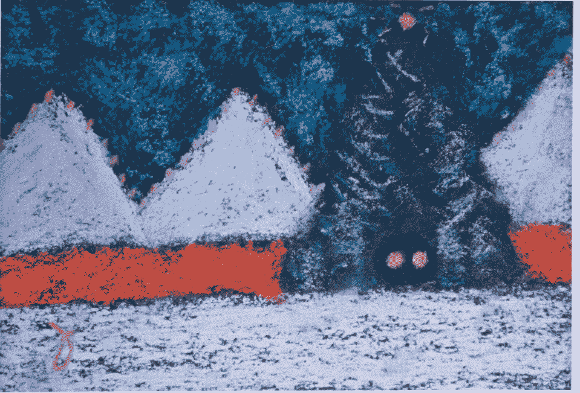
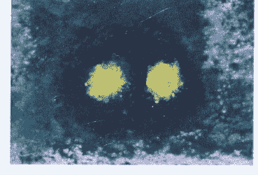
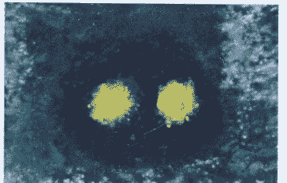
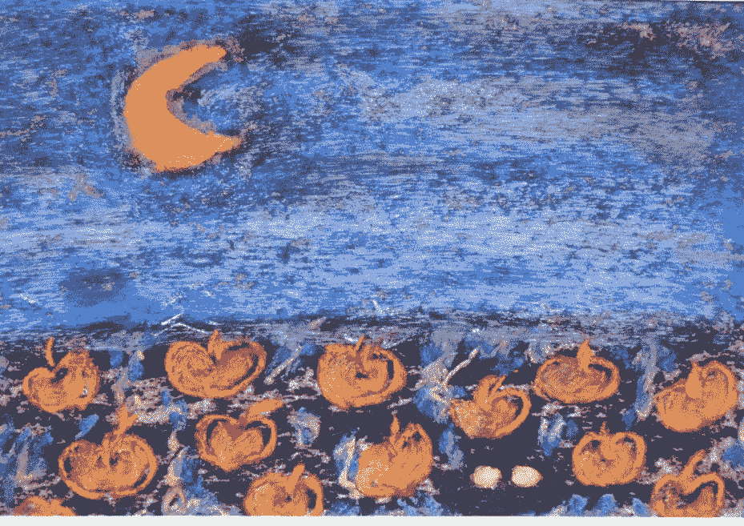
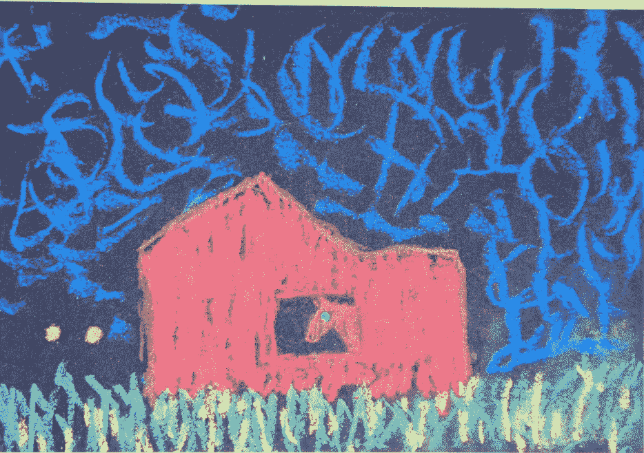
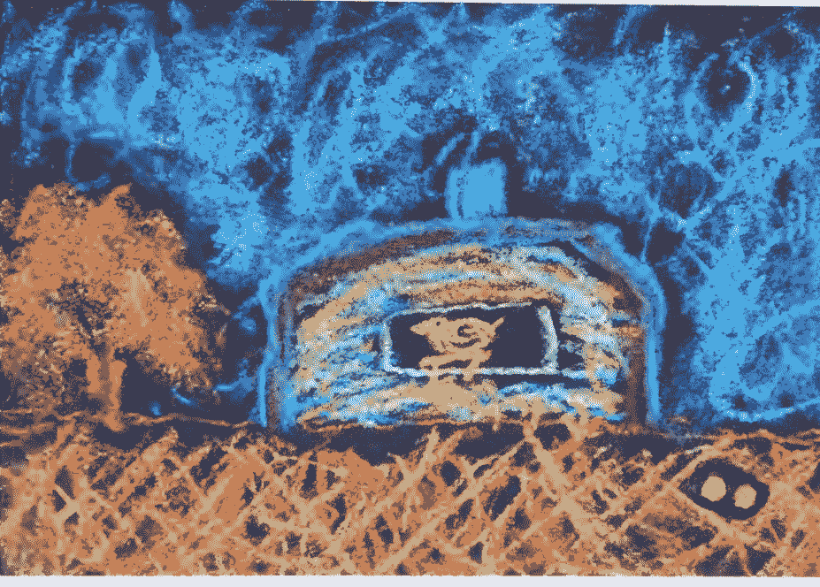
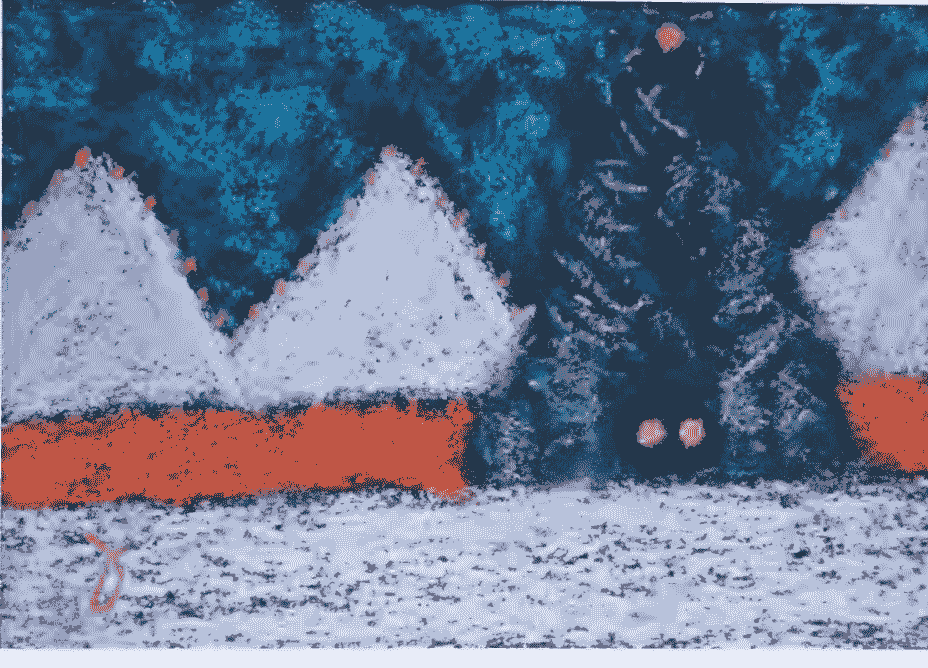
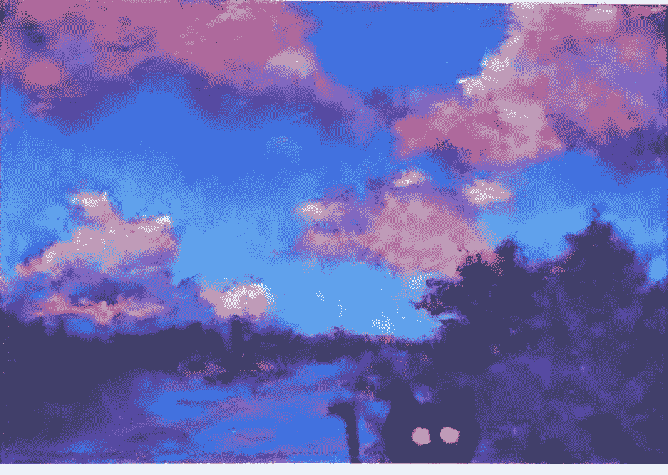
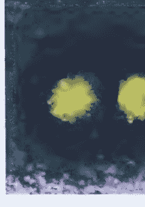
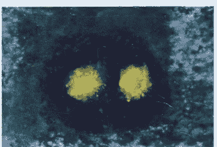

# Java，害羞的生物

**作者：** Barbara Churchley 和 Cheri Hutchins  
**插画：** John Campbell  
**落日插画：** Palea Goemmel  
**文案：** Barbara Churchley

Java 住在农田的边缘。Java 非常害羞，但很喜欢探索周围的森林。Java 追逐蝴蝶、蜜蜂和鸟儿。

她看着田里的农夫，还有牛和马。Java 在森林里玩耍直到累了，然后睡个午觉。她最喜欢夜晚，因为她像夜晚一样黑暗，没有人能看见她。

一天，Java 在人们的笑声和交谈声中醒来。他们正看着田里的南瓜，甚至还把它们捡起来带走。Java 不该怎么想……Java 并不知道万圣节。

Java 喜欢在谷仓里探索寻找老鼠。

农夫的马 Peaches 晚上睡在谷仓里。

一天晚上，当 Peaches 睡着时，Java 悄悄溜过去，摸了摸 Peaches 柔软的鼻子。

Peaches 和 Java 成了好朋友。

有时，农夫会进谷仓。

Java 就会跑出谷仓进入树林。

Java 是一个害羞的小动物。

秋天，当树木落了叶子，Java 在农夫房子附近徘徊。

房子里传出一种奇妙的香味！Java 跳到窗台上向里看。她很害羞，但对那股奇妙的香味非常好奇。

Java 向内看，看到农夫一家人坐在桌旁。那股奇妙的香味来自桌子正中央一只巨大的烤火鸡。Java 不该怎么想……Java 并不知道感恩节。

农夫在田田边缘和谷仓里见过 Java。他放了一块火鸡在盘子里，然后把盘子放在后门廊上。Java 非常害羞，但当农夫回到室内后，她悄悄溜向盘子，吃掉了所有的火鸡。

很快，天气变冷了，下雪了！

Java 花了更多时间在谷仓里陪伴 Peaches，并睡在她温暖的草垫床上。

一个早晨，Java 听到了一种新声音。

农夫和他的家人坐着 Peaches 拉的雪橇。雪橇上的铃铛叮叮当作响。雪橇里有一棵树。这家人正把着一棵圣诞树回房子。Java 不该怎么想……Java 并不知道圣诞节。

那个冬天，Java 在谷仓里度了很多时光。

当农夫来到谷仓时，Java 会躲在草堆下。

Java 是一个害羞的小动物。

白天越来越长。草变绿了。Java 醒来伸了伸腰，打了个哈欠，听到了农夫卡车的声音。她看到他下卡车，手里拿着美丽的红花，以及一个带蝴蝶结的大红盒子。农夫进了屋。Java 不该怎么想……Java 并不知道情人节。

春天来了。鸟儿在歌唱，蜜蜂在嗡嗡，农夫房子周围百花盛开。一天，Java 听到很多孩子的笑声和尖叫声。他们在绿草地上跑跑跳跳，捡起五彩斑斓的蛋。Java 看到草地上到处都是蛋。Java 不该怎么想……Java 并不知道复活节。

夏天的一个晚上，Java 看到摆满了食物的桌子和到处的人。当天黑后，闪烁的灯光和响亮的声音充满了夜空。

Java 起初很害怕，躲在谷仓里。

Java 是一个害羞的小动物。

人们笑着，指着天空中的灯光。Java 不该怎么想……Java 并不知道独立日。

Java 观察了很久，然后去 Peaches 的马厩里睡觉了。

Java 整个夏天都在追逐蝴蝶、蜜蜂和鸟儿。她知道，很快人们就会来采南瓜了。她也知道天气会变冷，但她知道自己和 Peaches 一在谷仓里是温暖的。

她知道一个特别的日子会到来，农夫会留一盘火鸡在后门廊上给她。那是感恩节，Java 对此非常清楚。

Java 喜欢节日——所有的节日。

她希望你也是。

