# Java：初学者终极速课程指南

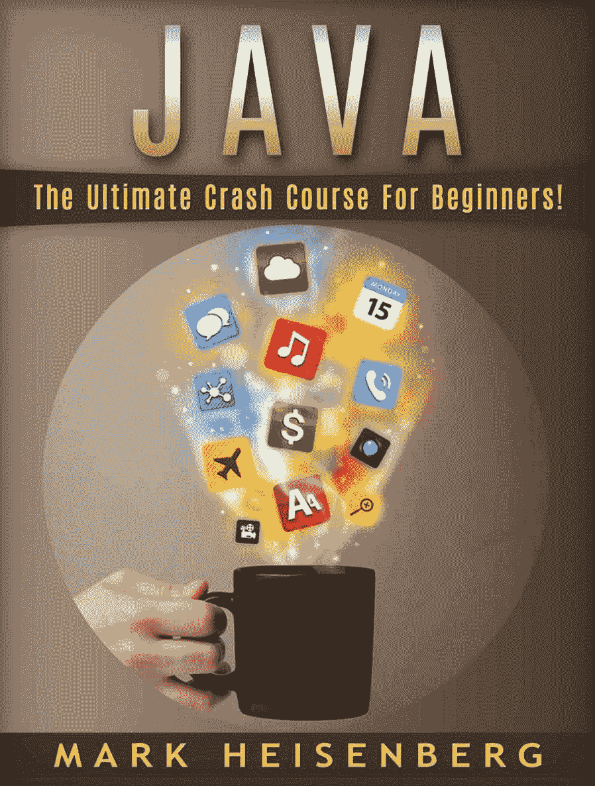

## 引言

本书通过实际示例和 Java 语言编写的代码截图，提供了一种循序渐进的学习 Java 编程的方法。

Java 编程语言由太阳微系统公司（Sun Microsystems Inc）的五位员工于 1991 年首次构建——Ed Frank、Mike Sheridan、Chris Warth、James Gosling 和 Patrick Naughton。他们的想法是构建一种可以在不同平台运行，并可以用于消费电子设备的嵌入式软件的编程语言。在当时，C 和 C++ 是主流的编程语言。然而，这些语言对于消费级应用并不高效。这些语言还依赖平台，因为编写的程序在使用之前必须针对特定的硬件进行编译。

以下是 Java 的主要特性：

- **简单**：Java 没有运算符重载、多重继承、内存分配和指针等复杂特性。
- **安全**：Java 在应用程序和电脑之间提供了一个虚拟防火墙。用 Java 编写的代码限制在 Java 运行环境（JRE）中，不允许进行禁止的访问。
- **可移植性**：你可以在任何平台或任何机器上运行 Java 代码。Java 代码是可移植的，因为字节码可以传输到任何运行平台。
- **平台无关**：在编译阶段，用 Java 编写的程序会被转换为用于任何平台（Windows、Mac/OS 或 Linux）的字节码。因此，你可以在 Linux 上使用在 Mac/OS 上编译的程序，反之亦然。
- **多线程**：Java 允许程序同时执行多个任务。
- **面向对象**：Java 可以将程序组织成一组对象，这些对象可以代表类的实例。
- **分布式**：通过 Java 编程，可以很容易地创建分布式的应用程序。你可以使用远程方法调用（RMI）或企业级 Bean（EJB）通过互联网开发分布式应用。
- **健壮**：Java 可以高效地处理内存管理故障以及运行时错误。

请注意，这门速成课程只是你探索奇妙 Java 编程世界的旅程。这种流行的编程语言不仅仅是技术细节和支持它的编程，还包含了许多实用的库，可以帮助你创建出程序。

## 第 1 章 – Java 基础

计算世界的变革和编程科学的进步是驱动计算机语言向前发展的两个因素。这两个因素也影响了 Java 编程的创新。在 C 和 C++ 的动态遗产的基础上，Java 引入了许多特性和改进，反映了当前编程世界的现状。作为对新兴网络环境的响应，Java 具有能够为高分发架构简化编程的特性。

### Java、C 和 C++

在继续深入之前，首先了解 Java 与 C/C++ 之间的关系是非常重要的。Java 被认为是 C 和 C++ 的后代。Java 的语法源自 C，而其对象模型则是模仿 C++ 的。许多程序员一直在使用 C/C++ 的语法。这使得程序员学习 Java 变得容易，因为他们已经有了背景知识和技能。

Java 之所以流行主要是因为它改进了已经有效的编程结构。C 开启了现代编程。它演变为 C++，现在演变为 Java。通过在这些遗产的基础上进行构建，Java 提供了一种强大、逻辑性强且适应网络结构的编程语言。

由于这三种语言具有共同元素，程序员在不同语言之间切换非常容易。

C 和 C++ 的一个核心设计哲学是你（作为程序员）拥有控制权。这在 Java 中同样适用。除了网络世界的限制，Java 为你提供了完全的控制。你的程序将反映出你的水平。

有些人将 Java 视为 C++ 的网络版本，主要是因为 Java 在面向对象编程方面的相似性。这并非事实。Java 在哲学和实际应用方面仍然存在差异。

尽管 Java 的灵感来自 C++，但它并不是 C++ 的改进版本。首先，它与 C++ 不向下兼容也不向上兼容。此外，Java 并不是为了取代 C++ 而创造的。相反，Java 是为了解决特定的问题集，而 C++ 也是为了解决不同的问题集。Java 和 C++ 将继续作为独立的编程语言被使用。

### Java 和 C#

在 Java 开发几年后，微软推出了 C#。这至关重要，因为 C# 与 Java 是相关的。事实上，C# 的大部分功能与 Java 并行。Java 和 C# 都建立在标准的 C++ 语法之上，使用相同的对象模型，并支持分布式编程。

当然，C# 和 Java 之间存在差异，但这两个语言的通用界面非常相似。因此，如果你熟悉 C#，学习 Java 将变得容易；反之，如果你熟悉 Java，学习 C#也将变得容易。

但 C# 不会取代 Java，因为它们针对两种不同的计算平台进行了优化。正如 Java 和 C++ 将在未来继续共存，Java 和 C# 也是如此。

### Java 对互联网的重要贡献

互联网极大地促进了 Java 的流行，反之，Java 对互联网做出了巨大的贡献。除了简化了整体网络编程，Java 还开发了一种新型的网络程序——即小程序（Applet），它改变了网络世界看待内容的方式。Java 还解决了 Web 的一些最重要的问题，例如安全性和移植性。

#### Java 小程序

Java applet 是一种特殊的程序类型，专用于在线传输，并由启用了 Java 的在线浏览器即时应用。此外，Java applet 是根据需要下载的，不需要复杂的用户交互。一旦用户访问包含 applet 的链接，计算机将立即下载文件并执行下载代码。Applet 被设计为微型程序。它们通常用于从服务器显示信息、提供基本功能，并管理来自用户的输入。

Applet 的开发改变了在线编程，因为它扩大了可以在网络空间中轻松移动的对象范围。通常，我们两类从用户传输到服务器的宽大对象类别，例如被动的、动态的和主动的程序。

如果你在读一封邮件，你读的是被动类型的数据。即使在下载程序，除非你启动它，否则程序代码仍然是被动的。与此同时，applet 是一个活跃的、自启动的程序。

### 可移植性

可移植性是互联网的一个主要方面，因为连接其上有各种操作系统和计算机。如果你在连接到 Web 的任何计算机上运行 Java 程序，应该有一种方法使该程序能够在不同的系统上启动。

对于 applet 来说，它应该由在线的多种 CPU、浏览器、操作系统下载并运行。为不同的计算机准备不同的 applet 版本是不理想的。一种代码应该适用于所有计算机。因此，应该有一种方式生成可移植的且可执行的代码。

### 安全性

每当你从互联网下载任何内容时，始终存在你的计算机或服务器被感染病毒的风险。一旦有害代码获得你系统的访问，可能会对系统造成破坏。例如，病毒可能会收集隐私数据，如银行账户信息、信用卡号和密码。

为了允许 applet 安全地下载并在用户的计算机上启动，禁止 applet 执行攻击至关重要。Java 通过限制 applet 仅在 Java 执行平台上运行，并且不允许访问系统的其他部分，实现了这种保护。

带安全性下载 applet 的能力是 Java 最创新的方面。

### Java 字节码

Java 能够同时解决可移植性和安全性问题的原因是编译器的输出不是执行代码。相反，它是字节码，这是一段为了在 `JVM` 中运行而经过优化的指令。

将 Java 程序转换为字节码将使其在不同平台上执行程序变得更容易，因为每个平台都需要执行 `JVM`。当包适用于特定系统可用时，Java 程序即可运行。请注意，尽管每个平台的 `JVM` 细节可能不同，但都可以解释相同的字节码。一旦程序被编译，每种类型的联网计算机都应该存在类似的程序。

### 面向对象编程

面向对象编程（OOP）是 Java 的核心元素。OOP 方法在 Java 中是不可缺的。因此，在学习 Java 时理解 OOP 是至关重要的。

`OOP` 是编写程序的有效方法。自从计算机出现以来，编程方法论发生了巨大变化，以应对日益增长的程序复杂度。

例如，当计算机最初开发时，编程是通过通过 PC 的前面板更改二进制机器指令来实现的。如果程序长度平均，这种方法是实用的。随着程序的增长，开发了汇编语言，以便程序员使用机器指令的符号表示来管理更大、更复杂的程序。

随着程序的不断扩展，程序员开发了高级语言，这为程序员提供了更多管理复杂性的工具。

`OOP` 使用了结构化程序的最佳思想并将其与不同的概念相结合。这导致了程序的特殊方式。通常，程序可以通过代码或数据进行结构化。仅使用结构化程序技术时，程序通常根据代码组织。

为了支持 `OOP`，Java 以及其他语言具有三个共同属性：继承、多态和封装。

#### 继承

继承指的是对象可以获得另一个对象的属性的过程。这是至关重要的，因为它支持了分层组织的概念。如果没有层次结构，每个对象都必须显式地定义。通过继承，对象只需要定义使其在类中具有独特的特性。它可以从父类继承其基本属性。因此，这种继承机制使得对象很容易成为一个特定的实例。

#### 多态

多态（许多形式）是一种允许接口访问基本类动作的属性。特定的动作由情况的特定性质决定。多态的概念通常由“多个方法，一个接口”这句话来定义。因此，可以为一组相关的活动设计一个通用接口。多态可以通过访问相似的接口（你可以用它确定一类动作）来降低复杂度。

#### 封装

封装是一种编程方法，它将代码以及其所处理的数据集成在一起，并将它们都存储起来以避免误用和外部干扰。在 `OOP` 语言中，数据和代码可以结合在一起，构建出一个自包含的黑盒。盒子内部是所有关重要的代码和数据。如果代码和数据以这种方式结合，我们就可以创建一个对象。因此，对象是支持封装的设备。

## 第二章 – 编写你的第一个程序

现在你已经学习了 Java 的基础，是时候开始编写你的第一个 Java 程序了。在编译和运行程序之前，你应该安装 Java 开发工具包（JDK）。这是来自 Oracle 的免费程序。截至出版此时，最新版本是 `JDK 8`。

由于 `JDK 8` 提供了若干初始 Java 版本未包含的新功能，最好使用 `JDK 8` 来编译和运行你将在书中学习的程序。使用早期版本可能会导致程序无法编译。

你可以通过此链接下载最新版本的 JDK：

`http://www.oracle.com/technetwork/java/javase/downloads/index.html`

访问 Oracle 下载页面并选择你的计算机类型。安装 JDK 后，你可以编译并运行程序。`JDK` 支持两个主要程序：`javac` 和 `java`。后者是基本的 Java 解释器，也被称为应用程序启动器。

请注意 `JDK` 不是窗口应用程序。它在命令提示符环境中运行，使用命令行工具。这也不是集成开发环境（IDE）。

除了 JDK 提供的标准命令行工具外，你还可以使用其他 IDE 如 `NetBeans`。使用 `IDE` 对商业应用的开发和部署有所帮助。

### 编写你的第一个 Java 程序

现在我们已经准备就绪，可以开始编译和运行一个短程序。使用以下代码：

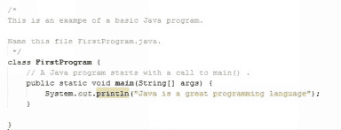

你有三个基础步骤需要遵循：输入、编译和运行。

手动输入程序是可能的。在这个示例中，你可以通过文本编辑器将程序输入计算机。记住不要使用文字处理器，因为它通常会在存储文本的同时存储格式数据。这些数据将与 Java 编译器产生冲突。如果你使用 Windows 电脑，可以使用 `WordPad` 或任何你喜欢的编程软件。

在其他编程语言中，存储程序源代码的文件名可以是随机的。在 Java 中，情况并非如此。源文件的名称在 Java 中非常关键。在我们的示例中，源文件的名称必须是 `FirstProgram.java`。

在 Java 编程中，源文件正式称为编译单元。这是一个文本文件，其中包含一个或多个类定义。在目前，我们将使用包含单个类的源文件。

Java 编译器会调用以 `.java` 为后缀的文件作为源文件。正如我们在第一个程序中看到的，程序的类名也是 `FirstProgram`。这并不是随机发生的。所有代码都应该被限制在一个类内部。按照惯例，主类的名称必须与存放程序的文件名匹配。

注意，文件名的大小写必须与类名匹配。Java 对字符的大小写敏感。这种格式有助于更容易维护和组织程序。

### 编译程序

在编译 `FirstProgram` 时，通过在控制命令行指定源文件名来启动编译器 `javac`，如下所示：

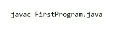

Java 编译器将创建一个名为 `FirstProgram.class` 的文件，它存储程序的字节码版本。注意，字节码不是可执行代码。字节码应该使用 `JVM` 执行。因此，`javac` 的输出不是一个可以直接执行的代码。

要运行程序，你可以使用 Java 解释器 `java`。为了做到这一点，如如下所示，将类名 `FirstProgram` 作为控制命令行参数传递：

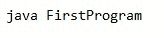

一旦你运行了程序，将显示下面的输出：

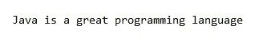

当你编译程序时，每个类都会被限制在以类命名并使用 `.class` 扩展名的输出文件中。因此，为你的 Java 源文件提供与它们所处理的类相似的名称是理想的——源文件名将与 `.class` 文件名匹配。一旦你运行 Java 解释器，你实际上是在指定你想让解释器运行的类名。这将立即通过该名称和 `.class` 扩展名搜索文件。一旦找到文件，它将运行包含定义类的代码。

尽管 `FirstProgram.java` 有点短，但它包含了一些所有 Java 程序共有的关键特性。

我们的程序从以下几行开始：

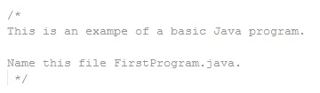

起始行是“注释”。与其他编程语言类似，Java 允许你直接在程序的实际源文件中插入注释。编译器会忽略这些注释，因此它们不会以任何方式影响代码。相反，注释向源文件的其他读者解释或描述了程序的操作。在此时，注释为程序提供了一个描述，并包含了一个提醒，即源文件必须命名为 `FirstProgram.java`。

Java 中有三种注释样式。插入在程序顶部的注释是“多行”注释。这种类型的注释应该以 `/*` 开始并以 `*/` 结束。这两个注释符号限制的所有文本都将由编译器忽略。正如名称所意，多行注释可能有几行那么长。

我们第一个程序中的下一行代码所示：

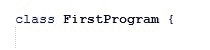

在这一行中，我们将使用 `class` 关键字来声明定义一个新类。记住，类是 Java 中封装的基本单元。`FirstProgram` 是类名。类定义以左大括号（`{`）开始并以右大括号（`}`）结束。这些括号之间的代码被称为类成员。

目前，不要担心类的细节，但请注意在 Java 中程序活动发生在类内部。

此程序的下一行是如下的单行注释：


这是 Java 中的另一种注释类型。单行注释以两个右斜杠（`//`）开始，并在行尾结束。在编程中，你可以使用多行注释进行长注释，使用单行注释进行短的逐行备注。

这是下一行代码：


这一行启动了 `main()` 方法。在 Java 中，子程序是一个方法。正如前面的注释所述，这是程序开始执行的行。Java 应用通过调用 `main()` 开始执行代码。

我们仍然无法提供该行每个部分的具体含义，因为这需要对其他 Java 特性有更深入的理解。但由于书中的许多示例将使用这行代码，这里是关于每个部分的基础信息。

关键字 `public` 是访问修饰符，它定义了程序的其他部分如何访问类成员。当你看到类成员前面写有 `public` 关键字时，该成员可以被类之外的代码访问。相反的关键字是 `private`，它禁止类之外声明的代码使用该成员。此时，`main()` 应该被定义为 `public`，因为它应该在类之外被调用。`static` 关键字让 `main()` 在对象创建之前即可被调用。接下来，`void` 关键字基本上告诉编译器 `main()` 不产生值。方法也可以产生值。

正如前面所述，`main()` 是 Java 运行时被调用的方法。传递给方法的任何数据都由方法名括号内定义的变量接收。这些变量被称为参数。如果没有需要的参数，你仍然可以包含参数。在 `main()` 中，我们只有一个参数：

`String[]`

这声明了一个名为 `args` 的参数。这是一个 `String` 类型对象的数组。数组指向相似的对象组。`String` 类型对象处理字符序列。此时，一旦你运行程序，`args` 将接收任何存在的命令行参数。

该行的最后一个元素是 `{`，它标志着 `main()` 体的开始。限制在方法的所有代码都发生在方法的左大括号和右大括号之间。

这是下一行代码。注意它限制在 `main()` 内部。

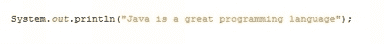

这行代码将显示字符串“Java 是一种很棒的编程语言”，并在屏幕上换行。输出可以通过内置方法：`println()` 完成。此时，`print()` 显示传递给它的字符串。正如你所看到的，`println()` 也可以用于显示其他类型的信息。该行以 `System.out` 开始。

`System` 是一个预定义的类，提供了对系统的访问，而 `out` 是输出流，它连接到控制台。因此，`System.out` 是一个对象，封装了输出控制台。

注意 `println()` 语句以分号结束。Java 语句应该以分号结束。程序中其他不以分号结尾的行实际上不是语句。

程序中的第一个括号结束了 `main()`，最后一个 `}` 结束了 `FirstProgram` 类的定义。

正如我们已经讨论过的，Java 是区分大小写的。忽略这一点可能会导致严重的问题。例如，如果你错误地输入了 `Main` 而不是 `main`，或者输入了 `PrintIN` 而不是 `println`，那么之前的程序可能是错误的。此外，尽管 Java 编译器可以编译不包含 `main()` 方法的类，但没有办法运行它们。因此，如果你错误地输入了 `main`，编译器仍然会编译程序。但解释器将会报错，因为它无法找到 `main()` 方法。

## 第 3 章 – 语法错误与数据类型

如果你以前尝试过编程，你现在已经知道拼写错误是非常常见的现象，这可能会导致错误。如果代码中存在错误，编译器在尝试编译后会显示语法错误提示。Java 编译器无论你写了什么，都会尝试解释源代码。因此，所显示的错误并不总是代表问题的实际原因。


例如，在我们的`FirstProgram`示例中，无意中漏掉了方法`main()`后的左大括号，这会导致编译器显示以下错误：

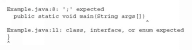

第一条错误信息显然是错误的，因为漏掉的是大括号，而不是分号。

如果你的程序有语法错误，没有必要字面上去解释编译器的信息。大多数情况下，这些信息可能是误导性的。你仍然需要评估错误信息以找到真实问题。你还应该注意程序中可疑行之前的最后几行代码。

## 第二个程序

可能没有其他什么结构像给变量赋值那样对编程语言是至关重要的了。变量指的是一个定义的内存位置，该位置可以被分配一个值。此外，变量的值可以在程序运行时发生变化。重要的是要记住变量的内容是可以改变的。它不是固定的。在下面的程序中，我们可以创建两个名为`var1`和`var2`的变量。

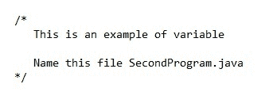

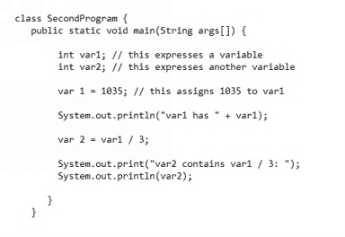

一旦你运行了这个程序，屏幕上应该显示以下输出：

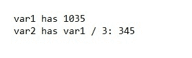

在这个程序中，我们引入了新概念。首先，我们有这样语句：

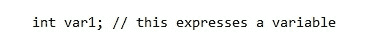

这表示了一个名为`var1`的整型变量。注意，在 Java 中，你在使用所有变量之前都需要声明它们。此外，你还应该指定变量可以包含的值的类型。这被称为变量类型。在这个示例中，`var1`可以存储整数类型或全整数值。在 Java 中表示一个整数变量，前面应该加上`int`关键字。因此，前面的语句表示了一个名为`var1`的`int`类型的变量。

下面这一行表示了另一个名为`var2`的变量：

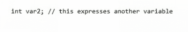

注意，这一行使用了与第一行类似的格式。唯一的区别是变量名。

通常，你需要使用下面这一行来表示变量：

`type var-name;`

在这个格式中，`type`指定了你想要表示的变量类型，而`var-name`是变量名。除了`int`，Java 还支持其他类型的数据。

注意，在 Java 中，赋值运算符是等号。它的功能是将左侧的值复制到右侧。

下一行显示了赋值给`var1`的值，前面带有字符串：“var1 has”：

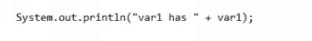

在上一行中，`+`符号将使`var1`的值显示在先前的字符串之后。这种方法可以通用。通过`+`运算符，你可以在单个`println()`语句中根据意愿组合多个对象。

接下来的代码定义了`var2`的值 – `var1`的值除以 3：

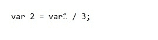

这段代码将赋值给`var1`的值除以 3，然后将结果存储在`var2`中。因此，执行该行后，`var2`将存储值 345。赋值`var1`的值将固定。与大多数其他编程语言一样，Java 使用算术运算符：加法 (`+`)、减法 (`-`)、乘法 (`*`) 和除法 (`/`)。

下面是程序中的后续代码：

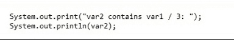

这里发生了两个新情况：使用了`print()`方法来显示字符串“var 2 contains var1 / 3: ”。注意这个字符串后面没有换行。因此，一旦我们生成下一个输出，它将从同一行开始。`print()`方法类似于`println()`，区别在于它在每次调用后都不会显示新行。接下来，在`println()`的行中，注意`var2`被用作自身。`print()`和`println()`可用于显示 Java 任何内置类型的值。

在我们继续之前，你首先需要理解表示变量的另一个重要概念。你可以表示两个或多个变量，用逗号分隔。

例如，可以这样表示：


## 浮点类型

在之前的程序中，我们使用了`int`。但这种类型只能存储整数。为了存储小数，你可以使用`float`或`double`。这些浮点类型表示单精度或双精度值。`double`类型非常常用。为了声明一个 double 类型，可以使用如下语句：

`double a;`

在这个语句中，`a`指的是变量名，类型是`double`。为了理解`int`和`double`的区别，你可以尝试以下程序：


当你运行这个程序时，你会看到下面的输出：


正如你所看到的，当 var 除以 8 时，程序执行了整数除法，结果是 2 而不是 2.5，因为丢失了小数部分。但当 a 除以 8 时，程序保留了小数并显示了正确答案。

程序中的另一个新组件是不带任何参数的`println()`用于插入空行。

# 第 4 章 – Java 控制语句

在方法内部，程序从一行运行到另一行，从上向下。但像其他编程语言一样，Java 还允许程序员通过不同的程序控制语句来控制流程，例如`if`语句和`for`循环。

## if 语句

可以使用条件`if`语句选择性地运行程序的部分。Java 中的`if`语句非常类似于其他语言中的`IF`语句。下面是它的简单形式：

`if(condition) statement;`

在这一行中，`condition`是一个布尔表达式。如果条件为真，则程序将运行代码。如果条件为假，则该语句将被忽略。下面是一个示例：


在这个示例中，因为 20 小于 21，条件表达式为真，所以`println()`将运行。

看下面行：


在这个示例中，20 不小于 19。因此，`println()`不会被执行。

Java 支持一系列互补的关系运算符，这些运算符可以用于条件表达式中：

- 小于 (`<`)
- 小于等于 (`<=`)
- 大于 (`>`)

## 比较运算符

大于或等于 (`>=`)
等于 (`==`)
不等于 (`!=`)

请注意，双等号用于相等性测试。下面是显示`if`语句的程序：

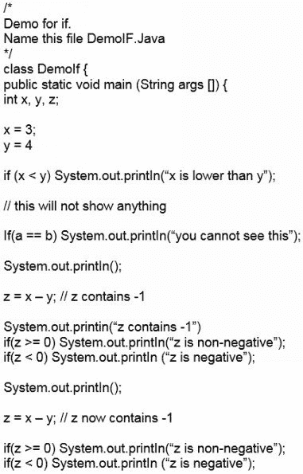

当运行此程序时，输出应该如下：

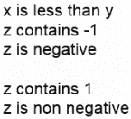

注意此程序中的另一个新概念：

```java
int x, y, z;
```

这一行通过使用`list separator`（列表分隔符）分隔的列表表示变量`x`、`y`和`z`。正如我们之前讨论的，如果你需要几个相同类型的变量，你可以在单条语句中表示它们。你只需要用逗号分隔这些变量即可。

## for 循环

在 Java 中，可以通过循环重复执行一系列代码。Java 支持功能强大的循环范围。目前，我们将查看`for`循环。下面是`for`循环最简单的格式：

```java
for(initialization; condition; iteration) statement;
```

在这种常用格式中，循环的初始化部分将循环控制变量设置为一个初始值。条件是一个布尔行，用于检查循环控制变量。如果测试结果为真，`for`循环将继续运行。如果结果为假，`for`循环将终止。迭代行定义了每次循环迭代时循环控制变量是如何变化的。

下面是一个简单的程序，展示了`for`循环：

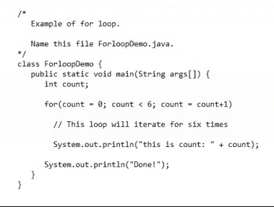

运行程序时显示的输出如下：

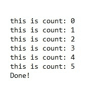

在这种情况下，循环控制变量是`count`。在`for`的初始化部分，默认值为 0。在每次迭代的开始（包括第一次），都会执行条件测试`count < 6`。如果此测试的结果为真，则执行`print(`这一行，然后循环的迭代部分将通过将`count`加一个单位来运行。这个序列将一直持续，直到条件测试为假，此时执行将跳转到循环的底部。

有趣的是，在编写良好的程序中，你不会看到循环的一部分被写在迭代部分中。很少你会看到如下这样的代码：

```java
count = count + 1;
```

在 Java 中，你可以使用一个特殊的自增运算符来执行此操作。双加号 (`++`) 是自增运算符，它将操作数加 1。通过这个自增运算符，语句可以写成：

```java
count++;
```

因此，上一个程序的`for`可以这样写：

```java
for(count=0; count < 6; count++)
```

你可以尝试一下，你会发现循环的运行方式是相同的。同时，Java 还支持使用双减号 (`--`) 的自减运算符，它将操作数减 1。

## 代码块创建

代码块是 Java 的另一个核心元素。代码块指的是两个或多个语句的组。创建代码块可以通过将语句限制在左大和右大括号`{ }`之间完成。当你创建一个代码块时，它将成为一个逻辑单元，可以用于任何一个语句可以使用的地方。例如，代码块可以是 Java 中`if`和`for`语句的目标。看这个`if`语句：

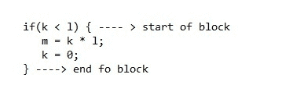

在这个例中，如果`k`小于`l`，则块内的语句将运行。因此，块内的两个语句将创建一个逻辑单元，如果没有另一个语句运行，另一个语句就无法运行。

这里的要点是，创建一个块将允许你从逻辑上连接两个或多个语句。代码块还允许以更高的效率和更清晰度执行多个算法。

下面是一个程序，它使用代码块来防止除以零：

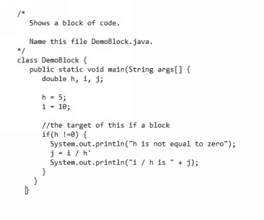

运行此程序将显示此输出：

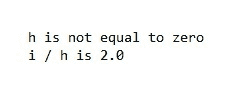

在程序中，`if`语句的目标是一个代码块，而不仅仅是一个语句。如果控制`if`的条件为真（如我们的示例所示），则块内的三个语句将运行。尝试将`h`设置为 0，并查看结果。你会发现整个块都会被程序忽略。

## 在 Java 中使用分号

在 Java 编程中，分号用作分隔符，用于结束一条语句。因此，每条语句都应该以分号结束。它标志着一个逻辑对象的结束。

如你所知，块是一组由左括号和右括号限制的逻辑相关的语句。块不应该以分号结束。因为块是语句的集合，每条语句后面都有分号，所以没有需要用分号来结束块。相反，代码块是用右大括号结束的。

Java 不会将行尾读取为终止符。因此，语句的位置并不重要。

例如：

```java
a = b;
b = b + 1;
System.out.println(x + " " + b);
```

这一行在 Java 中被解释为相同：

```java
a = b; b = b + 1; System.out.println(x + " " + b);
```

此外，语句的每个元素也可以限制在单独的行上。例如，这一行是可以的：

```java
System.out.println("This is a lengthy output" + a + b + c + "more display");
```

以这种方式分解长行通常用于提高程序的可读性。这也可以防止过多的自动换行。

## 缩进

你可能已经注意到，在之前的程序中，特定的语句被缩进了。在某行上放置语句的位置并不真的重要。但多年来，已经发展出一种的缩进方式来提高程序的可读性。本书遵循那种风格，最好也遵循这一约定。在这种风格下，你应该在每个左大括号后缩进一层，并在每个右大括号后回退一层。

## Java 关键字

Java 定义了 50 个关键字，你可以将它们与分隔符和运算符的语法结合。请注意，你不能使用这些关键字作为方法、类或变量名。

以下是 Java 关键字：

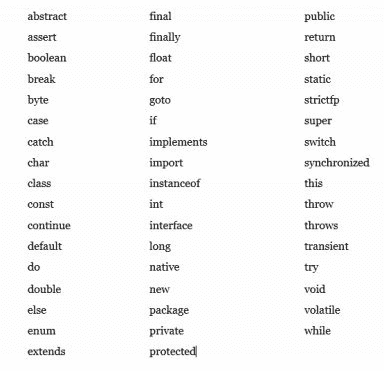

`goto`和`const`关键字被 Java 保留，但这些没有被使用。在 Java 早期，有一些关键字被保留以便将来可以使用。但 Java Java 规范仅描述了上述列出的关键字。

除了这些关键字之外，Java 还保留了以下内容：`null`、`true`和`false`。这些是 Java 已定义的值。你不能使用这些单词来命名你的变量或类。

## Java 标识符

Java 标识符指的是用户定义的特定变量、方法或其他任何项目的名称。它们的长度可以从一个到几个字符不等。变量名可以是任何字母、美元符号或下划线开头。使用下划线是理想的，因为它增强了变量名的可读性，例如`java_data_program`而不是`javataprogram`。同样请注意，大和小写是不相同的。因此，`datavar`与`DataVar`不同。

以下标识符是可以接受的：

```
Test
b
b3
LoadInfo
$pu
_bot
var_one
sampler_18
```

请注意，不允许使用数字开头作为标识符。因此，`23sampler`是不允许的。

正如之前讨论的，我们不能使用保留的 Java 关键字作为标识符名称。你也不能使用 Java 方法名称（如`println`）。

我们在本章中使用的程序使用了 Java 中两种常用的内置方法：`print()`和`println()`。你可以通过`System.out`访问这些方法。`System`指的是由 Java 定义的类，它被立即编码到你的程序中。通常情况下，Java 平台依赖于不同的内置类库，这些库包含了许多内置方法，为图形界面、网络、字符串管理和 I/O 等功能提供支持。

标准 Java 类还可以支持图形用户界面（GUI）。因此，Java 整体是其标准类之上对编程语言本身的整合。

当你练习 Java 时，你会发现类库提供了代码随附的大部分功能。作为一名程序员，学习标准 Java 类对你是非常重要的。你无法通过阅读这本书学习所有的 Java 库，因为你需要你自己进行更多探索的领域。

# 第 5 章 – Java 方法、对象和类

在 Java 中你必须学习的一个重要概念是类（class）的使用。类被认为是 Java 的核心，因为它是整个 Java 语言创建的基础，而且类可以描述对象的本质。因此，我们可以说在 Java 中，类构成了面向对象编程的基础。

类内部定义了数据以及根据这些数据执行的代码。代码被限制在方法（methods）中。由于方法、对象和类是 Java 的基础，它们包含在书中。学习这些特征的基础将训练你编写更复杂的程序，并让你更好地理解 Java 的特定关键元素。

## Java 类基础

由于 Java 的所有活动都发生在类内部，我们从本书开始就开始使用类。但目前使用的是简单的示例，在编程中它们还有更多内涵。与我们使用的相比，有些类拥有巨大的威力。

让我们从基础开始。类通常是一个模板，定义了对象的形状。它还描述了数据以及对这些数据操作的代码。对象是类的实例。所以从本质上说，类是一组计划，定义了你如何构建一个对象。需要澄清这一点至关重要：类是一个逻辑抽象。只有当创建了特定类的对象时，该类的物理表示才会存在于内存中。

另外请注意，组成类的变量和方法被称为类的成员（members）。数据成员也被称为实例变量（instance variables）。

## 类形式

一旦你定义了一个类，你就在声明它的实际本质和形式。你可以通过指定它包含的实例变量以及你用于操作这些变量的方法来实现。

尽管简单的类可能只包含实例变量或只包含方法，但许多实际类可以同时处理两者。

关键字`class`用于创建类。下面是类的一种简单通用形式：

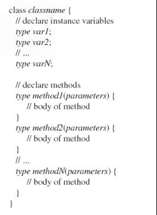

尽管没有硬性规则强制执行，但一个设计良好的类必须只描述一个逻辑对象。例如，存储员工姓名和其 ID 号的类通常不会存储关于每日气温、股市价格或外汇汇率的信息。这里的关键在于，编写良好的类组会将逻辑上相关的信息组合在一起。将不相关的信息限制在同一个类中将影响你代码的结构。

到目前，我们只使用了一个方法：`main()`。当你学习 Java 编程时，你也将学习如何创建其他方法。但你应该注意，类的通用形式并没有定义`main()`方法。只有当该类是你的程序的起点时，才需要`main()`方法。此外，某些类型的 Java 应用（如 applet）不需要`main()`。

## 方法

方法和实例变量是类的组件。尽管只有数据的类是有效的，但大多数类都会有方法。方法是子程序，控制类分配的数据，并在大多数情况下提供对这些数据的访问。通常，程序的其他部分通过使用其方法与类交互。

一个方法限制了多个语句。编写良好的代码会定义一个方法来执行单一任务。每个方法都有自己的名称，这个名称将用于调用该方法。通常情况下，你可以提供一个方法，无论你想要什么名称。但请记住，`main()`是留给启动运行程序的方法的。同时，你不应该使用 Java 关键字作为方法的名称。

方法名称后总是紧跟括号。例如，如果一个方法是`obtainval`，那么在句子中使用该名称时，应该写成`obtainval()`。这种表示法可以帮助你区分变量名。

下面是方法的通用形式：

```
ret-type name( ) {
// 方法体
}
```

在这种格式中，`ret-type`将指定返回的数据类型。如果方法不返回值，则返回类型应该是`void`。`name`由标识符指定。如果方法没有参数，则`par list`将为空。

# 第 6 章 – 数组

在 Java 编程中，数组指的是一组类型相似的变量，通过一个公共名称引用。数组可以有多个维度，尽管一维数组是最常见的。

数组用于不同的目的，因为它们提供了一种将相互相关的变量分组的简单方法。例如，你可以使用数组来存储一年中每天的气温读取记录、外汇市场交易列表，或图书馆中所有关于计算机的书籍列表。

数组的主要优点是它可以以一种简单的方式组织数据，从而便于控制。如果你有一个持有特定职业人员薪资的数组，将组织数组轻松计算平均薪水。此外，数组以这种方式排列数据，可以更容易排序。

尽管 Java 数组的使用方式与其他语言中的数组相似，但它们有一个特殊特性：它们作为对象执行的。将数组作为对象运行有几个好处。

## 一维 Java 数组

一维数组指的是一组相互连接的变量列表。这在编程中非常常见。例如，你可以使用一维数组存储公司活跃员工的 ID 号。另一个数组可以用于存储媒体网络的当前调查评级。

要表示一个一维数组，可以使用这种格式：


```
type name-array[ ] = new size[type];
```

在这种格式中，类型表示数组中元素的类型，也称为基本类型。元素类型定义了数组中每个元素的数据类型。数组可以容的元素数量由大小（`size`）决定。因为数组是作为对象运行的，所以数组的是一个双重过程。首先，你需要表示变量`array`的引用。然后，你可以为`array`定义内存，为变量`array`定义指向内存的引用。因此，Java 数组是通过使用`new`运算符动态分配的。

在下例示例中，代码生成了一个包含 10 个元素的`int`数组，并将其连接到名为`javalist`的变量引用`array`：

```
int javalist[] = new int[5];
```

此声明的功能与对象的声明非常相似。变量`sample`存储了指向由`new`定义内存的引用。这块内存足够存储 10 个`int`类型的元素。像对象一样，你可以将第一个表达式拆分为两行：

```
int javalist[];
javalist = new int[5];
```

在这种格式中，如果先创建`javalist`，它将不会引用任何物理对象。只有在第二条语句运行后，`javalist`才会通过数组连接。

你可以使用索引访问数组中某个特定的元素。索引描述了元素在数组中的位置。在 Java 中，数组的第一个元素的索引为 0。

由于`javalist`有 10 个元素，索引值将从零到九。要对数组进行索引，你可以在方括号指定你喜欢的元素编号。因此，`javalist`中的第一个元素是`javalist[0]`，最后一个元素将是`javalist[9]`。

## 多维数组

在 Java 中，多维数组被视为数组的数组。多维数组最基本的形式是二维数组。通常情况下，二维数组是一个一维数组的列表。为了表示一个大小为 5, 10, 15 的二维整数数组`score`，你可以按照这种格式编写：

```
int score[ ] [ ] = new int [ 5 ] [ 10 ];
```

注意该声明。与其他使用逗号分隔维度数组的编程语言不同，Java 可以将每个维度放在各自的括号中。要访问数组`score`的第 4 和第 8 个点，你可以使用`score [4] [8]`。

## 结论

感谢感谢下载这本书！

我希望你已经学习了 Java 编程的基础。

下一步是学习更多关于这种语言的内容，并继续练习直到你精通。

感谢，并祝你好运！

你喜欢这本书吗？

如果你喜欢这本书，请在 Amazon 上给出你的评价：[点击此处！](https://www.amazon.com/review/create-review?ie=UTF8&asin=B01BF1YXWI&ref_=dpx_acr_wr_link)

如果你认为这本书值得分享，愿意花几秒钟让你的朋友也知道它吗？

如果事实证明这对他们的生活产生了影响，他们将永远感激你。

正如我一样。

顺致祝愿，

Mark Heisenberg
