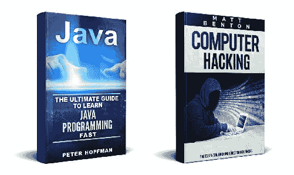
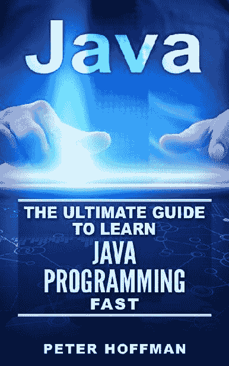
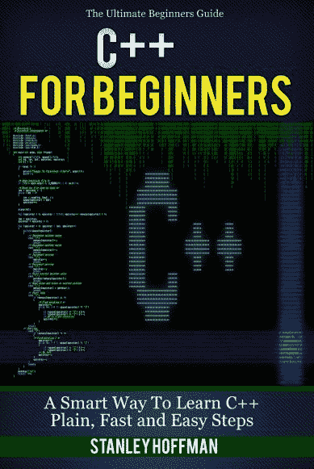
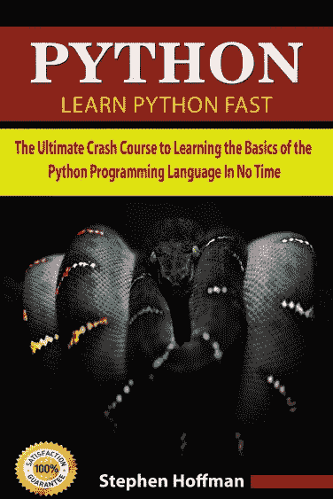
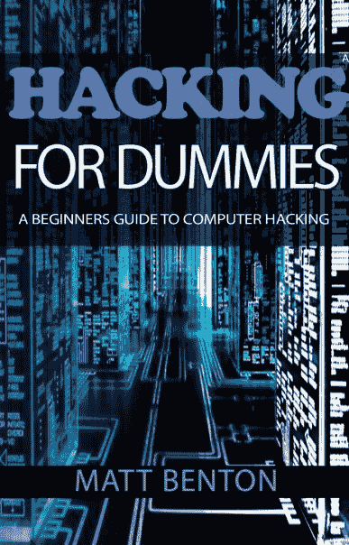
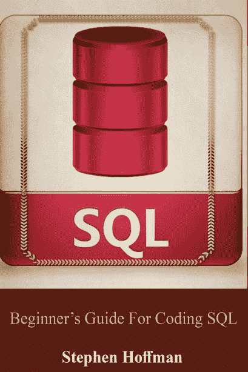
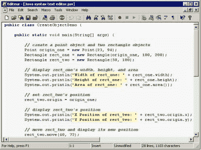
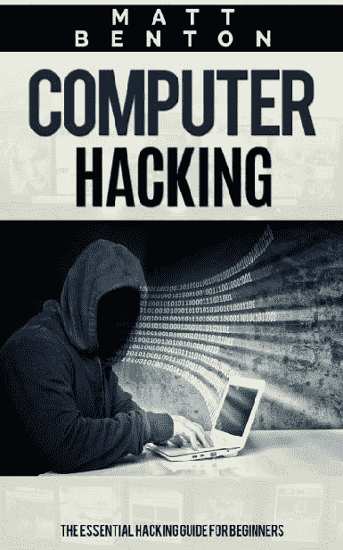
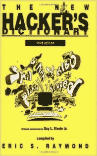
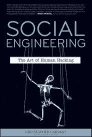

# Java：学习 Java 编程与计算机黑客技术的终极指南（Java 初学者指南、傻瓜 Java、Java 应用、黑客技术）（HTML、Javascript、编程、开发者、编码、CSS、PHP 秘籍 2）





我认为接几本书可能对你感兴趣：

- [C++](http://www.amazon.com/Beginners-Simple-programming-coding-Developers-ebook/dp/B014MT5ME8/ref=sr_1_fkmr0_1?s=digital-text&ie=UTF8&qid=1442833820&sr=1-1-fkmr0&keywords=C%2B%2B%3A+C%2B%2B+for+Beginners%2C+C%2B%2B+in+24+Hours%2C+Learn+C%2B%2B+fast%21+A+smart+w)



- [Python](http://www.amazon.com/Python-Ultimate-Learning-Programming-Hands--ebook/dp/B014MV238Y/ref=sr_1_1?s=digital-text&ie=UTF8&qid=1442836729&sr=1-1&keywords=Python%3A+Learn+Python+FAST+-+The+Ultimate+Crash+Course+to+Learning+the+Basics+of+the+Python+Programming+)



Javascript

- [傻瓜版黑客入门](http://www.amazon.com/Computer-Hacking-beginners-computer-security-ebook/dp/B015T8FZYI/ref=sr_1_1?s=digital-text&ie=UTF8&qid=1446193044&sr=1-1&keywords=hacking+for+dummies+matt+benton)



- [SQL](http://www.amazon.com/SQL-Beginners-database-programming-Programming-ebook/dp/B019A7VQD8/ref=sr_1_25?ie=UTF8&qid=1451913155&sr=8-25&keywords=sql)



Javascript

- [傻瓜版黑客入门](http://www.amazon.com/Computer-Hacking-beginners-computer-security-ebook/dp/B015T8FZYI/ref=sr_1_1?s=digital-text&ie=UTF8&qid=1446193044&sr=1-1&keywords=hacking+for+dummies+matt+benton)


- [SQL](http://www.amazon.com/SQL-Beginners-database-programming-Programming-ebook/dp/B019A7VQD8/ref=sr_1_25?ie=UTF8&qid=1451913155&sr=8-25&keywords=sql)


我认为接几本书可能对你感兴趣：

- [C++](http://www.amazon.com/Beginners-Simple-programming-coding-Developers-ebook/dp/B014MT5ME8/ref=sr_1_fkmr0_1?s=digital-text&ie=UTF8&qid=1442833820&sr=1-1-fkmr0&keywords=C%2B%2B%3A+C%2B%2B+for+Beginners%2C+C%2B%2B+in+24+Hours%2C+Learn+C%2B%2B+fast%21+A+smart+w)


- [Python](http://www.amazon.com/Python-Ultimate-Learning-Programming-Hands--ebook/dp/B014MV238Y/ref=sr_1_1?s=digital-text&ie=UTF8&qid=1442836729&sr=1-1&keywords=Python%3A+Learn+Python+FAST+-+The+Ultimate+Crash+Course+to+Learning+the+Basics+of+the+Python+Programming+)


Javascript

- [傻瓜版黑客入门](http://www.amazon.com/Computer-Hacking-beginners-computer-security-ebook/dp/B015T8FZYI/ref=sr_1_1?s=digital-text&ie=UTF8&qid=1446193044&sr=1-1&keywords=hacking+for+dummies+matt+benton)


- [SQL](http://www.amazon.com/SQL-Beginners-database-programming-Programming-ebook/dp/B019A7VQD8/ref=sr_1_25?ie=UTF8&qid=1451913155&sr=8-25&keywords=sql)


我认为接几本书可能对你感兴趣：

- [C++](http://www.amazon.com/Beginners-Simple-programming-coding-Developers-ebook/dp/B014MT5ME8/ref=sr_1_fkmr0_1?s=digital-text&ie=UTF8&qid=1442833820&sr=1-1-fkmr0&keywords=C%2B%2B%3A+C%2B%2B+for+Beginners%2C+C%2B%2B+in+24+Hours%2C+Learn+C%2B%2B+fast%21+A+smart+w)


- [Python](http://www.amazon.com/Python-Ultimate-Learning-Programming-Hands--ebook/dp/B014MV238Y/ref=sr_1_1?s=digital-text&ie=UTF8&qid=1442836729&sr=1-1&keywords=Python%3A+Learn+Python+FAST+-+The+Ultimate+Crash+Course+to+Learning+the+Basics+of+the+Python+Programming+)


Javascript

- [傻瓜版黑客入门](http://www.amazon.com/Computer-Hacking-beginners-computer-security-ebook/dp/B015T8FZYI/ref=sr_1_1?s=digital-text&ie=UTF8&qid=1446193044&sr=1-1&keywords=hacking+for_dummies+matt+benton)


- [SQL](http://www.amazon.com/SQL-Beginners-database-programming-Programming-ebook/dp/B019A7VQD8/ref=sr_1_25?ie=UTF8&qid=1451913155&sr=8-25&keywords=sql)


## 目录

- 引言
- 第一章 – 编写 Java 程序
- 软件类型
- 类、实例与对象
- 创建项目
- 创建主类
- 编写包语句
- 编写类声明
- 编写 main 方法
- 编写程序输出
- 允许用户输入
- 第二章 – 变量
- 数据类型概览
- 变量创建
- 数据类型与用户输入
- 将用户输入存入另一个变量
- 第三章 – 运算符
- 单一程序总结
- 结论

我认为接几本书可能对你感兴趣：

- [C++](http://www.amazon.com/Beginners-Simple-programming-coding-Developers-ebook/dp/B014MT5ME8/ref=sr_1_fkmr0_1?s=digital-text&ie=UTF8&qid=1442833820&sr=1-1-fkmr0&keywords=C%2B%2B%3A+C%2B%2B+for+Beginners%2C+C%2B%2B+in+24+Hours%2C+Learn+C%2B%2B+fast%21+A+smart+w)


- [Python](http://www.amazon.com/Python-Ultimate-Learning-Programming-Hands--ebook/dp/B014MV238Y/ref=sr_1_1?s=digital-text&ie=UTF8&qid=1442836729&sr=1-1&keywords=Python%3A+Learn+Python+FAST+-+The+Ultimate+Crash+Course+to+Learning+the+Basics+of+the+Python+Programming+)


Javascript

- [傻瓜版黑客入门](http://www.amazon.com/Computer-Hacking-beginners-computer-security-ebook/dp/B015T8FZYI/ref=sr_1_1?s=digital-text&ie=UTF8&qid=1446193044&sr=1-1&keywords=hacking+for_dummies+matt+benton)


- [SQL](http://www.amazon.com/SQL-Beginners-database-programming-Programming-ebook/dp/B019A7VQD8/ref=sr_1_25?ie=UTF8&qid=1451913155&sr=8-25&keywords=sql)


我认为接几本书可能对你感兴趣：

- [C++](http://www.amazon.com/Beginners-Simple-programming-coding-Developers-ebook/dp/B014MT5ME8/ref=sr_1_fkmr0_1?s=digital-text&ie=UTF8&qid=1442833820&sr=1-1-fkmr0&keywords=C%2B%2B%3A+C%2B%2B+for+Beginners%2C+C%2B%2B+in+24+Hours%2C+Learn+C%2B%2B+fast%21+A+smart+w)


- [Python](http://www.amazon.com/Python-Ultimate-Learning-Programming-Hands--ebook/dp/B014MV238Y/ref=sr_1_1?s=digital-text&ie=UTF8&qid=1442836729&sr=1-1&keywords=Python%3A+Learn+Python+FAST+-+The+Ultimate+Crash+Course+to+Learning+the+Basics+of+the+Python+Programming+)


Javascript

- [傻瓜版黑客入门](http://www.amazon.com/Computer-Hacking-beginners-computer-security-ebook/dp/B015T8FZYI/ref=sr_1_1?s=digital-text&ie=UTF8&qid=1446193044&sr=1-1&keywords=hacking+for_dummies+matt+benton)


- [SQL](http://www.amazon.com/SQL-Beginners-database-programming-Programming-ebook/dp/B019A7VQD8/ref=sr_1_25?ie=UTF8&qid=1451913155&sr=8-25&keywords=sql)


## 目录

- 引言
- 第一章 – 编写 Java 程序
- 软件类型
- 类、实例与对象
- 创建项目
- 创建主类
- 编写包语句
- 编写类声明
- 编写 main 方法
- 编写程序输出
- 允许用户输入
- 第二章 – 变量
- 数据类型概览
- 变量创建
- 数据类型与用户输入
- 将用户输入存入另一个变量
- 第三章 – 运算符
- 单一程序总结
- 结论

我认为接几本书可能对你感兴趣：

- [C++](http://www.amazon.com/Beginners-Simple-programming-coding-Developers-ebook/dp/B014MT5ME8/ref=sr_1_fkmr0_1?s=digital-text&ie=UTF8&qid=1442833820&sr=1-1-fkmr0&keywords=C%2B%2B%3A+C%2B%2B+for+Beginners%2C+C%2B%2B+in+24+Hours%2C+Learn+C%2B%2B+fast%21+A+smart+w)


- [Python](http://www.amazon.com/Python-Ultimate-Learning-Programming-Hands--ebook/dp/B014MV238Y/ref=sr_1_1?s=digital-text&ie=UTF8&qid=1442836729&sr=1-1&keywords=Python%3A+Learn+Python+FAST+-+The+Ultimate+Crash+Course+to+Learning+the+Basics+of+the+Python+Programming+)


Javascript

- [傻瓜版黑客入门](http://www.amazon.com/Computer-Hacking-beginners-computer-security-ebook/dp/B015T8FZYI/ref=sr_1_1?s=digital-text&ie=UTF8&qid=1446193044&sr=1-1&keywords=hacking+for_dummies+matt+benton)


- [SQL](http://www.amazon.com/SQL-Beginners-database-programming-Programming-ebook/dp/B019A7VQD8/ref=sr_1_25?ie=UTF8&qid=1451913155&sr=8-25&keywords=sql)


我认为接几本书可能对你感兴趣：

- [C++](http://www.amazon.com/Beginners-Simple-programming-coding-Developers-ebook/dp/B014MT5ME8/ref=sr_1_fkmr0_1?s=digital-text&ie=UTF8&qid=1442833820&sr=1-1-fkmr0&keywords=C%2B%2B%3A+C%2B%2B+for+Beginners%2C+C%2B%2B+in+24+Hours%2C+Learn+C%2B%2B+fast%21+A+smart+w)


我认为接几本书可能对你感兴趣：

- [C++](http://www.amazon.com/Beginners-Simple-programming-coding-Developers-ebook/dp/B014MT5ME8/ref=sr_1_fkmr0_1?s=digital-text&ie=UTF8&qid=1442833820&sr=1-1-fkmr0&keywords=C%2B%2B%3A+C%2B%2B+for+Beginners%2C+C%2B%2B+in+24+Hours%2C+Learn+C%2B%2B+fast%21+A+smart+w)


- [Python](http://www.amazon.com/Python-Ultimate-Learning-Programming-Hands--ebook/dp/B014MV238Y/ref=sr_1_1?s=digital-text&ie=UTF8&qid=1442836729&sr=1-1&keywords=Python%3A+Learn+Python+FAST+-+The+Ultimate+Crash+Course+to+Learning+the+Basics+of+the+Python+Programming+)


Javascript

- [傻瓜版黑客入门](http://www.amazon.com/Computer-Hacking-beginners-computer-security-ebook/dp/B015T8FZYI/ref=sr_1_1?s=digital-text&ie=UTF8&qid=1446193044&sr=1-1&keywords=hacking+for_dummies+matt+benton)


- [SQL](http://www.amazon.com/SQL-Beginners-database-programming-Programming-ebook/dp/B019A7VQD8/ref=sr_1_25?ie=UTF8&qid=1451913155&sr=8-25&keywords=sql)


## 目录

- 引言
- 第一章 – 编写 Java 程序
  - 软件类型
  - 类、实例与对象
  - 创建项目
  - 创建主类
  - 编写包语句
  - 编写类声明
  - 编写 main 方法
  - 编写程序输出
  - 允许用户输入
- 第二章 – 变量
  - 数据类型概览
  - 变量创建
  - 数据类型与用户输入
  - 将用户输入存入另一个变量
- 第三章 – 运算符
  - 单一程序总结
- 结论

## 项目创建

编写 Java 程序的第一步是在你选择的 IDE 中启动一个新的空项目。你可以通过如下方式导航最顶部的工具栏来实现：

`File -> New Project`

在选择 `New Project` 后，会弹出一个新窗口，你可以在类别列表中进行选择。在 `Categories` 列表中选择 `Java`，然后在相邻的窗口面板中选择 `Java Application`。之后，点击 `Next` 按钮，系统会要求你输入项目名称以及想要保存项目的位置。

务必记住项目名称，因为在过程中你会被要求回到同一个项目。

现在我们已经在 Java 项目中有了主类，现在准备好编写第一行 Java 编程语言代码——包语句（package statement）。该语句是程序的可选部分，仅为了学习目的而向你介绍。它使用以下语法书写：

```
package [package name];
```

如果没有写这一行，IDE 将自动查找默认包。换句话说，如果你正在处理一个包含多个包的 Java 项目，包语句可能会派上用场。请记住，包名必须与该类所属的包名匹配。例如，假设你的包名是 `javatestproject`。在你的 IDE 中，语法看起来如下：

```
package javatestproject;
```

## 编写类声明

紧随包语句之后的是类声明（class declaration）。我们需要遵循的语法如下：

```
[access modifier] class [class name]
```

你可以使用两种访问修饰符：`public` 和 `private`。`private` 修饰符防止其他类访问声明的类，而 `public` 修饰符允许其他类访问已声明的类。目前，让我们专注于并将 `public` 作为我们第一个 Java 程序的访问修饰符。

类名（Class name）顾其实义，是你为主类指定的名称。请注意，Java 编程语言对大小写敏感，因此请确保你的主类名使用正确的大小写字母。假设我们的主类名是 `JavaTestProject`，那么我们现在应该拥有：

```java
package javatestproject;
public class JavaTestProject {
}
```

左大括号 `{` 和右大括号 `}` 代表 Java 代码块的开始和结束。这有助于程序确定特定代码块从何开始以及何时结束。

## 编写主方法

现在我们已经完成了类的声明，是时候为我们的第一个程序声明主方法了。在主方法中，我们将使用两个关键字：`void` 和 `static`。

`void` 关键字向 Java 虚拟机（也称为 `JVM`）信号程序已成功运行并结束。`static` 关键字向程序信号字段指的是类本身，而不是类中的对象或实例。换句话说，程序能够自由遍历类，而无需在该类中创建实例。由于主方法作为程序入口的性质，将其声明为 `static` 是至重要的。因此，我们的主方法声明语法应该遵循此格式：

```
[access modifier] static void
```

然而，这还没有主方法的完整声明。我们还应该添加参数 `main(String[] args)` 以允许程序执行命令行参数。因此，我们最终的主方法代码如下：

```
public static void main(String[] args)
```

如果将其添加到上面的代码中，我们的 IDE 应该是这样的：

```java
package javatestproject;
public class JavaTestProject {
    public static void main(String[] args) {
}
```

## 编写程序输出

现在我们已经涵盖了程序的各个部分。遗憾的是，我们还没有告诉程序具体要做什么。

我们想要程序执行的是传递消息。这被称为程序输出（Program Output）或输出流（Output Stream）。为了让程序传递消息，我们应该使用以下语法：

```
```

除了 `print` 参数外，你可以将其替换为 `println`。这将在执行后输出输出到新行。因此，替代格式应该是：

```
```

让我们现在使用上面的命令行让程序打印 `Java is Awesome!` 语句。我们的语法应该是：

```java
```

当我们插入输出代码后，我们的 IDE 应该是：

```java
public class JavaTestProject {
        System.out.print("Java is Awesome!");
    }
}
```

## 允许用户输入


Java 语言允许你通过发送输入让用户与程序交互。我们可以通过使用内置类`Scanner`来实现。

`Scanner`类从键盘收集用户输入。它将收集到的数据存储在变量中，并可以在程序的输出流中执行。为了实现这一点，我们需要在包语句之后添加以下行：

```
import java.util.Scanner;
```

这是一个导入语句的示例，它信号程序从名为`java.util`的内置 Java 包导入`Scanner`类。这是我们在 IDE 中添加它们的地方：

```java
package javatestproject;
import java.util.Scanner;
```

然而，这还没有产生任何作用。我们首先需要为`Scanner`类分配一个变量，以便将扫描器收集的数据调用到我们的输出流中。我们可以通过以下语句为`Scanner`类分配变量名：

`Scanner [variable name] = new Scanner(System.in);`

你可以为变量分配任何名称。通常的做法是以一个大写字母开头，后面跟着小写字母。使用大写字母来分隔单词也是一种良好的做法。假设我们想将扫描器变量命名为“userinput”。与其全小写写整个变量名，不如将“user”和“input”两个单词的首字母替换为大写。因此，语句看起来如下：

`Scanner UserInput = new Scanner(System.in);`

我们应该将该语句插入到`main`方法声明后的代码块中。因此，我们的 IDE 应该是：

```java
package javatestproject;
import java.util.Scanner;
class JavaTestProject {
    public static void main(String[] args) {
        Scanner UserInput = new Scanner(System.in);
    }
}
```

通过这组 Java 代码，我们正在命令程序将用户输入分配到名为“UserInput”的变量中。现在让我们告诉程序调用输入。例如，让我们尝试通过我们的程序询问用户的姓名，并让程序本身通过交付另一个输出来返回姓名。我们的程序应该遵循以下方案：

第一次输出 -> 输入 -> 第二次输出

为了创建第一次输出，我们将使用从编写输出中学到的知识。在扫描器分配变量名的语句上方，通过断言以下语句询问询问姓名：

`System.out.print(“What should we call you?”);`

接下来，通过将收集的数据调用到第二次输出来返回用户的答案。我们可以在扫描器变量名语句下方编写第二次输出来实现。我们的第二次输出应该是：

`System.out.println(“Hello “+UserInput.nextLine());`

通过这样，我们就可以写出如下的最终 Java 程序：

```java
package javatestproject;
import java.util.Scanner;
class JavaTestProject {
    public static void main(String[] args) {
        System.out.print(“What should we call you?”);
        Scanner UserInput = new Scanner(System.in);
        System.out.println(“Hello “+UserInput.nextLine());
    }
}
```

## 数据类型概述

有不同的数据类型，我们可以在各种操作和函数中使用每种类型。在学习如何为变量分配数据类型之前，首先熟悉数据类型是重要的。以下是我们可以在 Java 编程语言中用于变量的数据类型及其简要描述：

| 数据类型 | 描述 |
| :--- | :--- |
| Boolean (布尔) | 此数据类型只有两个可能的值：`true`或`false`。 |
| Byte (字节) | 与所有数值数据类型相比，这种数据类型的范围最小。它的默认值为`0`，它可以存储一个 8 位的补码整数。 |
| Character (字符) | 此数据类型仅存储单个字符。默认情况下，值将始终是一个空格。 |
| Double (双精度浮点) | 此数据类型可以存储 64 位 IEEE 754 数值，默认值为`0.0d`。这些是带有小数点的数值。 |
| Float (单精度浮点) | 此数据类型存储 32 位 IEEE 754，比`Double`数据类型不具体。默认情况下，数据设置为`0.0f`。 |
| Integer (整数) | 此数据类型是处理数值的最简单方法。在未指定时，它将自动将值转换为`0`。它不支持小数点，这使得对于精确值来说效率低下。 |
| Long (长整型) | 此数据类型允许你存储从 -9,223,372,036,854,775,808 到 9,223,372,036,854,775,807 之间的数值。它的默认值为`0`。 |
| Short (短整型) | 此数据类型允许你存储从 -32,768 到 32,767 之间的数值。 |
| String (字符串) | 此数据类型存储字母数字值。 |

## 变量的创建

我们需要声明变量并分配一个值。假设我们想创建一个整数变量`age`。

`int age;`

默认情况下，程序不会分配任何值。为了分配特定值，我们将使用`=`运算符。

`int age = 20;`

其他数据类型也是也是的。以下是声明它们的示例列表：

| 语法 | 示例 |
| :--- | :--- |
| `boolean [variable name]` | `boolean testVar = true;` |
| `byte [variable name]` | `byte testVar = 0;` |
| `char [variable name]` | `char testVar = 'L';` |
| `double [variable name]` | `double testVar = 31.13d;` |
| `float [variable name]` | `float testVar = 1.3f;` |
| `int [variable name]` | `int testVar = 5;` |
| `long [variable name]` | `long testVar = 0L;` |
| `short [variable name]` | `short testVar = 32000;` |
| `String [variable name]` | `String testVar = null;` |

## 数据类型与用户输入



我们已经知道可以使用`Scanner`进行收集。现在我们将使用`Scanner`类收集其他数据类型。在示例中，我们将向用户索要数值，然后让程序将该值保存为整数值。

我们的第一步是告诉`Scanner`类它需要存储的值是整数类型的值。我们可以通过将输出中的`nextLine()`参数更改为`nextInt()`参数来实现。让我们创建一个询问用户出生年份的程序。之后，我们将该值作为整数数据类型返回给用户。我们的 IDE 应该是这样的：

```java
package javatestproject;
import java.util.Scanner;
class JavaTestProject {
    public static void main(String[] args) {
        System.out.print(“What year were you born?”);
        Scanner BirthYear = new Scanner(System.in);
        System.out.println(“You were born in “+BirthYear.nextInt());
    }
}
```

当调用`Scanner`类从用户输入收集数据时，我们也会创建一个变量。例如，在我们关于出生年份的 Java 程序中，我们创建了一个名为“BirthYear”的新变量，并将收集到的数据存储其中。这里的问题过是，当我们在程序输出中执行`Scanner`类数据时，也紧接着在变量名后面编写了参数。当你需要在多个语句中调用收集的数据时，这会非常麻烦。因此，我们可以将整个语法存储到另一个变量中以简化代码。通过在声明变量的同时将`Scanner`语法赋值为变量的值来实现这一点。

让我们创建另一个程序，计算用户五年后的年龄。这次，我们也将`Scanner`调用语句存储到另一个变量中。它应该是这样的：

```java
package javatestproject;
import java.util.Scanner;
class JavaTestProject {
    public static void main(String[] args) {
        System.out.print(“How old are you?”);
        Scanner UserAge = new Scanner(System.in);
        Age = UserAge.nextInt();
        System.out.println(“You will be “+(Age+5)+” five years from now”);
    }
}
```

在我们的示例程序中，我们将`Scanner`调用语句存储在一个名为“Age”的新新变量中。在下一行，我们调用了用户收集的整数，并编写了一个简单的算术运算，以提供用户在五年后的年龄。注意，数学表达式被括在括号中。如果没有括号，程序将把`Age`变量中存储的值与数值`5`拼接，而不是将这两个值相加。

除了整数外，你还可以使用以下参数通过`Scanner`类调用语句查找其他类型的数据：

*   `nextByte()`用于`Byte`数据类型值
*   `nextShort()`用于`Short`数据类型值
*   `nextLong()`用于`Long`数据类型值
*   `nextFloat()`用于`Float`数据类型值
*   `nextDouble()`用于`Double`数据类型值
*   减法运算符，由连字符（`-`）表示。它命令程序给出多个值之差。
*   除法运算符，由斜杠（`/`）表示。它命令程序给出多个值之商。

## 单个程序中的总结

熟悉运算符的最佳方法是创建一个 Java 程序，在其中我们可以使用至少一个数学运算符。我们还将整合目前为止学到的内容。换句话说，我们还将使用`Scanner`类从用户那里收集数据，然后执行算术表达式向用户提供高效的输出。

在这个程序中，我们将要求用户输入两个数值，并让程序提供这两个数值之和。让我们开始编写 Java 程序：

```java
package javatestproject;
import java.util.Scanner;
class JavaTestProject {
    public static void main(String[] args) {
        int Value1, Value2, Total;
        System.out.print(“Please enter the first value”);
        Scanner FirstValue = new Scanner(System.in);
        Value1 = FirstValue.nextInt();
        System.out.println(“Please enter the second value”);
        Scanner SecondValue = new Scanner(System.in);
        Value2 = SecondValue.nextInt();
        Total = Value1 + Value2;
        System.out.println(“The total of the two values is “+Total);
    }
}
```

在这个程序中，你会注意到我们使用了以下语法：

`int Value1, Value2, Total;`

在这个程序中，你会注意到我们声明了三个用于整数值的变量。这是在第 16 行写的：

`Total = Value1 + Value2;`

并且我们能够调用这两个值之和。

## 结论

不要忘记，你仅仅对 Java 语言的能力略有浅。。本书有一个后续章节，你将在其中学习更高级的技术，例如流程控制、对访问修饰符更深入的理解、对对象和类的观察、构造函数、序列化以及继承。

将这本书视为你进入 Java 编程语言世界的大跨越。永远记住，这种编程语言学习起来很有趣，但同时也充满了挑战。尽管如此，精通这门语言将为你开启新的机会，例如开发自己的移动应用程序。你甚至可能开发出一个像`Minecraft`那样能够经得起时间考验的新独立游戏。



# 计算机黑客：初学者必备黑客指南

MATT BENTON

Sterling 将黑客行为的出现以及相关的地下计算机网络追溯到`Yippies`（嬉皮青年），这是一个 20 世纪 60 年代活跃的反文化团体，他们出版了《技术援助计划》，这是一封教读者未经授权访问电话技术的简报，这被称为电话黑客（phreaking）。

许多参与电话黑客社区的个人也是地下黑客社区的活跃组成部分，这表明了群体之间的关系。

## 第二章 – 黑客的不同类型

计算机黑客地下包含各种不同的黑客子类别。这主要是由于意识形态的冲突，某些小组将自称为特定名称，或称呼他人为特定名称，以强调他们不认同他人的意识形态。



因此，“黑客”（hacker）一词虽然指的是那些拥有技术知识并能够未经授权访问计算机系统的人，但这个词相当模糊，无法区分那些使用不同方法或持有特定观点的人。

相反，已经出现了不同的名称，以区分不同的群体，并表明并非所有黑客都遵循相同的规则或意识形态。正如之前讨论过的，观察这一点的一种方法是埃里克·S·雷蒙德（Eric S. Raymond）在《新黑客字典》（The New Hacker’s Dictionary）中提倡的黑客与破解者（crackers）之间的区别。

在书中，雷蒙德汇编了一份黑客计算机编程术语表，但黑客社区的人认为，这本书过于偏向雷蒙德个人将黑客行为视为一种恶意行为的观点。普通黑客社区并没有遵循雷蒙德所建议的黑客/破解者二元对法，而是认为这种划分过于简单，转而采用使用更广泛的名称列表，以反映大型黑客社区信仰和实践的光谱。

### 白帽黑客

黑客的一个子类被称为“白帽黑客”（white hat hackers），他们在没有恶意动机的情况下突破计算机安全系统。这样做的示例包括为了测试自身的安全有效性，或者在开发计算机安全软件的工作时。

这些安全突破可能发生在作为合同协议的一部分对计算机软件进行漏洞评估期间，因此是合法的。通过这种方式，“白帽”这一俚语指的是为了积极原因而工作的伦理黑客，目的是保护而非破坏。一些认可的组织，如国际电子电子商务顾问委员会（The International Council of Electronic Commerce Consultants），为这一道德黑客领域提供培训和认证。

### 黑帽黑客


另一方面，还有“黑帽黑客”（black hat hackers），他们为了恶意或牟利而突破计算机安全系统。这些黑客有时也被称为破解者（crackers）。这个子类形成了电影和电视中经常描绘的刻板黑客形象，代表了公众恐惧的、难以捉摸且难以理解的计算机罪犯。

这类黑客违反计算机安全是为了破坏、更改或盗取信息，或者防止授权用户访问系统。通过这种方式，他们可以导致扰乱、浪费时间并引起困扰，也可以窃取大量资金或访问机密信息。

通常，黑帽黑客会花时间寻找并发现程序中的错误或计算机系统的弱点，但他们并不是向公众警告这些问题，而是为了个人利益或纯粹好玩而利用它们。一旦他们访问了计算机系统，他们就可以进行调整，防止拥有授权的人使用系统，从而让黑帽黑客保持控制。

### 灰帽黑客

处于两者之间，既完全不是白帽黑客也完全不是黑帽黑客的是灰帽黑客（gray hat hacker）。这类人在没有被要求的情况下搜索互联网寻找具有漏洞或安全缺陷的系统，然后通知管理员并提供付费修复服务。

通过这种方式，他们不像白帽黑客那么好（因为他们收费，而且他们的服务从未被请求），但他们也没有黑帽黑客那么坏，因为他们不会利用这些弱点来制造破坏或窃取数据。灰帽黑客应对发现的安全弱点的另一种方法是在网上发布他们的发现，以便公众可以获取这些信息。

通过这种方式，他们本身并没有进行恶意黑客行为，但他们发布了信息，这使得目标面临安全泄露的风险。这种类型的黑客行为无论灰帽黑客是否为了个人利益而突破安全都是非法的，也被认为是不道德的，因为他们获得了未经授权的数据访问，并使系统容易受到恶意黑帽黑客群的攻击。

## 黑客层级与其他类型

除了这三种根据黑客动机以及他们对发现的信息的处理方式来区分黑客的三大分类外，还有许多其他特定的黑客类型。黑客内部存在一种社会等级制度，他们根据自己的技能获得认可。


这些身份中最高的是精英黑客（`elite hacker`），他们有时会组成精英小组，如“欺骗大师”（`Masters of Deception`）。在刻度尺的另一端是脚本小子（`script kiddie`），他们仍在学习，尚未开发出突破安全系统的技能。脚本小子使用他人编写的自动化工具，因此他们只是在遵循由更有经验的黑帽黑客提供的代码，而不需要自己推演。通常，脚本小子对复杂的底层技术概念没有真正的知识或理解，仅仅是遵循由经验丰富的黑客提供的计划。

比脚本小子经验更少的是新手（`neophyte`），他们是完全的新黑客，对计算机技术或黑客行为背后的逻辑和概念了解甚少。蓝帽（`blue hat`）指的是计算机安全咨询公司使用但并非公司成员的人；蓝帽用于在系统发布之前进行测试，以确定其具有足够的安全性或是否容易受到攻击。

黑客行动主义（`hacktivist`，“黑客”和“活动家”一词的结合）是指利用其技术知识和黑客技巧来传播政治、社会或宗教信息的黑客。黑客行动本身包含两个子类：网络恐怖主义（网站损坏或服务无法访问）和信息自由（向公众公开此前未披露或以加密格式存储的信息）。

协作工作的黑客团体可以包括组织犯罪团伙和国家间的网络战争。黑客的不同子类反映了黑客社区中各种意识形态、动机和技术。

网络安全涵盖了保护计算机数据的所有安全措施，包括意识培训、渗透测试以及使用密码确认授权等程序，用以确保数据在传输过程中和仅进行存储时都能得到保护。成为计算机安全漏洞的受害者的财务成本是巨大的，因此防病毒软件和计算机安全保护出现了一个利润丰厚的市场。

由于我们现在对技术的依赖，计算机安全是一个巨大的领域。几乎每个行业都从不同程度上使用计算机，因此，计算机安全措施的范围和多样性非常广泛。然而，在某些领域，计算机安全尤为重要，因为它们特别容易受到安全攻击。

## 金融系统

其中之一就是金融系统领域，因为黑客可以通过窃取数据并获取资金来获利。任何要求用户输入信用卡信息的网站通常都是目标，因为黑客可以立即将资金转入自己的账户，或在在线上花费受害者的钱。

即使黑客本人并不直接使用该人的银行详情，他们也可能非法出售这些信息，以便与犯罪撇清关系并试图避免被捕。数据不仅在网上可能被盗取；店内的刷卡机和自动取款机也可以被植入程序收集个人信息，从而获取资金。

人们在在线购物或输入卡片详情时对这种风险的意识日益增强，因此采取了各种措施，包括使用密码和回答安全问题。航空业是另一个计算机安全至关重要的领域，因为安全漏洞的后果可能从机密信息泄露到昂贵设备损失和人员生命危险。

社会工程学依赖于决策的心理行为，可以被认为是计算机安全系统中最严重的漏洞之一。社会工程学有许多不同的应用方式来获取计算机系统的未经授权访问，这包括犯罪分子伪装成 IT 技术人员，假装正在修理公司计算机，而实际上在偷取数据。

另一个例子是骗子告诉公司 IT 帮助台的号码已经更改，这样当员工拨打该号码时，他们会乐意透露自己的账户详情，认为他们正在与某个可以信任其信息的人交谈。这类场景属于“预设借口”（`pretexting`）类别，因为编造一个可信的场景允许犯罪分子获取所需的信息，并导致受害者泄露信息。



参与社会工程学的黑客可能伪装成的其他专业人员还包括警察或银行经理，因为我们认为这些个人有权获得他们请求的任何信息。诱饵攻击（`Baiting`）是社会工程学的一个子类，因为它依赖人类心理学来运作。诱饵是指在使用受感染的磁盘、设备或 USB 闪存时，受害者的计算机安全遭到破坏。

诱饵攻击的一个例子是犯罪分子通过门缝投一个带有诱人标签的 USB 盘，只需等待好奇的受害者将其插入笔记本电脑，此时恶意软件会自动安装并感染他们的计算机。这种技术充分利用了人类好奇心和贪婪的倾向，因为如果标签承诺有情图片、金钱或八卦，受害者可能会发现很难抵抗查看。

凯文·米特尼（`Kevin Mitnick`）曾是一个计算机犯罪，后成为安全顾问，他指出，骗他人透露机密信息比利用运气、暴力破解或技术知识破解系统要容易快速得多。克里斯托斐·哈德纳（`Christopher Hadnagy`）写了一本名为《社会工程学：人类黑客术》的书，强调了人类是任何计算机系统中最脆弱的部分。

## 结论

这本书提供了有关黑客的一些关键概念的概述。我们考虑了黑客的起源以及它如何受到赛博朋克文学传统的影响。有趣的是，曾经在科小说中被描绘为反托邦社会中想象活动已变成现实，并对计算机安全构成了重大威胁，成为信息技术专家关注的焦点。

在这里，我们可以看到黑客的真正起源，以及曾经的虚构理论概念如何变成现实并对数字文化产生重大影响。接下来，我们查看了不同类型的黑客，并区分了伦理黑客（合法地进行黑客活动并为了提高计算机安全而进行黑客活动，也称为白帽黑客）与不道德黑客（非法使用其技能来制造破坏、中断服务并窃取信息和数据，也称为黑帽黑客）。

到此，有趣的是技术技能可以根据动机有不同的使用方式，以及黑客社区并没有一个明确且一致的意识形态团结在一起。随后，我们查看了计算机安全，以便更好地理解黑客发生的条件。

黑客行为并不总是非法的，这本书还探讨了市场对计算机专家成为伦理黑客的日益增长的需求，以进一步促进和保护计算机安全。这段对黑客世界的介绍揭示了黑客行为并非一项简单的活动，而是一个涵盖广泛不同行为的巨大谱系，涉及各种的技术和动机。

此外，黑客行为被证明是一项具有强烈群体归属感的活动，即黑客会强烈感觉到自己是黑客社区的一部分。随着数字文化的不断增长，伦理和不伦理的黑客行为似乎将变得越来越精通，其影响也将愈发重大。

感谢阅读。希望你喜欢。请留下你诚恳的反馈。
