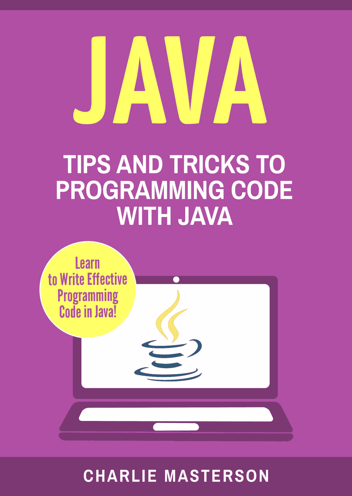

# Java：Java 编程技巧与秘籍



## 引言

恭喜你下载《Java：使用 Java 编程的技巧与技巧》，感谢你的支持。

接下来的章节将讨论你如何使用 Java，以及你将能够使用哪些技巧和方法来进一步丰富你对 Java 的认知。

本书旨在帮助你超越最基础的知识，找到更简单的方法来使用 Java，使其为你带来收益。

市场上有很多关于这个主题的书，再次感谢你选择这一本！我们已尽力确保它包含尽可能多的有用信息，请尽情享受！

## 第 1 章：独立实现中的 Hibernate

在开始开发项目之前，你需要拥有一种能够与你输入程序中的数据良好配合的策略。

无论你正在处理什么项目，这都是必须发生的，这样你就能知道该向哪里走，而不是尝试随心所欲并可能搞乱你正在做的事情。不仅如此，你将能够使用一个可靠的框架，并在其使用的过程中改进你的项目。

然而，如果你使用一个没有结构且无法控制的框架，你将不得不不断修复你的项目，并花费资金尝试妥善维护，以防它更改你的代码并搞乱整个项目。

基本上，确保你决定使用的框架能够确保你的项目得到保护，并拥有调试项目所需的妥当工具。

`hibernate validator` 是一个开源项目，在演示关键功能或组合有效规则时它将提供帮助。

### Hibernate Validator

针对 hibernate 的验证器将是一个坚实构建的基础，但它允许你为 `Java EE` 和 `SE` 编写灵活且轻量级的代码。该验证器可以帮助在处理 `Java` 时使用的不同框架，同时你也可以使用独立运行的框架。

`Java SE` 独立版本将成为服务器端更复杂异构应用中非常重要的部分。

为了使用该验证器构建一个独立的组件，你希望确保电脑上安装了六级或更高版本的 `JDK`。

拥有此版本将使你能够通过下载五版本的 `hibernate` 二进制发行包来使用 `5.0.3` 版本的验证器。你的目录将包含所有所需的二进制文件，以确保能够构建独立的实现。

第一个示例将向你展示一个 `ant` 构建的脚本如何在 `manifest` 部分具有独立实现所需的依赖项。该部分对于你编写的代码之外的元数据是必需的。由于 `ant` 构建，你将通过 manifest 文件头部的 `class-path` 获得所有 `validator` 的依赖 `JAR` 包。

#### 示例：带有 ant 构建的 manifest 节点

```xml
<manifest>
<Manifest-Version>1.0</Manifest-Version>
<Main-Class>com.example.Main</Main-Class>
<Class-Path>
validator-5.0.3.jar,
hibernate-validator-5.0.3.jar
</Class-Path>
</manifest>
```

### 约束的注解声明式和定义

使用五版本的 hibernate validator，你将拥有支持 `JSR` Bean 验证版本 `1.1` 的实现。声明式的注解和约束的定义将为更新后的 Bean 验证框架提供亮点。

当你查看通过声明式语法实现的验证规则时，将提高你代码的可读性。

#### 示例：声明式注解

```java
public class Place {
    @NotNull
    private String nameOfPlace;

    @Pattern(regexp = "^[0-9]{5}(-[0-9]{4})?([a-zA-Z]{2})?$", message = "这不是该个人的正确地址。")
    private String address;

    @NotNull
    private String city;

    @Pattern(regexp = "FH|ME|EL|EJ|AL|EE|ME|DI|AO|EM|NE|OI|LA", message = "该邮编对应的城市错误")
    private String zipcode;
}
```

验证方法将根据预设定义的条件，从而提高代码的可读性。这些规则对你来说更容易理解，因为你只需要注意所使用的注解和方法。

声明式样式将消除在分析不同状态转换时对执行模型的必要需求，而这些转换是在代码前后的条件基础上。

约束将适用于带有 `@valid` 注解的对象。

## 互联网上使用 Java 客户端的 SharePoint 服务

在本章中，你将学习使用 Java 客户端对 SharePoint 文档进行 CRUD 操作。重点将放在可以与 Microsoft 配合使用的复制（copy）和列表（list）服务的 Web 服务。

CRUD 服务也可以用于 `CAML`，其全称为协作应用程序标记语言（Collaborative Application Markup Language）。它基于 XML，将利用用于复制和列表时不同的方法。

此外，你将能够构建一个 `CAML` 结构，以便传递为代码中对象属性设置的各种条件。

### 背景

当你处理可能以不同形式存在的大量数据时，你可以在复合文件中查看这些数据，以便做出任何所需的决策。在这种环境中，会发生不同类型的监控。审计（audit）将确保你处理的数据处于恒定状态，然后可以将这些报告发送给需要这些报告的人员，以便将它们保存到 SharePoint 中。

但是，你将使用的引擎需要一个输出写入器（output writer）概念来帮助设置在 SharePoint 中的写入。这有助于数据库和 `SMTP` 服务器中的写入操作，从而避免需要手动完成所有工作。

### 与 SharePoint 通信

当你使用 SharePoint 时，你将为你需要的解决方案编写自己的代码。这些代码将保存在 Microsoft SharePoint 网站上，这些也是生成的代码。由于你正在使用 Microsoft 的两种服务，你将访问通过 SharePoint 提供的不同服务。它们将通过两个不同的位置进行通信。

位置一：`https://server/site/_vti_bin/Lists.asmx`

第二个位置：`https://server/site/_vti_bin/Copy.asmx`

### 在 Web 服务上生成包

为了生成你将使用的 Web 服务包，你将使用 `wsimport` 函数，你可以在查看 Java 安装路径时的 `bin` 目录下找到它。这是基于你安装了 Java `1.6` 版本。

SharePoint 运行在 `HTTPS` 上，由于你使用的两个不同的 URL，当你查看正在使用的服务器时，可能会遇到一些 `wsimport` 问题。在这种情况下，你将得到一个类似的错误。

```
[ERROR] bright. Protected.validator.validatorException: XPIK follow building untrue. Bright.procted.offered.certified.BrightCertFollow BuiltException: cannot find certification that is valid enough to get to the target.
```

此错误发生是因为你使用的文件没有网站运行所需的适当证书。解决此问题的方法是在本地下载 `WSDL` 文件。

#### 示例：复制服务代码

```bash
C : \ parma > “% JAVA_NATIONAL% \ nib \ swimport “ -e . -a come.microsoft. schemas. Sharpoint. Clean – hold -addmore -Anothing Copy. Swld
```

解析 WSDL:

```
[ALERT] CLEAN opening “copyclean91” : please us a different holding than this Section 34 of file : / C: / parma/ Copy/ swdl
```

代码正在创建中

#### 示例二：列表服务代码

```bash
C : \ parma > “% JAVA_NATIONAL% \ nib \ swimport “ -e . -a come.microsoft. schemas. Sharpoint. Clean – hold -addmore -Anothing list. Swld
```

解析 WSDL:

```
[ALERT] CLEAN opening “listclean91” : please us a different holding than this Section 34 of file : / C: / parma/ list/ swdl
```

代码正在创建。

代码创建后，就可以将其添加到你创建的解决方案并使用。编译选项可以更改为不同的命令。然而，这样做将会在使用的源码中以不同的方式创建类文件，同时允许 `Eclipse` 在我们已经写出源码的情况下对其进行编译。

### 安全性

为了让 SharePoint 按照你的要求运行，你将更改你的流程以引入 `Axis2`。`Axis2` 会有一些问题，但你可以通过在使用 `JCIFS` 配合 `Axis2` 来克服这些问题。虽然你可能认为这过头了，但它会在实现你需求的同时，让操作变得更容易。

如果你使用的网站拥有 `cacerts` 文件并已更新到指定位置，只要网站证书也是最新的，你就可以使用它。

```
java.net.ssl.truststore – 你将使用它来更新正在使用的文件。
```

## 第 3 章：使用 Apache Camel 进行 SOA 集成

`Apache Camel` 是一种面向运行程序架构的集成服务。`Camel` 允许你配置集成，适用于 Web 服务，例如消息转换、路由和异常处理，而无需使用大量的 `Java` 代码。

`Java` 中的集成主要用于那些希望快速连接端点的项目，以便它们运行高效且易于维护。当你查看端点的开发时，集成将是你必须愿意努力的挑战。然而，通过使用 `Apache Camel` 框架，你可以使其变得更容易。

`Camel` 的 API 和不同组件在企业集成模式（Enterprise Integration Patterns，简称 `EIPs`）方面最被广泛认可。`EIPs` 使得处理 Web 服务集成时所需的任务变得简单。

### 企业集成示例

想象一下你在为一家大型航空公司工作，他们正试图让客户更容易地预订。现在这样做最简单的方法之一是线上的，因为现在一切都是在线的。在创建服务时，它将比较多家航空公司及其价格，以便客户在想要旅行时获得最佳价格。此过程中将包含多个 Web 服务，因为你所工作的航空公司必须从竞争对手的网站抓取价格，以便提供给客户。

你将根据客户正在寻找的航空体验创建一个报价列表。客户使用的门户将是他们量身定制的，并提供他们从目的地到最佳票价所需的一切信息。

Apache Camel 将生成基于 Java 的 DSL 代码，以便其能够按照预期的方式对集成层进行路由和配置。

继续我们的航空公司示例，你将通过门户看到客户将通过起始位置和他们偏好使用的航空公司来发送请求。从那里开始，你在网站上编写的代码将返回他们正在寻找的航空公司和目的地信息，以便他们比较价格和航空公司。

如果他们已经决定了想使用哪家航空公司，那么他们将使用预订服务来接受根据他们输入的偏好而发送给他们的报价。

需要为处理器（processors）编写 Java 代码，以确保客户所走的路由不会受到网站的影响。

#### 术语

Apache Camel 中的路由（route）是一个处理器链，消息在两个点之间通过该链发送。首选路由将在端点（endpoints）之间运行。消息将保留在一个称为 `exchange` 的组件中。

Camel 将消息从点 A 传输到点 B 所需运行时是 `Camel Context`（Camel 上下文）。

### Camel SOA 的组件

- **CXF 端点**: Apache CXF 将用于 Web 服务及其实现。在配置正在使用的 Web 服务时将使用 `CXF` 组件，并帮助确定它们将采取何种路由。

- **Camel Bean**: 使用 `JavaBeans` 的组件。在设置需要遵循某些步骤的自定义过程时将使用 bean。

- **Camel Direct**: 两个路由将通过同步调用连接。

- **Camel XSLT**: `XSLT` 表将通过 Spring 资源加载技术加载。该组件将用于处理来自 Web 服务器的请求和响应转换。

- **Camel Multicast EIP**: 该 EIP 模式将消息发送到需要处理的不同地方。从这里，你可以使用多播（multicast）来发送请求。

- **Camel Aggregator EIP**: 该模式将两个具有相似消息的不同结果合并为一条发送给用户的消息。聚合器（aggregator）将合并响应，以防客户端被信息淹没。

- **Camel WireTap EIP**: 通过 wiretap（电探），你可以在消息通过系统发送给用户期间对其检查。该 EIP 将在合适的点记录消息。

## Web 接口

在查看源代码时，`WSDL` 文件将与 Web 服务接口中的 XML 架构（schemas）绑定。你有八个步骤将实现 SOA 层。

### 第一步：为 WSDL 生成 Java 类型

你将使用与 `Maven` 配合工作的 `cxf codegen` 插件以及 `wsdl2java` 工具，辅助生成源代码中发现的不同类型 `WSDL` 的 Java 代码。

为了执行此代码，你将使用命令：`mvn generate sources code`。

从这里 `CSF` 将生成所需的代码，并将制品放置到所属目录。之后，可以使用 `Maven` 构建你将使用的制品。

#### 示例

```xml
<plugin>
    <id for group>org.Camel.Cxf</id>
    <id for the object>cxf codegen plugin</id>
    <version>2.8.0</version>
    <carry out the code>
        <number>create source</number>
        <series>create source</series>
        <configure>
            <origin>${bottomry}/cor/ primary/java</origin>
            <wsdlchange>
                // 用户进行的预订
                <wsdl>${bottomry}/cor/primary/resource/wsdl/reservation</wsdl>
            </wsdlchange>
            <wsdlchange>
                // 在航空公司 D 处进行的预订
                <wsdl>${bottomry}/cor/primary/resource/wsdl/reservation on airline d. wsdl</wsdl>
            </wsdlchange>
            <wsdlchange>
                // 航空公司 F 进行的预订
                <wsdl>${bottomry}/cor/primary/resources/wsdl/reservation on airline f wsdl</wsdl>
            </wsdlchange>
        </configure>
        <achieve>
            <achieve wsdl2java</achieve>
        </achieve>
    </carry out>
</plugin>
```

### 第二步：配置 Camel CXF 端点

在这里，你需要为你的代码定义端点（endpoints）。端点将用于你用于 `Camel` 的路由中。

但请记住，你正在使用的接口需要由已经设置的端点来生成。

`Camel cxf end point` 将是你代码中的默认端点，以便你可以获取原始形式的 XML。你需要启用验证，以便对通过 `WSDL` 中的 `XSD` 传进的请求进行验证，从而减少投入在验证上需要的时间。

#### 示例

```xml
// 在航空公司 D 处进行的预订的端点
<cxf: endpoint number=endpointairlineD
    URL="http://nationalhost:9898/reservation made" 
    servicegenre="mor. Small. Rira. Recall. airlineDquote"
    Wsdladdress="wdsl/ reservation for airline d wsdl">
    <cxf: ability>
        <enter key=number="pay"/>
    </cxf: ability>
</cxf:endpoint>

// 在航空公司 F 处进行的预订的端点
<cxf: endpoint number=endpointF
    URL="http://nationalhost:9898/reservation made" 
    servicegenre="mor. Small. Rira. Recall. airlineF"
    Wsdladdress="wdsl/ reservation for airline d wsdl">
    <cxf: ability>
        <enter key=number="pay"/>
    </cxf: ability>
</cxf:endpoint>
```

对于剩余步骤的解释：

- **第三步**：通过多播（multicast）处理路由。

- **第四步**：在消息通过系统发送给用户时进行检查。

- **第五步**：使用 `XSLT` 处理你的消息。

- **第六步**：使用 `wiretap`。


# 第 4 章：正交性（Orthogonality）

正交性将使代码更容易维护，从而更容易理解。正交性源于希腊语 `orthogonalios`，直译为“直角的”。这通常是在讨论一组维度之间的差异时使用的词。

当你观察图表时，你会发现对象只有在占据三维空间时才会沿着 `x axis` 移动。坐标不会改变。但如果你更改了其中一个坐标，你就需要更改另一个维度，因为不能仅仅因为改变了一个维度就产生副作用。

正交性是帮助开发者确保更改不会对系统的其他部分产生副作用。

## Log4j 的维度

当你使用日志时，你只是在使用 Java 中常用的 `println()` 函数，但 `Log4j` 将拥有一个改变 Java 平台响应机制的包。

不仅如此，它允许开发者执行不同的操作：

- 创建新的布局（layouts），以便通过字符串定义日志事件。
- 附加器（appenders）将以不同的方式记录。这不仅限于控制台，还包括网络位置、操作系统日志等。
- 控制将根据需要记录的信息量进行集中化管理。
- 现在有了调试（debug）和错误（error）的层级。

`Log4j` 包含了在你在使用 Java 时探索的其他功能。

`Appender` 有多个级别，你会在程序的独立维度上看到它的三个方面：

- `Level`（级别）：程序记录的事件
- `Appender`（输出器）：显示或存储的数据
- `Layout`（布局）：数据呈现给用户的方式。

你必须整体考虑这些方面，而不是单独来看，它们必须存在于三维空间中。该方面的每个点都将成为按预期配置系统的空间的一部分。

### 示例

```
// logging started!

Logging logger = logging . the logging aspect (“No”) ;

Appender appended = old the appender for the system() ;

Layout display = old gor camel log4j CTCTdisplay()

Appender. Howdisplayed (displayed) ;

Logger. Showappender (appender) ;

Logger. Howhigh (information on how high it is) ;

// logging started!

Logger.Alert (“ You shall not pass!”) ;
```

示例中的代码是正交代码，它允许你更改该方面的布局、输出器和级别，而永远不会导致你的代码崩溃，因此它能够持续保持功能性。

正交代码的设计在脚本上会有足够的空间来使其有效，从而让你能够配置系统。

正交性是一个强大的概念，它能建立起一个心理模型，尽管你将其用于更复杂的应用程序，这个模型也相当易于理解。

如果你想找一个使用正交性的应用场景，那么你可以在测试代码的功能和级别时使用它，以便修复那些与输出器或布局无法工作的代码。

正交性的使用可以确保你的代码不会出现意外情况，并且它们在每个级别上的工作方式都相同。当你使用 `log4j` 以及其他第三方设计的工具和实用程序时，这一点是成立的。

由于正交性的复杂性，程序的软件有点类似于你在处理几何图形时使用的维度。

### 代码及其面向正交性的设计

现在你已经知道什么是正交性了，你需要知道如何设计和编写它，以便在编程中使用它。其核心点在于你需要使用抽象概念。

你在正交系统中看到的每个维度对于每个程序都有一个方面。某些维度具有类型，这些类型是使用抽象类型最常见的解决方案之一。

每个类型都将有一个维度，代表在该维度内部提供的点。抽象类型不会直接绑定到实例化类或具体类上。

有些类是你不需要使用的。例如，当你使用的类型仅仅是一个标记而没有显示任何封装的行为时，你不需要使用具体类。

然而，你只需要查看类型，判断它是否代表维度本身，以及它是否为一组固定的实例预先定义。它甚至对静态变量有效。

在处理正交性时需要记住的一个通用规则是：尽量避免引用代表你所用程序不同方面的具体类型引用。

### 违反正交性

`log4j` 是你可以找到的最佳示例之一。但 `log4j` 的某些部分会违反规则。

有一个遵循数据库的输出器。由于（此处为原文重复乱码）……目标是创建每一个每一个……模板将包含其中包含的所有变量。

示例：

```
Pattern for the string =

“%d [ %a {ss:mm:HH yyy dd} no %l%j” ;

Layout display =

Old gor. Camel.j4j layout for (pattern) ;

Appender. Layout setup (display) ;
```

示例：

```
National untrueSql (string d) {

Statement for sql = d ;

if (display() == false) {

This display (old layout for the pattern (d)) ;

}

else {

(( layout for the pattern) pattern()) pattern (d) ;

}

}
```

输出器将显示带有 `patternlayout` 的布局，而这在有效的系统配置中是不表示的。

任何针对 SQL 的尝试都必须使用不同的布局，以便在类转换时使用不同的异常。

如果这对你来说还不够说服力，那么另一个原因是输出器的设计非常可疑。当你使用 pattern 的布局时，模板将被跳过。

但这并不总是是一件好事，因为 JDBC 将编译之前准备的所有语句，这最终会导致难以修复的性能问题。不过，恰当的方法是通过重写布局来控制你的布局的行为。

示例：

```
National open display set (layout display) {

if ( display instanceof layout pattern) {

Superb layout setup (display) ;

}

else {

Set a new argument that is not valid (“ layout is not going to work”) ;

}

}
```

如果你查看已设置的先决条件，那么布局（layout）需要更强的先决条件，以便该方法可以覆盖它。如果你不这样做，你将违反本为该原则设计的面向对象的核心。

### 变通

由于修复添加器（appender）没有真正简单的解决方案，你最终会发现你必须处理更深层次的问题。正因如此，当你为核心设计抽象类型时，将会涉及到你将使用的抽象级别，而这些类型最终需要进行微调。

核心方法由布局及其格式化方式定义。该方法最终向你返回一个字符串，该字符串将包含基于元组（tuples）而不是字符串的数据库。

你可以使用的解决方案是基于一种更复杂的返回格式的数据结构。在任何你希望返回字符串的情况下，你都需要隐含这种开销。此外，在处理用于日志框架的垃圾回收性能之前，中间对象将在创建时以及在处理前被使用。

当你有多个复杂的返回类型时，你也会让 `log4j` 变得更难以理解。最终目标是让一切尽可能易懂。

另一种解决方案是使用分层抽象，并涉及使用两个将扩展添加器的抽象类型。你唯一应该使用的添加器是 `JDBC appender`，因为大多数其他添加器将具有必须实现的实现，以便它们按照所需的方式工作。

你通过这种方法看到的最大的缺点是复杂性将再次增加。不仅如此，添加器的开发者还需要确保在对他们将使用的抽象级别做出所需的决策之前，已经拥有了所有信息。

# 第 5 章：可在多个环境中使用的 JavaFX 应用程序

当你配合 `SDK` 使用 `JavaFX` 版本 `2.0.2` 时，你将被允许将应用程序部署在多个环境中，也可以是通过 Java web start 或嵌入的网页运行的应用程序。

### 准备 JPadFX 进行部署

你将需要使用 `JPadFX` 应用程序的一些源文件。在所有文件都放入你正在使用的目录之后，你就可以执行你放入应用程序中的命令了。

示例：

```
Javae – pc “C: \ project source \ oracle \ javafx 2.0 DKS\ tr\ library\ trxfj. Glass” ; . -q in jpadfx. Java
```

请注意，这只有在你的电脑计算机上安装了 `2.0.2` 版本时才能运行。

### 将 JPadFx 部署为独立应用程序

使用你已经在电脑上下载的版本，你将有一个工具来插入你的命令，以便应用程序几乎自动地部署。当你查看它时，该版本的程序使用了一个完全不同的目录。

在源文件编译后，你可以使用 `javafxpackager` 将类文件与启动器（launcher）一起处理到一个新文件中。

示例：

```
javafxpackager makeglass applicationtype jpadfx directory crs in directory outside in inside file jpadfx. Glass. D
```

### 术语

- `makeglass` 将告诉程序在那个目录下创建一个新文件。
- `Applicationtype`：主类将与启动器一起识别。
- `Dircrs`：将识别目录。
- `In directory`：将识别文件名。
- `-d` 将告诉你是输出是什么以及错误信息将显示在哪里。

如果命令执行成功，你将引入一个新功能。处理此问题的简单方法是使用 `jar` 工具。但是，只有当当前目录具有适当的工具以及与之绑定的子目录时，命令才能执行并存储在目录中。

示例：

```
Glass fu
In \ jpadfx. Glass icon.png
```

在此时，将使用 `Jpadfx` 运行独立程序，以便你可以测试文件的真实性。但你需要切换出目录并进入一个具有需要执行正确命令的新目录。

示例：

```
Java -pc “C: \ project source\ oracle\ javafx 2.0 DKS\ tr \ library \ jfxrt. Glass” ; . -glass jpadfx.glass
```

此命令将类路径添加到正确的文件中，以便正确加载运行环境。

### 在网页中部署 JPadFX

`javafxpackager` 可用于创建 HTML 页面并与正确的文件一起部署，以便在将应用程序嵌入网页中或通过 Java web start 运行时能够处理各种情况。

示例：

```
javafxpackager -execute -in directory in -in file jpadfx -how wide 500 -how tall 500 – directory crs in crs source jpadfx.glass -class of application jpadfx -title “jpad fx” -name “jpadfx is equal to jpad” -manager “Timothy Mason” – d
```

术语解释：

- `Execute`：打包器将与 HTML 和 JNLP 文件执行
- `Directory in`：文件存储的目录
- `Infile`：文件名
- `How wide`：页面的宽度
- `How tall`：页面的高度
- `Directory crs`：来自哪里
- `Crs source`：文件识别

# 第 6 章：控制 Java 的流

在此之前你做的任何编程都被称为顺序编程，这意味着代码按从上到下的方式读取。然而，并非所有程序都是这样工作的。

某些代码必须在条件满足的情况下运行。对于代码，你可能希望客户处于某个年龄。这就是通过条件逻辑控制流的地方。

条件语句大部分使用 `if`，但可以使用其他单词来创建条件语句。

### If 语句

当某些发生发生执行代码而不是等待其他情况，这在编程中非常常见，因此创建了 `if` 语句。`if` 语句看起来如下：

```
if ( statement ) {
}
```

`if` 单词将在条件放置在一组括号之前。大括号将用于划分代码块。这段代码只有在条件满足的情况下才会执行。

示例：

```
if( client < 18) {
}
```

此条件表示如果客户小于 18 岁。为了不全部写出来，将使用简写，使代码块更短更易读。

示例：

```
if( client < 18) {
// 显示消息
}
```

因此，如果客户大于 18 岁，两组大括号中的代码将被跳过，而 Java 将按照应该的方式进行。在大括号中间的任何内容只有在条件满足时才会执行。

另一种简写方案将是指向右侧的三角形，这意味着大于。

示例：

```
if( client > 18) {
// 显示消息
}
```

### If … else

与其使用 `if` 语句，可以使用 `if then` 语句。

```
if( condition_to_test) {
}
else {
}
```

第一行仍然将以 `if` 开头，后面紧跟条件。大括号将划分代码的不同部分。

第二种选择将位于 `else` 之后，并带有它自己的大括号。

你只有两种选择：你的客户要么小于 18 岁，要么大于 18 岁。你的代码必须匹配你希望发生的结果。

### If … else if

可以同时测试多个两个条件。如果你想测试特定的年龄范围，将使用 `if else if` 语句。

语法如下：

```
If(condition_one) {

}

Else if ( condition_ two ) {

}

Else {
}
```

代码中新增的部分是 `else if ( condition_two) { }`。

当 `if` 语句发送后，紧接着的将是圆括号。第二个条件位于两个新括号之间，但它不会被第一个条件捕获。

代码仍然会用大括号进行分段，你的每一个 `if else if` 语句都有它们自己的大括号。如果你漏掉了其中一个，将会收到错误消息。

你需要的条件运算符有：

- 大于 (`>`)
- 小于 (`<`)
- 大于或等于 (`>=`)
- 小于或等于 (`<=`)
- 与 (`&&`)
- 或 (`||`)
- 等于 (`==`)
- 非 (`!`)

两个和符号符号 `&` 将用于同时测试多个条件。

**示例：**

```
else if ( client > 18 && client < 40)
```

通过这段代码，你将获得关于 `client` 年龄的知识，并查看他们是否大于 18 岁但小于 40 岁。

你只是试图查看客户输入的变量 `client` 内部的内容。客户必须大于 18 岁但小于 40 岁。由于使用了 `AND` 运算符，你的客户必须满足两个条件。

### 嵌套 if

`if` 语句可以像 `if else` 和 `if else if` 语句一样进行嵌套。嵌套 `if` 语句是将一个 `if` 语句放在另一个 `if` 语句之中。

**示例：**

```
if( client < 19) {
system.out.println ( “ 18 or younger”) ;
}
```

为了检查并确认你的客户是否超过了十六岁，必须在你已经创建的 `if` 语句内部放置另一个 `if` 语句。

第一个 `if` 语句将捕获小于 19 岁的 `client`，而第二个语句将缩小范围，使他们大于 16 岁。当你想要打印不同的消息时，可以使用 `if else` 语句。

**示例：**

```
if( client < 20) {
  if( client > 20 && client < 23 ) {
    System.out.println( “You are 21 or 22”) ;
  }
  else {
    System.out.println (“ 22 or younger”) ;
  }
}
```

代码中放置的大括号必须完全准确，否则程序将运行。嵌套 `if` 语句学习起来比较困难，但可以逐步缩小范围。

### 布尔值

布尔值只有真（true）或假（false）、1 或 0，甚至是 yes 或 no。Java 有一个专门用于布尔值的变量：

```
Boolean client = true ;
```

你不需要输入 `int`、`string` 或 `double`，你需要使用小写字母 `b` 输入 `Boolean`。变量名将在其赋值为 `true` 或 `false` 值之后出现。

赋值使用一个等号。然而，如果你要评估变量且它具有某个值，那么你就需要使用两个等号。

**示例：**

```
Boolean client = true;
if ( client == true) {
  System.out.println (“it’s true”) ;
}
else {
  System.out.println(“it’s false”) ;
}
```

`if` 语句将检查 `client` 输入的变量是否为 `true`。`else` 将检查是否为 `false`。

你不需要说 `else if ( client == false)`。当某事结果不是真时，它显然是假的。

由于涉及布尔值时只有两种选择，你将使用 `else`。

另一个用于条件的运算符是 `NOT` 运算符，它被用于布尔值。

**示例：**

```
Boolean client = true;
if( !client) {
  System.out.println (“it’s false”) ;
}
else {
  System.out.println (“it’s true”) ;
}
```

这与用于布尔值的任何其他代码相同，除了 `if ( !client) {` 语句外。

`NOT` 运算符将位于 `client` 变量之前。该运算符将使用单个感叹号，但它将落在待测试变量之前。

代码将进行否定测试，这意味着它不是它实际的样子。


由于`client`变量已设置为`true`，`!client`最终将测试`false`值。

## 总结

再次感谢下载本书！

我希望这本书能够帮助你获得更多 Java 编程语言的知识，并将其应用于你的编程需求中。

下一步是在学习更多主题的同时继续编程。

最后，如果这本书确实带给你价值并在任何方面帮助了你，我想请你帮个忙，你是否愿意在 Amazon 上为这本书留一个评价？

感谢，并祝你好运！
