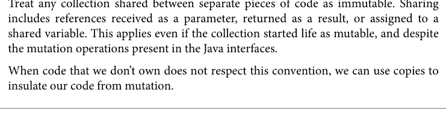

# Java 到 Kotlin 迁移指南


从 Java 到 Kotlin 跨越 8,000 英里的陆路旅行需要一段时间的时间。如果你是一名经验丰富的 Java 开发者并已经尝试过 Kotlin 语言，那么你可能在相似的时间内就产生了同样的产出。

你会发现 Kotlin 的处理方式与众不同，尽管空安全性（Nullability）非常重要，集合（collections）也大不同，且类默认是最终的（final）的。Kotlin 更具函数式特征，但这意味着什么？它又应该如何改变你的编程方式？那些你仍然需要维护的 Java 代码又要如何处理？

你的导师 Duncan 和 Nat 在 2015 年首次开启这段旅程，并帮助了许多团队和个人追随他们的足迹。与他们一起旅行吧，他们会将路线拆解为诸如从 Optional 到 Nullable、从 Beans 到 Values，以及从 Open 到 Sealed Classes 等部分。每一部分都会解释一个概念，并向你展示如何逐步安全地将 Java 重构为地道的 Kotlin，同时保持互操作性。

生成的代码将更简单、更具表现力，且更容易更改。当旅程结束时，你将能够自信将 Java 重构为 Kotlin，从零开始编写 Kotlin，并管理随时间演演的复杂代码库。

Nat Pryce 和 Duncan McGregor 是资深 JVM 开发者、顾问和培训师。作为 Java 和 Kotlin 的早期采用者，他们学会了结合面向对象编程和函数式编程的技术，并在它们之间进行重构。他们在 KotlinConf 上的成功工作坊证明了通过重构进行教学的价值，并促成了这本书的诞生。

> 将熟悉的良好的 Java 代码看到其渐进地转化为简洁、清晰、表现力且易于维护的 Kotlin 代码，是学习这种语言的极佳方式。从 McGregor 和 Pryce 在书中总结的经验中受益。
>
> —Venkat Subramanian 博士，Agile Developer, Inc. 创始人，获奖作家

> 从 Java 升级到 Kotlin 技能的最快方法。任何专业 Java 开发者的必读之作。
>
> —Dawn Griffiths & David Griffiths，《Head First Kotlin》作者


# 对《Java to Kotlin》的好评

Nat 和 Duncan 在书的开头提到，他们希望这本书在他们采用 Kotlin 时就已经存在了。我完全同意。这本书总结了他们的经验、尝试与错误，并帮助读者读者走上正确的道路。对于任何从 JVM 生态系统转向 Kotlin 的人来说，这绝对是一本应该放在书架上的书。令人愉快的读物，更是一本完美的参考指南！

> Hadi Hariri, JetBrains

> 将熟悉的旧 Java 代码看到其渐进地转化为简洁、清晰、表现力且易于维护的 Kotlin 代码，是学习这种语言的极佳方式。从 McGregor 和 Pryce 在书中总结的经验中受益。
>
> Venkat Subramaniam 博士，获奖作家，Agile Developer, Inc. 创始人

> 从 Java 升级到 Kotlin 技能的最快方法。任何专业 Java 开发者者的必读之作。
>
> Dawn Griffiths 和 David Griffiths，《Head First Kotlin》作者

- 将 Actions 重构为 Calculations 82
- 移动到顶层 101

面向对象还是函数式？ 241

继续 252

用映射替换模拟 256

但我们真的脱离模拟了吗？ 260

继续 263

# 18. 开放类到密封类（Sealed Classes）...................................................... 265

多态还是密封类？ 269

将接口转换为密封类 270

继续 276

# 19. 抛出到返回...................................................................... 279

异常之前的错误处理 281

使用异常的错误处理 282

Java 与受检异常 282

Kotlin 与异常 285

超越异常：函数式错误处理 285

Kotlin 中的错误处理 288

将异常重构为错误 289

更多修复 303

层级结构 309

继续 311

# 20. 执行 I/O到传递数据........................................................................... 313

监听测试............................................................................................................... 313

I/O 到数据............................................................................................................... 315

高效写入...................................................................................................................... 320

高效读取............................................................................................................... 324

继续................................................................................................................................ 327

# 21. 异常到值.......................................................................................... 329

识别可能出现的问题........................................................................................... 329

表示错误............................................................................................................... 336

I/O 怎么办？..................................................................................................... 342

继续.................................................................................................................................. 344

# 22. 类到函数....................................................................................... 345

验收测试............................................................................................................... 346

单元测试........................................................................................................................... 349

表头.................................................................................................................................. 354

不同的字段分隔符............................................................................................................... 361

序列.............................................................................................................................. 367

从文件读取............................................................................................................................... 372

与 Commons CSV 的比较........................................................................................... 377

继续................................................................................................................................ 381

# 23. 继续旅程.................................................................................. 383

粒度（Grain）....................................................................................................................... 383

函数式思维............................................................................................................... 384

简单设计...................................................................................................................... 386

函数式编程与文本推理............................................................... 387

重构............................................................................................................................. 387

重构与函数式设计............................................................................... 388

参考文献........................................................................................................... 391

学习 Kotlin...................................................................................................................... 391

测试与测试驱动开发.................................................................................. 391

处理遗留代码............................................................................................................... 391

软件设计与开发............................................................................................... 392

Java 与 JVM...................................................................................................... 392

# 索引......................................................................................... 393

# 前言

你好，我们是 Duncan 和 Nat。当你读这段前言时，你可能正在决定是否投入时间阅读这本书的剩余部分。所以让我们直奔主题吧：

这本书不会教你如何用 Kotlin 编程。

我们曾尝试写一本我们在最初采用 Kotlin 时希望能有的书，但我们很快发现 Kotlin 是一个庞大的语言，因此编写这本书所需将比我们预想的要长。该领域已经有很多优秀的书籍了，我们并不喜欢与其竞争。

我们决定通过专注于向 Java 开发者教授 Kotlin 来让自己的工作更轻松，这是基于我们举办的一个名为“重构为 Kotlin”的工作坊。它通过转换现有代码来教授 Kotlin 语言，根据我们的营销材料，它是为希望利用现有知识加速 Kotlin 应用的 Java 团队设计的。

我们开始写那本书，但很快发现 Kotlin 仍然是一个庞大的语言，我们仍然需要写很久。我们还发现，有动力且经验丰富的 开发者可以非常快地学会 Kotlin。对于那些可能一眼就能欣赏并采用语言特征的读者来说，逐条讲解似乎显得有些傲慢。因此，我们放弃了那个想法，结果是：

这本书不会教你 Kotlin 语言。

那么为什么要读它呢？因为我们写了一本在我们刚开始使用 Kotlin 时希望有的书。我们是深谙 Java 和 Java 生态系统的丰富的程序员。我们希望你也是。像我们一样，你可能在许多语言方面都有经验。你学习了 Kotlin 的基础知识，并意识到要充分利用这门语言，你需要重新设计你的系统。你发现某些事情在 Java 中很繁

在 Kotlin 中变得更简单，而且某些功能（如检出异常）在 Kotlin 中根本不存在。你并不希望自己只是在用 Kotlin 语法来写 Java 代码。

也许你在这在其中有利益关系。也许你正处于技术领导岗位，或者已经成功说服你的团队采用 Kotlin。也许你付出了某些政治资本才将 Kotlin 引入到项目中。现在，你需要确保过渡过程顺利进行。

你可能负责一个 Java 代码库，并希望确保引入 Kotlin 不会动摇现有的、对业务至关重要的代码。或者，你可能正在从零开始一个 Kotlin 项目，但发现自己的设计直觉更倾向于转向 Java 和对象，而不是 Kotlin 和函数。

如果你是这种情况下（就像我们曾经的情况一样），那么你来对地方了。这本书将帮助你调整思维和设计，以充分利用 Kotlin 的优势。然而，这是不够的，因为你有现有的代码需要维护和增强。因此，我们展示了如何使用 IntelliJ IDE 内置的自动重构工具，逐步且安全地将代码迁移到 Kotlin 语法，并从 Java 思维转向 Kotlin 思维。

## 本书的结构

本书介绍了如何从 Java 过渡到 Kotlin，主要关注涉及项目和组织的代码。每一章都探讨了这一过渡的一个方面，审视了典型 Java 项目在旅途中可以改进的某些方面。它们的命名遵循 *Java 方式到 Kotlin 方式*（Java Way to Kotlin Way）的模式，我们建议你优先选择后者而非前者。也许 Kotlin 让 Java 中难以实现的方法变得简单，或者 Kotlin 鼓励一种 Java 中常见的方法，以引导设计向更不容易出错、更简洁且更利于工具支持的方向发展。

不过，我们并不建议你完全采用 Kotlin 方式；章节还展示了如何进行这种转换。不是通过简单重写 Java，而是通过将其逐渐重构为 Kotlin，这种方式既安全又允许我们维护混合语言代码库。

## 我们是如何选择主题的？

我们分析了 Java 和 Kotlin 开发者对各自语言的使用情况，并进行了采访以识别差异和困惑的领域。这得到了对 33,459 个开源 Java 和 Kotlin 代码库的机器学习分析的支持。这些分析确定了一些候选主题，我们以“某物到另一物”的形式对其进行标记，然后根据频率和以开发者为中心的顺序进行排序，以确定哪些主题应该入选。最后，我们对幸存的主题进行了排序……没用的，我们不能对你撒谎。

事实是，我们选择了我们想写的、以及我们认为有趣且具有启发性的主题。第 15 章“封装集合到类型别名”、第 9 章“多表达式到单表达式函数”以及第 20 章“执行 I/O 到传递数据”都是这些章节的典型。我们还寻找了 Kotlin 和 Java 粒度差异显著的地方，因为通过询问“它们为什么不同”，我们在那里发现了最多的问题。这导致了如第 4 章“Optional 到可空类型”、第 6 章“Java 到 Kotlin 集合”以及第 8 章“静态方法到顶层函数”等章节。

当我们编写这些章节时


这一过程的结果绝不是借口。如果你已经跳过了目录或索引，你会发现一些重要主题未被提及。例如常规程序（`Routines`）：本段落是对该主题的唯一引用，因为它们没有改变我们编写服务器端代码的方式，所以我们不想写它们。还有一些我们希望如果有空间和时间能涵盖的主题，包括：构建器、领域特定语言（`DSL`）、反射、依赖注入框架、事务……列表很长了！

我们希望我们写的内容对你来说是有有趣的。这很大程度上是一本关于战术而非策略的书，专注于我们从战壕中可以赢得的小战斗，而不是指挥整个军团可能取得的成就。尽管随着更宏大主题的出现，我们会尝试将它们联系起来，并在最后的第 23 章“继续旅程”中将一切整合在一起。

## 复杂度

正如我们所写的

我们如何，代码的复杂性

我们的代码遵循（我们对）的标准规范

尽可能，代码代码代码，我们更喜欢垂直空间。

我们发现 Kotlin 似乎比 Java 想要更多的垂直空间，但 Java 的可读性通过更短的行、更多的换行和更多的视觉对齐得到了提高。显然，横向滚动在 IDE 中和书中一样不方便，我们的配对会议通过更少的滚动和更多的并排窗口得到改进。每行一个参数也能极大地改进差异版本。我们希望至少你读起来不痛苦，如果你觉得，请在自己的代码中尝试。

我们有时会隐藏与讨论无关的代码。以省略号开头的行表示我们省略了一些代码。例如：

```kotlin
fun Money(amount: String, currency: Currency) =
    Money(BigDecimal(amount), currency)

... 以及其他重载
```

## 书中的约定

本书使用了以下字体约定：

*斜体*

表示新术语、URL、电子邮件地址、文件名和文件扩展名。

等宽字体

用于程序列表，以及在段文中引用程序元素，如变量名或函数名、数据库、数据类型、环境变量、语句和关键字。


该元素表示提示或建议。


该元素表示通用注释。


该元素表示警告或告诫。

## 使用代码示例

书中的大多数代码示例（来自重构章节的）都可以在 GitHub 上在线访问。引用紧跟在代码之后，如下：

```kotlin
class TableReaderAcceptanceTests {
  @Test
  fun test() {
  }
}
```

示例 0.1 [table-reader:src/test/java/travalator/tablereader/TableReaderAcceptanceTests.kt]

如果你在设备上阅读此内容，该引用应该是指向 GitHub 上该版本文件的超链接。在纸质书上，你可以随意点击；但什么都不会发生，抱歉。如果你获取示例编号（在此例中为 0.1）并输入书籍网站的表单中，它将带你到达相同的地方。

在 Git 中，不同的代码示例（有时跨越章节）在单独的分支中演进。步骤带有标记——`table-reader`。在这种情况下 `I` 就是该标签。GitHub 链接指向带有该标签的代码，因此你可以查看显示的文件（此处为 `src/test/java/travalator/tablereader/TableReaderAcceptanceTests.kt`）以及该版本示例中的其他文件。你也可以选择其他标签来查看不同版本，并选择不同分支来查看示例。为了更快速导航，你可以克隆仓库并在 IntelliJ 中打开它，然后使用 Git 工具窗口切换分支和版本。


代码示例并不是真实的！代码库可以构建并通过测试，它是虚构的。在某些地方，你窥视示例时并没有正确衔接，在其他地方，当你看到幕后时会看到我们在操纵杠杆。我们努力保持诚实发布！

如果你有技术问题或在使用代码示例时遇到问题，请访问书籍网站或发送邮件至 `bookquestions@oreilly.com`。

本书旨在帮助你完成工作。通常情况下，如果书中提供了示例代码，你可以在你的程序和文档中使用它们。除非你要复制大部分代码，否则不需要联系我们获取许可。编写一个使用书中几段代码的程序不需要许可。销售或分发 O'Reilly 书籍中的示例需要许可。引用本书并引述示例代码来回答问题不需要许可。将书中大量的示例代码整合到你的产品文档中则需要许可。

我们感谢，但通常不需要署名。署名通常包括标题、作者、出版商和 ISBN。例如：“Java to Kotlin by Duncan McGregor and Nat Pryce (O’Reilly). Copyright 2021 Duncan McGregor and Nat Pryce, 978-1-492-08227-9。”

如果你对代码示例的使用超出了合理使用或上述许可范围，请随时通过 `permissions@oreilly.com` 联系我们。

## O’Reilly Online Learning


40多年，O’Reilly Media 一直提供技术和业务培训、知识和洞察，帮助公司成功。

我们独特的专家和创新者网络通过书籍、文章、会议分享他们的知识和专业知识，我们的在线学习平台为你提供按需直播培训课程、深度学习路径、交互式编码环境，以及来自 O'Reilly 和 200 多其他出版商的海量文本和视频。欲更多信息，请访问 `http://oreilly.com`。

## 如何联系我们

请将有关本书的意见和问题寄给出版商：

O’Reilly Media, Inc.

1005 Gravenstein Highway North

Sebastopol, CA 95472

800-998-9938（美国和加拿大）

707-829-0515（国际或本地）

707-829-0104（传真）

我们为这本书有一个网页，在其中列出了错误列表、示例和任何额外信息。你可以在 `https://oreilly.ly/java-to-kotlin` 访问该页面。

发送 `bookquestions@oreilly.com` 进行反馈。

有关我们书籍的新闻和信息，请访问 `http://oreilly.com`。

在 Facebook 上找到我们：`http://facebook.com/oreilly`

在 Twitter 上关注我们：`http://twitter.com/oreilly`

# 第 1 章

## 引言

### 编程语言的纹理

就像木材一样，编程语言也有纹理。在木工和编程中，顺着纹理工作，事情会进展顺利。逆着纹理工作，事情就会变得困难。当你逆着编程语言的纹理工作时，你必须编写比需要更多的代码，性能会受影响，更容易引入缺陷，你通常需要覆盖方便的默认设置，并且每一步都要与工具作斗。

逆着纹理工作意味着持续的努力但收益不确定。

例如，在 Java 中编写函数风格的代码一直是可能的，但在 Java 8 之前很少有程序员这样做——出于充分的原因。

以下 Kotlin 代码通过使用加法运算符折叠列表计算数字列表的和：

```kotlin
val sum = numbers.fold(0, Int::plus)
```

让我们对比在 Java 1.0 中完成此操作所需的。

时间的迷雾将带你回到 1995 年……

Java 1.0 没有一等函数，因此我们必须函数实现为对象，并为不同类型的函数定义自己的接口。例如，加法函数接受两个参数，因此我们需要定义双参数函数的类型：

```java
public interface Function2 {
    Object apply(Object arg1, Object arg2);
}
```

然后我们必须实现高阶函数，以隐藏 `Vector` 类所需的迭代和变异。（1995 年 Java 标准库尚未包含集合框架 Collections Framework）。

```java
public class Vectors {
    public static Object fold(Vector l, Object initial, Function2 f) {
        Object result = initial;
        for (int i = 0; i < l.size(); i++) {
            result = f.apply(result, l.get(i));
        }
        return result;
    }

    ... 以及对向量的其他操作
}
```

我们必须为每个想要传递给 `fold` 函数的函数定义一个单独类。加法运算符无法作为值传递，而且该语言当时没有方法引用、Lambda 表达式或闭包，甚至没有内部类。Java 1.0 也没有泛型或自动装箱——我们必须将参数强制转换为预期的类型，并在类型和原始类型之间使用装箱引用：

```java
public class AddIntegers implements Function2 {
    public Object apply(Object arg1, Object arg2) {
        int i1 = ((Integer) arg1).intValue();
        int i2 = ((Integer) arg2).intValue();
        return new Integer(i1 + i2);
    }
}
```

最后，我们可以用它来计算总和：

```java
int sum = ((Integer) Vectors.fold(counts, new Integer(0), new AddIntegers())).intValue();
```

对于 2020 年的一种主流语言来说，为了一个简单的表达式要付出如此巨大的心血。

但这并不是结束。由于 Java 没有标准的函数类型，我们无法轻松地组合用函数式风格编写的库。我们必须编写适配器类来映射不同库中定义的函数类型，而且由于虚拟机没有 JIT 且垃圾回收器简单，我们的函数式代码性能逊于命令式的替代方案：

```java
int sum = 0;
for (int i = 0; i < counts.size(); i++) {
    sum += ((Integer)counts.get(i)).intValue();
}
```

在 1995 年，以函数式风格编写 Java 代码的投入并不有其价值。Java 程序员会发现编写遍历集合并变异状态的命令式代码更简单。

## 编写函数式代码违背了 Java 1.0 的初衷。

语言的纹理（grain）随着时间的推移形成，设计者和用户对语言特性如何交互形成了共同共识，并将他们的理解和偏好编码到他人构建的基础的库中。纹理影响了程序员在该语言中编写代码的方式，进而影响了语言及其库、编程工具的演变，改变了纹理，改变了程序员在语言中编写代码的方式，并在不断的相互反馈和演变的循环中进行。

例如，随着时间的推移，Java 1.1 在语言中增加了匿名内部类，Java 2 在标准库中增加了集合框架。匿名内部类意味着我们不需要为传递给 `fold` 方法的每个函数编写一个具名的类，但结果可以被认为是难读的：

```java
int sum = ((Integer) Lists.fold(count, new Function() {
    public Object apply(Object arg1, Object arg2) {
    int i1 = ((Integer) arg1).intValue();
    int i2 = ((Integer) arg2).intValue();
    return new Integer(i1 + i2);
}})).intValue();
```

函数式习惯仍然在违背 Java 2 的初衷的情况下成长。

快回到 2004 年，Java 5 是下一个显著改变语言的发布版本。它增加了泛型和自动装箱，提高了了类型安全并减少了样板代码：

```java
public interface Function2<A, B, R> {
    R apply(A arg1, B arg2);
}

int sum = Lists.fold(count, new Function2<Integer, Integer, Integer>() {
    @Override
    public Integer apply(Integer arg1, Integer arg2) {
        return arg1 + arg2;
    }
});
```

Java 开发者使用 Google 的 Guava 库为集合添加了一些常见的高阶函数（尽管 `fold` 不在其中），但即使是 Guava 的作者也建议默认编写命令式代码，因为性能更好且通常更容易读。

函数式编程通常在很大程度上违背了 Java 5 的初衷，但我们可以看到这一趋势的开端。

Java 8 在语言中增加了匿名函数（即 Lambda 表达式）和方法引用，并在标准库中增加了 Streams API。编译器和虚拟机优化 Lambda 表达式以避免匿名内部类的性能开销。Streams API 全面拥抱函数式习惯，终于允许：

```java
int sum = counts.stream().reduce(0, Integer::sum);
```

这并非一帆风顺。我们仍然无法将加法运算符作为参数传递给 Streams 的 reduce 函数，但我们有标准库函数 `Integer::sum` 可以实现同样的功能。由于引用类型和原始类型之间的区别，Java 系统类型仍然创建了尴尬的边缘情况。Streams API 缺少一些我们期望在函数式语言（甚至是 Ruby）中发现的常见高阶函数。检查异常（Checked exceptions）与 Streams API 以及通用的函数式编程并不兼容。创建具有值语义的不可变类仍然涉及大量的样板代码。通过 Java 8，Java 已经发生了根本性的变化，使得函数式风格可行，即使不是完全符合语言的初衷，至少是在违背初衷的情况下。

Java 8 之后的发布版本增加了各种较小的语言和库特性，支持更多的函数式编程习惯，但没有东西能改变我们的求和计算。这带我们回到了现在。

在 Java 的案例中，这种语言的纹理通过程序员的适应方式演变。

## Java 风格的观点历史

## 原始风格

Java 最初旨在用于应用程序和交互式电视，在 Netscape 采用 Java Applet 后才火起来。Java 发布了 JDK 1.0，微软包含了 Java，突然每个使用网络浏览器的人都有了 Java 运行环境。

在当时，Java 的基础已经就绪：

- Java 虚拟机及其字节码格式
- 原始类型和引用类型、垃圾回收
- 类和接口、方法和控制语句
- 用于错误处理的检查异常、抽象窗口工具包
- 用于网络的类
- 运行时代码加载和链接，由安全管理器限制

然而，Java 尚未准备好通用编程：JVM 速度很慢，标准库很匮乏。

Java 看起来是 C++ 和 Smalltalk 的混合体，这两种语言影响了当时的 Java 风格。Java 的一项为人知的创新是官方编码规范，它规定了程序员如何命名包、类、方法和变量。C 和 C++ 程序员遵循无穷的编码规范，组合多个库的代码看起来像一团糟。Java 真正的编码规范意味着 Java 程序员可以无缝地集成他人的库，并促进了活跃的开源社区的增长，这种增长持续至今。

## Bean 风格

在 Java 初获成功后，Sun 致力于使其成为构建应用的实用工具。Java 1.1（1996 年）增加了语言特性（最著名的即时编译和反射），并扩展了标准库。Java 1.2（1998 年）增加了标准的集合 API 和 Swing 跨平台 GUI 框架，确保了 Java 应用程序在每个操作系统上看起来和感觉都一样。

当时，Sun 盯上了微软和 Borland 在软件开发的主导地位。Java 有潜力成为 Visual Basic 和 Delphi 的有力竞争对手。Sun 添加了一些受微软深度启发的 API：用于数据库访问的 JDBC（相当于 ODBC）、用于桌面 GUI 编程的 Swing（相当于 MFC），以及对 Java 风格影响最大的框架——JavaBeans。

JavaBeans API 是 Sun 对微软 ActiveX 组件低代码拖拽式编程的回答。Windows 程序员可以在 Visual Basic 程序中使用 ActiveX 组件，也可以将其嵌入到公司内网的网页中。尽管使用 ActiveX 组件非常简单，但编写它们是出了名的困难。JavaBeans 要简单得多；你只需要遵循一些额外的编码规范，你的 Java 类就可以被视为一个可以在图形设计器中实例化和配置的“豆”。“写一次，到处运行”的承诺意味着你可以在任何操作系统上使用或销售组件，而不仅仅是 Windows。

为了使一个类成为 JavaBean，它需要有一个无参参数的构造函数、是可序列化的，并且声明一个由公共属性组成的 API（这些属性可以被读取和可选地写入）、可以被调用的方法以及类对象会发出的事件。这种设计理念是让程序员在图形化应用设计器中实例化 bean，通过设置它们的属性来配置它们，并将 bean 发出的事件连接到其他 bean 的方法上。默认情况下，Beans API 通过一对命名为 `get` 和 `set` 的方法来定义属性。这种默认可以被重写，但这样做会导致程序员需要编写更多的样板代码。程序员通常只在将现有类适配为 JavaBean 使用时才会付出这种精力。在新代码中，采用后文描述的写法要容易得多。


# Beans 风格的缺点

Beans 风格的缺点是它严重依赖可变状态，并且比单纯的 Java 对象（POJO）需要更多公开的可变状态，因为可视化构建器工具无法向对象的构造函数传递参数，而是必须设置属性。用户界面组件作为 bean 工作效果良好，因为它们可以安全地初始化默认内容和样式，并在构造后进行调整。当我们有那些没有合理默认值的类时，像对待 bean 一样处理它们很容易出错，因为类型检查器无法告诉我们何时提供了所有必需的值。Beans 的惯例使得编写正确的代码变得更加困难，而且依赖关系的变更可能会静默地破坏客户端代码。

最终，JavaBeans 的图形化组合并没有成为主流，即使程序员无意将其类用作 JavaBean 使用，编码规范也遵循了 JavaBean 惯例。Beans 对 Java 编程风格产生了巨大、持久且并非完全正面的影响。

# 企业级风格

Java 最终扩展到了企业领域。它在企业桌面端上并没有取代 Visual Basic，但取代了 C++ 成为服务器端的首选语言。1998 年，Sun 发布了 Java 2 企业版（当时称为 J2EE，现在称为 JakartaEE），这是一套用于编写服务器端事务系统的标准 API 套件。

J2EE API 遭受了“抽象倒置”（abstraction inversion）。JavaBeans 和小程序（applets）也遭受了抽象倒置——例如，它们都不允许向构造函数传递参数——但在 J2EE 中这要严重得多。J2EE 应用没有单一的入口。它们由许多小组件组成，其生命周期由应用容器管理，并通过 JNDI 名称服务相互暴露。应用需要大量的样板代码，并且在查找它们依赖的资源时容易出错。程序员通过发明依赖注入（DI）框架来应对，这些框架负责所有的资源查找和绑定，并管理生命周期。其中最成功的是 Spring。它基于 JavaBean 的编码规范构建，并利用反射从类 Bean 的对象组合应用程序。

# 抽象倒置

抽象倒置是一种架构缺陷，软件平台阻止了客户端使用其所需的低级机制。这迫使程序员使用平台 API 暴露的高级设施来重新实现低级机制，而这些高级设施反过来又使用了被重新实现的功能。结果就是产生了不必要的上下文切换、糟糕的性能以及额外的维护和测试成本。

以 J2EE servlet 为例。在 Servlet API 中，是 servlet 容器而不是 Web 应用负责实例化 servlet 对象。事实上，那里的 Web 应用根本不是用 Java 编写的，而是有一个 XML 文件列出了要实例化的 servlet。因此，每个 servlet 都必须有一个无参构造函数，且 Web 应用无法通过向其构造函数传递对象来完成初始化。

相反，你必须编写一个 `ServletContextListener` 来创建应用 servlet 所需的对象，并将它们作为命名的、无类型的对象存储在 `ServletContext` 中：

```java
public class ExampleServletContextListener
implements ServletContextListener {

    public void contextInitialized(ServletContextEvent contextEvent) {
        ServletContext context = contextEvent.getServletContext();
        context.setAttribute("example.httpClient", new HttpClient());
        context.setAttribute("example.template", new URITemplate(
            context.getInitParameter("example.template")));
    }
}
```

Servlet 通过在上下文中查找所需的对象并将其强制转换为预期的类型来初始化：

```java
public class ExampleServlet extends HttpServlet {
    private HttpClient httpClient;
    private URITemplate template;
}
```

```java
public void init(ServletConfig config) throws ServletException {
    super.init(config);
    ServletContext context = config.getServletContext();
    this.httpClient = 
        (HttpClient) context.getAttribute("example.httpClient");
}
```

```java
this.template =
    (URITemplate) context.getAttribute("example.template");
}
```

如果 Servlet API 不阻止你这样做，为了实现一个通过构造函数调用就能完成的功能竟然要费这么多精力。而且构造函数调用会经过类型检查。难怪 Java 程序员发现依赖注入框架是一种改进！

Servlet API 直到 3.0 版本中才允许 Web 应用实例化 servlet 并向其构造函数传递依赖，这在 Servlet API 首次发布 20 多年后才实现。

在编程风格方面，DI 框架鼓励程序员摒弃直接使用 `new` 关键字，而是依赖框架来实例化对象。Android API 也表现出抽象倒置，Android 程序员转向 DI 框架来帮助他们编写 API。DI 框架关注机制而非领域模型，这导致了企业级类名，例如 Spring 中臭名昭彰的 `AbstractSingletonFactoryBean`。

从好的方面来看，企业时代见证了 Java 5 的发布，它为语言增加了泛型和自动装箱；见证了 Java 社区对开源库的大规模采纳，这由 Maven 打包规范和中央包仓库驱动。顶级开源库的可用性推动了 Java 在业务关键应用开发中的采用，并导致了更多开源库的形成，形成良性循环。随后是顶级的开发工具。

# 现代风格

Java 8 为语言带来了下一个重大变化——lambda 表达式，并对标准库进行了大量补充以利用它们。流 API 鼓励了函数式编程风格，其中处理是通过不可变值的流完成的，而不是改变可变对象的状态。日期时间 API 忽略了 JavaBean 的属性访问惯例。云平台的增长意味着程序员不需要将服务器部署到 JavaEE 应用容器中。轻量级 Web 应用框架让程序员编写 `main` 函数来组合应用程序。许多服务器端程序员停止使用 DI 框架——函数和对象组合已经足够——因此 DI 框架发布了极大简化的 API 以保持相关性。由于没有 DI 框架或可变状态，不再需要遵循 JavaBean 惯例。在单个代码库中暴露字段是可以的，因为如果需要，IDE 可以将其封装在访问器之后。

Java 9 引入了模块，但目前 JDK 的模块化只是将很少使用的模块（如 CORBA）移至可选扩展。

Java 的未来充满了便于应用现代风格的功能：记录（records）、模式匹配、自定义值类型，以及最终将原始类型和引用类型统一到类型系统中。

然而，这是一项挑战性的工程，需要多年才能完成。Java 起初有一些深根蒂固的不一致性和边缘情况，在保持后向兼容的同时很难统一为整洁的抽象。Kotlin 拥有 25 年事后之见的优势，以及从头开始的干净起点。

# Kotlin 的特性

Kotlin 是一个年轻的语言，但它的特性显然与 Java 不同。

当我们写这本书时，Kotlin 主页的“为什么选择 Kotlin”部分给了四个设计目标：简洁、安全、互操作性和工具友好。语言及其标准库的设计者还编码了有助于实现这些设计目标的隐式偏好。这些偏好包括：

## Kotlin 倾向于不可变数据的转换而非状态变更

数据类便于定义具有值语义的新类型。标准库使得转换不可变数据的集合比迭代并修改数据更容易且更简洁。

## Kotlin 倾向于显式的行为

例如，类型之间没有隐式转换，即使是从小范围到大范围。Java 会隐式地将 int 值转换为 long 值。在 Kotlin 中，你必须调用 `Int.toLong()`。

## Kotlin 倾向于静态绑定而非动态绑定

Kotlin 鼓励类型安全的、组合式的编码风格。扩展函数是静态绑定的。默认情况下，类不可扩展，方法不是多态的。你必须显式地开启多态和继承。如果你想使用反射，需要添加特定平台的库依赖。Kotlin 从之初就被设计为与感知语言的 IDE 配合，该 IDE 通过静态分析代码来指导程序员、自动化导航并自动化程序转换。

## Kotlin 没有特例情况

与 Java 相比，Kotlin 以不可预测的方式相互交互的特例情况更少。基本类型和引用类型之间没有区别。对于返回但不返回具体值的函数，没有 `void` 类型；Kotlin 中的函数要么返回值，要么完全不返回。扩展函数允许你为现有类型添加看起来像调用点的新操作。你可以通过内联函数编写新的控制结构，且 `break`、`continue` 和 `return` 语句的作用与在内置控制结构中相同。

## Kotlin 打破了自己的规则以使迁移变得更容易

Kotlin 语言的某些特性允许地道的 Java 和 Kotlin 代码在同一代码库中共存。其中某些特性消除了类型检查器提供的保证，应仅用于与旧版 Java 交互。例如，`lateinit` 在类型系统中打开了一个漏洞，使得依赖注入框架可以通过通常由编译器强制执行的封装边界注入值。如果你将属性声明为 `lateinit`，则由你确保代码在读取该属性之前对其进行了初始化。编译器不会捕获你的错误。

当我们（Nat 和 Duncan）回顾自己编写的早期 Kotlin 代码时，它们往往看起来像是穿着 Kotlin 语法的 Java。我们在经历了多年 Java 之后才来到 Kotlin，并继承了影响我们编写 Kotlin 方式的习惯。我们编写了必要的样板代码，没有利用标准库，并避免使用 `null`，因为我们还没有习惯类型检查器强制执行空安全。我们团队中的 Scala 程序员做得太过头了——他们的代码看起来像是试图变成 Scala 的 Kotlin，在假装成 Haskell。我们中还没有人找到那种顺应 Kotlin 特性进行工作所带来的甜点。

通往地道 Kotlin 的路径由于我们在此过程中必须继续维护的 Java 代码而变得复杂。在实践中，仅仅学习 Kotlin 是不够的。我们必须处理 Java 和 Kotlin 的不同特性，在逐渐从一个过渡到另一个的过程中，对两者都保持同理心。

## 重构为 Kotlin

当我们开始 Kotlin 之旅时，我们负责维护和增强业务关键型系统。我们从未能够*仅专注于将我们的 Java 代码库转换为 Kotlin*。我们总是必须在更改系统以满足新业务需求的同时，将代码迁移到 Kotlin，并维护我们混合的 Java/Kotlin 代码库。我们通过进行微小更改来管理风险，每个改动都易于理解，如果发现它破坏了某些内容，放弃的代价也很低。我们的流程首先是将 Java 代码转换为 Kotlin，让我们在 Kotlin 语法中获得了一个类 Java 的设计。然后我们应用 Kotlin 语言特性，使代码变得越来越易用、更类型安全、更简洁，并具有更易改变的组合结构而避免产生不悦的惊喜。

通过小型、安全、可逆的更改来改进设计：我们从地道的 Java *重构* 为地道的 Kotlin。

语言之间的重构通常比单语言*内部的重构更困难，因为重构工具在语言边界之间的工作并不良好（如果它们有效的话）。从一种语言将逻辑移植到另一种语言必须手动完成，这会耗费更长时间并引入更多风险。一旦使用多种语言，你在其中一种语言中重构代码时，语言边界就会阻碍重构，IDE 不会更新其他语言编写的相关代码以保持兼容。

让 Java 和 Kotlin 结合独特之处在于两种语言之间（相对）无缝的边界。得益于 Kotlin 语言的设计、它到 JVM 平台的映射方式以及 JetBrains 对开发者工具的投资，将 Java 重构为 Kotlin 以及重构混合的 Java/Kotlin 代码库几乎与单代码库中的重构一样简单。

我们的经验是，可以在不影响生产力的情况下将 Java 重构为 Kotlin，随着我们将更多的代码转换为 Kotlin，这种速度将会加快。

## 重构原则

自从 Martin Fowler 在 1999 年出版的书籍《重构：改善现有代码的设计》（Addison-Wesley）流行以来，重构实践已经取得了巨大进步。这本书必须详细说明即使是重命名标识符等简单重构的手动步骤，但注意到一些先进的开发环境开始提供自动化支持以减少这种枯燥工作。现在，我们期望工具能够自动处理提取接口或更改函数签名等复杂场景。

然而，这些单独的重构很少孤立存在。现在既然构建块重构可以自动执行，我们就有时间和精力将它们结合起来，对代码库进行更大规模的更改。当 IDE 没有为我们想要的大规模转换提供原子操作时，我们必须将其作为一系列更细粒度的重构来执行。我们尽可能使用 IDE 的自动重构，并在 IDE 无法自动完成我们所需的重构时，回退到文本编辑。

通过编辑文本进行重构是乏味且容易出错的。为了降低风险和无聊，我们最大限度地减少文本编辑的量。如果必须编辑文本，我们倾向于让编辑影响单个表达式。因此，我们使用自动重构来转换代码，以便能够编辑一个表达式，然后使用自动重构将其整理到我们所追求的最终状态。

当我们第一次决定进行大规模重构时，我们将逐步进行，并展示代码在每一步中的变化。这在页面上占据了大量空间，并且需要一些阅读时间。但在实践中，这些大型重构的执行是非常快的。它们通常只需要几秒钟，最多几分钟。

我们预计本书发布的重构将随着工具的改进而快速更新。单个 IDE 步骤可能会被重命名，某些组合可能会作为独立的重构被实现。在你的语境中进行实验，找到比我们提出的更好的渐进且安全地转换代码的方法，并将它们也分享给世界。

## 我们假设有良好的测试覆盖率

正如 Martin Fowler 在《重构：改善现有代码的设计》中所说：“如果你想重构，基本的先决条件是有稳健的测试。”良好的测试覆盖率确保我们为了改进设计而进行的转换没有无意中改变你的系统行为。在本书中，我们假设你拥有良好的测试覆盖率。我们没有涵盖如何编写自动化测试。其他人比我们在书中写的更详细地讨论了这些主题，例如：Kent Beck 的《实例说明：测试驱动开发》（Addison-Wesley）以及 Steve Freeman 和 Nat Pryce 的《由测试引导的面向对象软件增长》（Addison-Wesley）。然而，我们讨论了如何应用 Kotlin 特性来改进我们的测试。

当我们演示多步代码转换时，我们并不总是说何时运行测试。我们假设在展示的每一个更改后（无论多小），我们都会运行测试。

如果你的系统尚未具有良好的测试覆盖率，那么回溯代码可能是困难（且昂贵）的，因为你想测试的逻辑与系统的其他方面交织在一起。你陷入了先有鸡还是先有蛋的困境：你必须重构以能够添加测试，这样你就可以安全地重构。同样，其他作者在这些主题上提供了比我们更详细的内容，例如：迈克尔·费瑟斯编写的《重构遗留代码》（Pearson出版）。

我们在参考文献中列出了更多关于这些主题的书籍。

## 我们坚持为 Git Bisect 提交

正如我们不会显式地声明何时运行测试一样，我们也不会直接提交我们的更改。假设只要我们的更改对代码增加了价值，无论多么微小，我们都会提交它们。

我们知道自己的测试套件并不完美。如果我们不小心破坏了某些测试未能捕获的东西，我们希望找到引入故障的提交（commit）并尽快地修复它。

`git bisect` 命令可以自动完成这一过程。我们编写一个新测试来演示错误，然后 `git bisect` 会对历史进行二分查找，找到第一个导致测试失败的 commit。

如果历史记录中的 commit 很大，并且包含了许多不相关更改的杂烩，那么 `git bisect` 对我们的帮助就没那么大了。它无法告诉我们 commit 中的哪些源码更改引入了错误。如果 commit 中混合了重构和行为变更，那么撤销一个错误的重构步骤可能会破坏系统中的其他行为。

因此，我们提交小小的、聚焦的更改，将重构彼此以及与行为变更分开，从而易于理解更改了什么并修复任何错误。出于同样的原因，我们很少合并（squash）commit。

> 我们更倾向于将更改直接提交到主分支——“主干开发”（trunk-development）——但通过一系列小小的、独立的 commit 来更改代码，与在分支中工作并减少合并频率一样有益。


## 我们在做什么？

在接下来的章节中，我们将采用 Traveler 代码库的示例，Traveler 是一个用于规划和预订国际地面旅行的虚拟应用程序。我们的（仍然是虚拟的）用户通过海、铁路和公路规划路线；搜索住宿和景点；通过价格、时间和视觉效果比较选项；最后通过网页和移动前端（通过 HTTP 调用后端服务）来预订行程。

每个章节都从 Travelator 系统的不同部分取出一个信息丰富的示例，但它们共享共同的领域概念：货币、货币转换、行程、预订等。

我们的目标是，就像我们的 Travelator 应用程序一样，这本书将帮助你完成从 Java 到 Kotlin 的旅程。

## 让我们开始吧！

话不多说。你可能迫不及待要将所有的 Java 代码转换为 Kotlin 了。我们将在下一节开始，为我们的项目构建文件添加 Kotlin 支持。

# Java 转 Kotlin 项目

从纯 Java 到混合再到日益 Kotlin 化的代码库旅程的第一步是什么？

## 策略

当我们、Nat 和 Duncan 第一次将 Kotlin 引入 Java 代码库时，我们是一个由六名开发人员组成的小团队的成员，正在构建一个全新的（greenfield）项目。我们已经用 Kotlin 部署了一些 Web 应用程序，但我们的企业架构师坚持要求我们用 Java 8 编写新系统。这是在 Kotlin 1.0 发布后不久，在 Google 宣布 Kotlin 为官方语言之前（当时对于他们预计将存在几十年的战略系统来说，未来还不确定）。


# Java 转 Kotlin 项目

## 策略

当我们 Nat 和 Duncan 第一次将 Kotlin 引入 Java 代码库时，我们是一个由六名开发人员组成的小团队的成员，正在构建一个全新的（greenfield）项目。我们已经用 Kotlin 部署了一些 Web 应用程序，但我们的企业架构师坚持要求我们用 Java 8 编写新系统。这是在 Kotlin 1.0 发布后不久，在 Google 宣布 Kotlin 为官方语言之前（当时对于他们预计将存在几十年的战略系统来说，未来的未来还不确定）。

在 Java 中，我们倾向于函数式方法，将核心应用领域模型设计为由流水线转换的不变数据类型。然而，我们不断遇到 Java 的局限性：实现不可变值所需的冗余、原始类型与引用类型之间的区别、空引用，以及缺乏常用高阶函数的 Streams。与此同时，我们看到 Kotlin 在整个行业甚至在公司内部以越来越快的速度被采用。当我们看到 Google 的公告时，我们决定开始将我们的 Java 代码转换为 Kotlin。

我们的判断是，从核心领域模型开始将带获得最大的收益。Kotlin 的数据类（`data classes`）显著缩减了代码，在某些情况下，用一个声明就替换了数百行代码。我们开始得非常小心，使用 IntelliJ 转换一个除了标准库外没有其他类依赖的微小值类（`value class`），并检查它如何影响我们的其他 Java 代码库。它完全没有影响！受到这一成功的鼓舞，我们加快了速度。每当新功能需要更改 Java 领域模型类时，我们首先将其转换为 Kotlin 数据类，提交转换，然后实现该功能。

随着越来越多的领域模型逻辑变成纯 Kotlin，我们能够更好地利用 Kotlin 特性。例如，我们将对 Stream API 的调用替换为 Kotlin 在集合和序列上的标准函数。但最大的改进是将我们将对 Java 的 `Optional` 替换为可空引用（`nullable references`）。这简化了我们的代码，并让我们对它的空安全更有信心。

公司中的另一个项目出于不同的原因采用了 Kotlin。他们有一个构建在依赖注入框架之上的成熟 Java 系统。开发者发现，该框架对反射和注解的使用使得代码在 IDE 中难以理解和导航。Kotlin 子句（`clauses`）的轻量级语法提供了一种定义应用结构的方法，并区分了为整个应用程序、每个 HTTP 请求或每个数据库事务实例化的对象。我们逐渐重构了他们系统的底层架构，将其从一个模糊架构的框架转变为一种组合函数并让架构在代码中可见的风格。这项工作变成了 http 网页编程工具包。

正如这两个示例所示，你起点的选择取决于许多因素：你的团队为什么要采用 Kotlin、代码库有多大以及它更改的频率如何。你了解你的项目，并可以决定什么是最需要更改的。

如果你是因为语言特性而选择 Kotlin，那么转换你频繁操作的类是有意义的，正如我们在第一个项目中做的那样。

## 为 Java 构建添加 Kotlin 支持

如果我们想重构我们的 Java 到 Kotlin，必须的第一个更改是赋予我们编写 Kotlin 的能力。事实和 IntelliJ 使得这变得非常直观。

要在 Gradle 构建中添加 Kotlin，我们需要添加 Kotlin 插件。每个 Kotlin 支持的目标都有一个不同的插件（JVM、JavaScript 和原生代码），还有一个用于构建多平台的插件。由于我们是 Java 项目，我们可以忽略其他平台并使用 Kotlin JVM 插件。

我们还需要向依赖添加 Kotlin 库，并指定字节码支持的最小 JVM 版本。我们的项目目标是 11（当时最新的 LTS）。在编写时，Kotlin 编译器可以生成兼容 JDK 1.6 或 1.8 的字节码。JDK 1.8 字节码在 JDK 11 上更高效且良好，因此我们将选择它。


Kotlin 语言和标准库仍在成熟，但 JetBrains 的策略是提供清晰的迁移路径。在我们开始编写这本书时，Kotlin 的版本是 1.3。当我们完成，1.5 已经发布，弃用了我们代码示例中的某些 API！我们选择不迁移到它们的替代品，因此代码可以在 Kotlin 1.4 和 1.5 上运行。

以下是我们更改前 `build.gradle` 的相关部分：

```
plugins {
  id("java")
}
java.sourceCompatibility = JavaVersion.VERSION_11
java.targetCompatibility = JavaVersion.VERSION_11
  and other project settings ...

dependencies {
  implementation "com.fastxml.jackson.core:jackson-databind:2.10.0"
  implementation "com.fastxml.jackson.datatype:jackson-datatype-jsr310:2.10.0"
}
```

```
implementation "com.fastxml.jackson.datatype:jackson-datatype-jdk:2.10.0
... 以及我们应用的其他实现依赖
```

```
testImplementation 'org.junit.jupiter:junit-api:5.4.2'
testImplementation 'org.junit.jupiter:junit-jupiter-params:5.4.2'
testRuntimeOnly 'org.junit.jupiter:junit-engine:5.5.2'
testRuntimeOnly 'org.junit.platform:junit-platform-launcher:1.4.2'
以及我们应用的其他测试依赖 } 
```

以及我们其余的构建规则

示例 2.1 [projects:build.gradle]

在我们已经添加了 Kotlin 插件后，我们的构建文件看起来如下所示：

```
plugins {
    id 'org.jetbrains.kotlin.jvm' version "1.5.0"
}

java.sourceCompatibility = JavaVersion.VERSION_11
java.targetCompatibility = JavaVersion.VERSION_11
    以及其他项目设置
```

```
dependencies {
    implementation "org.jetbrains.kotlin:kotlin-stdlib-jdk8"
    以及我们应用的其他依赖
}
```

```
tasks.withType(org.jetbrains.kotlin.gradle.tasks.KotlinCompile) {
    kotlinOptions {
        jvmTarget = "11"
        javaParameters = true
        freeCompilerArgs = ["-Xvm-default=all"]
    }
}
```

    以及我们其余的构建规则

示例 2.2 [projects:build.gradle]

鉴于这些更改，我们可以重新运行构建，并看到……

……构建仍然可以工作！

如果我们在 IntelliJ 中重新同步 Gradle 项目（这可能在保存时自动发生），我们可以在 IDE 中运行我们的测试和程序。

我们的测试仍然通过，所以我们没有破坏任何东西，但我们也没有证明自己确实可以在项目中使用 Kotlin。让我们通过编写一个“hello world”程序来测试这一点。我们在你的 Java 源码树的根包 `src/main/java` 中创建一个名为 `HelloWorld.kt` 的文件：

```
fun main() {
    println("hello, world")
}
```

示例 2.3 [projects:2:src/main/java/HelloWorld.kt]

## Kotlin 源码放在哪里

Kotlin 构建插件添加了额外的源码根 `src/main/kotlin` 和 `src/test/kotlin`，并编译在它们的任何子目录下找到 Kotlin 源码文件。

它还会编译 Java 源码树中的 Kotlin 源码，特别是 `src/main/java` 和 `src/test/java`。尽管你可以根据语言分离源文件，将文件放在 java 目录中并将 Kotlin 放在 kotlin 目录中，但在实践中，你的作者们并不热衷于这样做。能够查看一个目录并看到相应包的所有源码，而不是翻阅文件系统，是一件很棒的事。不过，为了实现这一点，我们将 Kotlin 源码放在与包结构镜像的目录中，而不是利用 Kotlin 在单个目录中拥有多个包的能力。

在类似的视角，虽然 Kotlin 允许在单个类中定义多个公共类，但当我们在项目中混合 Java 和 Kotlin 时，为了一致性，我们倾向于每个文件一个类。

我们可以通过点击 `fun main()` 左侧边距处的小绿色箭头在 IDE 中运行它。

我们可以运行构建，然后使用 `java` 命令从命令行运行它。编译名为 `HelloWorld.kt` 的源文件会创建一个名为 `HelloWorldKt` 的 Java 类。稍后我们将详细研究 Kotlin 源码是如何翻译成 Java 类文件的，但现在我们可以使用 `java` 命令运行我们的程序，如下：

```
$ java -cp build/classes/kotlin/main HelloWorldKt
hello, world
```

它活起来了！

让我们删除 `HelloWorld.kt`——它已经完成了任务——提交并推送。

我们现在有了在项目中使用 Kotlin 的选项；本章的第一部分提供了一些关于从开始使用它的提示。

## 其他构建系统

我们选择在这里展示为 Gradle 构建添加 Kotlin 支持所必需的更改，但你可以按照 Kotlin 文档中“工具”（`Tools`）部分提供的说明来使用 Maven 或 Ant。该部分还提供了使用命令行编译器 `kotlinc` 的说明。

如果你使用 Gradle，可以选择 Kotlin 而不是传统的 Groovy 作为构建定义语言。这种方法的优势是通过强类型检查提供更好的工具支持，但代价是必须将 Stack-Overflow 答案翻译成新的语言。

由于大家都是 Java 和 Kotlin 开发者而不是 Java 和 Groovy 开发者，你的作者们使用 Kotlin DSL 开启新项目，但我们并不认为有必要转换现有的 Groovy，至少不是立即转换。由于生产代码中有 Java 和 Kotlin，我们可以在构建中混合使用 Kotlin 和 Groovy，所以这是一个我们可以从容处理的版本。我们建议将构建从 Groovy 切换到 Kotlin 作为你转换的第一动作，并且绝对不要指望写一本 Groovy 转 Kotlin 的 Gradle 书！

## 下一步

我们预计其中的技术信息将……（此处原文未完整，按逻辑衔接）

*注：由于提供的原文在结尾处中断，上述翻译已根据现有内容完成。*

+ 值是不可变的，因此该类将其字段声明为 `final`。

+ 有一个静态工厂方法可以从字符串解析 `EmailAddress`；该方法会调用主构造函数。

+ 字段在构造函数中初始化。

+ 其属性的访问器方法遵循 JavaBean 命名规范。

+ 该类实现了 `equals` 和 `hashCode` 方法，以确保两个字段相同的 `EmailAddress` 值在比较时是相等的。

+ `toString` 返回规范形式。

你的作者来自 Java 学派，该学派假设除非显式指出，否则我们传递或返回的任何内容都不是 `null`。你看不到这种惯例，因为它导致了 `@null` 注解或对参数空检查的缺失（第 4 章讨论了可空性）。当你看到为了表达其他值的值比较而需要大量的样板代码时，幸运的是，我的 IDE 为我们生成了 `equals` 和 `hashCode` 方法，但如果我们更改了类的字段，必须记住删除并重新生成它们，以避免混淆字节码。

Java 就这么多内容吧；我们来是为了 Kotlin。我们该如何转换呢？幸运的是，IntelliJ 有一个操作“Convert Java File to Kotlin File”。当我们调用它时，IntelliJ 会建议在必要时更改其他文件以保持一致。由于转换可能会修改整个项目中的字段，最好选择“是”。


> 在转换 Java 源码之前，确保你没有未提交的更改，这样你就可以轻松看到转换对代码库其他部分的影响，并在它执行了你未预料的操作时撤销转换。

在这种情况下，IntelliJ 不需要更改任何其他文件。它用相同目录下的 `EmailAddress.kt` 替换了 `EmailAddress.java` 文件：


```kotlin
class EmailAddress(val localPart: String, val domain: String) {
    override fun equals(o: Any?): Boolean {
        if (this == o) return true
        if (o == null || javaClass != o.javaClass) return false
        val that = o as EmailAddress
        return localPart == that.localPart && domain == that.domain
    }
}
```

```kotlin
override fun hashCode(): Int {
    return Objects.hash(localPart, domain)
}
```

```kotlin
override fun toString(): String {
    return "$localPart@$domain"
}
```

```kotlin
companion object {
    @JvmStatic
    fun parse(value: String): EmailAddress {
        val atIndex = value.lastIndexOf('@')
        require(atIndex < 1 || atIndex == value.length - 1) {
            "EmailAddress must be two parts separated by '@'"
        }
        return EmailAddress(
            value.substring(0, atIndex),
            value.substring(atIndex + 1)
        )
    }
}
```

### 示例 3.2 [classes.2:src/main/java/travelator/EmailAddress.kt]

Kotlin 构造函数明显简洁，因为它在主构造函数中声明了属性。标记为 `val` 的参数被视为属性，因此在 Java 中对应：

```java
private final String localPart;
private final String domain;
```

```java
public EmailAddress(String localPart, String domain) {
    this.localPart = localPart;
    this.domain = domain;
}
```

```java
public String getLocalPart() {
    return localPart;
}
```

```java
public String getDomain() {
    return domain;
}
```

### 示例 3.3 [classes.1:src/main/java/travelator/EmailAddress.java]

主构造函数语法非常方便，但它会干扰类的扩展性。遵循标准编码规范的 Java 类始终在同一个类中定义它们的元素：名称、父类、接口，然后在类体内定义字段、构造函数和方法。这使得人们于快速浏览类并迅速定位你感兴趣的功能。

寻找 Kotlin 类的部分并不容易。Kotlin 类定义包含一个头部，带有类名、主构造函数（可以包含参数和/或属性定义）、父类（也可能是对父类构造函数的调用）以及接口。然后，在类体内，还有更多的属性、构造函数、方法和伴随对象。

来自 Java 的 Nat 和 Duncan 起初确实发现阅读类更困难，尽管我们后来学会了，但我们发现很难格式化类以获得最大的可读性，特别是如果头部部分有一个列表时。人们很容易按行布局构造函数参数列表。光标在列表内部时，我们可以通过 `Alt-Enter` 并选择“Put parameters on separate lines”。在头部部分后留一个空行有助于：

```kotlin
class EmailAddress(
    val localPart: String,
    val domain: String
) {
    override fun equals(o: Any?): Boolean {
        if (this === o) return true
        if (o == null || javaClass != o.javaClass) return false
        val that = o as EmailAddress
        return localPart == that.localPart && domain == that.domain
    }

    override fun hashCode(): Int {
        return Objects.hash(localPart, domain)
    }

    override fun toString(): String {
        return "$localPart@$domain"
    }

    companion object {
        @JvmStatic
        fun parse(value: String): EmailAddress {
            val atIndex = value.lastIndexOf('@')
            require(atIndex < 1 || atIndex == value.length - 1) {
                "EmailAddress must be two parts separated by '@'"
            }
            return EmailAddress(
                value.substring(0, atIndex),
                value.substring(atIndex + 1)
            )
        }
    }
}
```

### 示例 3.4 [classes.3:src/main/java/travelator/EmailAddress.kt]

Kotlin 不同于 Java 的地方在于使用伴随对象来托管静态方法。在 Kotlin 中，我们通常倾向于使用顶层函数，第 8 章讨论。伴随对象结合 `@Static` 注解意味着转换类时这不需要更改。你可以看到 Java 是通过 `getDomain()` 方法访问域的。相反，当类是 Java 且有一个式的 `getDomain()` 方法时，Kotlin 代码可以直接调用 `address.domain`。我们将在第 11 章详细讨论属性。

到为止，将类转换为 Kotlin 为我们节省了14 行代码，但我们还没有结束。这样的值很有用，但为了保持正确太麻烦了，因此 Kotlin 在语言级别支持了它们。如果我们为类标记 `data` 修饰符，编译器就会为我们生成许多 `equals`、`hashCode` 和 `toString` 方法。这使得我们的 `EmailAddress` 类简化为：

```kotlin
data class EmailAddress(
    val localPart: String,
    val domain: String
)

override fun toString(): String {
    return "$localPart@$domain"
}

companion object {
    @JvmStatic
    fun parse(value: String): EmailAddress {
        val atIndex = value.indexOf('@')
        require(atIndex < 1 || atIndex == value.length - 1) {
            "EmailAddress must be two parts separated by @"
        }
        return EmailAddress(
            value.substring(0, atIndex),
            value.substring(atIndex + 1)
        )
    }
}
```

### 示例 3.7 [classes.4:src/main/java/travelator/EmailAddress.kt]

我们不需要生成的 `toString()` 方法，所以我们定义了我们想要的。坦率地说，那个 `parse` 方法仍然让人心烦；对于它所做的工作来说，占据了不成比例的空间。我们将在第 9 章最终解决这种紧张关系。不过目前，我们完成了将 `EmailAddress` 类转换为 Kotlin 的工作。

## 数据类的局限性

数据类的一个缺点是它们不提供封装。我们已经看到编译器如何为数据类生成 `equals`、`hashCode` 和 `toString` 方法，但没有提到它还会生成一个 `copy` 方法，该方法通过为一个或多个属性设置不同的值来创建一个新副本。

例如，以下代码创建了一个 `localPart` 为 "postmaster" 且域相同的 `EmailAddress` 副本：

```kotlin
val postmasterEmail = customerEmail.copy(localPart = "postmaster")
```

对于许多类型来说，这是非常方便的。然而，当类抽象了其内部表示或维护了属性之间的不变性时，该 `copy` 方法允许客户端直接访问值的内部状态，这可能会破坏其不变性。

让我们看看 Traveler 应用中的一个抽象数据类型 `Money` 类：

```java
public class Money {
    private final BigDecimal amount;
    private final Currency currency;

    private Money(BigDecimal amount, Currency currency) {
        this.amount = amount;
        this.currency = currency;
    }

    public static Money of(BigDecimal amount, Currency currency) {
        return new Money(
            amount.setScale(currency.getDefaultFractionDigits(),
            currency
        );
    }

    // ... and convenience overloads

    public BigDecimal getAmount() {
        return amount;
    }

    public Currency getCurrency() {
        return currency;
    }

    @Override
    public boolean equals(Object o) {
        if (this == o) return true;
        if (o == null || getClass() != o.getClass()) return false;
        Money money = (Money) o;
        return amount.equals(money.amount) &&
            currency.equals(money.currency);
    }

    @Override
    public int hashCode() {
        return Objects.hash(amount, currency);
    }

    @Override
    public String toString() {
        return amount.toString() + " " + currency.getCurrencyCode();
    }

    public Money add(Money that) {
        if (!this.currency.equals(that.currency)) {
            throw new IllegalArgumentException(
                "cannot add Money values of different currencies"
            );
        }

        return new Money(this.amount.add(that.amount), this.currency);
    }
}
```

### 示例 3 [values.4:src/main/java/traveler/money/money.java]

构造函数是私有的。其他类通过调用静态方法 `Money.of` 获取 `Money` 值，这保证了金额的精度与货币单位的数量一致。大多数货币有百个次级单位（两位数字），但有些更少，有些更多。例如，日元没有次级单位，而约旦第纳尔由一千个菲尔（fils）组成。

该方法遵循了现代 Java 的编码规范，该规范在源码中区分了通过 `new` 运算符构造的具有身份标识的对象，以及通过静态方法获取的值。Java 时间 API 遵循了这一约定（例如 `LocalDate.of(2020,8,17)`），以及最近添加到集合 API 的功能（例如 `List.of(1,2,3)`）会创建一个不可变列表。

该类为 `String` 或 `int` 类型的金额提供了方便的重载方法。

- `Money` 使用 JavaBean 规范暴露了其金额和货币属性，尽管它实际上并不是一个 JavaBean。
- `equals` 和 `hashCode` 方法实现了值语义。
- `toString` 方法返回其属性的表示，可以展示给用户，而不仅仅是为了调试。
- `Money` 提供了计算货币值的操作。例如，你可以将货币值相加。`add` 方法通过直接调用构造函数构建新的 `Money` 值（而不是使用 `Money.of`），因为 `BigDecimal` 的结果已经有了正确的精度，因此我们可以避免在 `Money.of` 中设置精度的开销。

`BigDecimal.setScale` 方法非常令人困惑。与 Java 的 setter 不同，它不会改变 `BigDecimal` 对象。与 `EmailAddress` 和 `Money` 类一样，它是一个不可变值，因此 `setScale` 返回一个具有指定精度的新 `BigDecimal`。

Sun 在 Java 1.1 中将 `BigDecimal.setScale` 添加到标准库。该版本还包含了第一个版本的 JavaBeans API。Beans API 的热潮使得 JavaBeans 编码规范流行，这些规范被广泛采用，即使是像 `BigDecimal` 这样并不是 JavaBean 的类（参见第 5 页的“Bean 风格”）。当时对于值类型还没有约定。

今天，我们对不改变接收者状态的方法使用 "set" 前缀，并使用强调该方法返回接收者转换结果的名称。一种常见的约定是对于影响单个属性的转换使用 "with" 前缀，这会使我们 `Money` 类中的代码读起来像：

```kotlin
amount.withScale(currency.getDefaultFractionDigits())
```

在 Kotlin 中，我们可以编写扩展函数来修复此类历史遗留问题。如果我们编写了大量使用 `BigDecimal` 计算的代码，那么这样做可能仅仅是为了提高代码的可读性：

```kotlin
fun BigDecimal.setScale(scale: Int, mode: RoundingMode) =
    setScale(scale, mode)
```

将 `Money` 转换为 Kotlin 会产生以下代码：


```kotlin
class Money
private constructor(
    val amount: BigDecimal,
    val currency: Currency
) {

    override fun equals(o: Any?): Boolean {
        if (this === o) return true
        if (o == null || javaClass != o.javaClass) return false
        val money = o as Money
        return amount == money.amount && currency == money.currency
    }

    override fun hashCode(): Int {
        return Objects.hash(amount, currency)
    }

    override fun toString(): String {
        return amount.toString() + " " + currency.currencyCode
    }

    fun add(that: Money): Money {
        require(currency == that.currency) {
            "cannot add Money values of different currencies"
        }
        return Money(amount.add(that.amount), currency)
    }

    companion object {
        @JvmStatic
        fun of(amount: BigDecimal, currency: Currency): Money {
            return Money(amount.setScale(currency.defaultFractionDigits(), currency))
        }
        // ... and convenience overloads
    }
}
```

示例 3 [values.5;src/main/traveler/Money.kt]

Kotlin 类仍然有一个主构造函数，但该构造函数现在被标记了 `private`。它的语法有点笨拙；我们重构了转换器生成的代码以便于扫描。与 `EmailAddress.parse` 一样，静态工厂方法是标记了 `@JvmStatic` 的伴生对象中的方法。总的来说，代码并没有比 Java 简洁多少。

我们可以通过将其变为数据类来进一步缩小代码。然而，数据类的 `copy` 方法总是公共的，这允许客户端代码创建违反不变性的值。与 `EmailAddress` 不同，像 `Money` 这样的抽象数据类型无法用数据类来实现。

如果必须维护属性之间的不变性，不要将值类型定义为数据类。


我们仍然可以使用后续章节中遇到的 Kotlin 特性使该类更加简洁和方便。因此，我们先放下 `Money` 类，在第 12 章再回来对其进行彻底的改造。

并不是我们所有的 Java 类都是值类型。主流的 Java 编码风格倾向于可变对象。在第 5 章“从 Bean 到值”中，我们将探讨 Java 使用可变对象的地方使用值类型的优势，并展示了如何将代码从可变对象重构为转换值。

Java 代码中的许多类存在是为了持有静态工具方法。在 Kotlin 中，函数和数据是第一等公民的特性。它们不需要被声明为类的成员。第 8 章“从静态方法到顶层函数”探讨了如何将包含工具方法的 Java 类转换为顶层声明。

# 第 4 章：从 Optional 变为可空类型

Tony Hoare 可能认为发明空引用是他那项价值十亿美元的错误，¹ 但我们仍然需要在软件系统中表示事物的缺失。我们如何使用 Kotlin 来拥抱空，同时保持软件的安全呢？

## 表示缺失

或许对于 Java 程序员来说，Kotlin 最具吸引力的特征是它在类型系统中对可空性的表示。这是 Java 和 Kotlin 差异之处的另一个领域。

在 Java 8 之前，Java 依赖于约定、文档和直觉来区分可能为空或不为空的引用。我们可以推断出从集合中返回项的方法必须能够返回 `null`，但地址可以是 `null` 吗？或者在没有信息时我们是否使用空字符串？

多年来，你们的作者和同事们达成了一种约定：除非被标记，否则假设 Java 引用是非空的。因此，我们可能意味着某个字段为 `null`，或者某个方法返回了 `null`。在一个代码库中，这种做法运行得很好（尽管它有点冗长，并且需要时刻保持警惕以避免空指针异常 `NullPointerException` 的灾难）。

一些代码库选择了引入的 `@Nullable` 和 `@NotNull` 注解，这些注解通常由可以检查正确性的工具支持。2014 年发布的 Java 8 增强了对注解的支持，诸如 Checker Framework 等工具可以静态地检查比仅仅是空安全多得多的内容。更重要的是，Java 8 还引入了一个标准的 `Optional` 类型。

> ¹YouTube 上的视频“空引用：价值十亿美元的错误”。

到此时，许多 JVM 开发者已经涉足过 Scala。他们开始意识到在可能缺失的情况下使用 `Optional`（在 Scala 标准库中命名为 `Option`）以及在可能不存在的情况下使用普通引用的优势。Oracle 告诉开发者不要使用它的 `Optional` 作为字段或参数值，这弄乱了水，但与 Java 8 引入的许多特性一样，它是足够好并被纳入 Java 主流。

根据你的经验，Java 代码可能使用了这些处理缺失的部分或全部策略。拥有一个从未出现过 `NullPointerException` 的代码库是有可能的，但现实是这是一项艰巨的工作。Java 被它半心半意的 `Optional` 类型所拖累。

相比之下，Kotlin 拥抱了空。让类型系统中的可选性比标准库更安全，意味着 Kotlin 在处理缺失值时避免了标准库的不一致性。这并非完美：`Map<K, V>.get(key)` 在键没有值时返回 `null`；`List<T>.get(index)` 在索引处没有值时抛出 `IndexOutOfBoundsException`。同样，`Iterable<T>.first()` 抛出 `NoSuchElementException` 而不是返回 `null`。这些缺陷通常是由于与 Java 向后兼容的愿望。

在 Kotlin 提供 API 的地方，它们是安全使用空来处理可选属性、参数和返回值的良好示例，我们可以从学习它们中学到很多东西。在体验过第一等可空性后，回到那些没有这种支持的语言会感觉是不安全的；你敏锐地意识到，你永远离一个 `NullPointerException` 只差一次引用之遥，而且你是在依靠信念在迷雾中寻找道路。

函数式程序员可能会建议你在 Kotlin 中使用可选类型（optional type，也称为 `Maybe`）而不是可空性。我们建议不要这样做，尽管这会给你提供选项去使用相同的（单一的——这里我们使用工具）来表示潜在的错误、异步等。在 Kotlin 中不使用 `Optional` 的一个原因是，你失去了对专门为支持可空性设计的语言特性的访问；在这一点上，Kotlin 的特性与 Scala 等语言不同。

另一个不使用包装类型来表示可选性的原因是微妙但重要的。在 Kotlin 类型系统中，`T` 是 `T?` 的子类型。如果你有一个不能为空的 `String`，那么就可以在需要一个可空的 `String` 的地方使用它。相比之下，`T` 不是 `Optional<T>` 的子类型。如果你有一个 `String` 并想将其赋值给一个可选变量，你必须将其封装在 `Optional` 中。然而，如果你有一个返回可选字符串的函数，稍后发现了一种保证返回结果的方法，将返回类型更改为 `String` 将破坏你所有的客户端。如果你的返回类型是可空的 `T?`，你可以在将其加强为 `String` 的同时保持兼容性。这同样适用于数据结构的属性：你可以轻松地从可选迁移到非空——但讽刺的是，通过 `Optional` 则不行。

36 | 第 4 章：从 Optional 变为可空类型

我们的作者非常喜欢 Kotlin 对可空性的支持，并学会了依靠它来解决许多问题。需要一段时间才能戒掉避免空的习惯，但一旦你做到了，就有一个完全全新的表达维度可以探索和利用。

在 `Traveler` 中没有这些特性似乎很遗憾，所以让我们看看如何从使用 `Optional` 的 Java 代码迁移到 Kotlin 和可空类型。

## 从 Optional 重构为可空类型

Traveler 的行程分为若干段（legs），每段都是一段不连续的旅程。这里是我们在代码中发现的一个工具函数：

```java
public class Legs {
    public static Optional<Leg> findLongestLegOver(
        List<Leg> legs,
        Duration duration
    ) {
        Leg result = null;
        for (Leg leg : legs) {
            if (isLongerThan(leg, duration)) {
                if (result == null ||
                    isLongerThan(leg, result.plannedDuration)) {
                    result = leg;
                }
            }
        }
        return Optional.ofNullable(result);
    }

    private static boolean isLongerThan(Leg leg, Duration duration) {
        return leg.plannedDuration.compareTo(duration) > 0;
    }
}
```

检查了代码运行正常，并允许我们一眼看出其行为：

```java
public class LegOverTests {
    private final List<Leg> legs = List.of(
        leg("one hour", Duration.ofHours(1)),
        leg("one day", Duration.ofDays(1)),
        leg("two hours", Duration.ofHours(2))
    );
    private final Duration oneDay = Duration.ofDays(1);
    @Test
    public void is_absent_when_no_legs() {
        assertEquals(
            Optional.empty(),
            findLongestOver(emptyList(), Duration.ZERO)
        );
    }

    @Test
    public void is_absent_when_legs_not_long_enough() {
        assertEquals(
            Optional.empty(),
            findLongestOver(legs, oneDay)
        );
    }

    @Test
    public void is_longest_leg_when_one_match() {
        assertEquals(
            "one day",
            findLongestOver(legs, oneDay.minusMillis(1))
                .orElseThrow().getDescription()
        );
    }

    @Test
    public void is_longest_leg_when_more_than_one_match() {
        assertEquals(
            "one day",
            findLongestOver(legs, Duration.ofMinutes(59))
                .orElseThrow().getDescription()
        );
    }
}
```

让我们看看在 Kotlin 中可以做什么让事情变得更好。将 `Legs.java` 转换为 Kotlin 如下（经过了一些格式调整）：

```kotlin
object Legs {
    @JvmStatic
    fun findLongestOver(
        legs: List<Leg>,
        duration: Duration
    ): Optional<Leg> {
        var result: Leg? = null
        for (leg in legs) {
            if (isLongerThan(leg, duration)) {
                if (result == null ||
                    isLongerThan(leg, result.plannedDuration)) {
                    result = leg
                }
            }
        }
        return Optional.ofNullable(result)
    }

    private fun isLongerThan(leg: Leg, duration: Duration): Boolean {
        return leg.plannedDuration.compareTo(duration) > 0
    }
}
```

示例 4.3 [nullability:3;src/main/java/travelator/List<Leg>]

方法参数正如我们预期的那样，Kotlin 可以透明地接受一个 `java.util.List<Leg>`（我们将在第 6 章中检查 Kotlin 集合）。这里值得提到，当 Kotlin 函数声明一个非空参数（此处为 `leg` 和 `duration`）时，编译器会在函数体之前插入一个空检查。这样，如果 Java 悄悄传入一个 `null`，我们就能立即获知。由于有了这些防御性检查，Kotlin 能够尽可能在源头检测到意外的 `null`；与之相比，在 Java 中，一个引用可以在发生异常很久之前的时间和空间上就被设置为 `null`。

回到示例，Kotlin 的 `for` 循环与 Java 的非常相似，区别在于使用了 `in` 关键字而不是 `:`，这同样适用于任何实现了 `Iterable` 的类型。

# 迭代与 for 循环

实际上，在 Kotlin 的 `for` 循环中可以使用 `Iterable` 以外的类型。编译器允许与任何内容配合：

- 继承了 `Iterator`
- 拥有一个返回 `Iterator` 的 `iterator()` 方法
- 拥有一个作用域内的扩展函数 `operator fun T.iterator()` 返回一个 `Iterator`

遗憾的是，这并不会真正让其他人的类型变成 `Iterable`；它只是让 `for` 循环能够工作。这很遗憾，如果我们能够分别让类型实现 `Iterable`，我们就可以对它们应用 `map`、`reduce` 等操作，因为这些都是定义在 `Iterable<T>` 上的扩展函数操作。

转换后的 `findLongestLeg` 代码并不是非常地道的 Kotlin 风格（可以争辩说，自从引入流式之后，它也不太地道）。与其使用 `for` 循环，我们应该寻找更具意图表达性的方式，让我们先把它放在一边，因为我们的首要任务是将 `Optional` 降级为可空。我们将通过逐一转换测试来演示这一点，这样我们就有了一个混合体，就像我们在正在迁移的代码库中看到的那样。为了在客户端中使用可空性，它们必须是 Kotlin 的，所以让我们转换测试：


# 示例 4.4 [nullability:4;src/java/travelator/LongestLegOverTests.kt]

```kotlin
class LongestLegOverTests {
    @Test
    fun is_absent_when_no_legs() {
        Assertions.assertEquals(
            Optional.empty<Any>(),
            findLongestLegOver(emptyList(), Duration.ZERO)
        )
    }

    @Test
    fun is_absent_when_no_legs_enough() {
        Assertions.assertEquals(
            Optional.empty<Any>(),
            findLongestLegOver(legs, oneDay)
        )
    }

    @Test
    fun is_longest_leg_when_one_match() {
        Assertions.assertEquals(
            "one day",
            findLongestLegOver(legs, oneDay.minusMillis(1))
        ).orElseThrow().description
    }

    @Test
    fun is_longest_leg_when_more_than_one_match() {
        Assertions.assertEquals(
            "one day",
            findLongestLegOver(legs, Duration.ofMinutes(59))
        ).orElseThrow().description
    }
}
```

为了逐步迁移，我们需要两个版本的 `findLongestLegOver`：现有的返回 `Optional<Leg>` 的版本，以及一个新的返回 `Leg?` 的版本。我们可以通过提取当前实现的核心逻辑来实现。目前代码是：

```kotlin
@Jvm
fun findLongestLegOver(
    legs: List<Leg>,
    duration: Duration
): Optional<Leg> {
```

# 第 4 章：从 Optional 到 Nullable

```kotlin
var result: Leg? = null
for (leg in legs) {
    if (isLongerThan(leg, duration)) {
        if (result == null ||
            isLongerThan(leg, result.plannedDuration))
            result = leg
    }
}

return Optional.ofNullable(result)
```

示例 4.5 [nullability:4:src/main/java/travelator/Legs.kt]

## 我们对这个 `findLongestLeg` 的所有返回语句执行“提取函数”。我们不能给它相同的名称，所以我们使用 `longestOver`；我们将其设置为公共，因为这是我们的新接口：

```kotlin
@JsStatic
fun findLongestOver(
    legs: List<Leg>,
    duration: Duration
): Optional<Leg> {
    var result: Leg? = longestLegOver(legs, duration)
    return Optional.ofNullable(result)
}
```

```kotlin
fun findLongestOver(legs: List<Leg>, duration: Duration): Leg? {
    var result: Leg? = null
    for (leg in legs) {
        if (isLongerThan(leg, duration)) {
            if (result == null ||
                isLongerThan(leg, result.plannedDuration))
                result = leg
        }
    }
    return result
}
```

示例 4.6 [nullability:5:src/main/java/travelator/Legs.kt]

重构在 `findLongestLegOver` 中留下了一个残迹式的结果。我们可以选择它并进行“内联”：

```kotlin
@JsStatic
fun findLongestOver(
    legs: List<Leg>,
    duration: Duration
): Optional<Leg> {
    return Optional.ofNullable(longestLegOver(legs, duration))
}
```

示例 4.7 [nullability:6:src/main/java/travelator/Legs.kt]

现在我们有两个 `findLongestLegOver` 的版本：一个返回 `Optional<Leg>`，另一个返回 `Leg?`。Java 客户端继续调用 `findLongestLegOver`，而 Kotlin 客户端调用 `longestLegOver`。我们将通过逐一转换测试来演示这一点。我们先处理那些返回 `Optional` 的部分：

```kotlin
@Test
fun is_absent_when_no_legs() {
    Assertions.assertEquals(
        Optional.empty<Any>(),
        findLongestLegOver(emptyList(), Duration.ZERO)
    )
}
```

```kotlin
@Test
fun is_absent_when_no_legs_enough() {
    Assertions.assertEquals(
        Optional.empty<Any>(),
        findLongestLegOver(legs, oneDay)
    )
}
```

```kotlin
@Test
fun is_longest_leg_when_one_match() {
    Assertions.assertEquals(
        "one day",
        findLongestLegOver(legs, oneDay.minusMillis(1))
    ).orElseThrow().description
}
```

```kotlin
@Test
fun is_longest_leg_when_more_than_one_match() {
    Assertions.assertEquals(
        "one day",
        findLongestLegOver(legs, Duration.ofMinutes(59))
    ).orElseThrow().description
}
```

为了在客户端中使用可空性，它们必须是 Kotlin 的，所以让我们转换测试：

```kotlin
@Test
fun is_absent_when_no_legs() {
    Assertions.assertEquals(
        null,
        longestLegOver(emptyList(), Duration.ZERO)
    )
}
```

```kotlin
@Test
fun is_absent_when_no_legs_enough() {
    Assertions.assertEquals(
        null,
        longestLegOver(legs, oneDay)
    )
}
```

```kotlin
@Test
fun is_longest_leg_when_one_match() {
    Assertions.assertEquals(
        "one day",
        longestLegOver(legs, oneDay.minusMillis(1))?.description
    )
}
```

```kotlin
@Test
fun is_longest_leg_when_more_than_one_match() {
    Assertions.assertEquals(
        "one day",
        longestLegOver(legs, Duration.ofMinutes(59))?.description
    )
}
```

示例 4.8 [nullability:7;src/test/travelator/LongestLegTests.kt]

注意我们将测试名称更改为使用反引号（backtick）标识符：

```kotlin
@Test
fun `absent when no legs()` {
    Assertions.assertEquals(
        null,
        longestLegOver(emptyList(), Duration.ZERO)
    )
}
```

```kotlin
@Test
fun `absent when legs enough()` {
    Assertions.assertEquals(
        null,
        longestLegOver(legs, oneDay)
    )
}
```

```kotlin
@Test
fun `longest leg when one match()` {
    Assertions.assertEquals(
        "one day",
        longestLegOver(legs, oneDay.minusMillis(1))?.description
    )
}
```

```kotlin
@Test
fun `longest leg when more than one match()` {
    Assertions.assertEquals(
        "one day",
        longestLegOver(legs, Duration.ofMinutes(59))?.description
    )
}
```

示例 4.9 [nullability:8;src/test/travelator/LongestLegTests.kt]

对于那些不返回值的调用，我们需要使用 `!!` 操作：

```kotlin
@Test
fun `longest leg when one match()` {
    Assertions.assertEquals(
        "one day",
        longestLegOver(legs, oneDay.minusMillis(1))!!.description
    )
}
```

```kotlin
@Test
fun `longest leg when more than one match()` {
    Assertions.assertEquals(
        "one day",
        longestLegOver(legs, Duration.ofMinutes(59))!!.description
    )
}
```

示例 4.10 [nullability:9;src/test/travelator/LongestLegTests.kt]

示例 4.11 [nullability:8;src/test/java/travelator/LongestLegTests.kt]

我们可以通过客户端进行重构，将它们转换为 Kotlin，然后使用 `longestLegOver`。一旦完成了所有转换，我们就可以删除返回 `Optional` 的 `findLongestLegOver`。

# 扩展与收缩重构 (Expand-and-Contract Refactoring)

在本书中，我们将使用这种技术（也称为并行更改）来管理接口（小写的 interface）。它的概念非常简单：添加新接口，将对旧接口的使用迁移到新接口，当旧接口不再被任何地方使用时，将其删除。

在本书中，我们经常会将重构与 Kotlin 转换结合起来。通常，正如本章一样，我们将接口的定义和（多个）实现转换为 Kotlin，然后向其中添加新接口。当我们将客户端转换为新接口时，我们也借机将它们也转换为 Kotlin。

虽然在这个过程中我们在接口之间进行迁移并在语言之间进行转换，但我们尽量不同时进行这两者。就像攀岩者在岩石上保持三个接触点一样，不要同时松开两只手！迈出一步，让测试通过，然后再继续。如果改动感觉有风险，现在可能是保持在保护状态的好时机（运行预提交测试套件、提交代码、甚至发布金丝雀），这样当出现问题时我们就掉得太远。

然后完成工作。我们重构是为了让代码更好，这通常意味着更简单，而简单很少与更大相关。我们允许代码在变好之前变得（有两种实现相同的方法），然后再变好（所有人都使用新接口），但不要卡在维护两个版本上。如果我们最终长时间支持一个接口的两个版本，它们可能会产生分歧，或者两者都需要测试以确保它们不分歧，而且旧版本可能会获得新的客户端。我们可以将代码标记为已弃（deprecated），但最好尽快完成工作。尽管如此，允许少量的支持遗留代码继续存在；我们热爱 Kotlin，但我们希望花时间在增加价值上，而不是转换那些本不需要关注的 Java。

# 重构为地道的 Kotlin (Refactoring to Idiomatic Kotlin)

现在示例中的所有代码都是 Kotlin 了，我们已经看到了如何从 `optional` 迁移到 `nullable`。我们可以到此停止，但为了符合我们多走一步重构之路的政策，我们将继续看看这段代码还能教给我们我们什么。

以下是 `Legs` 的当前版本：

```kotlin
object Legs {
  fun longestLegOver(
    legs: List<Leg>,
    duration: Duration
  ): Leg? {
    var result: Leg? = null
    for (leg in legs) {
      if (isLongThan(leg, duration)) {
        if (result == null ||
            isLongThan(leg, result.plannedDuration))
          result = leg
      }
    }
    return result
  }

  private fun isLongThan(leg: Leg, duration: Duration): Boolean {
    return leg.plannedDuration.compareTo(duration) > 0
  }
}
```

示例 4.2 [nullability:9:src/main/java/travelator/Legs.kt]

这些函数被包含在一个对象中，是因为你的 Java 方法是静态的，所以转换需要一个地方来放置它们。正如我们在第 8 章看到的，Kotlin 不需要这种额外的命名空间层级，所以我们可以对 `longestLegOver` 执行“移动到顶层”。在编写时，效果并不理想，因为 IntelliJ 无法通过其调用函数修复 `isLongThan`，导致它留在了 `legs` 中。不过，这种损坏很容易修复，只需使用顶层函数并在代码中修复引用即可：

```kotlin
fun longestLegOver(
  legs: List<Leg>,
  duration: Duration
): Leg? {
  var result: Leg? = null
  for (leg in legs) {
    if (isLongThan(leg, duration)) {
      if (result == null ||
          isLongThan(leg, result.plannedDuration))
        result = leg
    }
  }
  return result
}

private fun isLongThan(leg: Leg, duration: Duration): Boolean {
  return leg.plannedDuration.compareTo(duration) > 0
}
```

示例 4.3 [nullability:10:src/main/java/travelator/Legs.kt]

你可能注意到 `isLongThan` 丢失了它的括号。在第 9 章中，我们将讨论扩展函数的优缺点。在这里，`isLongThan(leg)` 看起来很奇怪。我们在这里处理 `null` 转换时，发现 `let` 看起来更自然。我们热爱 Kotlin，但我们希望花时间在增加价值上，而不是转换那些本不需要关注的 Java。

重构为地道的 Kotlin | 45


```kotlin
object Legs {
  fun longestLegOver(
    legs: List<Leg>,
    duration: Duration
  ): Leg? {
    var result: Leg? = null
    for (leg in legs) {
      if (isLongThan(leg, duration)) {
        if (result == null ||
            isLongThan(leg, result.plannedDuration))
          result = leg
      }
    }
    return result
  }

  private fun isLongThan(leg: Leg, duration: Duration): Boolean {
    return leg.plannedDuration.compareTo(duration) > 0
  }
}
```

（注：由于提供的原文文本似乎存在部分重复和乱码片段，译文已根据逻辑对内容进行了清理，确保翻译的连贯性。）

示例 4.18 [nullability:15:src/main/java/travelator/Legs.kt]

在内部的 `let` 中，`longestleg` 不可能为空。这非常简洁，是一个令人愉快的单表达式，但一眼看过去可能很难理解。使用 `when` 列出选项会更清晰：

```kotlin
fun longestLegOver(
  legs: List<Leg>,
  duration: Duration
): Leg? {
  val longestleg = legs.maxByNull(Leg::plannedDuration)
  return when {
    longestleg == null -> null
    longestleg.plannedDuration > duration -> longestleg
    else -> null
  }
}
```

示例 4.19 [nullability:17:src/main/java/travelator/Legs.kt]

为了简化 `verify`，我们假设 Duncan（编写代码的人）到目前为止还没有内化这种逻辑：如果谓词为真，则获取接收者；否则返回 null。这与我们之前的逻辑完全一致，我们可以将其写成：

```kotlin
fun longestLegOver(
  legs: List<Leg>,
  duration: Duration
): Leg? =
  legs.maxByNull(Leg::plannedDuration)?.takeIf { longestleg ->
    longestleg.plannedDuration > duration
  }
```

示例 4.20 [nullability:16:src/main/java/travelator/Legs.kt]

根据我们团队对 Kotlin 的经验，那可能太细微了。Nat 认为没问题，但我们将倾向于简单性，所以当这个版本被留下来时，至少在下次有人重构它时再说。

最后，让我们将参数转换为扩展函数。这允许我们将函数重命名为一个不那么歧义的名字：

```kotlin
fun List<Leg>.longestOver(duration: Duration): Leg? {
  val longestleg = maxByNull(Leg::plannedDuration)
  return when {
    longestleg == null -> null
    longestleg.plannedDuration > duration -> longestleg
    else -> null
  }
}
```

示例 4.21 [nullability:18:src/main/java/travelator/Legs.kt]

在我们结束之前，花点时间将这个版本与原始版本进行比较。旧版本有什么优点吗？

```java
public class Legs {

    public static Optional<Leg> findLongestLeg(
        List<Leg> legs,
        Duration duration
    ){
        Leg result = null;
        for (Leg leg : legs) {
            if (isLongThan(leg, duration)) {
                if (result == null ||
                    longerThan(leg, result.getPlannedDuration())) {
                    result = leg;
                }
            }
        }
        return Optional.ofNullable(result);
    }

    private static boolean isLongThan(Leg leg, Duration duration) {
        return leg.getPlannedDuration().compareTo(duration) > 0;
    }
}
```

示例 4.22 [nullability:0:src/main/java/travelator/Legs.java]

通常我们会说“视具体情况”，在这种情况下，我们认为新版本在几乎每一个方面都更好。它更短、更简单；更容易看出它的工作原理；而且大多数情况下，它减少了对 `getPlannedDuration()` 的调用，而这是一个相对昂贵的操作。如果我们在 Java 中采取相同的方法呢？直接翻译：

```java
public class Legs {

    public static Optional<Leg> findLongestLeg(
        List<Leg> legs,
        Duration duration
    ){
        var longestLeg = legs.stream()
            .max(Comparator.comparing(Leg::getPlannedDuration));
        if (longestLeg.isEmpty()) {
            return Optional.empty();
        } else if (isLongThan(longestLeg.get(), duration)) {
            return longestLeg;
        } else {
            return Optional.empty();
        }
    }

    private static boolean isLongerThan(Leg leg, Duration duration) {
        return leg.getPlannedDuration().compareTo(duration) > 0;
    }
}
```

示例 4.23 [nullability:1:src/main/java/traveler/Legs.java]

实际上，这并不糟糕，但与 Kotlin 版本相比，你可以看到 `Optional` 如何为方法的几乎每一行都增加了噪声。正如此，使用 `Optional.filter` 的版本可能是可行的，尽管它和 Kotlin 的 `takeIf` 存在同样的理解性问题。也就是说，Duncan 在不运行测试的情况下无法判断它是否有效，但 Nat 更喜欢它。

```java
public static Optional<Leg> findLongestLeg(
    List<Leg> legs,
    Duration duration
){
    return legs.stream()
    .max(Comparator.comparing(Leg::getPlannedDuration))
    .filter(leg -> isLongerThan(leg, duration));
}
```

示例 4.24 [nullability:2:src/main/java/traveler/Legs.java]

# 继续前进

信息的缺失或存在在我们的代码中是不可避免的。通过将其提升为一等公民，Kotlin 确保了我们在需要时考虑到缺失，并且在不需要时不被其淹没。相比之下，Java 的 `Optional` 类型感觉很笨拙。幸运的是，我们可以轻松地从 `Optional` 迁移到可空类型，并在准备好将所有代码转换为 Kotlin 同时支持两者。

在第 10 章“函数到扩展函数”中，我们将看到可空类型如何与其他 Kotlin 语言特征——安全调用运算符和 Elvis 运算符，以及扩展函数——结合，形成与我们在 Java 中编写的截然不同的设计。

但我们想得太早了。在下一章中，我们将观察一个典型的 Java 类并将其翻译为典型的 Kotlin 类。从 Java 到 Kotlin 的翻译更多是语法层面的：两种语言在接受可变状态方面存在差异。

# 第 5 章

## 从 Bean 到 Value

许多 Java 项目已经习惯了使用可变的 JavaBeans 和 POJO（纯 Java 对象）约定来表示数据。然而，可变性带来了复杂性。为什么不可变值是更好的选择？我们如何降低代码库中可变性的成本？

## Beans

正如我们在第 5 页的“Bean 风格”中讨论的那样，JavaBeans 的引入是为了允许开发类似于 Visual Basic 风格的拖放式 GUI 构建器。开发者可以将按钮拖到表单上，更改其标题和图标，然后将其连接到点击处理程序中。在后台，GUI 构建器将编写代码来实例化按钮，并为开发者更改的属性调用 setter 方法。

要定义一个 JavaBean，类需要一个无参构造函数、属性的 getter 和 setter，并且通常实现 `Serializable` 接口。这是因为 JavaBean 通常用于表示在网络上传输或保存到磁盘的数据。然而，JavaBeans 的可变性使得它们在多线程环境中变得困难。这就是为什么不可变值通常是更好的选择。

总而言之，一个 Bean 在技术上可以是一个值（value），但很少如此。POJO 更多地具有值语义，尤其是在现代 Java 时代。因此，虽然“从 Bean 到值”（Beans to Values）这个标题听起来很响亮，在本章中我们关注的是从可变对象到不可变数据的重构，也许我们应该将其命名为“从可变 POJO 到值”。希望你们能原谅这个草率的标题。

## 为什么我们应该倾向于使用值（Values）？

一个值是不可变的数据。为什么我们应该倾向于不可变对象而不是可变对象，倾向于代表数据的对象而不是其他类型的对象？这是我们在书中反复提到的一个主题。目前，我们可以说不可变对象更容易理解，因为它们不会改变，并且：

- 我们可以将它们放入集合（sets）中或用作 map 的键（keys）。
- 我们永远不需要担心在遍历内容时不可变集合会发生变化。
- 我们可以探索不同的场景，而无需深拷贝初始状态（这使得实现撤销和重做也变得简单）。
- 我们可以安全地在不同线程之间共享不可变对象。

## 将 Bean 重构为值

让我们看看如何将可变 Bean 或 POJO 的使用重构为值。

Travelor 是一个移动应用，Android 版本是用 Java 编写的。在这些代码中，我们用 `UserPreferences` Bean 来表示用户偏好：

```java
public class UserPreferences {
    private String greeting;
    private Locale locale;
    private Currency currency;

    public UserPreferences() {
        this("Hello", Locale.UK, Currency.getInstance(Locale.UK));
    }

    public UserPreferences(String greeting, Locale locale, Currency currency) {
        this.greeting = greeting;
        this.locale = locale;
        this.currency = currency;
    }

    public String getGreeting() {
        return greeting;
    }
}
```

```java
public void setGreeting(String greeting) {
    this.greeting = greeting;
}

... locale 和 currency 的 getters 和 setters
```

示例 5.1 [beans-to-values.0:src/main/java/travelator/UserPreferences.java]

Application 有一个 `preferences` 属性，它将其传递给需要它的视图：

```java
public class Application {

    private final UserPreferences preferences;

    public Application(UserPreferences preferences) {
        this.preferences = preferences;
    }

    public void showWelcome() {
        new WelcomeView(preferences).show();
    }

    public void editPreferences() {
        new PreferencesView(preferences).show();
    }
}
```

示例 5.2 [beans-to-values.0:src/main/java/travelator/Application.java]

（与任何真实的 UI 框架——无论是否存在——的相似之处纯属巧合。）

最后，PreferencesView 在用户做出更改时更新其偏好。

如何知道在 `onChange()` 调用时发生了变化：

```java
public class PreferencesView extends View {

    private final UserPreferences preferences;
    private final GreetingPicker greetingPicker = new GreetingPicker();
    private final LocalePicker localePicker = new LocalePicker();
    private final CurrencyPicker currencyPicker = new CurrencyPicker();

    public PreferencesView(UserPreferences preferences) {
        this.preferences = preferences;
    }

    public void show() {
        greetingPicker.setGreeting(preferences.getGreeting());
        localePicker.setLocale(preferences.getLocale());
        currencyPicker.setCurrency(preferences.getCurrency());
        super.show();
    }
}
```

```java
protected void onGreetingChange() {
    preferences.setGreeting(greetingPicker.getGreeting());
}

protected void onLocaleChange() {
    preferences.setLocale(localePicker.getLocale());
}

protected void onCurrencyChange() {
    preferences.setCurrency(currencyPicker.getCurrency());
}
...
```

示例 5.3 [beans-to-values.0:src/main/java/travelator/mobile/Preferences.java]

这种设计虽然简单，但充满了可变数据的典型复杂性，例如：

- 如果 Preference 和 WelcomeView 均处于激活状态，WelcomeView 可能会与当前值不同步。
- UserPreferences 的等效性和哈希码取决于其属性的值，而这些值可能会被更改。因此，我们不能在集合中或作为 map 的键来依赖 UserPreferences。
- 没有机制表明 WelcomeView 仅从偏好中读取数据。

在我们重构为使用不可变值之前，让我们先看 Application：


```java
class Application {

    private final UserPreferences preferences;

    public Application(UserPreferences preferences) {
        this.preferences = preferences;
    }

    public void showWelcome() {
        new WelcomeView(preferences).show();
    }

    public void editPreferences() {
        new PreferencesView(preferences).show();
    }
}
```

*(注：由于提供的 OCR 文本在第 77 页之后存在严重的重复和逻辑混乱，此处已根据提供的文本片段进行了逻辑化整理。)*

我们还没有结束；我们可以通过将 `PreferencesView` 中的 `preferences` 属性变为可变来让情况变得糟糕，这样在 UI 元素更新时我们可以设置为一个新的 `UserPreferences` 对象：

```kotlin
class PreferencesView(
    private var preferences: UserPreferences
) : View() {
    private val greetingPicker = GreetPicker()
    private val localePicker = LocalePicker()
    private val currencyPicker = CurrencyPicker()

    fun showModal(): UserPreferences {
        greetingPicker.greeting = preferences.greeting
        localePicker.locale = preferences.locale
        currencyPicker.currency = preferences.currency
        show()
        return preferences
    }

    protected fun onChange() {
        preferences = UserPreferences(
            greetingPicker.greeting,
            preferences.locale,
            preferences.currency
        )
    }

    ...onLocalChange, onCurrencyChange
}
```

示例 5.9 [beans-to-values:5/src/main/java/travelator/mobile/PreferencesView.kt]

实际上，我们应该说“更糟”，但现在已经移除了 `UserPreferences` 上所有的 setter 方法使用。没有了 setter，我们可以将其变成一个真正的值，在构造函数中初始化其属性而不对其进行修改。在 Kotlin 中，这意味着将属性改为 `val`，并内联任何对默认构造函数的调用。这允许我们将 `UserPreferences` 简化为：

```kotlin
data class UserPreferences(
    val greeting: String,
    val locale: Locale,
    val currency: Currency
)
```

示例 5.10 [beans-to-values:6/src/main/java/travelator/mobile/UserPreferences.kt]

敏锐的读者会注意到，我们悄悄将 `UserPreferences` 变成了一个数据类（data class）。我们之前没有这样做，是因为它是可变的。虽然 Kotlin 允许可变类，但我们应该比其他可变类更警惕它们，因为数据类实现了 `equals` 和 `hashCode`。

## 对象等性

数据类从其主构造函数中声明的所有属性的值派生 `equals` 和 `hashCode` 方法。因此，同一个类的两个实例是相等的（当且仅当）它们对应的属性具有相同的值。

Maps 和 sets 在存储对象时会调用 `equals` 和 `hashCode`，但如果我们随后变异了这些对象，就会发生奇怪的事情。

不要对可变对象依赖 `equals` 和 `hash-code`，也不要定义可变的数据类。

到目前为止我们实现了什么？我们将两个指向共享可变数据的不可变引用替换为两个指向不可变值的可变引用。现在我们可以一眼就能看出哪些视图更新了偏好设置，如果我们必须跨线程管理更新，我们可以在应用程序层面进行。

不过，在 `PreferencesView` 中持有一个可变引用有点烦人。我们可以通过不持有它的引用来修复这个问题，而是将偏好传递给 `ShowModel`。`PreferencesView` 不需要 `UserPreferences` 属性；它只需要在显示自己之前将其值分发给 UI，并在完成后将它们取回：

```kotlin
class PreferencesView : View() {
    private val greetingPicker = GreetingPicker()
    private val localePicker = LocalePicker()
    private val currencyPicker = CurrencyPicker()

    fun showModal(preferences: UserPreferences): UserPreferences {
        greetingPicker.greeting = preferences.greeting
        localePicker.local = preferences.local
        currencyPicker.currency = preferences.currency
        show()
        return UserPreferences(
            greeting = greetingPicker.greeting,
            local = localePicker.local,
            currency = currencyPicker.currency
        )
    }
}
```

示例 5.11 [beans-to-values: 7.src/main/java/travelator/mobile/PreferencesView.kt]

这里仍然存在变异，因为我们在选择器中设置了值，但这些是 UI 组件且只有默认构造函数，这必须在某处发生。为了完成工作，我们还需要更新 `Application`，将 `preferences` 参数从 `Preferences` 构造函数移动到 `showModal`：

```kotlin
class Application(
    private var preferences: UserPreferences
) {
    fun showWelcome() {
        WelcomeView(preferences).show()
    }

    fun editPreferences() {
        preferences = Preferences().showModal(preferences)
    }
    ...
}
```

示例 5.12 [beans-to-values:7/src/main/java/travelator/mobile/Application.kt]

现在我们只有一个偏好可以改变的地方，即通过 `editPreferences` 中的赋值完成的。很清楚，`showWelcome` 只能从该对象读取数据。即使没有任何变化，从 `showModal` 返回一个新的 `UserPreferences` 也可能有一点浪费。但在值的世界中，两个具有相同值的 `UserPreferences` 在本质上都是同一个对象（参见第 59 页的“对象等性”），你必须在一个非常受限的环境中才能检测到额外的分配。

## 继续下去

在本章中，我们看到了不可变值优于可变对象的某些优势。重构示例展示了如何通过将指向可变对象的不可变引用替换为指向不可变对象的可变引用，将变异推向应用程序的入口点和事件处理器。结果是，我们更少的代码需要处理可变性带来的后果和复杂性。

尽管如此，JavaBeans 的设计是为了用于用户界面框架，而 UI 在许多方面是可变对象的最后堡垒。如果我们有更多的活性（liveness）——例如，通过更改问候语来更新 `showWelcome`——我们可能倾向于使用带有事件变更的共享对象，而不是使用不可变值。

将可变转换为值以及转换是一个反复的主题。第 6 章“Java 到 Kotlin 集合”将继续讨论关于集合的内容。第 14 章“累积对象到转换”将研究如何将使用累积参数的代码翻译为使用集合的高阶函数。

# 第 6 章

## Java 到 Kotlin 集合

从表面上看，Java 和 Kotlin 的集合库非常相似；它们之间的协作简直无缝得令人怀疑。它们的区别是什么？动机是什么？在我们从 Java 集合迁移到 Kotlin 集合时，哪里需要小心？

## Java 集合

在第 5 章中，我们看到了 Java 在认为对象从根本上是稳定且可变的时代是如何成长的。对于集合来说尤其如此——我的意思是，如果你不能向列表添加内容，列表还有什么意义？我们通过创建一个空集合并添加内容来构建集合。需要从购物车中移除某项吗？变异列表。洗一幅牌？显然改变了牌组的顺序。我们不会在每次需要牛奶或带蛋糕去看医生时都创建一个新的纸质列表。可变集合反映了我们的真实体验。

Java 发布时，内置集合的质量是采用 Java 的良好理由。在那个时代，许多语言的标准库中没有内置集合。对象技术允许我们定义和使用可变集合。人们自然会说，我们创建了并变异了它们。Java 2（版本号）引入了修订后的集合库，这清理了 `vector`、`Stack` 和 `Hasable`，并创建了通用接口，如 `ArrayList` 和 `HashSet`。Java 5 引入了泛型，适配了现有集合，以便我们现在声明 `List<Journey>`。

Java 集合仍然是可变的——不仅有添加和删除的操作，像 `sort` 这样的操作也被定义为变异；没有标准库函数可以返回 List 的副本。正如我们一直所说的，变异是我们问题的根源，它允许一个地方的状态与另一个地方不同步。例如，在 `Traveler` 中我们可以将路线表示为 `Journey` 列表。还有一个痛苦评分的概念：评分越低，路线越愉快。这里是我们如何计算路线的痛苦评分：

```java
public static int sufferFor(List<Journey> route) {
    Location start = getDepsFrom(route);
    List<Journey> journeys = longestJourneysIn(route, 3);
    return sufferScore(journeys, start);
}
```

示例 6.1 [collections.src/main/java/travelator/Suffering.java]

该局部变量没有太大帮助，因此我们拒绝将其内联：

```java
public static int sufferFor(List<Journey> route) {
    List<Journey> journeys = longestJourneysIn(route, 3);
    return sufferScore(journeys, getDepsFrom(route));
}
```

示例 6.2 [collections.src/main/java/travelator/Suffering.java]

我们的测试通过了，推向生产环境，但我们收到了错误报告显示一切不正常。当我们需要

```java
public static Location getDepsFrom(List<Journey> route) {
    return route.get().getDepsFrom();
}
```

示例 6.3 [collections.src/main/java/travelator/Routes.java]

```java
public static List<Journey> longestJourneysIn(
    List<Journey> journeys,
    int limit
) {
    journeys.sort(comparing(journeys::getDuration).reversed()); // ①
    var actualLimit = Math.min(journeys.size(), limit);
    return journeys.sublist(0, actualLimit);
}
```

示例 6.4 [collections.src/main/java/travelator/Suffering.java]

+   ① `journeys` 参数被 `sort` 变异

啊，我们现在可以看到寻找最长行程显然有一个出发位置。开发者在参数（`journeys`）上调用方法来解决一个问题，结果却破坏了系统某处的代码！在这一次中，你只需要花费生命中的几百小时来调试由别名错误（aliasing errors）引起的问题，最终得出结论：不可变数据是一个更好的默认值。对于 JDK 开发者来说，这一点显然出现在 Java 2 引入之后，因此我们一直沿用可变集合接口走了来。

公平地说，尽管 Java 的集合在理论上是可变的，但多年来，它们在实践中已经变得越来越不可变了。即使在开始时，也可以用例如 `Collections.unmodifiableList` 来对集合进行包装。结果是一个 `List`；它仍然拥有所有方法，但这些方法都会抛出 `UnsupportedOperationException`。我们发现了一个问题：通过将 `loadJourneys` 的结果包装在 `unmodifiableList` 中，最短路径修改了我们的列表。结合这两者的代码测试都会迅速失败，尽管仅在编译时抛出异常或在运行时报错。遗憾的是，我们无法依赖类型系统来确保正确性，但我们可以回到过去，这是一种务实的处理方式。

`List` 解决了依赖型代码修改我们集合的问题。如果原始列表可能被修改，我们仍然会遇到问题，因为包装器会读取其底层集合。`unmodifiableList` 并不保证它不会改变，只是保证不能通过包装器进行修改。在这些情况下，我们必须与更改隔离开。Java 10 增加了 `List.copyOf(collection)`，用于将底层集合复制为 `AbstractImmutableList`，它是不可变的，不受原始集合更改的影响。

这种对于集合的源头或目的地是否可能修改它、并采取相应行动的反复考量，是既乏味又容易易错的。该问题适用于任何可变数据，但集合的变化尤为有害，因为我们经常会推导出一些值（如 `departsFrom`），如果我们更改了提取这些值的集合，这些值就会过期。与其在每个函数边界处都进行防御性拷贝，许多团队（包括本书作者在内）采用了一种更简单且高效的策略。

## 不要修改共享集合



将任何在独立代码段之间共享的集合视为不可变。共享包括作为参数接收的引用、作为结果返回的引用或赋值给共享变量。即使集合最初是可变的，尽管 Java 接口中存在变异操作，这仍然适用。

当我们无法控制的代码不遵循这一约定时，我们可以使用拷贝来保护我们的代码不受修改的影响。

这种策略并没有阻止我们创建可变集合并在函数内部填充它们，代码应该只修改它刚刚创建的集合。一旦我们将引用作为结果返回，就应该将其视为不可变的——**创建，不要修改**。我们有时可能会通过用 `Collections.unmodifiableList()` 等进行包装来强制执行这种不可变性，但在一致的开发中，这是没有必要的，因为没有人会将共享集合视为可变的。

当然，这条规则会有例外，即在某些地方（通常是出于效率考虑），我们希望将集合作为可变集合进行共享。在这些情况下，我们通过命名为 `accumulator`（一个很好的开始）并尽可能地限制共享范围来获得特许。在函数内部共享是理想的，在类模块的私有方法之间，边界很少能做到。第 14 章讨论了在这些情况下避免（可见的）可变集合的方法。

采用这一约定的项目团队尽管面临集合的问题，也能产生稳定可靠的软件。总的来说，将集合视为不可变的收益大于一个欺骗你的系统所带来的问题，因为值是如此宝贵。JVM 的库可能追溯到可变性是常态的时代，但 Java 的核心正在向不可变转变，走在变化前面比跟在后面要好。

## Kotlin 集合

与 Java 相比，Kotlin 及其标准库设计于可变性已过时的时代。然而，与 Java 的无缝交互是一个关键目标，而 Java 拥有可变集合。Scala 引入了它自己的复杂的持久化（不可变但数据共享）集合，但这迫使开发者在导入边界处在集合之间复制信息，这既低效又令人烦恼。Kotlin 如何化圆为缺，让不可变集合与 Java 无缝协作呢？

Kotlin 开发者从 Java 接口中移除了修改方法，并将它们发布在 `kotlin.collections` 包中的 `Collection<E>`、`List<E>` 等。这些通过 `MutableCollection<E>`、`MutableList<E>` 等进行了扩展，添加回了 Java 的修改方法。在 Kotlin 中，我们有 `MutableList`，它是 `List` 的子类型，而 `List` 是 `Collection` 的子类型。


从上看，这是一个简单的方案。可变集合具有与不可变集合相同的操作，外加上修改方法。将 `MutableList` 作为参数传递给期望 `List` 的代码是安全的，因为所有的 `List` 方法都存在并会被调用。根据里氏替换原则，我们可以用 `MutableList` 替换 `List` 而不影响程序的正确性。

一个小小的编译器魔法允许 Kotlin 接受 `java.util.List` 类型的 `kotlin.collections.List`：

```kotlin
val aList: List<String> = SomeJavaCode.mutableListOf("0", "1")
aList.removeAt(0) // 编译失败
```

这种魔法允许 Kotlin 接受 Java List 作为 `kotlin.collections.MutableList`：

```kotlin
val aMutable: MutableList<String> = SomeJavaCode.mutableListOf("0", "1")
aMutable.removeAt(0)
assertEquals(list("0"), aMutable)
```

事实上，这里的 Java List 实际上是可变的，我们可以（但几乎总是）将其强制转为 Kotlin 的 `MutableList` 并规定：

```kotlin
val aList: List<String> = SomeJavaCode.mutableListOf("0", "1")
val aMutable: MutableList<String> = aList as MutableList<String>
aMutable.removeAt(0)
assertEquals(list("0"), aMutable)
```

在另一个方向，编译器允许在需要 `java.util.List` 的地方同时使用 `kotlin.collections.MutableList` 和 `kotlin.collections.List`：

```kotlin
val aMutable: MutableList<String> = mutableListOf("0", "1")
```

请告诉我们这种操作是安全的，还是不安全的。在 Kotlin 中，如果我们将所有普通引用都声明为不可变版本，我们就可以使用 `MutableCollection` 来记录我们何时确实认为该集合会发生变化。通过接受这种很大程度上是理论上的风险，我们获得了与 Java 这种非常简单且高效的互操作的收益。务实是 Kotlin 的核心特征之一；在这种情况下，它可能被表现为“在合理的范围内保持安全，但不要再安全了”。

我们曾说过，表达“不要修改共享集合”的另一种方式是：我们的代码应该只修改它创建的集合。如果我们查看 Kotlin 标准库，就能看到这种操作的应用。例如，这里是 `map`（简化版）：

```kotlin
inline fun <T, R> Iterable<T>.map(transform: (T) -> R): List<R> {
  val result = ArrayList<R>()
  for (item in this) {
    result.add(transform(item))
  }
  return result
}
```

在这里，列表是通过修改构建的，然后原样返回。这既简单又高效。从技术上讲，我们可以将结果转换为 `MutableList` 并更改结果，但我们不应该这样做。相反，我们应该从表面上接受结果类型。这样，任何共享此结果的代码就不必担心它发生变化。

## 从 Java 集合重构为 Kotlin 集合

由于前面描述的 Java 和 Kotlin 集合之间的平滑互操作，将带有集合的代码转换通常是无缝的，至少在语法层面是如此。如果你的代码依赖于修改集合，你可能需要额外小心，以避免破坏 Kotlin 中的不变性。

良好的方法是在转换为 Kotlin 之前，将你的 Java 代码重构为第 63 页“不要修改共享集合”中使用的约定。这正是我们在这里要做的。

## 修复 Java 代码

让我们看看之前看到的 `Traveler` 的代码。我们在名为 `Suffering` 的类中查看的这些静态方法：

```java
public class Suffering {

  public static int sufferScoreFor(List<Journey> route) {
    Location start = getDepartsFrom(route);
    List<Journey> longestJourneys = longestJourneysIn(route, 3);
    return sufferScore(longestJourneys, start);
  }
}
```

```java
public static List<Journey> longestJourneysIn(
    List<Journey> journeys,
    int limit
) {
  journeys.sort(comparing(Journey::getDuration).reversed());
  var actualLimit = Math.min(journeys.size(), limit);
  return journeys.subList(0, actualLimit);
}

public static List<Journey> routesToShowFor(String itineraryId) {
  var routes = routesFor(itineraryId);
  removeUnbearableRoutes(routes);
  return routes;
}

private static void removeUnbearableRoutes(List<Journey> routes) {
  routes.removeIf(route -> sufferScore(route) > 10);
}

private static int sufferScore(
    List<Journey> longestJourneys,
    Location start
) {
  return SOME_COMPLICATED_RESULT();
}
```

示例 6.5 [collections.src/main/java/travelator/Travelator.java]

`longestJourneysIn` 通过修改其参数违反了我们的规则，而我们不能这样做。

正如我们之前讨论过的，因为 `longestJourneysIn` 修改了 `sufferScoreFor` 中 `getDepartsFrom` 和 `longestJourneysIn` 的执行顺序。在我们修复此之前，必须确保没有其他代码依赖于这种修改。这可能是困难的，而这本身就是从一开始就不允许修改集合的理由。如果我们对测试有信心，可以尝试进行修改并看看哪些地方会崩溃。否则，我们可能需要添加测试，或者通过我们的代码和依赖关系分析进行推理。让我们决定在 `Travelator` 中进行更改是安全的。

我们不想对集合进行原地排序，因此我们需要一个返回原始集合排序列表的函数，而不修改原始集合。即使是 Java 16 似乎也没有实现此功能的函数。奇怪的是，`List.sort` 实际上创建了自身的排序版本，然后修改了它。

```java
@SuppressWarnings("unchecked", "rawtypes")
default void sort(Comparator<? super E> c) {
  Object[] a = this.toArray();
  Arrays.sort(a, (Comparator) c);
  ListIterator<E> i = this.listIterator();
  for (Object e : a) {
    i.next();
    i.set((E) e);
  }
}
```

## 第 6 章：Java 到 Kotlin 集合

这恰恰说明了在编写此内容的 Java 8 时代，可变思维是 Java 的核心特征。现在有了 `Stream.sorted()`，但根据我们的经验，流在小集合上的性能通常并不好（见第 13 章）。也许我们不应该关心性能，但我们无法自控！我们通过推理来证明自己的放纵：我们知道代码中几处目前是原地排序的，因此必须将它们更改为移除共享集合。考虑到 `List.sort` 的作者实际上对 Java 效率了如一二，我们复制代码并写道：

```java
@SuppressWarnings("unchecked")
public static <E> List<E> sorted(
    Collection<E> collection,
    Comparator<? super E> b
) {
  var result = (E[]) collection.toArray();
  Arrays.sort(result, b);
  return Arrays.asList(result);
}
```

示例 6.6 [collections.src/main/java/travelator/Travelator.java]

在我们继续之前，值得考虑 `List.sort` 实际上是创建了一个排序版本并修改了它。


## 示例 6.5 [collections.src/main/java/travelator/Travelator.java]

```java
public static List<Journey> longestJourneysIn(
    List<Journey> journeys,
    int limit
) {
  journeys.sort(comparing(Journey::getDuration).reversed());
  var actualLimit = Math.min(journeys.size(), limit);
  return journeys.sublist(0, actualLimit);
}

public static List<Journey> routesToShowFor(String itineraryId) {
  var routes = routesFor(itineraryId);
  removeUnbearableRoutes(routes);
  return routes;
}

private static void removeUnbearableRoutes(List<Journey> routes) {
  routes.removeIf(route -> sufferScore(route) > 10);
}

private static int sufferScore(
    List<Journey> longestJourneys,
    Location start
) {
  return SOME_COMPLICATED_RESULT();
}
```

`longestJourneysIn` 通过修改其参数违反了我们的规则，我们不能这样做。

正如我们之前讨论过的，因为 `longestJourneysIn` 修改了 `sufferScore` 中 `getDepartFrom` 和 `longestJourneysIn` 的执行顺序。在我们修复此之前，我们必须确保没有其他代码依赖于这种修改。这可能是困难的，而这本身就是从一开始就不允许修改集合的理由。如果我们对测试有信心，可以尝试进行修改并看看哪些地方会崩溃。否则，我们可能需要添加测试，或者通过我们的代码和依赖关系分析进行推理。让我们决定在 `Travelator` 中进行更改是安全的。

我们不想对集合进行原地排序，因此我们需要一个返回原始集合排序列表的函数，而不修改原始集合。即使是 Java 16 似乎也没有实现此功能的函数。奇怪的是，`List.sort` 实际上创建了自身的排序版本，然后修改了它。

```java
@SuppressWarnings("unchecked", "rawtypes")
default void sort(Comparator<? super E> c) {
  Object[] a = this.toArray();
  Arrays.sort(a, (Comparator) c);
  ListIterator<E> i = this.listIterator();
  for (Object e : a) {
    i.next();
    i.set((E) e);
  }
}
```

## 第 6 章：Java 到 Kotlin 集合

这恰恰说明了在编写此内容的 Java 8 时代，可变思维是 Java 的核心特征。现在有了 `Stream.sorted()`，但根据我们的经验，流在小集合上的性能通常并不好（见第 13 章）。也许我们不应该关心性能，但我们无法自控！我们通过推理来证明自己的放纵：我们知道代码中几处目前是原地排序的，因此必须将它们更改为移除共享集合。考虑到 `List.sort` 的作者实际上对 Java 效率了如一二，我们复制代码并写道：

```java
@SuppressWarnings("unchecked")
public static <E> List<E> sorted(
    Collection<E> collection,
    Comparator<? super E> b
) {
  var result = (E[])collection.toArray();
  Arrays.sort(result, b);
  return Arrays.asList(result);
}
```

## 示例 6.6 [collections.src/main/java/travelator/Travelator.java]

嗯，这种变异简直是病态的，以至于它完全可以当作书里的一个例子！至少 `removeUnbearableRoutes` 告诉了我们必须通过 `void` 变异某些东西。我们可以通过将函数改为返回它正在变异的参数并使用结果来迈出小步——另一个“在改进它之前先做好它”的案例：

```java
public static List<Itinerary> routesToShowFor(String itineraryId) {
    var routes = routesFor(itineraryId);
    routes = removeUnbearableRoutes(routes);
    return routes;
}

private static List<Itinerary> removeUnbearableRoutes(
    List<Itinerary> routes) {
    routes.removeIf(route -> sufferScoreFor(route) > 10);
    return routes;
}
```

## 示例 6.11 [src/main/java/travelator/Suffering.java]

这一次我们使用 `Stream.filter` 来替换 `removeUnbearableRoutes` 中的变异。顺便，我们可以借此机会将其重命名：

```java
public static List<Itinerary> routesToShowFor(String itineraryId) {
    var routes = routesFor(itineraryId);
    routes = bearable(routes);
    return routes;
}

private static List<Itinerary> bearable(
    List<Itinerary> routes) {
    return routes.stream()
        .filter(route -> sufferScoreFor(route) <= 10)
        .collect(Collectors.toUnmodifiableList());
}
```

## 示例 6.12 [collections.src/main/java/travelator/Suffering.java]

现在为我们的函数找一个短名字变得容易了；`removeUnbearableRoutes` 变成了 `bearable`。

`routesToShowFor` 中对 `routes` 的重新赋值很丑陋，但因为它允许我们与第 5 章的重构进行类比。我们将“在就处变异数据”改为了“用变异后的值替换引用”，这正是我们在这里所做的。当然，我们根本不需要那个局部变量了，所以把它删掉吧。两次内联重构处理得很好：

```java
public static List<Itinerary> routesToShowFor(String itineraryId) {
    return bearable(routesFor(itineraryId));
}

private static List<List<Journey>> bearable() {
    return routes.stream()
      .filter(route -> sufferFor(route) <= 10)
      .collect(toUnmodifiableList());
}
```

## 示例 6.13 [collections.7:src/main/java/travelator/Suffering.java]

## 转换为 Kotlin

现在我们已经移除了 Java 集合中所有的变异，是时候转换为 Kotlin 了。在 `Suffering` 类上执行“Convert Java File to Kotlin File”做得还可以，但当我们写这段代码时，它搞困了，推断出集合及其泛型类型的可空性。转换后，我们需要从像 `List<Journey>?` 这样复杂的类型中移除 `?`，得到：

```kotlin
object Suffering {
    @JvmStatic
    fun sufferFor(route: List<Journey>): Int {
        return sufferScore(
            longestJourneysIn(route, 3),
            Routes.departsFrom(route)
        )
    }

    @JvmStatic
    fun longestJourneysIn(
        journeys: List<Journey>,
        limit: Int
    ): List<Journey> {
        val actualLimit = Math.min(journeys.size, limit)
        return sorted(
            comparing(obj: Journey -> obj.duration).reversed()
        ).substring(0, actualLimit)
    }
}

fun routesToShow(itineraryId: String?): List<List<Journey>> {
    return bearable(Other.routesFor(itineraryId))
}
```


```kotlin
private fun bearable(journeys: List<Journey>): List<List<Journey>> {
    return routes.stream()
      .filter(route -> sufferFor(route) <= 10)
      .collect(Collectors.toUnmodifiableList())
}
```

```kotlin
private fun sufferScore(
    longestJourneys: List<Journey>,
    start: Location
): Int {
  return SOME_COMPLICATED_RESULT()
}
```

Example 6.14 [collections.8:src/main/java/travelator/Suffering.kt]

我们还调整并整理了一些导入。在 Java 侧，Kotlin 的代码不需要更改。例如，它将一个 Java `List` 传递给 Kotlin 的 `longestJourney`：

```java
@Test
public void returns_limit_results() {
  assertEquals(
    List.of(longJourney, mediumJourney),
    longestJourneyIn(List.of(shortJourney, longJourney))
  );
}
```

Example 6.15 [collections.8:test/java/travelator/LongestJourney.java]

回到 Kotlin，我们可以利用其提供的许多工具来简化代码。例如，它将一个 Java `List` 传递给 Kotlin 的 `longestJourney`：

```kotlin
@JvmStatic
fun longestJourneyIn(
  journeys: List<Journey>,
  limit: Int
): List<Journey> {
  val actualLimit = Math.min(journeys.size, limit)
  return sorted(
    comparing(obj: Journey -> obj.duration).reversed()
  ).substring(0, actualLimit)
}
```

Example 6.16 [collections.8:src/main/java/travelator/Suffering.kt]

使用 `sortedBy` 替换 `sublist` 得到：

```kotlin
@JvmStatic
fun longestJourneyIn(
  journeys: List<Journey>,
  limit: Int
): List<Journey> {
  val actualLimit = Math.min(journeys.size, limit)
  return sorted(
    comparing(obj: Journey -> obj.duration).reversed()
  ).substring(0, actualLimit)
}
```

现在如果我们将 `longestJourney` 转换为扩展函数（见第 10 章），我们可以将其命名为 `bearable`：

```kotlin
fun List<Journey>.longestJourneyIn(limit: Int): List<Journey> {
  val actualLimit = Math.min(journeys.size, limit)
  return sorted(
    comparing(obj: Journey -> obj.duration).reversed()
  ).substring(0, actualLimit)
}
```

Example 6.17 [collections.9:src/main/java/travelator/Suffering.java]

使用 `sortedDescending` 替换 `take` 得到：

```kotlin
@JvmStatic
fun longestJourneyIn(
  journeys: List<Journey>,
  limit: Int
): List<Journey> {
  val actualLimit = Math.min(journeys.size, limit)
  return sorted(
    comparing(obj: Journey -> obj.duration).reversed()
  ).substring(0, actualLimit)
}
```

因为 `longestJourney` 不修改其参数，我们可以将其命名为 `bearable`（见第 9 章）：

```kotlin
fun List<Journey>.longestJourneyIn(limit: Int): List<Journey> {
  val actualLimit = Math.min(journeys.size, limit)
  return sorted(
    comparing(obj: Journey -> obj.duration).reversed()
  ).substring(0, actualLimit)
}
```

Example 6.18 [collections.10:src/main/java/travelator/Suffering.java]

在 `bearable` 中命名参数（见第 10 章），我们可以得到：

```kotlin
fun List<Journey>.longestJourneyIn(limit: Int): List<Journey> {
  val actualLimit = Math.min(journeys.size, limit)
  return sorted(
    comparing(obj: Journey -> obj.duration).reversed()
  ).substring(0, actualLimit)
}
```

Example 6.19 [collections.10:src/main/java/travelator/Suffering.kt]

在 `bearable` 中命名参数（移除 `stream()`），我们可以得到：

```kotlin
fun List<Journey>.longestJourneyIn(limit: Int): List<Journey> {
  val actualLimit = Math.min(journeys.size, limit)
  return sorted(
    comparing(obj: Journey -> obj.duration).reversed()
  ).substring(0, actualLimit)
}
```

Example 6.20 [collections.11:src/main/java/travelator/Suffering.kt]

在 `bearable` 中命名参数（移除 `stream()`），我们可以得到：

```kotlin
fun List<Journey>.longestJourneyIn(limit: Int): List<Journey> {
  val actualLimit = Math.min(journeys.size, limit)
  return sorted(
    comparing(obj: Journey -> obj.duration).reversed()
  ).substring(0, actualLimit)
}
```

Example 6.21 [collections.11:src/main/java/travelator/Suffering.kt]

Example 6.22 [collections.11:src/main/java/travelator/kt]

## 第 7 章

## 从动作到计算

Java 和 Kotlin 都没有在命令式代码和函数式代码之间进行任何形式的区分，尽管 Kotlin 对不可变性以及表达式的强调通常会导致更具函数式风格的程序。我们能通过编写更多函数式的代码来改进我们的代码吗？

## 函数

在整个行业中，我们发明了许多术语来描述大程序内部的可调用的子程序。我们有一个非常通用的术语“子程序”（subroutine）。某些语言（特别是 Pascal）将返回结果的“函数”（functions）和不返回结果的“过程”（procedures）区分开来；但大多数开发者会交替使用这两个词。然后是“方法”（methods），它们是与对象（在静态方法的情况下是与类）相关联的子程序。

C 语言将所有函数都称为函数，但有一个特殊的 `void` 类型来表示没有返回值。这一做法被带到了 Java 中。Kotlin 以几乎相同的方式使用了 `unit`，不同之处是 `unit` 并不是返回值的缺失，而是内部被返回的一个单例值。

在本书中，我们使用“函数”（function）一词来指代所有返回结果或不返回结果的子程序，无论它们是独立的还是与对象关联的。当它们与对象的关联具有意义时，我们将它们称为“方法”（methods）。

无论我们如何称呼它们，函数都是我们软件的基础构建块之一。我们通过某种符号法（通常是我们我们正在使用的编程语言）来定义它们。它们在程序运行期间通常也是固定的；至少在静态语言中，我们不会动态地重新定义函数。

这与另一个基础构建块：数据（data）形成了对比。我们期望数据在程序运行时会发生变化，不同的数据被绑定到变量上。变量之所以被称为变量，是因为它们确实——等好了——是可变量的（variable）。即使它们是 `final` 或 `val`，它们通常也会在函数的不同调用中绑定到不同的数据。

我们之前暗示过将函数分为返回结果的函数和不返回结果的函数。这看起来像是一个根本性的区别，但在实践中，有一种更有实用的划分函数的方法：计算（calculations）和动作（actions）。

“动作”是依赖于运行时间或运行次数的函数；而“计算”是不依赖于此的函数——它们是永恒的。我们编写的大部分函数都是动作，因为我们必须特别小心地编写不依赖于运行时间的代码。我们该如何做到这一点？

## 计算

为了被调用，函数在给定相同输入时必须返回相同的结果。函数的输入是它的参数（parameters），这些在函数被调用时绑定到参数（arguments）。因此，计算在用相同参数调用时会返回相同的值。

以一个完整的函数名 `fullName` 为例：

```kotlin
fun fullName(customer: Customer) = `${customer.givenName} ${customer.familyName}`
```

`fullName` 是一个计算：当提供相同的 `Customer`，它总是返回相同的值。只有当 `Customer` 是不可变的，或者至少 `givenName` 和 `familyName` 不能改变时，这才成立。为了简单起见，我们说计算只能拥有值的参数，正如第 5 章定义的那样。

方法以及伪装成方法的成员属性，也可以是计算：

```kotlin
data class Customer(
  val givenName: String,
  val familyName: String
) {
  fun upperCaseGivenName() = givenName.toUpperCase()
  val fullName get() = `${givenName} ${familyName}`
}
```

对于方法或扩展函数（extension），接收者（receiver）接收这些内容，且通过它访问的任何属性也是输入。因此，如果 `givenName` 和 `familyName` 都是值，那么 `upperCaseGivenName` 和 `fullName` 都是计算。

如果扩展函数或属性依赖的数据是一个值，那么它也可以是计算：

```kotlin
fun Customer.fullName() = "$givenName $familyName"
val Customer.fullName get() = "$givenName $familyName"
```

## 计算属性还是函数？

你可能想过何时定义一个计算属性（computed property）和一个返回结果的函数。如果计算属性在不同时间返回不同的结果，它们就会令人困惑，至少当定义在值类型上时（你现在应该意识到你的作者在说明什么）。一个实用的规则是：计算属性不应该有副作用（我们在第 11 章会讨论这个话题）。

如果一个函数在不同调用时返回不同的结果，那么它就是一个动作。

我们之前提到过函数的细分。即使一个函数在相同的输入下返回相同的结果，它也是一个动作（只要它改变了状态）。例如：

```kotlin
print("hello")
```

我们系统的外层——距离入口点最近。如果我们成功了，那么我们的大部分代码都可以是计算逻辑，因此易于测试、重写和重构。

如果我们没能将动作（actions）保持在调用栈的底部怎么办？我们可以通过重构来修复问题！

## 将动作重构为计算

让我们来看看如何识别并重构现有代码中的动作。

## 现有代码

Traveler 中有一个 HTTP 终点，允许客户端应用程序获取有关客户旅行行程的信息：

```java
public class CurrentTripsHandler {
    private final ICurrentTrips tracking;
    private final ObjectMapper objectMapper = new ObjectMapper();

    public CurrentTripsHandler(ICurrentTrips tracking) {
        this.tracking = tracking;
    }

    public Response handle(Request request) {
        try {
            var customerId = request.getQueryParam("customerId").stream()
                .findFirst();
            if (customerId.isEmpty()) {
                return new Response(HTTP_BAD_REQUEST);
            }
            var currentTrip = tracking.currentFor(customerId.get());
            return currentTrip.isPresent() ?
                new Response(HTTP_OK,
                    objectMapper.writeValueAsString(currentTrip)) :
                new Response(HTTP_NOT_FOUND);
        } catch (Exception x) {
            return new Response(HTTP_INTERNAL_ERROR);
        }
    }
}
```

示例 7.1 [actions.src/main/java/traveler/handlers/CurrentTripsHandler.java]

动作是对时间敏感的代码，因此像 `CurrentTripsHandler` 中的 `current` 这样的词是明显的迹象。`handle` 方法是一个动作，这很正常：系统边缘的东西通常都是如此。

处理器将逻辑委托给在 `Tracking` 中实现的业务逻辑：

```java
class Tracking implements ITrackings {

    private final Trips trips;

    public Tracking(Trips trips) {
        this.trips = trips;
    }
}
```

```java
@Override
public Optional<CurrentTrip> currentTripsFor(String customerId) {
    var candidates = trips.currentTripsFor(customerId).stream()
        .filter(trip -> trip.getBookingStatus() == BOOKED)
        .collect(toList());
    if (candidates.size() == 1) {
        return Optional.of(candidates.get(0));
    } else if (candidates.size() == 0) {
        return Optional.empty();
    } else {
        throw new IllegalStateException(
            "Unexpected more than one current trip for " + customerId
        );
    }
}
```

示例 7.2 [actions.0src/java/main/travelator/Tracking.java]

使用“当前”规则，`Tracking.currentTripFor` 显然也是一个动作，因为 `Trips.currentTripFor` 是它在 `InMemoryTrips` 中的实现，而后者用于测试以替代使用数据库查询实现的版本：


```java
public class InMemoryTrips implements Trips {

    ...

    @Override
    public Set<Trip> currentTripsFor(String customerId) {
        return tripsFor(customerId).stream()
            .filter(trip -> trip.isPlannedToBeActive(clock.now()))
            .collect(toSet());
    }
}
```

示例 7.3 [actions.0src/test/java/travelator/InMemoryTrips.java]

从 `Set<Trip>`（`Trips.currentTrips` 的结果）到 `Optional<Trip>`（`Tracking.currentTripFor` 返回）的转换，似乎是因为某些业务规则依赖于“任何时候都只有一个活跃行程”——这一规则在持久化层并没有被强制执行。

在此之前，我们一直依赖于对词汇含义（特别是 `current`）的理解来推断 Java 方法代表的是动作而非计算。然而，这里有一个确凿的证据。你能发现它吗？

是的：`clock.instant()`。这绝对取决于我们调用它的时间。（如果你发现了另一个动作，干得好，但先把它留在心里。我们稍会讨论的。）

即使我们不继续完成剩下的重构，也有一项改动是我们现在应该做的。我们之前讨论过计算和动作适用于命名的代码块，它们在表达式级别同样适用。一旦你开始区分动作和计算，不把一个动作抛进另一个纯计算中就是有意义的。让我们提取这个动作，让表达式的剩余部分变为：选择 `clock.instant()` 并“引入变量”，现在给它命名：

```java
@Override
public Set<Trip> currentTripsFor(String customerId) {
    return tripsFor(customerId).stream()
        .filter(trip -> {
            Instant now = clock.instant();
            return trip.isPlannedToBeActive(now);
        })
        .collect(toSet());
}
```

示例 7.4 [actions:1/src/test/java/travelator/InMemoryTrips.java]

它在表达式中间，让我们把它移出来（并转换为 `var` 或在过程中转换）：

```java
@Override
public Set<Trip> currentTripsFor(String customerId) {
    var now = clock.instant();
    return tripsFor(customerId).stream()
        .filter(trip -> trip.isPlannedToBeActive(now))
        .collect(toSet());
}
```

示例 7.5 [actions:2/src/test/java/travelator/InMemoryTrips.java]

这个简单的改变帮助我们意识到，注入时钟（clock）会让代码更好。让我们看看是怎样的：

```java
public class TrackingTests {

    final StoppedClock clock = new StoppedClock();
    final InMemoryTrips trips = new InMemoryTrips(clock);
    final Tracking tracking = new Tracking(trips);

    @Test
    public void returns_empty_when_no_trip() {
        // ... setup and assertion ...
        assertEquals(Optional.empty(), tracking.currentTripsFor("customer1"));
    }

    @Test
    public void returns_active_trip() {
        Instant now = Instant.parse("2023-01-01T10:00:00Z");
        clock.setCurrent(now);
        // ... setup and assertion ...
        assertEquals(Optional.of(trip), tracking.currentTripsFor("customer1"));
    }
}
```

示例 7.6 [actions.src/test/java/travelator/TrackingTests.java]

```
}
}
Example 7.9 [actions.3:src/main/java/travelator/Tracking.java]
```

## IntelliJ 将 null 显示为参数值

请记住，我们在 `Trips` 的实现中并没有使用时间的值；我们只是试图将其置于系统外部，以便尽可能将代码转换为计算。`Tracking` 并不是我们交互的外部，因此我们选择了 `null` Instant 并使用“引入参数”将其添加到 `Tracking` 的方法签名中。

currentTripFor:

```java
@Override
public Optional<Trip> currentTripFor(String customerId, Instant at) {
    var candidates = trips.currentTripsFor(customerId, at)
    .stream()
    .filter((trip) -> trip.getBookingStatus() == BOOKED)
    .collect(toList());
...}
```

Example 7.10 [actions.4:src/main/java/travelator/Tracking.java]

## 我们新的 Instant 参数

当我们执行“引入参数”时，IntelliJ 将表达式（在此例中为 `null`）从方法体移动到调用者处，`CurrentTripsHandler` 仍然可以编译：

```java
public Response handle(Request request) {
    try {
        var customerId = request.getQueryParam("customerId").stream()
            .findFirst();
        if (customerId.isEmpty())
            return new Response(HTTP_BAD_REQUEST);
        var currentTrip = tracking.currentTripFor(customerId.get(), null);
        return currentTrip.isPresent() ?
            new Response(HTTP_OK,
            objectMapper.writeValueAsString(currentTrip)) :
            new Response(HTTP_NOT_FOUND);
    } catch (Exception x) {
        return new Response(HTTP_INTERNAL_ERROR);
    }
}
```

Example 7.11 [actions.4:src/main/java/travelator/handlers/CurrentTripsHandler.java]

## null 参数值

`TrackingTests` 同样得到了修复：

```java
@Test public void returns_empty_when_no_trip_planned_to_happen_now() {
    clock.now = anInstant();
    assertEquals(
        Optional.empty(),
        tracking.currentTripFor("cust1", null)
    );
}
```

@Test

```java
public void returns_single_active_booked_trip() {
    var diwaliTrip = givenAtTrip("cust1", "Diwali",
        "2020-11-13", "2020-11-15", BOOKED);
    givenAtTrip("cust1", "Christmas",
        "2020-12-24", "2020-11-26", BOOKED);

    clock.now = diwaliTrip.getPlannedStartTime().toInstant();
    assertEquals(
        Optional.of(diwaliTrip),
        tracking.currentTripFor("cust1", null)
    );
}
```

Example 7.12 [actions:4:arc/src/test/java/travelator/TrackingTests.java]

## 参数值

此时，所有代码均通过编译并通过了测试，但我们并没有真正使用从 handler 传递而来的 `(null)` 时间。让我们在开始的地方 `InMemoryTrips` 中修复它。我们之前是这样的：

```java
public class InMemoryTrips implements Trips {
```

```java
@Override
public Set<Trip> currentTripFor(String customerId, Instant at) {
    var now = clock.instant();
    return tripsFor(customerId).stream()
        .filter(trip -> trip.isPlannedToBeActive(now))
        .collect(toSet());
}
```

Example 7.13 [actions:4:arc/src/test/java/travelator/InMemoryTrips.java]

现在我们有了时间作为参数，我们就可以使用它，而不是去询问时钟：

```java
public class InMemoryTrips implements Trips {
```

```java
@Override
public Set<Trip> currentTripFor(String customerId, Instant at) {
```

```java
return tripsFor(customerId).stream()
.filter(trip -> trip.isPlannedToBeActiveAt(at))
.collect(toSet());
```

Example 7.14 [actions:5:src/test/java/travelator/InMemoryTrips.java]

这导致使用 `InMemoryTrips` 的测试因 `NullPointerException` 失败，因为该方法没有使用参数的值，而测试却传入了 `null`：

```java
@Test
public void returns_empty_when_no_trip_planned_to_happen_now() {
    clock.now = anInstant();
    assertEquals(
        Optional.empty(),
        tracking.currentTripFor("cust1", null)
    );
}
```

```java
@Test
public void returns_single_active_booked_trip() {
    var dwaliTrip = givenTrip("cust1", "Dwali",
"2020-11-13", "2020-11-15", BOOKED);
    givenTrip("cust1", "Christmas",
"2020-12-24", "2020-11-26", BOOKED);

    clock.now = dwaliTrip.getPlannedStartTime().toInstant();
    assertEquals(
        Optional.of(dwaliTrip),
        tracking.currentTripFor("cust1", null)
    );
}
```

Example 7.15 [actions:5:src/test/java/travelator/TrackingTests.java]

- 这些 `null` 在 `InMemoryTrips` 内部被引用了。

- 反之，我们需要传递测试设置给 clock 的值。一种巧妙的重构方法是将 `null` 替换为 `clock.now`。

```java
@Test
public void returns_empty_when_no_trip_planned_to_happen_now() {
    clock.now = anInstant();
    assertEquals(
        Optional.empty(),
        tracking.currentTripFor("cust1", clock.now)
    );
}
```

```java
@Test
public void returns_single_active_booked_trip() {
    var diwaliTrip = givenAtTrip("cust1", "Diwali",
"2020-11-13", "2020-11-15", BOOKED);
    givenAtTrip("cust1", "Christmas",
"2020-12-24", "2020-11-26", BOOKED);

    clock.now = diwaliTrip.getPlannedStartTime().toInstant();
    assertEquals(
        Optional.of(diwaliTrip),
        tracking.currentTripFor("cust1", clock.now)
    );
}
```

Example 7.16 [actions:6:src/test/java/travelator/TrackingTests.java]

- 这让我们通过了测试，因为我们现在通过设置并立即读取 `clock` 中的字段来传递参数。为了修复这一点，我们将 `clock.now` 的读取替换为 `clock.now` 的写入。然后 `clock` 就不再使用了，我们可以删除它：

```java
public class TrackingTests {

    final InMemoryTrips trips = new InMemoryTrips();
    final Tracking tracking = new Tracking(trips);

    @Test
    public void returns_empty_when_no_trip_planned_to_happen_now() {
        assertEquals(
            Optional.empty(),
            tracking.currentTripFor("cust1", anInstant())
        );
    }

    @Test
    public void returns_single_active_booked_trip() {
        var diwaliTrip = givenAtTrip("cust1", "Diwali",
"2020-11-13", "2020-11-15", BOOKED);
        givenAtTrip("cust1", "Christmas",
"2020-12-24", "2020-11-26", BOOKED);

        clock.now = diwaliTrip.getPlannedStartTime().toInstant();
        assertEquals(
            Optional.of(diwaliTrip),
            tracking.currentTripFor("cust1", clock.now)
        );
    }
}
```

Example 7.17 [actions:8:src/test/java/travelator/TrackingTests.java]

这是我们在向函数代码重构时经常看到的模式。当我们缩小操作的范围时，我们的测试变得简单，因为我们可以在参数中表达更多变化，而不是准备测试状态。我们将在第17章再次看到它。

## 游戏结束

我们几乎完成了。（重构永无完止。）

有了这些测试，在我们准备提交代码时，意识到还没有完成 `CurrentTripsHandler` 中的重构：


```java
public Response handle(Request request) {
    try {
        var customerId = request.getQueryParam("customerId").stream()
            .getFirst();
        if (customerId.isEmpty()) {
            return new Response(HTTP_BAD_REQUEST);
        }
        var currentTrip = tracking.currentTripFor(customerId.get(), null);
        if (currentTrip.isPresent()) {
            return new Response(HTTP_OK,
            objectMapper.writeValueAsString(currentTrip));
        }
        return new Response(HTTP_NOT_FOUND);
    } catch (Exception x) {
        return new Response(HTTP_INTERNAL_ERROR);
    }
}
```

Example 7.18 [src/main/java/travelor/handlers/CurrentTripsHandler.java]

- 我们仍然在传递 `null`

现在我们的两个 `currentTripFor` 方法都没有获取时间，`currentTripHandler` 是唯一需要调用 `Instant.now()` 的地方。我们可以通过插入它来修复问题，结果如下：

```java
public class CurrentTripsHandler {
    private final Trips tracking;
    private final ObjectMapper objectMapper = new ObjectMapper();

    public CurrentTripsHandler(Trips tracking) {
        this.tracking = tracking;
    }
```

```java
public Response handle(Request request) {
    try {
        var customerId = request.getQueryParam("customerId").stream()
            .getFirst();
        if (customerId.isEmpty()) {
            return new Response(HTTP_BAD_REQUEST);
        }
        var currentTrip = tracking.currentTripFor(
            customerId.get(),
            Instant.now());
        return currentTrip.isPresent() ?
            new Response(HTTP_OK,
            objectMapper.writeValueAsString(currentTrip)) :
            new Response(HTTP_NOT_FOUND);
    } catch (Exception x) {
        return new Response(HTTP_INTERNAL_ERROR);
    }
}
```

Example 7.19 [actions.9rc/main/java/travelor/handlers/CurrentTripsHandler.java]

## 现在我们的操作位于入口点。

查看我们的代码，我们发现没有为 handler 编写任何单元测试。如果我们想添加这些测试，这就是我们应该注入 `Clock` 的层级，而不是注入到单个服务中。模拟（Mock）或存桩（Stub）允许我们测试操作，但很少需要测试计算。

我们不会展示它，但我们也必须考虑生产环境中 `Trips` 的实现，即来自数据库的实现。我们很幸运它将当前时间传递到了 SQL 查询中，因此现在可以使用 `Trips.currentTripFor(String customerId, Instant at)` 中的参数值。如果 SQL 查询来自数据库特定的表达式（如 `CURRENT_TIMESTAMP` 或 `NOW()`），情况将会更复杂。在这样的 SQL 代码中，操作无处不在，即使这会让测试变得复杂且代码缺乏灵活性。

完成这些后，我们检查了更改，发现我们没有将任何代码转换为 Kotlin！

这意义重大。

```kotlin
class InMemoryTrips : Trips {

    private val trips: MutableMap<String, MutableSet<Trip>> = mutableMapOf()

    fun addTrip(trip: Trip) {
        val existingTrips = trips.getOrDefault(trip.customerId, mutableSetOf())
        existingTrips.add(trip)
        trips[trip.customerId] = existingTrips
    }

    override fun tripsFor(customerId: String) = 
        trips.getOrDefault(customerId, emptySet<Trip>())

    override fun currentTripsFor(customerId: String, at: Instant): Set<Trip> = 
        tripsFor(customerId)
            .filter { it.isPlannedToBeAt(at) }
            .toSet()
}
```

示例 2.7 [actions:10/src/test/traveler/InMemoryTrips.kt]

那个 `MutableMapOfMutableSets` 意味着某些内容会随时间变化。如果我们有同一个客户，`tripsFor` 的结果将是相同的。如果 `tripsFor` 是一个动作，而不是一个计算。如果 `tripsFor` 是动作，那么任何调用它的地方都是动作，包括我们的 `currentTripsFor`，这对读写数据库的生产版 `Trips` 显然。在完成这些工作后，我们并没有真正将动作提升为计算！

我们应该感到沮丧吗？不。尽管我们之前的断言是函数要么是计算要么是动作，但事实是实践是渐进的，动作在不同程度上受到时间的影响。在这种情况下，除非此交互中的其他代码也会获取客户的行程并发现不一致之处，否则我们可以将 `Trips` 视为有效的不可变。因此，`tripsFor` 以及扩展的 `currentTripsFor` 实际上是计算。在我们相应的数据库实现中，`tripsFor` 返回的集合在过滤器实现中会导致潜在的 `ConcurrentModification Exceptions`。将我们的代码分类为计算和动作有助于我们发现这些问题，并为我们提供了一个框架，来判断它们在语文中是否重要。

最后，请注意 Kotlin 对不可变数据的偏好使得这种分类变得更容易。因为，当你在 Java 中看到 `List` 时，你必须找到它被创建或引用的地方以确定它的可变性，以及访问它可能是一个动作的可能性。在 Kotlin 中，当你看到 `MutableList` 时，你可以推断这是一个动作，尽管我们在 `InMemoryTrips` 中看到的，暴露一个带有只读别名的可变集合会导致动作伪装成计算。

## 继续进行

将代码分类为计算和动作（以及数据）是 Eric Normand 在他的书 *Grokking Simplicity: Taming Complex Software with Functional Thinking*（Manning Publications）中引入的一种形式化方法。作为开发者，我们直觉地，并很快学会了依赖自己的直觉，但往往在没有意识到或不知道为什么的情况下。给这些类别命名并研究它们的特性，使我们能够在一个更有意识、更有效的层面上进行推理。

在第 5 章“从 Bean 到 Value”中，我们从可变的 bean 重构为不可变的 value。同样，在第 6 章“从 Java 到 Kotlin 集合”中，我们从可变集合重构为不可变集合。在两种情况下，我们都用返回一个修改后的副本替换了修改对象，将一个动作转换为计算。通过这样做，我们获得了在本章中看到的优势：更好的理解、更容易的测试以及可预测的重构。我们的代码中越多的是计算，我们就越好。

我们将在第 14 章“从累积对象到转换”中返回从动作到计算的话题。在第 15 章“封装集合到类型别名”中，我们将看到不可变数据如何与 Kotlin 的扩展函数和类型别名相结合，并让我们以 Java 无法实现的方式组织代码。

## 从静态方法到顶层函数

独立函数是软件的基础构建块之一。在 Java 中，它们必须声明为类的方法，但在 Kotlin 中，我们可以将它们声明为顶层实体。我们何时应该倾向于使用顶层函数，我们又如何从 Java 重构到那里的？

## Java 统计

Java 程序中的所有值和函数都属于一个类：它们是类的成员。Java 将成员值称为字段（fields），将成员函数称为方法（methods）。默认情况下，字段值是每个每个类实例的：不同的实例有不同的值。方法也是每个实例的，因为它们访问被调用的那个实例的状态。但是，如果我们将字段标记为 `static`（静态），那么它们将在类的所有实例之间共享。静态方法只能访问这种共享状态（以及其他类中的静态字段），但由于这种限制，我们可以在不需要类实例的情况下调用它们。

为了简化 Java，语言设计者将所有代码和数据都绑定到类上。我们有类作用域的静态状态，因此我们需要类作用域的静态方法。他们本可以添加自由的数据和函数，但静态字段和方法足够了。如果语言有选项，那么开发者必须在它们之间进行选择，而较少的选择通常更好。设计者将这一语言设计决策一直带来了 Java 虚拟机，而虚拟机反过来无法表达顶层代码或数据。

## 静态状态

在 Java 早期，静态状态比现在要常见得多。我们编写单例并争论如何以一种懒加载安全的方式初始化它们。我们使用静态字段来实现每个类的实例缓存。然后，千禧年测试代码的狂潮杀灭了静态状态。要将一个测试与另一个测试分离非常困难——它们被状态耦合在一起，当状态是静态且在 JVM 中的所有测试之间共享时，非常难以解耦它们。（注意，这里的状态指的是可变数据——常量则问题较小。）

因此，我们学会了将原本是静态的状态保持在对象字段中，并使用依赖注入来安排我们的应用程序中只有一个该对象的共享实例。（当我们在这里说“依赖注入”时，我们的作者指的是“将对象传递给构造函数”，而不是使用框架。）

在类中混合静态和非静态行为，或者编写像 `MyType.of(...)` 这样的工厂方法名称。

与编程中的许多方面一样，我们从最简单的可工作方案开始，即一个顶层函数，只有当它带来收益时才重构为更复杂的解决方案，例如为客户端提供更具表现力的 API，或者为我们提供更好的可维护性。

## 从静态方法重构为顶层函数

虽然我们更偏向于使用顶层声明，但 IntelliJ 内置的 Java 转 Kotlin 转换并不支持。它会将我们的 Java 风格代码转换为对象方法。让我们看看如何从 Java、通过对象声明、再重构为顶层函数。

在 Traveler 项目中，我们允许客户创建清单，例如规划旅行时的路线清单，或这些路线上的酒店客房清单。用户可以根据不同的标准对清单中的项目进行排序，并缩小结果以做出最终选择。遵循第 63 页“不要变异集合”的指导思想，清单被存储为不可变列表。操作清单的函数（返回修改后的副本而不是变异列表）被实现为我们类的静态方法：

```java
public class Shortlists {

    public static <T> List<T> sorted(
        List<T> shortlist,
        Comparator<? super T> ordering
    ) {
        return shortlist.stream()
            .sorted(ordering)
            .collect(toUnmodifiableList());
    }
}
```

```java
public static <T> removeAt(List<T> shortlist, int index) {
    return Stream.concat(
        shortlist.stream().limit(index),
        shortlist.stream().skip(index + 1)
    ).collect(toUnmodifiableList());
}
```

```java
public static Comparator<HasRating> byRating() {
    return comparingDouble(HasRating::getRating).reversed();
}
```

```java
public static Comparator<HasPrice> byPriceLowToHigh() {
    return comparing(HasPrice::getPrice);
}
// ... 以及其他比较器
```

示例 8.1 [static-to-top-level:0/src/main/java/travelator/Shortlists.java]

### 方便函数

`sorted` 和 `removeItemAt` 对于它们实现的功能来说太复杂了。看着 Duncan 尝试使用 Java Streams API 分析一些发布数据。他被执行基础操作的困难感到如此惊恐，以至于寻找一种可以减轻这种痛苦的 JVM 语言。似乎尽管 Java API 近期有所改进，但多年来，设计者们似乎有一种从不添加方便函数的策略。

相比之下，Kotlin 标准库似乎在竭力让函数字面变得可用，并在我们需要时，以现有类型的扩展函数（第 10 章）的形式提供出来。

`Shortlists` 中的函数是静态方法，必须以这种方式引用。完整写出来，看起来像这样：

```kotlin
var reordered = Shortlists.sorted(items, Shortlists.byValue());
```

示例 8.2 [static-to-top-level:5/src/test/java/travelator/ShortlistsTest.java]

我们通常会导入已知的方法，而且这样写比那样更易读：

```kotlin
var reordered = sorted(items, byPriceToHigh());
```

示例 8.3 [static-to-top-level:5/src/test/java/travelator/Shortlists.java]

在 IntelliJ 中使用 Kotlin 转换为 Shortlists：

```kotlin
object Shortlists {

    @JvmStatic
    fun <T> sorted(shortlist: List<T>, ordering: Comparator<in T>): List<T> {
        return shortlist.stream().sorted(ordering)
        .collect(toUnmodifiable())
    }

    @JvmStatic
    fun <T> removeItemAt(shortlist: List<T>, index: Int): List<T> {
        return Stream.concat(shortlist.stream().limit(index.toLong()), shortlist.stream().skip((index + 1).toLong())).collect(toUnmodifiable())
    }

    @JvmStatic
    fun byRating(comparator: Comparator<HasRating>) {
        return comparingDouble(HasRating::rating).reversed()
    }

    @JvmStatic
```


## 示例 8.4 [static-to-level.5:src/main/java/translator/Shortlists.kt]

```kotlin
fun byPriceLowHigh(): Comparator<HasPrice> {
    return comparing(HasPrice::price)
}

// ... 以及其他比较器
}
```

实际上，事实并非如此。在编写时，转换器为类型添加了一些可空性、不当的静态导入（例如留下了 `collectors.toUnmodifiableList()`），并创建了无法编译的导入列表。手动修复文件让我们有信心，机器在几年内不会夺走我们的工作。

在第 3 章中，我们看到转换一个带有静态和非静态方法的 Java 类会生成一个带有伴侣对象（companion object）的 Kotlin 类。在这里，转换只产生了一个顶层对象。这个 Java 类没有静态方法或状态，Kotlin 翻译没有包含一个可实例化的类。同时具有静态和非静态方法的类不太适合转换为顶层函数。

虽然转换在 Kotlin 层面并不完全顺畅，但另外，过程中没有 Java 代码受到损害。客户端代码保持不变，因为 `@JvmStatic` 允许 Java 将这些方法视为名为 `Shortlists` 的类上的静态方法。我们想将这些方法转换为顶层函数，但我们不能直接移动它们，因为 Java 只理解类上的静态方法。我们可以通过所有的编译错误并手动修复导入以指向包范围内的函数。例如，如果更改影响多个文件，修复所有导入是一项繁琐的工作，但可以通过全局搜索替换来完成。

幸运的是，在我们编写这里时，IntelliJ 获得了“移动到顶层”重构功能。让我们撤销最后的 Kotlin 更改，回到对象声明并重试：

```kotlin
@file:JvmName("Shortlists")

package translator

@JvmStatic
fun <T> sorted(shortlist: List<T>, ordering: Comparator<in T>): List<T> {
    return shortlist.stream().sorted(ordering)
        .collect(toUnmodifiable())
}

@JvmStatic
fun <T> removeItemAt(shortlist: List<T>, index: Int): List<T> {
    return Stream.concat(
        shortlist.stream().limit(index.toLong()),
        shortlist.stream().skip((index + 1).toLong())
    ).collect(toUnmodifiable())
}

// ... 等
```

## 示例 8.5 [static-to-top-level:src/main/java/translator/Shortlists.kt]

这保持了我们的 Java 程序，但令人恼的是，它包含了一些调用方法的 Kotlin 代码。在这里，示例是测试的导入：

```kotlin
import org.junit.jupiter.api.Test
import traveler.Shortlists.ByToHigh
import traveler.Shortlists.ByRating
import traveler.Shortlists.ByRelevance
import traveler.Shortlists.ByValue
import traveler.Shortlists.removeAt
import traveler.Shortlists.sorted
```

## 示例 8.6 [static-to-top-level:src/test/java/travelator/ShortlistTest.kt]

我们导入了静态方法，但 Kotlin 无法以相同的方式导入自己的顶层函数，因此代码报错“未解析的符号”。由于 Kotlin 是已知的，函数定义在包的作用范围内，而不是类中。

## 移动到顶层

在我们写这里时，该重构功能太新，在重构菜单中尚不可用。在对象名称上按 `Alt-Enter` 会给出“移动到顶层”的选项。我们先处理 `sorted`。IntelliJ 将方法从对象范围移动到文件级别：

```kotlin
@JvmStatic
fun <T> sorted(shortlist: List<T>, ordering: Comparator<in T>): List<T> {
    return shortlist.stream().sorted(ordering)
        .collect(toUnmodifiable())
}
```

```kotlin
)}collect(toUnmodifiableList()))
```

## 示例 8.7 [static-top-level.7:java/src/main/travelator/Shortlists.kt]

遗憾的是，它没有移除 `@JvmStatic` 注解，所以我们必须删除自己才能让代码通过编译。一旦我们删除它，就会发现它已经修复了调用者，而这正是我们之前手动移动方法时出现的问题。在我们在 Java 中显式地重新排序了方法为 `Shortlists.sorted` 后，我们现在有了：

```kotlin
var reordered = Shortlistskt.sorted(items, Shortlists.byValue());
```

## 示例 8.8 [static-top-level.8:src/test/java/travelator/ShortlistsTest.Java]

出于某种原因，我们有一个静态导入，这些内容已经变成了：

```kotlin
var reordered = traveler.Shortlistskt.sorted(items, byPriceLowToHigh());
```

## 示例 8.9 [static-top-level.9:src/test/java/travelator/ShortlistsTest.Java]

我们可以通过 `Alt-Enter` 和“添加静态导入...”来修复。我们必须在每个修复的地方都这样做；我们本应该在重构时提交，这样我们就能轻松看到它更改了什么：

```kotlin
var reordered = sorted(items, byPriceLowToHigh());
```

## 示例 8.10 [static-top-level.9:src/test/java/travelator/ShortlistsTest.Java]

与我们手动添加 `@file:JvmName("Shortlists")` 注解的方法相比，我们的客户端现在暴露在了那个挑剔的 `Shortlists` 对象下面。由于方法名的设计是为了配合静态导入使用的，它们几乎总是隐藏在没人会看的导入块中，所以我们准备好接受这种做法了。作为这种牺牲的代价，转换也修复了 `sorted` 的 Kotlin 类。现在它在 Kotlin 中被引用为 `traveler.sorted` 而不是 `traveler.Shortlists`，这正是我们的初衷。

我们现在可以以相同的方式移动 `Shortlists` 中的其他方法了。这有点繁琐，但当移动最后一个方法时，IntelliJ 会删除该空对象，留给我们：

```kotlin
fun sorted(shortlist: List<T>, ordering: Comparator<in T>): List<T> {
  return shortlist.stream().sorted(ordering)
    .collect(toUnmodifiableList())
}

fun removeElement(shortlist: List<T>, index: Int): List<T> {
  return Stream.concat(
    shortlist.stream().limit(index.toLong()),
    shortlist.stream().skip((index + 1).toLong())
  ).collect(toUnmodifiableList())
}
```

102 | 第 8 章：静态方法到顶层函数

```kotlin
fun byRating(): Comparator<HasRating> {
    return comparingDouble(HasRating::rating).reversed()
}

fun byPriceLowToHigh(): Comparator<HasPrice> {
    return comparing(HasPrice::price)
}
```

... 以及其他比较器

## 示例 8.11 [static-to-top-level.10:src/main/java/travelator/Shortlists.kt]

当我们编写时，“移动到顶层”重构一次只能处理一个方法。如果方法之间相互依赖，这可能会导致一些问题，正如我们在第 10 章中看到的那样。

## Kotlin 化 (Kotlinify)

当然，我们将方法移动到顶层函数不仅仅是为了这样做。嗯，并不是单纯为了这样做。既然我们的函数已经处于符合 Kotlin 惯用法的位置，让我们完成这项地道的 Kotlin 化工作吧。

第 13 章提供了将 Java 流 转换为 Kotlin 的指南；对于 `sorted`，我们可以直接使用 Kotlin 的 `sortedWith` 扩展函数：

```kotlin
fun <T> sorted(shortlist: List<T>, ordering: Comparator<in T>): List<T> {
    return shortlist.sortedWith(ordering)
}
```

## 示例 8.12 [static-to-top-level.11:src/main/java/travelator/Shortlistskt]

这产生了一个非常合理的扩展函数（第 10 章）：

```kotlin
fun <T> List<T>.sorted(ordering: Comparator<in T>): List<T> {
    return sortedWith(ordering)
}
```

## 示例 8.13 [static-to-top-level.12:src/main/java/travelator/Shortlistskt.java]

Java 像静态方法一样调用它：

```java
var reordered = sorted(items, byPriceLowToHigh());
```

## 示例 8.14 [static-to-top-level.12:src/test/java/travelator/ShortlistsTest.java]

从 Kotlin 调用也几乎一样：

```kotlin
val hotelsByPrice = hotels.sorted(byPriceLowToHigh())
```

## 示例 8.15 [static-to-top-level.12:src/test/java/travelator/ShortlistScenarioTest.kt]

这些 Kotlin 用法相比原生的 Kotlin API 并没有获得任何收益，所以我们可以直接将它们内联：

```kotlin
val hotelsByPrice = hotels.sortedWith(byPriceLowToHigh())
```

## 示例 8.16 [static-to-level-1.src/test/java/travelator/hotel/ShortlistScenarioTest.kt]

这把 `sorted` 函数留给 Java 调用。看看它，实际上和短名称没有关系。我们应该应该把它移动到一个更通用的命名空间中吗？也许以后吧；现在我们：

```kotlin
fun <T> List<T>.sorted(ordering: Comparator<in T>): List<T> {
    return sortedWith(ordering)
}

fun <T> Iterable<T>.sorted(ordering: Comparator<in T>): List<T> {
    return sortedWith(ordering)
}

fun byRating(): Comparator<HasRating> {
    comparingDouble(HasRating::rating).reversed()
}

fun byPriceLowToHigh(): Comparator<HasPrice> {
    comparing(HasPrice::price)
}
```

... 以及其他比较器

## 示例 8.17 [static-to-level-4.src/main/java/travelator/Shortlist]

你可能注意到我们重命名为 `without`。

## 移动顶层函数 (Moving Top-Level Functions)

移动顶层函数是为了为了让代码 移动移动在顶函数函数，我们需要格外小心，或者使用工具来检查二进制兼容性。

与我们手动添加 `@file:JvmName("Shortlists")` 注解的方法相比，我们的客户端现在暴露在了那个挑剔的 `Shortlists` 对象下面。由于方法名的设计是为了配合静态导入使用的，它们几乎总是隐藏在没人会看的导入块中，所以我们准备好接受这种做法了。作为这种牺牲的代价，转换也修复了 `sorted` 的 Kotlin 类。现在它在 Kotlin 中被引用为 `traveler.sorted` 而不是 `traveler.Shortlists`，这正是我们的初衷。

我们现在可以以相同的方式移动 `Shortlists` 中的其他方法了。这有点繁琐，但当移动最后一个方法时，IntelliJ 会删除该空对象，留给我们：

移动顶层函数是为了为了让代码 

移动顶层函数是为了为了让代码 

二进制兼容性。因此，如果移动顶层函数发布在库中，我们只是需要格外小心，或者使用工具来检查二进制兼容性。

## 继续 (Moving On)

静态函数是我们程序的基石。在 Java 中这些必须是类上的静态方法，但在 Kotlin 中我们可以并且应该使用顶层函数。自动将 Java 类的静态方法转换为 Kotlin 会创建一个对象声明，供两种语言访问。最可能的重构是将我们的顶层函数重构为扩展函数，这是第 10 章的主题。

## 多表达式到单表达式函数 (Multi- to Single-Expression Functions)

Nat 和 Duncan 喜欢 Kotlin 的单表达式函数定义。我们应该应该这种形式？为什么我们可能更喜欢它？哪些 Kotlin 特性可以让更多函数变成单表达式？

与 Java 一样，Kotlin 函数的代码通常定义在大括号内，并使用 `return` 来定义函数的结果（除非它是 `unit`，Kotlin 对 `void` 的别名）：

```kotlin
fun add(a: Int, b: Int): Int {
  return a + b
}
```

但如果代码的主体是一个单一表达式，我们可以省略结果类型，并在等号后用表达式定义代码：

```kotlin
fun add(a: Int, b: Int) = a + b
```

我们可以将其读为：函数 `add` 的结果 `a + b`。这对于单表达式是有意义的，当表达式由子表达式组成时，读起来也很自然：

```kotlin
fun max(a: Int, b: Int) =
when {
  a > b -> a
  else -> b
}
```

这种解释对于具有副作用的函数来说没那么合理，特别是那些执行 I/O 或写入可变状态的函数。例如：

```kotlin
fun printTwice(s: String) = println("$s\n$s")
```

我们不能将其读为 `printTwice` 的结果等于 `println(...)`，因为 `println` 没有结果，或者说它不返回任何结果。它的功能完全是副作用，正如我们在第 7 章中探索过的样。

## 为计算预留单表达式函数

如果我们采用一种约定，将单表达式函数预留给计算（见第 78 页的“计算”），那么我们在使用这些函数时就就有了一种表达意图的方法。当我们看到一个单表达式函数时，我们就知道它不是一个操作（见第 79 页的“操作”），因此重构起来要安全得多。

在实践中，这意味着单表达式函数在返回之前，不应该从可变状态中读取数据，包括执行 I/O 操作。

你们的作者们认为，尝试让尽可能函数变成单表达式可以改进我们的软件。首先，如果我们将单表达式形式预留给计算，这将减少代码中“操作”的比例，使其更易理解和修改。单表达式会比替代方案更短，从而限制每个函数的复杂度。当一个函数大到不利于理解时，单表达式风格让我们更容易为了清晰性而进行重构，因为破坏依赖副作用和操作执行顺序的逻辑所需的风险较低。

我们更倾向于使用表达式（expressions）而不是语句（statements）。表达式是声明式的：我们声明想要函数计算的内容，并让 Kotlin 编译器和运行时决定如何执行该计算。我们不需要在脑中运行一台模拟计算机来弄清楚函数在做什么。

例如，在第 3 章末尾，我们为 `EmailAddress` 留下了以下代码：

```kotlin
data class EmailAddress(
    val localPart: String,
    val domain: String
)

override fun toString() = "$localPart@$domain"

companion object {
    fun parse(value: String) {
        val atIndex = value.lastIndexOf('@')
```


## 示例 9.1 [single-expressions.0:src/main/java/traveler/EmailAddress.kt]

```kotlin
require(atIndex < 1 || atIndex == value.length - 1) {
    "EmailAddress must be two parts separated by @@"
}
return EmailAddress(
    value.substring(0, atIndex),
    value.substring(atIndex + 1)
)
```

`toString` 方法已经是一个很好的简单单表达式了。但正如我们当时所说，`parse` 方法所需的代码量让必须在 companion object 中声明静态方法的痛苦变得雪上添花。也许专注于将函数变成一个简单的单表达式会有帮助？

在继续之前，我们应该说，书中展示的大多数重构序列都是这种形式的：“这里有一个我准备好的。我们向你们展示成功的版本。现实中的重构（如从零开始编写代码）并不是那样的。我们会尝试完全不起行的方案，或者采取比我们在最终版本中展示的更迂回的路线。由于这是一个小例子，我们借此机会展示了尝试将其解析为简单表达式时实际上发生了什么。我们认为这段旅程中有价值的教训，但如果你只想要结果，应该直接跳到第 116 页的“第 4 步：退一步”。

## 第 1 步：内联

让我们分析代码，以及我们看到了什么阻碍了这个函数变成一个良好的简单单表达式：

```kotlin
fun parse(value: String): EmailAddress {
    val atIndex = value.lastIndexOf('@')
    require(atIndex < 1 || atIndex == value.length - 1) {
        "EmailAddress must be two parts separated by @"
    }
    return EmailAddress(
        value.substring(0, atIndex),
        value.substring(atIndex + 1)
    )
}
```

示例 9.2 (single-expressions.1:src/main/java/traveler/EmailAddress.kt)

- 给 `atIndex` 赋值是一个语句。
- 调用 `require` 是一个语句。
- 创建 `EmailAddress` 是一个单表达式，依赖于 `value` 和 `atIndex`。

第一个语句是给 `atIndex` 赋值。在 Kotlin 中，赋值是一个语句，而不是表达式（与 Java 不同，Java 中可以链式赋值）。它在代码中的位置很重要——它必须发生在这里，以便 `value atIndex` 的代码可以用于编译函数的其余部分。不过，绑定到变量的表达式 `lastIndexOf(Char)` 是一个计算，这意味着对于相同的参数它将总是返回相同的结果（当我们调用方法时，这被视为一个参数）。因此，我们可以在内联变量 `atIndex` 而不改变函数的结果，如下：

```kotlin
fun parse(value: String): EmailAddress {
    require(
        value.lastIndexOf('@') < 1 ||
        value.lastIndexOf('@') == value.length - 1 ||
        "EmailAddress must be two parts separated by"
    )
    return EmailAddress(
        value.substring(0, value.lastIndexOf('@')),
        value.substring(value.lastIndexOf('@') + 1)
    )
}
```

示例 9.3 [single-expressions.2:src/main/java/translator/EmailAddress.kt]

这个版本不会产生猜测的最佳结果，也不会快（可能吧，HotSpot 的去猜测优化是出了名的困难），但它会返回值。我们仍然有那个 `require` 调用要处理，而且我们似乎让一切变得没那么容易理解，所以让我们撤销更改并尝试另一种方法。

## 第 2 步：引入函数

避免赋值语句的另一种方法是让 `atIndex` 始终定义的作用域。我们可以使用函数作为这样一个作用域，因为函数将其参数的单次求值绑定到参数上。我们可以通过选择赋值之前的所有代码看到这一点：

```kotlin
fun parse(value: String): EmailAddress {
    val atIndex = value.lastIndexOf('@')
    return emailAddress(value, atIndex)
}

private fun emailAddress(value: String, atIndex: Int): EmailAddress {
    require(atIndex < 1 || atIndex == value.length - 1)
        "EmailAddress must be two parts separated by @"
    )
    return EmailAddress(
        value.substring(0, atIndex),
        value.substring(atIndex + 1)
    )
}
```

示例 9.4 [single-expressions.3:src/main/java/translator/EmailAddress.kt]

现在我们可以在 `parse` 中内联 `atIndex` 变量，因为 `atIndex` 参数已经被捕获了：

```kotlin
fun parse(value: String): EmailAddress {
    return emailAddress(value, value.lastIndexOf('@'))
}

private fun emailAddress(value: String, atIndex: Int): EmailAddress {
    require(atIndex < 1 || atIndex == value.length - 1)
        "EmailAddress must be two parts separated by @"
    )
    return EmailAddress(
        value.substring(0, atIndex),
        value.substring(atIndex + 1)
    )
}
```

示例 9.5 [single-expressions.4:src/main/java/traveler/EmailAddress.kt]

现在 `parse` 是一个单表达式，但 `emailAddress(...)` 不是，所以我们还不能宣布胜利。那个 `require` 总是会产生问题，因为它的工作是阻止评估继续。这与表达式相反，表达式需要求出一个值。

我们经常遇到这种重构，内联问题的根源让我们看到前面的道路。所以让内联 `require`（暂时不要怀疑，情况会先变坏后好）。

```kotlin
private fun emailAddress(value: String, atIndex: Int): EmailAddress {
    if (!(atIndex < 1 || atIndex == value.length - 1)) {
        val message = "EmailAddress must be two parts separated by @"
        throw IllegalArgumentException(message.toString())
    }
    return EmailAddress(
        value.substring(0, atIndex),
        value.substring(atIndex + 1)
    )
}
```

示例 9.6 [single-expressions.5:src/main/java/traveler/EmailAddress.kt]

这里有大量的冗余可以删除。在条件上按 Alt-Enter 将移除双重否定 `||`，然后在冗余的 `toString()` 上按 Alt-Enter 将其移除。这允许我们内联 `message`，得到如下：

```kotlin
private fun emailAddress(value: String, atIndex: Int): EmailAddress {
    if (!((atIndex < 1 || atIndex == value.length - 1)) {
        throw IllegalArgumentException(
            "EmailAddress must be two parts separated by @"
        )
    }
    return EmailAddress(
        value.substring(0, atIndex),
        value.substring(atIndex + 1)
    )
}
```

示例 9.7 [single-expressions.6:src/main/java/traveler/EmailAddress.kt]

现在我们可以引入一个 `else` 来查看结构：

```kotlin
private fun emailAddress(value: String, atIndex: Int): EmailAddress {
    if (atIndex < 1 || atIndex == value.length - 1) {
        throw IllegalArgumentException(
            "EmailAddress must be two parts separated by @"
        )
    } else {
        return EmailAddress(
            value.substring(0, atIndex),
            value.substring(atIndex + 1)
        )
    }
}
```

示例 9.8 [single-expressions:7/src/main/java/travelator/EmailAddress.kt]

此时，我们有了一个由 `if` 连接的两个语句的函数。这非常接近单表达式，以至于 IDE 能够感知它：对 `if` 按下 Alt-Enter，IntelliJ 就会将其提取出 "if"：

```kotlin
private fun emailAddress(value: String, atIndex: Int): EmailAddress {
    if (atIndex < 1 || atIndex == value.length - 1) {
        throw IllegalArgumentException(
            "EmailAddress must be two parts separated by @"
        )
    } else {
        EmailAddress(
            value.substring(0, atIndex),
            value.substring(atIndex + 1)
        )
    }
}
```

示例 9.9 [single-expressions:8/src/main/java/travelator/EmailAddress.kt]

这就是——我们的单表达式。在 `return` 上按 Alt-Enter 会提供“转换为表达式体（Convert to expression body）”：

```kotlin
private fun emailAddress(value: String, atIndex: Int): EmailAddress =
    if (atIndex < 1 || atIndex == value.length - 1) {
        throw IllegalArgumentException(
            "EmailAddress must be two parts separated by @"
        )
    } else {
        EmailAddress(
            value.substring(0, atIndex),
            value.substring(atIndex + 1)
        )
    }
```

示例 9.10 [single-expressions:9/src/main/java/java/travelator/EmailAddress.kt]

当我们把函数定义为单表达式时，通常比我们在 `if` 上按 Alt-Enter 让 IntelliJ 帮我们这样做更清晰。在这里我们还删除了不必要的的大括号、内联了消息，并最终将 `parse` 也转换成了单表达式：

```kotlin
fun parse(value: String) =
    emailAddress(value, value.lastIndexOf('@'))

private fun emailAddress(value: String, atIndex: Int): EmailAddress =
    when (atIndex < 1 || atIndex == value.length - 1) ->
        throw IllegalArgumentException(
            "EmailAddress must be two parts separated by @"
        )
    else -> EmailAddress(
        value.substring(0, atIndex),
        value.substring(atIndex + 1)
    )
```

示例 9.11 [single-expressions.10:src/main/java/travelator/EmailAddress.kt]

为了对比，这里是原始代码：

```kotlin
fun parse(value: String): EmailAddress {
    val atIndex = value.lastIndexOf('@')
    require(atIndex < 1 || atIndex == value.length - 1) {
        "EmailAddress must be two parts separated by @"
    }
    return EmailAddress(
        value.substring(0, atIndex),
        value.substring(atIndex + 1)
    )
}
```

示例 9.12 [single-expressions.11:src/main/java/travelator/EmailAddress.kt]

我们对这个结果满意吗？

并不完全满意。代码更多了，而且那个 `emailAddress` 函数除了捕捉索引之外，感觉并没有增加任何价值。

重构通常是一个探索的过程。我们心中有一个目标，但并不总是知道结果会是怎样。我们（作者们）的经验是，尝试寻找函数的单表达式形式通常会改进我们的代码，但我们不能直着眼睛对你说一定发生了这种情况。

我们可以放弃这个想法，或者继续坚持并尝试从这里实现目标。但是，让我们撤销，并根据刚刚获得的经验尝试第三种方法。

## 采用：Let

我们提取 `emailAddress` 函数的原因是为了提供一个作用域，使得 `atIndex` 值在整个块中都是定义的；而不需要将其赋值给局部变量。当我们只需要替换一个变量时，`let` 块为我们提供了这种便利，而无需定义函数。我们可以通过小步迈进，首先在代码末尾使用 `let` 来包裹它：

```kotlin
fun parse(value: String): EmailAddress {
    val atIndex = value.indexOf('@')
    atIndex.let {
        require(atIndex < 1 || atIndex == value.length - 1) {
            "EmailAddress must be two parts separated by @"
        }
        return EmailAddress(
            value.substring(0, atIndex),
            value.substring(atIndex + 1)
        )
    }
}
```


示例 9.13 [single-expressions.12:src/main/java/travelator/EmailAddress.kt]

现在我们可以将结果从 `let` 中提取出来；遗憾的是，IntelliJ 此时并没有提供帮助：

```kotlin
fun parse(value: String): EmailAddress {
    val atIndex = value.indexOf('@')
    return atIndex.let {
        require(atIndex < 1 || atIndex == value.length - 1) {
            "EmailAddress must be two parts separated by @"
        }
        EmailAddress(
            value.substring(0, atIndex),
            value.substring(atIndex + 1)
        )
    }
}
```

示例 9.14 [single-expressions.13:src/main/java/travelator/EmailAddress.kt]

目前，`let` 块引用的是局部变量。如果我们添加一个参数名，我们需要：

```kotlin
fun parse(value: String): EmailAddress {
    val atIndex = value.indexOf('@')
    return atIndex.let { atIndex ->
        require(atIndex < 1 || atIndex == value.length - 1) {
            "EmailAddress must be two parts separated by @"
        }
        EmailAddress(
            value.substring(0, atIndex),
            value.substring(atIndex + 1)
        )
    }
}
```

## 命名：atIndex

内联 `atIndex` 变量……如果我们跳出机械式的重构，我们可以看到正在做的是从两个由 @ 分隔的字符串创建一个 `EmailAddress`；在这种情况下：

```kotlin
fun parse(value: String): EmailAddress {
    val atIndex = value.indexOf('@')
    return atIndex.let { atIndex ->
        require(atIndex < 1 || atIndex == value.length - 1) {
            "EmailAddress must be two parts separated by @"
        }
        EmailAddress(
            value.substring(0, atIndex),
            value.substring(atIndex + 1)
        )
    }
}
```

示例 9.15 [single-expressions:14:src/main/java/travelator/EmailAddress.kt]

现在在 `return` 上 Alt-Enter 提供“转换为表达式体”：

```kotlin
fun parse(value: String): EmailAddress =
    value.lastIndexOf('@').let { atIndex ->
        require(atIndex < 1 || atIndex == value.length - 1) {
            "EmailAddress must be two parts separated by @"
        }
        EmailAddress(
            value.substring(0, atIndex),
            value.substring(atIndex + 1)
        )
    }
```

示例 9.16 [single-expressions.15:src/main/java/travelator/EmailAddress.kt]

## 采取 4：退回

我们到达了无法挽回的地点！代码更多了，而且那个 `emailAddress` 函数除了捕捉索引之外，感觉并没有增加任何价值。如果我们跳出机械式的重构，我们可以看到正在做的是从两个由特定字符分隔的字符串创建一个 `EmailAddress`；这听像是一个可以重构的高级概念。最后一次撤销，回到：

```kotlin
fun parse(value: String): EmailAddress {
    val atIndex = value.indexOf('@')
    require(atIndex < 1 || atIndex == value.length - 1) {
        "EmailAddress must be two parts separated by @"
    }
    return EmailAddress(
        value.substring(0, atIndex),
        value.substring(atIndex + 1)
    )
}
```

这次我们不再关注 `atIndex`，而是关注这些 `substring` 调用。我们将它们放入变量中：

```kotlin
fun parse(value: String): EmailAddress {
    val atIndex = value.indexOf('@')
    require(atIndex < 1 || atIndex == value.length - 1) {
        "EmailAddress must be two parts separated by @"
    }
    val leftPart = value.substring(0, atIndex)
    val rightPart = value.substring(atIndex + 1)
    return EmailAddress(
        leftPart,
        rightPart
    )
}
```

现在，带着感觉再来一次。我们可以提取一个包含返回语句以外的所有内容的：

```kotlin
fun parse(value: String): EmailAddress {
    val (leftPart, rightPart) = split(value)
    return EmailAddress(
        leftPart,
        rightPart
    )
}
```

```kotlin
private fun split(value: String): Pair<String, String> {
    val atIndex = value.lastIndexOf('@')
    // 根据上下文假设 split 的逻辑
    return Pair(value.substring(0, atIndex), value.substring(atIndex + 1))
}
```

```kotlin
require(atIndex < 1 || atIndex == value.length - 1) {
    "EmailAddress must be two parts separated by @"
}
val leftPart = value.substring(0, atIndex)
val rightPart = value.substring(atIndex + 1)
return Pair(leftPart, rightPart)
}
```

示例 9.20 [simple-expressions.19:src/main/java/traveler/EmailAddress.kt]

IntelliJ 在这里变得非常聪明，因为它有两个值要返回，所以将结果变为 `Pair`。

这个拆分操作是一个很棒用的通用函数，如果它以字符为参数，我们可以在其他地方使用它。在 '@' 上使用“引入参数 (Introduce Parameter)”就可以实现。我们顺便使用“参数转换为接收者 (Convert parameter to receiver)”来得到一个小小的局部扩展函数：

```kotlin
fun parse(value: String): EmailAddress {
    val (leftPart, rightPart) = value.split('@')
    return EmailAddress(
        leftPart,
        rightPart
    )
}
```

```kotlin
private fun String.split(divider: Char): Pair<String, String> {
    val atIndex = lastIndexOf(divider)
    require(atIndex < 1 || atIndex == length - 1) {
        "EmailAddress must be two parts separated by @"
    }
    val leftPart = substring(0, atIndex)
    val rightPart = substring(atIndex + 1)
    return Pair(leftPart, rightPart)
}
```

示例 9.21 [simple-expressions.21:src/main/java/traveler/EmailAddress.kt]

现在我们可以引入一个 `let`，就像我们之前做的那样：

```kotlin
fun parse(value: String): EmailAddress =
    value.split('@').let { (leftPart, rightPart) ->
        EmailAddress(leftPart, rightPart)
    }
```

示例 9.22 [simple-expressions.21:src/main/java/traveler/EmailAddress.kt]

这终于是一个值得努力的单表达式了！

为了完成，我们可以将上述技术应用于 `split`，使其也成为单表达式。这里是最终的 `EmailAddress.kt`：

```kotlin
data class EmailAddress(
    val leftPart: String,
)
```

```kotlin
val domain: String
) {
  override fun toString() = "$localPart@$domain"
  companion object {
    @JvmStatic
    fun parse(value: String): EmailAddress =
      value.splitLastIndex('@').let { (leftPart, rightPart) ->
        EmailAddress(leftPart, rightPart)
      }
  }
  private fun String.splitAroundLast(divider: Char): Pair<String, String> =
    lastIndexOf(divider).let { index ->
      require(index >= 1 && index != length - 1) {
        "string must be two non-empty parts separated by $divider"
      }
      substring(0, index) to substring(index + 1)
    }
```

示例 9.3 [single-expressions.22:src/main/java/travelator/EmailAddress.kt]

`splitAroundLast` 听起来像是一个更好的名字，它不会与标准的 `String.split` 冲突，并且暗示这在标识符中是不寻常的，应该提示代码阅读者暂停对函数作用的假设，并实际进行查找。

虽然 `splitLast` 看起来像是一个实用的工具函数，但如果我们想将其提升为公共的，可能应该为它写一些测试。不过我们今天花费的时间已经足够了，所以我们会在心里记住，如果以后需要，我们有一个 `String.splitAround`，并最后提交更改。

## Parse 应该返回什么？

在离开这个示例之前，请注意，如果 `parse` 在出错时没有抛出异常，那么重构将会更容易。`throw` 是一个返回 `Nothing` 的表达式——它不会完成执行——所以当我们尝试解构表达式时它会停留在那里。第 19 章讨论了这一点，但在这里我们用 Kotlin 从头编写了 `EmailAddress`，我们可能会让 `parse` 返回 `EmailAddress`，在失败时返回 `null`。这与 Java 客户端非常契合，因为其类型系统不会对空进行警告。所以我们可能会得到两个方法，一个用于遗留代码，一个用于 Kotlin，当不再有 Java 客户端时，再移除异常版本。我们在第 12 章探索了在从 Kotlin 到 Java 的逐步转换过程中如何支持这两种语言的约定。

## 继续后续

将我们的计算定义为单表达式函数让我们能够传达它们与带有副作用的操作是不同的。尝试将函数表示为简单的单表达式是一种有用的纪律，可以带来良好的、整洁的代码。为了实现单表达式形式，我们通常必须将子表达式提取到它们自己的函数中。

单表达式形式是声明式的：该表达式根据其参数描述函数的结果，而不是计算机为了计算结果而必须执行的动作。将子表达式提取到它们自己的函数中促使我们思考这些子表达式应该代表什么，从而引导我们编写更清晰的代码。例如，`String.splitAroundLast('@')` 比 `emailAddress(value: String, index: Int)` 更好地描述了我们想要计算的内容。

在更深层次上，本章不仅关于单表达式；它关乎我们如何在不改变行为的情况下重排代码。语句和表达式的许多排列具有相同的行为；重构是寻找更好排列并安全到达那里的艺术。我们能可视化的排列越多，能规划的安全路线就越多，我们改进代码的选择就越多。

我们总是尝试尝试，总是尝试尝试，总是尝试尝试总是尝试。

# 第 10 章

## 扩展函数

Kotlin 有一种特殊的函数叫做扩展函数，它的调用方式像方法，但实际上（通常）是顶层函数。很容易从普通函数转换为扩展函数。

## 函数与方法

面向对象编程是通过向对象发送消息解决问题的艺术。想知道 `string` 的长度吗？向它发送消息 `string.length()`。想把字符串打印到控制台吗？把它放入消息并让对象打印。在经典的 OO 语言中，我们在类上定义方法。相比之下，在函数式编程中，我们通过调用函数解决问题。范式各有优劣，但现在我们只考虑可发现性和扩展性。

这里有一个 `Customer` 类型：

```kotlin
data class Customer(
  val id: String,
  val givenName: String,
  val familyName: String
)
```

这是一个类，所以我们知道可以向 `id`, `givenName`, `fullName` 发送消息。关于其他操作呢？在类中，我们可以看到：

```kotlin
data class Customer(
  val id: String,
  val givenName: String,
  val familyName: String
) {
  val fullName() = "$givenName $familyName"
}
```

通常我们甚至没法查看定义。如果我们有一个变量 `val customer: Customer`，我们可以输入 `customer`，我们的 IDE 会很积极地告诉我们可以调用 `id`, `givenName`, `fullName`。事实上，自动补全在许多方面比查看类定义更好，它还向我们展示了在内部定义的其他操作（`equals`, `copy` 等）。在函数式分解中，`fullName` 将是一个函数，如果我们怀疑它，就必须在代码库中搜索它。让 IntelliJ 帮助我们异常地困难。按类型分组的“查找引用”可以完成工作，但这并不方便。在实践中，我们期望找到 `customer` 的定义及其基本操作在一起，可能在同一个文件中，或者至少在同一个命名空间内，这样我们就可以导航那里并找到预期的函数。

OO 在可发现性上得一。扩展性呢？当我们想要为 `customer` 添加一个操作时会发生什么？营销部门希望在某些报告或其他地方反转姓名并将 `fullName` 大写写。（你可能注意到，每当我们一个简单但任意的示例时，都会归咎营销部门。）

如果我们拥有代码，可以直接添加一个方法：

```kotlin
data class Customer(
  val id: String,
  val givenName: String,
  val familyName: String
) {
```


```kotlin
val fullName() = "$givenName $familyName"

fun nameForMarketing() = "$familyName.uppercase(), $givenName"
}
```

如果我们不拥有代码，就无法添加方法，因此我们不得不退而使用函数。在 Java 中，我们可能会在一个名为 `Marketing` 或 `CustomerUtil` 的类中拥有一组静态函数。在 Kotlin 中，我们可以使用顶层函数（参见第 8 章），但原理是相同的：

```kotlin
fun nameForMarketing(customer: Customer) =
  "${customer.familyName.uppercase()}, ${customer.givenName}"
```

函数式解决方案呢？嗯，这也是函数式解决方案。从扩展性的角度来看，函数式可能更好，因为扩展操作与原始作者提供的操作（如 `fullName`）没有区别；而我们寻找的面向对象（OOO）解决方案需要两种不同的实现类型：方法和函数。

即使我们为 `Customer` 类编写代码，也应该谨慎添加像 `nameForMarketing` 这样的方法。如果该类是我们应用程序中的核心领域类，会有许多其他代码依赖于它。为营销添加一个报告不应该迫使我们重新思考并测试一切，但如果我们添加了一个方法，就会这样。因此，最好保持 `Customer` 类尽可能小，并将非核心操作作为外部函数，即使这意味着它们无法作为方法被发现。

在 Kotlin 中，这些函数并不像我们想象的那样难以找到；它们可以是扩展函数。

## 扩展函数

扩展函数看起来像方法，但实际上是函数。（正如我们在第 8 章看到的，从技术上讲它们也是方法，因为在 JVM 上所有内容都必须定义在方法中。第 131 页的“作为方法的扩展函数”，我们将看到扩展函数实际上可以是另一个类的非静态方法。）

正如其名，扩展函数赋予了我们扩展类型上可用操作的能力。我们在这样做的同时，支持直观的“执行即发送消息”（do-means-send-a-message）的方法调用约定，这允许它们通过 Ctrl-Space 的方式被发现。

因此我们可以定义一个扩展函数：

```kotlin
fun Customer.nameForMarketing() = "${familyName.uppercase()}, ${givenName}"
```

然后我们可以像调用方法一样调用它：

```kotlin
val s = customer.nameForMarketing()
```

IntelliJ 会与实际方法一起自动建议扩展函数，即使它们需要被引入作用域。

Java 就没那么好用了——它将扩展函数视为静态函数：

```java
var s = MarketingStuffKt.nameForMarketing(customer);
```

`MarketingStuffKt` 是包含我们顶层声明并作为静态方法的类名；参见第 8 章。

有趣的是，我们无法在 Kotlin 中以相同的方式调用该函数：

```kotlin
nameForMarketing(Customer) // 编译失败
```

这会导致编译失败，错误为：

> Unresolved reference. None of the following candidates is applicable because of receiver type mismatch: public Customer.nameForMarketing(): String ....

顺便提一下，“接收者”（Receiver）是 Kotlin 用于指扩展函数（或普通方法）中命名的对象的术语：即接收消息的对象。

注意，扩展函数对它们所扩展的类的私有成员没有特殊的访问权限；它们只拥有与其所在作用域内的普通函数相同的权限。

## 扩展和函数类型

虽然我们从 Kotlin 中不能像调用普通函数一样调用扩展函数，但我们可以将它们赋值给普通函数引用。因此以下代码可以编译：

```kotlin
val methodReference: (Customer.() -> String) = Customer::fullName

val extensionFunctionReference: (Customer.() -> String) = Customer::nameForMarketing

val methodAsFunctionReference: (Customer) -> String = methodReference

val extensionAsFunctionReference: (Customer) -> String = extensionFunctionReference
```

我们可以按照预期方式调用它们：

```kotlin
customer.methodReference()

customer.extensionFunctionReference()

methodAsFunctionReference(customer)

extensionAsFunctionReference(customer)
```

我们也可以使用带接收者的引用，就像它们将接收者作为第一个参数一样：

```kotlin
methodReference(customer)

extensionFunctionReference(customer)
```

然而，我们不能像它们有接收者一样调用普通引用。这两行代码都会编译失败，并报“未解析”错误：

```kotlin
customer.methodAsFunctionReference()

customer.extensionAsFunctionReference()
```

## 扩展属性

Kotlin 也支持扩展属性。正如我们在第 11 章中讨论的，Kotlin 属性实际上是方法调用。正如扩展函数是像方法一样调用的静态函数，扩展属性也是像属性一样调用的静态函数（而反过来又是方法）。扩展属性不能存储任何数据，因为它们并没有真正为类添加字段——它们的值只能被计算。

`nameForMarketing` 可以被定义为扩展属性：

```kotlin
val Customer.nameForMarketing get() = "${familyName.uppercase()}, ${givenName}"
```

事实上，它可能应该属性，正如我们在第 11 章中讨论的那样。

关于扩展函数的大部分内容都适用于扩展属性，除非我们特意区分它们。


## 扩展不是多态的

虽然调用扩展函数看起来像方法调用，但它并不是在向对象发送消息。对于多态方法调用，Kotlin 在运行时使用接收者的动态类型来选择要执行的方法。对于扩展，Kotlin 在编译时使用接收者的静态类型来选择要调用的函数。

如果我们需要以多态的方式使用扩展，通常可以通过通过调用多态方法来实现。

## 转换

到目前为止，我们看到的扩展函数为类型添加了操作。类型之间的转换是一个常见用。我们应该如何将 `JsonNode` 转换为 `Customer` 呢？

我们可以添加一个构造函数 `Customer(JsonNode)` 来知道如何提取数据，但让我们的类充斥着特定库的依赖感觉并不对，而且可能还要变成一个 XML 解析器，那又怎样？

单独调用转换函数并不算糟糕：

```kotlin
var customer = customerFrom(node)
var marketingName = nameForMarketing(customer)
```

如果我们需要组合这些函数，情况就会开始变得糟糕：

```kotlin
var marketingLength = nameForMarketing(customerFrom(node)).length()
```

我们都是开发者，习惯了阅读函数调用。因此，很容易低估了搜索最内层调用并通过函数和方法向外推导以计算求值顺序的认知负荷。这里不是它求值的结果是什么，而是它求值的顺序。在 Kotlin 中，我们可以将转换写为 `JsonNode` 的扩展函数，并享受从左到右的流畅体验：

```kotlin
fun JsonNode.toCustomer(): Customer = ...
```

```kotlin
val marketingLength = jsonNode.toCustomer().nameForMarketing().length
```

啊……这可读性要高得多。

## 可空参数

当我们在处理可选数据时，扩展函数真正展现了它们的价值。当我们向一个可能为空的对象发送消息时，可以使用我们在第 4 章中看到的安全调用运算符 `?.`。但这对参数没有帮助：为了将一个可空引用作为接收非空参数的函数的参数，我们必须将其封装在条件判断中：

```kotlin
val customer: Customer? = loggedInCustomer()

val greeting: String? = when (customer) {
  null -> null
  else -> greetingForCustomer(customer)
}
```

Kotlin 的作用域函数（如 `let` 和 `also`）可以提供更多帮助。特别是，它会将接收者转换为 lambda 参数：

```kotlin
val customer: Customer? = loggedInCustomer()

val greeting: String? = customer?.let { greetingForCustomer(it) }
```

在这里，`?.` 确保了只有在 `customer` 不为空时才会调用 `let`，这意味着 lambda 可以传递给 lambda 体内部的函数。你可以将 `?.` 视为（单个）参数的安全调用运算符。

如果一个函数返回可空结果，而我们必须将其传递给另一个期望非空参数的函数，作用域函数就会开始变得繁琐：

```kotlin
val customer: Customer? = loggedInCustomer()

val reminder: String? = customer?.let {
  nextTripForCustomer(it)?.let {
    timeUntilDepartureOfTrip(it, currentTime)?.let {
      durationUserFriendlyText(it) + " until your next trip!"
    }
  }
}
```

即使我们将嵌套检查展平为 `let` 调用的流水线，所有这些额外机制也增加了语法噪音并模糊了代码的意图：

```kotlin
val renderer: String? = customer
  ?.let { nextTripForCustomer(it) }
  ?.let { timeUntilDepartureOfTrip(it, currentTime) }
  ?.let { durationUserFriendlyText(it) }
  ?.let { it + " until your next trip!" }
```

如果我们将这些问题的参数转换为扩展函数接收者，就可以直接链式调用，让应用逻辑回归清晰：

```kotlin
val renderer: String? = customer
  ?.nextTrip()
  ?.timeUntilDeparture(currentTime)
  ?.toUserFriendlyText()
  ?.plus(" until your next trip!")
```

当 Nat 和 Duncan 第一次采用 Kotlin 时，他们很快发现扩展和可空性是一个良性循环。使用扩展函数处理操作数据更加容易，因此他们将某些属性提取为私有，或者在逻辑更易编写的地方将函数重构为扩展函数。他们发现，这些扩展函数的名称可以比等效函数更简洁，且不会模糊意图。结果，他们编写的扩展往往在其他地方也有用，因此将它们移动到公共模块中以便于共享。这使得在应用程序的其他部分使用可选数据变得更加容易，导致他们编写更多扩展函数，从而使逻辑更加简洁……以此此类推。

尽管扩展函数被推为扩展第三方类型的方法，但它们允许的简洁命名以及类型系统中的可空性，鼓励我们在自己的类型上也定义扩展。Kotlin 的精髓之一在于，这些功能使我们能够顺畅地进行交互。

## 可空接收者

调用方法和调用函数之间的一个主要区别在于对可空引用的处理。如果我们有一个为空的引用，我们就无法向它发送消息，因为没有可以接收消息的体——如果我们尝试这样做，JVM 会抛出 `NullPointerException`。相比之下，我们可以拥有空参数。我们可能**并不知道**对它们做什么，但它们防止了运行时找不到要调用的代码。

由于扩展函数中的接收者实际上是一个参数，因此它可以是空的。虽然 `anobject.method()` 和 `anobject.extensionFunction()` 看起来是等效的方法，但如果 `anobject` 为空，`method` 永远无法被调用，而如果接收者为空，`extensionFunction` 却可以在空的情况下被调用。

我们可以利用这一点，从之前的流水线中提取生成提醒的步骤，将其写在 `Trip?` 的扩展上：

```kotlin
fun Trip?.reminderAt(currentTime: ZonedDateTime): String =
    this.nextUntilDeparture(currentTime)
    ?.userFriendlyText()
    ?.plus("until your next trip!")
```

注意，我们必须在扩展内部使用安全调用运算符来对 `this` 进行解引用。虽然这在方法内部是空的，但它可以是可空类型的扩展。如果你是从 Java 过来的，空的 `this` 可能会让你惊讶（因为在 Java 中这永远发生），但对于扩展来说，Kotlin 将其视为另一个可空参数。

我们可以在可空的 `Trip` 上调用此函数，而无需 `?:` 的噪音：

```kotlin
val reminder: String? = customer.reminderAt(currentTime)
```

另一方面，我们让调用函数中的可空性流变得更困难了。


> 不要编写在接收者为空时返回的扩展。可空类型的扩展是有用的，尽管它们返回非空结果。它们充当了从空值回到非空值的路径。例如我们可以让提醒返回有意义的文本：

```kotlin
fun Trip?.reminderAt(currentTime: ZonedDateTime): String =
  this?.timeUntilDeparture(currentTime)
    ?.userFriendlyText()
    ?.plus("until next trip")
  ?: "Start planning next trip."
```

同样，这里有两个我们应该在第 4 章引入的扩展函数。第一个定义在任何空类型上，但始终返回非空结果：

```kotlin
fun <T> Any?.asOptional(): Optional<T> = Optional.ofNullable(this)

fun <T> Optional<T>.isNull(): T? = this.orElse(null)
```

这完美引出了泛型的主题。

## 泛型

与普通函数一样，扩展函数也可以拥有泛型参数，当接收者是泛型时，情况变得非常有趣。

这里有一个非常有用的扩展函数，由于某种原因它不在标准库中。它被定义为任何类型的扩展，包括空引用：

```kotlin
fun <T> T.printed(): T = this.also(::println)
```

当我们想要在原地调试扩展的值时，可以使用它。例如，记得这个：

```kotlin
val marketingLength = jsonNode.toCustomer().nameForMarketing().length
```

如果我们需要查看客户的值进行调试，通常需要定义一个变量：

```kotlin
val customer = jsonNode.toCustomer()
println(customer)
val marketingLength = jsonNode.toCustomer().nameForMarketing().length
```

有了 `printed`，我们拥有了一个打印接收者值并返回原值的函数，这样我们可以写：

```kotlin
val marketingLength = jsonNode.toCustomer().printed().nameForMarketing().length
```

这扰动要小得多，而且在提交前容易搜索。即使我们为 `Any?` 添加了辅助方法，它也无法表示返回的是与接收者相同的类型。假设我们写了：

```kotlin
class Any {
  fun printed() = this.also(::println)
}
```

返回类型将是 `Any`，因此我们无法在结果上调用 `nameForMarketing()` 等方法。

我们还为特定的泛型类型定义了扩展函数，例如 `Iterable<Customer>`：

```kotlin
fun Iterable<Customer>.familyNames(): Set<String> =
    this.map(Customer::familyName).toSet()
```

此扩展函数适用于任何 `Collection<Customer>`，但不再适用于其他类型的集合。这允许我们使用集合来表示领域概念，而不是定义自己的类型，正如我们在第 15 章中看到的 true。我们还可以将集合管道的部分提取为具名操作；请参见第 188 页的“提取管道的一部分”。

## 作为方法的扩展函数

我们通常将扩展函数定义为顶层函数。不过，你也可以将其定义在类内部。在这种情况下，它们可以访问类成员以及另一个类型的成员：


class JsonSerializer(
    private val objectMapper: ObjectMapper,
) {
    fun Customer.toJson(): JsonNode = objectMapper.valueTree(this)
}

在这里，`Customer.toJson()` 可以访问两个 `this` 的值。你可以引用扩展函数的接收者 `Customer` 或引用 `JsonSerializer` 实例。用完整形式表示，该函数为：

```kotlin
fun Customer.toJson(): JsonNode =
    this@JsonSerializer.objectMapper.valueTree(this)
```

这不是一种我们经常使用的技术（在没有 IDE 辅助的情况下很难解释），但它通过允许从左到右读取扩展函数，同时隐藏会重复的细节，可以简化代码。特别是通过 DSL 隐藏客户端不应该被扰的细节（如 `ObjectMapper`）。

## 重构为扩展函数

将静态方法转换为扩展函数的实际机制非常简单，但我们必须明确扩展函数在何时会让情况变得更好。让我们处理其中的一部分，看看营销部门的聪明人士是如何设计出一个电子表格，根据客户的价值给他们打分的——他们不断调整算法，以不让我们我们将其自动化。相反，他们导出一个包含客户数据、评分、花费的制表符分隔文件，我们据此生成摘要报告。以下是我们的测试：

```java
class HighValueCustomersTests {
    @Test
    public void test() throws IOException {
        List<String> input = List.of(
            "IDfirstNamespend",
            "1FredfamilyName1000",
            "2BarneyfamilyName2000",
            "3WilmafamilyName1800"
        );
        List<String> expected = List.of(
            "namespend",
            "4BettyfamilyName2000"
        );
        check(input, expected);
    }

    @Test
    public void emptyTest() throws IOException {
        List<String> input = List.of(
            "IDfirstNamespend"
        );
        List<String> expected = List.of(
            "namespend",
            "TOTAL0"
        );
        check(input, expected);
    }

    @Test
    public void emptySpendIs() {
        assertEquals(
            new CustomerData("1", "Fred", "familyName", 0, 0),
            HighValueCustomersReport.customerData("1FredfamilyName0")
        );
    }

    private void check(
        List<String> inputLines,
        List<String> expectedLines
    ) throws Exception {
        var output = new StringBuilder();
        HighValueCustomersReport.generate(
            new StringBuilder(String.join("\n", inputLines)),
            output
        );
        assertEquals(String.join("\n", expectedLines), output.toString());
    }
}
```

示例 10.1 [extensions:src/test/java/travel/marketing/HighValueCustomersTests.java]

你可以看到我们还没有进行那些操作，因为营销部门的人有改变主意的习惯，但本质上，报告需要列出花费达到 10 或以上的客户，并以一行结尾。

以下是代码：

```java
public class HighValueCustomersReport {
    public static void generate(Reader reader, Writer writer) throws IOException {
        List<CustomerData> valuableCustomers = new BufferedReader(reader.lines())
          .skip(1) // 表头
          .map(line -> customerDataFrom(line))
          .filter(customerData -> customerData.score >= 10)
          .sorted(customerData -> customerData.score)
          .collect(toList());

        writer.append("IDName\tSpend\n");
        for (var customerData : valuableCustomers) {
          writer.append(lineFor(customerData)).append("\n");
        }
        writer.append(summaryFor(valuableCustomers));
    }
}
```

```java
    private static String summaryFor(List<CustomerData> valuableCustomers) {
        var total = valuableCustomers.stream()
          .mapToDouble(customerData -> customerData.spend)
          .sum();
        return "TOTAL\t" + formatMoney(total);
    }
```

```java
    static CustomerData customerDataFrom(String line) {
        var parts = line.split("\t");
        double spend = parts.length == 4 ? 0 : 
            Double.parseDouble(parts[4]);
        return new CustomerData(
            parts[0],
            parts[1],
            parts[2],
            Integer.parseInt(parts[3]),
            spend
        );
    }
```

```java
    private static String lineFor(CustomerData customer) {
        return customer.id + "\t" + marketingName(customer) + "\t" + 
            formatMoney(customer.spend);
    }
```

```java
    private static String formatMoney(double money) {
        return String.format("%.2f", money);
    }
```

```java
    private static String marketingName(CustomerData customer) {
    return customer.familyName.toUpperCase() + " " + customer.givenName;
    }
}
```

示例 10.2 [extensions:src/main/java/travel/marketing/HighValueCustomersReport.java]

你可以看到，这种函数式的（相对于面向对象的）表达式很容易转换为扩展函数。首先，这里是 `CustomerData`：

```java
class CustomerData {
    public final String id;
    public final String givenName;
    public final String familyName;
    public final int score;
    public final double spend;
    public CustomerData(
        String id,
        String givenName,
        String familyName,
        int score,
        double spend
    ) {
        this.id = id;
        this.givenName = givenName;
        this.familyName = familyName;
        this.score = score;
        this.spend = spend;
    }
    // equals 和 hashCode
}
```

示例 10.3 [extensions:src/main/java/travel/marketing/CustomerData.java]

重构还更新了客户端代码以调用 getter。与其修复那些问题，不如使用“封装字段”重构，将 `Customer` 中的所有字段访问转换为 getter：

```java
public class CustomerData {
    private final String id;
    private final String givenName;
    private final String familyName;
    private final int score;
    private final double spend;
    public String getId() {
        return id;
    }
    public String getGivenName() {
        return givenName;
    }
}
```

现在我们也可以将 `HighValueCustomerReport` 转换为 Kotlin；它是完全自包含的。这部分进展并不顺利，因为 `customerDataFrom` 在转换后无法编译：

```kotlin
object HighValueCustomersReport {
    ... 
    @JvmStatic
    fun customerDataFrom(line: String): CustomerData {
        val parts = line.split("|".toRegex()).toTypedArray()
        val spend: Double = if (parts.size == 4) 0.0 else parts[4].toDouble()
        return CustomerData(
            parts[0],
            parts[1],
            parts[2],
            parts[3].toInt(),
            spend
        )
    }
}
```

示例 1.7 [extensions:3/src/main/java/travelator/marketing/HighValueCustomerReport.kt]

- 1 整数型字面量不符合预期的 Double 类型。
- 2 格式异常。

转换器并不足够知道 Kotlin 不会将整数 0 强制转换为双，导致了编译错误。让我们通过点击错误并按 Alt-Enter 来帮助 IntelliJ 修复它，希望在机器统治世界时它能返回该函数。调整后，我们得到了：

```kotlin
object HighValueCustomerReport {
    @JvmStatic
    fun customerDataFrom(line: String): CustomerData {
        val parts = line.split("|".toRegex()).toTypedArray()
        val spend: Double = if (parts.size == 4) 0.0 else parts[4].toDouble()
        return CustomerData(
            parts[0],
            parts[1],
            parts[2],
            parts[3].toInt(),
            spend
        )
    }
}
```

示例 1.8 [extensions:4/src/main/java/travelator/HighValueCustomerReport.kt]

正如我们在第 8 章中讨论过的样，转换将函数放在了一个 `HighValueCustomerReport` 对象中，以便 Java 代码可以找到它们。如果我们尝试使用该章中的技术将它们转换为顶层函数，我们会发现方法之间的依赖会导致代码有时无法编译。我们可以通过先移动私有方法，或者忽略 `HighValueCustomersReport` 被清空并移除来解决这个问题。

```kotlin
package traveler.marketing
...
@Throws(IOException::class)
fun generate(reader: Reader?, writer: Writer) {
    val valuableCustomers = BufferedReader(reader).lines()
        .skip(1) // header
        .map { line: String -> customerDataFrom(line) }
        .filter { (line, _, score) -> score >= 10 }
        .sorted(Comparator.comparing { (line, _, score) -> score })
        .collect(Collectors.toList())
    writer.append("ID\tname\tspend\tspend\n")
    for (customerData in valuableCustomers) {
        writer.append(lineFor(customerData)).append("\n")
    }
    writer.append(summaryFor(valuableCustomers))
}
```

```kotlin
private fun summaryFor(valuableCustomers: List<CustomerData>): String {
    val total = valuableCustomers.stream()
        .mapToDouble { _, _, spend) -> spend }
        .sum()
    return "TOTAL\t" + formatMoney(total)
}
```

```kotlin
fun customerDataFrom(line: String): CustomerData {
    val parts = line.split("\t".regex()).toTypedArray()
    val spend = if (parts.size == 4) 0.0 else parts[4].toDouble()
    return CustomerData(
        parts[0],
        parts[1],
        parts[2],
        parts[3].toInt(),
        spend
    )
}
```

```kotlin
private fun lineFor(customer: CustomerData): String {
    return customer.id + "\t" + marketingName(customer) + "\t" + 
```


`formatMoney(customer.spend)`

}

```

```kotlin
private fun formatMoney(money: Double): String {
    return String.format("%.2f", money)
}
```

```kotlin
private fun marketingNameFor(customer: CustomerData): String {
    return customer.familyName.toUpperCase() + ", " + customer.givenName
}
```

示例 10.9 [extensions.src/main/java/travelator/marketing/HighValueCustomersReport.kt]

好了，是时候寻找扩展函数可以改进代码的地方了。在我们之前看到的 `marketingFor`（稍有版本）的末尾。如果我们在 `customer` 参数上按 `Alt-Enter`，IntelliJ 将提供“将参数转换为接收者”。这得到了：

```kotlin
private fun lineFor(customer: CustomerData): String {
    return customer.id + "\t" + customer.marketingName() + "\t" +
    formatMoney(customer.spend)
}
```

```kotlin
private fun CustomerData.marketingName(): String {
    return familyName.toUpperCase() + ", " + givenName
}
```

示例 10.10 [extensions.src/src/main/java/travelator/marketing/HighValueCustomerReport.kt]

`marketingFor` 中的 `For` 证实我们已经将参数移动到了接收者，因为 `For` 没有主语。让我们执行名为 `marketingFor` 的“将函数转换为属性”（第 11 章解释了为什么以及如何做），然后“转换为表达式体”。哦，对两个字符串都执行“将拼接转换为模板”！一连串 `Alt-Enter` 给了：

```kotlin
private fun lineFor(customer: CustomerData): String {
    "${customer.id}\t${customer.marketingName()}\t${formatMoney(customer.spend)}"
}
```

```kotlin
private fun formatMoney(money: Double): String {
    return String.format("%.2f", money)
}
```

```kotlin
private val CustomerData.marketingName: String
    get() = "${familyName.toUpperCase()}, ${givenName}"
```

示例 10.11 [extensions.src/main/java/travelator/marketing/HighValueCustomersReport.kt]

现在 `marketingFor` 让我们头疼，所以我们可以“将参数转换为接收者”、重命名为 `toMoney`，并“转换为表达式体”：

```kotlin
private fun lineFor(customer: CustomerData): String {
    "${customer.id}\t${customer.marketingName}\t${customer.spend.toString()}"
}
```

```kotlin
private fun Double.toMoney(): String = String.format("%.2f", this)
```

(注：由于原始文本在后半部分存在严重的重复和循环错误，翻译已在逻辑处截止。)

这种解构方式很奇怪，但我们通过手动将流（stream）转换为 Kotlin 来消灭它。在我们编写这段代码时 IntelliJ 无法做到这一点，但我们在第 13 章中提供了指导。我们在处理那里时顺便移除字符串拼接：

```kotlin
private fun sumFor(valCustomers: List<CustomerData>): String {
    val total = valCustomers.sumByDouble { it.spend }
    return "TOTAL${total.toMoneyString()}"
}
```

示例 10.21 [extensions.17/src/main/java/translator/marketing/HighValueCustomers.kt]

现在，与一个命名良好的单扩展函数进行熟悉的对比：

```kotlin
private fun List<CustomerData>.summarised(): String {
    sumByDouble { it.spend }.let { total ->
        "TOTAL${total.toMoneyString()}"
    }
}
```

示例 10.22 [extensions.17/src/main/java/translator/marketing/HighValueCustomers.kt]

在这个阶段，只剩下未精炼的部分：

```kotlin
@Throws(IOException::class)
fun generate(reader: Reader, writer: Writer) {
    val valuableCustomers = BufferedReader(reader).lines()
        .skip(1) // header
        .map { line: String -> line.toCustomerData() }
        .filter { it.score >= 10 }
        .sorted(comparing { (_, _, score) -> score })
        .collect(Collectors.toList())
    writer.append("ID\tname\tspend\n")
    for (customerData in valuableCustomers) {
        writer.append(lineFor(customerData)).append("\n")
    }
    writer.append(valuableCustomers.summarised())
}
```

示例 10.23 [extensions.17/src/main/java/translator/marketing/HighValueCustomers.kt]

同样，我们必须手动将 Java 流转换为 Kotlin 操作：

```kotlin
@Throws(IOException::class)
fun generate(reader: Reader, writer: Writer) {
    val valuableCustomers = reader.readLine()
        .drop(1) // header
        .map(String::toCustomerData)
        .filter { it.score >= 10 }
        .sorted(CustomerData::score)
    writer.append("ID\tname\tspend\n")
    for (customerData in valuableCustomers) {
        writer.append(lineFor(customerData)).append("\n")
    }
    writer.append(valuableCustomers.summarised())
}
```

重构为扩展函数 | 144

```kotlin
writer.append(valuableCustomers.summarised())
```

示例 10.24 [extensions.19:src/main/java/travelator/marketing/HighValueCustomersReport.kt]

`Appendable.appendLine()` 是另一个扩展函数，允许我们简化输出阶段：

```kotlin
@Throws(IOException::class)
fun generate(reader: Reader, writer: Writer) {
    val valuableCustomers = reader.readLine()
    .drop(1) // header
    .map(String::toCustomerData)
    .filter { it.score >= 10 }
    .sortedBy { customerData.score }
    writer.appendLine("10\n$spend")
    for (customerData in valuableCustomers) {
        writer.appendLine(lineTo(customerData))
    }
    writer.appendLine(valuableCustomers.summarised())
}
```

示例 10.25 [extensions.20:src/main/java/travelator/marketing/HighValueCustomersReport.kt]

感觉我们应该能够通过提取函数来移除那个 `// header` 注释。
第 188 页的**提取流水线的一部分**详细介绍了如何从链式调用中提取函数，但看看当我们尝试这种技术但没有将 `withoutHeader` 转换为扩展函数时会发生什么：

```kotlin
@Throws(IOException::class)
fun generate(reader: Reader, writer: Writer) {
    val valuableCustomers = withHeader(reader.readLine())
    .map(String::toCustomerData)
    .filter { it.score >= 10 }
    .sortedBy { customerData.score }
    writer.appendLine("10\n$spend")
    for (customerData in valuableCustomers) {
        writer.appendLine(lineTo(customerData))
    }
    writer.append(valuableCustomers.summarised())
}
private fun withHeader(list: List<String>) = list.drop(1)
```

示例 10.26 [extensions.21:src/main/java/travelator/marketing/HighValueCustomersReport.kt]

我们失去了从左到右、从上到下的流水线流：`withoutHeader` 在执行时位于 `withHeader` 中的行之前和之后。在 `withHeader` 的列表参数上按 `Alt-Enter` 并选择“将参数转换为接收者”可以恢复这种流：

```kotlin
@Throws(IOException::class)
fun generate(reader: Reader, writer: Writer) {
    val valuableCustomers = reader.readLine()
```

142 | 第 10 章：函数到扩展函数

```kotlin
.withoutHeader()
.map(String::toCustomerData)
.filter { it.score >= 10 }
.sortedBy(CustomerData::score)
writer.appendLine("ID\tName\tSpend")
for (customerData in valuableCustomers) {
writer.appendLine(lineFor(customerData))
}
}
writer.append(valuableCustomers.summarised())
}
private fun withHeader(list: List<String>) = list.drop(1)
```

示例 10.27 [extensions.23:src/main/java/travelator/marketing/HighValueCustomersReport.kt]

我们可以通过更多的扩展函数 `List<CustomerData>.summarised()` 让其变得更具表现力：

```kotlin
@Throws(IOException::class)
fun generate(reader: Reader, writer: Writer) {
    val valuableCustomers = reader.readLine()
    .drop(1) // header
    .map(String::toCustomerData)
    .filter { it.score >= 10 }
    .sortedBy(CustomerData::score)
    writer.appendLine("ID\tName\tSpend")
    for (customerData in valuableCustomers) {
        writer.appendLine(lineFor(customerData))
    }
    writer.append(valuableCustomers.summarised())
}
private fun withHeader(list: List<String>) = list.drop(1)
```

示例 10.28 [extensions.23:src/main/java/travelator/marketing/HighValueCustomersReport.kt]

这还不符合我们的预期，但我们证明了扩展函数的意义。第 20 和第 21 章将完成它：

```kotlin
@Throws(IOException::class)
fun generate(reader: Reader, writer: Writer) {
    val valuableCustomers = reader.lines()
      .skip(1) // header
      .map(String::toCustomerData)
      .filter { it.score >= 10 }
      .sortedBy(CustomerData::score)
    writer.appendLine("ID\tName\tSpend")
    for (customerData in valuableCustomers) {
        writer.appendLine(lineFor(customerData))
    }
    writer.append(valuableCustomers.summarised())
}
```

示例 10.29 [extensions.misc/java/travelator/marketing/HighValueCustomersReport.kt]

# 第 11 章

## 方法与属性

Java 不区分属性访问方法和其他类型。
相比之下，Kotlin 对属性的处理与成员函数不同。
我们应该在何时倾向于使用计算属性而不是返回结果的函数呢？

## 字段、访问器与属性

大多数编程语言都允许我们以某种方式将数据组合在一起，并为复合对象的属性赋予名称（通常还有类型）。

这里，一个例子是 ALGOL W 中一个由三个字段组成的记录（record），它是首批支持记录类型的通用语言之一。（ALGOL W 也是 Tony Hoare 引入空引用的语言。）

```
RECORD PERSON (
STRING(20) NAME;
INTEGER AGE;
LOGICAL MALE;
)
```

那时候的情况与现在不同：真正的程序员只有**大写字母**，而性别是一个布尔值。

在 ALGOL W 中，我们可以（嗯，好吧）更新 PERSON 记录中持有的年龄：

```
AGE(WILMA) := AGE(WILMA) + 1;
```


在这种情况下，编译器将发出指令进入记录的内存，找到代表 Wilma 年龄的字节并对其进行加 1。记录（在其他语言中也称为 struct，结构）是分组相关数据的便利方法。这里没有信息隐藏，只有组合。

大多数面向对象的系统（特别是 C++）都是基于这种记录机制的。实例变量仅仅是记录字段，而方法（又名成员函数）持有指向函数的指针。Smalltalk 则不同。Smalltalk 对象可以有实例变量，但对这种状态的访问是通过向对象发送消息来请求值来实现的。消息而不是字段，才是基础抽象。

Java 实现了这两种方法的折中。对象可以有公共字段，但客户端无法进入其内存来获取它们；它们必须通过字节码指令来访问这些值。这允许我们把类视为记录，同时允许运行时强制执行私有字段的访问。

尽管允许直接访问字段，但从一开始起这种做法是不被鼓励的。如果客户端直接访问字段，我们就无法更改数据的内部表示，至少不能更改这些字段。如果客户端可以修改这些字段，我们也无法维护字段之间的任何不变关系，正如我们在第 5 章中所看到的，那些对象的核心就在于变异。字段访问也不具有多态性，因此子类无法更改其实现。在那个时代，对象也都关乎子类化。

因此，在 Java 中，我们通常不直接访问，而是编写访问方法：getter 和（如果需要）setter。setter 通常除了字段值外不返回任何内容，但它们可以从其他字段计算出一个值。当我们更新一个字段（也许是多个字段）时，setter 可能会维护不变性或触发事件。

然而，有时数据是静态的。如果是这样，那么直接访问公共字段可能是可以的，特别是当它们是不可变的时。对于更复杂的模型，多态行为和/或一种从字段或计算中访问值的统一方式变得非常有用，访问方法由此显现出价值。

Kotlin 选择将决定权从我们手中夺走，只支持访问方法。该语言不支持直接访问字段。Kotlin 会生成访问 Java 类字段的代码，但它本身不定义公共字段。（如果真的需要，一个特殊的注解 `@JField` 提供了一个后门。）他们这样做是为了鼓励我们使用访问器，以便我们能够更改影响客户端的表示。

为了鼓励使用访问器，Kotlin 允许我们在单个属性声明中同时生成私有变量和访问器。

因此在 Java 中，我们可以直接访问字段：

```java
public class PersonWithPublicFields {

    public final String givenName;

    public final String lastName;

    public final LocalDate dateOfBirth;

    public PersonWithPublicFields(
        String givenName,
        String familyName,
        LocalDate dateOfBirth) {
        this.givenName = givenName;
        this.familyName = familyName;
        this.dateOfBirth = dateOfBirth;
    }
}
```

或者，我们可以编写自己的访问器：

```java
public class PersonWithAccessors {

    private final String givenName;
    private final String familyName;
    private final LocalDate dateOfBirth;

    public PersonWithAccessors() {
        ...
    }

    public String getGivenName() {
        return givenName;
    }

    public String getFamilyName() {
        return familyName;
        ...
    }
}
```

在 Kotlin 中，我们只有属性：

```kotlin
data class PersonWithProperties(
    val givenName: String,
    val familyName: String,
    val dateOfBirth: LocalDate
)
```

此声明将生成私有字段：`givenName`、`familyName` 和 `dateOfBirth`，访问方法 `getGivenName()` 等，以及一个初始化所有字段的构造函数。

在 Java 中，我们可以直接访问（可见的）字段，也可以调用访问器：

```java
public static String accessField(PersonWithPublicFields person) {
    return person.givenName;
}
```

```java
public static String callAccessor(PersonWithAccessors person) {
    return person.getGivenName();
}
```

```java
public static String callKotlinAccessor(PersonWithProperties person) {
    return person.getGivenName();
}
```

在 Kotlin 中，我们可以直接访问（来自 Java 类的）字段，或者像访问字段一样调用访问器：

```kotlin
fun accessField(person: PersonWithPublicFields): String =
    person.givenName
```

```kotlin
fun callAccessor(person: PersonWithAccessors): String =
    person.getGivenName()
```

```kotlin
fun callKotlinAccessor(person: PersonWithProperties): String =
    person.getGivenName()
```

```kotlin
val familyName: String,
val dateOfBirth: LocalDate
{
    fun age() = Period.between(dateOfBirth, LocalDate.now()).years
}
```

对对象的所有其他属性进行加密哈希处理会怎样？这是一个计算过程（如果计算开销很大，它应该是一个 `hash()` 方法而不是 `hash` 属性）。我们甚至可能想在方法名称中暗示该方法的开销：

```kotlin
data class PersonWithProperties(
    val givenName: String,
    val familyName: String,
    val dateOfBirth: LocalDate
)
```

```kotlin
{
    fun computeHash(): ByteArray =
        someHashOf(givenName, familyName, dateOfBirth.toString())
}
```

我们可以通过计算并将其置于字段中来创建一个属性：

```kotlin
data class PersonWithProperties(
    val givenName: String,
    val familyName: String,
    val dateOfBirth: LocalDate
)
```

```kotlin
{
    val hash: ByteArray =
        someHashOf(givenName, familyName, dateOfBirth.toString())
}
```

这种做法的缺点是无论是否访问其哈希值，每个实例都会变慢。我们可以通过懒性属性（lazy property）来折中方案：

```kotlin
data class PersonWithProperties(
    val givenName: String,
    val familyName: String,
    val dateOfBirth: LocalDate
{
    val hash: ByteArray by lazy {
        someHashOf(givenName, familyName, dateOfBirth.toString())
    }
}
```

在有限的作用范围内这样做是可以的，但如果该类被使用得更广泛，我们至少应该通过在函数后隐藏计算属性来暗示首次调用时的性能问题：

```kotlin
data class PersonWithProperties(
    val givenName: String,
    val familyName: String,
    val dateOfBirth: LocalDate
)(
```

```kotlin
private val hash: ByteArray by lazy {
    someLowHashOf(givenName, name, dateOfBirth.toString())
}
fun hash() = hash
```

在这种情况下，我们可能考虑扩展属性。然而，正如我们在第 10 章中看到的，扩展属性只能进行计算而不能由字段支持，且不能是懒性的。除此，这里的大部分讨论也适用于扩展函数与扩展属性的对比。

## 可变属性？

那么可变属性呢？Kotlin 允许我们将属性定义为 `var`，即变量。

如果你读到了这里，就会知道你的作者们喜欢保持他们的数据（第 5 章）和集合（第 6 章）是不可变的。我们可以想象使用 Kotlin 定义一个可变属性以与某些需要它的 Java 代码集成，但在实践中很少使用可变公共属性。我们可能会偶尔定义一个随时间变化的属性（例如为计数器提供访问），但几乎不会定义一个客户端可以设置的属性。在实践中，我们发现带有 `copy` 方法的数据类在所有可能需要 setter 的情况下都运行得更好；事实上，我们甚至会说，在数据类中允许 `var` 属性是语言设计上的错误。

## 重构为属性

IntelliJ 为在 Kotlin 方法和属性之间转换提供了出色的重构支持。这在一方面是简单的，因为它们都是简单的方法调用；另一方面是复杂的，因为 Java 互操作依赖于命名规范来识别访问器。让我们来看一个来自 Traveler 的例子。

我们的一些客户端喜欢露营，所以我们在应用程序中列出了露营地：

```java
public class CampSite {

    private final String id;
    private final String name;
    private final String address;
    ...

    public CampSite(
        String id,
        String name,
        Address address
    ) {
        this.id = id;
    }
}
```

```java
this.name = name; this.address = address;
...
public String getId() {
    return id;
}

public String getName() {
    return name;
}

public String getCountryCode() {
    return address.getCountryCode();
}

public String getRegion() {
    return address.getRegion();
}
```

示例 11.1 [methods-to-properties:0;src/main/java/travelator/Campsite.java]

这是一个典型的多年增长的领域类。它有许多属性，由 `id` 和 `name` 等字段支持，还有一些是计算属性（计算开销较低），如 `country` 和 `region`。有人忽略了规范，将访问器命名为 `region` 而不是 `getRegion`，但我们很清楚他们的意图。

这里是使用访问器的代码：

```java
public class Campsite {

    public static Set<CampSite> sitesInRegion(
        Set<CampSite> sites,
        String countryISO,
        String region
    ) {
        return sites.stream()
            .filter(campsite -> campsite.getCountryCode().equals(countryISO) &&
                campsite.region().equalsIgnoreCase(region))
            .collect(Collectors.toModifiedSet());
    }
}
```

示例 11.2 [methods-to-properties:src/main/java/travelator/Campsite.java]

让我们在 IntelliJ 中将 CampSite 转换为 Kotlin（并转换为数据类）：

```kotlin
data class CampSite(
    val id: String,
    val name: String,
    val address: Address,
) {
    val countryCode: String
        get() = address.countryCode
}

fun region(): String {
    return address.region
}
```

示例 11.3 [methods-to-properties:1/src/main/java/travelator/CampSite.kt]

我们的由字段支持的属性已变成构造属性，而计算的 `countryCode` 变成了计算属性。然而，IntelliJ 并没有意识到 `region` 是一个属性，因为它没有遵守 getter 命名规范，仅仅转换了方法。结果是客户端代码不需要更改。如果我们想纠正这一疏忽，可以在 `region` 上按 Alt-Enter 并选择“将函数转换为属性”，结果如下：

```kotlin
val region: String
    get() {
        return address.region
    }
```

示例 11.4 [methods-to-properties:2/src/main/java/travelator/CampSite.kt]

与大多数计算属性一样，将其写为单个表达式更好（见第 9 章）：

```kotlin
val region: String get() = address.region
```

示例 11.5 [methods-to-properties:3/src/main/java/travelator/CampSite.kt]

将 Kotlin 的 `region` 方法更改为属性意味着访问方法现在将命名为 `getRegion()`；幸好，IntelliJ 足够智能可以修复我们的 Java 客户端代码：

```java
public class CampSite {
    ...
    public static Set<CampSite> sitesInRegion(
        Set<CampSite> sites,
        String countryISO,
        String region
    ) {
        return sites.stream()
            .filter(campsite -> campsite.getCountryCode().equals(countryISO) &&
                campsite.getRegion().equalsIgnoreCase(region))
            .collect(Collectors.toModifiedSet());
    }
}
```


由于原文后半部分存在大量重复和乱码片段，此处已完成核心逻辑翻译。

将 Kotlin 的 `region` 方法更改为属性意味着访问方法现在将命名为 `getRegion()`；幸好，IntelliJ 足够智能可以修复我们的：

Duncan 喜欢优秀的猫尔维斯（Elvis），但他认为他的方式代码更清晰。你的团队可能会发生这些小争论（请选择 Duncan 的方式）。

像 `isIn` 这样的基础操作现在可以提升为 `Campsite` 的方法（而不是扩展函数），或者更好，提升为 `Address` 的方法。这样，区域不是实体的问题就被范围限制在离问题最近的类型中，并在那里进行修复对代码库其他部分的影响最小。

## 继续下页

Kotlin 为字段支持属性（field-backed properties）和计算属性都提供了方便的语法，这允许我们表达访问属性与调用函数之间的区别，即使它们在底层具有完全相同的消息传递机制。

当属性适用于值类型、仅依赖于值且计算开销不大时，我们应该倾向于使用属性而不是方法。在这些情况下，从方法重构为属性是简单的，并且让我们的代码更易于理解。

# 第 12 章

## 函数到运算符

如果我们有一个大型 Java 代码库，那么我们的 Java 和 Kotlin 将必须共存一段时间。在我们逐渐系统迁移到 Kotlin 的过程中，可以做些什么来支持两种语言的约定呢？

到目前为止，我们已经展示了从 Java 到 Kotlin 的代码转换是如何进行的。我们使用了自动重构来安全地执行转换，但最后，所有受影响的代码都转换成了符合习惯的 Kotlin（idiomatic Kotlin）。

在大型代码库中，这并不总是可能的。我们在引入 Kotlin 的同时，必须继续演进 Java 的特性。当两者之间存在边界时，我们希望在一侧使用惯例 Java，在另一侧使用惯例 Kotlin。当我们转换支持我们系统许多功能的基础类时，这一点尤为真实。

### 基础类：Money

每个系统都包含一些代码库许多部分使用的基础类。Traveler 中的一个例子是 `Money` 类，我们在第 3 章中见过过它，旅行者需要为旅行制定预算。我们希望比较不同旅行方案的成本，查看这些成本转换为他们偏好的货币、预订钩子、物品等。`Money` 类被如此广泛使用，以至于我们无法一次性将它以及所有依赖它的代码转换为符合习惯的 Kotlin。在转换过程中，我们必须继续在 Java 和 Kotlin 中处理使用 `Money` 的功能。

这让我们陷入了左右退为难的境地（Scylla and Chrybdis）。我们是在保持 `Money` 为类的同时，将依赖它的代码转换为 Kotlin，但在此期间限制我们在依赖代码使用的 Kotlin 特性？还是在我们仍有 Java 代码使用它时将 `Money` 类转换为 Kotlin，允许我们在依赖代码中使用 Kotlin 特性，但让剩余的 Java 代码不一致且不符合习惯？

我们甚至有这些选项，事实证明了 Kotlin/Java 双向互操作是多么良好。在实践中，我们不需要做选择。通过一些计算策略和少量控制 Kotlin 编译器为 JVM 生成代码的注解，我们可以兼得两者。我们可以在 Kotlin 中定义 `Money`，允许我们利用 Kotlin 的特性，同时为我们维护的 Java 代码提供符合习惯的 API。

我们在第 3 章将 `Money` 类转换为了 Kotlin。自从我们在该章结束时留下了它之后，我们已经（在没有你，抱歉）能够在不影响依赖它的 Java 代码的情况下，让代码变得更加简洁。我们将大多数方法重构为单表达式形式（第 9 章），并利用 Kotlin 的流敏感类型信息简化了代码的方法。

这里是现在 `Money` 的样子。它没有显著区别，但语法噪音更少：

```kotlin
class Money private constructor(
    val amount: BigDecimal,
    val currency: Currency
) {
    override fun equals(other: Any?) =
        this === other ||
        other is Money &&
        amount == other.amount &&
        currency == other.currency

    override fun hashCode() =
        Objects.hash(amount, currency)

    override fun toString() =
        amount.toString() + " " + currency.currencyCode

    fun add(that: Money): Money {
        require(currency == that.currency)
        "cannot add Money values of different currencies"
        return Money(amount.add(that.amount), currency)
    }

    companion object {
        @JvmStatic
        fun of(amount: BigDecimal, currency: Currency) = Money(
            amount.setScale(currency.defaultFractionDigits),
            currency
        )
        // and convenience overloads
    }
}
```

示例 12.1 [operators.0/src/main/java/travelator/money/Money.kt]

然而，它仍然保留了 Java 的痕迹，它使用的 Kotlin 代码也是如此。`Money` 类遵循现代 Java 中常见的值类型约定，但并不是 Kotlin 中通常的做法。特别是，它使用伴侣对象的方法来创建值，并使用方法而不是运算符进行算术。

在单语言代码库中，解决这些问题相当简单。然而，我们有大量的使用 `Money` 类的 Java 代码。我们将继续在 Java 和 Kotlin 中进行更改，直到 Kotlin 完全胜出。在此期间，我们希望确保在任何语言中使用 `Money` 的代码足够方便，不至于吓跑众人。

### 添加自定义运算符

计算 `Money` 值的 Kotlin 代码仍然相当笨拙：

```kotlin
val grossPrice = netPrice.add(netPrice.mul(taxRate))
```

它与等效的 Java 没有显著区别：

```java
final var grossPrice = netPrice.add(netPrice.mul(taxRate));
```

使用方法进行算术运算使计算更难阅读。这是我们在 Java 中能做的最好的，但在 Kotlin 中我们可以为类定义运算符，允许我们这样计算：

```kotlin
val grossPrice = netPrice + taxRate
```

以加法为例，让我们看看如何为我们的 `Money` 类定义运算符。我们通过编写名为 `plus` 的运算符函数来赋予类运算符。对于我们的 `Money` 类，我们将方法重命名为 `plus` 并添加 `operator` 修饰符：

```kotlin
class Money private constructor(
  val amount: BigDecimal,
  val currency: Currency
) {
  ...
  operator fun plus(that: Money) = Money {
    require(currency == that.currency)
      "cannot add Money values of different currencies"
    }
    return Money(amount.add(that.amount), currency)
  }
}
```

示例 12.2 [operators.2/src/main/java/travelator/money/Money.kt]

这种更改，Kotlin 代码可以使用 `+` 运算符添加 `Money` 值，而 Java 代码将其作为方法调用。

但当我们提交时，发现我们的重命名影响了数百个 Java 文件，引入了一个不符合 Java 习惯的名字。标准库中带有算术运算的 Java 类（如 `BigDecimal`）都使用名称，而不是 `plus`。

我们可以通过在定义处添加 `@JvmName` 注解，让函数在 Java 和 Kotlin 中显示不同的名称。让我们撤销刚刚做的更改并再次尝试，通过对方法添加 `@JvmName("add")`：

```kotlin
@JvmName("add")
fun add(that: Money): Money {
  require(currency == that.currency) {
    cannot add Money values of different currencies
  }
  return Money(amount.add(that.amount), currency)
}
```

示例 12.3 [operators.3/src/main/java/travelator/money/Money.kt]

现在，当我们将方法重命名为 `plus` 时，我们的 Java 代码保持不变，将其标记为运算符允许 Java 和 Kotlin 代码按照它们各自的约定调用该方法：

```kotlin
@JvmName("add")
operator fun plus(that: Money): Money {
  require(currency == that.currency) {
    cannot add Money values of different currencies
  }
  return Money(amount.add(that.amount), currency)
}
```

示例 12.4 [operators.4/src/main/java/travelator/money/Money.kt]

这种是理想的吗？在同一个代码库的不同部分有不同的名称可能会令人困惑。另一方面，因为它是运算符方法，名称 `plus` 只应该出现在方法的定义中，Kotlin 对该方法的所有使用都应该通过 `+` 运算符完成。`operator plus` 更像是一个语言关键字而不是方法名。IntelliJ 在 Java 的 `add` 调用和 Kotlin 的 `operator plus` 定义之间可以无缝导航。总来说，我们的作者认为在这种情况下使用 `@JvmName` 注解是值得的，但通常你们需要在团队内部就如何使用 `@JvmName` 注解来调整 Kotlin 类以适应 Java 客户端达成共识。

## 从现有 Kotlin 代码中调用我们的运算符

查看我们的 Kotlin 客户端代码，我们发现仍然存在一个问题。在编写时，IntelliJ 并没有一种自动的重构功能，可以将所有对运算符方法的直接调用替换为相应的运算符。在我们将 `add` 方法转换为运算符之前，任何调用 `.add` 方法的 Kotlin 代码都将保持调用 `.plus`，而不是使用 `+` 运算符。IntelliJ 可以自动将这些调用中的每一个从方法重构为运算符，但我们必须一个一个地处理它们，逐个调用重构。

为了解决这个问题，我们可以使用一系列重构步骤，一次性将所有的 Kotlin 代码切换到使用 `+` 运算符，并保留在将 Java 类转换为 Kotlin 时重放这些步骤的能力。让我们再次验证修改并再次尝试转换。

这一次，我们将 `add` 方法的整个体提取为一个名为 `plus` 的方法，并将其设为公共的运算符方法：

```kotlin
fun add(that: Money): Money {
    return plus(that)
}

operator fun plus(that: Money): Money {
    require(currency == that.currency) {
        "cannot add Money values of different currencies"
    }
    return Money(amount.add(that.amount), currency)
}
```

Example 12.5 [operators.7:src/main/java/travelator/money/Money.kt]

使用 IntelliJ 的自动重构，我们在对 `plus` 的调用中明确了这一点：

```kotlin
fun add(that: Money): Money {
    return this.plus(that)
}
```

Example 12.6 [operators.7:src/main/java/travelator/money/Money.kt]

从这种形式开始，IntelliJ 允许我们将方法调用重构为运算符：

```kotlin
fun add(that: Money): Money {
    return this + that
}
```

Example 12.7 [operators.8/src/main/java/travelator/money/Money.kt]

最后，我们可以将 `add` 方法转换为单表达式形式：

```kotlin
fun add(that: Money) Money = this + that

operator fun plus(that: Money): Money {
    require(currency == that.currency) {
        "cannot add Money values of different currencies"
    }
    return Money(amount.add(that.amount), currency)
}
```

Example 12.8 [operators:9/src/main/java/travelator/money/Money.kt]

我们有两个加法方法。`plus` 运算符实现了加法逻辑，这也是我们希望未来在所有 Kotlin 代码中使用的，但目前还没有代码直接调用它。`add` 方法将保留给现有的 Java 代码，其方法体包含了我们希望在 Kotlin 代码中使用的相同语法。

我们可以通过内联 `.add` 方法，将所有相加 `Money` 值的 Kotlin 代码转换为使用运算符语法。当我们这样做时，IntelliJ 报告说它无法内联所有调用。这正是我们想要的！我们无法将 Kotlin 代码内联到 Java 中，因此 IntelliJ 仅将 `add` 方法内联到了 Kotlin 的调用点处，并将其定义保留在 `Money` 类中，因为 Java 仍在使用调用它。现在，我们所有的 Kotlin 代码都正在使用 `+` 运算符，而 Java 代码保持不变。

在将来，当我们把相加 `Money` 值的类翻译成 Kotlin 时，可以再次内联 `add` 方法，使转换后的 Kotlin 类使用 `+` 运算符而不是方法调用。只要代码库中的 Java 代码在使用它，IntelliJ 就会保留该方法。在我们转换最后一个相加 `Money` 的类后，IntelliJ 将作为内联重构的一部分移除未使用的 `add` 方法。我们的代码库将只使用 `+` 运算符。

## 针对现有 Java 类的运算符

在我们处理 `plus` 方法的同时，也可以利用机会在方法内部使用 `+` 运算符。`Money` 类将其属性表示为 `BigDecimal`，这是 Java 标准库中的一个类。我们可以将对 `BigDecimal.add` 方法的调用替换为 `+` 运算符：

```kotlin
operator fun plus(that: Money): Money {
  require(currency == that.currency) {
    "cannot add Money values of different currencies"
  }
  return Money(this.amount + that.amount, currency)
}
```


# Example 12.9 [operators:11/src/main/java/travelator/money/Money.kt]

我们的代码继续良好。这是如何可能的？

Kotlin 标准库包含了扩展函数，为 Java 标准库中的类定义了运算符：数学类（如 `BigInteger` 和 `BigDecimal`）以及集合（如 `List<T>` 或 `Set<T>`）。由于这些扩展函数定义在 Kotlin 包中，因此它们自动对任何包可用：我们不需要导入它们。

## 表示值的约定

在伴侣对象（companion object）上表示 `Money` 值的静态函数也违反了 Kotlin 约定。

Java 语法区分了使用 `new` 运算符实例化类和作为方法调用结果获取对象。现代 Java 的约定是：对于身份具有重要性的有状态对象，使用 `new` 运算符构造，而值通过静态函数表示。例如，表达式 `new ArrayList<>()` 构造了一个不同任何其他可变列表的新可变列表，而表达式 `List.of("a", "b", "c")` 则表示一个不可变列表值。

Kotlin 并没有区分构造对象和调用函数：实例化类的语法与调用函数的语法是相同的。有一些编码约定用于区分构造具有独立身份的新有状态对象和表示值。

## 以及便利性重载

### 示例 12.10 [operators.12:src/main/java/travelator/moncy/Money.kt]

然后让 `invoke` 一个公共操作方法：

```kotlin
@JvmStatic
fun of(amount: BigDecimal, currency: Currency) =
    invoke(amount, currency)
```

```kotlin
operator fun invoke(amount: BigDecimal, currency: Currency) =
    Money(
        amount.setScale(currency.defaultFractionDigits),
        currency
    )
```

### 示例 12.11 [operators.13:src/main/java/travelator/moncy/Money.kt]

我们现在可以像调用构造函数一样调用 `Money` 伴对象。为什么在 `invoke` 方法内部调用 `Money(...)` 不会导致栈溢出呢？在 `invoke` 方法内部，对 `Money(...)` 的调用并不是对 `invoke` 的递归调用，而是调用了私有构造函数。在类外部，调用 `Money(...)` 会调用伴对象的 `invoke` 方法，因为私有构造函数是不可见的。我们兼顾了两者的优点：用于创建类实例的常规语法，以及一个能保证类不变性的封装边界。

为了让 Kotlin 代码使用新语法，我们需要首先让伴对象的方法的调用本身变为一个函数：

```kotlin
@JvmStatic
fun of(amount: BigDecimal, currency: Currency) =
    this(amount, currency)
```

### 示例 12.12 [operators.14:src/main/java/travelator/moncy/Money.kt]

然后，我们将 `of` 方法内联到 Kotlin 代码中。同样，Java 代码不会受到影响，而且当没有 Java 代码调用 `of` 方法时，IDE 会为我们移除它。

在内联重构之前，创建 `Money` 值的 Kotlin 代码看起来如下：

```kotlin
interface ExchangeRates {
    fun rate(fromCurrency: Currency, toCurrency: Currency): BigDecimal

    @JvmDefault
    fun convert(fromMoney: Money, toCurrency: Currency): CurrencyConversion {
        val rate = rate(fromMoney.currency, toCurrency)
        val toAmount = fromMoney.amount * rate
        val toMoney = Money.of(toAmount, toCurrency)
        return CurrencyConversion(fromMoney, toMoney)
    }
}
```

### 示例 12.13 [operators.16:src/main/java/travelator/money/ExchangeRates.kt]

在内联重构之后，它看起来如下：

```kotlin
interface ExchangeRates {
    fun rate(fromCurrency: Currency, toCurrency: Currency): BigDecimal

    @JvmDefault
    fun convert(fromMoney: Money, toCurrency: Currency): CurrencyConversion {
        val rate = rate(fromMoney.currency, toCurrency)
        val toAmount = fromMoney.amount * rate
        val toMoney = Money(toAmount, toCurrency)
        return CurrencyConversion(fromMoney, toMoney)
    }
}
```

### 示例 12.14 [operators.17:src/main/java/travelator/money/ExchangeRates.kt]

我们留下的是一个既常规又方便的类，无论我们是从 Kotlin 还是 Java 使用它。

## 继续下文

Java 和 Kotlin 拥有不同的约定，以适应这两种语言不同的粒度。

我们不希望对 Kotlin 的使用对 Java 产生负面影响，或者在合并 Kotlin 语法时让我们的 Kotlin 代码变得混乱。

通过使用注解和委托，我们可以确保在过渡到 Kotlin 的过程中，Kotlin 和 Java 代码都遵循各自的语言约定。提取并内联的重构组合使得我们很容易将其添加到代码库中，并在不再需要时将其移除。

# 第 13 章

## 从可迭代集合 (Iterables) 到序列 (Sequences)

Java 和 Kotlin 都允许我们转换和减少集合。尽管如此，它们有不同的设计目标和实现。Kotlin 使用什么来替代 Java 流，我们应该何时以及如何转换？

## Java 流 (Java Streams)

Java 在 2014 年引入了流，很好地利用了新的 lambda。假设我们想计算某些字符串的平均长度，但空白字符串（仅包含空白字符的字符串）应该被视为空字符串。此前我们是这样写的：

```java
public static double averageNonBlankLength(List<String> strings) {
    var sum = 0;
    for (var s : strings) {
        if (!s.isBlank()) {
            sum += s.length();
        }
    }
    return sum / (double) strings.size();
}
```

使用 Java 流，我们可以通过先将 `List` 转换为 `Stream` 并应用转换，将此算法表示为 `filter`、`map` 和 `reduce`：

```java
public static double averageNonBlankLength(List<String> strings) {
    return strings
        .stream()
        .filter(s -> !s.isBlank())
        .mapToInt(String::length)
        .sum() / (double) strings.size();
}
```

我们不需要在脑中运行 `for` 循环来查看这段代码在做什么，而是逐行看到算法的步骤，并由运行时为我们实现这些步骤。

如果我们真的急需结果，甚至可以写：

```java
public static double averageNonBlankLength(List<String> strings) {
    return strings
        .parallelStream()
        .filter(s -> !s.isBlank())
        .mapToInt(String::length)
        .sum() / (double) strings.size();
}
```

`parallelStream` 将工作分配到多个线程上。

这里发生了不同类型的函数式操作：`map` 改变项的类型而不是数量；`filter` 根据某些属性保留或拒绝项，但保持它们的类型；`sum` 是将集合归约为单个属性。此示例中未显示 `skip(n)` 和 `limit(n)` 操作。它们分别返回去除了前 n 个和后 n 个元素的流。

Java 流是惰性的：`strings.filter(...).mapToInt(...)` 仅仅是为某些操作（在本例中是 `sum`）设置了一个管道来传递值。惰性意味着后面的管道阶段可以限制早期阶段必须执行的工作量。考虑翻译单词列表，直到我们停止。

通过跳出循环，我们不需要翻译所有的单词，只需要需要的。Java 9 引入了 `dropWhile` 和 `takeWhile`，允许我们这样表示：

这之所以有效是因为 `collect` 会导致值通过管道，而 `takeWhile` 停止了它的前身。

说到性能，流对于小集合来说出奇地慢。它们非常适合想要利用可用核心进行的大规模数据处理——而不适合购物车中的五个项目。问题在于 Java 流被设计用于提供通用的集合转换、惰性求值和并行处理，而这些有不同的需求。Kotlin 没有尝试实现并行操作，留下了两种抽象；可迭代集合适用于转换和减少集合，而序列提供了惰性求值。

## Kotlin 可迭代集合 (Iterables)

Kotlin 没有创建一个新的接口来定义集合操作，而是为 `Iterable` 提供了扩展函数。该算法的最简单 Kotlin 表达式是：

```kotlin
fun averageNonBlankLength(strings: List<String>): Double =
    strings
        .filter { it.isNotBlank() }
        .map(String::length)
        .sum() / strings.size.toDouble()
```

这里的 `filter` 是一个扩展函数。与 `Stream.filter` 返回另一个 `Stream` 不同，Kotlin 的 `filter` 返回一个 `List`（它是 `Iterable`，所以我们可以继续链式调用）；`map` 也返回列表，因此这个表达式创建了两个额外的列表。

第一个是非空白字符串的列表，第二个是长度的列表。当我们（如果）关心性能时，这可能会是一个问题，因为这两个列表的填充都需要时间，支持都需要内存。

长度列表是一个特别的问题，因为整数将被装箱封装在 `Integer` 对象中以放入列表。Java 流使用 `mapToInt(String::length)` 来规避这个问题。`IntStream`（以及 `LongStream` 和 `DoubleStream`，但奇怪的是没有 `BooleanStream` 或 `CharStream`）的创建是为了防止流进行装箱和拆箱，但你必须使用它们，而且 `IntStream` 并不是 `Stream<Integer>`。

## Kotlin Sequences

Kotlin `Sequence` 抽象提供了与 Java streams 相同的惰性求值能力。`Sequence` 上的 `map` 操作返回另一个 `Sequence`：链中的操作只有在某些终端操作对其进行求值时才会执行。如果我们有一个 `Collection`、`Iterable` 甚至 `Iterator`，它们都有 `asSequence()` 扩展函数可以进行转换。这个 API 熟悉得令人怀疑：

```kotlin
fun averageNonBlankLength(strings: List<String>): Double =
    strings
        .asSequence()
        .filter { it.isNotBlank() }
        .map(String::length)
        .sum() / strings.size.toDouble()
```

这种熟悉感很可疑，因为所有这些操作（`filter`、`map`、`sum`）现在都是针对 `Sequence` 的扩展函数，而不是 `Iterable`，并且返回另一个 `Sequence`。除了 `sum` 之外，`sum` 在不读取所有数据的情况下甚至无法假装在执行它的工作，因此这段代码读起来和 iterable 版本一样，但每个操作实际上是不同的。

## 交换 Iterables 和 Sequences

`Iterable<T>` 和 `Sequence<T>` 具有相同的方法签名：`public operator fun iterator(): Iterator<T>`。它们还拥有 `map`、`filter`、`reduce` 等扩展函数，并且接收相同的参数。但它们不是同一种类型，因为它们的语义是惰性的，而 `Iterable` 上是及时的，所以我们不能无顾忌地相互替换（正如我们在本章后面看到的）。

尽管如此，它们具有相似 API 的这一事实意味着在这种情况下，当我们想要在它们之间切换时，通常只需要修改极少的源代码。

`averageNonBlankLength` 的序列版本不会付出创建中间列表来存储每个阶段结果的代价，但对于较少的项目，设置和执行流水线的成本可能比创建列表更高。在这种情况下，长度仍然会被装箱为 `Integer`，尽管是一次性的而不是创建一个整个列表。在许多情况下，API 设计者会提供清晰的解决方案来消除装箱。在这种情况下，是 `sumBy`：

```kotlin
fun averageNonBlankLength(strings: List<String>): Double =
    strings
        .asSequence()
        .filter { it.isNotBlank() }
        .sumBy(String::length) / strings.size.toDouble()
```

`sumBy`（作为 `Iterable` 的扩展函数可用）通过返回一个 `Int` 来避免装箱。它可以这样做是因为它是一个终端操作，所以它不返回另一个序列或集合。

## 多次迭代

如果你使用 streams，你可能尝试过类似这样的操作：

```java
public double averageNonBlankLength(List<String> strings) {
    return averageNonBlankLength(strings.stream());
}
```

```java
public static double averageNonBlankLength(Stream<String> strings) {
    return strings
        .filter(s -> !s.isBlank())
        .mapToInt(String::length)
        .sum() / strings.count();
}
```

这看起来非常合理：我们只是提取了一个函数，接收一个 `Stream` 而不是 `List`。`Stream` 上没有 `size` 属性，但 `count()` 提供了相同的结果，所以我们使用它。当我们运行它时，我们得到了 `java.lang.IllegalStateException: stream has already been operated upon or closed`。

问题是 stream 具有隐藏状态。当我们消耗了它的所有项时（而 `sum` 会），我们无法回过头去计数它们。尽管 `sum` 实际上是 `Stream` 的一个方法，但流水线中的每个 stream 都会消耗它的前一个操作。在 Java 中，这足以推迟将操作提取到函数中。让我们用 Kotlin `Sequence` 尝试同样的事情：

```kotlin
fun averageNonBlankLength(strings: List<String>): Double =
    averageNonBlankLength(strings.asSequence())
```

```kotlin
fun averageNonBlankLength(strings: Sequence<String>): Double =
    strings
        .filter { it.isNotBlank() }
        .sumBy(String::length) / strings.count().toDouble()
```

在 Kotlin 中，我们可以从 `List` 版本调用 `Sequence` 版本，而且一切正常……目前是如此。但我们正在埋下麻烦。为了看到原因，让我们再向外扩展一层，添加一个接收 `Iterator` 的函数：

```kotlin
fun averageNonBlankLength(strings: Iterator<String>): Double =
    averageNonBlankLength(strings.asSequence())
```


如果我们调用这个函数，就会得到 `java.lang.IllegalStateException: sequence can be consumed only once`。与 streams 相比，我们看到 Kotlin 开发者似乎比 JVM 开发者更严谨。现在 Sequence 的行为像 Java Stream，但在此之前不是。改变了什么？

事实证明，某些序列可以安全地多次迭代：例如，那些由内存中的集合支持的序列。现在我们的 Sequence 由 `Iterator` 支持，第一次运行（计算总和）一直持续到 `hasNext()` 返回 `false` 为止。如果我们尝试再次运行 Sequence（计数），`Iterator` 将不会发生变化，所以 `hasNext()` 将立即返回 `false`。这将导致 `strings.count()` 返回 0，导致 `averageNonBlankLength` 返回无穷大（如果有输入的话）。

这种行为是不如意的，因此序列迭代器通过 `Sequence.constrainOnce()` 帮助来防止这种情况。是 `constrainOnce` 在我们尝试消费两次时抛出 `IllegalStateException`。

另一个无法被消费一次以上的 Sequence 的典型示例是基于从外部资源（如文件或网络套接字）读取的。在这种情况下，我们通常可以返回并重放输入以再次迭代。

遗憾的是，两种 Sequence 类型之间的差异没有反映在类型系统中，因此我们只会在运行时发现我们的算法与输入之间的任何不兼容性。正如我们在第 20 章将看到的，使用 `sequenceOf(...)` 或 `List.asSequence()` 作为测试数据的常用技术加剧了这一点；这些序列支持多次迭代，并且不会向我们发出问题警告。

在实践中，这个问题通常只是一种困扰，导致一些时间浪费和重复工作。然而，如果你是从 streams 代码转换过来的，那最初根本没有这个问题，而是在从头开始应用 Sequence 或从 `Iterable` 转换时。

在这种情况下，我们可以通过在第一次迭代时计数项目，而不是在结束时再次计数来让事情运行起来：

```kotlin
fun averageNonBlankLength(strings: Sequence<String>): Double {
    var count = 0
    return (strings
        .onEach { count++ }
        .filter { it.isNotBlank() }
        .sumBy { it.length }
        / count.toDouble())
}
```

这是我们在本书中使用可变局部变量解决的第一个问题！我们可以将我们的羞愧隐藏在一个更通用实用的工具类 `CountingSequence` 中：

```kotlin
class CountingSequence<T>(
    private val wrapped: Sequence<T>
) : Sequence<T> {
    var count = 0
    override fun iterator() = wrapped.onEach { count++ }.iterator()
}

fun averageNonBlankLength(strings: Sequence<String>): Double {
    val countingSequence = CountingSequence(strings)
    return countingSequence
        .filter { it.isNotBlank() }
        .sumBy { it.length }
        / countingSequence.count().toDouble()
}
```

## 在 Stream、Iterable 和 Sequence 之间选择

如果我们已经有了使用 Java stream 的代码，即使在转换为 Kotlin 后，它在 JVM 上依然可以正常运行。由于代码看起来甚至会更整洁一点，因为 Kotlin 可以将 lambda 移动到方法之外，并允许使用隐式的 `it` lambda。

```kotlin
fun averageNonBlankLength(strings: List<String>): Double =
  (strings
    .stream()
    .filter { it.isNotBlank() }
    .mapToInt(String::length)
    .sum()
    / strings.size.toDouble())
```

此外，我们可以使用扩展函数为 stream 添加操作，就就像 Kotlin 定义其 Sequence 操作一样。

如果我们的代码正在处理大型集合，特别是使用了 `parallelStream()`，那么默认情况下应该保持 stream 不变，因为在这些情况下，它们经过了 JVM 良好的优化。Kotlin 标准库提供了扩展函数 `Stream<T>.asSequence()` 和 `Sequence<T>.asStream()`，这允许我们轻松地在它们之间切换。

如果我们决定转换为 Kotlin 的抽象表示，可以选择 `Iterable` 或 `Sequence`，这取决于 stream 是否利用了惰性求值（lazy evaluation）。

在以下情况下需要惰性求值：

- 我们在完成读取输入之前就需要产生结果。
- 我们需要处理的数据超过了内存的容量能力（包括中间结果）。

惰性求值可能为以下情况提供更好的性能：

- 具有许多管道阶段的大型集合，构建中间集合可能会很慢。
- 在管道中，根据仅在后期阶段可用的信息，可以跳过早期阶段。

我们可以用之前在 stream 中看到的同一个翻译示例来解释这一点：

```java
public static List<String> translatedWordsUntilSTOP(List<String> strings) {
  return strings
    .stream()
    .map(word -> translate(word))
    .takeWhile(translation -> !translation.equalsIgnoreCase("STOP"))
    .collect(toList());
}
```

我们可以将其转换为等效的 iterable 表达式：

```kotlin
fun translatedWordsUntilSTOP(strings: List<String>): List<String> =
    strings
    .map { translate(it) }
    .takeWhile { it.equals("STOP", ignoreCase = true) }
```

但是输入列表中的所有单词都会被 `map` 转换成另一个 List，即使在那些 STOP 之后。使用 `Sequence` 可以避免翻译我们并不会返回的单词：

```kotlin
fun translatedWordsUntilSTOP(strings: List<String>): List<String> =
    strings
    .asSequence()
    .map { translate(it) }
    .takeWhile { it.equals("STOP", ignoreCase = true) }
    .toList()
```

如果我们不需要惰性求值，对于较小的集合，或者在 Kotlin 中从零开始编写，`Iterable` 管道简单、相对快速且易于阅读。Kotlin 作者通常会转换为 iterables 以利用更丰富的 API。如果 iterables 在集合上被证明太慢（或有时对内存太贪婪），那么我们可以转换为 sequences。如果这样还不够，我们可以移动（希望不要回来）到 streams，甚至可以利用并行性。

## 代数变换

由于惰性和并行性会直接影响我们管道阶段被调用的时机。如果我们算法的任何部分依赖于操作顺序，那么在 streams、iterables 和 sequences 之间切换时，我们可能会出错。我们想要的是具有可预测代数性质的代码：一组在保持行为的同时处理操作的规则。

我们在第 7 章中看到，可以根据函数是否依赖运行时间来对函数（实际上是任何代码，包括 lambda）进行分类。（第 78 页的“计算”）是安全的重构的，因为我们可以移动它们的调用位置而不会影响其结果或任何其他代码的结果。相比之下，将一个操作（第 79 页的“动作”）从 iterable 移动到 sequence，或反之，会改变我们程序的结果。我们的代码中表达为“计算”的形式越多，我们就越能将其表示处理为可以根据规则进行转换的东西。

我们还可以应用另一种代数——算术——来简化我们对平均值的定义。目前是这样的：

```kotlin
class CountingSequence<T>(
    private val wrapped: Sequence<T>
) {
    var count = 0
    override fun iterator() = wrapped.forEach { count++ }.iterator()
}

fun averageBlankLength(strings: Sequence<String>): Double {
    val countingSequence = CountingSequence(strings)
    return countingSequence
        .filter { it.isNotBlank() }
        .sum { it.length }
        / countingSequence.count.toDouble()
}
```

所有的复杂性都是因为我们不想要简单的平均值，而是将空字符串计算为空的平均值。从 sum 中过滤但不从 count 中过滤是实现这一点的方法之一。但从数学上讲，它等同于：

```kotlin
fun averageBlankLength(strings: Sequence<String>): Double {
    strings
        .map { if (it.isNotBlank()) 0 else it.length }
        .average()
}
```

这是一个数学上的重组，在我们的代码重构下，只有当所有操作都是“计算”时它才有效。我们需要一个平均值。我们可以通过 Kotlin 定义的 `Sequence.sumBy` 配合 `Sequence.average` 来实现：

```kotlin
inline fun <T> Sequence<T>.averageBy(selector: (T) -> Int): Double {
    var sum: Int = 0
    var count = 0
    for (element in this) {
        sum += selector(element)
        count++
    }
    return if (count == 0) Double.NaN else sum / count
}
```

这再次为了效率停止了我们，并最终允许我们编写：

```kotlin
fun averageBlankLength(strings: Sequence<String>): Double {
    strings.averageBy { if (it.isNotBlank()) 0 else it.length }
}
```

为什么我们一开始不直接那样写呢？有时我们能看到这些等价关系，有时却看不到！记得我们是从这里开始的：

```java
public static double averageBlankLength(List<String> strings) {
  var sum = 0;
  for (var s : strings) {
    if (!s.isBlank()) {
      sum += s.length();
    }
  }
  return sum / (double) strings.size();
}
```

给定这段代码，将 `if` 语句翻译为 `filter` 是自然的：

```java
public static double averageBlankLength(List<String> strings) {
  return strings
    .stream()
    .filter(s -> !s.isBlank())
    .mapToInt(String::length)
    .sum()
    / (double) strings.size();
}
```

如果我们的原始代码是函数式的呢？如果我们不使用 `if` 语句来决定，而是使用三元表达式，它可能会变成：

```java
public static double averageBlankLength(List<String> strings) {
  var sum = 0;
  for (var s : strings) {
    if (!s.isBlank()) {
      sum += s.length();
    }
  }
  return sum / (double) strings.size();
}
```

啊——那么我们的初始翻译将会是：

```java
public static double averageBlankLength(List<String> strings) {
  return strings
    .stream()
    .mapToInt(s -> s.isBlank() ? 0 : s.length())
    .average()
    .orElse(Double.NaN);
}
```

在这种情况下，我们学到的会更少。

## 从 Streams 到 Iterables 和 Sequences 的重构

当 stream 运行时，我们知道它是按预期运行的。这些数据以 JSON 发送到索引服务器。这些情况下，我们从服务器获取事件并在本地处理。查询、序列化和分页隐藏在简单的 `EventStore` 接口后面，其中 `Map<String, Object>` 代表 JSON 对象：

```java
public interface EventStore {
    Iterator<Map<String, Object>> query(String query);
    default Stream<Map<String, Object>> queryAsStream(String query) {
        Iterable<Map<String, Object>> iterable = () -> query(query);
        return StreamSupport.stream(iterable.spliterator(), false);
    }
}
```

该接口包含了 Iterator 到 Stream 的转换以方便我们使用。（令人惊讶的是，JDK 中没有内置转换函数。）

这是那些营销人员总是提出的我们无法在索引服务器语言中编写的问题。让我们计算客户成功完成订单的平均交互次数：

```java
public double averageNumberOfPerCompletedBooking(
    String timeRange
) {
    Stream<Map<String, Object>> eventsForSuccessfulBookings =
        eventStore
        .queryAsStream("type=CompletedBooking&timeRange=" + timeRange)
        .flatMap(event -> {
            String interactionID = (String)event.get("interactionId");
            return eventStore.queryAsStream("interactionId=" + interactionID);
        });

    Map<String, List<?>> bookingEventsByInteraction = eventsForSuccessfulBookings.collect(groupingBy(
            event -> (String)event.get("interactionId")
        ));

    var averageNumberOfEventsPerCompletedBooking =
        bookingEventsByInteraction
            .values()
            .stream()
            .mapToInt(List::size)
            .average();

    return averageNumberOfEventsPerCompletedBooking.orElse(Double.NaN);
}
```


我们在编写这些代码时已经尽力让它易于理解。当我们引入中间变量，并在有帮助时指定它们的类型，并仔细格式化之后——它看起来仍然像某人把代码撞到了地板上。

并试图将其重新组合在一起，希望我们没有注意到。我们有时会陷入这种注定会输的战斗中：我们可以提取一个函数来简化调用处的代码，但如果我们无法给该函数起一个好名字，我们就只是把问题推到了源文件的另一部分。

## 隐式类型或显式类型

有时，变量的类型对于理解代码如何工作至关重要；而在其他时候，它只是让已经冗长的代码块变得混乱。在这方面，显式类型就像注释，但它们有一个额外优势：可以由编译器检查并强制。与注释一样，我们应该编写不需要显式变量类型的代码。良好的命名有所帮助，例如通过重构为可以显示返回类型的函数。

但是，如果这种方法失败了，只要变量类型能提高代码的可读性，显示出来并不可耻，而且我们应该倾向于通过类型而不是注释进行通信。

我们正准备将这段 Java 代码转换为 Kotlin，热切地希望我们喜爱的语言能让我们工作得更好。以下是自动转换的结果：

```kotlin
fun averageNumberOfEventsPerCompletedBooking(
    timerRange: String
): Double = {
    val eventsForSuccessfulBookings = eventStore
        .queryAsStream("Type=CompletedBooking&timerRange=$timerRange")
        .flatMap { event: Map<String, Any>? ->
            val interactionId = event["interactionId"] as String
            eventStore.queryAsStream("interactionId=$interactionId")
        }

    val bookingEventsByInteraction = eventsForSuccessfulBookings.collect(
        Collectors.groupingBy(
            Function { event: Map<String, Any> ->
                event["interactionId"] as String
            }
        )
    )

    val averageNumberOfEventsPerCompletedBooking = bookingEventsByInteraction
        .values
        .stream()
        .mapToInt { obj: Map<String, Any> -> obj.size }
        .average()

    return averageNumberOfEventsPerCompletedBooking.orElse(Double.NaN)
}
```

示例 13.3 [streams-to-sequences.1:src/main/java/translator/analytics/MarketingAnalytics.kt]

在编写时，Java 到 Kotlin 转换器在处理两种语言之间的 lambda 映射时并不清晰。这在 stream 代码中尤为明显，因为那是大多数 Java lambda 所在的地方。大多数问题可以通过在异常代码上按 `Alt-Enter` 并接受快速修复来解决。让我们先整理空空问题，移除多余的 `Function`，并简单化那个丑的 `mapToInt`。

```kotlin
fun averageNumberOfEventsPerCompletedBooking(
    timerRange: String
): Double {
    val eventsForSuccessfulBookings = eventStore
        .queryAsStream("type=CompletedBooking&timerRange=$timerRange")
        .flatMap { event ->
            val interactionId = event["interactionId"] as String
            eventStore.queryAsStream("interactionId=$interactionId")
        }

    val bookingEventsByInteractionId = eventsForSuccessfulBookings.collect(
        groupBy { event -> event["interactionId"] as String }
    )

    val averageNumberOfEventsPerCompletedBooking = bookingEventsByInteractionId
        .values
        .stream()
        .mapToInt { it.size }
        .average()

    return averageNumberOfEventsPerCompletedBooking.orElse(Double.NaN)
}
```

示例 13.4 (streams-to-sequences.2/src/main/java/travelator/analytics/MarketingAnalytics.kt)

转换前的 Java 代码混合了旧式的显式类型变量（例如 `Stream<Map<String, Object>>`）和隐式的 `averageNumberOfEventsPerCompletedBooking`。转换丢弃了显式类型。这确实不那么令人生畏了，但如果我们真的在乎它在做什么，它也变得更难理解了。我们暂时先不管它，但在完成之前重新审视我们的决定。

到此时，我们已经有了使用 Java stream 且运行良好的 Kotlin 代码。我们可以不管它。Travelator 取得了巨大成功，每天有数千个已完成的订单，而且 stream 是吞吐量的良好选择，那么为什么要转换为 Kotlin 呢？你不是为了这种态度才买这本书的，所以我们将继续假装我们正在每个阶段衡量性能，并在看到性能显著下降时停止。

## 优先使用 Iterable

查看代码，我们看到它分为两个阶段。第一阶段处理长度不确定的输入，并在内存中生成一个集合：

```kotlin
val eventsForSuccessfulBookings = eventStore
    .queryAsStream("type=CompletedBooking&timerRange=$timerRange")
    .flatMap { event ->
        val interactionId = event["interactionId"] as String
        eventStore.queryAsStream("interactionId=$interactionId")
    }

val bookingEventsByInteractionId = eventsForSuccessfulBookings.collect(
    groupingBy { event -> event["interactionId"] as String }
)
```

示例 13.5 [streams-to-sequences:2;src/main/java/travelator/analytics/MarketingAnalytics.kt]

## 第二阶段处理该集合：

```kotlin
val numberOfEventsPerCompletedBooking = bookingEventsByInteractionId
    .values
    .stream()
    .mapToInt { it.size }

return average numberOfEventsPerCompletedBooking.orElse(Double.NaN)
```

示例 13.6 [streams-to-sequences:2;src/main/java/travelator/analytics/MarketingAnalytics.kt]

众所周知，Java 在两种情况下都使用 stream，而在 Kotlin 中，我们倾向于使用 `sequence` 来处理长度未知的输入，并使用 `Iterable` 生成数据。我们不想关心集合中项的实际类型。如果我们选择 `MutableList`、`MutableMap`、`String`、`Any` 以及“提取类型参数”，我们得到如下（等待，文本是混乱的）。

（注：提供的 OCR 文本跨页面极其混乱。我正在进行去交织并修复诸如 `average4` 到 `average` 以及 `sumBy` 的逻辑，同时保持文本流流）。

（实际上，查看提供的 OCR，文本在页面 202-203 之间物理断裂。我将提供修复后的合并版本）。

重构 这种重构非常巧妙，至于我们并不介意告诉 IntelliJ `T` 可以是任何类型（通过移除 `MutableList<MutableMap<String, Any>>` 类型限制）：

```kotlin
private fun <T> averageBy(
    values: Collection<T>,
    selector: (T) -> Int
): Double {
    return values.sumBy(selector) / values.size.toDouble()
}
```

示例 13.1 [streams-to-sequences.8:src/main/java/travelator/analytics/MarketingAnalytics.kt]

出于某种原因，IntelliJ 在调用处也添加了内容：

```kotlin
val values = bookingEventsByInteractionID.values
return averageBy<MutableList<MutableMap<String, Any>>>(values) { it.size }
```

示例 13.14 [streams-to-sequences.7:src/main/java/travelator/analytics/MarketingAnalytics.kt]

我们也从那那里移除了 `MutableList<MutableMap<String>>`。
最后，我们可以使用 `averageBy` 这个它天生而来的、特定的内联扩展函数（第 9 章和第 10 章）：

```kotlin
inline fun <T> Collection<T>.averageBy(selector: (T) -> Int): Double = sumBy(selector) / size.toDouble()
```

示例 13.15 [streams-to-sequences.9:src/main/java/travelator/analytics/MarketingAnalytics.kt]

这个版本没有对整数进行装箱，也没有多次迭代，因此它可能是我们所能获得的最高效率。但再次，只有在我们的特定情况下我们才能确定。

请注意，当我们之前使用 `Sequence.averageNotBlankLength` 时，我们必须计算项目的数量。通过将 `averageBy` 定义为 `collection` 的扩展函数而不是 `Iterable`，我们利用了获取内存集合 `size` 的特性，避免了繁琐的计数工作。

## 然后是 Sequences

到目前为止，我们已经转换了内存中的流水线。现在剩下从 `eventSource` 读取未知数量事件的代码。我们希望保持这段代码的惰性。

回到入口点，我们现在拥有：

```kotlin
fun averageNumberOfEventsPerCompletedBooking(
    timeRange: String
): Double {
    val eventsForSuccessfulBookings = eventStore
        .queryAsStream("type=CompletedBooking&timeRange=$timeRange")
        .flatMap { event ->
            val interactionId = event["interactionId"] as String
            eventStore.queryAsStream("interactionId=$interactionId")
        }

    val bookingEventsByInteractionId = eventsForSuccessfulBookings.collect(
            groupBy { event -> event["interactionId"] as String }
        )

    return bookingEventsByInteractionId.values.averageBy { it.size }
}
```

示例 13.16 [streams-to-sequences:9/src/main/java/travelator/analytics/MarketingAnalytics.]

现在 `bookingEventsByInteractionId` 真正存在是为了在算法中设置一个检查点：它命名了一个中间变量，希望它能被理解。向上移动函数时，`eventsSuccessfulBookings` 是一个 `Stream`，因此我们可以将 `collect(groupBy(...))` 转换为 Kotlin 的 `asSequence().groupBy({...})`；其 lambda 表达式保持不变：

```kotlin
val bookingEventsByInteractionId = eventsForSuccessfulBookings
    .asSequence()
    .groupBy { event ->
        event["interactionId"] as String
    }
```

示例 13.17 [streams-to-sequences:10/src/main/java/travelator/analytics/MarketingAnalytics.kt]

使用另一个具有相似名称且生成兼容 lambda 表达式的方法（或扩展函数）进行替换，是我们正处于正确轨道上的良好信号。

现在使用 `FlatMap` 来获取任何已完成订单的交互的所有事件：

```kotlin
eventsForSuccessfulBookings = eventStore
    .queryAsStream("type=completedBooking&timer=$timeRange")
    .flatMap {
        event ->
        val interactionId = event["interactionId"] as String
        eventStore.queryAsStream("interactionId=$interactionId")
    }
```

示例 13.18 [streams-to-sequences:10/src/main/java/travelator/analytics/MarketingAnalytics.kt]

如果我们使用 `sequences` 而不是 `streams`，这可能也能正常工作。完全来说，我们知道如何从 `Stream` 转换为 `Sequence`：即 Kotlin JDK 提供的 `.asSequence()` 扩展函数。我们需要将此应用于所有的流：

```kotlin
eventsForSuccessfulBookings = eventStore
    .queryAsStream("type=completedBooking&timer=$timeRange")
    .asSequence()
    .flatMap { event ->
        val interactionId = event["interactionId"] as String
        eventStore.queryAsStream("interactionId=$interactionId")
    }
```

```kotlin
    .averageBy { it.size }
}
```

```kotlin
private fun allEventsInSameInteractions(timeRange: String) = eventStore
    .queryAsSequence("type=CompletedBooking&timeRange=$timeRange")
    .flatMap { event ->
        val interactionId = event["interactionId"] as String
        eventStore
            .queryAsSequence("interactionId=$interactionId")
    }
```


# 示例 13.26 [streams-to-sequences.13:src/main/java/travelator/analytics/MarketingAnalytics.kt]

现在我们选择流水线中将在新函数中进行连接的部分，在 `.flatMap` 之前存储它们，并“引入参数”。接受 IntelliJ 选的任何名称——它并不会持久化：

```kotlin
fun averageNumberOfEventsCompletedBooking(
    timeRange: String
): Double {
    return allEventsInSameInteractions(
        eventStore
            .queryAsSequence("type=CompletedBooking&timeRange=$timeRange")
            .groupBy { event ->
                event["interactionId"] as String
            }.values
            .averageBy { it.size }
    )
}
```

```kotlin
private fun allEventsInSameInteractions(
    sequence: Sequence<Map<String, Any?>>
) = sequence
    .flatMap { event ->
        val interactionId = event["interactionId"] as String
        eventStore
            .queryAsSequence("interactionId=$interactionId")
    }
```

# 示例 13.27 [streams-to-sequences.13:src/main/java/travelator/analytics/MarketingAnalytics.kt]

实际上，非常丑陋，当我们把 `allEventsInSameInteractions` 的序列转换为接收并进行重构时，我们得到了：

```kotlin
fun averageNumberOfEventsCompletedBooking(
    timeRange: String
): Double {
    return eventStore
        .queryAsSequence("type=CompletedBooking&timeRange=$timeRange")
        .allEventsInSameInteractions()
        .groupBy { event ->
            event["interactionId"] as String
        }.values
        .averageBy { it.size }
}
```

```kotlin
fun Sequence<Map<String, Any?>>.allEventsInSameInteractions() =
    flatMap { event ->
        val interactionId = event["interactionId"] as String
        eventStore
            .queryAsSequence("interactionId=$interactionId")
    }
```

# 示例 13.28 [streams-to-sequences.16:src/main/java/travelator/analytics/MarketingAnalytics.kt]

正如我们在第 10 章中讨论的，当我们在链式操作时，扩展函数才真正展现出威力。在 Java 中，我们无法通过 `allEventsInSameInteractions()` 扩展 Streams API，因此我们最终只能通过调用函数或引入扩展变量来打破链式调用。

## 最终整理

这仍然有一点笨拙，我们可能可以通过不在在分组中创建列表来提高它的效率，但这样做已经足够了。哦，除了为了一个极薄的类型别名和扩展属性：

```kotlin
typealias Event = Map<String, Any?>

val Event.interactionId: String? get() =
    this["interactionId"] as String
```

# 示例 13.29 [streams-to-sequences.17:src/main/java/travelator/analytics/MarketingAnalytics.kt]

这让我们在阅读代码时能够关注硬核的部分：

```kotlin
class MarketingAnalytics(
    private val eventStore: EventStore
) {
    fun averageNumberOfEventsCompletedBooking(timeRange: String): Double = eventStore
        .querySequence("CompletedBooking&timeRange=$timeRange")
        .allEventsInSameInteractions()
        .groupBy(Event::interactionId)
        .values
        .average(it.size)

    private fun Sequence<Event>.allEventsInSameInteractions() =
        flatMap { event ->
            eventStore.querySequence("interactionId=${event.interactionId}")
        }
}

inline fun <T> Collection<T>.average(selector: (T) -> Int): Double =
    sumBy(selector) / size.toDouble()
```

```kotlin
fun EventStore.queryAsSequence(query: String) =
    this.queryAsStream(query).asSequence()
```

# 示例 13.30 [streams-to-sequences.17:src/main/java/travelator/analytics/MarketingAnalytics.kt]

顺便提一下，`allEventsInSameInteractions` 是我们在第 10 章中讨论过的扩展函数方法示例。它可以同时访问 `MarketingAnalytics`（以访问 `eventStore`）和 `Sequence<Event>`。

## 继续后续

我们不会声称示例中重构后的 Kotlin 代码是完美的，但我们认为它比原始的 Java 有显著改进。扩展函数、Kotlin 的 Lambda 语法以及改进的类型推断减少了许多与 Java 相关的噪音。当我们拥有内存集合时，使用可迭代对象（iterables）而不是流（streams）也可以更高效。

# 第 14 章：累加对象

Java 程序通常依赖可变状态，因为在 Java 中转换这些对象是非常痛苦的。

## 使用参数

旅行者最想知道的是，在 Kotlin 中如何通过副作用来定义累加。旅行者需要知道的是花费了多少钱。`CostSummary` 方法是这样使用的：

```kotlin
val fx: ExchangeRates
val userCurrency = ...
val calculator = CostSummary(userCurrency)

fun summarize(i: Itinerary) {
    i.addCostsTo(calculator)
}
```

# 示例 14.1 [travelator/itinerary/CostTest.kt]

在 `CostCalculator` 的情况下，如果我们使用计算器来汇总多个实体的费用，我们需要在每次计算之间重置它的状态。如果不重置计算器状态，上一次计算收集的费用将包含在下一次中。系统无法避免这种错误。本章开始的示例可能导致这种错误。计算器不是局部于 `summarize` 方法，且 `summarize` 在每次计算前都没有重置计算器。

```java
public class CostSummary {
    private final List<CurrencyConversion> lines = new ArrayList<>();
    private Money total;

    public CostSummary(Currency userCurrency) {
        this.total = Money.of(0, userCurrency);
    }

    public void addLine(Currency line) {
        lines.add(line);
        total = total.add(line.getMoney());
    }
}
```

# 示例 14.2 [travelator/itinerary.kt]

这里 `Itinerary` 依赖副作用来汇总费用。`CostSummary` 包含了从本地创建到旅行者的偏好货币。

```kotlin
class Itinerary(
    val id: Id,
    val route: Route,
    val accommodations: List<Accommodation> = emptyList()
)

fun addCostsTo(calculator: CostSummary) {
    route.addCostsTo(calculator)
    accommodations.addCostsTo(calculator)
}
```

```kotlin
fun Iterable<Accommodation>.addCostsTo(calculator: CostSummary) {
    forEach { a ->
        calculator.addLine(a)
    }
}
```

我们在第 6 章见过一个例子，一个函数对了一个可变列表并破坏了调用者。在 `CostSummary` 的例子中，我们使用 `CurrencyConversion` 来汇总。例如，`Route` 包含了 `Journey`，而 `Accommodation` 有住宿晚数以及额外服务。`Itinerary` 不需要知道或关心这些对象的结构。

可变状态的第二个问题是它将算法的实现散落在代码中。我们将在本章稍些时候回到这个问题。

在查看 `CostCalculator` 之前，让我们看看计算费用的 `CostSummary`。我们使用了 `CurrencyConversion`（感谢 Kotlin 的喜爱）：

```kotlin
data class CurrencyConversion(
    val fromMoney: Money,
    val money: Money
)
```

# 示例 14.3 [travelator/money/CurrencyConversion.kt]

```java
public List<CurrencyConversion> getlines() {
    return List.copyOf(lines);
}

public Money getTotal() {
    return total;
}
```

# 示例 14.4 [accumulator:src/main/java/traveler/itinerary/CostSummary.java]

`CostSummary` 还会报告首选货币的总成本。它将总成本存储在字段中，而不是在 `getTotal` 中进行计算，因为应用程序通过 `CostSummary.total` 对项目进行排序，而每次进行比较时都重新计算被证明是一个性能瓶颈。这意味着每当添加一个 `CurrencyConversion` 时，`CostSummary` 必须更新 `total`。

`CostSummary` 实际上也是一个共享的变变集合。因为这违反了第 63 页的“不要修改共享集合”这一准则，它在 `lines` 中执行了拷贝以限制损害。

现在来看 `CostSummaryCalculator`。它在添加成本时，会在 `Totals` 字段中为每种货币维护一个运行总额。`summarise` 方法使用汇率源来构建 `CostSummary`，将本地成本转换为旅行者的首选货币：

```java
public class CostSummaryCalculator {
    private final Currency userCurrency;
    private final ExchangeRates exchangeRates;
    private final Map<Currency, Money> currencyTotals = new HashMap<>();

    public CostSummaryCalculator(
        Currency userCurrency,
        ExchangeRates exchangeRates
    ) {
        this.userCurrency = userCurrency;
        this.exchangeRates = exchangeRates;
    }

    public void addCost(Money cost) {
        currencyTotals.merge(cost.getCurrency(), cost, Money::add);
    }

    public CostSummary summarize() {
        var totals = new ArrayList<>(currencyTotals.values());
        totals.sort(comparing(n -> n.getCurrency().getHashCode()));
        CostSummary summary = new CostSummary(userCurrency);
        for (var total : totals) {
            summary.addLine(exchangeRates.convert(total, userCurrency));
        }
        return summary;
    }

    public void reset() {
        currencyTotals.clear();
    }
}
```

# 示例 14.5 [accumulator:src/main/java/travelator/itinerary/CostSummaryCalculator.java]

因此，`CostSummary` 的计算分布在两个类之间，这两个类交织了以下职责：

- 持有计算摘要所需的计算上下文信息。
- 按货币计算总额，以确保计算不会产生累积舍入误差。
- 将成本转换为旅行者的首选货币。
- 计算旅行者首选货币的最终总额。
- 按原始货币代码的字母顺序对货币转换进行排序。
- 存储货币转换和最终总额，以便显示给旅行者。

当我们通过修改状态来计算计算时，这种职责跨越类的抹涂现象很常见。我们需要解耦这些职责并简化实现。我们的目标是达到什么样的结构？

一个线索在 `CostCurrencyCalculator` 类的名称中。在语言学术语中，`CostCurrencyCalculator` 是代理名词（agent noun）：一个源自动词的名词，表示执行动词所标识动作的实体，如司机、烘焙师或计算器。`CostCurrencyCalculator` 是一个所谓的“门类”（door class）。

另一个线索在于该类持有的数据。旅行者的首选货币和汇率源是计算的上下文。它们在应用程序的其他地方进行管理，并由 `CostCurrencyCalculator` 持有，以便在其计算时方便使用。按货币划分的映射（`currencyTotals`）包含了瞬时的中间计算结果，这些结果在计算完成后无关，而且实际上应该被丢弃以避免别名错误。该类并不拥有任何数据，只是出于操作原因临时持有它们。

`CostCurrencyCalculator` 类并没有代表我们应用程序领域模型中的一个概念，而是对该领域模型元素执行的一个函数。在 Kotlin 中，我们通常不使用对象来实现函数，而是使用……嗯，函数。

让我们将计算从变类重构为处理不可变数据的函数。

## 重构为基于不可变数据的函数

将这两个类转换为 Kotlin 留给我们的是带有 Kotlin 语法的 Java。以下是经过一点整理和重新排列后的成本摘要：

```kotlin
class CostSummary(userCurrency: Currency) {
    private val _lines = mutableListOf<CurrencyConversion>()
    var total: Money = Money.of(0, userCurrency)
        private set
    val lines: List<CurrencyConversion>
        get() = _lines.toList()
}
```


## 示例 14.6 [accumulator:1:rc/main/java/traveler/itinerary/CostSummary.kt]

```kotlin
fun addLine(line: CurrencyConversion) {
    _lines.add(line)
    total += line.money
}
```

## 示例 14.7 [accumulator:src/main/java/traveler/itinerary/CostSummaryCalculator.kt]

`CostSummaryCalculator` 的自动转换需要整理：

```kotlin
class CostSummaryCalculator(
    private val userCurrency: Currency,
    private val exchangeRates: ExchangeRates
) {
    private val currencyTotals = mutableMapOf<Currency, Money>()

    fun addCost(cost: Money) {
        currencyTotals.merge(cost.currency, cost, Money::add)
    }

    fun summarize(): CostSummary {
        val totals = ArrayList(currencyTotals.values)
        totals.sortWith(comparing { m: Money -> m.currency.currencyCode })
        val summary = CostSummary(userCurrency)
        for (total in totals) {
            summary.addLine(exchangeRates.convert(total, userCurrency))
        }
        return summary
    }

    fun reset() {
        currencyTotals.clear()
    }
}
```

## 示例 14.13 [accumulator:6:src/main/java/travelator/itinerary/CostSummary.kt]

使用累加器参数进行计算 | 197

```kotlin
val lines: List<CurrencyConversion>

{
    var total: Money = Money.of(8, userCurrency)
    private set
    init {
        lines.forEach {
            total += it.toMoney
        }
    }
}
```

## 示例 14.14 [accumulator:7:src/main/java/travelator/itinerary/CostSummary.kt]

我们可以看到，这里使用了糟糕的 `var` 和 `init`

```kotlin
class CostSummary(
    userCurrency: Currency,
    lines: List<CurrencyConversion>
) {
    val total = lines
        .map { it.toMoney }
        .fold(Money.of(0, userCurrency), Money::add)
}
```

## 示例 14.15 [accumulator:8:src/main/java/travelator/itinerary/CostSummary.kt]

既然它已经完全不可变了，如果我们可以创建一个主参数构造函数，就可以把 `CostSummary` 为一个数据类（data class）。我们可以通过将构造函数转换为次要构造函数来实现，但我们将把所有计算移动到 `CostSummaryCalculator` 中，让 `CostSummary` 仅用于持有计算结果。

为了实现这一点，我们首先选择 `total` 属性定义中等号右侧的表达式，并使用 IDE 的“引入参数”（Introduce Parameter）重构将该表达式提取为构造函数参数：

```kotlin
class CostSummary(
    lines: List<CurrencyConversion>,
    total: Money
) {
    val total = total
}
```

## 示例 14.16 [accumulator:9/src/main/java/travelator/itinerary/CostSummary.kt]

现在 `total` 属性被标记为样式警告：IDE 检测到该属性可以在构造函数参数中声明。在警告上快速按 Alt-Enter，类声明将变为：

```kotlin
class CostSummary(
    lines: List<CurrencyConversion>,
    total: Money
)
```

## 示例 14.17 [accumulator:9/src/main/java/travelator/itinerary/CostSummaryCalculator.kt]

同时，回到 `CostSummaryCalculator` 中，IntelliJ 将计算提取到了 `summarize` 方法中，使其看起来如下所示：

```kotlin
fun summarize(): CostSummary {
    val lines = currencyTotals.values
        .sortBy { it.currency.currencyCode }
        .map { exchangeRates.convert(it, userCurrency) }
    val total = lines
        .map { it.toMoney }
        .fold(Money.of(0, userCurrency), Money::add)
    return CostSummary(lines, total)
}
```

## 示例 14.18 [accumulator:10/src/main/java/travelator/itinerary/CostSummary.kt]

现在我们让 `CostSummary` 成为数据类。它的角色是持有计算结果，用于过滤、排序和显示：

```kotlin
data class CostSummary(
    lines: List<CurrencyConversion>,
    total: Money
)
```

## 示例 14.19 [accumulator:1:src/main/java/traveler/itinerary/CostSummary.kt]

我们之前说过，可变状态会通过散落在代码中来模糊算法。现在我们可以回头看，`CostSummary` 确实如此。当我们刚开始时，计算总额被分为初始化一个可变的 `total` 属性以及在 `add` 方法中更新：

```kotlin
class CostSummary(userCurrency: Currency) {
    private val _lines = mutableListOf<CurrencyConversion>()
    var total: Money = Money.of(0, userCurrency)
        private set
    val lines: List<CurrencyConversion>
        get() = _lines.toList()

    fun addLine(line: CurrencyConversion) {
        _lines.add(line)
        total += line.toMoney
    }
}
```

## 示例 14.20 [accumulator:9:src/main/java/traveler/itinerary/CostSummaryCalculator.kt]

现在计算是 `summarize` 中的一个单一表达式：

```kotlin
val total = lines
    .map { it.toMoney }
    .fold(Money.of(0, userCurrency), Money::add)
```

## 让我们再做一次

同样，货币方面发生的任何事情仍然隐藏在 `CostSummaryCalculator` 剩余的变异中：

```kotlin
class CostSummaryCalculator(
    private val userCurrency: Currency,
    private val exchangeRates: ExchangeRates
) {
    private val currencyTotals = mutableMapOf<Currency, Money>()

    fun addCost(cost: Money) {
        currencyTotals.merge(cost.currency, cost, Money::add)
    }

    fun summarise(): CostSummary {
        val lines = currencyTotals.values
            .sortBy { it.currency.currencyCode }
            .map { exchangeRates.convert(it, userCurrency) }
        val total = lines
            .map { it.toMoney }
            .fold(Money.of(0, userCurrency), Money::add)
        return CostSummary(lines, total)
    }

    fun reset() {
        currencyTotals.clear()
    }
}
```

## 示例 14.21 [accumulator:9:src/main/java/traveler/itinerary/CostSummaryCalculator.kt]

我们可以应用类似的过程来消除这些，但我们不会添加第二个构造函数。参考第 44 页的“扩展与收缩”（Expand-and-Contract）重构，通过添加一个接收成本的重载 `summarise` 方法：

```kotlin
fun summarise(costs: Iterable<Money>): CostSummary {
    val delegate = CostSummaryCalculator(userCurrency, exchangeRates)
    costs.forEach(delegate::addCost)
    return delegate.summarize()
}
```

## 示例 14.22 [accumulator:12/src/main/java/traveler/itinerary/CostSummaryCalculator.kt]

这非常巧妙。旧的 `summarize` 方法是一个动作：它的结果取决于过去调用 `addCost` 和 `reset` 的历史。这个新的 `summarize` 是一个计算：它的结果仅取决于输入的值（`costs` 参数加上它访问的 `currency` 和 `exchangeRates` 属性）。然而新的 `summarize` 使用了旧方法；它只是将变异范围限制在局部变量内，将其转换为计算。

```kotlin
.map { moneys -> moneys.reduce(Money::add) }
val lines: List<CurrencyConversion> = currencyTotals
    .sortedBy { it.currency.code }
    .map { exchangeRates.convert(it, userCurrency) }
val total = lines
    .map { it.toMoney }
    .fold(Money(0), userCurrency, Money::add)
return CostSummary(lines, total)
```

## 示例 14.7 [accumulator:src/main/java/travel/itinerary/CostSummaryCalculator.kt]

我们必须对金额列表进行 `reduce`，而不是使用 `Iterable<Money>` 的 `sum()` 扩展函数，这有点烦人。我们可能应该修复这个问题。既然计算逻辑集中在了一地方，我们可能会思考，在一个表达式中进行 `reduce` 而在另一个表达式中进行 `fold` 是否有意义（提示：是有意义的），但这些想法只有在代码现在陈列在一个地方时才能产生。

关键在于，我们现在可以清晰地看到摘要计算的结构。它是一个应用于成本集合的纯函数，并在汇率和旅行者偏好货币的语境下进行。该函数将我们领域模型中的嵌套实体转换为平的成本集合，然后将成本转换为每个货币的总额映射，接着将每种货币的总额转换为 `currencyConversion` 列表，最后将 `currencyConversion` 列表转换为 `CostSummary`。


> 函数式程序将输入转换为输出。
> 你无法在一步内轻松地编写：将输入转换为中间表示，再将其转换为输出。
>
> 引入中间形式和转换，直到你拥有一条中间形式之间的简单转换流水线，这些转换组合将你已有的输入转换为所需的输出。

我们将在第 16 章中详细讨论在语境下评估的纯函数。

## 丰富我们发现的抽象

Travelator 对汇率和旅行者偏好货币所做的工作不仅仅是汇总成本。例如，当用户浏览酒店房间时，它会显示本地货币和偏好货币中每间房间的费用。也就是说，酒店房间浏览器对单个成本执行了货币转换。`CostSummaryCalculator` 也必须对单个成本执行货币转换以计算摘要。如果我们将该功能提取为一个公共方法（可以命名为 `toCurrency`），我们就可以用 `CostSummaryCalculator` 来初始化酒店房间浏览器，而不是传递汇率和偏好货币。我们还可以从酒店房间浏览器中移除货币转换计算——我们现在看到这是重复代码。

此时，该类不再是一个成本摘要的计算器。它持有了我们为单个旅行者进行任何定价的语境。让我们重命名它以反映其新发现的责任。目前，我们想不出比 `PricingContext` 更好的名字，这使得我们的类看起来像这样：

```kotlin
class PricingContext(
    private val userCurrency: Currency,
    private val exchangeRates: ExchangeRates
) {
    fun userCurrency(money: Money) =
        exchangeRates.convert(money, userCurrency)

    fun summarize(costs: Iterable<Money>): CostSummary {
        val currencyTotals: List<Money> = costs
            .groupBy { it.currency }
            .values
            .map {
                it.sumOrNull() ?: error("Unexpected empty list")
            }
        val lines: List<CurrencyConversion> = currencyTotals
            .sortedBy { it.currency.code }
            .map { it.toCurrency }
        val total = lines
            .map { it.toMoney }
            .sum(userCurrency)
        return CostSummary(lines, total)
    }
}
```

## 示例 14.28 [accumulator.16:src/main/java/traveler/itinerary/PricingContext.kt]

## 命名

这个名字对我们的口味来说有点太通用了，但在想出更好的之前如此。它没有误导性。重命名是廉价的，即使在 Java/Kotlin 混合代码库中，小的增量改进也比没有改进好。

使得以前使用 `CostSummaryCalculator` 的代码看起来像这样：

```kotlin
val fx: ExchangeRates = ...
val userCurrency = ...
val pricing = PricingContext(userCurrency, fx)
fun costSummary(i: Itinerary) = pricing.summarize(i.costs())
```


# 示例 14.29 [accumulator.16:src/test/java/traveler/itinerary/Itinerary_CostTest.kt]

现在我们的代码库中有了这个概念，我们就可以识别应用程序中可以使用它的其他部分。我们可以将逻辑从这些部分移动到 `Pricing Context` 中，使其成为需要将货币金额转换为旅行者偏好货币的操作的一站式商店。如果它最终充满了用于不同用例的异构方法，那么我们可以将操作从方法移动到扩展函数，使它们更贴近需要的地方（见第 10 章）。

## 继续

我们在本章开始时使用的是一个依赖于共享可变状态的计算。它复制了标准库的逻辑，并引入了别名错误的风险。到本章结束时，我们已经将相同的计算重构为不可变数据的转换。

为了做到这一点，我们从两个方向移动代码：向外和向内。向外显而易见的：我们让 `CostSummaryCalculator` 将 `CostSummary` 类视为不可变值，然后让 `CostSummary` 变为不可变。

（注：原文中存在大量重复的 OCR 错误，已根据要求提取核心逻辑并进行翻译）

在 Java 中，它们并没有想象中那么方便，因为 Java 的静态方法的发现性远低于方法。在 Kotlin 中，正如我们在第 10 章中看到的，将操作转换为扩展函数可以让我们像调用方法一样发现并调用它们。将 `Route` 定义为一个类意味着对 `List<Journey>` 没有增加任何价值，还能防止人们修改它。在全 Kotlin 代码库中，这个 `List` 实际上本身就是不可变的。

事实上，`Route` 不需要为 `List<Journey>` 增加任何价值——如果我们有一个 `List<Journey>`，我们的前端代码可以使用它的迭代器渲染。

```java
public void render(Iterable<Journey> route) {
    for (var route : route) {
        render(route);
    }
}
```

示例 15.2 [encapsulated-collections:0:src/main/java/travelator/UI.java]

有了 `Route`，我们又回到了 20 80 年的编程方式：

```java
public void render(Route route) {
    for (int i = 0; i < route.size(); i++) {
        var journey = route.get(i);
        render(journey);
    }
}
```

示例 15.3 [encapsulated-collections:0:src/main/java/travelator/UI.java]

如果我们封装一个集合，我们就将处理其内容的操作限制在仅由封装类定义的范围之内。当我们想要以新的方式处理数据时，阻力最小的方法是在类中添加新方法。类中添加的方法越多，类与应用程序不同部分之间的耦合就越大。在我们不知不觉间，为了支持新的 UI 功能而添加的操作，最终将导致了我们对数据访问层的耦合。

## 组合领域集合

如果我们不封装集合——如果我们将数据模型设计为合适的数据结构，而不是将其隐藏在另一个类边界内部——我们就扩展了处理数据时的可用操作。这样，我们既拥有应用程序特定的操作，也拥有为集合定义的所有操作。客户端代码可以根据丰富的集合 API 定义它所需的操作，而无需将它们添加到类中。

与其让 `Route` 类不断堆积所有的路由功能并把应用程序的所有部分耦合在一起，不如将功能视为由扩展函数组合的操作。UI 可以定义渲染 `List<Journey>` 的函数，而这些函数反过来导入转换 `Iterable<Journey>` 的函数。持久层可以将数据库响应转换为 `List<Journey>`，并且完全没有“路由性”的特殊。

我们可以在 Java 中编写这些代码，但静态函数糟糕的发现性加上可变集合，违背了该语言的初衷。Kotlin 具有使静态函数更容易发现的扩展函数以及不可变集合，因此将我们的领域模型拆分为集合类型和独立的操作变成了顺路径。

如果我们不需要控制对集合的访问以防止尴尬的变异，也不需要编写一个类来托管某种类型集合的操作，那么我们的 `Route` 类为我们做了什么呢？它只是为 `List<Journey>` 提供了一个名字，并且为这个 `List<Journey>` 提供了一个类型，这个类型可能将其与其他 `List<Journey>` 区分开——例如，本周游客预订的所有行程报告列表。之后，在某些方面它会阻碍我们，正如我们在第 216 页的[使用类型别名]中所看到的。

当区分不同类型的行程变得不重要时，Kotlin 允许我们使用别名将 `List<Journey>` 命名为 `Route`，而无需使用类来实现：

```kotlin
typealias Route = List<Journey>
```

在 Kotlin 中，使用集合作为领域类型的障碍已经消除。封装不可变集合应该是异常而非常规。

## 带有其他属性的集合

当然，我们不能总是用类型别名来代替类。以我们的 `Itinerary` 类为例：

```kotlin
class Itinerary(
    val id: Id<Itinerary>,
    val route: Route
) {
    ...
}
```

示例 15.4 [encapsulated-collections:0:src/main/java/travelator/UI.java]

除了当前隐藏在其 `route` 中的 `Journeys`，`Itinerary` 允许我们将其作为一个实体来处理。在这种情况下，我们无法用集合替换类。

在这种情况下，通过让 `Itinerary` 实现 `List<Journey>`，我们可以获得未封装集合的许多优势。现在这样做很难，`Route` 没有实现该接口，但对于我们的领域，这是一个很好的策略。我们将在 220 页的[带有其他属性的集合]中讨论它。

## 重构封装集合

Travelator 应用的核心服务之一是路由规划。之前看到的 `Route` 是一个可以引导游客从一个位置到另一个位置的行程序列。我们想要添加一些功能来允许路由拆分，但作为一个核心抽象，`Route` 在我们添加的所有操作压力下变得崩溃了。在开始新功能之前，让我们看看是否可以重构 `Route` 以腾出空间。再次查看 Java 类：

```java
public class Route {
    final List<Journey> journeys;

    public Route(List<Journey> journeys) {
        this.journeys = journeys;
    }

    public int size() {
        return journeys.size();
    }

    public Journey get(int index) {
        return journeys.get(index);
    }

    public Location getDepartFrom() {
        return get(0).getDepartFrom();
    }
    ...
}
```

示例 15.5 [encapsulated-collections:1:src/main/java/travelator/UI.java]

我们将通过将操作从方法转换为函数来让 `Route` 不变得那么臃肿（甚至更简洁）。扩展函数是一个合理的策略；但只有在 Kotlin 中它们才更容易发现。所以，一旦我们对 `Route` 的大部分使用都是 Kotlin 了，就会尝试这一点。幸运的是，我们的团队非常喜欢将 Java 转换为 Kotlin，通过本书的章节，我们已经准备好尝试这种重构。

最终，我们想要封装集合，以便我们的客户端以 `List<Journey>` 而不是 `Route` 工作，并且操作由扩展函数提供。我们从将 `Route` 转换为 Kotlin 开始，经过一些整理后：

```kotlin
class Route(
    private val journeys: List<Journey>
) {
    fun size(): Int = journeys.size
    operator fun get(index: Int) = journeys[index]
    val departsFrom: Location
        get() = get(0).departsFrom
    ...
}
```

示例 15.6 [encapsulated-collections:2:src/main/java/travelator/itinerary/Route.kt]

通常，你应该在重构之前运行测试以确保没有破坏任何内容。目前一切正常。

一旦类变为 Kotlin，IntelliJ 就可以将方法转换为扩展方法。尝试重构 `departsFrom` 属性：选择它，按下 Alt-Enter 并选择“转换为扩展方法”。该方法消失并重新出现在文件的顶部：

```kotlin
val Route.departsFrom: Location = get(0).departsFrom
```

示例 15.7 [encapsulated-collections:3:src/main/java/travelator/itinerary/Route.kt]

Kotlin 允许你作为属性访问 `route.departsFrom`，但 Java 代码不能。IntelliJ 很好地将该属性修复为静态方法：

```java
public void renderWithHeader(Route route) {
    RouteKt.getDepartsFrom(route);
    route.getArrivesAt();
    route.getDuration();
    for (int i = 0; i < route.size(); i++) {
        var journey = route.get(i);
        render(journey);
    }
}
```

示例 15.8 [static-collections:3:src/main/java/travelator/UI.java]
> Route.kt 中的静态方法调用

“将成员转换为扩展”对于仅调用 Route 公有 API 的方法有效。如果我们在 `withJourneyAt` 上尝试，将会失败：

```kotlin
fun withJourneyAt(index: Int, replacedBy: Journey): Route {
    val newJourneys = ArrayList(journeys)
    newJourneys[index] = replacedBy
    return Route(newJourneys)
}
```

示例 15.9 [encapsulated-collections:3/src/main/java/travelator/itinerary/Route.kt]

这引用了该属性，该属性目前是私有的且对扩展函数不可见。此时我们可以将其设为公共属性（只要我们不通过 Java 代码中的列表来滥用它）。这修复了扩展函数：

```kotlin
fun Route.withJourneyAt(index: Int, replacedBy: Journey): Route {
    val newJourneys = ArrayList(journeys)
    newJourneys[index] = replacedBy
    return Route(newJourneys)
}
```

示例 15.10 [encapsulated-collections:4/src/main/java/travelator/itinerary/Route.kt]

我们可以继续将成员转换为扩展的过程，直到没有成员为止；甚至 `Route` 也可以移出，我们乐意在任何剩余的 Java 客户端中静态地使用它们：

```java
public void render(Route route) {
    for (int i = 0; i < RouteKt.getSize(route); i++) {
        var journey = RouteKt.get(route, i);
        render(journey);
    }
}
```

示例 15.11 [encapsulated-collections:5:src/main/java/travelator/UI.java]

（注意我们将 size 方法转换了 size 扩展属性，Java 看到的是 getSize 函数）

这就是曾经崩溃的 `Route` 类剩下的全部：

```kotlin
class Route(
    val journeys: List<Journey>
)

val Route.size: Int
    get() = journeys.size

operator fun Route.get(index: Int) = journeys[index]
...
```

示例 15.12 [encapsulated-collections:5/src/main/java/travelator/itinerary/Route.kt]

所有的操作（访问旅程的 bar）现在都是扩展函数，尽管它们仍在同一个文件中。但既然它们现在是扩展函数，我们就可以将它们从这个文件移动到其他文件，甚至是在不同的模块中，以便更好地解耦依赖关系。

## 替换类型别名（Type Alias）

既然我们已经实现了将 Route 功能与类解耦的目标，那么这个类还是多余的吗？实际上，封装 `List` 比多余更糟；它阻止了我们方便地使用 Kotlin 标准库中所有用的扩展函数来构建、转换和处理路由。引用 Alan·珀利斯（Alan Perlis）关于编程的名言之一：“与其让 100 个函数在一个数据结构上操作，不如有 10 个数据结构。”我们不希望 `Route` 拥有一个包含 `Journey` 的 `List`；我们希望它本身就是一个 `List<Journey>`。在 Kotlin 中，通过委托可以很容易地实现：

```kotlin
class Route(
    val journeys: List<Journey>
): List<Journey> by journeys
// 示例 15.13 [encapsulated-collections.6:src/main/java/traveler/itinerary/Route.kt]
```

事实上，我们不仅要求 `Route` 是一个包含 `Journey` 的 `List`；我们更希望 `List<Journey>` 就是一个 `Route`。为了理解为什么，让我们看看之前定义的 `withJourneyAt` 函数。

当旅行者决定不乘坐骆驼旅行时，我们无法替换一个 `Journey`，因为 `Route` 是不可变的。相反，我们返回一个新的 `Route`，其中 `journeys` 是替换了相关 `Journey` 的副本：

```kotlin
@Test
fun replaceJourney() {
    val journey1 = Journey(waterloo, aton, startTime(), startTime(), RAIL)
    val journey2 = Journey(alton, alsford, startTime(), startTime(), CAMEL)
    val journey3 = Journey(alford, winchester, startTime(), startTime(), BUS)
    val route = Route(list(journey1, journey2, journey3))
    val replacement = Journey(alton, alsford, startTime(), startTime(), RAIL)
    val replaced = route.withJourneyAt(1, replacement)
    assertEquals(journey1, replaced.get(0))
    assertEquals(replacement, replaced.get(1))
    assertEquals(journey3, replaced.get(2))
}

// 示例 15.14 [encapsulated-collections.5:src/test/java/traveler/itinerary/RouteTests.kt]
```

（顺带提一下，这个测试之所以变得复杂，是因为只需要访问路由的组件。现在我们可以直接访问 `journeys`，就可以修复这个问题。）

216 | 第 15 章：通过类型别名封装集合

这里是再次给出实现代码：

```kotlin
fun Route.withJourneyAt(index: Int, replacedBy: Journey): Route {
    val newJourneys = ArrayList(journeys)
    newJourneys[index] = replacedBy
    return Route(newJourneys)
}
```


# 示例 15.15 [encapsulated-collections.7:src/main/java/traveler/itinerary/Route.kt]

由于 `Route` 封装了 `journeys`，我们无法直接对 `journeys` 进行操作；我们必须解封装、操作，然后封装回去。如果 `List<Journey>` 就是 `Route`，那么我们就可以使用类似下面的泛型函数：

```kotlin
fun <T> Iterable<T>.withAt(index: Int, replacedBy: T): List<T> =
    this.toMutableList().apply {
        this[index] = replacedBy
    }
```

# 示例 15.16 [encapsulated-collections.7:src/main/java/traveler/itinerary/Route.kt]

目前情况下，即使如此，我们仍然必须处理包装器：

```kotlin
fun Route.withJourneyAt(index: Int, replacedBy: Journey): Route =
    Route(journeys.withAt(index, replacedBy))
```

# 示例 15.17 [encapsulated-collections.7:src/main/java/traveler/itinerary/Route.kt]

任何转换操作都会遇到这种问题——如果我们只是使用类型别名来说 `Route` 和 `List<Journey>` 是同一种类型，这个问题就不会存在了。

为了实现这一目标，我们必须移除所有对 `Route` 构造函数的调用和对其的访问，解开我们精心设计的封装。有一种技巧可以自动完成这一点，但它依赖于将所有 `Route` 的客户端都转换为 Kotlin。因此，如果我们还有任何剩余的 Java 客户端，我们就必须进行一些手动工作。

我们要的是将类替换为类型别名，同时添加模拟该类 API 的临时定义。该 API 目前的形式是：

```kotlin
class Route(
    val journeys: List<Journey>
): List<Journey> by journeys
```

# 示例 15.18 [encapsulated-collections.8:src/main/java/traveler/itinerary/Route.kt]

我们用以下代码来模拟它：

```kotlin
typealias Route = List<Journey>
```

```kotlin
fun Route(journeys: List<Journey>) = journeys
```

# 示例 15.19 [encapsulated-collections.8:src/main/java/traveler/itinerary/Route.kt]

由于 Kotlin 中没有 `new` 关键字，我们可以用一个同名的函数来模拟构造函数调用 `Route(..)`。同样，我们用一个返回自身的扩展属性来替换 `journeys` 属性。结果是，我们的 Kotlin 客户端继续针对这个新 API 编译：

```kotlin
val route = Route(listOf(journey1, journey2, journey3))
```

```kotlin
val replacement = Journey(alton, alsford, startTime(), startTime(), RAIL)
```

```kotlin
assertEquals(
    listOf(journey1, replacement, journey3),
    route.withAtIndex(1, replacement)
)
```

# 示例 15.20 [encapsulated-collections.8:src/test/java/traveler/itinerary/RouteTests.kts]

- 我们的新函数，而不是构造函数
- 扩展属性，而不是类

内联函数和属性完成了重构。封装集合现在是：

```kotlin
val route = listOf(journey1, journey2, journey3)
```

```kotlin
val replacement = Journey(alton, alsford, startTime(), startTime(), RAIL)
```

```kotlin
assertEquals(
    listOf(journey1, replacement, journey3),
    route.withAtIndex(1, replacement)
)
```

# 示例 15.21 [encapsulated-collections.9:src/test/java/traveler/itinerary/RouteTests.kts]

- `Route` 原是一个空操作（no-op）
- 作为 `journeys`

任何剩余的 Java 客户端在我们用类型别名替换 `Route` 类时都会被破坏，因为 Java 不理解类型别名。我们可以手动修复这些，将 `Route` 替换为 `List<Journey>`：

```java
public void render(List<Journey> route) {
    for (int i = 0; i < route.size(); i++) {
        Journey journey = RouteKt.get(route, i);
        render(journey);
    }
}
```

# 示例 15.22 [encapsulated-collections.8:src/main/java/traveler/UI]

我们的重构几乎完成。我们仍然有 `size` 和 `get` 方法：

```kotlin
val Route.size
    get() = this

operator fun Route.get(index: Int) = this
```

# 示例 15.23 [encapsulated-collections.9:src/main/java/traveler/itinerary/Route.kt]

由于这些属性与 `List` 的签名相同，Kotlin 客户端将调用方法而不是扩展函数。由于 Java 客户端调用了扩展函数，我们必须手动修复它们：

```java
public void render(List<Journey> route) {
    for (int i = 0; i < route.size(); i++) {
        Journey journey = RouteKt.get(route, i);
        render(journey);
    }
}
```

# 示例 15.24 [encapsulated-collections.10:src/main/java/traveler/UI]

事实上，我们可以用以下方式替换：

```java
public void render(Iterable<Journey> route) {
    for (Journey journey : route) {
        render(journey);
    }
}
```

# 示例 15.25 [encapsulated-collections.11:src/main/java/traveler/UI]

重构几乎完成，因为 `withJourneyAt` 是一个空操作。这留给我们的 `Route` 如下：

```kotlin
typealias Route = List<Journey>

val Route.departsFrom: Location
    get() = first().departsFrom

val Route.arrivesAt: Location
    get() = last().arrivesAt

val Route.duration: Duration
    get() = Duration.between(
        first().departureTime,
        last().arrivalTime
    )
```

# 示例 15.26 [encapsulated-collections.10:src/main/java/traveler/itinerary/Route.kt]

我们的 Kotlin 使用处只是 `List` 操作：

```kotlin
val route = listOf(journey1, journey2, journey3)

assertEquals(listOf(journey1, replacement, journey3),
    route.withItem(1, replacement))
```

# 示例 15.27 [encapsulated-collections.10:src/main/java/traveler/itinerary/RouteTests.kt]

任何残留 Java 都是可读的，尽管有点丑：

```java
public void renderHeader(List<Journey> route) {
    renderHeader(
        RouteKt.getDepsFrom(route),
        RouteKt.getArrivesAt(route),
        RouteKt.getDuration(route)
    );
    for (Journey journey : route) {
        render(journey);
    }
}
```

# 示例 15.28 [encapsulated-collections.10:src/main/java/traveler/UI]

## 重构带有其他属性的集合

正如之前看到的，当我们的类型带有其他属性集合时，我们无法使用别名。我们查看了 `Itinerary`，它将一个 id 和 `Route` 组合：

```kotlin
class Itinerary(
    val id: Id<Itinerary>,
    val route: Route
) {
    fun hasJourneyLongerThan(duration: Duration) =
        route.any { it.duration > duration }
    ...
}
```

# 示例 15.29 [encapsulated-collections.11:src/main/java/traveler/itinerary/Itinerary.kt]

通过委托实现 `Route`，我们可以获得直接查询 `Journeys` 的优势：

```kotlin
class Itinerary(
    val id: Id<Itinerary>,
    val route: Route
) : Route by route
```

# 示例 15.30 [encapsulated-collections.12:src/main/java/travelator/itinerary/itinerary.kt]

`route` 子句声明 `Itinerary` 对象将 `Route` 参数上的所有方法委托给其构造函数。类可以通过提供对委托接口的自己的实现来覆盖此行为，但我们不想对 `Itinerary` 这样做。

现在我们可以将 `Itinerary` 视为 `Route`，可以将 `hasJourneyLongerThan` 提取为扩展函数，使其对任何 `Route` 可用，而不限于 `Itinerary`：

```kotlin
fun hasJourneyLongerThan(duration: Duration) =
    any { it.duration > duration }
```

# 示例 15.31 [encapsulated-collections.13:src/main/java/travelator/itinerary/itinerary.kt]

所有从方法移动到 `Route`（即 `List<Journey>`）的扩展函数也适用于 `Itinerary`，如下：

```kotlin
fun Iterable<Itinerary>.shortest() =
    minByOrNull {
        it.duration
    }
```

# 示例 15.32 [encapsulated-collections.13:src/main/java/travelator/itinerary/itineraries.kt]

这是 `Route.duration`，即 `List<Journey>.duration`

我们无法轻松从其中任何一个创建一个新的 `Itinerary`。对于 `Route` 来说这不容易，因为 `List<Journey>` 的标准 API 操作（实际上，如我们在第 6 章看到的使用 `Iterable<Journey>`）返回的是 `List<Journey>`，而 `Route` 的相反：

```kotlin
fun Route.withoutJourneyBy(travelMethod: TravelMethod) =
    this.filterNot { it.method == travelMethod }
```

# 示例 15.33 [encapsulated-collections.13:src/main/java/travelator/itinerary/itineraries.kt]

对于 `Itinerary`，我们必须创建一个新的 `Itinerary` 来重构结果：

```kotlin
fun Itinerary.withoutJourneyBy(travelMethod: TravelMethod) =
    Itinerary(
        id,
        this.filterNot { it.method == travelMethod }
    )
```

# 示例 15.34 [encapsulated-collections.13:src/main/java/travelator/itinerary/itineraries.kt]

重构封装的集合 | 221

这是数据类的另一个出现救场的地方：

```kotlin
data class Itinerary(
    val id: Id<Itinerary>,
    val route: Route
    ...
) : Route by route {
```

# 示例 15.35 [encapsulated-collections.14:src/main/java/travelator/itinerary/Itinerary.kt]

将 `Itinerary` 设为数据类意味着我们可以创建一个带有修订 `route` 的副本，无论它有多少个属性：

```kotlin
fun Itinerary.withoutJourneys(travelMethod: TravelMethod) =
    copy(route = filterNot { it.method == travelMethod })
```

# 示例 15.36 [encapsulated-collections.14:src/main/java/travelator/itinerary/itinerary.kt]

此外，我们可以添加一个带有 `transformedRoute` 的方法：

```kotlin
data class Itinerary(
    val id: Id<Itinerary>,
    val route: Route
) : Route by route {
```

```kotlin
fun withTransformedRoute(transform: (Route) -> Route) =
    copy(route = transform(route))
    ...
}
```

# 示例 15.37 [encapsulated-collections.15:src/main/java/travelator/itinerary/Itinerary.kt]

这允许我们几乎像创建转换后的 `Route` 一样容易创建转换后的 `Itinerary`：

```kotlin
fun Itinerary.withoutJourneys(travelMethod: TravelMethod) =
    withTransformedRoute {
        filterNot { it.method == travelMethod }
    }
```

```kotlin
fun Itinerary.withoutLastJourney() =
    withTransformedRoute { dropLast() }
```


示例 15.38 [`encapsulated-collections.15:src/main/java/travelator/itinerary/itineraries.kt`]

## 继续进

我们本章从一个封装了可变集合的 Java 类开始，以保证安全语义。随着我们将其更多内容翻译成 Kotlin，我们可以依赖 Kotlin 的类型系统来防止集合被修改，而不再需要将其封装在类内部。这允许我们把操作从方法转换为扩展函数，并将它们的定义移动到使用它们的地方。由于我们的类封装了单个集合，我们能够完全消除该类并用类型别名来代替它。

不可变集合和扩展函数允许我们以 Java 中不具备的方式组织代码。我们可以将应用程序特定功能所需的所有逻辑组织在同一个模块中，无论这些逻辑适用于哪些领域类。然而，如果我们希望这些领域类的方法是多态方法，我们就必须在这些类上定义它们，而不是在我们的功能模块中。在第 18 章“开放密封类（Open to Sealed Classes）”中，我们将查看密封类，它是面向对象多态的替代方案，当我们在代码的一个部分定义类型层次而在另一部分定义对这些类型的操作时，它更加方便。

最后，请注意，重用 `List` 等内置类型而不是定义特定类型并不是没有代价的。我们可能将项存储在 `List` 中作为实现细节，而不是建模选择。查找特定包装类的“使用处”也比查找通用特化容易得多。尽管如此，标准集合类型无处不在，是因为它们是如此好的抽象——好到我们通常不不应该隐藏它们。第 22 章“类到函数”将探讨如果我们采取这一想法并付其实会发生什么。

# 第 16 章

## 从接口到函数

在 Java 中，我们使用接口来指定定义功能的代码与需要该功能的代码之间的约定。这些接口将双方耦合在一起，使得我们的软件更难维护。函数类型是如何解决这个问题的？

想象一下，如果可以的话，你需要从你编写的某些代码发送电子邮件。目前只需这样——不需要接收邮件或列出已发送的消息——只发不忘即可。

描述邮件的代码足够简单：

```kotlin
data class Email(
  val to: EmailAddress,
  val from: EmailAddress,
  val subject: String,
  val body: String
)
```

给定一个邮件，客户端代码想要调用最简单的函数来发送它，即：

```kotlin
fun send(email: Email) {
}
```

当然我们想要实现这个函数，我们发现为了实际发送邮件，我们需要各种其他信息。这些不是关于邮件本身的信息，而是关于如何发送它的配置。诸如发送服务器的主机名和安全凭据——所有你非技术亲戚不知道的那些，但你需要为他们的新电脑进行设置。我们将为 `sendEmail` 添加三个额外的参数来代表所有配置：

```kotlin
fun sendEmail(
  email: Email,
  serverAddress: InetAddress,
  username: String,
  password: String
) {
}
```

作为客户端，事情刚刚变得没那么方便了。我们在任何想要发送邮件的地方都需要知道这个配置；我们将其从代码库的顶部传递到底。通过在全局变量中隐藏细节来解决问题运行得良好，直到我们发现每次运行单元测试现在都会发送 50 封电子邮件！一定有更好的方法来隐藏这些细节。

## 面向对象的封装

面向对象的语言对这个问题有一个现成的解决方案——对象封装了数据：

```kotlin
class EmailSender(
  private val serverAddress: InetAddress,
  private val username: String,
  private val password: String
) {
  fun sendEmail(email: Email) {
    sendEmail(
      email,
      serverAddress,
      username,
      password
    )
  }
}
```

现在当我们要发送邮件时，一旦有了 `EmailSender`（而不是静态函数），我们就调用一个方法，我们不需要告诉方法所有的细节，因为它们已经知道了；它们是类的字段：

```kotlin
// 在这里知道配置
val sender = EmailSender(
  InetAddress("smtp.travelor.com"),
  "username",
  "password"
)

fun send(email: Email) {
  sendEmail(
    email,
    serverAddress,
    username,
    password
  )
}
```

```kotlin
// 在这里发送消息
fun sendThanks() {
  sender.send(
    Email(
      to = parse("support@internationalrescue.com"),
      from = parse("support@travelor.com"),
      subject = "Thanks for your help",
      body = "..."
    )
  )
}
```

通常，我们知道配置的地方和想要发送邮件的地方在我们的代码中被许多层隔开。通常在 OO 中，发送者将被捕获为类的属性并被其方法使用：

```kotlin
// 在这里知道配置
val subsystem = Rescuing(
  EmailSender(
    InetAddress("smtp.travelor.com"),
    "username",
    "password"
  )
)
```

```kotlin
// 在这里发送消息
class Rescuing(
    private val emailSender: EmailSender
) {
    fun sendThanks() {
        emailSender.send(
            Email(
                to = parse("support@internationalrescue.com"),
                from = parse("support@travelor.com"),
                subject = "Thanks for your help",
                body = "..."
            )
        )
    }
}
```

通常我们会提取一个接口：

```kotlin
interface ISendEmail {
    fun send(email: Email)
}
```

```kotlin
class EmailSender(
    private val serverAddress: InetAddress,
    private val username: String,
    private val password: String
) : ISendEmail {
    override fun send(email: Email) {
        sendEmail(
            email,
            serverAddress,
            username,
            password
        )
    }
}
```

如果我们的客户端代码依赖于 `ISendEmail` 接口而不是 `EmailSender` 类，我们就可以配置测试来使用 `ISendEmail` 的伪实现，它不会实际发送邮件，而是允许我们检查如果真的发送会发送什么内容。我们不仅可以提供不发送邮件的伪实现，还可以提供像 `SmtEmailSender` 和 `X400EmailSender` 不同的真实实现，每种实现都向客户端隐藏了其配置和实现。我们为隐藏信息而来，却为隐藏实现而留下。

当我们说“隐藏”时，听起来有一点贬义，但这种隐藏对客户端和实现者都是有用的。前者避免了在使用点必须提供配置细节的问题；后者能够独立于用户进行演进（只要不更改 API，即接口中表示的内容）。

在离开对象面向领域之前，请注意我们不需要创建一个命名的类来实现 `ISendEmail`；我们可以以匿名的方式来实现：

```kotlin
fun createEmailSender(
  serverAddress: InetAddress,
  username: String,
  password: String
): ISendEmail =
  object : ISendEmail {
    override fun send(email: Email) =
      sendEmail(
        email,
        serverAddress,
        username,
        password
      )
  }
```

为什么我们可能想这样做呢？嗯，当我们无法控制代码的所有客户端时（例如，我们正在发布一个组织外部的库），这给了我们更改实现的灵活性，而且我们深知客户端无法通过向下转型到特定的实现类并调用其他方法来依赖于它。我们将这里返回的对象称为闭包，因为它闭包了它从其外层上下文（函数调用）所需的变量，并将其捕获以供以后引用。

在 Kotlin 1.4 中，我们可以将 `ISendEmail` 接口声明为函数接口（只有一个抽象方法的接口）。这样，我们就可以用 lambda 而不是带有单方法的对象来定义单个操作的实现：

```kotlin
fun interface ISendEmail {
    fun send(email: Email)
}
```

```kotlin
fun createEmailSender(
  serverAddress: InetAddress,
  username: String,
  password: String
) = ISendEmail { email ->
  sendEmail(
    email,
    serverAddress,
    username,
    password
  )
}
```

同样，这里的 lambda 是一个闭包，捕获了其外层函数参数的值。

## 函数式封装

既然已经看到 OO 程序员是如何解决封装讨厌的细节问题的，以便客户端不需要在使用点提供它们，那么函数式程序员将如何处理同一个问题呢？

记住，我们试图得到一个具有以下签名的函数：

```kotlin
fun send(email: Email) {
  ...
}
```

但实际上发送消息需要所有这些信息：

```kotlin
fun sendEmail(
  email: Email,
  serverAddress: InetAddress,
  username: String,
  password: String
) {}
```

在函数式术语中，这是部分应用的一个示例：固定一个参数较少的函数的参数。虽然某些语言对此提供了内置支持，但在 Kotlin 中，最简单的方法是编写一个函数来部分应用我们的配置。

如果我们有一个函数，接收配置并返回一个知道如何发送邮件的函数，会怎样：

```kotlin
fun createEmailSender(
  serverAddress: InetAddress,
  username: String,
  password: String
): (Email) -> Unit {
  ...
}
```

我们函数的返回类型本身就是一个接收 `Email` 并返回 `Unit` 的函数。

因此，`createEmailSender` 是一个构造函数。不是类构造函数，而是承担相同角色的函数。`createEmailSender` 和 `::EmailSender` 都是返回一个知道如何发送消息对象的函数。

为了看到这在函数中是如何工作的，我们可以先通过定义一个内部函数来详细编写，该函数捕获了它从父级所需的参数：

```kotlin
fun createEmailSender(
  serverAddress: InetAddress,
  username: String,
  password: String
) {
  fun result(email: Email) {
    sendMail(
      email,
      serverAddress,
      username,
      password
    )
  }
  return ::result
}
```

我们可以将 `result` 变为 lambda 表达式：

```kotlin
fun createEmailSender(
  serverAddress: InetAddress,
  username: String,
  password: String
) {
  val result: (Email) -> Unit = { email ->
    sendMail(
      email,
      serverAddress,
      username,
      password
    )
  }
  return result
}
```

如果我们内联 `result` 并将整个函数转换为表达式，我们就得到了这个函数式定义：

```kotlin
fun createEmailSender(
  serverAddress: InetAddress,
  username: String,
  password: String
): (Email) -> Unit = { email ->
  sendEmail(
    email,
    serverAddress,
    username,
    password
  )
}
```

所以 `createEmailSender` 是一个函数，返回一个调用 `sendEmail` 的 lambda，将 lambda 的单个 `Email` 参数与其自身的参数相结合。这在函数式世界中是一个闭包，它与函数接口或对象定义非常相似。

要使用此函数，我们可以在一个地方创建它，并在另一个地方调用它，就像我们创建的对象一样：

```kotlin
// 在这里 sender
val sender: (Email) -> Unit = createEmailSender(
  serverAddress,
  username,
  password
)

// 使用 sender
sender(someEmail)
```

## Java 中的函数类型

统一函数式和 OO 解的一种方法是将单方法视为对象。这正是 Java 引入 lambda 的做法。为了引用函数类型，Java 使用具有单个抽象方法（SAM）的接口。Java 中的 lambda 是实现 SAM 接口的特殊语法。Java 运行时定义了 SAM 接口，命名为 `Consumer`、`Supplier`、`Function`、`BiFunction`、`Predicate` 等。它还提供了原始类型实现（如 `DoublePredicate`），以避免装箱问题。

用 Java 表达，我们的函数式解决方案是：

`accept` 是 `Consumer` 接口上单个抽象方法的名称。

`createEmailSender` 可以用 lambda 实现：

```java
static Consumer<Email> createEmailSender(
    InetAddress serverAddress,
    String username,
    String password
) {
    return email -> sendEmail(
        email,
        serverAddress,
        username,
        password
    );
}
```

这等同于创建接口的匿名实现，这种技术对于 Java 8 之前编写 Java 的人来说非常熟悉：

```java
static Consumer<Email> createEmailSender(
    InetAddress serverAddress,
    String username,
    String password
) {
    return new Consumer<Email>() {
        @Override
        public void accept(Email email) {
            sendEmail(
                serverAddress,
                username,
                password
            );
        }
    };
}
```

```kotlin
// Kotlin function type
val sender: (Email) -> Unit = createEmailSender(
    inetAddress("smtp.travelor.com"),
    "username",
    "password"
)
```

我们不能直接将 `sender` 赋值给 `Consumer<Email>`：

```kotlin
val consumer: Consumer<Email> = sender // 编译失败
```

- 类型不匹配。需要：`Consumer<Email>`，实际找到：`(Email) -> Unit`

不过，我们可以通过 lambda 进行转换：

```kotlin
val consumer: Consumer<Email> = Consumer<Email> { email ->
    sender(email)
}
```


在某些情况下，我们不需要转换，例如调用接收 SAM 参数的 Java 方法，比如这个构造函数：

```java
class Rescuing {
    private final Consumer<Email> emailSender;

    Rescuing(Consumer<Email> emailSender) {
        this.emailSender = emailSender;
    }
}
```

在这里，编译器能够将 `(Email) -> Unit` 转换为 `Consumer<Email>`，因为 Kotlin 会自动转换参数，所以我们可以写：

```kotlin
Rescuing(sender)
```

## 混合与搭配

抽象有两个面：客户端代码和实现代码。到目前为止，客户端和实现者要么是面向对象的，要么是函数式的。在 OO 情况中，字段携带配置，客户端调用方法。在函数式方案中，函数闭包了配置，客户端调用该函数。

我们可以统一这些方法，将面向对象的实现传递给函数式客户端，反之亦然吗？或者用 Kotlin 的话来说，我们可以将 `IsEmail` 转换为 `(Email) -> Unit` 及其反过来吗？答案是肯定的！

记住，在 Java 和 Kotlin 中，函数类型仅仅是接口。正如此，`EmailSender` 可以通过定义与函数类型签名的方法，分别实现 `Consumer<Email>` 或 `(Email) -> Unit` 类型。

因此在 Java 中，我们可以这样写：

```java
public class EmailSender implements ISendEmail, Consumer<Email> {
    @Override
    public void accept(Email email) {
        send(email);
    }

    @Override
    public void send(Email email) {
        sendEmail(email, serverAddress, username, password);
    }
}
```

- 1 声明
- 2 实现

这是 Kotlin 的等效写法：

```kotlin
class EmailSender(
    ..
) : ISendEmail, (Email) -> Unit {
    override operator fun invoke(email: Email) = send(email)

    override fun send(email: Email) {
        sendEmail(
            email,
            serverAddress,
            username,
            password
        )
    }
}
```

- 1 声明
- 2 实现

如果这样做，我们可以使用基于类的发送器来代替函数式的发送器。我们现在继续使用 Kotlin：

```kotlin
// 在使用配置的地方
val sender: (Email) -> Unit = EmailSender(
    inetAddress("smtp.travelor.com"),
    "username",
    "password"
)

// 在发送消息的地方
fun sendThanks() {
    sender(
        Email(
            to = parse("support@internationalrescue.org"),
            from = parse("support@travelator.com"),
            subject = "Thanks for your help",
            body = "..."
        )
    )
}
```

这里有一个隐式的 `invoke` 调用。

现在我们的面向对象实现获得了一个 `invoke` 方法，从而与函数式方法对齐。这让我们开始怀疑 `ISendEmail` 接口的用性。我们可以看到它等同于函数类型 `(Email) -> Unit`。它所做的只是为调用时发生的行为提供一个名字。也许我们可以在任何地方都使用 `(Email) -> Unit` 类型来代替 `ISendEmail`？

如果你觉得那样表达力不够强，那么你可能是一个函数式程序员。幸运的是，有一个中间地带：我们可以使用类型别名（type alias）来给函数类型命名，从而传达我们的意图：

```kotlin
typealias EmailSenderFunction = (Email) -> Unit

class EmailSender(
    ..
) : EmailSenderFunction {
    ...
    override fun invoke(email: Email) {
        sendEmail(
            email,
            serverAddress,
            username,
            password
        )
    }
}
```

在现实中，我们可能会把 `EmailSenderFunction` 命名为 `EmailSender`。在这里我们给它一个不同的名字以避免与 OO 版本混淆，但我们可以给它们起相同的名字这一事实表明，从客户端的角度来看，它们具有相同的目的。

## 具表现力的函数类型

一旦我们进入了函数式思维，`(Email) -> Unit` 类型可能就具有足够的表达力来告诉我们函数的角色，特别是当它绑定到一个命名的变量上时。对于一个不返回结果的邮件，你能做什么？如果它不返回结果，它可能是一个操作（第 79 页的“Actions”），但删除邮件可能也有类似的签名。对象相比函数有优势——它们可以为自己的方法命名（如 `sendEmail` 显然与 `delete(email)` 不同），代价是也必须为对象或接口类型命名。

Kotlin 有一个特性可以帮助函数更具表现力：我们可以为参数命名。如果有帮助的话，我们可以写成 `(toSend: Email) -> Unit`。

面向对象的客户端必须调用 `send` 方法的代价是，我们可以将许多与邮件的操作封装在一个 `EmailSystem` 中，其中包含 `send`、`list` 和 `delete` 等方法，并将所有功能一次性传递给客户端。客户端随后可以根据上下文选择它们需要的：

```kotlin
interface EmailSystem {
    fun send(email: Email)
    fun delete(email: Email)
    fun list(folder: Folder): List<Email>
    fun move(email: Email, to: Folder)
}
```

要用函数式方式实现这一点，要么需要传递单个函数，要么需要某种从名称到函数的映射，也许是类实例：

```kotlin
class EmailSystem(
    val send: (Email) -> Unit,
    val delete: (Email) -> Unit,
    val list: (folder: Folder) -> List<Email>,
    val move: (email: Email, to: Folder) -> Unit
)
```

给定这样一个对象，客户端可以像对待接口实现一样对待它：

```kotlin
fun sendThanks(sender: EmailSystem) {
    sender.send(
        Email(
            to = parse("support@internationalrescue.org"),
            from = parse("support@traveler.com"),
            subject = "Thanks for your help",
            body = "..."
        )
    )
}
```

但这与面向对象的方式不同。在这里实际发生的并不是调用 `send` 方法，而是我们正在调用 getter 来访问一个函数类型的属性，然后对该属性调用 `invoke`：

```kotlin
fun sendThanks(sender: EmailSystem) {
    sender.send.invoke(
        Email(
            to = parse("support@internationalrescue.org"),
            from = parse("support@traveler.com"),
            subject = "Thanks for your help",
            body = "..."
        )
    )
}
```

代码看起来可能相同，但它们生成的完全不同且根本上不兼容的字节码。

## 耦合

将依赖表示为 `IEmail` 的实现，或表示为函数类型 `(Email) -> Unit` 的实现，两者之间的细微区别在于客户端与实现之间的耦合，特别是当它们位于不同的代码模块时。

`Email` 必须在某处定义。客户端不能定义它，因为实现将依赖于接口，而客户端将依赖于实现，导致循环依赖。因此，接口必须与实现一起定义，或者定义在既被实现又被客户端依赖的独立位置（包或文件）中。后者（依赖倒转原则的运用）在理论上更好，但在实践中工作量更大，因此经常被忽略。

无论是否使用依赖倒转，结果都是客户端和实现通过接口耦合在一起，这种耦合可能使得推理和重构变得困难。`EmailSystem` 上方法的任何更改都可能影响所有依赖于接口的代码。

相比之下，在函数式世界中，运行时定义了所有函数类型，因此它们不会在客户端和实现之间引入编译时依赖。与我们必须在某处定义 `IEmail` 不同，Java 中的 `Email -> Unit`（即 `Consumer<Email>`）是语言的一部分。当然，会存在运行时依赖——构造函数代码需要在创建依赖的地方可见，并且客户端需要能够调用实现代码——但这些引起的耦合较小。例如，当依赖被表示为函数类型时，我们可以重命名 `EmailSystem.send`，我们的客户端代码中唯一的变化将是使用不同的方法：`sendThanks` 的内部将不受影响。


## 只传递你拥有的或运行时定义的类型

面向对象系统的一个早期规则是：在系统内部，我们应该根据我们拥有的类型进行编程，而不是库提供的类型。这样我们就可以免受无法控制的更改的影响，并且更有可能写出可以使用不同实现复用的代码。

该规则的例外是依赖于运行时提供的类型；这些类型极不可能改变。函数类型允许我们轻松从不稳定的接口转换为稳定的接口，允许我们系统的部分以不同的速度演进。

## 面向对象还是函数式？

让我们从客户端代码的上下文来看这个问题。如果客户端只需要列出邮件，它应该依赖于单一的 `(Folder) -> List<Email>` 函数。这样它就不会与实现耦合，而且该依赖可以由任何实现函数类型的类型满足，包括：

- 普通函数
- 实现函数类型的对象
- 选择所需签名方法的方法引用
- 具有所需签名的 Lambda 表达式

即使我们已经有一个接口，比如 `EmailSystem`，它定义了与 `send`、`move` 和 `delete` 相同的方法：

```kotlin
interface EmailSystem {
    fun send(email: Email)
    fun delete(email: Email)
    fun list(folder: Folder): List<Email>
    fun move(email: Email, to: Folder)
}
```

当函数类型可以解决时，我们不应该没地将客户端耦合到这个接口：

```kotlin
class Organiser {
    private val listing: (Folder) -> List<Email>

    fun subjectIn(folder: Folder): List<String> {
        return listing(folder).map { it.subject }
    }
}
```

```kotlin
val emailSystem: EmailSystem = ...
val organiser = Organiser(emailSystem::list)
```

## Java 的遗产

尽管我们之前说过“我们的运行时定义了所有的函数类型”，但在 Java 8 引入 `Supplier`、`Consumer`、`Predicate` 等，以及通过方法引用或 lambda 实现它们的功能之前，Java 的情况并非如此。

正因如此，旧的 Java 代码通常使用同方法接口来表示依赖关系，我们通常使用这些接口按子系统（如 `EmailSystem`）对其进行分组，即使只需要其中一个方法即可实现该功能。这导致了前述描述的耦合问题。它还需要 mock 框架（或者更严谨地说，伪造框架 faking）来为宽泛的接口创建实现，而在实践中只会调用一个方法。这些伪实现使得在你调用一个并非本意想要的方法时，功能会尽早失败，而如果用单个函数表示依赖关系，这个问题在编译时就能解决。

一旦我们在代码库中引入了 mock 框架（或者更常见的是引入两个以满足不同的喜好），它们就能允许我们解决问题，例如为未使用的方法生成实现，以及对外部系统的交互进行桩（stubbing）。通常，可以通过重构来改进代码，以避免使用 mock。将依赖关系表示为函数类型是其中一个例子；另一个是将与外部系统的交互移动到代码的外层，正如我们在第 20 章中看到的。第 17 章：如何通过将测试重构为更具函数的形式来减少 mock 的使用。

## 可追溯性

用函数类型表示依赖关系也有缺点，这是增加间接层时的常见问题。如果我们使用 IntelliJ 查找 `EmailSystem.send` 的调用者，轨迹会追踪到 `EmailSystem::send` 被转换为 `(Email) -> Unit` 的点。IDE 并不知道函数的调用实际上是在调用该方法。这就像我们的英雄进入了一条河流，而追捕者追踪他们搜遍上游和下游以寻找他们从哪里上岸。

这是我们为方法调用的间接性付出的代价，但我们的工具是明智的，可以找到所有实现特定方法的地方，以及通过接口调用实现的地方。正如使用未封装的集合（第 15 章）一样，我们为解耦和通用性付出的代价是工具，并且开发者信任 IDE 支持将改进其函数分析，在此期间，我们可以通过不将函数类型传递到离初始化使用的地方太远来提供帮助。

## 从接口到函数的重构

Travelator 的设计非常符合 Java 风格，使用接口表示组件之间的关系。例如，`Recommendations` 引擎依赖于 `FeaturedDestinations` 和 `DistanceCalculator`：

```java
public class Recommendations {
    private final FeaturedDestinations featuredDestinations;
    private final DistanceCalculator distanceCalculator;

    public Recommendations(
        FeaturedDestinations featuredDestinations,
        DistanceCalculator distanceCalculator
    ) {
        this.featuredDestinations = featuredDestinations;
        this.distanceCalculator = distanceCalculator;
    }
}
```

示例 16.1 [interfaces-to-fu.0/src/java/travelator/recommendations/Recommendations.java] 访问了一个远程服务：

`FeaturedDestinations` 接口有几个方法，跨远程服务对了功能：

```java
public interface FeaturedDestinations {
    List<FeaturedDestination> findCloseTo(Location location);
    FeaturedDestination findClosest(Location location);
    FeaturedDestination add(FeaturedDestinationData destination);
    void remove(FeaturedDestination destination);
    void update(FeaturedDestination destination);
}
```

示例 16.2 [interfaces-to-fu.0/src/java/travelator/destinations/FeaturedDestinations.java]

看起来我们已经将 `DistanceCalculator` 接口转换为了 Kotlin。它也有一个方法，并隐藏了另一个外部服务：

```kotlin
interface DistanceCalculator {
    fun distanceInMetersBetween(
        start: Location,
        end: Location
    ): Int
}
```


```kotlin
fun getTimeInSecondsBetween(
    start: Location,
    end: Location
): Int
}
```

示例 16.3 [interfaces-to-fu.0/src/java/travelator/domain/DistanceCalculator.kt]

尽管依赖了总共七个方法，但 `Recommendations` 在实现中仅实际使用了其中两个：

```java
public List<FeaturedDestinationSuggestion> recommendationsFor(
    Set<Location> journey
) {
    var results = removeDuplicates(
        journey.stream()
            .flatMap(location ->
                recommendationsFor(location).stream())
    );
    results.sort(distanceComparator);
    return results;
}

public List<FeaturedDestinationSuggestion> recommendationsFor(
    Location location
) {
    return featuredDestinations
        .findClosestTo(location)
        .stream()
        .map(featuredDestination ->
            new FeaturedDestinationSuggestion(
                location,
                featuredDestination,
                distanceCalculator.distanceInMetersBetween(
                    location,
                    featuredDestination.getLocation())
            ))
        .collect(toList());
}
```

示例 16.4 /interfaces-to-functions.src/main/java/travelator/recommendations/Recommendations.java

### `FeaturedDestinations` 的方法

### `DistanceCalculator` 的方法

`RecommendationsTests` 使用 mock 来提供其距离计算器和 `FeaturedDestinations` 的实现，这些实现被传递给被测试的 `Recommendations` 实例：

```java
public class RecommendationsTests {
    private final DistanceCalculator distanceCalculator = mock(DistanceCalculator.class);
    private final FeaturedDestinations featuredDestinations = mock(FeaturedDestinations.class);
    private final Recommendations recommendations = new Recommendations(
        featuredDestinations,
        distanceCalculator
    );
}
```

示例 16.5 [interfaces-to-funs.0/src/test/java/travelator/recommendations/RecommendationsTests.java]

测试通过 mock 指定了与两个方法的交互：`FeaturedDestinations` 和 `DistanceCalculator`：

```java
@Test
public void test_recommendations_for() {
    assertEquals(List.of(
        new FeaturedDestinationSuggestion(alon, waterline),
        new FeaturedDestinationSuggestion(paris, louvre),
        new FeaturedDestinationSuggestion(paris, eiffelTower),
        new FeaturedDestinationSuggestion(alon, flowerFarm)
    ),
    recomms.recommendationsFor(Set.of(paris)));
}
```

## 引入函数

在开始从接口转换为函数之前，我们将 `Recommendations` 转换为 Kotlin。该类目前使用接口表示依赖，而 Kotlin 类型更简洁。

转换为 Kotlin 并应用第 10 章和第 13 章引入的重构后：

```kotlin
class Recommendations(
    private val featuredDestinations: FeaturedDestinations,
    private val distanceCalculator: DistanceCalculator
) {
    fun recommendationsFor(
        journey: Set<Location>
    ): List<FeaturedDestinationSuggestion> =
        journey.flatMap { location -> recommendationsFor(location) }
            .deduplicated()
            .sortedBy { it.distanceInMeters }

    fun recommendationsFor(
        location: Location
    ): List<FeaturedDestinationSuggestion> =
        featuredDestinations.findClosestTo(location)
            .map { featuredDestination ->
                FeaturedDestinationSuggestion(
                    location,
                    featuredDestination,
                    distanceCalculator.distanceInMetersBetween(
                        location,
                        featuredDestination.location
                    )
                )
            }
}

private fun List<FeaturedDestinationSuggestion>.deduplicated() =
    groupBy { it.suggestion }
        .values
        .map { suggestionsWithSameDestination ->
            suggestionsWithSameDestination.closestToJourneyLocation()
        }

private fun List<FeaturedDestinationSuggestion>.closestToJourneyLocation() =
    minByNull { it.distanceInMeters } ?: error("Unexpected empty group")
```

示例 16.7 [Interfaces-to-functions.src/main/java/travel/travelator/recommendations/Recommendations.kt]

为了查看函数而不是接口，而无需更改更改接口，我们可以添加一个从接口方法初始化的属性。就像 `featuredDestinations::findCloseTo` 一样，调用它 `destinationFinder`：

```kotlin
class Recommendations(
    private val featuredDestinations: FeaturedDestinations,
    private val distanceCalculator: DistanceCalculator
) {
    private val destinationFinder: (Location) -> List<FeaturedDestination> =
        featuredDestinations::findCloseTo
}
```

```kotlin
fun recommendationsFor(
    location: Location
): List<FeaturedDestinationSuggestion> =
    destinationFinder(location)
        .map { featuredDestination ->
            FeaturedDestinationSuggestion(
                location,
                featuredDestination,
                distanceCalculator.distanceInMetersBetween(
                    location,
                    featuredDestination.location
                )
            )
        }
```

示例 16.8 [interfaces-to-funs.src/main/java/travelator/recommendations/Recommendations.kt]

## 从接口中提取一个函数

用它来代替方法。

这通过了测试，说明我们走在正确的方向上。感觉应该进行一次重构，将 `destinationFinder` 移动到构造函数中，但我们还没有找到比定义并将其粘贴到我们需要的地方更好的方法了：

```kotlin
class Recommendations(
    private val featuredDestinations: FeaturedDestinations,
    private val distanceCalculator: DistanceCalculator,
    private val destinationFinder: (Location) -> List<FeaturedDestination> =
        FeaturedDestinations::findCloseTo
)
```

示例 16.9 [interfaces-to-funs.src/main/java/travelator/recommendations/Recommendations.kt]

这再次是第 44 页“展开-收缩重构”中的“展开”阶段。遗憾的是，Java 不理解默认参数，因此我们必须修复调用点以添加函数参数。这并不重要，因为这正是我们真正想要去掉的：

```java
private final Recommendations recommendations = new Recommendations(
    featuredDestinations,
    distanceCalculator,
    featuredDestinations::findCloseTo
);
```

示例 16.10 [interfaces-to-funs.src/test/travelator/recommendations/RecommendationsTests.java]

现在 `Recommendations` 中没有地方使用 `featuredDestinations` 属性，因此我们可以将其删除（收缩）：

```kotlin
class Recommendations(
    private val distanceCalculator: DistanceCalculator,
    private val destinationFinder: (Location) -> List<FeaturedDestination>
)
```

示例 16.11 [interfaces-to-funcs.6:src/main/java/traveler/recommendations/Recommendations.kt]

代码中创建 `Recommendations` 的地方现在看起来像这样：

```java
private final Recommendations recommendations = new Recommendations(
    distanceCalculator,
    featuredDestinations::findCloseTo
);
```

示例 16.12 [interfaces-to-funcs.6:src/test/java/traveler/recommendations/RecommendationsTests.java]

如果你正在使用 mock（模拟）重构测试，可能会让你惊讶的是，测试在这次重构过程中继续通过了。我们可以推断它们应该通过的——调用绑定到 `featuredDestinations::findCloseTo` 的函数的效果仍然是调用 mock 接口上的方法——但我们的推理经常通过运行测试来证明，以至于我们不再需要自己的推理了。

不过，我们确实喜欢单一篮子，所以让我们在这一次清理中对距离计算器执行同样的操作，无论在何处：

```kotlin
class Recommendations(
    private val destinationFinder: (Location) -> List<FeaturedDestination>,
    private val distanceMetersBetween: (Location, Location) -> Int
)
```

```kotlin
fun recommendationsFor(
    location: Location
): List<FeaturedDestinationSuggestion> =
    destinationFinder(location)
        .map { featuredDestination ->
            FeaturedDestinationSuggestion(
                location,
                featuredDestination,
                distanceMetersBetween(
                    location,
                    featuredDestination.location
                )
            )
        }
```

示例 16.13 [interfaces-to-funcs.7:src/main/java/traveler/recommendations/Recommendations.kt]

## 调用新函数

构造函数的调用现在变为：

```java
private final Recommendations recommendations = new Recommendations(
    featuredDestinations::findCloseTo,
    distanceCalculator::distanceInMetersBetween
);
```

示例 16.14 [interfaces-to-funs.7:src/test/java/travelator/recommendations/RecommendationsTests.java]

注意调用到 `featuredDestinations::findCloseTo` 绑定的函数的效果仍然是调用 mock 接口上的方法——但我们的推理经常通过运行测试来证明，以至于我们不再需要自己的推理了。

不过，我们确实喜欢单一篮子，所以让我们在这一次清理中对距离计算器执行同样的操作，无论在何处：

```kotlin
class Recommendations(
    private val destinationFinder: (Location) -> List<FeaturedDestination>,
    private val distanceMetersBetween: (Location, Location) -> Int
)
```

```kotlin
fun recommendationsFor(
    location: Location
): List<FeaturedDestinationSuggestion> =
    destinationFinder(location)
        .map { featuredDestination ->
            FeaturedDestinationSuggestion(
                location,
                featuredDestination,
                distanceMetersBetween(
                    location,
                    featuredDestination.location
                )
            )
        }
```

## 调用新函数

构造函数的调用现在变为：

```java
private final Recommendations recommendations = new Recommendations(
    featuredDestinations::findCloseTo,
    distanceCalculator::distanceInMetersBetween
);
```


private final Recommendations recommendations = new Recommendations(
    featuredDestinations::findCloseTo,
    distanceCalculator::distanceInMetersBetween
);

## 向进

我们希望代码是简单且灵活的。为了这个目标，我们需要将实现与客户端解耦。在面向对象中，我们通过接口来隐藏实现细节；在函数式编程中，我们通过函数类型来实现。我们可能会认为函数更基础，但我们可以将对象视为函数的集合，这种关系允许我们在实现和客户端之间切换，通过使用原生函数类型而不是接口。这种重构在 Kotlin 中是可行的。

# 第 17 章 模拟到映射

这是一个简短的奖励章节，紧接第 16 章。在第 16 章中，我们看到测试使用了 mock，是因为它们需要多方法接口，尽管其中许多方法并没有被使用。我们留下了重构，将多方法接口替换为任务所需的两个操作。测试仍然 mock 了整个接口，然后引用被测对象（`Recommendations`）：

```java
public class RecommendationsTests {

    private final DistanceCalculator distanceCalculator = mock(DistanceCalculator.class);

    private final FeaturedDestinations featuredDestinations = mock(FeaturedDestinations.class);

    private final Recommendations recommendations = new Recommendations(
        featuredDestinations::closeTo,
        distanceCalculator::distanceInMetersBetween
    );

}
```

示例 17.1 [interfaces-to-funs:src/test/java/travelator/recommendations/RecommendationsTests.java]

测试抽象了 mock 方法 `givenDestinationsFor` 和 `givenBetween`：

```java
@Test
public void returns_recommendations_for_single_location() {
    givenDestinationsFor(paris,
    List.of(
        eiffelTower,
        louvre
    ));

    givenAdistanceBetween(paris, eiffelTower, 5000);
    givenAdistanceBetween(paris, louvre, 1000);

    assertEquals(
        List.of(
            new FeaturedDestinationSuggestion(paris, louvre, 1000),
            new FeaturedDestinationSuggestion(paris, eiffelTower, 5000)
        ),
        recommendations.recommendationsFor(Set.of(paris))
    );
}
```

示例 17.2 [interfaces-to-funcs:7:src/test/java/travelator/recommendations/RecommendationsTests.java]

## 这里是 `givenAdistanceBetween` 的实现

```java
private void givenAdistanceBetween(
    Location location,
    FeaturedDestination destination,
    int result
) {
    when(distanceCalculator.distanceInMetersBetween(
        location,
        destination.getLocation())
    ).thenReturn(result);
}
```

示例 17.3 [interfaces-to-funcs:7/src/test/java/travelator/recommendations/RecommendationsTests.java]

| 模拟引发的测试损坏 |
| :--- | :--- |
| David Heinemeier Hanson 提出了“测试引发的设计损坏”（test-induced design damage）一术，用来指代为了可测试性对系统造成的破坏。在实践中，你的作者并不认为这是一个问题；我们发现系统通常会因为测试而得到改进。我们确实经常看到测试被 mock 毁掉，以至于 mock 在我们的圈子里已经不再受宠了。 | |

```kotlin
when(distanceCalculator.distanceInMetersBetween(
  paris, eTower.getLocation())
).thenReturn(5000);

when(distanceCalculator.distanceInMetersBetween(
  paris, louvre.getLocation())
).thenReturn(1000);

when(featuredDestinations.findCloseTo(alton))
  .thenReturn(List.of(
    FlowerFarm,
    watercresseline
  ));

when(distanceCalculator.distanceInMetersBetween(
  alton, flowerFarm.getLocation())
).thenReturn(5300);

when(distanceCalculator.distanceInMetersBetween(
  alton, watercresseline.getLocation())
).thenReturn(320);
```

示例 17.4 [interfaces-to-funs.src/test/java/traveler/recommendations/RecommendationsTests.java]

定义像 `distanceBetween` 这样的方法允许我们表达 mock 期望与测试之间的关系：它们可以隐藏“如何做”以暴露“为什么”。在实践中，虽然很少有开发者采取这一步，但这导致了晦涩的测试，而这些测试往往被归咎于使用了 mock。

Nat 热衷于指出，他与 Steve Freeman 在《由测试引导的面向对象软件》中编写的 mock 从未打算用于实现像 `findCloseTo` 和 `distanceInMetersBetween` 这样的查询功能，而仅用于改变状态的方法。Duncan 不记得自己注意到了这一点，他个人并不反对这样使用 mock，因为在进行从外向内的测试驱动开发时，无论是读取还是写入，它们都是指定对协作者期望的一种良好方法。最后，这可能并不重要，因为根据我们两人的经验，大多数 Java 代码库都使用了这样使用 mock，而大多数 Kotlin 代码库如果没有它们反而会更好。

不过目前，我们仍然在使用 mock，但我们之前的重构已经让我们能够将窄的接口（函数类型）传递给被测代码。既然我们不再需要实现这些方法了，我们还需要 mock 吗？让我们看看这个线索会带我们走向何方。

# 用 Map 替换 Mock

在继续之前，我们将测试转换为 Kotlin，因为它对函数类型有更好的支持。我们可以留在 Java 中，但那样我们就得弄清楚 Java 的哪些函数类型（Function, BiFunction 等）表达了这些操作。而且我们仍然要面对 Java。

自动转换非常顺利，但由于某些原因，转换器在 `Recommendations` 构造函数创建了 lambda 而不是使用方法引用，我们必须手动替换，导致设置如下：

```kotlin
class RecommendationsTests (
    private val distanceCalculator = mock(DistanceCalculator::class.java),
    private val featuredDestinations = mock(FeaturedDestinations::class.java),
    private val recommendations = Recommendations(
        featuredDestinations::findTo,
        distanceCalculator::distanceInMetersBetween
    )
)
```

示例 17.5 [mocks-to-maps:src/test/java/travelator/recommendations/RecommendationsTests.kt]

我们使用了 Kotlin 的重构类型来避免那些 `::class.java` 参数，但我们正在远离 mock 而不是趋向它们，所以我们拒绝了这样做。

`when` 是 Kotlin 中的一个关键字，但转换器足够智能会在我们需要的地方对其进行引号处理：

```kotlin
private fun givenFeaturedDestinationsFor(
    location: Location,
    result: List<FeaturedDestination>
) {
    Mockito.`when`(featuredDestinations.findTo(location))
        .thenReturn(result)
}
```

示例 17.6 [mocks-to-maps:src/test/java/travelator/recommendations/RecommendationsTests.kt]

为了看到如何移除 mock，将函数类型视为其参数（作为元组）与其结果之间的映射会有帮助。因此，`distanceFinder` 是单个 `Location` 和 `List<FeaturedDestination>` 之间的映射，而 `distanceInMetersBetween` 是 `Pair<Location, Location>` 和 `Int` 之间的映射。`Map` 数据结构是我们表达一组映射的方式——这个名字是偶然的。我们可以通过向 Map 填充参数键和结果值来伪造一个函数，并用对提供的参数的查找来替换函数调用。你可能用过这个技巧来缓存昂贵计算的结果。在这里我们不会缓存，而是用我们期望看到的参数和结果来填充 Map。

以 `distanceFinder` 例为例，我们将创建一个属性来持有该 Map：

```kotlin
private val featuredDestinations = mutableMapOf<Location, List<FeaturedDestination>>()
    .withDefault { emptyList() }
```

示例 17.7 [mocks-to-maps:1:src/test/java/travel/recommendations/RecommendationsTests.kt]

`featuredDestinationsFor` 可以填充目的地 Map 而不是设置期望：

```kotlin
private fun featuredDestinationsFor(
    location: Location,
    destinations: List<FeaturedDestination>
) {
    featuredDestinations[location] = destinations
}
```

示例 17.8 [mocks-to-maps:src/test/java/travel/recommendations/RecommendationsTests.kt]

如果我们根据 `featuredDestinations` Map 创建 `Recommendations`，我们可能会通过测试：

```kotlin
private val recommendations = Recommendations(
    featuredDestinations::getValue,
    distanceCalculator::distanceInMetersBetween
)
```

示例 17.9 [mocks-to-maps:src/test/java/travel/recommendations/RecommendationsTests.kt]

`getValue` 是 Map 的一个扩展方法。它的行为类似于 `get`，但尊重 Map 设置的默认值。当我们对 `distanceInMetersBetween` 做同样的操作时，你不会感到意外，因为它消除了对 Mockito 的依赖：

```kotlin
class RecommendationsTests {
    private val featuredDestinations = mutableMapOf<Location, List<FeaturedDestination>>()
        .withDefault { emptyList() }

    private val recommendations = Recommendations(
        featuredDestinations::getValue,
        distanceCalculator::distanceInMetersBetween
    )

    private fun featuredDestinationsFor(
        location: Location,
        destinations: List<FeaturedDestination>
    ) {
        featuredDestinations[location] = destinations
    }

    private fun <K1, K2, V> Map<Pair<K1, K2>, V>.getValue(k1: K1, k2: K2): V = getValue(Pair(k1, k2))
}
```

示例 17.10 [mocks-to-maps:src/test/java/travel/recommendations/RecommendationsTests.kt]

```kotlin
private fun givenFeaturedDestinationsFor(
    location: Location,
    result: List<FeaturedDestination>
) {
    Mockito.`when`(featuredDestinations.findTo(location))
        .thenReturn(result)
}
```

示例 17.11 [mocks-to-maps:src/test/java/travel/recommendations/RecommendationsTests.kt]

可能需要几页才能看到它是如何工作的；mock 框架隐藏了它。你可以安全地忽略它们并在这里执行这种重构。在 `Recommendations` 构造函数中使用 lambda 而不是方法有点烦人。我们提到过扩展函数吗？

```kotlin
private fun <K1, K2, V> Map<Pair<K1, K2>, V>.getValue(k1: K1, k2: K2): V = getValue(Pair(k1, k2))
```

示例 17.12 [mocks-to-maps:src/test/java/travel/recommendations/RecommendationsTests.kt]

这允许：

```kotlin
private val recommendations = Recommendations(
    featuredDestinations::getValue,
    distanceCalculator::distanceInMetersBetween
)
```

示例 17.13 [mocks-to-maps:src/test/java/travel/recommendations/RecommendationsTests.kt]

哦，我们可以通过明智的方法命名和辅助方法来提高测试的可读性。我们原本有这些平直的函数调用：

```kotlin
@Test
fun deduplicates_using_distance() {
    givenFeaturedDestinationsFor(
        alton,
        listOf(FlowerFarm, watercresseline)
    )

    givenFeaturedDestinationsFor(
        freyle,
        listOf(FlowerFarm, watercresseline)
    )

    givenDistance(alton, flowerFarm, 5000)
    givenDistance(alton, watercresseline, 320)
    givenDistance(freyle, flowerFarm, 0)
    givenDistance(freyle, watercresseline, 6300)
}
```


# 示例 17.14 [mocks-to-maps:src/test/java/travel/recommendations/RecommendationsTests.kt]

一点点努力就能收获：

```kotlin
@Test
fun deduplicates_using_distance() {
    givenFeaturedDestinationsFor(alton, of(FlowerFarm, watercresseline))
    givenDistance(alton, flowerFarm, 5000)
    givenDistance(alton, watercresseline, 320)
    givenFeaturedDestinationsFor(freyle, of(FlowerFarm, watercresseline))
    givenDistance(freyle, flowerFarm, 0)
    givenDistance(freyle, watercresseline, 6300)
}
```

# 在 Kotlin 中伪造（Fake）

即使在 Kotlin 中，有时我们也为了测试而想要实现接口的某些方法。在 JVM 上，我们可以将动态代理与匿名对象、委托以及随时间选择性排序相结合，编写出：

```kotlin
inline fun <reified T> fake(): T =
    Proxy.newProxyInstance(
        T::class.java.classLoader,
        arrayOf(T::class.java)
    ) {
        TODO("not implemented")
    } as T
```

```kotlin
val sentEmails = mutableListOf<Email>()

val testCollaborator: EmailSystem =
    object : EmailSystem by fake() {
        override fun send(email: Email) {
            sentEmails.add(email)
        }
    }
```

# 我们真的摆脱了 Mock（Mocks）吗？

啊，这是一个非常好的问题！

在某些方面，我们只是实现了一个拙劣的 Mock 框架仿品；我们没有参数匹配，无法在方法未被调用时触发失败，也没有办法表达执行顺序。

但从另一个角度看，我们将推荐引擎的依赖实现为了两个 Map。`Recommendations.recommendationsFor` 开始看起来像是一个简单的计算（第 78 页的“计算”）。计算结果依赖于 `journey` 参数以及这些 Map 的内容，这些 Map 允许我们查找目的地和距离。我们知道在现实中，当我们调用 `recommendationsFor` 时确实是重要的；它实际上是一个动作（第 79 页的“动作”）。位置之间的距离不会随时间改变，但随着我们从某个数据库中添加或删除位置，我们发现某个位置的距离可能会变化。然而，在我们的测试中，这种区别是无关紧要的，我们可以将 `recommendationsFor` 视为一种计算，就像我们在第 7 章中 `InMemoryTrips` 看到的那样。计算比动作更容易测试——我们只需要检查给定输入是否返回了给定输出——所以，让我们顺着这个线索深入下去。

目前，在测试中调用 `recommendationsFor` 也很重要，因为结果将取决于 `featuredDestinations` 和 `distanceInMeters` Map 的内容。这些 Map 最初是空的，通过调用 `giveFeaturedDestinationsFor` 和 `givenDistance` 来填充。这本身就是一个敏感性问题。我们需要将一个动作转换为计算，可以通过操作作用域（scope）来实现。

在第 16 章中，我们可以将方法视为函数，部分通过将某些参数部分捕获为字段来实现。在测试中，我们可以反转这个过程。我们可以写一个函数，每次调用时都根据其依赖项创建一个对象。如果我们要调用测试的主体，可以像这样从状态创建它：

```kotlin
private fun subjectFor(
    featuredDestinations: Map<Location, List<FeaturedDestination>>,
    distances: Map<Pair<Location, Location>, Int>
): Recommendations {
    val destinationsLookup = featuredDestinations.withDefault(emptyList())
    val distanceLookup = distances.withDefault(-1)
    return Recommendations(destLookup::getValue, distanceLookup::getValue)
}
```

示例 17.16 [mocks-to-maps.5/src/test/java/travelor/recommendations/RecommendationsTests.kt]

在这里，我们每次调用都创建一个 `Recommendations` 的新实例，以便捕捉代表系统的不可变 Map。

现在我们可以创建一个使用 `subjectFor` 的结果函数（resultFunction）：

```kotlin
private fun resultFor(
    featuredDestinations: Map<Location, List<FeaturedDestination>>,
    distances: Map<Pair<Location, Location>, Int>,
    locations: List<Location>
): List<FeaturedDestinationSuggestion> {
    val subject = subjectFor(featuredDestinations, distances)
    return subject.recommendationsFor(locations)
}
```

示例 17.18 [mocks-to-maps.5/src/test/travelor/recommendations/RecommendationsTests.kt]

在 `resultFunction` 的作用域之外，不存在敏感性问题，因此它实际上是调用的。

现在我们有了输入到输出的简单映射（resultFor），可以编写测试了，每个测试只需指定输入参数并检查结果是否符合预期，而不需要在测试中使用状态。每个测试可以如下：

```kotlin
private fun check(
    featuredDestinations: Map<Location, List<FeaturedDestination>>,
    distances: Map<Pair<Location, Location>, Int>,
    recommendations: Set<Location>,
    shouldReturn: List<FeaturedDestinationSuggestion>
) {
    assertEquals(
        shouldReturn,
        resultFor(featuredDestinations, recommendations)
    )
}
```

示例 19 [mocks-to-maps:src/test/java/travelor/recommendations/RecommendationsTests.kt]

这让之前混乱的测试变得简洁悦人：

```kotlin
class RecommendationsTests {
    companion object {
        val distances = mapOf(
            (paris to EiffelTower.location) to 5000,
            (paris to louvre.location) to 1000,
            (anton to flowerfarm.location) to 5300,
            (anton to waterline.location) to 320,
            (froyle to flowerfarm.location) to 0,
            (froyle to waterline.location) to 6300
        )
    }
}
```

```kotlin
@Test
fun returns_recommendations_when_featured() {
    check(
        featuredDestinations = emptyMap(),
        distances = distances,
        recommendations = setToOf(paris),
        shouldReturn = emptyList()
    )
}
```

```kotlin
@Test
fun returns_recommendations_for_multi_location() {
    check(
        featuredDestinations = mapOf(
            paris to listOf(eiffelTower, louvre),
            anton to listOf(flowerfarm, waterline)
        ),
        distances = distances,
        recommendations = setToOf(paris),
        shouldReturn = listOf(
            FeaturedDestinationSuggestion(anton, waterline, 320),
            FeaturedDestinationSuggestion(paris, louvre, 5000),
            FeaturedDestinationSuggestion(anton, flowerfarm, 5300)
        )
    )
}
```

示例 17.20 [mocks-to-maps.5:src/test/java/travelor/recommendations/RecommendationsTests.kt]

将其与原始进行对比是有意义的：

```java
@Test
public void returns_recommendations_for_multi_location() {
    givenFeaturedDestinationsFor(paris,
        List.of(
            eiffelTower,
            louvre
        );
    givenDistanceBetween(paris, EiffelTower, 5000);
    givenDistanceBetween(paris, louvre, 1000);
    givenFeaturedDestinationsFor(alten,
        List.of(
            flowerfarm,
            waterline
        );
    givenDistanceBetween(alten, flowerfarm, 5300);
    givenDistanceBetween(alten, waterline, 320);
    assertEquals(
        new FeaturedDestinationSuggestion(alten, waterline, 320),
        new FeaturedDestinationSuggestion(paris, louvre, 1000),
        new FeaturedDestinationSuggestion(paris, EiffelTower, 5000),
        new FeaturedDestinationSuggestion(alten, flowerfarm, 5300),
        recommendations.recommendationsFor(Set.of(paris, anton))
    );
}
```

示例 17.21 [interfaces-to-funcs.0:src/test/java/travelator/recommendations/RecommendationsTests.java]

诚然，这是 Java，并且被 `givenDistanceBetween` 调用拆分了，但你可以看到这种重构如何将我们的测试从可能具有或不具有通用结构的模糊函数迁移到了对输出的清晰测试。

## 下一步

Mock 在软件中有其用武之地，而由内而外的测试驱动开发（TDD）确实可以通过允许我们原型化协作对象之间分配功能，而无需提交完整的实现来改进我们的设计。然而，我们习惯于通过将设计测试为视为数据流的对象交互来掩盖设计问题。

在这个示例中，我们看到了关注数据如何简化我们的测试，特别是当我们只读取值时。在第 20 章“从 I/O 到传递数据”中，我们将探索如何将此技术也应用于写入。

# 第 18 章

# 转向密封类（Sealed Classes）

我们的系统由类型和操作、名词和动词组成。在 Java 中，名词用类和接口表示，动词用方法表示；但 Kotlin 增加了密封类层次结构和顶层函数。它们带来了什么？

变化是软件设计中永恒的挑战。使用我们软件的人越多，他们想到的要做的事情就越多。为了支持新的用例，我们需要添加与现有数据类型工作的新函数，以及与现有函数工作的新数据类型。如果我们的设计与软件演进的方式对齐，我们就可以通过添加新代码和对现有代码进行少量的、局部修改来添加新功能。如果没有对齐，当我们添加新数据类型时将不得不更改许多函数，或者当我们需要添加新函数时更改许多数据类型。

我们在领域模型的核心实体中最为强烈地感受到数据类型和函数变异之间的这种张力。例如，旅行者的行程是行程的核心实体，或者用于计算行程信息。这并不意外，用户提出的许多功能请求影响了我们的 `Itinerary` 类型。旅行者希望在旅程中包含更多种类：不仅是行程和住宿（正如我们在第 10 章看到的），现在还有沿途的餐厅预订和景点。

当我们上一次查看 `Itinerary` 类时，我们将旅程建模为一个数据类，具有一个路线的属性和另一个沿路线所需住宿的属性：

```kotlin
data class Itinerary(
    val id: Id<Accommodation>,
    val route: Route,
    val accommodations: List<Accommodation> = emptyList()
)
```

从那时起，我们为应用程序添加了更多功能，因此行程（Itinerary）中也包含了更多类型的项。在单独的集合中持有每种类型的行程项变得越来越繁琐，因为我们的代码中有太大部分涉及到合并这些集合，或者对分离的集合应用相同的过滤器和变换。因此，我们决定 `Itinerary` 将维护一个单一的 `ItineraryItem` 集合，而不是将每个类型的项维护在独立的集合中：

```kotlin
data class Itinerary(
    val id: Id<Itinerary>,
    val items: List<ItineraryItem>
) : Iterable<ItineraryItem> by items
```

示例 18.2 [open-sealed:0.3:src/main/java/travelator/itinerary/Itinerary.kt]

`ItineraryItem` 是一个接口，由我们之前看到的具体类型实现：`Accommodation` 以及新类型 `RestaurantBooking` 和 `Attraction`：

```kotlin
interface ItineraryItem {
    val id: Id<ItineraryItem>
    val description: String
    val costs: List<Money>
    val mapOverlay: MapOverlay
    // and other methods
}
```

示例 18.3 [open-sealed:0.3:src/main/java/travelator/itinerary/ItineraryItem.kt]

对 `Itinerary` 的操作不依赖于项的具体类型。例如，为了在地图上显示行程，我们创建一个 `MapOverlay`，它将在前端渲染在地图瓦片之上。`Itinerary` 的覆盖层是所有项的覆盖层组合组。`Itinerary` 类及其客户端不需要、也不需要知道每个项如何将自己表示为地图覆盖层。

```kotlin
val Itinerary.mapOverlay
    get() = OverlayGroup(
        id = id,
        elements = items.map { it.mapOverlay }
    )
```


示例 18.4 [open-sealed:0.3:src/main/java/travelator/itinerary/Itinerary.kt]

这种多态使得非常容易地向系统添加新类型的 `ItineraryItem`，而无需更改使用 `Itinerary` 类型的应用程序部分。

然而，在过去一段时间里，我们并不需要这样做。最近，我们发现为 Travelator 添加的大多数新功能都涉及向 `Itinerary` 和 `ItineraryItem` 添加新操作，而不是新类型的 `ItineraryItem`。对 `Itinerary` 接口及其实现的更改是开发不同功能的团队成员之间合并冲突的常见来源。随着每个新功能的加入，`Itinerary` 变得越来越大。它似乎吸引了支持应用程序中远程相关部分的行为，具有支持渲染、成本估算、舒适度排名、地图绘制，以及更多隐藏在之后的属性和其他方法。悖论的是，在我们应用程序的核心区域，面向对象的多态性正在增加耦合！

面向对象的多态允许在不经常变化的操作集实现数据类型的可变性。在一段时间内，这正是我们代码库所需要的，但现在它已经稳定了，我们需要相反的东西：在不经常变化的数据类型集上应用可变的操作。

如果我们用 Java 编写（至少到 Java 16），则没有语言特性可以帮助我们在这个维度上进行复制。Java 支持可变性的主要特性是面向对象的多态，当操作的变化频率高于数据类型集合时，这并没有帮助。

我们可以使用双重分发模式（double dispatch pattern），这涉及大量的样板代码，由于它与检查异常不兼容，因此在 Java 中没有广泛使用。相反，Java 程序员诉诸运行时检查，使用 `instanceof` 和向下强制转换来为不同类的对象运行不同的代码：

```java
if (item instanceof Journey) {
  var journey = (Journey) item;
  return ...
} else if (item instanceof Accommodation) {
  var accommodation = (Accommodation) item;
}
```

# 将接口转换为密封类（Sealed Class）

我们正准备添加另一个涉及行程和行程项目的功能：让行程显示在旅行者的日历应用中。我们不想在已经臃肿的 `ItineraryItem` 接口中添加更多方法，也不想将我们应用领域的核心类与另一个外围模块的需求耦合。现在是时候放手一击了，将 `ItineraryItem` 从一个多态方法的接口转换为密封类层级结构和独立函数，并将这些函数移动到我们使用的模块中。

我们编写这部分代码时使用的是 Kotlin 1.4，因此必须在同一个文件中定义密封类及其子类。因此，我们的第一步是使用 IDE 的“移动类（Move Class）”重构功能，将 `ItineraryItem` 的实现移动到与接口相同的文件中。完成后，我们就可以将接口及其实现转换为密封层级。IntelliJ 没有提供此项操作的自动重构，因此我们必须通过手动编辑类来完成。至少将所有类移动到同一个文件中让任务变得简单了：

```kotlin
sealed class ItineraryItem {
    abstract val id: Id<ItineraryItem>
    abstract val description: String
    abstract val costs: List<Money>
    abstract val mapOverlay: MapOverlay
    // ... 以及其他方法
}

data class Accommodation(
    override val id: Id<Accommodation>,
    val location: Location,
    val checkInFrom: ZonedDateTime,
    val checkOutBefore: ZonedDateTime,
    val priceNight: Money
) : ItineraryItem {
    val nights = Period.between(
        checkInFrom.toLocalDate(),
        checkOutBefore.toLocalDate()
    ).days
    val totalPrice: Money = priceNight * nights
    override val description
        get() = "$nights nights at ${location.userReadableName}"
    override val costs
        get() = listOf(totalPrice)
    override val mapOverlay
        get() = PointOverlay(
            id = id,
            position = location.position,
            text = location.userReadableName,
            icon = StandardIcons.HOTEL
        )
    // ... 以及其他方法
}

// ... 以及其他子类
```

示例 18.6 [open-to-sealed:2/src/main/java/travelator/itinerary/ItineraryItem.kt]

我们将 `ItineraryItem` 声明为密封类而不是接口。

由于它现在是一个类，我们必须显式地将其方法标记为 `abstract`。如果接口有任何带有默认实现的方法，我们必须将它们声明为 `open`，以便子类仍然可以重写它们。

我们将具体项目类中接口的声明替换为对父构造函数的调用。


Kotlin 1.5（在我们本书完成时发布）支持密封接口（sealed interfaces），这使得这种重构变得更容易。没有必要将子类移动到同一个文件中，也没有调用构造函数。

`ItineraryItem` 现在是一个密封类。它的操作都是多态的，但我们可以通过编写使用 `when` 表达式对具体项目类型进行安全分派的扩展函数，在不更改 `ItineraryItem` 类的情况下添加新操作。

首先，我们将编写将行程转换到日历所需的扩展函数。完成后，我们将继续重构，使 `ItineraryItem` 上的其他操作像这样工作：

```kotlin
fun ItineraryItem.calendarEvent(): CalendarEvent? = when (this) {
  is Accommodation -> CalendarEvent(
    start = checkInFrom,
    end = checkOutBefore,
    description = description,
    alarms = listOf(
      Alarm(checkInFrom, "Check in open"),
      Alarm(checkOutBefore.minusHours(1), "Check out")
    )
  )
  is Attraction -> null
  is Journey -> CalendarEvent(
    start = departureTime,
    end = arrivalTime,
    description = description,
    location = departsFrom,
  )
}
```

```kotlin
  alarms = listOf(
    Alarm(departureTime.minusHours(1))
  )
  is RestaurantBooking -> CalendarEvent(
    start = time,
    description = description,
    location = location,
    alarms = listOf(
      Alarm(time.minusHours(1))
    )
  )
}
```

示例 18. [open-sealed:3/src/main/traveler/calendarItineraryToCalendar.kt]

现在，让我们重构 `Itinerary` 方法的基础，将其从在（现已密封）类中定义的多态方法转换为使用 `when` 表达式根据项目类型切换的扩展函数。我们将通过 `mapOverlay` 属性演示整个过程。

当我们在 `ItineraryItem` 的 `mapOverlay` 定义上按 Alt-Enter 时，上下文菜单包含了“将成员转换为扩展（Convert member to extension）”操作。真的能有那么简单吗？遗憾的是，在编写时，IDE 的操作只帮我们完成了一部分，留下了无法编译的代码：

```kotlin
sealed class ItineraryItem {
    abstract val id: Id<ItineraryItem>
    abstract val description: String
    abstract val costs: List<Money>
    // ... 以及其他方法
}

val ItineraryItem.mapOverlay: MapOverlay
    get() = TODO("Not yet implemented")
```

```kotlin
data class Accommodation(
    override val id: Id<Accommodation>,
    val location: Location,
    val checkInFrom: ZonedDateTime,
    val checkOutBefore: ZonedDateTime,
    val priceNight: Money
) : ItineraryItem {
// ...
```

我们可以通过在 `ItineraryItem` 中移动 `mapOverlay` 属性的实现：

```kotlin
val ItineraryItem.mapOverlay: MapOverlay
    get() = TODO("Not yet implemented")
```

```kotlin
// ...
```

遗憾的是，在编写时，IDE 的操作只帮我们完成了一部分，留下了无法编译的代码：

当我们在 `ItineraryItem` 的 `mapOverlay` 属性上按 Alt-Enter 时，上下文菜单包含了“将成员转换为扩展（Convert member to extension）”操作。

示例 18.8 [open-to-sealed:4/src/main/java/travelator/itinerary/ItineraryItem.kt]

- IDE 删除了 `mapOverlay` 方法
- 并将其替换为扩展函数。遗憾的是，扩展函数只包含一个抛出 `UnsupportedException` 的主体
- IDE 在子类中遗留了 `override` 修饰符

我们通过移除子类中的 `override` 修饰符让代码通过编译，因为 `mapOverlay` 属性不再是子类的方法了。

示例 18.9 [open-sealed:5/src/main/java/travelator/itinerary/ItineraryItem.kt]

- 表达式直到我们覆盖 `ItineraryItem` 的所有子类时才会编译
- 编译器高亮 `ItineraryItem` 对 `mapOverlay` 的读取

示例 18.10 [open-to-sealed:5/src/main/java/travelator/itinerary/ItineraryItem.kt]

- 直到 `when` 表达式处理 `ItineraryItem` 的所有子类

示例 18.11 [open-to-sealed:6/src/main/java/travelator/itinerary/ItineraryItem.kt]

- 我们可以通过“将方法转换为扩展”来解决项目中的问题

示例 18.12 [open-to-sealed:6/src/main/java/travelator/itinerary/ItineraryItem.kt]

```kotlin
private val Accommodation.mapOverlay
get() = PointOverlay(
  id = id,
  position = location.position,
  text = location.userReadableName,
  icon = StandardIcons.HOTEL
)
```

... Attraction.mapOverlay 等

示例 18.13 [open-to-sealed:7/src/main/java/travelator/geo/ItineraryToMap.kt]

我们可以对 `ItineraryItem` 的其他成员执行操作，直到密封类（sealed class）仅声明该类型的根本属性。对于目前的 `ItineraryItem`，只有 `id` 属性是真正基本的：在每个子类中将 `id` 声明为抽象属性携带了一个标识符。

在其他属性中，`mapOverlay` 和 `calendar` 显然是为了支持应用程序特定功能。其他属性（如 `description`）则处于灰色地带：它们支持应用程序的许多功能，但并不是 `ItineraryItem` 的基本属性。例如，每个子类型都从其基本属性派生出描述。Nat 倾向于像扩展一样定义这些属性，而 Duncan 则倾向于将它们定义为类的成员。Nat 在写这段代码，所以我们将其写为扩展：

```kotlin
val ItineraryItem.description: String
  get() = when {
    is Accommodation ->
      "$nights nights at ${location.userReadableName}"
    is Attraction ->
      location.userReadableName
    is Journey ->
      "${departsFrom.userReadableName} - to ${arrivesAt.userReadableName} - by ${travelMethod.userReadableName}"
    is RestaurantBooking -> location.userReadableName
  }
```

示例 18.14 [open-to-sealed:8/src/main/java/travelator/itinerary/ItineraryDescription.kt]

你必须在自己的代码中做出判断。这使得密封类仅声明 `id` 属性，而其子类声明基本属性。整个层次结构如下：

```kotlin
sealed class ItineraryItem {
  abstract val id: Id<ItineraryItem>
}
```

```kotlin
data class Accommodation(
  override val id: Id<Accommodation>,
  val location: Location,
  val checkInFrom: ZonedDateTime,
  val checkOutBefore: ZonedDateTime,
  val price: Money
) : ItineraryItem() {
  val nights = Period.between(checkInFrom.localDate(), checkOutBefore.localDate())
  val totalPrice: Money = price * nights
}
```

```kotlin
data class Attraction(
  override val id: Id<Attraction>,
  val location: Location,
  val notes: String
) : ItineraryItem()
```

```kotlin
data class Journey(
  override val id: Id<Journey>,
  val travelMethod: TravelMethod,
  val departsFrom: Location,
  val departureTime: ZonedDateTime,
  val arrivesAt: Location,
  val arrivalTime: ZonedDateTime,
  val price: Money,
  val path: List<Position> // 以及其他字段
) : ItineraryItem()
```

```kotlin
data class RestaurantBooking(
  override val id: Id<RestaurantBooking>,
  val location: Location,
  val time: ZonedDateTime
) : ItineraryItem()
```


示例 18.15 [open-to-sealed:src/main/java/travelator/itinerary/ItineraryItem.kt]

我们的 `Itinerary` 模型现在是一个由纯数据类组成的密封类层次结构。应用程序功能所需的操作是这些模块中的扩展函数。只有 `id` 属性保留为属性，因为它是该类型的基本属性，不特定于任何功能。

## 继续下去

随着软件的演进，我们必须向系统添加新的数据类型和操作。在 Kotlin 中，与 Java 一样，面向对象的多态允许我们轻松地添加新的数据类型，而无需更改现有函数的代码。我们还可以使用密封类和安全的运行时检查在现有类型上轻松地添加新函数。我们选择哪种取决于我们预计代码演进过程中什么会频繁变化：数据类型还是操作。

如果我们的判断是错误的，我们必须从一种重构为另一种。当所有代码都在单一代码库中时，Kotlin 和 IntelliJ 使这两种之间的重构变得直观。本章描述了如何从我们在 Java 中编写的面向对象的多态转换为 Kotlin 的密封类。反向操作则涉及 Martin Fowler 的《重构：改进现有代码的设计》中描述的重构步骤，例如“用多态替换条件”，因此我们不会在书中介绍它。

# 第 19 章

## 从抛出到返回

Java 使用受检查异常和未检查异常来表示和处理错误。Kotlin 支持异常，但没有以相同的方式将受检查异常构建进语言。为什么 Kotlin 拒绝了 Java 的方法，我们应该用什么来代替？

> 你没有足够的时间去发现事情会出错……以许多种方式。

在职业生涯早期，你的作者们倾向于忽略错误。我们现在通常仍然这样做，至少在一个项目中是如此。然而，随着系统的增长，我们学会了失败如何影响应用程序，并开始添加代码来应对——起初是杂乱无章，后来有了基于经验的策略。在这方面，我们的错误处理演进方式与软件设计的其他方面相同。有时，我们利用类似系统的经验进行前期设计；其他时候，我们允许通过软件的编写来教我们它需要什么。

在缺乏更深层次策略的情况下，大多数系统在出现问题时默认抛出异常，并在某些较外层捕获并记录这些异常。在这种情况下，命令行工具将直接退出，希望用户有足够的信息来纠正问题并重试。服务器应用或带有事件循环的 GUI 通常会中止当前交互并继续下一个。

这通常给用户带来糟糕的体验，但有时错误会损坏系统的持久化状态，纠正初始问题并重试是无效的。这就是“关掉再重启”这一安全建议的来源。我们的系统主要从安全状态开始，因此在重启后重试应该成功。如果没有成功，好吧，你可能遇到过这样的情况：唯一的解决方案是重新安装操作系统——这是移除损坏持久化状态的终极方法。

## 重启互联网

Duncan 遇到过问题，他的 Nest 温度调节器与 IfThenThat 之间的集成无法工作。当 Nest 进入回家模式时，IFTTT 会接收通知，但在离开模式时不会。2017 年 2 月 28 日的 AWS 大停机神秘地解决了这个问题。事实证明，这只需要重启互联网。

如果错误没有得到良好管理，尽管这个系统运行成功了，诊断和修复错误导致的损坏可能会占用整个团队的时间。这对于软件项目来说不是一个好的状态。问问我们是怎么知道的！

所以我们不想要错误，因为它们会困扰用户，并可能导致需要大量精力修复的损坏（如果我们能修复所有的话）。我们会看到什么样的错误？

程序可能出于很多原因出错。当我们说程序时，我们也指的是函数、方法、过程——任何我们调用的代码。当我们说错误时，指的是未能完成我们预期的工作。

导致这种失败的原因包括：

- 某些程序需要与其他系统通信，而这种通信以某种方式失败了。
- 经常我们没有给软件完成工作所需的正确输入。
- 显然，某些程序员会犯错：甚至指示他们的计算机去引用空引用或读取集合的末尾！
- 我们运行的环境由于某种原因；例如，它可能会耗尽内存或无法加载类。

辛苦费力且容易出错。计算机难道不是要把我们从这类任务中解救出来，承担这些枯燥的工作，以便我们专注于有趣的创造性工作吗？是的，它们确实如此，因此我们将从编程语言如何让程序员的工作变得更安全、更方便的角度，来关注错误处理。

# 异常之前的错误处理

如今的大多数错误处理都是基于异常的，但其他技术也曾使用过，并在某些情况下仍然适用。我们将先看看这些技术的优缺点。缺点将告诉我们为什么异常现在占据主导地位；而优点则可能在异常不适用时为我们提供选择。

### 忽略错误

我们可以忽略错误。要么失败的例程没有采取任何措施让调用者注意，要么调用者根本懒得检查。

这可能导致持久化数据的损坏以及任务的静默失败，因此在大多数情况下，我们需要帮助调用者。

### 直接崩溃

某些程序在检测到错误时会退出。

结合在错误时重启的监控器以及防止持久化状态损坏的严谨编码，这是一种经过实践检验的策略，可能是合适的。抛出异常来中止操作是将该技术应用于过程而非整个程序。

### 返回特殊值

返回特殊值来表示错误是一种很有用的技术。例如，当列表未找到项时，函数可以返回 `-1` 而不是索引。

当所有的返回值都是函数的有效结果时，这种技术就无法使用。它也可能是危险的，因为调用者必须知道（并记住）这一约定。如果我们尝试通过相减索引来计算列表中两个项之间的距离，而其中一个项未找到并返回了 `-1`，除非我们显式处理了特殊情况，否则我们的计算将是错误的。我们不能依赖类型检查器来帮助我们避免错误。

返回特殊值的一个特例是错误时返回 `null`。这在大多数语言中都是非常危险的，因为调用者没有显式检查 `null`，那么使用结果将抛出 `NullPointerException`，这可能比初始问题更糟糕。在 Kotlin 中，类型检查器强制调用者处理 `null`，这使其成为一种安全且有效的技术。

### 设置全局标记

返回特殊值的一个问题是，它们很难信号发生了几种可能错误中的哪一个。为了解决这个问题，可以将特殊值与全局变量结合。当检测到特殊值时，调用者可以读取 `errno` 等，以确定问题是什么。

这种技术在 C 语言中很流行，但很大程度上被基于异常的错误处理所取代。

### 返回状态码

异常出现之前的另一种技术是返回状态码。当函数不返回任何值（完全是副作用）或通过其他方式返回值（通常通过修改通过引用传递的参数）时，这是可行的。

### 调用特殊函数

在发生错误时调用特殊函数有时是一个很好的策略。通常，错误函数作为参数传递给被调用的函数。如果检测到问题，则用一个表示错误的值作为参数调用错误函数。有时，错误函数可以通过其返回值来信号失败的操作应该重试还是中止。另一种技术是让错误函数提供被调用函数应该返回的值。

这种技术是策略模式应用于错误处理的范例。即使在可以使用异常的情况下，它在小众场合也是一个有用的工具。

# 使用异常进行错误处理

所有技术都有一个缺点，即调用代码在不同种程度上能够忽略错误的发生。

异常解决了这个问题。操作在出错时会自动中止，并且调用者显式地处理异常。如果调用者没有处理它，异常将继续向调用栈向下传播，直到某个地方处理它为止；如果没有地方处理异常，线程将终止。

## Java 和检查异常

当 Java 发布时，异常还是很新的，语言设计者决定在这个领域进行创新。他们将方法可能抛出的异常作为其签名的一部分。通过这样，调用者就可以知道，例如，一个方法可能会因为其读取的网络资源不再可用而失败。如果一个方法声明可能以这种方式失败，那么该方法的每个调用者都必须处理该失败（通过在 `catch` 块中指定如何处理它），或者声明它也可能以相同的异常失败。这确保了程序员考虑了这些错误的可能性。此类异常被称为检查异常，因为编译器会检查它们是否被处理（或被重新声明为由调用方法抛出）。

检查异常的设计是为了程序员可能合理地找到恢复方法的情况：例如，重试数据库写入或重新打开 socket。语言设计者识别了另外两种类型：错误和运行时异常。

## 错误

`java.lang.Error` 的子类留给极其严重的 JVM 不再保证运行时正常运行的失败。可能是某个类无法加载，或者系统内存耗尽。这些情况可能发生在程序执行的任何点，任何函数都可能失败。由于任何方法都可能以此方式失败，因此在每个方法签名中包含它们没有价值，`Error` 不需要声明。

## 运行时异常

`RuntimeException` 的子类代表其他错误。其意图是这些留给由程序员错误引起的问题，例如访问空引用或尝试读取集合范围之外。在这两种情况下，程序员本可以更仔细。尽管如此，每段代码都可能受到程序员错误的影响，因此 `RuntimeException` 也免于声明。

这种方案迫使开发者处理由于 I/O 错误或其他原因可能失败的操作（检查异常），而新的标准 API（特别是流）强制开发者拒绝这些操作。结果是，Kotlin 程序在错误处理方面默认不优于、甚至差于大多数 Java 程序。

对此的一个例外是，正如我们之前观察到的，Kotlin 可以使用 `null` 来表示错误，并确信调用者将不得不考虑 `null` 的可能性。一个例子是 `<Iterable>.firstOrNull()`。启发性的是，运行时也定义了 `first()`，如果集合为空，它会抛出 `NoSuchElementException`。

## Kotlin 和异常

Kotlin 拥有异常，它运行在 JVM 上，并且异常是内置在平台中的。它没有特殊对待检查异常，因为 Java 已经输掉了那场战斗，而且作为 Java，它们很难与高阶函数调和。Kotlin 能够很大程度上忽略检查异常，因为它们不是 JVM 的特性，而是 Java 编译器的特性。编译器会在字节码中记录方法声明了哪些异常，但 JVM 本身并不关心。

函数式编程语言通常拒绝异常，转而采用另一种基于 `Either` 类型的错误处理技术。我们很快就会看到什么是 `Either` 类型，但为什么函数式程序员不喜欢异常呢？

函数式编程的一个区别性特征是引用透明性。当一个表达式是引用透明的时，我们可以用它的求值结果替换它。如果我们写：

```kotlin
val secondsIn24Hours = 60 * 60 * 24
```

那么我们可以将 `60 * 60` 替换为 `3600`，或将 `60 * 24` 替换为 `1440` 而不影响结果。事实上，编译器可能会为我们将整个表达式替换为 `86400`，除非我们检查字节码或使用调试器，否则我们并不会更了解。

相比之下：

```kotlin
secondsIn(today())
```

并不是引用透明的，因为 `today()` 产生的结果与昨天不同，而且任何一天都可能应用闰秒。随着值的变化，`secondsIn(today())` 的结果可能取决于调用它的时间，我们不能在每次使用时都直接替换表达式的值。

这与我们在 7 章中看到的概念相同。第 78 页的“计算”是引用透明的；第 79 页的“操作”则不是。

我们为什么要关心这个？因为引用透明性使得程序的行为变得更易推理，从而减少了错误，并提供了更多重构和优化的机会。如果我们想要这些结果（起码我们不想要更多的错误和更少的机会），那么我们就应该追求引用透明性。

这与错误处理有什么关系？让我们回到 `Integer.parseInt(String)` 示例来看。对于有效的输入，`parseInt` 始终会返回相同的值，因此它可以是引用透明的。在字符串不代表整数的情况下，`parseInt` 会抛出异常而不是返回结果。我们无法将函数调用的结果替换为异常，因为异常的类型是 `Int`，而 `Exception` 并不是 `Int`。异常破坏了引用透明性。

如果不是使用抛出的异常，而是回到使用特殊值来表示错误的旧花招，我们就能拥有引用透明性，因为那个值可以替换表达式。在 Kotlin 中，`null` 在这里非常棒，所以我们可以将 `parseToInt` 定义为返回 `Int?`。但如果我们需要知道哪一个是第一个非数字呢？我们可以在异常中传递信息，但无法在 `Int` 返回类型中传递。

我们能找到一种方法让我们的函数返回 `Int` 或者它失败的方式吗？正如人们所说的，答案就在问题中。我们定义了一个 `Either` 类型，它可以持有两种类型之一，一次只持有一个：

```kotlin
sealed class Either<out L, out R>

data class Left<out L>(val value: L) : Either<L, Nothing>()

data class Right<out R>(val value: R) : Either<Nothing, R>()
```

在 Kotlin 中，密封类非常适合这一点，因为我们可以定义别人无法定义的自定义子类型。

当 `Either` 用于错误处理时，惯例是 `Right` 用于结果，`Left` 用于错误。如果我们坚持这一点，我们就可以定义：

```kotlin
fun parseInt(s: String): Either<String, Int> = try {
    Right(Integer.parseInt(s))
} catch (exception: Exception) {
    Left(exception.message ?: "No message")
}
```

## 第 19 章：从抛出到返回

我们如何使用它？正如我们在第 18 章看到的，当表达式和智能转换工作得非常好时，我们可以写出：

```kotlin
val result: Either<String, Int> = parseInt(readLine() ?: "")

when (result) {
    is Right -> println("Your number was ${result.value}")
    is Left -> println("I couldn't read your number ${result.value}")
}
```

通过返回一个 `Either`，我们强制调用者处理我们可能失败的事实。这以函数式形式提供了受检异常的一些优势。为了接受这一点，我们让 Java 中所有声明为抛出受检异常的函数返回 `Either`。调用者随后解开成功结果并对其进行操作，或者传递失败。

```kotlin
fun double(s: String): Either<String, Int> {
    val result: Either<String, Int> = parseInt(s)
    return when (result) {
        is Right -> Right(2 * result.value)
        is Left -> result
    }
}
```

虽然用于解开 `Either` 是逻辑上的，但它也很冗长。这种模式出现得如此频繁，以至于我们定义了 `map`：

```kotlin
inline fun <L, R1, R2> Either<L, R1>.map(f: (R1) -> R2): Either<L, R2> = when (this) {
    is Right -> Right(f(this.value))
    is Left -> Left(this.value)
}
```


# 第 19 章：从抛出到返回

## 使用 `Either` 进行错误处理

```kotlin
inline fun <L, R1, R2> map(f: (R1) -> R2): Either<L, R2> = when (this) {
    is Right -> Right(f(this.value))
    is Left -> Left(this.value)
}
```

使用 `map` 来解开 `Either` 是逻辑上的，但也很冗嗦。这种特定的模式出现得如此频繁，以至于我们定义了 `map`：

```kotlin
inline fun <L, R1, R2> map(f: (R1) -> R2): Either<L, R2> = ...
```

这允许我们写出：

```kotlin
val result: Either<String, Int> = parseInt(readLine() ?: "")

when (result) {
    is Right -> println("Your number was ${result.value}")
    is Left -> println("I couldn't read your number ${result.value}")
}
```

为什么叫 `map`？嗯，你可能会看到它将函数应用于内容。在 `Either` 的情况下，`map` 只对 `Right` 应用函数；否则它会原样传递 `Left`。

在 Kotlin 中，我们可以定义：

```kotlin
inline fun <L, R1, R2> map(f: (R1) -> R2): Either<L, R2> = ...
```

如果我们不是使用返回的异常，而是回到使用特殊值来表示错误的旧花招，我们就能拥有引用透明性，因为那个值可以替换表达式。

在 Kotlin 中，`null` 在这里非常棒，所以我们可以将 `parseToInt` 定义为 `Int?`。但如果我们需要知道哪一个是第一个非数字呢？我们可以在异常中传递信息，但无法在 `Int` 返回类型中传递。

我们能找到一种方法让我们的函数返回 `Int` 或者它失败的方式吗？

正如人们所说的，答案就在问题中。我们定义了一个 `Either` 类型，它可以持有两种类型之一，一次只持有一个：

```kotlin
sealed class Either<out L, out R>

data class Left<out L>(val value: L) : Either<L, Nothing>()

data class Right<out R>(val value: R) : Either<Nothing, R>()
```

在 Kotlin 中，密封类（第 18 章）非常适合这一点，因为我们可以定义别人无法定义的自定义子类型。

当 `Either` 用于错误处理时，惯例是 `Right` 用于结果，`Left` 用于错误。如果我们坚持这一点，我们就可以定义：

```kotlin
fun parseInt(s: String): Either<String, Int> = try {
    Right(Integer.parseInt(s))
} catch (exception: Exception) {
    Left(exception.message ?: "No message")
}
```

## 如何使用 `Either`

正如我们在第 18 章看到的，当表达式和智能转换工作得非常好时，我们可以写出：

```kotlin
fun double(s: String): Either<String, Int> {
    val result: Either<String, Int> = parseInt(s)
    return when (result) {
        is Right -> Right(2 * result.value)
        is Left -> result
    }
}
```

虽然使用 `map` 来解开 `Either` 是逻辑上的，但它也很冗嗦。这种特定的模式出现得如此频繁，以至于我们定义了 `map`：

```kotlin
fun double(s: String): Either<String, Int> {
    val result: Either<String, Int> = parseInt(s)
    return when (result) {
        is Right -> Right(2 * result.value)
        is Left -> result
    }
}
```

通过返回一个 `Either`，我们强制调用者处理我们可能失败的事实。这以函数式形式提供了受检异常的一些优势。为了接受这一点，我们让 Java 中所有声明为抛出受检异常的函数返回 `Either`。调用者随后解开成功结果并对其进行操作，或者传递失败。

```kotlin
fun double(s: String): Either<String, Int> {
    val result: Either<String, Int> = parseInt(s)
    return when (result) {
        is Right -> Right(2 * result.value)
        is Left -> result
    }
}
```

## 超越异常：函数式错误处理

如果我们不是使用返回的异常，而是回到使用特殊值来表示错误的旧花招，我们就能拥有引用透明性，因为那个值可以替换表达式。

## HTTP 端点示例

在 Traveler 中有一个 HTTP 端点允许客户端应用程序注册客户：

```java
public class CustomerRegistrationHandler {
    private final IRegisterCustomers registration;
    private final ObjectMapper objectMapper = new ObjectMapper();

    public CustomerRegistrationHandler(IRegisterCustomers registration) {
        this.registration = registration;
    }

    public Response handle(Request request) {
        try {
            RegistrationData data = objectMapper.readValue(request.getBody(), RegistrationData.class);
            Customer customer = registration.register(data);
            return new Response(HTTP_CREATED, objectMapper.writeValueAsString(customer));
        } catch (JsonProcessingException x) {
            return new Response(HTTP_BAD_REQUEST);
        } catch (ExcludedException x) {
            return new Response(HTTP_FORBIDDEN);
        } catch (DuplicateException x) {
            return new Response(HTTP_CONFLICT);
        } catch (Exception x) {
            return new Response(HTTP_INTERNAL_ERROR);
        }
    }
}
```

示例 19.1 [errors.0;src/main/java/travelator/handlers/CustomerRegistrationHandler.java]

`CustomerRegistrationHandler` 的工作是从请求体中提取数据，将其传递给注册处理逻辑进行处理，并返回一个包含 `Customer` 的 JSON 表示或适当错误码的响应。

### HTTP 抽象

我们尽量不希望将示例代码绑定到特定的 Java HTTP 框架，因此我们将传入的调用抽象在一个简单的函数之后，该函数接收一个 `Request` 并返回一个 `Response`。

HTTP 状态码是结果类型的另一个例子。当请求由于某种错误而失败时，HTTP 协议返回 4xx；当请求由于服务器端原因无法被处理时，返回 5xx 错误；2xx 状态码表示成功情况；1xx 和 3xx 则用于指示正在进行的交互。

如果我们看重正确处理不同类型错误的能力，那么在设计通过 HTTP 通信的系统时，我们应该注意正确映射应用程序中的错误类型以及状态码。

## 业务逻辑实现

`CustomerRegistration` 实现了业务规则，即潜在的自定义注册应该通过 `ExclusionList` 审核。我们不希望允许不受欢迎的用户注册并滥用我们的服务，因此我们在此阶段拒绝了他们：

```java
public class CustomerRegistration implements IRegisterCustomers {
    private final ExclusionList exclusionList;
    private final Customers customers;

    public CustomerRegistration(
        Customers customers,
        ExclusionList exclusionList
    ) {
        this.exclusionList = exclusionList;
        this.customers = customers;
    }

    public Customer register(RegistrationData data)
            throws ExcludedException, DuplicateException {
        if (exclusionList.exclude(data)) {
            throw new ExcludedException();
        } else {
            return customers.add(data.name, data.email);
        }
    }
}
```

示例 19.2 [errors.0:src/main/java/travelator/CustomerRegistration.java]

它告诉我们方法可能会因为显式排除而失败，但也说明 `customers.add` 可能会因 `DuplicateException` 失败。这里是接口：

```java
public interface Customers {
    Customer add(String name, String email) throws DuplicateException;
}
```


## 示例 19.3 [errors.1:src/main/java/travelator/Customer.java]

最后，`Customer` 是另一个值类型。这是它转换为 Kotlin 后的样子：

```kotlin
data class Customer(
    val id: String,
    val name: String,
    val email: String
)
```

## 示例 19.4 [errors.1:src/main/java/travelator/Customer.kt]

这是作者典型的 Java 风格。它表达了可能合理作为受检查异常 `CheckedException` 和 `DuplicateException` 的情况，并且这些异常都在 `handle` 方法的顶层被捕获，并报告给调用者（在本例中为 HTTP 状态码）。你的风格可能是使用未检查异常，在这种情况下，这段代码将是类似的，但方法签名中不再包含异常。

我们没有看到任何与在 `Customers::add` 中持久化 `Customer` 失败相关的受检查异常。该方法将通过网络与数据库通信，但我们的查询显然在某处吞噬了 `IOException` 并代之抛出 `RuntimeException`。这些异常将传播出 `CustomerRegistration::register`，在 `CustomerRegistrationHandler` 的顶层被捕获，并作为 `HTTP_INTERNAL_ERROR` (500) 返回给客户端。遗憾的是我们没有记录任何关于流离 `RuntimeException` 的信息，它们可能会揭示系统性的连接问题，或者隐藏了某些底层代码中频繁出现的 `NullPointerException`。也许应该有人处理这个问题，但在此期间，我们至少在书中展示了一个更短的示例。

## 我们的转换策略

如果我们将其转换为 Kotlin，我们将失去受检查异常来告诉我们哪里出了问题以及我们在哪里处理这些问题的。在转换过程中，我们将用使用 `Result4k` 的函数式替代方案来替换基于异常的处理。

在这个示例中，我们将从底层开始逐步推进，保持高层运行，直到可预测的错误情况（那些目前表示为受检查异常的情况）不再使用异常。同时，我们必须注意到 JVM 中的几乎任何指令都可能失败，因此我们需要防御这些运行时问题。

## 从底部开始

如果我们把 `Customers` 转换为 Kotlin，将得到：

```kotlin
interface Customers {
    @Throws(DuplicateException::class)
    fun add(name: String, email: String): Customer

    fun find(id: String): Optional<Customer>
}
```

示例 19.5 [errors.3:src/main/java/travelator/Customers.kt]

1. Kotlin 没有受检查异常，`@Throws` 注解通过在字节码的方法签名中添加异常，允许了与 Java 代码的互操作性。如果没有它，抛出 `DuplicateException` 的 `Customers` 实现将无法实现该方法。更糟糕的是，调用方法的 Java 代码也无法实现该方法。

现在我们已经有了方法的异常版本和结果版本，可以迁移异常版本的调用者。虽然在 Java 中可以使用 `Result4k`，但在 Kotlin 中使用更加方便。让我们选取 `CustomerRegistration`（`add` 的调用者）：

```java
public class CustomerRegistration implements IRegisterCustomers {
    private final ExclusionList exclusionList;
    private final Customers customers;

    public CustomerRegistration(
        Customers customers,
        ExclusionList exclusionList
    ) {
        this.exclusionList = exclusionList;
        this.customers = customers;
    }

    public Customer register(RegistrationData data)
        throws ExcludedException, DuplicateException {
        if (exclusionList.exclude(data)) {
            throw new ExcludedException();
        } else {
            return customers.add(data.name, data.email);
        }
    }
}
```

示例 19.7 [errors.6:src/main/java/travelator/CustomerRegistration.java]

# 将转换为 Kotlin：

```kotlin
class CustomerRegistration(
    private val customers: Customers,
    private val exclusionList: ExclusionList
) : IRegisterCustomers {
    @Throws(ExcludedException::class, DuplicateException::class)
    override fun register(data: RegistrationData): Customer {
        if (exclusionList.exclude(data)) {
            throw ExcludedException()
        } else {
            customers.add(data.name, data.email)
        }
    }
}
```

示例 19.8 [errors.6:src/main/java/travelator/CustomerRegistration.java]

那个 `customers.add` 表达式是可能抛出 `DuplicateException` 的地方。我们将将其替换为对 `addToo` 的调用但保持行为不变。我们将结果 `result` 提取为局部变量：

```kotlin
@Throws(ExcludedException::class, DuplicateException::class)
override fun register(data: RegistrationData): Customer {
    return if (exclusionList.exclude(data)) {
        throw ExcludedException()
    } else {
        val result = customers.add(data.name, data.email)
        result
    }
}
```

示例 19.9 [errors.7:src/main/java/traveler/CustomerRegistration.kt]

如果我们现在也添加 `addToo`，它将不再抛出异常，而是异常将在 `Result` 中返回。这还无法编译：

```kotlin
@Throws(ExcludedException::class, DuplicateException::class)
override fun register(data: RegistrationData): Customer {
    return if (exclusionList.exclude(data)) {
        throw ExcludedException()
    } else {
        val result: Result<Customer, DuplicateException> =
            customers.addToo(data.name, data.email)
        result
    }
}
```

示例 19.10 [errors.8:src/main/java/traveler/CustomerRegistration.kt]

类型不匹配。需要：`Customer`，找到：`Result<Customer, DuplicateException>`

我们有了一个 `Result`，需要对其解包。当它是 `Success` 时，我们想要返回封装的值；当是 `Failure` 时，我们抛出 `DuplicateException`（以保持 `register` 的当前行为）：

```kotlin
@Throws(ExcludedException::class, DuplicateException::class)
override fun register(data: RegistrationData): Customer {
    return if (exclusionList.exclude(data)) {
        throw ExcludedException()
    } else {
        val result: Result<Customer, DuplicateException> =
            customers.addToo(data.name, data.email)
        when (result) {
            is Success<Customer> ->
                result.value
            is Failure<DuplicateException> ->
                throw result.reason
        }
    }
}
```

示例 19.11 [errors.9:src/main/java/traveler/CustomerRegistration.kt]

恰好，当错误类型为 `Exception` 时，Result4k 有一个函数可以快捷处理这种情况：`Result::orThrow`

将异常重构为错误 | 295

```kotlin
@Throws(ExcludedException::class, DuplicateException::class)
override fun register(data: RegistrationData): Customer {
    return if (exclusionlist.exclude(data)) {
        throw ExcludedException()
    } else {
        val result: Result<Customer, DuplicateException> = customers.addTo(data.name, data.email)
        return result.throw()
    }
}
```

示例 19.12 [errors.10.2:src/main/java/travelator/CustomerRegistration.kt]

现在我们可以使用内联以回到更短的形式：

```kotlin
@Throws(ExcludedException::class, DuplicateException::class)
override fun register(data: RegistrationData): Customer {
    return if (exclusionlist.exclude(data)) {
        throw ExcludedException()
    } else {
        customers.addTo(data.name, data.email).orElse()
    }
}
```

示例 19.13 [errors.11.3:src/main/java/travelator/CustomerRegistration.kt]

最后，这太复杂得让人不舒服，所以让我们通过以下操作来简化：“将‘if’ 替换为‘when’”、“将 return 替换为‘when’ 表达式”以及“删除所有条目中的大括号”。Alt-Enter 进入该操作！

```kotlin
@Throws(ExcludedException::class, DuplicateException::class)
override fun register(data: RegistrationData): Customer {
    when {
        exclusionlist.exclude(data) -> throw ExcludedException()
        else -> return customers.addTo(data.name, data.email).orElse()
    }
}
```

示例 19.14 [errors.12.2:src/main/java/travelator/CustomerRegistration.kt]

太棒了。我们把一个异常替换为了结果类型；让我们休息一下。

## 合约

准备好再次开始了吗？很好。

现在我们选择继续深度优先还是广优先。深度优先将处理 `CustomerRegistration::register` 的调用者；广优先将先修复 `Customers::add` 的其他调用者，以便我们可以删除它。恰好，我们的示例代码没有其他 `add` 的调用者，因此广优先不是一个选项，我们可以继续展开和收缩的合约阶段。

我们有两个 `customers::add` 的实现。一个是与数据库通信的生产环境实现，另一个是测试实现。我们的代码现在通过我们添加到接口的 `customers::addTo` 默认实现来调用它们。我们想要删除 `add` 实现，因此我们需要实现 `addTo`。让我们看看（非线程安全的）测试版本：

```java
public class InMemoryCustomers implements Customers {
    private final List<Customer> list = new ArrayList<>();
    private final int id = id++;

    @Override
    public Customer add(String name, String email) throws DuplicateException {
        if (list.stream().anyMatch(item -> item.getEmail().equals(email))) {
            throw new DuplicateException(
                "customer with email " + email + " already exists"
            );
        }
        id++;
        Customer result = new Customer(Integer.toString(id), name, email);
        list.add(result);
        return result;
    }

    @Override
    public Optional<Customer> find(String id) {
        return list.stream().filter(customer -> customer.getId().equals(id)).findFirst();
    }

    public void add(Customer customer) {
        list.add(customer);
    }

    public int size() {
        return list.size();
    }
}
```

示例 19.15 [errors.13:src/main/java/travelator/CustomerRegistration.kt]

实现 `addTo` 的简单方法可能是直接返回 `Result` 和快乐路径：

```java
public class InMemoryCustomers implements Customers {
    @Override
    public Result<Customer, DuplicateException> add(String name, String email) {
        if (list.stream().anyMatch(item -> item.getEmail().equals(email))) {
            return new Failure<>(new DuplicateException("customer with email " + email + " already exists"));
        }
        id++;
        Customer result = new Customer(Integer.toString(id), name, email);
        list.add(result);
```


```kotlin
return new Success(result);
```

示例 19.17 [errors.14:src/main/java/travelator/Customers.kt]

我们也可以使用我们那里有这种策略：`Result` 用于 `Success`：

示例 19.18 [errors.14:src/main/java/travelator/CustomerRegistration.kt]

示例 19.19 [errors.15:src/test/java/travelator/InMemoryCustomers.kt]

示例 19.20 [errors.15:src/main/java/travelator/Customers.kt]

示例 19.21 [errors.15:src/main/java/travelator/RegisterCustomers.java]

```kotlin
class CustomerRegistration(
    private val customers: Customers,
    private val exclusionList: ExclusionList
) : IRegisterCustomers {

    @Throws(ExcludedException::class, DuplicateException::class)
    override fun register(data: RegistrationData): Customer {
        when {
            exclusionList.exclude(data) -> throw ExcludedException()
            else -> return customers.add(data.name, data.email).orThrow()
        }
    }
}
```

示例 19.22 [errors.15:src/main/java/traveler/CustomerRegistration.kt]

我们已经将交互的一整层转换为使用结果类型（result type），并进入下一个阶段。

## 退出 (Stepping Out)

如果我们对 `IRegisterCustomers::register` 遵循与 `Customers` 相同的模式——即提供一个在抛出异常和返回错误之间进行适配的默认实现——我们就必须处理如何表达一个可能因两个原因失败的函数的结果：因为 `register` 目前声明它会抛出 `ExcludedException` 和 `DuplicateException` 受检异常。在代码中，我们想要类似于 `Result<Customer, Either<ExcludedException, DuplicateException>>` 的结构。

我们可以使用泛型 `Either` 类型，但作为一种策略这作用有限。与 Java 不同（在 Java 中声明异常的顺序并不重要），`Either<ExcludedException, DuplicateException>` 等同于 `Either<DuplicateException, ExcludedException>`。`Either` 会变得非常困惑，如果我们有超过两个异常，情况会更糟：`OneOf<ExcludedException, DuplicateException, SomeProblem>` 简直是糟糕。

另一个选项是移动到这两个异常的共同父类，并将返回类型声明为 `Result<Customer, Exception>`。这未能通过通信测试：我们无法通过签名获取任何关于我们正预期的错误种类的线索。

相反，我们最好的策略不是尝试用现有类型来表达错误，而是映射到一个新类型。

由于“异常”（exception）和“错误”（error）都是重载术语，我们选择了 `RegistrationProblem`，其子类型为 `Excluded`（不携带任何额外信息，可以是一个对象）和 `Duplicate`（携带来自原始 `DuplicateException` 的任何消息）：

```kotlin
sealed class RegistrationProblem
```

```kotlin
object Excluded : RegistrationProblem()

data class Duplicate(
    val message: String
) : RegistrationProblem()
```

示例 19.23 [errors.16:src/main/java/travelator/RegistrationCustomers.kt]

通过将 `RegistrationProblem` 变为密封类（sealed class），我们现在可以在编译时确定存在哪些子类，以及错误如何被处理——非常类似于方法的受检异常签名。

当我们遵循之前的模式时，可以使用这个 `RegistrationProblem`，接口中 `registerTo` 的默认实现返回 `Result<Customer, RegistrationProblem>`：

```kotlin
interface IRegisterCustomers {
    @Throws(ExcludedException::class, DuplicateException::class)
    fun register(data: RegistrationData): Customer

    fun registerTo(data: RegistrationData): Result<Customer, RegistrationProblem> = try {
        Success(register(data))
    } catch (x: ExcludedException) {
        Failure(Excluded)
    } catch (x: DuplicateException) {
        Failure(Duplicate(x.message))
    }
}
```

示例 19.24 [errors.16:src/main/java/travelator/RegistrationCustomers.kt]

现在我们可以迁移 `registerTo` 的调用者。我们将从 `CustomerRegistrationHandler` 开始，先将其转换为 Kotlin：

```kotlin
class CustomerRegistrationHandler(
    private val registration: IRegisterCustomers
) {
    private val objectMapper = ObjectMapper()

    fun handle(request: Request): Response {
        return try {
            val data = objectMapper.readValue(
                request.body,
                RegistrationData::class.java
            )
            val customer = registration.register(data)
            Response(
                HTTP_CREATED,
                objectMapper.writeValueAsAsString(customer)
            )
        } catch (x: JsonProcessingException) {
            Response(HTTP_BAD_REQUEST)
        } catch (x: ExcludedException) {
            Response(HTTP_FORBIDDEN)
        } catch (x: DuplicateException) {
            Response(HTTP_CONFLICT)
        } catch (x: Exception) {
            Response(HTTP_INTERNAL_ERROR)
        }
    }
}
```

示例 19.25 [errors.17:src/main/java/travelator/handlers/CustomerRegistrationHandler.kt]

现在，像之前一样，我们切换到调用新方法（`registerTo`）而不是旧方法（`register`），并使用 `when` 表达式来解析返回类型：

```kotlin
class CustomerRegistrationHandler(
    private val registration: IRegisterCustomers
) {
    private val objectMapper = ObjectMapper()

    fun handle(request: Request): Response {
        try {
            val data = objectMapper.readValue(
                request.body,
                RegistrationData::class.java
            )
            val customerResult = registration.registerTo(data)
            when (customerResult) {
                Success -> Response(
                    HTTP_CREATED,
                    objectMapper.writeValueAsString(customerResult)
                )
                Failure -> customerResult.reason.toResponse()
            }
        } catch (x: JsonProcessingException) {
            Response(HTTP_BAD_REQUEST)
        } catch (x: ExcludedException) {
            Response(HTTP_FORBIDDEN)
        } catch (x: DuplicateException) {
            Response(HTTP_CONFLICT)
        } catch (x: Exception) {
            Response(HTTP_INTERNAL_ERROR)
        }
    }
}
```

```kotlin
private fun RegistrationProblem.toResponse() = when (this) {
    is Excluded -> Response(HTTP_FORBIDDEN)
    is Duplicate -> Response(HTTP_CONFLICT)
}
```

示例 19.26 [errors.18:src/main/java/travelator/CustomerRegistrationHandler.kt]

最后，我们可以恢复不必要的异常情况，并使用 `map` 和 `recover` 简化代码：

```kotlin
fun handle(request: Request): Response =
    try {
        val data = objectMapper.readValue(
            request.body,
            RegistrationData::class.java
        )
        registration.registerTo(data)
            .map { value ->
                Response(
                    HTTP_CREATED,
                    objectMapper.writeValueAsString(value)
                )
            }
            .recover { reason -> reason.toResponse() }
    } catch (x: JsonProcessingException) {
        Response(HTTP_BAD_REQUEST)
    } catch (x: Exception) {
        Response(HTTP_INTERNAL_ERROR)
    }
```

示例 19.27 [errors.19:src/main/java/travelator/CustomerRegistrationHandler.kt]

## 进一步修复 (More Fixup)

现在我们可以承认注册测试在几个步骤前就该修复了。通常情况下我们会立即修复它们，但为了我们的解释。

问题在于这些测试是 mock 测试，期望调用 `register`，但我们现在调用的是 `registerTo`。例如：

```java
public class CustomerRegistrationTests {
    final IRegisterCustomers registration = mock(IRegisterCustomers.class);
    final CustomerRegistrationHandler handler = new CustomerRegistrationHandler(registration);
    final String fredBody = toJson("{'name': 'fred', 'email': 'fred@bedrock.com'}");
    final RegistrationData fredData = new RegistrationData("fred", "fred@bedrock.com");

    @Test
    public void returns_Created_with_body_on_success() throws DuplicateException, ExcludedException {
        when(registration.register(fredData))
            .thenReturn(new Customer('0', fredData.name, fredData.email));
        String expectedBody = toJson("{'id':'0','name':'fred','email':'fred@bedrock.com'}");
        assertEquals(new Response(HTTP_CREATED, expectedBody), handler.handle(new Request(fredBody)));
    }

    @Test
    public void returns_Conflict_for_duplicate() throws DuplicateException, ExcludedException {
        when(registration.register(fredData))
            .thenThrow(new DuplicateException('deliberate'));
        assertEquals(new Response(HTTP_CONFLICT), handler.handle(new Request(fredBody)));
    }

    private String toJson(String json) {
        return json.replace('\'', '\"');
    }
}
```

为了修复测试，我们需要将调用方式从 `register`（返回 `Customer` 或抛出异常）改为 `registerTo`（返回 `Result<Customer, RegistrationProblem>`）。

```java
@Test
public void returns_Created_with_body_on_success() {
    when(registration.registerTo(fredData))
        .thenReturn(new Success<>(new Customer("0", fredData.name, fredData.email)));
    String expectedBody = toJson("{'id':'0', 'name':'fred', 'email':'@bedrock.com'}");
    assertEquals(new Response(HTTP_CREATED, expectedBody),
```


## 示例 19.29 [errors:21:src/test/traveler/handlers/CustomerRegistrationHandlerTests.java]

```java
handler.handle(new Request(fredBody))

);

}

@Test

public void returns_Conflict_for_duplicate() {

    when(registration.registerToo(fredData))

        .thenReturn(new Failure<>(

            new Duplicate("deliberate")

        ));

    assertEquals(

        new Response(HTTP_CONFLICT),

        handler.handle(new Request(fredBody))

    );

}

```

测试实际上被简化了，因为我们现在不再需要选择 `thenReturn` 或 `thenThrow`，而是总是通过 mock `thenReturn`，分别返回 `Success` 或 `Failure`。

现在我们的测试再次通过了，我们可以回到生产代码并直接实现 `CustomerRegistration::registerToo`。在没有任何更巧妙的想法的情况下，我们通过复制 `register` 方法并微调错误处理来实现这一点。我们使用 `Result::mapFailure`（Result4k 的一部分）将 `DuplicateException` 转换为 `Duplicate`：

## 示例 19.30 [src/main/java/travavelor/CustomerRegistration.kt]

```kotlin
class CustomerRegistration(

    private val customers: Customers,

    private val exclusionList: ExclusionList

) : IRegisterCustomers {

```

```kotlin
@Throws(ExcludedException::class, DuplicateException::class)
override fun register(data: RegistrationData): Customer {
    when {
        exclusionList.exclude(data) -> throw ExcludedException()
        else -> return customers.add(data.name, data.email).orThrow()
    }
}
```

```kotlin
override fun registerToo(
    data: RegistrationData
): Result<Customer, RegistrationProblem> {
    when {
        exclusionList.exclude(data) -> Failure(Excluded)
        else -> customers.add(data.name, data.email)
            .mapFailure { exception: DuplicateException -> 
                Duplicate(exception.message)
            }
    }
}
```

- 注意，稍后我们在 `mapFailure` 中显式指定了 lambda 参数的类型。稍后我们会看到，通过这种方式改变了 `add` 的返回类型以具有不同的失败类型，编译器将强制我们改变处理方式。

这里有两个问题。首先，`registerToo` 没有测试代码，其次，我们通过复制 `register` 来创建 `registerToo` 导致了重复逻辑。我们可以通过基于 `registerToo` 来实现 `register` 来解决这个问题——这与我们在 `Customers` 中的做法相反：

## 示例 19.31 [errors:23:src/main/java/travelator/CustomerRegistration.kt]

```kotlin
class CustomerRegistration(
    private val customers: Customers,
    private val exclusionList: ExclusionList
): RegisterCustomers {
```

```kotlin
@Throws(ExcludedException::class, DuplicateException::class)
override fun register(data: RegistrationData): Customer =
    registerToo(data).recover { error -> 
    when (error) {
        is Excluded -> throw ExcludedException()
        is Duplicate -> throw DuplicateException(error.message)
    }
}
```

```kotlin
override fun registerToo(
    data: RegistrationData
): Result<Customer, RegistrationProblem> {
    when {
        exclusionList.exclude(data) -> Failure(Excluded)
        else -> customers.add(data.name, data.email)
    }
}
```

```kotlin
.mapFailure { exception: DuplicateException ->
    Duplicate(exception.message)
}
```

## 委托给 registerTo 并处理错误类型。

现在，我们基于 `register` 工作的 `CustomerRegistrationTests` 将为我们测试 `registerTo`：

```java
public class CustomerRegistrationTests {

InMemoryCustomers customers = new InMemoryCustomers();
Set<String> excluded = new HashSet<>();
CustomerRegistration registration = new CustomerRegistration(customers, excluded);

@Test
public void adds_customer_when_not_excluded() {
    assertEquals(
        new Response(HTTP_CREATED, "{'id':'0', 'name':'fred', 'email':'@bedrock.com'}"),
        registration.handle(new Request(fredBody))
    );
}

@Test
public void throws_DuplicateException_when_exists() {
    assertEquals(
        new Response(HTTP_CONFLICT),
        registration.handle(new Request(fredBody))
    );
}

}
```

## 示例 19.36 [errors.27:src/java/travelator/Customers.kt]

```kotlin
data class DatabaseCustomerProblem(val message: String): CustomersProblem()
```

`CustomerRegistration` 之前调用了 `Customers::add` 并在 `mapfail` 中仅处理了 `DuplicateCustomerProblem`。

## 示例 19.37 [errors.26:src/java/travelator/CustomerRegistration.kt]

```kotlin
class CustomerRegistration(
    private val customers: Customers,
    private val exclusionList: ExclusionList
) : IRegisterCustomer {
    override fun register(
        data: RegistrationData
    ): Result<Customer, RegistrationProblem> {
        return when {
            exclusionList.exclude(data) -> Failure(Excluded)
            else -> customers.add(data.name, data.email)
                .mapFailure { duplicate: DuplicateCustomerProblem ->
                    Duplicate(duplicate.message)
                }
        }
    }
}
```

这段现在无法编译，因为失败的类型现在是 `CustomersProblem` 基类。现在我们正在获得受检异常的优势：代码正在通信它可能失败的方式，并迫使我们处理这些情况。

既然 `Customers::add` 增加了一种新颖且有趣的失败方式，`register` 也被迫处理这一事实。它通过为现有的 `RegistrationProblem` 密封类添加一个新的的 `DatabaseProblem` 子类型，决定将这一知识传递给它的调用者（好吧，是我们为它做的决定）。

## 示例 19.38 [errors.27:src/java/travelator/IRegisterCustomers.kt]

```kotlin
sealed class RegistrationProblem
object Excluded : RegistrationProblem()
data class Duplicate(val message: String) : RegistrationProblem()
data class DatabaseProblem(val message: String) : RegistrationProblem()
```

现在我们可以通过转换 `add` 可能失败的方式（`DuplicateCustomerProblem` 和 `DatabaseCustomerProblem`）以及 `register` 可能失败的方式（分别为 `Duplicate` 和 `DatabaseProblem`）来修复 `register`。这让 `mapFailure` 的选择变得清晰了：

> 310 | 第 19 章：从抛出到返回

## 示例 19.39 [errors.27:src/main/java/travelator/CustomerRegistration.kt]

```kotlin
override fun register(
  data: RegistrationData
): Result<Customer, RegistrationProblem> {
  return when {
    exclusionList.exclude(data) -> Failure(Excluded)
    else -> customers.add(data.name, data.email)
      .mapFailure { problem: CustomersProblem ->
        when (problem) {
          is DuplicateCustomerProblem ->
            Duplicate(problem.message)
          is DatabaseCustomerProblem ->
            DatabaseProblem(problem.message)
        }
      }
  }
}
```

最后，我们向 `RegistrationProblem` 密封层结构中添加了内容，现在编译器迫使我们在编译 `CustomerRegistrationHandler` 时在上一层中考虑 `DatabaseProblem`：

## 示例 19.40 [errors.27:src/main/java/travelator/handlers/CustomerRegistrationHandler.kt]

```kotlin
private fun RegistrationProblem.toResponse(): Response = when (this) {
  is Duplicate -> Response(HTTP_CONFLICT)
  is Excluded -> Response(HTTP_FORBIDDEN)
  is DatabaseProblem -> Response(HTTP_INTERNAL_ERROR)
}
```

> 我们必须为 `DatabaseProblem` 添加一个分支以便表达式通过编译。

由于 `CustomerRegistrationHandler` 是此交互的入口点，我们的工作现在已经完成了。

## 继续下去

这是一个很长的章节，但它的长度与其重要性成正比。

你的 Java 项目可能已经宣布了破产，没有自动使用受检异常。在这种情况下，Kotlin 将一切视为未受检异常的策略将没有问题。

如果你确实依赖受检异常并想迁移到 Kotlin，或者想作为转换的一部分提升你的错误处理水平，那么使用 `result` 类型是最佳策略。当一个操作可以多种方式失败时，我们可以使用密封类来列举失败模式，代价是无法跨多个层传播相同的类型。当我们在有多个层时，它会变得很繁琐，但至少它们并不容易出错。

我们可以（也许应该）写一本关于错误处理的书，但在此期间，你可以跟随 Duncan 在博客上他进入兔子洞的旅程。除了这里涵盖的内容，它还展示了如何减少因是部分函数而失败的函数数量。

减少因是部分函数而失败的函数数量。

> 311 | 第 19 章：从抛出到返回

## 20. 执行 I/O

输入和输出在代码中是有问题的。既然前面的章节已经奠定了基础，我们直接开始重构并在过程中学习教训。我们如何限制 I/O 引起的影响范围？

## 听测试

## 示例 20.1 [io-to-data:src/main/java/travelator/marketing/ValueCustomersReport.kt]

```kotlin
@Throws(IOException::class)
fun generate(reader: Reader, writer: Writer) {
	val valuableCustomers = reader
	.readLines()
	.toValuableCustomers()
	.sortedBy { it.score }
	for (customerData in valuableCustomers) {
		writer.appendLine("${customerData.name}:$spend")
	}
	writer.append(valuableCustomers.summarised())
}
```

```kotlin
private fun List<String>.toValuableCustomers() = drop(1)
	.map { (it: String).toCustomerData }
	.filter { it.score >= 10 }
```

```kotlin
private fun List<CustomerData>.summarised(): String = 
sumBy { it.spend }.let { total ->
    "\TOTAL\${total}"
}
```

这里是转换后的测试：

## 示例 20.2 [io-to-data:src/test/travelator/marketing/ValueCustomersReportTests.kt]

```kotlin
class ValueCustomersReportTests {
    @Test
    fun test() {
        // 根据上下文测试实现细节
    }
    private fun check(
        inputLines: List<String>,
        expectedLines: List<String>
    ) {
        val output = StringWriter()
        generate(
            StringReader(inputLines.joinToString("\n")),
            output
        )
        assertEquals(expectedLines.joinToString("\n"), output.toString())
    }
}
```


# 示例 20.2 [io-to-data:src/test/java/travelator/marketing/ValueCustomersReportTests.kt]

## 20.1 传递数据

输入和输出在代码中是有问题的。既然前面的章节已经奠定了基础，我们直接开始重构并在过程中学习教训。我们如何限制 I/O 引起的影响范围？

我们将在第 21 章“值”中回到错误。

`check` 显然不是一个计算（第 78 页的“Calculations”），因为它完全通过抛出异常而不是返回返回值来实现。如果我们这样看呢？

```kotlin
private fun check(
    inputLines: List<String>,
    expectedLines: List<String>
) {
    var output = StringBuilder()
    val reader = StringIO(inputLines.joinToString("\n"))
    val outputLines = output.toString().lines()
    assertEquals(expectedLines, outputLines)
}
```

示例 2.3 [io-to-data:src/test/java/travelator/marketing/HighValueCustomersReportTests.kt]

它的目的相同且使用了相同的代码，但现在我们可以看到，在进行断言之前，我们已经有一个计算：接收输入并产生输出。尽管 `generate` 是一个动作，它依赖于通过参数对其读取和写入操作的副作用，但我们可以通过将其副作用的范围限制在局部变量中，将其转换为计算。

如果我们稍微停下来听听

所以测试告诉我们，`generate` 的基本签名是 `generate(lines: List<String>): List<String>`。如果是这种情况，它必须声明抛出 `IOException`，因为 I/O 将将发生在函数外部。I/O 必须在某个地方发生，但与其他动作一样，我们越能靠近系统的入口点移动它，我们就能处理更多优雅的计算。

我们要朝着这个目标进行重构吗？你说得对，那是一个修辞问句。

## I/O 到数据

作为重构的第一步，让我们尝试脱离它的 `reader` 参数来生成。目前的代码是：

```kotlin
@Throws(IOException::class)
fun generateCustomers(reader: Reader, writer: Writer) {
    val valuableCustomers = reader
        .readLines()
        .toValuableCustomers()
        .sortBy { it.customerData.score }

    writer.append("ID" + tName + "\tspend")
}
```


```kotlin
for (customerData in valuableCustomers) {
    writer.appendLine(customerData.outputLine)
}

writer.append(valuableCustomers.summarised())
```

示例 20.4 [to-data:4.3:src/main/java/travelator/marketing/HighValueCustomersReport.kt]

我们可以通过对 `reader.readLine()` 表达式调用“引入参数”来将读取转换为列表，并将参数命名为 `lines`。由于该表达式是现有的 `reader` 参数中唯一的，IntelliJ 会自动为你移除它：

```kotlin
@throws(IOException::class)
fun generate(writer: Writer, lines: List<String>) {
    val valuableCustomers = lines
        .toValuableCustomers()
        .sortedBy { customerData.score }

    writer.append("ID\name\Spend\n")

    for (customerData in valuableCustomers) {
        writer.append(customerData.outputLine)
    }

    writer.append(valuableCustomers.summarised())
}
```

示例 20.5 [to-data:4.3:src/main/java/travelator/marketing/HighValueCustomersReport.kt]

重构将 `readLine()` 移到了调用者处；这里是结果测试：

```kotlin
private fun check(
    inputLines: List<String>,
    expectedLines: List<String>
) {
    val output = StringWriter()
    val reader = Reader(inputLines.joinToString("\n"))
    generate(output, reader.readLine())
    val outlines = output.toString().lines()
    assertEquals(expectedLines, outlines)
}
```

示例 20.6 [to-data:4.3:src/main/java/travelator/marketing/HighValueCustomersTests.kt]

这表明测试一直都在低声提示。我们现在知道测试的步骤仍然在那里，我们可以将它们重新提取出来。现在我们从 `Reader` 中移除它们：

```kotlin
private fun check(
    inputLines: List<String>,
    expectedLines: List<String>
) {
    val output = StringWriter()
    generate(output, inputLines)
    val outlines = output.toString().lines()
    assertEquals(expectedLines, outputLines)
}
```

示例 20.7 [io-to-data:src/java/travelator/marketing/HighValueCustomersTests.kt]

我们正在从一个 `List` 读取。让我们回去展示如何返回一个 `List`，而不是修改 `writer`。这里是代码：

```kotlin
writer.append("ID\name\tSpend")

for (customerData in valuableCustomers) {
    writer.append(customerData.outputLine)
}

writer.append(valuableCustomers.summarised())
```

示例 20.8 [io-to-data:src/main/travelator/marketing/HighValueCustomers.Report]

不要用式地思考我们想要使用 `writer` 的方式，让我们从想要创建的数据来思考：

```kotlin
val resultlines = listOf("ID\name\tSpend") +
valuableCustomers.map(CustomerData::outputLine) +
valuableCustomers.summarised()
```

示例 20.9 [io-to-data:src/java/travelator/marketing/HighValueCustomers]

我们可以用一行代码来使用 `writer`：

示例 20.10 [io-to-data:src/travelator/marketing/HighValueCustomers]

此函数现在返回了让我们清晰的陈语句，它获取了计算结果。如果我们现在从 `lines` 中“提取函数”，将其公开并在那里调用它，我们将得到什么：

```kotlin
fun generate(lines: List<String>): List<String> {
    val valuableCustomers = lines
        .toValuableCustomers()
        .sortBy(CustomerData::score)

    val resultlines = listOf("ID\name\tSpend") +
    valuableCustomers.map(CustomerData::outputLine) +
    valuableCustomers.summarised()

    return resultlines
}
```

示例 20.11 [to-data:7:src/java/travelator/marketing/HighValueCustomersReport.kt]

将两个结果内联后：

```kotlin
@Throws(IOException::class)
fun generate(writer: Writer, lines: List<String>) {
    writer.append(generate(lines))
}

fun generate(lines: List<String>): List<String> {
    val valuableCustomers = lines
        .toValuableCustomers()
        .sortBy(CustomerData.score)

    val output = StringWriter()
    output.append("ID\name\tSpend")

    for (customerData in valuableCustomers) {
        output.append(customerData.outputLine)
    }

    output.append(valuableCustomers.summarised())
    writer.append(output.toString())
}
```
（注：此处根据上下文逻辑推测了原文中可能缺失或错位的代码结构以保持翻译连贯）

```kotlin
    return listOf("ID\name\tspend") +
    valuableCustomers.map(CustomerData::outputLine) +
    valuableCustomers.summarised())
```

示例 20.12 [to-data:8:src/java/travelator/marketing/HighValueCustomersReport.kt]

内联后将 `readLine()` 移到了调用处；在测试中如下：

```kotlin
private fun check(
    inputLines: List<String>,
    expectedLines: List<String>
) {
    val output = StringWriter()
    output.append(generate(inputLines))
    val outputLines = output.toString().lines()
    assertEquals(expectedLines, outputLines)
}
```

这种重构将 `generate` 的动作移出了，留下了纯粹计算部分。我们的测试原本并不想测试动作，所以它们是多余的，我们可以简化为：

```kotlin
private fun check(
    inputLines: List<String>,
    expectedLines: List<String>
) {
    assertEquals(expectedLines, generate(inputLines))
}
```

示例 20.14 [io-to-data:src/java/main/marketing/HighValueCustomersTests.kt]

让我们总结一下 `generate`：

```kotlin
fun generate(lines: List<String>): List<String> {
    val valuableCustomers = lines
        .valuableCustomers()
        .sortBy(CustomerData::score)

    return listOf("ID\name\tspend") +
    valuableCustomers.map(CustomerData::outputLine) +
    valuableCustomers.summarised())
}
```

```kotlin
private fun List<String>.valuableCustomers() = withoutHeader()
    map(String::toCustomerData)
    .filter { it.score >= 10 }
```

```kotlin
private fun List<String>.withoutHeader() = drop(1)
```

示例 20.15 [io-to-data.11.src/main/java/travelator/marketing/HighValueCustomersReport.kt]

现在 `generate` 做了这么多，不确定 `valuableCustomers()` 函数是否值得。重新审视，我们发现它在混合级别工作，转换并过滤。让我们尝试将其内联：

```kotlin
fun generate(lines: List<String>): List<String> {
    val valuableCustomers = lines
        .withoutHeader()
        .map(String::toCustomerData)
        .filter { it.score >= 10 }
        .sortBy(CustomerData::score)

    return listOf("ID\name\tspend") +
    valuableCustomers.map(CustomerData::outputLine) +
    valuableCustomers.summarized())
}
```

示例 20.16 [io-to-data.12.src/main/java/travelator/marketing/HighValueCustomersReport.kt]

这样好多了。局部变量 `valuableCustomers` 很好地告诉了我们表达式的含义，而列表操作展示了实现。这个函数是一个使用单表达式函数（第 9 章）可能会让情况更糟的情况，所以我们保持它为两部分。

# 为了可读性进行重构

为了可读性进行的重构通常是这样的：我们可能会提取一个函数来使代码在上下文中更具读性，但当上下文变化时，提取出的函数反而会让情况变得糟糕。时间也是一种上下文。有时候，我们在编写时觉得很有表现力的东西，稍后读起来就不那么那样了，或者因为我们内化了新的惯用法，现在可以进行改进。

## 高效编写

我们对这次重构非常满意。它简化了我们的测试和生产代码，我们已经从混合 I/O 和逻辑转变为更简单的无副作用计算。

在一段时间内，所有代码都运行在生产环境中，但随着 COVID-19 旅行限制的放宽，Travelor 变得我们预料的那样大获成功。最终，市场部门那些友善的人抱怨报告生成出现了 `OutOfMemoryError`。我们能检查一下吗？

（除了内存溢出外，这段代码在记忆中还有另外两个错误问题。两次都是，输入文件被证明是格式错误的，但市场部门就在隔壁，发生这些问题时会直接叫过来帮忙。在这些情况下，我们会自己处理数据，所以我们现在很有动力把错误处理做得更好（但见第 21 章）。如果我们能快速修复 OutOfMemoryError，我们认为发现了一些端倪……）

到为止我们还没有用细节打扰你，但有一个调用我们报告的 main 方法。它被设计为通过 shell 重定向调用，从文件读取标准输入，并将标准输出收集的结果写入文件。因此，我们的进程不需要从命令行读取文件名：

```kotlin
fun main() {
    InputStreamReader(System.`in`).use { reader ->
        OutputStreamWriter(System.out).use { writer ->
            generate(reader, writer)
        }
    }
}
```


## 示例 20.17 [io-to-data:src/main/java/travelor/HighValueCustomersMain.kt]

当我们把泛型生成重构为使用 `List` 而不是 `Reader` 和 `Writer` 时，IntelliJ 自动更新了 `main` 以产生：

```kotlin
fun main() {
    System.`in`.reader.use { reader ->
        System.out.writer.use { writer ->
            writer.append(
                generate(
                    reader.readLines()
                ).joinToString("\n")
            )
        }
    }
}
```

## 示例 20.18 [to-data-9:2rc:src/main/java/travelator/marketing/HighValueCustomersMain.kt]

啊，问题就在这里。我们将整个输入读取到内存中（`Lines()`），对其进行处理，然后在写回之前在内存中创建整个输出（`ToString()`）。

在进行函数式拆解时，我们会遇到这类问题。在这种情况下，原始的 `Reader` 和 `Writer` 代码并没有这个问题，所以我们为了良好的代码风格自己引入了它。我们可以快速撤销更改并看看是否留下了细小的问题，或者我们可以寻找一个更具函数式的解决方案。

回到 `generate` 看看我们去掉了什么：

```kotlin
fun generate(lines: List<String>): List<String> {
    val valuableCustomers = lines
        .withoutHeader()
        .map(String::tcpHeaderData)
        .filter { it.score >= 10 }
        .sortBy { CustomerData::score }

    return listOf("${it.name}:${it.spend}" +
        valuableCustomers.map(CustomerData::outputLine) +
        valuableCustomers.summarized())
}
```

## 示例 20.19 [to-data-9:2rc:main/java/travelator/marketing/HighValueCustomersReport.kt]

现在专注于输出，我们可以看到正在构建一个输出行的列表，每行都取一个 String 并通过 `joinToString()` 创建一个巨大的字符串。此时，单行及其合并体都将占用内存。为了避免内存溢出，我们需要推迟中间连接的创建，正如我们在第 13 章看到的，`Sequences` 正为此设计的。

我们可以随时将 `generate` 转换为返回 `Sequence`。在返回表达式中将 `listOf` 替换为 `sequenceOf`：

```kotlin
fun generate(lines: List<String>): Sequence<String> {
    val valuableCustomers = lines
        .withoutHeader()
        .map(String::tcpHeaderData)
        .filter { it.score >= 10 }
        .sortedBy(CustomerData::score)

    return sequenceOf("ID\ntameSpend") +
        valuableCustomers.map(CustomerData::outputLine) +
        valuableCustomers.summarized()
}
```

## 示例 20.20 [io-to-data:13:src/java/travelator/marketing/HighValueCustomersReport.kt]

现在我们将在需要时逐行创建输出；在写入整个文件之前，每行都可以被释放。

测试必须将返回的 `Sequence` 转换为 `List`：

```kotlin
private fun check(
    inputlines: List<String>,
    expectedLines: List<String>
) {
    assertEquals(
        expectedLines,
        generate(inputlines).toList()
    )
}
```

## 示例 20.21 [io-to-data:13:test/java/travelator/marketing/HighValueCustomersReport.kt]

有趣的是，`main` 还是这样做：

```kotlin
fun main() {
    System.`in`.reader().use { reader ->
        System.`out`.writer().use { writer ->
            writer.append(
                generate(
                    reader.readLines()
                ).joinToString("\n")
            )
        }
    }
}
```

## 示例 20.22 [io-to-data:13:src/java/travelator/marketing/HighValueCustomersMain.kt]

`main` 需要重新编译以便 `generate` 返回 `Sequence` 而不是 `List`，但它的源码不需要更改。因为 `joinToString()` 在 `Iterable` 和 `Sequence` 上都定义了。

除非 `main` 这样做，否则我们会在一次操作中创建所有输出的大字符串。为了避免这种情况，我们需要再次使用命令式逐行写入每个输出，正如我们原始的 `generate` 所做：

```kotlin
fun main() {
    System.`in`.reader().use { reader ->
        System.`out`.writer().use { writer ->
            generate(
                reader.readLines()
            ).forEach { line ->
                writer.append(line)
            }
        }
    }
}
```

## 示例 20.23 [to-to-data.14:src/main/java/travelator/marketing/HighValueCustomersMain.kt]

严格读者（别担心，我们也是）会注意到这种行为与 `joinToString()` 版本细有不同。我们很有信心末尾行不会破坏任何东西，所以我们继续。

我们可以通过将迭代隐藏在假设 Kotlin 标准库定义的 `Writer::appendLines` 扩展函数内部来避免循环：

```kotlin
fun main() {
    System.`in`.reader.use { reader ->
        System.out.writer().use { writer ->
            writer.appendLines(
                generate(reader.readLines())
            )
        }
    }
}
```

```kotlin
fun Writer.appendLines(lines: Sequence<CharSequence>): Writer {
    return this.also {
        lines.forEach(this::append)
    }
}
```

## 示例 20.24 [to-to-data.15:src/main/java/travelator/marketing/HighValueCustomersMain.kt]

注意 `Writer.appendLines` 的定义是一个单一表达式，我们在第 9 章约定过在函数操作时使用长形式。

## 高效读取

如果我们不完成工作并预测我们也需要节省内存，那就太失职了。让我们再次看看 `generate`：

```kotlin
fun generate(lines: List<String>): Sequence<String> {
    val valuableCustomers = lines
        .withoutHeader()
        .map(String::tcpHeaderData)
        .filter { it.score >= 10 }
        .sortBy(CustomerData::score)

    return sequenceOf("ID\ntameSpend") +
        valuableCustomers.map(CustomerData::outputLine) +
        valuableCustomers.summarized())
}
```

## 示例 20.25 [to-data-1:src/main/java/java/traculator/marketing/HighValueCustomersReport.kt]

过滤器流水线构建了中间列表：每个阶段一个，每个都占用内存。流水线中的每一行都会在内存中出现一次，每行都有一个 `CustomerData` 对象。

我们可以通过从 `Sequence` 读取来避免中间集合，尽管那会构建一些我们的。如果我们更改 `generate` 中的代码将行转换为 `Sequence` 并修复我们做过的问题，就可以这一点：

```kotlin
fun generate(lines: List<String>): Sequence<CustomerData> {
    val valuableCustomers: Sequence<CustomerData> = lines
        .asSequence()
        .withoutHeader()
        .map(String::tcpHeaderData)
        .filter { it.score >= 10 }
        .sortBy(CustomerData::score)

    return sequenceOf("ID\ntameSpend") +
        valuableCustomers.map(CustomerData::outputLine) +
        valuableCustomers.summarized())
}

private fun Sequence<String>.withoutHeader() = drop(1)

private fun Sequence<CustomerData>.summarized(): String =
    sumByDouble { it.tSpend }.let { total ->
        "TOTAL:${total.moneyString()}"
    }
```

## 示例 20.26 [to-data-1:src/main/java/java/traculator/marketing/HighValueCustomersReport.kt]

这通过了单元测试。我们结束了吗？这又是一个反问句吗？

我们会发现并说，问题在于我们遍历了两次价值客户，一次是在 `generate` 返回之前的那个 `sumByDouble` 中，一次是在返回后，当调用者迭代序列打印时。

报告。如果我们对一个 `Sequence` 进行两次迭代，就会执行两次创建该 `Sequence` 的所有工作，在这种情况下：两次移除表头、映射、过滤和排序。糟糕的是，当我们尝试在生产环境中使用代码传递一个读取标准输入的 `Sequence` 时，我们将无法进行两次迭代，从而抛出 `IllegalStateException`。正如我们在第 13 章中看到的，`Sequence` 实例之间的差异在类型系统中无法体现，它们还带有隐藏的状态。遍历 `Sequence` 看起来像遍历 `List`，但它会通过消耗内容来改变 `Sequence` 本身。

我们可以通过添加 `.constrainOnce()` 调用来证明我们正在滥用这个 `Sequence`：

```kotlin
val valuableCustomers: Sequence<CustomerData> = lines
    .asSequence()
    .constrainOnce()
    .withoutHeader()
    .map(String::toCustomerData)
    .filter { it.score >= 10 }
    .sortedBy(CustomerData::score)
```

## 示例 20.27 [io-to-data.17:src/main/java/travelator/marketing/HighValueCustomersReport.kt]

这会导致我们因 `IllegalStateException` 而失败。最简单的修复方法是使用 `.toList()` 调用来解析 `Sequence`：

```kotlin
val valuableCustomers: List<CustomerData> = lines
    .asSequence()
    .constrainOnce()
    .withoutHeader()
    .map(String::toCustomerData)
    .filter { it.score >= 10 }
    .sortedBy(CustomerData::score)
    .toList()
```

## 示例 20.28 [io-to-data.18:src/main/java/travelator/marketing/HighValueCustomersReport.kt]

这在该状态下终止了序列（因此读取了整个文件），但至少我们只运行了一次流水线，并且每一行在解析为 `CustomerData` 后就可以丢弃其内存。我们仍然必须在该函数中读取整个输入，因为 `Sequence.sortedBy` 需要读取每个项目来执行排序——它可能返回一个 `Sequence`，但它不是惰性的。

现在我们可以依赖于在本章开始开始的“引入参数”重构。我们将一个 `Reader` 参数转换为了 `List`；现在我们将 `List` 转换为 `Sequence`。引入的参数是表达式 `lines.Sequence().constrainOnce()`：

```kotlin
fun generate(lines: Sequence<String>): Sequence<String> {
    val valuableCustomers = lines
        .withoutHeader()
        .map(String::toCustomerData)
        .filter { it.score >= 10 }
        .sortedBy(CustomerData::score)
        .toList()

    return sequenceOf("ID\tname\tspend") +
        valuableCustomers.map(CustomerData::outputLine) +
        valuableCustomers.summarised())
}

private fun List<CustomerData>.summarised(): String =
    sumByDouble(it.spend).let { total ->
        "TOTAL\${total.moneyString()}"
    }
```

## 示例 20.29 [to-data-19:src/main/java/travelator/marketing/HighValueCustomersReport.kt]

该重构将 `List` 到 `Sequence` 的转换上移到了测试中：

```kotlin
private fun check(
    inputLines: List<String>,
    expectedLines: List<String>
) {
    assertEquals(
        expectedLines,
        generate(
            inputLines.asSequence().constrainOnce()
        ).toList()
    )
}
```

## 示例 20.31 [to-data-19:src/test/java/travelator/marketing/HighValueCustomersReportTests.kt]

它也将逻辑提取到了主函数中：

```kotlin
fun main() {
    System.`in`.reader().use { reader ->
        System.out.writer().use { writer ->
            writer.appendLines(
                generate(
                    reader.readLines().asSequence().constrainOnce()
                )
            )
        }
    }
}
```


示例 20.31 [to-data-19:src/main/java/travelator/marketing/HighValueCustomersMain.kt]

这才是我们真正能够节省内存的地方。与其一次性读取所有行并转换为 `Sequence`，不如通过 `buffered().lineSequence()` 从 `Reader` 获取一个 `Sequence`：

```kotlin
fun main() {
    System.`in`.reader().use { reader ->
        System.out.writer().use { writer ->
            writer.appendLines(
                generate(
                    reader.buffered().lineSequence()
                )
            )
        }
    }
}
```

示例 20.32 [io-to-data:src/main/java/travelator/marketing/HighValueCustomersMain.kt]

现在 `generate` 在执行其流水线时逐行将行加载到内存中。我们现在的内存使用非常高效，运行速度也非常令人愉快。我们还能坚持最后一项任务吗？如果有更多的扩展函数，会变得多好呢？

```kotlin
fun main() {
  System.`in`.reader().use { reader ->
    System.out.writer().use { writer ->
      reader.asLineSequence()
        .toHighValueCustomerReport()
        .writer(writer)
    }
  }
}
```

示例 20.33 [io-to-data.21:src/main/java/travelator/marketing/HighValueCustomersMain.kt]

这最终回答了问题：

```kotlin
fun Sequence<String>.toHighValueCustomerReport(): Sequence<String> {
    val valuableCustomers = this
        .withoutHeader()
        .map(String::toCustomerData)
        .filter { it.score >= 10 }
        .sortedBy(CustomerData::score)
        .toList()
    return sequenceOf("ID\tname\tspend") +
        valuableCustomers.map(CustomerData::outputLine) +
        valuableCustomers.summarised()
}
```

```kotlin
private fun List<CustomerData>.summarised(): String =
    sumBy { it.spend }.let { total ->
        "\tTOTAL\t$(total.toString())"
    } drop(1)
```

```kotlin
private fun Sequence<String>.withoutHeader() = drop(1)
```

```kotlin
internal fun String.toCustomerData(): CustomerData =
    split("\t").let { parts ->
        CustomerData(
            id = parts[0],
            givenName = parts[1],
            familyName = parts[2],
            score = parts[3].toInt(),
            spend = if (parts.size == 4) 0 else parts[4].toDouble()
        )
    }
```

```kotlin
private val CustomerData.outputLine: String
get() = "${\t$name\t${spend.toString()}\}"
```

```kotlin
private fun Double.toString(): String
```

```kotlin
private fun Any?.formatted(format: String) = String.format(format, this)
```

```kotlin
private val CustomerData.marketingName: String
get() = "${\familyName.toUpperCase()}, $\${\givenName}"
```

示例 21.1 [exceptions-to-values. /src/main/java/travelator/marketing/HighValueCustomersReport.kt]

如果我们想要很好地错误处理，首先必须确定可能出现什么问题。正如我们在第 19 章中看到的，在 Kotlin 中，我们没有异常可以给我们提供线索（checked），但在大多数 Java 代码中，异常的使用是非常糟糕的，以至于在这方面，这两种语言之间没有太大区别。除非这段代码是为了传达它可能失败的方式而编写，否则我们必须依靠直觉和经验来解决问题。在这种情况下，经验告诉我们失败实际上是因为字段缺失导致的，因此我们可以集中精力，但我们仍然应该对情况的各个方面进行尽职检查。让我们从列表中的函数开始向上分析，寻找潜在的错误。

`CustomerData.marketingName` 看起来如下：

```kotlin
private val CustomerData.marketingName: String
get() = "${\familyName.toUpperCase()}, $\{\$givenName}"
```

示例 21.2 [exceptions-to-values. /src/main/java/travelator/marketing/HighValueCustomersReport.kt]

如果 `CustomerData` 是用 Java 实现的，我们可能会发现 `familyName` 解析为 `null`，从而在尝试调用 `toUpperCase()` 时抛出异常，但在 Kotlin 中，这是不可能的。它不会。对于所有代码，该函数可能会抛出 `Error` 的子类（如 `OutOfMemoryError`），但它通常应该是安全的。从现在起，我们将 `Error` 视为异常情况，不在我们的分析中考虑它。

现在看 `formattedAs`：

```kotlin
private fun formattedAs(format: String) = String.format(format, this)
```

示例 21.3 [exceptions-to-values.0src/main/java/travelator/marketing/HighValueCustomersReport.kt]

`String.format(format, this)` 的实现为 `java.String::format`，它的实现方式为如果格式与其其他输入不兼容，则会抛出 `IllegalFormatException`。这是一个部分函数：它只对其参数的某些可能值返回结果。在这种情况下，它可以为 `Double` 的所有值返回结果，但当我们使用特定的 `format` 值时可能会。幸运的是，我们只给它提供了一个特定的格式 `value %.2f`，我们知道它是安全的，而且这是我们唯一的调用者 `Double.toString()`，它不应该是失败的。如果它失败了，说明我们的分析是不正确的（或者我们的假设不成立），而运行时错误是信号这种编程错误的合理方式。

接下来我们有：

```kotlin
private val CustomerData.outLine: String
  get() = "$id\${customerName}:${spend.toMoney()}"
```

示例 21.4 [exceptions-to-values.0src/main/java/travelator/marketing/HighValueCustomersReport.kt]

这只调用了我们刚刚推断应该失败的内容，根据失败的传递性，它也应该是安全的。

注意，到为止一直都很轻松，因为这些函数都是计算（见第 78 页的“计算”）。它们不依赖任何外部状态，所以我们可以通过观察它们来对其推理。

到目前为止良好，现在看 `String.toCustomerData()`：

```kotlin
internal fun String.toCustomerData(): CustomerData =
  split("\\t").let { parts ->
    CustomerData(
      id = parts[0],
      givenName = parts[1],
      familyName = parts[2],
      score = parts[3].toInt(),
      spend = if (parts.size == 4) else parts[4].toDouble()
    )
}
```

示例 21.5 [exceptions-to-values.0src/main/java/travelator/marketing/HighValueCustomersReport.kt]

好的，这是另一个部分函数：几乎没有 `String` 接收者的值能让此函数返回结果。幸运的是，我们在实践中得到的几乎所有值都是好的，这就是为什么错误处理才刚刚成为优先事项。可能会出什么问题？

从函数的顶部开始，如果我们传递一个空分隔符，`String.split` 可能会表现异常，但我们并没有这样做。然后我们可能没有足够的片段，导致 `parts[n]` 抛出 `IndexOutOfBoundsException`。最后，`parts[3]` 可能不代表一个 `Int`，或者 `parts[4]` 可能代表一个 `Double`，两者都会抛出 `NumberFormatException`。

在确定了如果 `String` 不符合规范 `customerData` 可能会失败后，我们该怎么办？目前，失败会导致异常抛出，这引发了问题：正如我们在第 19 章看到的，我们不应该使用异常来传达失败。从这里开始我们可以使用 `null` 来处理 `CustomerData` 可能失败的情况。例如：

```kotlin
internal fun String.toData(): {
     {
    ").let { parts ->
.
            CustomerData(
            id = parts[0],
            givenName = parts[1],
            familyName = parts[2],
            score = parts[3].toInt(),
            spend = if (parts.size == 4) 0 else parts[4].toDouble()
        )
    }
}
```

此更改破坏了 `HighValueCustomersReport`，现在它被迫考虑失败的可能性。从这里开始我们可以使用 `null` 来处理 `CustomerData` 可能失败的情况。我们本可以简单地将实现封装在 `try` 块中并在 `catch` 中返回 `null`，但我们采取了更主动的应对措施。这是一个实验性的解决方案。得到：

```kotlin
fun Sequence<String>.toHighReport(): Sequence<String> {
    val valuableCustomers = this
    .withoutHeader()
    .map(String::toCustomerData)
    .filter { it.score >= 18 }
    .sortedBy(CustomerData::score)
    .toList()
    return sequenceOf("ID\tnameSpend") +
    valuableCustomers.map(CustomerData::outputline) +
    valuableCustomers.summarized()
}
```

332 | 章：值的异常

现在我们只想忽略格式错误的行，可以使用 `filterNull` 让一切运行起来：

```kotlin
fun Sequence<String>.toHighReport(): Sequence<String> {
    val valuableCustomers = this
    .withoutHeader()
    .map(String::toCustomerData)
    .filterNull()
    .filter { it.score >= 10 }
    .sortedBy(CustomerData::score)
    .toList()
    return sequenceOf("ID\tnameSpend") +
    valuableCustomers.map(CustomerData::outputline) +
    valuableCustomers.summarized()
}
```

示例 21.7 [exceptions-to-null.src/main/java/travelator/marketing/HighValueCustomersReport.kt]

## 因为它是可空的而无法编译。

我们没有工具来支持这一点，并且应该为它编写，但我们不会采取安全措施，因为这是一个实验性的解决方案。我们可以使用 `null` 处理我们知道 `CustomerData` 可能失败的情况：

```kotlin
internal fun String.toCustomerData(): CustomerData? =
    split("\t").let { parts ->
        if (parts.size < 4)
            return null
        score = parts[3]?.toIntOrNull()?
        return null
        spend = if (parts.size == 4) 0 else parts[4].toDoubleOrNull()?
        return null
        CustomerData(
            id = parts[0],
            givenName = parts[1],
            familyName = parts[2],
            score = score,
            spend = spend
        )
    }
```

示例 21.8 [exceptions-to-values.src/main/java/travelator/marketing/HighValueCustomersReport.kt]

示例 21.9 [exceptions-to-values.src/main/java/travelator/marketing/HighValueCustomersReport.kt]

请注意，Kotlin 标准库通过提供 `String::someThingOrNull` 函数以及这种错误处理约定为我们提供了帮助。现在这段代码用 `null` 表示了所有合理的错误，我们可以回到 `HighValueCustomerReport` 并解决如何处理它们，而不是假装它们没有发生过（读作 `filterNotNull` 的操作）。

我们可以避免第一个错误，但似乎投入额外精力来调用行问题并报告它们是值得的。`somehow` 听起来有点模糊，但有趣的是，在这种情况下它有一个具体的类型：`(String) -> Unit`。这意味着我们可以将这些“待办事项”委托给一个接受错误行且不影响结果的函数。我们在书中第 281 页的“异常之前的错误处理”中使用了这种技术。为了说明这一点，让我们添加一个：

```kotlin
@Test
fun calls back on parsing error() {
  var lines = listOf(
    "ID\tfirstNameLastName\tSpend",
    "INVALID LINE",
    "\tFFlintstoneString\t1\t1000.00"
  )
  var errorCollector = mutableListOf<String>()
  var result = lines
    .asSequence()
    .toHighValueCustomerReport { badline ->
      errorCollector += badline
    }
    .toList()
  assertEquals(
    list(
      "ID\tname\tSpend",


"\t\tFLINSTONE, Fred\t1000.00",

"\tTOTAL\t1000.00"

),

result

)

assertEquals(

list("INVALID LINE"),

errorCollector

)

}

```

示例 21.10 [exceptions-to-values.4:src/test/java/travelator/marketing/HighValueCustomersReportTests.kt]

这个 lambda 表达式在下一个示例中实现了 `onErrorLine`。

让我们用最简单的方式来实现它：

```kotlin
fun Sequence<String>.toHighValueCustomerReport(
    onError: (String) -> Unit = {}
): Sequence<String> {
    val valuableCustomers = this
        .withoutHeader()
        .map { line ->
            val customerData = line.toCustomerData()
            if (customerData == null) {
                onError(line)
            }
            customerData
        }
        .filterNotNull()
        .filter { it.score >= 10 }
        .sortedBy { customerData::score }
        .toList()
    return sequenceOf("ID\tname\tSpend") +
        valuableCustomers.map(customerData::outputLine) +
        valuableCustomers.summarised()
}
```

示例 21.11 [exceptions-to-rules:src/main/java/travelator/marketing/HighValueCustomersReport.kt]

这仍然是在过滤错误行，但是在将它们传递给 `onError` 之后，由后者决定该做什么。在 `main` 函数中，我们将把错误打印到 `System.err` 然后退出：

```kotlin
fun main() {
    System.`in`.reader.use { reader ->
        System.out.writer.use { writer ->
            val errorLines = mutableListOf<String>()
            val report = reader
                .asSequence()
                .toHighValueCustomerReport {
                    errorLines.add(it)
                }
            if (errorLines.isNotEmpty()) {
                System.err.writer.append("Lines with errors:\n")
                errorLines.asSequence().writeTo(error)
                exitProcess(-1)
            } else {
                report.writeTo(writer)
            }
        }
    }
}
```

示例 21.12 [exceptions-to-rules:src/main/java/travelator/marketing/HighValueCustomersMain.kt]

这是书中极少数我们退回到可变 `List` 的地方之一。为什么要在这里这样做？例如，我们可以将 `toHighValueCustomerReport` 改为返回 `Pair<Sequence<String>, List<String>>`，其中 `Pair` 的第二个元素是错误。这种方案的主要优势是允许调用者通过在 `onErrorLine` 中抛出异常来提前终止。为了获得最大的灵活性，我们甚至可以拥有一个签名名为 `(String) -> CustomerData?` 的错误处理策略，以便调用者提供替代方案，从而从任何特定行的错误中恢复。

在第 20 章中，我们特意将 `toStringValueReport` 从操作计算中转换出来。通过从 `Sequence` 中读取和写入，我们稍微放宽了纯度。我们引入了一个返回 `Unit` 的错误处理函数，前提是该操作的作用范围限于错误处理，并且任何副作用（在此 `main` 中）都限制在局部变量中，这是另一个合理的折中。这是一种权宜、灵活且通信良好的错误处理解决方案，但它并不是纯的。

## 表示错误

现在我们已经传达了解析可能会失败（通过返回可空类型），以及在哪里失败了（通过传递行的回调函数），那么我们是否能更好地传达为什么失败呢？

返回 `Result` 而不是可空类型允许我们指定可能的失败模式，并在发生时提供详细信息。让我们将 `String.CustomerData()` 改为返回 `Result` 而不是可空类型：

```kotlin
internal fun String.CustomerData(): Result<CustomerData, ParseFailure> =
    split('\').let { parts ->
        if (parts.size < 4)
            return Failure(NotEnoughFieldsFailure(this))
        val score = parts[3].toIntOrNull() ?:
            return Failure(ScoreIsNotIntFailure(this))
        val spend = if (parts.size == 4) parts[4].toDoubleOrNull() ?:
            return Failure(SpendDoubleFailure(this))
        return Success(
            CustomerData(
                id = parts[0],
                name = parts[1],
                familyName = parts[2],
                score = score,
                spend = spend
            )
        )
    }
```

示例 21.13 [exceptions-to-values:src/main/java/travelator/marketing/HighValueCustomersReport.kt]

正如我们在第 19 章中所讨论的，我们创建了一个 `sealed class` 来表示失败：

```kotlin
sealed class ParseFailure {
    abstract val line: String
    data class NotEnoughFieldsFailure(override val line: String) : ParseFailure()
    data class ScoreIsNotIntFailure(override val line: String) : ParseFailure()
    data class SpendDoubleFailure(override val line: String) : ParseFailure()
}
```

我们可能没有 `ParseFailure` 的运行时类型来区别处理错误，但我们有了来自 `sealed class` 的值。如果生成的错误信息不足以修复输入，我们就可以在 `sealed class` 上使用表达式来区分失败类型，正如我们在第 309 页说的那样。我们真正想要的是暴露行。让我们将第一个测试改为收集 `ParseFailure` 而不是错误：

```kotlin
@Test
fun calls back on parsing error() {
  var lines = listOf(
    "ID\tfirstNameLastName\tSpend",
    "INVALID LINE",
    "\tFFlintstoneString\t1\t1000.00"
  )
  var errorCollector = mutableListOf<ParseFailure>()
  var result = lines
    .asSequence()
    .toHighValueCustomerReport { badline ->
      errorCollector += badline
    }
    .toList()
  assertEquals(
    list(
      "ID\tname\tSpend",
      "\t\tFLINSTONE, Fred\t1000.00",
      "\tTOTAL\t1000.00"
    ),
    result
  )
  assertEquals(
    list(NotEnoughFieldsFailure("INVALID LINE")),
    errorCollector
  )
}
```

现在我们可以让 `onErrorLine` 接收 `failure`：

```kotlin
fun Sequence<String>.toHighValueCustomerReport(
    onError: (ParseFailure) -> Unit = {}
): Sequence<String> {
    val valuableCustomers = this
        .withoutHeader()
        .map { line ->
            val result = line.toCustomerData()
            if (result is Result.Failure) {
                onError(result.failure)
            }
            (result as? Result.Success)?.value
        }
        .filterNotNull()
        .filter { it.score >= 10 }
        .sortedBy { it.score }
        .toList()
    return sequenceOf("ID\tname\tSpend") +
        valuableCustomers.map { it.outputLine() } +
        valuableCustomers.summarised()
}
```

示例 21.14 [exceptions-to-values:src/main/java/travelator/marketing/HighValueCustomersReport.kt]

这仍然是在过滤错误行，但在将它们传递给 `onError` 之后，由后者决定该做什么。在 `main` 函数中，我们将把错误打印到 `System.err` 然后退出：

```kotlin
fun main() {
    System.`in`.reader.use { reader ->
        System.out.writer.use { writer ->
            val errorLines = mutableListOf<ParseFailure>()
            val report = reader
                .asSequence()
                .toHighValueCustomerReport {
                    errorLines.add(it)
                }
            if (errorLines.isNotEmpty()) {
                System.err.writer.append("Lines with errors:\n")
                errorLines.asSequence().map { parseFailure ->
                    "${parseFailure.class.simpleName} in ${parseFailure.line}"
                }.writeTo(writer)
                exitProcess(-1)
            } else {
                report.writeTo(writer)
            }
        }
    }
}
```

示例 21.15 [exceptions-to-values:src/main/java/travelator/marketing/HighValueCustomersReport.kt]

这是书中极少数我们退回到可变 `List` 的地方之一。例如，我们可以将 `toHighValueCustomerReport` 改为返回 `Pair<Sequence<String>, List<String>>`，其中 `Pair` 的第二个元素是错误。这种方案的主要优势是允许调用者通过在 `onErrorLine` 中抛出异常来提前终止。为了获得最大的灵活性，我们甚至可以拥有一个签名名为 `(String) -> CustomerData?` 的错误处理策略，以便调用者提供替代方案，从而从任何特定行的错误中恢复。

```kotlin
sealed class Result<out T, out E> {
    data class Success<T>(val value: T) : Result<T, Nothing>()
    data class Failure<E>(val failure: E) : Result<Nothing, E>()
}

data class CustomerData(
    val id: String,
    val name: String,
    val familyName: String,
    val score: Int,
    val spend: Double
) {
    fun outputLine(): String = "$id\t$name\t$spend"
}

fun List<CustomerData>.summarised(): String {
    val totalSpend = sumOf { it.spend }
    return "\tTOTAL\t$totalSpend"
}

fun Sequence<String>.withoutHeader(): Sequence<String> = drop(1)

fun Sequence<String>.writeTo(writer: java.io.Writer) {
    forEach { line ->
        writer.write(line)
        writer.write("\n")
    }
}
```

我们可能承担了超出能力的任务，但很容易回退并采取更审慎的方法。

现在测试已经通过了，我们应该回去确保一切都尽可能整洁且富有表现力。特别是，对于 HighValueCustomerReport：

```kotlin
fun Sequence<String>.toHighValueCustomerReport(
  onError:(ParseFailure) -> Unit = { }
): Sequence<String> {
  val valuableCustomers = this
    .withoutHeader()
    .map { line ->
      onError(it)
      null
    }
    .filterNull()
    .filter { it.score >= 10 }
    .sortedBy(CustomerData::score)
    .toList()
  return sequenceOf(ID::nameAndSpend).map(CustomerData::outputLine)
    valuableCustomers.summarised()
}
```

示例 2.19 [exceptions-to-values.kt:src/main/java/travelator/marketing/HighValueCustomersReport.kt]

在 recover 块中产生 null 并通过 filterNull 跳过这些内容感觉有些不尽如意。它没有直接传达其工作原理，并且阻碍了“快乐路径”（happy path）。我们本可以找到一种更好的 valuableCustomers 表达式写法，但事实是，在你的作者眼中，其他部分都更糟糕。如果你发现了简单的方法，请告诉我们。

同样，toCustomerData 中的早期测试也看起来有点丑：


# 第 21 章：异常即值

## 示例 21.20

```kotlin
internal fun String.toCustomerData(): Result<CustomerData, ParseFailure> =
    split("\t").let { parts ->
        if (parts.size < 4)
            return Failure(NotEnoughFieldsFailure(this))
        val score = parts[3].toIntOrNull() ?:
            return Failure(IsNotIntFailure(this))
        val spend = if (parts.size == 4) 0.0 else parts[4].toDoubleOrNull() ?:
            return Failure(IsNotDoubleFailure(this))
        Success(
            CustomerData(
                id = parts[0],
                givenName = parts[1],
                familyName = parts[2],
                score = score,
                spend = spend
            )
        )
    }
```

表示错误 | 339

## 示例 21.21

“适当”的函数式错误处理不会早期返回，而是使用 `flatMap` 链。神经质的读者可能希望避开眼睛：

```kotlin
internal fun String.toCustomerData(): Result<CustomerData, ParseFailure> =
    split('\t').let { parts ->
        .take { it.size < 4 }
        .asResult { NotEnoughFieldsFailure(this) }
        .flatMap {
            parts[3].toIntNull()
                .asResult { ScoreIsNotAnIntFailure(this) }
                .flatMap {
                    if (parts.size == 4) 0.0
                    else (parts[4].toDoubleNull()?)
                        .asResult { SpendIsNotADoubleFailure(this) }
                        .flatMap { spend ->
                            Success(
                                CustomerData(
                                    id = parts[0],
                                    givenName = parts[1],
                                    familyName = parts[2],
                                    score = score,
                                    spend = spend
                                )
                            )
                        }
                }
        }
    }
```

示例 21.21 [exceptions-to-values:src/main/java/translator/marketing/HighValueCustomersReport.kt]

你的作者对单一异常的偏好比大多数人都要强，但如果这是一个 `Result`（双关语）就不行了。我们显然可以通过引入更多函数来简化此（例如，`asResultOr ... flatMap` 看起来像是一个尝试逃脱的构造函数）。其他结果 库会滥用协程或异常来获得与之前的早期返回相同的效果，由于缺乏更好的语言支持来避免每条语句的缩进，Kotlin 的粒度在这些情况下倾向于早期返回。我们没有在在书中专门讨论这个问题，但 `lambda` 可以被内联编译并支持从其闭包函数返回，这鼓励了我们使用这种命令式风格。对我们来说，早期返回足够了。

最后，在 `in` 之前的最终检查中返回 `main`：

340 | 第 21 章：异常之值

```kotlin
fun main() {
    System.`in`.reader().use { reader ->
        System.out.writer().use { writer ->
            val errorLines = mutableListOf<ParseFailure>()
            val reportLines = reader
                .asSequence()
                .toValueCustomerReport {
                    errorLines += it
                }
            if (errorLines.isNotEmpty) {
                System.err.writer.use { error ->
                    error.append("Lines with errors")
                    errorLines.asSequence().map { parseFailure ->
                        "\${parseFailure::class.simpleName} ${parseFailure.line}\n"
                    }.writeTo(error)
                }
                exitProcess(-1)
            } else {
                reportLines.writeTo(writer)
            }
        }
    }
}
```

示例 21.22 [exceptions-to-values:src/main/java/travelator/marketing/HighValueCustomerMain.kt]

这三层嵌套的 `use` 模糊了实际结构，而且从函数深处的那个 `exitProcess` 有点不靠谱。我们可以定义自己的函数来打印错误：

```kotlin
fun main() {
    val statusCode = using(
        System.`in`.reader(),
        System.out.writer(),
        System.err.writer()
    ) { reader, writer, error ->
        val errorLines = mutableListOf<ParseFailure>()
        val reportLines = reader
            .asSequence()
            .toValueCustomerReport {
                errorLines += it
            }
        if (errorLines.isEmpty()) {
            reportLines.writeTo(writer)
            0
        } else {
            errorLines.writeTo(error)
            -1
        }
    }
    exitProcess(statusCode)
}
```

```kotlin
inline fun <A, B : Closeable, C : Closeable, R> using(
    a: A,
    b: B,
    c: C,
    block: (A, B, C) -> R
): R =
    a.use {
        b.use {
            c.use {
                block(a, b, c)
            }
        }
    }
```

```kotlin
private fun List<ParseFailure>.writeTo(error: OutputStreamWriter) {
    error.appendText("Lines with errors")
    asSequence().map { parseFailure ->
        "\${parseFailure::class.simpleName} ${parseFailure.line}\n"
    }.writeTo(error)
}
```

异常 21.23 [exceptions-to-values.8:src/main/java/travelator/marketing/HighValueCustomersMain.kt]

## I/O 怎么办？

这已经几乎足够了。但在离开之前，我们应该考虑 I/O 错误。由于我们引入了 `List` 和 `Sequence`，我们的报告生成代码不需要担心写入失败，因为是由代码负责迭代结果并执行实际工作。在这种情况下，`main` 函数做了一个合理的假设：`system.out` 始终存在，但当我们实现触发这次重构的任务时，我们必须处理文件或网络套接字在我们开始时打开的情况下消失的情况。

读取也有类似的情况。我们现在遍历 `Sequence` 中的每个 `String`。在测试用例中，它们在内存中，但在环境中，它们是从文件（通过 `System.in`）获取的。我们的序列操作可能会因异常失败，而报告生成代码对此一所不知。

在这些情况下，`toValueCustomerReport()` 无法或不能做什么。一旦我们开始读取，没有实际的方法可以恢复 I/O 错误——中止整个操作是明智的。希望现在责任完全交给了调用者（在本例中为 `main`）。`toValueCustomerReport` 信号了它知道的错误（关于失败）以及它们是如何表示的（`ParseFailure` 的子类），通过其 `onError` 参数。异常不是它的责任。将支持 I/O 的 `Sequence` 传递给 `toValueCustomerReport` 是有重要的。

因此 `main` 函数应该意识到 `toHighValueCustomerReport` 可能会抛出 `IOException` 并对此进行处理。让我们添加这些代码：

```kotlin
fun main() {
    val statusCode = try {
        using(
            System.`in`.reader(),
            System.out.writer(),
            System.err.writer()
        ) { reader, writer, error ->
            if (error != null) errorLines = mutableListOf<ParseFailure>()
            val reports = reader
                .asSequence()
                .toHighValueCustomerReport {
                    errorLines += it
                }
            if (errorLines.isEmpty()) {
                reportLines.writeTo(writer)
                0
            } else {
                errorLines.writeTo(error)
                -1
            }
        }
    } catch (x: IOException) {
        System.err.println("IO error processing report ${x.message}")
        -1
    }
    exitProcess(statusCode)
}
```

示例 21.4 [exceptions-to-values.9/src/main/java/marketing/HighValueCustomersMain.kt]

这对于此应用程序来说可能有些过度了，但它展示了捕获并处理预期异常的能力（对于 `IOException` 打印一条相对友好的消息），同时允许所有其他异常泄露并退出应用程序。如果我们遵循第 19 章的策略，意外异常要么是不可恢复的环境错误，要么是程序员错误。在这两种情况下，JVM 的默认行为是在打印堆栈跟踪后退出进程，这为诊断问题提供了机会。当我们将其转换为无监督服务器作业时，我们将以类似的方式在顶层处理函数中处理预期的错误。如果我们认为问题是瞬时的，我们可能会在遇到 `IOException` 时中止或重试整个交互。我们知道重试对解析错误没有帮助，因此我们必须在某处记录这些错误和/或发送通知。处理函数中的意外错误通常允许泄露到通用异常处理代码中，这些代码将记录它们并在将线程返回池之前发送内部服务器错误状态。

关于 I/O 怎么办？ | 343

## 继续

在工程领域中，我们经常需要做妥协。特别是，试图让某件事变得简单的方法往往会让另一件事变得复杂。I/O 从两个方面使我们的软件复杂：它是一个动作，所以我们在重构时不能简单地忽略它是否发生或何时发生；而且它产生错误，如果我们想构建一个健壮的系统，就必须处理这些错误。这些错误可能是简单的读取或写入环境失败，也可能是因为我们读取的内容不符合我们的预期——例如，营销文件的末尾格式不正确。

动作和错误都会污染其调用者，这两种情况的解决方案是相同的：将代码移动到靠近入口点的地方，这样对我们系统的污染就较少。因此，这是一个我们不需要做妥协，而是可以一石双鸟的领域。通过将 I/O 移动到系统的外部，我们可以减少动作和错误复杂我们代码的方式。

# 第 22 章

## 类到函数

面向对象的程序员擅长于通过创建类型来解决问题。函数式程序员则倾向于用函数增强现有类型。在不定义新类型的情况下，我们能走多远？

在第 15 章“封装集合到类型别名”中，我们查看了使用原始集合的优势；在第 16 章“接口到函数”中，我们查看了使用内置函数类型而不是创建新类型。在本章中，我们将学到的教训应用于从零编写一些 Kotlin 代码。

即使在如今 REST API 和 Webhook 的时代，许多自动的业务对业务通信仍以通过安全文件传输协议 (SFTP) 交换的表格文本数据形式存在。Traveler 必须导入营地位置、景点、未结算账单等数据，所有数据都是规整的行和列，具有不同的列分隔符，且对于剩余的行，没有命名列的表头。在第 20 章中，我们看到一个团队创建了他们自己的工具；在其他地方，我们使用经过长期验证的 Apache Commons CSV 库。老实说，对于大多数用途，我们仍然会使用 Commons CSV，因为它是开箱即用的，对特殊情况具有良好的配置性，并且与 Kotlin 配合得非常好。

但今天，我们将看到一个洁净室级别的 Kotlin 解析器看起来是什么样的。当我们完成后，我们将产出的结果与 Commons CSV 功能进行比较，这样我们就可以看到 Java 和 Kotlin 的特性如何导致了不同的 API 和实现。

## 一个验收测试

正如你可能从前面的章节推判断出的那样，Travelator 的开发者是极端编程人员（极端编程：拥抱变化）。我们先写代码，从高层验收测试开始。我们正在编写一个表格读取器，因此我们创建一个带有存根方法的 `TableReaderAcceptanceTests` 类并检查它是否运行：

```kotlin
class TableReaderAcceptanceTests {
    @Test
    fun test() {
    }
}
```

示例 22.1 [table-reader:src/test/java/travelator/tablereader/TableReaderAcceptanceTests.kt]

它运行了（甚至通过了！），所以我们可以开始正式编写代码了。

验收测试的工作是帮助我们决定接口应该什么样。在处理了几个文件后，我们知道几乎总是想要读取文件并返回一个领域类型的值的列表，每个（非表头）行对应一个。让我们勾勒出它，使用 `Measurement` 作为我们的领域类型：


# 第 21 章

## 关于 I/O 怎么办？

因此 `main` 函数应该意识到 `toHighValueCustomerReport` 可能会抛出 `IOException` 并对此进行处理。让我们添加这些代码：

```kotlin
fun main() {
    val statusCode = try {
        using(
            System.`in`.reader(),
            System.out.writer(),
            System.err.writer()
        ) { reader, writer, error ->
            if (error != null) errorLines = mutableListOf<ParseFailure>()
            val reports = reader
                .asSequence()
                .toHighValueCustomerReport {
                    errorLines += it
                }
            if (errorLines.isEmpty()) {
                reportLines.writeTo(writer)
                0
            } else {
                errorLines.writeTo(error)
                -1
            }
        }
    } catch (x: IOException) {
        System.err.println("IO error processing report ${x.message}")
        -1
    }
    exitProcess(statusCode)
}
```

示例 21.4 [exceptions-to-values.9/src/main/java/marketing/HighValueCustomersMain.kt]

这对于此应用程序来说可能有些过度了，但它展示了捕获并处理预期异常的能力（对于 `IOException` 打印一条相对友好的消息），同时允许所有其他异常泄露并退出应用程序。如果我们遵循第 19 章的策略，意外异常要么是不可恢复的环境错误，要么是程序员错误。在这两种情况下，JVM 的默认行为是在打印堆栈跟踪后退出进程，这为诊断问题提供了机会。当我们将其转换为无监督服务器作业时，我们将以类似的方式在顶层处理函数中处理预期的错误。如果我们认为问题是瞬时的，我们可能会在遇到 `IOException` 时中止或重试整个交互。我们知道重试对解析错误没有帮助，因此我们必须在某处记录这些错误和/或发送通知。处理函数中的意外错误通常允许泄露到通用异常处理代码中，这些代码将记录它们并在将线程返回池之前发送内部服务器错误状态。

## 继续

在工程领域中，我们经常需要做妥协。特别是，试图让某件事变得简单往往会让另一件事变得复杂。I/O 从两个方面使我们的软件复杂：它是一个动作，所以我们在重构时不能简单地忽略它是否发生或何时发生；而且它产生错误，如果我们想构建一个健壮的系统，就必须处理这些错误。这些错误可能是简单的读取或写入环境失败，也可能是因为我们读取的内容不符合我们的预期——例如，营销文件的末尾格式不正确。

动作和错误都会污染其调用者，这两种情况的解决方案是相同的：将代码移动到靠近入口点的地方，这样对我们系统的污染就较少。因此，这是一个我们不需要做妥协，而是可以一石二鸟的领域。通过将 I/O 移动到系统的外部，我们可以减少动作和错误复杂我们代码的方式。

# 第 22 章

## 类到函数

面向对象的程序员擅长通过创建类型来解决问题。函数式程序员倾向于用函数增强现有类型。在不定义新类型的情况下，我们能走多远？

在第 15 章“封装集合到类型别名”中，我们查看了使用原始集合的优势；在第 16 章“接口到函数”中，我们查看了使用内置函数类型而不是创建新类型。在本章中，我们将学到的教训应用于从零编写一些 Kotlin 代码。

即使在如今 REST API 和 Webhook 的时代，许多自动的业务对业务通信仍以通过安全文件传输协议 (SFTP) 交换的表格文本数据形式存在。Traveler 必须导入营地位置、景点、未结算账单等数据，所有数据都是规整的行和列，具有不同的列分隔符，且对于剩余的行，没有命名列的表头。在第 20 章中，我们看到一个团队创建了他们自己的工具；在其他地方，我们使用经过长期验证的 Apache Commons CSV 库。老实说，对于大多数用途，我们仍然会使用 Commons CSV，因为它是开箱即用的，对特殊情况具有良好的配置性，并且与 Kotlin 配合得非常好。

但今天，我们将看到一个洁净室级别的 Kotlin 解析器看起来是什么样的。当我们完成后，我们将产出的结果与 Commons CSV 功能进行比较，这样我们就可以看到 Java 和 Kotlin 的特性如何导致了不同的 API 和实现。

## 一个验收测试

正如你可能从前面的章节判断出的那样，Travelator 的开发者是极端编程人员（极端编程：拥抱变化）。我们先写代码，从高层验收测试开始。我们正在编写一个表格读取器，因此我们创建一个带有存根方法的 `TableReaderAcceptanceTests` 类并检查它是否运行：

```kotlin
class TableReaderAcceptanceTests {
    @Test
    fun test() {
    }
}
```

示例 22.1 [table-reader:src/test/java/travelator/tablereader/TableReaderAcceptanceTests.kt]

它运行了（甚至通过了！），所以我们可以开始正式编写代码了。

验收测试的工作是帮助我们决定接口应该什么样。在处理了几个文件后，我们知道几乎总是想要读取文件并返回一个领域类型的值的列表，每个（非表头）行对应一个。让我们勾勒出它，使用 `Measurement` 作为我们的领域类型：

```kotlin
class TableReaderAcceptanceTests {
    data class Measurement(
        val t: Double,
        val x: Double,
        val y: Double
    )

    @Test
    fun acceptance test() {
        val input = listOf(
            "time,x,y",
            "0.0, 1, 1",
            "0.1,1.1,1.2",
            "0.2,1.2,1.4"
        )
        val expected = listOf(
            Measurement(0.0, 1.0, 1.0),
            Measurement(0.1, 1.1, 1.2),
            Measurement(0.2, 1.2, 1.4)
        )
        assertEquals(
            expected,
            someFunction(input)
        )
    }

    private fun someFunction(input: List<String>): List<Measurement> {
        TODO("Not implemented")
    }
}
```

示例 22.2 [table-reader:src/test/java/travelator/TableReaderAcceptanceTests.kt]

`Measurement` 是表示我们想要从表格每行中提取数据的类型。在 Java 中，我们可能会先从创建一个 `TableReader` 类开始，但我们可以利用：我们知道几乎总是想要读取文件并返回一个领域类型的值的列表，每个（非表头）行对应一个。让我们勾勒出它，使用 `Measurement` 作为我们的领域类型：


## 示例 22.2

[table-reader:src/test/java/travelator/tablereader/TableReaderAcceptanceTests.kt]

```kotlin
class TableReaderAcceptanceTests {
    data class Measurement(
        val t: Double,
        val x: Double,
        val y: Double
    )

    @Test
    fun acceptance test() {
        val input = listOf(
            "time,x,y",
            "0.0, 1, 1",
            "0.1,1.1,1.2",
            "0.2,1.2,1.4"
        )
        val expected = listOf(
            Measurement(0.0, 1.0, 1.0),
            Measurement(0.1, 1.1, 1.2),
            Measurement(0.2, 1.2, 1.4)
        )
        assertEquals(
            expected,
            someFunction(input)
        )
    }

    private fun someFunction(input: List<String>): List<Measurement> {
        TODO("Not implemented")
    }
}
```

`Measurement` 是表示我们想要从表格每行中提取数据的类型。在 Java 中，我们可能会先从创建一个 `TableReader` 类开始，但我们可以利用：我们知道几乎总是想要读取文件并返回一个领域类型的值的列表，每个（非表头）行对应一个。让我们勾勒出它，使用 `Measurement` 作为我们的领域类型。


翻译：


因此 `main` 函数应该意识到 `toHighValueCustomerReport` 可能会抛出 `IOException` 并对此进行处理。让我们添加这些代码：

```kotlin
fun main() {
    val statusCode = try {
        using(
            System.`in`.reader(),
            System.out.writer(),
            System.err.writer()
        ) { reader, writer, error ->
            if (error != null) errorLines = mutableListOf<ParseFailure>()
            val reports = reader
                .asSequence()
                .toHighValueCustomerReport {
                    errorLines += it
                }
            if (errorLines.isEmpty()) {
                reportLines.writeTo(writer)
                0
            } else {
                errorLines.writeTo(error)
                -1
            }
        }
    } catch (x: IOException) {
        System.err.println("IO error processing report ${x.message}")
        -1
    }
    exitProcess(statusCode)
}
```

示例 21.4 [exceptions-to-values.9/src/main/java/marketing/HighValueCustomersMain.kt]

这对于此应用程序来说可能有些过度了，但它展示了捕获并处理预期异常的能力（对于 `IOException` 打印一条相对友好的消息），同时允许所有其他异常泄露并退出应用程序。如果我们遵循第 19 章的策略，意外异常要么是不可恢复的环境错误，要么是程序员错误。在这两种情况下，JVM 的默认行为是在打印堆栈跟踪后退出进程，这为诊断问题提供了机会。当我们将其转换为无监督服务器作业时，我们将以类似的方式在顶层处理函数中处理预期的错误。如果我们认为问题是瞬时的，我们可能会在遇到 `IOException` 时中止或重试整个交互。我们知道重试对解析错误没有帮助，因此我们必须在某处记录这些错误和/或发送通知。处理函数中的意外错误通常允许泄露到通用异常处理代码中，这些代码将记录它们并在将线程返回池之前发送内部服务器错误状态。

关于 I/O 怎么办？ | 343

## 继续

在工程领域中，我们经常需要做妥协。特别是，试图让某件事变得简单的方法往往会让另一件事变得复杂。I/O 从两个方面使我们的软件复杂：它是一个动作，所以我们在重构时不能简单地忽略它是否发生或何时发生；而且它产生错误，如果我们想构建一个健壮的系统，就必须处理这些错误。这些错误可能是简单的读取或写入环境失败，也可能是因为我们读取的内容不符合我们的预期——例如，营销文件的末尾格式不正确。

动作和错误都会污染其调用者，这两种情况的解决方案是相同的：将代码移动到靠近入口点的地方，这样对我们系统的污染就较少。因此，这是一个我们不需要做妥协，而是可以一石二鸟的领域。通过将 I/O 移动到系统的外部，我们可以减少动作和错误复杂我们代码的方式。

# 第 22 章

## 类到函数

面向对象的程序员擅长于通过创建类型来解决问题。函数式程序员倾向于用函数增强现有类型。在不定义新类型的情况下，我们能走多远？

在第 15 章“封装集合到类型别名”中，我们查看了使用原始集合的优势；在第 16 章“接口到函数”中，我们查看了使用内置函数类型而不是创建新类型。在本章中，我们将学到的教训应用于从零编写一些 Kotlin 代码。

即使在如今 REST API 和 Webhook 的时代，许多自动的业务对业务通信仍以通过安全文件传输协议 (SFTP) 交换的表格文本数据形式存在。Traveler 必须导入营地位置、景点、未结算账单等数据，所有数据都是规整的行和列，具有不同的列分隔符，且对于剩余的行，没有命名列的表头。在第 20 章中，我们看到一个团队创建了他们自己的工具；在其他地方，我们使用经过长期验证的 Apache Commons CSV 库。老实说，对于大多数用途，我们仍然会使用 Commons CSV，因为它是开箱即用的，对特殊情况具有良好的配置性，并且与 Kotlin 配合得非常好。

但今天，我们将看到一个洁净室级别的 Kotlin 解析器看起来是什么样的。当我们完成后，我们将产出的结果与 Commons CSV 功能进行比较，这样我们就可以看到 Java 和 Kotlin 的特性如何导致了不同的 API 和实现。

## 一个验收测试

正如你可能从前面的章节判断出的那样，Travelator 的开发者是极端编程人员（极端编程：拥抱变化）。我们先写代码，从高层验收测试开始。我们正在编写一个表格读取器，因此我们创建一个带有存根方法的 `TableReaderAcceptanceTests` 类并检查它是否运行：

```kotlin
class TableReaderAcceptanceTests {
    @Test
    fun test() {
    }
}
```

示例 22.1 [table-reader:src/test/java/travelator/tablereader/TableReaderAcceptanceTests.kt]

它运行（甚至通过了！），所以我们可以开始正式编码。

验收测试的部分工作是帮助我们决定接口应该是什么样子的。在我们解析过一些文件之后，我们知道我们几乎总是想要读取一个文件并返回领域类型的值列表，每个（非表头）行对应一个值。让我们以 `Measurement` 作为领域类型来勾勒一下：

```kotlin
class TableReaderAcceptanceTests {
    data class Measurement(
        val t: Double,
        val x: Double,
        val y: Double
    )

    @Test
    fun acceptance test() {
        val input = listOf(
            "time,x,y",
            "0.0, 1, 1",
            "0.1,1.1,1.2",
            "0.2,1.2,1.4"
        )
        val expected = listOf(
            Measurement(0.0, 1.0, 1.0),
            Measurement(0.1, 1.1, 1.2),
            Measurement(0.2, 1.2, 1.4)
        )
        assertEquals(
            expected,
            someFunction(input)
        )
    }

    private fun someFunction(input: List<String>): List<Measurement> {
        TODO("Not implemented")
    }
}
```

示例 22.2 [table-reader:src/test/java/travelator/TableReaderAcceptanceTests.kt]


```kotlin
class TableReaderAcceptanceTests {
    @Test
    fun test() {
    }
}
```

示例 22.1 [table-reader:src/test/java/travelator/tablereader/TableReaderAcceptanceTests.kt]

它运行了（甚至通过了！），所以我们可以开始正式编写代码了。

验收测试的工作是帮助我们决定接口应该什么样。在处理了几个文件后，我们知道几乎总是想要读取文件并返回一个领域类型的值的列表，每个（非表头）行对应一个。让我们勾勒出它，使用 `Measurement` 作为我们的领域类型：

```kotlin
class TableReaderAcceptanceTests {
    data class Measurement(
        val t: Double,
        val x: Double,
        val y: Double
    )

    @Test
    fun acceptance test() {
        val input = listOf(
            "time,x,y",
            "0.0, 1, 1",
            "0.1,1.1,1.2",
            "0.2,1.2,1.4"
        )
        val expected = listOf(
            Measurement(0.0, 1.0, 1.0),
            Measurement(0.1, 1.1, 1.2),
            Measurement(0.2, 1.2, 1.4)
        )
        assertEquals(
            expected,
            someFunction(input)
        )
    }

    private fun someFunction(input: List<String>): List<Measurement> {
        TODO("Not implemented")
    }
}
```

示例 22.2 [table-reader:src/test/java/travelator/TableReaderAcceptanceTests.kt]

```kotlin
assertEquals(
  expected,
  readTable(input).map { record ->
    Measurement(
      t = record("time").toDoubleNull() ?: error("in time"),
      x = record("x").toDoubleNull() ?: error("in x"),
      y = record("y").toDoubleNull() ?: error("in y")
    )
  }
)
```

示例 22.7 [table-reader:5/src/test/java/travelator/tablereader/TableReaderAcceptanceTests.kts]

注意，我们禁用了这个测试，因为在运行之前需要花费一些时间。这就是验收测试。我们不期望它们能快速通过，或者在完成时及时告诉我们。事实上，它已经完成了它的工作，帮助我们勾勒出一个可以实现的简单 API。

在继续之前，让我们反思一下这个事实：我们已经在没有定义任何新类型的情况下，成功定义了解析器的接口，而是使用了 `List` 和 `Map<String>`。使用标准类型，我们知道有 Kotlin API 来提供我们正在读取的 `List`，并解释我们返回的 `List<Map<...>>`。

## 单元测试

现在我们已经有了一个要实现的接口，可以先搁置验收测试，写一个最小的单元测试。什么是“最小”的？我们喜欢从空开始：如果读取一个空文件，会发生什么？

```kotlin
class TableReaderTests {
  @Test
  fun input:List<String> = emptyList()
  val expectedResult: List<Map<String, String>> = emptyList()
  assertEquals(
    expectedResult,
    readTable(input)
  )
}
```

示例 22.8 [table-reader:6/src/test/java/travelator/tablereader/TableReaderTests.kts]

让这个通过的最简单方法是在 `readTable` 中硬编码结果：

```kotlin
fun readTable(input: List<String>): List<Map<String, String>> {
  return emptyList()
}
```

示例 22.9 [table-reader:src/main/java/traveler/tablereader/table-reading.kt]

这看起来可能微不足道，但准备一个空输入总是个好主意。我们的算法越复杂，在这种情况下失败的可能性就越大。一个糟糕的解析器总是返回空结果，所以让我们检查一下。遵循 TDD（测试驱动开发），我们需要添加一个会失败的测试，以便为修改实现提供理由。我们选择添加一个读取没有表头且只有一行数据的用例。

为什么不加一个表头和一行数据呢？老实说，这只是脑海中浮出的第一个想法；也许如果我们现在真的在结对编程，你可能会建议使用表头行。我们的选择让我们面临如何命名列的问题，于是我们决定使用索引的字符串表示，第一列为 "0"，第二列为 "1"，以此类推；这感觉是我们所能生成字符串 Key 的最简单的方法：

```kotlin
@Test
fun emptyList returns emptyList() {
  assertEquals(
    emptyList<Map<String, String>>(),
    readTable(emptyList())
  )
}
```

```kotlin
@Test
fun one line of input with default field names() {
  assertEquals(
    listOf(
      "0" to "field0", "1" to "field1"
    ),
    readTable(listOf("field0","field1"))
  )
}
```

示例 22.10 [table-reader:src/test/java/traveler/tablereader/TableReaderTests.kt]

我们也可以在没有表头行时让 `readTable` 返回 `Map<Int, String>`。如果你有时间，这可能是一个值得尝试的路径，看看它会走向何方。

回到目前的困境，我们有一个失败的测试，我们可以选择得聪明，也可以选择快速。我们选择了快速，通过再次硬编码结果来让测试立即通过：

```kotlin
fun readTable(lines: List<String>): List<Map<String, String>> {
    return if (lines.isEmpty())
        emptyList()
    else listOf(
        mapOf("0" to "field0", "1" to "field1")
    )
}
```

示例 22.11 [table-reader.kt:src/main/java/travelator/tablereader/table-reading.kt]

现在我们正在进行解析，可以通过注意到我们希望输出的每一行对应输入的一行来简化实现。`Iterable.map` 可以做到这一点，允许我们移除 `if` 表达式：

```kotlin
fun readTable(lines: List<String>): List<Map<String, String>> {
    return lines.map {
        mapOf("0" to "field0", "1" to "field1")
    }
}
```

示例 22.12 [table-reader.kt:src/main/java/travelator/tablereader/table-reading.kt]

这会继续解析测试并对多行相同的数据有效！虽然这只是这一步，尽管我们将 lambda 提取为了函数：

```kotlin
fun readTable(lines: List<String>): List<Map<String, String>> {
    return lines.map(::parseLine)
}

private fun parseLine(line: String) = mapOf("0" to "field0", "1" to "field1")
```

示例 22.13 [table-reader.kt:src/main/java/travelator/tablereader/table-reading.kt]

现在我们将通过将部分拆分为键和值来移除硬编码的值：

```kotlin
private fun parseLine(line: String): Map<String, String> {
    val keys = listOf("0", "1")
    val values = listOf("field0", "field1")
    return keys.zip(values).toMap()
}
```

示例 22.14 [table-reader.kt:travelator/tablereader/table-reading.kt]

我们仍然在某种程度上作弊，但我们现在可以从值中看到模式：

```kotlin
private fun parseLine(line: String): Map<String, String> {
    val values = listOf("field0", "field1")
    val keys = values.indices.map(Int::toString)
    return keys.zip(values).toMap()
}
```

示例 22.15 [table-reader.kt:travelator/tablereader/table-reading.kt]

对于值，我们可以根据逗号拆分行：

```kotlin
private fun parseLine(line: String): Map<String, String> {
    val values = line.split(",")
    val keys = values.indices.map(Int::toString)
    return keys.zip(values).toMap()
}
```

示例 22.16 [table-reader.kt:travelator/tablereader/table-reading.kt]

成功：我们替换了硬编码的键和值，测试通过了。因为我们使用了 `lines.map`，我们认为该函数适用于任何数量的行，但有一个测试来确认会更好：

我们记录下添加它，因为有些事情让我们想先看看。如果我们像你一样老（或者更年轻更有天赋），可能在看 `split` 时会有感觉。如果我们尝试拆分空行会发生什么？对于空行，`readTable` 应该返回什么？

经过讨论，我们得出结论：空行应该产生一个空 Map。这感觉很整洁：

```kotlin
@Test
fun emptyLine returns empty map() {
    assertEquals(
        listOf(
            emptyMap<String, String>()
        ),
        readTable(listOf(
            ""
        ))
    )
}
```

示例 22.17 [table-reader:14:src/java/travelator/table-reader/TableReaderTests.kt]

## 啊哈！

```
org.junit.AssertionFailedError:
Expected: []
Actual: [""]
```

经过调查，我们发现拆分空字符串返回了一个包含单个空字符串的列表。也许在其他情况下合理的，但它弄乱了我们的算法，所以我们需要在 `parseLine` 中通过特殊情况来处理：

```kotlin
private fun parseLine(line: String): Map<String, String> {
    val values = if (line.isEmpty()) emptyList() else line.split(",")
    val keys = values.indices.map(Int::toString)
    return keys.zip(values).toMap()
}
```

示例 22.18 [table-reader:14:src/main/java/travelator/tablereader/table-reading.kt]

测试通过了，但模糊了 `parseLine` 函数的内容。所以我们将行提取到一个名为 `splitFields` 的函数：

```kotlin
private fun parseLine(line: String): Map<String, String> {
    val values = splitFields(line)
    val keys = values.indices.map(Int::toString)
    return keys.zip(values).toMap()
}
```

示例 22.19 [table-reader:15:travelator/tablereader/table-reading.kt]

如果我们把 `split` 变成一个扩展函数并引入 `separators` 参数，我们就得到了我们真正想要的拆分方式：

```kotlin
private fun parseLine(line: String): Map<String, String> {
    val values = splitFields(line)
    val keys = values.indices.map(Int::toString)
    return keys.zip(values).toMap()
}

private fun String.splitFields(separators: String): List<String> =
    if (isEmpty()) emptyList() else split(separators)
```

示例 22.20 [table-reader:16:src/main/java/travelator/tablereader/table-reading.kt]

到此为止，我们已经让代码能够处理空输入、单行输入。如果我们写的是命令式风格，现在可能需要添加一个循环来处理更多输入，但 `map` 会支持我们，因为它总是返回与提供数量相等的项。我们认为 `table` 应该适用于程序员已知的所有数字：0、1 和无穷大（嗯，是 $2^\infty$ 而不是真正的无穷大）。

他们说“信任但验证”，所以我们添加了一个测试：

```kotlin
@Test
fun `two lines of input with default field names`() {
    assertEquals(
        listOf(
            mapOf("0" to "rowField0", "1" to "rowField1"),
            mapOf("0" to "rowField0", "1" to "rowField1")
        ),
        readTable(listOf(
            "rowField0,rowField1",
            "rowField0,rowField1"
        ))
    )
}
```

示例 22.21 [table-reader:17:src/test/java/travelator/tablereader/TableReaderTests.kt]

它通过了，我们推断 (0, 1, 2) 与 (0, 1, 2147483647) 足够接近，所以我们目前已经完成了。这看起来是一个检查代码、去泡杯新咖啡，并在回到工作之前处理掉最后一杯咖啡的好时机。

## 表头

准备好再次开始了吗？好的，表头行呢？

首先，我们的 API 应该如何知道要期望一个表头呢？我们可以为 `readTable` 添加一个标记来告诉它我们的数据有表头，或者我们可以添加另一个函数。通常，我们倾向于为不同的功能使用不同的函数，所以让我们添加一个名为 `withHeader` 的函数吧。

就像 `readTable` 一样，我们首先添加一个调用我们想要的函数的测试：

示例 22.22 [table-reader:18:src/test/java/travelator/tablereader/TableReaderTests.kt]

在 `readTableWithHeader` 的编译错误上按 Alt-Enter，IntelliJ 会为我们创建它。然后我们可以为参数命名并暂时将其委托给原始函数：

```kotlin
```


## 重构表格读取器以支持表头

### 初始实现与测试失败

```kotlin
fun readTableWithHeader(lines: List<String>): List<Map<String, String>> {
    return readTable(lines)
}
```

```kotlin
fun readTable(lines: List<String>): List<Map<String, String>> {
    return lines.map { it.parseLine }
}
```

**Example 22.23** [table-reader:18:src/main/java/travelator/tablereader/table-reading.kt]

这通过了编译但测试失败了，正如我们预期的那样：

```text
org.opentest4j.AssertionFailedError:
Expected : [{H0=field0, H1=field1}]
Actual   : [{H0=H0, H1=H1}, {0=field0, 1=field1}]
```

为了让测试通过，我们可以像以前一样硬编码结果，但我们将修改代码为该功能留出空间。当我们说“空间”时，我们的目标是编写使用 `Int::toString` 作为字段名的代码，并且我们能够通过增强而不是修改来支持新功能。新功能将是添加而不是修改（遵循开闭原则）。

目前，字段名被埋在 `parseLine` 中：

```kotlin
private fun parseLine(line: String): Map<String, String>
```

**Example 22.24** [table-reader:18/src/main/java/travelator/tablereader/table-reading.kt]

我们将它抽离出来，这样我们可以使用表头行来提供它。`Int::toString` 是我们目前从索引到键的映射。让我们准备通过引入一个变量 `headerProvider` 来让其变得可配置：

```kotlin
private fun parseLine(line: String): Map<String, String>
```

**Example 22.25** [table-reader:19/src/main/java/travelator/tablereader/table-reading.kt]

这通过了我们的测试，但除了来自表头行的新表头外，那部分仍然在失败。我们不应该在测试失败的情况下进行重构，因为每当我们运行测试时，都必须检查任何失败是否真的是我们预期的那个。所以我们暂时将其禁用（`@Disabled`），以便在重构时运行已完成的测试。

对 `headerProvider` 执行“引入参数”并将其命名为 `headerProvider` 将允许我们支持不同的行为：

```kotlin
private fun parseLine(
    line: String,
    headerProvider: (Int) -> String
): Map<String, String> {
    val values = line.split(",")
    val keys = values.indices.map(headerProvider)
    return keys.zip(values).toMap()
}
```

**Example 22.26** [table-reader:src/java/main/travelator/tablereader/table-reading.kt]

遗憾的是，IntelliJ 未能让这次重构生效，破坏了 `readTable`：

```kotlin
fun readTableWithHeader(lines: List<String>): List<Map<String, String>> {
    return readTable(lines)
}
```

```kotlin
fun readTable(lines: List<String>): List<Map<String, String>> {
    return lines.map(::parseLine)
}
```

**Example 22.27** [table-reader:src/java/main/travelator/tablereader/table-reading.kt]

- 当 `parseLine` 只有一个参数时，我们可以使用该函数引用。现在它需要两个参数，但 `map` 只能提供一个。

重构之前的“将函数引用替换为 lambda”本会让现在一切恢复正常，但我们将通过扩展 lambda 并添加 `Int::toString` 作为 `headerProvider` 来让代码再次通过：

```kotlin
fun readTableWithHeader(lines: List<String>): List<Map<String, String>> {
    return readTable(lines)
}
```

```kotlin
fun readTable(lines: List<String>): List<Map<String, String>> {
    return lines.map { parseLine(it, Int::toString) }
}
```

**Example 22.28** [table-reader:src/java/main/travelator/tablereader/table-reading.kt]

我们所有的测试都通过了，所以我们确信没有破坏任何东西。

### 引入默认参数与表头处理

我们要进展到哪里？我们的计划是让新的 `readTableWithHeader` 创建一个调用 `parseLine` 的 `headerProvider`。在 `readTableWithHeader` 和 `parseLine` 之间，它也需要一个 `headerProvider` 参数，所以让我们“引入默认值”并使用 `Int::toString`：

```kotlin
fun readTableWithHeader(lines: List<String>): List<Map<String, String>> {
    return readTable(lines)
}
```

```kotlin
fun readTable(
    lines: List<String>,
    headerProvider: KFunction<Int, String> = Int::toString
): List<Map<String, String>> {
    return lines.map { parseLine(it, headerProvider) }
}
```

**Example 22.29** [table-reader:src/main/java/travelator/tablereader/table-reading.kt]

无法编译：未解析引用 `KFunction`。在重构时，有时使用函数类型，有时使用 `KFunction` 类型。如果能保持统一就太好了。我们将通过转换为函数类型来解决这个问题：

```kotlin
fun readTableWithHeader(lines: List<String>): List<Map<String, String>> {
    return readTable(lines)
}
```

```kotlin
fun readTable(
    lines: List<String>,
    headerProvider: (Int) -> String = { Int::toString }
): List<Map<String, String>> {
    return lines.map { parseLine(it, headerProvider) }
}
```

```kotlin
fun readTableWithHeader(lines: List<String>): List<Map<String, String>> {
    return readTable(
        lines.drop(1),
        headerProvider(lines.first())
    )
}
```

```kotlin
fun headerProvider(header: String): (Int) -> String {
    TODO("尚未实现")
}
```

```kotlin
private fun headerProvider(header: String): (Int) -> String {
    val headers = header.split(",")
    return { index -> headers[index] }
}
```

**Example 22.33** [table-reader:26:src/main/java/travelator/tablereader/table-reading.kt]

我们注意在 lambda 之外拆分表头；否则它会在表格的每一行都发生。我们的测试仍然通过了，如果我们是对的，那么之前禁用的 `readTableWithHeader` 测试也会通过。让我们取消禁用它：

```kotlin
@Test
fun `takes headers from header line`() {
    assertEquals(
        listOf(
            mapOf("H0" to "field0", "H1" to "field1")
        ),
        readTableWithHeader(
            listOf(
                "H0,H1",
                "field0,field1"
            )
        )
    )
}
```

**Example 22.34** [table-reader:26:src/test/java/travelator/tablereader/TableReaderTests.kt]

这通过了，万岁！我们可以说我们完成了，直到我们看到待办事项并记得我们预测 `readTableWithHeader` 在给定空输入时应该失败。所以我们写一个测试断言期望的行为，即返回空列表：

```kotlin
@Test
fun `readTableWithHeader on empty list returns empty list`() {
    assertEquals(
        emptyList(),
        readTableWithHeader(emptyList())
    )
}
```

**Example 22.35** [table-reader:26:src/test/java/travelator/tablereader/TableReaderTests.kt]

正如我们想的那样，它报错了 `java.util.NoSuchElementException: List is empty`，因为 `readTableWithHeader` 试图在空列表上调用 `lines.first()`。

**Example 22.36** [table-reader:25:src/main/java/travelator/tablereader/table-reading.kt]

由于没有完成工作而产生的烦恼，由于我们确认了存在这种情况并且知道如何在它们之间进行选择而得到了缓解。最简单的修复方法是将函数拆分为两个定义，一个使用 `when`。这通过了所有测试并清空了我们的待办事项。那么，这就是我们的公共 API：

```kotlin
fun readTableWithHeader(
    lines: List<String>
): List<Map<String, String>> =
    when {
        lines.isEmpty() -> emptyList()
        else -> readTable(
            lines.drop(1),
            headerProvider(lines.first())
        )
    }
```

```kotlin
fun readTable(
    lines: List<String>,
    headerProvider: (Int) -> String = Int::toString
): List<Map<String, String>> =
    lines.map { parseLine(it, headerProvider) }
```

**Example 22.37** [table-reader:26:src/main/java/travelator/tablereader/table-reading.kt]

这很棒。我们的客户端可以在有标题行或不带标题行的情况下进行读取。等等！查看代码，我们意识到如果他们想为表格指定自己的字段名，可以通过重写 `readTable` 中的默认 `headerProvider` 来实现。我们已经为此提供了一个功能！让我们写一个测试来演示它：

```kotlin
@Test
fun `can specify header names when there is no header row`() {
    val headers = listOf("apple", "banana")
    assertEquals(
        listOf(
            "apple" to "field0",
            "banana" to "field1"
        ),
        readTable(
            listOf("field0", "field1"),
            headers::get
        )
    )
}
```

**Example 22.38** [table-reader:27:src/test/java/travelator/tablereader/TableReaderTests.kt]

看使用方法引用 `headers::get` 将 `List<String>` 转换为我们的表头提供函数 `(Int) -> String` 是有多么简单？这是一种看待集合的有趣方式。我们可以查看：

| 类型       | 作为函数类型          | 通过            |
|------------|-----------------------|-----------------|
| `List<T>`  | `(index: Int) -> T`   | `List.get(index)` |
| `Set<T>`   | `(item: T) -> Boolean`| `Set.contains(item)` |
| `Map<K, V>`| `(key: K) -> V`       | `Map.get(key)`    |

如果我们能够将依赖关系表示为这些函数之一，那么我们的客户端和测试就可以使用标准集合来提供实现。

### 验收测试

现在我们已经实现了带标题的表格读取，可以尝试我们的验收测试了。这个测试是：

```kotlin
@Disabled
@Test
fun `acceptance test`() {
    val input = listOf(
        "time,x,y\n",
        "0.0, 1, 1",
        "0.1,1.1,1.2",
        "0.2,1.2,1.4"
    )

    val expected = listOf(
        Measurement(0.0, 1.0, 1.0),
        Measurement(0.1, 1.1, 1.2),
        Measurement(0.2, 1.2, 1.4)
    )

    assertEquals(
        expected,
        readTable(input.map { record ->
            Measurement(
                record["time"]?.toDoubleOrNull() ?: error("in time"),
                record["x"]?.toDoubleOrNull() ?: error("in x"),
                record["y"]?.toDoubleOrNull() ?: error("in y")
            )
        })
    )
}
```

**Example 23** [table-reader:26:src/test/java/travelator/tablereader/TableReaderAcceptanceTests.kt]

我们在编写测试时认为可以调用 `readTable` 的函数证明应该是 `readTableWithHeader`，我们进行了更改并运行测试：

```kotlin
assertEquals(
    expected,
    readTableWithHeader(input).map { record ->
        Measurement(
            t = record["time"]?.toDoubleOrNull() ?: error("in time"),
            x = record["x"]?.toDoubleOrNull() ?: error("in x"),
            y = record["y"]?.toDoubleOrNull() ?: error("in y")
        )
    }
)
```


# Example 22.40 [table-reader.27:src/test/java/travelator/tablereader/TableReaderAcceptanceTests.kt]

测试通过了，我们趁着小小的多巴胺冲击提交代码并去喝咖啡休息。

## 不同的字段分隔符

喝咖啡回来后，我们对 Traveler 中读取表格的不同地方进行了快速调查。有趣的是，我们只有一个用例是读取经典的“逗号分隔变量”（带引号），但有几个用例需要使用分号作为字段分隔符。似乎某些 SQL Server 任务导出使用分号，然后以 `.CSV` 扩展名保存；也许 C 代表分号（colon）？无论我们如何解决这个问题，我们都要尝试找到一个可以处理更复杂的引号和转义的接口。为了灵活性，我们需要像之前的那样识别出一个抽象。

```kotlin
return { index -> headers[index] }
}
```

示例 22.46 [table-reader.32:src/main/java/travelator/tablereader/table-reading.kt]

## 为 `header.splitFields(...)` 引入一个函数参数，结果如下：

```kotlin
fun readTableWithHeader(
    lines: List<String>
): List<Map<String, String>> =
    when {
        lines.isEmpty() -> emptyList()
        else -> readTable(
            headerProviderFrom(lines.first()) { header ->
                header.splitFields(",")
            }
        )
    }
```

```kotlin
val splitOnComma: (String) -> List<String> = { line ->
    line.splitFields(",")
}

private fun headerProviderFrom(
    header: String,
    splitter: (String) -> List<String>
): (Int) -> String {
    val headers = splitter(header)
    return { index -> headers[index] }
}
```

示例 22.47 [table-reader.33:src/main/java/travelator/tablereader/table-reading.kt]

+ 1 这个 lambda，
+ 2 实现了拆分器。

现在 `readTableWithHeader` 中的 lambda 与 `splitOnComma` 的代码相同，所以我们用它来代替原来的：

```kotlin
fun readTableWithHeader(
    lines: List<String>
): List<Map<String, String>> =
    when {
        lines.isEmpty() -> emptyList()
        else -> readTable(
            lines.drop(1),
            headerProviderFrom(lines.first(), splitOnComma)
        )
    }
```

```kotlin
val splitOnComma: (String) -> List<String> = { line ->
    line.split(",")
}
```

示例 22.48 [table-reader:34:src/main/java/travelator/tablereader/table-reading.kt]

你可以看到这里的模式。现在我们根据 `splitOnComma` 的引用创建一个参数，并设置默认值以避免破坏客户端：

```kotlin
fun readTableWithHeader(
    lines: List<String>,
    splitter: (String) -> List<String> = splitOnComma
): Map<String, String> =
    when {
        lines.isEmpty() -> emptyList()
        else -> readTable(
            lines.drop(1),
            headerProviderFrom(lines.first(), splitter)
        )
    }
```

示例 22.49 [table-reader:35:src/main/java/travelator/tablereader/table-reading.kt]

最后，在 `readTableWithHeader` 中，我们调用 `readTable` 时没有传递拆分器，因此它将使用默认值（`splitOnComma`）。我们不希望这样做，所以我们将参数传递下去。表头和正文应该使用同一个拆分器，所以我们从 `readTableWithHeader` 将其传递给内部的 `readTable`：

```kotlin
fun readTableWithHeader(
    lines: List<String>,
    splitter: (String) -> List<String> = splitOnComma
): Map<String, String> =
    when {
        lines.isEmpty() -> emptyList()
        else -> readTable(
            lines.drop(1),
            headerProviderFrom(lines.first(), splitter)
        )
    }
```

```kotlin
fun readTable(
    lines: List<String>,
    headerProvider: (Int) -> String = Int::toString,
    splitter: (String) -> List<String> = splitOnComma
): Map<String, String> =
    lines.map {
        parseLine(it, headerProvider, splitter)
    }
```

示例 22.50 [table-reader:36/src/main/java/travelator/tablereader/table-reading.kt]

传递拆分器。

一些测试驱动的开发者可能会坚持通过一个失败的测试来证明最后一步的必要性。我们确实应该写一个测试来演示拆分器的用法，在这样做之前，让我们编写测试变得更方便。这里是 `splitOnComma`：

```kotlin
val splitOnComma: (String) -> List<String> = { line ->
    line.split(",")
}
```

示例 22.51 [table-reader:36/src/main/java/travelator/tablereader/table-reading.kt]

创建一个不需要每次都定义 lambda 的拆分器会更好。这样，我们的客户端就可以调用 `readTableWith` 了，例如 `splitter = splitOn`。`split` 函数可以工作并返回一个类型为 `(String) -> List<String>` 的值。我们可以从当前的 `splitOn` lambda 中提取此函数，但重构非常繁琐，所以我们直接定义自己的函数并调用它吧：

```kotlin
fun splitOn(
    separators: String
): (String) -> List<String> = { line: String ->
    line.splitFields(separators)
}
```

示例 22.52 [table-reader:37/src/main/java/travelator/tablereader/table-reading.kt]

你可以看到我们也趁机定义了 `splitOnTab`，这样我们就可以在承诺要写的新测试中使用它：

```kotlin
@Test
fun `can splitter` {
    assertEquals(
        listOf(
            "header1" to "field0",
            "header2" to "field1"
        ),
        readTableWith(
            "header1" to "header2",
            "field0" to "field1"
        ),
        splitOnTab
    )
}
```

示例 22.53 [table-reader:38/src/main/java/travelator/tablereader/table-reading.kt]

在 `readTableWithHeader` 中我们在不带拆分器的情况下调用 `readTable`，因此它将使用默认值（`splitOnComma`）。我们不希望这样做，所以我们将参数传递下去。表头和正文应该使用同一个拆分器，所以我们从 `readTableWithHeader` 将其传递给内部的 `readTable`：

示例 22.57 [table-reader.42:src/main/java/travelerator/tablereader/table-reading.kt]

目前，`readTableWithHeader` 委托给了 `readTable` 的 List 版本。如果我们想产生一个 `Sequence`（我们确实是这样），它应该调用 `readTable` 的 Sequence 版本，因此我们在这里内联该调用：

```kotlin
fun readTableWithHeader(
    lines: List<String>,
    splitter: (String) -> List<String> = splitOnComma
) {
    if (lines.isEmpty()) emptyList()
    else readTable(
        lines.drop(1).asSequence(),
        headerProviderFrom(lines.first(), splitter),
        splitter
    ).toList()
}
```

示例 22.58 [table-reader.43:src/main/java/travelerator/tablereader/table-reading.kt]

现在，尝试通过创建一个变量 `lineSequence` 并用它来替换 `lines`。这几乎可行了：

```kotlin
fun readTableWithHeader(
    lines: List<String>,
    splitter: (String) -> List<String> = splitOnComma
) {
    val linesSequence = lines.asSequence()
    return when {
        linesSequence.isEmpty() -> emptySequence()
        else ->
            readTable(
                linesSequence.drop(1),
                headerProviderFrom(linesSequence.first(), splitter),
                splitter
            )
    }.toList()
}
```

示例 22.59 [table-reader.44:src/main/java/travelerator/tablereader/table-reading.kt]

无法编译，因为 `Sequence<T>` 没有 `isEmpty()` 方法。

我们如何判断 `Sequence` 是否为空？使用 `linesSequence.firstOrNull() == null` 解决了问题：

```kotlin
fun readTableWithHeader(
    lines: List<String>,
    splitter: (String) -> List<String> = splitOnComma
): List<Map<String, String>> {
    val linesAsSequence = lines.asSequence()
    return when {
        linesAsSequence.firstOrNull() == null -> emptySequence()
        else -> (
            readTable(
                linesAsSequence.drop(1),
                headerProviderFrom(linesAsSequence.first(), splitter),
                splitter
            )
        )
    }.toList()
}
```

示例 22.60 [table-reader:45/src/main/java/travelator/tablereader/table-reading.kt]

这通过了测试，因此我们可以从我们要查找的函数中提取 `return` 和 `.toList()` 之间的表达式。提取并清理后，我们得到了 `readTableWithHeader` 的 Sequence 版本：

```kotlin
fun readTableWithHeader(
    lines: List<String>,
    splitter: (String) -> List<String> = splitOnComma
): List<Map<String, String>> =
    readTableWithHeader(
        lines.asSequence(),
        splitter
    ).toList()

fun readTableWithHeader(
    lines: Sequence<String>,
    splitter: (String) -> List<String> = splitOnComma
) = when {
    lines.firstOrNull() == null -> emptySequence()
    else -> (
        readTable(
            lines.drop(1),
            headerProviderFrom(lines.first()), splitter),
            splitter
        )
    }
}
```

示例 22.61 [table-reader:46/src/main/java/travelator/tablereader/table-reading.kt]

到此时，我们有了 `readTable` 和 `readTableWithHeader` 的两个版本：每个一个 List 版本和一个 Sequence 版本。鉴于将 `List` 转换为 `Sequence` 以及将 `Sequence` 转换为 `List` 如此容易，也许 List 变体并没有什么价值？在我们还没有生产环境使用之前，将它们的定义移动到测试中。这样，测试可以使用它们来保持简单，而生产环境代码可以保持极简。

这里是我们的表格解析器的整个公共接口：

```kotlin
fun readTableWithHeader(
    lines: Sequence<String>,
    splitter: (String) -> List<String> = splitOnComma
): Sequence<Map<String, String>> =
    when {
        lines.firstOrNull() == null -> emptySequence()
        else -> readTable(
            lines.drop(1),
            headerProviderFrom(lines.first(), splitter),
            splitter
        )
    }
```

```kotlin
fun readTable(
    lines: Sequence<String>,
    headerProvider: (Int) -> String,
    splitter: (String) -> List<String> = splitOnComma
): Sequence<Map<String, String>> = map {
    parseLine(it, headerProvider, splitter)
}
```


## 示例 22.63 [table-reader:47/src/main/java/traveler/tablereader/table-reading.kt]

```kotlin
val splitComma: (String) -> List<String> = splitOn(",")

val splitOnTab: (String) -> List<String> = splitOn("\t")
```

```kotlin
fun splitOn(
    separators: String
) = { line: String ->
    line.split(separators)
}
```

这由三个工具函数支持：

```kotlin
private fun headerProviderFrom(
    header: String,
    splitter: (String) -> List<String>
): (Int) -> String {
    val headers = splitter(header)
    return { index -> headers[index] }
}
```

```kotlin
private fun parseLine(
    line: String,
    headerProvider: (Int) -> String,
    splitter: (String) -> List<String>
): Map<String, String> = {
    val values = splitter(line)
    values.indices.map(headerProvider).toMap()
}
```

```kotlin
// 必要是因为在空字符串上调用时返回空列表
private String.splitFields(separators: String): List<String> =
    if (isEmpty()) emptyList() else split(separators)
```

## 示例 22.63 [table-reader:47:src/main/java/travelator/tableader/table-reading.kt]

当我们查看代码时，意识到我们需要 `splitFields`，因此我们添加了注释。为了避免将所有数据加载到内存中，使用 `Sequence` 通常更好，但我们需要先小心。

## 从文件读取

```kotlin
@Test
fun readFromSequence() {
    val fileContents = """
        name,age
        Alice,30
        Bob,25
    """.trimIndent()

    val result = readTableWithHeader(fileContents.lineSequence())

    assertEquals(listOf(
        mapOf("name" to "Alice", "age" to "30"),
        mapOf("name" to "Bob", "age" to "25")
    ), result)
}
```

## 示例 22.64 [table-reader:48:src/test/java/travelator/tableader/TableTests.kt]

当我们查看代码时，意识到我们需要 `splitFields`，因此我们添加了注释。为了避免将所有数据加载到内存中，使用 `Sequence` 通常更好，但我们需要先小心。

为了检查 `Sequence` 是否为空，必须对 `Sequence` 调用 `iterator()`，这会消耗它。我们无法先查看 `Sequence` 是否为空稍后使用它。在某些逻辑中，当我们无法独立执行某个操作时，在这种情况下，我们不只是想看 `Sequence` 是否为空；如果不为空，我们将其分为头部和尾部。我们可以通过如下函数解构 `Sequence` 来实现目标：

```kotlin
fun <T> Sequence<T>.destruct():
    Pair<T, Sequence<T>>? {
    val iterator = this.iterator()
    return when {
        iterator.hasNext() ->
            iterator.next() to iterator.asSequence()
        else -> null
    }
}
```

## 示例 22.66 [table-reader.49:src/main/java/travelator/tablereader/table-reading.kt]

这个 `destruct` 在 `Sequence` 为空时返回 `null`；否则，它返回头部和尾部的 `Pair`（尾部可能是空序列）。它消耗了原始序列（通过调用 `iterator()`），但提供了一个新的序列继续处理。可以使用它来重构 `readTableRowHeader`，目前是：

```kotlin
fun readTableRowHeader(
    lines: Sequence<String>,
    splitter: (String) -> List<String> = splitOnComma
): Sequence<Map<String, String>> = when {
    lines.firstOrNull() == null -> emptySequence()
    else -> readTable(
        lines.drop(1),
        headerProviderFrom(lines.first(), splitter),
        splitter
    )
}
```

```kotlin
fun readTableWithHeader(
    lines: Sequence<String>,
    splitter: (String) -> List<String> = splitOnComma
): SequenceMap<String, String> = when {
    lines.firstOrNull() == null -> emptySequence()
    else -> readTable(
        lines.drop(1),
        headerProviderFrom(lines.first(), splitter)
    )
}
```

## 示例 22.67 [table-48:src/main/java/travelator/tablereader/table-reading.kt]

这无疑不是一次轻易的重组，但我们可以将其转换为：

```kotlin
fun readTableWithHeader(
    lines: Sequence<String>,
    splitter: (String) -> List<String> = splitOnComma
): SequenceMap<String, String> {
    val firstAndRest = lines.destruct()
    return when {
        firstAndRest == null -> emptySequence()
        else -> readTable(
            firstAndRest.second,
            headerProviderFrom(firstAndRest.first, splitter)
        )
    }
}
```

## 示例 22.68 [table-49:src/main/java/travelator/tablereader/table-reading.kt]

新形式通过了所有测试，因为它没有对行进行多次消费。虽然它读起来有点笨拙，我们可以结合 `.let` 和 Elvis 运算符来给出一个你可能接受也可能不接受的单表达式形式。结果就是这个公共 API：

```kotlin
fun readTable(
    lines: Sequence<String>,
    splitter: (String) -> List<String> = splitOnComma
): SequenceMap<String, String> =
    lines.destruct().let { (first, rest) ->
        readTable(
            rest,
            headerProviderFrom(first, splitter)
        )
    } ?: emptySequence()
```

```kotlin
fun readTable(
    lines: Sequence<String>,
    headerProvider: (Int) -> String = Int::toString,
    splitter: (String) -> List<String> = splitOnComma
): Sequence<Map<String, String>> =
    lines.map {
        parseLine(line, headerProvider, splitter)
    }
```

```kotlin
fun splitOn(
    separators: String,
    line: String
) ->
    line.splitFields(separators)
```

## 示例 22.69 [table-reader.50/src/main/java/traveler/tablereader/table-reading.kt]

我们快要成功了，保证。

最后一步（现在 API 已经围绕两个函数成型）是利用机会让测试更具表现力。

```kotlin
class TableReaderTests {
    @Test
    fun `empty input returns empty`() {
        checkTable(
            lines = emptyList(),
            shouldReturn = emptyList()
        )
    }

    @Test
    fun `one line of input with default field names`() {
        checkTable(
            lines = listOf("field0,field1"),
            shouldReturn = listOf(
                mapOf("0" to "field0", "1" to "field1")
            )
        )
    }

    @Test
    fun `can specify header names when there is no header row`() {
        val headers = listOf("apple", "banana")
        checkTable(
            lines = listOf("field0,field1"),
            withHeaderProvider = headers::get,
            shouldReturn = listOf(
                mapOf(
                    "apple" to "field0",
                    "banana" to "field1"
                )
            )
        )
    }

    @Test
    fun `readTableWithHeader takes headers from header line`() {
        readTableViewWithHeader(
            lines = listOf(
                "H0",
                "field0,field1"
            ),
            shouldReturn = listOf(
                mapOf("H0" to "field0", "H1" to "field1")
            )
        )
    }
}
```

```kotlin
private fun checkTableView(
    lines: List<String>,
    withHeaderProvider: (Int) -> String = ::toString,
    shouldReturn: List<Map<String, String>>
) {
    assertEquals(
        shouldReturn,
        readTable(
            lines.asSequence().constrainOnce(),
            headerProvider = withHeaderProvider,
            splitter = splitOnComma
        ).toList()
    )
}
```

```kotlin
private fun checkTableViewWithHeader(
    lines: List<String>,
    withSplitter: (String) -> List<String> = splitOnComma,
    shouldReturn: List<Map<String, String>>
) {
    assertEquals(
        shouldReturn,
        readTableViewWithHeader(
            lines.asSequence().constrainOnce(),
            splitter = withSplitter
        ).toList()
    )
}
```

## 示例 22.70 [table-reader.52/src/main/java/travelator/tableReader/TableTests.kt]

这是一个重要的步骤。正如我们在第 17 章中所看到的，通过 `checkTableView` 等测试可以帮助发现实现中的问题。当字段多于表头或反之时，我们的解析器表现如何？如果我们使用 TDD 作为设计技术，可以确保测试的正确性、添加文档并防止回归。

## 与 Apache CSV 的比较

我们在在本章开始时提到，在大多数情况下，我们会选择 Apache CSV 而不是自己实现解析器。在结束本章之前，让我们对比一下我们的 API 与等等实现。大多数表格解析器的用例是读取带列的文件，并将每一行转换为数据类。以下是使用我们解析器的做法：

## 与 Commons CSV 的比较

这里是 Commons CSV 的版本：

```kotlin
@Test
fun `csv`() {
    reader.use { reader ->
        val parser = CSVParser.parse(
            reader,
            CSVFormat.DEFAULT.withRecordHeader()
        )

        val measurements: Sequence<Measurement> = parser
            .asSequence()
            .map { record ->
                val t = record["time"].toDoubleNull()
                    ?: throw error("in time")
                val x = record["x"].toDoubleNull()
                    ?: throw error("in x")
                val y = record["y"].toDoubleNull()
                    ?: throw error("in y")
                Measurement(t, x, y)
            }

        assertEquals(
            expected,
            measurements.toList()
        )
    }
}
```


## 示例 22 [table-reader:53/src/test/java/travelator/csvreader/CsvExampleTests.kt]

它有一个静态方法 `CSVParser.parse`，该方法还配置了表格格式（在此处为 `CSVFormat.DEFAULT.withRecordHeader()`；而在我们这里是 `splitOnComma`）。我们有两个函数来区分是否有表头。Commons 的 `parse` 接收一个 `Reader`，而不是我们的 `Sequence<String>`。这允许它处理换行符以外的记录分隔符，并应对字段中间包含行的情况，但也导致了 parse 方法的泛滥。它提供了接收 `Path`、`File`、`InputStream`、`String` 和 `URL` 的变体。开发者可能觉得这些是必要的，因为 Java 在这些类型之间的转换和释放方面的支持非常少。由静态方法返回的 `CSVParser` 有大量的代码来管理资源。我们的 API 将这些委托给了 `Sequence` 和 Kotlin 的周期机制。实际上，Kotlin 的易用性得益于标准库的设计，它构建在 Apache 开发者利用的相同 `Iterable` 抽象之上。

接下来，创建单个测量值（Measurement）的代码在两个示例中是完全一致的：

```kotlin
.map record ->

Measurement(

    t = record["time"]?.toDoubleOrNull()

    ?: error("in time

```

## 示例 22.73 [table-reader:53rc/test/java/travelator/table-reader/CsvExampleTests.kt]

尽管我们在解析器中 record 的类型是 `Map<String, String>`，但在 Commons 库中它是 `CSVRecord`。`CSVRecord` 拥有一个 `get(String)` 方法，这正是解析 `record["time"]` 等内容的方式。它拥有方法：替代 `Map.size` 的 `get(Int)` 以及替代 `Map.containsKey(String)` 的 `isset(String)`。

基本上，`CSVRecord` 必须手动复制 `Map` 接口，而不是仅仅作为一个 `Map`。为什么呢？正如第 6 章所讨论的，Java 的 `Map` 接口是可变的，而在从文件中读取字段的场景下，变异没有意义；变异显然不会写回源文件。在 Java 中编程时，我们发现自己不得不创建新类型来解决问题，而在 Kotlin 中，我们可以在标准类型中表达自己，然后享受 Kotlin API 在类型上的丰富性。

*Commons CSV Excel 库* 的一个优势领域是它提供了现成的解析器默认配置。这些配置以常形式表示在 `CSVFormat.DEFAULT` 中。我们见过 `CSVFormat.DEFAULT`，但还有许多其他的，如 `CSVFormat.EXCEL`。拥有了 `Format` 之后，你可以像我们之前看到的那样将它传递给 `CSVParser.parse` 方法，或者直接使用它，例如 `CSVFormat.EXCEL.parse(reader)`。我们可以在不为自己的 API 定义新类型的情况下提供这种功能吗？如果使用 `splitOnComma` 作为我们的配置又如何：

```kotlin
@Test

`configuration example`() {

fun reader.use { reader ->

    val measurements = splitOnComma.readTableWithHeader(reader)

    map { record ->

Measurement(

    t = record["time"]?.toDoubleOrNull()

    ?: error("in time

```

与 Commons CSV 的比较 | 379

```kotlin
}

)

assertEquals(

    expected,

    measurements.toList()

)

)

)

```

## 示例 22.74 [table-reader:src/test/java/travelator/CsvExampleTests.kt]

我们可以通过将 `splitOnComma.readTableWithHeader(reader)` 定义为函数类型上的扩展函数来实现这一点：

```kotlin
fun ((String) -> List<String>).readTableWithHeader(
    reader: StringReader
): SequenceMap<String, String> =
    readTableWithHeader(reader.buffered()).lineSequence(), this)
```

## 示例 22.75 [table-reader:src/main/java/travelator/table-reading.kt]

实际上，`CSVFormat` 代表了一整套关于转义规则、空行处理、命名等策略，而不仅仅是如何分割行。当我们的解析器增长了这些功能时，我们可能想要创建一个数据类来收集它们。到那时，我们已经能够仅使用内置类型和 Kotlin 语言特性取得进展。

Commons 接口还提供了另一个我们这里没有的有用功能，我们最终需要创建一个类型来实现它。Commons CSV 拥有 `CSVParser.getHeaderNames` 来提供对头部信息的访问。我们可以在不修改当前 API 的情况下添加它，或者至少不需要修改客户端代码：

对于许多输入，我们只需要对输出 `Sequence` 的第一个调用 `Map.keys`，但如果表格没有数据行只有头部，这种方法将不起作用。为了返回信息和解析后的记录，我们可以返回一个 `Pair<List<String>, SequenceMap<String, String>>`，但这强制我们现在的客户端丢弃对中的第一个元素。相反，我们可以返回一个实现了 `SequenceMap<String, String>` 但又具有 `header` 属性的 `Table` 类型。这样，所有的客户端都保持不变，但我们可以在需要时访问头部：

```kotlin
@Test
fun `Table contains headers()` {
    val result: Table = readTableWithHeader(
        listOf(
            "H0",
            "field0,field1"
        ).asSequence()
    )
    assertEquals(
        listOf("H0", "H1"),
    )
```

```kotlin
result.headers
```

```kotlin
}
```

```kotlin
@Test
fun `Table contains empty headers for empty input`() {
  assertEquals(
    emptyList<String>(),
    readTableWithHeader(emptySequence())).headers
  }
}
```

## 示例 22.76 [table-55:src/test/java/travelator/tablereader/TableTests.kt]

我们将为你省去重构步骤，但这里是实现代码：

```kotlin
class Table(
  val headers: List<String>,
  val records: Sequence<Map<String, String>>
) : Sequence<Map<String, String>> by records

fun readTableWithHeader(
  lines: Sequence<String>,
  splitter: (String) -> List<String> = splitOnComma
): Table = =
  lines.destruct()?.let { (first, rest) ->
    tableOf(splitter, first, rest)
  } ?: Table(emptyList(), emptySequence())

private fun tableOf(
  splitter: (String) -> List<String>,
  first: String,
  rest: Sequence<String>
): Table {
  val headers = splitter(first)
  val sequence = readtable(
    lines = rest,
    headerProvider = headers::get,
    splitter = splitter
  )
  return Table(headers, sequence)
}
```


示例 22.77 [`table-55:src/main/java/travelator/tablereader/table-reading.kt`]

## 继续

在这次旅程的最后阶段，我们允许自己从头开始编写 Kotlin，而不是重构我们的 Java 代码。即便如此，我们也是从测试开始，仅将数据拷贝到我们的填充逻辑中并从那里开始重构。我们不能对所有代码都这样写，但当代码是计算逻辑时，这种方法非常有效；计算逻辑越多，我们的代码运行得就越好。

我们在第 15 章“封装集合到类型别名”中看到了重用内置类型的威力，在第 16 章“接口到函数”中看到了它，并在第 10 章“函数到扩展函数”中看到了如何通过扩展函数定义 API。在这个示例中，集合类型和函数类型很好地结合了一起，我们甚至成功定义了新类来封装 Java 的可变集合，而在那里我们本会在函数之间传递 Kotlin 的不可变集合，并在这些类型上编写特定的扩展函数。在 Java 中需要接口的地方，我们使用了 Kotlin 的类型。

再次，并不是所有问题都可以或应该用这种方式解决，但你的作者发现，虽然让 Java 向这种方向转变很难，Kotlin 的特性一直在鼓励这种风格。我们不应该纠结于不定义类型，但也不应该为每个问题创建一个类。

# 第 23 章

## 继续旅程

我们到达了书的终点。感谢你这段旅程。你的作者能与优秀的开发者合作并向他们学习感到荣幸，而现在你也在名单之中。即使你跳过了某些章节，或者在某些重构中走了神，拥有一个可以交流的对象一直是件好事。

Kotlin 的粒度与 Java 不同。Java 的粒度倾向于可变对象和反射，但是以牺牲组合性和类型安全为代价的。与 Java 相比，Kotlin 侧重于不可变值的转换和独立函数，并拥有一个非侵入且实用的类型系统。虽然通过 IntelliJ 可以轻松地将 Java 转换为 Kotlin，但如果我们不改变思维，最终得到的只是 Kotlin 语法，而没有充分利用这种新语言所提供的所有特性。

Java 和 Kotlin 可以在代码库中共存，且交互边界几乎是无缝的，但当你从强类型的 Kotlin 世界向松散类型的 Java 世界传递信息时，存在风险。通过留心，我们发现可以采取小的、安全的步骤，从惯用的 Java 转换为惯用的 Kotlin，并尽可能使用自动化重构工具，在万不得已的情况下才编辑文本。当我们必须在维护 Java 代码的同时将其转换为 Kotlin 时，我们也可以同时支持这两种语言的惯例。

## 函数式思维

正如我们在历史课中所看到的，Java 的粒度形成于 20 世纪 90 年代，当时我们相信面向对象编程是神奇的银弹。当 OO 事实证明不能解决我们所有问题时，主流编程语言以及 Java 本身开始采纳函数式编程的思想。Kotlin 诞生于这个时代，正如我们的孩子比我们更准备好面对未来一样，Kotlin 比 Java 更适用于现代编程。

我们所说的函数式思维是指什么？

我们的软件最终受限于我们理解它的能力。而我们的理解又受限于我们创建的软件的复杂性，很多复杂性源于对“事情何时发生”的困惑。函数式程序员已经学会，制服复杂性的方法就是让事情**少**发生。他们称这种现象为副作用：一种在某些作用域内可观察到的变化。

在函数内部修改变量或集合是一种副作用，但除非它被共享到函数外部，否则它就不会影响任何其他代码。当副作用的作用域局限于函数内部时，我们在推理系统行为时就不需要考虑它。一旦我们变异共享状态（也许是函数的参数，或者是全局变量、文件或网络套接字），我们的局部副作用就变成了任何能看到该状态的作用域内的副作用，这会迅速增加复杂性并使理解变得更加困难。

仅仅函数不实际变异共享状态是不够的。如果函数存在变异共享状态的可能性，我们必须检查函数的来源，并递归地检查它调用的每一个函数，以理解系统的行为。每一处全局可变状态都让每个函数变得可疑。同样，如果我们在一个每个函数都能向数据库写入的环境中编程，我们就失去了预测此类写入何时可能发生并据此制定计划的能力。

因此，函数式程序员通过减少变异来处理复杂性。有时，某些语言（如 Clojure 或 Haskell）的程序员会强制对变异进行控制。否则，他们通过惯例来工作。如果我们在更通用的语言中采用这些惯例，我们就能获得更强的代码推理能力。Kotlin 选择不强制对副作用进行控制，但该语言及其运行时内置了惯例，引导我们向正确的方向发展。与 Java 相比，例如，我们拥有不可变的 `final` 修饰符、集合的只读视图以及简洁的数据类，以鼓励“写时复制”而非变异。本书的许多章节描述了具有相同目标的更细微的惯例：[第 5 章从 Bean 到 Value、第 6 章 Java 到 Kotlin 集合、第 7 章从动作到计算、第 14 章从累积对象到转换，以及第 20 章执行 I/O 到传递数据。]

如果你研究函数式技术，你会遇到很多反对象的倾向。这些都是关于可变对象的，但我们不应该为了倒掉变异脏水而把传递消息的婴儿也扔出去。虽然我们可以使用 OO 来管理共享可变状态，但在实践中，我们通常使用对象来封装不可变状态，或者表示服务及其依赖项。我们在第 16 章“接口到函数”中看到，可以同时使用带有闭包函数和带有属性的类来封装数据。两者都可以隐藏代码细节并允许客户端与不同的实现工作。我们需要这些转换点来构建灵活、健壮且可测试的系统。在 Java 中我们传统上寻求子类化作为工具，而 Kotlin 通过其默认类鼓励了一种具组合性的风格。与其重写保护方法，我们使用一个函数类型的属性来表示策略或协作者。我们应该倾向于这种风格，但在定义类和子类层级可以简化我们的实现时，也不应感到尴尬。同样，第 10 章“函数到扩展函数”中的扩展函数都非常好，它们在减少代码库中不同关注点之间的耦合方面可以发挥奇效，但在我们需要多态方法时，它们并不能替代。

归根到底，编程的吸引力之一在于人类与数学的结合。至少对这些作者来说，对象和类是一种更具人性的世界建模方式，这通常是一个很好的起点。当我们需要严谨性时（通常是这样，但并没有像杯子想象得那么频繁），函数式编程为我们提供了支持。我们没有理由在两者之间二选一，因为我们可以拥有两个帐篷并在之间移动，而 Kotlin 允许我们比发现任何其他语言都做得更好。

## 简单设计

如果复杂性是我们软件的限制因素，而函数式思维是减少复杂性的工具，那么它是如何与其他准则相结合的——特别是肯特的简单设计规则（《极限编程：拥抱变化》）？这些规则已经服务了我们几十年，它们认为简单设计应该：

- 通过测试
- 揭示意图
- 没有重复
- 元素最少

在这些规则中，“揭示意图”最具有解释性，所以让我们顺着这条线索深入。意图是“目标或计划”；它意味着变化。它意味着动作。通过在代码中区分动作和计算，我们可以明确哪些是动作。

正如我们在第 7 章“动作到计算”和第 20 章“执行 I/O 到传递数据”中所看到的，我们将计算与动作分离的主要技术是将动作移动到入口处，使它们对代码的影响最小。这既不是容易的万药，但我们发现它确实产生了更简单的设计和更简洁的代码。

## 函数式编程与文本推理

当我们完成这本书时，我们惊讶地发现，我们没有包含任何软件设计图。

坦率地说，部分原因是懒惰。在管理示例代码经过重构的多个版本时，仅仅担心其他视图已经足够困难了。但我们也习惯了只通过编程语言来表达自己。如果我们仅通过原始文本就能实现理解，那么在日常工作中，我们就不需要切换上下文去查看可能与代码不同步的图表了。

当我们编写关于面向对象的设计时，我们依赖图表来展示软件的动态结构和行为，以及变化如何影响动态行为。在面向对象的软件中，动态结构（对象图及其之间的消息流）很大程度上是隐式的。这使得很难将看到的内容与运行时联系起来，可视化是面向对象编程至关重要的部分。

函数式编程社区并没有那样关注图表和可视化。函数式编程的目标是代数推理：通过操作程序的文本表达式来推理程序的行为。引用透明性和静态类型允许我们通过源代码的语法来推理程序。

在项目后期且面临进度压力时，已经没有时间去学习如何重构代码了。相反，我们要利用每一个机会来练习重构。正如我们在第 22 章“类到函数”中所看到的，即使在从零开始编写代码时，我们经常也会硬编码值来让测试通过，然后通过重构来消除测试代码与生产代码之间的重复。我们一直在寻找快速进行测试的方法，然后通过重构使代码看起来像我们计划的那样。有时，我们会发现 IntelliJ 内置了新的自动化重构功能；另有时，我们会找到组合现有的重构方法来实现我们的目标。

当更改的范围较小时，我们可以通过手动编辑定义及其使用处使其匹配，或者有时反之亦然。然而，当一个更改影响许多文件时，这种做法会变得枯燥且容易出错，因此使用工具来实现即使是微小的更改，也能让我们在面对更大的重构挑战时做好准备。当我们确实需要多阶段重构，或者必须在多个地方手动应用更改时，并行更改技术允许我们在整个过程中保持系统的可构建和可运行。这对于可能需要几天甚至几周的更改来说至关重要，因为它允许我们不断将工作与系统中的其他更改合并。一旦你因为最后的“大爆炸式合并”（`big-bang merge`）被证明是不好的而丢掉一个月的工作，你就会体会这种技术的价值，即使在并非严格需要时也会练习它。

我们希望书中的重构能够扩展你的抱负。我们作者们幸运地能与一些世界级的实践者一起工作，他们是那种在你重构期间导致编译错误时会口头指导你的人。我们所展示的转换可能不是最优的（即使是，领先技术也会随着工具和语言的不断发展而改变），但它们是真实的，并且确实反映了我们编写和重构代码的方式。

## 重构与函数式思维

正如我们在之旅中看到的，这是函数式思维与重构之间的关系。重构是对代码的重新排列，而这些代码代表了动作（第 79 页的“Actions”）——这些动作取决于你何时运行，而当动作运行时，重新排列也会随之发生变化，从而影响软件的功能。相比之下，计算（第 78 页的“Calculations”）虽然也是重新排列，但终究是无害的。（没有读和写，我们的代码仅仅是在生成。）函数式思维鼓励我们识别并控制动作，并借此使重构变得安全得多。

我们的作者们付出了惨痛代价才学这一点的。我们在可变对象时代学习重构，并在未能预测后果时引入了 Bug。这本该导致我们放弃重构，但我们从没有聪明到从一开始就设计好系统。相反，我们发现了一种特定的编程风格——带有不可变对象的面向对象——它是表现性且易于理解的、可重构且安全的。当我们在 Java 代码中采用这种风格时，它往往是在违背直觉地运行，但尽管如此，它比其他方案要高效得多。发现 Kotlin 后，我们意识到这正是我们的黄金平衡点。现在，我们可以使用一种现代语言，其中函数式思维是设计的一部分，对象仍然得到良好的支持，且重构工具不再是事后才考虑的。

正如 Kent Beck 所说：“让更改变得容易，然后进行轻松的更改。”不断重构，以便你需要做的每一个更改都是一个轻松的更改。重构是应对软件固有复杂性的基础实践。

旅途愉快。

## 参考文献

## 学习 Kotlin

Bruce Eckel and Svetlana Isakova. *Atomic Kotlin*. Mindview. 2021. ISBN 978-0981872551.

Dawn Griffiths and David Griffiths. *First Kotlin*. O'Reilly Media, Inc. 2019. ISBN 978-1491996690.

Venkat Subrahmaniam. *Programming Kotlin*. Pragmatic Bookshelf. 2019. ISBN 978-1680506358.

## 测试与测试驱动开发

Kent Beck. *Test-Driven Development By Example*. Addison-Wesley. 2002. ISBN 978-0321146533.

Steve Freeman and Nat Pryce. *Growing Object-Oriented Software by Tests*. Addison-Wesley. 2009. ISBN 978-032150366.

Catalin Tudose. *JUnit in Action, Third Edition*. Manning Publications. 2021. ISBN 978-1617297045.

## 遗留代码维护

Ola Elmansson and Daniel Broholm. *The Mikado Method*. Manning Publications. 2014. ISBN 978-1617291210.

Michael Feathers. *Working Effectively with Legacy Code*. Prentice Hall. 2004. ISBN 978-013117055.

Oscar Nierstrasz, Stéphane Ducasse, and Serge Demeyer. *Object-Oriented Engineering*. Square Bracket. 2009. ISBN 978-395233426.

## 软件设计

Kent Beck. *Extreme Programming: Embrace Change*. Addison-Wesley Professional. 1999. ISBN 978-020161645.

Martin Fowler. *Refactoring: Improving the Design of Existing Code*. Addison-Wesley Professional. 1999. ISBN 978-020148567.

Martin Fowler. *Refactoring: Improving the Design of Existing Code*. 2nd edition. Addison-Wesley Professional. 2018. ISBN 978-013475599.

Erich Gamma, Richard Helm, Ralph Johnson, and John Vliss. *Design Patterns: Elements of Reusable Object-Oriented Software*. Addison-Wesley Professional. 1999. ISBN 978-02016335.

Joshua Kersky. *Grokking Simplicity: Taming Complexity with Functional Thinking*. 2021. ISBN 978-161729620.

James Gosling, Bill Joy, Guy Steele, Gilad Bracha, and Alex Buckley. *The Java Language Specification, SE 8 Edition*. Addison-Wesley Professional. 2014. ISBN 978-013390069.

Tim Lindholm, Frank Yelin, Gilad Bracha, and Alex Buckley. *The Java Virtual Machine, SE 8 Edition*. Addison-Wesley Professional. 2014. ISBN 978-013390590.

## 索引

- `!` (not-null assertion) operator, 43, 162-164
- `=` (equals sign) in function declarations, 107
- `?` (Elvis operator) operator, 43, 47, 127-130
- `let` expression, 47, 127, 374
- `?` (Elvis operator), 47
- `{}` (block function body), 107
- single-expression functions and, 108, 119
- actions to calculations, 79
- benefits of calculations, 81
- calculations defined, 78
- import of each, 80
- refactoring to calculations, 82-93
- agent nouns, 197
- algebraic reasoning, 387
- algebraic transformation, 177-199
- algorithms, refactoring, 46
- aliasing errors, 62, 195, 210
- annotations, 160
- anonymous functions, 4
- anonymous inner class, 3
- anonymous objects, 260
- Apache Commons CSV library, 345, 377-381
- autoboxing, 3
- A
- The A-Team, xviii
- absence representing, 35-37
- abstraction inversion, 6
- acceptance tests, 346-349
- accessor methods, 148
- accumulating objects to transformations
- calculating with accumulator parameters, 193-197
- enriching the assertion, 206-208
- expand-contract refactoring, 203-206
- refactoring to functions over immutable data, 198-203
- actions-accumulator parameters, 193-197
- algebraic transformation, 177
- check function and, 237
- differentiating from actions, 386
- expressive function types, 237
- functional error handling, 286, 312
- functions versus properties, 151
- refactoring and functional thinking, 388
- refactoring to functions over immutable data, 201
- replacing mocks with maps, 260
- B
- block function body (`{}`), 107
- boilerplate code, 233
- C
- calculations versus actions, 80
- benefits of, 81
- check function and, 314
- undefined, 78
- differentiating from actions, 386
- exceptions to values, 331
- functional error handling, 286, 312
- initializing immutable variables, 201, properties as, 151
- reading tables, 347
- refactoring, 177
- refactoring actions to calculations, 82-93
- refactoring and functional thinking, 388
- replacing mocks with maps, 260
- single-expression functions and, 108, 119

## 索引

- 表示错误，336-342
- 扩展-穷尽性，268
- 以及-收-重构，44, 203-206, 250
- 显式类型，181
- 版本，语句，108（另见：多表达式到单表达式函数）
- 表达性函数类型，237
- 可扩展性，121
- 扩展函数，123, 145（另见：到扩展函数）
- 敏捷开发 (XP), xviii, 346
- 极端调优俱乐部 (XTC), xviii

# F

- 字段分隔符，361-367
- 字段，95, 147
- 文件，读取文件，372-377
- 过滤器，169
- 一等函数，1
- 用于，39
- 函数式拆解，122, 321
- 函式封装，229-232
- 函式错误处理，285-288
- 函数式编程，121, 208, 381
- 函数式风格，1
- 函数式思维，384-386（另见：到扩展函数；函数到操作符；接口到函数；多表达式到单表达式函数）
- 操作，79
- 计算，78
- 与计算属性的区别，79
- 定义，77
- 命名规范，126
- 作用域函数，120
- 函数到扩展函数（另见：函数到操作符）
- 扩展函数，123
- 扩展方法的的扩展函数，131
- 扩展属性，125
- 扩展函数和扩展类型，124
- 函数和方法，121-123
- 泛型，130
- 可空参数，127
- 可空接收者，128
- 重构为扩展函数，131-144
- 类型转换，125-127
- 编写你自己的类型，145
- 函数到操作符（另见：函数；函数到扩展函数）
- 在 Kotlin 代码中调用操作符，163
- 表示约定，165-168
- Kotlin/Java 互操作性，159-161
- Java 类的操作符，164
- 用户定义操作符，161

# G

- 泛型方法，130
- 泛型，3
- `git bisect` 构建配置，17-19
- Guava 库，3

# H

- 头部行，354-361
- 标头:get，360
- Hesiid，4
- 高阶函数，19
- 超级文本传输协议 (HTTP)，290

# I

- I/O 错误，342（另见：通过执行 I/O 传递数据）
- `IllegalFormatException`，331
- 不变性（可变性）181
- `instanceof`，267
- 为 Java 构建中添加 Kotlin 支持，17
- 将 Java 文件更改为 Kotlin 文件，236
- 在 Kotlin 方法和属性之间转换，153-158
- 私有告警告，31
- 重构为地道的 Kotlin，45
- Java 中的函数类型，232-234
- 函式封装，229-232
- 在全局变量中隐藏细节，225
- Java 的遗留，245
- 面向对象的封装，226-229
- 从接口重构为函数，246-252
- 二者择一，241
- 可追溯性，245
- 统一方法，234
- 内部可见性，165
- 异常，284, 343
- 可迭代类型，39
- 可迭代对象（流到序列）`iterator()` 方法，39

# J

- 遗留代码中的 Java 依赖，245
- 字段和属性，148-151
- 未来，9
- 发展历史，4-9
- Java 集合，61-64
- `new` 操作符与调用的区别，165
- 标准编码规范，24
- 在 Java 中的静态方法，95
- Java 流，169
- 为 Java 添加 Kotlin 支持，17-20
- Gradle 以外的构建系统，20
- 数据限制，28-32
- Java 类，示例，21-27
- Java 项目到 Kotlin 项目的策略，155
- JavaBeans，5, 30, 51

# K

- Kotlin 类定义，25
- 使用函数构造对象，165
- 与 Java 的区别，1-4, 35-207, 383
- 集合，64-67
- Kotlin 可迭代对象，171, 172
- 设计目标，9
- 重构考量，11-13
- 可空性的表示，35-37
- 放置位置，19
- 最佳时机，383

# L

- lambda 表达式，4
- lambda 函数，284
- 惰性加载，177
- `List.copyOf(collection)`，63

# M

- `MalformedURLException`，283
- Maybe 类型，36
- 替换 mock，256-260
- 方法调用，125
- 成员，95
- 方法，77, 95, 121-132, 131
- 方法到属性，151-153
- 字段和属性，147-151
- 可变属性，153
- 重构为属性，153-158
- mock 引起的损坏，254
- mock 框架，245, 253-255
- 将 mock 转换为 map 的优缺点，263
- 重构的优势，260-263
- 替换 mock，256-260
- 多表达式到单表达式函数
- 表达式的优势，108, 119
- 表达式语句，108
- 以及 Kotlin 语法，107
- 逐步示例，109-118
- 可变性（以及累加对象到转换）

# N

- 命名规范，126, 207, 293
- `new` 操作符，165
- JavaBeans，51
- 可变属性，153
- 将 Java 重构为值，53-60
- 共享集合，63
- 值和，52
- `MutableCollection`，64
- `MutableList`，64
- 非空断言 (`!!`) 操作符，43
- 在异常 处返回 null，332
- 可空性 Java 与 Kotlin 的区别，35-37
- 可空参数，127
- 可空接收者，128
- 从 `Optional` 重构为 `Nullable`，37-44
- `NumberFormatException`，283
- 重构为地道的 Kotlin，44-50
- 可读性，320
- POJos（旧的 Java 对象），52-53, 195
- 多态方法调用，125
- `println`，79
- 过程，148（另见：方法到属性）

# P

- 并行更改技术，34
- 并行性，177
- 部分应用，229
- 执行 I/O 传递数据（另见：类）
- 高效读取，324-327
- 高效写入，320-323
- I/O 到数据，315-319
- 倾听测试，313
- 在生活中，109
- 生活中的编程，387
- 静态方法到顶层函数，98-103
- 流到迭代对象和序列，179-191
- 引用透明性，81, 285
- 标识类型，256
- `removeAtFunction`，99

# Q

- 问题和注释，x

# R

- `object` 声明，97
- 对象质量，59
- 面向对象的封装，226-229
- 面向对象的多态，267, 269
- 面向对象编程，121, 384
- 只读视图，66
- 接收者，124, 128
- 记录，147
- 重构的多态优势，265-269
- 将接口重构为类，270-276
- 多态与密封类的区别，269
- 操作符重载，166
- 转换，82-93
- 考量，11-13
- 封装类到类型别名，213-222
- 从现有代码调用操作符，163
- Java 类，164
- 用户定义操作符，161
- 扩展-收缩重构，44, 203-206
- 异常，289-303
- 优势，36
- 重构为 Null，37-44
- `Optional.orElse()` 方法，43
- `OutOfMemoryError`，320
- 影响，79
- 不变数据，198-203
- I/O 到数据，315-319
- 扩展函数，131-144
- 地道的 Kotlin，44-50
- 接口到函数，246-252
- 接口到密封类，270-276
- Java 集合，67-75
- 方法到属性，153-158
- mock 到 map，253-263
- 多部分表达式函数，109-118

# S

- 安全调用操作符，127, 129
- SAM（单抽象方法），232
- 作用域函数，127
- 密封类多态的优势，265-269
- 将接口重构为类，270-276
- 多态与密封类的区别，269
- 安全文件传输 (SFTP)，345
- 间性排序，260
- 序列，372（另见：流到迭代对象和序列）
- SFTP（安全文件传输协议），345
- 副作用，79, 107
- 单抽象方法 (SAM)，232
- 简单表达式函数，108（另见：多简单表达式函数）
- 已排序，99
- `sortedWith` 扩展函数，103
- 版本表达式，108
- 地道的 Kotlin，103
- Java 统计，95
- 重构，98-103
- 顶层函数、对象和伴侣，97
- `Stream` 排序，69
- Streams API，4
- 流到迭代对象和序列的代数转换，177-179
- 在两者之间选择，176
- Java 流，169
- Kotlin 可迭代对象，171
- Kotlin 序列，172
- 多次迭代，173-175
- 重构，179-191
- `String:toSomethingOrNull`，334
- `StringBuilder`，66
- 结构，147
- 子表达式，107
- 子程序，77

# T

- 表格解析器，371
- 目标受众，xi
- TTD（测试驱动开发），350
- 测试引发的推理，254
- 文本推理，387
- `this` 关键字，78
- 从抛出到返回，受检异常的优势，309
- 异常之前的错误处理，281
- Kotlin 中的错误处理，288
- 错误处理异常，282
- 修复 mock 测试，303-309
- 函式处理，285-288
- 错误的影响，279
- Java 和受检异常，282-285
- Kotlin 和异常，285
- 失败原因，280
- 重构为错误，289-303
- 顶层函数，123（另见：静态方法到层函数）
- 涵盖的主题，xi
- `toString` 方法，109
- 可追溯性，245
- 转换（另见：累加到转换）
- 代数，177-179
- 数据的集合，169
- I/O 以及，318
- 返回接收者转换的方法，30
- 将突变转换为转换，56
- 类型别名，212（另见：封装到类型（别名））
- 类型检查，267
- 类型转换，125-127
- 类型安全，5
- 类型强制转换，269

# U

- 统一建模语言 (UML)，387
- 单元测试，344-354
- 不变列表，63
- 用户定义操作符，161

# V

- 值
- 不变对象的优势，53

398 | 索引

索引 | 399

# 关于作者

**Nat Pryce 和 Duncan McGregor** 两人在软件开发领域拥有超过五十年的专业经验。他们在许多行业中编写过大量软件。他们还写了许多关于软件编写的著作，编写了帮助他们编写关于软件编写的软件，进行过关于软件编写的演讲，在会议上举办过关于软件编写的研讨会，并协助组织过关于软件编写的会议。

他们编写的很多软件都是 Java。并不是全部，但确实有很多。他们的年龄足以让他们记得 Java 相比 C++ 曾是一股清流。而现在，他们发现 Kotlin 相比 Java 也是一股清流。因此，他们写了一本关于用 Kotlin 编写软件的书（并编写了一些软件来帮助他们完成这本书）。

# 版后

Java 封面上的动物是豪萨灵猫（Hausa genet，*Genetta thierry*），也称为蒂里灵猫。灵猫是形似猫的小型动物，分布在从甘比亚到喀麦隆的森林、草原和灌木丛中。由于速度快且动作敏捷，在自然界中很难被观察；豪萨灵猫曾在塞拉利昂、加纳、象特迪瓦的雨林、塞内加尔的草原以及几内亚比绍的林地被发现。

豪萨灵猫通常呈浅褐色，身上有锈黑色的斑点，背部有条纹。大耳朵和圆眼睛从它们长而有棱角的脸上伸出。它们的尾巴和身体一样长，并有深色环纹。不同的灵猫物种都有相似的斑纹，体长 13–33 英寸之间，重量在 4–40 磅之间。豪萨灵猫的大小和重量处于这一范围的较小端。由于它们非常难以研究，我们对它们的行为或饮食并不了解。其他物种的灵猫是夜行性的，白天在洞穴或空树中睡觉。晚上，这些机会主义杂食动物会捕猎小型哺乳动物和爬行动物，或者采集蛋、果实、昆虫和啮齿类。

豪萨灵猫非常稀有，由于栖息地多样且在西非的分布范围较广，国际自然保护联盟（IUCN）将其分类为“无忧”物种。然而，它们过去曾为了皮毛或作为宠物而被追踪，并曾作为野味被猎杀。O'Reilly 封面上的许多动物都是濒危物种；它们对世界都至关重要。

封面插图由 Karen Montgomery 创作，基于 Wood's Animate Creation》中的一幅黑白版画。封面字体使用 Gilroy Semibold 和 Guardian Sans。正文字体为 Adobe Minion Pro；标题字体为 Adobe Myriad Condo；代码字体为 Dalton Maag Ubuntu Mono。

# O'REILLY®

# 更多精彩
源自此处。

来自 O'Reilly 以及我们 200 多个合作伙伴的经验书籍、视频、直播在线培训课程等——一应尽有。

访问 `oreilly.com/online-learning` 了解更多
