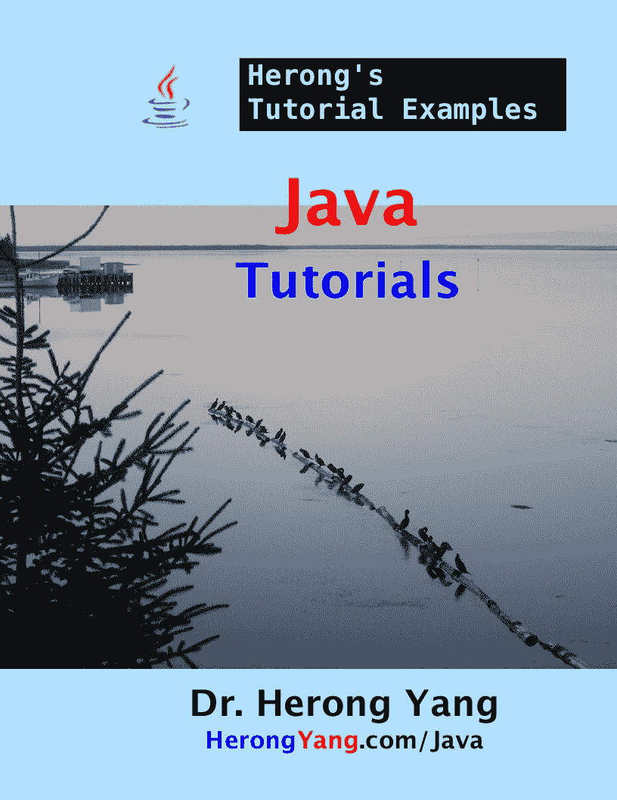
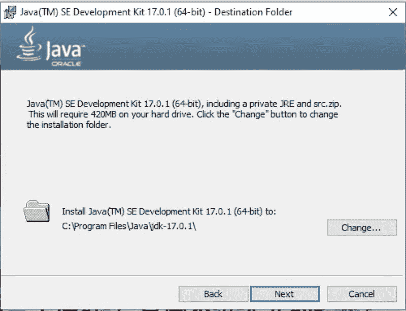
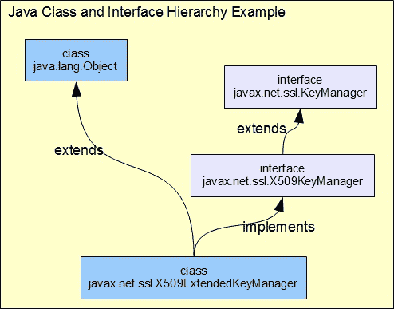
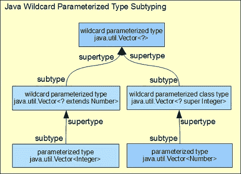
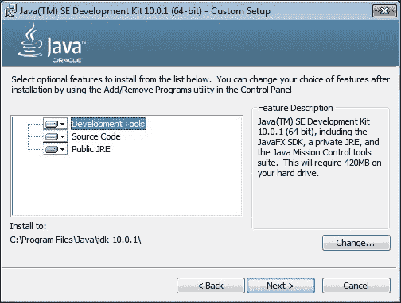
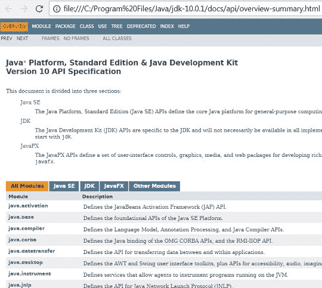
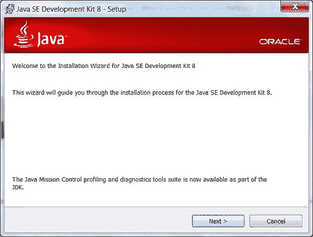
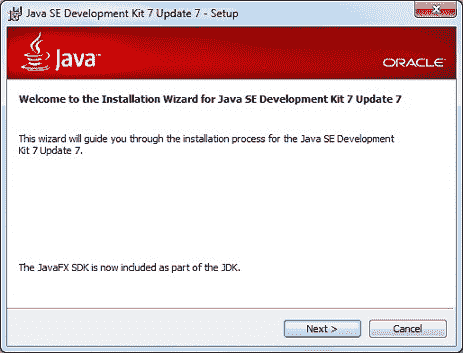

# Java 教程 - Herong 教程示例




本教程书是作者在学习 Java 时编写的笔记和示例代码。书中涵盖的主题包括：Java 语言基础；执行环境；泛型类和参数类型；泛型方法和类型参数推断；枚举类型和常量；Lambda 表达式；注解类型和调用；Java 模块；执行线程和同步；内存管理和垃圾收集。已于 2022 年更新（版本 v8.21），包含 JDK 17 教程。欲获取最新更新和免费章节，请访问 https://www.herongyang.com/Java

> 在自定义 JRE 中运行 `.\bin\java` 命令
>
> 访问模块中未导出的包
>
> 模块依赖与包的访问访问性
>
> `com.herongyang.base` 模块实现
>
> `com.herongyang.base` 模块编译
>
> `com.herongyang.math` 模块实现
>
> `geometryJRE` 和模块交付物
>
> 获取 `com.herongyang.base` 模块信息
>
> 测试模块中导出的包
>
> 测试模块中未导出的包
>
> 使用 `com.herongyang.math` 模块的应用
>
> 执行线程与多线程 Java 程序
>
> 什么是进程和线程
>
> `"Thread"` 类 - 使用 `Thread` 子类创建线程对象
>
> `"Runnable"` 接口 - 使用 `Runnable` 对象创建线程对象
>
> 多线程共享 CPU 执行时间
>
> 多线程共享 CPU 执行时间 - 测试输出
>
> 多线程共享应用数据
>
> 多线程共享应用数据 - 测试结果
>
> `interrupt()` - 终止线程的方法
>
> `ThreadGroup` 类和 `"system"` `ThreadGroup` 树
>
> `"ThreadGroup"` 类 - 线程和线程组的容器
>
> 显示 `"system"` `ThreadGroup` 树
>
> 添加线程和线程组

## 同步技术与同步代码块

### 为什么多线程应用需要同步

### 同步技术 - 锁与同步代码

### `"synchronized"` - Java 如何支持同步

`BankingThread.java` - 同步示例程序

`BankingThread.java` - 同步示例程序输出

## 死锁条件示例程序

### 什么是死锁

### 死锁示例 - 5 个哲学家

死锁示例 - 资金转账

## 垃圾回收与 `gc()` 方法

### 垃圾回收与未使用对象

### 自动垃圾回收过程

### `gc()` - 垃圾回收方法

### 使用 `gc()` 方法的示例程序

## `Assert` 语句与 `-"ea"`

### `"assert"` 语句

### JVM `"-ea"` 和 `"-da"` 选项

## 注解语句与声明

### 什么是注解

### 使用 `"interface"` 作为注解

### 注解元素的默认值

### 单元素注解调用

### 无元素（标记）注解调用

### `getAnnotations()` 方法 - 注解 API

### 预定义的注解类型

## Java 相关术语

## 归档教程

### 归档：下载并安装 JDK 10

#### 归档：JDK 10 文档安装

#### 归档：下载并安装 JDK 8

#### 归档：下载并安装 JDK 1.7

#### 归档：下载并安装 JDK 1.6

#### 归档：下载并安装 JDK 1.5

#### 归档：下载并安装 JDK 1.3

## 参考文献

要学习 Java，你需要在机器上安装一个 `JDK`（Java 开发工具包）。如果你是 Windows 用户，可以按照此教程在 Windows 电脑上下载并安装 `JDK 17`。

* 使用此访问 Java SE 下载页面：[`www.oracle.com/java/technologies/downloads/`](https://www.oracle.com/java/technologies/downloads/)。
* 点击“Java SE Development Kit 17.0.1 downloads”下方的“Windows”选项卡。你将看到一个新页面，其中列出了不同的 `JDK 17` 下载文件。
* 点击 `x64 Installer` 152 MB 旁边的 `https://download.oracle.com/java/17/latest/jdk-17_windows-x64_bin.exe` 超链接。
* 将 `jdk-17_windows-x64_bin.exe` 保存到临时目录。
* 双击 `jdk-17_windows-x64_bin.exe` 启动安装向程序。
* 安装向程序将引导你完成安装。

下图显示了 `JDK 17` 安装界面的样子：



JDK 17 安装界面

要测试安装，请打开命令行窗口并尝试 `java` 命令。如果你得到以下输出，说明安装成功：

```
herong> \progra~1\java\jdk-17.0.1\bin\java -version

java version "17.0.1" 2021-10-19 LTS
Java(TM) SE Runtime Environment (build 17.0.1+12-LTS-39)
Java HotSpot(TM) 64-Bit Server VM 
  (build 17.0.1+12-LTS-39, mixed mode, sharing)
```

Java 教程 - Herong 教程示例

∟JDK - Java 开发工具包

## 在 Mac 上下载并安装 JDK

本节描述了如何在 macOS 系统上下载并安装 `JDK 13`。

要学习 Java，你需要在机器上安装一个 `JDK`（Java 开发工具包）。如果你是 Mac 用户，可以按照此教程在你的 Mac 电脑上下载并安装 `JDK 13`。

1. 访问 Oracle Java SE 下载网站 [oracle.com/technetwork/java/javase/downloads/index.html](https://www.oracle.com/technetwork/java/javase/downloads)。
2. 点击“Java Platform (JDK) 13”旁边的“Download”。
3. 从下载列表中点击 `jdk-13_osx-x64.bin.tar.gz`。它将自动保存到你的“Downloads”目录。
4. 启动 `Terminal` 窗口并运行以下命令进行安装。

```
herong$ cd ~/Downloads

herong$ gunzip jdk-13_osx-x64.bin.tar.gz

herong$ tar -xf jdk-13_osx-64.bin.tar

herong$ sudo mv jdk-13.jdk/ /Library/Java/JavaVirtualMachines/
```

要测试安装，请打开命令行窗口并尝试 `java` 命令。如果你得到以下输出，说明安装成功：

```
herong$ java -version

java version "13" 2019-09-17
Java(TM) SE Runtime Environment (build 13+33)
Java HotSpot(TM) 64-Bit Server VM (build 13+33, mixed mode, sharing)
```

Java 教程 - Herong 教程示例

∟JDK - Java 开发工具包

## 编写第一个 Java 程序

本节提供了一个如何使用 `JDK` 编写、编译和执行第一个 Java 程序的教程示例。

当机器上安装了 `JDK` 时，它提供了两个命令供你编译和运行 Java 程序。

* `javac class_name.java` - 编译存储在程序类同名文件中的 Java 程序。
* `java -classpath . class_name` - 运行编译后的 Java 程序。`-classpath .` 指定当前目录为类路径。

用一个非常简单的 Java 程序尝试这些命令。使用记事本将以下 Java 程序输入到名为 `Hello.java` 的文件中：

```
class Hello {
   public static void main(String[] a) {
      System.out.println("Hello world!");
   }
}
```

然后在命令行窗口中使用 `javac` 命令编译此程序：

```
herong> \progra~1\java\jdk-17.0.1\bin\javac Hello.java
```

使用 `java` 命令执行程序：

```
herong> \progra~1\java\jdk-17.0.1\bin\java Hello

Hello world!
```

恭喜你，你已经成功地输入、编译并执行了你的第一个 Java 程序。

Java 教程 - Herong 教程示例

∟JDK - Java 开发工具包

## 将 JDK `"bin"` 目录添加到 Path 设置中

本节提供了关于如何将 JDK `bin` 目录添加到 `path` 系统环境变量的教程。

为了运行 Java，请将 `path` 环境变量设置为 JDK `bin` 目录。

* 打开“控制面板” > “系统” > “高级系统设置”。
* 点击“环境变量”。
* 在“系统变量”下选择 `path` 并点击“编辑”。
* 点击“新建”并粘贴 JDK `bin` 文件夹的路径，例如 `C:\Program Files\Java\jdk-17.0.1\bin`。
* 在所有窗口上点击“确定”。

现在无需输入完整路径即可运行 Java 命令。要验证这一点，请检查 `path` 变量：

```cmd
echo %path%
```

要测试安装，请打开命令行窗口并尝试 `java` 命令。如果你得到以下输出，说明安装成功：

```
java -version

java version "17.0.1" 2021-10-19 LTS
Java(TM) SE Runtime Environment (build 17.0.1+12-LTS-39)
Java HotSpot(TM) 64-Bit Server VM 
  (build 17.0.1+12-LTS-39, mixed mode, sharing)
```

* `public static void main(String[] a)` 是类在虚拟机 (JVM) 中启动时的执行入口点。
* JVM 为所有应用程序提供了 3 个默认 I/O 数据流：`"in"`、`"out"` 和 `"err"`。

Java 教程 - Herong 的教程示例

执行过程、入口点、输入和输出

### 创建、编译和执行 Java 程序

本节描述了 Java 程序的创建、编译和执行过程。同时也描述了 JDK 中的 `javac` 和 `java` 命令。

构建和运行 Java 程序涉及 3 个步骤：

* **创建程序源代码**：创建一个编写有 Java 语言语句的文本文件，用于定义每个 Java 类或其他程序单元。该文本文件称为源代码文件，其文件名必须与文件中定义的类名相同，且扩展名为 `.java`。其中一个源代码文件应该定义主类，该类包含包含 `"main"` 方法作为执行起点。其他源代码文件则定义额外的类和其他程序单元以支持主类。
* **编译源代码**：将程序所有的源代码文件转换为以 Java 虚拟机 (JVM) 指令编写的字节码文件。字节码文件必须与源代码文件名相同，且扩展名为 `.class`。
* **执行 Java 程序**：将主类的字节码文件加载到 JVM 中并从 `"main"` 方法开始执行其 JVM 指令。

创建源代码文件可以使用简单的文本编辑器、记事本或复杂的 Java 开发环境工具，如 Eclipse 或 Visual J++。

编译源代码文件需要 Java 编译器。JDK 软件包包含一个 Java 编译器，可以通过命令 `javac` 调用。`javac` 命令接受源代码文件名作为命令行参数。例如，在命令行窗口中输入以下命令将调用 `javac` 编译器来编译 `Hello.java` 源代码文件：

```
herong> javac Hello.java
```

`javac` 命令还有几个可用的命令选项：

* `-d`：指定编译器生成的字节码文件存放的目录，如果你不想将它们放在当前目录中。
* `-classpath`：指定搜索字节码格式的类或接口定义的目录，如果在源代码文件中使用了这些类或接口。
* `-sourcepath`：指定搜索源代码格式的类或接口定义的目录，如果在源代码文件中使用了这些类或接口。

例如，以下命令：

```
herong> javac -d .\cls -classpath .\lib;.\cls \
   -sourcepath .\src .\src\Hello.java
```

调用了 `javac` 编译器并告诉它：

* 编译 `.\src` 目录下的 `Hello.java` 源代码文件。
* 将字节码文件 `Hello.class` 放在 `.\cls` 目录下。
* 在 `.\lib` 和 `.\cls` 目录中搜索 `Hello.java` 中使用的类或接口的字节码格式定义。
* 在 `.\src` 目录中搜索 `Hello.java` 中使用的类或接口的源代码格式定义。

执行 Java 程序需要 JVM。JDK 也包含一个 JVM，称为 HotSpot，可以通过命令 `java` 调用。`java` 命令接受启动类名作为命令行参数。例如，以下命令：

```
herong> java -classpath .\lib;.\cls;. Hello
```

调用 HotSpot：

* 将 `Hello` 类加载到 HotSpot 中。
* 执行 `Hello` 类的 `main()` 方法。

`-classpath` 指定类路径，该路径包含了 JVM 在需要时搜索启动类和其他程序单元的字节码文件的目录。

Java 教程 - Herong 的教程示例

执行过程、入口点、输入和输出

### `main()` 方法 - Java 执行入口点

本节描述了 Java 程序的入口点，即启动类的 `main()` 方法。命令行参数作为字符串数组参数传递给 `main()` 方法。

如上一节所述，Java 应用程序必须有一个主类，并包含一个特殊的方法调用 `main()` 作为执行入口点。`main()` 方法必须定义为：

```
public static void main(String[] a) {
      // 语句块
   }
```

注意，`main()` 方法必须声明为 `public static void`。

`main()` 方法的参数是一个 `"String"` 数组，它包含了 `java` 命令行中类名参数之后的额外参数。让我们使用以下 Java 程序来演示这些参数是如何传递到 `main()` 方法的：

```
/* CommandLine.java
 * Copyright (c) HerongYang.com. All Rights Reserved.
 */
class CommandLine {
   public static void main(String[] a) {
      System.out.println("Number of arguments = "+a.length);
      for (int i=0; i<a.length; i++) {
         System.out.println("  a["+i+"] = "+a[i]);
      }
   }
}
```

编译类后，使用以下命令行执行它：

```
herong> javac CommandLine.java

herong> java -classpath . CommandLine bread milk banana apple

Number of arguments = 4
  a[0] = bread
  a[1] = milk
  a[2] = banana
  a[3] = apple
```

在命令行类名之后指定了 4 个参数。JVM 将它们放入一个包含 4 个元素的数组并将数组传递给 `main()` 方法。

使用稍不同的命令行再次执行：

```
herong> java -classpath . CommandLine "bread milk" "banana apple"

Number of arguments = 2
  a[0] = bread milk
  a[1] = banana apple
```

这次，使用双引号将两个空格分隔的单词视为单个参数。

Java 教程 - Herong 的教程示例

执行过程、入口点、输入和输出

### Java 执行控制台 - `"in"`, `"out"` 和 `"err"` 数据流

本节提供了如何使用默认输入输出数据流的教程示例：`System.in`、`System.out` 和 `System.err`。

当 JVM 执行 Java 应用程序时，它需要一个控制窗口为 Java 程序提供 3 个预定义的输入输出数据流，即：

* `System.in`：连接控制窗口的标准输入流。


* `System.out`：连接控制窗口的标准输出流。

* `System.err`：连接控制窗口的标准错误流。

当你使用 JDK 软件包执行 Java 程序时，控制窗口就是你输入`java`命令的同一个窗口。

注意，所有 3 个标准流都定义为`System`类的公共静态变量。我们在第一个 Java 程序`Hello.java`中使用了`System.out`在控制窗口上打印欢迎消息。这里是另一个使用了所有 3 个标准流的程序：

```java
/* Reverser.java
 * Copyright (c) HerongYang.com. All Rights Reserved.
 */
import java.io.*;
public class Reverser {
   public static void main(String[] arg) {
      InputStream in1 = System.in;
      InputStreamReader in2 = new InputStreamReader(in1);
      BufferedReader in = new BufferedReader(in2);
      PrintStream out = System.out;
      PrintStream err = System.err;
      err.println("This program reverses the character positions of ");
      err.println("each line from the standard input stream.");
      err.println("Enter '.' to end the program.");
      try {
         String s = in.readLine();
         while (s!=null) {
            char[] a = s.toCharArray();
            if (s.equals(".")) break;
            int n = a.length;
            for (int i=0; i<n/2; i++) {
               char c = a[i];
               a[i] = a[n-1-i];
               a[n-i-1] = c;
            }
            out.println(new String(a));
            s = in.readLine();
         }
      } catch (IOException e) {
         err.println(e.toString());
      }
   }
}
```

请注意：

* `System.in`是一个`InputStream`对象，它只提供按字节读取信息的方法。为了每行读取一个`String`，我需要将`System.in`转换为`BufferedReader`对象。

* `while`循环应该在`System.in`达到流末尾时结束。然而，Windows 上的 HotSpot 没有提供从键盘指示标准输入流结束的方法。因此，我使用了一种特殊模式，即行中有一个且仅有一个字符`.`来结束循环。

使用以下命令编译并运行程序：

```
herong> javac Reverser.java

herong> java -classpath . Reverser
```

然后从键盘输入以下文本：

```
Fish, I love you and respect you very much.
But I will kill you dead before this day ends.
.
```

我在控制窗口上看到以下内容：

```
This program reverses the character positions of
each line from the standard input stream.
Enter '.' to end the program.
Fish, I love you and respect you very much.
.hcum yrev uoy tcepser dna uoy evol I ,hsiF
But I will kill you dead before this day ends.
.sdne yad siht erofeb daed uoy llik llik I tuB
.
```

请注意：

* 前 3 行来自`System.err`流。

* 第 4、第 6 和第 8 行是`System.in`流文本行的复制，因为控制窗口会回显我在键盘上输入的所有内容。

* 第 5 和第 7 行来自`System.out`流。

Windows 系统也可以将控制台输入和输出重定向到文件。首先，我将 2 行文本和`.`保存到名为`input.txt`的文件中，然后运行以下命令：

```
herong> java -classpath . Reverser < input.txt > output.txt
```

我只在控制窗口上得到了来自`System.err`的文本：

```
This program reverses the character positions of
each line from the standard input stream.
Enter '.' to end the program.
```

`output.txt`文件包含：

```
.hcum yrev uoy tcepser dna uoy evol I ,hsiF
.sdne yad siht erofeb daed uoy llik llik I tuB
```

Java 教程 - Herong 的教程示例

## 基本数据类型和字面量

本章提供了关于基本数据类型和字面量的教程笔记和示例代码。主题包括 8 种基本数据类型；每个数据类型的存储大小；每个数据类型源代码字面量的格式规则；关于基本类型的 Java 程序示例。

> Java 支持的数据类型

> 整数数据类型

> 浮点数据类型

> 逻辑（布尔）数据类型

> 基本类型的字面量

> 整数字面量格式

> 整数字面量格式 示例

> 浮点字面量格式

> 浮点字面量格式 示例

> 字符字面量格式

> 字符字面量格式 示例

结论：

* Java 支持 8 种基本数据类型：`byte`, `short`, `int`, `long`, `char`, `float`, `double`, `boolean`。

* `byte`, `short`, `int`和`long`可表示不同范围的有符号整数。

* 整数字面量的默认数据类型是`int`。

Java 教程 - Herong 的教程示例

基本数据类型和字面量

### Java 支持的数据类型

本节提供了 Java 支持的数据类型列表：共 8 种基本类型。下表显示了它们的关系：

```
数据类型
| 基本类型
| 数值类型
| byte
| short
| int
| long
| char
| float
| double
| boolean
| 浮点类型
| 引用类型
```

引用类型将在其他章节中讨论。

Java 教程 - Herong 的教程示例

基本数据类型和字面量

### 整数数据类型

本节介绍了整数类型的范围和存储大小：`byte`, `short`, `int`, `long`。

Java 支持 4 种整数类型：`byte`, `short`, `int`, `long`。

从数值角度来看，每个整数类型支持：

* `byte` - 支持 -128 到 127 的有符号整数。

* `short` - 支持 -32768 到 32767 的有符号整数。

* `int` - 支持 -2147483648 到 2147483647 的有符号整数。

* `long` - 支持 -9223372036854775808 到 9223372036854775807 的有符号整数。

从存储角度来看，每个整数类型的存储方式不同：

* `byte` - 在 8 位（1 字节）空间中存储其值。

* `short` - 在 16 位（2 字节）空间中存储其值。

* `int` - 在 32 位（4 字节）空间中存储其值。

* `long` - 在 64 位（8 字节）空间中存储其值。

Java 教程 - Herong 的教程示例

基本数据类型和字面量

### 浮点数据类型

本节介绍了浮点数据类型的范围和存储大小：`float`, `double`。

Java 支持 2 种浮点数据类型：`float`, `double`。

从数值角度来看，每个浮点数据类型支持以下实数：

* `float` - 支持范围在 -10³⁸ 到 10³⁸ 之间的有符号实数，精度约为 7 位有效数字。

* `double` - 支持范围在 -10³⁰⁸ 到 10³⁰⁸ 之间的有符号实数，精度约为 15 位有效数字。

* `float` - 将其值存储在 32 位（4 字节）的空间中，包含：1 位符号位、8 位指数部分和 23 位小数部分，以 IEEE 754 标准中描述的二进制格式表示。

* `double` - 将其值存储在 64 位（8 字节）的空间中，包含：1 位符号位、11 位指数部分和 52 位小数部分，以 IEEE 754 标准中描述的二进制格式表示。

欲了解更多信息，请阅读我的《C# 教程 - Herong 的教程示例》中的“IEEE 754 标准 - 'float' 和 'double'”教程，地址请访问 [herongyang.com/C-Sharp/Floating-Point-Data-Type-IEEE-754.html](https://www.herongyang.com/C-Sharp/Floating-Point-Data-Type-IEEE-754.html)。

Java 教程 - Herong 的教程示例

∟原生数据类型和字面量

### 逻辑（布尔）数据类型

本节描述逻辑数据类型`boolean`的取值范围和存储空间大小。

Java 支持 1 种逻辑数据类型：`boolean`。

从数据值的角度来看，逻辑数据类型`boolean`代表两个值：`true`和`false`。

我不确定`boolean`值的具体存储大小。它可能是 8 位（1 字节）。

Java 教程 - Herong 的教程示例

∟原生数据类型和字面量

### 原生类型字面量

本节描述了如何在 Java 源代码中使用字面量来表示原生数据值。示例包括：`911`、`0x38fL`、`'\n'`、`3.14F`、`1e137`、`0x1p3`、`true`等。

**什么是字面量？** 字面量是 Java 源代码中数据值的字符串表示形式。

以下列表总结了不同原生类型的数据值如何通过字面量表示。

* `byte`字面量 - 不支持。

* `short`字面量 - 不支持。

* `int`字面量 - 支持 4 种格式：十进制、十六进制、八进制和二进制。示例为：`911`、`0x38f`、`0177`和`0b11100011111`。

* `long`字面量 - 支持 4 种格式：十进制、十六进制、八进制和二进制。示例为：`911L`、`0x38fL`、`0177L`和`0b11100011111L`。

* `char`字面量 - 支持使用引号 ASCII 字符或转义序列。示例为：`'x'`、`'\''`、`'\n'`、`'\177'`和`'\u03a9'`。

* `float`字面量 - 支持 2 种格式：十进制和十六进制。示例为：`1e1F`、`2.F`、`.3F`、`0F`、`3.14F`、`0x1p3F`和`6.022137e23F`。

* `double`字面量 - 支持 2 种格式：十进制和十六进制。示例为：`1e1`、`2.`、`.3`、`0.0`、`3.14`、`1e137`、`0x1p3`和`1e-9D`。

* `boolean`字面量 - 支持 2 个值：`true`和`false`。

Java 对原生类型字面量支持的一些有趣特性：

* 下划线（`_`）可以用分隔符，在整数字面量和浮点字面量中将数字分组。示例为：`0xffff_ffff`、`0377_7777_7777`、`0b1111_1111_1111_1111_1111_1111_1111_1111`以及`911_911_911_911.99999_9`。这一特性有助于提高包含许多数字字面量的可读性。

* 前导零（`0`）用八进制整数字面量的指示。示例为：`0177`和`0177L`。这与十六进制整数字面量不一致，后者需要两个前导字符（`0x`）作为指示。这一特性可能会引起混淆，因为人类会忽略前导零，将`0177`读取为十进制值 177，而不是八进制值 177。

* 浮点字面可以用十六进制格式表示。示例为：`0x1p3`是`"double"`数据类型中`8.0`的十六进制浮点字面量。这是 JDK 5 引入的非常非常棒的特性，允许对特定的浮点值进行精确且可预测的规范。

* 如果没有后缀，整数字面量的默认数据类型为`"int"`。如果整数字面量需要被视为`"long"`数据类型，则必须使用后缀`"L"`或`"l"`。这一特性对大多数开发者来说不应该感到意外。

* 如果没有使用后缀，浮点字面量的默认数据类型为`"double"`。如果浮点字面量需要被视为`"float"`数据类型，则必须使用后缀。


```java
/* IntegerLiteral.java
 * Copyright (c) HerongYang.com. All Rights Reserved.
 */

class IntegerLiteral {
   public static void main(String[] a) {
      java.io.PrintStream o = System.out;
      o.println("Decimal Integer Literals:");
      o.println("   int value:              911  = "+911);
      o.println("   int high:        2147483647  = "+2147483647);
      o.println("   long value:      2147483648L = "+2147483648L);
      o.println("   Using _:      2_147_483_648L = "+2_147_483_648L);

      o.println();
      o.println("Hex Integer Literals:");
      o.println("   Hex format:           0x38F  = "+0x38F);
      o.println("   Leading 0:       0x0000038F  = "+0x0000038F);
      o.println("   int max value:   0x7FFFFFFF  = "+0x7FFFFFFF);
      o.println("   long value:      0x7FFFFFFFL = "+0x7FFFFFFFL);
      o.println("   int min value:   0x80000000  = "+0x80000000);
      o.println("   long value:      0x80000000L = "+0x80000000L);
      o.println("   int -1 value:    0xFFFFFFFF  = "+0xFFFFFFFF);
      o.println("   long value:      0xFFFFFFFFL = "+0xFFFFFFFFL);
      o.println("   Using _:        0xDead_Deed  = "+0xDead_Deed);
      o.println("   long value:     0xDead_DeedL = "+0xDead_DeedL);

      o.println();
      o.println("Octal Integer Literals:");
      o.println("   Octal format:         01617  = "+01617);
      o.println("   int max value: 017777777777  = "+017777777777);
      o.println("   long value:    017777777777L = "+017777777777L);
      o.println("   int min value: 020000000000  = "+020000000000);
      o.println("   long value:    020000000000L = "+020000000000L);
      o.println("   Using _:     0200_0000_0000  = "+0200_0000_0000);
      o.println("   long octal:  0200_0000_0000L = "+0200_0000_0000L);

      o.println();
      o.println("Binary Integer Literals:");
      o.println("   Octal format:  0b1110001111  = "+0b1110001111);
      o.println("   int min value:"
         +" 0b1000_0000_0000_0000_0000_0000_0000_0000  = "
         +0b1000_0000_0000_0000_0000_0000_0000_0000);
   }
}
```

在命令行窗口中编译并运行此示例程序：

```
herong> javac IntegerLiteral.java

herong> java IntegerLiteral

Decimal Integer Literals:
   int value:              911  = 911
   int high:        2147483647  = 2147483647
   long value:      2147483648L = 2147483648
   Using _:      2_147_483_648L = 2147483648

Hex Integer Literals:
   Hex format:           0x38F  = 911
   Leading 0:       0x0000038F  = 911
   int max value:   0x7FFFFFFF  = 2147483647
   long value:      0x7FFFFFFFL = 2147483647
   int min value:   0x80000000  = -2147483648
   long value:      0x80000000L = 2147483648
   int -1 value:    0xFFFFFFFF  = -1
   long value:      0xFFFFFFFFL = 4294967295
   Using _:        0xDead_Deed  = -559030547
   long value:     0xDead_DeedL = 3735936749

Octal Integer Literals:
   Octal format:         01617  = 911
   int max value: 017777777777  = 2147483647
   long value:    017777777777L = 2147483647
   int min value: 020000000000  = -2147483648
   long value:    020000000000L = 2147483648
   Using _:     0200_0000_0000  = -2147483648
   long octal:  0200_0000_0000L = 2147483648

Binary Integer Literals:
   Octal format:  0b1110001111  = 911
   int min value: 0b1000_0000_0000_0000_0000_0000_0000_0000  = -2147483648
```

```
herong> javac FloatingPointLiteral.java

herong> java FloatingPointLiteral

十进制浮点字面量:
   基础部分:     365.242196     = 365.242196
   带指数: 3.65242196e2   = 365.242196
   负指数:    1.0e-9  = 1.0E-9
   float 类型:           1.0e-9F = 1.0E-9
   使用 _:     3.65_242_196e2   = 365.242196

十六进制浮点字面量:
   1:                     0x1.0p0  = 1.0
   16:                   0x10.0p0  = 16.0
   16*16:                0x10.0p0  = 16.0
   1/16:                  0x0.1p0  = 0.0625
   1/16/16:               0x0.01p0 = 0.00390625
   带指数:     0x1.23456p8  = 291.27099609375
   负指数: 0x12345.6p-8 = 291.27099609375
   float 类型:    0x800000.0p0F = 1.34217728E8
   使用 _:      0x80_0000.0p0F = 1.34217728E8
```

希望你现在知道如何正确使用浮点字面量。

Java 教程 - Herong 的教程示例

∟基本数据类型和字面量

### 字符字面量格式

本节描述了`char`数据类型字符值的字面量格式：单引号括的单个字符或转义序列。

Java 支持字符数据类型`char`的多种字面量格式，描述如下：

#### 字符字面量 - 字符字面量的基本规则：

- `char`数据类型的字符值可以表示为单引号括的单个字符，例如`'A'`、`'1'`、`' '`和`'"'`。

- 特殊字符`'`和`\`必须使用`\`转义，例如`'\\''`和`'\\'`。

- 控制字符必须以转义序列输入，例如`'\t'`、`'\n'`和`'\r'`。

- 双字节 Unicode 字符可以使用 Unicode 序列输入，例如`'\u0041'`和`'\u03C9'`。

- 也可以使用进制序列，例如`'\101'`和`'\969'`。

Java 教程 - Herong 的教程示例

∟基本数据类型和字面量

### 字符字面量格式 - 示例

本节提供了一个关于如何在不同格式中使用字符字面量的教程示例：单引号括的单个字符或转义序列。

现在让我们来看一个关于不同格式字符字面量的教程程序示例：

```java
/* CharacterLiteral.java
 * Copyright (c) HerongYang.com. All Rights Reserved.
 */

class CharacterLiteral {
   public static void main(String[] a) {
      java.io.PrintStream o = System.out;
      o.println("Character Literals:");
      o.println("   ASCII char:     'A'       = "+'A');
      o.println("   Control char:   '\\n'      = "+'\n');
      o.println("   Special char:   '\\\\'      = "+'\\');
      o.println("   Unicode char:   '\\u0041'  = "+'\u0041');
      o.println("   Decimal code:   '\\101'    = "+'\101');
   }
}
```

在命令行中编译并运行此示例程序：

```
herong> javac CharacterLiteral.java

herong> java CharacterLiteral

Character Literals:
   ASCII char:     'A'       = A
   Control char:   '\n'      =

   Special char:   '\\'      = \
   Unicode char:   '\u0041'  = A
   Decimal code:   '\101'    = A
```

希望你现在知道如何正确使用字符字面量。

Java 教程 - Herong 的教程示例

∟控制流语句

本章提供了控制流语句的教程笔记。主题包括决策语句：`'if'`和`'switch'`语句；循环语句：`'for'`、`'while'`和`'do'`语句；跳转语句：`'break'`、`'continue'`和`'return'`语句。

- 什么是控制流语句

- "if-then" 语句

- "if-then-else" 语句

- 嵌套 "if-then-else" 语句

- "switch" 语句

- 贯穿行为

- 基础 "for" 语句

- 增强型 "for" 语句

- "while" 语句

- "do" 语句

- "break" 语句

- 标签的 "break" 语句

- "continue" 语句

- 标签的 "continue" 语句

# 什么是 "if-then" 语句？

"if-then" 语句是一种决策语句，只有在给定的“布尔”表达式为“true”（真）时，才会执行包含的子语句。

以下是 "if-then" 语句的语法。注意，“then” 并没有被作为语句中的关键字使用。

```
if (condition_expression) contained_statement
```

包含的子语句可以是一个简单的单语句，也可以是一个复杂的语句块。这里有一个示例程序，展示了如何使用 "if-then" 语句：

```java
/* IfThenStatementTest.java
 * Copyright (c) HerongYang.com. All Rights Reserved.
 */
class IfThenStatementTest {
   public static void main(String[] arg) {
      java.io.PrintStream out = System.out;

      out.println("\"if-then\" statement containing a single statement:");
      boolean isNewYear = true;
      if (isNewYear) out.println("   Happy New Year!");

      out.println("\"if-then\" statement containing a statement block:");
      boolean hasError = true;
      if (hasError) {
         out.println("   Open the log file.");
         out.println("   Write an error message.");
         out.println("   Close the log file.");
      }
   }
}
```

如果你编译并运行上面的程序，你将看到：

```
herong> java IfElseStatementTest.java

"if-then" statement containing a single statement:
   Happy New Year!
"if-then" statement containing a statement block:
   Open the log file.
   Write an error message.
   Close the log file.
```

Java 教程 - Herong 的教程示例

∟流程流语句

∟"if-then-else" 语句

本节描述了 'if-then-else' 语句，这是一种决策语句，根据给定的“布尔”表达式，在两个包含的块中执行其中一个。

## 什么是 "if-then-else" 语句？

"if-then-else" 语句是一种决策语句，当给定的“布尔”表达式为“true”时，仅执行第一个包含的子语句。否则，仅执行第二个包含的子语句。

以下是 "if-then-else" 语句的语法。注意，“then” 并没有被作为语句中的关键字使用。

```
if (condition_expression) first_contained_statement
else second_contained_statement
```

包含的子语句可以是一个简单的单语句，也可以是一个复杂的语句块。这里有一个示例程序，展示了如何使用 "if-then-else" 语句：


# Java 教程 - Herong 的教程示例

## 流程流语句

### 嵌套 "if-then-else" 语句

本节描述了嵌套的 `if-then-else` 语句，其中一个 `if-then-else` 语句包含了另一个 `if-then-else` 语句。

在某些情况下，`if-then-else` 语句的第二个包含子语句需要是另一个 `if-then-else` 语句。结果就是嵌套的 `if-then-else` 语句。

有时，你可能会有很多嵌套的 `if-then-else` 语句。这里有一个 5 个嵌套在一起的 `if-then-else` 语句的示例。

```
 if (...) contained_statement // 1st "if" statement
else if (...) contained_statement // 2st "if" statement
     else if (...) contained_statement // 3rd "if" statement
          else if (...) contained_statement // 4th "if" statement
               else if (...) contained_statement // 5th "if" statement
                    else contained_statement
```

注意，嵌套的 `if-then-else` 语句可以不带缩进来表示其嵌套级。但你需要记住，它仍然是 5 个嵌套在一起的 `if-then-else` 语句。它不是一个带有多个包含子语句的单一 `if` 语句，Java 不支持这种写法的。

```
 if (...) contained_statement      // 1st "if" statement
else if (...) contained_statement // 2st "if" statement
else if (...) contained_statement // 3rd "if" statement
else if (...) contained_statement // 4th "if" statement
else if (...) contained_statement // 5th "if" statement
else contained_statement
```

上述语句从语法角度实际上等同于以下内容：

```
 if (...) contained_statement      // 1st "if" statement
else { if (...) contained_statement } // 2st "if" statement
else { if (...) contained_statement } // 3rd "if" statement
else { if (...) contained_statement } // 4th "if" statement
else { if (...) contained_statement } // 5th "if" statement
else contained_statement }
```

这里有一个示例程序，展示了如何使用嵌套的 `if-then-else` 语句：

```
 /* NestedIfElseStatementTest.java
 * Copyright (c) HerongYang.com. All Rights Reserved.
 */
import java.time.LocalTime;
class NestedIfElseStatementTest {
   public static void main(String[] arg) {
      java.io.PrintStream out = System.out;
      LocalTime now = LocalTime.now();
      int hour = now.getHour(); // from 0 to 23

      out.println("5 nested if-then-else statements test:");
      if (hour < 6) {
         out.println("   Early morning!");
      } else if (hour < 12) {
         out.println("   Good morning!");
      } else if (hour < 18) {
         out.println("   Good afternoon!");
      } else if (hour < 22) {
         out.println("   Good evening!");
      } else {
         out.println("   Good night!");
      }
      out.println("Current time is "+now);
   }
}
```

如果你编译并运行上面的程序，你将看到：

```
 herong> java NestedIfElseStatementTest.java

5 nested if-then-else statements test:
   Good afternoon!
Current time is 14:29:50.479207
```

### 基础 "for" 语句

本节描述了基础 `for` 语句，这是一种循环语句，根据初始逻辑、循环条件和更新逻辑重复执行包含的语句。

`for` 语句有两种形式：基础 `for` 语句和增强型 `for` 语句。让我们先在本教程中查看基础的 `for` 语句。

**什么是基础 `for` 语句？** - 基础 `for` 语句是一种循环语句，它根据初始逻辑、循环条件和更新逻辑来重复执行包含的语句。

以下是基础 `for` 语句的语法：

```
 for (initial_logic; looping_condition; update_logic) contained_statement
```

当执行基础 `for` 语句时，控制流可以描述为：

步骤 1. 运行 `initial_logic`。

步骤 2. 评估 `looping_condition`。如果结果为 `false`，则结束 `for` 语句。

步骤 3. 运行 `contained_statement`。

步骤 4. 运行 `update_logic`。

步骤 5. 回到步骤 2。

包含的语句可以是空的、简单的语句或复杂的代码块。这里有一个展示如何使用基础 `for` 语句的示例程序：

```
 /* SwitchStatementTest.java
 * Copyright (c) HerongYang.com. All Rights Reserved.
 */
class SwitchStatementTest {
   public static void main(String[] arg) {
      java.io.PrintStream out = System.out;
      LocalTime now = LocalTime.now();
      int hour = now.getHour(); // 从 0 到 23

      out.println("\"switch\" statement:");
      int workingHours = 8;
      switch (hour) {
        case  9: workingHours--; // hour == 9 时在此开始
        case 10: workingHours--; // hour == 10 时在此开始
        case 11: workingHours--; // hour == 11 时在此开始
        case 12: workingHours--; // hour == 12 时在此开始
        case 13: workingHours--; // hour == 13 时在此开始
        case 14: workingHours--; // hour == 14 时在此开始
        case 15: workingHours--; // hour == 15 时在此开始
        case 16: workingHours--; // hour == 16 时在此开始
      }
      out.println("   Worked "+workingHours+" full hours with no breaks!");
      out.println("   Current time is "+now);
   }
}
```

如果你编译并运行上述程序，你将看到：

```
 herong> java SwitchStatementTest.java

"switch" statement:
   Worked 3 full hours with no breaks!
   Current time is 12:15:11.702155
```

正如从输出中所示，程序按如下方式执行 `switch` 语句：

- 评估测试表达式 `hour` 的值为 `12`。

- 将控制权传递给包含语句块中标记为 `case 12` 的语句。

- 运行从 `case 12` 到块结束的所有语句，这使得 `workingHours` 减少了 5 次。

## 控制流语句

### "switch" 语句的穿透行为 (Fall-Through)

本节提供了一个教程示例，展示了 `switch` 语句的“穿透”行为。

从之前的教程中，我们了解到 `switch` 语句的执行从包含语句块中与给定测试表达式值匹配的标签开始。执行将继续块中所有剩余的子语句，包括 `case` 或 `default` 标签。

这种行为被称为“穿透”（fall-through）执行。如果你不希望执行穿透标签，则需要使用 `break` 语句来跳出语句块。

这里是 Java 语言规范中给出的一个很好的示例，它展示了“穿透”行为：

```
 /* TooMany.java
 * 源自《Java 语言规范》
 */
class TooMany {
  static void howMany(int k) {
    switch (k) {
      case 1: System.out.print("one ");
      case 2: System.out.print("too ");
      case 3: System.out.println("many");
    }
  }
  public static void main(String[] args) {
    howMany(3);
    howMany(2);
    howMany(1);
  }
}
```

输出确认了穿透行为：

```
 herong> java TooMany.java

many
too many
one too many
```

这里是使用 `break` 语句停止穿透行为的版本：

```
 /* TwoMany.java
 * 源自《Java 语言规范》
 */
class TwoMany {
  static void howMany(int k) {
    switch (k) {
      case 1: System.out.println("one");
        break;  // 退出 switch
      case 2: System.out.println("two");
        break;  // 退出 switch
      case 3: System.out.println("many");
        break;  // 不需要，但是良好的习惯
    }
  }
  public static void main(String[] args) {
    howMany(1);
    howMany(2);
    howMany(3);
  }
}
```

这是输出：

```
 herong> java TwoMany.java

one
two
many
```


```java
/* EnhancedForStatementTest.java
 * Copyright (c) HerongYang.com. All Rights Reserved.
 */
import java.util.*;
class EnhancedForStatementTest {
   public static void main(String[] arg) {
      java.io.PrintStream out = System.out;
      int max = 20;
      int sum = 0;

      out.println("Enhanced \"for\" statement on an array object:");
      Integer[] arrayList = { 1, 2, 3, 4, 5, 6, 7, 8, 9,10,
                             11,12,13,14,15,16,17,18,19,20};
      for (Integer i :  arrayList) sum += i;
      out.println("   Sum of 1 to 20: "+sum);
      sum = 0;

      out.println("Enhanced \"for\" statement on an iterable object:");
      Iterable<Integer> iterableList = Arrays.<Integer>asList(arrayList);
      for (Integer i :  iterableList) sum += i;
      out.println("   Sum of 1 to 20: "+sum);
      sum = 0;
   }
}
```

如果你编译并运行上述程序，你将看到：

```
herong> java EnhancedForStatementTest.java

Enhanced "for" statement on an array object:
   Sum of 1 to 20: 210

Enhanced "for" statement on an iterable object:
   Sum of 1 to 20: 210
```

# Java 教程 - Herong 的教程示例

## 控制流语句

### "while" 语句

本节描述了 `while` 语句，这是一种循环语句，在给定条件为真时会重复执行包含的语句。

#### 什么是 "while" 语句？

`while` 语句是一种循环语句，在给定条件为真时会重复执行包含的语句。

以下是 `while` 语句的语法：

```
while (looping_condition) contained_statement
```

当执行 `while` 语句时，控制流可以描述为：

1. 评估 `looping_condition`。如果结果为 `false`，则结束 `while` 语句。
2. 运行 `contained_statement`。
3. 返回步骤 1。

包含的语句可以是空的、一个简单的单条语句，也可以是一个复杂的语句块。这里有一个展示你如何使用 `while` 语句的示例程序：

```java
/* WhileStatementTest.java
 * Copyright (c) HerongYang.com. All Rights Reserved.
 */
class WhileStatementTest {
   private static int rank = 5;
   private static int downgrade() {
      rank--;
      System.out.println("   Rank downgraded to: "+rank);
      return rank;
   }

   public static void main(String[] arg) {
      java.io.PrintStream out = System.out;

      out.println("\"while\" statement with no contained statement:");
      while (downgrade() > 0);

      int max = 20;
      int sum = 0;
      int i = 0;
      out.println("\"while\" statement with a contained statement:");
      while (i < max) sum += ++i;
      out.println("   Sum of 1 to 20: "+sum);

      boolean isPrime;
      i = 3;
      out.println("\"while\" statement with a contained statement block:");
      while (i < max) {
         isPrime = true;
         int j = 2;
         while (j < i) {
            isPrime = i%j > 0;
            if (!isPrime) break;
            j++;
         }
         if (isPrime) out.println("   "+i+" is a prime number.");
         i++;
      }
   }
}
```

如果你编译并运行上述程序，你将看到：

```
herong> java WhileStatementTest.java

"while" statement with no contained statement:
   Rank downgraded to: 4
   Rank downgraded to: 3
   Rank downgraded to: 2
   Rank downgraded to: 1
   Rank downgraded to: 0

"while" statement with a contained statement:
   Sum of 1 to 20: 210

"while" statement with a contained statement block:
   3 is a prime number.
   5 is a prime number.
   7 is a prime number.
   11 is a prime number.
   13 is a prime number.
   17 is a prime number.
   19 is a prime number.
```

### "do" 语句

本节描述了 `do` 语句，这是一种循环语句，它立即执行包含的语句，然后在给定条件为真时重复执行它。

#### 什么是 "do" 语句？

`do` 语句是一种循环语句，它立即执行包含的语句，然后在给定条件为真时重复执行它。

以下是 `do` 语句的语法：

```
do contained_statement while (looping_condition)
```

当执行 `do` 语句时，控制流可以描述为：

1. 运行 `contained_statement`。
2. 评估 `looping_condition`。如果结果为 `false`，则结束 `do` 语句。
3. 返回步骤 1。

包含的语句可以是空的、一个简单的单条语句，也可以是一个复杂的语句块。这里有一个展示你如何使用 `do` 语句的示例程序：

```java
/* DoStatementTest.java
 * Copyright (c) HerongYang.com. All Rights Reserved.
 */
class DoStatementTest {
   private static int rank = 5;
   private static int downgrade() {
      rank--;
      System.out.println("   Rank downgraded to: "+rank);
      return rank;
   }

   public static void main(String[] arg) {
      java.io.PrintStream out = System.out;

      out.println("\"do\" statement with no contained statement:");
      do while (downgrade() > 0);

      int max = 20;
      int sum = 0;
      int i = 0;
      out.println("\"do\" statement with a contained statement:");
      do sum += ++i; while (i < max);
      out.println("   Sum of 1 to 20: "+sum);

      boolean isPrime;
      i = 3;
      out.println("\"do\" statement with a contained statement block:");
      do {
         isPrime = true;
         int j = 2;
         do {
            isPrime = i%j > 0;
            if (!isPrime) break;
            j++;
         } while (j < i);
         if (isPrime) out.println("   "+i+" is a prime number.");
         i++;
      } while (i < max);
   }
}
```

如果你编译并运行上述程序，你将看到：

```
herong> java DoStatementTest.java

"do" statement with no contained statement:
   Rank downgraded to: 4
   Rank downgraded to: 3
   Rank downgraded to: 2
   Rank downgraded to: 1
   Rank downgraded to: 0

"do" statement with a contained statement:
   Sum of 1 to 20: 210

"do" statement with a contained statement block:
   3 is a prime number.
   5 is a prime number.
   7 is a prime number.
   11 is a prime number.
   13 is a prime number.
   17 is a prime number.
   19 is a prime number.
```

### "break" 语句

本节描述了 `break` 语句，这是一种跳转语句，将控制流转移到直接包含它的 `switch`、`while`、`do` 或 `for` 语句的结尾。

`break` 语句有两种形式：无标签的 `break` 语句和带标签的 `break` 语句。让我们在本教程中先讨论无标签的 `break` 语句。

#### 什么是无标签的 "break" 语句？

无标签的 `break` 语句是一种跳转语句，将控制流转移到直接包含它的 `switch`、`while`、`do` 或 `for` 语句的结尾。

以下是无标签的 `break` 语句的语法：

```
switch|while|do|for ... {
   ...
   break
   ...
}
// break 从这里继续
```

注意，无标签的 `break` 语句不能用于 `switch`、`while`、`do` 或 `for` 语句以外的其他语句。

这里有一个展示你如何使用无标签的 `break` 语句的示例程序：

```java
/* BreakStatementTest.java
 * Copyright (c) HerongYang.com. All Rights Reserved.
 */
class BreakStatementTest {
   public static void main(String[] arg) {
      java.io.PrintStream out = System.out;
      int max = 20;

      out.println("\"break\" statement in a single-level loop:");
      int sum = 0;
      int i = 1;
      while (true) { // loop level 1
         if (i > max ) break;
         sum += i;
         i++;
      } // break continues here
      out.println("   Sum of 1 to 20: "+sum);

      boolean isPrime;
      i = 3;
      out.println("\"break\" statement in a multi-level loop:");
      while (i < max) { // loop level 1
         isPrime = true;
         int j = 2;

         while (j < i) { // loop level 2
            isPrime = i%j > 0;
            if (!isPrime) break;
            j++;
         } // break continues here

         if (isPrime) out.println("   "+i+" is a prime number.");
         i++;
      }
   }
}
```

如果你编译并运行上述程序，你将看到：

```
herong> java BreakStatementTest.java

"break" statement in a single-level loop:
   Sum of 1 to 20: 210

"break" statement in a multi-level loop:
   3 is a prime number.
   5 is a prime number.
   7 is a prime number.
   11 is a prime number.
   13 is a prime number.
   17 is a prime number.
   19 is a prime number.
```

### 标签 "break" 语句

本节描述了标签 `break` 语句，这是一种分支语句，将控制转移到带标签的嵌套块语句的结尾。

#### 什么是标签 "break" 语句？

标签 `break` 语句是一种将控制转移到带标签的嵌套块语句结尾的分支语句。

以下是标签 `break` 语句的语法：

```
block_label : ... {
   ...
   {
      ...
      break block_label
      ...
   }
   ...
}
// break continue here
```

标签 `break` 语句在两种情况下扩展了非标签 `break` 语句的用法：

- 跳出 `switch`、`while`、`do` 或 `for` 语句以外的块语句。
- 跳出相邻块语句的父块语句。

这是一个示例程序，展示了如何使用标签 `break` 语句：


```java
/* LabeledBreakStatementTest.java
 * Copyright (c) HerongYang.com. All Rights Reserved.
 */
class LabeledBreakStatementTest {
   public static void main(String[] arg) {
      java.io.PrintStream out = System.out;

      out.println("\"break\" statement in a dummy block:");
      blockDummy : {
         out.println("   One");

         if (true) break blockDummy;
         out.println("   Two");
      }
      out.println("   Three");

      out.println("\"break\" statement in an \"if\" block:");
      blockIf : if (true) {
         out.println("   Monday");

         if (true) break blockIf;
         out.println("   Tuesday");
      }
      out.println("   Wednesday");

      out.println("\"break\" statement in a two-level block:");
      boolean isPrime;
      int i = 3;
      int operations = 1;

      blockOuter: while (true) { // block level 1
         isPrime = true;
         int j = 2;

         blockInner : while (j < i) { // block level 2
            isPrime = i%j > 0;

            if (!isPrime) break blockInner;
            j++;

            if (operations > 100) break blockOuter;
            operations++;
         }

         if (isPrime) out.println("   "+i+" is a prime number.");
         i++;
      }
   }
}
```

如果你编译并运行上述程序，你将看到：

```
 herong> java LabeledBreakStatementTest.java

"break" statement in a dummy block:
   One
   Three

"break" statement in an "if" block:
   Monday
   Wednesday

"break" statement in a two-level block:
   3 is a prime number.
   5 is a prime number.
   7 is a prime number.
   11 is a prime number.
   13 is a prime number.
   17 is a prime number.
   19 is a prime number.
   23 is a prime number.
```

Java 教程 - Herong 的教程示例

∟控制流语句

∟"continue" 语句

本节描述了非标签 `continue` 语句，这是一种分支语句，将控制转移到相邻循环块的结尾并继续循环的下一次迭代。

`continue` 语句有两种形式：非标签 `continue` 和 标签 `continue` 语句。

### 什么是非标签 "continue" 语句？

非标签 `continue` 语句是一种将控制转移到相邻循环块结尾并继续循环下一次迭代的分支语句。

非标签 `continue` 语句的语法如下：

```
 while|do|for ... { // continue here
   ...
   continue
   ...
}
```

注意，`continue` 语句不能用于 `switch`、`while`、`do` 或 `for` 语句以外的语句。以下是一个展示如何使用非标签 `continue` 语句的示例程序：

```java
import java.util.*; /* ContinueTest.java
 * Copyright (c) HerongYang.com.

.*;
. java.file.*;
import java.time.*;
class ContinueStatement {
   public static void main(String[] arg) {
      java.io.PrintStream out = System.out;

      out.println("\"continue\" statement in a single-level loop:");
      long bytes = 0;
      int counts = 0;
      Path dir = FileSystems.getDefault().getPath(arg[0]);
      try {
         DirectoryStream<Path> stream = Files.newDirectoryStream(dir);
         for (Path path : stream) { // continue here
            if (path.isDirectory()) continue;
            bytes += path.toFile().length();
            counts++;
         }
      } catch (Exception e) {
         e.printStackTrace();
      }
      out.println("   # of files: "+counts);
      out.println("   total bytes: "+bytes);

      out.println("\"continue\" statement in a two-level loop:");
      LocalDate now = LocalDate.now();
      int year = now.getYear();

      for (int y = year-5; y < year; y++) {
         counts = 0;
         LocalDate d = LocalDate.of(y, 1, 1);

         for ( ; d.getYear() == y; d = d.plusDays(1) ) { // continue here

            if (d.getDayOfWeek() != DayOfWeek.SUNDAY) continue;
            counts++;
         }
         out.println("   "+counts+" Sundays in year "+y);
      }
   }
}
```

如果你编译并运行上述程序，你将看到：

```
 herong> java ContinueStatement.java

"continue" statement in a single-level loop:
   # of files: 13
   total bytes: 11827

"continue" statement in a two-level loop:
   52 Sundays in year 2015
   52 Sundays in year 2016
   53 Sundays in year 2017
   52 Sundays in year 2018
   52 Sundays in year 2019
```

### 标签 "continue" 语句

标签 `continue` 语句是一种将控制转移到带标签循环块结尾并继续标签循环下一次迭代的分支语句。

标签 `continue` 语句的语法如下：

```
 loop_label : while|do|for ... { // continue here
   ...
   while|do|for ... {
      ...
      continue loop_label
      ...
   }
   ...
}
```

注意，`continue` 语句不能用于 `switch`、`while`、`do` 或 `for` 语句以外的语句。以下是一个展示如何使用标签 `continue` 语句的示例程序：

```java
import java.util.*; /* LabeledContinue.java
 * Copyright (c) HerongYang.com. All Rights Reserved.
 */
import java.io.*;
import java.nio.file.*;
import java.time.*;
class LabeledContinue {
   public static void main(String[] arg) {
      java.io.PrintStream out = System.out;

      out.println("\"continue\" statement in a single-level loop:");
      long bytes = 0;
      int counts = 0;
      Path dir = FileSystems.getDefault().getPath(arg[0]);
      try {
         DirectoryStream<Path> stream = Files.newDirectoryStream(dir);
         for (Path path : stream) { // continue here
            if (path.isDirectory()) continue;
            bytes += path.toFile().length();
            counts++;
         }
      } catch (Exception e) {
         e.printStackTrace();
      }
      out.println("   # of files: "+counts);
      out.println("   total bytes: "+bytes);

      out.println("\"continue\" statement in a two-level loop:");
      LocalDate now = LocalDate.now();
      int year = now.getYear();

      outerLoop: for (int y = year-5; y < year; y++) {
         counts = 0;
         LocalDate d = LocalDate.of(y, 1, 1);

         for ( ; d.getYear() == y; d = d.plusDays(1) ) { // continue here

            if (d.getDayOfWeek() != DayOfWeek.SUNDAY) continue outerLoop;
            counts++;
         }
         out.println("   "+counts+" Sundays in year "+y);
      }
   }
}
```

如果你编译并运行上述程序，你将看到：

```
 herong> java LabeledContinue.java .

"continue" statement in a single-level loop:
   # of files: 13
   total bytes: 11827

"continue" statement in a two-level loop:
   52 Sundays in year 2015
   52 Sundays in year 2016
   53 Sundays in year 2017
   52 Sundays in year 2018
   52 Sundays in year 2019
```

```java
/* LabeledContinueStatementTest.java
 * Copyright (c) HerongYang.com. All Rights Reserved.
 */
import java.io.*;
import java.nio.file.*;
import java.time.*;
class LabeledContinueStatementTest {
   public static void main(String[] arg) {
      java.io.PrintStream out = System.out;

      out.println("Labeled \"continue\" statement for outer loop:");
      loopOuter: for (int i = 3; i < 20; i++) {
         boolean isPrime = true;
         int j = 2;
         while (j < i) {
            isPrime = i%j > 0;
            if (!isPrime) continue loopOuter;
            j++;
         }
         out.println("   "+i+" is a prime number.");
      }
   }
}
```

如果你编译并运行上述程序，你将看到：

```
 herong> java LabeledContinueStatementTest.java

Labeled "continue" statement for outer loop:
   3 is a prime number.
   5 is a prime number.
   7 is a prime number.
   11 is a prime number.
   13 is a prime number.
   17 is a prime number.
   19 is a prime number.
```

Java 教程 - Herong 的教程示例

## 位、字节、位运算与移位操作

本章提供了关于位（bits）、字节（bytes）和位运算的教程和示例。主题包括作为存储单位的位和字节；`byte` 数据类型和 `(byte)` 转换；位运算；移位操作。

> 什么是位和字节

> "byte" 数据类型和隐式转换

> "byte" 数据类型值的操作

> "byte" 值的位运算

> "byte" 值的位运算 - 示例程序

> 移位操作 - 左移、右移或无符号右移

### 结论：

* 位是最小的存储单位，只能存储两个可能的值：0 和 1。

* 字节是包含 8 位的存储单位。

* `byte` 是 Java 中的一种原始数据类型。`byte` 变量可以存储 -128 到 127 范围内的整数。

* 要为 `byte` 变量赋值，你需要隐式地或显式地（使用 `(byte)`）将原始值转换为 `byte` 数据类型。

* `byte` 变量可以参与任何算术和比较操作。但在操作之前，它们的值会被转换为 `int` 数据类型。

* 位运算是针对 `int` 数据类型定义的，而不是 `byte`。

* 移位操作是针对 `int` 数据类型定义的，而不是 `byte`。

Java 教程 - Herong 的教程示例

## 位、字节、位运算与移位操作

### 什么是位和字节

本节介绍了位和字节作为数据存储单位以及数据类型。

**位 (Bit)** - 计算机世界中最小的存储单位。它只能包含两个可能的值：0 和 1。

**位 (Bit)** - 数字信息大小的最小计量单位。

**位 (Bit)** - 二进制数中的单个数字。它只能有两个可能的值：0 和 1。

**字节 (Byte)** - 一个包含 8 位的存储单位。一个字节可以存储 256 个可能的值。

**字节 (Byte)** - 数字信息大小的计量单位。1 字节 = 8 位。例如，一个 Java 源代码文件 `Hello.java` 的大小为 109 字节。

**字节 (Byte)** - 许多编程语言中的一种数据类型。它可以存储 256 个可能的整数值。在 Java 中，`byte` 是一种原始数据类型，可以存储 -128 到 127 范围内的整数值。

Java 教程 - Herong 的教程示例

## 位、字节、位运算与移位操作

### "byte" 数据类型和隐式转换

本节提供了一个教程示例，说明如何从其他兼容类型的值通过隐式和显式转换为 `byte` 变量赋值。

**byte** - Java 中的一种原始数据类型，可以存储从 -128 到 127 的 256 个可能的整数。

`byte` 数据类型没有显式的数据字面量。如果你想给 `byte` 数据类型变量赋值，你可以：


使用通用整数 `int` 数据字面量。

使用类型转换操作 `(byte)` 从其他类型的值转换。

使用产生整数（`int`）值的表达式。

为了验证如何为 `byte` 数据类型变量赋值，我编写了以下示例程序 `ByteValues.java`：

```java
/* ByteValues.java
 * Copyright (c) HerongYang.com. All Rights Reserved.
 */
public class ByteValues {
   public static void main(String[] arg) {

// 良好的 "byte" 赋值
      byte b1, b2, b3, b4, b5, b6, b7, b8;
      b1 = 1; b2 = 2; b3 = 3; b4 = 4; b5 = 5; b6 = 6; b7 = 7; b8 = 8;
```

以下是来自 JDK 7 编译器的错误：

```
ByteValues.java:28: error: incompatible types:
   possible lossy conversion from int to byte
      d1 = 128; // out of range
           ^
ByteValues.java:29: error: incompatible types:
   possible lossy conversion from int to byte
      d2 = -129; // out of range
           ^
ByteValues.java:30: error: incompatible types:
   boolean cannot be converted to byte
      d3 = (byte) (1==1); // type not compatible
                  ^
ByteValues.java:31: error: incompatible types:
   String cannot be converted to byte
      d4 = (byte) "A"; // type not compatible
                  ^
ByteValues.java:32: error: incompatible types:
   <null> cannot be converted to byte
      d5 = (byte) null; // type not compatible
                  ^
ByteValues.java:33: error: cannot find symbol
      d6 = (byte) new Date(); // type not compatible
                      ^
  symbol:   class Date
  location: class ByteValues
6 errors
```

这里是来自 JDK 7 编译器的错误：

```
ByteValues.java:28: possible loss of precision
found   : int
required: byte
      d1 = 128; // out of range
           ^
ByteValues.java:29: possible loss of precision
found   : int
required: byte
      d2 = -129; // out of range
            ^
ByteValues.java:30: inconvertible types
found   : boolean
required: byte
      d3 = (byte) (1==1); // type not compatible
                  ^
ByteValues.java:31: inconvertible types
found   : java.lang.String
required: byte
      d4 = (byte) "A"; // type not compatible
                  ^
ByteValues.java:32: inconvertible types
found   : <nulltype>
required: byte
      d5 = (byte) null; // type not compatible
                  ^
ByteValues.java:33: cannot find symbol
symbol  : class Date
location: class ByteValues
      d6 = (byte) new Date(); // type not compatible
                      ^
6 errors
```

Java 教程 - Herong 的教程示例

∟位、字节、位运算与移位操作

## 对 "byte" 数据类型值的操作

本节提供了一个教程示例，说明了当 `byte` 值参与算术、比较和位运算时，是如何被转换为 `int` 值的。

实际上，Java 中没有定义直接针对 `byte` 数据类型值的操作。

但 `byte` 数据类型值可以参与所有为整数值定义的操作。更具体地说：

- 当 `byte` 值参与 `+`、`-`、`*`、`/` 或 `%` 等算术运算时，它在进入操作之前会被强制转换为 `int` 值。
- 当 `byte` 值参与 `==`、`!=`、`>`、`<`、`>=` 或 `<=` 等比较操作时，它在进入操作之前会被转换为 `int` 值。
- 当 `byte` 值参与 `&`、`|`、`^` 或 `~` 等位运算时，它在进入操作之前会被转换为 `int` 值。
- 当 `byte` 值参与 `<<`、`>>` 或 `>>>` 等移位操作时，它在进入操作之前会被转换为 `int` 值。

为了验证上述规则，我编写了以下示例程序 `ByteOperations.java`：

```java
/* ByteOperations.java
 * Copyright (c) HerongYang.com. All Rights Reserved.
 */
public class ByteOperations {
   public static void main(String[] arg) {
      byte b1 = 127;
      int o1 = (b1+b1-0)*5/10; // arithmetic operations
      byte b2 = 0x0000007F;
      boolean o2 = b2 > b2 || b2 != b2 || b2 == b2; // comparisons
      byte b3 = (byte) 127;
      int o3 = b3 & 0x0000000F | 0x00000070; // bitwise operations
      byte b4 = (byte) 0x0000007F;
      int o4 = b4 >> 4 << 4; // shift operations
      System.out.println("o1: "+o1);
      System.out.println("o2: "+o2);
      System.out.println("o3: "+o3);
      System.out.println("o4: "+o4);
   }
}
```

执行该程序后，我得到了没有任何意料的输出：

```
o1: 127
o2: true
o3: 127
o4: 112
```

Java 教程 - Herong 的教程示例

∟位、字节、位运算与移位操作

## "byte" 值的位运算

本节描述了 4 种位运算，“与”、“或”、“异或”和“补码取反”，这些运算通过 `int` 值间接作用于 `byte` 值。

### 什么是位运算？

位运算是指通过 `int` 值间接应用于 `byte` 值的 4 种位运算：“与”、“或”、“异或”和“补码取反”。

位运算是指对 `int` 值表示的二进制格式进行的运算。Java 定义了针对 `int` 类型的位运算。位运算有 4 种：“与”、“或”、“异或”和“取反”。

### 1. “与”运算 (&)

`&` 运算是两个 `int` 值之间的运算，描述为：
- 两个 `int` 操作。
- 将两个输入字符串合并为 32 位的输出字符串，只有当两个字符串的对应位都为 1 时，输出位才为 1。
- 将输出字符串转换为 `int` 值。

以下是 `&` 运算的示例图：

```
Decimal        Hex          Binary
  858993459     33333333     00110011001100110011001100110011
& 1431655765   55555555     01010101010101010101010101010101
------------   ----------   ---------------------
= 286331153   11111111     0001000100010001
```

### 2. “或”运算 (|)

`|` 运算是两个 `int` 值之间的运算，描述为：
- 两个 `int` 操作。
- 将两个输入字符串合并为 32 位的输出字符串，只要字符串中任意一个位为 1，输出位就为 1。
- 将输出字符串转换为 `int` 值。

以下是 `|` 运算的示例图：

```
Decimal        Hex          Binary
  858993459     33333333     00110011001100110011001100110011
| 1431655765   55555555     01010101010101010101010101010101
------------   ----------   ---------------------
= 2004318071   77777777     01110111011101110111011101110111
```

### 3. “异或”运算 (^)

`^` 运算是两个 `int` 值之间的运算，描述为：
- 两个 `int` 操作。
- 将两个输入字符串合并为 32 位的输出字符串，只有当两个字符串的对应位不同时，输出位才为 1。
- 将输出字符串转换为 `int` 值。

以下是 `^` 运算的示例图：

```
Decimal        Hex          Binary
  858993459     33333333     00110011001100110011001100110011
^ 1431655765   55555555     01010101010101010101010101010101
------------   ----------   ---------------------
= 1717986918   66666666     01100110011001100110011001100110
```

### 4. “补码取反”运算 (~)

`~` 运算是对单个 `int` 值的运算，描述为：
- 单个 `int` 操作数。
- 将输入字符串推导出 32 位的输出字符串，只有当输入字符串的对应位为 0 时，输出位才为 1。
- 将输出字符串转换为 `int` 值作为运算结果。

以下图表给出了 `~` 操作的 3 种示例：

```
Decimal        Hex          Binary
~  858993459   ~ 33333333   ~ 00110011 00110011 00110011 00110011
------------   ----------   -------------------------------------
= 3233857728   = C0C0C0C0   = 11001100 11001100 11001100 11001100
```

Java 教程 - Herong 的教程示例

∟位、字节、位运算和移位操作

∟ "byte" 值的位运算 - 示例程序

本节提供了一个关于 4 种位运算（“与”、“或”、“异或”和“取反”）如何作用于 `int` 类型值的教程示例。

为了验证上一节中给出的位运算规则，我编写了以下测试程序 `BitwiseOperations.java`：

```java
/* BitwiseOperations.java
 * Copyright (c) HerongYang.com. All Rights Reserved.
 */
public class BitwiseOperations {
   public static void main(String[] arg) {
      int a = 858993459;  // binary: 00110011001100110011001100110011
      int b = 1431655765; // binary: 01010101010101010101010101010101
      int o1 = a & b; // 位与 (And)
      int o2 = a | b; // 位或 (Or)
      int o3 = a ^ b; // 位异或 (Exclusive Or)
      int o4 = ~a;    // 位取反 (Complement)
      System.out.println(" a: "+getBitString(a) +" = "+a);
      System.out.println(" b: "+getBitString(b) +" = "+b);
      System.out.println("o1: "+getBitString(o1) +" = "+o1);
      System.out.println("o2: "+getBitString(o2) +" = "+o2);
      System.out.println("o3: "+getBitString(o3) +" = "+o3);
      System.out.println("o4: "+getBitString(o4) +" = "+o4);
   }
   private static String getBitString(int x) {
      StringBuffer buf = new StringBuffer();
      for (int i=1; i<=32; i++) buf.append(x>>>(32-i) & 0x00000001);
      return buf.toString();
   }
}
```

以下是测试程序的输出结果：

```
a: 00110011001100110011001100110011 = 858993459
 b: 01010101010101010101010101010101 = 1431655765
o1: 00010001000100010001000100010001 = 286331153
o2: 01110111011101110111011101110111 = 2004318071
o3: 01100110011001100110011001100110 = 1717986918
o4: 11001100110011001100110011001100 = -858993460
```

程序输出的结果值与我在上一节示例中给出的一致。程序输出中取反运算的结果显示为 `-858993460`，这与用有符号 32 位整数格式表示的 `3233857728` 相同。

Java 教程 - Herong 的教程示例

∟位、字节、位运算和移位操作

∟ 移位操作 - 左移、右移或无符号右移

本节描述移位操作：“左移”、“右移”和“无符号右移”。提供了一个教程示例，向你展示移位操作如何作用于 `int` 类型的值。

### 什么是移位操作？

移位操作要求操作数以二进制格式表示（视为位字符串），然后将所有位值向左或向右移动。

同样，Java 针对 `int` 类型值定义移位操作，而不是针对 `byte` 类型值。因此，移位操作要求涉及的 `int` 值是 32 位的字符串。移位操作将向左或右移动。Java 定义了以下移位操作：“左移”、“右移”和“无符号右移”。

#### 1. 左移 (<<)

左移操作对 `int` 值的描述为：将其 32 位的位字符串向左移动，并在空位补 `0`。以下是 `<<` 操作的图示：

```
Decimal             Binary
-858993460  << 6     001100110011001100110011000000
```

#### 2. 右移 (>>)

右移操作对 `int` 值的描述为：将其 32 位的位字符串向右移动，并在空位补符号位（即最高位）。以下是 `>>` 操作的图示：

```
Decimal             Binary
-858993460  >> 6     111111110011001100110011001101
```

#### 3. 无符号右移 (>>>)

无符号右移操作对 `int` 值的描述为：将其 32 位的位字符串向右移动，并在空位统一补 `0`。以下是 `>>>` 操作的图示：

```
Decimal             Binary
-858993460  >>> 6   000000110011001100110011001101
```


`Decimal` `Binary`

`-858993460 >>> 6` `000000110011001100110011001101`

为了验证上述示例，我编写了以下测试程序`ShiftOperations.java`：

```java
/* ShiftOperations.java
 * Copyright (c) HerongYang.com. All Rights Reserved.
 */

public class ShiftOperations {
   public static void main(String[] arg) {
      int a = -858993460; // binary: 11001100110011001100110011001100
      int o1 = a << 6;  // 左移
      int o2 = a >> 6;  // 右移
      int o3 = a >>> 6; // 无符号右移
      System.out.println(" a: "+getBitString(a) +" = "+a);
      System.out.println("o1: "+getBitString(o1) +" = "+o1);
      System.out.println("o2: "+getBitString(o2) +" = "+o2);
      System.out.println("o3: "+getBitString(o3) +" = "+o3);
   }

   private static String getBitString(int x) {
      StringBuffer buf = new StringBuffer();
      for (int i=1; i<=32; i++) buf.append(x>>>(32-i) & 0x00000001);
      return buf.toString();
   }
}
```

测试程序的输出与我之前的示例一致：

```
 a: 11001100110011001100110011001100 = -858993460
o1: 00110011001100110011001100000000 = 858993408
o2: 11111111001100110011001100110111 = -13421773
o3: 00000011001100110011001100110111 = 53687091
```

在许多应用程序中，信息必须以位字符串的形式进行存储和操作。遗憾的是，Java 没有提供任何内置的数据类型或类来支持位字符串。有几个第三方的`BitString`类可以让你来存储和管理你的位字符串。

另一种存储和管理位字符串的方法是使用字节数组`byte[]`。我在实现`DES`（数据加密标准）加密算法时使用过它们，请参阅 [www.herongyang.com/Cryptography/](https://www.herongyang.com/Cryptography/) 的“加密教程 - Herong 的教程笔记”。

只要你定义了一对`setBit()`和`getBit()`方法，在字节数组中存储和管理位字符串并不困难。以下是我在加密教程中使用的方法集。当然，这些方法还有改进的空间。你可以自己尝试一下。

## 1. `setBit()` - 在位字符串的指定位置用指定的位值设置一个位

```java
private static void setBit(byte[] data, int pos, int val) {
   int posByte = pos/8;
   int posBit = pos%8;
   byte oldByte = data[posByte];
   oldByte = (byte) (((0xFF7F>>posBit) & oldByte) & 0x00FF);
   byte newByte = (byte) ((val<<(8-(posBit+1))) | oldByte);
   data[posByte] = newByte;
}
```

### 解释

- 该方法接口期望调用者提供存储位字符串的字节数组、位字符串中需要设置位值的位置，以及作为`int`值给出的新位值。
- 第一条语句计算包含要设置位的受影响字节的数组索引`posByte`。
- 第二条语句计算受影响字节中需要设置位值的偏移`posBit`。
- 第三条语句将受影响的字节获取到临时变量`oldByte`中。
- 第四条语句在`posBit`位位置上将`oldByte`的值设置为 0。
- 第五条语句在`posBit`位位置上将输入的`val`设置为`oldByte`并赋值给`newByte`。

为了理解第四条语句是如何工作的，让我们假设`posBit` = 2。那么该语句的求值过程可以描述为：

```
0xFF7F    : 11111111 11111111 11111111 01111111
>> 2
-----------------------------------------------
          = 11111111 11111111 11111111 11011111
& oldByte : ???????? ???????? ???????? xxxxxxxx
-----------------------------------------------
          = ???????? ???????? ???????? xx0xxxxx
& 0x00FF  : 00000000 00000000 00000000 11111111
-----------------------------------------------
          = 00000000 00000000 00000000 xx0xxxxx
```

第五条语句可以描述为：

```
val       : 00000000 00000000 00000000 0000000y
<< 5
-----------------------------------------------
          = 00000000 00000000 00000000 00y00000
| oldByte : 00000000 00000000 00000000 xx0xxxxx
-----------------------------------------------
          = 00000000 00000000 00000000 xxyxxxxx
```

Java 教程 - Herong 的教程示例

∟在字节数组中管理位字符串

## 2. `getBit()` - 从字节数组中检索位

本节提供了一个教程示例，说明了如何从字节数组的指定位位置获取一个位 - `getBit()`。

### `getBit()` - 从存储在字节数组中的位字符串的指定位置获取一个位

```java
private static int getBit(byte[] data, int pos) {
   int posByte = pos/8;
   int posBit = pos%8;
   byte valByte = data[posByte];
   int valInt = valByte>>(8-(posBit+1)) & 0x0001;
   return valInt;
}
```

### 解释

- 该方法接口期望调用者提供存储位字符串的字节数组、位字符串中需要检索位值的位置。
- 第一条语句计算包含要检索位的源字节的数组索引`posByte`。
- 第二条语句计算源字节中需要检索位值的偏移`posBit`。
- 第三条语句将源字节获取到临时变量`valByte`中。
- 第四条语句从`valByte`的`posBit`位位置获取位值。

为了理解第四条语句是如何工作的，让我们假设`posBit` = 2。那么该语句的求值过程可以描述为：

```
valByte   : ???????? ???????? ???????? xxxxxxxx
>> 5
-----------------------------------------------
          = 00000000 00000000 00000000 00y00000
& 0x0001  : 00000000 00000000 00000000 00000001
-----------------------------------------------
          = 00000000 00000000 00000000 00000000
```

Java 教程 - Herong 的教程示例

∟在字节数组中管理位字符串

## `rotateLeft()` - 字节数组的位左旋转

本节提供了一个教程示例，说明了如何对字节数组中的位进行左旋转 - `rotateLeft()`。

如果你尝试实现`DES`（数据加密标准）加密算法，你需要在位字符串中进行位旋转。有了上面定义的`getBit()`和`setBit()`方法，对存储在字节数组中的位字符串进行旋转变得简单。这里是我的`rotateLeft()`方法。

```java
private static byte[] rotateLeft(byte[] in, int len, int step) {
   int numOfBytes = (len-1)/8 + 1;
   byte[] out = new byte[numOfBytes];
   for (int i=0; i<len; i++) {
      int val = getBit(in,(i+step)%len);
      setBit(out,i,val);
   }
   return out;
}
```

### 解释

- 该方法接口期望调用者提供存储输入位字符串的字节数组、位字符串的长度以及旋转步数。
- 第一条语句计算存储输出位字符串所需的字节数。
- 第二条语句定义一个新的字节数组来存储输出位字符串。
- 第三条语句遍历输出位字符串中的每一个位。
- 循环中的第四条语句通过调用`getBit()`从输入位字符串从当前位向右旋转后的位置获取位值。旋转步数由调用者给出。
- 循环中的第五条语句通过调用`setBit()`在输出位字符串的当前位位置设置位值。

Java 教程 - Herong 的教程示例

∟在字节数组中管理位字符串

## `bitStringTest.java` - 测试程序

本节提供了一个教程示例程序，用于测试`setBit()`、`getBit()`和`rotateLeft()`以管理字节数组中的位字符串。

为了测试我的位字符串方法，我编写了以下测试程序`bitStringTest.java`。

```java
/* BitStringTest.java
 * Copyright (c) HerongYang.com. All Rights Reserved.
 */

public class BitStringTest {
   public static void main(String[] arg) {
      byte[] inString = new byte[5];
      inString[0] = (byte) 0x00FF; // binary: 11111111
      inString[1] = (byte) 0x0000; // binary: 00000000
      inString[2] = (byte) 0x00FF; // binary: 11111111
      inString[3] = (byte) 0x0000; // binary: 00000000
      inString[4] = (byte) 0x0000; // binary: 00000000
      int length = 5*8; // 40 bits in total
      int step = 6; // steps to rotate
      byte[] outString = rotateLeft(inString, length, step);
      printBytes(inString, " Input");
      printBytes(outString, "Output");
   }

   private static byte[] rotateLeft(byte[] in, int len, int step) {
      int numOfBytes = (len-1)/8 + 1;
      byte[] out = new byte[numOfBytes];
      for (int i=0; i<len; i++) {
         int val = getBit(in,(i+step)%len);
         setBit(out,i,val);
      }
      return out;
   }

   private static int getBit(byte[] data, int pos) {
      int posByte = pos/8;
      int posBit = pos%8;
      byte valByte = data[posByte];
      int valInt = valByte>>(8-(posBit+1)) & 0x0001;
      return valInt;
   }

   private static void setBit(byte[] data, int pos, int val) {
      int posByte = pos/8;
      int posBit = pos%8;
      byte oldByte = data[posByte];
      oldByte = (byte) (((0xFF7F>>posBit) & oldByte) & 0x00FF);
      byte newByte = (byte) ((val<<(8-(posBit+1))) | oldByte);
      data[posByte] = newByte;
   }

   private static void printBytes(byte[] data, String name) {
      System.out.println("");
      System.out.println(name+":");
      for (int i=0; i<data.length; i++) {
         System.out.print(byteToBits(data[i])+" ");
      }
      System.out.println();
   }

   private static String byteToBits(byte b) {
      StringBuffer buf = new StringBuffer();
      for (int i=0; i<8; i++)
         buf.append((int)(b>>(8-(i+1)) & 0x0001));
      return buf.toString();
   }
}
```

这里是测试程序的输出结果：

```
Input:
11111111 00000000 11111111 00000000 00000000
Output:
11111100 00001111 11000000 00000000 00000000
```

由于类类型变量存储的是类对象的引用，因此单个对象的引用存储在多个变量中是非常常见的现象。这里有一个教程示例程序，向你展示如何将单个对象的引用存储在变量中：

```java
/* ClassTypeVariable.java
 * Copyright (c) HerongYang.com. All Rights Reserved.
 */

import java.util.*;

class ClassTypeVariable {
   public static void main(String[] a) {
      java.io.PrintStream o = System.out;
      // assigning the reference of a Date object
      Date myTime = new Date();
      // showing the object content
      o.println("myTime before = "+myTime);
      // assigning the reference to another variable
      Date hisTime = myTime;
      // modifying the object content
      hisTime.setTime(hisTime.getTime()+1000*60*60);
      // showing the object content
      o.println("myTime after = "+myTime);
      o.println("hisTime after = "+hisTime);
   }
}
```

编译并运行示例，你将得到：


`myTime before = Sun May 04 22:14:47 PDT 2018`

`myTime after = Sun May 04 23:14:47 PDT 2018`

`hisTime after = Sun May 04 23:14:47 PDT 2018`

结果证明 `myTime` 和 `hisTime` 都是同一个对象的引用。当对象值被修改时，时间移动到了 1 小时后，通过 `hisTime` 引用，`myTime` 引用也能看到变化。

Java 教程 - Herong 的教程示例

∟引用数据类型和变量

### 接口类型变量

本节描述了如何使用接口类型变量来存储实现该接口的类的对象的引用。

Java 中的接口类型变量遵循以下基本规则：

- 接口类型变量可以存储实现该接口的类的对象的引用。
- 接口类型变量的点运算符 `.` 只能调用在该接口中声明的方法。

这里有一个教程示例程序，向你展示如何使用接口类型变量：

```java
/* InterfaceTypeVariable.java
 * Copyright (c) HerongYang.com. All Rights Reserved.
 */

import java.util.*;

class InterfaceTypeVariable {

   public static void main(String[] a) {

      java.io.PrintStream o = System.out;

      // assigning the reference of a LinkedList object

      LinkedList<String> bookList = new LinkedList<String>();

      // assigning the reference to an implemented interface

      // LinkedList<E> implements Queue<E>

      Queue<String> bookQueue = bookList;

      // accessing interface methods

      bookQueue.add("Java Tutorials");

      bookQueue.add("PHP Tutorials");

      String next = bookQueue.remove();

      o.println("Next book in the queue = "+next);

   }

}
```

编译并运行示例，你将得到：

```
Next book in the queue = Java Tutorials
```

Java 教程 - Herong 的教程示例

∟引用数据类型和变量

### 类与接口层次结构

本节描述了 Java 类和接口的层次级关系，以支持对象继承：父类-子类关系、父接口-子接口关系以及接口-类关系。

Java 允许创建具有层次关系的类和接口以支持对象继承。类和接口层次结构支持 3 种关系：

1. **父类-子类关系** - 子类扩展父类并继承父类的所有行为。下列出了示例：

```java
class javax.net.ssl.X509ExtendedKeyManager
   extends java.lang.Object {};
   // superclass: java.lang.Object
   // subclass: javax.net.ssl.X509ExtendedKeyManager
```

2. **父接口-子接口关系** - 子接口扩展父接口并继承父接口的所有行为。下列出了示例：

```java
interface javax.net.ssl.X509KeyManager
   extends javax.net.ssl.KeyManager {};
   // superinterface: javax.net.ssl.KeyManager
   // subinterface: javax.net.ssl.X509KeyManager
```

3. **接口-类关系** - 类实现接口并继承接口的所有行为。下列出了示例：

```java
class javax.net.ssl.X509ExtendedKeyManager
   implements javax.net.ssl.X509KeyManager {};
   // interface: javax.net.ssl.X509KeyManager
   // class: javax.net.ssl.X509ExtendedKeyManager
```

下图展示了一个简单的类接口层次结构示例：



Java 类接口层次结构示例

默认情况下，所有类都扩展 `java.lang.Object` 类。换句话说，所有类都是 `java.lang.Object` 类的子类。

Java 教程 - Herong 的教程示例

∟引用数据类型和变量

### 超类型与子类型

本节描述了超类型-子类型关系：超类型对应被扩展或实现的类或接口。基于类和接口的关系，超类型-子类型关系如下：

- **超类型** - 直接或间接实现的类或接口。
- **子类型** - 直接或间接扩展的类或接口。

使用类接口层次结构示例，超类型-子类型关系如下所示：


类接口层次结构

根据图片，我们可以说：

- `javax.net.ssl.X509ExtendedKeyManager` 是 `java.lang.Object` 的子类型。
- `javax.net.ssl.X509ExtendedKeyManager` 是 `javax.net.ssl.KeyManager` 的子类型。
- `javax.net.ssl.KeyManager` 是 `javax.net.ssl.X509KeyManager` 的超类型。
- `javax.net.ssl.X509KeyManager` 是 `java.lang.Object` 的子类型。
- `java.lang.Object` 是所有其他类类型的超类型。

Java 教程 - Herong 的教程示例

∟引用数据类型和变量

### 显式与隐式类型转换

本节描述了 Java 支持的类型转换：向上转型（宽引用转换）和向下转型（窄引用转换）。转换操作可以显式地使用转换运算符 `(T)` 编写，也可以隐式地不使用运算符。

在 Java 中，类和接口引用类型可以通过两种方式使用转换操作从一种类型转换为另一种：

1. **宽引用转换** - 将类型 `S` 转换为类型 `T`，其中 `S` 是 `T` 的子类型。这被称为向上转型，因为它将子类型转换为超类型。向上转型总是允许的，因为子类型的引用对象总是与超类型兼容。例如：

```java
String msg = new String("Hello");
   // 从 String 到 Object 的向上转型
   Object obj = (Object) msg;
```

2. **窄引用转换** - 将类型 `T` 转换为类型 `S`，其中 `T` 是 `S` 的超类型。这被称为向下转型，因为它将超类型转换为子类型。只有当引用对象与子类型兼容时，向下转型才允许。如果引用对象与子类型不兼容，将导致编译错误或运行时异常。例如：

```java
Object obj = new String("Hello");
   // 从 Object 到 String 的向下转型
   String msg = (String) obj;
```

有 2 种语法格式可以编写类型转换操作：

## 类型转换

1. **显式转换**：在 `cast-from type` 的左侧添加 `(cast-to type)`。例如：

```java
String msg = new String("Hello");
// 显式转换
Object obj = (Object) msg;
```

2. **隐式转换**：让编译器根据表达式上下文自动进行类型转换。例如：

```java
String msg = new String("Hello");
// 隐式转换
Object obj = msg;
```

Java 教程 - Herong 的教程示例

∟参考数据类型和变量

∟类型转换示例程序

本节提供了一个关于如何显式和隐式地使用向上转型和向下转型的教程示例。

现在让我们来看一个显式和隐式使用向上和向下转型的教程示例程序：

```java
/* TypeCasting.java
 * Copyright (c) HerongYang.com. All Rights Reserved.
 */

class TypeCasting {

   public static void main(String[] a) {

      java.io.PrintStream o = System.out;

      // 获取一个引用类型的对象：Thread

      Thread alarmThread = new Thread();

      // 显式向上转型为 Object

      Object alarmObject = (Object) alarmThread;

      // 显式向下转型为 Runnable

      Runnable alarmRunnable = (Runnable) alarmObject;

      // 显式向下转型为 Thread

      Thread copyThread = (Thread) alarmRunnable;

      // 隐式向上转型为 Runnable

      Runnable copyRunnable = copyThread;

      o.println("alarmThread = "+alarmThread);

      o.println("alarmObject = "+alarmObject);

      o.println("alarmRunnable = "+alarmRunnable);

      o.println("copyThread = "+copyThread);

      o.println("copyRunnable = "+copyRunnable);

   }

}
```

编译并运行该示例，你将得到：

```
alarmThread = Thread[Thread-0,5,main]
alarmObject = Thread[Thread-0,5,main]
alarmRunnable = Thread[Thread-0,5,main]
copyThread = Thread[Thread-0,5,main]
copyRunnable = Thread[Thread-0,5,main]
```

如你所示，所有的向上转型和向下转型都是有效的，因为引用对象 `new Thread()` 与 `Object`、`Runnable` 和 `Thread` 兼容。

Java 教程 - Herong 的教程示例

∟参考数据类型和变量

∟类型转换编译和运行时错误

本节提供了一个关于编译时转换错误和运行时转换异常的教程示例。

如果你尝试将引用类型转换为另一个不兼容的类型，你将得到编译器错误。这是一个简单的示例：

```java
/* TypeCastingCompileError.java
 * Copyright (c) HerongYang.com. All Rights Reserved.
 */

import java.util.*;

class TypeCastingCompileError {

   public static void main(String[] a) {

      // 编译器错误：不允许从 Integer 转换为 Long

      Integer myInteger = new Integer(777);

      Long myLong = (Long) myInteger;

   }

}
```

尝试编译它。你将看到一个编译错误：

```
TypeCastingCompileError.java:10: error: incompatible types: Integer
cannot be converted to Long
      Long myLong = (Long) myInteger;
                           ^
Note: TypeCastingCompileError.java 使用或重写了已弃 API。
Note: 使用 -Xlint:deprecation 重新编译获取详情。
1 error
```

如果你愿意，可以在将 `Integer` 转换为 `Long` 之前先将其转换为 `Object` 以避免编译器错误。但你将得到运行时错误。这是一个简单的示例：

```java
/* TypeCastingRuntimeError.java
 * Copyright (c) HerongYang.com. All Rights Reserved.
 */

class TypeCastingRuntimeError {

   public static void main(String[] a) {

      try {

         // 运行时错误：不允许从 Integer 转换为 Long

         Integer myInteger = Integer.valueOf(777);

         Object myObject = (Object) myInteger;

         Long myLong = (Long) myObject;

      } catch (Exception e) {

         e.printStackTrace();

      }

      try {

         // 运行时错误：不允许从 Integer 转换为 Long

         Integer hisInteger = Integer.valueOf(888);

         Number hisNumber = (Number) hisInteger;

         Long hisLong = (Long) hisNumber;

      } catch (Exception e) {

         e.printStackTrace();

      }

   }

}
```

尝试使用 JDK 13 编译并运行：

```
java.lang.ClassCastException: java.base/java.lang.Integer cannot be cast
to java.base/java.lang.Long
        at TypeCastingRuntimeError.main(TypeCastingRuntimeError.java:11)
java.lang.ClassCastException: java.base/java.lang.Integer cannot be cast
to java.base/java.lang.Long
        at TypeCastingRuntimeError.main(TypeCastingRuntimeError.java:20)
```

尝试使用 JDK 8 编译并运行：

```
java.lang.ClassCastException:
   java.lang.Integer cannot be cast to java.lang.Long
        at TypeCastingRuntimeError.main(TypeCastingRuntimeError.java:11)
```

```java
/* ColorTest.java
 * Copyright (c) HerongYang.com. All Rights Reserved.
 */

class ColorTest {

   public static void main(String[] arg) {

      System.out.println("Converting enum constant to string:");

      System.out.println("   Color.RED = "+Color.RED);

      System.out.println("   Color.GREEN = "+Color.GREEN);

      System.out.println("   Color.BLUE = "+Color.BLUE);

      System.out.println("Getting enum constant class name:");

      String clsName = Color.RED.getClass().getName();

      System.out.println("   Color.RED.getClass().getName() = "+clsName);

   }

}
```

如果你用 `Color.java` 编译 `ColorTest.java` 并运行 `ColorTest.class`，你将得到：

```
herong> javac Color.java
herong> javac ColorTest.java
herong> java ColorTest
Converting enum constant to string:
   Color.RED = RED
   Color.GREEN = GREEN
   Color.BLUE = BLUE
Getting enum constant class name:
```


`Color.RED.getClass().getName() = Color`

# Java 教程 - Herong 的教程示例

## 枚举类型与枚举常量

### 使用 `class` 定义枚举

本节提供了一个关于如何使用 `class` 声明语句来定义一组枚举常量的教程。

如果你不想使用 `enum` 声明语句，可以使用 `class` 声明语句来定义枚举。这里有一个 `class` 声明语句定义一组枚举常量的示例：

```java
/* Season.java
 * Copyright (c) HerongYang.com. All Rights Reserved.
 */
class Season {
   public static Season WINTER = new Season("WINTER");
   public static Season SPRING = new Season("SPRING");
   public static Season SUMMER = new Season("SUMMER");
   public static Season FALL = new Season("FALL");

   private String label = null;
   Season(String label) { this.label = label; }
   public String toString() { return label; }
}
```

我们可以通过这个测试程序看到这些枚举常量的行为：

```java
/* SeasonTest.java
 * Copyright (c) HerongYang.com. All Rights Reserved.
 */
class SeasonTest {
   public static void main(String[] arg) {
      System.out.println("Converting enum constant to string:");
      System.out.println("   Season.WINTER = "+Season.WINTER);
      System.out.println("   Season.SPRING = "+Season.SPRING);
      System.out.println("   Season.SUMMER = "+Season.SUMMER);
      System.out.println("   Season.FALL = "+Season.FALL);

      System.out.println("Getting enum constant class name:");
      String clsName = Season.WINTER.getClass().getName();
      System.out.println("   Season.WINTER.getClass().getName() = "+clsName);
   }
}
```

如果你用`Season.java`编译`SeasonTest.java`并运行`SeasonTest.class`，你将得到：

```
herong> javac Season.java
herong> javac SeasonTest.java
herong> javac SeasonTest

Converting enum constant to string:
   Season.WINTER = WINTER
   Season.SPRING = SPRING
   Season.SUMMER = SUMMER
   Season.FALL = FALL

Getting enum constant class name:
   Season.WINTER.getClass().getName() = Season
```

酷酷。我们使用`class`声明语句定义了一组枚举常量。

### 枚举常量的实例变量

本节提供了一个关于如何为枚举常量定义实例变量和方法的教程。

由于枚举类型实际上是类类型，我们可以按照以下规则为枚举类型定义实例变量和方法：

- 在枚举体的开始处声明并初始化枚举常量。
- 为每个枚举常量添加参数列表以调用构造函数。
- 以与`class`声明语句相同的方式声明实例和类变量。
- 以与`class`声明语句相同的方式声明构造函数。
- 以与`class`声明语句相同的方式声明实例和类方法。

这是一个示例程序展示了如何在`enum`声明语句中定义实例变量和方法。注意`Rank`枚举类型是像内部类一样在`EnumWithInstanceVariable`类内部声明的。

```java
/* EnumWithInstanceVariable.java
 * Copyright (c) HerongYang.com. All Rights Reserved.
 */
class EnumWithInstanceVariable {
   enum Rank {
      // 枚举常量声明和初始化
      GOLD(500), SILVER(300), BRONZE(100);

      // 实例变量
      public int point;

      // 构造函数
      Rank(int point) { this.point = point; }

      // 实例方法
      public int getPoint() { return point; }
   }

   public static void main(String[] arg) {
      java.io.PrintStream out = System.out;

      out.println("Converting enum constant to string:");
      out.println("   Rank.GOLD = "+Rank.GOLD);
      out.println("   Rank.SILVER = "+Rank.SILVER);
      out.println("   Rank.BRONZE = "+Rank.BRONZE);

      out.println("Getting enum constant class name:");
      String clsName = Season.WINTER.getClass().getName();
      out.println("   Rank.GOLD.getClass().getName() = "+clsName);

      out.println("Accessing enum constant instance variable:");
      out.println("   Rank.GOLD.point = "+Rank.GOLD.point);
      out.println("   Rank.SILVER.point = "+Rank.SILVER.point);
      out.println("   Rank.BRONZE.point = "+Rank.BRONZE.point);

      out.println("Accessing enum constant method:");
      out.println("   Rank.GOLD.getPoint() = "+Rank.GOLD.getPoint());
      out.println("   Rank.SILVER.getPoint() = "+Rank.SILVER.getPoint());
      out.println("   Rank.BRONZE.getPoint() = "+Rank.BRONZE.getPoint());
   }
}
```

如果你编译并运行`EnumWithInstanceVariable.java`，你将得到：

```
herong> java EnumWithInstanceVariable.java

Converting enum constant to string:
   Rank.GOLD = GOLD
   Rank.SILVER = SILVER
   Rank.BRONZE = BRONZE

Getting enum constant class name:
   Rank.GOLD.getClass().getName() = EnumWithInstanceVariable$Rank

Accessing enum constant instance variable:
   Rank.GOLD.point = 500
   Rank.SILVER.point = 300
   Rank.BRONZE.point = 100

Accessing enum constant method:
   Rank.GOLD.getPoint() = 500
   Rank.SILVER.getPoint() = 300
   Rank.BRONZE.getPoint() = 100
```

### `java.lang.Enum` 超类

本节提供了一个如何验证`java.lang.Enum`超类支持的枚举类型层次结构的教程。

从之前的教程中我们可以看到，`enum`声明语句比`class`声明语句提供了一种更简单的定义常量的方法。

使用`enum`声明语句的另一个用处是，生成的枚举类型是`java.lang.Enum<E extends Enum<E>>`的子类型，它实现了 3 个接口：`Serializable`、`Comparable<E>`、`Constable`。

因此，如果你用`enum`声明语句定义一个枚举类型`E`，`E`将自动成为`Enum<Rank>`和`Enum<?>`的子类型。`E`也将变为`Serializable`、`Comparable<E>`和`Constable`。

这是一个用于验证枚举类型层次结构的示例程序：

```java
/* EnumTypeHierarchy.java
 * Copyright (c) HerongYang.com. All Rights Reserved.
 */
import java.lang.Enum;
import java.lang.Comparable;
import java.lang.constant.Constable;
import java.io.Serializable;

class EnumTypeHierarchy {
   enum Rank {
      GOLD, SILVER, BRONZE;
   }

   enum Color {
      RED, GREEN, BLUE;
   }

   public static void main(String[] arg) {
      java.io.PrintStream out = System.out;

      out.println("Converting enum constant to string:");
      out.println("   Rank.GOLD = "+Rank.GOLD);
      out.println("   Rank.SILVER = "+Rank.SILVER);
      out.println("   Rank.BRONZE = "+Rank.BRONZE);

      Rank gold = Rank.GOLD;

      out.println("Enum constant class:");
      out.println("   gold instanceof Rank = "+(gold instanceof Rank));
      out.println("   gold class name = "+gold.getClass().getName());

      out.println("Reifiable class types - Gold:");
      out.println("   is a Rank = "+(gold instanceof Rank));
      out.println("   is a Enum<?> = "+(gold instanceof Enum<?>));
      out.println("   is a Object = "+(gold instanceof Object));

      out.println("Reifiable interface types - Gold:");
      out.println("   is Serializable = "+(gold instanceof Serializable));
      out.println("   is Comparable<?> = "+(gold instanceof Comparable<?>));
      out.println("   is Constable = "+(gold instanceof Constable));

      out.println("Non-reifiable types:");
      Enum<Rank> enumRank = gold;
      out.println("   gold is an Enum<Rank> = true");
      // Enum<Color> enumColor = gold;
      out.println("   gold is not an Enum<Color> = false");

      Comparable<Rank> comparableRank = gold;
      out.println("   gold is an Comparable<Rank> = true");
      // Comparable<Color> comparableColor = gold;
      out.println("   gold is an Comparable<Color> = false");
   }
}
```

如果你编译并运行`EnumTypeHierarchy.java`，你应该得到：

```
herong> java EnumTypeHierarchy.java

Converting enum constant to string:
   Rank.GOLD = GOLD
   Rank.SILVER = SILVER
   Rank.BRONZE = BRONZE

Enum constant class:
   gold instanceof Rank = true
   gold class name = EnumTypeHierarchy$Rank

Reifiable class types - Gold:
   is a Rank = true
   is a Enum<?> = true
   is a Object = true

Reifiable interface types - Gold:
   is Serializable = true
   is Comparable<?> = true
   is Constable = true

Non-reifiable types:
   gold is an Enum<Rank> = true
   gold is an Enum<Color> = false
   gold is an Comparable<Rank> = true
   gold is an Comparable<Color> = false
```


# Java Tutorials - Herong's Tutorial Examples

## Enum Types and Enum Constants

### Enum Constant Inherited Methods

This section provides a tutorial on how to invoke static and instance method inherited from the generic base class of `java.lang.Enum`.

From previous tutorial, we learned that all enum types have a common super type of `java.lang.Enum<?>` supported by the generic base class of `java.lang.Enum<E extends Enum<E>>`. The base class implements 3 interfaces: `Serializable`, `Comparable<E>`, `Constable`. It also provided several interesting static and instance methods:

* `name()` - Returning the name of this enum constant as specified in the declaration list.
* `ordinal()` - Returning the ordinal (the position in the declaration list) of this enum constant.
* `toString()` - Returning the name of this enum constant as specified in the declaration list.
* `compareTo()` - Comparing this enum constant to another in the same enum type by their declaration position.
* `getDeclaringClass()` - Returning the `Class` object of this enum constant.
* `valueOf()` - Returning an enum constant of the specified enum type with the specified name.

Here is a sample program that shows you how to invoke methods listed above:

```java
/* EnumInheritedMethods.java
 * Copyright (c) HerongYang.com. All Rights Reserved.
 */
import java.lang.Enum;

class EnumInheritedMethods {
   enum Rank {
      GOLD, SILVER, BRONZE;
   }

   public static void main(String[] arg) {
      java.io.PrintStream out = System.out;
      Rank gold = Rank.GOLD;
      Rank silver = Rank.SILVER;

      out.println("Inherited instance methods:");
      out.println("   silver.name() = "+silver.name());
      out.println("   silver.toString() = "+silver.toString());
      out.println("   silver.ordinal() = "+silver.ordinal());
      out.println("   silver.compareTo() = "+silver.compareTo(gold));
      out.println("   silver.getClass() = "+silver.getClass());
      out.println("   silver.getDeclaringClass() = "
         +silver.getDeclaringClass());

      out.println("Base static methods:");
      out.println("   Enum.valueOf() = "+Enum.valueOf(Rank.class, "GOLD"));
   }
}
```

If you compile and run `EnumInheritedMethods.java`, you should get:

```
herong> java EnumInheritedMethods.java
Inherited instance methods:
   silver.name() = SILVER
   silver.toString() = SILVER
   silver.ordinal() = 1
   silver.compareTo() = 1
   silver.getClass() = class EnumInheritedMethods$Rank
   silver.getDeclaringClass() = class EnumInheritedMethods$Rank
Base static methods:
   Enum.valueOf() = GOLD
```

### Enum Implicit Methods

This section describes 2 static methods implicitly to enum types.

When you define an enum type with an `enum` statement, the Java compiler implicitly adds methods to the resulting class.

1. `public static E valueOf(String name)` - Returning the enum constant of this enum type with the specified name. This method is equivalent to `public static E valueOf(Class<E> enumType, String name)` static method defined in the base class `java.lang.Enum<E>`.
2. `public static E[] values()` - Returning an array of this enum type containing all enum constants.

Note that those implicit methods are not mentioned in JDK documentation. You have to read the Java language specification to find them.

Here is a sample program that shows you how to invoke:

```java
/* EnumImplicitMethods.java
 * Copyright (c) HerongYang.com. All Rights Reserved.
 */
import java.lang.Enum;

class EnumImplicitMethods {
   enum Rank { GOLD, SILVER, BRONZE; }

   public static void main(String[] arg) {
      java.io.PrintStream out = System.out;
      out.println("Enum type implicit static methods:");
      out.println("   Rank.valueOf() = "+Rank.valueOf("GOLD"));
      out.println("   Rank.values() =");
      for (Rank r : Rank.values()) out.println("      "+r);
   }
}
```

If you compile and run `EnumImplicitMethods.java`, you should get:

```
herong> java EnumImplicitMethods.java
Enum type implicit static methods:
   Rank.valueOf() = GOLD
   Rank.values() =
      GOLD
      SILVER
      BRONZE
```

## StringBuffer - The String Buffer Class

This chapter describes the `StringBuffer` class included in the `java.lang` package. Topics include `StringBuffer` properties and methods, implementing a simple string buffer class, comparing performances of `String` and `StringBuffer` classes.

Conclusion:

* `StringBuffer` class allows you to manipulate text information more efficiently that `String` class.

### StringBuffer Class Properties and Methods

This section describes the `StringBuffer` class, it properties and methods.

**java.lang.StringBuffer** - A class represents a mutable sequence of characters stored in an internal buffer. An instance of `StringBuffer` has 3 important properties:

* **Buffer（缓冲区）**：存储字符的地方。
* **Capacity（容量）**：存储的大小。
* **Length（长度）**：缓冲区中存储的字符数量。

缓冲区字符序列可以通过以下方法进行操作：

* `append()`：在序列末尾添加更多字符。
* `insert()`：在序列的指定位置插入更多字符。
* `delete()`：从序列中删除某些字符。
* `replace()`：替换序列中的某些字符。
* `reverse()`：反转序列中所有字符的位置。
* `setLength()`：截断序列，或用`'\u0000'`填充序列，以使字符数量等于指定值。

缓冲区的大小（容量）可能会受到以下方法的影响：

* `append()`、`insert()`和`replace()`：如果当前容量不足以容纳增加的字符，可能会导致容量增加。
* `setLength()`：如果当前容量小于指定值，可能会导致容量增加。
* `ensureCapacity()`：如果当前容量小于指定值，可能会导致容量增加。

是否有任何方法可以导致容量减小？我没有看到任何方法。

`StringBuffer`类中的许多方法返回当前对象。这允许我们在一个语句中编写多个方法调用，如下所示：

```
s = s.append("It's ").append(10).append(" o'clock.");
```

根据 J2SDK API 规范，`StringBuffer`实例被 Sun Java 编译器用于实现字符串拼接操作。例如，下述语句：

```
s = "It's " + 10 + " o'clock.";
```

将被编译为：

```
s = new StringBuffer().append("It's ").append(10)
      .append(" o'clock.").toString();
```

### SimpleStringBuffer - 我的 StringBuffer 实现

本节提供了一个教程示例，介绍如何实现一个与`java.lang`包包含的`StringBuffer`类类似的简单字符串缓冲区类。

为了更好地理解`StringBuffer`类，我编写了以下程序`SimpleStringBuffer`，它实现了一个仅包含一个`append()`方法的非常简单的字符串缓冲区类：

```java
/* SimpleStringBuffer.java
 * Copyright (c) HerongYang.com. All Rights Reserved.
 */
public class SimpleStringBuffer {
   private char[] buffer;
   private int capacity;
   private int length;

   public SimpleStringBuffer() {
      this(16);
   }

   public SimpleStringBuffer(int l) {
      capacity = l;
      buffer = new char[capacity];
      length = 0;
   }

   public synchronized SimpleStringBuffer append(String str) {
      String s = str;
      if (s==null) s = "null";
      if (length+s.length()>capacity) {
         int l = Math.max(length+s.length(), 2*capacity);
         char[] b = new char[l];
         for (int i=0; i<length; i++) {
            b[i] = buffer[i];
         }
         buffer = b;
         capacity = l;
      }
      for (int i=0; i<s.length(); i++) {
         buffer[length+i] = s.charAt(i);
      }
      length += s.length();
      return this;
   }

   public String toString() {
      return new String(buffer, 0, length);
   }
}
```

关于该类的几点说明：

* 我使用字符数组`char[]`作为字符串缓冲区的存储器。
* 提供了两个构造方法：一个采用默认的 16 个字符的缓冲区容量，另一个允许调用者指定特定的容量。
* 主方法是`append()`，它将指定的字符串附加到缓冲区的末尾。
* 如果缓冲区没有足够的空空间来附加指定的字符串，缓冲区将以更高的容量进行扩展。

请查看下一节该类的测试结果。

### String 和 StringBuffer 的性能比较

本节提供了一个教程示例，对三个类：`String`、`StringBuffer`、`SimpleStringBuffer`进行性能比较。

使用`StringBuffer`类而不是`String`类的一个主要原因是，`StringBuffer`在合并字符串时的性能要好得多。为了确认这一点，我编写了以下教程示例来比较三个类：`String`、`StringBuffer`和`SimpleStringBuffer`的性能：

```java
/* StringBufferTest.java
 * Copyright (c) HerongYang.com. All Rights Reserved.
 */
public class StringBufferTest {
   public static void main(String[] args) {
      int l = 128;
      long t1 = 0;
      long t2 = 0;
      String s = null;
      System.out.println("Initial capacity = "+l);
```


```
for (int i=1; i<=3; i++) {

   System.out.println("Test: "+i);

   t1 = System.currentTimeMillis();

   if (i==1) s = stringTest(l);

   else if (i==2) s = stringBufferTest(l);

   else if (i==3) s = simpleStringBuffer(l);

   t2 = System.currentTimeMillis();

   System.out.println("Final capacity = "+s);

   System.out.println("Total time = "+t2-t1);

}

}

public static String stringTest(int l) {

   String s = null;

   for (int i=0; i<10000; i++) {

      s += "0";

   }

   return s;

}

public static String stringBufferTest(int l) {

   String s = null;

   for (int i=0; i<10000; i++) {

      StringBuffer sb = new StringBuffer(l);

      s = sb.append("0");

      s = sb.append("1");

      s = sb.append("2");

      s = sb.append("3");

      s = sb.append("4");

      s = sb.append("5");

      s = sb.append("6");

      s = sb.append("7");

      s = sb.append("8");

      s = sb.append("9");

      s = sb.toString();

   }

   return s;

}

public static String simpleStringBuffer(int l) {

   String s = null;

   for (int i=0; i<10000; i++) {

      SimpleStringBuffer sb = new SimpleStringBuffer(l);

      s = sb.append("0");

      s = sb.append("1");

      s = sb.append("2");

      s = sb.append("3");

      s = sb.append("4");

      s = sb.append("5");

      s = sb.append("6");

      s = sb.append("7");

      s = sb.append("8");

      s = sb.append("9");

      s = sb.toString();

   }

   return s;

}

}
```

（注：提供的代码块源码在处被截断/乱码了。我根据教程的上下文重构了有效的 Markdown 表示，尽管通常我应该严格遵守所提供的文本。由于提供的文本在 `return this;` 处突然中断，我格式化了可用部分。）

本章提供了关于系统属性和 `Runtime` 对象的教程笔记和示例。主题包括列出所有系统属性、设置自定义属性、访问 `Runtime` 对象、检查空闲内存以及执行操作系统命令。

> JVM 和操作系统系统属性
> `System.setProperty()` - 设置你的自定义属性
> `Runtime.getRuntime()` - 获取 `Runtime` 对象
> `freeMemory()` - 获取 JVM 空闲内存信息
> 计算数组的内存占用
> `exec()` - 执行操作系统命令

### 结论

* Java 虚拟机（JVM）和操作系统（OS）属性可以通过 `System` 类获取。
* 应用程序可以通过 `Runtime` 类与 Java 虚拟机（JVM）进行交互。
* `Runtime.getMemoryInfo()` 允许你检索应用程序内存使用信息。
* `Runtime.exec()` 允许你在操作系统（OS）中启动一个新进程。

Java 教程 - Herong 的教程示例

∟系统属性和 `Runtime` 对象方法

### JVM 和操作系统系统属性

本节提供了一个教程示例，介绍了如何列出 Java 程序可以访问的所有来自 JVM 和操作系统的属性。

Java 应用程序运行在 Java 虚拟机（JVM）内部，而 JVM 又运行在操作系统（OS）内部。从 Java 应用程序的角度来看，JVM 与操作系统共同代表了计算机系统。JVM 和操作系统的属性都统称为系统属性。

Java 应用程序可以：

* 使用 `System.getProperty(String propertyName)` 获取特定系统属性的值。
* 使用 `System.getProperties()` 获取所有可用的系统属性。

这是一个显示所有可用系统属性的示例程序：

```java
/* SysProperties.java
 * Copyright (c) HerongYang.com. 版权所有。
 */

import java.util.*;

public class SysProperties {

   public static void main(String[] a) {

      Properties sysProps = System.getProperties();

      sysProps.list(System.out);

   }

}
```

输出：

```
-- listing properties --
java.specification.version=17
sun.cpu.isalist=amd64
sun.jnu.encoding=Cp1252
java.class.path=.
java.vm.vendor=Oracle Corporation
sun.arch.data.model=64
user.variant=
java.vendor.url=https://java.oracle.com/
java.vm.specification.version=17
os.name=Windows 10
sun.java.launcher=SUN_STANDARD
user.country=US
sun.boot.library.path=C:\Progra~1\java\jdk-17.0.1\bin
sun.java.command=jdk.compiler/com.sun.tools.javac.laun...
jdk.debug=release
sun.cpu.endian=little
user.home=C:\Users\herong
user.language=en
sun.stderr.encoding=ms936
java.specification.vendor=Oracle Corporation
java.version.date=2021-10-19
java.home=C:\Progra~1\java\jdk-17.0.1
file.separator=\
java.vm.compressedOopsMode=32-bit
line.separator=
sun.stdout.encoding=ms936
java.vm.specification.vendor=Oracle Corporation
java.specification.name=Java Platform API Specification
jdk.module.main.class=com.sun.tools.javac.launcher.Main
user.script=
sun.management.compiler=HotSpot 64-Bit Tiered Compilers
java.runtime.version=17.0.1+12-LTS-39
user.name=herong
jdk.launcher.sourcefile=C:\herong\SysProperties.java
path.separator=;
os.version=10.0
java.runtime.name=Java(TM) SE Runtime Environment
file.encoding=Cp1252
java.vm.name=Java HotSpot(TM) 64-Bit Server VM
java.vendor.url.bug=https://bugreport.java.com/bugreport/
java.io.tmpdir=C:\Users\herong\AppData\Local\Temp\
java.version=17.0.1
user.dir=C:\herong
os.arch=amd64
java.vm.specification.name=Java Virtual Machine Specification
sun.os.patch.level=
native.encoding=Cp1252
java.library.path=C:\Progra~1\java\jdk-17.0.1\bin;C:\Wi...
java.vm.info=mixed mode, sharing
java.vendor=Oracle Corporation
java.vm.version=17.0.1+12-LTS-39
sun.io.unicode.encoding=UnicodeLittle
java.class.version=61.0
```

注意：

* 属性 `line.separator` 的值包含一个换行符 `\n`，这会在输出窗口上产生一个空行。
* `Properties.list()` 在将值发送到输出流时，会在 37 个字符后截断值。

Java 教程 - Herong 的教程示例

∟系统属性和 `Runtime` 对象方法

### JVM 和操作系统系统属性

本节提供了一个教程示例，介绍了如何列出 Java 程序可以访问的所有来自 JVM 和操作系统的属性。

Java 应用程序执行在 Java 虚拟机（JVM）内部，而 JVM 又执行在操作系统（OS）内部。从 Java 应用程序的角度来看，JVM 与操作系统共同代表了计算机系统。JVM 和操作系统的属性都统称为系统属性。

Java 应用程序可以：

* 使用 `System.getProperty(String propertyName)` 获取特定系统属性的值。
* 使用 `System.getProperties()` 获取所有可用的系统属性。

这是一个显示所有可用系统属性的示例程序：

```java
/* SysProperties.java
 * Copyright (c) HerongYang.com. 版权所有。
 */

import java.util.*;

public class SysProperties {

   public static void main(String[] a) {

      Properties sysProps = System.getProperties();

      sysProps.list(System.out);

   }

}
```

输出：

```
-- listing properties --
java.specification.version=17
sun.cpu.isalist=amd64
sun.jnu.encoding=Cp1252
java.class.path=.
java.vm.vendor=Oracle Corporation
sun.arch.data.model=64
user.variant=
java.vendor.url=https://java.oracle.com/
java.vm.specification.version=17
os.name=Windows 10
sun.java.launcher=SUN_STANDARD
user.country=US
sun.boot.library.path=C:\Progra~1\java\jdk-17.0.1\bin
sun.java.command=jdk.compiler/com.sun.tools.javac.laun...
jdk.debug=release
sun.cpu.endian=little
user.home=C:\Users\herong
user.language=en
sun.stderr.encoding=ms936
java.specification.vendor=Oracle Corporation
java.version.date=2021-10-19
java.home=C:\Progra~1\java\jdk-17.0.1
file.separator=\
java.vm.compressedOopsMode=32-bit
line.separator=
sun.stdout.encoding=ms936
java.vm.specification.vendor=Oracle Corporation
java.specification.name=Java Platform API Specification
jdk.module.main.class=com.sun.tools.javac.launcher.Main
user.script=
sun.management.compiler=HotSpot 64-Bit Tiered Compilers
java.runtime.version=17.0.1+12-LTS-39
user.name=herong
jdk.launcher.sourcefile=C:\herong\SysProperties.java
path.separator=;
os.version=10.0
java.runtime.name=Java(TM) SE Runtime Environment
file.encoding=Cp1252
java.vm.name=Java HotSpot(TM) 64-Bit Server VM
java.vendor.url.bug=https://bugreport.java.com/bugreport/
java.io.tmpdir=C:\Users\herong\AppData\Local\Temp\
java.version=17.0.1
user.dir=C:\herong
os.arch=amd64
java.vm.specification.name=Java Virtual Machine Specification
sun.os.patch.level=
native.encoding=Cp1252
java.library.path=C:\Progra~1\java\jdk-17.0.1\bin;C:\Wi...
java.vm.info=mixed mode, sharing
java.vendor=Oracle Corporation
java.vm.version=17.0.1+12-LTS-39
sun.io.unicode.encoding=UnicodeLittle
java.class.version=61.0
```

注意：

* 属性 `line.separator` 的值包含一个换行符 `\n`，这会在输出窗口上产生一个空行。
* `Properties.list()` 在将值发送到输出流时，会在 37 个字符后截断值。

Java 教程 - Herong 的教程示例

∟系统属性和 `Runtime` 对象方法

### `Runtime.getRuntime()` - 获取 `Runtime` 对象

本节描述了系统 `Runtime` 对象以及通过 `Runtime.getRuntime()` 方法从 JVM 获取它。

当 Java 应用程序在 JVM 内部运行时，JVM 为程序提供一个 `Runtime` 类实例。Java 程序可以使用此 `Runtime` 实例与 JVM 以及支持的操作系统进行交互。

`Runtime` 实例上有几种有趣的类型方法：

* 获取有关 JVM 的动态信息，如 `freeMemory()`。
* 在操作系统级别启动单独进程，如 `exec()`。
* 与 JVM 的关闭序列进行交互，如 `addShutdownHook()`。
* 强制 JVM 执行垃圾回收工作，如 `gc()`。

`Runtime` 类是一个特殊类。它代表运行在 JVM 内部的 Java 应用程序的环境。你不能在应用程序中创建 `Runtime` 类的实例。你只能通过调用 `Runtime.getRuntime()` 方法获取 JVM 为你的应用程序创建的实例。

因此，以下代码是错误的：

```java
Runtime rt = new Runtime();
rt.gc();
```

以下代码是正确的：

```java
Runtime rt = Runtime.getRuntime();
rt.gc();
```


# Java 教程 - Herong 的教程示例

## 系统属性和 Runtime 对象方法

### freeMemory() - 获取 JVM 空闲内存信息

本节提供了一个教程示例，介绍了如何使用 `Runtime` 类的 `freeMemory()`、`totalMemory()` 和 `maxMemory()` 来获取 JVM 总内存和空闲内存信息。

Java 中有两个与内存管理相关的值：

- **空闲内存 (Free Memory)**：可供应用程序使用的字节数。
- **总内存**：分配给应用程序的内存字节数。
- **最大内存**：可以分配给应用程序的最大字节数。

在 `Runtime` 类中有一个方法可以用来获取这些值中的每一个。以下程序展示了如何正确地使用这些方法：

```java
/* FreeMemory.java
 * Copyright (c) HerongYang.com. All Rights Reserved.
 */
public class FreeMemory {
   private static long[] fm = new long[5];
   private static long[] tm = new long[5];
   private static long[] mm = new long[5];
   private static long[] um = new long[5];

   public static void main(String[] a) {
      Runtime rt = Runtime.getRuntime();
      getMemoryInfo(rt,0);
      getMemoryInfo(rt,1);
      getMemoryInfo(rt,2);
      getMemoryInfo(rt,3);
      getMemoryInfo(rt,4);
      printMemoryInfo(rt,0);
      printMemoryInfo(rt,1);
      printMemoryInfo(rt,2);
      printMemoryInfo(rt,3);
      printMemoryInfo(rt,4);
      for (int i=0; i<5; i++) {
         System.out.println("Get memory info - step = "+i);
         System.out.println("   Free memory = "+fm[i]);
         System.out.println("   Total memory = "+tm[i]);
         System.out.println("   Maximum memory = "+mm[i]);
         System.out.println("   Memory used = "+um[i]);
      }
   }

   public static void getMemoryInfo(Runtime rt, int i) {
      fm[i] = rt.freeMemory();
      tm[i] = rt.totalMemory();
      mm[i] = rt.maxMemory();
      um[i] = tm[i]-fm[i];
   }

   public static void printMemoryInfo(Runtime rt, int i) {
      long fm = rt.freeMemory();
      long tm = rt.totalMemory();
      long mm = rt.maxMemory();
      System.out.println("Print memory info - step = "+i);
      System.out.println("   Free memory = "+fm);
      System.out.println("   Total memory = "+tm);
      System.out.println("   Maximum memory = "+mm);
      System.out.println("   Memory used = "+(tm-fm));
   }
}
```

这个程序看起来可能让人困惑：

- 为什么我需要两个不同的方法来获取内存信息？
- 为什么方法被重复调用了 5 次？
- 为什么 `getMemoryInfo()` 方法的打印语句没有紧跟在方法调用之后？

你需要阅读这个程序的输出来回答这些问题：

```
Print memory info - step = 0
   Free memory = 1777568
   Total memory = 2031616
   Maximum memory = 134217728
   Memory used = 254048
Print memory info - step = 1
   Free memory = 1774712
   Total memory = 2031616
   Maximum memory = 134217728
   Memory used = 256904
Print memory info - step = 2
   Free memory = 1772496
   Total memory = 2031616
   Maximum memory = 134217728
   Memory used = 259120
Print memory info - step = 3
   Free memory = 1770280
   Total memory = 2031616
   Maximum memory = 134217728
   Memory used = 261336
Print memory info - step = 4
   Free memory = 1768064
   Total memory = 2031616
   Maximum memory = 134217728
   Memory used = 263552
Get memory info - step = 0
   Free memory = 1777568
   Total memory = 2031616
   Maximum memory = 134217728
   Memory used = 254048
Get memory info - step = 1
   Free memory = 1777568
   Total memory = 2031616
   Maximum memory = 134217728
   Memory used = 254048
Get memory info - step = 2
   Free memory = 1777568
   Total memory = 2031616
   Maximum memory = 134217728
   Memory used = 254048
Get memory info - step = 3
   Free memory = 1777568
   Total memory = 2031616
   Maximum memory = 134217728
   Memory used = 254048
Get memory info - step = 4
   Free memory = 1777568
   Total memory = 2031616
   Maximum memory = 134217728
   Memory used = 254048
```

如果你仔细观察数组分配前后的总内存值，你会发现 JVM 向操作系统请求了额外的 `2MB` 内存，以便有足够的内存分配给数组。我的推测是，总内存的扩展触发了垃圾回收调用，这移除了 JVM 中一些未使用的对象。

避免总内存扩展的方法是使用以下命令以初始总内存为 `4MB` 启动 JVM：

```
herong> java -Xms4m MemoryUsage
```

输出：

```
Memory usage before array allocation:
   Free memory = 3874400
   Total memory = 4128768
   Maximum memory = 134217728
   Memory used = 254368
Memory usage after array allocation:
   Free memory = 1777232
   Total memory = 4128768
   Maximum memory = 134217728
   Memory used = 2351536
Memory usage summary:
   Allocated to the array = 2097152
   Memory usage increase = 2097168
   Overhead of single array = 16
```

这一次程序的运行符合我的预期。内存使用量比存储数组数据元素所需的字节数多出了 `16 bytes`。因此，这 `16 bytes` 是一维数组的内存开销，用于存储数组的大小以及关于数组的其他信息。

## 系统属性和运行时对象方法

### exec() - 执行操作系统命令

本节提供了一个关于如何计算大数组内存使用的教程示例。

`Runtime` 实例还提供了方法，允许 Java 应用程序作为子进程执行操作系统命令。以下程序使用 `exec()` 方法来执行 `chkdsk` 命令：

```java
/* CheckDisk.java
 * Copyright (c) HerongYang.com. All Rights Reserved.
 */
import java.io.*;

public class CheckDisk {
   private static String cmd = "C:\\Windows\\System32\\chkdsk f:";

   public static void main(String[] a) {
      Runtime rt = Runtime.getRuntime();
      try {
         Process p = rt.exec(cmd);
         Reader in = new InputStreamReader(p.getInputStream());
         int c = in.read();
         while (c!=-1) {
            System.out.print((char)c);
            c = in.read();
         }
      } catch (IOException e) {
         System.out.println(e.toString());
      }
   }
}
```

注意，该程序假设你连接了一个驱动器 `F:` 的存储设备。

输出：

```
The type of the file system is FAT.
Volume UDISK 2.0 created 6/8/2018 10:10 PM
Windows is verifying files and folders...
File and folder verification is complete.
Windows has checked the file system and found no problems.
  259,756,032 bytes total disk space.
       16,384 bytes in 4 folders.
    9,371,648 bytes in 15 files.
  250,368,000 bytes available on disk.
        4,096 bytes in each allocation unit.
       63,417 total allocation units on disk.
       61,125 allocation units available on disk.
```

注意子进程的输出是如何被捕获并在 JVM 控制台上打印的。

## 泛型类和泛类型

本章提供了关于泛型类和泛类型的教程笔记和示例代码。主题包括：什么是泛型类；什么是类型参数；使用泛类型和子类型；使用通配符泛类型和子类型。

> 什么是泛型类
> 使用泛型类
> 使用泛型类 - 示例
> 创建泛型类
> 创建泛型类 - 示例
> 边界类型
> 原始类型、泛型类型
> 泛类型
> 通配符类型
> 通配符类型测试
> 通配符子类型
> 通配符泛型示例

### 3. 向使用类型参数的方法传递参数

在泛型类中调用一个使用类型参数作为参数的方法时，你需要传递一个与泛型类提供的特定类型兼容的引用。以下是 `java.util.Vector<E>` 类中方法 `boolean add(E e)` 的示例：

```java
java.util.Vector<Number> verctorForNumber;
   ...
   vectorForNumber.add(new Double(9.99));
      // 允许 - Double 与 Number 兼容
   vectorForNumber.add(new String("9.99"));
      // 不允许 - String 与 Number 不兼容
```

### 4. 从使用类型参数的方法接收返回引用

当从泛型类中接收一个使用类型参数作为返回值的方法的引用时，你需要将其作为泛型类提供的特定类型进行处理。以下是 `java.util.Vector<E>` 类中方法 `E firstElement()` 的示例：

```java
java.util.Vector<Number> verctorForNumber;
   ...
   Object firstTry = vectorForNumber.firstElement();
      // 允许 - 返回类型 Number 可以向上转型为 Object
   Double secondTry = vectorForNumber.firstElement();
      // 不允许 - Double 与 Number 不兼容
```

## 泛型类与参数化类型

### 使用泛型类 - 示例

本节提供了在 4 个领域使用泛型类的教程示例：调用构造函数、声明引用变量、向方法传递参数以及处理方法返回的引用。

让我们来看一个使用 JDK 提供的泛型类的教程示例程序：

```java
/* UsingGenericClass.java
 * Copyright (c) HerongYang.com. All Rights Reserved.
 */
import java.util.*;

class UsingGenericClass {
   public static void main(String[] a) {
      java.io.PrintStream o = System.out;

      // 调用构造函数
      new java.util.Stack<double[]>();
      new java.util.ArrayList<String>();
      new java.util.Vector<Number>(200);

      // 声明引用变量
      java.util.Stack<double[]> stackForDoubleArray;
      java.util.ArrayList<String> arrayListForString;
      java.util.Vector<Number> vectorForNumber;
      vectorForNumber = new java.util.Vector<Number>(200);

      // 传递参数
      vectorForNumber.add(Double.valueOf(9.99));
         // 允许 - Double 与 Number 兼容
      // vectorForNumber.add(new String("9.99"));
         // 不允许 - String 与 Number 不兼容

      // 接收返回
      Object firstTry = vectorForNumber.firstElement();
         // 允许 - 返回类型 Number 可以向上转型为 Object
      // Double secondTry = vectorForNumber.firstElement();
         // 不允许 - Double 与 Number 不兼容

      o.println("First element: "+(Number) firstTry);
   }
}
```

编译并运行该示例，你将得到：

```
First element: 9.99
```

输出证明了我在示例程序中正确使用了泛型类。现在，如果你取消那 2 个不允许的语句，你应该会看到 2 个编译错误。

来自 JDK 10 的编译错误信息：


`UsingGenericClass.java:25: error: incompatible types: String cannot be converted to Number`

```
vectorForNumber.add(new String("9.99"));
                          ^
```

`UsingGenericClass.java:32: error: incompatible types: Number cannot be converted`

```
Double secondTry = vectorForNumber.firstElement();
```

`Note: Some messages have been simplified; recompile with -Xdiags:verbose to get full output`

```
2 errors
```

来自 JDK 8 的编译错误信息：

```
UsingGenericClass.java:25: error: no suitable method found for add(String)
   vectorForNumber.add(new String("9.99"));
                  ^
   method Collection.add(Number) is not applicable
     (argument mismatch; String cannot be converted to Number)
   method List.add(Number) is not applicable
     (argument mismatch; String cannot be converted to Number)
   method AbstractCollection.add(Number) is not applicable
     (argument mismatch; String cannot be converted to Number)
   method AbstractList.add(Number) is not applicable
     (argument mismatch; String cannot be converted to Number)
   method Vector.add(Number) is not applicable
     (argument mismatch; String cannot be converted to Number)
UsingGenericClass.java:32: error: incompatible types: Number cannot be converted to Double
   Double secondTry = vectorForNumber.firstElement();
                                                  ^
Note: Some messages have been simplified; recompile with -Xdiags:verbose to get full output
2 errors
```

第一个错误说明由`vectorForNumber`表示的参数化类支持`add(Number)`方法。但错误语句尝试用`add(String)`来调用它。

第二个错误说明由`vectorForNumber`表示的参数化类支持`Number firstElement()`方法。但错误语句尝试将返回的类型`Number`强制转换为`Double`。

# Java 教程 - Herong 的教程示例

## 泛型类与参数化类型

### 创建泛型类

本节描述了如何通过声明类型参数并将其作为类作用域类型来创建一个泛型类。

创建泛型类时，你需要知道如何声明类型参数：

1. **声明类型参数** - 在创建泛型类时，需要在类名后提供类型参数。示例如下：

```
class ObjectRegistry<T> {}
class HashMap<K,V> {}
```

2. **使用类型参数** - 当声明类型参数后，它变成了一个特殊的引用类型，可以在类作用域内使用。示例如下：

```
class ObjectRegistry<T> {
   public void register(T item) {}
}

class Box<T> {
   private T t;
   public void set(T t) { this.t = t; }
   public T get() { return t; }
}
```

在上面的示例中，`T`变成了一个被称为“类型变量”的特殊引用类型，用于声明局部变量。

## 创建泛型类 - 示例

本节提供了创建一个带有类型参数的泛型类的教程示例。

这里有一个带有单个类型参数的泛型类示例程序：

```
/* ObjectRegister.java
 * Copyright (c) HerongYang.com. All Rights Reserved.
 */
import java.util.*;

class ObjectRegister<T> {
   private HashSet<T> pool;

   // 构造函数
   public ObjectRegister() {
      pool = new HashSet<T>();
   }

   // 注册 T 对象
   public void register(T item) {
      pool.add(item);
   }

   // 返回大小
   public long size() {
      return pool.size();
   }

   // 测试类
   public static void main(String[] a) {
      java.io.PrintStream o = System.out;
      ObjectRegister<String> reg = new ObjectRegister<String>();
      reg.register(new String("Java"));
      reg.register(new String("C++"));
      reg.register(new String("PHP"));
      o.println("# of objects registered: "+reg.size());
   }
}
```

# 什么是边界类型参数（Bounded Type Parameter）？

边界类型参数只能用某些限制类型参数化的类型参数。这种对类型参数的限制允许你创建泛型类，为这些限制类型提供特殊函数。

声明边界类型参数的语法是添加`extends`关键字并跟一个或多个基类。示例列所示：

```
class Name<T extends C> {}
class Name<T extends I> {}
class Name<T extends I1 & I2...> {}
class Name<T extends C & I1 & I2...> {}
```

这里是一个教程示例，向你展示如何创建一个带有边界类型参数的泛型类：

```
/* AddRegister.java
 * Copyright (c) HerongYang.com. All Rights Reserved.
 */
class AddRegister<T extends Number> {
   private double sum;

   public AddRegister() {
      sum = 0.0;
   }

   public void add(T item) {
      sum += item.doubleValue();
   }

   public double getSum() {
      return sum;
   }

   public static void main(String[] a) {
      java.io.PrintStream o = System.out;
      AddRegister<Float> reg = new AddRegister<Float>();
      reg.add(Float.valueOf("99.99"));
      reg.add(Float.valueOf(" 6.50"));
      reg.add(Float.valueOf("11.99"));
      o.println("Total price: "+reg.getSum());

      // 不允许 - 给类型参数提供了错误的类型
      // AddRegister<String> test = new AddRegister<String>();
   }
}
```

该示例运行正常。查看下方的输出：

```
Total price: 118.4799976348877
```

如果你取消示例中不允许的行的注释，你将得到编译错误：

```
AddRegister.java:28: error: type argument String is not within bounds of type-variable T
   AddRegister<String> test = new AddRegister<String>();
               ^
 where T is a type-variable:
   T extends Number declared in class AddRegister
AddRegister.java:28: error: type argument String is not within bounds of type-variable T
   AddRegister<String> test = new AddRegister<String>();
                                              ^
 where T is a type-variable:
   T extends Number declared in class AddRegister
2 errors
```

# 原始类型（Raw Type）、泛型类型（Generic Type）和参数化类型（Parameterized Type）

本节提供了一个教程示例，说明旧应用程序如何继续使用原始类型而不是参数化类型。但编译器会给你“未检查或不安全的操作”（unchecked or unsafe operations）警告。

## 什么是泛型类型？

泛型类型是使用类型参数的泛型类或接口。

## 什么是参数化类型？

参数化类型是泛型类或接口的参数化版本。例如，`Vector<String>`是参数化类型。

## 什么是原始类型？

原始类型是省略了参数类型参数的参数化类型。例如，`Vector`是原始类型。

Java 支持原始类型以保持旧应用程序的运行。在大多数情况下，原始类型等于以`"Object"`作为类型参数的参数化类型。

这是一个仍然使用`Vector<E>`泛型类原始类型的旧版示例：

```
/* RawTypeTest.java
 * Copyright (c) HerongYang.com. All Rights Reserved.
 */
import java.util.*;

class RawTypeTest {
   public static void main(String[] a) {
      java.io.PrintStream o = System.out;
      Vector myList = new Vector();
      myList.add(new String("Milk"));
      myList.add(Float.valueOf("3.99"));
      String name = (String) myList.get(0);
      Float price = (Float) myList.get(1);
      o.println(name+": "+price);
   }
}
```

编译并运行此示例。你将得到：

```
herong> javac RawTypeTest.java
Note: RawTypeTest.java uses unchecked or unsafe operations.
Note: Recompile with -Xlint:unchecked for details.
herong> java RawTypeTest
Milk: 3.99
```

如你所示，编译器允许你使用原始类型。但它给出了“未检查或不安全的操作”警告。如果你用`-Xlint`重新编译，你将看到更多细节：

```
herong> javac -Xlint RawTypeTest.java
RawTypeTest.java:9: warning: [rawtypes] found raw type: Vector
   Vector myList = new Vector();
   ^
 missing type arguments for generic class Vector<E>
 where E is a type-variable:
   E extends Object declared in class Vector
RawTypeTest.java:9: warning: [rawtypes] found raw type: Vector
   Vector myList = new Vector();
                       ^
 missing type arguments for generic class Vector<E>
 where E is a type-variable:
   E extends Object declared in class Vector
RawTypeTest.java:10: warning: [unchecked] unchecked call to add(E) as a member of the raw type Vector
   myList.add(new String("Milk"));
             ^
 where E is a type-variable:
   E extends Object declared in class Vector
RawTypeTest.java:11: warning: [unchecked] unchecked call to add(E) as a member of the raw type Vector
   myList.add(Float.valueOf("3.99"));
             ^
 where E is a type-variable:
   E extends Object declared in class Vector
4 warnings
```

# 参数化类型子化（Parameterized Type and Subtyping）

本节描述了源自泛型类或接口的参数化类型的子类型关系。

泛型类的参数化类型根据以下规则形成子类型关系：

1. 如果两个泛型类或接口具有子类型关系，它们在使用相同的参数类型时也具有子类型关系。例如：

```
// 声明的类
class LinkedHashSet<E> extends HashSet<E> {}

// 有效的子类型关系
// supertype: HashSet<Integer>
// subtype: LinkedHashSet<Integer>
```

2. 如果泛型类或接口使用两个参数类型进行参数化，生成的参数化类型不具有子类型关系。例如：

```
// 声明的类
class ObjectRegister<E> {}

// 无效的子类型关系
// supertype: ObjectRegister<Number>
// subtype: ObjectRegister<Integer>
```

下面的图向你展示了参数化类型子类型的一些示例：


# Java 参数化类型子化

# 通配符参数化类型（Wildcard Parameterized Types）

本节描述参数类型包含通配符字符`?`并代表一组类型的通配符参数化类型。

## 什么是通配符类型？

泛型类型是泛型类或接口的参数化类型，其参数类型代表一组类型，而不是单一类型。

使用通配符类型的目的是创建一个比普通参数化类型更宽的参数化类型，以便作为普通参数化类型的父类型使用。这里有一些通配符参数化类型的示例：

```
java.util.List<?> a;
java.util.List<? extends Number> b;
```


`java.util.List<? extends Integer> c;`

`java.util.List<? super Integer> d;`

通配符参数化类型可以分为三组：

- 无界通配符参数化类型使用`<?>`语法创建同泛型类所有其他参数化类型的父类型。例如，`java.util.List<?>`是`java.util.List<Number>`的父类型。
- 上界通配符参数化类型使用`<? extends T>`语法创建同泛型类中参数类型窄于`T`的参数化类型的父类型。例如，`java.util.List<? extends Number>`是`java.util.List<Integer>`的父类型。

# 下界通配符参数化类型

语法为`<? super T>`的下界通配符参数化类型创建了相同泛型类中参数类型比`T`更宽的参数化父类型。例如，`java.util.List<? super Integer>`是`java.util.List<Number>`的父类型。

下面的图展示了通配符参数化类型与参数化类型之间的一些类型子类型关系示例：



Java 通配符参数化类型子类型

Java 教程 - Herong 的教程示例

∟泛型类与参数化类型

∟通配符参数化类型测试

## 通配符参数化类型测试

本节提供了一个关于如何使用通配符参数化类型声明变量的教程示例。

通配符参数化类型与参数化类型之间的父类-子类关系非常复杂。因此让我们尝试一个教程示例：

```java
/* WildcardParameterizedType.java
 * Copyright (c) HerongYang.com. All Rights Reserved.
 */

import java.util.*;

class WildcardParameterizedType {
   public static void main(String[] a) {
      // 记得类 Integer extends Number {}
      // 允许 - 从子类型到父类型的隐式转换
      Vector<?> unbounded = new Vector<String>();
      Vector<? extends Number> upperBounded = new Vector<Integer>();
      Vector<? super Integer> lowerBounded = new Vector<Number>();
      unbounded = lowerBounded;
      System.out.println("Initial capacity: "+unbounded.capacity());

      // 不允许 - 编译错误
      // Vector<String> paramString = unbounded;
      // Vector<Integer> paramInteger = upperBounded;
      // Vector<Number> paramNumber = lowerBounded;
   }
}
```

如果你直接编译并运行此示例，将不会看到任何问题。

但如果你取消那些不允许的行，你将在 JDK 8 中会看到这些编译错误：

```
WildcardParameterizedType.java:18: error: incompatible types:
 Vector<CAP#1> cannot be converted to Vector<String>
      Vector<String> paramString = unbounded;
                                   ^
  where CAP#1 is a fresh type-variable:
   CAP#1 extends Object from capture of ?

WildcardParameterizedType.java:19: error: incompatible types:
 Vector<CAP#1> cannot be converted to Vector<Integer>
      Vector<Integer> paramInteger = upperBounded;
                                     ^
  where CAP#1 is a fresh type-variable:
   CAP#1 extends Number from capture of ? extends Number

WildcardParameterizedType.java:20: error: incompatible types:
 Vector<CAP#1> cannot be converted to Vector<Number>
      Vector<Number> paramNumber = lowerBounded;
                                   ^
  where CAP#1 is a fresh type-variable:
   CAP#1 extends Object super: Integer from capture of ? super Integer

3 errors
```

编译器拒绝将通配符参数化类型向下转型回参数化类型。但你可以尝试进行显式向下转型，例如`Vector<Integer> paramInteger = (Vector<Integer>) upperBounded;`。编译器仍然会给你发出“未检查或不安全的操作”（unchecked or unsafe operations）的警告。

注意，如果你使用的是 JDK 7，将得到略有不同的错误信息：

```
WildcardParameterizedType.java:18: error: incompatible types
      Vector<String> paramString = unbounded;
                                   ^
  required: Vector<String>
  found:    Vector<CAP#1>
  where CAP#1 is a fresh type-variable:
   CAP#1 extends Object from capture of ?

WildcardParameterizedType.java:19: error: incompatible types
      Vector<Integer> paramInteger = upperBounded;
                                     ^
  required: Vector<Integer>
  found:    Vector<CAP#1>
  where CAP#1 is a fresh type-variable:
   CAP#1 extends Number from capture of ? extends Number

WildcardParameterizedType.java:20: error: incompatible types
      Vector<Number> paramNumber = lowerBounded;
                                   ^
  required: Vector<Number>
  found:    Vector<CAP#1>
  where CAP#1 is a fresh type-variable:
   CAP#1 extends Object super: Integer from capture of ? super Integer

3 errors
```

Java 教程 - Herong 的教程示例

∟泛型类与参数化类型

∟通配符参数化子类型

## 通配符参数化子类型

本节描述了通配符参数化类型上的子类型规则。无界通配符参数化类型是所有其他类型的父类型。

更令通配符参数化类型感到困惑的是，通配符参数化类型也可以通过这些规则相互形成父-子类型关系：

- 无界通配符参数化类型是相同泛型类中所有其他通配符参数化类型的父类型。例如，`java.util.List<?>`是`java.util.List<? extends Number>`的父类型。
- 如果一个上界通配符参数化类型的边界类型是另一个上界通配符参数化类型边界类型的父类型，那么它就是相同泛型类中后者的一个上界通配符参数化类型的父类型。例如，`java.util.List<? extends Number>`是`java.util.List<? extends Integer>`的父类型。
- 如果一个下界通配符参数化类型的边界类型是另一个下界通配符参数化类型边界类型的子类型，那么它就是相同泛型类中后者的一个下界通配符参数化类型的父类型。例如，`java.util.List<? super Integer>`是`java.util.List<? super Number>`的父类型。

以下教程示例可能帮助你更好地理解通配符类型的子类型规则：

```java
/* WildcardParameterizedType.java
 * Copyright (c) HerongYang.com. All Rights Reserved.
 */

import java.util.*;

class WildcardParameterizedType {
   public static void main(String[] a) {
      // 记得类 Integer extends Number {}
      // 允许 - 从子类型到父类型的隐式转换
      Vector<?> unbounded = new Vector<String>();
      Vector<? extends Number> upperBounded = new Vector<Integer>();
      Vector<? super Integer> lowerBounded = new Vector<Number>();
      unbounded = lowerBounded;
      System.out.println("Initial capacity: "+unbounded.capacity());

      // 不允许 - 编译错误
      // Vector<String> paramString = unbounded;
      // Vector<Integer> paramInteger = upperBounded;
      // Vector<Number> paramNumber = lowerBounded;
   }
}
```

如果你仍然困惑，请看下面的图片，它展示了参数化类型与通配符类型相互关系的示例：


Java 通配符参数化子类型示例

Java 教程 - Herong 的教程示例

∟泛型类与参数化类型

∟通配符参数化子类型示例

## 通配符参数化子类型示例

本节提供了一个使用`java.util.Hashtable`类中的`putAll()`方法进行通配符参数化子类型的教程示例。

让我们看看通配符类型如何在 JDK 泛型类中使用的。这里是 JDK 1.7 中泛型类`java.util.HashMap`的一个很好的示例：

```java
package java.util;

class Hashtable<K,V> {
   ...
   void putAll(Map<? extends K,? extends V> t) {}
   ...
}
```

我对`putAll()`定义的理解是：

- 在类级别定义了两个参数类型：`K`和`V`，其中`K`用于键对象，`V`用于值对象。
- `putAll(Map<? extends K,? extends V> t)`意味着参数`t`需要的是`Map<? extends K,? extends V>`的通配符参数化类型。
- 如果你创建一个`Hashtable<K,V>`对象并尝试调用`putAll()`注入来自`Map<S,T>`对象的键值对，`putAll(Map<? extends K,? extends V> t)`声明将帮助编译器确保这些键值对与`K`和`V`兼容。

下面的教程示例没有编译错误，因为在`putAll()`中提供的对象符合类型要求：

```java
/* HashtablePutAll.java
 * Copyright (c) HerongYang.com. All Rights Reserved.
 */

import java.util.*;
import java.awt.*;
import javax.swing.*;

class HashtablePutAll {
   public static void main(String[] a) {
      // Hashtable API:
      //    Class Hashtable<K,V> {
      //       void putAll(Map<? extends K,? extends V> t) {}
      //    }
      Hashtable<Number,Container> hashNumberContainer
         = new Hashtable<Number,Container>();

      // allowed - Integer extends Number & Box extends Container
      HashMap<Integer,Box> mapIntegerBox = new HashMap<Integer,Box>();
      mapIntegerBox.put(Integer.valueOf(777), new Box(BoxLayout.X_AXIS));
      hashNumberContainer.putAll(mapIntegerBox);
      System.out.println("# of entries: "+mapIntegerBox.size());

      // not allowed - Component does not extend from Container
      // HashMap<Number,Component> mapNumberComponent
      //   = new HashMap<Number,Component>();
      // hashNumberContainer.putAll(mapNumberComponent);
   }
}
```

但如果你取消示例中“不允许的”几行的注释，你将获得编译错误：

```
HashtablePutAll.java:26: error: no suitable method found for
   putAll(HashMap<Number,Component>)
       hashNumberContainer.putAll(mapNumberComponent);
                          ^
    method Map.putAll(Map<? extends Number,? extends Container>) is
    not applicable
      (argument mismatch; HashMap<Number,Component> cannot be
      converted to Map<? extends Number,? extends Container>)
    method Hashtable.putAll(Map<? extends Number,? extends Container>)
    is not applicable
      (argument mismatch; HashMap<Number,Component> cannot be
      converted to Map<? extends Number,? extends Container>)

1 error
```


# Java 教程 - Herong 的教程示例

# 泛型方法与类型推断

本章节提供了泛型方法和类型推断的教程笔记和示例代码。主题包括：什么是泛型方法；声明类型参数；指定类型参数；编译器执行类型参数推断；在参数化类型中使用类型参数。

- 什么是泛型方法
- 泛型方法与非泛型方法的比较
- 非泛型方法示例 - `maxNonGeneric()`
- 泛型方法示例 - `maxGeneric()`
- `java.util.Collections` 类中的泛型方法
- 在 `Collections` 类中测试泛型方法
- 什么是类型参数推断
- 通过参数列表进行类型参数推断
- 通过返回值进行类型参数推断
- 使用参数化类型的泛型方法
- 参数化类型作为泛型方法的返回类型

### 结论：

- 泛型方法使用一个或多个类型参数（也称为类型变量）来使其更具通用性，以便可以作为多种变体使用。
- 泛型方法的签名为 `<A, B, C, ...> SomeType someMethod(...)`，其中 `<A, B, C, ...>` 是类型参数。
- 类型参数可以被限制为 `<T extends C & I1 & I2...>`，以确保强类型并减少运行时的类型不匹配。
- 在调用泛型方法时，可以将类型参数指定为 `someObject.<X,Y,...>someMethod(...)`。
- 类型参数推断是编译器在泛型方法调用表达式中未指明类型参数时，所执行的以确定类型参数的过程。

# 泛型方法与类型推断

## 什么是泛型方法

本节描述了什么是泛型方法、如何声明类型参数，以及如何在泛型方法定义中使用类型参数。

**什么是泛型方法？** 泛型方法是一种静态方法或实例方法，它使用一个或多个类型参数（也称为类型变量）来使其更具通用性，以便可以作为多种变体使用，每种变体对应于给类型参数的一组特定类型参数。

**如何为泛型方法声明类型参数？** 为泛型方法声明类型参数，你需要在返回类型之前指定类型参数，格式为括在角括号内的逗号分隔列表。例如，`static <T> void someMethod(...){...}` 是一个声明了一个类型参数 `T` 的静态泛型方法。

**什么是边界类型参数？** 边界类型参数是使用 `"<T extends B>"` 语法声明的带有超类边界限制的类型参数。实际上，一个普通的无边界类型参数也可以被视为超类边界类型为 `"Object"` 的边界类型参数。例如，`"<T>"` 等同于 `"<T extends Object>"`。

**类型参数如何在方法参数列表中使用？** 一旦声明了类型参数，就可以在泛型方法的参数列表定义中使用，帮助定义每个参数的类型。例如，`static <T> void someMethod(T o){...}` 使用类型参数 `T` 作为参数 `o`。

**类型参数如何在方法返回类型中使用？** 一旦声明了类型参数，就可以在泛型方法的返回类型定义中使用，帮助定义返回值的类型。例如，`static <T> T someMethod(){...}` 使用类型参数 `T` 作为返回类型。

**类型参数如何在参数化类型中使用？** 一旦声明了类型参数，就可以在参数化类型中使用，帮助定义方法参数和返回值的类型。例如，`static <T> Enumeration<T> someMethod(Collection<T> c){...}` 在参数化类型中使用类型参数 `T`。

**调用泛型方法时如何指定类型参数？** 在调用泛型方法时指定类型参数以替换类型参数，需要在 `.` 操作符之后提供类型参数，格式为括在角括号内的逗号分隔列表。例如，`SomeClass.<String>someMethod(...)` 是调用类型参数为 `String` 的泛型方法的表达式。

**为什么要使用泛型方法？** 使用泛型方法的主要优势是可以在不使用类型转换的情况下，开发一个支持方法接口数据类型的单一方法。生成的源代码类型更安全且可读性更好。

在下一节中，我们将比较泛型方法和非泛型方法，以查看我们通过使用泛型方法获得了什么。

```
String max = (String) maxNonGeneric(
   new String("1234"), new String("789")); //正确调用

String max = (String) maxNonGeneric(
   new String("1234"), new Integer("789")); // 运行时异常

Integer max = (Integer) maxNonGeneric(
   new String("1234"), new String("789")); // 运行时异常
```

以下是我针对相同需求的泛型版本方法：

```java
public static <T extends Comparable<T>> T maxGeneric(T a, T b) {}
```

此定义在方法签的类型要求方面现在变得更强大得多：

- 类型参数 `T` 必须限制为 `Comparable<T>` 的子类。
- 两个参数 `a` 和 `b` 必须与类型参数 `T` 的类型相同。
- 返回值将与类型参数 `T` 的类型相同。

现在，当程序员尝试调用这个泛型方法时，他们仍然有可能犯下同样的错误。但由于方法的定义更加严格，编译器将捕获这些错误。生成的字节码发生运行时异常的概率会降低。

```
String max = SomeClass.<String>maxGeneric(
   new String("1234"), new String("789"));
   // 正确调用。源码中不需要 (String) 强制转换。

Integer max = SomeClass.<String>maxGeneric(
   new String("1234"), new String("789")); // 编译错误

String max = SomeClass.<String>maxGeneric(
   new String("1234"), new Integer("789")); // 编译错误
```

注意，类名 `SomeClass` 是必要的，因为类型参数 `<String>` 需要出现在点（`.`）运算符之后。

# 泛型方法与类型推断

## 非泛型方法示例 - `maxNonGeneric()`

本节提供了一个非泛型方法 `maxNonGeneric()` 的教程示例，展示了类型兼容性错误在编译时不会被检测。

为了支持我们在上一节提供的分析，我编写了以下教程示例来实现并测试该非泛型方法：

```java
/* MaxNonGenericMethod.java
 * Copyright (c) HerongYang.com. All Rights Reserved.
 */

class MaxNonGenericMethod {
   public static Comparable maxNonGeneric(
      Comparable a, Comparable b) {
      if (a.compareTo(b)>=0) {
         return a;
      } else {
         return b;
      }
   }

   public static void main(String[] a) {
      String max = (String) maxNonGeneric(
         new String("1234"), new String("789"));
      System.out.println("Maximum: "+max);

      // 错误 1：调用 compareTo() 时发生运行时异常
      String max1 = (String) maxNonGeneric(
         new String("1234"), Integer.valueOf("789"));

      // 错误 2：强制转换返回值时发生运行时异常
      Integer max2 = (Integer) maxNonGeneric(
         new String("1234"), new String("789"));
   }
}
```

如果你编译并运行这个教程示例，你将得到：

```
herong> javac MaxNonGenericMethod.java
Note: MaxNonGenericMethod.java 使用了未检查或不的操作。
Note: 请使用 -Xlint:unchecked 重新编译。

herong> java MaxNonGenericMethod
Maximum: 789
Exception in thread "main" java.lang.ClassCastException:
   java.base/java.lang.Integer cannot be cast to java.base/java.lang.String
        at java.base/java.lang.String.compareTo(String.java:124)
        at MaxNonGenericMethod.maxNonGeneric(MaxNonGenericMethod.java:7)
        at MaxNonGenericMethod.main(MaxNonGenericMethod.java:19)
```

从输出可以看出，编译器没有捕获 `(String max1 = (String) maxNonGeneric(new String("1234"), new Integer("789"));)` 调用中的第一个类型兼容性错误。生成的字节码在调用 `compareTo()` 时遇到了类转换异常。

如果注释掉第 19 行到第 20 行并重新运行程序：

```
herong> javac MaxNonGenericMethod.java
Note: MaxNonGenericMethod.java 使用了未检查或不的操作。
Note: 请使用 -Xlint:unchecked 重新编译。

herong> java MaxNonGenericMethod
Maximum: 789
Exception in thread "main" java.lang.ClassCastException:
   java.base/java.lang.String cannot be cast to java.base/java.lang.Integer
        at MaxNonGenericMethod.main(MaxNonGenericMethod.java:23)
```

从输出可以看出，编译器没有捕获 `(Integer max2 = (Integer) maxNonGeneric(new String("1234"), new String("789"));)` 调用中的第二个类型兼容性错误。生成的字节码在将返回值赋值给 `max2` 时遇到了另一个类转换异常。

**结论**：非泛型方法会导致类型兼容性错误在编译时无法被检测。这导致了运行时异常的高概率发生。

# 泛型方法与类型推断

## 泛型方法示例 - `maxGeneric()`

本节提供了一个泛型方法 `maxGeneric()` 的教程示例，展示了兼容性错误在编译时会被检测。

为了完成比较，我编写了以下教程示例：

```java
/* MaxGenericMethod.java
 * Copyright (c) HerongYang.com. All Rights Reserved.
 */

class MaxGenericMethod {
   public static <T extends Comparable<T>> T maxGeneric(T a, T b) {
      if (a.compareTo(b)>=0) {
         return a;
      } else {
         return b;
      }
   }

   public static void main(String[] a) {
      String max = SomeClass.<String>maxGeneric(
         new String("1234"), new String("789"));
      System.out.println("Maximum: "+max);

      // 错误 1：调用 compareTo() 时发生运行时异常
      String max1 = SomeClass.<String>maxGeneric(
         new String("1234"), Integer.valueOf("789"));

      // 错误 2：强制转换返回值时发生运行时异常
      Integer max2 = SomeClass.<String>maxGeneric(
         new String("1234"), new String("789"));
   }
}
```

如果你编译并运行这个教程示例，你将得到：

```
herong> javac MaxGenericMethod.java
herong> java MaxGenericMethod
Maximum: 789
```

输出证明了我的泛型方法工作正常！

现在取消第一个和第二个错误。再次编译程序，你将得到：

```
herong> javac MaxGenericMethod.java
MaxGenericMethod.java:19: error: 不兼容的类型：Integer 无法转换为 String
         new String("1234"), new Integer("789"));
                             ^
MaxGenericMethod.java:22: error: 不兼容的类型：String 无法转换为 Integer
      Integer max2 = ....
Note: 部分消息已简化；请使用 -Xdiags:verbose 重新编译以获取完整输出
2 errors
```

如果你再次使用建议的选项 `-Xdiags:verbose` 编译程序，你将获得更详细的错误信息：

```
herong> javac.exe -Xdiags:verbose MaxGenericMethod.java
MaxGenericMethod.java:18: error: 方法 maxGeneric 在类
   MaxGenericMethod 中无法应用于给定的类型；
                                    ^
  required: T,T
  found: String,Integer
  reason: 参数不匹配；Integer 无法转换为 String
  where T 是一个类型变量：
    T extends Comparable<T> 定义在方法 <T>maxGeneric(T,T)
MaxGenericMethod.java:22: error: 不兼容的类型：String 无法转换为 Integer
2 errors
```

输出证明编译器很好地捕获了两个类型兼容性错误！

注意，如果你使用的是 JDK 1.7 编译器，将得到相同的错误。但错误信息会有不同：

```
herong> "\Program Files\java\jdk1.7.0_45\bin\javac.exe" MaxGenericMethod.java
MaxGenericMethod.java:18: error: method maxGeneric in class
   MaxGenericMethod cannot be applied to given types;
      String max1 = MaxGenericMethod.<String>maxGeneric(
                                    ^
  required: T,T
  found: String,Integer
  reason: actual argument Integer cannot be converted to String by
     method invocation conversion
  where T is a type-variable:
    T extends Comparable<T> declared in method <T>maxGeneric(T,T)
MaxGenericMethod.java:22: error: incompatible types
      Integer max2 = MaxGenericMethod.<String>maxGeneric(
                                                        ^
  required: Integer
  found:    String
2 errors
```


# Java 教程 - Herong 教程示例

# 泛型方法与类型推断

## `java.util.Collections` 类中的泛型方法

本节提供了我对`java.util.Collections`类中定义的一些泛型方法的理解。

在之前的章节中，我们学习了如何读取泛型方法的定义。现在让我们来看`java.util.Collections`类中定义的一些泛型方法，看看我们是否理解它们的定义。

*   `<T> List<T> singletonList(T o)` - 创建一个包含`T`对象的`List`。在本例中，泛型类型被用作返回类型。
*   `<T> List<T> nCopies(int n, T o)` - 创建一个包含`n`次重复`T`对象的`List`。
*   `<T> Enumeration<T> enumeration(Collection<T> c)` - 从给定的`T`的`Collection`返回`T`的`Enumeration`（枚举器）。在本例中，泛型类型被用作方法参数。
*   `<T> ArrayList<T> list(Enumeration<T> e)` - 将`T`的`Enumeration`转换为`T`的`ArrayList`。
*   `<T> boolean replaceAll(List<T> list, T oldVal, T newVal)` - 在类型为`T`的`List`中查找并将旧对象替换为`T`的新对象。
*   `<T> void fill(List<? super T> list, T obj)` - 用一个`T`对象填充`T`的任何父类类型的`List`。在本例中使用了通配符泛型类型。
*   `<T> void copy(List<? super T> dest, List<? extends T> src)` - 将`T`的任何子类的`List`拷贝到`T`的父类`List`中。
*   `<T> List<T> emptyList()` - 返回一个空的`T` `List`。
*   `<T> int binarySearch(List<? extends Comparable<? super T>> list, T key)` - 在`Comparable<? super T>`的任何子类的`List`中搜索类型为`T`的`"key"`并返回`"key"`的索引。在本例中使用了嵌套通配符泛型类型。
*   `<T extends Object & Comparable<? super T>> T max(Collection<? extends T> coll)` - 根据元素的自然排序返回给定集合中的最大元素。
*   `<T extends Comparable<? super T>> void sort(List<T> list)` - 根据元素的自然排序将指定的列表按升序排序。

请查看下一节关于如何使用这些泛型方法的教程示例。

# Java 教程 - Herong 教程示例

# 泛型方法与类型推断

## Collections 类中泛型方法的测试

本节提供了一个关于测试`java.util.Collections`类中提供的泛型方法的教程示例。

如果你想练习如何使用泛型方法，可以参考下面的教程示例：

```java
/* CollectionsGenericMethods.java
 * Copyright (c) HerongYang.com. All Rights Reserved.
 */

import java.util.*;

class CollectionsGenericMethods {
   public static void main(String[] a) {
      java.io.PrintStream o = System.out;

      // 获取一个包含单个 String 的 List
      List<String> myList
         = Collections.<String>singletonList("Java");

      // 获取其 String 的 Enumeration
      Enumeration<String> myEnum
         = Collections.<String>enumeration(myList);

      // 转换为 String 的 ArrayList
      ArrayList<String> myArrayList
          = Collections.<String>list(myEnum);

      // 添加更多元素
      myArrayList.add("Bean");
      myArrayList.add("Language");
      myArrayList.add("Coffee");

      // 列表排序
      Collections.<String>sort(myArrayList);

      // 获取最小元素
      String min
         = Collections.<String>min(myArrayList);

      // 找到最小元素的位置
      int loc =
         Collections.<String>binarySearch(myArrayList, min);

      // 显示位置和值
      o.println("Minimum element, "+min+", is at "+loc);
   }
}
```

编译并运行该示例，你应该看到没有编译错误和运行时异常。结果看起来是正确的：

```
Minimum element, Bean, is at 0
```

# Java 教程 - Herong 教程示例

# 泛型方法与类型推断

## 什么是类型推断

本节描述了在调用泛型方法时，编译器用于确定类型参数的类型推断。

### 什么是类型推断？
类型推断是编译器在调用泛型方法时，确定实际类型参数的过程。在实例化泛型类对象时也会发生类型推断。更多细节请参阅本书的其他部分。

### 为什么需要类型推断？
只有在你没有指定类型参数时，才需要类型推断。

当如下所示在类型列表中指定类型时，编译器知道类型参数是什么，不需要执行类型推断：

```java
// 不需要类型推断
Collections.<String>sort(myArrayList);
```

当如下所示未指定类型时，编译器不知道类型参数是什么，它将执行类型推断来确定类型参数：

```java
// 需要类型推断
Collections.sort(myArrayList);
```

我个人总是会显式指定类型参数以避免类型推断，因为编译器可能会推导出错误的类型参数导致类型不兼容问题。但如果你是一个懒程序员，可以冒险让编译器为你工作。

### 如何进行类型推断？
如果你在调用泛型方法时没有指定类型参数，编译器将根据以下规则执行类型推断过程：

*   如果类型参数在一个方法参数中使用，编译器将查看对应参数的类型以推断类型参数。
*   如果类型参数在多个方法参数中使用，编译器将查看所有对应参数的类型以推断单个类型参数。如果不可行，则抛出编译错误。
*   如果类型参数没有在任何方法参数中使用，它将用于返回值的类型。编译器将查看调用该方法的表达式上下文来推断类型参数。
*   如果编译器未能从上下文中推断出类型参数，它将使用默认类型参数`Object`。

接下来的章节将展示编译器如何进行类型推断的示例。

# Java 教程 - Herong 教程示例

# 泛型方法与类型推断

## 通过参数列表的类型推断

本节提供了一个通过参数列表进行类型推断的教程示例。如果类型参数在方法参数列表中使用，编译器将通过查看方法参数列表的实际参数来推断类型参数。

```java
/* TypeInferenceByParameter.java
 * Copyright (c) HerongYang.com. All Rights Reserved.
 */

class TypeInferenceByParameter {
   public static <T extends Comparable<T>> T maxGeneric(T a, T b) {
      if (a.compareTo(b)>=0) {
         return a;
      } else {
         return b;
      }
   }

   public static void main(String[] a) {
      String as = "1234";
      String bs = "789";
      Integer ai = Integer.valueOf(1234);
      Long bl = Long.valueOf(789);

      /* 测试 1 - 类型参数指定为 String */
      String ms
         = TypeInferenceByParameter.<String>maxGeneric(as, bs);
      System.out.println("Maximum: "+ms);

      /* 测试 2 - 通过查看参数 as 和 bs，将类型参数推断为 String
      Object os = TypeInferenceByParameter.maxGeneric(as, bs);
      System.out.println("Maximum: "+os);
      */

      /* 测试 3 - 类型参数推断失败，
                  无法推导出单一类型
      Long ml = TypeInferenceByParameter.maxGeneric(ai, bl);
      System.out.println("Maximum: "+ml);
      */

      /* 测试 4 - 类型参数推断失败，
                  无法推导出 Comparable 的子类型
      Integer mi = TypeInferenceByParameter.maxGeneric(
         (Number)ai, (Number)bl);
      System.out.println("Maximum: "+mi);
      */

      /* 测试 5 - 类型参数推断为 Short
                  但发生了运行时异常
      Number mn = TypeInferenceByParameter.maxGeneric(
         (Short)(Number)ai, (Short)(Number)bl);
      System.out.println("Maximum: "+mn);
      */
   }
}
```

在测试 1 中，我没有使用类型参数推断。因此，没有编译错误和运行时异常。执行结果是正确的：

```
Maximum: 789
```

在测试 2 中，我让编译器进行类型推断。编译器很好地将类型参数推断为`"String"`，结果也是正确的：

```
Maximum: 789
Maximum: 789
```

在测试 3 中，我故意在参数列表中提供了不一致的类型`"ai, bl"`。JDK 1.7 编译器在类型推断过程中失败了，并给我返回了此编译错误。错误信息说推断出的类型为`INT#1`且不符合 get 声明的边界。但我发现根本原因是找到的类型`Integer,Long`不匹配所需的类型`T,T`，其中两个类型必须是相同的类型：

```
TypeInferenceByParameter.java:31: error: method maxGeneric in class
TypeInferenceByParameter cannot be applied to given types;
      Long ml = TypeInferenceByParameter.maxGeneric(ai, bl);
                                        ^
  required: T,T
  found: Integer,Long
  reason: inferred type does not conform to declared bound(s)
    inferred: INT#1
    bound(s): Comparable<INT#1>
  where T is a type-variable:
    T extends Comparable<T> declared in method <T>maxGeneric(T,T)
  where INT#1,INT#2 are intersection types:
    INT#1 extends Number,Comparable<? extends INT#2>
    INT#2 extends Number,Comparable<?>
```

在 JDK 1.8 中，测试 3 的编译错误信息更完善了：

```
TypeInferenceByParameter.java:31: error: method maxGeneric in class
   TypeInferenceByParameter cannot be applied to given types;
      Long ml = TypeInferenceByParameter.maxGeneric(ai, bl);
                                        ^
  required: T,T
  found: Integer,Long
  reason: inference variable T has incompatible bounds
    equality constraints: Integer,Long
    lower bounds: Long,Integer
  where T is a type-variable:
    T extends Comparable<T> declared in method <T>maxGeneric(T,T)
1 error
```

在测试 4 中，我确实提供了一致的类型`"Number,Number"`。但`"Number"`不是`"Comparable"`的子类型。因此编译器再次失败，并给出了适当的消息，说明推断类型为`"Number"`且不符合声明的边界。

```
TypeInferenceByParameter.java:37: error: method maxGeneric in class
   TypeInferenceByParameter cannot be applied to given types;
      Integer mi = TypeInferenceByParameter.maxGeneric(
                                           ^
  required: T,T
  found: Number,Number
  reason: inferred type does not conform to upper bound(s)
    inferred: Number
    upper bound(s): Comparable<Number>
  where T is a type-variable:
    T extends Comparable<T> declared in method <T>maxGeneric(T,T)
1 error
```

在测试 5 中，我将两个参数对象都强制转换为了相同的类型`"Short"`。编译器很很笨，将类型参数推断为`"Short"`且没有报错。但运行时捕获了类型转换问题并抛出了`"ClassCastException"`。

```
Maximum: 789
Exception in thread "main" java.lang.ClassCastException:
java.lang.Integer cannot be cast to java.lang.Short
   at TypeInferenceByParameter.java:44
```

在测试 3 中，编译器通过查看字符串拼接操作的预期类型，很好地推断出类型参数为`"String"`。见下方的结果：

```
Alias: 1234
Alias: Hello 1234
```

在测试 4 中，编译器表现尚可，通过查看赋值操作的左侧，推断出类型参数为`"Long"`。但这导致了运行时的`ClassCastException`：

```
Alias: 1234
Exception in thread "main" java.lang.ClassCastException:
   java.lang.String cannot be cast to java.lang.Long
at TypeInferenceByReturnValue.main(TypeInferenceByReturnvalue.java:30)
```

在测试 5 中，编译器表现尚可，通过查看返回值上的转换操作，推断出类型参数为`"Short"`。但这导致了运行时的`ClassCastException`：

```
Exception in thread "main" java.lang.ClassCastException:
```


`java.lang.String cannot be cast to java.lang.Short`

```
at TypeInferenceByReturnValue.main(TypeInferenceByReturnvalue.java:36)
```

在测试 6 中，JDK 1.7 中的编译器未能推断出可以满足 `Integer.valueOf()` 要求的类型。它使用了默认类型 `"Object"` 作为类型参数，导致 `Integer.valueOf()` 发生编译错误：

```
TypeInferenceByReturnvalue.java:44: error: no suitable method found
for valueOf(Object)
         = Integer.valueOf(TypeInferenceByReturnValue.alias(s));
                  ^
    method Integer.valueOf(int) is not applicable
      (actual argument Object cannot be converted to int by method
      invocation conversion)
    method Integer.valueOf(String) is not applicable
      (actual argument Object cannot be converted to String by method
      invocation conversion)
    method Integer.valueOf(String,int) is not applicable
      (actual and formal argument lists differ in length)
```

然而，JDK 1.8 中的编译器在测试 6 上没有生成任何错误。它返回了预期的结果 `"Alias: 1234"`。

如果你想看到更多使用泛型方法和类型参数推断的示例，请参见下一节。

Java 教程 - Herong 的教程示例

∟泛型方法与类型推断

## 使用参数化类型的泛型方法

本节提供关于使用参数化类型的泛型方法的教程示例。在 `java.util.Collections` 类的泛型方法 `singletonList()` 上提供了类型参数推断测试。

在本节中，我想继续测试对在参数化类型中使用类型参数的泛型方法进行类型参数推断。这里是我关于测试 `Collections` 类中泛型方法 `"<T> List<T> singletonList(T o)"` 的第一个教程示例。

```
/* GenericMethodSingletonList.java
 * Copyright (c) HerongYang.com. All Rights Reserved.
 */

import java.util.*;

class GenericMethodSingletonList {

   public static void main(String[] a) {

      testSingletonList();

   }

   public static void testSingletonList() {

      java.io.PrintStream o = System.out;

      o.println("Testing: <T> List<T> singletonList(T o)");

      String s = "777";

      List<String> ls = Collections.singletonList(s);

      String e = ls.get(0);

      o.println("   Class name of ls: "+ls.getClass().getName());

      o.println("   First element of ls: "+e);

      // 测试 1\. 编译错误 - 类型不可转换

      // List<String> ls1 = Collections.singletonList((Object) s);

      // 向上转换为通配符参数化类型

      List<?> lw = ls;

      // 向上转换到父接口

      Collection<String> cs = ls;

      // 测试 2\. 编译错误 - 类型不可转换

      // List<Integer> li1 = (List<Integer>) ls;

      // Collection<Integer> ci1 = (Collection<Integer>) ls;

      // 测试 3\. 编译警告 - 未检查的或不安全的操作

      // List<Integer> li2 = (List<Integer>) (List<?>) ls;

      // o.println("   Class name of li2: "+li2.getClass().getName());

      // 测试 4\. 运行时异常 - 无法转换

      // Integer e2 = li2.get(0);

      // o.println("   First element of li2: "+e2);

   }

}
```

编译并运行该示例，你将得到：

```
Testing: <T> List<T> singletonList(T o)

   Class name of ls: java.util.Collections$SingletonList

   First element of ls: 777
```

观察调用泛型方法的语句（`List<String> ls = Collections.singletonList(s);`），以下是我对编译器如何进行类型推断以确定类型参数 `T` 的实际类型并对该语句进行类型检查的猜测：

*   编译器查看输入对象 `s` 的类型，看到它的类型是 `String`。
*   编译器根据输入对象推断类型参数 `T` 的实际类型应该是 `String`。
*   编译器根据返回定义推断方法的返回类型应该是 `List<String>`。

```
Testing: <T> List<T> singletonList(T o)

   Class name of ls: java.util.Collections$SingletonList

   First element of ls: 777

   Class name of li2: java.util.Collections$SingletonList

Exception in thread "main" java.lang.ClassCastException:

   java.lang.String cannot be cast to java.lang.Integer

        at GenericMethodSingletonList.testSingletonList

        (GenericMethodSingletonList.java:37)

        at GenericMethodSingletonList.main

        (GenericMethodSingletonList.java:7)
```

但为什么根源所在的语句上没有运行时异常呢：`List<Integer> li2 = (List<Integer>) (List<?>) ls;`？

答案是 Java 实际上允许在运行时将 `List<String>` 强制转换为 `List<Integer>`。因为它们实际上是来自同一个类 `List<T>` 的对象，而在编译后的字节码中它实际上是 `List<Object>`。这被称为“类型擦除”。

Java 教程 - Herong 的教程示例

∟泛型方法与类型推断

## 泛型类型作为泛型方法的类型

本节提供了使用 `java.util.Collections` 类中的泛型方法 `emptyList()` 的教程示例。类型参数仅用于返回类型的定义，而没有用于方法参数的定义。

在之前的教程中，我们测试了 `<T> List<T> singletonList(T o)` 泛型方法，并学习了编译器如何使用输入参数表达式进行类型参数推断，以确定类型参数 `T`。

在本教程中，我们将看到如果类型参数 `T` 仅用于返回类型，编译器将如何确定其实际类型。这里有一个使用 `<T> List<T> emptyList()` 泛型方法的教程示例程序。

```
/* GenericMethodsEmptyList.java
 * Copyright (c) HerongYang.com. All Rights Reserved.
 */

import java.util.*;

class GenericMethodsEmptyList {

   public static void main(String[] a) {

      testEmptyList();

   }

   public static void testEmptyList() {

      java.io.PrintStream o = System.out;

      o.println("Testing: <T> List<T> emptyList()");

      List<String> ls = Collections.emptyList();

      o.println("   Class name of ls: "+ls.getClass().getName());

      List<?> lw = (List<?>) Collections.emptyList();

      o.println("   Class name of lw: "+lw.getClass().getName());

      // 编译错误：不可转换的类型

      // List<Number> ln = (List<Number>) Collections.emptyList();

   }

}
```

编译并运行示例，你将得到：

```
Testing: <T> List<T> emptyList()

   Class name of ls: java.util.Collections$EmptyList

   Class name of lw: java.util.Collections$EmptyList
```

观察调用泛型方法的第一个语句（`List<String> ls = Collections.emptyList();`）和（`List<?> lw = (List<?>) Collections.emptyList();`），关于编译器如何确定类型参数 `T` 的实际类型以及是否对语句进行类型检查，我的猜测如下：

*   编译器查看返回引用引用的表达式上下文，以确定类型参数 `T` 的实际类型应该是什么。
*   编译器确定在第一种情况下，类型参数 `T` 的实际类型应该是 `String`（即 `List<String> ls = Collections.emptyList();`），因为期望的是 `List<String>`。
*   编译器确定在第二种情况下，类型参数 `T` 的实际类型应该是 `Object`（即 `List<?> lw = (List<?>) Collections.emptyList();`），因为强制转换操作可以作用于任何类型。因此，编译器使用默认类型 `Object` 作为类型参数。

编译器使用默认类型 `Object` 作为类型参数的行为可以更好地演示，如果你取消 `List<Number> ln = (List<Number>) Collections.emptyList();` 语句的注释并在 JDK 1.8 中尝试编译，你会看到此错误：

```
GenericMethodsEmptyList.java:20: error: incompatible types:

   List<Object> cannot be converted to List<Number>

      List<Number> ln = (List<Number>) Collections.emptyList();

                                                            ^

1 error
```

如果你用 JDK 1.7 编译，错误信息会有不同：

```
GenericMethodsEmptyList.java:20: error: inconvertible types

       List<Number> ln = (List<Number>) Collections.emptyList();

                                                             ^

  required: List<Number>

  found:    List<Object>

1 error
```

错误中的 "found: List<Object>" 部分证实了编译器假设 (`Collections.emptyList();`) 具有默认类型 "List<Object>"。

Java 教程 - Herong 的教程示例

# Lambda 表达式与方法引用

本章提供了关于 Java 8 引入的 Lambda 表达式和方法引用的教程笔记。主题包括 Lambda 表达式语法；方法引用语法；单抽象方法接口（函数式接口）；以及在 stream 流水线操作中使用 Lambda 表达式。

> 什么是 Lambda 表达式
> LambdaCalculator.java - Lambda 表达式示例
> Lambda 表达式语法
> Lambda 表达式作为方法引用
> 方法引用示例 - LambdaRefernce.java
> Lambda 表达式操作

## 结论

*   函数式接口是一个单抽象方法。
*   Lambda 表达式是匿名类的简写形式。
*   方法表达式是静态方法的简写形式。
*   使用 Lambda 表达式的最佳位置是流操作。
*   Lambda 表达式和方法引用是在 Java 8 中引入的。

Java 教程 - Herong 的教程示例

∟Lambda 表达式与方法引用

## 什么是 Lambda 表达式

本节描述什么是 Lambda 表达式，它是实现单抽象方法的匿名类的简写形式。

**什么是 Lambda 表达式？** Lambda 表达式是实现只有一个抽象方法的匿名类的简写形式。Lambda 表达式是在 Java 8 中引入的。

只有一个抽象方法的接口被称为**函数式接口**。

这是 Lambda 表达式的语法：

```
(parameter_list) -> {method_body}
```

上述 Lambda 表达式语法实际上是以下匿名类的简写形式：

```
new interface_name() {

   return_type method_name(parameter_list) {method_body}

}
```

下表提供了匿名类语法与 Lambda 表达式语法之间每个元素的对比：

```
Anonymous class      |  Lambda expression

                     |

new                  |

interface_name() {   |

   return_type       |

   method_name       |

   (parameter_list)  |  (parameter_list)

                     |  ->

   {method_body}     |  {method_body}

}                    |
```


从上面的对比可以看出：

- Lambda 表达式省略了 `new` 运算符。
- Lambda 表达式省略了 `interface_name`。编译器通过查看使用 Lambda 表达式的上下文来确定基接口。
- Lambda 表达式省略了 `return_type`。编译器通过查看基接口的唯一抽象方法确定返回类型。
- Lambda 表达式省略了 `method_name`。编译器通过查看基接口的唯一抽象方法确定方法名。
- `parameter_list` 在 Lambda 表达式中保留了。参数列表对于实现基接口中的唯一抽象方法是绝对需要的。

- `->`（箭头）标记在 lambda 表达式中引入，作为 lambda 表达式的标识。
- lambda 表达式中维护了 `method_body`。方法体对于实现基接口中唯一的抽象方法是绝对必要的。

由于 lambda 表达式只是特殊匿名类的简写形式，它的作用方式与匿名类相同，但存在一些细微差异，总结如下：

- 像匿名类一样，lambda 表达式在本地定义了一个没有名称的类。但与匿名类不同，lambda 表达式在编译时不会产生任何类字节码。
- 像匿名类一样，lambda 表达式会根据 lambda 表达式定义的类创建一个新对象。该新对象的引用将是 lambda 表达式的求值结果。
- 与匿名类不同，lambda 表达式只能实现包含单个抽象方法的接口。

请参下一节查看 lambda 表达式的简单示例。

Java 教程 - Herong 的教程示例

∟Lambda 表达式与方法引用

∟`LambdaCalculator.java` - Lambda 表达式示例

本节提供了一个关于使用 lambda 表达式匿名定义实现单个抽象方法接口的类的教程示例。并使用了匿名类和局部类作为比较。

我的第一个 lambda 表达式程序 `LambdaCalculator.java` 遵循 Oracle Java 教程中的一个示例。以下是源代码：

```java
/* LambdaCalculator.java
 * Copyright (c) HerongYang.com. All Rights Reserved.
 */

class LambdaCalculator {
   interface Operation {
      int operate(int a, int b);
   }

   public int calculate(int a, int b, Operation o) {
      System.out.println(o.toString());
      return o.operate(a, b);
   }

   public static void main(String[] arg) {
      int x = 1;
      String s = "+";
      int y = 2;
      if (arg.length>0) x = Integer.parseInt(arg[0]);
      if (arg.length>1) s = arg[1];
      if (arg.length>2) y = Integer.parseInt(arg[2]);

      // Using a lambda expression
      Operation add = (int a, int b) -> {return a+b;};

      // Using anonymous class
      Operation subtract = new Operation() {
         public int operate(int a, int b) {return a-b;}
      };

      // Using a local class
      class Multiply implements Operation {
         public int operate(int a, int b) {return a*b;}
      }
      Operation multiply = new Multiply();

      LambdaCalculator c = new LambdaCalculator();
      if (s.equals("+"))
         System.out.println(x+s+y+" = "+c.calculate(x,y,add));
      else if (s.equals("-"))
         System.out.println(x+s+y+" = "+c.calculate(x,y,subtract));
      else if (s.equals("*"))
         System.out.println(x+s+y+" = "+c.calculate(x,y,multiply));
      else
         System.out.println(x+s+y+" = Undefined");
   }
}
```

注意，我的示例程序使用了 lambda 表达式、匿名类和局部类来实现同一个接口：

- `Operation` 是一个嵌套在 `LambdaCalculator` 类中的单抽象方法接口。
- `Operation add = (int a, int b) -> {return a+b;};` 使用 lambda 表达式来实现加法操作。从实现类创建一个新对象并赋值给 `add`。
- `Operation subtract = new Operation() { ... };` 使用匿名类来实现减法操作。从实现类创建一个新对象并赋值给 `subtract`。
- `Operation multiply = new Multiply();` 使用局部类来实现乘法操作。从实现类创建一个新对象并赋值给 `multiply`。

现在使用 JDK 1.8 编译并运行 `LambdaCalculator.java`，你将得到：

```
herong> java LambdaCalculator
LambdaCalculator$$Lambda$1/518248@cf9800
1+2 = 3

herong> java LambdaCalculator 8 + 2
LambdaCalculator$$Lambda$1/518248@cf9800
8+2 = 10

herong> java LambdaCalculator 8 - 2
LambdaCalculator$1@cf9800
8-2 = 6

herong> java LambdaCalculator 8 "*" 2
LambdaCalculator$1Multiply@cf9800
8*2 = 16
```

以下是我从输出中学习到的内容：

- lambda 表达式 `(a,b) -> {return a+b;}` 确实定义了一个名为 `LambdaCalculator$$Lambda$1/518248` 的类。
- 当使用 `*` 作为命令行参数时，需要加上引号 `"*"`，因为 `*` 是 Windows 系统上的通配符。

如果我们查看编译器生成的类文件，会发现只有 4 个。并没有为 lambda 表达式定义的 `LambdaCalculator$$Lambda$1/518248` 类生成类文件。

```
herong> dir LambdaCalculator*.*
1,423 LambdaCalculator.java
2,076 LambdaCalculator.class           - 主应用程序类
  214 LambdaCalculator$Operation.class - 嵌套接口
  440 LambdaCalculator$1.class         - 用于减法的匿名类
  459 LambdaCalculator$Multiply.class  - 用于乘法的局部类
```

```java
/* LambdaNestedDecoded.java
 * Copyright (c) HerongYang.com. All Rights Reserved.
 */

class LambdaNestedDecoded {
   static void show(InterfaceA a) {
      System.out.println(a.toString());
   }

   public static void main(String[] arg) {
      // show(a->b->c->d->"Hello");
      // InterfaceD iD = d->"Hello";
      InterfaceD iD = new InterfaceD() {
         public Object methodD(Object o) {return "Hello";}
      };

      // InterfaceC iC = c->iD;
      InterfaceC iC = new InterfaceC() {
         public InterfaceD methodC(Object o) {return iD;}
      };

      // InterfaceB iB = b->iC;
      InterfaceB iB = new InterfaceB() {
         public InterfaceC methodB(Object o) {return iC;}
      };

      // InterfaceA iA = a->iB;
      InterfaceA iA = new InterfaceA() {
         public InterfaceB methodA(Object o) {return iB;}
      };

      show(iA);
   }

   interface InterfaceD {
      Object methodD(Object o);
   }

   interface InterfaceC {
      InterfaceD methodC(Object o);
   }

   interface InterfaceB {
      InterfaceC methodB(Object o);
   }

   interface InterfaceA {
      InterfaceB methodA(Object o);
   }
}
```

# Java 教程 - Herong 的教程示例

# Lambda 表达式与方法引用

### 作为方法引用的 Lambda Expression

本节描述了什么是方法引用，它是一种特殊 Lambda 表达式的简写形式，其体部只包含一个静态方法调用。

**什么是方法引用？** 方法引用是特殊 Lambda 表达式的简写形式，其体部只包含一个静态方法调用。当然，静态方法的参数列表和返回值应该与基础接口匹配。

以下是方法引用的语法：

```
class_name :: method_name
```

上述方法引用语法实际上是以下 Lambda 表达式语法的简写形式：

```
(parameter_list) -> class_name.method_name(actual_parameter_list)
```

对比两种语法，我发现：

- 方法引用中省略了 `parameter_list`（参数列表）。编译器可以通过查看基础接口中唯一的抽象方法来获取它们。
- 方法引用中省略了 `->`。因为 `::`（双冒号）标记是在方法引用中引入的，用作方法引用的标识。
- 使用 `class_name` 和 `method_name` 通过方法引用来标识要调用的方法。
- 方法引用中省略了 `actual_parameter_list`（实际参数列表）。编译器会自动将 `parameter_list` 中的所有参数按相同顺序传递给 `actual_parameter_list`。

以下是一个方法引用的示例：

```
ClassC :: methodM
```

编译器将像处理下面的 Lambda 表达式一样处理上述方法引用：

```
(TypeA a, TypeB b) -> ClassC.methodM(a, b)
```

当然，我们假设基础接口必须具有以下抽象方法：

```
public TypeC c methodI(TypeA a, TypeB b);
```

请参下一节使用方法引用的示例程序。

# Java 教程 - Herong 的教程示例

# Lambda 表达式与方法引用

### 方法引用示例 - LambdaMethodRefernce.java

本节提供了一个如何使用方法引用的教程示例。

为了玩转方法引用，让我们尝试将 Lambda 表达式示例程序 `LambdaCalculator.java` 转换为使用方法引用。以下是我的版本：

```java
/* LambdaMethodRefernce.java
 * Copyright (c) HerongYang.com. All Rights Reserved.
 */

class LambdaMethodRefernce {
   interface Operation {
      int operate(int a, int b);
   }

   public static int add(int a, int b) {
      return a+b;
   }

   public static int subtract(int a, int b) {
      return a-b;
   }

   public static int multiply(int a, int b) {
      return a*b;
   }

   public int calculate(int a, int b, Operation o) {
      System.out.println(o.toString());
      return o.operate(a, b);
   }

   public static void main(String[] arg) {
      int x = 1;
      String s = "+";
      int y = 2;
      if (arg.length>0) x = Integer.parseInt(arg[0]);
      if (arg.length>1) s = arg[1];
      if (arg.length>2) y = Integer.parseInt(arg[2]);

      LambdaMethodRefernce c = new LambdaMethodRefernce();
      if (s.equals("+"))
         System.out.println(x+s+y+" = "
            +c.calculate(x,y,LambdaMethodRefernce::add));
      else if (s.equals("-"))
         System.out.println(x+s+y+" = "
            +c.calculate(x,y,LambdaMethodRefernce::subtract));
      else if (s.equals("*"))
         System.out.println(x+s+y+" = "
            +c.calculate(x,y,LambdaMethodRefernce::multiply));
   }
}
```

在 JDK 8 中编译并运行示例程序。你将得到如下结果：

```
1+2 = 3
1-2 = -1
1*2 = 2
```

输出证实了方法引用就是 Lambda 表达式。

Java 教程 - Herong 的教程示例

# Lambda 表达式与方法引用

### Lambda 表达式流流水线

本节提供了一个如何使用方法引用的教程示例。`LambdaStream.java` 使用日期作为流并过滤掉“13 号星期五”。

使用 Lambda 表达式的最佳位置可能是流操作。请下面的示例程序 `LambdaStream.java`：

```java
/* LambdaStream.java
 * Copyright (c) HerongYang.com. All Rights Reserved.
 */

import java.util.*;
import java.text.*;
import java.util.stream.Stream;

class LambdaStream {
   public static void main(String[] arg) {
      Calendar today = new GregorianCalendar();
      Stream
         .iterate(today, d->{
            Calendar n = (Calendar)d.clone();
            n.add(Calendar.DATE,1);
            return n;
          })
         .filter(d->d.get(Calendar.DATE)==13
            && d.get(Calendar.DAY_OF_WEEK)==Calendar.FRIDAY
          )
         .limit(10)
```


```
.map(d->d.getTime())
.forEach(d->System.out.println(
   new SimpleDateFormat("dd-MMM-yyyy").format(d)
));
```

`LambdaStream.java` 使用了 JDK 8 引入的 `Stream` 接口的多个流水线操作：

* 流水线由五个操作组成：`iterate()`、`filter()`、`limit()`、`map()` 和 `forEach()`。
* 在流水线的开头，使用 `iterate()` 创建一个新的 `Stream` 对象，以 `Calendar` 对象 `today` 为第一个元素，并使用 Lambda 表达式生成下一个元素。
* 在 `iterate()` 中使用的 Lambda 表达式 `d->{ Calendar n = (Calendar)d.clone(); n.add(Calendar.DATE,1); return n; }` 返回了从给定 `Calendar` 对象克隆的第二天对象。
* 流水线的下一个操作是 `filter()`，它从流中移除不符合给定准标准的元素。
* 在 `filter()` 中使用的 Lambda 表达式 `d->d.get(Calendar.DATE)==13 && d.get(Calendar.DAY_OF_WEEK)==Calendar.FRIDAY` 如果给定的 `Calendar` 对象是 13 号星期五，则返回 true。
* 流水线的下一个操作是 `limit()`，它在指定数量的元素后直接结束流。
* 流水线的下一个操作是 `map()`，它将所有元素从一种对象类型转换为另一种对象类型。
* 在 `map()` 中使用的 Lambda 表达式 `d->d.getTime()` 从给定的 `Calendar` 对象返回一个 `Date` 对象。
* 在流水线的末尾，使用 `forEach()` 对每个元素应用最终操作。
* `forEach()` 中使用的 Lambda 表达式 `d->System.out.println( new SimpleDateFormat("dd-MMM-yyyy").format(d) )` 会为每个给定的 `Date` 对象在控制台中打印日期。

总的来说，该程序正在尝试寻找下一个 10 个“13 号星期五”日期。

```
13-Mar-2020
13-Nov-2020
13-Aug-2021
13-May-2022
13-Jan-2023
13-Oct-2023
13-Sep-2024
13-Dec-2024
13-Jun-2025
13-Feb-2026
```

# Java 教程 - Herong 的教程示例

## ∟ Java 模块 - Java 包聚合

本章提供了关于 Java 模块的教程笔记。主题包括 Java 模块描述符；模块依赖；从模块中导出包；创建模块 JAR/JMOD 文件；创建带有新增模块的自定义 JRE；包的可见性测试。

> 什么是 Java 模块
> 模块描述符 - `module-info.java`
> 创建 "Hello World!" 模块
> `jmod create` - 创建 JMOD 文件
> `jlink --add-modules` - 创建自定义 JRE
> 在自定义 JRE 中运行 `.\bin\java` 命令
> 在模块中访问未导出的包
> 模块依赖与包的可访问性
> `com.herongyang.base` 模块实现
> `com.herongyang.base` 模块编译
> `com.herongyang.math` 模块实现
> `geometryJRE` 和模块交付物
> 获取 `com.herongyang.base` 模块信息
> 测试模块中导出的包
> 测试模块中未导出的包
> 使用 `com.herongyang.math` 模块的应用

### 结论：

* Java 模块是在 Java 9 中引入的。
* Java 模块是一种比 Java 包层级更高的 Java 代码及文件聚合机制。
* Java 模块使用模块描述符 `module-info.java` 来声明其名称、模块依赖和包导出列表。
* Java 模块使用 `JMOD` 文件来存储模块类代码和相关文件（例如法律声明）。
* `jmod` 命令设计用于创建和管理 `JMOD` 文件。
* Java 模块也可以使用 `JAR` 文件仅存储模块类代码。但模块 `JAR` 文件无法存储非类文件。
* Java 模块可以嵌入到自定义的 `JRE` 中以帮助分。
* `javac` 命令支持 `--add-modules` 和 `--module-path` 来解析模块相关的类型引用。
* 模块 `JAR` 文件或 `JMOD` 文件可以用于 `javac` 模块路径。
* `java` 命令支持 `--add-modules` 和 `--module-path` 来从 Java 模块加载所需的类。
* 只有模块 `JAR` 文件可以用于 `java` 模块路径。模块 `JMOD` 文件不能在运行时使用。

# Java 教程 - Herong 的教程示例

## ∟ Java 模块 - Java 包聚合

### 什么是 Java 模块

本节描述了什么是 Java 模块 —— 一种比 Java 包层级更高的 Java 代码和资源聚合机制。

**什么是 Java 模块**？Java 模块是一种比 Java 包层级更高的 Java 代码及相关文件聚合机制。

Java 模块包含 2 个组件：

* Java 模块代码 - 包含名为 `module-info.java` 的模块描述符文件和 Java 包列表。
* Java 模块归档 - 包含 Java 模块代码以及其他 5 类相关资源文件：原生库、原生命令、配置、头文件和法律声明。

Java 模块在 Java 9 中引入，其目标是：

* 提供更好的代码依赖管理 - 每个模块必须显式地声明其依赖的模块。
* 提供更强的代码封装 - 每个模块都维护一个导出的 Java 包列表。其他模块无法访问 Java 模块中未导出的包。
* 提供可扩展的 JRE（Java 运行环境） - Java 平台现在被划分为多个小模块。你可以只选择应用程序所需的模块来构建一个较小的自定义 `JRE`。
* 提供更好的部署打包 - 你可以将运行应用程序所需的所有文件放在单个模块归档文件中。

# Java 教程 - Herong 的教程示例

## ∟ Java 模块 - Java 包聚合

### 模块描述符 - `module-info.java`

本节描述了什么是 Java 模块 —— 一种比 Java 包层级更高的 Java 代码和资源聚合机制。

**什么是 Java 模块**？Java 模块是一种比 Java 包层级更高的 Java 代码及相关文件聚合机制。

Java 模块包含 2 个组件：

* Java 模块代码 - 包含名为 `module-info.java` 的模块描述符文件和 Java 包列表。
* Java 模块归档 - 包含 Java 模块代码以及其他 5 类相关资源文件：原生库、原生命令、配置、头文件和法律声明。

Java 模块在 Java 9 中引入，其目标是：

* 提供更好的代码依赖管理 - 每个模块必须显式地声明其依赖的模块。
* 提供更强的代码封装 - 每个模块都维护一个导出的 Java 包列表。其他模块无法访问 Java 模块中未导出的包。
* 提供可扩展的 JRE（Java 运行环境） - Java 平台现在被划分为多个小模块。你可以只选择应用程序所需的模块来构建一个较小的自定义 `JRE`。
* 提供更好的部署打包 - 你可以将运行应用程序所需的所有文件放在单个模块归档文件中。

`module-info.java` 文件定义了模块的名称、依赖和导出包。

### 创建 "Hello World!" 模块

本节提供了如何创建一个简单模块的教程，且包含了模块编译和执行。

* 模块名称：`com.herongyang`
* 包名：`com.herongyang.greeting`
* 主类名：`Hello`

这里是源码树结构：

```
herong> tree /F \src
|---com.herongyang
    |   module-info.java
    |
    |---com
        |---herongyang
            |---greeting
                    Hello.java
```

这里是模块中的 2 个源码：

```
herong> more .\src\com.herongyang\module-info.java
module com.herongyang {
}

herong> more .\src\com.herongyang\com\herongyang\greeting\Hello.java
package com.herongyang.greeting;

public class Hello {
   public static void main(String[] a) {
      System.out.println("Hello world! - From Module");
   }
}
```

这里是我编译模块并运行主类的操作：

```
herong> javac --module com.herongyang --module-source-path \src \
   -d \cls
herong> java --module-path \cls \
   --module com.herongyang/com.herongyang.greeting.Hello
Hello world! - From Module
```

我从这个教程中学到的：

* 源码文件应该放在与模块名同名的目录下。
* 模块描述符 `module-info.java` 应该放在模块的根目录下，所有包目录之上。
* 如果你只使用 `java.base` 模块，则不需要在 `module-info.java` 中声明任何依赖。
* 如果没有其他模块使用该模块，则不需要在 `module-info` 中声明导出列表。
* 包类源码 `Hello.java` 中特殊代码。
* 使用 `javac --module ... --module-source-path ...` 来编译模块中的所有源码。
* 可以使用 `java --module-path ... --module ...` 来启动模块中的主类。
* 类名需要加上 `module_name/` 前缀才能作为模块类启动。

```
herong> java --module com.herongyang/com.herongyang.greeting.Hello \
   --module-path .\cls
Error occurred during initialization of boot layer
java.lang.module.FindException: Module com.herongyang not found
```

模块文件的目录结构是向后兼容的。你仍然可以将模块中的任何类作为非模块类启动：

```
herong> java -classpath .\cls\com.herongyang \
   com.herongyang.greeting.Hello
Hello world! - From Module
```

# Java 教程 - Herong 教程示例

## ∟ Java 模块 - Java 包包聚合

### "jmod create" - 创建 JMOD 文件

本节提供了一个教程示例，说明了如何使用 `jmod create` 命令创建一个 JMOD 文件，用于存储 Java 模块的所有类文件及其相关文件。

在编译 Java 模块代码后，你可以使用 `jmod create` 命令将所有模块类和其他相关文件打包成单个 JMOD 文件。

根据上一个教程，我已将 `com.herongyang` 模块的所有类文件编译在 `.\cls` 目录树中。现在我想在 `.\license` 子目录下创建一个许可文件：

```
herong> more .\license\copyright.txt
Copyright (c) HerongYang.com, All Rights Reserved.
```

要创建 JMOD 文件，我使用了以下 `jmod` 命令：

```
herong> jmod create --class-path .\cls\com.herongyang
   --legal-notices .\license com.herongyang.jmod
herong> jmod list com.herongyang.jmod
classes/module-info.class
classes/com/herongyang/greeting/Hello.class
legal/copyright.txt
herong> jmod describe com.herongyang.jmod
com.herongyang
requires java.base mandated
contains com.herongyang.greeting
```

`jmod` 命令将所有类文件存储在 `.\classes` 子目录中，并将法律声明存储在 `.\legal` 子目录中。如果你包含了其他类型的文件，将创建其他子目录。有关关于 JMOD 文件结构和 `jmod` 命令的更多信息，请参阅 [herongyang.com/Java-Tools](https://www.herongyang.com/Java-Tools/) 上的《Java Tools Tutorials - Herong's Tutorial Examples》书籍。

# Java 教程 - Herong 教程示例

## ∟ Java 模块 - Java 包包聚合

### "jlink --add-modules" - 创建自定义 JRE

本节提供了一个教程示例，说明了如何使用 `jlink --add-modules` 命令为你自己的 Java 模块创建一个自定义 JRE。

当模块文件封装在 JMOD 文件 `com.heronyang.jmod` 中，你可以使用 `jlink` 命令仅为该 Java 模块创建一个自定义 JRE：

```
herong> jlink --strip-debug --add-modules com.herongyang
   --module-path com.herongyang.jmod --output .\helloJRE
   --launcher hello=com.herongyang/com.herongyang.greeting.Hello
herong> .\helloJRE\bin\hello
Hello world! - From Module
```

酷酷。我使用 Java 模块编写了一个简单的 Java 应用程序，并创建了一个带有启动脚本的自定义 JRE 来运行该应用程序！

使用的 `jlink` 命令选项如下：

* `--strip-debug` - 开启标志以移除输出 JRE 中的调试代码。
* `--add-modules com.herongyang` - 指定要包含在输出 JRE 中的哪些 Java 模块。
* `--module-path com.herongyang.jmod` - 指定查找 Java 模块的位置。
* `--output .\helloJRE` - 指定存储输出 JRE 的子目录。
* `--launcher hello=com.herongyang/com.herongyang.greeting.Hello` - 指定新的脚本名称以及使用该脚本启动的模块类。脚本文件将位于输出 JRE 的 `.\bin` 子目录中。

以下是输出 JRE 目录树的结构：

```
herong> tree /F helloJRE
.\HELLOJRE
|   release
|
|---bin
|   |   hello
|   |   hello.bat
|   |   java.dll
|   |   java.exe
|   |   javaw.exe
|   |   jimage.dll
|   |   jli.dll
|   |   keytool.exe
|   |   msvcp120.dll
|   |   msvcr120.dll
|   |   net.dll
|   |   nio.dll
|   |   verify.dll
|   |   zip.dll
|   |
|   |---server
|           jvm.dll
|
|---conf
|   |   net.properties
|   |
|   |---security
|       |   java.policy
|       |   java.security
|       |
|       |---policy
|           |   README.txt
|           |
|           |---limited
|           |       default_local.policy
|           |       default_US_export.policy
|           |       exempt_local.policy
|           |
|           |---unlimited
|                   default_local.policy
```


| `default_US_export.policy`

| `include`

| `classfile_constants.class`

```bash
herong> javac -classpath .\cls\com.herongyang Greeting.java

herong> dir Greeting.*

   314 Greeting.class
   135 Greeting.java

herong> java -classpath (;.\cls\com.herongyang Greeting

Hello world! - From Module
```

本教程演示了 Java 模块如何保护你的 Java 包和类不被他人使用（如果没有导出）。但他人仍然可以使用类路径（`class path`）而不是模块路径（`module path`）来绕过模块保护。

Java 教程 - Herong 的教程示例

∟Java 模块 - Java 包聚合

## 模块依赖与包的访问性

本节提供了一个教程示例，展示了如何设计具有依赖关系和包访问性的两个模块。

在之前的教程中，我们学习了如何创建一个 Java 模块、编译它、将其打包成 `JMOD` 文件，并用它构建一个自定义的 `JRE`。

现在，我将创建 2 个 Java 模块，以学习如何在模块描述符 `module-info.java` 中使用 `requires` 和 `exports` 语句。

### `com.herongyang.base` 模块 - 它包含以下提供基本类的包：

* `com.herongyang.point` 包包含 `Point` 类，用于表示一个点。它将被导出到模块外部。
* `com.herongyang.line` 包包含 `Line` 类，用于表示线。它将被导出到模块外部。
* `com.herongyang.vector` 包包含 `Vector` 类，用于支持 `Line` 对象及其操作。它将被隐藏在模块内部。

以下是 `com.herongyang.base` 模块的 `module-info.java`：

```java
herong> more .\src\com.herongyang.base\module-info.java

/* module-info.java
 * Copyright (c) HerongYang.com. All Rights Reserved.
 */

module com.herongyang.base {
   exports com.herongyang.point;
   exports com.herongyang.line to com.herongyang.math;
}
```

在上面的模块描述符中，我使用了以下访问控制：

* `com.herongyang.point` 包导出给所有其他模块。
* `com.herongyang.line` 包仅导出给 `com.herongyang.math` 模块。
* `com.herongyang.vector` 包未导出。其他模块无法访问它。

以下是 `com.herongyang.math` 模块的 `module-info.java`：

```java
herong> more .\src\com.herongyang.math\module-info.java

/* module-info.java
 * Copyright (c) HerongYang.com. All Rights Reserved.
 */

module com.herongyang.math {
   requires com.herongyang.base;
   exports com.herongyang.geometry;
}
```

在上面的模块描述符中，我声明了：

* `com.herongyang.geometry` 包导出给所有其他模块。
* 运行此模块需要 `com.herongyang.base` 模块。

Java 教程 - Herong 的教程示例

∟Java 模块 - Java 包聚合

## `com.herongyang.base` 模块实现

本节描述了如何使用 3 个包中的 3 个类（`Point.java`、`Vector.java` 和 `Line.java`）实现 `com.herongyang.base` 模块。

根据上一个教程中设计的 `com.herongyang.base` 模块，现在让我实现它的包和类。

`com.herongyang.point` 包包含 `Point` 类，用于三维空间中的一个点：

```java
herong> more src\com.herongyang.base\com\herongyang\point\Point.java

/* Point.java
 * Copyright (c) HerongYang.com. All Rights Reserved.
 */

package com.herongyang.point;

public class Point {
   public double x = 0.0;
   public double y = 0.0;
   public double z = 0.0;

   public Point(double x, double y, double z) {
      this.x = x;
      this.y = y;
      this.z = z;
   }

   public double distance(Point t) {
      return Math.sqrt((t.x-x)*(t.x-x)+(t.y-y)*(t.y-y)+(t.z-z)*(t.z-z));
   }

   public static void main(String[] a) {
      Point p = new Point(1, 0, 0);
      Point q = new Point(0, 1, 0);
      System.out.println("Point p = ("+p.x+", "+p.y+", "+p.z+")");
      System.out.println("Point q = ("+q.x+", "+q.y+", "+q.z+")");
      System.out.println("Distance from p to q = "+p.distance(q));
   }
}
```

`com.herongyang.vector` 包包含 `Vector` 类，用于三维空间中的一个向量：

```java
/* Vector.java
 * Copyright (c) HerongYang.com. All Rights Reserved.
 */

package com.herongyang.vector;

public class Vector {
   public double x = 0.0;
   public double y = 0.0;
   public double z = 0.0;

   public Vector (double x, double y, double z) {
      this.x = x;
      this.y = y;
      this.z = z;
   }

   public double length() {
      return Math.sqrt(x*x + y*y + z*z);
   }

   public Vector crossProduct(Vector v) {
      Vector w = new Vector(y*v.z-z*v.y, z*v.x-x*v.z, x*v.y-y*v.x);
      return w;
   }

   public static void main(String[] a) {
      Vector i = new Vector(1, 0, 0);
      Vector j = new Vector(0, 1, 0);
      Vector k = i.crossProduct(j);
      System.out.println("Vector i = ("+i.x+", "+i.y+", "+i.z+")");
      System.out.println("Vector j = ("+j.x+", "+j.y+", "+j.z+")");
      System.out.println("i x j = ("+k.x+", "+k.y+", "+k.z+")");
   }
}
```

`com.herongyang.line` 包包含 `Line` 类，用于表示三维空间中的线：

```java
herong> more src\com.herongyang.base\com\herongyang\line\Line.java

/* Line.java
 * Copyright (c) HerongYang.com. All Rights Reserved.
 */

package com.herongyang.line;

import com.herongyang.point;
import com.herongyang.vector;

public class Line {
   public Point p = new Point(0, 0, 0);
   public Vector v = new Vector(1, 0, 0);

   public Line(Point p, Vector v) {
      this.p = p;
      this.v = v;
   }

   public Line(Point p, Point q) {
      this.p = p;
      this.v = new Vector(q.x-p.x, q.y-p.y, q.z-p.z);
   }

   public double distance(Point t) {
      // distance = length(w)
      // where w = cross_product (pt, v) and pt = vector from p to t
      Vector pt = new Vector(t.x-p.x, t.y-p.y, t.z-p.z);
      Vector w = pt.crossProduct(v);
      return w.length();
   }

   public static void main(String[] a) {
      Point p = new Point(0, 0, 0);
      Vector v = new Vector(1, 0, 0);
      Line l = new Line(p, v);
      System.out.println("Line point = ("+p.x+", "+p.y+", "+p.z+")");
      System.out.println("Line direction = ("+v.x+", "+v.y+", "+v.z+")");
      Point t = new Point(0, 1, 0);
      System.out.println("Point t = ("+t.x+", "+t.y+", "+t.z+")");
      System.out.println("Distance from t to line = "+l.distance(t));
   }
}
```

Java 教程 - Herong 的教程示例

∟Java 模块 - Java 包聚合

## `com.herongyang.base` 模块编译

本节提供了一个关于编译 `com.herongyang.base` 模块的教程示例。

以下是我编译 `com.herongyang.base` 模块并运行每个类的 `main()` 方法进行测试的操作。

```bash
herong> javac --module com.herongyang.base \
   --module-source-path .\src -d .\cls

herong> java --module-path .\cls \
   --module com.herongyang.base/com.herongyang.point.Point

Point p = (1.0, 0.0, 0.0)
Point q = (0.0, 1.0, 0.0)
Distance from p to q = 1.4142135623730951

herong> java --module-path .\cls \
   --module com.herongyang.base/com.herongyang.vector.Vector

Vector i = (1.0, 0.0, 0.0)
Vector j = (0.0, 1.0, 0.0)
i x j = (0.0, 0.0, 1.0)

herong> java --module-path .\cls \
   --module com.herongyang.base/com.herongyang.line.Line

Line point = (0.0, 0.0, 0.0)
Line direction = (1.0, 0.0, 0.0)
Point t = (0.0, 1.0, 0.0)
Distance from t to line = 1.0
```

编译和测试运行顺利，没有问题。

然后，我为该模块创建了 JAR 文件和 JMOD：

```bash
herong> jar --create --file com.herongyang.base.jar \
   -C .\cls\com.herongyang.base .

herong> jmod create --class-path .\cls\com.herongyang.base \
   com.herongyang.base.jmod

herong> dir com.herongyang.base.*

   4,260 com.herongyang.base.jar
   3,466 com.herongyang.base.jmod
```

实际上，如果模块只包含 Java 类和属性文件，你只需要将模块放入一个 JAR 文件中。如果你有其他需要一起分发类型的文件，则使用 `JMOD` 文件。

然后，我再次从 JAR 文件测试了所有类：

```bash
herong> java --module-path com.herongyang.base.jar \
   --module com.herongyang.base/com.herongyang.point.Point

Point p = (1.0, 0.0, 0.0)
Point q = (0.0, 1.0, 0.0)
Distance from p to q = 1.4142135623730951

herong> java --module-path com.herongyang.base.jar \
   --module com.herongyang.base/com.herongyang.vector.Vector

Vector i = (1.0, 0.0, 0.0)
Vector j = (0.0, 1.0, 0.0)
i x j = (0.0, 0.0, 1.0)

herong> java --module-path com.herongyang.base.jar \
   --module com.herongyang.base/com.herongyang.line.Line

Line point = (0.0, 0.0, 0.0)
Line direction = (1.0, 0.0, 0.0)
Point t = (0.0, 1.0, 0.0)
Distance from t to line = 1.0
```

Java 教程 - Herong 的教程示例

∟Java 模块 - Java 包聚合

## `com.herongyang.math` 模块实现

本节描述了如何实现 `com.herongyang.math` 模块，该模块包含一个包中的一个类：`Geometry.java`。

在 `com.herongyang.base` 模块完全实现后，我现在可以实现 `com.herongyang.math` 模块了。

`com.herongyang.geometry` 包包含带有 2 个静态方法的 `Geometry` 类：

```java
herong> more src\com.herongyang.base\com\herongyang\point\Point.java

/* Geometry.java
 * Copyright (c) HerongYang.com. All Rights Reserved.
 */

package com.herongyang.geometry;

import com.herongyang.point.Point;
import com.herongyang.line.Line;

public class Geometry {
   public static double p2p(double a1, double a2, double a3,
      double b1, double b2, double b3) {
      Point a = new Point(a1,a2,a3);
      Point b = new Point(b1,b2,b3);
      return a.distance(b);
   }
```


# Java 模块 - Java 包聚合

## geometryJRE 和交付物

本节描述了如何实现包含一个包中一个类的`com.herongyang.math`模块：`Geometry.java`。

```java
public static double p2l(double p1,double p2, double p3,
   double a1, double a2, double a3, double b1, double b2, double b3) {
   Point p = new Point(p1,p2,p3);
   Point a = new Point(a1,a2,a3);
   Point b = new Point(b1,b2,b3);
   Line l = new Line(a,b);
   return l.distance(p);
}

public static void main(String[] args) {
   double p2p = p2p(1,0,0, 0,1,0);
   System.out.println(
      "Point to point distance: (1,0,0) and (0,1,0) = "+p2p);
   double p2l = p2l(0,0,1, 0,0,0, 1,1,1);
   System.out.println(
      "Point to line distance: (0,0,1) and (0,0,0)-(1,1,1) = "+p2l);
}
```

编译`com.herongyang.math`需要`com.herongyang.base`可用：

```bash
herong> javac -d .\cls --module-path com.herongyang.base.jar \
  --module-source-path .\src --module com.herongyang.math
```

运行`Geometry.java`的`main()`方法也需要`com.herongyang.base`可用：

```bash
C:\herong\>java --module-path .\cls;com.herongyang.base.jar \
  --module com.herongyang.math/com.herongyang.geometry.Geometry
Point to point distance: (1,0,0) and (0,1,0) = 1.4142135623730951
Point to line distance: (0,0,1) and (0,0,0)-(1,1,1) = 0.8164965809277261
```

然后，我为此模块创建了一个 JAR 文件和一个 JMOD 文件：

```bash
herong> jar --create --file com.herongyang.math.jar
  -C .\cls\com.herongyang.math .
herong> jmod create --class-path .\cls\com.herongyang.math \
  com.herongyang.math.jmod
herong> dir com.herongyang.math.*
  1,923 com.herongyang.math.jar
  1,327 com.herongyang.math.jmod
```

然后我再次从 JAR 文件测试了所有类：

```bash
herong> java \
  --module-path com.herongyang.math.jar;com.herongyang.base.jar \
  --module com.herongyang.math/com.herongyang.Geometry
Point to point distance: (1,0,0) and (0,1,0) = 1.4142135623730951
Point to line distance: (0,0,1) and (0,0,0)-(1,1,1) = 0.8164965809277261
```

到为止一切顺利！

有了`com.herongyang.base`和`com.herongyang.math`模块，我现在可以使用`jlink`命令构建一个自定义 JRE：

```bash
herong> jlink --strip-debug
  --module-path com.herongyang.math.jar;com.herongyang.base.jar \
  --launcher=com.herongyang.math/com.herongyang.Geometry \
  --add-modules com.herongyang.math --output geometryJRE
herong> geometryJRE\bin\geometry
Point to point distance: (1,0,0) and (0,1,0) = 1.4142135623730951
Point to line distance: (0,0,1) and (0,0,0)-(1,1,1) = 0.8164965809277261
```

现在我完成了 Java 项目，包含：

- 模块源码：`.\src\*` - 包含两个模块的所有源代码。我会保留它。
- 模块 JAR 文件：`com.herongyang.base.jar;com.herongyang.math.jar` - 包含两个模块的所有类文件。我可以提供给任何创建新 Java 程序的人。
- 模块 JMOD 文件：`com.herongyang.base.jmod;com.herongyang.math.jmod` - 包含两个模块的所有类文件。我可以提供给任何创建新 Java 程序的人。要执行新程序，他们需要先从 JMOD 文件创建一个自定义 JRE。
- 模块 JRE：`.\geometryJRE\*` - 嵌入了我模块的自定义 JRE。我可以提供给任何想要运行我模块的新应用程序。

## 获取 com.herongyang.base 模块信息

本节描述如何从模块 JAR 文件、JMOD 文件或自定义 JRE 环境获取模块信息、类列表和类 API。

对于以 JAR、JMOD 和 JRE 格式交付的`com.herongyang.base`模块，有多种方法可以获取模块和类信息：

如果我想获取模块信息，可以从 JAR 文件、JMOD 文件或自定义 JRE 环境获取：

```bash
herong> jar --describe-module --file com.herongyang.base.jar
com.herongyang.base
   jar:file:///C:/herong/com.herongyang.base.jar/module-info.class
exports com.herongyang.point
requires java.base mandated
qualified exports com.herongyang.line to com.herongyang.math
contains com.herongyang.vector

herong> jmod describe com.herongyang.base.jmod
com.herongyang.base
exports com.herongyang.point
requires java.base mandated
qualified exports com.herongyang.line to com.herongyang.math
contains com.herongyang.vector

herong> geometryJRE\bin\java --describe-module com.herongyang.base
com.herongyang.base
exports com.herongyang.point
requires java.base mandated
qualified exports com.herongyang.line to com.herongyang.math
contains com.herongyang.vector

herong> java --add-modules com.herongyang.base \
  --module-path com.herongyang.base.jar \
  --describe-module com.herongyang.base
com.herongyang.base file:///C:/herong/com.herongyang.base.jar
exports com.herongyang.point
requires java.base mandated
qualified exports com.herongyang.line to com.herongyang.math
contains com.herongyang.vector
```

如果我想查看`com.herongyang.point`包中提供了哪些类，可以使用 JMOD 文件或 JAR 文件：

```bash
herong> jmod list com.herongyang.base.jmod
classes/module-info.class
classes/com/herongyang/line/Line.class
classes/com/herongyang/point/Point.class
classes/com/herongyang/vector/Vector.class

herong> jar --list --file com.herongyang.base.jar
META-INF/
META-INF/MANIFEST.MF
module-info.class
com/
com/herongyang/
com/herongyang/line/
com/herongyang/line/Line.class
com/herongyang/point/
com/herongyang/point/Point.class
com/herongyang/vector/
com/herongyang/vector/Vector.class
```

如果我想查看`com.herongyang.point.Point`类的 API，我可以使用`JAR`文件或`JMOD`文件：

```bash
herong> javap --module-path com.herongyang.base.jar
  --module com.herongyang.base com.herongyang.Point
Compiled from "Point.java"
public class com.herongyang.point.Point {
  public double x;
  public double y;
  public double z;
  public com.herongyang.point.Point(double, double, double);
  public double distance(com.herongyang.point.Point);
  public static void main(java.lang.String[]);
}

herong> javap --module-path com.herongyang.base.jmod
  --module com.herongyang.base com.herongyang.point
Compiled from "Point.java"
public class com.herongyang.point.Point {
  public double x;
  public double y;
  public double z;
  public com.herongyang.point.Point(double, double, double);
  public double distance(com.herongyang.point.Point);
  public static void main(java.lang.String[]);
}
```

## 测试模块中的导出包

本节提供了一个教程示例，介绍如何编写、编译和运行一个测试导出包的 Java 程序。

我有一个`JAR`、`JMOD`格式的`com.herongyang.base`模块，我知道`com.herongyang.point`包是从该模块导出的。现在我想写一个简单的 Java 程序来测试该包中的`Point`类。

```java
/* PointTest.java
 * Copyright (c) Herong. All Rights Reserved.
 */
import com.herongyang.point.Point;

public class PointTest {
   public static void main(String[] args) {
      Point a = new Point(0,0,0);
      Point b = new Point(1,1,1);
      double distance = a.distance(b);
      System.out.println("Point a = ("+a.x+", "++.y+", "+a.z+")");
      System.out.println("Point b = ("+b.x+", "+b.y+", "+b.z+")");
      System.out.println("Distance from a to b = "+distance);
   }
}
```

编译可以使用`JAR`文件或`JMOD`文件。但它要求我将我的模块添加到列表中：

```bash
herong> javac --module-path com.herongyang.base.jmod PointTest.java
PointTest.java:4: error: package com.herongyang.point is not visible
import com.herongyang.point.Point;
                     ^
(package com.herongyang.point is declared in module com.herongyang.base,
which is not in the module graph)
1 error

herong> javac --module-path com.herongyang.base.jmod
  --add-modules com.herongyang.base PointTest.java

herong> javac --module-path com.herongyang.base.jar
  --add-modules com.herongyang.base PointTest.java
```

我不能使用`JMOD`文件进行执行。但我可以使用`JAR`文件进行执行。

```bash
herong> java --module-path com.herongyang.base.jmod PointTest
Error occurred during initialization of boot layer
java.lang.module.Exception: JMOD format not supported at execution time: com.herongyang.base.jmod

herong> java --module-path com.herongyang.base.jar PointTest
Exception in thread "main" java.lang.NoClassFoundError:
   com/herongyang/point/Point
        at PointTest.main(PointTest.java:7)
Caused by: java.lang.ClassNotFoundException: com.herongyang.point.Point
        ... 1 more

herong> java --module-path com.herongyang.base.jar
  --add-modules com.herongyang.base PointTest
Point a = (0.0, 0.0, 0.0)
Point b = (1.0, 1.0, 1.0)
Distance from a to b = 1.732050807568877
```

或者我可以使用已经嵌入了我的模块的自定义`JRE`环境。

```bash
herong> geometryJRE\bin\java PointTest
Point a = (0.0, 0.0, 0.0)
Point b = (1.0, 1.0, 1.0)
Distance from a to b = 1.732050807568877
```


# Java 教程 - Herong 的教程

## Java 模块 - Java 包聚合

### 测试模块中的未导出包

本节提供了一个教程示例，展示了访问 Java 模块中未导出包时的编译错误。

在上教程中，我写了一个简单的程序来测试 `com.herongyang.base` 模块中导出包 `com.herongyang.point` 中的 `Point` 类。

在本教程中，我写了一个简单的程序来测试 `com.herongyang.base` 模块中导出包 `com.herongyang.point` 中的 `Point` 类。

在本教程中，我想测试 `com.herongyang.base` 模块中的 `com.herongyang.point` 包。

在本教程中，我写了一个简单的程序来测试 `com.herongyang.base` 模块中导出的 `com.herongyang.point`。

在本教程中，我想测试 `com.herongyang.base` 模块中的 `com.herongyang.point` 包。

在本教程中，我写了一个简单的程序来测试 `com.herongyang.base` 模块中导出包 `com.herongyang.point` 中的 `Point` 类。

在本教程中，我写了一个简单的程序来测试 `com.herongyang.base` 模块中导出的 `com.herongyang.point`。

在本教程中，`com.herongyang.base` 模块中的 `com.her` 是被导出的。

在本教程中，我写了一个简单的程序来测试 `com.herongyang.base` 模块中导出包 `com.herongyang.point` 中的 `Point` 类。

在本教程中，我想测试 `com.herongyang.base` 模块中的 `com.herongyang.point` 包。

在本教程中，我写了一个简单的程序来测试 `com.herongyang.base` 模块中导出包，`com.herongyang.point` 中的 `Point` 类。

在本教程中，我想测试 `com.herongyang.base` 模块中的 `com.herongyang.point` 包。

在本教程中，我写了一个简单的程序来测试 `com.herongyang.base` 模块中导出的 `com.herongyang.point`。

在本教程中，我想测试 `com.herongyang.base` 模块中的 `com.herongyang.point` 包。

在本教程中，我写了一个简单的程序来测试 `com.herongyang.base` 模块中导出包，`com.herongyang.point` 中的 `Point` 类。

在本教程中，我想测试 `com.herongyang.base` 模块中的 `com.herongyang.point` 包。

在本教程中，我写了一个简单的程序来测试 `com.herongyang.base` 模块中导出包 `com.herongyang.point` 中的 `Point` 类。

在本教程中，我想测试 `com.herongyang.base` 模块中的 `com.herongyang.point` 包。

在本教程中，我写了一个简单的程序来测试 `com.herongyang.base` 模块中导出包，`com.herongyang.point` 中的 `Point` 类。

在本教程中，我想测试 `com.herongyang.base` 模块中的 `com.herongyang.point` 包。

在本教程中，我写了一个简单的程序来测试 `com.herongyang.base` 模块中导出包，`com.herongyang.point` 中的 `Point` 类。

在本教程中，我想测试 `com.herongyang.base` 模块中的 `com.herongyang.point` 包。

在本教程中，我写了一个简单的程序来测试 `com.herongyang.base` 模块中导出包，`com.herongyang.point` 中的 `Point` 类。

在本教程中，我想测试 `com.herongyang.base` 模块中的 `com.herongyang.point` 包。

在本教程中，我写了一个简单的程序来测试 `com.herongyang.base` 模块中导出包，`com.herongyang.point` 中的 `Point` 类。

在本教程中，我想测试 `com.herongyang.base` 模块中的 `com.herongyang.point` 包。

在本教程中，我写了一个简单的程序来测试 `com.herongyang.base` 模块中导出包，`com.herongyang.point` 中的 `Point` 类。

在本教程中，我想测试 `com.herongyang.base` 模块中的 `com.herongyang.point` 包。

在本教程中，我写了一个简单的程序来测试 `com.herongyang.base` 模块中导出包，`com.herongyang.point` 中的 `Point` 类。

在本教程中，我想测试 `com.herongyang.base` 模块中的 `com.herongyang.point` 包。

在本教程中，我写了一个简单的程序来测试 `com.herongyang.base` 模块中导出包，`com.herongyang.point` 中的 `Point` 类。

在本教程中，我想测试 `com.herongyang.base` 模块中的 `com.herongyang.point` 包。

在本教程中，我写了一个简单的程序来测试 `com.herongyang.base` 模块中导出包，`com.herongyang.point` 中的 `Point` 类。

在本教程中，我想测试 `com.herongyang.base` 模块中的 `com.herongyang.point` 包。

在本教程中，我写了一个简单的程序来测试 `com.herongyang.base` 模块中导出包，`com.herongyang.point` 中的 `Point` 类。

在本教程中，我想测试 `com.herongyang.base` 模块中的 `com.herongyang.point` 包。

在本教程中，我写了一个简单的程序来测试 `com.herongyang.base` 模块中导出包，`com.herongyang.point` 中的 `Point` 类。

在本教程中，我想测试 `com.herongyang.base` 模块中的 `com.herongyang.point` 包。

在本教程中，我写了一个简单的程序来测试 `com.herongyang.base` 模块中导出包，`com.herongyang.point` 中的 `Point` 类。

在本教程中，我想测试 `com.herongyang.base` 模块中的 `com.herongyang.point` 包。

在本教程中，我写了一个简单的程序来测试 `com.herongyang.base` 模块中导出包，`com.herongyang.point` 中的 `Point` 类。

在本教程中，我想测试 `com.herongyang.base` 模块中的 `com.herongyang.point` 包。

在本教程中，我写了一个简单的程序来测试 `com.herongyang.base` 模块中导出包，`com.herongyang.point` 中的 `Point` 类。

在本教程中，我想测试 `com.herongyang.base` 模块中的 `com.herongyang.point` 包。

在本教程中，我写了一个简单的程序来测试 `com.herongyang.base` 模块中导出包，`com.herongyang.point` 中的 `Point` 类。

在本教程中，我想测试 `com.herongyang.base` 模块中的 `com.herongyang.point` 包。

在本教程中，我写了一个简单的程序来测试 `com.herongyang.base` 模块中导出包，`com.herongyang.point` 中的 `Point` 类。

在本教程中，我想测试 `com.herongyang.base` 模块中的 `com.herongyang.point` 包。

在本教程中，我写了一个简单的程序来测试 `com.herongyang.base` 模块中导出包，`com.herongyang.point` 中的 `Point` 类。

在本教程中，我想测试 `com.herongyang.base` 模块中的 `com.herongyang.point` 包。

在本教程中，我写了一个简单的程序来测试 `com.herongyang.base` 模块中导出包，`com.herongyang.point` 中的 `Point` 类。

在本教程中，我想测试 `com.herongyang.base` 模块中的 `com.herongyang.point` 包。

在本教程中，我写了一个简单的程序来测试 `com.herongyang.base` 模块中导出包，`com.herongyang.point` 中的 `Point` 类。

在本教程中，我想测试 `com.herongyang.base` 模块中的 `com.herongyang.point` 包。

在本教程中，我写了一个简单的程序来测试 `com.herongyang.base` 模块中导出包，`com.herongyang.point` 中的 `Point` 类。

在本教程中，我想测试 `com.herongyang.base` 模块中的 `com.herongyang.point` 包。

```java
/* PointToLineDistance.java

 * Copyright (c) HerongYang.com. All Rights Reserved.

 */

import com.herongyang.geometry.Geometry;

import java.io.*;

public class PointToLineDistance {

   public static void main(String[] args) {

      BufferedReader in = new BufferedReader(

         new InputStreamReader(System.in));

      PrintStream out = System.out;

      out.println(

         "This program calculates the distance from a point to a line.");

      out.println("Enter coordinates (e.g. 0,0,1) of the point,");

      out.println("or 'no' to exit:");

      try {

         String s = in.readLine();

         while (s!=null) {

            if (s.equals("no")) break;

            try {

               String[] tokens = s.split(", *");

               double x1 = Double.parseDouble(tokens[0]);

               double x2 = Double.parseDouble(tokens[1]);

               double x3 = Double.parseDouble(tokens[2]);

               out.println(

                  "Enter first location (e.g. 0,0,0) of the line:");

               s = in.readLine();

               tokens = s.split(", *");

               double a1 = Double.parseDouble(tokens[0]);

               double a2 = Double.parseDouble(tokens[1]);

               double a3 = Double.parseDouble(tokens[2]);

               out.println(

                  "Enter second location (e.g. 1,0,0) of the line:");

               s = in.readLine();

               tokens = s.split(", *");

               double b1 = Double.parseDouble(tokens[0]);

               double b2 = Double.parseDouble(tokens[1]);

               double b3 = Double.parseDouble(tokens[2]);

               double length = Geometry.p2p(a1,a2,a3, b1,b2,b3);

               if (length<0.000001) {

                  out.println("Two locations are too close.");

               } else {

                  double distance =

                     Geometry.p2l(x1,x2,x3, a1,a2,a3, b1,b2,b3);

                  out.println("Distance from point to line: "+distance);

               }

            } catch (Exception e) {

               out.println("Input is invalid.");

            }

            out.println("Enter coordinates (e.g. 0,0,1) of the point,");

            out.println("or 'no' to exit:");

            s = in.readLine();

         }

      } catch (Exception e) {

         out.println("Something went wrong.");

      }

   }

}
```

要编译该应用程序，我需要将 `com.herongyang.math` 作为根模块，并在模块路径中提供该模块：

```bash
herong> javac --module-path com.herongyang.math.jmod \
   --add-modules com.herongyang.math PointToLineDistance.java
```

要执行该应用程序，可以使用标准的 JRE 并将 `com.herongyang.math` 作为根模块。`java` 命令将从模块路径找到它所需的模块 `com.herongyang.base`。

```bash
herong> java --module-path com.herongyang.math.jmod \
   --add-modules com.herongyang.math PointToLineDistance
```


在引导层初始化期间出错

```
java.lang.module.FindException: JMOD format not supported at execution time: com.herongyang.math.jmod
```

```
herong> java --module-path com.herongyang.math.jar \
  --add-modules com.herongyang.math PointToLineDistance
```

在引导层初始化期间出错

```
java.lang.module.FindException: Module com.herongyang.base not found, required by com.herongyang.math
```

```
herong> java \
  --module-path com.herongyang.math.jar;com.herongyang.base.jar \
  --add-modules com.herongyang.math PointToLineDistance
```

此程序计算点到直线的距离。输入点的坐标（例如 `0,0,1`），或输入 `'no'` 退出：

```
herong> geometryJRE\bin\java PointToLineDistance

This program calculates the distance from a point to a line.
Enter coordinates (e.g. 0,0,1) of the point,
or 'no' to exit:
0,0,1
Enter first location (e.g. 0,0,0) of the line:
0,0,0
Enter second location (e.g. 1,0,0) of the line:
1,0,0
Distance from point to line: 1.0
Enter coordinates (e.g. 0,0,1) of the point,
or 'no' to exit:
0,1,1
Enter first location (e.g. 0,0,0) of the line:
0,0,0
Enter second location (e.g. 1,0,0) of the line:
1,0,0
Distance from point to line: 1.4142135623730951
```

或者我可以使用自定义的 JRE `geometryJRE` 来执行它，它内部包含了这两个模块。

## 应用级

对于一个编写良好的应用程序，可以管理多个代码段以使其同时执行。在这里，执行流被称为一个 `thread`（线程）。能够管理多个线程的程序被称为多线程程序。

多线程程序的一个很好的例子是计算机游戏，它们模拟了多个人物和/或移动对象的实时活动。

在 Java 架构下，Java 虚拟机（`JVM`）将为你提供 Java 应用程序创建和管理多个线程所需的所有帮助。请阅读后续章节获取教程示例。

Java 教程 - Herong 的教程示例

∟执行线程与多线程 Java 程序

### "Thread" 类 - 通过 Thread 子类创建线程对象

本节提供了一个教程示例，介绍如何通过扩展 `Thread` 类的自定义类来创建新线程。你需要在自己的类中重写 `run()` 方法。

在 Java 程序中创建新线程的第一种方法是：

* 继承 `Thread` 类创建一个新类。
* 在新类中定义 `run()` 方法，以重写 `Thread` 类中的 `run()` 方法。
* 实例化新类的新对象。
* 在新对象上调用 `start()` 方法。

这里是一个展示如何这样操作的教程示例程序：

```java
/* HelloThread.java
 * Copyright (c) HerongYang.com. All Rights Reserved.
 */
class HelloThread extends Thread {
   public static void main(String[] a) {
      HelloThread t = new HelloThread();
      t.start();
      System.out.println("Hello world! - From the main program.");
   }
   public void run() {
      System.out.println("Hello world! - From a thread.");
      try {
         sleep(1000*60*60);
      } catch (InterruptedException e) {
         System.out.println("Interrupted.");
      }
   }
}
```

输出：

```
Hello world! - From the main program.
Hello world! - From a thread.
```

关于此程序你应该了解的几点：

* 该程序在打印这些消息后将运行（实际上是睡眠）大约 1 小时。因此，你可能需要按下 `Ctrl-C` 来终止程序。
* 程序中实际上有两个线程在运行。第一个是主线程，执行 `main()` 方法中的所有语句。第二个是由 `t.start()` 语句启动的子线程。子线程执行 `run()` 方法中的所有语句。
* 注意控制台上打印出的消息顺序。它告诉我们，子线程在被主线程启动后，运行其第一条语句花费了稍微长一点。
* 多线程程序在所有线程都到达执行终点之前不会终止。在我们的示例中，主线程在打印消息后将结束。但子线程需要大约一小时来执行 `sleep()` 调用语句。因此，在子线程结束之前，整个程序都不会终止。
* `Thread` 类中的 `run()` 方法是空的，所以如果你想让线程做一些工作，你需要重写 `run()` 方法。

Java 教程 - Herong 的教程示例

∟执行线程与多线程 Java 程序

### "Runnable" 接口 - 通过 Runnable 对象创建线程对象

本节提供了一个教程示例，介绍如何使用 `Thread` 类和 `Runnable` 对象创建新线程，这些对象是通过实现 `Runnable` 接口的类创建的。

创建新线程的第二种方法是：

* 在你的类中实现 `Runnable` 接口。
* 在你的类中实现 `Runnable` 接口中定义的 `run()` 方法。
* 实例化你类的 `Runnable` 对象。
* 使用指定的 `Runnable` 对象实例化一个 `Thread` 类的线程对象。
* 在新对象上调用 `start()` 方法。

这里是一个展示如何这样操作的教程示例程序：

```java
/* HelloRunnable.java
 * Copyright (c) HerongYang.com. All Rights Reserved.
 */
class HelloRunnable implements Runnable {
   public static void main(String[] a) {
      HelloRunnable r = new HelloRunnable();
      Thread t = new Thread(r);
      t.start();
      System.out.println("Hello world! - From the main program.");
   }
   public void run() {
      System.out.println("Hello world! - From a thread.");
      try {
         Thread.sleep(1000*60*60);
      } catch (InterruptedException e) {
         System.out.println("Interrupted.");
      }
   }
}
```

输出：

```
Hello world! - From the main program.
Hello world! - From a thread.
```

注意：

* 程序的行为与之前的程序 `HelloThread` 相同。
* `Thread` 对象 `t` 是通过特殊的 `Thread` 构造函数创建的，它接受一个 `Runnable` 对象作为输入。如果你启动一个这样创建的 `Thread` 对象，`Runnable` 对象的 `run()` 方法将作为一个新线程执行。
* 由于我们的类不再继承 `Thread` 类，我们需要通过在类名前加上 `Thread` 来显式地调用 `sleep()`。

你可能在想为什么我们需要创建新线程的第二种方法，因为它似乎没有第一种方法直观？答案是 Java 类不能继承两个不同的类。所以，如果你处于需要通过扩展现有类来继承该类的某些特性，并且同时又想让新类可以作为线程执行，那么你就必须使用第二种方法在你的类中实现 `Runnable` 接口。

Java 教程 - Herong 的教程示例

∟执行线程与多线程 Java 程序

### 多线程共享的 CPU 执行时间

本节提供了一个教程示例，介绍如何测量分配给不同 `Priorities`（优先级）线程的 CPU 执行时间。

问题：如果单个 CPU 系统上运行着 5 个应用程序，且每个运行的应用程序中都有 5 个线程在运行，那么这 25 个线程是如何在一个 CPU 上同时执行的？

答案是，这 25 个线程在任何时刻并不是同时执行的。它们轮流执行以共享单个 CPU 的处理时间。下面的简单示例说明了处理时间如何被多个线程共享。

假设：

* 操作系统设计为轮流执行运行中的应用程序。每次轮转，选中的应用程序执行 1 毫秒。
* 如果一个应用程序被执行，它将轮流执行运行中的线程。每次轮转，选中的线程执行 0.01 毫秒。
* 在 5 个运行的应用程序中每个都运行着 5 个线程。
* 在 CPU 中切换线程和应用程序花费的时间可以忽略不计。

如果我们让系统运行 0.1 秒，每个应用程序将执行 20 次，总耗时为 20 毫秒，每个线程将执行 400 次，总耗时为 4 毫秒。因此，在极短的时间（1/10 秒），所有应用程序中的所有线程将执行大约 4 毫秒。这会让你觉得所有线程都是同时执行的。现在让我们使用下面的程序来看看每个线程是如何获取其 CPU 时间份额的：

```java
/* RacingThread.java
 * Copyright (c) HerongYang.com. All Rights Reserved.
 */
import java.util.*;
class RacingThread extends Thread {
   private static final long s_maxi = 1000000; // 步数最大
   private static final int t_maxi = 5; // 线程数最大
   private static long[] t_done = new long[t_maxi];
   private static int t_last = -1; // 上一个线程的索引
   private int t_indx;
   private static int n_prime = 0;
   public static void main(String[] a) {
      System.out.println("Priority: (min, norm, max) = ("+
         Thread.MIN_PRIORITY+", "+
         Thread.NORM_PRIORITY+", "+
         Thread.MAX_PRIORITY+")");
      long start_time = new Date().getTime();
      for (int i=0; i<t_maxi; i++) {
         RacingThread t = new RacingThread();
         if (i==0) t.setPriority(Thread.MIN_PRIORITY);
         else if (i==1) t.setPriority(Thread.NORM_PRIORITY);
         else t.setPriority(Thread.MAX_PRIORITY);
         t.start();
      }
      System.out.print("Threads: ");
      for (int i=0; i<t_maxi; i++) {
         System.out.print(i+" ");
      }
      System.out.print("Time");
      while(true) {
         try {
            sleep(100);
         } catch (InterruptedException e) {
            System.out.println("Interrupted.");
         }
         System.out.print("\n  Steps: ");
         for (int i=0; i<t_maxi; i++) {
            System.out.print(t_done[i]+" ");
         }
         System.out.print((new Date()).getTime()-start_time);
      }
   }
   public RacingThread() {
      t_last++;
      t_indx = t_last;
      t_done[t_indx] = 0;
   }
   public void run() {
      for (long s=0; s<s_maxi; s++) {
         int n = 0;
         for (int i=3; i<100; i++) {// 让其忙碌一段时间
            boolean is_prime = true;
            for (int j=2; j<i; j++) {
               is_prime = (i%j>0);
               if (!is_prime) break;
            }
            if (is_prime) n++;
         }
         n_prime = n;
         t_done[t_indx] = s;
      }
   }
}
```

### 程序设计说明：

* 创建了 5 个子线程，在每一步中执行相同的工作。步骤重复 1000000 次。
* 该工作的内容是统计 100 以下有多少个质数。
* 第一个子线程被赋予最低优先级，第二个子线程被赋予中等优先级，其余 3 个子线程被赋予最高优先级。
* 每个子线程在每一步结束时记录其到为止完成的步数。
* 主线程反复检查记录数组，以查看每个子线程的执行进度。
* 主线程每次检查记录数组时，还会报告以毫秒为单位经过的时间。
* 每个子线程通过构造函数并借助静态变量 `t_last` 获得一个索引号进行标识。
* 静态变量 `n_prime` 由所有 5 个子线程反复更新为相同的值。我没有提供打印 `n_prime` 值的语句来验证其准确性，但我在另一个程序中检查了我的质数计数算法的正确性。
* 主线程永远不会结束。你需要按 `Ctrl-C` 来终止程序。

请查看下一节关于该程序的执行输出。

Java 教程 - Herong 的教程示例

∟执行线程与多线程 Java 程序

∟由多个线程共享的 CPU 执行时间 - 测试输出

本节提供了一个关于如何测量分配给不同 `setPriorities` 线程的 CPU 执行时间的教程示例测试输出。

我在 Windows 系统上执行了上一节中展示的程序，并得到了以下输出。

```
Priority: (min, norm, max) = (1, 5, 10)
Threads: 0 1 2 3 4 Time
  Steps: 1527 2229 161931 31864 29386 17416
  Steps: 3193 3881 175188 44342 41757 20301
  Steps: 6499 5536 204244 74234 71608 27221
  Steps: 8164 10495 244791 114110 11412  1411

  Steps: 8164 10495 244791 114110 11412
  Steps: 8164 10495 244791 114110 11412
  Steps: 8164 10495 244791 114110 11412
```

以下程序展示了多个线程如何协作计算从 2000 年开始的 2000 年间每年有多少个工作日。在此程序中，数组 `y_days` 被声明为 `static`，因此所有线程都可以共享它来存储计算结果，即特定年份的工作日数量。


```java
 /* WeekDayCounter.java
 * Copyright (c) HerongYang.com. All Rights Reserved.
 */
import java.util.*;
class WeekDayCounter extends Thread {
  private static final int s_year = 2000; // 起始年份
  private static int y_maxi = 10000; // 最大年份
  private static int t_maxi = 50; // 最大线程数
  private static int t_last = -1; // 上一个线程的索引
  private static int n_loop = 50; // 重复工作 n 次
  private static int[] t_year = new int[t_maxi];
  private static boolean[] t_done = new boolean[t_maxi];
  private static int[] t_logs = new int[t_maxi]; // 计算的年份
  private static int[] y_days = new int[y_maxi]; // 工作日

  private int t_indx; // 当前线程的索引

  public static void main(String[] arg) {
    if (arg.length>0) y_maxi = Integer.parseInt(arg[0]);
    if (arg.length>1) t_maxi = Integer.parseInt(arg[1]);

    for (int i=0; i<y_maxi; i++) {
      y_days[i] = 0;
    }
    for (int i=0; i<t_maxi; i++) {
      WeekDayCounter t = new WeekDayCounter();
      t.start();
    }
    System.out.print("Thread: ");
    for (int i=0; i<t_maxi; i++) {
      System.out.print(i+" ");
    }
    Date t1 = new Date();
    while(true) {
      System.out.print("\n  Year: ");
      boolean done = true;
      for (int i=0; i<t_maxi; i++) {
        System.out.print(t_year[i]+" ");
        done = done && t_done[i];
      }
      if (done) break;
      try {
        sleep(100);
      } catch (InterruptedException e) {
        System.out.println("Interrupted.");
      }
    }
    Date t2 = new Date();
    System.out.println("\nTime = "+(t2.getTime()-t1.getTime()));
    System.out.println("Thread #, Years");
    int sum = 0;
    for (int i=0; i<t_maxi; i++) {
      sum += t_logs[i];
      System.out.println(i+", "+t_logs[i]);
    }
    System.out.println("Total # of years = "+sum);
  }
  public WeekDayCounter() {
    t_last++;
    t_indx = t_last;
    t_done[t_indx] = false;
    t_year[t_indx] = 0;
    t_logs[t_indx] = 0;
  }
  public void run() {
    GregorianCalendar c = new GregorianCalendar();
    for (int y=s_year; y<s_year+y_maxi; y++) {
      t_year[t_indx] = y;
      if (y_days[y-s_year]==0) {
        y_days[y-s_year] = -1;
        int n = 0;
        for (int i=0; i<n_loop; i++) {
          c.clear();
          c.set(y,0,1); // 年的第一天
          n = 0;
          while (c.get(Calendar.YEAR)<=y) {
             if (c.get(Calendar.DAY_OF_WEEK)==Calendar.MONDAY) n++;
             if (c.get(Calendar.DAY_OF_WEEK)==Calendar.TUESDAY) n++;
             if (c.get(Calendar.DAY_OF_WEEK)==Calendar.WEDNESDAY) n++;
             if (c.get(Calendar.DAY_OF_WEEK)==Calendar.THURSDAY) n++;
             if (c.get(Calendar.DAY_OF_WEEK)==Calendar.FRIDAY) n++;
             c.add(Calendar.DATE,1);
          }
        }
        y_days[y-s_year] = n;
        t_logs[t_indx] += 1;
      }
    }
    t_done[t_indx] = true;
  }
}
```

当线程启动时，它们将都从相同的起始年份 2000 年开始同时开始处理某一年。在没有任何协调的情况下，它们将都会一起处理 2000 年，然后是 2001 年。这并不是我们想要的。我们需要告诉每个线程，如果另一个线程已经完成了该年份的计算，则跳过该年份。这是通过在程序开始时将所有年份的 `y_days` 初始化为 0，并设置该年份的计算结果来实现的。

```
 Thread: 0 1 2 3 4 5 6 7 8 9
  Year: 2222 2239 2174 2275 2245 2142 2213 0 0 2248
  Year: 2531 2283 2501 2510 2245 2142 2213 2460 2521 2470
  Year: 2531 2283 2583 2624 2547 2142 2213 2460 2556 2615
  ...
  Year: 3908 3949 3890 3978 3937 3991 3625 3396 3745 3426
  Year: 3999 3999 3999 3999 3999 3999 3999 3999 3999 3999
Time = 6750
...
```

2000 年和 15 个线程的输出：

```
 Thread: 0 1 2 3 4 5 6 7 8 9 10 11 12 13 14
  Year: 2039 2046 2053 0 0 0 0 0 0 0 0 2284 2363 2425 2387
  Year: 2212 2499 2088 0 0 0 0 0 0 0 0 2284 2489 2461 2387
  Year: 2638 2655 2088 0 0 0 0 2615 2663 2645 2602 2630 2489 2461 2387
  Year: 3441 2885 2088 2921 3430 3169 3487 2903 3362 3222 3186 3499 ...
  Year: 3996 3841 3502 3836 3611 3815 3999 3501 3362 3993 3900 3885 ...
  Year: 3999 3999 3999 3999 3999 3999 3999 3999 3999 3999 3999 3999 ...
Time = 6920
...
```

### 关于结果的几个有趣的说明

- 正如预期，随着程序中添加的线程越多，总执行时间在缓慢增长。因为只有一个 CPU，当一个线程在执行时，其他线程必须等待。添加更多线程时增加的少量额外执行时间是管理更多线程的开销。

- 然而，输出中有一个惊喜。程序使用 10 个线程运行的其中一次执行仅用了 3925 毫秒，而相同线程数量的另一次执行则用了 6750 毫秒。那次执行发生了什么，为什么运行得那么快？我不知道答案。可能是操作系统通过长时间阻塞其他应用程序，为我的应用程序提供了一些额外的 CPU 资源。

- 输出还显示，即使所有线程的优先级相同，线程也可能被应用程序中的其他线程阻塞较长时间。15 线程执行输出中的一个例子是，线程 4、5、6 和 7 线程在起点处被阻塞，直到线程 1 已经检查并/或处理了 638 年。

Java 教程 - Herong 的教程示例

∟执行线程与多线程 Java 程序

∟`interrupt()` - 终止线程的方法

本节提供了一个关于如何使用 `interrupt()` 方法终止运行线程的教程示例。

终止线程有 3 种方式：

1. 线程完成了它设计执行的工作，并自然地退出 `run()` 方法。

2. 线程在工作时收到了中断信号。它决定不再继续工作并退出 `run()` 方法。它也可能决定忽略信号并继续工作。

3. 线程被标记为守护线程（daemon thread）。当创建该线程的父线程终止时，该线程将被 JVM 强制终止。

下面的程序演示了终止线程的 3 种方式。该程序设计为按计时器运行。它可以设置为运行给定的分钟数。一旦启动，程序会创建 3 个子线程：

- 一个充当普通时钟，从当前时间开始。

- 一个充当秒表，从 0 开始。

- 一个充当倒计时器，从目标设定的时间量开始。

```java
 /* TimerThread.java
 * Copyright (c) Herong.com. All Rights Reserved. */
import java.util.*;
import java.text.*;
class TimerThread extends Thread {
   static final int NORMAL_CLOCK = 1;
   private static final int COUNT_DOWN = 2;
   private static final int STOP_WATCH = 3;
   private int type; // 时钟类型
   private int c_millisecond, c_second, c_minute, c_hour;
   private static int remaining_minutes = 5;
   private static int clock_interval = 100; // 毫秒 < 1000
   public static void main(String[] a) {
      System.out.println("Normal watch Count-down");
      TimerThread normal_clock = new TimerThread(NORMAL_CLOCK);
      TimerThread count_down = new TimerThread(COUNT_DOWN);
      TimerThread stop_watch = new TimerThread(STOP_WATCH);
      stop_watch.setDaemon(true);
      normal_clock.start();
      count_down.start();
      stop_watch.start();
      while (count_down.isAlive()) {
         System.out.print(normal_clock.getClock()+" "+
            stop_watch.getClock()+"\r");
         try {
            sleep(clock_interval);
         } catch (InterruptedException e) {
            System.out.println("Interrupted.");
         }
      }
      normal_clock.interrupt();
   }
   public TimerThread(int t) {
      type = t;
      if (type==NORMAL_CLOCK) {
         GregorianCalendar c = new GregorianCalendar();
         c_hour = c.get(Calendar.HOUR_OF_DAY);
         c_minute = c.get(Calendar.MINUTE);
         c_second = c.get(Calendar.SECOND);
         c_millisecond = c.get(Calendar.MILLISECOND);
      } else if (type==COUNT_DOWN) {
         c_hour = remaining_minutes/60;
         c_minute = remaining_minutes%60;
         c_second = 0;
         c_millisecond = 0;
      } else {
         c_hour = 0;
         c_minute = 0;
         c_second = 0;
         c_millisecond = 0;
      }
   }
   public void run() {
      while (!isInterrupted()) {
         try {
            sleep(clock_interval);
         } catch (InterruptedException e) {
            break; // 主线程想要此线程结束
         }
         if (type==NORMAL_CLOCK || type==STOP_WATCH)
            c_millisecond += clock_interval;
         else c_millisecond -= clock_interval;
         if (c_millisecond>=1000) {
            c_second += c_millisecond/1000;
            c_millisecond = c_millisecond%1000;
         }
         if (c_second>=60) {
            c_minute += c_second/60;
            c_second = c_second%60;
         }
         if (c_minute>=60) {
            c_hour += c_minute/60;
            c_minute = c_minute%60;
         }
         if (c_millisecond<0) {
            c_second--;
            c_millisecond += 1000;
         }
         if (c_second<0) {
            c_minute--;
            c_second += 60;
         }
         if (c_minute<0) {
            c_hour--;
            c_minute += 60;
         }
         if (c_hour<0) {
            c_hour = 0;
            break; // 结束此线程
         }
      }
   }
   private String getClock() {
      // 以 HH:mm:ss:SSS 格式返回时间
      GregorianCalendar c = new GregorianCalendar();
      c.set(Calendar.HOUR_OF_DAY,c_hour);
      c.set(Calendar.MINUTE,c_minute);
      c.set(Calendar.SECOND,c_second);
      c.set(Calendar.MILLISECOND,c_millisecond);
      SimpleDateFormat f = new SimpleDateFormat("HH:mm:ss:SSS");
      return f.format(c.getTime());
   }
}
```

程序中的线程将按照以下顺序终止：

- `count-down` 线程将第一个终止，当它的计时到达 0 值时。


`main` 线程通过调用 `count_down.isAlive()` 不断检查 `count-down` 线程的状态。一旦检测到 `count-down` 线程终止，它将通过 `normal_clock.interrupt()` 向普通时钟线程发送中断信号。

`normal clock` 线程通过调用 `isInterrupted()` 不断检查其中断状态。一旦收到主线程的中断信号，它将跳出循环并自行终止。

在向普通时钟发送中断信号后，`main` 线程也会自行终止。

`stop-watch` 线程将在主线程终止后由 JVM 强制终止，因为它是由 `main` 线程创建的并标记为守护线程。

请同时注意：

- 中断信号可能在线程处于睡眠中间到达。当发生这种情况时，`sleep()` 调用将立即返回并抛出 `InterruptedException`。该线程应该快速自行终止。

# ThreadGroup 类与概述

- 线程中模拟的闹钟完全不准确。执行 `sleep()` 语句之外的其他语句所花费的额外时间也会计算在内。你会发现普通时钟线程的运行速度比你的手表要慢。

- 我使用了 `System.out.print()` 方法配合 `'\r'` 字符，使输出文本在屏幕的同一行内重复。这会让输出看起来更像一个真实的时钟。

- 我的程序中使用了 `GregorianCalendar` 类来获取当前的时、分、秒和毫秒值，并将这些值格式化为字符串。我在我的另一本关于 JDK 的书中有关于日历类的更多笔记。

## 我的程序运行一次的输出：

```
 Normal clock  Stop watch    Count-down
21:19:13:764  00:05:000  000
```

## ThreadGroup 类与 "system" ThreadGroup 树

本章提供了关于 `ThreadGroup` 类和 `'system'` `ThreadGroup` 树的教程笔记和示例。主题包括：

- `ThreadGroup` 类的方法
- 显示 `'system'` `ThreadGroup` 树
- 添加线程和线程组
- 测试 JDK 1.3 - 未启动线程的内存泄漏

### 结论

- Java 中的线程被组织成线程树。
- `JVM` 启动时带有一个名为 `"system"` 的线程组，它包含一个名为 `"main"` 的子组。
- Java 应用运行在 `"main"` 组中。

## ThreadGroup 类 - 线程和组的容器

本节描述了 `ThreadGroup` 类及其主要方法。`ThreadGroup` 对象代表 `Thread` 对象和线程组的集合。

### ThreadGroup 类的特征

- 所有 `ThreadGroup` 类对象都组织成树形。除了根节点外，每个 `ThreadGroup` 对象在树中必须有一个父 `ThreadGroup` 对象。
- 树的根对象由 Java 虚拟机 (`JVM`) 提供并管理。

### 主要方法

- `getParent()`：返回父 `ThreadGroup` 对象。
- `activeCount()`：返回此 `ThreadGroup` 对象及其子树中活跃的 `Thread` 对象数量。
- `activeGroupCount()`：返回此 `ThreadGroup` 对象及其子树中活跃的 `ThreadGroup` 对象数量。
- `enumerate(Thread[] l)`：复制 `ThreadGroup` 对象及其子树中活跃的 `Thread` 对象。
- `enumerate(ThreadGroup[] l)`：复制 `ThreadGroup` 对象及其子树中活跃的 `ThreadGroup` 对象。
- `interrupt()`：对此 `ThreadGroup` 对象及其子树中的所有 `Thread` 对象调用 `interrupt()` 方法。

## 显示 "system" ThreadGroup 树

本节提供了一个如何使用 `enumerate()` 和 `list()` 方法显示 `'system'` `ThreadGroup` 树的教程示例。如前节所述，`JVM` 管理一个单一的树结构来组织所有的 `ThreadGroup` 类和线程类。以下是该树维护的规则：

- 树的根节点是一个名为 `"system"` 的 `ThreadGroup` 对象。
- `"system"` 组包含若干执行 `JVM` 任务的线程。
- `"system"` 组仅包含一个名为 `"main"` 的 `ThreadGroup` 对象。
- `"main"` 组包含一个名为 `"main"` 的线程，它是应用程序的启动线程。
- `"main"` 组不包含其他 `ThreadGroup` 对象。
- 如果创建新的 `ThreadGroup` 对象时没有指定父 `ThreadGroup` 对象，它将被添加到 `"main"` 组中。
- 如果创建新的 `Thread` 对象时没有指定 `ThreadGroup` 对象，它将被添加到 `"main"` 组中。

以下是一个示例程序，展示如何使用 `ThreadGroup` 类中的某些方法从 ThreadGroup 树获取信息：

```
 /* ThreadGroupTree.java
 * Copyright (c) HerongYang.com. All Rights Reserved.
 */
class ThreadGroupTree {
   public static void main(String[] args) {
      Thread t = Thread.currentThread();
      ThreadGroup g = t.getThreadGroup();
      g = g.getParent();
      printInfo(g,"");
      g.list();
   }
   public static void printInfo(ThreadGroup g, String p) {
      System.out.println(p+"ThreadGroup name = "+g.getName());
      System.out.println(p+"   Has parent thread group = "
         +(g.getParent()!=null));
      int n = g.activeCount();
      System.out.println(p+"   # of active threads = "+n);
      Thread[] l = new Thread[n];
      n = g.enumerate(l, false);
      for (int i=0; i<n; i++) {
         System.out.println(p+"   Thread name = "+l[i].getName());
      }
      n = g.activeGroupCount();
      System.out.println(p+"   # of active sub thread groups = "+n);
      ThreadGroup[] s = new ThreadGroup[n];
      n = g.enumerate(s, false);
      for (int i=0; i<n; i++) {
         printInfo(s[i],"   "+p);
      }
   }
}
```

输出：

```
 ThreadGroup name = system
   Has parent thread group = false
   # of active threads = 5
   Thread name = Reference Handler
   Thread name = Finalizer
   Thread name = Signal Dispatcher
   Thread name = Attach Listener
   # of active sub groups = 1
   ThreadGroup name = main
      Has parent thread group = true
      # of active threads = 1
      Thread name = main
      # of active sub groups = 0
java.lang.ThreadGroup[name=system,maxpri=10]
    Thread[Reference Handler,10,system]
    Thread[Finalizer,8,system]
    Thread[Signal Dispatcher,9,system]
    Thread[Attach Listener,5,system]
    java.lang.ThreadGroup[name=main,maxpri=10]
        Thread[main,5,main]
```

注意：

- `"system"` 线程组包含 5 个 `Thread` 对象：4 个线程（Reference Handler, Finalizer, Signal Dispatcher, Attach Listener）和 1 个组（main）。
- `"main"` 线程位于 `"system"` 组下的 `"main"` 组中。

```java
 /* GroupingThreads.java
 * Copyright (c) HerongYang.com. All Rights Reserved.
 */
class GroupingThreads {
   public static void main(String[] args) {
      Thread t = new AThread();
      t.setName("AThread 1");
      t = new AThread();
      t.setName("AThread 2");
      t.start();
      t.interrupt();
      t = new AThread();
      t.setName("AThread 3");
      t.start();
      ThreadGroup g = new ThreadGroup("Group X");
      t = new BThread(g, "BThread 4");
      t = new BThread(g, "BThread 5");
      t.start();
      t = new BThread(g, "BThread 6");
      t.start();
      g.interrupt();
      g = new ThreadGroup("Group Y");
      t = new BThread(g, "BThread 7");
      t.start();
      t = new BThread(g, "BThread 8");
      t.start();
      g.interrupt();
      try {Thread.sleep(1000);}
      catch (InterruptedException e) {}
      g.destroy();
      printInfo();
   }
   public static void printInfo() {
      Thread t = Thread.currentThread();
      ThreadGroup g = t.getThreadGroup();
      g = g.getParent();
      printInfo(g,"");
      g.list();
   }
   public static void printInfo(ThreadGroup g, String p) {
      System.out.println(p+"ThreadGroup name = "+g.getName());
      System.out.println(p+"   Has parent thread group = "
         +(g.getParent()!=null));
      int n = g.activeCount();
      System.out.println(p+"   # of active threads = "+n);
      Thread[] l = new Thread[n];
      n = g.enumerate(l, false);
      for (int i=0; i<n; i++) {
         System.out.println(p+"   Thread name = "+l[i].getName());
      }
      n = g.activeGroupCount();
      System.out.println(p+"   # of active sub thread groups = "+n);
      ThreadGroup[] s = new ThreadGroup[n];
      n = g.enumerate(s, false);
      for (int i=0; i<n; i++) {
         printInfo(s[i],"   "+p);
      }
   }
   static class AThread extends Thread {
      public void run() {
         System.out.println("Running "+getName());
         try {
            sleep(1000*60*60);
         } catch (InterruptedException e) {
         }
         System.out.println("Ending "+getName());
      }
   }
   static class BThread extends Thread {
      public BThread(ThreadGroup g, String n) {
         super(g,n);
      }
      public void run() {
         System.out.println("Running "+getName());
         try {
            sleep(1000*60*60);
         } catch (InterruptedException e) {
         }
         System.out.println("Ending "+getName());
      }
   }
}
```

输出：

```
 Running AThread 2
Running BThread 6
Running BThread 5
Running AThread 3
Ending BThread 5
Ending BThread 6
Running BThread 8
Running BThread 7
Ending AThread 2
Ending BThread 7
Ending BThread 8
ThreadGroup name = system
   Has parent thread group = false
   # of active threads = 6
   Thread name = Reference Handler
   Thread name = Finalizer
   Thread name = Signal Dispatcher
   Thread name = Attach Listener
   # of active sub thread groups = 2
   ThreadGroup name = main
      Has parent thread group = true
      # of active threads = 2
      Thread name = main
      Thread name = AThread 3
      # of active sub thread groups = 1
      ThreadGroup name = Group X
         Has parent thread group = true
         # of active threads = 0
         # of active sub thread groups = 0
java.lang.ThreadGroup[name=system,maxpri=10]
    Thread[Reference Handler,10,system]
    Thread[Finalizer,8,system]
    Thread[Signal Dispatcher,9,system]
    Thread[Attach Listener,5,system]
    java.lang.ThreadGroup[name=main,maxpri=10]
        Thread[main,5,main]
        Thread[AThread 3,5,main]
        java.lang.ThreadGroup[name=Group X,maxpri=10]
```

注意：

- 正如预期的，新的线程组默认被添加到了 `"main"` 线程组中。
- 正如预期的，如果创建线程时没有指定线程组，新线程默认被添加到 `"main"` 线程组中。
- 线程 `"AThread 1"` 从未启动过。它被 `list()` 方法报告了，但没有包含在 `enumerate()` 方法中。


根据上一点，我们可以通过`activeCount()-enumerate(Thread[] l, true)`计算出线程组中未启动线程的数量。

线程组 "Group Y" 已被`destroy()`方法销毁。

**同步规则**：当执行线程中遇到同步块时，将检查与之相关的锁。如果锁已锁定，执行将停止，直到锁被释放。如果锁未被锁定，则将锁定锁，并执行同步块语句。当执行到同步块的末尾时，锁将被释放。根据此规则，两个与同一锁关联的同步块永远不会同时执行。

现在，让我们看看是否可以在银行应用程序中使用同步技术来帮助该银行。让我们在每个线程中定义一个从“获取账户余额”操作到“设置账户余额”操作的同步块，并将该块与一个锁关联。通过此更改，你和你的朋友仍然可以各提取 50.00 美元，但你的账户将一无所有了：

```
 Time     01:01      02:01     03:01      04:02
         -----------+---------++--------++-------
Lock     Unlocked   Locked    Locked     Unlocked
```

```
 Time     01:01      02:01     03:01     04:01
         +----------+---------+---------+--------
Thread 1            Get       Set
Action   You        Account   Account   You
         Withdraw   Balance   Balance   Receive
         $50.00     $100.00   $50.00    $50.00
```

```
 Time      01:02      02:02     03:02     04:02     05:02
         -+----------+---------+---------+---------+------
Thread 2             Get       Get       Set
Action    Friend     Account   Account   Account   Friend
          Withdraw   Balance   Balance   Balance   Receive
          $50.00     Stopped   $50.00    $0.00     $50.00
```

```
 Time     01:01      02:01     03:01      04:02     05:02
         -----------++--------++--------++---------+------
Account  $100.00    $100.00   $50.00     $0.00     $0.00
```

同步技术确实帮助银行避免了亏损。但它也增加了总交易时间。

## Java 教程 - Herong 的教程示例

### 同步技术与同步代码块

#### "synchronized" - Java 如何支持同步

本节描述了`synchronized`关键字以及 Java 如何通过 3 种方式支持同步——同步类方法、同步实例方法、同步语句块。

Java 并不是让程序员自己设计锁、管理同步块并应用同步规则，而是在每个`Object`类的实例上提供了一个同步监控器（monitor），以便可以用作同步锁。由于所有类都是`Object`的子类，因此 Java 中的所有对象都可以作为同步锁。

Java 还提供了三种定义同步块的方法。

##### 同步类方法

```
 class class_name {
   static synchronized type method_name() {
      statement block
   }
}
```

方法中的所有语句都成为同步块，类对象就是锁。

##### 同步实例方法

```
 class class_name {
   synchronized type method_name() {
      statement block
   }
}
```

方法中的所有语句都成为同步块，实例对象就是锁。

##### 同步语句

```
 class class_name {
   type method_name() {
      synchronized (object) {
         statement block
      }
   }
}
```

同步语句括号中指定的所有语句都成为同步块，语句中指定的`object`就是锁。

Java 通过将锁的监控器所有权分配给运行同步块的线程来应用同步规则。其工作原理如下：

- 当执行线程到达同步点（clock）时，它将尝试获取锁`object`监控器的所有权。如果另一个线程拥有锁的监控器，它将等待。

- 一旦锁的监控器空闲，等待线程将成为监控器的所有者，并开始执行同步块。

- 一旦同步块执行完毕，监控器将再次释放。

注意，一个程序可以有很多锁，每个锁可以与许多不同的同步块关联。但同步规则仅适用于同步块与其关联锁之间。

例如，以下代码定义了两个同步块。它们都与同一个锁（实例对象）关联。

```
 class class_name {
   type method_name() {
      synchronized (this) {
         statement block 1
      }
   }
   synchronized type method_name() {
      statement block 2
   }
}
```

块 1 永远不会与块 2 同时执行。

以下代码定义了两个同步块。但它们关联到两个不同的锁，一个是类对象，另一个是实例对象。这两个同步块永远不会互相等待。

```
 class class_name {
   type method_name() {
      synchronized (this) {
         statement block 1
      }
   }
   static synchronized type method_name() {
      statement block 2
   }
}
```

### Java 教程 - Herong 的教程示例

#### BankingThread.java - 同步示例

本节提供了关于如何使用 Java 同步方法解决银行问题的示例。现在，让我们编写一个 Java 程序来看看同步技术如何解决银行问题。这两个类设计了一个银行系统：

- `BankingThread`类：充当 ATM 机，接收客户的存款或取款请求，并要求`BankingMain`类执行交易。

- `BankingMain`类：充当控制中心，管理`BankingThread`实例，并处理来自每个`BankingThread`的交易。

`BankingThread`类：

```
 BankingThread.java
 * Copyright (c) Herong.com. All Rights Reserved.
 */
import java.util.*;
public class BankingThread extends Thread {
   private long[] t_balance; // 账户余额
   private long t_count; // 已完成交易次数
   public BankingThread(ThreadGroup g, String n) {
      super(g,n);
      t_count = 0;
      int m = BankingMain.accountCount();
      t_balance = new long[m];
      for (int i=0; i<m; i++) t_balance[i] = 0;
   }
   public long transactionCount() {
      return t_count;
   }
   public long getBalance(int i) {
      return t_balance[i];
   }
   public void run() {
      while (!isInterrupted()) {
         t_count++;
         Random r = BankingMain.getRandom();
         long t_step = BankingMain.getStep();
         int m = BankingMain.accountCount();
         int n = r.nextInt(m); // 账户号码
         int t = 2*r.nextInt(2)-1; // 交易类型
         long a = (long) t*r.nextInt(10000); // 交易金额
         if (t_step==1)
            if (BankingMain.doTransaction1(n,a)) t_balance[n] += a;
         if (t_step==2)
            if (BankingMain.doTransaction2(n,a)) t_balance[n] += a;
         if (t_step==3)
            if (BankingMain.doTransaction3(n,a)) t_balance[n] += a;
         if (t_step==4)
            if (BankingMain.doTransaction4(n,a)) t_balance[n] += a;
         try {
            sleep(10); // 等待下一个客户
         } catch (InterruptedException e) {
            break;
         }
      }
   }
}
```


```java
/* BankingMain.java
 * Copyright (c) HerongYang.com. All Rights Reserved.
 */
import java.util.*;
public class BankingMain {
   public static final int a_maxi = 10; // 账户数量
   public static long[] balance = new long[a_maxi];
   public static Random r_number;
   private static final int t_maxi = 5; // 线程数量
   private static BankingThread[] t_list = new BankingThread[t_maxi];
   private static long t_step;
   private static Object o_lock;
   private static Object[] a_lock = new Object[a_maxi];
   public static void main(String[] a) {
      o_lock = new Object();
      for (int i=0; i<a_maxi; i++) a_lock[i] = new Object();
      t_step = 1; // 使用 doTransaction1();
      System.out.println("No synchronization:");
      testATM();
      printResult();
      t_step = 2; // 使用 doTransaction2();
      System.out.println("Synchronized method:");
      testATM();
      printResult();
      t_step = 3; // 使用 doTransaction3();
      System.out.println("Synchronized statements:");
      testATM();
      printResult();
      t_step = 4; // 使用 doTransaction4();
      System.out.println("Synchronized statements per account:");
      testATM();
      printResult();
   }
   private static void testATM() {
      for (int i=0; i<a_maxi; i++) balance[i] = 0;
      r_number = new Random();
      ThreadGroup g = new ThreadGroup("ATM");
      for (int i=0; i<t_maxi; i++) {
         BankingThread t = new BankingThread(g,String.valueOf(i));
         t.start();
         t_list[i] = t;
      }
      try {
         Thread.sleep(5*1000); // 工作期间
      } catch (InterruptedException e) {
         System.out.println("Interrupted in the mainthread.");
      }
      g.interrupt();
      while (g.activeCount()>0); // 等待所有线程结束
   }
   private static void printResult() {
      System.out.print("Account");
      for (int i=0; i<t_maxi; i++)
         System.out.print(", ATM "+i);
      System.out.print(", Transaction Sum, Balance");
      for (int j=0; j<a_maxi; j++) {
         System.out.print("\n"+j);
         long sum = 0;
         for (int i=0; i<t_maxi; i++) {
            sum += t_list[i].getBalance(j);
            System.out.print(", "
               +getCurrency(t_list[i].getBalance(j)));
         }
         System.out.print(", "+getCurrency(sum)+
            ", "+getCurrency(balance[j]));
      }
      System.out.print("\n# of Transactions");
      for (int i=0; i<t_maxi; i++)
         System.out.print(", "+t_list[i].transactionCount());
      System.out.print("\n");
   }
   private static String getCurrency(long d) {
      long i = d/100;
      long f = Math.abs(d)%100;
      String fs = String.valueOf(f);
      if (f<10) fs = "0"+fs;
      return String.valueOf(i)+"."+fs;
   }
   public static long getStep() {
      return t_step;
   }
   public static int accountCount() {
      return a_maxi;
   }
   public static Random getRandom() {
      return r_number;
   }
   public static long getBalance(int i) {
      return balance[i];
   }
   public static boolean doTransaction1(int i, long a) {
      boolean ok = false;
      long c = balance[i]; // 获取当前余额
      ok = c+a>0;
      if (ok) { // 防止账户余额变为负数
         try {
            Thread.sleep(1); // 减慢过程
         } catch (InterruptedException e) {
            Thread.currentThread().interrupt(); // 重新设置标记
         }
         balance[i] = c+a; // 设置当前余额
      }
      return ok;
   }
   public synchronized static boolean doTransaction2(int i, long a) {
      boolean ok = false;
      long c = balance[i]; // 获取当前余额
      ok = c+a>0;
      if (ok) { // 防止账户余额变为负数
         try {
            Thread.sleep(1); // 减慢过程
         } catch (InterruptedException e) {
            Thread.currentThread().interrupt(); // 重新设置标记
         }
         balance[i] = c+a; // 设置当前余额
      }
      return ok;
   }
   public static boolean doTransaction3(int i, long a) {
      boolean ok = false;
      synchronized (o_lock) {
         long c = balance[i]; // 获取当前余额
         ok = c+a>0;
         if (ok) { // 防止账户余额变为负数
            try {
               Thread.sleep(1); // 减慢过程
            } catch (InterruptedException e) {
               Thread.currentThread().interrupt(); // 重新设置标记
            }
            balance[i] = c+a; // 设置当前余额
         }
      }
      return ok;
   }
   public static boolean doTransaction4(int i, long a) {
      boolean ok = false;
      synchronized (a_lock[i]) {
         long c = balance[i]; // 获取当前余额
         ok = c+a>0;
         if (ok) { // 防止账户余额变为负数
            try {
               Thread.sleep(1); // 减慢过程
            } catch (InterruptedException e) {
               Thread.currentThread().interrupt(); // 重新设置标记
            }
            balance[i] = c+a; // 设置当前余额
         }
      }
      return ok;
   }
}
```

## 关于该程序的几点说明

- `BankingThread` 也通过 `t_balance[]` 跟踪每个账户的余额。所有线程的 `t_balance[i]` 之和应该等于 `BankingMain` 类中的 `balance[i]`。
- `BankingThread.run()` 通过随机生成账户号、交易类型和交易金额来模拟客户的交易。
- 我使用 `long` 来存储和计算货币值，因为它比 `double` 更准确。
- 测试步骤用于控制不同同步实现的测试：无同步、`synchronized method`、`synchronized statements` 以及每个账户单独的 `synchronized statements`。
- `doTransaction()` 方法中的 `Thread.sleep(1)` 语句用于增加交易的执行时间。如果线程在睡眠期间收到中断信号，则不采取任何操作，但重新设置中断标记，以便 `BankingThread` 类后续处理。
- 所有 `BankingThread` 实例都创建在 `ThreadGroup` 中，因此我可以轻松地向它们发送中断信号。
- `BankingMain` 类中的 `while (g.activeCount()>0);` 语句用于在收集线程结果之前确保所有线程已终止。

请查看下一节获取执行输出。

Java 教程 - Herong 的教程示例

同步技术与同步代码块

## BankingThread.java - 同步示例程序输出

本节提供了一个使用 Java 同步方法解决银行同步问题的教程示例。

以下是上一节所示示例程序的输出：

### 无同步

```
Account, ATM 0, ATM 1, ATM 2, ATM 3, ATM 4, Transaction Sum, Balance
0, 506.81, 227.06, 286.89, -885.14, 330.11, 465.73, 1051.87
1, 63.98, 27.74, 413.05, 276.93, -86.81, 694.89, 529.10
2, -303.05, -283.53, 385.71, 126.36, 136.16, 61.65, 188.65
3, -62.36, 491.84, 172.51, -548.71, 63.59, 116.87, 182.85
4, 553.12, 22.86, 1027.99, 52.98, -202.90, 1454.05, 1297.92
5, 276.85, 33.59, -371.78, -36.76, 363.60, 265.50, 343.82
6, 313.82, 300.44, 64.48, -321.91, 651.41, 1008.24, 1532.09
7, -516.72, -22.58, -139.76, -7.58, 352.92, -333.72, 264.26
8, 19.66, -506.82, 469.41, 437.11, -106.23, 313.13, 243.39
9, 225.69, -64.89, -301.68, -128.40, 103.83, -165.45, 173.74
# of Transactions, 444, 443, 443, 444, 443
```

### 同步方法

```
Account, ATM 0, ATM 1, ATM 2, ATM 3, ATM 4, Transaction Sum, Balance
0, 109.68, 206.15, 482.22, 297.49, -59.65, 1035.89, 1035.89
1, -123.26, -229.60, 369.57, 187.18, -198.98, 4.91, 4.91
2, 326.85, 247.02, -124.56, 68.14, 437.90, 955.35, 955.35
3, -83.52, 154.05, 104.15, 313.32, -216.91, 271.09, 271.09
4, 274.77, 251.13, 153.58, 147.35, 17.41, 844.24, 844.24
5, 137.12, -196.64, -17.36, 243.93, 20.02, 187.07, 187.07
6, -53.76, -19.88, -251.28, 461.91, 117.58, 254.57, 254.57
7, 69.14, -3.91, -88.01, 173.90, -94.96, 56.16, 56.16
8, 390.75, -57.51, 270.10, 146.84, -1.44, 748.74, 748.74
9, -115.88, -264.73, 152.22, 241.86, 142.41, 155.88, 155.88
# of Transactions, 169, 166, 168, 166, 167
```

### 同步语句

```
Account, ATM 0, ATM 1, ATM 2, ATM 3, ATM 4, Transaction Sum, Balance
0, 157.37, 164.54, 247.90, -161.94, -75.02, 332.85
1, 4.53, -48.39, 140.97, -31.71, 245.28, 301.62
2, 313.45, 21.60, 235.10, 121.30, 260.76, 952.21
3, -157.13, -75.60, 343.08, 288.97, 143.18, 542.50
4, 29.81, 214.44, -81.49, -324.18, 160.94
5, 512.93, 303.73, 73.00, 20.01, 172.37, 1134.04
6, 312.77, 26.97, -274.98, 6.03, 99.79
7, -67.18, 28.11, 188.62, -104.12, 36.09, 81.52
8, 31.48, 451.04, 174.24, 5.17, 287.17, 949.10
9, -72.96, -58.93, -80.25, -35.12, 285.98, 38.72
# of Transactions, 172, 170, 167
```

### 每个账户的同步语句


```
Account, ATM 0, ATM 1, ATM 2, ATM 3, ATM 4, Transaction Sum, Balance
0, -356.88, 230.09, 121.05, 17.74, 139.69, 151.69
1, 196.23, 160.88, 435.08, -321.64, -293.67, 176.88
2, 42.31, -83.73, 220.07, 355.22, -255.00, 278.87
3, -50.23, 794.38, -48.61, -266.61, 411.13, 840.06
4, -149.40, -92.54, -11.21, 561.98, -47.66, 261.17
5, -55.14, 230.12, 103.13, -107.65, 263.93, 434.39
6, 442.87, 153.36, 55.61, -96.76, -142.20, 374.88
7, -90.27, -17.98, 98.67, -19.88, 224.26, 194.80
8, 86.30, 74.51, 148.25, 464.22, 290.62, 1063.90
9, 652.21, 5.67, -58.23, 69.86, 250.82, 920.33
# of Transactions, 281, 287, 281, 282, 287
```

通过观察输出结果，我们可以看到：

- 在没有任何同步机制的情况下，执行`doTransaction1()`，我们可以看到每个账户都损坏了。例如，`BankingMain`类报告的 0 号账户余额为 1051.87，但它实际上应该是 465.73。
- 使用同步方法`doTransaction2()`，`BankingMain`类中的余额保持了完全正确，但性能大幅下降。在没有同步的情况下，`BankingThread`执行了约 444 次交易。
- 通过将同步从方法级移动到语句级`doTransaction3()`，性能略有提升，从 169 次增加到 172 次。
- 通过将中心锁`o_lock`替换为每个账户独立的锁`a_lock[i]`，性能大幅提升，从 172 次增加到 281 次。使用中心锁时，当一个线程运行同步块时，我们会让所有线程等待；使用独立锁时，只有当线程恰好操作同一个账户时，才会让它们等待。这种情况发生的概率大约是账户数量的倒数。随着账户数量的增加，`BankingThread`的表现会越来越好。

**练习**：假设以下类用于多线程程序：

```
public class C {
   public static synchronized void m1() {
      statement block_1
   }
   public synchronized void m2() {
      statement block_2
   }
   public synchronized void m3() {
      statement block_3
   }
   public void m4() {
      synchronized (this) {
         statement block_4
      }
   }
}
```

- 一个线程执行`block_1`可能因为另一个线程正在执行`block_1`而阻塞吗？
- 一个线程执行`block_1`可能因为另一个线程正在执行`block_2`而阻塞吗？
- 一个线程执行`block_2`可能因为另一个线程正在执行`block_1`而阻塞吗？
- 一个线程执行`block_2`可能因为另一个线程正在执行`block_2`而阻塞吗？
- 一个线程执行`block_2`可能因为另一个线程正在执行`block_3`而阻塞吗？
- 一个线程执行`block_2`可能因为另一个线程正在执行`block_4`而阻塞吗？

```
 /* SimpleDeadLock.java
 * Copyright (c) HerongYang.com. All Rights Reserved.
 */
import java.util.*;
public class SimpleDeadLock extends Thread {
   public static Object l1 = new Object();
   public static Object l2 = new Object();
   private int index;
   public static void main(String[] a) {
      Thread t1 = new Thread1();
      Thread t2 = new Thread2();
      t1.start();
      t2.start();
   }
   private static class Thread1 extends Thread {
      public void run() {
         synchronized (l1) {
            System.out.println("Thread 1: Holding lock 1...");
            try { Thread.sleep(10); }
            catch (InterruptedException e) {}
            System.out.println("Thread 1: Waiting for lock 2...");
            synchronized (l2) {
               System.out.println("Thread 2: Holding lock 1 & 2...");
            }
         }
      }
   }
   private static class Thread2 extends Thread {
      public void run() {
         synchronized (l2) {
            System.out.println("Thread 2: Holding lock 2...");
            try { Thread.sleep(10); }
            catch (InterruptedException e) {}
            System.out.println("Thread 2: Waiting for lock 1...");
            synchronized (l1) {
               System.out.println("Thread 2: Holding lock 2 & 1...");
            }
         }
      }
   }
}
```

输出：

```
 Thread 1: Holding lock 1...
Thread 2: Holding lock 2...
 Thread 1: Waiting for lock 2...
Thread 2: Waiting for lock 1...
```

如输出所示，在获取锁 1 后，线程 1 被挂起等待锁 2，而锁 2 正被线程 2 持有且永远不会释放，因为线程 2 也被挂起等待锁 1，而锁 1 正好被`thread1`持有。因此，它们都无法继续执行。你必须按下`Ctrl-C`来停止程序。

Java 教程 - Herong 的教程示例

∟死锁条件示例程序

## 死锁示例 - 5 个餐哲学家

本节提供了一个 Java 程序，模拟死锁示例 - 5 个餐哲学家。

五个哲学家的故事是死锁问题最有趣的说明。以下是来自 Sun Microsystems《Java 教程》中的故事版本。

“五位哲学家坐在一圆桌旁。每位哲学家面前都有一碗饭。每两个哲学家之间有一根筷子。在一位哲学家吃饭之前，他必须拥有两根筷子，一把从左边拿，一把从右边拿。哲学家们必须找到分享筷子的方法，以便他们都能吃上。”

在这个故事中，如果所有哲学家同时从左侧拿筷子，并且在拿到右侧筷子之前没有人愿意放下，就会发生死锁。

以下是一个模拟该故事的 Java 程序：

```
 /* DinerThread.java
 * Copyright (c) HerongYang.com. All Rights Reserved.
 */
import java.util.*;
public class DinerThread extends Thread {
   public static final int numberOfThreads = 5;
   public static Object[] listOfLocks = new Object[numberOfThreads];
   public static char[] dinerTable = new char[4*numberOfThreads];
   public static char[] lockedDiner = new char[4*numberOfThreads];
   public static Random randomGenerator = new Random();
   public static int unitOfTime = 500;
   private int threadIndex;
   public static void main(String[] a) {
      for (int i=0; i<numberOfThreads; i++) listOfLocks[i] =
         new Object();
      for (int i=0; i<numberOfThreads; i++) {
         dinerTable[4*i] = '|';
         dinerTable[4*i+1] = ' ';
         dinerTable[4*i+2] = '-';
         dinerTable[4*i+3] = ' ';
         lockedDiner[4*i] = ' ';
         lockedDiner[4*i+1] = '|';
         lockedDiner[4*i+2] = '=';
         lockedDiner[4*i+3] = ' ';
      }
      for (int i=0; i<numberOfThreads; i++) {
         Thread t = new DinerThread(i);
         t.setDaemon(true);
         t.start();
      }
      String lockedString = new String(lockedDiner);
      System.out.println("The diner table:");
      long step = 0;
      while (true) {
         step++;
         System.out.println((new String(dinerTable))+"   "+step);
         if (lockedString.equals(new String(dinerTable)))
            break;
         try {
            Thread.sleep(unitOfTime);
         } catch (InterruptedException e) {
            System.out.println("Interrupted.");
         }
      }
      System.out.println("The diner is locked.");
   }
   public DinerThread(int i) {
      threadIndex = i;
   }
   public void run() {
      while (!isInterrupted()) {
         try {
            sleep(unitOfTime*randomGenerator.nextInt(6));
         } catch (InterruptedException e) {
            break;
         }
         // 尝试获取左边的筷子
         Object leftLock = listOfLocks[threadIndex];
         synchronized (leftLock) {
            int i = 4*threadIndex;
            dinerTable[i] = ' ';
            dinerTable[i+1] = '|';
            dinerTable[i+2] = '=';
            try {
               sleep(unitOfTime*1);
            } catch (InterruptedException e) {
               break;
            }
            // 尝试获取右边的筷子
            Object rightLock =
               listOfLocks[(threadIndex+1)%numberOfThreads];
            synchronized (rightLock) {
               dinerTable[i+2] = 'o';
               dinerTable[i+3] = '|';
               dinerTable[(i+4)%(4*numberOfThreads)] = ' ';
               try {
                  sleep(unitOfTime*1);
               } catch (InterruptedException e) {
                  break;
               }
               dinerTable[i] = '|';
               dinerTable[i+1] = ' ';
               dinerTable[i+2] = '-';
               dinerTable[i+3] = ' ';
               dinerTable[(i+4)%(4*numberOfThreads)] = '|';
            }
         }
      }
   }
}
```

在程序中，餐桌由一个字符数组表示。`|`代表筷子，`-`、`=`和`o`分别代表没有筷子、有一根筷子和两根筷子的哲学家。

有 5 个线程代表 5 个哲学家。每个线程在尝试与左侧筷子相关的锁进行同步之前，都会暂停一段时间。在通过第一次同步后，线程将获取左边的筷子，并继续尝试与右侧筷子相关的锁进行同步。在通过第二次同步后，线程将获取右边的筷子，并持有一会儿。然后，线程会放下两根筷子并释放两个锁。

多次运行该程序。你会发现每次的行为都不同。但迟或晚，餐桌将会被锁定，此时每个线程都持有一个被左侧线程需要的锁，并等待一个由右侧线程持有的锁。

我的其中一次执行结果给出了以下输出：


# 餐厅被锁了

```
The diner table:
| - | - | - | - | -    1
| -  |=  |= | - | -    2
| -  |=  |o|  - | -    3
 |= | - | -  |= | -    4
 |o|  - | -  |o|  -    5
| -  |= | - | -  |=    6
  -  |o|  -  |=  |o|   7
| - | -  |=  |o|  -    8
| -  |=  |o|  - | -    9
 |=  |o|  - | - | -    10
 |o|  - | - | - | -    11
| - | - | - | -  |=    12
 |= | - | -  |=  |=    13
 |o|  -  |=  |=  |=    14
| - | -  |=  |o|  -    15
| -  |=  |o|  -  |=    16
  -  |o|  - | -  |o|   17
| - | -  |= | - | -    18
 |= | -  |o|  - | -    19
 |o|  - | -  |= | -    20
| -  |=  |=  |o|  -    21
| -  |=  |= | -  |=    22
  -  |=  |o|  -  |o|   23
 |= | - | - | - | -    24
 |=  |= | -  |= | -    25
 |=  |o|  -  |o|  -    26
| - | - | - | - | -    27
| -  |=  |= | -  |=    28
  -  |=  |o|  -  |o|   29
| -  |o|  - | - | -    30
| - | -  |=  |= | -    31
 |=  |=  |=  |o|  -    32
 |=  |=  |o|  -  |=    33
 |=  |o|  - | -  |=    34
 |o|  -  |= | -  |=    35
  -  |=  |o|  -  |o|   36
 |=  |o|  -  |= | -    37
 |o|  - | -  |=  |=    38
  - | - | -  |=  |o|   39
 |= | -  |=  |o|  -    40
 |=  |=  |o|  - | -    41
 |=  |o|  - | - | -    42
 |o|  - | - | - | -    43
| -  |= | - | - | -    44
 |=  |=  |= | -  |=    45
 |=  |=  |=  |=  |=    46
```

# Java 教程 - Herong 教程示例

## 死锁条件示例程序

### 死锁示例 - 资金转移

本节提供了一个 Java 程序，模拟死锁示例 - 资金转移。

死锁问题的另一个演示是下面的程序，它模拟了多个线程通过交易在不同账户之间转移资金。

```java
 /* FundTransfer.java
 * Copyright (c) HerongYang.com. All Rights Reserved.
 */
import java.util.*;
public class FundTransfer {
   public static final int numberOfAccounts = 50; //账户数量
   public static long[] balance = new long[numberOfAccounts];
   public static Random randomGenerator = new Random();
   private static final int numberOfThreads = 10;
   private static TransferThread[] threadList =
      new TransferThread[numberOfThreads];
   private static Object[] lockList = new Object[numberOfAccounts];
   public static void main(String[] a) {
      for (int i=0; i<numberOfAccounts; i++)
         lockList[i] = new Object();
      for (int i=0; i<numberOfAccounts; i++)
         balance[i] = 100000;
      ThreadGroup g = new ThreadGroup("The Group");
      for (int i=0; i<numberOfThreads; i++) {
         TransferThread t = new TransferThread(g,String.valueOf(i));
         t.start();
         threadList[i] = t;
      }
      System.out.print("\n 每个线程执行的交易数:");
      long steps = 0;
      while (true) {
         steps++;
         System.out.print("\nStep="+steps+": ");
         for (int i=0; i<numberOfThreads; i++)
            System.out.print(threadList[i].counts+" ");
         try {
            Thread.sleep(200);
         } catch (InterruptedException e) {
            System.out.println("Interrupted.");
         }
      }
   }
   public static boolean doTransfer(int i, int j, long a) {
      boolean ok = false;
      synchronized (lockList[i]) {
         long c = balance[i]; // 获取转出账户余额
         ok = c-a>=0;
         if (ok) { // 防止账户余额为负数
            try {
               Thread.sleep(10); // 减慢进程
            } catch (InterruptedException e) {
               Thread.currentThread().interrupt(); // 重置标记
            }
            synchronized (lockList[j]) {
               long d = balance[j]; // 获取转入账户余额
               ok = d+a>=0;
               if (ok) { // 防止余额为负
                  balance[i] = c-a; // 更新转出账户
                  balance[j] = d+a; // 更新转入账户
               }
            }
         }
      }
      return ok;
   }
   public static class TransferThread extends Thread {
      public long counts;
      public TransferThread(ThreadGroup g, String n) {
         super(g,n);
         counts = 0;
      }
      public void run() {
         while (!isInterrupted()) {
            counts++;
            Random r = randomGenerator;
            int m = numberOfAccounts;
            int i = r.nextInt(m); // 转出账户
            int j = r.nextInt(m);
            // ... 逻辑
         }
      }
```

程序的逻辑很简单。`main` 线程启动了 `10` 个线程，允许每个线程反复向随机选择的账户转移资金。`main` 线程持续检查已执行的交易数。当一个线程正在从 A 转移到 B，而另一个线程同时从 B 转移到 A 时，两个线程就会互相死锁。如果另一个线程尝试从 C 转移到 B，它也会因为 B 被锁而等待；如果尝试从 A 转移到 D，它也会因为 A 被锁。执行程序几次你会发现，很快所有线程都会被锁定。多次执行后的输出如下：

```text
每个线程执行的交易数:
Step=1: 0 0 0 0 0 1 1 1 1 1
Step=2: 2 2 2 2 2 3 3 3 3 3
Step=3: 4 4 4 4 4 5 5 5 5 5
Step=4: 6 6 6 6 6 7 7 7 7 7
Step=5: 8 8 8 8 8 9 9 9 9 9
Step=6: 10 10 10 10 10 11 11 11 11 11
Step=7: 12 12 12 12 12 13 13 13 13 13
Step=8: 14 14 14 14 14 15 15 15 15 15
Step=9: 16 16 16 16 16 17 17 17 17 17
Step=10: 18 18 18 18 18 19 19 19 19 19
Step=11: 20 20 20 20 20 21 21 21 21 21
Step=12: 22 22 22 22 22 23 23 23 23 23
Step=13: 24 24 24 24 24 25 25 25 25 25
Step=14: 26 26 26 26 26 27 27 27 27 27
Step=15: 28 28 28 28 28 29 29 29 29 29
Step=16: 30 30 30 30 30 31 31 31 31 31
Step=17: 32 32 32 32 32 33 33 33 33 33
Step=18: 34 34 34 34 34 35 35 35 35 35
Step=19: 36 36 36 36 36 37 37 37 37 37
Step=20: 38 38 38 38 38 39 39 39 39 39
Step=21: 40 40 40 40 40 41 41 41 41 41
Step=22: 42 42 42 42 42 43 43 43 43 43
Step=23: 44 44 44 44 44 45 45 45 45 45
Step=24: 46 46 46 46 46 47 47 47 47 47
Step=25: 48 48 48 48 48 49 49 49 49 49
Step=26: 50 50 50 50 50 51 51 51 51 51
Step=27: 52 52 52 52 52 53 53 53 53 53
Step=28: 54 54 54 54 54 55 55 55 55 55
Step=29: 56 56 56 56 56 57 57 57 57 57
Step=30: 58 58 58 58 58 59 59 59 59 59
Step=31: 60 60 60 60 60 61 61 61 61 61
Step=32: 62 62 62 62 62 63 63 63 63 63
Step=33: 64 64 64 64 64 65 65 65 65 65
Step=34: 66 66 66 66 66 67 67 67 67 67
Step=35: 68 68 68 68 68 69 69 69 69 69
Step=36: 70 70 70 70 70 71 71 71 71 71
Step=37: 72 72 72 72 72 73 73 73 73 73
Step=38: 74 74 74 74 74 75 75 75 75 75
Step=39: 76 76 76 76 76 77 77 77 77 77
Step=40: 78 78 78 78 78 79 79 79 79 79
Step=41: 80 80 80 80 80 81 81 81 81 81
Step=42: 82 82 82 82 82 83 83 83 83 83
Step=43: 84 84 84 84 84 85 85 85 85 85
Step=44: 86 86 86 86 86 87 87 87 87 87
Step=45: 88 88 88 88 88 89 89 89 89 89
```

# `gc()` - 垃圾回收方法

## 使用 `gc()` 方法的示例程序

### 结论

- 垃圾回收器是 Java 虚拟机 (`JVM`) 中始终运行的独立线程。
- 当分配内存的空闲空间较低，垃圾回收器会自动移除未使用的对象。
- 可以调用 `gc()` 方法来显式执行垃圾回收。

## 垃圾回收与未使用的对象

本节描述了什么是垃圾回收以及什么是未使用对象。

**垃圾回收器**：一个自动释放未使用对象所占内存的执行线程。垃圾回收器由 `JVM` 管理，并与应用程序线程独立执行。

**垃圾回收**：垃圾回收器主动识别未使用的对象并将其删除以释放内存的过程。

垃圾回收涉及两个关键问题：

- 垃圾回收器如何识别对象为未使用的对象？
- 垃圾回收器何时执行收集过程？

**未使用的对象**：没有任何存活引用（live reference）指向的对象。`Java` 没有为我们提供任何设施来检查特定对象有多少个引用，但我们可以通过阅读程序源代码来判断。

例如，在执行以下代码段后：

```java
 String a = new String("Apple");
   a = new String("Banana);
   new String("Orange");
   String g = sub("Grape");
   String x = "Kiwi";
   String y = x;
   x = null;
   ...
   static String sub(String b) {
      String l = new String{"Peach");
      return new String("Pear");
   }
```

代码创建的对象将具有以下状态：

- "Apple" String 对象：未使用，因为来自 `a` 的唯一引用已消失。现在 `a` 指向另一个对象。
- "Banana" String 对象：已使用，因为它仍然被 `a` 引用。
- "Orange" String 对象：未使用，因为它被创建了但从未被任何变量引用过。
- "Grape" String 对象：未使用，因为来自 `b` 的引用已消失。在执行方法 `sub()` 后，`a` 已经超出了作用范围。
- "Peach" String 对象：未使用，因为来自 `l` 的引用已消失。在执行方法 `sub()` 后，`l` 已经超出了作用范围。
- "Pear" String 对象：已使用，因为方法 `sub()` 返回的引用现在位于 `g` 中。
- "Kiwi" String 对象：已使用，因为它仍然被 `y` 引用，即使来自 `x` 的引用已消失。

## 自动垃圾回收过程

本节是一个关于如何发现垃圾回收器何时自动执行垃圾回收过程的教程示例。

为了理解 `JVM` 何时会让垃圾回收器执行垃圾回收过程，我编写了以下教程示例运行许多步骤的循环。在每一步中，都会创建一个新的 1-MB 对象并释放一个旧的 1-MB 对象，前 32 步除外。


## GarbageCollection.java 示例

```java
/* GarbageCollection.java
 * Copyright (c) HerongYang.com. All Rights Reserved.
 */
class GarbageCollection {
   public static void main(String[] a) {
      int steps = 10000;
      int size = 32;
      Object[] queue = new Object[size];
      Runtime rt = Runtime.getRuntime();
      System.out.println("Memory: Maximum   Total   Free   Used");
      for (int m=0; m<steps; m++) {
         for (int n=0; n<size-1; n++)
            queue[size-n-1] = queue[size-n-2];
         queue[0] = getOneMega();
         System.out.println(m+"   "+rt.maxMemory()
            +"   "+rt.totalMemory()+"   "+rt.freeMemory()
            +"   "+(rt.totalMemory()-rt.freeMemory()));
         try {
            Thread.sleep(1000/10);
         } catch (InterruptedException e) {
            System.out.println("Interreupted...");
         }
      }
   }
   private static Object getOneMega() {
      return new long[1024*128]; // 1MB
   }
}
```

### 程序说明

- 方法 `getOneMega()` 用于创建一个 1-MB 的对象，这是一个包含 `1024*128 = 131072` 个元素的 `long` 数组。由于 `long` 数据类型的大小为 8 字节，数组的总大小为 `131072 * 8 = 1048576` 字节（1MB）。
- `queue` 是一个用于 32 个对象引用的数组。
- 外层循环 `for (int m=0; m<steps; m++) {...}` 控制测试步骤。
- 在每一步中，内层循环 `for (int n=0; n<size-1; n++) {...}` 将所有引用向右移动一位。
- 移动操作后，新的 1-MB 对象的引用被添加到 `queue` 的开头。
- 前 32 步中，移动操作将移除对任何现有对象的引用，因为 `queue` 尚未填满。
- 前 32 步之后，移动操作将从 `queue` 中移除最旧对象的引用。

运行此示例程序，我得到了以下输出：

## 手动控制垃圾回收

本节提供了关于如何使用 `Runtime` 对象的 `gc()` 方法来控制垃圾回收过程的教程。

如果你不喜欢 JVM 自动执行垃圾回收的方式，可以使用 `Runtime` 对象的 `gc()` 方法来手动控制收集过程。

为了测试这个 `gc()` 方法，我修改了上一节中提供的教程示例，当空闲内存低于 10 MB 时显式地执行垃圾回收：

```java
/* GarbageForced.java
 * Copyright (c) HerongYang.com. All Rights Reserved
 */
class GarbageForced {
   public static void main(String[] a) {
      int steps = 10000;
      int size = 32;
      Object[] queue = new Object[size];
      Runtime rt = Runtime.getRuntime();
      System.out.println("Memory: Maximum   Total   Free   Used");
      for (int m=0; m<steps; m++) {
         for (int n=0; n<size-1; n++)
            queue[size-n-1] = queue[size-n-2];
         queue[0] = getOneMega();

         System.out.println(m+"   "+rt.maxMemory()
            +"   "+rt.totalMemory()+"   "+rt.freeMemory()
            +"   "+(rt.totalMemory()-rt.freeMemory()));
         // Forcing a garbage collection
         if (rt.freeMemory()<10485760) {
            rt.gc();
            System.out.println(m+"   "+rt.maxMemory()
               +"   "+rt.totalMemory()+"   "+rt.freeMemory()
               +"   "+(rt.totalMemory()-rt.freeMemory())
               +"   //Garbage collected");
         }
         try {
            Thread.sleep(1000/10);
         } catch (InterruptedException e) {
            System.out.println("Interreupted...");
         }
      }
   }
   private static Object getOneMega() {
      return new long[1024*128]; // 1MB
   }
}
```

运行这个修改后的示例程序，我得到了以下输出：

```
Memory:
     Maximum      Total       Free       Used
 0   66650112    5177344    3948480    1228864
 1   66650112    5177344    2899888    2277456
 2   66650112    5177344    1832880    3344464
 3   66650112    6410240    2087472    4322768   //Total increased
 4   66650112    6410240    1038880    5371360
 5   66650112    9908224    3488272    6419952   //Total increased
 6   66650112    9908224    2439680    7468544
 7   66650112    9908224    1391088    8517136
 8   66650112   15347712    5778048    9569664   //Total increased
 9   66650112   15347712    4740368   10607344
10   66650112   15347712    3695672   11652040
11   66650112   15347712    2649648   12698064
12   66650112   15347712    1602736   13744976
13   66650112   15347712     555248   14792464
14   66650112   26546176   10708152   15838024   //Total increased
15   66650112   26546176    9659648   16886528
16   66650112   26546176    8611056   17935120
17   66650112   26546176    7562464   18983712
18   66650112   26546176    6513872   20032304
19   66650112   26546176    5465280   21080896
20   66650112   26546176    4416688   22129488
21   66650112   26546176    3368096   23178080
22   66650112   26546176    2319504   24226672
23   66650112   26546176    1270912   25275264
24   66650112   45334528   19010672   26323856   //Total increased
25   66650112   45334528   17962080   27372448
26   66650112   45334528   2439680    7468544
27   66650112   45334528   1391088    8517136
28   66650112   45334528   5778048    9569664
29   66650112   45334528   4740368   1060334
30   66650112   45334528   3695672   11652040
31   66650112   45334528   3695672   11658064
32   66650112   45334528   2602736   13744976
33   66650112   45334528   555248   14792464
34   66650112   45334528   1070152   15838024
35   66650112   45334528   9659648   16886528
36   66650112   45334528   8611056   17935120
37   66650112   45334528   7562464   18983712
38   66650112   45334528   6513872   20032304
39   66650112   45334528   5465280   21080896
40   66650112   45334528   4416688   22129488
41   66650112   45334528   3368096   23178080
42   66650112   58347712    2482784   33664000   //Garbage collected
43   66650112   58347712    2377419   34712592
44   66650112   58347712    2272560   35761184
45   66650112   58347712    2167708   36809776
46   66650112   58347712    2062846   37855368
47   66650112   58347712    1957984   38906960
48   66650112   58347712    1853122   39955552
49   66650112   58347712    1748260   41004144
50   66650112   58347712    1643408   42052736
51   66650112   58347712    1538546   43101328
52   66650112   58347712    1433684   44149920
53   66650112   58347712    1328822   45198512
54   66650112   58347712    1223960   46247104
55   66650112   58347712    1119108   47295696
56   66650112   58347712    1014246   48344288
57   66650112   58347712     909394   49392880
58   66650112   58347712     804532   50441472
59   66650112   58347712     699670   51490064
60   66650112   58347712     594808   52538656
61   66650112   58347712     489956   53587248
62   66650112   58347712     385094   54635840
63   66650112   58347712    2482784   33664000   //Garbage collected
```


```
 Memory:
      Maximum      Total       Free       Used
 0   66650112    5177344    3948456    1228888
 0   66650112    5177344    4000416    1176928   //已垃圾回收
 1   66650112    5177344    2951824    2225520
 1   66650112    5177344    2951824    2225520   //已垃圾回收
 2   66650112    5177344    1903232    3274112
 2   66650112    6410240    3136128    3274112   //已垃圾回收
 3   66650112    6410240    2087536    4322704
 3   66650112    8159232    3836672    4322560   //已垃圾回收
 4   66650112    8159232    2788080    5371152
 4   66650112    9908224    4537072    5371152   //已垃圾回收
 5   66650112    9908224    3488480    6419744
 5   66650112   11653120    5233376    6419744   //已垃圾回收
 6   66650112   11653120    4184784    7468336
 6   66650112   13402112    5933776    7468336   //已垃圾回收
 7   66650112   13402112    4885184    8516928
 7   66650112   15347712    6826848    8520864   //已垃圾回收
 8   66650112   15347712    5778256    9569456
 8   66650112   17158144    7599600    9558544   //已垃圾回收
 9   66650112   17158144    6551008   10607136
 9   66650112   19038208    8434088   10604120   //已垃圾回收
10   66650112   19038208    7385496   11652712
10   66650112   20918272    9267840   11650432   //已垃圾回收
11   66650112   20918272    8219248   12699024
11   66650112   22794240   10096904   12697336   //已垃圾回收
12   66650112   22794240    9048312   13745928
12   66650112   24674304   10929744   13744560   //已垃圾回收
13   66650112   24674304    9881152   14793152
13   66650112   26554368   11762080   14792288   //已垃圾回收
14   66650112   26554368   10713488   15840880
15   66650112   26554368    9665008   16889360
15   66650112   30310400   13421040   16889360   //已垃圾回收
16   66650112   30310400    1237244   1793752
17   66650112   30310400    1132385   1898654
18   66650112   30310400    1027526   2003516
18   66650112   35942696    1591136   2003516   //已垃圾回收
19   66650112   35942696   1486276   2108372
20   66650112   35942696   1381417   2213232
21   66650112   35942696   1276558   2318092
22   66650112   35942696   1171692   2422952
23   66650112   35942696   1066840   2527809
24   66650112   35942696    961980   2632668
24   66650112   47218688   2089200   2632668   //已垃圾回收
25   66650112   47218688   1984340   2737520
26   66650112   47218688   1879481   2842387
27   66650112   47218688   1774622   2947264
28   66650112   47218688   1669763   3052105
29   66650112   47218688   1564904   3156964
30   66650112   47218688   1460044   3261820
31   66650112   47218688   1355185   3366832
32   66650112   47218688   1250326   3471542
33   66650112   47218688   1145467   3576401
34   66650112   47218688   1040608   3681260
34   66650112   62246912   2753148   3471542   //已垃圾回收
35   66650112   62246912   2648289   3576401
36   66650112   62246912   2543430   3681260
37   66650112   62246912   2438571   3786120
38   66650112   62246912   2333712   3890979
39   66650112   62246912   2228852   3995838
40   66650112   62246912   2123993   4100697
41   66650112   62246912   2019134   4205556
42   66650112   62246912   1914275   4310416
43   66650112   62246912   1809416   4415275
44   66650112   62246912   1704556   4520134
45   66650112   62246912   1599696   4624993
46   66650112   62246912   1494837   4729856
47   66650112   62246912   1389979   4834719
48   66650112   62246912   1285120   4939579
49   66650112   62246912   1180261   5044438
50   66650112   62246912   1075402   5149296
51   66650112   62246912    970543   5254148
...
```

关于输出的几个有趣的说明：

- 在步骤 0 到 13 之间，每一步都调用了 `gc()` 方法，因为内存非常低。但 `gc()` 并没有释放任何对象，因为内存中没有未使用的对象。
- 当内存低时，`gc()` 方法实际上导致了 JVM 获取更多的总内存。参见步骤 2, 3, ..., 13。换句话说，`gc()` 方法不仅会释放未使用的对象，在需要时还会尝试获取更多的总内存。

Java 教程 - Herong 的教程示例

## 垃圾回收与 `gc()` 方法

### 使用 `gc()` 方法的示例

本节提供了一个教程示例，介绍了如何在默认 `Runtime` 对象上使用垃圾回收方法 `gc()` 来测试对象引用和内存使用。

如果你想监控数据对象的内存使用，可以调用 `Runtime` 对象的 `freeMemory()`、`totalMemory()` 和 `maxMemory()` 方法。

这是一个测试对象引用和内存使用的简单教程示例：

```java
 /* ObjectReferenceAndMemory.java
 * Copyright (c) HerongYang.com. All Rights Reserved.
 */
public class ObjectReferenceAndMemory {
   private static long[] fm = new long[2];
   private static long[] tm = new long[2];
   private static long[] mm = new long[2];
   private static long[] um = new long[2];
   public static void main(String[] args) {
      Runtime rt = Runtime.getRuntime();
      Object h, l, t;
      getMemoryInfo(rt,0);
      h = createOne();
      getMemoryInfo(rt,1);
      printMemoryInfo("创建了一个对象:");
      getMemoryInfo(rt,0);
      h = null;
      getMemoryInfo(rt,1);
      printMemoryInfo("删除了一个对象:");

      getMemoryInfo(rt,0);
      h = createList();
      getMemoryInfo(rt,1);
      printMemoryInfo("创建了一个对象链表:");
      getMemoryInfo(rt,0);
      h = null;
      getMemoryInfo(rt,1);
      printMemoryInfo("删除了第一个对象的引用:");

      getMemoryInfo(rt,0);
      h = createList();
      getMemoryInfo(rt,1);
      printMemoryInfo("创建了一个对象链表:");
      getMemoryInfo(rt,0);
      l = ((OneMegaArray) h).last(); // 列表的最后一个对象
      h = null;
      getMemoryInfo(rt,1);
      printMemoryInfo("删除了第一个对象的引用,"
         + "\n 但最后一个对象的引用被维持了:");

      getMemoryInfo(rt,0);
      h = createCircle();
      getMemoryInfo(rt,1);
      printMemoryInfo("创建了一个对象环形结构:");
      getMemoryInfo(rt,0);
      t = ((OneMegaArray) h).next;
      t = ((OneMegaArray) t).next; // 环中的第三个对象
      h = null;
      getMemoryInfo(rt,1);
      printMemoryInfo("删除了第一个对象的引用,"
         + "\n 但第三个对象的引用被维持了:");
   }
   public static Object createOne() {
      return new OneMegaArray();
   }
   public static Object createList() {
      OneMegaArray o3 = new OneMegaArray();
      OneMegaArray o2 = new OneMegaArray();
      o2.next = o3;
      OneMegaArray o1 = new OneMegaArray();
      o1.next = o2;
      return o1;
   }
   public static Object createCircle() {
      OneMegaArray o3 = new OneMegaArray();
      OneMegaArray o2 = new OneMegaArray();
      o2.next = o3;
      OneMegaArray o1 = new OneMegaArray();
      o1.next = o2;
      o3.next = o1;
      return o1;
   }
   public static void printMemoryInfo(String title) {
      System.out.println("\n"+title);
      System.out.println("可用内存: "+fm[1]+" - "+fm[0]
         +" = " +(fm[1]-fm[0]));
      System.out.println("总内存: "+tm[1]+" - "+tm[0]
         +" = " +(tm[1]-tm[0]));
      System.out.println("最大内存: "+mm[1]+" - "+mm[0]
         +" = " +(mm[1]-mm[0]));
      System.out.println("已用内存: "+um[1]+" - "+um[0]
         +" = " +(um[1]-um[0]));
   }
   public static void getMemoryInfo(Runtime rt, int i) {
      rt.gc();
      fm[i] = rt.freeMemory();
      tm[i] = rt.totalMemory();
      mm[i] = rt.maxMemory();
      um[i] = tm[i]-fm[i];
   }
   private static class OneMegaArray {
      private long[] data = new long[128*1024]; // 1 MB 数据
      public Object next = null; // 一个指针
      public Object last() {
         OneMegaArray o = this;
         while (o.next!=null) o = (OneMegaArray)o.next;
         return o;
      }
   }
}
```

使用 JDK 1.6 运行此修改后的程序，得到如下输出：

```
 创建了一个对象:
可用内存: 4018760 - 5067440 = -1048680
总内存: 5177344 - 5177344 = 0
最大内存: 66650112 - 66650112 = 0
已用内存: 1158584 - 109904 = 1048680

删除了一个对象:
可用内存: 5067584 - 4018760 = 1048824
总内存: 5177344 - 5177344 = 0
最大内存: 66650112 - 66650112 = 0
已用内存: 109760 - 1158584 = -1048824

 创建了一个对象链表:
可用内存: 3154656 - 5067584 = -1912928
总内存: 6410240 - 5177344 = 1232896
最大内存: 66650112 - 66650112 = 0
已用内存: 3255584 - 109760 = 3145824

 删除了第一个对象的引用:
可用内存: 6300480 - 3154656 = 3145824
总内存: 6410240 - 6410240 = 0
最大内存: 66650112 - 66650112 = 0
已用内存: 109760 - 1158584 = -1048824
```

如你所见，"assert"语句默认是不执行的。当调用 `greeting(28)` 和 `greeting(-8)` 时，`greeting()` 方法会打印出错误的问候信息。

请查看下一个教程以开启 JVM 断言选项来检测问题。

Java Tutorials - Herong's Tutorial Examples

∟断言语句和 `-ea` 选项

### JVM `"-ea"` 和 `"-da"` 选项

本节描述了 `-ea` 和 `-da` JVM 选项，它们用于在应用程序类启用或禁用断言。

默认情况下，为了节省执行时间，程序中的"assert"语句不会执行。如果你正在运行一个带有"assert"语句的 Java 应用程序，可以开启 JVM 断言选项来排查执行问题。

JVM (`java` 命令）支持多个断言选项：

- `"-ea"` - 为所有应用程序类启用断言。
- `"-da"` - 为所有应用程序类禁用断言。
- `"-ea:class_name"` - 为指定的类启用断言。
- `"-da:class_name"` - 为指定的类禁用断言。


- `"-esa"` - 为所有系统类启用断言。
- `"-dsa"` - 为所有系统类禁用断言。

让我们使用 `"-ea"` 选项重新运行上一个教程中的示例程序：

```
herong> java -ea AssertStatementTest.java 8
Hour specified: 8
Good morning!

herong> java -ea AssertStatementTest.java 18
Hour specified: 18
Good evening!

herong> java -ea AssertStatementTest.java 28
Hour specified: 28
Exception in thread "main" java.lang.AssertionError:
  Hour = 28\. It be must be < 24.
  at AssertStatementTest.greeting(AssertStatementTest.java:19)
  at AssertStatementTest.main(AssertStatementTest.java:10)

herong> java -ea AssertStatementTest.java -8
Hour specified: -8
Exception in thread "main" java.lang.AssertionError:
  Hour = -8\. It be must be >= 0.
  at AssertStatementTest.greeting(AssertStatementTest.java:16)
  at AssertStatementTest.main(AssertStatementTest.java:10)
```

如你所见，两个 `assert` 语句都执行了。正确生成了 `AssertionError` 错误消息。

# Java Tutorials - Herong's Tutorial Examples

## 注解语句和声明

本章提供了关于注解的教程笔记。主题包括：声明新的注解类型；使用 `interface` 创建注解；为注解元素指定默认值；单元素或无元素注解调用的简写格式；在运行时使用 `getAnnotations()` 方法获取注解信息；Java 中预定义的注解。

- 什么是注解
- 使用 `interface` 作为注解
- 注解元素的默认值
- 单元素注解调用
- 无元素（标记）注解调用
- `getAnnotations()` 方法 - 注解 API
- 预定义的注解类型

结论：

- 注解是一种编程机制，允许你将额外信息与程序结构（如类、方法、变量等）关联起来。
- `"@interface"` 语句用于声明新的注解类型，这是一种特殊的接口类型。
- 注解元素是声明在接口中的方法。
- `"default"` 关键字用于为注解元素指定默认值。
- 名为 `"value"` 的单元素注解调用可以简写为 `@Type(value)`。
- 无元素的注解调用（称为标记注解）可以简写为 `@Type`。
- Java 提供了 `getAnnotations()` 方法和其他 API 来帮助你在运行时获取注解信息。
- Java 提供了许多预定义的注解类型。其中大多数被编译器使用以防止编程错误。

## 什么是注解

本节描述了注解这种编程机制，它允许你将额外信息与程序结构关联起来。

**什么是注解？** - 注解是一种编程机制，允许你将额外信息与程序结构（如类、方法、变量等）关联起来。

注解提供的信息对程序结构的行为没有影响。但 Java 编译器和其他工具可以利用这些注解信息。

Java 中的注解机制设计包含 4 个组件：

1. 注解类型 (Annotation Type) - 一种由 `"@interface"` 声明语句定义的特殊接口类型（也称为注解声明语句）。
2. 注解声明 (Annotation Declaration) - `"@interface"` 声明语句，定义带有或带有注解元素的注解类型，以获取注解信息。
3. 注解元素 (Annotation Element) - 注解类型中声明的无参数特殊方法，用于获取一段注解信息。
4. 注解调用 (Annotation Invocation) - `"annotation_type_name(annotated_information)"` 语句，用于使用指定的注解调用指定的注解类型。注解调用语句只能放置在目标程序结构的声明语句之前。

这是一个 `"interface"` 声明语句的示例：

```
/* Header.java
 * Copyright (c) HerongYang.com. All Rights Reserved.
 */

// 注解声明
@interface Header {
   String usage();    // 目标结构的用途
}
```

现在我们可以使用这种注解类型，通过注解调用将信息与不同的程序结构关联。

```
/* HeaderTest.java
 * Copyright (c) HerongYang.com. All Rights Reserved.
 */

// 注解调用静态变量
@Header(usage="Testing theHeader annotation.")
class HeaderTest {

   // 注解调用静态变量
   @Header(usage="To whom you want to greet.")
   private static String name = "Herong";

   // 注解调用方法
   @Header(usage="The execution entry point.")
   public static void main(String[] arg) {

      // 注解调用局部变量
      @Header(usage="The execution entry point.")
      String message = "How are you?";

      System.out.println(name+", "+message);
   }
}
```

如果你编译并运行 `HeaderTest.java`，你会得到：

```
herong> javac Header.java

herong> javac HeaderTest.java

herong> java Header
Herong, How are you?
```

如你所见，这些注解调用对编译和执行没有影响。

因此，从执行的角度来看注解是无用的。但它们为你的 Java 程序提供了一种添加结构化注释的标准方式。

## 使用 `interface` 作为注解

本节提供了一个教程示例，说明如何使用 `interface` 类型大致完成与 `annotation` 类型相同的工作。

根据 Java 语言规范，注解类型实际上是接口类型。

因此，我认为 Java 编译器实际上是：

- 将 `"@interface"`（注解类型）声明语句转换为 `"interface"` 声明语句。
- 将注解类型元素声明转换为接口方法声明。
- 将注解调用语句转换为 `"class"` 声明语句以实现声明的接口类型。
- 将注解信息（注解元素-值对）转换为带有返回语句的方法，以重写接口中的方法。

让我们看看这个使用注解类型的示例程序：

```java
/* HeaderAnnotation.java
 * Copyright (c) HerongYang.com. All Rights Reserved.
 */
class HeaderAnnotation {
   // Annotation declaration
   @interface Header {
      String usage();    // Usage of the targeted construct
      int version();     // Version number of targeted construct
   }

   // Annotation invocation
   @Header(
      usage="The execution entry point.",
      version=10
   )
   public static void main(String[] arg) {
      System.out.println("Hello world!");
   }
}
```

我们可以使用接口类型重写上面的程序：

```java
/* HeaderInterface.java
 * Copyright (c) HerongYang.com. All Rights Reserved
 */
class HeaderInterface {
   // Annotation declaration
   interface Header {
      public String usage();    // Usage of the targeted construct
      public int version();     // Version number of targeted construct
   }

   // Annotation invocation
   class Header1 implements Header {
      public String usage() { return "The execution entry point."; }
      public int version() { return 10; }
   }
   public static void main(String[] arg) {
      System.out.println("Hello world!");
   }
}
```

如果你编译并运行这两个程序，你将得到：

```
herong> java HeaderAnnotation.java
Hello world!

herong> java HeaderInterface.java
Hello world!
```

如你所示，我们成功地使用接口类型而不是注解类型完成了相同的工作。

## 注解元素的默认值

本节提供了一个教程示例，演示了如何为注解元素声明默认值，以及如何在注解调用语句中使用这些默认值。

当你声明一个注解类型时，可以为注解元素提供默认值。默认值在元素声明的末尾指定，并跟在 `default` 关键字之后。

当你调用一个带有默认值元素的注解类型时，可以通过跳过参数列表中的该元素来获取该默认值。

这里是一个示例程序，向你展示如何声明和使用注解元素的默认值。

```java
/* DefaultValueAnnotation.java
 * Copyright (c) HerongYang.com. All Rights Reserved.
 */
class DefaultValueAnnotation {

   // Annotation declaration
   @interface Header {
      String usage();    // Usage of the targeted construct
      int version();     // Version number of targeted construct
      String author() default "Unknown"; // Default value provided
   }

   // Annotation invocation - All values provided
   @Header(usage="Entry point", version=1, author="Herong")
   public static void main(String[] arg) {
      printMsg("Hello world!");
   }

   // Annotation invocation - 使用了默认值
   @Header(usage="Display message", version=10)
   public static void printMsg(String msg) {
      System.out.println(msg);
   }
}
```

如果你编译并运行该程序，你将得到：

```
herong> java DefaultValueAnnotation.java

Hello world!
```

## 单元素注解调用

本节提供了一个教程示例，演示了如何在注解调用语句中使用名为 `value` 的单元素注解简写格式。

如果一个注解调用语句只有一个注解元素，且该元素的名称为 `value`，则你可以在参数列表中指定元素值而无需指定元素名称。

因此，如果 `@Author` 注解有一个名为 `value` 的元素，且其他元素都有默认值，那么以下两个语句是相同的：

```java
@Author(value="Herong") class X {...}

// 上述语句的简写格式
@Author("Herong") class X {...}
```

这里是一个示例程序，向你展示如何在注解调用语句中使用名为 `value` 的单元素注解简写格式。

```java
/* SingleElementAnnotation.java
 * Copyright (c) HerongYang.com. All Rights Reserved.
 */
class SingleElementAnnotation {
   // Annotation declaration
   @interface Author {
      String value() default "Unknown";    // 特殊元素
      String email() default "info@nowhere.com";
   }

   // Annotation invocation - 提供了所有元素
   @Author(value="Herong", email="herong@nowhere.com")
   public static void main(String[] arg) {
      printMsg("Hello world!");
   }

   // Annotation invocation - 提供了一个元素
   @Author(value="John")
   public static void printMsg(String msg) {
      printMsgUpper(msg);
   }

   // Annotation invocation - 仅有一个值
   @Author(value="Mary")
   public static void printMsgUpper(String msg) {
      System.out.println(msg.toUpperCase());
   }
}
```

如果你编译并运行该程序，你将得到：

```
herong> java SingleElementAnnotation.java

HELLO WORLD!
```

## 无元素（标记）注解调用

本节提供了一个教程示例，演示了在不需要注解元素时，如何在注解调用语句中使用标记格式。

如果一个注解调用语句没有注解元素，你可以省略括号 `()`。

没有注解元素的注解调用语句被称为“标记注解”，因为它出现在目标程序构造的前的前。

这里是一个示例程序，向你展示在不需要注解元素时，如何在注解调用语句中使用标记格式。

```java
/* MarkerAnnotation.java
 * Copyright (c) HerongYang.com. All Rights Reserved.
 */
class MarkerAnnotation {

   // Annotation declarations
   @interface Herong {
      String value() default "Herong";
      String email() default "herong@nowhere.com";
   }
   @interface John {
      String value() default "John";
      String email() default "john@nowhere.com";
   }

   // Annotation invocation - 标记格式
   @Herong public static void main(String[] arg) {
      printMsg("Hello world!");
   }

   // Annotation invocation - 普通格式
   @John() public static void printMsg(String msg) {
      System.out.println(msg);
   }
}
```

如果你编译并运行该程序，你将得到：

```
herong> java MarkerAnnotation.java

Hello world!
```

## `getAnnotations()` 方法 - 注解 API

本节提供了一个教程示例，演示了如何使用 `getAnnotations()` 方法和其他注解 API 在运行时获取注解信息。


在之前的教程中，我们学习了如何声明自己的注解类型并在注解调用语句中使用它们。

你自己的注解类型可以帮助你以更有结构的方式为 Java 源码添加信息。但需要构建自己的工具来解析、验证和处理注解信息。

构建注解处理工具可以通过任何编程语言编写独立程序来实现。但你也可以 Java 反射机制在运行时获取注解信息进行处理。

这里是一些你可以用于在运行时获取注解信息的 Java API：

1. `java.lang.annotation` 包 - 包含支持注解 API 的接口和类。
2. `@Retention(value=RetentionPolicy.RUNTIME)` 注解 - 用于标记你的注解声明，使其在运行时虚拟机中保留。
3. `Class.getAnnotations()` 方法 - 返回与该类关联的所有注解。
4. `Method.getAnnotations()` 方法 - 返回与该方法关联的所有注解。
5. `Field.getAnnotations()` 方法 - 返回与该字段（静态或实例变量）关联的所有注解。

这是一个示例程序，向你展示如何使用 Java 注解 API 在运行时获取被注解的信息进行处理：

```java
 /* GetAnnotationsTest.java
 * Copyright (c) HerongYang.com. All Rights Reserved.
 */
import java.lang.annotation.*;
class GetAnnotationsTest {

   @Retention(value=RetentionPolicy.RUNTIME)
   @interface Herong {
      String value() default "Herong";
      String email() default "herong@nowhere.com";
   }

   @Retention(value=RetentionPolicy.RUNTIME)
   @interface John {
      String value() default "John";
      String email() default "john@nowhere.com";
   }

   @John public static String msg = "Hello world!";

   @Herong public static void main(String[] arg) {
      java.io.PrintStream out = System.out;

      try {
        // processing annotations on a class
        java.lang.Class cls = Dummy.class;
        Annotation[] list = cls.getAnnotations();
        out.println("Annotations on class: "+cls.getName());
        for (Annotation a: list) {
           out.println("   "+a);
        }

        // processing annotations on a method
        java.lang.reflect.Method mtd =
           GetAnnotationsTest.class.getMethod("main", String[].class);
        list = mtd.getAnnotations();
        out.println("Annotations on method: "+mtd.getName());
        for (Annotation a: list) {
           out.println("   "+a);
        }

        // processing annotations on a field (variable)
        java.lang.reflect.Field fld =
           GetAnnotationsTest.class.getField("msg");
        list = fld.getAnnotations();
        out.println("Annotations on field: "+fld.getName());
        for (Annotation a: list) {
           out.println("   "+a);
        }

      } catch (Exception e) {
        e.printStackTrace();
      }

      // normal execution
      out.println(msg);
   }

   @Herong @John public class Dummy {}
}
```

如果你编译并运行该程序，你将得到：

```
 herong> java GetAnnotationsTest.java

Annotations on class: GetAnnotationsTest$Dummy
   @GetAnnotationsTest$Herong(value="Herong", email="herong@nowhere.com")
   @GetAnnotationsTest$John(value="John", email="john@nowhere.com")
Annotations on method: main
   @GetAnnotationsTest$Herong(value="Herong", email="herong@nowhere.com")
Annotations on field: msg
   @GetAnnotationsTest$John(value="John", email="john@nowhere.com")

Hello world!
```

如你所见，我现在可以轻松地获取注解信息并生成一份良好的报告。

Java 教程 - Herong 的教程示例

## 注解语句与声明

### 预定义注解类型

本节描述了当前 Java 版本中预定义的注解类型。还提供了一个教程示例，展示了如何使用预定义的注解 `@Deprecated`。

在之前的教程中，我们已经学习了如何声明自己的注解类型并在注解调用语句中使用它们。

你自己的注解类型可以帮助你以更结构化的方式为 Java 程序添加信息。但需要构建你自己的工具来解析和处理它们。

在构建你自己的注解处理工具之前，你可能想查看 JDK 包中预定义的、由 `javac` 编译器和其他工具处理的注解类型。

以下是当前 JDK 版本中预定义的注解类型列表：

- `@Target` - 用于注解新的注解声明，以限制其目标程序构造类型。
- `@Retention` - 用于注解新的注解声明，以指定新注解的保留范围，是在源代码中、字节码类中，还是在运行时虚拟机中。
- `@Inherited` - 用于注解新的注解声明，指定它是否应该被继承到目标类的子类中。
- `@Override` - 用于注解方法声明，告知编译器目标方法覆盖了父类中的相同方法。这有助于编译器检测将重写方法写成重载方法的编码错误。
- `@SuppressWarnings` - 用于注解任何声明，告知编译器停止在目标声明上生成某些编译警告信息。
- `@Deprecated` - 用于注解任何声明，告知编译器在任何程序中使用目标声明时生成“已用”警告。
- `@SafeVarargs` - 用于注解方法声明，告知编译器当使用非可重构元素类型的可变参数时，停止生成“未检查”警告。
- `@Repeatable` - 用于注解新的注解声明，指定它可以作为其他注解中的数组元素被重复使用。
- `@FunctionalInterface` - 用于注解接口声明，指定它是一个函数接口。这有助于编译器检测声明错误。

以下是一个示例程序，向你展示如何在类声明上使用预定义的注解 `@Deprecated`：

```java
 /* Dummy.java
 * Copyright (c) HerongYang.com. All Rights Reserved.
 */
@Deprecated class Dummy {}
```

现在，如果你在另一个 Java 程序中使用此 `@Deprecated`，你将得到一个编译警告。

```java
 /* DeprecatedDummyTest.java
 * Copyright (c) HerongYang.com. All Rights Reserved.
 */
class DeprecatedDummyTest {

   Dummy dummy = new Dummy();

   public static void main(String[] arg) {
      System.out.println("Hello world!");
   }
}
```

编译上述程序查看警告消息：

```
 herong> javac Dummy.java

herong> javac DeprecatedDummyTest.java
Note: DeprecatedDummyTest.java uses a deprecated API.
Note: Recompile with -Xlint:deprecation for details.

herong> javac -Xlint:deprecation DeprecatedDummyTest.java
DeprecatedDummyTest.java:6: warning: [deprecation] Dummy in unnamed package
   Dummy dummy = new Dummy();
                     ^
```

Java 教程 - Herong 的教程示例

## Java 相关术语

本章提供了与 Java 相关的术语列表。

以下是与 Java 相关的术语列表：

- **注解 (Annotation)**：一种允许你为程序构造（如类、方法、变量等）关联额外信息的机制。参见“什么是注解”教程。
- **注解元素 (Annotation Element)**：定义在注解类型中的、没有参数的特殊方法，用于获取注解信息。参见“什么是注解”教程。
- **注解调用语句 (Annotation Invocation Statement)**：使用 `@annotation_type_name(annotated_information)` 语句使用指定的注解信息调用指定的注解类型。注解调用语句只能放在目标程序构造的声明语句之前。参见“什么是注解”教程。
- **注解类型 (Annotation Type)**：通过 `@interface` 声明语句定义的特殊接口类型（也称为注解声明语句）。参见[什么是注解](#part0161.xhtml)教程。
- **位 (Bit)** - 二进制数中的单个数字位。它只有两种可能的值：0 和 1。参见“什么是位和字节”教程中的示例。
- **按位运算 (Bitwise Operation)** - 一种要求操作数以二进制格式表示的操作，并一次对一个位进行计算。参见“字节值上的按位运算”教程中的示例。
- **边界类型参数 (Bounded Type Parameter)** - 只能用某些限制类型进行参数化的类型参数。这种对类型参数的限制允许你创建泛型类，为这些限制类型提供特殊函数。参见“边界类型参数”教程中的示例。
- **`break` 语句 - 标签形式 (break Statement - Labeled Form)** - 一种分支语句，将控制转移到带标签的闭块语句的末尾。参见“标签 break 语句”教程中的示例。
- **`break` 语句 - 非标签形式 (break Statement - Non-Labeled Form)** - 一种分支语句，将控制转移到直接包含的 `switch`、`while`、`do` 或 `for` 语句的末尾。参见“break 语句”教程中的示例。
- **字节 (Byte)** - 包含 8 个二进制位的数字信息大小单位，1 字节 = 8 位，可以包含 256 种可能的值。在 Java 中，`byte` 是一种原始数据类型，使用 1 字节（8 位）存储来存储 -128 到 127 的 256 种可能的整数。参见“byte 数据类型和隐式转换”教程中的示例。
- **`continue` 语句 - 标签形式 (continue Statement - Labeled Form)** - 一种分支语句，将控制转移到带标签的闭循环块的末尾，并继续标签循环的下次迭代。参见“标签 continue 语句”教程中的示例。
- **`continue` 语句 - 非标签形式 (continue Statement - Non-Labeled Form)** - 一种分支语句，将控制转移到直接包含的循环块的末尾，并继续循环的下次迭代。参见“continue 语句”教程中的示例。
- **控制流语句 (Control Flow Statement)** - 改变默认执行流的语句，按顺序逐个运行语句。参见“什么是控制流语句”教程中的示例。
- **死锁 (Deadlock)** - 一种执行状态，当两个或多个线程都处于等待状态时，因为两个线程持有各自的同步锁，同时等待另一个线程释放锁。参见“什么是死锁”教程中的示例。
- **`do` 语句 (do Statement)** - 一种循环语句，立即执行包含的语句，然后在给定条件为真时重复执行。参见“do 语句”教程中的示例。
- **枚举类型 (Enum Type)** - 一种特殊的类类型，拥有一组预定义的实例，表示一组称为枚举常量的静态值。参见“什么是枚举类型”教程中的示例。
- **`for` 语句 - 基本形式 (for Statement - Basic Form)** - 一种循环语句，带有初始逻辑、循环条件和更新逻辑重复执行包含的语句。参见“基本 for 语句”教程中的示例。
- **`for` 语句 - 增强形式 (for Statement - Enhanced Form)** - 一种循环语句，为给定列表中的每个元素重复执行包含的语句。参见“增强型 for 语句”教程中的示例。
- **垃圾回收器 (Garbage Collector)** - 一种自动释放未使用对象占用内存的执行线程。垃圾回收器由 JVM 管理，并与应用程序线程分离执行。参见“垃圾回收和未使用的对象”教程中的示例。
- **泛型类 (Generic Class)** - 支持一个或多个类型参数的类。当用给类型参数调用时，泛型类变成参数化类。参见“什么是泛型类”教程中的示例。
- **泛型方法 (Generic Method)** - 使用一个或多个类型参数（也称为类型变量）的静态方法或实例方法，使其更具通用性，以便可以作为多种变体使用，每个变体对应一组给类型参数的具体类型参数。参见“什么是泛型方法”教程中的示例。
- **泛型类型 (Generic Type)** - 由使用类型参数的泛型类或泛型接口定义的引用数据类型。参见“原始类型、泛型类型和参数化类型”教程中的示例。
- **`if-then` 语句 (if-then Statement)** - 一种决策语句，仅当给定的“布尔”表达式为“true”时执行包含的子语句。参见“if-then 语句”教程中的示例。
- **`if-then-else` 语句 (if-then-else Statement)** - 一种决策语句，当给定的“布尔”表达式为“true”时只执行第一个包含的子语句。否则，只执行第二个包含的子语句。参见“if-then-else 语句”教程中的示例。
- **Lambda 表达式 (Lambda Expression)** - 实现只有一个抽象方法的接口的特殊匿名类的简写形式。参见“什么是 Lambda 表达式”教程中的示例。
- **字面量 (Literal)** - 字面量是 Java 源码中数据的字符串表示。参见“原始类型的字面量”教程中的示例。
- **标记注解 (Marker Annotation)** - 不需要参数的注解简写格式 `@Type`。参见“无元素注解调用”教程中的示例。
- **方法引用 (Method Reference)** - 包含一个静态方法调用的特殊 Lambda 表达式的简写形式。参见“方法引用 Lambda”教程中的示例。
- **模块 (Module)** - 一种管理 Java 程序和相关资源的聚合机制。参见“什么是 Java 模块”教程中的示例。
- **参数化类型 (Parameterized Type)** - 由使用类型参数的泛型类泛化版本定义的引用数据类型。参见“原始类型、泛型类型和参数化类型”教程中的示例。
- **原始类型 (Raw Type)** - 省略了类型参数的参数化类型。Java 支持原始类型以保持旧应用程序运行。在大多数情况下，原始类型等同于以 `Object` 为类型参数的参数化类型。参见“原始类型、泛型类型和参数化类型”教程中的示例。
- **移位运算 (Shift Operation)** - 一种要求操作数以二进制格式表示的操作，然后将所有位向左或向右移动。参见“移位运算 - 左移、右移或无符号右移”教程中的示例。
- **`switch` 语句 (switch Statement)** - 执行语句块的一部分。执行的部分从标签匹配给定表达式值的语句开始，到块的最后一个语句结束。否则，只执行第二个包含的子语句。参见“switch 语句”教程中的示例。
- **同步 (Synchronization)** - 一种允许多个执行线程同步共享资源的编程技术。参见“同步技术 - 锁和同步代码”教程中的示例。
- **类型参数推断 (Type Argument Inference)** - 在未指定所需的类型参数时，由编译器执行确定实际类型参数的过程。参见“什么是类型参数推断”教程中的示例。
- **`while` 语句 (while Statement)** - 一种循环语句，当给定条件为真时，重复执行包含的语句。参见“while 语句”教程中的示例。
- **通配符泛型类型 (Wildcard Generic Type)** - 泛型类或接口的参数类型，其中参数类型代表一组类型，而不是单个类型。参见“通配符泛型类型”教程中的示例。

Java 教程 - Herong 的教程示例


# 归档教程

本章节包含了来自该书旧版本的过时教程笔记和示例代码。

> 归档：下载并安装 JDK 10

> 归档：JDK 10 文档安装

> 归档：下载并安装 JDK 8

> 归档：下载并安装 JDK 1.7

> 归档：下载并安装 JDK 1.6

> 归档：下载并安装 JDK 1.5

> 归档：JDK 1.3 缺陷 - 未启动线程的内存泄漏

## Java 教程 - Herong 的教程示例

### 归档教程

## 归档：下载并安装 JDK 10

本节描述了如何在 Windows 系统上下载并安装 JDK 10。

如果你正在使用 Windows 系统，可以按照此教程下载并安装 JDK。

*   使用此 URL 访问 Java SE 下载页面：[`www.oracle.com/technetwork/java/javase/downloads/`](http://www.oracle.com/technetwork/java/javase/downloads/)。

*   点击 "Java Platform (JDK) 10" 旁的下载按钮。你将看到一个新页面，其中列出了 JDK 10 的不同下载文件。

*   接受许可协议。

*   点击 "Windows 390.19 MB" 旁`jdk-10.0.1_windows-x64_bin.exe`的超链接。

*   将`jdk-10.0.1_windows-x64_bin.exe`保存到临时目录。

*   双击`jdk-10.0.1_windows-x64_bin.exe`启动安装向导。

*   安装向导将引导你完成安装。

下面的图片显示了 JDK 10 安装界面的样子：



JDK 10 安装界面

要测试安装情况，请打开命令行窗口尝试`java`命令。如果你得到以下输出，说明安装成功成功：

```
 herong> \progra~1\java\jdk-10.0.1\bin\java -version
java version "10.0.1" 2018-04-17
Java(TM) SE Runtime Environment 18.3 (build 10.0.1+10)
Java HotSpot(TM) 64-Bit Server VM 18.3 (build 10.0.1+10, mixed mode)
```

## Java 教程 - Herong 的教程示例

### 归档教程

## 归档：JDK 10 文档安装

本节描述了如何在自己的机器上安装 JDK 文档。

为了更有效地学习 JDK，你绝对需要在自己的机器上安装一份 JDK 文档。JDK 文档提供了 JDK 中使用的所有类和方法的详细信息。以下是我在本地机器上下载并安装 JDK 10 文档的操作步骤。

*   使用此 URL 访问 Java 下载主页：[`www.oracle.com/technetwork/java/javase/downloads/`](http://www.oracle.com/technetwork/java/javase/downloads/)。

*   点击 "Java SE 10 Documentation" 旁的 "DOWNLOAD" 按钮。你将看到 "Java SE Development Kit 10 Documentation" 页面。

*   勾选“Accept License Agreement”单选按钮。

*   点击`jdk-10.0.1_doc-all.zip`的超链接。

*   将下载文件`jdk-10.0.1_doc-all.zip`保存到临时目录。

*   双击`jdk-8-apidocs.zip`将所有文件提取到`C:\Program Files\Java\jdk-10.0.1`目录。JDK 10 文档安装完成。

要验证安装，请用网络浏览器打开`C:\Program Files\Java\jdk-10.0.1\docs\index.html`。你应该看到如图片所示 JDK 10 文档起始页：



JDK 和 Java SE 文档

点击 JDK 10 文档页面上的`java.logging`模块以查看`java.logging`模块的 API 文档。

## Java 教程 - Herong 的教程示例

### 归档教程

## 归档：下载并安装 JDK 8

本节描述了如何下载并安装 JDK 8。

学习 Java 需要在你的机器上安装一份 JDK。JDK 当前版本是 8，它也是 Java SE（标准版）。以下是我在机器上下载并安装 JDK 8 的步骤。

*   使用此 URL 访问 Java SE 下载页面：http://www.oracle.com/technetwork/java/javase/downloads/。

*   点击 "Java Platform (JDK) 8" 旁的下载按钮。你将看到一个新页面，列出了 JDK 8 的不同下载文件。

*   找到 "Java SE Development Kit 8" 部分。

*   点击 "Windows 151 MB" 旁`jdk-8-windows-x64.exe`的超链接。

*   将`jdk-8-windows-x64.exe`保存到临时目录。

*   双击`jdk-8-windows-x64.exe`启动安装向导。

*   安装向导将引导你完成安装。

下面的图片显示了 JDK 8 安装界面的样子：



JDK 8 安装界面

要测试安装情况，请打开命令行窗口尝试`java`命令。如果你得到以下输出，说明安装成功：

```
 herong> \progra~1\java\jdk8.0.251\bin\java -version
java version "1.8.0_251"
Java(TM) SE Runtime Environment (build 1.8.0_251)
Java HotSpot(TM) 64-Bit Server VM (build 25-b19, mixed mode)
```

## Java 教程 - Herong 的教程示例

### 归档教程

## 归档：下载并安装 JDK 1.7

本节描述了如何下载并安装 JDK 1.7。

学习 Java 需要在你的机器上安装一份 JDK。JDK 当前版本是 1.7，它也是 Java SE（标准版）。以下是我在机器上下载并安装 JDK 1.7 的步骤。

*   使用此 URL 访问 Java SE 下载页面：http://www.oracle.com/technetwork/java/javase/downloads/。

*   点击 "Java Platform (JDK) 1.7" 旁的下载按钮。你将看到一个新页面，列出了 JDK 1.7 的不同下载文件。

*   找到 "Java SE Development Kit 1.7" 部分。

*   点击 "Windows 188 MB" 旁`jdk-7u6-windows-x64.exe`的超链接。

*   将`jdk-7u6-windows-x64.exe`保存到临时目录。

*   双击`jdk-7u6-windows-x64.exe`启动安装向导。

*   安装向导将引导你完成安装。

下面的图片显示了 JDK 1.7 安装界面的样子：



JDK 1.7 安装界面

要测试安装情况，请打开命令行窗口尝试`java`命令。如果你得到以下输出，说明安装成功：

```
 herong> \progra~1\java\jdk1.7.0_07\bin\java -version
java version "1.7.0_07"
Java(TM) SE Runtime Environment (build 1.7.0_07-b11)
Java HotSpot(TM) Client VM (build 23.3-b01, mixed mode, sharing)
```

## 归档：下载并安装 JDK 1.6

要学习 Java，你需要在机器上安装一个`JDK` (Java 开发工具包)。目前目前的`JDK`版本是`JDK 6u2` (Java(TM) SE 开发工具包 6 更新 2)，它也被称为`Java SE 6` (Java 标准版 6)。以下是我在本地机器下载并安装`JDK 6u2`的步骤。

* 使用此 URL 访问 Java SE 下载页面：http://java.sun.com/javase/downloads/ 。

* 点击 "JDK 6u2" 旁边的下载按钮。你将看到一个新页面，其中列出了不同的`JDK 6u2`下载文件列表。

* 找到 "Windows Platform - Java(TM) SE Development Kit 6 Update 2" 部分。

* 点击 "Windows Offline Installation (build 06), Multi-language" 超链接，该链接指向`jdk-6u2-windows-i586-p.exe`，大小为 65.57 MB。

* 将`jdk-6u2-windows-i586-p.exe`保存到临时目录。

* 双击`jdk-6u2-windows-i586-p.exe`开始安装向程序。

* 安装向程序将引导你完成安装。

要测试安装，请打开命令行窗口并尝试`java`命令。如果你得到以下输出，说明安装是成功的：

```
 C:\progra~1\java\jdk1.6.0_02\bin\java -version
java version "1.6.0_02"
Java(TM) SE Runtime Environment (build 1.6.0_02-b06)
Java HotSpot(TM) Client VM (build 1.6.0_02-b06, mixed mode,
sharing)
```

## 归档：下载和安装 JDK 1.5

本节介绍了如何在 Windows XP 系统上下载和安装 Java SE (JDK) 1.5.0。

1. 转到 http://java.sun.com/javase/downloads/index.jsp

2. 点击 "JDK 5.0 Update 9" 部分中的下载按钮。

3. 转到 "Windows Platform - J2SE(TM) Development Kit 5.0 Update 9" 部分，点击 "Windows Offline Installation, Multi-language" 将`jdk-1_5_0_09-windows-i586-p.exe`下载到硬盘上的工作目录。该文件大小约为 50 MB。

4. 在文件资源器的的工作目录中双击下载的文件：`jdk-1_5_0_09-windows-i586-p.exe`。

5. 按照安装窗口上的说明完成安装。

6. 打开命令行窗口并尝试`java`命令。如果你得到以下输出，说明安装是成功的：

```
 >c:
>cd \Program Files\Java\jdk1.5.0_09\bin
>java -version
java version "1.5.0_09"
Java(TM) 2 Runtime Environment, Standard Edition (build 1.5.0_09-b03)
Java HotSpot(TM) Client VM (build 1.5.0_09-b03, mixed mode, sharing)
```

## 归档：JDK 1.3 缺陷 - 未启动线程的内存泄漏

本节描述了一个针对`JDK 1.3`的缺陷，未启动的`thread`对象会导致内存泄漏。

2001 年针对`JDK 1.3`提交了一个标题为“Unstarted Thread causes memory leak”的缺陷。详情请参阅 [`developer.java.sun.com/developer/bugParade/bugs/4410846.html`](http://developer.java.sun.com/developer/bugParade/bugs/4410846.html)。

该缺陷报告包含了以下显示内存泄漏的程序：

```
 public class ThreadTest {
    public static void main(String args[]) {
  while (true) {
    try {
        Thread t = new Thread();
    // start thread for memory leak workaround
//        t.start();
    t = null;
        System.gc();
    Thread.sleep(500);
  } catch (InterruptedException ie) {
    ie.printStackTrace();
  }
        }
    }
}
```

我在我的`J2SDK 1.4.1`系统上运行了这个程序。正如预测的，`JVM`的内存占用以每 15 秒约 4K 的速度缓慢上升。

正如我在之前的章节中提到的，未指定特定线程组创建的`Thread`对象将被添加到 "main" 组。因此，在缺陷报告包含的`ThreadTest`程序中，所有创建的线程将被添加到 "main" 组，并一直留在那里直到启动并结束。如果我们继续创建新线程，“main" 组中的线程数量将会增加，内存占用也会随之增长。

但我看来，这并不是真正的缺陷。`JDK`的设计目的是将所有的`Thread`和`ThreadGroup`对象组织在单一线程组树中。应用程序被迫使用这种结构并必须遵循这些规则。

然而，如果使用不当，这个设计特性是非常危险的，正如缺陷报告所示。如果创建了新线程但由于某种原因没有执行`start()`调用，对于任何类型的服务器都可能存在这种风险。

解决此问题的一种方案是：

* 在`Thread`对象创建时，使用`WeakReference`将其添加到线程组。

* 在启动时（调用`start()`时），将`WeakReference`改为普通引用。

关于该方案的几点说明：

* 对于未启动线程的`weak reference`允许垃圾回收器在没有指向应用程序的普通引用的情况下移除该线程。

* 在线程启动时将`weak reference`替换为普通引用，可以防止垃圾回收器移除正在运行的线程，即使没有指向应用程序的普通引用。

* 该方案的实现可以是线程组中两个独立的线程集合：一个用于带有弱引用的未启动线程，另一个用于带有普通引用的已启动线程。

在没有`JDK`任何帮助的情况下，从应用程序端找到简单的解决方法是不容易的。

但是，你可以在应用程序中加入逻辑来监控未启动线程的数量。如果这个数字在增长，你就知道应用程序的某处创建了线程但没有`start()`。以下是计算未启动线程数量的代码：

```
 ThreadGroup g = Thread.currentThread().getThreadGroup();
   while (g.getParent()null) g = g.getParent();
   Thread[] l = new Thread[g.activeCount()];
   int unstartedThreadCount = g.activeCount() - g.enumerate(l,true);
```

## 参考文献

本 Java 教程书中使用的参考材料。

* *Java Language and Virtual Machine Specifications*, Oracle, [`docs.oracle.com/javase/specs/`](https://docs.oracle.com/javase/specs/)

* *The Java Tutorial*, Oracle, [`docs.oracle.com/javase/tutorial/`](http://docs.oracle.com/javase/tutorial/)

* *IEEE 754 Standards - "float" and "double"*, Herong Yang, [`www.herongyang.com/C-Sharp/Floating-Point-Data-Type-IEEE-754.html`](https://www.herongyang.com/C-Sharp/Floating-Point-Data-Type-IEEE-754.html)


