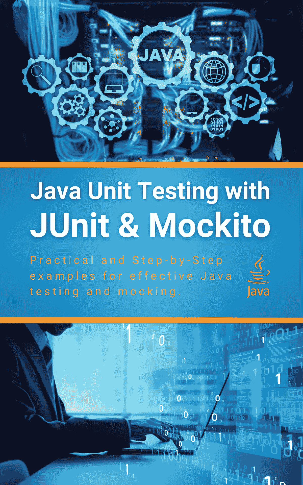

# Java 单元测试：JUnit 和 Mockito

## 高效 Java 测试与模拟的实用分步示例



## 结

## 欢迎学习，你将学到什么

单元测试在软件开发过程中似乎是一项枯燥的任务，但实际上，这是一项具有指数级回报的投资。编写良好的单元测试将成为你项目的安全网。随着代码库的扩展和演变，测试可以确保没有任何意外损坏，从而节省无数的调试时间并保障你的 Java 应用程序的质量。

## 为什么选择这本书？

其他书籍侧重于测试基础或理论概念，而本书从零开始通过实际示例构建。你将在实践中学习，将理论转化为工作代码。当你隔离组件并创建专注的测试场景时，`Mockito` 的 Mock 能力将感觉像你的超能力一样。

让我们探索通过本书你将取得的成就。

### 你将开发的技能栈

- **编写简洁且高效的 JUnit 测试**：精通基础——断言、设置、清理以及如何组织测试以实现最大的可读性。
- **使用 Mockito 进行插桩和 Mock**：控制外部依赖并模拟复杂的交互，以隔离你想要测试的特定行为。
- **处理边界情况和异常**：学习如何编写能够优雅处理意外情况的测试，并验证你的错误处理逻辑。
- **高级插桩和验证技术**：使用参数匹配器、捕获参数，并为细微、复杂的 Mock 行为创建自定义响应。
- **Spring 集成**：发现如何将 `Mockito` 平滑地集成到基于 `Spring` 的项目中以进行稳健的单元测试。
- **针对特殊场景的 PowerMock**：学习测试“不可测试”的代码，包括使用 `PowerMock` Mock 静态方法、私有方法和构造函数。
- **真实世界测试策略**：获得关于在整个软件开发生命周期中使用单元测试的实用知识，提高代码可靠性和维护性。

## 本书的结构

章节遵循渐进式的学习路径：

- **第一部分：理解单元测试的本质**：基础至关重要！你将学习核心原理、JUnit 的结构以及如何建立健壮的测试套件。
- **第二部分：为 Mockito 准备并理解其角色**：你将为 Mockito 准备项目并理解 Mock 能力的概念。
- **第三部分：揭示 Mockito 的核心**：深入创建 Mock、微调插桩并有效地验证调用。
- **第四部分：精通 Mockito 的高级技术**：探索 Hamcrest 匹配器、Mockito 注解以及用于复杂场景的高级技巧。
- **第五部分：使用 PowerMock 和 Mockito 释放高级测试技术**：深入研究静态方法、构造函数和私有方法，将复杂场景拆分为可测试的单元。
- **第六部分：使用 JUnit 和 Mockito 进行集成测试**：发现如何编写应用程序多个组件之间交互的集成测试。
- **第七部分：高级测试场景和策略**：学习测试最佳实践、边界测试、异步场景、测试数据管理、集成到你的 CI/CD 工作流等。

## 我们将共同构建

我们不只是讨论概念，还将一起编写代码。随着课程，你将为一个示例 Java 应用程序创建一个不断增长的测试套件。每一步都会强化你的理解并提供具体的示例。

## 开始吧！

测试是一项随着持续练习而提高的技能。这本书是你的路线图，提供了你所需的工具。准备好成为单元测试大师，保护你的 Java 项目并构建更好的软件了吗？让我们进入单元测试的精彩世界吧！

- [`JUnit 5 用户指南`](https://junit.org/junit5/docs/current/user-guide/)
- [`Mockito 项目主页`](https://site.mockito.org/)
- [`Spring Framework 框架`](https://docs.spring.io/spring-framework/docs/current/reference/html/testing.html)

注意：这些是补充你知识的重要资源。

# 第 1 部分：理解单元测试的本质

## 单元测试在 Java 开发中的意义

想象正在构建一台由数百个复杂部件组成的巨型机器。你会先组装好整个机器，然后尝试通电并希望一切都能完美运行吗？当然不会！有效的工程意味着在集成之前，对单个组件进行严格的测试。软件开发也遵循这一原理，单元测试就是你进行质量控制的核心工具。

### 什么是单元测试？

单元是应用程序中最小的可独立测试代码单元，通常是一个 `method`（方法）、`function` 或 `class`。单元测试是编写小型、集中的测试的过程，以隔离的方式验证这些单个单元的行为。将单元测试想象为对你软件机器中单个齿轮的显微镜检查。

### 为什么单元测试很重要

让我们深入探讨为什么单元测试是健壮 Java 开发基础的这些原因：

- **早期发现 Bug**：发现 Bug 越早，修复的成本越低、越容易。单元测试在开发周期早期就能捕捉错误。与其让 Bug 在几周后作为 UI 中的模糊症状出现，不如让单元测试精确地定位到负责的特定组件。
- **代码信心**：单元测试像是一个安全网。随着代码库的增长和更改，你的测试套件会确保没有发生意外破坏。这允许你无畏地进行重构和添加功能，从而加速开发速度。
- **改进设计**：编写测试往往会迫使你预先考虑代码的设计。当你的代码易于测试时，通常意味着其结构良好、模块化且职责清晰。
- **活的文档**：代码在几个月或几年后可能很难理解（即使是你自己的代码！）。单元测试充当了可执行规范，有效地记录了你的代码组件预期的工作方式。
- **防止回归**：当你修复一个 Bug 时，你会希望有一个测试确保该 Bug 永远不再出现。单元测试可以防止旧问题随着软件开发的进行而重新出现。

### 不测试的代价

跳过单元测试最初似乎节省了时间，但这是一场灾难的配方：

- **遗漏 Bug**：Bug 将不可避免地渗透到生产环境，导致用户感到沮丧，并可能损害你的应用程序声誉。
- **浪费调试时间**：在大型未测试代码库中寻找 Bug 是一场噩梦，会导致开发时间的浪费和不可预测的发布计划。
- **害怕改变**：由于没有测试作为安全网，即使是微小的修改也可能感觉充满风险，抑制你创新和改进项目的能力。
- **技术债**：缺乏测试会导致代码变得越来越脆弱且难以维护，从长远来看会拖慢团队进度。

### 良好的单元测试的核心特征

为了让你的单元测试真正有效，它们应该遵循几个关键原则：

- **快速（FAST）**：单元测试运行速度应该极快，提供近乎实时的反馈。成千上万个缓慢测试会让开发者失去积极性并阻塞你的开发工作流。
- **隔离（Isolated）**：每个测试都应该只关注被测试的单元，外部依赖应得到适当的控制或模拟（mocked）。
- **可重复（Repeatable）**：无论环境或时间如何，单元测试都应该给出一致的结果，对它们所测试的代码产生信心。
- **自检（Self-Checking）**：测试应该能够自己判断通过或失败。只需要极少的人工解读。
- **及时（Timely）**：理想情况下，单元测试应与其旨在测试的代码一同编写，帮助驱动设计过程本身。

### 单元测试思维

编写良好的单元测试需要转变你的开发方法。思考你的代码可能会如何失败，而不只是它应该如何工作。努力实现边缘情况覆盖。考虑意外的输入、无效的状态和潜在错误。你的测试应该以所有正确的方式“弄坏”你的代码。

### 让我们开始吧

在下一章中，我们将深入 `JUnit` 的实际世界，这个著名的 Java 测试框架将成为你的测试工具包。

### 额外资源

- [`JUnit 5 用户指南`](https://junit.org/junit5/docs/current/user-guide/)
- [`测试驱动开发（TDD）概述`](https://en.wikipedia.org/wiki/Test-driven_development)
- [`单元测试的益处`](https://docs.microsoft.com/en-us/visualstudio/test/unit-test-basics?view=vs-2022)

# 使用 JUnit 建立你的基础：第一部分

`JUnit` 几十年来一直是 Java 测试的骨干，提供了一个编写单元测试的结构化框架。在本章中，我们将开始构建单元测试专业知识。让我们涵盖基础内容：设置项目、编写基础测试以及理解核心概念。

## 配置环境

1. **选择你的工具**：
   - IDE：大多数现代 IDE（如 `IntelliJ`、`Eclipse`、`NetBeans`）都内置了 `JUnit` 支持。
   - 构建工具：广泛使用 `Maven` 或 `Gradle`。

2. **添加依赖**：
   - Maven：在你的 `pom.xml` 中包含此：

```xml
<dependency>
  <groupId>org.junit.jupiter</groupId>
  <artifactId>junit-jupiter</artifactId>
  <version>5.9.2</version>
  <scope>test</scope>
</dependency>
```

   - Gradle：在你的 `build.gradle` 中添加此：

```gradle
testImplementation("org.junit.jupiter:junit-jupiter:5.9.2")
```

## 创建你的第一个测试

让我们写一个简单的测试来感受 `JUnit` 的结构。考虑这个类：

```java
public class Calculator {
    public int add(int a, int b) {
        return a + b;
    }
}
```

这里是针对 `add` 方法的 JUnit 测试：

```java
import org.junit.jupiter.api.Test;
import static org.junit.jupiter.api.Assertions.assertEquals;

public class CalculatorTest {
    @Test
    public void testAdd() {
        Calculator calculator = new Calculator();
        assertEquals(5, calculator.add(2, 3));
    }
}
```

### 解析

- **导入（Imports）**：你需要 `org.junit.jupiter.api.Test` 来使用测试注解，使用 `org.junit.jupiter.api.Assertions` 来断言结果。
- **测试类**：为你的测试类以 `Test` 结尾命名（例如 `CalculatorTest`），以便于识别。
- **@Test 注解**：标记一个方法为由 `JUnit` 执行的测试。
- **断言（Assertions）**：`assertEquals` 是最基础的断言方法，验证预期结果与被测试代码的实际输出匹配。

## 运行测试

你的 IDE 通常具有运行 JUnit 测试的功能。寻找：

- **运行/调试按钮**：通常位于测试方法或类附近。
- **测试运行视图（Test Runner View）**：显示测试结果的专用界面。

## 理解 JUnit 术语

- **测试用例（Test Case）**：单个测试方法（示例中的 `testAdd`）。
- **测试套件（Test Suite）**：测试用例的集合，通常在一个类中。
- **测试固件（Test Fixture）**：一组测试所需的设置和清理工作（我们稍后会通过 `@Before`、`@After` 等介绍）。

## 断言

验证预期行为与实际行为的语句。JUnit 提供了丰富的断言方法集。

## 核心 JUnit 注解

到目前为止，你已经看到了 `@Test`。让我们再介绍几个：

- `@Disabled`：临时跳过测试用例的执行。开发期间非常有用。
- `@DisplayName`：为你的测试提供清晰、可读的名称，显示在测试报告中。

### 使用 @DisplayName 的示例

```java
@Test
@DisplayName("两个正数相加")
public void testAdd() {
    // ... 其他测试代码 ...
}
```

## 下一步工作

这是你进入 JUnit 世界的第一步！在下一部分中，我们将探索项目配置以获得流畅的测试体验，并深入研究更强大的断言方法。

### 额外资源

- [`JUnit 5 用户指南`](https://junit.org/junit5/docs/current/user-guide/)
- [`Maven 入门`](https://maven.apache.org/guides/getting-started/)
- [`Gradle 入门`](https://docs.gradle.org/current/userguide/getting_started.html)

# 配置 JUnit 以成功：第 2 部分

在上一章中，我们开始为你的 JUnit 测试之旅奠定基础。现在，让我们精调 JUnit 设置，以简化测试工作流并解锁高级功能。

## 自定义测试执行

JUnit 在运行测试方面提供了灵活性。以下是调整执行行为的方法：

- **测试运行器（Test Runners）**：JUnit 使用运行器执行并报告结果。默认运行器适用于大多数场景。然而，JUnit 支持用于特殊用例的自定义运行器：
  - `Parameterized`：用于运行参数化测试（本书后将介绍）。
  - `Suite`：用于创建测试类集合。
- **测试排序**：默认情况下，测试执行的顺序是不可预测的。对于特定场景，你可以使用以下方式强制排序：
  - `@Order` 注解：为每个测试方法分配一个整数来控制序列。
  - `@FixMethodOrder` 注解：强制测试按照其方法名称（字母顺序）确定的特定顺序运行。请谨慎使用这些，因为顺序依赖通常意味着测试隔离性较差。

## 假设：条件下的测试

假设（Assumptions）允许你在某些先决条件不满足时跳过测试。这对于根据你的环境或特定状态过滤测试非常有用。

- `assumeTrue()` 和 `assumeFalse()`：如果提供的条件不满足，则使测试失败。

```java
import static org.junit.jupiter.api.Assumptions.assumeTrue;

@Test
void testOnLinuxEnvironment() {
    assumeTrue(System.getProperty("os.name").equals("Linux"));
    // 专门为 Linux 设计的测试逻辑
}
```

## 管理测试超时

偶尔测试可能会陷入无限循环或挂起。JUnit 的超时功能可以防止这种情况的发生：

- `@Timeout`：为测试指定最大执行时间。如果超过该时间，测试将失败。

```java
@Test
@Timeout(value=100, unit=TimeUnit.MILLISECONDS)
void testWithTimeout() {
    // 应该在 100 毫秒内执行的测试逻辑
}
```

## 基础之外：实用的 JUnit 特性

让我们探索一些少为人知但强大的 JUnit 能力：

- **使用 @Tag 分组测试**：为你的测试分配自定义标签以进行选择性执行。例如，将慢测试标记为 `@Tag("integration")` 并在单独的构建配置中运行它们。
- **条件测试执行**：你可以使用 `@EnabledIf` 和 `@DisabledIf` 配合自定义系统（例如检查环境变量）根据条件启用或禁用测试。
- `@Nested`：创建嵌套测试类来结构化复杂的测试用例，或在单个类中对相关测试分组。这提高了测试的可读性。

### 示例：条件执行与分组

```java
@Test
@EnabledIf("isDevelopmentEnvironment")
@Tag("integration")
void integrationTestOnDevelopment() {
    // ... 集成测试逻辑
}

private static boolean isDevelopmentEnvironment() {
    return "dev".equals(System.getProperty("env"));
}
```

## 与构建工具集成（Maven 和 Gradle）

构建工具无缝地将 JUnit 集成到你的项目生命周期中，允许你轻松运行测试。以下是典型的命令：

### Maven

- `mvn test`：执行所有测试。
- `mvn test -Dtest=CalculatorTest`：只执行 `CalculatorTest`。
- `mvn test -Dtest=CalculatorTest#testAdd`：执行 `CalculatorTest` 中的 `testAdd` 方法。

### Gradle

- `gradle test`：执行所有测试。
- `gradle test --tests CalculatorTest`：只执行 `CalculatorTest`。
- `gradle test --tests CalculatorTest.testAdd`：执行 `CalculatorTest` 中的 `testAdd` 方法。

## 高级配置

构建工具提供了高级选项来自定义测试报告、过滤等。请探索各自的文档以获取这些选项。

### 额外资源


- JUnit 5 用户指南（条件执行、假设等）：[`junit.org/junit5/docs/current/user-guide/`](https://junit.org/junit5/docs/current/user-guide/)
- Maven Surefire 插件（测试配置）：[`maven.apache.org/surefire/maven-surefire-plugin/`](https://maven.apache.org/surefire/maven-surefire-plugin/)
- Gradle Test Task（测试配置）：[`docs.gradle.org/current/dsl/org.gradle.api.tasks.testing.Test.html`](https://docs.gradle.org/current/dsl/org.gradle.api.tasks.testing.Test.html)

让我们继续专注于强大的断言技术，不断增强你对 JUnit 的掌握！

## 实现成功：绿色条条与断言相等性：第 1 部分

将那些测试结果变成绿色是一次令人满意的体验！在本章中，我们将开始深入探索 JUnit 的断言方法。这些是验证你代码行为正确性的骨干，而掌握它们是编写有效的单元测试的基础。

## 断言的重要性

断言是单元测试的核心。它们表达了你对代码的预期。当其中一个断言失败时，它会精确地指出你的代码何时偏离了设计。

## JUnit 断言方法：基础

让我们先概述 `org.junit.jupiter.api.Assertions` 提供的核心断言方法：

- `assertEquals(expected, actual)`：最基础的断言。验证两个对象是否相等。对于基本类型，这意味着直接值相等（例如 `5 == 5`）。对于对象，它通常使用对象的 `equals()` 方法。
- `assertNotEquals(unexpected, actual)`：`assertEquals` 的相反，确保两个对象不相等。
- `assertTrue(condition)`：断言布尔条件为 `true`。
- `assertFalse(condition)`：断言布尔条件为 `false`。
- `assertNull(object)`：断言给定对象为 `null`。
- `assertNotNull(object)`：断言给定对象不为 `null`。

## 示例：断言实践

让我们回顾 `Calculator` 类并添加一些测试：

```java
import org.junit.jupiter.api.Test;
import static org.junit.jupiter.api.Assertions.*;

public class CalculatorTest {
    private Calculator calculator = new Calculator();

    @Test
    void testSubtract() {
        assertEquals(3, calculator.subtract(5, 2));
    }

    @Test
    void testMultiply() {
        assertEquals(10, calculator.multiply(5, 2));
    }

    @Test
    void testDivisionByZero() {
        assertThrows(ArithmeticException.class, () -> calculator.divide(5, 0));
    }
}
```

让我们拆解新的测试 `testDivisionByZero()`：

- `assertThrows`：专门为测试异常场景设计。在这里，我们预期除以零时会抛出 `ArithmeticException`。
- Lambda 表达式：代码 `() -> calculator.divide(5, 0)` 是一个 Lambda 表达式，提供了预期触发异常的可执行代码块。

## 深度相等：基本类型 vs. 对象

区分基本类型和对象之间相等性断言的工作机制至关重要：

- 基本类型：直接对值进行比较。`assertEquals(7, 7)` 通过。
- 对象：默认情况下，JUnit 检查对象是否指向同一个内存位置（引用相等性）。通常，你可能希望比较对象的内容（使用 `equals()` 方法）。

### 示例：对象比较

```java
Person person1 = new Person("Alice", 30);
Person person2 = new Person("Alice", 30); // 相同的姓名和年龄

// 这一断言很可能会失败（除非你在 Person 类中重写了 .equals）
assertEquals(person1, person2);
```

## 第 2 部分：更多断言与技术

在下一部分中，我们将通过更多专门的方法、浮点数的比较，以及让你的断言更具信息量的技术，来扩展我们的断言工具箱。

### 额外资源

- JUnit 5 断言 API：[`junit.org/junit5/docs/current/api/org.junit.jupiter.api/org/junit/jupiter/api/Assertions.html`](https://junit.org/junit5/docs/current/api/org.junit.jupiter.api/org/junit/jupiter/api/Assertions.html)
- Java 对象与相等性：[`www.geeksforgeeks.org/equals-hashcode-methods-java/`](https://www.geeksforgeeks.org/equals-hashcode-methods-java/)

## 掌握绿色通过条：相等性断言技术：第 2 部分

## 进阶基础

让我们探索更多专门的断言，以提高测试的精确性：

- `assertArrayEquals(expectedArray, actualArray)`：逐个元素比较两个数组的相等性。元素的顺序非常重要。
- `assertIterableEquals(expectedIterable, actualIterable)`：与 `assertArrayEquals` 类似，但适用于任何 `Iterable`（列表、集合等）。元素的顺序很重要。
- `assertLinesMatch(expectedLines, actualLines)`：允许比较多行文本内容（字符串列表），有助于验证文件内容。
- `assertTimeout(duration, executable)`：确保代码块在指定的时间限制内执行，以防止潜在的挂起。
- `assertTimeoutPreemptively(duration, executable)`：`assertTimeout` 的更严格版本，如果超过超时，测试将立即失败，即使代码块稍后才完成。

### 示例：数组与可迭代断言

```java
@Test
void testArrayEquality() {
    int[] expected = {1, 5, 3};
    int[] actual = calculator.sortNumbers(new int[] {3, 1, 5});
    assertArrayEquals(expected, actual);
}

@Test
void testIterableEquality() {
    List<String> expected = Arrays.asList("Alice", "Bob");
    Set<String> actual = calculator.getUniqueNames();
    assertIterableEquals(expected, actual); // 在这种情况下顺序不重要
}
```

### 浮点数精度

直接使用 `assertEquals` 比较浮点数（例如 `double`、`float`）可能是危险的，因为它们的表示存在固有的舍入误差。JUnit 提供了一个解决方案：

- `assertEquals(double expected, double actual, double delta)`：断言两个 `double` 值在指定的容差（`delta`）范围内。

#### 示例：浮点数比较

```java
@Test
void testApproximateCalculation() {
    double result = calculator.calculateFormula(0.1);
    assertEquals(0.333, result, 0.001); // 容差为 0.001
}
```

### 自定义失败消息

所有断言方法都有重载版本，可以接受一个额外的 `String` 参数作为第一个参数。此 `String` 作为自定义的失败消息，在测试失败时提供更多上下文。

#### 示例：自定义失败消息

```java
@Test
void testInvalidLogin() {
    String username = "wrongUser";
    String password = "badpassword";
    assertFalse(authService.login(username, password), "登录应因凭据无效而失败");
}
```

### 断言的最佳实践

- 每个测试一个断言（理想情况下）：避免编写包含多个断言的过于复杂的测试。力求每个测试用例对应一个主要的断言。这有助于失败隔离，并使结果更具信息量。
- 描述性消息：使用自定义消息使失败的测试更易理解。
- 测试辅助方法：如果你有复杂的断言逻辑，将其封装到可重用的辅助方法中，或创建自定义断言类以保持测试用例整洁。

### 使用断言进行 TDD

记住，测试驱动开发（TDD）鼓励你先编写断言。在编写代码之前思考你期望代码产生的结果，将引导出更专注的设计。

#### 示例：阶乘方法的 TDD 方法

1. 编写测试：

   ```java
   @Test
   void testFactorial() {
       // 此处省略代码...
   }
   ```

2. 编写最简单的实现（即使它失败）：

   ```java
   public class FactorialCalculator {
       public int calculate(int n) {
           return 1; // 初始测试失败
       }
   }
   ```

3. 迭代并让测试通过！

## 下节预：结构合理的测试

在接下来的章节中，我们将讨论如何重构你的测试以获得更好的可维护性和长期成功。

### 额外资源

- JUnit 5 断言 API（参见重载方法）：[`junit.org/junit5/docs/current/api/org.junit.jupiter.api/org/junit/jupiter/api/Assertions.html`](https://junit.org/junit5/docs/current/api/org.junit.jupiter.api/org/junit/jupiter/api/Assertions.html)
- 测试驱动开发（TDD）：[`en.wikipedia.org/wiki/Test-driven_development`](https://en.wikipedia.org/wiki/Test-driven_development)

## 打造健壮的测试：完善你的测试套件：第 1 部分

测试不仅仅是为了今天的绿色通过条。它们需要随项目的发展而保持可靠。如果测试套件经常因无关的代码而失败，就会破坏它本应提供的信心。让我们开始为测试构建健壮性。

## 健壮测试的原则

在构建测试结构时，请记住以下指导原则：

- 隔离性：良好的单元测试仅关注被测单元，减少与其他组件的依赖。这使得失败更容易定位，且不易引发连锁反应。
- 可维护性：测试也是代码！结构良好的测试在代码更改时更容易更新，从而节省宝贵时间。
- 可读性：测试是活文档。清晰的测试名称和结构有助于理解代码应该如何工作。
- 可重复性：如果依赖项没有发生变化，测试应该产生相同的结果。波动会破坏对测试的信任。

## 脆弱测试的常见原因

让我们剖析一些导致测试不稳定的常见问题：

- 过于具体的断言：当断言与代码的内部实现耦合时，任何实现的重构都可能导致测试失败。
- 隐藏的外部依赖：依赖当前日期、系统属性、文件系统状态或网络调用的测试会引入不确定性，破坏可重复性。
- 测试用例重叠：具有显著重叠的测试会导致连锁失败。一个 bug 可能会导致多个测试失败，掩盖真正的问题源头。
- 方法命名：采用如 `shouldCalculatePriceCorrectlyWhenProductIsOnSale()` 的命名规范。
- 安排-执行-断言（AAA）：一种促进测试阶段清晰分离的模式——设置环境、执行被测代码、然后进行断言。

## 示例：重构测试用

让我们想象一个依赖于当前日期的 `OrderService` 测试用：

### 脆弱版本

```java
@Test
void testOrderIsDiscountedOnBlackFriday() {
  LocalDate orderDate = LocalDate.of(2023, 11, 24);  // 黑色星期五
  OrderService orderService = new OrderService();
  double discount = orderService.calculateDiscount(orderDate);
  assertEquals(0.25, discount);
}
```

### 重构以增强健壮性

### 更具韧性的版本

```java
@Test
void testOrderIsDiscountedOnBlackFriday() {
  Clock fixedClock = Clock.fixed(LocalDate.of(2023, 11, 24).atStartOfDay(ZoneId.systemDefault()).toInstant(), ZoneId.systemDefault());
  OrderService orderService = new OrderService(fixedClock);  // 注入可控的时钟
  double discount = orderService.calculateDiscount();
  assertEquals(0.25, discount);
}
```

**关键变化**：我们引入了 `java.time.Clock` 接口，允许向 `OrderService` 注入一个“固定”的时钟，确保它始终认为现在是黑色星期五。

## 第二部分：更多重构、测试气味以及使测试自给足

在下一部分，我们将涵盖识别问题测试（“测试气味”）的技术、如何让测试自给足以增加隔离性，并深入探讨更多的重构模式。

### 额外资源

- 测试气味：[`martinfowler.com/bliki/TestSmell.html`](https://martinfowler.com/bliki/TestSmell.html)
- Java 时间时钟：[`docs.oracle.com/javase/8/docs/api/java/time/Clock.html`](https://docs.oracle.com/javase/8/docs/api/java/time/Clock.html)
- 重构技术：[`refactoring.guru/refactoring/techniques`](https://refactoring.guru/refactoring/techniques)

# 增强测试健壮性：高级重构技术：部分部分

## 识别测试气味

在我们深入探讨重构之前，让我们学会识别常见的“测试气味”——这些是暗示你的测试代码中可能存在问题的明显迹象。

- 脆弱的测试：因与其无关的代码更改而频繁失败。
- 缓慢的测试：执行时间过长的测试会降低人们频繁测试的意愿。
- 过度模拟（Mocking）：复杂的 Mock 设置可能使测试难以理解和维护。这是你的单元可能没有良好隔离的信号。
- 冗余：多个测试断言同一件事价值很小。
- 晦涩的测试逻辑：难以追踪的复杂测试代码表明需要进行重构。
- 条件测试逻辑：根据环境或数据选择性运行的测试表明存在隐藏的依赖关系或可重复性问题。

## 高级重构技术

让我们关注一些更复杂的重构技术，为你的测试套件装上铠：

1. 引入测试替身（Test Doubles）：用简化的替代品（`Mocks, Stubs, Fakes`）替换复杂的依赖。我们将在探索 `Mockito` 时详细介绍这一点，但该概念是隔离性的关键。
2. 测试数据的构建器模式（Builder Pattern）：不再使用分散的测试数据，`Builder Pattern` 集中了测试对象的构建方式，使测试设置更加一致。

### 示例：测试数据构建器

```java
public class OrderBuilder {
  private String orderId = "123";
  private LocalDate orderDate = LocalDate.now();
  private List<LineItem> lineItems = new ArrayList<>();

  public OrderBuilder withOrderId(String orderId) {
    this.orderId = orderId;
    return this;
  }
  // ... 更多用于自定义的 'with' 方法
  public Order build() {
    Order order = new Order(orderId, orderDate);
    order.setLineItems(lineItems);
    return order;
  }
}
```

### 在测试中使用


```java
@Test
void testCalculateTotal() {
  Order order = new OrderBuilder()
    .withOrderId("test-order")
    .withLineItem(new LineItem("Product1", 10.0, 2))
    .build();
  // ...
}
```

3. **对象母亲模式 (Object Mother Pattern)**：与`Builder Pattern`类似，但侧重于创建可重用的、“原型”测试对象，以减少多个测试之间的冗余。

4. **提取设置逻辑**：将重复的测试设置代码移动到辅助方法或可重用的设置/清理函数（`@Before`, `@BeforeEach`等）中，以提高 DRY（不要重复自己）性。

## 解决特定的测试气味

- **脆弱的测试**：大量使用测试替身来隔离被测单元，并将断言关注在单元的行为上，而不是协作者的内部细节。

- **缓慢的测试**：识别瓶颈，并可能引入优化或 Mock 来加速。考虑将缓慢测试作为 nightly 构建的一部分选择性运行，而不是每次开发更改都运行。

- **过度模拟**：重新评估你的设计的信号。如果你的类需要许多 Mock 才能进行测试，也许它的职责可以进一步拆分。

## 重构之外：良好实践

- **有意义的命名**：为你的生产代码和测试都给出反映其目的的清晰名称。

- **封装**：保持测试类镜像你的产品代码结构，以便于导航。

- **为可测试性而设计**：编写测试会影响你的设计。难以测试的代码通常表明生产代码结构存在问题。

## 持续改进

将你的测试套件视为代码库不可或的一部分。与生产代码同步重构你的测试以保持项目的健康和适应性。

## 下一个：assertTrue 和 assertFalse 的布尔逻辑

在下一章节，我们将转换方向，讨论如何使用 JUnit 的`assertTrue`和`assertFalse`方法在测试中验证条件。

### 额外资源

- **测试气味**：[https://martinfowler.com/bliki/TestSmell.html]

- **重构模式**：[https://refactoring.guru/refactoring/techniques]

- **为可测试性设计**：[https://martinfowler.com/articles/practical-test-pyramid.html]

## 验证条件：利用 assertTrue 和 assertFalse

除了等性检查外，测试通常还需要验证逻辑条件。引入 JUnit 的`assertTrue`和`assertFalse` —— 这是在代码中断言布尔事实的基础工具。

### 基础

- `assertTrue(boolean condition)`：断言提供的`condition`求值为`true`。如果条件为真，则测试通过，否则测试失败。

- `assertFalse(boolean condition)`：断言提供的`condition`求值为`false`。如果条件为假，则测试通过，否则测试失败。

### 示例：检查登录状态

```java
@Test
void testLoginSuccess() {
  AuthService authService = new AuthService();
  boolean isLoggedIn = authService.login("john.doe", "password123");
  assertTrue(isLoggedIn);
}
```

## 不仅仅是 true/false

这些方法由于能够评估表达式而特别强大：

```java
@Test
void testDiscountEligibility() {
  Customer customer = new Customer(true); // 忠诚客户
  Product product = new Product(55.0);
  DiscountService discountService = new DiscountService();
  boolean isEligible = discountService.isEligibleForDiscount(customer, product);
  assertTrue(isEligible);
}
```

## 用场景

以下是`assertTrue`和`assertFalse`发光的一些常见场景：

- **条件逻辑**：验证代码中的 ‘if’ 语句和其他决策结构会导致正确的输出。

- **状态验证**：在调用特定方法后检查对象的状态（例如，集合的`isEmpty()`、属性标志位等）。

- **组合断言**：你可以将断言链在一起以进行更复杂的检查。

### 示例：订单状态

```java
@Test
void testOrderIsShipped() {
    OrderService orderService = new OrderService();
    orderService.processOrder(12345);
    Order order = orderService.getOrder(12345);
    assertTrue(order.isPaid());
    assertTrue(order.isShipped());
}
```

### 自定义失败消息

与其他断言一样，你可以包含自定义消息，以使测试失败提供更详尽的信息：

```java
@Test
void testAccountActivation() {
    // ... setup
    assertFalse(account.isLocked(), "Account should not be locked after activation");
}
```

### 关键考虑

- **可读性**：有时你的布尔表达式可能会变得复杂。将它们拆分为命名良好的变量，以增强代码的可读性。

- **测试驱动开发 (TDD)**：在编写生产代码之前编写断言，以此驱动你的设计决策。

### 陷阱：过度使用否定操作

虽然在技术上可行，但请避免在条件中使用连续的`!`（否定）操作符链。这会让测试更难解析。相反，请选择更清晰的表达式或重构你的代码以直接产生条件。

### 示例：为了清晰性进行重构

```java
// 不太理想：
assertFalse(!accountService.isUserAccountActive(userId));

// 更好：
assertTrue(accountService.isUserAccountActive(userId));
```

### 互补断言

记住 JUnit 提供的其他有用断言：

- `assertNull(object)`：验证给定的对象为`null`。

- `assertNotNull(object)`：验证给定的对象不为`null`。

## 第二部分：增强技术与集成

在下一部分中，我们将深入研究使用`assertTrue`和`assertFalse`测试集合、错误场景，以及它们如何与 Hamcrest 匹配器等高级测试概念集成。

### 额外资源

- JUnit 5 断言 API：[`junit.org/junit5/docs/current/api/org.junit.jupiter.api/org/junit/jupiter/api/Assertions.html`](https://junit.org/junit5/docs/current/api/org.junit.jupiter.api/org/junit/jupiter/api/Assertions.html)

## 精确断言条件：高级技术 – 第二部分

### 测试集合

通常，你需要确保集合（Lists、Sets、Maps）包含特定的元素或具有某些属性：

- **检查内容**：

```java
List<Integer> numbers = Arrays.asList(2, 4, 6);
assertTrue(numbers.contains(4));
```

- **是否为空或非空**：

```java
Set<String> errors = validator.validate(data);
assertTrue(errors.isEmpty(), "Validation should have passed without errors");
```

### 处理异常

JUnit 的`assertThrows`在错误场景下非常有用。记住，我们在之前的章节中简要地提到过这一点。现在，让我们深入探究：

```java
@Test
void testInvalidDiscountCode() {
    assertThrows(InvalidDiscountCodeException.class, () -> {
        store.applyDiscount("badCode");
    });
}
```

- **验证异常消息**：

```java
Exception exception = assertThrows(IllegalArgumentException.class, () -> {
    calculator.divide(10, 0);
});
assertTrue(exception.getMessage().contains("Division by zero"));
```

### 使用 Hamcrest 匹配器进阶

我们将在后的专门章节中深入研究 Hamcrest，但让我们先预览一下！Hamcrest 匹配器提供了丰富的词汇，以极高的灵活性和可读性来表达断言。

### 示例：使用 Hamcrest 检查集合

```java
import static org.hamcrest.MatcherAssert.assertThat;
import static org.hamcrest.Matchers.*;

@Test
void testProductNames() {
    List<String> products = Arrays.asList("Mug", "T-shirt", "Notebook");
    assertThat(products, hasItems("Mug", "Notebook"));
    assertThat(products, hasSize(3));
}
```

**说明：**

- `assertThat`：Hamcrest 断言的入口点。

- `hasItems`, `hasSize`：Hamcrest 提供的大量匹配器示例。

### `assertTrue` 以实现流式处理

你可以将 Hamcrest 与标准的布尔断言结合，以获得最大的表达力：

```java
@Test
void testOrderStateTransitions() {
    Order order = new Order();
    order.place();
    order.ship();
    assertTrue(order.getState().matches(OrderState.SHIPPED)); // 自定义匹配器
}
```

### 测试超时

记得`assertTimeout`和`assertTimeoutPreemptively`方法吗？这些对于确保你的测试不会因为 Bug 或潜在的无限循环而无限运行至关重要。

**示例**

```java
@Test
void testNetworkTimeout() {
    assertTimeout(Duration.ofMillis(500), () -> {
        client.fetchData();
    });
}
```

### 最佳实践

- **命名**：为测试和变量使用性名称。

- **清晰性**：优先使用清晰的表达式而非复杂的逻辑。

- **清理**：使用`@AfterEach`确保资源被正确释放。

## 静态方法与实例方法

- 注解了`@BeforeClass`和`@AfterClass`的方法必须是`static`的。然而，`@BeforeEach`和`@AfterEach`方法通常不应该是`static`的，这样它们就可以访问测试类的实例字段。

- **可维护性**：这些注解显著提高了测试代码的可读性和组织性。

## 设置/清理（Setup/Teardown）的常见场景

- **数据库交互**：创建测试记录、回滚事务。

- **Mock**：配置测试体（我们将在后的 Mockito 章节中讨论这一点）。

- **外部系统**：启动测试服务器、清除缓存等。

- **数据生成**：创建测试对象。

## 关于继承的说明

Setup/teardown 方法在测试类的层次结构中被继承。父类方法会在子类方法之前执行（针对`@BeforeClass`和`@BeforeEach`），在子类方法之后执行（针对`@AfterEach`和`@AfterClass`）。

## 第 2 部分：针对性能和复杂场景进行优化

在下部分，我们将深入探讨高级的设置和清理策略、性能考虑因素，以及这些注解如何与其他 JUnit 功能良好地协作。

### 额外资源

- JUnit 5 用户指南 - 测试生命周期：[`junit.org/junit5/docs/current/user-guide/`](https://junit.org/junit5/docs/current/user-guide/)

## 优化测试初始化与清理：高级策略 – 第 2 部分

## 性能考虑

虽然`@Before`和`@After`（及其变体）非常棒，但请记住这些性能优化，特别是对于大型测试套件：

- **懒是一种美德**：如果可能，仅在测试实际需要时才创建昂贵对象或设置资源。除非绝对必要，否则避免在`@BeforeEach`中进行复杂的初始化。

- **选择性设置**：是否可以将共享相同设置逻辑的测试分组以避免重复工作？考虑嵌套类或巧妙的重用模式。

- **测试对象池**：对于某些对象，对象的创建可能是瓶颈。维护一个重用对象池有时可以加速。

## 复杂层次结构

当你的设置和清理涉及多个依赖项或复杂的序列时，请考虑：

- **构建模式 (Builder Pattern)**：我们在重构章节中提到过这一点。构建模式促进了受控的、逐步的对象构建，使设置逻辑集中化。

- **自定义设置/清理工具**：将复杂的设置步骤封装到辅助函数或专用的工具类中，使你的测试方法更加简洁。

## 设置与清理之外

让我们看看与这些注解互补的技术：

1. **测试数据管理**：

    - **内存数据库 (H2, HSQLDB)**：不要为每个测试都访问真实数据库，使用嵌入式数据库来实现极速测试。

    - **数据固件 (Data Fixtures)**：测试前加载的预定义数据集（XML, JSON, CSV）。

2. **加速外部交互**：

    - **Mock**：Mockito 是你这里的终极工具。我们将专门用一个章节来掌握它。模拟缓慢的外部依赖以保持单元测试的快速。

    - **通用测试体 (Test Doubles)**：存根 (Stubs)、假象 (Fakes) 等作为更轻量级的替代品。

### 示例：测试数据固件

```java
@BeforeEach
void loadTestData() {
    testDataLoader.load("default-accounts.json", accountRepository);
}
```

## 与其他 JUnit 功能的相互作用

- `@TestInstance(Lifecycle.PER_CLASS)`：这更改了 JUnit 实例化测试类的方式（`PER_METHOD`是默认值）。使用`PER_CLASS`意味着所有的测试方法都共享该类的一个实例。使用`@BeforeAll`进行设置是可以行的，但要小心，因为如果你不管理状态，这可能会在测试之间引入意外的依赖。

- **假设 (assumeTrue, assumeFalse)**：仅在某些设置成功时有条件地运行整个测试。谨慎使用以避免掩盖隐藏错误。

### 注意事项

- **过度使用**：过度的设置可能意味着你的生产代码存在设计问题。你的类是否太复杂了？

- **状态泄漏**：确保`@AfterEach`真正清理了更改，避免测试之间的副作用。彻底的清理是必须的！

### 示例：谨慎的状态重置

```java
@AfterEach
void resetCalculator() {
    if (calculator != null) {
        calculator.clear();
    }
}
```

- **平衡粒度**：避免在单个`@BeforeEach`中初始化所有内容。在细粒度设置和测试效率之间取得平衡是关键。

## 下一步：使用 @BeforeClass 和 @AfterClass 进行静态设置/清理

接下来，我们将讨论这些“类级”设置和清理注解的策略性使用，以及它们何时最适合你的测试工具箱。

### 额外资源

- 测试数据管理策略：[`searchsoftwarequality.techtarget.com/definition/test-data-management`](https://searchsoftwarequality.techtarget.com/definition/test-data-management)

- JUnit 5 @TestInstance：[`junit.org/junit5/docs/current/user-guide/`](https://junit.org/junit5/docs/current/user-guide/)

## 协调测试生命周期：@BeforeClass 和 @AfterClass


有时，设置和清理任务对于整个测试类来说是全局的。引入`@BeforeClass`和`@AfterClass`——你用于类级编排的工具。

## 何时使用它们

常见用例包括：

- **昂贵的初始化**：设置如数据库连接、嵌入式服务器或所有测试共享的重量级测试固件。
- **静态资源**：修改测试与之交互的静态字段或系统属性。
- **一次性清理**：释放在类内获取的资源。

## 核心笔记

- **执行顺序**：
  1. `@BeforeClass`：在任何测试之前执行一次。
  2. `@BeforeEach` -> 测试方法 -> `@AfterEach`（每个测试重复）。
  3. `@AfterClass`：在所有测试之后执行一次。
- **范围**：类级。
- **方法必须是静态的**：只有静态方法可以使用这些注解。实例方法不行。

## 示例：以数据库为中心的测试

```java
@TestInstance(Lifecycle.PER_CLASS) // 使用此生命周期示例
public class InvoiceRepositoryTest {
    private static InvoiceRepository repository;
    private static Connection connection;

    @BeforeClass
    static void setupDatabase() {
        connection = TestDatabaseUtil.createConnection();
        repository = new InvoiceRepository(connection);
    }

    @AfterClass
    static void tearDownDatabase() {
        repository = null;
        TestDatabaseUtil.closeConnection(connection);
    }

    @Test
    // ... 你的测试方法 ...
}
```

## 解释

- 设置和清理例程对整个测试类执行一次，使昂贵的数据库操作集中化。
- `@TestInstance(Lifecycle.PER_CLASS)`在此处用于说明，但要谨慎使用，因为它通过共享状态破坏了测试的标准隔离性。

## 关键考虑因素

- **测试隔离**：通常情况下，优先选择每个测试设置（`@BeforeEach`）和清理（`@AfterEach`）以获得最大的隔离性。谨慎地使用类级设置。
- **状态管理**：如果你的代码与静态字段或系统属性交互，在`@AfterClass`中进行彻底清理至关重要，以避免状态意外泄漏。
- **性能**：如果你正在执行真正共享的昂贵初始化，这些注解可以提高测试套件的性能。

## 何时不使用它们

- **每个测试的需求**：如果每个测试都需要新的对象或独特的环境变量设置，请避免使用这些。
- **过度使用**：过度的类级设置可能意味着你的类有过多的依赖或责任，可以进行重构。

## 替代方案与补充

- **测试套件（Test Suites）**：如果你需要一组共享非常特定且昂贵的设置的测试类，请考虑 JUnit 的`@Suite`注解。
- **外部工具**：对于复杂的配置，可以探索如`Testcontainers`等工具，用于管理测试环境中外部依赖（如数据库或 Web 服务）的生命周期。

让我们进入数组比较技巧！

### 额外资源

- `JUnit``@Suite`：[`junit.org/junit5/docs/current/user-guide/`](https://junit.org/junit5/docs/current/user-guide/)
- `Testcontainers`：[`www.testcontainers.org/`](https://www.testcontainers.org/)

## 掌握数组：数组比较的有效技术 – 第一部分

数组是 Java 开发的基础，确保其内容符合预期是一项常规测试任务。然而，仅仅使用`assertEquals(array1, array2)`是不够的！

## 数组的挑战

- **引用相等性**：在 Java 中，数组是对象。使用默认的`equals()`方法或`==`操作符比较的是它们是否指向同一个内存位置，而不是逐个比较元素的内容。
- **顺序很重要**：为了让测试通过，数组必须以相同的顺序具有相同的元素。

让我们在 JUnit 测试中探索可靠的数组比较技术。

### 1. JUnit 的`assertArrayEquals()`

你的第一个武器是 JUnit 专用的断言方法：

```java
import static org.junit.jupiter.api.Assertions.assertArrayEquals;

@Test
void testArrayEquality() {
 int[] expected = {1, 5, 2, 7};
 int[] actual = {1, 5, 2, 7};
    assertArrayEquals(expected, actual);
}
```

- **功能**：处理逐个元素的比较，同时考虑了值和顺序。适用于基本数据类型的数组。

### 2. `Arrays.equals()`（来自`java.util.Arrays`）

适用于比较对象数组：

```java
import java.util.Arrays;

@Test
void testObjectArrayEquality() {
    String[] expected = {"Hello", "World"};
    String[] actual = {"Hello", "World"};
    assertTrue(Arrays.equals(expected, actual));
}
```

- **重要性性**：对象数组内的元素必须实现自己的`equals()`方法才能进行内容比较。

### 3. Hamcrest Matchers

Hamcrest 匹配器提供了强大的表达式能力（我们稍后会有专门的章节介绍）：

```java
import static org.hamcrest.MatcherAssert.assertThat;
import static org.hamcrest.Matchers.*;

@Test
void testWithHamcrestMatchers() {
    Integer[] numbers = {4, 1, 8};
    assertThat(numbers, arrayContaining(1, 8, 4));  // 顺序不重要
    assertThat(numbers, is(arrayContainingInAnyOrder(8, 4, 1)));  // 灵活
}
```

## 需要考虑的权衡

- **可读性**：`assertArrayEquals`是基础情况的最直接的方法。Hamcrest 在更微妙的场景下表现优异。
- **类型**：`assertArrayEquals`专门用于基本类型数组。对于对象数组，需要`Arrays.equals`或 Hamcrest。

## 进阶考虑

- **深度比较**：对于包含其他数组或自定义对象的数组，你需要`Arrays.deepEquals()`或自定义解决方案来比较嵌套元素。
- **容差**：在比较浮点数数组（`double[]`、`float[]`）时，考虑使用带有 delta 偏移量进行近似的`assertArrayEquals`重载方法。

### 示例：排序算法测试

```java
@Test
void testSorting() {
 int[] unsorted = {8, 3, 6, 1};
 int[] expectedSorted = {1, 3, 6, 8};
    Arrays.sort(unsorted);  // 你的排序逻辑
    assertArrayEquals(expectedSorted, unsorted);
}
```

## 第二部分：增强数组比较

在第二部分中，我们将深入学习使用部分匹配比较数组、忽略特定元素、使用自定义比较器以及多维数组的策略。

### 额外资源

- `JUnit``assertArrayEquals`：[`junit.org/junit5/docs/current/api/org.junit.jupiter.api/org/junit/jupiter/api/Assertions.html`](https://junit.org/junit5/docs/current/api/org.junit.jupiter.api/org/junit/jupiter/api/Assertions.html)
- `Java``Arrays`类：[`docs.oracle.com/javase/8/docs/api/java/util/Arrays.html`](https://docs.oracle.com/javase/8/docs/api/java/util/Arrays.html)

## 数组重温：全面比较的高级策略 – 第二部分

## 基础之外

在第一部分中，我们涵盖了数组断言的核心方法。现在，让我们处理更微妙的场景：

### 1. 部分匹配

通常，你只想检查数组是否包含某些元素，而无乎它们的完整顺序。Hamcrest 匹配器在这里特别好用：

```java
@Test
void testPartialMatch() {
    String[] productCodes = {"ABC123", "PQR987", "XYZ456"};
    assertThat(productCodes, hasItems("PQR987", "XYZ456"));  // 只需要这些元素存在
}
```

### 2. 忽略元素

有时，你需要断言数组的相似性，但排除特定的元素：

```java
import static org.hamcrest.Matchers.*;
import static org.hamcrest.collection.IsIterableContainingInAnyOrder.*;

@Test
void testIgnoringElements() {
 Integer[] allNumbers = {5, 1, 8, 2, 7};
 // 忽略 '8' 并检查其余元素是否存在
 assertThat(allNumbers, containsInAnyOrder(equalTo("HELLO"), 5, 1, 2, 7));
```

### 3. 自定义比较器

为了根据特定属性比较对象数组，请构建自定义比较器：

```java
class Product {
    int id;
    String name;
    // ...
}

// 按 ID 比较产品的比较器
class ProductIdComparator implements Comparator<Product> {
    @Override
    public int compare(Product p1, Product p2) {
        return Integer.compare(p1.id, p2.id);
    }
}

@Test
void testWithComparator() {
    Product[] expectedProducts = { /* ... */ };
    Product[] actualProducts = { /* ... */ };
    // 使用 ProductIdComparator
}
```

### 4. 多维数组

- `Arrays.deepEquals()`：处理嵌套数组。
- **递归**：对于对象的深度比较，你可能需要递归逻辑。

### 示例：二维数组比较

```java
@Test
void test2DArray() {
    int[][] matrix1 = {{1, 2}, {3, 4}};
    int[][] matrix2 = {{3, 4}, {1, 2}};
    assertFalse(Arrays.deepEquals(matrix1, matrix2));
}
```

## 选择正确的工具

- **直接性**：`assertArrayEquals`是简单情况的最直接方法。
- **灵活性**：当需要部分匹配或顺序灵活时，Hamcrest 表现优异。
- **复杂性**：对于嵌套结构或独特的比较逻辑，考虑`Arrays.deepEquals`。

### 关键考虑

- **测试意图**：你真正在验证数组的哪个方面？这驱动了你的策略。
- **可读性**：虽然强大，但过的自定义会损害测试的清晰度。

让我们进入 JUnit 中的异常处理部分！

```java
void testInsufficientStock() {
    Exception exception = assertThrows(OutOfStockException.class, () -> {
        inventoryService.withdrawItems("X567", 20);
    });
    assertTrue(exception.getMessage().contains("Insufficient stock"));
}
```

### 3. 传统方式：`@Test(expected=...)`

适用于旧版本的 JUnit 或简单用例：

```java
@Test(expected = IllegalArgumentException.class)
public void testInvalidEmailFormat() {
    userService.register("bad_email");
}
```

- **局限性**：精细度较低；无法检查异常的内容。

### 4. try-catch 模式

有时候，你需要对抛出的异常进行更精细的控制：

```java
@Test
void testFileLoadError() {
    try {
        fileProcessor.processFile("missing.csv");
        fail("Should have thrown a FileNotFoundException");
    } catch (FileNotFoundException ex) {
        // 可选断言异常的更多细节
        assertThat(ex.getMessage(), containsString("missing.csv"));
    }
}
```

### 选择你的策略

- `assertThrows`：大多数场景下的现代、首选方法。对异常本身提供断言能力。
- `@Test(expected=...)`：如果你没有使用最新的 JUnit，这种方法对于基本的“是否抛出异常”的测试足够了。
- `try-catch`：当你需要处理异常或`assertThrows`不符合你的测试结构时，提供了细粒度的控制。

### 示例：健壮计算

```java
@Test
void testDivideByZero() {
    assertThrows(ArithmeticException.class, () -> calculator.divide(10, 0));
}

@Test
void testNegativeSquareRoot() {
    assertThrows(IllegalArgumentException.class, () -> calculator.sqrt(-4));
}
```

### 进阶内容

- **自定义异常类型**：确保对自定义的异常类通过了正确触发的测试。
- **测试异常传播**：验证异常如何通过你的方法调用层层冒泡。
- **框架集成（Spring）**：许多测试框架都提供了异常处理工具。探索它们与 JUnit 的集成。

### 最佳实践

- **聚焦的异常测试**：为不同的预期异常和场景编写分离测试。
- **整洁的测试失败**：确保测试失败清晰地指向异常问题，而不是关于异常的断言失败。

**下一步**：性能测试考虑因素，参数化测试

在下一章中，我们将讨论如何优化 JUnit 测试的性能，并介绍如何对其进行参数化以获得更广泛的覆盖。

---

# 性能验证：确保 JUnit 测试的最佳性能

单元测试不仅关乎正确性，还关乎速度。缓慢测试会影响开发速度。让我们探索如何识别并解决测试中的性能问题。

### 为什么性能在单元测试中很重要

- **快速反馈**：缓慢的测试会让人抑制频繁测试，而对于测试驱动开发（TDD）和敏捷工作流至关重要。
- **定位问题**：测试套件中的性能分析有助于尽早隔离生产代码中的瓶颈。
- **扩展性**：大型且缓慢的测试套件会阻碍项目的增长和可维护性。

### 常见的性能元凶

1. **昂贵的设置**：在每个测试之前重复执行`@Before`方法、数据库调用或网络操作。
2. **未优化的测试代码**：被测试代码中效率低下的算法或数据结构，就像普通的 Java 代码一样。
3. **外部依赖**：测试依赖的外部系统、文件或 Web 服务的缓慢交互。

### 对测试进行性能分析

虽然存在基础的计时机制，但专用的分析工具是你的最佳选择：

- **内置分析器**：你的 IDE（IntelliJ、Eclipse）可能提供了适用于测试执行的分析功能。
- **JMH（Java Microbenchmark Harness）**：一个为微基准测试设计的框架，包括类似单元测试的场景。设置较复杂，但提供了更细粒度的控制。

### 示例：初级计时


```java
@Test
void testDatabaseQueryPerformance() {
    long startTime = System.currentTimeMillis();
    productRepository.fetchProductsByCategory("Electronics");
    long endTime = System.currentTimeMillis();
    long duration = endTime - startTime;
    assertTrue(duration < 500); // 目标执行时间在 500ms 内
}
```

## 优化策略

- **Mock（模拟）**：使用 `mock` 和 `stub` 将你的测试与缓慢的外部依赖解耦（稍后我们将关注 `Mockito`）。
- **缓存**：如果测试场景内的结果是可预测的，避免冗余的计算或数据获取。
- **面向测试的设计**：有时，为了可测试性重构生产代码也有助于性能。
- **选择性执行**：标记性能测试。

## JUnit 专用工具

- `@Timeout`：强制执行最大持续时间。

示例：使用 `@Timeout`

```java
@Test
@Timeout(value = 100, unit = TimeUnit.MILLISECONDS)
void testStringConcatenation() {
    // ...
}
```

## 关键考虑量

- **基线**：建立性能预期。
- **焦点**：检测回归。
- **真实的负载**：模拟实际使用情况。

## 最佳实践

- **集成测试**：隔离的单元测试。
- **持续监控**：将性能跟踪纳入构建中。

**下一步**：参数化测试

## 额外资源

- **JUnit 异常测试**：[`junit.org/junit5/docs/current/user-guide/`](https://junit.org/junit5/docs/current/user-guide/)
- **JMH (Java Microbenchmark Harness)**：[`openjdk.java.net/projects/code-tools/jmh/`](https://openjdk.java.net/projects/code-tools/jmh/)

---

# 拥抱变化：参数化测试技术 – 第一部分

通常一个测试需要针对多组输入输出执行。手动为每个变化编写相似的测试既枯燥又容易出错。引入参数化测试！

## 参数化的威力

- **数据驱动测试**：使用紧凑的测试覆盖大量场景。
- **减少冗余**：维护单一测试模板，减少代码重复。
- **提高可读性**：专注于核心逻辑，输入/输出清晰分离。
- **边界情况探索**：系统地测试边界条件和各种用例。

## 核心概念

1. **参数源**：指示测试如何获取输入值。`JUnit` 提供了多种内置选项。
2. **参数化测试方法**：测试类中标记了 `@ParameterizedTest` 注解的方法。该方法接收参数源填充的参数。

## 从 JUnit 的内置源开始

- `@ValueSource`：对于简单数据类型（字符串、数字、枚举）最简单。

```java
@ParameterizedTest
@ValueSource(ints = {2, 4, 8, -5})
void testIsEven(int number) {
    assertTrue(number % 2 == 0);
}
```

- `@CsvSource`：处理逗号分隔的值，适用于稍微复杂的数据。

```java
@ParameterizedTest
@CsvSource({"apple, 5", "banana, 3", "orange, 8"})
void testFruitCost(String fruit, int price) {
    // ...
}
```

- `@EnumSource`：对枚举值进行迭代。

```java
enum Currency { USD, EUR, GBP }

@ParameterizedTest
@EnumSource(Currency.class)
void testCurrencySymbol(Currency currency) {
    // ...
}
```

## 示例：数学工具

```java
@ParameterizedTest
@ValueSource(doubles = {0.0, 1.0, -3.14, Double.MAX_VALUE})
void testAbsoluteValue(double input) {
    // ...
}
```

```java
assertEquals(Math.abs(input), MathUtils.absolute(input));
```

## 注意事项

- **命名**：`JUnit` 生成的测试名称会包含你的参数值。请在测试方法中使用具有意义的参数参数名称。
- **测试结构**：保持参数化测试方法的逻辑集中在所测试内容的核心上。
- **可读性至关重要**：不要为了参数化而牺牲清晰度。

## 第二部分：自定义源与微调

在第二部分中，我们将学习如何为更复杂的数据对象构建自定义源，探索如何调整测试执行和命名规范，并查看参数化测试如何与其他 `JUnit` 特性协同工作。

## 额外资源

- JUnit 5 参数化测试：[`junit.org/junit5/docs/current/user-guide/`](https://junit.org/junit5/docs/current/user-guide/)

# 参数化精准：微调你的测试 – 第 2 部分

在第 1 部分中，我们开启了参数化测试之旅。现在，让我们解锁更多自定义功能和高级技术。

## 1. 自定义参数源 (`@MethodSource`)

当内置源无法满足需求时，构建你自己的源来向测试提供复杂数据：

```java
@ParameterizedTest
@MethodSource("provideStringsAndLengths")  // 引用我们的自定义源
void testStringLength(String input, int expectedLength) {
    assertEquals(expectedLength, input.length());
}

// 我们的自定义参数提供
static Stream<Arguments> provideStringsAndLengths() {
    return Stream.of(
      Arguments.of("hello", 5),
      Arguments.of("JUnit in Action", 15)
    );
}
```

- **灵活性**：从文件、数据库或计算中生成测试数据。
- **Arguments 对象**：`Arguments` 类将多个值封装成单个“测试用例”单元。

## 2. 使用 `@DisplayName` 命名测试名称

参数化测试自动生成的名称可能难以解析。`@DisplayName` 注解来得救了！

```java
@ParameterizedTest(name = "[{index}] 用户 ID: {0}")  // 使用 {0}, {1}, ... 代表参数
@CsvSource({"123, John Doe", "456, Jane Smith"})
@DisplayName("测试用户注册")
void testUserRegistration(String userId, String fullName) {
    // ...
}
```

- **可读性胜出**：描述性的测试名称在测试报告和调试失败原因时非常有帮助。

## 3. 使用 `@TestTemplate` 调整执行

有时，你希望对参数化测试的调用方式有更多控制。引入 `@TestTemplate` 注解：

```java
// ... imports ...

@TestTemplate
@ExtendWith(MyCustomTestTemplateInvoker.class)  // 你的自定义逻辑
void testMultiplicationTable(int multiplier, int input, int expected) {
    assertEquals(expected, multiplier * input);
}
```

- **特殊场景**：自定义调用器可以改变执行顺序、过滤参数组合等。（注意：这是一项高级技术，通常需要更深层次的 `JUnit` 扩展知识）

## 4. 与假设断结合

将参数化与我们之前章节中的 `assumeTrue` 或 `assumeFalse` 结合，实现条件测试执行：

```java
@ParameterizedTest
@ValueSource(strings = { "racecar", " ", "Java"})
void testIsPalindrome(String word) {
    assumeTrue(word.length() > 1);  // 跳过单字符单词
    assertEquals(StringUtils.reverse(word), word);
}
```

## 示例：复杂计算

```java
@ParameterizedTest
@MethodSource("complexCalculationInputs")
void testCompoundGrowth(double principal, double rate, int periods, double expected) {
    assertEquals(expected, calculator.calculateFutureValue(principal, rate, periods), 0.01);
}

private static Stream<Arguments> complexCalculationInputs() {
    return Stream.of(
      Arguments.of(10000, 0.05, 10, 16289.0),
      Arguments.of(5000, 0.08, 5, 7346.64)
    );
}
```

## 最佳实践

- **平衡**：参数化非常强大，但不要过度使用。有时，多个传统的测试会更清晰。
- **提供方法命名**：诸如 `provide...` 或 `testCases...` 的约定有助于可读性。
- **文档**：如果你有复杂的自定义提供者，请为未来的维护者解释其逻辑。

## 下节：针对特定需求定制参数化

在第 3 部分中，我们将发现如何使用 `@ArgumentsSource` 注解使用更高级的参数源，并创建更加定制的参数化测试！

## 额外资源

- 使用 `@MethodSource` 的自定义参数源：[`junit.org/junit5/docs/current/user-guide/`](https://junit.org/junit5/docs/current/user-guide/)

# 定制参数化：自定义套件 – 第 3 部分

## 1. `ArgumentsSource`

当需要从外部源获取数据时，`@MethodSource` 有时并不够用。

```java
@ParameterizedTest
@ArgumentsSource(CustomProvider.class)
void testValidation(String email, boolean expected) {
    // ...
}

static class CustomProvider implements ArgumentsProvider {
    @Override
    Stream<? extends Arguments> provideArguments(ExtensionContext context) {
        // 从...加载
        return Stream.of(
          Arguments.of("valid@com", true),
          Arguments.of("invalid_email", false)
        );
    }
}
```

## 2. 可组合源

组合 `@CsvSource`、`@MethodSource` 等多个源。

```java
@ParameterizedTest
@CsvSource({"10, 20, 30"})
@MethodSource("provideObjects")
void testCalculator(int a, int b, int expected)

static Stream<Arguments> provideObjects() {
    // ...
}
```

## 3. 外部文件 (CSV, JSON)

适用于大量数据。`Jackson` 或 `OpenCSV` 等库可以简化解析：

```java
@ParameterizedTest
@CsvSource(resources = "/product_pricing.csv", numLinesToSkip = 1) // Header
void testPrice(String productId, double cost, double taxRate, double expectedPrice)
```

## 4. 过滤

限制执行测试用例。选项包括：

- `@TestTemplate` 我们在第二部分提到过。
- 第三方扩展：探索参数化测试的过滤机制。

## 示例：登录测试

```java
@ParameterizedTest
@ArgumentsSource(UserArgumentProvider.class)
void testLogin(String username, String password, String role, boolean shouldSucceed) {
    // ...
}

static class UserArgumentProvider implements ArgumentsProvider {
    @Override
    Stream<? extends Arguments> provideArguments(ExtensionContext context) throws IOException {
        return Files.lines(Paths.get("user_credentials.csv"))
            .map(line -> line.split(","))
            .map(data -> Arguments.of(data[0], data[1], data[2], Boolean.parseBoolean(data[3])));
    }
}
```

# 简化测试管理：组织 JUnit 测试套件以提高效率

随着项目的增长，测试的数量也会成倍增加。有效地管理这些测试对于维持可性和高效的开发工作流至关重要。这就是 `JUnit Test Suites`（JUnit 测试套件）。

## 1. 测试套件的概念

- **分组**：测试套件将多个相关的 `JUnit` 测试类封装成一个逻辑单元。
- **执行控制**：通过单个命令运行整个套件，实现选择性或针对性的测试执行。
- **分级组织**：对于复杂项目，你甚至可以将套件嵌套在套件中。

## 2. 创建测试套件

让我们来看两种主要方式：

### A. `@RunWith(Suite.class)`

```java
import org.junit.runner.RunWith;
import org.junit.runners.Suite;

@RunWith(Suite.class)
@Suite.SuiteClasses({
    MathUtilsTest.class,
    StringUtilsTest.class
})
public class FeatureTestSuite {} // 一个作为套件运行器的空类
```

- **要点**：
  - 在 `@SuiteClasses` 中列出你的测试类。
  - 套件运行器类本身通常保持为空。

### B. `@SelectPackages`

```java
@RunWith(Suite.class)
@SelectPackages({
    "com.yourcompany.util",
    "com.yourcompany.service"
})
public class ApplicationTestSuite {}
```

- **自动发现**：`JUnit` 将扫描指定的包并包含其中所有的测试类。
- **灵活性**：非常适合将应用程序中特定模块或包内的所有测试分组。

### 示例：电子商务套件

```java
@RunWith(Suite.class)
@Suite.SuiteClasses({
    ProductServiceTest.class,
    InventoryServiceTest.class,
    CheckoutServiceTest.class
})
public class ECommerceTestSuite {}
```

## 3. 套件运行器 (Suite Runners)

- **JUnit 4**：需要 `@RunWith(Suite.class)` 注解。
- **JUnit 5**：虽然上述方法有效，但 `JUnit 5` 引擎会在执行期间自动发现套件。

## 4. 测试套件的优势

- **针对性执行**：通过一次运行执行某个功能、某个模块甚至运行缓慢的所有测试。
- **组织性**：对测试进行分类，以便更好地报告和理解你的测试覆盖率。
- **CI 集成**：通过按需运行特定套件，简化构建流水线和持续集成。

## 5. 注意事项与最佳实践


- **粒度**：在细粒度和大型套件之间取得平衡，以保持灵活性。
- **命名**：清晰地命名套件以反映其范围和目的。
- **分离**：有时将集成测试分组到它们自己的套件中是明智的，允许独立运行。
- **避免过度工程**：虽然功能强大，但如果简单的结构适用于你的项目，请不要让套件变得过于复杂。

让我们进入 Mockito 的精彩世界吧！

Mockito 将为你开启专注于单元测试的大门，这些测试不受缓慢或不可靠的依赖。

额外资源：

- JUnit Suites：[`junit.org/junit5/docs/current/user-guide/`](https://junit.org/junit5/docs/current/user-guide/)

---

# 第 2 部分：准备 Mockito 并理解其角色

## 启动你的 Maven 项目 – 第一部分

让我们从许多 Java 项目的核心——Maven 设置开始，为使用 Mockito 基础。

### 为什么选择 Maven？

- **依赖管理**：Maven 简化了获取和管理所需的库（如 `JUnit` 和 `Mockito`）。
- **构建生命周期**：它为项目定义了标准阶段（`compile`、`test`、`package` 等），促进了一致性。
- **结构与规范**：Maven 鼓励良好的项目组织实践。

## 1. Maven 基础

- **安装**：
  - 从 [`maven.apache.org/`](https://maven.apache.org/) 下载 Maven。
  - 按照你操作系统的安装说明进行。
  - **验证**：在终端/命令提示符中运行 `mvn -version`。
- **POM (`pom.xml`)**：Maven 的核心是项目对象模型文件。它是一个定义项目、依赖和构建配置的 XML 文件。

## 2. 创建骨架项目

你可以使用 Maven Archetypes（骨架模型）生成基础结构：

1. 打开你的终端/命令提示符。
2. **Archetype 命令**：

   ```bash
   mvn archetype:generate -DgroupId=com.yourcompany -DartifactId=my-mockito-project -DarchetypeArtifactId=maven-archetype-quickstart
   ```

   - `groupId`：分组相关项目的方法（通常是公司域名）。
   - `artifactId`：你的项目名称。

这会创建一个名为 `my-mockito-project` 的目录，包含：

- `pom.xml`：让我们探索它！
- `src`：包含源代码和测试文件夹。

### 3. POM 拆解

一个简化的初始 `pom.xml`：

```xml
<project ...>
    <modelVersion>4.0.0</modelVersion>
    <groupId>com.yourcompany</groupId>
    <artifactId>my-mockito-project</artifactId>
    <version>1.0-SNAPSHOT</version>
    <dependencies>
    </dependencies>
    <build>
    </build>
</project>
```

## 4. 添加 JUnit 依赖

`dependencies` 部分是魔法发生的地方：

```xml
<dependencies>
    <dependency>
        <groupId>org.junit.jupiter</groupId>
        <artifactId>junit-jupiter-engine</artifactId>
        <version>5.9.0</version>
        <scope>test</scope>
    </dependency>
</dependencies>
```

- `scope: test`：指定该依赖仅在测试时有效。

### Maven 实际操作

1. **下载依赖**：运行 `mvn package`（或类似命令）。
2. **编写测试**：在 `src/test/java` 中创建。
3. **编译并测试**：运行 `mvn test`。

---

# 第二部分：引入 Mockito

在第 2 部分，我们将 `Mockito` 引入你的项目，使其与缓慢或不可靠的依赖分离。

额外资源：

- Maven 网站：[`maven.apache.org/`](https://maven.apache.org/)
- Maven Archetypes：[`maven.apache.org/archetypes/`](https://maven.apache.org/archetypes/)

## 配置 Maven 以成功 – 第二部分

让我们继续 Maven 旅程，确保你的项目为 Mockito 做好准备。

## 1. Mockito 的威力

在 `pom.xml` 中添加 Mockito：

```xml
<dependencies>
    ...
    <dependency>
        <groupId>org.mockito</groupId>
        <artifactId>mockito-core</artifactId>
        <version>4.9.0</version>
        <scope>test</scope>
    </dependency>
</dependencies>
```

- `mockito-core`：核心 Mockito 库。

### 2. 最佳实践

- **版本管理**：保持依赖最新。检查 JUnit 和 Mockito 的最新版本。
- **关注点分离**：`test` 范围确保 Mockito 只在测试期间可用，保护你的生产代码。

### 3. 解决冲突（可选）

在较大的项目中，可能会遇到旧版本 Mockito 的间接依赖。以下是处理方法：

- **依赖树**：运行 `mvn dependency:tree` 分析你的项目依赖。
- **排除**：如果需要，从传递依赖（依赖的依赖）中排除旧版本的 Mockito：

```xml
<dependency>
    <groupId>com.example</groupId>
    <artifactId>third-party-lib</artifactId>
    <version>1.0</version>
    <exclusions>
        <exclusion>
            <groupId>org.mockito</groupId>
            <artifactId>mockito-core</artifactId>
        </exclusion>
    </exclusions>
</dependency>
```

## 4. Maven 实际操作

- **更新**：更改 `pom.xml` 之后，运行 `mvn clean package` 让 Maven 重新获取依赖。
- **测试**：现在你可以编写第一个由 Mockito 驱动的单元测试了！见下文示例。

### 示例：一个基础 Mockito 测试

```java
import org.junit.jupiter.api.Test;
import org.mockito.Mockito;
import static org.mockito.Mockito.when;

interface ProductService {
    boolean isInStock(String productId);
}

class InventoryCheckTest {
    @Test
    void testProductInStock() {
        ProductService productService = Mockito.mock(ProductService.class);
        when(productService.isInStock("12345")).thenReturn(true);
        // ... 使用模拟的 'productService' 继续后续测试
    }
}
```

## 核心要点

- `Mockito.mock()`：创建一个 mock 对象。
- `when(...).thenReturn()`：配置 mock 对象的行为。

### 5. 基础之外

- **插件**：探索如 `maven-surefire-plugin` 等插件以控制测试执行。
- **配置文件 (`Profiles`)**：使用 `<profiles>` 定义不同的 Maven 配置（例如针对不同的测试环境）。

## 让我们实践起来！

在下一章节中，我们将开始理解“被测系统”（System Under Test）——即你将测试的代码——以及如何对其进行设置以便有效地使用 Mockito。

### 额外资源

- **Maven 仓库**（获取最新库版本）：[`mvnrepository.com/`](https://mvnrepository.com/)
- **Mockito 官网**：[`site.mockito.org/`](https://site.mockito.org/)

准备好开始定义你想要测试的代码了吗？

## 定义被测系统 (SUT) – 第一部分

让我们进入使用 Mockito 测试的核心。理解你的被测系统对于编写高效且聚焦的单元测试至关重要。

### 1. 什么是被测系统 (SUT)？

- SUT 是你正在隔离并测试的特定代码片段。这可能是：
  - 单个类
  - 一组相关的类
  - 类中的某个方法

### 2. 单元测试的精神

- **聚焦**：真正的单元测试会精确定位代码库中微小、独立部分的问题。
- **解耦**：目标是与它的协作者隔离，对单元进行独立测试。Mockito 将是我们实现这一点的工具。

### 3. 识别 SUT

在决定什么构成你的 SUT 时，请考虑以下因素：

- **粒度**：你希望测试细到什么种程度？测试单个方法与测试整个类是在“精准定位问题”和“设置便利”之间的权衡。
- **逻辑分布**：如果核心逻辑分散在多个类中，可能需要对 SUT 有更宽泛的定义。
- **协作者**：你的代码与哪些类或服务交互？这些将是使用 Mockito 进行 mock 的理想候选对象。

### 示例：订单处理

场景：你想测试一个 `OrderProcessingService`。以下是潜在的 SUT 范围：

- **窄粒度 SUT**：`OrderProcessingService` 的 `calculateTax(Order)` 方法。
- **中粒度 SUT**：整个 `OrderProcessingService` 类。
- **宽粒度 SUT**：`OrderProcessingService`，它与 `InventoryManager` 和 `PaymentGateway` 等类交互（尽管这些类会被 mock）。

### 4. 良好 SUT 的考虑因素

- **内聚性**：理想的 SUT 具有定义良好的职责和内部逻辑。
- **最小化依赖**：复杂的依赖网络使得难以在真正的隔离状态下测试单元。
- **可测试性**：有时可能对代码进行微重构，使其更便于单元测试。

#### 示例：重审订单处理

想象我们的 `OrderProcessingService` 直接执行以下操作：

1. 计算税费。
2. 联系数据库进行库存检查。
3. 通过电子邮件发送订单确认。

这对于单元测试来说是不理想的。我们可能会通过重构来引入协作者（`TaxCalculator`、`InventoryService`、`EmailService`），使 `OrderProcessingService` 更容易进行隔离测试。

## 第二部分：设置 SUT

在下一章节中，我们将讨论实例化和准备被测系统的实用方法，使其准备好与 Mockito 驱动的 mock 对象和 stub 进行交互。

### 额外资源

- **为了可测试性进行重构**：[`refactoring.guru/`](https://refactoring.guru/) 如果你的代码需要重做，可以提供见解。

准备好探索如何让你的 SUT 准备好测试了吗？

## 导航 SUT 设置 – 第二部分

让我们深入研究设置被测系统的实际操作！

### 1. 构建技术

如何实例化你的 SUT 对有效测试至关重要：

- **直接实例化**：如果你的 SUT 没有外部依赖（或只有简单的依赖），你可以直接使用 `new` 关键字：

  ```java
  OrderProcessingService sut = new OrderProcessingService();
  ```

- **依赖注入 (DI)**：提高可测试性。主要有两种方式：
  - **构造函数注入**：将依赖项传入 SUT 的构造函数。这使得 SUT 的需求变得显式。

    ```java
    InventoryService inventoryService = ... // 之后可以是 Mockito mock
    OrderProcessingService sut = new OrderProcessingService(inventoryService);
    ```

  - **Setter 注入**：使用 setter 方法在 SUT 构建后提供依赖项。

    ```java
    OrderProcessingService sut = new OrderProcessingService();
    sut.setInventoryService(inventoryService);
    ```

### 2. 引入 Mockito – Mock 协作者

当你的 SUT 依赖于其他类时，Mockito 是你的超能力：

```java
InventoryService inventoryServiceMock = Mockito.mock(InventoryService.class);
OrderProcessingService sut = new OrderProcessingService(inventoryServiceMock);
```

- **收益**：
  - 将 SUT 的逻辑与其协作者的行为隔离。
  - 允许你根据不同的测试场景控制协作者“返回”什么。

### 3. 特殊情况

- **静态依赖**：如果你的 SUT 调用了静态方法，我们之后需要 PowerMock（我们将在第 5 节详细介绍）。
- **数据库和外部系统**：目标是使用 mock stub 掉数据库调用、网络请求等。

### 示例：演进中的订单处理

让我们通过构造函数注入增强我们的 `OrderProcessingService` 的可测试性：

```java
public class OrderProcessingService {
    private final InventoryService inventoryService;
    private final TaxCalculator taxCalculator;

    public OrderProcessingService(InventoryService inventoryService, TaxCalculator taxCalculator) {
        this.inventoryService = inventoryService;
        this.taxCalculator = taxCalculator;
    }
    // ... 订单处理逻辑
}
```

#### 测试设置 (Mockito)

```java
InventoryService inventoryServiceMock = Mockito.mock(InventoryService.class);
TaxCalculator taxCalculatorMock = Mockito.mock(TaxCalculator.class);
OrderProcessingService sut = new OrderProcessingService(inventoryServiceMock, taxCalculatorMock);
```

### 4. 最佳实践

- **测试驱动开发 (TDD)**：在实现之前编写测试以明确需求并辅助设计。
- **平衡设置**：力求简单的设置，但记住可能需要某些重构。
- **框架辅助**：如果你使用 Spring，它的依赖注入容器和测试功能将简化你的设置！

## 下一步：使用 Mockito 进行 Stubbing

现在 SUT 已经准备好，让我们学习如何控制其协作者的行为。这就是 Mockito Stubbing 能力大显身手的地方！

### 额外资源

- **依赖注入**：[`martinfowler.com/articles/injection.html`](https://martinfowler.com/articles/injection.html)

准备好使用 Mockito 为你的 SUT 协作者编写行为了吗？让我们开始吧！

# 说明 Stubbing – 第一部分

让我们解锁 Mockito 的核心——stubbing 的艺术！我们将学习如何让 mock 以特定的方式运行，从而测试你的被测系统。

### 1. 什么是 Stubbing？

- **协作者**：stubbing 的本质是为 mock 依赖项定义预定义的响应或行为。
- **为什么要 Stub？**
  - 隔离 SUT 的内部逻辑。
  - 在不依赖真实的、可能复杂或缓慢的协作者的情况下测试不同场景。
  - 驱动 SUT 进入特定的边缘情况以进行稳健测试。

### 2. Mockito 的“当……那么……”

Mockito 的 Stubbing 语法遵循良好的可读性模式：


`Mockito.when(mockedObject.someMethod(arguments)).thenReturn(result);`

- `when(...)`：指定激活 stub 的条件（方法调用、参数）。
- `thenReturn(...)`：定义当满足条件时 mock 方法应该返回的值。

### 示例：库存检查

想象我们的 `OrderProcessingService` 依赖于 `InventoryService`：

```java
InventoryService inventoryServiceMock = Mockito.mock(InventoryService.class);

when(inventoryServiceMock.isProductInStock("12345")).thenReturn(true);

// Now, during testing, calling 'inventoryServiceMock.isProductInStock("12345")'
// will ALWAYS return 'true'.
```

## 3. 桩方法的变体

让我们扩展我们的桩工具箱：

- **返回不同的值**：根据输入参数条件地进行响应。
- **抛出异常**：`when(...).thenThrow(new SomeException())`。测试被测试对象（SUT）的错误处理能力。
- **空方法**：对没有返回值的方法建模：

```java
Mockito.doNothing().when(emailServiceMock).sendConfirmationEmail(...);
```

（我们将在“验证”章节中详细介绍这一点）。

### 示例：税务计算

```java
TaxCalculator taxCalculatorMock = Mockito.mock(TaxCalculator.class);

when(taxCalculatorMock.calculateTax(any(Order.class))).thenReturn(10.0);
```

## 4. 最佳实践

- **保持桩方法聚焦**：每个桩方法都旨在为测试设置一个特定的场景。
- **从简单开始**：从简单的返回值开始，根据需要逐渐增加复杂性。
- **有意义的命名**：你的测试名称和桩值应该引导他人（以及你未来的自己！）理解测试的意图。

## 5. 关于参数匹配器的说明

在上一个示例中，我们使用了 `any(Order.class)`。Mockito 提供了强大的参数匹配器（Argument Matchers）来实现灵活的桩——我们将专门用一个章节来介绍它们！

### 额外资源

- **Mockito 文档（Stubbing）**：[`javadoc.io/doc/org.mockito/mockito-core/latest/org/mockito/Mockito.html#stubbing`](https://javadoc.io/doc/org.mockito/mockito/mockito-core/latest/org/mockito/Mockito.html#stubbing)

# 精通桩技术 – 第 2 部分

让我们在桩的基础上探索更细微的场景。

## 1. 针对多个结果的桩

有时，单个桩方法是不够的。你可能需要 mock 对象按顺序返回不同的内容：

```java
when(inventoryServiceMock.isProductInStock("12345"))
    .thenReturn(true)
    .thenReturn(false); // 后续调用将返回 false
```

- **用例**：模拟库存耗尽、外部服务的间性错误等。

## 2. 连续调用的桩（进阶）

为了对连续调用进行细粒度控制，Mockito 提供了额外的技术：

- `thenAnswer(...)`：使用 Java Lambda 表达式定义自定义行为。这允许根据调用次数、参数等进行动态响应。
- `thenThrow(...)`` 后紧跟 `thenReturn(...)`：模拟一个错误发生后的成功恢复。

### 示例：复杂计算

```java
when(complexServiceMock.performCalculation(anyInt()))
    .thenAnswer(invocation -> {
        int arg = invocation.getArgument(0);
        if (arg < 0) {
            throw new IllegalArgumentException();
        }
        return arg * 2;
    });
```

## 3. 桩化交互

假设我们的 `OrderProcessingService` 在处理成功后发送电子邮件收据。以下是桩化并稍后验证这种交互的方法（我们很快会深入介绍验证）：

```java
EmailService emailServiceMock = Mockito.mock(EmailService.class);

doNothing().when(emailServiceMock).sendOrderConfirmation(any(Order.class));

// 在你的测试中，执行 OrderProcessingService 后：
Mockito.verify(emailServiceMock).sendOrderConfirmation(any(Order.class));
```

**关键点：**

- `doNothing()`：用于不返回值的 void 方法。
- `verify(...)`：Mockito 检查对 mock 对象的预期调用是否真实发生的方法。

## 4. 使用 `thenCallRealMethod()` 的部分桩

有时，你想要方法的大部分行为，但需要调整其中一个方面：

```java
ProductService realProductService = new ProductService(); // 真实实现
ProductService productServiceMock = Mockito.spy(realProductService);

when(productServiceMock.calculateFinalPrice(any())).thenCallRealMethod();
```

- `Mockito.spy(...)`：创建一个部分 mock（partial mock）。默认情况下，调用将指向真实实现。
- `thenCallRealMethod()`：选择性地覆盖行为。

## 5. 注意事项与警告

- **过度桩化（Over-Stubbing）**：测试可能会镜像实现，导致变得脆弱。请保持平衡！
- **测试意图**：桩应该清楚地服务于测试目的，而不仅仅复制 SUT 的编码方式。
- **可读性**：复杂的桩会让测试更难以理解。注释和清晰的结构是关键。

### 额外资源

- **Mockito thenAnswer**：[`javadoc.io/doc/org.mockito/mockito-core/latest/org/mockito/Mockito.html#thenAnswer(org.mockito.stubbing.Answer)`](https://javadoc.io/doc/org.mockito/mockito/mockito-core/latest/org/mockito/Mockito.html#thenAnswer(org.mockito.stubbing.Answer))

# 开启 Mockito 之旅：第一步

## 1. 基础场景

让我们想象一个简单的 `ShoppingCart`。我们想要测试它的 `addItem()` 方法。

```java
InventoryService inventoryServiceMock = Mockito.mock(InventoryService.class);

when(inventoryServiceMock.isProductInStock("12345")).thenReturn(true);

// 现在，在测试期间，调用 'inventoryServiceMock.isProductInStock("12345")'
// 将始终返回 'true'.
```

## 2. 桩方法的变体

让我们扩展我们的桩工具箱：

- **返回不同的值**：根据输入参数条件地进行响应。
- **抛出异常**：`when(...).thenThrow(new SomeException())`。测试被测试对象（SUT）的错误处理能力。
- **空方法**：对没有返回值的方法建模：

```java
Mockito.doNothing().when(emailServiceMock).sendConfirmationEmail(...);
```

（我们将在“验证”章节中详细介绍这一点）。

### 示例：税务计算

```java
TaxCalculator taxCalculatorMock = Mockito.mock(TaxCalculator.class);

when(taxCalculatorMock.calculateTax(any(Order.class))).thenReturn(10.0);
```

## 3. 最佳实践

- **保持桩方法聚焦**：每个桩方法都旨在为测试设置一个特定的场景。
- **从简单开始**：从简单的返回值开始，根据需要逐渐增加复杂性。
- **有意义的命名**：你的测试名称和桩值应该引导他人（以及你未来的自己！）理解测试的意图。

## 4. 关于参数匹配器的说明

在上一个示例中，我们使用了 `any(Order.class)`。Mockito 提供了强大的参数匹配器（Argument Matchers）来实现灵活的桩——我们将专门用一个章节来介绍它们！

```java
// ... (mock setup as before) ...

shoppingCart.addItem("123", 2);

// Assertions - let's get detailed!

// (We should check if the repository's method was called with the right arguments...)

verify(productRepositoryMock).findById("123");

// ... and ideally, assert something about what gets added to the cart.

// (We'll need Mockito to help here!)
}
```

# 2. 引入参数捕获（Argument Capturing）

我们如何实际检查（假设）已添加到 `ShoppingCart` 内部（假设）购物车中的内容呢？

- `ArgumentCaptor`：一个 Mockito 类，用于捕获传递给 mock 的参数。

```java
import static org.mockito.ArgumentMatchers.anyInt; // 我们很快会学习到这个

@Test
void addItem_withValidProduct() {
   // ... setup ...
   shoppingCart.addItem("123", 2);

   // ArgumentCaptor!
   ArgumentCaptor<Product> productCaptor = ArgumentCaptor.forClass(Product.class);
   ArgumentCaptor<Integer> quantityCaptor = ArgumentCaptor.forClass(Integer.class);

   // 捕获 mock 调用发生的情况（假设购物车使用了某些 'add' 方法）
   verify(shoppingCart).add(productCaptor.capture(), quantityCaptor.capture());

   // 使用捕获的值进行断言
   assertEquals("123", productCaptor.getValue().getId());
   assertEquals(2, quantityCaptor.getValue());
}
```

# 3. 匹配器（Matchers）：灵活的 Stubbing 与断言

注意上面 `anyInt()` 的使用。匹配器允许我们在需要时保持具体，或保持灵活性：

- `anyInt()`, `anyString()` 等：匹配该类型的任意值。
- `eq(...)`：匹配精确值（类似于 JUnit 自带的 `assertEquals`）。
- 更多：你可以根据正则表达式、自定义规则等进行匹配！

### 示例：税费计算（匹配器）

```java
when(taxServiceMock.calculateTax(any(Order.class))).thenReturn(8.0);
```

## 4. 最佳实践

- 针对性捕获：仅捕获你断言时真正需要的参数。
- 匹配器技巧：使用匹配器在测试的严谨性与避免脆弱性之间取得平衡。
- 不要忘记 `verify`：捕获通常与 `verify` 配合使用，以确保方法确实被调用了。

## 5. 演进我们的测试

我们的 `ShoppingCartTest` 正在成型！我们现在正在检查代码的行为以及涉及 mock 协作所产生的结果。

### 额外资源

- Mockito ArgumentCaptor：[`www.baeldung.com/mockito-argumentcaptor`](https://www.baeldung.com/mockito-argumentcaptor)
- Mockito Argument Matchers：[`javadoc.io/doc/org.mockito/mockito-core/latest/org/mockito/ArgumentMatchers.html`](https://javadoc.io/doc/org.mockito/mockito-core/latest/org/mockito/ArgumentMatchers.html)

# 进阶 Mockito – 第 3 部分

让你的 Mockito 技能提升一个层次。在本章中，我们将涵盖一些中级和高级技术，使你的测试更健壮、更易维护。

## 1. 精通验证（Mastering Verification）

在之前的章节中，我们使用 `verify()` 来确保 mock 被调用。让我们深入浅一下：

- **验证次数（Verification Times）**：
  - `times(n)`：方法应该被调用 `n` 次。
  - `atLeastOnce()`, `atMost(n)`：设置灵活的边界。
  - `never()`：确保方法没有被调用。
- **顺序顺序（Call Order）**：对于调用顺序重要的场景，使用 `InOrder`：

```java
InOrder inOrder = inOrder(mock1, mock2);
inOrder.verify(mock1).doSomething();
inOrder.verify(mock2).doSomethingElse();
```

### 示例：登录尝试

想象一个注重安全且限制登录重试的组件。你的测试可能包含如下验证：

```java
verify(loginService, times(3)).processLogin(anyString(), anyString());
verify(notificationService).sendAccountLockedEmail(anyString());
```

## 2. 重置 Mock 对象（Resetting Mocks）

有时，你需要在测试内部有一个全新的开始：

```java
Mockito.reset(mock1, mock2, ...); // 重置 stubbing 和调用计数
```

- **使用场景**：当单个测试方法在不同条件下多次执行 SUT（被测试对象）时使用。
- **注意事项**：谨慎使用。如果你过度依赖重置，可能会掩盖某些问题。

## 3. 使用 Answer 自定义 Stubbing

`when(...).thenAnswer(...)` 为复杂的 stubbing 提供了极大的控制力：

```java
when(inventoryServiceMock.isProductInStock(anyString()))
    .thenAnswer(invocation -> {
        String productId = invocation.getArgument(0);
        return productId.startsWith("A"); // 示例
    });
```

# Mockito 的监视能力

[`www.baeldung.com/mockito-spy`](https://www.baeldung.com/mockito-spy)

# 第 3 节：揭示 Mockito 的核心要素

# 高级 Stub 技术：探索参数匹配器及其他 – 部分 1

让我们开启探索 Mockito 参数匹配器（argument matchers）强大之处之旅，这将将你的 Stub 精准度提升到一个全新的水平！

## 1. 超越简单相等

虽然 Mockito 的 `when(...).thenReturn(...)` 非常用，但如果你需要灵活地定义 mock 对什么内容做出响应，怎么办？引入参数匹配器（Argument Matchers）吧！

### 基础示例


```java
when(inventoryServiceMock.getProductPrice(anyString())).thenReturn(9.99);
// 任何字符串参数都会触发此存桩
```

## 2. 匹配器：核心工具箱

Mockito 提供了内置的匹配器（为了简洁起见，请从 `org.mockito.ArgumentMatchers.*` 使用 `static import`）：

- `any(...)`：匹配该类型的任何内容（`anyInt()`、`anyList()` 等）。
- `eq(...)`：精确值匹配（类似于 JUnit 自身的断言）。
- `isNull()`、`notNull()`：检查空和非空引用。
- 正则表达式：匹配符合模式的字符串（`matches()` 匹配器）。

### 示例：过滤产品

```java
when(inventoryServiceMock.filterProducts(anyString(), eq("Electronics"), anyDouble()))
    .thenReturn(filteredProductList);
```

## 3. `any(...)` 的威力

- **占位符**：当参数的值不是测试的核心时使用。
- **灵活性**：防止测试因无关值的变动而崩溃。
- **配合参数捕获（Argument Capture）**：正如我们之前看到的，使用 `any()` 来捕获值以供后续断言使用。

## 4. 自定义参数匹配器

当内置匹配器不够用时，可以构建自己的匹配器：

```java
class IsValidProduct implements ArgumentMatcher<Product> {
    @Override
    public boolean matches(Product product) {
        return product.isValid(); // 在此处编写你的自定义逻辑！
    }
}
```

### 使用方法

```java
when(inventoryServiceMock.updateStock(argThat(new IsValidProduct()))).then(...)
```

## 5. 注意事项

- **特定 vs. 宽松**：平衡精确度，以防止测试中出现假阳性，以及由于过于具体而导致的脆弱性。
- 配合匹配器的 `verify(...)`：确保 mock 是用正确的参数被调用的。
- **可读性与精确性**：良好的匹配器可以提高测试意图的清晰度。

---

# 部分 2：复杂匹配器及其他

接下来，我们将组合匹配器，构建更复杂的自定义匹配器，并探索与参数匹配协同工作的 Mockito 特性！

## 额外资源

- Mockito 参数匹配器文档：[`javadoc.io/doc/org.mockito/mockito-core/latest/org/mockito/ArgumentMatchers.html`](https://javadoc.io/doc/org.mockito/mockito-core/latest/org/mockito/ArgumentMatchers.html)
- 自定义参数匹配器：[`www.baeldung.com/mockito-argument-matchers`](https://www.baeldung.com/mockito-argument-matchers)

# 高级 Stub 策略：破解参数匹配器及更多——部分 2

让我们继续深入探讨 Mockito 的高级 Stub 能力。这次，我们将以有趣的方式组合匹配器，并超越基础范围！

## 1. 混合与配对（匹配器）

你不局限于每个 Stub 只能使用一个匹配器！组合它们来微调你的标准：

```java
when(inventoryServiceMock.calculateDiscount(
    any(Order.class),
    argThat(order -> order.getItems().size() > 5), // 自定义匹配器
    matches("SUMMER_SALE")
))
.thenReturn(0.20); // 20% 折
```

## 2. 逻辑运算符

Mockito 提供了常用逻辑操作的匹配器：

- `not(matcher)`：对匹配器取反。
- `or(matcher1, matcher2)`：如果任一匹配器匹配则为真。
- `and(matcher1, matcher2)`：如果两个匹配器都匹配则为真。

### 示例：处理无效登录

```java
when(userServiceMock.authenticate(
    not(eq("admin")), // 排除管理员用户
    anyString()
)).thenThrow(new InvalidCredentialsException());
```

## 3. 集合的匹配器

需要检查列表或 map 的内容吗？Mockito 已经准备好了：

- `contains(...)`：用于检查集合是否包含某项内容。
- `hasSize(...)`：根据集合的大小进行匹配。
- `hasEntry(...)`、`hasKey(...)`、`hasValue(...)`：map 的匹配器。

### 场景：大额附加费

```java
when(orderServiceMock.applySurcharge(argThat(hasSize(20))));
```

## 4. 超越 `when()` -> `thenReturn()`

虽然 `thenReturn()` 很常见，但 Mockito 的武器库还包括：

- `thenThrow()`：我们已经见过它处理错误。
- `thenAnswer()`：我们已经见过它用于动态响应。
- `thenCallMethod()`：用于 spy（监视）。
- `doNothing()`、`doReturn()`、`doThrow()`：用于 void 方法。

## 5. 注意事项

- **不必要的复杂性**：`Answer` 中内容过多会模糊测试意图。
- **测试 vs. 实现**：过度具体会导致测试与内部细节耦合。

接下来：`any()` 和 `argThat()`

# 深入研究 Stub 变体：高级技术——部分 3

让我们探索更多细微的场景，Mockito 的能力将大放异彩！

## 1. 带副作用的 Stub

有时，你不只是想返回一个值，而是对 mock 产生副作用：

```java
when(inventoryServiceMock.restock(any(Product.class), anyInt()))
    .thenAnswer(invocation -> {
        Product product = invocation.getArgument(0);
        product.setQuantity(product.getQuantity() + invocation.getArgument(1));
        return null;
    });
```

- **复杂的副作用**：如果可能，请重构。
- **共享状态**：如果不小心，副作用会在测试间泄露。

## 2. 调用链的 Stubbing

如果你的 mock 需要顺序返回不同的结果怎么办？

```java
when(paymentServiceMock.isPaymentAuthorized(any()))
    .thenReturn(true) // 第一次...
    .thenReturn(false); // 第二次开始...
```

## 3. BDD 风格的 Mockito（BDDMockito）

Mockito 有一个扩展用于“Given-When-Then”风格，提高了可读性：

```java
given(productRepositoryMock.findById("123")).willReturn(optionalOf(product));

// 代替：when(productRepository.findById("123")).thenReturn(...)
```

- **优点**：可以让测试读起来像规范。
- **缺点**：增加了另一个依赖（BDDMockito）。

## 4. 需要特殊关注的 void 方法

一个 void 方法会间接改变某些你需要断言的内容：

```java
// 假设这更新了某些内部状态...

orderService.processReturn(order);

// 使用 ArgumentCaptor（参数捕获）：

ArgumentCaptor<Order> captor = ArgumentCaptor.forClass(Order.class);

verify(orderService).processReturn(captor.capture());

Order returnedOrder = captor.getValue();

assertTrue(returnedOrder.isRefunded());
```

## 5. 不仅仅是单元测试

虽然 Mockito 的核心是单元测试，但 Stub 概念对于这些至关重要：

- **集成测试**：模拟外部依赖。
- **Spring**：在 Spring 上下文中 mock bean 以进行专注的测试。

接下来：应对复杂场景

## 额外资源

- Mockito BDD 扩展：[`javadoc.io/doc/org.mockito/mockito-bom/latest/org/mockito/bdd/package-summary.html`](https://javadoc.io/doc/org.mockito/mockito-bom/latest/org/mockito/bdd/package-summary.html)
- 空方法存桩：[`javadoc.io/static/org.mockito/mockito-core/3.12.4/org/mockito/Mockito.html#stubbing_consecutive_calls`](https://javadoc.io/static/org.mockito/mockito-core/3.12.4/org/mockito/Mockito.html#stubbing_consecutive_calls)

你准备好应对普通的存桩（stubbing）不够用的情况了吗？让我们探索 Mockito 更复杂的部分吧！

# 应对复杂的 Stub 场景——第 4 部分

在本章中，我们将处理一些可能会让你怀疑人生的场景，但别担心，我们会变得更强大！

## 1. 当存桩反击时：递归调用

想象正在测试一个方法，该方法本身会调用同一个 mock 对象上的另一个方法：

```java
// 我们有一个具有自引用方法的服务：

class InventoryService {

    ...

    public int calculateAvailableStock(Product product) {

        int inStock = getStockCount(product);  // 调用了自身的方法（同一个 mock）

        // ...更多逻辑...

    }

    ...

}
```

- **解决方案 1**：`thenCallRealMethod()`。如果合适，让初始存桩触发递归部分的真实行为。
- **解决方案 2**：重构。如果可能的话，将递归逻辑拆分到可测试的辅助方法中，使你的代码整体更加整洁。

## 2. Mock 无法 Mock 的对象？

- **Final 类/方法**：我们见过 PowerMock 是一个解决方案，但请注意权衡（复杂性、配置）。请认真考虑先重构 SUT（被测单元）。
- **第三方类**：如果你无法控制代码，编写一个你所控制的薄封装类（wrapper class）可能是你的最佳选择。这允许你引入一个接口以提高可测试性。

## 3. 过度热心的 Mock 案例

Mockito 默认对即使对于未存桩的方法也会返回“合理”的值（空集合、基本数据类型的 0 等）。有时，这会隐藏 Bug！

```java
when(shippingServiceMock.calculateRates(any())).thenReturn(ratesList);

// 如果 mock 上的 getSupportedCountries() 从没有被存桩过会怎样？

if (shippingServiceMock.getSupportedCountries().contains("CA"))  { ...  }
```

- **解决方案 1**：`Mockito.RETURNS_DEEP_STUBS`——Mock 的行为会更严格。
- **解决方案 2**：`verifyNoMoreInteractions(...)`——确保 mock 仅按你预期的方式被使用。

## 4. 测试交互，而不仅仅是结果

假设你不太关心返回值，而更关心 mock 是否在交互中被使用过。

```java
// 服务是否真的触发了 repository 来执行保存？

verify(productRepositoryMock, times(1)).save(any(Product.class));
```

## 5. 复杂存桩的最佳实践

- **隔离 SUT**：存桩越复杂，SUT 的设计出现问题的概率越大。力求易于测试的单元。
- **测试意图**：问问自己，“我在这里到底在测试什么？”这将引导你的存桩策略。
- **注释作为最后手段**：如果你发现自己需要复杂的注释来解释你的存桩，那这是一个红灯！

### 驯服存桩的复杂性

复杂的存桩是一个潜在更大问题的症状——代码紧耦合。虽然 Mockito 强大强大，但最好的测试是伴随着设计良好、模块化的代码的。

### 下一步：使用 Mockito 进行行为驱动测试

让我们探索 Mockito 如何与正式的 BDD 方法集成以规范并测试系统行为！

### 额外资源

- 设计与 Mock 的权衡：[`martinfowler.com/articles/mocksArentStubs.html`](https://martinfowler.com/articles/mocksArentStubs.html)

准备好与那些顽固的 Mock 场景搏斗了吗？💪

# 拥抱 BDD 风格：实现 Given-When-Then 方法——第 1 部分

让我们探索 Mockito 如何赋予你以行为驱动开发（BDD）风格编写测试的能力，提升可读性和表达力，并使其与我们自然思考需求的方式保持一致！

## 2. 什么是 BDD（在测试世界中）？

- **关注行为**：较少关注代码如何工作，更多关注从用户角度看它实现了什么。
- **协作**：通过使用共享语言弥合技术和非技术利益相关者之间的鸿沟。
- **活规范**：测试成为特征的清晰描述，而不仅仅是断言的堆砌。

## 2. “Given-When-Then”结构

BDD 测试的核心在于这种模式：

- **Given（假设）**：场景的初始上下文或设置。（将其视为你的前提条件）。
- **When（当）**：正在测试的动作或触发因素。
- **Then（那么）**：预期的结果或观测结果。

### 示例：电子商务订单处理

- *Given* 客户购物车中有物品
- *When* 当他们下单时
- *Then* 订单状态为“已确认”
- *And* 发送了订单确认邮件

## 3. Mockito + BDD

虽然 Mockito 支持基本的 BDD，但让我们使用 `BDDMockito` 来更多功能：

- `given(...).thenReturn(...)` 读起来像一个自然的句子。
- `given(...).thenThrow()`、`willAnswer()` 等，用于其他存桩。

### 代码示例

```java
// 旧样式

when(serviceMock.isStock("123")).thenReturn(true);

// BDD 样式

given(serviceMock.isStock("123")).willReturn(true);
```

## 4. BDD 的优势

- **可读性**：非程序员也能理解其意图。
- **规范驱动**：测试关注行为。
- **Mockito 的谐**：Mockito 对交互的关注完美融合。

### 5. 注意事项

- **冗长**：BDD 测试可能会更长，所以要平衡。
- **理想选择**：对于复杂逻辑最有益。
- **它是一种工具**：有时 JUnit 风格的断言足够了。

### 第 2 部分：将 BDD 化

接下来，我们将深入一个更完整的示例，学习如何管理设置。

- GitHub `BDMockito`：[`github.com/mockito/bddmockito`](https://github.com/mockito/bddmockito)
- BDD 简介（通用）：[`cucumber.io/docs/`](https://cucumber.io/docs/)

你准备好将你的测试转换为清晰的规范了吗？

# 增强 BDD 风格——第 2 部分

在本章中，我们将超越简单的示例，查看如何为复杂场景构建 BDD 风格的测试。

## 1. 真实场景：物流

想象有一个 `ShippingCalculator` 根据订单总额、目的地决定费用。这里有一个 BDD 风格的测试：

```java
class ShippingCalculatorTest {

    private ShippingCalculator shippingCalculator;

    private LocationService locationServiceMock;
```


```java
private Product productServiceMock;

@BeforeEach
void setup() {
    locationServiceMock = Mockito.mock(LocationService.class);
    productServiceMock = Mockito.mock(ProductService.class);
    shippingCalculator = new ShippingCalculator(locationServiceMock, productServiceMock);
}

@Test
void shouldCalculateStandardShippingForDomesticOrders() {
    // Given
    Order order = anOrder().withTotal(50.0).build();
    given(locationServiceMock.isDomestic(order.getAddress())).willReturn(true);

    // When
    double shippingCost = shippingCalculator.calculateShipping(order);

    // Then
    assertEquals(10.0, shippingCost);
}
```

### 改进

- **流式构建器 (`anOrder()`)**：使设置变得易读，考虑为此使用一个库。
- **测试命名**：描述性的名称传达了场景。

## 2. 组合复杂的设置

如果存在复杂的设置，BDD 测试不应该害怕变长一点：

```java
@Test
void shouldApplyFreeShippingForOrdersOverThreshold() {
    // Given
    Order order = anOrder()
        .withItems(someProduct(10.0), someProduct(45.0))
        .build();

    given(productServiceMock.isEligibleForFreeShippingPromotion(order)).willReturn(true);

    // ... rest of the test ...
}
```

- **清晰性优于简洁**：如果场景复杂，请将设置过程拆分为逻辑步骤。
- **辅助方法**：`someProduct()` 等方法封装了测试数据的创建。

## 3. “Then”（验证）阶段：表达性断言

- **BDDMockito**：`then(mock)...should()` 用于以 BDD 风格验证 mock 的交互。
- **自定义匹配器（Custom Matchers）**：与 `Mockito` 结合使用领域特定的断言（`shouldHaveDiscountApplied`）。
- **Hamcrest**：我们稍后会深入介绍；它提供了强大的匹配器！

## 4. 应该避免的 BDD 反模式

- **过分僵化的结构**：不要让 `Given-When-Then` 限制了灵活的测试设计。
- **每个测试方法一个场景**：有时为了效率，将相关的子场景分组是有意义的。
- **忽略传统的断言**：`assertEquals` 及其同类仍然非常有价值！

## 5. 组织 BDD 测试

- **嵌套类（Nested Classes）**：可以将与特定功能或组件相关的场景分组。
- **特性文件（Cucumber）**：如果你想使用完整的 BDD 工具，可以考虑 `Cucumber`，它与 `JUnit` 集成。

# 下一步：让 BDD 测试脱颖出

在第 3 部分中，我们将进一步完善可读性，探索 BDD 测试如何随时间演变，并讨论 BDD 在何时可能并不完美。

### 额外资源

- **流式构建器示例**：[`github.com/eugenp/tutorials/tree/master/patterns/fluent-builder`](https://github.com/eugenp/tutorials/tree/master/patterns/fluent-builder)
- **Cucumber – BDD 工具**：[`cucumber.io/`](https://cucumber.io/)

你是否开始看到 BDD 和 `Mockito` 如何结合来创建清晰、具有表达力的测试了？让我们完善这种风格吧！

## 完善 BDD 风格 – 第 3 部分

在本章中，我们将关注维护性、BDD 测试套集的演变，并讨论 BDD 何时可能不是最佳选择。

## 1. 活规范（Living Specification）

BDD 测试在理想状态下是易于理解的系统行为文档。为了保持这一点：

- **追求通用语言（Ubiquitous Language）**：与领域专家协作，确保你的测试场景与业务用户描述系统的方式一致。
- **无畏地重构**：随着代码的演进，重构你的 BDD 测试（包括设置和断言）以保持清晰度。

### 示例：重命名改变一切

假设 `isDomestic(address)` 被重命名为 `isShippingWithinCountry(...)`。相应地重构你的测试！BDD 层有助于驱动有意义的代码更改。

## 2. 作为协作工具的 BDD

- **早期反馈**：在完全实现之前与利益相关者分享 BDD 测试场景，及早暴露误解。
- **驱动设计**：利用编写 BDD 测试的过程来塑造 `SUT`（被测试对象）的 API 或接口，关注它从外部是如何工作的。
- **结对编程**：开发者和 QA 可以结对编写 BDD 场景——极佳的知识共享！

## 3. BDD 可能失效之处

保持务实而非教条主义至关重要。BDD 可能不适用于：

- **低级算法**：专注于复杂计算的测试通常使用经典断言时读性更好。
- **大量使用 TDD**：TDD 极其迭代的风格可能与 BDD 的预先场景定义发生冲突。
- **探索性测试**：在需求模糊的情况下，先进行冒刺实现（Spike implementation）可能更有意义。

## 4. 工具及其他

- **Cucumber**：如果你想使用完整的 Gherkin（文本格式的“Given-When-Then”），`Cucumber` 与 `JUnit` 集成。
- **行为驱动框架**：存在 `JBehave`（Java）、`SpecFlow`（.NET）等其他框架，提供了丰富的生态系统。
- **不要忘记“普通”的 Mockito**：即使在 BDD 测试中，`Mockito` 的打桩（stubbing）和验证也是你工作的核心。

### 5. 演进你的测试风格

这是你精通测试时可能的演进路径：

1. **基础 JUnit & 断言**：获得那些绿色通过条！
2. **使用 Mockito 进行隔离**：模拟协作方。
3. **BDD 用于关键功能**：将其应用于高业务价值的领域。
4. **Hamcrest 增强可读性**：强大的断言（我们很快就会探索它！）。
5. **为了维护性进行重构**：保持测试与代码一致。

### 持续改进！

测试是一项技能。你做得越多，就越能直觉地判断出什么问题适合哪种工具。

### 额外资源

- **Cucumber – BDD 工具**：[`cucumber.io/`](https://cucumber.io/)
- **JBehave 介绍（另一个 BDD 工具）**：[`jbehave.org/`](https://jbehave.org/)

## 验证 Mock 的调用 – 第 1 部分

让我们深入研究在测试中验证 mock 如何使用的关键方面。这确保了我们的单元不仅产生正确的输出，而且以预期的方式与其协作方交互。

## 1. 超越“它返回了正确的东西吗？”

- **行为，而非仅仅状态**：编写良好的单元测试断言系统的行为，而不仅仅是最终状态。
- **示例**：`OrderService` 不应仅仅返回“成功”，它还与 `InventoryService` 交互。

### 2. Mockito 的 `verify()` 方法

这是我们验证的核心工具：

```java
@Test
void orderPlacementTriggersUpdate() {
    // ... setup ...
    orderService.placeOrder(order);
    verify(inventoryService).reduceStock(order);
}
```

- **重要**：验证通常在执行测试代码之后。

### 3. 验证模式

- `verify(mock, times(n))`：交互是否发生了指定的次数？
- `atLeastOnce()`、`atLeast(n)`、`atMost(n)`、`never()`：调用次数的灵活性。

## 4. 使用参数匹配器验证

通常，你不关心所有的参数细节：

```java
verify(notificationMock).send(
    eq("Order Placed"),
    anyString(),
    argThat(address -> address.contains("@example.com"))
);
```

- 我们在这里看到了 `eq()`、`anyString()` 和自定义匹配器！

### 5. 注意事项

- **过度规范**：你是否正在验证与实现结合得紧密的低级细节？
- **测试意图**：你通过验证在检查什么？
- **顺序（通常无关）**：默认情况下，`Mockito` 不关心 `updateStock()` 是否在 `sendNotification()` 之前调用，除非你的逻辑如此。

### 6. 谨慎使用 `verifyNoInteractions()`

```java
verifyNoInteractions(inventoryServiceMock);
```

- **用途**：确保 mock 没有以意外的方式使用。
- **风险**：可能会使测试脆弱，意味着只有显式打桩和验证的方法可以被碰。

### 示例：验证如何帮助重构

假设 `OrderService` 调用了 `InventoryService` 的多个方法。验证测试确保当你重构 `OrderService` 内部时，不会意外破坏预期的交互。

- **用用场景**：协议、步骤 A 必须在步骤 B 之前的流程。

## 2. 超越简单的验证：提高可读性

虽然 `Mockito` 非常强大，但原始的 `verify()` 调用可能会变得臃肿。让我们改进一下：

- **静态导入**：`import static org.mockito.Mockito.*;` 可以让你的测试代码更简洁。
- **自定义匹配器（Matchers）**：与 `verify` 结合进行领域特定的检查，例如 `verify(mailer).sendWelcomeMessage(wasAddedToPremium(user));`。
- **BDDMockito**：`then(mock).should(...)` 更加流畅的断言，特别是在 BDD 风格的测试中。

### 3. 验证的“另一面”：`verifyNoInteractions()`

```java
verifyNoInteractions(paymentServiceMock);  // 如果订单不完整，不应收费
```

- **注意**：过度使用会导致测试变得脆弱。良好地隔离你的 SUT（被测试单元）；否则只要任何东西触碰 mock，测试就会失败。

## 4. 验证与 BDD

回想我们的 Given-When-Then 风格。验证通常位于“Then”部分：

```java
// Given
given(inventoryServiceMock.hasItemsInStock(order)).willReturn(true);

// When
orderService.placeOrder(order);

// Then
then(inventoryServiceMock).should(times(1)).reduceStock(order);
then(notificationServiceMock).should().send("Order Placed", ...);
```

### 5. 常见陷阱

- **验证实现而非行为**：你的验证关注的是低级细节还是可观察的结果？
- **将测试双子作为间谍（Spies）**：如果你觉得需要大量验证 mock，这可能意味着你的 SUT 承担了太多职责。
- **忘记 `verify()`**：常见的错误！存桩（Stubs）即使没有验证也能工作，但你的测试无法捕捉意料之外的副作用。

## 6. 验证可能过度设计的情况

- **细粒度步骤的 TDD**：在红-绿-重构循环期间，随着你完善实现，验证可能是暂时的。
- **纯函数**：如果你的 SUT 方法没有副作用，对其返回值的传统断言通常足够了。

### 平衡验证与可读性

这是一门艺术！目标是让测试清晰地表达系统运行意图和机制。过度详细的验证会阻碍重构并使测试更难理解。

### 下一步：参数捕获（Argument Capture）

我们已经检查了调用是否使用了正确的参数。但如果我们需要在测试断言中检查这些参数怎么办？这就是参数捕获大显身场！

### 额外资源

- Mockito 的 `InOrder` 验证：[`javadoc.io/static/org.mockito/mockito-core/3.12.4/org/mockito/InOrder.html`](https://javadoc.io/static/org.mockito/mockito-core/3.12.4/org/mockito/InOrder.html)
- 关于验证过度使用的讨论：[`martinfowler.com/articles/mocksArentStubs.html`](https://martinfowler.com/articles/mocksArentStubs.html)

你准备好掌握确保 mock 按照预期运行的艺术了吗？

## 掌握 Mockito 中的参数捕获 – 第一部分

让我们探索 `Mockito` 的参数捕获如何允许我们检查传入 mock 的值，开启测试可能性的全新维度。

## 2. 超越验证：检查参数

想象一下这些场景：

- **计算值**：你不只是验证计算服务是否被调用，还需要根据输入对结果进行断言。
- **消息格式化**：确保通知服务使用正确的数据构建消息。

### 3. 引入 `ArgumentCaptor`

`Mockito` 的解决方案是 `ArgumentCaptor` 类：

```java
@Captor
private ArgumentCaptor<Order> orderCaptor;

@Test
void orderProcessingUpdatesInventory() {
    // ... setup ...
    orderService.processOrder(order);
    verify(inventoryServiceMock).reduceStock(orderCaptor.capture());

    Order capturedOrder = orderCaptor.getValue();

    // ... 对 capturedOrder 进行断言
}
```

让我们来拆解它：

- `@Captor`：此注解魔法地创建了一个 `ArgumentCaptor`。
- `capture()`：将传递给 mock 的参数放入捕获器。
- `getValue()`：获取捕获的值用于断言。

### 4. 捕获器的灵活性

- **泛型类型**：`ArgumentCaptor<Order>` 确保它只捕获 `Order` 对象。
- **`getAllValues()`**：如果需要，捕获多次调用。
- **带有匹配器的捕获器**：你甚至可以在 `verify` 调用中使用 `argThat(...)` 进行更复杂的匹配。

### 5. 用例

- **复杂的断言**：当对输入和输出的断言非常复杂时。
- **修改与重用**：捕获一个值，修改它并可能将其传递给另一个 mock。
- **当状态难以访问时**：mock 的内部状态不可访问，但它在某些输入上的行为揭示了发生了什么。

### 6. 警告

- **潜在的过度使用**：会导致测试与实现紧耦合，且不关注最终结果。
- **平衡**：谨慎使用，在合适的情况下与仅验证的测试交替使用。

### 示例：邮件格式化

```java
@Captor
ArgumentCaptor<String> emailCaptor;

// ...

verify(emailService).send(
    anyString(),
    eq("Order Placed"),
    emailCaptor.capture()
);

String capturedBody = emailCaptor.getValue();

assertTrue(capturedBody.contains(order.getId()));
```

## 第二部分：高级技巧

## 利用参数捕获的力量 – 第二部分

在本章中，我们将超越基础知识，探索更多的应用。

### 1. 捕获多个参数

如果一个方法有多个你想检查的参数怎么办？

```java
@Captor
ArgumentCaptor<String> addressCaptor;

@Captor
ArgumentCaptor<Double> amountCaptor;

// ... 在测试中 ...

verify(paymentServiceMock).processRefund(
    addressCaptor.capture(),
    amountCaptor.capture()
);
```

- 创建多个捕获器，每个参数对应一个。

### 2. 带有匹配器的捕获器

将匹配器（Matchers）的力量与捕获结合起来，以实现细粒度的控制：


@Captor

`ArgumentCaptor<Payment> paymentCaptor;`

`verify(paymentServiceMock).processRefund(argThat(payment -> payment.getAmount() > 100.0 && payment.getStatus().equals("PENDING")));`

`Payment capturedPayment = paymentCaptor.getValue();`

## 3. 参数捕获大放异彩时刻

以下是额外力量真正有用的场景：

- 状态变化：你的 SUT 修改了输入，你需要对修改进行断言。
- 生成的值：SUT 创建了 ID 或时间戳；你想捕获它以便后续。
- 无访问器：mock 与一个没有 getter 的类协作，但它在某些输入上的行为揭示了情况。

### 4. 案例研究：带折扣的订单处理

假设我们的 `OrderService` 现在应用折扣：

```java
class OrderService {
    // ...

    public void applyDiscount(Order order, Discount discount) {
        // 根据折扣修改订单以便逻辑
    }

    // ...
}
```

我们的测试可能会：

1. 创建一个 `ArgumentCaptor<Order>`。
2. 调用 `orderService.applyDiscount(...)`。
3. 捕获修改后的 `Order`。
4. 断言折扣已正确计入订单总量。

### 5. 注意事项

- 不要与 `thenReturn()` 过度混合：如果你可以直接存桩结果，通常不需要捕获。
- 可读性：如果捕获让你的测试逻辑过于复杂，请重构或考虑更简单的断言。

### 最佳实践

- 清晰意图：为什么要捕获？测试名称和注释应该解释这一点。
- 专注断言：不要试图断言捕获值的所有属性；保持测试重点突出。

接下来 - Mockito 和 Hamcrest 匹配器：我们已经领略了 Hamcrest 匹配器的一丝魅力。Mockito 与它们配合得非常完美！让我们深入研究这对组合如何提升你编写表达力且健壮的断言的能力。

# 第 4 节：掌握 Mockito 的高级技巧

# 探索 Hamcrest 匹配器：增强断言能力 – 第一部分

让我们开启 Hamcrest 匹配器的世界之旅。这些匹配器将改变你编写断言的方式，让你的测试极具表现力，并解锁更细粒度的测试能力。

## 1. 超越 `assertEquals`：对灵活性的需求

经典的 `assertEquals`、`assertTrue` 等虽然是 JUnit 的核心，但可能会有局限性：

* **固定比较**：如果你想进行部分字符串匹配、检查数字是否在某个范围内，或者断言集合包含某些元素，该怎么办？
* **冗长的错误信息**：`assertEquals` 失败只会告诉你什么内容不匹配，而不会告诉你为什么。
* **组合检查**：很难对单个对象的多个方面进行清晰的断言。

## 2. 引入 Hamcrest

* **库**：在 JUnit 和 Mockito 一起引入它 ([`hamcrest.org/JavaHamcrest/`](https://hamcrest.org/JavaHamcrest/))
* **匹配器 (Matchers)**：构建块；用于描述对象应该满足的条件。
* **可读的语法**：断言读起来就像自然语言一样！

## 3. 基本用法

```java
import org.hamcrest.MatcherAssert;
import static org.hamcrest.Matchers.*;  // 包含了常用的匹配器

@Test
public void testEmailFormatting() {
    String email = "user@domain.com";

    MatcherAssert.assertThat(email, containsString("@"));
    MatcherAssert.assertThat(email, startsWith("user"));
}
```

让我们来剖析：

* `import static org.hamcrest.Matchers.*`：为了方便，引入了 `containsString`、`startsWith` 等匹配器。
* `MatcherAssert.assertThat(...)`：Hamcrest 断言的入口点。

## 4. 核心匹配器

Hamcrest 提供了一个宝库：

* **可比较类**：`greaterThan`、`lessThanOrEqualTo`、`closeTo`（用于浮点数）。
* **字符串**：`containsString`、`startsWith`、`endsWith`、`equalToIgnoringCase`。
* **集合**：`hasSize`、`hasItem`、`hasItems`、`everyItem`。
* **逻辑**：`allOf`、`anyOf`、`not`。

示例：数字范围检查

```java
MatcherAssert.assertThat(orderTotal, both(greaterThan(10.0)).and(lessThan(100.0)));
```

# 第二部分：组合匹配器、自定义以及扩展

接下来，我们将看到如何创建复杂的断言、编写自定义的匹配器，并发现 Hamcrest 如何改进你的测试失败信息。

### 额外资源

* **Hamcrest GitHub**：寻找更多匹配器：[`github.com/hamcrest/JavaHamcrest`](https://github.com/hamcrest/JavaHamcrest)

# 掌握 Hamcrest 匹配器：提升断言精度 – 第二部分

让我们继续对 Hamcrest 的探索，看看它如何让我们对断言拥有惊人的控制力，从而产生更有意义且更健壮的测试。

## 1. 组合匹配器：逻辑操作符的力量

* `allOf()`：其中的每一个匹配器都通过才算成功。它让你一次性断言对象的多个方面。
* `anyOf()`：只要至少有一个内部匹配器通过，整个断言就成功。非常适合备选方案。
* `not()`：反转匹配器的逻辑。

示例：复杂的校验校验

```java
MatcherAssert.assertThat(user, allOf(
    hasProperty("email", containsString("@")),
    hasProperty("registrationDate", not(nullValue())),
    hasProperty("status", is("ACTIVE"))
));
```

## 2. 自定义失败描述

Hamcrest 在报告错误方面表现优异：

```java
MatcherAssert.assertThat("totalPrice", is(42.5), reason("计算错误"));
```

* `is(value)`：用于等性判断的内核匹配器。
* `reason(String)`：如果断言失败，将包含原因，使调试变得容易得多。

## 3. 集合匹配器

想对集合内容进行具体说明吗？Hamcrest 是你的后盾！

* `hasItem(...)`、`hasItems(...)`：检查某些元素是否存在。
* `everyItem(...)`：确保集合中的所有元素都符合条件。
* `contains(...)`、`containsInAnyOrder(...)`：有序与无序序列匹配。

示例：验证订单

```java
List<String> orderItems = Arrays.asList("Laptop", "Monitor");

MatcherAssert.assertThat(order.getItems(), containsInAnyOrder(
    hasItems("Laptop", "Monitor")
));
```

## 4. 自定义匹配器

当内置匹配器不够用时，构建你自己的吧！

```java
public class IsDivisibleBy extends BaseMatcher<Integer> {
    private final int divisor;

    // ... 构造函数 ...

    @Override
    public boolean matches(Object actual) {
        return (Integer) actual % divisor == 0;
    }
```

使用它：

```java
MatcherAssert.assertThat(total, is(new DivisibleBy(3)));
```

# 第三部分：诊断失败、Mockito 中的匹配器以及更多！

接下来，我们将处理理解 Hamcrest 错误信息、结合 Mockito 的匹配器以及更精彩的内容。

### 额外资源

* **Hamcrest API 文档**：[Hamcrest API Docs](https://hamcrest.org/JavaHamcrest)
* **自定义匹配器**：[Writing Custom Matchers](https://github.com/hamcrest/JavaHamcrest)

# 解析 Hamcrest 匹配器的深度 – 第三部分

让我们通过探索其更多的失败信息来结束我们的 Hamcrest 探索之旅。

## 1. 诊断匹配器

有时，你想让下面的断言更相关联：

```java
@Test
public void troubleshootingExample() {
    List<Integer> myList = Arrays.asList(4, 5, 6);

    MatcherAssert.assertThat(myList, listItem3);
}

FeatureMatcher<List<Integer>, Integer> listItem3 = new FeatureMatcher<>(equalTo(3), "a list containing", "missing value") {
    @Override
    protected Integer featureValueOf(List<Integer> actual) {
        if (actual.contains(3)) {
            return 3;
        }
        return -1; // 或者不存在的值
    }
};
```

输出：

```
java.lang.AssertionError:
Expected: a list containing <3>
but: missing value was <-1>
```

* `FeatureMatcher`：帮助提取对象的相关部分。
* `featureValueOf`：实现你的提取逻辑。

## 2. 数值范围匹配器

* `closeTo(value, delta)`：用于对精度重要的浮点数比较。

```java
MatcherAssert.assertThat(calculatedResult, closeTo(3.14159, 0.001));
```

## 3. Bean/属性匹配器

假设你有一个 `Person` 类。Hamcrest 允许你对其属性进行断言：

```java
MatcherAssert.assertThat(person, hasProperty("name", equalTo("Alice")));
MatcherAssert.assertThat(person, hasProperty("age", greaterThan(25)));
```

## 4. 匹配器与 Mockito – 强大的组合

匹配器增强了你使用 Mockito 进行的方式：

```java
verify(orderService).shipOrder(argThat(hasProperty("status", is("PENDING"))));
```

你甚至可以在 `ArgumentCaptor` 中使用它们！

## 5. 最佳实践

* **可读性计数**：不要过度复杂断言；在表达力与清晰度之间取得平衡。
* **错误信息是你的朋友**：关注 Hamcrest 在失败时告诉了你，并在需要时进行自定义。
* **利用库**：探索基于 Hamcrest 构建的库，以获取特定领域的匹配器（日期、XML、JSON 等）。

重温自定义匹配器

让我们让我们的 `IsDivisibleBy` 匹配器更有帮助：

```java
@Override
public void describeMismatch(Object item, Description description) {
    description.append(item).append(" was not divisible by ").append(divisor);
}
```

```java
description.appendText("was ").appendValue(item).appendText(" (not divisible by " + divisor + ")");
}
```

# 组合工具的威力

记住，测试是为了为任务选择正确的工具。使用 `Mockito` 进行 mock，使用 `JUnit` 构建结构，使用 `Hamcrest` 进行表达式化的断言——这种组合将提升你测试的质量！

### 额外资源

● 用于 Java Bean 属性的 Matchers：[`hamcrest.org/JavaHamcrest/javadoc/2.2/org/hamcrest/Beans.html`](http://hamcrest.org/JavaHamcrest/javadoc/2.2/org/hamcrest/Beans.html)

让我们继续精通测试之旅！准备好探索 `Mockito` 的注解了吗？

# 揭秘 Mockito 注解：利用 `@Mock`、`@InjectMocks`、`@RunWith`、`@Captor` – 第一

让我们进入 `Mockito` 注解的世界！这些注解简化了你的测试设置，让你的 `Mockito` 体验更加高效且减少冗余。

## 1. 为什么：减少测试样板代码

如果没有注解，典型的 `Mockito` 设置看起来如下：

```java
public class OrderServiceTest {
    private OrderService orderService;
    private InventoryService inventoryServiceMock;

    @Before
    public void setup() {
        inventoryServiceMock = Mockito.mock(InventoryService.class);
        orderService = new OrderService(inventoryServiceMock);
    }

    // ... 你的测试 ...
}
```

● 重复性：注意 `Mockito.mock()` 和对象的创建。注解让这一切变得简洁！

## 2. @Mock：基础

这是一切开始的地方：

```java
public class OrderServiceTest {
    @Mock
    private InventoryService inventoryServiceMock;

    // ...
}
```

● `Mockito` 将自动创建 `InventoryService` 的 mock 。
● 放置：直接在测试类中声明你的 mock 字段。
● 初始化：在每个测试之前，`Mockito` 会注入一个新的全新的 mock 实例。

## 3. @InjectMocks：在 SUT（被测试系统）中 mock 依赖

如果你的被测试系统（SUT）本身有依赖项怎么办？

```java
public class OrderServiceTest {
    @Mock private InventoryService inventoryServiceMock;
    @InjectMocks private OrderService orderService;

    // ... 你的测试 ...
}
```

● 协作：`@InjectMocks` 和 `@Mock` 协同工作！
● 自动注入：`Mockito` 将尝试将 mock 注入到 `orderService` 中。
● 重要：你的 SUT (`OrderService`) 需要合适的构造函数或 setter 方法使注入生效。

### 示例：简化的测试设置

我们之前的测试，现在使用了注解：

```java
@Test
public void placingOrderUpdatesInventory() {
    // 像往常一样 stub
    when(inventoryServiceMock.reduceStock(any(Order.class))).thenReturn(true);

    orderService.placeOrder(anOrder());

    verify(inventoryServiceMock).reduceStock(any(Order.class));
}
```


清晰得多，不是吗？

## 4. `@RunWith(MockitoJUnitRunner.class)`

这个注解是一个“幕后”英雄：

- 将其置于测试类的上方。
- 开启魔法：它告诉`JUnit`激活`Mockito`的注解处理。
- 替代方案：如果你更喜欢，可以在设置方法（`@Before`）中使用`MockitoAnnotations.openMocks(this)`。

## 第二部分：Captor、高级用法与自定义

接下来，我们将深入研究强大的`@Captor`注解，探索你可能需要调整`Mockito`注解默认行为的场景，以及有效的技巧。

### 额外资源

- Mockito 注解文档：[`javadoc.io/doc/org.mockito/mockito-core/latest/org/mockito/MockitoAnnotations.html`](https://javadoc.io/doc/org.mockito/mockito-core/latest/org/mockito/MockitoAnnotations.html)

准备好增强你的测试设置了吗？让我们继续！

## 揭秘 Mockito 注解：最大化测试效率 – 第二部分

在本章中，我们将涵盖强大的`@Captor`、你可能需要更多控制的场景，以及这些注解如何有助于整体测试效率。

### 1. `@Captor`：简化的参数捕获

回想我们之前章节中的朋友`ArgumentCaptor`。`@Captor`简化了它的使用：

```java
@Mock private InventoryService inventoryServiceMock;

@Captor private ArgumentCaptor<Order> orderCaptor;

@Test
public void orderBehaviorCaptured() {
    // ... 设置 ...
    orderService.processOrder(someOrder);
    verify(inventoryServiceMock).reduceStock(orderCaptor.capture());
    Order capturedOrder = orderCaptor.getValue();
    // ... 断言
}
```

### 2. 何时超越基础范围

虽然`Mockito`的默认设置是合理的，但有时你可能想要调整它们。以下是几个场景：

- 全局配置：使用`MockitoSettings`修改跨测试套件中所有测试的行为，例如严格性（strictness）。

### 3. 效率增益

那么，我们为什么关心所有注解？

- 减少样板代码：`MockitoSettings().strictness(STRICT_STUBS)`是你的朋友。
- 专注测试：更清晰的逻辑。
- 可维护性：随着代码演进变得更好。

### 4. 最佳实践

- 不要过度使用：如果简单的 stubbing `when(method()).thenReturn(...)`就足够了，请坚持使用。
- 可可见性：如果你需要更多控制。
- 测试注解：留意 SUT。

### 示例：复杂的设置

假设你的`OrderService`有多个协作对象且没有用于注入的构造函数。

### 权衡

注解带来了便利，但始终是一场权衡。在简洁性、可读性和严格性之间取得平衡。

### 额外资源

- Mockito 的严格性设置：[`javadoc.io/doc/org.mockito/mockito-core/latest/org/mockito/MockitoAnnotations.html#strictness_config-org.mockito.Strictness`](https://javadoc.io/doc/org.mockito/mockito-core/latest/org/mockito/MockitoAnnotations.html#strictness_config-org.mockito.Strictness)

# 第三部分：Mockito JUnit Rule、自定义与实际

我们将通过查看`@RunWith`的替代方案来结束注解之旅，探索更多自定义选项，并查看注解如何让 Spring 的集成测试变得更加顺畅。

# 高级 Mockito 注解揭秘：优化测试设置 – 第三部分

在本章中，我们将讨论 Mockito JUnit Rule，查看更多自定义选项，以及注解如何与 Spring 交互实现无缝测试。

## 1. Mockito JUnit Rule：一种替代方法

除了`@RunWith(MockitoJUnitRunner.class)`，`Mockito`还提供了一个 JUnit Rule：

```java
@Rule
public MockitoRule rule = MockitoJUnit.rule();
```

- 作为字段放置：将其声明为带有`@Rule`注解的`public`字段。
- 为什么要使用？
  - 灵活性：如果你在测试类中需要其他`JUnit` rules。
  - 旧版 JUnit：需要时与旧版 JUnit 兼容。

```java
MockitoSettings.strictness(Strictness.STRICT_STUBS);
```

### `@Mock`注解调整：`@Mock`注解具有可选字段：

- `name`: 为 mock 对象提供显式名称，有助于调试。
- `answer`: 定义默认的回答行为（很少需要）。
- `extraInterfaces`: 让你的 mock 对象实现额外的接口。

### 3. 注解与 Spring：强大的组合

在 Spring 应用中，Mockito 的注解可以完美集成，从而简化集成测试的设置：

- `@SpringBootTest`: 用于启动你的 Spring 上下文的注解。
- `@MockBean`: 用 Mockito mock 对象替换上下文中的 Spring 豆（beans）。
- `@Autowired`: 将你的 mock 对象（以及其他豆）直接注入到你的测试中。

#### 示例：Spring 集成测试

```java
@SpringBootTest
class OrderServiceIntegrationTest {
    @Autowired OrderService orderService;
    @MockBean InventoryService inventoryServiceMock;

    @Test
    void orderFlowIntegration() {
        // 测试你的订单服务，库存调用已被 mock 了！
    }
}
```

### 4. 最佳实践回顾

让我们强化一些关键点：

- **清晰优于简洁（有时如此）**：如果少量的手动设置（例如，通过`@Before`方法）能让你的测试意图清晰得多，请尽管这样做。
- **Mockito 是工具，而不是宗教**：它的存在是为了帮助你以适合你项目的方式编写良好的测试。
- **Spring 集成**：注解在这种语境下大放异彩，使得测试设置变得异常流畅。

### 注意事项

- **在 Spring 中过度 mock**：避免 mock Spring 可以为你提供的豆，因为这可能会掩盖集成问题。
- **无处不加注解**：注解很棒，但从根本上了解 Mockito 的工作原理仍然关关。不要过度依赖它们。

到此，我们已经结束了这场专属 Mockito 注解奥德赛之旅！

### 额外资源

- **Mockito 和 Spring 指南**：[`www.baeldung.com/mockito-spring`](https://www.baeldung.com/mockito-spring)
- **Mockito FAQ（包含注解注意事项章节）**：[`javadoc.io/doc/org.mockito/mockito-core/latest/org/mockito/Mockito.html`](https://javadoc.io/doc/org.mockito/mockito-core/latest/org/mockito/Mockito.html)

# 利用 Mockito JUnit Rule：简化测试执行

让我们探索 Mockito JUnit Rule 的细微差别，了解它何时是`@RunWith`的价值替代方案，并看看它如何提高测试执行的灵活性。

### 1. 回顾：Rule 与 Runner（运行器）

- `@RunWith(MockitoJUnitRunner.class)`：将 Mockito 的行为应用于你测试类中的所有测试。
- `@Rule public MockitoRule rule = MockitoJUnit.rule();`：在单个测试方法级别提供 Mockito 功能。

**主要区别**：runner 是类级别的；而 rules 的细粒度更细。

### 2. 为什么考虑 Rule？

以下是 rule 发挥作用的某些场景：

- **混合 JUnit Rules**：你的测试需要组合自定义规则或其他测试框架提供的规则。
- **旧版 JUnit**：与早于 4.7 版本的 JUnit 版本（该版本引入了`@RunWith`）保持兼容。
- **细粒度控制**：你刻意只想将 Mockito 的行为应用于特定的测试方法，而不是整个类。
- **隔离**：如果你担心 Mockito 的初始化与其他测试工具的行为之间可能存在冲突。

### 3. 示例：组合规则

假设要测试一个带有 Spring 依赖的类，并且需要一个自定义规则来重置数据：

```java
@SpringBootTest
public class OrderServiceTest {
    @Rule
    public MockitoRule mockitoRule = MockitoJUnit.rule();

    @Rule
    public TemporaryFolder tempFolder = new TemporaryFolder(); // 创建临时文件的 JUnit 规则

    @Autowired OrderService orderService;
    @MockBean InventoryService inventoryServiceMock;

    // ... 同时使用 Mockito 和 tempFolder 能力的测试 ...
}
```

### 4. 使用方法：Rule vs. Runner

在大多数情况下，你编写单个测试的方式几乎没有变化：

- `@Mock`：工作相同。
- `@Captor`, `verify()`, `when()`：用法相同。

**主要区别**：使用`@RunWith`时，任何未通过注解创建的 mock 都需要`MockitoAnnotations.openMocks(this)`。使用 rule 时，在测试方法中无需这种手动初始化。

### 5. 注意事项

- **稍显繁琐**：每个使用 rule 的测试都需要声明字段。
- **最佳适用**：rule 并不是 runner 的替代品。runner 可能是你的默认选择；只有当它的优势符合你特定的测试需求时再使用 rule。

### 权衡

一如既常，关键在于选择正确的工具：便利性与灵活性。Mockito 为你提供了两种选择！

### 额外资源

- **JUnit Rule 的 Mockito Javadoc**：[`javadoc.io/static/org.mockito/`](https://javadoc.io/static/org.mockito/)

## 下一站：Mockito & Spring

让我们开启进入测试核心的之旅

### 1. 为什么 Mockito & Spring 是绝佳组合

- **依赖注入**：Spring 鼓励组件具有`@Autowired`的设计。
- **隔离**：Mockito 替换豆，避免了潜在的冲突。
- **简化测试设置**：Mockito 的注解显著减少了你编写的代码量。
- **Spring 集成**：注解增强了你的体验。

### 2. 关键要素

让我们介绍 Spring 的核心组件：

- `@SpringBootTest`：该注解是基础。它启动你的 Spring 环境。
- `@RunWith(SpringRunner.class)`（或 JUnit 5 等效物）：一个 JUnit runner。
- `@MockBean`：主角！它告诉 Spring 替换上下文中的豆。
- `@Autowired`：用于注入豆（包括真实的和 mock）。

### 3. 基础场景

考虑一个典型的 Spring 服务：

```java
@Service
public class OrderService {
    @Autowired InventoryService inventoryService;

    public void processOrder(Order order) {
        if (inventoryService.isInStock(order.getProductId())) {
            // 复杂的订单处理
        } else {
            throw new InsufficientInventoryException();
        }
    }
}
```

#### 使用 Mockito 和 Spring 进行测试

```java
@SpringBootTest
@RunWith(SpringRunner.class)
public class OrderServiceTest {
    @Autowired OrderService orderService;
    @MockBean InventoryService inventoryServiceMock;

    @Test
    public void orderProcessing_WithInventory_Success() {
        // 设置 mock 行为
        when(inventoryServiceMock.isInStock(anyInt())).thenReturn(true);
        // 执行被测方法
        orderService.processOrder(new Order(...));
        // 此处预期异常，因为库存检查应该通过
    }
}
```

注意：

- Spring 上下文被加载了（`@SpringBootTest`）。
- 我们的`InventoryService`被替换为了 mock（`@MockBean`）。
- 我们控制了 mock 的行为并将所有内容注入`OrderService`（`@Autowired`）。

### 4. 真实性与控制

Spring 集成测试的一个关键方面是取得平衡：

- **过度 mock**：你可能会没有测试到集成点本身。
- **mock 过少**：你的测试可能会变得缓慢、不稳定或依赖外部资源。

找到平衡点对于有效的测试至关重要！

## 第二部分：深入探索

接下来，我们将探索数据访问层的测试、验证与 mock 的交互，以及更高级的 Spring 测试场景。

### 额外资源

- Spring 框架测试指南：[`docs.spring.io/spring-framework/docs/current/reference/html/testing.html`](https://docs.spring.io/spring-framework/docs/current/reference/html/testing.html)
- Mockito + Spring 示例：[`www.baeldung.com/mockito-spring`](https://www.baeldung.com/mockito-spring)

准备好将你的 Spring 测试提升到新水平了吗？

## Mockito 在 Spring 中的真实应用 – 第 2 部分

让我们继续 Spring 与 Mockito 的集成之旅，并探索更高级的场景。

### 1. 测试 Spring Data 存储库 (Repositories)

Spring Data 为数据库交互提供了强大的抽象层。让我们看看 Mockito 是如何接入的：

- `@DataJpaTest`：`@SpringBootTest`的聚焦变体，主要用于测试数据访问逻辑。
- `@AutoConfigureTestDatabase`：如果你想在测试中使用内存数据库（如`H2`）以避免连接真实数据库，请使用它。

#### 示例 Repository 测试

```java
@DataJpaTest
@AutoConfigureTestDatabase(replace = AutoConfigureTestDatabase.Replace.NONE)
public class ProductRepositoryTest {
    @Autowired private ProductRepository productRepository;
    @MockBean private InventoryService inventoryServiceMock;

    @Test
    public void findByCategory_Success() {
        when(inventoryServiceMock.productCodeExists("CODE123")).thenReturn(true);
        List<Product> products = productRepository.findByCategory("Electronics");
        // 对检索到的产品进行断言...
    }
}
```


### 1. Spring 测试中的 Mock 配置

- 我们的 repository 被注入了（`@Autowired`）。
- 如果需要，我们仍然会选择性地 mock repository 的协作类。

### 2. 验证与 Spring Bean 的交互

记得 Mockito 的 `verify()` 是一个强大的工具。在 Spring 测试中，我们通常想验证 Spring 管理组件是如何使用我们的 mock 的：

```java
@Test
public void orderProcessing_InventoryUpdated() {
    // ... 按照之前的方式进行设置 ..

    orderService.processOrder(someOrder);

    verify(inventoryServiceMock, times(1)).reduceStock(any());
}
```

### 3. 基础之外：高级场景

- **对 Spring Bean 进行 Spy 监控**：如果需要选择性地 mock Spring bean 的某些方法，Mockito 的 `@SpyBean` 将派上用场。（我们很快会详细介绍 Spies！）
- **使用 Profiles 进行测试**：Spring 的 profile 支持用于为测试选择不同的 bean 配置。
- `@WebMvcTest`：`@SpringBootTest` 的专门化，用于隔离测试 Spring MVC。

### 4. 最佳实践

- **测试切片（Test Slices）**：专注于 Spring 的特定层（`@DataJpaTest`、`@WebMvcTest` 等），以获得更快的执行和针对性的结果。
- **不要过度 Mock Spring**：在涉及连接时，让 Spring 各行其事。审慎地 mock 以隔离你正在测试的单元。
- **拥抱构造器注入**：这使得你的组件从本质上是可测试的，简化了 Mockito 的使用和 Spring 配置。

### 权衡

始终考虑速度与保真度。在 Spring 测试中大量 mock 会使测试更快，但对真实系统的代表性会降低。

### 额外资源

- 测试 Spring Boot（官方指南）：[`docs.spring.io/spring-boot/docs/current/reference/html/boot-testing.html`](https://docs.spring.io/spring-boot/docs/current/reference/html/boot-testing.html)
- `@SpyBean` 文档：[`docs.spring.io/spring-framework/docs/current/javadoc-api/spring/boot/test/mock/MockitoPostProcessor.html#spybean-java.lang.Object-`](https://docs.spring.io/spring-framework/docs/current/javadoc-api/spring/boot/test/mock/MockitoPostProcessor.html#spybean-java.lang.Object-)

后续预告：Mockito Spies！

准备好通过 Mockito 的 Spy 进入部分 mock 的有趣世界了吗？让我们看看它们如何赋予我们的测试更灵活的活性。

## 理解 Mockito Spy：第 1 部分

让我们准备好深入 Spies 的世界！Spies 为我们提供了一种细致的方法，将真实对象的行为与选择性的 mock 混合在一起，开启了新的可能性。

### 1. 当 Stub（打桩）不够时

记住，传统的 Mockito mocks 是“空白板”。除非我们对其进行打桩，否则它们没有自己的行为。但如果：

- 你希望类的大部分方法都能正常运行？
- 你需要观察真实对象上的某些方法是如何被调用的？

Spy 出场！

### 2. Spy 演示

- **创建**：`spy()` 创建了一个包装了你的类真实实例的 spy。

```java
List<String> myList = new ArrayList<>();
List<String> spyList = Mockito.spy(myList);
```

- **行为**：
  - **默认真实**：如果你调用一个方法而没有对其进行打桩，spy 将委托给真实的底层对象。
  - **选择性 mock**：你仍然可以使用 `when(...).thenReturn(...)` 来根据需要覆盖行为。

### 3. 示例：带有协作类的支付服务

```java
class PaymentService {
    private Logger logger;

    public PaymentService(Logger logger) {
        this.logger = logger;
    }

    public void processPayment() {
        // ... 复杂的支付逻辑 ...
        logger.info("Payment processed");
    }
}
```

**测试场景：**

- 验证支付逻辑。
- 确保日志已记录。

**使用 Spy：**

```java
@Test
public void processPayment_Logs() {
    PaymentService paymentService = new PaymentService(new Logger());
    PaymentService paymentSpy = Mockito.spy(paymentService);

    paymentSpy.processPayment();

    verify(paymentSpy).info("Payment processed"); // 如果 info 方法被调用
}
```

### 4. 关键点

- **部分而非整体替换**：Spies 适用于针对特定的场景，而不是 mock 一切。
- **验证力量**：Spies 的强大之处在于结合 `verify()` 来确保某些方法按预期调用。

第 2 部分：更多的 Spy 细节、最佳实践

接下来，我们将探讨何时选择 spy 还是 mock、如何对 Spring bean 进行 spy，以及需要考虑的权衡。

### 额外资源

- Mockito 的 Spy 文档：[`javadoc.io/static/mockito-core/3.12.4/org/mockito.Spy.html`](https://javadoc.io/static/mockito-core/3.12.4/org/mockito.Spy.html)

让我们让测试变得更精进——准备掌握 Spy！

## 掌握 Mockito Spy：第 2 部分

让我们结束 Spring 与 Mockito 的之旅，并探索 spy 更高级的用法。

### 1. 对 Spring Bean 进行 Spy

Mockito 的 `@SpyBean` 专为将 spy 集成到你的测试中设计：

- **在测试类中**：使用 `@SpyBean` 声明字段。
- **Spring 注入**：在测试期间，Spring 会注入一个包装真实 bean 的 spy。

**示例：**

```java
@SpringBootTest
public class OrderServiceTest {
    @SpyBean
    private InventoryService inventoryService;

    @Autowired
    private OrderService orderService;

    @Test
    public void orderFlow_verifyInventoryInteractions() {
        orderService.processOrder(...);
        verify(inventoryService, times(1)).reduceStock(any());
    }
}
```

### 2. Spy 的最佳实践

- **审慎使用**：当你需要一个主要是真实的对象配合选择性 mock 时，spy 是最有价值的。
- **验证重点**：spy 的优势在于结合 `verify()` 使用，以确保真实对象上的某些方法按预期被调用。
- **谨慎使用 `doReturn()`**：虽然你可以对 spy 使用 `doReturn(...).when(...)`，但要注意过度的打桩可能会掩盖你想要在测试中发现的问题。

### 3. Spies vs. Mocks：做出选择

让我们明确何时选择哪一个：

| 场景 | 何时使用 Spy | 何时使用 Mock |
| :--- | :--- | :--- |
| 你需要大多数真实行为，但希望选择性地覆盖或验证 | 你想隔离某些方法，或者你想要完全控制以检查与真实对象的交互。 | 你完全不在乎真实的实现。 |
| 对紧耦合的遗留代码进行测试 | 你可以对协作方进行监控（spy），以测试单个单元（尽管重构通常是长期的目标）。 | 你想完全隔离被测试的单元。 |
| 你想存桩（stub）复杂的依赖 | 你想关注组件大部分逻辑的真实行为。 | 依赖项缓慢、外部，或其设置非常复杂。 |

### 4. 注意事项

- **过度使用的风险**：不要掉入一切都使用 spy 的陷阱，这会削弱测试的价值。
- **隐藏的复杂性**：如果真实行为与模拟行为之间的平衡不清晰，Spy 会让测试更难以理解。

始终记住：你的测试目标应该驱动你的工具选择！

## 下一节：PowerMock

准备好打破 Mock 的常规边界了吗？让我们学习如何使用 PowerMock 来模拟静态方法、构造函数等内容！

## 第 5 部分：使用 PowerMock 和 Mockito 释放高级测试技术

### 初始设置：将 PowerMock 集成到你的被测试系统——部分 1

让我们开启 PowerMock 之旅。警告：我们正在进入一个标准 Java 限制开始弯曲的领域，请明智地使用这些力量！

### 1. 为什么选择 PowerMock？当常规手段不足时

回顾单元测试的常规规则：

- **隔离单元**：一次关注一个类。
- **Mock 依赖**：控制外部协作方。

当你面临障碍时，PowerMock 会介入：

- **静态方法**：你的代码设计严重依赖静态方法（通常出现在遗留系统或工具类中）。
- **构造函数**：你需要控制被测试系统内部对象的创建过程。
- **私有方法**：你的测试需要进入类的私有内部实现。

### 2. 向项目添加 PowerMock

#### 依赖项（Maven）

将这些内容添加到你的 `pom.xml` 中：

- **PowerMock JUnit Runner**：

```xml
<dependency>
  <groupId>org.powermock</groupId>
  <artifactId>powermock-module-junit4</artifactId>
  <version>LATEST_VERSION</version>
  <scope>test</scope>
</dependency>
```

- **PowerMock Mockito API**：

```xml
<dependency>
  <groupId>org.powermock</groupId>
  <artifactId>powermock-api-mockito2</artifactId>
  <version>LATEST_VERSION</version>
  <scope>test</scope>
</dependency>
```

### 3. 接受新规则

对 JUnit 测试的关键更改：

- `@RunWith(PowerMockRunner.class)`：在类级别替换你通常使用的 runner。
- `@PrepareForTest({...})`：在测试类顶部，列出包含静态方法、构造函数或私有方法的类，以便 PowerMock 对这些类启用 Mock。

#### 示例片段

```java
@RunWith(PowerMockRunner.class)
@PrepareForTest({MyClassWithStaticMethods.class, AnotherClass.class})
public class OrderServiceTest {
    // ... 你的测试 ...
}
```

### 4. 基础用法：开启静态 Mock

让我们想象有一个工具类：

```java
public class StringUtils {
    public static boolean isEmpty(String str) {
        // ...
    }
}
```

使用 PowerMock：

```java
@Test
public void testWithStaticMock() {
    PowerMockito.mockStatic(StringUtils.class);
    PowerMockito.when(StringUtils.isEmpty(anyString())).thenReturn(true);

    // 使用 StringUtils 的代码现在将获得我们的模拟行为
}
```

**重要说明：**

- **需要 JUnit 4**：该 runner 目前绑定到 JUnit 4。JUnit 5 的支持正在开发中。
- **谨慎使用**：要非常意识到能力越大，责任越大。过度依赖 PowerMock 可能会导致测试变得脆弱，或者导致代码以后难以重构。

## 第 2 部分：Mock 构造函数、私有方法以及警告

接下来，我们将深入研究构造函数操作的细节、驯服那些私有方法，以及在使用这些强大工具时保持测试健壮的必要最佳实践。

### 额外资源

- **PowerMock 文档**：[`github.com/powermock/powermock`](https://github.com/powermock/powermock)

警告：做好测试平衡发生偏移的准备。如果你发现自己需要大量使用 PowerMock，请额外仔细地考虑你的设计选择！

## 配置 PowerMock 以实现无缝集成——部分 2

让我们继续配置 PowerMock 的旅程，以获得流畅的体验。

### 1. 使用 PowerMock Mock 构造函数

考虑一个构造函数中有一个难以管理的依赖的类：

```java
public class OrderService {
    private final InventoryService inventoryService;

    public OrderService(InventoryService inventoryService) {
        this.inventoryService = inventoryService;
    }
}
```

PowerMock 来救场了：

```java
@RunWith(PowerMockRunner.class)
@PrepareForTest(OrderService.class)
public class OrderServiceTest {
    @Test
    public void testConstructor() {
        InventoryService inventoryMock = Mockito.mock(InventoryService.class);
        PowerMockito.whenNew(InventoryService.class)
            .withAnyArguments()
            .thenReturn(inventoryMock);

        OrderService orderService = new OrderService(); // 现在使用了 mock 对象！
    }
}
```

**解释：**

- `@PrepareForTest(OrderService.class)`：表明我们想要影响 `OrderService`。
- `PowerMockito.whenNew(InventoryService.class).withAnyArguments().thenReturn(inventoryMock)`：拦截了构造函数。

### 2. 私有方法：暴露隐藏的内容

假设一个类需要一些重构，但你想测试它：

```java
public class UserManager {
    public void changePassword(String username, String newPassword) {
        String encrypted = encryptPassword(newPassword);
        // ... 逻辑
    }

    private String encryptPassword(String rawPassword) {
        return rawPassword;
    }
}
```

使用 PowerMock 测试：

```java
@RunWith(PowerMockRunner.class)
@PrepareForTest(UserManager.class)
public class UserManagerTest {
    @Test
    public void changePassword_EncryptsCorrectly() throws Exception {
        UserManager userManager = PowerMockito.spy(new UserManager());
```


```java
String rawPassword = "test";

PowerMockito.doReturn("ENCRYPTED").when(userManager, "encryptPassword", rawPassword);

userManager.changePassword("john", rawPassword);

// 现在你可以验证剩余逻辑是否使用了加密后的值

}

}
```

请记住，`Mockito` 在设计上无法直接操作静态方法。这是很有道理的，因为过度使用静态方法通常预示着设计的可测试性较低。然而，现实情况往往是骨感的：

- **遗留代码**：你正在处理一个高度依赖散落在各处的静态方法的代码库。
- **工具类**：你需要控制充斥静态辅助方法的类（如 `FileUtils`、`StringUtils` 等）中的行为。
- **外部库**：你正在处理第三方库，其中不理想的行为位于静态方法内部。

## 2. 引入 PowerMock：打破规则

`PowerMock` 与 `Mockito` 结合，让你能够：

- **Mock 静态方法**：为了打桩目的，可以将静态方法像实例方法一样对待（`PowerMockito.mockStatic()`）。
- **验证调用**：在静态方法上使用 `Mockito` 的 `verify()` 来检查它们是否按预期被调用。

## 3. 示例：驯服一个棘手的工具类

让我们假设这个工具类正让我们非常头疼：

```java
public class FileUtils {

    public static boolean deleteFile(String path) {
        File file = new File(path);
        return file.delete();
    }

}
```

**测试场景**：你想测试使用了 `FileUtils.deleteFile()` 的代码，但不想在测试期间实际删除文件。

**PowerMock 的实战：**

```java
@RunWith(PowerMockRunner.class)
@PrepareForTest(FileUtils.class)
public class OrderServiceTest {

    @Test
    public void processOrder_FileDeletionControlled() {
        PowerMockito.mockStatic(FileUtils.class);

        PowerMockito.doReturn(true).when(FileUtils.class); // 注意：这里没有参数匹配器

        FileUtils.deleteFile(anyString());

        // 现在，调用 FileUtils.deleteFile() 的代码将不会实际删除

    }

}
```

### 4. 关键点

- **`@PrepareForTest`**：不要忘记这个！告诉 `PowerMock` 哪些类包含你目标的静态方法。
- **`PowerMockito.mockStatic()`**：标记该类以便进行静态方法 Mock。
- **`when()` 语法**：看起来很熟悉，但由于没有对象实例，你直接在 `when()` 之后引用类。

### 重要：权衡利弊！

Mock 静态方法虽然强大，但可能导致：

- **测试与实现紧耦合**：如果你更改了 `FileUtils` 的内部工作方式，即使其外部行为正确，你的测试可能会崩溃。
- **增加重构难度**：静态方法以难以重构而闻名。这类测试会让重构变得更加困难。

---

## 第 2 部分：更多细节、验证与最佳实践

接下来，我们将学习如何验证静态方法的调用，探索部分静态 Mock，并讨论何时该明智地使用这种力量。

### 额外资源

- **PowerMock 静态 Mock 使用**：[`github.com/powermock/powermock`](https://github.com/powermock/powermock)

**记住**：能力越大，责任越大。在深度依赖 `PowerMock` 之前，请务必考虑设计的替代方案！

# 掌握静态方法 Mock 技术 – 第 2 部分

让我们深入研究如何使用 `PowerMock` 弯曲静态方法以满足测试意愿。

## 1. 验证静态方法调用

就像 `Mockito` 的 `verify()` 对实例方法非常强大一样，我们也可以检查静态交互：

```java
@Test
public void fileDeletion_callsSystemLog() {

    // ... 按照之前的方式设置...

    processOrder(); // 调用内部使用 FileUtils.deleteFile() 的方法

    PowerMockito.verifyStatic(SystemLogger.class);

    SystemLogger.logMessage("File deleted");

}
```

- **`PowerMockito.verifyStatic()`**：静态方法的 `verify()` 对应项。我们传入包含静态方法的类。

## 2. 静态类的部分 Mock

有时你可能只想 Mock 一个类中的某些静态方法，而让其他方法正常运行：

```java
@PrepareForTest(FileUtils.class)
public class FileServiceTest {

    @Test
    public void something() {

        PowerMockito.spy(FileUtils.class); // 将其转换为部分 Mock

        PowerMockito.when(FileUtils.calculateFileSize(anyString())).thenReturn(1024L);

        // FileUtils.deleteFile() 仍然具有其真实的行为！

    }

}
```

- **`PowerMockito.spy()`**：创建指定类的部分 Mock。

## 3. 最佳实践与注意事项

- **测试交互而非内部实现**：重点关注验证你的被测系统是否以预期的方式与静态方法交互。
- **参数**：根据需要使用 `Mockito` 的 `any()`、`eq()`。
- **返回值**：使用 `doReturn(...).when(...)` 进行打桩。

## 4. 常见陷阱

- **过度 Mock**：如果你发现自己在 Mock 极数量的方法，请重新审视你的设计。
- **忘记 `@PrepareForTest`**：没有它，`PowerMock` 将无法施展魔法。
- **复杂性**：静态 Mock 通常会让测试变得更加脆弱。

### 示例：驯服一个棘手的工具类

假设你有一个 `Time` 类。`PowerMock` 允许你控制 `getCurrentTime()` 以实现确定性。

- **可测试性**：考虑是否可以注入一个非全局的来源代替。

---

# 静态 Mock 高级策略 – 第 3 部分

让我们进入高级领域。这些技术非常强大，但伴随着额外的副作用！

## 1. Mock 系统类

考虑 `System.currentTimeMillis()`、`Math.random()` 等。`PowerMock` 允许你篡改标准库。

**示例：稳定随机性**

```java
@RunWith(PowerMockRunner.class)
@PrepareForTest(Math.class)
public class LotteryTest {

    @Test
    public void luckyDraw_alwaysWins() {

        PowerMockito.mockStatic(Math.class);

        PowerMockito.when(Math.random()).thenReturn(0.9999);

        LotteryService lotteryService = new LotteryService();

        Assert.assertTrue(lotteryService.draw());

    }

}
```

**重要：**

- Mock 核心系统类可能会对其他测试产生意外的连锁反应。请极其谨慎地使用。
- 考虑是否有其他注入的方式。

## 2. 抑制方法

有时，你想阻止某些静态方法的执行。例如，日志框架可能会干扰测试输出：

```java
@PrepareForTest(LogManager.class)
public class MyClassTest {

    @Test
    public void testSomething() {

        PowerMockito.suppress(PowerMockito.method(LogManager.class, "getLogger"));

        // 现在，调用 LogManager.getLogger() 将实际上无所作为

    }

}
```

## 3. Mock Final 类中的 Final 方法

`PowerMock` 真正弯曲了 Java 的常规规则：

- **警告**：并非所有 `PowerMock` 之上的 Mock 框架都支持此，而且可能取决于 JVM 版本。

```java
@PrepareForTest(MyFinalClass.class)
public class ... {

    @Test
    public void testMockingFinalMethod() {

        PowerMockito.mockStatic(MyFinalClass.class);

        PowerMockito.when(MyFinalClass.someFinalStaticMethod()).thenReturn("hello");

        // ...

    }

}
```

模拟系统类、抑制方法以及模拟最终类（final things）会使你的测试与具体的实现细节深度耦合。这些领域的任何细微变化都可能导致你的测试失败。只有在绝对必要的情况下，才采用这种级别的控制。

## 4. 最佳实践（常规方法之外）

- **隔离**：如果可能，尽可能在独立的套件中使用 `PowerMock` 大量运行测试，以避免对其他测试产生意外的副作用。
- **文档**：在你的 `PowerMock` 测试中留下清晰的注释，解释为什么要使用这些非常规的技术。
- **频繁重构**：持续评估你的设计是否可以进化，以减少对 `PowerMock` 的依赖。结构良好的代码库可能从根本上消除使用它的理由！

### 额外资源

- **抑制方法**：[`github.com/powermock/powermock`](https://github.com/powermock/powermock)

## 核心总结

- `PowerMock` 就像一种强效药：要小剂量使用进行针对性治疗，而不是作为日常维他。过度依赖会损害代码的长期健康。
- 始终考虑依赖注入或重构等替代方案，以减少对这种粗暴模拟的需求。

**接下来**：篡改 Java 内部机制——模拟私有方法！

# 探索私有方法调用的领域 – 部分 1

让我们进入测试这些隐藏私有方法的神秘世界。请记住，这确实是在违背封装的规则，请务必审慎行事！

### 1. 为什么要触及私有领域？

通常情况下，单元测试关注公共行为。私有方法被视为实现细节。然而，在某些情况下，你可能会发现测试它们的正性：

- **遗留代码**：在处理复杂的且缺乏自身测试的私有方法时，且目前进行重构风险太高时。
- **间接影响**：私有方法的逻辑产生的结果意义重大，即使它没有通过公共 API 直接暴露。
- **算法隔离**：你想测试一个特定的算法，而该算法恰好封装在一个私有方法内部。

### 2. PowerMock 救场（还是后悔？）

让我们来看看它的机制：

```java
class OrderService {

    private String generateTrackingId() {
        // ... 复杂的生成逻辑 ...
    }

    public void processOrder() {
        String trackingId = generateTrackingId();
        // ...
    }

}

@RunWith(PowerMockRunner.class)
@PrepareForTest(OrderService.class)
public class OrderServiceTest {

    @Test
    public void generateTrackingId_HasValidFormat() throws Exception {

        OrderService orderService = new OrderService(); // 真实对象

        PowerMockito.when(orderService, "generateTrackingId").thenReturn("TEST1234");

    }

}
```

### 解析

- `PowerMockito.when(...).then(...)`：现在使用字符串作为方法名来针对私有方法。
- **底层的反射**：`PowerMock` 使用反射强制访问并操作你类的私有部分。

### 3. 巨大的权衡

- **测试内部实现**：你获得了验证或模拟（stub）通常无法访问的行为的能力。
- **脆弱的测试**：私有方法的名称、参数或内部逻辑的任何更改，即使外部功能保持不变，都可能导致你的测试失败。

### 4. 注意事项与最佳实践

- **先重构，后提问**：是否真的没有合理的方法来组织代码以提高可测试性，而不诉助于测试私有方法？
- **概念性测试**：不要针对私有方法的逐步执行行为，而要关注它在公共方法语境下的输出或副作用。
- **注释作为生命支持**：如果你**必须**这样做，请在测试的注释中提供详尽的理由说明。

### 额外资源

- **私有方法模拟**：[`github.com/powermock/powermock`](https://github.com/powermock/powermock)

**重要**：`PowerMock` 虽然是一个有趣的工具，但它给了你一根“自吊的绳子”……请非常注意对可维护性的影响！

**部分 2：更多技术、间谍（Spies）以及至关重要的“为什么”**

接下来，我们将查看私有方法操作的高级场景，以及使用间谍（spy）有时如何提供侵入性较小的替代方案。

# 深入研究私有方法调用技术 – 部分 2

让我们继续通过 `PowerMock` 进入测试不可测试内容的之旅。准备好面对更复杂的方法来控制你的私有方法。

### 1. 使用间谍（Spies）进行部分模拟

还记得 `Mockito` 中的间谍吗？事实证明，它们在私有方法测试中有一用用武之地：

```java
class OrderService {

    private String generateShipmentLabel() { /* ... */ }

    public void shipOrder() {
        String label = generateShipmentLabel();
        // ...
    }

}

@RunWith(PowerMockRunner.class)
@PrepareForTest(OrderService.class)
public class OrderServiceTest {

    @Test
    public void generateTrackingId_HasValidFormat() throws Exception {

        OrderService orderService = PowerMockito.spy(new OrderService());

        PowerMockito.doReturn("Label").when(orderService).generateShipmentLabel();

        orderService.shipOrder();

    }

}
```

### 2. PowerMock Whitebox

`PowerMock` 提供了一个名为 `Whitebox` 的工具类用于更深层次的操作：

```java
class MyClass {

    private int calculateInternally() { /* ... */ }

}

@Test
public void testSomething() throws Exception {

    MyClass myClass = new MyClass();

    int result = Whitebox.invokeMethod(myClass, "calculateInternally");

    assertEquals(42, result);

}
```


### 3. 何时用什么？

- **简单存桩**：如果你只需要在执行公共方法时替换私有方法的输出，`PowerMockito.when(...).then(...)` 可能足够了。
- **验证**：当你想要确保私有方法作为流程的一部分被调用（或以正确的参数调用）时，间谍（spies）非常好。
- **原生力量**：`Whitebox` 用于在不需要任何形式的情况下调用或设置私有字段的值。

### 4. 最佳实践（常规的，但声音更大！）

- **详尽的文档**：这种方式测试私有方法需要在测试中提供极其清晰的理由说明。为什么要这样做？
- **测试“是什么”而非“如何做”**：尽可能将你的测试断言放在公共方法的可观测输出或副作用上，即使这些结果受到了私有方法的影响。

## 无法回避的问题：设计

这些技术为你的代码设计投射了刺眼的聚光灯。如果你发现自己频繁需要它们，这几乎可以肯定是以下问题之一：

- **内部过度复杂**：你的类可能试图做太多事情。
- **可测试性是事后考虑的**：考虑在不严重破坏封装的情况下暴露内部逻辑结果的方法。
- **尴尬的依赖**：被测试的类可能在构造函数中实例化了某些在测试中难以管理的对象（例如数据库连接、网络资源等）。
- **强制构造路径**：你希望测试代码如何处理初始化过程中对象创建失败的情况。
- **遗留代码纠缠**：一个类可能通过其构造函数与其他麻烦的类紧耦合在一起。

### 额外资源

- **PowerMock 的 Whitebox**：[`www.baeldung.com/powermock`](https://www.baeldung.com/powermock)

## 2. PowerMock：构造函数操纵器

### 示例：驯服麻烦的依赖

```java
class ReportGenerator {

    private final DataFetcher dataFetcher;

    public ReportGenerator(DataFetcher dataFetcher) {
        this.dataFetcher = dataFetcher;
    }

    public String generateReport() {
        // Uses dataFetcher heavily ...
    }
}

@RunWith(PowerMockRunner.class)
@PrepareForTest(ReportGenerator.class)
public class ReportGeneratorTest {

    @Test
    public void generateReport_usesDataFetcher() throws Exception {
        DataFetcher dataFetcherMock = Mockito.mock(DataFetcher.class);

        PowerMockito.whenNew(DataFetcher.class)
                .withNoArguments()
                .thenReturn(dataFetcherMock);

        ReportGenerator reportGenerator = new ReportGenerator();
        reportGenerator.generateReport();

        // Now verify interactions with the mocked dataFetcher
    }
}
```

## 解释

- `@PrepareForTest`：信号我们我们将处理该类的构造函数。
- `PowerMockito.whenNew(...)`：拦截构造函数的执行。
- **控制流**：现在构造函数将接收到我们的 mock 对象，而不是创建一个真实的（且可能产生问题的）`DataFetcher`。

## 3. 最佳实践与注意事项

- **以隔离为目标**：如果构造函数操纵在你的测试中变得司常化，这是一个巨大的危险信号，说明你的设计正在阻碍可测试性。如果可能，请进行重构！
- **测试结果**：关注对象在构造过程中不同场景下的行为是否正确，而不是构造函数本身的内部分步实现。

## 4. 抑制构造函数

如果你想完全阻止构造函数运行其原始代码该怎么办？

```java
PowerMockito.suppress(
    PowerMockito.constructor(MyClassWithSideEffects.class)
);
```

- **使用场景**：有时你只需要对象存在，但对于特定测试，并不关心它的实际初始化逻辑。

### 额外资源

- **详细 Mock 构造函数**：[`github.com/powermock/powermock`](https://github.com/powermock/powermock)

### 始终问自己：

- **需求优于好奇**：你诉诸构造函数 Mock 是是因为重设计是更好的长期解决方案吗？

# 高级构造函数 Mock 策略 – 第二部分

第 2 部分：更多的构造函数控制、替代技术，以及那个至重要的问题：你真的应该这样做吗？

让我们构造函数操纵提升到一个高度，并探索在使用这些高级策略时面临的权衡。

## 1. 带参数的构造函数 Mocking

有时不仅仅是为了拦截构造函数，而是为了控制它接收的参数：

```java
class PaymentProcessor {

    private final GatewayAPI gatewayAPI;

    public PaymentProcessor(String apiKey, boolean testMode) {
        gatewayAPI = new GatewayAPI(apiKey, testMode);
    }

    // ...
}

@RunWith(PowerMockRunner.class)
@PrepareForTest(PaymentProcessor.class)
public class PaymentProcessorTest {

    @Test
    public void testMode_usesSandboxGateway() throws Exception {
        PowerMockito.whenNew(GatewayAPI.class)
                .withArguments(anyString(), eq(true))
                .thenReturn(mock(GatewayAPI.class));

        new PaymentProcessor("API_KEY", true);  // Test mode!

        // ...
    }
}
```

- **参数匹配**：我们使用 Mockito 的匹配器（`anyString()`、`eq(true)`）来确保 Mock 构造函数只在所需的场景下使用。

## 2. 间接对象创建

如果你需要的对象不是直接创建，而是在某个嵌套的地方怎么办？

示例（来自之前）：

```java
class PaymentProcessor {
    // ...
}

@Test
public void processPayment(String id) {
    // ...
}
```

## 3. 重构 vs Mock：永恒的斗争

如果对类进行微小的重构会导致许多测试失败，这是一个危险信号。测试应该关注代码做了什么，而不是具体的如何做。

- **依赖注入**：与其在内部处理事物，能否将它们传入？那通常更好。
- **工厂模式**：对于复杂的对象创建，工厂更易于管理。

### 4. 最佳实践

- **文档是关键**：如果使用这些技术，你的测试需要清晰的注释来解释理由。
- **概念性测试，而非手术**：目标是行为，而不是细节。

### 额外资源

- **带参数的构造函数 Mocking**：[`github.com/powermock/powermock`](https://github.com/powermock/powermock)

**重要**：PowerMock 是一种强效药物，而不是每日服服的复合维生素。请谨慎使用，并始终优先提高代码的可测试性。

## 构建健壮的单元测试 – 核心指南与原则：第一部分

让我们将注意力从高级 Mock 的机制转向编写真正单元测试的总体原则。即使使用像 PowerMock 这样的工具，这些指南也能确保你的测试是一项宝贵的资产，而不是负担。

### 1. 单元测试的目的

- **隔离**：单元测试关注最小的可测试代码片段及其契约：它预期的输入、产生的输出以及其可观测的副作用。
- **信心**：良好的单元测试套件可以让你快速判断代码更改是否破坏了某些功能。
- **不是水晶球**：单元测试不会魔法地防止所有 Bug 或保证完美的设计。它们是强大的工具，但不能替代设计和集成测试。

### 2. 测试脆弱性的迹象

- **深度耦合实现**：如果对类进行微小的重构会导致许多测试失败，这是一个危险信号。测试应该关注代码做了什么，而不是如何做。
- **过度 Mock**：Mock 越多，你的测试对其他类实现细节的假设就越多。
- **过度复杂的初始化**：为了让一切正常而具有复杂设置阶段的测试将难以维护和理解。

### 3. FIRST 原则

一个易记的缩写：

- **F - Fast (快速)**：单元测试运行速度极快。你希望经常执行它们。
- **I - Independent (独立)**：测试之间不应依赖执行顺序。
- **R - Repeatable (可重复)**：测试在任何环境下都能一致地通过或失败，这样失败指向代码问题而不是不稳定。
- **S - Self-Validating (自验证)**：测试本身应该清晰地判断通过或失败，而不是依赖手动检查。
- **T - Timely (及时)**：理想情况下，单元测试在编写代码之前或与其代码同时编写（测试驱动开发）。

### 4. 测试异味（警告信号）

在你的测试中主动寻找这些：

- **测试中的逻辑**：测试中复杂的断言或条件逻辑表明，被测试的代码可能承担了过职责。
- **不符合实际的输入**：如果你的测试数据不符合真实世界的使用情况，它们还能发现实际问题吗？
- **忽略边缘情况**：错误往往隐藏在输入值的边界和极端情况下。

### 5. 可读性的价值

- **命名**：`test_calculateTax_withMultipleItems` 远比 `test3` 好。
- **结构**：考虑使用 `Arrange-Act-Assert`（安排-执行-断言）或 `Given-When-Then`（假设-当-那么）格式以提高清晰。
- **注释**：特别是对于复杂的测试或使用 `PowerMock` 的测试，请解释理由。未来的开发者（以及未来的你自己）会感谢你的！

### 额外资源

- **FIRST 原则详述**：[`martinfowler.com/bliki/FirstPrinciple.html`](https://martinfowler.com/bliki/FirstPrinciple.html)
- **常见测试异味**：[`testsmells.org/`](http://testsmells.org/)

## 核心要点

编写优秀的单元测试是一个不断优化的过程。即使在高级 Mock 技术领域，这些原则也能帮助你的测试保持专注，并使你的代码库具有可维护性。

部分 2：我们将深入探讨更具体的最佳实践、需要时如何重构以提高可测试性，以及在彻底测试与过度测试之间如何不断平衡。

## 提升你的单元测试水平 – 高级策略与最佳实践：部分 2

让我们通过探索高级策略以及如何维持测试与过度测试之间那种微妙的平衡，来结束对健壮单元测试的讨论。

### 1. 为了提高可测试性而进行重构

有时时候，通往良好测试的最佳路径是改进代码本身：

- **拆分单体结构**：职责过多的大型类很难测试。寻找方法提取具有明确用途的较小类。
- **依赖注入**：不要让类在内部创建它的协作类，而是将它们传入（构造函数注入或 setter 注入）。这让你在测试期间拥有了控制权。
- **接缝 (Seams)**：在你的设计中引入某些点，以便为了测试目的可以这些行为（考虑接口，或专门为测试场景设计的子类）。

**警告**：如果纯粹为了测试而损害了整体设计，请不要进行重构。找到一个健康的折中点。

### 2. 何时该使用 PowerMock

- **遗留代码纠缠**：你受困于现有的、不可测试的设计，且目前无法进行大规模重构。
- **“不可测试”的第三方类**：当库本身没有提供更整洁的方法来拦截行为时，Mock 静态方法可以作为最后的手段。
- **隔离不可能的任务**：如果你的代码从根本上依赖于实时网络调用或复杂的系统交互，而这些在单元测试中是不切行的，那么 Mock 它们就成了唯一的选择。

### 3. “恰好”测试的艺术

- **帕累托法则 (80/20 法则)**：通常你的一小部分测试真正覆盖了代码的关键路径。优先关注这些。
- **测试结果**：你的类或方法如何与系统的其他部分相互作用？优先考虑关注这些交互的测试，而不是关注每个内部 `if` 语句的细节。
- **基于风险的覆盖**：考虑你的代码中哪些部分出错最可能导致问题。在这些部分投入更多测试精力。

### 4. 针对测试质量的代码审查

- **双重检查**：就像其他代码一样，测试也受益于审查。它们是否清晰地表达了测试内容的意图？它们是否具有维护性？
- **知识共享**：一起审查测试是传播对系统不同部分预期理解的一种。

### 5. 演进你的测试

- **不要害怕删除**：如果一个测试不再提供价值（代码已更改，它是冗余的），请将其删除。精简的测试套件才是健康的。
- **也要重构测试**：在改进被测试代码的同时，提高测试的可读性。

**重要提醒**：

高级 Mock 技术应该适度地使用。它们是你工具箱中的强大工具，而不是你测试策略的基石。

### 额外资源

- **通过重构提高可测试性**：[`dzone.com/articles/refactoring-for-testability`](https://dzone.com/articles/refactoring-for-testability)
- **平衡测试覆盖**：[`martinfowler.com/articles/practical-test-pyramid.html`](https://martinfowler.com/articles/practical-test-pyramid.html)

## 最终目标

测试套件充当了代码的安全网和活的文档。在编写健壮测试上的投入将在未来的变更中带来信心，并使整体代码库更具可维护性。

## 结论

这段通过单元测试、`Mockito` 甚至 `PowerMock` 的旅程是非常充实的。记住，这些是你可以不断完善的工具。审慎地应用这些技术，优先考虑良好的设计实践，并始终对你的代码和测试本身的健康状况保持批判性眼光！

## 结论

在本书书中，我们开启了一段非凡的旅程。你已经从一个小心探性地编写第一个单元测试的人，转变为一个拥有强大工具和技术、能够确保 Java 代码质量的开发者。让我们回顾一下亮点：

### 基础

- **单元测试要点**：你深入理解了单元测试的目的、`JUnit` 如何实现它，以及如何编写清晰、可靠的测试，专注于代码中最小的可测试单元。
- **断言和测试结构**：你掌握了断言预期、比较结果以及使用 `@Before`、`@After` 和其他生命周期方法进行设置和清理来组织测试的艺术。

### 引入 Mockito：你的 Mock 伙伴

- **通过存桩（Stubbing）实现隔离**：你学会了控制代码依赖的行为，用 Mock 替换它们，以便专注于被测试的类。
- **超越基础 Mock**：`Mockito` 允许你精调存桩响应、验证交互，甚至捕获参数进行更深层次的检查。
- **精通 Mockito**：`Hamcrest` 匹配器为你的断言带来了更大的灵活性。注解简化了测试设置，你甚至学习了处理对对象进行 spy 监控的特殊情况。

### PowerMock 的力量（以及责任）

- **当标准规则不再适用时**：我们探索了静态方法 Mock、构造函数操作和私有方法调用——这些技术带给了你巨大的控制权，但必须谨慎处理以避免测试变得脆弱。
- **设计 vs. 必要性**：`PowerMock` 是遗留代码或其他不可测试场景的强大工具，但它应该始终让我们后退一步，看看是否有更好的设计选择。

### 集成测试：大局

- **超越单元**：你理解了集成测试如何针对组件、数据库和外部系统之间的交互，从而扩展了你的测试安全网。

### 测试的艺术

- **健壮性与可读性**：在整个旅程中，我们强调了测试不仅正确，而且具有韧性、可维护性且让未来开发者轻松理解的重要性。
- **测试作为过程的一部分**：编写测试应该感觉像编写代码本身一样自然且关重要。这是一种提高整体软件质量的心态。

### 永恒的追求

软件开发从未真正结束。需求在变，技术在演进。记住：

- **持续学习**：新的框架和高级测试模式将不断出现。拥抱不断改进测试技能的心态。
- **平衡与上下文**：明智地选择合适的工具和技术。没有哪种技术是万灵药；努力为你的项目特定需求找到单元、集成和其他形式测试的适当平衡。

# 你的影响力

经过良好测试的代码更具维护性、可靠性，而且工作起来非常愉快（对你和你的同事而言都是如此！）。为你所创造的质量感到自豪。分享你的知识，成为团队中测试的倡导者。

感谢你与我共同探索 Java 单元测试、模拟（mocking）及其他领域。愿你的代码健壮，测试全绿，你的开发者之旅充满构建你所信赖软件的成就感！

