# Java Web 应用详情

## 前言

Java 是一种面向对象的编程语言，它可以跨越多个平台并具有最高的移植性。它也是目前最先进、功能最丰富且强大的计算机语言之一。Java 可用于编写桌面应用、Web 应用、分布式系统应用、嵌入式系统应用等，其应用范围广泛，特别是在 Web 程序开发中。

目前，Java Web 开发领域有很多书籍，但真正能透彻解释技术的并不多，尤其是结合项目的书籍更是寥寥无几。作者结合多年 Java Web 开发经验和教学指导，总结并提炼出核心技术与能力，以 Web 论坛为主线整合 Java Web 知识，不仅解释了网站设计的概念和方法，还系统地讲解了 Java Web 的核心技术。本书采用理论与项目演示相结合的方法，从入门到编程精通逐步讲解 JavaWeb 开发所需的各种知识，共分为 4 部分。

**第一部分：静态网页。** 本文通过讲解 Java Web 开发环境的安装与配置、HTML 和 CSS 及其应用、JavaScript 及其应用等内容，并结合大量的图表、案例，让读者快速掌握静态 Web 开发的基础，为未来的编程打下坚实基础。

**第二部分：动态网站。** 本文通过讲解 Web 程序运行原理、`Servlet` 及其应用、`JDBC` 数据库连接、数据库连接池技术、`JSP` 及其应用、`JavaBean` 及其应用，并结合大量的图表案例，让读者深入掌握动态网站所需的核心技术。

**第三部分：系统框架。** 本文通过讲解 `Struts` 框架及其应用、标签库及其应用、`Hibernate` 框架及其应用、`Spring` 框架及其应用、`SSH` 集成应用等内容，并结合大量的图表案例，让读者掌握网站架构设计的理论和方法。

**第四部分：项目实战。** 本文通过通用论坛 BBS 设计与实现、社交网站设计与实现、DIY 电子电子交易平台的设计与实现三个章节，阐述了三个完整系统的开发过程，引导读者一步步体验整个项目开发流程，掌握 Java Web 开发的本质。这三个系统在规模和细节上有所不同，让读者可以从浅入深、从易到难、从局部到整体地接触每种技术。这三个系统涉及的技术不同，读者可以根据实际需要选择一个进行学习。在讲解每个流程时，作者以框架构建为纵轴，功能实现为横轴，详细介绍每段代码，让读者在宏观上掌握每项技术的整体思路的同时，又能真正掌握实际技术。

- **主线引人入胜：** 本书通过开发网络论坛来实现 Java Web 开发的全过程，主线清晰，非常适合初学者学习，从简单的 1.0 版本逐渐升级到复杂的 7.0 版本，让读者不断进步。
- **案例经典实用：** 书中选取的案例具有很强的操作性和应用性，如论坛系统等，读者可以在此基础上进行扩展，或替换现有的功能模块。
- **技术覆盖全面：** 本书涵盖了 Java Web 开发所需的理论知识和主流开发技术，读者不仅能进入 Java Web 开发的大门，还能通过书中的实战，为后续的理论学习打下坚实基础。
- **通俗易懂：** 本书文字追求通俗易懂，从读者的角度进行编写。在每个案例分析中都给出了详细的步骤分析，就像老师在身边指导一样，引导读者亲手解决各种问题。
- **结构合理：** 本书侧重于常用技术的开发，让读者在学习中首先掌握核心技术，从而解决开发中遇到的各种问题。

## 1.1 JDK 安装与配置

### 1.1.1 JDK 安装

在接受许可协议后，进入自定义安装页面，暂时不要安装 Java DB，如图 1-3 所示。设置好自定义安装后，点击“Next”按钮进入安装界面，如图 1-4 所示。

> 图 1-4 安装进度对话框

此向导将引导您完成 Apache Tomcat 的安装。

建议您进行其他

点击 Next 更改

### 1.1.2 JDK 测试

选择“开始”→“运行”命令，在“运行”窗口中输入“cmd”命令进入 DOS 环境。在命令提示符后直接输入 `java -version` 并按“回车”键。系统将输出 Java 版本信息，表明 JDK 配置成功，如图 1-5 所示。否则，您需要仔细检查上述步骤的配置是否正确。

> 图 1-5 显示已安装的 JDK 版本

## 1.2 Tomcat 安装与测试

### 1.2.1 Tomcat 安装

运行 Tomcat 安装程序，显示欢迎界面，如图 1-6 所示。点击“Next”按钮，显示 Tomcat 安装许可协议，如图 1-7 所示。点击“I Agree”按钮接受协议并继续后续安装。

接受许可协议后，选择要安装的 Tomcat 组件，选择默认安装组件，如图 1-8 所示并点击。使用“Next”按钮进行安装。

在选择好要安装的组件后，选择组件的安装位置。默认情况下，组件安装在 `C:\Program Files\Apache Foundation\6.0`，如图 1-9 所示。如果想更改安装位置，可以点击“Browse”按钮选择新路径。设置好路径后，点击“Next”按钮进入下一步。

选择好安装路径后，显示选项设置界面。默认端口号为 8080，用户名为 admin，不需要密码，如图 1-10 所示。点击 Next 继续下一步。

系统会自动检测 Java 虚拟机并显示已安装的 JRE 路径。确保 JRE 路径位于 1.1 节中安装 JDK 的目录下。点击 Install 安装虚拟机，如图 1-11 所示。

> 图 1-11 检测中

系统开始安装，显示安装进度框，如图 1-12 所示。Tomcat 安装完成后，可以勾选“Run Apache Tomcat”和“Show Readme”复选框，如图 1-13 所示，并点击“Finish”按钮。

> 图 1-13 安装并运行 Tomcat

系统将打开相关的描述文件并弹出 Tomcat 打开的进度框，这意味着 Tomcat 正在运行，且 Service Manager 尝试停止以下服务：Apache Tomcat。

> 图 1-17 Tomcat 进度
> 图 1-14 打开描述文件和 Tomcat

Tomcat 图标出现在电脑桌面右下角的状态栏，如图 1-15 所示，这意味着 Tomcat 已从外部启动。

如果想从外部关闭 Tomcat 服务器，可以双击状态栏中的 Tomcat 图标并点击弹出对话框上的“Stop”按钮，如图 1-16 所示。显示关闭 Tomcat 服务的进度，如图 1-17 所示。

> 图 1-15 状态栏显示 Tomcat 已开启

禁用 Tomcat 服务后，右下角状态栏将显示 Tomcat 禁用图标，如图 1-18 所示。

> 图 1-18 状态栏显示 Tomcat 已禁用

启动 Tomcat 管理器后，点击 Start 启动或停止 Tomcat，如图 1-20 所示。

> 注意：在 Tomcat 启动时可以点击 Start 启动或停止。
> 图 1-19 打开 Tomcat

### 1.2.2 Tomcat 测试

Tomcat 服务启动后，在地址栏输入 `http://localhost:8080/`。如果显示图 1-21 所示的内容，说明 Tomcat 已成功安装启动。

### 1.2.3 Tomcat 目录结构

- **bin目录：** 存储批处理文件和类库
- **lib目录：** 存储类
- **webapps目录：** 存放部署的应用
- **work目录：** 存放临时生成的 `Servlet` 源和类文件
- **log目录：** 存储服务器运行时生成的日志文件
- **temp目录：** 存放临时文件

## 1.3 MyEclipse 安装与配置

### 1.3.1 MyEclipse 安装

运行 MyEclipse 安装程序，显示安装向导框，如图 1-22 所示。

默认路径为 `C:\Program Files\MyEclipse 6.5`，如图 1-25 所示。你也可以点击“Change”更改安装路径。选择好安装后，点击“Next”进入下一步。

在显示的安装页面，点击 Next 继续下一步，如图 1-23 所示。在许可协议界面，勾选“I accept the terms of the license agreement”选项并点击 Next，如图 1-24 所示。

安装完成后，显示安装准备界面，如图 1-26 所示。点击 Install。显示安装进度框，如图 1-27 所示。

MyEclipse 安装完成后，勾选 Launch MyEclipse 6.5 并点击 Finish，如图 1-28 所示。

打开 MyEclipse 并显示启动界面，如图 1-29 所示。

> 图 1-28 完成安装并打开 MyEclipse

选择 MyEclipse 工作空间，会出现默认路径地址，你也可以点击“Browse”按钮重置工作空间路径。设置完成后，勾选“Use this as the default and do not ask again”复选框，并点击“OK”按钮，如图 1-30 所示。

> 图 1-30 设置 MyEclipse 工作空间

设置好 MyEclipse 工作空间后，进入 MyEclipse 的欢迎页，如图 1-31 所示。关闭欢迎页并进入 MyEclipse 开发平台，用户可以在平台上进行各种开发工作，如图 1-32 所示。

> 图 1-31 MyEclipse 欢迎页
> 图 1-32 MyEclipse 开发平台

勾选“Enable”单选按钮，点击“Tomcat home directory”右侧的“Browse”按钮，并选择默认 Tomcat 安装目录为 Tomcat home directory。

### 1.3.2 在 MyEclipse 中配置 Tomcat

打开 MyEclipse 后，点击如图 1-33 所示的下拉按钮，出现相应选项后，选择“Configure Server”。打开属性设置窗口后，在左侧的树形列表中选择“Servers"-"Tomcat"-"Tomcat 6.x”，如图 1-34 所示，右侧将出现 Tomcat 6.x 的相关配置选项。

> 图 1-33 配置服务器

完成 Tomcat 的相关设置后，返回 MyEclipse 主界面，你会发现下拉按钮中显示了“Tomcat 6.x”选项，如图 1-36 所示。点击“Tomcat 6.x"->"Start”选项在 MyEclipse 内部启动 Tomcat 服务。

需要注意的是，在 MyEclipse 内部启动 Tomcat 之前，必须关闭外部的 Tomcat 服务，即桌面右下角状态栏中的 Tomcat 标志处于关闭状态。

启用 Tomcat 服务后，控制台上将显示相应信息，如图 1-37 所示，表示内部 Tomcat 服务启用成功。否则，则表示 Tomcat 服务启用失败。

> 图 1-34 配置 Tomcat 6.x 选择路径
> 图 1-35 启用 Tomcat 和
> 图 1-36 内部启用 Tomcat 服务
> 图 1-37 成功启用 Tomcat

### 1.3.3 创建 Web 项目

接下来，我们创建一个 Web 项目来测试上述 MyEclipse 和 Tomcat 的安装和配置步骤是否正确。

选择 `File` → `New` → `Web Project`（Optional Maven Support）来创建项目，如图 1-38 所示。在弹出的对话框中，在“Project Name”处输入项目名称“zhangli”，并在“J2EE Specification Level”选项组的 5.0 单选按钮中选择“Java EE”，其他输入使用默认值，并点击“Finish”按钮，如图 1-39 所示。

> 图 1-38 新 Web 项目
> 图 1-39 设置项目

如果你正在创建一个新的 Web 项目，可能会出现如图 1-40 所示的对话框，提示你自动打开相应的视图。勾选 Remember my decision 复选框并点击 Yes 按钮。

在左侧的 Package Explorer 中逐层展开项目，点击 `index.jsp`，右侧将出现相应的页面显示效果和代码，表示项目创建成功，如图 1-41 所示。

点击工具栏上的部署项目按钮，如图 1-42 所示，将出现相应的部署界面。点击“Add”按钮。

> 图 1-40 打开相关视图
> 图 1-41 成功创建项目
> 图 1-42 部署项目

在出现的对话框中，为项目部署选择合适的 Server，从“Server”右侧的下拉列表中选择“Tomcat 6.x”，并点击“Finish”按钮，如图 1-43 所示。

在弹出的对话框中，将显示项目已成功部署到 Tomcat 6.X 服务器，然后点击“OK”按钮，如图 1-44 所示。

> 图 1-43 为部署选择 Tomcat 6.x 服务器
> 图 1-44 成功

点击工具栏上的浏览器按钮，如图 1-45 所示。在地址栏中输入 `http://localhost:8080/zhangli/index` 并点击右侧的三角形按钮。页面将显示，默认欢迎页为 `http://localhost:8080/zhangli/index`。

> 图 1-45 成功启用

## 1.4 MySQL 数据库

### 1.4.1 MySQL 安装

### 1.4.2 MySQL 配置

### 1.4.3 MySQL 测试


点击工具栏上的浏览器按钮，如图 1-45 所示。在地址栏中输入 `http://localhost:8080/zhangli/index` 并点击右侧的三角形按钮。页面将显示，默认欢迎页为 `http://localhost:8080/zhangli/index`。


图 1-56 显示所有数据库

# 第2 章 HTML 及其应用

## 2.1 网页设计流程

网页设计过程大致分为 4 个阶段。

- (1) 收集信息并规划网站架构

确定网页的用途和主要目标受众，然后规划网页和内容，包括文本、图形、音频和视频。

- (2) 网页制作与测试

有两种常用的网页编辑软件，一种是纯文本编辑器，如 `记事本`、`Word`、`UltraEdit` 等；另一种是 WYSIWYG（所见即所得）软件，如 `FrontPage`、`DreamWeaver` 等，必要时还可以配合 `Photoshop`、`Flash`、`Fireworks` 和 `CoreDraw` 等图形图像软件来设计网页背景、标题、按钮和 GIF 动画。

对于初学者，我们使用纯文本编辑器学习编辑网页，例如 `记事本` 或 `UltraEdit`，这让用户能够关注 HTML 的语法。

- (3) 网页上传与推广

网页需要上传到互联网以便他人访问，在此之前，你需要申请虚拟空间，常见的方法如下：

- ① 专线；
- ② 租虚拟空间或虚拟主机；
- ③ 申请免费虚拟空间；
- ④ 网页维护与更新。

网页只有及时更新和维护，才能持续增加访问量，留住客户。我们可以通过空间提供商提供的界面或 `FTP` 软件将更新后的网页上传到互联网。

## 2.2 HTML 基础知识

### 2.2.1 HTML 基本概念

HTML，Hyper Text Markup Language，即超文本标记语言。HTML 起源于标准通用标记语言（SGML），它是用于不同网络环境和不同文件格式之间通信的语言格式。

### 2.2.2 HTML 的功能

- (1) 创建网页以文本、图片、列表、表格等形式显示信息。
- (2) 通过超链接在线检索信息。
- (3) 通过表单收集和提交数据以获取远程服务。
- (4) 在页面中嵌入表格、动画、视频和音频片段和其他应用程序。

## 2.3 HTML 文档结构

HTML 文档由标签和属性组成，浏览器一旦看到 HTML 标签和属性，就会将其解析为网页。HTML 文档的结构代码如下：

```html
<html>
  <head>
    <title>页面标题</title>
    <meta>
  </head>
  <body>
    文档正文
  </body>
</html>
```

### (1) 标签

标签有两种类型。

- ① 第一种用于识别网页上的组件或描述样式组件，例如网页标题 `<title>`、网页正文 `<body>`、标题 1 `<h1>`、标题 2 `<h2>`、加粗 `<b>`、斜体 `<i>`、段落 `<p>`、项目列表 `<ul>`、有序列表 `<ol>` 等。
- ② 第二种用于其他资源，例如 `` 可以插入图片，`<applet>` 可以插入 Java Applet，`<a>` 可以插入超链接或标识网页上的某个位置。

HTML 标签由 `<` 和 `>` 符号包围，大多数标签都是成对出现的，尽管有少数标签不是成对的，例如换行标签 `<br>`。

### (2) 属性

除了 HTML 标签本身可以表达的特征外，大多数标签都配有属性以提供更多信息。例如，要将一段文本设置为标题 1，且字体为红色并居中，除了前后的 `<h1>` 和 `</h1>` 标签外，你还需要添加红色和居中的属性。

```html
<h1 color="#FF0000" align="center">Ode to Joy</h1>
```

### (3) 值

通常属性会有一个值，且这个值必须从预定义的范围内进行选择，不能自行定义。例如，`<hr>` 水平线标记的 `align` 属性值只有 `left`、`right`、`center` 三种，用户不能指定其他值，通常在值的前后加上 `""`。

### (4) 嵌套标签

嵌套标签有时你可能想要使用多个标签来表示网页的数据，因此嵌套顺序是：第一个结束标签必须对应最后一个开始标签，第二个结束标签必须对应倒数第二个标签。

例如，如果你在标题 1 文本字符串中将一个单词设斜体，你会使用 `<h1><i>` 标签：`<h1><i>Birthday</i></h1>`

### (5) 空格

浏览器忽略 HTML 标签之间额外的空格或“回车”键，因此可以在 0...15 中利用这一特性。

在 HTML 源文件中添加空格和回车键，可以使 HTML 源文件排列整齐便于阅读。

### (6) 特殊字符

网页中有些特殊字符，如小于 (`<`)、大于 (`>`)、双引号 (`""`)、`&amp;` 等，如果你想在网页上显示这些字符，可以直接使用键盘输入，但需要特殊表达式。

## 2.4.4 文本标题标签

```html
<h1>1 正文标题文本</h1>
<h2>2 正文标题文本</h2>
<h3>3 正文标题文本</h3>
<h4>4 正文标题文本</h4>
<h5>5 正文标题文本</h5>
<h6>6 正文标题文本</h6>
```

## 2.4.5 注释标记

```html
<!--注释文本内容-->
```

## 2.4.6 水平分割线标记

`<hr>`

需要综合上述标签编写 `03_basic.html`，代码如下所示。

```html
<html>
<head>
<title>春晓</title>
</head>
<body>
<!---这里是关于春晓的内容 ---->

<h2 align="center">春晓</h2>
<h3>春晓</h3>
<h4 align="left">春晓</h4>
<h5>春晓</h5>
<h6>春晓</h6>
<hr>
<p>春醒不知花落时<br>处处闻鸟鸣</p>
<p>夜来风雨声<br>花落知多少</p>
<hr color="blue" size="5">
<hr color="#0ff00" size="2" width="50%" align="center">
</body>
</html>
```

图 2-3 显示了 `03_basic.html` 的输出。

| 春晨。 | 春晨。 |
| :--- | :--- |
| 春晨 | |
| | |
| 晨。 | |

图 2-3 03_basic.html 网页效果

## 2.4.7 文档头部信息

`<head>` 用于标记 HTML 文档的头部信息，主要供浏览器或网络搜索引擎使用，不会显示在网页正文中。

`<head>` 常用子标签（子元素）如下。

- (1) `<title>` 设置窗口标题。
  使用方法：
  ```html
  <title>网页头部信息 </title>
  ```

- (3) `<style>` 设置页面的内部样式表
  使用方法：
  ```html
  <style type="text/css">
    body {background-color:white;color:red;}
  </style>
  ```


## (4) 设置当前页的元数据信息

### 使用方法为：

```html
<meta name="description" content="HTML Practical Tutorial">
<meta name="keywords" content="HTML,教程">
<meta name="author" content="zig">
<meta http-equiv="Content-Type" content="text/html;charset=GBK">
<meta http-equiv="refresh" content="5;url=http://www.v512.com">
```

其中 `name` 是指定属性的，`content` 是赋值给属性的值，`HTTP-Equiv` 属性可以替换 `name` 属性（HTTP 服务器使用 `HTTP-Equiv` 属性来查找 HTTP 头）。这段代码的最后一行意味着网页将在 5 秒后会自动跳转到 `http://www.v512.com`。

为了练习上面学到的 `<head>` 标签，请如下所示编写 `04_header.html`。

```html
<html>
<head>
  <title>页面头部信息 </title>
  <link rel="stylesheet" href="style01.css" type="text/css" style="text/css">
  body(background-color:white;color:red);
  <style>
    <meta name="description" content="HTML Tutorial">
    <meta name="keywords" content="HTML,教程">
    <meta name="author" content="zig">
    <meta http-equiv="Content-Type" content="GBK">
    <meta http-equiv="refresh" content="5;url=http://www.baidu.com">
  </style>
</head>
<body>
  <h1>欢迎页！</h1>
  页面将在 5 秒后跳转 ...</h1>
</body>
</html>
```

上述代码将涉及页面跳转，因此不再提供截图，请演示输出效果。

## 2.4.8 文本格式标记

HTML 使用文本格式标记标签来设置文本信息的显示格式，如粗体、斜体、上标/下标等。常用的文本格式标记有七种：

- (1) `<b>`：粗体。
- (2) `<i>`：斜体。
- (3) `<del>`：文本中间画划线的表示删除。
- (4) `<ins>`：带有下划线的表示插入。
- (5) `<sub>`：下标。
- (6) `<sup>`：上标。
- (7) `<pre>`：原样显示的文本，保留文本中的空格和换行。

需要使用上面学到的文本格式标记编写 `05_textFormat.html`，代码如下。

```html
<head>
  <title>HTML 实战教程 - 文本显示格式 </title>
</head>
<body> 
  <p><b>粗体</b></p>
  <p><i>斜体</i></p>
  <p><del>带有划线的文字表示删除</del></p>
  <p><ins>带有下划线的文字表示插入</ins></p>
  <p>上标:<sup>2</sup></p>
  <pre>原样显示的文本，保留文本中的空格和换行。</pre>
</body>
</html>
```

图 2-4 显示了 `05_textFormat.html` 的输出。
*粗体* (bold)
*斜体* (italic)
删除 (deleted)
带有下划线的单词表示插入 (insert)
下标：
上标：

图 2-5 `05_textFormat` 网页效果

## 2.4.9 font 标签

`<font>` 标签用于设置字体类型、大小和颜色。常用属性如下。

- (1) `face` - 设置字体类型：`<font face="Times Roman"></font>`
- (2) `size` - 设置字体大小的方法：`<font size="6"></font>`
- (3) `color` - 设置字体颜色的方法：`<font color="#993cc"></font>`

要求使用上面学到的 `<font>` 标签编写 `06_font.html`，代码如下。

```html
<html>
<head>
  <title>HTML 实战教程-字体</title>
</head>
<body>
  <font face="courier">春晓</font>
  <font face="impact">春晓</font>
  <font size="1">春晓</font>
  <font face="impact" size="3">春晓</font>
  <font face="impact" size="4">春晓</font>
  <font face="impact" size="5">春晓</font>
  <font face="impact" size="6">春晓</font>
  <font face="impact" size="6" color="#993cc">春晓</font>
  <font face="Black" size="8" color="#47efe">
    <p align="center">
      <font color="red">春醒不知花落时<br><br>处处闻鸟鸣，池塘深处，花落知晓</p>
  </font>
</body>
</html>
```

图 2-5 显示了 `06_font` 的输出。春晓。春晓！

不适合押韵，这处文本，春醒不知花落时，处处闻鸟鸣，池塘深处，花落知多少。图 2-5 `06_font` 网页效果

## 2.4.10 图像标签 ``

`` 标签用于在 HTML 页面插入图片。使用方法为：

```html


```

`` 标签的其他属性如下。

- (1) `alt` - 该属性的值将在不支持图像显示的浏览器中显示：
  ```html
  
  ```
- (2) `width`/`height` - 设置图像大小。默认是图像大小。
  ```html
  
  
  ```
- (3) `align` - 设置图像的水平和垂直对齐使用方法为：
  ```html
  
  ```
- (4) `border` - 设置边框宽度使用方法为：
  ```html
  
  ```

练习上面学到的 `` 标签，编写 `07_img.html`，代码如下。

```html
<html>
  <head>
    <title>HTML 实战教程-图像</title>
  </head>
  <body>
    <p>显示图片：
    
    <p>其他文本</p>
  </body>
</html>
```

图 2-6 显示了 `07_img.html` 的输出 
2-6 `07_img.html` 网页效果

## 2.4.11 特殊字符标签

常见的特殊字符包括空格、`<`、`>`、`"` 等。字符实体（Character Entities）可以表示 HTML 中的拉丁字符。

- (1) 第一种方法：实体名称，例如：`&lt;`
- (2) 方法二：实体编号，例如：`&#60;`

表 2-1 列出了特殊字符的实体名称和编号。

### 表 2-1

| 显示效果 | 符号说明 | 实体名称 | 实体编号 |
|---|---|---|---|
| (空格) | 空格 | `&nbsp;` | `&#160;` |
| `<` | 小于号 | `&lt;` | `&#60;` |
| `>` | 大于号 | `&gt;` | `&#62;` |
| `&` | 和符号 | `&amp;` | `&#38;` |
| `"` | 双引号 | `&quot;` | `&#34;` |
| `©` | 版权符号 | `&copy;` | `&#169;` |
| `®` | 注册商标 | `&reg;` | `&#174;` |
| `×` | 乘号 | `&times;` | `&#215;` |
| `÷` | 除号 | `&divide;` | `&#247;` |

要求使用学到的特殊字符编写 `08_characterEntities.html`，代码如下。

```html
<html>
<head>
  <title>HTML 实战教程-特殊字符显示</title>
</head>
<body>
  <p>显示特殊字符：</p>
  <p>空格：中&nbsp;&nbsp;国家 &#160;&#160;人们!</p>
  <p>小于号：&lt; &gt; 的&#62;</p>
  <p>大于号：&gt; &amp; &#38;</p>
  <p>双引号：&quot; &#34;</p>
  <p>版权符号：&copy; 的 &#169;</p>
  <p>注册商标：&reg; &#174;</p>
  <p>乘号：&times; 的 &#215;</p>
  <p>除号：&divide; 的 &#247;</p>
</body>
</html>
```

### 图 2-7 `08_characterEntities.html` 页面效果

| 显示特殊字符： | |
|---|---|
| 空格字符：中文 | |
| 小于符号：`<` | |
| 大于符号：`>` 符号：`&` | |
| 版权符号：`©` | 注册商标：`®` |
| 乘号：`×` | 除号：`÷` |

## 2.4.12 URL 标签

URL 资源定位符（Resource Locator），是超链接的一种方式。通过 URL，HTTP 不仅可以识别互联网上的计算机，还能找到哪个目录下的文件，也就是说，URL 代表 Web 服务器、页面和超链接的地址。

### (1) 绝对 URL

绝对 URL 包含通信协议类型、服务器名称、文件夹名称等，我们在互联网上访问的内容。要求输入绝对 URL，例如 Microsoft：

```
http://www.Com/Taiwan/product/default.HTM
```

### (2) 相对 URL

相对 URL 通常只包含文件夹名和文件名，有时甚至可以省略文件夹名。当超链接连接的文件与超链接所属的文件位于同一个服务器或同一个文件夹中时，用户可以使用相对 URL，而无需写出 URL 的通信协议和服务器名称。

#### ① 文件的相对 URL

- 同级目录互相访问，直接写 `"filename"`。
- 高级目录通过写 `"folder/filename"` 访问低级目录文件。
- 低级目录访问高级目录文件，需要写 `"../folder/filename"`。如果高级目录和低级目录之间有更多层级差异，可以使用多个 `".."` 来返回多层高级目录或访问多层低级目录。

相对 URL 目录结构如图 2-8 所示。

> 图 2-8 文件 URL 目录结构

#### ② 服务器相对 URL

这是相对于服务器的根目录。斜杠 `/` 表示任何文件或文件夹必须从根开始。我们阶段使用文件相对 URL，之后将结合服务器相对 URL。服务器相对 URL 如图 2-9 所示。

> 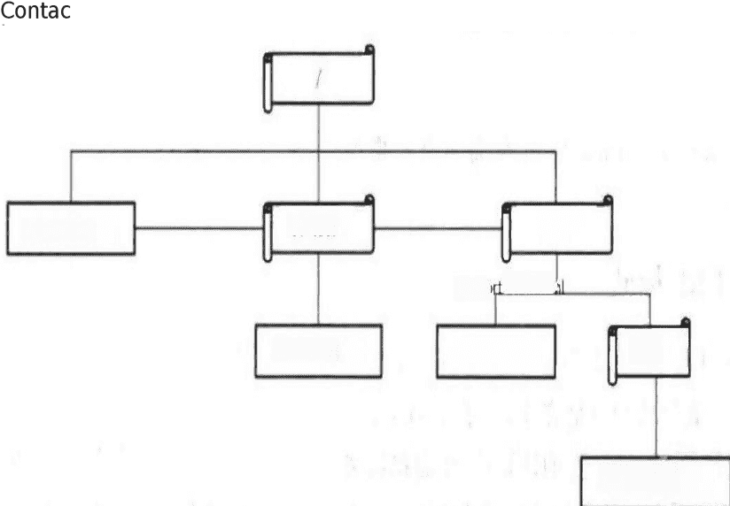
> 
> Default.htm
> 
> Support Staff.htm
> 
> FAQ Emailhtml
> 
> 问题 html
> 
> 图 2-9 服务器相对 URL 目录结构

要求：根据图 2-8 和图 2-9 所示结构中的文件夹和网页，编写代码可以从每个页面跳转到任何其他页面。

#### `default.html` 代码如下。

```html
<html>
<head><title>My first pages/hites</title></head>
<body>
  Welcome to the default.html page <br>
  <a href="content/email.html">连接到 content/email 第一种方式</a>
  <a href="content/email.html">连接到 content/email.html 第二种方式</a><br>
  <a href="support/staff.html">连接到 support/staff.html</a>
  <a href="support/faq/question.html">连接到 support/faq/question.html</a><br>
</body>
</html>
```

#### `email.html` 代码如下。

```html
<head><title>My first page</title></head>
<body>
  Welcome to the content folder's email.html page<br>
  <a href="../default.html">连接到 default.html 的第一种方式</a><br>
  <a href="/default.html">连接到 default.html 的第二种方式</a><br>
  <a href="/support/staff.html">连接到 support/staff.html</a><br>
  <a href="../support/faq/question.html">连接到 support/faq/question.html</a><br>
</body>
</html>
```

#### `staff.html` 代码如下。

```html
<html>
<head>
  <title>My first page</title></head>
<body>
  Welcome to the staff.html page in the support folder<br>
  <a href="./default.html">连接到 default.html</a><br>
  <a href="../content/email.html">连接到 content/email.htm</a><br>
  <a href="faq/question.html">连接到 support/faq/question.html</a><br>
</body>
</html>
```

#### `question.html` 代码如下。

```html
<html>
<head>
  <title>My first page</title></head>
<body>
  Welcome to the question.html page in the faq folder under the support folder <br>
  <a href="../default.html">连接到 default.html 的第一种方式</a><br>
  <a href="/default.html">连接到 default.html 的第二种方式</a><br>
  <a href="./content/email.html">连接到 support/staff.html</a><br>
  <a href="./staff.html">连接到 content/email.html</a><br>
</body>
</html>
```

> 
> 
> 0...
> 25

## 2.4.13 超链接标签

HTML 使用 `<a>` 标签来实现超链接，如下：

```html
<a href="http://www.baidu.com">百度</a>
```

`<a>` 标签的其他属性如下所示。

- (1) `target` - 在指定的窗口或新窗口中显示超链接页面。使用方法为：
  ```html
  <a href="http://www.v512.com" target="_blank">Forum</a>
  ```
- (2) `name` - 设置锚点使超链接跳转到页面上的指定位置。使用方法为：
  ```html
  <a name="pl">文本</a>
  <a href="#pl">跳转到 pl 指定的位置</a>
  ```
- (3) `title` - 设置超链接的描述文本（鼠标悬停在超链接上时显示）。使用方法为：
  ```html
  <a href="youyo.png" title="点击此处查看我的照片">yo</a>
  ```
- (4) 连接到电子邮件地址。使用方法为：
  ```html
  <a href="mailto:test@example.com">Email</a>
  ```
- (5) 使用图像作为超链接。使用方法为：
  ```html
  <a href="page.html"></a>
  ```

上面的 `href01` 代码所示。

```html
<html>
<head>
  <title>My first page</title></head>
<body>
  Welcome to the default.html page<br>
  <a href="http://www.baidu.com" target="_blank">百度</a><br>
  <a href="youyo.png" title="点击此处查看我的照片">yo</a>
  <br>
  html
</body>
</html>
```

### `staff.html` 代码所示。

```html
<html>
<head>
  <title>My first page</title></head>
<body>
  Welcome to the staff.html page in the support folder<br>
  <a href="./default.html">连接到 default.html</a><br>
  <a href="../content/email.html">连接到 content/email.htm</a><br>
```


## HTML 超链接与列表示例

### 相对路径链接示例

#### question.html
```html
<html>
<head>
<title>My first page</title>
</head>
<body>
Welcome to the question.html page in the faq folder under the support folder <br>
<a href="../default.html">连接到 default.html 的第一种方式</a><br>
<a href="/default.html">连接到 default.html 的第二种方式</a><br>
<a href="./content/email.html">连接到 support/staff.html</a><br>
<a href="./staff.html">连接到content/email.html</a><br>
</body>
</html>
```

#### default.html
```html
<html>
<head><title>My first pages/hites</title></head>
<body>
Welcome to the default.html page <br>
<a href="content/email.html">连接到 content/email 第一种方式</a>
<a href="content/email.html">连接到 content/email.html 第二种方式</a><br>
<a href="support/staff.html">连接到 support/staff.html</a>
<a href="support/faq/question.html">连接到 support/faq/question.html</a><br>
</body>
</html>
```

#### email.html
```html
<head><title>My first page</title></head>
<body>
Welcome to the content folder's email.html page<br>
<a href="../default.html">连接到 default.html 的第一种方式</a><br>
<a href="/default.html">连接到 default.html 的第二种方式</a><br>
<a href="/support/staff.html">连接到support/staff.html</a><br>
<a href="../support/faq/question.html">连接到 support/faq/question.html</a><br>
</body>
</html>
```

#### staff.html
```html
<html>
<head>
<title>My first page</title>
</head>
<body>
Welcome to the staff.html page in the support folder<br>
<a href="./default.html">连接到default.html</a><br>
<a href="../content/email.html">连接到 content/email.htm</a><br>
<a href="faq/question.html">连接到 support/faq/question.html</a><br>
</body>
</html>
```

### 2.4.13 超链接标签

HTML 使用 `<a>` 标签来实现超链接，如下：

```html
<a href="http://www.baidu.com">百度</a>
```

`<a>` 标签的其他属性如下所示。

1. **target** - 在指定的窗口或新窗口中显示超链接页面。使用方法为：
   ```html
   <a href="http://www.v512.com" target="_blank">Forum</a>
   ```

2. **name** - 设置锚点使超链接跳转到页面上的指定位置。使用方法为：
   ```html
   <a name="pl">文本</a>
   <a href="#pl">跳转到 pl 指定的位置</a>
   ```

3. **title** -- 设置超链接的描述文本（鼠标悬停在超链接上时显示）。使用方法为：
   ```html
   <a href="youyo.png" title="点击此处查看我的照片">yo</a>
   ```

4. **连接到电子邮件地址**。使用方法为：
   ```html
   <a href="mailto:test@example.com">Email</a>
   ```

5. **使用图像作为超链接**。使用方法为：
   ```html
   <a href="page.html"></a>
   ```

#### 完整示例：default.html
```html
<html>
<head>
<title>My first page</title>
</head>
<body>
Welcome to the default.html page<br>
<a href="http://www.baidu.com" target="_blank">百度</a><br>
<a href="youyo.png" title="点击此处查看我的照片">yo</a>
<br>
</body>
</html>
```

## 2.4.14 列表标签

### (1) 有序列表

有序列表是一组用数字标记的项目列表，包含在 `<ol>` 标签（有序列表）中，并使用 `<li>` 标签，如下：

```html
<ol type="a">
<!-- 可选属性 type 用于设置列表符号 -->
<li>列表条目 </li>
<!-- type 允许值:"1","a","A","i","I"-->
<li>列表条目 2</li>
</ol>
```

有序列表默认以数字开始。你也可以使用 `type` 属性将列表设置为英文数字或罗马数字。常见的 `type` 属性值如表 2-2 所示。

| value | 描述 |
|---|---|
| 1 | 数字 1,2,3... |
| a | 小写字母 a,b,c... |
| A | 大写字母 A,B,C... |
| i | 小写罗马数字 i... |
| I | 大写罗马数字 I..X... |

表 2-2 有序列表 `type` 属性值

### (2) 无序列表

无序列表是一组用项目符号（实心圆点 ●、圆圈 O、方块 ■）标记的项目。每个项目之间没有顺序之分。它包含在 `<ul>` 标签（无序列表）中，使用 `<li>` 的方法如下：

```html
<ul type="disc">
<!-- 可选属性 type 用于设置列表符号 -->
<li>列表条目 </li>
<!-- 允许的 type 取值:"disc","circle","square"-->
<li>列表条目 2</li>
</ul>
```

无序列表默认使用 ● 作为列表的开始。也可以通过 `type` 属性设置为 O。常见的 `type` 属性值如表 2-3 所示。

| value | 描述 |
|---|---|
| disc | 实心圆点 ● |
| circle | 空心圆圈 ○ |
| square | 实心方块 ■ |

表 2-3 无序列表 `type` 属性值

### (3) 定义列表

定义列表在语义上表示项目及其注释的组合，它以 `<dl>` 标签（定义列表）开始，自定义列表项目以 `<dt>`（定义标题）开始，自定义列表项目的描述以 `<dd>`（定义描述）开始。使用方法如下：

```html
<dl>
<dt>条目标题</dt>
<dd>项目 1 正文</dd>
<dt>项目 2 标题</dt>
<dd>项目 2 文字</dd>
</dl>
```

#### 完整示例：10_list.html
```html
<html>
<head>
<title>HTML 实践教程 - 列表</title>
</head>
<body>
<ol type="1">
<!-- 可选属性 type 允许值:"1","a","A","i","I"-->
<li>吕布</li><li>赵云</li><li>关羽</li><li>张飞</li>
</ol>
<hr>
无序列表：
<ul type="square">
<li>赵云</li><li>关羽</li><li>张飞</li><li>吕布</li>
</ul>
定义列表：
<dl>
<dt>视频名称：</dt><dd>HTML 实践教程</dd>
<dt>作者：</dt><dd>张立</dd>
<dt>制作：</dt><dd>世纪学院 (Century Academy)</dd>
</dl>
</body>
</html>
```

## 2.4.15 表单

表格是网页中非常重要的组件，用于存储数据。一个表格包含标题、表头、行和单元格。在 HTML 中，表格标签使用符号 `<table>` 表示。仅用 `<table>` 定义表格是不够的，还需要在行、列、标题和其他内容中定义表格，通用的标签有 `<tr>`、`<td>`、`<th>`、`<caption>` 等。

表格相关标签的属性如下。

- **width/height** - 指定表格或特定单元格的宽度/高度。
- **border** - 指定边框的宽度。
- **bordercolor** - 指定边界线的颜色。
- **bgcolor** - 指定表格或单元格的背景颜色。
- **background** - 指定表格或单元格的背景图像。
- **align** - 设置单元格的对齐方式。
- **cellspacing** - 设置单元格间距。
- **cellpadding** - 设置单元格内容与单元格边界之间的距离。
- **colspan/rowspan** - 实现单元格跨列/跨行。

### 示例 1：table01.html
```html
<html>
<head>
  <title>HTML 实践教程 - 表格</title>
</head>
<body>
  <h4>学生成绩</h4>
  <table border="1">
    <tr>
      <td>姓名</td>
      <td>科目</td>
      <td>成绩</td>
    </tr>
    <tr>
      <td>张三</td>
      <td>中文</td>
      <td>80</td>
    </tr>
    <tr>
      <td>李四</td>
      <td>数学</td>
      <td></td>
    </tr>
  </table>
</body>
</html>
```

### 示例 2：table02.html
```html
<html>
<head>
<title>HTML 实践教程 - 表格</title>
</head>
<body>
<table align="center" border="2" borderColor="blue" width="300" height="60" bgcolor="#ccc" cellpadding="0">
<caption><font color="#8722" size="6">成绩表</font></caption>
<tr bgcolor="#99009">
<th>姓名</th>
<th>科目</th>
<th>成绩</th>
</tr>
<tr>
<td>xxx</td>
<td>语言</td>
<td>80</td>
</tr>
<tr>
<td>李四</td>
<td>数学</td>
<td>90</td>
</tr>
</table>
</body>
</html>
```

### 示例 3：table03.html (跨行跨列)
```html
<html>
<head>
<title>HTML 实践教程 - 表格</title>
</head>
<body>
<h4>跨列单元格：</h4>
<table border="1" width="250" height="80">
<tr>
<td>xxx</td>
<td colspan="2">xxx</td>
</tr>
<tr>
<td>oa</td>
<td>xxx</td>
<td>xxx</td>
</tr>
</table>

<h4>跨行单元格：</h4>
<table border="1" width="250" height="80">
<tr>
<td>yyy</td>
<td>yyy</td>
</tr>
<tr>
<td rowspan="2">联系信息</td>
<td>yyy</td>
</tr>
<tr>
<td>yyy</td>
</tr>
</table>
</body>
</html>
```

## 2.4.16 框架

框架通常将浏览器窗口分为两个或多个部分，每个部分连接到不同的 HTML 文件。你可以将浏览器窗口划分为多个窗格以同时显示不同的页面。框架可以用行、列和混合方式划分。

### (1) 行划分
```html
<html>
<frameset rows="25%,*">
  <frame src="a.html">
  <frame src="b.html">
</frameset>
</html>
```

### (2) 列划分
```html
<html>
<frameset cols="300,400,*" border="0">
  <frame name="myframe" noresize src="a.html">
  <frame name="myframe2" src="b.html">
  <frame name="myframe3" src="c.html">
</frameset>
</html>
```

### (3) 混合划分和页面导航

要求使用上述的框架知识编写代码，显示效果如图 2-16 所示。所需的文件有 `main.html`、`top.html`、`list.html`、`a.html`、`b.html`、`c.html`。其中 `main.html` 是主页，`top.html` 是头部页，`list.html` 是左页，其余是对应左侧条目的内容页。

#### main.html
```html
<html>
<head>
<title>带导航的多窗格页面</title>
</head>
<frameset rows="80,*">
  <frame name="navigateFrame" src="list.html">
  <frame name="contentFrame" src="a.html">
</frameset>
</html>
```

#### list.html
```html
<html>
<body bgcolor="#abe2d6">
目录列表:<br>
<a href="a.html" target="contentFrame">条目A</a><br>
<a href="b.html" target="contentFrame">条目B</a><br>
<a href="c.html" target="contentFrame">条目C</a>
</body>
</html>
```

## 2.4.17 多媒体嵌入文件

`<applet>` 标签用于在页面中嵌入 Java Applet。`<embed>` 标签用于将各种音频和视频格式嵌入页面中。格式取决于查看者系统上的播放器，并且需要在查看者的计算机上安装相应的处理程序。常见的嵌入文件格式包括 mp3、mid、wma、asf（流媒体）、asx（音频）、rm、ra、ram、swf、avi 等。

`<embed>` 标签用法示例：
```html
<embed src="..." autostart="true" loop="true" hidden="false" controls="CONSOLE" width="200" height="45">
```


`controls` 属性指定了控制面板的外观。`controls` 属性的值可以是 `console`、`smallconsole`、`playbutton`、`pausebutton`、`stopbutton` 或 `volumelever`。默认值是 `console`。

- (1) `console`：通常为普通面板；
- (2) `smallconsole`：较小的面板；
- (3) `playbutton`：仅显示播放按钮；
- (4) `pausebutton`：仅显示暂停按钮；
- (5) `stopbutton`：仅显示停止按钮。
- (6) `volumelever`：仅显示音量调节按钮。

此外，对于 `rm`、`ra`、`ram` 格式的音频文件，你需要为 `<embed>` 标签添加 `type` 属性：

```html
<embed src="..." type="audio/x-pn-reaudio-plugin" autostart="true" loop="true" hidden="false" controls="CONSOLE" width="200" height="45">
```

## Internet Explorer 还提供了一种更简单的背景音乐用法：

```html
<bgsound src="...wma" loop="3">
```

`bgsound` 标签的 `src` 属性通常用于 `midi`、`wav`、`mp3` 和 `wma` 类型的音乐。

`loop` 用于指定背景音乐循环的次数，设置为 `-1` 表示无限循环，查看者可以通过单击浏览器的“停止”按钮停止背景音乐播放。

# 第3章 CSS 及其应用

## 3.1 CSS 基础

### 3.1.1 CSS 基本概念

CSS 是 W3C 协会自定义的一组扩展样式，用于弥补 HTML 在显示属性设置方面的不足。它的全称是层叠样式表（Cascading Style Sheets）。传统的 HTML 在页面布局和显示设置方面存在一些问题。自从 CSS 引入以来，HTML 标记专门用于定义网页的内容，而 CSS 则用于设置其显示效果。

CSS 标准重新定义了 HTML 中的原始文本显示样式，增加了一些新概念，如类（classes）、层等，这些可以重叠和定位文本。在 CSS 引入页面设计之前，使用传统的 HTML 语言来实现页面美化非常麻烦，例如为了设计页面中文本的样式，如果你使用传统的 HTML 语句设计页面，你必须对每个需要设计的文本定义样式。CSS 的出现改变了这种传统模式。

如果你想自学更多关于 CSS 和 divs，可以访问 `http://www.divcss5.com/`，如图 3-1 所示。

图 3-1 DIV+CSS 自学网络

### 3.1.2 CSS 样式分类

(1) 内联样式（Inline Style）：直接以属性的形式给出 HTML 标签中，用于设置标签所定义信息的显示效果。内联样式仅对其所在的的标签有效。

编写 `01.html` 并如如下所示练习使用内联样式 CSS。

```html
<html>
  <head>
    <title>使用内联样式 </title>
  </head>
  <body style="background-color:#ccffee">
    <p style="font-size:16px;color:red">第一段。</p>
    <p style="font-style:italic;font-size:20px;color:#bb22cc">第二段。</p>
  </body>
</html>
```

(2) 内部样式表（Internal Style Sheet）

在 HTML 页面的头部信息元素中给出，可以同时设置多个标签定义信息的显示效果。内部样式表仅对你当前所在的页面有效。

编写 `02.html` 并如如下所示练习使用内部样式表 CSS。

```html
<html>
<head>
<title>使用内部样式表 </title>
<style type="text/css">
body{background-color:#ccffee}
h2{text-align:center;color:red}
p.mystyle {font-size:20px;color:blue}
p.mystyle2{font-style:italic;font-size:40px;color:#dd44aa;text-align:center}
</style>
</head>
<body>
<h2>标题文本</h2>
<p class="mystyle">第一段文本。</p>
<p class="mystyle">第二段文本。</p>
<p class="mystyle">第三段。</p>
<p>第四段的文本。</p>
<p class="mystyle">第五段文本。</p>
</body>
</html>
```

(3) 外部样式表（External Style Sheet）：

外部样式表将样式设置保存到单独的外部文件中，然后在需要使用样式的 HTML 页面中引用它。外部样式表是以 `.css` 结尾的纯文本文件。外部样式表可以应用于多个页面。编写 `style.css` 和 `03.html` 来练习使用外部样式表 Css。

`style.css` 代码如下所示。

```css
body {background-color:#ccffee}
h2 {text-align:center;color:red}
p.mystyle {font-size:20px;color:blue}
p.mystyle2 {font-style:italic;font-size:40px;color:#dd44aa;text-align:center}
```

`03.html` 代码如下所示。

```html
<html>
<head>
<title>使用外部样式表</title>
<link href="style.css" rel="stylesheet" type="css">
</head>
<body>
<h2>标题文本</h2>
<p class="mystyle">第一段文本。</p>
<p class="mystyle">第二段文本。</p>
<p class="mystyle">第三段。</p>
<p>第四段的文本。</p>
<p class="mystyle">第五段文本。</p>
</body>
</html>
```

样式的优先级顺序为：内联样式、内部样式表、外部样式表、浏览器默认样式。如果样式重叠，高优先级将覆盖低优先级。

## 3.1.3 CSS 样式的组成

CSS 样式由三部分组成：选择器（Selector）、属性（Property）和值（Value）。语法如下：

```
选择器{属性:值;}
```

(1) 选择器：也被称为选择器，是 CSS 中一个非常重要的概念，所有的 HTML 标记都通过选择器进行控制。

(2) 属性：主要包括字体属性、文本属性、背景属性、布局属性、边界属性、列表项目属性、表格属性等。某些属性仅某些浏览器支持，使得 CSS 的使用变得复杂。

(3) 属性值：属性的有效值。属性和值之间用 `:` 分隔。当有多个属性时，使用 `;`。

你也可以为 CSS 添加注释，如示例所示：

```css
/*设置段落显示样式 */
/*居中 */
p{text-align:center;color:red}
/*字体为红色 */
```

## 3.1.4 CSS 选择器

常见的 CSS 选择器有标签选择器、类选择器、ID 选择器等。不同的 HTML 标签可以使用选择器来实现各种效果。详细描述各种选择器。

(1) 标签选择器：HTML 由许多标签组成，标签选择器是使用现有标签作为选择器。标签选择器的结构如图 3-2 所示。

| 选择器 | 属性 | 值 |
| --- | --- | --- |
|  |  | 图 3-2 |

要使用它，只需像以前一样调用 `<h1>` 标签，页面上所有的 `<h1>` 标签将文本设置为红色，字体大小设置为 25 像素。

使用标签选择器很快，但它也有一些局限性。如果你声明一个标签选择器，页面都会随之改变。如果页面上有三个 `<h1>` 标签，如果你想让每个 `<h1>` 显示不同，就不能使用标签选择器。在这种情况下，你需要引入类选择器。

(2) 类选择器：类选择器的名称由用户定义并以 `.` 结尾。定义的属性及其值也遵循 CSS 规范。应用类选择器的 HTML 标签，只需使用 `class` 属性声明。类选择器的结构如图 3-3 所示。

| 类别名称 | 声明 | 语句 |
| --- | --- | --- |
| class | color: green; | font-size: 20px; |
| 类选择器 | 属性值 | 统计 |

图 3-3 类别选择器

## 以下内容使用类选择器来控制页面的文本样式，代码所示：

```css
.one {
  font-family: 宋体;
  color: green;
  font-size: 24px;
}

/* 定义三个类选择器。 */
/* 定义一个类名为 one 的类选择器 */
/* 设置字体 */
/* 设置字体大小 */
/* 设置字体颜色 */

.two {
  font-family: Times New Roman;
  font-size: 16px;
  color: red;
}

.three {
  font-family: Times New Roman;
  font-size: 12px;
  color: red;
}
```

```html
<!-- 调用不同的类选择器 -->
<h1 class="one">选择器一</h1>
<p>正文内容 1</p>
<h1 class="two">选择器二</h1>
<p>正文内容 2</p>
<h1 class="three">选择器三</h1>
<p>正文内容 3</p>
```

在上述代码中，页面上的第一个 `<h1>` 标签应用了一个选择器，第二个 `<h1>` 标签应用了两个选择器，而第三个 `<h1>` 标签应用了三个选择器。

每个子列之间的垂直线分隔符在制作网站导航栏时会被多次引用，也可以进行定义。

类选择器的定义和调用，代码如下：

```css
.menuDiv {
  width: 100px;
  height: 28px;
  background: #999;
}
```

```html
<p class="menuDiv"></p>
```

类选择器可以多次使用，以便为多个布局创建统一的样式。

### (3) ID 选择器

ID 选择器是通过 HTML 页面中的 `id` 属性选择的附加样式，基本上与类选择器相同。但需要注意的是，一个 HTML 页面不能包含两个相同的 `id` 标签，因此定义的 ID 选择器只能使用一次，通常用于设置唯一的样式。要给 ID 选择器命名，以 `#` 开头后跟 HTML 标签中的 `id` 值。ID 选择器的结构如图 3-4 所示。

| 类别名称 | 声明 | 语句 |
| --- | --- | --- |
| id | color: yellow; | font-size: 30px |
| ID 选择器 | 属性值 | 统计值 |

图 3-4 ID 选择器

下文使用 ID 选择器控制页面的文本样式，代码所示：

```css
/* 定义三种类型的 ID 选择器 */
#first {
  /* 定义类名为 first 的 ID 选择器 */
  font-size: 18px; /* 设置字体大小 */
}

#second {
  font-size: 16px;
}

#three {
  font-size: 12px;
}
```

```html
<!-- 调用不同的 ID 选择器 -->
<p id="first">ID 选择器 1</p>
<p id="second">ID 选择器 2</p>
<p id="three">ID 选择器 3</p>
```

你还可以使用 ID 选择器来定义页面容器并设置唯一的页面样式，如下所示：

```css
#container {
  width: 800px;
  margin: auto;
}
```

```html
<div id="container">页面层容器</div>
```

上述代码的含义是定义一个宽度为 800 像素、上下边距为 10 像素且居中显示的页面容器。如果不写 `margin` 的值，默认显示在左侧。

(4) 伪类和伪元素

伪类和伪元素是 CSS 定义的类和对象，格式如下：

```
选择器: 伪类
选择器: 伪元素
```

具体的使用方法为：

```css
a:visited{color: #ff0000;}
```

### 伪类用法

| 选择器 | 用法 |
| --- | --- |
| :link | 访问超链接时 |
| :hover | 对象（通常是超链接）鼠标经过时 |
| :active | 对象（通常是超链接）释放时 |
| :visited | 访问超链接后 |
| :focus | 对象获得焦点 |
| :first-child | 对象的第一个元素 |

### 预定义伪元素

| 选择器 | 说明 |
| --- | --- |
| :after | 在字符串后设置内容 |
| :first-letter | 对象中的第一个字母 |
| :first-line | 对象内部的第一行 |
| :before | 在对象前设置内容 |

使用时无需指定 `id` 或 `class` 名称，上面的代码表示页面中的超链接被访问时，其样式为红色。伪类的 4 种状态在实际应用中使用最多：`:link`、`:hover`、`:active` 和 `:visited`。

### (5) 通配符选择器

在操作系统中，有通配符字符如 `*` 代表任意文件。CSS 中也有 `*` 通配符选择器，代表所有对象，例如：

```css
* {margin: 0px;}
```

代表所有对象的 `margin`。

通配符选择器可以匹配页面中的所有元素，例如：

```css
* {
  color: red;
}
```

通配符选择器也可以与特定的元素选择符结合使用，例如：

```css
div * {
  color: blue;
}
```

通配符选择器还可以用于设置嵌套元素的样式，例如：

```css
p > span {
  font-weight: bold;
}
```

通配符选择器也可以用于设置相邻兄弟元素的样式，例如：

```css
div + p {
  margin-top: 20px;
}
```

通配符选择器还可以用于设置后续兄弟元素的样式，例如：

```css
div ~ p {
  border: 1px solid black;
}
```

```html
<head>
<title>CSS 常用文本属性</title>
<style type="text/css">
.t1{text-align:left;
text-indent:1cm;
line-height:20px;
letter-spacing:150%;
color:red}
.t2{text-align:center;
text-indent:0;
line-height:20pt;
letter-spacing:0.2em;
color:blue;
font-weight:bold}
</style>
</head>
```

在 CSS 样式表中，有两种类型的长度单位。

- 1 绝对长度单位：英寸（Inches，1 inch = 2.54 cm）；厘米（centimeters）；毫米（Millimeters）；pt——点（Points，1 point = 1/72 inch）；pc——派卡（Picas，1 pica = 12 points）。
- 2 相对长度单位：em 元素的字体高度；ex——字母 X 的高度；px——像素（Pixels）；%——百分比（Percentage）。

### (3) 其他常用属性

表 3-3 列出了 CSS 的其他常用属性。

#### 表 3-3 其他常用 CSS 属性

| 背景 | background-color, background-image, background-repeat, background-position, background |
| 边框属性 | border-style, border-width, border-color, border-top-width |
| 外边距属性 | margin-top, margin-bottom, margin-left, margin-right, margin |
| 间隙属性 | padding-top, padding-bottom, padding-left, padding-right |

## 3.2 DIV 基础

### 3.2.1 DIV 标签

DIV（分区）是一种 HTML 标签，代表实际 HTML 信息的一个区域。如果应用，DIV 标签基本上与段落 `p` 相同。使用 CSS+DIV 可以实现结构化的页面布局。以下是使用方法：

```html
<div>第一段文本 </div>
<div align="center">第二段文本 </div>
```

编写 `07.html` 并在下方使用 CSS+DIV 实现简单的页面布局。

```html
<html>
<head>
<title>CSS+DIV 实现简单的页面布局</title>
<style type="text/css">
*{margin:0px;padding:0px;}
body{width:800px;}
.main{background:blue;}
.maintop{
width:800px;
height:40px;
background: #ffaff;
border:1px solid #dddddd;
}
.mainnav{float:left;
width:100px;
height:300px;
background:#beeff;
border:1px solid #ddddd;
}
.maincontent{float:left;
width:700px;
height:300px;
background:#ffeeaa;
}
</style>
</head>
<body>
<div class="main">
  <div class="maintop">顶部区域</div>
  <div class="mainnav">导航区域</div>
  <div class="maincontent">内容区域</div>
</div>
</body>
</html>
```


```css
border:1px solid #dddddd;
}
</style>
</head>
<body>
<div class="main">页面标题内容</div>
<div class="nav">导航内容 </div>
<div class="content">正文内容</div>
</div>
</body>
</html>
```

HTML 元素可以根据其显示方式分为“块级型”（Block）元素和“内联型”（Inline）元素。

(1) 块级元素：在行前后会换行，可以设置块尺寸（宽度和高度）、块定位、块边框、块间距、块与块边框之间的间隙，如 `body`、`p`、`tr`、`td`、`div` 等。

(2) 内联元素：位于当前行，后续行不会换行，不单独定位，例如 `span` 元素。

使用块级元素和内联元素编写 `08.html` 练习，代码如下。

```html
<head>
<title>使用 span 标签</title>
</head> 
<body>
<p><span style="font-size:14px;font-family:arial;color:red">部分显示内容不同</span>，可以使用 span 元素来实现</p>
</body>
</html> 
```

你可以使用 CSS 的 `display` 属性来设置或修改元素的特定显示模式。其常见属性值为：`block`（块级）、`inline`（内联）、`none`（无）。

编写 `09.html` 练习所示的 `display` 属性的应用。

```html
<html 
<head>
<title>使用 CSS 的 display 属性 </title>
</head>
<body>,
<p><span style="display:inline;font-size:40px;color:red">部分显示效果不同</span>，你可以使用 span 元素来实现</p>

<h1>

<p><span style="display:block;font-size:40px;color:red">部分显示效果不同</span>，你可以使用 span 元素来实现</p> <h1>

<p><span style="display:none;font-size:40px;color:red">-部分显示效果不同</span>，你可以使用 span 元素来实现</p>

<hr> 

<div style="display:inline;font-size:40px;color:blue">DIV 块 内部文本</div>--DIV 之后的文本

<hr>

```


设计网页的第一步是构思，充分的构思。通常情况下，还需要 Photoshop 或 FireWorks（以下简称 PS 或 FW）等其他图像处理软件来简单地将界面布局画出来。以下是我们的界面布局构图，如图 3-7 所示。

## 3.3.2 规划布局

我们需要根据构思图来规划页面布局。对图进行仔细分析后，不难发现图片大致分为以下几个部分：

- (1) 顶部部分，包括 Logo、菜单和一张 Banner 图片。
- (2) 内容部分，可以分为侧边栏和主内容区域。
- (3) 底部，包含一些版权信息。

通过上述分析，我们可以轻松布置布局，我们的设计图层如图 3-8 所示。

## 图 3-7 构思网页的渲染图

图 3-8 网页布局示意图

根据图 3-8，我们来画一个实际页面布局图，说明底层的嵌套关系，这样会更易理解，如图 3-9 所示。

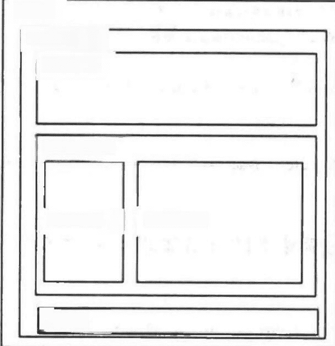

```
body
#container
#Header {}

#PageBody {}

#Sidebar {}

#MainBody {}

#Footer {}
```

图 3-9 布局嵌套关系

## DIV 结构如下：

| 元素 | 注释/代码结构 |
| :--- | :--- |
| body | /* 这是一个 HTML 元素，我不涉及细节 */ |
| #Container | /* 页面层容器 */ |
| #Header | /* 页眉 */ |
| #PageBody | /* 页面主体 */ |
| #Sidebar | /* 侧边栏 */ |
| #MainBody | /*主体内容 */ |
| #Footer | /** 页面底部 */ |

## 3.3.3 编写 HTML 和 CSS

页面的布局和规划完成后，我们只需要开始编写 HTML 代码和 CSS。在桌面上创建一个名为“DIV+CSS layout exercises”的文件夹，在文件夹下两个两个记事本文件，并输入以下内容：

```html
<!DOCTYPE html PUBLIC "-W3C//DTD XHTML 1.0 Transitional//EN"
"http://www.w3.org/TR/xhtml1/DTD/html-transitional.dtd">
<html xmlns="http://www.w3.org/1999/xhtml">
<head>
<meta http-equiv="Content-type="text/html;charset=gb2312">
<title>Untitled document </title>
<link href="css.css" rel="stylesheet" type="text/css"/>
</head>
<body>
</body>
</html>
```

这是 HTML 的基本结构，我们将其命名为 `index.htm`，另一个记事本文件将命名为下方的 `css.css`，我们在 `<body></body>` 标签对中编写 DIV 的基本结构，代码如下：

```html
<div id="container"> <!-- 页面层容器 -->
<div id="Header"> <!-- 页眉 --></div>
<div id="PageBody"> <!-- body -->
<div id="Sidebar"> <!-- 侧边栏 -->
</div>
<div id="MainBody"> <!-- 主体内容 -->
</div>
<div id="Footer"> <!-- 页面底部 --></div>
</div>
```

## 为了方便以后阅读代码，我们应该添加相关的注释，然后打开 css.CSS 文件并写入如下 Css 信息。

```css
/*基本信息 */
body {font:12px Tahoma;margin:0px;text-align:center;background:#FFF;}
```

```css
/* 页面层容器 */
#container {width:100%}
/* 页眉 */
#Header {width:800px;margin:0 auto;height:100px;background:#FFCC99}
/* 页面主体*/
#PageBody {width:800px;margin:0 auto;height:400px;background:#CCFF00}
/* 页面底部 */
#Footer{width:800px;margin:0 auto;height:50px;background:#00FFFF}
```

保存上述文件并在浏览器中打开。现在我们可以看到基本结构，它就是页面的框架。

在上面的 CSS 代码中，我们将解释一些常用属性的含义。

(1) `font:12px Tahoma;`

这里使用了缩写，完整的代码应该为：`font-size:12px;font-family:Tahoma;` 描述字体大小为 12 像素，字体格式为 Tahoma。

(2) `margin:0px;`

这里也使用了缩写，完整的代码应该为：`margin-top:0px;margin-right:0px;margin-bottom:0px;margin-left:0px;`

（注：原文中存在大量重复的 OCR 内容，已处理为唯一内容以保持逻辑流畅。）

答案是否，因为横幅（banner）是一张详细图片，如果使用 GIF 格式会导致色彩损失过多，所以你必须使用 JPEG 格式并将文件导出为 `banner.jpg`。正确。

## 图 3-10 顶部区域第 1 切片效果

切片非常重要，因为正确的切片方式决定了 CSS 编写的难易程度以及页面加载速度。

(2) 菜单项设置

切好切片后，我们还需要分析顶部部分并将 DIV 结构写入 Header 中，代码如下所示。

```html
<div id="menu">
  <li><a href="#">首页 </a></li>
  <li class="menuDiv"></li>
</ul>
```


```html
  <li><a href="#">博客</a></li>
  <li class="menuDiv"></li>
  <li><a href="#">设计 </a></li>
```

```html
  <li class="menuDiv"></li>
  <li><a href="#">相册 </a></li>
  <li class="menuDiv"></li>
  <li><a href="#">论坛 </a></li>
```

```html
  <li class="menuDiv"></li>
  <li><a href="#">关于 </a></li>
```

```html
</ul>
</div>
<div id="banner">
</div>
```

使用列表 `<li>` 制作菜单可以方便日后自定义菜单样式。

`<li class="menuDiv"></li>` 方便在菜单选项之间插入一些分割样式，就像预览中的垂直线分隔符一样。

## 接下来，我们再次在 css.css 中编写以下样式：

```css
/*页面页头*/
#header(background:url(logo.gif)no-repeat)
```

样式描述：

`#header(background:url(logo.gif)no-repeat)` 是在页面页头添加一个背景图片 Logo，并且不填充。

在这里，我们没有指定 header 层的高度，因为 header 层中还包含菜单和横幅项，所以层的高度暂时未知，通过层属性可以使层根据内容自动调整，因此我们不需要指定 header。

接下来，在 css.css 中写入以下代码：

```css
#menu ul {list-style:none;margin:0px;}
```

```css
#menu ul li {float:left;}
```

## 样式描述：

```css
#menu ul{list-style:none;margin:0px;}
```

`list-style:none`，这句话的作用是取消列表顶部的项目符号，因为我们不需要这些点。`margin:0px`，这句话的作用是取消 UL 的缩进。这将使列表的所有内容都取消缩进。

```css
#menu ul li {float:left;}
```

在这里使用 `float:left` 和 `right` 让所有内容显示在同一行，所以使用了 `float` 属性。此时，建议保存预览，然后添加以下内容，如图 3-11 所示。

此时，列表内容排列成了一行。我们在 `#menu ul li` 处添加了代码 "margin:0 10px"。`margin:0 10px` 会在列表内容之间创建一个 20px 的间隙（左侧 10px，右侧 10px）。预览效果将如图 3-12 所示。

首页 博客 设计 相册 论坛
关于首页 设计 相册 论坛 关于

图 3-11 菜单项效果

图 3-12 添加间距后的菜单项效果

既然原型已经出来，让我们再次固定菜单的位置，并将代码更改为如下：

```css
#menu {padding:20px 20px 00}
/*padding:20px 20px 0 来固定菜单位置 */
#menu ul {float:right;list-style:none;margin:0px;}
/*添加 float:right 以让菜单位于页面右侧 */
#menu ul li {float:left;margin:10px}
```

此时，位置已经确定，但在图中菜单选项之间仍然有一条垂直线，该怎么办呢？不要忘记，我们已经有一个空项目 `<li class="menuDiv"></li>`，它被用于添加垂直线。按照上述方法，我们添加以下代码：

```css
.menuDiv {width:1px;height:28px;background:#999}
```

保存并预览。垂直线将会出现，如图 3-13 所示。

然而，菜单选项的文字位于顶部，所以让我们更改为以下代码：

```css
#menu ul li {float:left;margin:10px;display:block;height:28px}
```

效果基本实现，剩下的就是修改菜单样式，在 css.css 中添加以下代码：

```css
#menu ul li a:link, #menu ul li a:visited {font-weight:bold;color:#666}
#menu ul li a:hover {}
```

图 3-14 显示了最终结果。

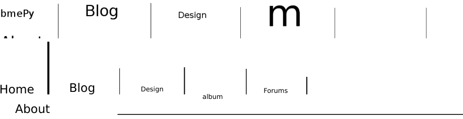
图 3-13 添加垂直线后的菜单项效果

图 3-14 菜单项最终效果

## (3) 正文设置

这部分主要想告诉你如何使用“border（边框）”和“clear（清除）”这两个属性。

在 css.css 中添加以下样式：

```css
#banner
background:url(banner.jpg)30px no-repeat;/*添加背景图片 */
width:730px/*设置层宽*/
margin:auto/*层居中*/
height:240px/*设置高度*/ border-bottom:5px solid #FEFEF/*绘制一条浅灰色实线 */
clear:both/*清除浮动 */
```

`border` 方便绘制实线，并减少网络资源的消耗，使页面更快。另一个需要注意的是 `clear:both`，这意味着清除所有的左右浮动。我们将在下一个左/右布局中再次使用该属性。在这里添加 `clear:both` 是因为之前的 `ul` 和 `li` 元素设置了 `float`，如果不清除将会影响 banner 层的设置。

```html
<div id="pagebody"><!--页面主体 -->
<div id="sidebar"><!--侧边栏 --></div>
<div id="mainbody><!--主体内容 --></div>
</div>
```

以上是页面的主体部分，我们在 css.css 中添加以下样式：

```css
#pagebody
width:730px;/*设置宽度 */
margin:auto/*居中 */
#sidebar{width:160px;/*设置宽度 */
text-align:left;
float:left;/*向左浮动 */
clear:left;/*清除左侧浮动 */
overflow:hidden/*溢出隐藏 */
#mainbody
width:570px;
text-align:left;
float:right;/*向右浮动 */
clear:right;/*清除右侧浮动 */
overflow:hidden}
```

为了看到效果，建议在 #sidebar 和 #mainbody 中添加以下代码。在预览完成后可以删除这些代码：

```css
border:1px solid #E00;
height:200px
```

保存并预览效果，如图 3-15 所示，你可以看到两个层完美地浮动，达到了我们的布局要求，不会错位，即使内容过长（例如图片）。虽然两个层的实际宽度应该是 [160+2(border)=570+2px]=734px，这超过了父层的宽度，由于未清除。


图 3-15 层浮动内容过长部分（例如图片）

```css
width:730px/*设置层的宽度 */
margin:auto;/*层居中*/height:240px;
/*设置高度 /
border-bottom:5px solid #EFEFEF/*在底部
绘制一条实线灰色线 */
clear:both;/*清除左右浮动，在此处添加 clear ::both 是由于
之前的 ul,li 元素设置了 float，
否则，它将影响 banner 层的设置
position.*/
}

/*页面主体 */
#PageBody(
width:800px;/*设置宽度 */
height:400px;
margin:0px auto;/*居中*/
}

/*左侧列 */
#S
width:198px;/*设置宽度 */
height:398px;
text-align:left;/*文本左对齐*/
float:left;/*浮动到左侧*/
clear:left;/*左侧不允许浮动*/
overflow:hidden;/*超出宽度部分隐藏 */
border:1px solid #00ff00;
/*右侧内容 */
#MainBody
width:590px;
height:398px;
text-align:center; :*/clear:right;Clear :right;/*右侧不允许浮动*/
overflow:hidden;/*超出宽度部分隐藏 */border:1px solid #0000ff;
```


/*页面底部*/ `#footer(width:798px;height:120px;text-align:center;margin:0 auto;border:1px solid #ff0000);`

```html
(2)index.html
<!DOCTYPE html PUBLIC "-W3C//DTD XHTML 1.0 Transitional//EN"
"http://www.w3.org/TR/xhtml1/DTD/xhtml-transitional.dtd">
<html xmlns="http://www.w3.org/1999/xhtml">
<head>
<meta http-equiv="Content-Type" content="text/html;charset=gb2312">
<title>未标题文档</title>
<link href="css1.css" rel="stylesheet" type="text/css" media="all"/>
</head>
<body>
<div id="container">
 <div id="header">
  <div id="menu">
  <ul>
  <li><a href="#">首页</a></a></a></li>
  <li class="menuDiv"></li>
  <li><a href="#">博客</a></a></a></li>
  <li class="menuDiv"></li>
  <li><a href="#">设计</a></a></a></li>
<li class="menuDiv"></li>
<<li><a href="#">相册 </a></a></li>
<li class="menuDiv"></li>
<<li><a href="#">论坛 </a></a></li>
<li class="menuDiv"></li>
<<li><a href="#">关于</a></a></a></li>
  </ul>
 >
</div>
<div id="banner">
</div>
</div>
<div id="PageBody">
 <div class="Sidebar">
<div style="colorcoloraaaaaa">侧侧边栏</div></div></div>
<div id="MainBody">
<div style="color=#aaaaaa">主内容 </div>
</div>
</div>
<div id="footer">copy 张立 2010-2011</div>
</div>
 
</body>
</html>
```

# 第 4 章：JavaScript 及其应用

## 4.1 JavaScript 基础

### 4.1.1 JavaScript 基本概念

JavaScript 是由网景公司开发的一种脚本语言。它是一种基于对象和事件驱动的解释型脚本语言，具有安全功能，被广泛应用于 Web 应用。它不需要编译，而是直接嵌入在页面中，将静态页面转换为支持用户交互的动态页面。在 Web 程序中，JavaScript 经常用于验证数据、控制浏览器以及生成日历时间戳。JavaScript 是一种流行的脚本语言，在客户端解释并执行，也可以应用于 JSP、PHP 等网站。同时，随着 Web 开发进入主流市场，JavaScript 被推向了中心，因此对于网站开发者来说非常重要。

### 4.1.2 JavaScript 的特性

JavaScript 适用于静态或动态页面，它是解释型的、基于对象的、事件驱动的、安全的跨平台的，详细描述如下：

- (1) 解释型语言

JavaScript 是一种带有段的脚本语言。与其他脚本语言相比，JavaScript 提供了简单的开发过程。

- (2) 基于对象

JavaScript 是一种基于对象的语言。它可以创建对象，并在脚本环境中进行交互。

- (3) 事件驱动

事件驱动意味着用户执行某些操作（如点击鼠标、选择菜单等），计算机做出相应的响应。JavaScript 可以以事件驱动的方式直接响应客户端输入，而无需服务器程序。

- (4) 安全性

JavaScript 具有安全性。它不允许访问本地磁盘，不允许向网络修改和删除文档，仅通过浏览器实现交互，从而有效防止数据丢失。

- (5) 跨平台

JavaScript 依赖浏览器本身，只要浏览器支持 JavaScript，代码就可以正确执行。

### 4.1.3 JavaScript 的作用

(1) 增强页面动态效果。

(2) 实现页面（浏览器）与用户之间的实时交互。

(3) 控制浏览器的行为，例如刷新。

### 4.1.4 JavaScript 代码的位置

在 HTML 页面中，使用 `<script>` 标签嵌入脚本代码所示：

```html
<script language="javascript">//或者使用type="text/javascript"
/*JavaScript 代码*/
</script>
```

调用 JavaScript 代码时，出现在三个地方：页面 body、页面 head 以及独立文件。

- (1) HTML 页面 body

编写 `01.html`，JavaScript 代码出现在 html body 位置，所示：

```html
<html>
  <head>
</head>
<body>
  <title>JavaScript 程序</title>
  <h2>以下是 JavaScript 代码输出：</h2>
  <script language="javascript">
    document.write("Hello,hello!");
  </script>
</body>
</html>
```

- (2) HTML 页面 header

编写 `02.html`，JavaScript 代码出现在 html header 位置，所示：

```html
<html>
  <head>
  <title>JavaScript 程序</title>
  <script language="javascript">
    document.write("Hello,hello!");
  </script>
</head>
```

```html
</head>
<body>
  <h2>以下是 JavaScript 代码输出：</h2>
</body>
</html>
```

- (3) 在独立文件中

编写 `m3.js` 和 `03.html`，JavaScript 代码出现在独立文件中。`m3.js` 代码所示：

```javascript
document.write("Hello,hello!");
```

`03.html` 代码所示：

```html
<html>
<head>
  <title>JavaScript 程序</title>
</head>
<body>
  <h2>以下是 JavaScript 代码输出：</h2>
  <script language="javascript" src="m3.js">
  </script>
</body>
</html>
```

## 4.2 JavaScript 基础语法

### 4.2.1 语法基本特征

JavaScript 的语法与 Java 有些相似，但并不相同。下面将详细介绍在结合 Java 语言编写 JavaScript 代码时需要注意的事项。

(1) JavaScript 是大小写敏感的

JavaScript 的大小写敏感性与 Java 语言相同。例如，变量 `username` 和 `userName` 是两个不同的变量。

(2) 每行末的分号是可选的

与 Java 语言不同，JavaScript 不需要分号作为语句的结束标记。如果语句结束没有分号，JavaScript 将自动将代码行的结束视为语句结束。但最佳的代码编写实践是在每行代码末尾放置分号，以确保每行代码的准确性。

(3) 变量是弱类型的

与 Java 语言不同，JavaScript 变量是弱类型。因此，仅使用 `var` 操作符定义变量时，可以将变量初始化为任何值。例如，你可以用以下代码将变量 `username` 初始化为 `mrsoft`，将变量 `age` 初始化为 20。

```javascript
var username="mrsoft";
var age ="20";
```

(4) 没有 char 数据类型

与 Java 不同，JavaScript 没有 `char` 数据类型，要表示单个字符必须使用长度为 1 的字符串。

### 4.2.2 JavaScript 中的关键字

在编程语言中，具有特定含义并用于特殊目的的单词被称为关键字或保留字。JavaScript 中常用的关键字如表 4-1 所示。

## 表 4-1 常用 JavaScript 关键字

| abstract | break | delete | function |
|---|---|---|---|
| gte | do | if | switch |
| case | else | in | this |
| debugger | false | | throw |
| default | finally | null | true |

### 4.2.3 JavaScript 的数据类型

JavaScript 的数据类型相对简单，主要包括整数、浮点数、字符和布尔值。

- (1) 整数 (Integer)：整数数据可以是正整数、负整数和 0，可以用十进制、八进制或十六进制表示。

- (2) 浮点数 (Floating-point)：浮点数据由整数部分和小数部分组成，只能用十进制表示，但可以使用科学计数法或标准方法表示。

- (3) 字符类型 (Character type)：字符类型数据是用单引号或双引号括的一个或多个字符。

- (4) 布尔类型 (Boolean type)：布尔型数据只有两个值，即真 (`true`) 或假 (`false`)，主要用于描述状态或标记。在 JavaScript 中，也可以用整数 0 表示假，非 0 表示真。

JavaScript 支持的基本对象有内置对象（`String`, `Math`, `Date`）、浏览器对象（`Window`, `Document`, `History`, `Forms`...）以及用户定义对象。相关对象的使用将在下文第 4.4 节中详细描述。

### 4.2.4 变量的定义与使用

变量的命名规则如下。

- (1) 必须以字母开头
- (2) 变量名区分大小写（Case-Sensitive）。
- (3) 不允许使用 JavaScript 关键字作为变量名

作为一种弱类型语言，JavaScript 在声明变量时不指定数据类型，其具体数据类型由赋值给它的值决定。

`var` 通常声明变量。你也可以直接使用变量而不进行声明，但在获取其值之前必须先对其赋值。编写 `04.html`，JavaScript 语法练习，代码如下。

```html
<head>
<title>JavaScript变量</title></head><body>
```

```html
<script language="JavaScript">
var a;
a=2;
var b=3.14;
var c="Hello,hello";
```

O......

```html
var d=5,e=6;
b=c+d;
document.write("<br>");
document.write("<br>");

// 在在未声明的情况下使用变量
f="Welcome to JavaScript";
document.write(f)
</script>

</body>
</html>
```

### 4.2.5 JavaScript 函数

JavaScript 中的函数（Function）相当于其他编程语言中的方法（Method）或子程序（Subroutine），它是执行相对独立的功能的代码集合。JavaScript 函数在定义时不需要指定返回类型以及是否有返回值。函数的定义格式所示：

```javascript
function <函数名>(<形式参数列表>) {
    <函数体代码>
    [return 子句]
}
```

## 4.3 JavaScript 事件

### 4.3.1 事件相关概念

- **事件源 (Event Source)**：一个可能产生事件的组件，通常是表单组件。
- **事件驱动 (Event Driven)**：由事件触发程序的响应，执行预先准备的事件处理代码。
- **事件处理程序 (Event Handler)**：在 JavaScript 中，事件处理代码通常定义为一个函数，该函数添加了所需的处理逻辑，并与感兴趣的事件源组件关联。

### 4.3.2 常见事件及其应用

- (1) `onclick`：鼠标点击事件，通常在表单组件中产生。
- (2) `onLoad`：页面加载事件，当页面加载时，会自动调用该函数（方法）。注意：此方法只能写在 `<body>` 标签中。
- (3) `onScroll`：窗口滚动事件，当页面滚动时调用。
- (4) `onBlur`：失去焦点事件，当光标离开元素时调用。
- (5) `onFocus`：获得焦点事件，当光标进入元素时调用。
- (6) `onChange`：改变事件，当元素的值发生变化时调用。
- (7) `onSubmit`：提交事件，当表单提交时触发。
- (8) `keydown`：按键事件，当按下按键时触发。
- (9) `setTimeout`：定时器，在指定时间后执行一次代码。
- (10) `clearTimeout`：清除定时器。
- (11) `mouseenter`：鼠标进入事件，当鼠标移动到元素区域时触发。
- (12) `mouseleave`：鼠标移出事件，当鼠标离开元素区域时触发。
- (13) `onmousemove`：鼠标移动事件，当鼠标在元素上移动时触发。
- (14) `onmouseup`：鼠标松开事件，当释放鼠标键时触发。
- (15) `onmousedown`：鼠标按下事件，当按下鼠标键时触发。

接上。代码如下。

```html
<html>
<head>
<title>省会查询 </title>
<style>
.style{
position:absolute;
left:12;
top:222;
}
</style>
<script language="JavaScript">
function move(x,y) {
mypic.style.left=x;
mypic.style.top=y;
}
</script>
</head>
<body onmousemove="move(event.x)">
```

# 我是一条跟随的鱼

```html
<div class="style" id="mypic"></div>
</body>
</html>
```

08. 图 4-3 显示了 html 页面输出效果。

09. html 需要能够查询省份的省会城市。代码如下。

```html
<html>
<head>
<title>省会查询 </title>
<script language="JavaScript">
function change()
{
switch(myform.option1.value)
{
case "select1":
myform.txt1.value="Shijiazhuang";
break;
case "select2":
myform.txt1.value="Ji'nan";
break;
case "select3":
myform.txt1.value="Guangzhou";
break;
}
</script>
</head>
<body>
省会查询：
<form name='myform'>
<select name="select" name="option1" size="3" onChange="change">
<OPTION selected value="select1">河北</OPTION>
<OPTION value="select2">山东 </OPTION>
<OPTION value="select3">广东</OPTION>
</SELECT>
<input type="text" name="txt1" value="省会">
</form>
</body>
</html>
```

# 09. 图 4-5 显示了 html 页面输出。


## 4.4 JavaScript 对象

### 4.4.1 数学对象

内置对象 `Math` 提供了数学运算方法和数学常量：`PI`, `E`, `abs()`, `sin()`, `cos()`, `sqrt()`, `pow()`, `random()`。

### 4.4.2 时间对象

时间对象封装了日期和时间信息并提供了相关的操作函数。常用方法如下。

(1) `var a=new Date();` // 创建一个新的日期对象 a

(2) `y=a.getFullYear();` // y 的值是从对象 a 获取年份（四位）

(3) `y=a.getFullYear();` // 获取完整的四位年份

(4) `m=a.getMonth();` // 获取月份值 (0-11)

(5) `d=a.getDate();` // 获取日期值

(6) `d1=a.getDay();` // 获取当前星期几

(7) `h=a.getHours();` // 获取当前小时数

(8) `m=a.getMinutes();` // 获取当前分钟数

(9) `s=a.getSeconds();` // 获取当前秒数

### 4.4.3 字符串对象

`String` 对象描述并处理字符串信息。常用属性和方法如下。

(1) `length`：字符串长度。

(2) `charAt(idx)`：返回指定下标处的字符。

(3) `indexOf(chr)`：子字符串在字符串中首次出现的位置。


## String 方法

(4) `indexOf(chr, fromIdx)`：从指定位置开始查找子字符串第一次出现的位置。

(5) `lastIndexOf(chr)`：查找子字符串最后一次出现的位置。

(6) `substring(m, n)` / `substring(m)`：从指定索引处获取子字符串。

(7) `toLowerCase()`：转换为小写。

(8) `toUpperCase()`：转换为大写。

## 实例：10.html 用户信息注册

编写 `10.html` 实现用户信息注册功能。代码如下。

```html
<html>
<head>
<title>用户信息注册</title>
<script language="JavaScript">
function check() {
  var valid = true;
  var n = document.myform1.uname.value;
  var p = document.myform1.psw.value;
  var e = document.myform1.email.value;
  if (n == "") {
    window.alert("用户名不能为空!");
    valid = false;
  } else if (p.length < 4) {
    window.alert("密码不能为空且不能少于 4 个字符!");
    valid = false;
  }
  var idx = e.indexOf("@");
  if (idx <= 0 || idx == e.length - 1) {
    alert("邮箱地址格式无效!");
    valid = false;
  }
  if (valid) {
    document.myform1.submit();
  }
}
</script>
</head>
<body>
请输入注册信息：
<form name="myform1" action="http://www.v12.com/regist.jsp">
姓名：<input type="text" name="uname"><br>
密码：<input type="password" name="psw"><br>
邮箱：<input type="text" name="email"><br>
<input type="button" value="提交" onclick="check()"><input type="reset">
</form>
</body>
</html>
```

图 4-6 显示输出效果。

## 4.4.4 浏览器对象

浏览器对象是 JavaScript 内置对象，可以与 HTML 页面交互。浏览器对象的层级结构如图 4-7 所示。

### (1) Window 对象

`Window` 对象表示浏览器窗口。可以使用它获取浏览器的状态，也可以访问窗口中的其他对象和信息。`Window` 对象是其他对象的祖先，通常作为 JavaScript 程序的全局对象。

当浏览器打开 HTML 文档时，通常会创建一个 `Window` 对象。`Window` 常用方法如下：

- `alert()`：显示警告框。
- `open(URL, windowName, parameter)`：打开新窗口，指定 URL、窗口名称、工具栏等参数。
- `close()`：关闭窗口。
- `prompt(text, defaultText)`：弹出文本输入框。
- `confirm(text)`：显示确认对话框。
- `setInterval(func, timer)` / `clearInterval(timer)`：设置/清除定期执行的任务。

#### 实例：11.html 与 adv.html 使用 Window 对象

**11.html 代码如下：**

```html
<html>
<head>
<title>使用 Window 对象</title>
<script language="JavaScript">
function advertise() {
  window.open("adv.html", "myAdvWindow", "left=300,top=200,menubar=no,width=250,height=200");
}
function f() {
  var flag = window.confirm("确定要删除这条记录吗?");
  if (flag) {
    document.form.submit();
  }
}
</script>
</head>
<body onload="advertise()">
<form name="form" action="http://www.v12.com/del.jsp">
记录 1<input type="text"><input type="button" name="r01" value="删除" onclick="f()">
记录 2<input type="button" name="r02" value="删除" onclick="f()">
<hr>
<input type="button" value="关闭窗口" onClick="window.close()">
</form>
</body>
</html>
```

**adv.html 代码如下：**

```html
<html>
<head>
<title>欢迎页</title>
</head>
<body>
<h1>欢迎来到主页！</h1>
<hr>
<input align="center" type="button" value="关闭窗口" onclick="window.close()">
</body>
</html>
```

图 4-8 显示页面输出效果。

### (2) Location 对象

`Location` 对象是 `Window` 对象的一个属性，表示当前打开的 URL 并提供了相关的基本方法。`Location` 对象的常用方法如下：

- `window.location = "targetUrl"`：跳转到指定页面。
- `reload()`：刷新页面。

#### 实例：12.html 使用 Location 对象

```html
<html>
<head>
<title>使用 location 对象</title>
<script language="JavaScript">
function redirect() {
  var flag = window.confirm("你确定要去搜索页面吗？");
  if (flag) {
    window.location = "http://news.163.com/";
  }
}
</script>
</head>
<body>
<script language="JavaScript">
document.write(new Date());
</script>
<input type="button" value="刷新页面" onclick="location.reload()">
<input type="button" value="搜索功能" onclick="redirect()">
</body>
</html>
```

图 4-9 显示 html 页面输出效果。

### (3) History 对象

`History` 是 `Window` 对象的一个属性，它封装了当前浏览器窗口（`Window` 对象）访问过的网页 URL 信息，并提供了相应的访问和跳转功能。`History` 对象的常用方法如下：

- `go(index)`：跳转到指定的页面（正数前进，负数后退）。
- `back()`：向后一步（等同于 `go(-1)`）。
- `forward()`：向前一步（等同于 `go(1)`)。

#### 实例：13.html 使用 History 对象

```html
<html>
<head>
<title>练习使用 History 对象</title>
<script language="JavaScript">
function f1() {
  location = "http://www.baidu.com/";
}
</script>
</head>
<body>
<input type="button" value="返回" onclick="history.back()">
<input type="button" value="前进" onclick="history.forward()">
<input type="button" value="后退(GoBack)" onclick="history.go(-1)">
<input type="button" value="前进(go(1))" onclick="history.go(1)">
</body>
</html>
```

图 4-10 显示了 html 页面输出效果。

### (4) Navigator 对象

`Navigator` 对象是 `Window` 对象的一个属性，它封装了当前浏览器的相关信息，通常只读不需要操作。`Navigator` 对象的常用属性如下：

- `appName`：浏览器名称。
- `appVersion`：浏览器的版本。
- `language` / `systemLanguage` / `userLanguage`：浏览器的语言（系统语言/用户语言）。
- `platform`：平台，即使用的操作系统。

#### 实例：14.html 练习使用 Navigator 对象

```html
<html>
<head>
<title>练习使用 Navigator 对象</title>
</head>
<body>
Navigator 对象主要属性：<hr>
<script language="JavaScript">
document.write("<b>navigator.appName:</b>" + navigator.appName + "<br>");
document.write("<b>navigator.appVersion:</b>" + navigator.appVersion + "<br>");
document.write("<b>navigator.systemLanguage:</b>" + navigator.systemLanguage + "<br>");
document.write("<b>navigator.userLanguage:</b>" + navigator.userLanguage + "<br>");
document.write("<b>navigator.platform:</b>" + navigator.platform + "<br>");
</script>
</body>
</html>
```

图 4-11 显示了 html 页面输出效果：

```
navigator.appName: Microsoft Internet Explorer
navigator.appVersion: 4.0 (compatible; MSIE 8.0; Windows NT 5.1; rv:1.0)
navigator.systemLanguage: zh-cn
navigator.platform: Win32
```

### (5) Document 对象

`Document` 对象代表 HTML 文档本身，你可以访问网页上的所有组件，包括 `<html>` 和 `</html>` 标签之间的表单、图片、表格、超链接、框架等。

常用方法：

- `write(data)`：将参数 data 指定的字符串输出到浏览器。
- `writeln(data)`：与 `write` 类似，但会在末尾添加一个换行符。
- `open()`：用于打开一个新文档流。为了更高的可靠性，建议使用 `window.open()` 方法打开新窗口。
- `close()`：当已将所有内容写入新打开的文档对象时，请务必调用此方法来关闭文档流。否则，将得到不确定的结果。
- `getElementById(id)`：获取 HTML 文件中具有指定 `id` 属性的元素。
- `getElementsByName(name)`：获取 HTML 文件中 `name` 属性为指定值的元素集合（数组）。
- `getElementsByTagName(tagName)`：获取 HTML 文件中指定标签名的元素集合。

---

# 第二部分 动态网站

# 第5章 Web 程序运行原理

## 5.1 Web 程序架构

### 5.1.1 C/S 架构

在传统的 Web 应用开发中，需要同时开发客户端和服务器端程序，服务器端程序提供基本服务。客户端是提供给用户的访问界面，用户可以通过客户端软件访问服务器提供的服务。这种 Web 应用开发模式是传统的 C/S（Client/Server）开发模式。

在 C/S 开发模式下，服务器和客户端协作完成复杂的业务逻辑。例如，在早期的网络软件中，通常采用这种模式；而现在在网络游戏中，通常也采用这种开发模式。在这些 Web 应用中，用户被要求在使用之前必须安装客户端。

在 C/S 架构的开发模式下，服务器端完全由开发者自己提供，开发者自己制定客户端访问规则，此时服务器不仅提供服务功能，还提供少量的协议支持，通过这种协议，客户端程序可以与服务器端通信，从而享受服务器端提供的服务。

### 5.1.2 B/S 架构

在当前的 Web 应用开发中，通常情况下，会采用另一种开发模式。在这种开发模式下，不再单独开发客户端软件，客户端只需要一个浏览器即可访问服务器提供的服务，这种开发模式就是当前流行的 B/S（Browser/Server）架构。

在 B/S 架构中，只需要开发服务器端的程序功能，无需考虑客户端软件的开发，客户端即可通过浏览器访问服务器的服务。这种架构用于大型门户网站和信息管理系统，可以加速 Web 应用的开发。

在 B/S 架构的开发模式下，客户端是一个简单的浏览器，可以通过 HTTP 协议访问服务器提供的服务。部署后，开发者只需要在服务器上部署功能代码，以便由客户端访问服务。以下是 B/S 结构常用服务器的简单介绍。

## 5.2 常用 Web 服务器

### 5.2.1 IIS 服务器

IIS 是微软提供的服务器，对 ASP 语言提供良好的支持，通过安装插件也可以提供 PHP 语言的支持。

### 5.2.2 Apache 服务器

Apache 服务器是 Apache 基金会提供的服务器，其擅长处理静态页面，且处理效率很高。

### 5.2.3 Tomcat 服务器

Tomcat 也是 Apache 基金会提供的服务器，是一个轻量级的 Web 容器（Servlet 容器），主要用于运行 JSP/Servlet 程序。注意：EJB 服务无法在 Tomcat 中运行。

### 5.2.4 JBoss 服务器

JBoss 是一个开源的重量级 Java Web 服务器（应用服务器），对 J2EE 规范提供良好的支持，并通过了 Sun 公司的 J2EE 认证，是被认可的 J2EE 容器。

此外，J2EE 服务器还有 BEA 的 WebLogic 和 IBM 的 WebSphere，这些产品的性能非常优秀，对 J2EE 提供良好的支持。用户可以根据需求选择合适的服务器产品。本课程使用的服务器是 Tomcat。

## 5.3 Web 程序流程

### 5.3.1 C/S 架构程序开发流程

传统 Web 应用开发过程中所需的步骤通常包括：

1. 客户端/服务器软件的开发；
2. 服务器端程序的部署；
3. 客户端软件的安装。

只有完成这些步骤，用户才能通过客户端访问服务器的服务。

### 5.3.2 B/S 架构程序开发流程

基于 B/S 架构的 Web 程序开发过程中，只需要开发服务器的功能代码，然后将服务器端程序部署在 Web 服务器软件中。部署后，启动 Web 服务器，用户即可通过浏览器访问 Web 应用的服务。

## 5.4 Web 应用开发

### 5.4.1 动态页面语言对比

所谓的动态页面指的是与用户交互，能够根据用户的输入信息产生相应的响应，能够满足这种需求的技术可以被称为动态 Web 技术。

早期的动态 Web 技术主要使用 CGI，现在常用的动态 Web 技术有 ASP、JSP、PHP 等，以下对这些动态语言进行相应的介绍。

#### (1) CGI

在开发早期，动态网页技术主要使用 CGI（通用网关接口，Common Gateway Interface）。CGI 程序用于解析和处理表单形式的输入信息，并在服务器端产生相应的操作处理，或者将处理结果返回给客户端浏览器，从而为静态 HTML 网页添加动态功能。

然而，由于 CGI 程序的编程较为困难且效率低下，且修改和维护更加复杂，因此在一段时间后，CGI 逐渐被其他新的网页技术所取代。

#### (2) ASP

ASP（Active Server Pages）是微软推出的一种动态 Web 技术，它可以将用户的 HTTP 请求传递给 ASP 解释器，由解释器分析并执行这些 ASP 脚本，然后从服务器返回处理结果，从而实现与用户交互的功能。ASP 语法相对简单，对编程基础没有高要求，因此很容易上手，而且微软提供的开发环境功能非常强大，降低了 ASP 程序开发的难度。

但 ASP 也有它自己的缺点。ASP 本质上仍然是一种脚本语言，除了使用大量组件外，没有其他提高效率的方法，且 ASP 只能在 Windows 环境下运行，因此 Windows 本身的限制限制了 ASP 的发挥，这些都是使用 ASP 无法避免的缺陷。

#### (3) JSP

JSP（Java Server Pages）是由 Sun 公司开发的一种服务器端技术。自 1999 年发布以来，它逐渐发展成为开发 Web 应用程序的一种重要技术。

JSP 可以嵌入在 HTML 中，并支持多个操作系统平台，使用 JSP 开发的 Web 应用程序可以在不进行任何更改的情况下在不同的操作系统上运行。


# JSP 本质

JSP 本质上是将 Java 代码嵌套到 HTML 中，然后通过 JSP 容器进行编译和执行。由于 JSP 使用 Java 语法，因此 Java 语言的所有优势都可以体现在 JSP 中，特别是这些动态代码生成的相应 HTML 代码，可以在客户端的浏览器中正常显示。

它是 J2EE 中一种强大的功能，也是 JSP 语言开发的强有力后盾。

## PHP

PHP 和 JSP 一样，是一种可以嵌套到 HTML 中的语言。区别在于 PHP 的语法是独特的，它融合了 C 语言和 Java 语言语法的最佳部分，且 PHP 网页面的执行速度比 CGI 和 ASP 语言快得多。

在 PHP 中，它为常用数据库提供了支持，如 `SQL Server 2000`、`MySQL`、`Oracle` 和 `Sybase` 等。这些内置方法使得数据库操作极其简单。此外，PHP 程序可以在 `IIS` 和 `Apache` 中运行，提供多种操作系统平台的支持。

但 PHP 也有一些缺点，PHP 开发环境配置较为复杂，且 PHP 是一个开源产品，缺乏大量的商业支持。这些因素在某种程度上限制了 PHP 的进一步发展。

# .NET 与 Java EE 的争论

自从 .NET 和 Java EE 发布以来，两者的对比已经不是一朝一夕了。喜爱 Windows 的用户会选择 .NET，而选择 UNIX/Linux 的用户会喜爱 Java EE。事实上，这些技术各有有利有劣，以下是对这两种技术本身优劣的简单分析。

## .NET 的优势

在 Windows 平台的应用中，对用户界的要求较高，因此 .NET 提供了方便的开放开发环境和工具。


O ...

在 `Visual Studio` 中，用户界面可以通过简单的拖放完成，这种视觉化编程方法在 Java 中并不成熟。.NET 视觉化编程环境是它受到某些程序员支持的原因之一。

.NET 运行在 Windows 操作系统上，和 Windows 一样，它是微软公司开发的产品，因此在 .NET 中你可以访问操作系统的细节，当然你也可以调用系统中的各种函数。

对于 J2EE 程序，这种操作是很难实现的。在 Java 中无法访问操作系统的底层细节。

## .NET 的局限性

首先，.NET 只能在 Windows 操作系统上运行，不支持跨平台，这是 .NET 最大的局限。

其次，.NET 是微软的产品，所有的开发和设计都局限于微软。虽然 Java 是由 Sun 公司开发的，但在开发过程中得到了 `IBM`、`BEA` 等知名公司的支持，并且有许多开源社区的支持，这些是 .NET 中是不可能拥有的。

## Java EE 可以弥补 .NET 的局限性

Java EE 中使用的类库非常广泛，且这些类库非常成熟。在十多年的 Java 开发中，这些类库的功能经过了大量的测试，已经非常成熟了。

而且 Java 语言的跨平台特性在十多年的开发中也经受了考验，在 J2EE 领域，有许多开源资源可以使用，如 `Tomcat`、`JBoss` 等 Web 服务器，以及如 `Spring`、`Hibernate`、`Struts` 等开源框架。

.NET 和 Java EE 都是企业级应用解决方案，这两种解决方案都能很好地实现系统功能，这两种解决方案的优劣并没有明显的区别，在实际开发过程中，应该根据具体需求选择使用哪种技术。

# 第6章 Servlets 及其应用

## 6.1 Servlet 简介

### 6.1.1 Servlet 开发

1995 年，Java 技术正式发布。1996 年，Sun 公司继而推出了 Servlet 技术，Servlet 是一种使用 Java 编写服务器端程序的技术。2008 年，Servlet 版本已经发展到了 2.5 版本，Servlet 不再是单一的 Java 编程解决方案，而是 Java Web 编程解决方案。Java Web 编程技术还包括 JSP、JavaBean、标签库、JSTL 等相关知识将在后续章节中介绍。

虚拟购物车功能，使用虚拟购物车在用户不同的购物页面之间保留其购买信息。

## Java 编程中的命名规范

在 Java 编程中，有类似的命名规范和名称，如下所示。

```
Applet = Application + let
Servlet = Server + let
MIDlet = MIDP + let
```

事实上，这三个词是利用英语单词构造法创建的新词，`let` 在英语单词构造中通常作为单词的结尾，表示“小部分”的结束。因此，Servlet 的字面意思是“小型服务器-服务端应用程序”。事实上，Servlet 一词的字面意思恰恰描述了它的用途。

### 6.1.3 Servlet 的工作原理

#### (1) Servlet 的处理过程

1. 客户端使用浏览器向 Servlet 提交一个 Get 或 Post 请求。
2. 如果服务器在接收请求后第一次调用 Servlet，则实例化该 Servlet。
3. 服务器调用 Servlet 对象的 `service()` 方法。
4. Servlet 生成动态响应内容。
5. 服务器将响应内容发送到客户端的浏览器。

#### (2) 手动编写 servlet 的具体步骤

1. 编写 Servlet 源程序。
2. 建立 Web 应用目录结构。
3. 编写 `web.xml` 文件。
4. 运行 Servlet。

#### (3) 在 Eclipse 中编写 servlet 的具体步骤

1. 创建一个新的 Web 项目。
2. 创建一个 Servlet 文件。
3. 部署 Web 应用。
4. 运行输出。

## 6.1.4 Servlet 生命周期

### (1) 初始化

程序在以下时机加载 Servlet：

- 如果配置了自动加载选项，则会在服务器启动时自动加载。
- 当服务器启动后，客户端第一次向 Servlet 发起请求时。

Servlet 加载后，服务器会创建一个 Servlet 实例并调用 Servlet 的 `init()` 方法。在初始化阶段，Servlet 初始化参数会被传递给 Servlet 配置对象。

### (2) 请求处理

对于到达服务器的客户端请求，服务器会针对该请求创建一个特定的“请求”对象和“响应”对象。服务器调用 Servlet 的 `service()` 方法，该方法用于传递“请求”和“响应”对象。

`service()` 方法从 `Request` 对象中获取请求信息，处理请求并将响应对象的方法传回客户端。`service()` 方法可以调用其他方法来处理请求，例如 `doGet()`、`doPost()` 或其他方法。

### (3) 终止

当服务器不再需要 Servlet 时，或者当重新加载 Servlet 新实例时，服务器会调用 Servlet 的 `destroy()` 方法。

## 6.1.5 Servlet 常用类

Java Servlet 开发工具 (JSDK) 提供了编写 servlet 时所需的几个软件包。与 servlet 相关的类和接口定义在 `javax.servlet` 和 `javax.servlet.http` 包中，可以通过下载 Java EE API 文档（`http://java.sun.com/javaee/reference/`）查看。Servlet 包定义了 Servlet 编程的通用架构，而 `javax.servlet.http` 定义了基于 HTTP 的 servlet 相关 API。

为了编写 Servlet 程序而直接实现 `javax.servlet.Servlet` 接口，则需要实现所有方法，但某些我们通常不需要使用的方法也必须实现。因此，为了编程方便，提供了 `javax.servlet.GenericServlet` 抽象类，它直接实现了 Servlet 接口中的所有方法，但方法体是空的，我们在编程时可以直接继承 `GenericServlet`。

`javax.servlet.Servlet` 和 `javax.servlet.GenericServlet` 适用于编写使用任何协议的 servlet，但在实际开发过程中，我们大多编写的是使用 HTTP 的 servlet。因此，继承自 `javax.servlet.GenericServlet` 的 `javax.servlet.http.HttpServlet` 成了我们编写时常用的类。

本书主要介绍由 `javax.servlet.http` 提供的编程提供的 HTTP Servlet 应用。HTTP servlet 使用 HTML 表格来发送和接收数据。要创建一个 HTTP Servlet，需要扩展 `HttpServlet` 类，它是 `GenericServlet` 的子类，使用专门的方法处理 HTML 表格。

HTML 表单由 `<FORM>` 和 `</FORM>` 标签定义，通常包含输入字段（如文本输入框、复选框、单选按钮和选择列表）以及用于提交数据的按钮。它们还指定了当提交信息时服务器应该执行哪个 Servlet（或其他程序）。

`HttpServlet` 类包含了 `init()`、`destroy()`、`service()` 等方法。其中 `init()` 和 `destroy()` 方法是继承来的。

### (1) `init()` 方法

在 Servlet 的生命周期内，`init()` 方法只执行一次。它在服务器加载 Servlet 时执行。服务器可以配置为在服务器启动时或在客户端首次访问 Servlet 时加载该 Servlet。无论有多少个客户端访问 Servlet，`init()` 都不会重复执行。默认的 `init()` 方法通常足够用，但你可以用自定义的 `init()` 方法来覆盖它。

### (2) `service()` 方法

`service()` 方法是 Servlet 的核心。每当客户端请求 `HttpServlet` 对象时，就会调用该对象的 `service()` 方法，并将“请求”对象 (`ServletRequest`) 和“响应”对象 (`ServletResponse`) 作为参数传递。`service()` 方法在 `HttpServlet` 中已经存在。默认的 `service` 功能是调用与 HTTP 请求方法对应的 `do` 函数。Servlet 应该针对 Servlet 支持的 HTTP 方法重写 `do` 函数。由于 `HttpServlet` 的存在，`service()` 方法会检查请求方法是否调用了相应的处理方法。没有必要重写 `service()` 方法。当客户端通过 HTML 表单发送 POST 请求时，会调用 `doPost()` 方法。

当客户端通过 HTML 表单发送 GET 请求时，会调用 `doGet()` 方法。

### (3) `destroy()` 方法

`destroy()` 方法只执行一次，即服务器停止并卸载 Servlet 时。

默认的 `destroy()` 方法通常是符合标准的，但可以重写。

Servlet 在运行 `service()` 方法时可能会产生其他线程，确保在调用 `destroy()` 方法时这些线程已终止或完成。

### (4) `getServletContext()` 方法

`getServletContext()` 方法返回一个 `ServletContext` 对象，用于返回初始化参数和值


## 6.2 Servlet 实例

### 6.2.1 第一个 Web 项目

按照以下步骤创建你的 Web 项目：

#### (1) 创建一个新的 Web 项目

选择“文件 -> 新建 -> Web 项目(Maven 支持)”命令创建项目，如图 6-1 所示。

1. 在“项目名称”中输入“webproject”，在“Java EE”选项组中选择“Java EE 5.0”单选按钮，其他输入使用默认值，并点击“完成”按钮，如图 6-2 所示。

| 类型 | 项目 | 支持 |
|---|---|---|
| | Enterprise | |
| | | Activation Team |
| | City | |
| | Java Phases | |
| | | Gem |
| TaCo | me | Folder |
| | Clet | Applet |
| GenericInt | Aa | Tool Integration |

**图 6-1 新项目**

**图 6-2 项目设置 webproject**

#### 表 6-1 描述了新 Web 项目向导中的选项

**表 6-1 新 Web 项目向导选项的描述**

| 选项 | 名称 |
| --- | --- |
| 项目名称 | 项目名称 |
| 位置 | 是否需要为项目指定特定位置。默认使用设置的位置。通常使用默认值 |
| 目录 | 项目的默认位置，新 Web 项目存储在此 |
| 源文件夹 | Web 项目中 Java 源程序的目录，例如 JavaBean Web 根目录。该目录包含所有 Web 内容，如 JSP 文件、HTML 目录以及 web.xml 文件 |

| 选项 | 说明 |
| --- | --- |
| root URL | 此选项指定了 Java Web 应用程序的路径名称。MyEclipse 默认此值为“项目名称”。在 Java Web 应用程序成功部署后，该名称将用于访问该 Web 应用程序，当前正在开发的项目将通过 `http://localhost:8080/webproject` 进行访问。 |
| J2EE Specification Level | 设置当前项目使用的 Java EE 版本。 |
| Maven Support | Maven 是一个编译和项目管理工具。MyEclipse 集成了 Maven。在我们的版本中，取消勾选“Add Maven support”复选框 |
| JSTL Support | 是否需要 Java 标准标签库 JSTL 支持，如果勾选，项目的 WebRoot/WEB-INF/lib/ 目录，Java EE 内置的标准技术，因此如果勾选了 Java EE 5.0，此选项 |

**图 6-3 显示了项目目录结构**

在图 6-3 所示的目录结构中有几个文件需要注意。`WebRoot` 文件夹存储了一些 XML 页面、图像和其他文件，它是一个隐藏文件夹，URL 地址不需要写 `WebRoot` 文件夹。

2. 每个项目都将有一个默认的 `index.jsp`，该文件是项目的欢迎页，你可以对其进行修改、保存、删除，本节不需要，你可以先将其删除。

3. 在 `WEB-INF` 目录下有一个非常重要的文件 `web.xml`。该文件是 Servlet 中不可或缺的配置文件。访问路径在此配置。每个自动生成的 `web.xml` 包含一些默认代码，如图 6-4 所示。

```
webproject
  Src
    E-m JRE System Library [MyEclipse 6.5]
    Yuchang Java EE 5 Libraries
  WebRoot
    WEB-INF
      lib
      web.xml
    index.jsp
```


```xml
<?xml version="1.0" encoding="UTF-8"?>
<web-app version="2.5"
xmlns="http://java.sun.com/xml/ns/javaee"
xmlns:xsi="http://www.w3.org/2001/XMLSchema-instance"
xsi:schemaLocation="http://java.sun.com/xml/ns/javaee http://java.sun.com/xml/ns/javaee/web-app_2_5.xsd">
  <welcome-file-list>
    <welcome-file>index.jsp</welcome-file>
  </welcome-file-list>
</web-app>
```

**图 6-3 自动生成的项目目录**

**图 6-4 web.xml 默认代码**

#### (2) 创建一个 Servlet 文件

点击“File” -> “New” -> “Servlet” 命令来创建一个新的 Servlet 文件，如图 6-5 所示。

在弹出的 "Create a new Servlet" 窗口中，在 "Package" 选项中输入 "zhangli"，在 "Name" 选项中输入 "FirstServlet"。勾选 Create doGet 和 Create doPost，此选项将自动为生成的 `FirstServlet.java` 文件中添加 `doGet()` 和 `doPost()` 方法，以便我们进行修改。其他选项使用默认值并点击“Next”按钮继续下一步，如图 6-6 所示。

注意在 Options 中，选择你想要覆盖的方法，并同时勾选 doGet 和 doPost 以防万见。通常只写其中一个方法。

在下一个窗口中设置 FirstServlet 在 `web.xml` 文件中的映射时，MyEclipse 提供了一个非常实用的向导，为 Settings 提供了默认值，如图 6-7 所示。

...

# Servlet Java Enterprise class/location/option/WEB-INF/beans.xml

| 构建路径依赖 | 企业级应用项目 | | | | |
|---|---|---|---|---|---|
| Case | Custom | Test Service Bean Details | | | |
| | Create | | | | |
| e | F | | | | |
| | Change | &Config | | | |
| | | | desc | | |
| 2 Web | | title | | | |
| root | (oi4) | dT (Advanced) Templates | | | |


| | Alt+Enter | Session Bean | | | |
|---|---|---|---|---|---|
| tr | AT saw Bean | | | | |
| 4*jg | ivb | | | | |
| Ely | oase | | | | |
| | Bei5W She | | | | |
| hob | | | | | |
| 0 | *T**2**+O | | | | |

图 6-5 创建 Servlet 文件

图 6-6 设置 Servlet 文件

我们也可以修改图 6-7 中的 "Servlet/JSP Mapping URL" 参数。如果将参数 "Servlet/JSP Mapping URL" 更改为 "servlet/first"，如图 6-8 所示，效果是运行时，必须通过 `http://localhost:8080/webproject/servlet/first` 来调用 `FirstServlet`。

图 6-7 默认设置

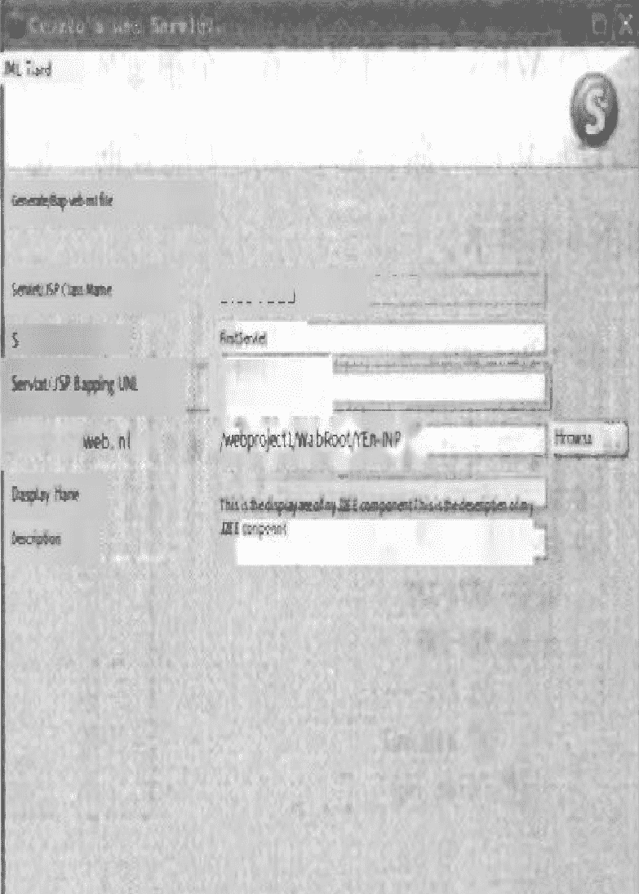

`/servlet/first`

文件位置：

② `<?xml version="1.0" encoding="UTF-8"?>`

图 6-8 设置映射

创建 Servlet 文件后，`web.xml` 发生了变化，Servlet 地址也经过了配置，如图 6-9 所示。

(3) 编写 Servlet 代码，主要是 `doGet()` 或 `doPost()`。

```
2014-9-15 10:27:18 org.apache.coyote.http11Protocol start Information:starting coyote http/1.1 on 8080
2014-9-15 10:27:18 org.apache.jk.common.ChannelSocket init Information:JK-ajp listening on 0.0.0.0:8009
Information:jk running 2014-9-15 10:27:18 org.apache.jk.server.JkMain start
2014-9-15 10:27:19 org.apache.catalina.startup.Catalina start Information:Server startup in 1906.ms
Create new project deployment for OExploded Archive (development mode) OrPackaged Archive (production mode) predict this Files\Apache Software Foundation
```

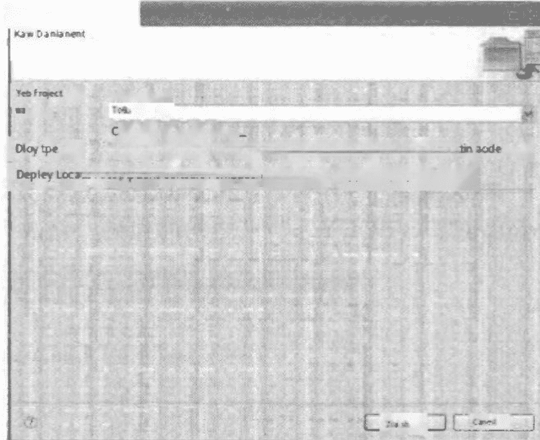

图 6-10 Servlet 代码

图 6-11 Servlet 代码

图 6-12 Tomcat 服务

图 6-13 Tomcat 启用成功

图 6-14 部署项目 webproject1

图 6-15 选择部署到 Tomcat 6.x 服务器

通过浏览器查看的是修改后的最新结果。

在点击图 6-15 中的 Finish 后，系统会显示一条消息，表示项目已成功部署在 Tomcat 6.x 服务器上。最后，点击 OK，如图 6-16 所示。

### 图 6-16 部署成功

要卸载 `webproject` 应用，请在图 6-16 所示的“Project Deployments”对话框中选择 `webproject` 项目，并点击“Remove”按钮。如果你想重新部署项目，点击“Redeploy”按钮。

(6) 测试运行步骤。

点击工具栏上的浏览器按钮，或者在浏览器之外的地址栏中输入：

`http://localhost:8080/webproject1/servlet/first`，可以输出 `FirstServlet` 对应的内容。结果如图 6-17 所示。

### 图 6-17 FirstServlet 输出

注意：在上述 URL 中，“webproject1”是 `webproject` 的名称，而“servlet/first”是当前访问的 Servlet 的映射路径。如果你忘记了映射路径，可以检查 `web.xml` 文件。

(7) 修改程序以解决中文乱码问题。

中文乱码问题通常有两种解决方案。

如果程序使用了 `response` 对象，将 `response.setContentType("text/html");` 修改为...

```
response.setContentType("text/html;charset=utf-8");
```

② 如果程序使用了 `request` 对象，添加 `request.setCharacterEncoding("utf-8");`。根据上述方案，应该通过更改 `doGet()` 方法中的第一行代码来修改 Servlet 代码，如图 6-18 所示。

要重新部署项目，点击工具栏上的部署项目按钮，如图 6-19 所示。将出现相应的部署界面。首先选择我们正在开发的 `webproject1` 项目，然后点击“redeploy”按钮，最后点击“OK”按钮。

### 图 6-18 再次修改 FirstServlet

图 6-19 重新部署项目

如果控制台显示了图 6-20 所示的消息，则项目已成功重新部署。

点击工具栏上的浏览器按钮，或者在浏览器之外的地址栏中输入：

`http://localhost:8080/webproject1/servlet/first`，结果如图 6-21 所示。

图 6-21 FirstServlet 重新输出的结果。页面可以输出中文，效果符合预期。

## 6.2.2 获取初始化参数的实例

- (1) 在同一个项目和包中创建一个名为 `GetParameterServlet` 的 Servlet。

- (2) 修改 `web.xml` 文件，使用 `<init-param>` 元素声明 Servlet 的初始化参数。将参数名称设置为 `repeat`，值设置为 `10`。图 6-22 显示了修改后的 `web.xml` 代码。

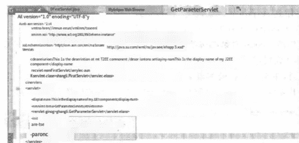

### 图 6-22 设置初始化参数

注意：添加的初始化参数代码必须放置在 `GetParameterServlet` 类对应的 `<servlet>` 和 `</servlet>` 之间。

(3) 编辑 Servlet 文件以从文件中获取初始化参数。例如，要在网页上循环输出“Welcome to our website”行，使用函数 `public String getInitParameter(str);` 来获取 `web.xml` 中定义的初始化参数的值。Servlet 代码如图 6-23 所示。

```
int repeat = Integer.parseInt(repeat);
for (int i = 0; i < repeat; i++) {
    out.println("<b>Welcome to our website</b>");
}
```

图 6-23 GetParameterServlet 代码

注意：`printContent()` 是一个自定义函数，该函数的打印内容应该写在 `doGet()` 方法之外，两者是独立的。

(4) 部署项目并运行输出。

在浏览器地址栏中输入：`http://localhost:8080/webproject/servlet/getParameterServlet`，输出结果如图 6-24 所示。

输出结果中仍有乱码。根据上述提到的解决方案修改代码。因为 `GetParameterServlet` 代码中使用了 `response` 对象，因此通过 `response.setContentType("text/html;charset=utf-8");` 设置响应响应格式。该代码如图 6-25 所示。

重新部署运行中的项目，将显示正确的结果，如图 6-26 所示。


## 6.2.3 获取服务器参数的实例

学习如何在 Servlet 中获取运行当前 Servlet 的服务器运行参数，以及这些参数的具体含义。

- (1) 在同一个项目和包中创建一个名为 `GetInfoServlet` 的新 Servlet。

- (2) 编辑 `GetInfoServlet`，使用 `request` 对象的 `getHeaderNames()` 和 `getHeader()` 方法来获取服务器参数。图 6-27 显示了代码。

- (3) 部署项目并运行输出。在浏览器地址栏中输入：`http://localhost:8080/webproject/servlet/GetInfoServlet`，结果如图 6-28 所示。

### 图 6-28 服务器信息显示

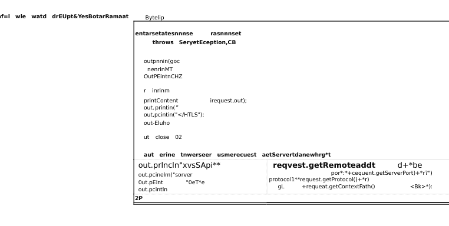

## 6.2.4 获取 Servlet Header 信息

Servlet Header 包含内容类型、语言、浏览器、操作系统等。它被用于统计系统以统计访问人数。

- (1) 在同一个项目和包中创建一个名为 `GetHeaderServlet` 的新 Servlet。

- (2) 编辑 `GetHeaderServlet`，使用 `request` 对象的 `getHeaderNames()` 和 `getHeader()` 方法来获取 header 信息。图 6-29 显示了代码。

```java
for (String name : request.getHeaderNames()) {
    out.print(name + ": " + request.getHeader(name) + "<br/>");
}
```

### 图 6-29 GetHeaderServlet 代码

注意：与之前的示例类似，`printContent()` 是一个自定义函数，该函数的打印内容应该写在 `doGet()` 方法之外。

(3) 部署项目并运行输出。在浏览器地址栏中输入：`http://localhost:8080/webproject/servlet/GetHeaderServlet`，结果如图 6-30 所示。

### 图 6-30 统计功能显示

## 6.3 HTML 表单在 Servlet 中的应用

### 6.3.1 HTML 表单基础

在前面的节中，我们通过示例解释了 Servlet 如何向浏览器发送不同的动态内容，但没有解释客户端如何通过浏览器向服务器发送特定的请求。客户端可以通过浏览器向服务器发送各种请求，即 POST、GET、PUT、DELETE、OPTIONS、HEAD 和 TRACE。但在实际 Web 开发中，我们只需要关注“POST”和“GET”请求，其他五种类型很少使用。

“POST 请求”通过名为“Form”的 HTML 表单发送，其中包含各种输入组件，如输入文本、输入密码、输入单选框、输入复选框、选择多选框、文本区域、提交按钮、重置按钮等。以下详细介绍了表单和组件的使用。

(1) Form

Form 标签的基本语法如下。

```html
<form method="post" action="/servlet/addMessage">
</form>
```

URL 被设置为表单所在文件的 URL。`method` 指定了将表单数据传输到 Web 服务器的方法。值可以是 "post" 或 "get"。推荐使用 post。

(2) 文本输入

Input 标记了文本类型，即让我们输入单行文本内容，示例代码如下。

```html
<form method="post" action="/servlet/login">
用户名：<input type="text" name="username" size="16" maxlen="8" value="zhangli">
</form>
```

`name` 是输入框的名称，`value` 是输入框的初始值，`size` 设置输入框的长度，`maxlen` 限制字符长度。图 6-31 显示了上述 HTML 代码在浏览器中的外观。

(3) 密码输入

Input 标记了密码类型并设置输入密码的内容。输入的数据将以 "*" 或 "." 显示。示例代码如下。

```html
<form method="post" action="/servlet/login">
密码：
<input type="password" name="password" size="20" maxlength="8">
</form>
```

图 6-32 显示了 HTML 代码在浏览器中的输出。

| 组件-输入 |
| :--- |
| 用户名 ahangla |

图 6-31 文本输入效果 <br> 图 6-32 密码输入效果

(4) 单选框

Input 标记了单选类型并设置为单选选项。`checked` 表示默认被选中。示例代码如下。

```html
<form method="post" action="/servlet/login">
请选择您的性别：
<input name="gender" type="radio" value="male" checked>男<input name="gender" type="radio" value="female">女
</form>
```

### 图 6-33 显示了 HTML 代码在浏览器中的输出。

(5) 复选框

Input checkbox 标记了复选框类型并设置多选表单。示例代码如下：

```html
<form method="post" action="/servlet/login">
请选择您的兴趣：
<input name="interest" type="checkbox" value="move">看电影<input name="interest" type="checkbox" value="music">音乐<input name="interest" type="checkbox" value="sing">看电视 演唱
</form>
```

### 图 6-34 显示了 HTML 代码在浏览器中的输出。

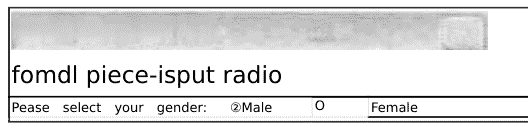

图 6-33 单选框效果 <br> 图 6-34 复选框效果

(6) 单项选择

Select 是一个下拉选择菜单表单，可以是单选的也可以是多选的。`option` 中 `selected` 的 "Option" 是默认值。示例代码如下。

```html
<form method="post" action="/servlet/login">
请选择您的出生地：
<select name="city">
<option value="Beijing">Beijing</option>
<option value="Tianjin">Tianjin </option>
<option value="Shanghai">Shanghai </option>
<option value="Chongqing" selected>重庆</option>
<option value="etc">other </option>
</select>
</form>
```

### 图 6-35 显示了 HTML 代码在浏览器中的输出。

(7) 多项选择

Select 加上 "multiple" 变为多选。在选择时按住 "Ctrl" 键和左鼠标键。示例代码如下。

```html
<form method="post" action="/servlet/login">
请选择您的兴趣：
<select name="interest" multiple size="5">
<option value="move">Watch movie</option>
<option value="music">Listen to music </option>
<option value="tv">Watch TV</option>
<option value="sing">歌曲</option>
</select>
</form>
```

### 图 6-36 显示了 HTML 代码在浏览器中的输出。

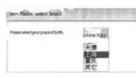

图 6-35 选择单框效果


### (8) 文本区域

Textarea 是一个文本输入区域，与 "text" 不同，textarea 可以有多个行，用 "rows" 指定行数，用 "cols" 指定行列数。我们也可以在 `<textarea>` 和 `</textarea>` 之间添加默认内容，示例代码如下。

```html
<form method="post" action="/servlet/login">
留言内容：<textarea name="comment" rows="10" cols="60">Hello</textarea>
</form>
```

图 6-37 显示了 HTML 代码在浏览器中的输出。

(9) 提交按钮

Submit 按钮是发送数据的按钮。如果为 Submit 按钮添加了 `name` 属性，那么当你点击此按钮提交表单时，`name` 属性和 `value` 属性的值也将作为一组表单参数发送到服务器。有时你可以在同一个表单中使用多个按钮。Submit 按钮的值会根据 `value` 自动调整。示例代码如下。

```html
<form method="post" action="/servlet/login">
留言内容：<textarea name="comment" rows="10" cols="60">Hello</textarea>
<input type="submit" value="submit">
</form>
```

图 6-38 显示了 HTML 代码在浏览器中的输出。


图 6-37 文本区域效果

(10) 重置按钮

`Reset` 按钮将表单重置为默认状态。示例代码如下。

```html
<form method="post" action="/servlet/login">
<input type="reset" value="reset">
</form>
```

如果删除了 `name` 属性，则当你点击此按钮时，`Submit` 按钮的 `value` 将不会发送到服务器。


# login.html 生成的最终代码如下。

```html
<body>
请输入您的用户名和密码：
<form id="form1" name="form1" method="post" action="/webproject2/servlet/login">
  <table width="313" border="0">
    <tr>
      <td width="85">用户名</td>
      <td width="218"><input name="username" type="text" id="username" size="18"/></td>
    </tr>
    <tr>
      <td>密码：</td>
      <td><input name="password" type="password" id="password" size="18" maxlength="10"/></td>
    </tr>
    <tr>
      <td>&nbsp;</td>
      <td><input type="submit" name="submit" id="submit" value="提交"/><input type="reset" name="reset" id="reset" value="重置"/></td>
    </tr>
  </table>
</form>
</body>
```

注意：`<form name="form1" method="post" action="/webproject2/servlet/">` 这一行代码中 `action` 设置的 URL 是跳转到的 Servlet 映射 URL。

(3) 创建一个名为 `LoginServlet` 的 Servlet 类，映射名称为 `/servlet/login`。

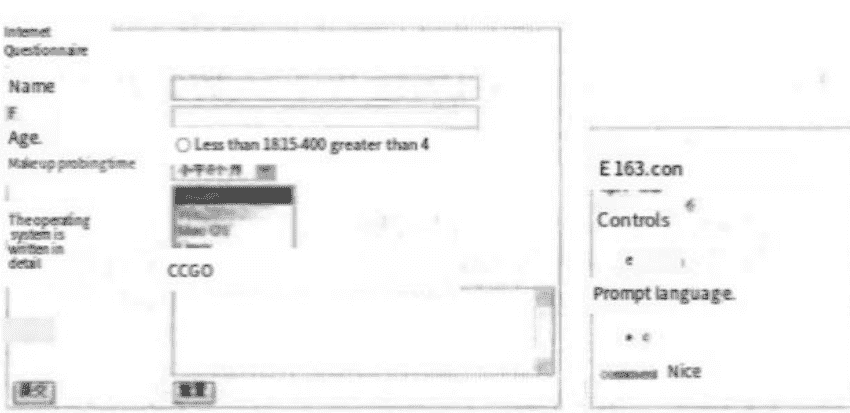

# (4) 修改 LoginServlet，如图 6-51 所示。

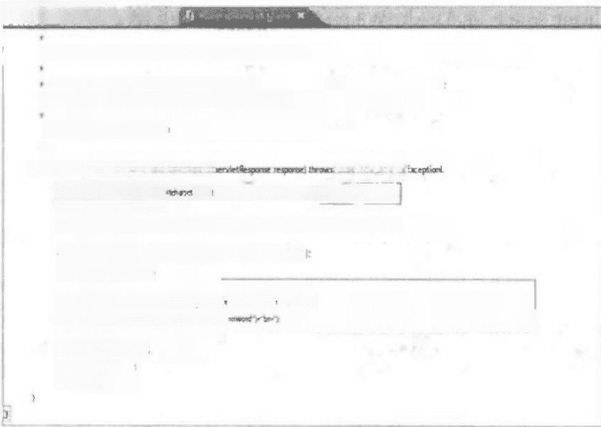

- 当表单的标签值 `method` 等于 `post` 时，调用此方法。

```java
public class LoginServlet extends HttpServlet {
    protected void doPost(HttpServletRequest request, HttpServletResponse response) throws ServletException, IOException {
        PrintWriter out = response.getWriter();
        response.setContentType("text/html;charset=UTF-8");
        out.println("<!DOCTYPE HTML PUBLIC \"//W3C//DTD HTML 4.01//EN\" \"http://www.w3.org/TR/html40/strict.dtd\">");
        out.println("<html><head><title>Login</title></head><body>");
        String username = request.getParameter("username");
        String password = request.getParameter("password");
        if (username.equals("admin") && password.equals("123456")) {
            out.println("Welcome " + username);
        } else {
            out.println("Error: incorrect username or password");
        }
        out.println("</body></html>");
    }
}
```

图 6-51 LoginServlet 截图

# (5) 启动 Tomcat 服务器，部署项目并运行输出。测试入口是：`http://localhost:8080/webproject2/login.html`。效果如图 6-52 所示。

点击“提交按钮”后输入用户名和密码，URL 将自动跳转到 `http://localhost:8080/webproject2/servlet/login` 并显示输出结果。图 6-53 显示了结果。

```
http://localhost:8080/webproject2/login.html
Enter your username and password
Username: admin
Password: 123456
http://localhost:8080/webproject2/servlet/login
Welcome admin
```

图 6-52 login.html 的效果
图 6-53 结果

# 6.3 表单应用

通过表单标签和 HTML 知识来完成调查卷，如图 6-51 所示。

当表单标签值 `method` 等于 `post` 时调用。效果如图 6-52 所示。

图 6-51。


- 跳转的 Servlet 映射 URL。


- (4) 修改 Servlet，如图 6-51 所示。

- (3) 创建一个名为 `LoginServlet` 的 Servlet 类，映射名称为 `/servlet/login`。


# (5) 启动 Tomcat 服务器，部署项目并运行输出。测试入口是：`http://localhost:8080/webproject2/login.html`。效果如图 6-52 所示。

点击“提交按钮”后输入用户名和密码，URL 将自动跳转到 `http://localhost:8080/webproject2/servlet/login` 并显示输出结果。图 6-53 显示了结果。

```
http://localhost:8080/webproject2/login.html
Enter your username and password
Username: admin
Password: 123456
http://localhost:8080/webproject2/servlet/login
Welcome admin
```

图 6-52 login.html 的效果
图 6-53 结果

# 6.4 HTML 表单验证

## 6.4.1 手动添加验证

为上一节的用户登录案例添加身份验证。例如，当用户在未输入用户名或密码的情况下提交时，会自动弹出一个警告框要求完成，如图 6-76 所示。

请输入您的用户名和密码。


用户名

liuwei

密码：

提交

图 6-76 为用户登录添加验证

(1) 复制 `login.html` 并将其粘贴到 `WebRoot` 目录下，命名为 `login2.html`。

(2) 在 `login2.html` 的 `<body>` 之后添加 JavaScript 代码。


```javascript
<script language="javascript">
function validate(myform) {
    if(myform.username.value.length == 0){
        alert("Please fill in the username ");
        myform.username.focus();
        return false;
    }
    if(myform.password.value.length == 0){
        alert("Please enter password ");
        myform.password.focus();
        return false;
    }
}
</script>
```

(3) 修改 `<form>` 标签设置以添加事件响应。放入代码：

`<form id="form1" name="form1" method="post" action="/webproject2/servlet/login">`

```html
<form id="form1" name="form" method="post" action="/webproject2/servlet/login" onsubmit="return validate(this)">
```

### 6.4.2 JSValidation 验证框架

JSValidation 是一个开发好的框架，你可以直接对其配置。要使用此框架，需要将三个文件放入项目：`validation-framework.js`、`validation-config.xml` 和 `validation-config.dtd` 文件。


以下是将 JSValidation 添加到用户登录案例中的示例，用于介绍该验证框架的使用。

- (1) 在当前项目的 `WebRoot` 目录下创建一个名为 "js" 的文件夹，并将上述三个文件放入 "js" 中。

- (2) 修改 `validation-framework.js` 文件的第 21 值为 `var ValidationRoot="";`。将其更改为 `var ValidationRoot="/webproject2/js/";` 并将整个文件保存为 UTF-8 编码。否则，会出现乱码字符，如图 6-77 和图 6-78 所示。

(3) 在 `validation-config.xml` 中，仅保存第一个 `<form></form>` 标签中的内容，并删除其他 `<form>` 标签。

(4) 复制 `login.html` 并将其粘贴到 `WebRoot` 目录下，命名为 `login3.html`。

(5) 在 `login3.html` 的 `<body>` 之后添加以下代码：

```html
<script language="javascript" src="/webproject2/js/validation-framework.js"></script>
```

(6) 修改表单标签的属性设置。将代码：

`<form id="form1" name="form" method="post" action="/webproject2/servlet/login"` 改改成：

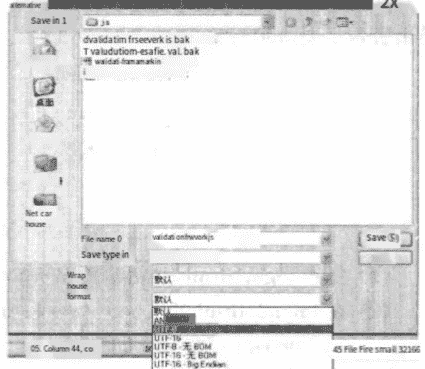

图 6-78 以 UTF-8 格式保存文件

`<form id="form1" name="form1" method="post" action="/webproject2/servlet/login" onsubmit="return doValidate(this)">`

如果你不想将错误消息显示为 alert 而是显示为 div，可以按照如下方式进行设置。

(1) 在 `login3.html` 中添加 `<div>` 设置。

在 `login3.html` 中，找到 HTML `<form id="form" name="form" method="post" action="/webproject2/servlet/login" onsubmit="return` ... 在 `doValidate(this)` 之前添加一行：

```html
<div id="error" style="color:red;font-weight:bold"></div>
```

(2) 在 `validation-config.xml` 中设置。

将代码 `<form id="form" show-error="alert" show-type="all"` 改为：

```xml
<form id="form" show-error="error" show-type="all">
n....
```

要求：将 JSValidation 添加到网络问卷案例中。

(1) 复制 `survey.htm` 并将其粘贴到 `WebRoot` 目录下，命名为 `survey2.htm`。

(2) 在 `survey2.htm` 的 `<body>` 之后添加代码：

```html
<script language="javascript" src="/webproject2/js/validation-framework.js"></script>
```

(3) 修改 Form 标签的属性设置。

将代码 `<form id="form1" name="" method="post" action="/webproject2/servlet/login"` 改正为:

```html
<form id="form2" name="form2" method="post" action="/webproject2/servlet/" onsubmit="return doValidate(this)">
```

(4) 在 `validation-config.xml` 中为 form2 添加验证。

```xml
<form id="form2" show-error="error" show-type="all">
    <field name="name" display="姓名">
    <field name="email" display="邮箱">
    <field name="age" display="年龄">
    <field name="code" display="编程时间">
    <field name="os" display="操作系统">
    <field name="language" display="语言">
    <field name="comment" display="建议">
</form>
```

## 6.5 FCKeditor 应用

FCKeditor 框架可用于在 HTML 中显示带工具栏的文本框。FCKeditor 下载地址：http://www.fckeditor.net/。

创建一个 FCKeditor 项目的步骤如下：

(1) 创建项目。


(2) 将 `fckeditor` 文件夹复制到 `WebRoot`。

```text
fckeditor
WebRoot
WEB-INF
index.jsp
```

(3) 创建 FCK 内容。

在输入中使用 FCKeditor 的细节如下：

- (1) 将 `fckeditor` 文件夹复制到 `WebRoot`。

- (2) 刷新项目，看到 `fckeditor` 已导入，但会出现一些错误，如图 6-79 和图 6-80 所示。

(4) 在 `input.html` 中使用 FCKeditor。在 `<body>` 和 `</body>` 之间添加以下代码：

```html
<script language="javascript" src="/webproject2/js/validation-framework.js"></script>
<input type="text" name="title" size="80"><br>
<form id="form3" name="form3" method="post" action="/webproject2/servlet/login">
<script type="javascript">
var editor = new FCKEditor('editor');
editor.BasePath = '/webproject2/js/fckeditor/';
editor.Height = 200;
editor.ToolbarSet = 'Basic';
editor.create();
</script>
<input type="submit" value="提交">
</form>
```

(5) 编辑 `addContent.java` 中的 `doPost()` 内容。使用 `request.getParameter("editor1")` 获取用户在 FCKeditor 框中输入的内容。图 6-82 显示了 `addContent.java` 的代码截图。


(6) 如果无法输出中文，则需要进行修改。设置代码 `response.setContentType("text/html");` 更改为 `response.setContentType("text/html;charset=utf-8");` 添加 `request.setCharacterEncoding("utf-8");`。

此外，它还可以操作存储在各种数据库管理系统中的数据，无论数据库管理系统中的存储格式如何。同时，由于 Java 语言的平台独立性，无需在不同的系统平台下编写不同的数据库应用程序。

## 7.1.2 JDBC 设计的设计

JDBC 是一个规范，设计它最重要的目的是允许每个数据库开发者为 Java 程序员提供标准的数据库访问类和接口，使得开发独立于 DBMS 的 Java 应用成为可能（数据库、驱动程序更改，但应用程序保持不变）。

Microsoft ODBC 用 C 语言编写，仅适用于 Windows 平台，无法实现数据库的跨平台操作。虽然 SQL 语言包含了数据定义、数据操作、管理等功能，但它不是一种完整的编程语言，不支持流程控制，需要与其他编程语言配合使用。

JDBC 的设计是因为 Java 语言具有健壮性、安全性、易用性和自动下载等优点，因此如果使用 Java 语言连接数据库，就能克服 ODBC 限于系统平台的缺陷；SQL 语言与 Java 语言结合，可以实现不同数据库系统的连接，即使用 JDBC 可以轻松地向任何关系数据库发送 SQL 语句。

## 7.1.3 JDBC 的主要功能

- (1) 支持基本的 SQL 语句，在 Java 程序中实现数据库操作功能并简化操作过程。

- (2) 提供多种数据库连接方法。

- (3) 为各种不同的数据库提供统一的操作接口。

## 7.1.4 JDBC 和 ODBC 的比较

(1) ODBC 用 C 语言编写的，不是面向对象的；而 JDBC 用 Java 编写的，是面向对象的。(2) ODBC 很难学习，因为它将简单功能与高级功能结合在一起，即使是简单的查询也带有复杂的选项；JDBC 的设计使得简单的事情用简单的方式完成。

(3) ODBC 局限于一个系统平台，而 JDBC 提供了 Java 平台无关的解决方案。

(4) 然而，也可以通过 Java 操作 ODBC，这可以通过使用 JDBC-ODBC 桥接来实现（因为 Java 不能直接使用 ODBC，即在 Java 中使用原生 C 代码会引入安全漏洞）。

## 7.1.5 JDBC 驱动程序的类型

常见的 JDBC 驱动可以分为以下四类。

- (1) JDBC-ODBC 桥接和 ODBC 驱动

该桥接产品使用 ODBC 驱动提供 JDBC 访问。请注意，ODBC 二进制代码（在很多情况下还包括数据库客户端代码）必须加载到使用该驱动的每个上。因此，这种类型的驱动最适合客户端安装不是主要考虑的企业网络，或用 Java 编写的三层结构应用程序服务器代码。

JDBC-ODBC 桥接方法使用 Microsoft 的开放数据库互连接口（ODBC API）与数据库服务器通信。客户端计算机应先安装并配置 ODBC 驱动和 JDBC-ODBC 桥接驱动。

- (2) 本地 API

这种类型的驱动程序将客户端 API 上的 JDBC 调用转换为 Oracle、Sybase、Informix、DB2 或另一个 DBMS 的调用。请注意，像桥接驱动一样，这种类型的驱动程序需要将一些二进制代码加载到每个客户端。

这种类型的驱动程序将数据库厂商的特殊协议转换为 Java 代码和二进制类代码，使 Java 数据库客户端能够与数据库服务器通信。例如，Oracle 使用 SQLNet 协议，DB2 使用 IBM 数据库协议。数据库厂商的特殊协议也应该安装在客户端上。

- (3) JDBC 将 JDBC 转换为与 DBMS 无关的网络协议，然后该协议由服务器转换为 DBMS 协议。这种网络服务器中间件能够将其它的纯 Java 客户端连接到各种不同的数据库。使用的特定协议取决于提供者。通常，这是最灵活的 JDBC 驱动。此类解决方案产品的提供者可能适用于内网使用。为了让这些产品也支持互联网访问，它们必须处理 Web 在安全、通过防火墙访问等方面的额外需求。一些提供者正在为其现有的数据库中间件产品添加 JDBC 驱动。

这种方法是纯 Java 驱动。数据库客户端使用标准网络协议（如 HTTP）与数据库访问服务器通信，数据库访问服务器将标准网络协议转换为数据库厂商的特殊数据库访问协议（也可以使用 ODBC 驱动）来与数据库通信。这是互联网和内网用户的理想解决方案。Java 驱动会随 Applets 从 Web 服务器自动、透明地下载并安装在用户的计算机上。

- (4) 原生协议纯 Java 驱动

这种类型的驱动程序将 JDBC 调用直接转换为 DBMS 使用的网络协议。这允许从客户端直接调用 DBMS 服务器，对于内网访问是一种非常实用的解决方案。

这种方法也是纯 Java 驱动。数据库厂商提供一种特殊的 JDBC 协议来启用 Java 数据库服务器。然而，代理协议将与数据库服务器通信而不是数据库厂商的特殊 JDBC 驱动。这对于内网应用是高效的，但数据库厂商的协议可能不受防火墙支持，互联网应用中缺乏防火墙支持将产生安全风险。

## 7.2 JDBC 的工作原理

### 7.2.1 工作原理概述

JDBC 的设计基于 X/Open SQL CLI（调用级接口）模型。它通过定义一组用于与数据库交互的 API 对象和方法来工作。图 7-1 显示

![img/311f1897b6cf25bea17ea3c0d6ff3_320_0.png]

数据库实例可以理解的命令，并将数据库返回的结果转换为 Java 程序可以识别的数据，以便程序进一步处理。其次，Java 也可以直接与特定的驱动程序交互。图 7-1 显示

![img/311f1897b6cf25bea17ea3c0d6ff3_321_0.png]

Java

### 7.2.2 JDBC 架构

Java 数据库方法用于 Java 应用程序连接数据库的标准方法。JDBC 是 Java 程序员的 API，也是实现连接的服务提供者的接口模型。作为 API，JDBC 为程序开发提供了标准接口，并为数据库厂商和第三方中间件厂商连接数据库提供了标准方法。图 7-2 显示 JDBC 的基本架构。

1. 用于 Java 程序员的 JDBC API

Java 程序员通过调用此 API 实现连接数据库、执行 SQL 语句并返回结果集和其他数据库编程的能力，它主要由一系列接口定义组成。

(1) `java.sql.DriveManager`: 此接口定义用于加载驱动程序并创建新驱动。

## 数据库连接支持。

(2) `java.sql.Connection`: 此接口主要定义了实现指定数据库连接的功能。

(3) `java.sql.Statement`: 此接口定义了一个容器，在给定的连接中以 SQL 语句的形式执行语句，以实现对数据库进行的操作。它主要包含以下两个子类型。

- `PreparedStatement`: 此接口定义了预编译语句（preparedstatement），用于执行包含或不包含 IN 参数的预编译 SQL 语句。

- `java.sql.CallableStatement`: 此接口主要定义了用于执行数据库存储过程的调用（call）接口。

(4) `java.sql.ResultSet`: 此接口定义了在数据库上执行操作后返回的结果集。

## 2. 数据库厂商的 JDBC 驱动程序 API

数据库厂商必须提供相应的驱动程序并实现 JDBC。API 需要的基本接口（每个数据库系统制造商都必须提供 DriverManager、Connection、Statement、ResultSet 以及其他接口的特定实现），以便最终确保 Java 程序员能够通过 JDBC 实现各种不同的数据库操作。

### 7.2.3 编程基础

(1) JDBC 驱动程序管理器是 JDBC 架构的骨干。它实际上非常小且简单；其主要功能是将 Java 连接到正确的 JDBC 驱动程序并退出。

(2) JDBC-ODBC 桥接是一种 JDBC 驱动程序，通过将 JDBC 操作转换为 ODBC 操作来实现对数据库的操作能力，该桥接使得所有 ODBC 可用的数据库都能实现 JDBC。

(3) `DriverManager` 类持有一个已注册的 `Driver` 类列表。当调用 `getConnection` 方法时，它会检查列表中的每个驱动，直到找到一个可以连接到 URL 中指定的数据库的驱动。

## 7.3 数据库的安装与使用

### 7.3.1 安装 SQL Server 2000 和 SP3

要安装 SQL Server 2000，双击 `AUTORUN.EXE`，并选择“Install SQL Server 2000 Components”选项进入安装向导界面，如图 7-3 所示。


在你的本地计算机上选择安装并点击“Next”按钮，如图 7-4 所示。

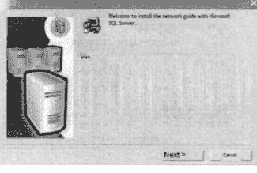

图 7-3 SQL Server 2000 安装向导

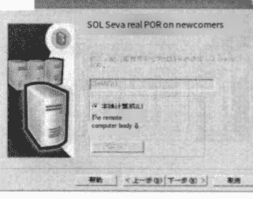

图 7-4 选择本地计算机安装

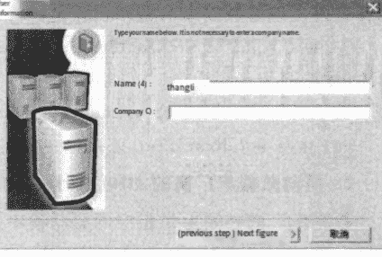

选择“Create a new SQL Server instance”并点击 Next，如图 7-5 所示。

输入用户信息并点击“Next”按钮，如图 7-6 所示。

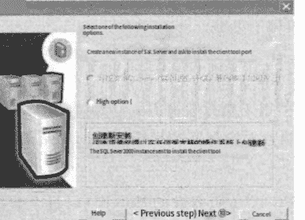

图 7-5 选择创建 SQL Server 实例

## 图 7-6 输入用户信息

接受软件许可协议并点击“Yes”按钮，如图 7-7 所示。选择“Install server and client tools”并点击“Next”按钮，如图 7-8 所示。

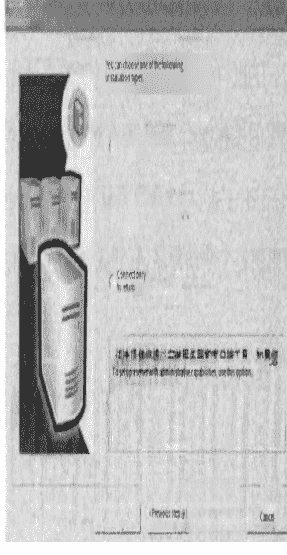

Server and Client Tools (S)

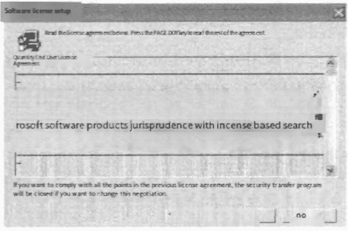

## 图 7-7 接受软件许可协议

图 7-8 选择安装服务器和客户端工具

选择“Default installation”（默认安装）并点击“Next”按钮，如图 7-9 所示。选择“Typical installation”（典型安装）并点击 Next ，如图 7-10 所示。


## 图 7-9 默认选择 Next

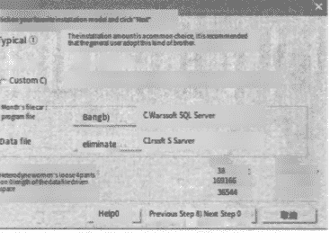

## 图 7-10 选择典型安装


选择“Use local system account”（使用本地系统帐户），然后选择 Windows 和 SQL Server 双因子身份验证，并为“sa user”设置密码，密码可以根据个人情况设置，必须记住此密码，因为它将在 JDBC 编程中使用。然后开始复制文件并点击“Next”按钮，如图 7-11 所示。

安装 SQL Server 2000 后，你需要安装 SP3 补丁。双击 `setup.bat` 安装补丁。在欢迎页面上，点击 Next，如图 7-12 所示。


## 为默认实例安装 Service Pack 并点击“Next”按钮，如图 7-13 所示。

连接到服务器，输入你刚刚为 sa 设置的密码，并点击“Next”按钮，如图 7-14 所示。

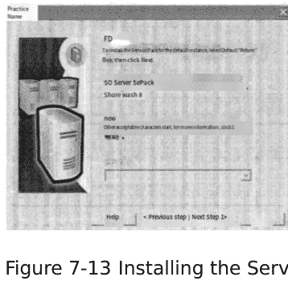

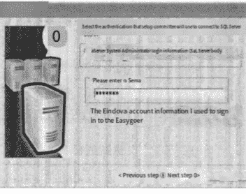

## 默认实例的 Service Pack 数据库

选择 SP3 兼容性并点击 Next，如图 7-15 所示。

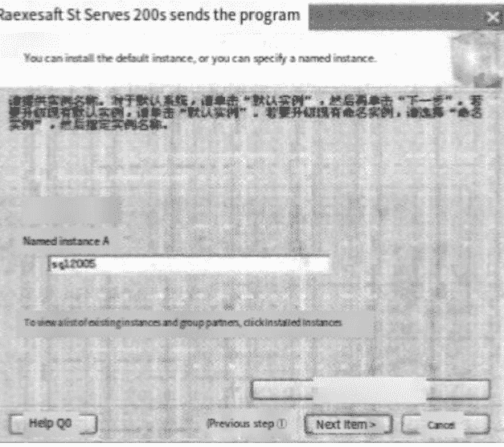

## 7.3.2 数据库的安装

如果 SQL Server 2000 已经安装在你的计算机上，你想安装 SQL Server 2005，需要选择“Named Instance”并填写实例名称。选择“Default Instance”并点击 Next，如图 7-16 所示。

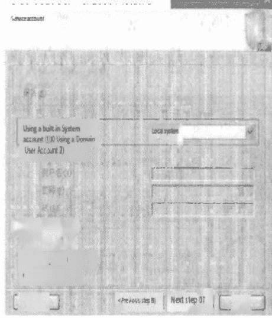

图 7-17 设置新实例

## 图 7-18 使用内置

(1) 点击开始 → 程序 → Microsoft SQL Server 2005 → 配置工具 → SQL Server 配置管理器 → SQL Server 2005 网络配置 → 协议，检查 TCP/IP 服务是否启用。如果没有，右键点击并从菜单中选择“启用”，如图 7-19 所示。

(2) 双击 TCP/IP 进入设置。在 IP 地址中，你可以配置 IPAll 的端口，默认为 1433，如图 7-20 所示。确定。


## 图 7-19 启用 TCP/IP

(3) 双击 SQL Server 2005 服务并右键重启 SQL Server（因为更改后必须重启 SQL Server 才能生效），如图 7-21 所示。

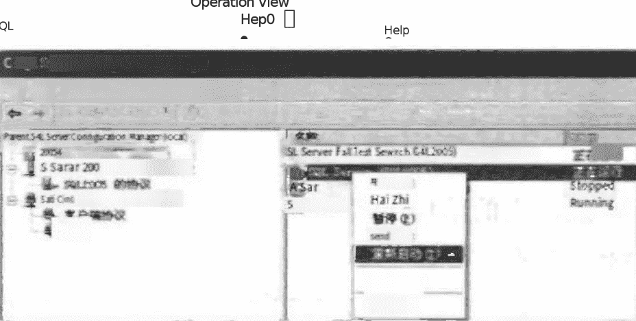

图 7-20 设置 TCP 端口 重启 SQL Server

## 7.3.3 安装与使用 MySQL

MySQL 数据库的安装在第 1 章中有详细介绍，本节不再重复。本节重点介绍 MySQL 数据库的使用和常用语句。

(1) 使用 `SHOW` 语句查看服务器上存在哪些数据库。

```
mysql>SHOW DATABASES;
+----------+
| Database |
+----------+
| mysql    |
| test     |
+----------+
3 rows in set (0.00 sec)
```

(2) 创建一个 abccs 数据库。

```
mysql>CREATE DATABASE abccs;
```

注意不同操作系统的的大小敏感性。

(3) 选择你创建的数据库。

```
mysql> USE abccs;
Database changed
```

此时，你已经进入了创建的 abccs 数据库。

(4) 创建数据库表。

首先查看你的数据库中存在哪些表：

```
mysql SHOW TABLES;
Empty set (0.00 sec)
```

员工生日表。该表包含员工姓名、城市、性别、出生日期和出生城市。

```mysql
mysql>CREATE TABLE mytable(name VARCHAR(20),sex CHAR(1),birth DATE,birthaddr VARCHAR(20));
```

# Query OK, 0 rows affected (0.00 sec)

一旦创建了表，我们可以使用 `SHOW TABLES` 查看刚才操作的结果，以显示数据库中有哪些表：

```mysql
mysql>SHOW TABLES;

+-----------------------+
|Tables in menagerie |
+-----------------------+
| mytable               |
+-----------------------+
```

(5)显示表的结构。

```mysql
mysql DESCRIBE mytable;

+ - - - - - - - - - - + 
Field     | Type       | Null | Key | Default | Extra
+--------------------------------------+
name      | varchar(20)| Yes  | NULL | NULL    | 
sex       | char(1)    | YES  || NULL    | 
birth     | date       | YES  | NULL | NULL    | 
birthaddr | varchar(20)| Yes  | NULL | NULL    |
```

4rows in set (0.00 sec)

(6)向表中添加记录。

# 让我们先使用 select 命令查看表中的数据：

mysql select*from mytable; 

Empty (0.00 sec)

这意味着你刚刚创建的表还没有记录，因此为它添加一条新记录：

```mysql
mysql insertinto mytable values('abccs','f','1977-07-07','china');
```

Query OK, 1 row affected (0.07 sec)

再次使用上面的 `select` 命令查看发生了变化。

我们可以按照这种方法逐个向表中添加所有员工记录。

## 7.3.4 配置构建路径 (Build Path)

在安装并配置好所需的数据库后，我们可以创建数据库和表，然后在项目编程中连接数据库并进行添加、删除、修改、查询等操作，这时我们需要为项目路径构建相应的数据库 JDBC 驱动程序。

MySQL 和 SQL Server 2005 的 JDBC 驱动只有一个 jar 文件，而 SQL Server 2000 的 JDBC 驱动有三个 jar 文件。以下以 MySQL JDBC 驱动和 SQL Server 2005 JDBC 驱动构建到 MyEclipse 项目中为例，解释配置构建路径的步骤。其他数据库的操作也是类似的。

(1)第一种方法是创建一个新的用户库（User Library），然后将用户库构建到特定项目中。通过这种方法创建的用户库将始终存在于 MyEclipse 中。当其他项目想要引用此用户库时，可以直接选择库的名称。

- ① 创建一个新的用户库。在 MyEclipse 中点击 `Window\→ Preferences` 显示偏好设置对话框，如图 7-22 所示。展开左侧的 `Java-User Libraries` 并点击右侧的 `New`。在弹出的对话框中输入用户库名称并点击“OK” 按钮。


执行上述操作后，Preferences 对框右侧显示了一个名为 "MySQL Driver" 的用户库，但该用户库仍然为空，需要导入特定的 jar 文件。点击 `Add JARs`。在显示的对话框中，选择存储 jar 文件的目录并点击 `Open`，如图 7-23 所示。

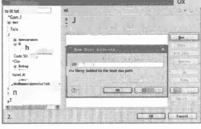

图 7-22 创建用户库

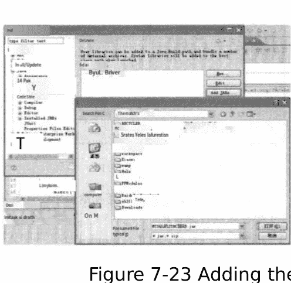

执行前面的操作后，MySQL Driver 用户库显示在 Preferences 对话框的右侧。点击 `OK`，用户库已创建，如图 7-24 所示。

- ② 将用户库构建到特定项目。如果项目想要使用 JDBC 驱动库，右键点击项目并点击 `Build Path→Add Libraries` 来配置路径，如图 7-25 所示。

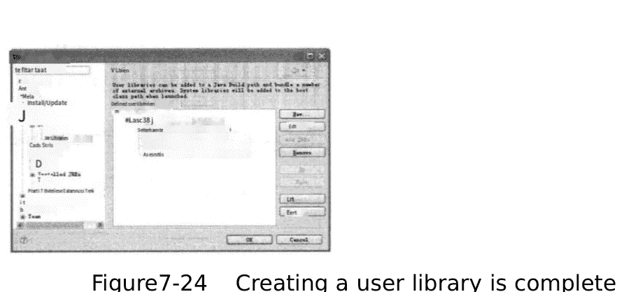

图 7-25 为项目配置构建路径

选择 "User Library" 并点击“next”按钮，如图 7-26 所示。选择你刚刚创建的名为 "MySQL Driver" 的用户库并点击“Finish” 按钮，如图 7-27 所示。

执行上述操作后，我们查看包资源管理器，如图 7-28 所示，项目目录包含 "MySQLDriver" 库，这证明 MySQL JDBC 驱动已构建在该项目的路径，项目可以编写与 MySQL 数据库相关的程序。

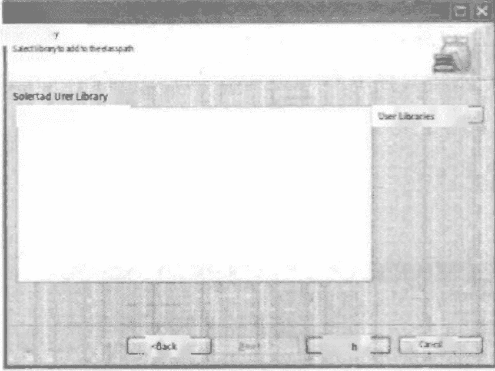

112

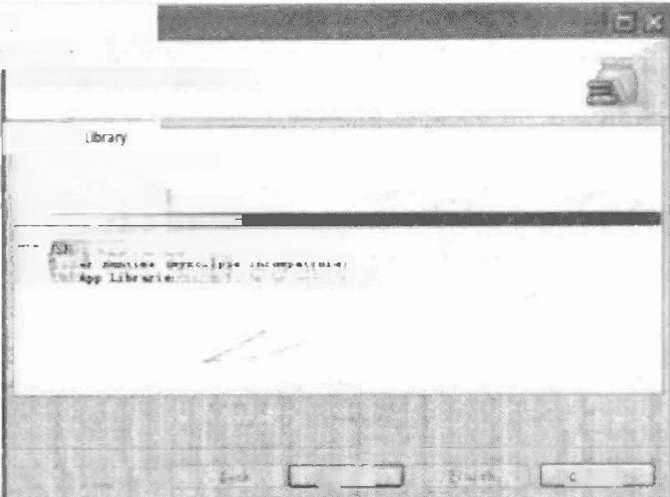

# 图 7-26 选择 MySQL 驱动

(2)第二种方法是直接将所需的 JDBC 驱动 jar 文件构建到项目路径。

右键点击项目并点击 `Build Path→Add Libraries` 来配置路径，如图 7-29 所示。

直接选择 jar 文件。此时将 SQL Server 2005 构建到项目路径，如图 7-30 所示。通过执行上述操作后，我们查看包管理器，如图 7-31 所示，项目目录包含 "Referenced" 库，这证明 MySQL JDBC 驱动已构建在该项目的路径，项目可以编写与 MySQL 数据库相关的程序。 7.4 JDBC 编程

### (1) 引用必要的包。

```java
import java.sql.*;
```

### (2) 加载驱动程序。

为了连接特定数据库，JDBC 必须加载驱动程序。这通常通过显式使用 `forName()` 完成。DriverManager 在连接数据库时将使用该驱动程序。

驱动名称随数据库而异，例如：

```
com.microsoft.jdbc.sqlserver.SQLServerDriver
com.microsoft.sqlserver.jdbc.SQLServerDriver
oracle.jdbc.driver.OracleDriver
com.mysql.jdbc.Driver
```

以下是加载 SQL Server 2007 驱动的示例：

```java
Class.forName("com.microsoft.sqlserver.jdbc.SQLServerDriver");
```

### (3) 创建数据源连接。

首先指定数据源，JDBC 技术使用数据库 URL 来识别目标数据库。数据库 URL 格式：`jdbc:<protocol name>:<subname>`，其中 `jdbc` 是协议名称`<protocol name>` 指定目标数据库的类型和特定连接模式；`<subname>` 指定特定的连接信息（例如数据库服务器 IP 地址/端口、ODBC 数据源名称、连接用户名/密码等），子部分的格式和内容随不同的协议而变化。

URL 随数据库而异，例如：

```
jdbc:sqlserver://127.0.0.1:733;DatabaseName=pubs // SQL Server 2000 URL
jdbc:sqlserver://localhost:733;DatabaseName=zhangli // SQL Server 2007 URL
jdbc:oracle:thin:@166.111.78.98:1721:ora // Oracle URL
jdbc:mysql://127.0.0.1/DatabaseName=studentcs // MySQL URL
```

- 2 创建数据源连接。

调用 `DriverManager` 类提供的 `getConnection` 函数获取连接。以下演示了连接到原生 SQL Server 2007 数据库的过程：

```java
String url="jdbc:sqlserver://localhost:733;DatabaseName=zhangli";
String username="root"; //用户名
String password="zhangli"; // 密码
Connection conn=DriverManager.getConnection(url,username,password);
```

### (4) 在数据库上执行 SQL 语句，进行添加、删除、修改、查询等操作。

第一种方法：使用 `Statement` 对象执行 SQL 操作。

第 1 步：要执行 SQL 查询语句，必须先创建一个语句对象，该对象封装了要执行的 SQL 语句，并执行该 SQL 语句以返回一个 ResultSet 对象，这可以通过 Connection 类中的 `createStatement()` 方法实现。例如：

```
Statement stmt =conn.createStatement();
```

第 2 步：通过调用 Statement 提供的 `executeQuery()`、`executeUpdate()` 或 `execute()` 来执行 SQL 语句。使用哪种方法取决于 SQL 语句本身。

`executeQuery` 方法用于产生单个结果集的语句，例如 `select` 语句，如下所示：

```
ResultSet rs=stmt.executeQuery("select*from stu");
```

`executeUpdate` 方法用于执行 INSERT、UPDATE 或 DELETE 语句以及 SQL DDL（数据定义语言）语句，例如 `CREATE TABLE` 和 `DROP TABLE`。INSERT、UPDATE 或 DELETE 语句的作用是修改表中零行或多行的一列或多列。

`executeUpdate` 的返回值是一个整数，表示受影响的行数（即更新计数）。对于 `CREATE TABLE` 或 `DROP TABLE` 等不操作行的语句，`executeUpdate` 始终返回零值。`execute` 方法用于执行返回多个结果集、多个更新计数或两者组合的语句。这种高级功能通常不需要。

注意：Statement 对象一次只能打开一个结果集，打开第二个结果集意味着第一个结果集会被对关闭；如果你想同时操作多个结果集，必须创建多个 Statement 对象，并在每个 Statement 对象上执行 SQL 查询语句以获取相应的结果集。如果你不需要同时处理多个结果集，可以在 Statement 对象上按顺序执行多个 SQL 查询语句，以便对获取的结果集进行按顺序操作。

方法 2（共 2 种方法）：使用 PreparedStatement 对象执行 SQL 操作。使用 `PreparedStatement` 对象。

由于 Statement 对象在每次执行时都会向数据库结束 SQL 语句，因此当需要多次执行相同的 SQL 语句时，其执行效率会非常低。在这种情况下，你可以使用 `PreparedStatement` 对象来封装 SQL 语句。


`PreparedStatement` 对象的作用是预编译 SQL 语句，且 `PreparedStatement` 对象的 SQL 语句还可以接收参数。

第 1 步：使用 `Connection` 对象的 `prepareStatement` 方法创建 `PreparedStatement` 对象，可以使用预编译的 SQL 语句进行创建，如下所示：

```java
String sql = "insert into table(id,name) values(47,'zhangli')";
PreparedStatement pstmt = null;
pstmt = conn.prepareStatement(sql);
```

第 2 步：调用 `executeQuery`（或 `executeUpdate()`）执行 SQL 语句，但与 `Statement` 不同，它没有参数，因为要执行的 SQL 语句在创建 `PreparedStatement` 对象时已经给出并由系统进行了预编译。

```java
int n = pstmt.executeUpdate();
```

(5) 获取 SQL 语句执行的结果。

`executeUpdate` 的返回值是一个整数，而 `executeQuery` 的返回值是一个包含所有查询结果的结果集。然而，`ResultSet` 类的对象取决于 Cursor 的类型，而每行中的单独列可以按任何顺序进行处理（当然，从左到右处理列效率更高）。

`ResultSet` 对象维护一个指向当前行的指针，可以通过 `ResultSet` 类的 `next()` 方法移动到下一行（在 JDBC 中，Java 程序每次只能看到一行数据）。如果 `next()` 的返回值为 `false`，则表示结果集已到达末尾。此外，JDBC 没有类似于 ODBC 书签功能的方法。可以使用 `ResultSet` 类的 `getXXX()` 方法获取结果中的某一列，其中 XXX 代表 JDBC 中的 Java 数据类型，如 `getInt()`、`getString()`、`getDate()` 等。访问时，你需要指定要检索的列（你可以使用 `int` 值作为列号（从 1 开始计数），或指定列（字段）名称，但字段名不区分大小写）。

```java
while (rs.next()) {
    String name = rs.getString("name");
    int age = rs.getInt("age");
    float wage = rs.getFloat("wage"); // 通过“列名”访问数据
    String homeAddress = rs.getString(4); // 通过“列号”模式访问数据
}
```

重要提示：使用 `ResultSet` 类的 `getXXX()` 方法，你可以将 `ResultSet` 中的 SQL 数据类型转换为其返回的 Java 数据类型。对于每一行，可以按任意顺序获取列值。但为了可移植性，你应该从左到右获取列值并一次性读取它们。

(6) 关闭查询语句和与数据库的连接（注意关闭顺序：rs，然后是 stmt 和 con，你通常可以在最后的语句中完成关闭）

```java
rs.close();
stmt.close(); // 或 con.close();
pstmt.close();
```

## 7.4.2 JDBC 编程实例 — 查询数据 方法 1

数据库使用 SQL Server 2000，使用 `Statement` 对象查询表，输出如下所示：

```java
String driver = "com.microsoft.jdbc.sqlserver.SQLServerDriver";
String url = "jdbc:microsoft:sqlserver://localhost:1433;DatabaseName=zhangli";

String username = "sa";
String password = "zhangli";

String sql = "Select * from table";
Connection conn = null;
Statement stmt = null;
try {
    Class.forName(driver);
    conn = DriverManager.getConnection(url, username, password);
    stmt = conn.createStatement();
    ResultSet rs = stmt.executeQuery(sql);
    while (rs.next()) {
        System.out.println("ID:" + rs.getInt(1));
        System.out.println("Name:" + rs.getString(2));
    }
    rs.close();
    stmt.close();
    conn.close();
} catch (ClassNotFoundException e) {
    e.printStackTrace();
} catch (SQLException e) {
    e.printStackTrace();
}
```

## 7.4.3 JDBC 编程实例 — 查询数据 方法 2

数据库使用 SQL Server 2000，使用 `PreparedStatement` 执行表插入的操作如下：

```java
String driver = "com.microsoft.jdbc.sqlserver.SQLServerDriver";
String url = "jdbc:microsoft:sqlserver://localhost:1433;DatabaseName=zhangli";

String username = "sa";
String password = "zhangli";

String sql = "insert INTO table(id,name) values(?)";
Connection conn = null;
PreparedStatement pstmt = null;
try {
    Class.forName(driver);
    conn = DriverManager.getConnection(url, username, password);
    pstmt = conn.prepareStatement(sql);
    pstmt.setInt(1, 47);
    pstmt.setString(2, "zhangli");
    int n = pstmt.executeUpdate();
    if (n == 0) {
        System.out.println("添加失败 ");
    } else {
        System.out.println("添加成功 ");
    }
    pstmt.close();
    conn.close();
} catch (ClassNotFoundException e) {
    e.printStackTrace();
} catch (SQLException e) {
    e.printStackTrace();
}
```

## 7.4.4 JDBC 编程实例 — 插入数据 方法 1

数据库使用 MySQL，使用 `Statement` 对象执行表插入的操作如下：

```java
String driver = "com.mysql.jdbc.Driver";
String url = "jdbc:mysql://localhost:3306/zhangli";
String username = "root";
String password = "123456";

String sql = "insert into table(id,name) values(47, 'zhangli')";
Connection conn = null;
Statement stmt = null;
try {
    Class.forName(driver);
    conn = DriverManager.getConnection(url, username, password);
    stmt = conn.createStatement();
    stmt.executeUpdate(sql);
    stmt.close();
    conn.close();
} catch (ClassNotFoundException e) {
    e.printStackTrace();
} catch (SQLException e) {
    e.printStackTrace();
}
```

## 7.4.5 JDBC 编程实例 — 插入数据 方法 2

数据库使用 MySQL，使用 `PreparedStatement` 对象来执行表的插入和输出，代码如下：

```java
String driver = "com.mysql.jdbc.Driver";
String url = "jdbc:mysql://localhost:3306/zhangli";
String username = "root";
String password = "123456";
// 用户名
// 密码
String sql = "insert into TABLE1(id,name) values(?,?)"; // 插入语句
Connection conn = null; // 连接到数据库
PreparedStatement pstmt = null; // 预编译 Statement 对象
int n;
try {
    Class.forName(driver); // 加载数据库驱动类会抛出异常
    // new com.microsoft.jdbc.sqlserver.SqlServerDriver();
    // 与上句效果相同

    conn = DriverManager.getConnection(url, username, password);
    // 根据数据库参数连接数据库也会抛出异常
    pstmt = conn.prepareStatement(sql);
    // 初始化预编译的 Statement 对象

    pstmt.setInt(1, 47);
    pstmt.setString(2, "zhangli");
    n = pstmt.executeUpdate(); // 执行 SQL 插入语句
    if (n == 0) {
        System.out.println("No add success ");
    } else {
        System.out.println("Add success ");
    }
    pstmt.close();
    conn.close();
} catch (ClassNotFoundException e) {
    e.printStackTrace();
} catch (SQLException e) {
    e.printStackTrace();
}
```

上述用例使用了 `ResultSet` 对象方法。`ResultSet` 是一个以数据形式返回查询结果的对象。结果集是一个存储查询结果的对象。读取结果集的主要方法是 `getXXX()`，它可以是一个表示列号的整数（从 1 开始）或列名。它返回对应类型 XXX 的值。如果相应的列为 `null` 且 XXX 是对象，则返回类型 XXX 的 `null` 值；如果 XXX 是数字，`Float` 返回 0，`boolean` 返回 `false`。使用 `getString()` 返回所有列的值，但仅作为字符串返回。XXX 可以表示以下类型：基本数据类型如 `int`、`Boolean`、`float`、`double`、`byte` 等，也包括一些特殊类型，如日期类型 (`java.sql.Date`)、时间类型 (`java.sql.Time`)、时间戳类型 (`java.sql.Timestamp`)、大数字类型（`BigDecimal` 和 `BigInteger`）等。

使用 `getArray(int colIndex, String columnName)`，此方法可以获取一个由当前行 `colIndex` 列元素组成的对象数组。使用 `getAsciiStream(int colIndex / String colName)` 获取当前行对应该列的 ASCII 流。也就是说，所有 `getXXX()` 方法都对当前行进行操作。

表 7-1 显示了 `ResultSet` 对象常用的 `getXXX()` 方法。

### 表 7-1 常用的 getXXX() 方法

| 方法名 | 返回值类型 | 方法名 | 返回值类型 |
|---|---|---|---|
| `getBoolean()` | `boolean` | `getInt()` | `int` |
| `getByte()` | `byte` | `getLong()` | `long` |
| `getBytes()` | `byte[]` | `getObject()` | `Object` |
| `getDate()` | `java.sql.Date` | `getShort()` | `short` |
| `getDouble()` | `double` | `getString()` | `java.lang.String` |
| `getFloat()` | `float` | `getTime()` | `java.sql.Time` |

# 7.5 Web 留言板 V1.0

需要使用之前的知识来实现一个网络留言板，用户可以输入消息、查看消息等。在输入消息时，如果用户没有输入内容或输入格式不正确，将显示警告框，并且输入内容时需要文本编辑工具。在这种情况下，需要应用第 6.4 节和 6.5 节中的技术，如图 7-34 所示。

用户通常按照格式和要求在表单上输入项目，如图 7-35 所示。

用户提交表单后，系统将切换到页面。如果消息发送失败，点击“发布新消息”超链接，如图 7-36 所示。

如果消息成功，点击“查看所有消息内容”超链接，如图 7-37 所示。

## 图 7-34 输入消息页面

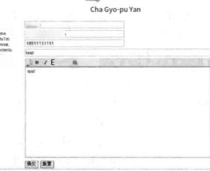

## 图 7-35 正确输入信息

0...119

灯箱内发布新消息

消息内容

姓名

test11n11@11buptcn

主题

*

内容

2014-11-

时间

28.01,GS.15

http://localhost:8080/guestbook

图 36 失败

留言失败，请重新输入！

发布新消息

图 37 成功

查看所有消息

图 38

### 7.5.2 核心文件

1. `StringUtils.java` // 工具类
2. `AddMessageServlet.java` // 添加消息的 Servlet
3. `GetMessageServlet.java` // 显示消息的 Servlet
4. `addMessage.htm` // 文件
5. `WebRoot/fckeditor` // 组件
6. `WebRoot/js` // 组件

### 7.5.3 项目流程


## 7.5.4 项目开发

(1) 创建数据库和表。图 70 显示了 book 的字段。

```sql
CREATE TABLE zhangli (
    name varchar(40),
    email varchar(60),
    phone varchar(60),
    title varchar(100),
    content varchar(200),
    time varchar(40)
);
```

(2) 构建路径，导入 MySQL 驱动包。

(3) 引入 js 和 fckeditor 文件，直接从 webroot 目录修改。

```javascript
var ValidationRoot = "/webroot/js";
```

```java
if (input.length() == 0) return input;
input = input.replaceAll("&", "&amp;");
input = input.replaceAll("<", "&lt;");
input = input.replaceAll(">", "&gt;");
input = input.replaceAll("'", "&#39;");
input = input.replaceAll("\"", "&quot;"); // 转义双引号
return input.replaceAll("\n", "<br/>");
```

## (8) 添加并编辑 AddMessageServlet 类。


## 代码示例

```java
public void doPost(HttpServletRequest request, HttpServletResponse response)
    throws ServletException, IOException {
    /*String driver="com.microsoft.salserver.jdbc.SQLServerDriver;
    String url="jdbc:sqlserver://localhost:7333;DatabaseName=zhangli"; String username="sa"; String password="zhangli";*/
}
```

```java
String driver="com.mysql.jdbc.Driver";
String url="jdbc:mysql://localhost:3306/zhangli";
String username="root"; //用户名
String password="123456";
//密密代码
String sql="insert into book(name
```

```java
HTML'>add a new message</a
<br>");} else try {
    Class.forName(driver);

    conn = DriverManager.getConnection(url, username, password);
    PreparedStatement pstmt = conn.prepareStatement(sql);
    pstmt.setString(1, StringUtil.filterHtml(name));
    pstmt.setString(2, StringUtil.filterHtml(request.getParameter("email")));
    pstmt.setString(3, StringUtil.filterHtml(request.getParameter("phone")));
    pstmt.setString(4, StringUtil.filterHtml(title));
    pstmt.setString(7, request.getParameter("content"));
    SimpleDateFormat sdf = new SimpleDateFormat("yyyy-MM-dd hh:mm:ss");
    pstmt.setString(6, sdf.format(new java.util.Date()));
    result = pstmt.executeUpdate();
    pstmt.close();
    conn.close();
} catch (ClassNotFoundException e) {
    e.printStackTrace();
} catch (SQLException e) {
    e.printStackTrace();
}
if (result == 0) {
    out.println("抱歉，添加添加失败，请重新输入!<br>");
    out.println("<a href='/guestbook/addMessage.html'>添加新消息</a><br>");
} else {
    out.println("恭喜，消息添加成功。<br>");
    out.println("<a href='/guestbook/servlet/GetMessageServlet'>查看所有消息内容</a><br>");
}
out.println("</body>");
```

```java
out.println("<html>");
out.flush();
out.close();
}
```

## 添加并编辑 GetMessageServlet 类

```java
public void doGet(HttpServletRequest request, HttpServletResponse response)
    throws SQLException, IOException {
    /*String driver="com.microsoft.sqlserver.jdbc.SQLServerDriver";
    String url="jdbc:sqlserver://localhost:7333;DatabaseName=zhangli";
    String username="sa"; String password="zhangli";*/
    String driver="com.mysql.jdbc.Driver";

    String url="jdbc:mysql://localhost:3306/zhangli";
    String username="root"; String password="123456";
    String sql="select*from book";
}
```

```java
Connection conn = null;
Statement stmt = null;
request.setCharacterEncoding("utf-8");
response.setContentType("text/html;charset=utf-8");
PrintWriter out = response.getWriter();
out.println("<html>");
out.println("<head><title>显示消息 </title></head>");
out.println("<body>");
```

```java
out.println("<a href='/guestbook/addMessage.html'>添加新的");
out.println("消息内容 <br><p>");

try {
    Class.forName(driver);
    conn = DriverManager.getConnection(url, username, password);
    stmt = conn.createStatement();
    ResultSet rs = stmt.executeQuery(sql);
    while (rs.next()) {
        this.printRow(out, rs);
    }
    rs.close();
    conn.close();
} catch (ClassNotFoundException e) {
    e.printStackTrace();
} catch (SQLException e) {
    e.printStackTrace();
}
out.println("</body>");
out.println("</html>");
out.flush();
out.close();
}

//用户名
//密码

 //Statement对象

message </a><br>;
```

```java
private void printRow(PrintWriter out, ResultSet rs) throws SQLException {
```

```java
out.println("<table width=\"600\" border=\"1\" style=\"table-layout:fixed;word-break:all\">");

out.println("<tr><td>" + rs.getString("name") + "</td></tr>");
out.println("<tr><td>电话</td><td>" + StringUtil.ChangeNull(rs.getString("phone"), "未填写") + "</td></tr>");
out.println("<tr><td>邮箱</td><td>" + StringUtil.ChangeNull(rs.getString("email"), "未填写") + "</td></tr>");
out.println("<tr><td>内容</td><td>" + StringUtil.ChangeNull(rs.getString("content"), "未填写") + "</td></tr>");
out.println("</table>");
```

## 数据库连接池优势

由于数据库连接被重复复用，避免了因频繁创建和释放连接导致的大性能开销。除了减少系统消耗外，还能提高系统运行环境的稳定性（减少内存碎片和临时数据库进程/线程的数量）。

- **(2)更快的系统响应**

数据库连接池：在初始化过程中，会创建几个数据库连接并将它们放入池中以备待用。在创建几个数据库连接并将其放入池中以备待用的过程完成后，连接初始化完成。对于服务处理，直接使用现有的可用连接，以避免数据库连接初始化和释放的时间开销，从而缩短系统的整体响应时间。

- **(3)资源分配的新手段**

对于共享同一个数据库系统的多个应用程序，可以通过在应用层配置数据库连接来实现数据库连接池技术。这在几年前可能还是一个新颖的话题，对于当前的业务系统，如果设计中还没有考虑连接池的应用，请在设计文档中快速添加这部分内容。为应用程序设置最大可用数据库连接数限制，可以防止应用程序垄占所有数据库资源。

- **(4)统一连接管理以避免数据库连接泄漏**

在实现较为完整的数据库连接池中，可以根据预设的连接占用超时设置强制回收被占用的连接，从而避免传统数据库连接操作中可能发生的资源泄漏。

## 8.1.4 数据库连接池

在实际开发中，你可以选择实现连接池，但通常情况下我们会选择第三方提供的程序连接池，有很多成熟的连接池可选。

### (1)DBCP 连接池

`DBCP` 连接池是一种依赖 `Jakarta commons-pool` 对象池机制的数据库连接池。`DBCP` 连接池已集成在 `Tomcat` 中，可以跟踪数据库连接，并检测和回收未正确释放的数据库资源。在书中，`Tomcat` 作为 JSP 服务器，你可以直接在 JSP 中使用 `DBCP` 连接池功能。

### (2)C3P0 连接池

`C3P0` 连接池是一个开源 JDBC 连接池，`Hibernate` 中的数据库连接池就是 `C3P0`，它与 `Hibernate` 一起发布在 lib 目录下，包含了 jdbc3 和 jdbc2 扩展规范连接和 `Statement` 池 `DataSource` 对象实现。

0...127

### (3)Proxool 连接池

`Proxool` 连接池是一个 Java SQL Driver 驱动，提供了其他类型驱动的连接池封装，`Proxool` 可以非常简单地移植到现有代码中，其配置方法非常简单，可以透明地为现有 JDBC 驱动添加连接池功能。

上述连接实现可以非常方便地调用，在本章中将使用 `DBCP` 实现连接池功能。

## 8.1.5 在 Tomcat 中配置 DBCP 数据库连接池

- **(1)修改 context.xml**。在 `Tomcat` 安装目录下找到 `conf/context.xml` 文件，并按照以下方式修改文件，在 `<Context>` 标签结束前添加 `DBCP` 连接池相关设置，如图 8-1 所示。

```xml
<Resource name="jdbc/mysql" auth="Container" type="java.sql.DataSource" max-idle="30" maxWait="10000" maxActive="10" username="root" password="123456" driverClassName="com.mysql.jdbc.Driver" url="jdbc:mysql://localhost:3306/zhang11p" />
```

图 8-1 在 Tomcat 中配置 DBCP 连接池

完成上述设置后，当 `Tomcat` 启动时，它会自动搜索该目录下的配置信息。如果数据源出现错误，通常是因为这段代码存在问题，需要仔细检查。

上述代码中有些属性或值需要说明，如下所示：

- `jdbc/mysql`：是我们配置的数据源名称，`auth` 设置容器如何进行身份验证，并设置数据源的类型。
- `maxActive`：指定连接池中数据库连接的最大数量。如果数据库连接数超过此值，后续的数据库连接请求将加入等待队列。
- `maxIdle`：设置数据库连接的最大空闲时间。空闲时间后，数据库连接将被标记为不可用并释放。
- `maxWait`：设置最大连接等待时间，如果超过此时间，连接将出现异常。`driverClassName` 和 `url` 是数据库驱动的名称和连接字符串，`username` 和 `password` 是数据库的用户名和密码。

- **(2)引入 JDBC 驱动**

- 将 JDBC 驱动拷贝到 `Tomcat` 安装目录并将其放在 `lib` 文件夹中。
- ② 通过配置构建路径（build path）向相应项目导入 jar 包。

- **(3)从连接池获取连接实例**

通过上述两个步骤的配置，你可以在程序中使用 `DBCP` 连接池的功能，下面将在应用程序程序中调用 `DBCP` 函数从连接池中取出数据库连接，代码如下。

```java
Context context = new InitialContext();
// 初始化可以从这里获取数据源对象的上下文
DataSource ds = (DataSource)context.lookup("java:/comp/env/jdbc/mysql");
// 从连接池中获取数据库连接
Connection conn = ds.getConnection();
```

`java/mysql`：是我们配置的数据源名称，`auth` 设置容器如何进行身份验证，并设置数据源的类型。

`maxActive`：指定连接池中数据库连接的最大数量。如果数据库连接数超过此值，后续的数据库连接请求将加入等待队列。

`maxIdle`：设置数据库连接的最大空闲时间。空闲时间后，数据库连接将被标记为不可用并释放。

`maxWait`：设置最大连接等待时间，如果超过此时间，连接将出现异常。`driverClassName` 和 `url` 是数据库驱动的名称和连接字符串，`username` 和 `password` 是数据库的用户名和密码。

`java:/comp/env/jdbc/mysql` 是我们在 context 中指定的 JNDI 名称，`jdbc/mysql` 是我们在 context 中设置的值。当通过这种方式获取的 `Connection` 对象完成后，程序必须显式调用 `close()` 方法以释放资源，将当前连接返回连接池。

## 8.2 Web 留言板 V.0

### 8.2.1 设置数据库连接

- **(1)修改 context.xml**。
- **(2)将 JDBC 驱动拷贝到 Tomcat 安装目录并将其放在 lib 文件夹中**。
- **(3)在特定文件中使用关于连接池的代码**。

### 8.2.2 修改文件

将留言板 guestbook 1.0 版本升级到 2.0 版本，并使用连接池技术。

部分文件可以保持不变，如下所示：

- `StringUtil.java` 类不变。
- `WebRoot/fckeditor` 不需要更改。
- `WebRoot/js` 组件保持不变。

需要修改的文件如下：

- **(1)validation-framework.js**。
- **(2)addMessage.htm**。
- **(3)AddMessageServlet.java**。
- **(4)GetMessageServlet.java**。

### 8.2.3 创建 guestbook 项目

**(1)复制并粘贴 guestbook**

右键点击留言板 v1.0 版本的项目 `guestbook`，选择“复制”选项，如图 8-2 所示。然后在空白处右键点击并选择“粘贴”选项，如图 8-3 所示。

图 8-2 复制 guestbook

图 8-3 粘贴 guestbook

默认情况下，项目名称显示为 Copy of guestbook，位置显示为 `C:/workspace/Copy of guestbook`。将项目名称设置为 `guestbook2`，位置将自动变为 `C:/workspace/guestbook2`，然后点击 OK 按钮，如图 8-4 所示。

**(2)设置 Web Context**

完成上述设置后，项目仍无法正常运行。你需要重置上下文路径。右键点击项目 `guestbook2`，选择“属性”（Properties）选项，如图 8-5 所示。

打开属性窗口后，展开左侧的 MyEclipse 标签并选择 Web ，当右侧的 Web Contextroot 默认显示为 `/guest` 时，将其更改为 `/guestbook2`，如图 8-6 所示。

| | | |
|---|---|---|
| 新建 Go | | |
| 在新窗口中打开 显示层次结构 显示在 | F4 Alt+Shift+r | |
| 复制 复制 页面 粘贴 删除 | Ctrl+C Ctrl+W Delete | |
| 构建路径 源码 重构 | Alt+Shift+5 Alt+Shift | |
| 导入 导出 刷新 打开项目 关闭项目 | F5 | |
| 关闭相关项目 分配工作集.... | | |
| 运行 作为 调试 作为 性能分析 作为 团队 比较 恢复到本地历史 Eclipse IDE 切换 | | |
| 属性 (Properties) | | |
| 属性 | Alt+Enter | |

图 8-4 重置项目名称 guestbook2

Context 启动 库 部署

TS 提示 Bc

Eclipse Context-root 设置以启用此项目的部署 日期 猫咪

图 8-5 打开属性窗口


图 8-6 设置 WebContext-root

## 8.2.4 修改 `validation-framework.js`

将 `var ValidationRoot="/guestbook/js/";` 更改为 `var ValidationRoot="/guestbook2/js/";` 并保存文件。

## 8.2.5 修改 `addMessage.htm`

将文件中的所有 `guestbook` 替换为 `guestbook2`。共有五处需要更改。

- (1) 引入验证框架的代码由原始的 `<script type="text/javascript" src="/guestbook/js/validation-framework.js"></script>` 更改为 `<script type="text/javascript" src="/guestbook2/js/validation-framework.js"></script>`
- (2) 引入脚本 `type=text/javascript` "FckEditor 框架代码，从原始的 `<script src="/guestbook/FckEditor/FckEditor.js"></script>` 更改为 `<script type="text/javascript" src="/guestbook2/fckeditor/fckeditor.js"></script>`
- (3) 检查由原始 `/guestbook/servlet/GetMessageServlet` 到 `/guestbook2/GetMessageServlet.JSP` 的超链接。


- (4) 将 `action` 属性值从原始的 `/guestbook/servlet/AddMessageServlet` 更改为 `/guestbook2/AddMessageServlet.JSP`。
- (5) 将 FckEditor 编辑框的代码设置为 `oFckeditor.BasePath='/guestbook/fckeditor/';`。更改为 `oFckeditor.BasePath='/guestbook2/fckeditor/';`。

修改后的 `addMessage.htm` 代码如下。

```html
<html>
<head>
<meta http-equiv="Content-Type" content="text/html;charset=utf-8"/>
<script type="text/javascript" src="/guestbook2/js/validation-framework.js"></script>
<script type="text/javascript" src="/guestbook2/fckeditor/fckeditor.js"></script>
<title>add message</title>
</head>
<body>
<p align="center">Please enter your message </p>
<p align="center"><a href="/guestbook2/servlet/GetMessageServlet">view the message</a></p>
<form id="form1" name="form1" method="post" action="/guestbook2/servlet/AddMessageServlet" onsubmit="return doValidate(this)">
<table width="600" height="400" border="0" align="center">
<tr>
<td width="100">Name:</td>
<td width="500">
<input name="name" type="text" id="name" size="40" maxlength="20">
</td>
</tr>
<tr>
<td>E-Mail:</td>
<td><input name="email" type="text" id="email" size="40" maxlength="40">
</td>
</tr>
<tr>
<td>Phone:</td>
<td><input name="phone" type="text" id="phone" size="40" maxlength="20">
</td>
</tr>
<tr>
<td>Subject</td>
<td><input name="title" type="text" id="title" size="80" maxlength="">
</td>
</tr>
<tr>
<td valign="top">Content: </td>
<td>
<script type="text/javascript">
```

```javascript
var oFCKeditor=new FCKeditor("content");
oFCKeditor.BasePath='/guestbook2/fckeditor/';
oFCKeditor.Height = 300;
oFCKeditor.ToolbarSet = 'Basic';
```

```javascript
oFCKeditor.Create();
</script>
</td>
</tr>
```

```

```html

<input type="submit" name="Submit" value="提交">

<input type="reset" name="Reset" value="重置">

</td>

</tr>

</table>

</form>

</body>

</html>

```

## 8.2.6 修改 `AddMessageServlet.java`

修改 `AddMessageServlet.java` 的目的是将传统的数据库连接方式改为从数据源获取数据库连接。

### (1) 删除以下代码：

```java
String driver="com.mysql.jdbc.Driver";
String url="jdbc:mysql//localhost:3306/zhangli";
String username="root";
```

### (2) 创建以下代码：

```java
Class.forName(driver);
conn=DriverManager.getConnection(url,username);
```

### 更改为：

```java
Context context=new InitialContext();
DataSource ds=(DataSource)context.lookup("java:/env/jdbc/mysql");
conn=ds.getConnection();
```

### (3) 重新添加 try/catch 语句。删除原始的 try/catch 相关语句，从 `context=new InitialContext();` 处开始到 `conn.close();` 处结束，右键点击并选择 Surround/catch Block。

修改后的 `AddMessageServlet.java` 代码所示：

```java
package zhangli;

import java.io.IOException;
import java.io.PrintWriter;
import java.sql.Connection;
import java.sql.PreparedStatement;
import java.sql.SQLException;
import java.text.SimpleDateFormat;
import javax.naming.Context;
import javax.naming.InitialContext;
import javax.naming.NamingException;
import javax.servlet.ServletException;
import javax.servlet.http.HttpServlet;
import javax.servlet.http.HttpServletRequest;
import javax.servlet.http.HttpServletResponse;
import javax.sql.DataSource;

public class AddMessageServlet extends HttpServlet {

    private static long serialVersionUID = 1L;

    public void doGet(HttpServletRequest request, HttpServletResponse response) throws ServletException, IOException {

        Connection conn=null;
        int result = 0;
        String driver="com.mysql.jdbc.Driver";
        String url="jdbc:mysql//localhost:3306/zhangli";
        String username="root";
        String password="";
        response.setContentType("text/html;charset=utf-8");
        PrintWriter out=response.getWriter();

        out.println("<html>");
        out.println("<head><title>guestbook</title></head>");
        out.println("<body>");

        String name=request.getParameter("name");

        if (name == null || name.equals("")) {
            out.println("Sorry, the name cannot be empty.<br>");
            out.println("<a href=\"addMessage.htm\">Add a new message</a>");
        } else {
            String email=request.getParameter("email");
            if (email == null || email.equals("")) {
                out.println("Sorry, the email cannot be empty.<br>");
                out.println("<a href=\"addMessage.htm\">Add a new message</a>");
            } else {
                String phone=request.getParameter("phone");
                if (phone == null || phone.equals("")) {
                    out.println("Sorry, the phone cannot be empty.<br>");
                    out.println("<a href=\"addMessage.htm\">Add a new message</a>");
                } else {
                    String title=request.getParameter("title");
                    if (title == null || title.equals("")) {
                        out.println("Sorry, the title cannot be empty.<br>");
                        out.println("<a href=\"addMessage.htm\">Add a new message</a>");
                    } else {
                        String content=request.getParameter("content");
                        try {
                            Class.forName(driver);
                            Context context=new InitialContext();
                            DataSource ds=(DataSource)context.lookup("java:/env/jdbc/mysql");
                            conn=ds.getConnection();
                            String sql="insert into book(name,email,phone,content,time) values(?,?,?,?,?)";
                            PreparedStatement pstmt=conn.prepareStatement(sql);
                            pstmt.setString(1,name);
                            pstmt.setString(2,email);
                            pstmt.setString(3,phone);
                            pstmt.setString(4,content);
                            SimpleDateFormat sdf=new SimpleDateFormat("yyyy-MM-dd hh:mm:ss");
                            pstmt.setString(5,sdf.format(new java.util.Date()));
                            result=pstmt.executeUpdate();
                            pstmt.close();
                            conn.close();
                        } catch (NamingException e) {
                            e.printStackTrace();
                        } catch (SQLException e) {
                            e.printStackTrace();
                        }
                        if (result==0) {
                            out.println("Sorry, failed to add message, please re-enter.<br>");
                            out.println("<a href=\"addMessage.htm\">Add a new message</a>");
                        } else {
                            out.println("Congratulations. Message added successfully.<br>");
                            out.println("<a href=\"/guestbook2/servlet/GetMessageServlet?message=all\">view message</a>");
                        }
                    }
                }
            }
        }

        out.println("</body>");
        out.println("</html>");
        out.flush();
        out.close();
    }

    public void doPost(HttpServletRequest request, HttpServletResponse response) throws ServletException, IOException {
        // 为了简洁起见省略了实现
    }
}
```

## 8.2.7 修改 `GetMessageServlet.java`

修改 `GetMessageServlet.java` 的目的和方法与 `AddMessageServlet.java` 相同。代码如下：

```java
package zhangli;

import java.io.IOException;
```


# Java Servlet 代码示例

## `GetMessageServlet` 类

```java
import java.io.PrintWriter;
import java.sql.Connection;
import java.sql.PreparedStatement;
import java.sql.ResultSet;
import java.sql.SQLException;
import java.text.SimpleDateFormat;
import javax.naming.Context;
import javax.naming.InitialContext;
import javax.naming.NamingException;
import javax.servlet.ServletException;
import javax.servlet.http.HttpServlet;
import javax.servlet.http.HttpServletRequest;
import javax.servlet.http.HttpServletResponse;
import javax.sql.DataSource;

public class GetMessageServlet extends HttpServlet {

    private static long serialVersionUID = 1L;

    public void doGet(HttpServletRequest request, HttpServletResponse response) throws ServletException, IOException {

        Connection conn = null;
        String sql = "select * from book";

        response.setContentType("text/html;charset=utf-8");
        PrintWriter out = response.getWriter();

        out.println("<html>");
        out.println("<head><title>guestbook</title></head>");
        out.println("<body>");

        try {
            Context context = new InitialContext();
            DataSource ds = (DataSource) context.lookup("java:/env/jdbc/mysql");
            conn = ds.getConnection();
            PreparedStatement pstmt = conn.prepareStatement(sql);
            ResultSet rs = pstmt.executeQuery();

            while (rs.next()) {
                out.println("<p>");
                out.println("Name: " + rs.getString("name") + "<br>");
                out.println("Email: " + rs.getString("email") + "<br>");
                out.println("Phone: " + rs.getString("phone") + "<br>");
                out.println("Subject: " + rs.getString("title") + "<br>");
                out.println("Content: " + rs.getString("content") + "<br>");
                out.println("Time: " + rs.getString("time") + "<br>");
                out.println("</p>");
            }

            pstmt.close();
            conn.close();

        } catch (NamingException e) {
            e.printStackTrace();
        } catch (SQLException e) {
            e.printStackTrace();
        }

        out.println("</body>");
        out.println("</html>");
        out.flush();
        out.close();
    }
}
```

## 片段：数据库连接与查询初始化

```java
Connection conn = null;
Statement stmt = null; // Statement对象

request.setCharacterEncoding("utf-8");
response.setContentType("text/html;charset=utf-8");
PrintWriter out = response.getWriter();

out.println("<html>");
out.println("<head><title>Display message </title></head>");
```

## 片段：页面主体与添加链接

```java
out.println("<body>");
out.println("<a href='/guestbook2/addMessage.htm'>Add the new message </a><br>");
out.println("Message <br><br>");
```

## 片段：执行查询并处理结果集

```java
try {
    Context context = new InitialContext();
    DataSource ds = (DataSource) context.lookup("java:comp/env/jdbc/mysql");
    conn = ds.getConnection();
    stmt = conn.createStatement();
    ResultSet rs = stmt.executeQuery(sql);

    while (rs.next()) {
        this.printRow(out, rs);
    }

    rs.close();
    conn.close();
} catch (NamingException e) {
    // TODO Auto-generated catch block
    e.printStackTrace();
} catch (SQLException e) {
    // TODO Auto-generated catch block
    e.printStackTrace();
}
```

## 片段：页面结束与资源关闭

```java
out.println("</body>");
out.println("</html>");
out.flush();
out.close();
```

## `printRow` 方法

```java
private void printRow(PrintWriter out, ResultSet rs) throws SQLException {
    out.println("<table width=\"600\" border=\"1\" style=\"table-layout:fixed;word-break:break-all\">");
    out.println("<tr><td>" + rs.getString("name") + "</td><td>" + rs.getString("phone") + "</td></tr>");
    out.println("<tr><td>" + rs.getString("name") + "</td><td>" + StringUtil.changeNull(rs.getString("phone"), "not filled") + "</td></tr>");
    out.println("<tr><td valign=\"top\">Content " + rs.getString("email") + "</td><td>" + StringUtil.changeNull(rs.getString("email"), "not filled") + "</td></tr>");
    out.println("<tr><td valign=\"top\">Content</td><td>" + rs.getString("title") + "</td></tr>");
    out.println("<tr><td valign=\"top\">Content</td><td>" + StringUtil.changeNull(rs.getString("content"), "没填") + "</td></tr>");
    out.println("<tr><td>" + rs.getString("publishtime") + "</td><td></td></tr>");
    out.println("</table><br>");
}
```


## 8.2.8 服务器运行输出

程序运行后的效果与留言板项目相同。数据库连接从原始的 JDBC 连接更改为数据库连接池连接。


## 8.3 Commons DbUtils

### 8.3.1 类库介绍

Commons DbUtils 是由 Apache 组织提供的开源 JDBC 工具类库，它对传统的数据库操作类进行了二次封装，你可以将结果集转换为 `List`，DbUtils 封装了 JDBC 操作，简化了 JDBC 操作，从而可以编写更少的代码。

DbUtils 包括 3 个包：`org.apache.commons.dbutils`、`org.apache.commons.dbutils.handlers` 和 `org.apache.commons.dbutils.wrappers`，这三个包包含了几个类和接口，但对我们来说关键的是 `DbUtils` 类、`QueryRunner` 类以及 `ResultSetHandler` 接口。

### 8.3.2 DbUtils 类

该类提供了用于关闭连接、加载 JDBC 驱动等常用工作的有用方法，这些方法都是静态的。

1. `loadDriver(String className)`：此方法加载并注册 JDBC 驱动，成功时返回 `TRUE` 且不捕获 `ClassNotFoundException`。其返回值用于判断驱动是否成功加载。
2. `close` 方法：`DbUtils` 类提供了三个重载的 `close` 方法。检查提供的参数是否为 `NULL`，如果不是，它们将关闭 `Connection`、`Statement` 或 `ResultSet` 对象。
3. `closeQuietly` 方法：`closeQuietly` 方法不仅能防止连接、语句或结果集为 `NULL`，还隐藏了程序中抛出的某些 `SQLException`。如果你不想捕获这些异常中的一个，这个方法就非常有用。在重载 `closeQuietly` 方法时，最常用的方法之一是 `closeQuietly(Connection conn, Statement stmt, ResultSet rs)`，这样最后一个代码块只需调用此方法。
4. `commitAndClose(Connection conn)` 方法和 `commitAndCloseQuietly(Connection conn)` 方法：这两个方法用于提交连接，然后关闭连接。区别在于 `commitAndCloseQuietly(Connection conn)` 方法在关闭连接时不会抛出关闭连接时发生的某些 SQL 异常，而 `commitAndClose(Connection conn)` 方法会抛出某些 SQL 异常。

### 8.3.3 QueryRunner 类

该类简化了 SQL 查询。它可以配合 `ResultSetHandler` 使用来完成数据库操作，这可以大幅减少代码量。

1. `query(Connection conn, String sql, Object[] params, ResultSetHandler rsh)`：此方法执行带参数的选择查询，其中对象数组的值被作查询的替换参数。该方法内部处理了 `PreparedStatement` 和 `ResultSet` 的创建与关闭。`ResultSetHandler` 对象将结果集进行转换。
2. `query(String sql, Object[] params, ResultSetHandler rsh)`：与第一个方法非常相似，不同之处在于它不需要传递数据库连接，而是通过构造函数或 `setDataSource` 方法获取连接。
3. `query(Connection conn, String sql, ResultSetHandler rsh)`：此方法执行带参数的选择查询，其中参数数组的值用于查询的替换参数。
4. `update(Connection conn, String sql, Object[] params)`：此方法执行带参数的更新操作，其中对象数组的值用于查询的替换参数。
5. `update(String sql, Object[] params)`：与前面的方法非常相似，不同之处在于它不需要传递数据库连接。
6. `update(Connection conn, String sql)`：此方法执行更新或删除操作。

### 8.3.4 ResultSetHandler 接口

顾名所示，该接口执行 `java.sql.ResultSet` 并将其数据处理为任何有利于应用程序的格式。该组件提供了九个实现类，如下：

1. `ArrayHandler`：将 `ResultSet` 的第一行转换为对象数组。
2. `ListHandler`：将 `ResultSet` 的所有数据转换为 `List`。`List` 存储 `Object[]`。
3. `BeanHandler`：将 `ResultSet` 的第一行转换为类对象。
4. `BeanListHandler`：将 `ResultSet` 的所有数据转换为 `List`。`List` 存储类对象。
5. `ColumnListHandler`：将 `ResultSet` 中的某列数据转换为 `List`，`List` 存储 `Object`。
6. `KeyedHandler`：在 `ResultSet` 中存储 `Map`。`ResultSet.key` 对应 map 中存储的列。`Map` 是数据。
7. `MapHandler`：将 `ResultSet` 的第一行转换为 `Map`。
8. `MapListHandler`：将 `ResultSet` 的所有数据转换为 `List`。`List` 存储 `Map`。
9. `ScalarHandler`：将 `ResultSet` 中某列的数据转换为转换类（如 `Object`）。该接口提供一个独立的方法：`Object handle(java.sql.ResultSet rs)`。因此，任何 `ResultSetHandler` 的执行都需要传入一个 `ResultSet` 作为参数，以便处理结果集并返回对象。

## 8.4 网络留言板 V3.0

### 8.4.1 文件更改

将留言板 2.0 版本升级到使用 DbUtils 类库的 3.0 版本。其中某些文件可以保持不变，如下：

- `StringUtil.java` 类保持不变。
- `WebRoot/fckeditor` 组件保持不变。
- `WebRoot/js` 组件保持不变。

需要修改的文件如下所示。

### 8.4.2 创建新的 guestbook3 项目

1. 复制 `guestbook2` 并粘贴。右键点击名为 `Network message board version 2.0` 的项目 `guestbook2`，选择“Copy”（复制）选项，然后在空白处右键点击并选择“Paste”（粘贴）选项。默认情况下，复制的项目名称显示为 `Copy of guestbook`，位置为 `C:/workspace/Copy of guestbook2`。将项目名称设置为 `guestbook3`，位置将自动更改为 `C:/workspace/guestbook3`，最后点击 OK 按钮。
2. 设置 Web Context（Web上下文）。

完成上述设置后，项目仍然无法正常运行。你需要重置上下文路径。右键点击项目名称 `Guestbook3`，选择“Properties”（属性）选项，打开属性窗口后，展开左侧的 MyEclipse 标签页并选择右侧的 Web 选项。`Context-root` 默认显示为 `/guestbook2`，将其改为 `/guestbook3`，最后点击“OK”按钮。

### 8.4.3 修改 validation-framework js

将 `var ValidationRoot="/guestbook2/js/";` 修改为 `var ValidationRoot="/guestbook3/js/";` 并保存文件。

### 8.4.4 修改 addMessage.htm

将文件中的所有 `guestbook2` 替换为 `guestbook3`。共有五处地方需要修改。

### 8.4.5 Build Path（构建路径）

为了使用 Commons DbUtils 类库，你必须导入 `commons-dbutils-1.1.jar` 包。右键点击项目名称，选择“Build Path”（构建路径）→“Configure Build Path”（配置构建路径）→“Add External JARS”（添加外部JAR）选项，在构建路径下添加 `commons-dbutils-1.1.jar`。

### 8.4.6 修改 AddMessageServlet.java

从 `"Context=new InitialContext();"` 开始修改到结尾的 `"conn,close();"` 代码。创建一个 `String` 类型的数组参数，包含所有需要传递给 SQL 语句的参数，然后查找上下文路径获取数据源，接着将数据对象 `ds` 作为参数传递给 `QueryRunner` 对象的构造函数，让 `qr` 对象从 `ds` 对象内部获取数据库连接对象，`QueryRunner` 内部会关闭 `Connection` 对象，这样调用者就不负责关闭 `Connection` 对象。使用 `qr` 对象的 `update` 方法执行插入操作，向数据库的 `book` 表中插入记录。


修改后的 `AddMessageServlet.java` 代码如下。

```java
package zhangli;

import java.io.IOException;
import java.io.PrintWriter;
import java.sql.SQLException;
import java.text.SimpleDateFormat;
import javax.naming.Context;
import javax.naming.InitialContext;
import javax.naming.NamingException;
import javax.servlet.ServletException;
import javax.servlet.http.HttpServlet;
import javax.servlet.http.HttpServletRequest;
import javax.servlet.http.HttpServletResponse;
import javax.sql.DataSource;
import org.apache.commons.dbutils.QueryRunner;

public class AddMessageServlet extends HttpServlet {
    // ... 省略部分代码 ...
    int result = 0;
    request.setCharacterEncoding("utf-8");
    String name = request.getParameter("name");
    String title = request.getParameter("title");
    // ... 省略部分代码 ...
    response.setContentType("text/html;charset=utf-8");
    PrintWriter out = response.getWriter();
    out.println("<html>");
    out.println("<head><title>guestbook input page</title></head>");
    out.println("<body>");
    if (StringUtil.validateNull(name)) {
        out.println("Sorry, the name cannot be empty, please re-enter!<br>");
        out.println("<a href='/guestbook3/addMessage.html'>Add a new message</a><br>");
    } else {
        if (StringUtil.validateNull(title)) {
            out.println("Sorry, topic cannot not be empty, please re-enter!<br>");
            out.println("<a href='/guestbook3/addMessage.html'>Add a new message</a><br>");
        }
    }
    try {
        SimpleDateFormat sdf = new SimpleDateFormat("yyyy-MM-dd hh:mm:ss");
        String[] param = {
            StringUtil.filterHtml(name),
            StringUtil.filterHtml(request.getParameter("email")),
            StringUtil.filterHtml(request.getParameter("phone")),
            StringUtil.filterHtml(title),
            request.getParameter("content"),
            sdf.format(new java.util.Date())
        };
        Context context = new InitialContext();
        DataSource ds = (DataSource) context.lookup("java:comp/env/jdbc/mysql");
        QueryRunner qr = new QueryRunner(ds);
        result = qr.update(sql, param);
    } catch (NamingException e) {
        e.printStackTrace();
    } catch (SQLException e) {
        e.printStackTrace();
    }
    if (result == 0) {
        out.println("Sorry, failed to add message, please re-enter!<br>");
        out.println("<a href='/guestbook3/addMessage.htm'>Add a new message </a><br>");
    } else {
        out.println("Congratulations. Message added successfully.<br>");
        out.println("<a href='/guestbook3/servlet/GetMessageServlet'>view all message content</a><br>");
    }
    out.println("</body>");
    out.println("</html>");
    out.flush();
    out.close();
}
```

### 8.4.7 在服务器上更改 GetMessageServlet.java

主要修改从 `"conn=ds.getConnection();"` 开始到结尾的 `"conn.close();"` 代码，以及 `printRow` 函数。将数据对象作为参数传递给 `QueryRunner` 对象的构造函数，让 `qr` 对象从 `ds` 对象获取数据库连接对象，然后获取包含所有数据库记录的结果对象，对象的每个元素都是一个 `Map` 对象，代表一条数据库记录。通过循环操作，输出每条记录每个字段对应的值。然后修改 `printRow` 函数，将函数的第二个参数改为 `map` 对象，并使用 `map.get()` 方法获取之前 `rs.getString()` 方法的属性，当 `map.get()` 需要作为 `StringUtil.changeNull()` 的参数使用时，需要强制转换为 `String`，需要将 `map.get()` 改为 `(String)map.get()`。

修改后的 `GetMessageServlet.java` 代码如下。

```java
package zhangli;

import java.io.IOException;
import java.io.PrintWriter;
import java.sql.SQLException;
import java.util.List;
import java.util.Map;
import javax.naming.Context;
import javax.naming.InitialContext;
import javax.naming.NamingException;
import javax.servlet.ServletException;
import javax.servlet.http.HttpServlet;
import javax.servlet.http.HttpServletRequest;
import javax.servlet.http.HttpServletResponse;
import javax.sql.DataSource;
import org.apache.commons.dbutils.QueryRunner;
import org.apache.commons.dbutils.handlers.MapListHandler;

public class GetMessageServlet extends HttpServlet {
    public void doGet(HttpServletRequest request, HttpServletResponse response) throws ServletException, IOException {
        String sql = "select * from book order by id";
        request.setCharacterEncoding("utf-8");
        // ... 后续代码省略 ...
    }
}
```


```java
response.setContentType("text/html;charset=utf-8");

PrintWriter out = response.getWriter();

out.println("<html>");

out.println("<head><title>Display message</title></head>");

out.println("<body>");

try {

    Context context = new InitialContext();

    DataSource ds = (DataSource)context.lookup("java:comp/env/jdbc/mysql");

    QueryRunner qr = new QueryRunner(ds);

    MapListHandler handler = new MapListHandler();

    List list = (List)qr.query(sql, handler);

    for (int i = 0; i < list.size(); i++) {

        Map map = (Map)list.get(i);

        printRow(out, map);

    }

} catch (NamingException e) {

    e.printStackTrace();

} catch (SQLException e) {

    e.printStackTrace();

}

out.println("</body>");

out.println("</html>");

out.flush();

out.close();

}

private void printRow(PrintWriter out, Map map) {

    for (String key : map.keySet()) {

        out.println(key + ": " + (String)map.get(key) + " ");

    }

    out.println("<br>");

}

}
```

## 8.4.8 运行结果

运行程序后，效果与 `guestbook2` 项目相同。只是将原有的 JDBC 操作改为了 Commons DbUtils 操作，因此代码更加简洁，操作更加方便。

# 第9章：JSP 及其应用

## 9.1 JSP 基础

### 9.1.1 JSP 的起源

在我早之前编写 Servlet 程序时，我相信你已经在某些方面闻到了“异味”，因为使用 Servlet 输出 HTML 内容对我们来说确实是一件不愉快的事情。尤其是当 Servlet 输出复杂的动态 HTML 内容时，对我们 Web 开发人员来说简直是一场噩梦，因为 HTML 内容中所有的双引号都需要转义，所有的 HTML 标记都需要通过 `out.println()` 输出。如果 Servlet 输出 HTML 只需要让我们开发者写一次，我们还能忍，但在实际开发中这是不可能的。内容需要多次修改，这既麻烦又没有技术含量。开发者特别希望有一种新技术，这种技术既能像 Servlet 一样完成 Web 服务器编程功能，又能非常简单地输出动态可定制的 HTML 内容。Sun 公司适时引入了 Java Server Pages (JSP) 技术。

JSP 是 Servlet 的高级别扩展。通过 JSP，开发者可以将常用的 Java 代码嵌入到 HTML 页面中。最后，JSP 文件通过 Web 服务器的 Web 容器编译成 Servlet，用于处理各种请求。

### 9.1.2 JSP 的功能

JSP 是一种动态网页编写技术，允许将 Java 代码包含在页面中。JSP 文件的扩展名为 `.jsp`，jsp 文件的标记也可以使用 XML 语法。

JSP 是由 Sun 公司开发的一种服务器端脚本语言。自 1999 年发布以来，JSP 逐渐发展成为开发 Web 应用的重要技术。

JSP 可以嵌套在 HTML 中，并支持多个操作系统平台，使用 JSP 开发的 Web 应用系统可以在不同的操作系统上运行而无需任何修改。

### 9.1.3 JSP 的本质

JSP 页面本质上是 Servlet，在 JSP 程序中无法脱离 Servlet 的影子。Servlet 和 JSP 可以被 Java 实现 Web 编程的第一代和第二代技术，由于 Servlet 不易快速开发大量带有 HTML 代码的动态 Web 页面，因此 Sun 推出了 JSP 技术来快速开发动态网页。Servlet 和 JSP 是实现相同编程效果的两种不同实现方式。从根本上说，JSP 是 Servlet，因为 JSP 运行在 Web 服务器上，首先转换为 Servlet，然后调用转换后的 Servlet 方法，将动态 HTML 内容的输出返回给客户端浏览器。因此，只要 Servlet 编程能实现的功能，JSP 编程也能实现。

当浏览器向 Web 服务器发送请求以调用 JSP 页面时，Web 服务器会根据请求文件的 `.jsp` 扩展知道浏览器正在请求一个 jsp 文件。Web 服务器将请求传递给 Web 容器，Web 容器将把请求的 JSP 文件转换为 Servlet 的源文件，同时编译源文件并生成转换后的 Servlet 类文件。转换和编译的过程发生在浏览器第一次请求 JSP 文件时，因此我们在调用 JSP 页面时会有这样的体验：第一次调用 JSP 文件时花费的时间更长，才能看到输出内容。当服务器再次接收到对该 JSP 页面的请求时，它会判断 JSP 页面是否被修改过。如果被修改过，Java 代码将重新生成并重新编译，服务器中的垃圾回收机制将删除使用的类文件。如果没有变化，服务器将直接调用之前编译的类文件。

在某些 Java Web 服务器或应用服务器上，你可以在特定目录下查看 JSP 转换后的 Servlet 源文件和类文件。Tomcat 保留了临时生成的 Servlet 源文件和类文件，它们存储在 Tomcat 根目录下的 `work` 目录中。例如，首先，jsp 文件存储在 `\work\Catalina\localhost\firstjsp\org\apache\jsp\directory`。在 `work` 目录下，你可以看到与我们刚刚写的 `first.jsp` 对应的 `first_jsp.class` 和 `firstjsp.java`。

## 9.2 JSP 语法

### 9.2.1 JSP 代码注释

JSP 支持两种注释语法操作，一种是显式注释，这种注释客户端可见的；另一种是隐式注释，客户端不可见。

- (1) 显式注释语法（HTML 风格的注释）
```html
<!-- 注释内容 -->
```
> 注释多行 HTML 代码。

- (2) 隐式注释方法
使用 `//注释内容;` 注释单行代码；使用 `/*注释内容 */` 注释多行代码；也可以使用 `<!--注释内容-->` 注释多行代码。

### 9.2.2 脚本段标识符

在 JSP 中，最重要的部分是 Scriptlet（脚本应用程序）或脚本标识符。所有嵌入 HTML 代码的 Java 程序都必须使用 Scriptlet 标识符。JSP 中有三种 Scriptlet 标识符。

- (1) 代码片段 (Code snippets)

所谓的代码片段是嵌入 JSP 页面的 Java 代码或脚本代码。代码片段将在处理页面请求期间执行，通过 Java 代码可以定义变量或控制语句；通过脚本代码可以在页面输出内容中使用 JSP 内置对象，处理请求和响应、访问 session 等。代码片段的语法格式如下所示。

```jsp
<% Java 代码或脚本代码 %>
```

代码片段的使用更加灵活，可以实现 JSP 表达式无法实现的功能。具体用法如下。

```java
int i=10;

if(time<12)
```
```jsp
<% 你早上好吗？ %>

<% 你下午好吗？ %>
```

- (2) 声明标识符 (Declaration identification)

声明标识符用于在 JSP 页面全局定义变量或方法。通过声明 ID 定义的变量和方法可以被整个 JSP 页面访问，因此此 ID 用于定义整个 JSP 页面引用所需的变量或方法。代码片段的语法格式如下所示。

```jsp
<%
private int count=0;

private String getCount() { 
}
```
> 注意：声明和方法之间不能有空格。

- (3) JSP 表达式 (JSP expression)

JSP 表达式用于输出内容。
```jsp
<%= counter %>
```
> 注意：表达式和分号之间不能有空格，但它跟在表达式后面。

### 9.2.3 指令 (Instruction)

`page` 指令在 JSP 中更为重要，使用此属性，`include` 页面指定。

#### 表 9-1 page 指令的常用属性

| 种类 | 定义 |
|---|---|
| language="ScriptLanguage" | 指定 JSP 使用的语言 |
| extends="className" | 定义此 JSP 继承自 |
| import="importList" | 定义要导入哪些 api |
| session="true\|false" | 决定此页面是否使用 session 对象。 |
| buffer="none" | 单位为 kb 的大小 |
| autoFlush="true\|false" | 决定输出流缓冲区满时是否自动冲空。 |

#### 表 9-2 通用属性

| 通用属性 | 定义 |
|---|---|
| isThreadSafe="true\|false" | 是否支持线程。默认为 true |
| errorPage="url" | 如果此页面异常，将跳转到 |
| isErrorPage="true\|false" | 表示该页面是否为错误处理页面。 |
| contentType="text/html;charset gb312" | 代表页面的 MIME 类型和编码 encoding="ISO-8859-1" |
| isIgnored="true\|false" | 表示此页面中是否支持 EL 表达式。默认为 false |

> 注意：对于 action 指令，只有 import 指令可以重复使用，其他属性使用一次。在几个指令中，常用的是 Content Type、pageEncoding、errorPage 这些指令，用法如下：

- (1) 设置页面的 MIME 类型
```jsp
<%@page contentType="text/html" %>

<%@page contentType="text/html;charset=utf-8" %>
```

- (2) 设置文件编码
```jsp
<%@page pageEncoding="UTF-8" %>
```

- (3) 错误页面设置
指令 `isErrorPage`，专门显示错误页面：
```jsp
<%@page isErrorPage="true" %>
```

指令 `errorPage`，跳转到页面：
```jsp
<%@page errorPage="error.jsp" %>
```

- (4) 数据库连接操作

指令 `import`，引用其他包或类：
```jsp
<%@page import="java.io.*;java.util.Hashtable"%> 或者

<%@page import="java.io.*" %>
<%@page import="java.util.Hashtable" %>
```

### 2. include 命令

`include` 指令是 JSP 的另一种指令标识。该指令允许在 JSP 页面中包含另一个 JSP 页面。然而，这种指令是静态包含。也就是说，被包含的文件的内容将被包含在 JSP 页面中，即使被包含的文件有 JSP 代码，它在编译时也不会被编译包含。使用此命令最终将生成一个文件，因此包含的文件和包含文件中不能有同名的变量。

包含指令（include directive）的语法格式如下：

```jsp
<%@include file="path"%>
```

该指令只有一个 `file` 属性，用于指定要包含的文件路径，可以是相对路径也可以是绝对路径。但是，它不能是 `<%= %>` 表达式所表示的文件。

以下是使用方法：

```jsp
<%@include file="header.htm">
```

使用 `include` 指令来包含文件极大地提高了代码复用，并使后期的维护和升级更加容易。

### 9.2.4 动作识别 (Action Identification)

#### (1) `<jsp:include>` — 包含动作

`<jsp:include>` 动作用于将其他文件包含到当前页面。包含的文件可以是动态的或静态的。

`jsp:include` 动作的语法格式如下：
`<jsp:include page="url" flush="false"/>`

`page` 指明被包含文件的相对路径。例如，具体的属性值 `top.jsp` 表示将当前 JSP 文件所在文件夹中的 `top.jsp` 文件包含在当前 JSP 页面中。`flush` 是一个可选属性，用于设置是否刷新缓冲区。默认值为 false，如果设置为 true，则在当前页面输出缓冲区之前，在执行包含操作之前刷新缓冲区。

`include` 指令与 `<jsp:include>` 动作之间的区别在于，动作可以动态地包含文件，文件内容可以是静态脚本也可以是动态脚本。当包含的动态文件被修改时，JSP 引擎会动态地对其进行编译和更新。而 `include` 指令是在 JSP 页面中包含一个文件，从而将其合并到一个文件中，仅起到简单的组合作用。它的功能没有动作那么强大。

#### (2) `<jsp:forward>` — 请求转发动作

通过 `<jsp:forward>`，你可以将请求转发到其他 Web 资源，例如另一个 JSP 文件、HTML 页面、Servlet 等。在请求被转发后，当前页面将不会执行，而是执行该动作指定的页面。

> `<jsp:forward>` 动作标识符的语法如下：

```jsp
<jsp:forward page="url"/>
```


## 9.2.5 内置对象 (Built-in Objects)

内置对象是不需要声明即可使用的对象实例。表 9-2 列出了常见的 JSP 内置对象。

### 表 9-2 内置 JSP 对象

| 对象名称 | 对象类型 | 对象名称 | 对象类型 |
|---|---|---|---|
| `out` | `javax.servlet.jsp.JspWriter` | `config` | `javax.servlet.ServletConfig` |
| `request` | `javax.servlet.ServletRequest` | `pageContext` | `javax.servlet.jsp.PageContext` |
| `response` | `javax.servlet.ServletResponse` | `page` | `java.lang.Object` |
| `session` | `javax.servlet.http.HttpSession` | `exception` | `java.lang.Throwable` |
| `application` | `javax.servlet.ServletContext` | | |

`out` 对象：该对象是 Web 应用开发中最常用的对象之一。它的功能是动态向 JSP 页面输出字符流，从而将动态内容转换为 HTML 进行显示。

`request` 对象：代表从用户发送的请求。客户端用户提交的数据或参数可以从该对象中获取。该对象仅对接收用户请求的页面可见。

`response` 对象：该对象是服务器返回给客户端的数据。可以从该对象数据和信息中获取部分数据以及与服务器交互的信息。只有接收该对象的页面才能访问该对象。

`session` 对象：该对象维护客户端和服务器的状态，并从用户与服务器的交互中获取数据和信息。该对象一直有效直到用户关闭浏览器并离开 Web 应用。

`application` 对象：它在整个 Web 应用运行期间持有全局数据和信息。该对象在 Web 应用启动时创建。在整个 Web 应用运行期间，可以从任何 JSP 页面访问该对象。

`Application` 对象和 `session` 对象的区别在于，只要 Web 应用正常运行，就可以访问 `application` 对象，而 `session` 对象在用户离开系统时注销。因此，如果你想保存整个 Web 应用运行期间可以访问的数据，此时需要使用 `application` 对象。

## 9.3 JSP 示例

### 9.3.1 第一个 JSP 文件

(1) 创建一个新的 Web 项目并将其命名为 `firstjsp`，如图 9-1 所示。

(2) 在 `WebRoot` 目录下创建一个新的 JSP 文件。

右键点击 `WebRoot` 并选择“New”→“JSP(Advanced Templates)”命令，如图 9-2 所示。

图 9-1 新建 Web 项目 firstjsp

图 9-2 新建 JSP 文件

将 File Name 设置为 `first.jsp` 并点击“Finish”按钮，如图 9-3 所示。


图 9-3 设置 first.jsp

默认的内置 JSP 如图 9-4 所示，你可以点击右上角的 source 按钮来可视化查看编辑控件。

图 9-4 默认内置 JSP

调面板（Palette）包含了常用的控件，你可以将其拖入设计视图，如图 9-5 所示。

图 9-5 默认内置 JSP

(3) 编辑 JSP。默认生成的 JSP 代码如下所示。

```jsp
<%@page language="java" import="java.util.*" pageEncoding="ISO-8859-1"%>
<!DOCTYPE HTML PUBLIC "-//W3C//DTD HTML4.01 Transitional//EN">
<html>
<head>
<base href="pagePath"><title>Untitled Page</title>
<meta http-equiv="pragma" content="no-cache">
<meta http-equiv="cache-control" content="no-cache">
<meta http-equiv="expires" content="0">
</head>
<body>
<p> </p>
</body>
</html>
```

将 `pageEncoding="ISO-8859-1"` 更改为 `UTF-8`。


(4) 启动服务器，配置项目并运行。

注意：最好将所有 JSP 文件的第一行设置为 `utf-8`。

主体代码：

```jsp
<body>
<% int i=10; %>
</body>
```

### 9.3.2 JSP 语法案例

在同一个项目中，在 `WebRoot` 下创建一个 `jspsyntax.jsp`。

① 将 `pageEncoding="ISO-8859-1"` 更改为 `UTF-8`。
② 如下所示修改主体代码，然后为每个程序添加不同的注释，并注释掉所有的 `out.println("Zhang Li!<br>");`。查看结果。

```jsp
<body>
<%-- Comment --%>out.println("Zhang Li!<br>");
out.println("Zhang Li!<br>");
out.println("Zhang Li!<br>");
out.println("Zhang Li!<br>");
out.println("Zhang Li!<br>");
</body>
```

③ 在程序中添加声明，声明变量和方法，然后使用表达式输出。声明区域可以位于 JSP 页面的任何位置，但通常位于 `</head>` 和 `<body>` 之间。

修改后的代码如下。

```jsp
<%@page language="java" import="java.util.*" pageEncoding="UTF-8"%>
<!DOCTYPE HTML PUBLIC "-//W3C//DTD HTML4.01 Transitional//EN">
<html>
<head>
<base href="pagePath"><title>Untitled Page</title>
<meta http-equiv="pragma" content="no-cache">
<meta http-equiv="cache-control" content="no-cache">
<meta http-equiv="expires" content="0">
</head>
<body>
<% int i=10; %>
<% void method() { %>
</body>
</html>
```

`first.jsp` 的输出效果


```html
<meta http-equiv="description" content="This is my page">
<link rel="stylesheet" type="text/css" href="styles.css">
</head>
<%
int i = 0;
private int count() {
    i = i + 1;
    return i;
}
%>
<body>
这是这是我的 JSP 页面。<br>
<%
    out.println("I'm Zhang Li!<br>");
    out.println("I'm Zhang Li!<br>");
    out.println("I'm Zhang Li!<br>");
    out.println("I'm Zhang Li!<br>");
%>
调用 count() 方法后的输出：<%=count()%><br>
</body>
</html>
```

重新部署项目并运行测试。页面的输出如图 9-7 所示。

每次刷新页面时，调用 `count()` 方法后的输出都会增加 1，如图 9-8 所示。


图 9-7 jspsyntax-jsp 的输出
图 9-8 刷新页面后的输出

- 使用 Scriptlet 标签，声明本地变量，并观察变量的变化。

修改后的 body 代码所示：

```html
<body>
这是这是我的 JSP 页面。<br>
调用 count() 方法后的输出：<%=count()%><br>
<%
    int j = 0;
    j = j + 1;
%>
输出 j 的值：<%=j%><br>
</body>
```


部署项目并运行测试。每当刷新 Web 页面时，调用 `count()` 方法后计数增加 1，而 `j` 的值不变，如图 9-9 所示。

在上述相同项目中，在 `WebRoot` 下创建一个新的 `header.jsp` 和 `footer.html`，然后在 `jspsyntax.jsp` 中使用 include 指令来导入页面的头部和尾部文件。

#### Header.jsp

`Header.jsp` 主要存储网页的头部信息，代码如下：

```jsp
<%@page language="java" import="java.util.*" pageEncoding="utf-8"%>
<%
    String path = request.getContextPath();
%>
<!DOCTYPE HTML PUBLIC "-//W3C//DTD HTML 4.01 Transitional//EN">
<html>
<head>
  <base href="${basePath}">
  <title>JSP 语法演示</title>
  <meta http-equiv="pragma" content="no-cache">
  <meta http-equiv="cache-control" content="no-cache">
  <meta http-equiv="expires" content="0">
  <meta http-equiv="description" content="This is my page">
  <meta http-equiv="keywords" content="keyword1,keyword2,keyword3"> 
  <!--
  <link rel="stylesheet" type="text/css" href="styles.css">
  -->
</head>
<body>
<% out.println("Welcome to my website:www.baidu.com") %>
<br><br>
```

#### Footer.html

`footer.html` 主要存储网页的尾部信息，代码如下：

```html
<br> 版权 © www.ccbupt.cn <a href="http://www.ccbupt.cn">www.ccbupt.cn</a><br>
</body>
</html>
```

再次修改 `jspsyntax.jsp` 后，代码看起来如下所示：

```jsp
<%@page pageEncoding="utf-8"%>
<%@include file="/header.jsp" %>
<!jsp
<%
    int i = 0;
    private int count() {
        i = i + 1;
        return i;
    }
%>
这是这是我的 JSP 页面。<br>
<%
    out.println("I'm Zhang Li!<br>");
    out.println("I'm Zhang Li!<br>");
    out.println("I'm Zhang Li!<br>");
    out.println("I'm Zhang Li!<br>");
%>
调用 count() 方法后的输出：<%=count()%><br>
<%
    int j = 0;
    j = j + 1;
%>
输出值=<%=j%><br>
<%@include file="footer.html"%>
```

注意：`header.jsp` 没有包含 `</body></html>`，`footer.html` 没有包含 `<body>`、`<html>` 或 `<head>` 或 `</head>`，`jspsyntax.jsp` 既没有开始标签也没有结束标签。由于这三个文件通过 include 指令合并在一个文件中，因此你只需要一组完整的标签集。重新部署项目，运行测试，页面如图 9-10 所示。

在同一个项目中，在新的 `include.jsp` 和 `jspsyntax.jsp` 的 `WebRoot` 下，在 `jspsyntax.jsp` 中使用 include 动作，体验 include 指令之间的差异。

`include.jsp` 的代码如下：

```jsp
<%@page encoding="utf-8"%>
<% out.println("I am the content of included page!"); %>
<%@include file="header.jsp">
<jsp:include page="footer.html">
```

重新部署项目并运行测试。每当刷新页面时，调用 `count()` 方法后计数增加 1，而 `j` 的值不变，如图 9-9 所示。

（注：由于原文逻辑较乱，以上翻译仅针对源文本中包含的描述性文本进行了处理）

注意：属性 `import="zhangli.CountFileHandler"` 的值被添加到 `count2.jsp` 的头部中，主要是因为 `count2.jsp` 位于 `WebRoot` 下，而 `CountFileHandler` 类位于 `src` 目录下的 `zhangli` 类包中，两者不在同一个目录中，因此当 `count2.jsp` 需要使用 `CountFileHandler` 类时，需要以这种方式进行引入。

重新部署项目并运行测试。每次刷新网页时，访问次数都会增加。重启 Tomcat 后，计数不会清零，并且项目中会生成一个 `count.txt` 文件，在该文件中可以修改 `count` 计数，如图 9-15 所示。

图 9-15 生成 count.txt

在 `WebRoot` 目录下添加一个 `images` 文件夹，用于存储 0~90 数字对应的图片，然后刷新项目。

④ 修改 `CountFileHandler.java`，为其添加一个 `transform` 方法，获取对应的图片数字。要添加的代码所示。

⑤ 修改 `count2.jsp`。将代码 "The current page has been visited <%=count%> times <br>" 改为 "The current page has been visited <%=CountFileHandler.transform(count)%> times<br>"。

重新部署项目并运行测试。每次刷新页面时，访问次数都会增加。重启 Tomcat 后，计数不会清零，且字体以美化的形式输出，如图 9-16 所示。

接下来解决另一个问题：要求同一用户在一段时间内多次访问网站时，计数不增加，可以使用 `session` 对象类来解决。

#### 修改 count2.jsp

© 修改 `count2.jsp`，添加时间限制判断，修改后的主体代码如下。

图 9-16 修改后的 count2.jsp 输出效果

```jsp
long count = CountFileHandler.readFile(request.getRealPath("/") + "count.txt");
if(session.getAttribute("visited")==null) {
    session.setAttribute("visited","y");
    session.setMaxInactiveInterval(60*60);
    count = count+1;
    CountFileHandler.writeFile(request.getRealPath("/") + "count.txt",count);
}
The current page has been visited <%=CountFileHandler.transform(count)%><br>
```

重新部署项目并运行测试。用户在一天内刷新一次，刷新次数增加一次；刷新多次后，访问计数不再增加。

# Web 留言板 V4.0

### 9.4.1 文件更改

将留言板游客簿版本 3.0 升级到 4.0 版本，它使用 JSP 技术。其中某些文件可以保持不变，如下：

- (1) `StringUtil.java` 类保持不变。
- (2) `WebRoot/fckeditor` 组件不变。
- (3) `WebRoot/js` 组件保持不变。

需要修改的文件是：`validation-framework.js`。

新添加的文件所示：

- (1) `header.jsp`
- (2) `footer.jsp`
- (3) `addMessage.jsp`
- (4) `AddMessageServlet.jsp`
- (5) `GetMessageServlet.jsp`

需要删除的文件所示：

- (1) `addMessage.htm`


## 9.4.2 创建 guestbook4

### (1) 复制 guestbook 并粘贴

右键点击网络留言板 3.0 版本的项目名称 `guestbook3`，选择“Copy”（复制）选项，然后在空白处右键点击并选择“Paste”（粘贴）选项。默认会在项目名称显示 `Copy of guestbook`，Location 默认显示 `C:/workspace/Copy of guestbook3`，将名称设置为 `guestbook4`，此时 Location 将自动变为 `C:/workspace/guestbook4`，然后点击“OK”按钮。

### (2) 设置 Web Context

完成上述设置后，项目仍无法正常运行。你需要重置上下文路径。右键点击项目名称 `Guestbook4`，选择“Properties”（属性）选项，打开属性窗口，展开左侧的 Eclipse 标签页，选择 Web 选项，右侧的 Web Context-root 默认显示 `/guestbook3`，将其改为 `/guestbook4` 并点击最后的“OK”按钮。

## 9.4.3 修改 validation-framework.js

将 `var ValidationRoot="/guestbook3/js";` 改为 `var ValidationRoot="/guestbook4/js";` 并保存文件。

## 9.4.4 创建新的 header.jsp

`header.jsp` 文件是整个项目使用的头部文件，主要存储 Web 页面的头部信息，而上下文变量存储当前 Web 应用程序的名称。

Header jsp 代码所示：

```jsp
<%@page pageEncoding="utf-8"%>
<!DOCTYPE HTML PUBLIC "-//W3C//DTD HTML 4.01 Transitional//EN" "http://www.w3.org/TR/html4/loose.dtd">
<html>
<head>
  <base href="<%=basePath%>">
  <title>Network Message Board V4.0</title>
  <meta http-equiv="pragma" content="no-cache">
  <meta http-equiv="cache-control" content="no-cache">
  <meta http-equiv="expires" content="0">
  <meta name="keywords" content="keyword,keyword2,keyword3" description="This is my page">
  <link rel="stylesheet" type="text/css" href="styles.css">
</head>
<body>
<p align="center">Web Board V4.0</p>
</body>
</html>
```

## 9.4.5 footer.jsp

`footer.jsp` 文件是整个项目的底部文件，主要存储 Web 页面的底部信息。footer.jsp 代码所示：

```jsp
<%@page pageEncoding="utf-8"%>
<p align="center">&copy;</p>
</body>
</html>
```

## 9.4.6 升级 addMessage.jsp

在 WebRoot 目录下创建一个名为 `addMessage.jsp` 的新文件。该文件应由三部分组成，包括 `header.jsp` 和 `footer.jsp` 包含标识，然后将 `AddMessageServlet.java` 代码和引用的类包复制到 `addMessage.jsp` 中进行修改。addMessage.jsp 的内容所示：

```jsp
<%@include file="header.jsp"%>
<%
long count = CountFileHandler.readFile(request.getRealPath("/") + "count.txt");
if(session.getAttribute("visited") == null) {
    session.setAttribute("visited", "y");
    session.setMaxInactiveInterval(60 * 60);
    count = count + 1;
    CountFileHandler.writeFile(request.getRealPath("/") + "count.txt", count);
}
%>
The current page has been visited <%=CountFileHandler.transform(count)%><br>
<form id="form" name="form" method="post" action="AddMessageServlet" onsubmit="return validate(this)">
<table>
<tr>
<td>Name:</td><td><input type="text" name="name"></td>
</tr>
<tr>
<td>Email:</td><td><input type="text" name="email"></td>
</tr>
<tr>
<td>Phone:</td><td><input type="text" name="phone"></td>
</tr>
<tr>
<td>Subject:</td><td><input type="text" name="title"></td>
</tr>
<tr>
<td>Content:</td><td><textarea name="content" width="500" height="250"></textarea></td>
</tr>
<tr>
<td></td><td><input type="submit" value="提交"><input type="reset" value="重置"></td>
</tr>
</table>
</form>
<%@include file="footer.jsp"%>
```

## 9.4.7 将 AddMessageServlet.java 转为 JSP

在 WebRoot 下创建一个名为 `AddMessageServlet.jsp` 的新文件。该文件应由三部分组成，包括 `header.jsp` 和 `footer.jsp` 包含标识，然后将 `AddMessageServlet.java` 中的 `doPost()` 代码和引用的类包复制到 `AddMessageServlet.jsp` 中进行修改。将 Servlet 文件转换为 JSP 时注意以下几点：

1.  **路径发生了变化**。Servlet 文件存储在 src 目录，而 JSP 文件存储在 WebRoot 中，因为两者的映射地址也随之变化。
2.  **类包引入发生了变化**。Servlet 头部引入的类包在 JSP 中变为 `<%@page import=""%>` 导入。
3.  **`out` 对象的变化**。在 Servlet 中需要定义 `out` 对象并打印页面框架，而在 JSP 中 `out` 对象是内置对象，可以直接使用。

根据上述原理，如下：

```java
PrintWriter out = response.getWriter();
out.println("<html>");
out.println("<head><title>guestbook input page</title></head>");
out.println("<body>");
out.println(" </body>");
out.println("</html>");
```

4.  JSP 文件的主体是 Servlet 文件对应的 `doPost()` 或 `doGet()` 方法的内容，并将这些内容放在 Scriptlet 标签中，例如：

**Servlet 文件中的 Java 代码：**

```java
int i=10;
if(time<12) {
    out.println("How are you this morning?");
} else {
    out.println("How are you this afternoon?");
}
```

对应的 JSP 文件应修改为：

```jsp
<% int i=10; %>
<% if(time<12) { %>How are you this morning?<% } else { %>
How are you this afternoon?<% } %>
```

AddMessageServlet 的 JSP 代码如下：

```jsp
<%@page language="java" pageEncoding="utf-8"%>
<%@page import="java.sql.SQLException"%>
<%@page import="java.text.SimpleDateFormat"%>
<%@page import="javax.naming.Context"%>
<%@page import="javax.naming.InitialContext"%>
<%@page import="javax.naming.NamingException"%>
<%@page import="java.sql.DataSource"%>
<%@page import="org.apache.commons.dbutils.QueryRunner"%>
<%@page import="zhangli.StringUtil"%>
<%@include file="header.jsp"%>
<%
String sql = "insert into book (name,email,phone,title,content) values(?,?,?,?,?)";
java.sql.Timestamp time = new java.sql.Timestamp(System.currentTimeMillis());
int result = 0;
request.setCharacterEncoding("utf-8");
String name = request.getParameter("name");
String title = request.getParameter("title");

if (StringUtil.validateNull(name)) {
    out.println("Sorry, the name cannot be empty, please re-enter!<br>");
    out.println(" <a href='guestbook4/addMessage.jsp'>add a new message</a><br>");
} else if (StringUtil.validateNull(title)) {
    out.println("Sorry, topic cannot be empty, please re-enter!<br>");
    out.println("<a href='/guestbook4/addMessage.jsp'>add a new message</a><br>");
} else {
    try {
        SimpleDateFormat sdf = new SimpleDateFormat("yyyy-MM-dd HH:mm:ss");
        String[] param = {
            StringUtil.filterHtml(request.getParameter("email")),
            StringUtil.filterHtml(request.getParameter("phone")),
            StringUtil.filterHtml(request.getParameter("content")),
            sdf.format(new java.util.Date())
        };
        Context context = new InitialContext();
        DataSource ds = (DataSource) context.lookup("java:comp/env/jdbc/mysql");
        QueryRunner qr = new QueryRunner(ds);
        result = qr.update(sql, param);
    } catch (NamingException e) {
        e.printStackTrace();
    } catch (SQLException e) {
        e.printStackTrace();
    }
    if (result == 0) {
        out.println("<p align='center'>");
        out.println("Sorry, failed to add message, please re-enter!<br>");
        out.println("<a href='/guestbook4/addMessage.jsp'>Add new message</a><br>");
    } else {
        out.println("<p align='center'>");
        out.println("Congratulations. Message added successfully.<br>");
        out.println("<a href='/guestbook4/GetMessageServlet.jsp'>view the message Content</a><br>");
    }
}
%>
<%@include file="footer.jsp"%>
```

## 9.4.8 升级 GetMessageServlet.java 为 JSP

创建一个名为 `GetMessageServlet.jsp` 的新 JSP。该文件应该由三部分组成：通过 include 包含 `header.jsp` 和 `footer.jsp`，然后是 `GetMessageServlet` 的 `doGet()` 代码和引用的包复制到 `GetMessageServlet.jsp` 中进行修改。

GetMessageServlet 的 JSP 代码如下：

```jsp
<%@page language="java" pageEncoding="utf-8"%>
<%@page import="java.sql.SQLException"%>
<%@page import="javax.naming.Context"%>
<%@page import="javax.naming.InitialContext"%>
<%@page import="javax.naming.NamingException"%>
<%@page import="java.sql.DataSource"%>
<%@page import="org.apache.commons.dbutils.QueryRunner"%>
<%@page import="java.util.List"%>
<%@page import="java.util.Map"%>
<%@page import="org.apache.commons.dbutils.handlers.MapListHandler"%>
<%@page import="zhangli.StringUtil"%>

<%@include file="header.jsp"%>
<%
String sql = "select * from book";
out.println("<p align='center'>");
out.println("<a href='guestbook4/addMessage.jsp'>Add new message content </a><br><br>");
out.println("Show all messages:<br>");

try {
    Context context = new InitialContext();
    DataSource ds = (DataSource) context.lookup("java:comp/env/jdbc/mysql");
    QueryRunner qr = new QueryRunner(ds);
    // Use MapListHandler
    MapListHandler handler = new MapListHandler();
    List list = (List) qr.query(sql, handler);

    for (int i = 0; i < list.size(); i++) {
        Map map = (Map) list.get(i);
%>
<table width="600" border="1" style="table-layout:fixed; word-break:break-all">
<tr>
<td>Name</td><td><%= map.get("name") %></td>
</tr>
<tr>
<td>电话</td><td><%= StringUtil.filterHtml((String) map.get("phone"), "not filled") %></td>
</tr>
<tr>
<td>Email</td><td><%= StringUtil.filterHtml((String) map.get("email"), "not filled") %></td>
</tr>
</table>
<br>
<%
    }
} catch (Exception e) {
    e.printStackTrace();
}
%>
<%@include file="footer.jsp"%>
```


## 9.4.9 Deleting Servlets and Related Configuration

原项目中的 Servlet 不再需要了。最好删除它。同时，你需要删除 `web.xml` 文件中的配置。

非可视化的 JavaBean，根据定义，是一种没有 GUI 界面的 JavaBeans。在 JSP 程序中，它通常用于封装事务逻辑、数据库操作等，这可以很好地实现业务逻辑与前端程序（如 JSP 文件）的分离，使系统具有更好的健壮性和灵活性。

一个简单的例子，例如购物车程序，为了实现“将商品添加到购物车”的操作，你可以写一个购物车操作 JavaBean，建立一个公有的 `AddItem` 成员方法，内部的前端 JSP 文件直接调用此方法即可实现功能。如果你以后考虑在添加商品时需要判断库存中是否有商品（若无商品则无法购买），此时我们可以直接修改 JavaBean 的 `AddItem` 方法，添加处理语句即可实现，这样你就不需要修改前端的 JSP 程序了。

当然，你也可以完全在 JSP 程序中编写这些处理操作，但这样的 JSP 页面可能会有数百行代码，光看代码就头疼，更不用说修改它。因此，通过 JavaBean 可以实现逻辑封装的良好实践，便于程序维护等。如果你使用 JSP 开发程序，一个良好的习惯是多用 Use JavaBean。

## 10.1.3 JavaBean 规范

编写 JavaBean 就是编写一个创建一个名为 Bean 的对象的 Java 类。为了让使用 Bean 的应用构建工具（如 JSP 引擎）知道 Bean 的属性和方法，在编写 JavaBean 时需要遵循以下规则：

- (1) 类必须是公有的（`public`），并且带有一个无参数的默认构造函数。
- (2) 类中可以定义多个属性，但它们必须是私有的（`private`）。
- (3) 类可以定义多个方法，但它们必须是公有的（`public`）。
- (4) 如果类的属性名为 `xxx`，那么为了更改或获取该属性的值，每个属性应生成两个对应的方法，如下所示：
    - ① `getXXX()`: 获取属性 `xxx`。
    - ② `setXXX()`: 修改属性 `xxx`。

对于 `boolean` 类型的成员变量，即 `Boolean` 逻辑类型的属性，允许使用 "is" 代替上述 "get" 和 "set"。对应 get 和 set 方法的属性可以不需要手动编写，当设置属性时，在空白处右键点击，选择“Source”→“Generate Getters and Setters”→选项，如图 10-1 所示。

在弹出的对话框中，选择你想要为其生成对应 get 和 set 方法的属性，如图 10-2 所示。

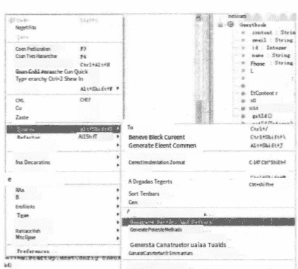

图 10-1 生成 getter 和 setter 方法

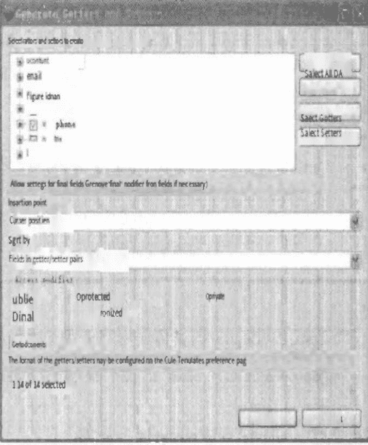

图 10-2 选择属性

## 10.2.1 `<jsp:useBean>` 标签

此标签定义了一个具有特定寿命和唯一 id 的 JavaBean 实例，以便 JSP 通过 id 识别 JavaBean，并通过 `id.method` 等语句操作 JavaBean。

在执行过程中，`jsp:useBean` 会尝试寻找与相同 id 和 scope 值的 JavaBean 实例，如果没有，则自动创建一个新实例，具体语法如下：

```
<jsp:useBean id="name" scope="page|request|session|application" typeSpec=body>
```

TypeSpec 的定义如下：

```
typeSpec := class="className"
class="className" type="typeName"
type="typeName" class="className"
beanName="beanName" type="typeName"
type="typeName" beanName="beanName"
type="typeName"
```

### 表 10-1 `jsp:useBean` 中属性的含义

| Attribute | Meaning |
| :--- | :--- |
| id | JavaBean 的唯一标识符。 |
| scope | JavaBean 的范围（page, request, session, application）。 |
| class | JavaBean 的类。 |
| type | JavaBean 的类型。 |

## 10.3.3 session scope

当作用域为 session 时，JavaBean 对象被创建，它将存在于整个 session 生命周期内。session 对象是一个内置对象；当用户使用浏览器访问网页时，会创建一个表示该连接的 session，同一 session 中的文件将共享此 JavaBean 对象。当客户端的 session 生命周期结束时，JavaBean 对象的生命也结束。JavaBean 对象存在于同一浏览器的 session 中。当你重新打开一个新的浏览器时，会启动一个新的 session。每个 session 都有自己的 JavaBean 对象。

## 10.3.4 application scope

当作用域为 application 时，JavaBean 对象创建后，它将存在于整个主机或虚拟主机的生命周期内，application scope 是 JavaBean 生命周期最长的。同一主机或虚拟主机上的所有文件共享此 JavaBean。如果服务器不重启，应用该作用域的 JavaBean 对象将留在内存中处理客户端请求，直到服务器关闭并释放其占用的内存资源。在此期间，服务器不会创建新的 JavaBean 组件，而是创建一个源对象的同步副本。对复制对象的任何更改都会改变源对象，但此更改不会影响其他现有的复制对象。

## 10.4 JSP+JavaBeans 的应用

通过一个示例让学生掌握如何在 JSP 页面中灵活使用 JavaBeans。

### 10.4.1 创建一个新的 Web 项目

创建一个 Web 项目并将其命名为 webproject6，如图 10-5 所示。

### 10.4.2 创建并编辑 Book.java

(1) 新建 Book.java。由于 JavaBean 在编写时是一个普通的 Java 类，MyEclipse 中没有用于开发 JavaBean 的向导，在 MyEclipse 中编写 JavaBean 的方法与开发普通类的过程是相同的。

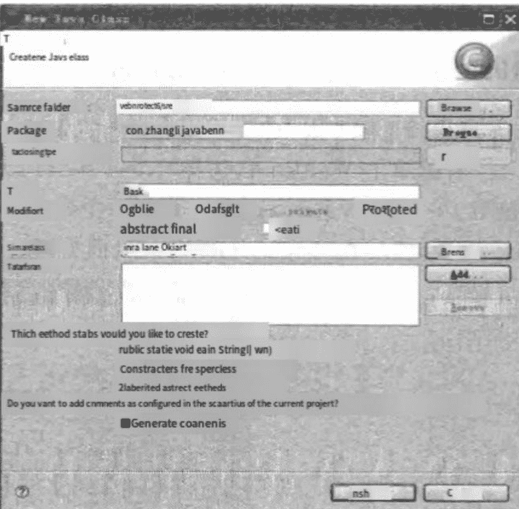

右键点击 src，选择 New-class，在显示的窗口中设置包名为 `com.zhangli.javabean`，类名为 `Book`，然后点击 Finish，如图 10-6 所示。

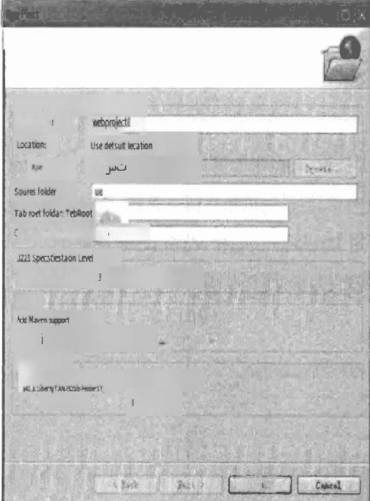

(2) 编辑 Book.java。

```java
package com.zhangli.javabean;

public class Book {
    private String isbn;
    private String name;
    private String author;
    private boolean sale;

    public String getIsbn() {
        return isbn;
    }

    public void setIsbn(String isbn) {
        this.isbn = isbn;
    }

    public String getName() {
        return name;
    }

    public void setName(String name) {
        this.name = name;
    }

    public String getAuthor() {
        return author;
    }

    public void setAuthor(String author) {
        this.author = author;
    }

    public boolean isSale() {
        return sale;
    }

    public void setSale(boolean sale) {
        this.sale = sale;
    }
}
```

### 10.4.3 创建并编辑 book.htm

(1) 创建新的 book.htm。

右键点击 WebRoot，选择 "New" -> "HTML" ，在弹出窗口中将名称设置为 `book.htm`，如图 10-7 所示。该 HTML 页面主要包含表单，通过表单将四个参数提交到 `displaybook.jsp` 页面，然后在 `displaybook.jsp` 页面中使用 JavaBean 来操作 Book 对象。


(2) 编辑 book.htm。

```html
<!DOCTYPE HTML PUBLIC "//W3C//DTD HTML4.01 Transitional/EN">
<html>
<head>
<title>book.htm</title>
<meta http-equiv="keywords" content="keyword1,keyword2,keyword3">
<meta http-equiv="description" content="this is my page">
<meta http-equiv="content=text/html;charset=UTF-8">
<link rel="stylesheet" type="text/css" href="styles.css">
</head>
<body>
<form method="post" action="displaybook.jsp">
ISBN:<input type="text" name="isbn"><br>
书籍:<input type="text" name="name"><br>
<input type="text" name="author"><br>
Sold:<input type="radio" name="sale" value="true" checked>否<input type="radio" name="sale" value="false"><br>
<input type="submit" value="提交"> <input type="reset" value="重来">
</form>
</body>
</html>
```

### 10.4.4 创建并编辑 displaybook.jsp

(1) 创建 displaybook.jsp。

右键点击 WebRoot。

(2) 编辑 displaybook.jsp。

```jsp
<%@ page language="java" contentType="text/html; charset=UTF-8" pageEncoding="UTF-8"%>
<%@ page import="com.zhangli.javabean.Book" %>
<html>
<head>
<title>displaybook.jsp</title>
</head>
<body>
<jsp:useBean id="book" class="com.zhangli.javabean.Book" scope="request"/>
<jsp:setProperty name="book" property="isbn" value="${param.isbn}"/>
<jsp:setProperty name="book" property="name" value="${param.name}"/>
<jsp:setProperty name="book" property="author" value="${param.author}"/>
<jsp:setProperty name="book" property="sale" value="${param.sale}"/>

ISBN: <jsp:getProperty name="book" property="isbn" /><br>
书籍: <jsp:getProperty name="book" property="name" /><br>
作者: <jsp:getProperty name="book" property="author" /><br>
是否: <jsp:getProperty name="book" property="sale" /><br>
</body>
</html>
```

### 10.4.5 运行项目


启动服务器，部署项目，并运行地址栏 `http://localhost:8080/webproject6/book.htm`，填写表单并点击提交，如图 10-9 所示。

你想创建哪个方法的存根？

`public static void main(String[] args)`

继承的抽象方法

你想要根据当前项目属性中的配置添加注释吗？

- 1 生成注释

# 完成

图 10-11 创建 Java 类 Guestbook

## (2) 按照所示编辑 `Guestbook.java`。

```java
package com.zhangli.javabeans;

public class Guestbook {
    private String content;
    private String email;
    private Integer id;
    private String name;
    private String phone;
    private String time;
    private String title;

    public String getContent() {
        return content;
    }

    public void setColor(String content) {
        this.content = content;
    }

    public String getEmail() {
        return email;
    }

    public void setEmail(String email) {
        this.email = email;
    }

    public Integer getId() {
        return id;
    }

    public void setId(Integer id) {
        this.id = id;
    }

    public String getName() {
        return name;
    }

    public void setName(String name) {
        this.name = name;
    }

    public String getPhone() {
        return phone;
    }

    public void setPhone(String phone) {
        this.phone = phone;
    }

    public String getTime() {
        return time;
    }

    public void setTime(String time) {
        this.time = time;
    }

    public String getTitle() {
        return title;
    }

    public void setTitle(String title) {
        this.title = title;
    }
}
```

## 10.5.5 创建并编辑 `MySQLUtil.java`

(1) 在 `com.zhangli.javabeans` 包中创建一个名为 `MySQLUtil` 的 Java 类。该类封装了 JakartaCommons Dbutils 类库在 MySQL 数据库上的操作，如图 10-12 所示。

图 10-12 创建 Java 类 MySQLUtil

## (2) 按照所示编辑 `MySQLUtil.java`。

```java
package com.zhangli.javabeans;
import java.sql.SQLException;
import javax.naming.Context;
import javax.naming.InitialContext;
import javax.naming.NamingException;
import javax.sql.DataSource;
import org.apache.commons.dbutils.QueryRunner;
import org.apache.commons.dbutils.ResultSetHandler;

public class MySQLUtil {
    private String dataSourceName;
    private DataSource ds;

    public MySQLUtil(String dataSourceName) {
        this.dataSourceName = dataSourceName;
    }

    public MySQLUtil() {
    }

    public void setDataSourceName(String dataSourceName) {
        this.dataSourceName = dataSourceName;
    }

    public void init() {
        try {
            Context initContext;
            initContext = new InitialContext();
            ds = (DataSource) initContext.lookup(dataSourceName);
        } catch (NamingException e) {
            e.printStackTrace();
        }
    }

    public int update(String sql, Object[] param) {
        int result = 0;
        QueryRunner qr = new QueryRunner(ds);
        try {
            result = qr.update(sql, param);
        } catch (SQLException e) {
            e.printStackTrace();
        }
        return result;
    }

    public Object query(String sql, Object[] param, ResultSetHandler rsh) {
        QueryRunner qr = new QueryRunner(ds);
        Object result = null;
        try {
            result = qr.query(sql, param, rsh);
        } catch (SQLException e) {
            e.printStackTrace();
        }
        return result;
    }
}
```

## 10.5.6 修改 `header.jsp`

将文件中的 "Network Message board V4.0" 替换为 "Network Message Board V5.0"，共需要修改两处。

## 10.5.7 修改 `addMessage.jsp`

将文件中所有的 "guestbook4" 替换为 "guestbook5"。五处需要修改。

## 10.5.8 修改 `AddMessageServlet.jsp`

使用 `Guestbook` 对象或用户输入的消息内容，并使用 `MySQLUtil` 类中的方法将消息内容保存到数据库的表中。

- (1) 将文件中所有的 `guestbook4` 替换为 `guestbook5`。

- 添加 `Guestbook` 和 `MySQLUtil` 的导入，并将输入存储在 `Guestbook` 对象中。使用 `request.getParameter("")` 通过 `get()` 方法获取 `Guestbook` 类的属性。

- (4) 更改之前获取数据源和获取连接的方法，改为使用 `Context` 类获取 `MySQLUtil` 类相关方法。

修改后的 `AddMessageServlet.jsp` 代码所示。

```jsp
<%@page language="java" pageEncoding="utf-8"%>
<%@ import="java.text.DateFormat"%>
<%@ import="zhangli.StringUtil"%>
<%@ include file="header.jsp" %>
<jsp:useBean file="header.jsp" class="com.zhangli.javabeans.Guestbook" id="gb"/>
<jsp:useBean class="com.zhangli.javabeans.MysQLUtil" id="db"/>
<jsp:setProperty property="*" name="gb"/>
```

```jsp
<%
request.setCharacterEncoding("utf-8");
int result = 0;
String name = request.getParameter("name");
String title = request.getParameter("title");
if (StringUtil.validateNull(name)) {
    out.println("<p align='center'>name 不能为空</p>");
    out.println("<a href='guestbook5/addMessage.jsp'>返回重试</a>");
} else if (StringUtil.validateNull(title)) {
    out.println("<p align='center'>title 不能为空</p>");
    out.println("<a href='guestbook5/addMessage.jsp'>返回重试</a>");
} else {
    SimpleDateFormat sdf = new SimpleDateFormat("yyyy-MM-dd hh:mm:ss");
    Object[] param = {
        name,
        gb.getEmail(),
        title,
        gb.getContent(),
        sdf.format(new java.util.Date())
    };
    String sql = "insert into book (name,email,title,content,time) values(?,?,?)";
    result = db.update(sql, param);
    if (result == 0) {
        out.println("<p align='center'>添加消息失败</p>");
        out.println("<a href='guestbook5/addMessage.jsp'>返回重试</a>");
    } else {
        out.println("<p align='center'>消息添加成功</p>");
        out.println("<a href='guestbook5/GetMessage.jsp'>查看所有消息</a>");
    }
}
%>
<%@include="footer.jsp"%>
```

## 10.5.9 修改 `GetMessage.jsp`

使用 `MySQLUtil` 类的方法从数据库读取消息内容，并将每条记录存储为 `Guestbook` 对象。

- (1) 将文件中所有的 `guestbook4` 替换为 `guestbook5`。

- (2) 添加 `MySQLUtil` 的导入。

- (3) `request.getParameter("")` 通过 `get()` 方法获取 `Guestbook` 类的属性。

- (4) 更改之前获取数据源和获取连接的方法，改为使用 `MySQLUtil` 类方法。

- (5) 从数据库读取的消息存储在 `Guestbook` 对象中。

修改后的 `GetMessage.jsp` 代码所示。

```jsp
<%@page language="java" pageEncoding="utf-8"%>
<%@ import="java.util.List"%>
<%@ import="org.apache.commons.dbutils.handlers.BeanHandler"%>
<%@ import="zhangli.StringUtil"%>
<%@ import="com.zhangli.javabeans.Guestbook"%>
<%@ include file="/header.jsp" %>
<jsp:useBean class="com.zhangli.javabeans.MySQLUtil" id="db"/>
<%
String sql = "select * from book";
out.println("<p align='center'>");
out.println("<a href='/guestbook5/addMessage.jsp'>添加消息</a><br>");
out.println("显示所有消息:");
db.setDataSourceName("java:comp/mysql");
db.init();
List list = (List)db.query(sql, new BeanHandler(Guestbook.class));
for(int i = 0; i < list.size(); i++) {
    Guestbook gb = (Guestbook)list.get(i);
%>
<table width="600" border="1" style="table-layout:fixed;word-break:break-all">
    <tr>
      <td>姓名</td>
      <td><%=gb.getName()%></td>
    </tr>
    <tr>
      <td>电话</td>
      <td><%=StringUtil.changeNull(gb.getPhone(), "未填写")%></td>
    </tr>
    <tr>
      <td>邮箱</td>
      <td><%=StringUtil.changeNull(gb.getEmail(), "未填写")%></td>
    </tr>
    <tr>
      <td>主题</td>
      <td><%=gb.getTitle()%></td>
    </tr>
    <tr>
      <td>内容</td>
      <td><%=StringUtil.changeNull(gb.getContent(), "未填写")%></td>
    </tr>
    <tr>
      <td></td>
      <td></td>
      <td><%=gb.getTime()%></td>
      <td></td>
    </tr>
</table>
<br>
<% } %>
</p>
<%@include file="footer.jsp"%>
```

---

## 10.5.10 运行输出

启动服务器，部署项目，运行并测试，会发现读取消息时出现中文乱码。主要原因是我们在 `AddMessageServlet.jsp` 中设置了 `request.setCharacterEncoding("utf-8")`。在放入 `<jsp:setProperty property="*" name="gb"/>` 之后，解决方法是将 `request.setCharacterEncoding("utf-8")` 更改为 `<%request.setCharacterEncoding("utf-8");%>` 并移动到 `<jsp:useBean class="com.zhangli.javabeans.Guestbook" id="gb"/>` 之前。

# 第三部分

# 系统框架

## 第11章 Struts 框架及其应用

### 11.1 Struts 基础

#### 11.1.1 Struts 的起源

Struts 是 Apache 基金会的开源项目，它是经典设计模式——MVC 的实现。Struts 为 Web 应用提供了一个通用框架，允许开发者专注于解决实际的业务逻辑，采用 Struts 可以实现良好的代码复用。到目前，Struts 已经成为 Web 开发中 MVC 模式的事实标准，大量的 Web 应用开发选择使用 Struts 来实现 MVC 模式。

框架的概念并不新鲜，随着软件开发的发展，在多层软件开发项目中，可复用、易扩展且经过良好测试的软件组件变得越来越流行。这意味着人们可以花费更多时间在分析和构建业务逻辑应用程序上，而不是处理相同类型的工程问题。针对同类问题的解决方案被抽象并提取到应用程序框架中。这就是我们所说的框架（Framework）。

#### 11.1.2 Struts 的工作原理

图 11-1 显示了 Struts 的工作机制。

图 11-1 Struts 工作原理

客户的所有需要通过框架的请求都由 `ActionServlet` 统一接收（Struts 已经我们写好了 `ActionServlet`，只要应用程序没有特殊要求，它基本上就能满足要求），根据接收到的请求参数和 `ActionMapping` 中的 Struts 配置（`struts-config.XML`），请求被发送到相应的 `Action` 进行处理。为了解决“谁来做”的问题，它们共同构成了 Struts 的控制器（controller）。


# Struts 核心组件与工作流

## Action 组件

Action 是 Struts 应用的真实组件。它解决了“做什么”的问题。它通过调用所需的业务组件（模型）来完成应用程序的业务。业务组件解决了“如何做”的问题，并返回执行结果。

一个表示所需的响应的 JSP（或 Action）的 `ActionForward` 对象被返回给 `ActionServlet`，以便向客户渲染响应。

特别地，`Action` 类不应包含过多的业务逻辑，而简单地收集业务方法所需的数据并传递给业务对象。事实上，它的主要职责是：

1. 验证前置条件或断言；
2. 调用所需的业务逻辑方法；
3. 检测或处理其他错误；
4. 路由控制到相关的视图。

Struts 是 JSP Model2 设计标准的实现，下面将从模型、视图、控制器三部分介绍 Struts 的结构和工作原理。MVC 模式结构如图 11-2 所示。


图 11-2. MVC 模式

通常情况下，Struts 框架中的模型由 Javabeans 或 EJBs 组成，视图由 JSP 页面组成，控制器由 `ActionServlet` 和 `Action` 实现。图 11-3 显示了 MVC 框架的 Basic 结构。

图 11-3 Struts 的 MVC 模式

### 模型

模型代表应用程序的状态和业务逻辑的处理。在一般的 Web 应用中，使用 JavaBean 或 EJB 来实现系统的业务逻辑；在 Struts 框架中，模型层也用 JavaBean 或 EJB 实现。

### 视图

在 Struts 中，视图层广泛包括两个部分，即 JSP 页面和 `ActionForm`。`ActionForm` 封装了用户提交的表单信息，这些 JavaBean 中没有特定的业务逻辑，它只为所有属性提供 getter 和 setter 方法，逐一对应用户表单的输入项。在 Struts 中，用户的表单信息通过 `ActionForm` 提交给控制器。Struts 视图组件包括 JSP 页面，这也是经典 MVC 模式中的视图组件，这些 JSP 页面承担了信息显示和控制器处理结果显示的功能。

### 控制器

在 Struts 框架中，主控制器是 `ActionServlet`，它处理客户端发送的所有请求。当 `ActionServlet` 接收到浏览器的请求时，它根据 `struts-config.xml` 配置查找匹配的 URL，然后将用户的请求发送到相应的控制器。

Struts 框架通过控制器 `ActionServlet` 完成模型层和业务逻辑层的分离，从而减少 Web 应用的耦合性，实现经典的 MVC 架构。

## Struts 的工作流

`ActionServlet` 是 Struts 中的核心控制器，所有用户请求必须由 `ActionServlet` 处理，而 `struts-config.xml` 是 Struts 中的核心配置文件。该文件配置了用户请求 URL 与控制器 `Action` 之间的映射关系，`ActionServlet` 通过此配置文件将用户请求终止到相应的控制器。

在使用 Struts 的 Web 应用中，当 Web 应用启动时，`ActionServlet` 会被初始化，`struts-config.xml` 配置文件会在初始化期间加载。加载成功后，会将这些 URL 和控制器映射存储在 `ActionMapping` 对象或其他对象中。

当 `ActionServlet` 接收到用户请求时，它按照以下流程处理用户请求。

1. 接收到用户请求后，`ActionServlet` 根据请求 URL 查找匹配的 `ActionMapping` 对象。如果不存在匹配项，说明用户请求的 URL 路径信息错误。因此，返回消息“The request path is invalid”（请求路径无效）。当找到匹配的 `ActionMapping` 对象时，进入下一步。
2. 当 `ActionServlet` 找到匹配的 `ActionMapping` 对象时，它根据 `ActionMapping` 中的映射信息确定对应的 `ActionForm` 是否存在。如果不存在，则创建一个新的 `ActionForm` 并将用户提交的内容保存到该 `ActionForm` 中。
3. 在 `struts-config.xml` 文件中，还可以配置表单是否需要验证。如果需要，则调用 `ActionForm` 的 `validate()` 方法验证表单信息。
4. 如果 `ActionForm` 的 `validate()` 方法返回 `ActionErrors`，则表单验证失败。在这种情况下，`ActionServlet` 返回用户页面并提示用户重新输入。如果返回 `null`，则表单验证成功。
5. `ActionServlet` 使用 `ActionMapping` 对象找到应转发到哪个控制器 `Action`。如果对应的 `Action` 实例不存在，则创建对象并调用 `Action` 的 `execute()` 方法。
6. 控制器 `Action` 的 `execute()` 方法返回一个 `ActionForward` 对象。`ActionServlet` 将 action 处理的结果转发到 `ActionForward` 指定 JSP 页面。
7. `ActionForward` 指向的 JSP 页面根据返回的结果将服务器处理结果显示给客户。

## Struts 基础组件包

整个 Struts 包由大约 15 个包和近 200 个类组成，数量在不断增加。以下是一些主要包的介绍。

下面描述了 Struts API 的基础组件，包括 `action`、`actions`、`config`、`util`、`taglib`、`validator`，`action` 是 Struts 框架的核心。

### org.apache.struts.action

基本上，控制整个 Struts 框架运行的核心类和组件都在这个包中，例如上面提到的控制器 `ActionServlet`、`Action`、`ActionForm`、`ActionMapping` 等。

Struts 1.1 在 1.0 的基础上增加了 `DynaActionForm` 类，并增加了动态扩展以生成 FormBeans。

#### ActionServlet：控制器对象

`ActionServlet` 继承自 `javax.servlet.http.HttpServlet` 类，并在 Struts 中充当中央控制角色，为处理客户端的所有请求提供中心位置。

控制器主要负责组装客户端的 HTTP 请求并转发根据配置文件中指定的描述将它们发送到相应的处理器。根据所有 servlet 的标准，所有 servlet 必须在 `web.xml` 中声明。同样，`ActionServlet` 必须在 `web.xml` 中描述。相关的配置文件如下：

```xml
<servlet>
  <servlet-name>action</servlet-name>
  <servlet-class>org.apache.struts.action.ActionServlet</servlet-class>
</servlet>
```

```xml
<servlet-mapping>
  <servlet-name>action</servlet-name>
  <url-pattern>*.do</url-pattern>
</servlet-mapping>
```

符合此模式的 URI 请求看起来如下：`http://www.myside.com/google/login.do`。

中心控制器为每个表现请求提供了一个中心访问点。该控制器提供的抽象降低了开发通用系统服务的难度，例如管理视图、会话和表单数据。它还提供了一种通用机制，如错误和异常处理导航、国际化和数据验证、数据转换等。

当用户向服务器提交请求时，请求实际上首先发送到中心控制器 `ActionServlet`。一旦控制器获取到请求，它会将请求信息传递给辅助类。这些辅助类知道如何根据请求信息处理相应的业务操作，在 Struts 中，这些辅助类是 `org.apache.struts.action.Action`。通常开发者需要继承他们自己的 `Action` 类来实现自己的 `Action` 实例。

#### Struts Action 类

`ActionServlet` 将所有请求委托给 `RequestProcessor` 对象，该对象使用 `struts-config.xml` 并寻找对应的 `Action`。

`Action` 类的作用是充当请求 `Action` 与业务逻辑处理之间的适配器，允许客户端请求与 `Action` 类之间存在多个点对点的映射，且 `Action` 类通常还提供额外的功能，如身份验证、日志记录和数据验证。


```java
public ActionForward execute(
    ActionMapping mapping,
    javax.servlet.http.HttpServletRequest request,
    javax.servlet.http.HttpServletResponse response
) throws java.io.IOException, javax.servlet.ServletException
```

最常用的方法是 `Action` 的 `execute()`。当 `ActionServlet` 接收到来自客户端的请求时，会转移到 `Action` 实例。如果实例不存在，控制器会先创建它，然后调用 `Action` 的 `execute()` 方法。

Struts Framework 只为每个实例创建一个 `Action` 对象。由于所有用户都使用同一个 `Action` 实例，因此你需要确保你的 `Action` 类运行在多线程环境中。

注意，客户端在重写 `Action` 类时必须重写 `execute()` 方法，因为 `execute` 默认返回 `null`。

#### Struts ActionMapping

上述描述了客户端请求由控制器转发并处理，但控制器如何知道将什么信息转发给相应的 `Action`？这需要一个与 action 和请求对应的配置文件。在 struts 中，规范文件是 `struts-config.xml`。

这些配置文件在系统启动时被导入到内存中，并在 Struts 框架运行时供使用。在内存中，每个 `<action>` 元素对应一个 `org.apache.struts.action.ActionMapping` 类。`<action>` 配置文件示例：

```xml
<action-mappings>
  <action path="/loginAction"
    type="com.yourcompany.loginAction"
    name="loginForm"
    scope="request"
    input="/loginCheck.jsp"
    validate="false">
    <forward name="welcome" path="/welcome.jsp"/>
    <forward name="failure" path="/failure.jsp"/>
  </action>
</action-mappings>
<form-beans>
  <form-bean name="loginForm" type="com.yourcompany.loginForm"/>
</form-beans>
```

### org.apache.struts.actions

该包的主要作用是提供客户端 HTTP 请求与业务逻辑处理之间特定的适配器转换，且版本 1.0 中对 FormBean 类的动态添加和删除也在 Struts 中。在 Struts 1.1 中，它被 `Action` 包中的 `DynaActionForm` 组件取代了。

### org.apache.struts.config

提供到配置文件 `struts-config.xml` 元素的映射。这也是 Struts 1.1 中的新增内容。

### org.apache.struts.util

为了更好地支持 Web 的应用，Struts 对一些通用服务提供了统一支持，例如连接池和消息源。

### org.apache.struts.taglib

这不是一个包，而是客户端标签类的集合。其包括 Bean 标签、HTML 标签、逻辑标签、嵌套标签、模板标签，它们用于构建用户界面标签类。

### org.apache.struts.validator

Struts 1.1 Framework 中增加了 validator framework，用于从表单动态配置验证。

## Struts 配置文件

Struts 的配置文件是 `struts-config.xml`，存在于 WebRoot 目录下的 `WEB-INF` 文件夹。在此文件中，你可以配置数据源、form-bean、action、plug-in 和资源的信息。

```xml
<?xml version="1.0" encoding="UTF-8"?>
<!DOCTYPE struts-config PUBLIC "-//Apache Software//DTD Struts Config 1.3//EN"
"http://www.apache.org/dtd/struts-config_1_3.dtd">
<struts-config>
  <data-sources>
  </data-sources>
  <form-beans>
  </form-beans>
  <action-mappings>
  </action-mappings>
  <controller>
  </controller>
  <message-resources>
  </message-resources>
  <plug-in>
  </plug-in>
</struts-config>
```

上述元素必须按此顺序排列。文件的主要结构如下。

指向响应动作的特定请求路径。上述从特定请求路径到对应 `Action` 类的映射。具有以下属性。

- `attribute`：设置与 `Action` 关联的 `ActionForm` Bean 的请求和会话作用域键。例如，如果 Form Bean 存在于请求作用域中，且此参数设置为 `"myBeans"`，那么 `getAttribute("myBeans")` 就可以返回请求上的 Bean 实例。
- `className`：对应 `action` 元素的配置元素。默认值为 `org.apache.struts.action.ActionMapping`。
- `forward`：指向跳转的路径。
- `include`：指定要包含的 URL 路径。如果表单认证失败，请求将转发到此 URL。
- `name`：指定与 `Action` 关联的 `ActionForm` Bean 名称。此名称必须在 `form-beans` 中定义。
- `path`：指定访问 `Action` 的路径。以斜杠（/）开头。
- `parameter`：指定 `Action` 的配置参数。`Action` 可以在 `Action` 类的 `execute()` 方法中被调用。`Mapping` 对象的 `getParameter()` 方法读取配置参数。
- `roles`：指定允许调用 `Action` 的安全角色。用逗号（,）分隔角色。在处理请求时，`RequestProcessor` 根据此配置判断用户是否有权限调用 `Action` 的权限。
- `scope`：指定 `ActionForm` Bean 的存在作用域。选项有 `request` 和 `session`。默认值为 `session`。
- `type`：指定 `Action` 类的全类名。
- `lang`：如果此项为 `true`，则意味着用户发送的无效 `Action` url 可以被处理。默认值为 `false`。
- `validate`：指定是否调用 `ActionForm` Bean 的 `validate` 方法。默认值为 `true`。注意：`forward`、`include`、`type` 属性中只能选择其一。


### 示例代码

```xml
<action path="/search"
        type="zxj.okBean"
        name="al"
        scope="request"
        validate="true"
        input="/b.jsp">
    <forward name="tig" path="/aa.jsp" />
</action>
```

注意：在这种情况下，`forward` 指本地跳转路径。`global-forwards` 指全局跳转路径。

### `<controller>` 元素

用于配置 `ActionServlet`。`bufferSize` 用于指定上传文件的输入缓冲区大小。较少使用。

### `<message-resources>` 元素

用于配置资源包。它具有以下属性。

- `className`：对应 `message-resources` 的配置类。默认值为 `org.apache.struts.config.MessageResourcesConfig`。
- `factory`：指定消息资源工厂类，默认值：`org.apache.struts.util.PropertyMessageResources` 类。
- `key`：指定在 Servlet Bundle 中使用的属性键。默认字符串常量由 `Globals.MESSAGES_KEY` 定义。只允许一个 Resource Bundle 使用默认属性 Key。
- `null`：指定 `MessageSources` 类处理未知消息的键。如果为 `true`，则返回空字符串；如果为 `false`，则返回相关字符串，默认值为 `false`。


- parameter: 指定 MessageSources 的资源文件名，如果是 `a.b.ApplicationResources`，则对应 `Web-INF/classes/a/b/ApplicationResources.properties` 的实际文件路径。

# 示例资源代码如下

```xml
<message-resources null="false" parameter="defaultResource/message-resources">
<message key="num1" null="false" parameter="test" text="访问问 :" />
<bean:message key="zxj" bundle="num1"/>
</message-resources>
```

zxj 是消息资源文件中的字符串。

(8) `<plug-in>` 元素：用于配置 Struts 插件，配置多个应用程序模块，通常较少使用。

# 11.2 Struts 流程

## 11.2.1 创建 Web 项目

选择“File” -> “New” -> “Web Project (Optional Maven Support)”选项来创建项目。在“ProjectName”中输入项目名称“struts”，在“J2EE Specification Level” 选项组中勾选“Java EE 5.0”，并使用默认输入。最后点击“Finish”按钮，如图 11-4 所示。

## 11.2.2 为项目添加 Struts 开发能力

方法 1：右键点击项目名称，从弹出的快捷菜单中选择“MyEclipse - Add Struts Capabilities”选项，如图 11-5 所示。

图 11-4 创建 struts Web 项目

图 11-5 右键添加 Struts 开发能力

方法 2：左键点击项目名称，在菜单栏上选择“MyEclipse - Add Struts Capabilities”选项，如图 11-6 所示。

图 11-6 在菜单模式下添加 Struts 开发能力

无论哪种方法，都会弹出图 11-7 所示的界面，选择默认版本的 Struts 1.2，设置新类的 Basepackage 包，点击“Finish”按钮。

完成上述设置后，项目目录发生变化，引入了相关的 Struts 类库以及配置文件，如图 11-8 所示。

`struts-config.xml` 是 Struts 框架的配置文件。默认显示 Design 模式，如图 11-9 所示。

随后我们可以向此文件中添加可视化动作。


图 11-7 Struts

图 11-8 添加 Struts 开发能力后的项目

图 11-9 struts-config.xml 的 Design 模式

图 11-10 struts-config.xml 的 Source 模式


图 11-11 web 配置信息

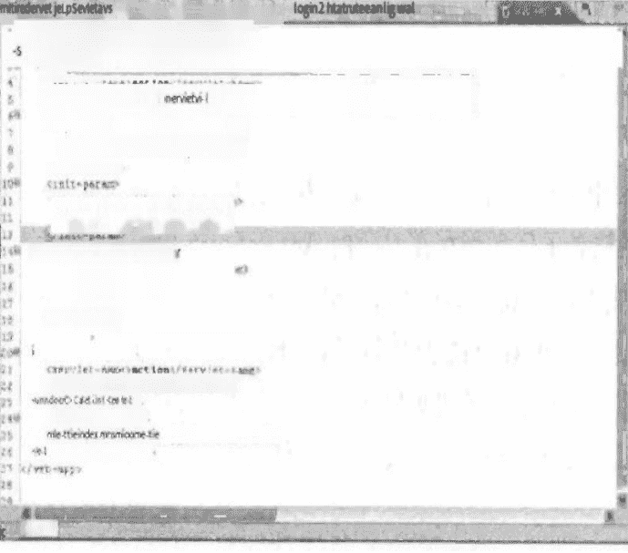

## 11.2.3 创建 Form Action 和 JSP

在 `struts-config.xml` 文件中，切换到 Design 模式，右键点击并选择“New” -> “Form, Action and JSP”，如图 11-12 所示。执行上述操作后，弹出图 11-13 所示的界面。在 Use Case 字段中输入用例名称“login”，并在 Form Impl 字段中选择“Dynamic FormBean”。

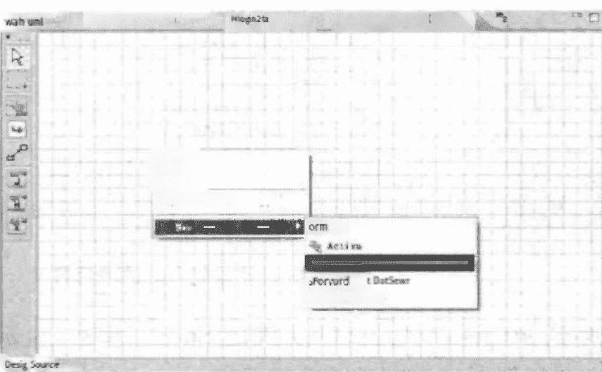

图 11-12 login Action 的 Form, Action and JSP

图 11-13 设置名称

然后点击 Form Properties 标签右侧的“Add”按钮，添加两个表单组件“username”和“password”，如图 11-14 和图 11-15 所示。

图 11-14 添加表单组件 username

图 11-15 添加组件 password

完成上述步骤后，Form Properties 标签上显示了另外两个属性，如图 11-16 所示。

> 注意：Struts 为每个用户输入表单提供一个 `ActionForm` 对象。当用户提交表单时，Struts 会自动将表单信息保存到对应的 `ActionForm` 中。

图 11-16 添加表单 (Form) 组件后

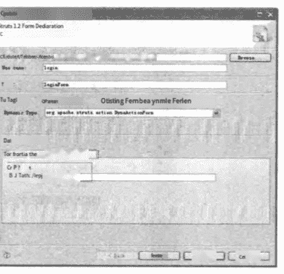

图 11-17 JSP TAB 设置

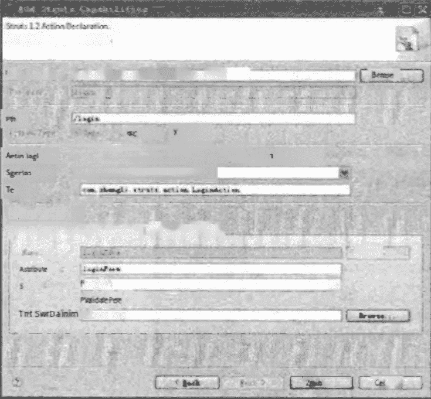

从 `org.apache.struts.action` 创建 Action 使用-映射

可选参数

图 11-18 继续设置登录 Action

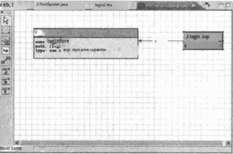

图 11-19 生成视觉开发图

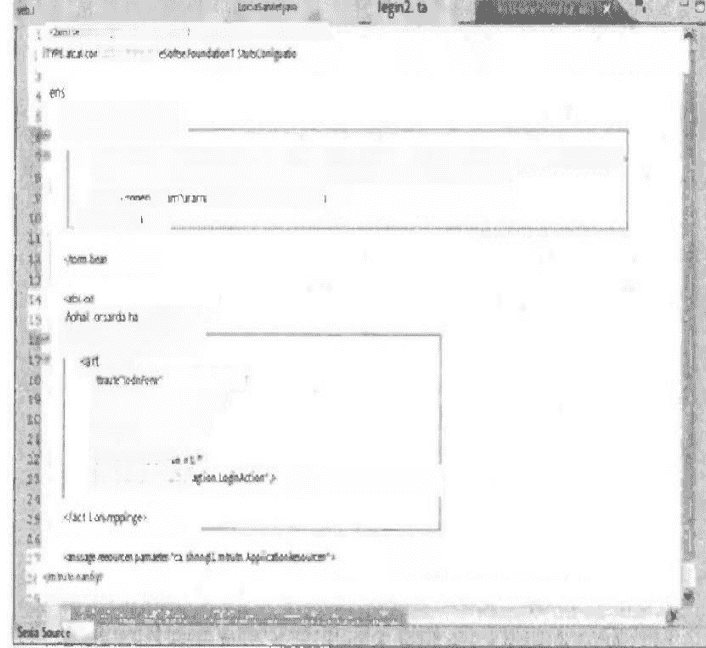

`DynaServlet` java

```xml
<form name="loginForm">
<form-property name="username"/>
<form-property name="password"/>
</form>
```


图 11-20 struts-config.xml 代码已更改

## 11.2.4 创建 Forward（跳转）

在 `struts-config.xml` 文件的设计模式下，右键点击“New” -> “Forward”选项，如图 11-21 所示。

### 图 11-21 新建 Forward

弹出 New Forward 编辑框后，将 Name 设置为 fail，Path 设置为 `/fail.jsp`，并勾选 Redirect 属性，然后点击“Finish”按钮，如图 11-22 所示。

### 图 11-22 设置 Forward 名称和路径

与前面的步骤类似，创建一个 Name 为 success 且 Path 为 `/main.jsp` 的 Forward，如图 11-23 所示。

图 11-23 创建另一个 Forward 并进行设置

在创建两个 forward 之后，你需要将 Forward 与 Action 关联，因为 Action 的返回值是 Forward，所以返回值是成功的 Forward 或失败的 Forward。点击左侧的第五个小图标，在 login Action 与 fail Forward 以及 success Forward 之间添加箭头，如图 11-24 所示。

此时，`struts-config.xml` 文件的 Source 模式代码发生了变化，增加了 Forward 代码，如图 11-25 所示。

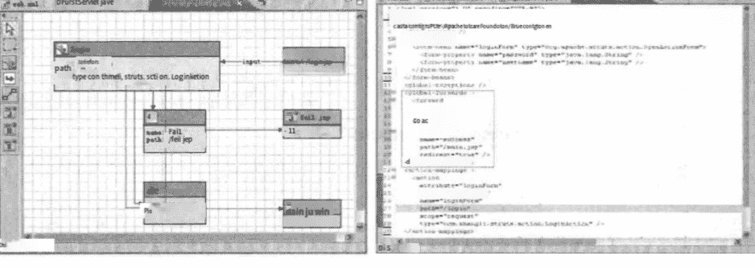

图 11-25 struts-config.xml 代码已更改

## 11.2.5 编辑 Action

主要编辑 Action 中的 `execute()` 方法，首先获取用户在表单中输入的用户名和密码，然后进行判断：如果用户名是 zhangli 且密码是 123456，则返回 success Forward，否则返回 fail Forward。代码如下：

```java
public class login extends Action {
    public ActionForward execute(ActionMapping mapping, ActionForm form,
            HttpServletRequest request, HttpServletResponse response) {
        DynaActionForm loginForm = (DynaActionForm) form;
        String username = (String) loginForm.get("username");
        String password = (String) loginForm.get("password");
        System.out.println("username:" + username);
        System.out.println("password:" + password);
        if (username.equals("zhangli") && password.equals("123456")) {
            return mapping.findForward("success");
        }
        return mapping.findForward("fail");
    }
}
```

## 11.2.6 创建并编辑 JSP

用于 fail Forward 的 `fail.jsp` 和用于 success Forward 的 `main.jsp` 都需要手动添加和编辑。

右键点击 `WebRoot` 文件夹，从弹出快捷菜单中选择“New” - “JSP (Advanced Templates)”选项创建一个新的 JSP，如图 11-26 所示。

执行上述操作后，会弹出 JSP 设置向导，将 File Name 设置为 `fail.jsp`，如图 11-27 所示；与上述步骤类似，再创建另一个 jsp，File Name 设置为 `main.jsp`，如图 11-28 所示。

### 图 11-27 设置 Forward - 完成

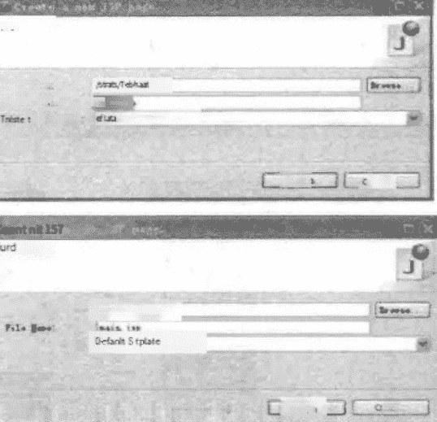

在编辑 `fail.jsp` 和 `main.jsp` 时，应先将 `pageEncoding` 设置为“utf-8”，然后将其设置为 `<body>`，如图 11-29 和图 11-30 所示。

| Tracing la | encoding value |
|---|---|
| The | TYPE GAIL-5 of IP |
| St | Report Yos: Web Service |
| r | AI Frno.C Felda |
| 00 | HTML Tapties Saw Resi |
| m | Advanced Tags list |

图 11-26 新建 JSP

图 11-28 设置 main.jsp

图 11-29 编辑 fail.jsp

图 11-30 编辑 main.jsp

## 11.2.7 部署并运行项目

启动服务器，部署项目并运行，如图 31 所示。访问 `http://localhost:8080/login`，如果用户名是 zhangli 且密码是 123456，则跳转到 `main.jsp`，否则跳转到 `fail.jsp`，如图 11-31 所示。

```
| |
|---|---|
| <Connector port="8080" protocol="HTTP/1.1" connectionTimeout="20000" redirectTimeout="20000" redirectPort="6443">
| |Encoding="8-8

图 11-31 登录输出
```

| 111 乱码 |

# 11.3 Struts 中的乱码问题

在解决 Struts 中的乱码问题时，通常需要将 `pageEncoding` 设置为 "utf-8"。有三种方式处理乱码：

### 11.3.1 设置编码

在编辑 `fail.jsp` 和 `main.jsp` 时，应先将 `pageEncoding` 设置为 "utf-8"，然后将其设置为 `<body>`，如图 11-29 和图 11-30 所示。

- (1) 页面显示编码
- (2) 参数传递编码
- (3) 统一编码

### 11.3.2 传递参数

解决参数乱码的方法有两种：

1.  在 `web.xml` 中使用过滤器 (`Filter`)。
2.  在 `server.xml` 中设置 `URIEncoding`。

#### (1) 在页面设置编码

在 JSP 文件的顶部添加 `pageEncoding="utf-8"`：

```jsp
<%@ page encoding="utf-8"%>
```

#### (2) 使用过滤器

首先，在 `web.xml` 中配置过滤器：

```xml
<filter>
    <filter-name>encodingFilter</filter-name>
    <filter-class>com.zhangli.struts.filter.CharacterEncodingFilter</filter-class>
</filter>
<filter-mapping>
    <filter-name>encodingFilter</filter-name>
    <url-pattern>/*</url-pattern>
</filter-mapping>
```

创建 `CharacterEncodingFilter` 类：

```java
package com.zhangli.struts.filter;

import java.servlet.*;
import java.servlet.http.*;
import java.io.IOException;

public class CharacterEncodingFilter implements Filter {
    public void init(FilterConfig arg0) throws ServletException {
    }
    public void destroy() {
    }
    public void doFilter(ServletRequest arg0, ServletResponse arg1, FilterChain arg2)
            throws IOException, ServletException {
        HttpServletRequest request = (HttpServletRequest) arg0;
        request.setCharacterEncoding("utf-8");
        arg2.doFilter(arg0, arg1);
    }
}
```

#### (3) 修改 server.xml

修改 Tomcat 目录下 conf 文件夹中的 `server.xml` 文件。图 11-34 显示了第 67 到第 69 行。添加 `URIEncoding`。图 11-35 显示了修改后的代码：

```xml
<Connector port="8080" protocol="HTTP/1.1" connectionTimeout="20000" redirectTimeout="20000" redirectPort="6443" URIEncoding="utf-8">
```

```python
import tensorflow as tf
import tensorflow.keras.layers as layers

def char_encoding_filter(filter_size=3):
    return layers.TextVectorization(filter_size=filter_size, output_mode='int')

char_filter = char_encoding_filter()
vectorize_layer = layers.TextVectorization(max_tokens=10000, output_mode='int')

def example_vectorize(text):
    lowercase = tf.strings.lower(text)
    output = char_filter(lowercase)
    output = vectorize_layer(output)
    return output
```

rDesign.Source

Lognetjs yicfice Tab

Brez Charschartn mouth

4teramechartert

游报

图 11-37 修改后的 web.xml

(4) 重启服务器。

## 2. 重写 ActionServlet 类方法

(1) 在包 `com.zhangli.struts.action` 中创建一个名为 `ActionServletEx` 的新类，并将父类设置为 `ActionServlet`。按照如下代码编辑代码。

```java
public class ActionServletEx extends ActionServlet {
    private final String ENCODING_CHAR_SET="encodingCharset";
    private final String DEFAULT_ENCODING_CHAR_SET="UTF-8";
    private String encodingCharset;
    public void init() throws ServletException {
        this.encodingCharset=super.getInitParameter(ENCODING_CHAR_SET);
        if(this.encodingCharset==null) {
            this.encodingCharset=this.DEFAULT_ENCODING_CHAR_SET;
```


```java
        }

        super.init();

    }
```

```java
protected void service(HttpServletRequest request, HttpServletResponse response) throws ServletException, IOException {

    request.setCharacterEncoding(this.encodingCharset);

    super.service(request, response);

}
```

(2) 修改 `web.xml` 文件中的配置信息。
将代码 `<servlet-class>org.apache.struts.action.ActionServlet</servlet-class>` 改为 `<servlet-class>com.zhangli.struts.action.ActionServletEx</servlet-class>`。

(3) 重启服务器。

| 问题任务 | 应用 | C-AP | 浏览器控制台 2 之后 |
|---|---|---|---|
| tomcat5Serve | [Eanote Java | | 选择上述任何方法后，重新测试项目将 |
| 用户: Zhang Li 密码: 123456 | | | |

当用户输入中文用户名或密码时，不会显示乱码字符，如图 11-38 所示。

> 图 11-38 控制台上的输出参数

# 11.3.3 国际化中文乱码

(1) 使用 JDK 原生的 `native2ascii` 工具转换资源文件。

这种方法需要使用 `cmd` 命令，且特别复杂，因此我们通常不采用这种方法，而是采用下一种。

## (2) 使用 ResourceBundle Editor 插件。

- ① 在 ResourceBundle Editor 中下载 Eclipse 插件
- ② 将其解压以创建 `plugins` 文件夹
- ③ 将 `plugins` 文件夹复制到 MyEclipse 安装目录下的 `eclipse` 文件夹中。这将覆盖原始的 `plugins` 文件。
- ④ 关闭 Tomcat 并重启 Eclipse
- ⑤ 重启 Eclipse 平台后，修改 `login.jsp`。

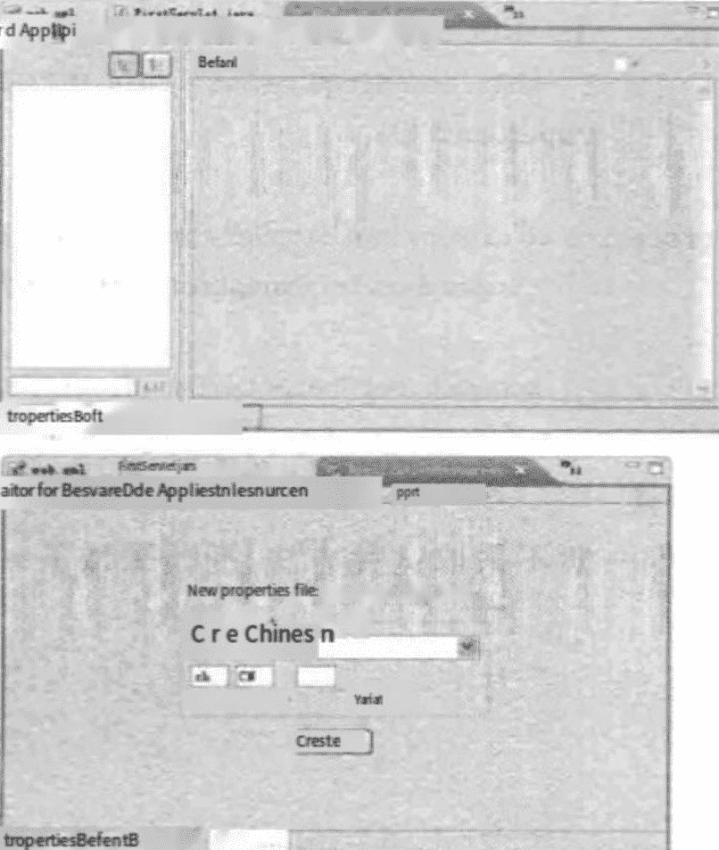

# 代码将：

username:<html:text property="username"/><html:errors property="username"/><br/>password:<html:password property="password"/><html:errors property="password"/><br/>修改为：

```html
<message key="example.login.username">:
<html:text property="username"/>
<html:errors property="username"/>
<br/>
<message key="example.login.password">:
<html:password property="password"/>
<html:errors property="password"/>
<br>
```

# 右键点击 `Resources.properties`，选择 "Open With -> ResourceBundle Editor" 打开文件，如图 11-39 所示。

打开编辑器后，点击左下角的 `New` 标签页，如图 11-40 所示。

| | | |
|---|---|---|
| 11 | T | |
| 12 | Alt+Shift | |
| 47 | | |
| Build | | |
| Clator | | |
| 311 | | |
| 39 | | |
| 40 | | |
| 41 | | |
| 42 | | |
| 43 | | |
| 44 | | |
| 45 | | |

图 11-39 打开 ResourceBundle Editor

图 11-40 选择 New 标签页

# 创建一个中文(Chinese)版本文件，如图 11-41 所示。

在 11-41 所示的界面中编辑 `Resources.properties`，设置 `example.login.username`，点击 “Add” 按钮，如图 11-42 所示。完成上述操作后，中文版本文件 `Resources_zh.properties` 将在目录中生成，如图 11-43 所示。

完成前述步骤后，弹出属性对话框，如图 11-48 所示。勾选属性生成对应的 getter 和 setter 方法，例如我们将勾选密码和用户名，然后点击“OK”按钮。

图 11-46 首先输入属性

图 11-47

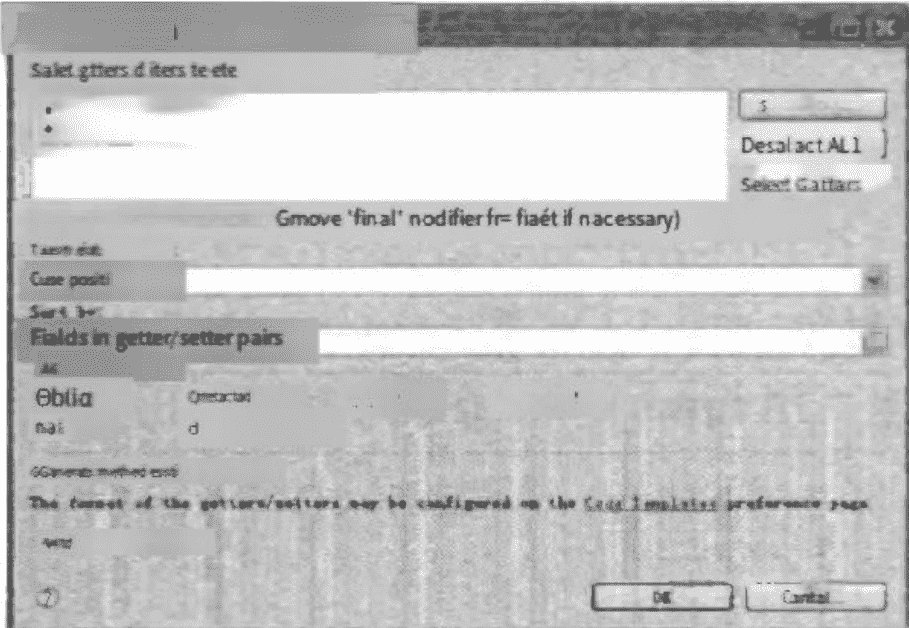

- 根据需要移动 `final` 修饰符
- 大写位置
- 开始
- getter/setter 对中的字段
- 生成方法
- 其他的 getter/setter 可以在代码实现偏好设置上进行配置

图 11-48 选择属性

```java
package com.demo.struts.model;

public class User {

    private String username, password;

    public String getUsername() { return username; }

    public void setUsername(String username) { this.username = username; }

    public String getPassword() { return password; }

    public void setPassword(String password) { this.password = password; }

}
```

图 11-49 自动生成对应的 met

# 13. 修改 LoginAction 并在适当的位置添加代码。execute 方法代码如下。

```java
public ActionForward execute(ActionMapping mapping, ActionForm form,
HttpServletRequest request) {

    User user = new User();
    user.setUsername(username); // 将从表单获取的用户名值赋值给 user 对象
    user.setPassword(password); // 将表单中的信息值赋值给 User 对象

    request.setAttribute("use", user); // 将 User 对象存储在 request 中名为 use 的 Bean 中
    request.setAttribute("name", username); // 将 username 存储在 request 中名为 name 的 Bean 中
    request.setAttribute("pass", password); // 将密码存储在 request 中名为 pass 的 Bean 中

    if (username.equals("zhangli") && password.equals("123456")) {
        return mapping.findForward("success");
    }
    return mapping.findForward("fail");
}
```

(4) 修改 `fail.jsp` 并使用第一种方法获取用户输入的用户名和密码。主代码所示：

```jsp
<body>
很对不起，
用户名：<%=request.getAttribute("name")%>
密码是：<%=request.getAttribute("pass")%>
的用户登录失败！<br>
您的输入的信息不正确！
</body>
```

(5) 修改 `main.jsp` 并使用第二种方法获取用户输入的用户名和密码。主代码所示：

```jsp
<% User user = (User) request.getAttribute("use"); %>恭喜您，
用户名：<%=user.getUsername()%> 密码是：<%=user.getPassword()%> 的登录成功！<br>
您输入的信息正确！
```

此代码中使用了 `User` 类，但 `User` 类与 `main.jsp` 不在同一路径，因此你还需要在 `main.jsp` 的头部中引入 User 路径。

# 应用代码

```jsp
<%@ page language="java" import="java.util.*,com.zhangli.struts.model.*" pageEncoding="utf-8"%>
```

代替 `<%@ page language="java" import="java.util.*" pageEncoding="utf-8"%>`

注意：(1) 这两种方法都用于 JSP 页面的 Java 代码，输出并不美观，且 JSP 中添加了过多 Java 代码，未来将使用标签进行输出。

(2) 重新部署正在运行的项目，会发现 `fail.jsp` 和 `main.jsp` 无法读取 Action 传递的数据，如图 11-50 所示。

你可以将 `struts-config.xml` 文件中 forward 方向的 `redirect="true"` 改为 `false`，或者删除 `redirect` 属性，如图 11-51 所示。

完成上述设置并重新运行项目后，你会发现数据可以传递了，如图 11-52 所示。

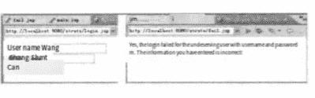

# 图 11-50 数据传输失败

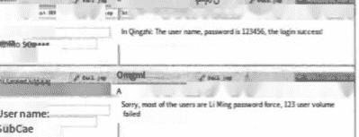

图 11-51 重置 redirect 属性图

# 11.4.4 redirect 属性设置

(1) `redirect="true"` 浏览器重定向。比喻：这就像人在浏览器的地址栏中重新输入 URL 然后跳转到该 URL，只不过这不是由人输入的，而是由程序控制的。

特点：
① 可以跳转到任何网页，无论是本站还是其他站点。例如，你可以使用这种方法从自己的网站跳转到搜狐首页。
② 请求将被清空，因为这就像在浏览器中输入了新地址，请求无法发送。
③ form 表单将被清空，即使跳转到同一页面也是如此。由于请求没有被保存，表单也无法保存。

(2) `redirect="false"` 服务端跳转。

比喻：仿佛服务器将用户的请求重定向到地方。

特点：
① 只能在 Web 服务内部跳转。
② request 被保留。
③ form 表单被保留。

# 11.5 Struts 表单验证

Struts 自带了 Validator（验证器）框架。要在你的应用程序中使用此框架，请遵循以下步骤。

- (1) 在添加 Struts 开发能力后，`WEB-INF` 目录下会自动生成 `validator-rules.xml` 文件，该文件的内容是相关验证规则的描述。
- (2) 如果 `ActionForm` 想要使用 validator 进行验证，在创建时必须继承 `DynaActionForm` 类。

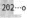

# (3) 在 `struts-config.xml` 中添加 validator 的引入，将倒数第二行放置以下代码。

```xml
<plug-in className="org.apache.struts.validator.ValidatorPlugin">
    <set-property property="pathnames" value="WEB-INF/validator-rules.xml,WEB-INF/validation.xml"/>
</plug-in>
```

(4) 上述配置指定了两个 .xml 文件，一个是 `validator-rules.xml`，另一个是 `validation.xml`。`validator-rules.xml` 存在，因此我们需要在 `WEB-INF` 目录下创建一个。右键点击 `WEB-INF` 并从快捷菜单中选择“New-Templates”，如图 11-53 所示。完成上述操作后，将弹出 XML 文件向导，将文件名设置为 `validation.xml`，点击“Finish”并按下按钮，如图 11-54 所示。


# 图 11-53 新建

# 图 11-54 将 XML 命名为 validation.xml，validation.xml 默认生成代码。

```xml
<?xml version="1.0" encoding="UTF-8"?>
<form-validation>
</form-validation>
```

(5) 编辑 `validation.xml`，添加验证信息，代码如下：

```xml
<?xml version="1.0" encoding="UTF-8"?>
<!DOCTYPE form-validation PUBLIC "-//Apache Software Foundation//DTD Validator Rules Configuration 1.3//EN" "http://jakarta.apache.org/commons/dtd/validator_1_3.dtd">
<form-validation>
  <formset>
    <form name="loginForm">
      <field property="username" depends="required">
        <msg name="required" key="login.form.username"/>
      </field>
      <field property="password" depends="required">
        <msg name="required" key="login.form.password"/>
      </field>
    </form>
  </formset>
</form-validation>
```

注意：在 JSP 页面 Java 代码中使用 `login.form.username` 和 `login.form.password` 方法，输出并不美观，且 JSP 中添加了过多 Java 代码，未来将使用标签进行输出。为了设置国际化，请查看 `Resource.properties` 文件。图 11-55 显示了设置效果。

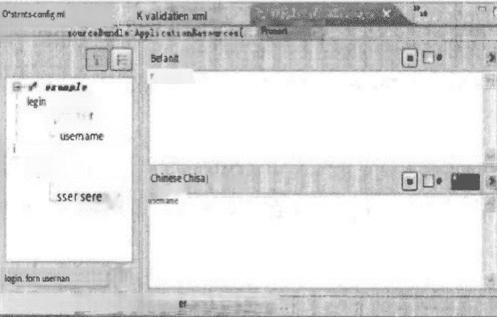

# 图 11-55 设置国际化

(6) 在 JSP 页面中包含 `<html:javascript>`，即使用上述验证信息指定表单。在 `<form>` 之前添加以下代码：

```jsp
<html:javascript formName="loginForm"/>
```

(7) 在需要验证的表单 JSP 页面中定义 onsubmit 事件。将 `<form action="/login">` 改为：

```jsp
<form action="/login" onsubmit="return validateLoginForm(this)">
```

(8) 重新部署运行的项目。如果表单信息未填写，将显示警告框，如图 11-56 所示。

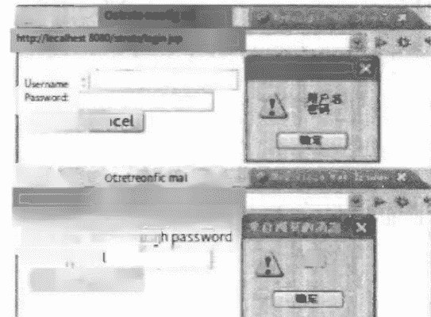

```html
Submit Cancel
http://localhost:8000/struts/login
JSP user:zhangli
Submit Cancel
```


# 12 标签库及其应用

## 12.1 标签库简介

为了方便开发者使用 Struts 开发 Web 应用，Struts 框架提供了内置标签库，用于构建显示层的 JSP 页面。在 9 章的示例程序中已经使用了部分 Struts 标签。

## 12.2 常用标签库描述

Struts 系统提供了五种标签，分别为 HTML、Bean、Logic、Nested 和 Template。详见表 12-1。

### 表 12-1 Struts 五种标签库描述

| 库 | 说明 |
|---|---|
| HTML Tags | 该标签库包含用于创建 Struts 输入表单的标签，与 Struts 框架和其他相应的 HTML 标签交互 |
| Bean Tags | 该标签库包含用于创建 bean、bean 和属性的标签 |
| Logic Tags | 此库提供了根据 (cookies,)parameters 的值创建相关 bean 的能力，在使用 JavaBeans 及其属性时，当 defer 使用。该库包含了逻辑判断、集合的标签，通过条件和集合生成的标签管理输出 |
| Nested tags | 允许标签之间嵌套。增强 Struts 标签嵌套具有前三个标签库的所有功能，除了 |
| Template tag | 随着 Tiles 框架包的出现，该标签开始减少使用。Tile |

### 表 12-2 Bean 标签常用属性

| 属性 | 说明 |
|---|---|
| id | 在创建自定义标签时指定脚本变量名 |
| name | 指明查找现有 Bean 的关键字值。如果给定了 scope，则仅在该作用域内查找。否则，在标准作用域（page、request、session 或 application）中查找。 |
| property | 指明 bean 中的一个属性，可以从该属性中检索值。如果没有... |
| scope | 定义查找 Bean 的作用域（page、request、session 或 application）。如果指定了登录顺序，脚本变量（见 id）将在相同的作用域中创建。 |

## 12.3 HTML 标签库

HTML 标签是 Struts 的基础标签，并在普通 HTML 页面中提供相应的标签元素。

### 12.3.1 `<html:html>`

此标签是 Struts HTML 标签库中最基础的标签，用于标记页面的开始和结束。该标签的功能与传统的 `<html>` 标签非常相似。

### 12.3.2 `<html:image>`

标签对应于 HTML 标签库中的 `` 标签，用于在网页上显示图片。以下是常用的页面属性：

- `src`：指明图片文件的相对路径。
- `height`：指明图片的高度。
- `width`：指定图片显示的宽度。
- `alt`：当用户浏览器不支持显示图片或由于其他原因时，可替换图片的文本。

### 12.3.3 `<html:link>`

此标签可以创建一个 HTML 超链接，对应于 HTML 中的 `<a>` 标签，以下是该标签的主要属性：

- `page`：指定相对于当前网页的 URL。
- `href`：指定超链接的完整 URL。
- `forward`：指定全局转发链。

你可以在 `struts-config.xml` 中配置 `<forward>` 作为链接地址。请注意，在这种情况下，无法引用 Action 中定义的本地转发地址。

### 12.3.4 `<html:form>`

此标签用于创建表单，此标签必须包含 `action` 属性，这是该标签中唯一且必须的属性。

- `action`：指定当用户提交表单时用于处理表单的 Action。Struts 框架将根据 `struts-config.xml` 配置文件找到对应的 action 来处理用户提交的表单。

### 12.3.5 `<html:text>`

此标签用于生成文本输入字段。它必须出现在 `<html:form>` 标签中。

- `property`：指定输入字段的名称。该名称对应于 ActionForm 中的属性。当用户提交表单时，Struts 将表单输入保存到 ActionForm 中。

### 12.3.6 `<html:password>`

此标签用于生成密码输入字段。

- `property`：指定输入字段的名称。该名称也对应于 ActionForm 中的属性，且此标签只能出现在 `<html:form>` 标签中。

### 12.3.7 `<html:hidden>`

此标签用于生成隐藏文本输入字段，只能出现在 `<html:form>` 标签中。

### 12.3.8 `<html:textarea>`

此标签用于生成多行文本输入字段，同样只能出现在 `<html:form>` 标签中。

### 12.3.9 `<html:radio>`

此标签用于生成单选按钮。

- `property`：对应 ActionForm 中的一个属性。当用户提交表单时，Struts 将用户选择按钮的 `value` 分配给 ActionForm 中对应的属性。同样，此标签只能在 `<html:form>` 标签中。

### 12.3.10 `<html:checkbox>`

此标签用于生成复选框。

- `property`：对应 ActionForm 属性。例如，ActionForm 属性只有两个可选值（true 或 false），当用户选择复选框时，Struts 将复选框的 `value` 设置为 true，并将值分配给 ActionForm 中对应的属性。同样，此标签只能出现在 `<html:form>` 标签中。

### 12.3.11 `<html:submit>`

此标签用于生成表单的提交按钮。

### 12.3.12 `<html:reset>`

此标签用于生成表单的重置按钮。

### 12.3.13 `<html:option>`

此标签用于生成 HTML 的 `<option>` 元素，它必须嵌套在 `<html:select>` 标签内才能使用。

### 12.3.14 `<html:select>`

此标签用于生成 HTML 的 `<select>` 元素。它可以用于在表单创建列表或多选列表。主要属性如下：

- `size`：指定显示的选项数量。
- `multiple`：指明是否支持多选。`true` 表示支持多选。默认为 `false`。
- `property`：此属性对应 ActionForm 中的属性。当用户提供表单时，Struts 框架自动将此输入组件的值存储在 ActionForm 中。

### 12.3.15 `<html:errors>`

此标签用于输出错误信息。

你可以在 request 和 session 作用域查找 `ActionMessage` 或 `ActionErrors` 集合对象，然后从集合对象中读取 `ActionMessage` 或 `ActionErrors` 对象，并将这些对象包含的信息显示在网页上。主要属性如下：

- `name`：指定对应 `ActionMessage` 类型对象的属性键。
- `property`：指定要显示的错误消息。
- `bundle`：指定使用的资源包。

## 12.4 Bean 标签库

Struts Bean 标签库用于处理 JSP 页面中的 Bean，它还允许定义新的 Bean。

### 12.4.1 `<bean:define>`

此标签可以定义一个新的 bean，主要属性如下：

- `id`：指定新 Bean 的名称。必须设置。
- `value`：为 `id` 属性定义的 Bean 分配值。
- `name`：指定现有的 Bean，并配合 `property` 属性使用。
- `property`：指定 Bean 的属性。
- `scope`：指定 Bean 的作用域。
- `toScope`：新 Bean 的作用域。

### 12.4.2 `<bean:cookie>`

此标签查询浏览器保存的 cookie，主要属性如下：

- `id`：定义 cookie 类型变量，该变量存储在 page 作用域。
- `name`：指定 cookie 的默认值。如果指定的 cookie 不存在，则使用 `value` 属性指定的默认值。

### 12.4.3 `<bean:header>`

此标签用于查询 HTTP 请求中的 Header 信息，主要属性如下：

- `id`：定义 String 类型变量，存储在 page 作用域。
- `name`：指定要查找 Header 信息。

### 12.4.4 `<bean:parameter>`

此标签用于查询 HTTP 请求参数，主要属性如下：

- `id`：定义 String 类型变量，存储在 page 作用域。
- `name`：指定请求参数名。
- `value`：请求参数的默认值。

### 12.4.5 `<bean:include>`

此标签和 JSP 标签 `<jsp:include>` 一样可以包含其他页面内容，但此标签将包含的内容放入变量中，而不是直接显示在页面上，主要属性如下：

- `forward`：指定要使用的页面是 `struts-config.xml` 中定义的 `<forward:global>` 元素。
- `page`：指定请求的页面是内部资源 URL。
- `href`：包含资源的完整 URL。

### 12.4.6 `<bean:write>`

此标签用于在页面输出 Bean 的属性内容。主要属性如下：

- `name`：指定要显示的 Bean 名称。
- `property`：指定要显示的 Bean 属性名。
- `scope`：指定要显示的 Bean 作用域。

### 12.4.7 `<bean:message>`

此标签用于输出资源文件中的消息，主要属性如下：

- `bundle`：指定使用的资源包。如果未指定此属性，则使用默认资源包。
- `key`：指定要从资源文件中使用的记录。Struts 资源文件提供了与键值对对应的属性配置文件。

## 12.5 Logic 标签库

在传统的处理方法中，使用脚本来控制页面中的逻辑，而 Struts 通过逻辑标签库提供了页面控制的基本逻辑处理。接下来，我们介绍 Logic 标签库中常用的标签。

### 12.5.1 比较标签

- `<logic:equal>`：用于比较定义的实体是否等于给定的常量。
- `<logic:notEqual>`：用于比较定义的实体是否不等于给定的常量。
- `<logic:greaterEqual>`：用于比较定义的实体是否大于等于给定的常量。
- `<logic:lessEqual>`：用于比较定义的实体是否小于等于给定的常量。
- `<logic:greaterThan>`：用于比较定义的实体是否大于给定的常量。
- `<logic:lessThan>`：用于比较定义的实体是否小于给定的常量。

这些标签具有相同的属性，主要属性如下：

- `value`：指示要比较的常量的值。
- `cookie`：指示要比较的 HTTP cookie 的名称。
- `header`：指示要比较的 HTTP 请求信息的名称。
- `parameter`：指示要比较的 HTTP 参数的名称。
- `name`：指示你想要比较的 JavaBean 的名称。
- `property`：指定要比较的 JavaBean 的属性名。
- `scope`：指定 JavaBean 的范围。

### 12.5.2 存在性判断标签

- `<logic:present>`：用于判断目标对象是否存在，如果存在则返回 true。
- `<logic:notPresent>`：用于判断目标对象是否存在，如果不存在则返回 true。

上述两个标签共享共同属性，如下：

- `cookie`：检查指定的 cookie 是否存在。
- `header`：检查指定的请求信息头是否存在。
- `parameter`：检查指定的请求参数是否存在。
- `name`：检查指定的 JavaBean 是否存在。
- `property`：检查指定的 JavaBean 的属性是否存在。
- `scope`：指定 Java Bean 的作用域。

### 12.5.3 字符串匹配标签

- `<logic:match>`：用于判断指定的字符串是否包含在指定的对象中，如果是，则返回 true。
- `<logic:notMatch>`：用于判断指定的对象是否不包含指定的字符串，如果不包含，则返回 true。

上述两个标签共享共同属性，如下：

- `cookie`：指示你想要比较的 HTTP cookie 的名称。
- `header`：指示要比较的 HTTP 请求头信息的名称。
- `parameter`：指示要比较的 HTTP 请求参数的名称。
- `name`：指示你想要比较的 JavaBeans 的名称。
- `property`：指示要比较的 JavaBean 属性名称。
- `value`：指示要比较的常量值。
- `scope`：指示要比较的 JavaBean 范围。

### 12.5.4 `<logic:iterate>`

此标签能够遍历 Collection，它可以是数组（即集合）、Enumeration、Iterator 或 Map。主要属性如下：

- `collection`：指示要遍历的集合。
- `id`：JavaBean 实例名称或脚本变量的名称，用于在遍历期间记录集合中的当前元素。
- `indexId`：指示当前遍历元素的索引值。
- `length`：指示已遍历元素的最大数量。
- `name`：指定集合中 Java beans 的名称。
- `offset`：指示从哪个位置开始遍历。
- `property`：指示 JavaBean 的属性名。
- `scope`：指示 JavaBean 的作用域。
- `type`：指示 JavaBean 的类型。

### 12.5.5 `<logic:forward>`

此标签用于请求跳转，`name` 属性指定跳转目标，匹配 Struts 配置文件中定义的全局跳转 `<forward>` 元素。

### 12.5.6 `<logic:redirect>`

此标签用于请求重定向。它具有 `forward`、`href` 和 `page` 属性，类似于 `<html:link>` 标签中的三个属性。

## 12.6 在 JSPs 中使用 Struts 标签

如果你想在 JSP 中使用 Struts 标签，需要在 JSP 文件的头部引入相关的标签库，如下所示，引入 html 标签库、bean 标签库和 logic 标签库：

```
<%@taglib uri="http://jakarta.apache.org/struts/tags-bean" prefix="bean"%>
<%@taglib uri="http://jakarta.apache.org/struts/tags-html" prefix="html"/>
<%@taglib uri="http://jakarta.apache.org/struts/tags-logic" prefix="logic"%>
```

每个逻辑标签中最常用的标签是 `<bean:write>`、`<logic:empty>`、`<logic:notEmpty>`、`<logic:present>`、`<logic:notPresent>`、`<logic:iterate>`。

## 12.7 Struts 标签应用示例

### 12.7.1 创建项目

创建一个名为 `Struts-tag` 的新项目并添加 logic 库。

### 12.7.2 修改 index.jsp

修改 `index.jsp` 提供主体内容。

### 12.7.3 配置 struts-config.xml

设置 `struts-config.xml` 定义跳转。

### 12.7.4 创建模型类

在 `com.struts.model` 包下创建名为 `Group` 和 `User` 的两个类。这两个类用于在 JSP 中存储数据。

**Group 类代码如下：**

```java
package com.struts.model;

public class Group {

    private String name;

    public String getName() {
        return name;
    }

    public void setName(String name) {
        this.name = name;
    }
}
```

**User 类代码如下：**

```java
package com.struts.model;

public class User {

    private String username;
    private int age;
    private Group group;

    public int getAge() {
        return age;
    }

    public void setAge(int age) {
        this.age = age;
    }

    public Group getGroup() {
        return group;
    }

    public void setGroup(Group group) {
        this.group = group;
    }

    public String getUsername() {
        return username;
    }

    public void setUsername(String username) {
        this.username = username;
    }
}
```

> **注意**：由于 `Group` 和 `User` 类作为 JavaBean，你只需要手动编写类属性，get 和 set 方法可以通过右键点击选择“Source”->“Generate Getters and Setters”自动生成。

### 12.7.5 编写 BeanwriteAction

编辑 `BeanwriteAction`。代码如下：

```java
public class BeanwriteAction extends Action {
```


```java
public ActionForward execute(ActionMapping mapping, ActionForm form, HttpServletRequest request, HttpServletResponse response) {

    // 用属性
    request.setAttribute("hello", "Hello World");

    // html文本
    request.setAttribute("bj", "<font color=red>Welcome to Beijing</font>");

    Group group = new Group();
    group.setName("ShangXuetang");

    User user = new User();
    user.setUsername("Zhang SAN");
    user.setAge(18);
    user.setGroup(group);

    request.setAttribute("user", user);

    return mapping.findForward("success");
}
```

(6) 在 `WebRoot` 文件夹中创建并编辑 `beanwrite.jsp` 页面。主体如下：

```jsp
<h1>Test Beanwrite</h1>
<hr>
<li>普通字符串</li>
hello(jsp 标签):<%=request.getAttribute("hello")%>
hello（标签）: <bean:write name="hello"/>
```

```html
<li>html文本</li>
```

# 测试

http://ecahest B000/strate tag
Womal string helorjisp
book)Hello
Wordbello(tag)Hello World

Error!(defmumt)fontcolor-res-欢迎来到北京
Ast ue oed Eerwarteng

Datg 4ont
today(defmumt)Sat
Oct

Grid
jjdefault:123456987*16nform
at*):123,456,9870

1810:48.38 CST 2014

张三
年龄
组，上海


结构

```html
bj(default):<bean:write name="bj"/><br/> bj(filter="true");
<bean:write name="bj" filter="true"/><br/> bj(filter="false");<bean:write name="bj" filter="false"/><br/> today(default):
<bean:write name="today"/><br/> today(format="yyyy-MM-dd HH:mm:ss"):<bean:write name="today" format="yyyy-MM-dd HH:mm:ss"/>
<li>格式化日期 </li><br/>
```

```html
<li>格式化数字 </li>
n(default):<bean:write name="n"/><br/> n(format="###,#######"):
<bean:write name="n" format="###,#######"/><br/> (format="###,######")
<bean:write name="n" format="###,###0000"/><br/>
```

```html
<li>结构 </li><br>
名 : <input type="text" value="<bean:write name="user" property="username"/>"/><br/> 年龄 :
<input type="text" value="<bean:write name="user" property="age"/>"/><br/> 组 :
<input type="text" value="<bean:write name="user" property="group.name"/>"/><br/>
</body>
```

注意：记得设置 `utf-8` 编码格式，代码第一行所示。

```jsp
<%@page language="java" import="java.util.*" pageEncoding="utf-8"%>
```

② `beanwrite.jsp` 需要调用 Struts 标签库，因此请在页面的头部部分引入相关的标签库，通常将代码放在第二行，即在设置了页面编码格式之后，添加如下所示的代码。

```jsp
<%@taglib uri="http://jakarta.apache.org/struts/tags-bean" prefix="bean"%>
```

# (7) 启动服务器，部署项目并运行测试。

在地址栏输入 `http://localhost:8080/struts-taglib/index`，JSP 的显示结果如图 12-2 所示。

点击超链接 "Test BeanWrite"，跳转后的正确页面效果如图 12-3 所示。

http://localhost:8080/struts-taglib/

测试 BeanWrite

图 12-2 入口页效果

点击超链接 "Test BeanWrite"，跳转后的页面效果可能错误，如图 12-4 所示。

## 图 12-3 正确输出

## 图 12-4 错误输出效果

从上方所示，在输出结果页面中无法获取数据或仅获取部分数据，这种结果通常有 3 个原因，你可以检查并对比查看属于哪种错误。

- (1) 在 `struts-config.xml` 中，`forward-redirect` 属性值被设置为 `true`。
- (2) 在 JSP 页面中，头部位置没有引入标签库。
- (3) JSP 页面中的 bean 名称与 Action 文件不匹配。

# 12.2.2 `<logic:empty>`和`<logic:present>`应用实例

(1) 在此前的项目的基础上修改 `index` 网页的主体，添加 `emptypresent Action` 的入口链接，主体代码如下。

```html
<body>
  <a href="beanwrite.do">Test Beanwrite</a><br/>
  <a href="emptypresent.do">测试 empty,isNotEmpty,present,notPresent</a><br/>
</body>
```

(2) 在 `struts-config.xml` 的设计模式下建立 `emptypresent Action` 和 `success2 Forward`，并将 `success2` 跳转的路径设置为 `emptypresent.jsp`。然后关联 Action 和 Forward，如图 12-5 所示。

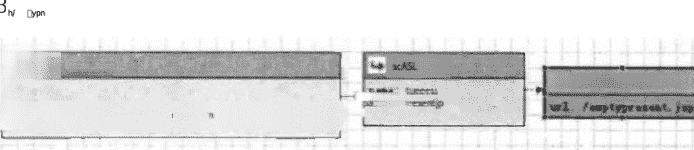

## 图 12-5 设置 emptypresent Action 和 Forward

### (3) 按照所示的主体代码编辑 `EmptypresentAction`。

```java
public class EmptypresentAction extends Action {
    public ActionForward execute(ActionMapping mapping, ActionForm form, HttpServletRequest request, HttpServletResponse response) {
        request.setAttribute("attr1", null);
        request.setAttribute("attr2", "");
        request.setAttribute("attr3", new ArrayList());
        return mapping.findForward("success2");
    }
}
```

### (4) 在 `WebRoot` 文件夹中创建并编辑 `emptypresent.jsp` 页面。代码如下。

```html
<body>
<logic:empty name="attr1">
attr1为空 <br/>
</logic:empty>
<logic:notEmpty name="attr1">
attr1不为空 <br/>
</logic:notEmpty>
<logic:present name="attr1">
attr1存在 <br/>
</logic:present>
<logic:notPresent name="attr1">
attr1不存在 <br/>
</logic:notPresent>

<logic:empty name="attr2">
attr2为空 <br/>
</logic:empty>
<logic:notEmpty name="attr2">
attr2不为空 <br/>
</logic:notEmpty>
<logic:present name="attr2">
attr2存在 <br/>
</logic:present>
<logic:notPresent name="attr2">
attr2不存在 <br/>
</logic:notPresent>

<logic:empty name="attr3">
attr3为空 <br/>
</logic:empty>
<logic:notEmpty name="attr3">
attr3不为空 <br/>
</logic:notEmpty>
<logic:present name="attr3">
attr3存在 <br/>
</logic:present>
<logic:notPresent name="attr3">
attr3不存在 <br/>
</logic:notPresent>
</body>
```

# (5) 重新部署项目并测试。

在地址栏输入 `http://localhost:8080/struts-taglib/` 或 `http://localhost:8080/struts-taglib/index.jsp`。显示结果如图 12-6 所示。

点击超链接 "Test empty,isNotEmpty,present"，跳转后的正确页面效果如图 12-7 所示。


图 12-6 修改后的页面效果

图 12-7 正确输出效果

# 12.2.3 `<logic:iterator>`标签应用实例

(1) 根据前面的项目修改 `index` 主体，添加 `iterate Action` 的入口链接，主体代码如下。

```html
<body>
<a href="beanwrite.do">Test BeanWrite</a><br/>
<a href="emptypresent.do">test empty,notEmpty,present,notPresent</a><br/>
<a href="iterate.do">测试iterate</a>
</body>
```

(2) 在 `struts-config.xml` 设计模式下创建 `iterate Action` 和 `success3 Forward`。`success3` 跳转到 `iterate.jsp`，然后关联 Action 和 Forward，如图 12-8 所示。


图 12-8 建立 iterate Action 和 Forward

### (3) 按照所示的代码编辑 `IterateAction`。

```java
public class IterateAction extends Action {
    public ActionForward execute(ActionMapping mapping, ActionForm form, HttpServletRequest request, HttpServletResponse response) {
        List<User> userList = new ArrayList<>();
        // 假设此处填充 userList 数据
        request.setAttribute("userList", userList);
        return mapping.findForward("success3");
    }
}
```

### (4) 在 `WebRoot` 文件夹中创建并编辑 `iterate.jsp` 页面，主体代码如下。

```html
<body>
<h1>Test Iterate</h1>
<hr>
<li>jsp 脚本</li><br/>
<table border="1">
<tr>
<td>名称 </td>
<td>年龄 </td>
<td>组 </td>
</tr>
```

```jsp
<%
List userList = (List) request.getAttribute("userList");
if (userList == null || userList.size() == 0) {
%>
```

```html
<tr>
<td colspan="3">没有匹配的数据！ </td></tr>
```

```jsp
} else {
    for (Iterator iter = userList.iterator(); iter.hasNext(); ) {
        User user = (User) iter.next();
%>
```

```html
<td><%=user.getUsername()%></td>
<td><%=user.getAge()%></td>
<td><%=user.getGroup().getName()%></td>
```

```jsp
    }
}
%>
</table>

<p>
<li>标签</li><br>
```

```html
<table border="1">
<tr>
<td>名称 </td>
<td>年龄 </td>
<td>组 </td>
</tr>
<logic:empty name="userList">
<tr>
<td colspan="3">没有匹配的数据！ </td></tr>
</logic:empty>
<logic:notEmpty name="userList">
<logic:iterate id="u" name="userList">
<tr>
<td><%=u.getUsername()%></td>
<td><%=u.getAge()%></td>
<td><%=u.getGroup().getName()%></td>
</tr>
</logic:iterate>
</logic:notEmpty>
</table>
</body>
```

注意：
① 记得设置 `utf-8` 编码格式，代码第一行所示。

```jsp
<%@page language="java" import="java.util.*" pageEncoding="utf-8"%>
```

② `emptypresent.jsp` 需要调用 Struts 标签库，因此请在页面的头部部分引入相关的标签库，通常将代码放在第二行，即在设置了页面编码格式之后，添加如下所示的代码。

```jsp
<%@taglib uri="http://jakarta.apache.org/struts/tags-logic" prefix="logic"%>
<%@taglib uri="http://jakarta.apache.org/struts/tags-bean" prefix="bean"%>
```

# (5) 重新部署项目并运行测试。在地址栏中输入 `http://localhost:8080/struts-taglib/` 或 `http://localhost:8080/struts-taglib/index.jsp`。


```
http://localhost:8080/struts-taglib/
Test BeanWrite test empty,notEmpty,present notPresent test iterate
```

显示 `struts-taglib/index.jsp` 界面，如图 12-9 所示。点击超链接 "Test iterate"，跳转后的正确页面效果如图 12-10 所示。

### 图 12-9 再次修改后的填充效果

### 图 12-10 正确输出效果

## 12.3 JSTL 基础

### 12.3.1 JSTL 简介

JSTL 的全称是 JavaServer Pages Standard Tag Library，即 JSP 标准标签库。它由 Apache 基金会的 Jakarta 开发和维护，是一个不断改进的开源 JSP 标准标签库，为 JavaWeb 开发者提供了标准且通用的标签库。

开发者可以使用这些标签替换 JSP 页面上的 Java 代码，从而提高程序的可读性并降低程序的维护难度。

### 12.3.2 JSTL 特性

本质上说，JSTL 是一组预定义的标签。这些标签封装了不同的功能。当在页面上调用标签时，等同于调用封装的函数。JSTL 标签可以在页面上内部输出内容、查询数据库以及处理 XML 文档。

JSTL 标签库主要分为五类：JSTL 核心库、国际化格式标签库、函数标签库、数据库标签库、XML 操作库。使用这些标签可以避免在页面上使用 Java 代码，这些标签非常强大。只需引入一个简单的标签，就可以完成以前在 JSP 页面上使用大量 Java 代码才能实现的功能。

Java 4.0 及更高版本增加了对 JSTL 的支持。

## 12.4 EL 表达式基础

### 12.4.1 EL 表达式简介

EL 是 Expression Language 的缩写，意为表达式语言（以下简称 EL 表达式）。它被引入 JSP 2.0，是一种用于计算和输出 Java 对象的简单语言，适用于不熟悉 Java 语言的页面开发者。EL 为开发者提供了一种开发 JSP 应用程序的新方法。


EL 表达式是 JSTL 的输出（输入），是 Java 表达式的表示。EL 表达式包含变量、运算符以及数字、文本、布尔值和空值。EL 表达式始终用 `${}` 符号进行标记。任何存储在 JSP 作用域（例如 `page`、`request`、`session`、`application`）中的 bean 都可以作为 EL 使用。

此外，EL 还支持以下预定义变量，如表 12-3 所示。

### 表 12-3 EL 预定义变量

| 变量 | 名称描述 |
|---|---|
| `pageScope` | 包含所有页面作用域（page scope）变量的集合 |
| `requestScope` | 包含所有请求作用域（request scope）变量的集合 |
| `sessionScope` | 包含会话作用域（session scope）的变量集合 |
| `applicationScope` | 应用作用域变量集合 |
| `param` | 包含所有请求参数的集合，每个参数对应其值 |
| `paramValues` | 包含所有请求参数的集合，每个参数对应其值数组 |
| `header` | 包含所有请求头的集合，每个头对应其值 |
| `headerValues` | 包含所有请求头的集合，每个头对应其值数组 |
| `cookie` | 包含所有请求的 cookie 集合，每个 cookie 赋值为一个 cookie (`javax.servlet.http.Cookie`) |
| `initParam` | 包含所有上下文初始化参数的集合，每个参数赋值为 String |
| `pageContext` | `javax.servlet.jsp.PageContext` 类的实例，提供对 JSP 隐式对象的访问 |

当 EL 表达式未指定范围时，系统默认使用 `page` 范围，然后在 `request`、`session` 和 `application` 作用域中查找。如果在过程中找到了指定的变量，则直接返回，否则返回 `null`。EL 表达式还提供了一种在要输出的表达式前添加指定的访问范围前缀来指定变量访问范围的方法。

运算符描述了对变量进行预期的操作，EL 表达式的运算符与大多数语言支持的运算符相同。EL 支持表 12-4 所示的运算符。

### 表 12-4 EL 运算符

| 运算符 | 描述 |
|---|---|
| `.` | 访问 bean 属性或 Map 条目 |
| `[]` | 访问数组、链表元素或 Map 条目 |
| `()` | 分组子表达式以改变优先级 |
| `?:` | 条件运算符（三元运算符），例如 `conditional ? expr1 : expr2`。如果条件为真，则表达式的值为 `expr1`，否则为 `expr2` |
| `+` | 数学运算符，加法操作 |
| `-` | 数学运算符，减法或取反值 |
| `*` | 数学运算符，乘法 |
| `/` 或 `div` | 数学运算符，除法 |
| `%` 或 `mod` | 数学运算符，取模操作 |
| `==` 或 `eq` | 逻辑运算符，判断左右两侧是否相等 |
| `!=` 或 `ne` | 逻辑运算符，判断左右两侧是否不相等 |
| `<` 或 `lt` | 逻辑运算符，小于 |
| `>` 或 `gt` | 逻辑运算符，大于 |
| `<=` 或 `le` | 逻辑运算符，小于等于 |
| `>=` 或 `ge` | 逻辑运算符，大于等于 |
| `&&` 或 `and` | 逻辑运算符，逻辑与 |
| `||` 或 `or` | 逻辑运算符，逻辑或 |
| `!` 或 `not` | 逻辑运算符，逻辑非 |
| `empty` | 前缀运算符，判断值是否为空（null、空字符串、空数组、空集合、空 Map） |

## 12.4.2 EL 表达式的特性

1. EL 表达式中获取的命名空间 `PageContext` 对象，可以通过它访问所有内置对象。
2. EL 表达式不仅可以访问普通变量，还可以访问 JavaBean 中的属性以及嵌套属性和集合对象。
3. EL 表达式可以执行关系运算、逻辑运算和算术运算。
4. 扩展函数可以映射到 Java 类的静态方法。
5. 表达式访问 JSP 作用域（`request`、`session`、`application` 和 `page`）。
6. EL 表达式可以与 JSTL 或 JavaScript 语句结合使用。

## 12.4.3 EL 表达式的应用

1. 创建一个名为 JSTL 的新 Web 项目，并添加 Struts 开发功能。
2. 修改 index 页面的主体，提供 Action 的入口链接。主体代码如下：

```html
<html>
<body>
<h1>Test</h1>
<a href="jstle.do">Test EL 表达式</a><br>
<a href="jstlcore.do">Test jstl 核心库</a><br>
<a href="jstlfmt.do">Test jstl 格式库</a><br>
</body>
</html>
```

3. 在 `struts-config.xml` 的设计模式下创建 `jstle` Action 和 `success` Forward。`success` 指向路径 `jstle.jsp`，然后关联 Action 和 Forward，如图 12-11 所示。
4. 在 `com.zhangli.struts.model` 包下创建两个名为 `Group` 和 `User` 的新类。这些类用于在 Action 中存储结构并在 JSP 中输出。

`Group` 类代码如下：

```java
package com.zhangli.struts.model;

public class Group {
    private String name;

    public String getName() {
        return name;
    }

    public void setName(String name) {
        this.name = name;
    }
}
```

`User` 类代码如下：

```java
package com.zhangli.struts.model;

public class User {
    private String username;
    private int age;
    private Group group;

    public int getAge() {
        return age;
    }

    public void setAge(int age) {
        this.age = age;
    }

    public Group getGroup() {
        return group;
    }

    public void setGroup(Group group) {
        this.group = group;
    }

    public String getUsername() {
        return username;
    }

    public void setUsername(String username) {
        this.username = username;
    }
}
```

> **注意**：你只需要手动编写 `Group` 和 `User` 类的属性，`get` 和 `set` 方法可以通过右键点击并选择“Source（源代码）→ Generate Getters and Setters（生成 getter 和 setter）”选项自动生成。

5. 编辑 `JstleAction`，主体代码如下：

```java
public class JstleAction extends Action {
    public ActionForward execute(ActionMapping mapping, ActionForm form,
            HttpServletRequest request, HttpServletResponse response) {
        // 常用字符字符串
        request.setAttribute("hello", "helloworld");

        // 结构体对象
        Group group = new Group();
        group.setName("Shang Xuetang");
        User user = new User();
        user.setUsername("Zhang SAN");
        user.setAge(18);
        user.setGroup(group);
        request.setAttribute("user", user);
        
        // 假设 userList 已定义并填充数据
        // List<User> userList = ...; 
        // request.setAttribute("userlist", userList);

        // 空值测试
        request.setAttribute("value", null);
        request.setAttribute("value2", "");
        request.setAttribute("value3", new ArrayList());
        request.setAttribute("value4", "123456");
        
        return mapping.findForward("success");
    }
}
```

6. 在 `WebRoot` 中创建并编辑 `jstle.jsp`。主体代码如下：

```jsp
<%@ page contentType="text/html;charset=UTF-8" %>
<html>
<body>
测试 EL 表达式 
<hr>
<li>普通字符串脚本：<%= request.getAttribute("hello") %><br>
hello (el 表达式, 如何使用带 {} 的 el 表达式): ${hello}<br>
hello (el 表达式, el 页面 pageScope 隐藏对象, requestScope, sessionScope, applicationScope,<br>
如果未指定 scope，其搜索顺序 (pageScope~applicationScope): ${pageScope.hello}<br>
hello (el 表达式, requestScope): ${requestScope.hello}<br>
hello (el 表达式, sessionScope): ${sessionScope.hello}<br>
</li>
<li>结构体，已采纳。对于导航，也称为访问器 (accessor) </li><br>
用户名：${user.username}<br>
年龄：${user.age}<br>
所属分组：${user.group.name}<br>
<li>使用 [] 和下标输出数组</li><br>
strarray[1]: ${strarray[1]}<br>
<li>使用 [] 和下标输出对象数组</li><br>
users[2].username: ${users[2].username} <br>
<li>使用 [] 和下标输出列表</li><br>
userlist[4].username: ${userlist[4].username} <br>
<li>el 表达式支持运算符</li><br>
1+2 = ${1+2}<br>
10/5 = ${10/5}<br>
10 div 5 = ${10 div 5}<br>
10%3 = ${10%3}<br>
10 mod 3 = ${10 mod 3}<br>
<li>测试空</li><br>
value1 (null): ${empty value1}<br>
value2 (空字符串): ${empty value2}<br>
value3 (空集合): ${empty value3}<br>
value4 (非空字符串): ${empty value4}<br>
</body>
</html>
```

> **注意**：EL 表达式页面不需要页头文件（指不需要额外的 taglib 声明即可使用 EL）。

7. 启动服务器，部署项目并运行测试。
在地址栏中输入 `http://localhost:8080/struts-jstl/` 或 `http://localhost:8080/struts-jstl/index.jsp`，显示结果如图 12-12 所示。
点击超链接“Test EL 表达式”，跳转后的正确页面效果如图 12-13 所示。

## 12.5 JSTL 核心标签库

### 12.5.1 核心库基础知识

JSTL 核心库具有输入/输出、流程控制、迭代操作和 URL 操作等功能。如果你想在 JSP 页面中使用核心库标签，需要使用 `taglib` 指令来指定标签路径如下：

```jsp
<%@ taglib prefix="c" uri="http://java.sun.com/jsp/jstl/core" %>
```

`prefix="c"` 表示核心库的标签必须以 `c` 开头。`uri="http://java.sun.com/jsp/jstl/core"` 指定核心库文件的地址。在上面的代码中，标签前缀可以自定义，但 `uri` 已经设置，通常不需要更改此设置。

`<c:out>` 的功能等同于 JSP 中的 `out` 对象，可以在 JSP 页面上打印字符串，且 `<c:out>` 还可以打印表达式的值。`<c:out>` 的常用属性如表 12-5 所示。

#### 表 12-5 `<c:out>` 常用属性

| 属性 | 说明 | 必须 | 默认值 |
|---|---|---|---|
| `value` | EL 表达式 | 是 | 无 |
| `default` | 值为空时显示的信息 | 否 | 空字符串 |
| `escapeXml` | 是否转义 XML 字符 | 否 | `true` |

示例：
用户名：`<c:out value="${username}" default="guest"/>`
含义：当值为空时显示 guest。

```jsp
<c:out value="${sessionScope.username}"/>
```
含义：来自 session 的值。

### 12.5.2 控制标签

#### `<c:if>` 标签

表 12-6 `<c:if>` 常用属性。

| 属性 | 说明 | 必须 | 默认值 |
|---|---|---|---|
| `test` | 要评估的条件 | 是 | 无 |
| `var` | 保存结果的变量 | 否 | 无 |
| `scope` | 结果的作用域 | 否 | `page` |

```jsp
<c:if test="${user.wealthy}">用户富有</c:if>
```
含义：如果 `user.wealthy` 为真，则显示“用户富有”。

#### `<c:choose>`, `<c:when>`, `<c:otherwise>` 标签

`<c:choose>` 标签不接受任何属性。表 12-7 列出了 `<c:when>` 的常用属性。

#### 表 12-7 `<c:when>` 常用属性

| 属性 | 说明 | 必须 | 默认值 |
|---|---|---|---|
| `test` | 要评估的条件 | 是 | 无 |

`<c:otherwise>` 标签不接受任何属性。

```jsp
<c:choose>
    <c:when test="${user.generous}">
        慷慨为 true。
    </c:when>
    <c:when test="${user.stingy}">
        吝啬为 true。
    </c:when>
    <c:otherwise>
        慷慨和吝啬都是 false。
    </c:otherwise>
</c:choose>
```
含义：只有当 `user.generous` 为 true 时，显示“慷慨为 true”；只有当 `user.stingy` 为 true 时，显示“吝啬为 true”；其余情况显示“慷慨和吝啬都是 false”。

### 12.5.3 循环控制标签

`<c:forEach>` 标签用于通用数据迭代，常用属性如表 12-8 所示。

#### 表 12-8 `<c:forEach>` 常用属性

| 属性 | 说明 | 必须 | 默认值 |
|---|---|---|---|
| `items` | 循环的项目集合 | 否 | 无 |
| `begin` | 起始索引 | 否 | `0` |
| `end` | 结束索引 | 否 | 最后一个元素索引 |
| `step` | 步长 | 否 | `1` |
| `var` | 表示当前项的变量名 | 否 | 无 |
| `varStatus` | 循环状态对象 | 否 | 无 |

示例 1：遍历集合

```jsp
<c:forEach items="${vectors}" var="vector">
    <c:out value="${vector}"/>
</c:forEach>
```

相当于 Java 语句：
```java
for (int i = 0; i < vectors.size(); i++) {
    out.println(vectors.get(i));
}
```

示例 2：数字范围迭代

```jsp
<c:forEach begin="1" end="10" var="i" step="2">
    count=<c:out value="${i}"/><br>
</c:forEach>
```

输出结果：
```text
count=1
count=3
count=5
count=7
count=9
```

## 12.5.4 Core 标签库应用实例

1. 在设计模式下，在 `struts-config.xml` 中关联项目，创建 `jstlcore` Action 和 `success2` Forward。`success2` 指向的路径是 `jstlcore.jsp`，然后关联 Action 和 Forward，如图 12-14 所示。

2. 编辑 `JstlcoreAction`，其主体代码如下：

```java
public class JstlcoreAction extends Action {
    public ActionForward execute(ActionMapping mapping, ActionForm form,
            HttpServletRequest request, HttpServletResponse response) {
        // 通用属性
        request.setAttribute("hello", "Hello World");
        
        // html文本
        request.setAttribute("b1", "<b>Bold Text</b>");
        // ... 后续代码省略
    }
}
```


# JSTL 核心库应用实例

## 1. 编写 Java 代码

```java
for (int i = 0; i < 10; i++) {
    User user = new User();
    user.setUsername("user_" + i);
    user.setAge(18 + i);
    user.setGroup(group);
    userList.add(user);
}

request.setAttribute("userlist", userList);
return mapping.findForward("success2");
```

## 2. 创建并编辑 `jstlcore.jsp` 页面

在 `WebRoot` 文件夹中创建并编辑 `jstlcore.jsp` 页面。其主体代码如下。

### 页面结构

```jsp
<h1>测试核心库</h1>
<hr>
```

### 测试 `c:out` 标签

```jsp
<li>测试 c:out</li><br>
hello（默认值）：<c:out value="${hello}"/><br>
hello（el 表达式）：<c:out value="${hello}"/><br>

hello(default="123")<c:out value="abc" default="123"/><br>
hello(default="123")<c:out value="${abc}"/><br>
123<c:out var="bj" default="${bj}"/><br>
bj(escapeXml="true")：<c:out value="${bj}" escapeXml="true"/><br>
bj(escapeXml="false")：<c:out value="${bj}" escapeXml="false"/><br>

bj（el 表达式）：${bj}<br>
```

### 测试条件控制标签 `c:if`

```jsp
<p>
<li>测试条件控制标签 c:if</li><br>
<c:if test="${v1 lt v2}" var="v">
    v1 小于 v2<br>
    ${v}<br>
</c:if>
<c:if test="${empty v3}">
    v3 为空<br>
</c:if>
<c:if test="${empty v4}">v4 为空<br>
</c:if>
```

### 测试 `c:choose`、`c:when`、`c:otherwise` 标签

```jsp
<p>
<li>测试控制条件的标签 c:choose 到 c:otherwise 的 when</li><br>
<c:choose>
    <c:when test="${v1 lt v2}">
        v1 小于 v2<br>
    </c:when>
    <c:otherwise>v1 大于 v2<br>
    </c:otherwise>
</c:choose>

<c:choose>
    <c:when test="${empty v4}">
        v4 为空 <br>
    </c:when>
    <c:otherwise>
        v4 不空<br>
    </c:otherwise>
</c:choose>
```

### 测试循环控制标签 `c:forEach`

```jsp
<p>
<li>测试循环控制标签 c:forEach</li><br>
<table border="1">
    <tr>
        <td>姓名</td>
        <td>年龄</td>
        <td>组别</td>
    </tr>
    <c:choose>
        <c:when test="${empty userlist}">
            <tr><td colspan="3">没有匹配的数据！</td></tr>
        </c:when>
        <c:otherwise>
            <c:forEach items="${userlist}" var="u">
                <tr>
                    <td>${u.username}</td>
                    <td>${u.age}</td>
                    <td>${u.group.name}</td>
                </tr>
            </c:forEach>
        </c:otherwise>
    </c:choose>
</table>
```

### 测试 `c:forEach` 的 `varStatus` 属性

```jsp
<p>
<li>测试循环控制标签 c:forEach,varStatus</li><br>
<table border="1">
    <tr>
        <td>姓名</td>
        <td>年龄</td>
        <td>组别</td>
    </tr>
    <c:choose>
        <c:when test="${empty userlist}">
            <tr><td colspan="3">没有匹配的数据！</td></tr>
        </c:when>
        <c:otherwise>
            <c:forEach items="${userlist}" var="user" varStatus="vs">
                <c:choose>
                    <c:when test="${vs.count % 2 == 0}">
                        <tr bgcolor="red">
                    </c:when>
                    <c:otherwise>
                        <tr>
                    </c:otherwise>
                </c:choose>
                    <td>${user.username}</td>
                    <td>${user.age}</td>
                    <td>${user.group.name}</td>
                </tr>
            </c:forEach>
        </c:otherwise>
    </c:choose>
</table>
```

### 测试 `c:forEach` 的 `begin`、`end`、`step` 属性

```jsp
<p>
<li>测试循环控制标签 c:forEach,begin,end,step</li><br>


<table border="1">
    <tr>
        <td>姓名</td>
        <td>年龄</td>
        <td>组别</td>
    </tr>
    <c:choose>
        <c:when test="${empty userlist}">
            <tr><td colspan="3">没有匹配的数据！</td></tr>
        </c:when>
        <c:otherwise>
            <c:forEach items="${userlist}" var="user" begin="2" end="8" step="2">
                <tr>
                    <td>${user.username}</td>
                    <td>${user.age}</td>
                    <td>${user.group.name}</td>
                </tr>
            </c:forEach>
        </c:otherwise>
    </c:choose>
</table>
</p>
```

## 3. 注意事项

1. 记得设置编码格式为 `utf-8`。
2. `jstlcore.jsp` 需要调用 JSTL 标签库，所以记得在该页面的头部引入相关的标签库，通常将代码放在第二行，即在设置页面编码格式之后，添加如下所示的代码。

```jsp
<%@taglib prefix="c" uri="http://java.sun.com/jsp/jstl/core"/>
```

## 4. 重新部署项目并运行测试

在 URL `http://localhost:8080/struts-jstl/` 或 `http://localhost:8080/struts-jstl/index.jsp` 中输入，点击超链接“Test jstl core library”，图 12-15 显示了跳转后的正确页面效果。

---

# 12.5.3 格式标签应用实例

## 测试 JSTL 核心库

*   第一项
*   hello(default): Hello World
*   default-1111
*   end-L2z7
*   bj(escapeXml)-转义
*   expression(el 表达式)
*   N-strip控制标签 c

## 是否为空

## 格式化

## 测试条件控制标签 `c:choose`

## 图 12-15 JSTL Core Action 的正确输出

### (1) 在 `struts-config.xml` 中配置

在 `struts-config.xml` 设计模式中创建 `jstlfmt` Action 和 `success3` Forward。`success3` 跳转的路径是 `jstlfmt.jsp`，并关联 Action 和 Forward，图 12-16 显示了两者之间的关系。


```xml
<action path="/success3" type="com.thangi.struts.action.JstfmtAction" forward="/jstlfmt.jsp"/>
```

### 图 12-16 建立 jstlfmt Action 和 success3 Forward


### (2) 编辑 `JstcoreAction`

其主体代码如下。

```java
public class JstcoreAction extends Action {
    public ActionForward execute(ActionMapping mapping, ActionForm form,
                                 HttpServletRequest request, HttpServletResponse response) {
        // 通用属性
        request.setAttribute("hello", "Hello World");
        // html文本
        request.setAttribute("b1", "<b>Hello World</b>");
        
        // 循环创建用户列表
        List<User> userList = new ArrayList<>();
        Group group = new Group(); // 假设存在 Group 对象
        for (int i = 0; i < 10; i++) {
            User user = new User();
            user.setUsername("user_" + i);
            user.setAge(18 + i);
            user.setGroup(group);
            userList.add(user);
        }
        request.setAttribute("userlist", userList);
        return mapping.findForward("success2");
    }
}
```

### (3) 在 WebRoot 文件夹中创建并编辑 `jstlcore.jsp` 页面

其主体代码如下（同上，此处省略重复内容，请参考上文完整代码）。

<h1>测试核心库</h1>

<hr> 
<li>测试 c:out</li><br>
hello（默认值）：<c:out value="${hello}"/><br>
hello（el 表达式）：<c:out value="${hello}"/></><br>

hello(default="123")<c:out value="abc" default="123"/><br>hello(default="123")<c:out value="${abc}"/>123<c:out var=bj(default);<c:out value="${bj}"/><br>
bj(escapeXml="true");<c:out value="${bj}"escapeXml="true"/><br>bj(escapeXml="false");<c:out value="${bj}"escapeXml="false"/><br>

bj（el 表达式）：${bj}<br>

<p>
<li>测试条件控制标签 c:if</li><br>
-<c:if test="${v1 lt v2" var="v">

v1 小于 v2<br>${v}<br>
</c:if>
<c:if test="${empty v3}">
v3 为空<br>
</c:if>
<c:if test="${empty v4}">v4 为空<br>
</c:if>

<p>
<li>测试控制条件的标签 c:choose 到 c:otherwise 的 when，</li><br> 
<c:choose>

```jsp

<c:when test="${v1ltv2}">

v1 小于 v2<br>

</c:when>

<c:otherwise> v1 大于 v2<br>

</c:otherwise>

</c:choose>

<c:choose>

<c:when test="${empty v4}">

v4 为空 <br>

</c:when>

<c:otherwise>

v4 不空<br>

</c:otherwise>

</c:choose>

```

<p><li>测试循环控制标签 c:forEach</li><br>
<table border="1">

<tr>
<td>姓名</td>
<td>年龄</td>
<td>组别</td>
</tr>
<c:when test="${empty userlist}">
<td colspan="3">没有匹配的数据！</td>
</c:when>
<c:otherwise>
<c:forEach items="${userlist}" var="u">
<td>${u.username}</td>
<td>${u.age}</td>
<td>${u.group.name}</td>
</c:forEach>
</c:otherwise>
</c:choose>
</table>

<p><li>测试循环控制标签 c:forEach,varstatus</li><br>
<table border="1">

<tr>
<td>姓名</td>
<td>年龄</td>
<td>组别</td>
</tr>
<c:choose>
<c:when test="${empty userlist}">
<td colspan="3">没有匹配的数据！</td>
</c:when>
<c:otherwise>
<c:forEach items="${userlist}" var="user" status="vs">
<c:when test="${vs.count%2==0}"><tr bgcolor="red">
<td>${user.username}</td>
<td>${user.age}</td>
<td>${user.group.name}</td>
</c:when>
</c:forEach>
</c:otherwise>
</c:choose>
</table>

<p<<li>测试循环控制标签 c:forEach,begin,end,step</li><br>


<table border="1">
<tr><td>年龄</td></tr>
<tr><td>姓名</td></tr>
<tr><td>组别</td></tr>
</table>
<c:choose>
<c:when test="${empty userlist}">
<td colspan="3">没有匹配的数据！</td>
</c:when>
<c:otherwise>
<c:forEach items="${userlist}" var="user" begin="2" end="8" step="2">
<td>${user.username}</td>
<td>${user.age}</td>
<td>${user.group.name}</td>
</c:forEach>
</c:otherwise>
</c:choose>
</table>
</p>

注意：①记得设置编码格式为 utf-8
jstcore.jsp 需要调用 JSTL 标签库，所以记得在该页面的头部引入相关的标签库，通常将代码放在第二行，即在设置页面编码格式之后，添加如下所示的代码。

```jsp

<%@taglib prefix="c" uri="http://java.sun.com/jsp/jstl/core"/>

```


(4) 重新部署项目并运行测试。

在 URL `http://localhost:8080/struts-jstl/` 或 `http://localhost:8080/struts-jstl/index.jsp` 中输入，点击超链接“Test jstl core library”，图 12-15 显示了跳转后的正确页面效果。

## 12.5.3 格式标签应用实例

### 测试 jstl 核心库

第一项
hello(default):Hello World
default-1111
end-L2z7
bj(escapeXml)-转义
expression(el 表达式)
N-strip控制标签 c

### 是否为空

### 格式化

测试条件控制标签 `c:choose`

### 图 12-15 jstlcore Action 的正确输出

(1) 添加一个项，在 `struts-config.xml` 设计模式中创建 `jstlfmt Action` 和 `success3Forward`。`success3` 跳转的路径是 `jstlfmt.jsp`，并关联 Action 和 Forward，图 12-16 显示了两者之间的关系。


success3

```
<action mapping path="/success3" type="com.thangi.struts.action.JstfmtAction" action="/jstlfmt.jsp"/>
```

### 图 12-16 建立 jstlfmt Action 和 success3 Forward


`index.jsp`，点击超链接“Test jstl formatting library”，跳转后显示的正确数字效果如图 12-17 所示。


测试 jstl

### 格式化库

确保 JSTL 已格式化
sud 6410
今天 2014-10-18 23:13:13

2014-10-18120094
方法：搜索中的属性
ime94 HH20141018120004 20141018120004

吴数字的格式 o4612612
ape=o46,
m-pect=pcnt)1234%

图 12-17 jstlfmt Action 正确输出

## 12.6 Web 留言板 V6.0

需要综合使用 Struts 框架和标签相关知识来完成留言板功能。

### 12.6.1 数据库和表结构

数据库名为 `zhangli`，表名为 `strutsguestbook`，其中 `strutsguestbook` 的字段结构如表 12-9 所示。

#### 表 12-9 strutsguestbook 表结构

| 字段 | 类型 | 是否允许 |
|---|---|---|
| id | int | 否，主键 |
| name | varchar(40) | 是 |
| email | varchar(120) | 是 |
| url | varchar(120) | |
| title | varchar(200) | |
| content | varchar(2000) | 是 |
| time | varchar(40) | 是 |

在 MySQL 的 `zhangli` 数据库中用下面的代码创建表。

```sql
CREATE TABLE strutsguestbook(id int(11) NOT NULL auto_increment, name varchar(40), email varchar(60), url varchar(60), title varchar(200), content varchar(2000), time varchar(40), PRIMARY KEY(id));
```

### 12.6.2 设置数据库连接池

- (1) 修改 `context.xml` 文件。
- (2) 将 MySQL JDBC 驱动程序拷贝到 Tomcat 安装目录并将其放在 `lib` 文件夹中。
- (3) 关于连接池的代码将在特定文件中使用。

### 12.6.3 创建和编辑 Web 项目

1. 创建一个名为 `strutsguestbook` 的新 Web 项目，为项目添加 Struts 开发能力。

(2) 在 `struts-config.xml` 的设计模式下右键点击，并从快捷菜单中选择“New→Form, Action and JSP”。在显示的页面上设置参数，如图 12-18 所示。

> 注意：设置好属性后，不要点击“Next”或“Finish”按钮，切换到 JSP 标签页，生成对应的 JSP 文件，然后点击“Next”按钮，如图 12-19 所示。

图 12-18 创建 Form Action and JSP 生成 input.jsp。

在完成上述操作后，将出现图 12-20 所示的结果。点击“Finish”按钮完成创建。

(3) 添加 JDBC 驱动和 dbutils 类库以连接数据并方便数据库上的 JDBC 操作。

右键点击项目名称并选择“Build Path”→“Configure Build Path”配置构建路径，如图 12-21 所示。

图 12-20 创建 inputAction。图 12-21 为 strutsgestbook 配置构建路径

运行 `Add External JARs` 命令将“MySQL JDBC driver.jar”和“commons-dbutils-1.1.jar”文件如图 12-22 所示所示。

图 12-22 导入 JAR 文件

(4) 如下所示编辑 `InputAction`。

```java
package com.zhangli.struts.action;

import java.sql.SQLException;
import java.text.SimpleDateFormat;
import java.util.Date;
import javax.naming.Context;
import javax.naming.InitialContext;
import javax.naming.NamingException;
import javax.servlet.http.HttpServletRequest;
import javax.servlet.http.HttpServletResponse;
import javax.sql.DataSource;
import org.apache.commons.dbutils.QueryRunner;
import org.apache.struts.action.Action;
import org.apache.struts.action.ActionForm;
import org.apache.struts.action.ActionForward;
import org.apache.struts.action.ActionMapping;
import org.apache.struts.action.DynaActionForm;
import org.apache.struts.validator.DynaValidatorForm;

public class InputAction extends Action {

    public ActionForward execute(ActionMapping mapping, ActionForm form, HttpServletRequest request, HttpServletResponse response) {

        DynaActionForm f = (DynaActionForm) form;

        String sql = "insert into strutsguestbook\n(name,url,title,content,time)\nvalues?,?,?,?,?)";

        SimpleDateFormat sdf = new SimpleDateFormat("yyyy-mm-dd hh:mm:ss");

        String params[] = {(String) f.get("name"), (String) f.get("email"), (String) f.get("url"), (String) f.get("title"), (String) f.get("content")};

        try {

            Context context = new InitialContext();

            DataSource ds = (DataSource) context.lookup("java:/comp/env/jdbc/mysql");

            QueryRunner qr = new QueryRunner(ds);

            qr.update(sql, params);

        } catch (NamingException e) {

            e.printStackTrace();

        } catch (SQLException e) {

            e.printStackTrace();

        }

        return mapping.findForward("guestbook.display");

    }

}
```

*(注：原文提供的 Java 代码块存在严重的逻辑混乱和截断问题，排版时已根据上下文逻辑进行了结构性修复以使其可读，同时保持了代码块格式。)*

(8) 在 WebRoot 下创建并编辑 `display.jsp`，body 部分代码如下：

```html
<body>

<c:forEach items="${requestScope.guestbook.display.list}" var="article">

    <c:out value="${article.id}"/>

    <c:out value="${article.name}"/>

    <c:out value="${article.email}"/>

    <c:out value="${article.title}"/>

    <c:out value="${article.content}"/>

    <c:out value="${article.time}"/>

</c:forEach>

</body>
```

注意：
① 记得设置编码格式为 utf-8，第一行代码所示。

```jsp
<%@page language="java" import="java.util.*" pageEncoding="utf-8"%>
```

② `display.jsp` 需要调用 JSTL 标签库，因此记得在该页面的头部（header）引入相关的标签库，通常将代码放在第二行，即在设置页面编码格式之后，添加下所示的代码。

```jsp
<%@taglib prefix="c" uri="http://java.sun.com/jsp/jstl/core"%>
```

完成上述步骤后，程序的大部分已基本完成，你可以进行第二阶段测试。检查是否可以读取数据库内容。在地址栏中输入 `http://localhost:8080/strutsguestbook/read.do`。如果输出与图 12-27 类似，说明之前的操作是正确的。你可以继续后续操作，即美化页面、添加验证以及添加中文国际化。否则，说明结果错误，你需要检查错误原因。

```
http://localhost:8080/struts

zhangli zhangi@ccbupt.cn www.ccbupt.cn test test

2014-01-18 07:10:15
```

图 12-27 消息页面读取正确

### 12.6.4 界面设计

(1) 为了美化界面，我们使用 DreamWeaver 为两个 HTML 文件设计界面模板。一个是进入消息页的 `add.htm`，如图 12-28 所示。另一个是显示页 `display.htm`，如图 12-29 所示。

图 12-28 进入消息页模板

图 12-29 读取消息页模板

(2) 将这两个模板页的相关文件复制到留言板项目的 `WebRoot` 目录，然后在 MyEclipse 中刷新项目。

(3) 通过将 `input.jsp` 的核心代码复制到 `add.htm` 并放置或替换合适的位置，将 `input.jsp` 文件插入 `add.htm`。在进行更改之前，最好在其他文件夹中备份 `add.htm` 和 `input.jsp`，因为在修正错误后这些操作是不可逆的。

首先，`input.jsp` 的头部声明文件和标签库的引用文件需要放在 `add.htm` 的头部位置，如下所示。

```jsp
<%@page language="java" pageEncoding="utf-8"%>

<%@taglib uri="http://struts.apache.org/tags-bean" prefix="bean"%>

<%@taglib uri="http://struts.apache.org/tags-html" prefix="html"%>
```

然后对比 `input.jsp` 的 `<form>` 部分与 `add.htm` 的 `<form>` 部分，并进行代码替换。

- ① `input.jsp` 中的 `<html:form action="/input">` 和 `</html:form>` 替换 `add.htm` 中的 `<form id="form1" name="form1" action="" method="post">` 和 `</form>`。
- ② `input.jsp` 中的 `<html:text property="name"/>` 替换 `add.htm` 中的 `<input size="312" name="name">`。将 `add.htm` 中的 `<input class="input" size="312" value="http://" name="homepage">` 替换为 `input.jsp` 中的 `<html:text property="url" value="http://"/>`。
- ③ 用 `input.jsp` 中的 `<html:text property="title"/>` 替换 `add.htm` 中的 `<input class="input" size="312" name="title">`。
- ④ 将 `add.htm` 中的 `<input class="input"` 替换为 `input.jsp` 中的 `<html:text property="email"/>` size="312" name="email">`。
- ⑤ 将 `add.htm` 中的 `<textarea name="content" rows="6" cols="60"></textarea>` 替换为 `input.htm` 中的 `<html:textarea property="content" rows="6" cols="40"/>`。
- ⑥ 将 `add.htm` 中的 align 标签从 `align=abmiddle` 或 `align=middle` 改为 `align="middle"`。
- ⑦ 从项目中删除 `input.jsp`，并将 `add.htm` 存为 `input.jsp`，如图 12-30 和图 12-31 所示。

最后重新部署项目，运行测试，并在地址栏中输入 `http://localhost:8080/strutsguestbook/in`。


图 12-30 重命名 add.htm
图 12-31 设置新文件名

(4) 通过将 `display.jsp` 的核心代码复制到 `display.htm` 并放置或替换合适的位置，将 `display.jsp` 文件插入 `display.htm`。在进行更改之前，最好在其他文件夹中备份 `display.htm` 和 `display.jsp`，在修正错误后这些操作是不可逆的。首先，`display.jsp` 的头部声明文件和标签库的引用文件需要放在 `display.htm` 的头部位置，如下所示。

图 12-32 美化后的 input.jsp 效果

```jsp
<%@page language="java" import="java.util.*" pageEncoding="utf-8"%>

<%@taglib uri="http://java.sun.com/jsp/jstl/core" prefix="c"%>
```

(5) 然后对比 `display.jsp` 和 `display.htm` 来完成代码替换工作。

```jsp
<c:forEach items="${requestScope.display.list}" var="article">

<table border="0" cellpadding="0" style="border-collapse:collapse; borderColor="#111; width="80%" id="Auto3">
```


- ① 将 `display.htm` 中的 "作者" 替换为 `<c:out value="${article.name}"/>`。
- ② 用 `display.jsp` 中的 `<c:out value="${article.time}"/>` 替换 `display.htm` 中的 "时间"。
- ③ 用 `display.jsp` 中的 `<c:out value="${article.email}"/>` 替换 `display.htm` 中的 "邮箱"。
- ④ 用 `display.jsp` 中的 `<c:out value="${article.content}"/>` 替换 `display.htm` 中的 "内容"。
- ⑤ 用 `display.jsp` 中的 `<c:out value="${article.url}"/>` 替换 `display.htm` 中的 "网址"。
- ⑥ 将 `add.htm` 中的 `align` 标签从 `align=middle` 改为 `align="middle"`。
- ⑦ 在 `display.htm` 中于 `</c:forEach>` 标签之后添加 `</table>`。
- ⑧ 从项目中删除 `display.jsp`，并将 `display.htm` 存为 `display.jsp`，运行测试并访问 `http://localhost:8080/strutsguestbook/read.do`，效果如图 12-33 所示。


## 12.6.5 改进

之前的部分仍存在以下功能问题：

(1) 输入消息后无法直接跳转到消息页，需要重新输入 URL 查看消息。
(2) 查看消息时中文乱码，如图 12-16 所示。
(3) `input.jsp` 上有表单但没有验证。

为了解决国际化问题，为 `validation.xml` 中的键值添加中文国际化。解决上述问题需要以下步骤：

- ① 在 `struts-config.xml` 的设计模式中创建一个名为 `guestbook.read` 的 Forward，目标路径为 `read.do`，如图 12-34 所示。完成前面的操作后，`struts-config.xml` 的设计模式发生了变化，如图 12-35 所示。
- ② 解决中文传递问题，使用过滤器方法。该问题参考上述 11.3.2 节的步骤。
- ③ 修改 `input.jsp`。在页面添加一个显示消息的链接。

```html
<td bgcolor="#efee0" colspan="2">&nbsp;...请您留言 ... </td>
```

```html
将 </tr> 改为 <td bgcolor="#efee0" colspan="2">&nbsp;:::请您留言:::<a href="read.do">查看消息</a>:</td></tr>
```

图 12-36 显示验证框

图 12-37 输入项目

在完成上述操作后，页面会自动显示以查看消息，并显示输入的中文参数，所示如图 12-38 所示。

图 12-38 中文参数传递正确

# 第 13 章：Hibernate 框架及其应用

## 13.1 Hibernate 基础

### 13.1.1 Hibernate 简介

Hibernate 是一个基于 Java 的对象/关系数据库映射工具，它将对象模型表示的数据映射到由 SQL 表示的关系模式中。Hibernate 管理从 Java 到服务层数据库的映射，并提供了数据查询和访问方法，这极大地减少了程序员与数据持久化相关的编程任务。DAO 层。

Hibernate 是目前最流行的 ORM 框架。Hibernate API ORM（也称为对象关系映射）是面向对象语言的对象的 Hibernate 配置持久化技术。通过映射文件 ORM 框架，关系型数据库与 Java 对象之间的自动映射允许程序员以非常简单的方式实现数据库表的数据库操作。基本的 Hibernate 架构如图 13-1 所示。

> 图 13-1 Hibernate 基本架构

### 13.1.2 使用 ORM 持久化

#### 1. 为什么要持久化

- (1) 内存是临时存储设备，数据在断电后容易丢失。
- (2) 网络传输无法传输内存中的对象，对象需要外部化。
- (3) 在内存中查询和组织数据不方便。
- (4) 内存只能存储少量数据。

持久化是将数据同步保存到数据库或某些存储设备中。在软件分区架构中，持久化是你与数据库交互的。数据库中数据的添加、删除、查找和修改都通过持久化完成。

在常见的 JSP 相关 Web 开发中，通常会有很多相关的数据库连接、查询等操作语句。这将数据库相关的持久化工作和显示与某些业务处理耦合在一起，早期代码编写和后期的工作维护非常困难，需要单独处理持久化层工作，提取持久化层，便于开发和维护。

#### 2. 如何持久化

(1) 使用 JDBC
优点：底层开发，强控制（细粒）；效率最高；标准（SQL）JDBC，具有可移植性。
缺点：太复杂；代码量大；维护性差（代码重用率低）。

| Hibernate Transient | Hibernate属性 | XML 数据库 |
| :--- | :--- | :--- |
| | | |


(2) 使用 EJBs
优点：自动生成 JDBC 代码；持久化对象（PO）的状态由服务器管理；声明式事务。
缺点：功能不全（特殊组件，无法进行继承关系）；EJB 容器是侵入式容器，丢失了面向对象的优势；调试更复杂。

(3) 使用 ORM
ORM 的功能是在关系型数据库和对象之间进行自动映射，这样在操作特定数据库时，你就不需要处理复杂的 SQL 语句，只需要操作对象。ORM 工具会自动将对象操作转换为 SQL 语句，因此你只需要关注业务逻辑中的对象结构，而不关心底层的复杂 SQL 和 JDBC 代码。

优点：自动生成 JDBC（减少代码）；使用 POJO（纯 Java 对象），非侵入性；提供状态管理；降低难度，不需要容器。
缺点：由于开源，文档较少；Bug 多；技术支持差。

结论：使用 Java 开发 → 必须持久化数据 → 使用数据库持久化 → 需要使用 ORM → 需要使用 Hibernate，Hibernate 是某些 ORM 工具中的优秀代表，是一种关系/对象映射解决方案。

### 13.1.3 Hibernate 架构

作为一个 ORM 映射工具，理解 Hibernate 的整体架构对于理解 Hibernate 如何工作以及未来如何使用具有指导意义。

Hibernate 的高层架构如图 13-2 所示，显示 Hibernate 使用数据库和配置数据为应用程序提供持久化服务和持久化对象。

Hibernate 的详细视图如图 13-3 所示。从该图中可以看出，Hibernate 处理 JDBC，而应用程序不需要知道 JTA 处理的细节，Hibernate 会自动处理这一切。

图 13-2 Hibernate 高层架构图
图 13-3 Hibernate 详细架构图

(1) `SessionFactory`。session factory 是一个线程安全的、不可变的编译映射文件缓存快照，属于单个数据库。它是 session 的工厂类，并可能有一个可选的（二级）数据缓存，可以存储进程级别或集群级别事务中重要的数据。

(2) `Session`。session 是一个单线程的、瞬态的声明对象，表示应用程序与持久化层之间的对话。它封装了一个 JDBC 连接，也是事务的项目。存储了所需的（一级）持久化对象缓存，用于遍历对象图或通过表示形式查找对象。

(3) 持久化对象和集合。持久化对象是短时间声明的。


配置对象。一旦对象成功传输，配置对象就不再有用，你可以简单地丢弃它，例如以下示例代码：

配置对象是 session 的集合。

(4) 瞬态对象和集合。瞬态对象是 session 的实例。一旦 session 关闭，这些对象将是持久化的。

(5) 事务。事务是应用程序使用的单线程，session 可能在某些情况下跨越多个事务，抽象了底层的 `DataSource` 或 `DriverManager`。

(6) `ConnectionProvider`（可选）。连接提供者是 JDBC 连接池，它是不可见的，但可以由开发者扩展或实现。

(7) `TransactionFactory`（可选）。事务工厂是事务实例的工厂，对应用程序可见但可以由开发者扩展或实现。

### 13.1.4 Hibernate 配置及相关类

在使用 Hibernate 的过程中，你会发现它提供了许多类，其核心是关于整体配置和相关类。Hibernate 设计用于在不同的环境中工作，因此有很多配置参数，但许多参数已有默认值，你可以带较少的参数。

(1) `Configuration` 类。读取配置文件（默认名称：`Hibernate.cfg.xml`），负责管理 Hibernate 配置信息，应用程序 Java 类到数据库映射。

应用程序通常创建一个 `Configuration` 类的实例，并通过它创建 `SessionFactory` 实例。例如以下代码：

```java
SessionFactory sf = new Configuration().configure().buildSessionFactory();
```

`Configuration` 是 Hibernate 的入口。创建 `Configuration` 实例时，Hibernate 在类路径查找 `hibernate.properties` 和 `hibernate.cfg.xml`。如果两个文件都存在，`hibernate.cfg.xml` 将覆盖 `hibernate.properties`；如果两个文件都不存在，则抛出异常。

`Configuration` 还提供了带参数的方法。用户可以指定配置文件的路径，而不是系统默认的 `hibernate.cfg.xml` 文件。示例代码如下：

```java
String filename = "my_hibernate_cfg.xml";
Configuration config = new Configuration().configure(filename);
```

- (2) Hibernate 配置文件：配置整个数据库的信息，如数据库 URL、用户名、密码和 Hibernate 语言；同时，它还管理数据库每个表的映射。
- (3) `SessionFactory` 类：负责创建 `Session` 实例。`SessionFactory` 是一个重量级对象。在 Hibernate 初始化期间创建一个 `Configuration` 类实例，并将写入的映射文件传递给它。

这样 `Configuration` 对象就可以创建 `SessionFactory` 对象，当对象成功传输后，`Configuration` 对象不再有用，你可以简单地丢弃它，例如下面的示例代码：

```java
Configuration config = new Configuration().configure(filename);
```

```java
SessionFactory sf = config.buildSessionFactory();
```

`SessionFactory` 是线程安全的，可以被多个线程调用以获取 `Session` 对象，但构建 `SessionFactory` 是资源密集型的，因此在大多数情况下，应用程序中只会初始化一个 `SessionFactory` 来为未使用的线程提供 session。

(4) `Session`：等同于 JDBC Connection (`org.hibernate.Session`)，它是一个轻量级对象，线程不安全（原则上一个线程一个 Session，一个事务一个 Session，不要将其放在并发环境中）。`Session` 是 Hibernate 操作的核心，对象声明周期、事务管理、数据库访问都与它紧密相关。因此，`Session` 的有效管理成为使用 Hibernate 的重点。从上述描述可以看出，`Session` 是由 `SessionFactory` 创建的，`SessionFactory` 是线程安全的，允许多个线程同时访问 `SessionFactory` 对象而不会引起共享问题。然而，`session` 并不是线程安全的，因此多个线程共享一个 `Session` 可能会导致冲突和混淆。

(5) `Transaction`：管理事务的事务 (`org.hibernate.Transaction`)。

(6) `Query`：查询对象，提供面向对象的查询语言 (HQL)。

## 13.1.5 Hibernate 对象和状态

Hibernate 对象有三种状态：瞬态（Transient）、持久化（Persistent）和游离（Detached）。

Hibernate 中对象的状态转换如图 13-4 所示，展示了 Hibernate 中临时对象、持久化对象和托管对象之间的转换关系。这三种状态解释如下。


```java
clear()
update()
saveOrUpdate()
lock(), merge()
```


# 空状态

图 13-4 Hibernate 中的对象和状态转换

## 1. 临时状态

通过 Java 的 `new` 命令开启内存空间的 Java 对象就是我们通常熟悉的 Java 对象。如果没有变量引用它，它将被 JVM 回收。

临时对象在内存中孤立存在。它们的目的是携带信息，并且与数据库中的数据没有连接。

你可以使用 Session 的 `save()` 和 `saveOrUpdate()` 方法将临时对象与数据库关联，并通过配置文件的映射将临时对象携带的信息插入数据库。临时对象将变为持久化对象，并与数据库具有相同的“id”字段。

## 2. 持久化状态

持久化对象在数据库中有相应的记录，并有一个持久化标识符。持久化对象可能是新保存的或新加载的，仅在关联的 Session 声明期间持有此状态。

如果使用 `delete()` 方法，持久化对象将变为临时对象，数据库中相应的记录将被删除，该对象不再与数据库关联。

持久化对象始终与 Session 和 Transaction 关联。在 Session 期间，持久化对象不会立即写回数据库。只有当事务结束时，数据库才会更新。这完成了持久化对象与数据库之间的同步。同步前的持久化对象被称为脏对象（dirty object）。

## 3. 托管

当执行 `close()`、`clear()`、`evict()` 时，持久化对象变为托管对象。对象的 id 具有数据库标识值，但不再受 Hibernate 持久化层的管理。它基本上与临时对象相同，但比临时对象拥有更多的数据库 id 值，如果没有变量引用对象，JVM 可能会回收它。

托管对象重新关联到一个新的 Session，它会被转换为持久化对象。托管对象具有数据库的 id，因此可以使用 `update()`、`saveOrUpdate()` 等方法重新与持久化层关联。

# 13.1.6 Hibernate 持久化类及规则

## 1. 持久化类

持久化类是应用程序用于解决业务问题的类。持久化类的实例由 Hibernate 持久化管理保存到数据库中。

持久化类只需要遵循简单的规则，即 POJO 编程模型，Hibernate 就能正常工作。

但这些规则并不是强制性的，最新版本的 Hibernate 对用户使用的持久化对象要求非常少，用户可以使用自己的方法来表示持久化对象。

## 2. 持久化类规则

(1) 实现默认构造函数：所有持久化类都必须有一个默认构造函数，以便 Hibernate 能使用 `newInstance()` 实例化它们。

(2) 提供标识属性（可选）：该属性必须包含数据库表中的一个主键字段。该属性可以以任何名称调用，其类型可以是任何原始类型、原始类型的包装类型，甚至是用户定义的复合主键。

用于标识的属性是可选的。你可以什么都不管它，让 Hibernate 在内部跟踪对象识别，但并不建议这样做。


事实上，某些 Hibernate 特性仅在声明了标识属性的类上有效，因此建议对所有持久化类使用相同的名称。

### (3) 不要使用 final 类（可选）

Hibernate 的关键特性之一是代理要求持久化类必须是非 final 的，或者是一个所有方法均为公共接口实现。也可以持久化一个 final 且没有实现接口的类，但无法对它们使用代理，这在某种程度上影响了性能优化的选择。

(4) 为持久化字段声明访问器和令牌（可选）。Hibernate 持久化 JavaBean 风格的属性。属性不必非是公共的。Hibernate 可以持久化默认、受保护或私有的 getter/setter 方法。

# 13.2 数据库视角

点击工具栏上如图 13-5 所示的按钮，打开数据库视图。

默认情况下，MyEclipse 视图中有一个 Derby 连接，但我们通常不使用它。相反，通过点击 13-6 所示的按钮创建一个新连接。

图 13-5 切换到 MyEclipse 视图

### 13-6 创建新连接

驱动模板选择 MySQL Connector/J。该选项无法更改。驱动程序名称设置为 `mysqlconnection`。该名称可以根据需要更改。连接 URL 设置为 `jdbc:mysql://localhost:3306/zhangli`，`zhangli` 是数据库的名称，可以根据需要修改。用户名为 `root`。密码为 `123456`。驱动 Jar可以通过点击 `Add Jars` 选项并点击 `Next` 按钮导入 MySQL 驱动，如图 13-7 所示。弹出如图 13-8 所示的对话框，点击 `Finish` 按钮。这样做后你会发现 MyEclipse 视图中添加了一个名为 `mysqlconnection` 的连接。

选择一个表，你可以查看其字段，如图 13-12 所示。

图 13-7 设置连接

# 图 13-9 打开连接

# 图 13-8 创建连接完成


# 图 13-10 输入密码


```
Connected to mysql
CREATE TABLE Ea
Eboo Emysql
Idle test
in LOCAL TEMPORARY
```


图 13-11 展开连接

图 13-12 查看表及相关字段

你也可以在控制台上查看字段信息，如图 13-13 所示。

右键点击 Connected to mysql 连接并选择“New SQL Editor”选项打开 SQL 编辑器以执行 SQL 语句，如图 13-14 所示。

在 SQL 编辑器中输入“select*from strutsguestbook”，然后点击如图 13-15 所示的三角形。

在 SQL Results 中显示查询结果的按钮。


图 13-13 控制台信息


MySQL 2 关闭连接

# 图 13-14 打开 SQL 编辑

你还可以为某些关系表生成 ER 图。如图 13-16 所示，右键点击 zhangli 并选择“New ER Diagram”选项。

图 13-15 执行 SQL 语句

图 13-16 选择要生成 ER 图的表数据库

使用数据库名称生成后缀为 .mer 的 ER 图文件，选择一个目录保存文件，然后点击 OK 按钮，如图 13-17 所示。

选择要生成 ER 图的表，在左侧逐选择 book 和 strutsguestbook，然后通过将它们添加到右侧将其添加到右侧，如图 13-18 所示。

图 13-17 选择 .mer 文件所在的目录

图 13-18 选择要生成 ER 图的表


图 13-19 显示右侧添加的值。最后点击“Finish”按钮。完成前面的操作后，将在所选目录中生成 zhangli.mer。点击文件，即可显示生成的 ER 图。


图 13-19 选择每个表完成

图 13-20 生成 zhangli.mer

# 13.3 Hibernate 实例

## 13.3.1 创建 Java 项目

点击 File 菜单并选择 New→ Project 选项，如图 13-21 所示。然后选择 Java Project 选项并点击“Next”按钮，如图 13-22 所示。

| Edit | Quick | Search project | By Eclipse | View | Window |
| :--- | :--- | :--- | :--- | :--- | :--- | :--- |
| ANT+Eclipse+y | | | | | | |
| Open | Package | GCI | | | | |
| Close | Ctrl+ | | | | | |
| Close All | Ctrl+Shift+ | | | | | |
| Save As | 6Menu | | | | | |
| View All | | | @Annotation | | | |
| Open Console | Line | Folder File Untitled Text File | | | | |
| Refresh | Delimiters To | P5 | | | | |
| Print | Ctr+ Example. | | | | | |

图 13-21 新项目

图 13-22 选择 Create Java Project

**项目名称为 hibernatedemo，然后点击“Finish”按钮，如图 13-23 所示。**

## 13.3.2 添加 Hibernate 开发能力

为项目添加 Hibernate 开发能力与添加 Struts 开发能力相同，有两种方法可以实现。


方法 1：右键点击项目名称，从快捷菜单中选择 MyEclipse-Add Capabilities，如图 13-24 所示。

图 13-23 设置项目

图 13-24 右键点击项目名

方法 2：点击项目名称，点击 MyEclipse 并选择 Add Capabilities 选项，如图 13-25 所示。


```
Add Capabilities
Add Struts Capabilities
Add Project
```

点击项目名称，点击 MyEclipse 并选择 Add Capabilities 选项，如图 13-26 所示。选择 Hibernate 3.1，系统将在 src 文件夹中生成 Hibernate.cfg.xml，然后点击“Next”按钮，如图 13-27 所示。

设置 Hibernate 连接。在 Database Explorer 中设置好数据库连接，输入密码 123456，然后点击“Next”按钮，如图 13-28 所示。

### 13.3.3 生成 HibernateSessionFactory

完成前面的步骤后，弹出关于 SessionFactory 的对话框，如图 13-29 所示。选择“Create Session”并点击右侧的 Finish。完成上述操作后，将在 com.zhangli 包中生成 `HibernateSessionFactory` 类。点击 Finish 按钮，效果如图 13-30 所示。


```
Enable project for Hibernate
Hibernate Specification 3.1 Hibernate 3.2
Show Eclipse Libraries
Library
```

### 13.3.4 生成 POJO 类和映射文件

切换到 MyEclipse Database 视图，根据数据库表生成 POJO 类和映射文件。你可以单独选择表进行反向工程设置，也可以按住“Ctrl”键选择多个表进行反向工程设置。

在当前项目中，选择 strutsguestbook，右键点击并选择“Hibernate Reverse Engineering”选项，如图 13-31 所示。

选择反向工程后，将生成相应的 POJO 类和映射文件。你需要为这些文件设置路径和包。在显示的图中点击 Java，如图 13-32 所示。


图 13-30 设置完成

## Hibernate Bean Engine

Hibernate Mapping and Application Generation
从数据库表生成 Hibernate 映射和 Java 类


Hibernate Mapping and Application zhangli ava Data access object mapping

点击 Browse 按钮右侧的 src 文件夹，选择 Hibernatedemo 中的 src 目录，然后点击 OK 按钮。

图 13-31 反向工程 strutsguestbook 表

图 13-32 设置 src 目录

在初步开发阶段，为了检查数据库的操作，我们希望显示相关的 SQL 语句，这可以在 `hibernate.cfg.xml` 文件中进行。点击“Add”按钮，在弹出的对话框的 Property 字段中填写 `show_sql`，并在 Value 字段中填写 `true`。然后点击“OK”按钮，如图 13-37 所示。

完成上述设置后，效果如图 13-38 所示。

在进行代码测试之前，我们可以先使用 HQL 语言进行简单测试。右键点击项目名称，选择 MyEclipse→Open HQL Editor ，如图 13-39 所示。

# 图 13-39 打开 HQL 编辑器

图 13-38

# 图 13-35 选择原生设置完成配置

打开 HQL 编辑器后，输入来自 Strutsguestbook 的 HQL 语句，并点击左上角的三角形按钮，Output The Result 视图下方会出现 Hibernate Query，它会将数据库中的每条记录作为 Strutsguestbook 类的实例进行输出。我们在第 12 章的示例中只添加了三条消息，因此该项目的结果是三个 Strutsguestbook 实例，如图 13-40 所示。

注意：HQL 语句 "from Strutsguestbook" 中的 Strutsguestbook 不是数据库的表名，而是通过反向工程生成的 POJO 类名。

如果我们查看每个结果的具体值，可以将视图切换到 MyEclipse Hibernate 视图。图 13-41 显示了页面。

# 图 13-41 切换到 MyEclipse Hibernate 视图

# 图 13-40 输出查询结果

切换到 MyEclipse Hibernate 视图后，点击 Hibernate Query Result 中的类实例，将在右上角的 Properties 标签中显示每个属性的值，如图 13-42 所示。

# 图 13-42 精确显示特定记录

## 13.3.5 创建并编辑测试文件

切换到 Java 视图，并在 `com.zhangli.hibernate` 包下创建一个名为 `HibernateTest` 带有主方法的 Java 类，如图 13-43 所示。如下所示编辑 `HibernateTest`。

```java
package com.zhangli.hibernate;

import java.text.SimpleDateFormat;
import java.util.Iterator;
import java.util.List;
import org.hibernate.Query;
import org.hibernate.Session;
import org.hibernate.Transaction;

public class HibernateTest {

    public static void main(String[] args) {

        Session session = HibernateSessionFactory.getSession();

        Transaction tx = session.beginTransaction();

        // Add operation 

        Strutsguestbook book = new Strutsguestbook();

        book.setName("wangli");

        book.setEmail("wangli@163.com");

        book.setTitle("test");

        book.setContent("It's a beautiful day");

        SimpleDateFormat sdf = new SimpleDateFormat("yyyy-MM-dd HH:mm:ss");

        String date = sdf.format(new java.util.Date());

        book.setTime(date);

        tx.begin();

        session.saveOrUpdate(book);

        tx.commit();

        // Modify the operation

        Strutsguestbook book2 = (Strutsguestbook)session.get(Strutsguestbook.class, new Integer(3)); // New Integer (must be the id of an existing record)

        book2.setName("Li Ming");

        tx.begin();

        session.saveOrUpdate(book2);

        tx.commit();

        // Delete Strutsguestbook
```


Strutsguestbook book3 = (Strutsguestbook)session.get(Strutsguestbook.class, new Integer(1)); // New Integer (must be the id of an existing record)

tx.begin();

session.delete(book3);

tx.commit();

// Query the collection operation

Query q = session.createQuery("from Strutsguestbook");

List list = q.list();

for (Iterator iter = list.iterator(); iter.hasNext()) {

    Strutsguestbook book4 = (Strutsguestbook)iter.next();

    System.out.println("id:" + book4.getId());

    System.out.println("name:" + book4.getName());

    System.out.println("email:" + book4.getEmail());

}

session.close();

}

}

```

## 13.3.6 运行与测试

右键点击 `SpringTest.java` 文件并选择 "Run As" 来运行项目，并在控制台中输出结果。

(1) 首先，注释掉与添加、删除和查询的代码。然后运行项目，将输出所有记录的 id、name 和 email，如图 13-44 所示。

(2) 注释掉添加和删除的代码，开启与查询操作的代码。然后运行项目，数据库中将插入一条消息，并输出剩余的记录。

(3) 注释掉添加和查询的代码，开启与修改操作的代码。然后运行项目，数据库中的第三条记录将从 Wangli 变为 Li Ming，如图 13-45 的结果所示。

(4) 注释掉添加和修改的代码，开启与查询操作的代码。然后运行项目，数据库中的一条记录将被删除，并输出剩余的记录，如图 13-47 所示。

## (2) 应用上下文（Application Context）模块

应用上下文模块扩展了 `BeanFactory`，为国际化、系统生命周期事件提供了支持，并在该模块提供了 Java 企业级服务的支持，例如访问 `JNDI`、集成 `EJBs` 以及电子邮件服务。

## (3) AOP 模块

在 Spring AOP 模块中，直接集成了面向切面的编程功能，实现了面向面向。Spring AOP 可以为基于 Spring 的应用程序提供事务管理等服务。通过使用 AOP，你可以在不依赖 `EJBs` 的情况下在可以使用中使用声明事务管理策略。

## (4) JDBC 和 DAO 模块

JDBC 和 DAO 模块提供了数据库操作的模板代码，例如获取数据库连接、处理结果集、关闭数据库连接等。通过 Spring，它简化了数据库操作的代码并释放了数据库资源，从而避免了因资源释放失败导致的性能问题。

此外，Spring 的 JDBC 和 DAO 模块提供了一个数据库异常处理层，用于管理由不同数据库供应商抛出的异常和错误信息，简化了数据库操作的错误处理，并大大减少了处理异常的工作量。

## (5) ORM 映射模块

Spring 本身并不提供 ORM 映射的实现，但为其他 ORM 工具提供了支持，你可以在 Spring 中集成现有的 ORM 映射工具。Spring 支持的 ORM 工具包括 `JDO`、`Hibernate` 和 `ibatis` 等。Spring 事务管理为这些 ORM 工具提供了支持。

## (6) Web 模块

Web 模块构建应用上下文模块之上，为 Web 应用程序提供了上下文。该模块提供了常见的 Web 任务处理能力，简化了多部分（multi-part）以及请求参数绑定到领域对象的处理，并在 Spring Web 模块提供了对 `Struts` 的支持。

## (7) MVC 模块

Spring 的 MVC 模块是一个完整的 MVC 实现。虽然 Spring 可以与其他 MVC 框架良好集成，但 Spring 可以通过反转控制（IOC）将业务逻辑与控制逻辑分离，在 Spring 中你可以声明如何将请求参数绑定到业务对象。同时，Spring MVC 支持 `JSP`、`Velocity` 和 `Tiles` 等多种视图技术。

## 14.1.2 Spring 反转控制

为了在程序组件或类之间形成松耦合的结构，开发者在类类实例之前需要创建对象的实例。IOC 将创建实例的任务交给 IOC 容器，这样在开发应用程序代码时，只需要直接使用类的实例即可。这就是 IOC 反转控制。这种控制反转关系通常被比作“好莱坞原则”（不要叫我，我会来叫你；请不要叫我，我会来叫你）。

IOC 是程序由容器控制的关系，而不是在程序中使用直接代码控制。控制从程序代码转移到外部容器。控制的转移被称为反转，这就是反转控制的精髓。

由于程序组件之间的依赖关系由容器控制，在程序运行时，容器动态将依赖注入到组件中，这就是依赖注入的精髓。依赖注入本质上是反转控制的另一种解释。反转控制是 Spring 的核心技术之一。在任何 Java 应用程序系统中，为了实现特定的业务逻辑，需要许多 Java 类协作完成。在程序运行时，每个 Java 对象在继续运行之前必须获取所需的对象。这种对象之间的关系就是依赖。

在传统的应用程序系统中，这种依赖关系通过代码中调用其他类来完成，这增加了耦合度，给系统带来了各种隐藏隐患。在 IOC 中，对象之间的依赖被描述在一个统一的配置文件中，其他类的对象不会被程序代码直接调用。在程序运行时，IOC 容器负责注入对象之间的依赖，使得各个对象协同工作，从而实现系统的功能。

## 14.1.3 Spring 依赖注入

Martin Fowler 专门写过一篇关于反转控制容器和依赖注入模式的文章，讨论了反转控制的概念，并提出了一个更准确的概念称为“依赖注入”。Spring 框架的各个部分充分利用依赖注入技术，消除了代码中的单例垃圾和繁琐的属性文件，代之以一致且优雅的应用程序代码。

Spring 中对象之间的依赖由容器控制。在程序运行时，容器根据配置的内容将对象之间的依赖注入到组件中，从而实现对象之间的协作。在 Spring 中，对象之间的依赖可以通过以下方式进行注入。

### (1) 赋值注入

在 JavaBeans 规范中，可以使用对应属性的 getter 和 setter 方法来获取和设置 bean 的属性值，这种方法在普通的 JavaBean 中被广泛使用。Spring 中也是如此，每个对象在配置文件中表现为 `<bean>`，子元素 `<property>` 指定使用 JavaBean 的 setter 方法来注入值。

在 `<property>` 中，你定义要配置的属性和要注入的值。你可以将任何类型的值注入到属性中，无论是基本 Java 数据类型还是另一个 Bean 对象。

### (2) 构造器注入

使用赋值注入方法时，你可以通过 `<property>` 元素注入属性值。构造器注入的方法基本上类似，区别在于当使用构造器注入时，`<bean>` 元素的子元素 `<constructor-arg>` 指定了实例化 Bean 时需要注入的参数，并在 Bean 中提供相应的构造器，而不是为属性提供 setter 和 getter 方法。在实际开发中，上述两种方法都很常用。此外，依赖注入的方法也可以通过接口方法实现，在特定的开发中，你可以根据需要使用适当的方式。简之，这些方式可以非常方便地实现依赖注入的功能。

## 14.1.4 面向切面编程

面向切面编程（AOP）是 Spring 框架在 Spring IOC 之后的另一个特性，也是该框架的核心内容。

AOP 是一种思想，所有符合这一思想的技术都可以被视为 AOP 的实现。AOP 提供了另一种思考程序结构的方式，通过使用它可以为面向对象编程提供强大的辅助。

Spring 框架提供了 AOP 支持。Spring AOP 框架允许将分散在系统中的模块集中起来，通过 AOP 切面（facets）实现，并通过 Spring 强大的切入点（pointcut）机制随时引入程序。在许多 AOP 技术中，Spring AOP 做得最好且最成熟。通过使用 Spring 的 AOP 框架，你可以为系统添加强大的服务，如认证、声明式事务管理等。

Spring AOP 基于 Java 的代理机制，该机制从 JDK 1.3 起就受到了支持。但性能变成了一个大问题。由于原因，CGLIB 代理机制应运生。它可以生成字节码，因此其性能会高于 JDK 代理。Spring 支持这两种代理。但是随着 JVM（Java 虚拟机）性能的不断提高，两者的性能差距正在缩小，代理将变得越来越小。

下面描述了 AOP 中的基本概念和术语。

- (1) 切面 (Aspect)
切面是抽象功能模块的实现，例如用户登录功能，它可以从系统中抽象出来并由一个独立模块来描述，该独立模块就是切面。当然，这个模块不同于普通的 Java 功能模块，它是一个遵循 AOP 规范的特殊模块。通过切面隔离系统中不同层面的问题来实现统一管理，每个切面只需要关注自身的逻辑实现，降低了系统的耦合度，从而极大地增强了代码的可用性。

- (2) 连接点 (Join point)
连接点是程序运行过程中的某个阶段点，可以是方法调用、异常抛出等。在这些阶段，可以引入切面为系统添加新的服务功能。

- (3) 通知 (Advice)
通知是在连接点使用的处理逻辑，即切面函数的实际实现。通知的类型包括 `Before`（之前）、`After`（之后）、`Around`（环绕）、`Throw`（异常）这 4 种。

- (4) 切入点 (PointCut)
切入点是连接点的集合，表示何时触发通知。切入点可以是指定的类名，也可以是匹配类名和方法名的正则表达式。当匹配的类或方法被调用时，通知将应用到匹配的位置。

- (5) 目标对象 (The Target object)
目标对象是被通知的对象。在 AOP 中，目标对象可以专注于实现自身的业务逻辑，通知功能可以在程序运行期间自动引入。

- (6) 代理 (Proxy)
代理是在目标对象中使用通知后创建的新新对象。该对象具有目标对象的所有功能，同时也具有由通知提供的额外功能。

## 14.2 Spring 框架应用实例

### 14.2.1 创建 Java 项目

点击“File（文件）”菜单，选择“New（新建）-Java Project（Java 项目）”选项，将项目名称设置为 `springdemo`，并点击“Finish（完成）”按钮，如图 14-2 所示。

### 14.2.2 为项目添加 Spring 开发能力

为项目添加 Spring 开发能力与添加 Struts 和 Hibernate 开发能力相同，有两种方法可以实现。

方法 1：右键点击项目名称，然后选择“MyEclipse”→“Add Spring Capabilities（添加 Spring 能力）”选项，如图 14-3 所示。


图 14-2 新 Java 项目
图 14-3 添加 Spring 开发能力方法 1
springdemo

方法 2：左键点击“MyEclipse”菜单，选择“Project（项目）”→添加项目名称，然后点击“Spring Capabilities（Spring 能力）”选项，如图 14-4 所示。


图 14-4 添加 Spring 开发能力方法 2

选择上述任一方法，将弹出如图 14-5 所示的对话框。选择 Spring 2.0 版本。系统会自动勾选“Spring2.0 Core Libraries<MyEclipse-Library>”选项，然后点击“Next（下一步）”按钮。

接下来，系统将提示你在 src 目录下生成一个名为 `applicationContext.xml` 的文件，如图 14-6 所示。

图 14-5 添加 Spring 2.0 和核心库
图 14-6 生成配置文件 applicationContext.xml

`applicationContext.xml` 文件的标识符是根节点。该文件是 Spring 框架的配置文件。图 14-7 显示了默认配置。


### 14.2.3 设置数据源对象

在 `applicationContext.xml` 文件的空白处右键点击，选择“Spring”→“New DataSource（新建数据源）”选项来添加 DataSource，如图 14-8 所示。

在 Bean ID 中输入 `dataSource`，在 DB Driver 中选择我们之前在 MyEclipse DatabaseExplorer 连接中创建的 `mysql`，后续信息将自动显示，在 Password（密码）中输入 `123456`，点击“Finish（完成）”，如图 14-9 所示。


执行上述操作后，配置文件 `applicationContext.xml` 发生了变化，添加了数据源的描述代码，如图 14-10 所示。


当你点击 Save（保存）时，文件中出现错误。在约第71 行处显示错误消息，指示无法识别 `org.apache.commons.dbcp.BasicDataSource` 类，如图 14-11 所示。


```xml
<?xml version="1.0" encoding="UTF-8"?>
<beans xmlns="http://www.springframework.org/schema/beans"
       xmlns:xsi="http://www.w3.org/2001/XMLSchema-instance"
       xsi:schemaLocation="http://www.springframework.org/schema/beans http://www.springframework.org/schema/beans/spring-beans.0.xsd">
    <bean id="dataSource" class="org.apache.commons.dbcp.BasicDataSource">
        <property name="driverClassName" value="com.mysql.jdbc.Driver"/>
        <property name="url" value="jdbc:mysql://localhost:3306/test"/>
        <property name="username" value="root"/>
        <property name="password" value="123456"/>
    </bean>
</beans>
```

图 14-11 未知 org.apache.commons.dbcp.BasicDataSource

此错误有两种解决方法，如下所示：
方法 1：适用于 MyEclipse 5.5 及以上版本。访问 http://commons.apache.org/dbcp/downloads 下载 `dbcp.jar`，然后右键点击项目并选择“Build Path（构建路径）”→“Java Build”→“Add External JARs（添加外部 JAR 文件）”。
方法 2：适用于 MyEclipse 6.0 及以上版本。右键点击项目，选择“Build Path”→“Java Path”→“Libraries”→“Add Libraries（添加库）”“Spring 2.0 Persistence”选项，然后点击 Finish。

### 14.2.4 设置 HibernateSessionFactory

在 `applicationContext.xml` 文件的空白处右键点击，选择“Spring”→“New HibernateSessionFactory（新建 Hibernate 会话工厂）”选项来添加 HibernateFactory，如图 14-13 所示。

然后对 HibernateSessionFactory 进行一系列相关设置，如图 14-14 所示。

完成上述设置后，`applicationContext.xml` 再次变化并添加了 HibernateSessionFactory 的描述代码，如图 14-15 所示。

图 14-14 设置 HibernateSessionFactory
图 14-15 applicationContext 

### 14.2.5 创建并编辑 Java 类

创建一个名为 `Message` 的 Java 类，包名为 `com.zhangli.springdemo`，如图 14-16 所示。按照如下代码编辑 `Message` 类。

```java
package com.zhangli.springdemo;

public class Message {

    private String content;

    public String getContent() {
        return content;
    }

    public void setContent(String content) {
        this.content = content;
    }
}
```


### 14.2.6 设置 Spring Bean

在 `applicationContext.xml` 文件的空白处右键点击，选择“Spring” -> “New Bean（新建 Bean）”选项，将 `Message` 类作为 Bean 注入 Spring 管理中，如图 14-17 所示。

# 图 14-16 创建 Java 类 New Bean

为 Bean 设置 id 为 `msgBean`，点击 Bean 类右侧的“浏览（Browse）”按钮以查找 Bean 的实际路径。在弹出的对话框中输入 `Message`，系统将自动搜索相关类的路径，在 `com.zhangli.springdemo` 类包中选择 `Message` 类，点击确定（OK）按钮，然后点击完成（Finish）按钮，如图 14-18 所示。完成上述步骤后，配置文件 `applicationContext.xml` 会发生变化并增加了 `msgBean` 的描述生成代码，如图 14-19 所示。

你也可以在 Spring 配置文件中进行其他相关设置。

- (1) 如果将来你想管理其他类，仍然可以通过右键点击“New Bean”来添加更多类作为 bean。
- (2) 你可以可视化的方式查看 Spring 管理的类。右键点击空白处并选择“在 Spring 资源管理器中显示（Show In Spring Explorer）”选项，如图 14-20 所示，`applicationContext` 将显示在 Spring 资源管理器中。


所有由 xml 管理的类如图 14-21 所示。

(3) 要查看类与之间的关系，在 Spring 资源管理器中右键点击 `applicationContext.xml-src` 并选择“打开图表（Open Graph）”选项，如图 14-22 所示。


图 14-18 设置 msgBean  图 14-19 ApplicationContext.xml 的变化

| Ce | |
|---|---|
| Lees | |
| Cnl*? | |
| Ctriv | CrlShL |
| entom | |
| Oes Decmt | |
| fgoner | |

图 14-20 右键点击 → 在 Spring 资源管理器控制台中显示 Spring 管理的类

图 14-21

**application.xml 变成一个显示类之间关系的视觉视图，如图 14-23 所示。**


图 14-22 右键点击→ 打开图表显示各种类型之间的关系

图 14-23

### 14.2.7 创建并编辑测试文件

在 `com.zhangli.springdemo` 包中创建一个名为 `SpringTest` 的 Java 类作为测试文件。选择 `main()` 方法，如图 14-24 所示。

编辑 `SpringTest`。代码如下：

```java
package com.zhangli.springdemo;

import org.springframework.context.support.ClassPathXmlApplicationContext;

public class SpringTest {

    public static void main(String[] args) {

        //Message 类也通过

        // Spring 管理获取

        ClassPathXmlApplicationContext ctx = new ClassPathXmlApplicationContext("/applicationContext.xml");

        Message msg = (Message) ctx.getBean("msgBean");

        // 普通 Message 类调用方法：

        // Message msg = new Message();

        msg.setContent("welcome to www.ccbupt.com");

        System.out.println(msg.getContent());

    }

}
```

### 14.2.8 运行输出结果

上述代码没有使用数据源和 `HibernateSessionFactory`，因此在测试之前使用了 `applicationContext.xml` 中的 `dataSource` bean 和 `hibernateSessionFactory` bean。相关代码用法，如图 14-25 所示。


# 图 14-24 新 Java 类 SpringTest

```java
package com.example.demo;

import org.springframework.boot.SpringApplication;
import org.springframework.boot.autoconfigure.SpringBootApplication;
import org.springframework.beans.factory.annotation.Autowired;
import org.springframework.web.bind.annotation.GetMapping;
import org.springframework.web.bind.annotation.RestController;

@SpringBootApplication
public class DemoApplication {

    @Autowired
    private MyService myService;

    public static void main(String[] args) {
        SpringApplication.run(DemoApplication.class, args);
    }
}

@RestController
class MyController {

    @GetMapping("/hello")
    public String hello() {
        return myService.sayHello();
    }
}
```

图 14-25 代码注释部分

然后右键点击 `SpringTest.java` 文件，选择“运行（Run） -> Java （Java Application）”选项，运行项目并在控制台中输出结果，如图 14-26 所示。


图 14-26 SpringTest.java 输出

### 14.3 Spring 和 Hibernate 结合示例

#### 14.3.1 新 Java 项目

点击“文件（File）”菜单，选择“新建（New）” -> “Java 项目（Java Project）”，将项目名称设置为 `springdemo2`，然后点击“完成（Finish）”按钮。

#### 14.3.2 为项目添加 Hibernate 功能

左点击项目名称，然后点击“MyEclipse” -> “项目能力（Project Capabilities）” -> “添加 Hibernate 功能（Add Hibernate Capabilities）”选项，弹出如图 14-27 所示的对话框，选择 Hibernate 3.1 版本，系统会自动勾选“Hibernate 3.1 Core”，并点击“下一步（Next）”。系统会在 `src` 文件夹中生成名为 `hibernate.cfg.xml` 的文件，然后点击“下一步（Next）”按钮，如图 14-28 所示。


图 14-27 添加 Hibernate 3.1 功能 springdemo2 图 14-28 生成 hibernate.cfg.xml

下一步将设置 Hibernate 详情并点击“下一步（Next）”按钮，如图 14-29 所示。完成上述步骤后，弹出如图 14-30 所示的对话框，选择“类（Class）”选项。

#### 14.3.3 为项目添加 Spring 功能

点击项目名称，然后点击 MyEclipse 菜单，选择“项目能力（Project Capabilities）” -> “添加 Spring 功能（Add Spring Capabilities）”，将弹出如图 14-31 所示的对话框，选择 Spring 2.0 版本，然后点击“下一步（Next）”。


图 14-29 与数据库关联

图 14-30 取消 HibernateSessionFactory 的生成

将驱动程序拷贝到项目并添加到构建路径？下一步将提示生成 `applicationContext.xml` 并点击“下一步（Next）”按钮，如图 14-32 所示。

注意：此步骤与添加 Spring 不同。不是 Hibernate 生成 session factory。完成上述操作后，Spring 将生成 session factory，然后点击“完成（Finish）”按钮，如图 14-33 所示。

配置文件 `applicationContext.xml` 发生变化并在保存时出现错误，指示找不到 `org.springframework.orm.hibernate3.LocalSessionFactory` 类，如图 14-34 所示。要解决此问题，右键点击项目名称并选择构建路径（Build Path） -> 配置构建路径（Configure Build Path） -> 添加外部 JAR（Add External JARs），并在构建路径下添加 `spring-hibernate3.jar`。


图 14-33 生成 Spring SessionFactory


图 14-34 applicationContext.xml 错误

#### 14.3.4 生成 POJO 类和映射文件

切换到 MyEclipse 数据库视图，选择 `strutsguestbook` 表，然后右键点击并选择“Hibernate 反向工程（Hibernate Reverse Engineering）”选项，如图 14-35 所示。

选择反向工程后，将生成相应的 POJO 类和 Java 包，并设置新包 `com.zhangli.springdemo`，创建 POJO ~ 表格映射信息、Java 数据对象 (POJO ~ 表格)、Java 数据访问对象 (DAO)(仅限 Hibernate)。然后点击“下一步（Next）”，如图 14-36 所示。


图 14-35 反向工程 strutsguestbook 表


图 14-36 POJO 和映射文件设置

注意：此步骤与之前使用 Spring DAO 技术的 Hibernate 开发步骤完全不同。

在 `id Generator`（ID 生成器）处选择 `native` 并点击“Next”（下一步）按钮，如图 14-37 所示。设置完成后，点击“Finish”（完成）按钮，如图 14-38 所示。


# 图 14-37 设置 native

# 图 14-38 设置完成

切换到 Java 视图以查看包管理器（Package Explorer），你会发现 `com.zhangli.springdemo` 包包含三个文件，即 `StrutsGuestbookDAO.java`、`hbm` 和 `xml`，如图 14-39 所示。

在图 14-39 中，`StrutsGuestbookDAO.java` 显示了一个错误，表示未知 `HibernateDaoSupport` 类。

解决方案：右键点击项目名称，并选择“Build Path”（构建路径） -> “Configure Build Path”（配置构建路径） -> “Add Library”（添加库） -> “MyEclipse Libraries” -> 选择“Spring 2.0 ORM/DAO/Hibernate3 Libraries (deprecated)”选项（可能也会使用 Spring 2.0 AOP Libraries，系统会自动选择它们），然后点击 Finish（完成）按钮，如图 14-40 所示。

# 图 14-39 生成相关文件

# 图 14-40 选择 MyEclipse Libraries 库

#### 14.3.5 修改 DAO 方法

在操作持久化数据时，直接使用 `Session` 提供的方法可能对数据操作的封装太少，在实际开发过程中通常不建议这样做。这里引入了 DAO（数据访问对象）的概念。

DAO 是持久化对象的客户端，负责所有与数据库操作相关的逻辑，如数据查询、添加、删除和更新。


生成的 DAO 文件中的 `save()`、`delete()`、`findBy()`、`findAll()` 和 `attachDirty()` 方法分别添加添加、删除、根据 ID 查找、查找所有以及修改和删除不需要的功能。

DAO 方法的功能名是可以修改的，是的。

为了方便命名和符合惯例，在这里我们将 `StrutsGuestbookDAO` 中的 `save()` 方法更改为 `add()` 方法，将 `attachDirty()` 方法更改为 `update()` 方法。

#### 14.3.6 创建并编辑测试文件

创建一个名为 `SpringTest` 的 Java 类，包名为 `com.zhanghangli.springdemo`，用作测试文件。检查 `main()` 方法，如图 14-41 所示。

# 如下所示编辑 SpringTest。

# 图 14-41 新的 Java 类 SpringTest

```java
package com.zhangli.springdemo;

import java.util.Iterator;
import java.util.List;
import org.springframework.context.support.ClasspathXmlApplicationContext;
```

```java
import com.zhangli.springdemo.StrutsGuestbook;

public class SpringTest {

    public static void main(String[] args) {

        ClasspathXmlApplicationContext ctx = new ClasspathXmlApplicationContext("/applicationContext.xml");

        // StrutsGuestbookDAO //添加操作代码

        StrutsGuestbookDAO dao = (StrutsGuestbookDAO) ctx.getBean("StrutsGuestbookDAO");

        StrutsGuestbook gl = new StrutsGuestbook();

        gl.setName("lib");

        gl.setTitle("test spring and hibernate");

        dao.add(gl);

        p(gl);

        //删除操作代码

        StrutsGuestbook g3 = dao.findById(new Integer(12));

        dao.delete(g3);

        //修改操作代码

        StrutsGuestbook g2 = dao.findById(new Integer(15));

        g2.setName("good");

        dao.update(g2);

        // //查询所有结果代码

        List list = dao.findAll();

        for (Iterator iter = list.iterator(); iter.hasNext(); iter++) {

            StrutsGuestbook g = (StrutsGuestbook) iter.next();

            p(g);

        }

    }

    public static void p(StrutsGuestbook g) {
```


```
System.out.println("System.out.println(g.getId());");

System.out.println(g.getTitle()); 

System.out.println(g.getName());

System.out.println("----------------------");

}
}
```

## 14.3.7 运行并输出结果

右键点击 `SpringTest.java` 文件，选择“Run - Java Application”选项来运行项目并在控制台中输出结果。

在 `SpringTest` 代码中我们使用了 `add`、`delete`、`change` 和 `check` 方法，最好是逐步测试。就像 14.3.6 节中的测试一样，首先测试所有方法并输出数据库中的当前记录。然后测试 `add` 和查询方法，向数据库添加一条记录，然后查询所有记录。然后测试查询和修改方法，首先查询数据库中已有的记录，然后修改此记录的某些属性并输出所有记录。最后，测试查询和删除方法，首先查询数据库中已有的记录，然后删除此记录的某些属性，并输出所有记录。

测试后发现，当前操作只能在缓存中运行，不能真正影响 MySQL 记录。原因是：打开 `applicationContext.xml`，右键点击空白处，选择“Show In Spring Explorer”选项打开由 `ApplicationContext.xml` 管理的各种分类。`sessionFactory` 和 `dataSource` 之间没有关系，因此 `sessionFactory` 没有写入 `dataSource` 中，如图 14-42 所示。

解决方案：修改 `applicationContext.xml`。右键点击空白区域并选择 `New dataSource`。将 `dataSource` 添加为一个 Bean，如图 14-43 所示。

### 图 14-42 未设置数据源

### 图 14-43 设置 dataSource

完成上述操作后，配置文件 `applicationContext.xml` 将被更改以向数据源添加跟踪。


图 14-44 applicationContext.xml 更改

### 图 14-45 手动添加代码

### 图 14-46 Spring 中的类图

### 图 14-47 程序错误

# 四层架构图如图 15-1 所示。

## 图 15-1 Java EE 四层架构

### (3) Java EE 应用的组件

#### ① 层组件：JSP、Velocity 和 FreeMarker 等。

- **控制器组件**：控制器负责拦截用户请求，并将请求转发到用户实现的控制器组件。
- **业务逻辑组件**：系统的核心组件，系统业务逻辑的实现。
- **DAO 组件**：数据访问对象（Data Access Object），也称为数据访问对象。
- **领域对象组件**：领域对象抽象了系统的对象模型。

## 15.1.2 MVC 设计模式

### (1) Model 1

以 JSP 为中心的开发模型被称为 Model 1，它在 JSP 中将表现逻辑与业务处理混合。Model 1 架构如图 15-2 所示。


应用服务器
浏览器
JSP
数据库
JavaBean

### 图 15-2 Model 1 架构

### (2) Model 2

基于 MVC 的框架被称为 Model 2。Model 2 架构如图 15-3 所示。


应用服务器
浏览器
Servlet
数据库 Java Bean
JSP

### 图 15-3 Model 2 架构

### (3) MVC 设计思想

MVC（模型-视图-控制器）由三部分组成：模型（Model）、视图（View）和控制器（Controller）。MVC 组件类型的关系和功能如图 15-4 所示。

+ o 方法调用 -> 事件

### 图 15-4 MVC 组件类型的关系与功能

## 15.1.3 SSH 架构

SSH 是 `Struts`+`Spring`+`Hibernate` 的集成框架，是一种流行的 Java Web 开发开源框架。图 15-5 显示了 SSH 的结构。

### 图 15-5 SSH 架构

`Struts` 负责 Web 层。`ActionFormBean` 接收网页提交的数据，通过 `Action` 进行处理，然后转发到相应的网页。`<action-mapping>` 定义在 `Struts-config.xml` 中，并由 `ActionServlet` 加载。

`Spring` 负责业务层管理，即 `Service`。`Service` 为 `Action` 提供统一的调用接口，封装了持久层的 `DAO` 并集成了 `Hibernate`。`Spring` 以统一的方式管理事务。

`Hibernate` 负责持久层并完成数据库的 CRUD 操作。`Hibernate` 有一组与数据库中的表对应的 `hbm.xml` 文件和 `POJO`，然后定义 `DAO`。这些是与数据库交互的类。

## 15.2 Web 留言板 V7.0

### 15.2.1 实例功能

#### (1) 添加消息功能

添加消息功能的网页为 `http://localhost:8080/allguestbook/input.jsp`，点击提交后，相关信息和数据可以保存到数据库中，消息页面如图 15-6 所示。

#### (2) 查看消息功能

查看消息功能的网页为 `http://localhost:8080/allguestbook/guestbook.do?method=list`，用户可以查看之前提交的所有消息，如图 15-7 所示。

#### (3) 管理功能

管理功能包括管理员认证、删除消息和修改消息功能。

针对 `http://localhost:8080/allguestbook/login.JSP` 页面的认证功能，管理员必须输入用户名和密码登录，在管理后才能留言，认证界面如图 15-8 所示。

### 图 15-6 添加消息页面

网站留言板

### 图 15-8 管理员登录页面

消息管理功能页面位于 `http://localhost:8080/allguestbook/guestbook.do?method=`

登录成功后，管理员进入消息管理页面，可以编辑和删除每条消息，如图 15-9 所示。


### 图 15-9 管理消息页面

当你点击消息的删除链接后，页面刷新后将显示所有剩余消息。例如，点击第一条消息，图 15-10 显示了删除链接的效果。删除消息后，页面的 URL 将变为……你可以进入记录消息的页面进行修改。例如，图 15-11 显示了点击第一条消息后点击编辑链接的效果。修改消息后跳转的页面地址为 `http://localhost:8080/allguestbook/guestbook.do?method=edit&id=xxx`。


### 图 15-10 消息删除后的效果

### 图 15-11 修改消息的页面

### 15.2.2 技术与工具

技术：`Struts`、`Hibernate`、`Spring`
工具：`Eclipse`、`MyEclipse`、`Tomcat`。

### 15.2.3 文件组织结构

- `com.zhangli.allguestbook.dao`
- `com.zhangli.allguestbook.dao.hibernate`
- `com.zhangli.allguestbook.model`
- `com.zhangli.allguestbook.service`
- `com.zhangli.allguestbook.web`

### 15.2.4 数据库设计

数据库：`MySQL`
数据库：`zhangli`

#### 留言板数据库表结构

| 字段 | 类型 | 是否为空 | 字段 | 类型 | 是否为空 |
| :--- | :--- | :--- | :--- | :--- | :--- |
| id | int | 否，主键 | title | varchar(200) | |
| name | varchar(40) | 是 | content | varchar(2000) | |
| email | varchar(60) | 是 | time | varchar(40) | 是 |
| url | varchar(60) | 是 | | | |

### 15.3.1 前期准备

#### (1) 准备好所需的 jar 文件，如 `commons-pool-1.3.jar` 和 `MYSQL` 的 JDBC 驱动。

#### (2) 将插件 `ResourceBundleEditor` 复制到 `MyEclipse` 目录下 `Eclipse` 文件夹的 `plugins` 目录中，替换原有文件夹。

#### (3) 打开 `MySQL` 命令行客户端，输入 `root` 账户密码 `23456`，执行以下 SQL 语句完成相应数据库和表的创建。

```
create database zhangli;

use zhangli;

create table guestbook(id int(11) NOT NULL auto_increment, name varchar(40), email varchar(60), url varchar(60), title varchar(200), content varchar(2000), time varchar(40), PRIMARY KEY(id));

create table admin(id int(11) NOT NULL auto_increment, username varchar(20), password varchar(20), PRIMARY KEY(id));
```


(4) 启动 Eclipse，输入 root 账户密码 `23456`，执行以下 SQL 语句完成相应数据库和表的创建。
启动 MyEclipse，在 Database Explorer 视图中创建一个名为 `mysql` 的数据库连接，添加 MySQL JDBC 驱动，数据库：`jdbc:mysql://localhost:3306/zhangli`，密码：`23456`，用户：`root`。

## 15.3.2 创建 Web 项目

创建一个 Web 项目并命名为 `allguestbook`，如图 15-12 所示。

## 15.3.3 添加 Hibernate 功能

右键点击项目名称，然后选择 `MyEclipse` → `Add Hibernate Capabilities` 选项，如图 15-13 所示。

图 15-12 创建 Web 项目 allguestbook

图 15-13 添加功能


选择 Hibernate 3.1 版本，系统会自动勾选 `Hibernate 3.1 Core Libraries` 选项，然后点击 `Next` 按钮，如图 15-14 所示。

图 15-14 添加 Hibernate 3.1 及相关库

## 15.3.5 生成配置文件 hibernate.cfg.xml

下一步是设置 Hibernate 数据库连接详情，使用之前在 Database Explorer 视图中设置的 `mysql` 连接，这样编辑框中就会出现相关信息。然后在 Password 处输入 `123456` 并点击 `Next` 按钮，如图 15-16 所示。

完成上述操作后，会弹出 SessionFactory 的设置框，取消勾选 `Create SessionFactory Class`，不需要使用 Hibernate 生成 SessionFactory 类。然后点击 `Finish` 按钮，如图 15-17 所示。

图 15-16 将数据库与 Database Explorer 关联

图 15-17 取消勾选此框

> **注意**：此步骤与之前的开发步骤不同，此处不使用 Hibernate 来生成 session factory。

## 15.3.4 为你的项目添加 Spring 开发能力

右键点击项目名称，然后选择 `MyEclipse` -> `Add Spring Capabilities` 选项，如图 15-18 所示。

### 用于 Spring 配置的 Hibernate 工具
支持指定 Hibernate 配置详情

ac


显示如图 15-19 所示的对话框。选择 Spring 2.0。系统会自动选择 `Spring 2.0 Core Libraries <MyEclipse-Library>` 并点击 `Next`（下一步）。

图 15-18 添加 Spring 开发能力

图 15-19 添加 Spring 2.0 和核心库

接下来，将提示你在 src 目录中生成一个名为 `applicationContext.xml` 的文件，然后点击 `Next`（下一步）按钮，如图 15-20 所示。

选择 `Create Spring SessionFactory that references`（创建引用的 Spring SessionFactory），并在 `src/applicationContext.xml` 文件中生成一个 id 为 `sessionFactory` 的 Bean。然后点击 `Finish`（完成）按钮，如图 15-21 所示。

图 15-20 生成配置文件 applicationContext.xml

图 15-21 生成 sessionFactory

> **注意**：此步骤与之前的开发步骤不同，它是使用 Spring 来生成 session factory 的。

执行上述操作后，程序将出现错误，在 `applicationContext.xml` 中显示“无法识别的类 `org.springframework.orm.hibernate3.LocalSessionFactoryBean`”，如图 15-22 所示。

图 15-22 appContext.xml 发生错误

使用 Spring 支持更新 Hibernate 配置

## Hibernate 映射与应用生成
为数据库实现类生成 Hibernate 映射和 Java 名字

| Jar src 文件夹/allgetbean/ere | 浏览 |
| :--- | :--- |
| Java 路径 | 浏览 |
| ECrestch/DOB1 表映射 id | |

针对此类数据库表以及所有与 ORM 2.3 及更早版本工作 get Hibernate 映射

## 生成数据对象 DAO 表

| 类名 | 浏览 |
| :--- | :--- |
| 持久数据 | |

Java Bean


解决方案：右键点击项目名称，从快捷菜单中选择 `Build Path` -> `Configure Build Path` -> `Add Library` -> `MyEclipse Libraries`。点击 `Next`（下一步），如图 15-23 所示。

## 勾选 Check Spring 2.0 ORM/DAO/Hibernate3 Libraries（已弃用）选项，然后点击 `Finish`（完成）按钮，如图 15-24 所示。


图 15-23 添加 MyEclipse 类库


添加 MyEclipse LIBRARIES

步骤：选择要添加到路径的库

已选择：已选择的库

Spring 2.0 Supporting Libraries

Spring 2.0 Supporting Libraries

图 15-24 勾选 Spring 2.0 ORM/DAO/Hibernate3 Libraries(已弃用)

执行上述操作后，`applicationContext.xml` 中的错误符号会自动消失。

## 15.3.5 生成 POJO 类和映射文件

切换到 MyEclipse Database Explorer（数据库资源管理器）视图，选择表 `strutsguestbook`，然后右键并选择 `Hibernate Reverse Engineering`（Hibernate 反向工程）选项，如图 15-25 所示。

在选择反向工程后，将生成相应的 POJO 类和映射文件。将 Java 包设置为新包名 `com.zhangli.allguestbook.model`，然后选择 `Create POJO fromDB Table mapping information`（从表映射信息创建 POJO）和 `Java Data Object(POJO>DB Table)` 并点击 `Next`（下一步）按钮，如图 15-26 所示。

图 15-25 反向工程 strutsguestbook 表

图 15-26 POJO 和映射文件设置


> **注意**：我们在这里不选择 Spring 来生成 DAO，它并不好用，我们在后台自己手写 DAO。从 ID Generator 中选择 `native` 并点击 `Finish`（完成）按钮，如图 15-27 所示。


配置映射详情

范围自适应

OK Hibernate 对象类型

type 交换组件

启用自动映射检测

自定义类型映射

图 15-27 设置 native

## 15.3.6 编写 DAO 接口

要创建一个新接口，点击 `File`（文件）菜单并选择 `New`（新建）-> `Interface`（接口）选项，如图 15-28 所示。接口名称为 `GuestbookDao`，接口的包名为 `com.zhangli.allguestbook.dao`，如图 15-29 所示。

java-allguestbook/src/com/zhangli/allguestbook/model/Strutsgbook

| 方法 | 项目 |
| :--- | :--- |
| get+ | |
| delete(int) | |
| save(Strutsgbook) | |
| getbook(int) | |

图 15-28 创建接口

如下编辑 `GuestbookDao`：

```java
package com.zhangli.allguestbook.dao;

import java.util.List;

import com.zhangli.allguestbook.model.Strutsgbook;

public interface GuestbookDao {

    void save(Strutsgbook g);

    void delete(int);

    Strutsgbook getbook(int);

    List getbooks();

}
```

## 15.3.7 编写 DAO 类

在 `com.zhangli.allguestbook.dao` 包创建一个名为 `GuestbookHibernate` 的 Java 类，如图 15-30 所示。

```java
package com.zhangli.allguestbook.dao;

import java.util.List;

import org.springframework.orm.hibernate3.support.HibernateDao;

import com.zhangli.allguestbook.model.Strutsgbook;

public class GuestbookHibernate extends HibernateDao implements GuestbookDao {

    @Override
    public void delete(int id) {
        getTemplate().delete(id);
    }

    @Override
    public Strutsgbook getbook(int id) {
        return (Strutsgbook) getTemplate().get(com.zhangli.allguestbook.model.Strutsgbook.class, id);
    }

    @Override
    public List getbooks() {
        return getTemplate().find("from Strutsgbook order by id");
    }

    @Override
    public void save(Strutsgbook g) {
        getTemplate().saveOrUpdate(g);
    }
}
```


图 15-30 设置 GuestbookHibernate 父类

图 15-31 设置 GuestbookDao 接口

## 15.3.8 编写服务层接口

(1) 创建一个接口文件，名为 `GuestbookManager`，接口文件所在的包为 `com.zhangli.allguestbook.service`，如图 15-33 所示。


新建 Java 接口


图 15-32

图 15-33 创建接口 GuestbookManager

(2) 如下编辑 `GuestbookManager`：

```java
package com.zhangli.allguestbook.service;

import java.util.List;

import com.zhangli.allguestbook.model.Strutsgbook;

public interface GuestbookManager {

    void save(Strutsgbook g);

    void delete(int id);

    Strutsgbook getbook(int id);

    List getbooks();
}
```

## 15.3.9 编写服务层实现类

(2) 如下所示修改 `GuestbookManagerImpl`。

```java
package com.zhangli.allguestbook.service.impl;

import java.util.List;

import com.zhangli.allguestbook.dao.GuestbookDao;

import com.zhangli.allguestbook.model.Strutsguestbook;

import com.zhangli.allguestbook.service.GuestbookManager;

public class GuestbookManagerImpl implements GuestbookManager {

    private GuestbookDao dao;

    public void setGuestbookDao(GuestbookDao dao) {
        this.dao = dao;
    }

    public void delete(int id) {
        dao.delete(new Integer(id));
    }

    public Strutsguestbook getGuestbook(int id) {
        return dao.getGuestbook(new Integer(id));
    }

    public List getGuestbooks() {
        return dao.getGuestbooks();
    }

    public void save(Strutsguestbook g) {
        dao.save(g);
    }
}
```


# 15.3.10 修改 Spring 配置

修改 Spring 配置文件 `appContext.xml`，将 Hibernate 配置 `hibernate.cfg.xml` 中的信息整合到 `applicationContext.xml` 中，并删除 Hibernate 配置文件。

(1) 右键点击 `applicationContext.xml` 空白处，选择 "Spring"→"New DataSource" 来添加 DataSource，如图 15-35 所示。

图 15-34 创建 Java 类 GuestbookManagerImpl
图 15-35 New DataSource

完成上述操作后，将显示 DataSource 编辑对话框，如图 15-36 所示。点击 Finish 按钮。由于之前已添加过 MySQL 的 JDBC 驱动，因此可以使用之前的配置，如图 15-37 所示。


# 图 15-36 Set
图 15-37 保留原始 MySQL jdbc

(2) 右键点击 `appContext.xml` 空白处，选择 Spring→New Bean 并添加 `GuestBookDaoHibernate`，如图 15-38 所示。

设置 id 为 `guestbookDao` 的 Bean，点击 Bean 类右侧的 Browse 以搜索该 Bean 的实际路径。

在弹出的对话框中输入 `guestbookDaoHibernate`。系统会自动搜索相关类的路径，并在包中选择 `"com.zhangli.allguestbook.dao.hibernate.GuestbookDaoHibernate"`，然后点击 OK，如图 15-39 所示。

图 15-38 配置 Spring Beans
图 15-39 浏览 GuestBookDaoHibernate 路径

完成上述操作后，**不要**点击 "Next" 或 "Finish" 按钮，切换到 Properties 标签页，然后点击 "Add" 按钮，在弹出的对话框中 Name 处 `sessionFactory`，Reference 输入对应的引用值，最后点击 Finish 按钮。如图 15-40 所示。

完成前面的操作后，点击 Finish，如图 15-41 所示。

(3) 右键点击 `applicationContext.xml` 空白处，选择 "Spring"->"New Bean" 来添加 `GuestbookManagerImpl`。

设置 id 为 `guestbookManager` 的 Bean，点击 Bean 类右侧的 Browse 以查找该 Bean 的实际路径。在弹出的对话框中输入 `guestbookManagerImpl`，系统会自动搜索相关类。


# 在 `com.zhangli.allguestbook.service.impl` 包中选择 `guestbookManagerImpl` 类，点击 OK，如图 15-42 所示。

图 15-40 添加 sessionFactory 属性
图 15-41 guestbookDao 设置完成

# 完成上述操作后，**不要**点击 "Next" 或 "Finish" 按钮，切换到 Properties 标签页，然后点击 "Add" 按钮，在弹出的对话框中 Name 输入 `guestbookDao`，Reference 输入对应的引用，点击 Finish 按钮。如图 15-43 所示。

图 15-42 导航 GuestbookManagerImpl 路径
图 15-43 添加属性 guestbookDao

# 完成前面的操作后，点击 Finish，如图 15-44 所示。

(4) 在 `applicationContext.xml` 中，xml 文件中的某些代码引用了 `hibernate.cfg.xml` 文件，如图 15-45 所示。

```xml
encoding="UTF-8"?>
</hibernate>
```

# 图 15-44 guestbook 已配置
图 15-45 引用 hibernate.cfg.xml

要停止使用 `hibernate.cfg.xml` 文件，你需要修改框中的代码。图 15-46 显示了修改后的代码。将 `hibernate.cfg.xml` 的内容移动过来，并添加 POJO 映射文件的依赖以及数据库方言设置。完成上述修改后，可以删除 `hibernate.cfg.xml` 文件。

# 15.3.11 添加 Struts 能力

右键点击项目名称并选择 "Eclipse->Add Struts Capabilities"，以将新类的包设置为 `com.zhangli.allguestbook`，如图 15-47 所示。

图 15-46 修改后的代码
图 15-47 添加 Struts

# 15.3.12 添加 Form

右键点击 `struts-config.xml`，选择 "New"-""Form" 并添加 Action，如图 15-48 所示。

完成上述操作后，**不要**点击 "Next" 或 "Finish" 按钮，切换到 Properties 标签页，点击 "Add" 按钮，在对话框中设置相应的属性。


# 图 15-48 设置
图 15-49 添加 Form

```java
request.setAttribute("guestbook.articles",list);
return mapping.findForward("guestbook.display");
}
public ActionForward delete(ActionMapping mapping,ActionForm form,HttpServletRequest request,HttpServletResponse response) {
    manager.delete(Integer.parseInt(request.getParameter("id")));
    return list(mapping,form,request,response);
}
//未指定方法值。使用默认方法
public ActionForward unspecified(ActionMapping mapping,ActionForm form,HttpServletResponse response) {
    return list(mapping,form,request,response);
}
```

# 创建并编辑 JSP

(1) 将 `strutssguestbook` 项目中的 `display.jsp`、`input.jsp` 以及相关的图片和 css 文件夹复制到项目的 `WebRoot` 目录中，然后在 MyEclipse 中刷新项目。

(2) 将 `strutssguestbook` 项目中的 `validations.xml` 文件复制到项目 `WebRoot` 目录下的 `WEB-INF` 文件夹中。

(3) 将 `strutssguestbook` 项目中的资源文件 `ApplicationResources-cn.properties` 和 `ApplicationResources-cn.properties` 复制到当前项目的 `com.zhangli.allguestbook.web` 包中。

## 15.3.15

(4) 修改 `input.jsp`

- ① 修改代码：
将 `<javascript formName="inputForm"/ >` 改为：`<javascript formName="guestbookForm"/>`。

- ② 修改代码：
将 `<html:form action="/input" onsubmit="return validateInputForm (this)">` 改为：`<html:form action="/guestbook" onsubmit="return validateGuestbookForm(this)">`。

- ③ 将 `<a href="read.do">List</a>` 替换为：`<a href="guestbook.do?method=list">List</a>`。

- ④ 在显示所有消息之前，必须先保存数据，你需要添加一个隐藏字段来调用 `save()` 方法。在代码 `<html:form action="/guestbook" onsubmit="return validateGuestbookForm(this)">` 中添加：`<html:hidden property="method" value="save"/>`。

- ⑤ 修改 `validations.xml`。将代码 `<form name="inputForm">` 改为 `<form name="guestbookForm">`。

- ⑥ 修改 `display.jsp` 的代码：将 `<c:forEach items="${requestScope['guestbook.display.list']}" var="article">` 更改为：`<c:forEach items="${requestScope['guestbook.articles']}" var="article">`。

- ⑦ 还需要创建一个修改页面，因为该页面与 `input.jsp` 类似，你可以复制 `input.jsp` 页面，然后重命名为 `edit.jsp`，进行少量修改即可。

右键点击 `input.jsp` 并选择“Copy”（复制）选项，如图 15-54 所示。然后右键点击空白处并选择“Paste”（粘贴）选项，如图 15-55 所示。


图 15-54 复制 input.jsp
图 15-55 粘贴 input.jsp

粘贴时，设置一个新名称，这里为 `edit.jsp`，如图 15-56 所示。

在代码中：`<html:form action="/guestbookForm" onsubmit="return validateGuestbookForm (this)">` 和 `<html:hidden property="method"`


图 15-56 粘贴时更改名称

添加：
`<html:hidden property="id" value="${requestScope['guestbook.article.id']}">` / 位于 `value="save"/>` 之间。

还需要创建一个管理页面，管理员可以查看、修改和删除消息，因为该页面与 `display.jsp` 类似，你可以复制 `display.jsp` 页面，然后重命名为 `admin.jsp`，进行少量修改即可。在此页面上需要修改链接的修改和删除操作。

因此在代码 `<c:out value="${article.title}">` 之后添加：`<a href="guestbook.do?method=edit&id=${article.id}">edit</a>`，`<a href="guestbook.do?method=delete&id=${article.id}">delete</a>`。

# 15.3.16 修改 Web、Struts 和 Spring 配置文件

- (1) 将 `applicationContext.xml` 文件移动到 `WEB-INF` 目录。

- (2) 修改 `web.xml`，在 `<servlet>` 之前添加 Spring 提供的过滤器，并在 Spring 配置文件中添加监听器，如下所示。

```xml
<filter-mapping>
    <filter-name>encodingFilter</filter-name>
    <url-pattern>/*</url-pattern>
</filter-mapping>
<init-param>
    <param-name>encoding</param-name>
    <param-value>UTF-8</param-value>
</init-param>
<init-param>
    <param-name>forceEncoding</param-name>
    <param-value>true</param-value>
</init-param>
<filter-class>org.springframework.web.filter.CharacterEncodingFilter</filter-class>
<filter>
```

图 15-57 显示了效果。

- (3) 通过添加两个插件来修改 `struts-config.xml`，一个用于实现表单验证，另一个用于引入 Spring 配置，在 `</struts-config>` 之前添加：

```xml
<plugin className="org.apache.struts.validator.ValidatorPlugin">
    <set-property property="pathnames" value="/WEB-INF/validator.xml"/>
</plugin>
<plugin className="org.springframework.web.context.ContextLoaderPlugin">
    <set-property property="configLocation" value="/WEB-INF/applicationContext.xml"/>
</plugin>
```


图 15-58 显示了结果。

在上述的 `struts-config.xml` 之后，我们需要在 `WEB-INF` 目录创建一个 `action-servlet.xml` 文件，并直接从 `applicationContext.xml` 复制以下代码：

```xml
<?xml version="1.0" encoding="UTF-8"?>
<beans xmlns="http://www.springframework.org/schema/beans"
    xmlns:xsi="http://www.w3.org/2001/XMLSchema-instance"
    xsi:schemaLocation="http://www.springframework.org/schema/beans
    http://www.springframework.org/schema/beans/spring-beans.2.xsd">
```

`action-servlet.xml` 左侧的标识现在应该是叶形状，如图 15-59 所示，这与 `applicationContext.xml` 相同。如果 `action-servlet.xml` 的标识没有变成叶形状，请将其关闭并重新打开。

图 15-59 创建 action-servlet.xml

确保 `action-servlet.xml` 为叶形状后，你可以右键点击文件空白处并选择“spring” -> “newBean”选项，通过 Spring 管理 `guestbookAction`。切换到 Properties 标签后浏览 Bean 类路径，点击“Add”按钮，如图 15-60 所示。


图 15-60 设置 Bean guestAction

设置 `guestbookManager` 属性，并点击 Finish，如图 15-61 所示。

完成前面的操作后，点击 Finish，如图 15-62 所示。

上述操作后，`action-servlet.xml` 发生了变化，如下代码所示：

```xml
<?xml version="1.0" encoding="UTF-8"?>
<beans xmlns="http://www.springframework.org/schema/beans"
    xmlns:xsi="http://www.w3.org/2001/XMLSchema-instance"
    xsi:schemaLocation="http://www.springframework.org/schema/beans
    http://www.springframework.org/schema/beans/spring-beans.2.xsd">
    <bean id="guestbook" class="com.zhangli.allguestbook.web.action.GuestbookAction"
    abstract="false" lazy-init="false"
    fault-autowire="default"
    dependency-check="default">
        <property name="guestbookManager">
            <ref bean="guestbookManager"/>
        </property>
    </bean>
</beans>
```


## 15.3.17 部署项目与运行测试

在操作过程中可能会遇到一系列问题，应该逐一解决。

### (1) Tomcat 启动问题：无法找到 `org.springframework.framework.web.context.ContextLoaderListener`

如图 15-65 所示。

**解决方案**：右键点击项目名称并选择“Build Path（构建路径）”→“Configure Build Path（配置构建路径）”→“Add Library（添加库）”→“MyEclipse Libraries”→“Spring 2.0 Web Libraries”选项，添加包含 `ContextLoaderListener` 的类库，将 Spring 2.0 Web 库添加到构建路径中，如图 15-66 所示。

### (2) Tomcat 启动问题：找不到 `org/apache/commons/pool/impl/GenericObjectPool`

如图 15-67 所示。

**解决方案**：右键点击项目名称并选择“Build Path（构建路径）”→“Configure Build Path（配置构建路径）”→“Add External JARs（添加外部 JAR）”→`commons-pool-1.3.jar`，添加包含 `GenericObjectPool` 的类库并将 `commons-pool-1.3.jar` 配置到构建路径中，如图 15-68 所示。

### (3) Tomcat 启动问题：无法从正确路径加载验证文件

如图 15-69 所示。

**解决方案**：可能是在添加三个框架后，某些路径发生冲突或更改，修改 `struts-config.xml`。

```xml
<set-property property="pathnames" value="/org/apache/struts/validator/validator-rules.xml,WEB-INF/validations.xml"/>
<set-property property="pathnames" value="/WEB-INF/validator-rules.xml,WEB-INF/validations.xml"/>
```

### (4) Tomcat 启动后，显示错误消息 `No bean named 'guestbook' is defined`

如图 15-70 所示。

**解决方法**：所有操作都变成了以 `/` 开头的命名的 bean。将 `action-servlet.xml` 中的 `bean name="guestbook"` 修改为 `bean name="/guestbook"`。

### (5) 提交消息后，可以直接显示消息。但当我们回到 `input.jsp` 页面时，点击“View Guestbook”以在 `http://localhost:8080/guestbook/guestbook.do?method=list` 显示我们刚刚添加的消息，但页面没有发生跳转。

如图 15-71 所示。

**解决方案**：在 `struts-config.xml` 中将 `bean name="guestbook"` 修改为 `bean name="/guestbook"`。

## 15.4.1 示例

(1) 通过右键点击项目名称并选择“Build Path（构建路径）”→“Configure Build Path（配置构建路径）”→“Add Library（添加库）”→“MyEclipse Libraries”→“Spring 2.0 Web Libraries”选项，将 Spring 2.0 Web 库添加到构建路径中，如图 15-66 所示。

## 15.4.2 添加 Forward

(1) 在 `struts-config.xml` 中将 `bean name="guestbook"` 修改为 `bean name="/guestbook"`。

## 15.4.3 添加管理员角色

(1) 在数据库中创建一个新表，添加管理员。

| 字段 | 类型 | 是否允许 |
| :--- | :--- | :--- |
| id | int | 否 |
| username | varchar(20) | 否 |
| password | char(20) | |

创建表的 SQL 语句为：

```sql
CREATE TABLE administrators (id int NOT NULL AUTO_INCREMENT, username varchar(20) NOT NULL, password char(20), PRIMARY KEY (id));
```

## 15.4.4 编写 Admin DAO 接口和实现类

(1) 在 `com.zhangli.allguestbook.dao` 包中创建一个 `AdminDao` 接口。

(2) 编辑 `AdminDao` 接口。

```java
package com.zhangli.allguestbook.dao;

import java.util.List;

public interface AdminDao {
    public boolean validate(String username, String password);
}
```

(3) 在 `com.zhangli.allguestbook.dao.hibernate` 包中创建一个实现 `AdminDao` 接口的 Java 类 `AdminDaoHibernate`。

(4) 编辑 `AdminDaoHibernate`。

```java
package com.zhangli.allguestbook.dao.hibernate;

import java.util.List;

import org.springframework.framework.orm.hibernate3.support.HibernateDaoSupport;

import com.zhangli.allguestbook.dao.AdminDao;

public class AdminDaoHibernate extends HibernateDaoSupport implements AdminDao {

    public boolean validate(String username, String password) {
        String param[] = {username, password};
        return list.size() > 0;
    }
}
```

## 15.4.5 编写 Admin 服务层接口和实现类

(1) 在 `com.zhangli.allguestbook.service` 包中创建一个 `AdminManager` 接口，如图 15-81 所示。

(2) 编辑 `AdminManager`。

```java
package com.zhangli.allguestbook.service;

public interface AdminManager {
    public boolean validate(String username, String password);
}
```

(3) 在 `com.zhangli.allguestbook.service.impl` 中创建一个实现 `AdminManager` 接口的 Java 类 `AdminManagerImpl`。点击“Add”（添加）查看实现类，如图 15-82 所示。

(4) 编辑 `AdminManagerImpl`。

```java
package com.zhangli.allguestbook.service.impl;

import com.zhangli.allguestbook.dao.AdminDao;
import com.zhangli.allguestbook.service.AdminManager;

public class AdminManagerImpl implements AdminManager {
    private AdminDao dao;

    public void setAdminDao(AdminDao dao) {
        this.dao = dao;
    }

    public boolean validate(String username, String password) {
        return dao.validate(username, password);
    }
}
```

## 15.4.6 修改 applicationContext.xml

(1) 将 `AdminDaoHibernate` 注入为 Bean。在 `applicationContext.xml` 文件的空白处右键点击，选择“Spring”->“New Bean”（新建 Bean）选项添加 `AdminDaoHibernate`。

将 Bean 的 id 设置为 `adminDao`，并点击 Bean 类右侧的“Browse”（浏览）按钮来查找 Bean 的实际路径，在弹出对话框中输入 `Admin`，系统将自动搜索相关类的路径。在 `com.changli.allguestbook.dao.hibernate` 包中选择 `AdminDaoHibernate` 类，然后点击 OK，如图 15-83 所示。

在完成上述操作后，不要点击“Next”（下一步）或“Finish”（完成）按钮，切换到“Properties”（属性）选项卡，然后点击“Add”（添加）按钮，在弹出对话框的 Name（名称）中输入 `sessionFactory`，Reference（引用）中输入对应值，然后点击“Finish”按钮，如图 15-84 所示。

在完成上述操作后，点击 Finish 按钮，如图 15-85 所示。

(2) 将 `AdminManagerImpl` 注入为 Bean。在 `applicationContext.xml` 文件的空白处右键点击，选择“Spring”->“New Bean”选项添加 `AdminManagerImpl`。

给 Bean 分配 id `adminManager`，点击 Bean 类右侧的“Browse”按钮来查找 Bean 的实际路径，在弹出对话框中输入 `admin`，系统将自动搜索相关类的路径，在 `service.impl` 包中选择 `com.zhangli.allguestbook.impl` 类中的 `AdminManagerImpl`，然后点击 OK，如图 15-86 所示。

## 15.4.7 编写 LoginAction

在 `com.zhangli.allguestbook.web.action` 包中创建 `LoginAction` 类，继承 `DispatchAction`。

```java
package com.zhangli.allguestbook.web.action;

import javax.servlet.http.HttpServletRequest;
import javax.servlet.http.HttpServletResponse;
import javax.servlet.http.HttpSession;

import org.apache.struts.action.ActionForm;
import org.apache.struts.action.ActionForward;
import org.apache.struts.action.ActionMapping;
import org.apache.struts.action.DispatchAction;
import org.apache.struts.util.bean.DynaValidatorForm;

import com.zhangli.allguestbook.service.AdminManager;

public class LoginAction extends DispatchAction {
    private AdminManager manager;

    public void setAdminManager(AdminManager manager) {
        this.manager = manager;
    }

    public ActionForward login(ActionMapping mapping, ActionForm form, HttpServletRequest request, HttpServletResponse response) {
        DynaValidatorForm f = (DynaValidatorForm) form;
        boolean result = manager.validate((String) f.get("username"), (String) f.get("password"));

        if (result) {
            HttpSession session = request.getSession();
            session.setAttribute("guestbook.admin.uesname", f.get("username"));
            return mapping.findForward("guestbook.admin.ex");
        } else {
            return mapping.findForward("guestbook.admin.fail");
        }
    }

    public ActionForward logout(ActionMapping mapping, ActionForm form, HttpServletRequest request, HttpServletResponse response) {
        HttpSession session = request.getSession();
        session.invalidate();
        return mapping.findForward("guestbook.admin.login");
    }
}
```

## 15.4.10 创建和编辑 JSP

(1) 在 WebRoot 目录下添加 `loginfail.jsp` 页面。

(2) 编辑 `loginfail.jsp`。首先，将第一行的编码格式更改为 `utf-8`。然后于 `<body>` 和 `</body>` 之间写入主体代码，代码如下：

```html
<body>
Administrator login failed.Please log in again.<br>
</body>
```


### 15.4.11 修改 Struts 和 Spring 配置文件

(1) 修改 `struts-config.xml`，修改关于登录动作（action）设置的代码，将 `type="com.zhangli.allguestbook.web.action.LoginAction"` 更改为 `type="org.springframework.web.struts.DelegatingActionProxy"`，并在该代码后添加一个属性设置 `validate="false"`。修改后的效果如图 15-96 所示。

`struts-config.xml` 的最终设计模式效果如图 15-97 所示。

图 15-96 修改后的 struts-config.xml 渲染

图 15-97 设计模式


(2) 修改 `action-servlet.xml`，在 `action-servlet.xml` 文件的空白处右键点击，选择“Spring→ New Bean”选项并添加 `LoginAction`，其 id 为 `/login`，type 为 `com.zhangli.allguestbook.web`，action 包中的 `LoginAction` 为 `adminManager`，如图 15-98 所示。

### 15.4.12 再次编辑 GuestbookAction

(1) 通过在函数体的第一行添加代码来修改 `edit` 方法，如下所示：

```java
if (LoginAction.validate(request) == false) {
    return mapping.findForward("guestbook.admin.login");
}
```

(2) 修改 `save` 方法中第一个 if 判断的第一行。


添加如下所示的代码：

```java
if (LoginAction.validate(request) == false) {
    return mapping.findForward("guestbook.admin.login");
}
```

(3) 通过在函数体的第一行添加代码来修改 `admin` 方法，如下所示：

```java
if (LoginAction.validate(request) == false) {
    return mapping.findForward("guestbook.admin.login");
}
```

(4) 修改 `delete` 方法并在函数体的第一行添加代码，如下所示：

```java
if (LoginAction.validate(request) == false) {
    return mapping.findForward("guestbook.admin.login");
}
```

### 15.4.13 再次编辑每个 JSP

(1) 再次编辑 `login.jsp`。

- ① 在 `validations.xml` 中为两个 `loginForm` 属性添加验证。在 `</formset>` 之前添加以下代码：

```xml
<form name="loginForm">
    <field property="username" depends="required">
        <msg name="required" key="guestbook.loginForm.username"/>
    </field>
    <field property="password" depends="required">
        <msg name="required" key="guestbook.loginForm.password" />
    </field>
</form>
```

- `validations.xml` 的最终完整代码如下所示：

```xml
<?xml version="1.0" encoding="UTF-8"?>
<form-validation>
    <formset>
        <form name="guestbookForm">
            <field property="name" depends="required">
                <msg name="required" key="guestbook.inputForm.name" />
            </field>
            <field property="title" depends="required">
                <msg name="required" key="guestbook.inputForm.title" />
            </field>
            <field property="content" depends="required">
                <msg name="required" key="guestbook.inputForm.content" />
            </field>
        </form>
        <form name="loginForm">
            <field property="username" depends="required">
                <msg name="required" key="guestbook.loginForm.username" />
            </field>
            <field property="password" depends="required">
                <msg name="required" key="guestbook.loginForm.password" />
            </field>
        </form>
    </formset>
</form-validation>
```

- 在资源文件 `ApplicationResource_zh_CN.properties` 中添加键值的中文定义。图 15-99 显示了修改后 `ApplicationResource_zh_CN.properties` 的效果。


图 15-99 修改后的 ApplicationResource_zh_CN.properties

- ③ 在 `login.jsp` 中引入用于表单验证的代码。
- ④ 在 `login.jsp` 中添加“请留言”和“查看消息”链接。
- ⑤ 在 `login.jsp` 中添加隐藏方法的 value 值。

`login.jsp` 修改后的最终代码如下所示：

```jsp
<%@page language="java" pageEncoding="utf-8"%>
<%@taglib uri="http://jakarta.apache.org/struts/tags-bean" prefix="bean" %>
<%@taglib uri="http://jakarta.apache.org/struts/tags-html" prefix="html" %>
<script>
    String path=request.getContextPath();
    String basePath=request.getScheme() + path;
</script>
<!DOCTYPE HTML PUBLIC "-//W3C//DTD HTML 4.01 Transitional//EN">
<html>
<head>
    <base href="<%= basePath%>">
    <title>Administrator login</title>
    <meta http-equiv="pragma" content="no-cache">
    <meta http-equiv="expires" content="0">
    <meta http-equiv="keywords" content="keyword1,keyword2,keyword3">
    <meta http-equiv="description" content="This is my page">
</head>
<body>
<form name="loginForm">
Administrator login failed.Please log in again.<br>
<a href="login.jsp">Administrator login </a>
<a href="input.jsp">Please leave a message </a>
</form>
```

(2) 再次编辑 `display.jsp` 并添加管理员登录。`display.jsp` 的修改代码如下所示：

```jsp
<%@page language="java" pageEncoding="utf-8"%>
<%@taglib uri="http://jakarta.apache.org/struts/tags-bean" prefix="bean" %>
<%@taglib uri="http://jakarta.apache.org/struts/tags-html" prefix="html" %>
<script>
    String path=request.getContextPath();
    String basePath=request.getScheme() + path;
</script>
<!DOCTYPE HTML PUBLIC "-//W3C//DTD HTML 4.01 Transitional//EN">
<html>
<head>
    <base href="<%= basePath%>">
    <title>Administrator login</title>
    <meta http-equiv="pragma" content="no-cache">
    <meta http-equiv="expires" content="0">
    <meta http-equiv="keywords" content="keyword1,keyword2,keyword3">
    <meta http-equiv="description" content="This is my page">
</head>
<body>
<form name="loginForm">
Administrator login failed.Please log in again.<br>
<a href="login.jsp">Administrator login </a>
<a href="input.jsp">Please leave a message </a>
</form>
```

<table border="#111111" width="80%" id="AutoNumber5">
  <tr>
    <td width="140" align="top"></td>
    <td>
      <b>
        <div align="center">
          <center>
            <table border="1" padding="0" cellspacing="0" style="border-collapse:collapse;borderColor="#3F8805" width="90%" id="AutoNumber6">
              <tr>
                <td colspan="2" height="50">
                  ::::::<a href="input.JSP">请留言</a>::::::<:<a href="login.JSP">管理员管理入口</a>
                </td>
              </tr>
            </table>
          </center>
        </div>
      </b>
    </td>
  </tr>
</table>

<p align="center">SSH 留言板 版权所有 2014 张立，北京世纪职业学院，北京邮电信息学院（现北京邮电大学）</p>

### (3) 再次编辑 admin.jsp 并在内部添加管理员登录入口。放在最后。修改后的代码：

<a href="input.JSP">请留言</a></a>:<:<a href="login.Do?method=logout">退出管理界面</a> 修改后的最终代码显示如下。

```jsp
<%@page language="Java" import="java.util.*" pageEncoding="utf-8"%>
<%@taglib uri="http://java.sun.com/jsp/jst/core" prefix="c"%>
<html>
<head>
<meta http-equiv="Content-Language" content="zh-cn">
<meta http-equiv="Content-Type" content="text/html;charset=utf-8">
<title>留言板</title>
<link rel="stylesheet" type="text/css" href="css/css.css">
</head>
<body>
<p>&nbsp;
<table border="0" cellpadding="0" cellspacing="0" style="border-collapse:collapse" borderColor="#111111" width="80%" id="AutoNumber3">
  <tr>
    <td width="140" valign="top" align="center"></td>
    <td>
      
      <p style="margin:0 20"></p>
    </td>
  </tr>
</table>
<c:forEach items="${requestScope['guestbook.articles']}" var="article">
  <table border="0" cellpadding="0" cellspacing="0" style="border-collapse:collapse" borderColor="#111111" width="80%" id="AutoNumber3">
    <tr>
      <td width="140" valign="top"></td>
      <td>
        <br>
        <div align="center">
          <center>
            <table style="word-break:break-all" border="1" padding="0" cellspacing="0" style="collapse:borderColor="#3F8805" width="90%" id="AutoNumber4">
              <tr>
                <td height="20" bgcolor="#eeefe0" width="75%">&nbsp;<c:out value="${article.name}"><font color="#3F8805"><c:out value="${article.time}"></font>&nbsp;<a href="guestbook.do?method=edit&id=${article.id}">编辑</a></a><c:out value="${article.title}"></a></td>
                <td height="20" bgcolor="#eeefe0" width="25%">
                  <p align="right" style="margin-top:10"><a href="mailto:<c:out value="${article.email}"/>">"><c:out value="${article.email}"/> src="images/mail.gif" align="middle"></a>&nbsp;<a href="<c:out value="${article.url}">"></a></p>
                </td>
              </tr>
              <tr>


## 第16章 普通论坛 BBS 设计与实现

随着时代的发展，互联网早已进入了 Web 2.0 时代，Web 2.0 比 Web 1.0 更注重用户的交互，用户不仅是网站内容的浏览者，更是内容的生产者。BBS 作为最早最成功的互联网社交工具，已经成为互联网主流的社区形式。

### 16.1 关键技术分析

为了满足用户网络通信的需求，基于 Struts+Hibernate 扩展的 MVC 框架，使用 MyEclipse 作为开发平台，Tomcat 作为服务器。使用如今的主流网站开发技术 JSP 语言开发前端，MySQL 作为 BBS 论坛的后端开发，可以提供匿名用户、普通用户、管理员、系统管理员四种角色注册、登录、发布、回复和权限管理等核心功能。

该系统的最大特点是界面友好、简洁、操作方便、稳定通用。FCKeditor 插件的应用使得论坛发布和回复时的文本编辑功能更加多样化。

### 16.2 系统功能分析

图 16-1 显示了系统功能模块图。

#### 图 16-1 主功能模块

1. **注册功能**：点击注册链接进入注册页面，用户可以输入用户名、密码、昵称、性别、邮箱等信息进行注册。输入后，点击“提交”即可成功注册。系统还将进行简单的验证。
2. **登录功能**：根据用户提供的表单信息从数据库获取用户信息，并验证用户提交的信息与数据库中的信息是否一致。如果用户名和密码与数据库存储的数据相同，用户将跳转到论坛首页作为普通用户登录。否则，登录失败并留在当前页面。
3. **删除主题**：如果你是当前用户登录界面，你可以看到关于我发布的单个主题的“删除”链接。点击后，会显示一个警告框来确定是否删除。你可以确认或取消删除。
4. **编辑主题**：如果你是当前用户登录界面，你可以看到关于我发布的主题的“编辑”链接，用户可以对他们的帖子进行多次编辑和重新发布。
5. **回复功能**：注册用户在进入特定主题后，可以在页面底部看到回复填写界面。编辑内容并提交后，你可以在主题下看到回复，匿名用户没有此功能。
6. **用户管理**：管理员身份具有对所有注册用户管理的功能，包括查看用户注册时提交的信息和当前状态。同时，你可以在这里添加或取消用户管理员的权限，可以锁定或删除用户，被锁的用户无法进行回复。版主介于普通用户和管理员之间，可以在管理员指定的权限范围内管理文章。
7. **版块管理**：管理员可以添加或删除整个论坛的主题结构。当一个版块被删除时，该版块下的所有主题将自动删除。
8. **主题管理**：管理员可以在后台查看论坛的所有主题，并进行加精或删除，前端会在帖子标题前显示“精华”字样。

进入此系统时，首先作为游客进入论坛首页浏览内容。同时，你可以选择注册或登录功能。如果你选择了注册流程，将跳转到注册页面，填写相关信息并成功注册为注册用户。如果你选择了登录功能，将跳转到用户登录界面，此时有两种选择：注册用户登录或匿名登录。注册用户分为两种身份：普通用户和管理员。输入用户名和密码并验证后，普通用户可以浏览、回复、发布主题、修改个人信息、管理他们发布的主题和回复。除了拥有普通用户的权限外，管理员还可以管理人员和模块，包括用户锁定、模块设置等功能。图 16-2 显示了系统流程图。

#### 图 16-2 系统流程图

### 16.3 数据库设计与连接

#### 16.3.1 数据库设计

`USER` 表用于存储注册用户的信息。表 16-1 显示了表的结构。

| 字段名 | 字段类型 | 长度 | 字段含义 |
| --- | --- | --- | --- |
| `id` | `bigint` | 64 | 用户ID，主键 |
| `username` | `varchar` | 20 | 用户名 |
| `pwd` | `varchar` | 15 | 用户密码 |
| `nickname` | `varchar` | 20 | 用户昵称 |
| `hirdthan` | `varchar` | 2 | 用户性别 |
| `sex` | `varchar` | 25 | 用户生日 |
| `email` | `varchar` | 255 | 用户邮箱 |
| `phone` | `varchar` | 255 | 用户电话 |
| `description` | `varchar` | 2 | 用户描述 |
| `registerdate` | `timestamp` | 14 | 注册时间 |
| `role` | `varchar` | 10 | 用户角色（管理员、会员） |

`SUBJECT` 表存储论坛中的已存在主题（版块）。表 16-2 显示了主题结构。

| 字段名 | 类型 | 长度 | 含义 |
| --- | --- | --- | --- |
| `id` | `bigint` | 64 | 主键 |
| `name` | `varchar` | 20 | 标题 |
| `description` | `varchar` | 255 | 主题描述 |
| `createdate` | `timestamp` | 14 | 创建时间 |

`TOPIC` 表代表用户创建的主题（帖子），其结构见表 16-3。

| 字段名 | 字段类型 | 长度 | 含义 |
| --- | --- | --- | --- |
| `id` | `bigint` | 64 | ID，主键 |
| `title` | `bigint` | 64 | 标题 |
| `content` | `varchar` | 255 | 内容 |
| `writer` | `varchar` | 20 | 作者 |
| `subjectid` | `char` | 64 | 主题ID |
| `islocked` | `char` | 2 | 是否锁定 |
| `lastedtime` | `datetime` | | 修改时间 |

`REPLY` 表列出了回复。表 16-4 显示了结构。

| 字段 | 字段类型 | 长度 | 含义 |
| --- | --- | --- | --- |
| `id` | `bigint` | 64 | 回复ID |
| `content` | `varchar` | 255 | 内容 |
| `topicid` | `bigint` | 64 | 主题ID |
| `writer` | `varchar` | 20 | 作者 |

#### 16.3.2 数据库连接

本系统使用连接池。与传统的 JDBC 相比，Hibernate 从配置文件获取数据库信息，包括数据库名、密码。

```xml
<property name="connection.url">jdbc:mysql://localhost:3306/bbs?use=true&characterEncoding=UTF-8</property>
<property name="connection.username">root</property>
<property name="connection.driver">com.mysql.jdbc.Driver</property>
<property name="dialect">org.hibernate.dialect.MySQLDialect</property>
```

### 16.4 设计与实现

注册方法的第一步是确定创建新用户还是编辑个人信息。如果是编辑个人信息，则根据用户 ID 从数据库获取用户信息。如果是创建新用户，将用户信息保存到数据库。在保存过程中，将确定用户名。如果用户名已存在，系统将提示用户注册。

#### 16.4.1 注册功能

我们可以简单验证注册信息，例如用户名、密码为空或太长将提示错误。

```java
if (username == null || username.length() == 0) {
    errors.add("username", new ActionMessage("用户名为空"));
}
if (pwd == null || pwd.length() > 15) {
    errors.add("pwd", new ActionMessage("密码为空或太长"));
}
```

如果信息有效，将用户信息保存到用户表中，然后系统将跳转到登录页面。

#### 16.4.2 登录功能实现

登录模块是防止非法用户登录的第一道防线，通过它可以保护后台数据库的安全。当用户想要发布或回复时，必须进行身份验证，只有密码正确才能进行后续操作；如果密码错误，则无法发布帖子或回复。

登录功能只需要验证用户提交的信息与数据库中的信息是否一致，界面上有两个简单的文本框用于输入用户名和密码。关键在于登录控制器根据表单中的用户名从数据库获取用户信息，并判断用户信息的密码与表单提交的密码是否一致。如果成功，则根据不同的角色跳转到相应的页面。

```java
if (user.getRole().equals("member")) {
    return mapping.findForward("success");
}
return mapping.findForward("adminlogin");
else if (user.getRole().equals("admin||banzhu"))
else if (user.getRole().equals("banzhu"))
```

登录后，当前用户的昵称显示在论坛页面的右上角，Logo 下方提供了进入后台管理的链接。图 16-5 显示了登录效果。

| 编号 | 账号 | |
| --- | --- | --- |
| 1 | 刘 | 2044-01-48122549 |
| 2 | 陈 | 夏 |
| 3 | 张 | 012341 |

图 16-5 登录成功界面

#### 16.4.3 发帖功能的实现

用户在登录和浏览时，可以在特定版块下创建主题。是否可以发布新主题需要根据用户的锁定状态和用户权限进行判断，具体来说，通过控制页面上是否显示按钮来确保操作。

同时，该功能使用了 FCKeditor 插件来实现在线文本编辑功能，使得发布的帖子更具特色。结果如图 16-6 所示。


```java
User user = (User) session.getAttribute(Constants.USER_KEY);
User user_temp = usermanager.getByByID(user.getId());
Subject subject_temp = subjectmanager.getByByID(Long.valueOf(subjectId));

if (user.getStatus().equalsIgnoreCase("locked")) // 判断用户是否被锁定
```

图 16-6 “新主题”

## 16.4.4 删除主题功能的实现

在浏览主题时，用户有权删除自己创建的主题。首先，获取主题的 ID，通过该 ID 从数据库读取主题信息，如果主题有效，则可以成功删除。

```java
String topicid = (String) request.getParameter("topicid"); // 获取主题ID
if (temp_topic != null) {
    topicmanager.delete(temp_topic);
}
```

## 16.4.5 回复功能的实现

当用户浏览主题时，该主题的回复将列出，已登录且未锁定的用户可以回复。使用 Hibernate 时，需要注意回复与主题、回复与用户之间的关系。图 16-7 显示了实体映射。

图 16-7 实体映射图

在系统业务逻辑设计中，规定一个用户可以包含多个回复，它们之间的关系是一对多。一个主题可以有多个回复，也是一对多的关系。因此，在创建持久化类和映射文件时，除了配置与数据库表对应的属性外，还使用了两个 `<many-to-one>` 标签来配置回复与主题，以及回复与用户之间的对一关系。

```xml
<set name="topic" cascade="delete">
    <key column="writer">
    <one-to-many class="Topic"/>
</set>
<set name="responses" cascade="delete">
    <key column="writer">
    <one-to-many class="Response"/>
</set>
```

数据层主要是 DAO 模式的接口和实现。DAO 接口声明了所需的操作方法，并在实现类中实现它们。在论坛系统中，数据层为服务层提供服务，数据层使用工厂模型，使得服务层通过工厂类生成各种 DAO 接口。使用接口，数据层只暴露接口中的方法，具体的实现方法对上层是透明的。回复 DAO 接口中声明了四个方法：

1. `public List getAllByTopicId(Topic topic)`：获取某个主题下的所有回复。
2. `public void save(Response response)`：保存新回复。
3. `public void delete(Response response)`：删除你的回复。
4. `public Response getById(Long id)`：根据回复 ID 获取回复。

服务层的实现也是通过 DAO 类来实现特定的数据库操作。第一步是创建 `ResponseDAO`，然后可以在 Struts 中使用的方法就可以通过这个 `ResponseDAO` 实现。`responseDao` 模型层非常简单。在模型模型中，有两个属性，一个是回复的 ID，另一个是回复的内容。在 `TopicAction` 中，主要实现了回复的分页、编辑和保存功能。

回复的层实现了三个功能：

- (1) 分页功能。
- (2) 回复的编辑和保存。
- (3) 锁定功能。

## 16.4.6 用户管理实现

论坛系统不仅要让用户实现前端的回复操作，还能够让管理员维护各种信息，如用户信息管理、论坛设置。

为了方便未来注册用户增加后的管理，此部分也增加了分页功能，具体方法与回复部分类似，此处不再重复介绍。效果如图 16-9 所示。

| 用户 账户管理 | 模块 | 主题 | | |
|---|---|---|---|---|
| 用户 | | | 2011.95 14h | |
| 状态 | 1 作 2 | | PM | |
| | 2 0 2 4 - P M 0 | | | |
| | * 2 Xian | | Ai: Ph page 7 Fin: 2 Cheng | |

图 16-9 用户管理页面渲染图

## 16.4.7 实现主题和主题管理功能

管理员可以管理主题模块，例如创建主题、删除主题以及设置主题管理员。当删除主题时，该主题下的所有主题和回复都将被删除。图 16-10 显示了该效果。

图 16-10 主题管理页面 管理视图的创建与用户管理相同，并提供了各种功能的链接。例如，创建一个新主题。如果主题有效，则将其复制到主题的持久化对象并保存新主题。

```java
SubjectManager subjectmanager = ManagerFactory.createSubjectManager();
Subject subject = new Subject();
BeanUtils.copyProperties(subject, subjectform);
subjectmanager.save(subject);
```

## 16.4.8 FCKEditor 应用

FCKEditor 插件可用于发布新主题和回复主题。这是一个用于网页的开源所见即所得（WYSIWYG）文本编辑器。将 FCKEditor 文件夹拷贝到此 Web 项目的 `WebRoot` 目录，并将 `ckeditor` 下的 `ckeditor.js` 添加到页面，即可将 `ckeditor` 引入所需的 JSP 页面，使发布的文本可以使用加粗、颜色等编辑功能。以下以 `newtopic.jsp` 为例。

```html
<script type="text/javascript" src="js/ckeditor/ckeditor.js"></script>
<textarea class="ckeditor" cols="80" id="editor" name="增加内容" rows="10"></textarea>
```

# 第 17 章：社交网络的设计与实现

随着经济的不断发展和物质生活的丰富，人们的生活节奏变得越来越快。他们每天忙于学习和工作，交流逐渐减少。计算机的出现推动了时代的发展，也拉近了世界的距离。基于此情况，开发了一套社交网络系统，方便人们进行交流。在这个网站上，你可以实时更新状态，添加好友进行搜索，与朋友分享优质文章和视频，还可以将对某些事的感触写成日记与他人分享，也可以上传最新的照片，让朋友们更了解你。

## 17.1 关键技术分析

系统软件开发平台是 MyEclipse 软件，使用的插件主要包括 Java 开发工具包 `JDK`、Web 应用服务容器 `Tomcat`。`JDK` 用于 Java 企业级开发平台 Java 平台企业级版（Java Platform Enterprise Edition）。`Tomcat` 是一个轻量级的应用服务器，主要用于中小型系统以及并发访问用户不多的场合，是 Web 程序开发和调试的首选。本系统的数据库选择了 Oracle，它具有安全、快速、强大等特点，并可以使用 PL/SQL 来操作数据库。网页使用 HTML、CSS、JavaScript、JSP 等技术进行开发。通过在 MyEclipse 中集成上述插件并安装配置 Oracle 数据库，我们就可以完成整个软件开发环境的构建。

## 17.2 系统功能分析

根据社交网站的定位目标，网站需要实现的功能如下：

1. 用户注册信息、登录验证功能。
2. 用户可以修改自己的信息、个人签名、设置隐私。
3. 用户可以搜索并添加好友，向朋友打招呼，浏览朋友分享的信息。
4. 用户可以上传照片、日志并分享视频。
5. 网民可以发布活动信息，成员可以报名活动。
6. 管理员可以在后台对用户进行基本管理。

社交网站主要由六个模块组成：首页、个人首页、娱乐模块、故事分享、成员主页、后台管理。网站的结构如图 17-1 所示。

**首页**：网站首页包含了丰富的信息，包括用户登录、最新注册成员显示、热门成员显示、好友搜索显示以及活动信息显示。网站首页是网站的前脸，展示网站的主要内容，让访客和成员能够浏览网站的最新动态。

**个人首页**：个人首页主要用于显示与自己相关的信息，也是活动浏览和朋友交流的主要场所，显示朋友分享的个人信息，包括日志分享、相册、视频分享等，也包含一些用户需要登录的功能。


图 17-1 系统功能

**娱乐模块**：主体是活动浏览和与朋友交流。故事分享主要包括两个方面，一个是故事分享，另一个是故事分享。

**成员主页**：显示所有成员。

**后台管理**：管理员可以管理用户、发布信息。

## 17.3 数据库设计

### 17.3.1 用户表

用户信息表是记录用户详细信息的表。当用户注册时，表中生成一条新数据。当用户登录时，会在表中进行比对。

| 说明 | 类型 | 长度 |
| --- | --- | --- |
| 星座 | Number | 8 |
| 生肖 | Number | 8 |
| 用户 | Number | 32 |
| 昵称 | Varchar | 32 |
| 性别 | Varchar | 4 |
| 当前地址 | Varchar | 32 |
| 登录名 | Varchar | 32 |
| 密码 | Varchar | 32 |
| 籍贯 | | 32 |
| 字段名 | 类型 | 长度 |
| --- | --- | --- |
| 电话 | Number | 16 |
| 邮箱 | Number | 32 |
| 头像 | Varchar | 32 |
| QQ | Number | 16 |
| 学校 | Varchar | 32 |
| 生日 | Varchar | 32 |
| 状态 | Number | 4 |
| 注册时间 | | 32 |

### 17.3.2 安全问题表

该表记录用户设置的安全问题以及用户回答的答案。当用户忘记密码时，需要通过安全问题找回密码，这相当于二级密码，可以保护用户的账户信息，如表 17-2 和表 17-3 所示。

**表 17-2 列出安全问题**

| 字段名 | 类型 | 长度 | 空 |
| --- | --- | --- | --- |
| SOID | Number | 8 | |
| CONTENT | Varchar | 100 | |

**表 17-3 安全问题关联表**

| 字段名 | 类型 | 长度 | 空 |
| --- | --- | --- | --- |
| SOCID | Number | 8 | |
| SOSQID | Number | 8 | |
| SQANANSWER | Varchar | 100 | |

### 17.3.3 打招呼、留言以及添加好友列表

这些表留下了用户登录后对其他用户进行操作时产生的所有数据。

每当用户进行问候、留言或添加好友时，系统都会生成一条新数据并保留在数据库中。

**表 17-4 列出了问候信息。**

| 字段 | 名称 | 描述 | 类型 | 长度 | 空值 |
|---|---|---|---|---|---|
| GID | | Hello ID | 数字 | 8 | 否 |
| GCID | | ID | 数字 | 8 | 否 |
| TOGCID | | 是接收消息的人 | 数字 | 8 | 否 |
| GSTATE | | 消息 | 数字 | 8 | 否 |
| GTIME | | 状态时间 | 日期 | 20 | 否 |

**表 17-5 列出了消息信息。**

表 17-5 信息表

| 字段名称 | 描述 | 类型 | 长度 | 允许为空 |
|---|---|---|---|---|
| LWID | 消息 ID | 数字 | 8 | 否 |
| LWCONTENT | 调用者 ID | 数字 | 8 | 否 |
| LWID TOLWCID CONTENT | 接收 PID 的 D，的 | Varchar 数字 | 8 | 否 |
| LWSTATE | 消息内容 | 数字 | 200 | 否 |
| LWCREATIME | 消息状态 | 日期 | 8 | 否 |

**添加好友的信息表如表 17-6 所示。**

表 17-6 添加好友列表

| | 描述 | 类型 | 长度 | 空值 |
|---|---|---|---|---|
| FACID | 添加好朋友的 ID | 数字 | 8 | 否 |
| FBCID | 接收消息的人 D | 数字 | 8 | 否 |
| FGID | 数据包 ID | 数字 | 8 | 否 |
| STATE | 信息状态 | 数字 | 8 | 否 |

## 17.3.4 个人隐私表

此表用于设置用户的访问权限，每个用户都将在该表中生成一条数据，用以设置谁可以访问我的主页，如表 17-7 和表 17-8 所示。

**表 17-7 隐私表**

| 名称 | 描述 | 类型 | 长度 | 空值 |
|---|---|---|---|---|
| PID | 隐私标签 ID | 数字 | 8 | 否 |
| PCONTENT | 隐私内容 | Varchar | 100 | 否 |

**表 17-8 隐私与用户关联表**

| 名称 | 描述 | 类型 | 长度 | 允许为空 |
|---|---|---|---|---|
| SOCID | 客户外键 | 数字 | 8 | 否 |
| SQPID | 隐私外键 | 数字 | 8 | 否 |
| SQANSWER | 关联关系 | Varchar | 8 | 否 |

### 17.3.5 个人签名表

你可以实时修改你的个人签名，如表 17-9 所示。

**表 17-9 个人签名表**

| 字段名称 | 描述 | 类型 | 长度 | 空值 |
|---|---|---|---|---|
| MID | 个人签名 ID | 数字 | 8 | 是 |
| MCID MCREATETIME | Surface/创建时的数字 | 数字 | 8 | 否 |
| MCONTENT | 签名是个性化签名内容 Varchar 日期 | 200 | 否 |
| | | | 20 | 否 |

### 17.3.6 好友活动发布与注册表

当用户发布活动时，此表中会生成数据。用户记录了该活动的详细信息，如表 17-10 和表 17-11 所示。

**表 17-10 活动表**

| 字段 | 名称 | 描述 | 类型 | 长度 | 空值 |
|---|---|---|---|---|---|
| ACID | | 活动发布 ID | 数字 | 8 | 否 |
| ATIME | | 事件发布的时间。数字 | 日期 | 20 | 否 |
| ANUMBER | | 参加活动的人数 | | 8 | 否 |


| ACONTACTWAY | | 下方的联系方式 | 数字 | 20 | 否 |
| ACONTENT | | 活动内容 | Varchar | 500 | 是 |
| ACREATIME | | 活动时间 | 数字 | 20 | 否 |
| APLACE | | 活动地点 | Varchar | 100 | 否 |
| ANAME | | 活动名称 | Varchar | 100 | 否 |
| AEDEMONEY | | 活动费用 | 数字 | 8 | |

表 17-11 活跃用户关联表

| 字段 | 名称 | 描述 | 类型 | 长度 | 空值 |
|---|---|---|---|---|---|
| CID | | 个人签名 ID | 数字 | 8 | 否 |
| AID | | 关联用户外键 | 数字 | 8 | 否 |
| SIGHTIME | | 个人签名内容 | Varchar | 200 | 否 |

## 17.3.7 缘分匹配表

这是一个用户的扩展娱乐项目。用户可以匹配他们的朋友，匹配数据将从数据表中读取，如表 17-12 所示。

表 17-12 匹配表

| 字段 | 名称 | 描述 | 类型 | 长度 | 空值 |
|---|---|---|---|---|---|
| MSID | | 匹配人员 ID | 数字 | 8 | 否 |
| FSID | | 匹配的人的朋友 | 数字 | 8 | 否 |
| RESULT | | 匹配结果 | Varchar | 200 | 否 |

## 17.3.8 日志、照片与表

表 17-13 列出了日志

| 字段名称 | 描述 | 类型 | 长度 | 空值 |
|---|---|---|---|---|
| DRID | | ID | 数字 | 8 | 否 |
| DRCID | | 作者 ID | 数字 | 8 | 否 |
| DRCREETIME | | 标题 | Varchar | 100 | 否 |
| Content | | 创建时间 | Varchar | 500 | 否 |

表 17-14 描述用户

| 字段名称 | 描述 | 类型 | 长度 | 空值 |
|---|---|---|---|---|
| PAID | | ID | 数字 | 8 | 否 |
| PACID | | 创建者 | 数字 | 8 | 否 |
| PANAME | | 姓名 | Varchar | 100 | 否 |
| PACREATIME | | 创建时间 | 日期 | 20 | 否 |

表 17-15 视频

| 字段名称 | 描述 | 类型 | 长度 | 空值 |
|---|---|---|---|---|
| VID | | ID | 数字 | 8 | 否 |
| VCID | | 创建一个 | 数字 | 8 | 否 |
| VNAME | | 姓名 | Varchar | 100 | 否 |
| VREATIME | | 创建时间 | 日期 | 20 | 否 |

## 17.4 功能设计与实现

### 17.4.1 用户登录的设计与实现

### 图 17-5 登录与注册流程图

### 17.4.2 个人信息修改功能的设计与实现

该网站是一个交友网站，因此用户输入的信息较多。注册只需要用户填写一些必要信息，成功注册并登录后，用户可以在个人信息修改中修改他们的详情并完善个人信息，以便其他成员了解。当用户点击要修改的内容时，用户之前输入的数据将显示在上面，让用户知道自己填写了哪些信息，这也是软件的一个人性化设计点。其结果如图 17-6 所示。


图 17-6 修改个人信息

### 17.4.3 朋友搜索功能的设计与实现

朋友搜索分为两部分：低级搜索和高级搜索。


低级搜索信息范围很广，无法进行精确搜索，只能根据性别、年龄和地区三个条件搜索已注册成员，该功能主要供大多数游客使用，如图 17-7 所示。

搜索过程是将首页输入的查询条件（性别、年龄、省份等）发送到后台，后台代码将这些值作为 `where` 条件来查询数据库中的客户表，最后将查询出的符合条件的数据返回到前端界面显示。

图 17-7 低级搜索

高级搜索增加了对昵称、学校、专业和账号等细节的搜索，使得搜索可以精确到某个人。然而，高级搜索只有在登录后才能使用。如果未登录就搜索，将显示提示信息。搜索方法与低级搜索类似，如图 17-8 所示。

图 17-9 显示了搜索朋友的结果。

### 17.4.4 打招呼、留言与添加好友

当用户使用搜索功能时，如果存在符合用户搜索标准的成员，服务器将跳转页面到搜索朋友结果（`searchFriendResult`）页面，用户可以对搜索到的朋友打招呼、留言、添加好友等操作。当用户点击浏览按钮时，会弹出一个输入框，用户可以在输入框中输入留言信息，打招呼和添加好友按钮只会触发一次，提示用户已向朋友发送消息，并将相关数据插入数据库中。


图 17-8 高级搜索


图 17-9 朋友搜索结果

例如，问候朋友的核心代码如下：如果状态为 1，则意味着操作是问候，然后将数据插入 `greet` 表；如果状态为 2，则意味着添加好友，并将数据插入 `friends` 表。

```
if(state=1)
    flag=dao.insertToGreet(hostCid,FCid);
```

```
if(state==2){
    int fgid=dao.getFgidFromFriendGroup(hostCid);
    System.out.println(fgid);
    flag=dao.insertToFreind(hostCid,FCid,fgid);
}
```

图 17-10 显示了问候和添加好友的效果。图 17-11 显示了给朋友留言的效果。


图 17-10 问候与添加好友渲染

图 17-11 朋友留言效果

### 17.4.5 隐私设置的设计与实现

为了保护成员的隐私，设置了相应的对应，并对谁可以浏览我的个人主页、基本信息、学校信息和联系信息进行了隐私设置。共有三种隐私权限：仅我可见、仅我的好友可见和所有人可见。如果设置为“仅我”，则没有人能看到用户设置的信息。如果设置为“好友可见”，则只有通过添加好友才能看到该用户的某些信息。这也确保了用户在使用时保持其隐私信息的机密。

隐私表和用户表通过中间表关联，并有一个独立的隐私表，记录了中间表的几项隐私，用户有权静默写入，如图 17-12 所示。

### 17.4.6 交友活动的发布与报名

发布交友活动是指网站发布一些活动信息，例如何时去何地玩、什么活动内容等，需要对上述进行详细描述。当成员看到上述活动信息并感到自己有空，且活动类型也是他们喜欢的时，可以报名相应的活动，如图 13 所示，


图 17-12 个人隐私设置

图 17-13

发布活动时，我们应该给活动起一个名称，这也是活动的主题；活动在特定的时间举行，最合适的参与人数，这也是对人数的控制，因为组织者有时认为在某个范围内的人数是最合适的，所以我们可以限制相应的数量。活动举办地是一个非常重要的信息，因为该网站面向来自不同地区的人，所以在举办活动时无法凭空想象。在哪里举办活动也是一个非常重要的因素。活动将产生费用，定义了每个人应该支付多少钱。如果有任何需要澄清的问题，可以在详情部分进行。

`AnnounceEditServlet.java` 是可以发布或编辑活动的 `announceEditServlet.Java`，代码由从前端页面发送的参数 `(editType=".getParameter")` 决定。`editType="create"` 表示创建一个新活动并将其插入活动表。如果 `editType="edit"`，则更新从前端发送到活动表的活动数据。

一旦登录，用户可以在活动主页上查看活动详情并报名活动。这里的判断是用户只有在登录后才能报名活动，从而防止空数据和游客戏弄活动。

当用户浏览活动详情时，活动详情将列在页面上，供用户参考。活动主题、组织者、活动时间、组织者的联系方式、活动的详细介绍以及人数和已报名成员的信息可以提供用户参考。当用户点击“我要报名”按钮时，会将用户信息传递到后台，然后报名状态将显示在左侧的列表中，如图 17-14 所示。

### 17.4.7 缘分匹配功能的设计与实现

缘分匹配是一个根据星座或生肖来匹配用户的娱乐项目。玩这个游戏时，用户需要先完善个人信息，并且星座和星座信息必须填写完整。这个游戏基于不同星座之间的关系来查找数据库中的数据并显示以达到娱乐效果。而且只能和朋友匹配，所以玩这个游戏时必须在上方添加一些好友。页面最底部将放置用户所有的结果

| JFSID | RESULT | ROWID |
| --- | --- | --- |
| | AE5.A[] | AHMARL |
| | | AAAAPAA |


朋友列表已显示，并展示了每个朋友的基本信息。当用户点击朋友图片时，该朋友会自动添加到匹配对象框中。你可以点击不同的按钮执行不同的匹配，匹配结果显示在中间，如图 17-15 所示。数据库中定义了12种星座和12生肖，并定义了每个星座或生肖的匹配索引和结果。当用户与朋友进行匹配时，系统将获取双方星座或生肖的 ID，然后去数据库查找对应的结果，最后显示在前端页面。

### 图 17-14 事件注册

### 图 17-15 缘分数据表记录

图 17-16 显示了数据库中的星座数据表记录。图 17-17 显示了数据库中的生肖记录。

| N | Name | Data |
|---|---|---|
| 1 | Aries | AAAAR7AEAAAMAAA |
| 2 | Taurus | AAAAR7AEAAAAUAA |
| 3 | Gemini | AAAAR7AEAAAAUAA |
| 4 | Cancer | AAAAR7AEAAAAUAA |
| 5 | Leo | AAAAR7AEAAAAUAH |
| 6 | Virgo | AAAAR7AEAAAAUAH |
| 7 | Libra | AAAAR7AEAAAAUAH |
| 8 | Scorpio | |
| 9 | Sagittarius | AAAAR7AEAAAAAI |
| 10 | Capricorn | AAAAR7AEAAAAUAA |
| 11 | Aquarius | AAAAR7AEAAAAUAA |
| 12 | Pisces | AAAAR7AEAAAAUAA |

| N | Name | Data |
|---|---|---|
| 1 | Aries | AAAAR7AEAAAMAAA |
| 2 | Taurus | AAAAR7AEAAAAUAA |
| 3 | Gemini | AAAAR7AEAAAAUAA |
| 4 | Cancer | AAAAR7AEAAAAUAA |
| 5 | Leo | AAAAR7AEAAAAUAH |
| 6 | Virgo | AAAAR7AEAAAAUAH |
| 7 | Libra | AAAAR7AEAAAAUAH |
| 8 | Scorpio | |
| 9 | Sagittarius | AAAAR7AEAAAAAI |
| 10 | Capricorn | AAAAR7AEAAAAUAA |
| 11 | Aquarius | AAAAR7AEAAAAUAA |
| 12 | Pisces | AAAAR7AEAAAAUAA |

### 图 17-16 星座数据表

### 图 17-17 生肖数据表记录

图 17-18 显示了数据库中的生肖匹配数据表记录。图 17-19 显示了数据库中的八字匹配表。


### 图 17-18 星座匹配数据表

### 图 17-19 八字匹配数据表

### 17.4.8 相册创建功能的设计与实现

相册是保存照片的一种。当你创建一个相册时，给它起一个名称。该名称表示相册的命名空间。你一次最多上传五张照片，减少上传次数使用户更容易上传多张图片。相册创建时，相册的封面图片是第一张图片。相册创建后上传的图片保在服务器上，而不是直接在数据库中，数据库只产生创建相册文件夹的路径。

- 创建相册：获取前端上传五张图片、相册名称和用户信息。

```
String photo1=req.getParameter("photo");
String photo2=req.getParameter("photo2");
String photo5=req.getParameter("photo5");
String albumName=req.getParameter("albumName");
Customer customer=(Customer)session.getAttribute("customer");
```

然后获取服务器目录和用户 ID，在服务器目录下创建一个文件夹来存储用户的图片。

```
String filePath =getServletContext().getRealPath("/");
int cid=customer.getId();
PhotoOper.createAlbum(cid,albumName,"");
PhotoOper Album alb=PhotoOper.getAlbum(cid,albumName);
String path =alb.getid0+"";
PhotoOper.editAlbum(id,path);
String parentPath=filePath+"\MyLove\"+customer.getId()+"\Photo Albums\"+path;
File parentFile=new File(parentPath);
```

### 图 17-20 显示了创建相册的效果。


### 图 17-20 创建相册

图 17-21 显示了创建后的相册。


### 图 17-21 显示相册

图片浏览不是传统的图片浏览方式，即不是一个接一个显示给用户观看，这里使用了一个插件，直接将该插件嵌入页面中即可，该插件是用 Flash 制作的一个小软件，图片路径直接生成的 XML 文件的路径，可以自动解析文件并显示。该插件的优点是图片可以随意拖动，更加美观。

```
<embed
src="polaroid.swf"quality="high"type="/x-shockwave-flash"width="800"height="600">
</embed>
```

### 图 17-22 显示相册。


### 图 17-22 查看相册

### 17.4.9 视频分享的设计与实现

通常，视频分享是分享其他网站上的现有视频，不能向服务器上传新视频。视频播放也是引用其他工具完成的，现在也无法编写完整的视频播放软件，此视频播放直接引用上述网站的视频和播放工具，只要将视频分享地址复制到视频分享栏即可分享。朋友也可以看到他们分享的内容。这是一个非常简单的视频分享功能。在第一个输入框中输入视频名称，然后在第二个输入框中输入视频地址，即可找到并播放该视频。效果如图 17-23 所示。


### 图 17-23 视频分享

## 第 18 章 DIY 商品电子交易平台的设计与实现

### 18.1 关键技术分析

本章以 MyEclipse 为开发平台，使用 MySQL 数据库，使用新的媒体 Flex 技术作为前端。现在市场上的电商网站有一些简单功能，主要通过

### 18.1.1 Flex 技术

### 18.1.2 Flex 异步

### 18.1.3 JSON

通过这种技术，你可以刷新页面的部分，Ajax 技术基于此。然而，因为 Ajax 是通过 HTML 和 JavaScript 实现的，不可避免地带来了系统和浏览器的兼容性问题，而 Flex 是通过 Flash 虚拟机实现的，因此其跨平台特性具有自己的优势。

编码工具，例如 Dom4j、JDom 等。JSON 也有 json.org 提供的工具。

0...339


```json
{
  "name":"Interactive Encyclopedia",
  "province":[
    {
      "name":"Encyclopedia",
      "entry":{
        "city":["nature","life"]
      }
    }
  ]
}
```

没有工具的情况下，可以假设熟练的开发者能够快速编写出所需的 XML 文档和 JSON 字符串。然而，XML 文档需要更多的结构性字符。

简单的解释是，JSON 使用大括号、括号和引号来替换并优化 XML 的复杂性和字符数量，并使用简单的编码技术来提高信息传输的效率。图 18-1 显示了 XML 和 JSON 的优势。


```xml
<?xml version="1.0" encoding="utf-8"?>
<counter>
  <name>Interactive Encyclopedia</name>
  <province>
    <name>Encyclopedia entry</name>
    <cities>
      <city>Nature</city>
      <city>Life</city>
    </cities>
  </province>
</counter>
```

图 18-1 XML 和 JSON 的优势

## 18.2 系统功能分析

### 18.2.1 功能概述

DIY 购物网站可以分为三部分：电子商务网站的基础功能、DIY 功能和物流功能。系统功能如图 18-2 所示。图 18-3 显示了系统流程。

### 图 18-3 DIY 商品电子交易平台的流程

### 18.2.2 电子商务网站的基础功能

(1) 用户注册

登录网站的用户首先需要注册，注册功能可以完成用户基本信息的输入和修改。注册时，需要对用户输入的信息进行一些判断，例如验证码、用户名、密码、邮箱等是否正确或符合规则。图 18-4 显示了用户注册流程。

(2) 用户登录

用户在 DIY 产品或购买商品前需要登录。登录时，需要对用户输入的信息进行一些判断，例如验证码、用户名和密码是否正确。如果正确，则登录成功。图 18-5 显示了用户注册流程。


空

正确的身份验证码


登录入口

```
< Valid usemi
< t capTCHA 
< >
检查用户是否存在
-1>
< The
获取用户名
存储用户
详细化信息
有效
< Other
登录成功
```

图 18-4 注册流程流程图

图 18-5 登录流程逻辑流

(3) 浏览商品

当用户未登录或已登录时，都可以在首页和购买列表浏览现有的 DIY 成品。

(4) 商品详情显示

在首页和产品列表页，也可以点击相应的产品，在弹出对话框中显示相应的产品信息，如产品名称、价格和发布者名称。

(5) 搜索商品

所有登录和未登录用户都可以使用产品名称搜索来查找他们需要的商品。图 18-6 显示了商品搜索流程。

(6) 购买支付

① 商品购买功能

登录用户通过功能确认购买，同时连接支付平台，商品购买后系统确认支付。

② 支付接口

确认购买后，通过支付接口跳转到支付平台。项目中连接的支付平台是支付宝。

图 18-7 显示了购买流程。

(7) 查看订单

购买完成后，可以在订单信息中查看所有订单和订单物流。

### 18.2.3 DIY 商品功能


图 18-6 搜索流程图

(1) 用户上传图片

由于是多样化的 DIY 网站，每种产品的 DIY 都不同。因此，在用户 DIY 时应让用户选择 DIY 商品类别。

图 18-7 购买流程图

(2) 用户 DIY

在此阶段，DIY 功能主要是：用户根据需要上传图片。

(3) 保存 DIY

用户可以保存 DIY 商品。

(4) 商品发布

当用户完成 DIY 后，商品将发布在首页。图 18-8 显示了系统流程。

### 18.2.4 物流功能

(1) 用户支付

当用户通过支付平台完成支付后，系统确认支付。

(2) 厂家确认

厂家收到订单。

(3) 发货

厂家确认发。

(4) 用户收货

用户收到商品。

| 序号 | 字段名 | 数据类型 | 长度 |
|---|---|---|---|
| 7 | sex | varchar | 2 |
| 8 | tel | varchar | 30 |
| 9 | level | varchar | 1 |

### 创建 `diy_user` 表的代码如下。

```sql
CREATE TABLE diy_user (
  id varchar(32) NOT NULL,
  account varchar(20) default NULL,
  password varchar(20) default NULL,
  name varchar(50) character set utf8 utf8_bin default NULL,
  create_date varchar(10) default NULL,
  email varchar(38) default NULL,
  sex varchar(2) default M,
  tel varchar(30) default NULL,
  level varchar(1) default 1,
  PRIMARY KEY (id)
);
```

## (2) 创建商品表 `dy_goods`。

表 18-2 描述了商品表的字段结构。

### 表 18-2 商品表 `dy_goods`

| 序号 | 字段名 | 数据类型 | 长度 |
|---|---|---|---|
| 1 | id | varchar | 32 |
| 2 | goods_name | varchar | 100 |
| 3 | goods_price | int | 9 |
| 4 | goods_img | varchar | 50 |
| 5 | create_data | varchar | 50 |
| 6 | goods_type | varchar | 4 |
| 7 | goods_create_date | varchar | 19 |
| 8 | user_id | varchar | 32 |

创建 `dy_goods` 表的代码如下。

```sql
CREATE TABLE dy_goods(
  id varchar(32) NOT NULL,
  goods_name varchar(100) character set utf8 utf8_bin default NULL,
  goods_price int(9) default '0',
  goods_img varchar(50) default NULL,
  goods_type varchar(4) default '1001',
  goods_create_date varchar(19) default NULL,
  user_id varchar(32) NULL,
  PRIMARY KEY (id)
);
```

## (3) 创建订单表 `dy_order`。

显示了订单表的字段结构。

### 表 18-3 订单表 `dy_order`

| 序号 | 字段名 | 数据类型 | 长度 |
|---|---|---|---|
| 1 | id | varchar | 32 |
| 2 | order_status | varchar | 4 |
| 3 | order_address | int | 9 |
| 4 | order_quantity | int | 9 |
| 5 | order_price | varchar | 200 |
| 6 | order_create_date | varchar | |
| 7 | user_id | varchar | 32 |
| 8 | goods_id | varchar | 32 |

# 创建 `diy_order` 表的代码如下。

```sql
CREATE TABLE diy_order (
  id varchar(32) NOT NULL,
  order_status varchar(4) default NULL,
  order_quantity int(9) default NULL,
  order_price int(9) default NULL,
  user_id varchar(32) default NULL,
  order_create_date varchar(19) default NULL,
  order_address varchar(200) character set utf8 collate utf8_bin default NULL,
  goods_id varchar(32) default NULL,
  PRIMARY KEY (id)
);
```

## 18.4 各模块的功能设计与实现

### 18.4.1 项目的文件结构

图 18-11 显示了项目的目录结构。`cn.airia.diy.core`，

```
cn.airia.diy.core
  manager
  model
  ctrl
```

`model` 是数据模型层类包，`cn.airia.diy.core.manager` 是数据持久层类包，`cn.airia.diy.core.ctrl` 是服务层。


`package`，`cn.airia.diy.service` 是服务层包，控制层是服务层调用持久层以访问模型层数据的中转站，主要处理数据库操作的业务逻辑。`service` 包包含接口类和实现类，`xxxxService` 是接口类，`xxxxServiceImpl` 是实现类。

### 18.4.2 前后端的数据通信

由于 Flex 技术的特殊性，它具有非常优秀的封装属性，这导致了一个技术问题：传统的 HTML 页面地址通信方法无法使用，因此对于 Flex 和 JSP 的通信，XML 类型通信技术成为主要方式。但 XML 最大的问题是数据量，因为 XML 有大量的标签，导致文件较大；如果通过 JSON 技术进行通信，在保持 XML 优势的基础上极大地简化了通信文件的大小，提高了通信质量。

根据 JSON 和 Flex 的技术特性，设计了一个基本的请求流，如图 18-12 所示。

视图层提交请求到控制层，控制层调用 Service 层，如果需要访问数据库，Service 层继续调用持久层，持久层获取的数据返回控制层，控制层将获取的数据组成 JSON 格式的字符串并返回视图层，视图层以所需的格式渲染数据。这样就完成了通信过程。整个网站的数据通信都基于这一技术原理。

首先要注意的是所有的 `Ctrl` 类都继承自基类 `BaseCtrl`，所有与 JSON 相关的操作都在控制层（`Ctrl` 包中的类）中完成，`Ctrl` 类通过调用 `CtrlUtils` 中的静态方法来构建 JSON 数据。

`BaseCtrl` 类中有两个主要功能，与所有用户操作密切相关。代码如下。

```java
public User getCurrentUser(HttpServletRequest req) {
    if (req.getSession(false) != null) {
        return (User)req.getSession().getAttribute("user");
    }
    return null;
}

/** 获取当前用户 */
public void checkSession(HttpServletRequest req) {
    // 判断用户状态
    if (getCurrentUser(req) == null) {
        throw new SeedException(SeedException.SESSION_TIME_OUT);
    }
}
/** 检查 Session 是否过期 */
```

### `CtrlUtils` 中构建 JSON 方法。代码如下。

```java
public static void putJSON(JSONArray jsonConvert, List<String> jsonAwareList, HttpServletResponse res) {
    Map<String, Object> map = new HashMap<>();
    for (String key : jsonAwareList) {
        map.put(key, jsonConvert.get(key));
    }
    // ... 实现细节
}
```

### 用于构建 JSON 数据的 `JSONUtils` 类。代码如下。

```java
public static String assembleArray(String key, String value) {
    return "{" + JSONUtils.quote(key) + ":" + JSONUtils.quote(value) + "}";
}
```

### 所有控制类都继承自基类 `BaseCtrl`... 代码如下。

```java
if (req.getParameter("userId") != null) {
    UserInfo ui = new UserInfo();
    ui.setId(req.getParameter("userId"));
    page = goodsService.getPageParam("createDate", req);
    List<String> jsonAwareList = new LinkedList<>();
    jsonAwareList.add("userInfo");
    CtrlUtils.putPage(super, page, jsonAwareList, res);
}
```

### 如果你需要将数据模型或数据模型集合构建 JSON 数据，还需要使用 `JSONConvert` 类，该类定义了将 Java 对象转换为 JSON 方法。`JSONConvert` 类中的 `json2Collect` 函数将 JSON 字符串转换为对象。

```java
Class paramType = method.getParameterType()[0];
```

```java
String propertyName = ModelUtils.getPropertyName(method.getName());
```

```java
ModelUtils.invokeMethod(bean, method);
```

```java
JSONArray jarr = jsonObj.getJSONArray(propertyName);
arr = Array.newInstance(paramType, jarr.size());
```

```java
ModelUtils.invokeSetMethod(bean, method, new Date((long)jsonObj.getDouble(propertyName)));
```

### 18.4.3 电子商务交易模块的设计与实现

- 1，首页商品动态显示效果

图 18-13 网站首页设计图 13

图 18-14 网站首页实际渲染图

`cn.airia.diy.view` 包中的 `Home.mxml` 为了实现该功能，在 `CarouselContainer` 组件中使用了 `com` 包。

整个视觉效果通过一组算法实现，算法的原理是：将当前视角和焦点设置为默认，通过焦点和视角确定其他图片与当前图片的位置关系，从而判断周围图片的旋转变形程度和遮挡情况。核心代码显示如下。

```
p.container.visible =true;
var z:Number=Math.sin(i*anglePer)*radius;
var xPosition:Number=Math.cos(i*anglePer)*radius;
var rotation:Number=(-i*anglePer)*(180/Math.PI)+270;
px=xPosition;p.z=zPosition;p.rotationY=yRotation;
var reflection:setDisplay3D=lookupReflection(child);
reflection.x=xPosition;reflection.Z=zPosition;
reflection.y=-child.height-2;reflection.rotationY=yRotation;
```

以上是旋转的基本规则，以下是用户焦点变化时的变换规则，代码所示。

```
var bm:EdgeMetrics=borderMetrics;
selectedChild.x=unscaledWidth/2-selectedChild.width/2-bm.top;
selectedChild.y=unscaledHeight/2-selectedChild.height/2-bm.left;
selectedChild.visible=false;
var cameraAngle:Number=anglePer*selectedIndex;
angle+=Math.PI*2;Or_angle-=Math.PI*2;
camera.zoom=1+20/unscaledWidth;
camera.focus =unscaledWidth/2;
```

### 2. 用户登录与注册功能

#### (1) 数据库连接

动态网站最基础的第一步是连接数据库，我们使用的数据库是 MySQL，数据持久化使用 Hibernate，因此当 JSP 网站构建完成后，在 `\webapp\WEB-INF\classes` 下

......

#### 属性设置在 `jdbc.properties` 文件中，代码如下。

```
hibernate.dialect =org.hibernate.dialect.MySQLDialect
hibernate.connection.driver_class =com.mysql.jdbc.Driver
hibernate.connection.url=jdbc:mysql://localhost:3306/diy?user=root&password=820826UseUnicode=true&characterEncoding=UTF-8
hibernate.connection.username=root
hibernate.connection.password =123456
```

#### 这通过 Hibernate 完成数据库连接工作。

#### (2) 用户注册

图 18-15 显示用户注册窗口。


# 用户注册与登录模块

## 注册功能

`cn.airia.diy.view` 包中的 `Reg.mxml` 实现了前景字段的校验效果。核心代码如下：

```
if (!RegExpUtilNumberLetterOnly(txt_account.text)) {
  Alert.show("账号必须为6位字母或数字,"Tips");
}
data.URLVariables = new URLVariables();
data.account = txt_account.text;
data.password = txt_password.text;
regLoader.addListener(Event.COMPLETE, regCompleteHandler);
```

后台控制数据通信的两个方法是 `getCode` 和 `codeCompleteHandler`，核心代码如下：

```actionscript
private function getCode(event:MouseEvent=null):void {
  codeReq.url = "/diy/json/getCode.login?random=" + Math.random();
  codeLoader.addEventListener(Event.COMPLETE, codeCompleteListener);
}
```

`UserCtrl` 类中的 `regist` 方法是相关函数，其中基本信息校验部分如下：

```java
CtrlUtils.checkParameter(req.getParameter("account"));
CtrlUtils.checkParameter(req.getParameter("password"));
user.setAccount(req.getParameter("account"));
user.setPassword(req.getParameter("password"));
userService.checkAccount(user.getCount());
user = (User) userService.save(user.clone());
session.setAttribute("user", user);
user.setPassword(null);
```

验证完成后，开启信息的 JSON 通信。核心代码如下：

```java
if (isSuccess) {
  CtrlUtils.putJSONListModel(jsonConvert, null, res);
} else {
  CtrlUtils.putJSONResult(isSuccess, msg, res);
}
```

## 登录功能

显示用户登录窗口，如图 18-16 所示。

前景 Flex 显示效果的核心代码如下。

在 `cn.airia.diy.diy` 包中，`Login.mxml` 实现了前景。

```actionscript
if (!RegExpUtil.numOrLetterOnly(txt_password.text)) {
  var data:URLVariables = new URLVariables();
  data.password = txt_password.text;
  loginLoader.addEventListener(Event.COMPLETE, loginCompleteHandler);
  loginLoader.load(loginReq);
}
```

后台需要验证账号、密码和验证码。只有密码正确时才能进行后续购买。如果密码错误，则无法下单。

`UserCtrl` 类中的登录方法是相关函数，代码如下：

```java
CtrlUtils.checkParameter(user.getAccount());
CtrlUtils.checkParameter(user.getPassword());
user = (User) userService.checkUser(user).clone();
session.setAttribute("user", user);
CtrlUtils.putJSONListModel(jsonConvert, null, res);
else if (msg.equals(SeedException.HACK_WARNING)) {
  CtrlUtils.write2Res("<script='script/js'></script>", res);
} else {
  CtrlUtils.putJSONResult(isSuccess, msg, res);
}
```

# 交易功能

交易功能通过 `OrderCtrl` 类中的服务管理函数实现。`OrderCtrl` 类中的 `pay()` 方法用于完成购买。

```java
param.setStatus(ORDER_PAID);
try {
    param.setId(req.getParameter("orderId"));
} catch (SeedException ex) {
  isSuccess = false;
  msg = ex.getMessage();
}
CtrlUtils.putJSONResult(isSuccess, msg, res);
```

# 支付功能

支付平台由两部分组成：接入部分和回调部分。接入部分是将信息传递给订单，使用链接跳转。回调部分是在支付成功后跳转到该地址。

# 管理员管理模块

`diy_user` 表中的 `level` 字段定义了普通用户和管理员的区别（管理员: 0；普通用户: 1），Java 相关模型类是 `User` 类，根据登录用户的权限，订单管理界面会有不同。

# DIY功能模块的设计实现

DIY 功能模块通过 `cn.airia.diy.view` 包中的 `DiyFactory` 和 `mxml` 实现。使用了 `cn.airia.diy.ui` 包中的 `ImageBox` 组件以及 `cn.airia.diy.event` 包中的自定义事件类。

## 产品分类设置

如图 18-17 所示，进入 DIY 界面后，可以通过左上角的下拉菜单选择定制的产品类型。在这里可以选择 T恤或马克杯。

## 产品属性设置

设置产品自身的属性后，可以在 DIY 界面右侧的下拉菜单中选择颜色。

例如，要定义商品的颜色，此数据以 PNG 图片的形式存储在图片文件夹下，相应的代码如下：

```java
public var colorArray:ArrayCollection = new ArrayCollection([
  {label:"white", data:"images/base/tswhite.png"},
  {label:"green", data:"images/base/tsgreen.png"},
  {label:"black", data:"images/base/tsblack.png"}
]);
```

## 图片上传功能

如图 18-19 所示，在 DIY 界面中选择产品类型和颜色后，可以点击界面下方左侧的上传图片，会弹出一个对话框。此时，可以选择要上传的图片，图片格式限制为 PNG 格式。

如图 18-20 所示，选择 PNG 格式的图片并点击“上传”。然后图片将被上传到产品表中。到此为止，图片已成功上传。

首先，为要上传的图片构建文件名。代码如下：

```actionscript
fileTypes = new FileFilter("Images(*.png)", "*.png");
```

其次，在 DIY 界面对其添加监听，代码如下：

```actionscript
this.cvs_pic.addListener(DiyEvent.DIY_CLICK, clickDiyHandler);
this.cvs_pic.addListener(DiyEvent.DIY_REMOVE, removeDiyHandler);
this.cvs_pic.addListener(DiyEvent.DIY_TOP, topDiyHandler);
```

`selectHandler` 方法限制了上传的文件。代码如下：

```actionscript
if (userSO.data.user == null) {
    Alert.show('您尚未登录或会话已过期', 'show');
}
if (file.size > 1024 * 1024) {
    Alert.show('文件大小不能超过 1M', 'show');
}
```

然后构建图片文件并进行层合并，代码如下：

```actionscript
userSO = SharedObject.getLocal('user', '/');
ImageBox(currentDiy).tbar.visible = false;
var bitmap:BitmapData = new BitmapData(cvs_pic.width, cvs_pic.height, true, 0x000000);
mapData.draw(cvs_pic, new Matrix());
```

字符串和二维图像的基础操作包括用于图片存储的编码定义，如下所示：

```actionscript
data.userLoader.add(userSO.data.userIdStr);
data.name = txt_name.text;
data.type = combo_type.value;
data.pic = img64; // 定义图片存储的编码
data.random = Math.random();

uploadReq.data = data;
uploadLoader.addEventListener(Event.COMPLETE, uploadCompleteHandler);
uploadLoader.load(uploadReq);
```

## 图片缩放功能

如图 18-21 所示，拖动 DIY 界面下部的控制条可以更改上传图片的尺寸。控制条上也会显示相应的数字作为参考。

缩放由控制条控制。在 DIY 界面中，通过拖动控制条来调整图片大小。代码如下：

```javascript
function zoomHandler(event:Event) {
    cvs_pic.width = event.target.scaleX;
    cvs_pic.height = event.target.scaleY;
}
```

## 图片移动功能

如图 18-22 所示，在 DIY 界面中，拖动控制条可以移动图片。然后构建图片文件并进行层合并。代码如下：

```javascript
try {
    var bitmap = new BitmapData(cvs_pic.width, cvs_pic.height, true, 0x000000);
    bitmap.draw(cvs_pic, new Matrix());
    // ... 后续处理
} catch (e:Error) {
    // ...
}
```
