# Java Web 服务：计算机与信息科学

# 编辑委员会

## Aleksandar Mratinković

Aleksandar Mratinković 于1988年5月5日出生于塞尔维亚的阿兰杰洛瓦维茨。他毕业于经济高中（2007年）、贝尔格莱德旅游学院（2013年），并拥有心理学硕士学位（诺维萨德大学哲学学院）。他一直致力于心理学的不同领域（发展心理学、临床心理学、教育心理学和工业心理学），并出版了多部科学著作。

## Dan Pieston

Dan Pieston（博士）是以色列的创业者，致力于农业与生物医学的交叉领域，曾任乌拉圭国家农业研究院（INIA）院长兼首席执行官。他在职业期间是一位广泛发表的科学家，两次获得耶路撒冷大学的 Alt Gold Meir 奖，专业领域涵盖干细胞分子生物学、植物动物遗传学和生物信息学。他对应用科学和技术解决方案的热情并没有阻止他与农民、家庭和自然建立深层联系。他的爱好包括担任养蜂者和船上垂钓。

## Hazem Shawky Fouda

Hazem Shawky Fouda 农业科学博士，2008年毕业于亚历山大大学农学院。他目前就职于棉花仲裁与检测总局（CATGO）。

## Fecia Killings

Fecia Killings 是 LiyahAmore Publishing 的创始人兼首席执行官，这是一家致力于为基督教作者提供技术和教育服务的产品公司。她在公司担任高级编辑、作家、高级写作教练、内容营销专家、公司季度杂志主编、国际网站执行兼负责人，以及公司作者在线商店的执行董事。她曾是高中英语教师和专业开发人员。她拥有英语硕士学位以及英语和非裔美国研究学士学位。

## Sandra El Hajj

Sandra El Hajj 博士拥有美国佛罗里达州北东南大学的健康科学博士学位，是一位专注于预防医学和全球健康的健康专业人士。凭借在贝鲁特最著名的大学之一获得的12年教育背景，以及美国佛罗里达州两所领先大学的深造，Sandra 博士确保在工作中融入了跨学科和多文化方法。她的多年学习帮助她建立了连接医疗保健领域与医学研究的知识世界。

## Fozia Parveen

Fozia Parveen 在巴基斯坦法蒂玛·朱纳大学（NUST）获得了环境科学硕士学位。她目前在棉花仲裁与检测总局（CATGO）工作。

## Igor Pechev

Igor Pechev 在 2007年获得贝尔格莱德大学计算机科学博士学位。他的研究包括大数据、商业智能、信息检索和面向服务的架构。他目前是马其顿大学的教授兼院长。

## Tanaka Nur

Tanaka Nur 在 2014年毕业于悉尼科技大学（UTS）获得土木与环境工程博士学位。她目前在水处理中心（CTWW）。她的研究兴趣是吸附。

## Stephen

Stephen 在北卡罗莱纳大学获得了免疫学博士学位，并在威克森林的再生医学接受了博士后训练。他目前在福斯社区学院担任解剖学教师。

## Michelle

Michelle 拥有菲尼克斯大学工商管理硕士学位，专注于人力资源管理。她是美国亨利县犹太会（YMCA）组织的专业作者，并为多个组织编写和修订了员工手册。

本书被分为许多章节。章节提供了本书的动力和模板的使用。文本以最简单的语言呈现。每个段落都安排在合适的标题下以便记忆概念。关键词是学术界用于揭示逻辑结构的词。章节末的复习题要求学生回顾或解释概念。参考文献为读者提供了更多信息的来源。

在章节开头查看你将涵盖的内容以及你应该掌握的内容。

引言是章节的开头，阐述了讨论主题的目的和目标。它简要介绍了主题。

# 记忆

这复习了必读的信息。

本节包含了章节讨论的一些重要定义。关键词是识别特定记录或文档的索引条。它还为读者提供了额外信息以及一种记忆单词定义的简单方法。

本节为读者提供有关该主题的有趣事实和数据。

书中的示例用于说明每个部分的特定观点。

最近搬了家后，我开始练习瑜伽，并决定改变我的生活方式。我发现，尝试之后，我比以前更有效率了。

我有一个话很多的朋友，总是不停。每当我们聚在一起时，她就开始说话且永不停止。她是一个非常有趣的人，有很多故事要讲，但有时我觉得很难听她说话。

有一位聊起来很有趣的朋友很好，但有一个善于倾听的朋友也很好。我希望当我想说话时，能有一个愿意听我的朋友。

## 2. 洗澡

我更倾向于在早上洗澡，而不是在晚上洗澡。

## 3. 短发女孩

我更喜欢短发而不是长发，因为短发更容易清洗和理理。

## 4. 长发女孩

我喜欢长发，因为可以用不同的方式理发。

关于在各自领域取得巨大成功的人的传记，榜样非常重要，因为他们帮助我们想象未来的自己。

模型指的是一位精通针织的比利时时尚设计师

从深切伤到毫发无损：极端切割下的结构性弯曲

这揭示了学生需要什么来创造机会，培养沟通、小组工作和解决问题等关键技能。

简·米勒（Jane Miller）于1957出生，成长于伦敦的一个富家庭。她的父亲是一名医生，母亲是一名老师。她在伦敦大学就读，学习时尚。

她现在巴黎的一家著名时装公司担任设计师。自从住在那里，她接触了许多不同的时尚风格，这帮助她发展出属于自己的风格。

简·米勒是一位精通针织的比利时时尚设计师。她出生于伦敦的一个富家庭，父亲是医生，母亲是老师。她在伦敦大学就读，学习时尚。

她现在巴黎的一家著名时装公司担任设计师。自从住在那里，她接触了许多不同的时尚风格，这帮助她发展出属于自己的风格。

我十年前在意大利威尼斯第一次见到简。我们当时正在参加一个时尚会议。我们在公园里散步时开始聊了起来。我们聊了几个小时。她非常有启发性，教会了我许多关于时尚行业的知识。

这些题目用于学生在每章结束时检查学习进度。

- 1. 为每个问题选择最佳答案。
- 2. 用完整的句子回答问题。
- 3. 与你的伙伴讨论答案。
- 4. 将最终答案写在你的笔记本上。

### 复习题

本节用于训练读者的分析和记忆能力。

### 复习题

- 1. 故事中的人物是谁？
- 2. 故事中存在什么问题？
- 3. 人物是如何解决解决问题的？
- 4. 故事的寓理是什么？

### 参考文献

参考文献指的是以相同方式讨论各章节主题的书籍。

### 参考文献

- 1. Miller, J. (2010). Fashion Design. London: Penguin Press.
- 2. Smith, A. (2015). The Art of Knitting. New York: Harper Publishing.
- 3. Brown, L. (2018). Modern Textiles. Paris: Gallimard.
- 4. Davis, S. (2021). History of Fashion. Tokyo: Oxford Press.

# 目录

## 前言

## 第1章 Web服务的演进与出现

- 引言
- 1.1 分布式计算的演进
    - 1.1.1 分布式计算
    - 1.1.2 分布式计算的重要性
    - 1.1.3 客户端-服务器应用
    - 1.1.4 CORBA
    - 1.1.5 Java RMI
    - 1.1.6 Microsoft DCOM
    - 1.1.7 面向消息的中间件
    - 1.1.8 分布式计算中的常见挑战
    - 1.1.9 J2EE 在分布式计算中的作用
    - 1.1.10 Web服务的出现
- 1.2 Web服务简介
    - 1.2.1 Web服务
    - 1.2.2 动机与特征
    - 1.2.3 为什么使用Web服务？
    - 1.2.4 Web服务的基本模型
    - 1.2.5 核心Web服务标准
    - 1.2.6 其他行业Web服务
    - 1.2.7 Web服务的已知挑战
    - 1.2.8 Web服务软件与工具
    - 1.2.9 行业领先者的Web服务策略
    - 1.2.10 Web服务的优势
- 总结
- 多选题
- 复习题

## 第2章 Web服务架构

- 简介
- 2.1 Web服务架构及其构建块
- 2.2 行业工具
    - 2.2.1 简单访问协议 (SOAP)
    - 2.2.2 Web服务语言 (WSDL)
    - 2.2.3 通用描述、发现与集成 (UDDI)
    - 2.2.4 XML
- 2.3 通信模型
    - 2.3.1 基于RPC的通信
    - 2.3.2 基于消息的通信
- 2.4 实现Web服务
- 2.5 开发基于Web的应用程序
    - 2.5.1 使用.NET Framework开发Web服务
    - 2.5.2 使用J2EE开发Web服务
- 总结
- 多选题
- 复习题

## 第3章 SOAP Web服务

- 简介


# 前言

Java 既是用于构建复杂 Web 应用程序的编程语言名称，也是以该编程语言作为最核心组件的软件平台名称。它被开发公司广泛用于构建安全、健壮且可扩展的应用程序。Web 服务是一种标准化的媒介，用于在万维网上的客户端和服务器应用程序之间传播通信。Web 服务的出现是为了降低应用程序集成的门槛，通过能够更容易发现、访问和使用远程应用程序及数据，从而克服构建互操作性服务时通常涉及的一些重要成本和局限性。本书将帮助理解一些与 Java Web 服务相关的专业术语。

# 本书的结构

本书介绍了各种新技术、方法和理念，用于编写基于 Web 的应用程序，以利用 Java Web 服务架构。本书将涵盖从云计算承诺到 XML 内容网格的整个范围。学生将获得 Java XML 和 Web 服务 API 实现的实践经验，包括 `JAXP`、`JAXB`、`JAX-WS 2.0`、`WSEE` 和 `XWSS`。

## 第 1 章

介绍了 Web 服务的演进和出现。它展示了 Web 服务的概念，特别关注 Web 服务的定义、服务使用的标准和技术，以及使用这些服务的益处。

## 第 2 章

重点介绍了 Web 服务架构及其核心构建模块。还提供了 Web 服务通信模型。你还将了解开发支持 Web 服务的应用程序。

## 第 3 章

深入讨论了简单对象访问协议 (`SOAP`) 的核心基础，以及 `SOAP` 在开发 Web 服务架构及其实现中的作用。本章涵盖了 W3C 定义的 `SOAP` 标准、规范、消息、`SOAP` 通信模型以及基于 `SOAP` 的 Web 服务应用程序实现。

## 第 4 章

讨论了 Web 服务互操作性的基础，并使用 Java 和基于 Microsoft .NET 的应用程序环境说明了一个互操作的 Web 服务场景。

## 第 5 章

探索了使用 Java API 进行 XML 处理和数据绑定。Java 和 XML 被认为是构建可移植业务应用程序的完美结合，XML 提供了可以在不同平台上处理的数据的可移植性。这两项技术可以从一个平台迁移到另一个平台，此外，Java 应用程序可以使用 XML 作为通信协议与非 Java 应用程序进行通信。

## 第 6 章

讨论了 Java XML 消息 API (`JAXM`) 和带附件的 SOAP API (`SAAJ`)。`JAXM` 和 `SAAJ` 都能为 B2B 和 Web 服务应用提供基于 XML 的消息，支持包括 `SOAP` 和 `ebXML` 在内的广泛行业标准。

## 第 7 章

讨论了 Java XML RPC API (`JAX-RPC`)，它允许开发包含基于 XML 的远程过程调用 (`RPC`) 的 Web 服务。`JAX-RPC` 是 JWSDP 的不可或缺的一部分。在基于 JWSDP 的 Web 服务环境中，`JAX-RPC` 在服务请求者和服务提供者之间提供了基于 XML 的 `RPC` 功能。

> 基础设施 Web 服务的出现必然。
>
> —— 杰夫·贝佐斯

# Web 服务的演进与出现

## 学习目标

学习本章后，你将能够：

- 了解分布式计算的演进
- 学习 Web 服务的概念

## 引言

Web 服务是一种标准化的媒介，用于在万维网上的客户端和服务器应用程序之间传播通信。Web 服务是一种设计用于执行特定任务的软件模块。Web 服务可以在网络上搜索并被相应地调用。当被调用时，Web 服务能够为调用该 Web 服务的客户端提供功能。


通过分布式计算的演进之旅和 Web 服务的出现向读者介绍 Web 服务，然后对 Web 服务进行专门概述，介绍其动机、特点、行业标准和技术、策略和解决方案，以及其益处和局限性。

第一节探讨了分布式计算的背景和支持互联网的技术的演进。在这里，我们将检查分布式计算的定义、用途以及核心分布式计算技术。

下一节介绍了 Web 服务的概念，特别关注 Web 服务的定义、服务使用的标准和技术以及使用这些服务的益处。

互联网通过提供信息公路改变了我们的业务，这条公路充当了新型通信骨干。这种新的信息媒介将业务从传统的砖石结构基础设施转移到了虚拟世界，在那里，它们不仅可以在常规时间内提供服务，还可以全天候、全球范围内服务。此外，它在业务生产力、成本节省和客户满意度方面为我们的组织带来了显著收益。因此，现代组织被迫重新评估其业务模式，并规划业务愿景，以与其客户、供应商、转销商进行交互。

为了实现获取互联网业务存在的目标，组织正在通过一系列技术创新在互联网上展示并分发其业务应用程序。实现互联网业务的关键现象基于一种名为分布式计算的基础技术。

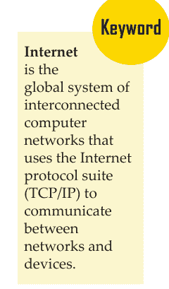

## 1.1 分布式计算的演进

分布式计算在局域网内已流行多年，它通过采用互联网作为基础平台并支持其开放标准技术迈出了重要的一步。

在计算早期，基于主机的应用程序被认为是执行大规模数据处理应用程序的最佳解决方案。随着个人电脑 (`PC`) 的出现，运行在独立机器上的软件程序概念在所有成本和易用性方面变得更加流行。随着运行在独立机器上的 `PC` 应用程序数量的增加，此类应用程序之间的通信变得极其复杂，并在应用程序间交互方面增加了日益增长的挑战。


通过消息传递进行通信的并发进程的使用可以溯到 20 世纪 60 年代的操作系统体系。最早的分布式系统是局域网，如以太网，它发明于 70 年代。最近，网络变得越来越重要，在名为传输控制协议/网际协议 (`TCP/IP`) 的网络上启用远程过程调用 (`RPC`) 被证明是应用程序软件通信的一种被广泛接受的方式。

根据定义，“分布式计算是一种计算类型，其中组成应用程序的不同组件和对象位于连接到网络的不同计算机上”。图 1 显示了一个分布式计算模型，该模型提供了能够调用网络上任何位置对象函数的基础设施。这些对象对于应用程序是透明的，并提供的处理就像它们位于调用它们的应用程序本地一样。

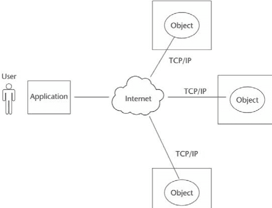

今天，Java RMI（远程方法调用）、OMG CORBA（通用对象请求代理架构）、微软 DCOM（分布式组件对象模型）和面向消息的中间件（`MOM`）已成为最常见的分布式计算技术。这些技术虽然在基础架构设计和实现上有所不同，但解决了其目标环境中的特定问题。接下来的章节将讨论分布式计算的使用，并简要介绍最流行的技术。

### 1.1.2 分布式计算的重要性

分布式计算环境比传统的独立应用程序具有许多显著优势。以下是其中一些关键优势：

- **更高的性能。** 应用可以并行执行，并将负载分布在多个服务器上。
- **协作。** 多个应用程序可以通过标准的分布式计算机制连接起来。
- **更高的可靠性和可用性。** 服务器可以在多台机器上进行聚类。
- **可扩展性。** 这可以通过在强大的服务器上部署这些可重用的分布式组件来实现。
- **可伸缩性。** 这可以通过对分布在网络上的应用程序进行动态（重）配置来实现。
- **更高的生产率和更短的开发周期。** 通过将大问题分解为较小的问题，较小的开发团队可以独立开发单个组件。
- **重用。** 分布式组件可以执行各种服务，并可能被多个客户端应用程序使用。它节省了重复开发工作并提高了组件之间的互操作性。
- **降低成本。** 因为这种模型对已开发的可通过网络访问的组件提供了大量重用，可以实现显著成本降低。

分布式计算还通过使用 Java、C 和 C++ 等编程语言提供类似网络的可共享对象，改变了传统网络编程的方式。以下章节将简要讨论分布式计算技术，如客户端/服务器（`Client/Server`）应用程序、OMG CORBA、Java RMI、微软 COM/DCOM 和 `MOM`。

#### 客户端/服务器应用程序

分布式架构的早期由两层业务应用程序主导。在两层架构模型中，第一层（上层）处理用户应用程序（客户端）的表示和业务逻辑，第二层（下层）处理应用程序组织及其数据存储（服务器）。这种方法通常称为客户端/服务器应用程序架构。通常，客户端/服务器应用程序模型中的服务器是数据库服务器，主要负责数据的组织和检索。该模型中的应用程序客户端处理大部分业务处理，并提供应用程序的图形用户界面。这是业务应用程序中一种非常流行的设计，在其中，用户界面和业务逻辑与数据库服务器紧密耦合，以处理数据检索和处理。

Java 是一种基于类的面向对象的编程语言，设计目标是尽可能减少依赖。


客户端/服务器模型已广泛应用于企业资源计划（`ERP`）、计费和库存应用程序系统，在这些系统中，位于多个桌面系统中的许多客户端业务应用程序与中央数据库服务器进行交互。

图 2 显示了一个典型的客户端/服务器系统的架构模型，其中多个基于桌面的业务客户端应用程序访问中央数据库服务器。

客户端/服务器应用程序模型的一些常见局限性如下：

- 客户端侧复杂的业务处理需要健壮的客户端系统。
- 安全性更难实现，因为算法和逻辑位于客户端侧，使其更容易受到黑客攻击。
- 需要增加网络带宽来适应许多对服务器的调用，这可能会带来可扩展性限制。
- 客户端应用程序的维护和升级极其困难，因为每个客户端必须单独维护。
- 客户端/服务器架构主要适用于面向数据库的独立应用程序，而不针对健壮的面向组件应用程序。

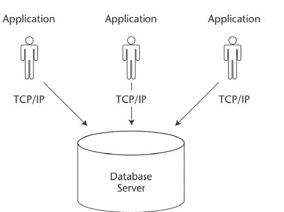

#### CORBA

通用对象请求代理架构（`CORBA`）是一项行业范围开放标准倡议，由对象管理组（`OMG`）开发，用于实现支持广泛应用程序环境的分布式计算。`OMG` 是一个非营利联盟，负责分布式和可操作面向对象系统框架规范的制作和维护。

`CORBA` 与传统的客户端/服务器模型不同，因为它提供了一种面向对象的解决方案，不强制执行任何专有协议或任何特定的编程语言、操作系统或硬件平台。通过采用 `CORBA`，应用程序可以运行在网络上任何位置的任何硬件平台上，并可以使用任何映射到名为“接口定义语言”（`IDL`）的中立接口的语言编写。`IDL` 是一种特定的接口语言，用于暴露 `CORBA` 远程对象的服务（方法/函数）。`CORBA` 还定义了一系列系统级服务，用于处理低级应用程序服务，如生命周期、持久化、事务、命名、安全等。起初，`CORBA 1` 侧重于创建不具互操作性的组件级、可移植的对象应用程序。`CORBA 2` 的引入通过实现互联网间 ORB 协议（`IIOP`）增加了不同 ORB 供应商之间的互操作性。`IIOP` 定义了 ORB 骨干，其他 ORB 通过它进行桥接并与其相关服务提供相互操作。

在基于 `CORBA` 的解决方案中，对象请求代理（`ORB`）是一个对象，它通过使用 Java、C 和 C++ 等编程语言提供类似网络的可共享对象。`ORB` 拦截请求，找到服务器，传递参数，调用方法并返回结果。

图 3 展示了分布式计算的架构模型，其中使用 `IDL` 绑定实现 `CORBA`。

`CORBA` 架构由以下组件组成：

- **IDL。** `CORBA` 使用 `IDL` 合约来指定应用程序边界并建立接口。`IDL` 提供了一种标准语言，用于分布式对象的接口、属性和异常。
- **ORB。** 它充当对象总线或桥接，为发送和接收响应提供通信基础设施。它为异构环境中的分布式对象建立了基础。

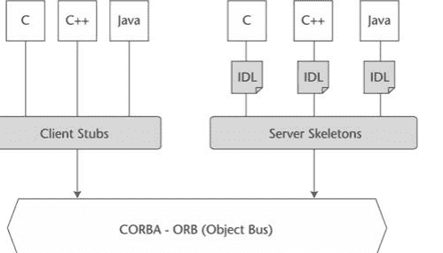

`CORBA` 优于传统客户端/服务器应用程序的一些独特优势如下：

- **操作系统和编程语言独立。** 客户端和服务器之间的接口在 `OMG IDL` 中定义，从而为互联网编程提供了优势；多语言和多平台应用程序环境实现了接口与实现之间的逻辑分离。
- **遗留性和自定义应用程序集成。** 通过 `CORBA IDL`，开发者可以将现有和自定义应用程序封装为调用客户端应用程序，并在 `ORB` 上作为对象使用。
- **丰富的分布式对象基础设施。** `CORBA` 提供了丰富的分布式对象服务，如生命周期、事件、命名、事务和安全服务。
- **位置透明性。** `CORBA` 提供位置透明性：对象引用独立于物理位置和应用程序级别。这允许开发者创建在不修改底层应用程序的情况下移动对象的 `CORBA` 系统。
- **网络透明性。** 通过使用 `IIOP` 协议，`ORB` 可以连接到网络其他部分的 `ORB`。
- **远程回调支持。** `CORBA` 允许对象接收其他对象的异步事件通知。
- **动态调用接口。** `CORBA` 客户端可以同时使用静态和动态方法调用。它们可以在编译时通过存根静态定义方法，或者在运行时发现对象。

尽管有这些优势，实现分布式应用程序时影响 `CORBA` 成功的关键因素如下：

- **高初始投入。** 基于 `CORBA` 的应用程序在培训和架构部署方面投入巨大，即使对于小型应用程序也是如此。
- **CORBA 服务的可用性。** `OMG` 定义的对象服务在实现产品中仍然缺失。
- **可扩展性。** 由于连接型 `CORBA` 架构的紧耦合特性，企业级应用程序期望的高可扩展性可能无法实现。

然而，这些缺点大部分在今天可能已经过时了。用于内网和外网应用开发的互联网社区已经承认将 `CORBA IIOP` 和 Java 作为它们的首选工具。Sun 已经发布了 JDK 1.4（Java 开发工具包），其中包含一个功能完整的 `CORBA` 实现以及一组有限的服务。


# Java RMI

Java RMI 由 Sun Microsystems 开发，作为一种标准机制，用于在 Java 环境下实现基于 Java 对象的分布式应用程序开发。RMI 通过调用远程对象并将其作为参数进行传递，提供了一个分布式 Java 应用程序环境。它使用了 Java 序列化——这是一种轻量级对象持久化技术，允许将对象转换为流。

在 RMI 之前，Java 平台中进行进程间通信的唯一方法是使用标准网络库。尽管 `java.net` API 为网络功能提供了复杂的支持，但它们的设计初衷并非为了支持或解决分布式计算的挑战。Java RMI 使用远程方法协议（JRMP）作为进程间通信协议，使得位于不同 Java 虚拟机（VM）中的 Java 对象能够透明地调用另一个对象的方法。由于这些虚拟机可以运行在网络上的任何计算机上，RMI 实现了面向对象的分布式计算。RMI 还使用了一种引用计数垃圾回收机制，该机制通过虚拟机跟踪对远程对象的外部对象引用（活动连接）。当发现某个对象未被引用时，它被视为弱引用并会被垃圾回收。

在基于 RMI 的应用程序架构中，注册表（`rmiregistry`）提供了一个简单的非持久化命名查找服务，用于存储远程对象引用，并允许客户端应用程序进行查找。基于 JRMP 的 RMI 基础设施充当 RMI 客户端与远程对象之间的介质。它拦截客户端请求，传递调用参数，将调用请求委托给 RMI 骨骼（skeleton），最后将方法执行的返回值传递给客户端存根（stub）。它还允许从服务器对象到客户端应用程序的回调，以便实现异步通知。

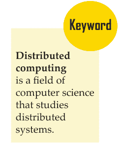

> 分布式计算是研究分布式系统的计算机科学领域。

图 4 描述了基于 Java RMI 的应用程序解决方案的架构模型。

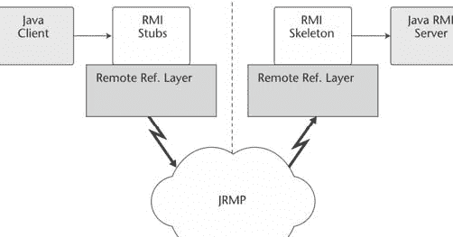

## Java RMI 架构组件

Java RMI 架构由以下组件组成：

- **RMI 客户端。** RMI 客户端可以是一个 Java applet 或独立应用程序，它负责在服务器对象上执行方法调用。它可以传递原始数据类型或可序列化对象的参数。

- **RMI 存根（RMI stub）。** RMI 存根是由 RMI 编译器（随 Java 开发工具包–JDK 提供的 `rmic`）生成的客户端代理，它封装了服务器的网络信息，并将方法调用委托给服务器。存根还对参数进行封送并对方法执行的结果进行反序列化。

- **RMI 基础设施。** RMI 基础设施由两层组成：远程引用层和传输层。远程引用层将特定的方法引用行为从客户端存根分离出来。它处理某些引用语义，例如连接重试（即调用请求的单播/多播）。传输层实际上提供了网络基础设施，促进了方法调用期间的实际数据传输、正式参数的传递以及执行结果的返回。

- **RMI 骨骼（RMI skeleton）。** RMI 骨骼同样使用 RMI 编译器（`rmic`）生成，它接收来自存根的调用请求并处理参数（封送），将其委托给 RMI 服务器。在方法执行成功后，它将返回值封送并通过 RMI 基础设施传回给 RMI 存根。


- **RMI 服务器。** 服务器是实现暴露接口并执行客户端请求的 Java 远程对象。它接收来自相应骨骼的远程方法调用，骨骼在反序列化后传递参数。方法执行成功后，返回值被发送回骨骼，骨骼通过 RMI 基础设施将其传回给客户端。

在 RMI 中开发分布式应用程序比使用 Java socket 开发更简单，因为不需要设计协议，而这本身是一项非常复杂的任务。RMI 是为 TCP/IP socket 构建的，但额外的优势是它为进程间通信提供了一种面向对象的方法。

Java RMI 为 Java 程序员提供了一种高效、透明的通信机制，使他们能够摆脱所有为了数据交换而编码解码消息所需的应用程序级协议。

RMI 在 Java 应用程序模型实现了分布式资源管理、最佳功率使用和负载均衡。RMI-IIOP（基于 IIOP 的 RMI）是一种为了让 RMI 应用程序与 CORBA 组件互操作而开发的协议。尽管 RMI 通过 Java 平台的分布式对象模型具有固有优势，但它也存在一些局限性：

- RMI 限于 Java 平台。它没有像 CORBA 那样在其模型中提供语言无关性。
- 基于 RMI 的架构由于面向连接的特性而紧密耦合。因此，在此类应用程序模型中实现高可扩展性是一个挑战。
- RMI 不提供任何特定的会话管理支持。在典型的客户端/服务器实现中，服务器必须维护多个客户端的状态信息。在没有标准的情况下维护此类信息是一项复杂的任务。

尽管存在一些局限性，由于其广泛接受，RMI 和 RMI-IIOP 已成为 J2EE 架构模型的核心。

# 微软组件模型（COM）与 DCOM

微软组件模型（COM）为基于 Windows 的软件组件提供了一种通信方式，通过在环境中定义二进制和网络标准。COM 演变自 OLE（对象链接与嵌入），后者采用了 Windows 注册表的对象组织。COM 为 ActiveX 组件提供了分布式应用程序模型。

作为下一步，微软开发了分布式通用对象模型（DCOM），作为 Windows 平台分布式计算问题的回答。DCOM 允许 COM 应用程序使用 RPC 机制进行通信，该机制在链路上使用 DCOM 协议。

图 5 显示了 DCOM 的架构模型。DCOM 应用了骨骼和存根方法，定义的暴露 COM 方法的方法可以通过网络进行远程调用。客户端调用远程 COM 对象的方式与其调用本地 COM 对象相同。存根封装了 COM 服务器的位置信息，并在客户端作为代理。服务器可以托管多个 COM 对象，当它们在注册表中注册时，对所有客户端可见，客户端随后通过查找机制发现它们。

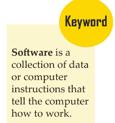
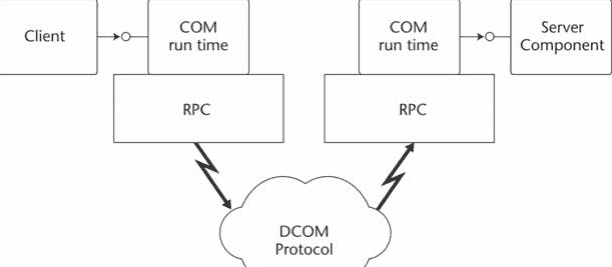

DCOM 在 Windows 平台上提供分布式计算支持方面非常成功。但它限于微软应用程序环境。以下是 DCOM 的一些常见局限性：

- 平台锁定
- 状态管理
- 可扩展性
- 复杂的会话管理问题


# CORBA、RMI、DCOM 与 MOM 对比

CORBA、RMI 和 DCOM 在基本架构和方法上有所不同，但它们都采用了紧耦合的同步通信模型（请求/响应）机制。所有这些技术都基于二进制通信协议并在其逻辑层之间采取了紧密集成，这很容易导致可扩展性问题。

面向消息的中间件（MOM）基于松耦合的异步通信模型，应用程序客户端不需要知道其应用接收者或其方法参数。

MOM 使应用程序能够通过消息提供者队列进行间接通信。应用程序客户端将消息发送到消息队列（消息存储区域），接收端应用程序从队列中提取消息。

在这种操作模型中，向另一个应用程序发送消息的应用程序将继续运行，无需等待该应用程序的响应。

图 6 展示了一个高层 MOM 架构，显示了应用程序与应用程序之间的连接性。

在基于 MOM 的架构中，与消息基础设施交互的应用程序使用自定义适配器。客户端应用程序使用这些适配器与底层消息基础设施进行消息的发送和接收。为了确保交付的可靠性，消息也可以持久化在数据库/文件系统中。

一些为人知的基于 MOM 的技术包括 SunONE Message Queue、IBM MQSeries、TIBCO、SonicMQ 和 Microsoft Messaging Queue (MSMQ)。

Java 平台提供了一种基于 Java 的消息 API（JMS - Java Message Service），它是作为 Sun Java 社区进程（JCP）的一部分开发的，目前也是 JEE 1.3 规范的一部分。

所有领先的 MOM 厂商如 SunONE、TIBCO、IBM、BEA、Talarian、Sonic、Fiorano 和 Spiritwave 都支持 JMS 规范。

JMS 提供了点对点（Point-to-Point）和发布/订阅（Publish/Subscribe）消息模型，具有以下特性：

- 完整的事务能力
- 可靠的消息交付
- 安全性


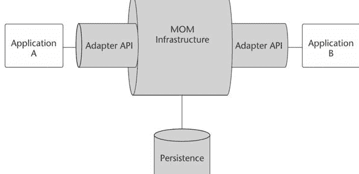

图 6。典型的基于 MOM 的架构模型。

在实现基于 MOM 的应用程序环境时，面临的一些常见挑战如下：

- 大多数标准的 MOM 实现都提供了与其核心基础设施进行通信的原生 API。这影响了应用程序在这些实现之间的可移植性，并导致了特定的厂商锁定。
- 用于集成应用程序的 MOM 消息通常基于私有消息格式，不具备任何标准兼容性。

采用基于 JMS 的通信模型可以实现与 MOM 提供者通信的标准化方式，而无需锁定任何特定的厂商 API。它利用了开放标准的使用，从而增强了连接不同应用程序的灵活性。

## 1.1.8 分布式计算中的常见挑战

CORBA、RMI 和 DCOM 等分布式计算技术在包括局域网在内的同构环境中集成应用程序方面取得了相当成功。随着互联网成为一种跨越并连接业务边界的逻辑解决方案，它也要求跨网络应用程序的互操作性。本节将讨论基于 CORBA、RMI 和 DCOM 的分布式计算中的一些常见挑战：

- 在异构网络环境中，在客户端和服务器环境中维护不同版本的存根/骨架极其复杂。
- 分布式环境中的服务质量（QoS）目标（如可扩展性、性能和可用性）消耗了应用程序开发的大部分时间。
- 在异构平台上实现不同协议的应用程序的互操作性几乎变得是不可能的。例如，一个 DCOM 客户端与 RMI 服务器通信，或一个 RMI 客户端与 DCOM 服务器通信。
- 这些大多数协议的设计都是为了在局域网内良好运行。它们对互联网并不友好，也无法通过互联网访问。
- 这种由 CORBA、RMI 和 DCOM 牵头的紧耦合方法在应用程序集成方面最大的问题是，它影响了已经绑定到特定平台的开发者社区。Microsoft Windows 平台开发者使用 DCOM，而 UNIX 用户使用 CORBA 或 RMI。社区中并没有付出巨大努力使用通用标准来强制这些多样化协议之间的互操作性，从而忽略了分布式计算的重要性，以及因此产生的真实力量。关于缺点的描述已经足够了，我们现在将讨论一种正在兴起的替代技术，这种技术仍然具有令人振奋的优势，并且解决了当前系统复杂性的目标。

互联网的出现帮助企业应用程序通过 Web 轻松访问，而无需安装特定的客户端软件。在基于互联网的应用程序模型中，重点是将复杂的业务处理移到后端的中央服务器。

第一代互联网服务器基于 Web 服务器，它们托管静态 Web 页面并通过 HTTP（超文本传输协议）向客户端提供内容。HTTP 是一种无状态协议，它将 Web 浏览器连接到 Web 服务器，允许将 HTML 内容传输给用户。

随着这种基础设施的高度普及和潜力，向更动态技术的推动是不可避免的。这是使用 CGI、NSAPI 和 ISAPI 等技术进行服务器端脚本的开始。

随着许多组织将其业务转移到互联网，一类全新的业务模式（如企业对企业（B2B）和企业对消费者（C2C））诞生。

这种演变导致了 J2EE 架构的规范，它为托管 Web 应用程序提供了一个更高效的平台。J2EE 提供了一种基于 Web 和业务组件的编程模型，这些组件由 JEE 应用程序服务器管理。服务器由许多可供使用的 API 和底层服务组成，提供安全性、事务、连接和实例池以及并发服务，使得 J2EE 开发者能够主要关注业务逻辑，而不是底层工作。


Java 的力量及其丰富的 API 集合为开发高事务、高可用且可扩展的企业应用程序提供了完美的解决方案。基于许多标准的行业规范，它提供了连接各种后端遗留和信息系统的接口。JEE 还提供了优秀的连接能力，范围从 PDA、Web 浏览器到富客户端（Applets、CORBA 和标准 Java 程序）。

图 7 显示了 JEE 架构的各种组件。

典型的 JEE 架构物理上分为三个逻辑层，使得各种应用程序组件能够根据定义的规则和职责进行清晰分离。以下是这些逻辑层功能的划分：

- **表示层（Presentation tier）。** 表示层由 Web 组件组成，处理 HTTP 请求/响应、会话管理、设备无关的内容交付以及业务层组件的调用。

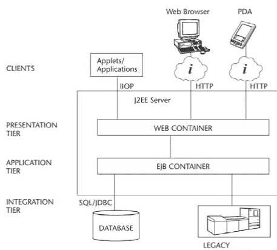

图 7。JEE 应用程序架构。

- **应用层（Application tier）。** 也称为业务层，处理核心业务逻辑处理，通常涉及工作流和自动化。业务组件通过应用程序服务器提供的定义 API 从信息系统中检索数据。

- **集成层（Integration tier）。** 集成层负责连接和与后端企业信息系统（EIS）、数据库应用程序、遗留应用程序或大型机应用程序通信。

凭借其关键功能和将应用程序划分为逻辑层的规定，JEE 已被采纳作为开发和部署的标准解决方案。

如果基于 J2EE 的应用程序能够与其他潜在的 J2EE 部署应用程序协同运行，那么其威力将是巨大的。这使得跨网络的业务组件能够在之间进行协商和交互，而无需人工干预。它还通过允许跨网络共享数据和组件级过程，实现了业务流程在互联网上的同步分发与协作。这种现象通常被称为企业对企业（B2B）通信。

可扩展标记语言（XML）的出现用于以结构化和自描述的格式定义可迁移数据，已被行业接受作为电子数据交换的通信媒介。使用 XML 作为应用程序之间的数据交换机制促进了互操作性，并增强了底层应用程序的可扩展性。将 J2EE 平台的潜力与 XML 结合，为跨网络的 B2B 和应用间通信提供了一个标准框架。

J2EE 使企业应用接入互联网，而 XML 则充当“胶水”，通过促进这些离散的基于 J2EE 的应用程序相互运行，将它们桥接起来。XML 具有惊人的活性，已被包括 Sun、IBM、Microsoft、Oracle 和 HP 在内的 IT 行业主要供应商广泛采用并接受为标准。这些技术的结合为技术领域提供了更具前景的可能，为互联网上的应用到应用通信提供了新方法。它还促进了一种被称为 Web 服务分布式计算技术解决方案的新形式。

## 1.1.10 Web 服务的出现

今天，互联网的采用和基于互联网的应用程序开启了一个离散业务应用程序的世界，这些应用程序在同一个技术空间内共存，但互不交互。行业对实现 B2B、应用到应用（A2A）以及进程间应用通信的需求日益增加，导致了对面向服务架构的需求不断增长。实现面向服务的应用程序有助于将业务应用程序作为服务组件进行暴露，使得其他机构的业务应用程序能够与这些服务连接，进行应用交互和数据共享，而无需人工干预。通过利用这种架构，实现了业务应用程序和流程之间的互操作性。

通过采用 Web 技术，面向服务的架构模型利用如 XML 等标准技术，促进了在互联网上交付服务。它通过暴露底层应用程序组件并使其供任何位置的任何应用程序、平台或设备使用，从而使用了平台中性的标准。今天，这种现象已得到广泛实施，并通常


被称为 Web 服务。尽管这种技术通过增加服务激活技术和开放技术标准实现了应用程序之间的通信，但它也可以被用于在互联网可用的黄页注册表中发布服务。这将进一步定义和转型企业在互联网上通信的方式。这种充满前景的新技术为下一代虚拟业务模型设定了战略愿景，并为在互联网上进行业务协作和业务流程管理的组织释放了无限潜力。

# 1.2 Web 服务简介

今天，人们使用互联网作为日常服务提供商，用于阅读头条新闻、获取股票报价、查询天气报告、支付账单，以及从不同来源获取各种信息。基于 Web 的应用程序使用不同的软件应用程序来生成 HTML，其访问仅限于通过浏览器或使用特定的应用程序客户端。这部分归因于 HTML 和基于 Web 服务器技术的局限性，这些技术主要关注于展示，并且无法与其他应用程序进行交互。

Web 服务的出现为基于开放标准和技术的跨互联网信息交换引入了新的范式。Web 服务使用行业标准，对应用程序进行封装，并将其作为服务发布。这些服务在网络上传输基于 XML 的数据，并将其暴露供互联网使用，可以使用各种计算平台、手持设备、电器等进行动态定位、订阅和访问。由于使用了开放标准和协议的活性，它还促进了企业应用集成（EAI）、企业对企业（B2B）集成以及跨互联网和企业内部网的应用到应用（A2A）通信。在具有异构应用程序和分布式应用架构的组织中，Web 服务的引入使通信机制标准化，并实现了基于不同平台不同编程语言的应用程序互操作性。

## 1.2.1 Web 服务


简而言之，Web 服务是自描述且模块化的业务应用程序，通过可编程接口在互联网上暴露业务逻辑，并使用互联网协议提供查找、订阅和调用这些服务的方法。

基于 XML 标准，Web 服务可以使用任何编程语言、任何协议或任何平台开发为松耦合的应用组件。这有助于将业务应用程序作为服务交付，供任何人在任何时间、任何地点并使用任何平台进行访问。

考虑图 8 所示的简单示例，一个旅游预订服务提供商将其业务应用程序暴露为 Web 服务，以支持各种客户和应用客户端。这些业务应用程序由位于不同网络和地理位置的不同旅游机构提供。

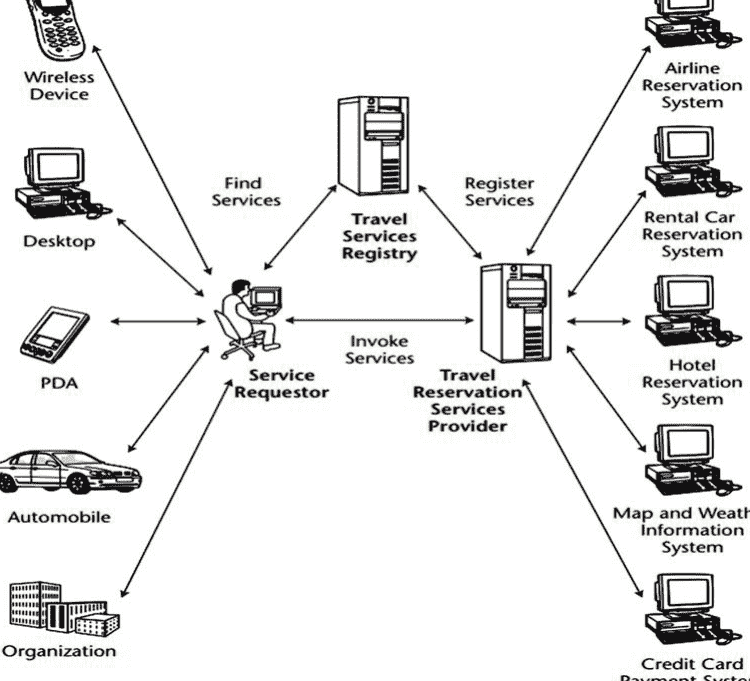

图 8. Web 服务的示例场景。

以下是一个典型场景：

1. 旅游服务通过暴露从不同旅游业务（如航空公司、租车、酒店住宿、信用卡支付等）获取的应用程序来部署其 Web 服务。
2. 服务提供商使用公共或私有注册表注册带有描述的业务服务。注册表存储服务提供商暴露的服务的信息。
3. 客户使用搜索引擎或直接从注册表中定位来发现 Web 服务，并使用任何平台或设备在互联网上调用 Web 服务以执行旅游预订和其他功能。
4. 在大型组织中，业务应用程序消费 Web 服务，通过企业内部网为自己的员工提供旅游服务。

上一个示例提供了一个简单的场景，说明了组织的业务功能如何被暴露为 Web 服务，并供客户使用广泛的应用程序客户端进行调用。


正如我们讨论过的，Web 服务通常是基于专门利用 XML 的标准和技术实现的。基于 XML 的标准和技术，如简单对象访问协议 (SOAP)、通用描述、发现和集成 (UDDI)、Web 服务定义语言 (WSDL) 以及电子业务 XML (eXML)，通常用作 Web 服务的构建模块。

基于 Web 的 B2B 通信已经存在一段时间。这些基于 Web 的 B2B 解决方案通常基于自定义和专有技术，旨在通过 Web 交换数据并进行交易。

然而，B2B 也有自己的挑战。例如，在 B2B 通信中，连接新的或有的应用程序以及添加业务合作伙伴一直是一个挑战。

由于这一事实，在某些情况下底层业务应用程序的可扩展性受到了影响。理想情况下，合作伙伴组织的业务应用程序和信息应该与潜在合作伙伴的应用程序无缝交互，而无需重新定义系统或资源。为了应对这些挑战，显而易见的是需要标准的协议和数据格式来实现无缝且可扩展的 B2B 应用程序和服务。Web 服务提供了解决方案


通过采用开放标准来解决这些问题。图 9 显示了一个典型的 B2B 基础设施（电子商务），它使用 XML 在跨互联网的应用之间进行数据编码。

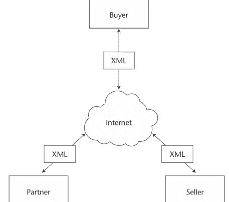

**图 9.** 在 B2B 通信 XML 进行数据编码。

Web 服务通过采用基于 XML 的数据交换格式和行业标准传输协议，使企业能够通过轻级基础设施进行通信、协作和业务交易。

Web 服务应用模型的基本特征如下：

- Web 服务基于 XML 消息，这意味着 Web 服务提供者与用户之间交换的数据是用 XML 定义的。
- Web 服务实现了在互联网上对业务应用程序的跨平台集成。
- 为了构建 Web 服务，开发者可以使用任何编程语言（如 `Java`、`C`、`C++`、`Perl`、`Python`、`C#` 和/或 `Visual Basic`）以及现有的应用程序组件。
- Web 服务并非用于处理如 `HTML` 内容之类的演示——它的开发目的是生成 `XML`，以便通过任何软件应用程序、平台或设备进行统一的访问。
- 由于 Web 服务基于松耦合的应用程序组件，因此每个组件都作为具有其独特功能的服务暴露出来。
- Web 服务使用 `HTTP` 等行业标准协议，并且可以轻松通过企业防火墙访问。
- Web 服务可以被许多类型的客户端使用。

Web 服务的功能各异，从简单的请求到涉及多个资源的复杂业务交易不一。

- 包括 `J2EE`、`CORBA` 和 `Microsoft .NET` 在内的所有平台为创建和部署 Web 服务提供了广泛的支持。
- Web 服务通过 `UDDI` 和 `ebXML` 等行业标准，由公共和私有注册表进行动态定位和调用。

`.NET` 是一个免费、跨平台、开源的开发者平台，用于构建许多不同类型的应用程序。

## 1.2.3 为什么使用 Web 服务？

传统上，Web 应用程序实现了终端用户与网站之间的交互，而 Web 服务是面向服务的，能够在互联网上实现应用程序与应用程序之间的通信，并能够轻松访问异构应用程序和设备。以下是选择 Web 服务而非 Web 应用程序的主要技术原因：

- Web 服务可以通过基于 `XML` 的 `RPC` 机制跨防火墙进行调用。
- Web 服务提供了基于 `XML` 消息的跨平台、跨语言解决方案。
- Web 服务促进了使用轻量级基础设施进行简单的应用程序集成，且不影响扩展性。
- Web 服务实现了异构应用程序之间的互操作性。

## 1.2.4 Web 服务的基本操作模型

Web 服务的操作可以概念化为一个简单的操作模型，该模型与标准通信模型有很多共同之处（见图 10）。操作被构想为涉及三个不同的角色和关系，它们定义了 Web 服务提供者和用户。


**图 10.** Web 服务操作模型，显示了角色和关系

这些角色和关系的定义如下：

- **服务提供者。** 服务提供者负责开发和部署 Web 服务。提供者还定义服务并向服务代理人发布它们。
- **服务代理人。** 服务代理人（也称为服务注册表）负责 Web 服务的注册和发现。代理人列出各种服务的类型、描述和位置，帮助服务请求者找到并订阅所需的服务。
- **服务请求者。** 服务请求者负责服务的调用。请求者通过服务代理人定位 Web 服务，调用所需的服务，并从服务提供者处执行。

让我们仔细检查 `SOAP`、`WSDL`、`UDDI` 和 `ebXML` 等启用 Web 服务的开放标准技术。

## 1.2.5 Web 服务标准

构建和启用 Web 服务的五个 Web 服务标准是 `XML`、`SOAP`、`WSDL`、`UDDI` 和 `ebXML`。后续章节将介绍概述。

### 可扩展标记语言 (XML)

1998 年 2 月，万维网联盟（W3C）正式认可可扩展标记语言（XML）为标准。在 Web 服务核心中，XML 用于表示通过任何软件应用程序、平台或设备进行统一访问的数据。它是结构化数据的事实标准。


### Java Web 服务

传统的 Web 应用程序实现了用户与网站之间的交互，而 Web 服务是面向服务的，能够在互联网上实现应用程序与应用程序之间的通信，并能够轻松访问异构应用程序和设备。在 Web 服务核心中，XML 用于表示各种业务应用程序的数据。


### 简单对象访问协议 (SOAP)

简单对象访问协议（SOAP）是一种基于轻量级基础设施的用于应用程序间交换数据的协议。在 Web 服务核心中，SOAP 作为消息协议。它实现了跨企业防火墙的异构应用程序之间的互操作性。在 Web 服务核心中，SOAP 用于消息传递。

### Web 服务定义语言 (WSDL)

Web 服务定义语言（WSDL）用于描述 Web 服务。在 Web 服务核心中，WSDL 用于定义服务的位置。它为描述 Web 服务功能提供了一种标准。


### 通用描述、发现和集成 (UDDI)

通用描述、发现和集成（UDDI）是一种用于注册和发布 Web 服务的标准。在 Web 服务核心中，UDDI 充当服务代理人。它允许服务请求者找到并定位所需的服务。

### ebXML

ebXML 定义了一个全球电子市场，企业可以在此相互进行业务协作和交易。它还定义了一系列规范，供企业在互联网上开展电子业务，通过为业务流程规范、业务信息建模、业务流程协作、协作伙伴配置文件以及协议和消息建立共同标准。它与 `SOAP`、`WSDL` 和 `UDDI` 等其他 Web 服务互补并扩展。

- ebXML 业务流程服务规范 (BPSS) 允许定义业务流程。
- ebXML CPP/CPA 允许定义业务伙伴概况和协议，并提供了业务事务的编排。
- ebXML 消息服务处理程序（MSH）处理消息的传输、路由和封装，它提供了可靠性和安全性，这是对 `SOAP` 的额外增值。
- ebXML 注册表（Registry）定义了注册表服务、交互协议和消息定义，而 ebXML 仓库（Repository）作为共享信息的存储中心。ebXML 注册表与其他注册表以联邦的形式注册，并可以通过 `UDDI` 进行发现。这使得 `UDDI` 能够搜索指向 ebXML 注册表/仓库的业务列表点。
- ebXML 核心组件提供了一个业务流程组件目录，为业务社区提供通用功能。此类组件的示例包括采购、支付、库存等。

## 1.2.6 其他支持 Web 服务的行业标准

目前已有许多支持 Web 服务的行业倡议和标准，未来还将出现更多。接下来的章节描述了采纳 Web 服务标准最显著的倡议。

### Web 服务编排接口 (WSCI)

Web 服务编排接口（或 WSCI）是由 `Sun Microsystems`、`BEA`、`印度` 和 `SAP` 发起的一倡议，定义了 Web 服务通信中特定过程中交换的消息流。它描述了在 Web 服务通信之间交互期间的集体消息流。这促进了业务流程与 Web 服务之间的桥接，使得 Web 服务能够成为组织业务流程的一部分，或跨越多个组织。

### Web 服务流语言 (WSFL)

Web 服务流语言（或 WSFL）是 `IBM` 的一项基于 `XML` 的语言倡议，用于描述 Web 服务组合。这些组合被分为流模型和全局模型。流模型可以用于基于 Web 服务的业务流程或工作流建模，而全局模型可以用于建模 Web 服务接口之间的链接，从而实现一个 Web 服务通过操作与另一个 Web 服务接口进行交互。使用 `WSFL` 组合支持参与业务流程的伙伴之间广泛的交互模式，特别是伙伴之间的分级交互和点对点交互。


### 目录服务标记语言 (DSML)

目录服务标记语言（或 DSML）定义了一个 `XML` 架构，用于将目录结构信息表示为 `XML` 文档，并允许通过 `HTTP`、`SMTP` 等因特网协议发布和共享目录信息。DSML 未定义用于目录结构或访问信息的属性。DSML 文档定义了目录条目或目录架构，也可以用在任何如 `LDAP` 之类的行业目录协议之上。DSML 定义了不同目录服务之间交换信息的标准，并实现了它们之间的互操作性。`Bowstreet` 最初提议 DSML 作为一种标准，并获得了 `IBM`、`Oracle`、`Sun Microsystems`、`Microsoft` 等领先厂商的支持。

### XLANG

与 `WSFL` 类似，`XLANG` 定义了一个基于 `XML` 的标准规范，用于在 Web 服务中定义业务流程。它还定义了一种用于表示 Web 服务中动作和复杂操作的符号。微软（Microsoft）开发了 `XLANG` 规范，该规范已在 `Microsoft BizTalk Server 2000` 中实现，专门用于处理企业级应用集成（EAI）和 B2B 通信。

### 业务事务协议 (BTP)

业务事务协议（BTP）规范为基于 Web 服务的分布式事务提供了支持，使底层事务管理器能够处理符合 `HA`（高可用性）标准的二阶段提交事务引擎。BTP 是 `OASIS` 的一项倡议，旨在促进大规模的业务对业务（B2B）部署，实现 Web 服务中的分布式事务。

### XML 加密 (XML ENC)

XML 加密（或 XML ENC）是一种基于 `XML` 的标准，通过使用 `XML` 表示进行加密来保护数据。在 Web 服务中，它确保了通信伙伴之间数据交换的安全。

### XML 密钥管理系统 (XKMS)

XML 密钥管理系统（或 XKMS）是一种基于 `XML` 的标准，用于集成公钥基础设施（PKI）和数字证书以确保互联网交易的安全，特别是用于 Web 服务的交易。XKMS 由两部分组成：XML 密钥信息服务规范（X-KISS）和 XML 密钥注册服务规范（X-KRSS）。X-KISS 规范定义了一种信任


服务协议，用于解析 `XML-SIG` 元素中包含的公钥信息。X-KRSS 描述了如何注册公钥信息。

### XML 签名 (XML DSIG)

XML 签名（或 XML DSIG）是一种基于 `XML` 的标准，用于指定创建和表示数字签名的 `XML` 语法和处理规则。在 Web 服务中，`XML` 数字签名通过在通信伙伴之间交换期间为数据添加身份验证、数据完整性和对不可否认性的支持，帮助基于 `XML` 的事务。

### 可扩展访问控制标记语言 (XACML)

可扩展访问控制标记语言（或 XACML）是一种基于 `XML` 的标准，用于指定访问 Web 资源信息的策略和规则。在 Web 服务中，`XACML` 对通信伙伴之间共享的资源设置规则和权限。`XACML` 是 `OASIS` 安全服务技术委员会的一项安全倡议。

### 安全断言标记语言 (SAML)

安全断言标记语言（或 SAML）定义了一个用于交换认证和授权信息的 `XML` 框架。`SAML` 使用由基于 `XML` 的请求和响应格式组成的通用协议，并可以绑定到许多通信模型和传输协议。`SAML` 的主要目标之一是为参与 Web 应用程序提供单点登录。`SAML` 是 `OASIS` 安全服务技术委员会发起的倡议。

## 1.2.7 Web 服务中的已知挑战

Web 服务面临一些与关键业务需求相关的关键挑战。这些挑战在完全实现服务之前需要解决：

- 分布式事务：对于异构资源，应基于 `BTP`、`WS-Transactions` 和 `WS-Coordination` 的标准解决方案进行研究和测试。
- 服务质量 (QoS)：对于关键业务解决方案，服务提供商必须在峰值负载和不确定条件下检查服务的可靠性和性能。


Web 服务通过基于 `HTTP` 的协议公开。由于 Web 服务是公开的，因此必须使用认证和授权机制，并使用 `SSL` 加密消息以确保使用安全。采用 `SAML`、`XML` 加密、`XML` 签名或 `XACML` 等开放安全标准可能是解决方案。

其他挑战包括 Web 服务部署的管理和测试，这涉及到不同的操作系统环境和平台，并在公共/私有注册表中管理服务描述。

记住，暴露的基础设施必须提供负载均衡、故障处理和容错能力，以解决这些场景。

## 1.2.8 Web 服务软件和工具

让我们看看提供开发和部署基于 `Java` 的 Web 服务解决方案的 Web 服务软件和工具供应商。以下是实现 Web 服务的最流行的商业解决方案列表。

### BEA Systems 产品

`BEA WebLogic Server 7.0` 提供了 Web 服务基础设施解决方案，支持 Web 服务的标准和协议。`BEA WebLogic Integration Server` 还允许在具有事务完整性、安全可靠性的情况下部署复杂的 Web 服务，同时支持新兴的 `ebXML` 和 `BTP` 标准。在书中我们在“构建 Web 服务架构”中提供了一些使用 `BEA WebLogic Server 7.0` 的示例插图。

### Cape Clear 产品

`Cape Clear` 提供了 `CapeConnect` 和 `CapeStudio`，能够开发基于行业标准的 Web 服务解决方案。`Cape Clear` 还可以支持来自不同技术（如 `Java`、`EJB`、`CORBA` 和 `Microsoft .NET`）的业务应用程序。这些组件可以通过互联网作为 Web 服务暴露。

### IBM 产品

`IBM WebSphere Application Server 4.5` 为部署基于 Web 服务的应用程序提供了一种基础设施解决方案。`IBM` 还为开发者提供了一个 Web 服务工具包 (WSTK) 软件包（现为 `WebSphere Studio` 的一部分），作为一个运行时环境，它可以基于 `XML`、`SOAP`、`WSDL` 和 `UDDI` 等开放标准创建、发布和测试 Web 服务。它还可以在无需任何重新编程的情况下为现有应用程序生成 `WSDL` 包装器。可以在 `www.alphaworks.ibm.com/tech/webservicestoolkit` 处下载 `IBM WSTK`。

### IOPSIS 产品

`IOPSIS` 提供了 `B2Beyond iSight` 和 `W2Net`，这是一种集成服务开发框架 (ISDF)，它能够基于 `XML`、`SOAP`、`WSDL` 和 `UDDI` 等开放标准创建、组装、部署和发布 Web 服务。它还提供了将 Web 服务部署到流行的基于 `J2EE` 的 Web 应用服务器的工具。

### Oracle 产品

`Oracle9 Release 2` 应用程序服务器提供了基于 `J2EE` 的 Web 服务基础设施解决方案，支持包括 `UDDI` 和 `WSDL` 在内的 Web 服务标准。它还具有使用 Web 服务集成遗留应用程序和后端系统的功能，用于定义和协调业务流程。

### Sun 产品

作为 `Java` 社区进程的一部分，`Sun` 已经发布了基于 `Java` 和 `XML` 技术的 API 及其实现，称为 `JAX Pack`，用于开发和测试 `Java` 以及基于开放标准的 Web 服务解决方案。

此外，`Sun` 还发布了一套针对 Web 服务的全面技术，称为 `Java Web 服务开发者包` (JWSDP)。在本书中，我们广泛讨论了 `JWSDP` API 技术，并提供了示例插图。

`Sun ONE Application Server 7.0` 产品套（以前称为 `iPlanet Application Server 6.0`）提供了一个基于 `J2EE` 和开放标准的基础设施，用于实现 Web 服务。`Sun ONE` 是 `Sun` 开放网络环境 (`Sun ONE`) 的关键组件，这是一个面向迁移到下一代 Web 服务的客户和开发者的全面 Web 服务软件环境。


### Systinet 产品

`Systinet` 提供 Web 服务基础设施和解决方案，如 `WASP Server`、`WASP Developer` 和 `WASP UDDI`，它们基于 `XML`、`SOAP`、`WSDL` 和 `UDDI` 等行业标准开发 Web 解决方案。`Systinet` 允许来自 `Java`、`EJB`、`CORBA` 和 `Microsoft .NET` 等不同技术的业务应用程序作为 Web 服务在 Internet 上暴露。它实现了与基于 `J2EE` 的应用程序的集成，并通过 `GSS API` 和 `Kerberos` 支持安全框架。它还提供了专门为 Web 服务设计的 `Java XML API` 实现。

在本书中，我们在“Web 服务的描述与发现”中提供了 `Systinet WASP Server` 的示例插图。

## 1.2.9 行业领先者的 Web 服务策略：概览


# Web 服务架构与核心技术

## 行业领先的 Web 服务框架倡议

让我们简要查看关注 Web 服务框架核心的领先厂商倡议和策略，这包括用于开发和部署 Web 服务的架构、平台和软件解决方案。

采用这些框架可以提供简化的实现方案、互操作性和行业标准，以实现 Web 服务。以下是行业领先技术供应商提供的核心 Web 服务框架的最流行的倡议。

### Sun ONE (Sun 开放环境)

Sun ONE 是 Sun 基于标准的软件愿景、架构、平台和解决方案，用于构建和部署按需服务的解决方案。

Sun ONE 的架构基于 `SOAP`、`WSDL` 和 `UDDI` 等开放标准，并采用基于 `Java/J2EE` 的解决方案作为其核心运行时技术。Sun ONE 的主要优势在于它不会出现任何供应商锁定问题或由其专有解决方案引起的问题。

### IBM 电子商务 (e-Business)

IBM 电子商务是 IBM 用于开发和部署 Web 服务的概念架构和基于标准的方案。IBM 的方案基于 `Java/J2EE` 以及 `SOAP`、`WSDL` 和 `UDDI` 等 Web 服务标准，共同反映了用于动态电子商务的 Web 服务技术集。


### Microsoft .NET

## Web 服务的关键优势

实现 Web 服务的关键优势如下：

- 为应用程序提供了一种简单的机制，使其成为任何人、任何地方、通过任何设备即可访问的服务。
- 定义了基于服务的应用程序连接，促进了企业应用集成 (`EAI`) 以及企业内部和企业间的通信。
- 为在 Internet 上的应用程序间通信中灵活性和敏捷性的企业定义了解决方案。
- 通过服务代理（注册表）实现服务的动态定位和调用。
- 实现与建模为服务的现有应用程序进行协作，以提供聚合的 Web 服务。

很显然，Web 服务是展示新通信和协作方式的下一个大技术。


## 案例研究：Web 设计服务

我们为一家欧洲的体育相关业务公司完成了设计服务。由于非常成功，我们从他们那里又获得了 17 个项目，还从他们的推荐那里获得了。

### 客户

客户是一家总部位于欧洲的业务，在全欧洲运营多个高尔夫球场。他们联系我们是为了创建网站以及集成到网站中的在线预约系统。

### 挑战

客户最初想要设计，但没有技术能力。

### 解决方案

这些基于 Web 的 B2B 通信已经存在了一段时间。使用自定义和专有技术在 Web 上进行数据交换和交易。

我们花费了一周时间设计并开发预订系统。设计已经确定，客户接受了我们的设计并提供了结果的网站。

### 成功

客户非常满意，我们与他们成功完成了 17 个项目。这种合作仍在继续，我们已成为他们所有相关服务的首选合作伙伴。


## Java Web 服务

## 总结

- Web 服务是一种在客户端和服务器之间传播通信的标准化媒介。Web 服务是执行特定任务的软件模块。
- Internet 通过提供一种信息高速公路改变了我们的业务，这种新的信息媒介将业务从传统的砖瓦基础设施转向虚拟世界，使其能够全天候、全球服务客户。
- 分布式计算是一种计算类型，应用程序的不同组件和对象可以位于连接到网络的不同计算机上。
- 通用对象体系结构 (`CORBA`) 是由对象管理组 (`OMG`) 开发的行业开放标准倡议，用于支持广泛应用程序环境的分布式计算。`OMG` 是一个非营利联盟，负责分布式和互操作对象系统框架规范的制作和维护。
- 对象请求器 (`ORB`) 是一种对象总线，提供了一种透明机制，无论环境和位置如何即可发送请求并接收来自对象的响应。
- 微软组件模型 (`COM`) 通过在 Windows 操作系统环境中定义二进制和网络标准，为 Windows 软件之间的通信提供了一种方法。
- 消息队列中间件 (`MOM`) 基于松耦合的异步通信模型，应用程序客户端不需要知道其应用程序接收者或方法参数。
- 简单对象访问协议（简称 `SOAP`）是一种轻量级 XML 消息协议的标准。它允许两个或多个节点之间交换信息，并使能够在去中心化的分布式应用程序环境中相互通信。
- 服务定义语言 (`WSDL`) 是一种用于描述网络服务及其访问信息的 XML 格式。它定义了绑定机制，用于将协议、数据格式、抽象消息或定义服务位置的一组端点结合起来。
- 目录服务标记语言 (`DSML`) 定义了一种 XML 架构，用于将目录结构信息表示为 XML 文档，它允许通过 `HTTP`、`SMTP` 等互联网协议进行目录信息的发布和共享。

## 多选题

1. ________ 用于将您的应用程序转换为 Web 应用程序。
   - a. Java 服务
   - b. 浏览器操作
   - c. Web 服务
   - d. Struts 服务

2. Web 服务是 ________。
   - a. 应用设计工具
   - b. 应用 IDE
   - c. 应用组件
   - d. 以上都不是

3. 基础 Web 服务平台是 ________ 和 ________ 的结合。
   - a. CSS + JAVA
   - b. CSS + HTTP
   - c. XML + HTTP
   - d. XML + HTML

4. Web 服务使用 ________ 进行通信。
   - a. 开源协议
   - b. 封闭协议
   - c. 开源-闭合协议
   - d. 以上都不是

5. Web 服务是自包含且自描述的！
   - a. 正确
   - b. 错误

6. 可以使用 ________ 发现 Web 服务。
   - a. UDDII
   - b. UDDI
   - c. UDII
   - d. UDDDI

7. ________ 是 Web 服务的基础。
   - a. PHP
   - b. CSS
   - c. CGI
   - d. XML

8. 以下哪项被认为是 Web 服务平台元素？
   - a. SOAP
   - b. UDDI
   - c. WSDL
   - d. 以上都是

9. WSDL 代表 ____________________。
   - a. Web 服务描述语言 (Web Services Description Language)
   - b. Web 服务设计语言 (Web Services Design Language)
   - c. Web 服务开发语言 (Web Services Development Language)
   - d. 以上都不是

10. UDDI 代表 ____________________。
    - a. 通用开发、设计与集成 (Universal Development, Design and Integration)
    - b. 通用描述、发现与集成 (Universal Description, Discovery and Integration)
    - c. 通用描述、开发与集成 (Universal Description, Development and Integration)
    - d. 以上都不是

## 复习题

1. 什么是分布式计算？分布式计算的重要性是什么？
2. 描述通用对象请求代理架构 (`CORBA`)。
3. `DCOM` 的局限性有哪些？
4. 什么是 Web 服务？Web 服务的特征有哪些？为什么要使用 Web 服务？
5. 什么是简单对象访问协议 (`SOAP`)？

## 多选题答案

1. (c) 2. (c) 3. (c) 4. (a) 5. (a)
6. (b) 7. (d) 8. (d) 9. (a) 10. (b)

## 参考文献

1. Benslimane, D.; Dustdar, S.; Sheth, A. (2008). “Services Mashups: The New Generation of Web Applications”. IEEE Internet Computing, 10 (5): 13–15. doi:10.1109/MIC.2008.110.
2. Bray, Tim (2004-10-28). “WS-Pagecount”. TBray. Retrieved 2011-04-22.
3. Chaturvedi, Animesh (2014). Automated Web Service Change Management AWSCM - A Tool. IEEE 6th International Conference on Cloud Computing Technology and Science. p. 715. doi:10.1109/CloudCom.2014.144. ISBN 978-1-4799-4093-6.
4. Chaturvedi, Animesh (2014). Subset WSDL to Access Service for Analysis. 2014 IEEE 6th International Conference on Cloud Computing Technology and Science. p. 688. doi:10.1109/CloudCom.2014.149. ISBN 978-1-4799-4093-6.
5. Chaturvedi, Animesh; Gupta, Atul (2013). A tool-supported approach to perform efficient regression testing of Web services. 2013 IEEE 7th International Symposium on the Maintenance and Evolution of Service-Oriented and Cloud-Based Systems. p. 50. doi:10.1109/MESOCA.2013.663274. ISBN 978-1-4673-4888-9.
6. Gray, N. A. B. (2005). “Performance of Java Middleware – RMI-RPC, and CORBA”. University of Wollongong, pp. 31–39.
7. Oya, Makoto (2008-09-02). “Autonomous Web Services Based on Dynamic Model Harmonization”. In Oya, Makoto; Uda, Ryuya; Yasobu, Chizuko (eds.). Sustainable Society on Ubiquitous Networks: The 8th IFIP Conference on E-Business, E-Services, and E-Society (I3E 2008), September 24 – 26, 2008, Tokyo, Japan. IFIP Advances in Information and Communication Technology. 286. Springer Science & Business Media (published 2008). p. 139. ISBN 9780387856902. Retrieved-2015-08-19.

# WEB 服务架构

## 学习目标

学习本章后，你将能够：

- 描述 Web 服务架构及其构建模块
- 了解 Web 服务
- 学习 Web 服务

## 引言

Web 服务架构代表了分布式计算 (`SOA`)，其中所有内容都是自描述的。这意味着 Web 服务可以通过互联网进行暴露。

## Web 服务架构与核心模块

Web 服务的基本原理基于标准。Web 服务的一些关键设计需求包括：

- 提供通用的接口和标准
- 解决各种服务场景，涵盖电子商务 (`B2C`)、企业对企业 (`B2B`)、点对点 (`P2P`) 和企业应用集成 (`EAI`)
- 支持将服务发布到一或多个公共或私有目录，以便潜在用户定位发布的服务
- 在需要时调用服务，并经过身份验证、授权和其他安全措施

为了处理这些需求，典型的 Web 服务架构模型由三个关键逻辑组件作为构建模块，映射了 Web 服务环境的操作角色和关系。

### 服务容器/运行时环境

服务容器充当 Web 服务运行时环境并托管服务提供者。类似于 Web 应用程序，它通过暴露底层应用程序的潜在组件，定义了用于客户端通信的 Web 服务运行时环境。它便于服务的部署和管理。此外，它还处理服务描述与服务注册表之间的注册。通常，Web 服务平台实现服务容器。在某些情况下，Web 应用程序提供供 Web 服务容器使用的系统服务和 API。

### 服务注册表

服务注册表托管已发布的服务并充当代理，提供发布和存储由服务提供者注册的 Web 服务描述的功能。此外，它为服务请求者定义了常见的访问机制，以定位注册的服务。

### 潜在的服务请求者

它还需要服务提供者的一种标准方式来发布服务，并将其存储在服务代理（`service broker`）中。反过来，服务请求者可以找到这些服务。

- `WSDL`。它位于服务容器中，提供了一种标准的方法将 Web 服务描述为服务描述。在基于 `ebXML` 的架构中，`ebXML CPP/CPA` 提供了服务描述，包括合作伙伴配置的示例。
- `UDDI`。它为发布和发现已注册的 Web 服务提供了一种标准机制，它还作为基于 `WSDL` 服务描述的注册表和仓库。在基于 `ebXML` 的架构中，`ebXML` 注册与仓库提供了存储用于业务协作的 `CPP/CPA` 描述的设施。

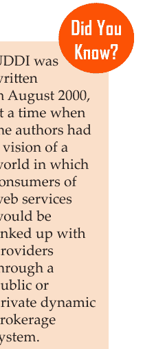

## 行业工具

让我们来看看 Web 服务标准和技术的作用，以及它们在 Web 服务架构及其开发过程中是如何被表示的。

### 简单对象访问协议 (SOAP)

简单对象访问协议（或 `SOAP`）充当服务提供者和服务请求者之间交换信息的消息协议。它由以下部分组成：

- **SOAP 节点（Envelope）**。它描述消息，识别内容和封包的处理信息。
- **SOAP 传输（Transport）**。它定义了底层传输协议（如 `HTTP` 和 `SMTP`）的绑定。
- **SOAP 编码（Encoding）**。它定义了一组编码规则，将特定数据的实例映射到 XML 元素。
- **SOAP RPC 约定**。它定义了 `RPC` 请求和响应的表示。这些 `SOAP` 请求和响应被封装为一种数据类型并传递到 `SOAP` 体中。

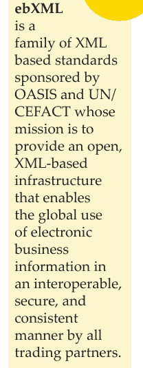


列表 1 表示了一个使用 `HTTP POST` 请求的 `SOAP` 消息，用于发送带参数的 `GetBookPrice()` 方法以获取书籍的价格。

```
POST /StockQuote HTTP/1.1
Host: www.scaremeretailer.com
Content-Type: text/xml; charset="utf-8"
Content-Length: 1000
SOAPAction: "getBookPrice"
<SOAP-Envelope
xmlns:SOAP-ENV="http://schemas.xmlsoap.org/soap/envelope/"
xmlns:xsi="http://www.w3.org/2001/XMLSchema-instance"
xmlns:xsd="http://www.w3.org/2001/XMLSchema"
soap:encoding="http://schemas.xmlsoap.org/soap/encoding/">
<SOAP-ENV:Body>
<getBookPrice xmlns="http://www.wiley.com/jws.book.priceList">
<bookname xsi:type="xsd:string">
Developing Java Web services
</bookname>
</getBookPrice>
</SOAP-ENV:Body>
</SOAP-ENV:Envelope>
```

### 列表 1. 使用 HTTP 的 SOAP 消息。

在编写时，`SOAP` 的当前版本是带附件的 `SOAP 1.2` (`SwA`)，`W3C` 仍在对其进行开发。

### Web 服务描述语言 (WSDL)

Web 服务描述语言（或 `WSDL`）是一种基于 `XML Schema` 的规范，用于将 Web 服务描述为一组操作和作为消息的数据输入/输出参数。`WSDL` 还定义了通信模型，并带有绑定机制，可以将任何传输协议、数据格式或结构附加到抽象消息、操作或端点。

列表 2 显示了一个 `WSDL` 示例，该示例描述了一个使用 `GetBookPrice` 操作获取书籍价格的 Web 服务。


```xml
<?xml version="1.0"?>
<definitions name="BookPrice"
  targetNamespace="http://www.wiley.com/bookprice.wsdl"
  xmlns:tns="http://www.wiley.com/bookprice.wsdl">
```


```xml
xmlns:xsd="http://www.w3.org/2000/10/XSchema"
xmlns:xsd="http://www.wiley.com/bookprice.xsd"
xmlns:soap="http://schemas.xmlsoap.org/wsdl/soap/"
xmlns="http://schemas.xmlsoap.org/wsdl/soap/">
  <message name="GetBookPriceInput">
    <part name="bookname" element="xsd:string"/>
  </message>
  <message name="GetBookPriceOutput">
    <part name="price" type="xsd:float"/>
  </message>
  <portType name="BookPricePortType">
    <operation name="GetBookPrice">
      <input message="tns:GetBookPriceInput"/>
      <output message="tns:GetBookPriceOutput"/>
    </operation>
  </portType>
```

```xml
<binding name="BookPriceSoapBinding"
  type="tns:BookPricePortType">
  <soap:binding style="rpc"
    transport="http://schemas.xmlsoap.org/soap/"/>
  <operation name="GetBookPrice">
    <soap:operation soapAction="getBookPrice"/>
    <input>
      <soap:body use="literal"/>
    </input>
    <output>
      <soap:body use="literal"/>
    </output>
  </operation>
</binding>
```


```xml
  <operation name="GetBookPrice">
    <input>
      <soap:body use="literal"/>
    </input>
    <output>
      <soap:body use="literal"/>
    </output>
  </operation>
</binding>
<service name="BookPriceService">
  <documentation>Wiley Service</documentation>
  <port name="BookPricePort" binding="tns:BookPriceSoapBinding">
    <soap:address location="http://www.wiley.com/bookprice"/>
  </port>
</service>
</definitions>
```

列表 2 描述服务的 WSDL 文档。

### 2.2.3 通用描述、发现与集成 (UDDI)

通用描述、发现与集成（UDDI）为发布和发现已注册的 Web 服务提供了一种标准机制，它还作为基于 WSDL 服务描述的注册表和仓库。在基于 ebXML 的架构中，ebXML 注册与仓库提供了存储用于业务协作的 CPP/CPA 描述的设施。

当 UDDI 查询服务时，将返回描述服务的 WSDL。

UDDI 可以实现为支持全球社区的公共注册表或支持企业的私有注册表。

### 2.2.4 ebXML

ebXML 通过实现业务流程、合作伙伴配置和合作伙伴协议的标准化，为构建电子商务提供标准框架。通常，ebXML 补充了 SOAP、WSDL 和 UDDI 等 Web 服务标准。

以下是 ebXML 的主要功能：

- ebXML 消息服务 (MS) 是 SOAP 的扩展，提供了可靠性和安全性。
- ebXML BPSS 允许描述业务流程。
- ebXML CPP/CPA 是 WSDL 的扩展，允许描述合作伙伴配置和协议。
- ebXML reg/rep 提供注册表和仓库，而 UDDI 仅仅是一个注册表。
- ebXML 核心组件为业务社区提供了业务组件目录。

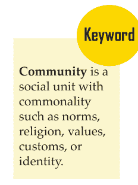

## 2.3 Web 服务通信模型

在 Web 服务架构中，根据功能需求，可以使用基于 RPC 的同步或基于消息的同步/异步通信模型来实现。在设计和实现 Web 服务之前，需要理解这些通信模型。

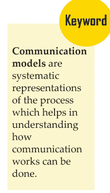

### 2.3.1 基于 RPC 的通信模型

基于 RPC 的通信模型定义了基于请求/响应的同步通信。

当客户端发送请求时，客户端等待服务器返回响应后继续执行操作。

实现 CORBA 或 RMI 通信的典型，基于 RPC 的 Web 服务是紧耦合的，并以远程对象应用于客户端应用程序。图 2 表示了 Web 服务中基于 RPC 的通信模型。

客户端具有为方法调用提供参数的能力。然后，客户端通过将参数值发送到 Web 服务提供者来调用 Web 服务，提供者执行所需的方法并返回返回值。

此外，使用基于 RPC 的通信，服务提供者和请求者可以分别注册和发现服务。

## Web 服务架构

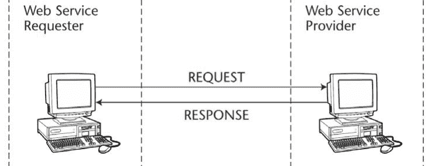

图 2. Web 服务中基于 RPC 的通信模型。

### 2.3.2 基于消息的通信模型

基于消息的通信模型定义了一种松耦合且文档驱动的通信。服务请求者在调用基于消息的服务提供者时不需要等待响应。图 3 表示了 Web 服务架构中基于消息的通信模型。

在图 3 中，客户端服务请求者调用基于消息的 Web 服务；它通常发送的是整个文档，而不是发送一组参数。服务提供者接收文档、对其进行处理，然后可能返回也可能不返回消息。根据实现的不同，客户端可以异步地向基于消息的 Web 服务发送或从其接收文档，但在瞬时不能同时进行这两项功能。此外，也可以通过同步通信模型来实现消息传递，即客户端向服务提供者发出服务请求，然后等待并从服务提供者处接收文档。

采用什么样的通信模型还取决于 Web 服务提供者的基础设施及其用于 RPC 和消息的客户端协议。当前版本的 SOAP 1.2 和 ebXML 消息支持这些通信模型；确保这些协议合规并被 Web 服务提供者支持至关重要。此外，满足其他服务质量（QoS）和环境需求（如安全性、可靠性和性能）也同样重要。

在进入开发方法之前，让我们先来看看实现 Web 服务模型的处理步骤。

### Java Web 服务

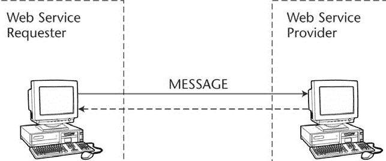

图 3. 基于消息的通信模型。

## 2.4 实现 Web 服务

实现 Web 服务的过程与使用 CORBA 或 RMI 实现任何分布式应用非常相似。然而，在 Web 服务中，使用标准协议时，所有组件仅在运行时动态绑定。图 4 阐述了实现 Web 服务的重点。

如图 4 所示，实现 Web 服务的基本步骤如下：

1. 服务提供者通常为暴露的业务应用程序创建基于 SOAP 的服务接口，即创建 Web 服务。然后提供者将它们部署在服务容器或使用 SOAP 运行时环境中，然后使它们可以通过网络进行调用。服务提供者还将基于 WSDL 的服务描述描述 Web 服务，该描述定义了客户端和服务容器，并以一致的方式标识服务位置、操作及其通信模型。
2. 服务提供者随后将基于 WSDL 的服务描述注册到服务代理中，通常是一个 UDDI 注册表。
3. UDDI 注册表随后将服务描述存储为绑定模板以及指向提供者环境中的 WSDL 的 URL。
4. 服务请求者通过查询 UDDI 注册表定位所需的服务。服务请求者获取绑定信息和识别服务提供者的 URL。
5. 使用绑定信息，服务请求者调用服务提供者并检索这些已注册服务的 WSDL 服务描述。然后，服务请求者创建一个代理应用程序并使用 SOAP 与服务提供者建立通信。


6. 最后，服务请求者通过调用服务容器中的可用服务与服务提供者进行通信并交换数据或消息。

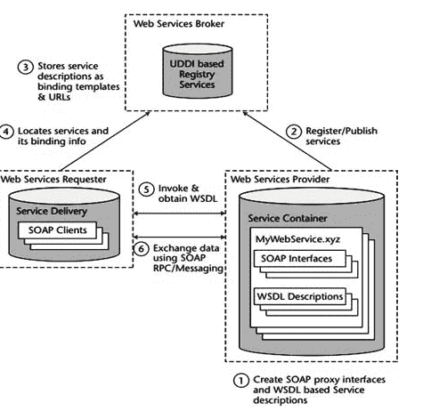

**图 4.** 实现服务涉及的步骤。

在 ebXML 环境的情况下，上述步骤是相同的，只是分别用 ebXML 注册表和仓库、ebXML 消息以及 ebXML CPP/CAP 代替了 UDDI、SOAP 和 WSDL。所示的基本步骤也不包含安全和服务质量（QoS）任务的实现。

## 2.5 开发启用 Web 服务的应用程序

创建启用服务的应用程序的设计和开发过程与开发分布式应用的典型过程并无区别。对于 Web 服务，可以创建一个新应用程序，也可以通过将现有应用程序重新用作服务来创建它。在 Web 服务实现中，可以通过封装这些底层应用程序的核心业务功能，将现有的遗留应用程序暴露为服务。底层应用程序可以是任何编程语言实现并运行在任何平台上的应用程序。


编程语言是一种正式语言，由一组产生各种输出的指令组成。编程语言用于计算机编程以实现算法。


图 5 表示了一个典型的 Web 服务实现模型，该模型提供了支持多种后端应用环境的面向服务的接口。

通过暴露后端业务应用程序开发 Web 服务解决方案时通常涉及的实现步骤如下：

1. 底层应用程序的潜在业务组件将使用 SOAP 封装为面向服务的接口，然后通过将它们部署在 Web 服务容器或 SOAP 运行时环境中将其暴露为 Web 服务。使用这些基于 SOAP 的接口，服务容器处理所有入站的 SOAP 请求/响应或基于消息的操作，并将它们映射为底层业务应用程序的方法和参数。

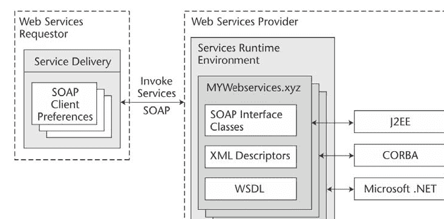

图 5. 通过 Web 服务暴露应用程序。

2. 将生成基于 WSDL 的服务描述并存在服务容器中。WSDL 定义了调用基于 SOAP 的接口所需的通信合约。这些基于 WSDL 的服务描述将作为服务模板和其位置 URL 发布到 UDDI 注册表中。发布到 UDDI 注册表所需的接口通常由服务容器提供。
3. 服务请求者使用发现机制（注册表 API）查找服务并获取服务描述及其提供者位置 URL。然后连接到服务提供者以获取 WSDL。
4. 为了调用服务提供者暴露的服务，服务请求者（服务交付环境）需要根据 WSDL 中定义的描述实现基于 SOAP 的客户端接口。

## Web 服务架构

Web 服务容器/运行时环境通常提供从现有应用程序创建基于 SOAP 的服务以及生成基于 WSDL 描述所需的工具。根据 Web 环境，某些提供者还提供 UDDI 测试环境和发布接口。

在典型的实现中，基于 J2EE 的 Web 服务模型定义了另一种暴露业务组件的方式，类似于 Web 应用程序和基于 RMI/IIOP的应用连接，而无需更改现有 J2EE 组件的架构模型或代码。


### Java Web 服务

在基于 J2EE 的应用服务器环境中，J2EE 组件可以通过 RMI/IIOP 暴露用于远程访问。对于使用 J2EE 环境的 Web 服务提供者，除了 RMI/IIOP 之外，还可以通过 WSDL 将这些组件暴露为服务，并通过发送和接收基于 SOAP 的请求/响应或消息来处理暴露的服务。


今天，大多数 Web 服务平台供应商和 J2EE 应用服务器厂商已经发布了相应的支持工具集，可以将 J2EE 组件暴露为 EJBs 并将 Servlet 作为 Web 服务。通常，这些工具提供了生成基于 WSDL 的服务描述和服务接口类的功能，这些类根据 WSDL 中定义的服务发送和接收 SOAP 消息。

从基于 J2EE 的应用程序组件创建 Web 服务通常涉及以下步骤：

- 选择一个 Web 服务平台供应商，该供应商为在 J2EE 应用程序上构建和部署服务提供一致的平台。
- 定义启用 Web服务的应用程序及其行为。
  - 选择需要暴露为服务或使用现有服务的潜在 J2EE 组件（例如 EJBs、Servlets 和 JMS 应用程序）。
- 根据底层组件所需的行为选择通信模型（基于 RPC 的同步或基于消息的异步），例如使用基于 RPC 通信的 Session 或 Entity EJBs，或使用基于消息通信的 JMS 应用程序。
- 确保服务仅使用 Web 服务容器支持的 XML 和 Java 内置/自定义数据类型映射。这仅适用于基于 RPC 的通信模型。
- 通过编写访问暴露组件（例如 EJBs、Servlets 和 JMS 应用程序）所需的接口来开发 Web 服务。


- 开发所需的潜在 J2EE 组件（例如 EJBs、Servlets 和 JMS 应用程序）并部署在符合 J2EE 标准的容器中。确保组件使用的数据类型在供应商定义的 XML/Java 映射受支持。
- 实现 SOAP 消息处理器。
- 将所需的组件组装成所需的结构（由 Web 服务平台供应商定义），此外为服务创建部署描述符（由 Web 服务平台供应商定义），将其打包为可部署的 EAR。
- 大多数 Web 服务平台供应商提供实用工具，通过内省组件（特别是其方法和值）并将其映射到支持的数据类型来生成 Web 服务组件（SOAP 接口）。
- 将 Web 服务组件部署在 Web 服务容器中，并使其远程客户端可用（根据所需的协议绑定，如 HTTP 和 SMTP）。
- 创建用于调用已部署 Web 服务的测试客户端。
- 在 UDDI 注册表中注册并发布您的 Web 服务，以防需要通过搜索公共/私有 UDDI 注册表查找 Web 服务来启用服务。

这些步骤是通用的。它们基于大多数流行的 Web 服务平台供应商提供的实现。也许在未来，实现可能会根据新兴标准而有所不同。

### J2EE 和 Java Web 服务开发者包 (JWSDP)

Sun Microsystems 作为 Java 社区进程的一部分，已经为开发者社区发布了 Java Web 服务 API，即 Java Web 服务开发者包 (JWSDP)。它提供了一套使用 Java API 开发和测试 Web 服务的解决方案。此外，Systinet、CapeClear 和 Mind Electric 等领先的 Web 服务平台供应商，以及 BEA、IBM 等领先的 J2EE 厂商也

> 预计即将发布的 J2EE 1.4 规范将提供完整的 Web 服务平台，并能够将 J2EE 组件部署为 Web 服务。


### Java Web 服务

SunPlanet 同样发布了他们的 Web 服务能力，采用 Java 平台并根据 JWSDP 支持 Web 服务的 Java API。

JWSDP 1.0 提供了一站式的 Java API 解决方案，用于使用 Java 平台构建 Web 服务。关键 API 组件包括：

- XML 消息 Java API (JAXM)
- XML 处理 Java API (JAXP)
- XML 注册表 Java API (JAXR)
- XML 绑定 Java API (JAXB)
- 基于 XML 的 RPC Java API (JAX-RPC)
- Java WSDP 注册服务器 (JWSDP)
- Java 页面标准标签库 (JSTL)

### 将 J2EE 组件暴露为 Web 服务

本节探讨了 J2EE 环境以及利用 J2EE 组件作为 Web 服务的可用 Web 服务技术。J2EE 环境交付与平台相关的组件化应用程序，提供了多层分布式应用程序模型，具有许多优势，如安全性、可扩展性、管理工具、厂商实现之间的移植性以及部署应用程序的可靠性。通常，它定义了位于逻辑层中的以下组件：

- JavaServer Pages (JSP) 和基于 Java Servlet 的组件作为运行在 J2EE 服务器 Web/服务器容器上的 Web 组件。
- 基于 Enterprise JavaBeans (EJB) 的组件作为业务或持久化组件，运行在 J2EE 服务器的 EJB 容器上。
- JDBC（Java 数据库连接）和基于 J2 连接器架构的组件作为 J2EE 服务器的集成。

简而言之，从 J2EE 开发 Web 服务需要使用 J2EE 实现组件（如 EJBs 和 servlet），然后将其打包并部署在 J2EE 容器中。然后这些组件托管在符合 J2EE 标准的应用服务器中。将这些 J2EE 组件暴露为 Web 服务还需要 Web 服务环境，该环境支持基于 SOAP 的代理部署。在典型场景中，将基于 J2EE 的应用程序组件暴露为 Web 服务涉及以下步骤：

#### 服务提供者的步骤

1. 部署在应用服务器上的潜在 J2EE 组件将封装为基于 SOAP 的面向接口并部署在 Web 服务环境中。
2. 生成 WSDL 服务描述并将其放入运行时环境中。服务请求者使用 WSDL 描述创建 SOAP 客户端接口。
3. 使用注册表 API 将 WSDL 在公共/私有 UDDI 注册表中发布。

#### 服务请求者的步骤


- 服务请求客户端使用服务提供者暴露的 WSDL 描述创建 SOAP 客户端接口。
- 服务请求者可以选择任何语言来实现客户端接口，但必须确保使用 SOAP 进行通信。
- 这些客户端接口随后被用于调用服务提供者的服务。

在本文编写期间，大多数 J2EE 应用服务器正在开发作为 J2EE 环境的服务容器的 Web 服务运行时；其中大多数已经发布了测试版。即将发布的 J2EE 1.4 和 EJB 2.1 规范重点关注 Web 服务。

### 2.5.2 使用 J2EE 开发 Web 服务：示例

在开始之前，让我们看看这个示例说明的背景，它是基于一家名为 ACME Web Services 的虚构公司。在这个示例中，我们将使用 J2EE 应用服务器实现 J2EE 组件并为服务提供者使用其服务容器将它们暴露为服务接口。

我们还将使用 SOAP 提供者构建客户端调用接口。ACME Web 公司是一家基于 Web 的服务提供商，它通过暴露其业务功能，在互联网上交付基于 XML 的数据作为 Web 服务给其合作伙伴和转销商，从而销售计算机产品。服务提供者暴露的功能如下：

- 面向销售给零售商的计算机系统产品目录
- 特定产品的详细信息
- 向转销商销售计算机系统和产品

服务请求者是合作伙伴和转销商，他们使用 ACME Web 服务获取目录和产品信息、下订单、获取发票等。服务请求者使用它们自己的应用程序环境并对 ACME Web 服务进行某些基于 SOAP 的服务调用（见图 6）。

为了构建和部署 ACME Web 服务，我们选择了以下基础设施解决方案：

#### 1. 服务提供者端特性

- ACME Web 服务提供者将使用 `BEA WebLogic 7.0` 作为其 J2EE 应用服务器及其 Web 运行时环境/容器。
- `BEA WebLogic 7.0` 是符合 J2EE 1.3 标准的应用程序服务器，能够从现有的 J2EE 组件创建、组装和部署 Web 服务。`WebLogic Server` 提供了 `Sun JAX-RPC API` 的早期访问实现，能够构建 RPC 风格的 Web 服务。它还包含了 `WebLogic Workshop`——一个用于开发和测试 Web 服务的开发环境（IDE）。`BEA WebLogic 7.0` 可供开发者在 `www.bea.com` 下载评估版副本。

`WebLogic 7.0` 提供了 `servicegen`，这是一个 SOAP 和 WSDL 生成工具，能够从 JEE 组件创建基于 SOAP 的面向服务的接口。它还提供了一个客户端生成器工具 `clientgen`，它能够创建用于调用 Web 服务的 Java 客户端。此外，它还提供了序列化和反序列化类，可将 XML 转换为数据的 WSDL 表示形式，反之亦然。

ACME Web 服务提供者还使用符合 `JAXP` 标准的 XML 解析器和 `PointBase` 作为其存储和查询信息的数据库。`JAXP` 和 `PointBase` 也可以作为 `BEA WebLogic` 软件包的一部分或单独下载提供。`PointBase` 数据库也可用于开发目的的评估查询。

#### 2. 服务请求者端特性

`Apache Axis 1.0B3` 是符合 SOAP 1.1 标准的实现，能够创建、组装和部署基于 Java 的 SOAP 服务。更重要的是，它提供了一个从部署的服务自动生成 WSDL 的工具，以及一个 `WSDL2Java` 工具，用于从服务提供者获取的 WSDL 构建 Java 代理和骨架。

服务请求者将使用 `Apache Axis 1.0B3` 作为其 SOAP 客户端环境来调用 ACME Web 服务提供者的服务。

`Apache Axis` 是 Apache 的一项开源项目，可以在 `http://xml.apache.org/axis/index.html` 免费下载。

为了构建和部署 JEE 组件和 SOAP 接口，我们使用 `Apache Ant` 创建基于 XML 的构建脚本。`Apache Ant` 是一个基于 Java 的 Makefile 工具，可以在 `http://jakarta.apache.org/ant/index.html` 免费下载。

### 构建 ACME Web 服务提供者

在 `BEA WebLogic 7.0` 环境中构建完整的 ACME Web 服务提供者通常涉及以下任务：

1. 设计业务应用程序以理解问题，然后规划事件序列，选择合适的设计模式，并创建实现所需的概念类模型。
2. 安装并设置基于 `WebLogic` 的 JEE 开发环境，包括在 Java 编译器类路径中所需的类库。
3. 为应用程序创建数据库表。
4. 实现 JEE 组件以及所需的 DAO（数据访问对象）、XML 辅助类和数据库表等。
5. 构建并测试 J2EE 组件和其他类。
6. 使用 `WebLogic` 和工具生成基于 SOAP 的面向服务的接口和基于 WSDL 的服务描述。
7. 将组件作为 Web 服务组装并部署到 `WebLogic` 服务器。
8. 创建测试列表和环境。

### 设计应用程序

如所述，ACME 服务提供者将通过暴露其相关的 J2EE 组件，在互联网上将其产品目录应用程序托管为 Web 服务。特别是，我们将关注以下业务功能：

- 从 ACME 产品数据库中获取完整的产品目录列表
- 获取给定产品标识符的详细产品信息

为了理解问题和事件流，请查看图 7。该序列图进一步说明了调用 ACME 服务的客户端在 `WebLogic` 服务器中执行的各种动作序列。根据之前的事件序列，我们选择使用门面模式，让一个会话豆作为代理，封装业务服务组件（如 `AcmeXMLHelper` 和 `AcmeDAO`）之间的交互。`AcmeXMLHelper` 将处理所有的 XML 构建，而 `AcmeDAO` 将处理数据库交互。

图 8 展示了 JEE 组件的类图。

### 设置开发环境

`WebLogic 7.0` 提供了 `servicegen`，这是一个 SOAP 和 WSDL 生成工具，能够从 JEE 组件创建基于 SOAP 的面向服务的接口。它还提供了一个客户端生成器工具 `clientgen`，它能够创建用于调用 Web 服务的 Java 客户端。此外，它还提供了序列化和反序列化类，可将 XML 转换为数据的 WSDL 表示形式，反之亦然。

ACME Web 服务提供者还使用符合 `JAXP` 标准的 XML 解析器和 `PointBase` 作为其存储和查询信息的数据库。`JAXP` 和 `PointBase` 也可以作为 `BEA WebLogic` 软件包的一部分或单独下载提供。`PointBase` 数据库也可用于开发目的的评估查询。

### 创建 ACME 数据库表

1. 使用 `WebLogic` 控制台（例如 `http://localhost:7001/`），导航到 `JDBC > 数据源`，创建一个 JNDI 名称为 `JWSPool` 的数据。数据源应具有以下属性：

   - JNDI 名称：`JWSPool`
   - 池名称：`JWSPool`
   - 目标（目标选项卡上）：`myserver`

2. 然后导航到 `JDBC > 连接池`，创建一个名为 `JWSPool` 的连接池（以 `PointBase` 为例），属性如下：

```
URL: jdbc:pointbase:server://localhost/demo
驱动类名: com.pointbase.jdbc.jdbcUniversalDriver
属性: user=public
密码：（隐藏）
目标（目标选项卡上）：myserver
```

3. 重启 `WebLogic` 服务器并确保数据库已启动。`WebLogic` 服务器的 `config.xml` 如下所示：

```xml
<JDBCConnectionPool
Driver="com.pointbase.jdbc.jdbcUniversalDriver"
Name="JWSPool" Properties="user=public" Targets="myserver"
URL="jdbc:pointbase:server://localhost/demo//>
<JDBCDataSource JNDName="JWSPoolDataSource" PoolName="JWSPool"
Targets="myserver/>
```

| 列名 | 数据类型 |
|---|---|
| ITEM_NAME | VARCHAR(30) |
| ITEM_DESC | VARCHAR(255) |
| ITEM_PRICE | DOUBLE |
| CURRENCY | VARCHAR(3) |

表 1. 数据库表参数

通过这些步骤，`WebLogic` 数据源和数据库服务器已就绪。

现在让我们创建 ACME 产品目录所需的 `product_catalog` 表。我们使用表 1 所示的表参数。

为了创建 `product_catalog` 表并填充数据，你可以选择使用 Java 代码 `CreateACMETables.java`（见列表 3）。

```java
// CreateACMETables.java

package jws.ch3.db;
import java.sql.*;
import java.util.*;
import javax.naming.*;

public class CreateACMETables {

    public static void main(String argv[])
throws Exception {
        java.sql.Connection conn = null;
        java.sql.Statement stmt = null;

        try {
            // === 建立数据库连接 ============
            // 从 JNDI 树获取 Datasource 连接。

            Context ctx = null;
            // 将连接属性放入哈希表中。

            Hashtable ht = new Hashtable();
            ht.put(Context.INITIAL_CONTEXT_FACTORY, "weblogic.jndi.WLInitialContextFactory");
            ht.put(Context.PROVIDER_URL, "t3://localhost:7001/");

            // 获取用于 JNDI 查询的上下文
            ctx = new InitialContext(ht);
            javax.sql.DataSource ds = (javax.sql.DataSource) ctx.lookup("jdbc/WNGSPoolDataSource");
            conn = ds.getConnection();
            System.out.println("Making connection...\n");

            // 执行 SQL 语句
            stmt = conn.createStatement();

            int numrows = stmt.executeUpdate("insert into \nproduct_catalog values (1001,\n'ACME Blade 1000', 'Ultra Spac III')");

            System.out.println("Number of rows inserted = * \n+ numrows);
            numrows = stmt.executeUpdate("insert into \nproduct_catalog values (1002,\n'ACME Blade 2000', 'Spac III \nProcessor, 1.3GHz x2, 512MB, 42GB HD,\nSolaris', 3000.00, 'USD');");

            System.out.println("Number of rows inserted = * \n+ numrows);
            numrows = stmt.executeUpdate("insert into \nproduct_catalog values (1003, 'ACME Server \ne7000', 'Spac III Processor, 1.3GHz x12,\n1GB, 1TB HD, Solaris', 75000.00,\n'USD');");

            System.out.println("Number of rows inserted = * \n+ numrows);
            stmt.execute("select * from product_catalog");

            System.out.println("Product No:
              " + rs.getString("item_num")
              " + Product Name: "
              " + rs.getString("item_name")
              " + Product Desc: "
              " + rs.getString("item_desc")
              " + Price: " + rs.getString("item_price")
              " + Currency: " + rs.getString("currency") ");

        } catch (Exception e) {
            System.out.println("Exception was thrown: 
              " + e.getMessage());

        } finally {
            try {
                if (stmt != null) {
                    stmt.close();
                }
                if (conn != null) {
                    conn.close();
                }
            } catch (SQLException sqle) {
                System.out.println("SQLException
                during close(): " 
                  " + sqle.getMessage());
            }
        }
}
```

**Listing 3** `CreateACMETables.java`。

要编译并运行之前的类，请确保 `WebLogic` JAR 和 `PointBase` 驱动程序在 `CLASSPATH` 中。然后，导航到源码目录并运行 `Ant` 构建脚本 (`build.xml`)。用于编译和测试之前的类的构建文件名见第 4 节。

```xml
<project name="acme_all" default="all" basedir=".">
  <property file="../../mydomain.properties"/>
  <property name="build.compiler" value="${JAVAC}"/>
  <!--为此构建设置全局属性 -->
  <property name="source" value="."/>
  <target name="all" depends="compile"/>
</project>
```

## Java Web Services


```xml
<!-- 将 'CreateACMETables' 类编译到
clientclasses 目录 -->
<target name="compile">
  <javac srcdir="${source}
        destdir="${CLIENT_CLASSES}"
        includes="CreateACMETables.java" />
</target>

<!-- 运行 ACME 表创建 -->
<target name="run">
  <java className="jws.ch3.db.CreateACMETables"
        forks="1" failonerror="true">
    <classpath>
      <path path="${CLASPATH}"/>
    </classpath>
  </java>
</target>
</project>
```

**Listing 4.** 用于创建 ACME 业务表的 Ant 脚本。

在源码目录中运行 Ant 工具。编译后的类将保存到 `build.xml` 中指定的相应位置。现在，要执行 `CreateACMETables`，可以带参数运行 Ant 工具。如果一切正常，将在数据库中生成 `product_catalog` 条目并插入记录。输出如图 9 所示。

**图 9.** 显示 ACME 业务表的创建。

### 实现 JEE 组件

根据类图，实现 Web 服务的 JEE 组件如下：

- **DAO** 类允许访问数据并抽象了底层实现。
- **XMLHelper** 类收集供业务客户端（`SessionBean`）使用的 XML 字符串。
- **SessionBean** 作为代理封装了后端组件的交互。

### 构建 DAO 类

要实现 DAO，我们需要定义一个 DAO 接口并由 `DAOImpl` 实现。DAO 接口的源码见 Listing 5。

```java
// DAO.java
package jws.ch3.dao;

import java.util.*;
import jws.ch3.exceptions.DAOException;
import jws.ch3.model.Product;

/**
 * DAO.java 是一个接口，由 DAOImpl 实现
 */
public interface DAO {
    Product getProduct(int productID) throws DAOException;
    Iterator getCatalog() throws DAOException;
}
```

**Listing 5** DAO.java。

`DAOImpl.java` 的源码实现见 Listing 6。

```java
// DAOImpl.java
package jws.ch3.dao;

import java.sql.*;
import javax.naming.*;
import jws.ch3.model.Product;
import jws.ch3.exceptions.DAOException;

/**
 * 此类实现了对数据库的 封装了所有的 SQL 调用
 */
public class DAOImpl implements DAO {

    // 数据访问方法
    protected static DataSource getDataSource() throws DAOException {
        try {
            // === 连接数据库
            // 从 JNDI 树获取 Datasource 连接。

            Context ctx = null;
            // 将连接属性放入哈希表中。

            Hashtable ht = new Hashtable();
            ht.put(Context.INITIAL_CONTEXT_FACTORY, "weblogic.jndi.WLInitialContextFactory");
            ht.put(Context.PROVIDER_URL, "t3://localhost:7001/");

            // 获取 JNDI 查询的上下文
            ctx = new InitialContext(ht);
            javax.sql.DataSource ds = (javax.sql.DataSource) ctx.lookup("JWSPoolDataSource");
            return ds;

        } catch (NamingException ne) {
            throw new DAOException("NamingException while looking up DB context : " + ne.getMessage());
        }
    }

    // 业务方法
    public Product getProduct(int productID) throws DAOException {
        Connection c = null;
        PreparedStatement ps = null;
        ResultSet rs = null;
        Product ret = null;

        try {
            c = getDataSource().getConnection();
            ps = c.prepareStatement("select item_num, item_name, item_desc, item_price, currency "
                + "from product_catalog "
                + "where item_num = ?", 
                ResultSet.TYPE_SCROLL_INSENSITIVE,
                ResultSet.CONCUR_READ_ONLY);
            ps.setInt(1, productID);
            rs = ps.executeQuery();
            if (rs.first()) {
                ret = new Product(rs.getInt(1),
                    rs.getString(2),
                    rs.getString(3),
                    rs.getDouble(4),
                    rs.getString(5));
            }
        } catch (SQLException se) {
            throw new DAOException("SQLException: " + se.getMessage());
        } finally {
            if (rs != null) rs.close();
            if (ps != null) ps.close();
            if (c != null) c.close();
        }
        return ret;
    }

    public Iterator getProductCatalog() throws DAOException {
        Connection c = null;
        PreparedStatement ps = null;
        ResultSet rs = null;
        ArrayList prodList = new ArrayList();

        try {
            c = getDataSource().getConnection();
            ps = c.prepareStatement("select item_num, item_name, item_desc, item_price, currency "
                + "from product_catalog");
            rs = ps.executeQuery();
            while (rs.next()) {
                prod = new Product(rs.getInt(1),
                    rs.getString(2),
                    rs.getString(3),
                    rs.getDouble(4),
                    rs.getString(5));
                prodList.add(prod);
            }
        } catch (SQLException se) {
            throw new DAOException("SQLException: " + se.getMessage());
        } finally {
            if (rs != null) rs.close();
            if (ps != null) ps.close();
            if (c != null) c.close();
        }
        return prodList;
    }
}
```

```java
)
prodList.add(prod);

rs.close();
ps.close();
c.close();
return prodList.iterator();
}
catch (SQLException se) {
    throw new AcmeDAOException(
        "SQLException: "
        + se.getMessage());
}

public static void main(String[] arg) {
    AcmeDAOImpl adi = new AcmeDAOImpl();
    Product prod = adi.getProduct(1001);
    prod.print();

Iterator itr = adi.getProductCatalog();
while (itr.hasNext()) {
    Product p = (Product)itr.next();
    p.print();
}

```

```

```

**Listing 6** AcmeDAOImpl.java。

我们还需要实现值对象 `Product` 以及用于 AcmeDAO 的异常类，以及值对象 `Product.java` 的源代码。实现如列表 7 所示。

```java
// Product.java
package jws.ch3.model;

import java.util.*;
import java.io.*;

/**
 * 此类作为 Product 的值对象
 * 它定义了访问器方法
 */
public class Product {

    private int productID;
    private String productName;
    private String productDesc;

    private double productPrice;
    private String currency;

    public Product(int prodID, String prodName,
        String productDesc, double prodPrice, String curr) {
    productID = prodID;
    productName = prodName;
    productDesc = productDesc;
    productPrice = prodPrice;
    currency = curr;
    }

    public int getProductID() {
        return productID;
    }

    public String getProductName() {
        return productName;
    }

    public String getProductDesc() {
        return productDesc;
    }

    public double getProductPrice() {
        return productPrice;
    }

    public String getCurrency() {
        return currency;
    }

    public void setProductID(int aProductID) {
        productID=aProductID;
    }

    public void setProductName(String aProductName) {
        productName=aProductName;
    }

    public void setProductDesc(String aProductDesc) {
        productDesc=aProductDesc;
    }

    public void setProductPrice(double aProductPrice) {
        productPrice=aProductPrice;
    }

    public void setCurrency(String aCurrency) {
        currency=aCurrency;
    }

    public void print() {
        System.out.println(productID);
        System.out.println(productName);
        System.out.println(productDesc);
        System.out.println(productPrice);
        System.out.println(currency);
    }
}
```

**列表 7** Product.java。

DAO 异常 `AcmeDAOException.java` 的源代码如列表 8 所示。

```java
// AcmeDAOException.java

package jws.ch3.exceptions;

/**
 * AcmeDAOException 是扩展了标准的
 * 运行时异常的异常。当发生某些不可恢复的错误
 *（如 SQLException）时，目录组件的
 * DAO 会抛出此异常。
 */
public class AcmeDAOException extends RuntimeException {

    public AcmeDAOException(String str) {
        super(str);
    }

    public AcmeDAOException () {
        super();
    }

}
```

**列表 8** AcmeDAOException.java。

要编译并运行前面的类，请确保 `CLSPATH` 中可用 WebLogic JAR 和 PointBase 驱动。然后进入源码目录并运行 Ant 构建脚本（`build.xml`）。用于编译和测试前面的类的 `build.xml` 如列表 9 所示。


```xml
<project name="acme_dao" default="all" basedir=".">

  <property file="../../../../mydomain.properties"/>
  <property name="build.compiler" value="$(JAVAC)"/>

  <!-- 为此构建设置全局属性 -->
  <property name="source" value="."/>

  <target name="all" depends="compile"/>

  <!-- 将 DAO 类编译到 serverclasses 目录 -->
  <target name="compile">
    <javac srcdir="${source}"
         destdir="${SERVER_CLASSES}"
         includes="AcmeDAO.java,AcmeDAOImpl.java" />
  </target>

  <!--  ACME DAO 测试 -->
  <target name="run">
    <java className="jws.ch3.dao.AcmeDAOImpl"
         fork="yes" failonerror="true">
      <classpath>
        <pathlement path="${CLASSP}"/>
      </classpath>
    </java>
  </target>
</project>
```

**列表 9** 用于 ACME DAO 类的 Ant 构建脚本。

现在要执行 `AcmeDAO` 类，你可以使用 `run` 作为参数执行 Ant 实用程序。程序的成功执行将查询 PointBase 数据库中的 `product_catalog` 表并向表中插入记录。

如果一切运行顺利，你将得到图 10 所示的输出。

## Web 服务架构

```text
E:\user\mydomain\src\jws\dao> ant build
build: compile
    compiling 2 source files...
BUILD SUCCESSFUL
Total time 2 seconds

E:\user\mydomain\src\jws\dao> ant run
build: run
    run: Running main: jws.ch3.dao.AcmeDAOImpl
1001
Product Name
Product Description
999.9
USD
```

```java
// 使用 Transformer 进行字符串 输出
TransformerFactory tFactory
    = TransformerFactory.newInstance();
Transformer transformer =
    tFactory.newTransformer();

DOMSource source = new DOMSource(xDoc);
StringWriter sw = new StringWriter();
transformer.transform(source,
    new StreamResult(sw));

return sw.toString();
} catch (TransformerConfigurationException tce) {
```

```java
throw new TransformerException(
tce.getMessageAndLocation());
} catch (TransformerException te) {
    throw new TransformerException(
te.getMessageAndLocation());
}
```

// 创建 Product XML 并添加 Line items 项目的方法

```java
private void createLineItemNode(Node parent, Product p) {
try {
    Element liElem =
    doc.createElement(AcmeConsts.LineItem);
parent.appendChild(liElem);
```

```java
// 创建 <ItemNumber> 元素并添加
Element elem =
doc.createElement(AcmeConstants.ItemNumber);
elem.appendChild(doc.createTextNode(
  String.valueOf(p.getID())));
liElem.appendChild(elem);
```

```java
// 创建 <ItemName> 元素并添加
elem = doc.createElement(AcmeConstants.ItemName)
elem.appendChild(doc.createTextNode(
  p.ProductName()));
liElem.appendChild(elem);
```

```java
// 创建 <ItemDesc> 元素并添加
elem = doc.createElement(AcmeConstants.ItemDesc)
elem.appendChild(doc.createTextNode(
  p.getProductDesc()));
liElem.appendChild(elem);
```

```java
// 创建 <ItemPrice> 元素并添加
elem =
doc.createElement(AcmeConstants.ItemPrice);
elem.appendChild(doc.createTextNode(
  String.valueOf(p.getProductPrice())));
liElem.appendChild(elem);
```

```java
// 创建 <Currency> 元素并添加
elem = doc.createElement(AcmeConstants.Currency)
elem.appendChild(doc.createTextNode(
  p.getCurrency()));
liElem.appendChild(elem);
```


## Web 服务架构

```java
) catch (Exception e) {
    e.printTrace();
}
}

// 用于测试的主方法
public static void main(String[] args) {
    try {
        AcmeXMLHelper ax = new AcmeHelper();
        System.out.println(ax.getProductCatalogXMLAsString());
        System.out.println("----------------------");
        System.out.println(ax.getProductXMLAsString(1001));
    } catch (Exception e) {
        e.printTrace();
    }
}
```

### 列表 11 AcmeXMLHelper.java。

要编译并运行 `AcmeXMLHelper` 类，请确保 WebLogic JARS（包含符合 JAX 标准的 XML 解析器）已在 `CLSPATH` 中。然后，导航到源码目录并运行 Ant 构建脚本 (`build.xml`)。用于编译和测试 `AcmeXMLHelper` 类的 build xml 如列表 12 所示。

```xml
<project name="acme_xmlhelper" default="all" basedir="*">

    <property file="../../../../mydomain.properties" />
    <property name="build.compiler" value="${JAVAC}" />

    <!--为此构建设置全局属性 -->
    <property name="source" value="*" />

    <target name="all" depends="compile" />

    <!-- 在 serverclasses 目录中编译 ACME XML 类 -->
    <target name="compile">
        <javac srcdir="${source}"
               destdir="${SERVER_CLASSES}"
               includes="AcmeXMLHelper.java, AcmeConsts.java" />
    </target>
</project>
```


### Java Web 服务

```xml
<!-- 运行 ACME XML Helper 测试 -->
<target name="run">
<java classname="jws.ch3.xmlhelper.AcmeXMLHelper
    fork="yes" failonerror="true">
<classpath>
<pathelement="${CLASSPATH}"/>
</classpath>
</java>
</target>
</project>
```

**列表 12** 用于编译 `ACMEXMLHelper` 类的 `build.xml`。（续）

要执行 `ACMEXMLHelper` 类，你可以带上参数运行 Ant 工具程序。该程序的成功执行将查询 PointBase 数据库中的 `product_catalog` 表并向该表插入 Product 记录。

如果一切运行顺利，你将得到如图 11 所示的输出。

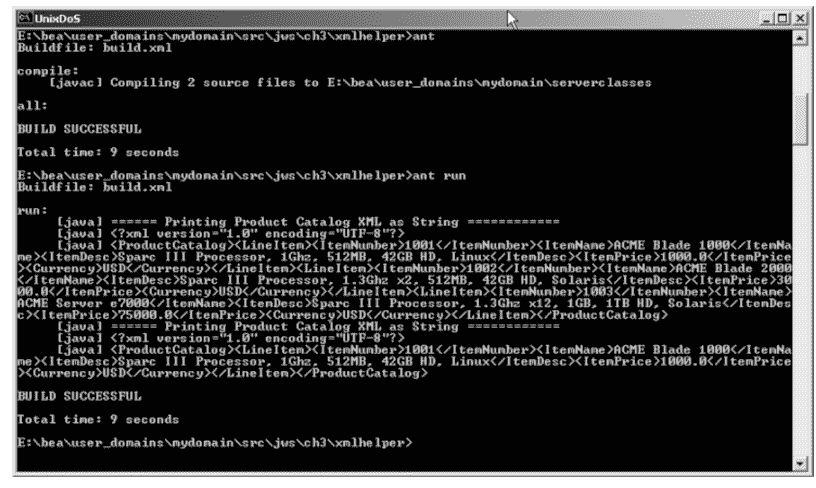

**图 11.** 测试 ACME XML helper 类。

### 构建会话豆 (Session Bean)

最后，我们需要实现一个无状态会话豆（stateless session bean），作为所有业务服务类的会话外观（facade）。像任何其他 EJB 一样，它包含了主接口 `AcmeSessionHome`、远程接口 `AcmeSession` 以及 Bean 实现类 `AcmeSessionBean`。

`AcmeSessionHome` 接口简单地定义了一个 `create()` 方法，用于返回 `AcmeSession` 远程接口的引用。`AcmeSessionHome` 接口的源码如列表 13 所示。

```java
// AcmeSessionHome.java
package jws.ch3.ejb;
import javax.ejb.CreateException;
import java.rmi.RemoteException;
import javax.ejb.EJBHome;
/** Session Bean的主接口 */
public interface AcmeSessionHome extends EJBHome {
    public AcmeSession create() throws RemoteException;
}
```

**列表 13** `AcmeSessionHome.java`。

`AcmeSession` 定义了具有两个业务方法的 Acme 服务远程接口。`AcmeSession` 接口源码如列表 14 所示。

```java
// AcmeSession.java
package jws.ch3.ejb;
import java.rmi.RemoteException;
import javax.ejb.EJBObject;
/** Acme Session EJB 的远程接口。
* 它提供了所有 ACME 函数的 ejb 层会话外观。*/
public interface AcmeSession extends EJBObject {

    public String getCatalog() throws RemoteException;
    public String getProduct(int productID) throws RemoteException;
}
```

### 列表 14 `AcmeSession.java`。

最后，由远程接口定义的实现业务方法的 Bean 类 `AcmeSessionBean`。`AcmeSessionBean` 的源码如列表 15 所示。

```java
// AcmeSessionBean.java
package jws.ch3.ejb;

import javax.ejb.SessionBean;
import javax.ejb.SessionContext;
import javax.ejb.EJBException;
import javax.ejb.naming.InitialContext;
import javax.ejb.naming.NamingException;
import jws.ch3.xmlhelper.AcmeXMLHelper;
/** ACME 业务方法的 Session Bean 实现
* 作为封装 XML Helper 和 DAO 的会话外观 */
public class AcmeSessionBean implements SessionBean {

    private static final boolean VERBOSE = true;
    private SessionContext ctx;

    public void ejCreate() {
        tracelog("AcmeSessionBean: ejCreate");
    }

    public void ejActivate() {
        tracelog("AcmeSessionBean: ejActivate");
    }

    public void ejRemove() {
        tracelog("AcmeSessionBean: ejRemove");
    }

    public void ejPassivate() {
        tracelog("AcmeSessionBean: ejPassivate");
    }

    public void setSessionContext(SessionContext ctx) {
        tracelog("AcmeSessionBean: setSessionContext");
        this.ctx = ctx;
    }
```


### 返回基于 XML 的 Product

```java
public String getProduct(int productID) {
try {
    AcmeXMLHelper axh = new AcmeXMLHelper();
    tracelog("*getProduct");
    return axh.getProductXMLAsString(productID);
} catch (Exception e) {
    throw new EJBException(e.getMessage());
}
```

### 返回 XML 格式的 ProductCatalog

```java
public String getProductCatalog() {
try {
    AcmeXMLHelper axh = new AcmeXMLHelper();
    tracelog("*getProductCatalog");
    return axh.getProductCatalogXMLAsString();
} catch (Exception se) {
    throw new EJBException(se.getMessage());
}
```

### 日志 EJB 调用

```java
private void tracelog(String ts) {
    if (VERBOSE) System.out.println(ts);
}
```

**列表 15** `AcmeSessionBean.java`。

现在，为 EJB 创建部署描述符，如 `ej-jar.xml` 和 `weblogic-ejb-jar.xml`，以定义其内部依赖和组装信息。我们将使用 EJB 名称 `ACMEWebService`，并将 JNDI 名称设置为 `jws-ch3-statelesjbAcmeSessionHome`。部署描述符 `ej-jar.xml` 如列表 16 所示。


```xml
<?xml version="1.0"?>
<!DOCTYPE ejb-jar PUBLIC
"--Sun Microsystems, Inc.//DTD Enterprise Java 2.0//EN"
"http://java.sun.com/dtd/ejb-jar_2_0.dtd">
<ejb-jar>
  <enterprise-beans>
    <session>
      <ejb-name>ACMEWebervice</ejb-name>
      <home>jws.ch3.AcmeSessionHome</home>
      <remote>jws.ch3.AcmeSession</remote>
      <ejb-class>jws.ch3.Stateless/AcmeSessionBean</ejb-class>
      <session-type>Stateless</session-type>
      <transaction-type>Container</transaction-type>
    </session>
  </enterprise-beans>
  <assembly-descriptor>
    <container-transaction>
      <method>
        <ejb-name>ACMEWebervice</ejb-name>
        <method-name>*</method-name>
      </method>
      <trans-attribute>Required</trans-attribute>
    </container-transaction>
  </assembly-descriptor>
</ejb-jar>
```

**列表 16.** AcmeSessionBean 的部署描述符 (`ejb-jar.xml`)。

WebLogic 特有的部署描述符 `webLogic-ejbjar.xml` 如列表 17 所示。

```xml
<?xml version="1.0"?>
<!DOCTYPE WebLogic-ejb-jar PUBLIC
"--BEA Systems, Inc.//DTD WebLogic 7.0.0 EJB//EN"
"http://www.bea.com/servers/wls700/dtd/WebLogic700-ejb-jar.dtd">
```

```xml
<weblogic-ejb-jar>
  <weblogic-enterprise-bean>
    <ejb-name>ACMEWebservice</ejb-name>
    <jndi-name>jws-ch3-statelessejb-AcmeSessionHome</jndi-name>
  </weblogic-enterprise-bean>
</weblogic-ejb-jar>
```

**Listing 17.** WebLogic 特有的部署描述符 `webLogic-ejb-jar.xml`。

要编译 EJB，我们需要创建一个 Ant 构建脚本（`build.xml`）。用于编译、组装和部署 EJB 的 `build xml` 脚本如列表 18 所示。

```xml
<project name="ejb-build" default="all" basedir=".">
<!--为此构建设置全局属性 -->
<property environment="../.../env" />
<property file="../.../mydomain.properties" />
<property name="build.compiler" value="$(JAVAC)" />
<property name="source" value="." />
<property name="build" value="$(source)/build" />
<property name="dist" value="$(source)/dist" />

<target name="all" depends="clean, init,
       compile_ejb, jar_ejb, ejbc,
       ear_app, compile_client" />

<target name="init">
  <!-- 创建时间戳 -->
  <tstamp/>
  <!-- 创建用于编译和将部署描述符
  拷贝到其中的目录结构-->
<mkdir dir="${build}"/>
<mkdir dir="${build}/META-INF"/>
<mkdir dir="${dist}"/>
<copy dir="${build}/META-INF">
  <fileset dir="${source}">
    <include name="ejb-jar.xml"/>
    <include name="weblogic-ejb-jar.xml"/>
  </fileset>
</copy>
</target>
```

```xml
<!-- 将 ejb 类编译到构建目录
（jar 准备工作） -->
<target name="compile_ejb">
  <javac srcdir="${source}" destdir="${build}"
includes="AcmeSession.java, 
  AcmeSessionHome.java, AcmeBean.java"/>
</target>
```

```xml
<!-- 创建标准的 ejb jar 文件，
包括 XML 部署描述符 -->
<target name="jar_ejb" depends="compile_ejb">
  <jar jarfile="${dist}/jws-ch3-statelessejb.jar"
        basedir="${build}"/>
</jar>
</target>
```

```xml
<!-- 运行 ejbc 创建可部署的 jar 文件 -->
<target name="ejbc">
  <java classname="weblogic.ejbc">
    <fork key="yes" failerror="yes">
      <property key="weblogic.home"
        value="$(WL_HOME)/server"/>
    </fork>
    <arg line="-classpath jws-ch3-statelessejb.jar">
    <arg value="$(dist)/jws-ch3-statelessejb.jar">
    <classpath>
      <path path="$(CLASSPATH)"/>
    </classpath>
  </java>
</target>
```

```xml
<!-- 将 ejb 放入 ear 中，以便从 $(APPLICATIONS) 目录部署 -->
<target name="ear_app" depends="jar-ejb">
  <ear earfile="$(APPLICATIONS)">
  <target name="jws-ch3-statelessejb.ear"
    appxml="$(source)/application.xml">
    <fileset dir="$(dist)"
      includes="jws-ch3-statelessejb.jar"/>
  </ear>
</target>
<target name="clean">
  <delete dir="$(build)"/>
  <delete dir="$(dist)"/>
</target>
</project>
```

**Listing 18.** 用于编译、组装和部署 EJB 的 `Build.xml`。

现在要编译 `AcmeSession` EJB 类，你可以执行 Ant 工具。程序的成功执行将生成 EAR 文件并将其部署到服务器，然后显示“BUILD SUCCESSFUL.”。

### 生成 Web 服务

在成功创建 EJB 之后，让我们将 WebLogic `servicegen` 和客户端工具作为 Ant 任务包含，以便为 Web 服务客户端生成 Web 服务接口和客户端 jar 文件。


## Web 服务架构 93

在 WebLogic 7.0 环境中，使用 `servicen` 工具需要一个 EJB jar 文件作为输入。它会自动生成基于 JAX-RPC 的服务接口、用户定义的数据类型组件（序列化和反序列化类）以及 `web-services.xml` 部署描述符，然后通过检查输入的 EJB 将它们封装成可部署的 EAR 文件。

因此，通过在 `build.xml` 中创建 `servicen` Ant 任务，就可以生成将 EJB 暴露为 Web 服务所需的所有服务类。列表 19 是一个为 `ACMESession` EJB 生成服务类的 Ant 任务。对于部署的组件，我们将使用 `ACMEWebService` 作为 Web 名称，其 URI 以及 EAR、JAR 和 WAR 的名称分别为 `webservices_acmes.ear`、`acme_ejb.jar` 和 `acme_service.war`。

```xml
<target name="build-ear" depends="jar-ejb">
  <delete dir="$(build)"/>
  <target name="jws-ch3-statelessejb.ear"
    appxml="$(source)/application.xml">
    <fileset dir="$(dist)"
      includes="jws-ch3-statelessejb.jar"/>
  </ear>
</target>
```

**Listing 19.** 为 `ACMESession` EJB 生成服务的 Ant 任务。

类似于 `servicen` 工具，WebLogic 7.0 还提供了 `clientgen` 签名。


**Listing 20.** 生成客户端的 Ant 任务。

**Listing 21.** `AcmeServiceClient.java` 的源代码。

```java
public class AcmeWebServiceClient {

    public static void main(String[] args) throws Exception {
        // 解析参数
        AcmeServiceClient client = new AcmeServiceClient();
        String wsdl = (args.length > 0 ? args[0] : null);
        client.example(wsdl);
    }

    public void example(String wsdlURI) throws Exception {
        // 设置 JAX-RPC 工厂属性
        System.setProperty("jax.xml.rpc.ServiceFactory",
            "weblogic.webservice.core.ServiceFactoryImpl");

        if (wsdlURI == null) {
            System.out.println("WSDL location不可用");
        } else {
            ACMEWebService_Impl wsdl = new ACMEWebService_Impl(wsdlURI);

            ACMEWebServiceServicePort aws = wsdl.getACMEWebServiceServicePort();
            System.out.println("==获取产品 ID 1001 的产品信息==");
            System.out.println(aws.getProduct(1001));
        }

        System.out.println("==获取目录==");
        System.out.println(aws.getProductCatalog());
    }
}
```


## Java Web Services

**Listing 22.** `build.xml` 中的 `ACMEWebServiceClient.java`。

通过所有这些步骤，我们已经完成了创建 `ACME` Web 服务提供者的所有流程。

要编译并运行之前的类，请确保 WebLogic JAR 和其他所需的包已在 `CLSPATH` 中。然后，导航到源目录并运行 Ant 工具。成功完成后，你将在图 12 中找到输出结果。

```
SelectClient
Build file: build.xml
[INFO] Building directory E:\webuser\domain\updomain\src\java\build
[INFO] Deleting E:\webuser\domain\updomain\src\java\build\dist\acme-client.jar
[INFO] Creating directory E:\webuser\domain\updomain\src\java\build\dist
[INFO] Compiling source to E:\webuser\domain\updomain\src\java\build
[INFO] Copying files to E:\webuser\domain\updomain\src\java\build\dist
[INFO] Copying file to C:\WebLogic\PROFILES\Temp\build\dist\acme-client.jar
[INFO] Generating class "ACMEWebServiceClient"
[INFO] Generating service "ACMEWebService"
[INFO] Generating class "ACMEWebServiceImpl"
[INFO] Generating type classes to use file
[INFO] Creating jar C:\WebLogic\PROFILES\Temp\build\acme-ear-4698361.jar
[INFO] Copying C:\WebLogic\PROFILES\Temp\build\acme-ear-4698361.jar to \
[INFO] Generating jar for ACMEWebService.ear
[INFO] Generating data classes and serializers from WSDL
[INFO] Compiling stub class
[INFO] Building jar E:\webuser\domain\updomain\src\java\build\acme-client.jar
```


### Web Services Architecture


```
C:\>  [INFO] Building jar: E:\user\domains\mydomain\src\jar\acme-client.jar
Building jar: acme-server
(Copy) 1 file to E:\user\domains\mydomain\src\jar\build\acme-client-META-INF
(Copy) 1 file to E:\user\domains\mydomain\src\jar\build\acme-server-META-INF
(Copy) 1 file to E:\user\domains\mydomain\src\jar\build\acme-client.jar
(Copy) 1 file to E:\user\domains\mydomain\src\jar\build\acme-server.jar
(Copy) 1 file to E:\user\domains\mydomain\src\jar\build\acme-client.jar
(Copy) 1 file to E:\user\domains\mydomain\src\jar\build\acme-server.jar
(Copy) 1 file to E:\user\domains\mydomain\src\jar\build\acme-client.jar
(Copy) 1 file to E:\user\domains\mydomain\src\jar\build\acme-server.jar
Building jar: acme-deploy
Building jar: E:\user\domains\mydomain\src\jar\build\acme-deploy.jar
(Copy) 1 file to E:\user\domains\mydomain\src\jar\build\acme-deploy.jar
Building jar: acme-web
Building jar: E:\user\domains\mydomain\src\jar\build\acme-web.jar
(Copy) 1 file to E:\user\domains\mydomain\src\jar\build\acme-web.jar
Building jar: acme-deploy
Building jar: E:\user\domains\mydomain\src\jar\build\acme-deploy.jar
(Copy) 1 file to E:\user\domains\mydomain\src\jar\build\acme-deploy.jar
Building jar: acme-web
Building jar: E:\user\domains\mydomain\src\jar\build\acme-web.jar
(Copy) 1 file to E:\user\domains\mydomain\src\jar\build\acme-web.jar
Building jar: acme-deploy
Building jar: E:\user\domains\mydomain\src\jar\build\acme-deploy.jar
(Copy) 1 file to E:\user\domains\mydomain\src\jar\build\acme-deploy.jar
Building jar: acme-web
Building jar: E:\user\domains\mydomain\src\jar\build\acme-web.jar
(Copy) 1 file to E:\user\domains\mydomain\src\jar\build\acme-web.jar
Building jar: acme-deploy
Building jar: E:\user\domains\mydomain\src\jar\build\acme-deploy.jar
(Copy) 1 file to E:\user\domains\mydomain\src\jar\build\acme-deploy.jar
Building jar: acme-web
Building jar: E:\user\domains\mydomain\src\jar\build\acme-web.jar
(Copy) 1 file to E:\user\domains\mydomain\src\jar\build\acme-web.jar
```

**图 12.** Ant 工具的输出

### 测试服务

到此为止，我们已经查看了如何构建和部署 Web 服务。现在我们将测试该服务。

- 客户端向服务器发送请求。
- 服务器处理请求并返回响应。
- 客户端接收响应并显示结果。

要测试该服务，你可以在浏览器中使用以下 URL：

```
http://localhost:8080/acme-service
```

**图 13.** 服务测试输出

## 开发 ACME Web 服务请求者

要构建 ACME Web 服务请求者，需要使用 ACME 服务提供程序（WebLogic 环境）提供的基于 WSDL 的描述创建基于 SOAP 的客户端接口。虽然实现客户端接口并不强制选择任何编程语言，但必须支持使用 SOAP 进行通信。

正如之前所述，我们将使用 Apache Axis 来构建 ACME 请求者客户端环境。Axis 提供了 `WSDL2Java` 工具，用于为 WSDL 描述构建 Java 代理（proxy）和骨架（skeleton）。

作为 Java Axis 环境创建服务请求者客户端，涉及以下任务：

1. 安装并设置 Apache Axis 开发环境。确保 Axis 类库和其他可选库（即 Apache Xerces、Xalan）已在 Java 编译器的类路径中。
2. 创建测试客户端目录，并通过提供 ACME Web 服务 WSDL URI 作为参数运行 `org.apache.axis.wsdl.WSDL2Java` 工具；这将生成基于 Java 的客户端绑定。
3. 使用 Ant 脚本编译生成的源文件以及存根客户端（stub client），该存根将调用 ACME Web 服务。
4. 测试客户端执行。

让我们详细查看演示上述步骤的细节。

### 设置 Axis 环境

安装 Apache 下载包并创建一个 shell/批处理脚本来设置 `CLASSPATH` 环境，包括所有提供的 Axis 库。

### 生成 Java 代理

创建一个名为 `ACMEClient` 的目录，并使用 ACMEWebService 的 WSDL URI 作为参数运行 `WSDL2Java` 工具。

例如，你可能执行以下命令行：

```
java org.apache.axis.wsdl.WSDL2Java \
http://namesh:7001/acme_service/ACMEWebService?WSDL
```

这将生成一个名为 `localhost` 的包，其中包含如下所示的客户端列表：


## 102 Java Web 服务

```
ACMEWebService.java
ACMEWebServiceLocator.java
ACMEWebServicePort.java
ACMEWebServiceSoapBindingStub.java
```

圆满完成后，你通常会发现图 17 所示的输出。

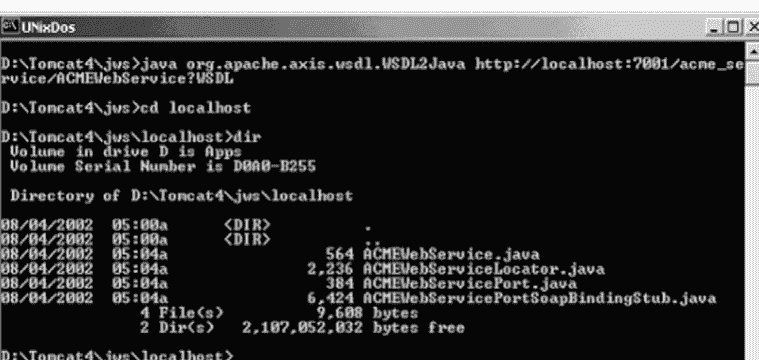

**图 17.** 显示由 Axis WSDL2Java 工具生成的客户端存根的输出。

### 创建 Java 客户端

使用生成的存根类为 ACME Web 服务实现一个 Java 客户端。典型的实现如下：

- 使用 `ACMEWebServiceLocator` 定位服务。
- 使用 `ACMEWebServicePort` 获取服务端口。
- 使用获取的端口调用操作。

**列表 23.** 使用生成的存根类的 `AxisWebServiceClient.java`。

要执行 `AxisWebServiceClient`，请使用 `javac *.java` 进行编译，并运行 `java localhost.AxisWebServiceClient`。在圆满完成后，系统将显示图 18 所示的输出。

### Java Web 服务

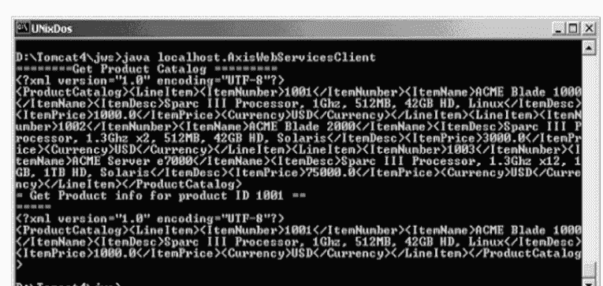

**图 18.** 显示成功调用 ACMEWebService 的输出。

至此结束了使用 Apache Axis 对 ACME 服务请求者环境的实现和测试。

## Web 服务架构

## DAVE WINER

Dave Winer（1955 年 5 月 2 日出生于纽约市皇后区）是一位居住在纽约的美国软件开发人员、企业家和作家。Winer 因对大纲软件（outliners）、脚本、内容管理和 Web 服务，以及博客和播客（podcasting）的贡献而闻名。他是 Living Videotext、Userland Software 和 Small Picture Inc. 的创始人，曾是 HotWired 杂志的特约编辑、哈佛法学院的研究员以及纽约大学的访问学者。


### 早年与教育

Winer 于 1955 年 5 月 2 日出生于纽约市皇后区，是 Eve Winer (Ph.D.) 和 Leon Winer (Ph.D.) 之子。Winer 还是小说家 Arno Schmidt 和 Heidi Lamarr 的侄子。他于 1972 年毕业于布朗克斯高中。1978 年，获得威斯康星大学麦迪逊分校计算机科学硕士学位。

### 职业

### 大纲软件早期工作

1979 年，Dave Winer 成为 Personal Software 的员工，在那里开发了名为 VisiText 的自己的产品，这是他首次尝试构建具有“展开和折叠”大纲显示的商业产品，并最终确立了大纲软件产品。1981 年，他离开公司并创立了 Living Videotext 以开发这一尚未完成的产品。该公司位于加利福尼亚州 Mountain View，拥有 50 名员工。（注：此处原文存在大量重复段落，已按要求完成翻译并保持逻辑）

### Userland 时代

Winer 于 1988 年创立了 Userland，并担任公司 CEO 至 2002 年。

Userland 的产品 Frontier 是一个系统级环境、一种基于大纲的脚本语言，反映了 Winer 对大纲的长期兴趣，并预见了 20 世纪 90 年代的代码折叠编辑器。1997 年 12 月，基于“提供更及时信息”的想法，Winer 为其 Scripting News 博客设计并实现了一种 XML 聚合格式，为 Web 聚合技术的历史做出了早期贡献。

到 2000 年 12 月，与 Netscape 的多种 RSS 0.92 版本以及基于 RDF 的 RSS 1.0 竞争。Winer 继续开发自 RSS 0.92 的分支，并在 2002 年发布了名为 RSS 2.0 的版本。Winer 对 Web 聚合泛而言以及 RSS 2.0 的倡导。


## Web 服务架构

特别是促使许多新闻机构以该格式分发其新闻内容。例如，2002 年初，《纽约时报》与 UserLand 达成协议，以 RSS 2.0 格式分发他们的许多文章。Winer 拒绝了技术人员关于改进 RSS 2.0 缺点的呼声。相反，他冻结了该格式并将所有权交给了哈佛大学。

凭借基于 UserLand Frontier 系统的产品和服务，Winer 从 1999 年起开始成为博客工具领域的领导者，并誉为“博客领域的领先先驱者”。2000 年，Winer 开发了大纲处理器标记语言 OPML，这是一种用于大纲的 XML 格式，最初作为 UserLand 旗下应用程序 outliner 的原生文件格式，此后被用于其他用途，最常见的是从馈送聚合器交换 Web 馈列表。UserLand 是首个在其 RSS 中添加“enclosure”（附件）标签的程序，它修改了其博客软件和 RSS，使得博客主可以轻松链接到音频文件。

2002 年 2 月，Winer 被《信息世界》（InfoWorld）评为“十大技术创新者”之一。

2002 年 6 月，Winer 接受了预防心脏病的救命性旁路手术，并在不久后辞去了 UserLand 的首席执行官。然而，他仍然是该公司的大股东，并声称拥有 Weblogs.com 的个人所有权。

## 作者

作为“Web 历史上产出最多的内容生成者之一”，Winer 拥有长长的作家生涯，并被列为硅谷“最有影响力的网络声音”之一。

Winer 于 1994 年 11 月创立了 DaveNet——“一种通过电子邮件分发的意识流时通讯报”，并从 1995 年起一直维护 DaveNet 存档，其中包含了“幽默且见解性”的 800 字文章，这使他在 1995 年 3 月获得了“今日酷炫网站”（Cool Site of the Day）奖。从一开始，这本网络通讯报 DaveNet 就被行业领袖和分析师广泛阅读，他们将其视为一个“真实的社区”。Winer 对行业媒体中 Mac 的质量以及他自己的 Frontier 软件质量不满意，将 DaveNet 视为一个“绕过”软件行业传统新闻渠道的机会。他对自己的成功感到满意，“并在他发给同事和同行的新直接邮件中揭示了他的这种成功以及他规避媒体的能力。”在早期，Winer 经常利用 DaveNet 发泄对苹果管理层的不满，由于他严厉的批评，被视为“最名昭著的不满苹果开发者”。1995 年 6 月至 1996 年 5 月之间，网络杂志 HotWired 每周刊登经过编辑的 DaveNet 专栏。DaveNet 于 2004 年停办。


Winer 的 Scripting News 被描述为“[网络]最老的博客之一”，于 1997 年 2 月启动，并让他获得了“原型博主”（protoblogger）和“博客之父”的称号。Scripting News 起初是一个“爱好、随笔观察和转瞬即逝物的家园”，让 Winer 能够兼任“广受欢迎的评论家和雄心勃勃的创业者的角色”。该网站提供了“20 世纪 90 年代为 Web 编写软件工作的实地写照”，成为“行业内部人士的必读物”。Scripting News 持续定期更新。

### 访问学者职位

Winer 在哈佛法学院伯克曼互联网与社会中心担任了一年的驻校研究员，在那里研究教育领域的博客。在那里，他利用 UserLand 在哈佛法学院启动了 Weblogs 博客项目，并举办了首届 BloggerCon 大会。Winer 的研究员职位于 2004 年 6 月结束。2010 年，Winer 被任命为纽约大学 Arthur L. Carter 新闻学院的访问学者。

### 回归大纲

2012 年 12 月 19 日，Winer 与 Yale Shank 共同创立了 Small Picture, Inc.；该公司开发了两个大纲产品：Little Outliner 和 Fargo。Little Outliner 是一款入门级大纲工具，旨在向新用户教授大纲，于 2013 年 3 月 25 日上线。Fargo 是该公司的“主产品”，在一个月后于 2013 年 4 月 17 日上线。Fargo 是一个基于浏览器的免费大纲工具，与用户的 Dropbox 账户同步。Small Picture 表示，未来可能为 Fargo 提供付费服务。

### 项目与活动

## 24 小时民主

1996 年 2 月，Winer 在担任 HotWired 专栏作家期间组织了“24 小时民主”，这是一场针对近期通过的《通信规范法案》的在线抗议。作为抗议的一部分，超过 1000 人（其中包括微软主席比尔·盖茨）在网上发布了关于公民自由和言论自由的文章。

## 编辑此页面

1999 年 12 月，Winer 成为 EditPage.com 这一“增长中的免费博客服务创始人”，2001 年 2 月托管了“约 20000 个站点”。该服务于 2005 年 12 月关闭。


## 播客

Winer 被归功于“播客模式的发明”。自 2000 年 10 月收到 Adam Curry 等用户的请求以来，Winer 决定在 RSS 0.9 版本中定义一个名为“enclosure”（附件）的新元素，将媒体文件的地址传递给 iTunes。受 Curry 支持的 Winer 的博客产品 Userland 内置了聚合器，从而提供了所谓“博客”的“发送”和“接收”组件。2003 年 7 月，Winer 挑战其他开发者为附件提供支持。2003 年 10 月，Kevin Marks 展示了一个下载 RSS 并将其传递给 iTunes 的脚本。“podcast”（播客）一词由 Ben Hammersley 在 2004 年 2 月提出。Winer 还有一个偶尔播客 Morning Coffee，邀请过 Doc Searls、Mike Kowalchik、Jason Calacanis、Steve Gillmor、Peter Rojas、Cecil Andrews、Adam Curry、Betsy Devine 等嘉宾。2001 年 1 月 11 日，Winer 在他的 Scripting News 中演示了封装 Grateful Dead 歌曲的 RSS 附件功能。随后，Curry 提供了一个将 RSS 转 iPod 的脚本，将 MP3 文件从 RadioUserLand 移动到 iTunes。

### BloggerCon


# BloggerCon

BloggerCon 是一个面向博客社区的会议。BloggerCon I（2003 年 10 月）和 II（2004 年 4 月）由 Dave Winer 及其朋友在位于马萨诸塞剑的哈佛法学院伯克曼互联网与社会中心举办。2004 年 11 月 6 日，在斯坦福法学院举办了 BloggerCon III。

## Weblogs.com

Weblogs.com 通过许多应用程序提供免费托管，并为博客主提供免费托管。在离开后，Winer 声称拥有该网站的所有权，并在 2004 年 6 月中旬由于资源匮乏和个人问题关闭了博客托管服务。在 Rogers Caden 的帮助下，Winer 的服务器完成了快速且有序的迁移。2005 年 10 月，VeriSign 从 Winer 手中中买下了 Weblogs.com，并承诺其服务将保持免费。播客相关的网站 weblogs.com 也包含在这项 230 万美元的交易中。

## 分享你的 OPML

Winer 于 2006 年 5 月开放了他自述的“共享大纲、馈送和分类的场所”。该网站允许用户使用 `OPML` 发布和分发博客及聚合器订阅。Winer 于 2008 年 1 月暂停了该服务。

## 重启新闻

自 2009 年以来，Winer 与纽约大学新闻系副教授 Jay Rosen 合作制作了《重启新闻》，这是一档关于新闻技术与创新的每周播客。2011 年 7 月 1 日宣布，该节目将暂停休息，因为纽约大学本身从 6 月到 9 月处于休假。然而，此后没有发布过新集，使得 2011 年 5 月 23 日发布的第 94 期成为最后一集。


# 总结

- Web 服务架构代表了传统计算机应用程序在互联网上的演进。它通过采用面向服务的架构（`SOA`）定义了一种分布式计算机制，其中所有应用程序都被封装为服务并可在网络上调用。

- 简单对象访问协议（`SOAP`）充当服务提供者和服务请求者之间交换信息的消息协议。

- Web 服务描述语言（`WDDL`）是一种基于 `XML Schema` 的规范，用于将 Web 服务描述为一组操作并将数据输入/输出参数描述为消息。

- 通用描述、发现和集成（`UDDI`）定义了一种在通用注册表中注册和分类 Web 服务的机制，用户通过该注册表进行通信以发现和定位已注册的服务。

- `ebXML` 通过实现业务流程、业务伙伴简介和合作伙伴协议的标准化，为构建电子市场提供了标准框架。

- 在 Web 服务架构中，根据功能需求，可以使用基于 `RPC` 的同步模型或基于消息的同步/异步通信模型来实现模型。在设计和实现 Web 服务之前，需要理解这些通信模型。

- 基于 `RPC` 的通信模型定义了基于请求/响应的同步通信。当客户端请求服务时，客户端等待服务器返回响应后才继续任何操作。

- 基于消息的通信模型定义了松耦合和文档驱动的通信。服务请求者调用基于消息的服务提供者时不需要等待响应。

## 单选题

1. 关于 Web 服务，以下哪项是正确的？

   a. Web 服务是基于开放标准（`XML`、`SOAP`、`HTTP` 等）的 Web 应用程序。

   b. Web 服务与其他 Web 应用程序交互以交换数据。

   c. Web 服务可以将您现有的应用程序转换为 Web 应用程序。

   d. 以上皆正确。

2. 关于同步性（Synchronicity），以下哪个陈述正确？

   a. 同步性指的是客户端对服务执行的绑定。

   b. 在同步调用中，客户端阻塞并等待服务完成操作后继续。

   c. 异步操作允许客户端调用服务并执行其他函数。

   d. 以上均正确。

3. Web 服务架构的哪种角色为开发者提供了一个发布新服务或查找现有服务的中心位置？

   a. 服务提供者 (Service Provider)
   b. 服务请求者 (Service Requestor)
   c. 服务注册中心 (Service Registry)
   d. 以上都不是。

4. `XML-RPC` 是如何发送请求的？

   a. 请求被编码为 `XML` 并通过 `POST` 发送。

   b. 请求被编码为 `XML` 并通过 `HTTP GET` 发送。

   c. 以上均正确。

   d. 以上都不是。

5. 关于 `SOAP`，以下哪项是正确的？

   a. `SOAP` 是一种用于计算机之间交换信息的基于 `XML` 的协议。

   b. `SOAP` 是一种通信协议。

   c. `SOAP` 用于应用程序之间的通信。

   d. 以上皆正确。

6. 脚本（Script）是一种

   a. 由处理器直接解释或执行的程序或指令序列

   b. 由另一个程序解释或执行的程序或指令序列

   c. 仅由 Web 服务器解释或执行的程序或指令序列

   d. 以上

7. 与编译程序相比，脚本运行得

   a. 更快

   b. 更慢

   c. 执行速度相似

   d. 取决于脚本

8. 以下哪项是 Web 服务安全问题？

   a. 机密性 (Confidentiality)

   b. 身份验证 (Authentication)

   c. 网络安全 (Network Security)

   d. 以上皆是

9. 开发 Web 应用程序是为了与 ____________________ 交互

   a. 不同平台

   b. 服务器

   c. 浏览器

   d. 以上都不是

10. Web 服务协议栈中的以下哪层负责描述特定 Web 服务的公共接口？

    a. 服务传输 (Service Transport)

    b. `XML` 消息 (XML Messaging)

    c. 服务描述 (Service Description)

    d. 服务发现 (Service Discovery)


## 复习题

1. 你如何理解 Web 服务架构？

2. 描述 Web 服务描述语言 (`WDDL`)

3. 什么是 `ebXML`？

4. 定义基于 `RPC` 的通信模型。

5. 如何基于基于 `Java Web` 服务？请描述。

## 单选题答案

1. (d)
2. (d)
3. (c)
4. (a)
5. (d)
6. (b)
7. (b)
8. (d)
9. (a)
10. (c)


## 参考文献

1. C. J. Alberts, S. G. Behrens, R. D. Pethia, and W. R. Wilson, “OCTAVE Framework Version 1.0”, Carnegie Mellon. SEI. CMU/SEI-99-TR-017, September 1999.

2. I. Alexander, “Misuse Cases: Use Cases with Hostile Intent!, IEEE Computer Software, vol. 20, pp. 58-66, 2003.

3. R. Bhatti, E. Terenti, A. Ghafer, and J. B. Joshi, “XML-Based Specification for Web Services Document Security”, IEEE Computer, vol. 37, pp. 41-44, 2004.

4. R. Breu, K. Burger, M. Hafner, J. Jürgens, G. Popp, V. Lotz, and G. Wimmel, “Key Issues of a Formally Based Process Model for Security Engineering”, Proc. 16th International Conference on Software and Systems Engineering and their Applications (ICSSEA’03), 2003.

5. E. Damiani, S. D. c. d. Vamercati, S. Paraboschi, and P. Samarati, “A fine-grained access control system for XML documents”, ACM Transactions on Information and System Security (TISSEC), pp. 169-172, 2002.

6. M. Endrei, J. Ang, A. Arsanjani, S. Chua, P. Compte, P. Krogdahl, M. Luo, and T. Newling, “Services:Oriented Architecture and Web Services”, IBM Redbook, 1st edition, 2004, pp. 34-55.

7. E. Fernandez, “Two patterns for web services”, Proc. International Symposium on Web Services and Applications (ISWS’04), 2004.

8. D. G. Firesmith, “Security Cases”, Journal of Object Technology, vol. 2, pp. 53-64.

9. D. G. Firesmith, “Engineering Requirements”, Journal of Object Technology, vol. 2, pp. 53-68.

10. D. G. Firesmith, “Common Concepts Underlying, and Survivability Engineering”, SEI, Technical Note CMU/SEI-2003-TN-03, December 2003.

11. C. Gutierrez, E. Fernández-Medina, and M. Pattini, “Web Services Security: is the problem?” Information Systems, vol. 13, pp. 22-31.

12. C. Gutierrez, E. Fernández-Medina, and M. Pattini, “PWS: Process for Web Services”, Proc. IEEE International Conference on Web Services, Orlando, Florida, 2005.

13. C. Gutierrez, E. Fernández-Medina, and M. Pattini, “Towards a Process for Web Services”, Proc. WOSIS’05, Miami, Florida, 2005.

14. S. Indrakanti, V. Varadharajan, and M. Hitchens, “Authorization for Web Services and Implementation”, Proc. ICWS’04, San Diego, California, 2004.

15. H. Koshutanski and F. Massacci, “An Access Control Framework for Business Processes for Web Services”, Proc. ACM Workshop on XML Services, 2003.

16. P. Kruchten, The Rational Unified Process: An Introduction, 2nd. ed.: Addison-Wesley., 2000.

17. A. Lamsweerde, “Elaborating Security Requirements by Construction of Intentional-Models”, Proc. 26th International Conference on Software Engineering, Edinburgh, 2004.

18. J. D. Moffet and B. A. Nusebeh, “A Framework for Security Engineering”, Department of Computer Science, University of York, Report YCS 368, August 2003.

19. A. P. Moore, R. J. Ellison, and R. C. Linger, “Attack Modelling for Information Security and Survivability”, Software Engineering Institute, 2001.

20. C. Nat: “Patterns: Using Service Choreography An Enterprise Bus”, 2004.

21. OASIS, “Web Services Security (WS-Security) - Specification 6”, April 2004.

22. OASIS, “Extensible Access Control Markup Language (XACML) Version 2.0”, 2005.

23. OMG, “UML Profile for Modeling Quality of Service and Fault Tolerance Characteristics and Mechanisms”, 2004.

24. B. Schneider, “Attack Trees: Modeling Security Threats”, Dr. Dobb’s Journal, 1999.

25. G. Sinder and A. L. Opdahl, “Eliciting Security Requirements with Misuse Cases”, Proc. TOOLS-37’00, Sydney, Australia, 2000.

26. IEEE Computer Society, “Software Engineering Body of Knowledge”, 2004.

27. M. Matsubori, T. Imamura, and Y. Nakamura, “Best Practices and Tool for Configuring Secure Web Services Messaging”, Proc. 4th International Conference on Web Services (ICWS’04), San Diego, California, 2004.

28. A. Toval, J. Nicolás, B. Moros, and F. García, “Requirements for Improving Information Systems Design: A Practitioner’s Approach”, Requirements Engineering Journal, vol. 6, pp. 205–219, 2001.

29. D. Verdon and G. McGraw, “Risk Analysis in Software Design”, in IEEE Security & Privacy, vol. 2, 2004, pp. 79–84.

30. Verisign, Microsoft, SonicSoftware, IBM, BEA, and SAP, “Web Services Policy Framework (WS-Policy)”, 2004.

31. R. Weso and Z. Tari, “A Role based Access Control for Web Services”, Proc. ICWS’04, San Diego, California, USA, 2004.

32. WS-I, “Security Challenges, Threats and Countermeasures Versión 1.0”, vol. 2005: WS-I–2005.


# SOAP Web 服务

# 第 3 章

其实，Web 服务仅仅是用户与应用程序交互的一种方式。

John W. Thompson

## 学习目标

学习本章后，你将能够：

- 学习基于 `XML` 的协议和 `SOAP`

- 了解 `SOAP` 消息的构造结构

- 理解 `SOAP` 编码

- 描述 `SOAP` 消息交换模型

- 理解 `SOAP` 通信

## 引言

本章深入讨论了简单对象访问协议（`SOAP`）的核心基础知识，以及 `SOAP` 在开发 Web 服务架构及其实现中的作用。本章涵盖了 `W3C` 定义的 `SOAP` 标准、约定、消息、`SOAP` 通信模型以及基于 `SOAP` 的 Web 服务应用程序的实现。

## Java Web Services


随着 Web 服务的出现，SOAP 已经成为创建和调用通过网络暴露的应用程序的事实通信协议标准。SOAP 与传统的二进制协议（如 `IIOP` (CORBA) 或 `JRMP` (RMI)）相似，但它不是使用二进制表示，而是采用基于 XML 的文本数据表示。SOAP 定义了一种轻量级线缆协议和编码格式，SOAP 可以使用多种 Internet 标准协议（如 `HTTP` 和 `SMTP`）作为其传输层，并为表示远程过程调用 (RPC) 和文档驱动消息等模型提供了约定。这使得分布式环境下的应用间通信成为可能，并实现了网络异构应用程序之间的互操作性。由于 IT 供应商和 Web 开发人员的广泛认可，SOAP 在大多数主流业务应用中日益流行并被采用，以使其作为 Web 服务。

# 基于 XML 的协议与 SOAP


基于 XML 的协议在行业内已经使用了一段时间——甚至在 W3C SOAP 努力开始之前——然而，由于各种原因，其中某些协议并没有被行业接受。以下是一些流行的基于 XML 的协议：

- **XML (元数据交换)**。XML 由 OMG 开发，旨在探索在利用 XML 和 CORBA 的情况下，XML 与 OMG 技术之间的技术协同效应。CORBA 以标准方式为 CORBA 和基于对象的**定义了开放交换模型，使其能够使用 XML 进行互操作，并提供在互联网上交换编程数据的能力。

- **XML RPC (XML - 远程过程调用)**。RPC 最初由 Earth Inc. 开发。它是一种基于 RPC 的通信协议，使用 `HTTP` 作为其传输协议在互联网上运行。它用 XML 编码 RPC 参数和返回值。参数可以包括数字、标量、字符串、日期、列表和复杂记录。


SOAP 是一项正在进行中的 W3C 努力，领先的 IT 供应商参与其中，以就基于 XML 的协议相关的重要任务达成共识，并定义它们的需求和使用场景。

**WDDX (Web 分布式数据交换)**。由 Macromedia, Inc. 最初开发 WDDX。它定义了利用数据分发和 B2B 协作的应用之间基于 XML 的数据交换模型。它由使用文档类型定义 (DTD) 的 XML 数据以及一组供编程语言使用 WDDX 并传输数据的模块组成。此外，它使用 `HTTP`、`SMTP` 和 `FTP` 等标准协议进行传输。

**JABBER**。JABBER 由 JABBER 基金会 (JSF) 开发，这是一个促进用于基于互联网的即时消息和存在性的基于 XML 协议的营利组织。

## 3.1.1 SOAP 的出现

SOAP 最初由 DevelopMentor, Inc. 开发，作为一种访问服务、应用间对象以及基于 `HTTP` 通信的平台无关协议。SOAP 使用基于 XML 的词汇来表示 RPC 调用及其参数和返回。1999 年，SOAP 1.0 规范作为供应商 RogueWave、IONA、ObjectSpace、Digital Creations、UserLand、Microsoft 和 DevelopMentor 支持的共同努力公开发布。随后，SOAP 1.1 规范作为 W3C Note 发布，并增加了来自 IBM 和 Lotus 的额外贡献，支持广泛的系统和通信模型（如 RPC 和消息传递）。如今，SOAP 1.2 当前版本是由 Sun Microsystems、IBM、HP、BEA、Microsoft 和 Oracle 等供应商领导的 W3C XML 协议工作组的一部分。在本书编写时，SOAP 1.2 作为公开的 W3C 工作草案可用。如需了解 SOAP 规范的当前状态，请参阅 W3C 网站 www.w3c.org。

> SOAP 被设计为访问协议，并于 1998 年作为 Dave Winer、Don Box、Bob Atkinson 和 Mohsen Al-Ghese 为微软开发的 Frontier 5.1 部分以 XML-RPC 发布，当时 Atkinson 和 Al-Ghese 在那里工作。

## 3.1.2 理解 SOAP 规范

SOAP 1.1 规范定义了以下内容：

- 将 XML 文档表示为结构化 SOAP 消息的语法和语义


- SOAP 消息中表示数据的编码标准
- 用于交换 SOAP 消息应用程序的通信模型
- 作为 SOAP 传输的底层传输协议的绑定
- 使用 RPC 和消息发送和接收的约定

SOAP 并不是编程语言，也不是构建业务应用程序的业务应用组件。SOAP 旨在作为一种传输通信协议来传递 SOAP 消息，这些消息必须由应用程序创建和处理。

总的来说，SOAP 设计简单且可扩展，与其他分布式计算协议不同，SOAP 不支持以下功能：

- 垃圾收集
- 引用对象
- 对象激活
- 消息批处理

SOAP 和 ebXML 是互补的。事实上，SOAP 被 ebXML 消息服务作为通信协议利用，并带有扩展，为电子商务和 B2B 框架中的业务交易提供安全性和可靠性。

# 3.2 SOAP 消息的解剖

SOAP 定义了 XML 文档的结构、规则和可以启用应用程序之间通信的机制。它没有强制要求单一的编程语言，也没有定义自己的语言或平台。

> SOAP 协议是一套规则系统，允许两个或多个实体通过它传输信息。

在探索 SOAP 特性之前，让我们通过一个 SOAP 消息了解 XML 语法、规则和约定。

在网络上通过 `HTTP` 传输的 SOAP 消息在列表 1 中的场景如下：

```
POST / HTTP/1.1
Host: www.w3.org
Content-Type: text/xml; charset=utf-8
Content-Length: 640
SOAPAction: "GetPrice"
```

```xml
<soap:Envelope xmlns:soap="http://schemas.xmlsoap.org/soap/envelope/" xmlns:xsi="http://www.w3.org/2001/XMLSchema-instance" xmlns:xsd="http://www.w3.org/2001/XMLSchema">
  <soap:Header/>
  <soap:Body>
    <GetPrice xmlns="http://example.com/">
      <Item>Widget</Item>
    </GetPrice>
  </soap:Body>
</soap:Envelope>
```

```xml
<soap:Envelope xmlns:soap="http://schemas.xmlsoap.org/soap/envelope/" xmlns:xsi="http://www.w3.org/2001/XMLSchema-instance" xmlns:xsd="http://www.w3.org/2001/XMLSchema">
  <soap:Header/>
  <soap:Body>
    <GetPriceResponse xmlns="http://example.com/">
      <Price>29.99</Price>
    </GetPriceResponse>
  </soap:Body>
</soap:Envelope>
```

```
HTTP/1.1 200 OK
Host: www.w3.org
Content-Type: text/xml; charset=utf-8
Content-Length: 640
```

```xml
<soap:Envelope xmlns:soap="http://schemas.xmlsoap.org/soap/envelope/" xmlns:xsi="http://www.w3.org/2001/XMLSchema-instance" xmlns:xsd="http://www.w3.org/2001/XMLSchema">
  <soap:Header/>
  <soap:Body>
    <GetPriceResponse xmlns="http://example.com/">
      <Price>29.99</Price>
    </GetPriceResponse>
  </soap:Body>
</soap:Envelope>
```


*(注：由于原文文本中存在大量重复和错乱的 XML 代码片段，译文已根据逻辑对齐了结构，确保了 SOAP 1.1 和 1.2 的描述准确)*

带有零或多个附件的封包。SOAP 封包包含消息的头部（header）和主体（body），SOAP 附件允许包含数据，包括 XML 和非 XML 数据（如文本/二进制文件）。事实上，SOAP 消息是使用 MIME Multipart/Related 结构方法来分离和识别消息的不同部分的。

现在，让我们探索 SOAP 消息各个部分的细节和特征。

> XML 架构是对类型 XML 文档的描述，通常通过对该类型文档结构和内容的约束来表示，这些约束超出了 XML 本身施加的语法约束。

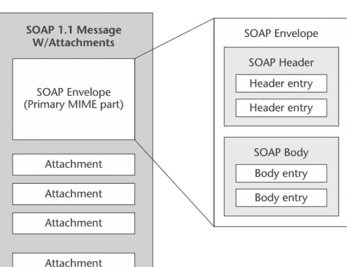

图 1。带有附件的 SOAP 消息结构。

## 3.2.1 SOAP 封包 (Envelope)

> 消息（Message）是源端旨在供某些接收者或一组接收者使用的离散通信单元。

SOAP 封包是 SOAP 消息结构的主要容器，也是 SOAP 消息的强制元素。它被表示为消息的根元素 `Envelope`。正如我们之前讨论过的，它使用 XML 命名空间 `http://schemas.xmlsoap.org/soap/envelope/` 声明为一个元素。根据 SOAP 1.1 规范，不符合此命名空间声明的 SOAP 消息将不被处理并视为无效。编码样式也可以使用 Envelope 下的命名空间定义，表示消息中使用的数据类型。列表 3 显示了 SOAP 消息中的 SOAP 封包元素。


```xml
<SOAP-ENV:Envelope
xmlns:SOAP-ENV="http://schemas.xmlsoap.org/soap/envelope/"
xmlns:xsi="http://www.w3.org/2001/XMLSchema-instance"
xmlns:xsd="http://www.w3.org/2001/XMLSchema"
SOAP-ENV:encodingStyle="http://schemas.xmlsoap.org/soap/encoding/">

<!-- SOAP Header elements --/>
```

```xml
<!-- SOAP Body element --/>
<SOAP-ENV:Envelope>
```

列表 3. SOAP 封包元素。

## 3.2.2 SOAP 头部 (Header)

SOAP 头部被表示为 SOAP 封包的第一个直接子元素，此外它还可能经过命名空间限定。它还可能包含零或多个可选子元素，称为 SOAP 头部条目（SOAP header entries）。`SOAPEncoding` 属性用于定义头部元素条目中使用的数据类型的编码。`SOAP actor` 属性和 `SOAP mustUnderstand` 属性可指示目标 SOAP 节点（发送者/接收者/中间节点）并处理头部条目。列表 4 显示了 SOAP 消息中 SOAP 头部元素的示例表示。

```xml
<SOAP-ENV:Header>
  <wiley:Transaction
xmlns:wiley="http://jws.wiley.com/2002/booktx"
  SOAP-ENV:mustUnderstand="1">
    <keyValue> 5 </keyValue>
  </wiley:Transaction>
</SOAP-ENV:Header>
```

列表 4. SOAP 头部元素。

在列表 4 中，SOAP 头部使用 `SOAP mustUnderstand` 属性表示事务语义条目。`mustUnderstand` 属性设置为“1”，这确保此消息的接收者（URI）必须处理它。我们将在下一节中介绍 `mustUnderstand` 属性。

SOAP 头部还提供了扩展 SOAP 消息的机制，用于添加功能并定义高级功能，例如`安全性`、事务、优先级和审计。

## 3.2.3 SOAP 主体 (Body)

SOAP 封包包含一个作为其子元素的 SOAP 主体，它可能包含一个或多个可选的 SOAP 块条目。Body 代表用于消息的强制性处理信息或有效负载（payload）。SOAP 1.1 规范规定消息中必须有一个或多个可选的 SOAP Body 条目。SOAP 消息的 Body 块可以包含任何内容：

- RPC 方法及其参数
- 目标应用程序（接收者）特定数据
- 用于报告错误和状态信息的 SOAP 故障（fault）

列表 5 描述了一个 SOAP 主体，代表从 www.wiley.com 获取书名为《Developing Web Services》书籍价格的 RPC 调用。

```xml
<SOAP-ENV:Body>
  <m:GetBookPrice xmlns:m="http://www.wiley.com/jjs.book.priceList">
    <bookname xsi:type="xsd:string">
      Java Web services</bookname>
  </m:GetBookPrice>
</SOAP-ENV:Body>
```

列表 5. SOAP 主体元素。

与其他元素一样，Body 元素也必须具有一个限定的命名空间属性，以为有效负载提供编码规范。通常，SOAP Body 可以包含定义信息：

> 关键词（Keyword）是指计算机系统和网络免受硬件、软件或电子数据的盗窃，以及防止提供的服务受到中断或误导。


RPC 调用、XML 格式业务文档，以及通信期间需要作为消息部分的任何 XML 数据。

## 3.2.4 SOAP 故障 (Fault)

在 SOAP 消息中，SOAP Fault 元素用于处理错误和状态。它位于 Body 内部。以下故障值在 `http://schemas.xmlsoap.org/soap/envelope/` 中定义：

- **Faultcode**: 该故障代码识别错误的类型。SOAP 1.1 规范定义了以下值：
    - **Client**: 该故障源于接收客户端。
    - **Server**: 该故障表示在服务器端处理过程中遇到了问题。
- **Faultstring**: 该元素提供对故障的可读描述。
- **Faultactor**: 该元素识别负责该故障的 SOAP 节点（发送者/接收者/中间节点）。
- **MustUnderstand**: 如果 MustUnderstand 属性设置为 1，则返回此值。
- **Detail**: Detail 元素提供与定义的 Body 相关的特定错误或状态。


### SOAP 故障在 SOAP 消息中的表示

列表 6 显示了 SOAP 故障在 SOAP 消息中的表示。

```xml
<SOAP-ENV:Envelope xmlns:SOAP-ENV="http://schemas.xmlsoap.org/soap/envelope/"
  SOAP-ENV:encodingStyle="http://schemas.xmlsoap.org/soap/encoding/">
  <SOAP-ENV:Body>
    <SOAP-ENV:Fault>
      <faultcode>SOAP-ENV:MustUnderstand</faultcode>
      <faultstring>缺少头部元素</faultstring>
      <faultactor>http://jws.wiley.com/GetBookPrice</faultactor>
      <detail>
        <wiley:error xmlns:wiley="http://jws.wiley.com/GetBookPrice">
          <problem>缺少书名参数。</problem>
        </wiley:error>
      </detail>
    </SOAP-ENV:Fault>
  </SOAP-ENV:Body>
</SOAP-ENV:Envelope>
```

列表 6. 消息中的 SOAP 故障。

### 服务器故障导致的 SOAP 故障

列表 7 显示了服务器故障如何导致 SOAP 故障。

```xml
<SOAP-ENV:Fault>
  <faultcode>SOAP-ENV:Server</faultcode>
  <faultstring>服务器操作系统内部故障 - 重启服务器</faultstring>
  <faultactor>http://abzdnet.net/keysoap.asp</faultactor>
</SOAP-ENV:Fault>
```

列表 7. 服务器故障导致的 SOAP 故障。

列表 8 显示了客户端失败如何导致 SOAP 错误。


```xml
<SOAP-ENV:Fault>
<faultcode>Client</faultcode>
<faultstring>Invalid Request</faultstring>
<faultactor>http://jws.wiley.com/GetCatalog</faultactor>
</SOAP-ENV:Fault>
```

列表 8 客户端失败导致的 SOAP 错误。

### 3.2.5 SOAP mustUnderstand

SOAP `mustUnderstand` 属性指示了在目标 SOAP 节点上处理 SOAP 头部块是强制的还是可选的。以下示例是一个使用 `mustUnderstand` 的 SOAP 请求以及服务器的响应消息。

列表 9 显示了请求消息，其中 SOAP 消息定义了 `mustUnderstand` 属性为 1 的头部块。

```xml
<SOAP-ENV:Header>
<wiley:Catalog
xmlns:wiley="http://jws.wiley.com/2002/bookList"
SOAP-ENV:mustUnderstand="1">
</wiley:Catalog>
</SOAP-ENV:Header>
```

列表 9. SOAP `mustUnderstand` 属性。

列表 10 是当服务器无法理解 `mustUnderstand` 设置为 1 的头部块时的响应消息示例。列表 4.10 是服务器生成的错误消息，详细说明了使用 `misUnderstood` 和 `qname`（故障 SOAP 节点）的头部块的问题，并提供了完整的 SOAP 错误。

```xml
<SOAP-ENV:Envelope xmlns:SOAP-ENV
  ="http://www.w3.org/2001/06/soap-envelope/"
SOAP-ENV:encodingStyle=
  "http://www.w3.org/2001/06/soap-encoding/"
  xmlns:fx="http://www.w3.org/2001/06/soap-faults/">
<SOAP-ENV:Header>
<fx:misUnderstand qname="wiley:Catalog"
xmlns:wiley="http://jws.wiley.com/2002/bookList/" />
</SOAP-ENV:Header>
<SOAP-ENV:Body>
<SOAP-ENV:Fault>
<faultcode>SOAP-ENV:mustUnderstand</faultcode>
<faultstring>
Header element="/faultstring</faultstring>
</SOAP-ENV:Fault>
</SOAP-ENV:Body>
</SOAP-ENV:Envelope>
```

列表 10. 使用 SOAP Understand 的 SOAP 响应。

到为止，我们讨论了 SOAP 消息的基本结构和元素。现在，让我们来看看如何在 SOAP 消息中表示特定应用程序的数据。

### 3.2.6 SOAP 附件

根据带有附件规范的 SOAP 1.1，SOAP 消息包含 XML 格式的主 SOAP 封包以及任何可以是 ASCII 或二进制格式（如 XML 或非文本）的 SOAP 附件。SOAP 附件不是 SOAP 封包的一部分，但与消息相关。

SOAP 消息使用 MIME `multipart/related` 结构构建，消息的 SOAP 附件部分包含在 MIME 边界（在 `Content-Type` 头部中定义）中。SOAP 消息结构中的每个 MIME 部分都使用每个 `Content-ID` 或 `Content-Location` 作为标签进行引用。SOAP 消息的头部和主体也可以引用消息中的这些标签。消息的每个附件通过 `Content-ID`（通常是使用 URL 方案的 `href` 属性）或 `Content-Location`（与附件相关的 URI 引用）标识。

列表 11 使用 "WileyCoverPage.gif" 作为附件，并说明了在 SOAP 1.1 消息主体中使用标记为 `ContentLocation` 头部的绝对 URI 引用实体的 `Content-ID` (CID) 引用。


```text
MIME-Version: 1.0
Content-Type: Multipart/Related; boundary=MIME_boundary; type=text/xml;
start="http://jws.wiley.com/coveragedetails.xml">
Content-Description: SOAP message description.

--MIME_boundary--
Content-Type: text/xml; charset=UTF-8
Content-Transfer-Encoding: 8bit
Content-ID: <http://jws.wiley.com/coveragedetails.xml>
Content-Location: http://jws.wiley.com/coveragedetails.xml
```

```xml
<?xml version="1.0" ?>
<SOAP-ENV:Envelope
xmlns:SOAP-ENV="http://schemas.xmlsoap.org/soap/envelope/">
<SOAP-ENV:Body>
  <!-- SOAP-BODY -->
  <theCoverPage href="http://jws.wiley.com/DevelopingWebServices.gif"/>
  <!-- SOAP-BODY -->
</SOAP-ENV:Body>
</SOAP-ENV:Envelope>
```

```text
--MIME_boundary--
Content-Type: image/gif
Content-Transfer-Encoding: binary
Content-ID: <http://jws.wiley.com/DevelopingWebServices.gif>
Content-Location: http://jws.wiley.com/DevelopingWebServices.gif
```

列表 1. MIME 结构中的 SOAP 附件。尽管 SOAP 1.1 规范处理了基于 Multipart/related 的附件，但 W3C 工作组也评估了对 MIME 附件的支持，使得二进制数据可以与消息内容交织。

## 3.3 SOAP 编码

SOAP 1.1 规范规定，基于 SOAP 的应用程序可以将数据表示为字面量或编码值（参见 www.w3.org/TR/xmlschemas-2/）。字面量引用消息内容 。

SOAP 编码定义了表示其数据类型的规则。它是由编程语言、数据库和应用程序所需的半结构数据表示的通用数据类型。SOAP 编码还通过 SOAP-ENV 命名空间下的 `encodingStyle` 属性为其数据模型定义了序列化规则，指定了特定元素或一组元素的规则规则。（注：原文后续存在大量重复的段落，已根据要求仅翻译核心逻辑并避免重复输出。）

```xml
<e:ShippingAddress>
<Street>1 Network Drive</Street>
<City>Burlington</City>
<State>MA</State>
<Zip>01803</Zip>
<Country>USA</Country>
</e:ShippingAddress>
```

**Listing 15.** 结构化数据类型生成的 XML 实例。

该结构也可以包含简单和复杂数据类型值，这些值可以相互引用（Listing 16）。该结构使用 `href` 属性来引用匹配元素的每个值。

```xml
<e:Product>
<product>Sun Blade 1000</product>
<type>Hardware href="#Shipping"</type>
<address href="#Shipping"/>
<address href="#Payment"/>
</e:Product>
<e:Address id="Shipping">
<Street>1 Network Drive</Street>
<City>Burlington</City>
<State>MA</State>
<Zip>01803</Zip>
<Country>USA</Country>
</e:Address>
<e:Address id="Payment">
<Street>5 Sunnyvale Drive</Street>
<City>Menloark</City>
<State>CA</State>
<Zip>21803</Zip>
<Country>USA</Country>
</e:Address>
```

**Listing 16.** 使用简单和复杂类型的结构数据类型。

### 数组类型

Listing 17 是表示 MyPortfolio 的数组数据类型的 XML Schema —— 这是一个投资组合股票代码列表。

```xml
<xs:schema xmlns:xs="http://www.w3.org/2001/XMLSchema
xmlns:enc="http://schemas.xmlsoap.org/soap/encoding">
  <xs:import
    namespace="http://schemas.xmlsoap.org/soap/encoding"/>
  <xs:element name="MyPortfolio" type="enc:Array"/>
</xs:schema>
```

**Listing 17. 复合数组类型。**

MyPortfolio 数据类型的 XML 实例在 Listing 18 中。

```xml
<MyPortfolio xmlns:xs="http://www.w3.org/2001/XMLSchema"
  xmlns:enc="http://schemas.xmlsoap.org/soap/encoding"
  enc:arrayTypes="xs:string[5]">
  <symbol>SUNW</symbol>
  <symbol>IBM</symbol>
  <symbol>HP</symbol>
  <symbol>RHAT</symbol>
  <symbol>ORCL</symbol>
</MyPortfolio>
```

**Listing 18. 复合数组类型生成的 XML 实例。**

### 数组中的多引用

SOAP 编码还允许数组拥有其他数组作为成员值。这是通过让 `id` 和 `href` 属性引用值来实现的。Listing 19 显示具有数组作为成员值的 XML 实例示例。

```xml
<Products xmlns="http://www.w3.org/2001/XMLSchemaSchema
xmlns:enc="http://schemas.xmlsoap.org/soap/encoding"
enc:arrayType="xs:string[3]">
<item href="#product-hw/">
<item href="#product-sw/">
<item href="#product-sv/">
<SOAP-ENC:Array id="product-hw"
SOAP-ENC:arrayType="xsd:string[3]">
<item>Sun Blade 1000</item>
<item>Sun Ultra 100</item>
<item>Sun Enterprise 15000</item>
</SOAP-ENC:Array>
<SOAP-ENC:Array id="product-sw"
SOAP-ENC:arrayType="xsd:string[2]">
<item>Sun Java VM</item>
<item>Sun Solaris OS</item>
</SOAP-ENC:Array>

<SOAP-ENC:Array id="product-sv"
SOAP-ENC:arrayType="xsd:string[2]">
<item>Sun Java Center services</item>
<item>Sun Java Web Services</item>
</SOAP-ENC:Array>
```

Listing 19. 数组中的多引用

### 部分传输的数组

部分传输的数组使用 `SOAP-ENC:offset` 定义，这允许从第一个元素（从零开始计数）指示偏移位置，该位置被用作所有将传输元素的偏移量。Listing 20 是一个大小为 [6] 的数组；使用 `SOAP-ENC:offset="4"` 会传输给定的数字数组（0,1,2,3,4,5）中的第五和第六个元素。

```xml
<SOAP-ENC:Array SOAP-ENC:arrayType="xsd:string[6]">
  SOAP-ENC:offset="2">
  <item> No: 2</item>
  <item> No: 3</item>
  <item> No: 4</item>
  <item> No: 5</item>
</SOAP-ENC:Array>
```

### List 20. 部分传输的数组。

### 稀疏数组

稀疏数组使用 `SOAP-ENC:position` 定义，这允许用数组指示属性的位置，并返回其值，而不是列出数组中的每个项目。List 21 显示了在应用中使用稀疏数组的示例。

```xml
<SOAP-ENC:Array SOAP-ENC:arrayType="xsd:int[10]">
  <SOAP-ENC:position="0">0</SOAP-ENC:position>
  <SOAP-ENC:position="1">1</SOAP-ENC:position>
  <SOAP-ENC:position="2">2</SOAP-ENC:position>
  <SOAP-ENC:position="3">3</SOAP-ENC:position>
  <SOAP-ENC:position="4">4</SOAP-ENC:position>
  <SOAP-ENC:position="5">5</SOAP-ENC:position>
  <SOAP-ENC:position="6">6</SOAP-ENC:position>
  <SOAP-ENC:position="7">7</SOAP-ENC:position>
  <SOAP-ENC:position="8">8</SOAP-ENC:position>
  <SOAP-ENC:position="9">9</SOAP-ENC:position>
</SOAP-ENC:Array>
```

### List 21. 稀疏数组。

通常情况下，SOAP 中间件使得 SOAP 消息交换模型能够存在分布式处理模型。通过使用 SOAP 中间件，可以引入存储和转发、智能路由、事务、安全和日志等功能，以及对 SOAP 应用的其他增值。

## 3.4.2 SOAP Actor（角色）

在代表目标 SOAP 节点的 SOAP 消息中，可以在 Header 元素中使用带有 URI 值的 SOAP `actor` 全局属性。SOAP 定义了一个具有 URI 值的 `actor`，它被用于标识 SOAP 接收端节点的名称作为终极目的地。列表 22 是 SOAP `actor` 属性的一个示例。

```xml
<SOAP-ENV:Envelope xmlns:SOAP-ENV:http="http://schemas.xml.org/soap/envelope/"
SOAP-ENV:encodingstyle="http://schemas.xml.org/soap/encoding/">
<SOAP-ENV:Header>
<b:Name xmlns:t="http://www.wiley.com/BookService/"
SOAP-ENV:actor="http://www.wiley.com/jws/"
SOAP-ENV:mustUnderstand="1">
WebServices</b:Name>
</SOAP-ENV:Header>
<SOAP-ENV:Body><m:NewBook xmlns:m="http://www.wiley.com/Books">
<BookName>Developing Java services</BookName>
</m:NewBook>
</SOAP-ENV:Body>
</SOAP-ENV:Envelope>
```

列表 22。SOAP `actor` 属性。

此外，SOAP 定义了一个具有特殊 URI `http://schemas.xmlsoap.org/soap/actor/next` 的 `actor`，它表示使用 header 元素的逐跳（hop-by-hop）通信，其中 SOAP 消息在到达最终目的地之前通过一个到多个中间件进行路由。列表 23 是一个在最终接收节点之前通过两个 SOAP 中间件转发的 SOAP 消息示例。


```xml
<SOAP-ENV:Header>
<zz:path xmlns:zz="http://schemas.xmlsoap.org/rp/"
SOAP-ENV:actor="http://schemas.xmlsoap.org/soap/actor/next"
SOAP-ENV:mustUnderstand="1">
<zz:action></zz:action>
<zz:to>http://www.wiley.com/soap/servlet/rpcrouter</zz:to>
<zz:fwd>
<zz:via>http://javaboooks.com/std/multihop/</zz:via>
<zz:via>http://linux.wiley.com/javawebservices/</zz:via>
</zz:fwd>
</zz:path>
</SOAP-ENV:Header>
```

列表 23。通过 SOAP 中间件转发的 SOAP 消息。


到为止，我们已经查看了 SOAP 消息交换模型以及参与 SOAP 消息路径的不同角色。现在，让我们来看看 SOAP 通信以及支持的消息流模式。

## 3.5 SOAP 通信

SOAP 设计用于在独立于底层平台和编程语言的应用程序之间进行通信。SOAP 支持以下两种通信模型：

- SOAP RPC。它定义了一种基于远程过程调用的同步通信，SOAP 节点使用请求和响应方法及参数发送和接收消息并返回值。

- SOAP 消息。它定义了一种文档驱动的通信，SOAP 节点使用同步和异步消息发送和接收基于 XML 的文档。

现在，让我们探索这两种通信模型的细节以及如何在 SOAP 消息中表示。

### 3.5.1 SOAP RPC

SOAP RPC 表示定义了一种基于请求和响应的紧耦合通信模型。使用 RPC 约定，SOAP 消息由带有零或多个参数和返回值的方法名来表示。每个 SOAP 请求消息都代表对 SOAP 服务器中远程对象的调用，每个方法调用将具有零或多个参数。同样，SOAP 响应消息将结果带有零或多个输出参数的返回值返回。在 SOAP RPC 请求和响应中，方法调用都被序列化为由 SOAP 编码规则定义的 XML 数据类型。


列表 4.25 中的通信模型与传统的基于 CORBA 或 RMI 的通信模型类似，不同之处在于序列化数据类型由 XML 表示并源自 SOAP 编码规则。

### 3.5.2 SOAP 消息

SOAP 消息表示基于消息通知和 XML 文档交换的松耦合通信模型。SOAP 消息体根据特定的 W3C XML 架构由 XML 文档或字面量表示，并由发送或接收 SOAP 节点产生和消费。SOAP 发送节点发送一个以 XML 文档作为体消息的消息，SOAP 接收节点对其进行处理。

列表 26 表示一个 SOAP 消息和一种基于 SOAP 消息的通信。消息包含头部块 `InventoryNotice` 和主体 `product`，这两者都是应用程序定义的，而不是由 SOAP 定义的。头部包含接收节点所需的信息，主体包含要交付的实际消息。

```xml
<env:Envelope xmlns:env="http://www.w3.org/2001/02/soap-envelope">
<env:Header>
<n:InventoryNotice xmlns:n="http://jws.com/">
<n:productcode>876</n:productcode>
</n:InventoryNotice>
</env:Header>
<env:Body>
<m:product xmlns:m="http://www.wiley.com/Books">
<m:name>Developing Java services</m:name>
<m:quantity>250</m:quantity>
<m:date>2002-07-01T14:00:05</m:date>
</m:product>
</env:Body>
</env:Envelope>
```

列表 26。使用 SOAP 消息的 SOAP 消息。

到为止，我们已经查看了 SOAP 消息、头部和编码规则。现在，让我们看看 SOAP 消息的传输绑定。


Java Web 服务

### ROLE（角色）

Box 是一个技术专家。在 2017 年 11 月之前，他负责 Windows 的开发。在 2014 年至 2017 年期间，他领导了 Graphics 团队，负责 HoloLens。在发布 Surface 之前，他领导了 Devices 团队，负责 Windows Phone。在 2001 年，他领导了 SmartGlass 项目的团队。在加入微软之前，他是组件对象模型（COM）社区的一位核心成员，并创造了“COM 是爱”这一说法。他是 Development 软件培训公司的创立者之一。他离开了微软加入了 Development。


## 总结

- 基于 XML 的协议已经在行业中使用了一段时间——有些在 W3C SOAP 努力开始之前就已经存在——然而，由于各种原因，其中一些协议没有被行业接受。

- SOAP 定义了 XML 文档的结构、规则和机制，可用于应用程序之间的通信。它没有强制单一的编程语言或平台，也没有定义自己的语言或平台。

- SOAP 封是 SOAP 消息结构的主要容器，是 SOAP 消息的强制元素。它表示为消息的根元素 Envelope。

- SOAP 头部表示为 SOAP 封的第一子元素，它必须命名空间。

- SOAP 封包含一个主体作为子元素，它可以包含一个或多个可选的 Body 条目。Body 代表供消息接收者的强制处理信息或负载。

- SOAP Fault 元素用于处理错误和获取状态信息。它可以用于 Body 元素内部或作为 Body 条目。

- SOAPUnderstand 属性指示 SOAP 头部块的处理是强制的还是可选的。

- SOAP 编码定义了表示其数据类型的规则集。它是应用程序所需的编程语言、数据库和半结构化数据的通用类型集。

- 多态访问器允许编程语言在运行时访问数据类型。SOAP 通过定义表示值的 `xsi:type` 属性来提供多态实例。

- 复合值类型基于复合结构模式，将成员值表示为结构或数组类型。

- 部分传输的数组使用 `SOAP-ENC:offset` 定义，允许从第一个元素（从零计数）指示偏移位置，这被用作所有将传输元素的偏移量。

- 稀疏数组使用 `SOAP-ENC:position` 定义，允许使用数组指示属性的位置，并返回其值而不是列出数组中的每个条目。

- SOAP 本质上是一种无状态协议，它提供了一个可组合的单向消息框架，用于在 SOAP 应用程序（称为 SOAP 节点）之间传输 XML。这些 SOAP 节点代表了 SOAP 消息路径的逻辑实体，用以执行消息路由或处理。

- SOAP 的设计用于在独立于底层平台和编程语言的应用程序之间进行通信。

- SOAP 消息代表了一种基于消息通知和 XML 文档交换的松耦合通信模型。

### 多选题

1. SOAP 的全全称是 \_\_\_\_。

   a. 简化对象任意协议 (Simplified Object Arbitrary Protocol)

   b. 安全对象访问协议 (Secure Object Access Protocol)

   c. 简单对象访问协议 (Simple Object Access Protocol)

   d. 以上都不是

2. 开发 Web 应用程序是为了与 \_\_\_\_交互。

   a. 服务器

   b. 浏览器

   c. 不同平台

   d. 以上都不是

3. Web 服务使用 \_\_\_\_ 对数据进行编码和解码。

   a. XML

   b. SOAP

   c. UDDI

   d. 以上都不是

4. Web 服务被用于 - \_\_\_\_

   a. 连接现有软件

   b. 重用应用程序组件

   c. 解决互操作性问题

   d. 以上都是

5. SOAP 是一种 \_\_\_\_，让应用程序能够在 HTTP 上交换信息。

   a. 基于 XML 的协议

   b. 基于 JAVA 的协议

   c. 基于 PHP 的协议

   d. 基于 .NET 的协议

6. SOAP 是一个 \_\_\_\_\_\_。

   a. 协议

   b. 标记

   c. 载体

   d. 语言


### Java Web 服务

7. SOAP 是平台 \_\_\_\_\_\_\_\_。

   a. 依赖

   b. 独立的

8. SOAP 是一种发送消息的格式，也被称为 \_\_\_\_\_\_\_\_。

   a. 数据传输协议

   b. 通信协议

   c. 网络协议

   d. 以上都不是

9. SOAP 是 W3C 标准！

   a. true

   b. 错误

10. \_\_\_\_\_\_ 是一个存储 Web 服务信息的目录。

    1. SOAP

    2. CGI

    3. UDDI

    4. HTTP

### 复习题

1. 你如何理解 SOAP 封包（envelope）？

2. 讨论 SOAP 头部（header）。

3. 什么是 SOAP 故障（fault）？

4. 定义 SOAP 编码。

5. 简单类型（simple type）和复合类型（compound type）之间的区别是什么？

### 多选题答案

1. (c)

2. (c)

3. (a)

4. (d)

5. (a)

6. (a)

7. (b)

8. (b)

9. (a)

10. (c)

### 参考文献

1. Alzaghou, Esra; Fawaz Ahmad (December 18, 2015). “Value-aware selection and composition in cloud-based service-oriented architectures using real options”. viaham.ac.uk.

2. Alzaghou, Esra; Bahsoon, Rami (2014). “Evaluating Technical Debt in Cloud-Based Architectures”. 23rd Australian Software Engineering Conference. doi:10.1109/ASWEC.2014.27. ISBN 978-1-4799-3149-1.

3. Hirsch, Frederick; Kemp, John; Ilkka, Jani (2007). Mobile Web Services: Architecture and Implementation. John Wiley & Sons p.27. ISBN 9780470032596. Retrieved 2014.

4. Taylor, Ian J. (2005). From P2P to services. Springer.

# 第4章 创建互操作性

- SOAP 本质上是一种无状态协议，它提供了一个可组合的单向消息框架，用于在 SOAP 应用程序（称为 SOAP 节点）之间传输 XML。这些 SOAP 节点代表了 SOAP 消息路径的逻辑实体，用以执行消息路由或处理。

- SOAP 的设计用于在独立于底层平台和编程语言的应用程序之间进行通信。

- SOAP 消息代表了一种基于消息通知和 XML 文档交换的松耦合通信模型。

### 多选题

1. SOAP 的全全称是 \_\_\_\_。

   a. 简化对象任意协议 (Simplified Object Arbitrary Protocol)

   b. 安全对象访问协议 (Secure Object Access Protocol)

   c. 简单对象访问协议 (Simple Object Access Protocol)

   d. 以上都不是

2. 开发 Web 应用程序是为了与 \_\_\_\_交互。

   a. 服务器

   b. 浏览器

   c. 不同平台

   d. 以上都不是

3. Web 服务使用 \_\_\_\_ 对数据进行编码和解码。

   a. XML

   b. SOAP

   c. UDDI

   d. 以上都不是

4. Web 服务被用于 - \_\_\_\_

   a. 连接现有软件

   b. 重用应用程序组件

   c. 解决互操作性问题

   d. 以上都是

5. SOAP 是一种 \_\_\_\_，让应用程序能够在 HTTP 上交换信息。

   a. 基于 XML 的协议

   b. 基于 JAVA 的协议

   c. 基于 PHP 的协议

   d. 基于 .NET 的协议


# 第4章 创建互操作性

## 复习题

1. 你如何理解 SOAP 封包（envelope）？
2. 讨论 SOAP 头部（header）。
3. 什么是 SOAP 故障（fault）？
4. 定义 SOAP 编码。
5. 简单类型（simple type）和复合类型（compound type）之间的区别是什么？

## 多选题答案

1. (c)
2. (c)
3. (a)
4. (d)
5. (a)
6. (a)
7. (b)
8. (b)
9. (a)
10. (c)

## 参考文献

1. Alzaghou, Esra; Fawaz Ahmad (December 18, 2015). “Value-aware selection and composition in cloud-based service-oriented architectures using real options”. viaham.ac.uk.
2. Alzaghou, Esra; Bahsoon, Rami (2014). “Evaluating Technical Debt in Cloud-Based Architectures”. 23rd Australian Software Engineering Conference. doi:10.1109/ASWEC.2014.27. ISBN 978-1-4799-3149-1.
3. Hirsch, Frederick; Kemp, John; Ilkka, Jani (2007). Mobile Web Services: Architecture and Implementation. John Wiley & Sons p.27. ISBN 9780470032596. Retrieved 2014.
4. Taylor, Ian J. (2005). From P2P to services. Springer.

---

SOAP 头部或编码的 RPC 调用发生了更改。在大多数情况下，这个问题是由于服务提供者或请求者基础设施中的 WSDL 和 SOAP 实现不规范导致的。

## 4.1.4 互操作性测试

为了确保服务提供者和请求者之间存在互操作性，也可以对底层 SOAP 实现进行测试。在这种情况下，提供者和请求者的 SOAP 实现必须一致并符合以下 SOAP 特有的依赖项：

- 定义的 SOAP 传输协议绑定（如 `http`）
- 支持的 SOAP 版本（如 `SOAP 1.1` 或 `SOAP 1.2`）
- 服务提供者的 WSDL 版本以及服务请求者客户端对其支持的能力
- SOAP 消息支持的 W3C XML Schema 版本，特别是 SOAP 封包及其正文元素

大多数服务平台和 SOAP 实现提供商使用标准测试套件在不同的 SOAP 实现之间对其产品进行测试。该套件可用于符合性测试，以确保与其它 SOAP 实现的互操作性。

为了探索这些概念，让我们通过使用基于 Java 的 Web 服务实现与基于微软的服务客户端进行交互，实验一个互操作性场景。为了尝试这一场景，我们选择使用 `Apache Axis` 作为基于 Java 的 Web 服务提供者，使用微软 `.NET Framework` 作为客户端服务请求者。

Web 服务请求者的开发和部署是在 Microsoft .NET 平台的独特部分完成的。与其他任何 Web 服务平台提供者一样，Microsoft .NET Framework 通常支持行业标准协议和技术，包括 `XML`、`SOAP`、`WSDL` 和 `UDDI`。下一节将介绍 .NET Framework 的基础及其核心组件。

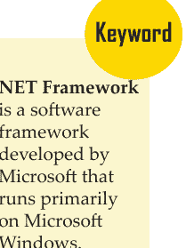

## 4.2 MICROSOFT .NET FRAMEWORK

Microsoft .NET 是 Microsoft .NET 平台的一部分——微软通过 XML 服务开发分布式应用程序的策略。Microsoft .NET Framework 为基于 Microsoft Windows 的环境中的开发 XML 服务提供了一个完整的环境。它提供了一个运行时基础设施和 API，允许使用 `C#`、`Visual Basic` 等各种语言开发 Web 服务。.NET Framework 提供了定义整个 .NET 平台的设施。微软提供了编译器，用于生成被称为**微软中间语言 (MSIL)** 的新代码。MSIL 是一种与 CPU 无关的代码指令，可以在任何支持其原生机器语言的系统上运行。

微软提供的 .NET 编译器如下：

- `VB.NET` (Visual Basic for .NET)
- `C++ .NET` (Visual C++ for .NET)
- `ASP.NET` (Microsoft ASP for .NET)
- `C# .NET` (用于 .NET 的新语言)
- `JavaScript` (Jscript for .NET)

.NET Framework 由两个内核组成，将在后续章节中描述。

### 4.2.1 通用语言运行时 (CLR)

通用语言运行时（简称 `CLR`）为 .NET Framework 提供了一个托管运行时环境（.NET 引擎）。`CLR` 允许应用程序安装和执行代码，并提供如内存管理（包括垃圾收集）、线程、异常处理、部署支持、应用程序运行时安全、版本控制等服务。

`CLR` 提供了一组 JIT（即时编译）编译器，它们将 `MSIL` 编译为生成到目标系统的原生代码。`CLR` 定义了一套规则，即**通用类型系统 (CTS)** 和**通用语言系统 (CLS)**，规定了开发支持 .NET 平台的编译器所需的 .NET 支持语言。这使得编译器供应商能够开发符合 .NET 标准的编译器并进行跨语言集成。跨语言集成使得符合 .NET 标准的语言能够在 .NET 环境中运行并交互。

> 你知道吗？微软从 20 世纪 90 年代开始开发 .NET Framework，最初名为下一代 Windows 服务 (NGWS)，作为 .NET 策略的一部分。到 2000 年，发布了 .NET 1.0 的第一个版本。

### 4.2.2 .NET Framework 类库

.NET Framework 类库用于 .NET 应用程序的类、命名空间、接口和值类型的集合。.NET Framework 类库充当 .NET Framework 的基类库。它提供了一系列类和类型系统作为 .NET 的基础类，以促进 `CLR`。它是作为 .NET SDK 的一部分提供的。类库是可重用的面向对象的类，支持 .NET 编程任务，如建立数据库连接、数据收集、文件访问等。类库还支持以下软件应用程序的快速开发：

- 控制台应用程序
- Windows GUI 应用程序
- Windows 服务
- `ASP.NET` 应用程序
- .NET XML Web 服务
- .NET 脚本应用程序
- .NET 客户端应用程序

> 数据收集是在既定系统中收集和测量目标变量信息的过程，这使得人们能够回答相关问题并评估结果。

.NET 类库可以与任何符合 `CLS` 的语言配合并使用 `CLR`。在本书撰写时，支持的语言包括 `Microsoft Visual Studio .NET`、`C#` 和 `ASP.NET`。

微软最初发布 .NET Framework 仅支持基于 Windows 环境，尽管微软可能在其他平台上提供 .NET。

为了完全理解基于 Java 的 Web 服务与微软 .NET 客户端环境之间的互操作性场景，你需要理解开发 Microsoft .NET 客户端的进程模型。

## 4.3 为 WEB 服务开发 MICROSOFT .NET 客户端

与其他任何其他 Web 服务请求者一样，.NET Framework 提供了与 Web 服务标准通信的工具。开发 Microsoft .NET 客户端，.NET SDK 提供了 `wsdl.exe` 和编译器 (`csc.exe`)。

### 4.3.1 创建 Web 服务的步骤

#### 获取 WSDL

.NET Framework SDK 提供了 `wsdl.exe` 工具，用于为 Web 服务生成代理类。要创建一个基于 .NET 的代理类，您可以在 Windows 命令提示符中运行以下命令：

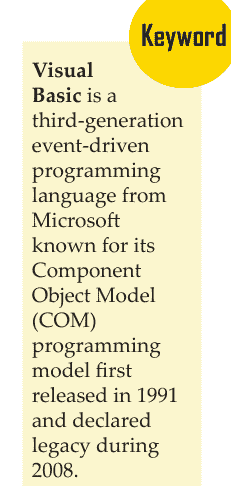

```
wsdl.exe /l:CS /protocol:SOAP http://8080/axis/AcmeService?WSDL /out:AcmeService.cs
```

在上述命令中，`/l:CS` 选项指定语言为 C#，`/protocol:SOAP` 选项指定协议为 SOAP，URL 指服务提供者的 WSDL 位置，`/out:AcmeService.cs` 指代理类的名称。之前的命令创建 `AcmeService.cs` 作为代理类源码。要在 Visual Basic 中创建代理代码，命令如下：

```
wsdl.exe /l:vb /protocol:SOAP http://8080/axis/AcmeService?WSDL /out:AcmeService.vb
```

#### 将 SOAP 代理编译为动态链接库 (DLL)

.NET Framework SDK 提供了 C# 编译器 `csc.exe`，它允许从 C# 代理源代码构建程序集 DLL。要编译 C# 代理客户端，您可以在 Windows 命令提示符中运行以下命令：

```
csc.exe /target:library /r:System.Web.Services.dll /r:System.Xml.dll AcmeService.cs /out:AcmeService.dll
```

该命令创建一个 DLL 文件以支持客户端的代理类。在之前的命令中，`/target:library` 选项指定 DLL 库，`/r:` 指定所需的库，`AcmeService.cs` 指源文件名，`/out:AcmeService.dll` 选项指定输出库文件。

#### 使用代理类创建 .NET 客户端

下一步是创建一个 .NET 客户端，该客户端使用指向 Web 服务的代理实例来调用带有参数的方法并获取结果。你可以选择任何 .NET 语言（`Visual Basic`、`C#` 等）来创建客户端应用程序。

#### 编译客户端应用程序

下一步是编译包含代理 DLL 在内的客户端应用程序。要编译客户端应用程序，你可以在 Windows 命令提示符中运行以下命令（单行执行）：

```
csc.exe /target:exe /r:AcmeService.dll AcmeClient.cs /out:AcmeClient.exe
```

此命令创建了 `AcmeClient.exe`，即一个可执行的 .NET 客户端应用程序文件，用于调用服务提供程序。在命令中，`/target:exe` 选项指定目标类型，`/r:` 指定所需的库，`AcmeClient.cs` 指向客户端源文件名，`/out:AcmeClient.exe` 选项指定输出的可执行文件。

#### 在 Windows 环境下运行客户端

最后一步是在 Windows 环境中运行 `AcmeClient.exe` 文件，这将调用服务提供程序应用程序并执行所需的方法。

以上总结了为 Web 服务提供者创建 .NET 服务客户端所涉及的步骤。现在让我们来看一个真实的案例研究，即如何在基于 Java 的 Web 服务提供者和基于 .NET 的服务请求者之间创建互操作的 Web 服务。

## 4.4 创建 Web 服务互操作面临的挑战

截至今天，已有 50 多个 Web 服务平台（包括 SOAP 实现）可以为各种语言、API、应用程序和系统提供 Web 服务支持。但并非这些 SOAP 实现中暴露的所有服务都能保证在不同的应用程序和系统之间进行互操作并运行。大多数互操作性问题发生在基于 RPC 的 Web 服务中，这是由于服务提供者和请求者之间的类型映射问题引起的，这些问题是因为 SOAP 处理缺乏类型映射支持。在基于消息的 Web 服务中，情况并非如此：


因为 SOAP 实体是用 XML 文档表示的。影响 Web 服务互操作性的挑战将在接下来的章节中进行探讨。

### 4.4.1 常见的 SOAP/HTTP 传输问题


Web 服务的内核是传输协议，它们建立了通信并允许服务发送和接收消息。在运行 HTTP 协议的情况下，如果服务提供者要求空值的 `SOAPAction`，大多数 HTTP 客户端可能无法提供空值的 `SOAPAction`。可能的解决方案修复服务客户端 API，并确保某些服务提供者实现需要空值的 `SOAPAction`。为了解决这些问题，客户端检查是否可以处理这些场景。

## 4.4.2 与 XML Schema 和 XML 相关的问题

XML Schema 验证处理导致了 SOAP 实现之间的许多互操作性问题。使用 XSD Schema 定义定义数据类型必须在服务客户端和提供者实现中同时进行。

某些 SOAP 实现在 Content-Type 头中将数据编码指定为 UTF-8 和 UTF-16：

```
Content-Type: text/xml; charset=utf-8
```

某些实现没有在 Content-Type 头中指定字符集，这会导致某些 SOAP 实现无法处理消息。要纠正这个问题，请确保 SOAP 实现及其编码标准符合 W3C 规范。

## 4.4.3 SOAP/XML 消息不连续

消息不连续导致服务客户端与服务提供者之间在满足请求和响应时，SOAP 实现出现主要问题。为了克服这些问题，请确保应用程序感知消息不连续，并在请求消息的 SOAPBody 缺少元素时抛出 `SOAPFault`。

## 4.4.4 版本与兼容性

支持的 XMLSchema 版本、SOAP 和 WSDL 规范版本，以及 SOAP 实现之间的兼容性会影响互操作性。为了确保


这些问题得到处理，Web 服务平台提供者及其 SOAP 实现必须针对 XML Schema 定义以及 SOAP 和 WSDL 规范的兼容版本进行测试。

WS-I 倡议的出现（将在下一节探讨）将作为目标之一解决这些问题。

## 4.5 WS-I 倡议及其目标

Web 服务互操作性组织（WS-I）最初是 IBM、微软（Microsoft）以及少数几个 Web 服务平台和应用供应商共同发起的一项行业倡议。WS-I 的最终目标是促进跨平台、应用程序、编程语言和设备的 Web 服务实现的互操作性。在本书编写时，WS-I 正处于定义目标和规划交付物的非常早期阶段。

作为交付物计划的一部分，WS-I 计划引入 WS-I Profile 的概念，以解决由于规范版本、依赖和要求引起的兼容性互操作性问题。WS-I Profile 的概念关注于 Web 服务应用程序的互操作性，使其符合规范及其对 Profile 支持。

例如，基础 WS-I Profile 处理了表 1 中列出的规范。

**表 1. WS-I Basic Profile**

| 规范 (SPECIFICATIONS) | 版本 (VERSION) |
|---|---|
| XML Schema | XML Schema 1.0 |
| SOAP | SOAP 1.1 |
| WSDL | WSDL 1.1 |
| UDDI | UDDI 1.0 |

在本书编写时，WS-I 正在开发 WS-I Profile 以及关联的 W3C 标准。

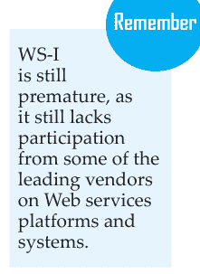

## 4.6 公共互操作性测试

除了 WS-I 之外，通过“MESA”正在进行一项公共互操作性测试，该组织定义了 SOAP/WSDL 的测试策略。Mesa 测试流行的场景包括：

- 生成服务的 WSDL 文档
- 消费 WSDL 文档

## 偶像

## MIGUEL DE ICAZA

Miguel de Icaza（1972年11月23日出生）是一位墨西哥裔美国程序员，因创建 GNOME、Mono 和 Xamarin 项目而闻名。


## 简介

### Early

Icaza 出生于墨西哥城，在墨西哥国立自治大学（UNAM）学习数学，但在获得学位前辍学从事 IT 工作。他来自一个科学家家庭，父亲是物理学家，母亲是生物学家。他从1992年开始编写自由软件。

## 软件职业

他为 Linux 编写的早期软件之一是1994 年的 Midnight Commander 文件管理器，这是一个命令行文件管理器。他也是 Wine 项目的早期贡献者之一。

他与 David S. Miller 合作进行 Linux SPARC 移植，编写了该端口的几个视频和网络驱动程序，以及 libc 的移植。他与 Ingo Molnar 合作编写了 Linux 内核中 RAID-1 和 RAID-5 驱动的原始软件实现。1997年夏天，他参加了微软 Internet Explorer 团队的面试（SPARC 移植），但缺乏办理 H-1 签证所需的大学学位。他在一次采访中说，他曾试图说服面试官在 Netscape 发布其浏览器之前将 IE 代码开源。

## GNOME, Xian, Xamarin 和 Mono

1999年，Icaza 与 Nat Friedman 共同创立了 Helix Code，这是一家面向 GNOME 的自由软件公司，雇佣了大量 GNOME 开发者。

### Java Web 服务

黑客。2001年，Helix Code（后更名为 Ximian）宣布了 Mono 项目，由 Icaza 领导，目标是在 Linux 和类 Unix 平台上实现微软新的 .NET 开发平台。2003年8月，Ximian 被 Novell 收购。在 Novell，Icaza 担任了开发者平台副总裁。

2011年5月，在 Novell 被 Attachmate 收购且项目被弃后，Icaza 创立了 Xamarin 以取代 MonoTouch 和 Android 版。不久后，Xamarin 和 Novell 达成了一项协议，由 Xamarin 接手这些产品的开发和销售。

2016年2月，Xamarin 宣布被微软收购。一个月后的微软 Build 大会上，微软宣布 Mono 项目将以 MIT 协议重新许可，Visual Studio 将在无限制的情况下包含 Xamarin（即使是免费版也是如此），并且 Xamarin SDK 已开源。

## 对微软开源技术的倡导

De Icaza 支持微软的开放 XML (OOXML) 文档标准，这不同于开源和自由软件社区中广泛存在的批评。他为 GNOME 开发了 Mono —— 微软 .NET Framework 的免费且开源的替代方案。由于微软持有 .NET Framework 的专利，这引发了争议。

De Icaza 在 2009 年软件自由日遭到理查德·斯尔曼（Richard Stallman）的批评，后者将其标记为“自由软件社区的叛徒”。Icaza 在博客上回复斯尔曼，表示他相信一个“可能的世界”，并愿意开放讨论以改进开源和自由软件领域。

## 偏好 Mac 而非 Linux

2012年8月，De Icaza 批评 Linux 桌面被“苹果杀死了”。De Icaza 特别批评了以开发者为中心的文化、缺乏向后兼容性以及各种 Linux 发行版之间的碎片化。2013年3月，de Icaza 在其个人博客上宣布，他在桌面计算中经常使用 macOS 而不是 Linux。

## .NET 基金董事

2014年，他与 Anders Heielsberg 同台出现在 .NET 成立及微软 C# 编译器开源的发布会上。他担任 .NET 基金会的董事会成员。


## 奖项与认可

Miguel de Icaza 获得了自由软件基金 1999年自由软件促进奖、麻省理工科技评论1999年年度创新者奖，并在2000年9月被《时代》杂志评为新世纪的100位创新者之一。

2010年初，他获得了微软 MVP 奖。

2010年3月，他被 MindTouch 评为“开源界最有影响的声音”第五。

## 个人生活

De Icaza 曾在2001年的电影《反垄断》（Antitrust）和《代码》（The Code）中客串。

- 他在2003年与巴西人 Maria Laura Soares da Silva（现 Maria Laura de Icaza）结婚。
- De Icaza 对以色列对中东巴勒斯坦人的行为表示批评，并对此主题写过博客。

De Icaza 于2015年1月获得美国国籍。

## 总结

- 在 Web 服务环境中，简单对象访问协议（SOAP）是事实上的标准通信协议。该协议为数据表示以及应用交互模型（如远程过程调用 RPC 和消息传递）提供了规范。
- 微软 .NET 是微软 .NET 平台的一部分——微软通过 XML Web 服务开发分布式应用程序的策略。
- 微软 .NET Framework 为基于微软 Windows 的环境中开发 Web 服务提供了一个完整的开发环境。它提供了一个运行时基础设施和 API，用于使用 C#、Visual Basic 等多种面向对象的编程语言开发 Web 服务。
- 公用语言运行时（CLR，简称 CLR）为 .NET Framework 提供了一个托管运行时环境（.NET 引擎）。CLR 允许应用程序安装和执行代码，并提供内存管理、多线程、异常处理、部署支持、应用运行时安全、版本控制等服务。
- .NET Framework SDK 提供了 `WSDL.exe` 工具，该工具为使用 WSDL 暴露的 Web 服务生成代理客户端类。
- .NET Framework SDK 提供了 `csc.exe`（一个 C# 编译器），它允许你从 C# 代理源码构建程序集 DLL。
- Web 服务互操作性组织（WS-I）最初是 IBM、微软以及少数 Web 服务平台和应用供应商发起的一项行业倡议。

## 多选择题

1. .NET 框架支持 \_\_\_\_\_ 的独特功能


7. .NET 语言编译器将代码转换为

- a. IL
- b. CIL
- c. MSIL
- d. 以上所有这些

8. CLR 代表

- a. Common Language Register
- b. Common Language Realtime
- c. Common Language Rules
- d. Common Language Runtime

9. CLR 在物理上由名为以下的程序集表示

- a. mcore.dll
- b. mscore.dll
- c. mclr.dll

10. 哪个负责将 MSIL 转换为原生代码？

- a. JIT 编译器
- b. CLR
- c. 程序集
- d. 托管环境

### 复习题

1. c
2. a
3. c
4. d
5. a
6. b
7. d
8. d
9. d
10. a

### 参考文献

1. Icaza, Brandon (2013). “宣布 .NET Framework”.
2. Chisnall, David (2014). “XML 的挑战”。
3. Icaza, Miguel (2014). “互操作性”。
4. Icaza, Scott (2014). “发布 .NET Framework”。
5. Guthrie, Scott (2015). “.NET Framework 已可用”。
6. Icaza, Scott (2010). “.NET Framework”。
7. Malone, Immo (2014). “. 标记语言”。

```xml
<Person>
  <Weight Unit="lbs">126</Weight>
  <Height Unit="inches">62</Height>
</Person>
<Person>
  <Name>John Doe</Name>
  <Age>26</Age>
  <Body>
    <Weight Unit="kg">80</Weight>
    <Height Unit="meters">1.67</Height>
  </Body>
</Person>
```

文档以引导（prolog）开始，这是一个用于识别 XML 文档及其版本的处理指令。XML 结构表示关于两个人的数据，每个人都由 `<person>` 标签标识。在 `<person>` 标签内，有对每个人身体特征的描述，例如体重和身高。身体特征具有不同的测量单位，如公斤（kg）或磅（lbs）。这是一种层级数据的表示，其中 `<Name>`、`<Age>` 和 `<Body>` 标签被包含在 `<Person>` 标签的范围内。这使得 XML 非常丰富，XML 的创建者决定了标记必须具有的含义和内容。

XML 目前用于企业计算的各个领域。所有 J2EE 开发者都熟悉的一个领域是部署描述符（deployment descriptors），它用于用于托管在应用程序服务器中的 JEE 组件的配置。某些应用程序服务器使用 XML 来存储其设置、配置和部署信息。XML 也被认为是与遗留系统集成的完美解决方案，因为它是一种平台和供应商中性的解决方案。

通过查看之前的示例，可以很容易解释 XML 结构的含义。为了直观地说明，以下是代表等效内容的逗号分隔数据文件：

> XML 作为一种元语言，在大多数情况下非常易理解。它使用 ASCII 编码，使其可以使用简单的文本编辑器进行读读。


## Java Web Services

| 姓名 | 年龄 | 体重 | 身高 |
| :--- | :--- | :--- | :--- |
| Rima P | 18 | 100 | 54 |
| Urszula M | 21 | 126 | 62 |
| Slawomir S | 45 | 80 | 1.55 |
| Robert S | 26 | 90 | 1.67 |

在这一特定情况下，逗号被用于分隔数据，这在 XML 标准化之前是一个非常常用的选项。仅看这个样本，你会被迫去确定每个条目的含义。这里没有以直观的方式对数据进行解释。此外，将不同的单位混合在一个单一文件中是不可能的，因为没有指示说明所使用的单位类型。虽然可以使用这些类型的数据文件，但它们极难维护，因为它们非常难以理解和验证。事实上，它们可能会导致维护的噩梦。

XML 提供了一种结构化且定义良好的语法，使得能够以统一的方式定义数据。这种语法并不难学习，但理解不同的概念非常重要。通过理解所有这些概念，开发者能够能够各种辅助 XML 开发的工具。

在开始讨论 API 之前，让我们看看 XML 的最基础知识。

> 语法是定义符号组合的规则集，这些组合被认为是该语言中结构正确的语句或表达式。

## 5.1.1 XML 语法

本节将讨论与 XML 相关的术语，描述 XML 特有的语法及其含义。

### XML 命名规范

为了使 XML 文档格式良好（well formed），必须遵守命名规则。XML 名称中不允许出现空格。名称必须以字母（A 到 Z）或下划线（`_`）开头。后面可以跟字母、数字（0 到 9）、下划线、连字符（`-`）、点（`.`）和冒号（`:`）。虽然允许冒号，但它主要用于文档使用命名空间（见下文）。XML 文档对大小写敏感，因此 `<product>` 和 `<Product>` 是两个不同的元素。开发者决定结构仅是小写、大写还是混合的。例如，由于标记的大小写混合，以下 XML 结构是错误的：

```xml
<product>
  <id>1234</id>
  <price>19.99</price>
</product>
```

由于 product 元素的大小写相同，以下是正确的表示：

```xml
<product>
  <id>1234</id>
  <price>19.99</price>
</product>
```

### 引导 (Prolog)

```xml
<?xml version="1.0" ?>
```

或

```xml
<?xml version="1.0" encoding="ISO-8859-1" standalone="yes" ?>
```

可以提供一些附加属性，包括：

- **Encoding（编码）**：标识数据的字符集。
- **Standalone（独立）**：标识访问外部数据。

### 根 (Root)

根是 XML 文档的顶层元素。为了使文档语法上正确，它必须包含一个根元素。以下不是正确的 XML 文档，因为它没有包含单个根元素：

```xml
<?xml version="1.0"?>
<person>
  <name>john</name>
</person>
<person>
  <name>jane</name>
</person>
```


3G 学习

以下是以 employee 元素作为根的文档的正确版本：

```xml
<?xml version="1.0"?>
<Employee>
  <Person1>
    <Name>john</Name>
  </Person1>
  <Person2>
    <Name>jane</Name>
  </Person2>
</Employee>
```

### 处理指令 (Processing Instructions)

处理指令 (PIs) 用于向 XML 处理应用程序提供信息。脚本等内容可以嵌入 XML 文档中进行额外处理。引导被处理指令，但它是为 XML 标准保留的。处理指令通常用于特殊应用程序执行特殊任务。以下是处理指令的示例：

```xml
<?target instructions?>
```

其中指示了：

- **target（目标）**：执行处理的应用程序名称。
- **instruction（指令）**：传递给目标程序的字符串。大多数 XML 文档中的 PI 示例是引导：

```xml
<?xml version="1.0" ?>
```


# 注释 (Comments)

注释用于记录 XML 结构的部分。注释使用与 HTML 相同的语法定义。以下是注释的示例：

```xml
<!-- this is a comment -->
```

# 标签 (Tags)

标签是由角括号标识的元素标记。每个标签必须有一个起始标签和一个结束标签。以嵌套形式包含每个标签闭合的 XML 文件被视为格式良好的文件。如果 A 独立存在，则被称为空标签。空标签起到标识符的作用。例如：

```xml
<LineItem ProductNo="21020" Quantity="400"/>
```

可以等效表示为：

```xml
<LineItem>
  <ProductNo>21020</ProductNo>
  <Quantity>400</Quantity>
</LineItem>
```

在设计 XML 结构时，需要考虑几点。当数据很大时，使用元素比属性更清晰。对于简短且不经常更改的数据，将其定义为属性可能是正确的方法。

## 元素 (Elements)

元素是由起始标签和结束标签界定的数据。它是创建 XML 文档的构建块。XML 文档由许多元素组成。顶层元素称为根元素。直接位于根元素的所有元素被称为根元素的子元素。在以下代码中，根元素是 `Catalog` 元素，根的子元素是 `CatalogId`、`Product` 和 `EuroProducts`。这三个元素相互之间被视为兄弟元素，根元素被视为这三个兄弟的祖先。这种树形结构可以比我们在下面的简单示例代码中能够展示的深得多：

```xml
<!-- Catalog 是一个起始或根元素 -->
<Catalog>
  <CatalogId Id='123456' />
  <!-- Product 元素包含子元素 -->
  <Product>
    <!-- Id 元素包含字符数据 -->
    <Id>1234</Id>
    <!-- Price 包含属性 currency -->
    <Price currency='USD'>199.99</Price>
  </Product>
  <!-- 空元素 -->
  <EuroProducts/>
  <!-- 结束元素 -->
</Catalog>
```

## 属性 (Attributes)

属性为元素提供额外信息。它们有一个键值对来识别不同的属性。一个元素可以存在多个属性。如果使用属性，XML 文档可以减少标签的数量，如下代码所示：

```xml
<Price currency="USD">12.99</Price>
<Price currency="CND">21.99</Price>
```

在代码中，`Price` 属性指定了所包含数据的货币类型。属性也适用于包含该属性的元素内部嵌套的所有元素。以下示例显示了 `currency` 属性如何应用于不同的威士忌品牌：

```xml
<Price currency="CND">
  <Scotch>
    <Name>Lagavulin</Name>
    <Value>49.99</Value>
  </Scotch>
  <Scotch>
    <Name>Talisker</Name>
    <Value>54.99</Value>
  </Scotch>
</Price>
<Price currency="USD">
  <Scotch>
    <Name>Cardhu</Name>
    <Value>29.99</Value>
  </Scotch>
</Price>
```

Lagavulin 和 Talisker 品牌使用 CND 货币，而 Cardhu 品牌使用的是 USD 价格。

## 实体

实体是用于定义常用文本或文本快捷方式的变量。表 1 显示了 XML 规范中常用的实体。例如，小于号 (`<`) 可以被解释为标签的开始；因此，在这些情况下利用实体是非常重要的。实体在解析时会被解释并展开。

**表 1. XML 规范支持的实体**

| ENTITY | CHARACTER |
|---|---|
| `&lt;` | `<` |
| `&gt;` | `>` |
| `&amp;` | `&` |
| `&quot;` | `"` |
| `&apos;` | `'` |

以下是一个代表采购订单的 XML 结构示例；它涵盖了本节讨论的大部分概念：

```xml
<!-- Prolog -->
<?xml version="1.0"?>
<!-- Root element -->
<PurchaseOrder>
  <Header>
    <PO_Number>212353667305</PO_Number>
    <Date>02/22/2002</Date>
    <Customer_No>0002232</Customer_No>
    <!-- This is the shipping address -->
    <Address>
      <Street1>233 St-John Blvd</Street1>
      <Street2>Building A42</Street2>
      <City>Boston</City>
      <State>MA</State>
      <Zip>03054</Zip>
      <Country>USA</Country>
    </Address>
    <!-- This is the payment Information -->
    <PaymentInfo>
      <Type>Visa</Type>
      <Number>0312325366465456</Number>
      <Expires>02/02/2004</Expires>
      <Owner>John Doe</Owner>
    </PaymentInfo>
  </Header>
  <!-- The following section contains a list of ordered Items -->
  <Products>
    <LineItem type="Software">
      <Product_No>211122</Product_No>
      <Quantity>250</Quantity>
    </LineItem>
    <LineItem type="Software">
      <Product_No>343432</Product_No>
      <Quantity>1000</Quantity>
    </LineItem>
    <LineItem type="Hardware">
      <Product_No>210020</Product_No>
      <Quantity>4000</Quantity>
    </LineItem>
  </Products>
</PurchaseOrder>
```

此 XML 结构是采购订单的表示。它以 XML 引导言开始，随后是结构的根元素 `PurchaseOrder`。该元素具有子元素，从 `Header` 开始，它包含许多 `LineItem` 提供的买家信息，每个 `LineItem` 包含订单产品的产品编号和数量。在 `Header` 和第一个 `LineItem` 之间有一个名为 `Products` 的空标签。该空标签充当页头和行项目之间的分隔符。每个 `LineItem` 包含产品类型和 `Product_No`。例如，`Product_No` 21112 的类型是软件。

## 5.1.2 命名空间

XML 文档中的命名空间用于防止相同或不同 XML 文档内的命名冲突。命名空间语法定义了一个前缀和一个关联的 URI/URL。通过指定 URL，名称变为一个唯一标识符。URL 通常与前缀结合使用，使不同的元素彼此区分开来。URL 并不指向 Web 上的任何特定文件或目录，它仅作为所定义命名空间的关联或标签。XML 命名空间规范规定每个 XML 元素都在一个命名空间中。如果没有显式定义命名空间，则 XML 元素被认为位于默认命名空间。

> Prolog 是一种与人工智能和计算语言学相关的逻辑编程语言。

### 命名空间示例

```xml
Buyer.xml
<!-- This Is a fragment of the xml file -->
<Buyer>
  <Name>Urszula M</Name>
  <email>urszulam@acme.com</email>
</Buyer>
<!-- This Is a fragment of the xml file -->
<Product>
  <Id>090902343</Id>
  <Name>Foo</Name>
</Product>
```

这是一个简单的示例，它需要命名空间支持以避免冲突产生。

## 文档类型定义

文档类型定义（DTD）——通常称为 DOCTYPE——是一种包含元素限制的文档，XML 数据文档必须遵循这些限制才能被认为是有效的。DTD 可以定义在 XML 文档内部，也可以保存在具有 `.dtd` 扩展名的外部文件中。

XML 元素使用以下语法通过元素声明进行声明：

```
<!ELEMENT element-name (element-content)>
```

`element-name` 是 XML 元素的定义。`element-content` 定义了元素的类型。它定义了该元素是数据类型还是由其他元素和数据组成的复合类型。在元素中可以定义多种元素类型，其中包括：

-   **EMPTY**. 空标签。
-   **#CDATA**. 字符数据；不应被 XML 解析器解析。
-   **#PCDATA**. 解析后的字符数据；由 XML 解析器解析。如果在 #PCDATA 中声明了元素，则也必须定义这些元素。
-   **ANY**. 任何内容。

如果 DTD 定义在 XML 内部，则声明被包含在 DOCTYPE 结构中。以下示例展示了如何以内部和外部方式定义 DTD。这些示例演示了如何定义一个包含 `Id` 和 `Price` 子元素序列的 `Product` 元素：

```xml
<?xml version="1.0"?>
<!DOCTYPE Product [
  <!ELEMENT Product (Id,Price)>
  <!ELEMENT Id (#PCDATA)>
  <!ELEMENT Price (#PCDATA)>
]>
<Product>
  <Id>3124090231</Id>
  <Price>49.99</Price>
</Product>
```

以下示例是等效的 DTD，但它定义在一个名为 `Product.dtd` 的外部文件中：

```xml
<?xml version="1.0"?>
<!ELEMENT Product (Id, Price)>
<!ELEMENT Id (#PCDATA)>
<!ELEMENT Price (#PCDATA)>
```

XML 文件引用外部 DTD 的方式如下：

```xml
<?xml version="1.0"?>
<!DOCTYPE Product SYSTEM "product.dtd">
<Product>
  <Id>3124409231</Id>
  <Price>49.99</Price>
</Product>
```

还可以控制元素内子元素的出现次数。请参见表 2 的常用控制符列表及其功能描述。

**表 2. DTD 元素出现控制**

| 元素定义 | 属性 | 描述 |
|---|---|---|
| `<!ELEMENT Product (Price)>` | 无 | `Product` 元素只能包含一个子元素实例。 |
| `<!ELEMENT Product (Price*)>` | `*` | `Product` 元素可以包含多个子元素。 |
| `<!ELEMENT Product (Price+)>` | `+` | `Product` 元素可以包含一个或多个子元素实例。 |
| `<!ELEMENT Product (Price?)>` | `?` | `Product` 元素可以包含零或一个子元素实例。 |

DTD 属性用于 XML 元素包含需要验证属性的情况。单个属性的语法如下：

```
<!ATTLIST element-name attribute-name CDATA "default-value">
<!ATTLIST Product type CDATA "hardware">
```

多属性元素的语法如下：

```
<!ATTLIST element-name attribute-name (enum1|enum2... ) "default-value">
<!ELEMENT Product (#PCDATA)>
<!ATTLIST Product type (hardware|software|services) "hardware">
```

以下 XML 代码遵循了之前定义的枚举属性的定义。`Product` 的类型可以是 `hardware`、`software` 或 `services`。如果在属性列表中未提供默认值，则默认值为 `hardware`，因为这是枚举中的第一项。

```xml
<Product type="hardware">
  <Id>34254030546</Id>
</Product>
<Product type="software">
  <Id>99321254030122</Id>
</Product>
```

在文本被多次重复的情况下，可以使用实体定义一次变量，并在后续的整个文档中重复使用。

实体可以用于内部定义，如下：

```
<!ENTITY entity-name "entity-value">
<!ENTITY companyname "ABC Sports">
```

实体也可以用于外部定义，如下：

```
<!ENTITY entity-name SYSTEM "URI/URL">
<!ENTITY companyname SYSTEM "http://www.myxml.com/entities/myentity.xml">
```

无论使用内部还是外部实体源，XML 数据都是相同的。

```xml
<Information>&companyname;</Information>
```

DTD 一直是验证 XML 文档的第一种也是唯一的约束语言。它解决了开发者面临的许多问题。在当前的技术演进浪潮中，DTD 无法轻松地处理某些需求。

例如，DTD 的缺点之一是它难以阅读，并且没有使用 XML 作为定义格式。DTD 不擅长表达对元素的复杂约束，例如特定元素的最大和最小出现次数。DTD 不具备复用之前定义的结构的能力。它们不支持类型继承、子类型和抽象声明。一种涵盖 DTD 大多数局限性的更灵活的标准是 XML Schema。

XML Schema 是 W3C 推荐标准。XML Schema 变得越来越流行，因为它更容易理解。

## 比较 DTD 和 XML Schema

以下示例展示了 DTD 和 XML Schema 之间的差异：

```xml
<Product>123456</Product>
<Price>49.99</Price>
```

之前的 DTD 如下：

```
<?xml version="1.0"?>
<!DOCTYPE Product [
  <!ELEMENT Product (Id,Price)>
  <!ELEMENT Price (#PCDATA)>
]>
```

相同的 XML Schema 如下：

```xml
<element name='Product' type='string'/>
<element name='Price' type='string'/>
```

## 使用命名空间的 Schema 声明

Schema 声明方式与普通 XML 文档相同，从开头开始。它以 `<schema>` 元素开始。包含了对 XML Schema 的引用。在这种情况下需要命名空间，因为操作引用了 Schema 中的特定元素。以下是 XML Schema 的片段：

```xml
<?xml version="1.0" ?>
<schema targetNamespace="http://www.acme.com/warehouse/catalog"
        xmlns="http://www.w3.org/2001/XMLSchema"
        xmlns:Catalog="http://www.acme.com/warehouse/catalog">
  <element name="Product" type="string"/>
  <element name="Price" type="string"/>
</schema>
```

根元素 `<schema>` 包含一个 `targetNamespace` 属性，指定了该 Schema 约束的目标。之前的示例显示了两个不同的命名空间。一个是 XML Schema 使用的默认（未限定）命名空间，另一个是使用 `Catalog` 前缀的限定命名空间。选择作为 `targetNamespace` 没有通用规则。这个问题没有最优解决方案；哪种命名空间最优取决于 Schema 是否会被扩展、是否会导入不同的 Schema 以及其他许多因素。

## 多 Schema

可能会出现这种情况：XML 文档引用了多个命名空间中的元素，这些元素定义在多个 Schema 中。在这种情况下，必须使用 `schemaLocation` 属性指定 XML Schema 的位置。以下示例是 XML 文档的片段：


<?xml version="1.0" ?>
<Catalog:Product xmlns="http://www.acme.com/warehouse/catalog/"
xmlns:Buyer="http://www.acme.com/warehouse/buyers/"
xmlns:xsi="http://www.w3.org/2001/XMLSchema-instance"
si:schemaLocation="http://www.acme.com/warehouse/catalogs.xsd
http://www.acme.com/warehouse/catalog
http://www.acme.com/warehouse/buyers
http://www.acme.com/schema/customers.xsd">

```xml
<!-- default namespace -->
<Buyer:Name>
John Doe
</Buyer:Name>
<Catalog:Item>
<Catalog:Id>090902343</Catalog:Id>
<Catalog:Name>Futsji</Catalog:Name>
</Catalog:Item>
</Catalog:Product>
```

使用多个 schema 的另一种方法是将一个 schema 导入另一个 schema，实现代码所示：

```xml
<schema targetNamespace="http://www.acme.com/warehouse/catalog"
xmlns="http://www.w3.org/2001/XMLSchema"
xmlns:Catalog="http://www.acme.com/warehouse/catalog"
xmlns:Buyer="http://www.acme.com/buyers">

<import namespace="http://www.acme.com/buyers"
schemaLocation="http://www.acme.com/schema/customer.xsd"/>
```

`import` 元素用于指定命名空间以及 schema 定义的 URI 位置。

既然我们已经有了根元素，剩下的部分应该是理所易章的。schema 定义由描述 XML 文档内容的元素和属性组成。

# 元素

XML schema 元素为 XML 数据文档的内容提供了定义。名称和类型代表一个元素。

类型设置了 XML 文档元素必须遵循的限制。元素类型有两种不同的形式：原始（primitive）或复杂（complex）。

原始或简单元素类型由 XML Schema 规范定义。表 3 列出了 XML Schema 规范支持大多数数据类型。


# 表 3. XML Schema 数据类型

| TYPE | DESCRIPTION |
|---|---|
| String | 字符字符串 |
| Binary | 二进制数据 |
| Boolean | 逻辑值（true 或 false） |
| Decimal | 正或负整数值 |
| Double | 64 位浮点值 |
| Float | 32 位浮点值 |
| Uri | 统一资源标识符 |
| TimeInstant | 日期和时间戳 |
| TimeDuration | 持续时间 |
| RecurringInstant | 在 TimeDuration 期间发生的循环时间 |

简单数据类型不能包含其他元素或它们的任何属性。使用简单数据类型的 schema 元素使用以下语法定义：

`<element name="[name of element]" type="[type of element]" [option(s)]>`

例如：

`<element name="Price" type="decimal" />`

Name 用于标识 schema 可以约束的 XML 元素，type 指的是存储在元素之间的数据类型。还有其他变化可能性，例如元素在 XML 文档中的出现次数。

与 DTD 类似，XML Schema 提供了 (+,?) 属性的等效物，称为 `minOccurs` 和 `maxOccurs`。再次回顾语法，我们得到：

```xml
<element name="[name of element]"
type="[type of element]"
minOccurs="[Min-occurrences]"
maxOccurs="[Max-occurrences]"
>
```


在未指定时，两个选项默认认为 1，这意味着每个定义存在一个实例。另一方面，如果没有定义有限的出现次数，则使用通配符字符 `(*)`。例如，以下是 LineItem 元素的定义，它必须至少出现多次，且没有 `maxOccurs` 限制：

```xml
<element name="LineItem" type="complexType" minOccurs="1">
```

复杂或用户定义的元素用于定义由其他元素和属性组成的元素。复杂类型使用的语法按顺序表示：

```xml
<complexType name="[name of type]"><[Element specification] />
<[Element specification] />
...
</complexType>
```

例如，一个 Product 包含名称、描述和价格，并被视为复杂类型，如下片段所示：

```xml
<Product>
<Name>Product A</Name>
<Description>
This Is a description for Product A
</Description>
<Price>20.99</Price>
</Product>
```

```xml
<complexType name="ProductType">
<element name="Name" type="string" />
<element name="Description" type="string" />
<element name="Price" type="decimal" />
</complexType>
```

在元素的这种层次结构中，最低层级的元素被认为是简单类型，其余均为复杂类型。元素的嵌套可能非常深；schema 不对它们施加任何限制。例如，一个 PurchaseOrder 由 POID、Buyer 和 Product 组成。POID（采购订单 ID）是一个整数并被视为简单类型。Buyer 和 Product 是用户定义的类型——


```xml
<attribute name="[name of attribute]"
type="[type of attribute]"
<Option(s)>
>
```

如果为 Product 元素提供了属性定义，结果如下：

```xml
<complexType name="ProductType">
<element name="Name" type="string" />
<element name="Description" type="string" minOccurs="0" />
<element name="Price">
  <complexType content="decimal">
    <attribute name="currency" type="string" />
  </complexType>
</element>
</complexType>
```

简单类型（Simple types）不能拥有属性；因此由于添加了属性，它们必须定义为复杂类型。Price 的属性是 `currency`，用于识别价格的货币种类。这种定义的威力可以通过添加选项来扩展，例如使属性变为必填、提供默认货币或将属性限制在可能的货币列表中。

要使属性变为必填，请使用 `minOccurs` 选项并将其设置为 "1"。`minOccurs` 默认值为 "0"，因为并不是总是强制要求的：

```xml
<attribute name="currency" type="string" minOccurs="1" />
```

要为属性添加默认值，请使用 "default" 选项：

```xml
<attribute name="currency" type="string" default="USD" />
```

要为属性添加限制值列表，请使用枚举（enumeration）选项：

```xml
<attribute name="currency" default="USD" />
<simpleType base="string">
  <enumeration value="USD" />
  <enumeration value="CND" />
  <enumeration value="ERO" />
</simpleType>
</attribute>
```

XML Schema 比 DTD 更强大且直观，但它并不能解决所有问题。仍然存在无法通过该标准解决的局限性。


# 使用 Java API 进行 XML 处理和数据绑定 197

相反，必须添加并结合其他技术来解决围绕数据限制和验证的复杂问题。例如，想象一个元素，它具有以下限制：Product 的 `<Price>` 元素小于或等于 Purchase Order 的 `<TotalPrice>` 元素。必须使用其他的 XML schema 来解决此问题。许多不同的标准和工具可以解决 DTD 和 XML schema 无法处理的问题，例如语言：

- TREX
- Schematron
- SOX
- RELAX

在接下来的章节中，将使用 XML 验证来约束 XML 数据。我们将看到如何使用 JAXP 进行 XML 验证，以及使用 Castor 进行 XML 数据绑定。解析数据是解释组成 XML 数据结构的标签和元素的本质机制。尽管已有许多厂商的实现实现了 XML 解析，但一直缺少一个首要因素：XML 处理的标准化。这就是 XML 处理和绑定的 Java API 诞生的方式——这些标准也被称为 JAXP 和 JAXB。这两个标准为 XML 处理提供了一种标准化且不依赖特定厂商的方法。接下来的章节将通过介绍 API 和示例来描述这两个标准。

# 5.2 用于 XML 处理的 Java API (JAXP)

现在我们已经了解了 XML 的概述，可以开始查看用于 XML 处理的各种 API。解释 XML 的过程称为解析（parsing），而将各种模板应用到 XML 以产生不同输出的过程称为转换（transformation）。同时兼顾这两者的 API 称为 Java XML 处理 API，即 JAXP。JAXP 也是 JWSDP 的不可组成部分，它促进了 XML 处理在 Java Web 服务中的作用。


关键词

结构是一种数据组织、管理和存储格式，能够高效的访问和修改。


# 5.2.1 JAXP

在过去的几年里，XML 解析已标准化为两种不同的处理模型：XML 简单 API (SAX) 和文档对象模型 (DOM)。这两个标准通过提供允许开发者处理 XML 数据的 API 来满足解析需求。许多厂商实现了自己特定的解析器，以应对最常见的 SAX 和 DOM 解析模型。这导致了 API 标准化的复杂性，因为应用程序使用某个特定厂商的方法调用来执行等效解析任务。在需要更换解析器的情况下，开发者必须重写解析代码以适应新的特定厂商标准。

为了解决这些复杂性，Sun Microsystems 在 1999 年底提出了 Java XML 解析 API (JAXP) 1.0 规范草案。该规范的目的是提供一个标准的高层 API 层，用于抽象 XML 解析的低层细节。JAXP 的第一个版本 (1.0) 支持 SAX 1.0 和 DOM 1 解析规范。其功能集集中在解析上，这导致了一个许多人抱怨的限制，因为它不支持任何 XML 转换处理。最新版本的 JAXP 1.1 支持 SAX 2.0、SAX 2 扩展和 DOM 层 2。它还包含了基于可扩展样式表语言转换 (XSLT) 规范的转换支持

## 5.2.2 JAXP 的用途

JAXP 提供了一系列接口，允许在不影响影响逻辑的情况下切换底层实现。JAXP 的灵活性在于它允许无缝使用 SAX 或 DOM。

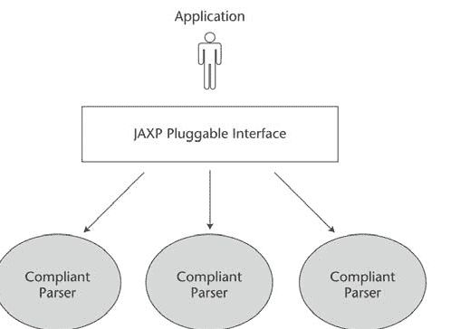

## 5.2.3 JAXP 模型

JAXP 模型易于理解。JAXP 的目的是提供一个标准的高层 API 层，用于抽象 XML 解析的低层细节。


## 5.2.4 JAXP 实现

目前存在许多 JAXP 1.1 的实现，包括 Crimson、Apache Xerces 以及来自 IBM 和 Oracle 的 XML 解析器。

Java 开发工具包 (JDK) 1.4 中发现的一个新变化是增加了 JAXP API 和参考实现。参考实现包括用于 XML 解析的 Crimson 和用于 XML 转换的 Xalan。

## 5.2.5 使用 SAX 处理 XML

XML 简单访问接口 (SAX) API 基于事件驱动的处理模型，在该模型中，数据元素按顺序进行解释，并在选定的结构上调用回调函数。它类似于 AWT 1.1 事件委托模型，其中 UI 组件根据用户输入生成事件，而事件监听器执行操作。SAX 最大的优势是它不会将任何 XML 文档加载到内存中；因此它被认为是非常快速且轻量的。SAX 支持验证，但不强制使用验证。在开启验证的情况下，会检查文档是否符合模式文档（DTD 或 XML Schema）。它采用顺序只读的方法，不支持对 XML 元素的随机访问。

使用 SAX API 处理 XML 数据有多种方法。其中一种是使用 JAXP (`javax.xml.parsers.*`) API，它直接映射了许多底层的 SAX 特定调用或 SAX (`org.xml.sax*`) 调用。直接使用 SAX API 更加困难，因为需要更多步骤来实现封装在 JAXP API 中的相同等效功能。在本节中，我们将关注 JAXP 的特定细节，将不会详细介绍供应商特定的 SAX API，因为这涵盖的范围非常广泛。

SAX 作为一种处理模型非常简单（见图 3）。基本步骤包括以下三个阶段：

1. 实现一个继承自 `DefaultHandler` 的类，并根据你的需求为 XML 中发现的每种类型的结构持有回调方法，其中包含实现。


2. 实例化一个新的 SAXParser 类。解析器读取 XML 源文件并触发在 `DefaultHandler` 类中实现的回调。

3. 顺序读取 XML 源。由于是顺序读取，因此无法随机访问结构中的元素。其余部分取决于你在 `Handler` 类中的实现。

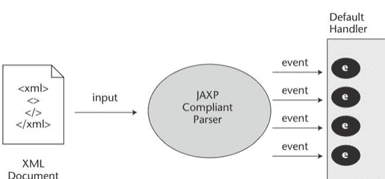

图 3. 使用 SAX 处理模型的 JAXP。

接下来的章节描述了 JAXP 特定的 SAX 处理。这些步骤包括：

- 获取用于执行 XML 解析的工厂类和解析器类
- 设置命名空间、验证和特性等选项
- 创建 `DefaultHandler` 实现类

## 获取工厂和解析器

`JAXPParser` 类负责解析 XML 数据，而 `org.xml.sax.DefaultHandler` 的实现处理所有特定标签的回调。为了让应用程序获取解析器实例，它必须获取一个 `SAXParser` 实例，并在上面调用 `parse` 方法。

## 如何获取 SAX 解析器

以下是创建 SAX 解析器的逐步演示。

1. 实例化已实现的 Handler 类。JAXP 1.1 要求处理程序继承自 `DefaultHandler` 而不是 `HandlerBase`（后者是 JAXP 1.0 中使用的实现）。

```java
DefaultHandler handler = new MyImplOfHandler();
```

2. 使用 `SAXParserFactory` 的静态方法 `newInstance()` 获取工厂类。

```java
SAXParserFactory factory =
SAXParserFactory.newInstance();
```

3. 通过调用 `newSAXParser()` 静态方法从工厂获取 SAX 解析器类：

```java
SAXParser parser = factory.newSAXParser() ;
```

4. 通过调用 `SAXParser` 上的 `parse` 方法解析 XML 数据，并将 XML 输入作为第一个参数，将 `DefaultHandler` 实现作为第二个参数。请查看 SAarser 的 javadoc 以了解 `parse` 方法提供的不同选项。

```java
parser.parse("PurchaseOrder.xml", handler);
```


第二步中使用的工厂类作为系统属性、jar 服务或平台默认值提供。这种实现被称为 JAXP 可插拔层，因为它是通用的，工厂类是动态检索的。只要它们遵循 JAXP 1.1 规范，就可以轻松地更换解析器供应商。如果在运行时未找到该属性，将抛出 `FactoryConfiguration` 异常，并附带描述问题来源和原因的消息。解析器工厂还可以额外配置以实例化具有验证功能和/或命名空间感知解析器。当解析器未正常返回时，会抛出 `ParserConfigurationException`。

## 工厂的配置

以下代码展示了如何通过设置为系统属性的键值对来定义工厂类。此行可以放在配置文件（`java.util.Properties`）中，或简单地作为 Java 用的参数传递。开发者常见的实现是 Sun Crimson 参考实现和 Apache Xerces。以下是设置 Xerces 2 和 Crimson Xerces JAXP `SAXParserFactory` 的示例。

### Apache Xerces 2

```
javax.xml.parsers.SAXParserFactory=org.apache.xerces.jaxp.SAXParserFactoryImpl
```


### Sun Reference Implementation (Crimson)

```
javax.xml.parsers.SAXParserFactory=com.sun.xml.parser.SAXParserFactoryImpl
```

## 设置命名空间

命名空间解析器可以处理命名冲突。当使用相同的名称时这很重要。

要配置解析器感知命名空间，请执行以下步骤：

```java
/** 设置为命名空间感知 */
factory.setNamespaceAware(true);
```

要验证解析器是否支持命名空间，请执行以下步骤：

```java
if (parser.isNamespaceAware()) {
  System.out.println("支持命名空间");
} else {
  System.out.println("不支持命名空间");
}
```

## 设置验证

验证基于提供验证文档对 XML 数据施加某些约束。许多标准提供了基于 DTD 和 W3C Schema 的验证能力。

要配置解析器为验证解析器，请执行以下步骤：

```java
/** 设置为验证解析器 */
factory.setValidating(true);
```

工厂类将尝试寻找具有验证能力的解析器。如果解析器不可用，将抛出工厂配置异常。

要验证解析器是否支持验证，解析器类提供了以下方法：

```java
if (parser.isValidating()) {
  System.out.println("解析器支持验证。");
} else {
  System.out.println("解析器不支持验证。");
}
```

## 设置特性

SAX 2.0 通过名为 `setFeature()` 的方法启用更灵活的配置选项。该方法在工厂类上的调用方式与 `setNamespaceAware` 和 `setValidating` 相同。此选项设置了供应商实现的各种特性以供解析器配置。例如，开启或关闭 Schema 验证将具有以下语法：

```java
factory.setFeature("http://www.acme.com/xml/schema", true);
```

`getFeature()` 方法允许应用程序通过返回布尔值来验证特定特性是否已设置。

## Java Web Services 回调方法示例

```java
public void characters(char buf[],
        int offset,
        int len)
    throws SAXException {
}

public void startElement(String namespaceURI,
        String localName,
        String rawName,
        Attributes attrs)
    throws SAXException {
}

public void endElement(String namespaceURI,
        String localName,
        String rawName)
    throws SAXException {
}
```

在此段代码中，调用了以下回调方法：

- `startDocument()`。此方法仅在 XML 文档开始时调用一次。
- `endDocument()`。此方法在解析器到达 XML 文档结束时调用。
- `characters()`。当元素内部存在字符数据时会调用此方法。
- `startElement()`。每当遇到一个新的元素起始标签（例如 `<element>`）时，都会调用此方法。
- `endElement()`。当元素结束时（例如 `</element>`），会调用此方法。
- 在 SAX 示例代码部分，将实现一个默认处理器（default handler）以读取并将 XML 输出到终端。

# 使用 SAX 解析器

可以通过多种不同的方式使用 SAX 解析数据。符合 JAXP 标准的解析器从工厂类获取，即 `SAXParser`。该解析器是许多供应商提供的实现。由于它符合规范，因此可以很容易地更换。获取解析器对象非常直接。开发者必须实例化工厂类，并从该工厂类实例化一个新的解析器类：


# 使用 Java API 进行 XML 处理和数据绑定

```java
SAXParserFactory saxFactory = SAXParserFactory.newInstance();
javax.xml.parsers.SAXParser saxParser =
saxFactory.newSAXParser();
```

在获取工厂和解析器的实例时，可能会出现一些问题。工厂配置可能错误，并会抛出一个异常来指示此问题。该异常称为 `FactoryConfigurationError`，必须在实例化工厂对象期间捕获。第二个应用程序可能发生故障的地方是实例化解析器对象时。在这种情况下，当工厂实例化新解析器时，必须捕获 `ParserConfigurationException`。以下是更完整的代码列表：

```java
try {
    SAXParserFactory saxFactory = SAXParserFactory.newInstance();
    javax.xml.parsers.SAXParser saxParser =
    saxFactory.newSAXParser();
} catch (FactoryConfigurationError fce) {
    // 在此处处理异常
} catch (ParserConfigurationException pce) {
    // 在此处处理异常
}
```

获取解析器后，下一步是通过传递要解析的 XML 数据和一个处理所传数据的 `Handler` 类来调用 `parse()` 方法。以下是解析器使用的几种可能性：

- 传递文件作为参数：
  `saxParser.parse(new File(someString), mySAXExampleHandler);`

- 传递 URI 作为字符串参数：
  `saxParser.parse("http://www.acme.com/xml/PurchaseOrder.xml", mySAXExampleHandler);`

- 传递输入流作为参数：
  `saxParser.parse(someInputStream, mySAXExampleHandler);`

`parse()` 方法中提供了带有 `HandlerBase` 的选项，但这些是 SAX 1.0 的实现。当前的 JAXP 版本为了向后兼容而实现了这些内容，但在使用 JAXP 1.1 时，你应该使用 `DefaultHandler`。


数据也可以用非 JAXP 解析器（例如底层的 `org.xml.sax.Parser`）进行解析，但这些方法不是厂商中性的。SAX 2.0 引入了 `XMLReader`，它本质上是一个被 `SAXParser` 实现封装的解析器类。通过调用 XML-Parser 的 `getXMLReader()` 获取。

# 读取和写入 XML

使用 SAX 读写 XML 文档需要实现一个解析处理器类（继承自 `DefaultHandler`）。该处理器类提供了在程序员定义的回调方法中编写的逻辑。然后解析器处理输入流并调用处理器的回调方法来执行实际工作（见图 4）。`parse` 方法接受各种输入参数，包括 `java.io.InputStream`、`org.xml.sax.InputSource`、`java.io.File` 和 `java.lang.String`。第二个参数是 `DefaultHandler` 类的实现。

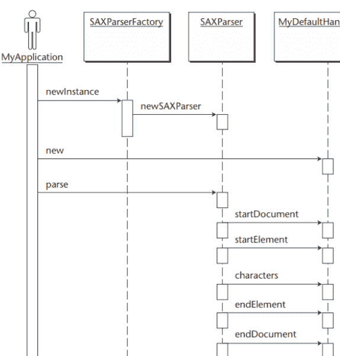

图 4. 显示使用 SAX 进行 JAXP 解析的序列图。

# SAX 示例源代码

以下是一个示例 Handler 类和一个实现类，它使用 SAX 方法解析 XML 文件并将整个文件输出到控制台（系统标准输出）。

在运行代码之前，使用带有示例的 ANT 脚本编译 java 文件。要运行，执行以下命令：

```
java -classpath d:xerces-1_4_4/*xerces.jar javax.xml.parsers.SAXParserFactory=org.apache.xerces.jaxp.SAXParserFactoryImpl jws
```

列表 1 是 `MySAXHandler.java` 的代码。


## Java Web Services 回调方法示例

```java
public void characters(char buf[],
        int offset,
        int len)
    throws SAXException {
}

public void startElement(String namespaceURI,
        String localName,
        String rawName,
        Attributes attrs)
    throws SAXException {
}

public void endElement(String namespaceURI,
        String localName,
        String rawName)
    throws SAXException {
}
```

在此代码中，调用了以下回调方法：

- `startDocument()`。此方法仅在 XML 文档开始时调用一次。
- `endDocument()`。此方法在解析器到达 XML 文档结束时调用。
- `characters()`。当元素内部存在字符数据时会调用此方法。
- `startElement()`。每当遇到一个新的元素起始标签（例如 `<element>`），都会调用此方法。
- `endElement()`。当元素结束时（例如 `</element>`），会调用此方法。
- 在 SAX 示例代码部分，将实现一个默认处理器以读取并将 XML 输出到终端。

# 使用 SAX 解析器

可以通过多种不同的方式使用 SAX 解析数据。符合 JAXP 标准的解析器从工厂类获取，即 `SAXParser`。该解析器是许多供应商提供的实现。由于它符合规范，因此可以很容易地更换。获取解析器对象非常直接。开发者必须实例化工厂类，并从该工厂类实例化一个新的解析器类：


# 使用 Java API 进行 XML 处理和数据绑定

```java
SAXParserFactory saxFactory = SAXParserFactory.newInstance();
javax.xml.parsers.SAXParser saxParser =
saxFactory.newSAXParser();
```

在获取工厂和解析器的实例时，可能会出现一些问题。工厂配置可能错误，并会抛出一个异常来指示此问题。该异常称为 `FactoryConfigurationException`，必须在实例化工厂对象期间捕获。第二个应用程序可能发生故障的地方是实例化解析器对象。在这种情况下，当工厂实例化新解析器时，必须捕获 `ParserConfigurationException`。以下是更完整的代码：

```java
try {
    SAXParserFactory saxFactory = SAXParserFactory.newInstance();
    javax.xml.parsers.SAXParser saxParser =
    saxFactory.newSAXParser();
} catch (FactoryConfigurationError fce) {
    // 在此处处理异常
} catch (ParserConfigurationException pce) {
    // 在此处处理异常
}
```

获取解析器后，下一步是通过传递要解析的 XML 数据和一个处理所传数据的 Handler 类来调用 `parse()` 方法。以下是解析器使用的几种可能性：

- 传递文件作为参数：
  `saxParser.parse(new File(someString), mySAXExampleHandler);`

- 传递 URI 作为字符串参数：
  `saxParser.parse("http://www.acme.com/xml/PurchaseOrder.xml", mySAXExampleHandler);`

- 传递输入流作为参数：
  `saxParser.parse(someInputStream, mySAXExampleHandler);`

`parse()` 方法中提供了带有 `HandlerBase` 的选项，但这些是 SAX 1.0 的实现。当前的 JAXP 版本为了向后兼容而实现了这些内容，但在使用 JAXP 1.1 时，你应该使用 `DefaultHandler`。


数据也可以用非 JAXP 解析器（例如底层的 `org.xml.sax.Parser`）进行解析，但这些方法不是厂商中性的。SAX 2.0 引入了 `XMLReader`，它本质上是一个被 `SAXParser` 实现封装的解析器类。通过调用 XML-Parser 的 `getXMLReader()` 获取。

# 读取和写入 XML

使用 SAX 读写 XML 文档需要实现一个解析处理器类（继承自 `DefaultHandler`）。该处理器类提供了在程序员定义的回调方法中编写的逻辑。然后解析器处理输入流并调用处理器的回调方法来执行实际工作（见图 4）。`parse` 方法接受各种输入参数，包括 `java.io.InputStream`、`org.xml.sax.InputSource`、`java.io.File` 和 `java.lang.String`。第二个参数是 `DefaultHandler` 类的实现。


图 4. 显示使用 SAX 进行 JAXP 解析的序列图。

# SAX 示例源代码

以下是一个示例 Handler 类和一个实现类，它使用 SAX 方法解析 XML 文件并将整个文件输出到控制台（系统标准输出）。

在运行代码之前，使用带有示例的 ANT 脚本编译 java 文件。要运行，执行以下命令：

```
java -classpath d:xerces-1_4_4/*xerces.jar javax.xml.parsers.SAXParserFactory=org.apache.xerces.jaxp.SAXParserFactoryImpl jws
```

列表 1 是 `MySAXHandler.java` 的代码。


## Java Web Services 回调方法示例

```java
public void characters(char buf[],
        int offset,
        int len)
    throws SAXException {
}

public void startElement(String namespaceURI,
        String localName,
        String rawName,
        Attributes attrs)
    throws SAXException {
}

public void endElement(String namespaceURI,
        String localName,
        String rawName)
    throws SAXException {
}
```

列表 3 显示 XML 的输出。

```xml
<?xml version='1.0'?>
<PurchaseOrder>
<Header>2235670</Header>
<Date>02/22/2002</Date>
<BuyerNumber>00232</BuyerNumber>
<BuyerName>John Doe</BuyerName>
<LineItem type=SW>
<ProductName>3333</ProductName>
<Quantity>145</Quantity>
</LineItem>
</Order>
```


# 列表 2 是 `MyXExample.java` 的代码

```java
package jws;

import javax.xml.parsers.*;

class SAXExample {
  public static void main(String[] args) {
    try {
      SAXParserFactory factory = SAXParserFactory.newInstance();
      SAXParser parser = factory.newSAXParser();
      parser.parse("PurchaseOrder.xml", new MyXHandler());
    } catch (FactoryConfigurationError fce) {
      System.out.println("FactoryConfiguration occurred :fce);
    } catch (ParserConfigurationException pce) {
      System.out.println("ParserConfiguration occurred :pce);
    } catch (Exception e) {
      System.out.println("Exception occurred :e);
    }
  }
}
```

# 列表 8 是 XML 的部分输出


# ROLE MODEL

# JON BOSAK

Jon Bosak 领导了 W3C XML 规范的创建。从 1996 年到 2008 年，他在太阳微系统工作。


# XML

XML 规范编辑者之一 Tim Bray 在关于 Bosak 的注释中写道：

> “由于 Jon Bosak 的巨大功劳，Jon Bosak is the single person without efforts XML most likely have failed. He had come to appreciate the power and flexibility of SGML in his days runningell’s (excellent) on-line documentation repository and had acquired a conviction that HTML was not a suitable base on which to build the next layer of Web infrastructure. Jon’s stewardship of the XML process has been marked by a combination of deft political maneuvering with steadfast insistence on doing things based on principle, not expediency”

1999 年在 xml-mail 列表中，Bray 写道：

> “正是由于 Jon Bosak，他（像我们中的许多人）not only save the need for simplification（unlike anyone else） went and the W3C until it became less trouble to give him his committee.”

当 2000 年退出 W3C XML 协调小组时，Jon Bosak 获得了一项为他保留的特殊认可：

为了感谢他的愿景、领导力和对 W3C 的奉献，W3C 全体于 2000 年 2 月 10 日永久为 Jon Bosak 保留 XML 名称“xml:Father”

# Universal Business Language

2001 年，Bosak 组织了 OASIS 通用业务语言技术委员会创建基础电子业务文档的标准格式。他领导 UBL TC 完成了 2013 年 11 月的 UBL 2.1 版本，并继续作为秘书担任该委员会。UBL 被欧盟委员会 2014 年 10 月 31 日的决定批准用于欧洲公共部门采购，并于 2015 年 12 月 15 日作为国际标准 ISO/IEC 19845:2015 发布。

# 度量研究

Bosak 是书籍《旧尺度：美国习惯量衡体系起源的探究》（The Old Measure: An Inquiry into the Origins of the U.S. Customary System of Weights and Measures，ISBN 978-0-615-37626-4, 2010）以及文章《规范谷重：作为古代量衡体系的关键》（PDF）的作者。（最新版本为 2014年4月19日）

# Bob Bosak

Jon Bosak 的父亲 Robert Bosak（1925–1987）于 1947 年开始了家族在计算机行业的长期参与，当时他前往美国西海岸参与第一台计算机的工作。他于 1948 年加入 RAND 公司，负责科学问题的分析和编程。1951 年，他加入了洛克希德航空公司（Lockheed Aircraft Corporation），组织并指导了数学分析小组。在20 世纪 50 年代离婚后一段时间内，他与“ASCII 之父”Bob Bemer 共用一个公寓。

Bob Bosak 于 1956 年返回 RAND 公司，担任半自动地面环境（SAGE）的编程负责人。SAGE 是 1959 年至 1983 年间控制美国空防的自动化北美防空司令（NORAD）系统，对现代空中交通控制的设计产生了巨大影响。他是 JOVIAL 的设计者之一，《信息代数》（An Information Algebra）的主要作者。

## 总结

- 众所周知 Java 和 XML 是构建可移植业务应用的完美结合，Java 提供了可以在各种平台上执行的代码的可移植性，而 XML 提供了可以在不同平台上处理的数据的可移植性。

- XML 是一种基于 ASCII 的结构化元数据语言，已在业界广泛采用。

- 根（root）是 XML 文档的顶层元素。为了使文档在语法上正确，必须只能包含一个根元素。

- 处理器指令（PIs）用于向 XML 处理应用程序提供信息。

- 注释用于定义 XML 结构的部分。注释使用与 HTML 相同的语法。

- 标签（tag）是由角括号标识的元素标记。每个标签都必须有一个开始标签和一个结束标签。

- 元素（element）是位于开始标签和结束标签之间的数据。它是创建 XML 文档的构建块。

- XML 文档中的命名空间（Namespaces）用于防止相同或不同 XML 文档内的命名冲突。命名空间语法允许定义定义以及关联的 URI/URL。

- JAXP 提供了一个可插层，允许应用程序开发者在不影响应用程序逻辑的情况下更改解析器实现。

- JAXP API 模型易于理解且易于使用。解析类和接口封装在 `javax.xml.parsers` 包下，并构建在现有的 SAX 或 DOM API 之上。

- 简单访问 XML（SAX）API 基于事件驱动的处理模型，其中数据元素按顺序进行解释，并根据所选的结构调用回调函数。


### 单选题

1. 下列哪是基于 XML 的 Web 服务的优点？

a. 使用 XML 消除了任何网络、操作系统或平台的绑定。

b. 基于 Web 服务的应用程序在其核心层面是高度互操作的应用程序。

c. 以上都是。

d. 以上都不是。

2. Web 服务通过通用的 XML 语法进行自我描述。

a. 正确

b. 错误

3. 服务传输（Service Transport）负责以通用的 XML 格式编码消息，以便消息在两端都能理解。

a. 正确

b. 错误

4. 请求在 XML-RPC 中是如何发送的？

a. 请求被编码为 XML并通过 HTTP POST 发送。

b. 请求被编码为 XML并通过 HTTP GET 发送。

c. 以上都是。

d. 以上都不是。

5. 哪个 Java 提供的 XML 解析器通过加载文档完整内容并在内存中创建完整的层级树来解析文档？

a. SAX 解析器

b. StAX 解析器

c. DOM 解析器

d. XPath 解析器

6. 哪个 Java 提供的 XML 解析器根据事件触发解析文档，且不将完整文档加载到内存中？

a. SAX 解析器

b. StAX 解析器

c. DOM 解析器

d. XPath 解析器

7. 哪个 DOM 方法返回文档的根元素？

a. `Document.getDocumentElement()`

b. `Node.getFirstChild()`

c. `Document.getRoot()`

d. 以上皆非

8. 下列哪个方法创建 Document Builder 实例？

a. `DocumentFactory.createDocumentBuilder()`

b. `DocumentFactory.newDocumentBuilder()`

c. `Document.createDocumentBuilder()`

d. `Document.newDocumentBuilder()`

9. 哪个接口指定了 SAX 解析器使用的回调方法，用于通知应用程序程序其已看到的 XML 文档组件？

a. `ContentHandler`

b. `TransformerHandler`

c. `SAXHandler`

d. `XMLReader`

10. 接口“Document”的超接口（Superinterface）是什么？

a. `XMLReader`

b. `ContentHandler`

c. `DocumentBuilder`

d. `Node`

### 复习题

1. 你如何理解可扩展标记语言（XML）？

2. XML 中的处理器指令是什么？

3. XML 中命名空间的作用是什么？

4. 什么是文档类型定义（DTD）？

5. 什么是 XML Schema（架构）？

### 单选题答案

1. (c) 2. (a) 3. (b) 4. (a) 5. (c)

6. (a) 7. (a) 8. (b) 9. (a) 10. (d)

### 参考文献

1. Bray, Tim (2005). “与 Tim Bray 的对话：寻找世界存储的方法”。计算机协会。

2. Kimber Eliot (2006). “五年后的”。macos-xml-rants.blogspot.com。

3. Fennell, Philip (2013). “XML 的极端情况”。XML London 2013.80-86。

4. Harold, Elliotte (2004). 《有效的 XML》。Addison-Wesley. 10-19。

5. Jon Bosak; Sun Microsystems (2006-12-07). “XML 主旨演讲”。xmlconference.org。

6. Kelly, Sean (2006). “XML 中的错误”。Developer.com。

7. Lawrence A. Cunningham (2005). “语言、交易与标准：XML 的未来”。华盛顿大学法律评论。SSRN 900616。

8. Pilgrim, Mark (2004). “XML 中严厉的错误处理历史”。存档于 2011-07-26。

9. St. Laurent, Simon (2003年2月12). “五年后，XML”。O’Reilly XML Blog。O’Reilly Media。

10. Taina Bucher (2013年11月16). “情感对象：Twitter API 案例”。计算文化 (3)。ISSN 2047-2390。

# 第 6 章 使用 JAXM 和 SAAJ 消息

## 学习目标

学习本章后，你能够：

- 描述 JAXM 在 Web 服务中的作用

- 学习 JAXM API 程序模型

- 了解使用 JAXM 的基本步骤

## 引言

本章讨论了 Java XML 消息 API（JAXM）和 Java SOAP 附件 API（SAAJ）。JAXM 和 SAAJ 都为支持广泛行业标准（包括 SOAP 和 ebXML）的 B2B 和 Web 服务应用程序提供了 XML 消息处理。JAXM 是 JWSDP 的不可或缺的一部分，JWSDP 在 Web 服务环境中提供同步和异步消息能力，并允许在内网或互联网交换 XML 文档。JAXM 为构建、发送和接收 XML 消息提供了消息基础设施和标准 API 机制。

除了 JAXM 之外，JWSDP 还提供了 SAAJ，它可以在没有 JAXM 提供者基础设施的情况下发送和接收作为 SOAP 消息的 XML 文档，并处理基于 HTTP 的请求/响应。最初，SAAJ 是 JAXM 1.0 API 程序包的一部分，从 JAXM 1.1 开始，该程序包被称为 SAAJ 1.1 API。

JAXM 和 SAAJ API 完全符合 SOAP 1.1 规范和带附件的 SOAP 1.1 标准，这有助于 Java Web 服务开发者以最少的努力和对 SOAP 消息了解编写基于 JAXM 或 SOAP 的 XML 消息应用程序。在使用 JAXM 或 SAAJ 的业务场景中，交换的 XML 文档可以是生产信息、采购订单、发票、订单确认等。

## 6.1 JAXM 在 Web 服务中的作用

JAXM 是一个基于 SOAP 1.1 规范和 SOAP 附件定义的消息协议的 API 框架。JAXM 使用标准的消息提供者基础设施和基于 Java 的 API，以便在 Web 环境中异步发送和接收基于 XML 的消息，并支持 Web 服务标准和协议。JAXM 的核心特性如下：

- 具有可移植的 XML 消息应用程序

- 具有同步（请求/响应）和异步（单向）消息传递

- 将消息传输并路由到许多提供者

- 通过可靠消息确保消息的投递

- 支持标准的 Internet 协议，如 HTTP、SMTP 和 FTP

在不使用提供者基础设施的情况下使用 JAXM 时，可以通过 JWSDP 1.0 提供的 SAAJ 1.1 API 通过 SOAP 连接以请求和响应的形式发送和接收消息。

JAXM 提供了消息配置（messaging profiles）的概念，使得消息协议可以在 SOAP 消息之上实现。

基于 JAXM 的应用程序客户端必须使用消息配置来识别其底层传输绑定、消息结构和语义。这在 JAXM 客户端与其 JAXM 消息提供者之间建立了一种约定。


## 使用 JAXM 和 SAAJ 进行 XML 消息

基于 JAXM 的应用程序（发送者和接收者）可以部署在符合 JAXM servlet 2.2 或 J2EE 1.3 的服务器提供者中。JAXM 作为异步应用程序运行，并在接收到提供者的消息时执行方法。在没有提供者的情况下运行的 JAXM 可以作为独立客户端，与另一个符合 JAXM/SOAP 1.1 的应用程序以请求和响应的形式交换消息。在 Web 场景中，JAXM 消息基础设施类似于 SOAP 中间件，在目的地之间路由消息。Web 服务请求将消息发送到其 JAXM 消息提供者，然后将消息路由到 Web 服务提供者的 JAXM 消息提供者。Web 服务提供者接收消息，并根据服务请求者的要求执行相应的方法，或者可能将消息重新路由到下一个中间目的地或最终目的地。

### 6.1.1 JAXM 应用程序架构

图 1 表示了基于 JAXM 的应用程序架构及其核心元素。

- **JAXM 客户端**。JAXM 客户端是发送和接收 JAXM 消息的基于 JAXM 的应用程序组件。JAXM 客户端（发送者和接收者）可以使用 JAXM 提供者运行，也可以没有提供者运行。使用提供者连接的 JAXM 客户端可以作为单向传输异步发送和接收消息。JAXM 客户端还利用了提供者提供的功能，如消息可靠性和确保投递。在没有提供者的情况下，JAXM 客户端可以通过 SOAP 连接以请求和响应的形式发送和接收消息。通常情况下，JAXM 接收者客户端不需要 JAXM 提供者。

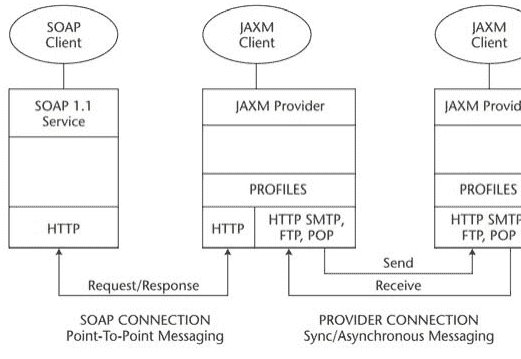

图 1. 基于 JAXM 的应用程序架构。


### Java Web 服务

**JAXM 消息**。JAXM 消息是基于 SOAP 标准和约 XML 文档，定义了 JAXM 通信期间的基本消息格式。SAAJ 1.1 API 提供了底层 Java API，用于构建符合 SOAP 1.1 标准的 XML 消息（带或不带附件）。

**JAXM 连接**。JAXM 连接是一组预配置的指向提供者或 SOAP 实现的 JAXM 客户端。JAXM 客户端使用这些连接发送和接收消息。使用提供者的 JAXM 连接与连接消息队列中间件非常相似。在没有 JAXM 提供者的情况下，它的工作方式类似于点对点通信模型，目的地指向 SOAP 端点。


# JAXM 配置

JAXM 消息配置提供了在 SOAP 消息之上实现消息协议的灵活性。在客户端应用程序中，配置定义了特定 SOAP 消息的传输绑定、消息头定义和语义。使用 JAXM 提供者的 JAXM 客户端需要使用消息配置，该配置通常作为指向定义消息结构的 XML Schema 的 URL 提供。例如，ebXML 消息服务（MS）规范的配置可以在 `http://www.ebxml.org/project_teams/transport/messageHeader.xsd` 找到。JAXM 1.1 RI 目前为 SOAP 和 ebXML 提供消息配置。

通信是从一个实体向另一个实体传达含义的行为。


JWSDP 是开发 Web 服务的软件开发工具包。


# 使用 JAXM 和 SAAJ 进行 XML 消息

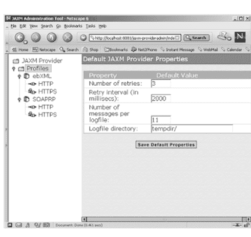

**图 2. 基于 JAXM 的应用程序架构。**

- 可配置 JAXM 属性，如重试次数、日志等。JAXM 管理可以通过 `http://localhost:808/jaxadmin/index.jsp` 访问。
- JAXM 提供者。JAXM 是实现 JAXM 接口和类的符合 JAXM 标准的基础设施。它促进了消息的传输和路由，并按照消息协议确保投递。


## 6.1.2 JAXM 消息：交互模式

- **异步查询**。在这种模式下，消息生产者应用程序发送消息，但不等待消息消费者的响应。消息消费者处理消息并作为新操作返回响应。也就是说，发送和接收消息的过程发生在独立的操作中。
- **带确认的异步更新**。消息消费者向提供者或其消息发送者确认接收消息。这种确认取决于提供者的实现。
- **同步查询**。同步查询通常用于请求/响应式通信：消息发送者在通过同一连接向接收者发送消息后等待响应。
- **同步更新**。与异步更新类似，在发送初始请求后，消息发送者等待作为消息已发送的确认。
- **发后即忘**。消息发送者不等待也不预期消息接收者的响应。

## 6.2 JAXM API 编程模型

JAXM 1.1 API 定义了一个单一包结构，包含一组接口和类，用于旨在与 JAXM 提供者或直接与 SOAP 服务进行消息交互的 JAXM 客户端：

```
javax.xml.messaging
```

## 6.2.1 javax.xml.messaging

此包提供了用于创建 JAXM 客户端的接口和类。JAXM 客户端可以与 JAXM 提供者或基于 SOAP 的服务发送和接收异步或单向消息。下介绍了 JAXM API 的接口和类。

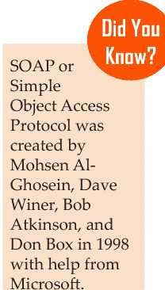

### 接口

- `javax.xml.messaging.OneWayListener`。用于 JAXM 客户端的异步消息监听接口，作为 JAXM 消息的异步消费者。JAXM 客户端可以实现此接口并使用 `onMessage()` 方法消费消息。当消息到达 JAXM 提供者的目标端点时，会调用 `onMessage()` 方法。`OneWayListener` 可以通过扩展 JAXM servlet 接口并部署符合 Java servlet 2.2 标准的 servlet 容器（如 Apache Tomcat 或符合 J2EE 1.3 标准的应用服务器）来实现 servlet。它也可以在未来的 J2EE 环境中实现为 `MessageDrivenBean`，因为即将符合 J2EE 1.4 标准的应用程序预计将支持它。

```java
public class ConsumerServlet extends HttpServlet
    Implements OneWayListener {
    public void onMessage(SOAPMessage msg) {
        //在此处实现你的业务逻辑
    }
}
```

- `javax.xml.messaging.ReqRespListener`。为 JAXM 客户端组件提供同步消息监听接口，以基于 HTTP 的请求和响应消费 JAXM 消息。在这种情况下，客户端通过调用方法发送请求 `java.xml.soap.SOAPConnection` 并等待接收者的响应。接收者接收 `ReqRespListener` 接口并使用 `onMessage()` 方法向发送者响应。在使用 `OneWayListener` 时，`ReqRespListener` 接口可以通过扩展 JAXM servlet 接口并部署符合 Java Servlet 2.2 标准的 servlet 容器（如 Apache Tomcat 或符合 JEE 1.3 标准的应用服务器）来实现 servlet。但在这种情况下，不需要 JAXM 提供者连接，因为使用 SOAP 连接的请求/响应直接绑定到 HTTP。

```java
public class ConsumerServlet extends ReqRespListener {
    public void onMessage(SOAPMessage msg) {
        //在此处实现你的业务逻辑
    }
}
```

- `javax.xml.messaging.ProviderConnection`。创建到 JAXM 提供者的客户端连接。该连接从 `ConnectionFactory` 对象获取，该对象定义了一组指向 JAXM 提供者的预配置连接。JAXM 客户端对 `ProviderConnectionFactory` 进行 JNDI 查找，然后使用 `getConnection()` 方法获取到 JAXM 提供者的连接。

```java
Context myCtx = new InitialContext();
ProviderConnectionFactory pcf =
    myCtx.lookup("SunOneProvider");
ProviderConnection p = pcf.createConnection();
```

- `javax.xml.messaging.ProviderMetaData`。为连接的客户端提供 JAXM 提供者的详细信息。

### 类

- `javax.xml.messaging.JAXMServlet`。一种用于作为 HTTP servlet 实现 JAXM 客户端的工具类。它还便于使用 HTTP 同步或异步地发送和接收 JAXM 消息。
- `javax.xml.messaging.Endpoint`。代表应用程序端点的对象，代表消息的实际目标并通过 URI 标识。它是一个通过目标标识的消息提供者，该目标必须配置为端点。
- `javax.xml.messaging.URLendpoint`。将 URL 表示为 JAXM 客户端应用程序的特殊端点，该应用程序在不使用 JAXM 提供者的情况下直接与另一个基于 SOAP 的应用程序通信。


### 异常

- `java.xml.messaging.JAXMEException`。发生 JAXM 异常时抛出此异常。该异常说明了原因，例如获取连接失败、消息头问题等。

## 6.2.2 java.xml.soap (SAAJ 1.1 APIs)


JAXM API 依赖此包来创建和处理 SOAP 消息及其附件。除了创建和处理 SOAP 消息外，此包还提供了用于对任何符合 SOAP 1.1 的服务的点对点请求/响应消息的 SOAP 视图。下介绍了 SAAJ 接口和类。

### 接口

- `java.xml.soap.SOAPEnvelope`。`SOAPHeader` 和 `SOAPBody` 对象的容器。它也是 `SOAPPart` 对象的一部分。客户端可以通过其 setter 或 getter 方法创建或检索元素来访问 `SOAPHeader` 和 `SOAPBody` 对象。

```java
SOAPPart soapPart = message.getSOAPPart();
SOAPEnvelope soapEnv = soapPart.getEnvelope();
SOAPHeader soapHeader = soapEnv.getHeader();
SOAPBody soapBody = soapEnv.getBody();
```

- `java.xml.soap.SOAPBody`。代表 SOAP 消息中 body 元素的内容。
- `java.xml.soap.SOAPBodyElement`。代表 `SOAPBody` 对象中的内容。可以使用 `SOAPBody` 方法 (`addBodyElement(elementName)`) 将 `SOAPBodyElement` 添加到 `SOAPBody` 对象。

```java
SOAPBodyElement sapBodyElement = soapBody.addBodyElement(name);
```

- `java.xml.soap.SOAPHeader`。代表 SOAP 元素的内容。可以使用 `SOAPEnvelope` 方法 `addHeader()` 创建 `SOAPHeader`。


```java
SOAPHeader soapHeader = soapEnv.addHeader();
```

- `javax.xml.soap.SOAPHeaderElement`。代表 SOAP envelope 的 `SOAPHeader` 部分。可以使用 `addHeaderElement` 创建 `SOAPHeader` 对象，将头添加到 `SOAPHeader` 对象。

```java
SOAPHeaderElement soapHeaderElem = soapHeader.addHeaderElement(elementName);
```

- `javax.xml.soap.SOAPConstants` 定义了特定于 SOAP 1.1 协议的常量，如命名空间、SOAP 编码标识符等。
- `javax.xml.soap.SOAPBodyElement` 代表 `SOAPBody`、`SOAPFault` 对象以及 `SOAPEnvelope` 对象中的内容。它根据 SOAP 1.1 规范作为所有 SOAP 对象的基类/表示。
- `javax.xml.soap.SOAPFault` SOAP 消息的错误/状态信息。它提供了 getter 和 setter 方法来获取 `SOAPFault` 对象中的故障信息，并设置 fault code、fault actor 和 fault string。可以使用 `SOAPElement` 方法 `addTextNode(String)` 使用 `SOAPFaultElement` 对象定义 `SOAPFault` 对象的内容。
- `javax.xml.soap.Detail` `SOAPFault` 的部分，提供详细的错误信息。它也是包含特定错误或状态信息的 `DetailEntry` 对象的容器。
- `javax.xml.soap.DetailEntry` 代表 `Detail` 对象的内容，为 `SOAPFault` 对象提供详细信息。
- `javax.xml.soap.Name` XML 名的表示，声明命名空间限定名称并获取与命名空间关联的前缀。

**示例**

应用程序特定的元素命名空间声明如下所示：

```xml
<wiley:GetBookPrice xmlns="http://jws.wiley.com/JavaWebservices">
```

其中 `wiley:GetBookPrice` 指限定名，`wiley` 指前缀，`GetBookPrice` 指名称，`http://jws.wiley.com/JavaWebservices` 指其命名空间 URL。


## 使用 JAXM 和 SAAJ 进行 XML 消息

要在 `SOAPEnvelope` 中创建应用程序特定的 XML 名称对象，请参考下例代码段：

```java
Name nameObj = soapEnvelope.createName(
"GetBookPrice", "willey",
"http://jws.wiley.com/JavaWebservices");
```

- `javax.xml.soap.Node`。代表 XML 文档中节点的 DOM 表示，并提供操作 DOM 树的方法——例如从树中添加或删除节点。
- `javax.xml.soap.Text`。将节点的值表示为文本对象。

### 类

- `javax.xml.soap.MessageFactory`。提供创建 `SOAPMessage` 对象的工厂类。可以通过获取 `MessageFactory` 类的实例创建 SOAP 消息对象：

```java
MessageFactory msgFactory = MessageFactory.newInstance();
SOAPMessage soapMsg = msgFactory.createMessage();
```

在使用 JAXM 提供者连接的情况下，可以使用消息配置创建 SOAP 消息对象：

```java
MessageFactory msgFactory
    = providerConn.createMessageFactory(profileURI);
SOAPMessage soapMsg = msgFactory.createMessage();
```

其中 `ProfileURI` 指消息配置的 XML 架构 URI。

- `javax.xml.soap.SOAPConnection`。使用 `SOAPConnection` 对象，SOAP 客户端可以发送和接收作为请求和响应的消息。要创建 `SOAPConnection`，客户端可以获取 `SOAPConnectionFactory` 的实例并使用工厂创建连接：

```java
SOAPConnectionFactory scf =
SOAPConnectionFactory.newInstance();
SOAPConnection conn = scf.createConnection();
```

- `javax.xml.soap.SOAPMessage`。`SOAPMessage` 是所有消息的根类。可以使用 `MessageFactory` 对象创建。使用带有配置的 `MessageFactory`，可以产生符合配置的 SOAP 消息。`SOAPMessage` 对象包含一个 SOAP 部分和零或多个 SOAP 附件。
- `javax.xml.soap.SOAPPart`。当创建 `SOAPMessage` 时，它包含一个作为 MIME 部分容器的 `SOAPPart` 对象，其包括 MIME 头部和 SOAP 封包（`SOAPEnvelope`）。要获取 `SOAPMessage` 的 `SOAPPart` 对象，请调用 `getSOAPPart` 方法：

```java
SOAPMessage soapMsg = msgFactory.createMessage();
SOAPPart soapPart = soapMsg.getSOAPPart();
```

- `javax.xml.soap.AttachmentPart`。要向 `SOAPMessage` 添加特定特定的附件，可以使用 `SOAPMessage.createAttachmentPart` 方法创建 `AttachmentPart` 对象。以下示例代码段为 soap 消息创建一个数据名称为 `myContentString` 且 MIME 类型为 `text/plain` 的附件：

```java
SOAPMessage soapMsg = msgFactory.createMessage();
AttachmentPart attPart = soapMsg.createAttachmentPart();
attPart.setContent(myContentString, "text/plain");
soapMsg.addAttachmentPart(attPart);
```

添加非文本二进制数据：

```java
SOAPMessage soapMsg = msgFactory.createMessage();
AttachmentPart attPart = soapMsg.createAttachmentPart();
attPart.setContent(new ByteArrayInputStream(dukeJPG), "image/jpeg");
soapMsg.addAttachmentPart(attPart);
```

- `javax.xml.soap.SOAPFactory`。提供了用于创建 SOAP 元素片段的工厂类，例如为 `SOAPEnvelope`、`SOAPBodyElement` 或 `SOAPHeader` 添加子元素。要添加 `SOAPElement` 对象，请调用 `createElement` 方法：

### 异常

- `javax.xml.soap.SOAPException`。当发生 SOAP 异常时抛出异常。该异常详细说明了异常原因，例如无法获取 SOAP 连接、SOAP 消息头部等。

## 6.3 使用 JAXM 的基本编程步骤

JAXM 1.1 规范定义了两种通信场景，在这些场景中，我们可以使用 JAXM API 来创建、发送和接收消息。

## 使用 JAXM 和 SAAJ 进行 XML 消息传递


场景取决于使用 JAXM 提供者，还是在不使用 JAXM 提供者的情况下直接连接到 SOAP 服务。

让我们来看看这些场景，并梳理处理这些场景所需的编程步骤。

## 6.3.1 使用 JAXM 提供者

图 3 展示了基于 JAXM 提供者的通信场景。

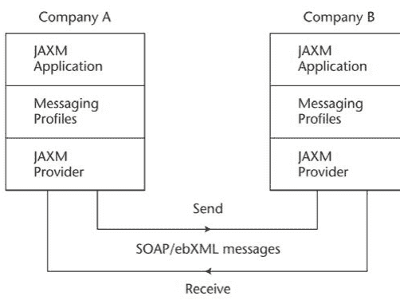

基于 JAXM 提供者的通信的要特征如下：

- 它定义了一种异步通信模型，发送者和接收者不需要始终保持连接，且接收者不需要阻塞目标地来接收消息。
- 它提供了可靠性机制，用于存储和转发消息到一对多的多个目的地，并使用消息协议采用如 ebXML 等高层消息协议。

如果使用 JAXM 消息提供者，当客户端发送消息时，消息将发送消息提供者，然后转发给接收者。提供者负责代表应用程序向其目标地传输消息。

### 使用消息提供者发送消息的步骤

使用 JAXM API 配合消息提供者发送消息的关键编程步骤如下：

1. 创建到提供者的连接。
2. 创建消息工厂。
3. 创建消息。
4. 填充消息内容。
5. 添加附件部分。
6. 保存消息。
7. 发送消息。
8. 关闭连接。

要使用消息提供者运行 JAXM，我们必须配置 JAXM 客户端和消息提供者。


接下来的段落将描述这些步骤。

### 创建到提供者的连接

首先，我们需要实例化 `ProviderConnection` 对象以创建到消息提供者的活动连接。要创建此连接，我们使用 JNDI 查找来获取 `ProviderConnectionFactory` 类的实例。一旦获取了连接工厂的实例，就可以创建到消息提供者的连接。

```java
// 使用 JNDI 查找创建初始命名上下文
Context ctx = new InitialContext();

// 查找 JAXM 提供者连接工厂
ProviderConnectionFactory pcf = (ProviderConnectionFactory)ctx.lookup("providerUI");

// 创建 JAXM 提供者连接
ProviderConnection pc = pcf.createConnection();
```

### 创建消息工厂

使用连接创建 `MessageFactory` 对象，该对象用于创建消息。当你创建 `MessageFactory` 对象时，`MessageFactory` 会返回适用于给定消息配置的 `SOAPMessage` 子类实例。在创建消息工厂之前，我们必须先从其元数据信息中提取提供者支持的配置，并确保提供者支持我们需要使用的配置。在以下代码段中，匹配 ebXML 配置的配置作为字符串传递给 `createMessageFactory` 方法：


### 使用 JAXM 和 SAAJ 进行 XML 消息传递

```java
// 使用提供者连接获取提供者元数据
ProviderMetadata metadataData = pc.getMetaData();

// 查找提供者支持的配置
String[] supportedProfiles = metadataData.getSupportedProfiles();
String profile = null;

// 查找匹配 ebXML 配置的配置
for(int i=0; i < supportedProfiles.length; i++) {
    if(supportedProfiles[i].equals("ebXML")) {
        profile = supportedProfiles[i];
        break;
    }
}

// 从连接创建消息工厂
MessageFactory msgFactory = pc.createMessageFactory(profile);
```

### 创建消息

使用 `MessageFactory` 根据 JAXM 1.1 创建 `SOAPMessage` 对象。例如，使用 ebXML 配置，代码如下：

```java
// 使用工厂创建消息
SOAPMessage message = msgFactory.createMessage();

// 设置发送者和接收者
message.setSender(new Endpoint());
message.setReceiver(new Endpoint());
```

### 填充消息

所有消息都是带有包含 SOAP 封包的 SOAP 部分的，而 SOAP 封包包含头部和主体。消息的部分可以包含任何类型的数据，包括 XML 或二进制数据。要填充消息，首先执行以下操作：


获取消息的 `SOAPPart`，然后获取其封包：

```java
// 从消息获取 SOAP 部分
SOAPPart soapPart = message.getSOAPPart();

// 获取 SOAP 封包
SOAPEnvelope soapEnvelope = soapPart.getEnvelope();
```

使用 `SOAPEnvelope` 对象获取 `SOAPHeader` 和 `SOAPBody` 对象，它们用于设置消息部分的内容：

```java
// 从封包创建 soap 头部
SOAPHeader soapHeader = soapEnvelope.getHeader();

// 创建 SOAPBody
SOAPBody soapBody = soapEnvelope.getBody();
```

使用包含 `SOAPElement` 对象的 `SOAPHeader` 向头部添加内容，创建一个 `SOAPHeaderElement` 并将其添加到头部。新的 `SOAPHeaderElement` 对象使用指定的 `Name` 对象初始化。

```java
// 使用封包添加头部元素
SOAPHeaderElement headerElement = soapHeader.addHeaderElement(
    soapEnvelope.createName("BookNo", "wiley", "http://jws.wiley.com/jws/"));
headerElement.addText("JWS100002");
```

使用 SOAP 对象填充 SOAP Body，因为 `SOAPBodyElement` 被创建并使用指定的 `Name` 对象初始化。

```java
// 创建 Name 对象并添加到 SOAPBodyElement
Name bodyName = soapEnvelope.createName(
    "SubmitPurchaseOrder", "wiley", "http://jws.wiley.com/jws/");
SOAPBodyElement soapBodyElement = soapBody.addBodyElement(bodyName);

// 创建 Name 对象并添加主体子元素
Name elementName = soapEnvelope.createName("BookName");
elementName.addTextNode("Developing Java Web services");
```

### 添加附件部分

下一步是使用 JavaBeans Activation Framework (JAF) API 向消息中添加 `AttachmentPart`。要向消息中添加附件，我们创建一个 `AttachmentPart` 对象：

```java
// 访问图片附件的 URL
URL url = new URL("http://www.wiley.com/jws/jwsbookcover.jpg");
// 使用 JAF，并使用此 URL 创建 JAF DataHandler
DataHandler handler = new DataHandler(url);

// 创建并添加 AttachmentPart
AttachmentPart attachmentPart = message.createAttachmentPart(handler);
message.addAttachmentPart(attachmentPart);
```

### 保存消息

通过调用 `saveChanges()` 方法，更新包含所有添加内容的 `SOAPMessage` 对象：

```java
// 保存消息
message.saveChanges();
```

### 发送消息

现在消息已经创建并添加了内容，准备好发送，可以使用 `ProviderConnection` 的 `send()` 方法异步发送发送消息：

```java
// 发送消息
pc.send(message);
```

### 关闭提供者连接

最后一步是通过调用 `ProviderConnection.close()` 关闭 `ProviderConnection`。

```java
// 关闭提供者连接
pc.close();
```


### 接收消息

要接收消息，我们需要实现一个 `JAXMServlet` 对象或使用 `OneWayListener` 接口实现消息驱动豆（JEE 1.4），然后将其注册到端点上。

当消息到达目的地时，消息提供者会异步接收消息，然后调用注册的 `JAXMServlet` 或 MDB 的 `onMessage()` 方法，并向其传递 `SOAPMessage` 对象。

`onMessage()` 方法的实现决定了如何处理该消息。在通过请求/响应消息接收消息的情况下，我们需要使用 `ReqRespListener`。

使用 `ReqRespListener` 不需要消息提供者连接，因为它通过 HTTP 绑定到 `SOAPConnection`。

使用 JAXM 提供者（使用 `OneWayListener`）异步接收消息的关键实现步骤如下：

1. 创建一个扩展 `JAXMServlet` 并实现 `OneWayListener` 接口的 Servlet，该 Servlet 注册为 Servlet 容器内的监听器。
2. 使用 JNDI 查找并创建 `ProviderConnectionFactory` 实例。
3. 使用 `ProviderConnectionFactory` 创建 `ProviderConnection`。
4. 为所需的消息配置设置 `MessageFactory`。
5. 实现 `onMessage()` 方法以从提供者接收并处理消息。

基于 JAXM 的使用 `OneWayListener` 接收消息的典型 Servlet 实现见列表 1。

```java
// 接收消息时，消息提供者
// 调用 OneWayListener 的 onMessage 方法，
// 然后传递 SOAPMessage 对象。

public class ReceivingServlet extends JAXMServlet
    implements OneWayListener {
    // 初始化变量...
    private ProviderConnectionFactory pcf;
    private ProviderConnection pc;

    public void init(ServletConfig servletConfig) {
        // 查找连接工厂，创建连接并
        // 初始化消息工厂

        // 使用本地提供者（不需要 URI）
        ProviderConnectionFactory pcf =
            ProviderConnectionFactory.newInstance();

        ProviderConnection pc = pcf.createConnection();

        // 使用所需的配置
        // API 实现设置消息工厂（例如，EBXML）
        setMessageFactory(new EBXMLMessageFactoryImpl());

        // onMessage 方法接收消息
        public void onMessage(SOAPMessage message) {
            // 处理消息
        }
    }
}
```

**列表 1** 一个显示基于提供者的连接的 JAXM Servlet 实现的代码段。

## 6.3.2 不使用提供者使用 JAXM（使用 SOAPConnection）

在不使用消息提供者使用 JAXM 时，应用程序客户端通过 SOAP 连接直接与其远程伙伴发送和接收消息。下图展示了一个使用不带提供者的 `SOAPConnection` 的 JAXM 消息场景。

| 提供者 A | | 提供者 B |
| :--- | :---: | :--- |
| SOAP 客户端 | SOAP 消息 | JAXM ReqResp 监听器 |
| JAXM/SAAJ API | 请求/响应 | JAXM/SAAJ API |

基于 HTTP 的 SOAP 连接

**图 4。** 不使用提供者或使用 `SOAPConnection` 的 JAXM 连接。不使用提供者使用 JAXM 的关键特性如下：

- 不使用提供者的 JAXM 场景定义了点对点交互和同步通信模型，发送者和接收者作为请求和响应交换消息。发送者发送消息并等待响应，会阻塞目的地。（见图 4。）
- 伙伴之间的连接是直接建立并绑定到 HTTP 的。


### 不使用消息提供者发送消息的步骤

使用 JAXM API 在不使用消息提供者或使用 `SOAPConnection` 发送消息的关键编程步骤如下：

1. 创建 SOAP 连接。
2. 创建消息工厂。
3. 创建消息。
4. 填充 SOAP 消息。
5. 添加 SOAP 附件部分。
6. 保存 SOAP 消息。
7. 发送消息并接收响应。
8. 关闭连接。

基于这些步骤每个在下面的段落中描述。

### 创建 SOAP 连接

第一步是为与其伙伴直接发送消息创建一个 `SOAPConnection`。我们需要从工厂类获取实例。一旦获取了连接工厂的实例，就可以创建 `SOAPConnection`：

```java
// 创建连接工厂实例
SOAPConnectionFactory scf = SOAPConnectionFactory.newInstance();

// 使用工厂创建连接
SOAPConnection sc = scf.createConnection();
```

### 创建消息工厂

创建一个 `MessageFactory` 对象：

```java
// 创建消息工厂
MessageFactory msgFactory = MessageFactory.newInstance();
```


### 创建消息

使用 `MessageFactory` 创建 `SOAPMessage`：

```java
SOAPMessage message = msgFactory.createMessage();
```

### 填充 SOAP 消息

为了填充消息，首先获取 `SOAPPart`：

```java
// 获取 SOAPPart
SOAPPart soapPart = message.getSOAPPart();
```

然后，我们使用 `SOAPPart` 获取信包：

```java
// 获取 envelope
SOAPEnvelope soapEnvelope = soapPart.getEnvelope();
```

### Java Web 服务

```java
Name bodyName = soapEnvelope.createName("SubmitPurchaseOrder", "wiley", "http://jws.wiley.com/jws");
SOAPBodyElement sbe = soapBody.addBodyElement(bodyName);

// 创建 Name 对象并添加主体子元素
Name elemName = soapEnvelope.createName("BookName");

SOAPElement se = sbe.addChildElement(elemName);
se.addTextNode("Developing Java services");
```

### 保存 SOAP 消息

通过调用 `saveChanges()` 方法将消息的所有更改更新 `SOAPMessage` 对象：

```java
// Save the message
message.saveChanges();
```

### 发送消息并接收响应

创建一个 `URLEndpoint`，并传入远程伙伴的 URI，然后使用 `SOAPConnection.call()` 方法发送消息：


```
// Create an Endpoint of the remote partner
URLEndpoint urlEndpoint = new URLEndpoint("http://www.coffee.com/purchase/");
// Send the message and wait for response
SOAPMessage response = sc.call(message, urlEndpoint);
if (response == null) {
    do something here...
} else {
    System.err.println("No response received from partner");
}
```

# 关闭提供者连接

最后一步是通过调用 `SOAPConnection.close()` 关闭连接：

```
// Close the soap connection
sc.close();
```

# 接收消息

在客户端，为了同步接收消息并向发送者回响应消息，我们需要使用实现 `ReqRespListener` 的 JAXM-Servlet。

使用 `ReqRespListener` 同步接收消息的关键实现步骤如下：

1. 创建一个扩展 `JAXMServlet` 并实现 `ReqRespListener` 接口的 servlet。这会在 Servlet 容器中注册为一个监听器。
2. 创建一个 `MessageFactory` 实例。


3. 实现 `onMessage()` 方法以处理传入的消息，并使用 `MessageFactory` 实例创建并发送响应消息。

示例 2 展示了一个使用 `ReqRespListener` 向发送者接收和发送响应消息的典型 JAXM Servlet 实现。

```java
public class MyReqRespServlet extends JAXMServlet
implements ReqRespListener {
    MessageFactory mf = null;
    // Create a MessageFactory instance
    static {
        try {
            mf = MessageFactory.newInstance();
        } catch (Exception ex) {
            ex.printStackTrace();
        }
    }

    public void init(ServletConfig sc) throws ServletException {
        // Initialize servlet config...
    }

    public void onMessage(SOAPMessage msg) {
        try {
            System.out.println("The Incoming message: " + msg);
            msg.writeTo(System.out);

            // Create a response message
            SOAPMessage resp = mf.createSOAPMessage();
            SOAPEnvelope env = resp.getSOAPPart().getEnvelope();
            env.getBody().addChild(env.createTextNode("Received Message, Thanks!"));

            return resp;
        } catch (Exception e) {
            // ...
        }
    }
}
```

示例 2 显示了基于 SOAP 连接的 JAXM Servlet 实现的代码片段。

这总结了 JAXM API 编程模型以及处理 JAXM 1.1 规范定义的不同场景所需的编程步骤。

## 总结

- JAXM 是 JWSDP 的不可或缺的一部分，它在 Web 服务环境中提供了同步和异步消息传递能力，并允许内网或互联网上进行 XML 文档的消息传递。
- JAXM 是基于 SOAP 1.1 规范定义的消息协议和 SOAP 附件的 API 框架。JAXM 使用标准的消息提供者基础设施和基于 Java 的 API，以便在 Web 服务环境中异步发送和接收基于 XML 的消息，并支持 Web 服务标准和协议。
- JAXM 提供了消息配置的概念，使得可以在 SOAP 消息之上实现消息协议。
- 基于 JAXM 的应用程序（发送者和接收者）部署在 Java servlet 2.2 或 J2EE 1.3 客户端服务器提供者中。JAXM 作为异步应用程序运行，并使用来自提供者的消息执行方法。在没有提供者运行的 JAXM 应用可以作为独立客户端，与另一个符合 JAXM/SOAP 1.1 的应用程序交换请求和响应消息。
- JAXM 客户端是发送和接收 JAXM 消息的 JAXM 应用程序组件。JAXM 客户端（发送者和接收者）可以使用 JAXM 提供者运行或不使用提供者运行。使用提供者连接的 JAXM 客户端可以作为单向传输异步发送和接收消息。
- JAXM 消息是基于 SOAP 标准和约定的 XML 文档，定义了 JAXM 通信期间的基本消息格式。SAAJ 1.1 API 提供了底层的 Java API，用于构建符合 SOAP 1.1 的 XML 消息（带或不带附件）。
- JAXM 连接是一组预配置的指向 JAXM 提供者或 SOAP 实现的 JAXM 客户端连接。JAXM 客户端使用这些连接发送接收消息。使用提供者的 JAXM 连接与消息中间件的连接非常相似。
- JAXM 消息配置提供了在 SOAP 消息之上实现消息协议的能力。
- JAXM 管理控制台允许配置特定的 JAXM 提供者属性，例如消息传递的重试次数、重试间隔、日志等。
- JAXM 提供者是符合 JAXM 规范的消息基础设施，实现了 JAXM API 接口和类。它促进了 JAXM 消息的传输和路由。


### 多选题

1. 以下哪项用于创建：
   a. 系统
   b. 语言
   c. 服务
   d. 互联网

2. 以下哪项用于：
   a. 浏览器
   b. 网络
   c. HTTP
   d. 页面

3. 以下哪项用于发送响应：
   a. XML
   b. HTTP
   c. SOAP
   d. POST

4. Schema 是：
   a. XHTML 管理规范
   b. XSL 管理规范
   c. XML 管理规范
   d. XML 管理规范

5. 元数据提供了……组件之间复杂的交互：
   a. 语言
   b. 元数据
   c. 元数据
   d. 服务

6. Web 服务可以无论如何创建：
   a. SOAP
   b. XML
   c. Java
   d. HTML

7. SOAP 是：
   a. 简化对象访问协议
   b. 指定对象访问协议
   c. 简单对象访问协议
   d. 以上都不是

8. XSLT 是：
   a. 扩展样式表转换器
   b. 扩展样式语言转换
   c. 扩展样式语言转换
   d. 扩展样式语言转换

9. Schema 是一种基于的替代方案：
   a. XHTML
   b. XSLT
   c. XSL
   d. XML

10. SOAP 是一种轻量基于协议：
    a. XHTML
    b. XML
    c. XSL
    d. XSLT

# 课习题

1. JAXM 在 Web 服务中的作用是什么？描述 JAXM 的特性。
2. 描述 JAXM 架构的核心元素。
3. JAXM 的基本编程步骤有哪些？
4. 使用提供者发送消息的步骤有哪些？
5. 描述没有提供者的情况下使用 JAXM 的特性。

### 多选题答案

1. (b) 2. (a) 3. (a) 4. (d) 5. (b)
6. (b) 7. (c) 8. (c) 9. (d) 10. (b)

### 参考文献

1. Kelly, Sean (2006年2月6日). “Making Mistakes with XML”. Developer.com. 检索于2010年10月26日。
2. Lawrence A. Cunningham (2005). “Language, Deals and Standards: The Future of XML Contracts”. Washington University Law Review. SSRN 900616.
3. St. Laurent, Simon (2003年2月12日). “Five Years Later, XML.” O’Reilly XML Blog. O’Reilly Media. 检索于2010年10月26日。
4. Yang, Young (2007年6月3日). “JAX-WS Web Services without Java EE Containers”.

# 使用 JAX-RPC 构建 RPC Web 服务

# 第 7 章

今天，Web 服务本质上是针对服务器的。对于开发者而言，这意味着你创建一组系统服务，使得任何带有具有高度交互性客户端的设备都能访问该 Web 服务，而不仅仅是浏览器。

John Fowler

## 学习目标

在学习本章之后，你将能够：

- 描述 JAX-RPC 在 Web 服务中的作用
- 学习 JAX-RPC API 和实现模型

## 引言

本章讨论了 Java 的 XML RPC API (JAX-RPC)，它允许开发包含基于 XML 的远程过程调用 (RPC) 的 Web 服务。

JAX-RPC 是 JWSDP 中不可或缺的组成。在基于 JSP 的 Web 服务环境中，JAX-RPC 在服务请求者和服务提供者之间提供了基于 XML 的 RPC 功能。JAX-RPC 为创建基于 RPC 的 Web 服务提供了标准的 API 机制，并为 Web 服务应用程序提供了运行时环境。通过这些应用程序，服务请求者客户端可以调用远程接口来访问由服务提供者暴露的服务。


JAX-RPC 还定义了基于 WSDL 的服务描述与 Java 类之间的映射，并提供了从 Java 类生成 WSDL 以及反之的工具。这允许开发者为 Web 服务创建 JAX-RPC 客户端，从而在使用不同语言和/或运行在异构平台上的 Web 服务应用程序之间实现互操作性。

JAX-RPC 与 Java 远程方法调用 (RMI) 非常相似，后者通过在分布式计算环境中序列化 Java 对象来处理 RPC 机制；而 JAX-RPC 则使用基于 SOAP 和 WSDL 的机制在异构环境中调用 Web 服务。

目前，JAX-RPC 1.0 完全符合 SOAP 1.1 协议和规范，并支持 HTTP 作为其传输协议。

这有助于 Web 服务开发者以极小的努力和对 SOAP RPC 的有限理解编写基于 JAX-RPC 的 Web 应用程序。在 Web 服务的语境中，使用 JAX-RPC，服务请求者和服务提供者可以执行基于 SOAP 的请求和响应，并交换 XML 作为参数或返回值。

## 7.1 JAX-RPC 在 Web 服务中的作用

在 Web 服务环境中，JAX-RPC 为创建和执行基于 XML 的远程过程调用定义了 API 框架和运行时环境。Web 服务请求者调用提供者的方法，并基于 XML 的请求和响应传输参数并接收返回值。通常，Web 服务端和参与的应用程序客户端使用 JAX-RPC 来定义和执行基于 RPC 的 Web 服务。

JAX-RPC 的核心特性如下：

- 提供定义基于 JAX-RPC 的 Web 服务的 API，隐藏了 SOAP 封装和消息传递的底层复杂性
- 提供基于标准的调用 RPC 的 Web 服务的 API
- 存根 (Stub) 和 绑定 (Ties)
- 动态代理
- 动态调用
- 使用 WSDL，JAX-RPC 实现了与任何基于 SOAP 1.1 的 Web 服务互操作
- 提供 Java 和 XML 之间的数据类型映射
- 支持 HTTP 等标准 Internet 协议
- 服务端点和客户端服务可以在 JAX-RPC 实现之间迁移

基于 JAX-RPC 的 Web 服务可以部署在 Java servlet 2.2 或 J2EE 1.3 客户端服务器提供者中。基于 JAX-RPC 的服务和客户端作为 J2EE 组件进行开发和部署。

在 Web 服务场景中，使用 JAX-RPC，服务请求者和服务提供者可以通信并执行基于 SOAP 的请求和响应，并交换 XML 作为参数或返回值。对于服务提供者，JAX-RPC 将业务组件暴露为服务的支持；对于服务请求者，JAX-RPC 定义了访问和调用基于 JAX-RPC 的服务或任何符合 SOAP 1.1 的基于 RPC 的 Web 服务的机制。JAX-RPC 提供了 Java 和 XML 之间数据类型映射的 API，这使得通信过程中实现了 Java 到 XML 和 XML 到 Java 的映射；当客户端调用 JAX-RPC 服务时，其 XML 参数被映射为 Java 对象。同样，在返回响应时，Java 对象被映射为 XML。JAX-RPC 提供了 `javax.xml.rpc.Stub`、`javax.xml.rpc.Call` 以及 `javax.xml.rpc.Service` 类作为客户端存根和绑定。

### 表格 1. JAX-RPC 与 JAXM 的比较

| JAX-RPC | JAXM |
|---|---|
| 同步基于 RPC 的服务交互 | 基于异步/同步消息的服务交互 |
| 以基于 XML 的请求和响应发送 | 文档驱动 |
| 向服务请求暴露内部实现 | 松耦合且不暴露内部实现 |
| 提供各种客户端模型 | 不提供客户端模型 |
| 无可靠性机制 | 提供保证的消息传递和可靠性 |


### 7.1.1 JAX-RPC 与 JAXM 的比较

在比较 JAX-RPC 和 JAXM 时，两者都是 JWSDP 的组成部分，但为开发 Web 服务提供了不同的 API 机制。表 1 比较了 JAX-RPC 和 JAXM 的特性。

在性能、内存限制和维护客户端状态是关键需求的情况下，JAX-RPC 是比 JAXM 更好的解决方案。

现在，让我们仔细观察基于 JAX-RPC 的应用程序并探索其特性。

### 7.1.2 JAX-RPC 架构

图 1 表示了基于 JAX-RPC 的应用程序架构模型及其核心元素。

典型的 JAX-RPC 架构模型由以下元素组成：

- **JAX-RPC 服务**。代表一个在 Java 中实现或从现有的 Java 类或 WSDL 文档生成的业务组件。在 J2EE 环境中，它可以作为 servlet、无状态会话 bean 或消息驱动 bean 实现。部署期间，JAX-RPC 服务被分配一个或多个服务端点，然后配置为传输协议绑定。例如，JAX-RPC 服务可以绑定到 HTTP，并使用其分配的端点交换基于 HTTP 的请求和响应。JAX-RPC 服务并不规定由 JAX-RPC 客户端访问，因此运行在异构环境中的非 Java 客户端也可以访问它。

- **JAX-RPC 服务客户端**。代表一个可以访问服务的 JAX-RPC 服务客户端。服务客户端独立于服务提供者上的目标实现。这意味着访问的服务可以是 Java 平台实现的，也可以是运行在非 Java 平台上的符合 SOAP 1.1 的服务。JAX-RPC 服务客户端可以导入服务提供者暴露的 WSDL，并生成基于 Java 的类来访问服务。


- **Java 平台**。为了支持这些客户端场景，JAX-RPC 定义了多种客户端调用模型，使用了不同的机制，例如基于存根、动态代理和动态调用。

- **序列化与反序列化**。在通信过程中，JAX-RPC 使用序列化和反序列化机制来促进 Java 到 XML 以及 XML 到 Java 的映射，这使得 Java 原型和对象转换为基于 XML 的表示，反之亦然。也可以为自定义数据类型创建序列化器和反序列化器。

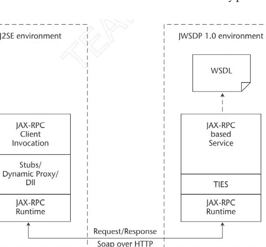

图 1 基于 JAX-RPC 的 Web 服务架构。


- **xrpcc 工具**。JAX-RPC 提供了 `xrpcc` 工具，它能够生成客户端和服务器端的类文件以及 WSDL，以实现提供者和请求者之间的通信。特别是，`xrpcc` 会生成一个表示服务的 WSDL 文档以及定义低级 Java 类的存根。在服务客户端场景中，`xrpcc` 还可以使用服务提供者暴露的 WSDL 生成存根类。

- **JAX-RPC 运行时环境**。通过提供所需的运行时库和系统资源，为 JAX-RPC 服务和服务客户端定义运行时机制和执行环境。JAX-RPC 1.0 规范要求服务和服务客户端具备 servlet 2.3 或 JEE 1.3-servlet 环境。根据 JAX-RPC 1.0，使用 JAX-RPC API 的 JAX-RPC 服务和服务客户端可能实现为运行在符合 servlet 2.2 标准容器中的 servlet。未来的 JEE 1.4 可能会支持 JAX-RPC，并允许使用 session beans 和消息驱动 beans 创建基于 JAX RPC 的服务。JAX-RPC 1.0 运行时服务还支持基于 HTTP 的基本认证和会话管理。


**认证** 是证明断言的行为，例如计算机系统用户的身份。

## 7.2 JAX-RPC API 和实现模型

作为 JAX-RPC 1.0 规范，JAX-RPC 定义了服务和服务客户端实现模型，旨在通过 JAX-RPC 运行时环境或直接对 SOAP 服务进行基于 RPC 的消息传递。核心 JAX-RPC API 封装在 `javax.xml.rpc` 中，它提供了运行时机制包 `java.xml.rpc.handler.*` 作为 SOAP 消息处理器 API 包。

### 7.2.1 基于 JAX-RPC 的服务实现

JAX-RPC 1.0 规范没有定义任何实现基于 JAX-RPC 服务的 API。基于 JAX-RPC 的服务可以使用 Java 类（类似于编写 RMI 应用）或通过使用 WSDL 文档来实现。在这两种情况下，JAX-RPC 均未对其客户端实现访问和使用部署的服务规定任何要求。接下来的章节将介绍这两种不同的服务实现方法，并介绍所需的编程步骤。


**编程** 是创建一组指令以告诉计算机如何执行任务的过程。

## 从 Java 类开发 JAX-RPC 服务

开发基于 JAX-RPC 的服务（也称为 JAX-RPC 服务定义）与开发 RMI 应用非常相似。涉及的步骤如下：

- 定义远程接口（服务定义）。
- 实现远程接口（服务实现）。
- 配置服务。
- 生成存根和绑定器。
- 打包并部署服务。

现在，让我们通过运行示例应用程序来回顾之前的步骤。


### 定义远程接口（服务定义）

服务接口定义了服务请求客户端可以调用的公开方法集。在 JAX-RPC 中，它被称为服务定义。客户端存根和服务器绑定是根据此接口生成的。从编程模型的角度来看，定义远程接口涉及的规则如下：

- 服务定义的远程接口必须声明为公共。
- 远程接口必须扩展 `java.rmi.Remote` 接口，且所有方法必须抛出 `java.rmi.RemoteException`。
- 远程接口不能包含任何静态常量声明。

方法的所有参数和返回值必须作为 JAX-RPC 支持的数据类型的一部分。如果遇到不支持的数据类型，则需要使用自定义序列化器和反序列化器来促进 Java 到 XML 以及 XML 到 Java 的映射。

例如，以下是定义服务定义中远程接口的代码列表（`BookPriceIF.java`）：

```java
import java.rmi.Remote;
import java.rmi.RemoteException;

public interface BookPriceIF extends Remote {
    public String getBookPrice(String bookName) throws RemoteException;
}
```

### 实现远程接口（服务实现）

远程接口的实现是实现所有公开方法的实际类。在 JAX-RPC 中，它被称为服务实现。例如，一个典型的实现：

```java
import java.rmi.Remote;
import java.rmi.RemoteException;
import javax.xml.rpc.server.ServiceCycle;
import javax.xml.rpc.server.ServiceEndpointContext;
import javax.xml.rpc.handler.SOAPMessageContext;

public class BookPriceImpl implements BookPriceIF, ServiceCycle {
    private ServiceEndpointContext serviceContext;

    public void init(Object context) {
        serviceContext = (ServiceEndpointContext)context;
    }

    public String getBookPrice(String bookName) {
        SOAPMessageContext messageContext = serviceContext.getContext();
        HttpSession session = messageContext.getSession();
        System.out.println("The price of titled " + bookName);
        return "$19.99";
    }

    public void destroy() {
        // Clean up resources
    }
}
```


### 生成存根和绑定

在生成存根和绑定之前，确保远程接口和实现的源代码已使用 `javac` 编译。使用 `xrpcc` 工具生成存根、类以及 JAX-RPC 环境所需的属性文件。在典型场景下，`xrpcc` 工具的命令行执行如下：

在 Windows 环境下：

```
xrpc -classpath %CLASPATH% -keep -both -d build\classes serviceconfig.xml
```

在 UNIX 环境下：

```
xrpc -classpath $CLASPATH -keep -both -d build/classes serviceconfig.xml
```

在此命令中，选项 `-classpath` 包括服务接口、实现类和 JAX-RPC 库；`-keep` 指保存生成的源文件和 WSDL 文档；`-both` 指生成存根和绑定类；而 `-d` 指目标目录。要查找更多 `xrpcc` 选项，请参阅 JAX-RPC 实现文档以获取语法和用法信息。

结果，上述命令生成了：

- 客户端存根和服务器端类
- 代表 Java 基本类型与 XML 数据类型之间数据类型映射的序列化和反序列化类
- 一个 WSDL 文档
- 与服务相关的属性文件


### 打包与部署

根据 JWSDP 1.0，基于 JAX-RPC 的服务仅指定了基于 servlet 的服务端点，并且 JAX-RPC 服务需要部署为基于 Java servlet 2.2 的容器中的 servlet。这强制基于 JAX-RPC 的服务被打包成 Web 应用程序（WAR）。要将 JAX-RPC 服务打包为 Web 应用程序，我们需要创建一个包含以下类和其他配置文件的 WAR 文件：

- 服务的远程接口
- 远程类的服务实现
- 序列化和反序列化类
- 由 `xrpcc` 创建的服务器端（绑定）类
- 由 `xrpcc` 创建的属性文件
- 服务实现所需的其他辅助类
- 描述服务的 WSDL 文档
- Web 应用程序部署描述符 (`web.xml`)

除了部署描述符，我们已经看到了使用 `xrpcc` 创建这些类和属性文件的过程。

在 JAX-RPC 环境中，部署描述符类似于 servlet 部署描述符 (`web.xml`)，它提供了有关 JAX-RPC 服务类名、由 `xrpcc` 工具创建的关联属性文件、servlet 映射和 URL 模式等信息。列表 2 是部署描述符 (`web.xml`) 的示例代码列表。

```xml
<?xml version="1.0" encoding="UTF-8"?>
<!DOCTYPE web-app
  PUBLIC "//Sun Microsystems, Inc//DTD Web Application 2.3//EN"
  "http://java.sun.com/j2ee/dtd/web-app-2_3.dtd">
<web-app>
  <display-name>WileyProductServices</display-name>
  <description>Wiley Web Services Company</description>
  <servlet>
    <servlet-name>JAXRPCEpoint</servlet-name>
    <display-name>JAXRPCEpoint</display-name>
    <description>Endpoint for Wiley Book Catalog Service</description>
    <servlet-class>com.sun.com.rpc.server.http.JAXRPCServlet</servlet-class>
    <init-param>
      <param-name>configuration.file</param-name>
      <param-value>WEB-INF/WileyBookCatalog_Config.properties</param-value>
    </init-param>
    <load-on-startup>0</load-on-startup>
  </servlet>
  <servlet-mapping>
    <servlet-name>JAXRPCEpoint</servlet-name>
    <url-pattern>/jaxrpc/wiley/*</url-pattern>
  </servlet-mapping>
  <session-config>
    <session-timeout>60</session-timeout>
  </session-config>
</web-app>
```

要将服务打包为 Web 应用程序，请使用 `jar` 工具并创建 Web 应用程序归档（WAR）。例如：

```
jar cvf wileywebapp.war .
```

最后，要将服务作为运行在 JSDP 1.0/Tomcat 环境中的 Web 应用程序进行部署，只需将 WAR 文件复制到 servlet `/webapps` 目录即可。例如，在 Windows 环境下的 Tomcat servlet 容器中部署，请执行以下：

```
copy wileywebapp.war %CATALINA%\webapps
```

然后重启 Tomcat 服务器，它会自动将服务作为应用程序部署。要验证服务部署，请使用 Web 浏览器执行以下 URL（使用描述符中定义的 URL 模式）：

```
http://localhost:8080/bookpriceservice/jaxrpc/wiley
```

如果一切都部署成功，浏览器将显示“A Web Service is installed at this URL”。

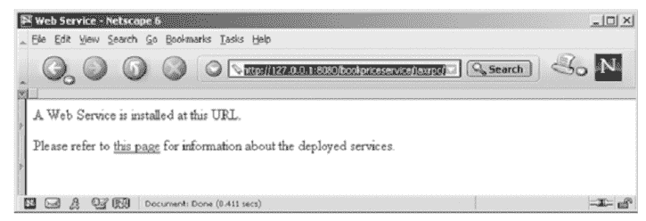

图 2. 显示成功安装基于 JAX-RPC 服务的浏览器。

## 从 WSDL 文档开发基于 JAX-RPC 服务

在本节中，我们将查看如何使用现有 Web 服务环境暴露的 WSDL 文档开发基于 JAX-RPC 的服务。在这种情况下，通过从现有 Web 服务导入 WSDL 文档，`xrpcc` 工具会生成 JAX-RPC 服务类。关键步骤如下：

### 创建配置

要配置 JAX-RPC 使用 WSDL，你必须首先创建一个 XML 格式的配置文件，提供服务信息和 WSDL 的位置。列表 3 是配置文件的示例：

```xml
<?xml version="1.0" encoding="UTF-8"?>
<configuration xmlns="http://java.sun.com/xml/jax-rpc">
    <wsdl location="http://nmesh:80/axis/AcmeCatalog.wsdl"/>
    <packageName>com.wiley.jws</packageName>
</configuration>
```

列表 3. 使用 WSDL 的示例。

### 构建基于 JAX-RPC 服务

使用 `xrpcc` 工具处理配置文件和 WSDL 以生成服务类。具体命令参考前文 `xrpcc` 工具用法，指定配置文件路径即可。生成的代码包含服务端点接口、实现框架类等，开发者需在此基础上填充业务逻辑，后续打包部署流程与从 Java 类开发一致。


# 构建基于 JAX-RPC 服务

在本节中，我们将查看如何使用现有 Web 服务环境暴露的 WSDL 文档开发基于 JAX-RPC 的服务。在这种情况下，通过从现有 Web 服务导入 WSDL 文档，`xrrpc` 工具会生成 JAX-RPC 服务类。关键步骤如下：

## 7.2.2 基于 JAX-RPC 的客户端实现

根据 JAX-RPC 1.0 规范，基于 JAX-RPC 的服务客户端独立于服务实现，且服务客户端不依赖于服务提供者或其使用的 Java 或非 Java 环境。JAX-RPC 提供了客户端 API，并定义了访问和调用 Web 服务的客户端调用模型。

现在，让我们来看 JAX-RPC 客户端 API 和客户端调用模型。

### JAX-RPC 客户端 API

JAX-RPC 1.0 客户端 API 定义在单一包结构 `javax.xml.rpc` 中，它提供了一组接口和类，用于意图调用基于 JAX-RPC 服务的 JAX-RPC 客户端，而这些接口由 JAX-RPC 运行时实现。

`javax.xml.rpc` 包提供了一组用于创建 JAX-RPC 客户端的接口和类，这些类支持不同的 JAX-RPC 客户端调用模型。JAX-RPC API 接口和类如下：

#### 接口

- `javax.xml.rpc.Stub` 是 JAX-RPC 存根（stub）类的基类接口。所有的 JAX-RPC 存根类都必须实现此接口。该接口代表客户端代理或目标端点的实例。

```java
private static Stub createProxy() {
  return (Stub)new StockImpl().getStockPriceFFPort();
}
```

- `javax.xml.rpc.Service` 充当工厂类，用于创建目标服务的动态代理以及创建用于调用服务的实例。

```java
Service service =
  serviceFactory.createService(new QName(qService));

Call call = service.createCall(target_port);
```

- `javax.xml.rpc.Call` 为 JAX-RPC 客户端组件调用服务提供支持。在这种情况下，在调用方法后，我们需要使用 setter 和 getter 方法来为参数和返回值配置调用接口。

```java
Call call = service.createCall(target_port);
call.setTargetEndpointAddress(target_endpoint);

call.setOperationName(
  new QName(BODY_NAMESPACE_VALUE, "getStockPrice"));
```


#### 类

- `javax.xml.rpc.ServiceFactory` 是一个抽象类，提供了一个用于创建 `javax.xml.rpc.Service` 服务实例的工厂类。

```java
ServiceFactory sfactory =
  ServiceFactory.newInstance();
Service service =
  serviceFactory.createService(new QName(qService));
```

- `javax.xml.rpc.ParameterMode` 提供参数模式的类型安全枚举。

```
call.addParameter("stocksymbol", QNAME_TYPE_STRING, ParameterMode.IN);
```

- `javax.xml.rpc.Namespace` 定义了 JAX-RPC 中用于 XML 命名空间前缀和 URI 的常量。

#### 异常

- `javax.xml.rpc.JAXRPCException` 在发生 JAX-RPC 异常时抛出异常。该异常详细说明了失败的原因，这些原因与 JAX-RPC 运行时特定的问题有关。

- `javax.xml.rpc.ServiceException` 从 `JAX.XML.RPC.SERVICE` 接口和 ServiceFactory 类中的方法抛出异常。

### JAX-RPC 客户端调用编程模型

JAX-RPC 1.0 规范定义了使用任何一种以下客户端调用编程模型实现基于 JAX-RPC 的客户端：

- 基于存根的 (Stub-based)
- 动态代理 (Dynamic proxy)
- 动态调用 (Dynamic invocation)

现在，让我们看看这些不同的客户端实现方式，并介绍每种方式所需的编程步骤。

#### 基于存根的客户端

基于存根的模型是最简单的客户端编程模型。该模型使用由 `xrpc` 工具生成的本地存根类。需要确保这些存根类在 CLASSPATH 中。


列表 4 是使用基于存根的客户端调用的示例代码列表。

```java
// 导入存根接口
import java.xml.rpc.Stub;

public class BookCatalogClient {

  // 主方法
  public static void main(String[] args) {

  try {
    // 获取存根接口的实例
    BookCatalogIF_Stub stub = (BookCatalogIF_Stub)
      (new BookCatalogImpl().getBookCatalogIFPort());
    // 配置存根所需的属性
    // 设置目标端点
    stub.setProperty(java.xml.rpc.Stub.ENDPOINT_ADDRESS_PROPERTY, 
    "http://www.wiley.com/jws/jaxrpc/bookcatalog");
    // 执行远程方法
    System.out.println(stub.getBookPrice("JAX-RPC in 24 hours"));

  } catch (Exception ex) {
    ex.printStackTrace();
  }
  }
}
```

**列表 4.** 说明基于存根客户端调用的示例代码。

#### 基于动态代理的客户端

动态代理客户端能够在运行时动态调用目标服务端点，而不需要本地类。这种类型的客户端使用 `java.lang.reflect.Proxy` 类提供的动态代理 API 以及 `java.lang.reflect.InvocationHandler` 接口。特别是 `java.xml.rpc.Service` 接口上的 `getPort` 方法能够创建动态代理。列表 5 是使用基于动态代理的客户端调用的示例代码列表。

```java
// 导入 Service & ServiceFactory
import javax.xml.rpc.Service;
import javax.xml.rpc.ServiceFactory;
import javax.xml.namespace.QName;
import java.lang.reflect.Proxy;
import java.lang.reflect.InvocationHandler;
import java.net.URL;

public class BookProxyClient {

    // 主方法
    public static void main(String[] args) {
        try {
            // WSDL 位置
            String wsdlURL = "http://www.wiley.com/jws/jaxrpc/bookcatalog";
            // 获取代理
            BookCatalogIF_Stub stub = (BookCatalogIF_Stub) Proxy.newProxyInstance(
                BookCatalogIF_Stub.class.getClassLoader(),
                new Class[] { BookCatalogIF_Stub.class },
                new InvocationHandler());
            // 调用方法
            System.out.println(stub.getBookPrice("JAX-RPC in 24 hours"));
        } catch (Exception ex) {
            ex.printStackTrace();
        }
    }
}
```

**列表 5.** 说明动态代理的示例代码。

#### 动态调用 (DII)

使用**动态调用接口 (DII)** 允许客户端在运行时发现服务并调用方法。DII 允许客户端在运行时发现服务并调用方法。列表 6 是使用 DII 调用的示例代码。

```java
// 导入
import javax.xml.rpc.Call;
import javax.xml.rpc.Service;
import javax.xml.rpc.ServiceFactory;
import javax.xml.rpc.ParameterMode;
import javax.xml.namespace.QName;

public class BookDIClient {

    // 服务名
    private static String qService = "BookCatalogService";
    // 端口名
    private static String qPort = "BookCatalogIF";
    // 命名空间
    private static String BODY_NAMESPACE_VALUE = "http://www.wiley.com/jws/di";

    // 主方法
    public static void main(String[] args) {
        try {
            String target_endpoint = "http://www.wiley.com/jws/jaxrpc/bookcatalog";
            // 获取 Service 工厂实例
            ServiceFactory sFactory = ServiceFactory.newInstance();
            // 创建 Service
            Service service = sFactory.createService(new QName(qService));
            // 定义端口
            QName port = new QName(qPort);
            // 使用 service 创建 Call 对象
            Call call = service.createCall(port);
            // 设置目标服务端点
            call.setTargetEndpointAddress(target_endpoint);

            // 设置属性
            call.setProperty(Call.SOAPACTION_USE_PROPERTY, new Boolean(true));
            call.setProperty(Call.SOAPACTION_URI_PROPERTY, "*");
            call.setProperty(Call.CODING_STYLE_PROPERTY, "http://schemas.xmlsoap.org/soap/encoding/");

            // 设置参数类型和返回值类型为 String
            QName QNAME_TYPE_STRING = new QName("http://www.w3.org/2001/XMLSchema", "string");
            call.setReturnType(QNAME_TYPE_STRING);

            // 设置操作
            call.setParameter(new QName(BODY_NAMESPACE_VALUE, "getStockPrice"), QNAME_TYPE_STRING);
            System.out.println(call.invoke("JAX-RPC in 24 hours"));
        } catch (Exception ex) {
            ex.printStackTrace();
        }
    }
}
```

**列表 6.** 说明 DII 调用的示例代码。

# 使用 JAX-RPC 构建 RPC Web 服务

```java
//getBookPrice());
call.addParameter("BookName", QNAME_TYPE_STRING, ParameterMode.IN);
String[] BookName = {\JAX-RPC in 24 hours};
// 调用并获取响应对象
Object response = (Object)call.invoke(BookName);
System.out.println(response.toString());
} catch (Exception ex) {
ex.printStackTrace();
}
```

列表 6. 使用 DII 的 JAX-RPC 客户端示例代码。

DII 客户端也可以使用单向 RPC 机制调用。在这种情况下，客户端不需要设置返回值类型，可以按如下方式进行调用：

```java
call.invokeOneWay(parameter);
```

现在，让我们来看 Java 和 XML 之间 JAX-RPC 支持的数据类型映射。


# 行业榜样

## 布鲁斯·杰·内尔森 (BRUCE JAY NELSON)

布鲁斯·杰·内尔森（Bruce Jay Nelson，1952年1月19日 – 1999年9月19日）是一位美国计算机科学家，因发明计算机通信中的远程过程调用（RPC）概念而闻名。

布鲁斯·内尔森于1974年毕业于哈维·莫德学院，随后于1976年获得斯坦福大学计算机科学硕士学位，并于1982年获得卡内基·梅隆大学计算机科学博士学位。在读博士期间，他在施罗思公园工作，开发了远程过程调用（RPC）的概念。他与合作者 Andrew Birrell 因在 RPC 方面的工作荣获1994年美国计算机机器学会（ACM）软件系统奖。1996年，他加入思科系统担任首席科学官。

他于1999年9月19日在以色列特拉维夫出差期间，因主动脉夹层层导致的并发症逝世。2007年，Birrell 和 Nelson 荣获 ACM 操作系统名人堂奖。他的同学和朋友在卡内基·梅隆大学以他的名字设立了奖学金。哈维·莫德学院还以他的名命名了一个系列讲座。

他是一位热爱的摄影师、背包客、自由潜水员和世界旅行者。他外朗且古特的性格包括对乌鸦痴迷，导致他的朋友将其公司命名为“Caw Networks”。


## 总结

- JAX-RPC 是 JWSDP 的组成部分。在基于 JWSDP 的服务环境中，JAX-RPC 在请求者和服务提供者之间提供了基于 XML 的 RPC 功能。

- JAX-RPC 与 Java 远程方法调用（RMI）非常相似，后者通过在分布式计算环境的 Java 之间传递序列化的 Java 对象来处理 RPC 机制；而 JAX-RPC 使用基于 SOAP 的 RPC 和 WSDL 机制来调用运行异构环境中的 Web 服务。

- JAX-RPC 定义了一个 API 框架和运行时环境，用于创建和执行基于 XML 的远程过程调用。Web 服务请求者调用服务提供的方法并传输参数，它们作为基于 XML 的请求和响应接收返回值。

- 服务接口定义了服务请求者客户端可以调用的公开方法集。

- 根据 JWSDP 1.0，基于 JAX-RPC 的服务仅指定基于 servlet 的端点，且 JAX-RPC 服务要求部署为基于 Java servlet 2.2 容器的 servlet。这强制要求基于 JAX-RPC 的服务被封装为 Web （WAR）。

- JAX-RPC 1.0 客户端 API 定义在单一包结构 `javax.xml.rpc` 中，它提供了一系列接口和类，支持旨在调用基于 RPC 服务的 JAX-RPC 客户端，并由 JAX-RPC 运行时实现。

- 基于存根（stub）的模型是最简单的客户端编程模型。该模型使用 `xrpcc` 工具生成的本地存根类。


### 单选题

1. RPC（远程过程调用）由以下哪者发起

- a. 服务器

- b. 客户端

- c. 服务器后的客户端

- d. 第三方

2. 在 RPC 中，当服务器正在处理调用时，客户端处于阻塞状态

- a. 除非客户端向服务器发送异步请求


## 单选题

1. 远程过程调用是
   - a. 进程间通信
   - b. 单个进程
   - c. 单线程
   - d. 单流

2. RPC 允许计算机程序在以下何处的地址空间执行子程序
   - a. 自身的地址空间
   - b. 另一个地址空间
   - c. 都是自身的地址空间和另一个地址空间
   - d. 应用空间

3. RPC 运行在两个进程之间。这些进程必须
   - a. 在同一台计算机上
   - b. 在连接了网络的不同计算机上
   - c. 在同一台计算机上，也在连接了网络的不同计算机上
   - d. 不在任何计算机上

4. 远程过程通过以下哪项唯一标识
   - a. 程序号
   - b. 版本号
   - c. 过程号
   - d. 以上所有

5. RPC 应用需要
   - a. 客户端通信特定协议
   - b. 客户端程序
   - c. 服务器程序
   - d. 以上所有

6. RPC 用于
   - a. 在远程机器建立可以响应查询的服务器
   - b. 通过查询获取信息
   - c. 在远程机器建立可以响应查询并获取信息的服务器
   - d. 安全

7. RPC 是
   - a. 同步操作
   - b. 异步操作
   - c. 时间无关的操作
   - d. 通道操作

8. 服务器上的本地操作系统将数据包传给
   - a. 服务器存根
   - b. 客户端存根
   - c. 客户端操作系统
   - d. 客户端

## 复习题

1. JAX-RPC 在 Web 服务中的作用是什么？描述 JAX-RPC 的核心特性。
2. JAX-RPC 与 RMI 有什么区别？
3. 定义远程接口。
4. 定义 JAX-RPC 1.0 客户端 API。
5. 什么是基于存根的模型？

## 单选题答案

1. (b)
2. (a)
3. (a)
4. (b)
5. (c)
6. (d)
7. (d)
8. (c)
9. (a)
10. (a)

## 参考文献

1. Box, Don (2001年4月). “SOAP简史”. O’Reilly. 检索于2010年10月27日。
2. Gray, N. A. B. (2005). “Java中间件 – RMI, JAX-RPC 和 CORBA”. University of Wollongong, 第31–39。
3. Jon Canady (2010年1月14日). “如果你有 REST, 还需要 XML RPC?”. joncanady.com. 存档于2013年5月11日。检索于2011年4月7日。
4. Kalpteosh, Christian (2020年1月17日). “深度解析 Jakarta EE 9 发布计划”. JAXenter. Software & Support Media. 检索于2020-12-05。
5. Merrick, 等 (2006年4月11日). “美国专利7,028,312”. 检索于2008年9月18日。
6. Simon St. Laurent, Joe Johnston, Edd Dumbill (2001) 使用XML-RPC编程Web服务. O’Reilly. 第一版。

## 索引

| 术语 | 页码 |
| :--- | :--- |
| **A** | |
| 语言系统 (CLS) | 155 |
| 属性 | 178, 179, 195 |
| 文档类型定义 (DTDs) | 184 |
| 动态调用接口 (DII) | 267 |
| 动态代理 | 263, 265, 267 |
| **B** | |
| 业务过程规范 (BPSS) | 25 |
| 业务事务协议 (BTP) | 27 |
| **E** | |
| 电子业务XML (ebXML) | 20 |
| 元素 | 175, 176, 177, 178, 179, 181, 183, 184, 185, 186, 187, 188, 189, 190, 191, 192, 193, 194, 195, 196, 197, 205, 206, 214, 215 |
| **C** | |
| C | 5, 7, 21 |
| C++ | 5, 7, 21 |
| 通用语言运行时 (CLR) | 155 |
| 通用类型系统 (CTS) | 155 |
| 通信骨干 | 2, 34 |
| 通信协议 | 118, 120 |
| CORBA (通用对象请求代理架构) | 4 |
| 成本节省 | 2 |
| 客户满意度 | 2 |
| **D** | |
| 元素冲突 | 183 |
| 企业应用集成 (EAI) | 42 |
| 企业信息系统 (EIS) | 16 |
| 实体 | 179, 187 |
| 可扩展访问控制标记语言 (XAML) | 28 |
| 可扩展标记语言 (XML) | 17, 23 |
| 可扩展样式表语言转换 (XSL) | 198 |
| DAO (数据访问对象) | 59 |
| 目录服务标记语言 (DSML) | 27, 35 |
| 分布式通用对象模型 (DCOM) | 12 |
| 分布式计算 | 3, 5, 9, 14 |
| 文档对象模型 (DOM) | 198 |
| **G** | |
| 全球商业倡议 (GCI) | 25 |
| **H** | |
| 硬件平台 | 152 |
| **I** | |
| 集成服务开发框架 (ISDF) | 30 |
| **J** | |
| Java | 4, 5, 7, 9, 10, 11, 13, 16, 21, 29, 30, 31, 32, 36, 37, 191, 197, 198, 200, 201, 203, 215 |
| Java XML 消息 API (JAXM) | 219 |
| Java XML 解析 API (JAX) | 198 |
| Java XML API (RPC) | 249 |
| 基于 Java 的 Web 服务 | 154, 156, 159 |
| Java 社区 (JCP) | 13 |
| Java 远程方法 (JRMP) | 9 |
| JAXM 客户端 | 221, 222, 223, 224, 225, 243 |
| JAXM 连接 | 222 |
| JAXM 消息 | 221, 222, 223, 225, 226, 243 |
| JAXM 消息协议 | 222 |
| 解析 | 171, 179, 197, 198, 199, 202, 208, 211, 214 |
| 部分传输的数组 | 136, 137, 145 |
| 个人电脑 (PCs) | 3 |
| 处理指令 (PIs) | 176, 214 |
| 编程语言 | 120, 137, 145 |
| prolog | 173, 176, 181, 189 |
| 公钥基础设施体系 (PKI) | 27 |
| **P** | |
| 服务质量 (QoS) | 14, 28 |
| **M** | |
| 消息导向中间件 (MOM) | 4, 13, 34 |
| 消息服务 (MS) | 222 |
| 基于消息的通信模型 | 49, 111 |
| 消息服务处理器 (MSH) | 26 |
| 消息服务 (MS) | 47 |
| 元数据 | 172, 214 |
| 微软组件对象模型 (COM) | 11, 34 |
| 微软 DCOM (分布式组件对象模型) | 4 |
| 微软中间语言 (MSL) | 155 |
| 微软队列服务 (MSMQ) | 13 |
| 微软 .NET 客户端环境 | 156 |
| 微软 .NET 框架 | 154, 155, 166 |
| **Q** | |
| 远程接口 | 254, 255, 256, 257, 258, 257, 264 |
| 远程方法调用 (RMI) | 250, 271 |
| 远程过程调用 (RPCs) | 118, 152, 166, 249 |
| RMI (远程方法调用) | 4 |
| 根接口 | 176, 177, 178, 189, 190, 215 |
| 基于 RPC 模型 | 48, 99, 111 |
| **R** | |
| 安全性 | 172 |
| 安全断言语言 (SAML) | 28 |
| 服务接口 | 255, 258, 262 |
| 面向服务的架构 (SOA) | 18, 41 |
| 简单对象访问协议 (SOAP) | 20, 244 |
| SOAP 附件 | 129, 130 |
| SOAP 编码 | 117, 131, 135, 137, 138, 141, 143, 145, 149 |
| SOAP 封 | 123, 124, 125, 126, 129, 145 |
| **S** | |
| 命名空间 | 174, 181, 182, 204, 214 |
| 网络 | 1, 3, 4, 5, 6, 7, 8, 9, 10, 11, 24, 25, 34 |
| **N** | |
| **Index** | |
| SOAP 故障 | 279 |
| SOAP 元素 | 126, 145 |
| SOAP 头部 | 124, 145 |
| SOAP 消息 | 117, 120, 125, 126, 127, 128, 129, 139, 140, 141, 142, 143, 144, 146, 147, 148, 249, 250, 251, 252, 253, 254, 255, 256, 257, 258, 259, 260, 261, 262, 263, 264, 265, 266, 267, 268, 269, 270, 271, 272, 273, 274, 275, 276, 277, 278, 279, 280, 281, 282, 283, 284, 285, 286, 287, 288, 289, 290, 291, 292, 293, 294, 295, 296, 297, 298, 299 |
| 带 Java 的 SOAP | 219 |
| 基于代理的模型 | 264, 271 |
| Web 服务定义 (WSDL) | 20, 34 |
| 启用 Web 应用程序 | 51 |
| Web 服务环境 | 152, 166, 249, 250 |
| Web 服务互操作性 | 161 |
| Web 服务工具包 (WSTK) | 30 |
| 万维网 | 1, 34 |
| 万维网联盟 (W3C) | 23 |
| 标签 | 172, 173, 177, 178, 181, 182, 184, 185, 206, 214 |
| 传输控制协议/网 (TCP/IP) | 3 |
| XML | 44, 45, 53, 54, 55, 56, 58, 59, 67, 77, 83, 84, 97, 99, 106, 107, 111, 112, 113, 115 |
| 基于 XML 的消息 | 219 |
| 基于 XML 的协议 | 117, 118, 119, 145 |
| XML 密钥信息服务 (X-KISS) | 27 |
| XML 密钥管理系统，或 XKMS | 27 |
| XML 密钥注册服务 (X-KRSS) | 27 |
| XML 架构定义 (XSD) | 153 |
| 通用描述、发现和集成 (UDDI) | 20, 25 |
| 虚拟机 (VMs) | 9 |
| WDDX (Web分布式数据交换) | 119 |
| Web 应用程序 (WAR) | 258, 271 |
| Web 服务 | 1, 21, 23, 25, 36 |
| Web 服务架构 | 41, 42, 43, 44, 48, 111 |
