# Java WebSocket 编程：开发、部署与安全动态 Web 应用

## 致谢

非常感谢 Santiago 在本书编写期间提供的周到的入微的评审意见，感谢 McGraw-Hill Education 的 Brandi Shailer 和 Amanda Russell 帮助我保持写作进度。

## 引言

WebSocket 协议是 Web 开发者不断扩展的工具箱中的一种新型网络协议。除了作为 HTML5 的核心技术并被从平板电脑到智能手机的所有浏览器快速采纳之外，Web 开发者为什么要关注又一种 Web 技术呢？

到 2000 年，全球大多数主要企业已经有了某种网络存在。在发展中中国家，个人电脑革命导致大多数家庭至少通过一个通道接入互联网。企业正在迅速在互联网上建立存在，作为展示其产品和服务的手段，并作为交付这些服务的日益增长的渠道。Web 的基础技术（如 HTTP、HTML 和 JavaScript）正在推动人们与彼此、与学校以及工作场所互动方式的变革；他们如何计划假期；甚至如何购买杂货。

网站从静态且无颜色的目录风格早期尝试开始增长，开发者开始寻找新方法使网站更具互动性。他们希望通过在适当的时间向观众注入有趣的信息，并在必要时更新页面上的信息来为他们的 Web 注入活力。但开发者发现基础的 HTTP 和标记技术存在局限性。开发者需要更新股票报价、最新出价、当前登录同一网站的朋友列表、新的减价价格、游戏结果，以及最近一个跌落神坛的名星。而且他们需要在不依赖用户持续交互的情况下完成所有这些工作。他们需要从 Web 服务器发起数据更新，以保持网站的新鲜感、吸引力和趣味性。

他们需要将网站的访问者转变为其频道的观众，并且需要访问者尽可能少地操作就能吸收推送到他们身上的信息。

在接下来的几年里，开发者寻找了各种非正式的手段来完成向网站的所有当前访问者更新各种最新信息的任务。最显而见的方法是让浏览器轮询更新。开发者会在相关的 Web 页面中嵌入一小段 JavaScript 代码，强制浏览器在预定义的间隔内刷新页面。这种方法会刷新所有数据，无论获取的数据是否需要刷新。网络延迟在这种方法中是显而易见的，因此用户体验并不好，更不用说获取所需数据的方法本身了。

一种稍微复杂的方法是使用 HTTP Keep Alive（持久连接）机制。在这种方法中，网页内部的 JavaScript 代码将保持一个长期的 HTTP 连接，就像一个永无止境的下载，定期与新信息进行更新。浏览器和服务器保持连接时间的巨大差异导致了问题，通常情况下，客户端浏览器需要不断重新打开连接，无论是否有数据从服务器获取。

当开发者开始接触这些技术时，Comet 和 AJAX 等开发框架应运而生，支持并包含了这些基础技术。在某种程度上，它们可以隐藏这些基础方法的某些缺陷。然而，即使是最好的实现也无法克服两个根本性问题。首先，HTTP 对于发送简单信息来说是一种代价昂贵的网络协议。仅仅为了请求简单的股票报价更新，每次建立连接都必须回溯上下文：所有的标头信息，例如标识客户端和服务器平台的信息、身份验证属性、负载描述等。第二，更糟糕，无论服务器是否有新信息要传达，这些昂贵的连接都会建立。

2009 年，人们开始研究一种技术，允许客户端与服务器建立一个轻量级的连接，从而实现双向通信和轻量级的内容模型。服务器仅在需要时才能将数据推送到已连接的客户端。一旦连接建立后，客户端和服务器都将有一种方式发送简单信息，而无需在每次发送消息时都重新创建连接的上下文。

那些无意义更新的时代即将结束。

为了理解轮询（polling）方法会如何浪费网络资源，请考虑一个拍卖网站。物品在网站上发布，用户可以在规定的时间范围内对物品进行出价，在结束后，物品将出售给最高出价者。在整个拍卖过程中，任何访问拍卖页面的用户都可以查看这些信息并据此决定更高的报价。假设该网站上了一个非常受欢迎的二手 iPod 拍卖——毕竟，它是 2003 年的型号——而且该物品的拍卖时间只有一小时。假设当有人对 iPod 出新价时，该网站只需要传达一个包含新价格以及可能的一些伴随信息（如出价者的在线名称）的简短消息。我们估计这些内容可以压缩到 64 字节内。假设由于所有用户都已登录，HTTP 头部中需要传输一些 Cookie，可能还有几个特定的应用程序标头、内容长度、浏览器 ID 等，我们估计头部信息约为 512 字节。现在想象一下，你有 100 个用户登录了这个网站，并且在拍卖期间平均每 30 秒产生一次新出价。假设出价频率不是均匀分布的；在某些时刻，出价可能仅隔几秒（接近结束时），而在其他一些时刻（开始时），出价可能隔几分钟。出价者总是希望获得最新的价格信息，因此每两秒刷新一次价格是明智的；否则，当出价因为在更新之前而未成功时，出价者可能会感到沮丧。让我们加总为了接收更新而发送的所有数据：

- 每分钟 30 次更新 × 60 分钟 = 1800 次更新。
- 每次更新双向携带约 512 字节的头部信息。
- 发送和接收的头部信息总量 = 1800 x 512 字节 = 921,600 = 900KB。

现在，我们说每次更新将包含 64 字节。在这次拍卖中，我们说有 120 次出价。因此，总更新信息 = 120 x 64 字节 = 7.5KB。

所以，（有用数据）与（重复数据）的粗略效率比计算为 7.5 / 900 = 0.8%。

这是一个不好的分数，我们不会讨论这种效率比在更长时间的拍卖中是如何降低的。

WebSocket 的目标是通过仅在建立连接时发送上下文信息来极大地提高这种网络效率；一旦连接建立，允许连接的每个对端同时发送消息，并带有最少的上下文信息来识别消息。

通过这种方式，连接到 Web 服务器的网页能够在服务器决定它们需要时才接收更新，而且当发送此类更新时，没有必要用大量的连接上下文负载来增加消息的负担。

### WebSocket 协议简介

WebSocket 协议是一种允许两个连接的对端通过单个 TCP 连接进行全双工消息传递的网络协议。WebSocket 的一个很好的类比是电话。打电话时，你通过拨号号码发起通话。你通话的对方通过拿起听筒接受通话，连接随即建立。在连接激活期间，双方如果愿意，可以同时说话（尽管不建议用于流畅的对话！），而且双方在说话时都能听到对方说的话。这就是全双工通信的含义。无论是否在说话，连接都保持激活，直到其中一方决定挂断。

在 WebSocket 的情况下，连接通过 HTTP 交互式的 WebSocket 端点建立。连接的发起者发送一个特殊格式的 HTTP 请求，其中包含它想要连接的端点的 URL。这让流程运行起来，被称为“打开握手”。如果服务器愿意接受连接，服务器构造一个特殊的 HTTP 响应，称为“打开握手响应”，并将其发回客户端。现在，TCP 连接可能已经建立，WebSocket 消息可以往返传输。连接将保持激活，直到一方决定终止连接，或者某些外部因素导致连接中断——例如由于无活动导致的超时或物理网络问题。

WebSocket 主要用于位于 Web 服务器上的 Web 应用程序与浏览器客户端之间的通信，尽管并没有特定的限制。由于这项技术的根源，WebSocket 最直接的机会是让原本静态的网站变为数据和活跃。在这种设置下，浏览器中的 WebSocket 是使用 W3C 标准化的 JavaScript API 创建的。WebSocket 的流行是如此迅速，以至于许多语言和 Web 平台已开始接受它。特别是 Java 平台已迅速构建了对 WebSocket 支持。本书的重点是探索该 API 的功能，尽管某些示例将用 Java 编写。

本书包含八章。

在本章中，你将直接进入第一个 WebSocket 应用程序——Echo 。虽然简单，该应用程序和本章介绍了 Java WebSocket API 的主要功能，并为后续章节奠定了基础。

第二章检查了 WebSocket 端点的周期，这是你在 WebSocket 应用程序中创建的核心组件。该周期定义了你管理端点使用资源的框架，最重要的定义了如何拦截 WebSocket 消息。周期通过 Lifecycle 应用进行说明，该应用向用户展示一组状态信号，突出了端点生命周期的关键阶段。

本章探索了 Web 应用程序中发送和接收消息的基本方面，以协作绘图应用程序作为示例。示例使用 Java 应用程序作为客户端，因此本章也说明了如何在客户端侧使用 Java WebSocket API。

第 4 章展示了 Java WebSocket API 中最重要的两个对象：WebSocket 会话对象（代表与 WebSocket 对端的会话）以及端点配置对象（持有端点的配置信息）。这些对象被投入使用，在在线聊天示例应用程序中展示其特性。

本章深入检查了开发者在发送接收 WebSocket 消息时可用的所有选项。在第 3 章的基础上，我们查看了一些高级主题，例如消息编码和解码策略以及同步和异步消息模式。本章中的示例应用程序使用用户界面来演示 API 可用的消息选项。

本章涵盖了路径映射的九规则，探索了 Java WebSocket API 中将 WebSocket 端点发布到 URI 的所有选项，以便对端能够连接到它。通过一个简单的股票投资组合应用中，本章展示了精确路径映射、模板映射和查询字符串的技术，并讨论了在什么情况下你可能会选择其中一种技术而非另一种。

在本章中，你将学习如何将 WebSocket 端点的访问权限限制为 Web 应用程序的某些用户，并且你将学习如何确保 WebSocket 端点之间的通信保持私密性。我们将再次回顾股票投资组合应用，应用安全技术对应用程序进行安全加固和个性化处理。

### 第 8 章：Java EE 平台中的 WebSockets

最后一章从探索如何将 WebSocket 端点集成到更大的 Java EE 应用程序中开始。通过提供在 WebSocket 端点与其他 Java Web 组件以及企业级 豆（EJBs）之间共享应用程序信息的方法，我们重新构建了第 4 章的聊天应用程序，以利用 Java Servlets 和 EJBs，这些是 Java EE 平台的两个核心组件。

## 目标读者

本书适用于以下读者：

- 希望通过交互式功能增强 Web 应用程序的 Web 开发者
- 希望与 WebSocket 服务器应用程序交互的富客户端应用程序开发者
- 有兴趣为支持 HTML5 的浏览器开发应用程序的 Java 开发者

本书假设你已经具备 Java 编程语言的相关知识，具有某些 Java SE 平台的经验，并了解一些 JavaScript 编程语言。此外，具备 Web 应用程序开发经验可能会有所帮助，尽管并非必须。

所有的示例应用程序代码都可以从 Oracle Press 网站 `www.OraclePressBooks.com` 下载。文件包含在一个 Zip 压缩包中。一旦你下载了 Zip 文件，就需要解压其内容。示例运行在 Glassfish 4.0 应用程序服务器上，你可以从 `http://glassfish.java.net/` 免费下载它，并可以使用 NetBeans IDE 进行构建，该 IDE 可以从 `http://netbeans.org` 免费下载。

我希望这本书能激发你写出前人从未想过的应用程序！

# 第 1 章 Java WebSocket 基础

本章介绍了 Java WebSocket API，并对其功能进行了高层概述。本章将直接深入示例应用程序，该应用程序的服务器端简单地回显客户端发送给它的任何消息。我们将用它来说明 Java WebSocket API 的主要功能。通过这种方式，本章将为书中其余部分涵盖的主要功能奠定基础。如果你需要复习 WebSocket 协议的主要概念，请在阅读之前查看“引言”。

## 创建你的第一个 WebSocket 应用程序

由于 WebSocket 协议的核心是启用两个对端之间的消息传递，我们将从最简单的示例开始研究 Java WebSocket API：EchoServer 应用程序。

EchoServer 应用程序是一个客户端/服务器应用程序。它的客户端是运行在你的浏览器中的一小段 JavaScript 代码，它的服务器是使用 Java WebSocket API 编写的 WebSocket 端点，并作为在服务器上的 Web 应用程序的一部分部署。当用户将页面加载到浏览器或执行命令时，该 JavaScript 代码就会执行。这段代码执行的第一件事是连接到位于应用程序服务器上的 Java EchoServer WebSocket 端点，并立即向其发送消息。运行在应用程序服务器上的 Java EchoServer 端点等待传入的连接，当它收到来自已连接客户端的消息时，它会立即回复确认。

我们将使用该应用程序来说明我们创建的 WebSocket 端点（即 EchoServer）的关键方面。尽管这个示例特别简单，但深入理解如何创建和部署它将带我们简要浏览 Java WebSocket API 的关键功能。虽然在这次对 API 的首次检查中为了获得大观，我们不会纠结于任何关键功能，但它将作为一个基础，以便在书的后续章节中更详细地探索这些功能。

该示例通常由两部分组成——首先，也是最重要的，我们将在服务器上编写并部署的 Java EchoServer 端点；其次是包含 JavaScript WebSocket 客户端的网页，该客户端将在浏览器中运行。图 1-1 显示了示例将创建的设置的总示意图。

## 创建 WebSocket 端点

幸运的是，在 Web 应用程序中创建第一个 WebSocket 端点非常简单。你只需要写一个 Java 类来实现，它你希望端点具有的功能，并理解如何向你的类应用一些由 Java WebSocket API 定义的少量 Java 注解即可。对于 EchoServer，我们希望实现的功能是：当它从已连接的客户端接收消息时，它立即向发送消息的客户端回传消息。

所以让我们立即开始实现该功能。首先，我们将创建一个名为 `EchoServer` 的 Java 类，并添加一个接收 `String` 参数的方法来处理来自客户端的任何传入消息。该方法的返回值也是 `String`。

```
public class EchoServer {
    public String echo(String incomingMessage) {
        return "I got this (" + incomingMessage + ")"
            + " so I am sending it back !"
    }
}
```

你可能会很高地发现你已经实现了应用程序的所有逻辑！剩下的工作是使用 Java WebSocket API 将这个普通的对象转换为 WebSocket 端点。为了实现这一点，我们需要 Java WebSocket API 中的两个注解：`@ServerEndpoint` 和 `@OnMessage`。

`@ServerEndpoint` 注解是一个类注解，用于告诉 Java 平台被它装饰的类实际上将是一个 WebSocket 端点。该注解的唯一强制参数是开发者希望发布此端点使用的相对 URI（统一资源标识符）。这就像给某人提供电话号码一样。在这种情况下，我们将保持简单，使用 URI `/echo` 来发布我们创建的这个端点。

因此，我们在 `EchoServer` 类上添加以下注解：

```
import javax.websocket.server.ServerEndpoint;

@ServerEndpoint("/echo")
public class EchoServer {
    public String echo(String incomingMessage) {
        return "I got this (" + incomingMessage + ") so I am sending it back !";
    }
}
```

你会注意到，定义端点发布路径的属性名称是 `value`，这意味着你甚至不需要在注解定义中写出属性名称。


现在你的代码已经包含了足够的信息，以便 WebSocket 实现将运行它，它将知道在它的 URI 空间的哪里发布它。你可能想知道相对 URI 是相对于什么：它是相对于包含 `EchoServer` 端点的 Web 应用程序的上下文根路径。然而，我们还没有将这个 Java 类转换为 WebSocket 端点，因为我们还没有告诉实现在收到针对此端点的消息时我们想要调用哪一个方法。在这个示例中，这似乎显而易见，因为你的 `EchoServer` 类只有一个方法；但在更复杂的示例中，作为 WebSocket 端点的 Java 类可能有多个方法，其中某些方法可能希望在发生 WebSocket 消息以外的事件时被调用，而某些方法可能与 WebSocket 事件没有直接关系。在任何情况下，为了标记你的实现方法已准备好处理任何传入的消息，你使用方法 `@OnMessage` 注解。

### 列表：WebSocket 端点

信不信由，你刚刚写了你的第一个 WebSocket 端点！

## 部署端点

部署你的 `EchoServer` WebSocket 端点特别简单。你只需要编译源代码，将类文件包含在 WAR 文件中，并部署 WAR 文件。Web 容器将检测到 WAR 文件中包含一个 WebSocket 端点，并进行必要的设置来部署它。一旦完成这些步骤，你就可以准备对 WebSocket 端点进行第一次调用了。稍后我们将看到，对于其他端点，部署它们可能需要进行更多的设置，但现在你可以先查看一下将调用你创建的端点的客户端代码。

在本书的许多示例中，客户端将使用利用 JavaScript WebSocket API 的 JavaScript 代码段来调用我们开发的服务器端点。这些代码段将嵌入在包含你 WebSocket 端点的 WAR 文件中的网页页面中。Java WebSocket API 提供了客户端 API，开发者不再在网页中使用 JavaScript 连接到 WebSocket 服务器端点，而是可以使用 WebSocket API 创建应用程序的客户端。我们将在第 3 章中看到一个 Java 客户端 WebSocket 应用程序。然而，这和书中的其他几个示例将使用简单的 JavaScript API，因为它是一个如此广泛的选择，所有支持 WebSockets 的浏览器都支持它。

在这个示例应用程序中，Web 客户端是一个带有按钮的网页，点击按钮会导致 WebSocket 客户端向我们的 `EchoServer` 端点创建 WebSocket 连接并向其发送消息。每当 JavaScript WebSocket 接收到消息时，它会在网页上显示供你查看并关闭连接。我们将在书的后面部分看到更长生命的 WebSocket 连接，但现在我们非常简单地演示第一次交互。

以下是调用 `EchoServer` 的网页列表，其中最重要的 JavaScript WebSocket 客户端代码。

### 列表：一个 Echo JavaScript 客户端

```javascript
<!DOCTYPE html>
<html>
<head>
    <meta http-equiv="Content-Type" type="text/html; charset=UTF-8">
    <title>WebSocket Echo Client</title>
    <script language="javascript" type="text/javascript">
    var echo_websocket;

    function init() {
        output = document.getElementById("output");
    }

    function send(echo) {
        var wsUri = "ws://localhost:8080/echoserver/echo/";
        writeToScreen("Connecting to " + wsUri);
        echo_websocket = new WebSocket(wsUri);
        echo_websocket.onopen = function (evt) {
            writeToScreen("Connected !");
            doSend(textID.value);
        };
        echo_websocket.onmessage = function (evt) {
            writeToScreen("Received message: " + evt.data);
            echo_websocket.close();
        };
        echo_websocket.onerror = function (evt) {
            writeToScreen('<span style="color:red;">ERROR:</span>' + evt.data);
            echo_websocket.close();
        };
    }

    function doSend(message) {
        echo_websocket.send(message);
        writeToScreen("Sent message: " + message);
    }

    function writeToScreen(message) {
        var pre = document.createElement("p");
        pre.style.wordWrap = "break-word";
        pre.innerHTML = message;
        output.appendChild(pre);
    }
</script>
</head>
<body>
window.addEventListener("load", init, false);
</script>
<body>
<h1>Echo Server</h1>

<div style="text-align: left;">
    <form action="">
        <input onclick="send_echo()" value="Press to send" type="button">
        <input id="textID" name="message" value="Hello WebSockets" type="text">
        <br>
    </form>
</div>
<div id="output"></div>
</body>
</html>
```


## WebSocket 端点

我们使用“端点”一词来指代会话的一端。当你使用 `@Endpoint` 注解 `EchoServer` 时，它将一个普通类变成了 WebSocket 端点。当你部署包含 `EchoServer` 的应用程序时，WebSocket 实现会在客户端点击按钮时创建一个端点的实例，只要 WebSocket 连接活动，它一直存在。

> **注意**：端点是 WebSocket API 的核心组件：你创建的每个应用程序都有端点。

> **注意**：Java 端点有两种类型：注解端点和编程端点。注解端点是使用 WebSocket API 中的注解转换为 WebSocket 端点的 Java 类。编程端点是子类化 `Endpoint` 类的 Java 类。

在讨论你可能想要编写注解端点的情况以及你可能想要编写编程端点的情况之前，你应该知道，无论采取哪种方法，基本上你都可以访问 WebSocket API 的大部分功能。

## 编程端点

既然我们已经看过了注解端点，让我们来看编程端点。接下来的示例很快就会变得熟悉，因为你已经见过它了；它是之前的 `EchoServer` 示例，但使用的是编程端点而不是注解端点。

为了作为编程端点创建 `EchoServer` 服务器端端点，我们的第一项工作是编写一个子类 WebSocket API `Endpoint` 类的 Java 类。为此，`Endpoint` 类要求你实现其 `onOpen` 方法。该方法的目的是在客户端连接时，为创建的端点实例注入生命。传递给该方法的参数是 WebSocket API 中的核心类。在进入更多 API 细节之前，让我们来看代码。

我们在这里不列出代码，但如果你检查编程 `EchoServer` 应用程序的 JavaScript 客户端，你会发现它与注解 `EchoServer` 的几乎一样。唯一的区别是它连接到编程 `EchoServer` 端点时使用了不同的 URI：

```javascript
ws://localhost:8080/programmaticechoserver/programmaticcho
```

正如我们即将看到的，因为服务器上的程序化端点被映射到 `programmaticecho` 而不是 `/echo`。现在既然我们已经解决了这个问题，让我们来看看程序化端点。

### 列表：程序化端点

```java
import java.io.IOException;
import javax.websocket.Endpoint;
import javax.websocket.EndpointConfig;
import javax.websocket.MessageHandler;
import javax.websocket.Session;
public class ProgrammaticEchoServer extends Endpoint {
    @Override
    public void onOpen(Session session, EndpointConfig endpointConfig) {
        final Session mySession = session;
        mySession.addHandler(new MessageHandler<String>(){
            @Override
            public void onMessage(String text) {
                try {
                    mySession.getBasicRemote().sendText("I got this (" + text + ") so I am sending it back!");
                } catch (IOException ioe) {
                    System.out.println("oh dear, something went wrong trying to send the message back: " + ioe.getMessage());
                }
            }
        });
    }
}
```

对于个人来说，这意味着他们通常选择创建带注解的端点，但其他开发者对通用的程序化方法更为熟悉。无论你认为倾向于哪种方法，这个示例在此时都非常有用，尽管它看起来比带注解的版本更复杂，因为即使是这样简单的示例，也让我们能够与 API 中的一些关键对象紧密接触。传递给强制 `onOpen()` 方法的两个对象是 `Session` 和 `EndpointConfig` 对象。这些是非常需要理解的重要对象，即使你以后创建 WebSocket 应用时总是选择带注解的方法而不是程序化的方法，因为你将需要反复使用它们。

Java WebSocket API 中的 `Session` 对象为开发者提供了一个查看已打开 WebSocket 连接的视图。连接到 `ProgrammaticEchoServer` 端点的每个客户端连接都由 `Session` 接口的唯一实例表示。它持有调整某些连接属性的手段；可能最重要的一点是，它为端点提供了访问 `RemoteEndpoint` 对象的方法。`RemoteEndpoint` 代表 WebSocket 会话的另一端，特别为开发者提供了向客户端发送消息的手段。

`onOpen()` 方法的另一个参数是 `EndpointConfig` 对象。`EndpointConfig` 接口代表了 WebSocket 实现用于配置端点的信息。我们在这个阶段不会过多讨论这个接口，因为我们的示例没有使用它。对于等不及待的读者，API 端点配置将在第 4 章中详细介绍。

回到示例，`onOpen()` 方法实现的首要工作是向 `session` 添加一个 `MessageHandler`。`MessageHandler`（及其子类）定义了程序化端点可以注册其对接收传入消息感兴趣的所有方式。例如，开发者可以使用 `MessageHandler` 接口来接收文本消息或二进制消息，并且他们可以选择一次性接收每条消息，或者（对于交换非常大消息的应用开发者来说特别有用）在消息到达时将其拆分为较小部分进行接收。在这个示例中，我们实现了 `MessageHandler<String>` 接口最直接的实现。该接口定义了如何注册一次性接收文本消息的兴趣。它要求实现实现单一方法，该方法会在每次 WebSocket 消息从客户端传达时由 WebSocket 实现调用：

```java
public void onMessage(String text)
```

在示例中，当 WebSocket 实现交付这样一条文本消息时，我们立即通过调用 `Session` 对象上的以下方法获取 `RemoteEndpoint` 的引用，我们将用它将消息直接返回给客户端：

```java
public RemoteEndpoint.Basic getBasicRemote()
```


值得注意的是，有两种 `RemoteEndpoint`：`RemoteEndpoint.Basic` 和 `RemoteEndpoint.Async`。`RemoteEndpoint` 的每个子接口都提供了向其代表的客户端发送消息的不同方式。`RemoteEndpoint.Async` 接口提供了多个异步发送消息的方法；也就是说，方法启动消息的发送但在等待消息发送完成之前返回。这样，开发者可以忙于应用程序中的其他工作，而不会让当前线程阻塞直到消息实际发送完毕。更简单的 `RemoteEndpoint.Basic` 接口定义了多个同步向客户端发送消息的方法；也就是说，每个发送方法只有在消息发送后才会返回。在示例中，我们选择了这种更简单的方法。调用方式为：

```java
public void send(String text) throws IOException
```

`RemoteEndpoint` 将消息发送到客户端，你会发现它要求开发者处理受检的 `IOException`，如果在发送消息期间底层连接出现问题，可能会抛出该异常。

现在我们已经查看了代码，当程序化端点被部署且客户端连接到端点时会发生什么：WebSocket 实现会调用我们刚刚介绍过的 `ProgrammaticEchoServer` 类的 `onOpen()` 方法。`onOpen()` 方法创建 `MessageHandler` 的实现，该实现会将处理的任何文本消息返回给客户端，并将该 `EventHandler` 实例添加到代表客户端连接的 `session` 中。完成之后，方法结束，下一次文本消息从连接的客户端到达时，它将由 WebSocket 实现路由到此 `MessageHandler` 的 `onMessage()`。

这与带注解端点的示例完全类似。但真的是吗？程序化端点缺失的部分是路径，在带注解端点示例中，路径是 `@ServerEndpoint` 的一个属性。在程序化端点的情况下，分配路径变得有点复杂。为了部署这个端点，我们需要提供 `EndpointConfig` 接口的实现，以便 WebSocket 实现部署该端点。


`EndpointConfig` 接口定义了两个允许开发者配置应用程序端的方法。让我们处理第一个方法，因为它非常简单：

```java
public Set<Class> getAnnotatedEndpointClasses(Set<Class> scanned)
```

此方法由 WebSocket 实现在部署应用程序时调用。它传递的 `scanned` 参数是一个 `Set`，包含了所有带有 `@ServerEndpoint` 注解的 Java 类。也就是说，它传入了所有的注解端点。开发者实现此方法是为了返回他们想要部署的所有注解端点的 `Set`。通常情况下，返回 `scanned` 集合允许实现部署文件中的所有注解端点。例如，在我们的应用程序中没有注解端点，因此传入的 `scanned` 集合将为空。

`EndpointConfig` 接口的第二个方法是我们部署程序化端点需要实现的方法：

```java
public Set<EndpointConfig> getEndpointConfigs(Set<Class<? extends Endpoint>> endpointClasses)
```

与注解端点一样，此方法在应用程序部署阶段调用。传递给方法的 `Set` 是应用程序中所有扩展 `Endpoint` 的类的集合。也就是说，它是应用程序中所有程序化端点的集合。开发者必须实现此方法，以便返回对应于他们希望 WebSocket 实现部署的所有程序化端点的 `EndpointConfig` 对象集合。在我们的案例中，该方法被调用时传入的 `Set` 中只有一个类：该类无疑是 `ProgrammaticEchoServer` 类。我们需要做的是创建一个 `EndpointConfig` 对象并从方法返回，WebSocket 实现将使用它来部署端点。让我们来看看代码：


+ 列表：用于 Echo 示例 `ServerApplicationConfig`

```java
import java.util.HashSet;
import java.util.Set;
import javax.websocket.Endpoint;
```

```java
import javax.websocket.server.ServerApplicationConfiguration;
import javax.websocket.server.ServerEndpointConfiguration;
import javax.websocket.server.ServerEndpointConfigurationBuilder;

public class ProgrammaticEchoServerConfig
    implements ServerApplicationConfiguration {

    @Override
    public Set<ServerEndpointConfiguration> getEndpointConfigurations(Set<Class<? extends Endpoint>> endpointClasses) {
        Set<ServerEndpointConfiguration> configs = new HashSet<>();
        ServerEndpointConfiguration sec =
            ServerEndpointConfigurationBuilder.create(
            ProgrammaticEchoServer.class,
            "/programmaticecho"
        ).build();
        configs.add(sec);
        return configs;
    }

    @Override
    public Set<Class<? extends Endpoint>> getAnnotatedEndpointClasses(Set<Class<? extends Endpoint>> scanned) {
        return scanned;
    }
}
```

你会看到，`getAnnotatedEndpointClasses()` 方法简单地返回了扫描到的集合，在本示例中该集合是空的，因为包含此示例的 WAR 文件中没有注解的端点。对于 `getEndpointConfigurations()` 调用，我们创建了一个单一端点配置对象，它包含了我们想要部署的路径以及我们端点的类。然后，将其添加到想要为此应用程序部署的所有端点配置集合中并返回它，这指令 WebSocket 实现类通过 `/programmaticecho` 路径部署这个唯一的程序化端点。

然后，我们像之前处理注解端点示例一样将 WAR 文件部署到应用程序服务器中，当运行应用程序时，我们得到了类似的结果。

这进一步证明了，在某些方面，选择通过程序化方式创建端点会更耗费精力！在示例中，程序化端点本身有更多的代码来完成与注解端点相同的功能。当你想要部署注解端点时，注意你不需要提供任何更多信息或编写任何额外的配置代码，而当你想要部署程序化端点时，必须实现一个接口以提供配置信息。

在某种程度上，你是否总是想坚持使用注解端点、程序化端点，还是混合方法，取决于个人喜好。一些开发者更倾向于显式使用 API 的更传统方法。另一方面，另一些开发者更喜欢注解编程风格的简洁性，以及这种风格提供的额外灵活性——即通过更改注解而非重写配置类来快速更改配置和设置信息。从功能上讲，这两种方法在很大程度上是等价的，但在某些情况下，程序化方法提供了更大的控制力和注解端点方法无法提供的更多功能。

虽然本书偏向于注解方法，但我们也会确保加入一些程序化方法的示例。本书建议你以开放的心态学习这两种方法的基础知识，以便自己探索哪种方法最适合你将编写的应用程序（或多个应用程序），以及你的喜好最终会是怎样的。

现在我们已经开发、部署并运行了第一个应用程序，值得花一两分钟时间，通过检查在部署和运行应用程序时实际发生了什么，来吸收我们所做的内容。这些示例的简单功能揭示了 Java WebSocket API 的一些主要元素。花些时间查看这些重要的构建块是非常的，因为在你创建的几乎每个 WebSocket 中，它们都会以某种变体出现。

当我们把包含端点的 WAR 文件部署到应用程序服务器时，会发生一系列操作来为应用程序的首次连接做好准备。首先，WebSocket 实现将检查 WAR 文件，以尝试定位其中任何可能部署的端点。第一次检查将定位任何带有 `@Endpoint` 注解的 Java 类，以及任何扩展了 Java WebSocket API 中 `Endpoint` 类的 Java 类。它还会在 WAR 文件中查找实现 `ServerApplicationConfig` 接口的类；这些类将告诉它如何部署端点。

一旦 WebSocket 实现获取了这些信息，它将使用它们来构建集合。在回显示例中，WebSocket 实现将检查 WAR 文件以确定要部署的端点。在注解端点示例中，如果一切良好，且格式是正确的，WebSocket 实现将自动部署这些端点。在程序化示例中，WAR 文件包含了 `ServerApplicationConfig` 的实现，以便在部署阶段实例化该类。

你可能记得介绍部分，初始化 WebSocket 连接时，首先发生的交互是初始 HTTP 请求/响应。当服务器接收到这个握手请求时，它会检查请求并进行多项检查（例如：客户端的请求是否来自它所声称的地方？客户端是否有权继续？）。如果一切良好，服务器将返回一个特殊格式的 HTTP 响应，告诉客户端服务器是否希望接受该连接。在通常情况下，对于 WebSocket 开发者来说，这一切都是在“后台”完成的，尽管在更高级的情况下，Java WebSocket 开发者可能会拦截此 HTTP 请求和响应以对其进行自定义。我们在图 1-3 中说明了握手的概念。

如果格式正确，且确实是服务器中注册到握手中提供的地址的 WebSocket 端点，连接就建立了。WebSocket 实现将创建一个新的端点实例（无论是注解的还是程序化的），专门与与其连接的单个客户端进行交互。这意味着，例如，如果你的 WebSocket 端点最终有数千个客户端连接，WebSocket 实现将实例化你的端点数千次，为每个新连接的客户端创建一个。图 1-4 展示了握手请求的一个示例。

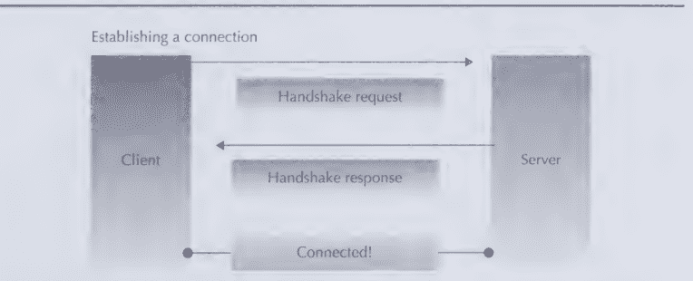

```text
Http Request

GET /mychat HTTP/1.1
Host: server.example.com
Upgrade: websocket
Connection: Upgrade
Sec-WebSocket-Key: x3JJHbDD1EIzLkh9GBhXDW=
Sec-WebSocket-Protocol: megachat,chat
Sec-WebSocket-Extensions: compress,mux
Sec-WebSocket-Version: 13
Origin:http://example.com
```

在本示例中，客户端请求连接到托管在 http://server.com 上的 WebSocket，该 WebSocket 相服务器的 URI 为 /mychat。你会发现 WebSocket 协议使用了 HTTP 升级（Upgrade）机制，这与浏览器用于将 HTTP 连接升级为安全的 HTTPS 连接时所使用的通用机制相同，而在这种情况下，客户端请求的协议自然是 WebSocket 协议。客户端发送了一个唯一的令牌（token），该令牌将在响应中使用，你还会注意到其他标头定义了客户端希望使用的 WebSocket 协议版本以及扩展（extensions）。我们将在后面的章节中触及 WebSocket 协议子协议（subprotocols）和扩展的确切定义和用法。目前，只需知道它们表示特定应用程序可以调整协议以更好地适应其需求的方式。

最后，打开握手请求还可以声明 Origin 标头，例如，如果它是由浏览器构建的，它通常是提供 WebSocket 客户端代码的网页的互联网地址。

图 1-5 显示了一个打开握手请求的示例。在本示例中，服务器已同意将连接“升级”为 WebSocket 连接。它发回一个安全令牌，客户端使用该令牌来验证收到的响应是否是对其所发送的相同请求的响应。示例中的服务器决定在打开握手请求的列表中使用 chat 子协议。

```text
Handshake Response
HTTP/1.1 101 Switching Protocols
Upgrade: websocket
Connection: Upgrade
Sec-WebSocket-Accept: NSmrc0sMlYUkAgm5OpPG2HaGWk-
Sec-WebSocket-Protocol: chat
Sec-WebSocket-Extensions: compress, mux
```

在打开握手请求中。由于它同时支持 WebSocket 协议的两种扩展（分别称为 compress 和 mux——即压缩和多路复用），因此已同意在由于此次握手而在客户端与服务器之间建立的连接中使用这些扩展。

现在传输控制协议（TCP）连接已建立。WebSocket 协议在 TCP 之上定义了一种具有最小分帧（framing）开销协议。在 TCP 连接上双向发送的不同的 WebSocket 协议帧定义了 WebSocket 的生命周期事件，例如打开和关闭连接，同时也定义了应用程序创建的文本和二进制消息如何在连接上传输。

当 WebSocket 实现接受传入的连接时，它确保有一个能够处理它的端点（endpoint）实例，并与建立连接的客户端关联。你将在下一章中学习更多关于客户端连接与端点实例之间的关联。此时，每当客户端向端点发送消息时，都是实现与客户端关联的端点实例接收了带有有效负载中消息的方法回调。端点可以通过 `Session` 对象获取 `RemoteEndpoint` 对象的引用，该对象唯一地代表其所连接的客户端，以便发送消息。当处理消息的方法从带注解端点返回返回值时，同样的关联也隐式存在。

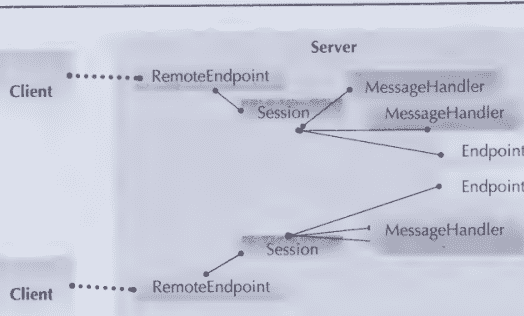

图 1-6. Java WebSocket 服务器应用程序的对象快照

图 1-6 显示了在典型的服务器部署中为程序化端点设置的对象模型图。

在图中，我们可以看到部署在服务器上有一个唯一的逻辑端点，它由两个 Endpoint 框表示的两个实例组成，每个实例处理来自两个独立客户端的消息。端点的每个实例都注册了多个 `MessageHandler` 实例来处理传入的消息。你还看到每个端点都有一个代表与每个客户端连接的 `Session` 对象引用。这些会话每一个都引用了一个 `RemoteEndpoint` 对象的实例，这使得端点具有向客户端发回消息的能力。

对于带注解的端点，运行时设置的对象模型在很大程度上是相同的，`Session` 和 `RemoteEndpoint` 对象对端点始终可用。然而，这里有一个简化，即带注解端点的 `MessageHandler` 是由 WebSocket 实现生成的；开发者永远不需要创建、注册或引用它们。

当然，这幅图仅代表连接处于激活状态时对象的快照。作为一个 WebSocket 端点的完整蓝图，它的完整性仅仅就像一张描述两个人在电话通话的照片等同于一段电话对话的完整描述。要完全理解两个端点之间完整的 WebSocket 会话，我们需要深入研究 WebSocket 端点的生命周期。这将是下一章的主题。

在本章中，你学习了如何创建一个简单的客户端/服务器 WebSocket 应用程序，使用 Java WebSocket API 创建服务器元素，使用 JavaScript API 创建客户端元素。你还学习了如何通过使用 Java WebSocket API 中的 Java 注解或通过程序化扩展 Java WebSocket API 中的 `Endpoint` 类来创建 WebSocket 端点。本章涉及了 Java WebSocket API 中一些最重要的对象：`Session`、`RemoteEndpoint` 和 `MessageHandler` 对象。它还研究了 WebSocket 端点作为标准应用程序一部分的两种部署方式。

## Java WebSocket 生命周期

在本章中，我们将检查 WebSocket 端点的生命周期。WebSocket 端点生命周期为开发者提供了一个管理端点所需的框架，以及一个拦截消息的框架。我们将仔细观察生命周期事件的顺序和语义，以及 Java WebSocket API 如何为它们提供支持。我们将看到它们如何以注解和程序化的形式应用于示例应用程序中。

# WebSocket 协议

我们将从 WebSocket 协议本身的背景知识开始。读者不需要了解本节的所有细节就能使用 WebSocket API，但它有助于泛理解 WebSocket 技术以及为什么 Java WebSocket API 是这种形式。

与基于 HTTP 技术不同，WebSocket 拥有由 WebSocket 协议支撑的生命周期。例如，在 servlet 技术中，底层协议定义了一个简单的请求/响应交互，这种交互与下一次交互完全独立。事实上，在大多数情况下，它的底层连接会完全消失。Java Servlet API 等技术在请求/响应模型之上构建约定，以帮助开发者创建比单个孤立交互寿命更长的应用程序；Java Servlet 组件生命周期就是很好的例子。

相比之下，WebSocket 协议定义了客户端与服务器之间更持久且专用的 TCP 连接，正因如此，它定义了比传统 Web 请求/响应模型更长的生命周期。此外，WebSocket 协议定义了在 WebSocket 连接上双向传输的数据块的格式。一旦连接建立，这些传输就会带上描述其目的的元数据。WebSocket 协议有两种主要类型的帧：控制帧和数据帧。控制帧是执行协议某些维护功能的数据传输。例如，协议定义了一个关闭帧（close frame）。`关闭帧`是一种表示发送者将关闭连接的特定传输。其他控制帧是 ping 和 pong 帧。`ping and pong 帧`是数据

作为对连接健康的检查：如果 WebSocket 想要检查它与 WebSocket 对方建立的连接的健康状况，它可以发送一个 ping 帧。在接收到 ping 帧后，WebSocket 对方必须尽快返回一个 pong 帧作为响应。这就像模仿乒乓球游戏，可以随时检查连接的健康状况（连接速度快慢或是否正常运行）。

WebSocket 协议定义的另一种类型的数据帧是数据帧（data frame）。数据帧承载应用程序数据。你在第 1 章中发送的回显消息是文本数据帧的示例。数据帧有两种基本类型：文本和二进制，一种用于携带文本消息，另一种用于携带如图像数据之类的二进制数据。WebSocket 协议的一个特点是它能够通过多次单独传输传输消息（无论它是文本还是二进制的）。这种携带完整消息的一部分并作为此类传输序列一部分的单次传输被称为“部分帧”（partial frame）。这种将消息作为一系列部分帧发送的技术，当 WebSocket 实现正在发送非常大的消息时，或者在消息形成过程中就进行发送时，特别有用。虽然该协议通常用于发送短消息，但 WebSocket 消息的大小没有定义限制，因此某些应用程序会使用 WebSocket 消息携带大量数据，例如视频或大型财务数据存档。

正如你将看到的，在某些 Java WebSocket API 调用中，可以明显的底层 WebSocket 协议分的痕迹，尽管开发者不需要理解这些底层细节。

现在你已经了解了一些在 WebSocket 会话期间在线路上往回传输的内容，让我们来看看 Java WebSocket API 是如何建模端点生命周期的。

任何 Java WebSocket 端点生命周期中的第一个事件是“打开通知”（open notification），它表示到 WebSocket 会话另一端的连接已经建立。用电话通话来做类比，在第 1 章中我们讨论过握手交互类似于网络电话建立期间发生的协商：号码的路由、所用连接速度的选择，以及是仅使用语音还是也使用视频连接。那么，“打开通知”类比于铃声结束以及建立连接现已开启的“咔哒”声。

一旦 WebSocket 会话的双方都接收到打开通知，任何一个参与的 WebSocket 就可以发送消息。发送了多少消息、什么时间、以什么顺序以及内容是什么，显然取决于应用程序。在与电话通话的类比中，这是生命周期中的这段时间，对话中的每一方借此机会说他们在通话想说的话。

在 WebSocket 会话的任何时候，消息传输过程中都可能发生某种错误。接收消息的 WebSocket 端点本身可能会产生错误（例如，如果它接收到了一个不知道如何妥善处理的消息），或者 WebSocket 实现本身在接收到比其处理能力更大的消息时可能会针对某些情况产生错误。WebSocket 端点生命周期中的这一阶段可能导致两种结果之一：要么错误是致命的，此时连接将关闭且无法再发送更多消息；要么错误是非致命的，端点如果愿意，可以继续发送和接收消息。在电话通话的类比中，消息可能从对话的任何端进入，出现一段时间混乱但随后又变得连贯，或者某些更严重的错误实际上导致通话终止。

当 WebSocket 会话中的一方准备结束对话时，此时 WebSocket 实现会与对话的另一端通信，通知其连接即将关闭。在电话通话的类比中，这有点像准备结束的一方通过说“再见”来终止通话。实际上，WebSocket 协议不需要在你的通话伙伴说完“再见”之后、在你有机会做出回应之前立即等待电话挂断声。对于电话通话的人类来说，这可能有点没礼貌，但对于 WebSocket 端点来说完全足够！

让我们通过图表（见图 2-1）回顾 WebSocket 会话的生命周期。在这里我们可以通过从上往下观察看到，一旦客户端和服务器之间建立了 WebSocket 连接，WebSocket 会话的双方都会收到会话开启的通知。一旦会话开启，WebSocket 会话的双方都会收到来自对方的多条消息。

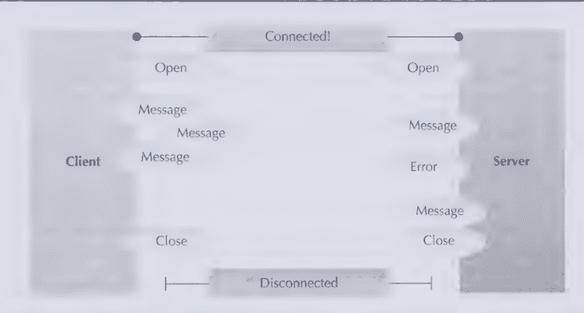


在这个阶段，可能会出现某些错误情况，在图中这种情况是可恢复的，因为接收到错误的服务器端点在有机会处理错误后，会接收到另一条消息。在图中，WebSocket 会话的一端决定想要结束对话，这导致双方都接收到关闭通知。除非建立新连接，否则客户端和服务器之间现在无法再发送消息。

现在我们已经查看了 WebSocket 端点生命周期的基本描述，让我们来看看从 Java 组件的角度来看生命周期是如何。在上一节中，我们识别了 WebSocket 端点生命周期中的四个事件：

- **打开事件** 是在与端点建立新连接且在任何其他事件发生之前发生的事件。
- **消息事件** 是从 WebSocket 会话另一端接收消息的事件。这可能发生在 WebSocket 端点接收到打开事件之后、且 WebSocket 端点接收到关闭事件之前的任何时候。
- **错误事件** 是当 WebSocket 连接上或端点产生错误时生成的事件。
- **关闭事件** 是标志 WebSocket 端点当前参与的连接即将关闭的事件，可以由参与连接的任何一个端点发起。

幸运的是，这些事件几乎是一一地映射到你可以编写的方法上，用以便在 Java 组件上拦截这些事件。首先，让我们看看带注解的端点。完成之后，我们将查看它们在程序化端点上的显示方式。

要将 Java 类声明为 WebSocket 端点，你使用类级别注解之一：用于服务器端点的 `@ServerEndpoint`（我们在第一章中见过），或者用于客户端端点的类似的 `@ClientEndpoint` 注解（我们将在第 3 章看到更多）。让我们假设现在我们正在编写一个部署在服务器上并等待来自一个或多个传入连接的端点。

对于注解端点，为了拦截不同的生命周期事件，我们使用方法级别注解：`@OnOpen`、`@OnMessage`、`@OnError` 和 `@OnClose`。我们将看到每个 WebSocket 生命周期事件都伴随着不同的限定信息。因此，对于带有生命周期注解的 Java 方法，方法签名有很多选择。

让我们从第一个开始：`@OnOpen`。此注解用于注解端点的方法，表示当与该端点建立新连接时调用它。拥有处理打开事件的方法的主要原因是为了你可以对 WebSocket 会话期间可能需要的任何信息进行任何种设置。

这可能是因为，如果你的 WebSocket 将使用数据库来检索或存储来自 WebSocket 会话的信息，你可能希望在处理打开事件的方法中执行准备数据库所需的任何昂贵操作，例如与其建立连接。此事件伴有三部分信息：`Session` 对象代表已建立的连接；`EndpointConfig` 对象包含了用于配置端点的信息；以及当 WebSocket 端点在打开握手期间与传入的 URI 匹配时的路径参数集。使用 WebSocket 注解的一个好处是，如果你不需要，就不必使用关于事件的所有信息。因此，当你使用 `@OnOpen` 注解时，可以使用的方法类型是任何没有返回值的公共方法，该方法可以有一个可选的 `Session` 参数、`EndpointConfig` 参数，以及任意数量用 `@PathParam` 注解标记的 `String` 参数。此外，你选择包含的参数可以以任何顺序出现。我们将在第 6 章回到路径参数的话题，因此在这里不会花费太多时间。这意味着，如果你只是想要一个 `Session` 对象的引用，可以编写如下代码：

> 列表：打开事件处理方法示例

```java
@OnOpen
public void init(Session session) {
    // 初始化代码
}
```

此外，如果你想查询配置对象（由 `EndpointConfig` 类实例表示），你同样可以声明如下内容：

> 列表：打开事件处理方法示例

```java
@OnOpen
public void init(Session session, EndpointConfig config) {
    // 初始化代码
}
```

你已经可以看到你具有某些灵活性，不仅体现在为处理打开事件的方法命名上，还体现在你想要获取多少伴随事件的数据可用上。

### @OnMessage

通常，你可能希望你的 WebSocket 端点在连接建立后处理部分或全部传入的消息。为了这一点，我们使用 `@OnMessage` 注解。这允许你装饰你想要处理传入消息的方法或方法。在 Java WebSocket API 中伴随消息事件的信息是 `Session` 对象（消息到达的连接）、`EndpointConfig`、在打开握手期间匹配传入 URI 时找到的路径参数，以及最重要的——消息本身。使用 `@OnMessage` 注解时，方法参数可以任意顺序列出，你只需要包含你想要了解的消息事件部分的参数即可。

消息将以三种基本形式之一到达连接上：文本消息、二进制消息或 pong 消息。Java WebSocket API 为你提供了接收这些形状消息的一系列选择。你可以选择的最基本形式是：如果你的方法将处理文本消息，则使用 `String` 参数；如果你的方法将处理二进制消息，则使用 `ByteBuffer` 或 `byte[]` 参数；如果你的方法只处理 pong 消息，则使用 Java WebSocket API 部分的 `PongMessage` 接口实例。

例如，如果你想以简单的形式处理文本消息，可以编写如下代码：

> 列表：文本消息处理方法示例

```java
@OnMessage
public void handleTextMessages(String textMessage) {
    // 处理 textMessage
}
```

如果你想处理二进制消息，并拥有一个表示该消息来源连接的会话引用，可以使用以下内容：

> 列表：二进制消息处理方法示例

```java
@OnMessage
public void processBinary(byte[] messageData, Session session) {
    // 处理二进制数据
}
```

然而，对于文本和二进制消息，还有许多更高级的选项。例如，你可以选择在消息到达时分部分接收文本和二进制消息。在这种情况下，你使用一对参数来表示部分消息的到达：用于部分文本消息的 `String` 和 `boolean`。`String` 代表部分文本消息，`boolean` 是一个标志位，如果代表整个文本消息的序列中还有后续消息，则将其设置为 `false`；如果到达的片段是序列中的最后一个，则将其设置为 `true`。对于二进制消息，你可以选择 `ByteBuffer` 和 `boolean` 对，其中 `ByteBuffer` 代表部分二进制消息，`boolean` 表示正在到达的部分二进制消息是否为形成完整消息的部二进制消息序列中的最后一个。对于二进制消息，你也可以 `byte[]` 和 `boolean` 对，这与 `ByteBuffer` 和 `boolean` 对相同，区别在于它使用字节数组来持有部分二进制消息而不是 `ByteBuffer`。

> 列表：部分二进制消息处理方法示例

```java
@OnMessage
public void processVideoFragment(byte[] partialData, boolean isLast) {
    if (!isLast) {
        // 还有后续！
    } else {
        // 现在我们有了完整的消息！
    }
}
```

> 列表：部分文本消息处理方法示例

```java
@OnMessage
public void catchDocumentPart(String text, boolean isLast) {
    // 传递到其他地方处理
}
```

如果你使用这种部分消息处理选项，两种类型的短消息仍可能一次性到达。较长的消息可能会以任意数量的片段到达。通常情况下，这取决于实现如何选择将消息传递给你的 API：不同的实现可能会将消息拆分成更小的片段。然而，通常情况下，这是处理大消息的一个有用选项，因为你可能希望在消息到达时立即开始处理它。

使用 `@OnMessage` 注解处理传入消息的另一个选项是使用 Java I/O 流处理它们——用于文本消息的 `java.io.InputStreamReader` 和用于二进制消息的 `java.io.InputStream`，当你尝试使用许多使用 I/O 处理的 Java 库时非常有用。

> 列表：I/O 消息处理方法示例

```java
@OnMessage
public void handleBinary(InputStream stream) {
    // 读取
}
```

事实上，处理消息还有更多选项：你甚至可以让 WebSocket 实现将传入的消息转换成你选择的对象。我们将在第 3 章详细讨论这个话题。

WebSocket 在双向消息方面通常是异步的。也就是说，典型的应用程序不会立即对传入的消息做出响应。然而，在某些情况下，你希望立即对传入的消息做出响应：第 1 章中的 Echo 示例应用程序是你想要这样做的极佳示例。在使用 `@OnMessage` 注解的方法类型上还有一种选项：你可以有一个返回类型或 `void`。如果你在你带有 `@OnMessage` 注解的方法或方法上有返回类型，返回值将被 WebSocket 实现立即作为消息返回给你方法中处理的消息的发送者。这在特定情况下非常有用，例如你可能需要设计一个显式确认接收 WebSocket 消息的应用。

> 列表：带返回的消息处理示例

```java
@OnMessage
public byte[] dealWithRequest(String requestMessage) {
    byte[] ack = {0};
    return ack;
}
```

在此示例中，持有此方法的端点接收到任何类型的文本消息时，该端点会立即返回一个二进制消息，将 0 字节作为负载包含在内。你可以从带有 `@OnMessage` 注解的消息中返回的最基本类型是 `String`、`byte[]` 或 `ByteBuffer`。正如你将在下一节看到的，还有更多选项。

### @OnError

错误处理比消息事件简单一些。`@OnError` 注解可以用于标记 WebSocket 端点上的方法，该方法将处理 WebSocket 实现在处理输入消息时发生的任何错误。如果你不想，你的 WebSocket 端点不需要处理此类错误。但是，建议在你的 WebSocket 端点上包含一个错误处理方法；否则，你可能会浪费时间去追踪那些没有从客户端投送到你端点的消息！随错误事件一起的信息是发生错误的会话（`Session`），以及与建立连接的打开握手相关的任何参数。同样，我们将在后面的章节回到路径参数话题。错误信息由 `java.lang.Throwable` 类表示，会话由 Java WebSocket API 的 `Session` 接口表示。与 WebSocket API 的其他方法级注解一样，你的错误处理方法的参数取决于你希望在事件发生时接收的信息。与其他方法级注解一样，你选择包含的参数可以按任意顺序列表。

> 列表：示例错误处理方法

```java
@OnError
public void errorHandler(Throwable t) {
    // 在此处记录错误
}
```

处理输入消息时可能会发生三种基本类型的错误。首先，可能会发生 WebSocket 实现生成的错误，例如，如果一个发往 WebSocket 端点的输入消息格式不正确。这些错误都是 `SessionException` 类型。其次，当 WebSocket 实现尝试将输入消息解码为开发者请求的某些对象时，可能会发生错误。我们将在第 3 章回到这个话题，但目前只需说明这类错误全都是 `DecodeException` 错误即可。最后，运行时错误是由 WebSocket 端点的其他方法生成的。

如果你选择不在你的应用程序中包含错误处理方法，WebSocket 实现将把你 WebSocket 端点在运行期间生成的任何错误记录在某处，供你稍后查看。当然，这取决于你正在使用的 WebSocket 实现，决定了你可以在哪里找到这些信息，以及这些信息的详细程度。

### @OnClose

> 列表：示例关闭事件处理方法

```java
@OnClose
public void goodbye(CloseReason cr) {
    // 记录原因以备后查
    // 关闭数据库连接
}
```


现在我们将所有这些思想整合进示例中，以说明主要概念。

生命周期示例是一个 JavaScript WebSocket 客户端，它与使用所有生命周期注解的 Java WebSocket 端点通信。当运行在服务器上的带有 LifecycleEndpoint 注解的端点处理 WebSocket 生命周期事件时，它向客户端发送一条消息，客户端使用该消息显示一组交通信号。当应用程序启动时，连接被关闭。在网页上点击按钮会引导用户经过 WebSocket 生�命周期中的关键阶段，正如图 2-2 所示图片所示。你会注意到有两个可以关闭连接的按钮：一个导致客户端发起关闭，另一个导致服务器发起关闭。

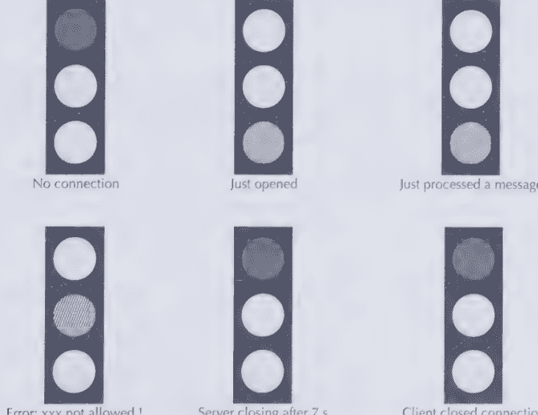

- 无连接
- 刚打开
- 刚处理完消息
- 错误：不允许 xxx !
- 服务器在 7 秒后正在关闭
- 客户端关闭连接

图 2-2. 生命周期交通信号

## 生命周期 JavaScript 客户端

JavaScript 代码使用 JavaScript WebSocket API 来拦截从 Java LifecycleEndpoint 发出的消息，并解析告诉它在信号中应该点亮哪盏灯以及向用户显示什么消息的消息。

让我们来看看 JavaScript 代码，只关注主要的客户端代码。一如往常，我们创建 JavaScript WebSocket，并添加事件处理代码，每当服务器组件发回其中一条用于指示客户端如何显示交通信号的消息之一时，这些代码就会被调用：

> 列表：创建 JavaScript WebSocket

```javascript
function open_connection() {
  lifecycle_websocket = new WebSocket("ws://localhost:8080/lifecycle/lights");
  lifecycle_websocket.onmessage = function (evt) {
    update_buttons();
  };
  lifecycle_websocket.onclose = function (evt) {
    update_buttons();
  };
}
```

正如你所见，JavaScript WebSocket 接收到消息后，它将调用 `update_for_message()` 方法并更新按钮的启用/禁用状态。此外，你还可以看到当 JavaScript WebSocket 关闭时，也会调用相同的按钮更新函数。

接下来，我们有两个方法将解析来自服务器的消息。其中一个方法的示例是 "3:Just opened"。第一个方法剥离消息部分并返回数字；第二个方法剥离开头的数字并只返回消息部分。

> 列表：JavaScript 解析生命周期消息

```javascript
function get_light_index(message) {
  return message.substring(0, 1);
}

function display_message(message) {
  return message.substring(2);
}
```

下一个方法根据交通信号中每盏灯的位置以及它应该是开启还是关闭来计算颜色。

> 列表：计算颜色

```javascript
function get_color(light_index) {
  if (light_index == 1) {
    return "red";
  } else if (light_index == 2) {
    return "yellow";
  } else if (light_index == 3) {
    return "green";
  } else {
    return "grey";
  }
}
```

> 列表：响应消息更新页面

```javascript
function update_display(light_index, display_message) {
  var old = traffic_light_display.firstChild;
  var pre = document.createElement("pre");
  pre.style.wordrap = "break-word";
  pre.innerHTML = "<font face=\"Arial\">"+display_message+"</font>";
  if (traffic_light_display.firstChild) {
    traffic_light_display.replaceChild(pre, old);
  }
  traffic_light_display.appendChild(pre);
  var context = document.getElementById('myDrawing').getContext('2d');
  context.fillStyle = "black";
  context.fillRect(65,0,70,210);
  context.fill();

  context.beginPath();
  context.fillStyle = get_color(light_index);
  context.arc(100,35,25,0,2*Math.PI);
  context.fill();
}
```


我们注意到这个示例使用了与 WebSocket 相同的 HTML5 规范中的新画布。最后，是完整的列表：

- 列表：Lifecycle Java WebSocket 端点

```java
import java.io.*;
import java.io.IOException;
import javax.websocket.OnClose;
import javax.websocket.OnError;
import javax.websocket.OnMessage;
import javax.websocket.OnOpen;
import javax.websocket.Session;
import javax.websocket.server.ServerEndpoint;
```

```java
@ServerEndpoint("/lights")
public class LifecycleEndpoint {
    private static String START_TIME = "Start Time";
    private Session session;

    @OnOpen
    public void opening(Session session) {
        this.session = session;
        session.getUserProperties().put(START_TIME, System.currentTimeMillis());
        this.sendMessage("Just opened");
    }

    @OnMessage
    public void gettingMessage(String message) {
        if (message.indexOf("xxx") != -1) {
            throw new IllegalArgumentException("xxx not allowed!");
        } else if (message.indexOf("close") != -1) {
            try {
                this.sendMessage("1:Server closing after "
                    + this.getConnectionSeconds() + " s");
                session.close();
            } catch (IOException ioe) {
                System.out.println("Error closing session "
                    + ioe.getMessage());
            }
            return;
        }
        this.sendMessage("3:Just processed a message");
    }
}
```

```java
@OnError
public void whenSomethingGoesWrong(Throwable t) {
    this.sendMessage("2:Error: " + t.getMessage());
}
```

```java
@OnClose
public void whenClosing() {
    System.out.println("Goodbye!");
}
```

```java
void sendMessage(String message) {
    try {
        session.getBasicRemote().sendText(message);
    } catch (Throwable ioe) {
        System.out.println("Error sending message "
            + ioe.getMessage());
    }
}
```

```java
int getConnectionSeconds() {
    long millis = System.currentTimeMillis();
    (Long)this.session.getUserProperties().get(START_TIME);
    return (int) millis / 1000;
}
```

首先，我们注意到这是一个使用 `@ServerEndpoint` 注解的服务器端点，它映射到路径 `/lights`。你可能想知道如何在不查看需要发起连接的客户端代码的情况下，计算出端点的完整 URI。完整 URI 是由主机名和端口号组成的 `ws://URI`、包含 WebSocket 端点的 Web 应用程序的上下文路径，以及端点的相对 URI 组成的。我们将在第6章中回到这个问题，但这意味着包含生命端点的 Web 应用程序的上下文路径为 `/lifecycle`，WebSocket 端点的完整 URL 为：

```
ws://localhost:8080/lifecycle/lights
```

你将在示例中看到，指定使用 `@OnOpen` 注解来处理此 WebSocket 端点打开事件的方法是以下方法：

## 列表：生命周期打开事件处理方法签名

```java
@OnOpen
public void whenOpening(Session session)
```

我们选择接收 `Session` 对象的引用，并将其保留以备后后使用。通过查看该方法的实现，我们看到在接收到打开事件时执行的操作是：记录当前时间，将其添加到 `Session` 对象的属性字典中，然后向客户端发送一条消息，指示我们希望第三盏（绿）灯亮起，以指示消息流量现在可以流动。

你将在示例中也会看到，我们指示了每当接收到消息时都调用以下方法：

## 列表：生命周期消息事件处理方法签名

```java
@OnMessage
public void whenGettingMessage(String message)
```

我们选择只接收文本消息（发送到此端点的任何二进制消息都将被忽略），并以 `String` 对象的格式接收。这种格式是完全合适的，正如我们之前讨论的，而不是选择以部分形式或 `java.io.Reader` 形式接收文本消息，因为我们知道这些都是短消息。事实上，在极有可能的情况下，我们知道在很多时候你将选择以这种最简单的形式接收你的文本消息。你将在该消息处理方法的实现中看到，我们首先检查消息中是否包含特定的坏字符序列。（毕竟，这些交通信号灯位于居民社区内！）如果一切均不正常，它将抛出一个带有说明的运行时异常。如果一切正常，该方法将检查客户端是否请求此服务器端端点关闭连接，如果是这样，它会在向客户端发送让灯变红的消息后关闭连接。最后，如果这是任何其他类型的消息，该方法的实现将向客户端发送一条消息，指示灯应保持绿色。

# 第2章：Java WebSocket 生命周期 39

如果消息中存在坏字符，它会设置一个可能需要处理的错误事件。因此，Lifecycle 端点声明了以下方法，它将处理任何错误事件：

## 列表：生命周期错误处理方法签名

```java
@OnError
public void whenSomethingGoesWrong(Throwable t)
```

该方法简单地向客户端发送一条包含错误描述的消息，并要求其将交通信号变为黄色。当你运行应用程序时，如果发送了坏消息，Lifecycle 消息处理方法就会被调用。这会引发异常，从而导致错误处理方法被调用，从而点亮交通信号的黄灯。黄色表示流量仍然可以，这在这种情况下是合适的，因为错误事件并没有导致会话关闭。当然，你可以在此类错误处理方法中执行许多其他操作，例如通过调用 `session.close()` 关闭连接。

最后，Lifecycle 端点声明了以下方法，该方法将在客户端连接关闭时被调用：

## 列表：生命周期事件处理方法签名

```java
@OnClose
public void whenClosing()
```

你会发现，无论是 Lifecycle 客户端还是 Lifecycle 服务器端点终止了连接，`LifecycleEndpoint` 的 `whenClosing()` 方法都会调用。

## 程序化端点生命周期

在继续讨论你刚刚看到的示例的更多方面之前，让我们通过查看 WebSocket 端点生命周期的程序化版本来进行短暂的。

## 生命周期事件

你记得第1章提到程序化端点都必须继承 `javax.websocket.Endpoint` 类。你可以通过提供对 `Endpoint` 方法的自己的实现来拦截程序化端点的打开、关闭和错误事件。

# 42 Java WebSocket 编程

现在你已经学习了生命周期，程序化端点不需要拦截其他事件。在 Java API 中，这里的情况有所不同，因为开发者在如何处理消息方面有广泛的选择。

## 处理消息

以下是端点的程序化版本代码：

## 列表：程序化生命周期端点

```java
import java.io.IOException;
import javax.websocket.CloseReason;
import javax.websocket.Endpoint;
import javax.websocket.EndpointConfig;
import javax.websocket.MessageHandler;
import javax.websocket.Session;

public class ProgrammaticLifecycleEndpoint extends Endpoint {
    private static String START_TIME = "Start Time";
    private Session session;

    @Override
    public void onOpen(Session session, EndpointConfig config) {
        this.session = session;
        final Session mySession = session;
        this.session.addMessageHandler(new MessageHandler.Whole<String>() {

            @Override
            public void onMessage(String message) {
                if (message.indexOf("***") != -1) {
                    throw new IllegalArgumentException("*xxx not allowed!");
                } else if (message.indexOf("close") != -1) {
                    try {
                        sendMessage("1:Server closing after "
                            + mySession.getSeconds() + " s");
                        mySession.close();
                    } catch (IOException ioe) {
                        System.out.println("Error closing session "
                            + ioe.getMessage());
                    }
                    return;
                }
                sendMessage("3:Just processed a message");
            }
        });

        session.getUserProperties().put(START_TIME, 
            System.currentTimeMillis());
        this.sendMessage("2:Just opened");
    }

    @Override
    public void onClose(Session session, CloseReason closeReason) {
        System.out.println("Goodbye!");
    }

    @Override
    public void onError(Session session, Throwable thr) {
        this.sendMessage("2:Error: " + thr.getMessage());
    }
}
```

```java
void sendMessage(String message) {
    try {
        session.getBasicRemote().sendText(message);
    } catch (IOException ioe) {
        System.out.println("Error sending message " + message);
    }
}
```

```java
int getConnectionStringSeconds() {
    long millis = System.currentTimeMillis() - 
    (Long)this.session.getUserProperties().get(START_TIME);
    return (int) millis / 1000;
}
```

## 实例数量与线程

在这个示例中，你可能会好奇为什么端点使用实例变量来持有 `Session` 对象的引用。你会记得 `Session` 对象代表与单个客户端的连接。在生命周期示例中，你还会注意到我们在端点生命周期中的两个点使用了了 `session`：一次是在客户端建立新连接时并记录事件发生的时间；另一次是在 `whenGettingMessage()` 方法中，此时服务器端点准备关闭与客户端的连接，以便计算连接持续了多久。

我们可以很容易地写出关闭处理方法，这样我们就不需要在打开连接的处理方法中将 `session` 存储为实例变量以便稍后访问了。

## 列表：替代的生命周期关闭事件处理方法签名

```java
@OnClose
public void whenGettingMessage(String message, Session session)
```

我们完全可以要求 WebSocket 实现将其传入。生命周期示例将 `session` 存储为实例变量的原因是，我们可以利用它来说说明关于 WebSocket 端点生命机的更大问题。如果你重新启动 Lifecycle 应用，这次为同一个主页打开第二个浏览器窗口，你会看到两组流量信号。如果你点击任何一个浏览器窗口中的生命周期按钮，你会发现每组流量信号可以处于不同的状态。这是因为每个浏览器窗口都充当 Lifecycle WebSocket 端点的独立客户端，并且

由于 WebSocket 实现为每个连接的客户端都使用了 `LifecycleEndpoint` 的独立实例。

第 2 章：Java WebSocket 生命周期 45

这意味着，对于每个 WebSocket 端点定义（无论是带注解的 Java 类还是程序化的端点），WebSocket 容器在每次新客户端连接时都会为端点实例化一个新实例。结果是，每个 WebSocket 端点实例只“看到”同一个 `session` 实例：它是代表从连接到该端点实例的唯一客户端的唯一连接。

你同样可以编写 Lifecycle 示例，将 `session` 传入 `whenGettingMessage()` 方法中。如果你这样做，你会发现传入的实例将与传入 `opening(Session session)` 方法的实例是同一个 `Session` 对象。

WebSocket 实现还为你提供了另一个重要保证：不允许来自同一个 `session`（或底层连接）的两个线程同时调用同一个端点实例。这听起来可能相当抽象，但它的意思是，你的端点实例永远不会同时被 WebSocket 实现的多个一个线程调用。这意味着如果客户端发送了多条消息，WebSocket 实现必须一次调用一条消息到你的端点。了解这一点尤为重要，因为这意味着你永远不需要担心为端点实例的并发访问进行编程。这是 Java WebSockets 编程模型与 Java Servlets 编程模型之间的关键区别，在后者中，一个 Java Servlet 实例可能会被多个线程同时调用，每个线程处理来自不同客户端的请求/响应交互。这意味着编写 WebSockets 要容易得多！

## 总结

在本章中，你学习了控制 WebSocket 端点生命周期的事件。你学习了打开、消息、错误和关闭事件的顺序和语义，以及允许开发者处理这些事件的方法和注解。最后，你学习了 WebSocket 实现在调用开发者创建的 WebSocket 端点时所使用的线程策略，这意味着 WebSocket 开发者通常不需要处理多个线程同时调用端点的情况。


## 第 3 章

## 基础消息

在本章中，我们将检查 Java WebSocket API 中消息的基本方面，这包含了许多发送和消费消息的方法。我们将查看发送消息最直接、最广泛的方式：同步发送和接收消息。为了说明我们将涵盖的概念和功能，我们将详细查看 DrawingBoard 应用程序。该应用程序使用 Java 客户端前端，因此我们同时介绍 Java WebSocket API 的客户端 API。

## 消息概述

你会在第 2 章中记得，WebSocket 协议定义了三种原生消息类型：文本、二进制、ping 和 pong 消息。让我们回顾发送和接收消息所需的 Java WebSocket API 所有部分。

## 发送消息


为了发送 WebSocket 消息，无论你是创建带注解的 WebSocket 端点还是程序化的 WebSocket 端点，API 都是相同的：`RemoteEndpoint` 接口及其子类型 `RemoteEndpoint.Basic` 和 `RemoteEndpoint.Async` 包含了发送消息的方法。

Ping 和 Pong 消息供那些希望检查底层 WebSocket 连接健康状况的开发者使用。这样做可能有某些原因：他们可能在检查连接是否仍然活动，或者他们可能通过 WebSocket 连接另一端对 Ping 响应 Pong 消息所需的时间对效率进行某种粗略测量。现在，可以说，许多应用程序不会依赖这类消息。然而，如果你需要发送其中一类消息，从 `Session` 获取的 `RemoteEndpoint` 实例包含以下两个方法：

### 列表：RemoteEndpoint Pings and Pongs

```java
public void sendPing(ByteBuffer applicationData)
    throws IOException, IllegalArgumentException
```

```java
public void sendPong(ByteBuffer applicationData)
    throws IOException, IllegalArgumentException
```

WebSocket 规范定义 Ping 和 Pong 消息可以携带 125 字节的二进制数据：这就是每个方法使用 `ByteBuffer` 参数的原因。如果在调用此方法时 `ByteBuffer` 超过此限制，将抛出 `IllegalArgumentException`。与 `RemoteEndpoint` 接口及其后类的所有发送方法一样，`IOException` 用于表示传输期间的错误。这可能会发生，例如在调用发送消息时底层连接已断开。

现在让我们转向更常见的消息类型：文本和二进制。在第 5 章中，我们将检查 Java WebSocket API 中异步发送消息的 API 和语义；现在，我们将发送消息的限制为同步。这意味着我们需要查看 `RemoteEndpoint.Basic` 接口，并将对 `RemoteEndpoint.Async` 的检查留到以后。

## 发送字符串

使用 `RemoteEndpoint.Basic` API 发送字符串有三种方法。第一种最简单的是：

### 列表：RemoteEndpoint.Basic 发送文本

```java
public void sendText(String text) throws IOException
```

该方法将 `text` 参数作为 WebSocket 文本消息发送。这意味着 WebSocket 连接的另一端将以文本形式接收消息。方法只有在消息发送后才会返回，或者在发送出现问题时抛出异常。这种情况的一个例子可能是发送过程中发生了连接中断。我们在第 1 章和第 2 章中已经见过此方法的操作；它是发送 WebSocket 消息最基础且常用的方式。

由于 WebSocket 消息通常以高级对象的形式序列化为字符串以便发送，Java WebSocket API 还提供了一种使用熟悉的 `Writer` API 发送字符串消息的方法：

### 列表：RemoteEndpoint.Basic 向流发送文本

```java
public Writer getSendStream() throws IOException
```

当使用其他提供向写入器写入字符数据方法的 API 时，这种方法特别有用，例如 `javax.swing.text.html.HTMLEditorKit` API，它允许你将 HTML 文档写入写入器中。

现在，WebSocket 协议允许将非常大的 WebSocket 消息拆分成更小的片段。这使得 WebSocket 实现在应用程序将整个消息传递给实现类之前，就开始传输消息，从而产生性能优势，特别是对于发送非常大消息的应用程序而言。为了让开发者能够利用这种部分消息传输，Java WebSocket API 还提供了以下方法：

### 列表：使用 RemoteEndpoint 分段发送文本消息

```java
public void sendText(String partialMessage, boolean isLast) throws IOException
```

该方法允许开发者以一系列较小片段的顺序发送大型字符串消息，每次调用时将 `isLast` 参数设置为 `false`，直到最后一个片段准备就绪发送时，才将 `isLast` 参数设置为 `true`，以指示该消息不再有后续片段。

## 发送二进制消息

对于更常见的应用程序，以文本形式发送消息就足够了。然而，对于具有特定数据格式（如小型图像文件）或需要绝对最小化消息大小的应用程序，以二进制形式发送消息是一个极佳的选择。幸运的是，Java WebSocket API 处理了多种以二进制形式发送消息的方法。正如我们处理文本消息一样，我们将只查看使用 `RemoteEndpoint.Basic` 接口同步发送消息，而将使用 `RemoteEndpoint.Async` 接口异步发送消息的检查留到第 5 章。

发送二进制消息有三种方法。首先，有两个 `sendBinary` 方法：

### 列表：RemoteEndpoint 发送二进制消息

```java
public void sendBinary(ByteBuffer data) throws IOException
public void sendBinary(ByteBuffer partialByte, boolean isLast) throws IOException
```

其中 `ByteBuffer` 方法参数承载消息数据。如果发生防止消息数据发送的通信错误，将抛出 `IOException`。与文本消息一样，第一种变体一次性发送完整消息。第二种变体则以一个或多个部分二进制消息的序列形式发送二进制消息。该变体的 `isLast` 参数用于指示正在发送的部分消息是否为组成整个消息的序列中的最后一个片段，或者是否还有后续。如果消息非常大，或者创建消息的过程可以在你发送已就绪的第一部分消息时持续进行，那么这种第二种变体是一个很好的选择。

> **注意**
>
> 对于二进制和文本消息，这种以部分消息序列形式发送消息的方法对某些应用程序可能产生强大的性能提升。然而，消息最终传输的具体形式取决于 WebSocket 的实现。某些实现可能会通过大量微小片段传输大消息，而另一些实现可能会以少数几个较大的片段传输大消息。某些实现可能允许你配置其实现的这一方面。另一些实现甚至可能根据本地网络状况调整这些参数！因此，在确定适用于你的应用程序及其运行的 WebSocket 实现的高效变体之前，进行一些小实验和测试是值得的。

最后，你可以获取一个 `java.io.OutputStream` 的引用，并向其写入二进制消息数据。这非常有用，特别是当与直接将数据对象写入 Java I/O API 的 Java API 配合时。在向其写入消息后，关闭输出流是你的责任。一旦关闭输出流，消息就会被发送。为了使用这种发送二进制消息的模式，你将使用此方法：

### 列表：使用流通过 RemoteEndpoint.Basic 发送二进制消息

```java
public OutputStream getSendStream() throws IOException
```

## 将 Java 对象作为消息

现在你已经看到有多种方式以文本或二进制形式发送消息，值得注意的是，对于很大类应用程序来说，这些方法已经足够了。此类应用程序倾向于发送非常简单的消息：例如，简单的股票更新、温度测量或头条新闻；但也有许多 WebSocket 应用程序发送形式更复杂的消息。这些消息可能同时包含数据和指令或定性描述。它们可能包含高度结构化的数据。对于这类应用程序，能够将这些消息建模为 Java 对象（而不是文本或二进制）将是极其有用的。

WebSocket API 允许你使用 `RemoteEndpoint.Basic` 方法发送任何类型的对象：

### 列表：使用 RemoteEndpoint.Basic 发送 Java 对象

```java
void sendObject(Object data) throws IOException
```

你可能会好奇 WebSocket 实现是如何将此转换为 WebSocket 消息的。（正如你在第 2 章中读到的，线路上只有三种类型的 WebSocket 消息：文本、二进制或心跳。）答案是取决于你传递什么类型的对象。

如果你传递的是 Java 原始类型（或基本类型），WebSocket 实现将把数据转换为字符串表示（即 `toString()` 表示）。

如果你传递的是任何其他对象，你将需要为 WebSocket 实现提供一个 `Encoder` 接口的实现。你将在本章稍后的部分看到这方面的示例，但现在，让我们快速查看其中一个。编码器家族中最常见的接口是 `javax.websocket.Encoder<T>` 接口，其中 `T` 是你想发送的对象的类。

### 列表：Encoder.Text<T> 接口的 encode 方法

```java
public String encode(T object) throws EncodeException
```

每当你尝试使用 `RemoteEndpoint.Basic` 的 `sendObject` 方法发送类型为 `T` 的对象时，WebSocket 实现都会调用你提供的编码器并传入该对象。你从 `encode` 方法返回的字符串就是真正发送到端点的。如果你的编码器无法编码提供的对象，你可以抛出 `EncodeException`。

你还可以选择其他编码器接口作为替代。例如，如果你想将对象编码为二进制 WebSocket 消息，可以实现 `Encoder.Binary<T>` 接口。如果你想将对象编码为 Java I/O 流，可以实现 `Encoder.CharacterStream<T>` 或 `Encoder.BinaryStream<T>`。

一旦创建了你使用的编码器，你可以选择如何为你的端点对其进行配置。

对于注解端点，你只需要在类的 WebSocket 注解上声明编码器类即可。假设你有一个果园应用程序，它需要发送一个应用程序中名为“Apple”的类的实例的消息。例如，为了在一个知道如何编码 Apple 对象的服务器端点配置编码器，你可能会使用以下注解：

### 列表：在 @ServerEndpoint 注解中指定编码器

```java
@ServerEndpoint(
    value = "/fruit_trees",
    coders = { MyAppleEncoder.class }
)
```

一旦这样做，当你从此注解的端点获取 `RemoteEndpoint` 引用时，你可以将 `Apple` 对象传递给它的 `sendObject()` 方法，WebSocket 实现将使用你的 `MyAppleEncoder` 实现将 `Apple` 对象编码为 WebSocket 消息。

如果你正在使用程序化端点，可以在创建用于部署端点所需的 `EndpointConfig` 对象时，配置你的编码器类。例如，如果你正在创建一个程序化的客户端端点，并且需要使用我们在上面示例中使用的 `MyAppleEncoder` 编码器实现，你需要包含以下代码：

### 列表：为程序化客户端端点配置编码器

```java
List<Class<? extends Encoder>> encoders = new ArrayList<>();
encoders.add(MyAppleEncoder.class);
EndpointConfig config =
    EndpointConfig.Builder.create()
        .encoders(encoders)
        .build();
```

正如我们在本章后面介绍的 DrawingBoard 应用程序中所看到的，你需要创建一个 `ClientConfig` 实例来部署它将使用的客户端端点。

现在，每当你从这个程序化端点获取 `RemoteEndpoint` 的引用时，就可以调用它的 `sendObject()` 方法并传入一个 Apple 实例。WebSocket 实现将使用你提供的 `MyAppleEncoder` 实现将 `Apple` 编码为 WebSocket 消息。

我们将通过一个表格来结束对使用 `RemoteEndpoint` 接口将 Java 对象作为 WebSocket 消息发送的检查，该表格总结了你可以选择为你的端点实现和配置的所有可能的 `Encoder` 接口类型。

| Encoder 接口 | 转换 | 主要方法 |
| --- | --- | --- |
| Encoder.Text<T> | T 到 String | String encode(T object) throws EncodeException |
| Encoder.TextStream<T> | T 到 Writer | void encode(T object, Writer writer) throws EncodeException, IOException |
| Encoder.Binary<T> | T 到 ByteBuffer | void encode(T object, ByteBuffer buffer) throws EncodeException, IOException |
| Encoder.BinaryStream<T> | T 到 OutputStream | void encode(T object, OutputStream os) throws EncodeException, IOException |

# 第 3 章：基础消息传递

## 接收 WebSocket 消息

现在我们已经查看了 WebSocket 应用程序发送消息的一些方式，让我们换个角度，看看 WebSocket 端点可以选择接收消息的方式。

## 在注解端点中接收 WebSocket 消息

我们在第 1 章中看到，接收注解端点文本消息最简单的方法是编写一个接受 `String` 参数的 Java 方法，并用 `@OnMessage` 注解标记该方法，如下所示：

### 列表：使用 @OnMessage 处理文本消息

```java
@OnMessage
public void handleTextMessages(String textMessage) {
    return "I got this " + textMessage + " !";
}
```

这是你在该端点中选择接收文本消息的最简单但不是唯一的形式。你可以通过简单使用适当的方法参数来“捕获”它们，从而选择接收二进制 WebSocket 消息和 Pong 消息。为了接收二进制消息，最简单的方法是使用 `byte[]` 数组参数：

### 列表：使用 @OnMessage 处理二进制消息

```java
@OnMessage
public String handleBinaryMessages(byte[] messageData) {
    return "I got " + messageData.length + " bytes of data !";
}
```

为了接收 Pong 消息，你只需要声明一个类型为 `javax.websocket.PongMessage` 的方法参数。例如：

### 列表：使用 @OnMessage 处理 Pong 消息

```java
@OnMessage
public String handlePongMessages(PongMessage pongMessage) {
    return "I got a pong message carrying " + 
           pongMessage.getApplicationData().length + 
           " bytes of data !";
}
```

这三种变体涵盖了主要的两种 WebSocket 消息类型：文本和二进制，以及如何捕获传入的 Pong 消息。

> **注意**
>
> 监听 Ping 消息是怎么是怎么的？你现在可能在奇怪为什么我们没有查看监听传入的 Ping 消息的方法：答案是，Java WebSocket API 实现要求在尽可能快地为连接上的任何传入的 Ping 消息（例如，你手动使用 `RemoteEndpoint` 上的 `sendPing()` 方法发送的 Ping）用一个包含相同数据的 Pong 消息进行应答。因此，你永远不需要显式地编写代码来监听 Ping 消息。

与发送消息以及处理文本和二进制消息的变体非常相似，接收它们的方式也有许多变体。就像发送消息一样，你能够以一系列部分消息的形式接收消息。例如，如果你知道 WebSocket 会话的另一端将向你发送非常大的消息，那么 WebSocket 实现可能会将每条消息拆分成一系列较小的消息。在这种情况下，你可以选择在每个消息到达时就接收它，而不是等待整个消息完成。在这种情况下，你将声明如下所示的方法：

### 列表：使用 @OnMessage 处理分段到达的文本消息

```java
@OnMessage
public void handleMessagePartial(String textMessagePart, boolean isLast)
```

当消息的每个新部分到达时，WebSocket 实现会使用 `textMessagePart` 参数中的消息部分调用此方法，如果还有后续内容，则将布尔标志 `isLast` 设置为 `false`；如果该部分是最后一部分，则设置为 `true`。正如你即将看到的，二进制消息也可以使用类似的形式。

下表列出了注解端点方法如何以 Java 开发者熟悉的格式接收传入的文本、二进制和 Pong WebSocket 消息：


| 参数类型 | 消息类型 | 示例 |
| --- | --- | --- |
| String | 文本消息 | `void handle(String message)` |
| String, boolean | 部分文本消息 | `void handle(String message, boolean isLast)` |
| Reader | 文本消息 | `void handle(Reader message)` |
| byte[] | 二进制消息 | `void handle(byte[] data)` |
| ByteBuffer | 二进制消息 | `void handle(ByteBuffer data)` |
| byte[], boolean | 部分二进制消息 | `void handle(byte[] data, boolean isLast)` |
| PongMessage | Pong 消息 | `void handle(PongMessage pong)` |

我们之前提到，许多 WebSocket 应用程序希望处理数据对象。幸运的是，对于这些应用程序，WebSocket API 提供了以 Java 对象形式接收消息的支持。例如，如果你想接收你创建的 `Orange` 类格式的消息，你可以在你的注解端点上编写如下的方法：

- 列表：使用 `@OnMessage` 处理 Java 对象

```java
@OnMessage
public void addToBasket(Orange orange) {
    this.bag.addShoppingItem(orange);
    this.cost += orange.getPrice();
}
```

为了使此起作用，WebSocket 实现必须知道如何将传入的消息转换为 `Orange` 对象，为了做到这一点，你必须提供 `Decoder` 接口的实现。与 `Encoder` 接口一样，有多种子类型供你实现。现在，我们将通过查看 `Decoder.Text<T>` 接口来说明这一通用概念，它规定了 WebSocket 实现如何将传入的文本消息解码为类型为 T 的 Java 对象。在示例中，你需要实现的 `Decoder.Text<Orange>` 接口的主要方法是 `decode()`：

```java
Listing：Decoder.Text<Orange> 接口的 decode() 方法
public Orange decode(String rawMessage) throws DecodeException
```

该接口还需要你实现 `willDecode()` 方法：

```java
Listing：Decoder.Text<Orange> 接口的 willDecode() 方法
public boolean willDecode(String s)
```

该方法由 WebSocket 实现在调用 `decode()` 之前调用，以便你有机会跳过任何明显格式错误的文本消息。

`Decoder` 接口有许多子类型，允许你区分希望将哪些种类型的 WebSocket 消息转换为 Java 对象，并在某种程度上区分你转换它们的模式。下表总结了所有 `Decoder` 接口及其用途，适用于你希望以 T 对象的形式接收消息的情况：

| 接口 | 转换 | 主要解码方法 |
| --- | --- | --- |
| `Decoder.Text<T>` | String 到 T | `T decode(String raw) throws DecodeException` |
| `Decoder.TextStream<T>` | Reader 到 T | `T decode(Reader raw) throws DecodeException` |
| `Decoder.Binary<T>` | ByteBuffer 到 T | `T decode(ByteBuffer raw) throws DecodeException` |
| `Decoder.BinaryStream<T>` | InputStream 到 T | `T decode(InputStream raw) throws DecodeException` |

你会发现，如果你请求解码的原始数据无法转换为你期望的 Java 对象，可能会抛出 `DecodeException`。在所有此类解码失败的情况下，导致失败的传入消息将不会被传递，但在解码器中生成的 `DecodeException` 将传递给端点的错误处理方法。

## 提示


始终在你的 WebSocket 端点中包含一个错误处理方法。端点上其他 WebSocket 方法（例如 `open` 事件处理方法）中生成的运行时异常将传递到这里，此外处理传入消息时的任何错误也会传递此处。如果你没有错误处理方法，你可能根本不知道消息已经到达！

Java WebSocket API 提供的一项便利功能是为 Java 原始类型及其等价类提供了内置的文本解码器。WebSocket 实现采用的方法是使用原始类型或等价类的标准 Java 字符串表示。这意味着解码操作等同于使用该类的单 `String` 参数构造函数来构建的 Java 原始类型等价类。例如，如果开发者编写了一个方法，希望以 Java 整数的形式处理传入的文本消息，如下：

- 列表：使用 `@OnMessage` 处理带有 Integer 值的 WebSocket 消息

```java
@OnMessage
public void doCount(Integer message) {
    // process Integer
}
```

那么，在链路上到达的值为 42 的传入文本消息字符串将调用上述 `doCount()` 方法，其中 `Integer` 等于 42。

下表总结了除了之前列出的标准文本、二进制和 `PongMessage` 形式之外，作为 Java 对象交付消息的选项，可以是 Java 原始类型或类等价类，或者是开发者定义的自定义 Java 对象。

# 60 Java WebSocket 编程

| 交付选项 | 解码器 | 示例 |
| --- | --- | --- |
| 作为 Java 原始类型或类等类的文本消息 | 自动 | `@OnMessage public void handleTransferCode(Double d)` |
| 作为自定义 Java 对象的文本或二进制消息 | 提供 | `@OnMessage public void handleObject(CustomObject o)` |

在离开注解端点中接收消息的话题之前，我们应该涵盖最后一个与可能带有 `@OnMessage` 注解的方法形式密切相关的话题。

在到为止的所有示例中，`@OnMessage` 方法的返回类型都是 `void`。然而，你可能记得在第一章的 Echo 示例，有一种非常方便的方法可以立即响应传入的 WebSocket 消息，那就是在带有 `@OnMessage` 注解的方法上提供返回值。返回类型决定了 WebSocket 实现向传入消息的发送者返回的 WebSocket 消息类型。

为了用文本消息进行响应，返回类型应该是 `String`。为了用二进制消息进行响应，返回类型应该是 `byte[]`。最后，你被允许通过在本章中讨论过的相同转换规则，使用原始类型或其等价类的标准 Java 表示形式的文本消息进行响应。这意味着所有以下方法都是注解端点上的有效消息处理方法：

列表：消息处理方法示例

```java
@OnMessage
public String echo(String message) { ... }
@OnMessage
public Integer processAndConfirm(byte[] upload) { ... }
@OnMessage
public void handle(String message) { ... }
```

## 多个消息处理方法

我们已经看到，有多种方式可以在注解端点上消费传入的消息。如果你觉得这里看起来很眼熟，那是因为在编程端点中消费传入的 WebSocket 消息的选项与注解端点是相同的。

无论你选择哪种方式，你始终需要以下两个步骤：

1. 实现 `MessageHandler` 的某种子类型，取决于你想要处理的消息类型以及你想要如何处理它（整个消息或部分消息）。
2. 在当前的 `Session` 对象上配置你的 `MessageHandler`。通常，你会在 `onOpen()` 方法创建新会话时执行此操作。

## 在编程端点中接收消息

现在我们全面查看了如何在编程端点中处理消息。正如你对 Java API 所预期的，有多种方法可以开始。

列表：在编程端点中处理文本消息

```java
public void onOpen(Session session, Config config) {
    final Session mySession = session;
    mySession.addHandler(new MessageHandler<String>() {
        @Override
        public void onMessage(String text) {
            handleTextMessage(text);
        }
    });
}

private void handleTextMessage(String text) {
    // incoming messages here
}
```

# 62 Java WebSocket 编程

为了在编程端点中接收二进制消息，你将使用 `MessageHandler` 接口。例如，如果你想将二进制消息作为字节数组接收，你需要以下内容：

```java
@ServerEndpoint(value="/echo", decoders={BinaryDecoder.class})
public class Fruit {
    @OnMessage
    public void handleBinary(byte[] message) {
        // process binary
    }
}
```

如果你使用多个方法，这违反了每个原生类型最多一个消息处理方法的规则。

# 第 3 章：基础消息传递

下表列出了 `MessageHandler` 的所有变体，并描述了它们将消费的传入消息类型以及它们如何将消息呈现给使用它们的编程端点。

| MessageHandler | 消息类型 | 交付方式 |
| --- | --- | --- |
| `MessageHandler.<String>` | 文本 | Java String 对象 |
| `MessageHandler.<Reader>` | 文本 | Java I/O 流 |
| `MessageHandler.<ByteBuffer>` | 二进制 | Java NIO ByteBuffer |
| `MessageHandler.<byte[]>` | 二进制 | 字节数组 |
| `MessageHandler.<InputStream>` | 部分文本 | Java 字符串序列 |
| `MessageHandler.<PartialString>` | 部分二进制 | ByteBuffer 序列 |
| `MessageHandler.<byte[]>` | 部分二进制 | 字节数组序列 |

与注解端点一样，你可以选择以你选择的 Java 对象的形式接收传入的 WebSocket 消息。如果你这样做，你必须提供 `Decoder` 接口的实现，以执行从原生 WebSocket 消息到你的 Java 对象的转换。因此，在表中添加以下选项：

| MessageHandler | 消息类型 | 交付方式 |
| --- | --- | --- |
| `MessageHandler.Whole<T>` with `Decoder.Text<T>` or `Decoder.TextStream<T>` | 文本 | 类型为 T |
| `MessageHandler.Whole<T>` with `Decoder.Binary<T>` or `Decoder.BinaryStream<T>` | 二进制 | 类型为 T |

## 64 Java WebSocket 编程

类似于在程序化端点上配置 `Encoder` 实现，你提供的 `Decoder` 实现（用于支持 `MessageHandler` 接收自定义对象）也必须在部署时进行进行配置。例如，为了将之前在注解示例中使用的 `OrangeDecoder` 配置到部署在 WAR 文件中的程序化端点，我们可以使用下面的 `ServerApplicationConfig` 实现示例，它恰好实现了这一点：

> 列表：在程序化服务器端点中配置解码器

```java
public class MyServerApplicationConfig implements ServerApplicationConfig {

    public Set<ServerEndpointConfig> getEndpointConfigs(Set<Class<? extends Decoder>> endpointClasses) {
        Set<ServerEndpointConfig> configs = new HashSet<>();
        List<Class<? extends Decoder>> decoders = new ArrayList<>();
        decoders.add(MyOrangeDecoder.class);
        ServerEndpointConfig config = ServerEndpointConfig.Builder.create(MyEndpoint.class, "/fruit").decoders(decoders).build();
        configs.add(config);
        return configs;
    }

    public Set<Class<?>> getAnnotatedEndpointClasses(Set<Class<?>> sc) {
        return sc;
    }
}
```

我们在最后给出一个警告，以结束关于如何选择在程序化端点接收 WebSocket 消息的介绍。Java WebSocket API 允许每个程序化端点的每个 `Session` 只注册一个 `MessageHandler` 原生 WebSocket 消息类型。这样做是为了让 WebSocket 实现能够在 WebSocket 消息到达时轻松判断调用哪个 `MessageHandler`。对于开发者来说，这意味着当调用

```java
session.addMessageHandler(myMessageHandler);
```

如果 `myMessageHandler` 消耗的 WebSocket 消息类型（文本、二进制或 p 回）已经注册了 `MessageHandler`，则会抛出 `java.lang.IllegalStateException`。

## 第 3 章：基础消息 65

你可能已经注意到这种限制反映了我们之前介绍过的注解端点的情况，即每个注解端点最多允许有一个方法来处理每种原生 WebSocket 消息类型。

## 注意

为了确定特定 `MessageHandler` 消耗的 WebSocket 消息的原生类型，你可能需要查看相应的 `Decoder`，以确定它是在解码文本消息还是二进制消息，或者两者都是！


## DrawingBoard 应用

在本节中，我们将以示例应用程序的形式汇总我们调研过的许多概念和细节。DrawingBoard 示例是一个多客户端/服务器的 Java WebSocket 应用程序。应用程序的客户端是一个 Java Swing 应用程序，包含一个客户端 Java WebSocket 端点。它提供了一个简单的绘制画布，用户可以在上面绘制不同大小和颜色的形状。DrawingBoard 应用的服务器端是一个 Web 应用程序，包含单个服务器端 Java WebSocket 端点。每当用户在画板上绘制形状时，客户端就会发送更新。当服务器接收到更新时，它向所有其他连接的客户端广播它刚刚收到的更新性质。当客户端从服务器获取更新时，它们会更新自己的画布以反映原始绘制客户端所做的更改。通过这种方式，所有连接的客户端实际上在协作进行绘画。图 3-1 显示了两个窗口协作绘制风景场景。

## DrawingBoard 客户端

让我们先来看看客户端 WebSocket 端点。到为止，我们所有的注解端点都是服务器端端点，所以这个 DrawingBoard 客户端端点是我们第一次查看客户端 WebSocket 端点。对于客户端端点，我们使用的不是 `@ServerEndpoint`，而是使用 `@ClientEndpoint`。这个类注解是 `@ServerEndpoint` 注解在客户端的等效物。一旦你注解了

## 66 Java WebSocket 编程

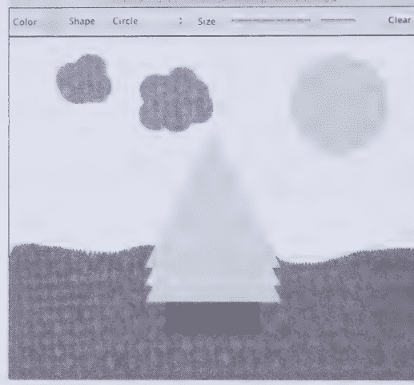


图 3-1。两个 DrawingBoard 用户正在协作

## 第 3 章：基础消息 67

带有此注解的 Java 类，与服务器端注解端点一样，你可以使用任何或所有方法级注解来拦截生命周期事件和 WebSocket 消息。

在查看客户端端点之前，让我们来看看代表应用程序中绘制对象的代码。它们由 `DrawingObject` 和 `Shape` 类表示。这里是 `DrawingObject` 类：

列表：DrawingObject 类


```java
import java.awt.*;
public class DrawingObject {
    public static String MESSAGE_NAME = "DrawingObject";
    private Shape shape;
    private Point center;
    private int radius = 0;
    private Color color;

    public DrawingObject(Shape shape, Point center, int radius, Color color) {
        this.shape = shape;
        this.center = center;
        this.radius = radius;
        this.color = color;
    }

    public Shape getShape() {
        return this.shape;
    }

    public Point getCenter() {
        return this.center;
    }

    public int getRadius() {
        return this.radius;
    }

    public Color getColor() {
        return this.color;
    }

    public void draw(Graphics g) {
        g.setColor(this.color);
        switch (shape) {
            case CIRCLE:
            case TRIANGLE:
            case SQUARE:
            case PENTAGON:
                // 绘制实现逻辑
                break;
        }
    }
}
```

## 68 Java WebSocket 编程

```java
public enum Shape {
    CIRCLE,
    TRIANGLE,
    SQUARE,
    PENTAGON;

    @Override
    public String toString() {
        if (this == CIRCLE) {
            return "Circle";
        } else if (this == TRIANGLE) {
            return "Triangle";
        } else if (this == SQUARE) {
            return "Square";
        } else if (this == PENTAGON) {
            return "Pentagon";
        } else {
            return "unknown";
        }
    }
}
```

我们可以从 `DrawingObject` 类中看到几个简单的属性：形状类型、画布上的起点、决定形状大小的半径以及颜色属性。现在，让我们看看构成 `DrawingBoard` 客户端的 Java Swing 窗口背后的客户端端点。

列表：`DrawingClient` 类

```java
import java.io.*;
import java.net.*;
import javax.chapter3.drawing.data.DrawingDecoder;
import javax.chapter3.drawing.data.DrawingEncoder;
import javax.chapter3.drawing.data.DrawingObject;

@ClientEndpoint(
  decoders = { DrawingDecoder.class },
  encoders = { DrawingEncoder.class }
)
public class DrawingClient {
  private Session session;
  private DrawingWindow window;

  public DrawingClient(DrawingWindow window) {
    this.window = window;
  }

  @OnOpen
  public void init(Session session) {
    this.session = session;
  }

  @OnMessage
  public void drawingChanged(DrawingObject drawingObject) {
    window.addDrawing(drawingObject);
  }

  public void notifyServerDrawingChanged(DrawingObject drawingObject) {
    try {
      this.session.getBasicRemote().sendObject(drawingObject);
    } catch (IOException ioe) {
      System.out.println("Error: IO " + ioe.getMessage());
    }
  }
}
```

## 第 3 章：基础消息 69

```java
public static Shape fromString(String s) {
  for (Shape shape : Shape.values()) {
    if (shape.toString().equals(s)) {
      return shape;
    }
  }
  throw new IllegalArgumentException("Cannot make shape from: " + s);
}
```

# 70 Java WebSocket 编程

```java
catch (EncodeException ee) {
    System.out.println("Error encoding object: " + ee.getObject());
}

@OnError
public void handleError(Throwable thw) {
    if (thw instanceof DecodeException) {
        System.out.println("Error decoding incoming message: " \
            + (DecodeException)thw.getText());
    } else {
        System.out.println("Client WebSocket error: " \
            + thw.getMessage());
    }
}

public static DrawingClient connect(DrawingWindow window, String path) {
    WebSocketContainer wsc = ContainerProvider.getWebSocketContainer();
    try {
        DrawingClient client = new DrawingClient(window);
        wsc.connectToServer(client, new URI(path));
        return client;
    } catch (IOException ie) {
        System.out.println("Error Connecting: " + ie.getMessage());
    } catch (DeploymentException de) {
        System.out.println("Error deploying: " + de.getMessage());
    } catch (URISyntaxException ue) {
        System.out.println("Bad path: " + path);
    }
    return null;
}

public void disconnect() {
    if (this.session != null) {
        try {
            this.session.close();
        } catch (IOException ie) {
            System.out.println("Error closing the session: " + ie);
        }
    }
}
```

首先，我们知道这个端点（endpoint）只能通过传递一个 `DrawingWindow` 对象来创建。`DrawingWindow` 是一个 Swing JFrame，当我们运行 `DrawingBoard` 应用程序客户端时，它包含了所有的用户界面控件和绘制画布。客户端端点将 `DrawingWindow` 的引用存储为私有实例，以便在构造后以后使用。我们可以看到，客户端端点将使用两个类来编码和解码它发送和接收的消息：`DrawingEncoder` 类和 `DrawingDecoder` 类。这些类分别知道如何将 `DrawingObject` 编码为 WebSocket 消息以及如何将 WebSocket 消息解码为 `DrawingObject`。我们很快就会查看这些转换类是如何实现的，但目前我们只需要注意到，在这个客户端端点中，我们通过在 `@ClientEndpoint` 注解中列出它们，将它们配置为客户端端点使用。除此之外，客户端端点使用了 WebSocket 的两个生命周期事件。首先，它通过在其 `init(Session session)` 方法上使用 `@OnOpen` 注解来拦截打开操作。该方法将当与服务器建立 WebSocket 连接时提供的 `Session` 对象存储为私有实例变量，以供以后使用。该客户端端点使用的第二个生命周期注解是在其 `drawingChanged(DrawingObject drawingObject)` 方法上使用的 `@OnMessage` 注解。由于此 WebSocket 端点配置了用于 `DrawingObject` 的解码器，我们能够将 `DrawingObject` 作为此方法的参数使用。因此，当接收到 WebSocket 消息时，它们会被转换为 `DrawingObject`，并调用此方法。从 `drawingChanged()` 方法的实现可以看出，当收到来自服务器的 `DrawingObject` 消息时，客户端端点会请求它引用的 `DrawingWindow` 来绘制所发送的对象。我们还看到客户端端点通过 `@OnError` 注解声明了一个错误处理方法。

接下来，我们看到 `DrawingClient` 持有 `notifyServerDrawingChanged(DrawingObject drawingObject)` 方法，该方法通过在代表应用程序服务器端的 `RemoteEndpoint` 上调用 `sendObject()`，向 `DrawingApplication` 的服务器端发送一个 `DrawingObject` 实例。在底层，WebSocket 实现正在使用类级 `@ClientEndpoint` 注解中提供的编码器，即 `DrawingEncoder` 的实例。传入 WebSocket 消息的 `DrawingEncoder` 实例的 `encode` 方法将在运行时调用，以转换 `DrawingObject` 实例。

注意，`DrawingClient` 的错误处理方法 `handleError()` 显式地处理解码传入消息时产生的任何错误，并与其他类型的连接错误分开。在实际应用程序中，这种错误处理将涉及比将错误打印到输出多的内容，但 `handleError()` 方法展示了你如何在代码中分离此类错误。

最后，我们注意到 `DrawingClient` 类有一个静态方法 `connect()`，它将其连接到服务器。该方法实现的核心是 `WebSocketContainer` 类上的 `connectToServer()` 方法，它将客户端端点的实例部署到提供的 URL。

接下来，我们转向 `DrawingWindow` 本身。这是一个使用 `DrawingClient` 端点作为模型的用户界面。我们不会花费大量时间讨论用户界面是如何组合的，因为这本书是关于 Java WebSockets 的，而不是 Java Swing API。但我们确实注意到由 `DrawingWindow` 生成的感兴趣的事件如下：

1. 对 `DrawingClient` 类的调用使用我们之前检查的静态 `connect()` 方法启动与应用程序服务器端的连接。这是在绘制窗口打开时完成的。
2. 每当用户在 `DrawingWindow` 的画布上画一个新对象时，`DrawingWindow` 都会通过调用 `DrawingClient` 端点的 `notifyServerDrawingChanged()` 方法并传递它创建的 `DrawingObject` 实例来通知服务器。
3. 当 `DrawingWindow` 关闭时，它调用我们上面提到的 `DrawingClient` 的 `disconnect()` 方法，关闭与服务器的会话。

这些是 `DrawingWindow` 和 `DrawingClient` 端点之间的主要接触点，它利用这些保持团队协作同步。为了保持 WebSockets 主题，我们在这里没有列出 `DrawingWindow` 的代码，因为它主要是用户界面代码。

我们在这里停一下，看看 `DrawingClient` 使用的 `DrawingEncoder` 和 `DrawingDecoder` 类。

首先是 `DrawingEncoder`，它的工作是将绘制对象转换为 WebSocket 消息：

> 列表：`DrawingEncoder` 类

```java
import javax.websocket.EncodeException;
import javax.websocket.Encoder;
import javax.websocket.EndpointConfig;

public class DrawingEncoder implements Encoder.Text<DrawingObject> {

    @Override
    public void init(EndpointConfig config) {
    }

    @Override
    public void destroy() {
    }

    @Override
    public String encode(DrawingObject drawingObject) throws EncodeException {
        StringBuilder sb = new StringBuilder();
        sb.append(DrawingObject.MESSAGE_NAME);
        sb.append(",");
        sb.append(drawingObject.getShape().toString());
        sb.append(",");
        sb.append(drawingObject.getCenter().x);
        sb.append(",");
        sb.append(drawingObject.getCenter().y);
        sb.append(",");
        sb.append(drawingObject.getRadius());
        sb.append(",");
        sb.append(drawingObject.getColor().getRGB());
        return sb.toString();
    }
}
```

注意 `DrawingEncoder` 实现了 `Encoder.Text<DrawingObject>` 接口。这让你一眼看出它正在编码一个 `DrawingObject`（它实现的接口参数），以及它编码 `DrawingObject` 的 WebSocket 消息类型是文本消息。

提示

要快速确定 Java WebSocket 编码器或解码器执行的转换类型，只需查看它实现的特定编码器或解码器接口。


你会看到 `Encoder` 接口定义了自己的生命周期。`init(EndpointConfig config)` 和 `destroy()` 方法会在编码器实例引入服务时以及实现完成使用它后调用。如果你实现的编码器需要初始化和/或清理可能使用的昂贵资源，这将非常有用。实现的核心在于 `encode()` 方法，它将绘制对象转换为字符串，它是 `DrawingObject` 所有属性的逗号分隔列表。

# 74 Java WebSocket 编程

正如我们在本章最后将看到的，就像端点一样，WebSocket 实现会为每个连接创建一个编码器实例。因此，在我们的 `DrawingBoard` 应用程序中，每个 `DrawingWindow` 都将有一个 `DrawingEncoder` 实例，因为每个 `DrawingWindow` 都连接到一个对端即 `DrawingServer` 端点。在这个 `DrawingEncoder` 中，生命周期方法的实现是空的，因为不需要此类资源。


现在让我们考虑反向操作。当 `DrawingObject` 被编码时，它会由 `DrawingEncoder` 转换为 WebSocket 文本消息并发送到服务器。当服务器发送其添加到分组画布的 `DrawingObject` 更新时，它会向所有连接的客户端发送 WebSocket 文本消息，每个客户端都使用 `DrawingDecoder` 将包含 `DrawingObject` 数据的文本消息转换为 `DrawingObject` 实例。

## DrawingDecoder 类

```java
import java.awt.Color;
import java.awt.Point;
import java.util.StringTokenizer;
import javax.websocket.Decoder;
import javax.websocket.EndpointConfig;
import javax.websocket.DecodeException;

public class DrawingDecoder implements Decoder.Text<DrawingObject> {
    @Override
    public void init(EndpointConfig config) {}

    @Override
    public void destroy() {}

    @Override
    public DrawingObject decode(String s) throws DecodeException {
        StringTokenizer st = new StringTokenizer(s, " **");
        String messageName = st.nextToken();
        Shape shape = Shape.fromString(st.nextToken());
        Point center = new Point(new Integer(st.nextToken()),
            new Integer(st.nextToken()));
        int radius = new Integer(st.nextToken());
        Color color = new Color(new Integer(st.nextToken()));
        return new DrawingObject(shape, center, radius, color);
    }

    @Override
    public boolean willDecode(String s) {
        return s.startsWith(DrawingObject.MESSAGE_NAME);
    }
}
```

同样，你可以看到 `DrawingDecoder` 不需要利用 `Decoder` 接口的生命周期 `init()` 和 `destroy()` 方法，你可以立即看到 `DrawingDecoder` 实现了 `Decoder.Text<DrawingObject>` 接口，它必须遵守的合同是将 WebSocket 消息转换为 `DrawingObject` 实例——这完全是 `DrawingEncoder` 过程的反过程。`willDecode()` 方法的实现对文本消息进行初步检查，以验证它是否可能是它可以解码的内容。如果 `willDecode()` 方法返回 `false`，WebSocket 实现将不会尝试调用 `decode()` 方法，消息将无法作为 `DrawingObject` 传递。然而，如果 `willDecode()` 方法实现将继续调用 `decode()` 方法并传入文本消息。你可以看到 `DrawingDecoder` 中的 `decode()` 实现，它使用逗号作为分隔符将文本消息拆分为绘制对象的各个属性，并从这些属性重构出返回的 `DrawingObject` 实例。这正是我们预期的与 `DrawingEncoder` 相反的过程。

到这里，我们已经理解了应用程序的大部分！

## DrawingServer 端点

让我们转向服务器端。通过使用 `@ServerEndpoint`，你会立即发现 `DrawingServer` 类是一个注解过的 WebSocket 端点，它映射到相对于包含它的 WAR 文件上下文根的 URI `/draw`。

> 代码列表：DrawingServer 类

```java
import java.awt.Color;
import java.io.IOException;
import java.io.Reader;
import java.util.Iterator;
import javax.websocket.*;
import javax.websocket.server.ServerEndpoint;
import jsp.chapter3.drawing.data.DrawingAsIterator;
import jsp.chapter3.drawing.data.DrawingFromReader;
import jsp.chapter3.drawing.data.DrawingObject;

@ServerEndpoint("/draw")
public class DrawingServer {
    private Session session;

    @Open
    public void initSession(Session session) {
        this.session = session;
    }

    @OnMessage
    public void hadShapeCreated(Reader reader) {
        DrawingObject drawingObject;
        try (Reader rdr = reader) {
            DrawingFromReader dp = new DrawingFromReader(rdr);
            drawingObject = dp.getDrawingObject();
        }
        catch (IOException e) {
            System.out.println("There was an error reading the incoming message: ");
            return;
        }
        DrawingObject toSend = new DrawingObject(
            drawingObject.getShape(),
            drawingObject.getCenter(),
            drawingObject.getRadius());
        this.setFadedColor(drawingObject.getColor());
        for (Session otherSession : this.session.getOpenSessions()) {
            if (otherSession.equals(this.session)) {
                try {
                    DrawingAsIterator dai = new DrawingAsIterator(toSend);
                    sendDrawing(otherSession, dai);
                } catch (IOException ioe) {
                    System.out.println("Communication error: " + ioe.getMessage());
                }
            }
        }
    }

    private Color getFadedColor(Color c) {
        Color faded = new Color((int) ((255 - c.getRed()) / 2),
                                (int) 255 - ((255 - c.getGreen()) / 2),
                                (int) 255 - ((255 - c.getBlue()) / 2));
        return faded;
    }

    @OnError
    public void handleError(Throwable th) {
        if (th instanceof DecodeException) {
            System.out.println("Error decoding incoming message: " + ((DecodeException) th).getMessage());
        } else {
            System.out.println("Server WebSocket error: " + th.getMessage());
        }
    }

    private void sendDrawing(Session session,
        Iterator<String> drawingAsIterator)
    throws IOException {
        RemoteEndpoint remote = session.getBasicRemote();
        while (drawingAsIterator.hasNext()) {
            String partialMessage = drawingAsIterator.next();
            boolean isLast = !drawingAsIterator.hasNext();
            remote.sendText(partialMessage, isLast);
        }
    }
}
```

`DrawingServer` 的目的是处理来自连接客户端的消息，这些消息代表他们添加到画布的 `DrawingObject`。每当一个连接的客户端发送这种以 `DrawingEncoder` 编码的 `DrawingObject` 形式的消息时，你会注意到 `DrawingServer` 端点将消息处理为一系列部分消息。它使用 `DrawingDecoder` 从读取到的数据中重构 `DrawingObject`。

# 第 3 章：基础消息传递

随后，DrawingServer 的 `shapeCreated()` 方法继续使用 Session 对象上通常被称为“广播”的方法：

```java
public Set<Session> getOpenSessions()
```

它返回所有已打开会话的集合。提醒一下，连接到此端点的每个客户端都关联一个唯一的 WebSocket 连接，而每个连接又由一个唯一的 `Session` 实例表示。该方法列出所有连接到此端点的客户端的一种非常方便的方法。该方法修改形状的 `color` 属性，并将新形状广播给除发送者以外的每个客户端。对每个客户端的更新都委托给了 `sendDrawing()` 方法。该方法使用 `DrawingAsIterator` 类，将 `DrawingObject` 转换为表示 `DrawingObject` 属性的 `String` 对象迭代器。`DrawingAsIterator` 类使用与 `DrawingEncoder` 相同的表示进行转换，如下代码所示：

列表：DrawingAsIterator 类

```java
import java.util.Iterator;

public class DrawingAsIterator implements Iterator<String> {
    private DrawingObject drawingObject;
    private int index = 0;

    public DrawingAsIterator(DrawingObject drawingObject) {
        this.drawingObject = drawingObject;
    }

    @Override
    public String next() {
        index++;
        switch (index) {
            case 1:
                return DrawingObject.MESSAGE_NAME;
            case 2:
                return ",";
            case 3:
                return drawingObject.getShape().toString();
            case 4:
                return ",";
            case 5:
                return Integer.toString(drawingObject.getCenter().x);
            case 6:
                return ",";
            case 7:
                return Integer.toString(drawingObject.getCenter().y);
            case 8:
                return ",";
            case 9:
                return Integer.toString(drawingObject.getRadius());
            case 10:
                return "";
            case 11:
                return Integer.toString(drawingObject.getColor().getRGB());
            default:
                throw new IllegalStateException("No more elements");
        }
    }

    @Override
    public boolean hasNext() {
        return this.index < 11;
    }

    @Override
    public void remove() {
        throw new UnsupportedOperationException();
    }
}
```

DrawingServer 的 `sendDrawing` 方法使用 Java WebSocket API 的 `RemoteEndpoint.Basic` 的

```java
public void sendText(String partialText, boolean isLast)
    throws IOException
```

将 `DrawingObject` 字符串表示的每个部分发送到连接的客户端。通过这种方式，DrawingServer 保持其所有已连接的客户端与群组画布的内容保持同步。

让我们暂时后退一步，思考一下在这个示例中看到了什么。在客户端，你可以看到我们利用了 Java WebSocket API 的编码器和解码器机制来处理消息，这使得消息端点只需要处理 `DrawingObject` 实例，而永远不需要知道 `DrawingObject` 作为 WebSocket 消息的表示形式。这项工作被委托给了编码器，并由解码器使用。

在服务器端，DrawingServer 的工作是监听任何已连接客户端的变化，并将更新广播给所有其他客户端，它确实以原始 WebSocket 消息的形式处理 `DrawingObject`——在入站端，它必须作为字符流对其进行解析；在出站端，它作为一个字符串集合，以一系列部分消息的形式发送回给正在更新的客户端。

尽管 DrawingServer 端点作为部分字符串序列发送绘制更新，但客户端需要整个消息才能将其解释为绘制更新，因此 WebSocket 实现会缓存入站消息，直到接收到所有内容。只有在此之后，它才会调用 `DrawingDecoder` 将其转换为代表绘制更新的 `DrawingObject`。

我们在 `DrawingBoard` 中包含了一系列消息处理选择，以说明在本章开头列出的某些选项。在实际应用中，你可能会选择这些选项中的一个或两个。事实上，为了简单和代码简短，你可能在读完本章之前，就急于重构 DrawingServer 端点以使用 `DrawingEncoder` 和 `DrawingDecoder`！

## 消息传递与多线程

在结束本章之前，我们转向一个对 Java 开发者来说非常重要的主题：线程。在绘图示例中你可以很容易地看到，随着客户端数量的增加，两个客户端同时更新服务器的概率随之增加。这增加了客户端在服务器更新某些其他客户端的同时发送更新的概率。作为 WebSocket 开发者，你对有多少个线程同时调用你的端点有何保证？特别是当 WebSocket 消息以部分消息序列的形式发送时，你如何保证消息按你发送的顺序到达且不会与其他消息混淆？

## WebSocket 端点的线程与消息传递

幸运的是，对于开发者来说，Java WebSocket API 提供了许多简单的答案来回答这些问题：

- Java WebSocket API 在每次有新客户端连接时都会创建一个服务器端点的新实例。
- 每个 WebSocket 端点实例一次只被一个线程调用。
- 当 WebSocket 消息以部分形式到达时，Java WebSocket API 必须确保按照正确的顺序调用相应的端点，并确保消息部分不会与其他消息交织。


这三项保证确保了端点简单直接的单线程模型，并排除了上述描述的一些不幸情况。这意味着每个端点实例只会看到代表导致其创建的唯一客户端连接的同一个会话实例。该会话可以作为实例变量存储，正如在 `DrawingServer` 端点中所示的那。

## 编码器和解码器的线程与生命周期

对于编码器和解码器的开发者来说，Java WebSocket API 保证每个 WebSocket 连接创建一个编码器或解码器类的实例。结合上述的消息处理保证，这意味着例如解码器可以预期一次只有一个线程进入 `decode()` 方法，从而消除了为并发访问该方法编写防御性代码的需要。编码器和解码器实例的 `init()` 方法在连接建立之后、第一个需要它们处理的消息之前被调用。编码器和解码器实例的 `destroy()` 方法在连接关闭时被调用。

一个引起思考的问题（特别是对于服务器端 WebSocket 应用程序开发者来说）是在哪里存储所有客户端连接通用的应用程序状态？我们可能想要扩展 `DrawingBoard` 应用以保留多个客户端协作的绘制，或者我们可能希望让加入群组的新客户端获取到其加入时间点为止的完整群组绘制。由于每个新客户端都有新的服务器端点实例，我们无法在那里存储群组绘制。在第 4 章更详细检查 `Session` 对象的属性和用途时，我们将返回端点状态主题。

## 总结

在本章中，我们仔细检查了使用 Java WebSocket API 接收 WebSocket 消息的所有方法。这包括 WebSocket 文本、二进制和 pong 消息作为 Java 对象的各种表示形式，并分解了如何使用 `@OnMessage` 注解以及何时实现各种 `MessageHandler` 接口。我们检查了使用 `RemoteEndpoint.Basic` API 发送各种形式 WebSocket 消息的同步模式。我们涵盖了 Java WebSocket API 内置的编码/解码方案。最后，我们通过 `DrawingBoard` 示例说明了其中的许多概念。

## 第 4 章：配置与会话

在本章中，我们将研究 Java WebSocket API 中最重要的两个对象：`Session` 和 `EndpointConfig`。在运行中的 WebSocket 应用中，这些对象分别代表端点的配置信息以及与对端的活动连接。它们是开发者构建应用程序状态的基础。我们将直接从聊天示例开始。聊天示例是一个 Java WebSocket 服务器应用程序的简单 JavaScript 客户端，它利用了 `Session` 和 `EndpointConfig` 的若干功能，并为详细介绍这些 API 的用途铺了道路。

## Session 状态与逻辑端点状态

我们通过对小组画画示例的讨论来到了本章。该应用程序的用户协作进行小组绘画。然而，正如你可能意识到的，小组绘画实际上并不存在于任何地方，而只是用户连接期间的一系列绘画更新。大多数具有重要的 Web 应用程序都会产生比应用程序运行时间更长的信息或效果，产生一个供他人展示的可重复画作、一组随着时间推移形成餐厅社区评论的访客评论、若干导致披萨外送地图生成路线的客户地址、一系列形成永久对话记录的消息等。这引出了我们的核心问题：

在 WebSocket 应用程序的何处可以持有所有连接客户端通用的应用程序状态？在我们的绘画应用程序的何处可以持有集体画作？

现在，Java 企业版（Java EE）开发者有许多选项来持有应用程序状态，但它们都取决于理解从 Java WebSocket 应用程序何处获取应用程序状态。

多客户端、单服务器模型中固有的是两种应用程序状态：与单个连接对端相关的状态以及与所有连接对端相关的状态。想象一个披萨外送应用程序，客户可以输入订单和地址。每隔一段时间，披萨外送团队就可以要求应用程序生成订单列表和订单配送地图。每个订单和地址都是与单个客户端相关的应用程序状态，而订单列表和配送地图是与多个客户端相关的应用程序状态。想象小组绘画应用程序是与绘制它的客户端相关的应用程序状态，而最终图片是与所有协作绘制的客户端相关的应用程序状态。

聊天是说明这两种应用程序状态的最佳方式之一，并将直接引导我们进入本章的两个对象：代表每个客户端状态的 `Session`，以及与多个客户端共享的端点状态 `EndpointConfig`。

## 聊天示例

聊天应用程序有很多变体。有些只允许群聊，即所有聊天消息对所有人可见。其他聊天应用程序列出所有可用聊天的人，但只允许私密的一对一对话。许多聊天应用程序同时允许群聊和私信通信模式。

我们的聊天示例是一个群聊示例，其中有一个共同的聊天记录，持有所有已登录用户的聊天消息。这是在聊天应用程序运行过程中建立的、对所有连接用户通用的应用程序状态。在此应用程序中仅对一个连接用户通用的应用程序状态是用户名。聊天示例使用连接到 WebSocket 服务器端点的 JavaScript 客户端。到目前，我们已经列出了所有的示例应用程序代码。对于此示例以及书中后续的某些示例，我们将代码列表限制为与我们正在学习的 Java WebSocket API 最相关的部分。

首先，看一眼聊天示例运行的截图，首先是用户登录时（见图 4-1），然后是聊天示例在多个用户和长聊天记录下变得更加活跃时（见图 4-2）。

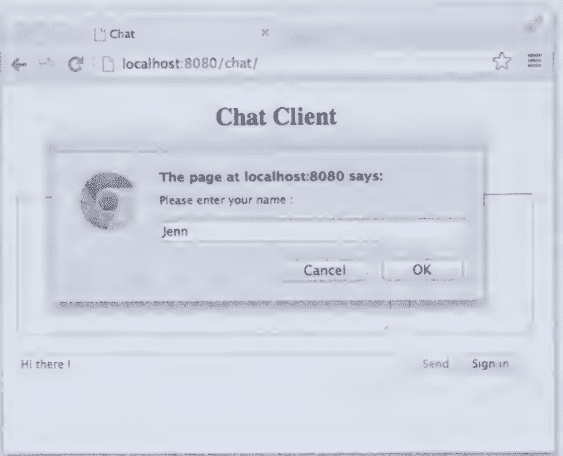

图 4-1. 登录聊天示例

在我们查看代码之前，下面是消息交互的简要概述，如图 4-3 所示。在客户端和服务器之间建立 WebSocket 连接后，我们可以从图中看到，聊天对话从聊天客户端发送登录请求消息开始。此消息包含一个客户端想要使用的建议用户名。聊天服务器立即响应一个确认的名称，客户端在聊天期间可以使用该名称。这确保了服务器能够为加入聊天对话的客户端选择一个唯一的名称。显然，允许两个客户端使用相同用户名的聊天应用程序会很快变得混乱吧？

每当有新用户登录时，聊天服务器向所有连接的客户端发布一条消息，包含已登录聊天示例的最新用户列表。每当用户在聊天窗口中输入新消息时，聊天客户端向服务器发送一条聊天消息。服务器将此消息连同发送它的客户端的用户名添加到聊天记录中，该记录持有聊天示例所有客户端发送的所有聊天消息记录。每当聊天服务器这样做时，它会向所有当前连接的客户端发布记录更新消息，以便他们可以显示其中一个聊天用户添加的新消息。当用户说完了他要说的话时，退出过程是这样的：聊天客户端向聊天服务器发送退出请求，服务器通过记录更新消息更新剩余用户，告知该用户正在退出，然后关闭 WebSocket 连接。

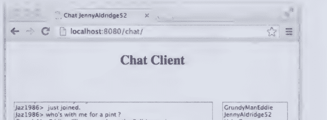

图 4-2. 活跃的聊天窗口

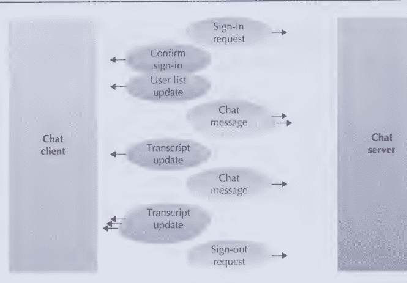

图 4-3. 聊天消息交互

现在我们已经了解了聊天示例的消息编排，让我们来看看聊天示例的核心，即 `ChatServer` 端点：

### 列表：ChatServer 端点

```java
import java.io.IOException;
import java.util.*;
import javax.websocket.*;
import javax.websocket.server.*;
import jsp.chapter4.data.*;

@ServerEndpoint(value = "chat-server",
    decoders = {ChatDecoder.class},
    encoders = {ChatEncoder.class},
    configurator = {ChatServerConfigurator.class})
public class ChatServer {
    private static String USERNAME_KEY = "username";
    private static String USERNAMES_KEY = "usernames";

    private Session session;
    private ServerEndpointConfig endpointConfig;
    private Transcript transcript;
```

@OnOpen

```java
public void startChatChannel(EndpointConfig config, Session session) {
  this.endpointConfig = (ServerEndpointConfig) config;
  ChatServerConfigurator csc =
  (ChatServerConfigurator) endpointConfig.getConfigurator();
  this.transcript = csc.getTranscript();
  this.session = session;
}
```

@OnMessage

```java
public void handleChatMessage(ChatMessage message) {
  switch (message.getType()) {
    case NewUser.USERNAME_MESSAGE:
      this.processNewUser((NewTextMessage) message);
      break;
    case Message.CHAT_DATA_MESSAGE:
      this.processChatUpdate((ChatUpdate) message);
      break;
    case Message.SIGNOFF_REQUEST:
      this.processSignoffRequest((UserSignoffMessage) message);
  }
}
```

@OnError

```java
public void onError(Throwable t) {
  System.out.println("Error: " + t.getMessage());
}
```

@OnClose

```java
void processNewUser(NewTextMessage message) {
    String username = this.validateUsername(message.getUsername());
    NewUserMessage umessage = new NewTextMessage(username);
    try {
      session.getBasicRemote().sendObject(umessage);
    } catch (IOException | EncodeException ioe) {
      System.out.println("Error signing " + message.getUsername() + 
      " into chat: " + ioe.getMessage());
    }

    this.registerUser(username);
    this.broadcastUserListUpdate();
    this.addMessage("just joined.");
}
```

```java
void processChatUpdate(ChatUpdateMessage message) {
    this.addMessage(message.getMessage());
}
```

```java
void processSignoffRequest(UserSignoffMessage drm) {
    this.addMessage("just left.");
    this.removeUser();
}
```

```java
private String getCurrentUsername() {
    return (String)session.getUserProperties().get(USERNAME_KEY);
}
```

```java
private void registerUser(String username) {
    session.getUserProperties().put(USERNAME_KEY, username);
    this.updateUserList();
}
```

```java
private void updateUserList() {
    List<String> usernames = new ArrayList<>();
    for (Session s : session.getOpenSessions()) {
        String uname = (String)s.getUserProperties().get(USERNAME_KEY);
        usernames.add(uname);
    }
    this.endpointConfig.getUserProperties().put(USERNAME_KEY, usernames);
}
```

```java
private List<String> getUserList() {
    List<String> userList = 
        (List<String>)this.endpointConfig.getUserProperties().
    get(USERNAME_KEY);
    return (userList == null) ? new ArrayList<String>() : userList;
}
```

```java
private String validateUsername(String username) {
    if (this.getUserList().contains(username)) {
        return this.validateUsername(username) + "1";
    }
    return username;
}
```

```java
private void broadcastUserListUpdate() {
    UserUpdate update = new UserUpdateMessage(this.getUserList());
    for (Session session : session.getOpenSessions()) {
        try {
            session.getBasicRemote().sendObject(update);
        } catch (IOException | EncodeException ex) {
            System.out.println("Error updating a client " + ex.getMessage());
        }
    }
}
```

```java
private void removeUser() {
    try {
        this.updateUserList();
        this.broadcastUserListUpdate();
        this.session.getUserProperties().remove(USERNAME_KEY);
        this.session.close(new CloseReason(
        CloseReason.Codes.NORMAL_CLOSURE,
        "User logged off"));
    } catch (IOException e) {
    System.out.println("Error removing user");
    }
}
```

```java
private void broadcastTranscriptUpdate() {
    for (Session nextSession : session.getOpenSessions()) {
        ChatUpdateMessage cdm = new ChatUpdateMessage(
            this.transcript.getLastUsername(),
            this.transcript.getLastMessage());
        try {
            nextSession.getBasicRemote().sendObject(cdm);
        } catch (IOException ex) {
            System.out.println("Error updating a client : " 
            + ex.getMessage());
        }
    }
}
```

```java
private void addMessage(String message) {
    this.transcript.addEntry(this.getCurrentUsername(), message);
    this.broadcastTranscriptUpdate();
}
```

让我们通过查看其实例变量持有的数据，开始对该端点进行调查。它持有一个会话实例的引用。你可能还记得，因为每个客户端连接对应一个服务器端点实例，因此 `ChatServer` 实例持有的该引用是与客户端连接关联的唯一 `Session` 实例。


# Java WebSocket 编程

ChatServer 可以很容易地要求将此 `Session` 实例传递到所有的生命周期方法中，`session` 始终是带有 `@OnOpen`、`@OnMessage`、`@OnError` 注解的方法的可选参数，但由于 ChatServer 的一些应用程序逻辑被提取到单独的方法中，因此将 `session` 引用为实例变量比在各种方法调用中传递它要稍微方便一些。许多端点并没有此方面的设计选择；那些需要发送消息但不是响应传入消息的端点必须维护 `Session` 对象的引用，以便访问 `RemoteEndpoint` 来发送消息。

ChatServer 使用的第二个部分数据是 `ServerConfig` 对象。你可能记得当我们在第 1 章中部署一个程序化端点时，创建了一个 `ServerEndpointConfig`。`EndpointConfig` 包含了配置 WebSocket 端点所需的所有配置数据和算法。我们稍后将进行详细讨论它们，但现在我们将注意到，`ServerEndpointConfig` 包含了 Chat 端点所使用的类级 `@ServerEndpoint` 注解中持有的所有配置信息。它还有一个非常实用的属性，即 `WebSocketConfig` 的实现将为所有 Chat 端点实例创建精确的 `ServerEndpointConfig` 实例。这意味着 `ServerConfig` 是存储 Chat 端点所有客户端通用数据的一个极有用的地方。换句话说，它是存储聊天应用程序当前登录用户列表的佳处，也是存储聊天记录的佳处。

根据聊天应用程序中 `ServerEndpointConfig` 的基数，使用了两种不同的方法来存储“全局”应用程序状态。首先，你会看到当前登录用户列表存储在 `ServerEndpointConfig` 可用的属性映射中。其次，你从 `@ServerEndpoint` 注解中注意到它在 `configurator` 属性中定义了一个类，称为 `ChatServerConfigurator` 类，它持有了另一个部分全局应用程序状态：聊天记录。让我们简要查看一下这个配置器类。

### 列表：ChatServerConfigurator 类

```java
import javax.websocket.HandshakeResponse;
import javax.websocket.HandshakeRequest;
import javax.websocket.server.ServerEndpointConfig;

public class ChatServerConfigurator extends ServerEndpointConfig.Configurator {
    private Transcript transcript;

    public ChatServerConfigurator() {
        this.transcript = new Transcript(20);
    }

    public Transcript getTranscript() {
        return this.transcript;
    }

    @Override
    public void modifyHandshake(ServerEndpointConfig sec,
        HandshakeRequest request,
        HandshakeResponse response) {
        System.out.println("Handshake: " 
        + request());
        System.out.println("Handshake: " 
        + response());
    }
}
```

由于 WebSocket 实现为所有 Chat 端点实例实例化一个 `ServerEndpointConfig`，由 `ServerEndpointConfig` 引用的单一聊天记录是所有 Chat 端点实例共享的。

### 列表：Transcript 类

```java
import java.util.ArrayList;
import java.util.List;

public class Transcript {
    private List<String> messages = new ArrayList<>();
    private List<String> usernames = new ArrayList<>();
    private int maxLines;

    public Transcript(int maxLines) {
        this.maxLines = maxLines;
    }

    public String getLastUsername() {
        return usernames.get(usernames.size() - 1);
    }

    public String getLastMessage() {
        return messages.get(messages.size() - 1);
    }

    public void addEntry(String username, String message) {
        if (usernames.size() > maxLines) {
            usernames.remove(0);
            messages.remove(0);
        }
        usernames.add(username);
        messages.add(message);
    }
}
```

通过配置器，该类能够拦截 WebSocket 的握手请求和响应。

回到 ChatServer 的代码列表，你会注意到 ChatServer 通过 `ServerEndpointConfig` 获取了对记录的引用。这确保了所有用户的聊天消息都写入同一个聊天记录。

你会注意到这些实例变量是在 WebSocket 连接建立时在 `startChannel()` 方法中设置的，该方法标记有 `@OnOpen` 注解。

同样注意，ChatServer 从不处理 WebSocket 消息的原始文本或二进制格式。相反，它配置了编码器和解码器实现，这意味着它只发送 `ChatMessage` 类实例，并且只以 `ChatMessage` 类的形式接收消息，进入带有 `@OnMessage` 注解的 `handleChatMessage()` 方法。

你还会看到当前登录用户的用户名存储在 `Session` 对象的属性方法中。你可能还会注意到此应用程序中有两种离开连接的方法：一种很礼貌，另一种则相当粗鲁！如果用户点击“注出”按钮，客户端（如前所述）会向聊天服务器发出注销请求。聊天服务器随后从当前会话移除用户名，并向所有其他连接的客户端广播用户列表的变化以及添加的消息。只有这时它才会关闭 WebSocket 连接。然而，如果用户离开客户端页面或关闭浏览器窗口，客户端直接关闭 WebSocket 连接。在这种情况下，ChatServer 在其带有 `@OnClose` 注解的 `endConversation()` 方法被调用时经历这种对话退出。在这种情况下，它移除用户并通知其他登录用户，但使用的是不礼貌的消息。

你还会在 `@ServerEndpoint` 注解中注意到子协议属性，它包含一个带有字符串 "chat" 的列表。WebSocket 子协议是定义 WebSocket 消息特定格式和编排的轻量级方式。在示例中，我们决定将特定的聊天消息及其特定的发送顺序命名为“chat”子协议，并声明了 ChatServer 端点使用该子协议。你还会注意到 JavaScript 客户端在创建到 EchoServer 的 WebSocket 连接时声明了该子协议。我们如何称呼“chat”协议此处完全针对 Chat 应用程序，它仅仅是一种实用的标记，用于标识应用程序的客户端和服务器部分已就通用的消息格式和编排达成一致。我们将很快学习更多 WebSocket 子协议。

以下内容总结了此 Chat 示例的主要要点。

- 使用自定义的编码器（encoders）和解码器（decoders）发送和接收消息
- 在与 ChatServer 实例关联的 `Session` 对象中存储用户特定状态（用户名）
- 使用 `ServerEndpointConfig` 对象的两个不同属性来存储所有用户通用的应用程序状态（已登录用户列表和聊天记录）：即它持有的属性映射（property map）和一个自定义的 `ServerEndpointConfig.Configurator`
- 定义了一个名为 chat 的 WebSocket 协议，并使用该协议来标记其所使用的特定消息格式和编排

> **注意**
>
> 在设计应用程序中存储所有用户通用的应用程序状态的位置时，你可以选择使用 `ServerEndpointConfig` 上的属性映射，也可以实现你自己的 `ServletEndpointConfig Configurator`。两种方法都是有效的。通常情况下，对于单个不可变对象，属性方法更轻量，因为不需要创建新类；但如果应用程序数据更复杂，且你需要对其进行计算，或者你想要更高的类型安全，则应该考虑扩展 `ServerEndpointConfig.Configurator`。

请随时查看此程序的其余代码。接下来，我们将转向对 `EndpointConfig` 和 `Session` 对象进行更正式的检查，这些对象是这个关键示例的核心。

## 配置端点：ClientEndpointConfig 和 ServerEndpointConfig

在本节中，我们将详细检查各种 WebSocket 端点的开发者可以使用各种配置选项，无论它们是部署在服务器上、是作为客户端应用程序的一部分，还是程序化的或注解端点。

## 提供和访问端点配置信息

在 Java WebSocket API 中，WebSocket 端点是使用 `EndpointConfig` 类中建模的信息和算法进行配置的。服务器端点使用 API 的 `ServerEndpointConfig` 类中持有的信息进行配置，客户端端点使用其 `ClientEndpointConfig` 类中持有的信息进行配置。

如果你只使用端点，你会发现你使用 `@ClientEndpoint` 或 `@ServerEndpoint` 注解提供配置信息。WebSocket 使用这些注解中持有的信息分别创建 `ClientEndpointConfig` 或 `ServerEndpointConfig` 实例，这些实例在部署时用于配置每个端点实例，并作为生命周期方法的可选参数可用。

如果你只使用程序化端点，你会知道通过使用 `ClientEndpointConfig.Builder` 类或 `ServerEndpointConfig.Builder` 类构造适当的 `EndpointConfig` 实例为你的端点提供配置信息。对于服务器端端点，你将在带有程序化服务器端点的 `ServerApplicationConfig` 实现提供所需的 `ServerEndpointConfig` 实例。例如，我们在第 1 章部署 `ProgrammaticEcho` 示例时就看到了这一点。对于客户端端点，你将要使用的 `ClientEndpointConfig` 实例提供给相关的 `WebSocketContainer.connectToServer()` 方法，该方法用于部署端点。与注解端点一样，WebSocket 实现用于构建端点实例的 `EndpointConfig` 可以从每个端点实例通过以下方法获取：

```java
public abstract void onOpen(Session session, EndpointConfig config)
```

该方法是你子类化程序化 `Endpoint` 类时必须实现的。

> **注意**
>
> 在所有情况下，当端点被部署时，恰好有一个 `EndpointConfig` 实例持有该端点类所有实例的配置信息。

在我们继续更详细地检查 `EndpointConfig` 类之前，我们将在下表中总结了不同的配置。

| 端点类型 | 提供的配置信息 | 可用的 EndpointConfig |
| --- | --- | --- |
| 程序化服务器 | 通过在提供的 `ServerApplicationConfig` 中构造 `ServerEndpointConfig` | 在 `Endpoint.onOpen()` 方法中 |
| 注解服务器 | 在 `@ServerEndpoint` 中声明 | 作为端点生命周期方法的可选参数 |
| 程序化客户端 | 通过构造 `WebSocketContainer.connectToServer()` 方法需的 `ClientEndpointConfig` | 在 `Endpoint.onOpen()` 方法中 |
| 注解客户端 | 在 `@ClientEndpoint` 中声明 | 作为端点生命周期方法的可选参数 |

## 检查配置选项

无论端点是设计用于客户端还是服务器端，所有端点配置通用的属性如下：

- 编码器列表（encoders），通过 `EndpointConfig.getEncoders()` 在运行时可用
- 解码器列表（decoders），通过 `EndpointConfig.getDecoders()` 在运行时可用
- 开发者对象的属性映射（property map），通过 `EndpointConfig.getUserProperties()` 在运行时可用

下表总结了将客户端和服务器端端点通用的配置属性添加到端点定义中的方法：

| 配置属性 | 注解端点 | 程序化端点 |
| --- | --- | --- |
| 编码器列表 | `@ServerEndpoint` 或 `@ClientEndpoint` 上的 `encoders()` 属性 | `ClientEndpointConfig.Builder.encoders(List<Class<? extends Encoder>>)` 或 `ServerEndpointConfig.Builder.encoders(List<Class<? extends Encoder>>)` |
| 解码器列表 | `@ServerEndpoint` 或 `@ClientEndpoint` 上的 `decoders()` 属性 | `ClientEndpointConfig.Builder.decoders(List<Class<? extends Decoder>>)` 或 `ServerEndpointConfig.Builder.decoders(List<Class<? extends Decoder>>)` |
| 开发者对象映射 | `EndpointConfig.getUserProperties()` | `EndpointConfig.getUserProperties()` |

编码器列表是实现 `Encoder` 接口之一的 Java 类列表，当你发送不是 Java WebSocket API 将自动处理的标准类型的对象时，你希望使用这些类来编码你的开发者对象。提醒一下，那些类型是 `String`、`byte[]`、`ByteBuffer` 或 Java 原始类型及其等价类。

你的应用程序中可能有不同的 Java 对象，你想发送给对端。在这种情况下，你可能需要提供多个编码器。在这些情况下，Java WebSocket 实现将选择列表中第一个可以编码你要发送对象的编码器。例如，如果你为 `Banana` 类有两个编码器，一个实现 `Encoder.Text<Banana>`，另一个实现 `Encoder.Binary<Banana>`，那么你的应用程序将以文本或二进制格式发送 Banana，取决于实现 `Encoder.Text<Banana>` 的编码器是否在实现 `Encoder.Binary<Banana>` 的编码器之前（位于你在 WebSocket 注解或构造的 `EndpointConfig` 类中）。


解码器列表是实现 `Decoder` 接口之一的 Java 类列表。当 WebSocket 消息到达端点进行处理时，WebSocket 实现使用第一个声明处理消息类型（文本或二进制）并从其 `willDecode()` 方法返回 `true` 的解码器类。例如，如果你的应用程序选择接收 `Banana` 对象，并且你有一些可以将 WebSocket 消息解码为 `Banana` 实例的解码器，当二进制消息到达时，WebSocket 实现将查找列表中第一个可以将二进制 WebSocket 消息解码为 `Banana` 实例的解码器（即实现 `Decoder.Binary<Banana>` 或 `Decoder.BinaryStream<Banana>` 的类）。如果解码器是 `Decoder`，实现将执行额外的检查，查看解码器的 `willDecode()` 方法是否返回 `true`，如果是则使用它，如果不是则继续向下查找解码器列表。

开发者映射对象是一个可编辑的 `java.util.Map`，以 `String` 为键、`Object` 为值，开发者可以使用它来存储对端点配置对象的所有实例通用的应用程序状态。正如我们在 Chat 示例所示，这个开发者对象映射是存储和维护 Chat 应用程序当前登录用户列表的好地方。

在我们查看 WebSocket 端点的各种其他客户端和服务器端配置属性之前，我们将转而研究 WebSocket 网络协议中内置的一对机制，我们首先需要理解这些机制。

# WebSocket 子协议与 WebSocket 扩展

即使在像聊天应用程序这样相对简单的应用中，我们在本章前面的部分也看到，它为客户端/服务器通信使用的文本消息定义了特定的格式，还定义了消息交互的特定排序或编排。事实上，所有的 WebSocket 应用都定义了某种特定应用程序的消息格式和某种特定应用的编排。WebSocket 协议使用“子协议”这一名称来表示这些构建在原始 WebSocket 消息格式和连接生命周期之上的特定应用格式和编排。WebSocket 子协议由一个简单的字符串名称标记。在我们的聊天示例中，我们将聊天消息的特定编排定义为“chat”子协议。可能会出现一些标准的 WebSocket 协议，在这种情况下，当为你的应用程序构思子协议名称时应该小心；但虽然在 www.iana.org 上有一个 WebSocket 子协议注册表，但看起来子协议名称主要被用一种简单的方式，用更简洁的名称来标记应用程序，以封装其特定的对话约定。

在更深层次上，WebSocket 协议允许在其用于端点之间通信事件和数据的帧中插入任意的事件和数据。这些数据可以用于通过携带连接的中间服务器路由帧，也可以用于描述或限定数据帧中持有的 WebSocket 数据。如果一个 WebSocket 实现决定使用协议的这一功能，那么这样做实际上是在扩展 WebSocket 协议，而此类方案被称为 WebSocket 扩展。

WebSocket 扩展通过一个字符串名称和一组用于配置扩展的键值对来识别。目前已有少量的扩展被正式提出，例如一个名为 DEFLATE 的扩展，它允许在 WebSocket 消息中携带压缩后的数据以提高传输效率；以及 MUX 扩展，它允许多个逻辑 WebSocket 连接在一个物理 TCP 连接上运行，以提高网络的可扩展性。随着 WebSockets 变得越来越流行，子协议和扩展的数量将会增加。

# 第 4 章：配置与会话

## 仅限客户端的配置属性

客户端端点能够指定以下配置属性：

- 一个 WebSocket 子协议名称列表，可以在运行时通过 `ClientEndpointConfig.getPreferredSubprotocols()` 获取
- 一个 WebSocket 扩展列表，可以在运行时通过 `ClientEndpointConfig.getExtensions()` 获取
- `ClientEndpoint.Configurator` 类，可以在运行时通过 `ClientEndpointConfig.getConfigurator()` 获取

WebSocket 子协议名称列表是一个 `String` 类型名称列表，你可以将其作为配置的一部分提供。该列表在打开握手期间使用，即在与服务器建立 WebSocket 连接时，用于协商双方都同意使用的子协议。扩展列表是 `javax.websocket.Extension` 对象的列表，每个对象都封装了描述 WebSocket 端点的名称和扩展属性列表。你可以使用此属性来指定当此客户端端点连接到服务器时你想要使用的所有扩展，以及这些扩展应用于该连接所使用的 WebSocket 协议的顺序。与子协议一样，在 WebSocket 连接的打开握手期间会进行协商，以便 WebSocket 连接的两个端点为正在建立的连接将使用的 WebSocket 扩展达成共识。你所使用的 WebSocket 实现中可用的 WebSocket 扩展可以通过 `WebSocketContainer` 使用 `getInstalledExtensions()` 方法列出。

当我们更详细地查看服务器端点的配置时，我们将能够更好地理解 WebSocket 子协议和 WebSocket 扩展的协商是如何工作以及如何自定义的。

`ClientEndpointConfig.Configurator` 类可以用于拦截底层 WebSocket 实现构建并从 WebSocket 服务器接收的实际 HTTP 请求和响应。如果你不显式提供一个，WebSocket 实现将为你提供一个。该类有两个方法。

```java
public void beforeRequest(Map<String, List<String>> headers)
```

该方法在 WebSocket 实现构建好想要发送以启动连接的打开握手请求后被调用。

如果你决定提供自己的 Configurator 实现，则传递到此方法的头部可以被添加或修改。

```java
public void afterResponse(HandshakeResponse hr)
```

该方法在 WebSocket 实现接收来自 WebSocket 服务器的打开握手响应后被调用。可以对 `HandshakeResponse` 进行检查并查询其头部。

提供自定义 `ClientEndpointConfig.Configurator` 来配置客户端端点的常见用例是在打开握手请求中插入或编辑自定义 HTTP 头部，例如插入或更新 HTTP cookie 或身份验证信息，以及从服务器回读 cookie 或认证挑战。这是 Java WebSocket API 的一种高级用法，许多开发者可能不需要使用这一功能。

然而，可以通过子类 `ClientEndpointConfig.Configurator` 来添加任意数量的特定于应用程序或框架的功能，例如添加你希望你的端点使用的数据库或远程 Web 服务。事实上，你可以使用同一个 `ClientEndpointConfig.Configurator` 实例来配置多个不同的客户端端点，以便多个客户端端点可以共享所有服务（例如数据库连接）。这使得配置器成为向你的客户端 WebSocket 应用引入其他服务或功能的一种非常灵活的方式。

我们将通过总结仅限客户端配置属性如何添加到端点定义中结束。

| 配置属性 | 注解标记端点 | 程序化端点 |
| :--- | :--- | :--- |
| 子协议 | `@ClientEndpoint` 上的 `subprotocols()` 属性 | `ClientEndpointConfig.Builder.preferredSubprotocols()` - `List<String> subprotocols()` |
| 扩展 | `@ClientEndpoint` 上的 `extensions()` 属性 | `ClientEndpointConfig.Builder.extensions()` - `List<Extension> extensions()` |
| 配置器 | `@ClientEndpoint` 上的 `configurator()` 属性 | `ClientEndpointConfig.Builder.configurator(Configurator configurator)` |

## 仅限服务器的配置属性

服务器端点通过以下属性配置：

- 路径，可以在运行时通过 `ServerEndpointConfig.getPath()` 获取
- 端点类，可以在运行时通过 `ServerEndpointConfig.getEndpointClass()` 获取
- 端点支持的子协议，可以在运行时通过 `ServerEndpointConfig.getSubProtocols()` 获取
- 端点支持的扩展，可以在运行时通过 `ServerEndpointConfig.getExtensions()` 获取
- 配置器，可以在运行时通过 `ServerEndpointConfig.getConfigurator()` 获取

这是相对于持有端点的 Web 应用程序根路径的路径，WebSocket 实现将在此处使端点可用。路径可以是 URI 字符串（到目前为止这是我们在任何示例中使用的唯一路径类型），但路径也可以是 URI 模板。URI 模板具有各种不同的复杂度，但 level-1 类型总是采用如下形式：URI 的一个或多个路径段是一个变量，且变量以 `{varname}` 的形式表示，其中 `varname` 是变量的名称。以下是有效路径的示例：

```
/chat
/travel/hotels
/member/{level}
/cars/{model}
```

我们将在第 6 章回到 Java WebSocket API 中的路径映射主题。

端点类将服务器端点的类与其使用的配置绑定，并确保同一个 `ServerEndpointConfig` 实例仅用于一种类型的端点。

子协议属性定义了服务器端点愿意支持的 WebSocket 子协议名称列表，按偏好排序，将其最喜欢的子协议放在首位。扩展属性定义了服务器端点在客户端连接它时愿意使用的扩展列表。此列表按偏好顺序排序，最受青睐的位于列表第一个。

稍后，我们将讨论当客户端尝试发起连接时，客户端和服务器端点如何决定使用哪种子协议和何种扩展。

`ServerEndpointConfig.Configurator` 类似于 `ClientEndpointConfig.Configurator`，是一个定义了 WebSocket 开启握手服务端工作方式的类。如果你不提供一个，WebSocket 实现将为你提供一个。但是，如果你提供了自定义的 `ServerEndpointConfig.Configurator`，你就可以重写开启握手部分的某些标准算法。让我们来看看它们：

```java
public String getNegotiatedSubprotocol(List<String> supported, List<String> requested)
```

该方法由 WebSocket 实现在开启握手期间调用，当它需要确定该连接应该使用哪种 WebSocket 子协议时。提供的参数是服务器端点支持的子协议列表，以及客户端在发送开启握手时提供的子协议列表。

如果你没有提供自己的重写了此方法的 `ServerEndpointConfig.Configurator`，WebSocket 实现将从客户端请求列表中选择服务器支持的第一个子协议，如果没有，则返回空字符串。例如，如果客户端请求 `'chat-53', 'chat', 'old-chat'` 而端点声明了它支持 `'chat-12', 'old-chat', 'chat', 'quick-chat'`，那么此方法的默认实现将返回子协议 `chat`，因为即使服务器端点支持 `old-chat`，`chat` 在请求列表中也靠前。

下一个 `ServerEndpointConfig.Configurator` 方法是：

```java
public List<Extension> getNegotiatedExtensions(List<Extension> installed, List<Extension> requested)
```

与上面的 `getNegotiatedSubprotocol()` 方法类似，该方法在开启握手期间被调用，用于建立 WebSocket 扩展，如果连接建立，将使用这些 WebSocket 扩展。如果开发者没有重写此方法，WebSocket 实现将按照请求顺序，选择客户端请求的已安装在 WebSocket 实现中的所有扩展。返回的顺序可能非常重要。假设你有两个 WebSocket 扩展，一个对发出的 WebSocket 消息进行编码，另一个对传入的 WebSocket 消息进行解码。假设第一个扩展压缩了数据，第二个扩展对其进行了加密。显然，按照编码的相反顺序来解码扩展是非常重要的，这样两端就必须以相同的顺序应用 WebSocket 扩展。WebSocket 实现根据此方法，按照它们在返回的列表中出现的顺序来应用所约定的 WebSocket 扩展。如果你不重写此方法，请忘记（正如我们在 `ClientEndpointConfig.Configurator` 中看到的那样），你可以通过调用 `WebSocketContainer.getInstalledExtensions()` 来查询 WebSocket 实现以获取其上已安装的所有可能的扩展。

你可以通过提供自己的 `ServerEndpointConfig.Configurator` 类来重写的下一个方法是这个：

```java
public boolean checkOrigin(String originHeaderValue)
```

所有的浏览器客户端都应该在与其握手请求一起包含一个 HTTP Header，以便 WebSocket 实现能够验证其发起 WebSocket 的页面是否是从该 WebSocket 实现所所属的 Web 服务器加载的。此方法封装了该安全检查。大多数开发者将不需要重写它，但如果开发者想要根据不寻常的提供更严格的安全检查，就需要重写。

每当 WebSocket 实现因为新客户端刚刚连接而需要获取服务器端点的实例时，它会调用

```java
public <T> T getEndpointInstance(Class<T> endpointClass) throws InstantiationException
```

此方法的默认 WebSocket 实现在每次被调用时都会返回一个 WebSocket 端点的新实例。这就是 WebSocket 实现能够为客户端连接精确地维护一个服务器端点的实例。但是，如果你想对服务器端点的实例数量进行某些其他类型的控制，你也可以重写此方法。某些开发者可能会以这种方式设计端点，使得只有一个服务器端点实例来处理来自所有可能客户端的连接。在这种情况下，当然，他们需要对服务器端点进行防御性编码，以防止多个并发的传入 WebSocket 生命周期事件：尽管 WebSocket 实现不会允许每个端点同时有超过一个 Java 线程调用服务器端点，但如果有多个客户端，可能会有多个线程。如果你想尝试这种高级的端点配置方法，你需要确保此方法在每次被调用时都返回服务器端点的同一个单例实例。

最后，`ServerEndpointConfig.Configurator` 最强大的配置方法是

```java
public void modifyHandshake(ServerEndpointConfig sec, HandshakeRequest request, HandshakeResponse response)
```

该方法允许你对客户端在尝试连接时发送的开启握手请求具有完全读取权限。它还让你对 WebSocket 实现在发送回客户端之前立即创建的开启握手响应具有完全的读写权限。你们中了解开启握手请求和响应确切格式的人知道，开启握手响应的一部分包含了子协议和扩展的协商。正如我们之前看到的，这些协商是调用 `ServerEndpointConfig.Configurator` 上其他方法的结果。在 `modifyHandshake()` 方法被调用时，其他方法 `getNegotiatedSubprotocol()` 和 `getNegotiatedExtensions()` 已经被调用，并且在传递给 `modifyHandshake()` 方法之前，已经正确填充了开启握手的头部。重写 `modifyHandshake()` 方法的开发者通常是在插入某些特定的头部。

将新创建的 `Session` 对象传递到 `open` 事件处理方法中。对于注解的端点，这是标记了 `@OnOpen` 注解的方法；对于程序化的端点，这是对 `onOpen(Session session, EndpointConfig config)` 的调用。在此时，会话被认为已打开，并且可以有效使用。我们已经在 Chat 示例和之前的章节中看到了它的部分功能。现在我们在这里对这些功能进行总结：

## 管理 MessageHandlers

`Session` 对象持有了配置好的 `MessageHandlers`，这些处理器用于拦截从该连接传入的 WebSocket 消息。对于注解的端点，消息处理器是由标记了 `@OnMessage` 注解的方法或多个方法的签名隐式定义的。对于程序化的端点，session 的 `MessageHandlers` 由以下三个方法进行管理：


## 消息处理器管理

```java
public void addMessageHandler(MessageHandler handler)
public Set<MessageHandler> getMessageHandlers()
public void removeMessageHandler(MessageHandler handler)
```

这些方法分别允许添加、列出和移除 `MessageHandler`。正如我们所看到的，通常情况下，程序化的端点会在 `onOpen()` 调用期间添加消息处理器，此后不在 session 中对它们进行进一步管理。然而，某些 WebSocket 应用可能会在会话生命周期的其他点动态切换 `MessageHandler` 类，可能是基于特定客户端不断变化的需求。

## 获取 RemoteEndpoint

我们已经看到，需要向连接的对端发送消息的端点是通过以下方法获取 `RemoteEndpoint` 的引用来实现的，可以是 `RemoteEndpoint.Basic` 或 `RemoteEndpoint.Async`：

```java
public RemoteEndpoint.Basic getBasicRemote()
public RemoteEndpoint.Async getAsyncRemote()
```

我们已经见过了许多 `RemoteEndpoint.Basic` 对象。`RemoteEndpoint.Async` 对象允许异步发送 WebSocket 消息，我们将在第 5 章中探讨它的特性。

# 第 4 章：配置与会话

## 连接属性

`Session` 对象持有几个刻画底层连接的属性。其中某些属性在 Session 建立后是不可更改的，例如正在使用的子协议（subprotocol），在不重启连接的情况下无法更改，因为它仅在打开握手期间在客户端和服务器之间协商。其他属性，例如最大空闲超时属性（maximum idle timeout），它规定了底层连接在 WebSocket 实现因空闲而关闭它之前可以保持空闲的最长时间，可以在 Session 打开期间进行更改。我们不会逐个列出这些属性的所有 Session API，而是在下表中对其进行总结：

| 属性 | 用途 | 是否可变？ |
| --- | --- | --- |
| maxBinaryMessageSize | 将处理的传入二进制消息的最大大小 | 是 |
| maxIdleTimeout | 会话因空闲而被关闭前可以保持非活动的最长时间 | 是 |
| maxTextMessageSize | 将处理的传入文本消息的最大大小 | 是 |
| negotiatedExtensions | 在打开握手期间决定的 WebSocket 扩展列表 | 否 |
| negotiatedSubprotocols | 在打开握手期间决定的 WebSocket 子协议 | 否 |
| protocolVersion | 使用的 WebSocket 网络协议版本 | 否 |
| userPrincipal | 代表已认证对端用户的 Java UserPrincipal | 否 |
| secure | 底层连接是否加密 | 否 |
| userProperties | 应用可能用于存储与会话相关信息的 Map |  |

## 路径属性

正如我们在本章节早期看到的，服务器端点可以映射到 URI 也可以映射到 URI 模板。正如我们将在第 6 章详细检查 Java WebSocket API 中的路径映射机制时所看到的，当对特定 URI 进行打开握手时，如果匹配到 URI 模板，该匹配将产生一个路径参数列表，其中变量段对应于传入 URI 中的特定值。传入的 URI 可能还包含带有请求参数的查询字符串；传入 URI 的这些方面都可以从 `Session` 对象获取，如下表所示：

| 方法 | 用途 |
| --- | --- |
| `URI getURI()` | 返回相对于连接客户端使用的 Web 应用上下文根的完整 URI |
| `Map<String, String> getParameters()` | 当与请求 URI 匹配到 URI 模板时，返回键值对的 Map |
| `String getQueryString()` | 请求 URI 的查询字符串 |
| `Map<String, List<String>> getParameterMap()` | 从查询字符串中提取的请求参数 |

这里是一些示例。如果服务器端点映射到 `/pets/cat`，并且客户端使用以下 URI 连接：`/pets/cat?color=black&fur=long`，那么请求 URI 为 `/pets/cat?color=black&fur=long`，查询字符串为 `color=black&fur=long`，请求参数为 `(color, black)` 和 `(fur, long)`。路径参数为空，因为该端点映射到一个精确的 URI。

如果服务器端点映射到 `/travel/{mode}/{level}`，并且客户端用于连接的传入 URI 为：`/travel/air/gold`，那么请求 URI 为 `/travel/air/gold`，查询字符串和请求参数为空，路径参数为 `(mode, air)` 和 `(level, gold)`。

## 会话管理

有三个方法与会话管理有关。`isOpen()` 允许你判断会话是否仍代表一个打开的连接。`getOpenSessions()` 允许你列出你调用的会话所连接的端点的所有打开连接，而 `close()` 方法允许你关闭连接。

`close()` 方法有两种形式。第一种不带参数，在不提供特定描述性信息的情况下关闭连接。第二种允许你传递一个关闭的原因，即 `CloseReason` 实例。由于此信息在连接关闭时会传输给对端，因此包含一个关闭原因是一个好主意。

> **注意**：会话处于打开状态并不保证底层连接是活跃的。它仅仅意味着 WebSocket 实现没有收到任何表示连接已关闭的信息。可能是连接在没有通知任何人的情况下关闭了！如果你真的想知道 `Session` 是否代表活跃的连接，你应该在连接上发送一个 `PingMessage` 并等待 `PongMessage` 以确认连接正常工作。在实践中，在稳定网络上，Session 处于打开通常意味着你可以通过它发送和接收消息。

## 关闭连接

当连接正在关闭时，可能是由于许多原因。Session 可能会向调用 `close()` 方法的端点优雅地关闭，在这种情况下，在底层连接实际关闭之前，会调用本地端点的 `close()` 处理方法。Session 也可能因为发现底层连接有问题且已经关闭而被关闭。在这两种情况下，`close()` 处理方法都会被调用，但在会话生命周期的这一点，你需要谨慎使用 Session 对象。

然而，在 `close()` 处理方法的实现中需要根据 Session 如何关闭来小心。这意味着你不能依赖从 `close()` 处理方法发送任何最后的消息。但是，你可以依赖从 Session 对象的用户属性映射中检索任何存储的对象，以及会话的其他可读属性，例如 Session ID 或超时间隔。

一旦端点上调用了 `close()` 处理方法，会话已关闭，你不应该对它进行任何调用。事实上，如果你在 Session 实例已经关闭后调用它的大多数方法，它们将抛出运行时异常。

## 提示

在 Session 对象的方法失效之前，使用 `close()` 处理方法来清理你已经在 Session 对象中存储的任何状态是一个好主意。

在本章中，你学习了 Java WebSocket API 中的两个核心对象：`Session`（代表两个 WebSocket 端点之间活跃连接的表示）和 `EndpointConfig`（持有可以被重写并用于配置 WebSocket 端点的信息和方法）。通过 Chat 应用，你看到了 `Session` 和 `EndpointConfig` 对象如何用于存储特定于单个对以及一个 WebSocket 端点所有对的应用程序状态。

## 总结


# 第 5 章：高级消息

在本章中，你将查看 Java WebSocket API 中一些特殊的消息处理形式。在第 3 章中，我们研究了发送消息的简单同步形式以及接收消息的一些选项。在本章中，你将查看消息发送的异步形式、用于传入消息的缓冲区、发送操作的可配置超时时间以及批处理技术。我们将使用 MessageModes 应用程序的示例来说明这些高级消息处理选项。

## 检查连接：Ping（探测）与 Pong（应答）

我们在第 2 章中提到过 ping 和 pong 消息的主题。ping-pong 交互仅仅是发送一种特殊的 WebSocket 消息（称为 ping 消息），并收到另一个特殊的（几乎完全相同的）WebSocket 消息（称为 pong 消息）。你可能出于以下几个原因使用 ping-pong 交互。

首先，发起 ping-pong 交互是判断连接是否正常工作的一种快速简单的方法。虽然在连接断开时，你应该会在关闭事件处理程序中收到通知，但在某些情况下这可能不会发生——例如，底层套接字由于硬件故障而停止响应。

其次，你可能使用它们来保持连接活跃，否则连接可能会由于长时间不活动而被关闭。你可能记得第 4 章中提到，如果需要，你可以在 Session 上配置 `timeout` 属性，但你可能无法控制 WebSocket 连接的另一端——例如，如果你的连接对端是浏览器等非 Java 的 WebSocket 协议实现。在这种情况下，发送 ping 并等待 pong 响应可以作为一种手动机制，防止两端发生超时。

第三，你可能希望通过测量 ping-pong 交互所需的时间来评估连接的健康状况。这可以为你提供关于连接可能存在延迟的大致指南。Ping 和 pong 消息只能携带极小的数据有效负载，因此 ping-pong 交互可能无法作为大消息在应用中双向传输速度的可靠依据，但它可能提供一些线索。

ping 和 pong 消息都能携带最多 125 字节的二进制数据。事实上，作为 ping 消息响应的 pong 消息必须携带与 ping 消息中完全相同的二进制数据。

在 Java WebSocket API 中，通过 RemoteEndpoint 上的以下方法发送 ping 消息：

```java
public void sendPing(ByteBuffer applicationData)
```

如果发送消息时出现问题，该方法会抛出 `IOException`。你可能记得第 2 章中提到通过两种方式监听对端通过 ping 消息发送给你的 pong 消息。如果你正在编写一个注解端点，可以声明一个带有 `javax.websocket.PongMessage` 作为参数的消息处理方法，如下代码列表所示。

**列表：示例 Pong 消息处理方法**

```java
@OnMessage
public void catchPong(PongMessage pongMessage, Session session) {
    // ...
}
```

或者，你也可以创建一个实现 `MessageHandler<PongMessage>` 接口的消息处理类，并将其配置在代表你发送 ping 消息的连接的 Session 对象上。

你现在可能在想，如果你处于 ping 消息的接收端，是否需要对你的 WebSocket 应用程序做任何特殊处理，以便在有人发送 ping 时你的程序能够正确响应。答案是，你不需要做任何特殊处理：所有的 Java WebSocket API 实现都要求在接收到传入的 ping 消息后立即以格式正确的 pong 消息进行响应。你不需要自己编写任何代码来监听传入的 ping 消息并回复 pong 消息。

你对 pong 消息的最后一个用途是发送 pong 消息作为一种单向心跳是完全有效的：这是另一种保持连接活跃（或检测出死连接）的方法。

在这种情况下，你可以使用 RemoteEndpoint 接口的以下方法发送 pong 消息：

```java
public void sendPong(ByteBuffer applicationData)
```

连接另一端的 WebSocket 对端没有义务对未受请求的 pong 消息做出响应，因此如果你发送了它，不要期望得到回复。

如果你希望监听未受请求的 pong 消息，那么操作方法与你之前看到的监听 ping 响应 pong 消息的方法完全相同。

## 异步发送 WebSocket 消息

到目前为止，在我们所有的示例中，我们都使用了同步模式发送消息。换句话说，我们使用过的所有发送方法在某种程度上都是阻塞的，直到消息负载传输。对于许多应用程序（特别是发送小消息的应用）来说，这种发送消息的方式完全足够。然而，也有许多应用程序在 WebSocket 消息发送期间将以某种方式继续工作。这些通常包括发送非常大消息的应用，它们更倾向于使用处理能力来构建下一条消息。照片处理应用程序就是这类应用的一个很好的例子。或者，许多应用程序在一个线程上启动消息发送，而该线程可能负责应用程序的某些其他核心功能。客户端 GUI 应用是这类应用的很好的例子。WebSocket 消息从一个线程发送，该线程还负责根据应用程序的其他输入持续更新用户界面。如果应用程序线程阻塞直到 WebSocket 消息传输完成而导致 GUI 冻结，对用户来说可能是迅速不可接受的。

现在我们转向 `RemoteEndpoint.Async` 接口，它提供了 WebSocket 连接远端的另一种视图，并允许以多种方式发送消息而无需等待其完全传输。你可以通过以下方法调用从 Session 对象获取对端的 `RemoteEndpoint.Async` 引用：

```java
public RemoteEndpoint.Async getRemote()
```

`RemoteEndpoint.Async` 接口提供了两种异步发送消息的方式：通过 future 或 handler。

### 通过 Future 发送 WebSocket 消息

异步发送消息的第一种方法被称为“通过 Future 发送消息”。在这种模式下，当你调用发送方法时，会获得一个 `java.util.concurrent.Future` 对象的引用。例如，以下是通过 Future 发送 WebSocket 文本消息的方法调用：

```java
public Future<Void> sendText(String text)
```

当调用返回并交给你这个 Future 对象时，你传入的消息可能还没有传输。Future 对象的目的是允许你跟踪通过方法调用发起的发送操作的进度。这就像在线购物商品：你会获得一个跟踪数字，可以用它跟踪包裹运送的进度。你可以使用 `Future.isDone()` 调用询问该 Future 对象消息是否已发送。你可以使用 `Future.cancel()` 调用取消发送操作（假设它尚未完成）。你可以使用其中一个 `Future.get()` 方法等待任务完成，该方法会阻塞直到你传入的消息传输完成。如果传输期间发生错误，除非你显式查询 Future 对象，否则你不会知道。这解释了为什么通过 Future 发送消息的方法不像它们在 `RemoteEndpoint.Basic` 对应方法那样抛出异常。你可以通过调用 Future 对象的 `get()` 方法来检查消息是否正确传输。如果传输期间出现问题（可能是网络故障，也可能是消息发送时间过长），该方法将抛出 `java.util.concurrent.ExecutionException`。实际异常通过调用 `ExecutionException.getCause()` 方法，可以从 `ExecutionException` 获取在故障传输期间产生的错误。

`RemoteEndpoint.Async` 接口提供了三个通过 Future 发送 WebSocket 消息的 API：一个用于发送文本消息，一个用于发送二进制消息，还有一个用于发送自定义的开发者对象。

**列表：通过 Future 发送消息的方法**

```java
public Future<Void> sendText(String text)
public Future<Void> sendBinary(ByteBuffer data)
public Future<Void> sendObject(Object data)
```

这三个 API 中的每一个都返回一个遵循之前描述语义的 `Future` 对象。如果你有一个想要通过 Future 发送的自定义对象，你必须为该对象配置适当的 `Encoder`，以便 WebSocket 实现在传输之前将该自定义对象转换为原生的 WebSocket 消息，这与你为同步发送操作配置 `Encoder` 的方式相同。`Encoder` 在传输之前调用的方式与同步调用完全相同。唯一的区别是发送 API 调用在编码和传输步骤之前就返回了。如果编码器在被要求编码对象时抛出异常，该错误将通过 `Future` 对象抛出——也就是说，被封装在调用 `Future` 的某个 `get()` 方法时抛出的 `ExecutionException` 中。

没有专门通过 Future 发送 ping 和 pong 消息的 API，但不用担心。因为这些消息的负载非常小，即使有区别也微乎其微：在大多数实际设置中，启动发送到实际传输之间的时间可能非常快。

### 使用 Handler 发送 WebSocket 消息

异步发送 WebSocket 消息的第二种方法称为带有“处理器”。当你使用这种模式发送 WebSocket 消息时，你需要提供一个回调对象。例如，如果你想用处理器发送一个二进制 WebSocket 消息，你会调用：

```java
public void sendBinary(ByteBuffer data, SendHandler handler)
```


# RemoteEndpoint.Async 的方法

`RemoteEndpoint.Async` 的方法，并传入消息数据以及你实现的 `SendHandler` 回调接口的实例。该方法会立即返回，在你提供的 WebSocket 消息传输之前返回。随着你传递的消息的传输的进行，WebSocket 实现将调用你的 `SendHandler` 实现对象，让你知道执行情况。以下是 `SendHandler` 接口的代码列表。

```java
public interface SendHandler {
    public void onResult(SendResult result);
}
```

因为这是一个只有一个方法的接口，你可以选择将其实现为普通的 Java 类或 Java SE 8 的 Lambda 表达式。如果消息传输成功，WebSocket 实现将在传输发生后调用你的 `SendHandler` 实现的 `onResult()` 方法，并传入一个处于 `OK` 状态的 `SendResult` 对象。你可以通过调用 `SendResult` 的 `isOK()` 来判断此状态，在一种情况下它将返回 `true`。如果在消息传输过程中产生错误，WebSocket 实现将调用你的 `SendHandler` 实现对象的 `onResult()` 方法，并传入一个不在 `OK` 状态的 `SendResult`。可以通过调用 `SendResult` 的 `getException()` 方法检查并获取异常。

`RemoteEndpoint.Async` 接口上有三个使用处理器发送 WebSocket 消息的 API 调用：一个用于发送文本消息，一个用于发送二进制消息，还有一个用于发送自定义对象消息。

```java
public void sendText(String text, SendHandler handler)
public void sendBinary(ByteBuffer data, SendHandler handler)
public void sendObject(Object data, SendHandler handler)
```

这三个中的每一个都会在消息传输之前返回。如果在消息传输过程中出现任何问题，你传递的 `SendHandler` 将被调用并告知问题。当使用 `sendObject()` 方法时，与通过 `RemoteEndpoint.Basic` 的 `sendObject()` 以及同步的 `sendObject()` 调用一样，WebSocket 实现将寻找一个适当的 `Encoder` 来将自定义对象转换为原生的 WebSocket 消息。在实际传输消息之前的翻译阶段抛出的任何编码错误也将通过 `SendHandler` 报告，并携带一个持有 `EncodeException` 的 `SendResult`。如果一切顺利，无论你选择哪种消息类型，你传递的 `SendHandler` 都会被调用，且其 `SendResult` 被设置为 `OK` 状态。

与通过 `RemoteEndpoint.Basic` 一样，没有专门通过回调处理器发送 ping 和 pong 消息的方法。

# 何时通过 Future 发送

## 何时通过 Handler 发送

如果你正在设计一个需要异步发送消息的应用，你将面临使用哪种模式的选择：通过 Future 还是通过处理器。两种模式为你提供的关于发送状态的信息完全相同：它们都会通知你消息已传输，并且会通知你在消息传输过程中是否产生了某种错误。通过 Future 的发送方法允许你通过取消消息传输来干预过程，而通过处理器发送的方法则没有给你提供控制权。

在某种程度上，你选择哪种模式取决于你愿意让你的应用程序线程被监控消息是否已发送的任务所消耗的程度。如果你使用 Future 方法，那么在过程的某个阶段，你需要开发一个线程要么来检查 `Future` 对象以知道它是否已发送消息，要么阻塞在 `get()` 调用上直到它发送了消息。

![img/c9ec5416de710861f72e10a15e0abe11_143.png]

通过 Handler 的发送方法则不同，它们允许你完全避免开发一个线程来通知你完成传输消息尝试的事件（成功或失败）。例如，如果你是从带有用户界面的应用程序中发送消息，你可能决定不想投入用户界面线程的任何时间来等待响应，因为它需要持续响应其他类型的异步输入，例如用户缩放窗口。在这种情况下，你会希望发送过程结束的通知在另一个线程中发生。WebSocket 实现使用其一个线程来提供 `SendHandler` 回调将是一个非常方便的选项。

## 异步发送超时

在使用 `RemoteEndpoint.Async` 发送调用时，你对发送过程拥有的最后一层控制是具有设置超时的能力。当然，你可以自己监控发送消息的时间，但这涉及额外的编程来监控已通过的时间并尝试终止发送操作。更方便的方法是调用 `setTimeout(long timeoutmillis)` 方法并传入正值，以设置你允许消息传输的时间上限限制。如果消息传输时间超过了该方法设置的限制，则会生成 `TimeoutException`；在使用处理器发送方法时，它被传入 `SendResult`；当在使用通过 Future 的方法时，它被封装在 `Future` 的 `get()` 方法抛出的 `ExecutionException` 中。如果你不想无限期地等待通过 Future 或通过处理器发送消息，你可以将此超时时间值设置为任何非正值。

## 消息批处理

一些更复杂的 WebSocket 实现有一个名为消息批处理（message batching）的功能。该功能允许 WebSocket 实现在连接上收集多个传出的消息，直到集合达到某个临界水平。此时，尽管应用程序认为它已经发送了消息，但 WebSocket 实现尚未在连接上实际发送它们。当消息集合（也称为消息批次）达到一个关键大小时，WebSocket 实现将实际传输这些消息。当然，WebSocket 实现将按照应用程序意图的发送顺序来发送这些消息。这种方法可以带来巨大的性能收益，特别是对于在短时间内发送大量消息的应用程序而言。

如果 WebSocket 实现确实支持批处理，那么希望利用这种可能的性能提升的 WebSocket 应用程序必须显式地告诉实现，它们想要允许其使用这种技术。它们通过调用以下方法来实现这一点：

```java
RemoteEndpoint.setBatchAllowed(boolean batchingAllowed)
```

由于此选项的默认值是 `RemoteEndpoint` 上的消息可能不使用批处理，因此如果你的应用程序调用了此方法来允许应用批处理技术，即使在支持该技术的实现上，**没有任何消息也不会被批处理**！这也意味着，如果你不在乎批处理，无论你使用的 WebSocket 实现是否支持它，只要你从不为应用程序允许它，那么你的应用程序消息就永远不会被批处理。

然而，一旦你允许 WebSocket 实现对你的消息进行批处理，你就需要记住，在任何时刻，你可能在批次中拥有一些尚未写入 WebSocket 连接的未设置消息。这在你编写应用程序以利用批处理时，增加了一个需要跨越的额外障碍。为了确保在使用这种批处理模式时没有未设置的消息，你可以调用以下方法，它会发送任何未设置的消息：

```java
RemoteEndpoint.flush()
```

当你允许 WebSocket 实现使用消息批处理技术时，你可能看到的性能改进在很大程度上取决于许多因素，包括：

- 你的应用程序发送的消息的大小
- 发送消息的频率
- 你发送消息的特定网络
- 接收你发送的消息对端 WebSocket 实现的性能特征

因此，为了获得最佳结果，你可能需要进行大量的实验，以确定为了允许此技术应用于你的应用程序而需要采取的额外步骤是否值得。

如果你在一个不支持批处理技术的 WebSocket 实现上运行使用 API 允许批处理的应用程序，那么 API 调用将不起作用。应用程序将正常运行，但没有任何消息会被进行批处理。

如果 WebSocket 容器支持批处理，其操作层级在 Java WebSocket API 的异步发送 API 之下。为了更完整地描述这意味着什么，考虑在一个支持消息批处理功能的 WebSocket 实现中运行允许批处理的应用程序。如果应用程序使用异步发送操作，在以下两种情况之一均被视为完成：

- 如果写入批次不会导致批次被写入底层连接，那么一旦消息被写入批次，该操作即被视为完成。
- 如果写入批次会导致整个批次被写入底层连接，那么一旦整个批次（包括最新消息）被写入，该操作即被视为完成。

这意味着对 `SendHandler` 的回调以及 `Future.get()` 方法的返回，将与写入批次的操作相关，这可能与消息写入底层连接的实际写入时间并不一致。

## 缓冲、部分消息与数据帧

你可能在第2章中记得，WebSocket 协议可能会根据自身的容量或网络能力，将 WebSocket 文本或二进制消息拆分为一系列较小的数据帧，并在 WebSocket 连接上实际发送这些数据帧。WebSocket 实现使用的数据帧划分与通过 API 表示的消息的消息之间可能存在关系，也可能不存在。具体来说，如果你选择通过声明如下列表所示的方法来分段接收消息，你通过此方法实际接收的片段可能与 WebSocket 实现在 WebSocket 连接上发送的片段并不完全相同。

### 列表：分段处理消息的示例方法

```java
@OnMessage
public void handleMessagePieces(String piece, boolean isLast) {
    // 处理每个片段，直到最后一个片段到达
}
```

例如，WebSocket 实现可能会选择将传入的数据帧缓冲成一个片段。同样，如果你选择一次性接收所有 WebSocket 消息，如示例所示：

```java
@OnMessage
public void handleMessage(String wholeMessage) {
    //
}
```

并且你的连接对端向你发送了一个 WebSocket 文本消息，该消息以一系列数据帧的形式到达，每个帧都包含完整消息的较小部分，你的 WebSocket 实现将无法缓冲传入的消息片段，直到最后一个片段到达，然后它就可以拼合所有片段并使用此方法调用交付完整消息。

通过这种方式，WebSocket 实现支持对传入消息进行某种形式缓冲。在处理大型消息的应用程序、预期有许多客户端发送消息的应用程序，或可能遇到行为不当且偶尔尝试发送异常大消息的客户端（或这三种情况同时发生！）的应用程序中，这种缓冲可能会成为一个问题。在计算资源方面它可能是非常昂贵的，或者你的应用程序可能并非为处理此类大消息而设计。因此，你可能希望能够控制你愿意让 WebSocket 实现为你执行的缓冲程度。

在 Java WebSocket API 中，你有两个控制项可以在描述的情况下设置你希望进行的缓冲级别的限制。第一种编程方法允许你直接控制单个连接的缓冲区大小，分别使用 `Session` 对象的二进制和文本方法来处理二进制或文本消息。

### 列表：控制传入缓冲的 Session 方法

```java
public void setBinaryMessageBufferSize(int length)
public void setTextMessageBufferSize(int length)
```

一旦设置了缓冲区大小，任何导致缓冲区溢出的传入消息（例如，超过用于重构消息的缓冲区容量的、以完整形式接收的长序列传入消息）将不会被交付。在这种情况下，将调用 WebSocket 端点的错误处理程序，并使用特殊用途的 `CloseReason.Code.TOO_BIG` 代码关闭连接，以描述关闭的原因。

对于注解端点，你可以使用的另一种机制是限制交付到带有 `@OnMessage` 注解的方法的消息大小。考虑接下来的示例代码列表。

### 列表：容量限制的消息处理器

```java
@OnMessage(maxMessage = 64 * 1024)
public void handleSmallMessages(byte[] data, Session session) {
    // 消息始终为 64kb 或以下。
}
```

这把交付到方法的消息大小限制为 64KB。

> **注意**
>
> 在 `Session` 对象上设置缓冲区限制允许你基于单个连接控制所使用的缓冲区大小。你可以为应用程序中的每个连接设置不同的缓冲区大小。消息大小限制适用于 WebSocket 端点与任何客户端处理的消息。

## 保证消息送达

WebSocket 协议并没有提供铁律保证，确保你发送的 WebSocket 消息实际上能够被连接另一端的对端正确接收。在大多数情况下，WebSocket 实现会知道消息在传输过程中是否存在问题，但可能会发生消息在没有向你抛出任何错误的情况下就未到达对端的情况。因此，在考虑 Java WebSocket API 的发送操作时，重要的是记住：发送操作的结果是告诉你消息已传输，但并不意味着它已被接收。如果你需要确定你的应用程序中的 WebSocket 消息是否已由预期的接收者接收，你应该考虑使用某种返回回执（return receipts），由接收者发送以确认其确实收到了消息发送者发送的消息。幸运的是，使用 `@OnMessage` 注解创建返回简短接收确认的消息处理方法非常简单易：只需在你的方法中包含一个返回值，它就会立即发回。

## 发送消息 API 总结

最后，我们用一个表格来总结使用 `RemoteEndpoint` 及其子类发送文本、二进制、ping 和 pong 消息的所有选项。

| 发送类型和负载模式 | 接口 | API |
|---|---|---|
| Pings 和 pongs | 同步 | `RemoteEndpoint` | `void sendPing(ByteBuffer b)` |
| 文本 | 同步 | `RemoteEndpoint.Basic` | `void sendText(String text)` |
| 文本 | 同步、序列 | `RemoteEndpoint.Basic` | `void sendText(String text, StringPart, boolean isLast)` |
| 文本 | 异步、future | `RemoteEndpoint.Async` | `Future<Void> sendText(String text)` |
| 文本 | 异步、handler | `RemoteEndpoint.Async` | `void sendText(String text, SendHandler handler)` |
| 二进制 | 同步 | `RemoteEndpoint.Basic` | `void sendBinary(ByteBuffer b)` |
| 二进制 | 同步、序列 | `RemoteEndpoint.Basic` | `void sendBinary(ByteBuffer data, boolean isLast)` |
| 二进制 | 异步、future | `RemoteEndpoint.Async` | `Future<Void> sendBinary(ByteBuffer b)` |
| 二进制 | 异步、handler | `RemoteEndpoint.Async` | `void sendBinary(ByteBuffer b, SendHandler handler)` |
| Java 对象 | 同步 | `RemoteEndpoint.Basic` | `void sendObject(Object data)` |
| Java 对象 | 异步、future | `RemoteEndpoint.Async` | `Future<Void> sendObject(Object data)` |
| Java 对象 | 异步、handler | `RemoteEndpoint.Async` | `void sendObject(Object data, SendHandler handler)` |

# MessageModes 应用程序

现在我们已经检查了 Java WebSocket API 中消息处理的许多更高级的话题，是时候卷起袖子来看一些代码了。MessageModes 应用程序是一个客户端/服务器 WebSocket 应用程序，它练习了在本章中我们检查过的许多高级消息功能。

## MessageModes 应用程序概述

应用程序的服务端是一个简单的带注解的服务器端点，它的工作是处理传入的文本和二进制消息，并向客户端报告它接收的内容。

应用程序的客户端是一个 Java Swing 应用程序，它使用带注解的客户端端点来测试 Java WebSocket API 的所有发送模式。你可以发送配置大小的文本或二进制消息。你可以发送文本和二进制消息的模式有：

- 整体消息的同步发送
- 作为部分消息序列的同步发送
- 通过 future 异步发送
- 通过 handler 异步发送

你可以为异步发送操作配置超时时间，并在服务器端点接收消息时查看其响应。最后，你可以通过启动定时的 ping-pong 交互来测试连接的健康状况。图 5-1 显示了客户端应用程序的样子。

![img/c9ec5416de710861f72e10a15e0abe11_151_0.png]

图 5-1. Message Modes 窗口

在选择屏幕顶部的消息时，你可以调整 Size 滑块来构建文本或二进制消息，取决于你选择哪种，范围在大约 300KB 到近 15MB 不等。你会发现，当你将滑块移动到最右侧时，用户界面会通知你即将发送的消息超过了服务器上的最大尺寸限制。

当你按下“send ping”按钮时，客户端应用程序会构建一个 ping 消息并发送它。当消息返回时，客户端应用程序会记录发送所需的时间并更新用户界面。

有两个按钮用于同步发送你创建的消息，其中一个一次性发送整个消息，另一个将消息作为 100 个较小片段的序列发送。


# MessageModes 应用程序

有两个按钮用于异步发送你创建的消息，其中一个通过 `future` 发送消息，另一个通过 `handler` 发送。在下面你可以看到一个滑块，可以使用它来配置异步发送超时，范围在 0 秒（表示发送操作永远不会超时）到 2 秒之间。

最后，窗口底部的文本区域将显示发送的任何服务器更新。

当你运行应用程序时，你应该花些时间玩玩所有不同的选项，以对 Java WebSocket API 中所有不同的发送模式有一个直观的了解。尝试不同的消息大小和异步发送超时，看看会发生什么！

## 查看 MessageModes 应用程序的代码

让我们通过查看让其运行的代码继续对这个应用程序的之旅。首先，让我们看看下面的代码。

### 列表：MessageModesServer 端点

```java
import java.io.IOException;
import java.text.DateFormat;
import java.util.Date;
import javax.websocket.*;
import javax.websocket.server.*;

@ServerEndpoint(value="modes")
public class MessageModesServer {
    static final int MESSAGE_MAX = 15 * 1024; // 15000 kb

    @OnMessage
    public void onMessage(byte[] bytes, Session session) {
        reportMessage(session, "Processed binary message of length " + bytes.length / 1024 + "kb");
    }

    @OnMessage(maxSize = MESSAGE_MAX)
    public void onMessage(String partialMessage, boolean isLast, Session session) {
        String report = "Processed text message of size " + partialMessage.length() / 1024 + "kb...";
        if (isLast) {
            report = report + "complete.";
        }
        reportMessage(session, report);
    }

    public void reportMessage(Session s, String message) {
        try {
            String timeStamp = DateFormat.getTimeInstance().format(new Date());
            s.getRemote().sendText(timeStamp + " " + message);
        } catch (IOException e) {
            System.out.println(e.getMessage());
        }
    }

    @OnError
    public void error(Throwable t) {
        System.out.println("MessageServer error: " + t.getMessage());
    }

    @OnClose
    public void close(Session s, CloseReason cr) {
        System.out.println("MessageServer closing because: " + cr.getReasonPhrase());
    }
}
```

`MessageModesServer` 端点在打开新连接时执行的第一件事是为 WebSocket 实现用于二进制消息的缓冲区设置一个最大限制。然后它向客户端返回一个简单的消息，可以显示给应用程序的用户。

注意服务器使用两种不同的方式来限制大小。对于二进制消息，限制设置在容器需要缓冲传入消息时使用的二进制缓冲区。对于文本消息，限制设置在传递给消息处理方法的大小上。你将在后面的材料中看到这些不同的方法在运行时会有微妙不同的结果。

让我们现在来看客户端端点，`MessageModesClient` 类是一个带注解的端点，管理 Java Swing 窗口（`MessageModesWindow`）与服务器端点之间所有的 WebSocket 交互。

### 列表：MessageModesClient 端点

```java
import java.io.IOException;
import java.nio.ByteBuffer;
import java.util.concurrent.Future;
import javax.websocket.client.*;

@ClientEndpoint
public class MessageModesClient {
    private Session session;
    private MessageModesClientListener listener;
    static int PIECES_COUNT = 100;
    private int sendTimeout = 10;

    public MessageModesClient(MessageModesClientListener listener) {
        this.listener = listener;
    }

    public void setTimeout(int millis) {
        this.sendTimeout = millis;
    }

    @OnOpen
    public void open(Session session) {
        this.session = session;
        this.listener.setConnected(true, null);
    }

    @OnMessage
    public void handleMessage(String message) {
        this.listener.reportMessage(message);
    }

    @OnMessage
    public void handleLongMessage(LongMessage pm) {
        String sendAtString = new String(pm.getApplicationData().array());
        long sendAtMillis = Long.parseLong(sendAtString);
        long roundtripMillis = System.currentTimeMillis() - sendAtMillis;
        this.listener.reportConnection(roundtripMillis);
    }

    @OnClose
    public void close(Session session, CloseReason cr) {
        this.listener.isConnected(false, cr);
    }

    public void disconnect(Session session) throws IOException {
        this.session.close(new CloseReason(CloseCodes.NORMAL_CLOSURE, "User closed application"));
    }

    public Future<Void> sendAsyncByFuture(byte[] data) throws IOException {
        RemoteEndpoint.Async rea = session.getAsyncRemote();
        rea.setTimeout(this.sendTimeout);
        ByteBuffer bb = ByteBuffer.wrap(data);
        return rea.sendBinary(bb);
    }

    public Future<Void> sendAsyncByFuture(String textData) throws IOException {
        RemoteEndpoint.Async rea = session.getAsyncRemote();
        rea.setTimeout(this.sendTimeout);
        return rea.sendText(textData);
    }

    public void sendAsyncWithHandler(byte[] data, SendHandler sh) {
        RemoteEndpoint.Async rea = session.getAsyncRemote();
        ByteBuffer bb = ByteBuffer.wrap(data);
        rea.setTimeout(this.sendTimeout);
        rea.sendBinary(bb, sh);
    }

    public void sendAsyncWithHandler(String textData, SendHandler sh) {
        RemoteEndpoint.Async rea = session.getAsyncRemote();
        rea.setTimeout(this.sendTimeout);
        rea.sendText(textData, sh);
    }

    public void sendSynchronously(byte[] data) throws IOException {
        RemoteEndpoint.Basic reb = session.getBasicRemote();
        ByteBuffer bb = ByteBuffer.wrap(data);
        reb.sendBinary(bb);
    }

    public void sendSynchronously(String textData) throws IOException {
        RemoteEndpoint.Basic reb = session.getBasicRemote();
        int chunkSize = (int) textData.length() / PIECES_COUNT;
        reb.sendText(textData, chunkSize);
    }

    public void sendInPieces(byte[] data, PartialMessageListener pc) throws IOException {
        RemoteEndpoint.Basic reb = session.getBasicRemote();
        int chunkSize = (int)(data.length / PIECES_COUNT);
        BinaryDataIterator di = new BinaryDataIterator(data, chunkSize);
        int counter = 0;
        while (di.hasNext()) {
            ByteBuffer nextPiece = di.next();
            boolean isLast = !di.hasNext();
            reb.sendBinary(nextPiece, isLast);
            counter++;
            pc.reportProgress(counter);
        }
    }
}
```

我们不会列出此应用程序的用户界面代码，但可以看一下 `MessageModesClientListener` 接口。该接口体现了 `MessageModesClient` 端点需要对用户界面进行的更新。反之，持有应用程序客户端部分所有 GUI 代码的 `MessageModesWindow` 类实现了此接口，从而允许 `MessageModesClient` 端点能够保持 GUI 的最新状态。让我们来看这些更新中的每一个，它们当然是 `MessageModesClientListener` 接口上的具体方法。

#### 方法 `setConnected(boolean isConnected, CloseReason cr)`

该方法由客户端端点在与服务器的连接开启或关闭时调用。当连接关闭时，它会以 `CloseReason` 类实例的形式提供关闭原因。

#### 方法 `reportMessage(String message)`

该方法由客户端端点在接收到服务器端点的消息时调用。GUI 使用此调用来填充窗口底部文本区域中的消息。

#### 方法 `reportConnectionHealth(long millis)`

该方法由客户端端点在接收到 ping 的响应 pong 时调用，并包含往返时间，GUI 随后使用该时间来更新其显示。

`MessageModesClient` 持有其连接的 `session` 对象的本地状态。注意，这是必要的，因为 `MessageModesClient` 需要在其生命周期方法的上下文（我们已经知道这些方法可能会传入 session）之外获取 `session` 对象的引用。这与 `MessageModesServer` 端点形成对比，后者仅在响应传入的消息时向客户端发送更新。因此，在服务器端点中，没有必要将 `session` 存储为实例变量。用户界面中的滑块控件控制其他状态。

`MessageModesClient` 的生命周期方法非常直观。`open` 方法通知 GUI 端点已连接。`close` 方法通知 GUI 连接已断开。`handleMessage` 方法通知 GUI 消息已到达。`handleLongMessage` 方法通知 GUI 消息内容。

`MessageModesClient` 的其余方法是发送方法。这些操作包括同步发送完整消息、同步发送部分消息、通过 `Future` 异步发送以及通过处理器异步发送。

## 关于 MessageModes 应用程序的注意事项

你会在 `MessageModesClient` 的 `sendInPieces()` 方法中发现，客户端负责决定顺序发送的细粒度，这是与其他模式不同之处。

基于 `Future` 的发送方法 `sendAsyncByFuture()` 将 `Future` 对象返回给 GUI 代码，从而产生了图 5-3 中的对话框，当选择此模式发送消息时弹出，并允许 GUI 取消操作。

如果你要求 GUI 使用回调处理器发送消息，假设传输成功，你将看到如图 5-4 所示的对话框。

通过检查 `MessageModesClient` 的 `sendAsyncWithHandler()` 方法你会发现 GUI 代码构造了 `SendHandler` 实现，这在传输成功时会导致此信息对话框出现。

到目前为止一切正常，但如果你进一步玩玩 MessageModes 应用程序，你会发现消息并不总是发送成功的。例如，如果你将消息大小调到最大，并选择分段同步发送二进制消息，你应该看到图 5-5 所示的对话框。

此对话框的出现是因为 `MessageModesServer` 用于处理传入二进制消息序列的方法要求 WebSocket 实现将消息作为完整的字节数组传递。在这种情况下，运行在服务器侧的 WebSocket 实现在接收部分二进制消息时只能缓存。然而，这些部分消息的总大小超过了 `MessageModesServer` 在会话设置的最大缓冲区。因此，服务器端的 WebSocket 实现关闭了连接，因为传入的消息太大，并会调用服务器端点的错误处理方法，通知其发生错误。`MessageModesClient` 接收到关闭通知，反过来通知用户界面，界面会弹出此对话框，让用户在需要时可以选择重新连接的选项。

如果你尝试发送超过服务器端点设置限制的文本消息，也会收到此对话框。

最后，如果你将异步超时时间设置得足够小，并尝试异步发送消息，你将看到图 5-6 所示的对话框。

这种情况将会发生，例如在带有处理器且低超时时间的异步发送消息时。在这种情况下，异步发送操作会产生一个发送结果，WebSocket 实现会在操作超时时创建该发送结果。


你可以从下面 `MessageModesWindow.sendCompleted()` 方法的片段中看到这种情况的建模（由于是发送结果，客户端在操作超时时片段中接收 `sendResult`）。

```
列表：MessageModesWindow 处理 SendResult 的片段
if (sendResult.isOK()) {
  long millis = System.currentTimeMillis() - now;
  JOptionPane.showMessageDialog(this,
    "Message transmitted in " + millis + " ms",
    "Message Send Update",
    JOptionPane.INFORMATION_MESSAGE);
} else {
  String message = "Error sending message:\n" +
    sendResult.getException().getMessage();
  Throwable ex = sendResult.getException();
  if (ex instanceof ExecutionException) {
    Throwable ex = ((ExecutionException) ex).getCause();
    if (ex instanceof java.util.concurrent.TimeoutException) {
      message = "Sent timed out !\n"
        Try increasing the timeout...";
    }
  }
  JOptionPane.showMessageDialog(this,
    message,
    "Warning",
    JOptionPane.ERROR_MESSAGE);
}
```

## 总结

我们结束了对高级消息主题的探讨。在本章中，你学习了如何使用 Java WebSocket API 异步发送消息，既可以使用 `Future` 对象跟踪传输进度，也可以通过提供一个 `SendHandler` 对象（该对象在传输结束时被回调）。你学习了如何为这些发送操作配置超时时间，以及如何配置应用程序来限制传入消息的大小。你还了解到某些 WebSocket 实现包含了消息批处理功能，以及在这些功能可用时如何利用它们。


# 第 6 章：WebSocket 路径映射

正如我们中的许多人可以通过各种地址联系上一样——电子邮件、电话号码、即时消息账号、街道地址——服务器 WebSocket 端点在托管它们的服务器的 URI 空间中也有一个地址。

你已经看到了客户端 WebSocket 如何连接到服务器端点，也看到了如何将服务器端点映射到 Web 服务器命名空间内的一个简单相对 URI。在本章中，你将探索所有将服务器端点映射到托管它们的 Web 容器的 URI 空间的技术，以及如何在 WebSocket 应用程序中充分利用这些技术。你将学习 Java WebSocket API 路径映射的九条规则！

## URL 术语

本书假设你熟悉 URL（统一资源标识符）。然而，围绕 URI、URL 和 URN 的术语在不同的设置下，可以以相当非正式的方式使用，因此我们首先定义一些你可能需要了解的术语，以便探索 Java WebSocket API 中路径映射机制的功能。指向以下所有内容的绝对 URI 如下：

```
<websocket-protocol-scheme>://<authority>:<port-number>/<uri-path>?<query-string>
```

其中

- **websocket-protocol-scheme** 是 `ws` 或 `wss`，取决于到端点的连接是否分别未加密。我们将在第 7 章回到安全话题。
- **authority** 通常是托管 WebSocket 端点的 Web 服务器的主机。
- **port-number** 是托管 WebSocket 端点的 Web 容器监听传入的握手请求的端口。对于 Java WebSocket API 的实现，这通常与 Web 服务器监听任何类型 HTTP 请求的端口相同，通常为 8080。
- **uri-path** 是一个由分隔符分隔的路径段组成的字符串。该路径指向某种资源——在我们的案例中是 Web 容器 URI 空间中一个可能的 WebSocket 端点。

查询字符串（query string）是用于限定 URI 路径的数据。它的表现形式为请求参数列表，即键值对：`key=value`，并用 `&` 或 `\&` 分隔。

以下是一些 WebSocket URI 的示例：

- `ws://example.org/Play/tictactoe`
- `wss://example.org:8000/FINANCE/account-updates`
- `wss://example.org/websockets/Chat?lazy`

请求参数有时被称为查询参数。

## WebSocket 路径映射

在 Java WebSocket API 中，有两种机制将服务器端点映射到路径：精确 URI 映射（exact URI mapping）和 URI 模板映射（URI template mapping）。我们将从熟悉的开始。

### 精确 URI 映射

正如书中目前为止的所有示例所示，可以将服务器端端点映射到 URI 路径。URI 路径是上下文中的非绝对 URI，其形式为之前定义的 uri-path 并始终以 `/` 开头。一旦确定了路径，你可以在注解端点中声明它，如下所示，URI 路径为 `/tools/chat`。

> 列表：精确 注解端点

```
@ServerEndpoint("/tools/chat")
public class MyChatServer {
}
```

或者，对于编程端点，当你创建 `ApplicationConfig` 时，需要为端点提供 `ServerEndpointConfig` 实例，正如你在第 1 章所示。当你使用 `ServerEndpointConfig.Builder` 创建 `ServerEndpointConfig` 时，提供了 URI 路径，如下所示，我们映射到 `/tools/chat`。

> 列表：配置 URI 映射的编程端点

```
ServerEndpointConfig sec = ServerEndpointConfig.Builder()
    .create(MyChatEndpoint.class, "/tools/chat")
    .build();
```

当你部署每个端点时，会将端点类（对于编程端点，还包括 `ApplicationConfig`）打包成 WAR 文件。当你创建 WAR 文件时，必须提供一个名为应用程序根目录的 URI 路径。应用程序根目录定义了 WAR 文件部署在 Web 服务器上时 URI 命名空间的根。例如，如果 Web 服务器将应用程序发布到 `/web-apps/` 路径下的命名空间，那么通过：

```
<hostname>/<web-apps>
```

可以使用以下路径访问 WAR 文件的 URI 命名空间根：

```
<hostname>/<web-apps>/<context-root>
```

其中 `<context-root>` 是 WAR 文件的根目录。许多 Web 服务器直接将应用程序发布到 URI 命名空间的根。

这是**规则 1**：服务器 WebSocket 的 URI 路径被 Web 服务器视为相对于其部署的应用程序上下文根。

因此，用于访问映射到 URI 路径的服务器端点的绝对 WebSocket URI 将如下所示，最后可能带有查询字符串，正如我们将看到的：

```
ws or wss://<hostname>:<port>/<webserver-root>/<context-path>/<websocket-uri-path>
```

例如，如果你将其中一个端点打包进上下文根（context-root）为 `/employee` 的 WAR 文件，并将其部署到将 Web 应用发布到命名空间根目录的 Web 服务器，你就可以通过连接以下地址访问该端点：

```
ws://example.org/employee/tools/chat
```

你应该已经熟悉规则 1 了：书中为止所有的服务器端点都使用了精确的 URI 映射。客户端通过相应的绝对 URL 访问它们，这些 URL 是将规则 1 应用服务器端点的 URI 路径得到的。

现在，如果你尝试将注解的端点和前一个示例中的程序化片段作为同一个 Web 应用的一部分部署，你会发现 WebSocket 实现会因为**规则 2** 而拒绝该 WAR 文件。

**规则 2**：同一个 Web 应用不允许部署两个具有相同 URI 路径的端点。

这条规则的原因对你来说应该是显而易见的：如果允许同时部署注解式和程序化的端点，那么 Web 服务器将会在同一个绝对 URI 下发布它们：

```
ws://example.org/employee/tools/chat
```

当客户端尝试连接到此 URI 时，Web 服务器将无法指示将开启握手包发送给哪个端点。如果你尝试部署违反此规则的应用程序，WebSocket 实现将部署失败。

当然，你可以在不更改每个 WebSocket 映射的 URI 路径的情况下，将两个端点都部署到 Web 服务器，但你必须将每个端点放在不同的 Web 应用中。通过这样做，你需要提供两个不同的上下文根，Web 服务器将不再面临试图在它自己的命名空间内向同一个 URI 发布两个 Web 资源的困境。

让我们考虑**规则 3**。

**规则 3**：Web 服务器对 URI 路径的处理是大小敏感的。

这意味着在上下文根为 `/garden` 的同一个 Web 应用中，你可以部署如下的两个端点：

```
@ServerEndpoint("/orchard")
public class MyAppleTrees {
...
}
```

以及

```
@ServerEndpoint("/Orchard")
public class MyPearTrees {
}
```

对 `ws://example.org/garden/Orchard` 的请求将你连接到梨树，而对 `ws://example.org/garden/orchard` 的请求将你连接到苹果树。

### URI 模板路径

你可以用于发布服务器端点的第二种路径称为 URI 模板。URI 模板被定义为描述变量扩展范围的紧凑字符序列。换句话说，URI 模板类似于一个 URI，只是 URI 的部分内容被替换成了变量。在深入研究 URI 模板之前，这里有一个相对 URI 模板的示例：

```
/travel/{access-level}/flights
```

在这个 URI 模板中，其中一个路径段被表示为变量 `access-level`。URI 模板之所以有用，是因为通过将 URI 的段落表示为变量，一个 URI 模板实际上可以表示一组 URI，如果 URI 模板假设每个变量部分都有固定值，那么其中的每个 URI 都与该 URI 模板相同。例如，该 URI 模板等同于以下 URI：

- 当变量 `access-level` 为 `vip` 时，`/travel/business/flights`
- 当变量 `access-level` 为 `coach` 时，`/travel/coach/flights`

与带有特定变量 URI 模板等价的 URI 被描述为 URI 模板的有效扩展。以下是一个 WebSocket 服务器端点映射到示例 URI 模板的例子：

```
@ServerEndpoint("/travel/{access-level}/flights")
public class BookingService {

}
```

你可以很容易地想象出创建一个具有相同路径 `/travel/{access-level}/flights` 的 `ServerEndpointConfig` 的代码，它可以用于配置程序化端点。

现在来看**规则 4**。

**规则 4**：如果传入的开启握手的请求 URI 是 URI 模板的有效扩展，则该握手匹配映射到 URI 模板的服务器端点。

使用规则 4，你可以看到如果我们的 `BookingService` 部署在 `fun.org` 且上下文根为 `/customer/services` 的 WAR 文件中，客户端可以使用以下 URI 之一连接到 `BookingService`：

- `ws://fun.org/customer/services/travel/vip/flights`
- `ws://fun.org/customer/services/travel/premier/flights`
- `ws://fun.org/customer/services/travel/executive/flights`
- `ws://fun.org/customer/services/travel/cattleclass/flights`

变量 `access-level` 的值分别为 `vip`、`premier`、`executive` 和 `cattleclass`。

现实中 URI 模板有多个复杂度级别。你刚刚看到了一个简单变量替换的示例。还有更复杂的级别，包括对 URI 部分使用正则表达式，其扩展是通过正则表达式匹配计算的。Java WebSocket API 仅允许较简单的 URI 模板形式，这引入了**规则 5**。

**规则 5**：映射服务器端点时，Java WebSocket API 仅允许 1 级 URI 模板。

1 级 URI 模板允许路径变量，这些是封装在 `{}` 中的单个命名变量，且不包含任何 URI 保留字符（如 `+`、`*` 或 `/`）。这意味着以下示例是 1 级，因此允许作为 WebSocket 端点路径：

- `/{foo}`
- `/street/{number}/{directionality}`
- `/{color}/season`
- `/{day}/name`

**规则 6**：传入的 URI 是 URI 模板的匹配项，当且仅当 URI 模板中的每个变量都可以使用一个值进行扩展时匹配。

## 与模板匹配相关的 API

使用 URI 模板映射服务器端点的用处不仅局限于使用 URI 连接到已发布的端点，还为了利用模板变量的值。例如，继续之前的 `BookingService` 示例，如果我们能够使用以下 URI 连接到我们的端点：

`ws://fun.org/customer/services/travel/vip/flights`

我们可能会期望获得更好的服务级别（以及更多选项！），而不是如果我们使用此 URI 连接到端点：

`ws://fun.org/customer/services/travel/cattleclass/flights`

### 服务分级

为了对服务分级，`BookingService` 端点需要能够访问由传入匹配产生的变量值。

WebSocket API 提供了两种方法来实现这一点。首先，对于注解端点和程序化端点，`Session` 对象通过调用

```
public Map<String, String> getPathParameters()
```

来持有一个 map，其中键是路径参数名称（即模板中 `{}` 包的字符串），值是它们在匹配 URI 中的值。

> 列表：使用 URI 模板的注解端点

```
@ServerEndpoint("/{access-level}/flights")
public class BookingService {

  @OnOpen
  public void processNewClient(Session session) {
    Map<String, String> pathParameters =
      session.getPathParameters();
    String memberLevel = pathParameters.get("access-level");
    switch (memberLevel) {
      case "vip":
        this.offerBestSeatsAndPriorityDeals();
      default:
        this.offerCheapSeats();
    }
  }
}
```

如果你正在开发注解端点，你还有另一种访问传入 URI 路径参数的方法，即使用 `@PathParam` 注解。`@PathParam` 注解有一个单值属性，即你想要查找值的路径参数的名称。对于任何生命周期方法（标记有 `@OnOpen`、`@OnMessage`、`@OnError`、`@OnClose` 的方法），通过包含一个带有 `@PathParam` 注解且带有模板变量名称的字符串值方法参数，WebSocket 实现将路径参数的值传递给该方法。通过这种方式，你可以


# 多个标记有 `@PathParam` 注解的返回 String 值的方法

每个提供的 `@PathParam` 注解名称都对应 URI 模板中的一个变量名。

例如，你可以像列表所示那样重写 `BookingService` 端点。

## 列表：使用 URI 模板访问路径参数的注解端点

```java
@ServerEndpoint("/travel/(access-level)/flights")
public class BookingService {

    @OnOpen
    public void processNewClient(
        @PathParam("access-level") String memberLevel) {
            switch (memberLevel) {
                case "vip":
                    this.offerBestSeatsAndPriorityDeals();
                default:
                    this.offerCheapSeats();
            }
        }

    public void offerBestSeatsAndPriorityDeals() {}
    public void offerCheapSeats() {}
}
```

在这个示例中，我们通过对 `String` 类型 `memberLevel` 方法参数标记 `@PathParam("access-level")` 来请求 `access-level` 变量。如果我们在用于发布端点的 URI 模板中使用了更多变量，我们可以通过使用多个方法参数（每个参数都标记了适当的 `@PathParam` 注解），在运行时从任何生命周期方法中检索它们。

与 `@PathParam` 使用的方法参数类型有多种选择。最明显且可能也是最常用的类型是 `String`，正如你在示例中看到的，你被允许使用 Java 原始类型或其等价类。如果你认为路径参数的值是数字（例如），这会让你的代码变得稍微方便且更整洁。在这些情况下，WebSocket 实现将尝试将与传入 URI 匹配产生的路径参数值解码为请求的类型。它将通过查找 Java 原始类上的单字符串参数构造函数并使用它来构造实例来实现这一点。接下来的示例使用路径参数来指示在由 WebSocket 驱动的广告横幅中使用哪种酒店星级分类方案。

## 列表：作为 int 值访问路径参数

```java
@WebServlet("/travel/hotels/{stars}")
public class HotelBookingService {

    @OnMessage
    public void startAdvertisingBanner(String resortCode, @PathParam("stars") int hotelStars) {
        switch (hotelStars) {
            case 5:
                this.broadcastDeluxeProperties();
            case 4:
        }
    }
}
```

在这个示例中，如果客户端使用以下 URI 连接到服务：

```
ws://fun.org/customer/services/travel/hotels/4
```

那么 WebSocket 实现将解析出 "stars" 路径参数，其值为 4。然后它将通过调用类似于下面的代码获取值 4，并将其作为 `int` 类型值 `hotelStars` 传递给 `startAdvertisingBanner()` 方法：

```java
int hotelStars = (new Integer("4")).intValue();
```

当然，WebSocket 实现可能无法将连接到 WebSocket 的 URI 转换为注解端点生命周期方法中请求的类型。如果端点坚持以 `String` 类型的形式请求路径参数，那么就永远没有问题，因为不需要转换。但一旦你选择以不同的 Java 类型接收路径参数，转换可能是不可能的。在我们的示例中，客户端完全可以使用以下 URI 连接到 `HotelBookingService` 端点，然后向其发送一条消息：

```
ws://fun.org/customer/services/travel/hotels/oops
```

此时，路径参数的值是字符串 "oops"，但消息处理方法看起来如下：

```java
@OnMessage
public void startAdvertisingBanner(String resortCode, @PathParam("stars") int hotelStars)
```

WebSocket 实现被要求将字符串 "oops" 转换为 `int`，这它显然做不到。在这种情况下，以及所有此类转换失败的情况下，WebSocket 实现将无法调用消息处理方法，而是生成一个错误（`DecodeException`），并将其传递给端点上声明的错误处理方法，或者如果没有定义，则将其留供日后检查。这种类型的转换错误不会导致连接关闭，但如果你决定关闭，可以在错误处理方法中使用一个具有信息量的 `CloseReason`（关闭原因）来关闭连接，客户端可以查看该原因。

在离开 Java WebSocket API 中的 URI 模板话题之前，我们来看下一条规则，该规则处理当 WebSocket 应用程序包含两个等效的 URI 模板时发生的情况。在 Java WebSocket API 中，如果两个 URI 模板在 uri-path（单元路径）的相同位置具有路径变量，且路径段中的值相同且不是变量，则这两个 URI 模板是等效的。请注意，两个在 uri-path 相同位置具有路径变量的 URI 模板即使在变量段中使用了不同的变量名，它们也可能是等效的。例如，以下两个 URI 模板在 Java WebSocket API 中被认为是等效的：

```
/{member-level}/{access-code}
```

同样被认为是等效的还有

```
/booking/{transport-mode}/europe
/booking/{name}/europe
```

以及

```
/a/{b}/c/{d}
/a/{x}/c/{y}
```

现在让我们来看规则 7，它为等效 URI 模板提供了与规则 2 对于等效 URI 路径类似的规则：

**规则 7：两个具有等效 URI 模板的端点不能部署在同一个 Web 应用中。**

这条规则的原因并不好猜测：如果 Java WebSocket API 允许在同一个 Web 应用中存在多个端点，且客户端尝试连接它，将无法确定连接到哪一个端点。与规则 2 一样，如果你尝试部署违反此规则的应用程序，WebSocket 实现将失败。

# 访问路径信息

现在我们已经涵盖了将端点发布到 URI 空间的两种机制，在查看运行时的一些额外选项之前，我们在此停一下。

首先，你始终可以通过调用方法从 `EndpointConfig` 对象获取 WebSocket 实现发布端点的路径。无论端点是映射到精确的 URI 还是 URI 模板，这种技术都同样有效。这是一个示例：

## 列表：访问自身路径的端点

```java
@ServerEndpoint("/travel/hotels/{stars}")
public class HotelBookingService {

    public void handleConnection(Session s, EndpointConfig config) {
        String myPath = ((ServerEndpointConfig) config).getPath();
        // myPath = "/travel/hotels/{stars}"
    }
}
```

你可能希望在端点内部运行时访问的第二个信息是客户端连接到端点时的 URI。正如你将看到的，这些信息以多种形式存在，但包含所有信息的方法是 `Session.getRequestURI()`。这为你提供了相对于 WebSocket 实现 Web 服务器根目录的 URI 路径。注意，这包含了 Web 应用的上下文根。例如，在酒店示例中，假设 `HotelBookingService` 端点部署在上下文根为 `/customer/services` 的 Web 应用中。现在假设客户端使用以下 URI 连接到端点：

```
ws://fun.org/customer/services/travel/hotels/3
```

那么 `HotelBookingService` 端点通过调用 `getRequestURI()` 从 `Session` 获取的请求 URI 是：

```
/customer/services/travel/hotels/3
```

当请求 URI 包含查询字符串时，`Session` 对象还有两个方法可以从此请求 URI 中解析更多信息。因此，让我们来看看查询字符串。

# 查询字符串和请求参数

正如你在章节开头看到的，WebSocket 端点的 URI 路径之后是可选的查询字符串：

```
<websocket-protocol-scheme>://authority:<port-number>/<uri-path>?<query-string>
```

URI 中的查询字符串最初在 CGI（通用网关接口）应用程序中流行。URI 的 `uri-path` 部分定位 CGI 程序（通常是 `/cgi-bin`），而附加在 `uri-path` 之后的查询字符串为 CGI 程序提供参数列表以限定请求。查询字符串也常用于使用 HTML 表单提交数据。例如，在 Web 应用中，在以下 HTML 代码中：

```html
<form name="input" action="form-processor" method="post">
    您的用户名：<input type="text" name="user">
    <input type="submit" value="提交">
</form>
```

点击提交按钮会产生一个相对于包含 HTML 代码页面的 URI `/form-processor?user=Jared` 的 HTTP 请求，其中输入字段包含文本 `Jared`。根据位于 `uri-path/form-processor` 处的 Web 资源的性质，查询字符串 `user=Jared` 可用于确定应该做出何种类型的响应。例如，如果 `form-processor` 处的资源是一个 Java Servlet，该 Java Servlet 可以通过 `getQueryString()` 调用从 `HttpServletRequest` 中检索查询字符串。

本着类似的精神，查询字符串也可以用于 Java WebSocket API 连接到 WebSocket 端点的 URI。这让我们立即引向了规则 8。

**规则 8：作为开启握手请求的 URI 部分发送的查询字符串，不会被 Java WebSocket API 用来确定其可能匹配的端点。**

换句话说，请求 URI 是否包含查询字符串，对于它是否会匹配服务器端点的发布路径没有影响。此外，用于发布的路径中的查询字符串会被忽略。正如 CGI 程序和其他类型的 Web 组件所做一样，WebSocket 端点可以使用查询字符串来进一步配置正在建立的连接。因为 WebSocket 实现本质上忽略了传入请求中查询字符串的值，所以任何使用查询字符串值的逻辑都完全位于 WebSocket 组件内部。你可以用于检索查询字符串值的主要方法都在 `Session` 对象上：

```java
public String getQueryString()
```

它返回整个查询字符串（`?` 字符之后的所有内容），以及

```java
public Map<String, List<String>> getRequestParameterMap()
```

它为你提供一个从查询字符串解析出的所有请求参数的数据结构。你会发现 map 的值是字符串列表；这是因为查询字符串可能有两个名称相同但值不同的参数。例如，你可能使用以下 URI 连接到你的 `HotelBookingService`：

```
ws://fun.org/customer/travel/hotels/4?showpics=thumbnails&description=short
```

在这种情况下，查询字符串是 `showpics=thumbnails&description=short`，为了从端点获取请求参数，你可能会像下面的代码列表所示进行操作，其中 `pictureType` 和 `textMode` 的值将是 `thumbnails` 和 `short`。

## 列表：访问请求参数

```java
@ServerEndpoint("/travel/hotels/{stars}")
public class HotelBookingService {

    @OnOpen
    public void handleConnection(Session session, EndpointConfig config) {
        String pictureType = session.getRequestParameterMap().get("showpics").get(0);
        String textMode = session.getRequestParameterMap().get("description").get(0);
        ...
    }

    @OnMessage
    public void startAdvertisingBanner(String resortCode, @PathParam("stars") int hotelStars) {
        switch (hotelStars) {
            case 5:
                this.broadcastDeluxeProperties();
            case 4:
        }
    }
}
```


> **注意**
> 你也可以从请求 URI 获取查询字符串。在 Java WebSocket API 中，`Session.getRequestURI()` 调用始终包含 `uri-path` 和查询字符串。

现在你已经探索了 URI 模板及其路径参数、查询字符串及其请求参数的机制，你可能会好奇在什么时候该使用哪种机制（如果需要使用的话）。我们将在章节末尾回到这个话题。

## 匹配优先级

许多（如果不是大多数的话）WebSocket 应用将包含多个一个端点。得益于规则 2，你知道在仅使用 URI 路径发布 WebSocket 端点的 WebSocket 应用中，每个 WebSocket 端点路径必须有不同的值。但在一个包含映射到 URI 模板的端点的 WebSocket 应用中，可能会出现两个端点路径都能匹配传入的请求 URI 的情况。例如，假设你有一个包含 `ClementineEndpoint` 和 `CitrusEndpoint` 端点的 WebSocket 应用，存在两个端点路径都可能匹配传入请求 URI 的情况是可能的。正如我们已经知道的，这些端点被映射如下：

- ClementineEndpoint 映射到 `/clementine`
- CitrusEndpoint 映射到 `/{fruit}`

正如我们已经知道，`ws://fruits.org/fruit-app/lemon` 或 `ws://fruits.org/fruit-app/grapefruit` 将连接到 CitrusEndpoint。但关于以下 URI：

`ws://fruits.org/fruit-app/clementine`

答案是，该 URI 将连接到 ClementineEndpoint，因为 Java WebSocket API 遵循精确匹配，从左到右规则 9：作为开启握手请求的 URI 部分发送的查询字符串，不会被 Java WebSocket API 用来确定其可能匹配的端点。换句话说，请求 URI 是否包含查询字符串，对于它是否会匹配服务器端点的发布路径没有影响。此外，用于发布的路径中的查询字符串会被忽略。正如 CGI 程序和其他类型的 Web 组件所一样，WebSocket 端点可以使用查询字符串来进一步配置正在建立的连接。因为 WebSocket 实现本质上忽略了传入请求中查询字符串的值，所以任何使用查询字符串值的逻辑都完全位于 WebSocket 组件内部。你可以用于检索查询字符串值的主要方法都在 `Session` 对象上

## 匹配优先级

许多（如果不是大多数的话）WebSocket 应用将包含多个一个端点。得益于规则 2，你知道在仅使用 URI 路径发布 WebSocket 端点的 WebSocket 应用中，每个 WebSocket 端点路径必须有不同的值。但在一个包含映射到 URI 模板的端点的 WebSocket 应用中，可能会出现两个端点路径都能匹配传入请求 URI 的情况。例如，假设你有一个包含 `ClementineEndpoint` 和 `CitrusEndpoint` 端点的 WebSocket 应用。这些端点被映射如下：

- ClementineEndpoint 映射到 `/clementine`
- CitrusEndpoint 映射到 `/{fruit}`

正如我们已经知道，`ws://fruits.org/fruit-app/lemon` 或 `ws://fruits.org/fruit-app/grapefruit` 将连接到 CitrusEndpoint。但关于以下 URI：

`ws://fruits.org/fruit-app/clementine`

答案是，该 URI 将连接到 ClementineEndpoint，因为 Java WebSocket API 遵循精确匹配，从左到右。

## 匹配优先级（继续）

在我们继续查看某些匹配优先级的示例之前，让我们看看以下端点：

- Apple 映射到 `/fruit/{type}`
- Blackberry 映射到 `/fruit/{type}`
- Clementine 映射到 `/fruit/clementine`

如果客户端连接到 `ws://fruits.org/fruit/apple`，它将匹配 Apple 端点。如果客户端连接到 `ws://fruits.org/fruit/clementine`，它将匹配 Apple 和 Clementine 端点。如果客户端连接到 `ws://fruits.org/fruit/blackberry`，它将匹配 Apple 和 Blackberry 端点。这是因为优先考虑精确匹配。

### 投资组合应用

为了让你对何时使用精确映射以及何时使用 URI 模板有一些想法，让我们转向投资组合应用。投资组合是一个客户端 WebSocket 应用。客户端是一个简单的 JavaScript 客户端；服务器是一个单一 WebSocket 端点。当客户端页面打开时，JavaScript 客户端连接到服务器端点，服务器随后将投资组合的一系列更新广播回客户端。该应用程序的目标是轻松地将频繁更新的数据嵌入页面的某些部分。

页面顶部有一个控制面板，允许你制定希望在更新中看到的股票数据字段，并允许你选择想要拥有的访问级别。控制面板下方是输出区域，每当服务器端点根据请求参数发送更新时，它就会更新。

你会注意到在铜级（图 6），你的报价延迟 20 分钟。当你升级到银级时，你会获得新的色彩方案，而且报价更及时、更频繁。在黄金级，报价没有延迟，并且你有更具吸引力的色彩方案来反映你的高级地位。图 6-2 展示了黄金访问级别，显示了所有数据字段。

每当你更改控制面板中的选项时，JavaScript 客户端都会关闭现有连接并重新建立连接。关于会员级别以及你希望查看的数据字段的信息

# 162 Java WebSocket 编程

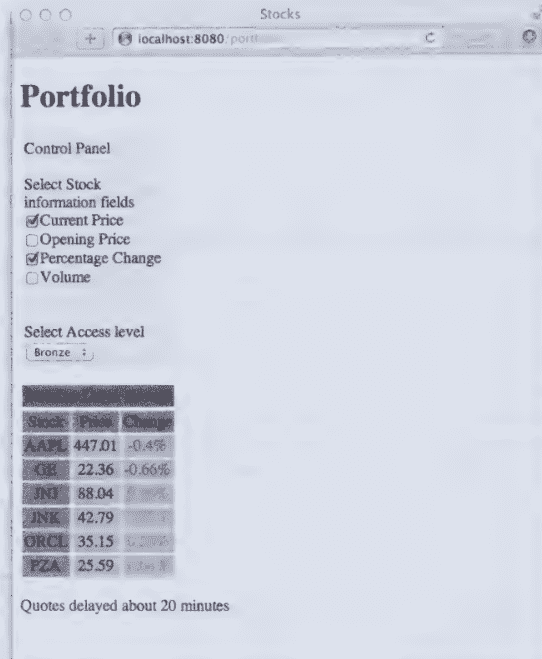

图 6-1. 青铜级别的投资组合应用程序

访问级别包含在 JavaScript 每次连接时使用的 URI 中，事实上，客户端根本没有向服务器发送任何 WebSocket 消息；客户端只监听来自服务器的更新消息。当客户端从服务器端点接收到更新消息时，它会在网页上显示内容。

# 第 6 章：WebSocket 路径映射 163


**图 6-2. 黄金级别的投资组合应用程序**

让我们来看看这个应用最重要的部分：PortfolioBroadcastEndpoint。

# 列表：投资组合端点

```java
import java.io.*;
import java.util.*;
import javax.websocket.*;
import javax.websocket.server.*;
```

```java
@ServerEndpoint(
    value="/updates/{access-level}",
    encoders={PortfolioUpdateEncoder.class}
)
public class PortfolioBroadcastEndpoint implements StockDataSourceListener {

    private Session session;
    private StockDataSource dataSource;

    @OnOpen
    public void startUpdates(Session session,
        @PathParam("access-level") String accessLevel) {

        this.session = session;
        memberLevel = memberLevel;
        memberLevel = MemberLevel.create(accessLevel);

        Map<String, String> requestParams = 
            session.getRequestMap();

        DataOptions options = 
            this.parseOptionsFromRequest(requestParams);

        this.dataSource = new StockDataSource(options, memberLevel);
        this.dataSource.addDataSourceListener(this);
        this.dataSource.start();
    }

    public void handleNewStockData(Portfolio pu) {
        try {
            session.getRemote().sendObject(pu);
        } catch (IOException | EncodeException ioe) {
            this.processError(ie);
        }
    }

    @OnError
    public void processError(Throwable t) {
        System.out.println("Error: " + t.getMessage());
    }

    @OnClose
    public void stopUpdates(Session session) {
        this.dataSource.stop();
    }

    public DataOptions parseOptionsFromRequest(Map<String, List<String>> requestParams) {
        DataOptions options = new DataOptions()
            .currentPrice(requestParams.containsKey(DataOptions.CURRENT_PRICE))
            .openPrice(requestParams.containsKey(DataOptions.OPEN_PRICE))
            .percentChange(requestParams.containsKey(DataOptions.PERCENTAGE_CHANGE))
            .volume(requestParams.containsKey(DataOptions.VOLUME));
        return options;
    }
}
```

首先注意到，PortfolioBroadcastEndpoint 映射到 URI 模板路径 `/updates/{access-level}`，而不是像你在书中目前为止过的所有端点那样的精确 URI。接下来，注意 `startUpdates()` 方法是该端点的打开事件处理程序，它具有方法参数

```
@PathParam("access-level") String accessLevel
```

该参数要求将此 URI 模板路径匹配产生的 `access-level` 路径参数的值传递给此方法。`startUpdates()` 方法执行的第一件事是使用 `accessLevel` 变量的值创建一个 `MemberLevel` 对象，该对象将用于从此应用程序中的股票数据源（即 `StockDataSource` 类）请求更新。正如你在浏览此应用程序的其他源代码时看到的，`MemberLevel` 类型是一个枚举，其值为 `MemberLevel.BRONZE`、`MemberLevel.SILVER` 和 `MemberLevel.GOLD`。`startUpdates()` 的第二件事是根据客户端发送连接时附加到请求 URI 的查询字符串中的请求参数来构建 `DataOptions` 对象。`DataOptions` 对象描述了一个数据字段列表，这些字段将用于决定在网页的输出区域显示哪些字段。客户端是根据网页上控制面板中勾选哪些数据字段选项来制定查询字符串的。注意在示例的查询字符串中，请求参数没有值，只有名称，因为这已经足够示例了。这意味着客户端用于连接的 URL 类型类似于这些：

```
ws://localhost:8080/portfolio/updates/browse?current-price&open-price&percentage-change
ws://localhost:8080/portfolio/updates/silver?current-price&percentage-change
ws://localhost:8080/portfolio/updates/gold?current-price&open-price&percentage-change&volume
```


`PortfolioBroadcastEndpoint` 类上的 `startUpdates()` 方法使用 `MemberLevel` 和 `Dataoptions` 对象来创建一个 `StockDataSource` 对象。`StockDataSource` 类的实现细节并不特别相关。

# 第 6 章：WebSocket 路径映射

在这个简单的示例中，我们面临着关于在何处存储的设计选择：

## 查询字符串 vs. 路径参数 vs. WebSocket 消息

一种用于完整传输数据的消息格式。无需编写解码代码，应用程序就可以简单地利用 Java WebSocket API 的解析能力来处理请求参数和路径参数。

## 指南 2：你需要或想要多频繁地发送合规数据？

如果你的应用程序必须在不断开连接并每次都建立新连接的情况下更新合规信息，那么你将无法使用请求参数和路径参数，因为它们仅在连接首次建立时发送。

## 指南 3：数据量有多大？

虽然可以构造非常长的 URI，但 浏览器对它们能够处理的 URI 长度设置了上限。例如，Internet Explorer 对其处理的 URI 最大长度为 2,048 个字符。在决定是否为此类应用“元数据”使用路径参数或查询字符串（query string）时，这应该是考虑的因素之一。

## 指南 4：你的应用程序中还有哪些路径映射？

正如你在本章的某些路径映射规则中所看到的，一旦你在应用程序中有了了一个端点，在组合路径映射方面就会受到一些限制。如果你在打开连接时需要传达简单、扁平的合规信息，路径映射规则可能会限制你广泛使用路径参数的选项。然而，由于查询字符串不是匹配传入的 URI 与端点的处理决策的一部分，你使用的查询字符串格式完全不受应用程序中其他端点的限制。

### WebSocket 路径映射 API 总结

我们将通过总结 Java WebSocket API 中与路径映射相关的 API 来结束本章。

## API

| API | 功能 |
| :--- | :--- |
| `ServerEndpointConfig.Builder public static ServerEndpointConfig.Builder create(Class<?> endpointClass, String path)` | 在创建时将路径值（无论是相对 URI 还是 URI 模板）分配给用于部署程序化端点的配置对象。 |
| `@ServerEndpoint String value() attribute` | 用于定义注解端点路径值（相对 URI 或 URI 模板）的注解属性。 |
| `ServerEndpointConfig public String getPath()` | 发布此端点时使用的路径（相对 URI 或 URI 模板）。 |
| `Session public String getRequestURI()` | 客户端在建立连接时使用的相对于 Web 服务器根目录的 URI。 |
| `Session public Map<String, String> getParameters()` | 当客户端连接到使用 URI 模板发布的端点时产生的键值对。URI 模板变量的名称；它们是客户端请求 URI 中对应的路径段。 |
| `Session public String getQueryString()` | 客户端用于连接的请求 URI 的查询字符串部分。 |
| `Session public Map<String, List<String>> requestParameterMap()` | 返回从客户端连接的请求 URI 查询字符串中提取的键到多个值对的映射。 |
| `@PathParam` | 方法参数级注解，可用于任何注解端点的方法中，以便在端点被映射到 URI 模板路径时，从请求 URI 中提取路径参数。`value` 属性指示要提取的路径参数的名称。 |
| `String value() attribute` | |

## 总结

本章探讨了发布服务器 WebSocket 端点的所有选项。我们回顾了为注解端点和程序化端点分配路径的机制。我们检查了使用精确 URL 和 URI 模板发布端点的两种机制。你学习了 Java WebSocket API 中的路径映射规则，这些规则规定了 Java WebSocket API 如何匹配客户端 WebSocket 端点尝试连接到 WebSocket 服务器中已发布的端点时传入的 URL。我们在章节末尾看了一个示例应用——将这些机制付诸实践的 Portfolio 应用，并讨论了决定在应用程序中使用何种映射技术时的一些设计问题。

# 第 7 章：保护 WebSocket 服务器端点

你可能希望在不让所有人访问的情况下发布 WebSocket 端点。对于那些有访问权限的用户，你可能希望在 WebSocket 部署时提供安全保障。Java WebSocket API 重点关注如何通过安全，，你可能希望在 WebSocket 部署保护访问已发布的端点。Java WebSocket API 提供了多种机制来满足这些需求。我们主要关注 WebSocket 安全，，我们将从一些概念概念。

## 安全概念

我们将通过查看以下问题来开始，这是安全基础：

 图 7-1. 三个安全问题

- 是否允许匿名访问？如果服务器允许匿名访问，那么它需要考虑下一个问题。
- 谁在请求？
- 数据有多私密？服务器可能希望数据无法被拦截数据的人读取。

确定这些问题答案的过程通常被称为：

- 身份验证：识别用户身份的过程
- 授权：授予或拒绝访问的过程
- 保证数据隐私：确保传输数据的通信通道是私密的

## Java WebSocket API 安全

Java WebSocket API 包含许多功能，允许为包含 WebSocket 端点的 Web 应用配置安全模型。它允许为 Web 应用配置多种身份验证方案，允许你向特定类型的用户授予或拒绝访问，并允许你指示访问 WebSocket 端点时所需的数据隐私级别。

Java WebSocket API 包含许多 API 调用，允许从运行的应用程序访问安全模型的各个方面，并允许在应用程序中构建自己的特定安全功能，如果 Java WebSocket API 内置的功能无法满足需求。

当然，每个安全模型在本文描述的核心三个功能之外还有许多功能，例如审计、不可否认性和互操作性。Java WebSocket API 的每个实现都对这些功能具有某种程度的支持，但支持程度可能会因实现而异。我们将关注这三个核心功能，因为它们被 Java WebSocket API 标准支持，并且涵盖了大多数 Java WebSocket 应用的安全需求。

让我们先查看如何在 Java WebSocket 应用中配置身份验证。

## 身份验证

如果你计划仅允许经过验证的用户使用你的 WebSocket 端点，那么当 Java WebSocket API 运行在 Java EE 实现时，你有多种方案可选，如下节所示。

## 基础身份验证

这是基于 HTTP 最简单的身份验证方案。客户端将用户名和密码对（通常称为凭据）编码后放在 HTTP 头部。客户端可以预先发送，也可以对服务器在收到未身份验证请求时发出的挑战做出响应。这是一个适用于 WebSocket 的良好方案。

应用程序可能需要某种登录机制，并知道是哪个用户正在访问 WebSocket。这对于那些希望根据用户量定制内容的应用程序非常有用，因为你已经了解了关于他们的一些信息，但你不一定需要一种强大的安全方案来保护你发送或接收的数据。由于 HTTP Basic 方案中的凭据是以未加密的形式发送的，它们非常容易被拦截和解码。正因如此，许多希望保护凭据和应用程序数据的 Web 应用选择仅在加密或私有的连接上使用 HTTP Basic 认证。

浏览器通常使用简单的用户名/密码模式对话框来获取用户凭据，因此用户体验虽然简单，但并不容易自定义。

## 表单身份认证 (Form-Based Authentication)

表单身份认证是一种机制，它定义了一组请求参数表示用户的用户名和密码，这些参数被编码在网页中特殊的 `<form>` 元素中。与基本认证一样，凭据是非加密传输的，因此它适用于同一类应用程序。表单认证与 HTTP Basic 认证的主要区别在于，登录表的外观和位置是可以自定义的，因此它适用于更加注重用户体验应用程序。

## 摘要认证 (Digest Authentication)

摘要认证是一种从客户端收集用户名-密码组合并以受保护的形式发送到服务器进行验证的机制。由于凭据是以受保护的形式发送的，这在本质上比 HTTP Basic 或表单认证都是更安全的认证形式。然而，由于客户端无法确定自己正在将凭据信息发送给正确的服务器而非伪装成服务器的机器，因此它并不是最安全的加密形式。

## 客户端证书认证 (Client Certificate Authentication)

客户端证书认证是一个服务器和（可选的）客户端使用数字证书来认证另一个的过程，该证书充当一种加密加密护照，用于验证代理的身份。

该过程在本质上比 HTTP Basic 或表单认证都更安全，因为后者的凭据始终通过 HTTP SSL 传输，而且客户端能够验证服务器身份。

遗憾的是，这些机制中没有一种是通过 JavaScript WebSocket 端点直接尝试未身份验证的握手来被可靠地调用的。虽然 WebSocket 协议在理论上允许在开启握手中插入自己的身份验证交互，但 WebSocket 协议的实现通常不会这样做。然而，当浏览器从 Web 页面尝试对 JavaScript WebSocket 进行开启握手时，它所携带的开启握手包含了所在网页的认证上下文。这意味着，为了从客户端 JavaScript WebSocket 访问需要身份验证的 WebSocket 端点，你必须确保持有 JavaScript WebSocket 的 Web 页面已经通过授权访问该端点的用户身份进行了认证。

作为为你的应用程序选择认证方案的动力，如果你希望限制对你的任何 WebSocket 端点或任何子集的访问（仅限已知用户），或者应用程序的 WebSocket 端点需要在运行时访问用户身份（可能是为了进行某种应用级的安全控制，或仅仅是为了显示用户名），你就需要对用户进行身份验证。

一旦你决定了想要使用哪种方案，配置它相对容易：你可以在封装端点的 WAR 文件的部署描述符中指定它。部署描述符中要包含的关键元素是 `<login-config>` 元素。下表显示了它的子元素。

| 元素名称 | 值 | 目的 |
| --- | --- | --- |
| auth-method | BASIC, FORM, DIGEST, 或 CLIENT-CERT | 定义认证方案 |
| realm-name | 用于基本认证的用户域名称 | 定义将使用哪个服务器域来验证基本认证凭据 |
| form-login-config | 子元素 login-page 和 error-page | 仅用于表单登录，定义了在 Web 应用程序内包含登录表单的页面的相对位置，以及登录失败时用户重定向到的页面 |

## 示例

这里是 `web.xml` 文件的节选，指定了你可以用于 WebSocket 应用程序的四种认证类型的类型。
对于基本认证，在 `web.xml` 的顶层 `<web-app>` 元素下包含此 XML 代码段，将配置应用程序在尝试访问受保护资源时接收 HTTP Basic 认证挑战。服务器将通过在服务器的文件身份认证域中匹配凭据来验证客户端发送的凭据。

> 列表：基本认证 (Basic Authentication)

```xml
<login-config>
  <auth-method>BASIC</auth-method>
  <realm-name>file</realm-name>
</login-config>
```

你可以在下一个一个示例中看到如何指定你的应用程序使用表单认证。如果你在 `web.xml` 的顶层 `<web-app>` 元素下包含以下 XML，服务器将把任何指向 Web 应用程序内受保护资源的未身份验证请求重定向到位于 Web 应用程序 URI 空间根目录下的 `login.html` 页面。

> 列表：表单登录认证 (Form login Authentication)

```xml
<login-config>
  <auth-method>FORM</auth-method>
  <form-login-config>
    <form-login-page>/login.html</form-login-page>
    <form-error-page>/error.html</form-error-page>
  </form-login-config>
</login-config>
```

现在，如果 `login.html` 包含如下一个示例所示的 HTML 表单，表单提交将提交名为 `j_username` 和 `j_password` 的请求参数，这些参数包含用户名和密码的值。如果认证成功，用户将被重定向到受保护资源。如果认证失败，用户将被重定向到 `form-login-config` 中指定的 `.html` 页面，该页面位于 Web 应用程序的根目录。

```html
<form method="POST" action="j_check">
  User ID <input type="text" size="10" name="j_username">
  Password <input type="password" size="10" name="j_password">
  <input type="submit" name="login" value="login">
</form>
```

要指定你的应用程序使用摘要认证，请在 `web.xml` 的顶层 `<web-app>` 元素中包含以下 XML。

> 列表：摘要认证 (Digest Authentication)

```xml
<login-config>
  <auth-method>DIGEST</auth-method>
</login-config>
```

这意味着每当用户尝试访问受保护资源时，他将面临一个摘要挑战。最后，以下代码显示了如果你希望当 Web 应用程序的未身份验证用户尝试访问受保护资源时服务器发起客户端证书挑战，你需要在应用程序中包含的 `<login-config>` 元素。

> 列表：客户端证书认证 (Client Certificate Authentication)

```xml
<login-config>
  <auth-method>CLIENT-CERT</auth-method>
</login-config>
```


如果你使用这种认证方法，你需要确保你已经安装了经过验证的客户端证书，服务器将信任并识别它。

为包含客户端 JavaScript 端点的 Web 页面访问受保护的服务器端 Java WebSocket 端点指定认证方案，如果你先不知道如何保护这些服务器端端点，这种能力是毫无意义的。因此，我们转向认证的语言。

## 授权

授权是 WebSocket 实现决定特定用户是否允许访问特定端点的过程。Java EE 平台使用一种称为“角色（role）”的间接层来定义用户。角色是用户的一种抽象，允许在应用程序中设置授权规则，而无需开发人员在应用程序配置中硬编码实际用户名。

当一个经过身份验证的开启握手请求到达服务器时，服务器必须执行三件事来决定是否授予请求端点的访问权限。

首先，服务器必须确定经过身份验证的用户属于哪个或哪些角色。此信息不属于 Java WebSocket API 定义的标准配置的一部分，因此会根据 WebSocket 实现的不同而异。在 Glassfish 4.0 服务器中，你可以在特定于 Glassfish 的部署描述符——`glassfish.xml` 文件中建立用户与角色之间的关联，该文件与包含端点的 WAR 文件一起打包，但其他应用程序服务器使用不同的方案。

其次，一旦服务器知道了打开握手请求所属的角色，它将通过查看应用程序的 Web 部署描述符（即与 WAR 文件共同打包的 `web.xml` 文件）来做出决定。你将在后续的材料中看到一些具体的示例，但目前只需要知道，对于给定的 URI（打开握手请求的 URI），`web.xml` 的安全约束包含了确定哪些角色允许访问该 URI 的所有必要信息。

最后，当然，正如你所见的，WebSocket 端点在其自身的配置机制中映射到某个路径，可以使用 `ServerEndpointConfig`（用于程序化端点）或在 `ServerEndpoint` 注解的 `value` 属性（用于注解端点）。

有了这三条信息，服务器就可以针对特定的用户和打开握手请求，决定该用户所属的任何角色是否被允许访问该 URI。

这种机制以及做出此判断所需的配置信息的位置总结在图 7-2 中。

让我们来看下 `web.xml` 中的配置语法，用于限制一组用户角色对端点的访问。

要使用的元素是 `security-constraint` 元素。为了定义你想要限制访问的 URI 或多个 URI，你需要定义一个 `web-resource-collection` 子元素，它包含以下子元素：

| web-resource-collection 子元素 | 多重性 | 值 |
| --- | --- | --- |
| web-resource-collection-name | 单个 | 此 URI 集合的可选文本名称，用于在工具中显示 |
| description | 单数 | 此 URI 集合的可选文本描述，用于在工具中显示 |
| url-pattern | 多个 | 表示一个 URI 或一组 URI 的路径标识 |
| http-method | 多个 | 访问资源时使用的 HTTP 方法（GET, POST 等） |

你可以选择不同的方式在所使用的 `url-pattern` 元素中指定路径：

- **精确路径**：这是相对于 Web 应用程序上下文根的路径——例如 `/websockets/myendpoint`。
- **通配符**：这是相对于 Web 应用程序上下文根定义的一组 URL 路径。例如，`/websockets/*` 表示所有以 `websockets` 开头的 URI。
- **文件名结尾**：这是一种在 URI 中查找特定端点模式的 `url-pattern`。例如，如果你决定将应用程序中的所有端点映射到以 `.ws` 结尾的路径，如 `/banking/advertisingendpoint.ws`、`/marketnewsendpoint.ws`，那么 `url-pattern` 设为 `.ws` 就同时意味着这两个端点路径。

WebSocket 端点不需要 `http-method` 元素；所有的打开握手请求都是 GET 请求，省略该元素即涵盖了所有可能的 HTTP 方法。出于某种原因，你在该方法中列出了 GET 以外的 HTTP 方法，WebSocket 实现将不会将其视为你安全约束端点的一部分。因此，除非你还额外使用此语法通过相同的安全约束来保护 Web 应用程序中的其他 Web 组件，否则最好省略此元素。

一旦你在安全约束中设置了一个或多个 `web-resource-collection`，你就需要指示哪些角色允许访问 `web-resource-collection` 中指定的 URI。要实现这一点，只需向 `security-constraint` 附加一个 `<auth-constraint>` 元素列表，每个元素都包含你想要授予访问权限的角色名称。你在此列出的任何角色都必须已在 `web.xml` 中的 `security-role` 元素中声明。

## 示例

让我们来看一些示例。假设我们有一个包含 Web 页面和服务器端点的 Web 应用程序。假设我们有一个 Web 页面和一个服务器端点。Web 页面名为 `home.html`，端点映射到 `/endpoint`。我们希望只允许属于客户角色的用户通过 JavaScript 客户端访问映射到 `/endpoint` 路径的 home.html （WebSocket 端点）。为了保护 Web 页面，我们将使用 Basic 认证方案来连接 WebSocket。以下是 `web.xml` 的安全约束代码片段：

- 示例：WebSocket 约束

```xml
<security-constraint>
  <display-name>WebSocket Constraint</display-name>
  <web-resource-collection>
    <web-name>web page and WebSocket</web-name>
    <description>这限制了对 Web 页面和 WebSocket 的访问</description>
    <url-pattern>/home.html</url-pattern>
    <url-pattern>/endpoint</url-pattern>
  </web-resource-collection>
  <auth-constraint>
    <role-name>customer</role-name>
  </auth-constraint>
</security-constraint>

<login-config>
  <auth-method>BASIC</auth-method>
  <realm-name>file</realm-name>
</login-config>
```

```xml
<security-role>
  <role-name>customer</role-name>
</security-role>

<security-role>
  <role-name>administrator</role-name>
</security-role>
```

现在，当用户尝试访问 `home.html` 时，服务器将发出 Basic 挑战，因为 `home.html` 只允许客户角色的用户访问。如果用户带有正确的角色，握手将继续并建立连接。注意，通过任何方式向此保护端点发起的未经身份验证的握手都将失败。具体来说，任何未经身份验证的握手将收到 HTTP 401（未授权）响应，而不是成功的握手。

你可以在图 7-3 中看到从上到下的步骤序列。

## 私有通信

为了保护 WebSocket 端点之间交换的数据，`web.xml` 部署描述符的语法允许你将 URI 空间标记为以下之一：

- **INTEGR (完整性)**：这意味着第三方无法在传输过程中篡改数据。
- **CONFIDENTIAL (机密性)**：这意味着第三方无法在数据交换时篡改甚至读取数据。

大多数应用程序服务器会将这两个选项解释为：仅允许使用安全连接（在本例中，即对于 WebSocket 端点，使用基于 SSL 的 WebSocket，或 wss）来访问资源。对于 JavaScript WebSocket 与使用 Java WebSocket API 编写的服务器端 WebSocket 之间的私有通信，有两种指定方法。

首先，客户端必须在其打开握手中指定 `wss://` 并使用托管 WebSocket 的服务器的 SSL 端口。以下是使用 wss 创建 WebSocket 对象的快速示例：

```javascript
var myWebSocket = new WebSocket("wss://localhost:8181/SecureApp/secure-endpoint");
```

在这种情况下，服务器使用端口 8181 进行 SSL 连接。其次，包含服务器 WebSocket 端点的 Web 应用程序需要指定其仅可以通过私有 WebSocket 连接进行访问。要实现这一点，你需要定义一个匹配你想要私有通信的端点路径的 `security-constraint`，并为其添加一个 `user-data-constraint`。下表显示了 `user-data-constraint` 的子元素。

| 子元素 | 值 | 目的 |
| --- | --- | --- |
| user-data-constraint 描述 | 文本 | 在工具中查看部署描述符时，对约束的可选文本描述 |
| transport-guarantee | NONE, INTEGRAL, 或 CONFIDENTIAL | 由约束定义的隐私级别。NONE（默认值）解释为不需要私有通信；INTEGRAL 和 CONFIDENTIAL 表示仅允许通过 wss 访问 |

例如，你可以调整示例，通过向 `security-constraint` 中添加以下 `user-data-constraint` 来说明身份验证，这意味着该页面及其内部的端点只能由具有 `customer` 角色的身份验证用户通过 `wss` 访问，而不是 `ws`。

列表：机密连接

```xml
<user-data-constraint>
  <transport-guarantee>CONFIDENTIAL</transport-guarantee>
</user-data-constraint>
```

因此，现在你需要修改 JavaScript WebSocket 使用的 URL，用 `wss` 代替 `ws`，以确保连接的两端都同意连接是私有的。

如果你想从网页通过 `wss` 连接到端点，通常你只能在已经与你的 Web 应用程序建立 HTTPS 连接的浏览器中这样做。实际意义是，如果你有一个包含 JavaScript WebSocket 端点的网页，它希望通过 `wss` 连接到服务器端的 Java WebSocket 端点，你需要确保两个 `user-data-constraint` 都有一个 `security-constraint` 并被设置为 `INTEGRAL` 或 `CONFIDENTIAL`。这与你已经过的身份验证情况类似；如果你希望客户端访问需要身份验证的服务器端 Java WebSocket，那么持有客户端的网页必须已经通过了身份验证。

## Java WebSocket 安全 API

你可以在运行时访问各种 API，以便让你的应用程序能够查看到在所包含的 Web 应用程序部署描述符中设置的安全模型。

### Session 对象上可用的安全信息

访问连接到 WebSocket 的经过身份验证的用户通常是有用的。可以通过以下方法调用从 `Session` 对象获取此信息：

```java
public Principal getUserPrincipal()
```

此方法返回一个表示用户的 `java.security.Principal` 对象，你可以从该对象获取名称，并通过进一步检查子类型获取更多关于该用户及其关联凭据的信息。如果连接未经过身份验证，则该方法返回 `null`。此方法用于许多用途，例如：将用户名嵌入你的端点发送的 WebSocket 消息中；在应用程序中构建你自己的授权检查，而不是依赖 Web 容器为你提供的 `security-constraint` 机制（我们在本章稍早时候检查过它）。

通过 `Session` 对象，你还可以确定连接是否为私有，也就是说 WebSocket 连接是否已加密。可以通过以下调用获取此信息：

```java
public boolean isSecure()
```

### HandshakeRequest 对象上可用的安全信息

如你在第 4 章中所知，你可以在服务器端 WebSocket 端点中拦截开启的握手请求。这是通过子类化 `ServerEndpointConfig.Configurator` 类并重写该方法实现的：

```java
public void modifyHandshake(ServerEndpointConfig sec, HandshakeRequest request, HandshakeResponse response)
```

并通过以下方式将端点链接到配置器类：对于带注解的端点，使用 `@ServerEndpoint` 配置器属性；或者在部署程序化端点时，在你创建 `ServerEndpointConfig` 实例上设置配置器。

当你这样做时，从你的 `modifyHandshake()` 方法可以访问 `HandshakeRequest` 对象。这与你已经在 `Session` 对象上看到的方法相同：

```java
public Principal getUserPrincipal()
```

此外，`HandshakeRequest` 拥有方法：

```java
public boolean isUserInRole(String rolename)
```

此方法的目的是允许你确定发起开启握手请求的经过身份验证的用户是否是你传递的角色名称的成员。

| API 对象 | 方法调用 | 目的 |
| --- | --- | --- |
| Session | getUserPrincipal() | 获取经过验证的用户的用户 |
| Session | isSecure() | 连接是否是否 |
| HandshakeRequest | isUserInRole(String rolename) | 用户用户在角色中 |

```java
public boolean isUserInRole(String rolename)
```


# Java WebSocket

| API 对象 | 方法调用 | 目的 |
| --- | --- | --- |
| HandshakeRequest | getUserPrincipal() | 获取经过验证的用户的用户 |
| HandshakeRequest | isUserInRole(String rolename) | 用户是否在角色中 |

| API 对象 | 方法调用 | 目的 |
| --- | --- | --- |
| HandshakeRequest | Principal getUser() | 获取经过验证的用户 |

## 账户应用程序

我们将通过一个示例完成对 Java WebSocket API 安全模型的查看。账户应用程序是一个通过浏览器访问的 Web 应用程序。在主页上，你会看到一个包含公司和股票信息的横幅，如图 7-4 所示。

登录时，会被要求提供用户名和密码，然后被带到账户屏幕。如图 7-5 所示，你仍然看到横幅，但信息是新的。此外，你可以看到持仓列表。随着新市场数据的可用，你投资组合的市场价值也会不断更新。从此页面你可以注销应用程序并返回原始进入屏幕。

注意，首页和账户页面只能通过 HTTPS 访问。当然，注意要访问账户页面必须提供用户名和密码。此应用程序预配置运行在 Glassfish 4.0 服务器上，有两个用户：Alexander 和 Jesse。你会注意到，根据你是登录为 Alexander 还是 Jesse，你会获得不同的服务。

应用程序内部有两个服务器端端点，其类名和路径映射如下表所示。

| 端点类 | URI 映射 |
| --- | --- |
| AccountEndpoint | /account/info |
| PortfolioBroadcastEndpoint | /banner/{secure-access} |

PortfolioBroadcastEndpoint 应该已经有些熟悉。它是基于上一章 Portfolio 应用程序中同名的端点的。它现在的目的就像它以前那么，是发送新股票价格通知，作为一种股票行情功能。它提供更频繁的更新，并且数据越新鲜，应用程序中的 MemberLevel 越越高。你将在几分钟后看到它是如何决定的。AccountEndpoint 驱动账户信息的更新，根据用户在每只股票中的当前持仓，计算用户持股的市场价值。


**图 7-4. 进入账户应用程序**


**图 7-5. 金级用户用户的账户信息**

在每个账户中。同样，AccountEndpoint 使用 MemberLevel 来提供差异化的服务级别。

让我们来看看该应用程序的部署描述符。

### 列表：Stock Account 部署描述符

```xml
<?xml version="1.0" encoding="UTF-8"?>
<web-app version="3.0" xmlns="http://java.sun.com/xml/ns/javaee"
         xmlns:xsi="http://www.w3.org/2001/XMLSchema-instance"
         xsi:schemaLocation="http://java.sun.com/xml/ns/javaee http://java.sun.com/xml/ns/javaee/web-app_3_0.xsd">
    <!-- * * * -->
    <session-config>
        <session-timeout>
            30
        </session-timeout>
    </session-config>
    <security-constraint>
        <display-name>login access</display-name>
        <web-resource-collection>
            <web-resource-name>Account Info</web-resource-name>
            <url-pattern>/index.jsp</url-pattern>
        </web-resource-collection>
        <user-data-constraint>
            <transport-guarantee>CONFIDENTIAL</transport-guarantee>
        </user-data-constraint>
    </security-constraint>
    <security-constraint>
        <display-name>customer_access</display-name>
        <web-resource-collection>
            <web-resource-name>Account Info</web-resource-name>
            <url-pattern>/account.jsp</url-pattern>
            <url-pattern>/account/info</url-pattern>
            <url-pattern>/banner/secure</url-pattern>
        </web-resource-collection>
        <auth-constraint>
            <role-name>customer</role-name>
            <role-name>premium_customer</role-name>
        </auth-constraint>
        <user-data-constraint>
            <transport-guarantee>CONFIDENTIAL</transport-guarantee>
        </user-data-constraint>
    </security-constraint>
    <login-config>
        <auth-method>BASIC</auth-method>
        <realm-name>config</realm-name>
    </login-config>
    <security-role>
        <role-name>customer</role-name>
    </security-role>
    <security-role>
        <role-name>premium_customer</role-name>
    </security-role>
</web-app>
```

首先需要注意的是，Stock Account 使用了两个安全约束来限制对 Web 页面和两个端点的访问。`web.xml` 中的第一个安全约束对访问 `index.jsp` 主页设置了私有通信条件。这确保了你只能通过 HTTPS 访问 `index.jsp`。第二个安全约束对 `account.jsp` 和 `AccountEndpoint` 端点实施了权限控制。这允许只有那些拥有 `customer` 或 `premium_customer` 角色的用户才能访问这些资源。你还会看到，同一个安全约束限制了对 URI `/banner/secure` 的访问，这对于 `PortfolioBroadcastEndpoint` 端点具有相同角色的用户是一个潜在匹配。这确保任何尝试通过 `/banner/secure` 路径访问账户页面、`AccountEndpoint` 或 `PortfolioBroadcastEndpoint` 的用户必须经过认证并属于正确的角色。查看 `web.xml` 中的 `login-config` 元素，你会发现认证方法是 HTTP Basic，但由于 `index.jsp` 通过尝试打开 `account.jsp` 来触发登录，而 `account.jsp` 本身仅可通过 HTTPS 访问，因此 HTTP Basic 认证信息是通过加密连接传输的。这通常是一个良好的习惯，除非你对认证的处理非常松散。

你会注意到，当入口页面 `index.jsp` 访问 `PortfolioBroadcastEndpoint` 时，它使用的是 URI `/banner/n` 而不是账户页面所使用的 `/banner/secure`。当然，由于 `index.jsp` 并没有被设置权限控制（只有 `user-data-constraint`），你不需要登录即可看到它在页面顶部生成的股票行情信息。

每个端点都使用一个自定义配置器，以确定应用程序核心处使用的 `MemberLevel`，从而确定账户页的服务级别和显示方案。让我们来看看这是如何实现的。在 `MemberLevelConfigurator` 类中，你将在下文中看到我们重写了 `modifyHandshake()` 方法。

### 列表：MemberLevelConfigurator

```java
public class MemberLevelConfigurator extends ServerEndpointConfig {

    public static String CUSTOMER = "customer";
    public static String PREMIUM_CUSTOMER = "premium_customer";
    public static String Member_LEVEL = "MemberLevel";

    public void modifyHandshake(ServerEndpointConfig config,
                                HandshakeRequest request,
                                HandshakeResponse response) {
        MemberLevel ml = null;

        if (request.isUserRole(CUSTOMER)) {
            ml = MemberLevel.SILVER;
        } else if (request.isUserRole(PREMIUM_CUSTOMER)) {
            ml = MemberLevel.GOLD;
        } else {
            ml = MemberLevel.BRONZE;
        }

        // ... (rest of implementation)
    }
}
```


# 第 7 章：Java WebSocket 安全编程

## 194 Java WebSocket 编程

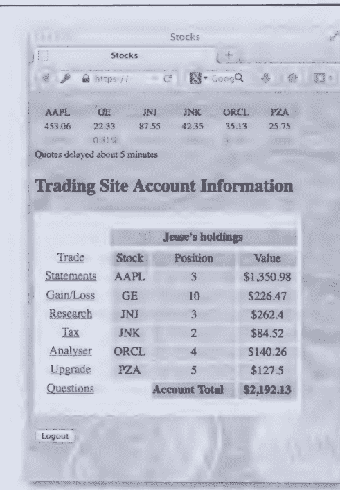

图 7-6. 银级用户的账户信息

很容易看出，由 `MemberLevelConfigurator` 设置的 `MemberLevel` 在这里被获取，以便从驱动市场数据的源设置服务级别。`PortfolioBroadcastEndpoint` 同样使用 `MemberLevelConfigurator` 从认证后的账户页面确定其 `MemberLevel`。如果通过未认证连接访问 `PortfolioBroadcastEndpoint`（如从入口页面 `index.jsp` 访问），则用户对象为 null，且 `MemberLevelConfigurator` 中使用的 `isUserRole()` 调用始终返回 false，你最终获得最低的铜级服务。

总结来说，此应用程序使用声明式安全模型实现了以下功能：

- 限制所有对端点的访问仅通过加密连接
- 将某些对 WebSocket 端点的访问限制给已认证用户
- 允许未认证用户访问其中一个端点

通过某些运行时 Java WebSocket 安全 API，我们可以根据访问应用程序的用户来查询安全模型。

## 总结

在本章中，你学习了如何使用 Web 容器的声明式安全模型将 Java WebSocket 服务器端点的访问限制给特定用户。你学习了认证尝试访问 Java WebSocket 服务器端点的用户身份可用方法，并学习了如何确保 Java WebSocket 服务器端点可以通过加密连接访问。你了解了开发者如何在运行时访问连接的加密状态以及认证客户端的身份。最后，你查看了 Stock Account 应用程序，它将安全模型应用于包含价值个人数据的经纪账户，并根据用户提供分级服务。

# 第 8 章：Java EE 平台中的 WebSockets

## 198 Java WebSocket 编程

Java WebSocket API 是 Java EE 7 平台的标准部分，因此对于所有使用支持 Java EE 7 API 的应用程序服务器的开发者都是可用的。到本书为止，我们一直关注的是使用 Java WebSocket API 的应用程序，但来自 Java SE 平台的一些常用库除外。虽然这让我们能够详细研究使用 Java WebSocket API 的所有重要方面，但现实世界中的许多 WebSocket 端点将是大型企业应用程序的一部分，这些应用程序可以访问各种服务和其他技术。特别是，考虑到 WebSocket 协议作为解决各种形式 Web 应用轮询方案的起源，以及浏览器对 WebSocket 协议极高水平的支持，看到 WebSockets 作为大型 Web 应用的一部分是很常见的。

因此，如果缺少关于编写包含 WebSockets 的 Java EE 和 Web 应用程序的指导，这本书将是不完整的。目前已经有很多书籍专门解释如何使用 Java EE 平台中的所有 Java API 和组件，而本书并不是其中之一！因此，本章将重点关注如何将 WebSocket 端点与 Web 容器中的其他 Web 组件连接，以及如何将 WebSocket 端点连接到企业级 Java Bean（EJB）的关键点。以这两个连接为起点，你应该能够很好地利用你对所有其他 Java EE 技术的知识来扩展你的 Java WebSocket 端点的范围和功能。

## Java WebSockets 在 Java EE 平台中的角色

Java EE 平台（见图 8-1）展示了 Java WebSocket API 在 Web 容器中的作用。

Java EE 平台包含两个服务端容器：Web 容器和 EJB 容器。这两个容器都托管并管理由其创建的组件。Web 容器托管 Java Servlets 以及一系列构建在 Java Servlet 模型之上的技术（如 JavaServer Pages 和 JavaServer Faces），此外还有 WebService 端点，当然还有 WebSocket 端点。EJB 容器包含了多种类型的企业级 Java Bean（Enterprise JavaBeans）。两个服务器容器都采用并为开发者提供了各种服务。这些包括用于向外部数据库读/写应用程序数据的 JDBC 和 Java Persistence、用于可靠的应用程序间服务器消息传递的 JavaMessage Service（JMS）、各种安全服务、一个事务管理器以及 JavaMail。典型的 Java EE 应用包含许多 Web 组件，可能还有一些 EJB 组件，数据库直接通过 Web 组件访问，或者通过 EJB 组件访问。用户通过浏览器客户端或某种富客户端应用程序（包括 Java 或 JavaFX 富客户端应用程序）访问这些 Java EE 应用。浏览器交互通过 HTTP 和 WebSocket 连接发生，这些 Web 组件反过来涉及 EJB 组件或数据层（加密或明文的）。富客户端应用程序的交互也通过这些 Web 协议发生，涉及应用程序中的 Web 组件。或者，Java EE 平台还包含一个用于客户端应用程序的托管容器，称为应用程序客户端容器，它允许直接与 EJB 组件通信，除了通过 Web 协议与 Web 层通信的选择。

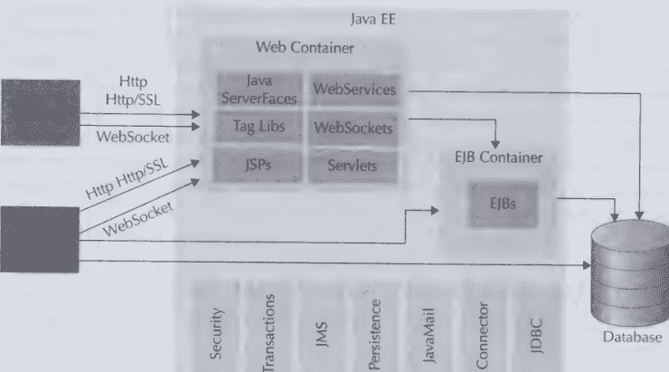

图 8-1. Java EE 平台架构

## 200 Java WebSocket 编程

考虑到 WebSocket 端点在 Web 容器中的位置，自然希望与同一个 Web 应用中的其他 Web 组件共享应用程序状态，无论是与一个客户端相关的应用程序状态，还是跨应用程序所有客户端的应用程序状态。同样，为了与 EJB 层中已有的组件交互，从 WebSocket 端点调用 EJBs 也是理所应当的。

这两个用例将是我们此处检查的重点：一旦 WebSocket 端点可以与其他 Web 组件共享数据并与 EJB 组件交互，它就真正成为了包含它的广泛 Java EE 应用的一部分。

## 共享 Web 应用状态

在 Web 容器中共享应用程序状态的关键在于获取以下对象的引用：

```
javax.servlet.ServletContext
javax.servlet.http.HttpSession
```

`HttpSession` 对象代表了从同一个 HTTP 客户端到 Web 应用程序的一系列 HTTP 交互。这意味着同一个用户从浏览器客户端发送的一系列 HTTP 请求（例如）将与同一个 `HttpSession` 实例相关联。前提是用户在交互之间没有等待太久，且没有人决定在请求之间终止会话。Web 容器提供了多种机制来支持 Web 容器中 `HttpSession` 的有效性。当客户端支持并允许时，它们会使用 Cookie，并使用一种称为“URL 重写”的技术在 Web 应用所使用的 URL 的查询字符串中跟踪会话状态。

由于 WebSocket 连接始于开启握手，而且开启握手是 HTTP 交互，因此每个 WebSocket `Session` 对象都与其建立连接时在开启握手期间启动或已存在的 `HttpSession` 对象相关。这意味着从 Web 应用内部运行的每一个 WebSocket 端点，都有一个与其相关的 `HttpSession` 对象：即在其开启握手时存在的那个。

在更实际的意义上，从网页中的 JavaScript WebSocket 端点发起的任何 WebSocket 连接都与网页加载时创建的同一个 `HttpSession` 对象相关。假设你有一个 Web 应用，它包含一个网页，该网页包含三个 JavaScript WebSocket 客户端端点和 Java WebSocket 服务器端点；那么，每当用户下载网页并导致 WebSockets 连接时，你将有一个与三个独立的 WebSocket `Session` 关联的 `HttpSession`。在图 8-2 中，你可以看到这种安排，有两个用户正在使用该 Web 应用。现在，`HttpSession` 对象持有一个开发者可能用它存储应用程序数据的字典，这是一个非常实用的功能。自然，因为每个用户有一个 `HttpSession` 实例，所以这些应用程序数据与用户相关。通过代码列表中的方法访问字典。

### 代码列表：HttpSession 上的属性

```
public Object getAttribute(String name)
public Enumeration<String> getAttributeNames()
public void setAttribute(String name, Object value)
```


图 8-2. 开启握手时 WebSocket Sessions 与 HttpSessions 之间的关系

这使得它成为任何可以访问它的组件非常有用的共享对象。所有 Java Servlet 和基于 Java Servlet 的技术都可以访问 `HttpSession` 对象，因此它们能够共享与特定用户相关的应用程序状态。

幸运的是，Java WebSocket 端点也可以获取与其 WebSocket `Session` 关联的 `HttpSession` 对象，以便与其他组件共享与特定用户相关的应用程序数据。你可以通过使用自定义的 `ServerEndpointConfig.Configurator` 拦截开启握手并重写以下方法来实现：

```
public void modifyHandshake(ServerEndpointConfig sec,
                            HandshakeRequest request,
                            HandshakeResponse response)
```

并通过调用方法获取开启握手相关的 `HttpSession` 实例引用：

```
public Object getHttpSession()
```

在本章后面的部分，你将看到一个使用这种技术在 Web 组件和 WebSocket 端点之间共享数据的示例。

## HttpSession 到 WebSocket Session 的关联

一旦应用程序运行一段时间，WebSocket `Session` 实例与 `HttpSession` 实例之间的关联可能不再有效。如果 `HttpSession` 通过显式失效调用或超时而终止，你不能假设实现会关闭在该 `HttpSession` 内启动的任何 WebSocket `Session`。当用户已通过 Web 应用进行身份验证且 WebSocket 端点受安全约束保护时，WebSocket 实现实际上会关闭与终止的 `HttpSession` 关联的 WebSocket `Session`。你不希望受保护资源在授予访问权限的身份验证状态结束后仍然保持激活。

这意味着，如果你想在 `HttpSession` 与在其启动的 WebSocket `Session` 之间建立更强的关联，你将需要一些工作。

## 第 8 章：Java EE 平台中的 WebSockets 203

幸运的是，Servlet API 为你提供了至少一种实现此方法。如前所述，`HttpSession` 属性的一个非常有用的特性是：每当 `HttpSession` 结束时（无论是通过显式失效还是超时），Web 容器都会将其从 `HttpSession` 中移除。正如接下来的列表所示，如果你添加作为属性的对象实现了 `HttpSessionBindingListener` 接口，那么当该对象从 `HttpSession` 中解绑时，你的对象将收到通知。

### 列表：`javax.servlet.http.HttpSessionBindingListener`

```
public interface HttpSessionBindingListener {
    public void valueUnbound(HttpSessionBindingEvent hse);
    public void valueBound(HttpSessionBindingEvent hse);
}
```

通过这种方式，你就有办法在 `HttpSession` 过期时让 WebSocket 端点实例被通知，从而使其有机会关闭其 WebSocket 连接，并保持 `HttpSession` 与 WebSocket `Session` 之间的强关联。

## HttpSession 示例

让我们通过 HttpSession 示例来看看这一机制的实际运作情况。这是一个包含 JavaScript 客户端与 Java WebSocket 服务器端点通信的应用程序，其中 Java WebSocket 端点类 `EndpointWithHttpSession` 通过在每次 `HttpSession` 终止时关闭 WebSocket 连接，来管理 WebSocket `Session` 与 `HttpSession` 之间的强关联。

当你运行该程序时，点击网页上的按钮将向服务器端点发送消息，并在必要时启动 WebSocket 连接。点击另一个按钮将终止 `HttpSession`。你可以从图 8-3 中看出，服务器端点实例知道在建立 WebSocket `Session` 时所对应的那个 `HttpSession`。你还可以看到，当用户失效 `HttpSession` 时，WebSocket `Session` 会被关闭。

WebSocket 端点 `EndpointWithHttpSession` 通过 `HttpSessionConfigurator` 获取了其 `HttpSession` 的引用，该配置器通过拦截打开握手并调用 `HandshakeRequest` 的 `getHttpSession()` 方法将 `HttpSession` 插入到 `ServerEndpointConfig` 对象的属性中。

## 204 Java WebSocket 编程

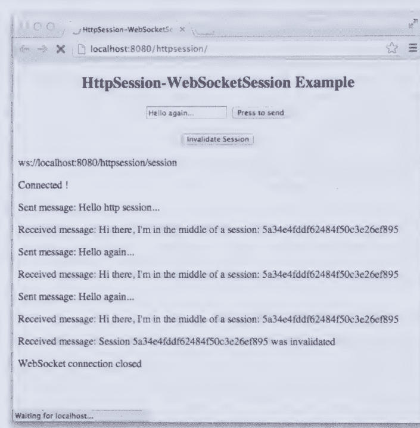

图 8-3. 终止会话

让我们来看看 `EndpointWithHttpSession` 在其打开事件处理方法中对这个 `HttpSession` 做了什么：

### 列表：`EndpointWithHttpSession @OnOpen` 方法

```
@OnOpen
public void startConnection(Session session, EndpointConfig config) {
    this.session = session;
    HttpSession httpSession = (HttpSession) config.getUserProperties()
        .get(HttpSessionConfigurator.HTTP_SESSION);
    HttpSessionInvalidationListener listener1 = new HttpSessionInvalidationListener(this);
    httpSession.setAttribute("httpsession-listener", listener1);
    httpSession.setMaxInactiveInterval(5);
}
```

你可以看到，该方法将 WebSocket `session` 的引用存储在实例变量中，然后从 `EndpointConfig` 对象的用户属性中检索该 `HttpSession` 实例的引用，而该属性是由 `HttpSessionConfigurator` 用来携带该引用的。接下来，该方法创建了一个回调对象 `HttpSessionInvalidationListener`，并将其添加到 `HttpSession` 的属性中。接下来的列表中的 `HttpSessionInvalidationListener` 代码仅在它从 `HttpSession` 中解绑时简单地调用 `EndpointWithHttpSession`。

### 列表：`HttpSessionInvalidationListener`

```
public class HttpSessionInvalidationListener implements HttpSessionBindingListener {
    private EndpointWithHttpSession ewhs;
    public HttpSessionInvalidationListener(EndpointWithHttpSession es) {
        this.ehws = es;
    }
    public void valueUnbound(HttpSessionBindingEvent hsbe) {
        ehws.notifyHttpSessionUnbound(hsbe.getSession());
    }
    public void valueBound(HttpSessionBindingEvent hsbe) {
    }
}
```

该应用程序从未通过调用 `removeAttribute()` 方法显式从 `HttpSession` 中移除此属性，它从 `HttpSession` 中移除的唯一时间是 `HttpSession` 终止时。应用程序包含一个名为 `InvalidateServlet` 的简单 Java Servlet，你可以通过浏览源代码看到它，它会显式地失效 `HttpSession`，导致在适当延迟后重新加载网页以清除输出。

## 206 Java WebSocket 编程

### 列表：`InvalidateServlet` 处理方法

```
```


protected void processRequest(HttpServletRequest request, HttpServletResponse response) throws ServletException, IOException {
    request.getSession().invalidate();
    try {
        Thread.sleep(2000);
    } catch (Exception r) {
        response.sendRedirect("index.jsp");
    }
}

## 列表：`EndpointWithHttpsSession` 通知处理方法

```java
public void notifySessionUnboundMe(HttpSession s) {
    try {
        this.session.getBasicRemote().sendText("Session " + s.getId() + " was invalidated");
        this.session.close(new CloseReason(CloseReason.CloseCodes.NORMAL_CLOSURE, "HttpsSession ended"));
    } catch (Exception r) {
        r.printStackTrace();
    }
}
```

这调用了 `HttpSessionInvalidationListener`，随后调用了 `EndpointWithHttpsSession` 端点实例的 `notifySessionUnboundMe(method)` 方法。

正如代码列表所示，这会在关闭 WebSocket 连接并完成 WebSocket 连接与其打开握手所属之间的强关联之前，先向浏览器发送一条消息。

如果你运行这个示例应用程序，你可能会注意到如果 `HttpSession` 超时，你将在网页上看到相同的消息以及相同的 WebSocket Session 关闭操作。`HttpSession` 允许在超时间隔后超时，但在达到超时间隔时，Web 容器中的 `HttpSession` 对象可能并不会实际失效。然而，如果你想看到超时效果，可以刷新网页以强制创建新的 `HttpSession`，这将使旧的 `HttpSession` 和连接失效。

# 207 Java WebSocket 编程

现在你已经了解了如何共享特定用户的应用程序状态，那么共享所有用户通用的应用程序状态也是一项相当轻松的任务。只需使用 `ServletContext` 即可。每个 `HttpServlet` 对象上都可以通过该方法获取 `ServletContext` 的引用。因此，如果你需要在 WebSocket 端点中使用 `ServletContext` 以与同一 Web 应用程序中的 Web 组件（当然包括其他 WebSocket）共享应用程序状态，你可以使用如下列表所示的自定义配置器，使其在 WebSocket 端点的 `EndpointConfig` 中可用。

## 列表：使用配置器获取 `ServletContext`

```java
public class ServletContextConfigurator extends ServerEndpointConfig.Configurator {
    public static String SERVLET_CONTEXT = "servlet-context";

    public void modifyHandshake(ServerEndpointConfig sec, HandshakeRequest request, HandshakeResponse response) {
        if (sec.getUserProperties().get(SERVLET_CONTEXT) != null) {
            ServletContext servletContext = ((HttpSession) request.getSession()).getServletContext();
            sec.getUserProperties().put(SERVLET_CONTEXT, servletContext);
        }
    }
}
```

## 从 WebSocket 端点使用 EJB

在 Java EE 平台中运行时，WebSocket 服务器端点是非上下文的托管豆。这一属性意味着端点实例的创建和销毁是由 Java EE 平台管理的，并且允许 EE 平台根据你的选择将其他 Java EE 组件注入到你的端点实例中。这些组件可以包括企业级豆（EJB）、数据库连接或任何其他资源。

## 208 Java WebSocket 编程

这是 Java EE 平台的 JNDI 命名空间。关于 Java EE 平台依赖注入这一大主题，有很多书籍和教程，我们将这段简短的探索限制在一些最有用的组件上：企业级 JavaBean（Enterprise JavaBeans）。

为了将 EJB 注入到 WebSocket 端点，你首先需要在 Web 应用程序中启用依赖机制。你可以通过在 Web 应用程序的 `WEB-INF` 目录下添加默认的 `beans.xml` 文件来实现，所示：

```xml
<xml version="1.0" encoding="UTF-8"?>
<beans xmlns="http://java.sun.com/xml/ns/javaee"
     xmlns:xsi="http://www.w3.org/2001/XMLSchema-instance"
     xsi:schemaLocation="http://java.sun.com/xml/ns/javaee http://java.sun.com/xml/ns/javaee/beans_1_0.xsd">
</beans>
```

一旦启用了依赖注入，你只需使用 `@EJB` 注解将 EJB 注入到你的端点中。下面的代码列表显示了一个可以注入自身的端点。

### 列表：简单的 EJB 注入

```java
import javax.ejb.EJB;

@ServerEndpoint("/my-endpoint")
public class MyEndpoint {
    @EJB
    private MyEJB myEJB;
}
```

由于 Java EE 平台负责在新的客户端完成成功握手时创建 `MyEndpoint` 类的实例，因此它能够将 `MyEJB` 企业 JavaBean 的适当实例注入到该实例中。这意味着当 `MyEndpoint` 类的打开处理方法被调用时，`myEJB` 实例已经初始化完毕并准备好接收调用。

注入到 WebSocket 端点的两种最有用的 EJB 类型是有状态的会话豆和单例豆。如果在上述代码列表中，`MyEJB` 组件是有状态会话豆，那么每当因为新客户端连接而实例化一个新的 WebSocket 端点时，Java EE 平台都会将 `MyEJB` 组件的新实例注入到该 WebSocket 端点中。这使得这种豆适用于与特定 WebSocket 连接特定的应用程序状态绑定。如果在上述代码列表中，`MyEJB` 组件是单例豆，那么每当 WebSocket 端点被实例化时，Java EE 平台都会将同一个 `MyEJB` 组件实例注入到 WebSocket 端点实例中。将单例 EJB 注入到 WebSocket 端点是共享应用程序所有连接通用状态的一种非常有用的方法。

通过对如何将 EJB 引入应用程序的关键用例进行这种非常简单的介绍，让我们来看一个快速示例。

## EJB 示例

在下面的 EJB 示例中，我们有一个名为 `EndpointWithEJBs` 的单一服务器端点。

### 列表：`EndpointWithEJBs`

```java
import javax.ejb.EJB;
import javax.websocket.OnError;
import javax.websocket.OnMessage;
import javax.websocket.server.ServerEndpoint;

@ServerEndpoint("/endpointtheejbs")
public class EndpointWithEJBs {
    @EJB
    private MyStatefulEJB myEJB;

    @EJB
    private MySingletonEJB mySingleton;

    @OnMessage
    public String hiThere(String message) {
        return "Hi. I have two EJBs: <br>" + myEJB.getMessage() + "<br>" + mySingleton.getMessage();
    }

    @OnError
    public void error(Throwable t) {
        System.out.println("Error: " + t.getMessage());
    }
}
```

你可以看到，这只是第 1 章 Echo 示例的变体，除了对任何传入的消息做出响应外，此服务器端点还有两个它用于构建消息的 EJB：一个有状态会话豆和一个单例。使用 `@EJB` 注解，Java EE 平台负责确保在新的客户端连接到 `EndpointWithEJBs` 端点并调用打开处理方法之前，这些指向 EJB 的实例变量引用被正确初始化。每个 EJB 都做着相同的事情：当它第一次被实例化时，它记录了当前时间。每当调用任一 EJB 的 `getMessage()` 方法时，它都会返回一个包含其创建时间的字符串。这通过创建时间来区分同一豆的不同实例的一种粗略且快速的方法。

当你向 `EndpointWithEJBs` 建立第一个客户端连接时，点击页面上的按钮，你可能会看到类似于图 8-4 的输出，它显示 WebSocket 端点引用的 EJB 实例是在同一时间创建的。然而，如果你刷新页面，从而导致对 WebSocket 端点建立新的 WebSocket 连接，当你按下按钮时会看到不同的内容（见图 8-5）。

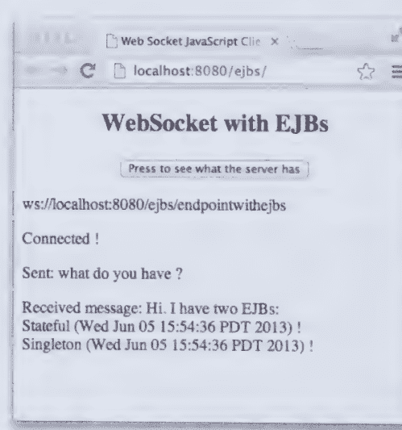
图 8-4。首次连接时的 EJB 示例

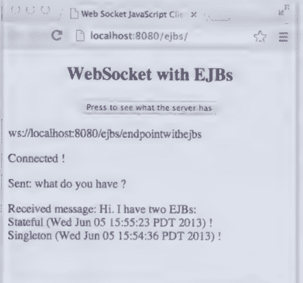
图 8-5。后续连接时的 EJB 示例

注意这次，单例豆显示它们是在同一时间创建的。然而，有状态豆显示是在不同的时间创建的。这是因为单例豆跨所有连接共享，而有状态豆每个连接唯一。

> **注意** 高级开发者可以通过创建自定义的 `ServerEndpointConfigurator` 类并重写以下方法来覆盖实例创建：
>
> ```java
> public T getEndpointInstance(Class<T> c)
> ```
>
> 如果你不重写此方法，Java EE 平台将为你创建实例。你可以通过使用 `WebSocketContainer` 以下任一方法来管理你自己的实例，取决于你的风格：
>
> ```java
> Session connectToServer(EndpointInstance, ClientEndpointConfig cec, URI path)
> ```
>
> ```java
> Session connectToServer(Object annotatedInstance, URI path)
> ```
>
> ```java
> Session connectToServer(Class<? extends Endpoint> endpointClass, ClientEndpointConfig cec, URI path)
> ```
>
> ```java
> Session connectToServer(Class<?> annotatedClass, URI path)
> ```

## Chat Redux 示例

还记得第 4 章中的聊天示例吗？尽管它很好，但相当有限。对于该示例，每次刷新页面，所有聊天数据都会丢失，因为页面上的 WebSocket 会关闭。当你加载另一个页面并返回聊天页面时也会发生这种情况。在 Chat Redux 中，我们将应用在本章中学的一些简单技术将聊天信息存储在 `HttpSession` 中，并将持有所有分组信息的聊天记录代码移动到 EJB 中，以便多个 Servlet 共享。

在查看代码之前，让我们从用户的角度快速查看应用程序发生了变化。

当你第一次登录时，你会看到主页面上有一些新元素（图 8-6）。注意在页面底部，HTML 中显示了用户名，并且有一个用于查找聊天数据的链接。点击该链接将带你进入聊天数据的各种形式分类（图 8-7）。再次注意页面的 HTML 记得你在上一个页面聊天会话中的用户名。与此同时，如果你移动到此页面时是以另一个参与者的身份登录的，当你离开页面时会生成一条新消息（图 8-8），说你离开了房间了一分钟。当你回到主聊天页面时，

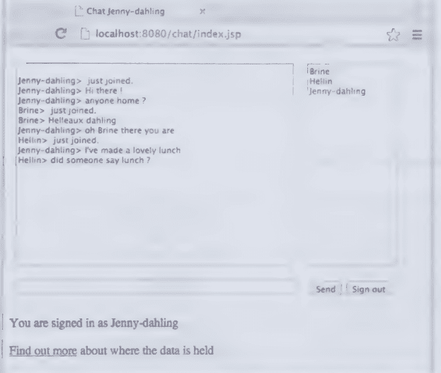
图 8-6。聊天主窗口

# 214 Java WebSocket 编程

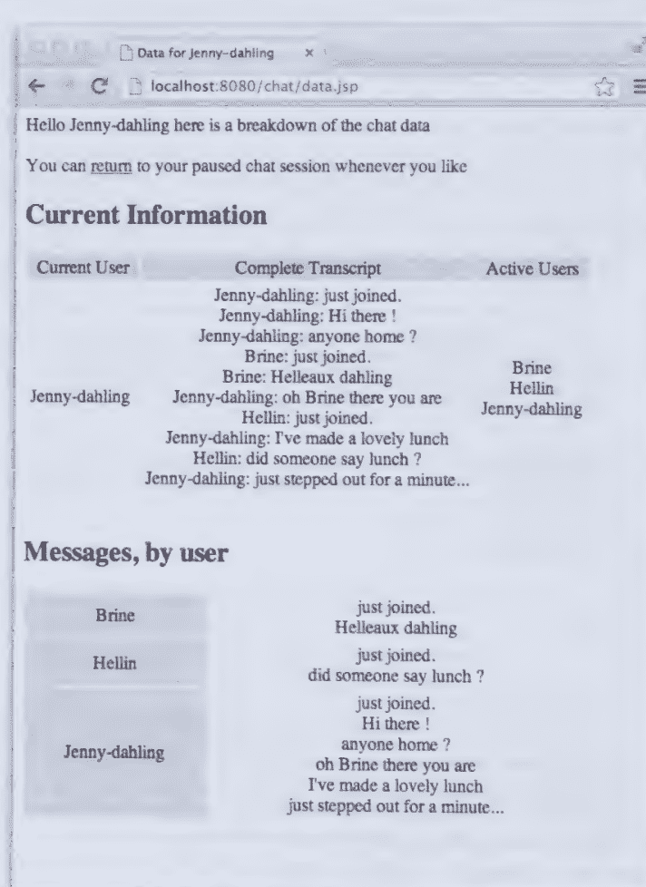
图 8-7。聊天数据窗口

# 第 8 章：Java EE 平台中的 WebSockets 215

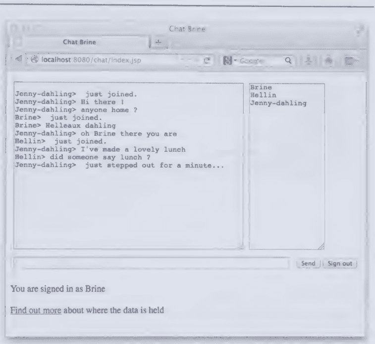
你以 Brine 的身份登录
了解更多关于数据存储的位置
图 8-8。你离开期间的聊天主窗口

你会发现所有的聊天会话数据都已被“记住”了，而且，每个人都被通知了你已经回来（见图 8-9）。

让我们来看看这个应用程序的主要元素及其主要交互。聊天对话是在 `index.jsp` 页面中的 JavaScript 客户端和 `ChatServer` 端点之间管理的。`index.jsp` 额外使用 `jsp:include` 来引入 servlet `NameServlet` 的输出，它仅发送当前活跃聊天应用程序用户的用户名。该 servlet 可以轻松获取该用户名，因为它存在于 `HttpSession` 中。

# 216 Java WebSocket 编程

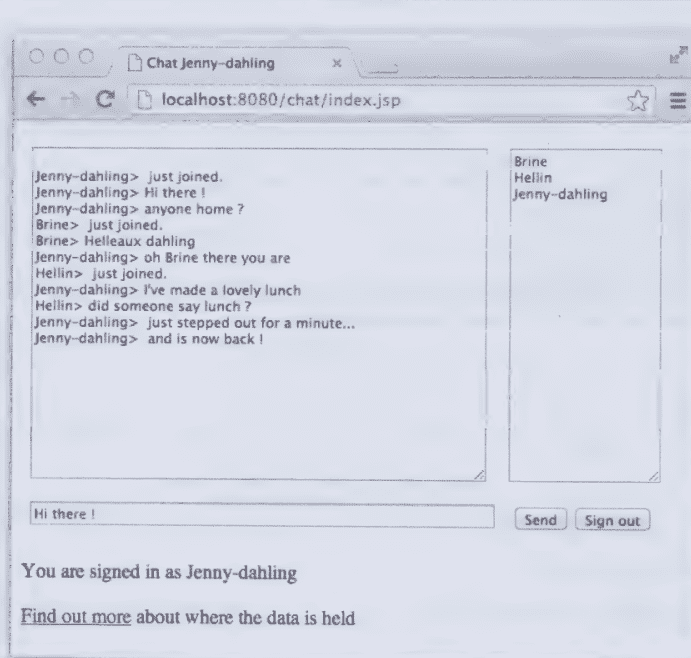
图 8-9。返回后的聊天主窗口

你会发现所有的聊天会话数据都已被“记住”了，而且，每个人都被通知了你已经回来（见图 8-9）。

让我们来看看这个应用程序的主要元素及其主要交互。聊天对话是在 `index.jsp` 页面中的 JavaScript 客户端和 `ChatServer` 端点之间管理的。`index.jsp` 额外使用 `jsp:include` 来引入 servlet `NameServlet` 的输出，它仅发送当前活跃聊天应用程序用户的用户名。该 servlet 可以轻松获取该用户名，因为它存在于 `HttpSession` 中。

# 217 Java WebSocket 编程

## 代码列表：NameServlet Process 方法

```java
protected void processRequest(HttpServletRequest request, HttpServletResponse response) throws ServletException, IOException {
    response.setContentType("text/html;charset=UTF-8");
    PrintWriter out = response.getWriter();
    try {
        HttpSession session = request.getSession();
        String username = (String) session.getAttribute(ChatServer.USERNAME_KEY);
        out.println(username);
    } finally {
    }
}
```

当 `ChatServer` 处理新用户请求时，用户名会被存放在 `HttpSession` 中，正如你在这段 `ChatServer` 端点的代码摘录中所看到的那样。

## 代码列表：ChatServer 处理新用户

```java
void processNewUser(NewUserMessage message) {
    String newUsername = this.validateUsername(message.getUsername());
    this.confirmUser(newUsername);
    this.registerUser(newUsername);
    this.broadcastUserList();
    this.sendTranscript();
    this.addMessage(" just joined.");
}

private void registerUser(String username) {
    this.httpSession.setAttribute(USERNAME_KEY, username);
    this.updateUserList();
}
```


`ChatServer` 使用 `TranscriptBean` 来存储记录并维护当前活跃用户列表。`TranscriptBean` 标记了 `@Singleton` 注解，因此每个应用程序只有一个该 EJB 实例。这意味着所有的 `ChatServer` 实例都共享同一个 `TranscriptBean` 实例，每个人都在读写同一个记录。这也是驱动 `data.jsp` 页面数据输出的 servlet 所使用的应用程序全局记录实例，以便在页面上生成数据输出。这些 servlet 分为 `TranscriptServlet`、`UsernamesServlet` 和 `UserMessagesServlet`，它们都定义了以下内容：

```
@javax.ejb.EJB
private TranscriptBean transcriptBean;
```

并依赖 Java EE 平台来正确初始化引用。`ChatServer` 使用了之前学过的配置器技术 `ChatServerConfigurator` 来获取 `HttpSession` 的引用并将其存储在 `EndpointConfig` 中。

# 218 Java WebSocket 编程

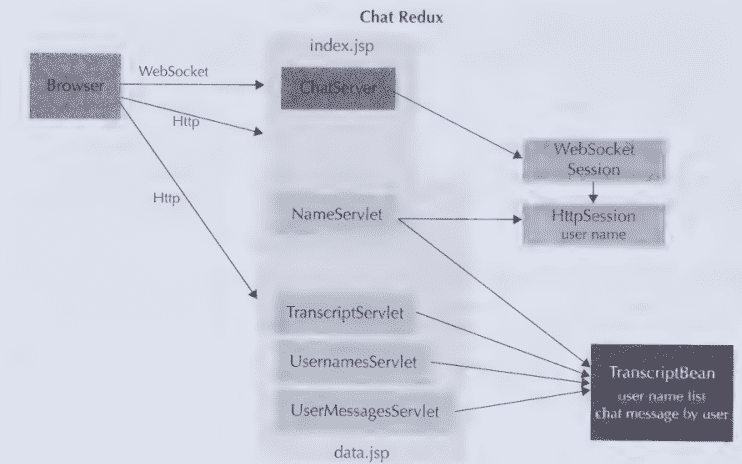

图 8-10。聊天 Redux 架构

你可以在下面的图（图 8-10）中清楚地看到此聊天应用程序的主要组件，关键应用程序信息就存储在那里。

我们留给你详细探索代码，以查看具体的关联是如何设置的，并将当 `HSession` 超时时关闭聊天会话的练习留给你。

## 总结

在本章中，我们开始探索如何通过与 Java EE 平台中其他 Java EE 组件集成，来扩展 WebSocket 服务器端点的范围。我们查看了如何将当前的 WebSocket 端点与 `HttpSession` 关联，并定位包含 Web 容器的 `ServletContext`，探索了与 Web 容器中的其他 Web 组件共享用户状态和全局应用程序状态的可能性。我们开始探索如何将其他 Java EE 组件（如 EJB）注入到 WebSocket 服务器端点中，以便使用现有的中间件 EJB 组件，并利用 EJB 组件随处可用的其他服务（如事务和数据库连接）。

最后，我们对第 4 章的聊天应用程序进行了改进，使其感知 `HttpSession`，允许它能够与单例 EJB 以及展示聊天室当前状态报告的 Web 组件共享状态，并以便在用户导航到另一个页面并在稍后返回聊天页面时，聊天会话仍然能够被复制。

我们希望这激发了你对 Java WebSockets 以及其他 Web 和 Java EE 组件进行更多探索的兴趣，以构建现代、引人注目且强大的 Web ！

# 索引

- @ClientEndpoint 注解, 28, 65
- @EJB 注解, 210, 10
- @OnClose 注解, 34
- @OnError 注解, 33–34
- @OnMessage 注解, 4, 30–33, 60
- @OnOpen 注解, 28–29, 40
- @PathParam 注解, 151–152
- @ServerEndpoint 注解, 4, 28, 39
- @Singleton 注解, 217, 确定模式为, 122–123
- MessageModes 注解和, 131
- send-by-future 方法用于, 119–120
- timeout 设置, 123
- auth-constraint 元素, 182
- 认证, 174–179
- 客户端, 175–176, 179
- 配置, 176–177
- 摘要, 175, 178
- 示例, 177–179
- 基于表单的, 175–178
- 访问级别路径参数, 165
- AccountEndpoint, 189–190
- 注解的端点，配置, 98–104
- 事件处理, 28–35
- 生命周期, 28–38–41
- 路径映射, 145
- 在其中接收消息, 55–61
- 使用 URI 模板, 151–152
- 应用程序容器, 199
- auth-method 元素, 176
- 权限, 144
- 授权, 179–183
- 配置语法, 180–182
- 示例, 182–183
- 交互序列, 184
- 确定过程, 179–180
- 聊天示例, 87–97
- 解释, 86–87
- 在 Web 容器中共享, 200–207
- 任意对象, 57
- 异步消息传递, 118–123
- 回调处理方法用于, 120–122
- 基础认证, 174–175, 177
- 批处理消息, 123–123
- beans.xml 文件, 208
- 摘要帧, 25
- 消息() 方法, 133
- 异步消息处理, 117
- 帧
- 消息事件, 30, 31, 42, 133
- 在注解端点中接收, 55
- 在端点中接收, 63
- 返回类型用于, 60
- 总结选项, 128–129
- 同步模式用于, 50–52
- 客户端认证, 175–176, 179
- @ClientEndpoint 注解, 28, 65
- ClientEndpoint.Configurator, 103–104
- ClientEndpoint 实例, 54
- 创建, 7
- 周期, 36–38
- MessageModes 注解和, 131
- send-by-future 方法用于, 119–120
- timeout 设置, 123
- auth-constraint 元素, 182
- 认证, 174–179
- 客户端, 175–176, 179
- 配置, 176–177
- 摘要, 175, 178
- 示例, 177–179
- 基于表单的, 175–178
- 访问级别路径参数, 165
- AccountEndpoint, 189–190
- 注解的端点，配置, 98–104
- 事件处理, 28–35
- 生命周期, 28–38–41
- 路径映射, 145
- 在其中接收消息, 55–61
- 使用 URI 模板, 151–152
- 应用程序容器, 199
- auth-method 元素, 176
- 权限, 144
- 授权, 179–183
- 配置语法, 180–182
- 示例, 182–183
- 交互序列, 184
- 确定过程, 179–180
- 聊天示例, 87–97
- 解释, 86–87
- 在 Web 容器中共享, 200–207
- 任意对象, 57
- 异步消息传递, 118–123
- 回调处理方法用于, 120–122
- 基础认证, 174–175, 177
- 批处理消息, 123–123
- beans.xml 文件, 208
- 摘要帧, 25
- 消息() 方法, 133
- 异步消息处理, 117
- 帧
- 消息事件, 30, 31, 42, 133
- 在注解端点中接收, 55
- 在端点中接收, 63
- 返回类型用于, 60
- 总结选项, 128–129
- 同步模式用于, 50–52
- 客户端认证, 175–176, 179
- @ClientEndpoint 注解, 28, 65
- ClientEndpoint.Configurator, 103–104
- ClientEndpoint 实例, 54
- 创建, 7
- 周期, 36–38


# 索引

## I

- `isSecure()` 调用, 186
- `isUserRole()` 调用, 187, 195
- `LifecycleEndpoint`, 35, 36
- 生命周期 示例, 35–41
- 已注解端点, 38–41
- JavaScript 客户端, 36–38
- 编程化的端点, 43–44
- 另参见 WebSocket 生命周期
- `login-config` 元素, 176, 192

## M

- 映射路径。参见 path mapping
- 匹配 URI 模板
- 相关的 API, 150–155
- 优先级规则, 158–161
- `maxBinaryMessageSize` 属性, 111
- `maxIdleTimeout` 属性, 111
- `maxMessageSize` 属性, 133
- `maxSize` 属性, 111
- `MemberConfigurer` 类, 192–195
- `MemberLevel` 对象, 165
- 消息批, 123–125
- 消息事件, 28, 30, 40
- `MessageHandler` 接口, 11, 12
- 在其中确定消息类型, 65
- 接收消息, 62–63
- 注册限制, 64–65
- 文本和二进制实现, 42
- `MessageHandler` 对象, 20, 110
- `MessageHandler.Whole<ByteBuffer>` 接口, 42
- `MessageHandler.Whole<String>` 接口, 42
- 消息处理
  - 已注解端点, 30–32, 55–61
  - 多种方法, 00–61
  - 编程化的端点, 42, 61–65
- `MessageModes` 应用, 129–140
  - 客户端端点, 133–137
  - 总体概览, 129–131
  - 审查代码, 131–137
  - 服务端端点, 131–133
  - 关于的注意事项, 137–140

## J

- Java EE 平台, 198–219
  - 架构图, 199
  - Chat Redux 示例, 212–218
  - 其中组件概览, 198–199
  - WebSocket 在其中的角色, 198–200
  - 在其中共享应用状态, 200–207
  - WebSocket 端点和 EJBs 中的, 207–212
- `java.io.InputStream`, 32
- `java.io.OutputStream`, 51
- `java.io.Reader`, 32, 40, 77
- Java I/O 流, 32
- `java.lang.Throwable` 类, 33
- Java 对象
  - 接收消息, 50–96, 63–64
  - 发送消息, 52–154
- JavaScript WebSockets。另参见 WebSockets
- `java.security.Principal` 对象, 186
- Java Servlet 模型, 198
- Java 应用, 65, 129
- `javax.websocket.Encoder` 接口, 52–54
- `javax.websocket.Endpoint` 类, 34

# 226 Java WebSocket

- `MessageClientListener`, 203
- `MessageConfigurator`, 203
- `MessageInvalidationListener`, 205
- `Message` 对象, 200–207
- Chat Redux 示例, 212–218
- 示例应用, 203–207
- `Session` 对象相关, 200–203
- 终止会话, 203, 204
- HTTP Upgrade 机制, 18
- `init()` 方法, 75, 82
- 实例, 44–45
- `ServerSocket`, 93, 96
- 覆盖创建, 212
- 整数值消息, 59
- INTEGRAL 连接, 183
- `Invalidates` 方法, 205–206
- `IOException`, 49, 51, 117
- `isLast` 参数, 50, 51, 56
- `isOpen()` 调用, 113
- `isSecure()` 调用, 186
- `isUserRole()` 调用, 187, 195
- `LifecycleEndpoint`, 35, 36
- 生命周期 示例, 35–41
- 已注解端点, 38–41
- JavaScript 客户端, 36–38
- 编程化的端点, 43–44
- 另参见 WebSocket 生命周期
- `login-config` 元素, 176, 192

## M

- 映射路径。另参见 path mapping
- 匹配 URI 模板
- 相关的 API, 150–155
- 优先级规则, 158–161
- `maxBinaryMessageSize` 属性, 111
- `maxIdleTimeout` 属性, 111
- `maxMessageSize` 属性, 133
- `maxSize` 属性, 111
- `MemberConfigurer` 类, 192–195
- `MemberLevel` 对象, 165
- 消息批, 123–125
- 消息事件, 28, 30, 40
- `MessageHandler` 接口, 11, 12
- 在其中确定消息类型, 65
- 接收消息, 62–63
- 注册限制, 64–65
- 文本和二进制实现, 42
- `MessageHandler` 对象, 20, 110
- `MessageHandler.Whole<ByteBuffer>` 接口, 42
- `MessageHandler.Whole<String>` 接口, 42
- 消息处理
  - 已注解端点, 30–32, 55–61
  - 多种方法, 00–61
  - 编程化的端点, 42, 61–65
- `MessageModes` 应用, 129–140
  - 客户端端点, 133–137
  - 总体概览, 129–131
  - 审查代码, 131–137
  - 服务端端点, 131–133
  - 关于的注意事项, 137–140

## N

- `negotiatedExtensions`, 111
- `negotiatedSubprotocols`, 111
- 非上下文 beans, 207
- 非致命错误, 26
- 通知，打开, 25–26
- `notifyServerChanged()` 方法, 72
- `notifySessionUnbound()` 方法, 206

## O

- 对象 map, 100, 101
- `@OnError` 注解, 34
- `@OnError` 注解, 33–34
- `@OnMessage` 注解, 24–30
- `@OnOpen` 注解, 28–29
- `onOpen()` 方法, 9, 10
- `onResult()` 方法, 121
- open 事件, 27–28
- 握手交互, 16–19
  - 认证和, 176, 183
  - 授权和, 179–180
  - `HttpSession` 对象和, 202
  - 查询字符串和, 157
  - 请求示例, 18
  - 响应示例, 19
  - 安全信息, 186–188
  - URI 模板以及, 149
- 打开通知, 25–26

## P

- 参数
  - 布尔值, 31
  - 存储指南, 167–168
  - 路径, 153, 154, 165, 167
  - 请求, 158
- 部分帧, 25
- 消息
  - 二进制, 51
  - 解释, 51
  - 处理的, 125–126
  - 接收, 56, 63
  - 发送, 50–51, 137–138
  - 字符串, 50
- 密码, 174–175
- 路径映射, 145–161
  - 关于的访问, 155–156
  - 端点访问, 155
  - 精确 URI 映射, 145–148
  - 相关的指南, 167–168

# 索引 227

## P

- 匹配优先级和, 158–161
- Portfolio 应用和, 161–166
- 查询字符串和, 156–158
- 规则的, 146–148, 149–150, 155, 157, 159
- 相关的 API 摘要, 168–170
- 模板映射和, 150–155
- URI 模板路径, 148–150
- `@PathParam` 注解, 29, 151–152
- 路径参数, 153, 154, 167
- 路径属性, 105
- 映射, 145–161
- 属性的, 112
- 服务端配置, 105
- `url-pattern` 元素, 181
- ping 和 pong 帧, 24–25
- ping 消息
  - 传入的, 56
  - 发出的, 48–49, 113, 116, 128
  - 另看 pong 消息
- pong-pong 交互, 116–118
- 纯 Java 对象 (POJO), 3, 4
- `PongMessage` 接口, 30
- pong 消息
  - 处理方法, 137
  - 接收的, 55, 57, 113, 116, 117
  - 发出的, 48–49, 117–118, 128
  - 另看 pong 消息
- Portfolio 应用, 161–166
  - 代码列表, 163–164
  - 截图, 162, 163
- `PortfolioBroadcastEndpoint`, 163–166, 188–189, 194–195
- `PortfolioUpdateEncoder`, 166
- 端口号, 144
- 私有通信, 183–185
- `ProgrammaticEchoServer` 类, 12, 13
- 程序化端点, 9–15
  - 与注解注解端点的对比, 9, 15
  - 配置, 98–99, 104
  - Decoder 配置, 64
  - 生命周期, 41–42, 43–44
  - 消息处理, 42
- 路径映射的, 145–146
  - 在其中接收消息, 61–65
  - 属性映射表, 97, 100
  - `protocolVersion` 属性, 111
- 发布端点. 另看路径映射

## Q

- 查询字符串, 145, 156–158, 167

## R

- `Reader` 参数, 32, 40, 57
- `realm-name` 元素, 176
- 接收消息, 55–66
  - 在未注解的端点中, 55–61
  - ping-pong 交互, 116–117
  - 在程序化端点中, 61–65
- `RemoteEndpoint.Async` 接口, 12, 48, 49, 118–123
  - 确定发送模式, 122–123
  - `Future` 对象和, 119–120
  - `endHandler` 接口和, 120–122
  - 超时设置和, 123
- `RemoteEndpoint.Basic` 接口, 12, 48, 49–54
  - 二进制消息和, 50–52
  - Java 对象作为消息和, 52–54
  - 使用发送消息, 48, 49–54
  - 字符串消息和, 49–50
- `RemoteEndpoint.object`, 12, 19, 110
- `removeAttribute(method)`, 205
- 请求参数, 158
- turn 类型, 60
- turn 值, 32–33
- 角色, 用户, 179, 182, 183
- 规则
  - 路径映射, 146–148, 149–150, 155, 157, 159
  - URI 模板, 149–150, 155
- 运行时
  - 访问路径信息, 155–156
  - 处理运行时错误, 34

# 228 Java WebSocket 编程

## S

- `ServerApplicationConfig` 接口, 12–14, 15–16
- `@ServerEndpoint` 注解, 4, 28, 39
- `ServerEndpointConfig.Configurator`, 106–109, 212
- `ServerEndpointConfig` 对象, 13
- 服务端点, 93–94
- 服务端端点
  - 类级注解, 28
  - 配置, 99, 95–109
  - 安全属性, 111
- `ServletContext` 对象, 200, 207
- `ServletEndpointConfig.Configurator`, 97
- `SessionException`, 33
- `Session` 对象, 10, 11, 99–114
  - 认证, 174–179
  - 授权, 179–183
  - 约束元素, 182–183
  - 私有通信, 183–185
  - 关于信息, 186
  - WebSocket API, 186–198
  - 安全约束元素, 180, 184, 185
  - `close()` 方法, 113–114
  - 连接属性, 111
  - 创建, 109–110
  - 消息事件, 30
  - 打开事件, 29, 40
  - 路径属性, 112
  - `MessageHandlers`, 110
  - `RemoteEndpoints`, 110
  - 会话管理, 113
  - 会话, 109–114
  - 安全角色元素, 182
  - `sendAsyncFuture()` 方法, 138
  - `sendAsyncWithHandler()` 方法, 138
  - send-by-future 方法, 119–120
  - `sendCompleted()` 方法, 140
  - `sendDrawing()` 方法, 79, 80
  - `sendHandler` 接口, 120–122
  - 发送消息, 48–54
    - 异步地, 118–123
    - 二进制消息, 50–52
    - 回调方法, 120–122
    - Java 对象作为, 52–54
    - ping 消息, 48–49, 113, 116
    - pong 消息, 48–49, 117–118
    - 字符串消息, 49–50
    - 关于表格, 128–139
  - `sendLinePieces()` 方法, 137–138
  - `sendObject()` 方法, 53, 54, 121
  - `sendPing()` 方法, 56, 117, 137
  - `sendResult` 对象, 121
  - 关闭连接, 113–114
  - 连接属性, 111
  - 生命周期, 109–114
  - 管理, 113
  - 路径属性, 112
  - `setBatchAllowed` 方法, 124
  - `setTimeout()` 调用, 136
  - `Shape` 类, 68–69
  - `ShapeCreated()`, 77, 79
  - 共享 Web 应用, 200–207
  - `HttpSession` 应用, 203–207
  - `HttpSession` 到 WebSocket Session, 202–203


# 索引 229

## S

- 单线程模型, 82
- `@Singleton` 注解, 217
- 单例 Bean
  - 异步发送模式, 120, 121
  - 处理方法, 30, 31, 42
  - 在注解端点中, 55
  - 在程序化端点中, 62, 63
  - 返回类型, 60
  - 发送选项摘要, 128
  - 同步发送模式, 49–50
  - EJB 使用示例, 210, 211
  - 有状态会话 Bean, 208–209
- SSL 安全, 184
- `startChannel()` 方法, 96
- `startUpdates()` 方法, 165
- 有状态会话 Bean
  - EJB 使用示例, 210, 211
  - 单例 Bean 对比, 208–209
- Stock 账户应用, 118–195
  - 部署描述符, 190–191
- `MemberLevelConfigurator`, 192–195
- 另看二进制消息
- 文本数据帧, 25
- Encoder 和 Decoder 生命周期, 82
- 消息处理, 81–82
- 实现, 45
- `TimeoutException`, 123
- 截图, 90, 189
- `StockData` 对象, 165–166
- 字符串消息, 49–50
- `String` 参数
  - 异步发送, 123, 139–140
  - `MessageModes` 客户端, 136
  - `TranscriptBean`, 217
  - `Transcript` 类, 95
  - 传输保证元素, 185
- 消息事件, 30, 31
- 打开事件, 29
- 返回类型和, 60
- 消息和, 55, 57
- 子协议
  - Chat 应用, 96–97
  - 客户端, 103, 104
  - 解释, 102
  - 属性, 96
  - 名称列表, 103
  - 服务端, 105–106
  - 同步消息, 48–54
  - 二进制消息, 50–52


# 索引

## Java
- Java 对象作为, 52–54

## 统一资源标识符
- 另见 URIs

## 精确映射
- 145–148

## 限制
- 168

## 匹配
- 158–161

## 路径属性和
- 112

## 查询字符串中的
- 156–158

## 模板匹配
- 150–155

## 模板路径
- 148–150

## 术语
- 144

## URI 标识符
- 148–150

## 等效于
- 154–155

## 消息
- 50–51

## 字符串消息
- 49–50

# T
- TCP (传输控制协议), 19
- `textMessage()` 方法, 33

# 230 Java WebSocket 编程

## W
- WebSocket 容器, 212
- URI 模板（续）
- Portfolio 应用, 161–166
- 相关的规则, 149–150
- 有效于, 154
- URL 重写, 200
- 用户数据约束, 184–185
- UserMessages, 217
- 用户认证, 174–179
- UserServlet, 211
- 用户映射属性, 111
- 用户角色, 179, 182, 183
- WebSocket 生命周期, 24–25
- WebSocket 协议, 25
- WebSocket 扩展. 另见扩展
- WebSocket 生命周期, 24–45
    - 注解端点, 28–35
    - 事件处理, 28–41
    - 概述, 25–27
    - 实例和线程, 44–45
    - Java 组件, 27–28
    - 程序化端点, 41–44
    - 示例应用, 35–41
    - 会话生命, 109–114
    - 线程, 82
- WebSocket 协议和, 25
    - 另见生命示例
- WebSocket 消息. 另见消息
- WebSocket 握手. 另见握手交互
- WAR 文件
    - 部署, 5–16
    - URI 命名空间, 146
    - Web 应用, 146
    - 在 Java EE 中描述的, 198
    - 共享应用状态, 200–207
    - `WEB-INF` 目录, 208
    - 资源集合元素, 181
    - 资源集合名称元素, 181
- WebSocket API, 2
    - 基础对象, 11–15
    - 消息基础, 48
    - 路径映射摘要, 168–170
    - 安全 API, 186–188
    - URI 模板匹配, 150–155
- WebSocket 应用, 2–8
    - 客户端创建, 5–7
    - 端点创建, 3–5
    - 端点部署, 5–16
- WebSocket 协议, 2, 24–25
    - 认证, 176
    - websocket 方案, 144
    - 消息协议, 19–20
- WebSockets
    - 创建 JavaScript, 36
    - 在 Java 平台中的角色, 198–200
- WebSocket 安全 API, 186–188
- WebSocket 子协议. 另见子协议
- `web.xml` 文件, 177, 180, 182
    - `whenClosing()` 方法, 41
    - `whenGettingMessage()` 方法, 44, 45
    - `whenOpening()` 方法, 45
    - 通配符路径, 181
    - `willDecode()` 方法, 58, 75, 101
- Writer API, 49–50
- wss 安全, 184

---

# 我可以将 Java 代码复制到 HTML 扩展中吗？

# Java 用户小组活动非常精彩...

# 我是这样代码的...

# 这是我如何使用 Oracle JDeveloper 的...

# 你报名参加 JavaOne 了吗？

# 限制性任务重新分配是如何工作的？

# 我提交了 JavaOne 的征稿...

# 如果你想按照自己的风格重新格式化代码，尝试这种方法...

# 在哪里可以找到关于 Java ME 失败的技术文章？

Oracle 技术网络（OTN）。它是共享专业知识的代码。

来到这个地方，与其他 IT 专业人士就 Java 的方方面面协作。

Oracle 技术网络是全球最大的使用 Java 以及结合 Oracle 行业标准技术的开发者、管理员和架构师的社区。

注册免费会员，即可访问：

- 讨论论坛和实践实验室
- 免费下载的软件和示例代码
- 产品文档
- 成员贡献的内容

利用我们的全球知识网络。

立即加入 ▷ 前往：`oracle.com/technetwork/java`


# 你是否获得了 Oracle 认证？

展示你的 Oracle 专业知识

领先一步

# 获取 Oracle 认证的 5 大理由

1. 证明你对 Oracle 行业领先技术的精通
2. 提高你的知名度，让你脱颖而出
3. 获得竞争优势并提高你的收入潜力
4. 证明你致力于自己的职业成长
5. 提升你的个人表现

超过 100 万名经过认证的技术人员证明了这一顶尖行业公认凭证的重要性，它是取得领先并保持领先的最佳方式之一。

购买认证折扣包节省费用并获得免费补考机会


了解更多信息请访问：`oracle.com/education/packages`


# 硬件与软件

为协同而设计


# ORACLE ACE 程序

# 需要帮助？需要咨询吗？需要明智的意见吗？

保持联系

`oracle.com/technetwork/oracleace`

- oraclesace
- @oraceace
- `blogs.oracle.com/oraceace`

你需要一位 Oracle ACE

Oracle 合作伙伴、开发者和客户向 Oracle ACE 和 Oracle ACE 主监寻求专注的产品专业知识、系统和解决方案讨论，以及针对广泛数据中心实施的明智意见。

他们的资历与 Oracle 产品和技术专家、社区爱好者以及解决方案倡导者的实力一样强大。

现在是进一步了解这个精英群体——或提名一位优秀的同事的绝佳时机。

有关 Oracle ACE 程序的更多信息，请访问：`oracle.com/technetwork/oracleace`

# ORACLE

# 通过 Oracle 出版集团覆盖超过 700,000 名 Oracle 客户

连接对你业务最重要的受众

| 出版物 | 说明 | 发行量 | 受众 |
| :--- | :--- | :--- | :--- |
| **Oracle Magazine** | 全球最大的 IT 出版 | 550,000 | IT 经理、DBA、程序员和开发者 |
| **Profit** | 为企业级业务领导者提供的商业洞察，帮助他们利用 Oracle 技术构建更好的业务 | 100,000 | 高级主管和业务部门经理 |
| **Java magazine** | Java 技术、Java 编程语言和基于 Java 应用程序的核心来源 | 125,000 且稳定增长中 | 公司和独立 Java 开发者、程序员和架构师 |

欲了解更多信息或注册免费订阅：扫描二维码访问 Oracle 在线出版平台。


# 使用 Java WebSocket 精通应用开发

构建充分利用最先进通信技术的动态企业 Web 应用程序。由 Java WebSocket 编程领域的领先专家编写的 Oracle Press 指南提供了实用的开发策略和详细的示例应用程序。《Java WebSocket Programming》解释了如何设计客户端/服务器应用程序、整合全双工消息、建立连接、创建端点、处理路径映射以及安全数据。你将学习如何加密 Web 传输并使用 Java WebSocket 增强旧应用程序。

- 使用 Java WebSocket API 开发 Web 应用
- 创建并发布基于注解和程序的端点
- 管理 WebSocket 端点的生命周期事件
- 在端点生命周期内维护可靠连接
- 为复杂消息定义编码和解码策略
- 配置消息超时、大小限制和异常
- 映射消息路径并将 URI 路由到 Web 容器
- 安全数据、验证用户并加密连接

欲查看完整的 Oracle Press 书单，请访问 `www.OraclePressBooks.com`

了解更多。成就更多：`MHPROFESSIONAL.COM`

在 Twitter 上关注我们 `@OraclePress`

$40.00 USD

ISBN 978-0-07-182719-5

MHID 0-07-182719-6

同样提供电子书

Java/Oracle


