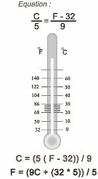
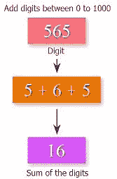
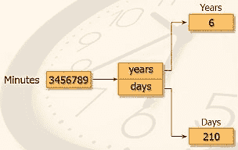
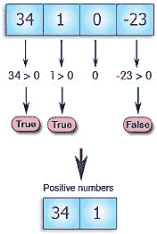
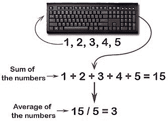
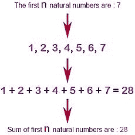
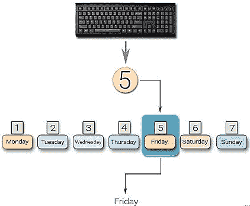

# Java 考试与面试练习指南


- 计算所有数字位之和的 Java 程序
- 计算复利的 Java 程序
- 寻找最大数的 Java 程序
- 运行应用程序的 Java 程序
- 打印斐波那契序列的 Java 程序
- 使用 `for` 循环打印 1 到 N 的数字
- Java 数据类型练习
- 华氏度转摄氏度
- Java 数据类型练习：英寸到米
- 相整数中所有数字的和
- 让用户输入分钟
- 读取数字并显示其平方
- Java 条件语句：练习
- 检查数字是负数、零还是正数
- 输入 5 个数字并计算和和平均值
- 显示 n 项自然数及其和
- 显示 1 到 7 之间的星期几
- 使用 `while` 循环打印 1 到 N 的数字
- 一维数组和二维数组的加法
- 十进制转二进制的 Java 程序
- 逐行读取文件的 Java 程序

## 计算所有数字位之和的 Java 程序

给定一个数字，我们必须使用 Java 程序找到它所有数字位的和。

### 示例 1

输入：

数字：852

输出：

所有数字之和：15

### 示例 2

输入：

数字：256868

输出：

所有数字之和：35

### 程序

```java
import java.util.Scanner;

public class AddDigits {
    public static void main(String args[]) {
        // 初始化和声明对象。
        int num, rem=0, sum=0, temp;
        Scanner scan = new Scanner(System.in);
        //在此处输入数字。
        System.out.print("Enter the Number : ");
        num = scan.nextInt();
        // temp 用于存储数字。
        temp = num;
        while(num>0) {
            rem = num%10;
            sum = sum+rem;
            num = num/10;
        }
        System.out.print("Sum of Digits of " +temp+ " is : " +sum);
    }
}
```

### 输出

首次运行：

```text
Enter the Number : 582

Sum of Digits of 582 : 15
```

第二次运行：

```text
Enter the Number : 256868

Sum of Digits of 256868 : 35
```

## 计算复利的 Java 程序

给定本金、利率和时间，必须使用 Java 程序找到复利。

### 示例

输入本金：5000

输入利率：5

输入时间：3

金额：5788.1250000000

复利：788.1250000000

### 程序

```java
import java.util.Scanner;

public class CompoundInterest {
    public static void main(String args[]) {
        // 定义并初始化。
        double A=0,Pri,Time,t=1,CI;
        // 创建对象。
        Scanner S=new Scanner(System.in);
        //在此处输入本金、利率、时间
        System.out.print("Enter Principal : ");
        Pri=S.nextFloat();
        System.out.print("Enter Rate : ");
        Rate=S.nextFloat();
        System.out.print("Enter Time : ");
        Time=S.nextFloat();
        Rate=(1 + Rate/100);
        for(int i=0;i<Time;i++)
            t*=Rate;
        A=Pri*t;
    }
}
```

注：原文代码中 `Rate` 变量未定义，此处保留原样逻辑。

### 输出

首次运行：

```text
Enter Principal : 5000

Enter Rate : 5

Enter Time : 3

Amount : 5788.1250000000

Compound Interest : 788.1250000000
```

输入值 `n`：15

数字为：

1, 2, 3, 4, 5, 6, 7, 8, 9, 10, 11, 12, 13, 14, 15

## Java 数据类型练习

### 华氏度转摄度



### Java 代码

```java
import java.util.Scanner;
public class Exercise1 {
    public static void main(String[] Strings) {
        Scanner input = new Scanner(System.in);
        System.out.print("Input a degree in Fahrenheit: ");
        double fahrenheit = input.nextDouble();
        double celsius =(( 5 *(fahrenheit - 32.0)) / 9.0);
        System.out.println(fahrenheit + " degree Fahrenheit is equal to " + celsius + " in Celsius");
    }
}
```

### 输出

```text
Input a degree in Fahrenheit: 212
212.0 degree Fahrenheit is equal to 100.0 in Celsius
```

## Java 数据类型练习：英寸转米

编写一个 Java 程序，接收英寸值并将其转换为米。

### 英寸转米

1 INCH = 0.025400 METERS

2 INCH = 0.050800 METERS

3 INCH = 0.076200 METERS

4 INCH = 0.101600 METERS

5 INCH = 0.127000 METERS

6 INCH = 0.152400 METERS

### Java 代码

```java
import java.util.Scanner;
public class Exercise2 {
    public static void main(String[] Strings) {
        Scanner input = new Scanner(System.in);
        System.out.print("Input a value for inch: ");
        double inch = input.nextDouble();
        double meters = inch * 0.0254;
        System.out.println(inch + " inch is " + meters + " meters");
    }
}
```

### 输出

```text
Input a value for inch: 1000
1000.0 inch is 25.4 meters
```

## 计算整数所有各位数字之和

编写一个 Java 程序，接收 0 到 1000 之间的整数，并计算所有各位数字之和。



### Java 代码

```java
import java.util.Scanner;
public class Main {
    public static void main(String[] Strings) {
        Scanner input = new Scanner(System.in);
        System.out.print("Input an integer between 0 and 1000: ");
        int num = input.nextInt();
        int firstDigit = num % 10;
        int remainingNumber = num / 10;
        int SecondDigit = remainingNumber % 10;
        remainingNumber = remainingNumber / 10;
        int thirdDigit = remainingNumber % 10;
        remainingNumber = remainingNumber / 10;
        int fourthDigit = remainingNumber % 10;
        int sum = thirdDigit + SecondDigit + fourthDigit;
        System.out.println("The sum of digits in " + num + " is " + sum);
    }
}
```

### 输出

```text
Input an integer between 0 and 1000: 565
The sum of all digits in 565 is 16
```

## 获取用户输入分钟并打印年和天数

编写一个 Java 程序，将分钟转换为年和天数。



### Java 代码

```java
import java.util.Scanner;
public class Exercise4 {
    public static void main(String[] Strings) {
        double minutesInYear = 60 * 24 * 365;
        Scanner input = new Scanner(System.in);
        System.out.print("Input the number of minutes: ");
        double min = input.nextDouble();
        long years = (long) (min / minutesInYear);
        int days = (int) (min / 60 / 24) % 365;
        System.out.println((int) min + " minutes is approximately " + years + " years and " + days + " days");
    }
}
```

### 输出

```text
Input the number of minutes: 3456789
3456789 minutes is approximately 6 years and 210 days
```

## 读取一个数字并显示平方、立方和四次方

编写一个 Java 程序，读取一个数字并显示该数字的平方、立方和四次方。

### Java 代码

```java
import java.util.Scanner;
public class Exercise8 {
    public static void main(String[] args) {
        Scanner in = new Scanner(System.in);
        System.out.print("Input the side length value: ");
        double val = in.nextDouble();
        System.out.printf("Square: %12.2f\n", val * val);
        System.out.printf("Cube: %14.2f\n", val * val * val);
        System.out.printf("Fourth power: %6.2f\n", Math.pow(val, 4));
    }
}
```

### 输出

```text
Input the side length value: 15
Square:       225.00
Cube:       3375.00
Fourth power: 50625.00
```

## 条件语句：判断数字是负数、零还是正数



### Java 代码

```java
import java.util.Scanner;
public class Exercise27 {
    public static void main(String[] args) {
        Scanner in = new Scanner(System.in);
        System.out.print("Input a number: ");
        int n = in.nextInt();
        if (n > 0) {
            System.out.println("positive");
        } else if (n < 0) {
            System.out.println("negative");
        } else {
            System.out.println("zero");
        }
    }
}
```

### 输出

```text
Input a number: 7
positive
```

## 输入 5 个数字求和和平均值



### Java 代码

```java
import java.util.Scanner;
public class Exercise12 {
    public static void main(String[] args) {
        int i, n=0, s=0;
        double avg;
        System.out.println("Input the 5 numbers : ");
        for (i = 0; i < 5; i++) {
            Scanner in = new Scanner(System.in);
            n = in.nextInt();
            s += n;
        }
        avg = s / 5;
        System.out.println("The sum of 5 no is : " + s + "\nThe Average is : " + avg);
    }
}
```

### 输出

```text
Input the 5 numbers : 1
2
3
4
5
The sum of 5 no is : 15
The Average is : 3.0
```

## 显示 n 项自然数及其和

输入数字：7



### Java 代码

```java
import java.util.Scanner;
public class Exercise11 {
    public static void main(String[] args) {
        int i, n, sum=0;
        {
            Scanner in = new Scanner(System.in);
            System.out.print("Input number: ");
            n = in.nextInt();
        }
        System.out.println("The first n natural numbers are : " + n);
        for (i = 1; i <= n; i++) {
            System.out.println(i);
            sum += i;
        }
        System.out.println("The Sum of Natural Number upto " + n + " terms : " + sum);
    }
}
```

### 输出

```text
Input number: 7
The first n natural numbers are : 7
1
2
3
4
5
6
7
The Sum of Natural Number upto 7 terms : 28
```

前 n 项自然数之和：28

## 显示 1 到 7 之间的星期



### Java 代码


```java
import java.util.Scanner;

public class Exercise5 {
    public static void main(String[] args) {
        Scanner in = new Scanner(System.in);
        System.out.print("Input number: ");
        int day = in.nextInt();
        System.out.println(getDayName(day));
    }

    // 获取周几名称
    public static String getDayName(int day) {
        String dayName = "";
        switch (day) {
            case 1: dayName = "Monday"; break;
            case 2: dayName = "Tuesday"; break;
            case 3: dayName = "Wednesday"; break;
            case 4: dayName = "Thursday"; break;
            case 5: dayName = "Friday"; break;
            case 6: dayName = "Saturday"; break;
            case 7: dayName = "Sunday"; break;
            default: dayName = "Invalid day";
        }
        return dayName;
    }
}
```

### 输出

```text
Input number: 3
Wednesday
```

## 使用 `while` 循环打印 1 到 N 的数字

### 程序

```java
import java.util.Scanner;

public class Print_1_To_N_UsingWhile {
    public static void main(String[] args) {
        // 循环计数器
        int i = 1;
        // 创建 scanner 对象
        Scanner Sc = new Scanner(System.in);
        // 输入 "n" 的值
        System.out.print("Enter the value n : ");
        // 读取值
        int n = Sc.nextInt();
        System.out.println("Numbers are : ");
        while (i <= n) {
            System.out.println(i);
            i++;
        }
    }
}
```

### 输出

```text
Enter the value n : 15
Numbers are :
1
2
3
4
5
6
7
8
9
10
11
12
13
14
15
```

## Java 程序中一维数组和二维数组的相加

### 有 2 个程序：两个一维数组相加，两个二维数组相加

### 1) Java 中两个一维数组相加

```java
class AddTwoArrayClass {
    public static void main(String[] args) {
        // 数组的声明与初始化
        int a[] = {1, 2, 3, 4, 5};
        int b[] = {6, 7, 8, 9, 10};
        // 实例化第三个数组存储结果
        int c[] = new int[5];
        for (int i = 0; i < 5; ++i) {
            // 两个数组相加结果存储在第三个数组中
            c[i] = a[i] + b[i];
            // 显示结果
            System.out.println("Enter sum of " + i + "index" + " " + c[i]);
        }
    }
}
```

### 输出

```text
Enter sum of 0index 7
Enter sum of 1index 9
Enter sum of 2index 11
Enter sum of 3index 13
Enter sum of 4index 15
```

### 2) Java 中两个二维数组相加

```java
class AddTwoArrayOf2DClass {
    public static void main(String[] args) {
        // 二维数组的声明与初始化
        int a[][] = {{1, 2, 3}, {4, 5, 6}};
        int b[][] = {{7, 8, 9}, {10, 11, 12}};
        // 实例化第三个数组存储结果
        int c[][] = new int[2][3];
        for (int i = 0; i < 2; ++i) {
            for (int j = 0; j < 3; ++j) {
                // 两个数组相加结果存储在第三个数组中
                c[i][j] = a[i][j] + b[i][j];
                System.out.println("Enter sum of " + i + " " + j + "index" + " " + c[i][j]);
            }
        }
    }
}
```

### 输出

```text
Enter sum of 0 0index 8
Enter sum of 0 1index 10
Enter sum of 0 2index 12
Enter sum of 1 0index 14
Enter sum of 1 1index 16
Enter sum of 1 2index 18
```

## Java 将十进制转换为二进制的程序

给定一个整数（十进制）数字，并使用 Java 程序将其转换为二进制。

### 程序

```java
// Scanner 类用于从用户处获取输入
import java.util.Scanner;

class DecimalToBinary {
    public static void main(String[] args) {
        // 创建 Scanner 对象
        Scanner sc = new Scanner(System.in);
        System.out.println("Enter Any Number :");
        // 获取用户输入
        int input_decimal_num = sc.nextInt();
        String binary_string = "";
        // 循环持续直到 input_decimal_num > 0
        while (input_decimal_num > 0) {
            // 余数加到字符串
            binary_string = input_decimal_num % 2 + binary_string;
            input_decimal_num = input_decimal_num / 2;
        }
        // 显示最终结果
        System.out.println("Conversion of binary is : " + binary_string);
    }
}
```

### 输出

```text
Enter Any Number : 30
Conversion of binary is : 11110
```

## Java 逐行读取文件的程序

给定一个文件，并使用 Java 程序逐行读取其内容。

我们为此程序使用一个名为 `"B.txt"` 的文件，它位于 `"F:"` 盘，因此文件路径为 `"F:\B.txt"`，文件内容为：

```text
This is line 1
This is line 2
This is line 3
This is line 4
```

### 程序

```java
import java.io.FileInputStream;
import java.io.IOException;
import java.util.Scanner;

public class ReadLineByLine {
    public static void main(String[] args) {
        // 创建 scanner 类对象。
        Scanner Sc = new Scanner(System.in);
        // 输入文件名
        System.out.print("Enter the file name:");
        String sfilename = Sc.next();
        Scanner Sc1 = null;
        FileInputStream fis = null;
        try {
            fis = new FileInputStream(sfilename);
            Sc1 = new Scanner(fis);
            // 读取数据到数据末尾
            while (Sc1.hasNext()) {
                String data = Sc1.nextLine();
                // 打印数据
                System.out.print("The file data is : " + data);
            }
        } catch (IOException e) {
            System.out.println(e);
        }
    }
}
```
