# Java 入门指南

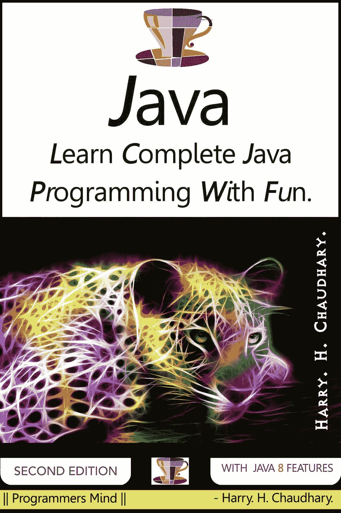

- Harry. H. Chaudhary 的其他作品。


(IT 经理 & 匿名黑客 @ 匿名国际组织)


## 出版者注

我们已尽可能确保书中包含的信息准确无误，出版者或作者 Harry. H. Chaudhary 对任何原因引起的任何错误或遗漏不承担责任。对于因依赖书中包含的技术编程或其他信息而导致的损失、失望、疏忽或其他损害，或者在提到的任何公司、个人或商号破产、清算或终止营业的情况下，任何责任均在此概不承担。

Sun Microsystems 和 Oracle 的商标是 Sun（现为 Oracle）及 Oracle 集团的商标。Sun Microsystems 和 Oracle 的商标已在其网站上列出。所有其他标记均为其各自所有者的财产。本文描述的公司、组织、产品、域名、电子邮件地址、徽标、人物、地点和事件均为虚构。无意与任何真实的公司、组织、产品、域名、电子邮件地址、徽标、人物、地点或事件存在关联，也不应推断存在关联。

作者和出版者在编写本书方面付出了努力，但对任何错误或遗漏不承担任何明示或暗示的责任。


## 献辞

本书献给所有付出牺牲的人。

献给我的父母，感谢`baji`，教我如何生活。

献给我的妻子`Priyanka`，你的笑容点亮了我的每一天。

献给我的孩子`Navneet`，你是我生命的意义，是我眼中的珍宝。

献给我的姐姐和弟弟，感谢你们教了我什么是……

献给我的朋友们，感谢你们帮助我完成。（注：基于所提供的献辞碎片文本）

## 关于作者

`Harry`是一位匿名黑客、著名的计算机程序员、畅销`Java`作者以及科学黑客专家，在计算机编程、黑客技术和网络安全领域拥有独特的经验。他曾帮助许多国家政府和全球跨国软件公司保护其网络安全。他编写了许多关于各种计算机编程语言以及计算机安全与黑客技术的书籍。他是一名技术软件工程师和硕士，是`C`编程、`C++`编程以及核心`Java`、数据结构和算法领域的权威。他拥有超过 5 年的方法论经验。他的教学和研究兴趣在人工智能和编程语言领域。

多年来的经验告诉我，许多对技术工作原理最了解的人，在解释他们所知知识并使其让我理解方面，成功率其实相当有限。我的兴趣，我相信我的技能所在，并不在于成为专家，而在于成为一名教育者，以一种合逻辑、易于消化且读起来有趣的形式呈现复杂信息，这正是我书目的。

“什么是真实？你如何定义`真实`？如果你谈论的是你能感受到的、能闻到的、能尝到的和能看到的，那么`真实`仅仅就是你的大脑所解释的电信号。”

“……我才开始发现在纸上表达想法是困难的。只要它只包含描述，它是很容易的；但当涉及到推理，以建立恰当的联系、清晰度和适度的流畅度时，对我来说，正如我所说的，这是一个我完全没有预料到的困难……”

– `HarrY`.


# 前言

# 章节

# ∞ 1 ∞

# (Java 概览)

## 简介

`Java`是一种由`Sun`公司于 1991 年开发的强大面向对象编程语言。`Java`最初是为了电子设备开发的，后来转向了互联网。现在`Java`已成为互联网广泛使用的编程语言。`Java`是平台无关语言（可以在世界上任何硬件或操作系统上运行）。`Sun`公司（`Oracle`）在 1995 年 5 月的一次大型会议上正式宣布了`Java`。通常，这样的活动不会引起这么多关注。然而，由于对万维网的极大兴趣，`Java`立即引起了商业界的关注。

### Java 的需求

`Java`的开发是因为需要一种平台无关的语言，用于创建嵌入各种消费电子设备（如微波炉和遥控器）的软件。用`C`和`C++`编写的程序针对特定的硬件和软件编译，程序无法在任何其他硬件或软件上运行。因此，我们需要为每种类型的硬件创建一个`C/C++`编译器。但创建编译器既昂贵又耗时。因此我们需要平台无关的语言。这样从该编译器编译的程序可以在任何硬件上运行。这种需求导致了`Java`的诞生。

### Java 类库

`Java`程序由称为类的部分组成。类由称为方法的部分组成，方法执行任务并在完成任务时返回信息。你可以编写所需的每个部分以形成一个`Java`程序。然而，大多数`Java`程序员都会利用`Java`类库中现有的类的丰富集合。类库也被称为`Java API`（应用程序接口）。

在本书中，我们讨论了许多类库。类库主要由编译器供应商提供，但许多类库也由独立软件供应商（`ISV`）提供。此外，许多类库可以通过互联网和万维网作为免费软件或共享软件获取。你可以下载免费软件产品并供免费使用，但须遵守版权所有者指定的任何限制。

## 典型 Java 环境的基础

`Java`系统通常由几个部分组成：环境、语言、`Java`应用程序接口（`API`）以及各种类库。以下讨论解释了一个典型的`Java`程序开发环境，`Java`程序通常需要经过五个阶段才能执行。这些阶段是：编辑、编译、加载、验证和执行。后续描述使用了`Oracle`提供的标准`Java SE 7 开发工具包`（`JDK 7`）。

如果你正在使用不同的`Java`开发环境，你可能需要遵循不同的程序来编译和执行`Java`程序。在这种情况下，请查阅你编译器的文档获取详细信息。

**注意：** 如果你没有使用`UNIX/Linux`、`Windows 95/98/ME`或`Windows NT/2000`，请参考您系统`Java`环境的手册，或询问您的导师如何在您的环境中完成这些任务（该环境可能与上述相似）。

### 阶段 1：包括编辑文件

这是通过编辑器程序（通常称为编辑器）完成的。程序员使用编辑器输入`Java`程序，并在必要时进行修正。当程序员指定保存编辑器中的文件时，程序会被存储在次级存储设备上，如磁盘。`Java`程序文件的文件名以`.java`扩展名结尾。

`UNIX/Linux`系统上广泛使用的两个编辑器是`vi`和`emacs`。在`Windows 95/98/ME`和`Windows NT/2000`上，简单的编辑程序如`DOS Edit`命令和`Windows 记事本`就足够了。

`Java`集成开发环境（`IDEs`），如`Forte for Java Community Edition`、`NetBeans`、`Borland's JBuilder`、`Symantec's Visual Cafe`和`IBM`的`Visual Age`都内置了集成到编程环境中的编辑器。

我们假设读者知道如何编辑文件。`Java`等语言是面向对象的——在此类语言上的编程被称为面向对象编程（`OOP`），允许设计人员将面向对象的设计实现为运行的系统。另一方面，`C`等语言是过程化编程语言，因此编程倾向于动作导向型。

在`C`中，编程单元是`function`。在`Java`中，编程单元是`class`，最终从类实例化对象（“创建”的华丽术语）。`Java`类包含`methods`（实现类的行为）和`attributes`（实现类的数据）。

`C`程序员专注于编写函数。执行某些共同任务的动作组被组成函数，而函数被分组成形成程序。数据在`C`中无疑是重要的，但观点是数据存在主要是为了支持函数所执行的动作。系统规范中的动词帮助`C`程序员确定实现该系统所需的函数集。

`Java`程序员专注于创建他们自己的自定义类型，称为`classes`（类）和`components`（组件）。每个`class`包含数据以及操作这些数据的函数集。`Java class`的数据组件被称为`attributes`。

`Java class`的函数组件被称为`methods`。正如内置类型（如`int`）的实例被称为`variable`一样，自定义类型（即`class`）的实例被称为`object`。程序员使用内置类型作为构建自定义类型的“构建块”。

`Java`的重点在于`classes`（我们从中创建对象）而不是函数。系统规范中的名词帮助`Java`程序员确定用于创建对象的`classes`，这些对象将协作工作实现系统。

`Classes`之于`objects`就像蓝图之于房屋。我们可以从一张蓝图建造许多房屋，也可以从一个`class`实例化许多对象。`Classes`也可以与其他`classes`建立关系。

例如，在银行的面向对象设计中，“银行柜员”`class`需要与“客户”`class`相关。这些关系被称为`associations`。我们将看到，当软件被封装为`classes`时，这些类可以在未来的软件系统中被重用。相关的`classes`组通常被封装为可重用的`components`。

你创建的每个新`class`都具有成为价值软件资产的潜力，你和其他程序员可以使用它加速并提高未来软件开发工作的质量——这是一个令人兴奋的可能性。

## Java 与 C、C++ 和 C# 的关系

`Java`从`C`派生出语法，从`C++`派生出面向对象的特性。它不是`C++`的增强版本。`Java`既不向上也不向下兼容`C++`。我想告诉你们的一点重要信息是，`Java`语言的设计并不是为了取代`C++`和`C#`。微软开发的另一种用于支持`.NET Framework`的语言`C#`与`Java`密切相关，因为它们共享`C++`和`C`风格的语法，支持分布式编程，并使用相同的对象模型。

## Java 的主要目标是实现 -

### 1. 安全性：

在使用兼容`Java`的浏览器时，没有病毒感染的威胁。此外也没有恶意程序从本地机器收集隐私信息（如信用卡号、银行余额和密码）的威胁。`Java`在网络应用程序和我们的计算机之间提供了防火墙。

### 2. 可移植性：

`Java`程序可以在运行不同操作系统和不同硬件的计算机之间迁移。

## Java 字节码

`Java`编译器的输出是`bytecode`而不是机器码（`.class`文件）。`bytecode`是一种高度优化的指令集，旨在由`Java`运行时系统执行，该系统被称为`JVM`（`Java`虚拟机）。

`JVM`是解释`bytecode`的解释器。编译后的程序运行更快，但`Java`仍然使用解释器来实现可移植性，因此`Java`程序慢一点。现在通过`Java`编译程序可以在任何环境中运行，但每个平台都需要实现`JVM`。`Java`程序是被解释的。这也有助于安全性，因为每个`Java`程序的执行都在`JVM`控制之下。

### JIT（即时编译）：

`JIT`是`JVM`用于将`bytecode`翻译成实际机器码的翻译器。它不是翻译整个`bytecodes`，而是按需翻译。

## Java 各版本

- `Java 1`：`JDK 1.0`、`JDK 1.1`
- `Java 2`：`JDK 1.2`、`JDK 1.3`、`JDK 1.4`、`JDK 1.5`或`JDK 5`、`JDK 1.6`或`JDK 6`
- `Java 1.7`或`SE 7`
- `Java SE 8`（`Java 8`，2014 年 4 月）

**注意 1：** `JDK`（`Java`开发工具包）
**注意 2：** 旧`Java`版本的许多功能被新版本弃用，但我们仍然可以使用它们。

## Java 可以开发的应用程序类型

1. **独立应用程序（Standalone Applications）：** 独立应用程序是运行在我们本地计算机上、在该操作系统下的程序，就像`C`或`C++`程序一样。
2. **小程序（Applets）：** `applet`是一种跨互联网传输并在客户端机器上由兼容`Java`的浏览器（如`Internet Explorer`或`Netscape Navigator`）执行的小程序。

`applet`不能像独立应用程序那样执行。`applet`只能通过嵌入`HTML`页面来执行，就像音频文件、图像文件或视频片段一样。

现在，这个嵌入了小程序的`HTML`页面可以在本地机器通过网络浏览器下载该`HTML`页面后运行。小程序是可以对用户输入做出响应并进行动态变化的程序。它不会重复地播放相同的动画或声音。

### 1. Web 应用程序

这些是运行在`Web`服务器上的程序。当我们通过在浏览器指定`URL`（通用资源定位符）访问网站时，网络浏览器会向`Web`服务器发送针对特定网站的请求。接收到请求后，服务器会运行一个程序，该程序被称为`Web`应用程序。我们使用`Java Servlets`和`JSP`（`Java`服务器页）来编写此类程序。

这些程序运行在服务器上，并将结果/响应发送给客户端。`JSP`页面可以看作`HTML`和`Java`代码的结合。`Web`服务器在执行之前会将`JSP`页面转换为`Java Servlets`。

当客户端请求特定的`URL`且该`URL`对应于`HTML`页面时，`Web`服务器直接将`HTML`页面返回给客户端，由客户端进行显示。如果`URL`对应`servlet`或`JSP`，则在服务器上执行并将结果/响应返回给客户端，最后由客户端显示。

### 2. 分布式应用程序

`Java`应用程序被分为可以在独立机器上运行的小型程序。这些程序中使用的对象可以相互通信。这些应用程序被称为分布式应用程序。这允许两台不同计算机上的对象远程执行过程。为此，使用了`RMI`（远程方法调用）。

---

## Java 的特性：

### 1. 简单

`Java`的语法与`C`和`C++`几乎相似，因此熟悉`C/C++`的程序员不需要从头开始学习语法。但`C/C++`中许多既复杂又导致歧义的特性在`Java`中被移除了。

1. `Java`不支持多继承，因为该概念比较复杂并可能导致歧义。
2. `Java`不支持全局变量，这导致了`C/C++`程序中出现许多 bug。
3. `Java`不使用指针，也不允许指针算术，由于固有的复杂性，指针算术是`C/C++`程序中大多数 bug 的根源。
4. `Java`不支持运算符重载，因为可能会导致混淆。
5. `Java`中没有垃圾值的概念。我们必须在变量之前初始化变量。

### 2. 安全

`Java`程序运行在`JVM`（`Java`虚拟机）内部，其他部分无法访问它们。这极大地提高了安全性。由于这一特性，`Java`程序很少发生挂起。这与频繁挂起的`C/C++`程序截然不同。`Java`的安全模型有三个主要组成部分：

1. 类加载器。
2. 字节码验证器。
3. 安全管理器。

`Java`使用不同的类加载器从本地机器和远程机器加载类文件（可执行文件）。从远程机器加载的类（如`Applet`类）不允许读取或写入本地机器的文件。这防止了恶意程序损坏本地文件系统。字节码验证器在类加载器完成工作后立即验证字节码。它确保字节码是有效的`Java`代码。这几乎消除了`Java`程序执行某些恶意活动（如访问`JVM`外部的内存）的可能性。`Security Manager`控制许多关键操作，如删除文件、创建线程等。只有当`Java`程序具有足够权限时，才允许这些操作，否则`Security Manager`不允许这些操作并生成`Security Exception`。

### 3. 可移植性

`Java`程序是平台无关的。它们遵循“一次编写，随处运行”的策略。为`Windows`平台编写的`Java`程序只需通过拷贝字节码（`.class`文件）即可运行在任何其他平台（`Unix`、`Linux`、`Sun Solaris`等）。不需要像`C/C++`程序那样复制源代码并重新编译。这一特性使得`Java`成为一种强大的语言。只要机器具有`JVM`，我们就可以在任何机器上运行字节码。`JVM`本身依赖于平台，但它让`Java`代码平台无关。实际上是`JVM`将字节码转换为机器码并执行它们。

因此我们可以说`Java`是一种可移植的语言。让`Java`高度移植的另一个特性是原始数据类型的长度与平台无关且固定的。例如，`Java`中的`int`始终是 4 字节。这与`C/C++`不同，`int`的大小在某些机器上可能是 2 字节，在另一些机器上可能是 4 字节。

### 4. 面向对象

`Java`几乎是一种纯面向对象的语言，但为了性能考虑，它支持`byte`、`short`、`int`、`long`、`float`、`double`、`char`、`boolean`等原始数据类型。

### 5. 健壮性

大多数程序失败于两个原因之一：
1. 内存管理。
2. 运行时的异常情况。

在设计语言时，目标之一是确保`Java`程序尽可能地健壮，即它们很少失败。因此，`Java`特别重视上述两个因素。

在`Java`中，内存的分配和释放由语言本身处理，这消除了`C/C++`中动态内存管理功能引起的许多问题。`Java`还支持面向对象的异常处理特性来处理运行时发生的异常情况。这允许`Java`程序在发生异常情况后能够恢复并继续执行。

### 6. 多线程

`Java`的设计是为了满足创建交互式、网络化程序的现实需求。`Java`提供了编写多线程程序的支持来实现这一点。这允许程序员编写可以并发执行许多任务的程序。

例如，一个`GUI`（图形用户界面）应用程序可能正在监听用户事件并采取行动，一个单独线程可能正在打印，另一个单独线程可能正在从网络上的机器下载文件，这一切都是并发的，这带来了更好的性能和`CPU`利用率。

其他语言也可以编写多线程程序，但只能通过使用系统调用来实现，而在`Java`中，可以通过语言本身的特性来实现。

### 7. 架构中立

程序员面临的主要问题之一是，无法保证我们今天写的程序明天还能运行——即使在同一台机器上。操作系统的升级、处理器的升级以及核心系统资源的变化可能导致程序故障。但`Java`程序的目标是“一次编写，随处运行”。

### 8. 解释执行与高性能

`Java`程序是经过解释执行的，但与其他解释器相比，它们运行得更快。

### 9. 分布式

`Java`是为互联网的分布式环境设计的。`Java`在此方面内置了各种`TCP/IP`协议。事实上，使用`URL`访问资源类似于访问本地机器上的文件。`Java`还具有远程方法调用特性，这与远程过程调用（`RPC`）某种相似。这允许不同计算机上的对象远程执行过程。`Java`为此提供了内置`API`，称为`RMI`。

### 10. 动态

每个`Java`类都是一个独立的执行单元。类仅在需要时在运行时加载。`Java`中方法绑定的默认机制也是动态的（运行时绑定）。

## 运行独立的 Java 应用程序

当`C`或`C++`程序被编译时，它被直接翻译成特定处理器或特定平台的机器码。但运行`Java`程序是一个两步过程。在`Java`中，从源代码到可执行代码的翻译是通过两个翻译器完成的：

# Java 编程概述

1. **Java 编译器** - 首先，`Java`程序被编译成字节码。字节码就像机器码，但它不是针对某个特定处理器或平台的。字节码无法直接执行。

2. **Java 解释器 (JVM)** - `Java`解释器通过`JIT`将字节码翻译成特定平台的实际机器码。

**注意 1** - `C`或`C++`程序只需编译一次，而`Java`字节码在我们每次执行`Java`程序时都会被翻译。因此，与`C/C++`程序相比，`Java`程序的运行速度稍慢。

**注意 2** - 运行`Java`程序我们需要一个文本编辑器（`Notepad`或`Edit`）、`JDK`（`Java`开发工具包）以及`JVM`（许多操作系统已内置）。我们也可以用`Eclipse`或`JCreater`代替`Notepad`。

## 在 win xp 上安装 Java 1.7

双击`我的电脑` $\rightarrow$ 双击`光驱` $\rightarrow$ 双击`JDK1.7 Java 安装文件` $\rightarrow$ 点击`Next`、`Next`、`.....`

## 设置路径 (Path)

如果我们设置了`Java`文件夹的路径，就可以在任何地方运行`Java`程序，否则我们必须在`Java`的`bin`文件夹中运行程序。

右键点击`我的电脑` $\rightarrow$ `属性` $\rightarrow$ `高级` $\rightarrow$ `环境变量` $\rightarrow$ 点击`Path`然后点击`编辑` $\rightarrow$ 点击变量值 $\rightarrow$ 按`END`键将光标移动到行末尾 $\rightarrow$ 现在输入`c:\program files\Java\jdk1.7.0_01\bin;`然后连续点击`OK`、`OK`、`OK`。

## 为 Java 程序创建一个文件夹

双击`我的电脑` $\rightarrow$ 双击`C 盘` $\rightarrow$ 右键点击 $\rightarrow$ `新建` $\rightarrow$ `文件夹` $\rightarrow$ 输入`JAVAPRG` $\rightarrow$ 按`Enter`并关闭我的电脑。

## 在命令提示符上运行 Java 程序的步骤

**步骤 1**: 进入命令提示符
`开始` $\rightarrow$ `运行` $\rightarrow$ 输入`cmd`并点击`确定`。

**步骤 2**: 输入`CD \ JAVAPRG`并按`Enter`。

**步骤 3**: 输入`Edit Sum.Java`并按`Enter`。

**步骤 4**: 输入`Java`程序并点击`文件` $\rightarrow$ `保存`然后点击`文件` $\rightarrow$ `退出`。

**步骤 5**: 输入`javac Sum.Java`并按回车进行编译。这将创建一个`Sum.class`文件。该文件被称为字节码。

**步骤 6**: 输入`java Sum`并按回车运行。这将调用`JVM`。

**步骤 7**: 输入`Exit`然后按回车退出命令提示符。

**注意** - 我们也可以通过上述步骤使用`Notepad`运行`Java`程序，但我们不使用`Edit`命令，而是使用`Notepad`。在输入完`Java`程序后，在另存为对话框中选择“所有文件”，然后将其保存到文件夹`C:\JAVAPRG`中。编译和运行仍需遵循上述步骤。

## Java 程序语法

```java


# 第一个 Java 程序

## 类的基本结构

```java
class <class name>
{
    public static void main(String args[]) or (String [] args)
    {
        // ...
    }
}
```

## 第一个 Java 程序 - 两个数字相加程序 (`Sum.Java`)

```java
class Sum
{
    public static void main(String args[])
    {
        int a,b,sum;
        a = 5;
        b = 6;
        sum = a + b;
        System.out.print("Sum is " + sum); //输出
    }
}
```

**输出**: `Sum is 11.`

## 示例 1.2 交换两个数字程序 (`Swap.Java`)

```java
class Swap
{
    public static void main(String args[])
    {
        int a=5,b=7;
        int t = a;
        a = b;
        b = t;
        System.out.print("After Swap are " + a + "," + b);
    }
}
```

**输出**: `After Swap are 7,5`

## 注释

注释有三种：
- 单行注释：`//`
- 多行注释：`/* */`
- 文档注释：`/** */`

- 每个 Java 程序必须包含一个类。
- `main()` 方法只能定义在类内部。
- 源文件可以包含任意数量的类和接口定义，但最多只能有一个公共类。
- 源文件可以不包含 `main()` 方法的类，但独立的 Java 程序始终从 `main()` 方法开始执行。因此，我们想要开始执行的类必须包含 `main()` 方法。
- `main()` 方法始终具有以下签名：`public static void main(String args[])`

**注意**: 方法原型称为签名。

- `public` 关键字表示可以在任何地方访问。
- `static` 关键字表示无需创建对象即可调用。
- `void` 关键字表示返回任何值。
- `main()` 方法接收一个参数，即 `String` 数组。
- `System` 是一个预定义类，提供系统访问，`out` 是连接到控制台的输出流。
- `print()` 方法可用于显示任何信息。

当一个 Java 对象不再被使用时，它会被垃圾回收器收集，即为对象分配的内存被添加到空闲内存的 `pool/heap` 中并可以重用。这在很大程度上简化了程序员的任务。这还消除了许多由于不当使用指针算术和内存管理功能（如手动释放内存）引起的错误。

### 单选题：

1. 下列哪些是 `main()` 方法的有效定义？

(a) `public static void main();`

(b) `public static void main( String args );`

(c) `public static void main( String args[] );`

(d) `public static void main( Graphics g );`

(e) `public static boolean main( String args[] );`

2. 哪个组织开发了 Java 语言？

(a) Microsoft (b) IBM
(c) Sun Microsytems Inc. (d) AT&T

3. Java 属于以下哪类语言？

(a) 面向对象 (b) 过程化
(c) 都 (a) 和 (b) (d) 以上都不是

4. 下列叙述哪个是不正确的？

(a) Java 的垃圾回收是自动的。
(b) Java 支持分布式应用。
(c) 相比 C/C++，Java 更高效。
(d) 相比 C/C++，Java 更安全。

5. 下列叙述哪个是正确的？

(a) Java 是平台无关的语言吗？
(b) Java 是面向对象的语言吗？
(c) Java 支持多线程。
(d) 以上都是。

答案：1. (c) 2. (c) 3. (a) 4. (c) 5. (d)

## 理论题：

1. 解释 Java 虚拟机 (`JVM`) 的工作原理。
2. C++ 和 Java 之间有什么区别？
3. “小程序 (APPLET)”和“应用程序 (APPLICATION)”之间的区别。
4. Java 的缺点。
5. 垃圾回收是如何工作的？
6. 什么是 `BYTE Code`（字节码）？
7. Java 是完全面向对象的编程吗？如果不是，为什么？
8. Java 应用程序/程序有哪些不同的类型？
9. Java 可执行文件的扩展名是什么？
10. Java 源代码/程序文件的扩展名是什么？
11. 使用什么命令编译 Java 程序？
12. 哪个组织开发了 Java 语言？
13. 是什么让 Java 具有平台无关性？
14. 为什么相比 C/C++ Java 是更加安全的语言？
15. 为什么相比 C 语言 Java 更加健壮？
16. 我们如何理解分布式应用？
17. 描述 Java 的四个特性。
18. 描述编译和运行 Java 程序所需的步骤。
19. Java 流行的主要原因是什么？
20. 为什么 C/C++ 的许多特性在 Java 中被删除了？列出其中一些特性。
21. 说明 Java 中的三种注释。
22. 列出 C 和 Java 之间的十个主要区别。
23. 描述一个典型的 Java 程序的结构。

# 编程练习：

1. 编写一个程序计算两个整数的平均值。
2. 编写一个程序在不使用第三变量的情况下交换两个数字。
3. 编写一个程序将小时、分钟和秒转换为总秒数。
4. 编写一个程序计算给定圆的面积和周长。


# 第 2 章 (Java 语言)

## 标记 (Tokens)

最小的独立单元被称为标记，例如关键字、标识符、常量、字符串和运算符。

A. 关键字是语言的保留名称，不能用变量、函数等的名称。
B. 标识符指的是变量、数组、函数、类、接口等的名称。
C. 常量/字面量是指程序中我们无法更改的固定值。
D. 运算符是可以在变量和常量上操作的特殊符号，并构成表达式。
E. 分隔符是用于分隔语句的特殊字符，如 `( )` `{ }` `[ ]` `;` `,` `.`

### A. 关键字

`abstract`, `continue`, `goto`, `package`, `synchronized`
`assert`, `default`, `if`, `private`, `this`
`boolean`, `do`, `implements`, `protected`, `throw`
`break`, `double`, `import`, `public`, `throws`
`byte`, `else`, `instanceof`, `return`, `transient`
`case`, `extends`, `int`, `short`, `try`
`char`, `final`, `static`, `void`
`finally`, `long`, `volatile`, `class`
`float`, `native-native`, `super`, `while`
`for`, `new`, `switch`

注意 1：`enum` 是保留的。
注意 2：`goto` 和 `const` 是保留的。
注意 3：`true` 和 `false` 是保留的。
注意 4：`null` 是保留的。
注意 5：增加了 `assert`。

### B. 标识符

标识符指的是变量、数组、函数、类、接口等的名称。

标识符规则：
1. 标识符必须以字母、美元符号 (`$`) 或下划线 (`_`) 开头。
2. 它以数字开头。
3. 标识符的长度没有限制。
4. Java 允许 Unicode 字符。
5. 标识符区分大小写。

### C. 常量/字面量

常量/字面量是指程序中我们无法更改的固定值。

字面量类型：
- **整数**: `5`, `-5`, `0x5A` (十六进制), `012` (八进制), `5l`, `5L` (long)。
- **浮点数**: `5.23`, `-5.23`, `5.4f`, `5.4F`, `5.4d`, `5.4D`, `1.2E-03` (科学计数法)。
- **字符**: `'a'`, `'A'`, `'\n'`, `'\141'`, `'\u0061'`。
- **字符串**: `"matrix"`。
- **布尔值**: `true`, `false`。

### D. 运算符

运算符是可以在变量和常量上操作的特殊符号，并构成表达式。

- 算术运算符：`+`, `-`, `*`, `/`, `%`。这些与 C/C++ 中。
- `%` 运算符也可以作用于浮点数。
- 当二元运算符应用于两个不同类型的操作数时，低类型的操作数在评估之前会被转换为高类型，结果的类型将与高类型操作数的类型相同。

- 对于 `int` 类型，除以零或对零取模会导致 `ArithmeticException`（运行时错误），但浮点数类型则不会。
- 当我们对 `int` 应用算术运算符且结果超出了 `int` 的范围时，多出的高阶位将被截断，并将这个新值赋值给接收结果的变量；然而对于浮点类型中，溢出将导致结果为 `Infinity` 或 `–Infinity`，下溢将导致结果为 `0`。

### 递增与递减运算符 (`++`, `--`)

这些运算符与 C/C++ 中的相同。

```java
int a=5,b;
b = ++a*++a;
System.out.print(b);    //42
a = 5; 
System.out.print(++a*++a);  //42
```

### 关系运算符 (`<`, `>`, `<=`, `>=`, `instance-of`)

这些运算符与 C/C++ 中的相同，但 `<` `<=`、`>` `>=` 不能应用于布尔类型和引用类型。

### `instanceof` 运算符

`instanceof` 运算符用于测试对象的类。`instanceof` 运算符的通用形式为：

```java
if(object instanceof type)
```

在这里，`object` 是一个类的实例，`type` 是一个类类型。如果 `object` 是指定类型的实例，或者是指定类型任何子类的实例，则 `instanceof` 运算符返回 `true`，否则结果为 `false`。

### 赋值运算符 (`=`, `+=`, `-=`, `*=`, `/=`, `%=`)

这些运算符与 C/C++ 中的相同。

### 等于运算符 (`==`, `!=`)

这些运算符与 C/C++ 中的相同。

### 逻辑运算符 (`&&`, `||`, `!`)

这些运算符与 C/C++ 中的相同。

### 条件运算符 (`? :`)

该运算符与 C/C++ 中的相同。

### 位运算运算符 (`&`, `|`, `^`, `~`, `<<`, `>>`, `>>>`)

这些运算符与 C/C++ 中的相同，移位运算符除外。移位运算符仅适用于整数类型。

#### 左移 (`<<`) 运算符

要获得 `<<` 运算符的结果，左侧操作数中的位将根据右侧操作数向左移动，右侧的空位将用零填充。左移 `1` 位等于乘以 2。结果的符号可能与左侧操作数的符号不同。这可能是因为符号取决于最左边的位，而该位可能会从 0 变为 1 或从 1 变为 0，从而导致符号变化。

示例 `b = a << 2;`。要获得 `b` 的值，将 `a` 中的位向左移动 2 位，并用零填充右侧 2 位。

#### 右移 (`>>`) 运算符（有符号）

要获得 `>>` 运算符的结果，左侧操作数中的位将根据右侧操作数向右移动，左侧的空位用符号位填充。右移 `1` 位等于除以 2。该运算符永远改变结果的符号，即它与左侧操作数的符号相同。

示例 `b = a >> 2;`。要获得 `b` 的值，将 `a` 中的位向右移动 2 位，并用符号填充右侧 2 位（如果 `a` 为正数则填充 `0`，如果 `a` 为负数则填充 `1`）。

#### 零填充右移 (`>>>`) 运算符（无符号）

要获得 `>>>` 运算符的结果，左侧操作数中的位将根据右侧操作数向右移动，左侧的空位用 `0` 填充。右移 `1` 位等于除以 2。如果发生了移位，结果将始终为正，因为最右侧位将变为零。

示例 `b = a >>> 2;`。要获得 `b` 的值，将 `a` 中的位向右移动 2 位，并用 `0` 填充右侧 2 位。


### 运算符优先级

| 优先级 | 运算符 | 描述 | 结合性 |
| :--- | :--- | :--- | :--- |
| 1 | `( ) [ ] .` | 函数调用、下标、直接成员 | 从左到右 |
| 2 | `++—~!` | 递增、递减、位取反、逻辑取反 | 从右到左 |
| 3 | `*/%` | 乘法、除法、取模 | 从左到右 |
| 4 | `+-` | 加法、减法 | 从左到右 |
| 5 | `>>><<` | 位右移、位左移、符号右移、零填充右移 | 从左到右 |
| 6 | `>>=<<=instanceof` | 大于、大于等于、小于、小于等于 | 从左到右 |
| 7 | `== !=` | 等于、不等于 | 从左到右 |
| 8 | `&` | 位与 | 从左到右 |
| 9 | `^` | 位异异 | 从左到右 |
| 10 | `\|` | 位或 | 从左到右 |
| 11 | `&&` | 逻辑与 | 从左到右 |
| 12 | `\|` | 逻辑或 | 从左到右 |
| 13 | `?:` | 条件运算符 | 从左到右 |
| 14 | `=` | 赋值 | 从左到右 |

### 分隔符

| 符号 | 名称 | 目的 |
| :--- | :--- | :--- |
| `( )` | 括号 | 参数、调用 |
| `.` | 点 | 包名、类 |
|  | | |
| `,` | 逗号 | 连续语句 |
| `{ }` | 大括号 | 块 |
| `[ ]` | 方括号 | 声明数组 |
| `;` | 分号 | 终止语句 |
| `\|` | | 定义 |

### 数据类型

Java 数据类型大致可以分为两类：

#### 1. 原始数据类型 / 简单类型

Java 是面向对象的，但原始数据类型不是对象。出于性能考虑，它们构成了所有类型的基础。

##### 整数类型
- `byte`（1 字节）：范围 `-128` 到 `127`
- `short`（2 字节）：范围 `-32768` 到 `32767`
- `int`（4 字节）：范围 `-2147483648` 到 `2147483647`
- `long`（8 字节）：范围 `-9223372036854775808` 到 `9223372036854775807`

包含 `byte`, `short` 的表达式会自动提升为 `int`。

##### 浮点数类型
- `float`（4 字节）：范围 `1.401298464324817E-45f` 到 `3.40282346638528E38f`
- `double`（8 字节）：范围 `4.9E-324d` 到 `1.7976931348623157E308d`

##### 布尔类型
`boolean`

##### 字符类型
`char`（2 字节）：范围 `0` 到 `65535`

注意：Unicode 集合的前 128 个字符与 7 位 ASCII 字符集相同，前 256 个字符对应于 8 位 ISO Latin-1 字符集。Java 字符也可以用于整数表达式。

#### 2. 非原始数据类型 / 派生类型或引用

引用类型也被称为派生类型，因为它们源自原始数据类型。

##### 类
- 内置/库类
- 用户定义类

##### 接口
- 内置/库类
- 用户定义类

##### 数组
数组也被视为对象。

### 变量

变量是存储值的内存位置的名称。在存储值之前，必须声明变量。

有三种变量：

## 局部变量

局部变量用于块或方法内部。局部变量（也称为自动变量）默认不会初始化。局部变量在第一次使用之前必须显式初始化，否则将出现编译时错误“Variable might not have been initialized”（变量可能未初始化）。

## 示例

```java
int a,b=5;
if(b>2)
{
    a = b;
}
System.out.print(a);
```

在上述程序中，如果 `if` 条件为假，则 `a` 的值未定义定义，因此编译器将给出错误“Variable a might not have been initialized”（变量 a 可能未初始化）。

在 Java 中，我们不能在内部块中定义与外部块同名的变量。

```java
int a=5;
{
    int a=7;  // 错误
}
```


## 实例变量

实例变量用于定义对象的属性或状态。

## 类变量

类变量用于定义属性/状态，该状态对于类的所有对象都是的。

## `Math` 类的库方法

| 方法 | 描述 |
| :--- | :--- |
| `public static double sin(double x);` | 返回弧度角 `x` 的正弦 |
| `public static double cos(double x);` | 返回弧度角 `x` 的余弦 |
| `public static double tan(double x);` | 返回弧度角 `x` 的正切 |
| `public static double asin(double x);` | 返回正弦值的角度 `x` |
| `public static double acos(double x);` | 返回余弦值的角度 `x` |
| `public static double atan(double x);` | 返回正切值的角度 `x` |
| `public static double toRadians(double x);` | 将角度 `x` 转换为弧度 |
| `public static double toDegrees(double x);` | 将弧度 `x` 转换为角度 |
| `public static double exp(double x);` | 返回 `e` 的 `x` 次方（`e^x`） |
| `public static double log(double x);` | 返回 `x` 的自然对数 |
| `public static double log10(double x);` | 返回 `x` 的以 10 为底的对数 |
| `public static double sqrt(double x);` | 返回 `x` 的平方根 |
| `public static double ceil(double x);` | 返回大于或等于 `x` 的最小整数（向上取整） |
| `public static double floor(double x);` | 返回小于或等于 `x` 的最大整数（向下取整） |
| `public static double rint(double x);` | 返回 `x` 的舍入值 |
| `public static double atan2(double x, double y);` | 返回正切值为 `x/y` 的角度 |
| `public static double pow(double x, double y);` | 返回 `x` 的 `y` 次方（`x^y`） |
| `public static int round(float x);` | 返回 `int` 类型的 `x` 舍入值 |
| `public static long round(double x);` | 返回 `long` 类型的 `x` 舍入值 |
| `public static double random();` | 返回 0 到 0.999999999999999999 之间的随机数 |
| `public static int abs(int x);` | 返回 `x` 的绝对值 |
| `public static long abs(long x);` | 返回 `x` 的绝对值 |
| `public static float abs(float x);` | 返回 `x` 的绝对值 |
| `public static double abs(double x);` | 返回 `x` 的绝对值 |
| `public static int max(int x, int y);` | 返回 `x` 和 `y` 的最大值 |
| `public static long max(long x, long y);` | 返回 `x` 和 `y` 的最大值 |
| `public static float max(float x, float y);` | 返回 `x` 和 `y` 的最大值 |
| `public static double max(double x, double y);` | 返回 `x` 和 `y` 的最大值 |
| `public static int min(int x, int y);` | 返回 `x` 和 `y` 的最小值 |
| `public static long min(long x, long y);` | 返回 `x` 和 `y` 的最小值 |
| `public static float min(float x, float y);` | 返回 `x` 和 `y` 的最小值 |
| `public static double min(double x, double y);` | 返回 `x` 和 `y` 的最小值 |
| `public static double sinh(double x);` | 返回角度 `x` 的双曲正弦 |
| `public static double cosh(double y);` | 返回角度 `x` 的双曲余弦 |
| `public static double tanh(double x);` | 返回角度 `x` 的双曲正切 |

注：使用上述方法时，必须在前面加上 `Math` 类名。


## 示例

1. ```java
   double theta1 = 120.0;

   double theta2 = 1.312;

   System.out.println(theta1 + " degree is " + Math.toRadians(theta1) + " radians.");

   System.out.println(theta2 + " radians is " + Math.toDegrees(theta2) + " degrees".);
   ```

   输出：

   ```text
   120.0 degree is 2.0943951023931953 radians.
   1.312 radians is 75.17206272116401 degrees.
   ```

2. ```java
   double number, root;

   number = 25.0;

   root = 0.0;

   root = Math.sqrt(number);

   System.out.println("Sqrt of number " + number + " is " + root);
   ```

   输出：

   ```text
   Sqrt of number 25.0 is 5.0
   ```

3. ```java
   double x = 3, y = 3, z = 0;

   z = Math.pow(x, y);

   System.out.println("Value of z :" + z);
   ```

   输出：

   ```text
   Value of z :27.0
   ```

4. ```java
   double a = 3.0, b = 4.0;  // 动态初始化

   double c = (Math.sqrt(a * a + b * b));

   System.out.println("Hypotenuse is " + c);
   ```

   输出：

   ```text
   Hypotenuse is 5.0
   ```


## 单选题

1. 哪些是 Java 关键字？
   - a) array
   - b) boolean
   - c) Integer
   - d) super

2. 哪个标识符是非法的？
   - a) `_`
   - b) `$`
   - c) `protect`
   - d) `set`

3. 下列代码是错误的：

   ```java
   int a = 5;

   {
       int a = 7;  // 错误
   }
   ```

   - a) `byte`
   - b) `long`
   - c) `double`
   - d) `float`

4. 哪些运算符是符号右移？
   - a) `>>`
   - b) `>>>`
   - c) `<<`
   - d) `<<<`

5. 考虑以下语句：

   ```java
   boolean passingScore = true;

   boolean grade = false;
   ```

   表达式 `passingScore && grade` 的结果：

   - a) 在 1 和 2 中
   - b) 都不在
   - c) 在 1 中
   - d) 在 2 中

6. 给定以下代码：

   ```java
   byte myByte;

   int myInt;

   long myLong;

   char myChar;

   float myFloat;

   double myDouble;
   ```

   哪一个需要显式转换？

   - a) `myInt = myByte;`
   - b) `myInt = myLong;`
   - c) `myByte = 3;`
   - d) `myInt = myChar;`
   - e) `myFloat = myDouble;`
   - f) `myFloat = 3;`

7. 哪个保留字没有用途？
   - a) true
   - b) false
   - c) goto
   - d) null

8. Java 中 `int` 类型的大小是多少？
   - a) 2 字节
   - b) 4 字节
   - c) 未定义
   - d) 2 字节或 4 字节

### 答案

1. (b,e)
2. (d)
3. (b)
4. (a)
5. (d)
6. (b,e)
7. (c)
8. (b)

## 理论题

1. 为什么 Java 是 100% 面向对象的语言？
2. 哪些是基本数据类型？
3. 列出可能出现在源文件的顶层元素。
4. 哪些语句可以出现在包声明语句之前？
5. 列出三个作为字面量的保留字。
6. 两个 Java 保留字在语言中没有使用。
7. Java 的哪些数据类型是 C 中没有的？
8. 变量有三种？
9. 简述标识符的规则。
10. Java 程序中注释的作用是什么？
11. 列出任意四个数值数据类型及其范围。
12. Java 数组与 C 有何不同？
13. 什么是标记？简述不同类型的标记。
14. 什么是 Java 字面量？举例说明。
15. Java 有哪些数据类型？请详细描述。

## 编程练习

1. 编写显示所有位运算符的程序。
2. 编写一个显示所有显式和隐式转换的程序。
3. 编写一个解决不同类型方程并显示结果的程序。
4. 编写证明内部块变量名称不能相同的程序。
5. 编写计算圆面积（使用 `final` 声明常量）。
6. 编写一个程序将 `char` 转换为 Unicode。
7. 编写一个程序进行 `int` 到 `float` 的类型转换。
8. 编写一个程序计算两个 `float` 数的取模（`%`）。
9. 编写一个程序求一二次方程的根。


# 章节

# ∞ 3 ∞

# 控制语句

## 序言

控制语句用于改变执行流。Java 的控制语句可以分为三类。

### 1. 选择语句（判别控制结构）

选择语句允许程序根据表达式的结果或变量的状态，从不同的执行路径集中选择任意一条路径。

1. `if`
2. `if else`
3. `nested if else`（嵌套 `if else`）
4. `if-else-if`
5. `switch`

#### (a) `if` 的语法

#### (b) `if else` 的语法

```java
if (condition)
    statements;
else
    statements;
```

#### (c) 嵌套 `if else` 的语法

#### (d) `if-else-if` 阶形的语法

```java
if (condition)
{
    if (condition)
    {
    }
    else if (condition2)
    {
    }
    else if (condition3)
    {
    }
}
else
{
    if (condition)
    {
    }
    else
    {
    }
}
```

#### (e) `switch` case 的语法

```java
switch (expression)
{
    case 1:
        statement 1 sequence;
        break;

    case 2:
        statement 2 sequence;
        break;

    case 3:
        statement 3 sequence;
        break;

    case n:
        break;

    default:
        default statement sequence;
}
```

#### 示例 3.1：寻找两个数最大值的程序（Max.Java）

```java
class Max
{
    public static void main(String args[])
    {
        int a, b, max;

        a = 10;
        b = 20;

        if (a > b)
            max = a;
        else
            max = b;

        System.out.println("Max of two numbers is " + max); // 输出
    }
}
```

输出：

`Max of two numbers is 20`

### 2. 迭代语句（循环控制结构）

循环是一个让我们能够重复单条语句或一组语句 `n` 次的过程。

1. `for`
2. `while`
3. `do while`

#### (a) `for` 循环的语法

```java
for (initialize; condition; increment/decrement)
{
    statements;
}
```

#### (b) `while` 循环的语法

```java
initialize;

while (condition)
{
    statements;
    increment/decrement;
}
```

#### (d) `do while` 循环的语法

```java
initialize;

do
{
    statements;
    increment / decrement;
} while (condition);
```

**注意：** 条件可以是任何布尔表达式。只要条件表达式为真，循环体就会被执行。当条件变为假时，控制流将立即传递到循环后的下一行代码。

#### 示例 3.2

```java
class Loop1
{
    public static void main(String args[])
    {
        int n = 5;

        for (int i = 1; i <= n; i++)
        {
            for (int j = 1; j <= i; j++)
                System.out.print(j);

            System.out.println();
        }
    }
}
```

输出：

```text
1
12
123
1234
12345
```

### 3. 跳跃语句

它允许我们的程序以非线性的方式工作。

1. `break`
2. `labeled break`（标签 `break`）
3. `continue`
4. `labeled continue`（标签 `continue`）
5. `return`

- 大多数语句的语法与 C/C++ 中对应的语句相同。但存在一些显著的差异。
- 在 `if`、`for`、`while` 和 `do` 语句中使用的条件表达式必须是有效的布尔表达式，即它们的值应该是真或假。我们不能像 C/C++ 中那样用 `0` 代替假，或用非零值代替真。
- Java 没有 `goto` 语句，尽管 `goto` 是语言中的一个关键字。Java 提供了 `labeled break` 和 `labeled continue` 语句，它们通常被称为 `goto` 的文明形式，因为它们被认为是 `goto` 的更好替代品。
- 在 Java 中，`switch` 表达式可以是任何整数表达式（除 `long`），即 `switch` 表达式的类型可以是 `byte`、`short`、`char` 或 `int`。但 Java 的 `int` 是 4 字节，与 C/C++ 中的大小相同。
- `case` 标签像 C/C++ 一样是常数表达式，但 `case` 标签的值必须在 `switch` 表达式的范围内，否则程序将无法编译。
- `labeled break` 语句用于终止在 `break` 中指定标签的块。与简单的 `break` 不同，我们可以终止任何块。例如，可以在深层嵌套的 `for` 循环内部终止最外循环。`break` 语句也可以用于终止简单块（即块不需要是循环或 `switch` 语句）。
- `labeled continue` 语句指定要继续的包含循环的标签。标签不需要对应于最近的包含循环。

#### 跳跃语句

##### (a) `break`

```java
for (int i = 1; i <= 10; i++)
{
    if (i == 5)
        break; // 如果 i 为 5 则终止循环

    System.out.print(i);
}
```

输出：`1 2 3 4`

##### (b) `labeled break`

```java
boolean t = true;

first:
{
    second:
    {
        third:
        {
            System.out.println("Before the break");

            if (t)
                break second; // 跳出第二个块
        }

        System.out.println("This will not execute");
    }
}
```


```java
System.out.println("This is after the break");
}
```

输出：`Before the break`

### (c) `continue`

```java
for (int i = 1; i <= 10; i++) {
    if (i == 5)
        continue; // 如果 i 为 5，则跳过剩余部分
    System.out.print(i);
}
```

输出：`1 2 3 4`

### (d) `labeled continue`

```java
outer: for (int i = 1; i <= 5; i++) {
    for (int j = 1; j <= i; j++) {
        if (j == 2)
            continue outer;
        System.out.println(j);
    }
}
```

输出：

```text
1
1
1
13
1
```

### 5. 菜单驱动程序

编写一个菜单驱动的程序，计算两个数的加、减、乘、除。

```text
1 加
2 减
3 乘
4 除
5 退出
```

提示：使用 `do while` 和 `switch`。

### 6. 打印数字的反序

编写一个程序打印一个数字的反序。（提示：`1234` 将得到 `4321`。）

### 7. 查找三个数中的最大值

编写一个程序找到三个数中的最大值。

### 8. 打印前 10 个偶数

编写一个程序使用跳转语句打印前 10 个偶数。

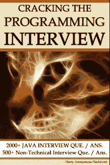ISBN 13: 978-1500730413.


# 章节

# ∞ 4 ∞

## `Scanner` 类与数组

## 命令行参数

## 引言

### `Scanner` 类

这是 Java 在 JDK 1.5、1.6、1.7 版本中添加的一个新类，用于从用户处获取原始数据类型的输入。使用该类获取输入非常简单，因为只需要创建该类的对象并调用特定方法即可。该类位于 `java.util` 包中。

| 方法 |
|---|
| `public java.util.Scanner(java.io.InputStream);` |
| `public java.util.Scanner(java.io.File) throws java.io.FileNotFoundException;` |
| `public java.util.Scanner(java.lang.String);` |
| `public void close();` |
| `public boolean hasNext();` |
| `public java.lang.String next();` 输入不包含任何空格的字符串。 |
| `public java.lang.String nextLine();` 输入可能包含空格的字符串。 |
| `public boolean hasNextBoolean();` |
| `public boolean nextBoolean();` |
| `public boolean hasNextByte();` |
| `public byte nextByte();` |
| `public boolean hasNextShort();` |
| `public short nextShort();` |
| `public boolean hasNextInt();` 检查输入缓冲区中的下一个值是否为 `int`。 |
| `public int nextInt();` 输入一个整数值。 |
| `public boolean hasNextLong();` |
| `public long nextLong();` |
| `public boolean hasNextFloat();` |
| `public float nextFloat();` |
| `public boolean hasNextDouble();` |
| `public double nextDouble();` |

#### 示例 4.1

```java
import java.util.*;

class SumInput {
    public static void main(String args[]) {
        Scanner sc = new Scanner(System.in);
        int a, b, sum;

        System.out.print("Enter Ist number");
        a = sc.nextInt();

        System.out.print("Enter 2nd number");
        b = sc.nextInt();

        sum = a + b;
        System.out.println("Sum is " + sum);
    }
}
```

输出：

```text
Enter Ist number 45
Enter 2nd number 55
Sum is 100
```

## 数组

Java 中的数组是相同类型变量或数据项的有序集合。Java 允许任意维度的数组。Java 数组与 C/C++ 有不同。我们不能在声明时指定数组的大小。内存分配始终是动态的。Java 中的每个数组都被视为一个对象，有一个特殊的属性 `length`，该属性指定数组中元素的个数。

### 1. 一维数组

#### 声明

```java
type array_name[]; // 声明时不分配内存。
```

或：

```java
type[] array_name;
```

需要注意的是，声明并没有真正创建数组。它只是声明了一个可以指向数组对象的引用。

```java
int a1[], a2;
int[] a3, a4;
```

这两个声明将 `a1`、`a3` 和 `a4` 声明为指向 `int` 数组的引用变量，但变量 `a2` 不能指向 `int` 值的数组。它仅仅是一个 `int` 变量。当 `[]` 符号跟在类型后面，声明中的所有变量都是数组。否则，`[]` 符号必须跟在声明中的每个单独数组名后面。

#### 使用 `new` 运算符进行内存分配

```java
array_name = new type[SIZE]; // SIZE 可以是常量或变量。
```

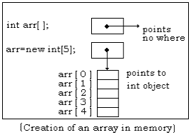

**注意 1：** 数组的所有元素将自动初始化为零，但为了用不同的值初始化数组，我们可以在声明时进行初始化。数组的声明、内存分配和初始化步骤可以合并为一个：

```java
int a[] = {5, 7, 1};
```

**注意 2：** 数组索引从零开始。

**注意 3：** 在 Java 中，所有数组的分配大小都保存在一个名为 `length` 的变量中。我们可以使用属性 `length` 访问数组的长度：

```java
array_name.length
```

**注意 4：**

```java
int a[], b[];
a = b = new int[5];
```

在上述步骤中，`new` 只创建了一个数组，该数组的引用先存储在 `b` 中，然后存储在 `a` 中。因此，`a` 和 `b` 指向同一个数组。赋值不会创建副本。

#### 示例 4.2：数组中存储的所有数字之和

```java
class SumArr {
    public static void main(String args[]) {
        int a[] = {10, 50, 20, 30};
        int n = a.length, sum = 0;

        for (int i = 0; i < n; i++)
            sum += a[i];

        System.out.println("Sum of numbers is " + sum);
    }
}
```

输出：`Sum of numbers is 110`

#### 示例 4.3：使用选择排序排序数组

```java
import java.util.Scanner;

class Sort {
    public static void main(String args[]) {
        int n;
        Scanner sc = new Scanner(System.in);

        System.out.println("Enter elements");
        n = sc.nextInt();

        int a[] = new int[n];

        // input
        for (int i = 0; i < n; i++) {
            System.out.print("Enter " + (i + 1) + " ");
            a[i] = sc.nextInt();
        }

        // sorting
        for (int i = 0; i < n - 1; i++) {
            for (int j = i + 1; j < n; j++) {
                if (a[i] > a[j]) {
                    int t = a[i];
                    a[i] = a[j];
                    a[j] = t;
                }
            }
        }

        // output
        for (int i = 0; i < n; i++)
            System.out.println(a[i]);
    }
}
```

### 2. 二维数组

#### 声明

```java
type array_name[][];
```

或：

```java
type[][] array_name;
```

#### 内存分配

```java
array_name = new type[ROWS][COLUMNS]; // ROWS 和 COLUMNS 可以是常量或变量
```

到目前为止，我们讨论了可以存储值列表的数组。会有需要存储表格的情况。考虑以下数据表，显示了人员对三个商品的销售额。表包含 12 个值，每行三个。我们可以把这个表看作四行三列的矩阵。每行代表某个人员的销售额，每列代表某个商品的销售额。

#### 示例 4.4：打印矩阵转置的程序

```java
import java.util.*;

class Transpose {
    public static void main(String args[]) {
        Scanner sc = new Scanner(System.in);
        int r, c;

        System.out.print("Enter many rows");
        r = sc.nextInt();

        System.out.print("Enter many cols.");
        c = sc.nextInt();

        int m[][] = new int[r][c];

        // input
        for (int i = 0; i < r; i++) {
            for (int j = 0; j < c; j++) {
                System.out.print("Enter" + "element " + (i + 1) + "," + (j + 1));
                m[i][j] = sc.nextInt();
            }
        }

        // transpose
        for (int i = 0; i < c; i++) {
            for (int j = 0; j < r; j++)
                System.out.print(m[j][i] + "\t");

            System.out.println();
        }
    }
}
```

#### 示例 4.5：将两个矩阵相乘得到第三个矩阵的程序

```java
import java.util.*;

class MatrixMult {
    public static void main(String args[]) {
        Scanner sc = new Scanner(System.in);
        int r1, c1;

        System.out.print("Enter many rows");
        r1 = sc.nextInt();

        System.out.print("Enter many cols.");
        c1 = sc.nextInt();

        int r2, c2;

        System.out.print("Enter many rows");
        r2 = sc.nextInt();

        System.out.print("Enter many cols.");
        c2 = sc.nextInt();

        if (c1 != r2) {
            System.out.println("Can't mult");
            System.exit(1);
        }

        int m1[][] = new int[r1][c1];

        // input m1
        for (int i = 0; i < r1; i++) {
            for (int j = 0; j < c1; j++) {
                System.out.print("Enter" + "element " + (i + 1) + "," + (j + 1));
                m1[i][j] = sc.nextInt();
            }
        }

        int m2[][] = new int[r2][c2];

        // 输入 m2
        for (int i = 0; i < r2; i++) {
            for (int j = 0; j < c2; j++) {
                System.out.print("Enter" + "element " + (i + 1) + "," + (j + 1));
                m2[i][j] = sc.nextInt();
            }
        }

        int m3[][] = new int[r1][c2];

        // 矩阵乘法
        for (int i = 0; i < r1; i++) {
            for (int j = 0; j < c2; j++) {
                for (int k = 0; k < c1; k++)
                    m3[i][j] += m1[i][k] * m2[k][j];
            }
        }

        // 输出 m3
        for (int i = 0; i < r1; i++) {
            for (int j = 0; j < c2; j++)
                System.out.print(m3[i][j] + "\t");

            System.out.println();
        }
    }
}
```

### 3. 变长数组

数组将多维数组视为“数组的数组”，可以如下所示声明一个二维数组：

```java
int arr[][] = new int[4][];

arr[0] = new int[1];
arr[1] = new int[2];
arr[2] = new int[3];
arr[3] = new int[4];
```

这意味着数组总共有 4 行，其列数从 1 开始逐个递增。因此，它们在内存中的表示方式如下：

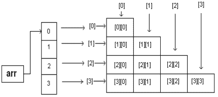

（内存分配）

**注意 1：** 数组的所有元素都将自动初始化为零，但如果想用不同的值初始化数组，可以在声明时直接进行初始化。数组的声明、内存分配和初始化步骤可以合并为一步：

```java
int a[][] = {
    {5, 7, 1},
    {1, 7, 9},
    {4, 5, 7},
    {1, 1, 1}
};
```

**注意 2：** 在上面的数组 `a` 中，`a.length` 将显示行数，即 4，而 `a[0].length` 将显示第 0 行的列数，即 3。

## 命令行参数

有时我们希望在运行程序时向程序传递信息。这是通过向 `main()` 传递命令行参数来实现的。命令行参数是在程序执行时直接跟在命令行中程序名后面的信息。

要在 Java 程序内部访问命令行参数，我们必须使用传递给 `main()` 的 `String` 数组。

`JVM` 会调用 `main()` 方法并将命令行参数作为字符串数组传递给它。在上面的示例中，数组的长度，即命令行参数的数量，是通过属性 `length` 获取的。

`for` 循环用于在控制台或显示器上显示命令行参数。

#### 示例 4.6：从命令行参数输入名称的程序

```java
class Hello {
    public static void main(String args[]) {
        for (int i = 0; i < args.length; i++)
            System.out.println("Hello " + args[i]);
    }
}
```

```bash
javac Hello.java
java Hello Ravi Ajay Vijay
```

**输出：**

```text
Hello Ravi
Hello Ajay
Hello Vijay
```

#### 示例 4.7：打印通过命令行输入的数字之和的程序

```java
class SumCmd {
    public static void main(String args[]) {
        int sum = 0;

        for (int i = 0; i < args.length; i++)
            sum += Integer.parseInt(args[i]);
```


`System.out.println("Sum is " + sum);`

```
javac SumCmd.java
java SumCmd 5 6
```

**输出：**

```
Sum is 11
```

#### 示例 4.8 从命令行排序数组的程序

```java
class SortCmd
{
    public static void main(String args[])
    {
        int n=args.length;
        int a[]=new int[n];
        for(int i=0;i<n;i++)
            a[i] = Integer.parseInt(args[i]);
        for(int i=0;i<n-1;i++)
            for(int j=i+1;j<n;j++)
                if(a[i]>a[j])
                {
                    int t=a[i];
                    a[i]=a[j];
                    a[j]=t;
                }
        for(int i=0;i<n;i++)
            System.out.print(a[i]+"\t");
    }
}
```

`javac SortCmd.java`
`java SortCmd 5 4 1 3 2`

**输出：** `1 2 3 4 5`

### 单选题

1. 如果 `MyProg.java` 被编译为应用程序，并在命令行执行 `java MyProg a b c`，那么 `args.length` 的值是：
   a) 1
   b) 2
   c) 3
   d) 4

2. 在上面的数组 `a` 中，`a[1].length` 的值是：
   a) 0
   b) 1
   c) 2
   d) 3

3. 下列哪项关于变长数组的描述是正确的？
   a) 可以在声明时指定所有列的大小
   b) 变长数组的每一行长度可以不同
   c) 数组元素会自动初始化为零
   d) 变长数组不能是多维的

4. 访问命令行参数是通过哪个方法接收的？
   a) `init()`
   b) `main()`
   c) `run()`
   d) `execute()`

5. 在 Java 中，`new` 运算符的作用是：
   a) 释放内存
   b) 分配内存并创建对象
   c) 结束循环
   d) 定义变量

在 `s2` 中进行的任何更改都将反映在 `s1` 中。这种赋值不会进行内存分配。几步之后，如果我们在 `s1` 中赋值 `null`，那么该对象将不会被销毁，因为它的引用还在对象 `s2`。但如果 `s1` 和 `s2` 都被赋值为 `null`，那么该对象将由垃圾回收器销毁，该对象占用的内存将被释放。

### 示例 5.1 只包含成员变量的类

```java
class A
{
    int x;
    int y;
}
class ClassTest1
{
    public static void main(String args[])
    {
        A a1,a2;  //引用变量
        a1 = new A();  //创建对象
        a2 = new A();
        a1.x = 10;
        a1.y = 20;
        a2.x = 5;
        a2.y = 6;
        System.out.println(a1.x + "\t" + a1.y);
        System.out.println(a2.x + "\t" + a2.y);
    }
}
```

**输出：**

```
10  20
5  6
```

### 示例 5.2 包含成员变量与成员方法的类

```java
class A
{
    private int x;
    private int y;
    void setdata(int x1, int y1)
    {
        x = x1;
        y = y1;
    }
    void display()
    {
        System.out.println(x + "\t" + y);
    }
}
class ClassTest2
{
    public static void main(String args[])
    {
        A a1 = new A();
        A a2 = new A();
        //a1.x=10;  因为 x 是私有的，会报错
        a1.setdata(10,20);
        a2.setdata(5,7);
        a1.display();
        a2.display();
    }
}
```

**输出：**

```
10  20
5  7
```

注：我们可以在类外也可以在类内部声明类的对象。

### 示例 5.3 在类内部定义类的对象

```java
class A
{
    private int x;
    private int y;
    void setdata(int x1, int y1)
    {
        x = x1;
        y = y1;
    }
    void display()
    {
        System.out.println(x + "\t" + y);
    }
    public static void main(String args[])
    {
        A a1 = new A();
        A a2 = new A();
        a1.setdata(10,20);
        a2.setdata(5,7);
        a1.display();
        a2.display();
    }
}
```

**输出：**

```
10  20
5  7
```

### 类成员的修饰符/可见性标签

可见性修饰符仅适用于类的成员，而不适用于局部变量。

- `private`：如果我们在成员变量或方法上指定 `private` 修饰符，那么该成员在声明它的类之外是不可见的。这将使类的成员对其他类隐藏。
- `public`：如果我们在成员变量或方法上指定 `public` 修饰符，那么该成员对所有类都可见。该成员即使在包外部也可以访问。`main()` 方法始终被定义为 `public`，因为 `main()` 方法是由 JVM 访问的，而 JVM 在定义 `main()` 方法的类之外。
- `protected`：声明为 `protected` 的成员可以被属于同一个包的所有类访问。保护级成员也可以从其他包的任何类访问。
- `default` / 无修饰符：如果成员前没有指定任何可见性修饰符，则该成员可以被同一个包内的所有类访问。该成员在包外部无法被访问。

### 类或接口的可见性修饰符

- `public`：如果使一个类需要对所有包的类都可见，则它必须声明为 `public`，通过在 `class` 关键字之前指定修饰符来实现。
- `default` / 无修饰符：如果在类之前没有任何访问/可见性修饰符，则它的可见性仅在定义它的包（类组）内有效。

### `this` 关键字

`this` 是一个引用变量，用于存储调用方法的对象的引用。在运行时，`this` 的引用会被调用对象的引用所替换。有时，方法可能需要引用调用它的对象。这可以通过 `this` 来实现。`this` 可以在任何方法内部使用以引用当前对象。注：局部变量会隐藏实例变量，因此我们必须显式地使用 `this`。

### 实例变量隐藏

众所周知，在 Java 中同一个作用域内声明两个同名的局部变量是非法的。但我们可以拥有与类的实例变量同名的局部变量（方法的参数）。当局部变量与实例变量同名时，局部变量会隐藏实例变量。但 `this` 允许我们在即使局部变量隐藏了它的情况下仍然可以引用实例变量。

### 示例 5.4 `this` 的用法

```java
class A
{
    private int x;
    private int y;
    void setdata(int x, int y)
    {
        this.x = x;  //this.x 是类成员，x 是局部变量
        this.y = y;
    }
    void display()
    {
        System.out.println(x + "\t" + y);
    }
}
class ClassTest4
{
    public static void main(String args[])
    {
        A a1 = new A();
        A a2 = new A();
        a1.setdata(10,20);
        a2.setdata(5,7);
        a1.display();
        a2.display();
    }
}
```

**输出：**

```
10  20
5  7
```

### 方法重载

只要参数的数量、类型或顺序不同，我们可以拥有多个同名的方法。这被称为方法重载。在调用重载方法时，实际参数的类型可能与任何重载方法的形式参数不完全匹配。在这种情况下，参数会被提升到更高类型直到找到匹配为止。如果在提升参数后仍未找到匹配，则会发生编译错误。

### 示例 5.5 在此示例中，两个 `setdata()` 方法相同但参数不同，因此这是方法重载

```java
class A
{
    private int x,y;
    void setdata(int x1)
    {
        x = y = x1;
    }
    void setdata(int x1, int y1)
    {
        x = x1;
        y = y1;
    }
    void display()
    {
        System.out.println(x + "\t" + y);
    }
}
class ClassTest5
{
    public static void main(String args[])
    {
        A a1 = new A();
        a1.setdata(5);
        a1.display();
        A a2 = new A();
        a2.setdata(10,20);
        a2.display();
    }
}
```

**输出：**

```
5  5
10  20
```

### 构造函数

在创建后立即进行初始化是一个非常常见的需求。我们可以为此目的定义实例方法，但必须显式地调用。Java 为这种需求提供了解决方案。Java 允许对象在创建时使用构造函数进行自初始化。构造函数的语法与实例方法非常相似。它们与类名相同且没有返回类型。这是因为类构造函数的隐式返回类型是类本身。

### 默认构造函数

每个类都有一个默认构造函数（如果没有定义显式构造函数），它不接受任何参数且函数体不包含任何语句。编译器会自动生成默认构造函数。

一旦我们添加了自己的构造函数，编译器就会停止生成默认构造函数。当我们不在类中创建任何构造函数时，JVM 将创建默认构造函数并将实例变量初始化为默认值 `null` 或零。

#### 示例 5.6 默认构造函数的使用

```java
class A {
    private int x;
    private int y;
    void display() {
        System.out.println(x + "\t" + y);
    }
}
class ClassTest6 {
    public static void main(String args[]) {
        A a1 = new A();
        a1.display();
    }
}
```

**输出：**

```
0 0
```

**注意：** 这里我们没有创建任何构造函数，因此 JVM 在创建对象后自动创建默认构造函数，并将实例变量初始化为 `0` 或 `null`。

### 零参数构造函数

我们可以用自己的零参数构造函数替换默认构造函数。这允许我们将实例变量初始化为任何值。

### 参数构造函数

带有参数的构造函数被称为参数构造函数。

**注意：** 构造函数可以像方法一样重载。这被称为构造函数重载。

#### 示例 5.7 构造函数的使用

```java
class A {
    private int x;
    private int y;
    A() // 零参数构造函数
    {
        x = y = 0;
    }
    A(int x1) // 单参数参数构造函数
    {
        x = y = x1;
    }
    A(int x1, int y1) // 双参数参数构造函数
    {
        x = x1;
        y = y1;
    }
    void display() {
        System.out.println(x + "\t" + y);
    }
}
class ClassTest7 {
    public static void main(String args[]) {
        A a1 = new A();
        a1.display();
        A a2 = new A(5);
        a2.display();
        A a3 = new A(4,7);
        a3.display();
    }
}
```

**输出：**

```
0 0
5 5
4 7
```

#### 示例 5.8

```java
import java.util.Scanner;
class Complex {
    private int real,imag;
    Complex() // 零参数构造函数
    {
        real=imag=0;
    }
    Complex(int real, int imag) {
        this.real=real;
        this.imag=imag;
    }
    void getdata() {
        Scanner sc=new Scanner(System.in);
        System.out.print("Enter 实部");
        real=sc.nextInt();
        System.out.print("输入虚部");
        imag=sc.nextInt();
    }
    void display() {
        if(imag>=0)
            System.out.println(real+"+"+imag+"i");
        else
            System.out.println(real+""+imag+"i");
    }
    Complex sum(Complex c) {
        Complex t=new Complex();
        t.real=real+c.real;
        t.imag=imag+c.imag;
        return t;
    }
    Complex mult(Complex c) {
        Complex t=new Complex();
        t.real=real*c.real;
        t.imag=imag*c.imag;
        return t;
    }
    public static void main(String args[]) {
        Complex c1=new Complex();
        Complex c2=new Complex();
        Complex c3=null,c4=null;
        c1.getdata();
        c2.getdata();
        c3=c1.sum(c2);
        System.out.print("和为 ");
        c3.display();
        c4=c1.mult(c2);
        System.out.print("乘积为 ");
        c4.display();
    }
}
```

### finalize 方法

有时对象在销毁时需要执行某些操作。例如，如果对象持有某些非 Java 资源（如文件句柄），我们可能希望在对象被销毁之前确保这些资源被释放。为了处理这种情况，Java 提供了一种名为 finalization 的机制。通过使用 finalization，我们可以定义当对象即将被垃圾回收器回收时发生的特定操作。`finalize()` 只在垃圾回收之前被调用。它不会在对象离开范围时被调用。在 C++ 中，使用析构函数的概念用于 finalization，但它与 Java 中的 `finalize()` 不完全相同。

```java
protected void finalize() {
```


// 此处编写 `finalization` 代码

}

```

**注意：** 除了 `protected` 修饰符外，我们也可以使用 `public`。

### 变量类型

Java 有三类变量：

#### 1. 实例变量

在类中声明且在所有方法之外的变量被称为实例变量。该变量的副本数量与对象的数量相同。在 Java 中，不需要初始化实例变量，因为这些变量在对象被创建并使用 `new` 操作符分配内存时就会被初始化。变量根据其类型进行初始化。所有数值变量都自动初始化为 `0`，`Boolean` 变量初始化为 `false`，引用变量（对象）初始化为 `null`。

#### 2. 局部变量

在方法内部声明的变量是局部变量。它们不会自动初始化。

#### 3. 静态变量

静态变量也声明在方法之外，与实例变量类似，但使用了 `static` 修饰符。它们对于类是可见，所有实例共享。例如，类中的静态变量 `count` 可以跟踪程序中创建的实例数量。

### 方法类型

1. 实例方法
2. 静态方法

#### 实例方法

这些方法与 C++ 函数相同。实例方法只能通过对象调用。如果我们在同一个类的静态方法内部调用实例方法，也必须使用对象名称。

#### 静态方法

静态方法可以使用对象名也可以通过类名来调用。静态方法只能访问静态成员。在同类的静态方法中，可以直接调用（不需要对象或类名）静态方法。

### 示例 5.10

```java
class A
{
    int x;
    static int y;

    static int sum(int a, int b)
    {
        // y = 5; 无错误，静态方法可以访问静态变量
        // x = 10; 错误，静态方法无法访问实例变量
        // A a1 = new A();
        // a1.x = 10; 无错误，因为静态方法可以通过对象访问实例变量
        // this.x = 10; 错误，静态方法无法访问 this 或 super 关键字

        int c;
        c = a + b;
        return c;
    }

    static float avg(int a, int b)
    {
        return (float) (a + b) / 2;
    }
}

class ClassTest9
{
    public static void main(String args[])
    {
        System.out.println(A.sum(5, 6)); // 静态方法可以通过类名调用
        System.out.println(A.avg(5, 6));

        A a1 = new A();
        System.out.println(a1.sum(5, 6)); // 静态方法也可以通过对象调用
    }
}
```

**输出：**

```text
11

5.5

11
```

### 初始化块与静态块

初始化块用于初始化类的实例成员变量，静态块用于初始化类的静态成员变量。但构造函数会在这些块之后被调用。

### 示例 5.11

```java
class A
{
    int x;
    static int y;

    { // 初始化实例变量的初始化块
        x = 10;
    }

    static // 初始化静态变量的静态块
    {
        y = 5;
    }
}

class ClassTest10
{
    public static void main(String args[])
    {
        A a1 = new A();
        System.out.println(a1.x + "\t" + a1.y);
    }
}
```

**输出：**

```text
10 5
```

### final 变量

如果变量被声明为 `final`，则我们不能改变它的值 `final (double PI=3.14;)`。`final` 变量不会按实例占用内存。`final` 变量是一个常量变量，其值不能改变。`final` 变量的引用类型不能改变其引用。

### 示例 5.12

```java
class A
{
    void m1()
    {
        System.out.println("Inside m1()");
    }
}

class ClassTest11
{
    public static void main(String args[])
    {
        final int x = 10; // 不能修改
        final int y; // 变量 y 未初始化，所以稍后可以初始化 y

        y = 20; // 现在 y 初始化，之后我们不能改变它的值
        // y = 30; 错误

        System.out.println(x);
        System.out.println(y);

        final A a1 = new A(); // a1 是常量引用，所以我们不能在 f1 中赋值其他对象的引用
        a1.m1();

        A a2 = new A();
        // a1 = a2; 错误
    }
}
```

**输出：**

```text
10

20

Inside m1()
```

### 参数传递机制

1. 值传递。
2. 引用传递。

当将基本数据类型（`int`、`float`、`long` 等）传递给方法时，是通过值传递的方式。对于对象，实际传递的是对象引用。对象引用也是通过值传递的方式传递的。然而，由于传递的值指向对象，该值的拷贝将指向与参数相同的同一个对象。例如，我们将存储对象引用的引用变量 `a1` 传入函数，在函数中 `a2` 是形式参数，那么 `a1` 和 `a2` 都指向同一个对象。通过 `a2` 对对象值所的任何更改都会反映在 `a1` 中。但如果在 `a2` 中分配一个新引用，则该引用不会在 `a1` 中复制。

### 示例 5.13

```java
class Box
{
    private int feet;
    private int inches;

    Box()
    {
        feet = inches = 0;
    }

    Box(int feet, int inches)
    {
        this.feet = feet;
        this.inches = inches;
    }

    void display()
    {
        System.out.println("Feet is " + feet + "\n" + "Inches is " + inches);
    }

    void swap(Box obj)
    {
        int t;

        t = feet;
        feet = obj.feet;
        obj.feet = t;

        t = inches;
        inches = obj.inches;
        obj.inches = t;
    }
}

class ClassTest12
{
    public static void main(String args[])
    {
        Box b1 = new Box(5, 6);
        Box b2 = new Box(7, 4);

        b1.swap(b2); // 对象是通过引用传递的
        b1.display();
        b2.display();
    }
}
```

**输出：**

```text
Feet is 7

Inches is 4

Feet is 5

Inches is 6
```

### 嵌套类

嵌套类是指在另一个类内部定义的类。嵌套类有两种类型：静态和非静态。静态嵌套类必须通过对象访问外部类的成员。然而，静态嵌套类不能直接访问外部类的成员。由于其应用了 `static` 修饰符，静态嵌套类很少使用。

非静态嵌套类可以访问外部类的所有成员，包括私有成员。

### 示例 5.14

```java
class Outer
{
    class Inner
    {
        int member_inner = 7;

        Inner()
        {
            member_outer = 5;
            System.out.println(member_outer);
        }
    }

    private int member_outer;

    Outer()
    {
        // member_inner = 9; 错误
        Inner obj = new Inner();
        System.out.println(obj.member_inner);
    }
}

class ClassTest13
{
    public static void main(String args[])
    {
        Outer out_obj = new Outer();
    }
}
```

**输出：**

```text
5

7
```

### 示例 5.15

```java
class Outer
{
    static class Inner
    {
        int member_inner = 7;

        Inner()
        {
            // 注意：静态内部类无法直接访问外部类的非静态成员，此处逻辑会报错
        }
    }

    private int member_outer;

    void prn()
    {
        Inner obj = new Inner();
        System.out.println(obj.member_inner);
    }
}
```

### 示例 5.16

```java
import java.util.Random;

class RandomTest
{
    public static void main(String args[])
    {
        Random r1 = new Random();

        for (int i = 1; i <= 10; i++)
            System.out.println(Math.abs(r1.nextInt()));
    }
}
```

## 理论题

1. 如果我们希望一个变量在类外部完全不可访问，在声明它时变量名前面应该加什么关键字？
2. 在 Java 中，对象/值是如何传递的？
3. 考虑以下代码：

```java
public static void main(String args[])
{
    int a = 5;
    System.out.println(cube(a));
}

int cube(int theNum)
{
    return theNum * theNum * theNum;
}
```

解释 `static` 关键字的重要性。当我们尝试编译并运行此代码时会发生什么？

a) 编译失败，因为 `java.lang.Math` 类中已经定义了 `cube`。  
b) 编译失败，因为 `cube` 不是静态的。  
c) 可以编译，但会抛出算术异常。  
d) 可以完美运行并在标准输出中打印 `"125"`。

4. 什么是静态内部类？它与任何静态成员有什么区别？

5. 如何在 Java 中声明常量值？

6. `"final"` 关键字的含义是什么？

7. 什么是类变量？

**答案：**

当我们为同一个类创建多个对象时，每个对象将共享变量的共同副本。这意味着无论创建了多少个对象，每个类都只有一个副本。类变量或静态变量在类中通过 `static` 关键字声明。

这些变量存储在静态内存中。类变量主要用于常量，即其初始值永远不会改变的变量。静态变量始终通过类名调用。

该变量在程序启动时创建，即它在通过 `new` 运算符创建类的实例之前就已经创建了，并在程序停止时被销毁。类变量的作用域与实例变量相同。

类变量可以在类层级的任何位置使用 `static` 关键字定义。它的初始值与实例变量相同（规则）。当类变量被定义为 `int` 时，其默认值为零；当声明为 `boolean` 时，默认值为 `false`；对象引用的默认值为 `null`。类变量与类相关，而不是与任何对象相关。

## 8. 解释垃圾回收

**答案：** 垃圾回收是 Java 最重要的特性之一。垃圾回收也被称为自动内存管理，因为 JVM 会自动从内存中移除使用的变量/对象（值为 `null`）。用户程序无法直接从内存中释放对象，相反，由垃圾回收器自动释放不再被程序引用的对象。

每个类都继承自 `java.lang.Object` 的 `finalize()` 方法，当垃圾回收器确定不再有对该对象的引用存在时，就会调用 `finalize()` 方法。

在 Java 中，当变量不再使用时，显式地为变量赋值 `null` 是一个好习惯。在 Java 中，调用 `System.gc()` 和 `Runtime.gc()` 时，JVM 会尝试回收未使用的对象，但无法保证所有对象何时会被垃圾回收。

## 9. 如果一个类有多个构造函数，我们可以从一个构造函数调用另一个吗？

可以。使用 `this()` 从一个构造函数调用另一个构造函数。

## 10. 构造函数和普通方法之间有什么区别？

构造函数必须与类名相同，且没有返回值。它们只会被调用一次，而普通方法可以被调用多次，并且可以返回值或返回 `void`。

## 11. 我们如何强制执行垃圾回收？

垃圾回收是自动过程，无法强制执行。我们可以通过调用 `System.gc()` 来请求它。JVM 不保证 GC 会立即启动。

## 12. 下列叙述哪一个是不正确的？

(a) Java 中的局部变量总是由默认值初始化。  
(b) Java 中的局部变量在使用之前必须进行初始化。  
(c) 内部块中的局部变量不能与外部块中的局部变量同名名。  
(d) 同一层级的两个块中的局部变量可以同名。


# 章节

# ∞ 6 ∞

# （继承）

## 引言

当一个类的属性转移到另一个类时，就称为继承。在这种情况下，被继承的类被称为超类、基类或父类，而继承的类被称为子类、子类类或派生类。

继承允许我们通过添加额外功能来扩展现有的类（基类）。它鼓励代码的重用，这有助于减小代码量，尽管在某些情况下可能会导致复杂性。

例如，假设我们已经完成了一个简单计算器的代码。之后我们需要开发一个科学计算器，那么我们有两种替代方案：

(i) 创建一个新类。（重写该类）  
(ii) 扩展该类。

在大多数情况下，第二种方案是更好的选择。在这种情况下，我们只需要编写一小段代码。同时，我们不需要在调试和测试上花费大量时间，因为基类已经过测试并且已经使用了很长时间。当我们需要将一个类继承到另一个类时，必须使用 `extends` 关键字。

**语法：** `class sub_class extends base_class`

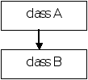

类 A（超类或基类或父类）。  
类 B（子类或派生类或子类类）。

子类将除了扩展类中定义的新功能外，还拥有基类的所有功能。Java 不支持多继承，但它支持多接口继承，因此子类只能继承一个基类。

**示例 6.1：**

```java
1.  class A
2.  {
3.    int x;
4.    void setX(int x1)
5.    {
6.      x = x1;
7.    }
8.    void displayX()
9.    {
10.     System.out.println(x);
11.   }
12. }
13. class B extends A
14. {
15.   int y;
16.   void setY(int y1)
17.   {
18.     y = y1;
19.   }
20.   void displayY()
21.   {
22.     System.out.println(y);
23.   }
24. }
25. class InheritTest
26. {
27.   public static void main(String args[])
28.   {
29.     A a1 = new A();
30.     a1.setX(5);
31.     a1.displayX();
32.     B b1 = new B();
33.     b1.setX(10);
34.     b1.displayX();
35.     b1.setY(20);
36.     b1.displayY();
37.   }
38. }
```

**输出：**

```text
5

10

20
```


### 成员隐藏

如果子类成员与父类成员具有相同的名称（方法情况下具有相同的签名），则它会隐藏父类成员。虽然两个成员在子类中都可用，但使用成员名时只能访问子类。

### 使用 `super` 关键字

当子类需要引用其直接父类时，可以通过 `super` 关键字来实现。`super` 有两个通用用途：

1. 调用父类的构造函数：子类可以通过形式为 `super(parameter-list);` 的调用调用超类定义的构造方法。这里 `parameter-list` 指定了父类构造函数所需的参数。事实上，`super()` 必须是子类构造函数内部的第一条语句。
2. 访问被子类成员隐藏的父类成员：可以使用以下形式 `super.member;` 使用关键字来访问父类的隐藏成员。这里 `member` 可以是方法，也可以是数据成员。

### 方法重载与方法重写

#### 方法重载

当两个或多个方法名称相同但参数不同时，被称为方法重载。方法重载用于对象执行相似任务但使用不同输入参数的情况。当我们调用方法时，Java 首先匹配方法名，然后匹配参数的数量和类型。决定调用哪一个方法定义被称为多态。

#### 方法重写

我们已经看到父类中的方法被子类继承，并被子类创建的对象使用。方法继承允许我们在子类中重复定义和使用方法，而无需再次定义。在类层次结构中，当子类中的实例方法与其父类中的实例方法（非私有）具有相同的名称签名时，子类中的方法被称为重写了父类中的方法。当在子类内部调用重写的方法时，它将始终引用子类中定义的方法版本。父类中定义的方法版本将被隐藏。


### 示例 6.2

```java
class A {
    int x;
    void set(int x1) {
        x = x1;
    }
    void display() {
        System.out.println(x);
    }
}

class B extends A {
    int y;
    void set(int x1,int y1) // 类 B 的 set 方法没有重写类 A 的 set
    // 方法，因为参数不同
    {
        set(x1);  //这将调用类 A 的 set()
        y = y1;
    }
    void display() // 类 B 的 display 方法重写了
    // 类 A 的方法
    {
        //  display();  这将调用类 B 的 display
        super.display(); // 这将调用类 A 的 display
        System.out.println(y);
    }
}

class InheritTest2 {
    public static void main(String args[]) {
        B b1 = new B();
        b1.set(10,20);
        b1.display();
    }
}
```

输出:

```
10
20
```

Java 支持以下继承形式：
[1] 单继承继承。
[2] 多级继承。
[3] 层层级继承。

### [1] 单继承继承

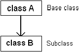

#### 示例 6.3

```java
class A {
    private int x;
    A() {
        x = 0;
    }
    A(int x1) {
        x = x1;
    }
    void display() {
        System.out.print(x);
    }
}

class B extends A {
    private int y;
    B() {
        super();
        //x=0;  错误，因为 x 是私有的
        y=0;
    }
    B(int x1, int y1) {
        super(x1);
        //x = x1; 错误，因为 x 是私有的
        y = y1;
    }
    void display() {
        super.display();
        System.out.print(y);
    }
}

class InheritTest3 {
    public static void main(String args[]) {
        B b1 = new B();
        b1.display();
        B b2 = new B(10,20);
        b2.display();
    }
}
```

输出:

```
0 0 10 20
```

---

### [2] 多级继承

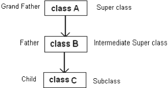

#### 示例 6.4

```java
class A {
    private int x;
    A() {
        x = 0;
    }
    A(int x1) {
        x = x1;
    }
    void display() {
        System.out.println(x);
    }
}

class B extends A {
    private int y;
    B() {
        super();
        y=0;
    }
    B(int x1, int y1) {
        super(x1);
        y = y1;
    }
    void display() {
        super.display();
        System.out.println(y);
    }
}

class C extends B {
    private int z;
    C() {
        super();
        z=0;
    }
    C(int x1, int y1, int z1) {
        super(x1,y1);
        z = z1;
    }
    void display() {
        super.display();
        System.out.println(z);
    }
}

class InheritTest4 {
    public static void main(String args[]) {
        C c1 = new C();
        c1.display();
        C c2 = new C(10,20,30);
        c2.display();
    }
}
```

输出:

```
0
0
0
10
20
30
```

---

### [3] 层层级继承

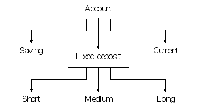

#### 构造函数的调用顺序

当创建一个类层次结构时，构成该层次结构的类的构造函数按照什么顺序被调用？答案是，在类层次结构中，构造函数按照派生顺序从父类到子类进行调用。

此外，由于 `super()` 必须是子类构造函数中执行的第一条语句；无论是否使用 `super()`，这种顺序都是相同的。如果不使用 `super()`，则将执行每个父类的默认或无参数构造函数。

构造函数按照派生顺序执行。因为父类对任何子类一无所知，因此它需要执行的任何初始化都是独立的，并且可能是子类执行的任何初始化的前决条件。因此，它必须首先执行。

关键字 `super` 在满足以下条件时使用：
- `super()` 构造方法只能在子类的构造方法内部调用。
- 对父类构造方法的调用必须作为子类构造方法的第一条语句。
- `super` 调用中的参数必须与父类构造函数的顺序和类型匹配。

---

### 动态方法绑定（动态方法调度或运行时绑定）

方法重写构成了 Java 强大概念的基础。动态方法调度是在运行时而不是编译时解析对重写实例方法的机制。动态方法调度很重要，因为这是 Java 实现运行时多态的方式。

父类引用可以引用子类对象。Java 利用这一事实在运行时解析对重写方法的调用。当通过父类引用调用重写方法时，Java 根据调用时对象的类型来确定执行哪个版本的方法。

因此，这种确定是在运行时进行的，当不同类型的对象引用不同版本的方法时。

#### 示例 6.5

```java
class Shape {
    void getdata() {
        System.out.println("getdata Shape");
    }
    void area() {
        System.out.println("area Shape");
    }
    void display() {
        System.out.println("display Shape");
    }
}

class Circle extends Shape {
    void getdata() {
        System.out.println("getdata Circle");
    }
    void area() {
        System.out.println("area Circle");
    }
    void display() {
        System.out.println("display Circle");
    }
}

class Rectangle extends Shape {
    void getdata() {
        System.out.println("getdata Rectangle");
    }
    void area() {
        System.out.println("area Rectangle");
    }
    void display() {
        System.out.println("display Rectangle");
    }
}

class InheritTest5 {
    public static void main(String args[]) {
        // 父类引用变量可以接受子类对象
        // 动态绑定
        Shape s[]={new Circle(), new Rectangle()};
        for(int i=0;i<s.length;i++) {
            s[i].getdata();
            s[i].area();
            s[i].display();
        }
    }
}
```

输出:

`getdata()` of Circle
`area()` of Circle
`display()` of Circle
`getdata()` of Rectangle
`area()` of Rectangle
`display()` of Rectangle

### 抽象类与抽象方法

我们已经看到，通过将方法标记为 `final`，我们可以确保该方法不会在子类中被重定义。`Java` 允许我们进行与此完全相反的操作。即我们可以指定某个方法必须在子类中被重定义，从而使重写（`overriding`）成为强制。这是通过在方法定义修饰符 `abstract` 实现的。

在某些情况下，我们希望定义一个父类，它声明某个抽象概念的结构，但不提供每个方法的完整实现。

也就是说，有时我们想要创建一个父类，它只定义一个所有子类都共享的通用形式，而将细节留给每个子类去填充。

此类类决定了子类必须实现的方法性质。这种情况发生的一种方式是父类无法为某个方法创建有意义的实现。

要声明一个抽象方法，请使用以下通用格式：

`abstract return_type name (parameter-list);`

没有任何实现存在。任何包含一个或多个抽象方法的类也必须声明为 `abstract`。要声明一个类为 `abstract`，我们只需要在声明开头的 `class` 关键字前面使用 `abstract` 关键字。

抽象类不能创建对象。也就是说，抽象类不能用 `new` 运算符直接实例化。这样的对象是没用的，因为抽象类没有完全定义。

此外，我们不能声明 `abstract` 构造函数或 `abstract` 静态方法。抽象类的任何子类必须实现父类中所有的抽象方法，或者本身也被声明为 `abstract`。

#### 示例 6.6

```java
abstract class Shape
{
    abstract void getdata();
    abstract void area();
    abstract void display();
}

class Circle extends Shape
{
    void getdata()
    {
        System.out.println("getdata() of Circle");
    }
    void area()
    {
        System.out.println("area() of Circle");
    }
    void display()
    {
        System.out.println("display() of Circle");
    }
}

class Rectangle extends Shape
{
    void getdata()
    {
        System.out.println("getdata() of Rectangle");
    }
    void area()
    {
        System.out.println("area() of Rectangle");
    }
    void display()
    {
        System.out.println("display() of Rectangle");
    }
}

class InheritTest6
{
    public static void main(String args[])
    {
        //父引用变量可以接受子类对象
        //动态绑定
        Shape s[]={new Circle(), new Rectangle()};
        for(int i=0;i<s.length;i++)
        {
            s[i].getdata();
            s[i].area();
            s[i].display();
        }
    }
}
```

输出:

`getdata()` of Circle
`area()` of Circle
`display()` of Circle
`getdata()` of Rectangle
`area()` of Rectangle
`display()` of Rectangle

### `Final` 方法

如果我们不希望一个方法被派生类方法重写，那么可以将基类方法定义为 `final`。任何重写该方法的尝试都会导致编译时错误。

```java
class A
{
    final void method1()
    {
        -----
    }
}

class B extends A
{
    void method1()  // error
    {
        -----
    }
}
```

### `Final` 类

有时出于安全考虑，我们可能希望防止一个类被进一步子类。不能被子类的类被称为 `final` 类。在 `java` 中通过使用 `final` 关键字来实现：

```java
final class A1
{
    - - - - - -
    - - - - - -
}

class B extends A    // error
{
    - - - - - - -
    - - - - - - -
}
```


任何继承类`A`的尝试都会导致错误，编译器将不允许。声明类为`final`可以防止任何扩展。编译器还允许一些优化。

## 理论题

1. 什么是继承？
2. 有多少类型的继承？
3. 默认构造函数和参数化构造函数有什么区别？
4. `final`类和方法之间有什么区别？
5. 什么是父类？
6. 什么是抽象类？
7. 编译时绑定和运行时绑定有什么区别？
8. 方法重载（`method overloading`）和方法重写（`method overriding`）之间有什么区别？

## 对象

对象是一个物理或抽象的实体或事物，它可以与其他相似类型的对象区分来。对象具有三个特征：

(i) 标识性（Identification）。
(ii) 属性（Properties）。
(iii) 行为（Behaviors）。

对象也可以被视为`class`（类）的实例（`instance`），其中`class`就像一个内置数据类型，而对象就是`variable`（变量）。

## Class

类通过抽象化其属性和行为来表示一类对象。`class`可以被视为创建对象的蓝图。对象具有其`class`定义的属性和行为。`class`可以被视为一种用户定义的数据类型，而对象是该`class`所代表的数据类型的`variable`/`instance`（变量/实例）。

对象的属性是由`Java`中的数据成员/字段（`data members` / `fields`）定义的。`class`中的数据成员/`field`是一个可以存储数据的`variable`。对象的行为/操作是使用`Java`中的`methods`（方法）定义的。数据成员和`methods`都称为`class`的成员。

`class`也可以被视为一种用户定义的数据类型，而对象是该数据类型的`variable`。一旦定义了`class`，我们就可以创建任意属于该`class`的对象。

# 3. 三大 OOP 原则

## 封装

封装是将代码及其所作用的数据结合的机制。`Java`类支持这种机制，因为它们允许我们将代码和数据定义在一起。封装还通过将某些`class`成员声明为`private`来帮助实现数据隐藏，这样它们就无法从不属于该类的代码中访问。

## 继承

在面向对象编程中，继承指的是一个`class`的属性对被称为子类（`sub-classes`）或派生类（`derived classes`）的其他类可用。子类或派生类是从现有的`class`派生的。它继承了现有类的所有特征，该类也被称为`base-class`（基类）或`super-class`（超类）。因此，继承可以定义为从`super-class`或`base-class`派出一个`class`的过程。继承类不会给`base-class`/`super-class`引入任何更改。与`base-class`相比，派生类/子类具有更大的属性和行为集合。

继承的主要优势是代码的可重用。如果`base class`使用了很久，并且需要添加一些额外的属性和方法，我们可以通过派生另一个类来实现。派生类将能够使用`base class`的代码而无需调试，因为它已经使用了很长时间。

### 类层次结构

所有派生自同一个`base class`的类都属于一个家族并形成类层次结构。类层次结构可以与树结构相比，其中一个`base class`位于根节点且没有`super-class`。

所有其他类要么派生自层次结构根节点的类，要么派生自其他类（而这些类直接或间接地派生自根类）。随着我们在树向下移动，添加的功能越来越多。由叶节点表示的类没有任何子类。以下示例展示了一些类层次结构。


## 多态

多态是一种允许用相同的接口用于一类动作的特性。大多数面向对象的语言在以下情况使用多态：

* 运算符重载（Operator Overloading）。
* 方法重载（Method Overloading）。
* 方法重写（Method Overriding）。

### 运算符重载

大多数语言对内置操作使用这种形式的多态。例如，`C/C++`或`Java`中的所有算术运算符都可以用于许多类型的操作数（`int`、`long`、`float`、`double`等）。因此，相同的加法运算符可以用于加两个整数也可以用于加两个浮点数。

`C++`允许用户重载内置运算符。例如，我们可以重载算术运算符来处理复数。虽然`Java`对内置运算符使用了运算符重载，但它不允许用户重载运算符。

### 方法重载

此特性允许我们编写一个或多个具有相同名称的方法。`C++`和`Java`都具有这一特性。同名的`methods`（`C++`中的函数`function`）根据参数（`arguments`）进行区分。重载的方法必须具有不同的参数数量，或者如果参数数量相同时，参数的类型必须不同。

如果对重载方法的调用可以在编译时解析，即如果编译器可以决定将调用哪个重载方法，则这被称为静态绑定（`static binding`），它是编译时多态的一个例子。

如果对重载方法的调用无法在编译时解析，即如果编译器无法决定将调用哪个重载方法，则这被称为动态绑定（`dynamic binding`），它是运行时多态的一个例子。

通常，`Java`在运行时解析对重载方法的调用，但在许多情况下，重载方法的调用是在编译时解析的。

### 方法重写

子类可以定义一个与`super class`中相同名称的方法，并且具有相同的参数数量和类型。这被称为方法重写（`method overriding`）。

编译器无法解析对重写方法的调用。`Java`通常使用动态绑定来解析对重写方法的调用，即决策发生在运行时。

# 4. 持久化

某些面向对象的语言允许我们将程序的状态存储到/从持久化存储介质（即辅助存储等永久存储介质）。这被称为持久化（`persistence`）。

`Java`允许我们将任何对象存储在辅助存储中并在以后检索它。如果我们尝试在对象图的顶部存储一个对象，所有其他引用的对象将被递归地定位并保存。同样，当以后检索该对象时，所有对象及其引用（即整个对象图）都会在主内存中正确创建。

例如，通过只需保存树的根就可以保存整个树结构。`C++`不支持此特性。

## 5. 通用性

定义一次算法（独立于任何数据类型），然后在不引入任何额外努力的情况下将该算法应用于各种数据类型的概念被称为通用性（Genericity）。`C++`使用模板（`templates`）支持这一特性。`Java`也通过`Object class`支持这一特性，`Object class`位于`Java`中任何类层次结构的顶端。

例如，使用此特性，我们可以实现一个通用数据类型`stack`，使得在`stack`中存储任何类型的元素成为可能。这一特性在很大程度上提高了可重用性。

## 6. 组合 / 聚合

对象可能由其他对象组成。这样的对象被称为组合对象（Composite）或聚合对象（Aggregate）。例如，如果将`vehicle`类的对象定义为由`Engine`、`Body`、`Axle`、`Seats`等对象组成的组合对象，这是合适的。

## 继承与组合

从现有类派生新类有两种基本机制：继承和组合。`Bus`类可以通过继承`vehicle`类的属性来派生。在这里，`Bus`是一种车辆，除了所有车辆共有的属性和行为外，它还有一些额外的属性/行为。

换句话说，`Bus`类与`vehicle`类之间存在是（`is-a`）关系，因为我们可以说`Bus`是一辆车辆。

`vehicle`类本身可能通过组合从许多其他类派生。例如，一个`vehicle`类的对象可能由属于`Engine`、`Gear Box`、`Seats`、`Driver’s Seat Body`和`Steering Wheel`等类的对象组成。

在这种情况下，派生类与表示组合对象部分的类具有“整体与部分”的关系。我们不能说`vehicle`是一个`Engine`或`Vehicle`是一个`Gear Box`，因为`Vehicle`是由许多部分组成的。

## 超类与子类

通常，一个类的对象也是另一个类的对象（即“是一个”关系）。`rectangle`无疑是一个`quadilateral`（`squares`、`parallelograms`和`trapezoids`也是如此）。因此，可以说`Rectangle`类继承自`Quadrilateral`类。在这种语境下，`Quadrilateral`类是超类，而`Rectangle`类是子类。

`rectangle`是`quadilateral`的特定类型，但声称`quadilateral`是`rectangle`是错误的（`quadilateral`可能是`parallelogram`）。图示展示了超类和潜在子类的几个简单继承示例。继承通常会产生比其超类更多特征的子类，因此超类和子类这两个术语可能会引起混淆。

然而，还有另一种看待这些术语的方法，它是完全合理的。因为每个子类对象都是其超类的对象，而且一个超类可以有许多子类，所以超类所表示的对象集通常比该超类的任何一个子类所表示的对象集大。

例如，超类`Vehicle`以通的方式表示所有车辆，如`cars`、`trucks`、`boats`、`bicycles`等。然而，子类`Car`仅代表了世界上所有`Vehicles`中的一小部分。继承关系形成了树状的分级结构。

超类与其子类之间存在层级关系。一个类当然可以独立存在，但只有当类被用于继承机制时，它才成为为其他类提供属性和行为的超类，或者成为继承这些属性和行为的子类。经常，一个类既是子类也是超类。

| 超类 | 子类 |
| :--- | :--- |
| `Student` | 研究生、本科生 |
| `Shape` | 圆形、三角形、矩形 |
| `Loan` | 汽车贷款、房贷贷款、教育贷款 |
| `Employee` | 教师职员工、行政职员工 |
| `Account` | 支票账户、储蓄账户 |


# 章

# ∞ 8 ∞

# (包)

## 引言

当我们编写一个项目时，我们必须将程序拆分成几个类。为了组织这些类，我们使用`Packages`（包）。包既是一种命名机制，也是一种可见性控制机制。包是相互关联的类和接口的集合。在包的帮助下，只要它们定义在不同的包中，就可以给多个类赋予相同的名称。

单个包不能包含两个同名的类。

`PROGRAMS`被组织为包的集合。每个包都有自己的一组子包，这有助于防止命名冲突。顶层包只有在被声明为`public`时才能在包外部访问。包的命名结构是分级化的。包的成员是类类型、接口类型和子包。`java`中的包是一种封装机制，可以用于分组相关的类、接口和子包。

对于小型程序，包可以是未命名的或具有简单的名称，但如果代码要广泛发布，则应该选择唯一的包名。

这可以防止冲突——如果两个开发小组恰好选择了相同的包名，并且这些包后来被用于同一个程序，就会发生冲突。如果我们没有为`java`类指定包，那么该类将是`Java`默认包的一部分，称为未命名包。但这要求每个类都必须有唯一的名称以避免冲突。

未命名包的示例。

```java
class A
{
- - - - - - -
- - - - - - - -
}

class A_demo
{
    public static void main(String args[])
    {
- - - - - - -
- - - - - - - -
    }
}
```

## 如何定义包

要创建一个包，请将`package`命令作为`Java`源文件中的第一条语句。在该文件中声明的任何类都属于指定的包。`package`语句定义了存储类的命名空间。如果我们省略了`package`语句，类名将被放入默认包中，该包没有名称，称为未命名包。

`package`语句具有以下语法：

```java
package package_name;
```

`Java`使用文件系统目录来存储包。记住大小是敏感的，目录名必须与包名完全匹配。多个文件可以包含相同的`package`语句。

语法：

```java
package p1;    //包声明
class A      //类声明
{
- - - - - - -  //类 A 体
- - - - - - -
}
```

`package`是一个关键字。`p1`是类`A`要存储的包名。

### 示例 8.1

```java
1.  package p1;
2.  class A
3.    {
4.    public static void main(String args[])
5.      {
6.        System.out.println("First package.");
7.      }
8.    }
```

我们假设当前文件夹是`c:\javrg\p1>`。

```bash
C:\javrg\p1>javac A.java
C:\javrg\p1>java A
```

输出：
`First package.`

注意：如果我们使用`-d c:\javrg`编译上述代码，将自动创建`p1`文件夹并将`.class`文件放入其中。

```bash
C:\javrg>javac -d c:\javrg A.java
C:\javrg>java p1.A
```

## 导入包

内置类都存储在命名包中。由于类必须全限定路径，为每个类输入长路径可能会很麻烦。`import`语句可以将某些类或整个包引入作用域，只需使用其名称直接引用。`import`语句紧随`package`语句（在任何类定义之前）。`import`语句的通用形式：

```java
import p1.classname;
import p1.*;
```

### 示例 8.2

```java
1. //使用包类打印 10 个随机数
2. 不使用 import 语句
3. class RandomTest1
4. {
5.   public static void main(String args[])
6.   {
7.     java.util.Random r1 = new java.util.Random();
8.     for(int i=1;i<=10;i++)
9.     {
10.      System.out.println(Math.abs(r1.nextInt()));
11.    }
12.   }
13. }
```

### 示例 8.3

```java
1. //使用包类打印 10 个随机数
2. 使用 import 语句
3. import java.util.Random;
4. class RandomTest2
5. {
6.   public static void main(String args[])
7.   {
8.     Random r1 = new Random();
9.     for(int i=1;i<=10;i++)
10.    {
11.      System.out.println(Math.abs(r1.nextInt()));
12.    }
13.   }
14. }
```

如果我们从当前文件夹以外的任何其他文件夹运行上述程序，它将无法运行。默认情况下，`Java`运行时系统使用当前工作目录作为起点。

因此，如果我们的包（`package`）在当前目录或当前目录的子目录中，它将能找到。但要从任何其他文件夹运行上述程序，我们必须在命令提示符上使用`SET CLASSPATH=.;C:\JAVAPRG`命令来设置类路径。`CLASSPATH`是一个环境变量。我们每次第一次启动电脑时都必须输入此命令。但如果我们把此命令放在`我的电脑 ➔ 属性 ➔ 高级系统 ➔ 环境变量`中，那么就不需要再反复输入此命令了。

我们也可以在不设置`CLASSPATH`环境变量的情况下运行程序。这样做请输入：

```bash
java –classpath c:\javaprg p1.A
```

### 包的分级结构

注意 4：我们可以创建包的层级结构。要这样做，只需用点（`.`）将每个包名与其上一个包隔开。多级包语句的通用形式为：

```java
package package_name1[.package_name2][.package_name3];
```


包层级结构必须在 Java 开发系统的文件系统中反映。例如，包 `java.awt.Image` 需要存储在 `java\awt\image`（WINDOWS）、`java/awt/image`（UNIX）或 `java:swt:image`（MACINTOSH）文件系统中。

包层级结构代表了 Java 类和接口的组织方式。它并不代表类和接口的源代码组织。

每个 Java 源文件（也称为编译单元）可以包含零或多个类和接口的定义，但编译器会为其中的每一个生成一个包含 Java 字节码的单独类文件。类或接口可以使用包声明来指示其 Java 字节码被放在特定的包中。

- `java` 包拥有子包 `awt`、`applet`、`io`、`lang`、`net` 和 `util`，但没有类或接口。
- `java.awt` 包有一个名为 `image` 的子包以及许多类和接口。
- 因为 `java.awt` 包有一个子包 `image`，因此它不能包含名为 `image` 的类或接口类型的声明。
- 如果一个包的全限定名为 `P`，且 `Q` 是 `P` 的子包，那么 `P.Q` 就是该子包的全限定名。
- 如果有一个名为 `mouse` 的包，且该包中有一个成员类 `Button`（这可能被称为 `mouse.Button`），那么不能存在任何全限定名为 `mouse.Button` 或 `mouse.Button.Click` 的包。
- 一个源文件中最多可以出现一个包语句，且它必须是 Java 源文件的第一个语句。

### 类成员的可见性

类和包都是封装和包含变量及方法命名空间及作用域的手段。包作为类及其他从属包的容器。类作为数据和方法代码的容器。

类是 Java 最小的抽象单元。由于类和包之间的相互作用，Java 处理了类成员的五类可见性：

1. 类内部的可见性。
2. 同一包中子类中的可见性。
3. 同一包中非子类的可见性。
4. 不同包中子类中的可见性。
5. 既不在同一包中也不是子类的子类中的可见性。

注意 1：顶层类和接口只有两种可能的访问权限：默认（default）和 `public`。

注意 2：如果类被声明为 `public`，则可以通过其他代码访问。

注意 3：如果类具有默认访问权限，则只能由同一包内的其他代码访问。

注意 4：只有当类可见时成员可见性才有意义。如果类的可见性修饰符为默认，即使是类的 `public` 成员也只在包内可见。

### 访问修饰符

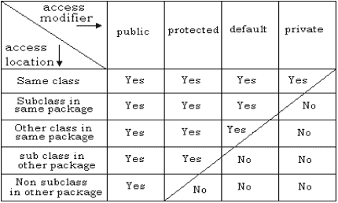

### JAR 文件（Java Archive 文件）

为了压缩文件，我们使用诸如 `winzip` 等程序，Java 的 `JAR` 功能也可以用于压缩整个 Java 包的层级结构。它为安装提供了更好的便利。

不需要在客户位置创建文件结构。我们只需要使用 `JAR` 文件，该文件将恢复整个文件结构。所有的包、子包和类文件都将从 `JAR` 文件自动创建。

JAR 技术让软件的交付和安装变得容易。此外，`JAR` 文件中的元素是压缩的，这使得下载一个 `JAR` 文件比单独下载几个未压缩的文件快得多。这允许消费者确定这些元素是由特定的组织或个人产生的。

`JAR` 文件有以下可用选项：

| 选项 | 说明 |
| :--- | :--- |
| `c` | 创建一个新的归档。 |
| `C` | 在命令执行期间更改目录。 |
| `f` | 文件列表的第一个元素是要创建的归档名称。 |
| `i` | 应提供索引信息。 |
| `m` | 文件列表的第二个元素是外部清单文件（manifest）的名称。 |
| `M` | 不清单文件。 |
| `t` | 应列出归档内容。 |
| `u` | 更新现有的 `JAR` 文件。 |
| `v` | 提供详细输出。 |
| `x` | 从归档提取文件。 |
| `o` | 不使用压缩。 |

#### 创建 JAR 文件

```bash
jar -cf Myjar.jar pack1
```

这将创建一个名为 `Myjar` 的、包含 `pack1` 中所有文件的 JAR 文件。

#### 提取 JAR 文件

```bash
jar -xf Myjar.jar
```

此命令用于提取 JAR 文件（如解压）。

#### 列出 JAR 文件内容

```bash
jar -tf Myjar.jar
```

该命令将列出 `Myjar.jar` 的内容。

#### 更新现有的 JAR 文件

```bash
jar -uf Myjar.jar pack1
```

该命令用于更新 JAR 文件。

#### 创建可执行 JAR 文件

```bash
jar -cmf mainClass Myjar.jar pack1
```

其中 `mainClass` 是一个包含 `Main-Class: pack1.A` 的文本文件，保存在 `javaprg` 文件夹中。

#### 执行 JAR 文件

```bash
java -jar Myjar.jar
```

### 题

1. 我们对包（package）有什么理解？
2. 解释所有的修饰符及其在不同包、子包、子类和其他类中的作用域。
3. `JAR` 文件有什么用？
4. `import` 语句有什么用？

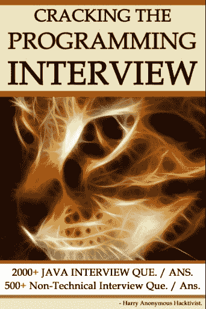

在 Amazon.com 上搜索此书，ISBN 为 `978-1500730413`。


# 第 9 章

## 接口

### 引言

接口基本上是一种类。由于和类一样，接口包含方法和变量，但有一个主要的区别。区别在于接口只定义抽象方法和最终变量（常量）。这意味着接口不编写任何实现这些方法的代码，数据字段只包含常量。

因此，实现接口并定义实现代码是类的责任。在实践中，这意味着我们可以定义接口，而不对其实现方式做出假设。接口的目的是分离类必须做什么，而不说如何实现。

嵌套接口是指声明出现在另一个类或接口体内的接口。顶层接口不是嵌套接口的接口。定义接口的语法与定义类的语法非常相似。接口定义的通用形式如下：

```java
interface interface_name
{
    variable declarations;

    methods declarations;
}
```

在这里，`interface` 是关键字，`interface_name` 是任何有效的 Java 标识符（类似于类名）。

**注意：** 当我们定义一个接口时，默认情况下它是 `public`（公共）且 `abstract`（抽象的）。

### 接口修饰符

顶层接口可以使用的修饰符只有 `abstract` 和 `public`。即使我们不使用 `abstract` 修饰符，接口也会被隐式地声明为 `abstract`，因此不需要使用 `abstract` 修饰符。顶层接口的可见性可以是 `package`（包级）或 `public`，就像顶层类一样。如果不使用可见性修饰符，则接口的可见性假设为 `package`。

### 数据变量成员声明

接口中只能定义常量。接口中的所有变量都是隐式地 `public`、`final` 和 `static` 的，这意味着它们不能被实现类更改。它们还必须用常量值初始化。

```java
public static final type variable_name = value;
```

在接口中声明的变量是 `public`、`static` 和 `final`。这意味着它是具有 `public` 访问权限的静态变量。该变量也被声明为 `final`，这意味着它在声明时必须赋值，并且之后不能修改。`final` 关键字类似于 C/C++ 中的 `const`。

### 方法声明

方法声明将仅包含方法列表，而不包含任何语句。它们在参数列表后以分号结束。它们本质上是 `abstract` 方法，接口中指定的任何方法都不能有默认实现。

接口中的所有方法默认始终都是 `public` 和 `abstract` 修饰符。我们不能在接口中声明 `static` 方法。

```java
public abstract return_type method_name(parameter_list);
```

下面是一个包含两个变量和一个方法的接口定义示例：

```java
interface item
{
    static final int code = 1001;
    static final String name = "Matrix";
    abstract void display( );
}
```

**注意：** 方法的代码不包含在接口中，方法声明简单地以分号结束。

另一个接口示例：

```java
interface area
{
    float pi = 3.142f;
    float compute (float x, float y);
    void show( );
}
```

### 扩展接口

像类一样，接口也可以被扩展，即一个接口可以从其他接口派生。新接口将以类似于子类的方式继承子接口的所有成员。这通过使用 `extends` 关键字来实现，如下：

```java
interface interface_1
{
    int code = 1001;
    String name = "Matrix";
}

interface interface_2 extends interface_1
{
    void display();
}
```

`interface_2` 将继承常量 `code` 和 `name`。

**注意：** 变量 `name` 和 `codes` 的声明方式像普通变量。这在这里是允许的，但接口中的所有变量都被视为常量、`public` 且 `static`，尽管这里没有 `public`、`static` 和 `final` 关键字。

我们可以将多个接口组合成一个接口。以下声明是有效的：

```java
interface interface_1
{
    int code = 1001;
    String name = "Matrix";
}

interface interface_2
{
    void display();
}

interface interface_3 extends interface_1, interface_2
{
    //
}
```

**注意：** 始终记住接口不能扩展类。这违反了接口只能有抽象方法和常量的规则。

### 实现接口

接口被用作“超类”，其属性被类继承。因此，有必要创建一个给定接口的类。一旦定义了接口，一个或多个类就可以实现该接口。

要实现接口，要在类定义中包含 `implements` 子句，然后创建接口声明的方法。实现类必须提供所有接口中所有方法的体，否则它必须被声明为 `abstract`。实现类还可以扩展一个类并实现多个接口。

```java
modifier class <class-name> implements <interface-name>
{
    body of the class
}
```

**类中实现接口的 `implements` 语法：**

```java
interface interface_name
{
    //
}

class class_name implements interface_name
{
    Body of class
}
```

Java 不支持多继承，但它支持多接口继承，即一个类可以实现多个接口，如下所示：

```java
modifiers class <class-name> implements <interface-1>, <interface-2>, <interface-3>, ....<interface-n>
{
    body of class
}
```

**注意：** 当我们实现接口方法时，它必须声明为 `public`。实现接口的方法类似于重写，因此我们不能降低可见性。

#### 示例 9.1

```java
interface interface_1
{
    void show(int x);
}

class class_1 implements interface_1
{
    public void show(int x)
    {
        //
    }
}
```

#### 示例 9.2：抽象类

```java
interface common
{
    void push(int x);
    void pop( );
}

abstract class stack implements common
{
    void pop()
    {
        //
    }
}
```

类 `stack` 没有实现 `push()` 和 `pop()` 方法。因此我们必须将 `stack` 声明为抽象。

### 通过接口访问类对象

我们可以声明使用接口而非类型的对象引用。实现接口的任何实例都可以由这种变量引用。当我们通过这些引用之一调用方法时，将调用所引用实例的正确版本。这是接口的重要特性之一，允许在调用这些方法的代码之后创建类。此过程类似于使用父类引用来访问子类。由于在运行时动态查找方法与 Java 中普通方法调用相比会有巨大的开销，我们应该不要随意使用接口。

#### 示例 9.3

```java
interface Math_function
{
    void display(int x);
}

class Sqrt implements Math_function
{
    public void display(int x)
    {
        System.out.println("sqrt of x =" + Math.sqrt(x));
    }
}

class Log implements Math_function
{
    public void display(int x)
    {
        System.out.println("log of x = " + Math.log(x));
    }
}

class Math_Demo
{
    public static void main(String args[])
    {
        Math_function f1 = new Sqrt();
        Math_function f2 = new Log();
        f1.display(27);
        f2.display(3);
        Math_function f3;
        f3 = f1; // 多态（赋值引用）
        f3.display(30);
    }
}
```

```java
f3 = f2;  // 多态（赋值引用）
f3.display(5);
}
}
```

输出：

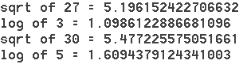

### 接口的特性

- `Interface` 是一个关键字。
- `Interface` 可以声明为抽象的，但它默认就是抽象的，因此没有必要添加 `abstract` 关键字。
- 所有变量始终是 `public static` 且 `final` 的。
- 接口中的所有方法必须在类中实现。
- 实现类中实现的所有方法必须是 `public` 的。
- `Interface` 仅包含方法的声明。
- `Interface` 方法不能声明为 `static`（静态）的。它们总是被声明为实例方法。
- 类既不能缩小接口方法的访问权限，也不能在方法的 `throws` 子句中指定新的异常；因为尝试这样做等同于更改了接口的契约，这是非法的。重写方法的标准也适用于实现接口方法。
- 在实现类中，所有方法都需要定义为 `public`。
- 这里允许使用 `abstract` 关键字进行部分实现。
- 无论类直接或间接实现了多少个接口，它对于可能在接口中有多次声明的方法只提供单一的实现。
- 方法原型声明也可以像类一样进行重载。
- 接口常量可以通过任何客户端（类或接口）使用其全限定名来访问，无论该客户端是否扩展或实现了该接口。然而，如果客户端是实现此接口的类，或扩展了此接口的接口，则客户端也可以直接访问此类常量，而无需使用全限定名。此类客户端继承了接口常量。
- 在接口常量多重继承的情况下，任何名称冲突都可以通过使用相关常量的全限定名来解决。

### 接口变量

接口中的所有变量始终是 `public static` 且 `final`，因为它们是实现类访问数据类型和方法的公共部分。

### 接口变量的内存管理

静态变量在程序加载时总是获取内存，它们占用独立的内存，不与任何对象的内存共享。它们也被称为常量变量。可以使用接口名和 `.` 点运算符直接访问。

#### 示例 9.4


```java
1. interface Static_Var
2. {
3.   int sun=1;
4.   int mon=2;
5.   int tues=3;
6.   int wed=4;
7.   int thurs=5;
8.   int fri=6;
9.   int sat=7;
10. }
11. class Week_Day implements Static_Var
12. {
13.   public static void main(String args[])
14.   {
15.     System.out.println(sun);
16.     System.out.println(mon);
17.     System.out.println(tues);
18.     System.out.println(wed);
19.     System.out.println(thurs);
20.     System.out.println(fri);
21.     System.out.println(sat);
22.   }
23. }
```

或者

```java
11. class Week_Day
12. {
13.   public static void main(String args[])
14.   {
15.     System.out.println(Static_Var.sun);
16.     System.out.println(Static_Var.mon);
17.     System.out.println(Static_Var.tues);
18.     System.out.println(Static_Var.wed);
19.     System.out.println(Static_Var.thurs);
20.     System.out.println(Static_Var.fri);
21.     System.out.println(Static_Var.sat);
22.   }
23. }
```

输出：

1

2

3

4

5

6

7

#### 示例 9.5

```java
1. interface Two_Methods
2. {
3.   void m1( );
4.   void m2( );
5. }
6. class Three_Methods implements Two_methods
7. {
8.   public void m1( )
9.   {
10.   body of the m1;
11.  }
12.  public void m2( )
13.  {
14.   body of the m2;
15.  }
16.  public void m3( )
17.  {
18.   body of the m3;
19.  }
20. }
21. class Methods_Demo
22. {
23.   public static void main(String args[])
24.   {
25.     Two_methods tm1 = new Three_methods();
26.     tm1.m1();
27.     tm1.m2();
28.     //tm1.m3(); error
29.     Three_Methods tm2 = new Three_Methods();
30.     tm2.m3();
31.   }
32. }
```

注意：这里我们不使用接口引用调用 `m3()`，因为该方法在接口中没有声明。因此，接口引用可以访问自身块中声明的方法。否则可以调用这些方法。

#### 示例 9.6

当类扩展了接口并在类中定义了接口中未声明的方法时。

```java
1. interface Two_Methods
2. {
3.   void m1( );
4.   void m2( );
5. }
6. interface One_Method
7. {
8.   void m3();
9. }
10. class Three_Methods implements Two_Methods, One_Method
11. {
12.   public void m1( )
13.   {
14.   body of the m1;
15.  }
16.  public void m2( )
17.  {
18.   body of the m2;
19.  }
20.  public void m3( )
21.  {
22.   body of the m3;
23.  }
24. }
25. class Methods_Demo
26. {
27.   public static void main(String args[])
28.   {
29.     Two_methods tm1 = new Three_methods();
30.     tm1.m1();
31.     tm1.m2();
32.     //tm1.m3(); error
33.     Three_Methods tm2 = new Three_Methods();
34.     tm2.m3();
35.   }
36. }
```

### 非接口方法

当类实现了接口并在类中定义了接口中未声明的方法时，我们可以说这些方法是非接口方法。

#### 示例 9.7

```java
1. interface Two_Methods
2. {
3.   void push(int x);
4.   int pop();
5. }
6. class Stack implements Two_Methods
7. {
8.   int arr[] = new int[5];
9.   int top= -1;
10.  public void push(int item)
11.  {
12.    if(top = 4)
13.      {
14.        System.out.println("Overflow");
15.        return;
16.      }
17.    top++;
18.    arr[top]=item;
19.  }
20.  public int pop()
21.    {
22.    if(top = -1)
23.      {
24.        System.out.println("Underflow");
25.        return;
26.      }
27.    int item = arr[top];
28.    top--;
29.    return (item);
30.  }
31.  void disp()
32.  {
33.    for(int i=top;i>=0;i--)
34.    {
35.      System.out.println(arr[i]);
36.    }
37.  }
38. }
39. class Stack_Demo
40. {
41.   public static void main(String args[])
42.   {
43.     Two_Methods t1=new Stack();
44.     t1.pop();
45.     for(int i=0;i<5;i++)
46.     {
47.       t1.push(i+100);
48.       t1.push(i+600);
49.     }
50.     System.out.println("Displaying All Item");
51.     t1.disp();
52.     System.out.println("Removing All the Items");
53.   }
54. }
```

输出：

Underflow

Overflow

Displaying All Item

100

101

102

103

104

Removing All the Items

104

103

102

101

100

# 章节

# ∞ 10 ∞

# String 和 StringBuilder

### 引言

在 Java 中 `String` 是类对象，并使用 `String` 和 `StringBuilder` 两个类来实现。与 C 字符串相比，Java 字符串更加可靠和可预测。这基本上由于 C 缺乏边界检查。Java 字符串不是字符数组，也不是 NULL 终止的。

该规则唯一的例外是 `+` 和 `+=` 运算符，它们会拼接两个字符串并产生一个 `String` 对象作为结果。在 Java 中，字符数组不被视为字符串。在 Java 中，`String` 类被定义用于执行所有的字符串操作。`String` 类和 `StringBuffer` 类是 `java.lang` 包的一部分。

### String 类

```java
String s1 = new String("matrix");
String s2 = "matrix";
System.out.println(s1);
System.out.println(s1.length);
System.out.println("matrix".length);
```

`String` 在 Java 中具有以下特性：

#### (i) String 是 Java 中的一个对象

`String` 表示一个字符序列，但与许多将 `String` 实现为字符数组的语言不同，Java 将字符串实现为类型为 `string` 的对象。

字符串操作是许多 Java 程序中最常见的部分。将字符串实现为内置对象允许 Java 能够提供全套的功能，使字符串处理变得方便。此外，字符串对象可以通过多种方式构建，以便在需要时轻松获取字符串。

#### (ii) String 是不可变的

`String` 是不可变的，也就是说我们无法在创建后更改字符串。然而，声明为 `String` 引用的变量可以随时更改指向其他字符串对象。

我们仍然可以执行所有类型的字符串操作。每当我们需要现有字符串的修改版本时，都会创建一个包含这些修改的新字符串对象。

原始字符串保持不变。之所以使用这种方法是因为固定的、不可变的字符串可以比可变的字符串实现得更高效。

对于那些需要修改后的字符串的情况，有一个名为 `StringBuffer` 的伴随类，其对象包含在创建后可以被修改的字符串。

#### (iii) String 类是 final 的

`String` 和 `StringBuffer` 类都是 `final` 的。这意味着我们不能在任何其他类中扩展 `String` 类。这允许某些优化来提高常用字符串操作的性能。

### String 类的构造函数与方法

| # | 方法 | 说明 |
| :--- | :--- | :--- |
| 1 | `public String()` | 初始化新创建的 `String` 对象，使其表示一个空字符序列。`String s1 = new String();` |
| 2 | `public String(String str)` | 初始化新创建的 `String` 对象，使其与参数具有相同的字符序列；换言之，新创建的字符串是参数字符串的拷贝。`String s1 = new String("Matrix"); String s2 = new String(s1);` 字符串 `s2` 是字符串 `s1` 的拷贝。虽然内容相同，但 `s1` 和 `s2` 指向不同的字符串对象。 |
| 3 | `public String(char ch[])` | 分配一个新的 `String`，使其表示字符数组参数中当前包含字符序列。`char ch[] = {'a', 'b', 'c'}; String s1 = new String(ch);` // s1 将持有 "abc" |
| 4 | `public String(char value[], int offset, int count)` | 分配一个新的 `String`，包含来自字符数组参数中子数组的字符。`char ch[] = {'a', 'b', 'c', 'd', 'e', 'f'}; String s1 = new String(ch,2,3);` // s1 将持有 "cde" |
| 5 | `public String(int value[], int offset, int count)` | 分配一个新的 `String`，包含来自整数数组参数中包含字符 Unicode 的子数组的字符。`int a[] = {97, 98, 99, 100, 101, 102}; String s1 = new String(a,2,3);` // s1 将持有 "cde" |
| 6 | `public String(byte b[], int offset, int count)` | 使用平台默认字符集解码指定的字节子数组以构造一个新的 `String`。`byte b[] = {97, 98, 99, 100, 101, 102}; String s1 = new String(b,2,3);` // s1 将持有 "cde" |
| 7 | `public String(byte[])` | 使用平台默认字符集解码指定的字节数组以构造一个新的 `String`。`byte b[] = {97, 98, 99}; String s1 = new String(b);` // s1 将持有 "abc" 尽管 Java 的 `char` 类型使用 16 位来表示 Unicode 字符集，但互联网上字符串的典型格式使用由 ASCII 字符集构建的 8 位字节数组。因为 8 位 ASCII 字符串很常见，`String` 类提供了在给定字节数组时初始化字符串的构造函数。在上述每个构造函数中，字节到字符的转换是通过使用平台的默认编码完成的。 |
| 8 | `public String(StringBuffer)` | |
| 9 | `public int length()` | 将显示字符串的字符数。 |
| 10 | `public boolean isEmpty()` | 如果字符串为空则显示 true，否则显示 false。`String s1 = new String(); System.out.println(s1.isEmpty());` |
| 11 | `public char charAt(int index)` | 返回指定索引处的 `char` 值。索引范围从 0 到 `length()–1`。序列的第一个字符值位于索引 0。`String s1 = "matrix"; System.out.println(s1.charAt(0)); // 将打印 "m"` |
| 12 | `public void getChars(int srcBegin, int srcEnd, char[] dst, int dstBegin)` | 将字符串从 `srcBegin` 到 `srcEnd` 的字符拷贝到字符数组 `dst` 的 `dstBegin` 处。如果索引无效，则抛出 `StringIndexOutOfBoundsException`。`String s1 = "matrix"; char[] dst = new char[3]; s1.getChars(0, 3, dst, 0); // dst 将持有 "mat"` |
| 13 | `public void getBytes(int srcBegin, int srcEnd, byte[] dst, int dstBegin)` | 使用平台默认字符集将字符串从 `srcBegin` 到 `srcEnd` 的字符拷贝到字节数组 `dst` 的 `dstBegin` 处。 |
| 14 | `public byte[] getBytes()` | 使用平台默认字符集将字符串编码为字节序列，并返回字节数组。 |
| 15 | `public boolean equals(Object obj)` | 比较调用字符串与指定的对象。仅当参数不为空且表示与调用字符串相同字符序列的 `String` 对象时，结果为 true。 |
| 16 | `public boolean equalsIgnoreCase(String anotherString)` | 忽略大小写比较调用字符串与另一个字符串。 |
| 17 | `public int compareTo(String str)` | 将调用字符串与传入的字符串进行字典序比较。返回返回值：`<0` 调用字符串小于 `str`，`>0` 调用字符串大于 `str`，`0` 两个字符串相等。 |
| 18 | `public int compareIgnoreCase(String anotherString)` | 忽略大小写比较两个字符串。 |
| 19 | `public boolean regionMatches(int startIndex, String str2, int str2StartIndex, int len)` | 测试两个字符串区域是否相等。 |
| 20 | `public boolean regionMatches(Boolean ignoreCase, int startIndex, String str2, int str2StartIndex, int len)` | 测试两个字符串区域是否相等。如果 `ignoreCase` 标志为 true，则忽略大小差异。 |
| 21 | `public boolean startsWith(String prefix, int startIndex)` | 测试字符串是否从指定索引开始于指定的前缀。该方法不返回任何异常，如果 `startIndex` 越界则返回 false。 |
| 22 | `public boolean startsWith(String prefix)` | 测试字符串是否以指定的前缀开头。 |
| 23 | `public boolean endsWith(String suffix)` | 测试字符串是否以指定的后缀结尾。 |


| 索引 | 说明 |
| :--- | :--- |
| 24 | `public int indexOf(char ch)` | 返回指定字符在字符串中第一次出现的索引。 |
| 25 | `public int indexOf(char ch, int fromIndex)` | 返回指定字符在字符串中第一次出现的索引，从指定的索引开始搜索。 |
| 26 | `public int indexOf(String str)` | 返回指定子字符串在字符串中第一次出现的索引。 |
| 27 | `public int indexOf(String str, int fromIndex)` | 返回此字符串中从指定索引开始的指定子字符串首次出现的索引。 |
| 28 | `public int lastIndexOf(int ch)` | 返回此字符串中指定字符最后一次出现的索引。 |
| 29 | `public int lastIndexOf(int ch, int fromIndex)` | 返回此字符串中从指定索引开始向后搜索的指定字符最后一次出现的索引。 |
| 30 | `public int lastIndexOf(String str)` | 返回此字符串中指定子字符串最后一次出现的索引。 |
| 31 | `public int lastIndexOf(String str, int fromIndex)` | 返回此字符串中从指定索引开始向后搜索的指定子字符串最后一次出现的索引。 |
| 31 | `public String substring(int)` | 获取从第 $n^{th}$ 个字符开始的子字符串。 |
| 32 | `public String substring(int n, int m)` | 获取从第 $n^{th}$ 个到第 $m^{th}$ 个字符（不包括 $m^{th}$ 个）的子字符串。 |
| 33 | `public String concat(String str)` | 将字符串 `str` 拼接到调用字符串对象的末尾。 |
| 34 | `public String replace(char x, char y)` | 将所有的 `x` 替换为 `y`。 |
| 35 | `public String replaceFirst(String, String)` |  |
| 36 | `public String replaceAll(String, String)` |  |
| 37 | `public String toLowerCase()` | 将字符串转换为小写。 |
| 38 | `public String toUpperCase()` | 将字符串转换为大写。 |
| 39 | `public String trim()` | 移除开头和结尾的空格。 |
| 40 | `public char[] toCharArray()` | 将调用的字符串转换为新的字符数组。提供此函数是为了方便使用，因为可以使用 `getChars()` 达到相同的结果。 |
| 41 | `public static String valueOf(Object)` | 为参数 `p`（简单类型或对象）创建一个字符串对象。 |

## 字符串数组

我们还可以创建并使用包含字符串的数组。

### 示例 10.1

```java
import java.util.Scanner;

class StringArrSort
{
  public static void main(String args[])
    {
      Scanner sc=new Scanner(System.in);
      System.out.print("Enter how many names ");
      int n=sc.nextInt();
      String s[]=new String[n];
      //input
      for(int i=0;i<n;i++)
      {
        System.out.println("Enter name " + (i+1));
        s[i]=sc.next();
      }
      //sorting
      for(int i=0;i<n-1;i++)
        for(int j=i+1;j<n;j++)
          if(s[i].compareTo(s[j]) > 0)
          {
            String t=s[i];
            s[i]=s[j];
            s[j]=t;
          } 
      //output
      for(int i=0;i<n;i++)
        System.out.println(s[i]);
    }
}
```

## 字符串转换与 `toString()`

当 Java 在拼接过程中将数据转换为其 `String` 表示形式时，它是通过调用 `String` 类定义的重载字符串转换方法 `valueOf()` 实现的。`valueOf()` 是一个静态方法，对所有简单类型和 `Object` 类型都进行了重载。

对于简单类型，`valueOf()` 返回一个包含调用时的值的类可读等效形式的字符串。对于对象，`valueOf()` 调用对象上的 `toString()` 方法。

每个类都继承了 `toString()`，因为它是由 `Object` 类定义的。然而，`toString()` 的默认实现很少是足够的。它显示类名，后面跟一个符号“@”，然后是对象 ID（例如 `Box@ab1342`），这通常没有用处。对于我们创建的大多数类，我们希望重写 `toString()` 并提供我们自己的字符串表示。

### 示例 10.2

```java
class A
{
  private int x,y;
  A()
  {
    x = y = 0;
  }
  A(int x1, int y1)
  {
    x = x1;
    y = y1;
  }
}
class ToStringTest
{
  public static void main(String args[])
    {
      A a1 = new A(5,6);
      System.out.println(a1); // 调用了类的 toString()
      String s1="Object a1 is " + a1; // 对象与字符串拼接
      // 再次调用 Object 的 toString()
      System.out.println(s1);
    }
}
```

输出：

`A@3e25`

`Object a1 is A@3e25`

### 示例 10.3

```java
class A
{
  private int x,y;
  A()
  {
    x = y = 0;
  }
  A(int x1, int y1)
  {
    x = x1;
    y = y1;
  }
  public String toString()
  {
    return (x + "," + y);
  }
}
class ToStringTest2
{
  public static void main(String args[])
    {
      A a1 = new A(5,6);
      System.out.println(a1); // 调用了类的 toString()
      String s1="Object a1 is " + a1; // 对象与字符串拼接
      // 再次调用了类的 toString()
      System.out.println(s1);
    }
}
```

输出：

`5,6`

`Object a1 is 5,6`

### 示例 10.4

```java
import java.util.*;
class FindTest
{
  public static void main(String args[])
    {
      Scanner sc=new Scanner(System.in);
      String s1,s2;
      System.out.print("Enter a string");
      s1=sc.next();
      System.out.print("Enter string to search");
      s2=sc.next();
      int ans = s1.indexOf(s2);
      if(ans == -1)
        System.out.println("Not Found");
      else
        System.out.println("found at pos " + ans);
    }
}
```

## `StringBuffer`

`StringBuffer` 是 `String` 的对等类，提供了许多 `String` 的功能。正如我们知道的，`String` 代表固定长度的字符序列。相比之下，`StringBuffer` 代表可增长和可写的序列。`StringBuffer` 可以在中间插入或在末尾追加字符。`StringBuffer` 会自动扩展以容纳这些添加。Java 经常使用该类，但许多程序员只处理 `String`，实际上在底层通过重载的 `+` 运算符来操作 `StringBuffer`。

### 关于 `StringBuffer` 类的一些要点

- `StringBuffer` 类似于 `Object`。
- `StringBuffer` 类像 `String` 类一样是 `final`。
- `StringBuffer` 对象是可变的（可以修改），不像 `String` 对象。

### `StringBuffer` 的构造函数和方法

| 方法 | 说明 |
| :--- | :--- |
| `public StringBuffer()` | 构造函数在不重新分配的情况下预留 16 个字符。 |
| `public StringBuffer(int)` | 该构造函数接受一个整数参数，显式设置缓冲区的大小。 |
| `public StringBuffer(String)` | 该构造函数接受一个 `String` 参数，设置 `StringBuffer` 对象的初始内容并在不重新分配的情况下预留 16 个字符。 |
| `public synchronized int length()` | 返回 `StringBuffer` 的当前长度。 |
| `public synchronized int capacity()` | 返回当前容量。容量是新插入字符的存储空间，超过此处将发生分配。 |
| `public synchronized void ensureCapacity(int)` | 确保容量至少等于指定的最小值。如果我们想在构造 `StringBuffer` 之后预留某些字符的空间，可以使用 `ensureCapacity()` 方法设置缓冲区的大小。如果我们预先知道将向 `StringBuffer` 追加许多小字符串，这非常有用。 |
| `public synchronized void trimToSize()` | 将移除额外的空闲空间。现在容量将等于长度。 |
| `public synchronized void setLength(int newLength)` | 设置字符序列的长度。`newLength` 必须是非负的。当我们增加缓冲区时，会在末尾添加空字符。如果我们调用的 `setLength()` 的值小于 `length()` 返回的值，则存储在该长度之外的字符将丢失。 |

## 方法参考

| 方法 | 说明 |
| :--- | :--- |
| `public synchronized char charAt(int index)` | 返回此序列中指定索引处的 `char` 值。 |
| `public synchronized void getChars(int srcBegin, int srcEnd, char[] dst, int dstBegin)` | 将字符从此序列复制到目标字符数组 `dst` 中。第一个复制的字符位于索引 `srcBegin`；最后一个复制的字符位于索引 `srcEnd-1`。要复制的字符总数为 `srcEnd-srcBegin`。字符被复制到 `dst` 中从索引 `dstBegin` 开始的子数组中。注意：确保目标或目标数组足够大以便容纳指定子字符串中的字符数量。 |
| `public synchronized void setCharAt(int index, char ch)` | 将指定索引处的字符设置为 `ch`。如果 `index` 为负数或大于等于 `length()`，则抛出 `IndexOutOfBoundsException`。 |
| `public synchronized StringBuffer append(Object)` | `append` 方法将任何其他类型数据的字符串表示连接到调用者 `StringBuffer` 对象的末尾。 |
| `public synchronized StringBuffer delete(int start, int end)` | 删除从索引 `start` 到索引 `end-1` 的字符。 |
| `public synchronized StringBuffer deleteCharAt(int index)` | 删除指定位置的 `char`。 |
| `public synchronized StringBuffer replace(int start, int end, String str)` | 将索引 `start` 到 `end-1` 的字符替换为指定 `String` 中的字符。 |
| `public synchronized String substring(int)` | 返回一个新的 `String`，包含当前此字符序列中的字符子序列。子字符串从指定的索引开始，延伸到此序列的末尾。 |
| `public synchronized String substring(int start, int end)` | 返回一个新的 `String`，包含当前此字符序列中的字符子序列。子字符串从指定的 `start` 索引开始，延伸到索引 `end-1` 处的字符。 |
| `public synchronized StringBuffer insert(int, Object)` | 将 `String` 插入另一个 `String` 中。它经过重载以接受所有简单类型的值以及 `Strings` 和 `Objects`。 |
| `public int indexOf(String)` |  |
| `public synchronized int indexOf(String, int)` |  |
| `public int lastIndexOf(String)` |  |
| `public synchronized int lastIndexOf(String, int)` |  |
| `public synchronized StringBuffer reverse()` | 反转 `StringBuffer` 的内容。 |

### 示例 10.5

```java
import java.util.Scanner;

class SortStr
{
    public static void main(String args[])
    {
        Scanner sc = new Scanner(System.in);
        System.out.print("Enter a string");
        StringBuffer sb1 = new StringBuffer(sc.next());
        //Sorting
        for(int i=0;i<sb1.length()-1;i++)
            for(int j=i+1;j<sb1.length();j++)
                if(sb1.charAt(i) > sb1.charAt(j))
                {
                    char t=sb1.charAt(i);
                    sb1.setCharAt(i,sb1.charAt(j));
                    sb1.setCharAt(j,t);
                }
            System.out.println(sb1);
    }
}
```

**输出：** Enter a string SHIVAM

AHIMSV

## 示例 10.6：统计给定句子中单词数的程序

```java
class WordCnt
{
    public static void main(String args[])
    {
        String s1 = "Mohan Das Karam Chand Gandhi";
        boolean flag=false;
        int cnt=0;
        for(int i=0;i<s1.length();i++)
        {
            if(s1.charAt(i) == ' ')
                flag = false;
            else
            {
                if(flag == false)
                {
                    flag = true;
                    cnt++;
                }
            }
        }
        System.out.print("No. of Words=" + cnt);
    }
}
```


**输出：** No. of Words=5

# 第一章：异常处理

## 简介

`Exception` 是在运行时发生并中断程序正常流的条件。当 Java 解释器遇到错误时，它会创建一个 `Exception` 对象并将其抛出。在旧的语言中，异常处理是通过 `goto` 和返回码完成的，这非常繁琐。Java 通过使用面向对象的方法避免了这一点。

### 异常基础

`Exception` 是一个描述代码中错误条件的对象。当出现异常情况时，会创建并抛出一个 `Exception` 对象。异常可以由 Java 运行时系统生成，也可以由你的代码手动生成。这些与违反语言规则的错误有关。

Java 异常处理通过五个关键字管理：`try`、`catch`、`throw`、`throws` 和 `finally`。

- `try`：你想监控异常的语句包含在 `try` 块中。
- `catch`：如果在 `try` 块内发生异常，在此捕获并处理。
- `throw`：用于手动抛出异常。
- `throws`：任何抛出方法的异常必须由 `throws` 子句指定。
- `finally`：任何在 `try` 块完成后必须执行的代码都放在这里。

**异常处理块的通用形式：**

```java
try {
    // 监控错误的代码块
}
catch (ExceptionType1 exOb) {
    // 针对 ExceptionType1 的异常处理器
}
finally {
    // try 结束后必须执行的代码块
}
```

### 异常类型

所有异常类型都是内置类 `Throwable` 的子类。因此，`Throwable` 位于异常类层次结构的顶端。`Throwable` 之下有两个子类，它们将异常分为两个不同的分支：

1. `Exception`：用于用户程序应该捕获的异常情况。你将通过派生该类来创建自定义异常类型。
2. `RuntimeException`：`Exception` 的一个重要子类，为你编写的程序自动定义，例如除以零和无效的数组索引。

另一个分支由 `Error` 顶层，它定义了程序在正常情况下预计不会捕获的异常。`Error` 类型的异常由 Java 运行时系统使用，表示与运行时环境本身有关的错误。栈溢出（Stack overflow）就是此类错误的一个示例。本章将不会处理 `Error` 类型的异常，因为这些异常通常是为了响应程序通常无法处理的灾难性故障而创建的。

顶层异常层次结构如图所示：

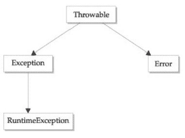

### 示例 11.1

```java
class ErrorTest1
{
  public static void main(String args[])
    {
      int a=5,b=2,c=2,d;
      d=a/(b-c); // 发生了 ArithmeticException(Divide by zero)
      System.out.println(d);
      System.out.println("This will not be printed");
    }
}
```

程序将在除法操作终止，不会执行剩余的语句。

### 示例 11.2

```java
class A
{
  void display()
    {
      -----
    }
}
class ErrorTest2
{
  public static void main(String args[])
    {
      A a1=null;
      a1.display(); // 发生了 NullPointerException
    }
}
```

在上面的程序中，会发生 `NullPointerException`。引用变量没有用 `new` 初始化。在这种情况下，程序也会终止。

### 示例 11.3

```java
class ErrorTest3
{
  public static void main(String args[])
    {
      int a[ ] = {10,20,30};
      System.out.println(a[3]);  // 发生了 ArrayIndexOutOfBoundsException
    }
}
```

在上面的情况下，数组的长度为 3，索引从 0 到 2，因此如果我们打印 `a[3]`，那么它就是第 4 个元素，这并不是一个有效的索引。这将产生一个异常错误。在 C/C++ 中这是允许的，但在 Java 中是不允许。

#### 注意

JDK 7 增加了一种新形式的 `try` 语句支持自动资源管理。这种新形式的 `try` 称为 `try-with-resources`，在 `Chapter` 文件中结合文件管理的背景下进行了描述，因为文件是最常使用的资源之一。

#### 异常的其他情况

1. 我们尝试打开的文件可能不存在。
2. 我们想要创建一个新对象，但没有可用内存。
3. 我们想要加载的类文件可能丢失或格式错误。
4. 我们想要转换为数字的 `String` 包含无效字符，导致无法转换为数字。

如果异常对象没有被妥善捕获和处理，解释器将显示错误消息并终止程序。如果我们希望继续执行剩余代码，则应该尝试捕获由错误条件抛出的异常对象。

这项任务被称为异常处理。异常处理机制目的是提供一种检测和报告“异常情况”的手段，以便采取适当的措施。该机制建议引入一套独立的错误处理代码，用于执行以下任务：

1. 发现问题。（发生异常）
2. 通知错误已发生。（抛出异常）
3. 接收错误信息。（捕获异常）
4. 纠正措施。（处理异常）

Java 异常处理通过五个关键字管理：`try`、`catch`、`throw`、`throws` 和 `finally`。

我们想要监控异常的程序语句包含在 `try` 块中，每当发生错误时，异常就会被抛到 `catch` 块。我们的代码可以捕获此异常（使用 `catch`）并进行合理的处理。系统生成的异常由 Java 运行时自动抛出。

要手动抛出异常，请使用关键字 `throw`。任何抛出方法的异常都必须通过 `throws` 子句指定。任何在方法返回之前必须执行的代码放在 `finally` 块中。

`try` 块必须括在括号之间。可以有一个或多个 `catch` 语句。`catch` 和 `finally` 块是可选的。即使异常没有被处理，`finally` 块也会执行。

`try` 块中的代码与其他任何代码一样。如果存在 `finally` 块，执行将从 `try` 之后的语句继续。如果不存在 `finally` 块，执行将从 `catch` 之后的语句继续。

如果在执行 `try` 块期间发生了某些运行时错误，JVM 会抛出一个异常。这意味着创建了一个 `Exception` 类型的对象。然后它将按顺序与 `catch` 块进行比较。如果找到匹配的 `catch` 块，异常将得到处理。如果不匹配任何 `catch` 块，它将向上层次结构移动，直到被处理或被未处理地传递给 JVM，后者将直接终止程序并显示异常详情。

#### 使用 try 和 catch

虽然 Java 运行时系统提供的默认异常处理器对于调试很有用，但你通常想自己处理异常。这样做有两个益处：第一，它允许你处理错误；第二，它防止程序自动终止。如果你的程序每次发生错误时都停止运行并打印堆栈轨迹，大多数用户（至少来说）会感到困惑！幸运的是，防止这种情况非常简单。

为了防止并处理运行时错误，只需将你想监控的代码包含在 `try` 块中。紧接 `try` 块之后，包含一个 `catch` 子句，指定你想要捕获的异常类型。

为了说明如何轻松地做到这一点，以下程序包含一个 `try` 块和一个 `catch` 子句，用于处理由除零错误生成的 `ArithmeticException`：

```java
class Exc2 {
  public static void main(String args[])
  {
    int d, a;
    try {  // 监控一段代码。
      d = 0;
      a = 42 / d;
      System.out.println("This will not be printed.");
    }
    catch (ArithmeticException e)
    {
    // 捕获除零错误
      System.out.println("Division by zero.");
    }
    System.out.println("After catch statement.");
  }
}
```

该程序产生以下输出：

Division by zero.

After catch statement.

注意 `try` 块内部的 `println()` 调用从未被执行。一旦抛出异常，程序控制就会从 `try` 块转移到 `catch` 块。

换句话说，`catch` 并不是被“调用”的，因此执行永远不会从 `catch` “返回”到 `try` 块。

因此，“这不会打印。”这一行不会显示。一旦 `catch` 语句执行完毕，程序控制将继续执行整个 `try/catch` 机制之后的下一行代码。

`try` 及其 `catch` 语句形成一个单元。`catch` 子句的作用范围限于紧接其之前的 `try` 语句指定的语句。

`catch` 语句无法捕获由另一个 `try` 语句抛出的异常（稍后描述的嵌套 `try` 语句除外）。受 `try` 保护的语句必须用大括号括起来（也就是说它们必须在一个块内）。你不能对单个语句使用 `try`。

大多数结构良好的 `catch` 子句的目标应该是解决异常情况，然后像错误从未发生过一样继续运行。例如，在接下来的程序中，`for` 循环的每次迭代都会获取两个随机整数。

这两个整数相互相除，结果用于除以值 `12345`。最终结果被放入 `a` 中。如果任何一个除法操作导致 `divide-by-zero` 错误，它会被捕获，`a` 的值设置为零，程序继续运行。

```java
// Handle an exception and move on.

import java.util.Random;

class HandleError {
    public static void main(String args[]) {
        int a=0, b=0, c=0;
        Random r = new Random();
        for(int i=0; i<32000; i++) {
            try {
                b = r.nextInt();
                c = r.nextInt();
                a = 12345 / (b/c);
            } catch (ArithmeticException e) {
                System.out.println("Division by zero.");
                a = 0; // set a to zero and continue
            }
            System.out.println("a: " + a);
        }
    }
}
```

### 显示异常描述

`Throwable` 重写了 `toString()` 方法（由 `Object` 定义），使其返回一个包含异常描述的字符串。你可以通过简单将异常作为参数传递给 `println()` 语句来显示此描述。例如，上述程序中的 `catch` 块可以重写为：

```java
catch (ArithmeticException e)
{
    System.out.println("Exception: " + e);
    a = 0; // set a to zero and continue
}
```

当用此版本替换程序并运行时，每个 `divide-by-zero` 错误都会显示以下消息：

`Exception: java.lang.ArithmeticException: / by zero`

虽然这在这个语境下没有特殊价值，但显示异常描述的能力在其他情况下非常有价值——特别是当你正在测试异常或进行调试时。

| 异常类型 | 异常产生原因 |
| :--- | :--- |
| ArithmeticException | 算术错误，例如 - 除以 0 |
| ArrayIndexOutOfBoundsException | 数组索引越界 |
| ArrayStoreException | 在数组中存储了错误类型的数据 |
| FileNotFoundException | 访问不存在的文件 |
| IOException | 无法从文件读取 |
| NullPointerException | 由引用空对象引起 |
| NumberFormatException | 字符串与数字之间的转换失败 |
| OutOfMemoryException | 没有足够的内存分配新对象 |
| SecurityException | Applet 尝试执行浏览器安全设置未允许的操作 |
| StackOverflowException | 系统栈空间不足 |
| StringIndexOutOfBoundsException | 程序尝试访问字符串中不存在的字符位置 |

### Java 内置异常

在标准包 `java.lang` 内部，Java 定义了几个异常类。上述示例已经使用了其中几个。这些异常中最通用的是标准类型 `RuntimeException` 的子类。

如之前解释的那样，这些异常不需要包含在方法的 `throws` 列表中。在 Java 语言中，这些被称为“未检查异常”，因为编译器不会检查方法是否处理或抛出了这些异常。表 12 中定义的异常被称为“已检查异常”。

### 多个 catch 子句

在某些情况下，单段代码可能会抛出多个异常。为了处理这种类型，你可以指定多个 `catch` 子句，每个子句匹配不同的异常类型。当抛出异常时，会按顺序检查每个 `catch` 语句，并执行第一个与异常类型匹配的语句。在一个 `catch` 语句执行后，其他的将直接跳过。

```java
// Demonstrate multiple catch statements
class MultipleCatches {
    public static void main(String args[]) {
        try {
            int a = args.length;
            System.out.println("a = " + a);
            int b = 42 / a;
            int c[] = { 1 };
            c[42] = 99;
        } catch (ArithmeticException e) {
            System.out.println("Divide by 0: " + e);
        } catch (ArrayIndexOutOfBoundsException e) {
            System.out.println("Array index oob: " + e);
        }
        System.out.println("After/catch blocks.");
    }
}
```

如果在不带命令行参数的情况下启动此程序，它将导致除以零异常，因为 `a` 将等于零。如果你提供了命令行参数，将 `a` 设置为大于零的数，它将从除法操作中存活。但它会导致 `ArrayIndexOutOfBoundsException`，因为数组 `c` 的长度为 1，而程序却尝试给 `c[42]` 赋值。

以下是两种运行方式生成的输出：

`C:\java MultipleCatches`

a = 0

Divide by 0: java.lang.ArithmeticException: / by zero

After/catch blocks.

`C:\java MultipleCatches TestArg`

a = 1

Array index oob: java.lang.ArrayIndexOutOfBoundsException:42 After/catch blocks.

### 子类顺序

当你使用多个 `catch` 语句时，重要的是要记住异常子类必须在它们的任何父类之前。这是因为使用父类的 `catch` 语句会捕获该类型的异常以及其任何子类的异常。因此，如果子类出现在父类之后，则永远无法被访问。此外，在 Java 中，不可达代码是一个错误。例如，考虑以下程序：

```java
/* 此程序包含一个错误。
在系列 catch 语句中，子类必须在其父类之前。
如果不是，
将创建不可达代码并导致编译时错误。
*/
class SuperSubCatch {
    public static void main(String args[]) {
        try {
            int a = 0;
            int b = 42 / a;
        } catch(Exception e) {
            System.out.println("Generic Exception catch.");
        }
        /* 此 catch 永远不会到达，因为
ArithmeticException 是 Exception 的子类。 */
        catch(ArithmeticException e) { // ERROR – unreachable
            System.out.println("This is never reached.");
        }
    }
}
```


如果你尝试编译此程序，你将收到一条错误信息，说明第二个 `catch` 语句是不可达的，因为异常已经被捕获。由于 `ArithmeticException` 是 `Exception` 的子类，第一个 `catch` 语句将处理所有基于 `Exception` 的错误，包括 `ArithmeticException`。

这意味着第二个 `catch` 语句将永远不会执行。要解决这个问题，请反转 `catch` 语句的顺序。

## 嵌套的 `try` 语句

`try` 语句是可以嵌套的。也就是说，一个 `try` 语句可以放在另一个 `try` 块内部。每当进入一个 `try` 语句时，该异常的上下文就会推入栈中。

如果内部的 `try` 语句没有针对特定异常的 `catch` 处理器，栈将回溯，并检查下一个 `try` 语句的 `catch` 处理器是否有匹配项。

这种过程会一直持续，直到其中一个 `catch` 语句执行成功，或者所有的嵌套的 `try` 语句执行完毕。如果没有 `catch` 语句匹配，Java 运行时系统将处理该异常。

这里是一个使用嵌套 `try` 语句的示例：

## 多重 `catch` 语句

当存在多个 `catch` 语句时，被称为多重 `catch` 语句。

### 多重 `catch` 语句示例

```java
try
{
    statement;  //产生一个异常
}
catch(Exception-type-1 e)
{
    statement 1;  //处理异常类型 1
}
catch(Exception-type-2 e)
{
    statement 2;  //处理异常类型 2
}
// ...
catch(Exception-type-n e)
{
    statement n;  //处理异常类型 n
}
```

### 示例 11.4

```java
class ErrorTest4
{
    public static void main(String args[])
    {
        int a=10,b=2,c=2,d;
        System.out.println("Before Exception ");
        d=a/(b-c);
        System.out.println("After Exception ");
    }
}
```

输出：

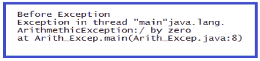

在这里我们没有捕获异常，因此程序将在显示消息“Before Exception”后终止。现在我们已经使用异常处理解决了这个问题。

### 示例 11.5

```java
class ErrorTest5
{
    public static void main(String[] args)
    {
      int a=10,b=2,c=2,d;
      try
      {
        System.out.println("Before Exception");
        d=a/(b-c);
        System.out.println("This Will Not Print");
      }
      catch(ArithmeticException e)
      {
      System.out.println("After Exception");
      System.out.println("error : Division by zero");
      }
    }
}
```

输出：


## 异常处理的优势

- 我们可以很容易地确定异常/错误将被处理的位置。异常/错误在运行时沿调用栈向上传播——首先到达包含它的 `try` 块，然后返回到调用方法——直到异常处理器 `catch` 捕获它们。
- 异常/错误的位置是确定的，因为整个堆栈轨迹对用户可见。这对于调试非常有帮助。
- 程序员获得了从错误/异常状态中恢复的机会。
- 错误处理代码与正常程序流分离，以提高可读性和可维护性。
- 在 Java 中，不需要测试是否发生了异常/错误情况。添加更多的错误/异常处理器只需添加更多的 `catch` 子句，而无需触动原始程序流。

## 异常类的层次结构

所有 `Exception / Error` 类的根类是 `throwable` 类，它是 `object` 类的直接子类。异常/错误在 Java 中也是对象。`Exception` 的子类都带有 `Exception` 后缀。

`throwable` 类有两个直接的子类：

- `Error`：`Error` 类的子类基本上用于信号异常的状况，例如：
  1. `OutOfMemoryError` 信号 Java 虚拟机内存已耗尽，垃圾回收器无法回收任何内存。
  2. `StackOverflowError` 信号解释器中发生栈溢出。

  这些错误通常是不可恢复的，不应该被处理。

- `Exception`：`Exception` 类的子类通常是可恢复的。例如，`EOFException` 信号我们打开的文件没有更多数据可读。`FileNotFoundException` 信号我们想要打开的文件不存在于系统中。

错误的示例：


## 异常分为两种类型

### 检查异常（Checked Exception）

如果必须 `catch` 异常，则它被称为检查异常。如果 `try` 块中可能发生检查异常且未被处理，程序将无法编译。编译器确保如果一个方法直接或间接地抛出检查异常，则该方法必须显式处理它。该方法要么 `catch` 异常并采取适当行动，要么将异常传递给其调用者。

注意：`Exception` 及其所有子类（运行时异常除外）都是检查异常且必须被捕获。

### 未检查异常（Unchecked Exception）

如果不必须捕获异常，则它被称为未检查异常。即使未处理未检查异常，程序也可以编译。如果程序中发生了未处理的未检查异常，程序执行将在该点终止。但如果经过了处理，程序就不会因为异常而终止。

注意：`Error` 及其所有子类都是未检查异常，不需要捕获。用户定义的 `Exception` 是检查异常。

### `Exception` 类中的方法

| 方法 | 说明 |
| :--- | :--- |
| `getMessage()` | 获取与异常或错误相关的消息。 |
| `printStackTrace()` | 打印显示异常/错误发生位置的堆栈轨迹。 |
| `toString()` | 显示异常名称以及 `getMessage()` 返回的消息。 |

### 示例 11.6

```java
class ErrorTest6
{
    public static void main(String[] arr)
    {
      try
      {
        int a=10,b=2,c=2,d;
        System.out.println("Before Exception");
        d=a/(b-c);
        System.out.println("This Will Not Print");
      }
      catch(ArithmeticException e)
      {
        System.out.println("After Exception");
        System.out.println("error : Division by zero");
        System.out.println(e.getMessage());
        System.out.println(e);  //调用了 toString()
        e.printStackTrace();
      }
    }
}
```

输出：

Before Exception

After Exception

error : Division by zero

by Zero

java.lang.ArithmeticException: / by zero

java.lang.ArithmeticException: / by zero

at ErrorTest6.main(ErrorTest6.java:10)

### 示例 11.7 多重 `catch`

```java
class ErrorTest7
{
    public static void main(String args[])
    {
      try
      {
        int a=args.length;
        System.out.println("Before Exception");
        int b=58/a;
        int c[] = {1};
        c[47]=100;
        System.out.println("After Exception");
      }
      catch(ArithmeticException e)
      {
        System.out.println("Divide by zero :"+e);
      }
      catch(ArrayIndexOutOfBoundsException e)
      {
        System.out.println("Array Index oob :"+e);
      }
      System.out.println("After try/catch block");
    }
}
```

输出 1：当我们作为“java ErrorTest7”运行上述程序时：

Before Exception

Divide by zero : java.lang.ArithmeticException: / by zero

After try/catch block

输出 2：当我们作为“java ErrorTest7 45”运行上述程序时：

Before Exception

Array Index oob: java.lang.ArrayIndexOutOfBoundsException: 47

After try/catch block

如果我们在另一个 `try` 块中使用 `try` 和 `catch` 语句，则被称为嵌套 `try-catch`。

### 语法

```java
try      //外部 try
{
    try      //内部 try
    {
        statement ;
    }
    catch1()    //内部 catch
    {
        statement ;
    }
    catch2()    //内部 catch
    {
        statement ;
    }
}
catch()    //外部 catch
{
    statement ;
}
```

### 示例 11.8 嵌套的 `try` 和 `catch`

```java
class Nested
{
    public static void main(String args[])
    {
        try
        {
            int a=args.length;
            int b=58/a;
            System.out.println("a= "+a);
            try
            {
                if(a==1)
                    a=a/(a-a);
                if(a==2)
                {
                    int c[]={1};
                    c[42]=100;
                }
            }
            catch(ArrayIndexOutOfBoundsException e)
            {
                System.out.println("ArrayIndex oob "+e);
            }
        }
        catch(ArithmeticException e)
        {
            System.out.println(e.getMessage());
        }
    }
}
```

**输出 I：**

当我们以“java ErrorTest8”运行上述程序时（除以零错误）

**输出 II：**

当我们以“java ErrorTest8 10”运行上述程序时

a=1 / by zero

**输出 III：**

当我们以“java ErrorTest8 10 20”运行上述程序时 a=2

ArrayIndex oob java.lang.ArrayIndexOutOfBoundsException: 42

### `finally` 语句

Java 支持另一种名为 `finally` 的语句，它可以用于处理未被之前的任何一个 `catch` 语句捕获的异常。`finally` 块可以用于处理 `try` 块中生成的任何异常。无论是否发生错误，它都会被执行。它可以紧跟在 `try` 块之后，也可以跟在最后一个 `catch` 块之后，如下所示：

**语法：**

```java
try
{
    ...
}
catch(...)
{
    ...
}
catch(...)
{
    ...
}
finally
{
    ...
}
```

### 示例 11.9 `finally` 语句

```java
class ErrorTest9
{
    public static void main(String args[])
    {
        int a[ ] = {5,10};
        int b=5;
        try
        {
            int x=a[2]/b-a[1];
        }
        catch(ArithmeticException e)
        {
            System.out.println("Division By Zero");
        }
        catch(ArrayIndexOutOfBoundsException e)
        {
            System.out.println("Array Index error");
        }
        catch(ArrayStoreException e)
        {
            System.out.println("Wrong Data Type");
        }
        finally    //始终执行
        {
            System.out.println("Always Execute");
        }
        int y=a[1]/a[0];
        System.out.println("y = "+y);
    }
}
```

**输出：**

Array Index error

Always Execute

y = 2

### `throw`

到目前，我们只捕获由 Java 运行时系统抛出的异常。然而，我们的程序完全可以使用 `throw` 语句显式地抛出异常，`throw` 的通用形式所示：

```java
throw Throwableinstance;
```

在这里，`Throwableinstance` 必须是 `Throwable` 类型的对象或 `Throwable` 的子类。简单类型（如 `int` 或 `char`）以及如 `String` 和 `Object` 等非 `Throwable` 类不能作为异常。我们有两种方法可以获取 `Throwable` 对象：使用 `catch` 子句中的参数，或者使用 `new` 操作符创建一个。

在执行 `throw` 语句后，执行流立即停止；任何后续语句都不会执行。程序将检查最近的嵌套 `try` 块，看它是否有与异常类型匹配的 `catch` 语句。如果找到了匹配项，控制将转移到该语句。如果没有，则检查下一个嵌套的 `try` 语句，依此类推。如果没有找到匹配的 `catch`，则由默认异常处理器打印堆栈跟踪信息。这里我们取了一个创建并抛出异常的程序。捕获异常的处理器将其重新抛出给外部处理器。

**示例 1.10**

```java
class ErrorTest10
{
    int age;
    void setAge(int a)
    {
        if(a>0)
            age = a;
        else
        {
            NullPointerException e = new NullPointerException("Invalid Age");
            throw e;
            //throw NullPointerException("Invalid Age");
        }
    }
    public static void main(String args[])
    {
        ErrorTest10 a1 = new ErrorTest10();
        try
        {
            a1.setAge(20);
            a1.setAge(-10);
        }
        catch(NullPointerException e)
        {
            System.out.println(e.getMessage());
        }
    }
}
```

**输出：**


# Invalid Age

## `throws` 子句

如果一个方法能够导致它未处理的异常，它就必须指定这种行为，以便调用者知晓。我们通过在方法声明中包含 `throws` 子句来实现这一点。`throws` 列出方法可能抛出的异常类型。对于受检异常，如果不这样做将会导致编译错误。这是包含 `throws` 的方法通用形式：

```java
type method-name(parameter list) throws exception-list
{
    //方法体
}
```

**示例 1.11**

```java
import java.io.*;
class ErrorTest11
{
    int age;
    void setAge(int a) throws IOException
    {
        if(a>0)
            age = a;
        else
        {
            IOException e = new IOException("Invalid Age");
            throw e;
        }
    }
    public static void main(String args[])
    {
        ErrorTest11 a1 = new ErrorTest11();
        try
        {
            a1.setAge(20);
            a1.setAge(-10);
        }
        catch(IOException e)
        {
            System.out.println(e.getMessage());
        }
    }
}
```

**输出:**

```
Invalid Age
```

## 定义异常/Error 子类

自定义异常/Error 子类——这非常容易做到，只需定义 `Exception/Error` 类的子类。我们的子类不需要实现任何内容。`Exception/Error` 类没有定义任何方法。它当然继承了 `Throwable` 类提供的方法。

尽管 Java 的内置异常处理了大多数常见情况，但你可能想要创建自己的异常类型来处理特定于应用程序的情况。这非常简单：只需定义 `Exception` 的子类（它无疑是 `Throwable` 的子类）。

**示例 11.12**

```java
class AgeException extends Exception
{
```

```java
class AgeException(String msg) {
    super(msg);
}

class ErrorTest12 {
    int age;
    void setAge(int a) throws InvalidAgeException {
        if (a > 0)
            age = a;
        else {
            AgeException e = new AgeException("Invalid Age");
            throw e;
        }
    }
    public static void main(String args[]) {
        ErrorTest12 a1 = new ErrorTest12();
        try {
            a1.setAge(20);
            a1.setAge(-10);
        } catch (AgeException e) {
            System.out.println(e.getMessage());
        }
    }
}
```

输出:

```
Invalid Age
```

以下示例声明了一个 `Exception` 的新子类，并使用该子类在方法中信号错误条件。它重写了 `toString()` 方法，允许显示经过精心定制的异常描述。

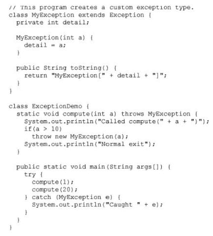

此示例定义了一个名为 `MyException` 的 `Exception` 子类。该子类非常简单：它只有一个构造函数加上一个重写的 `toString()` 方法，该方法用于显示异常的值。

`ExceptionDemo` 类定义了一个名为 `compute()` 的方法，该方法抛出一个 `MyException` 对象。当 `compute()` 的整数参数大于 10 时，会抛出异常。`main()` 方法为 `MyException` 设置了异常处理程序，然后用合法值（小于 10）和非法值调用 `compute()`，以展示代码的两种路径。

结果如下：

```
Called compute(1)
Normal exit
Called compute(20)
Caught MyException[20]
```

## 异常链

异常链功能允许我们将一个异常与另一个异常关联起来。第二个异常描述了第一个异常的原因。例如，想象一种情况：方法由于尝试除以零而抛出 `ArithmeticException`。然而，问题的实际原因是发生了 I/O 错误，导致除数被设置不当。

尽管该方法必须抛出 `ArithmeticException`（因为这是实际发生的错误），我们可能也想让调用代码知道底层原因是 I/O 错误。

为了支持异常链，Java 2 的 1.4 版本为 `Throwable` 类增加了两个构造函数和两个方法。构造函数如下所示：

```
Throwable(Throwable causeExc)
Throwable(String msg, Throwable causeExc)
```

在第一种形式中，`causeExc` 是发生的异常。第二种形式允许我们在指定原因异常的同时指定描述。这两个构造函数也被添加到了 `Error`、`Exception` 和 `RuntimeException` 类中。

添加到 `Throwable` 类的异常链方法是 `getCause()` 和 `initCause()`：

```
Throwable getCause()
Throwable initCause(Throwable causeExc)
```

`getCause()` 方法返回当前异常的底层异常。如果没有底层异常，则返回 `null`。`initCause()` 方法将 `causeExc` 与调用的异常关联并返回该异常的引用。因此，我们可以在异常创建后与其关联一个原因。然而，原因异常只能设置一次。

因此，每个异常对象只能调用一次 `initCause()`。此外，如果原因异常是通过构造函数设置的，那么我们不能再次使用 `initCause()` 方法来设置它。通常情况下，`initCause()` 用于为不支持上述两个额外构造函数的旧版异常类设置原因。Java 的大多数内置异常都没有定义这些额外的构造函数。因此，如果我们需要为这些异常添加异常链，将使用 `initCause()`。异常链并不是每个程序都需要的。但在了解底层原因有用的情况下，它们提供了一种优雅的解决方案。

### 示例 1

```java
class ErrorTest {
    int age;
    void setAge(int a) {
        if (a > 0)
            age = a;
        else {
            NullPointerException e = new NullPointerException("Admission Failed");
            e.initCause(new ArithmeticException("Age is invalid"));
            throw e;
        }
    }
    public static void main(String args[]) {
        ErrorTest a1 = new ErrorTest();
        try {
            a1.setAge(20);
            a1.setAge(-10);
        } catch (NullPointerException e) {
            System.out.println(e.getMessage());
            System.out.println(e.getCause());
        }
    }
}
```

输出:

```
Admission Failed
Age is Invalid
```


在这个示例中，顶层异常是 `NullPointerException`。它添加了一个原因异常 `ArithmeticException`。当异常从 `setAge()` 抛出时，它被 `main()` 捕获。在那里，显示顶层异常，随后是可以通过调用 `getCause()` 获取的底层异常。异常链可以延伸到任何深度。因此，原因异常本身也可以有自己的原因。请注意，过长的异常链可能表明设计不当。异常链并不是每个程序都需要的。但在了解底层原因有用的情况下，它们提供了一种优雅的解决方案。

## 三个新的 JDK 7 异常特性（更新）

JDK 7 为异常系统增加了三个有趣且实用的特性。第一个是在当资源不再需要时自动释放资源（如文件）。它基于 `try` 语句的扩展形式，称为 `try-with-resources`，将在介绍文件的章节介绍。

第二个新特性是 `multi-catch`，第三个有时被称为 `final rethrow` 或更精确的重抛。这两个特性在这里描述。

`multi-catch` 功能允许由同一个 `catch` 子句捕获两个或多个异常。多个异常处理器使用相同的代码序列并不罕见，尽管它们响应的是不同的异常。与其需要单独捕获每个异常类型，现在可以使用单个 `catch` 子句处理所有异常，避免代码重复。

要使用 `multi-catch`，用或运算符分隔 `catch` 子句中的每个异常类型。每个 `multi-catch` 参数都隐含为 `final`。（如果需要，可以显式指定 `final`，但没有必要。）由于每个 `multi-catch` 参数隐含为 `final`，因此它不能被赋予新值。

这里有一个使用 `multi-catch` 特性捕获 `ArithmeticException` 和 `ArrayIndexOutOfBoundsException` 的 `catch` 语句：

```java
catch(ArithmeticException | ArrayIndexOutOfBoundsException e)
```

以下程序演示了 `multi-catch` 特性的用法：

```java
// 展示 JDK 7 的 multi-catch 特性
class MultiCatch {
    public static void main(String args[]) {
        int a=10, b=0;
        int vals[] = { 1, 2, 3 };
        try {
            int result = a / b; // 产生 ArithmeticException
            // vals[10] = 19; // 产生 ArrayIndexOutOfBoundsException
            // 此 catch 子句捕获这两个异常。
        } catch(ArithmeticException | ArrayIndexOutOfBoundsException e) {
            System.out.println("捕获到异常: " + e);
        }
        System.out.println("After multi-catch.");
    }
}
```

尝试除以零时，程序将产生 `ArithmeticException`。如果你注释掉除法语句并移除下一行的注释符号，则会产生 `ArrayIndexOutOfBoundsException`。这两个异常都被同一个 `catch` 语句捕获。

更精确的重抛功能限制了可以重新抛出的异常类型，仅限于关联的 `try` 块抛出的检查异常（checked exceptions），且未被之前的 `catch` 子句处理，并是参数的子类或超类的异常。

尽管这种功能可能并不频繁需要，但现在已经可以使用。为了使更精确的重抛功能生效，`catch` 参数必须是有效 final（effectively final），这意味着它在 `catch` 块内部不能被赋值新值，或者显式声明为 `final`。

## 使用异常

异常处理为控制具有许多动态运行特性的复杂程序提供了一种强大的机制。将 `try`、`throw` 和 `catch` 视为处理程序逻辑中错误和异常边界条件的整洁方式。与其他某些使用错误返回代码来指示失败的语言不同，Java 使用异常。因此，当一个方法可能会失败时，让它抛出异常。

这是一种处理失败模式更干净的方法。最后一点：Java 的异常处理语句不应被视为非局部分支的通用机制。如果你这样做，只会混乱你的代码并使其难以维护。

## 理论题

1. 什么是异常？

2. 我们如何定义 `try` 块？

3. 我们如何定义 `catch` 块？

4. 列出 Java 中可能发生的一些常见异常类型。给出示例。

5. 捕获所有类型的异常是必要的吗？

6. 一个 `try` 块可以使用多少个 `catch` 块。

7. 创建可能产生三种异常的 `try` 块，然后结合必要的 `catch` 块来适当捕获并处理它们。

8. 什么是 `finally` 块？什么时候如何使用它？给出一个合适的示例。

9. 解释异常处理机制如何用于调试程序。


# 章：∞ 12 ∞ (多线程编程)

## 引言

线程是程序内部的控制流。线程与进程非常相似。事实上，线程也被称为轻量级进程。

### 线程对比进程

通常，不同的进程占用不同的内存空间。当 CPU 从一个进程切换到另一个进程时，当前运行进程的状态会被保存，另一个进程的状态会被恢复。在状态切换期间没有进行任何有用工作。状态切换时间应该尽可能短，以最大化 CPU 的利用率。

线程也像独立的进程，但它们共享相同的内存和状态。各个线程也有独立的状态，但与进程状态相比，该状态非常小。状态可能只包含程序计数器和栈指针。因此，从一个线程切换到另一个线程所需的时间非常短。与进程相比，线程的上下文切换时间非常小。因此，多线程的 CPU 利用率高于多进程的情况。

### 多线程程序

多线程程序包含两个或多个可以并发运行的部分。此类程序的每个部分被称为线程，每个线程都定义了一条独立的执行路径。因此，多线程是多任务的一种特殊形式。

例如，一个程序可能有三个线程：

* 一个处理打印。

* 一个处理编辑。

* 一个从互联网下载文件。

所有这些线程都可能并发运行，从而最大化 CPU 的利用率。

### 基于进程的多任务

大多数操作系统允许我们同时运行两个或多个程序。这被称为基于进程的多任务。例如，我们可以运行一个 Java 程序，同时编辑一个 Word 文档。基于进程的多任务确保了在大多数时间内会有程序被执行，从而增加了 CPU 的利用率。

在基于进程的多任务中，程序是调度程序可以派发的最小代码单元。

### 基于线程的多任务

在基于线程的多任务环境中，线程是执行的最小单元。一个进程可以被分为若干并发执行的线程。这允许我们在单个程序中并发处理多个任务。

例如，我们可以编辑一个 Word 文档。基于线程的多任务提高了 CPU 的利用率。

## Java 线程模型

Java 运行时系统许多方面依赖线程，所有的类库都是为了多线程设计的。

## 线程生命周期（线程状态）

线程存在于几种状态。线程可以处于运行状态。一旦获得 CPU 时间，就可以处于就绪状态。运行中的线程可以被挂起，暂时停止其活动。挂起的线程随后可以恢复，让它从停止的地方继续。线程在等待资源或终止时会处于阻塞状态。

### 1. 新生状态 (Newborn State)

当我们创建一个线程对象时，线程就出生了，被称为处于新生状态。该线程尚未被调度运行。

在此状态下，我们只能对它执行以下其中一操作：

1. 使用 `start()` 方法调度它运行。

2. 使用 `stop()` 方法将其杀死。

如果被调度，它将移动到可运行状态（Runnable State）。如果我们尝试在此状态下使用任何其他方法，将会抛出异常。

### 2. 可运行状态 (Runnable State)

可运行状态意味着线程已准备好执行，并正在等待处理器的可用。也就是说，该线程已加入等待执行的线程队列。如果所有线程的优先级相同，则将以轮询的方式给它们执行时间片。

放弃控制权的线程会加入队列末尾并再次等待轮到它。然而，如果我们想让一个线程在轮到它之前将控制权让给另一个相同优先级的线程，它可以通过调用 `yield()` 方法来实现。

### 3. 运行状态 (Running State)

运行意味着处理器已将时间分配给线程进行执行。运行中的线程在以下情况下可能会放弃控制权：

* 其时间片用完。

* 被高优先级线程抢占。

* 它让出（yield），即主动放弃控制权。

* 它已完成执行。

* 它被其他线程停止。

* 它已使用 `suspend()` 方法挂起。被挂起的线程可以通过使用 `resume()` 方法恢复。当我们由于某些原因想挂起线程一段时间，但不想杀死它时，这种方法非常有用。

* 它被告知等待直到某个事件发生。这是通过使用 `wait()` 方法实现的。可以使用 `notify()` 方法调度该线程再次运行。


- 它正在执行某些 I/O 操作。

#### 4. 阻塞状态（Blocked State）

当一个线程被阻止进入可运行状态以及随后的运行状态时，该线程被称为阻塞的。这发生在线程被挂起、睡眠或等待以满足某些需求时。阻塞线程被视为“不可运行”，但并未死亡，因此完全有资格再次运行。

#### 5. 死亡状态（Dead State）

每个线程都有生命周期。运行中的线程在完成其 `run()` 方法的执行后结束生命，这自然死亡。然而，我们可以通过在任何状态向它发送停止消息来杀死它，从而导致过早死亡。线程可以在一出生时、运行期间、甚至在它处于“不可运行”（阻塞条件）状态时被杀死。

### 线程优先级（Thread Priorities）

Java 为每个线程分配一个优先级，该优先级决定了相对于其他线程如何处理该线程。线程优先级是整数，指定了一个线程相对于另一个线程的相对优先级。

从绝对值来说，优先级是没有意义的；如果它是唯一运行的线程，高优先级的线程运行速度并不比低优先级的线程快。相反，线程的优先级用于决定何时从一个运行中的线程切换到下一个线程。这被称为上下文切换（context switch）。决定何时发生上下文切换的规则如下：

- 线程可以自愿（自己）放弃控制。这是通过显式地让出（yielding）、睡眠、阻塞或等待 I/O 实现的。在这种情况下，将检查所有其他线程，通常将就绪运行的优先级最高的线程赋予 CPU。
- 线程可以被高优先级线程抢占。在这种情况下，一个不让出处理器的低优先级线程无论正在做什么，简单地被高优先级线程抢占。基本上，只要高优先级线程想要运行，它就会运行。这被称为抢占式多任务处理（preemptive multitasking）。
- 某些操作系统支持非抢占式优先级调度。在这种情况下，高优先级线程只有在低优先级线程完成后才有机会运行。
- 在两个相同优先级的线程竞争 CPU 周期的情况下，情况会有点复杂。对于像 Windows 98 这样的操作系统，等优先级的线程必须自愿（自己）让出（放弃）控制权给同。如果它们这样做，其他线程将不会运行。

注意：由于操作系统切换相同优先级线程的方式不同，可能会产生问题。

### 同步（Synchronization）

由于多线程为我们的程序引入了异步行为，我们必须在需要时有一种方法来强制执行同步。例如，如果我们想让两个线程通信并共享一个复杂的数据结构（如链表），我们需要某种方法来确保它们不会发生冲突。

也就是说，我们必须防止一个线程在另一个线程正在读取数据时写入数据。Java 使用监视器（monitor）进行线程间同步。我们可以将监视器想象成只能容纳一个线程的小盒子。一旦线程进入监视器，它就可以用来保护共享资源不被多个线程同时操作。

大多数多线程系统将对象暴露出来，我们的程序必须显式地获取并锁定。Java 提供了一个更整洁的解决方案。

没有 `monitor` 类，相反，每个对象都有自己的隐式监视器，当调用对象的某个 `synchronized` 方法时，该监视器会自动进入。一旦线程进入 `synchronized` 方法，任何其他线程都无法调用同一对象上的任何其他 `synchronized` 方法。这使我们能够编写非常清晰且简洁的多线程代码，因为同步支持已内置在语言中。

### 消息传递（Messaging）

使用大多数其他语言进行编程时，我们必须依赖操作系统来建立线程之间的通信。

这无疑增加了开销。相比之下，Java 提供了一种清晰、低成本的方法让两个或多个线程通过调用所有对象都有的预定义方法进行通信。Java 的消息传递系统允许线程进入对象的 `synchronized` 方法，然后在那里等待，直到其他线程显式地通知其出来。

### Thread 类和 Runnable 接口

Java 的多线程系统建立在 `Thread` 类、其方法及其伴侣接口 `Runnable` 之上。该类属于 `java.lang` 包，因此不需要显式导入它。

`Thread` 封装了一个执行线程，由于我们无法直接引用运行线程的内部状态，我们将通过它的代理（即产生它的线程的 `Thread` 实例）来处理它。要创建一个新线程，我们的程序将扩展 `Thread` 类或实现 `Runnable` 接口。

`Thread` 类定义了几个帮助管理线程的方法：

| 方法 | 说明 |
| :--- | :--- |
| `String getName()` | 返回此线程的名称 |
| `int getPriority()` | 返回此线程的优先级 |
| `boolean isAlive()` | 测试此线程是否仍在运行 |
| `void join()` | 等待此线程死亡（终止） |
| `void run()` | 如果此线程使用单独的 `Runnable` 对象构造，则调用该 `Runnable` 对象的 `run` 方法；否则，此方法不做任何操作并返回；如果扩展了线程类并在子类中重写了 `run()` 方法，则调用重写的 `run()` 方法。 |
| `void setName(String name)` | 将此线程的名称更改为参数 |
| `static void sleep(long millis)` | 使当前执行的线程睡眠指定的毫秒数（1 秒 = 1000ms） |
| `static void sleep(long millis, int nanos)` | 使当前执行的线程睡眠指定的毫秒加上指定的纳秒。 |
| `void start()` | 使此线程开始执行，Java 虚拟机调用此线程的 `run` 方法。 |
| `static void yield()` | 使当前执行的线程对象临时暂停并允许其他线程执行。 |
| `static Thread currentThread()` | 返回当前执行线程的引用。 |

### 主线程（The main thread）

当 Java 程序启动时，一个线程会立即开始运行。这通常被称为我们程序的主线程，因为它是程序启动时执行的线程。主线程是创建其他“子”线程的线程。

虽然主线程是在程序启动时创建的，但可以通过 `Thread` 对象对其进行控制。为此，我们必须通过调用 `currentThread()` 方法获取其引用，该方法是 `Thread` 类的公共静态成员。

该方法返回调用它的线程的引用。一旦有了主方法的引用，我们就可以像任何其他线程一样控制它。

#### 示例 12.1

以下示例演示了我们如何获取主线程的引用，然后使用 `Thread` 类的方法访问其属性。

```java
class CurrentThreadTest {
    public static void main (String args[]) {
        Thread t = Thread.currentThread();
        System.out.println("Current thread:" + t);
        System.out.println("Name:"+ t.getName());
        System.out.println("Priority:"+ t.getPriority());
        t.setName("MyThread");
        t.setPriority(Thread.MAX_PRIORITY);
        System.out.println("After name and priority change :" + t);
        System.out.println("Name:" + t.getName());
    }
}
```

```java
13. System.out.println(“Priority:” + t.getPriority());
14. for (int n=1; n<=5; n++)
15 {
16 System.out.println(n);
17 try {
18 Thread.sleep(1000);
19 } catch (InterruptedException e) {
20 System.out.println(“Main thread interrupted”);
21 }
```

**输出：**

```text
Current thread:Thread[main,5,main]
Name:main
Priority:5
After name and priority change :Thread[MyThread,10,main]
Name:MyThread
Priority:10
1
2
3
4
5
```

**注意 1：** `Thread` 中的 `sleep()` 方法可能会抛出 `InterruptedException`，这是一个检查异常。如果其他线程想要中断正在睡眠的这个线程，就会发生这种情况。

**注意 2：** 注意当 `t`（线程引用）作为 `println()` 的参数时产生的输出。它将按顺序显示：线程名称、优先级以及线程组名称。它的优先级是 5，这是默认值，而 `main` 也是该线程所属线程组的名称。线程组是一个控制线程集合整体状态的数据结构。

## 创建线程

在最一般的意义上，我们通过实例化 `Thread` 类型的对象来创建线程。Java 识别了两种实现目标的方法：

1. 我们可以实现 `Runnable` 接口。
2. 我们可以继承 `Thread` 类本身。

### 实现 Runnable

创建线程最简单的方法是创建一个实现 `Runnable` 接口的类。要实现 `Runnable`，类只需要实现一个名为 `run()` 的方法。

```java
public void run( )
```

在 `run()` 方法内部，我们将定义构成新线程的代码。`run()` 可以像主线程一样调用其他方法、使用其他类并声明变量。

唯一的区别是，`run()` 为程序中的另一个并发执行线程确立了入口点。该线程将在 `run()` 返回时结束。

在我们创建了实现 `Runnable` 的类后，我们将在该类内部使用以下构造函数之一来实例化 `Thread` 类型的对象：

- `Thread(Runnable threadObj)`
- `Thread(Runnable threadObj, String threadName)`

这里 `threadObj` 是调用其 `run` 方法的对象，`threadName` 是新线程的名称。在新线程创建后，在我们调用 `start()` 方法之前，它将不会开始运行。

`start()` 方法将线程放入就绪队列（可运行状态）。每当线程被调度时，它的执行将从 `run()` 方法开始。

### 示例 12.2

```java
class A implements Runnable
{
  public void run()
  {
    for(int i=1;i<=5;i++)
    {
      System.out.println(“Child Thread:” + i);
    }
    System.out.println(“Exiting child thread”);
  }
}
class RunnableTest
{
  public static void main(String args[])
  {
    A a1=new A();
    Thread t1 = new Thread(a1,”Demo Thread”);
    t1.start();
    System.out.println(“Main thread exiting”);
  }
}
```

**输出：**

```text
Main thread exiting
Child Thread:1
Child Thread:2
Child Thread:3
Child Thread:4
Child Thread:5
Exiting child thread
```

### 示例 12.3

```java
class A implements Runnable
{
  Thread t;
  A()
  {
    t= new Thread(this, “Demo Thread”);
    System.out.println(“Child thread: “+ t);
    t.start();
  }
  public void run()
  {
    for (int i=1; i<=5; i++)
    {
      System.out.println(“Child Thread: ”+ i );
      try {
        Thread.sleep(500);
      } catch (InterruptedException e) {
        System.out.println(e);
      }
    }
    System.out.println (“Exiting Child thread”);
  }
}
class Runnable2
{
  public static void main (String args )
  {
    A a1=new A();
    for (int i=1; i<=5; i++)
    {
      System.out.println(“Main Thread:”+ i);
      try {
        Thread.sleep (1000);
      } catch(InterruptedException e) {
        System.out.println(“thread interrupted”);
      }
    }
    System.out.println(“End of Main thread”);
  }
}
```

**输出：**

```text
Child thread:Thread[Demo Thread,5,main]
Main Thread:1
Child Thread: 1
Child Thread: 2
Main Thread:2
Child Thread: 3
Child Thread: 4
Main Thread:3
Child Thread: 5
Exiting Child thread
Main Thread:4
Main Thread:5
End of Main thread
```

### 扩展 Thread 类

创建线程的第二种方法是创建一个扩展 `Thread` 的新类，然后创建该类的实例。扩展类必须重写 `run()` 方法，这是新线程的入口点。它还必须调用 `start()` 来执行新线程。

### 示例 12.4

```java
class A extends Thread
{
  A()
  {
    super (“Test Thread”);
    System.out.println (“Child thread:” + this);
    start();
  }
  public void run ()
  {
    for (int i=1; i<=5; i++)
    {
      System.out.println(“Child Thread:”+i);
      try {
        sleep(500);
      } catch(InterruptedException e) {
        System.out.println(“Child interrupted”);
      }
    }
    System.out.println (“Exiting Child thread”);
  }
}
class ThreadTest
{
  public static void main(String args[])
  {
    new A();
    for (int i=1; i<=5; i++)
    {
      System.out.println(“Main Thread: “+i);
      try {
        Thread.sleep(1000);
      } catch(InterruptedException e) {
        System.out.println(“Main thread interrupted”);
      }
    }
    System.out.println (“Main thread exiting”);
  }
}
```

**输出：**

```text
Child thread:Thread[Testing Thread,5,main]
Main Thread: 1
Child Thread:1
Child Thread:2
Main Thread: 2
Child Thread:3
Child Thread:4
Main Thread: 3
Child Thread:5
Exiting Child thread
Main Thread: 4
Main Thread: 5
Main thread exiting
```

**注意：** 如果 `Thread` 没有分配任何名称，它将类似于 `Thread-1`、`Thread-2`、`Thread-3` 等。

### 选择方法

`Thread` 类定义了一些可以被派生类重写的方法。在这些方法中，唯一必须重写的是 `run()`。这也是我们在实现 `Runnable` 接口时要求的方法。

许多 Java 程序员认为只有在对类进行某种方式的增强或修改时才扩展类。因此，如果我们不需要重写 `Thread` 的其他方法，实现 `Runnable` 可能是最好的。

### 创建多个线程

### 示例 12.5


```java
class A implements Runnable
{
  String name;
  Thread t;
  A(String threadName)
  {
    name=threadName;
    t=new Thread(this, name);
    System.out.println(“Child thread:”+t);
    t.start();
  }
  public void run()
  {
    for(int i=1;i<=5;i++)
    {
      System.out.println(t.getName())+ ":" + i);
      try {
        Thread.sleep(1000);
      } catch(InterruptedException e) {
        System.out.println(e); 
      }
    }
    System.out.println(name+ “Exiting”);
  }
}
class MultiThreadTest
{
  public static void main(String args[] )
  {
    A a1=new A(“One”);
    A a2=new A (“Two”);
    A a3=new A (“Three”);
    try {
      Thread.sleep(10000);
    } catch(InterruptedException e) {
      System.out.println(“main thread interrupted”);
    }
    System.out.println (“Main thread exiting”);
  }
}
```

```java
45.    }
46.  }
```

Output:

```
Child thread:Thread[One,5,main]
Child thread:Thread[Two,5,main]
Child thread:Thread[Three,5,main]
One:1
Two:1
Three:1
One:2
Two:2
Three:2
One:3
Two:3
Three:3
One:4
Two:4
Three:4
One:5
Two:5
Three:5
OneExiting
TwoExiting
ThreeExiting
Main thread exiting
```

### 使用 `isAlive()` 和 `join()` 方法强制执行某些顺序

我们通常希望主线程最后结束。实现这一目标的一种方法是在 `main` 方法中调用 `sleep()`。这是一种相当粗糙的方法。有两种方法可以判断线程是否已完成。

首先，我们可以在线程上调用 `isAlive()`。该方法由 `Thread` 类定义，其通用形式为：

```java
final boolean isAlive()
```

如果调用该方法的线程仍在运行，则 `isAlive()` 返回 `true`；否则返回 `false`。虽然 `isAlive()` 有时很有用，但我们更常用的等待线程完成的方法是 `join()`，所示所示：

```java
final void join() throws InterruptedException
```

该方法会等待直到调用该方法的线程终止为止。`join()` 的其他形式允许我们指定等待指定线程终止的最大时间。

下面的示例使用了 `join()` 来确保主线程是最后一个停止的。它还演示了 `isAlive()` 方法。

### 示例 12.6

```java
1.  class A implements Runnable
2.  { 
3.    String name;
4.    Thread t;
5.    A(String threadName)
6.    { 
7.      name=threadName;
8.      t=new Thread(this,name);
9.      System.out.println("Child thread:"+t);
10.      t.start();
11.    }
12.    public void run()
13.    { 
14.      for(int i=1;i<=5;i++)
15.      { 
16.        System.out.println(name +":"+ i );
17.        try
18.        { 
19.          Thread.sleep(1000);
20.        }
21.        catch(InterruptedException e)
22.        { 
23.          System.out.println(e);
24.        }
25.      }
26.      System.out.println(name + "Exiting");
27.    }
28.  }
29.  class DemoJoin
30.  { 
31.    public static void main(String args[] )
32.    { 
33.      A ob1=new A("One");
34.      A ob2=new A("Two");
35.      A ob3=new A("Three");
36.      System.out.println("Thread One is alive?:"+ob1.t.isAlive());
37.      System.out.println("Thread Two is alive?:"+ob2.t.isAlive());
38.      System.out.println("Thread Three is alive?:"+ob3.t.isAlive());
39.      try
40.      { 
41.        ob3.t.join();
42.        ob2.t.join();
43.        ob1.t.join();
44.      }
45.      catch(InterruptedException e)
46.      { 
47.        System.out.println("main thread interrupted");
48.      }
49.      System.out.println("Thread One is alive?:"+ ob1.t.isAlive());
50.      System.out.println("Thread Two is alive?:"+ ob2.t.isAlive());
51.      System.out.println("Thread Three is alive?:"+ ob3.t.isAlive());
52.      System.out.println ("Main thread exiting");
53.    }
54.  }
```

Output:

```
Child thread:Thread[One,5,main]
Child thread:Thread[Two,5,main]
Child thread:Thread[Three,5,main]
Thread One is alive?:true
Thread Two is alive?:true
Thread Three is alive?:true
One:1 
Two:1
Three:1 
One:2
Two:2
Three:2
One:3
Two:3
Three:3
One:4
Two:4
Three:4
One:5
Two:5
Three:5
OneExiting
TwoExiting
ThreeExiting
Thread One is alive?:false
Thread Two is alive?:false
Thread Three is alive?:false
Main thread exiting
```

### 线程优先级

线程优先级用于线程调度器来决定何时允许每个线程运行。与低优先级相比，高优先级线程会被优先调度。高优先级线程还可以抢占低优先级线程。例如，当低优先级线程正在睡眠或等待 I/O 时，高优先级线程将恢复运行。

理论上，相同优先级的线程应该获得相同的 CPU 访问权限。Java 设计用于各种环境，某些环境的行为与其他环境有本质不同。为了安全，共享优先级的线程应该偶尔让控制。这确保了所有线程都有运行的机会。

要设置线程的优先级，请使用 `setPriority()` 方法。其通用形式为：

```java
void setPriority(int level)
```

`level` 必须在 `MIN_PRIORITY` 和 `MAX_PRIORITY` 范围内。目前，`NORM_PRIORITY` 为 5。我们可以通过调用 `Thread` 类的 `getPriority()` 方法获取当前优先级，所示：

```java
int getPriority()
```

下面的示例演示了两个不同优先级的线程，由于它们在抢占式平台上运行，它们的运行方式并不相同。

### 示例 12.7

```java
1.  class Clicker implements Runnable
2.  { 
3.    long click = 0;
4.    Thread t;
5.    volatile boolean running=true;
6.    Clicker(int p)
7.    { 
8.      t=new Thread(this);
9.      t.setPriority(p);
10.    }
11.    public void run()
12.    { 
13.      while (running)
14.      { 
15.        click++;
16.      }
17.    }
18.    void stop ()
19.    { 
20.      running = false;
21.    }
22.    void start ()
23.    { 
24.      t.start();
25.    }
26.  }
27.  class HiLo
28.  { 
29.    public static void main(String args[])
30.    { 
31.      Thread.currentThread().setPriority(Thread.MAX_PRIORITY);
32.      Clicker hi = new Clicker(Thread.NORM_PRIORITY+1);
33.      Clicker lo = new Clicker(Thread.NORM_PRIORITY-1);
34.      lo.start(); hi.start();
35.      try
36.      { 
37.        Thread.sleep(10000);
38.      }
39.      catch (InterruptedException e)
40.      { 
41.        System.out.println(e);
42.      }
43.      lo.stop(); hi.stop();
44.      System.out.println("Low : " + lo.click);
45.      System.out.println("High : " + hi.click);
46.    }
47.  }
```

Output:

```text
Low : 63660819
High : 2086505403
```

注意：变量 `running` 之前有 `volatile` 关键字，以确保每次迭代以下循环时都检查 `running` 的值。

```java
while (running)
{
  click++;
}
```

如果不使用 `volatile`，Java 可以自由对循环进行优化，创建 `running` 的局部副本。

当两个或多个线程需要访问共享资源时，它们需要某种方式来确保资源在同一时刻只有一个线程在使用。实现这一点的过程被称为同步。

同步的关键是监视器（monitor）概念（也称为信号量）。监视器是一个用作互斥锁的对象。在给定时刻，只有一个线程可以拥有监视器。

当一个线程获取锁时，被称为进入监视器。所有其他尝试进入被锁监视器的线程将被挂起，直到第一个线程退出监视器。这些线程被称为等待监视器。拥有监视器的线程如果需要，可以重新进入同一个监视器。

我们可以通过两种方式对代码进行同步：

1. 使用 `synchronized` 方法。
2. 使用 `synchronized` 语句。

## 使用 `synchronized` 方法

在 Java 中，同步非常简单，因为所有对象都有与其关联的隐式监视器。要进入对象的监视器，只需调用用 `synchronized` 关键字修改过的方法。

当线程在 `synchronized` 方法内部时，所有尝试调用该方法（或同一实例上的任何其他 `synchronized` 方法）的其他线程都必须 `wait()`。要退出监视器并将对象的控制权交给下一个等待的线程，监视器的所有者只需从 `synchronized` 方法返回。

### 示例 12.8

下面的程序说明了三个线程并发运行的同时，生成的输出会混合。

```java
class A
{
  void display(String msg)
  {
    System.out.print("[" + msg);

    try
    {
      Thread.sleep(1000);
    }
    catch(InterruptedException e)
    {
      System.out.println(e);
    }

    System.out.println("]");
  }
}

class B implements Runnable
{
  A obj;
  String msg;
  Thread t;

  B(A obj1, String m)
  {
    msg = m;
    obj = obj1;
    t = new Thread(this);
    t.start();
  }

  public void run()
  {
    obj.display(msg);
  }
}

class Synch1
{
  public static void main(String args[])
  {
    A a1 = new A();
    B b1 = new B(a1,"Hello");
    B b2 = new B(a1,"World");
    B b3 = new B(a1,"Matrix");
  }
}
```

输出：

```text
[Hello[World[Matrix]
]
]
```

正如我们看到的，通过调用 `sleep()`，`call()` 方法允许执行切换到另一个线程。这导致了三个消息字符串的混合输出。在这个程序中，没有任何机制可以阻止三个线程同时在同一个对象上调用同一个方法。

这被称为竞态条件（race condition），因为这三个线程正在相互竞争以完成该方法。这个示例使用 `sleep()` 来使效果可重复且明显。在大多数情况下，竞态条件更加微妙且不可预测，因为我们无法确定上下文切换何时发生。这可能导致程序在运行时是正确的，下次运行时又是错误的。

要做到这一点，我们只需要在方法 `display()` 的定义之前加上 `synchronized` 关键字。这可以防止任何线程在另一个线程正在使用 `display()` 时进入该方法。

### 示例 12.9

混合问题通过简单地将 `call()` 方法声明为 `synchronized` 方法就得到了解决。

```java
class A
{
  synchronized void display(String msg)
  {
    System.out.print("[" + msg);

    try
    {
      Thread.sleep(1000);
    }
    catch(InterruptedException e)
    {
      System.out.println(e);
    }

    System.out.println("]");
  }
}

class B implements Runnable
{
  A obj;
  String msg;
  Thread t;

  B(A obj1, String m)
  {
    msg = m;
    obj = obj1;
    t = new Thread(this);
    t.start();
  }

  public void run()
  {
    obj.display(msg);
  }
}

class Synch2
{
  public static void main(String args[])
  {
    A a1 = new A();
    B b1 = new B(a1,"Hello");
    B b2 = new B(a1,"World");
    B b3 = new B(a1,"Matrix");
  }
}
```

输出：

```text
[Hello]
[World]
[Matrix]
```


注意：一旦线程进入了实例上的任何同步方法，其他线程就无法进入该实例上的任何其他同步方法。然而，该实例上的非同步方法仍然可以被调用。

## 使用 `synchronized` 语句

虽然在我们创建的类中创建 `synchronized` 方法是实现同步的一种简单且有效的方法，但在所有情况下它都不会起作用。要理解为什么，请考虑以下情况。假设我们想要同步访问一个并非为多线程访问设计的类对象。也就是说，该类没有使用 `synchronized` 方法。此外，该类不是由我们创建的，而是由第三方创建的；我们无法访问代码。因此，我们无法为类内部适当的方法添加 `synchronized` 修饰符。如何访问该类的对象呢？

解决方案是在类外部通过 `synchronized` 块来调用方法：

```java
synchronized (object) {
    statements
}
```

这里，`object` 确保了当前线程成功进入了监视器。

### 示例 12.10

使用 `synchronized` 块的程序的版本：

```java
class A {
    void display(String msg) {
        System.out.print("[" + msg);

        try {
            Thread.sleep(1000);
        } catch (InterruptedException e) {
            System.out.println(e);
        }

        System.out.println("]");
    }
}

class B implements Runnable {
    A obj;
    String msg;
    Thread t;

    B(A obj1, String m) {
        msg = m;
        obj = obj1;
        t = new Thread(this);
        t.start();
    }

    public void run() {
        synchronized (obj) {
            obj.display(msg);
        }
    }
}

class Synch3 {
    public static void main(String args[]) {
        A a1 = new A();

        B b1 = new B(a1, "Hello");
        B b2 = new B(a1, "World");
        B b3 = new B(a1, "Matrix");
    }
}
```

输出：

```text
[Hello]
[World]
[Matrix]
```

## 在不同对象上调用相同方法

### 示例 12.11

线程可以在同类的不同对象上调用同一个 `synchronized` 方法，因为每个对象都有不同的锁。这再次导致混合输出。

```java
class A {
    synchronized void display(String msg) {
        System.out.print("[" + msg);

        try {
            Thread.sleep(1000);
        } catch (InterruptedException e) {
            System.out.println(e);
        }

        System.out.println("]");
    }
}

class B implements Runnable {
    A obj;
    String msg;
    Thread t;

    B(A obj1, String m) {
        msg = m;
        obj = obj1;
        t = new Thread(this);
        t.start();
    }

    public void run() {
        obj.display(msg);
    }
}

class Synch4 {
    public static void main(String args[]) {
        A a1 = new A();
        A a2 = new A();
        A a3 = new A();

        B b1 = new B(a1, "Hello");
        B b2 = new B(a2, "World");
        B b3 = new B(a3, "Matrix");
    }
}
```

输出：

```text
[Hello[World[Matrix]
]
]
```

# 使用静态同步方法

### 示例 12.12

在下面的示例中，尽管我们在不同的对象上调用了 `display()` 方法，但输出并没有混合。这是因为 `display()` 方法是 `static`（静态的），因此获取的锁是针对整个类 `A`，而不是针对单个对象。

```java
class A {
    static synchronized void display(String msg) {
        System.out.print("[" + msg);

        try {
            Thread.sleep(1000);
        } catch (InterruptedException e) {
            System.out.println(e);
        }

        System.out.println("]");
    }
}

class B implements Runnable {
    A obj;
    String msg;
    Thread t;

    B(A obj1, String m) {
        msg = m;
        obj = obj1;
        t = new Thread(this);
        t.start();
    }

    public void run() {
        obj.display(msg);
    }
}

class Synch5 {
    public static void main(String args[]) {
        A a1 = new A();
        A a2 = new A();
        A a3 = new A();

        B b1 = new B(a1, "Hello");
        B b2 = new B(a2, "World");
        B b3 = new B(a3, "Matrix");
    }
}
```

输出：

```text
[Hello]
[World]
[Matrix]
```

## 线程间通信

如前所述，多线程通过将我们的任务划分为离散的逻辑单元，取代了事件循环编程。线程还证明了次要优势：它们消除了轮询（polling）。轮询通常通过一个循环实现，用于重复检查某些条件。一旦条件为真，就会采取相应的操作。

这浪费了 CPU 周期。例如，考虑经典的队列问题，一个线程在产生数据，另一个线程在消费这些数据。为了让问题更具交互性，假设生产者必须等待消费者完成任务后才能生成更多数据。在轮询系统中，消费者在等待生产者生产时会浪费许多 CPU 周期。一旦生产者完成，它就会开始轮询，浪费更多 CPU 周期来等待消费者完成，以此类推。

为了避免轮询，Java 通过 `wait()`、`notify()` 和 `notifyAll()` 方法包含了一种优雅（智能）的进程间通信机制。这些方法被实现为 `Object` 类中的 `final` 方法，因此所有类都拥有这些方法。这三个方法只能在 `synchronized` 上下文中调用。使用这些方法有某些规则：

- `wait()` 告诉调用它的线程释放监视器并进入睡眠，直到其他某个线程进入同一个监视器并调用 `notify()`。
- `notify()` 唤醒在同一对象上调用 `wait()` 的一个线程（通常是第一个线程）。
- `notifyAll()` 唤醒在同一对象上调用 `wait()` 的所有线程。通常优先级最高的线程会首先运行。

这些方法在 `Object` 类中声明，如下所示：

```java
final void wait() throws InterruptedException

final void notify()

final void notifyAll()
```

## 示例 12.13

下面的示例程序错误地实现了简单形式的生产者/消费者问题。它由四个类组成：`Q`，我们正尝试同步的队列；`Producer`，产生队列条目的线程对象；`Consumer`，消费队列条目的线程对象；以及 `PC`，创建单个 `Q`、`Producer` 和 `Consumer` 的微小类。

```java
class Q {
    int n;

    synchronized int get() {
        System.out.println("Got:" + n);
        return n;
    }

    synchronized void put(int n) {
        this.n = n;
        System.out.println("Put:" + n);
    }
}

class Producer implements Runnable {
    Q q1;

    Producer(Q q2) {
        q1 = q2;
        new Thread("Producer").start();
    }

    public void run() {
        int i = 0;

        while (true) {
            q1.put(++i);
        }
    }
}

class Consumer implements Runnable {
    Q q1;

    Consumer(Q q2) {
        q1 = q2;
        new Thread("Consumer").start();
    }

    public void run() {
        while (true) {
            q1.get();
        }
    }
}

class PC {
    public static void main(String args[]) {
        Q q1 = new Q();

        new Producer(q1);
        new Consumer(q1);

        System.out.println("Press Control-C to stop");
    }
}
```

尽管 `Q` 上的 `put()` 和 `get()` 方法是 `synchronized` 的，但没有任何东西能阻止生产者超过消费者，也没有东西能阻止消费者两次消费同一个值。因此，我们可能会看到如下所示的错误输出：

输出：

```text
Press Control-C to stop

Put:1

Put:2

Put:3

Put:4

Put:5

Put:6

Put:7

Got:7

Got:7

Got:7

Got:7

Got:7

Got:7

Put:8

Put:9

Put:10

Put:11

Put:12

Put:13

Put:14

Put:15

Got:15

Got:15

Got:15

Got:15

Got:15

Got:15
```

## 示例 12.14

Java 中编写此程序的正确方法是通过 `wait()` 和 `notify()` 进行双向信号，如下所示：

```java
class Q {
    int n;
    boolean valueSet = false;

    synchronized int get() {
        if (!valueSet) {
            try {
                wait();
            } catch (InterruptedException e) {
                System.out.println(e);
            }
        }

        System.out.println("Got :" + n);
        valueSet = false;
        notify();

        return n;
    }

    synchronized void put(int n) {
        if (valueSet) {
            try {
                wait();
            } catch (InterruptedException e) {
                // 注意：原文此处的 catch 块不完整
            }
        }

        n = n;
        valueSet = true;
        System.out.println("Put :" + n);
        notify();
    }
}

class Producer implements Runnable {
    Q q1;

    Producer(Q q2) {
        q1 = q2;
        new Thread("Producer").start();
    }

    public void run() {
        int i = 0;

        while (true) {
            q1.put(++i);
        }
    }
}

class Consumer implements Runnable {
    Q q1;

    Consumer(Q q2) {
        q1 = q2;
        new Thread("Consumer").start();
    }

    public void run() {
        while (true) {
            q1.get();
        }
    }
}

class PC2 {
    public static void main(String args[]) {
        System.out.println("Press Control-C to stop");

        Q q1 = new Q();

        new Producer(q1);
        new Consumer(q1);
    }
}
```

## 死锁

我们在多任务处理中需要特别避免的一种特殊错误是死锁，它发生在两个线程对一对同步对象存在循环依赖时。例如，假设一个线程进入对象 `X` 的监视器，另一个线程进入对象 `Y` 的监视器。如果 `X` 中的线程尝试调用 `Y` 的任何同步方法，它将如预期地阻塞。然而，如果 `Y` 中的线程反过来尝试调用 `X` 的任何同步方法，该线程将永远等待，因为要访问 `X`，它必须释放自己对 `Y` 的锁，以便第一个线程完成。死锁是一种很难调试的错误，原因有两个：

1. 通常情况下，它只在两个线程的时间切分恰合适的情况下稀少发生。
2. 它可能涉及两个以上的线程和两个同步对象。

## 示例 12.15

```java
class A {
    synchronized void foo(B b1) {
        System.out.println("Method foo called and then blocked");

        try {
            Thread.sleep(1000);
        } catch (InterruptedException e) {
            System.out.println(e.getMessage());
        }

        System.out.println("Trying to call b1.last()");
        b1.last();
    }

    synchronized void last() {
        System.out.println("This will not be printed");
    }
}

class B {
    synchronized void bar(A a1) {
        System.out.println("Method bar called and then blocked");

        try {
            Thread.sleep(1000);
        } catch (InterruptedException e) {
            System.out.println(e.getMessage());
        }

        System.out.println("Trying to call a1.last()");
        a1.last();
    }

    synchronized void last() {
```


```java
System.out.println("This will not be printed");

}

}

class DeadLock implements Runnable {

    A a1 = new A();

    B b1 = new B();

    DeadLock() {

        Thread t = new Thread(this);

        t.start();

        a1.foo(b1);

    }

    public void run() {

        b1.bar(a1);

    }

    public static void main(String args[]) {

        new DeadLock();

    }

}
```

输出：

```text
Method foo called and then blocked
Method bar called and then blocked
Trying to call b1.last()
Trying to call a1.last()
```

### 在 Java 1.1 及之前的版本中挂起、恢复和停止线程

在 Java 2 之前，`suspend()` 和 `resume()` 由 `Thread` 类定义，用于暂停和重启线程的执行。它们的格式如下：

```java
final void suspend()

final void resume()
```

#### 示例 12.16

```java
class A implements Runnable {

    String name;

    Thread t;

    A(String threadname) {

        name = threadname;

        t = new Thread(this, name);

        System.out.println("Child Thread: " + t);

        t.start();

    }

    public void run() {

        for (int i = 1; i <= 30; i++) {

            System.out.println(name + ": " + i);

            try {

                Thread.sleep(100);

            } catch (InterruptedException e) {

                System.out.println(e);

            }

        }

        System.out.println(name + " exiting");

    }

}

class SuspendResume {

    public static void main(String args[]) {

        A ob1 = new A("One");

        A ob2 = new A("Two");

        try {

            Thread.sleep(1000);

            ob1.t.suspend();

            System.out.println("Suspending one");

            Thread.sleep(1000);

            ob1.t.resume();

            System.out.println("Resuming one");

            ob2.t.suspend();

            System.out.println("Suspending two");

            Thread.sleep(1000);

            ob2.t.resume();

            System.out.println("Resuming two");

        } catch (InterruptedException e) {

            System.out.println(e);

        }

        try {

            System.out.println("Waiting for threads");

            ob1.t.join();

            ob2.t.join();

        } catch (InterruptedException e) {

            System.out.println(e);

        }

    }

}
```

输出：

```text
Child Thread: Thread[One,5]
Child Thread: Thread[Two,5]
One: 1
Two: 1
One: 2
Two: 2
One: 3
Two: 3
One: 4
Two: 4
One: 5
Two: 5
One: 6
Two: 6
One: 7
Two: 7
One: 8
Two: 8
One: 9
Two: 9
One: 10
Two: 10
Suspending one
Two: 11
Two: 12
Two: 13
Two: 14
Two: 15
Two: 16
Two: 17
Two: 18
Two: 19
Two: 20
Resuming one
Suspending two
One: 11
One: 12
One: 13
One: 14
One: 15
One: 16
One: 17
One: 18
One: 19
One: 20
Resuming two
One: 21
Two: 22
One: 23
Two: 24
One: 25
Two: 26
One: 27
Two: 28
One: 29
Two: 30
One exiting
Two exiting
Waiting for threads
```

注意：`Thread` 类还定义了一个 `stop()` 方法来停止线程。其签名如下：

```java
final void stop()
```

一旦线程被停止，就无法使用 `resume()` 方法重新启动。

### 使用 Java 挂起、恢复和停止线程……（此处文本不完整）

通过指定成员访问性修饰符，类可以控制哪些信息对客户端（即其他类）可见。这些修饰符帮助类定义一个约束，使得客户端确切知道该类提供了哪些服务。

成员的访问性或可见性可以是以下之一：

- `public`
- `protected`
- `default`（也称为包访问权限）
- `private`

注意：只有当类（或其任一个子类）对客户端可见时，成员访问性修饰符才有意义。此外，请注意，一个成员只能指定一个访问性修饰符。

此讨论同时适用于类的实例成员和静态成员。

### 3. 接口的成员访问性或可见性修饰符

接口数据成员和方法唯一可以使用的访问性或可见性修饰符是 `public`。

`public` 也是接口成员的隐式访问性或可见性修饰符，即使我们不使用 `public` 修饰符，成员也总是被隐式认为是公共的。

### 4. 顶层类的修饰符

除了可见性修饰符，我们还可以在顶层类之前使用以下修饰符：

#### （a）`abstract`

可以使用关键字 `abstract` 指定类，以表示它不能被实例化。包含抽象方法的类必须声明为抽象类，否则将无法编译。不包含抽象方法的类也可以声明为抽象类。此类可以作为多个子类的基类。

#### （b）`final`

可以将类声明为 `final`，以表示它不能被扩展。`final` 类标记了其实现继承层次结构的下边界。只有定义完整的类才能被声明为 `final`。一个类不能同时是 `final` 又是 `abstract`。

以下是 `final` 类的一些重要特性：

- `final` 类的所有方法也都是 `final` 的，即它们具有具体的实现且不能被重写。
- 使用 `final` 类时，某些类型检查会变得更快。事实上，许多类型检查变成了编译时检查，错误可以更早地被捕获。如果编译器遇到对 `final` 类的引用，它知道所引用的对象恰是该类型。
- 编译器能够对 `final` 方法执行某些代码优化，因为对这些成员可以做出某些假设。
- 当调用非 `final` 方法时，运行时系统确定对象的实际类，将方法调用绑定到该类型方法的正确实现上，然后调用该实现。
- 在 `final` 方法的情况下，我们确定类型子类不能重写该方法，因此绑定是在编译时完成的，类似于 `private` 和 `static` 方法，这无疑会提高性能。
- 在 `final` 方法的情况下，编译器可以将调用替换为方法的实际体，类似于宏。这种机制被称为“内联”（inlining）。在 C++ 中，我们有将函数声明为 `inline` 的选项（尽管最终决定由编译器做出），但在 Java 中，由编译器做决定。

### 5. 顶层接口的其他修饰符

#### （a）`abstract`

这是除可见性修饰符外，唯一可与接口配合使用的修饰符。

接口仅指定方法原型而不包含任何实现：它们从本质上说是隐式抽象的（即它们不能被实例化）。我们可以将接口声明为 `abstract`，但这是多余的，因为接口总是抽象的。

### 6. 接口成员的其他修饰符

#### 数据成员的其他修饰符

除了可见性修饰符 `public` 外，我们还可以使用修饰符 `static` 和 `final`。虽然可以使用这些修饰符，但它是多余的，因为所有数据成员隐式是 `public`、`static` 和 `final` 的。

#### 方法的其他修饰符

除了可见性修饰符 `public` 外，我们还可以使用修饰符 `abstract`。虽然可以使用 `abstract` 修饰符，但它是多余的，因为所有方法隐式是 `public` 且 `abstract` 的。

### 7. 类成员的其他修饰符

可以通过以下关键字在字段和方法的声明中指定某些特性：

1. `static`
2. `final`
3. `abstract`
4. `synchronized`
5. `native`
6. `transient`
7. `volatile`

#### A. `static` 修饰符

`static` 成员属于类而不属于类的任何实例。根据类中静态成员的访问性修饰符，客户端可以使用类名或通过类的对象引用来访问这些成员。

#### 静态变量

静态变量也称为类变量。这些变量只存在于它们定义的类中。当类被加载时，如果没有指定显式初始化表达式，静态变量将初始化为它们的默认值。静态成员变量通常用于跟踪实例的全局信息。

#### 静态方法

静态方法也被称为类方法。类中的 `static` 方法可以直接访问类中的其他静态成员。它不能访问类的实例（即非静态）成员，因为没有与静态方法相关的对象的概念。

然而，请注意，类中的 `static` 方法始终可以使用该类类型的引用来访问其成员，无论这些成员是否是静态的。一个典型的静态方法可能会代表整个类和/或类的对象执行某些任务。

子类中的实例不能重写父类中的 `static` 方法。编译器将对此标记为错误（意味着父类中的静态方法不能被子类中的非静态方法重写）。`static` 方法是类特定的，不属于任何对象，而在重写时，方法是代表对象被调用的。然而，子类中的 `static` 方法可以隐藏父类中的 `static` 方法。

声明为 `static` 的方法有若干限制：

- 它们只能调用其他静态方法。
- 它们只能访问静态数据成员。
- 它们无法以任何方式引用 `this` 或 `super`。

#### 静态初始化块

Java 类可以有一个或多个静态初始化块。静态初始化块的语法如下：

```java
static {

    code

}
```

静态初始化块可以被认为是一种静态方法，一旦类被加载就会隐式或自动地调用。静态块在以下情况下有用：

- 静态变量的动态初始化。
- 在加载类时执行一次性活动。例如，加载 JDBC 驱动类。
- 在 `Hashtable`、`HashMap`、`Properties` 等中加载小型数据库或配置文件。

#### B. `final` 修饰符

`final` 修饰符可以用于：

- 局部变量
- 实例变量或数据成员
- 静态变量或数据成员
- 实例方法

#### `final` 变量

`final` 变量通常在声明时初始化，赋值一次后无法修改。关于 `final` 变量有一些重要要点：

- `final` 变量是一个常量，尽管被称为变量。一旦初始化，其值无法更改。这适用于实例、静态和局部变量，包括参数。
- `final` 是唯一适用于局部变量或形式参数的修饰符。
- 原始数据类型的 `final` 变量一旦初始化就无法更改其值。
- 引用类型的 `final` 变量一旦初始化就无法更改其引用值，但它所指示的对象的状态仍然可以更改。
- 通常 `final` 变量在声明时初始化，但并非必须如此。这种 `final` 变量也被称为空白 `final` 变量（blank final variable），必须在使用之前初始化一次。
- `final` 静态变量通常用于定义命名常量，例如 `Integer.MAX_VALUE`，它是 `int` 的最大值。

## 局部 `final` 变量

### 示例 13.1

以下示例说明了如上所述，局部 `final` 变量可以留空，但在首次使用之前必须进行初始化。变量 `x` 在显示器上显示其值之前刚刚进行了初始化。

```java
class FinalTest1 // 使用空白 final 变量

{

    public static void main(String args[])

    {

        final int x;  // 必须在声明时初始化

        x = 50;

        System.out.println(x);

    }

}
```

输出：`50`

### 示例 13.2

以下代码将无法编译，因为 `final` 变量被初始化了两次。

```java
class FinalTest2 // 使用空白 final 变量

{

    public static void main(String args[])

    {

        final int x;

        x = 50;

        System.out.println(x);

        x = 60;

    }

}
```

## 实例 `final` 变量

实例 `final` 变量可以留空，但在获取包含 `final` 变量的类的对象引用之前，必须对其初始化。因此，如果不在声明时进行初始化，那么 `final` 变量可以初始化的其他地方是：

- 构造函数
- 初始化块

### 示例 13.3

以下程序将无法编译，因为 `final` 变量没有被初始化。默认值初始化的概念不适用于 `final` 变量，因为它们在初始化后无法被修改。

```java
class FinalTest3 // 使用空白 final 变量

{

    final int x; // final 实例变量没有默认初始化

}

class MyClass

{

    public static void main(String args[])

    {

        FinalTest3 f = new FinalTest3();

        System.out.println(f.x);

    }

}
```

输出：

（编译时错误）：变量 `x` 可能未初始化。

### 示例 13.4

以下程序也将无法编译，因为 `final` 变量在获取引用后才被初始化。

```java
class FinalTest4

{

    final int x;

}

class MyClass

{

    public static void main(String args[])

    {

        FinalTest4 f = new FinalTest4();

        f.x = 10;

        System.out.println(f.x);

    }

}
```

### 示例 13.5

以下示例说明了空白 `final` 实例变量可以在构造函数中初始化。

```java
class FinalTest5

{

    final int x;

    public static void main(String args[])

    {

        FinalTest5 f = new FinalTest5();

        System.out.println(f.x);

    }

    FinalTest5()

    {

        x = 10;

    }

}
```

输出：`10`

### 示例 13.6

以下程序说明了空白 `final` 变量可以使用动态值初始化，并可以使用 `this` 关键字引用。因此，同一类的不同对象可以有不同的 `final` 变量值。

```java
class FinalTest6

{

    final int x;

    FinalTest6(int x1)

    {

        x = x1;

    }

    public static void main(String args[])

    {

        FinalTest6 f1 = new FinalTest6(10);

        FinalTest6 f2 = new FinalTest6(20);

        System.out.println(f1.x);

        System.out.println(f2.x);

    }

}
```

输出：

```text
10
20
```

## 初始化块

一个 Java 类可以有一个或多个初始化块。初始化块的语法如下：

```java
{

    code

}
```


初始化块可以被看作是一个构造函数，它在对象创建时就会被隐式/自动地调用。事实上，如果一个类包含初始化块，它们会在任何构造函数执行之前，按照定义顺序从上到下执行。

### 示例 13.7

```java
class FinalTest7 {
    final int x;

    public static void main(String args[]) {
        FinalTest7 f = new FinalTest7();
        System.out.println(f.x);
    }
}
```

（注：示例 13.7 提供的文本不完整/片段化；其结构遵循之前示例的逻辑。）

## 静态 `final` 变量

`final` 静态变量通常用于定义命名常量，例如 `Integer.MAX_VALUE`，它是 `int` 的最大值。

## `final` 方法

`final` 方法是完整的（即有实现），并且不能在子类中重写。因此，子类在更改行为方面遭了限制。

- 编译器能够对 `final` 方法执行某些优化，因为对此类成员可以做出某些假设。
- 当调用非静态方法时，运行时系统确定对象的实际类，将方法绑定到正确的实现上，然后调用它。
- 对于 `final` 方法，我们确定子类不能重写，因此绑定是在编译时完成的。
- 对于 `final` 方法，编译器可能会像宏一样将调用替换为方法的实际主体。这种机制被称为内联（inlining）。在 C++ 中，我们有选项将函数声明为 `inline`（尽管最终决定由编译器做出），但在 Java 中，由编译器做决定。

## `abstract` 修饰符

`abstract` 修饰符只能用于实例方法。抽象方法没有实现，即抽象方法没有方法体，仅在类定义中提供方法原型。

它的类也是抽象的（即不完整的），并且必须显式声明为 `abstract`。抽象类的子类必须提供方法实现，否则它们也是抽象的。

- 抽象方法不能声明为 `private`。这是显而易见的，因为我们不能重写私有方法，而在抽象方法的情况下，方法体总是通过重写在子类提供的。
- 只有实例方法可以声明为抽象的，因为静态方法不能被重写，声明抽象静态方法没有意义并会导致编译错误。
- `final` 方法不能是 `abstract`，反之亦然。
- `abstract` 关键字不能与方法的任何非访问性修饰符结合。
- 接口中指定的方法隐式是抽象的，因为接口中只定义了方法原型。

## `synchronized` 修饰符

`synchronized` 关键字可以用于方法和代码块。多个线程可以在程序中同时执行。它们可能会尝试在同一个对象上同时执行多个方法。如果希望同一时间只有一个线程可以执行对象中的某个方法，可以将这些方法声明为 `synchronized`。它们的执行在所有线程之间是互斥的。

在任何给定时刻，任何特定对象上最多只能有一个线程在执行 `synchronized` 方法。此讨论也适用于类的静态同步方法（static synchronized）。

**注意**：`synchronized` 修饰符不适用于类或成员变量。

## `native` 修饰符

`native` 修饰符只能引用方法。与 `abstract` 关键字一样，`native` 表示方法的体将在其他处找到。`native` 方法的体完全位于 JVM 之外，位于一个库中。原生代码是用非 Java 语言编写的（通常是 `C` 或 `C++`），并针对单一目标机器类型进行编译的。因此，Java 的平台无关性被破坏了。将 Java 移植到新平台的人员需要实现大量的原生代码，以支持 GUI 组件、网络通信以及广泛的其他特定平台的功能。然而，应用程序程序员和 Applet 程序员很少需要编写原生代码。

## `transient` 修饰符

对象可以使用序列化进行存储。序列化将对象转换为便于存储对象的输出格式。稍后可以以序列化时的相同状态检索对象，这意味着序列化中包含的所有字段将具有与序列化时相同的值。在类声明中，可以将某个字段指定为 `transient`，表示当类的对象被写入持久化存储时，其值不应被保存。对静态变量指定 `transient` 修饰符是多余的，因此不建议这样做。静态变量不是序列化对象的持久化状态的一部分。

```java
Experiment implements Serializable {
    transient int currentTemperature;
    double mass;
}
```

## `volatile` 修饰符

执行期间，编译后的代码出于效率考虑可能会缓存字段的值。由于多个线程可以访问同一个字段，允许缓存在读取和写入字段值时导致不一致性是非常关重要的。`volatile` 修饰符可以用于通知编译器不要对该字段进行优化，否则当字段被多个线程访问时，可能会导致不可预测的结果。

# 第 14 章：包装类（Wrapper Class）

## 引言

Java 中的原始数据类型不是对象。如果我们想将这些数据类型作为对象使用，我们必须为 `java.lang` 包中提供的每个原始类型使用相应的包装类。许多内置类无法处理原始类型，因为它们只处理对象。其中一个类是 `Vector`，它用于存储元素集合。我们不能使用 `Vector` 类直接存储原始数据类型的集合，但我们可以通过存储与原始类型对应的包装类对象来实现。Java 为每个原始类型都有对应的包装类，如下表所示：

| 原始数据类型 | 包装类 |
| :--- | :--- |
| `boolean` | `Boolean` |
| `char` | `Character` |
| `byte` | `Byte` |
| `short` | `Short` |
| `int` | `Integer` |
| `long` | `Long` |
| `float` | `Float` |
| `double` | `Double` |

## `Number` 类

抽象类 `Number` 定义了一个超类，由包装数值类型 `byte`、`short`、`int`、`long`、`float` 和 `double` 的类实现。`Number` 类具有抽象方法，返回对象在不同数字格式下的值。这些方法是：

- `byteValue()` 将指定的数字作为 `byte` 返回。
- `shortValue()` 将指定的数字作为 `short` 返回。
- `intValue()` 将指定的数字作为 `int` 返回。
- `longValue()` 将指定的数字作为 `long` 返回。
- `floatValue()` 将指定的数字作为 `float` 返回。
- `doubleValue()` 将指定的数字作为 `double` 返回。

**注意**：由 `byteValue()`、`shortValue()`、`intValue()`、`floatValue()` 和 `doubleValue()` 方法返回的值涉及舍入或截断。

### 示例 14.1

下面的示例演示了调用 `Number` 类的方法时如何发生舍入和截断。

```java
class Wrapper {
    public static void main(String args[]) {
        Integer iObj = new Integer(128);
        System.out.println(iObj.byteValue()); // 截断

        Long lObj = new Long(12345678912345678L);
        System.out.println(lObj);
        System.out.println(lObj.doubleValue());

        Float fObj = new Float(3.99f);
        System.out.println(fObj.intValue()); // 截断
    }
}
```

**输出：**

```text
128

12345678912345678

1.2345678912345678E17
```

## 使用包装类的构造函数将原始数字转换为对象，并将数值对象转换回数字

### 示例 14.2

下面的示例演示了如何将原始类型封装成对象，以及如何将它们转换回原始类型。

```java
class Convert {
    public static void main(String args[]) {
        System.out.println("使用构造函数将原始数字转换为对象");

        byte b = 105;
        Byte bObj = new Byte(b);
        System.out.println(bObj); // toString()

        short s = 2015;
        Short sObj = new Short(s);
        System.out.println(sObj);

        int i = 32717;
        Integer iObj = new Integer(i);
        System.out.println(iObj);

        long l = 12345678912345678L;
        Long lObj = new Long(l);
        System.out.println(lObj);

        float f = 3.99f;
        Float fObj = new Float(f);
        System.out.println(fObj);

        double d = 3.1415;
        Double dObj = new Double(d);
        System.out.println(dObj);

        System.out.println("转换数值对象");

        byte b1 = bObj.byteValue();
        short s1 = sObj.shortValue();
        int i1 = iObj.intValue();
        long l1 = lObj.longValue();
        float f1 = fObj.floatValue();
        double d1 = dObj.doubleValue();

        System.out.println(b1);
        System.out.println(s1);
        System.out.println(i1);
        System.out.println(l1);
        System.out.println(f1);
        System.out.println(d1);
    }
}
```

**输出：**

```text
使用构造函数将原始数字转换为对象

105

2015

32717

12345678912345678

3.99

3.1415

转换数值对象

105

2015

32717

12345678912345678

3.99

3.1415
```

## 使用包装类的 `toString()` 静态方法将原始数字转换为字符串

### 示例 14.3

```java
class ConvertPrimitiveToString {
    public static void main(String args[]) {
        System.out.println("使用包装类的 toString() 静态方法将原始数字转换为字符串:");

        byte b = 105;
        String str = Byte.toString(b);

        short s = 2015;
        str = Short.toString(s);

        int i = 32717;
        str = Integer.toString(i);

        long l = 12345678912345678L;
        str = Long.toString(l);

        float f = 3.1415f;
        str = Float.toString(f);

        double d = 3.1415;
        str = Double.toString(d);

        System.out.println(str);
    }
}
```

# 使用相应包装类的 `toString()` 方法将数值对象转换为字符串

## 示例 14.4

```java
class ObjectToStringDemo {
    public static void main(String args[]) {
        System.out.println("Converting object numbers to Strings using"
                + "toString() method of corresponding wrapper class:");

        byte b = 103;
        Byte bObj = new Byte(b);
        String str = bObj.toString();
        System.out.println(str);

        short s = 203;
        Short sObj = new Short(s);
        str = sObj.toString();
        System.out.println(str);

        Integer iObj = new Integer(32000);
        str = iObj.toString();
        System.out.println(str);

        str = new Long(4544444444444l).toString();
        System.out.println(str);

        str = new Float(3.1444f).toString();
        System.out.println(str);

        str = new Double(4.1444).toString();
        System.out.println(str);
    }
}
```

**输出：**

```text
Converting object numbers to Strings using toString() method of corresponding wrapper class:

103

203

32000

4544444444444

3.1444

4.1444
```

## 使用相应包装类的静态 `valueOf()` 方法将字符串对象（数值字符串）转换为数值对象

### 示例 14.5

```java
class StringToNumericObjectDemo {
    public static void main(String args[]) {
        String str = "30";
        String str2 = "30.333";

        Byte bObj = Byte.valueOf(str);
        System.out.println(bObj);

        // Byte bObj1 = new Byte(str2);  // NumberFormatException

        Short sObj = Short.valueOf(str);
        System.out.println(sObj);

        Integer iObj = Integer.valueOf(str);
        System.out.println(iObj);

        Long lObj = Long.valueOf("344324232432");
        System.out.println(lObj);

        Float fObj = Float.valueOf("3.333");
        System.out.println(fObj);

        Double dObj = Double.valueOf(str2);
        System.out.println(dObj);
    }
}
```

**输出：**

```text
30

30

30

344324232432

3.33

30.333
```

**注：** 如果字符串不包含可解析的数字，所有的 `valueOf()` 方法都会抛出 `NumberFormatException`。

## 使用相应包装类的构造函数将字符串对象（数值字符串）转换为数值对象

### 示例 14.6

```java
class StringToNumericObjectDemo1 {
    public static void main(String args[]) {
        String str = new String("30");
        // String str = "30";

        String str2 = new String("30.333");

        Byte bObj = new Byte(str);
        System.out.println(bObj);

        // Byte bObj = new Byte(str2);   // NumberFormatException
```


```java
Short sObj = new Short(str);

System.out.println(sObj);

Integer iObj = new Integer(str);

System.out.println(iObj);

Long lObj = new Long(str);

System.out.println(lObj);

Float fObj = new Float(str);

System.out.println(fObj);

Double dObj = new Double(str);

System.out.println(dObj);
```

**输出：**

```
30
30
30
30
30.333
30.333
```

**注：** 如果字符串不包含可解析的数字，上述构造函数将抛出 `NumberFormatException`。

## 使用相应包装类的解析方法将字符串对象（数值字符串）转换为原始类型数字

### 示例 14.7

```java
class StringToPrimitiveDemo {
    public static void main(String args[]) {
        String str = new String("30");

        // String str = "30";

        String str2 = new String("30.333");

        byte b = Byte.parseByte(str);
        System.out.println(b);

        // byte b1 = Byte.parseByte(str2);  // NumberFormatException

        short s = Short.parseShort(str);
        System.out.println(s);

        int i = Integer.parseInt(str);
        System.out.println(i);

        long l = Long.parseLong(str);
        System.out.println(l);

        float f = Float.parseFloat(str2);
        System.out.println(f);

        double d = Double.parseDouble(str2);
        System.out.println(d);
    }
}
```

**输出：**

```
30
30
30
30
30.333
30.333
```

**注：** 如果字符串不包含可解析的数字，`parseXXXXX()` 方法将抛出 `NumberFormatException`。

### Double 和 Float 中定义的常量

- `MAX_VALUE`
- `MIN_VALUE`
- `NaN`
- `NEGATIVE_INFINITY`
- `POSITIVE_INFINITY`
- `TYPE`（代表原始类型 `double`/`float` 的类实例）
- `SIZE`（用于表示 `double` 值的位数）。自 J2SDK 1.5 起

### Float 类中的其他方法

| 方法 | 描述 |
| :--- | :--- |
| `static int compare(float f1, float f2)` | 比较指定的两个 `float` 值 |
| `int compareTo(Float anotherFloat)` | 数值上比较两个 `Float` 对象。 |
| `boolean equals(Object obj)` | 将此对象与指定的对象进行比较 |
| `int hashCode()` | 返回此 `float` 对象的哈希码。 |
| `boolean isInfinite()` | 如果此 `Float` 值在绝对值上无穷大，返回 `true`，否则返回 `false`。 |
| `static boolean isInfinite(float v)` | 如果指定的数字在绝对值上无穷大，返回 `true`，否则返回 `false`。 |
| `boolean isNaN()` | 如果此 `Float` 值是非数字（NaN），返回 `true`，否则返回 `false`。 |
| `static boolean isNaN(float v)` | 如果指定的数字是非数字（NaN），返回 `true`，否则返回 `false`。 |

### Double 类中的其他方法

`Double` 类的方法与 `Float` 类的方法相似，只是用 `double` 替换了 `float`。

### Byte、Short、Integer 和 Long 中定义的常量

- `MIN_VALUE`
- `MAX_VALUE`
- `TYPE`（代表原始类型 `byte`/`short`/`int`/`long` 的类实例）
- `SIZE`（用于表示 `byte`/`short`/`int`/`long` 值的补码二进制形式）

### Byte 类中的其他方法

| 方法 | 描述 |
| :--- | :--- |
| `int compareTo(Byte anotherByte)` | 数值上比较两个 `Byte` 对象。 |
| `static Byte decode(String nm)` | 返回一个包含字符串 `nm` 指定的值的 `Byte` 对象。接受十进制、十六进制和八进制数字，语法如下：`DecodableString`: `[-] 十进制`、`[-] 0x 十六进制`、`[-] 0X 十六进制`、`[-] 八进制`、`[-] 0 八进制` |
| `boolean equals(Object obj)` | 将此对象与指定的对象进行比较 |
| `int hashCode()` | 返回此 `Byte` 对象的哈希码。 |

### Short 类中的其他方法

`Short` 类的方法与 `Byte` 类的方法相似，只是用 `short` 替换了 `byte`。

### Integer 类中的其他方法

某些方法与 `Byte` 或 `Short` 类相同。其他方法描述如下：

| 方法 | 描述 |
| :--- | :--- |
| `static String toBinaryString(int i)` | 返回整数作为无符号二进制形式的字符串表示。 |
| `static String toHexString(int i)` | 返回整数作为无符号十六进制形式的字符串表示。 |
| `static String toOctalString(int i)` | 返回整数作为无符号八进制形式的字符串表示。 |

### Long 类中的其他方法

`Long` 类的方法与 `Integer` 类相同。

## Character 类

`Character` 类将原始类型 `char` 值封装在对象中。

### 构造函数

`Character(char value)`

创建一个新分配的 `Character` 对象，其表示指定的 `char` 值。

示例：`Character chObj = new Character('A');`

### 方法

`Character` 类的一些方法如下表所示：

| 方法 | 描述 |
| :--- | :--- |
| `char charValue()` | 返回此 `Character` 对象的值。 |
| `static boolean isDefined(char ch)` | 确定 Unicode 中的指定字符是否存在。 |
| `static boolean isDigit(char ch)` | 判断指定的字符是否为数字。 |
| `static boolean isJavaIdentifierPart(char ch)` | 判断指定的字符是否可以作为 Java 标识符的一部分（除第一个字符外）。 |

### 字符方法

| 方法 | 描述 |
| :--- | :--- |
| `static boolean isJavaIdentifierStart(char ch)` | 确定指定的字符是否可以作为 Java 标识符的首字符。 |
| `static boolean isLetter(char ch)` | 确定指定的字符是否为字母。 |
| `static boolean isLetterorDigit(char ch)` | 确定指定的字符是否为字母或数字。 |
| `static boolean isLowerCase(char ch)` | 确定指定的字符是否为小写字母。 |
| `static boolean isSpaceChar(char ch)` | 确定指定的字符是否为 Unicode 空字符。 |
| `static boolean isTitleCase(char ch)` | 确定指定的字符是否为首字母大写字符。 |
| `static boolean isUpperCase(char ch)` | 确定指定的字符是否为大写字母。 |
| `static boolean isWhitespace(char ch)` | 根据 Java 判断指定的字符是否为空白字符。 |
| `static char toLowerCase(char ch)` | 将字符参数转换为小写。 |
| `static char toUpperCase(char ch)` | 将字符参数转换为大写。 |
| `static char toTitleCase(char ch)` | 将字符参数转换为首字母大写格式。 |
| `int compareTo(Character anotherCharacter)` | 以数值形式比较两个 `Character` 对象。 |
| `int hashcode()` | 返回此 `Character` 对象的哈希码。 |
| `boolean equals(Object obj)` | 将此对象与指定的对象进行比较。 |

## Boolean 类

`Boolean` 类将基本类型 `Boolean` 的值封装在对象中。

### 构造方法

| 方法 | 描述 |
| :--- | :--- |
| `Boolean(Boolean value)` | 分配一个表示值参数的 `Boolean` 对象。 |
| `Boolean(String s)` | 如果字符串参数不为空且在忽略大小写的情况下等于字符串“true”，则分配一个表示值 `true` 的 `Boolean` 对象。 |

### Boolean 类的方法

| 方法 | 描述 |
| :--- | :--- |
| `boolean booleanValue()` | 将此 `Boolean` 对象的的值作为 `Boolean` 基本类型返回。 |
| `int compareTo(Boolean b)` | 将此 `Boolean` 实例与另一个进行比较。 |
| `boolean equals(Object obj)` | 且且仅当参数不空且与此对象表示相同布尔值的 `Boolean` 对象时，返回 `true`。 |
| `static Boolean getBoolean(String name)` | 仅且仅当由参数命名的系统属性存在且等于字符串“true”时，返回 `true`。 |
| `int hashCode()` | 返回此 `Boolean` 对象的哈希码。 |
| `static boolean parseBoolean(String s)` | 将字符串参数解析为布尔值。 |
| `String toString()` | 返回表示此 `Boolean` 值的 `String` 对象。 |
| `static String toString(boolean b)` | 返回表示指定布尔值的 `String` 对象。 |
| `static Boolean valueOf(boolean b)` | 返回表示指定布尔值的 `Boolean` 实例。 |
| `static Boolean valueOf(String s)` | 返回一个由指定字符串表示值的 `Boolean`。 |


# 章节

# ∞ 15 ∞

# Java 中的输入/输出

## 引言

Java 程序通过流（streams）执行 I/O 操作。流是一种产生或消费信息的抽象。流通过 Java I/O 系统与物理设备连接。

所有流的行为方式都是相同的，即使它们连接的实际物理设备有所不同。因此，相同的 I/O 类和方法可以应用于任何类型的设备。

这意味着输入流可以抽象许多不同类型的输入：从磁盘文件、键盘或网络套字。同样，输出流可以指向控制台、磁盘文件或网络连接。

流是处理输入/输出的一种整洁方式，而不需要代码的每个部分都理解键盘和网络之间的区别（例如）。Java 在 `java.io` 包中定义的类层次结构中实现了流。

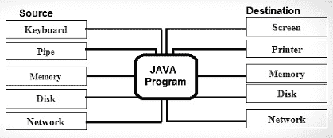

### Java 程序与 I/O 设备的关系

将数据从一个流发送到另一个流的理念（就像一根管道流向另一根管道）使得 Java 中的流成为文件处理的强有力工具。我们可以使用一系列简单的流操作构建一个复杂的文件处理序列。

此功能可以用于在流的流水线上对数据进行过滤，以便获得所需格式的数据。例如，我们可以使用一个流来获取二进制格式的原始数据，然后使用另一个串联的流将其转换为整数。

## 输入流和输出流

Java 流分为两种基本类型：通常输入流和输出流。输入流从源提取（即读取）数据并发送到程序。

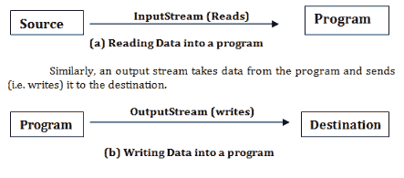

程序在数据源上连接并打开输入流，然后串行读取数据。同样，程序在数据目的地连接并打开输出流，并串行写入数据。在两种情况下，程序都不知道端点的细节（即源和终点）。

### 字节流和字符流

Java2 定义了两种流：字节流和字符流。字节流为处理字节的输入输出提供了方便的方法。例如，在读取或写入二进制数据时使用字节流。字符流使用 Unicode，因此可以国际化。此外，在某些情况下，字符流比字节流更高效。Java 的原始版本（Java 1.0）不包含字符流，当时所有的 I/O 都是面向字节的。

字符流是在 Java 1.1 中引入的，某些面向字节的类和方法被废弃了。

**注意：** 在最底层，所有的 I/O 仍然是面向字节的。基于字符的仅为处理字符提供了一种方便且高效的方法。

这两组流可以根据其目的进一步分类。字节流类和字符流类包含专门的类，用于在不同类型的设备上独立地处理输入输出操作。

我们还可以根据它们读取或写入的源或目的类型对流进行跨组分类。源（或目的可能是内存、文件或管道。


## Java 流类的分类

### 字节流类概述

字节流类通过两个类层次结构定义。顶端是两个抽象类：

1. `InputStream`
2. `OutputStream`

每个抽象类中的都有几个具体的子类，它们处理不同设备（如磁盘文件、网络连接甚至内存缓冲区）之间的差异。

#### InputStream 类

用于读取 8 位字节的 `InputStream` 类包括一个名为 `InputStream` 的超类以及若干个支持各种输入相关子类。


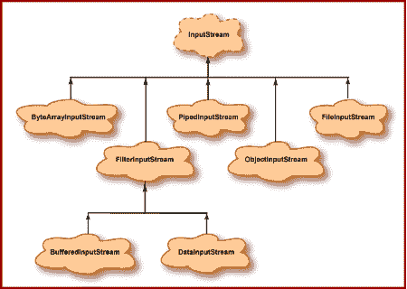

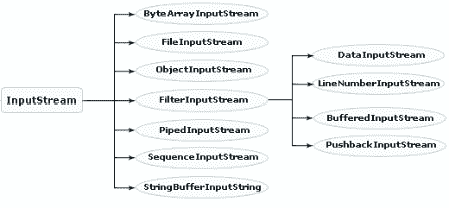

### InputStream 类

超类 `InputStream` 是一个抽象类，定义了执行输入功能的方法，例如：

- 读取字节。
- 关闭流。
- 标记流中的位置。
- 跳过流中的部分。
- 查找流中的字节数。

#### InputStream 类的方法

```java
int available() // 提供输入中可用的字节数（必须由子类重写）。InputStream 类的 available 方法始终返回 0。

void close() // 关闭此输入流并释放与流相关的任何系统资源。InputStream 的 close 方法不执行操作。

void mark(int readlimit) // 标记此输入流的当前位置。InputStream 的 mark 方法不执行操作。

boolean markSupported() // 测试此输入流是否支持 mark 和 reset 方法。InputStream 的 markSupported 方法返回 false。
```


# InputStream

| 方法 | 描述 |
| :--- | :--- |
| `abstract int read()` | 从输入流中读取下一个字节数据。子类必须提供此方法的实现。 |
| `int read(byte[] b)` | 从输入流中读取若干字节，并将它们存储在缓冲区数组 `b` 中。实际读取的字节数将作为整数返回。 |
| `int read(byte[] b, int offset, int len)` | 从输入流中读取若干字节，并将它们从参数 `off` 指定的位置开始存储在缓冲区数组 `b` 中。实际读取的字节数将作为整数返回。 |
| `void reset()` | 将此流重新定位到在该输入流上上一次调用 `mark` 方法时所在的位置。`InputStream` 的 `reset` 方法不执行任何操作，并始终抛出 `IOException`。 |
| `long skip(long n)` | 跳过并丢弃此输入流中的最多 `n` 个字节数据，并返回实际跳过的字节数。 |

## DataInput 接口（The DataInput Interface）

`DataInput` 是一个接口，它定义了从 `InputStream` 读取原始数据类型的方法。

### DataInput 接口的方法

| 方法 | 描述 |
| :--- | :--- |
| `boolean readBoolean()` | 读取一个输入字节，如果该字节非零则返回 `true`，如果该字节为零则返回 `false`。 |
| `byte readByte()` | 读取并返回一个输入字节。 |
| `char readChar()` | 读取一个输入字符并返回其值。 |
| `double readDouble()` | 读取八个输入字节并返回一个 `double` 值。 |
| `float readfloat()` | 读取四个输入字节并返回一个 `float` 值。 |
| `void readFully(byte[] b)` | 从输入流中读取若干字节并将它们存储在缓冲区数组 `b` 中。如果流在读取所有字节之前到达末尾，此方法将抛出 `EOFException`。 |
| `void readFully(byte[] b, int off, int len)` | 从输入流中读取 `len` 个字节，并从 `off` 指定的位置开始存储在缓冲区数组 `b` 中。如果流在读取所有字节之前到达末尾，此方法将抛出 `EOFException`。 |
| `int readInt()` | 读取四个输入字节并返回一个 `int` 值。 |
| `String readLine()` | 从输入流中读取下一行。 |
| `long readLong()` | 读取八个输入字节并返回一个 `long` 值。 |
| `short readShort()` | 读取两个输入字节并返回一个 `short` 值。 |
| `Strig readUTF(` | 读取一个使用修改后的 UTF-8 格式编码的字符串。 |
| `int skipBytes(int n)` | 尝试从输入流中跳过 `n` 个字节数据并丢弃跳过的字节。返回实际跳过的字节数。 |

## InputStream 类总结（Summary of InputStream Classes）

`FilterInputStream` 包含另一个输入流，它将其作为基本数据源，并可能在处理过程中转换数据，以提供额外功能。

`FilterInputStream` 类本身简单地重写了 `InputStream` 的所有方法，这些重写版本会将所有请求传递给包含的输入流。`FilterInputStream` 的子类可以进一步重写这些某些方法，并可能提供额外的方法和字段。

注意，`DataInputStream` 类继承自 `FilterInputStream` 并实现了 `DataInput` 接口。因此，`DataInputStream` 在使用 `InputStream` 类方法的基础上，还继承了 `FilterInputStream` 并实现了 `DataInput` 中描述的方法。

### InputStream 类总结

| 类 | 描述 |
| :--- | :--- |
| `InputStream` | 此抽象类是所有表示字节输入流的类的超父类。 |
| `BufferedInputStream` | `BufferedInputStream` 为另一个输入流增加了功能——即缓冲输入并支持 `mark` 和 `reset` 方法。 |
| `ByteArrayInputStream` | `ByteArrayInputStream` 包含一个内部缓冲区，其中包含可以从流中读取的字节。 |
| `DataInputStream` | `DataInputStream` 包含一个可以从流中读取字节的内部缓冲区。 |
| `FileInputStream` | `FileInputStream` 包含一个可以从文件中读取字节的内部缓冲区。 |
| `FilterInputStream` | `FilterInputStream` 是过滤器输入流。 |
| `PipedInputStream` | `PipedInputStream` 是管道输入流。 |
| `PushbackInputStream` | `PushbackInputStream` 是回退输入流。 |
| `SequenceInputStream` | `SequenceInputStream` 是序列输入流。 |

| 类 | 描述 |
| :--- | :--- |
| `ByteArrayOutputStream` | 该类实现了一种输出流，其中数据被写入字节数组中。 |
| `DataOutputStream` | 数据输出流允许应用程序以可移植的方式将 Java 原始数据类型写入输出流中。 |
| `FileOutputStream` | 文件输出流是用于向 `File` 写入数据的输出流。 |
| `PipedOutputStream` | 管道输出流可以与管道输入流连接，以创建一个通信管道。 |
| `FilterOutputStream` | `FilterOutputStream` 包含其他一些输出流，它将这些流作为自己的目标，并可能在此过程中对数据进行转换或提供额外的功能。 |
| `PrintStream` | `PrintStream` 为另一个输出流增加了功能，即能够方便地打印各种数据值的表示形式。 |

# 字符流类概述

字符流通过使用两个类层次结构定义。顶端是两个抽象类：`Reader` 和 `Writer`。这些抽象类处理 Unicode 字符流。

Java 这些抽象类中的每一个都有几个具体的子类。抽象的 `Reader` 和 `Writer` 类定义了其他流类实现的几个关键方法。其中最重要的两个方法是 `read()` 和 `write()`，它们分别读取和写入字符数据。这些方法被派生的流类重写。

## Reader 流类

`Reader` 流类设计用于从文件中读取字符。`Reader` 类是组中所有其他类的基类。这些类在功能上与输入流类非常相似，区别在于输入流使用字节作为信息的根本单位，而 `Reader` 流使用字符。

`Reader` 类包含与 `InputStream` 类中提供的相同的方法。因此，`Reader` 类可以执行输入流类实现几乎的所有功能。

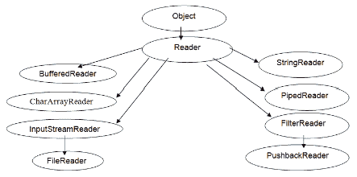

（Reader 流类的层级结构）

### Reader 类

`Reader` 是一个抽象类，定义了 Java 的字符输入流式模型。该类中的所有方法都会抛出 `IOException`。

### Reader 类的方法

| 方法 | 描述 |
| :--- | :--- |
| `abstract void close()` | 关闭流。一旦流被关闭，进一步的 `read()`、`ready()`、`mark()` 或 `reset()` 调用将抛出 `IOException`。然而，关闭一个已经关闭的流没有影响。 |
| `void mark()` | 标记流中的当前位置。随后的 `reset()` 调用将尝试将流重新置到此处。并不是所有的字符输入流都支持 `mark()` 操作。 |
| `boolean markSupported()` | 告诉该流是否支持 `mark()` 操作。 |
| `int read()` | 读取单个字符，并返回来自调用输入流的下一个可用字符的整数表示。遇到文件末尾时返回 `-1`。 |
| `int read(char[] buffer)` | 尝试将多达 `buffer` 长度的字符读取到 `buffer` 中，并返回成功读取的字符数。遇到文件末尾时返回 `-1`。`Reader` 子类必须实现此方法。 |
| `abstract int read(char[] buffer, int offset, int numChar)` | 尝试从 `buffer[offset]` 开始读取最多 `numChar` 个字符，返回成功读取的字符数。遇到文件末尾时返回 `-1`。`Reader` 子类必须实现此方法。 |
| `boolean ready()` | 告诉该流是否准备好被读取。如果下一次输入请求不会等待，则返回 `true`，否则返回 `false`。 |
| `void reset()` | 重置流。并不是所有的字符输入流都支持此方法。 |
| `long skip(long n)` | 跳过最多 `n` 个字符，并返回跳过的字符数。如果 `n` 为负数，则抛出 `IllegalArgumentException`。 |

### Reader 类总结

| 类 | 描述 |
| :--- | :--- |
| `Reader` | 用于读取字符流的抽象类。 |
| `BufferedReader` | 从字符输入流中读取文本，对字符进行缓冲，以便高效读取字符、数组和行。 |
| `CharArrayReader` | 该类实现了一个可以作为字符输入流使用的字符缓冲区。 |
| `FileReader` | 用于读取字符文件的便利类。 |
| `FilterReader` | 用于读取过滤字符流的抽象类。 |
| `InputStreamReader` | `InputStreamReader` 是从字节流到字符流的桥接：它读取字节并使用指定的字符集将它们解码为字符。 |
| `PipedReader` | 管道字符输入流。 |
| `PushbackReader` | 一种允许将字符推回流中的字符流读取器。 |
| `StringReader` | 源自字符串的字符流。 |

## Writer 流类

`Writer` 流类设计用于向文件或输出设备写入字符。`Writer` 类是一个抽象类，作为所有其他 `Writer` 流类的基类。

该基类通过定义与 `OutputStream` 类中相同的方法，为所有输出操作提供支持。

`Writer` 类包含与 `OutputStream` 类中提供的相同的方法。因此，`Writer` 类可以执行输出流类实现的几乎的所有功能。

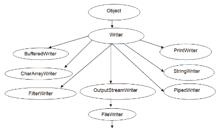

（Writer 流类的层级结构）


### Writer 类

`Writer` 是一个抽象类，定义了字符流式输出。该类中的所有方法都返回 `void` 值并在发生错误时抛出 `IOException`。

### Writer 类的方法

| 方法 | 描述 |
| :--- | :--- |
| `abstract void close()` | 关闭流并先刷新它。 |
| `abstract void flush()` | 刷新流。 |
| `void write(char[] cbuf)` | 写入字符数组。 |
| `abstract void write(char[] cbuf, int off, int len)` | 写入从指定偏移开始的数组部分。子类必须实现此方法。 |
| `void write(int c)` | 向调用输出流写入字符。注意参数是 `int`，允许写入表达式而无需将其强制转换为 `char`。 |
| `void write(String str)` | 写入字符串。 |
| `void write(String str, int off, int len)` | 写入从指定偏移开始的字符串部分。 |


### Writer 类总结

| 类 | 描述 |
| :--- | :--- |
| `Writer` | 用于写入字符流的抽象类。 |
| `BufferedWriter` | 向字符输出流写入文本，对字符进行缓冲，以便高效写入字符、数组和字符串。 |
| `CharArrayWriter` | 实现了一个可以作为 `Writer` 使用的字符缓冲区。 |
| `FileWriter` | 用于写入字符文件的便利类。 |
| `FilterWriter` | 用于过滤字符流的抽象类。 |
| `OutputStreamWriter` | `OutputStreamWriter` 是从字符流到字节流的桥接：写入它的字符使用指定的字符集编码为字节。 |
| `PipedWriter` | 管道字符输出流。 |
| `PrintWriter` | 向文本输出流打印对象的格式化表示。 |
| `StringWriter` | 一种将其输出收集在字符串缓冲区中的字符流，然后可以使用它构造字符串。 |

## File 类

尽管 `java.io` 中定义的大多数类都是基于流的操作，但 `File` 类不是。它直接处理文件和文件系统。也就是说，`File` 类没有指定如何从文件中检索或在文件中存储信息。它描述的是自身的属性。

`File` 对象用于获取或操作与磁盘相关的信息，例如权限、时间、日期和目录路径，以及导航子目录层级结构。

尽管出于安全考虑，在小程序（applets）中使用它们受到严格限制，但文件仍然是存储持久和共享信息的核心资源。

`Java` 中的目录被简单地视为一个文件，但多了一个额外的属性——一个可以通过 `list()` 方法检查的文件名列表。

| 方法 | 描述 |
| :--- | :--- |
| `public File(String);` | |
| `public File(String, String);` | |
| `public File(File, String);` | |
| `public File(URI);` | 该构造函数由 `Java2` 版本 1.4 添加。 |
| `public String getName();` | 返回文件或目录的名字。 |
| `public String getParent();` | 返回来自对象创建期间指定的路径中的文件父目录；如果此路径名不是父目录，则返回 `null`。 |
| `public String getPath();` | 返回相对路径。 |
| `public boolean isAbsolute();` | 测试此抽象路径是否为绝对路径。 |
| `public String getAbsolutePath();` | 返回从根目录开始的绝对（完整）路径。 |
| `public boolean canRead();` | 测试应用程序是否可以读取此抽象路径所指示的文件。 |
| `public boolean canWrite();` | 测试应用程序是否可以修改此抽象路径所指示的文件。 |
| `public boolean exists();` | 测试此抽象路径所指示的文件或目录是否存在。 |
| `public boolean isDirectory();` | 测试此抽象路径所指示的文件是否为目录。 |
| `public boolean isFile();` | 测试此抽象路径所指示的文件是否为普通文件。 |
| `public boolean isHidden();` | 测试此抽象路径命名的文件是否为隐藏文件。 |
| `public long lastModified();` | 返回此抽象路径所指示的文件最后被修改的时间。 |
| `public long length();` | 返回此抽象路径所指示的文件长度。 |
| `public boolean createNewFile() throws java.io.IOException;` | 仅当不存在此名称命名的文件时，自动创建一个由此抽象路径命名的新空文件。 |
| `public boolean delete();` | 删除此抽象路径所指示的文件或目录。 |
| `public String[] list();` | 返回包含此抽象路径所指示目录中文件和目录的字符串数组。如果 `File` 对象对应文件，则返回 `null`。 |
| `public boolean mkdir();` | 创建此抽象路径命名的目录。 |
| `public boolean mkdirs();` | 创建此抽象路径命名的目录，包括任何必要的但不存在的父目录。 |
| `public boolean setLastModified(long);` | 设置此抽象路径命名的文件或目录的最后修改时间。 |
| `public boolean setReadOnly();` | 标记此抽象路径命名的文件或目录，仅允许读操作。 |
| `public boolean setWritable(boolean);` | |
| `public boolean setReadable(boolean);` | |
| `public boolean canExecute();` | |
| `public long getTotalSpace();` | |
| `public long getFreeSpace();` | |
| `public long getUsableSpace();` | |
| `boolean renameTo(File);` | 重命名此抽象路径所指示的文件。 |

## 示例

```java
File f1 = new File(/”);

File f2 = new File(/”,”autoexec.bat”);
```


`File f3 = new File(f1, "autoexec.bat");`

### 注意事项

Java 在处理 UNIX 和 Windows 规范之间的路径分隔符时是非常正确的。如果你在 Windows 版本的 `java` 上使用正斜杠（`/`），路径仍然可以正确解析。

请记住，如果你在字符串中使用 Windows 规范（`\\`），`Java` 的规范是使用 UNIX 和 URL 风格的正斜杠作为路径分隔符。

`File` 定义了许多获取 `File` 对象标准属性的方法。然而，`File` 类并不是对称的。这意味着虽然有允许你检查简单文件对象属性的主要方法，但没有对应的函数来更改这些属性。

### 示例 15.1

以下示例演示了 `File` 类的几个方法。

```java
import java.io.*;

class FileTest {
    public static void main(String args[]) throws IOException {
        File f = new File("/javaprog/ch15/15.1/FileTest.java");

        if (!f.exists())
            f.createNewFile();

        System.out.println("Length=" + f.length() + " bytes");
        System.out.println("Name=" + f.getName());
        System.out.println("Parent=" + f.getParent());
        System.out.println("Path=" + f.getPath());
        System.out.println("Absolute Path=" + f.getAbsolutePath());
        System.out.println(f.exists() ? "Exists" : "Does not exist");
        System.out.println(f.isFile() ? "is file" : "not a file");
        System.out.println(f.canRead() ? "is readable" : "not readable");
        System.out.println(f.canWrite() ? "is writable" : "not writable");
        System.out.println(f.isDirectory() ? "is directory" : "not a directory");
        System.out.println(f.isHidden() ? "is hidden" : "not hidden");
        System.out.println(f.isAbsolute() ? "is absolute" : "not absolute");
        System.out.println("last modified=" + f.lastModified());

        String[] nm = f.list();

        for (int i = 0; i < nm.length; i++) {
            File f4 = new File(nm[i]);

            if (f4.isFile()) {
                System.out.println("is file");
            } else {
                System.out.println("not a file");
            }
        }
    }
}
```

## `FileOutputStream` 方法

| 签名 | 描述 |
| :--- | :--- |
| `public FileOutputStream(File) throws FileNotFoundException;` | 创建一个文件输出流，用于写入指定的 `File` 对象所的文件。 |
| `public FileOutputStream(File, boolean) throws FileNotFoundException;` | 创建一个文件输出流，用于写入指定的 `File` 对象所的文件。 |
| `public native void write(int) throws java.io.IOException;` | |
| `public void write(byte[]) throws java.io.IOException;` | |
| `public void write(byte[], int, int) throws java.io.IOException;` | |
| `public void close() throws java.io.IOException;` | |

### 示例 15.2

```java
import java.io.*;

class FileRead {
    public static void main(String args[]) {
        FileInputStream fin = null;
        int a;

        try {
            fin = new FileInputStream(args[0]);

            System.out.println("No. of characters to read=" + fin.available());

            fin.skip(3);

            a = fin.read();

            while (a != -1) {
                System.out.print((char) a);
                a = fin.read();
            }

            System.out.println("No. of characters to read=" + fin.available());
            fin.close();
        } catch (ArrayIndexOutOfBoundsException e) {
            System.out.println(e);
        } catch (FileNotFoundException e) {
            System.out.println(e);
        } catch (IOException e) {
            System.out.println(e);
        }
    }
}
```

**输出：**

```text
java FileRead A.txt

No. of characters to read=20

Matrix Computers

No. of characters to read=0
```

### 示例 15.3

```java
import java.io.*;

class FileCopy {
    public static void main(String args[]) throws IOException {
        FileInputStream fin = null;
        FileOutputStream fout = null;

        fin = new FileInputStream(args[0]);
        fout = new FileOutputStream(args[1]);

        int a;
        a = fin.read();

        while (a != -1) {
            fout.write(a);
            a = fin.read();
        }

        fin.close();
        fout.close();
    }
}
```

### 示例 15.4

```java
import java.io.*;

class CopyFile {
    public static void main(String args[]) throws IOException {
        int n;

        FileInputStream fin = new FileInputStream("A.txt");
        FileOutputStream fout = new FileOutputStream("B.txt");

        byte[] b = new byte[10];

        n = fin.read(b);

        while (n != -1) {
            fout.write(b, 0, n);
            n = fin.read(b);
        }

        fin.close();
        fout.close();
    }
}
```

## `FileReader`

`FileReader` 类创建一个 `Reader`，你可以用它来读取文件的内容。它的两个常用构造函数如下：

- `FileReader(File file)`：创建一个 `FileReader` 流，从指定的文件读取内容。
- `FileReader(String fileName)`：创建一个 `FileReader` 流，从指定的文件读取内容。

**注意：** 如果文件不存在、是一个目录而不是普通文件，或者由于某些原因无法打开读取，这两个构造函数都可能抛出 `FileNotFoundException`。

## `FileWriter`

`FileWriter` 类创建一个 `writer`，你可以用它来写入文件。它的两个常用构造函数如下：

- `FileWriter(File file)`：一个用于写入指定文件的 `FileWriter` 对象。
- `FileWriter(String fileName)`：一个用于写入指定文件的 `FileWriter` 对象。
- `FileWriter(File file, boolean append)`：一个以 `append` 模式写入指定文件的 `FileWriter` 对象。
- `FileWriter(String filename, boolean append)`：一个以 `append` 模式写入指定文件的 `FileWriter` 对象。

如果使用前两个构造函数，将创建一个新文件。如果同名文件存在，则会被覆盖。如果使用后两个构造函数且 `append` 标志为 `false`，它们的行为与前两个相同。如果 `append` 标志为 `true`，文件指针将置于文件末尾；如果文件不存在，则创建一个新文件。

**注意：** 如果文件存在但是一个目录而不是普通文件、无法创建或由于其他任何原因无法打开，这些构造函数可能会抛出 `IOException`。例如，当你尝试打开一个只读文件时，将抛出 `IOException`。

### 示例 15.5

```java
import java.io.*;

class FileCopy {
    public static void main(String args[]) throws IOException {
        FileReader fin = null;
        FileWriter fout = null;

        fin = new FileReader(args[0]);
        fout = new FileWriter(args[1]);

        int a;
        a = fin.read();

        while (a != -1) {
            fout.write((char) a);
            a = fin.read();
        }

        fin.close();
        fout.close();
    }
}
```


## RandomAccessFile

`RandomAccessFile` 封装了一个随机访问文件。它允许你在文件中的任何位置读取或写入字节、原始数据类型，并支持`DataInput`和`DataOutput`接口，这意味着你可以定位文件中的任何位置。`mode`参数指定文件的打开模式如下：

| 值 | 含义 |
| :--- | :--- |
| `"r"` | 只读。调用该对象的任何写入方法将抛出`IOException`。 |
| `"rw"` | 可读写。如果文件不存在，将尝试创建。 |
| `"rws"` | 可读写，且要求文件内容同步写入到存储设备。 |
| `"rwd"` | 可读写，且要求文件数据同步写入到存储设备。 |

### RandomAccessFile 方法

除了`DataInput`和`DataOutput`接口的方法，该类的一些常用方法如下：

| 签名 | 描述 |
| :--- | :--- |
| `public RandomAccessFile(String, String) throws FileNotFoundException;` | 创建一个随机访问文件流，从指定的文件名读取并可选写入。 |
| `public RandomAccessFile(File, String) throws FileNotFoundException;` | 创建一个随机访问文件流，从`File`参数指定的文件读取并可选写入。 |
| `public native int read() throws java.io.IOException;` | |
| `public int read(byte[], int, int) throws java.io.IOException;` | |
| `public int read(byte[]) throws java.io.IOException;` | |
| `public int skipBytes(int) throws java.io.IOException;` | |
| `public native void write(int) throws java.io.IOException;` | |
| `public void write(byte[]) throws java.io.IOException;` | |
| `public void write(byte[], int, int) throws java.io.IOException;` | |
| `public native long getFilePointer() throws java.io.IOException;` | 返回下一次读取或写入发生的文件偏移量（字节）。 |
| `public native void seek(long) throws java.io.IOException;` | 此处，`newPos`指定文件指针从文件开始的新位置（字节）。调用`seek()`后，下一次读取或写入操作将在新的文件位置进行。 |
| `public native long length() throws java.io.IOException;` | |
| `public native void setLength(long) throws java.io.IOException;` | 设置文件的长度。此方法可用于延长或缩短文件。如果延长文件，增加的部分是未定义的。 |
| `public void close() throws java.io.IOException;` | |
| `public final boolean readBoolean() throws java.io.IOException;` | |
| `public final byte readByte() throws java.io.IOException;` | |
| `public final int readUnsignedByte() throws java.io.IOException;` | |
| `public final short readShort() throws java.io.IOException;` | |
| `public final int readUnsignedShort() throws java.io.IOException;` | |
| `public final char readChar() throws java.io.IOException;` | |
| `public final int readInt() throws java.io.IOException;` | |
| `public final long readLong() throws java.io.IOException;` | |
| `public final float readFloat() throws java.io.IOException;` | |
| `public final double readDouble() throws java.io.IOException;` | |
| `public final java.lang.String readLine() throws java.io.IOException;` | |
| `public final java.lang.String readUTF() throws java.io.IOException;` | |
| `public final void writeBoolean(boolean) throws java.io.IOException;` | |
| `public final void writeByte(int) throws java.io.IOException;` | |
| `public final void writeShort(int) throws java.io.IOException;` | |
| `public final void writeChar(int) throws java.io.IOException;` | |
| `public final void writeInt(int) throws java.io.IOException;` | |
| `public final void writeLong(long) throws java.io.IOException;` | |
| `public final void writeFloat(float) throws java.io.IOException;` | |
| `public final void writeDouble(double) throws java.io.IOException;` | |
| `public final void writeBytes(java.lang.String) throws java.io.IOException;` | |
| `public final void writeChars(java.lang.String) throws java.io.IOException;` | |
| `public final void writeUTF(java.lang.String) throws java.io.IOException;` | |


### 示例 15.6

```java
import java.io.*;

class RandomIO {

    public static void main(String args[]) throws IOException {

        RandomAccessFile file = null;

        try {

            file = new RandomAccessFile("rand.dat", "rw");

            file.writeChar('X');

            file.writeInt(1999);

            file.writeDouble(222.44);

            System.out.println("File pointer Pos:"+file.getFilePointer());

            file.seek(0);

            System.out.println(file.readChar());

            System.out.println(file.readInt());

            System.out.println(file.readDouble());

            System.out.println("File pointer Pos:"+file.getFilePointer());

            file.seek(2);

            System.out.println("File pointer Pos:"+file.getFilePointer());

            System.out.println(file.readInt());

            file.seek(file.length());

            file.writeBoolean(false);

            file.seek(14);

            System.out.println(file.readBoolean());

            System.out.println("File pointer Pos:"+file.getFilePointer());

            System.out.println(file.readInt());//EOF Exception

        }

        catch(EOFException e) {

            System.out.println("Trying to read after end of file");

        }

        finally {

            file.close();

        }

    }

}
```

**输出：**

```
File pointer Pos:14
X
1999
222.44
File pointer Pos:14
File pointer Pos:2
1999
false
File pointer Pos:15
Trying to read after end of file
```

注意：如果尝试在文件末尾之后读取，则会发生`EOFException`。

### ByteArrayInputStream

`ByteArrayInputStream`包含一个可以从流中读取的内部缓冲区。`ByteArrayInputStream`是一个使用字节数组作为源的输入流实现。该类有两个构造函数，每个构造函数都需要一个字节数组来提供数据源。`ByteArrayInputStream`实现了`mark()`和`reset()`方法。但是，如果没有调用过`mark()`，`reset()`将将流指针置到流的起始位置。

- `public ByteArrayInputStream(byte[])`
- `public ByteArrayInputStream(byte[], int)`
- `public synchronized int read()`
- `public synchronized int read(byte[], int)`
- `public synchronized long skip(long)`
- `public synchronized int available()`
- `public boolean markSupported()`
- `public void mark(int)`
- `public synchronized void reset()`
- `public void close() throws IOException`

### 示例 15.7

```java
import java.io.*;

class ByteArrayInputStreamTest {

    public static void main(String args[]) throws IOException {

        String s1 = "abcdefghijk";

        byte b[] = s1.getBytes();

        ByteArrayInputStream b1 = new ByteArrayInputStream(b);

        int a;

        while((a=b1.read()) != -1) {

            System.out.print((char)Character.toUpperCase(a));

        }

        b1.close();

    }

}
```

**输出：** `ABCDEFGHIJK`

### ByteArrayOutputStream

`ByteArrayOutputStream`实现了一个输出流，数据被写入字节数组中。`ByteArrayOutputStream`是一个使用字节数组作为目的的输出流实现。缓冲区位于`ByteArrayOutputStream`的`buf`字段中。缓冲区的大小根据需要增加。

- `public ByteArrayOutputStream()` 创建一个新的字节输出流，缓冲区初始大小为 32 字节。
- `public ByteArrayOutputStream(int size)` 创建一个新的字节输出流，缓冲区大小为指定的字节数。
- `public synchronized void write(int)` 写入一个字节。
- `public synchronized void write(byte[] b, int off, int len)` 写入字节数组中的指定范围。
- `public synchronized void write(byte[] b)` 写入字节数组中的所有字节。
- `public synchronized void reset()` 重置缓冲区。
- `public synchronized byte[] toByteArray()` 返回缓冲区内容的字节数组。
- `public synchronized int size()` 返回已写入的字节数。
- `public void close() throws IOException`

### 示例 15.8

```java
import java.io.*;

class ByteArrayOutputStreamTest {

    public static void main(String args[]) throws IOException {

        ByteArrayOutputStream b1 = new ByteArrayOutputStream();

        b1.write('a');

        String s1 = "abcdefghijk";

        byte arr1[] = s1.getBytes();

        b1.write(arr1);

        System.out.println(b1); //toString()

        // 使用 for 循环

        byte arr2[] = b1.toByteArray();

        for(int i=0; i<arr2.length; i++) {

            System.out.print((char)arr2[i]);

        }

        System.out.println();

        // 使用 for each 循环

        for(int i:arr2) {

            System.out.print((char)i);

        }

        b1.close();

    }

}
```

**输出：**

```
abcdefghijk
abcdefghijk
abcdefghijk
```

### CharArrayReader

`CharArrayReader`是一个使用字符数组作为源的读取流实现。该类有两个构造函数，每个都需要一个字符数组来提供数据源。

**构造函数：**

- `CharArrayReader(char[]buf)` 从指定的字符数组创建`CharArrayReader`。
- `CharArrayReader(char[]buf, int offset, int length)` 从指定的字符数组创建`CharArrayReader`。生成的读取器从指定的偏移量开始读取。从此读取器可以读取的字符值总数将是`length`或`buf.length`。

### 示例 15.9

```java
import java.io.*;

class CharArrayReaderTest {

    public static void main(String args[]) throws IOException {

        String tmp = "abcdefghijklmnopqrstuvwxyz";

        int length = tmp.length();

        char c[] = new char[length];

        tmp.getChars(0, length, c, 0);

        CharArrayReader input1 = new CharArrayReader(c);
```


```java
CharArrayReader input2 = new CharArrayReader(c, 0, 5);

int i;

while ((i = input1.read()) != -1) {
    System.out.print((char) i);
}

System.out.println();

while ((i = input2.read()) != -1) {
    System.out.print((char) i);
}
```

```java
20. System.out.print((char)i);
21. }
22. }
23. }
```

输出：

```
abcdefghijklmnopqrstuvwxyz
abcde
```

# CharArrayWriter

`CharArrayWriter` 是一个写入流的实现，它使用字符数组缓冲区作为目标。

## 构造函数

- `CharArrayWriter()`
- `CharArrayWriter(int initialSize)`

在第一种形式中，会创建一个具有默认大小的缓冲区。在第二种形式中，创建的缓冲区大小与参数 `initialSize` 指定的大小相同。

缓冲区存储在 `CharArrayWriter` 的 `buf` 字段中。如果需要，缓冲区的大小会自动增加。缓冲区中持有的字符数量包含在 `CharArrayWriter` 的 `count` 字段中。`buf` 和 `count` 都是受保护字段。

## 示例 15.10

```java
import java.io.*;

class CharArrayWriterTest {
    public static void main(String args[]) throws IOException {
        CharArrayWriter f = new CharArrayWriter();

        String s = "This should end up in the array";
        char buf[] = new char[s.length()];

        s.getChars(0, s.length(), buf, 0);
        f.write(buf);

        System.out.println(f.toString());

        char c[] = f.toCharArray();

        for (int i = 0; i < c.length; i++) {
            System.out.print(c[i]);
        }

        FileWriter f2 = new FileWriter("test.txt");
        f.writeTo(f2);
        f2.close();

        f.reset();

        System.out.println();
        System.out.println("After reset:" + f.toString());

        for (int i = 0; i < 3; i++) {
            f.write('A');
        }

        System.out.println(f.toString());
    }
}
```

输出：

```
This should end up in the array
This should end up in the array
After reset:
AAA
```

# Pushback Input Stream

`PushbackInputStream` 为另一个输入流增加了功能，即“推回”或“重读”一个字节的能力。缓冲的用途之一就是实现推回。

推回用于输入流，允许读取一个字节后将其返回到流中。除了 `InputStream` 类中常见的方法外，`PushbackInputStream` 还提供了 `unread()` 方法，如下所示：

| 方法 | 说明 |
|---|---|
| `public java.io.PushbackInputStream(java.io.InputStream, int);` | 创建一个具有指定大小推回缓冲区的 `PushbackInputStream`，并保存其参数（输入的输入流）以备后用。这允许将多个字节返回输入流。 |
| `public java.io.PushbackInputStream(java.io.InputStream);` | 创建一个 `PushbackInputStream` 并保存其参数（输入的输入流）以备后用。这允许将一个字节返回输入流。 |
| `public int read() throws java.io.IOException;` | |
| `public int read(byte[], int, int) throws java.io.IOException;` | |
| `public void unread(int) throws java.io.IOException;` | 通过将字节拷贝到推回缓冲区的头部来推回一个字节。 |
| `public void unread(byte[], int, int) throws java.io.IOException;` | 通过将字节数组的一部分拷贝到推回缓冲区的头部来推回部分字节数组。 |
| `public void unread(byte[]) throws java.io.IOException;` | 通过将字节数组拷贝到推回缓冲区的头部来推回一个字节数组。 |
| `public int available() throws java.io.IOException;` | |
| `public long skip(long) throws java.io.IOException;` | |
| `public boolean markSupported();` | `PushbackInputStream` 的副作用是会使创建它的 `InputStream` 的 `mark()` 或 `reset()` 方法失效。使用 `markSupported()` 方法检查任何你将要使用 `mark()`/`reset()` 的流。 |
| `public synchronized void mark(int);` | |
| `public synchronized void reset() throws java.io.IOException;` | |
| `public synchronized void close() throws java.io.IOException;` | |

## 示例 15.11

```java
import java.io.*;

class PushbackInputStreamTest {
    public static void main(String args[]) throws IOException {
        FileInputStream fin = new FileInputStream("A.txt");
        PushbackInputStream p1 = new PushbackInputStream(fin);

        int ch = p1.read();
        System.out.println((char) ch);

        ch = p1.read();
        System.out.println((char) ch);

        ch = p1.read();
        System.out.println((char) ch);

        p1.unread(ch); // 或 p1.unread('z');

        ch = p1.read();
        System.out.println((char) ch);
    }
}
```

输出：

```
A.txt
m
a
t
```

`PushbackInputStream` 是一种允许将字符推回流中的流。`PushbackInputStream` 提供 `unread()` 方法，可以将一个或多个字符返回流中。除了 `InputStream` 类中常见的方法外，`PushbackInputStream` 提供 `unread()` 方法，如下所示：

| 方法 | 说明 |
|---|---|
| `public java.io.PushbackInputStream(java.io.InputStream, int);` | 创建一个具有指定大小推回缓冲区的 `PushbackInputStream`，并保存其参数（输入的输入流）以备后用。这允许将多个字节返回输入流。 |
| `public java.io.PushbackInputStream(java.io.InputStream);` | 创建一个 `PushbackInputStream` 并保存其参数（输入的输入流）以备后用。这允许将一个字节返回输入流。 |
| `public int read() throws java.io.IOException;` | |
| `public int read(byte[], int, int) throws java.io.IOException;` | |
| `public void unread(int) throws java.io.IOException;` | 通过将字节拷贝到推回缓冲区的头部来推回一个字节。 |
| `public void unread(byte[], int, int) throws java.io.IOException;` | 通过将字节数组的一部分拷贝到推回缓冲区的头部来推回部分字节数组。 |
| `public void unread(byte[]) throws java.io.IOException;` | 通过将字节数组拷贝到推回缓冲区的头部来推回一个字节数组。 |
| `public int available() throws java.io.IOException;` | |
| `public long skip(long) throws java.io.IOException;` | |
| `public boolean markSupported();` | `PushbackInputStream` 的副作用是会使创建它的 `InputStream` 的 `mark()` 或 `reset()` 方法失效。使用 `markSupported()` 方法检查任何你将要使用 `mark()`/`reset()` 的流。 |
| `public synchronized void mark(int);` | |
| `public synchronized void reset() throws java.io.IOException;` | |
| `public synchronized void close() throws java.io.IOException;` | |

注意：当推回缓冲区满时尝试返回字符，将抛出 `IOException`。

## 示例 15.12

```java
import java.io.*;

class PushbackInputStreamTest {
    public static void main(String args[]) throws IOException {
        FileReader fr = new FileReader("A.txt");
        PushbackReader pr = new PushbackReader(fr);

        int ch = pr.read();
        System.out.println((char) ch);

        ch = pr.read();
        System.out.println((char) ch);

        ch = pr.read();
        System.out.println((char) ch);

        pr.unread(ch);

        ch = pr.read();
        System.out.println((char) ch);
    }
}
```

# SequenceInputStream

`SequenceInputStream` 类是一种允许你连接多个 `InputStream` 的字节流。`SequenceInputStream` 的构造与任何其他 `InputStream` 都不同。`SequenceInputStream` 构造函数使用一对 `InputStream` 类或一个 `InputStream` 类的 `Enumeration` 作为其参数：

`SequenceInputStream(InputStream is1, InputStream is2)` 初始化一个新的 `SequenceInputStream` 并记住这两个参数，它们将按顺序首先读取 `is1` 然后是 `is2`，以向此 `SequenceInputStream` 提供字节。

`SequenceInputStream(Enumeration e)` 初始化一个新的 `SequenceInputStream` 并记住参数，该参数必须是一个产生运行时类型为 `InputStream` 对象的 `Enumeration`。

在操作上，该类从第一个 `InputStream` 满足读取请求直到其耗尽，然后切换到第二个。对于 `Enumeration` 的情况，它将继续遍历所有的 `InputStream` 直到最后一个流的结束。

## 示例 15.13

在下面的示例中，提供文件名作为命令行参数：

```java
import java.io.*;

class SequenceInputStreamTest {
    public static void main(String args[]) throws IOException {
        FileInputStream f1 = new FileInputStream(args[0]);
        FileInputStream f2 = new FileInputStream(args[1]);
        FileOutputStream f3 = new FileOutputStream(args[2]);

        SequenceInputStream sis = new SequenceInputStream(f1, f2);

        int c;

        while ((c = sis.read()) != -1) {
            f3.write(c);
        }

        f3.close();
        f1.close();
        f2.close();
    }
}
```

输出：

```text
SequenceInputStreamTest A.txt B.txt C.txt
```

# PrintStream

它是一个字节流类，继承自 `FilterOutputStream`。`PrintStream` 为另一个输出流添加了功能，具体来说就是能够方便地打印各种数据值的表示形式。

可选情况下，可以创建一个 `PrintStream` 以实现自动刷新（`flush`）；这意味着在写入字节数组后、调用其中一个 `println` 方法后，或者写入换行符或字节（`\n`）后，会自动调用 `flush` 方法。

`PrintStream` 打印的所有字符都将使用平台的默认字符编码转换为字节，然后写入构造函数中指定的 `OutputStream` 或 `File` 中。

`PrintStream` 支持针对所有类型（包括 `object`）的 `print()` 和 `println()` 方法。如果参数不是简单类型，`PrintStream` 方法将调用对象的 `toString()` 方法并打印结果。

## 构造函数

- `PrintStream(File file)`：创建一个新的打印流，不带自动行刷新，指向指定的文件。
- `PrintStream(String fileName)`：创建一个新的打印流，不带自动行刷新，指向指定的文件名。
- `PrintStream(OutputStream out)`：创建一个新的指向指定 `OutputStream` 的打印流。
- `PrintStream(OutputStream out, boolean autoFlush)`：创建一个新的连接到指定 `OutputStream` 的打印流。


### 示例 15.14

```java
import java.io.*;

class PrintStreamTest {
    public static void main(String args[]) throws IOException {
        PrintStream ps = new PrintStream(System.out, true);

        ps.println("This is a string");

        int i = -7;
        ps.println(i);

        double d = 4.5e-7;
        ps.println(d);
    }
}
```

输出：

```
This is a string
-7
4.5E-7
```

### 示例 15.15

```java
import java.io.*;

class PrintStreamTest2 {
    public static void main(String argv[]) throws IOException {
        FileOutputStream fout = new FileOutputStream("test.dat");
```


```java
PrintStream ps = new PrintStream(fout, true);

ps.println("This is a string");

int i = -7;

ps.println(i);

double d = 4.5e-7;

ps.println(d);
```

## `PrintWriter`

虽然在 Java 中使用 `System.out` 向控制台写入内容是允许的，但主要建议将其用于调试目的或示例程序。

对于实际世界的程序，使用 Java 向控制台写入内容的推荐方法是通过 `PrintWriter` 流。`PrintWriter` 是基于字符的类之一。使用基于字符的类进行控制台输出可以让程序程序更容易国际化。

### 构造函数

- `PrintWriter(File file)`: 创建一个新的 `PrintWriter`，不带自动行刷新，用于写入指定的文件。
- `PrintWriter(String fileName)`: 创建一个新的 `PrintWriter`，不带自动行刷新，用于写入指定的文件。
- `PrintWriter(OutputStream out)`: 创建一个新的 `PrintWriter`，不带自动行刷新，用于写入指定的 `OutputStream`。
- `PrintWriter(OutputStream out, boolean autoFlush)`: 创建一个新的 `PrintWriter` 用于写入指定的 `OutputStream`。
- `PrintWriter(Writer out)`: 创建一个新的 `PrintWriter`，不带自动行刷新，用于写入指定的 `Writer`。
- `PrintWriter(Writer out, Boolean autoFlush)`: 创建一个新的 `PrintWriter` 用于写入指定的 `Writer`。

最常用的构造函数是：

`PrintWriter(OutputStream os, boolean flushOnNewLine)`

这里，`os` 是 `OutputStream` 类型的对象，`flushOnNewLine` 控制 Java 每次调用 `println()` 方法时是否刷新输出流。如果 `flushOnNewLine` 为 `true`，则会自动进行刷新。如果为 `false`，则刷新不是自动的新的。

`PrintWriter` 支持针对所有类型（包括对象）的 `print()` 和 `println()` 方法。如果参数不是简单类型，`PrintWriter` 方法将调用对象的 `toString()` 方法并打印结果。

要使用 `PrintWriter` 写入控制台，请指定 `System.out` 作为输出流，并在每个新行后刷新流。例如，这行代码创建了一个连接到控制台的 `PrintWriter`：

`pw = new PrintWriter(System.out, true)`

### 示例 15.16

```java
import java.io.*;

class PrintWriterTest {
    public static void main(String argv[]) throws IOException {
        PrintWriter pw = new PrintWriter(System.out, true);

        pw.println("This is a string");

        int i = -7;

        pw.println(i);

        double d = 4.5e-7;

        pw.println(d);
    }
}
```

输出：

```text
This is a string
-7
4.5E-7
```

### 示例 15.17

```java
import java.io.*;

class PrintWriter1 {
    public static void main(String argv[]) throws IOException {
        FileWriter fout = new FileWriter("test.dat");

        PrintWriter pw = new PrintWriter(fout, true);

        pw.println("This is a string");

        int i = -7;

        pw.println(i);

        double d = 4.5e-7;

        pw.println(d);
    }
}
```

### 示例 15.18

```java
import java.io.*;

class PrintWriterTest2 {
    public static void main(String argv[]) throws IOException {
        PrintWriter pw = new PrintWriter(System.out, true);

        pw.println("This is a string");

        int i = -7;

        pw.println(i);

        double d = 4.5e-7;

        pw.println(d);
    }
}
```

## `PipedInputStream` 和 `PipedOutputStream`

管道输出流可以连接到管道输入流以创建一个通信管道。管道输出流是管道的发送端。管道输入流应该连接到管道输出流；管道输入流随后提供写入管道输出流的字节。

通常，数据由一个线程从 `PipedInputStream` 对象读取，并由另一个线程写入相应的 `PipedOutputStream`。在单个线程中使用这两个对象是不建议的，因为这可能导致线程死锁。管道输入流包含缓冲区，在限制范围内解耦了读写操作。

### 构造函数

- `PipedInputStream()`: 创建一个未连接的 `PipedInputStream`。
- `PipedInputStream(PipedOutputStream src)`: 创建连接到输出流 `src` 的 `PipedInputStream`。
- `PipedOutputStream()`: 创建尚未连接到管道输入流的 `PipedOutputStream`。
- `PipedOutputStream(PipedInputStream snc)`: 创建连接到指定管道输入流的 `PipedOutputStream`。

### 示例 15.19

```java
import java.io.*;

class TextGenerator extends Thread {
    OutputStream out;

    TextGenerator(OutputStream out) {
        this.out = out;
    }

    public void run() {
        try {
            try {
                for (byte b = 65; b <= 90; b++) {
                    out.write(b);
                }
            } finally {
                out.close();
            }
        } catch (IOException e) {
            System.out.println(e);
        }
    }
}

class Pipe {
    public static void main(String args[]) throws IOException {
        PipedOutputStream out = new PipedOutputStream();
        PipedInputStream in = new PipedInputStream(out);
        TextGenerator data = new TextGenerator(out);

        data.start();

        int ch;

        while ((ch = in.read()) != -1) {
            System.out.print((char) ch);
        }
    }
}
```

输出：

```text
ABCDEFGHIJKLMNOPQRSTUVWXYZ
```

它们的功能与 `PipedInputStream` 和 `PipedOutputStream` 相同，区别在于它们是字符流。

### 构造函数

- `PipedReader()`: 创建一个 `PipedReader`，使其处于未连接状态。
- `PipedReader(PipedWriter src)`: 创建一个 `PipedReader`，使其连接到管道写入器 `src`。
- `PipedWriter()`: 创建一个尚未连接到管道读取器的 `PipedWriter`。
- `PipedWriter(PipedReader snk)`: 创建一个连接到指定 `PipedReader` 的管道写入器。

### 示例 15.20

```java
import java.io.*;

class TextGenerator extends Thread {
    Writer out;

    TextGenerator(Writer out) {
        this.out = out;
    }

    public void run() {
        try {
            try {
                for (char c = 'a'; c <= 'z'; c++) {
                    out.write(c);
                }
            } finally {
                try {
                    Thread.sleep(2000);
                } catch (Exception e) {
                }
            }

            System.out.println("aaaaaaaaaaaaa");

            if (true) {
                return; // IOException: pipe Broken
            }

            out.close(); // IOException: Write end dead
        } // OK if thread finishes after closing the pipe
        catch (IOException e) {
            System.out.println(e);
        }
    }
}

class Pipe2 {
    public static void main(String argv[]) throws IOException {
        PrintStream ps = new PrintStream(System.out);

        PipedWriter out = new PipedWriter();
        PipedReader in = new PipedReader(out);
        TextGenerator data = new TextGenerator(out);

        data.start();

        int ch;

        while ((ch = in.read()) != -1) {
            System.out.print((char) ch);
        }
    }
}
```

**输出：**

```text
abcdefghijklmnopqrstuvwxyzaaaaaaaaaaaaa

Exception in thread "main" java.io.IOException: Pipe broken
    at java.io.PipedReader.read(Unknown Source)
    at Pipe2.main(Pipe2.java:43)
```

## 过滤字节流

过滤流仅仅是底层输入流或输出流的包装器，用于透明地提供某些扩展层的功能。典型的扩展包括缓冲、压缩/解压缩等。过滤字节流是 `FilterInputStream` 和 `FilterOutputStream`。它们的构造函数为：

- `FilterInputStream(InputStream in)`: 通过将参数 `in` 赋值给字段 `this.in` 来创建一个 `FilterInputStream`，以便稍后使用。
- `FilterOutputStream(OutputStream out)`: 创建一个构建在指定的底层输出流之上的输出流过滤器。

这些类中提供的方法与 `InputStream` 和 `OutputStream` 中的方法相同。

## 缓冲字节流

对于面向字节的流，缓冲流通过向 I/O 流中附加内存缓冲区来扩展过滤流类。该缓冲区允许 Java 一次处理多个一个字节的 I/O 操作，从而提高性能。

由于缓冲区的可用，流的跳过、标记和重置变得可能。缓冲字节流类是 `BufferedInputStream` 和 `BufferedOutputStream`。`PushbackInputStream` 也实现了缓冲流接口。

## `BufferedInputStream`

缓冲 I/O 是一种非常常见的性能优化。Java 的 `BufferedInputStream` 类允许你将任何 `InputStream` “包装”为缓冲流并实现这种性能提升。

`BufferedInputStream` 有两个构造函数：

- `BufferedInputStream(InputStream in)`: 创建一个 `BufferedInputStream` 并保存其参数输入流 `in` 以备稍后使用。创建了一个内部缓冲区数组并存储在 `buf` 中。
- `BufferedInputStream(InputStream in, int size)`: 创建一个具有指定缓冲区大小的 `BufferedInputStream` 并保存其参数输入流 `in` 以备稍后使用。

缓冲输入流还提供了支持在缓冲区向后移动的基础。除了任何 `InputStream` 中实现的 `read()` 和 `skip()` 方法外，`BufferedInputStream` 还支持 `mark()` 和 `reset()` 方法。这种支持体现在 `BufferedInputStream.markSupported()` 返回 `true` 上。


### 示例 15.21

```java
import java.io.*;

class BufferedInputStreamTest {
    public static void main(String args[]) throws IOException {
        FileInputStream fin = new FileInputStream("A.txt");

        BufferedInputStream b1 = new BufferedInputStream(fin);

        for (int i = 1; i <= 10; i++) {
            System.out.print((char) b1.read());
        }

        System.out.println();

        if (b1.markSupported()) {
            b1.mark(500);

            for (int i = 1; i <= 10; i++) {
                System.out.print((char) b1.read());
            }

            System.out.println();

            b1.reset();

            for (int i = 1; i <= 10; i++) {
                System.out.print((char) b1.read());
            }
        } else {
            System.out.println("Marking option is not availabel");
        }

        b1.close();
        fin.close();
    }
}
```

**输出：**

```text
matrix
```

**注意：** `mark(32)` 保留了后续 32 个字节（这足够读取所有内容）。`mark()` 可以指定的参数必须小于缓冲区的大小。

## `BufferedOutputStream`

与缓冲输入不同，缓冲输出不提供额外功能。它仅用于提高性能。这里有两个构造函数：

- `BufferedOutputStream(OutputStream out)`: 创建一个写入指定底层输出流的缓冲输出流。它使用大小为 12 字节的缓冲区。
- `BufferedOutputStream(OutputStream out, int size)`: 创建一个具有指定缓冲区大小的写入指定输出流的缓冲输出流。

### 示例 15.22

```java
import java.io.*;

class BufferedOutputStreamTest {
    public static void main(String args[]) throws IOException {


```java
BufferedOutputStream f = new BufferedOutputStream(System.out, 100);

byte[] buf = "This will be displayed without flush()\n".getBytes();

f.write(buf);

f.write(buf);

System.out.println("testing...");

// f.flush();

// f.close();

}
}

```

**输出：**

```text
testing...
```

（注：由于代码开启了缓冲区，如果不调用 `flush()` 或 `close()`，内容可能不会显示在屏幕上。）

### `BufferedReader`

`BufferedReader` 通过缓冲输入提高性能。它有两个构造函数：

- `BufferedReader(Reader in)`：创建一个使用默认大小缓冲区的字符输入流。
- `BufferedReader(Reader in, int sz)`：创建一个使用指定大小缓冲区的字符输入流。

#### 示例 15.23

```java
import java.io.*;

class BufferedReaderTest {

  public static void main(String args[]) throws IOException {

    FileReader fr = new FileReader("A.txt");

    BufferedReader b1 = new BufferedReader(fr);

    for (int i = 1; i <= 10; i++) {
      System.out.print((char) b1.read());
    }

    System.out.println();

    if (b1.markSupported()) {
      b1.mark(5);

      for (int i = 1; i <= 10; i++) {
        System.out.print((char) b1.read());
      }

      System.out.println();

      b1.reset();

      for (int i = 1; i <= 10; i++) {
        System.out.print((char) b1.read());
      }
    } else {
      System.out.println("Marking option is not availabel");
    }

    b1.close();
    fr.close();
  }
}

```

使用 `BufferedWriter` 可以减少数据实际物理写入输出流的次数，从而提高性能。

### 构造函数

- `BufferedWriter(Writer out)`：创建一个使用默认大小输出缓冲区的缓冲字符输出流。
- `BufferedWriter(Writer out, int sz)`：创建一个使用指定大小输出缓冲区的缓冲字符输出流。

### 示例 15.24

```java
import java.io.*;

class BufferedWriterTest {

  public static void main(String args[]) throws IOException {

    BufferedWriter f = new BufferedWriter(new PrintWriter(System.out));

    String s = "This will not be displayed without flush()\n";

    char[] buf = new char[s.length()];

    s.getChars(0, s.length(), buf, 0);

    f.write(buf);

    f.write(buf);

    System.out.println("testing...");

    f.write(buf);

    // f.flush();

    // f.close();
  }
}

```

**输出：**

```text
testing...
```

### 使用字节流处理原始数据类型

基础输入和输出流提供了读/写方法，这些方法只能用于读/写字节或字符。

如果我们想读/写整数和双精度浮点等原始数据类型，可以使用过滤器类作为现有输入输出流的包装器，以过滤原始流中的数据。

用于创建处理原始数据类型的“数据流”的两个过滤器类是 `DataInputStream` 和 `DataOutputStream`。这些类使用了多重继承的概念（如下所示），并实现了父类和接口中包含的所有方法。

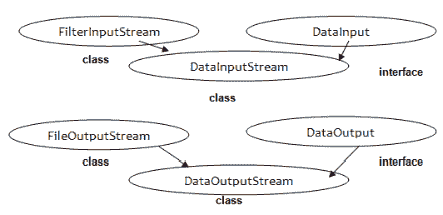

从文件输入创建的数据流可以如下创建：

```java
FileInputStream fis = new FileInputStream(infile);

DataInputStream dis = new DataInputStream(fis);
```

这些语句基本上是将 `dis` 包装在 `fis` 上并将其用作“过滤器”。同样，以下语句创建了输出数据流 `dos` 并将其封装在输出文件流 `fos` 上：

```java
FileOutputStream fos = new FileOutputStream(outfile);

DataOutputStream dos = new DataOutputStream(fos);
```

### 示例 15.25

以下程序演示了原始数据的读取和写入。

```java
import java.io.*;

class ReadWritePrimitive {

  public static void main(String args[]) throws IOException {

    File primitive = new File("prim.dat");

    FileOutputStream fos = new FileOutputStream(primitive);

    DataOutputStream dos = new DataOutputStream(fos);

    dos.writeInt(1999);
    dos.writeDouble(222.44);
    dos.writeBoolean(false);
    dos.writeChar('X');

    dos.close();
    fos.close();

    FileInputStream fis = new FileInputStream(primitive);

    DataInputStream dis = new DataInputStream(fis);

    System.out.println(dis.readInt());
    System.out.println(dis.readDouble());
    System.out.println(dis.readBoolean());
    System.out.println(dis.readChar());

    dis.close();
    fis.close();
  }
}

```

**输出：**

```text
1999

222.44

false

X
```

### 定义流

`System` 类包含了三个预定义的流变量——`in`、`out` 和 `err`。这些字段在 `System` 类中声明为 `public` 和 `static`。这意味着它们可以被程序的任何部分使用，而无需引用特定对象。

- `System.out` 指标准输出流。默认情况下，这是控制台。`System.out` 是 `PrintStream` 类型的对象。
- `System.in` 指标准输入，默认情况下是键盘。`System.in` 是 `InputStream` 类型的对象。
- `System.err` 指标准错误流，默认情况下也是控制台。`System.err` 是 `PrintStream` 类型的对象。

这些是字节流，尽管它们通常用于从控制台读写字符。如果需要，你可以将它们封装在基于字符的流内部。

### `InputStreamReader`

`InputStreamReader` 是从字节流到字符流的桥梁；它读取字节并使用指定的字符集将其解码为字符。它使用的字符集可以明确指定，也可以接受平台的默认字符集。

**构造函数：**

- `InputStreamReader(InputStream in)`：创建一个使用默认字符集的 `InputStreamReader`。
- `InputStreamReader(InputStream in, String charsetName)`：创建一个使用命名字符集的 `InputStreamReader`。

### 示例 15.26

```java
import java.io.*;

class InputStreamReaderTest {

  public static void main(String argv[]) throws IOException {

    char c;

    InputStreamReader is = new InputStreamReader(System.in);

    System.out.println("Enter characters, 'q' to quit");

    c = (char) is.read();

    while (c != 'q') {
      System.out.print(c);
      c = (char) is.read();
    }
  }
}

```

**输出：**

```text
Enter characters, 'q' to quit

abcd

q
```

### 示例 15.27

对上一个示例进行了修改，利用缓冲来提高性能。

```java
import java.io.*;

class BufferedReaderTest {

  public static void main(String args[]) throws IOException {

    char c;

    BufferedReader br =
        new BufferedReader(new InputStreamReader(System.in));

    System.out.println("Enter characters, 'q' to quit");

    c = (char) br.read();

    while (c != 'q') {
      System.out.print(c);
      c = (char) br.read();
    }
  }
}

```

**输出：**

```text
Enter characters, 'q' to quit

abcd
```

### 示例 15.28

`InputStreamReader` 不提供 `readLine()` 方法，因此 `InputStreamReader` 连接到提供 `readLine()` 方法的 `BufferedReader`。

```java
import java.io.*;

class BufferedReaderTest {

  public static void main(String argv[]) throws IOException {

    BufferedReader br =
        new BufferedReader(new InputStreamReader(System.in));

    System.out.println("Enter 'stop' to quit");

    String str = br.readLine();

    while (!str.equals("stop")) {
      System.out.println("Your Name:" + str);
      str = br.readLine();
    }
  }
}

```

**输出：**

```text
Enter 'stop' to quit

Harry Feat

Your Name:Harry Feat

stop
```

### `OutputStreamWriter`

`OutputStreamWriter` 是从字符流到字节流的桥梁：写入它的字符使用指定的字符集编码为字节。它使用的字符集可以明确指定，也可以接受平台的默认字符集。

**构造函数：**

- `OutputStreamWriter(OutputStream out)`：创建一个使用默认编码的 `OutputStreamWriter`。
- `OutputStreamWriter(OutputStream out, String charsetName)`：创建一个使用命名字符集的 `OutputStreamWriter`。

### 读取控制台输入

在 Java 1.0 中，执行控制台输入的唯一方法是使用字节流，旧代码仍然存在。今天，使用字节流读取控制台输入在技术上可行，但这样做可能需要使用已弃用的方法，且这种方法并不推荐。

在 Java 中，控制台输入通过读取 `System.in` 实现。为了获取控制台的字符流，你需要将 `System.in` 封装在 `InputStreamReader` 对象中，然后将其封装在 `BufferedReader` 对象中以提高性能。

### 示例 15.29

此示例演示了我们可以直接从 `System.in` 读取。

```java
import java.io.*;

class ReadFromConsole {

  public static void main(String arg[]) throws IOException {

    char c;

    System.out.println("Enter characters, 'q' to quit");

    c = (char) System.in.read();

    while (c != 'q') {
      System.out.print(c);
      c = (char) System.in.read();
    }
  }
}

```

从控制台读取的正确方法是将 `System.in` 封装在 `InputStreamReader` 中，并进一步封装在 `BufferedReader` 中以提高性能并实现一次输入一行。相关的示例在之前关于 `InputStreamReader` 类的章节中已经介绍过。

## 控制台输出

使用 `print()` 和 `println()` 最容易地完成控制台输出。这些方法由 `PrintStream` 类定义（它是 `System.out` 所引用的对象的类型）。尽管 `System.out` 是一个字节流，但用它来进行简单的程序输出仍然是可以的。

然而，基于字符的替代方案是正确的选择。因为 `PrintStream` 是派生自 `OutputStream` 的输出流，它还实现了低级方法 `write()`。因此，可以使用 `write()` 向控制台写入内容。`PrintStream` 定义的最简单 `write()` 形式是：

```java
void write(int byteval)
```

该方法将 `byteval` 指定的字节写入流中。尽管 `byteval` 被声明为整数类型，但只有低 8 位会被写入。

### 示例 15.30

```java
import java.io.*;

class WriteTest {

  public static void main(String argv[]) throws IOException {

    int b;

    b = 'A';

    System.out.write(b);

    // System.out.flush(); to flush

    System.out.write('\n'); // to flush
  }
}

```

**输出：**

```text
A
```


注意：你不会经常使用`write()`来执行控制台输出，因为`print()`和`println()`使用起来要简单得多。

## 序列化

序列化是将对象的状态写入字节流的过程。当你想要将对象的状态存储到字节流时，这种方法非常有用。当你想要将程序的状态保存到持久化存储区域（如文件）时，这种方法同样有用。在以后以后，你可能可以通过反序列化过程来恢复这些对象。

实现 RMI 也需要序列化。RMI 允许一台机器上的 Java 对象调用另一台机器上 Java 对象的方法。对象可以作为远程方法的参数传递。发送端对对象进行序列化并转换。接收端对其进行反序列化。

如果你尝试对对象图顶部的对象进行序列化，所有其他引用的对象都会被递归定位并序列化。

同样，在反序列化过程中，所有这些对象及其引用都会被正确存储。被声明为`transient`或`static`的变量不会被序列化机制保存。

## Externalizable 接口

Java 的序列化和反序列化机制的设计使得保存和恢复对象状态的大部分工作可以自动完成。

然而，在某些情况下，程序员可能需要对这些过程进行控制。例如，使用压缩或加密技术可能是理想的。`Externalizable`接口是为了这些情况设计的。实现`Externalizable`接口的类也可以被序列化反序列化。

但控制权在用户手中，即用户可以决定序列化和反序列化的部分。序列化代码写在`readExternal()`方法中，反序列化代码写在`writeExternal()`方法中。

### Externalizable 接口的方法：

```java
void readExternal(ObjectInput in)
```

对象实现`readExternal`方法，通过调用基本数据类型的`DataInput`方法以及用于对象、字符串和数组的`readObject`方法来恢复其内容。

```java
void writeExternal(ObjectOutput out)
```

对象实现`writeExternal`方法，通过调用其基本值的`DataOutput`方法或调用用于对象、字符串和数组的`ObjectOutput`的`writeObject`方法来保存其内容。

## ObjectOutput 接口

`ObjectOutput`接口扩展了`DataOutput`接口并支持对象序列化。除了`DataOutput`接口定义的方法外，`ObjectOutput`接口只定义了一个方法：

```java
Void writeObject(Object object)
```

该方法被用于序列化一个对象。`ObjectOutput`接口的所有方法在错误条件下都会抛出`IOException`。

### ObjectOutputStream

`ObjectOutputStream`类扩展了`OutputStream`类并实现了`ObjectOutput`接口。它负责将对象写入流中。

### 构造函数：

```java
ObjectOutputStream(OutputStream out)
```

创建一个写入指定`OutputStream`的`ObjectOutputStream`。参数`out`是将要写入序列化对象的输出流。

### 写入对象的方法：

```java
void writeObject(Object obj)
```

将对象写入底层存储或流。

## ObjectInput 接口

`ObjectInput`接口扩展了`DataInput`接口。它支持对象序列化。除了`DataInput`接口定义的方法外，`ObjectInput`接口仅定义了一个方法：

```java
Object readObject()
```

该方法被用于反序列化对象。

### ObjectInputStream

`ObjectInputStream`类扩展了`InputStream`类并实现了`ObjectInput`接口。`ObjectInputStream`负责从流中读取对象。

### 构造函数：

```java
ObjectInputStream(InputStream in)
```

创建一个从指定的`InputStream`读取的`ObjectInputStream`。参数`in`是应当读取序列化对象的输入流。

反序列化方法为：

```java
Object readObject()
```

从`ObjectInputStream`读取一个对象。

### 示例 15.31

```java
import java.io.*;

class SerializationTest
{
  public static void main (String args[]) throws IOException
  {
    try
      {
        MyClass object1 = new MyClass("Hello", 123, 1.3e3);
        MyClass object2 = new MyClass("Hello1", 1, 2);
        object3.x = 200;
        A object5 = new A();
        System.out.println(object1);
        System.out.println(object2);
        FileOutputStream fos = new FileOutputStream("serial.dat");
        ObjectOutputStream oos = new ObjectOutputStream(fos);
        oos.writeObject(object1);
        oos.writeObject(object2);
        oos.flush();
        oos.close();
      }
      catch(Exception e)
      {
        System.out.println(e);
      }
      try
      {
        MyClass object3, object4;
        FileInputStream fis = new FileInputStream("serial.dat");
        ObjectInputStream ois = new ObjectInputStream(fis);
        object3 = (MyClass) ois.readObject();
        object4 = (MyClass) ois.readObject();
        ois.close();
        System.out.println("After deserialization");
        System.out.println(object3);
        System.out.println(object4);
      }
      catch(Exception e)
      {
        System.out.println(e);
      }
  }
}

class MyClass implements Serializable
{
  String s;
  int i=100;
  double d;
  MyClass(String s, int i, double d)
  {
    this.s = s;
    this.i = i;
    this.d = d;
  }
  public String toString()
  {
    return "s = "+ s +"; i = "+ i + " ; d = " +d;
  }
}
```

输出：

```java
s = Hello; i = 123 ; d = 1300.0
s = Hello1; i = 1 ; d = 2.0
After deserialization
s = Hello; i = 123 ; d = 1300.0
s = Hello1; i = 1 ; d = 2.0
```

注意：我们可以在一个文件中保存多个相同类型的对象，也可以在同一个文件中保存不同类型的对象。

### 示例 15.32

此示例演示了`transient`和`static`变量在序列化过程中不会被持久化。

```java
import java.io.*;

class SerializationTest2
{
  public static void main (String args[]) throws IOException
  {
    try
      {
        MyClass object1 = new MyClass("Hello", 123, 1.3e3);
        MyClass object2 = new MyClass("Hello1", 1, 2);
        object3.x = 200;
        A object5 = new A();
        System.out.println(object1);
        System.out.println(object2);
        System.out.println(object5);
      }
  }
}
```

```java
FileOutputStream fos = new FileOutputStream("serial.dat");
ObjectOutputStream oos = new ObjectOutputStream(fos);
oos.writeObject(object1);
oos.writeObject(object3);
oos.writeObject(object5);
object3.x = 400;
oos.flush();
oos.close();
}
catch(Exception e) {
  System.out.println(e);
}
try {
  MyClass object2, object4;
  A object6;
FileInputStream fis = new FileInputStream("serial.dat");
ObjectInputStream ois = new ObjectInputStream(fis);
object2 = (MyClass) ois.readObject();
object4 = (MyClass) ois.readObject();
object6 = (A) ois.readObject();
ois.close();
fis.close();
System.out.println("After deserialization");
System.out.println(object2);
System.out.println(object4);
System.out.println(object6);
}
catch(Exception e) {
  System.out.println(e);
}
```

```java
class MyClass implements Serializable {
  String s;
  transient private int i=100;
  public static int x = 10;
  double d;
  MyClass(String s, int i, double d) {
    this.s = s;
    this.i = i;
    this.d = d;
    x = 100;
  }
  public String toString() {
    return "s = " + s + "; i = "+ i + " ;d = " + d +"; x = "+ x;
  }
}

class A implements Serializable {
  public String toString() {
    return "Class A";
  }
}
```

### 示例 15.33 使用 Externalizable

```java
import java.io.*;
class SerializationTest1 {
  public static void main (String args[]) throws IOException {
    try {
      MyClass object1 = new MyClass("Hello", 99, 123.45);
      System.out.println(object1);
      FileOutputStream fos = new FileOutputStream("serial.dat");
      ObjectOutputStream oos = new ObjectOutputStream(fos);
      System.out.println("before writing object");
      oos.writeObject(object1);
      System.out.println("after writing object");
      oos.flush();
      oos.close();
    }
    catch(Exception e) {
      System.out.println(e);
    }
    try {
      MyClass object2;
      FileInputStream fis = new FileInputStream("serial.dat");
      ObjectInputStream ois = new ObjectInputStream(fis);
      System.out.println("before reading object");
      object2 = (MyClass) ois.readObject();
      System.out.println("after reading object");
      ois.close();
      System.out.println(object2);
    }
    catch(Exception e) {
      System.out.println(e);
    }
  }
}
class MyClass implements Serializable {
  String s;
  int i=100;
  double d;
  public MyClass() {}; It is must
  public MyClass(String s, int i, double d) {
    this.s = s;
    this.i = i;
    this.d = d;
  }
  public String toString() {
    return "s = "+ s +"; i = "+ i + " ;d = " +d;
  }
  public void writeExternal(ObjectOutput oos) throws IOException {
    System.out.println("Inside writeExternal");
    oos.writeObject(s);
    oos.writeInt(i);
    oos.writeDouble(d);
  }
  public void readExternal(ObjectInput ois) throws ClassNotFoundException, IOException {
    System.out.println("Inside readExternal");
    s = (String) ois.readObject();
    i = ois.readInt();
  }
}
```

输出：

```java
s = Hello; i = 99 ;d = 123.45
before writing object
after writing object
before reading object
after reading object
s = Hello; i = 99 ;d = 123.45
```

**注意：**

在反序列化过程中，对象将使用默认构造函数进行构造（与`serializable`接口不同），然后进行初始化。状态的恢复应该在`readExternal()`中完成。同样，在序列化期间，只保存类标识。任何状态都必须在`writeExternal()`中显式保存。

# 章节：∞ 16 ∞ (Applet)

## 简介

Applet 是一种设计用于在互联网上传输并在如 Internet Explorer 或 Netscape Navigator 等兼容 Java 的网络浏览器在客户端上执行的应用程序。Applet 也是 Java 程序，但它们存在（存储）在服务器上。

Applet 无法像独立应用程序那样执行。Applet 只能通过嵌入 HTML 页面（类似于图像或声音文件）来执行。运行 applet 需要访问一个嵌入了 applet 的 HTML 页面。当网络浏览器下载此类 HTML 页面时，随后会加载包含 applet 代码的可执行文件，然后在本地机器上执行它。

Applet 到达客户端后，它对资源的访问受到限制，这样它就可以不破坏数据完整性的情况下生成任意的用户界面。

### Applet 架构

Applet 与普通程序不同：

* Applet 是基于 GUI（窗口化）的程序
* Applet 是事件驱动的


当一个普通 Java 程序（非基于 GUI 的）需要输入时，它会提示用户然后调用某些输入方法，例如`readLine()`，即交互是由程序发起的。这并不是基于 GUI 的程序的行为方式。是用户与程序发起交互，而不是程序发起动作。例如，在文字处理软件中，用户通过点击不同的按钮发起动作，这产生一个事件并相应地执行某些代码。

Applet 使用`awt`包（抽象窗口工具包）来提供 GUI 并处理事件。之所以被称为 AWT，是因为它完全依赖于底层操作系统的功能。

Applet 类似于一组中断服务例程。Applet 会等待直到某个事件发生。`awt`通过调用由 applet 提供的事件处理程序来通知 applet 事件。一旦发生这种情况，applet 必须采取适当行动，然后迅速将控制权还给 AWT。这是一个关键点。在大多数情况下，我们的 applet 不应该进入一种长时间保持控制的运行“模式”。相反，它必须响应事件并执行特定操作，然后将控制权返回给 AWT 运行系统。

在我们的 applet 需要自行执行重复性任务的情况下（例如，在窗口中显示滚动消息），我们必须启动一个额外的执行线程。

### 编写 Applet

所有的 applet 都是`Applet`类的子类。`Applet`类位于`java.applet`包中。`Applet`类的层次结构如下：

```
java.lang.Object
|
java.awt.Component
|
java.awt.Container
|
java.awt.Panel
|
java.applet.Applet
```

`Applet`类为 applet 执行提供了所有支持，例如启动和停止。它还提供了加载和显示图像的方法。它还为所有窗口化活动提供了必要的支持。

我们扩展`Applet`类的子类必须始终声明为`public`，因为它是由网络浏览器实例化并执行的。浏览器在实例化 applet 时使用无参数构造函数，因此必须提供具有`public`可见性的无参数构造函数。

建议我们不要在`Applet`类中提供构造函数，因为在这种情况下编译器将提供默认的无参数构造函数。

我们可以利用`init()`方法进行初始化。在编写 applet 代码时，我们通常会重写`Applet`类的一些方法，这些方法会在 applet 执行期间自动被调用。

重写`paint()`方法是非常常见的。`paint()`方法中的代码主要在`Applet`窗口中显示输出。

### 示例 16.1 (App1.java)

以下程序演示了一个简单的 applet，它只是在窗口内显示“Hello World”。无论我们在 applet 的`paint`方法中绘制/显示什么内容，它都会出现在 applet 的窗口中。

在接下来的示例中，applet 窗口的背景颜色设置为红色，前景颜色设置为绿色，因此背景将显示为红色，文本“Hello Word”将以绿色显示出来。

```java
1. import java.awt.*;
2. import java.applet.Applet;
3. /*<applet code= "App1" width =500 height=100></applet>*/
4. public class App1 extends Applet
5. { 
6.   public void init()
7.   {
8.         setBackground(Color.red);
9.         setForeground(Color.green);
10.    }
11.    public void paint(Graphics g)
12.    { 
13.      g.drawString("Hello World",20,20);
14.    }
15. }
```

**输出：**

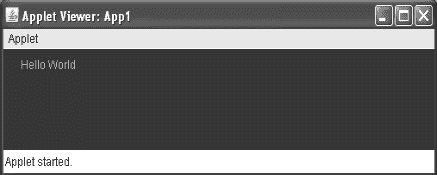

### 执行 Applet

Applet 不由基于控制台的 Java 运行时解释器执行。我们有两种方法可以运行 applet。

1. 在与 Java 的 Web 浏览器中执行 applet。

2. 使用`appletviewer`，例如标准的 SDK 工具`appletviewer`。`appletviewer`会在一个窗口中执行我们的 applet。这是测试我们 applet 最快且最简单的方法。

#### 在 Web 浏览器中执行 Applet

我们需要编写一个短的 HTML 文本文件，其中包含适当的`APPLET`标签。applet 标签必须至少包含以下三个属性：

* `Code`

* `Width`

* `Height`

属性`code`的值指定包含 applet 代码的类名。属性`width`和`height`分别指定 applet 窗口的宽度和高度。

这里是嵌入了 applet "App1" 的 HTML 文件`RunApp.Html`。

```html
<html>
<head>
<title>Simple Applet</title>
</head>
<body>
<h1>Simple “Hello World” Application </h1>
<applet code= “App1” width =500 height=100>
</applet>
</body>
</html>
```

你可以通过在 Web 浏览器中打开文件`RunApp.html`来执行该 applet。该文件可以存在于本地文件系统中，也可以从 Web 服务器加载。

#### 使用 appletviewer 执行 Applet

然而，存在一种更方便的方法可以让我们用来加速测试。只需在你的 Java 源代码文件中包含一个带有该`APPLET`标签的注释即可。通过这样做，我们的代码就包含了必要 HTML 语句的原型文档，我们只需通过带有 Java 源代码文件启动`appletviewer`即可测试编译后的输出。如果我们使用这种方法，那么在编译后我们可以如下所示执行 applet：

```bash
appletviewer SimpleApplet.Java
```

### Applet 生命周期方法

`Applet`重写了一组方法，这些方法提供了浏览器或`appletviewer`与 applet 接口并控制其执行的基本机制。

这些方法也被称为生命周期方法，因为浏览器或 applet 查看器会在 applet 生命周期的不同阶段自动调用它们。总共有五种生命周期方法：

* `public void init ()`

* `public void start ()`

* `public void stop ()`

* `public void destroy ()`

* `public void paint (Graphics g)`

这五个方法中的四个：`init()`、`start()`、`stop()`和`destroy()`定义在 applet 类中。

`paint()`是由`awt Component`类定义的，并提供了所有这些方法的默认实现。Applet 不需要重写它们没有使用的方法。然而，非常简单的 applet 不需要定义它们。

#### Applet 的初始化与终止

当 applet 开始运行时，将按顺序调用以下方法：

1. `init()`

2. `start()`

3. `paint()`

当 applet 终止时，将发生以下方法调用序列：

1. `stop()`

2. `destroy()`

#### init() 方法

这是第一个被调用的方法。我们在这里初始化变量并为其他初始化活动编写代码。该方法在 applet 生命周期内仅在实例化后立即被调用一次。

#### start() 方法

`start()`方法在`init()`之后被调用。它也被用于在 applet 停止后重启它。`init()`在第一次加载 applet 时调用一次，而`start()`在每次 applet 的 HTML 文档显示在屏幕上时被调用。因此，如果用户离开网页并返回，applet 将在`start()`处恢复执行。

#### paint() 方法

`paint()`方法在`init()`和`start()`之后被调用，当 applet 开始执行时。每当 applet 窗口需要重绘时都会调用它。这种情况可能由于多种原因引起，例如窗口被覆盖或最小化后恢复。

#### Stop 方法

`stop()`方法在浏览器离开包含 applet 的 HTML 文档或 applet 不可见时被调用。我们可以在`stop()`中暂停线程。

#### destroy() 方法

`destroy()`方法在环境确定 applet 需要从内存中移除时被调用。此时，我们可以释放 applet 可能正在使用的资源。该方法在`stop()`之后调用。

### 示例 16.2

一个简单的 applet，将背景颜色设置为青色，前景颜色设置为红色，并显示消息，演示了`init()`、`start()`和`paint()`方法在 applet 开始时的调用顺序。

```java
1. import java.awt.*;
2. import java.applet.*;
3. /*<applet code= "App2" width =500 height=100></applet>*/
4. public class App2 extends Applet
5. { 
6.   String msg="";
7.   public void init()
8.   { 
9.      System.out.println("Inside init");
10.      setBackground(Color.cyan);
11.      setForeground(Color.red);
12.      msg = "Inside init ()";
13.    }
14.   public void start()
15.   { 
16.      System.out.println("Inside start");
17.      msg += "Inside start ()";
18.    }
19.   public void stop()
20.   { 
21.      System.out.println("Inside stop");
22.      msg += "Inside stop ()";
23.    }
24.   public void paint (Graphics g)
25.   { 
26.      System.out.println("Inside paint");
27.      msg += "Inside paint ()";
28.      g.drawString(msg,10,30);
29.    }
30.   public void destroy()
31.   {
32.      System.out.println("Inside destroy");
33.    }
34. }
```

**输出：**

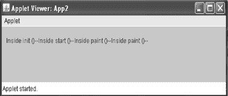

### 动态 Applet

Applet 窗口中显示的输出可以是动态的。例如，我们可以显示一个移动横幅。applet 还可以用于此类应用程序：通过从服务器获取并显示板赛比分和其他统计数据；显示股票价格等。

示例 16.3

以下示例显示了一个移动横幅。它演示了使用`repaint()`方法来刷新显示。该 applet 在 applet 窗口中从右向左滚动消息。

由于消息滚动是一项重复性任务，它是由一个独立的线程执行的，该线程在 applet 初始化时创建。此程序还演示了可以在`stop()`方法中释放资源，并在`start()`方法中重新获取。

```java
1. import java.awt.*;
2. import java.applet.*;
```

```java
/*<applet code="App3" width=500 height=100></applet>*/

public class App3 extends Applet implements Runnable
{
    String msg="A Simple Moving Banner." ;
    Thread t = null;
    boolean stopFlag;
    public void init ()
    {
      setBackground(Color.cyan);
      setForeground(Color.red);
    }
    public void start()
    {
      t=new Thread(this);
      stopFlag = false ;
      t.start ();
    }
    public void stop()
    {
      stopFlag=true;
      t=null;
    }
    public void paint(Graphics g)
    {
      g.drawString(msg,50,30);
    }
    public void run()
    {
      for (;;)
      {
        repaint();
        try
        {
          Thread.sleep(250);
        }
        catch(InterruptedException e)
        {
          System.out.println(e);
        }
        msg = msg.substring (1) + msg.charAt(0);
        if (stopFlag)
          break;
      }
    }
}
```

输出：

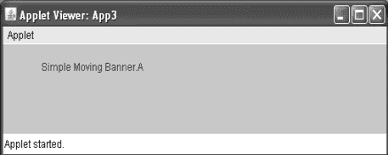

## 使用状态窗口

除了在窗口中显示信息外，applet 还可以向运行它的浏览器窗口或`appletviewer`状态窗口输出消息。

要实现这一点，请调用`showStatus()`并传入我们想要显示的字符串。状态窗口是向用户提供 applet 正在发生情况的反馈、建议选项或报告某些类型错误的好地方。

状态窗口也是极佳的调试助手，因为为我们提供了一个输出 applet 信息的简单方法。

### 示例 16.4：以下示例演示了如何使用状态窗口。

```java
import java.awt.*;
import java.applet.*;
/*<applet code="App4" width=500 height=100></applet>*/
public class App4 extends Applet
{
    public void init( )
    {
      setBackground(Color.cyan);
    }
    public void paint(Graphics g)
    {
      g.drawString("This is in the applet window",10,20);
      showStatus("This is shown in the status window");
    }
}
```

输出：

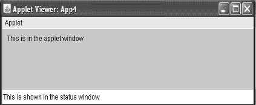

## HTML 的 APPLET 标签

`APPLET`标签用于从 HTML 文档和`appletviewer`启动 applet。

`appletviewer`会在单独窗口中执行找到的每个`APPLET`标签；而像 Netscape Navigator 和 Internet Explorer 这样的浏览器允许在页面上运行许多 applet。

标准`APPLET`标签的语法为：

```html
< APPLET
CODE=applet class name
CODEBASE=codebase URL
ALT=alternate Text,
NAME=appletInstancename
WIDTH=pixels
HEIGHT=pixels
ALIGN=alignment
VSPACE=vertical space in pixels
HSPACE=horizontal space in pixels
>

<PARAM NAME=attributeName-1 VALUE=Attribute Value-1>
<PARAM NAME=attributeName-2 VALUE=Attribute Value-2>
——————
<PARAM NAME=attributeName-N VALUE=Attribute Value-N>
.........在缺少 Java 的情况下显示的 HTML.........
</APPLET>
```

### CODE

`CODE`是一个必需属性，提供包含我们 applet 编译后的类文件的文件名。该文件相对于 applet 的`CODEBASE` URL，`CODEBASE`是 html 文件所在的目录，或者是在设置了`CODEBASE`时指定的目录。

### CODEBASE

`CODEBASE`是一个可选属性，用于指定 applet 代码的基础 URL，它是将在其中搜索 applet 可执行类文件（由`CODE`标签指定）的目录。

如果未指定此属性，则使用 HTML 文档的 URL 目录作为`CODEBASE`。`CODEBASE`不一定在读取 HTML 文档的主机上。

### ALT

`ALT`标签是一个可选属性，用于指定当浏览器理解`APPLET`标签但当前无法运行 Java applet 时应该显示的短文本消息。这与我们为不支持 applet 的浏览器提供的备用 HTML 是不同的。

### NAME


`NAME` 是一个可选属性，用于为 applet 实例指定名称。applet 必须命名，以便同一页面上的其他 applet 能够找到它们。

### `WIDTH` 和 `HEIGHT`

`WIDTH` 和 `HEIGHT`：applet 以像素为单位的大小。

### `ALIGN`

`ALIGN` 是可选属性，用于指定 applet 的对齐方式。

### `VSPACE` 和 `HSPACE`

`VSPACE` 和 `HSPACE`：`VSPACE` 指定 applet 上方和下方的空间。`HSPACE` 指定 applet 两侧的空间。

## `PARAM` 标签

`PARAM` 标签允许我们在 HTML 中指定参数。`PARAM` 标签有两个属性：`NAME` 和 `VALUE`。

### 示例 16.5：此示例演示了如何向 HTML 页面传递参数

```java
import java.awt.*;
import java.applet.*;
/*<applet code="App5" width=500 height=100>
<param name="fontName" value="Arial">
<param name="fontSize" value="30">
</applet>*/
public class App5 extends Applet
{
    String fName;
    int fSize;
    public void init ()
    {
      fName = getParameter("fontName");
      if (fName == null)
        fName = "Courier";
      fSize = Integer.parseInt(getParameter("fontSize"));
      Font f1= new Font(fName, Font.PLAIN, fSize);
      setFont(f1);
    }
    public void paint (Graphics g)
    {
      g.drawString ("Font Name : " + fName, 0, 25);
      g.drawString ("Font Size : " + fSize, 0, 50);
      g.drawString ("Hello world", 0,75);
    }
}
```

## 获取 `DocumentBase` 和 `CodeBase`

通常，我们会创建需要显式加载媒体和文本的 applet。Java 允许 applet 从 HTML 文件所在的目录（文档基）加载数据。这些目录以 `URL` 对象的形式返回。它们可以与要加载的文件字符串拼接。为了实际加载另一个文件，我们将使用由 Applet 上定义的 `showdocument()` 方法。

### 示例 16.6：以下示例演示如何在 applet 代码中获取文档基和代码基

```java
import java.awt.*;
import java.applet.*;
import java.net.URL;
public class App6 extends Applet
{
    public void paint (Graphics g)
    {
      URL u1 = getCodeBase( );
      g.drawString ("Code base:-" + u1, 10,20);
      URL u2 = getDocumentBase();
      g.drawString ("Document base:-"+u2, 10,40);
    }
}
```

`App6.html`

```html
<html>
<body>
<applet code="App6" width=500 height=200></applet>
</body>
</html>
```

## `AppContext` 和 `Show Document()`

Java 的应用之一是使用活动图像和动画提供一种图形化的网页导航方式，比超文本使用的下划线字更有趣。为了允许我们的 applet 将控制权转移到另一个 URL，我们必须使用 Applet Context 接口定义的 `showDocument()` 方法。

`Applet` 是一个接口，允许从 applet 的执行环境中获取信息。当前执行 applet 的上下文通过调用 applet 类定义的 `getAppletContext()` 方法获得。

在一个 applet 中，一旦我们获取了 applet 的上下文（context），就可以通过调用 `showDocument()` 方法将另一个文档显示出来。该方法没有返回值，如果执行失败也不会抛出异常，因此请谨慎使用。共有两个 `showDocument()` 方法。

`void ShowDocument(URL url)`

用给定的 `URL` 替换当前查看的网页。

`void ShowDocument(URL url, String where)`

在浏览器窗口的指定位置显示指定的文档。“where”的有效参数有：

- `"_self"`（在当前帧中显示）
- `"_parent"`（在父帧中显示）
- `"_top"`（在最顶层帧中显示）
- `"_blank"`（在新浏览器窗口中显示）

### 示例 16.7

下面的 applet 演示了 `Applet Context` 和 `showDocument()` 的用法。执行时，它会获取当前的 applet 上下文，并使用该上下文将控制转移到名为 `A.html` 的文件。该文件必须与 applet 位于同一目录下。`Test.html` 可以包含任何你喜欢的有效超文本。

```java
import java.awt.*;
import java.applet.*;
import java.net.*;
public class App7 extends Applet
{ 
    AppletContext ac;
    URL u1;
    public void init()
    {
      setBackground(Color.cyan);
    }
    public void start( )
    {
    ac = getAppletContext();
    u1 = getCodeBase();
    try
    {
      Thread.sleep(3000);
      ac.showDocument(new URL(u1 + "A.html"),"_blank");
    }
    catch(MalformedURLException e)
    { 
      showStatus("Invalid URL");
      e.printStackTrace() ;
    }
    catch(InterruptedException e)
    { 
      showStatus("Invalid URL");
      e.printStackTrace () ;
    }
  }
  public void paint (Graphics g)
    {
    g.drawString(u1+"A.html",20,20);
    try
    {
      Thread.sleep(3000);
    }
    catch(InterruptedException e)
    {
      System.out.println(e);
    }
  }
}
```

`App7.html`

```html
<html>
  <head>
    <Title>Applet Context Demo</Title>
  </head>
  <body>
    <applet code="App7" width=200 height=200></applet>
  </body>
</html>
```

`A.html`

```html
<html
  <head>
    <title>New Page</title>
  </head>
  <body bgcolor=blue text=red>
    <h1>matrix</h1>
  </body>
</html
```

### 示例 16.8

```java
import java.applet.*;
import java.awt.*;
import java.awt.event.*;
/*<Applet code="CopyApp" width=500 height=200></applet>*/
public class CopyApp extends Applet implements ActionListener
{
    TextField tf1,tf2;
    Button b1;
    public void init()
    {
      setForeground(Color.red);
      Font f1=new Font("Arial",
      Font.BOLD+Font.ITALIC,20);
      tf1=new TextField(8);
      tf2=new TextField(8);
      tf1.setFont(f1);
      tf2.setFont(f1);
      b1=new Button("Copy");
      b1.addActionListener(this);
      b1.setFont(f1);
      add(tf1);
      add(tf2);
      add(b1);
    }
  public void paint(Graphics g)
    {
      g.drawString("Matrix",0,150);
    }
  public void actionPerformed(ActionEvent ae)
    {
      String s1=tf1.getText();
      tf2.setText(s1);
    }
}
```

输出：


### 示例 16.9：使用 Applet 计算两个数字之和

```java
import java.applet.*;
import java.awt.*;
import java.awt.event.*;
/*<applet code "SumApplet" width=400 height=400></applet> */
public class SumApplet extends Applet implements ActionListener
{
    TextField tf1,tf2,tf3;
    Label l1,l2,l3;
    Button b1;
    public void init()
    {
      setLayout(new GridLayout(4,2));
      l1 = new Label("No. 1");
      l2 = new Label("No. 2");
      l3 = new Label("Result");
      tf1 = new TextField(8);
      tf2 = new TextField(8);
      tf3 = new TextField(8);
      b1 = new Button("Sum");
      b1.addActionListener(this);
      add(l1);add(tf1);
      add(l2);add(tf2);
      add(l3);add(tf3);
      add(b1);
    }
  public void actionPerformed(ActionEvent ae)
    {
      Button abc = (Button)ae.getSource();
    }
  }
```

输出：


# 第 17 章：AWT（抽象窗口工具包）

## 引言

Java 提供了许多类来帮助我们设计图形界面（GUI）。这些类大多属于 `java.awt` 包，统称为抽象窗口工具包（AWT）。我们熟悉如 MS-WORD、MS-EXCEL 等软件，它们具有 GUI。AWT 帮助设计用户界面的三个重要部分是：

- 组件（Components）
- 容器（Containers）
- 布局管理器（Layout Managers）

以上均起着重要作用。

### 组件

组件是创建 GUI 的构建模块。组件是可以在屏幕上显示并与用户交互的对象。组件示例包括按钮、复选框和滚动条。`java.awt.Component` 类是非菜单相关组件的抽象父类。也可以扩展创建量级组件。量级组件与原生窗口无关。

某些组件类型（如按钮和滚动条）直接用于 GUI 控制。其他继承自 `Container` 类的组件提供了特殊的组织方式。而 `TextField`、`TextArea`、`List` 等组件用于接收输入。`label` 是另一种类型的组件，其目的是为了给其他组件显示合适的标签。

Java 组件由 `java.awt.Component` 和 `java.awt.Menu` 超类的许多子类实现。组织这些大量类的一种方法是将它们分为：

- 可视化组件
- 容器组件
- 菜单组件

组件层次结构：下图显示了 AWT 组件层次结构。


### 容器

下图描述了容器层次结构：


所有的窗口应用程序都始于屏幕上的顶级窗口。同样，所有基于 GUI 的应用程序也始于顶级窗口，这在 Java 术语中被称为顶级容器。

容器也是包含其他组件的 Java 组件。组件只有通过添加到容器或放入容器内部才能变得可见。所有的 Java GUI 都存在于 applet 或 `Frame` 中。applet 和 frame 是两个顶级容器。

applet 是 applet 的顶级容器，因此组件必须添加到其中。同样，frame 是独立应用程序的顶级组件。对于更复杂的 GUI，将 applet 或 frame 划分为较小的区域是方便的。这些区域可能构成工具栏或单选按钮矩阵。在 Java 中，GUI 子区域通常使用 `panel` 容器来实现。

面板（Panels）就像小程序（applets）和框架（frames）一样，可以包含按钮、画布、复选框、滚动条、滚动面板、文本区域、文本字段和其他面板。

复杂的 GUI 有时会有非常复杂的面板嵌套层级，即面板中嵌套面板，以此类推，穿过许多层嵌套。

由于容器也是组件，因此由于继承关系，组件所拥有的方法也同样适用于容器。

容器最常用的方法是 `add()` 方法，通过该方法将组件添加到容器中，其通用形式如下：

```java
void add(Component comp);
```

所有组件都是 `component` 类的子类，因此任何组件都可以使用 `add()` 方法添加到容器中。

### 布局管理器（Layout Manager）

在向容器中添加组件时，一个重要的问题是关于组件的位置和大小的。组件的位置可以通过两种方式指定：

1. 绝对定位。
2. 相对定位。

在绝对定位中，我们指定组件应该被添加的精确位置。这种方法为我们提供了精细的控制，如果我们仅为单一平台设计 GUI，这可能是最佳选择。

例如，可以通过指定组件左上角的坐标，将组件添加到容器水平方向的中间位置。

我们可以根据容器的宽度和组件的宽度来计算这些坐标。但如果容器宽度发生或组件大小改变，组件将不会保持在中间。

另一种方法是相对定位，它可能不允许我们指定组件的精确位置，但在我们希望组件始终位于容器水平方向的中间位置这种情况下，这种方法可能更合适。

我们可以通过指定组件的相对位置（如左、右、居中等）来实现这一点。在文字处理器中，将文档标题居中是非常常见的。即使页面宽度发生变化，标题仍保持居中，这就是相对定位的一个示例。

在 Java 中可以使用绝对定位，但并不建议这样做。`AWT` 的设计初衷是使用相对定位。我们可以通过相对规范来指定组件布局，例如：组件将添加到上一个组件的右侧、组件将添加到某些其他组件下方、组件将出现在顶部、组件的大小将是容器宽度的 `¼^(th)` 等，即使在不知道组件尺寸的情况下，这些规范也是非常有用的。

Java 鼓励相对定位，是因为它是平台无关的，相同的 GUI 可以在不进行任何修改的情况下在各种平台上运行。

名为布局管理器的内置 Java 类负责处理将相对位置映射到实际/物理位置的任务。Java 支持许多类型的布局管理器，我们将讨论以下布局管理器：

1. `FlowLayout`
2. `GridLayout`
3. `BorderLayout`
4. `CardLayout`
5. `GridBagLayout`

#### 使用布局管理器时的注意事项

- 我们不必承担指定每个组件的精确位置和尺寸的负担。
- 我们不再拥有指定每个组件精确位置和尺寸的绝对权力。

### 为什么 Java 使用布局管理器？

原因有两个：

1. 理论上的原因在于，精确布局（即按像素指定每个组件的大小和位置）是一项重复且经常执行的任务；因此，根据面向对象编程（OOP）的原则，布局功能应当被封装在一个或多个类中，以实现任务的自动化。

显然，布局管理器消除了许多开发上的繁琐。许多程序员起初并不喜欢布局管理器的想法，但随着繁琐选择的消除，他们变得越来越欣赏它们。

2. 使用布局器的实际原因源于 Java 的平台无关性。在 Java 中，AWT 组件的行为借用自运行 `JVM` 的底层硬件的窗口系统。

因此，在 Macintosh 上，AWT 按钮就像任何其他 Mac 按钮一样；在 Motif 平台上，Java 按钮看起来就像任何其他 Motif 按钮，以此类推。这里的问题是，按钮和其他组件在不同平台上实例化时会有不同的尺寸。


如果 Java 鼓励精确的像素级尺寸控制和定位，那么会有大量的 Java GUI 在其源平台上看起来精美，但在其他平台上却非常糟糕甚至无法使用。

如上所述，布局管理器通过使用相对定位解决了这个问题。

## 布局策略（Layout policy）

每个 Java 组件都有一个首选尺寸（preferred size）。首选尺寸表示了在不与布局管理器冲突的情况下，组件希望有多大。首选尺寸通常是能够以在视觉上有意义的方式渲染组件所需的最小尺寸，例如，一个按钮的首选尺寸是其标签文本的大小，加上文本周围的一小圈空白边框，再加上标记按钮边界的阴影装饰，因此按钮的首选尺寸是“恰好足够”。首选尺寸取决于平台，因为组件边界的装饰会随系统而异。

当布局管理器布局其容器的子组件时，它必须平衡两个考量：

(i) 布局策略和

(ii) 每个组件的首选尺寸

首要任务是执行布局策略。如果遵循一个组件的首选尺寸意味着违反布局策略，那么布局管理器将覆盖该组件的首选尺寸。理解布局管理器意味着理解它将组件放在哪里，以及它将如何处理组件的首选尺寸。

### 1. FlowLayout（流布局）

流管理器的功能封装在`java.awt.FlowLayout`类中。

流布局管理器将组件按水平行排列。它是面板和小型程序的默认布局管理器类型。

流布局管理器尽可能将多个组件拟合到第一行，并将其他组件移动到第二行。如果第二行没有剩余空间，组件将移动到第三行，以此此类推。这与在文档中输入文本非常相似。

当我们到达当前行尾时，下一个单词将移动到下一行，以此此类推。如果我们更改文档的宽度或高度，整个文档将重新格式化。

组件始终按照它们被添加到容器的顺序从左到右出现。

默认情况下，流布局管理器在水平和垂直方向上组件之间留五个像素的间隙。可以通过调用`FlowLayout`构造函数的重载版本并传入所需的水平和垂直间隙来更改此默认值。

在每一行内，组件间距均匀，且组件簇是居中的。簇的对齐（有时称为“对端”）可以通过向流布局构造函数传递参数来控制。可能的值为：

- `FlowLayout.LEFT`
- `FlowLayout.CENTER`
- `FlowLayout.RIGHT`

示例 17.1：

```java
1. import java.awt.*;
2. class MyFrame1
3. { 
4.   public static void main(String args[ ])
5.   { 
6.     Frame f=new Frame();
7.     FlowLayout flow=new FlowLayout();
8.     f.setLayout(flow);
9.     Label l1 = new Label("Name : ");
10.    f.add(l1);
11.    TextField tf1=new TextField("Matrix");
12.    f.add(tf1);
13.     tf1.setBackground(Color.green);
14.     tf1.setForeground(Color.red);
15.     Button b1 = new Button("ok");
16.     Font f1 = new Font("Arial", Font.BOLD, 24);
17.     b1.setFont(f1); 
18.     f.add(b1);
19.     f.setSize(500,100);
20.     f.setVisible(true);
21.   }
22. }
```

注意：如果我们减小了上述窗口的大小，并且三个组件无法放入单行内，则组件将从最后一个组件开始移动到下一行。

输出：


### 示例 17.2

```java
import java.awt.*;

public class MyFrame2 extends Frame
{
    public static void main (String args [] )
    {
      MyFrame2 f=new MyFrame2();
      f.setLayout(new FlowLayout(FlowLayout.CENTER));
      System.out.println(f.paramString());
      Label l1=new Label("Name :");
      f.add(l1);
      TextField tf1=new TextField("Sample Program");
      f.add(tf1);
      tf1.setBackground(Color.GREEN);
      tf1.setForeground(Color.RED);
      Button b1=new Button("OK");
      b1.setFont(new Font("Serif",Font.BOLD,24));
      //b1.setEnabled(false);
      Dimension d = b1.getSize( );
      System.out.println("Button Size :" + d.width + " " + d.height);
      f.add(b1);
      // f.setResizable(false);
      // f.setUndecorated(true);
      f.setVisible(true);
      Dimension d1=b1.getSize( );
      System.out.println("Button Size: " + d1.width + " " + d1.height);
      Dimension d2=f.getSize();
      System.out.println("Frame Size: " + d2.width + " " + d2.height);
      try
      {  
        Thread.sleep(5000);
      }
      catch(InterruptedException e) { }
      f.setVisible(false);
      f.setSize(500,100);
      f.setVisible(true);
      try
      {  
        Thread.sleep(5000);
      }
      catch(InterruptedException e){ }
      f.setVisible(false);
      f.setBounds(20, 20, 100, 100);
      f.setVisible(true);
      Dimension d3=f.getSize();
      System.out.println("Frame Size : " + d3.width + " " + d3.height);
      System.out.println(f.paramString());
    }
}
```

输出：


`frame0,0,0,0x0,invalid,hidden,layout=java.awt.FlowLayout,title=,resizable,normal`

`Button Size :0 0`

`Button Size: 52 35`

`Frame Size: 123 34`

`Frame Size : 123 100`

`frame0,20,20,123x100,layout=java.awt.FlowLayout,title=,resizable,normal`

### 示例 17.3

如果我们将上述程序中的行：

`f.setLayout(new FlowLayout(FlowLayout.CENTER));`

改为：

`f.setLayout(new FlowLayout(FlowLayout.LEFT));`

组件将左对齐。

输出：


### 示例 17.4

如果我们将上述程序中的行：

`f.setLayout(new FlowLayout(FlowLayout.LEFT));`

改为：

`f.setLayout(new FlowLayout(FlowLayout.RIGHT));`

组件将右对齐。

输出：


### 示例 17.5

我们可以在设置布局时使用重载构造函数来更改行内组件之间的间距（水平间距）以及行之间的间距（垂直间距）：


`f.setLayout(new FlowLayout(FlowLayout.CENTER, 20 ,20))`


`vgap`（行间距） `hgap`（组件间距）

输出：


## GridLayout

`GridLayout`的功能封装在`java.awt.GridLayout`类中。Grid Manager 以表格格式按行和列排列组件。我们可以将容器空间视为由行和列组成的网格。在指定布局时，我们需要指定行数和列数。布局管理器将尽可能多的组件（根据布局中指定的列数）按行的大小放入第一行，并将其他组件移动到第二行，依此类推。这类似于电子表格，被分为固定数量的行和列。

流式布局管理器（flow layout manager）始终尊重组件的优先尺寸。而`GridLayout`布局则相反：当它在给定空间执行布局时，它会忽略组件的优先尺寸。网格布局中的每一行每一列的大小都是相同的，布局的整个区域在行数和列数之间平均分配。`GridLayout`使用“行主”表示法，即组件按照它们添加的顺序，从左到右、一行一行地出现。当我们添加的组件较少（即远少于行数乘以列数）或非常多（即多于行数乘以列数）时，`GridLayout`的表现会很奇怪。如果在一个更高、更窄的框架中布局相同的组件，那么每个组件都会按比例变得更高、更窄，反之亦然。

### 示例 17.6

```java
import java.awt.*;

public class MyFrame6 extends Frame
{
    public static void main(String args[])
    {
      Frame f = new MyFrame6();
      f.setLayout(new GridLayout(5,3));
      for(int row=0; row<5; row++)
      {
        f.add(new Label("Label" + row ));
        f.add(new Button("Button" + row ));
        f.add(new TextField("TextField" + row ));
      }
      f.setSize(500,200);
      f.setVisible(true);
    }
}
```

输出：

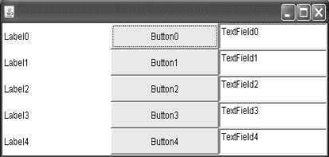

## BorderLayout

`BorderLayout`管理器的功能封装在`java.awt.BorderLayout`类中。`BorderLayout`是框架的默认管理器，因此应用程序程序员迟早都会熟悉它。它强制了一种非常实用的布局策略，但可能比流式布局或网格布局管理器那么直观。流式布局管理器始终尊重组件的优先尺寸；而 Grid 布局管理器从不如此。Border 布局管理器介于两者之间。

Border 布局管理器将可用的容器空间分为五个部分：北（North）、南（South）、东（East）、西（West）和中心（Center）。我们可以在每个区域添加一个组件。这五个区域中的每一个可以是空的，也可以包含一个组件（即不是每个区域都需要包含组件，但区域只能包含一个组件）。

Border 布局管理器尊重北部和南部组件的优先高度，并强制它们的宽度与容器完全相同。北部和南部区域适用于工具栏、状态行以及任何希望尽可能宽但高度不宜过高的控件。东部和西部区域与北部和南部相反。在东部和西部，组件获得其优先宽度，但高度受到限制。

在这里，组件在垂直方向上延伸到北部组件（如果有的话）的底部，或者到容器的顶部（如果没有北部组件）。同样，组件在垂直方向上延伸到南部组件（如果有的话）或容器的底部（如果没有南部组件）。

我们只能在每个区域放置一个单个组件，但如果该组件是一个容器，那么我们就可以显示多个组件。Border 布局不受我们添加组件的顺序的影响。相反，我们必须指定五个区域中的哪一个接收我们要添加的组件。

重载的`add()`方法接受两个参数：

* 第一，要添加的组件，
* 第二，一个对象

正确使用 Border 布局管理器要求第二个参数是`BorderLayout`类本身定义的常量。我们应该了解的五个常量是：

* `BorderLayout.NORTH`
* `BorderLayout.SOUTH`
* `BorderLayout.EAST`
* `BorderLayout.WEST`
* `BorderLayout.CENTER`

Border 布局管理器控制的第五个区域称为中心。中心仅仅是北、南、东、西分配后剩余的容器部分。

在向中心添加组件时，向`add()`调用省略第二个参数是合法的但非常不明智的。在 Java 平台中，Border 布局管理器将假设指的是中心；但在旧版本中，这种行为是不可预测的，通常会导致组件完全不可见。

### 示例 17.7

```java
import java.awt.*;

public class MyFrame7
{
    public static void main(String args[])
    {
      Frame f=new Frame( );
      Scrollbar sbRight=new Scrollbar(Scrollbar.VERTICAL);
      f.add(sbRight, BorderLayout.EAST);
      Scrollbar sbLeft=new Scrollbar(Scrollbar.VERTICAL);
      f.add(sbLeft, BorderLayout.WEST);
      Label labelTop=new Label("This is North");
      labelTop.setFont(new Font("Serif", Font.ITALIC, 36));
      labelTop.setForeground(Color.white);
      labelTop.setBackground(Color.black);
      f.add(labelTop, BorderLayout.NORTH);
      Label labelBottom=new Label("This is south");
      labelBottom.setFont(new Font("Monospaced", Font.BOLD, 18));
      labelBottom.setForeground(Color.white);
      labelBottom.setBackground(Color.black);
      f.add(labelBottom, BorderLayout.SOUTH);
      f.setSize(500,200);
      f.setVisible(true);
    }
}
```

输出:

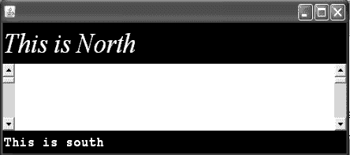

### 示例 17.8

```java
import java.awt.*;

public class MyFrame8 extends Frame
{
    public static void main(String args[])
    {
      Frame f=new MyFrame8( );
      //f.setLayout(new BorderLayout());
      f.add (new Button("N"), BorderLayout.NORTH);
      f.add (new Button("S"), BorderLayout.SOUTH);
      f.add (new Button("E"), BorderLayout.EAST);
      f.add (new Button("W"), BorderLayout.WEST);
      Panel p=new Panel();
      p.setBackground(Color.green);    
      f.add (p, BorderLayout.CENTER);
      //f.add (p);  默认是中心
      f.setSize(300 ,300);
      f.setVisible(true);
    }
}
```

输出:

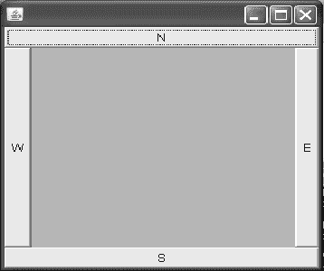

### 示例 17.9


```java
import java.awt.*;

class BorderLayout3 extends Frame {
    public static void main(String args[]) {
        Frame f = new BorderLayout3();
        // f.setLayout(new BorderLayout());
        Panel toolbar = new Panel();
        toolbar.setLayout(new FlowLayout(FlowLayout.LEFT));
        toolbar.setBackground(Color.lightGray);
        toolbar.add(new Button("This"));
        toolbar.add(new Button("Is"));
        toolbar.add(new Button("The"));
        toolbar.add(new Button("Toolbar"));
        f.add(toolbar, BorderLayout.NORTH);
        TextField status = new TextField("Status.");
        status.setFont(new Font("Monospaced", Font.BOLD, 48));
        f.add(status, BorderLayout.SOUTH);
        f.setSize(300, 300);
        f.setVisible(true);
    }
}
```

输出：


## 卡片布局（CardLayout）

在 `CardLayout` 中，我们可以存储许多卡片，但一次只会显示一张。一次只有一张卡片可见，但你可以从一张卡片翻到另一张。这里的卡片指的是 `Panel`。

如果我们想同时显示两张卡片，我们需要为每张卡片创建两个 `Panel`，以及一个包含这些卡片的主 `Panel`。这对于具有可选组件的用户界面非常有用，可以根据用户输入动态启用或禁用。

### 构造函数

- `CardLayout()`：创建间隙为 0 的新卡片布局。
- `CardLayout(int, int)`：创建具有指定水平和垂直间距的新布局。水平间距放在左右，垂直间距放在上下。

### 方法

- `first()`：显示第一张卡片。
- `next()`：切换到下一张卡片。
- `previous()`：切换到上一个卡片。
- `last()`：显示最后一张卡片。
- `show(Container target, String name)`：显示指定为 `name` 的卡片。

### 使用 `CardLayout` 的步骤

1. 创建一个 `CardLayout` 实例。
2. 创建一个容器（如 `Panel`），并将其布局设置为 `CardLayout`。
3. 创建多个卡片（如多个 `Panel`），并将它们添加到容器中，同时为每个卡片指定一个名称。
4. 使用 `first()`、`next()`、`previous()`、`last()` 或 `show()` 方法在卡片之间切换。

#### 示例 17.10

```java
import java.awt.*;
import java.awt.event.*;
import java.applet.*;

/*applet code="CardLayout" width=500 height=100*/
public class CardLayoutTest extends Applet implements ActionListener, MouseListener {
    Panel mp;
    CardLayout c1;

    public void init() {
        Button b1 = new Button("First");
        Button b2 = new Button("Second");
        b1.addActionListener(this);
        b2.addActionListener(this);
        add(b1);
        add(b2);

        Panel p1 = new Panel();
        Label l1 = new Label("INDIA");
        p1.add(l1);

        Panel p2 = new Panel();
        Label l2 = new Label("USA");
        p2.add(l2);

        mp = new Panel();
        c1 = new CardLayout();
        mp.setLayout(c1);
        mp.add(p1, "Country1");
        mp.add(p2, "Country2");
        add(mp);
        addMouseListener(this);
    }

    public void actionPerformed(ActionEvent ae) {
        Button b = (Button) ae.getSource();
        if (b.getLabel().equals("First")) {
            c1.show(mp, "Country1");
        } else {
            c1.show(mp, "Country2");
        }
    }

    public void mousePressed(MouseEvent me) {
        c1.next(mp);
    }

    public void mouseReleased(MouseEvent me) {}

    public void mouseClicked(MouseEvent me) {}

    public void mouseEntered(MouseEvent me) {}

    public void mouseExited(MouseEvent me) {}
}
```

（注：此处省略输出）

## 网格布局布局（GridBagLayout）

`GridBagLayout` 是标准布局管理器中最复杂且灵活的。尽管它听起来应该是 `GridLayout` 的子类，但它完全不同。在 `GridLayout` 中，元素按...

### 示例 17.11

AWT 组件可以分类为：

1. 视觉组件。
2. 容器组件。
3. 菜单组件。

视觉组件和容器组件都属于从 `java.awt.Component` 开始的组件层次。（菜单组件扩展了 `java.awt.MenuComponent`，因此它们没有相同的父类功能）。

#### `java.awt.Component` 类的方法

所有视觉和容器组件通过继承 `java.awt.component` 都实现了若干方法。这些方法如下：

- `getSize()`：以 `Dimension` 对象的形式返回组件的大小，它具有类型为 `int` 的公共数据成员 `height` 和 `width`。
- `setBackground(Color c)`：设置组件的背景颜色。通常背景颜色用于渲染组件的非文本区域。
- `setForeground(Color c)`：设置组件的前景颜色。通常组件的前景颜色用于渲染文本。如果我们没有显式设置组件的前景或背景颜色，组件将使用其直接容器的前景和背景颜色。
- `setFont(Font f)`：决定组件在渲染其需要显示的任何文本时使用的字体。如果我们没有显式设置组件的字体，则组件将使用其容器的字体。
- `setEnabled(Boolean b)`：如果参数为 `true`，则组件具有正常外观。如果参数为 `false`，则组件将显示为灰色且不对用户输入做出响应。

```java
void setSize(Dimension d)
```

设置组件的大小。

```java
void setSize(int width, int height)
```

设置组件的大小。

```java
void setBounds(int x, int y, int width, int height)
```

尝试移动并调整组件的大小。左上角的新位置由 `x` 和 `y` 指定，新大小由 `width` 和 `height` 指定。

```java
void setVisible(Boolean b)
```

此方法接受一个布尔值参数，用于决定组件是否在屏幕上显示。此方法通常用于框架（frames）。

#### 注意

如果我们尝试过调用 `setSize()` 或 `setBounds()` 方法，就会知道这通常是徒劳的。我们试图给组件设置的大小和位置会被布局管理器（layout manager）覆盖。

事实上，这两个方法的存在很大程度上是为了供布局管理器使用的。该规则的一个主要例外是 `Frame` 类，它不受布局管理器的控制，并且完全乐意让我们设置其的大小或边界。

## 视觉组件

视觉组件是用户用户可以直接看到并与之交互的组件。AWT 支持以下视觉组件：

- `Button`
- `Canvas`
- `Checkbox`
- `Choice`
- `FileDialog`
- `Label`
- `List`
- `ScrollPane`
- `Scrollbar`
- `TextArea`
- `TextField`

在 GUI 中使用这些组件之一时，我们首先通过调用相应的构造函数创建一个实例。然后将组件添加到容器中。

## 按钮（Button）

`Button` 类实现了一个推按钮。

### 构造函数

- `Button()`
- `Button(String)`

构造函数接受一个字符串参数，用于指定按钮标签的文本。当按钮被按下时，它会发送一个 Action 事件。

### 方法

- `String getLabel()`：获取此按钮的标签。
- `void setLabel(String label)`：将按钮的标签设置为指定的字符串。
- `void addActionListener(ActionListener l)`：添加指定的 action 监听器以接收来自此按钮的 action 事件。

#### 示例 17.12

```java
import java.awt.*;

class ButtonTest {
    public static void main(String args[]) {
        Frame f = new Frame("Testing Button Component");
        f.setLayout(new FlowLayout());

        Font f1 = new Font("Arial", Font.BOLD, 40);
        Color c1 = new Color(255, 0, 0);
        Color c2 = new Color(0, 255, 0);

        Button b1 = new Button();
        Button b2 = new Button("Cancel");

        b1.setForeground(c1);
        b2.setForeground(c1);
        b1.setBackground(c2);
        b2.setBackground(c2);
        b1.setFont(f1);
        b2.setFont(f1);
        b1.setLabel("Ok");

        System.out.println(b2.getLabel());

        f.add(b1);
        f.add(b2);
        f.setSize(500, 200);
        f.setVisible(true);
    }
}
```

输出：


## 画布（Canvas）

`Canvas` 是一种组件，它没有默认外观或行为。我们可以子类 `canvas` 来创建自定义的绘制区域、工作区域、组件等。画布接收来自鼠标和键盘的输入事件，由程序员将这些输入转换为有意义的外观和感受。

画布的默认大小（或更准确地说，首选大小）小得毫无用处。处理这个问题的方法之一是使用布局管理器来调整画布的大小。另一种方法是我们自己对画布调用 `setSize()`，画布是这种可能有效的罕见情况，因为我们传递到 `setSize()` 方法的值将变成画布的首选大小。

#### 示例 17.13

```java
import java.awt.*;

class CanvasTest {
    public static void main(String args[]) {
        Frame f = new Frame();
        f.setLayout(new FlowLayout());

        Canvas c = new Canvas();
        c.setSize(100, 100);
        f.add(c);
        f.setSize(300, 300);
        f.setVisible(true);
    }
}

class MyCanvas extends Canvas {
    public void paint(Graphics g) {
        setBackground(Color.green);
        g.setColor(Color.red);
        g.drawLine(0, 0, 99, 99);
    }
}
```

输出：

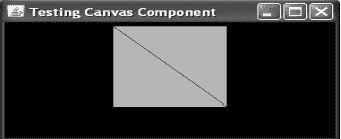

## 复选框（Checkbox）

复选框是一个双状态按钮。两个状态为 `true`（已选中）和 `false`（未选中）。复选框构造器的三种基本形式为：

### 构造函数

- `Checkbox()`：创建一个标签为空字符串的复选框。
- `Checkbox(String label)`：创建一个带有指定标签的复选框。
- `Checkbox(String label, boolean state)`：创建一个带有指定标签和状态的复选框。如果不指定状态，默认为 `false`。

### 方法

- `String getLabel()`：获取此复选框的标签。
- `void setLabel(String label)`：将复选框的标签设置为指定的字符串。
- `boolean getState()`：确定复选框是“开启”还是“关闭”状态。
- `void setState(boolean state)`：将此复选框的状态设置为指定的状态。
- `void addItemListener(ItemListener l)`：添加 item 监听器以接收来自此复选框的 item 事件。

#### 示例 17.14

```java
import java.awt.*;

class CheckboxTest {
    public static void main(String args[]) {
        Frame f = new Frame("Testing Checkbox");
        f.setLayout(new GridLayout(3, 1));

        Checkbox c1 = new Checkbox();
        Checkbox c2 = new Checkbox("Lunch", true);
        Checkbox c3 = new Checkbox("Dinner");

        c1.setLabel("BreakFast");
        c3.setState(true);

        f.add(c1);
        f.add(c2);
        f.add(c3);

        if (c1.getState()) {
            System.out.println(c1.getLabel());
        }

        if (c2.getState()) {
            System.out.println(c2.getLabel());
        }

        if (c3.getState()) {
            System.out.println(c3.getLabel());
        }

        f.setSize(100, 100);
        f.setVisible(true);
    }
}
```

输出：


#### 另一个示例

```java
import java.awt.*;
import java.awt.event.*;

class CheckboxTest extends Frame implements ItemListener {
    Checkbox c1;
    TextField tf1;

    CheckboxTest() {
        setLayout(new GridLayout(2, 1));

        c1 = new Checkbox("Red");
        c1.addItemListener(this);
        add(c1);

        tf1 = new TextField();
        add(tf1);

        setSize(100, 100);
        setVisible(true);
    }

    public static void main(String args[]) {
        new CheckboxTest();
    }

    public void itemStateChanged(ItemEvent ie) {
        if (c1.getState()) {
            tf1.setBackground(Color.red);
        } else {
            tf1.setBackground(Color.white);
        }
    }
}
```

## 单选按钮（Radio button）


复选框可以组合成单选框组，具有单选行为。在单选行为下，复选框组中任何时间只有一个成员为`true`；选择新成员将将先选成员的状态更改为`false`。许多窗口系统（例如 Motif）将单选组作为组件实现。

我们可以通过创建多个复选框并使用`java.awt.Checkbox Group`类将其分组来实现单选行为。在 Java 中，`java.awt.CheckboxGroup`类不是组件；它仅仅是一个组织复选框的非可见类。这意味着 Java 对复选框组成员之间的空间关系没有加任何限制。

如果我们愿意，可以将一个组中的一个成员放在框架的左上角，另一个成员放在右下角，而将第三个成员放在完全不同的框架中。当然，结果很可能违背理智以及大多数 GUI 样式指南。

## 复选框组 (Checkbox Group)

`CheckboxGroup`类有两种方法支持获取和设置当前选中的成员或该组。

`Checkbox getSelectedCheckbox()`

从此复选框组获取当前的选择。

`void setSelectedCheckbox(Checkbox box)`

将此组中当前选中的复选框设置为指定的复选框。

### 示例 17.15

```java
import java.awt.*;
class CheckboxGroupTest
{
  public static void main(String args[])
  {
    Frame f = new Frame("Testing RadioButton Component");
      f.setLayout(new GridLayout(3,1));
      CheckboxGroup cbg=new CheckboxGroup();
      Checkbox c1=new Checkbox("BreakFast",false,cbg);
      Checkbox c2=new Checkbox("Lunch",true,cbg);
      Checkbox c3=new Checkbox("Dinner",false,cbg);
      c3.setState(true);
      f.add(c1);f.add(c2);f.add(c3);

      if(c1.getState())
        System.out.println(c1.getLabel());
      else if(c2.getState())
        System.out.println(c2.getLabel());
      else if(c3.getState())
        System.out.println(c3.getLabel());

      f.setSize(100,100);
      f.setVisible(true);
  }
}
```

输出：

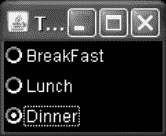

---

## 选择列表 (Choice)

`Choice`是一个拉式/下拉列表。

### 方法

`void add(String item)`

向此`Choice`菜单中添加一个项。

`void addItemListener(ItemListener i)`

添加指定的项监听器以接收来自此选择菜单的项事件。

`String getItem(int index)`

获取此`Choice`菜单中指定索引处的字符串。

`int getItemCount()`

返回此`Choice`菜单中项的数量。

`int getSelectedIndex()`

返回当前选中项的索引。

`String getSelectedItem()`

以字符串形式获取当前选择。

`void insert(String item, int index)`

将项插入到选择列表中指定位置的项。

`void remove(int position)`

从选择菜单中删除指定位置的第一个项。

`void remove(String item)`

从`Choice`菜单中删除第一个出现的指定项。

`void removeAll()`

从选择菜单中删除所有项。

`void select(int pos)`

将此`Choice`菜单中的选中项设置为指定位置处的项。

`void select(String Str)`

将此`Choice`菜单中的选中项设置为名称与指定字符串相等的项。

### 示例 17.16

```java
import java.awt.*;
class ChoiceTest
{
  public static void main(String args[]) throws InterruptedException
  {
    Frame f = new Frame("Testing Choice Component");
    f.setLayout(new FlowLayout());
      f.setSize(100,100);
      f.setVisible(true);
      Choice c1=new Choice();
      c1.add("BreakFast");
      c1.add("Lunch");
      c1.add("Dinner");
      f.add(c1);
      c1.select("Dinner"); // c1.select(2);
      Thread.sleep(1000);
      System.out.println(c1.getSelectedItem());
      System.out.println(c1.getSelectedIndex());
      System.out.println(c1.getItemCount());
      System.out.println(c1.getItem(0));
      c1.insert("Brunch",1);
      c1.remove(2); // c1.remove("Lunch");
  }
}
```

输出：

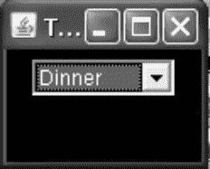

```java
import java.awt.*;
import java.awt.event.*;
class CheckboxItemTest extends Frame implements ItemListener
{
  TextField tf1;
  Choice c1;
  CheckboxItemTest()
  {
    setLayout(new FlowLayout());
    c1=new Choice();
    c1.add("red");
    c1.add("green");
    c1.add("blue");
    tf1 = new TextField(8);
    tf1.setBackground(Color.red);
    c1.addItemListener(this);
    add(c1);
    add(tf1);
    setSize(200,200);
    setVisible(true);
  }
  public static void main(String args[])
  {
    new CheckboxItemTest();
  }
  public void itemStateChanged(ItemEvent ie)
  {
    String s=(String)ie.getItem();
    if(s.equals("red"))
      tf1.setBackground(Color.red);
    else if(s.equals("green"))
      tf1.setBackground(Color.green);
    else if(s.equals("blue"))
      tf1.setBackground(Color.blue);
  }
}
```

---

## 标签 (Label)

最简单的可见 AWT 组件是`label`。`Label`通常不响应用户输入或发送事件。

### 构造函数

`Label()`

构造一个空标签。

`Label(String text)`

构造一个带有字符串文本的新标签，并左对齐。

`Label(String text, int alignment)`

构造一个以指定对齐方式显示指定文本的新标签。标签的默认对齐方式是左对齐。要设置对齐方式，请使用构造函数的第三参数并传入以下值：

* `Label.LEFT`

* `Label.CENTER`

* `Label.RIGHT`

### 方法

`String getText()`

获取此标签的文本。

`void setText(String text)`

将此标签的设置为指定的文本。

### 示例 17.17

```java
import java.awt.*;
class LabelTest
{
  public static void main(String args[])
  {
    Frame f = new Frame("Testing Label Component");
      f.setLayout(new GridLayout(3,3));
      f.setFont(new Font("Arial",Font.PLAIN, 20));
      Label l1 = new Label("India",Label.LEFT);
      Label l2 = new Label("Pakistan",Label.LEFT);
      Label l3 = new Label("UK",Label.LEFT);
      Label l4 = new Label("India",Label.CENTER);
      Label l5 = new Label("Pakistan",Label.CENTER);
      Label l6 = new Label("UK",Label.CENTER);
      Label l7 = new Label("India",Label.RIGHT);
      Label l8 = new Label("Pakistan",Label.RIGHT);
      Label l9 = new Label("UK",Label.RIGHT);
      l3.setText("USA");
      System.out.println(l1.getText());
      f.add(l1);f.add(l4);f.add(l7);
      f.add(l2);f.add(l5);f.add(l8);
      f.add(l3);f.add(l6);f.add(l9);
      f.setSize(500,200);
      f.setVisible(true);
  }
}
```

输出：


---

## 列表 (List)

`List`是垂直排列的文本项集合。如果列表包含的项多于其显示范围，它会自动获取滚动条。

### 构造函数

`List()`

构造一个滚动列表。此构造函数未指定行数，但会产生四行的默认高度。当然，在许多情况下，列表的实际高度将由布局管理器决定。

`List(int rows)`

构造一个初始化为指定可见行数的滚动列表。

`List(int rows, boolean multipleMode)`

创建一个新的滚动列表，初始化为显示指定行数并允许多项选择。

### 示例 17.18

```java
import java.awt.*;
class ListTest
{
  public static void main(String args[])
  {
    Frame f = new Frame( ) ;
      f.setLayout(new FlowLayout ());
      List l1=new List(3,true);
      l1.add("India");
      l1.add("Nepal");
      l1.add("Shri Lanka");
      l1.add("USA");
      l1.add("UK");
      f.add(l1);
      System.out.println(l1.getRows());
      f.setSize(300, 300);
      f.setVisible(true);
  }
}
```

输出：

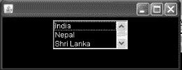

`List`有五个项，但只有 3 行可见行，因此会自动提供滚动条以访问底部两行。

注意：在列表中选择某项会导致列表发送`Item`事件；双击某项会发送`Action`事件。

`void add(String item)`

将指定的项添加到滚动列表的末尾。

### 列表方法

`void add(String item, int index)`

将指定的项添加到由`index`指明的位置的滚动列表中。

`void addActionListener(ActionListener i)`

添加指定的动作监听器，以接收来自此列表的动作事件。

`void addItemListener(ItemListener i)`

添加指定的项目监听器，以接收来自此列表的项目事件。

`String getItem(int index)`

获取与指定的`index`相关的项。

`int getItemCount()`

获取列表中的项数。

`String[] getItems()`

获取列表中的所有项。

`int getRows()`

获取此列表中可见的行数。

`int getSelectedIndex()`

获取列表中被选中项的索引。

`int[] getSelectedIndexes()`

获取列表中的被选中索引。

`String getSelectedItem()`

获取此滚动列表中的被选中项。

`String[] getSelectedItems()`

获取此滚动列表中的被选中项。

`void remove(int position)`

从此滚动列表中移除指定位置的项。

`void remove(String item)`

从列表中移除第一个出现的项。

`void removeAll()`

移除列表中的所有项。

`void replaceItem(String newValue, int index)`

用新字符串替换滚动列表中指定`index`处的项。

`void select(int index)`

选中滚动列表中指定`index`处的项。

`void setMultipleMode(boolean b)`

设置标志，以决定此列表是否允许多项选择。

### 示例代码


```java
import java.awt.*;
import java.awt.event.*;

class ListTest extends Frame implements ActionListener {
    Button b1, b2, b3, b4, b5, b6;
    List l1, l2;
    TextField tf1, tf2;

    ListTest() {
        setLayout(new GridLayout(3, 3));
        l1 = new List(3, true);
        l2 = new List(3, true);
        b1 = new Button(">");
        b2 = new Button(">>");
        b3 = new Button("<");
        b4 = new Button("<<");
        b5 = new Button("Add");
        b6 = new Button("Add");

        b1.addActionListener(this);
        b2.addActionListener(this);
        b3.addActionListener(this);
        b4.addActionListener(this);
        b5.addActionListener(this);
        b6.addActionListener(this);

        tf1 = new TextField();
        tf2 = new TextField();

        Panel p1 = new Panel();
        p1.setLayout(new GridLayout(4, 1));
        p1.add(b1);
        p1.add(b2);
        p1.add(b3);
        p1.add(b4);

        add(l1);
        add(p1);
        add(l2);
        add(tf1);
        add(new Label());
        add(tf2);
        add(b5);
        add(new Label());
        add(b6);

        setSize(300, 300);
        setVisible(true);
    }

    public static void main(String args[]) {
        new ListTest();
    }

    public void actionPerformed(ActionEvent ae) {
        Button b = (Button) ae.getSource();

        if (b == b1) {
            String s[] = l1.getSelectedItems();
            for (int i = 0; i < s.length; i++) {
                l2.add(s[i]);
                l1.remove(s[i]);
            }
        } else if (b == b2) {
            String s[] = l1.getItems();
            for (int i = 0; i < s.length; i++) {
                l2.add(s[i]);
                l1.remove(s[i]);
            }
        } else if (b == b3) {
            String s[] = l2.getSelectedItems();
            for (int i = 0; i < s.length; i++) {
                l1.add(s[i]);
                l2.remove(s[i]);
            }
        } else if (b == b4) {
            String s[] = l2.getItems();
            for (int i = 0; i < s.length; i++) {
                l1.add(s[i]);
                l2.remove(s[i]);
            }
        } else if (b == b5) {
            l1.add(tf1.getText());
        } else if (b == b6) {
            l2.add(tf2.getText());
        }
    }
}
```

## TextField 和 TextArea

`TextField` 和 `TextArea` 类实现了用于文本输入、显示和编辑的一维和二维组件。这两个类都继承自 `TextComponent` 超父类。

`Object` -> `Component` -> `TextComponent` -> (`TextField`, `TextArea`)

这两个类（`TextField` 和 `TextArea`）都有多种构造函数，提供了指定或不指定初始字符串或首选尺寸的。未指定首选尺寸的构造函数适用于布局管理器将忽略组件首选尺寸的情况。

### TextField 类的构造函数

`TextField()`

构造一个新的文本字段。

`TextField(int columns)`

构造一个具有指定列数的文本字段。

`TextField(String text)`

构造一个带有指定文本的文本字段。

`TextField(String text, int columns)`

构造一个具有指定文本和指定列数的文本字段。

### TextArea 类的构造函数

`TextArea()`

构造一个新的文本区域。

`TextArea(int rows, int columns)`

构造一个具有指定行数和指定列数的文本区域。

`TextArea(String text)`

构造一个带有指定文本的文本区域。

`TextArea(int rows, int columns, String text)`

构造一个具有指定行数、列数和指定文本的文本区域。

`TextArea(int rows, int columns, String text, int scrollbar)`

构造一个具有指定行数、指定列数、指定文本和指定滚动条策略的文本区域。

`TextArea` 类定义了一些可以作为 `scrollbar` 参数提供的常量：

- `SCROLLBARS_BOTH`
- `SCROLLBARS_VERTICAL_ONLY`
- `SCROLLBARS_HORIZONTAL_ONLY`
- `SCROLLBARS_NONE`

### TextField 类的方法

`String selectText()`

获取组件中的选中文本。

`String getText()`

获取组件显示的文本。

`void setEditable(boolean b)`

设置此组件是否可编辑。

`void setText(String t)`

将组件显示的文本设置为指定的文本。

### 示例 17

```java
import java.awt.*;

class TextFieldTest {
    public static void main(String args[]) {
        Frame f = new Frame();
        f.setLayout(new FlowLayout());
        tf1 = new TextField();
        tf2 = new TextField(8);
        tf3 = new TextField("matrix");
        tf4 = new TextField("matrix", 20);
        ta1 = new TextArea();
        ta2 = new TextArea(3, 8);
        ta3 = new TextArea("abc\nxyz\naaa");
        ta4 = new TextArea("abc\nxyz\naaa", 2, 2);
        ta5 = new TextArea(
            "abc\nxyz\naaa",
            4,
            20,
            TextArea.SCROLLBARS_BOTH
        );

        f.add(tf1);
        f.add(tf2);
        f.add(tf3);
        f.add(tf4);
        f.add(ta1);
        f.add(ta2);
        f.add(ta3);
        f.add(ta4);
        f.add(ta5);

        tf1.setText("abc");
        System.out.println(tf3.getText());
        tf3.setEditable(false);
    }
}
```

*注：提供的源代码在示例方法中缺少 `tf1`、`ta1` 等变量声明，但已根据指令保留了逻辑结构。*

```java
22. f.setSize(800, 400);
23. f.setVisible(true);
24. }
25. }
```

### Output

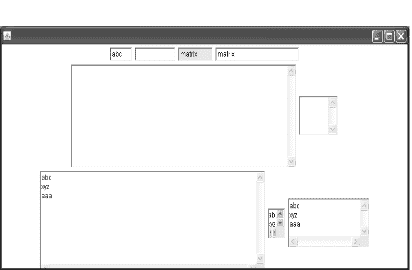

## FileDialog

此类表示文件打开或文件保存对话框。文件对话框是一个模式对话框，这意味着只要对话框在屏幕上可见，来自对话框父帧的输入将专门定向到对话框。当用户指定文件或点击取消按钮时，对话框会自动关闭。最有用的 `File` 构造函数形式如下：

`FileDialog(Frame parent, String title, int mode)`

对话框的父帧是对话框出现的帧。`title` 字符串出现在对话框的标题栏中。

`mode` 应该是以下之一：

- `FileDialog.LOAD`
- `FileDialog.SAVE`

在用户指定文件后，可以使用以下方法获取文件名或目录：

`String getDirectory()`

获取此文件对话框的选定目录。

`String getFile()`

获取此文件对话框的选定文件。

### Example 17.20

```java
import java.awt.*;

public class FileDialogTest {
    public static void main(String args[]) {
        Frame f = new Frame();
        f.setLayout(new FlowLayout());
        f.setSize(200, 200);
        f.setVisible(true);

        FileDialog fd = new FileDialog(f, “Load file”, FileDialog.LOAD);
        fd.setVisible(true);

        System.out.println(fd.getFile());
        System.out.println(fd.getDirectory());
    }
}
```

## ScrollPane

`ScrollPane` 可以包含单个组件，该组件可能比滚动面板本身更高或更宽。如果容器组件大于滚动面板，滚动面板的默认行为是根据需要获取水平和/或垂直滚动条。

该类有两个构造函数：

`ScrollPane()`

创建一个滚动条显示策略为“按需”的新的滚动面板容器。

`ScrollPane(int scrollbarDisplayPolicy)`

创建一个具有指定滚动条行为的新滚动面板容器。滚动面板的显示策略应该是以下之一：

- `ScrollPane.SCROLLBARS_AS_NEEDED`（默认）
- `ScrollPane.SCROLLBARS_ALWAYS`
- `ScrollPane.SCROLLBARS_NEVER`

下面的代码创建了一个具有默认（`AS_NEEDED`）滚动条行为的滚动面板。该滚动面板包含一个非常大的按钮；因此肯定需要滚动条。

### Example 17.21

```java
import java.awt.*;

class SPaneTest {
    public static void main(String args[]) {
        Frame f = new Frame();
        f.setLayout(new GridLayout(1, 2));
        f.setSize(250, 150);

        ScrollPane spane = new ScrollPane();
        spane.setBackground(Color.green);
        f.add(spane);
        f.add(new TextArea());

        Button b1 = new Button("Push Me !");
        b1.setFont(new Font("Serif", Font.ITALIC, 100));
        spane.add(b1);

        f.setVisible(true);
    }
}
```

### Output


## Scrollbar

用于调整列表和滚动面板的 `Scrollbar` 组件可以作为一个独立的组件存在。它有三个构造函数：

`Scrollbar()`

构造一个新的垂直滚动条。

`Scrollbar(int orientation)`

构造具有指定方向的新滚动条。

`Scrollbar(int orientation, int initialValue, int sliderSize, int minValue, int maxValue)`

构造一个具有指定方向、初始值、滑块大小以及最小值和最大值的新滚动条。`sliderSize` 参数控制滑块的大小，但不是以像素为单位。

对于接受方向参数的构造函数，该值应该是以下之一：

- `Scrollbar.HORIZONTAL`
- `Scrollbar.VERTICAL`

### Example 17.22

```java
import java.applet.*;
import java.awt.*;
import java.awt.event.*;

/*<applet code = "RGB" width=500 height=200></applet>*/
public class RGB extends Applet implements AdjustmentListener {
    TextField tf1;
    Scrollbar sb1, sb2, sb3;

    public void init() {
        setLayout(new GridLayout(4, 1));

        sb1 = new Scrollbar(Scrollbar.HORIZONTAL, 0, 10, 0, 255);
        sb2 = new Scrollbar(Scrollbar.HORIZONTAL, 0, 10, 0, 255);
        sb3 = new Scrollbar(Scrollbar.HORIZONTAL, 0, 10, 0, 255);

        sb1.addAdjustmentListener(this);
        sb2.addAdjustmentListener(this);
        sb3.addAdjustmentListener(this);

        tf1 = new TextField();
        add(tf1);
        add(sb1);
        add(sb2);
        add(sb3);
    }

    public void adjustmentChanged(AdjustmentEvent ae) {
        int val = ae.getValue();
        tf1.setText(String.valueOf(val));
    }
}
```

当组件接收到输入时，会构造一个相应类型的事件，然后该事件将作为参数传递给监听器上的方法调用。监听器必须实现包含该事件处理方法的接口。

我们可以将事件监听器与处理异常的 `catch` 块进行比较。我们需要为要处理的异常提供一个相应的 `catch` 块。同样，如果我们想处理由某个组件生成的事件，就需要提供相应的监听器。

监听器与组件相关联。不同的事件有不同的监听器。当事件发生时，会调用相应的监听器方法，并将事件对象作为参数传递。

## 适配器（Adapters）

语言中定义的监听器仅接口。我们需要提供相应监听器的实现。某些监听器具有 2 个或更多方法。

要实现具有多个方法的监听器，即使我们只对其中一个方法感兴趣，我们需要提供所有方法的实现。适配器类为这个问题提供了解决方案。

适配器类提供了监听器所有方法的空实现。这有助于减少编程工作量。如果我们只想使用包含 5 个方法的监听器类中的一个方法，可以简单地扩展适配器类并重写所需的方法。

## 事件层次结构（Event hierarchy）

AWT 拥有定义良好的事件层次结构。通常，对应于事件层次结构叶子节点的类表示实际事件。而非叶子节点则作为基类并进行封装。

AWT 事件层次结构如下所示。

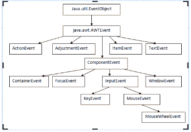

### `java.util.EventObject` 类

这是所有事件类的最顶级父类。它是一个非常通用的类，只有一个感兴趣的方法，即返回产生事件的对象。

```java
Object getSource()
```

### `java.awt.AWTEvent` 类

`EventObject` 的一个子类是 `java.awt.AWTEvent`，它是所有委托模型事件类的父类。同样，只有一个感兴趣的方法，即返回事件的 ID。

```java
int getID()
```


事件的 ID 是一个`int`，用于指定事件的精确性质。例如，`mouseevent`类的实例可以表示七种发生情况之一：点击（`click`）、拖拽（`Drag`）、进入（`Entrance`）、移动（`Move`）、退出（`Exit`）、按下（`Press`）、释放（`Release`）。这些可能性中的每一种都由`int` `MouseEvent.MOUSE_CLICKED`、`MouseEvent.MOUSE_DRAGGED`等表示。

`java.awt.AWTEvent`的子类表示由各种 AWT 组件可以生成的各种事件类型，并包含与触发事件的活动相关的所有必要信息。

非父类事件类型（即实际由组件触发的类型）包括：

1. `ActionEvent`：通常由组件的激活触发，例如：它在按钮被点击、列表项被双击以及以及在`TextField`中按下回车键时生成。

2. `AdjustmentEvent`：由可调整组件（如滚动条）的调整生成。

3. `ContainerEvent`：当组件被添加到容器或从容器中移除时生成。

4. `FocusEvent`：当组件接收或丢失输入焦点时生成。

5. `ItemEvent`：当从列表、选择框或复选框中选择项目时生成。

6. `KeyEvent`：由键盘活动生成。

7. `MouseEvent`：由鼠标活动生成。

8. `MouseWheelEvent`：一种事件，表示在组件中旋转了鼠标滚轮。

9. `WindowEvent`：由窗口活动生成（如图标最小化或恢复最大化）。

10. `TextEvent`：当文本组件被修改时生成。

## `java.awt.event` 包

该包提供了处理由 AWT 组件触发的不同类型事件的接口和类。事件由事件源触发。事件监听器在事件源处注册，以接收有关特定类型事件的通知。

此包定义了事件和事件监听器，以及事件监听器适配器，这些是用于简化编写事件监听器过程的便利类。

## 事件监听器接口（Event Listener Interfaces）

每个事件类都有一个对应的监听器接口并定义了一个或多个方法。常用的监听器接口在以下章节中描述。

### `ActionListener` 接口

这是用于接收动作事件的监听器接口。感兴趣处理动作事件的类实现此接口，并使用该类创建的对象通过组件的`addActionListener()`方法注册到组件上。当动作事件发生时，会调用动作监听器的`actionPerformed()`方法，其签名如下：

| 方法签名 | 描述 |
| :--- | :--- |
| `void actionPerformed(ActionEvent e)` | 当发生动作时调用。 |

### `AdjustmentListener` 接口

这是用于接收调整事件的监听器接口。

| 方法签名 | 描述 |
| :--- | :--- |
| `void adjustmentValueChanged(Adjustment event e)` | 当滑块/滑动条的值改变时调用。 |

### `ContainerListener` 接口

这是用于在组件被添加到容器或从容器中移除时接收事件的监听器接口。

方法：

| 方法签名 | 描述 |
| :--- | :--- |
| `void componentAdded(containerEvent e)` | 当组件被添加到容器时调用。 |
| `void componentRemoved(containerEvent e)` | 当组件从容器中移除时调用。 |

### `FocusListener` 接口

这是用于在组件获得或丢失焦点时接收事件的监听器接口。

方法：

| 方法签名 | 描述 |
| :--- | :--- |
| `void focusGained(focusEvent e)` | 当组件获得键盘焦点时调用。 |
| `void focusLost(focusEvent e)` | 当组件丢失键盘焦点时调用。 |

### `ItemListener` 接口

这是用于接收项目事件的监听器接口。

方法：

```java
void itemStateChanged(ItemEvent e)
```

当项目被选中或取消选择时调用。

### `KeyListener` 接口

这是用于接收键盘事件的监听器接口。

| 方法签名 | 描述 |
| :--- | :--- |
| `void keyPressed(KeyEvent e)` | 当键被按下时调用。 |
| `void keyReleased(KeyEvent e)` | 当键被释放时调用。 |
| `void keyTyped(KeyEvent e)` | 当键入字符时调用。 |

### `MouseListener` 接口

这是用于接收组件鼠标事件（按下、释放、点击、进入和退出）的监听器接口。

方法：

```java
void mouseClicked(MouseEvent e)
```

当组件上点击了鼠标键（按下并释放）时调用。

```java
void mouseEntered(MouseEvent e)
```

当鼠标进入组件时调用。

```java
void mouseExited(MouseEvent e)
```

当鼠标离开组件时调用。

```java
void mousePressed(MouseEvent e)
```

当组件上按了鼠标键时调用。

```java
void mouseReleased(MouseEvent e)
```

当组件上释放了鼠标键时调用。

### `MouseMotionListener`

这是用于接收组件鼠标移动事件（移动和拖拽）的监听器接口。

方法：

```java
void mouseDragged(MouseEvent e)
```

当组件上按下鼠标键并进行拖拽时调用。

```java
void mouseMoved(MouseEvent e)
```

当鼠标指针在组件上移动但没有按下按钮时调用。

### `MouseWheelListener` 接口

这是用于接收组件鼠标滚轮事件的监听器接口。

方法：

```java
void mouseWheelMoved(MouseEvent e)
```

当鼠标滚轮旋转时调用。

### `WindowListener` 接口

当窗口的状态由于打开、关闭、激活或取消激活、最小化或恢复而改变时，会调用监听器对象中的相关方法，并将窗口事件传递给它。

方法：

| 方法签名 | 描述 |
| :--- | :--- |
| `void windowActivated(WindowEvent e)` | 当窗口设置为活动窗口时调用。 |
| `void windowClosed(WindowEvent e)` | 当由于调用 Dispose 方法导致窗口关闭时调用。 |
| `void windowClosing(WindowEvent e)` | 当用户尝试从窗口系统菜单关闭窗口时调用。 |

```java
void windowDeactivated(WindowEvent e)
```

当窗口不再是活动窗口时被调用。

```java
void windowDeiconified(WindowEvent e)
```

当窗口从最小化状态恢复到正常状态时调用。

```java
void windowIconified(WindowEvent e)
```

当窗口从正常状态变为最小化状态时调用。

```java
void windowOpended (WindowEvent e)
```

当窗口第一次变为可见时调用。

## 处理 ActionEvent

### 示例 18.1

以下示例解释了如何处理点击按钮生成的`actionevent`。

```java
import java.awt.*;
import java.awt.event.*;
class A1
{
  public static void main(String args[])
    {
      Frame f=new Frame();
      f.setLayout(new FlowLayout());
      f.setSize(500,100);
      Button b1=new Button("Push me");
      Button b2=new Button("Click me");
      b1.addActionListener(new B());
      b2.addActionListener(new C());
      f.add(b1);
      f.add(b2);
      f.setVisible(true);
    }
}
class B implements ActionListener
{
  public void actionPerformed(ActionEvent ae)
    {
      System.out.println("Button Pushed");
    }
}
class C implements ActionListener
{
  public void actionPerformed(ActionEvent ae)
    {
      System.out.println("Button Clicked");
    }
}
```

输出：


### 示例 18.2

```java
import java.awt.*;
import java.awt.event.*;
class A2 implements ActionListener
{
  static Button b1=null,b2=null;
  public static void main(String args[])
    {
      Frame f=new Frame();
      f.setLayout(new FlowLayout());
      f.setSize(500,100);
      b1=new Button("Push me");
      b2=new Button("Click me");
      b1.addActionListener(new A2());
      b2.addActionListener(new A2());
      f.add(b1);
      f.add(b2);
      f.setVisible(true);
    }
  public void actionPerformed(ActionEvent ae)
    {
      if(ae.getSource() == b1)
      System.out.println("Button Pushed");
      else
      System.out.println("Button Clicked");
    }
}
```

输出：与上一个示例相同。

### 示例 18.3

```java
import java.awt.*;
import java.awt.event.*;
class A3 implements ActionListener
{
  Button b1=null,b2=null;
  A3()
    {
      Frame f=new Frame();
      f.setLayout(new FlowLayout());
      f.setSize(500,100);
      b1=new Button("Push me");
      b2=new Button("Click me");
      b1.addActionListener(this);
      b2.addActionListener(this);
      f.add(b1);
      f.add(b2);
      f.setVisible(true);
    }
  public static void main(String args[])
    {
      new A3();
    }
  public void actionPerformed(ActionEvent ae)
    {
      if(ae.getSource() == b1)
      System.out.println("Button Pushed");
      else
      System.out.println("Button Clicked");
    }
}
```

输出：与示例相同。

### 示例 18.4

```java
import java.awt.*;
import java.awt.event.*;
class A4 implements ActionListener
{
  static Button b1=null,b2=null;
  static TextField tf1=null, tf2=null, tf3=null;
  public static void main(String args[])
    {
      Frame f=new Frame();
      f.setLayout(new GridLayout(4,2));
      f.setSize(500,300);
      Label l1 = new Label("No1.");
      Label l2 = new Label("No2.");
      Label l3 = new Label("Result");
      tf1 = new TextField();
      tf2 = new TextField();
      tf3 = new TextField();
      b1=new Button("Sum");
      b2=new Button("Avg");
      b1.addActionListener(new A4());
      b2.addActionListener(new A4());
      f.add(l1);f.add(tf1);
      f.add(l2);f.add(tf2);
      f.add(l3);f.add(tf3);
      f.add(b1);f.add(b2);
      f.setVisible(true);
    }
  public void actionPerformed(ActionEvent ae)
    {
      int a,b,c;
      float av;
      a=Integer.parseInt(tf1.getText());
      b=Integer.parseInt(tf2.getText());
      if(ae.getSource() == b1)
      tf3.setText("" +(a+b));
      else
      tf3.setText("" + (a+b)/2.0f);
    }
}
```

输出：

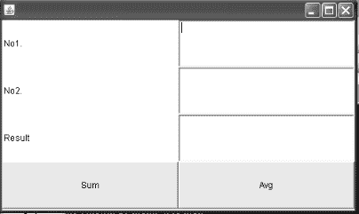

注意：一个组件可以关联多个监听器。不能保证监听器会按照添加的顺序被通知。

同样不能保证所有监听器的通知会在同一个线程中发生，因此监听器必须采取措施防止损坏共享数据。

可以通过调用`removeXXXListener()`方法并传入要移除的监听器，从组件的监听器列表中移除监听器。

例如，下面的代码从按钮`btn`移除动作监听器`al`：

```java
btn.removeActionListener(al);
```

## 处理窗口事件

### 示例 18.5


```java
import java.awt.*;
import java.awt.event.*;
class A5
{
  public static void main(String args[])
    {
      Frame f= new Frame();
      f.setLayout(new FlowLayout());
      f.setSize(300,300);
      f.addWindowListener(new B( ));
      f.setVisible(true);
    }
}
class B implements WindowListener
{
  public void windowOpened(WindowEvent we)
    {
      System.out.println("Window Opened");
    }
  public void windowActivated(WindowEvent we)
    {
      System.out.println("Window Activated");
    }
  public void windowDeactivated(WindowEvent we)
    {
      System.out.println("Window Deactivated");
    }
  public void windowClosing(WindowEvent we)
    {
      System.out.println("Window Closing");
      Frame f = (Frame) we.getWindow( );
      f.dispose();
    }
  public void windowClosed(WindowEvent we)
    {
      System.out.println("Window Closed");
    }
  public void windowIconified(WindowEvent we)
    {
      System.out.println("Window Iconified");
    }
  public void windowDeiconified(WindowEvent we)
    {
      System.out.println("Window Deiconified");
    }
}
```

## Adapter

有些监听器接口有多个方法。最大的接口`WindowListener`有七方法。假设我们要捕获`windowClosing()`事件，以便执行关闭窗口的代码。虽然实现`WindowListener`的类只需要`windowClosing()`方法，但我们必须为所有方法提供空实现。

`java.awt.event`包提供了多个适配器类，每个定义了多个方法的监听器接口都有一个对应的适配器。

适配器只是一个实现接口并提供空方法的类。例如，`WindowAdapter`类实现了`WindowListener`接口并包含了七个空方法。

适配器类及其接口：

| 适配器类 | 监听器接口 |
| :--- | :--- |
| `ContainerAdapter` | `ContainerListener` |
| `FocusAdapter` | `FocusListener` |
| `KeyAdapter` | `KeyListener` |
| `MouseAdapter` | `MouseListener` |
| `MouseMotionAdapter` | `MouseMotionListener` |
| `WindowAdapter` | `WindowListener` |

### 示例 18.6 WindowAdapter 类的使用

```java
import java.awt.*;
import java.awt.event.*;
class A6
{
  public static void main (String args[])
    {
      Frame f= new Frame();
      f.setLayout(new FlowLayout());
      f.setSize(300,300);
      f.addWindowListener(new B( ));
      f.setVisible(true);
    }
}
class B extends WindowAdapter
{
  public void windowClosing(WindowEvent we)
    {
      System.out.printIn(“Window Closing”);
      Frame f = (Frame) we.getWindow( );
      f.dispose();
    }
}
```

`InputEvent`类：

这是所有组件级输入事件的根事件类。输入事件在由产生源进行正常处理之前，会传递给监听器。这允许监听器和组件子类“消费”事件，从而使源不会以其默认方式处理这些事件。例如，消费`Button`组件上的鼠标按下事件将防止`Button`被激活。

### 方法

- `void consume()`：消费此事件，使其不会由产生它的的源以默认方式对其进行处理。
- `int getModifiers()`：返回此事件的修饰符掩（Modifier mask）。
- `int getModifiersEx()`：返回此事件的扩展修饰符掩。
- `static String getModifiersExText(int modifiers)`：返回描述扩展修饰符键的字符串，例如“shift”、“Ctrl + Shift”等。
- `long getWhen()`：返回此事件发生的时间戳。
- `boolean isAltDown()`：返回此事件中的 Alt 修饰键是否被按下。
- `boolean isConsumed()`：返回此事件是否已被消费。
- `boolean isControlDown()`：返回此事件中的 Control 修饰键是否被按下。
- `boolean isShiftDown()`：返回此事件中的 shift 修饰键是否被按下。

### 鼠标事件类

这是`InputEvent`类的子类。此事件表示组件中发生了鼠标动作。当且仅当鼠标指针悬悬在组件子元素的未被遮挡部分、菜单或顶层窗口上时，才认为鼠标动作发生在特定组件中。

此事件同时用于鼠标事件（点击、进入、按下、退出、释放）和鼠标移动事件（移动和拖拽）。

### 方法

- `int getButton()`：返回哪个鼠标按钮的状态发生了变化（如果有）。
- `int getClickCount()`：返回与此事件相关的鼠标点击次数。
- `static String getMouseModifiersText(int modifiers)`：返回描述事件发生期间被按下的修饰键的字符串，例如“Shift”或“Ctrl + shift”。
- `point getPoint()`：返回事件相对于源组件的 x, y 位置。
- `int getX()`：返回事件相对于源组件的水平 x 位置。
- `int getY()`：返回事件相对于源组件的垂直 y 位置。
- `boolean isPopupTrigger()`：返回此鼠标事件是否为该平台的弹出菜单触发事件。

**注意：** 弹出菜单在不同系统触发方式不同。因此，为了实现正确的跨平台功能，应该在鼠标按下（Pressed）和鼠标释放（Released）时都检查`isPopupTrigger()`。

### 处理鼠标事件

### 示例 18.7

```java
1. import java.awt.*;
2. import java.awt.event.*;
3. class A7
{ 
   public static void main(String args[])
   { 
      Frame f= new Frame();
      f.setLayout(new FlowLayout());
      f.setSize(300,300);
      Button b1 = new Button("Push Me");
      b1.addMouseListener(new B());
      b1.addMouseMotionListener(new C());
      b1.addActionListener(new D());
      f.add(b1);
      f.setVisible(true);
   }
17. class B implements MouseListener
{ 
   public void mouseEntered(MouseEvent me)
   { 
      System.out.println("Mouse Entered...");
      System.out.println(me.getX());
      System.out.println(me.getY());
   }
   public void mouseExited(MouseEvent me)
   { 
      System.out.println("Mouse Exited...");
      Point p1=me.getPoint();
      System.out.println(p1.x);
      System.out.println(p1.y);
   }
   public void mousePressed(MouseEvent me)
   { 
      System.out.println("Mouse pressed...");
      int ms = me.getModifiersEx();
      String s = me.getModifiersText(ms);
      System.out.println(s);
   }
   public void mouseReleased(MouseEvent me)
   { 
      System.out.println("Mouse Released...");
      System.out.println("ClickCount—>" + me.getClickCount());
   }
   public void mouseClicked(MouseEvent me)
   { 
      System.out.println("Mouse Clicked...");
      System.out.println("Button—>"+me.getButton());
   }
}
51. class C implements MouseMotionListener
{ 
   public void mouseMoved(MouseEvent me)
   { 
      System.out.println("Mouse Moved...");
   }
   public void mouseDragged(MouseEvent me)
   { 
      System.out.println("Mouse Dragged...");
   }
}
62. class D implements ActionListener
{ 
   public void actionPerformed(ActionEvent ae)
   { 
      System.out.println ("Button Pressed...");
   } }
```

### ActionEvent 类

这是一种语义事件，表示发生了组件——定义的动作。这种高级事件是由组件（如`Button`）在发生组件特定动作时（如被按下）时生成的。该事件会被传递给每个通过组件的`ActionListener`方法注册以接收此类事件的`ActionListener`对象。

实现`ActionListener`接口的对象在事件发生时会获取此`ActionEvent`。因此，监听器可以无需处理单个鼠标移动和鼠标点击的细节，而是可以处理“有意义的”（语义化的）事件，例如“按钮按下”。

**注意：** 要使用键盘在`Button`上触发`ActionEvent`，请使用空格键。

### 方法

- `String getAction(Command)`：返回与此动作相关的命令字符串。
- `int getModifiers()`：返回此动作事件期间被按下的修饰符键。
- `long getWhen()`：返回此事件发生的时间戳。

#### 示例 18.8:

此示例演示了我们如何识别 Action Event 发生时有效的键修饰符。

```java
1. import java.awt.*;
2. import java.awt.event.*;
3. class KeyModifierDemo extends Frame implements ActionListener
{ 
   Button b;
   KeyModifierDemo ()
   { 
      b = new Button ("Button");
      b.addActionListener (this);
      setLayout (new FlowLayout ());
      add (b);
      setBounds (100,100,200,200);
      setVisible (true);
   }
   15. public static void main (String args[])
   { 
      new KeyModifierDemo ();
   }
   19. public void actionPerformed (ActionEvent ae )
   { 
      System.out.println ("Button Pressed...");
      int ms = ae.getModifiers ();
      if (ms & InputEvent.CTRL_DOWN_MASK)!=0)
      { 
         System.out.println ("CTRL key was pressed");
      }
      if (ms & InputEvent.SHIFT_DOWN_MASK)!=0)
      { 
         System.out.println ("Shift Key was pressed");
      }
      if (ms & InputEvent.ALT_DOWN_MASK)!=0)
      { 
         System.out.println ("ALT key was pressed");
      }
   }
}
```

### 处理多个 Action 命令

Action 事件是最简单的。当我们发现滚动条发送了调整事件时，显而易的问题是：“现在滚动条的值是多少？”当我们发现鼠标被点击时，自然会想：“鼠标的 x 和 y 坐标是多少？”但但当我们发现一个按钮发送了 Action 事件时，似乎没有其他额外信息需要寻找了；按钮被点击了，这似乎就是全部了。

然而，Action 事件还关联有一条额外信息。这条信息是一个字符串，被称为 Action 命令（Action command）。我们可以通过`getActionCommand()`方法提取 Action 事件的 Action 命令。如果 Action 事件是由文本字段发送的，`getActionCommand()`将返回文本字段的当前内容。（当用户按下回车键时，文本字段会发送 Action 事件）。如果 Action 事件是由按钮发送的，默认行为是`getActionCommand()`返回按钮标签的字符串。然而，我们可以通过调用按钮的`setActionCommand(String)`方法显式地设置按钮的`ActionCommand`。

```java
Button btn = new Button ("Hello");
btn.setActionCommand ("Hello");
```

当按钮的`ActionListener`需要决定如何对 Action 事件做出反应时，按钮 Action 命令的优势就显而易见了。单个监听器作为多个组件的监听器是常见的；在我们的语境中，一个对象可以是几个或多个按钮的`ActionListener`。在这种情况下，必须通过确定是哪个按钮被触发来调用对象的`actionPerformed()`方法。下面的示例演示了这一点：

### 示例 18.9


```java
import java.awt.*;
import java.awt.event.*;

class ButtonRefTest {
    Button b1, b2, b3;

    ButtonRefTest() {
        Frame f = new Frame();
        f.setLayout(new FlowLayout());
        f.setSize(300, 300);

        b1 = new Button("Push Me");
        b2 = new Button("Click Me");
        b3 = new Button("Hit Me");

        f.add(b1);
        f.add(b2);
        f.add(b3);

        B obj = new B(b1, b2, b3);
        b1.addActionListener(obj);
        b2.addActionListener(obj);
        b3.addActionListener(obj);

        f.setVisible(true);
    }

    public static void main(String args[]) {
        new ButtonRefTest();
    }
}

class B implements ActionListener {
    Button b4, b5, b6;

    B(Button b1, Button b2, Button b3) {
        b4 = b1;
        b5 = b2;
        b6 = b3;
    }

    public void actionPerformed(ActionEvent ae) {
        Button b = (Button) ae.getSource();

        if (b == b4) {
            System.out.println("First Button was pressed");
        } else if (b == b5) {
            System.out.println("Second Button was pressed");
        } else if (b == b6) {
            System.out.println("Third  was pressed");
        }
    }
}
```

### 示例 18.10

```java
import java.awt.*;
import java.awt.event.*;

class GetLabelTest {
    Button b1, b2, b3;

    GetLabelTest() {
        Frame f = new Frame();
        f.setLayout(new FlowLayout());
        f.setSize(300, 300);

        b1 = new Button("Push Me");
        b2 = new Button("Click Me");
        b3 = new Button("Hit Me");

        f.add(b1);
        f.add(b2);
        f.add(b3);

        B obj = new B();
        b1.addActionListener(obj);
        b2.addActionListener(obj);
        b3.addActionListener(obj);

        f.setVisible(true);
    }

    public static void main(String args[]) {
        new GetLabelTest();
    }
}

class B implements ActionListener {
    public void actionPerformed(ActionEvent ae) {
        Button b = (Button) ae.getSource();
        String s = b.getLabel();

        if (s.equals("Push Me")) {
            System.out.println("First Me Button was pressed");
        } else if (s.equals("Click Me")) {
            System.out.println("Second Me Button was pressed");
        } else if (s.equals("Hit Me")) {
            System.out.println("Third Me Button was pressed");
        }
    }
}
```

### 示例 18.11：使用 `setActionCommand()` 方法设置 Action Command

```java
import java.awt.*;
import java.awt.event.*;

class ActionCommandTest {
    Button b1, b2, b3;

    ActionCommandTest() {
        Frame f = new Frame();
        f.setLayout(new FlowLayout());
        f.setSize(300, 300);

        b1 = new Button("Push Me");
        b2 = new Button("Push Me");
        b3 = new Button("Push Me");

        b1.setActionCommand("First");
        b2.setActionCommand("Second");
        b3.setActionCommand("Third");

        f.add(b1);
        f.add(b2);
        f.add(b3);

        B obj = new B();
        b1.addActionListener(obj);
        b2.addActionListener(obj);
        b3.addActionListener(obj);

        f.setVisible(true);
    }

    public static void main(String args[]) {
        new ActionTest();
    }
}

class B implements ActionListener {
    public void actionPerformed(ActionEvent ae) {
        Button b = (Button) ae.getSource();
        String s = b.getActionCommand();

        if (s.equals("First")) {
            System.out.println("First Me Button was pressed");
        } else if (s.equals("Second")) {
            System.out.println("Second Me Button was pressed");
        } else if (s.equals("Third")) {
            System.out.println("Third Me Button was pressed");
        }
    }
}
```

### 处理按键事件

```java
import java.awt.*;
import java.awt.event.*;

class KeyTest extends Frame implements KeyListener {
    String msg = "";
    int x = 50, y = 100;

    public static void main(String arg[]) {
        KeyTest f = newTest();
        f.setSize(300, 300);
        f.addKeyListener(f);
        f.setVisible(true);
    }

    public void keyPressed(KeyEvent ke) {
        System.out.println("Key Pressed...");
        int key = ke.getKeyCode();

        switch (key) {
            case KeyEvent.VK_F1:
                msg = msg + "<F1>";
                break;
            case KeyEvent.VK_F2:
                msg = msg + "<F2>";
                break;
            case KeyEvent.VK_F3:
                msg = msg + "<F3>";
                break;
            case KeyEvent.VK_PAGE_DOWN:
                msg = msg + "<Pg>";
                break;
            case KeyEvent.VK_UP:
                msg = msg + "<Up>";
                break;
            case KeyEvent.VK_LEFT:
                msg = msg + "<Left>";
                break;
            case KeyEvent.VK_RIGHT:
                msg = msg + "<Right>";
                break;
            case KeyEvent.VK_CONTROL:
                msg = msg + "<Ctrl>";
                break;
        }

        repaint();
    }

    public void keyReleased(KeyEvent ke) {
        System.out.println("Key Released...");
    }

    public void keyTyped(KeyEvent ke) {
        System.out.println("Key Typed...");
        msg = msg + ke.getKeyChar();
        repaint();
    }

    public void paint(Graphics g) {
        g.setColor(Color.red);
        g.drawString(msg, x, y);
    }
}
```

### 示例 18.12：`FocusListener` 文本字段在失去或获得焦点时改变颜色

```java
import java.awt.*;
import java.awt.event.*;

class FocusTest implements FocusListener {
    static TextField tf1, tf2;

    public static void main(String args[]) {
        FocusTest f = new FocusTest();
        f.setLayout(new FlowLayout());

        tf1 = new TextField(8);
        tf1.setBackground(Color.blue);
        tf1.addFocusListener(f);

        tf2 = new TextField(8);
        tf2.setBackground(Color.blue);
        tf2.addFocusListener(f);

        f.add(tf1);
        f.add(tf2);
        f.setSize(200, 200);
        f.setVisible(true);
    }

    public void focusGained(FocusEvent fe) {
        TextField tf = (TextField) fe.getSource();
        tf.setBackground(Color.red);
    }

    public void focusLost(FocusEvent fe) {
        TextField tf = (TextField) fe.getSource();
        tf.setBackground(Color.blue);
    }
}
```

### 示例 18.14：`requestFocus()` 的演示

我们不能在同一个类中使用 `WindowListener`，因此我们定义了两个类，一个用于帧，另一个用于 `WindowListener`。

```java
import java.awt.*;
```

```java
import java.awt.event.*;

class A extends Frame implements ActionListener {
    static TextField tf1, tf2;
    static Button b1;

    public static void main(String args[]) {
        A f = new A();
        f.setLayout(new FlowLayout());
        f.addWindowListener(new B());

        tf1 = new TextField(8);
        tf2 = new TextField(8);
        b1 = new Button("Set");

        b1.addActionListener(f);
        f.add(tf1);
        f.add(tf2);
        f.add(b1);

        f.setSize(200, 200);
        f.setVisible(true);
    }

    public void actionPerformed(ActionEvent ae) {
        tf2.requestFocus();
    }
}

class B extends WindowAdapter {
    public void windowClosing(WindowEvent we) {
        Frame f = (Frame) we.getWindow();
        f.dispose();
    }
}
```

### 示例 18.15：显示对话框

```java
import java.awt.*;

class DialogTest {
    public static void main(String args[]) throws InterruptedException {
        Frame f1 = new Frame();
        f1.setSize(300, 300);
        f1.setVisible(true);

        Dialog d1 = new Dialog(f1);
        d1.setSize(100, 100);
        d1.setVisible(true);

        Thread.sleep(3000);
        d1.dispose();
    }
}
```

### 示例 18.16：菜单栏演示


```java
import java.awt.*;
import java.awt.event.*;

class MyMenu extends Frame implements ActionListener, WindowListener, ItemListener {
    TextField tf1;
    String msg = "";
    CheckboxMenuItem item4;

    MyMenu() {
        super("Matrix");
        setLayout(new FowLayout());
        tf1 = new TextField(8);
        add(tf1);
        MenuBar mbar = new MenuBar();
        Menu file = new Menu("File");
        MenuItem item1 = new MenuItem("New...");
        item1.addActionListener(this);
        file.add(item1);
        MenuItem item2 = new MenuItem("Open...");
        item2.addActionListener(this);
        file.add(item2);
        Menu sub = new Menu("Sub Menu");
        MenuItem item3 = new MenuItem("Option1");
        sub.add(item3);
        file.add(sub);
        item4 = new CheckboxMenuItem("TextBox",true);
        item4.addItemListener(this);
        file.add(item4);
        mbar.add(file);
        addWindowListener(this);
        setMenuBar(mbar);
        setSize(400,400);
        setVisible(true);
    }

    public void paint(Graphics g) {
        g.drawString(msg,150,250);
    }

    public void actionPerformed(ActionEvent ae) {
        String s1 = (String)ae.getActionCommand();
        if (s1.equals("New...")) {
            tf1.setText("New Selected");
            msg = "New Selected";
        } else if (s1.equals("Open...")) {
            tf1.setText("Open Selected");
            msg = "Open Selected";
        }
        repaint();
    }

    public void windowClosing(WindowEvent we) {
        Frame f = (Frame)we.getWindow();
        f.dispose();
    }

    public void windowClosed(WindowEvent we) {}
    public void windowActivated(WindowEvent we) {}
    public void windowDeactivated(WindowEvent we) {}
    public void windowIconified(WindowEvent we) {}
    public void windowDeiconified(WindowEvent we) {}
    public void windowOpened(WindowEvent we) {}

    public void itemStateChanged(ItemEvent ie) {
        tf1.setVisible(item4.getState());
    }

    public static void main(String args[]) {
        new MyMenu();
    }
}
```

### 示例 18.17 列表框演示

```java
import java.awt.*;
import java.awt.event.*;

class ListTest extends Frame implements ActionListener {
    static List l1, l2;

    public static void main(String args[]) {
        ListTest f = new ListTest();
        f.setLayout(new FlowLayout());
        l1 = new List(3,true);
        l1.add("India");
        l1.add("Pakistan");
        l1.add("USA");
        l1.add("UK");
        l1.add("China");
        l2 = new List(3,true);
        Button b1 = new Button("Transfer");
        b1.addActionListener(f);
        f.add(l1);
        f.add(l2);
        f.add(b1);
        f.setSize(200,200);
        f.setVisible(true);
    }

    public void actionPerformed(ActionEvent ae) {
        /*
        for(int i=l1.getItemCount()-1; i>=0; i--) {
            l2.add(l1.getItem(i));
        }
        */
        for(int i=l1.getItemCount()-1; i>=0; i--) {
            l2.add(l1.getItem(i));
        }
    }
}
```

### 18.18 使用 Frame 计算数字

```java
import java.awt.*;
import java.awt.event.*;

class Sum extends Frame implements ActionListener {
    TextField tf1, tf2, tf3;
    Button b1;

    public static void main(String args[]) {
        Sum f = new Sum();
        f.setLayout(new GridLayout(3,2));
        tf1 = new TextField("Number 1");
        tf2 = new TextField("Number 2");
        tf3 = new TextField("Result");
        b1 = new Button("Sum");
        b1.addActionListener(f);
        f.add(tf1);
        f.add(tf2);
        f.add(tf3);
        f.add(b1);
        f.setSize(300,200);
        f.setVisible(true);
    }

    public void actionPerformed(ActionEvent ae) {
        int n1 = Integer.parseInt(tf1.getText());
        int n2 = Integer.parseInt(tf2.getText());
        tf3.setText(String.valueOf(n1+n2));
    }
}
```

### 18.19 在 Applet 上显示图片

```java
import java.awt.*;
import java.net.*;
import java.applet.*;

public class ScrollPane extends Applet {
    Image img1;
    URL file1;

    public void init() {
        try {
            file1 = new URL("file:///c:/javaprg/a.jpg");
        } catch (MalformedURLException e) {
            System.out(e);
        }
        img1 = getImage(file1);
    }

    public void paint(Graphics g) {
        g.drawImage(img1,0,0,this);
    }
}
```

### 18.20 圆圆移动演示

```java
import java.awt.*;
import java.awt.event.*;

class Circle1 extends Frame implements MouseListener, Runnable {
    int x, y, w, h;
    static Frame f;

    public void run() {
        y=50;
        w=50;
        h=50;
        for (x=0; x<500; x+=10) {
            try {
                Thread.sleep(500);
            } catch (InterruptedException e) {
                System.out.println(e);
            }
            repaint();
        }
    }

    public static void main(String args[]) {
        f = new Circle1();
        Thread t=new Thread(f);
        t.start();
        f.addMouseListener(f);
        f.setSize(500,500);
        f.setVisible(true);
    }

    public void paint(Graphics g) {
        g.setColor(Color.RED);
        g.drawOval(x,y,w,h);
        g.setColor(Color.BLUE);
        g.fillOval(x+1,y+1,w-1,h-1);
    }

    public void mousePressed(MouseEvent me) {
        x = me.getX();
    }

    public void mouseReleased(MouseEvent me) {}
    public void mouseClicked(MouseEvent me) {}
    public void mouseEntered(MouseEvent me) {}
    public void mouseExited(MouseEvent me) {}
}
```

```java
44.      y = me.getY();
45.      w=50;
46.      h=50;
47.      Graphics g=f.getGraphics();
48.      g.clearRect(0,0,200,200);
49.      paint(g);
50.      }
51.      public void mouseReleased(MouseEvent me){}
52.      public void mouseClicked(MouseEvent me){}
53.      public void mouseEntered(MouseEvent me){}
54.      public void mouseExited(MouseEvent me){}
55.  }
```


# 章节

# ∞ 19 ∞

# （在 AWT 中绘图）

## 引言

许多类型的 AWT 组件（例如按钮和滚动条）其外观是由底层窗口系统决定的。其他组件类型，特别是小程序（applets）、窗口、面板和画布，没有内在的外观。我们将这些类中的任何类简单地作为容器使用，并希望我们的组件看起来有用，那么我们必须提供实现组件外观的代码。

每个组件都有一个与其关联的图形上下文（graphics context）。图形上下文对应于与组件相关的缓冲区。

我们可以使用图形上下文支持的方法在组件上进行绘制。在图形上下文上绘制的任何内容都会显示在组件上。

在任何组件上绘图的正确方法是重写它的 `paint()` 方法并提供适当的代码。

`paint()` 方法有一个类型为 `Graphics` 的参数，它代表组件的图形上下文。也可以不使用 `paint()` 方法在组件上进行绘图，尽管不推荐这种方法。

### `paint()` 方法和图形上下文

在以下示例中关于窗口的一个有趣点是，没有对 `paint()` 方法进行显式调用；只需提供该方法即可。环境似乎很好地在正确的时机调用了 `paint()`。

在组件上绘图是通过调用图形上下文来实现的，图形上下文是 `Graphics` 类的一个实例。图形上下文知道如何渲染到单个目标上。图形上下文可以渲染到的三个媒介是：

1. 组件。
2. 图像。
3. 打印机。

任何类型的组件都可以与图形上下文关联。这种关联是永久的；上下文不能重新分配给新组件。虽然我们可以使用图形上下文在任何类型的组件上绘图，但对于已经有外观的组件这样做是不寻的。

按钮、选择、复选框、标签、滚动条、文本字段和文本区域通常不需要程序员级别的渲染。大多数情况下，这些组件仅使用继承自组件父类的 `paint()` 版本。该版本什么都不做；组件是由底层窗口系统渲染的。然而，有四类“空白”组件它们没有外观，除非它们被子类化并赋予 `paint()` 方法，否则它们将显示为空矩形。这四个组件类是：

- Applet（小程序）
- Canvas（画布）
- Frame（窗口）
- Panel（面板）

### 示例 19.1 扩展 Frame 类并重写 `paint()` 方法以改变窗口的外观

```java
import java.awt.*;
public class SimplePaint extends Frame {
    public static void main (String args[]) {
        Frame f=new SimplePaint();
        f.setSize(200,200);
        f.setVisible(true);
    }
    public void paint (Graphics g) {
        g.setColor(Color.white);
        g.fillRect(0,0,300,300);
        g.clearRect(0,0,200,200);
        g.setColor(Color.black);
        g.fillRect(0,0,300,300);
        g.setColor(Color.grey);
        g.fillOval(30,30,50,50);
    }
}
```

输出：

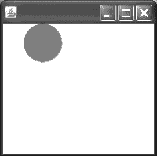

### `Graphics` 类支持的操作

`Graphics` 类（图形上下文）提供的四大类操作分类是：

- 选择颜色。
- 选择字体。
- 绘制和填充。
- 裁剪（Clipping）。

#### 选择颜色

通过调用 `setColor()` 方法选择颜色。所需的参数是 `Color` 类的实例。有 13 种预定义的颜色，可以通过 `Color` 类的静态变量访问（这些变量本身是 `Color` 类的实例。这让某些人感到不安，但 Java 处理这种情况没有问题）。预定义的颜色是：

1. `Color.black`
2. `Color.blue`
3. `Color.cyan`
4. `Color.darkGray`
5. `Color.gray`
6. `Color.green`
7. `Color.lightGray`
8. `Color.magenta`
9. `Color.orange`
10. `Color.pink`
11. `Color.red`
12. `Color.white`
13. `Color.yellow`


如果我们需要一个不在列表中的颜色，可以自己构造。有几个版本的颜色构造函数，最简单的是`Color(int redLevel, int greenLevel, int blueLevel)`。这三个参数是 0 到 255 范围内的强度水平。

我们可以使用图形上下文在任何类型的组件上绘图，但对于已经有外观的组件这样做是不寻常的。

- `Color(0,0,0)`（黑色）
- `Color(0,0,255)`（蓝色）
- `Color(0,255,255)`（青色）
- `Color(128,128,128)`（深灰色）
- `Color(192,192,192)`（灰色）
- `Color(128,255,0)`（绿色）
- `Color(211,211,211)`（浅灰色）
- `Color(255,0,255)`（洋红色）
- `Color(255,165,0)`（橙色）
- `Color(255,192,203)`（粉色）
- `Color(255,0,0)`（红色）
- `Color(255,255,255)`（白色）
- `Color(255,255,0)`（黄色）

#### 选择颜色

通过调用`setColor()`方法选择颜色。所需的参数是`color`类的实例。有 13 种预定义的颜色，可以通过`color`类的静态变量访问（这些变量本身是`color`类的实例。这让某些人感到不安，但 Java 处理这种情况没有问题）。预定义的颜色是：

1. `Color.black`
2. `Color.blue`
3. `Color.cyan`
4. `Color.darkGray`
5. `Color.gray`
6. `Color.green`
7. `Color.lightGray`
8. `Color.magenta`
9. `Color.orange`
10. `Color.pink`
11. `Color.red`
12. `Color.white`
13. `Color.yellow`

#### 选择字体

设置图形上下文的字体就像设置颜色，后续的操作将使用新字体。在设置字体之前，我们必须创建一个。字体类的构造函数看起来如下：`Font(string fontName, int style, int size)`。

第一个参数是字体名称。可用性取决于平台。我们可以通过调用`toolkit`的`getFontList()`方法获取可用字体列表，返回为字符串数组，如下：

```java
String fontNames[]= Toolkit.getDefaultToolkit().getFontList();
```

有三个平台无关的字体名称，我们鼓励使用：

1. "Serif"
2. "Sansserif"
3. "Monospaced"

在 JDK 的 1.0. 版本中，它们分别被称为“TimesRoman”，“Helvetica”和“Courier”。

样式参数可以发送以下任何`int`常数：

1. `Font.PLAIN`
2. `Font.BOLD`
3. `Font.ITALIC`

下面的代码片段将图形上下文`gc`的字体设置为 24 点加粗无衬线：

```java
Font f =new Font("SansSerif",Font.BOLD,24);
gc.setFont(f);
```

我们可以通过传递样式的和来指定样式组合，例如加粗斜体字体：`Font.BOLD + Font.ITALIC`

#### 绘制和填充

`graphics`类的所有渲染方法都指定了它们渲染形状的像素坐标。每个组件都有自己的坐标空间，原点位于组件的左上角，`x`向右增加，`y`向下增加。下图显示了组件坐标系：

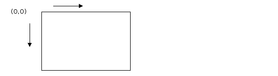

图形上下文类没有大量的绘制方法。（复杂的渲染由扩展 API 处理，如 2d、3d 和动画。）

我们需要了解的图形上下文类的方法有：

- `void drawLine(int x1,int y1, int x2, int y2)` 使用当前颜色，在此图形上下文的坐标系中点（`x1,y1`）和（`x2, y2`）之间绘制一条线。
- `void drawRect(int x, int y, int width, int height)` 绘制指定矩形的轮廓。
- `void fillRect (int x, int y, int width, int height)` 填充指定的矩形。

| 方法 | 说明 |
| :--- | :--- |
| `void drawOval(int x, int y, int width, int height)` | 绘制由指定矩形边界的椭圆轮廓。 |
| `void fillOval(int x, int y, int width, int height)` | 用当前颜色填充指定矩形边界的椭圆。椭圆由矩形边界框指定。椭圆位于边界框内，并如图像所示与框的每个侧边中点相切：要绘制圆形，请使用正方形边界框。请注意，绘画仅绘制前景像素，不绘制背景，因此边界框内但椭圆以外的空间将保持不变。这里，`x` 和 `y` 是边界框左上角的坐标，`width` 和 `height` 是框的宽度和高度。 |
| `void drawArc(int x, int y, int width, int height, int startAngle, int arcAngle)` | 绘制覆盖指定矩形的圆弧或椭圆圆弧的轮廓。 |
| `void fillArc(int x, int y, int width, int height, int startangle, int arcangle)` | 填充覆盖指定矩形的圆弧或椭圆弧。圆弧是椭圆的一部分。指定圆弧时，我们首先指定椭圆的边界框，就像`drawOval()`和`fillOval()`一样。我们还需要指定圆弧的起点和终点，通过指定起始角度和圆弧扫描角度来实现。填充圆弧是由圆弧本身以及从椭圆中心到圆弧端点的两个半径围成的区域。 |
| `void drawPolygon(int[]xPoints, int[]yPoints, int nPoints)` | 绘制由 x 和 y 坐标数组定义的闭多边形。 |
| `void fillPolygon (int[] xPoints , int[] yPoints, int nPoints)` | 填充由 x 和 y 坐标数组定义的闭多边形。多边形是具有任意数量顶点的封闭图形。顶点以两个`int`数组的形式传递给`drawPolygon()`和`fillPolygon()`方法。第一个数组包含顶点的 x 坐标，第二个数组包含 y 坐标。第三个参数指定顶点数量。注意：终点将与第一个点连接。 |
| `void drawPolyLine(int[] xPoints, int[]yPoints , int nPoints)` | 绘制由 x 和 y 坐标数组定义的连接线序列。折线类似于多边形，但它是开放的而不是封闭的。没有连接最后一个顶点和第一个顶点的线段。 |
| `void drawString(String str, int x, int y)` | 使用此图形上下文当前的字体和颜色绘制指定字符串的文本。`x`、`y`参数指定字符串基线的左边缘。带有下伸部字母的字符（在大多数字体中为 g、j、p、q 和 y）延伸到基线以下。文本坐标相对于基线这一点非常重要。例如，在简单的文本中，我们可能会尝试在（0,0）处绘制字符串，期望它出现在区域的左上角。然而，由于基线的存在，我们只能看到字符串的下伸部字母，这可能意味着我们什么也看不到。默认情况下，图形上下文使用关联组件的字体，但我们可以通过调用图形上下文的`setFont()`方法设置不同的字体。 |
| `boolean drawImage (Image img, int x, int y, ImageObserver observer)` | 绘制当前可用的指定图像。这里，`im`是要渲染的图像，`x`和`y`是目标组件中图像左上角的坐标。图像观察者必须是一个实现`imageobserver`接口的对象。图像是矩形像素值集合离屏表示。Java 的图像支持非常复杂。目前，假设我们通过某种方式获取了图像（即`java.awt.image`类的实例），并使用特定的图形上下文将其渲染到屏幕上。此方法是调用图形上下文的`drawImage()`方法。 |

### 示例 19.2

此示例说明了如何创建一个图像并使用其图形上下文在其上绘制。然后可以使用`drawImage()`方法在 applet 窗口中显示图像。

```java
import java.awt.*;
import java.applet.*;
import java.net.URL;
/*<applet code="PaintImage" width=200 height=100></applet>*/
public class PaintImage extends Applet {
    private Image im;
    public void init() { 
      im = createImage(100,50);
      Graphics imgc=im.getGraphics();
      imgc.setColor(Color.gray);
      imgc.fillRect(0,0,100,50);
      imgc.setColor(Color.black);
      imgc.fillOval(0,0,50,40);
    }
    public void paint(Graphics g) {
      g.drawImage(im,10,10,this);
    }
}
```

输出：


### 示例 19.3

此示例说明了如何从现有图像创建一个图像对象。然后可以使用`drawImage()`方法在 applet 窗口中显示图像。

```java
import java.awt.*;
import java.applet.*;
import java.net.*;
/*
<applet code="PaintImage" width=500 height=500>
*/
public class PaintImage1 extends Applet {
    private Image im;
    public void init() {
      try {
        im=getImage(new URL("file:/matrix/logo.gif"));
        //im=getImage(new URL("http://127.0.0.1:8008/logo.gif"));
      } catch (URLException e) {
        System.out.println(e);
      }
    }
    public void paint(Graphics g) {
      g.drawImage(im,10,10,this);
    }
}
```

### 裁剪（Clipping）

程序员对图形上下文进行的大多数调用涉及颜色选择或绘制和填充。不常用的操作是裁剪。裁剪简单地限制图形上下文可以修改的区域。每个图形上下文，即每个`graphics`类的实例都有一个裁剪区域，它定义了关联组件的全部或部分。当我们调用`graphics`类的某个`drawXXX()`或`fillXXX()`方法时，只有位于图形上下文裁剪区域内的像素会被修改。

图形上下文的默认裁剪区域是关联组件的可见区域。有一些方法可以获取和修改裁剪区域。考虑以下`paint`方法。

### 示例 19.4

```java
import java.awt.*;
class Clip extends Frame {
    public static void main(String args[]) { 
      Frame f=new Clip();
      f.setSize(300,330);
      f.setVisible(true);
    }
    public void paint(Graphics g) { 
      for(int i=0; i<300; i=i+100) {
        for(int j=30; j<330; j=j+100) { 
          g.fillOval(i,j,100,100);
        }
      }
    }
}
```

输出：


上述程序的`paint()`方法绘制了一个点图案。考虑当这是一个 200*200 像素的 applet frame 的`paint()`方法时会发生什么。由于循环计数器一直到 500，方法尝试在 applet 边界之外绘制。

这不是问题，因为图形上下文默认的裁剪区域与 applet 本身一致。

要为图形上下文设置矩形裁剪区域，我们可以调用`setClip(x,y, width, height)`方法，传入描述所需裁剪矩形位置和大小四个 int。例如，上述代码可以修改为：

### 示例 19.5

```java
import java.awt.*;
class Clip2 extends Frame {
    public static void main(String args[]) { 
      Frame f=new Clip2();
      f.setSize(300,330);
      f.setVisible(true);
    }
    public void paint(Graphics g) { 
      g.setClip(50,80,200,200);
      for(int i=0; i<300; i=i+100) {
        for(int j=30; j<330; j=j+100) { 
          g.fillOval(i,j,100,100);
        }
      } 
      g.drawString ("Hello! Kamal", 50,50);
    }
}
```

```java
21.    g.drawString ("Bye! Kamal", 120,150);
22.    } }
```

输出：

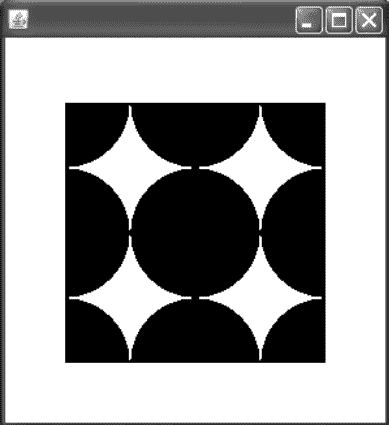

如所示，现在绘制内容被限制在 300 * 300 applet 帧中心的一个 200 * 200 矩形内。

裁剪（Clipping）本身是一个非常值得了解的概念。当环境需要修复组件暴露出的部分时，裁剪也会发挥作用。

### 关于`paint()`方法和图形上下文（graphics context）的总结

`Graphics`上下文是专属于单个组件的。要在组件上进行绘制，我们调用图形上下文的`drawXXXX()`和`fillXXXX()`方法。若要更改图形操作的颜色或字体，我们分别调用图形上下文的`setColor()`或`setFont()`方法。

### GUI 线程与绘制

Java 运行时环境会创建并控制其在后台运行的各个线程，其中一个线程负责 GUI 管理。

GUI 线程是环境用于接收用户输入事件以及调用需要绘制的组件的`paint()`方法的工具。

对`paint()`的调用并不完全由环境生成。Java 程序当然可以自己调用，可以通过直接调用，也可以通过`repaint()`方法间接调用。

也可以使用其图形上下文在组件上进行绘制。这种方法不需要调用`paint()`或`repaint()`方法。

在组件上绘制的不同方法如下：

1. 获取组件的`Graphics`上下文后直接绘制。
2. 自发绘制（由 GUI 线程隐式/自动调用`paint()`方法）。
3. 显式调用`paint()`方法。
4. 显式调用`repaint()`方法，随后其间接调用`paint()`方法。

### 在获取组件的图形上下文后直接绘制

由于可以使用`getGraphics()`方法获取组件`Graphics`上下文的引用，人们很容易认为可以从任何方便的方法直接向组件绘图。通常情况下，这种方法存在严重的缺陷。

假设我们有一个 applet，想要在最近一次鼠标点击的位置画一个红点。applet 的其余部分应该是黄色的。假设该 applet 正在处理自己的鼠标事件。我们可能会考虑创建这样一个事件处理器：

#### 示例 19.6

```java
import java.awt.*;
import java.awt.event.*;
class PaintApproach extends Frame implements MouseListener
{
    public static void main (String args []) {
      PaintApproach f = new PaintApproach ();
      f.setSize (300,300);
      f.addMouseListener(f);
      f.setVisible(true);
    }
    public void mouseEntered (MouseEvent e) { }
    public void mouseExited (MouseEvent e) { }
    public void mousePressed (MouseEvent e) { }
    public void mouseReleased (MouseEvent e) { }
    public void mouseClicked (MouseEvent e) {
      System.out.println ("Mouse Clicked...");
      Graphics g = getGraphics ();
      g.setColor(Color.yellow);
      g.fillRect(0,0, getSize().width, getSize().height);
      g.setColor (Color.Red);
      g.fillOval(e.getX()-10, e.getY()-10,20,20);
    }
}
```

如果这个 applet 曾经被覆盖并暴露，GUI 线程将隐式地调用`paint()`，遗憾的是，`paint()`并不知道在`mouseClicked()`方法中绘制的那个红圈，因此红圈不会被修复。

所有绘制操作的正确位置应该在`paint()`中，或者在从`paint()`出的方法中；这种技术确保了 GUI 线程能够修复暴露带来的损坏。GUI 线程期望`paint()`能够在任意时刻正确地重建屏幕。

实现这一点的一种可能方法是从事件处理器和其他任意方法中移除所有绘制代码，并将这些代码放入`paint()`方法中。

接下来，当某个方法需要绘制时，安排它写入描述所需绘图内容的变量，这样这些变量就可以被`paint()`方法访问，并可以被`paint()`方法用于执行绘制。

现在，当`paint()`方法被调用时（无论是通过我们的通用方法，还是通过 GUI 线程），它都可以绘制出最初想要的内容。

### 自发绘制（由 GUI 线程隐式/自动调用`paint()`方法）

“自发绘制”并不是一个正式术语，但它被使用了。例如，当 GUI 线程调用`paint()`方法时就会发生自发绘制：

- 暴露（Exposure）。
- 最小化还原（De-min）。
- 首次显示。
- 组件被覆盖后再次从最小化。

### 显式调用`paint()`方法

这发生在我们显式调用`paint()`方法时。例如，上一个示例中的`mouseClicked()`方法被重写，使得每当鼠标点击发生时，它只需修改实例变量`mouseX`和`mouseY`。组件得到了修复。

#### 示例 19.7

上一节的示例经过修改，使得组件在这些情况下会刷新，因为红点是在`paint()`方法中绘制的。

```java
import java.awt.*;
import java.awt.event.*;
class PaintApproach1 extends Frame implements MouseListener
{
    int mouseX, mouseY;
    public static void main (String arg[]) {
      PaintApproach1 f = new PaintApproach1 ();
      f.setSize (300,300);
      f.addMouseListener(f);
      f.setVisible(true);
    }
    public void mouseEntered (MouseEvent e) { }
    public void mouseExited (MouseEvent e) { }
    public void mousePressed (MouseEvent e) { }
    public void mouseReleased (MouseEvent e) { }
    public void mouseClicked (MouseEvent e) {
      System.out.println ("Mouse Clicked...");
      mouseX = e.getX();
      mouseY = e.getY();
      Graphics g = getGraphics ();
      paint(g);
    }
    public void paint(Graphics g) {
      g.setColor(Color.yellow);
      g.fillRect(0,0, getSize().width, getSize().height);
      g.setColor(Color.Red);
      g.fillOval(mouseX-10, mouseY-10,20,20);
    }
}
```

```java
public void paint (Graphics g)
{
  g.setColor (Color.yellow);
  g.fillRect(0,0, getSize().width, getSize().height);
  g.setColor(Color.red);
  g.fillOval(mouseX–10,mouseY–10,20,20);
}
```

### 显式调用`repaint()`方法

显式调用`repaint()`方法会间接调用`paint()`方法：

显式调用`paint()`方法可能会导致两个严重的问题。

第一个问题是 GUI 线程会根据需要随时调用`paint()`方法。这发生在需要处理窗口暴露（exposure）时。这可能会导致线程交互问题。公平地说，我们将发现，即使使用优选的方法，可能仍然需要处理这些问题中的某些，因为`paint()`方法将使用我们在其他线程中正在修改的数据。然而，如果我们允许`paint()`只在 GUI 线程中被调用，就能最大限度地减少这个问题。

第二个问题是 CPU 使用率问题。考虑以下场景：我们的程序定期收到通知，要求它用动画的下一帧或类似的连续移动图形来更新显示。假设绘图是复杂且耗时的。如果我们简单地调用整个`paint()`方法，那么在帧触发发生时，我们可能只完成了绘图的一部分。这将导致我们的程序花费或尝试花费所有时间在绘图上。此外，绘图将越来越后于它的进度。

这些问题可以通过使用处理程序启动绘图的优选方法简单地解决。该思想是主程序维护一个描述应该呈现给用户的绘图的数据集，但不直接调用绘图程序。相反，程序请求 GUI 线程运行绘图程序，这与线程在处理暴露时的方式大致相同。

GUI 线程使用主程序提供的数据集来决定画什么以及如何画。

为了支持这种方法，GUI 系统提供了一个名为`repaint()`的方法。该方法定义在`Component`类中，因此 GUI 中的任何可见对象都可以使用。当我们调用此方法时，我们是在向 GUI 线程发出请求，让它执行绘制系统程序。GUI 线程会在合理的时间范围内执行该操作，尽管这可能会受到其他高优先级线程活动的限制。这种方法确保了 GUI 线程与用户线程之间的线程交互降到最低。

当然，我们必须确保当数据处于不一致状态时，GUI 线程绝不会使用该数据集。然而，使用同步或双缓冲技术可以很容易地实现这一点。

这种行为的另一个结果是，无论程序尝试进行多少绘图，系统通常与当前帧保持同步。这是因为例如，如果我们在 GUI 线程能够处理第一次调用之前，调用了十次`repaint()`方法，那么结果将是执行一次绘图系统程序。因此，在过载的情况下，绘图系统会跳过宿主机简单无法处理的帧。这意味着程序员可以编写出在给定平台上获得最佳可用性能，但在任何平台上运行得都尚可良好的代码。下面的代码实现了这种方案。

#### 示例 1.8

```java
import java.awt.*;
import java.awt.event.*;
public class PaintApproach2 extends Frame implements MouseListener
{
  int mouseX, mouseY;
  public static void main (String args [])
  {
    PaintApproach2 f = new PaintApproach2();
    f.setSize(300,300);
    f.addMouseListener(f);
    f.setVisible(true);
  }
  public void mouseEntered (MouseEvent e) {}
  public void mouseExited (MouseEvent e) {}
  public void mousePressed (MouseEvent e) {}
  public void mouseReleased (MouseEvent e) {}
  public void mouseClicked(MouseEvent e)
  {
    System.out.println ("Mouse Clicked ...");
    mouseX = e.getX();
    mouseY = e.getY();
    repaint();
  }
  public void paint (Graphics g)
  {
    g.setColor (Color.white);
    g.fillRect(0,0,getSize().width, getSize().height);
    g.setColor (Color.gray);
    g.fillOval(mouseX–10, mouseY–10,20,20);
  }
}
```

注意`repaint()`调用取代了对绘图的直接处理。现在，无论事件处理程序调用的多频繁，对`paint()`的调用都不会超过系统的绘图能力，程序也不会落后。之前的代码展示了程序启动绘图的优选方法的本质。主程序将信息存储在实例变量中，然后调用`repaint()`方法。`repaint()`方法请求 GUI 线程绘制屏幕。GUI 线程使用`paint()`方法进行绘图，该方法应该根据实例变量中的信息执行绘图。

这种方法的优点是：

- 当环境自发调用`paint()`时，屏幕会得到正确修复。
- 尝试绘图的前景线程与 GUI 线程之间的线程交互是受控且可预测的。
- 虚拟机永远不会被绘图压垮。


当所有代码都这样编写时，对于试图调试代码的其他程序员来说，将没有任何惊喜。

### 平滑动画

重绘机制默认行为中我们可能并不总是需要的特性是：系统在准备响应我们对`repaint()`调用的过程中会清空我们的绘图区域。这可能导致动画和其他实时绘图产生不快的闪烁。事实证明，当我们调用`repaint()`时，GUI线程并不调用`paint()`；相反它调用`update()`方法。`update()`的默认行为是执行两件事：清除背景然后调用`paint`。如下：

```java
public void update (Graphics g)
{
  g.clearRect (0,0,width, height);
  paint(g);
}
```

我们可能会合理地问，为什么`repaint()`一开始就要清除窗口，如果这会导致闪烁。嗯，在许多情况下，绘图是在背景上使用线条、矩形、椭圆等完成的。如果我们尝试制作一根旋转的杆，我们需要在绘制新线之前移除旧线。考虑此问题的另一种方式是，认为当我们尝试绘制新图形时，我们应该先擦除旧的。

那么，我们如何在不先清除整个显示器的情况下让新图形出现呢？我们只需要找到另一种移除旧图的方法。通方法是确保我们在每次绘制帧时都绘制整个绘图——包括背景和前景。如果我们能安排好，就不需要清除组件，闪烁就会消失。

为了防止组件在调用`paint()`之前清除，我们只需重写`update()`方法使其直接调用`paint`，如下所示：

```java
public void update (Graphics g)
{
  paint (g);
}
```

这是一项标准技术并且运行完美，前提是我们的`paint()`方法确实刷新了显示器所有的像素。处理这种情况的一种特别简单的方法是在速度或内存方面并不总是最高效的，但它简单易实现，且Java程序员通常都能理解。这种方法是使用一个离屏图像来存储应该显示在显示器上的绘图。


# 章节

# ∞ 20 ∞

# (Java.Lang.Object 类)

## 引言

`java.lang`包中的`Object`类是Java中所有类的根。所有类直接或间接继承`Object`类。

即使你写了一个简单的类（即它没有继承任何基类），它也会隐式地继承内置的`Object`类。因此，该类的特性在所有中可用。

## Object 类的方法

`object`类定义了以下方法，这些方法被所有类继承：

1. `public int hashCode()`

2. `public boolean equals(Object obj)`

3. `public final Class getClass()`

4. `public String toString()`

5. `protected void finalize() throws Throwable`

6. `protected Object clone() throws CloneNotSupportedException`

7. `public final void wait(long timeout) throws InterrputedException`

8. `public final void wait(long timeout, int nanos) throws InterrputedException`

9. `public final void wait() throws InterrputedException`

10. `public final void notify()`

11. `public final void notifyAll()`

### 1. `public int hashCode()`

在哈希表中存储对象时，可以使用此方法获取对象的哈希值。该值在程序执行期间保证具有的一一致性。

### 2. `boolean equals(Object obj)`

如果每个对象都被认为是唯一的，那么没有必要重写`Object`类的`equals()`方法。该方法比较对象的引用以判断相等。

### 3. `final Class getClass()`

返回对象的运行时类，该类在运行时由`java.lang.Class`类的对象表示。

**示例 20.1：** 以下示例说明了此方法可以用于获取任何java对象对应的`Class`对象。然后我们可以使用`Class`类的方法通过反射/内省来获取有关对象类的信息。`getMethods()`和`getFields()`将仅显示公共成员，而`getDeclaredMethods()`和`getDeclaredFields()`将显示所有成员。

```java
import java.lang.reflect.Method;
import java.lang.reflect.Field;
class DispClassMembers1
{
    public static void main(String args[])
    {
      String s = new String("Hello");
      Class c = s.getClass();
      Method m[] = c.getMethods();
      System.out.println("......Public Methods (" + m.length + ")......");
      for(int i=0; i < m.length; i++)
            System.out.println(m[i]);
      Field f[] = c.getFields();
      System.out.println("......Public Fields (" + f.length + ")......");
      for(int i=0; i< f.length; i++)
            System.out.println(f[i]);
      m = c.getDeclaredMethods();
      System.out.println("......Declared Methods (" + m.length + ")......");
      for(int i=0; i< m.length; i++)
        System.out.println(m[i]);
      f = c.getDeclaredFields();
      System.out.println("......Declared Fields (" + f.length + ")......");
      for(int i=0; i< f.length; i++)
        System.out.println(f[i]);
    }
}
```

**输出：**

```
......Public Methods (72)......
public int java.lang.String.hashCode()
public int java.lang.String.compareTo(java.lang.String)
public int java.lang.String.compareTo(java.lang.Object)
public int java.lang.String.indexOf(int,int)
public int java.lang.String.indexOf(int)
public int java.lang.String.indexOf(java.lang.String)
public int java.lang.String.indexOf(java.lang.String,int)
public boolean java.lang.String.equals(java.lang.Object)
public String java.lang.String java.lang.String.toString()
public char java.lang.String.charAt(int)
public int java.lang.String.codePointAt(int)
...
```

# 声明方法 (70)

- `public int java.lang.String.hashCode()`

- `public int java.lang.String.compareTo(java.lang.String)`

- `public int java.lang.String.compareTo(java.lang.Object)`

- `public int java.lang.String.indexOf(int,int)`

- `public int java.lang.String.indexOf(int)`

- `public int java.lang.String.indexOf(java.lang.String)`

- `public int java.lang.String.indexOf(java.lang.String,int)`

- `static int java.lang.String.indexOf(char[],int,int,char[],int,int,int)`

- `public boolean java.lang.String.equals(java.lang.Object)`

- `public String java.lang.String java.lang.String.toString()`

- `public char java.lang.String.charAt(int)`

- `private static void java.lang.String.checkBounds(byte[],int,int)`

- `public int java.lang.String.codePointAt(int)`

- `public int java.lang.String.codePointBefore(int)`

- `public int java.lang.String.codePointCount(int,int)`

- `public int java.lang.String.compareToIgnoreCase(java.lang.String)`

- `public String java.lang.String java.lang.String.concat(java.lang.String)`

- `public boolean java.lang.String.contains(java.lang.CharSequence)`

- `public boolean java.lang.String.contentEquals(java.lang.StringBuffer)`

- `public boolean java.lang.String.contentEquals(java.lang.CharSequence)`

- `public static String java.lang.String java.lang.String.copyValueOf(char[])`

- `public static String java.lang.String java.lang.String.copyValueOf(char[],int,int)`

- `public boolean java.lang.String.endsWith(java.lang.String)`

- `public boolean java.lang.String.equalsIgnoreCase(java.lang.String)`

- `public static String java.lang.String java.lang.String.format(java.lang.String,java.lang.Object[])`

- `public static String java.lang.String java.lang.String.format(java.util.Locale,java.lang.String,java.lang.Object[])`

- `public byte[] java.lang.String.getBytes()`

- `public byte[] java.lang.String.getBytes(java.nio.charset.Charset)`

- `public byte[] java.lang.String.getBytes(java.lang.String) throws java.io.UnsupportedEncodingException`

- `public void java.lang.String.getBytes(int,int,byte[],int)`

- `void java.lang.String.getChars(char[],int)`

- `public void java.lang.String.getChars(int,int,char[],int)`

- `public native String java.lang.String java.lang.String.intern()`

- `public boolean java.lang.String.isEmpty()`

- `public int java.lang.String.lastIndexOf(int)`

- `public int java.lang.String.lastIndexOf(java.lang.String)`

- `public int java.lang.String.lastIndexOf(java.lang.String,int)`

- `public int java.lang.String.lastIndexOf(int,int)`

- `static int java.lang.String.lastIndexOf(char[],int,int,char[],int,int,int)`

- `public int java.lang.String.length()`

- `public boolean java.lang.String.matches(java.lang.String)`

- `public int java.lang.String.offsetByCodePoints(int,int)`

- `public boolean java.lang.String.regionMatches(boolean,int,java.lang.String,int,int)`

- `public boolean java.lang.String.regionMatches(int,java.lang.String,int,int)`

- `public String java.lang.String java.lang.String.replace(java.lang.CharSequence,java.lang.CharSequence)`

- `public String java.lang.String java.lang.String.replace(char,char)`

- `public String java.lang.String java.lang.String.replaceAll(java.lang.String,java.lang.String)`

- `public String java.lang.String java.lang.String.replaceFirst(java.lang.String,java.lang.String)`

- `public String[] java.lang.String java.lang.String.split(java.lang.String,int)`

- `public String[] java.lang.String java.lang.String.split(java.lang.String)`

- `public boolean java.lang.String.startsWith(java.lang.String,int)`

- `public boolean java.lang.String.startsWith(java.lang.String)`

- `public CharSequence java.lang.String.subSequence(int,int)`

- `public String java.lang.String java.lang.String.substring(int,int)`

- `public String java.lang.String java.lang.String.substring(int)`

- `public char[] java.lang.String.toCharArray()`

- `public String java.lang.String java.lang.String.toLowerCase()`

- `public String java.lang.String java.lang.String.toLowerCase(java.util.Locale)`

- `public String java.lang.String java.lang.String.toUpperCase()`

- `public String java.lang.String java.lang.String.toUpperCase(java.util.Locale)`


# 声明方法 (70)

- `public int java.lang.String.hashCode()`
- `public int java.lang.String.compareTo(java.lang.String)`
- `public int java.lang.String.compareTo(java.lang.Object)`
- `public int java.lang.String.indexOf(int,int)`
- `public int java.lang.String.indexOf(int)`
- `public int java.lang.String.indexOf(java.lang.String)`
- `public int java.lang.String.indexOf(java.lang.String,int)`
- `static int java.lang.String.indexOf(char[],int,int,char[],int,int,int)`
- `public boolean java.lang.String.equals(java.lang.Object)`
- `public String java.lang.String java.lang.String.toString()`
- `public char java.lang.String.charAt(int)`
- `private static void java.lang.String.checkBounds(byte[],int,int)`
- `public int java.lang.String.codePointAt(int)`
- `public int java.lang.String.codePointBefore(int)`
- `public int java.lang.String.codePointCount(int,int)`
- `public int java.lang.String.compareToIgnoreCase(java.lang.String)`
- `public String java.lang.String java.lang.String.concat(java.lang.String)`
- `public boolean java.lang.String.contains(java.lang.CharSequence)`
- `public boolean java.lang.String.contentEquals(java.lang.StringBuffer)`
- `public boolean java.lang.String.contentEquals(java.lang.CharSequence)`
- `public static String java.lang.String java.lang.String.copyValueOf(char[])`
- `public static String java.lang.String java.lang.String.copyValueOf(char[],int,int)`
- `public boolean java.lang.String.endsWith(java.lang.String)`
- `public boolean java.lang.String.equalsIgnoreCase(java.lang.String)`
- `public static String java.lang.String java.lang.String.format(java.lang.String,java.lang.Object[])`
- `public static String java.lang.String java.lang.String.format(java.util.Locale,java.lang.String,java.lang.Object[])`
- `public byte[] java.lang.String.getBytes()`
- `public byte[] java.lang.String.getBytes(java.nio.charset.Charset)`
- `public byte[] java.lang.String.getBytes(java.lang.String) throws java.io.UnsupportedEncodingException`
- `public void java.lang.String.getBytes(int,int,byte[],int)`
- `void java.lang.String.getChars(char[],int)`
- `public void java.lang.String.getChars(int,int,char[],int)`
- `public native String java.lang.String java.lang.String.intern()`
- `public boolean java.lang.String.isEmpty()`
- `public int java.lang.String.lastIndexOf(int)`
- `public int java.lang.String.lastIndexOf(java.lang.String)`
- `public int java.lang.String.lastIndexOf(java.lang.String,int)`
- `public int java.lang.String.lastIndexOf(int,int)`
- `static int java.lang.String.lastIndexOf(char[],int,int,char[],int,int,int)`
- `public int java.lang.String.length()`
- `public boolean java.lang.String.matches(java.lang.String)`
- `public int java.lang.String.offsetByCodePoints(int,int)`
- `public boolean java.lang.String.regionMatches(boolean,int,java.lang.String,int,int)`
- `public boolean java.lang.String.regionMatches(int,java.lang.String,int,int)`
- `public String java.lang.String java.lang.String.replace(java.lang.CharSequence,java.lang.CharSequence)`
- `public String java.lang.String java.lang.String.replace(char,char)`
- `public String java.lang.String java.lang.String.replaceAll(java.lang.String,java.lang.String)`
- `public String java.lang.String java.lang.String.replaceFirst(java.lang.String,java.lang.String)`
- `public String[] java.lang.String java.lang.String.split(java.lang.String,int)`
- `public String[] java.lang.String java.lang.String.split(java.lang.String)`
- `public boolean java.lang.String.startsWith(java.lang.String,int)`
- `public boolean java.lang.String.startsWith(java.lang.String)`
- `public CharSequence java.lang.String.subSequence(int,int)`
- `public String java.lang.String java.lang.String.substring(int,int)`
- `public String java.lang.String java.lang.String.substring(int)`
- `public char[] java.lang.String.toCharArray()`
- `public String java.lang.String java.lang.String.toLowerCase()`
- `public String java.lang.String java.lang.String.toLowerCase(java.util.Locale)`
- `public String java.lang.String java.lang.String.toUpperCase()`
- `public String java.lang.String java.lang.String.toUpperCase(java.util.Locale)`


- `static int java.lang.String.indexOf(char[],int,int,char[],int,int,int)`
- `public boolean java.lang.String.equals(java.lang.Object)`
- `public String java.lang.String java.lang.String.toString()`
- `public char java.lang.String.charAt(int)`
- `private static void java.lang.String.checkBounds(byte[],int,int)`
- `public int java.lang.String.codePointAt(int)`
- `public int java.lang.String.codePointBefore(int)`
- `public int java.lang.String.codePointCount(int,int)`
- `public int java.lang.String.compareToIgnoreCase(java.lang.String)`
- `public String java.lang.String java.lang.String.concat(java.lang.String)`
- `public boolean java.lang.String.contains(java.lang.CharSequence)`
- `public boolean java.lang.String.contentEquals(java.lang.StringBuffer)`
- `public boolean java.lang.String.contentEquals(java.lang.CharSequence)`
- `public static String java.lang.String java.lang.String.copyValueOf(char[])`
- `public static String java.lang.String java.lang.String.copyValueOf(char[],int,int)`
- `public boolean java.lang.String.endsWith(java.lang.String)`
- `public boolean java.lang.String.equalsIgnoreCase(java.lang.String)`
- `public static String java.lang.String java.lang.String.format(java.lang.String,java.lang.Object[])`
- `public static String java.lang.String java.lang.String.format(java.util.Locale,java.lang.String,java.lang.Object[])`
- `public byte[] java.lang.String.getBytes()`
- `public byte[] java.lang.String.getBytes(java.nio.charset.Charset)`
- `public byte[] java.lang.String.getBytes(java.lang.String) throws java.io.UnsupportedEncodingException`
- `public void java.lang.String.getBytes(int,int,byte[],int)`
- `void java.lang.String.getChars(char[],int)`
- `public void java.lang.String.getChars(int,int,char[],int)`
- `public native String java.lang.String java.lang.String.intern()`
- `public boolean java.lang.String.isEmpty()`
- `public int java.lang.String.lastIndexOf(int)`
- `public int java.lang.String.lastIndexOf(java.lang.String)`
- `public int java.lang.String.lastIndexOf(java.lang.String,int)`
- `public int java.lang.String.lastIndexOf(int,int)`
- `static int java.lang.String.lastIndexOf(char[],int,int,char[],int,int,int)`
- `public int java.lang.String.length()`
- `public boolean java.lang.String.matches(java.lang.String)`
- `public int java.lang.String.offsetByCodePoints(int,int)`
- `public boolean java.lang.String.regionMatches(boolean,int,java.lang.String,int,int)`
- `public boolean java.lang.String.regionMatches(int,java.lang.String,int,int)`
- `public String java.lang.String java.lang.String.replace(java.lang.CharSequence,java.lang.CharSequence)`
- `public String java.lang.String java.lang.String.replace(char,char)`
- `public String java.lang.String java.lang.String.replaceAll(java.lang.String,java.lang.String)`
- `public String java.lang.String java.lang.String.replaceFirst(java.lang.String,java.lang.String)`
- `public String[] java.lang.String java.lang.String.split(java.lang.String,int)`
- `public String[] java.lang.String java.lang.String.split(java.lang.String)`
- `public boolean java.lang.String.startsWith(java.lang.String,int)`
- `public boolean java.lang.String.startsWith(java.lang.String)`
- `public CharSequence java.lang.String.subSequence(int,int)`
- `public String java.lang.String java.lang.String.substring(int,int)`
- `public String java.lang.String java.lang.String.substring(int)`
- `public char[] java.lang.String.toCharArray()`
- `public String java.lang.String java.lang.String.toLowerCase()`
- `public String java.lang.String java.lang.String.toLowerCase(java.util.Locale)`
- `public String java.lang.String java.lang.String.toUpperCase()`
- `public String java.lang.String java.lang.String.toUpperCase(java.util.Locale)`

# 声明方法 (70)

- `public int java.lang.String.hashCode()`
- `public int java.lang.String.compareTo(java.lang.String)`
- `public int java.lang.String.compareTo(java.lang.Object)`
- `public int java.lang.String.indexOf(int,int)`
- `public int java.lang.String.indexOf(int)`
- `public int java.lang.String.indexOf(java.lang.String)`
- `public int java.lang.String.indexOf(java.lang.String,int)`
- `static int java.lang.String.indexOf(char[],int,int,char[],int,int,int)`
- `public boolean java.lang.String.equals(java.lang.Object)`
- `public String java.lang.String java.lang.String.toString()`
- `public char java.lang.String.charAt(int)`
- `private static void java.lang.String.checkBounds(byte[],int,int)`
- `public int java.lang.String.codePointAt(int)`
- `public int java.lang.String.codePointBefore(int)`
- `public int java.lang.String.codePointCount(int,int)`
- `public int java.lang.String.compareToIgnoreCase(java.lang.String)`
- `public String java.lang.String java.lang.String.concat(java.lang.String)`
- `public boolean java.lang.String.contains(java.lang.CharSequence)`
- `public boolean java.lang.String.contentEquals(java.lang.StringBuffer)`
- `public boolean java.lang.String.contentEquals(java.lang.CharSequence)`
- `public static String java.lang.String java.lang.String.copyValueOf(char[])`
- `public static String java.lang.String java.lang.String.copyValueOf(char[],int,int)`
- `public boolean java.lang.String.endsWith(java.lang.String)`
- `public boolean java.lang.String.equalsIgnoreCase(java.lang.String)`
- `public static String java.lang.String java.lang.String.format(java.lang.String,java.lang.Object[])`
- `public static String java.lang.String java.lang.String.format(java.util.Locale,java.lang.String,java.lang.Object[])`
- `public byte[] java.lang.String.getBytes()`
- `public byte[] java.lang.String.getBytes(java.nio.charset.Charset)`
- `public byte[] java.lang.String.getBytes(java.lang.String) throws java.io.UnsupportedEncodingException`
- `public void java.lang.String.getBytes(int,int,byte[],int)`
- `void java.lang.String.getChars(char[],int)`
- `public void java.lang.String.getChars(int,int,char[],int)`
- `public native String java.lang.String java.lang.String.intern()`
- `public boolean java.lang.String.isEmpty()`
- `public int java.lang.String.lastIndexOf(int)`
- `public int java.lang.String.lastIndexOf(java.lang.String)`
- `public int java.lang.String.lastIndexOf(java.lang.String,int)`
- `public int java.lang.String.lastIndexOf(int,int)`
- `static int java.lang.String.lastIndexOf(char[],int,int,char[],int,int,int)`
- `public int java.lang.String.length()`
- `public boolean java.lang.String.matches(java.lang.String)`
- `public int java.lang.String.offsetByCodePoints(int,int)`
- `public boolean java.lang.String.regionMatches(boolean,int,java.lang.String,int,int)`
- `public boolean java.lang.String.regionMatches(int,java.lang.String,int,int)`
- `public String java.lang.String java.lang.String.replace(java.lang.CharSequence,java.lang.CharSequence)`
- `public String java.lang.String java.lang.String.replace(char,char)`
- `public String java.lang.String java.lang.String.replaceAll(java.lang.String,java.lang.String)`
- `public String java.lang.String java.lang.String.replaceFirst(java.lang.String,java.lang.String)`
- `public String[] java.lang.String java.lang.String.split(java.lang.String,int)`
- `public String[] java.lang.String java.lang.String.split(java.lang.String)`
- `public boolean java.lang.String.startsWith(java.lang.String,int)`
- `public boolean java.lang.String.startsWith(java.lang.String)`
- `public CharSequence java.lang.String.subSequence(int,int)`
- `public String java.lang.String java.lang.String.substring(int,int)`
- `public String java.lang.String java.lang.String.substring(int)`
- `public char[] java.lang.String.toCharArray()`
- `public String java.lang.String java.lang.String.toLowerCase()`
- `public String java.lang.String java.lang.String.toLowerCase(java.util.Locale)`
- `public String java.lang.String java.lang.String.toUpperCase()`
- `public String java.lang.String java.lang.String.toUpperCase(java.util.Locale)`

# 声明方法 (70)


## 声明方法（70）

- `public int java.lang.String.hashCode()`
- `public int java.lang.String.compareTo(java.lang.String)`
- `public int java.lang.String.compareTo(java.lang.Object)`
- `public int java.lang.String.indexOf(int,int)`
- `public int java.lang.String.indexOf(int)`
- `public int java.lang.String.indexOf(java.lang.String)`
- `public int java.lang.String.indexOf(java.lang.String,int)`
- `static int java.lang.String.indexOf(char[],int,int,char[],int,int,int)`
- `public boolean java.lang.String.equals(java.lang.Object)`
- `public String java.lang.String java.lang.String.toString()`
- `public char java.lang.String.charAt(int)`
- `private static void java.lang.String.checkBounds(byte[],int,int)`
- `public int java.lang.String.codePointAt(int)`
- `public int java.lang.String.codePointBefore(int)`
- `public int java.lang.String.codePointCount(int,int)`
- `public int java.lang.String.compareToIgnoreCase(java.lang.String)`
- `public String java.lang.String java.lang.String.concat(java.lang.String)`
- `public boolean java.lang.String.contains(java.lang.CharSequence)`
- `public boolean java.lang.String.contentEquals(java.lang.StringBuffer)`
- `public boolean java.lang.String.contentEquals(java.lang.CharSequence)`
- `public static String java.lang.String java.lang.String.copyValueOf(char[])`
- `public static String java.lang.String java.lang.String.copyValueOf(char[],int,int)`
- `public boolean java.lang.String.endsWith(java.lang.String)`
- `public boolean java.lang.String.equalsIgnoreCase(java.lang.String)`
- `public static String java.lang.String java.lang.String.format(java.lang.String,java.lang.Object[])`
- `public static String java.lang.String java.lang.String.format(java.util.Locale,java.lang.String,java.lang.Object[])`
- `public byte[] java.lang.String.getBytes()`
- `public byte[] java.lang.String.getBytes(java.nio.charset.Charset)`
- `public byte[] java.lang.String.getBytes(java.lang.String) throws java.io.UnsupportedEncodingException`
- `public void java.lang.String.getBytes(int,int,byte[],int)`
- `void java.lang.String.getChars(char[],int)`
- `public void java.lang.String.getChars(int,int,char[],int)`
- `public native String java.lang.String java.lang.String.intern()`
- `public boolean java.lang.String.isEmpty()`
- `public int java.lang.String.lastIndexOf(int)`
- `public int java.lang.String.lastIndexOf(java.lang.String)`
- `public int java.lang.String.lastIndexOf(java.lang.String,int)`
- `public int java.lang.String.lastIndexOf(int,int)`
- `static int java.lang.String.lastIndexOf(char[],int,int,char[],int,int,int)`
- `public int java.lang.String.length()`
- `public boolean java.lang.String.matches(java.lang.String)`
- `public int java.lang.String.offsetByCodePoints(int,int)`
- `public boolean java.lang.String.regionMatches(boolean,int,java.lang.String,int,int)`
- `public boolean java.lang.String.regionMatches(int,java.lang.String,int,int)`
- `public String java.lang.String java.lang.String.replace(java.lang.CharSequence,java.lang.CharSequence)`
- `public String java.lang.String java.lang.String.replace(char,char)`
- `public String java.lang.String java.lang.String.replaceAll(java.lang.String,java.lang.String)`
- `public String java.lang.String java.lang.String.replaceFirst(java.lang.String,java.lang.String)`
- `public String[] java.lang.String java.lang.String.split(java.lang.String,int)`
- `public String[] java.lang.String java.lang.String.split(java.lang.String)`
- `public boolean java.lang.String.startsWith(java.lang.String,int)`
- `public boolean java.lang.String.startsWith(java.lang.String)`
- `public CharSequence java.lang.String.subSequence(int,int)`
- `public String java.lang.String java.lang.String.substring(int,int)`
- `public String java.lang.String java.lang.String.substring(int)`


# 声明方法 (70)

- `public int java.lang.String.hashCode()`
- `public int java.lang.String.compareTo(java.lang.String)`
- `public int java.lang.String.compareTo(java.lang.Object)`
- `public int java.lang.String.indexOf(int,int)`
- `public int java.lang.String.indexOf(int)`
- `public int java.lang.String.indexOf(java.lang.String)`
- `public int java.lang.String.indexOf(java.lang.String,int)`
- `static int java.lang.String.indexOf(char[],int,int,char[],int,int,int)`
- `public boolean java.lang.String.equals(java.lang.Object)`
- `public String java.lang.String java.lang.String.toString()`
- `public char java.lang.String.charAt(int)`
- `private static void java.lang.String.checkBounds(byte[],int,int)`
- `public int java.lang.String.codePointAt(int)`
- `public int java.lang.String.codePointBefore(int)`
- `public int java.lang.String.codePointCount(int,int)`
- `public int java.lang.String.compareToIgnoreCase(java.lang.String)`
- `public String java.lang.String java.lang.String.concat(java.lang.String)`
- `public boolean java.lang.String.contains(java.lang.CharSequence)`
- `public boolean java.lang.String.contentEquals(java.lang.StringBuffer)`
- `public boolean java.lang.String.contentEquals(java.lang.CharSequence)`
- `public static String java.lang.String java.lang.String.copyValueOf(char[])`
- `public static String java.lang.String java.lang.String.copyValueOf(char[],int,int)`
- `public boolean java.lang.String.endsWith(java.lang.String)`
- `public boolean java.lang.String.equalsIgnoreCase(java.lang.String)`
- `public static String java.lang.String java.lang.String.format(java.lang.String,java.lang.Object[])`
- `public static String java.lang.String java.lang.String.format(java.util.Locale,java.lang.String,java.lang.Object[])`
- `public byte[] java.lang.String.getBytes()`
- `public byte[] java.lang.String.getBytes(java.nio.charset.Charset)`
- `public byte[] java.lang.String.getBytes(java.lang.String) throws java.io.UnsupportedEncodingException`
- `public void java.lang.String.getBytes(int,int,byte[],int)`
- `void java.lang.String.getChars(char[],int)`
- `public void java.lang.String.getChars(int,int,char[],int)`
- `public native String java.lang.String java.lang.String.intern()`
- `public boolean java.lang.String.isEmpty()`
- `public int java.lang.String.lastIndexOf(int)`
- `public int java.lang.String.lastIndexOf(java.lang.String)`
- `public int java.lang.String.lastIndexOf(java.lang.String,int)`
- `public int java.lang.String.lastIndexOf(int,int)`
- `static int java.lang.String.lastIndexOf(char[],int,int,char[],int,int,int)`
- `public int java.lang.String.length()`
- `public boolean java.lang.String.matches(java.lang.String)`
- `public int java.lang.String.offsetByCodePoints(int,int)`
- `public boolean java.lang.String.regionMatches(boolean,int,java.lang.String,int,int)`
- `public boolean java.lang.String.regionMatches(int,java.lang.String,int,int)`
- `public String java.lang.String java.lang.String.replace(java.lang.CharSequence,java.lang.CharSequence)`
- `public String java.lang.String java.lang.String.replace(char,char)`
- `public String java.lang.String java.lang.String.replaceAll(java.lang.String,java.lang.String)`
- `public String java.lang.String java.lang.String.replaceFirst(java.lang.String,java.lang.String)`
- `public String[] java.lang.String java.lang.String.split(java.lang.String,int)`
- `public String[] java.lang.String java.lang.String.split(java.lang.String)`
- `public boolean java.lang.String.startsWith(java.lang.String,int)`
- `public boolean java.lang.String.startsWith(java.lang.String)`
- `public CharSequence java.lang.String.subSequence(int,int)`
- `public String java.lang.String java.lang.String.substring(int,int)`
- `public String java.lang.String java.lang.String.substring(int)`
- `public char[] java.lang.String.toCharArray()`
- `public String java.lang.String java.lang.String.toLowerCase()`
- `public String java.lang.String java.lang.String.toLowerCase(java.util.Locale)`
- `public String java.lang.String java.lang.String.toUpperCase()`
- `public String java.lang.String java.lang.String.toUpperCase(java.util.Locale)`


- `public String java.lang.String java.lang.String.replaceFirst(java.lang.String,java.lang.String)`

- `public String[] java.lang.String java.lang.String.split(java.lang.String,int)`

- `public String[] java.lang.String java.lang.String.split(java.lang.String)`

- `public boolean java.lang.String.startsWith(java.lang.String,int)`

- `public boolean java.lang.String.startsWith(java.lang.String)`

- `public CharSequence java.lang.String.subSequence(int,int)`

- `public String java.lang.String java.lang.String.substring(int,int)`

- `public String java.lang.String java.lang.String.substring(int)`

- `public char[] java.lang.String.toCharArray()`

- `public String java.lang.String java.lang.String.toLowerCase()`

- `public String java.lang.String java.lang.String.toLowerCase(java.util.Locale)`

- `public String java.lang.String java.lang.String.toUpperCase()`

- `public String java.lang.String java.lang.String.toUpperCase(java.util.Locale)`

```java
18. String s="Box b:" + b; // 拼接 box 对象并调用 toString() 方法
19.System.out.println(b); // 调用 toString() 方法
20.System.out.println(s);
21. }
22. }
```

Output:

```
Dimension are 8.0 by 11.0 by 13.0
Box b: Dimension are 8.0 by 11.0 by 13.0
```

### 5. `protected void finalize() throws Throwable`

该方法在对象被垃圾回收之前被调用，以便进行任何清理工作。然而，`Object` 类中默认的 `finalize()` 方法没有做任何实用的事情。这对于释放非 Java 资源可能有用，但不建议这样做。如果可用内存足够，`finalize()` 方法可能永远不会被调用，在这种情况下资源可能永远不会被释放。

### 6. `protected Object clone() throws CloneNotSupportedException`

通过 `clone()` 方法可以创建与当前对象完全相同（即具有相同状态）的新对象，即复制原始类型值和引用值，这被称为浅拷贝。

类可以重写 `clone()` 方法以提供其自己的克隆概念。例如，通过递归地克隆组成对象来克隆复合对象被称为深拷贝。当重写时，子类中的该方法通常被声明为 `public`，以便任何客户端克隆该类的对象。

如果重写 `clone()` 方法依赖于 `Object` 类中的 `clone()` 方法，则子类必须实现 `Cloneable` 标记接口，以指示其对象可以安全地克隆。否则，`Object` 类中的 `clone()` 方法将抛出受检异常 `CloneNotSupportedException`。

#### 使用 `clone()` 和 `Cloneable` 接口

`clone()` 方法会在其调用的对象上生成该对象的副本。以下是与 `clone()` 方法相关的几个重要事实：

- 只有实现了 `Cloneable` 接口的类才能被克隆。`Cloneable` 接口没有定义成员。它用于指示一个类允许对对象进行位拷贝（即克隆体）。

- 如果你尝试对未实现 `Cloneable` 接口的类对象调用 `clone()`，将抛出 `CloneNotSupportedException`。

- `Cloneable` 接口是一个空接口。这种接口被称为标记/标签接口。在创建克隆体时，不会调用被克隆对象的构造函数。

- 克隆体只是原始对象的精确复制。克隆是一个潜在的危险操作，因为它可能会导致意料之外的副作用。

- 例如，如果被克隆的对象包含一个名为 `objRef` 的引用变量，那么在创建克隆体时，`clone` 中的 `objRef` 将指向与原始对象中 `objRef` 相同的同一个对象。如果克隆体对 `objRef` 所指向的内容进行更改，那么原始对象也会随之改变。

#### Example20.5

以下示例演示了 `clone()` 方法的使用。`CloneDemo1` 类通过 `clone2()` 方法间接调用 `clone()` 方法，对 `TestClone1` 类的对象进行克隆。

```java
1. class TestClone1 implements Cloneable
{
    int a;
    float b;
    public TestClone1 clone2() throws CloneNotSupportedException
    {
        return (TestClone1) clone();
    }
}
class CloneDemo1
{
    public static void main(String a[]) throws CloneNotSupportedException
    {
        TestClone1 tc1 = new TestClone1();
        TestClone1 tc2;
        tc1.a = 8; tc1.b = 4.5f;
        tc2 = tc1.clone2();
        System.out.println(tc2.a);
        System.out.println(tc2.b);
    }
}
```

Output:

```
8
4.5
```

在这里，`clone2()` 方法调用 `Object` 类的 `clone()` 方法并返回结果。注意，`clone()` 返回的对象必须转换为其适当类型，即 `TestClone1`。

#### Example 20.6

在以下示例中，重写了 `clone()` 方法，以便从类外部的代码调用它。为了做到这一点，其访问修饰符必须是 `public`。

```java
1. class TestClone2 implements Cloneable
{
    int a;
    float b;
    public Object clone() throws CloneNotSupportedException
    {
        return super.clone();
    }
}
class CloneDemo2
{
    public static void main(String args[]) throws CloneNotSupportedException
    {
        TestClone2 tc1 = new TestClone2();
        TestClone2 tc2;
        tc1.a = 8; tc1.b = 4.5f;
        tc2 = (TestClone2) tc1.clone();
        System.out.println(tc2.a + " " + tc2.b);
    }
}
```

Output:

```
8 , 4.5
```

#### Example 20.7

在以下示例中，重写了 `clone()` 方法，使其不再使用 `Object` 类的 `clone()` 方法。我们正在编写自己的 `clone()` 方法。

```java
1. class TestClone3
{
    int a;
    float b;
    public Object clone()
    {
        TestClone3 tc = new TestClone3();
        tc.a = a;
        tc.b = b;
        return tc;
    }
}
class CloneDemo3
{
    public static void main(String args[])
    {
        TestClone3 tc1 = new TestClone3();
        TestClone3 tc2;
        tc1.a = 8;
        tc1.b = 4.5f;
        tc2 = (TestClone3) tc1.clone();
        System.out.println(tc2.a + " " + tc2.b);
    }
}
```

Output:

```
8 , 4.5
```

注意：在实现你的 `clone()` 方法时，不需要声明 `CloneNotSupportedException`，也不需要实现 `Cloneable` 接口。

#### 克隆的副作用

克隆引起的副作用有时很难立即发现。人们很容易认为一个类对于克隆是安全的，但实际上并非如此。通常情况下，如果没有充分的理由，你不应为任何类实现 `Cloneable` 接口。

#### Example20.8

此示例演示了克隆的副作用。

```java
1. class TestShallow implements Cloneable
{
    int a;
    float b;
    int c[];
    public Object clone() throws CloneNotSupportedException
    {
        return super.clone();
    }
}
class ShallowDemo
{ 
    public static void main(String arg[]) throws CloneNotSupportedException
    { 
        TestShallow tc1 = new TestShallow();
        TestShallow tc2;
        tc1.a = 8;
        tc1.b = 4.5f;
        int c[] = new int[4];
        for(int i=0; i<4; i++)
            c[i] = i;
        tc1.c = c;
        for(int i=0; i<4; i++)
            System.out.println("tc1.c[" + i + "]="+tc1.c[i]);
        tc2 = (TestShallow) tc1.clone();
        System.out.println("tc2.a"+tc2.a);
        System.out.println("tc2.b"+tc2.b);
        for(int i=0; i<4; i++)
            System.out.println("tc2.c[" + i + "]="+tc2.c[i]);
        for(int i=0; i<4; i++)
            tc2.c[i] = i+4;
        for(int i=0; i<4; i++)
            System.out.println("tc1.c[" + i + "]="+tc1.c[i]);
    }
}
```

Output:

```
tc1.c[0]=0
tc1.c[1]=1
tc1.c[2]=2
tc1.c[3]=3
tc2.a8
tc2.b4.5
tc2.c[0]=0
tc2.c[1]=1
tc2.c[2]=2
tc2.c[3]=3
tc1.c[0]=4
tc1.c[1]=5
tc1.c[2]=6
tc1.c[3]=7
```

#### Example 20.9

以下代码通过实现深拷贝消除了上一个示例中面临的问题。

```java
1. class TestDeepClone implements Cloneable
{ 
    int a;
    float b;
    int c[];
    public Object clone() throws CloneNotSupportedException
    { 
        TestDeepClone tc = (TestDeepClone)super.clone();
        int d[] = new int[4];
        for(int i=0; i<4; i++)
            d[i] = c[i];
        tc.c = d; 
        return (tc);
    }
}
class DeepCloneDemo
{ 
    public static void main(String arg[]) throws CloneNotSupportedException
    { 
        TestDeepClone tc1 = new TestDeepClone();
        TestDeepClone tc2;
        tc1.a = 8;
        tc1.b = 4.5;
        int c[] = new int[4];
        for(int i=0; i<4; i++)
            c[i] = i;
        tc1.c = c;
        for(int i=0; i<4; i++)
    }
}
```

```java
System.out.println(“tc1.c[”+ i +”]=” + tc1.c[i]);
tc2 = (TestDeepClone) tc1.clone();
System.out.println(“tc2.a”+tc2.a);
System.out.println(“tc2.b”+tc2.b);
for(int i=0; i<4; i++)
    System.out.println(“tc2.c[” + i + “]=” + tc2.c[i]);
for(int i=0; i<4; i++)
    tc2.c[i] = i+4;
for(int i=0; i<4; i++)
    System.out.println(“tc2.c[” + i + “]=” + tc2.c[i]);
for(int i=0; i<4; i++)
    System.out.println(“tc1.c[” + i + “]=” + tc1.c[i]);
```

**输出：**

```
tc1.c[0]=0
tc1.c[1]=1
tc1.c[2]=2
tc1.c[3]=3
tc2.a=8
tc2.b=4.5
tc2.c[0]=0
tc2.c[1]=1
tc2.c[2]=2
tc2.c[3]=3
tc2.c[0]=4
tc2.c[1]=5
tc2.c[2]=6
tc2.c[3]=7
tc1.c[0]=0
tc1.c[1]=1
```

# 21 (集合框架)

## 多线程环境中的有用方法

除了上述讨论的方法外，`Object` 类还通过以下方法为同步代码中的线程通信提供支持：导致当前线程等待，直到另一个线程调用该对象的 `notify()` 方法或 `notifyAll()` 方法。

8. `final void wait(long timeout) throws InterruptedException`

9. `final void wait(long timeout, long nanos) throws InterruptedException`

导致当前线程等待，直到另一个线程调用该对象的 `notify()` 方法或 `notifyAll()` 方法，或者其他线程中断了当前线程，或者指定的时间已到。

10. `final void notify()`

唤醒在该对象监视器上等待的单个线程。

11. `final void notifyAll()`

唤醒所有在该对象监视器上等待的线程。线程通过调用其中一个 `wait` 方法在对象的监视器上等待。

线程在它持有的锁对象上调用这些方法。线程等待另一个线程的通知。

## 简介言

Java 集合框架标准化了程序处理对象组的方式。在 Java 2 之前，Java 提供了诸如 `Vector`、`Stack`、`Dictionary`、`Hashtable` 和 `Properties` 等临时类，用于存储和操作对象组。

尽管这些类非常有用，但它们缺乏一个核心的统一主题。我们使用 `Vector` 的方式与使用 `Properties` 类的方式不同。此外，之前的临时方法设计时并未考虑到易于扩展或适应。集合（Collections）是对这些（以及其他）问题的回答。

`Collection` 框架的设计考虑了以下目标：

- 框架必须是高性能的。基础集合（动态数组、链表、树和哈希表）的实现非常高效。

- 框架必须允许不同类型的集合以类似的方式工作，并具有高度的可操作性。

- 扩展和/或适应集合应该是容易的。

为了实现上述目标，集合框架设计了以下特性：

- 整个集合框架是围绕一组标准接口设计的。提供了这些接口的若干种标准实现。我们也可以实现自己的集合。


- 集合框架创建的另一个项目是 `Iterator` 接口。`Iterator` 为你提供通用的、标准化的方法来逐次访问集合中的元素。
- 因此，`Iterator` 提供了一种遍历集合内容的手段。因为每个集合都实现了 `Iterator`，所以可以通过 `Iterator` 定义的方法访问任何集合类中的元素。这样，只需经过很小的更改，循环遍历集合的代码也可以用于循环遍历列表（例如）。
- 除了集合之外，框架还定义了几个映射（map）接口和类。`Maps` 存储键/值对。虽然在术语使用上 map 并不是真正的“集合”，但它们与集合完全集成在一起。
- 在集合框架的语言中，我们可以获取 map 的集合视图（collection view）。这种视图包含了存储在集合中的 map 元素。因此，如果你愿意，可以像处理集合一样处理 map 的内容。
- 集合机制被重新适配到 `java.util` 包定义的某些原始类中，以便它们也能集成到新系统中。
- 重要的是，尽管集合的加入改变了许多原始工具类的架构，但它并没有导致任何一个类被废弃。集合仅仅为完成几项任务提供了一种更好的方法。

## 集合接口

集合框架定义了几个接口。具体类仅提供了标准接口的不同实现。支撑集合的接口是：

- `Collection`：允许你处理对象组；它是集合层次结构的最顶端。
- `List`：扩展 `collection` 以处理序列（对象列表）。
- `Set`：扩展 `collection` 以处理必须包含唯一元素的集合。
- `SortedSet`：扩展 `collection` 以处理排序集合。

除了集合接口外，集合还使用 `Comparator`、`Iterator` 和 `RandomAccess` 接口。`Comparator` 定义了如何比较对象；`Iterator` 和 `ListIterator` 遍历集合。

通过实现 `RandomAccess`，列表表示它支持随机访问。为了给使用提供最大的灵活性，集合接口允许某些方法是可选的。支持这些方法的集合被称为可变的。不允许更改内容的集合被称为不可变的。如果尝试对不可变集合使用这些方法之一，则会抛出 `UnsupportedOperationException`。所有内置集合都是可变的。

### Iterator 接口

`Iterator` 接口定义了以下方法：

- `Boolean hasNext()`：如果迭代还有更多元素，则返回 `true`。
- `Object next()`：返回迭代的下一个元素。
- `void remove()`：从底层集合中移除迭代器返回的最后一个元素（某些情况下可能不允许）。它是一个可选操作，如果迭代器不支持此操作，则抛出 `UnsupportedOperationException`。

迭代器与枚举（enumeration）的区别在于：

- 迭代器允许调用者在迭代期间从底层集合删除元素，具有良好的语义。
- 方法名称得到了改进。

### ListIterator 接口

它是 `Iterator` 的子接口。

```java
public interface ListIterator extends Iterator
```

它是列表的迭代器，允许程序员双向遍历列表，在迭代期间修改列表，并获取迭代器的当前位置。

方法摘要：

- `void add(Object obj)`：将指定的元素插入列表中（可选操作）。
- `boolean hasNext()`：如果正向遍历列表时还有更多元素，则返回 `true`。
- `boolean hasPrevious()`：如果反向遍历列表时还有更多元素，则返回 `true`。
- `Object next()`：返回列表的下一个一个元素。
- `int nextIndex()`：返回后续调用 `next()` 将返回的索引。
- `Object previous()`：返回列表的上一个元素。
- `int previousIndex()`：返回后续调用 `previous()` 将返回的索引。
- `void remove()`：移除列表中由 `next()` 或 `previous()` 返回的最后一个元素（可选操作）。

| 方法 | 描述 |
| :--- | :--- |
| `void set(Object obj)` | 用指定的元素替换由 `next` 或 `previous` 返回的上一个元素（可选操作）。 |

## RandomAccess 接口

这是一个标记接口，由 `List` 实现类使用，用于指示它们支持随机访问。`ArrayList` 和 `Vector` 实现了此接口。

## Comparator 接口

比较器用于控制某些数据结构（如 `TreeSet` 或 `TreeMap`）的顺序。

### 方法

| 返回值类型 | 描述 |
| :--- | :--- |
| `Int compare(Object o1,Object o2)` | 比较两个参数的顺序。 |
| `Boolean equal(Object obj)` | 表明其他对象是否“等于”此 `Comparator`。 |

## Collection 接口

`collection` 接口是集合框架的基础。它声明了所有集合都将具有的核心方法。由于所有集合都实现了 `collection` 接口，因此熟悉这些方法对于清晰理解该框架是必要的。其中某些方法可能会抛出 `UnsupportedOperationException`。当一个对象与另一个对象不兼容时（例如尝试向集合添加不兼容的对象时），会生成 `ClassCastException`。

### Collection 接口中的方法

| 返回值类型 | 描述 |
| :--- | :--- |
| `boolean add(Object obj)` | 确保此集合包含指定的元素（可选操作）。将对象添加到调用的集合中。如果元素 `obj` 已添加到集合中，则返回 `true`。如果元素 `obj` 已经是集合的成员且集合不允许重复，则返回 `false`。 |
| `boolean addAll(Collection c)` | 将指定集合中的所有元素添加到此集合中（可选操作）。 |
| `void clear()` | 从此集合中移除所有元素（可选操作）。 |
| `boolean contain(Object o)` | 如果此集合包含指定的集合，则返回 `true`。 |
| `boolean containAll(Collection c)` | 如果此集合包含指定集合中的所有元素，则返回 `true`。 |
| `boolean equal(Object o)` | 将指定的对象与此集合进行等等性比较。 |
| `int hashCode()` | 返回此集合的哈希值。 |
| `boolean isEmpty()` | 如果此集合不包含任何元素，则返回 `true`。 |
| `Iterator iterator()` | 返回一个用于此集合中元素的迭代器。 |
| `boolean remove(Object o)` | 如果存在，则从集合中移除元素的单个实例（可选操作）。 |
| `boolean removeAll(Collection c)` | 移除所有包含在指定集合中的元素（可选操作）。 |
| `boolean retainAll(Collection c)` | 保留此集合中包含在指定集合中的元素（可选操作）。 |
| `int size()` | 返回集合中元素的数量。 |
| `Object[ ] toArray()` | 返回一个包含此集合中所有元素的数组。 |

可以通过调用 `equals()` 方法来比较两个集合的等等性。“等性”的精确含义可能随集合而异。

例如，你可以实现 `equals()` 以便比较集合中存储的元素的值。或者，`equals()` 也可以比较这些元素的引用。

## List 接口

列表是一种有序的元素集合，称为序列。`List` 接口扩展了 `Collection` 并声明了存储元素序列的集合的行为。

可以使用从 0 开始的索引根据元素在列表中的位置来插入或访问元素。列表可以包含重复元素。除了 `collection` 定义的方法外，`List` 还定义了一些自己的方法。

### List 接口中的方法

| 返回值类型 | 描述 |
| :--- | :--- |
| `boolean add(Object o)` | 将指定的元素添加到此列表的末尾（可选操作）。该方法定义在 `Collection` 接口，但作为 `List` 接口的一部分，它应该实现为始终将元素添加到列表的末尾。 |
| `void add(int index, Object element)` | 在此列表的指定位置插入指定的元素（可选操作）。插入点处或该点之后的任何现有元素都会向前移动。因此，元素不会被覆盖。 |
| `boolean addAll(Collection c)` | 将指定集合中的所有元素添加到此列表的末尾，顺序按照指定集合 `iterator` 返回的顺序（可选操作）。该方法定义在 `Collection` 接口，但作为 `List` 接口的一部分，它应该实现为始终将元素添加到列表的末尾。 |
| `boolean addAll(int index, Collection c)` | 在此列表的指定位置插入指定集合中的所有元素（可选操作）。如果调用列表发生变化则返回 `true`，否则返回 `false`。 |
| `boolean addAll(int index, Collection c)` | 在此列表的指定位置插入指定集合中的所有元素（可选操作）。如果调用列表发生变化则返回 `true`，否则返回 `false`。 |
| `Object get(int index)` | 返回此列表中指定位置的元素。 |
| `int indexOf(Object o)` | 返回指定元素在列表中第一次出现的索引，如果列表不包含该元素，则返回 `-1`。 |
| `int lastIndexOf(Object o)` | 返回指定元素在列表中最后一次出现的索引索引，如果列表不包含该元素，则返回 `-1`。 |
| `ListIterator iterator()` | 返回一个此列表元素的列表迭代器（按正确顺序）。 |
| `ListIterator iterator(int index)` | 返回一个从此列表指定位置开始的列表元素的列表迭代器。 |
| `Object remove(int index)` | 移除指定位置的元素（可选操作）并返回被删除的元素。列表将压缩。也就是说，后续元素的索引将减一。 |
| `Object set(int index, Object element)` | 用指定的元素替换此列表中指定位置的元素（可选操作）。 |
| `List subList(int fromIndex, int toIndex)` | 返回一个包含从 `fromIndex` 到 `toIndex-1` 元素的列表。返回的列表也被调用列表引用。 |

注意：如果集合无法修改，这些方法中的某些可能会抛出 `UnsupportedOperationException`；当对象与集合不兼容时，会生成 `ClassCastException`。

`collection` 定义的 `add(Object o)` 和 `addAll(Collection c)` 方法的语义被 `list` 改变，变为将元素添加到列表末尾。

## Set 接口

`Set` 接口定义了一个集合。它扩展了 `Collection` 并声明了不允许重复元素的集合的行为。

因此，如果尝试向集合添加重复元素，`add()` 方法返回 `false`。它没有定义任何自己的方法。

## SortedSet 接口

`SortedSet` 接口扩展了 `Set` 并声明了升序排序集合的行为。

| 方法 | 描述 |
| :--- | :--- |
| `Comparator comparator()` | 返回与此排序相关的比较器，如果使用元素的自然排序，则返回 `null`。 |
| `Object first()` | 返回此排序集合中的第一个元素。 |
| `SortedSet headSet(Object toElement)` | 返回此排序集合中元素严格小于 `toElement` 的视图。 |
| `Object last()` | 返回此排序集合中的最后一个元素。 |
| `SortedSet subSet(Object fromElement, Object toElement)` | 返回此排序集合中元素范围从 `fromElement`（包含）到 `toElement`（不包含）的视图。 |
| `SortedSet tailSet(Object fromElement)` | 返回此排序集合中元素大于或等于 `fromElement` 的视图。 |

当调用的集合中不包含任何项的数组时，某些方法会抛出 `NoSuchElementException`。当对象与集合中的元素不兼容时，会抛出 `ClassCastException`。如果尝试使用 `null` 对象且集合不允许为 `null`，则会抛出 `NullPointerException`。

### 集合类

某些集合类提供了完整的实现，可以可以直接使用。另一些类是抽象的，它们提供了骨架实现，用作创建具体集合的起点。

没有任何一个集合类是同步版本的。

标准集合类如下：

| 类 | 描述 |
| :--- | :--- |
| `AbstractCollection` | 实现了 `Collection` 接口的大部分。 |
| `AbstractList` | 继承 `AbstractCollection` 并实现了 `List` 接口的大部分。 |
| `AbstractSequenceList` | 继承 `AbstractList`，用于使用顺序而非随机访问元素的集合。 |
| `AbstractSet` | 继承 `AbstractCollection` 并实现了 `Set` 接口。 |
| `LinkedList` | 通过扩展 `AbstractSequentialList` 实现链表。 |
| `ArrayList` | 通过扩展 `AbstractList` 实现动态数组。它使用元素的随机访问。 |
| `HashSet` | 继承 `AbstractSet` 并用于哈希表。 |
| `LinkedHashSet` | 继承 `HashSet` 以允许插入顺序迭代。 |
| `TreeSet` | 继承 `AbstractSet` 并实现 `SortedSet` 接口。它使用二叉搜索树按排序存储元素。 |

注意：除了集合类外，一些旧类（如 `Vector`、`Stack`、`Hashtable`）已重新设计以支持集合。

### 通过 Iterator 和 ListIterator 访问集合

通常，你想要遍历集合中的元素。到目前为止，最简单的方法是使用迭代器，一个实现了 `Iterator` 或 `ListIterator` 接口的对象。

`Iterator` 允许你通过遍历集合来获取或移除元素。`ListIterator` 扩展了 `Iterator`，允许对列表进行双向遍历并修改元素。

在通过迭代器访问集合之前，你必须先获取它。每个集合类都提供一个 `iterator()` 方法，返回一个指向集合开头的迭代器。通过使用该迭代器对象，你可以一次访问集合中的每个元素。

对于实现 `List` 的集合，你也可以通过调用 `ListIterator` 获取迭代器。列表迭代器允许你以正向或反向访问集合，并且你可以修改元素。否则，`ListIterator` 的用法与 `Iterator` 一致。

### ArrayList 类

`ArrayList` 类继承自 `AbstractList` 并实现了 `List` 接口。`ArrayList` 支持根据需要增长的动态数组。在 Java 中，标准数组是固定长度的。

数组创建后，它们不能增长或缩小，这意味着我们必须预先知道数组将包含多少元素。但有时，在运行之前我们不知道数组的大小。为了处理这种情况，集合框架定义了 `ArrayList`。

`ArrayList` 是一个对象引用的变变数组，也就是说，`ArrayList` 可以动态增加或减少大小。数组列表在创建时有一个初始大小。

当超过容量时，集合会自动扩大；当对象被移除时，数组可能会缩小。使用 J2SE 5 引入的泛型功能，可以限制添加到 `ArrayList` 中的元素类型。

注意：旧类 `Vector` 也支持动态数组。

### ArrayList 类的构造函数与方法

| 方法 | 描述 |
| :--- | :--- |
| `public ArrayList(int)` | 构建一个具有指定初始容量的空列表。随着元素被添加到数组列表中，容量会自动增长。 |
| `public ArrayList()` | 构造一个初始容量为十的空列表。 |
| `public ArrayList(Collection)` | 构造一个包含指定集合元素的列表。按照元素由集合的 `Iterator` 返回的顺序排列。 |
| `public void trimToSize()` | 反之，如果我们想减小 `ArrayList` 对象的底层数组的大小，使其正好等于当前持有的项数，可以调用 `trimToSize()` 方法。 |
| `public void ensureCapacity(int)` | 尽管 `ArrayList` 对象的容量在存储对象时会自动增加，但我们可以通过调用 `ensureCapacity()` 方法手动增加 `ArrayList` 对象的容量。通过在开始时增加一次容量，可以防止后续多次重新分配。因为重新分配在时间上是昂贵的，防止不必要的重新分配可以提高性能。 |
| `public int size()` | |
| `public Boolean isEmpty()` | |
| `public Object clone()` | |


在与 `ArrayList` 工作时，我们有时想要获得一个包含列表内容的实际数组。我们可以通过调用 `toArray()` 方法来实现。我们可能想要将集合转换为数组有几个原因，例如：为了某些操作获得更快的处理时间；将数组传递给没有重载以接收集合的方法；将我们较新的基于集合的代码与不理解集合的旧代码集成。

| 方法 | 说明 |
| :--- | :--- |
| `public Object[] toArray()` | 返回包含列表所有元素的数组。 |
| `public Object[] toArray(Object[])` | 返回包含列表所有元素的数组，运行时类型与指定数组相同。 |
| `public Object get(int)` | 返回指定索引处的元素。 |
| `public Object set(int, Object)` | 用指定元素替换指定索引处的元素，并返回旧元素。 |
| `public boolean add(Object)` | 将指定元素追加到列表末尾。 |
| `public void add(int, Object)` | 在指定索引处插入指定元素。 |
| `public Object remove(int)` | 移除指定索引处的元素，并返回被移除的元素。 |
| `public boolean remove(Object)` | 移除列表中首次出现的指定元素（如果存在）。 |
| `public void clear()` | 移除列表中的所有元素。 |
| `public boolean addAll(Collection)` | 将指定集合中的所有元素追加到列表末尾。 |
| `public boolean addAll(int, Collection)` | 从指定索引开始，将指定集合中的所有元素插入列表。 |
| `public boolean contains(Object)` | 如果列表包含指定元素，则返回 `true`。 |
| `public int indexOf(Object)` | 返回指定元素在列表中首次出现的索引，如果不存在则返回 -1。 |
| `public int lastIndexOf(Object)` | 返回指定元素在列表中最后一次出现的索引，如果不存在则返回 -1。 |

### 示例 21

```java
import java.util.*;
class ArrayListTest {
    public static void main(String args[]) {
        ArrayList a1 = new ArrayList(); //初始容量 10
        System.out.println("Initial size of a1: " + a1.size());
        a1.add("A");
        a1.add("C");
        a1.add(5);
        a1.add("E");
        a1.add("F");
        a1.add("B");
        System.out.println("Size of a1 after additions: " + a1.size());
        System.out.println("Contents of a1: " + a1);
        a1.remove("F");
        a1.remove(0);
        System.out.println("Size of a1 after deletions: " + a1.size());
        System.out.println("Contents of a1: " + a1);
        a1.clear();
        System.out.println("Contents of a1 after clear: " + a1);

        ArrayList<String> a2 = new ArrayList<>(20);
        a2.add("A");
        a2.add("B");
        a2.add("C");
        a2.add("D");
        a2.add("E");
        //a2.add(new Integer(5));将无法编译
        System.out.println("Contents of a2: " + a2);
        a2.remove("D");
        a2.remove(0);
        System.out.println("Contents of a2: " + a2);
        a2.clear();
        System.out.println("Contents of a2 after clear: " + a2);

        ArrayList<Integer> a3 = new ArrayList<Integer>();
        a3.add(1);
        a3.add(2);
        a3.add(3);
        a3.add(4); //自动装箱
        System.out.println("Contents of a3: " + a3);
        for(int i=0; i<a3.size();i++) {
            System.out.print(a3.get(i) + " ");
        }
        System.out.println();
        System.out.println("Contents of a3 using iterator: ");
        Iterator itr = a3.iterator();
        while(itr.hasNext()) {
            int x = ((Integer)itr.next()).intValue();
            System.out.print(x + " ");
        }
        System.out.println();

        //使用 ListIterator 修改列表
        ListIterator<Integer> litr = a3.listIterator();
        while(litr.hasNext()) {
            // 在此处实现
        }
    }
}
```

```java
65. Integer element = litr.next();
66. litr.set(element + 10);
67. }

// 倒序打印列表只有在到达末尾后才能生效。
while(litr.hasPrevious()) {
    Integer element = litr.previous();
    System.out.print(element + " ");
}
System.out.println();
System.out.println("使用 for each 循环的 a3 内容");
for(int i : a3) //自动拆箱
System.out.print(i + " ");
System.out.println();

Integer ia[] = new Integer[a3.size()];
a3.toArray(ia);
int sum= 0;
for(int i=0; i<ia.length; i++)
    sum = sum + ia[i].intValue();
System.out.println("Sum is " + sum);
a3.trimToSize();
}
}
```

### 输出:

`a1` 的初始大小： 0

添加后 `a1` 的大小： 6

`a1` 的内容： [A, B, C, 56, E, F]

删除后 `a1` 的大小： 4

`a1` 的内容 [A, B, 56, E]

`a2` 的内容： [A, B, C, D, E]

[A, B, C, E]

[B, C, E]

[]

`a3` 的内容： [1, 2, 3, 4]

1 2 3 4

1 2 3 4

使用迭代器使用的 `a3` 内容：

1 2 3 4

14 13 12 11

使用 for each 循环的 `a3` 内容

11 12 13 14

Sum is 50

### LinkedList 类

`LinkedList` 类继承自 `AbstractSequentialList` 并实现了 `List` 接口。它提供了一个链表数据结构。

### 构造函数与方法

| 方法 | 说明 |
| :--- | :--- |
| `public LinkedList( )` | 构建一个空列表。 |
| `public LinkedList(Collection)` | 构建一个包含指定集合元素的列表，元素顺序由集合的 `Iterator` 返回决定。 |
| `public Object getFirst( )` | 返回列表的第一个元素。 |
| `public Object getLast( )` | 返回列表的最后一个元素。 |
| `public Object removeFirst( )` | 移除并返回列表的第一个元素。 |
| `public Object removeLast( )` | 移除并返回列表的最后一个元素。 |
| `public void addFirst(Object)` | 将指定元素插入列表开头。 |
| `public void addLast(Object)` | 将指定元素追加到列表末尾。 |
| `public boolean contains(Object)` | 如果列表包含指定元素，则返回 `true`。 |
| `public int size( )` | 返回列表中的元素数量。 |
| `public boolean add(Object)` | 将指定元素追加到列表末尾。 |
| `public boolean remove(Object)` | 移除列表中首次出现的指定元素（如果存在）。 |
| `public boolean addAll(Collection)` | 将指定集合中的所有元素追加到列表末尾。 |
| `public boolean addAll(int, Collection)` | 从指定索引开始，将指定集合中的所有元素插入列表。 |
| `public void clear( )` | 移除列表中的所有元素。 |
| `public Object get(int)` | 返回指定索引处的元素。 |
| `public Object set(int, Object)` | 用指定元素替换指定索引处的元素，并返回旧元素。 |
| `public void add(int, Object)` | 在指定索引处插入指定元素。 |
| `public Object remove(int)` | 移除指定索引处的元素，并返回被移除的元素。 |
| `public int indexOf(Object)` | 返回指定元素在列表中首次出现的索引，如果不存在则返回 -1。 |
| `public int lastIndexOf(Object)` | 返回指定元素在列表中最后一次出现的索引，如果不存在则返回 -1。 |
| `public Object element( )` | 返回列表的第一个元素（不移除）。 |
| `public Object remove( )` | 移除并返回列表的第一个元素。 |
| `public boolean removeFirstOccurrence(Object)` | 移除列表中首次出现的指定元素（如果存在）。 |
| `public boolean removeLastOccurrence(Object)` | 移除列表中最后一次出现的指定元素（如果存在）。 |
| `public ListIterator listIterator(int)` | 返回从指定索引开始的列表迭代器。 |
| `public Iterator descendingIterator( )` | 返回以逆序迭代列表的迭代器。 |
| `public Object clone( )` | 返回此列表的浅拷贝。 |
| `public Object[] toArray( )` | 返回包含列表所有元素的数组。 |
| `public Object[] toArray(java.lang.Object[])` | 返回包含列表所有元素的数组，运行时类型与指定数组相同。 |

### 示例 21.2

```java
import java.util.*;
class LinkedListTest {
    public static void main(String args[]) {
        // 创建一个链表。
        LinkedList<String> l1 = new LinkedList<String>();

        // 向链表添加添加元素。
        l1.add("F");
        l1.add("B");
        l1.add("D");
        l1.add("E");
        l1.add("C");
        l1.addLast("Z");
        l1.addFirst("A");
        l1.add(1, "A2");
        System.out.println("l1 的原始内容："+ l1);

        // 从链表中删除元素。
        l1.remove("F");
        l1.remove(2);
        System.out.println("删除后 l1 的内容:" +l1);

        // 删除第一个和最后一个元素。
        l1.removeFirst();
        l1.removeLast();
        System.out.println("删除第一个和最后一个后 l1：" +l1);

        // 获取并设置值。
        String val = l1.get(2);
        l1.set(2, "Changed");
        System.out.println("修改后 l1:" +l1);

        Iterator itr=l1.descendingIterator();
        while(itr.hasNext()) {
            System.out.println(itr.next());
        }
    }
}
```

**输出：**

`l1` 的原始内容：[A, A2, B, C, D, E, Z]

删除后 `l1` 的内容：[A, B, C, D, E, Z]

删除第一个和最后一个后 `l1`：B, C, D, E

修改后 `l1`：B, C, Changed, E

### HashSet 类

`HashSet` 类继承自 `AbstractSet` 并实现了 `Set` 接口。它使用哈希表存储。

### 构造函数与方法

| 方法 | 说明 |
| :--- | :--- |
| `HashSet()` | 构建一个空集合。 |
| `HashSet(Collection)` | 构建包含指定集合元素的集合。 |
| `HashSet(int initialCapacity)` | 构建具有指定容量的集合。 |
| `HashSet(int initialCapacity, float loadFactor)` | 构建具有指定容量和加载因子的集合。 |
| `public Iterator iterator()` | 返回集合中元素的迭代器。 |
| `public int size()` | 返回集合中的元素数量。 |
| `public boolean isEmpty()` | 如果集合为空，则返回 `true`。 |
| `public boolean contains(Object)` | 如果集合包含指定元素，则返回 `true`。 |
| `public boolean add(Object)` | 将指定元素添加到集合（如果尚未存在）。 |
| `public boolean remove(Object)` | 从集合中移除指定元素（如果存在）。 |
| `public void clear()` | 移除集合中的所有元素。 |
| `public Object clone()` | 返回此集合的浅拷贝。 |

### 示例 21.3

```java
import java.util.*;
class HashSetTest {
    public static void main(String args[]) {
        HashSet<String> hs = new HashSet<String>();
        hs.add("B");
        hs.add("A");
        hs.add("E");
        hs.add("C");
        hs.add("F");
        System.out.println(hs);
    }
}
```

**输出：**

[A, B, C, E, F]（顺序可能不同）

### LinkedHashSet 类

`LinkedHashSet` 类继承自 `HashSet` 并添加了一个链表，以保持元素的插入顺序。

### TreeSet 类

`TreeSet` 提供了 `Set` 接口的实现，使用树进行存储。对象按顺序存储。

### 构造函数

- `TreeSet()`：构建一个空集合。
- `TreeSet(Collection c)`：构建包含集合元素的集合。
- `TreeSet(Comparator c)`：构建根据比较器排序的集合。
- `TreeSet(SortedSet ss)`：构建与指定的 `SortedSet` 相同排序的集合。

### 示例 21.4

```java
import java.util.*;
class TreeSetTest {
    public static void main(String args[]) {
        TreeSet<String> ts = new TreeSet<String>();
        ts.add("C");
        ts.add("A");
        ts.add("D");
        ts.add("E");
        ts.add("F");
    }
}
```

```java
12. ts.add("B");
13. System.out.println(ts);
14. }
15. }
```

Output: `[A, B, C, D, E, F]`

`TreeSet` 和 `TreeMap` 以排序顺序存储元素。然而，正是 `comparator`（比较器）精确地定义了“排序顺序”的什么含义。

默认情况下，这些类使用 Java 所说的“自然排序”（natural ordering）来存储其元素，这通常是我们预期的排序方式。如果我们想以不同的方式对元素进行排序，则在构造集合或 map 时指定一个 `comparator` 对象。这样做使我们能够精确控制元素在排序集合或 map 内部存储的方式。

`comparator` 接口定义了两个方法：如之前讨论过的 `compare()` 和 `equals()`。`compare()` 方法用于比较两个元素的顺序：

```
int compare(T obj1, T obj2)
```

`obj1` 和 `obj2` 是用于比较的对象。

- 如果对象相等，则该方法返回 0。
- 如果 `obj1` 大于 `obj2`，则返回一个正值。
- 如果 `obj1` 小于 `obj2`，则返回一个负值。

如果对象的类型不兼容无法比较，这些方法可能会抛出 `ClassCastException`。

通过重写 `compare()`，你可以更改对象的排序方式。


例如，要按反序排序，可以创建一个反转比较结果的 `comparator`。

`equals()` 方法测试对象是否等于调用的比较器。

```
boolean equals(Object obj)
```

示例 21.5

```java
1. import java.util.*;
2. class CompTest
3. { 
4.   public static void main (String args[])
5.   { 
6.     TreeSet ts = new TreeSet(new MyComp());
7.     ts.add("C");
8.     ts.add("A");
9.     ts.add("D"); 
10.    ts.add("E");
11.    ts.add("F");
12.    ts.add("B");
13.    // Display the elements.
14.    Iterator i= ts.iterator();
15.    while(i.hasNext())
16.    { 
17.      Object o = i.next();
18.      System.out.println(o + " ");
19.    }
20.  }
21. }
22. class MyComp implements Comparator
23. { 
24.   public int compare(Object a, Object b)
25.   { 
26.     String aStr, bStr;
27.     aStr = (String) a;
28.     bStr = (String) b;
29.       //Reverse the comparison.
30.       return bStr.compareTo(aStr);
31.     }
32. }
```

输出：`F E D C B A`

## 使用 Maps

`Map` 是一个存储键值对关系（或键/值对）的对象。给定一个键，我们可以找到它的值。

键和值都是对象。键必须是唯一的，但值可以重复。某些 map 可以接受 `null` 键和 `null` 值，另一些则不能。

### Map 接口

`Map` 类基于以下接口：

| 接口 | 描述 |
| :--- | :--- |
| `Map` | 将唯一的键映射到值。 |
| `Map.Entry` | 描述 map 中的元素（一个键/值对）。 |
| `SortedMap` | 扩展 `Map`，使键按升序顺序维护。 |

### Map 接口

`Map` 接口将唯一的键映射到值。给定一个键和一个值，你可以将该值存储在 `Map` 对象中。存储该值后，你可以使用其键来检索它。

### 方法摘要

| 方法 | 摘要 |
| :--- | :--- |
| `void clear()` | 从此 map 中移除所有映射（可选操作）。 |
| `boolean containsKey(Object key)` | 如果此 map 包含到指定键 `key` 的映射，则返回 true。 |
| `boolean containsValue(Object value)` | 如果此 map 将一个或多个键映射到指定的 `value`，则返回 true。 |
| `Set entrySet()` | 返回一个包含 map 中条目的集合。该集合包含 `Map.Entry` 类型的对象。此方法提供了调用的 map 的集合视图。 |
| `boolean equals(Object o)` | 如果 `o` 是 `Map` 且包含这些条目，则返回 true，否则返回 false。 |
| `Object get(Object key)` | 返回此 map 映射到指定 `key` 的值。 |
| `int hashCode()` | 返回此 map 的哈希值。 |
| `boolean isEmpty()` | 如果此 map 不包含键值映射，则返回 true。 |
| `Set keySet()` | 返回包含此 map 中键的集合视图。 |
| `Object put(Object key, Object value)` | 在 map 中将指定的 `value` 与指定的 `key` 关联（可选操作），覆盖任何与 `key` 关联的先前值。如果 `key` 已经存在，则返回 `null`。否则，返回与 `key` 关联的先前值。 |
| `void putAll(Map m)` | 将指定 map 中的所有映射复制到此 map（可选操作）。 |
| `Object remove(Object key)` | 从此 map 中移除指定 `key` 的映射（可选操作）。 |
| `int size()` | 返回此 map 中键值映射的数量。 |
| `Collection values()` | 返回此 map 中值的集合视图。 |

如果对象的类型不兼容无法比较，这些方法可能会抛出 `ClassCastException`。

通过重写 `compare()`，你可以更改排序的方式。

### SortedMap 接口

`SortedMap` 接口扩展了 `Map`，确保键按升序维护。

### 方法摘要

| 方法 | 摘要 |
| :--- | :--- |
| `Comparator comparator()` | 返回与此排序 map 关联的比较器，如果使用自然排序则返回 `null`。 |
| `Object firstKey()` | 返回排序 map 的第一个键。 |
| `SortedMap headMap(Object toKey)` | 返回键小于 `toKey` 的视图。 |
| `Object lastKey()` | 返回排序 map 的最后一个键。 |
| `SortedMap subMap(Object fromKey, Object toKey)` | 返回键大于 `fromKey` 且小于 `toKey` 的视图。 |
| `SortedMap tailMap(Object fromKey)` | 返回键大于或等于 `fromKey` 的视图。 |

如果 map 中不存在条目，这些方法可能会抛出 `NoSuchElementException`。如果对象与 map 中的元素不兼容，可能会抛出 `ClassCastException`。

### Map.Entry 接口

`Map.Entry` 接口允许你处理 map 条目。注意 `Map` 定义的 `entrySet()` 方法返回一个包含条目的集合。该集合的元素是 `Map.Entry` 对象。

### 方法摘要

| 方法 | 摘要 |
| :--- | :--- |
| `boolean equals(Object o)` | 将指定对象与此条目进行等等比较。如果 `o` 是 `Map.Entry` 对象且其键和值与调用对象相等，则返回 true。 |
| `Object getKey()` | 返回条目对应的键。 |
| `Object getValue()` | 返回条目对应的值。 |
| `int hashCode()` | 返回此条目的哈希值。 |
| `Object setValue(Object value)` | 将条目对应的值替换为指定的 `value`（可选操作）。如果 `value` 不是 map 的正确类型，则抛出 `ClassCastException`。如果 `value` 为 `null` 且 map 不允许空，则抛出 `NullPointerException`。如果 map 无法更改，则抛出 `UnsupportedOperationException`。 |

### Map 类

多个类提供了 map 接口的实现。

| 类 | 描述 |
| :--- | :--- |
| `AbstractMap` | `Map` 接口的骨架实现，以减少实现该接口所需的工作。 |
| `HashMap` | 基于哈希表的 `Map` 接口实现。扩展 `AbstractMap` 类。 |
| `TreeMap` | 扩展 `AbstractMap` 并实现 `SortedMap` 接口以使用树。 |
| `LinkedHashMap` | 扩展 `HashMap` 以允许插入顺序迭代。 |

`AbstractMap` 是所有具体 map 实现的父类。

`HashMap` 类：

`HashMap` 类使用哈希表来实现 `Map` 接口。这使得基本操作（如 `get()` 和 `put()`）的执行时间即使对于大型集合也能保持恒定。

### 构造函数

`HashMap` 具有以下构造函数：

- `HashMap()`：构造一个具有默认容量 `(16)` 和默认负载因子 `(0.75)` 的空 `HashMap`。
- `HashMap(int initialCapacity)`：构造一个具有指定初始容量和默认负载因子 `(0.75)` 的空 `HashMap`。
- `HashMap(Map m)`：构造一个与指定的 `Map` 具有相同映射关系的新 `HashMap`。

`HashMap` 类派生自 `AbstractMap` 并实现 `Map`。它没有添加任何自己的方法。你应该注意，哈希表不保证元素的顺序。

### 示例 21.6

```java
import java.util.*;
class HashMapTest {
    public static void main (String args[]) {
        HashMap<String,Integer> hm = new HashMap<String,Integer>();
        hm.put("C",1000);
        hm.put ("C++",1000);
        hm.put ("Java",1500);
        Set s = hm.entrySet();
        Iterator itr = s.iterator();
        while(itr.hasNext()) {
            Map.Entry me = (Map.Entry) itr.next();
            System.out.print(me.getKey() + ": " );
            System.out.println(me.getValue() );
        }
        System.out.println();
        int fees = ((Integer)hm.get("Java")).intValue();
        hm.put("Java", fees + 1000);
        System.out.println("New Fees of Java:"+hm.get("Java") );
    }
}
```

**输出：**

```
C: 1000
C++: 1000
Java: 1500
New Fees of Java:2500
```

---

### TreeMap 类

`TreeMap` 类通过树来实现 `Map` 接口。`TreeMap` 提供了一种按排序存储键/值对的高效方法，且 `TreeMap` 保证其元素将按键的升序排序。

### 构造函数

`TreeMap` 具有以下构造函数：

- `TreeMap()`：构造一个按照键的自然顺序排序的空映射。
- `TreeMap(Comparator c)`：构造一个新的空映射，按照给定的比较器进行排序。
- `TreeMap (Map m)`：构造成一个包含与给定映射相同映射关系的新映射，并按照键的自然顺序排序。
- `TreeMap(SortedMap m)`：构造一个包含与给定 `SortedMap` 相同映射关系的新映射，并按照相同的顺序排序。

`TreeMap` 实现 `SortedMap` 并派生自 `AbstradtMap`。它没有定义任何额外的自方法。

### 示例 21.7

以下程序重写了之前的示例，使其使用 `TreeMap`。键将按第一个名字排序。可以通过在创建映射时指定比较器来更改此行为，以便按姓氏或任何其他所需的顺序进行排序。

```java
import java.util.*;
class TreeMapTest {
    public static void main (String args[]) {
        TreeMap <String,Integer> tm = new TreeMap<String,Integer>();
        tm.put("C",1000);
        tm.put("C++",1000);
        tm.put("Java",1500);
        Set<Map.Entry<String,Integer>> s = tm.entrySet();
        for(Map.Entry<String,Integer> me : s) {
            System.out.print(me.getKey() + ": " );
            System.out.println(me.getValue() );
        }
        System.out.println();
        int fees = tm.get("Java");
        tm.put("Java", fees + 1000);
        System.out.println("New fees of Java:"+tm.get("Java"));
    }
}
```

**输出：**

```
C: 1000
C++: 1000
Java: 1500
New fees of Java:2500
```

### LinkedHashMap 类

Java 2 版本 1.4 增加了 `LinkedHashMap` 类。该类派生自 `HashMap`。`LinkedHashMap` 在映射中维护了一个条目的链链表，顺序按照它们被插入的顺序。

这允许对映射进行插入顺序的迭代。也就是说，在遍历 `LinkedHashMap` 时，元素将按照它们插入的顺序返回。

### 遗留类和接口

`java.util` 的原始版本不包含集合框架。相反，它定义了几个类和一个接口，提供了一种存储对象的即时方法。随着 Java 2 增加了 `Collection`，原始类中的几个类被重新设计以支持 `Collection` 接口。

因此，它们被重新设计以支持 `Collection` 接口。

### Enumeration 接口

`Enumeration` 接口定义了用于枚举（一次获取一个）元素的方法。

`Enumeration` 规定了以下方法：

- `hasMoreElements()`：测试此枚举是否包含更多元素。当还有更多元素时，此方法必须返回 true。当所有元素都已枚举后，返回 false。
- `nextElement()`：如果此枚举至少有一个元素，则返回此枚举的下一个元素。

### Vector 类

`Vector` 实现动态数组。它与 `ArrayList` 类似，但有两个不同：`Vector` 是同步的，且 `Vector` 包含许多不是框架部分的遗留方法。

随着集合的出现，`Vector` 被重新设计为派生自 `AbstractList` 并实现 `List` 接口。这意味着 `Vector` 与集合完全兼容，并且可以使用增强 for 循环遍历内容。

### 构造函数

`Vector` 具有以下构造函数：

- `Vector()`：构造一个空 vector，其内部数据数组大小为 10，容量增量为 0。
- `Vector(Collection c)`：构造一个包含指定集合元素的 vector，按集合迭代器返回的顺序。
- `Vector(int initialCapacity)`：构造一个具有指定初始容量且容量增量为 0 的空 vector。
- `Vector(int initialCapacity, int capacityIncrement)`：构造一个具有指定初始容量和容量增量的空 vector。

### 总结

除了 `list` 定义的集合方法外，`Vector` 类定义了几个遗留方法：

- `addElement(Object obj)` 将指定的组件添加到 vector 的末尾，大小增加一。
- `capacity()`：返回此 vector 的当前容量。
- `clone()`：返回此 vector 的克隆。
- `copyInto(Object[] anArray)`：将此 vector 的组件复制到指定的数组中。
- `elementAt(int index)`：返回指定索引处的组件。
- `elements()`：返回此 vector 组件的枚举。
- `ensureCapacity(int minCapacity)`：必要时增加此 vector 的容量，以确保它至少能容纳 `minCapacity` 参数指定的组件数量。

| 方法 | 说明 |
| :--- | :--- |
| `Object firstElement()` | 返回此向量的第一个组件（索引为 0 的项）。 |
| `int indexOf(Object element)` | 查找给定参数的第一次出现，使用 `equals` 方法进行等性测试。 |
| `int indexOf(Object element, int index)` | 从 `index` 开始查找给定参数的第一次出现，并使用 `equals` 方法进行等性测试。 |
| `void insertElementAt(Object obj, int index)` | 将指定的对象作为组件插入到此向量的指定索引处。 |
| `boolean isEmpty()` | 测试此向量是否不包含任何组件。 |
| `Object lastElement()` | 返回向量的最后一个组件。 |


| `int lastIndexOf(Object element)` | 返回指定对象在此向量中最后一次出现的索引。 |

| `int lastIndexOf(Object element, int index)` | 从指定的索引开始向后查找指定的对象，并返回其索引。 |

| `void removeAllElements()` | 移除此向量中的所有组件并将其大小置为零。 |

| `boolean removeElement(Object obj)` | 从此向量中移除参数的第一次（索引最低）出现。 |

| `void removeElementAt(int index)` | 删除指定索引处的组件。 |

| `protected void removeRange(int fromIndex, int toIndex)` | 移除此列表中索引在 `fromIndex`（包含）和 `toIndex`（不包含）之间的所有元素。 |

| `void setElementAt(Object obj, int index)` | 将此向量指定索引处的组件设置为指定的对象。 |

| `void setSize(int newSize)` | 设置此向量的大小。如果新大小小于旧大小，元素将会丢失；如果新大小大于旧大小，则会添加 `null` 元素。 |

| `int size()` | 返回此向量中组件数量。 |

| `List subList(int fromIndex, int toIndex)` | 返回列表从 `fromIndex`（包含）到 `toIndex`（不包含）之间的部分的视图。 |

| `Object[] toArray()` | 返回一个包含此向量中所有元素且顺序正确的数组。 |

| `String toArray()` | 返回此向量的字符串表示，包含每个元素的字符串表示。 |

| `void trimToSize()` | 将向量的容量设置为其当前持有的元素数量。 |

由于 `vector` 实现了 `List`，你可以像使用 `ArrayList` 实例一样使用向量。你也可以使用遗留方法来操作向量。

### 示例 2.8

```java
import java.util.*;

class VectorTest
{
    public static void main(String args[])
    {
        Vector<Integer> v1 = new Vector<Integer>();
        System.out.println("Size is " + v1.size() + " Capacity is " + v1.capacity());
        for(int i=1;i<=15;i++)
            v1.addElement(i);
        System.out.println("Size is " + v1.size() + " Capacity is " + v1.capacity());
        Iterator itr=v1.iterator();
        while(itr.hasNext())
        {
            System.out.print(itr.next() + " ");
        }
        System.out.println();
        for(int i:v1)
            System.out.print(i + " ");
        System.out.println();
        Enumeration e=v1.elements();
        while(e.hasMoreElements())
        {
            System.out.print(e.nextElement() + " " );
        }
        System.out.println();
        Integer a[ ]=new Integer[v1.size()];
        v1.copyInto(a);
        for(int i=0;i<a.length;i++)
            System.out.print(a[i] + " ");
        System.out.println();
        System.out.println("First Element= " + v1.firstElement());
        System.out.println("Last Element= " + v1.lastElement()); 
    }
}
```

**输出：**

```
Size is 0 Capacity is 10
Size is 15 Capacity is 20
1 2 3 4 5 6 7 8 9 10 11 12 13 14 15
1 2 3 4 5 6 7 8 9 10 11 12 13 14 15
1 2 3 4 5 6 7 8 9 10 11 12 13 14 15
1 2 3 4 5 6 7 8 9 10 11 12 13 14 15
First Element= 1
Last Element= 15
```

### Stack 类

`Stack` 是 `Vector` 的子类，实现了标准的 LIFO（后进先出）栈。`Stack` 只定义了默认构造函数，用于创建一个空栈。`Stack` 包含了 `Vector` 定义的所有方法，并添加了它自己的方法。

**方法：**

| 方法 | 说明 |

| :--- | :--- |

| `boolean empty()` | 测试栈是否为空。 |

| `Object peek()` | 返回栈顶的对象。 |

| `Object pop()` | 移除并返回栈顶的对象。 |

| `Object push(Object item)` | 将项推入栈中。 |

| `int search(Object o)` | 在栈中查找对象并返回其位置。 |

### 示例 2.9

以下示例创建了一个栈，并推入了一些 `Integer` 对象：

```java
import java.util.*;
class StackTest
{
    public static void main(String args[])
    {
        Stack<Integer> st=new Stack<Integer>();
        st.push(10);
        st.push(20);
        st.push(30);
        System.out.println("Stack: " + st);
        try
        {
            Integer obj = st.pop();
            System.out.println("Popped: " + obj);
        }
        catch (EmptyStackException e)
        {
            System.out.println(e);
        }
        System.out.println("Stack after pop: " + st);
        st.push(40);
    }
}
```

**输出：**

```
Stack: [10, 20, 30]
Popped: 30
Stack after pop: [10, 20]
```

### Dictionary 类

`Dictionary` 是一个抽象类，表示一个键值存储库。它类似于 `Map`，但它在 Java 2 中已过时，被 `Map` 取代。

`Dictionary` 定义的抽象方法如下：

| 方法 | 说明 |

| :--- | :--- |

| `Enumeration elements()` | 返回字典中值的枚举。 |

| `Object get(Object key)` | 返回键所映射的值。 |

| `boolean isEmpty()` | 测试字典是否没有映射任何键。 |

| `Enumeration keys()` | 返回字典中键的枚举。 |

| `Object put(Object key, Object value)` | 将指定的键映射到指定的值上。 |

| `Object remove(Object key)` | 从字典中移除键及其对应的值。 |

| `int size()` | 返回字典中条目（键）的数量。 |

### Hashtable 类

`Hashtable` 是原始 `java.util` 的一部分，是 `Dictionary` 的具体实现。然而，Java 2 重构了 `Hashtable`，使其实现了 `Map` 接口。因此，`Hashtable` 现在集成到了集合框架中。它与 `HashMap` 相似，但它是同步的。`Hashtable` 在哈希表中存储键值对。

创建一个与指定的 `Map` 具有相同映射的新哈希表。


`Hashtable` 还定义了遗旧方法：

| 方法 |  |

| :--- | :--- |

| `void clear()` | 清空此哈希表，使其不任何键。 |

| `Object clone()` | 创建此哈希表的浅拷贝。 |

| `boolean contains(Object value)` | 测试此哈希表中某个键映射到指定的值。 |

| `boolean containsKey(Object key)` | 测试指定的对象是否是此哈希表中的键。 |

| `boolean containsValue(Object value)` | 如果此 `Hashtable` 将一个或多个键映射到此值，则返回 `true`。 |

| `Enumeration elements()` | 返回此哈希表中值的枚举。 |

| `Set entrySet()` | 返回此 `Hashtable` 中包含的项的 `Set` 视图。 |

| `boolean equals(Object o)` | 将指定的 `Object` 与此映射进行相等性比较。 |

| `Object get(Object key)` | 返回此哈希表中指定的键映射的值。 |

| `int hashCode()` | 根据 `Map` 接口中的定义返回此 `Map` 的哈希值。 |

| `boolean isEmpty()` | 测试此哈希表没有键映射到值。 |

| `Enumeration keys()` | 返回此哈希表中键的枚举。 |

| `Set keySet()` | 返回此哈希表中包含的键的集合视图。 |

| `Object put(Object key, Object value)` | 将指定的键映射到此哈希表的指定的值。 |

| `void putAll(Map m)` | 将指定的 `Map` 中的所有映射到此 `Hashtable`；这些映射将替换此 `Hashtable` 对指定的 `Map` 中当前任何键的现有映射。 |

| `protected void rehash()` | 增加哈希表的大小并重新哈希所有键。 |

| `Object remove(Object key)` | 从此哈希表中移除键（及其对应的值）。 |

| `int size()` | 返回此哈希表中项（不同键）的数量。 |

| `String toString()` | 返回此哈希表对象的字符串表示，格式为项的集合，用大括号括起并用 ASCII 字符“,”（逗号和空格）分隔。 |

| `Collection values()` | 返回此 `Hashtable` 中包含的值的集合。 |

### 示例 21.10:

以下示例使用 `Hashtable` 存储存款人的姓名及其当前余额。

```java
import java.util.*;
class HashtableTest
{
    public static void main(String args[])
    {
        Hashtable<String,Integer> ht=new Hashtable<String,Integer>();
        ht.put("C",1000);
        ht.put("Java",1500);
        ht.put("Vb",1500);
        //Display List using Enumeration
        Enumeration<String> courses;
        courses=ht.keys();
        while(courses.hasMoreElements())
        {
            String s1=courses.nextElement();
            System.out.println("Course= " + s1 + " Fees= " + ht.get(s1));
        }
        //Display List using for each
        Set s=ht.keySet();
        for(Object ob:s)
            System.out.println("Course= " + (String)ob  + " Fees= " + ht.get((String)ob));
        Integer fees=ht.get("Java");
        ht.put("Java",fees+1000);
        System.out.println("After Update ");
        //Display List using Iterator
        Iterator itr=s.iterator();
        while(itr.hasNext())
        {
            String s1=(String)itr.next();
            System.out.println("Course= " + s1 + "Fees= " +ht.get(s1));
        }
    }
}
```

**输出：**

```
Course= Java Fees= 1500
Course= Vb Fees= 1500
Course= C Fees= 1000
```

### Properties 类

`Properties` 是 `Hashtable` 的子类。它用于维护键-值对，其中键和值都是 `String`。

### 构造函数：

- `Properties()`：创建一个空的属性列表。

- `Properties(Properties defaults)`：创建一个带有默认属性的空属性列表。

### 方法：

- `getProperty(String key)`：返回与键关联的值，如果不存在关联，则返回 `null`。

- `getProperty(String key, String defaultValue)`：返回与键关联的值，如果不存在关联，则返回 `defaultValue`。

- `setProperty(String key, String value)`：设置具有指定值的属性。

- `remove(String key)`：移除指定键的属性。

- `store(OutputStream out, String comments)`：将此属性列表（键-值元素对）写入输出流，采用适用于加载的格式。

- `load(InputStream in)`：从输入流读取属性列表。

- `list(PrintWriter out)`：将此属性列表打印到输出流。

- `propertyNames()`：返回键的枚举。

### 示例 21.11:

以下程序创建了一个属性列表，其中键是课程名称，值是课程时长。


```java
import java.util.*;
class PropertiesTest
{
    public static void main(String args[])
    {
        Properties def=new Properties();
        def.put("C","2 months");
        def.put("C++","3 months");
        Properties courses=new Properties(def);
        courses.put("Java","4 months");
        courses.put("Dot Net","6 months");
        System.out.println("Duration of Java is " + courses.getProperty("Java","Not Found"));
        System.out.println("Duration of C is " + courses.getProperty("C","Not Found"));
        System.out.println("Duration of VB is " + courses.getProperty("VB","Not Found"));
        System.out.println("List of all Courses:-");
        Set s=courses.keySet();
        for(Object ob:s)
          {
            System.out.println("Duration of Course " + (String)ob + " is " + courses.getProperty((String)ob,"not found"));
        }
        Iterator itr = s.iterator();
        while(itr.hasNext())
        {
            String s1=(String)itr.next();
            System.out.println("Duration of Course " + s1 + " is " + courses.getProperty(s1,"Not Found"));
        }
    }
}
```

**输出：**

```text
Duration of Java is 4 months
Duration of C is 2 months
Duration of VB is Not Found
List of all Courses:-
Duration of Course Java is 4 months
Duration of Course C is 2 months
Duration of Course C++ is 3 months
Duration of Course Dot Net is 6 months
```

`Properties` 最实用的方面之一是 `Properties` 对象中包含的信息可以通过 `store()` 和 `load()` 轻松地存储到磁盘或从磁盘加载。

任何时候，你都可以将 `Properties` 对象写入流中或将其读回。这使得属性列表在实现简单数据库时变得特别方便。

例如，以下程序使用属性列表创建一个简单的计算机电话簿，用于存储姓名和电话号码。要查找某人的号码，只需输入其姓名。

该程序使用 `store()` 和 `load()` 方法来存储和检索列表。当程序执行时，它首先尝试从名为 `phonebook.dat` 的文件中加载列表。如果该文件存在，则加载列表。然后你可以向列表中添加内容。


# 章节

## ∞ 22 ∞

# 面向者的 Java 8 特性

## Lambda、泛接口

Java 8 于 2014 年 3 月 18 日发布，因此现在是时候为开发者寻找 Java 8 特性了。目前关于 Java 8 的材料还没有足够的。但在经过大量努力后，我写了 Java 8 中引入的一些我非常期待的重要特性，包括：

1. `Iterable` 接口中的 `forEach()` 方法。
2. 接口中的 `default` 和 `static` 方法。
3. 泛接口和 Lambda 表达式。
4. 用于集合批量数据操作的 Java `Stream API`。
5. Java `Time API`。
6. `Collection API` 的改进。
7. `Concurrency API` 的改进。
8. Java `IO` 的改进。
9. 杂项 `Core API` 的改进。

让我们简要查看这些 Java 8 特性。我将提供一些代码片段以便更好地理解，如果你想在 Java 8 中运行程序，必须按照以下步骤设置 Java 8 环境。

下载 `JDK8` 并安装它。安装过程与其他 Java 版本一样简单。在 Java 中编写、编译和运行程序需要 `JDK`。

注意：当前的 Eclipse IDE 不支持 Java 8，因此你必须从 `efxclipse.org` 下载适用于 Java 8 的 Eclipse。针对 Mac OS、Windows 和 Linux 系统有不同版本的稳定构建，请下载最新版本以获取大多数功能。

我今天（2014 年 7 月 28 日）刚刚检查过，Eclipse Kepler 4.3.2 SR2 程序包可以用于 Java 8。你需要先下载它，然后从 Eclipse Marketplace 安装 “Java 8 support for Eclipse Kepler SR2” 插件。我尝试过这种，它看起来运行良好。

### 1. `Iterable` 接口中的 `forEach()` 方法

每当我们需要遍历集合时，都需要创建一个 `Iterator`，它的全部目的就是迭代，然后在循环中为集合中的每个元素编写业务逻辑。如果使用迭代器不当，可能会得到 `ConcurrentModificationException`。

Java 8 在 `java.lang.Iterable` 接口中引入了 `forEach` 方法，以便我们在编写代码时只关注业务逻辑。`forEach` 方法接受 `java.util.function.Consumer` 对象作为参数，这有助于将我们的业务逻辑放置在独立的位置，以便我们复用。让我们通过一个简单的示例来看 `forEach` 的用法。

**Java8ForEachExample.java**

```java
package com.journaldev.java8.foreach;

import java.util.ArrayList;
import java.util.Iterator;
import java.util.List;
import java.util.function.Consumer;
import java.lang.Integer;

public class Java8ForEachExample {
    public static void main(String[] args) {
        //创建示例集合
        List<Integer> myList = new ArrayList<Integer>();
        for(int i=0; i<10; i++) myList.add(i);

        //使用 Iterator 遍历
        Iterator<Integer> it = myList.iterator();
        while(it.hasNext()){
            Integer i = it.next();
            System.out.println("Iterator Value::"+i);
        }

        // 使用匿名类通过 Iterable 的 forEach 方法遍历
        myList.forEach(new Consumer<Integer>() {
            public void accept(Integer t) {
                System.out.println("forEach anonymous class Value::"+t);
            }
        });  //通过 Consumer 接口实现遍历

        MyConsumer action = new MyConsumer();
        myList.forEach(action);
    }
}

// 可以复用的 Consumer 实现
class MyConsumer implements Consumer<Integer>{
    public void accept(Integer t) {
        System.out.println("Consumer impl Value::"+t);
    }
}
```

代码行数可能会增加，但 `forEach` 方法有助于将迭代逻辑和业务逻辑分离开来，从而实现更高的关注点分离和更整洁的代码。

### 2. 接口中的 `default` 和 `static` 方法

如果你仔细阅读 `forEach` 方法，你会注意到它在 `Iterable` 接口中定义，但我们知道接口不能有方法体。Java 8 使用 `default` 和 `static` 关键字来创建接口方法实现。

从 Java 8 开始，接口现在有了方法实现。

```java
default forEach(Consumer<? super T> action) {
    Objects.requireNonNull(action);
    for (T t : this) {
        action.accept(t);
    }
}
```

记住：我们知道接口不提供多重继承，因为这会导致菱形问题。所以接口现在是如何处理的。

**Interface1.java**

```java
package com.journaldev.java8.foreach;

@FunctionalInterface
public interface Interface1 {
    void method1(String str);

    default void log(String str) {
        System.out.println("I1 logging::"+str);
    }

    static void print(String str) {
        System.out.println("Printing "+str);
    }

    // 尝试覆盖 Object 方法会导致编译错误，因为
    //"A default method cannot override a method from java.Object"
    default String toString(){
        return "i1";
    }
}
```

**Interface2.java**

```java
package com.journaldev.java8.foreach;

@FunctionalInterface
public interface Interface2 {
    void method2();

    default void log(String str) {
        System.out.println("I2 logging::"+str);
    }
}
```

注意到这两个接口都有同名的 `log()` 方法实现。

**MyClass.java**

```java
package com.journaldev.java8.foreach;

public class MyClass implements Interface1, Interface2 {
    @Override
    public void method2() {}

    @Override
    public void method1(String str) {}

    // 如果没有 log() 的实现，MyClass 将无法编译
    @Override
    public void log(String str) {
        System.out.println("MyClass logging::"+str);
    }

    static {
        Interface1.print("abc");
    }
}
```

你可以看到 `Interface1` 有一个静态方法实现，该实现在 `MyClass.log()` 方法中调用。Java 8 在 `Collection API` 中大量使用默认方法和静态方法，添加默认方法是为了保持我们的代码向后兼容。

如果层次结构中的任何类都具有相同签名的方法，那么默认方法将变得无关。由于任何实现接口的类都拥有 `Object` 作为父类，如果我们在接口中有 `equals()`、`hashCode()` 默认方法，它们将变得无关。因此为了清晰起见，接口不允许拥有 `Object` 类的默认方法。

随着接口变得久旧，实现它的类数量可能会增加到无法再扩展接口的程度。这就是为什么在设计应用程序时，大多数框架都提供了一个基实现类，然后我们扩展它并重写适用于我们应用程序的方法。让我们深入接口默认方法和静态方法，以及引入它们的初衷。

## 接口默认方法（Interface Default Method）

要在接口中创建默认方法，我们需要在方法签名处使用 `default` 关键字。例如：

**Interface1.java**

```java
package com.journaldev.java8.defaultmethod;

public interface Interface1 {
    void method1(String str);

    default void log(String str){
        System.out.println("I1 logging::"+str);
        print(str);
    }
}
```

注意 `log(String str)` 是 `Interface1` 中的默认方法。现在当一个类实现 `Interface1` 时，并不强制为默认方法提供实现。这一特性将帮助我们通过额外的方法来扩展接口，我们只需要提供一个默认实现。假设我们有另一个具有以下方法的接口：

**Interface2.java**

```java
package com.journaldev.java8.defaultmethod;

public interface Interface2 {
    void method2();

    default void log(String str){
        System.out.println("I2 logging::"+str);
    }
}
```

我们知道 Java 不允许我们扩展多个类，因为这会导致“菱问题”（Diamond Problem），即编译器无法决定使用哪个父类的方法。有了默认方法后，接口也会出现菱问题。

因为如果一个类同时实现了 `Interface1` 和 `Interface2` 且没有实现公共的默认方法，编译器将无法选择哪一个。

扩展多个接口是 Java 的不可或缺的一部分，你会在核心 Java 类以及大多数企业级应用和框架中发现它。因此，为了确保这个问题不会在接口中发生，现在强制要求为公共的默认方法提供实现。

因此，如果一个类实现了上述两个接口，它将必须为 `log()` 方法提供实现，否则编译器将抛出错误。实现 `Interface1` 和 `Interface2` 的简单类如下：

**MyClass.java**

```java
package com.journaldev.java8.defaultmethod;

public class MyClass implements Interface1, Interface2 {
    @Override
    public void method2() {}

    @Override
    public void method1(String str) {}

    @Override
    public void log(String str){
        System.out.println("MyClass logging::"+str);
        Interface1.print("abc");
    }
}
```

### 关于接口默认方法的重要要点

- 默认方法将帮助我们扩展接口，而无需担心破坏实现类。
- 默认方法缩小了接口和抽象类之间的差异。
- 默认方法将帮助我们避免使用工具类，例如所有的 `Collections` 类方法都可以直接在接口本身中提供。
- 默认方法将帮助我们移除基实现类，我们可以提供默认实现，而实现类可以选择重写哪一个。


- 引入默认方法的主要原因之一是增强 Java 8 中的 `Collections API`，以支持 lambda 表达式。
- 如果层级结构中的任何类都具有相同签名的方法，那么默认方法将变得无关。默认方法不能重写来自 `java.lang.Object` 的方法。

其原因非常简单，因为 `Object` 是所有 Java 类的基类。所以，即使我们在接口中将 `Object` 类的方法定义为默认方法，它也是没用的，因为 `Object` 类的方法始终会被使用。这就是为什么为了避免混淆，我们不能拥有重写 `Object` 类方法的默认方法。

- 默认方法称为称为方法（Defender Methods）或虚拟扩展方法（Virtual extension methods）。

## 接口静态方法（Interface Static Methods）

静态方法与默认方法类似，但我们不能在实现类中重写它们。这一特性有助于我们在子类实现不佳的情况下避免意外的结果。让我们通过一个简单的示例来看这个问题。

### `MyData.java`

```java
package com.journaldev.java8.staticmethod;

public interface MyData {
    default void print(String str) {
        if (!isNull(str)) System.out.println("MyData Print::" + str);
    }

    static boolean isNull(String str) {
        System.out.println("Interface Null Check");
        return str == null ? true : "".equals(str) ? true : false;
    }
}
```

现在让我们看一个具有实现不佳的 `isNull()` 方法的实现类。

### `MyDataImpl.java`

```java
package com.journaldev.java8.staticmethod;

public class MyDataImpl implements MyData {
    public boolean isNull(String str) {
        System.out.println("Impl Null Check");
        return str == null ? true : false;
    }

    public static void main(String args[]) {
        MyDataImpl obj = new MyDataImpl();
        obj.print("");
        obj.isNull("abc");
    }
}
```

注意 `isNull(String str)` 是一个简单的类方法，它并没有重写接口方法。

例如，如果为 `isNull()` 方法添加 `@Override` 注解，会导致编译器错误。现在当我们运行应用程序时，将得到以下输出：

| 输出 |
|---|
| Interface Null Check Impl Null Check |

如果我们将接口方法从静态改为默认，将得到以下输出：

| 输出 |
|---|
| 123 |
| Impl Null CheckMyData Print::Impl |

### 关于接口静态方法的重要要点

- 接口静态方法是接口的一部分，我们不能为实现类对象使用它。
- 接口静态方法适用于提供工具方法，例如空检查、集合排序等。
- 接口静态方法通过不允许实现类重写它们来帮助我们提供安全性。
- 我们不能为 `Object` 类的方法定义静态方法，我们将得到编译器错误“此静态方法无法隐藏来自 Object 的实例方法”。这是因为在 Java 中是不允许的，由于 `Object` 是所有类的基类，我们不能拥有相同签名的类级静态方法和实例方法。
- 我们可以利用移除工具类（如 `Collections`），将其所有的静态方法移动到相应的接口中，这将更容易查找和使用。

在结束这个话题之前，我想简要介绍一下函数式接口。只有一个抽象方法的接口被称为函数式接口。

引入了新的注解 `@FunctionalInterface` 来标记接口为函数式接口。`@FunctionalInterface` 注解是一种防止在函数式接口中意外添加抽象方法的机制。它是可选的，但使用它是良好的习惯。

函数式接口是 Java 8 期待已久备受关注的功能，因为它允许我们使用 lambda，如你在上面的接口代码中所见，你会注意到 `@FunctionalInterface` 注解。函数式接口是 Java 8 引入的新概念。只有一个抽象方法的接口就变成了函数式接口。

你可以将其想象为 `@Override` 注解，并且使用它是最佳实践。具有单个抽象方法 `run()` 的 `java.lang.Runnable` 是函数式接口的一个极佳示例。

函数式接口的主要优势之一是可以使用 `lambda expressions` 来实例化它们。虽然我们可以通过 `anonymous class`（匿名类）来实例化接口，但代码看起来非常臃肿。

```java
Runnable r = new Runnable() {
    @Override
    public void run() {
        System.out.println("My Runnable");
    }
};
```

由于函数式接口只有一个方法，lambda 表达式可以轻松地提供方法的实现。

我们只需要提供方法参数和业务逻辑。例如，我们可以使用 lambda 表达式这样写上面的实现：

```java
Runnable r1 = () -> {
    System.out.println("My Runnable");
};
```

如果方法实现中只有单条语句，我们也不需要大括号。例如，上面的 `Interface1` 匿名类可以使用如下 lambda 表达式实例化：

```java
Interface1 i1 = (s) -> System.out.println(s);
i1.method1("abc");
```

因此，lambda 表达式是轻松创建函数式接口匿名类的手段。使用 lambda 表达式在运行时并没有性能收益，所以我会谨慎使用它，因为我不介意多写几行代码。

新增了一个程序包 `java.util.function`，其中包含许多函数式接口，为 lambda 表达式和方法引用提供目标类型。

Lambda 表达式是一个庞大的话题，我将来（本书的下一版）将专门编写一个单独的备注（Note）。你可以阅读下方的 `Java 8 Lambda Expressions Tutorial` get 完整教程。

# Java 8 Lambda 表达式与函数式接口教程

Java 一直是一种 `Object Oriented Programming`（面向对象编程）语言。这意味着 Java 编程中的一切都围绕对象展开（为了简单起见，某些基本类型除外）。在 Java 中我们并不只有函数，函数是 `Class` 的一部分，我们需要使用类/对象来调用任何函数。

如果我们看看其他编程语言，如 `C++`、`JavaScript`；它们被称为 `functional programming language`（函数式编程语言），因为我们可以编写函数并在需要时使用它们。这些语言中的一些也支持面向对象编程以及函数式编程。

面向对象并不是坏事，但它给程序带来了大量的冗余代码。例如，假设我们必须创建一个 `Runnable` 实例。通常我们像下面这样使用匿名类来实现：

```java
Runnable r = new Runnable() {
    @Override
    public void run() {
        System.out.println("My Runnable");
    }
};
```

如果你看上面的代码，实际作用部分是 `run()` 方法内部的代码。其余代码都是因为 Java 程序的结构方式。

Java 8 为我们带来了 `Functional Interfaces`（函数式接口）和 `Lambda Expressions`（lambda 表达式）的概念，以避免编写那些可以通过使我们的 Java 编译器智能化来轻松避免的无代码。

## 函数式接口（Functional Interface）

恰好包含一个抽象方法的接口被称为函数式接口。添加 `@FunctionalInterface` 注解以便我们可以将接口标记为函数式接口。使用它并不是强制的，但在函数式接口中使用它是最佳实践，以避免意外添加额外的方法。如果接口标记了 `@FunctionalInterface` 注解，而我们尝试包含多个抽象方法，它将抛出编译错误。

函数式接口的主要优势是我们可以使用 `lambda expressions` 来实例化它们，并避免使用臃肿的匿名类实现。

Java 8 集合 API 进行了重写，并提供了新的 Stream API，使用了许多函数式接口。Java 8 在 `java.util.function` 包中定义了许多函数式接口，其中一些实用的包括 `Consumer`、`Supplier`、`Function` 和 `Predicate`。你可以在 `Java 8 Stream Example` 中找到关于更多细节。

`java.lang.Runnable` 是具有单个抽象方法 `run()` 的函数式接口的极佳示例。

下面的代码段为函数式接口提供指导：

```java
interface Foo {
    boolean equals(Object obj);
} // 不是函数式的，因为 equals 已经是一个隐式成员（Object 类）

interface Comparator<T> {
    boolean equals(Object obj);
    int compare(T o1, T o2);
} // 是函数式的，因为 Comparator 只有一个非 Object 方法

interface Foo {
    int m();
    Object clone();
} // 不是函数式的，因为 Object.clone 方法不是 public

interface X {
    int m(Iterable<String> arg);
}

interface Y {
    int m(Iterable<String> arg);
}

interface Z extends X, Y {} // 是函数式的：两个方法，但它们具有相同的签名

interface X {
    Iterable m(Iterable<String> arg);
}

interface Y {
    Iterable m(Iterable arg);
}

interface Z extends X, Y {} // 是函数式的：Y.m 是子签名且返回类型可替换

interface X {
    int m(Iterable<String> arg);
}

interface Y {
    int m(Iterable<Integer> arg);
}

interface Z extends X, Y {} // 不是函数式的：没有一个方法拥有所有抽象方法的子签名

interface X {
    int m(Iterable<String> arg, Class c);
}

interface Y {
    int m(Iterable arg, Class<?> c);
}

interface Z extends X, Y {} // 不是函数式的：没有一个方法拥有所有抽象方法的子签名

interface X {
    long m();
}

interface Y {
    int m();
}

interface Z extends X, Y {} // 不是函数式的：返回类型可替换

interface Foo<T> {
    void m(T arg);
}

interface Bar<T> {
    void m(T arg);
}

interface FooBar<X, Y> extends Foo<X>, Bar<Y> {} // 编译错误：签名相同
```

## Lambda 表达式（Lambda Expressions）

`Lambda Expressions` 是我们在面向对象世界中可视化 `functional programming` 的方式。对象是 Java 编程的基础，我们永远无法没有函数，这就是为什么 Java 语言仅支持对函数式接口使用 lambda 表达式。

由于函数式接口只有一个抽象函数，将 lambda 表达式应用于方法并没有困惑。Lambda 表达式的语法为 `(argument) -> (body)`。现在让我们看看如何使用 lambda 表达式编写上面的匿名类：

```java
Runnable r1 = () -> System.out.println("My Runnable");
```

尝试理解上面的 lambda 表达式发生了什么：

- `Runnable` 是函数式接口，这就是为什么我们可以使用 lambda 表达式创建实例。
- 由于 `run()` 方法没有参数，我们的 lambda 表达式也没有参数。
- 就像 `if-else` 块一样，由于方法体中只有单条语句，我们可以避免大括号（`{}`）。对于多条语句，我们必须使用大括号。

## 为什么我们需要 Lambda Expressions

### 1. 减少代码量

使用 lambda 表达式的一个明显优势是减少了代码量，我们已经看到使用 lambda 表达式而不是匿名类创建函数式接口是多么容易。

### 2. 顺序和并行执行支持

使用 lambda 表达式的另一个优势是我们可以获得 Stream API 的顺序和并行操作支持。为了解释这一点，让我们来看一个简单的例子，我们需要写一个方法来测试传入的数字是否为素数。

我们会这样写它的代码：

```java
// 传统方法
private static boolean isPrime(int number) {
    if (number < 2) return false;

    for (int i = 2; i < number; i++) {
        if (number % i == 0) return false;
    }

    return true;
}
```

上述代码的问题在于它本质上是顺序的，如果数字很大，将花费大量时间。代码的另一个问题是有太多的出口点，它非常不可读。

```java
// 声明式方法
private static boolean isPrime(int number) {
    return number > 1
        && IntStream.range(2, number - 1)
            .noneMatch(index -> number % index == 0);
}
```

`IntStream` 是一个原始 `int` 值的元素序列，支持顺序和并行聚合操作。它是 `Stream` 的 `int` 类型特化。为了提高可读性，我们也可以像下面一样编写方法：

```java
private static boolean isPrime(int number) {
    IntPredicate isDivisible = index -> number % index == 0;
    return number > 1 && IntStream.range(2, number - 1).noneMatch(isDivisible);
}
```

如果你不熟悉 `IntStream`，它的 `range()` 方法返回一个从 `startInclusive`（包含）到 `endExclusive`（不包含）且步长为 1 的顺序递增的 `IntStream`。`noneMatch()` 方法返回此流中是否没有元素匹配提供的谓词（predicate）。

如果对于确定结果不是必要的，它可能不会对所有元素求谓词。

### 3. 将行为传递给方法

让我们通过一个简单的示例来看看如何使用 lambda 表达式传递方法的行为。假设我们需要编写一个方法，如果列表中的数字符合给定标准则对它们求和。我们可以使用 `Predicate` 并像下面一样编写方法：

```java
public static int sumWithCondition(
        List<Integer> numbers,
        Predicate<Integer> predicate) {
    return numbers.parallelStream()
        .filter(predicate)
        .mapToInt(i -> i)
        .sum();
}
```

示例用法：

```java
// 所有数字的和
sumWithCondition(numbers, n -> true);

// 所有偶数的和
sumWithCondition(numbers, i -> i % 2 == 0);

// 所有大于 5 的数字的和
sumWithCondition(numbers, i -> i > 5);
```

### 4. 惰性提高效率

使用 lambda 表达式的另一个优势是惰性求值（lazy evaluation），例如假设我们需要编写一个方法找到 3 到 11 范围内最大的奇数并返回它的平方。通常我们会这样写该方法的代码：

```java
private static int findSquareOfMaxOdd(List<Integer> numbers) {
    int max = 0;

    for (int i : numbers) {
        if (i % 2 != 0 && i > 3 && i < 11 && i > max) {
            max = i;
        }
    }

    return max * max;
}
```


上面的程序将始终按顺序运行，但我们可以使用`Stream API`来实现这一点并获得追求惰性的益处。让我们看看如何使用`Stream API`和 lambda 表达式以函数式编程的方式重写这段代码。

```java
public static int findSquareOfMaxOdd(List<Integer> numbers) {
    return numbers.stream()
        .filter(NumberTest::isOdd) // 谓词是一个函数接口
        .filter(NumberTest::isGreaterThan3) // 我们正使用 lambda 来初始化它。
        .filter(NumberTest::isLessThan11) //而不是匿名内部类。
        .max(Comparator.naturalOrder())
        .map(i -> i * i)
        .get();
}
public static boolean isOdd(int i) {
    return i % 2 != 0;
}
public static boolean isGreaterThan3(int i) {
    return i > 3;
}
public static boolean isLessThan11(int i) {
    return i < 11;
}
```

如果你对双冒号（`::`）运算符感到惊讶，它是 Java 8 引入的，用于方法引用（method references）。Java 编译器负责将参数映射到被调用的方法。它是 lambda 表达式`i -> isGreaterThan3(i)`或`i -> NumberTest.isGreaterThan3(i)`的简写。

## Lambda 表达式示例

下面我提供了一些 lambda 表达式的代码片段，并附带了简单的注释说明。

```java
() -> {}                          // 无参数；void 结果
() -> 42                         // 无参数，表达式体
() -> null                        // 无参数，表达式体
() -> { return 42; }               // 无参数，带返回的块体
() -> { System.gc(); }             // 无参数，void 块体
// 带有多个返回值的复杂块体
() -> {
    if (true) return 10;
    else {
        int result = 15;
        for (int i = 1; i < 10; i++) result *= i;
        return result;
    }
}
(int x) -> x+1                   // 单一声明类型
(int x) -> { return x+1; }       // 与上述相同
(x) -> x+1                      // 单一推断类型，与下方相同
(String s) -> s.length()        // 单一推断类型括号可选的
(Thread t) -> { t.start(); }     // 单一声明类型
(s) -> s.length()              // 单一推断类型
t -> { t.start(); }              // 单一推断类型
(int x, int y) -> x+y           // 多个声明类型
(x, y) -> x+y                   // 多个推断类型
(x, final y) -> x+y            // 非法：不能修改推断类型
(x, int y) -> x+y              // 非法：不能混合推断类型和声明类型
```

## 4. `java.util.Optional`

## 5. `java.util.Spliterator`

## 6. 中间操作与终端操作

### 7. 短路操作

## 8. Java Stream 示例

### 8.1. 创建 Stream

### 8.2. 将 Stream 集合或数组

### 8.3. Stream 中间操作

### 8.4. Stream 终端操作

## 9. Java Stream API 局限性

## Stream API

在查看 Java 8`Stream API`示例之前，让我们先来看看为什么需要它。假设我们要遍历一个`integers` `list`，并找到所有大于 10 的`integers`之和。在 Java 8 之前，实现这一操作的方法是：

```java
private static int sumIterator(List<Integer> list) {
    Iterator<Integer> it = list.iterator();
    int sum = 0;
    while (it.hasNext()) {
        int num = it.next();
        if (num > 10) {
            sum += num;
        }
    }
    return sum;
}
```

上述方法存在三个主要问题：

1. 我们只想知道`integers`的和，但还必须提供迭代的执行方式，这被称为`外部迭代`（external iteration），因为客户端程序正在处理遍历`list`的算法。

2. 程序在本质上是顺序的，我们无法轻松地进行并行处理。

3. 即使是完成一个简单的任务也需要大量的代码。

为了克服以上缺点，Java 8 引入了`Stream API`。我们可以使用`Stream API`来实现`内部迭代`（internal iteration），这样更好，因为 Java 框架控制了迭代。`内部迭代`提供了许多特性，如顺序和并行执行、基于给定准的过滤、映射等。

大多数`Stream API`方法的参数都是函数式接口，因此 lambda 表达式与它们的配合得非常完美。让我们看看如何用单行语句写出上面的逻辑。

```java
private static int sumStream(List<Integer> list) {
    return list.stream().filter(i -> i > 10).mapToInt(i -> i).sum();
}
```

注意，上述程序利用了 Java 框架的迭代策略、过滤和映射方法，并提高了效率。首先，我们将介绍`Stream API`的核心概念，然后通过一些示例来理解最常用的方法。

## 集合与 Stream

`collection`是一种用于存储值的内存中数据结构，在我们开始使用`collection`之前，所有值都应该已经被填充。而`Stream`是一个按需计算的数据结构。

`Stream`不存储数据，它作用于源数据结构（`collection`和`array`），并产生一种我们可以使用并执行特定操作的流水线数据。例如，我们可以从`list`创建一个`stream`并根据条件对其进行过滤。

`Stream`操作使用函数式接口，这使其非常适合使用 lambda 表达式的函数式编程。正如在上面的示例所示，使用 lambda 表达式使我们的代码变得易读且简洁。

`Stream`的内部迭代原理有助于在某些流操作中实现延迟求值（lazy-seeking）。例如，过滤、映射或去重可以以延迟的方式实现，从而获得更高的性能和优化空间。

`Streams`是可消费的，因此无法为未来的创建创建流的引用。由于数据是按需的，因此无法多次重用同一个流。

`Stream`支持顺序以及并行处理，并行处理对于为大型集合实现高性能非常有帮助。

所有的`Stream API`接口和类都在`java.util.stream`包中。由于我们可以通过自动装箱在`collections`中使用`int`、`long`等原始数据类型，且这些操作可能会花费大量时间，因此为这些类型提供了特定的类——`IntStream`、`LongStream`和`DoubleStream`。

## Stream 中常用的函数式接口

`Stream API`方法中常用的函数式接口包括：

### 1. Function 和 BiFunction

`Function`代表接受一种类型参数并返回另一种类型参数的函数。`Function`是泛型形式，其中`T`是函数的输入类型，`R`是函数的结果类型。对于原始类型，有特定的`Function`接口——`ToIntFunction`、`ToLongFunction`、`ToDoubleFunction`、`ToIntBiFunction`、`ToLongBiFunction`、`ToDoubleBiFunction`、`LongToIntFunction`、`LongToDoubleFunction`、`IntToLongFunction`、`IntToDoubleFunction`。

一些使用了`Function`或其原始类型特化的`Stream`方法包括：

- `<R> Stream<R> map(Function<? super T, ? extends R> mapper)`

- `IntStream mapToInt(ToIntFunction<? super T> mapper)` – 同样适用于返回 long 和 double 的原始特定流。

- `IntStream flatMapToInt(Function<? super T, ? extends IntStream> mapper)` – 同样适用于 long 和 double。

- `<A> A[] toArray(IntFunction<A[]> generator)`

- `<U> U reduce(U identity, BiFunction<U, ? super T, U> accumulator, BinaryOperator<U> combiner)`

### 2. Predicate 和 BiPredicate

它代表一个对流元素进行测试的谓词。这用于从流中过滤元素。就像`Function`一样，对于`int`、`long`和`double`也有特定的原始接口。

一些使用了`Predicate`或`BiPredicate`特化的`Stream`方法包括：

- `Stream<T> filter(Predicate<? super T> predicate)`

- `boolean anyMatch(Predicate<? super T> predicate)`

- `boolean allMatch(Predicate<? super T> predicate)`

- `boolean noneMatch(Predicate<? super T> predicate)`

### 3. Consumer 和 BiConsumer

它代表一个接受单个输入且没有结果的操作。它可以用于对所有元素执行某些操作。一些使用了`Consumer`、`BiConsumer`或其原始接口的`Stream`方法包括：

- `Stream<T> peek(Consumer<? super T> action)`

- `void forEach(Consumer<? super T> action)`

- `void forEachOrdered(Consumer<? super T>)`

### 4. Supplier

`Supplier`代表一种可以在流中生成新值的操作。`Stream`中一些接受`Supplier`参数的方法有：

- `public static<T> Stream<T> generate(Supplier<T> s)`

- `<R> R collect(Supplier<R> supplier, BiConsumer<R, ? super T> accumulator, BiConsumer<R, R>)`

如果一个中间操作可能为无限流产生有限流，则其被称为短路操作。例如，`limit()`和`skip()`是两个短路中间操作。

如果一个终结操作可能在有限时间内终止无限流的处理，则其被称为短路终结操作。例如，`anyMatch`、`allMatch`、`noneMatch`、`findFirst`和`findAny`是短路终结操作。

# Java Stream 示例

我已经涵盖了 Java Stream API 的几乎所有重要部分。使用这些新的 API 特性令人兴奋，让我们通过一些示例来看看它的实际运行效果。

## 创建 Stream

有几种方法可以从数组和集合创建流。让我们通过简单的示例来看这些方法。

1. 我们可以使用`Stream.of()`从相同类型的数据创建流。例如，我们可以从一组`int`或`Integer`对象中创建整数的 Stream。

| 代码 |
| --- |
| `Stream<Integer> stream = Stream.of(1, 2, 3, 4);` |

2. 我们可以使用`Stream.of()`配合`Objects`数组来返回流。注意，它不支持自动装箱，因此我们不能传递原始类型数组。

```java
Stream<Integer> stream = Stream.of(new Integer[]{1, 2, 3, 4});
// 运行正常

Stream<Integer> stream1 = Stream.of(new int[]{1, 2, 3, 4});
// 编译时错误，类型不匹配：无法从 Stream<int[]> 转换为 Stream<Integer>
```

3. 我们可以使用`Collection.stream()`创建顺序流，使用`parallelStream()`创建并行流。

```java
List<Integer> myList = new ArrayList<>();

for (int i = 0; i < 100; i++) {
    myList.add(i);
}

// 顺序流
Stream<Integer> sequentialStream = myList.stream();

// 并行流
Stream<Integer> parallelStream = myList.parallelStream();
```

4. 我们可以使用`Stream.generate()`和`Stream.iterate()`方法创建 Stream。

```java
Stream<String> stream1 = Stream.generate(() -> {
    return "abc";
});

Stream<String> stream2 = Stream.iterate("abc", (i) -> i);
```

5. 使用`Arrays.stream()`和`String.chars()`方法。

```java
LongStream is = Arrays.stream(new long[]{1, 2, 3, 4});
IntStream is2 = "abc".chars();
```

## 将 Stream 转换为集合或数组

有几种方法可以从 Stream 获取集合或数组。

1. 我们可以使用`Stream.collect()`方法从流中获取`List`、`Map`或`Set`。

```java
Stream<Integer> intStream = Stream.of(1, 2, 3, 4);
List<Integer> intList = intStream.collect(Collectors.toList());
System.out.println(intList); // 打印 [1, 2, 3, 4]

intStream = Stream.of(1, 2, 3, 4); // 流已关闭，所以我们需要重新创建
Map<Integer, Integer> intMap = intStream.collect(Collectors.toMap(i -> i, i -> i + 10));
System.out.println(intMap); // 打印 {1=11, 2=12, 3=13, 4=14}
```

2. 我们可以使用`stream.toArray()`方法从流中创建数组。

```java
Stream<Integer> intStream = Stream.of(1, 2, 3, 4);
Integer[] intArray = intStream.toArray(Integer[]::new);
System.out.println(Arrays.toString(intArray)); // 打印 [1, 2, 3, 4]
```

## Stream 中间操作

让我们来看看常用的 Stream 中间操作示例。

1. `Stream.filter()`示例：我们可以使用`filter()`方法对流元素进行条件测试并生成过滤后的列表。

```java
List<Integer> myList = new ArrayList<>();

for (int i = 0; i < 100; i++) {
    myList.add(i);
}

Stream<Integer> sequentialStream = myList.stream();
Stream<Integer> highNums = sequentialStream.filter(p -> p > 90);
// 过滤大于 90 的数字

System.out.print("High Nums greater than 90=");
highNums.forEach(p -> System.out.print(p + " "));
// 打印 "High Nums greater than 90=91 92 93 94 95 96 97 98 99 "
```


## 2. `Stream.map()` 示例

我们可以使用 `map()` 对流应用函数。让我们看看如何使用它对 `Strings` 列表应用大写转换函数。

```java
Stream<String> names = Stream.of("aBc", "d", "ef");
System.out.println(
    names.map(s -> {
        return s.toUpperCase();
    }).collect(Collectors.toList())
); // 打印 [ABC, D, EF]
```

## 3. `Stream.sorted()` 示例

我们可以通过传递 `Comparator` 参数使用 `sorted()` 对流元素进行排序。

```java
Stream<String> names2 = Stream.of("aBc", "d", "ef", "123456");
List<String> reverseSorted = names2
    .sorted(Comparator.reverseOrder())
    .collect(Collectors.toList());
System.out.println(reverseSorted); // 打印 [123456, ef, d, aBc]
```

## 4. `Stream.flatMap()` 示例

我们可以使用 `flatMap()` 将嵌套的流展平。

```java
List<List<String>> list = Arrays.asList(
    Arrays.asList("a", "b"),
    Arrays.asList("c")
);
List<String> flattened = list.stream()
    .flatMap(l -> l.stream())
    .collect(Collectors.toList());
System.out.println(flattened); // 打印 [a, b, c]
```

## Stream 终结操作

让我们来看看一些终结操作。

### 1. `Stream.reduce()` 示例

我们可以使用 `reduce()` 对流进行归约操作并返回 `Optional`。

```java
Stream<Integer> numbers = Stream.of(1, 2, 3, 4);
Optional<Integer> result = numbers.reduce((i, j) -> i + j);
System.out.println(result);
```

### 2. `count()` 示例

我们可以使用此终结操作统计流中的项目数量。

```java
Stream<Integer> numbers = Stream.of(1, 2, 3, 4);
System.out.println("Number of elements=" + numbers.count());
```

### 3. `forEach()` 示例

这可以用于对流进行遍历。

```java
Stream<Integer> numbers = Stream.of(1, 2, 3, 4);
numbers.forEach(i -> System.out.print(i + ","));
```

### 4. `match()` 示例

看看 Stream API 中的匹配方法。

```java
Stream<Integer> numbers3 = Stream.of(1, 2, 3, 4);
System.out.println(
    "Stream contains 4? " + numbers3.anyMatch(i -> i == 4)
); // 包含 4 吗? true

Stream<Integer> numbers4 = Stream.of(1, 2, 3, 4);
System.out.println(
    "Stream contains all elements less than 10? "
        + numbers4.allMatch(i -> i < 10)
); // 所有元素小于 10 吗? true

Stream<Integer> numbers5 = Stream.of(1, 2, 3, 4);
System.out.println(
    "Stream doesn't contain 10? " + numbers5.noneMatch(i -> i == 10)
); // 不包含 10 吗? true
```

### 5. `findFirst()` 示例

这是一个短路终结操作，让我们看看如何使用它找到流中第一个以 D 开头的字符串。

```java
Stream<String> names4 = Stream.of("Pankaj", "Amit", "David", "Lisa");
Optional<String> firstNameWithD = names4
    .filter(i -> i.startsWith("D"))
    .findFirst();

if (firstNameWithD.isPresent()) {
    System.out.println(
        "First Name starting with D=" + firstNameWithD.get()
    ); // David
}
```

## Stream API 局限性

Stream API 为列表和数组带来了很多新功能，但也存在一些限制。

1. **无状态 lambda 表达式**：在使用并行流且 lambda 表达式是有状态的，会导致随机结果。让我们通过一个简单的程序来看。

`StatefulParallelStream.java`：

```java
package com.journaldev.java8.stream;

import java.util.ArrayList;
import java.util.Arrays;
import java.util.List;
import java.util.stream.Stream;

public class StatefulParallelStream {
    public static void main(String[] args) {
        List<Integer> ss = Arrays.asList(
            1, 2, 3, 4, 5, 6, 7, 8, 9, 10, 11, 12, 13, 14, 15
        );
        List<Integer> result = new ArrayList<Integer>();
        Stream<Integer> stream = ss.parallelStream();

        stream.map(s -> {
            synchronized (result) {
                if (result.size() < 10) {
                    result.add(s);
                }
            }
            return s;
        }).forEach(e -> {});

        System.out.println(result);
    }
}
```

如果我们运行上面的程序，你将得到不同的结果，因为它取决于流（stream）的迭代方式，而且我们没有为并行处理定义任何顺序。如果我们使用顺序流（sequential stream），那么这个问题就不会出现。

2. 一旦 `Stream` 被消费，它就无法在之后再次使用。如你在上面的示例所示，我每次都在创建一个新的流。

3. `Stream API` 中有很多方法，而最让人困惑的部分是那些重载方法。这使得学习曲线变得非常耗时。

关于 Java 中的 `Stream API` 就介绍到这里。我非常期待使用这一功能，通过并行处理使代码具有可读性并获得更好的性能。

## 5. Java Time API

在 Java 中处理日期、时间以及时区一直是一件困难的事情。Java 以前没有处理日期和时间的标准方法或 API。Java 8 中非常棒的特性之一是 `java.time` 包，它将简化 Java 中处理时间的过程。

仅通过 Java Time API 的包结构，我就能感觉到它将非常易于使用。它包含了一些子包，如 `java.time.format`（提供了用于打印和解析日期与时间的类）以及 `java.time.zone`（提供了对时区及其规则的支持）。

新的 Time API 倾向于使用枚举（enums）而不是整数常量来表示月份和星期。一个实用的类是 `DateTimeFormatter`，用于将日期时间对象转换为字符串。

## 6. Collection API 改进

我们已经看到了集合的 `forEach()` 方法和 `Stream API`。`Collection API` 中添加的一些新方法包括：

- `Iterator` 默认方法 `forEachRemaining(Consumer action)`：对每个剩余元素执行给定操作，直到所有元素都被处理完毕或该操作抛出异常。
- `Collection` 默认方法 `removeIf(Predicate filter)`：移除此集合中所有满足给定谓词（predicate）的元素。
- `Collection` 的 `spliterator()` 方法：返回一个 `Spliterator` 实例，可以按顺序或并行方式遍历元素。
- `Map` 的 `replaceAll()`、`compute()`、`merge()` 方法。

## 7. Concurrency API 改进

一些重要的并发 API 增强包括：

- `ConcurrentHashMap` 的 `compute()`、`forEach()`、`forEachEntry()`、`forEachKey()`、`forEachValue()`、`merge()`、`reduce()` 和 `search()` 方法。
- `CompletableFuture`：可以显式地完成（设置其值和状态）。
- `Executors` 的 `newWorkStealingPool()` 方法：使用所有可用处理器作为目标并行级别，创建一个工作窃取（work-stealing）线程池。

## 8. Java IO 改进

我知道的一些 IO 改进有：

- `Files.list(Path dir)`：返回一个懒性填充的 `Stream`，其元素是目录中的条目。
- `Files.lines(Path path)`：从文件中读取所有行并作为 `Stream` 返回。
- `Files.find()`：返回一个 `Stream`，该流通过在以给定的起始文件为根的文件树中搜索文件，从而懒性地用 `Path` 填充自己。
- `BufferedReader.lines()`：返回一个 `Stream`，其元素是该 `BufferedReader` 读取的行。

## 9. 杂项核心 API 改进

一些可能很有用的杂项 API 改进包括：

- `ThreadLocal` 静态方法 `withInitial(Supplier supplier)`：方便地创建实例。
- `Comparator` 接口已扩展了许多默认和静态方法，用于自然排序、反序排序等。
- `Integer`、`Long` 和 `Double` 包装类中的 `min()`、`max()` 和 `sum()` 方法。
- `Boolean` 类中的 `logicalAnd()`、`logicalOr()` 和 `logicalXor()` 方法。
- `ZipFile.stream()` 方法：获取 ZIP 文件条目的有序 `Stream`。条目在 `Stream` 中出现的顺序与它们在 ZIP 文件中央目录中的顺序一致。
- `Math` 类中的几个实用方法。

关于 Java 8 主要改进就介绍到这里。

LuLu.com 和 Amazon.com 均提供纸质版和数字版（纸质版）。

Google Books & Google Play 图书（PDF）。

立即订购获取折扣副本。

在 Facebook 上关注我吧：

- `https://www.facebook.com/harry.novelist`
- `https://www.facebook.com/CaptainHarrychoudhary?ref=hl`


# 章节

# ∞ 24 ∞

# 让 Java 比其他语言更安全的关键特性

今天，Java 每年驱动着超过 1000 亿美元的业务。如果我们看看企业端，企业在 Java 应用程序服务器上的花费超过了 22 亿美元。

不可否认，Java 被广泛用于开发 Java 企业级应用，原因在于安全性。Java 带来了一些最迷人的特性或优势，这些在任何其他编程语言或平台上都是无法找到。

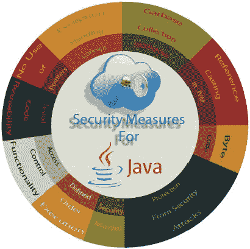

安全是一个重要方面，Java 的安全模型是关键架构特性之一，使其成为在开发企业级应用时最可靠的选择。当软件跨越网络下载并在本地执行时，安全性变得至关重要，Java 轻松地缓解与项目或应用程序相关的安全漏洞。不相信？来看看几个展示 Java 平台安全性的论（安全措施/特性）。

## Java 的安全模型

Java 的安全模型旨在通过“沙箱”帮助用户免受从网络下载的恶意程序的侵害。它允许所有 Java 程序仅在沙箱内运行，并防止许多不可信资源的活动，包括读写本地磁盘、创建新进程或加载任何动态库。

## 不使用指针

C/C++ 语言使用指针，这可能导致其他程序获取未经授权的内存访问。与 C/C++ 语言不同，Java 从不使用任何指针。Java 有自己的内部内存管理机制。只有在获得适当授权的情况下才会访问数据。

## 异常处理概念

异常处理概念使 Java 捕获一系列错误，帮助开发者消除系统崩溃的风险。

## 定义执行顺序

所有基本类型都有预定义的大小，且所有操作都按特定的执行顺序定义。因此，在不同的 Java 虚拟机中执行的代码顺序不会不同。

## 字节码是另一个让 Java 更安全的因素

每当用户编译 Java 程序时，Java 编译器都会创建一个带有字节码的类文件，JVM 在程序执行时会对病毒和其他恶意文件进行测试。

## 经过测试的代码重用性

Java 对象封装为“契约编程”的概念提供了支持。这允许开发者在开发 Java 企业级应用时重用已经测试过的代码。

## 访问控制功能

Java 对对象内部变量和方法的访问控制功能提供了安全保障，防止不可信代码访问关键对象。

## 防止受安全攻击

它允许开发者将类或方法声明为 `FINAL`。我们都知道任何声明为 `final` 的类或方法都不能被重写，这帮助开发者保护代码不受创建子类并替换原始类且重写方法的安全攻击。

## JVM 中的类型安全引用转换

每当你使用对象引用时，`JVM` 都会对你进行监控。如果你尝试将引用强制转换为不同的类型，它将使该转换无效。

除了所有这些点之外，结构化错误处理通过帮助增强程序的健壮性，为 `Java` 的安全模型做出了巨大贡献。上述论点充分证明，与其他编程语言相比，用 `Java` 开发的项目更加安全。然而，在开发企业级 `Java` 应用时，遵循一些最佳实践是开发者的责任。

## 不要错过！

点击下方按钮，您就可以订阅，每当 `Harry. H. Chaudhary.` 出版新书时您都会收到电子邮件。无需费用，也无任何义务。


[`books2read.com/r/B-A-XWV-TBLD`](https://books2read.com/r/B-A-XWV-TBLD)


将独立的读者与独立的作者连接起来。

### Harry. H. Chaudhary. 的其他著作

- [Core Java：极不急躁者的完整指南](https://www.draft2digital.com/catalog/60212)
- [Core Java Professional：高级特性（核心系列）更新至 Java 8](https://www.draft2digital.com/catalog/60230)
- [Core Java Professional：针对初学者的](https://www.draft2digital.com/catalog/60204)
- [Core Java Professional：针对极不急躁者的](https://www.draft2digital.com/catalog/60224)
- [Core Java Professional：深思熟虑后编码，完整的 Java 编程指南](https://www.draft2digital.com/catalog/60229)
- [Java：极不急躁者的初学者完整参考指南](https://www.draft2digital.com/catalog/60223)
- [Java：完整的 Java 编程指南](https://www.draft2digital.com/catalog/60210)
- [Java：极不急躁者的完整指南](https://www.draft2digital.com/catalog/60215)
- [Java：趣味学习完整的 Java 编程](https://www.draft2digital.com/catalog/60209)
- [Java：按照你大脑的工作方式学习](https://www.draft2digital.com/catalog/60207)
- [Java：极不急躁者的完整核心指南](https://www.draft2digital.com/catalog/60221)
- [Java：完整参考指南](https://www.draft2digital.com/catalog/60206)
- [数据结构与算法：易于上手](https://www.draft2digital.com/catalog/62076)


- [JAVA 面试字典 - || 2000+ 面试题、概念、问题、分析、解决方案](https://www.draft2digital.com/catalog/62077)

- [软件工程实战 1000+ 多选题测试系列](https://www.draft2digital.com/catalog/364498)
