# JavaFX 8 逐步步进卷 1 Java 8 图像查看器

- *作者简介*
- 前言
    - 本书的组织结构
    - 为什么选择这本书
    - 本书所需的准备

# 作者简介

郭淑 Shufen

郭淑于 1988 年搬到旧金山，自那时起致力于 GUI 开发。她在 2001 年开始使用 Java 编写程序。她在 2012 年在华盛顿大学获得计算机科学硕士学位。目前她正在使用 JavaFX 编写应用程序。JavaFX 的精髓启发了她编写了大量的 GUI 工具。

黄冰 Bing-Chao Huang

黄冰在 1977 年在华盛顿大学获得计算机科学博士学位。他在 1984 年在斯坦福大学获得计算机科学硕士学位。自那时起，他一直在深入研究 JavaFX 并编写了大量教程。郭淑在 1987 年在华盛顿大学获得计算机科学硕士学位。自那时起她一直在使用 JavaFX 开发丰富的 GUI 应用程序。

# 致谢

特别感谢：

陈博士及其家人，
我的姐夫陈杰博士，
我的妹妹陈淑博士，
我的两只猫 Mimi 和 Maomao。

——郭淑

## 前言

### 本书的组织结构

本书是《JavaFX 循序渐构建图形工具包》系列书籍的第一卷。由于内容丰富，无法在一本书中管理，因此章节按卷组织如下：

#### 其他……

每章末尾都有一个实用的总结；它列出了该章介绍的 JavaFX 库的关键方面。它帮助你学习本系列书中涉及的 JavaFX 基础知识。以下是一些其他要点：

- `javafx.scene.shape` 包中的 `Shape` 类，用于 2D 几何原型。
- FXML，一种符合 XML（可扩展标记语言）格式的标记语言，用于构建 GUI。
- 属性和绑定机制。
- `Image` 类和 `ImageView` 类，用于加载和显示图像。
- `javafx.concurrent` 包中的并发能力。
- 应用于幻灯片功能中图像对象的 `FadeTransition` 和 `ParallelTransition`。
- `javafx.scene.layout` 包中的内置布局面板。
- 以及更多……

#### 带有应用和完整源码的可重用类

本系列书籍包含了一组带有可重用类以及可嵌入 JavaFX 应用程序的包的完整源代码。

下表列出了本书系列前四卷中提供的所有源代码：

##### 绘制工具

| 包名 | 源代码文件名 |
| --- | --- |
| drawtool | `ShapeDrawer.java`<br>`DrawPane.java` |
| drawtool.drawer | `BezierCurvedDrawer.java`<br>`CircleDrawer.java`<br>`EllipseDrawer.java`<br>`LineDrawer.java`<br>`PathDrawer.java`<br>`PolygonDrawer.java`<br>`PolylineDrawer.java`<br>`RectangleDrawer.java`<br>`RegularPolygonDrawer.java`<br>`RubberBander.java`<br>`ShapeMover.java` |
| drawtool.shape | `RegularPolygon.java` |
| drawtool.io | `DrawClipper.java`<br>`DrawLoader.java`<br>`DrawWriter.java` |

##### 图形应用

| 包名 | 源代码文件名 |
| --- | --- |
| imageviewer | `FileUtils.java`<br>`ImageView.java`<br>`SlideshowService.java` |
| jfxdrawtools | `JFXDrawTools.java` |

让我们浏览第一卷的内容：

**图 1.** JavaFX 8 的快照。

### 为什么选择这本书

本书适用于希望使用 JavaFX 开发丰富功能应用程序的开发者。书中通过由浅入深的图解展示了 JavaFX 的重要特性。

如果你是以下人员，本书非常适合你：

- Java GUI 程序员，初学者或专业人士。
- 具备 JavaFX 基础知识并想学习开发交互式 Java 工具。
- 对 JavaFX 应用感兴趣的软件工程师。

### 本书所需的环境

如果你想编译和运行应用程序，需要下载 <http://www.oracle.com/java/javase/index.html>。

1. 安装 `JDK 8`。
2. 使用 `JavaFX 8`。
3. `JavaFX 8` 是 Java SE 开发包（`JDK 8`）的一部分。

### JavaFX 历史

现在让我们回顾 JavaFX 的演进时间线：

- SeeBeyond Technology 的 Chris Oliver 开发了一种名为 F3 的脚本语言，它是“形式跟随功能”（Form Follows Function）的缩写；它允许开发者访问 Swing 类并创建图形界面（GUI），用于快速开发互联网应用程序。
- Sun Microsystems 在 2005 年 9 月收购了 SeeBeyond，F3 在 2007 年 5 月更名为 `JavaFX Script`。
- 2008 年 12 月，`JavaFX 1.0` 发布，开发者依靠 `JavaFX Script` 开发应用程序，直到三年后 `JavaFX 2.0` 发布。
- 2010 年 1 月，Oracle 完成对 Sun Microsystems 的收购并继续维护 JavaFX。
- 2010 年 9 月 JavaOne 大会上，Oracle 宣布停止 `JavaFX Script`。
- 2011 年 10 月，`JavaFX 2.0` 发布，开发者开始使用标准 Java 语言而非 `JavaFX Script` 来访问 JavaFX 库 API。然而，编译和运行使用 `JavaFX 2.0` 的应用程序除了 Java SE JDK 和 JRE 之外，还需要安装 `JavaFX SDK` 和 `JavaFX Runtime`。
- 2013 年 2 月，`JavaFX 2.2.7` 发布，`JavaFX SDK` 和 `JavaFX Runtime` 包含在 `JDK/JRE 7` 中。JavaFX 与 JDK 的集成为 JavaFX 开发者带来了极大便利。使用 `JDK 7` 及更高版本编译的 JavaFX 应用程序不再需要额外安装。
- 2014 年 3 月 18 日，`JavaFX 8` 作为 Java™ SE 开发包（`JDK 8`）的一部分发布，这是一个重大版本更新。

# 前提条件

本书介绍的 JavaFX 使用 Java 包中提供的 API 来构建图形用户界面（GUI）。虽然不要求熟悉 Swing 包，但读者必须熟悉 Java 编程语言的基础知识。如果你是 Java 初学者，请访问此网站 <http://docs.oracle.com/javase/tutorial/index.html> 获取 Java 技术的初步知识。请按照以下顺序阅读 Oracle Java 在线文档：

1. 从简单的 Java 应用程序“Hello World!”入门与安装：
   访问 <http://docs.oracle.com/javase/tutorial/getStarted/index.html>
2. Java 编程语言的概念和特性：
   访问 <http://docs.oracle.com/javase/tutorial/java/index.html>
3. Java 集合框架：
   访问 <http://docs.oracle.com/javase/tutorial/collections/index.html>
4. 核心 Java 类：
   访问 <http://docs.oracle.com/javase/tutorial/essential/index.html>

# JavaFX 概览

以下示例旨在为 JavaFX 初学者准备的，以便他们快速预览如何创建一个 JavaFX 应用程序。

要开始，请创建一个扩展 `javafx.application.Application` 的类（这是 JavaFX 应用程序的入口），并重写抽象但被重写的 `start` 方法。一个典型的 `start` 方法如下：

```java
package imageviewer;

import javafx.application.Application;
import javafx.scene.Scene;
import javafx.scene.layout.BorderPane;
import javafx.scene.layout.StackPane;
import javafx.stage.Stage;

/**
 * File Name: ImageViewer.java
 * @author Shufen Kuo
 */

public class ImageViewer extends Application {

    @Override
    public void start(Stage stage) {
        BorderPane rootPane = new BorderPane();
        StackPane imageArea = new StackPane();
        rootPane.getChildren().add(imageArea);

        Scene scene = new Scene(rootPane, 600, 400);
        stage.setTitle("ImageView V1.0");
        stage.setScene(scene);
        stage.show();
    }

    public static void main(String[] args) {
        launch(args);
    }
}
```

# 场景与阶段

在 `start` 方法中有两个重要的类：`Scene` 和 `Stage`。通常，主要任务是创建在称为场景图（scene graph）的层级树结构中管理的图形用户界面（GUI），将场景图的根节点与 `Scene` 对象关联，然后将场景放置在 `Stage` 对象上。`Stage` 代表 JavaFX 应用程序的顶层容器，作为场景图的窗口，与应用程序用户进行交互。

接下来的快照让你对我们将构建的 Java 应用程序的 GUI 样式有一个初步了解：

**图 1.** JavaFX 应用程序的快照。

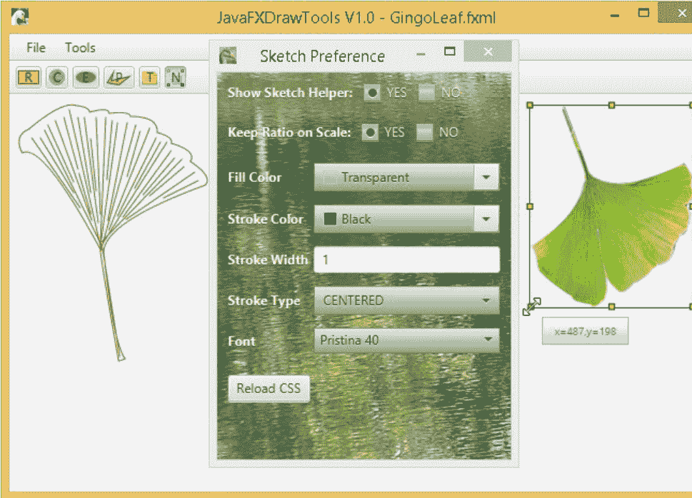

# 节点

JavaFX 引入了一个基础类 `javafx.scene.Node`，它继承自 `java.lang.Object` 并提供了对所有用户界面都有用的常用属性和方法。我们经常使用“节点”一词来指代 GUI。

场景图可能包含各种节点。节点可以是父节点（有子节点的节点）或叶子节点（没有子节点的节点）；每个节点可以有一个父节点，而根节点没有父节点。场景图中的所有节点都派自 `javafx.scene.Node` 类。

为了快速掌握场景图中节点类型的要点，我们将根据是否可以添加子节点来区分它们。

- 你可以向这些节点添加子节点：

  以下类经常被用作父节点：`Group`、`Pane` 以及内置布局面板（是 `Pane` 的子类）。通常，你调用 `getChildren()` 方法来获取类型为 `ObservableList<Node>` 的列表（它是 `java.util.List` 的子接口），然后使用 Java 开发者熟悉的在 `Collection` 接口中定义的 set 工具类来操作列表的内容。

- 你不能向这些节点添加子节点：

  以下类始终被用作叶子节点：`Canvas`、`ImageView`、`MediaView` 以及 `Shape` 的所有直接子类，如 `Rectangle`、`Circle`、`Ellipse` 等。

# JavaFX 与 Swing

现在，这里有一个有趣的问题。多年来，Java 开发者一直使用 Swing API（Java 基础类 JFC 的 GUI 组件）来构建 Java 应用程序的 GUI，为什么我们除了 Swing 之外还需要 JavaFX 呢？

如果你有很多用 Swing 编写遗留代码并希望将 JavaFX 特性整合到 Swing 代码中，`JDK 8` 提供了机制；反之，你可以在 JavaFX 应用程序中包含 Swing 组件。

本书未涵盖 JavaFX-Swing 互操作性（Interoperability）主题。如果你对该主题感兴趣，请访问 Oracle 在线文档“JavaFX: Interoperability — JavaFX-Swing Interoperability”：

<http://docs.oracle.com/javase/8/javafx/interoperability-tutorial/fx_swing.htm>

JavaFX 是下一代 Java GUI。为了说明使用 JavaFX 能力的优势，除了 JavaFX 和 Swing 之间的互操作性外，我们在下面的章节中介绍了 JavaFX 的重要特性。

# JavaFX 的精髓

JavaFX 不仅允许你快速创建具有视觉用户界面的应用程序，还包含吸引且独特的能力。它们列举如下：

## 内置布局面板

JavaFX 布局面板是自动执行节点放置的容器。在场景图中使用布局面板的主要优势是布局算法会计算每个节点的大小和位置。`javafx.scene.layout` 中有 8 种类型的布局面板：

- `BorderPane`：将节点放在顶部、底部、左、右和中心。
- `HBox`：将节点放置在一行中（水平）。
- `VBox`：将节点放置在一列中（垂直）。
- `GridPane`：在多行列网格中放置节点。
- `StackPane`：将所有节点堆叠在一起，默认在容器对齐。
- `FlowPane`：你可以指定 `FlowPane` 的方向属性。对于水平 `FlowPane`，节点从左到右排列，在宽度边界换行；对于垂直 `FlowPane`，节点从上到下排列，在高度边界换列。
- `TilePane`：类似于 `FlowPane`，但网格中的每个单元大小相同。
- `AnchorPane`：相对于指定的锚点放置节点，有 `topAnchor`、`rightAnchor`、`bottomAnchor` 和 `leftAnchor`。

> 参考 Oracle 在线文档“Working with Layouts”
>
> <http://docs.oracle.com/javase/8/javafx/layout-tutorial/index.html>

## 使用 CSS 自定义

JavaFX 允许使用 CSS 来描述应用程序用户界面的样式。使用 CSS 定义显示属性（如颜色、字体、间距、宽度、高度、线条、背景图像等）在许多方面为应用程序提供了便利：

- 软件提供者的自定义：从同一组代码编译的应用程序可以采用各种样式，以满足不同的客户需求。
- 应用程序用户的自定义：即使在软件发布后，如果应用程序用户对界面外观有偏好，也可以在客户现场修改 CSS 文件中定义的显示属性。
- 样式设计者的利益：应用程序代码与样式定义的分离提高了代码的可读性，并让图形设计师专注于处理 CSS，简化了任务。
- 软件开发者的利益：在测试过程中，开发者可能会频繁更改 CSS 文件中定义的样式以评估各种 GUI。如果每次更改都需要退出并重启应用程序，将是一项非常痛苦的任务。为了方便这种评估过程，最佳策略是设计一个临时加载按钮，每当样式发生变化时，点击按钮重新加载 CSS，从而节省大量的测试时间。

参考 Oracle 在线文档“使用 CSS 为 JavaFX 应用程序皮肤”：

<http://docs.oracle.com/javase/8/javafx/user-interface-tutorial/css_tutorial.htm>

## 使用 FXML 创建用户界面

FXML 是一种标记语言，它与 XML（可扩展标记语言）格式一致，但带有额外的规则，用于创建 JavaFX 应用程序的用户界面。考虑到手动编写 FXML 容易出错，一种可行的方法是通过 GUI 构建器生成 FXML 代码。

将应用程序的 GUI（视图）与其业务逻辑（模型）分离来被认为是一种良好的编程实践。FXML 文件表示视图，而控制器（controller）是一个在视图和模型之间传递信息的 Java 类。使用 FXML 构建 GUI 使得应用程序开发者能够有效地采用 MVC（模型-视图-控制器）架构。

参考 Oracle 在线文档“JavaFX：精通 FXML”：

<http://docs.oracle.com/javase/8/javafx/fxml-tutorial/index.html>

## 属性与绑定的强大能力

JavaFX 中引入的属性（Properties）概念遵循了 JavaBeans 组件中引入的设计规范，它与绑定（Binding）机制结合良好，为各种编程需求提供了强大、流畅且简洁的解决方案。

在系列书籍介绍的 JFXDrawTools 应用程序中，我们演示了属性和绑定的用法。在属性窗口（Properties Window）的实现中，使用了合适的 UI 控件（如文本字段、选择框、组合框等来查看相关对象的属性。绑定机制用于将 UI 控件与其对象的属性进行双向链接，当用户更改 UI 控件中显示的数据时，更改会立即反映在相关对象的属性上。

参考 Oracle 在线文档“JavaFX：属性与绑定教程”：

<http://docs.oracle.com/javase/8/javafx/properties-binding-tutorial/index.html>

## 变换与过渡的复杂机制

JavaFX 内置的节点变换（transforms）能力对于开发图形编辑器、绘图工具、图像查看器、GUI 构建器等图形包非常方便。

以下是处理变换的类：`Translate`（移动）、`Rotate`（旋转）、`Scale`（缩放）和 `Shear`（倾斜）。它们都继承自 `Transform` 类并位于 `javafx.scene.transform` 包中。


# JavaFX 动画、图形与核心功能

## JavaFX 动画

JavaFX 为创建动画提供了简洁的方法。动画功能有很多应用场景，例如：在警报情况下引起注意、在删除操作期间将对象移入回收桶、在数据加载期间指示中间状态等等……

在本系列介绍的 ImageViewer 应用程序中，我们将 `FadeTransition`（淡入过渡）和 `ParallelTransition`（并行过渡）应用于图像对象，在幻灯片功能中同时淡化新图像。

以下是处理过渡的类：`FadeTransition`、`RotateTransition`、`ScaleTransition`、`TranslateTransition`、`FillTransition`（填充过渡）、`StrokeTransition`（描边过渡）、`PathTransition`（路径过渡）、`ParallelTransition`、`SequentialTransition`（顺序过渡）、`PauseTransition`（暂停过渡）。它们都继承自 `Transform` 类（一个定义了动画基本功能的抽象类），并位于 `javafx.animation` 包。

参考 Oracle 文档“JavaFX：变换、动画和视觉效果”：

<http://docs.oracle.com/javafx/8/javafx/visual-effects-tutorial/index.html>

## 2D 几何图形与文本都是 JavaFX 节点

JavaFX 提供了一个 `Shape` 类，它继承自 `javafx.scene.Node` 类，是 2D 几何基本形状的父类。在几何图形上施加面向对象的概念有助于图形应用程序的开发。

以下是派自 `Shape` 类的类：`Arc`（弧）、`Circle`（圆）、`CubicCurve`（三次曲线）、`Ellipse`（椭圆）、`Line`（线段）、`Path`（路径）、`Polygon`（多边形）、`Polyline`（折线）、`QuadCurve`（二次曲线）、`SVGPath`、`Text`（文本）。除了 `Text` 类外，其他类都位于 `javafx.scene.shape` 包。

请注意，位于 `javafx.scene.text` 包的 `Text` 类也被视为形状，用于开发文本绘制工具。Java 节点的所有通用特征都可以应用于文本对象。你可以像处理任何几何图形一样处理它。文本对象可以放置在布局面板中以利用自动布局能力、应用变换和过渡，并使用 CSS 自定义呈现样式等。

参考 Oracle 文档“在 JavaFX 中使用文本”：

<http://docs.oracle.com/javafx/8/javafx/user-interface-tutorial/text-settings.htm>

## 其他处理许多复杂问题以缩短开发时间的显著功能

### 用于加载和显示图像的 ImageView 类

继承自 `javafx.scene.Node` 的 `ImageView` 类与 `Image` 类配合使用，用于加载和显示图像。JavaFX 还提供了对位图图像执行操作的 API，`PixelReader` 定义了从 `Image` 对象读取像素的接口方法，而 `PixelWriter` 定义了向 `Image` 对象写入像素的方法。所有这些都位于 `javafx.scene.image` 包中。

参考 Oracle 文档“使用 Image Ops API”：

<http://docs.oracle.com/javase/8/javafx/graphics-tutorial/image_ops.htm>

### 用于管理网页的 WebView 类

JavaFX 架构中嵌入了一个网络引擎，并提供了一系列位于 `javafx.scene.web` 包的 API，用于开发具有浏览器功能的应用程序。要查看页面，你需要创建一个继承自 `javafx.scene.Parent` 并继承节点所有特征的 `WebView` 对象，然后获取与它关联的 `WebEngine`。`WebEngine` 提供了操纵网页的相关方法，例如：通过给定的 url 或页面内容加载/显示网页、访问由 `WebEngine` 为加载的网页创建的文档对象模型 (DOM)、处理来自 JavaScript 的各种事件等等……

参考 Oracle 文档“在 JavaFX 应用程序中添加 HTML 内容”：

<http://docs.oracle.com/javase/8/javafx/embedded-browser-tutorial/index.html>

### 用于编辑 HTML 页面的 HTMLEditor

对 HTML 编辑的完整支持来自 `HTMLEditor`，它继承自 `javafx.scene.control.Control`，位于 `javafx.scene.web` 包。要将 `HTMLEditor` 嵌入到 JavaFX 应用程序中，只需创建 `HTMLEditor` 实例并将其添加到场景图中，它就可以与用户交互。以下两个方法用于获取和设置编辑器的 HTML 内容：`getHTML()`、`setText(java.lang.String)`。

与类似的控件 `TextArea` 处理多行纯文本不同，`HTMLEditor` 处理符合 HTML 语法的文本。

HTML 编辑器的用法在软件领域广泛需要，例如博客撰写文章（内容管理系统）、电子邮件系统编写消息（消息系统）、在线卖家准备产品描述进行列表（电子商务管理系统）……

参考 Oracle 文档“JavaFX UI 组件：HTML 编辑器”：

<http://docs.oracle.com/javase/8/javafx/user-interface-tutorial/editor.html>

### 用于渲染数据的图表组件

以下类位于 `javafx.scene.chart` 包，用于绘制各种图表：

- `AreaChart`（面积图）、`StackedAreaChart`（堆叠面积图）
- `BarChart`（柱状图）、`StackedBarChart`（堆叠柱状图）
- `BubbleChart`（气泡图）
- `LineChart`（折线图）
- `PieChart`（饼图）
- `ScatterChart`（散点图）

`Chart` 类是所有图表组件的基类，继承自 `javafx.scene.layout.Region` 类，因此继承了来自 `javafx.scene.Node` 的所有可用特征。

参考 Oracle 在线文档“JavaFX UI 组件：使用 JavaFX”：

<http://docs.oracle.com/javase/8/javafx/user-interface-tutorial/charts.htm>

## 用于播放媒体的 MediaView 类

继承自 `javafx.scene.Node` 的 `MediaView` 类与 `MediaPlayer` 和 `Media` 类配合使用，在你的 JavaFX 应用程序中播放媒体。所有媒体相关的类位于 `javafx.scene.media` 包。

参考 Oracle 在线文档“在 JavaFX 应用程序中整合媒体资产”：

<http://docs.oracle.com/javase/8/javafx/media-tutorial/>

# JavaFX 基础 UI 组件

除了上述描述的 JavaFX 核心之外，JavaFX 还提供了基础 UI 组件，它们位于 `javafx.scene.control` 包中，并派自 `javafx.scene.control.Control` 类；它们通常被称为 UI 控件。

以下是可用 UI 控件，未标记星号 (*) 的控件在 Swing 中有对应的实现物：

- `Label`（标签）、`Button`（按钮）、`RadioButton`（单选按钮）、`ToggleButton`（切换按钮）
- `CheckBox`（复选框）、`ChoiceBox`（选择框）
- `ComboBox`（组合框）、`ListView`（列表视图）、`TableView`（表格视图）
- `TextField`（文本字段）、`TextArea`（文本区域）、`PasswordField`（密码字段）、`HTMLEditor`(*)
- `ScrollBar`（滚动条）、`ScrollPane`（滚动面板）、`Slider`（滑动条）、`ProgressBar`（进度条）、`ProgressIndicator`（进度指示器*）、`Toolbar`（工具栏）
- `MenuBar`（菜单栏）、`MenuButton`（菜单按钮）、`SplitMenuItem`（分割菜单项）
- `ColorPicker`（颜色选择器）、`DatePicker`（日期选择器*）、`Separator`（分隔符）、`Pagination`（分页器*）、`SplitPane`（分割面板）
- `TabPane`（选项卡面板）、`TitledPane`（标题面板*）、`Accordion`（手风琴组件*）、`TreeView`（树视图）、`TreeTableView`（树表格*）、`Hyperlink`（超链接*）

以下 UI 组件通常与上述 UI 控件属于同一类别。

### Tooltip（工具提示）

位于 `javafx.scene.control` 包，但派自 `javafx.scene.control.PopupControl` 类。

### MenuItem（菜单项）、Menu（菜单）、CheckMenuItem（复选菜单项）、RadioMenuItem（单选菜单项）

位于 `javafx.scene.control` 包。`MenuItem` 派自 `java.lang.Object` 是另外三者的基类。

### FileChooser（文件选择器）

位于 `javafx.stage` 包并派自 `java.lang.Object`。

# 第 1 章 基础图像查看器 —— 开发图像查看器 V1.0

## 前言

在本章中，我们将通过分步开发一个图像查看器应用程序（ImageViewer V1.0）来演示 JavaFX API 的用法。通过从 ImageViewer V1.0 中提取的详细描述和文档良好的代码示例，你将熟悉“总结”部分中所述的 JavaFX 库的基础功能。

- 1.1 创建 `Application` 的子类 `ImageViewer` 类
  - 1.1.1 JavaFX 线程与 Java 启动线程
  - 1.1.2 捕获图像渲染区域的调整事件
- 1.2 创建菜单栏
  - 1.2.1 向菜单栏添加文件菜单
  - 1.2.2 从文件打开对话框选择图像文件并在 `StackPane` 上显示图像
- 1.3 创建选项菜单和子菜单
  - 1.3.1 创建 `ToggleGroup`（切换组）、单选菜单项并为选中的 `selectedToggleProperty` 添加监听器
- 1.4 实现自适应宽度、自适应高度和原始尺寸查看选项
  - 1.4.1 方法一：分别将 `ImageView` 的 `fitWidth`/`fitHeight` 属性绑定到 `Scene` 的 `width`/`height` 属性上
    - 1.4.1.1 实现自适应宽度查看选项
    - 1.4.1.2 实现自适应高度查看选项
    - 1.4.1.3 实现原始尺寸查看选项
    - 1.4.1.4 实现 `ImageViewer` 类的源码
  - 1.4.2 方法二：更改 `fitWidth` 属性和 `fitHeight` 属性的值
    - 1.4.2.1 捕获 `Scene` 的调整事件以调整图像的显示大小
    - 1.4.2.2 完成 `ImageViewer` 类的源码

## 1.1 创建 Application 的子类 ImageViewer 类

JavaFX 应用程序的图形界面在分级树结构中管理，称为场景图。在 ImageViewer 应用程序中，我们使用 `BorderPane` 作为场景图的根节点，并将 `StackPane` 放在 `BorderPane` 的中心作为图像渲染区域。`BorderPane` 和 `StackPane` 都是内置布局面板，位于 `javafx.scene.layout` 包中，并是 `javafx.scene.layout.Pane` 类的直接子类。

`BorderPane` 类允许你创建具有经典外观和主布局方式的图形用户界面。在下一节中，你将看到 `BorderPane` 顶部的菜单栏，稍后会在底部状态栏。

`StackPane` 将其子元素堆叠布局，将后一个子元素放置在前一个元素之上。在 ImageViewer 应用程序中，由于一次只查看一张图像，因此 `StackPane` 只有一个子元素。如果图像的大小小于 `StackPane` 的大小，则图像被放置在 `StackPane` 的中心。如果图像的大小大于 `StackPane`，则 `StackPane` 将自动扩展以容纳整个图像，如果应用程序窗口中的查看空间不够，默认只能看到图像的中心部分。稍后我们在这里演示如何避免 `StackPane` 被内容重新调整大小。

`Scene` 对象根据给定参数被创建为场景图的容器。在 ImageViewer 应用程序中，根节点是 `BorderPane`，`Scene` 的初始宽度和高度设置为 600 像素和 400 像素。`BorderPane` 和 `StackPane` 都是可调整大小的布局面板；因此，如果用户动态调整应用程序窗口的大小，场景将调整大小并将调整事件传递给其根节点，相应地重新计算图像渲染的大小。

使用 `Stage` 类中定义的 `setScene()` 方法将场景置于 `Stage` 上以使其运行。`Stage` 是 `javafx.stage.Window` 的直接子类；它是 JavaFX 应用程序的顶层窗口。

JavaFX 系统会创建一个 `Stage` 对象（称为主阶段 primary stage），并传递给 `start()` 方法，这是 `Application` 类中定义的抽象方法。开发者可以根据需要为应用程序构建额外的 `Stage` 对象。

以下代码演示了如何创建 `ImageViewer` 类：

```java
package imageviewer;

import javafx.application.Application;
import javafx.scene.Scene;
import javafx.scene.layout.BorderPane;
import javafx.scene.layout.StackPane;
import javafx.stage.Stage;

/**
 * ImageViewer 应用程序 - V1.0
 */
public class ImageViewer extends Application {

    @Override
    public void start(Stage stage) {
        BorderPane rootPane = new BorderPane();
        StackPane imageArea = new StackPane();
        rootPane.setCenter(imageArea);

        Scene scene = new Scene(rootPane, 600, 400);
        stage.setTitle("ImageViewer V1.0");
        stage.setScene(scene);
        stage.show();
    }

    public static void main(String[] args) {
        launch(args);
    }
}
```

### 1.1.1 JavaFX 线程与 Java 启动线程

`Application` 类是 JavaFX 的入口点。它定义了以下重要方法：

```java
public void init() throws Exception;
public abstract void start(Stage primaryStage) throws Exception;
public void stop() throws Exception;
```

`init()` 方法不执行操作，从 Java 线程调用。而 `start()` 方法是抽象的且必须重写，它在 `init()` 方法返回后从 JavaFX 线程调用。如果你需要在 `start()` 方法之前执行一些工作，可以通过重写 `init()` 方法来实现；但至关重要的是，场景成员的节点必须从 JavaFX 线程访问。此外，`Scene` 对象或 `Stage` 对象的构造也必须从 JavaFX 线程访问。

### 1.1.2 捕获图像渲染区域的调整事件

出于调试和测试目的，我们在此注册了一个 `ChangeListener`，每当用户调整应用程序窗口导致图像区域的宽度或高度发生变化时，就会通知提供的 `changed()` 方法。

要注册 `ChangeListener` 来观察属性值的变化，我们使用此方法：

```java
void addListener(ChangeListener<? super T> listener);
```

该方法定义在 `javafx.beans.value.ObservableValue` 接口中，提供了 `changed(ObservableValue<? extends T> observable, oldValue, T newValue)` 方法实现，当此属性的值发生变化时调用。

同一个 `ChangeListener` 允许注册到多个 `ObservableValue`。为了避免内存泄漏，当值不再需要时，使用 `removeListener(ChangeListener<? super T> listener)` 方法取消监听器是一种良好的编程习惯，该方法会移除可观测值与监听器之间的链接。

`StackPane` 从 `javafx.scene.layout.Region` 类继承了宽度和高度属性。这两个属性的类型都是 `ReadOnlyProperty`，它是一个实现 `ObservableValue` 的抽象类。正如名称所示，`ObservableValue` 持有一个可观察的值，你可以监听值的变化并根据需要采取行动。

以下代码演示了如何处理图像渲染区域的调整事件，该 `StackPane` 位于 `BorderPane` 的中心。

导入语句：

```java
import javafx.beans.value.ChangeListener;
import javafx.beans.value.ObservableValue;
```

列表 1-2. 为图像渲染区域的宽度和高度属性添加监听器：


```java
imageArea.widthProperty().addListener(new ChangeListener<Object>(){
    public void changed(ObservableValue o, Object oldVal,
        Object newVal) {
        System.out.format("imageArea width changed from %f to %f%n",
            oldVal, newVal);
    }
});
```

```java
imageArea.heightProperty().addListener(new ChangeListener<Object>() {
    public void changed(ObservableValue o, Object oldVal, 
        Object newVal) {
        System.out.format("imageArea height changed from %.1f to %.1f%n",
            oldVal, newVal);
    }
});
```

## 列表 1-3. ImageViewer 类的完整源代码如下：

```java
package javafx.application;

import javafx.application.Application;
import javafx.beans.value.ChangeListener;
import javafx.beans.value.ObservableValue;
import javafx.scene.Scene;
import javafx.scene.layout.BorderPane;
import javafx.scene.layout.StackPane;
import javafx.stage.Stage;

/**
 * 文件名: ImageViewer.java
 * (位于目录: `ImageViewer1.0/src/example1/imageviewer/`)
 * 此应用程序创建一个 BorderPane 作为场景的根节点，
 * 在 BorderPane 的中心添加一个 StackPane
 * 场景的初始大小设置为 600 x 400
 * StackPane 的大小将自动设置为以适应场景的大小
 * 当用户调整窗口大小时，StackPane 将会被调整大小
 *
 * @author Shufen Kuo
 */

public class ImageViewer extends Application {

    @Override
    public void start(Stage stage) {
        BorderPane rootPane = new BorderPane();
        StackPane imageArea = new StackPane();
        rootPane.setCenter(imageArea);

        Scene scene = new Scene(rootPane, 600, 400);

        imageArea.widthProperty().addListener(new ChangeListener<Object>() {
            public void changed(ObservableValue o, Object oldVal, 
                Object newVal) {
                System.out.format("imageArea width changed from %.1f to %.1f%n",
                    oldVal, newVal);
            }
        });
        imageArea.heightProperty().addListener(new ChangeListener<Object>() {
            public void changed(ObservableValue o, Object oldVal, 
                Object newVal) {
                System.out.format("imageArea height changed from %.1f to %.1f%n",
                    oldVal, newVal);
            }
        });
    }
    stage.setTitle("ImageViewer V1.0");
    stage.setScene(scene);
    stage.show();

    public static void main(String[] args) {
        launch(args);
    }
}
```

图 **1-1. ImageViewer V1.0 初始外观的快照**

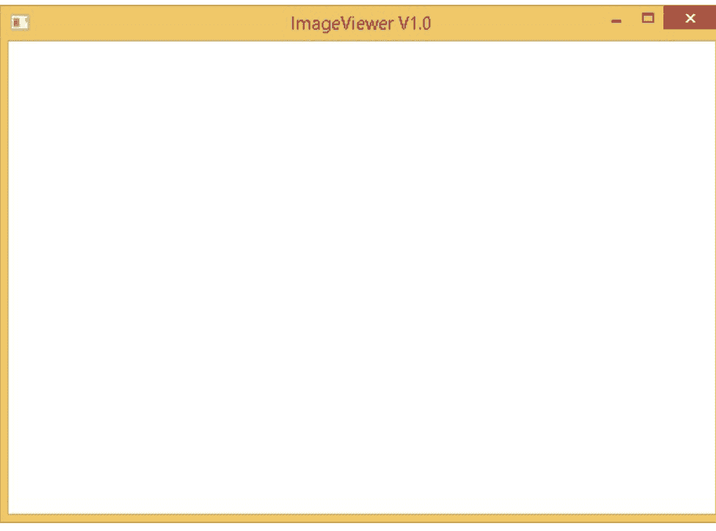

编译并运行应用程序。

**在命令行中编译和运行 ImageViewer 的输出：**

Microsoft Windows [Version 6.3.9600]

(c) 2013 Microsoft Corporation. All rights reserved.

```
F:\My Documents\DocRoot\SHUFEN_JAVA\MyBookJFX\VolumeOne\ImageViewer1.0\src\
imageviewer.java -encoding utf-8 -lint:unchecked
java -cp imageviewer.jar imageviewer
imageArea width changed from 0.0 to 600.0
imageArea height changed from 0.0 to 400.0
```

现在，通过拖动应用程序的边缘或角来更改场景的大小，你将看到如下输出：

```
imageArea width changed from 600.0 to 437.0
imageArea height changed from 400.0 to 263.0
imageArea width changed from 437.0 to 336.0
imageArea height changed from 263.0 to 384.0
imageArea width changed from 336.0 to 587.0
imageArea height changed from 384.0 to 448.0
```

## 1.2 创建菜单

在本节中，我们正在创建一个菜单（`Menu`），并将其添加到场景根节点 `BorderPane` 的顶部。通常，`Menu` 对象是水平布局的，并且每个 `Menu` 包含多个菜单项（`MenuItem`）。由于 `Menu` 类继承自 `MenuItem`，你可以在 `Menu` 内部放置另一个 `Menu`，嵌套的那个称为子菜单（`submenu`）。由于 `Menu` 是渲染在窗口上的，用户只会看到菜单名称，除非点击鼠标左键或定义助记键组合作为菜单的快捷键，否则每个菜单的内容都是隐藏的。

使用菜单界面的优点包括：

- 占用空间更少：当用户不需要菜单时，菜单仅占用其名称的空间。
- 可组织性：为了方便访问，你可以根据功能对菜单项进行结构化组织，避免子菜单导致拥挤，并将最频繁请求的项目放置在树的上层级中。
- 通过按键调用动作：你可以使用助记机制在 `MenuBar` 中导航菜单，并允许用户通过按键调用 `MenuItem` 的动作。

```java
imageView.setImage(image);
}
});
```

请记住将变量 `stage` 声明为 `final`，因为它在内部类（Load 菜单的匿名 `EventHandler` 类）中被访问。

现在，我们需要处理关于图像渲染区域 `StackPane` 可调整大小的重要事项。为了在显示较大的图像时避免 `StackPane` 放大，我们需要为 `StackPane` 设置最小尺寸。以下是实现该操作的代码：

```java
imageArea.setMinSize(0, 0);
```

如果不添加上述行代码，当加载大于当前 `StackPane` 大小的图像时，`StackPane` 的大小会发生变化。这里是一个示例：

假设 `StackPane` 的当前大小为 600x375；在显示一张大小为 1280x960 的图像后，`StackPane` 的大小被扩大为 1280x960；然而，视口部分仍然保持为 600x375。

为 `StackPane` 设置最小尺寸可以确保每当打开一个新图像时都不会发生大小变化事件，并且可以简化后续章节中开发的代码。

列表 1-8. `ImageView` 类的完整源代码如下：

```java
package imageviewer;

import java.io.File;
import javafx.application.Application;
import javafx.application.Platform;
import javafx.beans.ChangeListener;
import javafx.beans.ObservableValue;
import javafx.event.ActionEvent;
import javafx.event.EventHandler;
import javafx.scene.Scene;
import javafx.scene.control.Menu;
import javafx.scene.control.MenuBar;
import javafx.scene.control.MenuItem;
import javafx.scene.image.Image;
import javafx.scene.image.ImageView;
import javafx.scene.layout.BorderPane;
import javafx.scene.layout.StackPane;
import javafx.stage.FileChooser;
import javafx.stage.Stage;

/**
 * 文件名: ImageViewer.java
 * (目录: `ImageViewer1.0/src/example2/imageviewer/`)
 * 此应用程序创建一个 BorderPane 作为场景的根节点，
 * 并在 BorderPane 的中心添加一个 StackPane
 * 场景的初始大小设置为 600x400
 * StackPane 的大小将自动适应场景的大小
 * 当窗口大小由窗口调整时，StackPane 将重新调整大小
 *
 * 在 BorderPane 顶部添加菜单栏
 * 创建 File 菜单，并使用 FileChooser 的打开对话框
 * 选择图像文件，在图像渲染区域加载并显示图像
 * @Author Shufen Kuo
 */

public class ImageViewer extends Application {
    @Override
    public void start(Stage stage) {
        BorderPane rootPane = new BorderPane();
        StackPane imageArea = new StackPane();
        // 设置 StackPane 的最小尺寸以避免在
        // 加载大图像时调整大小
        imageArea.setMinSize(0, 0);
        rootPane.setCenter(imageArea);

        Scene scene = new Scene(rootPane, 600, 600);
        imageArea.widthProperty().addListener(new ChangeListener<Object>() {
            public void changed(Object oldVal, Object newVal) {
                System.out.format("imageArea width changed from %.1f to %.1f%n", oldVal, newVal);
            }
        });
        imageArea.heightProperty().addListener(new ChangeListener<Object>() {
            public void changed(Object oldVal, Object newVal) {
                System.out.format("imageArea height changed from %.1f to %.1f%n", oldVal, newVal);
            }
        });

        // 添加菜单栏
        MenuBar menuBar = new MenuBar();
        Menu menuFile = new Menu("File");
        MenuItem load = new MenuItem("Load");
        MenuItem exit = new MenuItem("Exit");
        menuFile.getItems().addAll(load, exit);
        menuBar.add(menuFile);
        rootPane.setTop(menuBar);

        // 为 exit 菜单项添加动作
        exit.setOnAction(new EventHandler<ActionEvent>() {
            @Override
            public void handle(ActionEvent e) {
                Platform.exit();
            }
        });

        // 创建文件选择器
        final FileChooser fileChooser = new FileChooser();
        fileChooser.setTitle("Open an Image");

        // 创建图像视图，添加到图像区域
        final ImageView imageView = new ImageView();
        imageArea.getChildren().add(imageView);

        // 为 load 项添加动作
        load.setOnAction(new EventHandler<ActionEvent>() {
            @Override
            public void handle(ActionEvent event) {
                // 打开 FileChooser 对话框
                File file = fileChooser.showOpenDialog(stage);
                if (file != null) {
                    String url = file.toURI().toString();
                    Image image = new Image(url);
                    imageView.setImage(image);
                }
            }
        });

        stage.setTitle("ImageViewer V1.0");
        stage.setScene(scene);
        stage.show();
    }

    public static void main(String[] args) {
        launch(args);
    }
}
```

编译并运行应用程序。点击 **File** 菜单中的 **Load** 项，导航到包含图像文件的目录，选择一个图像文件，在 **FileChooser** 的对话框中点击 **Open**，图像文件将被加载并显示在应用程序窗口的中心。

**图 1-2.** 点击带有 **File** 菜单的菜单栏截图。

**图 1-3.** 从文件选择器中选择图像文件的截图。

**图 1-4.** 在中心显示小尺寸图像的截图。

**图 1-5.** 在中心显示大尺寸图像的截图。

## 1.3 创建 Option 菜单和 View 子菜单

我们需要一个 Option 菜单允许用户选择首选的查看标准。Option 菜单包含一个 View 子菜单，其中包含三个互斥的选择，如下：

- **自适应宽度 (Fit Width)**：通过缩放 `ImageView` 的 `fitWidth` 属性在区域内渲染图像，同时保留原始的宽高比例，以拟适应当前图像查看空间的宽度。
- **自适应高度 (Fit Height)**：通过缩放 `ImageView` 的 `fitHeight` 属性在区域内渲染图像，同时保留原始的宽高比例，以拟适应当前图像查看空间的高度。
- **原始大小 (Original Size)**：按原始大小渲染图像，图像超出可用查看空间边界的外边缘将被遮挡。这被设置为初始查看选项。


请注意，可用查看空间是由应用程序窗口（称为 `Stage`）的当前宽度和高度决定的，随后取决于 `Scene`（场景图的容器）当前的大小。初始时，场景设置为 600x400，因此可用查看空间与场景大小相同。当我们在 `BorderPane` 顶部添加菜单栏时，可用查看空间为场景大小减去菜单栏高度。

### 1.3.1 创建 Toggle Group、Radio 项并为属性添加监听器

要在菜单中实现互斥选择，我们创建 `RadioMenuItem` 对象和 `ToggleGroup` 对象，然后将每个 `RadioMenuItem` 关联到 `ToggleGroup`。

为了观察所选菜单的变化，我们使用：

```
void addListener(ChangeListener<? super Toggle>)
```

来为 `ToggleGroup` 的属性注册监听器。以下是完成这些任务的代码片段。

导入语句：

```java
import javafx.scene.control.RadioMenuItem;
import javafx.scene.control.Toggle;
import javafx.scene.control.ToggleGroup;
```

列表 1-9. 创建 Option 菜单、Toggle Group、Radio 项、View 子菜单以及 Toggle Group 属性的监听器：

```java
// 创建 Option 菜单
Menu menuOption = new Menu("Option");

// 创建切换组
final ToggleGroup groupOption = new ToggleGroup();

// 创建 radio 项
final RadioMenuItem fitWidth = new RadioMenuItem("Fit Width");
fitWidth.setToggleGroup(groupOption);
final RadioMenuItem fitHeight = new RadioMenuItem("Fit Height");
fitHeight.setToggleGroup(groupOption);
final RadioMenuItem original = new RadioMenuItem("Original Size");
original.setToggleGroup(groupOption);

// 为切换组添加监听器
groupOption.selectedToggleProperty().addListener(new ChangeNotifier<Toggle>() {
    public void changed(ObservableValue<Toggle> ov, Toggle newToggle) {
        if (groupOption.getSelectedToggle() != null) {
            RadioMenuItem menuItem = (RadioMenuItem)groupOption.getSelectedToggle();
            if (menuItem == fitWidth) {
                System.out.println("fitwidth");
            } else if (menuItem == fitHeight) {
                System.out.println("fitheight");
            } else {
                System.out.println("original size");
            }
        }
    }
});

// 为 Option 菜单创建 View
Menu menuView = new Menu("View");
menuView.getItems().addAll(fitWidth, fitHeight);

// 设置原始大小为默认选择
original.setSelected(true);

// 将 option 菜单添加到菜单栏
menuOption.getItems().add(menuView);
menubar.getMenus().add(menuOption);
```

```java
import java.io.File;
import javafx.application.Application;
import javafx.application.Platform;
import javafx.beans.value.ChangeListener;
import javafx.beans.value.ObservableValue;
import javafx.event.Event;
import javafx.event.EventHandler;
import javafx.scene.Scene;
import javafx.scene.control.Menu;
import javafx.scene.control.MenuBar;
import javafx.scene.control.MenuItem;
import javafx.scene.control.RadioButtonMenuItem;
import javafx.scene.control.Toggle;
import javafx.scene.control.ToggleGroup;
import javafx.scene.image.Image;
import javafx.scene.image.ImageView;
import javafx.scene.layout.BorderPane;
import javafx.scene.layout.StackPane;
import javafx.stage.FileChooser;
import javafx.stage.Stage;
```

* 文件名: ImageView.java
* 位于目录: `ImageView1.0/src/example3/imageviewer/`
* 该应用程序创建了一个 `BorderPane` 作为场景的根节点，并且
* 场景的初始大小设置为 600x400
* `StackPane` 的大小将自动设置为以适应场景的大小
* 当用户调整窗口大小时，`StackPane` 将随之调整大小
* 在 `BorderPane` 顶部添加菜单栏
* 创建“文件”菜单，并使用 `FileChooser` 的打开对话框
* 选择图像文件，在渲染区域加载并显示图像
* 创建包含“视图”子菜单的“选项”菜单，让用户选择图像查看器的
* 标准：适应宽度、适应高度，或默认选项“原始大小”
* @author Shufen Kuo

```java
public class ImageViewer extends Application {

    @Override
    public void start(final Stage stage) {
        BorderPane rootPane = new BorderPane();
        StackPane imageArea = new StackPane();
        // 设置 StackPane 的最小大小以避免在
        // 加载大尺寸图像时调整
        imageArea.setMinSize(0, 0);
        rootPane.setCenter(imageArea);

        Scene scene = new Scene(rootPane, 600, 400);
        imageArea.widthProperty().addListener(new ChangeListener<Object>() {
            public void changed(ObservableValue o, Object oldVal,
                Object newVal) {
                System.out.format("imageArea width changed from %1f to %1f",
                oldVal, newVal);
            }
            imageArea.heightProperty().addListener(new ChangeListener<Object>() {
                public void changed(Observable o, Object oldVal,
                    Object newVal) {
                    System.out.format("imageArea height changed from %1f to %1f",
                    oldVal, newVal);
                }
            });
        });
```

```java
// 添加菜单栏
MenuBar menuBar = new MenuBar();
Menu menuFile = new Menu("File");
MenuItem load = new MenuItem("Load");
MenuItem exit = new MenuItem("Exit");
menuFile.getItems().addAll(load, exit);
menuBar.setMenus(menuFile);
rootPane.setTop(menuBar);
```

```java
// 为退出菜单项添加动作
exit.setOnAction(new EventHandler<ActionEvent>() {
    @Override
    public void handle(ActionEvent e) {
        Platform.exit();
    }
});
```

```java
// 创建文件选择器
final FileChooser fileChooser = new FileChooser();
fileChooser.setTitle("Open an Image File");
```

```java
// 创建图像视图，添加到图像区域
ImageView imageView = new ImageView();
imageArea.getChildren().add(imageView);
```

```java
// 为加载菜单项添加动作
load.setOnAction(new EventHandler<ActionEvent>() {
    @Override
    public void handle(ActionEvent e) {
        // 打开 FileChooser 对话框
        File file = fileChooser.showOpenDialog(stage);
        if (file != null) {
            String url = file.toURI().toString();
            Image image = new Image(url);
            imageView.setImage(image);
        }
    }
});
```

```java
// 创建选项菜单
Menu menuOption = new Menu("Option");
```

```java
// 创建切换组
final ToggleGroup groupOption = new ToggleGroup();
```

```java
// 创建适应宽度单选按钮
final RadioMenuItem fitwidth = new RadioMenuItem("Fit Width");
fitwidth.setToggleGroup(groupOption);
final RadioMenuItem height = new RadioMenuItem("Fit Height");
height.setToggleGroup(groupOption);
final RadioMenuItem original = new RadioMenuItem("Original Size");
original.setToggleGroup(groupOption);

// 为切换组添加监听器
groupOption.selectedToggleProperty().addListener(new ChangeListener<ObservableValue<Toggle>>() {
    public void changed(ObservableValue<Toggle> oldValue, Toggle newValue) {
        if (groupOption.getSelected() != null) {
            RadioMenuItem choiceitem = (RadioMenuItem) groupOption.getSelected();
            if (choiceitem == fitwidth) {
                System.out.println("fitwidth");
            } else if (choiceitem == height) {
                System.out.println("fitheight");
            } else {
                System.out.println("original size");
            }
        }
    }
});

// 为选项菜单创建视图子菜单
Menu menuView = new Menu("View");
menuView.getItems().addAll(fitwidth, height, original);

// 设置原始大小为默认选择
original.setSelected(true);

// 将选项菜单添加到菜单栏
menuOption.getItems().addAll(menuView);

stage.setTitle("ImageViewer");
stage.setScene(scene);
stage.show();
}

public static void main(String[] args) {
    launch(args);
}
```

`ImageView` 发生变化时，图像渲染区域的大小（一个 `StackPane` 对象）将自动重新计算。

以下代码段展示了方案一的实现。

**列表 1-15.** 监听单选菜单项选择的变化，并使用 `bind` 和 `unbind` 方法调整图像视图的 `fitWidth` 和 `fitHeight`。


## 1.4.1.4 ImageViewer 类的完整源代码

方案一的 `ImageViewer` 类的完整源代码如下：

### 列表 1-16. ImageViewer 类的完整源代码

```java
package imageviewer;

import java.io.File;
import javafx.application.Application;
import javafx.application.Platform;
import javafx.beans.value.ChangeListener;
import javafx.beans.value.ObservableValue;
import javafx.event.ActionEvent;
import javafx.event.EventHandler;
import javafx.scene.Scene;
import javafx.scene.control.Menu;
import javafx.scene.control.MenuBar;
import javafx.scene.control.MenuItem;
import javafx.scene.control.RadioMenuItem;
import javafx.scene.control.Toggle;
import javafx.scene.control.ToggleGroup;
import javafx.scene.image.Image;
import javafx.scene.image.ImageView;
import javafx.scene.layout.BorderPane;
import javafx.scene.layout.StackPane;
import javafx.stage.FileChooser;
import javafx.stage.Stage;

/**
 * File Name: ImageViewer.java
 * (directory: ImageViewer1.0/src/example4/
 * 此应用程序创建了一个 BorderPane 作为场景的根节点，
 * 在 BorderPane 的中心添加了一个 StackPane
 * 场景的初始大小设置为 600 x 400
 * StackPane 的大小将自动设置为以适应场景的大小
 * 当窗口大小改变时，StackPane 将调整大小
 * 在 BorderPane 的顶部添加了菜单栏
 * 使用 FileChooser 对话框选择图像文件
 * 加载并显示图像
 * 创建 Option 菜单，包含 View 子菜单
 * 用户选择标准：适应宽度、适应高度或默认的原始大小。
 * 使用 bind 和 unbind 方法调整视图大小：
 * 将视图的 fitWidth/fitHeight 绑定到场景的 width/height，
 * 这样当场景调整大时，视图的大小将自动改变。
 * @Author Shufen Kuo
 */
public class ImageViewer extends Application {
    @Override
    public void start(Stage stage) {
        BorderPane rootPane = new BorderPane();
        final StackPane imageArea = new StackPane();
        // 设置 StackPane 的最小大小以避免加载大图像时调整大小
        imageArea.setMinSize(0, 0);
        rootPane.setCenter(imageArea);

        // 创建图像视图并添加到区域
        final ImageView imageView = new ImageView();
        imageView.setPreserveRatio(true);
        imageArea.getChildren().add(imageView);

        final Scene scene = new Scene(rootPane, 600, 400);

        imageArea.widthProperty().addListener(new ChangeListener<Object>() {
            public void changed(ObservableValue o, Object oldVal, Object newVal) {
                System.out.format("imageArea width changed from %.1f to %.1f%n", oldVal, newVal);
            }
        });
        imageArea.heightProperty().addListener(new ChangeListener<Object>() {
            public void changed(ObservableValue o, Object oldVal, Object newVal) {
                System.out.format("imageArea height changed from %.1f to %.1f%n", oldVal, newVal);
            }
        });

        // 添加菜单栏
        final MenuBar menuBar = new MenuBar();
        Menu menuFile = new Menu("File");
        MenuItem load = new MenuItem("Load");
        MenuItem exit = new MenuItem("Exit");
        menuFile.getItems().addAll(load, exit);
        menuBar.getMenus().add(menuFile);
        rootPane.setTop(menuBar);

        // 为退出菜单项添加动作
        exit.setOnAction(new EventHandler<ActionEvent>() {
            @Override
            public void handle(ActionEvent event) {
                Platform.exit();
            }
        });

        // 创建文件选择器
        final FileChooser fileChooser = new FileChooser();
        fileChooser.setTitle("Open an Image File");

        // 创建 Option 菜单
        Menu menuOption = new Menu("Option");

        // 创建切换按钮组
        final ToggleGroup groupOption = new ToggleGroup();

        // 创建单选菜单项
        final RadioMenuItem fitWidth = new RadioMenuItem("Fit Width");
        fitWidth.setToggleGroup(groupOption);
        final RadioMenuItem fitHeight = new RadioMenuItem("Fit Height");
        fitHeight.setToggleGroup(groupOption);
        final RadioMenuItem original = new RadioMenuItem("Original Size");
        original.setToggleGroup(groupOption);

        // 监听切换组的选择的变化
        groupOption.selectedToggleProperty().addListener(new ChangeListener<Toggle>() {
            public void changed(ObservableValue<? extends Toggle> observable, Toggle oldValue, Toggle newValue) {
                if (groupOption.getSelectedToggle() != null) {
                    RadioMenuItem item = (RadioMenuItem) groupOption.getSelectedToggle();
                    if (item == fitWidth) {
                        System.out.println("fitWidth");
                        imageView.fitWidthProperty().bind(scene.widthProperty());
                        imageView.fitHeightProperty().unbind();
                        // 解绑，必须将高度设为 0
                        imageView.setFitHeight(0);
                    } else if (item == fitHeight) {
                        System.out.println("fitHeight");
                        // 用于渲染图像的可用高度
                        // 从场景减去菜单栏的高度
                        imageView.fitHeightProperty().bind(scene.heightProperty().subtract(menuBar.getHeight()));
                        imageView.fitWidthProperty().unbind();
                        // 解绑，必须将宽度设为 0
                        imageView.setFitWidth(0);
                    } else {
                        System.out.println("original size");
                        imageView.fitWidthProperty().unbind();
                        imageView.fitHeightProperty().unbind();
                        // 除了解绑外，还必须将适应宽度/高度设为 0
                        imageView.setFitWidth(0);
                        imageView.setFitHeight(0);
                    }
                }
            }
        });

        // 为 Option 菜单创建 View 子菜单
        Menu menuView = new Menu("View");
        menuView.getItems().addAll(fitWidth, fitHeight, original);

        // 设置原始大小为默认选择
        original.setSelected(true);

        // 将 View 子菜单添加到 Option 菜单
        menuOption.getItems().add(menuView);
        // 将 Option 菜单添加到菜单栏
        menuBar.getMenus().add(menuOption);

        stage.setTitle("ImageView V1.01");
        stage.setScene(scene);
        stage.show();
    }

    public static void main(String[] args) {
        launch(args);
    }
}
```

请注意，我们将方案一的版本号从 V1.0 升级到了 V1.01。

编译并运行应用程序。测试查看选项如下：首先，加载一张较小的图像，反复选择所有可能的查看选项，同时使用鼠标拖动窗口边缘或角来动态调整应用程序窗口。然后，加载一张较大的图像并再次测试所有可能的标准。

**图 1-7.** 以原始大小渲染图像的快照（320 像素乘以 363 像素）。

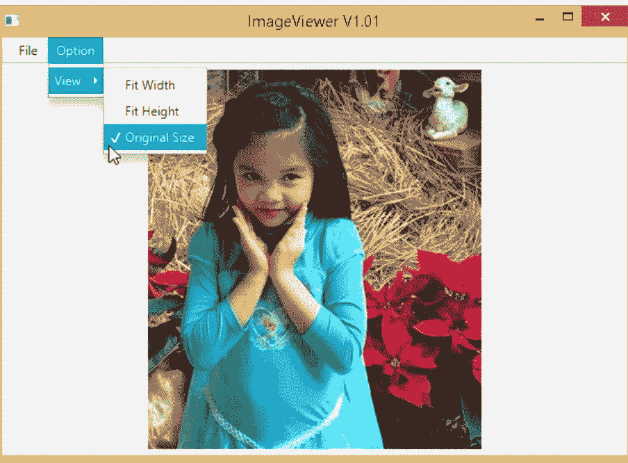

**图 1-8.** 将图像缩放以适应场景宽度的渲染快照。

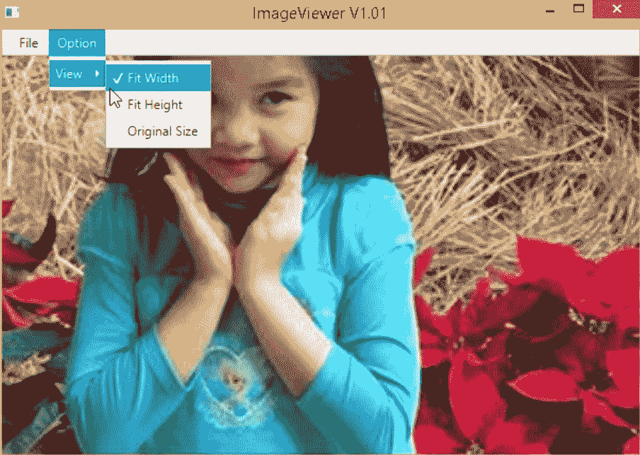

**图 1-9.** 将图像缩放以适应场景高度可用视图的渲染快照。

## 1.4.2 方法二：更改 `fitWidth` 属性和 `fitHeight` 属性的值

`ImageView` 类提供了两个属性允许我们缩放图像的显示尺寸：

- `fitWidth`
- `fitHeight`

要更改这两个属性的值，我们使用 `setFitWidth()` 方法和 `setFitHeight()` 方法。

如果选择了“适应宽度”（Fit Width）视图选项，显示宽度将根据场景的当前宽度设置。以下是代码片段：

### 列表 1-17. 调用 `setFitWidth()` 方法将图像宽度设置为与场景相同


```java
imageView.setFitWidth(scene.getWidth());
// 除了 setFitWidth 之外，还必须将适应高度设置为 0
imageView.setFitHeight(0);
```

如果选择了“适应高度”（Fit Height）视图选项，显示高度将根据场景的当前高度设置，并减去菜单栏的高度。以下是代码片段：

**列表 1-18。** 调用 `setFitHeight` 方法将显示高度设置为场景高度减去菜单栏的高度：

```java
imageView.setFitHeight(scene.getHeight() - menuBar.getHeight());
// 除了 setFitHeight 之外，还必须将适应宽度设置为 0
imageView.setFitWidth(0);
```

如果选择了“原始尺寸”（Original Size）选项，我们需要通过给 `fitWidth` 和 `height` 属性均赋予 0 来清除之前设置的值。以下是代码片段：

**列表 1-19。** 调用 `setFitWidth` 和 `setFitHeight` 方法，并值为 0：

```java
// 清除之前设置的值
imageView.setFitWidth(0);
imageView.setFitHeight(0);
```

接下来的代码展示了目前为止方法二的实现。

**列表 1-20。** 监听切换组中单选菜单项的选择变化，调整视图的 `fitWidth` 和 `maxHeight` 属性的值：

```java
// 监听切换组中选择的变化
groupOption.selectedToggleProperty().addListener(new ChangeListener<Toggle>() {
    public void changed(ObservableValue<Toggle> observableValue, Toggle oldVal, Toggle new_val) {
      if (groupOption.getSelectedToggle() != null) {
        RadioMenuItem choiceItem = (RadioMenuItem) groupOption.getSelectedToggle();
        if (choiceItem == fitWidth) {
          imageView.setFitWidth(scene.getWidth());
          // 除了 fitWidth 之外，还必须将适应高度设置为 0
          imageView.setFitHeight(0);
        } else if (choiceItem == fitHeight) {
          imageView.setFitHeight(scene.getHeight() - menuBar.getHeight());
          // 除了 fitHeight 之外，还必须将适应宽度设置为 0
          imageView.setFitWidth(0);
        } else {
          // 清除之前设置的值
          imageView.setFitWidth(0);
          imageView.setFitHeight(0);
        }
      }
    }
});
```

## 1.4.2 捕获场景调整大小事件以调整图像的显示尺寸

为了完成方法二，还有一个问题需要解决：图像的显示尺寸取决于场景的大小（初始设置为 600 像素乘 400 像素），这可能会发生动态变化。当用户拖动应用程序窗口的边缘或角时，场景会调整大小。我们需要捕获此调整大小事件以相应调整图像的显示尺寸。也就是说，如果当前选择的视图选项是“适应宽度”，则场景的新宽度将被视图对象 `fitWidth` 属性的值。如果选择的是“适应高度”，则场景的新高度减去菜单栏的高度将被 `fitHeight` 属性的值。

为了响应场景尺寸的变化，我们将分别为宽度属性和高度属性添加监听器，以捕获场景的调整大小事件。

以下代码片段完成了这些任务：

**列表 1-21。** 监听场景宽度和高度的变化，调整视图的 `fitWidth` 和 `fitHeight`：

```java
// 监听场景宽度的变化并调整视图
scene.widthProperty().addListener(new ChangeListener<Object>() {
    public void changed(ObservableValue<Object> observableValue, Object oldVal, Object newVal) {
        if (fitWidth.isSelected())
            imageView.setFitWidth((double)newVal);
    }
});
// 监听场景高度的变化并调整视图
scene.heightProperty().addListener(new ChangeListener<Object>() {
    public void changed(ObservableValue<Object> observableValue, Object oldVal, Object newVal) {
        if (fitHeight.isSelected())
            imageView.setFitHeight((double)newVal - menuBar.getHeight());
    }
});
```

以下是 `ImageView` 类的实现代码：

**列表 1-22。** `ImageView` 类的完整源码如下：

（此处省略原文中重复的混乱代码描述部分）

```java
original.setToggleGroup(groupOption);

// Listen to the change of selection in the toggle group
groupOption.selectedToggleProperty().addListener(new ChangeListener<Toggle>() {
    public void changed(ObservableValue<? extends Toggle> o, Toggle oldToggle, Toggle newToggle) {
        if (groupOption.getSelectedToggle() != null) {
            MenuItem item = (MenuItem) groupOption.getSelectedToggle();
            if (item == fitWidth) {
                System.out.println("fitWidth");
                imageView.setFitWidth(scene.getWidth());
                // Beside fitWidth, must also set fit height to 0
                imageView.setFitHeight(0);
            } else if (item == fitHeight) {
                System.out.println("fitHeight");
                imageView.setFitHeight(scene.getHeight());
                // Beside fitHeight, must also set width to 0
                imageView.setFitWidth(0);
            } else {
                System.out.println("original size");
                imageView.setFitWidth(0);
                imageView.setFitHeight(0);
            }
        }
    }
});
```

```java
// Listen to the width change of scene and adjust fitWidth of image
scene.widthProperty().addListener(new ChangeListener<Number>() {
    public void changed(ObservableValue<? extends Number> o, Number oldVal, Number newVal) {
        if (fitWidth.isSelected()) {
            imageView.setFitWidth((double) newVal);
        }
    }
});
```

```java
// Listen to the height change of scene and adjust fitHeight of image
scene.heightProperty().addListener(new ChangeListener<Number>() {
    public void changed(ObservableValue<? extends Number> o, Number oldVal, Number newVal) {
        if (fitHeight.isSelected()) {
            imageView.setFitHeight((double) newVal);
        }
    }
});
```

```java
// Create submenu menu
Menu menuView = new Menu("View");
menuView.getItems().addAll(fitWidth, fitHeight, original);

// Set Original Size as default
original.setSelected(true);

// Add option to menu bar
menuBar.getItems().add(menuView);
```

```java
stage.setTitle("ImageViewer V1.02");
stage.setScene(scene);
stage.show();

public static void main(String[] args) {
    launch(args);
}
```

请注意，我们将方法二的版本号从 V1.01 升级到了 V1.02。编译并运行应用程序。尝试以下步骤进行测试：

1. 加载一个小于初始场景尺寸（600 像素）的图像，以原始大小查看图像。
2. 选择“适应宽度”（Fit Width），图像视图将缩放至场景的宽度。
3. 选择“适应高度”（Fit Height），图像视图将缩放至场景的高度。
4. 选择“原始大小”（Original Size），图像视图将恢复到原始大小。
5. 加载一个比当前场景尺寸更大的图像，由于场景中没有足够的空间显示整个图像，你只能看到图像的部分。
6. 分别选择“适应宽度”和“适应高度”选项以查看不同的图像结果。
7. 通过拖动窗口边缘调整场景宽度，尝试增大和缩小宽度以查看不同的结果。
8. 通过拖动窗口边缘调整场景高度，尝试增大和缩小高度以查看不同的结果。
9. 通过拖动窗口角调整场景宽度和高度，分别测试所有选项。

方法一（V1.01）将用于后续章节中 ImageViewer V1.1 的开发。

**图 1-10.** 以原始大小（1280 像素乘 960 像素）查看图像的快照，图像的外部部分被遮挡。

(img/27b02efbff71bf5e12da4658_70)

**图 1-11.** 适应宽度缩放图像的快照，图像的顶部和底部被遮挡。

(img/27b02efbff71bf5e12da4658_70)

**图 1-12.** 适应高度缩放图像的快照，场景中有可用空间。

(img/27b02efbff71bf5e12da4658_70)

**图 1-13.** 当场景尺寸增大时，以适应宽度缩放图像的快照。

(img/27b02efbff71bf5e12da4658_70)

**图 1-14.** 当场景尺寸变化时，以适应高度缩放图像的快照。

(img/27b02efbff71bf5e12da4658_70)

# 第 2 章

## 带有浏览按钮的增强图像查看器

### 开发 Image Viewer V1.1

## 前言

在上一章中，我们演示了 JavaFX 程序的增量开发——ImageView V1.0。到目前，它包含了基本的功能，尽管它是一个开箱即用且方便的配件，很容易与各种软件打包。在本章和下一章中我们将逐步添加额外的功能。

本章重点是动作的实现，以及两个按钮——“下一个”和“上一个”的合理布局，这两个自定义按钮用于打开并查看下一张或上一张可用图像。

版本号升级到了 1.1。通过对 ImageView V1.1 代码的详细描述和文档良好的示例，你将熟悉“总结”部分中所述的 JavaFX 库的基本功能。

ImageView V1.1 的完整开发过程包含以下步骤：

- **2.1 添加“下一个”按钮**
  - 2.1.1 使用 `Group` 作为父容器
  - 2.1.2 使用 `Shape` 类渲染 2D 几何基元
  - 2.1.3 使用 `Rectangle` 形状作为自定义按钮的边界框
  - 2.1.4 绘制 `Shape` 的背景和边框
  - 2.1.5 设置圆矩形的 `arcHeight` 和 `arcWidth` 属性值
  - 2.1.6 使用 `Polygon` 形状作为下一个图标的视觉标识
  - 2.1.7 设置 `Node` 的 `Cursor` 属性值
  - 2.1.8 用于注册事件处理器以处理鼠标事件的便利方法
  - 2.1.9 `createNextButton()` 方法的完整源码
  - 2.1.10 为 `Node` 安装 `Tooltip`（提示框）
- **2.2 调整“下一个”按钮在 `StackPane` 中的默认位置**
- **2.3 添加“上一个”按钮并调整其在 `StackPane` 中的位置**
- **2.4 实现 On Mouse Clicked 事件处理器**
  - 2.4.1 配置 `FileChooser`
  - 2.4.2 创建列表迭代器以遍历当前目录下的现有文件
  - 2.4.3 在 `ImageView` 类中定义属性
- **2.5 Image Viewer V1.1 的完整源码**
  - 2.5.1 `FileUtils` 类的完整源码
  - 2.5.2 `ImageView` 类的完整源码
- **2.6 总结**

## 2.1 添加“下一个”按钮

我们没有使用内置 JavaFX 控件中的 `Button` 类，而是通过使用以下类来实现自己的工具类来设计自定义按钮：

- `Group`
  作为父容器。
- `Shape`
  - `Rectangle`
    作为边界框。
  - `Polygon`
    作为“下一个”图标的视觉标识。
- `LinearGradient` 和 `Color`
  用于填充背景和描边边框。
- `EventHandler` 和 `MouseEvent`
  用于处理鼠标进入、点击和离开事件。

### 2.1.1 使用 Group 作为父容器

`Group` 类位于 `javafx.scene` 包中，是 `javafx.scene.Parent` 的子类。`Group` 的功能非常直观。它允许你将各种节点组合在一起，而不施加自动布局。以下代码段显示了如何将节点添加到 `Group` 中：

```java
Group buttonGroup = new Group();
Rectangle rect = new Rectangle(0, 0, 25, 35);
Polygon polygon = new Polygon();
buttonGroup.getChildren().addAll(rect, polygon);
```

更多关于 `Group` 特性的信息，请参阅卷二：《开发交互式形状绘图工具》第 1 章 Line Drawer 节 1.1.1 在 `BorderPane` 中心添加 `Pane` 作为绘板。

### 2.1.2 使用 Shape 类渲染 2D 几何基元

JavaFX 提供了一个非常有吸引力的类 `Shape`，用于渲染 2D 几何基元。它是一个继承自 `javafx.scene.Node` 的抽象类，作为某些基本 2D 几何形状的基类。它的直接子类包括：`Arc`, `Circle`, `CubicCurve`, `Ellipse`, `Line`, `Path`, `Polygon`, `Polyline`, `QuadCurve`, `Rectangle`, `SVGPath`。`Shape` 类定义了 2D 几何基元的通用属性，如 `fill`（填充）、`stroke`（描边）、`strokeType`（描边类型）、`strokeWidth`（描边宽度）等。

为形状分别设置 `fill` 和 `stroke` 属性的值是非常常见的。`setFill` 方法用于指定用于渲染形状背景的颜色，`setStroke` 方法用于指定用于渲染形状边框的颜色。请注意，`Line`、`Polyline` 和 `Path` 的 `fill` 属性默认值为 `null`，而其他形状为 `Color.BLACK`；`stroke` 属性的默认值 `Line`、`Polyline` 和 `Path` 为 `Color.BLACK`，而其他为 `null`。

现在我们将向你展示如何利用 `Shape` 的能力来实现我们自定义的“下一个”按钮。

### 2.1.3 使用 Rectangle 形状作为自定义按钮的边界框

以下是实现此目的的代码：使用参数 x, y, width 和 height 的构造创建一个 `Rectangle`，并为每个所需的属性设置正确的值。

**列表 2-1.** 创建一个 `Rectangle` 并设置这些属性的值：`fill`, `stroke`, `arcHeight`, `arcWidth`：


```
Rectangle rect = new Rectangle(0, 0, 25, 0, 35);
LinearGradient lg = new LinearGradient(0, 0, 1, 0, true,
CycleMethod.NO_CYCLE, new Stop[]{
new Stop(0, Color.web("#B5173A8")),
new Stop(0.6, Color.web("#A8B9D4")),
new Stop(1, Color.web("#87A7C6"))
});
rect.setFill(lg);
rect.setStroke(Color.web("#ACD7FF"));
rect.setArcHeight(6.5);
rect.setArcWidth(6.5);
```

下面的快照显示了上述代码渲染的 `Rectangle`：

图 2-1. 填充了 `LinearGradient` 颜色的矩形。


### 2.1.4 Shape 背景

`LinearGradient` 和 `Color` 位于 `javafx.scene.paint` 包，是 `Paint` 类的两个直接子类，用于绘制 `Shape` 或 `Region` 的背景和边框。

在列表 2-1 中，我们使用 `LinearGradient` 填充 `Rectangle` 的背景。`LinearGradient` 构造函数的前四个参数指定了处理颜色值的起点和终点坐标：0, 0, 1, 0。

### 2.1.5 设置 arcHeight 和 arcWidth 属性值为圆矩形

`arcHeight` 和 `arcWidth` 是 `Rectangle` 类中定义的属性，用于指定矩形角处弧的高度和宽度直径。它们的默认值为 0.0。

下面的图说明了如何设置 `arcHeight` 和 `arcWidth` 属性的值来渲染圆矩形。与圆矩形角处重叠的圆和椭圆是为了方便比较。

图 2-2. 角处放置了圆和椭圆的圆矩形说明图。


### 2.1.6 使用 Polygon 形状作为下一个图标的视觉标识

没有使用图像作为“下一个”按钮的视觉标识，而是实例化了一个箭头形状的 `Polygon`。使用 `getPoints()` 方法获取类型为 `Observable<Double>` 的列表，然后使用 `Collection` 接口定义的基本单元来操作列表的内容。存储在 `Double` 数组中的一系列 x 和 y 坐标被列表中，代表 `Polygon` 的点。

`Color.WHITE` 是 `Color` 类中定义的许多类型为 `Color` 的静态字段，它是我们选择填充 `Polygon` 背景的颜色，我们使用静态方法 `Color.web` 创建了一个深蓝色来绘制 `Polygon` 的边框。

## 列表 2-2. 创建多边形并设置填充（fill）和描边（stroke）属性：

```java
Polygon polygon = new Polygon();
Double[] dArray = {
    5.0, 2.0,
    22.0, 17.0,
    5.0, 32.0,
    5.0, 25.0,
    14.0, 17.0,
    5.0, 9.0
};
polygon.getPoints().addAll(dArray);
polygon.setFill(Color.WHITE);
polygon.setStroke(Color.web("#436B8B"));
```

下面的快照显示了上述代码渲染 `Polygon` 的效果：

## 图 2-3. 作为“下一个”图标的多边形截图。

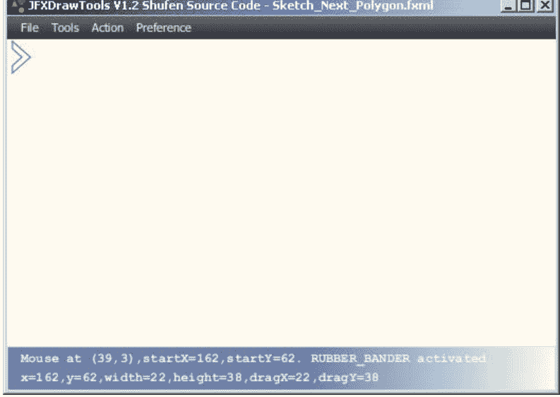

### 2.1.7 设置节点的光标属性（Cursor Property）

`cursor` 属性定义在 `Node` 类中，允许你更改此节点及其所有后代节点的鼠标光标。`Cursor` 类位于 `javafx.scene` 包中并继承自 `java.lang.Object`，它以 `Cursor` 类型的静态字段定义了一些可选鼠标光标，如 `CLOSED_HAND`、`CROSSHAIR`、`DEFAULT`、`HAND`、`OPEN_HAND`、`TEXT`、`WAIT` 等。如果没有显式设置 `cursor` 属性的值，将使用箭头形状的默认鼠标光标。

我们使用 `Cursor.OPEN_HAND` 作为“下一个”按钮的光标。以下是代码片段：

```java
buttonGroup = new Group();
buttonGroup.setCursor(Cursor.OPEN_HAND);
```

### 2.1.8 使用便捷方法注册事件处理器来处理鼠标事件

`EventHandler<T extends Event>` 是一个扩展自 `java.util.EventListener` 的接口，它定义了 `handle(T event)` 方法，当指定的事件发生时会调用该方法。

我们将使用 `Node` 类提供的便捷方法来注册事件处理器，以处理鼠标事件的事件类型，如 `MOUSE_CLICKED`、`MOUSE_ENTERED` 和 `MOUSE_EXITED`。这些是 `MouseEvent` 类中定义的 `Types` 的静态字段，`MouseEvent` 是 `javafx.scene.input.InputEvent` 的子类。

以下是用于注册上述事件处理器的便捷方法：

- `public final void setMouseClicked(EventHandler<? super MouseEvent> value)`

  设置 `Node` 类中定义的 `MouseClicked` 属性的值，提供 `handle` 方法的实现，当鼠标点击此节点时会调用。

- `public final void setOnMouseEntered(EventHandler<? super MouseEvent> value)`

  设置 `Node` 类中定义的 `OnMouseEntered` 属性的值，提供 `handle` 方法的实现，当鼠标进入此节点时会调用。

- `public final void setOnMouseExited(EventHandler<? super MouseEvent> value)`

  设置 `Node` 类中定义的 `OnMouseExited` 属性的值，提供 `handle` 方法的实现，当鼠标离开此节点时会调用。

以下使用这些便捷方法的代码片段：

列表 2-3. 使用便捷方法注册鼠标事件处理器：

```java
// 注册鼠标点击事件处理器
buttonGroup.setOnMouseClicked(new EventHandler<MouseEvent>() {
  @Override
  public void handle(MouseEvent me) {
    System.out.println("Mouse clicked");
  }
});

// 注册鼠标进入事件处理器
// 当鼠标进入时改变按钮的外观
buttonGroup.setOnMouseEntered(new EventHandler<MouseEvent>() {
  @Override
  public void handle(MouseEvent mouse) {
    System.out.println("Mouse entered");
    rect.setFill(lgEntered);
    polygon.setFill(Color.web("#436B8B"));
    polygon.setStroke(Color.WHITE);
  }
});
```

```java
// 注册鼠标离开事件处理器
// 当鼠标离开时恢复原始外观
buttonGroup.setOnMouseExited(new EventHandler<MouseEvent>() {
    @Override
    public void handle(MouseEvent mouse) {
        System.out.println("Mouse exited");
        rect.setFill(fill);
        polygon.setFill(Color.WHITE);
        polygon.setStroke(Color.web("#436B8B"));
    }
});
```

### 2.1.9 createNextButton() 方法的源代码

导入语句：

```java
import javafx.scene.Cursor;
import javafx.scene.Group;
import javafx.scene.Node;
import javafx.scene.control.Tooltip;
import javafx.scene.input.MouseEvent;
import javafx.scene.paint.Color;
import javafx.scene.paint.CycleMethod;
import javafx.scene.paint.LinearGradient;
import javafx.scene.paint.Stop;
import javafx.scene.shape.Polygon;
import javafx.scene.shape.Rectangle;
```

列表 2-4. createNextButton() 方法：

```java
/**
* 使用 Rectangle 作为背景，Polygon 作为图标，Group 作为容器
* 创建“下一个”按钮，
* Rectangle形的大小为 25 比 35，
* 多边形的厚度为 8 像素，
* 多边形的内边为 (2, 2, 2, 5)，
* 当鼠标进入时更改矩形的显示。
* @return
 */
Node createNextButton() {
// 创建一个组作为按钮
Group button = new Group();

// 创建一个矩形形状作为背景
final Rectangle rect = new Rectangle(0, 0);

// 创建一个多边形形状作为图标
final polygon = new Polygon();
Double[] dArray = {
    5.0, 2.0,
    22.0, 17.0,
    5.0, 32.0,
    5.0, 25.0,
    14.0, 17.0,
    5.0, 9.0
};
polygon.getPoints().addAll(dArray);
polygon.setFill(Color.WHITE);
polygon.setStroke(Color.web("#436B8B"));

// 为背景创建线性渐变
final LinearGradient lg = new LinearGradient(0, 0, 0, 1, true, CycleMethod.NO_CYCLE,
    new Stop(0, Color.LIGHTBLUE),
    new Stop(1, Color.WHITE));
rect.setFill(lg);

// 将矩形和多边形添加到组
button.getChildren().add(rect);
button.getChildren().add(polygon);

// 注册事件处理器
button.setOnMouseClicked(new EventHandler<MouseEvent>() {
  @Override
  public void handle(MouseEvent me) {
    System.out.println("Mouse clicked");
  }
});

button.setOnMouseEntered(new EventHandler<MouseEvent>() {
  @Override
  public void handle(MouseEvent mouse) {
    System.out.println("Mouse entered");
    rect.setFill(lgEntered);
    polygon.setFill(Color.web("#436B8B"));
    polygon.setStroke(Color.WHITE);
  }
});

button.setOnMouseExited(new EventHandler<MouseEvent>() {
  @Override
  public void handle(MouseEvent mouse) {
    System.out.println("Mouse exited");
    rect.setFill(fill);
    polygon.setFill(Color.WHITE);
    polygon.setStroke(Color.web("#436B8B"));
  }
});

return button;
}
```

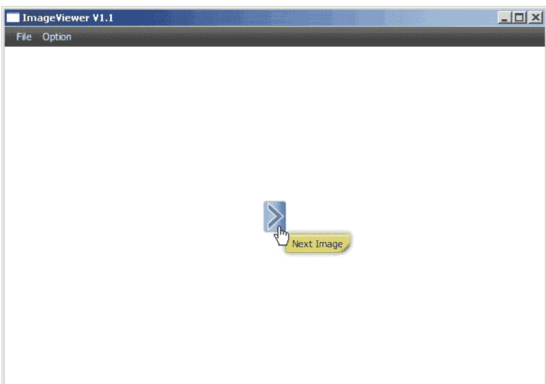

(图 2-1 到 2-5 是在 Windows XP 下使用 jdk1.7.0_25 的应用程序快照；Windows XP 下的 jdk1.7.0_25；其余是在 Windows 8.1 下使用 jdk1.8.0_66)

## 2.2 调整 StackPane 中“下一个”按钮的默认位置

在本节中，我们将演示如何将 `StackPane` 的子节点放置在预指定的位置。

`StackPane` 将其所有子节点堆叠在一起，并以居中作为默认对齐方式。这意味着默认情况下，`StackPane` 的子节点会在窗格的中心重叠。

在我们的应用程序中，在 `StackPane` 的中心放置“下一个”按钮是不可行的。坦白说，`StackPane` 提供了两个静态方法：

```java
public static void setAlignment(Node child, Pos value)
public static void setMargin(Node child, Insets value)
```

这允许我们调整单个子节点的位置。“下一个”按钮的首选位置是窗口的右侧，位于场景的可见边界内。以下代码片段调整了“下一个”按钮的默认位置。

导入语句：

```java
import javafx.geometry.Insets;
import javafx.geometry.Pos;
```

**列表 2-6.** 使用 `StackPane` 的静态方法 `setAlignment` 和 `setMargin` 调整“下一个”按钮的默认位置：

```java
StackPane.setAlignment(nextButton, Pos.CENTER_RIGHT)
StackPane.setMargin(nextButton, new Insets(8));
```

接下来的快照显示了位于应用程序窗口右侧的“下一个”按钮。

**图 2-6.** 窗口右侧、场景可见边界内的“下一个”按钮快照。

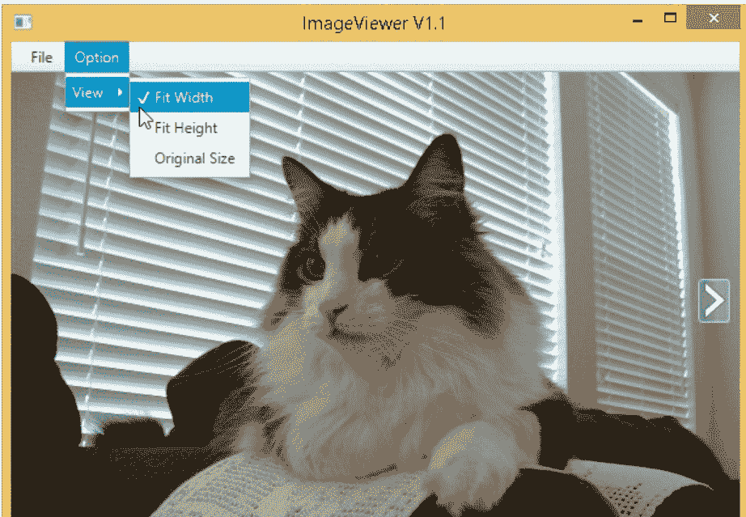

请记住，我们将 `StackPane` 的最小尺寸设置为 (0, 0)，以避免其因子节点 `ImageView` 而自动更改大小。如果不这样做，当加载并显示大于 `StackPane` 可见边界的图像时，可能会导致“下一个”按钮的位置出现复杂情况。该设置简化了调整“下一个”按钮位置的解决方案。

下一个快照显示了按原始尺寸显示尺寸图像，超出 `StackPane` 边界的图像部分是不可见的。如果我们没有为 `StackPane` 设置最小尺寸，它的尺寸将由于内容而增大，“下一个”按钮将掉到可见边界之外。

**图 2-7.** 动态调整应用程序窗口后，位于窗口右侧的“下一个”按钮快照。

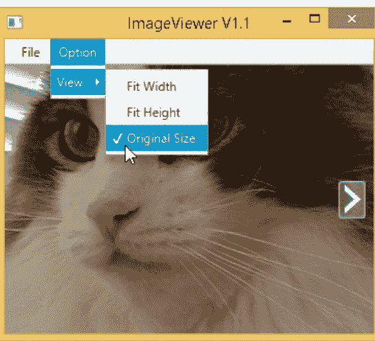

## 2.3 添加“上一个”按钮并调整其在 StackPane 中的位置

在本节中，我们添加了一个“上一个”按钮并将其放置在 `StackPane` 的左侧。对齐方式设置为 `Pos.CENTER_LEFT`，左边距设置为 8 像素。这些步骤与之前节描述的创建“下一个”按钮并调整其位置的过程类似。

**列表 2-7.** 定义 `createPrevButton` 方法来创建“上一个”按钮：

```java
/**
 * 使用矩形作为背景，多边形作为图标，组作为容器创建“上一个”按钮，
 * 矩形的尺寸为 25 比 35，
 * 多边形的厚度为 8 像素，
 * 多边形的内边距为 (2, 5, 2)，
 * 当鼠标进入时更改矩形的外观。
 *
 * @return
 */
Node createPrevButton() {
    // 创建一个组作为按钮
    Group buttonGroup = new Group();

    // ... (省略部分代码逻辑，对应原文)

// ... (此处由于原文截断，未翻译后续逻辑)
```

```java
new FileChooserExtensionFilter("All Images",
  "*.bmp", "*.gif", "*.jpeg", "*.png"),
new FileChooserExtensionFilter("All Files", "**",
  "*.bmp"),
new FileChooserExtensionFilter("GIF", "*.gif"),
new FileChooserExtensionFilter("JPEG", "*.jpg"),
new FileChooserExtensionFilter("JPG", "*.jpg"),
new FileChooserExtensionFilter("PNG", "*.png");
// 设置为默认目录
FileChooser.setInitialDirectory(new File("."));
```


`FileChooser.ExtensionFilter` 的构造函数使用两个参数，第一个是弹出文件打开对话框时在“文件类型：(Files of types:)”字段中显示的描述，第二个是 `String` 类型的变长参数，其中每个参数都是一个符合正则表达式语法的字符串。

在 `FileUtils.configure` 方法内部，除了添加扩展过滤器外，我们还将当前目录设置为初始目录：

```java
FileChooser.setInitialDirectory(new File("."));
```

`configure` 方法是定义在 `FileUtils` 类中的静态方法，在此处调用：

```java
// 创建一个文件选择器
final FileChooser filechooser = new FileChooser();
filechooser.setTitle("Open Image");
FileUtils.configure(filechooser);
```

`FileChooser` 的功能和外观取决于系统。图 2-9 显示了 Windows XP 中的 `FileChooser`，图 2-10 显示了 Windows 8 中的 `FileChooser`。

图 2-9。打开对话框的快照（Windows 系统），当点击组合框（ComboBox）时，过滤器列表中第一个添加的过滤器“所有图像 (All Images)”显示在“文件类型：”字段中。

图 2-10。打开对话框的快照（Windows 系统），当点击项时，与正则表达式 `*.gif` 关联的名称“GIF”显示在代码中。

通常，应用程序用户会希望 `FileChooser` 能记住他们访问过的目录。以下是实现方法：

**列表 2-10.** 在为 Load 菜单项注册的事件处理方法，将上次访问的目录设置为 `FileChooser` 的初始目录：

```java
// 为菜单项添加动作
load.setOnAction(new EventHandler<ActionEvent>() {
    @Override
    public void handle(ActionEvent e) {
        // 打开 FileChooser 对话框
        File file = fileChooser.showOpenDialog(stage);
        if (file != null) {
            // 设置上次访问的目录为初始目录
            File lastDir = file.getParent();
            file.setInitialDirectory(lastDir);
            String url = file.toURI().toString();
            Image image = new Image(url);
            imageView.setImage(image);
        }
    }
});
```

## 2.4.2 创建列表迭代器以遍历当前目录下的现有文件

为了建立当前目录下的文件列表，我们将使用 JDK 7 引入的 `java.nio.file` 包中提供的 API。

`java.nio.file.Files` 提供的静态方法 `static DirectoryStream<Path> newDirectoryStream(Path dir, String glob)` 可打开指定的目录，并返回一个 `DirectoryStream<Path>`。`DirectoryStream` 类型是一个实现了 `Iterable` 的接口，因此可以使用 `for-each` 语法来遍历目录中的文件。

以下是读取目录并将文件逐个添加到列表的代码片段：

```java
List<Path> list = new ArrayList<>();

try (DirectoryStream<Path> stream = Files.newDirectoryStream(dir,
      "*.bmp,gif,jpg,png")) {
  for (Path entry : stream) {
    // 忽略目录内的子目录
    if (Files.isDirectory(entry, LinkOption.NOFOLLOW_LINKS))
      continue;
    list.add(entry);
  }
} catch (DirectoryIteratorException de) {
  throw de.getCause();
}
```

以下是静态方法 `listIterator` 的完整代码，它读取文件、逐个添加到 `List`、按字母顺序对文件排序，并返回一个指向目录中下一个可用文件的 `ListIterator`。该方法位于 `FileUtils` 类中。

导入语句：

```java
import java.io.IOException;
import java.nio.file.DirectoryIteratorException;
import java.nio.file.DirectoryStream;
import java.nio.file.Files;
import java.nio.file.LinkOption;
import java.nio.file.Path;
import java.util.ArrayList;
import java.util.Collections;
import java.util.Comparator;
import java.util.List;
import java.util.ListIterator;
import javafx.stage.FileChooser;
```

列表 2-1. 定义在 `FileUtils` 类中的静态方法 `listIterator`，读取目录，

```java
/**
 * 使用 Files.newDirectoryStream(Path, String) 读取目录，
 * 将文件添加到列表中，返回指向参数中
 * 指定文件的 listIterator，即第一次调用 next() 
 * 返回指定的文件，
 * 列表按字母顺序排序，
 * newDirectoryStream 方法的第二个参数是
 * 一个 glob 模式，用于过滤匹配该模式的文件：
 *  *.bmp,.gif,.jpeg,.jpg,.png"
 * 我们只对以下后缀结尾的文件感兴趣：
 *  .bmp, .gif, .jpeg, .jpg 和 .png。
 *
 * @param file 文件
 * @return 
 * @throws IOException
 */
public static ListIterator<Path> listIterator(Path file) throws IOException {
    Path dir = file.getPath();
    List<Path> list = new ArrayList<>();

    try (DirectoryStream<Path> stream = Files.newDirectoryStream(dir,
            "*.bmp,.gif,.jpeg,.jpg,.png")) {
        for (Path entry : stream) {
            // 忽略目录内的子目录
            if (Files.isDirectory(entry, LinkOption.NOFOLLOW_LINKS))
                continue;
            list.add(entry);
        }
    } catch (DirectoryIteratorException de) {
        throw de.getCause();
    }

    // 按字母顺序比较两个路径
    Collections.sort(list, new Comparator<Path>() {
        public int compare(Path o1, Path o2) {
            return o1.getFileName().compareTo(o2.getFileName());
        }
    });

    int index = 0; // 列表中当前文件的索引
    // 搜索文件的索引
    for (Path entry : list) {
        if (entry.equals(file)) break;
    }
    if (index == list.size()) {
        // 文件不在列表中
        index = 0;
    }
    return list.listIterator(index);
}
```

我们将在下一节描述 `FileUtils.listIterator(Path file)` 方法的使用。

## 2.4.3 在 ImageViewer 类中定义属性

在本节中，我们将演示如何在类中定义属性。在应用程序入口点 `ImageViewer` 类中，我们定义了三个属性：

- listIterator

  类型为 `ObjectProperty<ListIterator<Path>>`。`listIterator(Path)` 方法是定义在 `FileUtils` 类中的静态方法，从 Load 菜单项中调用以获取迭代器实例并设置为该属性的值。

- lastClickedButton

  类型为 `StringProperty`，用于跟踪上次点击的按钮，以便正确移动 `ListIterator` 的光标。你将看到 `lastClickedButton` 属性的值（`NEXT` 或 `PREVIOUS`），它会影响前进/后按钮点击事件处理程序中 `next()` 和 `previous()` 方法的调用。

- curImage

  类型为 `ObjectProperty<Image>` 并绑定到 ImageView 的图像属性，该属性的值是当前加载的图像。

以下是定义这些属性的代码片段：

列表 2-12. 在 ImageViewer 类中定义属性：

```java
// 用于遍历类选择目录中的文件
final ObjectProperty<ListIterator<java.nio.file.Path>> listIterator = new SimpleObjectProperty<>();

final String NEXT = "NEXT";
final String PREVIOUS = "PREVIOUS";
// 用于跟踪上次点击的按钮
final StringProperty lastClickedButton = new SimpleStringProperty();

final ObjectProperty<Image> curImage = new SimpleObjectProperty<>();
```

属性通常在连接绑定机制中工作。这是 `Property<T>` 接口中定义的 `bind`：

```java
void bind(ObservableValue<? extends T> observable
```

为此属性创建一个单向绑定。参数 `observable` 的类型为 `ObservableValue`。`ObjectProperty` 和 `StringProperty` 都实现了 `Property`，它是 `ObservableValue` 的一个子接口。

以下是使用 `bind` 方法为 `ImageView` 的属性创建绑定代码片段：

**Listing 2-13.** 将 `ImageView` 的 image 属性绑定到 `curImage` 属性：

```java
final ImageView imageView = new ImageView();
imageView.imageProperty().bind(curImage);
```

一旦创建绑定，每当 `curImage` 属性的值发生时，`ImageView` 中 `image` 属性的值也会随之改变。

可以使用 `set` 方法或 `setValue` 方法为属性赋值。以下是从注册用于处理 Load 菜单项 `ActionEvent` 的事件处理程序中的 `handle` 方法中提取的代码片段：

**Listing 2-14.** 给 `listIterator`、`curImage` 属性和 `lastClickedButton` 属性赋值：

```java
ListIterator<java.nio.file.Path> it = FileUtils.listIterator(file);
listIterator.set(it);
file = it.next().getFile();
String url = file.toURI().toString();
curImage.setImage(new Image(url));
lastClickedButton.setValue(NEXT);
```

请注意，当发生以下操作之一时，`curImage` 属性的值会改变：

- 从 FileChooser 的文件打开对话框加载选定的图片。
- 点击 `Next` 时加载下一张图片。
- 点击 `Previous` 按钮时加载上一张图片。

正如我们在上面提到的，一旦 `curImage` 属性的值改变，`ImageView` 的 `image` 属性值也会随之改变。

`ImageViewer` 类（应用程序的入口）中所做的代码更改如下加粗所示：

**导入语句：**

```java
import java.io.IOException;
import java.util.ListIterator;
import javafx.beans.property.ObjectProperty;
import javafx.beans.property.SimpleObjectProperty;

import javafx.beans.property.SimpleStringProperty;
import javafx.beans.property.StringProperty;
```

**Listing 2-15.** 添加到 `ImageViewer`（应用程序入口）中的代码，已加粗显示：

```java
public class ImageViewer extends Application {
...
// 用于遍历当前选择目录下的文件
final ObjectProperty<ListIterator<java.nio.Path>> listIterator = 
new SimpleObjectProperty<>();

final String NEXT = "NEXT";
final String PREVIOUS = "PREVIOUS";
// 用于跟踪最后点击的按钮
final StringProperty lastClickedButton = new SimpleStringProperty();

final ObjectProperty<Image> curImage = new SimpleObjectProperty<>();
...
@Override
public void start(FinalStage stage) {
...
// 创建图片视图，添加到图片区域
final ImageView imageView = new ImageView();
imageView.imageProperty().bind(curImage);
imageView.setPreserveRatio(true);
imageArea.getChildren().add(imageView);
...
// 为 Load 菜单项添加动作
load.setOnAction(new EventHandler<ActionEvent>() {
@Override
public void handle(ActionEvent e) {
// 打开 FileChooser 对话框
File file = fileChooser.showOpenDialog(stage);
if (file != null) {
// 设置最后访问的目录为初始目录
File lastDir = file.getParentFile();
fileChooser.setInitialDirectory(lastDir);
// 当从 FileChooser 打开文件时创建列表迭代器
try {
ListIterator<java.nio.Path> it = FileUtils.listIterator(file);
listIterator.set(it);
file = it.next().toFile();
curImage.set(new Image(file));
// 将迭代器指向的光标设置为 NEXT
```

Listing 2-16. Next 按钮的鼠标点击事件处理程序变为：


## 2.5 Image Viewer V1.1 的完整源代码

### 2.5.1 FileUtils 类完整源代码

**Listing 2-18.** FileUtils 类的完整源代码：

```java
package imageviewer;

import java.io.File;
import java.io.IOException;
import java.nio.file.DirectoryIteratorException;
import java.nio.file.DirectoryStream;
import java.nio.file.Files;
import java.nio.file.LinkOption;
import java.nio.file.Path;
import java.util.ArrayList;
import java.util.Collections;
import java.util.Comparator;
import java.util.List;
import java.util.ListIterator;
import javafx.stage.FileChooser;

/**
 * File Name: FileUtils.java
 * (in directory: ImageViewV1.src/imageviewer/)
 * @author Shufen Kuo
 */

public class FileUtils {

  /**
   * 定义支持的文件扩展
   * 将文件添加到列表，返回指向文件的
   * 迭代器，即第一次调用 `next()` 返回指定的文件，
   * 文件列表按字母顺序排序，
   * `newDirectoryStream` 的第二个参数是
   * 用于匹配以下后缀的文件的 glob 模式：
   * @param file
   * @return
   * @throws IOException
   */
  static ListIterator<Path> listIterator(Path file) throws IOException {
    Path dir = file.getParent();
    List<Path> list = new ArrayList<>();

    try (DirectoryStream<Path> stream = Files.newDirectoryStream(dir,
            "*{bmp, gif, jpeg, jpg, png}")) {
        for (Path entry : stream) {
            // 忽略目录内的子目录
            if (Files.isDirectory(entry, LinkOption.NOFOLLOW_LINKS)) {
                continue;
            }
            list.add(entry);
        }
    } catch (DirectoryIteratorException de) {
        throw de.getCause();
    }

    // Path 中的 compare 方法比较两个抽象路径
    Collections.sort(list, new Comparator<Path>() {
        public int compare(Path o1, Path o2) {
            return o1.getFileName().compareTo(o2.getFileName());
        }
    });

    int index = 0; // 当前文件在列表中的索引
    // 搜索指定文件的索引
    for (Path entry : list) {
        if (entry.equals(file)) break;
        index++;
    }
    if (index == list.size()) {
        // 文件不在列表中
        index = 0;
    }
    return list.listIterator(index);
  }
}
```

### 2.5.2 ImageViewer 类完整源代码

```java
package java.imageiewer;

import java.io.File;
import java.io.IOException;
import java.util.ListIterator;
import javafx.application.Application;
import javafx.application.Platform;
import javafx.beans.property.ObjectProperty;
import javafx.beans.property.SimpleObjectProperty;
import javafx.beans.property.SimpleStringProperty;
import javafx.beans.value.ChangeListener;
import javafx.beans.value.ObservableValue;
import javafx.event.ActionEvent;
import javafx.event.EventHandler;
import javafx.geometry.Insets;
import javafx.geometry.Pos;
import javafx.scene.Cursor;
import javafx.scene.Group;
import javafx.scene.Node;
import javafx.scene.Scene;
import javafx.scene.control.Menu;
import javafx.scene.control.MenuBar;
import javafx.scene.control.MenuItem;
import javafx.scene.control.RadioMenuItem;
import javafx.scene.control.Toggle;
import javafx.scene.control.ToggleGroup;
import javafx.scene.control.Tooltip;
import javafx.scene.image.Image;
import javafx.scene.image.ImageView;
import javafx.scene.input.MouseEvent;
import javafx.scene.layout.BorderPane;
import javafx.scene.layout.StackPane;
import javafx.scene.paint.Color;
import javafx.scene.paint.CycleMethod;
import javafx.scene.paint.LinearGradient;
import javafx.scene.paint.Stop;
import javafx.scene.shape.Polygon;
import javafx.scene.shape.Rectangle;
import javafx.stage.FileChooser;
import javafx.stage.Stage;
```

```java
/**
 * 文件名: ImageView.java V1.1
 * (位于目录: ImageViewV1.1/src/example4/imageiewer/)
 * 该应用程序创建一个 BorderPane 作为场景的根节点，
 * 并在场景中心添加一个 StackPane，设置大小为 600 x 400
 * StackPane 的大小将自动调整以适应场景的大小
 * 当用户调整窗口大小时，StackPane 将随之调整大小
 *
 * 在 BorderPane 顶部添加一个菜单栏
 * 创建文件菜单，并使用 FileChooser 的打开对话框
 * 选择图像文件，在图像渲染区域加载并显示图像
 */
```

创建“选项”菜单，包含一个“视图”子菜单，让用户选择图像查看的标准：适应宽度、适应高度，或默认选项“原始大小”。

- 使用 `bind` 和 `unbind` 方法调整图像查看大小：
  - 将图像视图的宽度/高度属性绑定（`bind`）到场景的宽度/高度属性，这样每当场景调整大小时，图像的大小将自动改变。
- 在场景中添加“下一个”和“上一个”按钮，在加载第一张图像后，用户可以使用这些按钮查看下一张图像或预览图像，而无需打开 `FileChooser`。
- 调整“下一个”按钮在 `StackPane` 中的默认位置
- 添加“上一个”按钮并调整其在 `StackPane` 中的位置
- 为“下一个”和“上一个”按钮实现点击事件处理程序
- @author Shufen Kuo

```java
public class ImageViewer extends Application {
    final Node nextButton = createNativeButton();
    final Node prevButton = createPrevButton();

    // 创建切换组
    final ToggleGroup option = new ToggleGroup();
    final String FIT_WIDTH = "适应宽度";
    final String FIT_HEIGHT = "适应高度";
    final String ORIGINAL_SIZE = "原始大小";
```

```java
// 用于遍历当前选择目录中的文件
final ObjectProperty<java.nio.file.Path> listIterator = new SimpleObjectProperty<>();

final String NEXT = "NEXT";
final String PREVIOUS = "PREVIOUS";
// 用于记录最后点击的按钮
final StringProperty lastClickedButton = new SimpleStringProperty();
```


```java
final ObjectProperty<Image> curImage = new SimpleObjectProperty<>();

@Override
public void start(final Stage stage) {
    BorderPane root = new BorderPane();
    final StackPane imageArea = new StackPane();
    // 设置 StackPane 的最小尺寸以避免加载大图像时缩放
    imageArea.setMinSize(0, 0);
    root.setCenter(imageArea);

    // 创建图像视图并添加到区域
    final ImageView imageView = new ImageView();
    imageView.imageProperty().bind(curImage);
    imageView.setPreserveRatio(true);

    imageArea.getChildren().add(imageView);

    final Scene scene = new Scene(root, 600, 400);
    imageArea.widthProperty().addListener(new ChangeListener<Number>() {
        public void changed(ObservableValue<? extends Number> o, Number oldVal, Number newVal) {
            System.out.format("imageArea 宽度从 %.1f 变为 %.1f", oldVal, newVal);
        }
    });
    imageArea.heightProperty().addListener(new ChangeListener<Number>() {
        public void changed(ObservableValue<? extends Number> o, Number oldVal, Number newVal) {
            System.out.format("imageArea 高从 %.1f 变为 %.1f", oldVal, newVal);
        }
    });

    // 添加菜单栏
    MenuBar menuBar = new MenuBar();
    Menu menuFile = new Menu("文件");
    MenuItem load = new MenuItem("加载");
    MenuItem exit = new MenuItem("退出");
    menuFile.getItems().addAll(load, exit);
    menuBar.getMenus().add(menuFile);
    root.setTop(menuBar);

    // 为退出菜单项添加动作
    exit.setOnAction(new EventHandler<ActionEvent>() {
        @Override
        public void handle(ActionEvent event) {
            Platform.exit();
        }
    });

    // 创建文件选择器
    FileChooser fileChooser = new FileChooser();
    fileChooser.setTitle("打开图像");

    // 为加载项添加动作
    load.setOnAction(new EventHandler<ActionEvent>() {
        @Override
        public void handle(ActionEvent event) {
            // 打开文件选择器对话框
            File file = fileChooser.showDialog(stage);
            if (file != null) {
                // 设置最后访问的目录
                File lastDir = file.getParent();
                fileChooser.setInitialDirectory(lastDir);
                // 从文件选择器创建列表迭代器
                ListIterator<java.nio.file.Path> it = fileChooser.listIterator(file.getPath());
                try {
                    if (it.hasNext()) {
                        String url = it.next().toURI().toString();
                        curImage.set(new Image(url));
                        // 在光标指向下一个可用文件之前设置
                        lastClickedButton.setValue(NEXT);
                    }
                } catch (IOException ex) {
                }
            }
        }
    });

    // 创建选项菜单
    Menu menuOption = new Menu("选项");

    // 创建单选菜单
    final RadioMenuItem fitWidth = new RadioMenuItem("适应宽度");
    fitWidth.toggleGroup(option);
    final RadioMenuItem fitHeight = new RadioMenuItem("适应高度");
    fitHeight.toggleGroup(option);
    final RadioMenuItem original = new RadioMenuItem("原始大小");
    original.toggleGroup(option);

    // 监听切换组的选择
    option.addListener(new ChangeListener<Toggle>() {
        public void changed(ObservableValue<? extends Toggle> oldToggle, Toggle toggle) {
            if (option.getSelected() != null) {
                RadioMenuItem choiceItem = (RadioMenuItem) option.getSelected();
                if (choiceItem == fitWidth) {
                    System.out.println("宽度");
                    imageView.fitWidthProperty().bind(scene.widthProperty());
                    imageView.fitHeightProperty().unbind();
                    // 同时将高度设为 0
                    imageView.setHeight(0);
                } else if (choiceItem == fitHeight) {
                    System.out.println("高度");
                    // 用于渲染图像的可用高度
                    imageView.fitHeightProperty().bind(
                        scene.heightProperty().subtract(menuBar.getHeight()));
                    imageView.fitWidthProperty().unbind();
                    // 同时将宽度设为 0
                    imageView.setFixedWidth(0);
                } else {
                    System.out.println("原始大小");
                    imageView.fitWidthProperty().unbind();
                    imageView.fitHeightProperty().unbind();
                    // 同时必须将适应高/宽设为 0
                    imageView.setFixedWidth(0);
                    imageView.setHeight(0);
                }
            }
        }
    });

    // 为选项菜单创建视图子菜单
    Menu menuView = new Menu("视图");
    menuView.getItems().addAll(fitWidth, fitHeight, original);

    // 设置原始大小为默认选择
    original.setSelected(true);

    // 将选项菜单添加到菜单栏
    menuOption.getItems().add(menuView);
    menuBar.getMenus().add(menuOption);

    // 安装工具提示
    Tooltip t = new Tooltip("下一张图像");
    Tooltip.install(nextButton, t);

    // 为 prevButton 安装工具提示
    Tooltip t2 = new Tooltip("上一张图像");
    Tooltip.install(prevButton, t2);

    // 将“下一个”按钮调整到 StackPane 的右侧
    StackPane.setAlignment(nextButton, Pos.CENTER_RIGHT);
    StackPane.setMargin(nextButton, new Insets(8));

    // 将“上一个”按钮调整到 StackPane 的左侧
    StackPane.setAlignment(prevButton, Pos.CENTER_LEFT);
    StackPane.setMargin(prevButton, new Insets(8));

    // 将“下一个”和“上一个”按钮添加到堆面板
    imageArea.getChildren().addAll(nextButton, prevButton);

    stage.setTitle("ImageView V1.1");
    stage.setScene(scene);
    stage.show();
}
```

```java
/**
 * 使用矩形作为背景创建“下一个”按钮
 * 使用多边形作为图标，使用 Group 作为容器
 * 矩形的大小为 25 x 35，
 */
```

- 多边形边宽为 8 像素，
- 多边形的内边为 (2, 2, 2, 5)，
- 当鼠标进入时改变矩形外观。

```java
Node createNextButton() {
    // 创建一个组作为按钮
    Group buttonGroup = new Group();

    // 创建矩形作为背景
    final Rectangle rect = new Rectangle(0, 0, 25, 35);

    // 矩的外观
    final LinearGradient lg = new LinearGradient(0, 0, 1, 0, true, CycleMethod.NO_CYCLE, new Stop[]{
        new Stop(0, Color.web("#F517A8")),
        new Stop(0.6, Color.web("#A8B9D4")),
        new Stop(1, Color.web("#87A7C6"))
    });
    rect.setFill(lg);
    rect.setStroke(Color.web("#ACD7FF"));
    rect.setHeight(6.5);
    rect.setWidth(6.5);

    // 鼠标进入时的外观
    final LinearGradient lgEntered = new LinearGradient(0, 0, 1, 0, true, CycleMethod.NO_CYCLE, new Stop[]{
        new Stop(0, Color.web("#87A7C6")),
        new Stop(0.4, Color.web("#A8B9D4")),
        new Stop(1, Color.web("#F517A8"))
    });

    // 创建一个多边形表示“下一个”图标的视觉符号
    // 8像素边宽，内边为 2, 2, 2, 5
    final Polygon polygon = new Polygon();
    Double[] dArray = {
        5.0, 2.0,
        22.0, 17.0,
        5.0, 32.0,
        5.0, 25.0,
        14.0, 17.0,
        5.0, 9.0
    };
    polygon.getPoints().addAll(dArray);
    polygon.setFill(Color.WHITE);
    polygon.setStroke(Color.web("#436B8B"));

    // 设置光标
    buttonGroup.setCursor(Cursor.OPEN_HAND);

    // 为 nextButton 注册鼠标点击事件处理器
    buttonGroup.setOnMouseClicked(new EventHandler<MouseEvent>() {
        @Override
        public void handle(MouseEvent event) {
            // 获取迭代器
            ListIterator<java.nio.file.Path> iterator = listIterator.get();
            if (iterator != null && iterator.hasNext()) {
                java.nio.file.Path path = iterator.next();
                if (lastClickedButton.get().equals(PREVIOUS)) {
                    // 如果 next() 的上次点击按钮是当前图像，
                    // 将光标向前移动一步。
                    if (iterator.hasNext()) {
                        path = iterator.next();
                    } else
                        return;
                }
                System.out.format("Next button clicked: %s%n", path.getFileName());
                String url = path.toUri().toString();
                curImage.set(new Image(url));
                lastClickedButton.set(NEXT);
            }
        }
    });

    // 注册鼠标进入事件处理器
    // 当鼠标进入时改变按钮的外观
    buttonGroup.setOnMouseEntered(new EventHandler<MouseEvent>() {
        @Override
        public void handle(MouseEvent event) {
            System.out.println("Mouse entered");
            rect.setFill(lgEntered);
            polygon.setFill(Color.web("#436B8B"));
            polygon.setStroke(Color.WHITE);
        }
    });

    // 注册鼠标退出事件处理器
    // 当鼠标退出时恢复原始外观
    buttonGroup.setOnMouseExited(new EventHandler<MouseEvent>() {
        @Override
        public void handle(MouseEvent event) {
            System.out.println("Mouse exited");
            rect.setFill(lg);
            polygon.setFill(Color.WHITE);
            polygon.setStroke(Color.web("#436B8B"));
        }
    });

    buttonGroup.getChildren().addAll(rect, polygon);
    return buttonGroup;
}
```

### 使用矩形作为背景创建“上一个”按钮

- 使用多边形作为图标，`Group` 作为容器，
- 矩形的大小为 25x35，
- 多边形的边宽为 8 像素，
- 多边形的内边为 (2, 5, 2, 5)，
- 当鼠标进入时改变矩形外观。


```java
Node createPrevButton() {

    // 创建一个组作为按钮
    Group buttonGroup = new Group();

    // 创建矩形作为背景
    final Rectangle rect = new Rectangle(0, 0, 25, 35);

    // 矩形的外观
    final LinearGradient lg = new LinearGradient(0, 0, 1, 0, true, CycleMethod.NO_CYCLE, new Stop[]{
        new Stop(0, Color.web("#B7A7C6")),
        new Stop(0.4, Color.web("#A8B9D4")),
        new Stop(1, Color.web("#F517A8"))
    });
    rect.setFill(lg);
    rect.setStroke(Color.web("#ACD7FF"));
    rect.setArcHeight(6.5);
    rect.setArcWidth(6.5);

    // 鼠标进入按钮时的外观
    final LinearGradient lgEntered = new LinearGradient(0, 0, 1, 0, true, CycleMethod.NO_CYCLE, new Stop[]{
        new Stop(0, Color.web("#F517A8")),
        new Stop(0.6, Color.web("#A8B9D4")),
        new Stop(1, Color.web("#B7A7C6"))
    });

    // 创建一个多边形表示“上一个”图标的视觉符号
    // 8像素边宽，内边为 2, 2, 2, 5
    final Polygon polygon = new Polygon();
    Double[] dArray = {
        19.0, 2.0,
        2.0, 17.0,
        19.0, 32.0,
        19.0, 25.0,
        10.0, 17.0,
        19.0, 9.0
    };
    polygon.getPoints().addAll(dArray);
    polygon.setFill(Color.WHITE);
    polygon.setStroke(Color.web("#436B8B"));

    // 设置光标
    buttonGroup.setCursor(Cursor.OPEN_HAND);

    // 为 prev button 注册鼠标点击事件
    buttonGroup.setOnMouseClicked(new EventHandler<MouseEvent>() {
        @Override
        public void handle(MouseEvent event) {
            // 获取迭代器
            ListIterator<java.nio.file.Path> iterator = listIterator.get();
            if (iterator != null && iterator.hasPrevious()) {
                java.nio.file.Path path = iterator.previous();
                if (lastClickedButton.get()) {
                    // 如果 nextButton 的上次点击按钮是当前图像，
                    // 必须将光标后移一步
                    if (iterator.hasPrevious()) {
                        path = iterator.previous();
                    } else {
                        return;
                    }
                }
                System.out.format("Prev button clicked: %s%n", path.getFileName());
                String url = path.toURI().toString();
                curImage.set(new Image(url));
                lastClickedButton.set(PREVIOUS);
            }
        }
    });

    // 注册鼠标进入事件处理器
    // 当鼠标进入时改变按钮的外观
    buttonGroup.setOnMouseEntered(new EventHandler<MouseEvent>() {
        @Override
        public void handle(MouseEvent event) {
            System.out.println("Mouse entered");
            rect.setFill(lgEntered);
            polygon.setFill(Color.web("#436B8B"));
            polygon.setStroke(Color.WHITE);
        }
    });

    // 注册鼠标退出事件处理器
    // 当鼠标退出时恢复原始外观
    buttonGroup.setOnMouseExited(new EventHandler<MouseEvent>() {
        @Override
        public void handle(MouseEvent event) {
            System.out.println("Mouse exited");
            rect.setFill(lg);
            polygon.setFill(Color.WHITE);
            polygon.setStroke(Color.web("#436B8B"));
        }
    });

    buttonGroup.getChildren().addAll(rect, polygon);
    return buttonGroup;
}

public static void main(String[] args) {
    launch(args);
}
```

**图 2-11.** Image Viewer V1.1 截图，鼠标悬停在“上一个”按钮上。

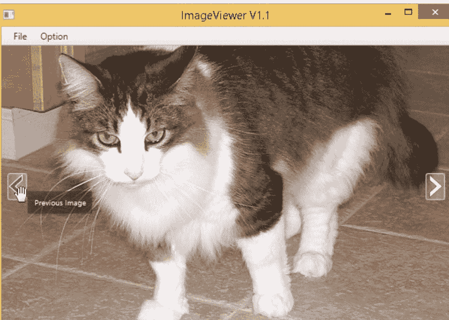

从命令行编译并运行程序，通过 `FileChooser` 的文件打开对话框加载较大和较小图像来测试程序，选择不同的视图，动态调整应用程序窗口，点击“下一个”按钮加载下一个图像，点击“上一个”按钮加载上一个图像，等等。输出如下：

## 在命令行中编译和运行 ImageViewer 的输出

```
Microsoft Windows [Version 6.3.9600]
(c) 2013 Microsoft Corporation. All rights reserved.

F:\My Documents\DocRoot\SHFEN_JAVA\MyBookJFX\VolumeOne\ImageViewer1.1\src\javac -cp encoding utf-8 -Xclint:unchecked imageviewer\*.java

jar cf imageviewer.jar imageviewer

java -CP imageviewer.jar imageviewer.ImageViewer
original size
imageArea width changed from 0.0 to 600.0
imageArea height changed from 0.0 to 375.0
fitwidth
fitheight
```

- `Cursor` 类，位于 `javafx.scene` 包并继承自 `java.lang.Object`，通过 `Cursor` 类型的静态字段定义了一些常用的鼠标光标，如 `CLOSED_HAND`、`CROSSHAIR`、`HAND`、`OPEN_HAND`、`TEXT`、`WAIT` 等。

    （参见 Node Cursor 属性设置）

- `EventHandler<T extends Event>` 是继承 `java.util.EventListener` 的接口，定义了一个在指定事件发生时被调用的处理器 `handler(T event)`。

    （参见“使用方便方法注册事件处理器以处理鼠标事件”章节）

- `MouseEvent`，位于 `javafx.scene.input` 包，是 `javafx.scene.InputEvent` 的子类。它定义了 `MOUSE_CLICKED`、`MOUSE_DRAGGED`、`MOUSE_ENTERED`、`MOUSE_EXITED`、`MOUSE_MOVED`、`MOUSE_RELEASED` 等类型，并提供了 `getX()`、`getY()` 等方法来获取事件发生时鼠标光标的位置。

    （参见“使用方便方法注册事件处理器以处理鼠标事件”章节）

- `Node` 类中提供的一些方便方法，用于注册 `EventHandlers` 来处理鼠标事件。

```java
public final void setMouseClicked(EventHandler<? super MouseEvent> value)
public final void setMouseEntered(EventHandler<? super MouseEvent> value)
public final void setMouseExited(EventHandler<? super MouseEvent> value)
```

    （参见“使用方便方法注册事件处理器以处理鼠标事件”章节）

- `static void install(Node node, Tooltip t)` 方法位于 `Tooltip` 类（该类继承自 `javafx.scene.control.Popup`），当鼠标悬停在给定 `Node` 上时显示帮助。

    （参见“为 Node 安装 Tooltip”）

- `StackPane` 静态方法，用于自定义指定子节点的布局约束：

```java
static void setAlignment(Node child, Pos value)
static void setMargin(Node child, Insets value)
```

    （参见章节：在 StackPane 中调整下一个按钮的默认位置，在 StackPane 中添加上一个按钮并调整其位置）

- `Pos`，位于 `javafx.geometry` 包，是一个枚举类型，定义了位置和对齐的常量，如 `CENTER`、`CENTER_RIGHT`、`TOP_RIGHT` 等。

    （参见章节：在 StackPane 中调整下一个按钮的默认位置，在 StackPane 中添加上一个按钮并调整其位置）

- `Insets`，位于 `javafx.geometry` 包，通常用于 `setMargin` 方法或 `setPadding` 方法，用于指定矩形区域四周（上、右、下、左）的偏移量。

    （参见“在 StackPane 中调整下一个按钮的默认位置”以及此处）

- `FileChooser.ExtensionFilter` 是在 `FileChooser` 类中定义的嵌套类，用于筛选选项，仅保留与给定过滤器匹配的扩展。

    （参见“配置 FileChooser”）

- 位于 `javafx.beans.property` 包的一些类：

    `ObjectProperty<T>`

    是一个抽象类，派自 `javafx.beans.binding.ObjectExpression<T>` 类，实现了 `Property<T>` 和 `WritableObjectValue<T>`。

    `SimpleObjectProperty<T>`

    派自 `ObjectProperty<T>` 类。

    `StringProperty`

    是一个抽象类，派自 `javafx.beans.binding.StringExpression` 类，实现了 `Property<java.lang.String>`，`WritableStringValue` 扩展了 `WritableObjectValue<java.lang.String>`。

    `SimpleStringProperty`

    派自 `StringProperty` 类。

    （参见“在 ImageViewer 类中定义属性”）

- `Property<T>` 接口位于 `javafx.beans.property` 包，定义了所有属性公共的方法，如下：

```java
void bind(ObservableValue<? extends T> observable)
    将此属性单向绑定到给定的 ObservableValue。

void unbind()
    取消此属性的绑定。
```

    （参见“在 ImageViewer 类中定义属性”）

- `WritableObjectValue<T>` 接口位于 `javafx.beans.value` 包并扩展自 `WritableValue<T>`，定义了以下方法：

```java
T get()
    获取封装的值。

void set(T value)
    设置封装的值。
```

    （参见此处）

# 第 3 章

## 带有幻灯片功能的增强图像查看器：能力——开发查看器 V1.2

## 前言

在现阶段，`ImageView` 已经具备了作为高效图像查看工具的足够能力。基于目前构建的基础结构，可以轻松地逐步开发更多功能。

本章重点介绍幻灯片功能的实现以及 GUI 整体外观和感受的微调。我们将演示如何使用位于 `javafx.concurrent` 包中的并发类来开发多线程 Java 程序。

`ImageView` 的版本号升级到 1.2。通过从 `ImageView` V1.2 中摘取的详细描述和文档良好的示例代码，你将熟悉“总结”部分中所述的 JavaFX 库的基本功能。

`ImageView` V1.2 的完整开发过程包含以下步骤：

- 3.1 在 `BorderPane` 底部添加状态栏

  - 3.1.1 创建 `HBox` 作为状态栏并使用 `Text` Node 显示图像名称

  - 3.1.2 设置 `imageNameProperty` 的值

- 3.2 改进按钮的响应方面

  - 3.2.1 禁用按钮以表示没有更多图像可以打开

  - 3.2.2 鼠标按下时更改按钮外观

- 3.3 添加幻灯片功能

  - 3.3.1 添加“开始幻灯片”和“停止幻灯片”菜单项

    - 3.3.1.1 绑定菜单项的禁用属性

  - 3.3.2 在幻灯片上执行幻灯片

    - 3.3.2.1 开始幻灯片和停止幻灯片菜单项

    - 3.3.2.2 在幻灯片上执行幻灯片

    - 3.3.2.3 绑定菜单项的禁用属性

    - 3.3.2.4 在幻灯片上执行幻灯片

```java
StringProperty imageName = new SimpleStringProperty();

Text statusText = new Text("");

statusText.textProperty().bind(imageName);
```

关于何时设置 `imageName` 属性的值，将在下一节中描述。

到目前为止，`ImageViewer` 类中进行的所有更改均在下面的代码段中以**粗体**显示出：

### 导入语句

```
import javafx.scene.layout.HBox;
import javafx.scene.text.Font;
import javafx.scene.text.FontWeight;
import javafx.scene.text.Text;
```

**Listing 3-1.** 一个 `HBox` 状态栏，包含一个用于显示图像名称的 `Text` 节点，为 `Scene` 指定背景颜色，并修改绑定 `maxHeight` 的颜色

```java
public class ImageViewer extends Application {
    ...
    final StringProperty imageName = new SimpleStringProperty();
    ...
    @Override
    public void start(final Stage stage) {
        BorderPane rootPane = new BorderPane();
        final StackPane imageArea = new StackPane();
        // 设置最小大小以避免加载大型图片
        // 时进行调整大小
        imageArea.setMinSize(0, 0);
        rootPane.setCenter(imageArea);

        // 添加状态栏和状态文本
        final HBox statusBar = new HBox();
        statusBar.setPadding(new Insets(4, 12, 4, 12));
        statusBar.setSpacing(4);
        statusBar.setStyle("-fx-background-color: linear-gradient(#FFFF, #708090)");
        final Text statusText = new Text("");
        statusText.textProperty().bind(imageName);
        statusText.setFont(Font.font("Verdana", FontWeight.BOLD, 12));
        statusText.setFill(Color.DARKSLATEBLUE);

        statusBar.getChildren().add(statusText);
        rootPane.setBottom(statusBar);
        ...
    }
}
```


```java
rootPane.setStyle("fx-background-color: transparent;");
final Scene scene = new Scene(rootPane, 600, 400, Color.BLACK);

// 监听切换组中的选择变化
groupOption.selectedProperty().addListener(new ChangeNotifier<Toggle>() {
    @Override
    public void changed(ObservableValue<? extends Toggle> observable, Toggle oldToggle, Toggle newToggle) {
        RadioMenuItem menuItem = (RadioMenuItem) groupOption.getSelected();
        if (menuItem != null) {
            if (menuItem == fitWidth) {
                System.out.println("width");
                imageView.widthProperty().bind(scene.widthProperty());
                imageView.fitHeightProperty().unbind();
                // 除了解绑，还必须将高度设置为 0
                imageView.setHeight(0);
            } else if (menuItem == fitHeight) {
                System.out.println("fitheight");
                // 用于渲染图片的可用高度是
                // 从 scene 高度中减去菜单栏的高度
                // 和状态栏的高度
                imageView.fitHeightProperty().bind(
                    scene.height().subtract(menubar.getHeight() + statusBar.getHeight()));
                imageView.widthProperty().unbind();
                // 除了解绑，还必须将宽度设置为 0
                imageView.setWidth(0);
            } else {
                System.out.println("original size");
                imageView.widthProperty().unbind();
                imageView.fitHeightProperty().unbind();
                // 除了解绑，还必须将高度设置为 0
                imageView.setFixedWidth(0);
            }
            imageView.setHeight(0);
        }
    }
});
```

## 3.1.2 设置 `imageName` 属性

为在状态栏显示图像名称而创建的 `Text` 节点绑定了 `ImageView` 类中定义的 `imageName` 属性。每当打开一个新的图像文件并显示在图像区域上时，就会从 `File` 对象获取图像名称，并设置 `imageName` 属性的值。以下代码片段显示了在状态栏显示图像名称而创建的 `Text` 节点绑定了 `ImageView` 类中定义的 `imageName` 属性。

**Listing 3-2.** 状态项的点击事件处理程序：

**Listing 3-3.** Next 按钮的点击事件处理程序：

**Listing 3-4.** Previous 按钮的点击事件处理程序：

**Listing 3-5.** 状态栏的： 状态： 状态：

**Listing 3-6.** 状态栏的： 状态：

**Listing 3-7.** 定义 `loadFile` 方法：

**Listing 3-8.** `loadFile` 方法在从文件选择器对话框选择并打开文件时被调用：

当 Next（下一页）按钮发生鼠标点击事件时，将加载下一张可用图像并显示在图像渲染区域。与此同时，我们需要检查是否没有更多需要加载的图像。这里是代码片段，更改部分已用粗体字体显示：

## **Listing 3-9.** 在鼠标点击事件处理器中更新 Next 按钮的禁用状态：

```java
Node createNextButton() {
  ...
  // 为 nextButton 注册鼠标点击事件处理器
  buttonGroup.setOnMouseClicked(new EventHandler<MouseEvent>()) {
    @Override
    public void handle(MouseEvent event) {
      // 获取迭代器
      ListIterator<java.nio.file.Path> iterator = listIterator.get();
      if (iterator != null && iterator.hasNext()) {
        java.nio.file.Path path = iterator.next();
        if (lastClickedButton.equals(PREVIOUS)) {
          // 如果上次点击的按钮是 prevButton
          // 第一次调用 next 是当前图像，
          // 必须将光标向前移动一步。
          if (iterator.hasNext()) {
            path = iterator.next();
          } else {
            // 没有下一张图像，禁用 next 按钮
            disableButton(nextButton, true);
            return;
          }
          System.out.format("Next button clicked: %s%n", path.getFileName());
          String url = path.toUri().toString();
          imageName.set(url.substring(url.lastIndexOf("/")+1).replaceAll("%20", " "));
          curImage.set(new Image(url));
          lastClickedButton.set(NEXT);
        }
        // 没有下一张图像时禁用 next 按钮
        disableButton(nextButton, !iterator.hasNext());
        if (prevButton.isDisabled()) {
          disableButton(prevButton, false);
        }
      }
    }
  }
...}
```

当 Previous（上一页）按钮发生鼠标点击事件时，将加载上一张可用图像并显示在图像渲染区域。与此同时，我们需要检查是否没有更多需要加载的上一图像。这里是代码片段，更改部分已用粗体字体显示：

## Listing 3-10. 在鼠标点击事件处理器中更新 Previous 按钮的禁用状态：

```java
Node createPrevButton() {
  ...
  // 为 prevButton 注册鼠标点击事件处理器
  buttonGroup.setOnMouseClicked(new EventHandler<MouseEvent>()) {
    @Override
    public void handle(MouseEvent me) {
      // 获取迭代器
      List<java.nio.file.Path> iterator = listIterator.get();
      if (iterator != null && iterator.hasPrevious()) {
        java.nio.file.Path path = iterator.previous();
      if (lastClickedButton.get().equals(NEXT)) {
        // 上次点击的按钮是 nextButton
        // 第一次调用 previous() 是当前图像，
        // 必须将光标后移动一步
        if (iterator.hasPrevious()) {
          path = iterator.previous();
        } else {
          // 没有上一张图像，禁用 prevButton
          disableButton(prevButton, true);
          return;
        }
      }
      System.out.format("Prev button clicked: %s%n", path.getFileName());
      String url = path.toString();
      imageName.set(url.substring(url.lastIndexOf("/")+1).replaceAll("%20", " "));
      curImage.set(new Image(url));
      lastClickedButton.set(PREVIOUS);
      // 没有上一个文件时禁用 previous 
      disableButton(prevButton, !iterator.hasPrevious());
      if (nextButton.isDisabled()) {
        disableButton(nextButton, false);
      }
    }
  }
}
...
```

图 3-3. 当没有上一个可以打开时，Previous 按钮禁用的截图。

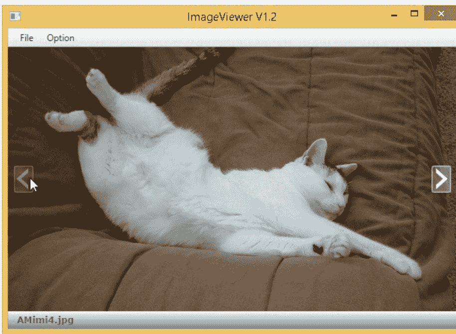

**图 3-4.** 当没有下一个文件可以打开时，Next 按钮禁用的截图。

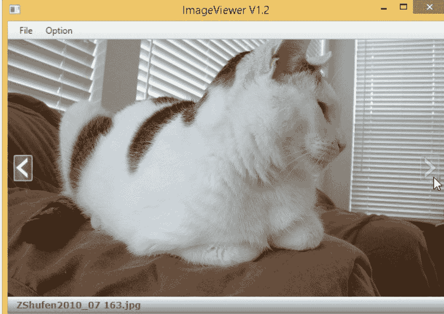

## 3.2.2 当鼠标按下时更改按钮外观

现在，我们将在按钮上发生鼠标按下事件时更改按钮的背景绘制。与此同时，创建 Next 按钮和 Previous 按钮的代码已通过鼠标处理的模块化代码进行了整理。`registerButtonEvent` 方法用于注册以下事件类型（`EventType`）的事件处理器：`MOUSE_ENTERED`、`MOUSE_PRESSED`、`MOUSE_RELEASED` 和 `MOUSE_EXITED`。

当鼠标按下按钮上时，填充矩形的绘制颜色被更改，多边形的绘制颜色与鼠标进入时使用的相同。当鼠标释放或退出按钮时，填充和描边将恢复为原始值。

### 导入语句：

```java
import javafx.scene.paint.Paint;
import javafx.scene.shape.Shape;
```

## Listing 3-11. 定义 `registerButtonEvent` 方法：

```java
/**
 * 此方法注册鼠标进入/按下/释放/退出的事件，
 * 改变按钮的外观以区分不同的状态
 *
 * @param buttonGroup
 * @param rect
 * @param polygon
 * @param bg
 * @param entered
 * @param pressed
 */
void registerButtonEvent(Node buttonGroup,
    final rect, final Shape polygon,
    final bg, final Paint entered, final pressed) {

    // 鼠标进入事件
    // 鼠标进入时更改按钮的外观
    buttonGroup.setOnMouseEntered(new EventHandler<MouseEvent>()) {
        @Override
        public void handle(MouseEvent me) {
            System.out.println("Mouse entered");
            // 检查按钮是否按下
            rect.setFill(me.isButtonDown() ? pressed : entered);
            polygon.setStroke(Color.web("#436BB"));
        }
    });

    // 鼠标按下事件
    // 鼠标按下时更改按钮的外观
    buttonGroup.setOnMousePressed(new EventHandler<MouseEvent>()) {
        @Override
        public void handle(MouseEvent me) {
            System.out.println("Mouse pressed");
            if (me.isButtonDown()) {
                rect.setFill(pressed);
            }
            polygon.setStroke(Color.web("#436BB"));
        }
    });

    // 鼠标退出处理器
    // 鼠标退出时恢复原始外观
    EventHandler<MouseEvent> exited = new EventHandler<MouseEvent>() {
        @Override
        public void handle(MouseEvent event) {
            System.out.println("Mouse exited/released");
            rect.setFill(bg);
            polygon.setFill(Color.WHITE);
            polygon.setStroke(Color.web("#436BB"));
        }
    };
    buttonGroup.setOnMouseExited(exited);

    // 鼠标释放处理器
    // 鼠标释放时恢复原始外观
    buttonGroup.setOnMouseReleased(exited);
}
```

## Listing 3-12. `createNextButton` 变为：

```java
/**

 * 使用 Rectangle 作为背景，Polygon 作为图标，Group 作为容器创建 next 按钮，

 * Rectangle 的大小为 25x35，

 * polygon 的厚度为 8 像素，

 * polygon 的内边距为 (2, 2, 2, 5)，

 * 进入/按下/退出时更改按钮外观。

 * @return
 */

Node createNextButton() {

    // 创建 group 作为按钮

    Group buttonGroup = new Group();
```


// 创建 rectangle 作为背景

final Rectangle rect = new Rectangle(0, 0, 25, 35);

// 使用线性渐变填充 next 按钮

final LinearGradient lg = new LinearGradient(0, 0, 1, 0, true, CycleMethod.NO_CYCLE, new Stop[]{
    new Stop(0, Color.web("#B517A8")),
    new Stop(0.6, Color.web("#A8B9D4")),
    new Stop(1, Color.web("#B7A7C6")));
});

rect.setFill(lg);
rect.setStroke(Color.web("#AC7FF"));
rect.setArcHeight(6.5);
rect.setArcWidth(6.5);

// 鼠标进入 next 按钮时填充矩形

final LinearGradient lgEntered = new LinearGradient(0, 0, 1, 0, true,
    CycleMethod.NO_CYCLE, new Stop[]{
        new Stop(0, Color.web("#A87AC6")),
        new Stop(0.4, Color.web("#8B9D4")),
        new Stop(1, Color.web("#F517A8")));
});

// 鼠标按下 next 按钮时填充矩形

final LinearGradient lgPressed = new LinearGradient(0, 0, 1, 0, true,
    CycleMethod.NO_CYCLE, new Stop[]{
        new Stop(0, Color.web("#A87AC6")),
        new Stop(0.4, Color.web("#8B9D4")),
        new Stop(1, Color.web("#F2F4F4")));
});

// 创建表示 Next 图标的多边形形状
// 8 像素厚度，内缩为 2, 2, 2, 5

final Polygon polygon = new Polygon();
Double[] dArray = {
    5.0, 2.0,
    22.0, 17.0,
    5.0, 32.0,
    5.0, 25.0,
    14.0, 17.0,
    5.0, 9.0};
polygon.getPoints().addAll(dArray);
polygon.setFillColor(Color.WHITE);
polygon.setStroke(Color.web("#436B8B"));

// 设置光标
buttonGroup.setCursor(Cursor.OPEN_HAND);

// 为 nextButton 注册点击事件处理器
buttonGroup.setOnMouseClicked(new EventHandler<MouseEvent>() {
    @Override
    public void handle(MouseEvent me) {
        if (me.getButton() == Mouse.PRIMARY)
            return;

        // 获取迭代器
        ListIterator<java.nio.file.Path> iterator = listIterator.get();
        if (iterator == null && iterator.hasNext())
            java.nio.file.Path path = iterator.next();

        if (lastClicked.get().equals(PREVIOUS)) {
            // 如果上次点击的按钮是 prevButton
            // 第一次调用 next() 是当前图像，
            // 必须将光标向前移动一步。
            if (iterator.hasNext())
                path = iterator.next();
            else
                // 没有下一张图像，禁用 next 按钮
                disableButton(nextButton, true);
                return;
        }
    }
});

```

```java
lastButtonClicked.set(NEXT);

// 当没有后续图片时，禁用下一个按钮
disableButton(nextButton, !iterator.hasNext());

if (prevButton.isDisabled())
    disableButton(prevButton, false);
```

```java
}
);
registerButtonEvent(buttonGroup, rect, polygon, lg, lgEntered, lgPressed);
buttonGroup.getChildren().addAll(rect, polygon);
return buttonGroup;
}
```

### 列表 3-13. createPrevButton 方法变得如下：

```java
/**
 * 使用 Rectangle 作为背景
 * 使用 Polygon 作为图标，Group 作为容器
 * Rectangle 的大小为 25 x 35，
 * polygon 的厚度为 8 像素，
 * polygon 的内边距为 (2, 5, 2, 5)，
 * 当鼠标进入/按下/释放/退出时改变按钮的外观。
 *
 * @return
 */
Node createPrevButton() {
    // 创建一个组作为按钮
    Group buttonGroup = new Group();

    // 创建一个矩形作为背景
    final Rectangle rect = new Rectangle(0, 25, 35);

    // 使用线性渐变填充上一个按钮的矩形
    final LinearGradient lg = new LinearGradient(0, 0, 1, true,
        CycleMethod.NO_CYCLE, new Stop[]{
            new Stop(0, Color.web("#87A7C6")),
            new Stop(0.4, Color.web("#A8B9D4")),
            new Stop(1, Color.web("#5173A8")));
    });

    rect.setFill(lg);
    rect.setStroke(Color.web("#ACD7FF"));
    rect.setArcHeight(6.5);
    rect.setArcWidth(6.5);

    // 当鼠标进入上一个按钮时，绘制填充矩形
    final LinearGradient lgEntered = new LinearGradient(0, 0, 1, true,
        CycleMethod.NO_CYCLE, new Stop[]{
            new Stop(0, Color.web("#5173A8")),
            new Stop(0.6, Color.web("#A8B9D4")),
            new Stop(1, Color.web("#87A7C6"));
    });

    // 当鼠标按下上一个按钮时，绘制填充矩形
    final LinearGradient lg = new LinearGradient(0, 0, 1, true,
        CycleMethod.NO_CYCLE, new Stop[]{
            new Stop(0, Color.web("#2F4F4")),
            new Stop(0.6, Color.web("#A8B9D4")),
            new Stop(1, Color.web("#87A7C6")));
    });

    // 创建一个表示 Next 图标视觉符号的多边形
    // 8像素厚度，内缩为 2, 2, 5
    final Polygon polygon = new Polygon();
    Double[] dArray = {
        19.0, 2.0,
        2.0, 17.0,
        19.0, 32.0,
        19.0, 25.0,
        10.0, 17.0,
        19.0, 9.0};
    polygon.getPoints().addAll(dArray);
    polygon.setFill(Color.WHITE);
    polygon.setStroke(Color.web("#436B8B"));

    // 设置光标
    buttonGroup.setCursor(Cursor.OPEN_HAND);

    // 为 prevButton 鼠标点击处理程序
    buttonGroup.setOnMouseClicked(new EventHandler<MouseEvent>()() {
        @Override
        public void handle(MouseEvent event) {
            if (event.getButton() != MouseButton.PRIMARY)
                return;

            // 获取迭代器
            ListIterator<java.nio.file.Path> iterator = listIterator.get();
            if (iterator != null && iterator.hasPrevious()) {
                java.nio.file.Path path = iterator.previous();
                if (lastClickedButton.get().equals("NEXT")) {
                    // 上一次点击的按钮是 nextButton
                    // previous() 的第一次调用是当前图片
                    // 必须向后移动光标
                    if (iterator.hasPrevious()) {
                        path = iterator.previous();
                    } else {
                        // 没有上一个图片，禁用 prevButton
                        disableButton(prevButton, true);
                        return;
                    }
                }
                System.out.format("Prev button clicked: %s%n", path.getFileName());
                String url = path.toUri().toString();
                curImage.set(new Image(url));
                imageName.set(url.substring(
                    url.indexOf("/") + 1).replaceAll("%20", " "));
            }
        }
        lastClickedButton.set("PREVIOUS");

        // 当没有上一个图片时，禁用上一个按钮
        disableButton(prevButton, !iterator.hasPrevious());
        if (nextButton.isDisabled()) {
            disableButton(nextButton, false);
        }
        registerButtonEvent(buttonGroup, rect, polygon, lg, lgEntered, lgPressed);
        buttonGroup.getChildren().addAll(rect, polygon);
        return buttonGroup;
    }
}
```

**图 3-5.** 鼠标进入事件期间上一个按钮的外观快。
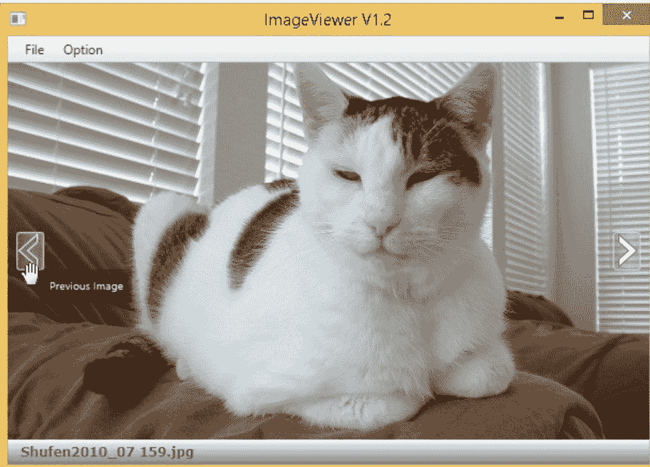

**图 3-6.** 鼠标按下期间上一个按钮的外观快。

**图 3-7.** 鼠标进入期间上一个按钮的外观快。
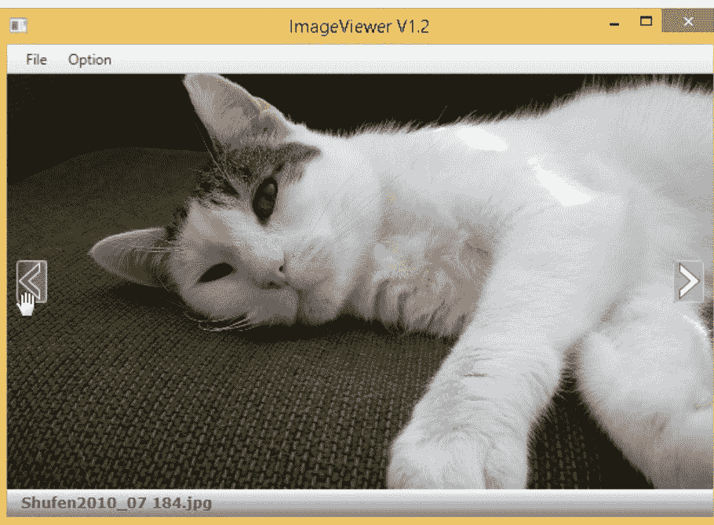

**图 3-8.** 鼠标按下期间上一个按钮的外观快。
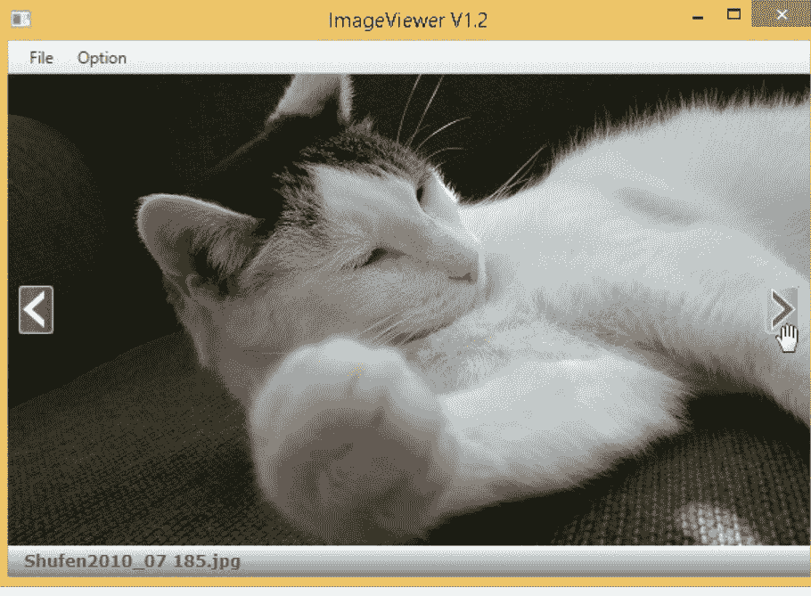

**图 3-9.** 初始选项菜单的外观快，均已禁用。
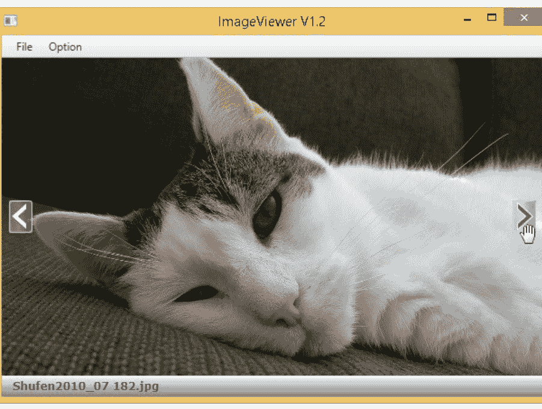

**图 3-10.** 加载图片文件后选项菜单的外观快。
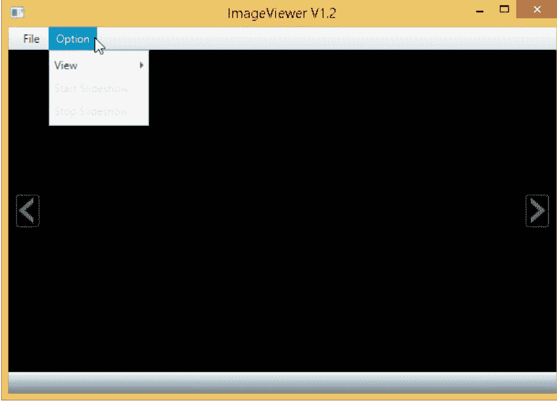

## 3.3.2 在另一个线程上执行幻灯片

将耗时任务委托给另一个线程是一个良好的编程习惯，这样 UI 线程（也称为 Java 应用线程）就可以始终对用户的操作做出响应。

`javafx.concurrent` 包提供了 `Task` 和 `Service` 类，它们都实现了 `Worker` 接口，用于方便地开发多线程 JavaFX。

以下是位于 `javafx.concurrent` 包中的并发类：

### Task

这是一个继承自 `java.util.concurrent.FutureTask` 并实现 `Worker<V>` 接口的抽象类，它是一个一次性的 Worker 对象，不可复用。由于它的父类 `FutureTask` 实现了 `Runnable` 接口，它也是一个 `Runnable` 对象。

通过开始执行一个 Task，你可以使用 `java.lang.Thread` 类的 API 或派自 `Executor` 和 `ExecutorService` 接口的 API（它们都位于 `java.util.concurrent` 包中）。你可以以 Task 为参数创建一个 `Thread` 对象，并调用 `start()` 方法启动该线程。或者，使用 `ExecutorService` 中定义的 `submit(Runnable task)` 方法来提交任务。

在创建 Task 对象或创建 Task 的子类时，重写 `call()` 方法。当任务开始时，会调用 `call()` 方法。

### Service

这是一个继承自 `java.lang.Object` 并实现 `Worker<V>` 接口的抽象类，是一个可复用的 Worker 对象。`Service` 类提供了 `start()`、`cancel()`、`reset()` 和 `restart()` 等方法，以便需要时操作该服务。

在创建 Service 对象或创建 Service 的子类时，重写 `createTask()` 方法。当服务启动时，会调用 `createTask()` 方法。

### ScheduledService

`Service` 类的直接子类，允许指定延迟时间自动启动和重启服务。

### WorkerStateEvent

`javafx.event.Event` 的子类，定义了 `EventTypes` 的静态字段，例如 `WORKER_STATE_CANCELLED`、`WORKER_STATE_FAILED`、`WORKER_STATE_READY`、`WORKER_STATE_RUNNING`、`WORKER_STATE_SUCCEEDED` 等。当 Worker 的状态发生变化时，会触发 `WorkerStateEvent`。

考虑我们的情况：加载文件时会创建一个文件列表，假设文件列表包含一个或多个待查看文件，此时“开始幻灯片”菜单项被启用，用户可以启动幻灯片，在幻灯片运行时取消它，并在稍后再次重启。为了满足这一场景，我们更倾向于使用可复用的 Service 对象而不是一次性的 Task 对象。

#### 3.3.2.1 继承 Service 类的 SlideshowService 类

我们需要创建一个继承 `Service<V>` 类的类。当 Service 启动时，它会执行一个 Task。必须重写下面的 `createTask()` 方法：

```
protected abstract Task<V> createTask()
```

在 `createTask()` 方法中，在创建要返回给调用者的 Task 对象时重写 `call()` 方法（此处应为在 Task 类内部）。

`Task` 中的 `call()` 方法承担了幻灯片的任务，它基本上包含一个 `while` 循环，逐个加载图像，直到满足以下任一条件：文件列表中没有下一张图像，或者幻灯片被用户取消了。

下面的列表演示了如何创建一个可复用的 `SlideshowService`（Service 类的子类），来执行幻灯片任务。

#### 列表 3-15. 创建 SlideshowService 类：

```java
package imageviewer;

import java.nio.file.Path;
import java.util.ListIterator;
import javafx.beans.property.SimpleObjectProperty;
import javafx.beans.property.SimpleStringProperty;
```


# SlideshowService 类实现

```java
import javafx.beans.property.StringProperty;
import javafx.beans.value.ChangeListener;
import javafx.beans.value.ObservableValue;
import java.util.concurrent.Service;
import javafx.util.concurrent.Task;
import javafx.scene.image.Image;

/**
 * File Name: SlideshowService.java
 * (directory: ImageViewer1.2/src/example4/imageviewer/)
 * @Author Shufen Kuo
 */
public class SlideshowService extends Service<Void> {

    private ObjectProperty<Image> image;
    private ObjectProperty<ListIterator<Path>> iterator;
    private StringProperty imageName;
    private ListIterator<Path> it;

    public SlideshowService() {
        this(new SimpleObjectProperty<ListIterator<Path>>(),
             new SimpleObjectProperty<Image>(),
             new SimpleStringProperty());
    }

    public SlideshowService(ObjectProperty<ListIterator<Path>> iterator,
                             ObjectProperty<Image> image, StringProperty imageName) {
        this.image = image;
        this.imageName = imageName;
        this.iterator = iterator;
        this.iterator.addListener(new ChangeListener<ListIterator<Path>>() {
            @Override
            public void changed(ObservableValue<? extends ListIterator<Path>> o,
                                ListIterator<Path> oldVal, ListIterator<Path> newVal) {
                it = newVal;
            }
        });
    }

    public Image getImage() {
        return image.get();
    }

    public void setImage(Image value) {
        image.set(value);
    }

    public ObjectProperty<Image> imageProperty() {
        return image;
    }

    public ListIterator<Path> getIterator() {
        return iterator;
    }

    public void setListIterator(ListIterator<Path> value) {
        iterator.set(value);
    }

    public ObjectProperty<ListIterator<Path>> iteratorProperty() {
        return iterator;
    }

    public String getImageName() {
        return imageName.get();
    }

    public void setName(String value) {
        imageName.set(value);
    }

    public StringProperty imageNameProperty() {
        return imageName;
    }

    @Override
    protected Task<Void> createTask() {
        return new Task<Void>() {
            @Override
            protected Void call() {
                if (it == null) return null;
                while (it.hasNext()) {
                    if (isCancelled()) {
                        updateMessage("Cancelled");
                        break;
                    }
                    String url = it.next().toUri().toString();
                    setImage(new Image(url));
                    setName(url.substring(url.lastIndexOf("/") + 1));
                    // 暂停 3000ms
                    try {
                        Thread.sleep(3000);
                    } catch (InterruptedException ex) {
                        if (isCancelled()) {
                            updateMessage("Cancelled");
                            break;
                        }
                    }
                }
                return null;
            }
        };
    }
}
```

下面的语句创建了一个 `SlideshowService` 对象：

```java
// 创建可复用的 Worker 对象
final SlideshowService service = new SlideshowService(listIterator, curImage, imageName);
```

三个参数传递给 `SlideshowService` 类的构造函数：

- `listIterator`: `ObjectProperty<ListIterator<Path>>` 类型，指定从 FileChooser 打开时创建的文件列表。
- `curImage`: `ObjectProperty<Image>` 类型，绑定到 `ImageView` 对象的图像属性。
- `imageName`: `StringProperty` 类型，绑定到 Text 对象的文本属性，用于在状态栏中显示图像名称。

## 3.3.2.2 配置幻灯片对象

我们定义了一个 `configureSlideshow` 方法来进行配置。一旦创建了服务对象，就会调用该方法执行以下工作：

- 将 `ImageView` 类中 `isSlidesOn` 属性绑定到服务的 `running` 属性。当且仅当服务运行时，`isSlidesOn` 属性的值为 `true`。

```java
BooleanProperty isSlideshowOn = new SimpleBooleanProperty(false);
SlideshowService service = new SlideshowService(listIterator, curImage, imageName);
isSlideshowOn.bind(service.runningProperty());
```

- 注册事件处理器来处理以下类型的 WorkerEvents：`WORKER_STATE_RUNNING`、`WORKER_STATE_SUCCEEDED`、`WORKER_STATE_FAILED` 和 `WORKER_STATE_CANCELLED`。

以下是 `Service` 类中定义的便利方法，用于为上述事件类型注册处理器：

- `public final void setOnRunning(EventHandler<WorkerStateEvent> value)`：设置 `onRunning` 属性的值，提供当 Worker 状态变为 `RUNNING` 时调用的 `handle` 方法实现。
- `public final void setOnSucceeded(EventHandler<WorkerStateEvent> value)`：设置 `onSucceeded` 属性的值，提供当 Worker 状态变为 `SUCCEEDED` 时调用的 `handle` 方法实现。
- `public final void setOnFailed(EventHandler<WorkerStateEvent> value)`：设置 `onFailed` 属性的值，提供当 Worker 状态变为 `FAILED` 时调用的 `handle` 方法实现。
- `public final void setOnCancelled(EventHandler<WorkerStateEvent> value)`：设置 `onCancelled` 属性的值，提供当 Worker 状态变为 `CANCELLED` 时调用的 `handle` 方法实现。

`Worker.State` 是 `javafx.concurrent.Worker` 接口的一个内部类，是一个枚举类型，定义了 Worker 状态的常量，它们是：`CANCELLED`、`FAILED`、`READY`、`RUNNING` 和 `SUCCEEDED`。

初始 Worker 对象处于 `READY` 状态。当 Worker 开始执行任务时，它变为 `SCHEDULED` 状态，不久后进入 `RUNNING` 状态，并保持在 `RUNNING` 状态直到发生以下情况之一：

- 任务成功完成：Worker 变为 `SUCCEEDED` 状态。
- 抛出异常：Worker 变为 `FAILED` 状态。
- 任务被取消：Worker 变为 `CANCELLED` 状态。可以通过调用 `Worker` 接口定义的布尔类型 `cancel()` 方法来取消 Worker。如果取消成功，则返回 `true`。

在处理 `WORKER_STATE_RUNNING` 事件类型的事件处理器中执行的任务是非常微的：

1. 将 `lastClickedButton` 属性的值设置为 `NEXT`，因为幻灯片运行意味着 `Next` 按钮被自动且持续地点击。
2. 检查“上一个”（Previous）按钮是否被禁用，如果是，则启用它。

创建一个单一的 `EventHandler` 来处理多个事件类型的 Worker 状态。用于处理 `WORKER_STATE_SUCCEEDED` 的相同事件处理器也被注册用于处理 `WORKER_STATE_FAILED` 和 `WORKER_STATE_CANCELLED`。当 Worker 状态转换到 SUCCEEDED、FAILED 或 CANCELLED 时需要执行的任务如下：

1. 如果列表迭代器中没有下一个文件，则禁用“下一个”（Next）按钮；否则，启用它。
2. 如果“上一个”（Previous）按钮被禁用，则启用它。

以下是 `configureSlideshow` 方法的实现：

### 导入语句

```java
import javafx.concurrent.WorkerStateEvent;
```

### 列表 3-16. configureSlideshow 方法

```java
/**
 */
void configureSlideshow() {
    // 如果服务正在运行，则 isSlideshow 的值为 true，
    // 否则，它为 false
    isSlideshow.bind(service.runningProperty());

    service.setOnRunning(new EventHandler<WorkerStateEvent>() {
        @Override
        public void handle(WorkerStateEvent event) {
            System.out.println("Service is transited to running status");
            lastMouseClicked.set(NEXT);
            if (prevButton.isDisabled()) {
                disableButton(prevButton, false);
            }
        }
    });

    EventHandler<WorkerStateEvent> taskDone = new EventHandler<WorkerStateEvent>() {
        @Override
        public void handle(WorkerStateEvent event) {
            disableButton(nextButton, !listIterator.get().hasNext());
            if (prevButton.isDisabled()) {
                disableButton(prevButton, false);
            }
        }
    };

    service.setOnSucceeded(taskDone);
    service.setOnFailed(taskDone);
    service.setOnCancelled(taskDone);
}
```

## 3.3.2.3 实现开始幻灯片和停止幻灯片菜单项的动作事件处理器程序

“开始幻灯片”的操作场景如下：当用户点击“开始幻灯片”菜单项时，服务启动，其状态从 READY 变为 SCHEDULED，再变为 RUNNING。一旦服务转换到 RUNNING（此处），`isSlideshow` 属性的值立即变为 `true`，结果导致“停止幻灯片”菜单项的禁用状态变为 false（此处）。

我们使用 `Service` 类提供的 `void start()` 方法来启动服务。该方法是从处理“开始幻灯片”菜单项动作事件的事件处理器中被调用的。在调用 `start()` 方法之前检查服务的状态是非常重要的，这是为了确保服务处于 READY 状态。

`javafx.concurrent.Worker` 接口中定义的 `Worker.State.getState()` 方法用于检查服务的状态。服务只有在处于 READY 状态时才能成功启动。如果不是该状态，则重置它，然后启动服务。

以下是执行这些操作的代码片段：

```java
startSlide.setOnAction(new EventHandler<ActionEvent>() {
    @Override
    public void handle(ActionEvent ae) {
        System.out.println("Start Slideshow...");
        if (service.getState() != Worker.State.READY)
            service.reset(); // transit to READY
        service.start();
    }
});
```

用户可以在幻灯片服务运行时取消某张幻灯片。布尔方法 `cancel()` 是从处理“停止幻灯片”菜单项动作事件的事件处理器中调用的。

以下代码演示了如何实现“开始幻灯片”和“停止幻灯片”菜单项的动作事件处理器程序。

### 导入语句

```java
import javafx.concurrent.Worker;
```

### 列表 3-17. 实现开始幻灯片和停止幻灯片菜单项的动作事件处理器程序

```java
startSlide.setOnAction(new EventHandler<ActionEvent>() {
    @Override
    public void handle(ActionEvent ae) {
        System.out.println("Start Slideshow-");
        if (service.getState() != Worker.State.READY)
            service.reset(); // transit to READY
        // 如果点击的按钮是上一个，
        // 则当前图片是当前的，
        // 在启动服务前向前移动一步
        if (lastClickedButton.get().equals(PREVIOUS) &&
            listIterator.get().hasNext()) {
            listIterator.get().next();
        }
        service.start();
    }
});

stopSlide.setOnAction(new EventHandler<ActionEvent>() {
    @Override
    public void handle(ActionEvent ae) {
        System.out.println("Stop Slideshow-");
        service.cancel();
    }
});
```


## 3.3.3 ImageView Application 的 `complete(Stage stage)` 方法

后续列表显示了 ImageView V1.2 的完整 `start` 方法，更改部分使用了**粗体**。

**列表 3-18.** ImageView V1.2 的 `start` 方法如下：

```java
public class ImageView extends Application {

    ...

    final BooleanProperty isShowOn = SimpleBooleanProperty(false);

    // 创建一个复用的 worker 对象
    final SlideshowService service = new SlideshowService(listIterator, curImage, imageName);

    @Override
    public void start(final Stage stage) {
        BorderPane rootPane = new BorderPane();
        final StackPane imageArea = new StackPane();

        // 设置 StackPane 的最小尺寸以避免加载大图片时发生尺寸调整
        imageArea.setMinSize(0, 0);
        rootPane.setCenter(imageArea);

        // 添加状态栏和状态文本
        final HBox statusBar = new HBox();
        statusBar.setPadding(new Insets(4));
        statusBar.setSpacing(4);
        rootPane.setBottom(statusBar);

        final Text statusText = new Text("");
        statusText.setFont(Font.font("Verdana", Font.BOLD));
        statusText.setFill(Color.DARKBLUE);
        statusBar.getChildren().add(statusText);

        final ImageView imageView = new ImageView();
        imageView.setPreserveRatio(true);
        imageArea.getChildren().add(imageView);

        final Scene scene = new Scene(rootPane, 600, 400);
        stage.setScene(scene);
        stage.setTitle("ImageView Slideshow");
        stage.show();
    }
}
```

```java
// 为“视图”菜单创建子菜单
MenuView menuItem = new MenuView("View");
MenuView.getItems().addAll(fitWidth, fitHeight, original);
```

```java
// 将“原始”设置为默认选择
original.setSelected(true);
```

```java
// 创建开始/停止幻灯片的菜单项
final MenuItem startSlide = new MenuItem("开始幻灯片");
final MenuItem stopSlide = new MenuItem("停止幻灯片");
```

```java
startSlide.disableProperty().bind(isSlideshowOn.or(nextButton.disableProperty()));
stopSlide.disableProperty().bind(isSlideshowOn.not().or(nextButton.disableProperty()));
```

```java
configureSlideshow();
```

```java
// 为“开始幻灯片”菜单项添加处理处理器
startSlide.setOnAction(new EventHandler<ActionEvent>() {
    @Override
    public void handle(ActionEvent event) {
        System.out.println("Start Slideshow...");
        if (service.getState() != Worker.State.READY)
            service.reset(); // 转换到 READY 状态
        // 最后点击的按钮是上一个按钮，
        if (next(event))
            // 图片是当前图片，
            // 在开始幻灯片之前必须将光标移动一步
            if (lastClickedButton.get().equals(PREVIOUS) && listIterator.hasNext())
                listIterator.get().next();
        service.start();
    }
});
```

```java
// 为“停止幻灯片”菜单项添加处理处理器
stopSlide.setOnAction(new EventHandler<ActionEvent>() {
    @Override
    public void handle(ActionEvent event) {
        System.out.println("Stop Slideshow...");
        service.cancel();
    }
});
```

```java
// 向菜单栏添加选项菜单
menuOption.getItems().addAll(menuView, startSlide, stopSlide);
menuBar.getMenus().add(menuOption);
```

```java
// 安装工具提示
Tooltip t = new Tooltip("下一张图片");
Tooltip.install(nextButton, t);

// 为上一个按钮安装工具提示
Tooltip t2 = new Tooltip("上一张图片");
Tooltip.install(prevButton, t2);

// 将下一个按钮的位置调整到 StackPane 的右侧
StackPane.setAlignment(nextButton, Pos.CENTER_RIGHT);
StackPane.setMargin(nextButton, new Insets(8));

// 将上一个按钮的位置调整到 StackPane 的左侧
StackPane.setAlignment(prevButton, Pos.CENTER_LEFT);
StackPane.setMargin(prevButton, new Insets(8));

// 将下一个和上一个按钮添加到 stack pane
imageArea.getChildren().addAll(nextButton, prevButton);

// 监听场景宽度的变化
scene.widthProperty().addListener(new ChangeNotifier<Object>() {
    public void changed(ObservableValue o, Object oldVal) {
        Object newVal = o.getValue();
        System.out.format("场景宽度从 %.1f 变化到 %.1f%n", (double) oldVal, (double) newVal);
    }
});

// 监听场景高度的变化
scene.heightProperty().addListener(new ChangeNotifier<Object>() {
    public void changed(ObservableValue o, Object oldVal) {
        Object newVal = o.getValue();
        System.out.format("场景高度从 %.1f 变化到 %.1f%n", (double) oldVal, (double) newVal);
    }
});

stage.setTitle("ImageView V1.2");
stage.setScene(scene);
stage.show();
```

## 3.3.4 与“加载”菜单项和“上一个”按钮的事件处理器协调

由于幻灯片在自己的线程上运行，当用户点击“加载”菜单或“上一个”按钮时，应用程序仍然对用户的操作保持响应。

为了让幻灯片运行得流畅，我们将完善“加载”菜单项的操作以及“上一个”按钮的鼠标点击事件处理器。也就是说，如果幻灯片未运行，我们将继续加载当前选定的文件或上一个文件。以下列表中的更改已用粗体显示。

请注意，如果用户在幻灯片运行时点击了“下一个”按钮，图像渲染的整体流程看起来并不突兀，因此我们对其进行额外的处理。

**Listing 3-19.** `loadFile` 方法变为如下：

```java
/**
 * @param file
 */
void loadFile(File file) {
    // 创建迭代器
    try {
        ListIterator<java.nio.file.Path> it = FileUtils.listIterator(file.getPath());
        // 更新 listIterator 的值
        listIterator.set(it);
        // 如果幻灯片未开启，加载文件
        // 否则，此处不操作；
        // 因为幻灯片服务将执行任务
        if (!isSlideshowOn.get()) {
            // 如果没有上一个文件则禁用 prevButton，
            // 在调用 next() 之前检查 hasPrevious()
            disableButton(prevButton, !it.hasPrevious());
            file = it.next();
            String url = file.toURI().toString();
            image.set(new Image(url.substring(url.lastIndexOf("/") + 1)));
            // 检查 hasNext，如果没有文件则禁用 nextButton
            disableButton(nextButton, !it.hasNext());
        }
        lastClickedButton.setValue(NEXT);
    } catch (IOException ex) {
    }
}
```

节选自 `createPrevButton` 方法。**Listing 3-20.** “上一个”按钮的鼠标点击事件变为：

```java
// 为“上一个”按钮注册鼠标事件
prevButton.setOnAction(new EventHandler<ActionEvent>() {
    @Override
    public void handle(ActionEvent event) {
        if (prev(event)) {
            // 处理逻辑...
        }
    }
});
```

在 `SlideshowService` 中执行：

```java
public class ImageView extends Application {
    ...
    final StringProperty imageName = new SimpleStringProperty();
    final ObjectProperty<Image> curImage = new SimpleObjectProperty<>();
    // 创建一个可用的 Worker 对象
    final SlideshowService service = new SlideshowService(listIterator, curImage, imageName);
    ...
    @Override
    public void start(final Stage stage) {
        BorderPane rootPane = new BorderPane();
        final StackPane imageArea = new StackPane();
        // 设置 StackPane 的最小大小以避免在加载大图片时发生尺寸调整
        imageArea.setMinSize(0, 0);
        rootPane.setCenter(imageArea);
        ...
        // 将图像视图添加到图像区域
        final ImageView imageView = new ImageView();
        imageView.property().bind(curImage);
        imageView.setPreserveRatio(true);
        imageArea.getChildren().add(imageView);
        // 用于幻灯片中的切换
        ImageView outView = new ImageView();
        outView.preserveRatioProperty().bind(imageView.preserveRatioProperty);
        outView.fitWidthProperty().bind(imageView.fitWidthProperty());
        outView.fitHeightProperty().bind(imageView.fitHeightProperty());
        imageArea.getChildren().add(outView);
        service.setImageView(imageView);
        service.setFadeOutView(outView);
    }
}
```

## 3.4.1 SlideshowService 类的完整源代码

以下列表显示了此阶段 `SlideshowService` 类的完整源代码，更改部分用**粗体**字体显示。

**列表 3-22.** `SlideshowService` 类变为如下：

```java
package imageiewer;

import java.nio.file.Path;
import java.util.ListIterator;
import javafx.animation.FadeTransition;
import javafx.animation.ParallelTransition;
import javafx.animation.Transition;
import javafx.beans.property.ObjectProperty;
import javafx.beans.property.SimpleObjectProperty;
import javafx.beans.property.StringProperty;
import javafx.beans.ChangeListener;
import javafx.beans.ObservableValue;
import javafx.concurrent.Service;
import javafx.concurrent.Task;
import javafx.scene.image.Image;
import javafx.scene.image.ImageView;
import javafx.util.Duration;
```

```java
/*
 * File Name: SlideshowService.java
 * (in directory: ImageView1.2/src/example5/imageiewer/)
 *
 * 在幻灯片之间添加淡入淡出过渡
 *
 * @Author Shufen Kuo
 */
```

```java
public class SlideshowService extends Service<Void> {
    private ObjectProperty<ImageView> imageView = new SimpleObjectProperty();
    private ObjectProperty<ImageView> fadeOutView = new SimpleObjectProperty();
    private ObjectProperty<Image> image;
```


```java
private ObjectProperty<ListIterator<Path>> iterator;

private StringProperty imageName;

private ListIterator<Path> it;
```

```java
public SlideshowService() {
    this(new SimpleObjectProperty<ListIterator<Path>>(),
         new SimpleObjectProperty<Image>(),
         new SimpleStringProperty());
}
```

```java
public SlideshowService(ObjectProperty<ListIterator<Path>> iterator,
    ObjectProperty<Image> image, StringProperty imageName) {
    this.image = image;
    this.imageName = imageName;
    this.iterator = iterator;
    this.iterator.addListener(new ChangeListener<ListIterator<Path>>() {
        @Override
        public void changed(ObservableValue<? extends ListIterator<Path>> oldVal, ListIterator<Path> newVal) {
            it = newVal;
        }
    });
}
```

```java
public ImageView getImageView() {
    return imageView.get();
}

public void setImageView(ImageView value) {
    imageView.set(value);
}

public ObjectProperty<ImageView> imageViewProperty() {
    return imageView;
}

public ImageView getFadeOutImageView() {
    return fadeOutView.get();
}

public void setFadeOutImageView(ImageView value) {
    fadeOutView.set(value);
}

public ObjectProperty<ImageView> fadeOutImageViewProperty() {
    return fadeOutView;
}

public Image getImage() {
    return image.get();
}

public void setImage(Image value) {
    image.set(value);
}

public ObjectProperty<Image> imageProperty() {
    return image;
}

public ListIterator<Path> getIterator() {
    return iterator.get();
}

public void setListIterator(ListIterator<Path> value) {
    iterator.set(value);
}

public ObjectProperty<ListIterator<Path>> iteratorProperty() {
    return iterator;
}

public String getImageName() {
    return imageName.get();
}

public void setImageName(String value) {
    imageName.set(value);
}

public StringProperty imageNameProperty() {
    return imageName;
}

@Override
protected Task<Void> createTask() {
    return new Task<Void>() {
        @Override
        Void call() {
            if (it == null) return null;
            ParallelTransition animate = null;
            Image inView = imageView.get();
            ImageView outView = fadeOutView.get();
            if (inView != null && outView != null) {
                FadeTransition fadeIn = new FadeTransition(Duration.millis(200));
                fadeIn.setFromValue(0.0);
                fadeIn.setToValue(1.0);
                FadeTransition fadeOut = new FadeTransition(Duration.millis(200));
                fadeOut.setFromValue(1.0);
                fadeOut.setToValue(0.0);
                animate = new ParallelTransition(fadeIn, fadeOut);
            }
            while (it.hasNext()) {
                if (isCancelled()) {
                    updateMessage("Cancelled");
                    break;
                }
                if (inView != null && outView != null) {
                    Image prevImage = inView.getImage();
                    outView.setImage(prevImage);
                }
                String url = it.next().toString();
                inView.setImage(new Image(url));
                if (animate != null) {
                    animate.play();
                }
                try {
                    Thread.sleep(3000);
                } catch (InterruptedException ex) {
                    if (isCancelled()) {
                        break;
                    }
                }
            }
            return null;
        }
    };
}
```

### 3.5 Viewer V1.2 的完整源代码

列表 3-23. ImageViewer 类的完整源代码：

```java
package imageviewer;

import java.io.File;
import java.io.IOException;
import java.util.ListIterator;
import javafx.application.Application;
import javafx.application.Platform;
import javafx.beans.property.BooleanProperty;
import javafx.beans.property.ObjectProperty;
import javafx.beans.property.SimpleObjectProperty;
import javafx.beans.property.SimpleStringProperty;
import javafx.beans.property.StringProperty;
import javafx.beans.value.ChangeListener;
import javafx.beans.value.ObservableValue;
import javafx.concurrent.Worker;
import javafx.concurrent.WorkerStateEvent;
import javafx.event.ActionEvent;
import javafx.event.EventHandler;
import javafx.geometry.Insets;
import javafx.geometry.Pos;
import javafx.scene.Cursor;
import javafx.scene.Group;
import javafx.scene.Node;
import javafx.scene.Scene;
import javafx.scene.control.Menu;
import javafx.scene.control.MenuBar;
import javafx.scene.control.MenuItem;
import javafx.scene.control.RadioMenuItem;
import javafx.scene.control.ToggleGroup;
import javafx.scene.control.Tooltip;
import javafx.scene.image.Image;
import javafx.scene.image.ImageView;
import javafx.scene.input.MouseButton;
import javafx.scene.input.MouseEvent;
import javafx.scene.layout.BorderPane;
import javafx.scene.layout.HBox;
import javafx.scene.layout.Pane;
import javafx.scene.paint.Color;
import javafx.scene.paint.CycleMethod;
import javafx.scene.paint.LinearGradient;
import javafx.scene.paint.Paint;
import javafx.scene.paint.Stop;
import javafx.scene.shape.Polygon;
import javafx.scene.shape.Rectangle;
import javafx.scene.shape.Shape;
import javafx.scene.text.Font;
import javafx.scene.text.FontWeight;
import javafx.scene.text.Text;
import javafx.stage.FileChooser;
import javafx.stage.Stage;

/**
 * 文件名: ImageViewer.java V1.2
 * (目录: ImageViewer1.2/src/example5/imageviewer/)
 * 此应用程序创建了一个 BorderPane 作为场景的根节点，
 * 在 BorderPane 的中心添加了一个 StackPane
 * 场景的初始大小设置为 600 x 400
 * 当用户调整窗口大时，StackPane 的大小将随之调整
 * 在 BorderPane 顶部添加菜单栏
 * 创建文件（File）菜单，使用 FileChooser
 * 选择图像文件，加载并在渲染中显示图像
 * 创建包含视图（View）子菜单的选项（Option），让用户选择图像
 * 法则：适应宽度 (Fit Width)、适应高度 (Fit Height) 或默认选项原始大小 (Original Size)
 * 使用 bind 和 unbind 方法调整图像查看：
 * 将图像视图的宽度/高度属性绑定到
 * 场景的宽度/高度属性上；
 * 因此，每当场景调整大时，图像视图的大小将自动更改
 * 在场景中添加“下一个”（Next）和“上一个”（Previous）按钮，
 * 在加载第一张图像后，用户可以使用这些按钮
 * 在不打开 FileChoose 的情况下查看下一个或预览图像
 * 调整“下一个”按钮在 StackPane 中的默认位置
 * 添加“上一个”按钮并调整其在 StackPane 中的位置
 * 为“下一个”和“上一个”按钮实现鼠标点击事件处理器
 * 添加状态栏显示图像名称
 * 禁用按钮表示没有更多图像可以打开
 * 区分不同事件类型之间的按钮外观：
 * 进入(entered)/按下(pressed)/释放(released)/离开(exit)
 * 使用带有加载菜单项和“上一个”按钮的事件处理器执行操作
 * 为幻灯片添加淡入过渡效果
 * @author Shufen Kuo
 */
public class ImageViewer extends Application {
    final Node nextButton = createNextButton();
    final Node prevButton = createPrevButton();
    {
        disableButton(nextButton, true);
        disableButton(prevButton, true);
    }
    // 创建切换组
    final ToggleGroup groupOption = new ToggleGroup();
    final String FIT_WIDTH = "Fit Width";
    final String FIT_HEIGHT = "Fit Height";
    final String ORIGINAL_SIZE = "Original Size";
    // 用于遍历当前选择目录下的文件
    final ObjectProperty<ListIterator<java.nio.file.Path>> listIterator = new SimpleObjectProperty<>();
    final String NEXT = "NEXT";
    final String PREVIOUS = "PREVIOUS";
    // 用于跟踪上点击的按钮
    final StringProperty lastClickedButton = new SimpleStringProperty();
    final ObjectProperty<Image> curImage = new SimpleObjectProperty<>();
    final StringProperty imageName = new SimpleStringProperty();
    final BooleanProperty isSlideshowOn = new SimpleBooleanProperty(false);
    // 创建一个工作对象
    final SlideshowService service = new SlideshowService(listIterator, curImage, imageName);

    @Override
    public void start(final Stage stage) {
        BorderPane rootPane = new BorderPane();
        final StackPane imageArea = new StackPane();
        // 设置 StackPane 的最小尺寸以避免在
        // 加载大尺寸图像调整调整
        imageArea.setMinSize(0, 0);
        rootPane.setCenter(imageArea);
        // 添加状态栏和状态文本
        final HBox statusBar = new HBox();
        statusBar.setPadding(new Insets(4, 12, 4, 12));
        statusBar.setStyle("-fx-background-color: linear-gradient(#FFFF, #708090)");
        final Text statusText = new Text("");
        statusText.textProperty().bind(imageName);
```


## JavaFX 图像查看器实现

### 界面初始化与状态栏设置

```java
statusText.setFont(new Font("Verdana", FontWeight.BOLD, 12));
statusText.setFill(Color.DARKSLATEBLUE);
statusBar.getChildren().add(statusText);
rootPane.setBottom(statusBar);
```

### 图像视图创建与绑定

```java
// 创建图像视图，添加到图像区域
final ImageView imageView = new ImageView();
imageView.imageProperty().bind(curImage);
imageView.setPreserveRatio(true);
imageArea.getChildren().add(imageView);
```

### 幻灯片淡入过渡设置

```java
// 幻灯片中的淡入过渡
ImageView outView = new ImageView();
outView.preserveRatioProperty().bind(imageView.preserveRatioProperty);
outView.widthProperty().bind(imageView.fitWidthProperty);
outView.heightProperty().bind(imageView.fitHeightProperty);
imageArea.getChildren().add(outView);
service.setImageView(outView);
service.setOutImageView(outView);
```

### 场景与根节点配置

```java
// 从 JavaFX 8 开始，为了看到场景的背景颜色，
// 必须将根节点的设置为设置为透明
rootPane.setStyle("-fx-background-color:transparent;");
final Scene scene = new Scene(rootPane, 600, 400, Color.BLACK);
```

### 菜单栏构建

```java
// 添加菜单栏
MenuBar menuBar = new MenuBar();
Menu menuFile = new Menu("文件");
MenuItem load = new MenuItem("加载");
MenuItem exit = new MenuItem("退出");
menuFile.getItems().addAll(load, exit);
menuBar.getMenus().add(menuFile);
rootPane.setTop(menuBar);
```

### 退出菜单项事件处理

```java
// 为退出菜单项添加动作
exit.setOnAction(new EventHandler<ActionEvent>() {
    @Override
    public void handle(ActionEvent e) {
        Platform.exit();
    }
});
```

### 文件选择器与加载功能

```java
// 创建文件选择器
FileChooser chooser = new FileChooser();
chooser.setTitle("打开图像文件");

// 为加载项添加动作
load.setOnAction(new EventHandler<ActionEvent>() {
    @Override
    public void handle(ActionEvent e) {
        // 显示文件对话框
        File file = chooser.showOpenDialog(stage);
        if (file != null) {
            // 设置迭代器并加载图像
            listIterator.set(Files.newDirectoryIterator(file.toPath()));
            if (listIterator.get().hasNext()) {
                curImage.set(new Image(listIterator.get().next().toURL()));
                imageName.set(file.getName());
            }
        }
    }
});
```

### 选项菜单与视图子菜单

```java
// 创建选项菜单
Menu menuOption = new Menu("选项");

// 创建视图子菜单
Menu menuView = new Menu("视图");

// 创建适应菜单项
MenuItem fitWidth = new MenuItem("适应宽度");
MenuItem fitHeight = new MenuItem("适应高度");
MenuItem original = new MenuItem("原始大小");
menuView.getItems().addAll(fitWidth, fitHeight, original);

// 设置原始大小为默认
original.setSelected(true);

// 创建幻灯片菜单项
MenuItem startSlide = new MenuItem("开始幻灯片");
MenuItem stopSlide = new MenuItem("停止幻灯片");
```

### 视图切换监听器

```java
// 监听切换组的选择器
groupOption.selectedToggleProperty().addListener(new Listener<Toggle>() {
    public void changed(ObservableValue<? extends Toggle> ov, Toggle oldToggle, Toggle newToggle) {
        if (newToggle == fitWidth) {
            imageView.heightProperty().unbind();
            imageView.fitWidthProperty().bind(scene.widthProperty());
        } else if (newToggle == fitHeight) {
            imageView.widthProperty().unbind();
            imageView.fitHeightProperty().bind(scene.heightProperty());
        } else {
            imageView.fitWidthProperty().unbind();
            imageView.fitHeightProperty().unbind();
            imageView.widthProperty().bind(null);
            imageView.heightProperty().bind(null);
        }
    }
});
```

### 菜单项组装

```java
// 将菜单项添加到菜单栏
menuOption.addAll(menuView, startSlide, stopSlide);
menuBar.getMenus().add(menuOption);
```

### 幻灯片控制事件处理

```java
// 为开始幻灯片菜单项添加动作
startSlide.setOnAction(new EventHandler<ActionEvent>() {
    @Override
    public void handle(ActionEvent e) {
        System.out.println("开始幻灯片...");
        if (service.getState() != Worker.State.READY)
            service.reset(); // 重置就绪
        // 如果上次点击的按钮是上一个，
        // 则下一个图像是当前图像，
        // 在启动服务前向前移动迭代器
        if (lastClickedButton.get().equals("PREVIOUS") &&
            listIterator.get().hasNext()) {
            listIterator.get().next();
        }
        service.start();
    }
});

// 为停止幻灯片菜单项添加动作
stopSlide.setOnAction(new EventHandler<ActionEvent>() {
    @Override
    public void handle(ActionEvent e) {
        System.out.println("停止幻灯片...");
        service.cancel();
    }
});
```

### 按钮布局与场景监听

```java
StackPane.setMargin(prevButton, Insets(8));
// 将下一个按钮和上一个按钮添加到堆栈面板
imageArea.getChildren().addAll(nextButton, prevButton);

// 监听场景宽度的变化
scene.widthProperty().addListener(new ChangeListener<Object>() {
    public void changed(ObservableValue o, Object oldVal, Object newVal) {
        System.out.format("Scene width changed from %.1f to %.1f%n",
            (double) oldVal, (double) newVal);
    }
});
```

### 窗口显示

```java
stage.setTitle("ImageView V1.2");
stage.setScene(scene);
stage.show();
```

## 自定义按钮创建

### 创建下一个按钮

使用矩形作为背景创建下一个按钮：
- 使用多边形作为图标，`Group` 作为容器
- 矩形的大小为 25x35
- 多边形的厚度为 8 像素
- 多边形的内边为 (2, 2, 2, 5)
- 在鼠标进入/按下/释放/退出时改变按钮外观

```java
Node createNextButton() {
    // 创建一个 group 作为按钮
    Group buttonGroup = new Group();
    
    // 创建一个矩形形状作为背景
    final Rectangle rect = new Rectangle(0, 0, 25, 35);
    
    // 矩形的视觉效果
    final LinearGradient lg = new LinearGradient(0, 0, 1, 0, true, 
        CycleMethod.NO_CYCLE, new Stop[]{
            new Stop(0, Color.web("#5173AB")),
            new Stop(0.6, Color.web("#A8B9D4")),
            new Stop(1, Color.web("#87A7C6"))
    });
    rect.fill(lg);
    rect.setStroke(Color.web("#ACD7FF"));
    rect.setArcHeight(6.5);
    rect.setArcWidth(6.5);
}
```

### 鼠标进入状态渐变

```java
// 当鼠标进入下一个按钮时绘制并填充矩形
LinearGradient lgEntered = new LinearGradient(0, 0, 0, true,
    CycleMethod.NO_CYCLE, new Stop[]{
        new Stop(0, Color.web("#87A7C6")),
        new Stop(0.4, Color.web("#A8B9D4")),
        new Stop(1, Color.web("#5173A8"))
    });
```

### 鼠标按下状态渐变

```java
// 当鼠标按下下一个按钮时绘制并填充矩形
LinearGradient lgPressed = new LinearGradient(0, 0, 1, true,
    CycleMethod.NO_CYCLE, new Stop[]{
        new Stop(0, Color.web("#87A7C6")),
        new Stop(0.4, Color.web("#A8B9D4")),
        new Stop(1, Color.web("#2F4F4F"))
    });
```

### 多边形图标创建

```java
// 创建一个代表“下一个”图标视觉符号的多边形
// 8像素厚度，内缩为 2, 2, 2, 5
final Polygon polygon = new Polygon();
Double[] dArray = {
    5.0, 2.0,
    22.0, 17.0,
    5.0, 32.0,
    5.0, 25.0,
    14.0, 17.0,
    5.0, 9.0
};
polygon.getPoints().addAll(dArray);
polygon.fill(Color.WHITE);
polygon.setStroke(Color.web("#436B8B"));
```

### 光标设置

```java
// 设置光标
buttonGroup.setCursor(Cursor.HAND);
```

### 鼠标点击事件处理

```java
// 为 nextButton 注册鼠标点击事件处理器
buttonGroup.setOnMouseClicked(new EventHandler<MouseEvent>() {
    @Override
    public void handle(MouseEvent event) {
        if (event.getButton() != MouseButton.PRIMARY) {
            return;
        }
        
        // 迭代器
        java.nio.file.Path path = iterator.next();
        if (lastClickedButton.equals("PREVIOUS")) {
            // 如果上一次点击的是 prevButton
            // 第一次调用 next() 是当前图片，
            // 必须将光标向前移动。
            if (iterator.hasNext()) {
                path = iterator.next();
            } else {
                // 没有下一个图片，禁用下一个按钮
                disableButton(nextButton, true);
                return;
            }
        }
        
        System.out.format("Next button clicked: %s%n", path.getFileName());
        String url = path.toUri().toString();
        lastClickedButton.set(NEXT);
        
        // 没有下一个图片时禁用下一个按钮
        disableButton(nextButton, !iterator.hasNext());
    }
});
```


```java
if (prevButton.isDisabled()) {
    disableButton(prevButton, false);
}
```

```java
registerButtonEvent(buttonGroup, rect, lg, lgEntered, lgPressed);
buttonGroup.getChildren().addAll(rect, polygon);
return buttonGroup;
```

### 使用矩形作为背景创建上一个按钮

- 使用多边形作为图标，`Group` 作为容器
- 矩形的大小为 25x35
- 多边形的厚度为 8 像素
- 多边形的内边为 (2, 5, 2, 5)
- 在鼠标进入/按下/释放/退出时改变按钮外观

```java
Node createPrevButton() {
    // 创建一个 group 作为按钮
    Group buttonGroup = new Group();

    // 创建一个矩形形状作为背景
    final Rectangle rect = new Rectangle(0, 0, 25, 35);

    // 矩形的视觉效果
    final LinearGradient lg = new LinearGradient(0, 0, 1, 0, true,
        CycleMethod.NO_CYCLE, new Stop[]{
            new Stop(0, Color.web("#A76CC")),
            new Stop(0.4, Color.web("#A8B9D4")),
            new Stop(1, Color.web("#5173A8"))
        });
    rect.setFill(lg);
    rect.setStroke(Color.web("#ACD7FF"));
    rect.setArcHeight(6.5);
    rect.setArcWidth(6.5);
}
```

```java
// 当鼠标进入上一个按钮时绘制并填充矩形
LinearGradient lgEntered = new LinearGradient(0, 0, 1, 0, true,
    CycleMethod.NO_CYCLE, new Stop[]{
        new Stop(0, Color.web("#5173A8")),
        new Stop(0.6, Color.web("#A8B9D4")),
        new Stop(1, Color.web("#A76CC"))
    });
```

```java
// 当鼠标按下上一个按钮时绘制并填充矩形
LinearGradient lgPressed = new LinearGradient(0, 0, 1, 0,
    CycleMethod.NO_CYCLE, new Stop[]{
        new Stop(0, Color.web("#B2F4F4")),
        new Stop(0.6, Color.web("#AB89D4")),
        new Stop(1, Color.web("#87A7C6"))
    });
```

```java
// 创建代表“上一个”图标符号的多边形形状
// 8像素厚度，内缩为 2, 2, 2, 5
final Polygon polygon = new Polygon();
Double[] dArray = {
    19.0, 2.0,
    2.0, 17.0,
    19.0, 32.0,
    19.0, 25.0,
    10.0, 17.0,
    19.0, 9.0
};
polygon.getPoints().addAll(dArray);
polygon.fill(Color.WHITE);
polygon.setStroke(Color.web("#436B8B"));
```

```java
// 设置光标
buttonGroup.setCursor(Cursor.HAND);
```

```java
// 为 prevButton 注册鼠标点击事件处理器
buttonGroup.setOnMouseClicked(new EventHandler<MouseEvent>() {
    @Override
    public void handle(MouseEvent event) {
        if (event.get() != MouseButton.PRIMARY) {
            return;
        }
        // 迭代器
        Iterator<java.nio.file.Path> iterator = listIterator.get();
        if (iterator != null && iterator.hasNext()) {
            java.nio.file.Path path = iterator.next();
            if (lastClickedButton.equals("NEXT")) {
                // 如果上一次点击的是 nextButton
                // 第一次调用 previous() 是当前图片，
                // 必须将光标向后移动。
                if (iterator.hasNext()) {
                    path = iterator.next();
                } else {
                    // 没有上一个图片，禁用上一个按钮
                    disableButton(prevButton, true);
                    return;
                }
            }
            System.out.format("Prev button clicked: %s%n", path.getFileName());
            String url = path.toUri().toString();
            lastClickedButton.set(PREVIOUS);
            // 没有上一个图片时禁用上一个按钮
            disableButton(prevButton, !iterator.hasNext());
            if (nextButton.isDisabled()) {
                disableButton(nextButton, false);
            }
        }
    }
});
```

### registerButton 方法

此方法注册了鼠标进入/按下/释放/离开事件，改变按钮的外观，以区分不同的状态。

```java
void registerButton(Node buttonGroup,
    final Shape rect, final Shape polygon,
    final Paint bg, final Paint entered, final Paint pressed) {

    // 注册鼠标进入事件处理器
    buttonGroup.setOnMouseEnter(new EventHandler<MouseEvent>() {
        @Override
        public void mouseEntered(MouseEvent event) {
            System.out.println("mouse entered");
            // 检查左键是否被按下
            rect.setFill(event.isPrimaryButton() ? pressed : entered);
            polygon.setFill(Color.web("#436B8B"));
            polygon.setStroke(Color.WHITE);
        }
    });

    // 注册鼠标按下事件处理器
    // 当鼠标按下时改变按钮的外观
    buttonGroup.setOnPressed(new EventHandler<MouseEvent>() {
        @Override
        public void mousePressed(MouseEvent event) {
            System.out.println("mouse pressed");
            if (event.isPrimaryButton()) {
                rect.setFill(pressed);
                polygon.setFill(Color.web("#436B8B"));
                polygon.setStroke(Color.WHITE);
            }
        }
    });

    // 鼠标离开事件处理器
    // 当鼠标离开时恢复到原始外观
    EventHandler<MouseEvent> exited = new EventHandler<MouseEvent>() {
        @Override
        public void handle(MouseEvent me) {
            System.out.println("Mouse exited/released");
            rect.fill(bg);
            polygon.setFill(Color.WHITE);
            polygon.setStroke(Color.web("#436B88"));
        }
    };

    buttonGroup.setMouseExited(exited);

    // 注册鼠标释放事件处理器
    // 当鼠标释放时恢复到原始外观
    // 外观与鼠标离开时相同
    buttonGroup.setMouseReleased(exited);
}
```

### configureSlideshow 方法

```java
void configureSlideshow() {
    // 如果服务正在运行，则 isSlidesOn 的值为 true
    // 否则，为 false
    isSlidesOn.onRunning.bind(service.runningProperty());
}

service.setOnRunning(new EventHandler<WorkerStateEvent>() {
    @Override
    public void handle(WorkerStateEvent we) {
        System.out.println("Service is transitioned to running status");
        lastButtonClicked.set(NEXT);
        if (prevButton.isDisabled()) {
            disableButton(prevButton, false);
        }
    }
});

EventHandler<WorkerStateEvent> taskDone = new EventHandler<WorkerStateEvent>() {
    @Override
    public void handle(WorkerStateEvent we) {
        disableButton(nextButton, !listIterator.get().hasNextNext());
        if (prevButton.isDisabled()) {
            disableButton(prevButton, false);
        }
    }
};

service.setOnSucceeded(taskDone);
service.setOnFailed(taskDone);
service.setOnCancelled(taskDone);
```

```java
public static void main(String[] args) {
    launch(args);
}
```

以下快照显示了淡入/淡出过渡效果。由于我们使用了 `ParallelTransition` 而不是 `SequentialTransition`。

**图 3-12.** 正在淡出的图像快照

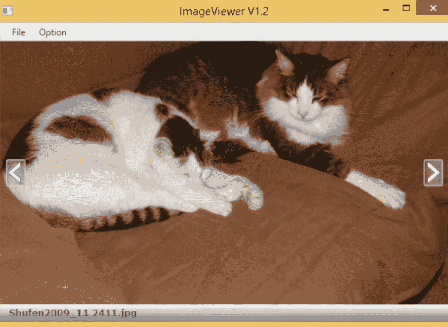

**图 3-13.** 并行方式执行的淡入和淡出过渡的快照。

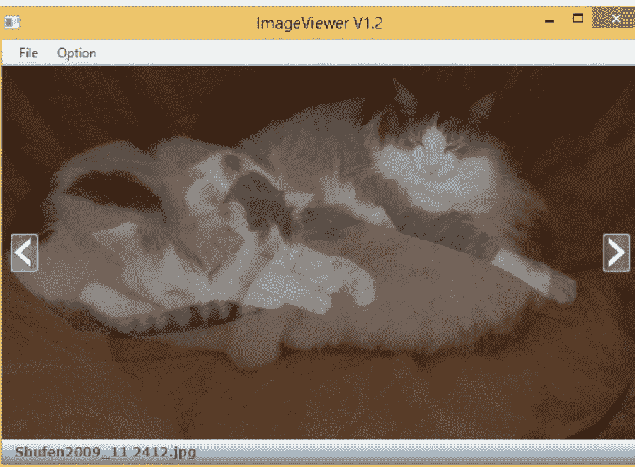

**图 3-14.** 正在淡入的图像快照。

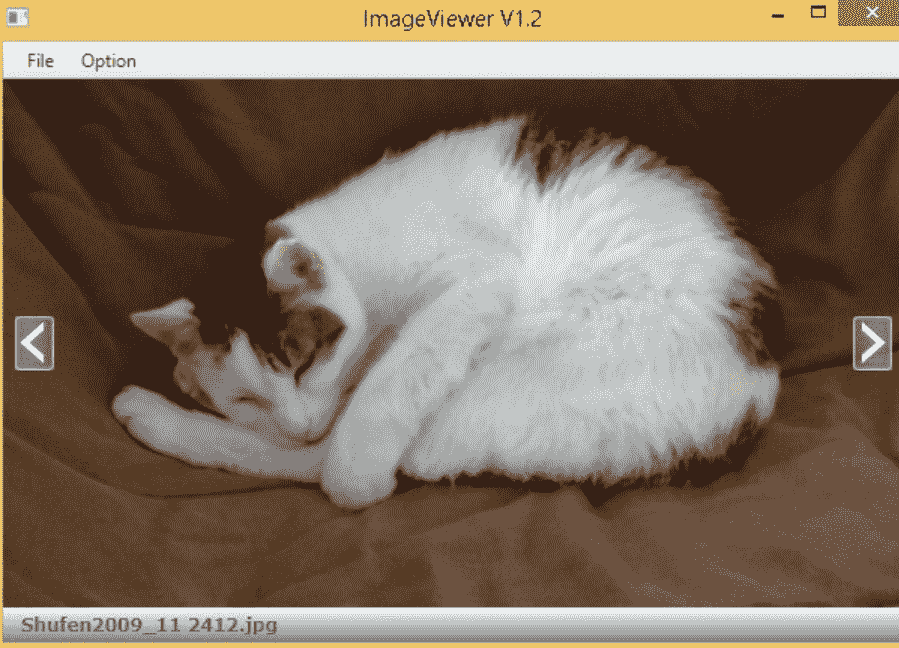

编译并运行应用程序。尝试以下步骤进行测试：

- 从 `FileChooser` 的文件打开对话框在图像目录中加载图像文件。
- 启动幻灯片。
- 在幻灯片运行时，执行以下操作：
  - 来回切换不同的视图（`View`）选项。
  - 点击上一个（`Previous`）或下一个（`Next`）按钮。
- 从 `FileChooser` 的文件打开对话框在另一个图像目录中加载另一个图像。
- 停止幻灯片。

## 在命令行中编译和运行 ImageViewer 的输出

```
Microsoft Windows [Version 6.3.9600]
(c) 2013 Microsoft Corporation. All rights reserved.

F:\My Documents\DocRoot\SHUFEN_JAVA\MyBookJFX\VolumeOne\ImageViewer1.2\
javac -encoding utf-8 -Xlint:unchecked imageviewer\*.java

jar imageviewer.jar imageviewer

java -cp imageviewer.jar imageviewer.ImageViewer
original size
imageArea width changed from 0.0 to 600.0
imageArea height changed from 0.0 to 352.0
Start Slides...
Service is transited to running status
imageArea width changed from 0.0 to 600.0
imageArea height changed from 0.0 to 352.0
Start Slides...
Service is transited to running status
imageArea width changed from 0.0 to 600.0
imageArea height changed from 0.0 to 352.0
```

- `BooleanExpression` 类位于 `javafx.beans.binding` 包中，是一个实现 `ObservableBoolean` 的抽象类，`ObservableBoolean` 是扩展了 `Observable<java.lang.Boolean>` 的接口。`BooleanExpression` 类提供了如 AND、OR 和 NOT 等逻辑操作的便利方法。（[此处](#)）

- `BooleanExpression` 类的一些便利方法：

  - `BooleanBinding not()`：对此 `BooleanExpression` 执行逻辑 NOT 操作，并返回一个 `BooleanBinding` 类型的对象，该对象是 `BooleanExpression` 的直接子类。
  - `BooleanBinding or(ObservableBooleanValue other)`：对 `BooleanExpression` 和给定的 `ObservableBooleanValue` 执行逻辑 OR 操作，并返回一个 `BooleanBinding` 类型的对象，该对象是 `BooleanExpression` 的直接子类。（[此处](#)）

- `Worker<V>` 是一个位于 `javafx.concurrent` 包的接口，它定义了并发实现的通用 API。（参见“在线程上执行幻灯片”章节）

- 并发类位于 `javafx.concurrent` 包中：
  - `Task`：一个实现 `Worker<V>` 接口的抽象类，是一个单次使用的 `Worker` 对象。
  - `Service`：一个实现 `Worker<V>` 接口的抽象类，是一个可重用的 `Worker` 对象。
  - `ScheduledService`：`Service` 类的直接子类，允许指定延迟时长以自动启动和重启服务。
  - `WorkerStateEvent`：`javafx.event.Event` 的子类，定义了事件类型的静态字段，例如 `WORKER_STATE_CANCELLED`、`WORKER_STATE_FAILED`、`WORKER_STATE_READY`、`WORKER_STATE_RUNNING`、`WORKER_STATE_SUCCEEDED` 等。当 `Worker` 的状态发生变化时会触发 `WorkerStateEvent`。（参见“在线程上执行幻灯片”章节）

- `Task` 类中的 `protected abstract V call()` 方法必须被重写，在任务执行时调用。（[此处](#) [此处](#) [此处](#)）


- `Service` 类中的 `protected abstract Task<V> createTask()` 方法必须被重写，在服务启动时调用。（[此处](#) [此处](#) | [此处](#)）

- `Service` 类提供了一些用于注册 EventHandler 以处理 Worker 状态的方法：

```java
public void setEventHandler(EventHandler<WorkerStateEvent> value)
public void setOnSucceeded(EventHandler<WorkerStateEvent> value)
public void setOnFailed(EventHandler<WorkerStateEvent> value)
public void setOnCancelled(EventHandler<WorkerStateEvent> value)
```

（参见章节 [配置幻灯片服务对象](#））

- `Worker.State` 是 `javafx.concurrent.Worker` 接口的嵌套类，是一个枚举类型，定义了 Worker 状态的常量，它们是：`CANCELLED`、`FAILED`、`READY`、`RUNNING`、`SCHEDULED` 和 `SUCCEEDED`。

（参见 [此处](#) 和 [此处](#））

- `Service` 类中提供的一些方法：

```java
public void start()
启动此服务；只有当服务处于 READY 状态时才能成功启动。

public void reset()
重置此服务；结果服务的状态将转换到 READY 状态。

Worker.State getState()
定义在 Worker 接口中，获取状态属性的值，该值代表 Worker 的当前状态。

public boolean cancel()
定义在 Worker 接口中，取消此服务，如果服务取消成功则返回 true。
```

（参见章节 [为启动幻灯片和停止幻灯片菜单项实现动作事件的处理器](#））

- `javafx.animation` 包中用于执行切换的一些类：


在幻灯片之间并行执行淡入和淡出效果的动画：

| 动画 | 切换 |
| :--- | :--- |
| | FadeTransition |
| | ParallelTransition |

（参见“在幻灯片之间添加淡入切换”）

- `javafx.util.Duration` 类实现了 `java.lang.Comparable<Duration>`，持有持续时间。（[此处](#））

- `Animation` 类提供的 `public void playFromStart()` 方法，从起始位置播放动画。（[此处](#））

# 结语

作者正在编写该系列书籍的其他卷册，并将很快陆续发布。让我们预览一下除“前言”部分中介绍的内容之外的即将推出的特性：

- 更多交互绘图工具：自由手绘制器（Free Hand Drawer）、橡皮带绘制器（Rubber Band Drawer）、文本写入器（Text Writer）、颜色渐变器（Color Gradienter）、弧绘制器（Arc Drawer）、光标移动器（Cursor Key Mover）等。

- 色调板工具

- 图像裁剪工具

- 路径切换动画器

- 动态上下文控制器

- 以及更多……

祝您在猴年快乐、健康、万事如意。
