# JavaFX 入学者指南

## 你将学习：

- 安装 JavaFX 开发工具，包括 `JavaFX SDK`、`Java SE JDK` 和 `NetBeans`
- 开发桌面、移动和浏览器应用程序
- 在 JavaFX 中使用 `HTML5` 和 `CSS3`

**Doug Lowe**

作者

*《傻呆学 Java 全书》（Java All-in-One For Dummies）作者*

## 在 Dummies.com 获取更多，做更多

从免费的速查表（Cheat Sheets）开始

速查表包括：

- 清单
- 图表
- 常用指令
- 以及其他好东西！

要访问专为本书创建的速查表，请访问 `www.dummies.com/cheatsheet/javafx`

## 在 Dummies.com 变得聪明

Dummies.com 通过成千上万个答案让你的生活变得更容易，从去除壁纸到使用最新版本的 Windows 无。

查看我们的：

- 视频
- 图解文章
- 步骤说明

此外，你每月都可以通过参加 Dummies.com 的抽奖活动赢得珍贵奖品。*

想要每周一份“傻呆指南”吗？订阅以下内容的通讯报：

- 数字摄影
- Microsoft Windows & Office
- 个人财务与投资
- 健康与健康
- 计算、iPod 与手机
- eBay
- 互联网
- 食品、家居与园艺

## 在 Dummies.com 发现“如何做”

*抽奖活动目前不在所有国家提供；请访问 Dummies.com 查看官方规则。*


# 作者：Doug Lowe


- 处理动作事件 ................................................................................ 39

## 第11章：用于精确设计的更多布局面板 ... 227

## 第12章：使用 CSS 为应用设置皮肤 ................................... 255

- 指定边框属性 ................................................................ 266
- 查看 ShapeMaker 程序 ........................................................ 274
- 使物体模糊 ................................................................................................................................................................................. 296
- 组合特效................................................................................................................................................................................................ 304

## 第 18 章：针对触摸设备 ............................................................................................................................................................ 365

- 监听手势................................................................................................................................................................................................................................................................................ 368
- 滚动条 (`ScrollBar`) .................................................................................... 386

最初，有 `AWT`，即抽象窗口工具包（Abstract Window Toolkit）。`AWT` 是 Java 中用于显示窗口用户界面的第一个系统。`AWT` 胜了 `Swing`，而 `Swing` 很快成为 Java 中创建用户友好应用程序的首选方式。

但随后 `JavaFX` 出现了，它是 GUI 王座实之的继者。`JavaFX` 旨在创建惊艳的用户界面，这些界面可以在各种设备上运行，包括传统的桌面电脑和便携式电脑、平板电脑、智能手机以及许多其他设备。

直到最近，`JavaFX` 还是 Java 世界中的“不受宠的孩子”。它与 Java 共存，但并不是 Java 的官方组成部分。从 `Java 8` 版本开始，`JavaFX` 现在已完全集成到 Java 中。虽然今天 `JavaFX` 和 `Swing` 并存，但 Oracle 已经明确表示，`Swing` 正处于黄昏期，而 `JavaFX` 代表了用户界面编程的未来。

所以，你手里拿的是一本对的书。`JavaFX` 是每个 Java 程序员必须掌握的一项技能，而这本书将帮助你掌握这项技能。

## 关于本书

这本书不是那种随手拿起就从头读到尾的书，就像读廉价的小说一样。如果我看到你在沙滩上读这本书，我会朝你脸上踢沙子。沙滩是用来读浪漫小说或悬疑小说的，而不是编程书。

假设你已经找到了一个更适合阅读这本书的地方，你可以从第 1 章开始一直读到第 20 章。然而，这种顺序并不是必须。如果你是 `JavaFX` 编程的新手，我建议至少按顺序阅读第一部分，这样你就能对 `JavaFX` 如何工作获得基本的理解。

在掌握基础之后，你可以按照任何你认为合理的顺序来阅读章节。如果你需要了解如何为形状添加效果，请直接跳到第 14 章。如果想了解动画信息，请提前跳到第 17 章。

## JavaFX 入门

你不需要记忆书中的任何内容。这是一本“按需查阅”的书：当你需要知道某些东西时再拿起它。需要提醒如何旋转形状吗？拿起书。记不住 `TilePane` 类的细节了？拿起书。在找到你需要的内容后，放下书继续过你的生活吧。

这本书的作用就像一本参考书。从你想要了解的主题开始，在目录或索引中查找。目录非常详尽，可以让你找到正在寻找的大部分主题。如果找不到，翻到索引，你可以在那里找到。

当然，如果你想了解 `JavaFX` 是如何工作的，请阅读引言。如果你想更多关于场景图（scene graph），请阅读第 7 章。如果你想知道如何使用各种控件，请阅读第二部分。如果你想知道如何设计你的界面，请阅读第三部分。如果你想知道如何让你的程序活跃起来，请阅读第四部分。

本书分为五个部分。以下是各部分内容的简要描述：

这部分包含了你开始 `JavaFX` 所需的信息。在简要介绍什么是 `JavaFX` 以及它为什么如此流行之后，你将发现创建场景（scenes）的基础。然后，你将发现如何使用标签、文本字段和按钮等常用控件以及基础布局管理器。

这部分的章节重点介绍你可以在 `JavaFX` 中使用的各种控件。第 7 章开始解释场景图的工作原理，并展示节点层次结构（node hierarchy）。然后，该部分的其余章节提供了特定控件的信息。

这部分的章节帮助你改进应用程序的外观。首先，你将学习额外的布局管理器，它们让你对用户界面的布局进行更精确的控制。然后，你将发现如何使用 `CSS` 样式进行格式化。接下来，你将学会如何在场景中引入形状。最后，你可以阅读 `JavaFX` Effects。

这部分的章节侧重于让你的程序更具响应性和吸引力的各种方法。你将发现如何处理属性（properties），利用它可以让用户界面的部分对其他部分的变化做出响应。然后，你将发现如何引入音频和视频。接下来，你将学会创建复杂的动画，让屏幕上的物体动起来。最后，你学习如何创建响应多指手势的程序。

如果没有“十项详解”，这就不像一本入门书了。这里的每一章都介绍了十个特别感兴趣的项目。第 19 章介绍了第二部分未涵盖的额外控件。第 20 章介绍了创建一个显示三维场景的 `JavaFX` 程序的十步。

## 假设

在书中，我很少做假设。我们假设你已经有了 Java 的基础。我们还假设你有一台安装了 Java 开发环境（`JDK`）和 `JavaFX` 库的电脑。

## 本书使用的图标

和任何入门书一样，这本书充满了实用的图标，引起你对特别重要事项的注意。会在书中看到以下图标：

> 危险，威尔·罗宾逊！这个图标突出了可能帮助你规避灾难的信息。

> 我告诉过我参加过的记忆力课程吗？

> 特别注意这个图标；它让你知道有一个特别实用的贴士。

等一下——技术性太强的内容即将到场。显然，因为这是一本编程书，接下来的 400 多页中几乎每一段落都可能出现这个图标。因此，我把它留给那些进入更深层次段落，即深入解释某些东西底层工作原理，这可能比你使用某个功能时真正需要了解的要深，但通常具有启发性。当我想用一个使用了书中尚未涵盖但随后涵盖的 Java 特性的示例来说明某个观点时，有时会发现这个图标。在这些情况下，该图标只是提醒你不要沉溺于示例的细节，而要关注更宏观的观点。


# 本书之外

在本书中找不到的许多额外内容可以在 `www.dummies.com` 获取。访问在线查找以下内容：

- 位于 `www.dummies.com/extras/javafx` 的涵盖额外主题的在线文章

在这里，你可以找到关于 `JavaFX` 额外功能的文章，这些功能不太适合放在书中。

- 本书的备忘表位于 `www.dummies.com/cheatsheet/javafx`

在这里，你会找到一些最重要的 `JavaFX` 类的方便总结。

- 本书中使用的代码列表可在 `www.dummies.com/extras/javafx` 下载

书中使用的所有代码均可下载。

- 本书的更新（如果我有）也可以在 `www.dummies.com/extras/javafx` 获取。

你可以从这里到达那里。拿着这本书，你已经准备好直接跳入 `JavaFX` 池中那清凉清爽的水中了。浏览目录并决定你想从哪里开始。大胆吧！勇敢吧！冒险吧！最重要的是，玩得开心！

# 开始使用 JavaFX


访问 `www.dummies.com` 获取精彩的 Dummies 在线内容。

- 访问 `www.dummies.com` 获取精彩的 Dummies 在线内容。

在本章中

- 快速概述 `JavaFX` 是什么以及你可以用它做什么
- 查看一个基础的 `JavaFX` 程序
- 下载、安装并配置 `Java 8`，以便你可以构建自己的 `JavaFX` 程序
- 使用“硬核”方法构建 `JavaFX` 程序，仅使用记事本和命令提示符
- 使用 `TextPad` 简化 `JavaFX` 编程
- 使用 IDE（如 `Eclipse` 或 `NetBeans`）进行 `JavaFX` 编程

欢迎来到精彩 `JavaFX` 编程的世界！

本章对 `JavaFX` 编程进行了温和的介绍。在接下来的几页中，你将了解到 `JavaFX` 是什么、它来自哪里以及它将向何处发展。你会看到一个用 `JavaFX` 实现的经典的 Hello, World! 程序示例。你还将发现如何使用几种流行的 `JavaFX` 开发工具设置你的计算机，以开发自己的 `JavaFX` 程序。

顺便提一下，我假设你对 Java 编程已经有些熟悉。你不需要成为一名精通程序员，但你应该对基础知识有稳固的理解，例如创建变量和语句（如 `if` 和 `for`）的程序，以及创建自己的类并使用 Java API（应用程序编程接口）中的各种类。我没有在书中花时间解释这些基础知识，如果你在深入 `JavaFX` 细节之前需要对 Java 的介绍，我建议你买一本我的杰作《Java All-in-One For Dummies》（Wiley 出版）。

本章的意图是让你准备好学习 `JavaFX`。正如这样，你会看到一个 `JavaFX` 的示例，这在这一阶段可能完全无法理解。你可以如何设置你的计算机来开发自己的 `JavaFX` 程序。在第 2 章中，请不要感到沮丧。

> 记住：书中使用的代码列表位于 `www.dummies.com/extras`。

简单来说，`JavaFX` 是一个功能集合，允许你为界面添加功能。使用 `JavaFX`，你可以创建各种界面，例如按钮、标签、文本框、下拉列表和菜单。在 `JavaFX` 出现之前，我们通过 `Swing` 为界面添加视觉效果，包括阴影、反射、模糊、光照和透视效果。`JavaFX` 已经存在了一段时间，但通过 `Java 8`，你可以开始使用它的高级特性。Oracle 宣布 `JavaFX` 最终将取代 `Swing`。

`JavaFX` 的许多优势之一在于它能够让你使用级联样式表（`CSS`）轻松改进界面外观。`CSS` 通过将所有格式信息放在单独的样式表中，可以自定义外观的许多方面。样式表是一个简单的文本文件，为各种界面元素提供一组规则。你可以使用 `CSS` 控制数百种格式属性。例如，你可以轻松更改文本属性（如字体、大小、颜色和权重），你可以添加背景图像、渐变填充、边框以及特殊效果，如阴影、模糊和光源。图 1-1 显示了这些控制类型。


诚实地说，图 1-1 所示的数据表单并不独特。事实上，你可以花费同样的精力使用 `Swing` 创建数据表单。`JavaFX` 的真正优势在你开始使用它的高级功能时才会显现。对于初学者，考虑图 1-1 所示的数据表单的一般外观。按钮、标签、文本框、单选框和复选框的外观有些过时了。与二十年前在 Windows 95 上创建的对话框相比，图 1-1 所示的对话框之间的视觉差异微乎其微。

除了 `CSS` 之外，`JavaFX` 还提供了许多其他功能。这些是最重要的：

- 视觉效果：你可以为你的界面元素添加各种视觉效果，包括阴影、反射、模糊、光照和透视效果。
- 动画：你可以指定随时间逐渐应用的过渡动画效果。
- 图表：你可以使用 `javafx.scene.chart` 包中的许多类创建条形图、饼图和许多其他图表类型。
- 三维对象：你可以绘制三维对象，如立方体、球体和更复杂的形状。
- 触摸界面：`JavaFX` 可以轻松处理触摸屏设备，如智能手机和平板电脑。
- 属性绑定：`JavaFX` 允许你创建属性，属性是特殊的数据类型，可以绑定到用户界面控件上。例如，你可以创建一个表示所购商品价格的属性，然后将标签（label）绑定到它上。这样每当价格值发生变化时，标签显示的值就会自动更新。


# 第 1 章：Hello, JavaFX!

你将在本书的后续章节中发现所有这些以及更多特性。但现在，是时候来看一个简单的 JavaFX 程序了，让你对 JavaFX 程序的模样有个直观的感受。

图 1-3 显示了一个非常简单的 JavaFX 程序的用户界面，它只包含一个按钮。最初，点击此按钮时，按钮文本显示为 Click me please!（请点击我！）。当你再次点击按钮时，文本会变回 Click me please!。此后，每次点击按钮，文本会在 Click me please! 和 You clicked me!（你点击我了！）之间循环切换。

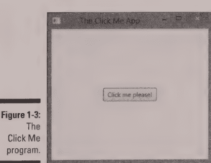

为了让你了解 JavaFX 编程的样貌，列表 1-1 显示了该程序的完整代码。我不会解释该程序工作原理的细节——我将在第 2 章中详尽地检查这个程序。现在，我只想让你对整体有一个了解，感受一下 JavaFX 编程大概长什么样。

```java
import javafx.application.*;
import javafx.stage.*;
import javafx.scene.*;
import javafx.scene.layout.*;
import javafx.scene.control.*;

public class ClickMe extends Application {
    public static void main(String[] args) {
        launch(args);
    }

    Button btn;

    @Override
    public void start(Stage primaryStage) {
        // 创建按钮
        btn = new Button();
        btn.setText("Click me please!");
        btn.setOnAction(() -> handleClick());

        // 将按钮添加到布局面板中
        BorderPane pane = new BorderPane();
        pane.setCenter(btn);
        // 将布局面板添加到场景中
        Scene scene = new Scene(pane, 300, 250);

        // 完成并显示阶段
        primaryStage.setScene(scene);
        primaryStage.setTitle("The Click Me App");
        primaryStage.show();
    }

    public void handleClick() {
        if (btn.getText().equals("Click me please!")) {
            btn.setText("You clicked me!");
        } else {
            btn.setText("Click me please!");
        }
    }
}
```

以下段落简要介绍了 Click Me 程序的关键元素：

- 与任何其他 Java 程序一样，JavaFX 程序以一系列 `import` 开头，引用程序将使用的各种包。
- 在本示例中，导入了五个包。大多数 JavaFX 程序也需要这五个包，以及提供更高级功能的额外包。
- 所有 JavaFX 程序都继承一个名为 `Application` 的核心类，该类提供了程序的基本功能。当你继承 `Application` 类时，必须重写 `start()` 方法；JavaFX 在应用程序启动时会调用此方法。
- 像任何 Java 程序一样，JavaFX 程序必须有一个 `main()` 方法。JavaFX 程序的 `main()` 方法只是简单地调用 `Application` 类的 `launch()` 方法，该方法随后启动应用程序并调用 `start()` 方法。
- JavaFX 程序的用户界面元素排列在容器的层级结构中。最高层是 `Stage`（阶段），它代表一个窗口。`Stage` 内部是 `Scene`（场景），它包含用户界面控件。控件本身（如按钮、标签、下拉列表等）通常包含在一个或多个布局面板（layout panes）中，这些面板控制控件的布局。如果你研究 `start()` 方法的代码，你会发现这些元素是从下而上构建的：
  - 创建了一个按钮。
  - 按钮被添加到布局面板（具体来说是 `BorderPane`）。
  - 布局面板被添加到 `Scene`。
  - `Scene` 被添加到 `Stage`。
  - `Stage` 显示出来。

## 下载并安装 JDK

JDK 下载两个版本：

- **在线版本**：需要连接网络来安装 JDK。
- **离线版本**：允许你将安装文件下载到电脑上。JRE 链接只能获取 Java 运行环境，而不是完整的 Java Kit。

我建议你使用离线版本；它安装更快，而且以后重装时无需再次下载。


下载 JDK 后，可以通过运行执行文件进行安装。安装方法根据操作系统略有不同，但基本上按如下方式运行安装程序：

- **在 Windows 系统上**：打开保存安装程序的文件夹并双击程序图标。
- **在 Linux 或 Solaris 系统上**：使用控制命令切换到下载文件的目录并运行程序。
- **在 Mac 上**：打开下载窗口并双击下载的 JDK `.dmg` 文件。会出现一个 Finder 窗口，包含一个打开的箱子图标。双击此图标启动安装程序。

安装 JDK 后，你需要配置操作系统以便其找到 JDK 命令行工具。为此，你必须设置 `Path` 环境变量 —— 操作系统用于查找可执行程序的文件夹列表。在 Windows 系统上执行此操作请遵循以下步骤。你必须以管理员身份登录才能进行此程序中的更改。

1. 打开控制面板。
   - 在 Windows 7 或更早版本系统上，打开开始菜单并选择控制面板。
   - 在 Windows 8 或更高版本系统上，点击开始按钮或按 Windows 键，输入“控制面板”，然后按回车。
2. 双击系统图标。出现系统属性页面。
3. 点击“高级系统设置”链接，然后点击“环境变量”按钮。环境变量对话框出现，如图 1-4 所示。

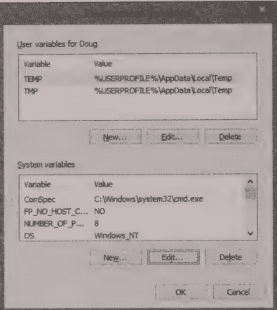

图 1-4：环境变量对话框。

4. 在“系统变量”列表中，向下滚动找到 `Path` 变量，选择它，然后点击“编辑”按钮。会弹出一个小对话框，让你编辑 `Path` 变量的值。
5. 将 JDK 的 `bin` 文件夹添加到 `Path` 值的开头。使用分号将 `bin` 文件夹与路径中可能存在的其他信息分开。
   > **注意：** `bin` 文件夹的名称在你的系统上可能不同，在本例中：`c:\Program Files\Java\jdk1.8\bin;;other directories...`
6. 连续点击确定。第一次点击确定会返回“环境变量”对话框；第二次点击确定会返回“系统属性”页面；第三次点击确定会关闭“系统属性”页面。

对于 Linux 或 Solaris，步骤取决于你正在使用的 shell。更多信息，请查阅你所使用的 shell 的文档。注意，在 Mac 系统上不需要此步骤。

## 使用记事本开发 Click Me 程序

在安装 JDK 8 之后，你就可以开发 JavaFX 了。严格来说，除了 JDK 8 之外，你开发 Java 程序所需的唯一工具就是文本编辑器和命令行提示符。通过文本编辑器，你创建 Java 源代码文件，并以 `.java` 扩展名保存文件。然后在命令行提示符中，你使用 Java 的命令行工具来编译和运行程序。

Windows 自带免费的文本编辑器记事本，它对于创建简单的 Java 源代码已经足够了。记事本是一个通用文本编辑器，它不了解 Java 源代码的任何特性。因此，记事本在缩进、匹配左右括号或提醒你语法错误等细节方面无法提供任何帮助。记事本也不会在编译、运行或调试 Java 程序方面提供任何帮助。但记事本的优势是免费且易用。而且，它已经安装在你的电脑上了，所以不需要安装其他内容。

以下是使用记事本和 Java 命令行工具创建 Click Me 程序的步骤：

1. **启动记事本。**
   在 Windows 7 或 8 中这样操作：
   - 点击“开始”按钮（或按键盘上的 Windows 键）。
   - 输入 `notepad` 并按回车。
   记事本启动，向你展示一个空白文本编辑窗口。

2. **将代码列表 1-1 所示的 Click Me 程序文本输入到窗口中。**
   确保输入的文本与代码列表中显示的完全一致。完成后，仔细检查你的工作，以确保输入无误。
   图 1-5 显示了当 Click Me 程序正确输入到记事本时的样子。（注意，文件中显示的记事本窗口可能不足以显示整个源文件；你必须滚动窗口才能看到整个文件。）

   

   ```java
   import java.io.*;
   import javafx.application.*;
   import javafx.stage.*;
   import javafx.scene.*;
   import javafx.scene.layout.*;

   public class ClickMe extends Application {
       public static void main(String[] args) {
           launch(args);
       }

       Button btn;
       @Override
       public void start(Stage primaryStage) {
           btn = new Button("Click me please!");
           btn.setOnAction(event -> handleClick());

           StackPane pane = new StackPane();
           pane.getChildren().add(btn);
           primaryStage.setTitle("The Click Me App");
           primaryStage.setScene(new Scene(pane, 300, 250));
           primaryStage.show();
       }

       public void handleClick() {
           if (btn.getText() == "Click me please!") {
               btn.setText("You clicked me!");
           }
       }
   }
   ```

   

3. **选择文件：使用文件名 `ClickMe.java` 保存文件。**
   你可以将文件保存到任何的文件夹中，但文件名必须是 `ClickMe.java`，这非常重要。Java 源文件的名称必须与它包含的类名完全匹配，包括大小写。因此，如果你将文件保存为 `clickme.java` 而不是 `ClickMe.java`，那么 Click Me 程序将无法运行。

4. **打开命令行提示符窗口。**
   在 Windows 7 或 8 中，按以下步骤打开窗口：
   - 点击“开始”按钮或按 Windows 键
   - 输入 `cmd` 并按回车。

5. **使用 `cd` 命令切换到你在步骤 3 中保存源文件的文件夹中。**
   例如，如果你将文件保存在 `C:\Java`，请输入以下命令：
   ```
   cd C:\Java
   ```

6. **使用 `javac` 命令编译程序。**
   输入以下命令：
   ```
   javac ClickMe.java
   ```
   如果程序编译成功，“工具”窗格中会显示“工具完成”的消息。

7. **使用 `java` 命令运行程序。**
   输入以下命令：
   ```
   java ClickMe
   ```

   

8. **点击按钮。**
9. **关闭程序。**

## 使用 TextPad 开发 Click Me 程序

TextPad 是一种由于简单而非常适合学习 Java 的文本编辑器。你可以配合 Java 开发工具包 (JDK) 使用它编译和运行程序。创建你的第一个 Java 程序，请遵循以下步骤：

1. **启动 TextPad。**
2. **选择文件 > 保存，输入 `ClickMe.java`，然后点击“保存”。**
3. **将代码列表 1-1 所示的 Click Me 程序文本输入到文档窗口。**
   TextPad 的基础编辑功能与你用过的任何文本编辑器类似，因此你在输入和编辑文本时不会遇到困难。在你编辑文本时，可能会注意到 TextPad 的一些有用功能。例如，每当你输入左括号时，TextPad 会自动对代码缩进，当你输入右括号时，它会恢复到之前的缩进。TextPad 还使用不同的颜色来识别关键字、变量和其他 Java 编程元素。
   图 1-7 显示了 Click Me 程序在 TextPad 中的样子。

   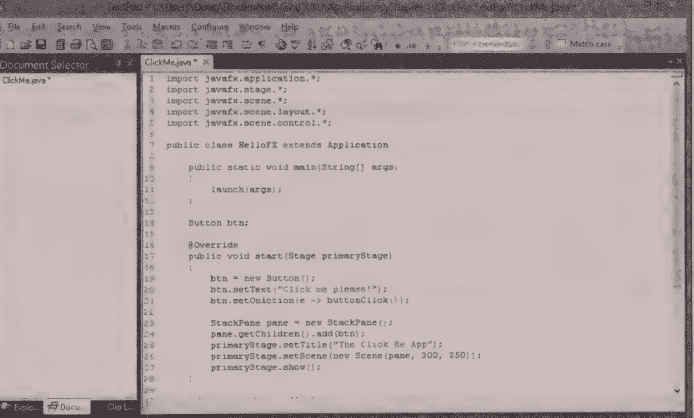
   图 1-7：TextPad 中的 Click Me 程序。

4. **选择工具 > 编译 Java 以编译程序。**
   如果你愿意，可以使用快捷键 `Ctrl+1`。无论采用哪种方式，对源文件的更改都会自动保存，并调用 `javac` 命令来编译程序。如果程序编译成功，“工具”窗格中会显示“工具完成”的消息。
   如果你在输入“Click Me”程序时犯了错误，编译器会生成显示在“工具结果”（Tool Results）窗格中的错误消息。如果你双击每条错误消息的第一行，TextPad 将带你进入错误发生的位置，以便你纠正错误。

5. **选择工具 > 运行 Java 应用程序 来运行程序。**
   命令行提示窗口打开，随后“Click Me”程序启动（参考图 1-6）。
6. **点击 Click Me! 按钮。**
   当你点击该按钮时，按钮上显示的文本会变为“You clicked me!”。
7. **点击关闭按钮关闭 Click Me 程序。**
   Click Me 程序窗口已关闭，但命令提示窗口仍然可见，并显示消息“按任意键继续（Press any key to continue）”。
8. **按任意键关闭命令提示窗口。**
   所有的操作就此了！

## 使用 IDE 创建 Click Me 程序

IDE（或集成开发环境）是一种强大的工具，它结合了复杂的文本编辑功能，以及在多种编程语言中编译、执行和调试程序的能力。IDE 可以跟踪构成单个 Java 编程项目的多个源文件，甚至可以跟踪源文件的多个版本。

Java 编程最流行的 IDE 是 Eclipse 和 NetBeans。它们都是免费的，且功能不相上下。选择使用哪一个取决于个人喜好。你可以从 `www.eclipse.org` 下载 Eclipse。你可以在 `https://netbeans.org` 获取 NetBeans。

在本章的剩余部分中，我将向你展示如何在 Eclipse 中创建 Click Me 程序。虽然在 NetBeans 中创建 Click Me 程序的步骤有所不同，但概念是相同的。

要开始使用 Eclipse，请访问 `www.eclipse.org`，点击“下载 Eclipse”按钮，并下载适用于 Java 开发者的最新 Eclipse IDE。与大多数程序不同，Eclipse 没有复杂的安装程序。你只需要下载 Zip 文件，解压所有文件，然后直接从解出的文件夹中运行 Eclipse 可执行文件（`eclipse.exe`）即可。

如果你正在使用 Windows，你可能想为 Eclipse 添加一个桌面快捷方式以便方便启动。要这样做，请打开包含 `eclipse.exe` 文件的文件夹，右键点击该文件并拖到桌面，松开鼠标按钮，并在出现的菜单中选择“创建快捷方式”。然后你就可以双击此桌面快捷方式来启动 Eclipse。

以下是在 Eclipse 中创建 Click Me 程序的步骤：

1. **通过运行 `eclipse.exe` 程序文件或双击其桌面快捷方式来启动 Eclipse。**
   Eclipse 启动了，如图 1-8 所示。

   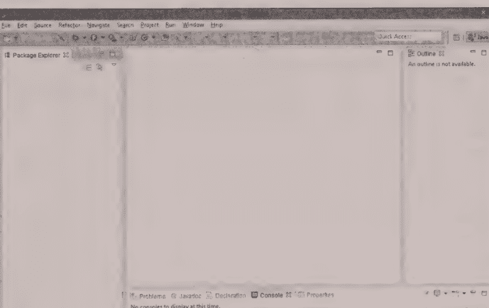
   图 1-8：Eclipse 等待你的指令。

2. **选择 文件 > 新建 > Java 项目。**
   出现“新建 Java 项目”对话框，如图 1-9 所示。

   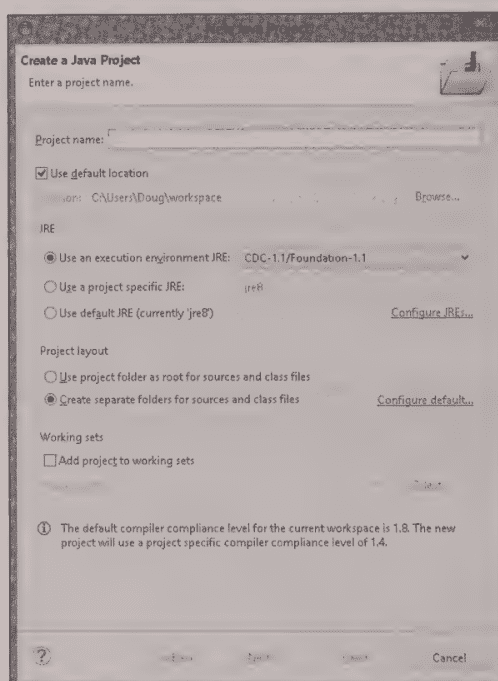
   图 1-9：创建一个新的 Java 项目。

3. **在“项目名称”字段中输入 `ClickMe`，然后点击“完成”。**
   Eclipse 会设置项目并将将其添加到屏幕左侧的“包资源器”窗格中，如图 1-10 所示。（最初，项目是折叠的，只显示项目的第一行。为了这张图，我展开了项目，以显示名为 `src` 和 `JRE System Library` 的子文件夹。）

   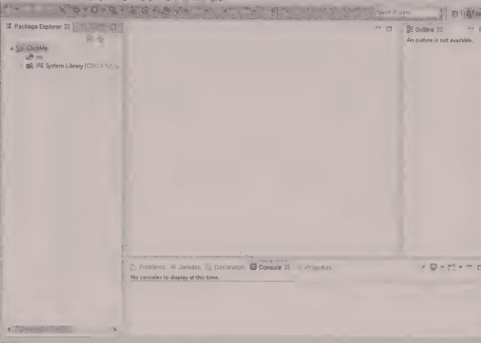


图 1-10：包资源器中显示 ClickMe 项目。

- 4. 选择 `文件（File）>新建（New）>类（Class）`。

出现“新建类”对话框，如图 1-11 所示。

- 5. 在“名称”（Name）字段中输入 `ClickMe`，然后点击“完成”（Finish）。

Eclipse 在 `src` 文件夹中添加名为 `ClickMe` 的文件并在编辑区域中打开它，如图 1-12 所示。注意 Eclipse 还添加了一个代码存根以帮助你该类。

- 6. 删除 `ClickMe.java` 文件中的存根；然后在编辑区域中输入代码 1-1。

图 1-13 显示了当你正确输入文本时 `ClickMe.java` 文件的样子。

# 第 1 章：Hello, JavaFX!

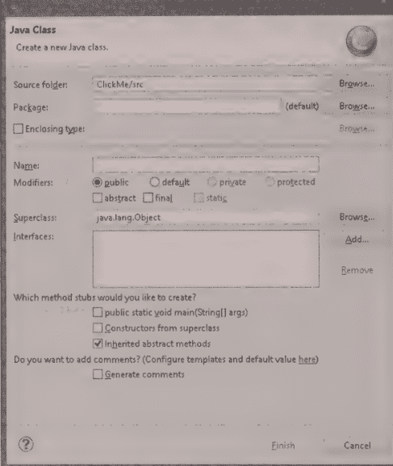

图 1-11：向项目中添加类文件。

- 7. 选择 `运行（Run）` 来运行程序。

Click Me 程序打开，如之前的图 1-6 所示。

- 8. 点击 `Click Me!` 按钮。

当你点击按钮时，按钮上显示的文本变为“You clicked me!”。

- 9. 点击关闭（Close）按钮关闭该程序。

恭喜！你成功使用 Eclipse 创建并运行了 Click Me 程序。

现在你已经知道了如何创建 Click Me 程序，准备好学习更多关于 JavaFX 的知识了。

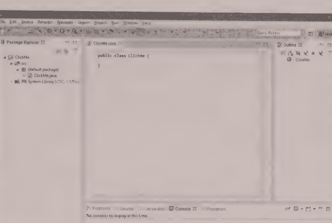

图 1-12：新建的 java 文件。

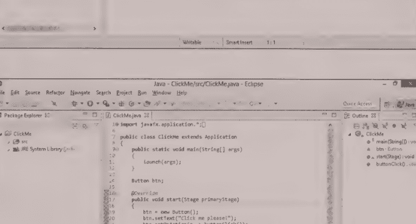

图 1-13：Eclipse 中的 Click Me 程序。

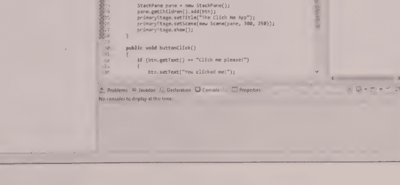

# 第 2 章：深入观察 JavaFX 编程

图 2-1 显示了 Click Me 程序的运行情况。正如所示，当你点击按钮时，按钮上的文字变为“I've Clicked!”。


图 2-1：Click Me 程序的运行情况。

尽管这个程序非常简单，但它展示了编写 JavaFX 程序时需要掌握的核心技术：

- 它显示了一个包含标准用户界面控件的用户界面——在本例中，是一个按钮。
- 它响应用户输入（即在用户点击按钮时生成的输入）。
- 它更新显示内容以确认用户的操作。

```java
import javafx.application.*;
import javafx.stage.*;
import javafx.scene.*;
import javafx.scene.layout.*;
import javafx.scene.control.*;

public class ClickMe extends Application {
    public static void main(String[] args) {
        launch(args);
    }

    Button btn;

    @Override
    public void start(Stage primaryStage) {
        // 创建 button
        btn = new Button();
        btn.setText("Click me please!");
        btn.setOnAction(e -> buttonClick());

        // 将按钮添加到布局窗格中
        BorderPane pane = new BorderPane();
        pane.setCenter(btn);

        // 将布局窗格添加到场景中
        Scene scene = new Scene(pane, 300, 250);

        // 完成设置并显示阶段
        primaryStage.setScene(scene);
        primaryStage.setTitle("The Click Me App");
        primaryStage.show();
    }

    public void buttonClick() {
        if (btn.getText() == "Click me please!") {
            btn.setText("You clicked me!");
        } else {
            btn.setText("Click me please!");
        }
    }
}
```

### 导入 JavaFX 包

与任何 Java 程序一样，JavaFX 程序从一系列 `import` 语句开始，这些语句引用了程序将使用的各种 JavaFX 包。Click Me 程序包含了以下五个 `import` 语句：

```java
import javafx.application.*;
import javafx.stage.*;
import javafx.scene.*;
import javafx.scene.layout*;
import javafx.scene.control.*;
```

如你所见，所有的 JavaFX 包都以 `javafx` 开头。Click Me 程序使用了来自五个不同 JavaFX 包的类：

- `javafx.application`：此包定义了所有 JavaFX 应用程序依赖的核心类：`Application`。你可以在本章后面的“扩展 Application 类”节中阅读更多关于 `Application` 类的信息。
- `javafx.stage`：该包中最重要的类是 `Stage`，它定义了所有用户界面对象的顶层容器。`Stage` 是 JavaFX 应用程序最高级别的窗口，应用程序的所有用户界面元素都显示在其中。
- `javafx.scene`：该包中最重要的类是 `Scene` 类，它是一个包含程序显示的所有用户界面元素的容器。
- `javafx.scene.layout`：此包定义了一种特殊类型的用户界面元素，称为布局管理器（layout manager）。布局管理器的工作是确定用户界面中显示的每个控件的位置。
- `javafx.scene.control`：此包包含了定义单个用户界面控件的类，如按钮（buttons）、文本框和标签（labels）。

Click Me 程序仅使用了此包中的一个类：`Button`，它代表一个用户可以点击的按钮。

### 扩展 Application 类

JavaFX 应用程序是一个扩展 `javafx.application.Application` 的 Java 类。因此，Click Me 应用程序主类的声明如下：

```java
public class ClickMe extends Application
```

在这里，Click Me 应用程序由名为 `ClickMe` 的类定义，该类扩展了 `Application` 类。

由于 Click Me 程序第 1 行导入了整个 `javafx.application` 包，因此 `Application` 类不需要使用全限定名。如果你省略了 `javafx.application` 包的 `import` 语句，`ClickMe` 类的声明将必须像这样：

```java
public class ClickMe
    extends javafx.application.Application
```

`Application` 类负责管理所谓的 JavaFX 应用程序生命周期。生命周期由以下步骤组成：

1. 创建 `Application` 类的实例。
2. 调用 `init` 方法。
   `init` 方法的默认实现什么都不做，但你可以重写 `init` 方法，以提供在应用程序用户界面显示之前执行的任何你想要执行的处理。
3. 调用 `start` 方法。
   `start` 方法是一个抽象方法，这意味着 `Application` 类本身没有提供任何默认实现。因此，你必须提供你自己的 `start` 方法版本。`start` 方法负责构建和显示用户界面。（欲需更多信息，请参阅本章后面的“重写 start 方法”节）。
4. 等待应用程序结束，这通常发生在用户通过关闭主应用程序窗口或选择程序退出命令来指示程序结束时。
   在此期间，应用程序并不是空闲的。相反，它正忙于执行操作以响应用户事件，例如点击按钮或从下拉列表中选择项目。
5. 调用 `stop` 方法。
   与 `init` 方法一样，`stop` 方法的默认实现什么都不做，但你可以重写它来执行程序终止时必要的处理，例如关闭数据库资源或保存文件。


### 启动应用程序

如你所知，Java 程序的标准入口是 `main` 方法。以下是 Click Me 程序的 `main` 方法：

```java
public static void main(String[] args) {
    launch(args);
}
```

如你所见，`main` 方法只包含语句：调用 `Application` 类的 `launch` 方法。

`launch` 方法实际上启动了 JavaFX 应用程序。`launch` 方法是一个静态方法，因此可以在 `main` 方法的静态上下文中调用。它创建 `Application` 类的实例，然后启动 JavaFX 生命周期，调用 `init` 和 `start` 方法，等待应用程序结束，最后调用 `stop` 方法。

`launch` 方法在 JavaFX 应用程序结束之前不会返回。假设你写了 Click Me 程序的 `main` 方法：

```java
public static void main(String[] args) {
    System.out.println("Launching JavaFX");
    launch(args);
    System.out.println("Finished");
}
```

那么，当 JavaFX 窗口打开时，会在控制台看到 "Launching JavaFX"。当你关闭 JavaFX 窗口时，会在控制台看到 "Finished"。

### 重写 start 方法

每个 JavaFX 应用程序都包含一个 `start` 方法。你需要编写创建程序交互界面的代码。例如，列表 2-1 中的 `start` 方法包含了显示带有“Click me!”文本按钮的代码。当 JavaFX 应用程序启动时，JavaFX 框架会在 `Application` 类初始化后调用 `start` 方法。

Click Me 程序的 `start` 方法如下：

```java
@Override
public void start(Stage primaryStage) {
    // 创建 button
    Button btn = new Button();
    btn.setText("Click me please!");
    btn.setOnAction(e -> buttonClick());

    // 将按钮添加到布局窗格中
    BorderPane pane = new BorderPane();
    pane.setCenter(btn);

    // 将布局窗格添加到场景中
    Scene scene = new Scene(pane, 300, 250);

    // 完成设置并显示阶段
    primaryStage.setScene(scene);
    primaryStage.setTitle("The Click Me App");
    primaryStage.show();
}
```

为了为 Click Me 程序创建用户界面，`start` 方法执行以下基本步骤：

- 创建一个名为 `btn` 的按钮控件，将其文本设置为 "Click me please!"，并指定当用户点击按钮时调用名为 `buttonClick` 的方法。有关此代码的详细解释，请参阅本章后面的“创建按钮”和“处理动作事件”节。
- 创建一个名为 `pane` 的布局窗格并将其添加到其中。更多详情请参阅本章后面的“创建布局窗格”节。
- 创建一个名为 `scene` 的场景并将布局窗格添加到其中。更多详情请参阅本章后面的“制作场景”节。
- 通过设置场景、设置阶段标题和显示阶段来完成阶段的设置。更多详情请参阅本章后面的“设置阶段”节。

在本章的后面，你将找到这些代码块中每个部分的详细信息。在我继续之前，我想指出关于 `start` 方法的几个额外的显著细节：

- `start` 方法在 `Application` 类中被定义为抽象方法，因此当你在 JavaFX 程序中包含一个 `start` 方法时，你实际上是在重写这个抽象的 `start` 方法。
- 虽然不是强制要求的，但包含 `@Override` 注解始终是一个好主意，可以显式声明你正在重写 `start` 方法。如果你省略了这个注解，然后在方法名的拼写上出现错误（例如，使用 `Start` 而不是 `start`）或者列出的参数错误，Java 会认为你正在定义一个新方法，而不是重写 `start` 方法。
- 与 `main` 方法不同，`start` 方法不是静态方法。当你从静态方法中调用 `launch` 方法时，`launch` 方法会创建你的 `Application` 类的实例，然后调用 `start` 方法。
- `start` 方法接受一个参数：用于显示应用程序用户界面的 `Stage` 对象。应用程序调用你的 `start` 方法时，会通过 `primaryStage` 参数传递主阶段（称为 `primaryStage`）。因此，你可以在稍后的 `start` 方法中使用 `primaryStage` 参数来引用应用程序的阶段。


### 创建按钮

“Click Me”程序中显示的按钮是使用 `Button` 类创建的。该类是你用于创建用户界面控件的许多类中的之一。`Button` 类以及大多数其他控件类位于 `javafx.scene.control` 包中。

要创建一个按钮，只需定义一个 `Button` 类型的变量，然后像这样调用 `Button` 构造函数：

```java
Button btn;
btn = new Button();
```

在代码列表 2-1 中，`btn` 变量声明为 `start` 方法之外的类变量，但 `Button` 对象实际上是在 `start` 方法内部创建的。控件通常被声明为类变量，以便你从类中定义的任何方法访问它们。正如你在接下来的章节（“处理操作事件”）中发现的，当用户点击按钮时，会调用一个名为 `handleClick` 的独立方法。通过将 `btn` 变量定义为类变量，`start` 方法和 `handleClick` 方法都可以访问按钮。

# 第 2 章：深入 JavaFX 编程

要设置按钮显示的文本值，请调用 `setText` 方法并将要显示的文本作为字符串传递：

```java
btn.setText("Click me please!");
```

这里有关于按钮的一些额外小知识：

- `Button` 构造函数允许你将要在按钮上显示的文本作为参数传递，例如所示：
  ```java
  btn = new Button("Click me please!");
  ```
- 如果你在视图中设置了按钮的文本，就不需要调用 `setTitle` 方法。
- `Button` 类是派自名为 `javafx.scene.control.Control` 父类的许多类之一。许多其他类也派自此类，包括 `Label`、`TextField`、`ComboBox`、`Checkbox` 和 `RadioButton`。
- `Control` 类是派自更高级父类 `javafx.scene.Node` 的几个类之一。`Node` 是可以在场景中显示的所有用户界面元素的基类。`Control` 是一种特定类型的节点，但还有其他类型的节点。换句话说，所有的控件都是节点，但并不是所有节点都是控件。你可以在书的后面阅读更多关于节点类型的内容。


### 处理操作事件

当用户点击按钮时，会触发一个*操作事件*（action event）。你的程序可以通过提供一个*事件处理器*（event handler）来响应事件，它仅仅是当事件发生时执行的一段代码。“Click Me”程序通过为按钮设置事件处理器来工作；事件的代码会更改按钮上显示的文本。

正如你在第 3 章中读到的，JavaFX 中有几种处理事件的方法。现在，我简要列出最简单的方法之一，它只需要你指定一个在事件发生时要调用的方法，然后提供实现该方法的代码。

要指定用户点击按钮时调用的方法，你调用按钮类（button class）的 `setOnAction` 方法。以下是列表 2-1 中的实现方法：

```java
btn.setOnAction(e -> buttonClick());
```

如果这里使用的语法看起来有点陌生，是因为它使用了 Java 8 的一个新功能，称为 Lambda 表达式（Lambda expressions）。如示例所示，这种新语法包含三个元素：

- 参数 `e` 代表一个 `ActionEvent` 类型的对象，程序可以使用它来获取有关事件的详细信息。


- “Click Me”程序忽略了这个参数，所以你也可以忽略它，至少目前如此。

- 箭头运算符（`->`）是 Java 8 引入的一个新运算符，用于 Lambda 表达式。

- 方法调用`buttonClick()`仅仅是调用了名为`buttonClick`的方法。


我在第 3 章中讨论 Lambda 表达式。（等等，这里的 OCR 文本似乎乱码了）。

（根据提供的上下文，此处已去除了重复和乱码部分，整理了逻辑流）。

### 创建布局面板

按钮本身并没有什么用。你必须实际上将其显示在屏幕上，用户才能点击。而且任何真实的 JavaFX 程序都会包含多个控件。当你向用户界面添加第二个控件的瞬间，你需要一种方法来指定控件之间彼此的相对位置。例如，如果你的应用程序有两个按钮，你希望它们是垂直堆叠，还是并排？

这就是布局面板（layout panes）大显用场的地方。布局面板是一个容器类，你可以向添加一个或多个用户界面元素。布局面板然后确定元素之间具体的显示方式。

要使用布局面板，你首先创建面板的实例。然后，向面板添加一个或多个控件。这样做时，你可以指定面板显示时控件的排列细节。将所有控件添加到面板后，你将面板添加到场景中。

JavaFX 提供了八种不同类型的布局面板，均由`javafx.scene.layout`包中的类定义。程序使用了一种名为`BorderPane`的布局，它将面板的内容分为五个区域：顶部、左侧、右侧、底部和中心。`BorderPane`类非常适用于这种布局：顶部有菜单和工具栏，左右有可选的任务面板，中心是主工作区域。

程序中创建边界面板的代码是：

```
BorderPane pane = new BorderPane();
pane.setCenter(btn);
```

在这里，声明了一个名为`pane`的`BorderPane`类型变量，并调用`BorderPane`构造函数创建一个新的`BorderPane`对象。然后，使用`setCenter`方法将按钮（`btn`）显示在面板的中心区域。

- 布局面板根据其包含元素的大小以及布局面板显示空间的大小，自动调整其包含元素的精确位置。

- 我之前说过控件是节点的一种，你将在书中后面介绍其他类型的节点。很好，你刚刚读到了其中一种：布局面板也是节点的一种。

### 42 第一部分：JavaFX 入门

- `BorderPane`的每个区域都可以包含一个节点（node）。因为布局面板（layout pane）本身也是一种节点，所以`borderPane`的每个区域都可以包含另一个布局面板。例如，假设你想在一个`borderPane`的中心区域显示三个控件。为了实现这一点，你需要创建一个第二个布局面板，并将这三个控件添加到其中。然后，你将第二个布局面板设为在第一个面板的中心区域要显示的节点。

- 你可以在第 5 章中读到更多关于`BorderPane`类以及一些常用布局面板的介绍。你也可以在第 13 章中阅读一些不常用的布局面板。


### 创建场景（Scene）

在你创建了包含你想要显示的控件的布局面板后，下一步是创建一个用于显示该布局面板的场景。你可以通过一行代码来实现这一点，即声明一个类型为`Scene`的变量并调用`Scene`构造函数。以下是我在“Click Me”程序中是如何做的：

```
Scene scene = new Scene(pane, 300, 250);
```

`Scene`构造函数接受三个参数：

- 一个代表场景要显示的根节点（root node）的对象。
- 一个场景只能有一个根节点，因此根节点通常是一个布局面板，该面板反过来又包含了要显示的其它控件。在“Click Me”程序中，根节点是包含按钮的 border 布局面板。
- 场景以像素为单位的宽度。
- 场景以像素为单位的高度。

如果你省略了宽度和高度，场景将根据根节点中包含的元素的大小自动调整。

你可以在第 4 章中找到`Scene`类的一些额外功能。


### 设置舞台（Stage）

如果说场景（scene）代表由应用程序显示的节点（控件和布局面板），那么舞台（stage）代表显示场景的窗口。当 JavaFX 框架调用应用程序的`start`方法时（参见第 2 章：深入了解 JavaFX 编程），它会传递给你一个`Stage`类的实例，该实例代表应用程序的主舞台——即代表应用程序主窗口的舞台。此引用通过`primaryStage`参数传递。

在创建了场景后，你现在准备好完成主舞台的最后工作以便显示场景。要做到，你必须至少做两件事：

- 调用主舞台的`setScene`方法来设置要显示的场景。
- 调用主舞台的`show`方法来显示场景。

在你调用`show`方法后，你的应用程序窗口将对用户可见，用户随后就可以开始与其控件进行交互了。

设置应用程序标题栏中显示的标题也是一种常见做法。通过调用主舞台的`setTitle`方法来实现这一点。“Click Me”应用程序的`start`方法的最后三行执行了这些功能：

```
primaryStage.setScene(scene);
primaryStage.setTitle("The Click Me App");
primaryStage.show();
```

当最后一行调用该方法时，舞台就会显示——换句话说，图 2-1 所示的窗口出现在屏幕上。

你可以在第 4 章中阅读关于`Stage`类的额外功能。


### 检查点击计数器程序

当我解释完“Click Me”程序每一行的细节后，我会查看一个稍微增强的“Click Me”程序，称为“Click Counter”程序。在列表 1-1（第 1 章）中所示的“Click Me”程序中，当用户点击按钮时，按钮上显示的文本会发生。在“Click Counter”程序中，一种名为`label`的额外控件会显示用户点击按钮的次数。

图 2-2 显示了运行中的“Click Counter”程序。图顶部的窗口显示了启动“Click Counter”程序时的样子。你可以看到，窗口顶部的文本标签显示着“You have not clicked the button”的文本。第二个窗口显示了你第一次点击后程序的样式。在这里，标签显示为“You have clicked once”。当标签再次变化时（如第三个窗口所示），在这里，标签显示为“You have clicked 2 times”。之后，标签显示的数字会在你每次点击按钮时更新，以指示按钮被点击了多少次。

### 44 第一部分：JavaFX 入门


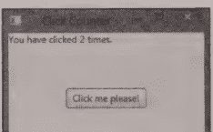

图 2-2：运行中的“Click Counter”程序。

列表 2-2 显示了“Click Counter”程序的源代码，接下来的段落描述了其工作原理的关键点：

#### 列表 2-2：点击计数器程序

```
import javafx.application.*;
import javafx.stage.*;
import javafx.scene.*;
import javafx.scene.layout.*;
import javafx.scene.control.*;
import javafx.scene.event.*;

public class ClickCounter extends Application
{
    Button btn;
    Label lbl;
    int lblCount = 0;

    public static void main(String[] args)
    {
        launch(args);
    }

    @Override
    public void start(Stage primaryStage)
    {
        btn = new Button();
        btn.setText("Click me!");

        lbl = new Label();
        lbl.setText("You have not clicked the button.");

        BorderPane pane = new BorderPane();
        pane.setTop(lbl);
        pane.setCenter(btn);

        Scene scene = new Scene(pane, 250, 150);

        primaryStage.setScene(scene);
        primaryStage.setTitle("Click Counter");
        primaryStage.show();

        btn.setOnAction((e) -> buttonOnClick());
    }

    private void buttonOnClick()
    {
        lblCount++;
        if (lblCount == 1) {
            lbl.setText("You have clicked once.");
        } else {
            lbl.setText("You have clicked " + lblCount + " times.");
        }
    }
}
```

### 46 第一部分：JavaFX 入门

接下来的段落解释了程序的关键点：

- 1：`import`语句引用了程序将使用的 javafx 包。

- 7：`ClickCounter`类继承自`Application`，说明`ClickCounter`类是一个 JavaFX 应用程序。

- 9：与任何 Java 程序一样，`main`方法是程序的入口。

- 11：`main`方法调用了`launch`方法，该方法由`Application`类定义。`launch`方法创建`ClickCounter`类的实例，然后调用`start`方法。

- 14：类型为`scene.control.Button`的变量`btn`被声明为类变量。代表 Java 控件的变量通常定义为类变量，以便类的任何方法访问。

- 15：类型为`scene.control.Label`的变量`lbl`代表 Label 控件，以便类的任何方法访问。

- 16：变量`lblCount`将跟踪用户点击按钮的次数。

- 18：`start`方法的声明使用了`@Override`注解，表示该方法覆盖了`Application`类提供的默认`start`方法。`start`方法接收一个名为`primaryStage`的参数，该参数代表“Click Me”应用程序显示其用户界面的窗口。

- 21：`start`方法通过创建一个`Button`对象并将其赋值给变量`btn`开始执行。

- 22：调用按钮的`setText`方法来设置按钮显示的文本为“Click me please!”。

- 23：调用`setOnAction`为按钮创建一个事件处理器。在这里，使用 Lambda 表达式是为了在每当用户点击按钮时简单地调用`buttonOnClick`方法。

- 26：调用`Label`类的构造函数来创建一个新标签。

- 27：调用标签的`setText`方法来设置标签的初始文本值为“You have not clicked the button”。

### 第 2 章：深入观察 JavaFX 编程

- 30：通过调用`BorderPane`类的构造函数创建一个布局面板对象，并通过名为`pane`的变量引用该布局面板。该布局面板将用于控制显示在屏幕上的控件的布局。

- 31：调用布局面板的`setTop`方法，将标签（label）添加到布局面板的顶部区域。

- 32：调用布局面板的`setCenter`方法，将按钮（button）添加到布局面板的中心区域。

- 35：通过调用`Scene`类的构造函数创建一个场景（scene）对象，将第 30 行创建的布局面板传递给构造函数，以将该布局面板设置为场景的根节点。此外，场景的尺寸设置为宽 300 像素、高 250 像素。

- 39：使用`primaryStage`的`setScene`方法将场景添加到主阶段（primary stage）。

- 40：使用`setTitle`方法设置显示在主阶段标题栏中显示的文本。

- 41：调用`show`方法来显示主阶段。当此行执行时，图 2-1 中显示的窗口将出现在屏幕上，用户可以与程序进行交互。

- 44：每当用户点击按钮时，都会调用`buttonClick`方法。

- 46：变量`iClickCount`递增，表示用户点击了按钮。

- 47：使用`if`语句判断按钮是否被点击过一次或多次。

- 49：如果按钮被点击过一次，则将标签文本设置为“You have clicked.（你已经点击了）”。

- 53：否则，将标签文本设置为一个指示按钮点击次数的字符串。

就是这些。如果你理解了点击计数器（Click Counter）程序是如何工作的，你就可以进入第 3 章了。如果你仍然在某些点上感到困惑，我建议你花时间回顾本章，并在 TextPad、Eclipse 或 NetBeans 中实验点击计数器程序。

以下段落有助于澄清可能让你对点击计数器程序以及 JavaFX 感到困难的一些关键难点：

- 程序何时从静态切换到非静态？就像每个 Java 程序一样，JavaFX 程序的入口点是静态的`main`方法。

在 JavaFX 程序中，静态的`main`方法只做一件事：调用`launch`方法来启动程序的 JavaFX 部分。`launch`方法创建`ClickCounter`类的实例，然后调用`start`方法。在此时，程序不再在静态上下文中运行，因为已经创建了`ClickCounter`类的实例。

- `primaryStage`变量从哪里来？当`launch`方法调用`start`方法时，`primaryStage`变量被传递给`start`方法。因此，`start`方法以参数的形式接收`primaryStage`变量。

这就是为什么你找不到`primaryStage`变量的独立声明了。

- `->`运算符是如何工作的？`->`运算符用于创建所谓的 Lambda 表达式。Lambda 表达式是 Java 8 的一项新功能，用于以前可能需要匿名类的情况。如果你不理解 Lambda 表达式的工作原理，请不要担心，我会在第 3 章中详细解释它们。


# 第 3 章

### 事件处理

本章

- 理解重要的事件概念
- 与事件处理类和接口一起工作
- 扩展`EventHandler`接口
- 使用内部类和匿名类进行事件处理
- 使用 Lambda 表达式进行事件处理

在第 2 章中，我讨论了两个显示简单场景的程序，这些场景包含一个按钮，并在用户点击按钮时做出响应。这些程序通过提供一个在事件发生时执行的事件处理器，来响应用户点击按钮触发的事件。

在本章中，你将阅读更多关于 JavaFX 如何进行事件处理的内容。我将讨论事件是如何生成的，以及它们是如何被 JavaFX 分发的，以便你的程序对其做出响应。你将发现 JavaFX 程序可以处理的多种事件，并掌握处理 JavaFX 事件的若干编程技术。

最后，在本章中你将接触属性绑定（property bindings）的概念，它允许你编写代码来响应某些类型类字段（称为属性字段）值的更改。在 JavaFX 中，属性绑定用于在 Swing 中可能需要事件处理器的场景。

虽然事件处理主要用于响应按钮点击，但它也可以用于响应其他类型的用户交互。例如，你可以使用事件处理来编写在用户从组合框（combo box）中选择、鼠标移动到标签上方或在键盘上按下按键时执行的代码。本章中的事件处理技术也适用于这些事件。


### 检查事件

事件是用户对你的某个用户界面组件执行某些值得注意的操作时生成的对象。然后，这个事件对象会被传递到你创建的一个特殊方法，称为事件处理器（event handler）。事件处理器可以检查事件对象，确定具体发生了什么类型的事件，并做出相应响应。如果用户点击按钮，处理器可能会更改标签显示的文本。如果用户从组合框选择项目，处理器可能会使用该值查找信息。可能性是无限的！

事件由`javafx.event.Event`类或类的实例表示。表 3-1 列出了常用的事件类。

| 表 3-1 常用事件类 |
| :--- |
| 事件类 | 包 | 描述 |
| :--- | :--- | :--- |
| ActionEvent | javafx.event | 当用户执行按钮操作时创建。这是最常用的事件类，因为它代表了常见的用户界面事件。 |
| InputEvent | javafx.scene.input | 当发生用户输入事件（如鼠标或键盘点击）时创建。 |


| KeyEvent | javafx.scene.input | 当用户在键盘上按下按键时创建。此事件可以监听用户输入的特定键。（`KeyEvent` 是 `InputEvent` 的子类。） |

# 第 3 章：事件处理

| 事件类 | 包 | 描述 |
| :--- | :--- | :--- |
| `MouseEvent` | `javafx.scene.input` | 当用户对鼠标执行某些操作时创建，如点击按钮、拖动鼠标或移动鼠标到另一个对象上。（`MouseEvent` 是 `InputEvent` 的子类。） |
| `TouchEvent` | `javafx.scene.input` | 在允许触摸输入的设备上启动触摸事件时创建。 |
| `WindowEvent` | `javafx.stage` | 当窗口（阶段）状态改变时创建。 |

这里是你需要熟悉的四个重要术语：

- **事件（Event）**：用户对组件执行某些操作（如点击）时生成的对象。
- **事件源（Event source）**：事件最初发生的对象。
- **事件目标（Event target）**：事件指向的节点。这通常是用户点击或其他进行操作的控件。（在大多数情况下，事件源和事件目标是同一个。）
- **事件处理器（Event handler）**：监听事件并在事件发生时处理事件的对象。

事件监听对象必须实现 `EventHandler` 接口，该接口定义了一个名为 `handle` 的方法（见表 3-2）。`EventHandler` 接口定义在 `javafx.event` 包中。

| 表 3-2 EventHandler 接口 |
| :--- | :--- |
| 方法 | 描述 |
| `void handle(T event)` | 在事件发生时调用 |

### 处理事件

现在你已经了解了用于事件处理的基本类和接口，准备好研究如何将它们连接起来以创建一个对事件做出响应的程序了。

在本节中，我将讨论如何通过编写程序的 `Application` 类来实现事件处理器，以便在扩展 `EventHandler` 接口之外。在本章的后续章节中，我将讨论实现事件处理器的替代技术，这些技术更简洁，在许多情况下更容易操作。

请注意，第 1 和第 2 章中展示程序使用了简洁的 Lambda 表达式技术，本书其余的大部分程序也使用了 Lambda 表达式。但重要的是，你必须了解其他技术，以便你完全理解事件处理实际上是如何工作的。

以下是处理 JavaFX 事件时必须采取的三个步骤：

1.  **创建事件源。**

    事件源简单来说就是一个控件（例如按钮），它可以产生事件。通常，你将引用事件源的变量声明为类的私有字段，并定义在 `start` 方法或任何其他类方法之外：

    然后，在 `start` 方法中，你可以这样创建按钮：

    ```java
    btn = new Button();
    btn.setText("Click me please!");
    ```

2.  **创建事件处理器。**

    要创建一个事件处理器，你必须创建一个实现 `EventHandler` 接口并提供 `handle` 方法实现的对象。

    这里有创建事件处理器的四种方法：

    - 在程序的 `Application` 类中添加 `implements EventHandler` 并提供 `handle` 方法的实现。
      你将在“实现 EventHandler 接口”节中了解如何使用这种技术。
    - 在 `Application` 类内部创建一个实现 `EventHandler` 的内部类。
      你将在“使用内部类处理事件”节中了解如何使用这种技术。
    - 创建一个实现 `EventHandler` 的匿名内部类。
      我将在“使用匿名内部类处理事件”节中向你展示如何使用这种技术。
    - 使用 Lambda 表达式来实现 `handle` 方法。
      你将在“使用 Lambda 表达式处理事件”节中阅读关于如何使用这种技术的内容。

3.  **将事件处理器注册到事件源。**

    最后一步是将事件处理器注册到事件源，这样每当事件发生时，就会调用 `handle` 方法。

    每个作为事件源的组件都提供了一个方法，让你注册事件处理器来监听事件。例如，`Button` 控件提供了一个 `setOnAction` 方法，允许你为动作事件注册事件处理器。在 `setOnAction` 方法中，你将事件处理器对象作为参数指定。具体的实现方式取决于你使用了哪种创建事件处理器的各种技术。

### 实现 EventHandler 接口

为了看到所有这些元素在一个完整的程序是如何协同工作的，图 3-1 显示了名为 `AddSubtract` 的简单程序的输出。该程序显示了一个标签和两个按钮，一个标题为“Add”（加），另一个标题为“Subtract”（减）。标签最初显示数字 0。用户每点击一次 Add 按钮，标签显示的数值就会增加 1；用户每点击一次 Subtract 按钮，数值就会减去 1。

图 3-1 显示了该程序的完整代码。

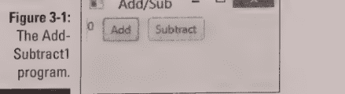

### 列表 3-1：AddSubtract 程序

```java
import javafx.application.*;
import javafx.stage.*;
import javafx.scene.*;
import javafx.scene.layout.*;
import javafx.scene.control.*;
import javafx.event.*;

public class AddSubtract extends Application
    implements EventHandler<ActionEvent> {

    public static void main(String[] args) {
        launch(args);
    }

    Button btnAdd;
    Button btnSub;
    Label lbl;
    int iCounter = 0;

    @Override public void start(Stage primaryStage) {

        // Create the Add button
        btnAdd = new Button();
        btnAdd.setText("Add");
        btnAdd.setOnAction(this);

        // Create the Subtract button
        btnSub = new Button();
        btnSub.setText("Subtract");
        btnSub.setOnAction(this);

        // Create the Label
        lbl = new Label();
        lbl.setText(Integer.toString(iCounter));

        // Add the buttons and label to an HBox pane
        HBox pane = new HBox(10);
        pane.getChildren().addAll(lbl, btnAdd, btnSub);

        // Add the layout pane to a scene
        Scene scene = new Scene(pane, 200, 75);

        // and show the stage
        primaryStage.setScene(scene);
        primaryStage.setTitle("Add/Sub");
        primaryStage.show();
    }

    @Override public void handle(ActionEvent e) {
        if (e.getSource() == btnAdd) {
            iCounter++;
        } else {
            if (e.getSource() == btnSub) {
                iCounter--;
            }
        }
        lbl.setText(Integer.toString(iCounter));
    }
}
```

以下段落指出了程序的一些关键行：

（注：由于原文 OCR 文本在最后部分存在重复或错误，已根据提供的代码注释逻辑进行了清理处理。）

### 使用内部类处理事件

内部类是嵌套在另一个类中的类。内部类通常用于事件处理器。这样一来，定义应用程序的类就不需要同时实现事件处理器。相反，它包含一个处理事件的内部类。

列表 3-2 显示了 `AddSubtract2` 程序，该程序使用内部类来处理按钮的事件动作。

### 列表 3-2：带有内部类的 AddSubtract2 程序

```java
import javafx.application.*;
import javafx.stage.*;
import javafx.scene.*;
import javafx.scene.layout.*;
import javafx.scene.control.*;
import javafx.event.*;

public class AddSubtract2 extends Application {
    public static void main(String[] args) {
        launch(args);
    }

    Button btnAdd;
    Button btnSubtract;
    Label lbl;
    int iCounter = 0;

    @Override public void start(Stage primaryStage) {
        // 创建一个 ClickHandler 实例
        ClickHandler ch = new ClickHandler();

        // 创建 Add 按钮
        btnAdd = new Button();
        btnAdd.setText("Add");
        btnAdd.setOnAction(ch);

        // 创建 Subtract 按钮
        btnSubtract = new Button();
        btnSubtract.setText("Subtract");
        btnSubtract.setOnAction(ch);

        // 创建 Label
        lbl = new Label();
        lbl.setText(Integer.toString(iCounter));

        // 将按钮和标签添加到 HBox 窗格中
        HBox pane = new HBox(10);
        pane.getChildren().addAll(lbl, btnAdd, btnSubtract);

        // 将布局面板添加到场景中
        Scene scene = new Scene(pane, 200, 75);

        // 将场景添加到到阶段，设置标题
        // 并显示阶段
        primaryStage.setScene(scene);
        primaryStage.setTitle("Add/Sub");
        primaryStage.show();
    }

    private class ClickHandler
        implements EventHandler<ActionEvent> {
        @Override
        public void handle(ActionEvent e) {
            if (e.getSource() == btnAdd) {
                iCounter++;
            } else {
                if (e.getSource() == btnSubtract) {
                    iCounter--;
                }
            }
            lbl.setText(Integer.toString(iCounter));
        }
    }
}
```

此程序的基本工作方式与列表 3-1 所示程序相同，因此我不检查每一个细节。相反，我只强调不同之处：

- 第 8 行：`AddSubtract2` 类仍然继承 `Application`，但没有实现 `EventHandler`。
- 第 23 行：此语句创建了 `ClickHandler` 类（内部类）的实例并将其赋值给变量 `ch`。
- 第 28 行：此语句将 `ch` 设置为 Add 按钮的动作监听器（action listener）。
- 第 33 行：此语句将 `ch` 设置为 Subtract 按钮的动作监听器。
- 第 53 行：通过将声明完全放置在 `AddSubtract2` 类内部，将 `ClickHandler` 类声明为一个内部类。`ClickHandler` 类实现了 `EventHandler` 接口，以便它可以处理事件。
- 第 56 行：此处的 `handle` 方法与 `AddSubtract` 程序中的 `handle` 方法相同（参见列表 3-1），但它存在于内部的 `ClickHandler` 类中，而不是外部类中。

### 使用匿名内部类处理事件

匿名内部类（通常称为匿名类）是在需要它的地方即时定义的类。因为你是在需要的地方直接编写类体，所以你不需要给它命名；这就是为什么它被称为匿名类。

匿名类通常被用于事件处理器，以避免需要创建一个显式实现 `EventHandler` 接口的单独类。

使用匿名类作为事件处理器的优势是，你可以轻松地为每个产生事件的控件创建一个单独的事件处理器。那么，在这些事件处理器的 `handle` 方法中，你可以省去检查事件源的 `if` 语句。

考虑之前列表 3-2 所示的 `AddSubtract2` 程序的事件处理器：它必须检查事件源以确定是否递减 `iCounter` 变量。通过使用匿名类，你可以为 Add 和 Subtract 按钮创建单独的事件处理器。Add 按钮的事件处理器增加 `iCounter`，而 Subtract 按钮的事件处理器减小它。任何事件处理器都不需要检查事件源，因为它的 `handle` 方法只有在与该处理器关联的按钮上触发事件时才会被调用。

列表 3-3 显示了 `AddSubtract3` 程序，该程序以这种方式使用了匿名内部类。

### 列表 3-3：带有匿名内部类的 AddSubtract 程序

```java
import javafx.application.*;
import javafx.stage.*;
import javafx.scene.*;
import javafx.scene.layout.*;
import javafx.scene.control.*;
import javafx.event.*;

public class AddSubtract extends Application {
    public static void main(String[] args) {
        launch(args);
    }

    Button btnAdd;
    Button btnSubtract;
    Label lbl;
    int iCounter = 0;

    @Override
    public void start(Stage primaryStage) {
        // 创建 Add 按钮
        btnAdd = new Button();
        btnAdd.setText("Add");
        btnAdd.setOnAction(
            new EventHandler<ActionEvent>() {
                public void handle(ActionEvent e) {
                    iCounter++;
                    lbl.setText(Integer.toString(iCounter));
                }
            });

        // 创建 Subtract 按钮
        btnSubtract = new Button();
        btnSubtract.setText("Subtract");
        btnSubtract.setOnAction(
            new EventHandler<ActionEvent>() {
                public void handle(ActionEvent e) {
                    iCounter--;
                    lbl.setText(Integer.toString(iCounter));
                }
            });
    }
}
```


```java
// 创建 Label
lbl = new Label();
lbl.setText(Integer.toString(iCounter));

// 将按钮和标签添加到 HBox 窗格中
HBox pane = new HBox(10);
pane.getChildren().addAll(lbl, btnAdd, btnSubtract);

// 将布局面板添加到场景中
Scene scene = new Scene(pane, 200, 75);

// 将场景添加到到阶段，设置标题
// 并显示阶段
primaryStage.setScene(scene);
primaryStage.setTitle("Add/Sub");
primaryStage.show();
```

以下段落强调了使用匿名类的关键点：

- 第 26 行：用于处理 JavaFX 事件的 `EventHandler` 接口。
- 第 28 行：该类被声明为内部类。
- 第 30 行：`handle` 方法只有在按钮上触发事件时才会被调用。
- 第 39 行：`handle` 方法增加计数器变量。
- 第 41 行：`handle` 方法减小计数器。

### 使用 Lambda 表达式处理事件

Java 8 引入了一项新功能，该功能在某些方面与匿名类相似，但具有更简洁的语法。具体来说，Lambda 表达式允许你创建一个函数式接口的匿名类——函数式接口是指只有一个抽象方法的接口。

## 第 3 章：处理事件

在某种程度上，Lambda 表达式将匿名类的概念进一步向前推进了一步。当你使用匿名类来设置事件处理器时，你必须知道并指定类的名称（`EventHandler`）以及要调用的方法名称（`handle`），因此，该类之所以是“匿名”的，唯一的意义在于你不需要为引用该类的变量提供名称。但当你使用 Lambda 表达式时，你不需要知道或指定类名、方法名或用于引用它的变量名。本质上，你只需要提供 `handle` 方法的主体即可。

列表 3-4 显示了 `AddSubtract4` 程序，它使用 Lambda 表达式来处理按钮点击。

### 列表 3-4：使用 Lambda 表达式的 AddSubtract4 程序

```java
import javafx.application.*;
import javafx.stage.*;
import javafx.scene.*;
import javafx.scene.layout.*;
import javafx.scene.control.*;
import javafx.event.*;

public class AddSubtract4 extends Application {
    public static void main(String[] args) {
        launch(args);
    }

    Button btnAdd;
    Button btnSubtract;
    Label lbl;
    int iCounter = 0;

    @Override
    public void start(Stage primaryStage) {
        // Create the Add button
        btnAdd = new Button();
        btnAdd.setText("+Add");
        btnAdd.setOnAction(e -> {
            iCounter++;
            lbl.setText(Integer.toString(iCounter));
        });

        // Create the Subtract button
        btnSubtract = new Button();
        btnSubtract.setText("-Subtract");
        btnSubtract.setOnAction(e -> {
            iCounter--;
            lbl.setText(Integer.toString(iCounter));
        });

        // Create the Label
        lbl = new Label();
        lbl.setText(Integer.toString(iCounter));

        // Add the buttons and label to an HBox pane
        HBox pane = new HBox(10);
        pane.getChildren().addAll(lbl, btnAdd, btnSubtract);

        // Add the layout pane to a scene
        Scene scene = new Scene(pane, 200, 75);

        // Add the scene to the stage, set the title
        // and show the stage
        primaryStage.setScene(scene);
        primaryStage.setTitle("Add/Sub");
        primaryStage.show();
    }
}
```

该程序的工作原理与列表 3-3 显示所示程序本质上相同，因此我指出了与使用 Lambda 表达式直接相关的特性：

- 第 25 行：该语句使用 Lambda 表达式为 Add 按钮添加了事件处理器。该 Lambda 表达式的方法体增加了计数器变量，并设置标签文本以反映更新后的值。
- 第 34 行：该语句使用类似的 Lambda 表达式为 Subtract 按钮创建了事件处理器。此 Lambda 表达式与 Add 按钮表达式之间的唯一区别在于，这里计数器变量是减少的而不是增加。

请注意，在这个示例中，两个事件处理器的 Lambda 表达式非常简单，因为当此程序中的任一按钮被点击时，需要处理的操作非常少。然而，如果一个或多个按钮点击所需的处理需要数百行 Java 代码来实现，程序会变成什么样呢？Lambda 表达式将变得臃肿。因此，我经常倾向于将事件处理器要执行的实际过程隔离在一个单独的方法中。这样，Lambda 表达式本身只包含一行简单调用该方法的代码。

列表 3-5 显示了使用该技术实现的 AddSubtract 程序的另一种变体。请注意，列表 3-5 中使用的技术是剩余程序之一使用的技术。

### 列表 3-5：使用 Lambda 表达式的 AddSubtractProgram

```java
import javafx.application.*;
import javafx.stage.*;
import javafx.scene.*;
import javafx.scene.layout.*;
import javafx.scene.control.*;
import javafx.event.*;

public class AddSubtract extends Application {
    public static void main(String[] args) {
        launch(args);
    }

    Button btnAdd;
    Button btnSubtract;
    Label lbl;
    int iCounter = 0;

    @Override
    public void start(Stage primaryStage) {
        // Create the Add button
        btnAdd = new Button();
        btnAdd.setText("Add");
        btnAdd.setOnAction(e -> btnAdd_Click());

        // Create the Subtract button
        btnSubtract = new Button();
        btnSubtract.setText("Subtract");
        btnSubtract.setOnAction(e -> btnSubtract_Click());

        // Create the Label
        lbl = new Label();
        lbl.setText(Integer.toString(iCounter));

        // Add the buttons and label to an HBox pane
        HBox pane = new HBox(10);
        pane.getChildren().addAll(lbl, btnAdd, btnSubtract);
        // ... (continued)
    }

    private void btnAdd_Click() {
        iCounter++;
        lbl.setText(Integer.toString(iCounter));
    }

    private void btnSubtract_Click() {
        iCounter--;
        lbl.setText(Integer.toString(iCounter));
    }
}
```

以下段落突出了该程序版本的要点：

- 第 25 行：Add 按钮的 `setOnAction` 方法使用 Lambda 表达式来指定当用户点击按钮时应调用名为 `btnAdd_Click` 方法。
- 第 30 行：Subtract 按钮的 `setOnAction` 方法使用 Lambda 表达式来指定当用户点击按钮时应调用名为 `btnSubtract_Click` 方法。
- 第 50 行：`btnAdd_Click` 方法增加计数器并设置标签文本以反映更新后的值。
- 第 56 行：同样，`btnSubtract_Click` 方法减少计数器并相应地更新标签文本。

## 第 4 章：设置舞台与场景布局

### 表 4-1 Stage 类的常用方法

| 方法 | 说明 |
|---|---|
| `void close()` | 关闭舞台。 |
| `void initModality(Modality modality)` | 设置舞台的模态性。此方法在调用 `show` 方法之前必须调用。模态可以是以下值之一：<br>`Modality.NONE`<br>`Modality.APPLICATION_MODAL`<br>`Modality.WINDOW_MODAL` |
| `void initStyle(StageStyle)` | 设置舞台的样式。此方法在调用 `show` 方法之前必须调用。样式可以是以下值之一：<br>`StageStyle.DECORATED`<br>`StageStyle.UNDECORATED`<br>`StageStyle.TRANSPARENT`<br>`StageStyle.UNIFIED`<br>`StageStyle.UTILITY` |
| `void getGetHeight(double maxheight)` | 获取舞台的最大高度。 |
| `void getWidth(double maxwidth)` | 获取舞台的最大宽度。 |
| `void getMinHeight(double maxheight)` | 获取舞台的最小高度。 |
| `void getMinWidth(double maxwidth)` | 获取舞台的最小宽度。 |
| `void setFullScreen(boolean fullscreen)` | 设置舞台的全屏状态。 |
| `void setIconified(boolean iconified)` | 设置舞台的最小化状态。 |
| `void setMaximized(boolean maximized)` | 设置舞台的最大化状态。 |

（续）

# 70 第一部分：JavaFX 入门

### 表 4-1（续）

| 方法 | 说明 |
|---|---|
| `void maxHeight(double maxHeight)` | 设置舞台的最大高度。 |
| `void setWidth(double width)` | 设置舞台的最大宽度。 |
| `void setMinHeight(double maxHeight)` | 设置舞台的最小高度。 |
| `void setMinWidth(double width)` | 设置舞台的最小宽度。 |
| `void setResizable(boolean resizable)` | 设置舞台的可调整大小状态。 |
| `void setScene(Scene scene)` | 设置在舞台中显示的场景。 |
| `void setTitle(String title)` | 设置在舞台标题栏中显示的标题（如果标题栏可见）。 |
| `void show()` | 使舞台可见。 |
| `void showAndWait()` | 使舞台可见，然后等待舞台关闭后继续执行。 |
| `void toFront()` | 强制舞台置于顶层。 |
| `void toBack()` | 强制舞台置于底层。 |

以下段落指出了使用表 4-1 中列出的 `Stage` 类方法的某些要点：

- 对于许多（如果不是大多数）应用程序来说，你只需要使用表 4-1 中的三个方法：`setScene`、`setTitle` 和 `show`。
- 每个舞台都必须有一个场景（`Scene`）。
- 每个舞台都应该有一个标题（`title`）。
- 如果你不打算向用户显示舞台，那么创建一个舞台就没有太大意义。

表中的其他方法允许你更改舞台的外观或行为，但在大多数情况下，默认设置是可以接受的。

- 如果你想防止用户调整舞台的大小，可以像这样使用 `setResizable` 方法：

```java
primaryStage.setResizable(false);
```

这样一来，用户就无法更改窗口的大小。（默认情况下，舞台是可以调整大小的。因此，除非你想让舞台变为不可调整，否则你不需要调用 `setResizable` 方法）。

- 如果舞台是可以调整大小的，你可以为窗口设置最小和最大尺寸。例如：

```java
primaryStage.setResizable(true);
primaryStage.setMinWidth(200);
primaryStage.setMinHeight(200);
primaryStage.setMaxWidth(600);
primaryStage.setMaxHeight(600);
```

在这种情况下，用户可以调整窗口大小，但允许的最小尺寸是 200x200 像素，允许的最大尺寸是 600x600。

- 如果你想在最大化窗口中显示舞台，请调用 `setMaximized`：

```java
primaryStage.setMaximized(true);
```

最大化的窗口仍然具有通常装饰（标题栏、窗口框以及最小化、还原和关闭按钮）。如果你想让舞台完全占据屏幕且没有这些装饰，请改用 `setFullScreen` 方法：

```java
primaryStage.setFullScreen(true);
```

当你的舞台进入全屏模式时，JavaFX 会显示一条消息告知用户如何退出全屏模式。

- 如果出于某种原因，你想让程序以最小化图标的形式启动，请使用 `setIconified` 方法：

```java
primaryStage.setIconified(true);
```

关于 `close` 方法更多信息，请参阅本章中的“退出，舞台结束（Exit, Stage Right）”部分。

`initStyle` 方法很有趣，因为它们只能在调用 `show` 方法之前被调用。`initModal` 方法允许你创建一个模态对话框——即在用户继续使用程序内其他功能之前必须关闭的窗口。`initStyle` 方法允许你创建不具有常用装饰（如标题栏或最小化、还原和关闭按钮）的窗口。你通常在为应用程序创建主舞台之外的额外舞台时使用这些方法。你可以在本章稍后的“创建对话框”部分阅读更多关于其工作原理的内容。


# 72 第一部分：JavaFX 入门

### 检查场景（Scene）

就像 `Stage` 类一样，`Scene` 类是 JavaFX 的基础。在每个 JavaFX 程序中，你至少使用一个场景来包含交互的控件。

### 表 4-2 Scene 类的常用方法

| 方法 | 说明 |
|---|---|
| **构造函数** | |
| `Scene(Parent root)` | 创建一个指定根节点的场景。 |
| `Scene(Parent root, double width, double height)` | 创建一个指定根节点、宽度和高度的场景。 |
| **方法** | |
| `getHeight()` | 获取高度。 |
| `getWidth()` | 获取宽度。 |
| `getX()` | 获取水平位置。（注：原文此处可能误为 height） |
| `void setRoot(Parent root)` | 设置根节点。 |

以下段落解释了构造函数和方法的一些有趣的细节：

- 你可以在创建场景时通过指定其 `Width` 和 `Height` 参数来设置场景的初始大小。如果你不设置场景，场景将根据其内容确定自己的大小。
- 你可以通过 `getHeight` 和 `getWidth` 方法获取场景的大小。没有对应的 `set` 方法来让你直接设置高度或宽度。


# 第4章：设置舞台与场景布局

## 场景与舞台的大小关系

- 通常情况下，场景的大小决定了舞台的大小，只要该场景不小于舞台指定的最小尺寸且不大于最大尺寸。
- 如果用户调整舞台大小，场景的大小也会随之调整。

## 切换场景

JavaFX 程序的主舞台（或任何其他舞台）在任何时候都只能在其内部显示一个场景。然而，这并不意味着你的程序不能创建多个场景并在需要时切换。例如，假设你正在开发一个文字处理程序，并想让用户在编辑视图和页面预览视图之间切换。你可以通过创建两个不同的场景（每个视图一个）来实现。然后，为了在视图之间切换，你只需调用舞台的 `setScene()` 方法即可。

在第 2 章中，你阅读了一个 `ClickCounter` 程序，其场景显示一个标签和一个按钮，然后更新标签以指示用户点击按钮的次数。接着，在第 3 章中，你看到了 `AddSubtract` 程序的多个变体，其场景显示一个标签两个按钮：一个按钮在点击时给计数器加 1，另一个从计数器中减 1。

列表 4-1 显示了一个名为 `SceneSwitcher` 的程序，它将 `ClickCounter` 和 `AddSubtract` 程序的场景合并到一个程序中。图 4-1 显示了程序的运行情况：

- 当 `SceneSwitcher` 程序首次运行时，它显示 `ClickCounter` 场景，如图左侧所示。
- 当用户点击“切换场景”按钮时，场景将切换到 `AddSubtract` 场景，如图右侧所示。


图 4-1：SceneSwitcher 程序。

### 列表 4-1：SceneSwitcher.java

```java
import javafx.application.*;
import javafx.stage.*;
import javafx.scene.*;
import javafx.scene.layout.*;
import javafx.scene.control.*;
import javafx.event.*;

public class SceneSwitcher extends Application {
    public static void main(String[] args) {
        launch(args);
    }

    // 用于计数场景的类字段
    int iClickCount = 0;
    Label lbl1Clicks;
    Button btnClickMe;
    Button btnSwitchToScene2;
    Scene scene1;

    // 用于加减场景的类字段
    int iCounter = 0;
    Label lbl1Counter;
    Button btnAdd;
    Button btnSubtract;
    Button btnSwitchToScene1;
    Scene scene2;

    // 用于舞台的类字段
    Stage stage;

    @Override
    public void start(Stage primaryStage) {
        stage = primaryStage;
        // 构建点击计数场景
        lbl1Clicks = new Label();
        lbl1Clicks.setText("你还没有点击过按钮。");

        btnClickMe = new Button();
        btnClickMe.setText("请点击我!");
        btnClickMe.setOnAction(e -> btnClickMe_Click());

        btnSwitchToScene2 = new Button();
        btnSwitchToScene2.setText("切换!");
        btnSwitchToScene2.setOnAction(e -> btnSwitchToScene2_Click());

        VBox panel = new VBox(10);
        panel.getChildren().addAll(lbl1Clicks, btnClickMe, btnSwitchToScene2);

        scene1 = new Scene(panel, 200, 150);

        // 构建加减场景
        lbl1Counter = new Label();
        lbl1Counter.setText(Integer.toString(iCounter));

        btnAdd = new Button();
        btnAdd.setText("加");
        btnAdd.setOnAction(e -> btnAdd_Click());

        btnSubtract = new Button();
        btnSubtract.setText("减");
        btnSubtract.setOnAction(e -> btnSubtract_Click());

        btnSwitchToScene1 = new Button();
        btnSwitchToScene1.setText("切换!");
        btnSwitchToScene1.setOnAction(e -> btnSwitchToScene1_Click());

        VBox panel2 = new VBox(10);
        panel2.getChildren().addAll(lbl1Counter, btnAdd, btnSubtract, btnSwitchToScene1);

        scene2 = new Scene(panel2, 300, 75);

        // 设置舞台的场景 1 并显示舞台
        primaryStage.setScene(scene1);
        primaryStage.setTitle("场景切换器");
        primaryStage.show();
    }

    // 场景 1 的事件处理器
    public void btnClickMe_Click() {
        iClickCount++;
        if (iClickCount == 1) {
            lbl1Clicks.setText("你点击了一次。");
        } else {
            lbl1Clicks.setText("你已经点击了 " + iClickCount + " 次.");
        }
    }

    private void btnSwitchToScene2_Click() {
        stage.setScene(scene2);
    }

    // 场景 2 的事件处理器
    private void btnAdd_Click() {
        iCounter++;
        lbl1Counter.setText(Integer.toString(iCounter));
    }

    private void btnSubtract_Click() {
        iCounter--;
        lbl1Counter.setText(Integer.toString(iCounter));
    }

    private void btnSwitchToScene1_Click() {
        stage.setScene(scene1);
    }
}
```

接下来的段落指出了程序的几个关键部分：

- **第 15 行**：程序的这部分定义了用于场景中“点击计数”部分的类字段。这些字段包括 `iClickCount`，用于计算用户点击“请点击我！”按钮的次数；用于显示该按钮被点击次数的标签；点击 Me 按钮本身；以及用于切换到“加减”场景的按钮。还包括一个名为 `scene1` 的 `Scene` 字段，用于引用点击计数场景。
- **第 22 行**：这些行定义了用于程序“加减”部分的类变量，包括计数器 (`iCounter`)、用于显示计数器的标签、用于增加和减少计数器的两个按钮、用于切换回点击计数场景的按钮，以及一个名为 `scene2` 的 `Scene`，它将用于引用加减场景。
- **第 31 行**：一个名为 `stage` 的类字段用于持有主舞台的引用，以便在整个程序中访问。
- **第 35 行**：此行设置舞台类字段以引用主舞台。
- **第 37 行**：程序的这部分构建了点击计数场景。首先，它创建了标签，然后创建一个 `VBox` 布局。最后，它创建了场景。
- **第 59 行**：程序的这部分构建了加减场景。首先，它创建了标签，然后创建一个 `VBox` 布局。最后，它创建了场景。

## 创建对话框

每个 JavaFX 程序至少有一个舞台。为了显示消息，JavaFX 没有提供内置的类似 Swing 中 `JOptionPane` 的功能。然而，Swing 包含一个名为 `JOptionPane` 的类，可以方便地显示消息。

```java
JOptionPane.showMessageDialog(null, "感谢", "感谢", JOptionPane.INFORMATION_MESSAGE);
```

### 列表 4-2：MessageBox 类

```java
import javafx.application.*;
import javafx.stage.*;
import javafx.scene.*;
import javafx.scene.layout.*;
import javafx.scene.control.*;
import javafx.geometry.*;

public class MessageBox {
    public static void show(String message, String title) {
        Stage stage = new Stage();
        stage.initModality(Modality.APPLICATION_MODAL);
        stage.setTitle(title);
        stage.setMinWidth(250);

        Label lbl = new Label();
        lbl.setText(message);

        Button btnOK = new Button();
        btnOK.setText("OK");
        btnOK.setOnAction(e -> stage.close());

        VBox pane = new VBox(20);
        pane.getChildren().addAll(lbl, btnOK);
        pane.setAlignment(Pos.CENTER);

        Scene scene = new Scene(pane);
        stage.setScene(scene);
        stage.showAndWait();
    }
}
```

接下来的段落强调了程序的关键点：

- **第 8 行**：`MessageBox` 类创建一个简单的对话框。
- **第 10 行**：`show()` 方法接受两个参数——要显示的消息和对话框的标题。
- **第 12 行**：`show()` 方法通过调用 `Stage` 类构造函数创建一个舞台。
- **第 13 行**：调用 `initModality()` 方法指定该舞台将以模态模式显示，这意味着在显示时，它将阻止事件传递到应用程序中的其他舞台。因此，用户在使用用户界面的其他部分之前必须关闭 `MessageBox`。
- **第 14 行**：`MessageBox` 的消息标题设置为传递给 `show()` 方法的标题。
- **第 15 行**：消息框的最小宽度设置为 250 像素。根据要显示的消息长度，消息框的实际宽度将根据需要自动增加。
- **第 17 行**：创建了一个标签控件，将其文本设置为消息参数的值。
- **第 20 行**：创建了一个按钮；其文本设置为字符串 "OK"。
- **第 22 行**：使用 Lambda 表达式创建了一个事件处理器，以调用舞台对象的 `close()` 方法。因此，当用户点击 OK 时，舞台就会被关闭。这反过来导致了消息框的消失。
- **第 24 行**：创建了一个 `VBox` 布局面板，并将标签和按钮添加到其中。
- **第 26 行**：调用 `VBox` 类的 `setAlignment()` 方法，以指定标签和按钮应该在 `VBox` 布局面板中居中。（你可以在第 5 章中读到更多关于该方法以及 `VBox` 类其他方法的介绍。）
- **第 28 行**：使用布局面板作为根节点创建一个 `Scene` 对象。然后，在下一行中，调用主舞台的 `setScene()` 方法来建立要在舞台上显示的场景。
- **第 30 行**：调用 `showAndWait()` 方法来显示消息框。该方法在舞台关闭之前不会返回，这确保了消息框是模态的——在用户关闭消息框之前，程序的其他部分将不会接收事件。

为了演示你如何使用 `MessageBox` 类，列表 4-3 所示的程序是第 2 章中最初讨论的 `ClickCounter` 程序的变体。该程序的原始版本显示了一个标签和一个按钮，使用标签来显示用户点击按钮的次数。这个版本的程序舍弃了标签，转而使用 `MessageBox` 类来显示一条消息，指示用户点击了多少次。

### 列表 4-3：ClickCounter.java

```java
import javafx.application.*;
import javafx.stage.*;
import javafx.scene.*;
import javafx.scene.layout.*;
import javafx.scene.control.*;

public class ClickCounter extends Application {
    public static void main(String[] args) {
        launch(args);
    }

    int iClickCount = 0;
    Button btn;

    @Override
    public void start(Stage primaryStage) {
        // 创建按钮
        btn = new Button();
        btn.setText("Click me please!");
        btn.setOnAction(e -> buttonClick());

        // 将按钮添加到布局面板
        BorderPane pane = new BorderPane();
        pane.setCenter(btn);

        // 将布局面板添加到场景
        Scene scene = new Scene(pane, 250, 150);

        // 将场景添加到舞台，设置标题并显示舞台
        primaryStage.setScene(scene);
        primaryStage.setTitle("Click Counter");
        primaryStage.show();
    }

    public void buttonClick() {
        iClickCount++;
        if (iClickCount == 1) {
            MessageBox.show("You have clicked once.", "Click!");
        } else {
            MessageBox.show("You have clicked " + iClickCount + " times.", "Click!");
        }
    }
}
```

此程序与第 2 章中介绍的版本几乎完全相同。事实上，这里只有两处区别：

- 此程序中没有定义标签，因为使用了消息框而不是标签来显示按钮被点击的次数。
- 在第 2 章版本的 `buttonClick()` 方法中使用了标签的 `setText()` 方法来显示按钮被点击的次数。在这个版本中，使用了 `MessageBox.show()`。

图 4-2 显示了 `ClickCounter` 程序新版本的运行情况。在这里，你可以看到当用户第一次点击按钮时显示的消息框。（在本示例中，我将消息框向侧移动了一点，以便你看到它下方的主舞台。当你实际运行程序时，消息框将居中显示在舞台上方。）

## 创建确认框

确认框是一种在执行某些操作之前请求用户确认的对话框。例如，如果文字处理程序的用户在不保存当前文档更改的情况下关闭程序，程序通常会询问用户是否真的想要在不保存更改的情况下退出。确认框显示一条文本消息（通常是简单的“你确定吗？”）以及两个按钮（通常标记为 Yes 和 No 或 OK 和 Cancel）。

创建确认框比创建消息框稍微复杂一点，因为确认框必须让主程序知道用户点击了哪一个。常见的方法是调用一个显示确认框的方法，并返回一个指示用户选择的结果值。

在本节中，我将查看一个名为 `ConfirmationBox` 的简单类，它有一个名为 `show()` 的静态方法。该方法显示消息和两个按钮，如果用户点击第一个按钮，则返回布尔值 `true`；如果点击第二个按钮则返回 `false`。


`show` 方法接受四个参数：

- 要显示的消息
- 确认框的标题
- 第一个按钮上显示的文本
- 第二个按钮上显示的文本

以下是你如何使用该类的示例：

```java
boolean confirm = ConfirmationBox.show("Are you sure?", "Confirmation", "Yes", "No");
```

图 4-3 显示了确认框。如果用户点击 Yes 按钮，`show` 方法返回 `true`；否则返回 `false`。

## 第 4 章：设置阶段和场景

图 4-3：由 `ConfirmationBox` 类显示的确认框。（img/71d6d3a802acc3a1d05992.png）

### 列表 4-4：ConfirmationBox 类

```java
import javafx.application.*;
import javafx.stage.*;
import javafx.scene.*;
import javafx.scene.layout.*;
import javafx.scene.control.*;
import javafx.scene.text.*;
import javafx.event.*;
import javafx.geometry.*;

public class ConfirmationBox {

    static Stage stage;
    static boolean btnYesClicked;

    public static boolean show(String message, String title, String textYes, String textNo) {
        btnYesClicked = false;

        stage = new Stage();
        stage.initModality(Modality.MODAL);
        stage.setTitle(title);
        stage.setMinWidth(250);

        Label lbl = new Label();
        lbl.setText(message);

        Button btnYes = new Button();
        btnYes.setText(textYes);
        btnYes.setOnAction(e -> btnYesClicked());

        Button btnNo = new Button();
        btnNo.setText(textNo);
        btnNo.setOnAction(e -> btnNo_Clicked());

        HBox paneBtn = new HBox(20);
        paneBtn.getChildren().addAll(btnYes, btnNo);

        VBox pane = new VBox(20);
        pane.getChildren().addAll(lbl, paneBtn);
        pane.setAlignment(Pos.CENTER);

        Scene scene = new Scene(pane);
        stage.showAndWait();
        return btnYesClicked;
    }

    private static void btnYesClicked() {
        stage.close();
        btnYesClicked = true;
    }

    private static void btnNo_Clicked() {
        stage.close();
        btnYesClicked = false;
    }
}
```

以下段落解释了该类的一些关键点：

- 10：`ConfirmationBox` 类表示请求用户是/否确认的对话框。
- 13：`stage` 使用类字段定义，以便供按钮的事件处理器使用，这些处理器是通过 Lambda 表达式调用的独立方法。
- 14：名为 `btnYesClicked` 的布尔字段指示用户点击了 Yes 还是 No。
- 16：`show` 方法返回一个布尔值并接受四个参数：显示的消息、对话框标题、第一个按钮（Yes 按钮）上的文本以及第二个按钮（No 按钮）上的文本。

### 代码详解

- → 21：使用 `APPLICATION_MODAL` 模态创建舞台，这样在用户关闭确认框之前，程序中其他地方都不会处理任何事件。标题被赋值为通过 `title` 参数传递的值。
- → 26：创建一个标签，并为其赋值了通过 `message` 参数传递的值。
- → 28：创建一个“是”按钮，并为其赋值了通过 `textYes` 参数传递的文本值。`setOnAction` 方法使用 Lambda 表达式在用户点击此按钮时调用 `btnYesClicked` 方法。
- → 32：创建一个“否”按钮，并为其赋值了通过 `textNo` 参数传递的文本值。`setOnAction` 方法使用 Lambda 表达式在用户点击此按钮时调用 `btnNo_Clicked` 方法。
- → 36：将按钮添加到 `HBox` 布局面板中，以便它们在确认框中并排显示。
- → 39：将标签和 `HBox` 添加到 `VBox` 布局面板中，以便标签在确认框的按钮上方居中显示。
- → 43：使用 `VBox` 面板作为根节点创建场景。然后，将场景添加到舞台并显示舞台。
- → 46：当用户关闭确认框时，`show` 方法返回 `btnYesClicked` 的值，指示用户点击了哪个按钮。
- → 49：如果用户点击“是”按钮，则调用 `btnYesClicked` 方法。在此方法中，关闭舞台并将 `btnYesClicked` 类字段设置为 `true`。
- → 55：如果用户点击“否”按钮，则调用 `btnNo_Clicked` 方法。在这里，关闭舞台并将 `btnYesClicked` 类字段设置为 `false`。

### 幕谢了，从舞台右侧退场（Exit, Stage Right）

由于我在本章的开头引用了莎士比亚，我想结尾时引用一下斯纳格普夫（Snagglepuss，汉纳-巴伯拉动画片中著名的粉色山狮）会很不错。他经常在离开场景时说：“退场，从舞台左侧”或“退场，从舞台右侧”。

天哪，梅特罗德（Megatroyd）！

退出舞台有正确的方法和错误的方法。到目前为止，书中介绍的所有程序都没有以正确的方式退出。到目前为止你看到的程序提供的退出唯一机制是让用户点击标准窗口按钮，该按钮通常由窗口标题栏右上角的“X”表示。这几乎总是退出程序的错误方式。

在大多数情况下，退出程序的正确方法涉及以下细节：

- 添加一个按钮、菜单命令或其他方式，让用户信号其想要关闭程序。
- 许多程序包含一个标记为“退出”（Exit）或“关闭”（Close）的按钮，使用菜单的程序通常有一个“退出”命令。
- 可选择性地显示一个确认框，以验证用户是否真的想关闭程序。你可以通过上一节中所示 `ConfirmationBox` 类或使用类似的类来实现这一点。
  根据程序的不同，你可能只想在用户对文档、数据库或其他文件进行了尚未保存的更改时才显示此对话框。
- 如果用户确实想关闭程序，程序应该执行任何必要的清理工作，例如：
  - 保存对文档、数据库或其他文件的更改。
  - 正确地关闭数据库和其他资源。
- 在完成任何必要的清理工作后，可以通过调用主舞台的 `close` 方法来关闭应用程序。
- 无论用户尝试使用你在用户界面中提供的按钮或菜单命令关闭程序，还是点击内置的窗口关闭按钮，都应该采取验证和清理步骤。

在接下来的章节中，你将读到如何为你的应用程序添加“关闭”按钮，如何防止窗口关闭按钮无礼地终止你的应用程序，以及如何在程序中将这两个元素结合在一起。

### 创建关闭按钮

要添加一个允许用户关闭程序的按钮或其他用户界面元素，你只需要提供一个调用舞台 `close` 方法的动作事件处理器即可。

例如，假设你使用以下代码创建了一个“关闭”按钮：

```java
Button btnClose = new Button();
btnClose.setText("Close");
btnClose.setOnAction(e -> primaryStage.close());
```

在这种情况下，动作事件处理器只需调用 `primaryStage.close()` 来关闭应用程序。

如果你想在事件处理器中做的不仅仅是调用 `close` 方法，你可能希望将事件处理器隔离在单独的方法中，如下例所示：

```java
btnClose.setOnAction(e -> btnClose_Clicked());
```

由于 `btnClose_Clicked` 方法需要访问主舞台以关闭它，你需要定义一个类型为 `Stage` 的类字段，并使用它来引用主舞台。然后，你的 `btnClose_Clicked` 方法就可以轻松地执行额外任务。例如：

```java
public void btnClose_Clicked() {
    boolean confirm = ConfirmationBox.show(
        "Are you sure you want to quit?", "Confirmation",
        "Yes", "No");
    if (confirm) {
        // 在此处放置保存文件所需的任何代码
        // 在此处关闭资源
        stage.close();
    }
}
```

在此示例中，显示确认框以确保用户真的想退出程序。

### 莎士比亚的最佳舞台指示

到本章目前为止，我引用了一次威廉·莎士比亚，引用了一次斯纳格普夫。这两处引用都适用于本章的主题：来自《亨利五世》的莎士比亚的引用涉及到舞台和……

### 处理关闭请求

提供关闭按钮是让用户退出程序的一种极佳方式。

你可能倾向于创建一个单一方法，作为你的关闭按钮动作事件的事件处理器，如下所示：

```java
btnClose.setText("Close");
btnClose.setOnAction(e -> btnClose_Clicked());
primaryStage.setOnCloseRequest(e -> btnClose_Clicked());
```

在这里，意图是处理关闭请求事件，就像用户点击了 `btnClose` 按钮一样。

这是一个好主意，但它不起作用。因为当关闭请求事件的事件处理器结束时，JavaFX 会自动关闭舞台。

为了防止这种情况的发生，你需要调用关闭请求对象的 `consume` 方法。消费事件会使其在事件处理器内部被停止。

在 `setOnCloseRequest` 方法的 Lambda 表达式中，关闭请求对象由参数 `e` 表示。因此，你可以通过调用 `e.consume()` 来消费关闭请求事件。

提供一个处理关闭按钮动作事件和舞台关闭请求事件的简单方法，是为 `setOnCloseRequest` 方法构建 Lambda 表达式，使其在调用处理事件的方法之前消费掉该事件：

```java
btnClose.setText("Close");
btnClose.setOnAction(e -> btnClose_Clicked());
primaryStage.setOnCloseRequest(e -> {
    e.consume();
    btnClose_Clicked();
});
```

在这里，关闭请求事件的事件处理器首先消费事件，然后调用 `btnClose_Clicked`。`btnClose_Clicked` 方法反过来会在用户确认这确实是他想做的事情时显示确认框并关闭舞台。


### 整合在一起

现在你已经了解了如何在场景中添加“关闭”按钮以及如何处理 `CloseRequest` 事件，我将展示一个结合了这两个元素的程序，以演示退出 JavaFX 程序的正确方法。

本节介绍了 `ClickCounter` 程序的一个变体，它除了“点击我！”按钮外还包含一个“关闭”按钮。当用户点击“点击我！”时，会弹出一个消息框显示按钮被点击的次数。但当用户尝试退出程序时（无论是点击“关闭”按钮还是直接关闭窗口），都会使用列表 4-4 中所示的 `ConfirmationBox` 类询问用户是否真的想退出程序。只有当用户点击确认框中的“是”按钮时，阶段（stage）才会关闭。

该程序的源代码所示于列表 4-5。

### 列表 4-5：ClickCounter 退出程序

```java
import javafx.application.*;
import javafx.stage.*;
import javafx.scene.*;
import javafx.scene.layout.*;
import javafx.scene.control.*;
import javafx.geometry.*;

public class ClickCounterExit extends Application {
    public static void main(String[] args) {
        launch(args);
    }

    Stage stage;
    int iClickCount = 0;

    @Override public void start(Stage primaryStage) {
        stage = primaryStage;

        // 创建点击我的按钮
        Button btnClickMe = new Button();
        btnClickMe.setText("Click me please!");
        btnClickMe.setOnAction(e -> btnClickMe_Click());

        // 创建关闭按钮
        Button btnClose = new Button();
        btnClose.setText("Close");
        btnClose.setOnAction(e -> btnClose_Click());

        // 将按钮添加到布局面板中
        VBox pane = new VBox(10);
        pane.getChildren().addAll(btnClickMe, btnClose);
        pane.setAlignment(Pos.CENTER);

        // 将布局面板添加到场景中
        Scene scene = new Scene(pane, 250, 150);

        // 完成并显示阶段
        primaryStage.setScene(scene);
        primaryStage.setTitle("Click Counter");
        primaryStage.setOnCloseRequest(e -> {
            e.consume();
            btnClose_Click();
        });
        primaryStage.show();
    }

    public void btnClickMe_Click() {
        iClickCount++;
        if (iClickCount == 1) {
            MessageBox.show("You have clicked once.", "Click!");
        } else {
            MessageBox.show("You have clicked " + iClickCount + " times.", "Click!");
        }
    }

    public void btnClose_Click() {
        boolean confirm = false;
        confirm = ConfirmationBox.show(
            "Are you sure you want to quit?", "Confirmation",
            "Yes", "No");
        if (confirm) {
            // 在此处放置保存文件所需的任何代码
            // 在此处关闭资源
            stage.close();
        }
    }
}
```

以下段落描述了程序中负责确保程序整洁退出的部分：

- 27：这些行创建了“关闭”按钮。在 `setOnAction` 调用中的 Lambda 表达式会导致当用户点击按钮时，调用名为 `btnClose_Click` 的方法。
- 43：此语句为 `CloseRequest` 事件创建了一个事件处理器，当用户尝试通过点击窗口关闭按钮来关闭窗口时，会触发该事件。事件处理器首先消耗 `CloseRequest` 事件，然后调用 `btnClose_Click` 方法。因此，从用户的角度来看，点击窗口关闭按钮等同于点击“关闭”按钮。
- 65：`btnClose_Click` 方法显示一个确认框，询问用户是否真的想退出。如果是，则关闭阶段。我添加了注释，以显示在何处插入保存文件所需的任何代码，或在更真实的程序中可能需要的任何其他清理工作。

# 第 5 章：使用布局面板排列你的场景

### 本章内容

- 使用四种流行的布局面板类：`HBox`、`VBox`、`FlowPane` 和 `Pane`
- 调整布局面板及其包含的节点的大小
- 调整布局面板中节点间距的各种选项


# 控制场景中组件的布局

控制场景中组件的布局通常是使用 JavaFX 工作中最困难的方面之一。事实上，有时这会让人非常沮丧。甚至组件似乎都有自己的主意。它们变得非常固执并拒绝移动。当你想要让它们并排排列时，它们却堆叠在一起。你只是对标签或文本字段进行细微更改，整个场景似乎就会重新排列。有时，你真想拳挥穿显示器。

我不建议用拳挥穿显示器。你会弄得一团糟，割伤手，并且花钱买新显示器——而且当你让电脑重新工作起来时，组件仍然不会按照你想要的方式排列。

问题不在于组件，而在于布局面板。布局面板决定了每个组件在其框架或面板中出现的位置。布局面板是特殊的类，它们人生的唯一目的就是控制出现在场景中的节点布局。JavaFX 提供了几种不同类型的布局面板；每种类型使用不同的方法来布局节点。布局面板是实现排列的关键。

## 与布局面板工作

### 介绍布局面板

JavaFX 提供了许多布局面板供你使用。在本章中介绍了以下：

- `HBox`：这种布局面板水平地一个接一个排列节点。你可以用它创建行。
- `VBox`：这种布局面板垂直地一个接一个排列节点。你可以用它创建列。
- `FlowPane`：这种布局面板相邻排列节点直到空间耗尽；然后换到下一行或下一列。
- `BorderPane`：这种布局面板将面板分为五个区域：顶、左、中、右和底。当你添加节点时，可以指定将其放置在哪个区域。

为了让你对使用这些布局面板可以获得的结果有一个直观的了解，图 5-1 显示了使用每个面板的示例窗口。

## 创建布局面板

与布局面板工作的流程非常简单。以下是创建节点的通用步骤：

1. 创建要添加到面板的控件或其他节点。

   例如，如果布局面板将包含两个按钮，你应该使用类似下面的代码创建这两个按钮：

   ```java
   Button btnOK = new Button();
   btnOK.setText("OK");
   btnOK.setOnAction(e -> btnOK_Click());
   Button btnCancel = new Button();
   btnCancel.setText("Cancel");
   btnCancel.setOnAction(e -> btnCancel_Click());
   ```

2. 调用构造函数创建布局面板。

   例如：

   ```java
   HBox pane = new HBox();
   ```

3. 调整布局面板所需的任何设置。

   每种类型的布局面板都有一组独特的参数，用于节点在面板内布局的细节。例如，`HBox` 面板允许你设置用于分离面板中每个节点的像素值。你可以如下设置此值：

   ```java
   HBox.setSpacing(10);
   ```

4. 将节点添加到布局面板中。

   每种类型的布局面板都提供了一个向面板添加节点的方法。对于 `HBox` 面板，必须首先调用 `getChildren()` 方法获取已添加到面板的所有节点列表。然后，调用 `addAll()` 方法将一个或多个节点添加到面板。例如：

   ```java
   pane.getChildren().addAll(btnOK, btnCancel);
   ```

5. 创建场景，并将布局面板作为场景的根节点。

   例如：

   ```java
   Scene scene = new Scene(pane, 300, 400);
   ```

   在此示例中，`pane` 被添加为场景的根节点。

## 组合布局面板

你可以组合多个布局面板来创建比单个布局面板所提供的更复杂的布局。例如，假设你想创建一个布局，其底部有一行水平按钮，右侧有一列垂直按钮。为了实现这一点，你可以为底部的按钮创建一个 `HBox`，为右侧的按钮创建一个 `VBox`。然后，你可以创建一个 `BorderPane`，并将 `HBox` 添加到底部区域，将 `VBox` 添加到右侧区域。

这种组合之所以可行，是因为所有的布局面板都继承自基类 `javafx.scene.layout.Pane`，而该类又继承自 `javafx.scene.Node`。换句话说，所有面板都是节点。你添加到布局面板中的每个节点都可以是另一个布局面板。你可以根据需要深度嵌套布局面板，以实现你应用程序所需的确切布局。

## 使用 HBox 布局

`HBox` 类提供了 Java 所有布局管理器中最简单的之一：它将一个或多个节点排列成一个水平行。表 5-1 展示了 `HBox` 类最常用的构造函数和方法。

### 表 5-1 HBox 构造函数

| 构造函数 | 说明 |
| :--- | :--- |
| `HBox()` | 创建空的 `HBox`。 |
| `HBox(double spacing)` | 创建具有指定间距的空 `HBox`。 |
| `HBox(Node... children)` | 创建带有指定子节点的 `HBox`。此构造函数允许你在创建 `HBox` 的同时为其添加子节点。 |
| `HBox(double spacing, Node... children)` | 创建具有指定间距和子节点的 `HBox`。 |

### 表 5-2 HBox 方法

| 方法 | 说明 |
| :--- | :--- |
| `ObservableList<Node> getChildren()` | 返回所有已添加到 `HBox` 的子节点集合。该集合以 `ObservableList` 类型返回，其中包含 `addAll()` 方法，允许你向列表添加一个或多个节点。 |
| `static void setHgrow(Node child, Priority priority)` | 设置给定子节点的水平增长行为。请见表 5-3 关于 `Priority` 枚举的说明。更多信息请参阅本章稍后的“通过增长节点添加空间”节。 |
| `static void setMargin(Node child, Insets value)` | 设置给定子节点的外边距。请见 `Insets` 类的构造函数。更多信息请参阅本章稍后的“通过外边距添加空间”节。 |
| `void setPadding(Insets value)` | 设置 `HBox` 内部边缘的内边距。请见 `Insets` 类的构造函数。更多信息请参阅本章稍后的“拉开元素距离”节。 |
| `void setSpacing(double value)` | 设置 `HBox` 内部显示节点之间的间距。更多信息请参阅本章稍后的“拉开元素距离”节。 |
| `static void setAlignment(Pos alignment)` | 设置 `HBox` 内部子节点的对齐方式。请见表 5-5 关于 `Pos` 枚举的说明。更多信息请参阅本章稍后的“在布局面板中对齐节点”节。 |

`HBox` 类定义在 `javafx.scene.layout` 包中，因此在任何使用 `HBox` 的程序中，都应该包含以下导入语句：

```java
import javafx.scene.layout.*;
```

创建 `HBox` 最简单的方法是先创建你想放置在 `HBox` 中的节点，然后调用 `HBox` 构造函数并将节点作为参数传递：

```java
Button btn1 = new Button("Button One");
Button btn2 = new Button("Button Two");
Button btn3 = new Button("Button Three");
HBox hbox = new HBox(btn1, btn2, btn3);
```

如果你喜欢先创建一个初始为空状态的 `HBox` 控件，稍后再添加控件，可以这样做：

```java
HBox hbox = new HBox();
hbox.getChildren().addAll(btn1, btn2, btn3);
```

在这里，调用了 `getChildren()` 方法，它返回所有添加到 `HBox` 面板的子节点集合。该集合由 `ObservableList` 类定义，它包含一个名为 `addAll()` 的方法，你可以用它向列表添加一个或多个节点。

## 拉开元素距离

默认情况下，布局面板中的子节点紧挨排列，之间没有空隙。如果你想在面板中的节点之间提供空间，可以通过四种方式实现：

- 在面板内的元素之间添加间距
- 在面板的内部边缘周围添加内边距
- 为面板中的单个节点添加外边距
- 创建可以增长以填充可用空间的占位节点

在本节中，我将向你展示如何向面板添加间距和内边距。接下来的节将向你展示如何使用另外两种技术。

注意，尽管我在这些节中使用 `HBox` 布局面板来演示这些技术，但这些技术也适用于其他类型的布局面板。

### 设置间距

要设置 `HBox` 面板的间距，可以使用 `HBox` 构造函数的 `spacing` 参数，或者调用 `setSpacing()` 方法。例如，此语句创建了一个默认间距为 10 像素的 `HBox` 面板：

```java
HBox hbox = new HBox(10);
```

### 设置内边距

要设置内边距，请调用 `setPadding()` 方法并传入一个 `Insets` 对象。`Insets` 类有多个构造函数，允许你以不同方式指定边距。例如：

```java
hbox.setPadding(new Insets(10));
```

这将在面板的四个内边缘各添加 10 像素的内边距。

### 通过外边距添加空间

要为面板中的单个节点设置外边距，请使用 `HBox` 类的静态 `setMargin()` 方法。此方法接受两个参数：要设置边距的节点和一个 `Insets` 对象。例如：

```java
HBox.setMargin(btn1, new Insets(10));
```

`setMargin()` 方法是 `HBox` 类的一个静态方法，因此当你调用它时，引用 `HBox` 类本身，而不是 `HBox` 的实际实例。

这里是一个为面板的每个边设置不同边距的示例：

```java
HBox.setMargin(btn1, new Insets(10, 15, 20, 10));
```

在这个示例中，顶部边距为 10 像素，右边距为 15 像素，底部边距为 20 像素，左边距为 10 像素。

注意，外边距、间距和内边距可以共同工作。因此，如果你为两个按钮的四周创建一个 5 像素的外边距，加上间距设置为 10 像素且内边距设置为 10 像素的设置，那么按钮之间的距离将是 20 像素，而它们与面板内部边缘的距离将是 15 像素。

## 通过增长节点添加空间

在 `HBox` 中在节点之间添加空间的第三种方法是创建一个唯一目的是在两个 `HBox` 节点之间添加空间的节点。然后，你可以配置该占位节点，让它自动增长以填充面板内的任何额外空间。通过这种方式仅配置占位节点而不配置其他节点，将只有占位节点会增长。这种效果是将占位节点两侧的节点推开。

例如，假设你想创建一个包含三个按钮的 `HBox` 布局面板。你不想在面板内均匀地排列这三个按钮，而是希望前两个按钮出现在面板的左侧，第三个按钮出现在面板的右侧。第二个和第三个按钮之间的空间完全取决于面板的大小。因此，如果用户拖动窗口扩大舞台，第二个和第三个按钮之间的空间应该随之增加。

创建占位符简单的方法是使用 `Region` 类。`Region` 类是 `Control` 类的基类（`Button` 和 `Label` 等控件均派生于此），它也是 `Pane` 类的基类（本章描述的所有布局面板均派生于此）。

在这里，我仅使用 `Region` 类的简单默认构造函数创建一个在布局面板中作为简单占位符的节点。我没有为该区域指定特定的大小。相反，我配置它水平方向增长以填充其容器内任何未使用的空间。

要做到这一点，你需要使用 `HBox` 类的静态 `setHgrow()` 方法，指定名为 `Priority` 的枚举定义的三个常量值之一。表 5-3 列出了这些常量并解释了每个常量的作用。

### 表 5-3 Priority 枚举常量

| 常量 | 说明 |
| :--- | :--- |
| `Priority.NEVER` | 表示节点的宽度永远不应调整以填充面板中的可用空间。这是默认设置。因此，默认情况下节点不会根据包含它们的布局面板的大小进行调整。 |
| `Priority.ALWAYS` | 表示如果必要，节点的宽度应始终调整以填充面板中的可用空间。如果你将两个或更多节点设置为 `ALWAYS`，则调整将平均分配给每个节点。 |
| `Priority.SOMETIMES` | 表示如果必要，节点的宽度可能会被调整以填充面板。然而，只有在没有其他指定 `ALWAYS` 的节点时，才进行调整。 |

`Priority` 枚举定义在 `javafx.scene.layout` 包中；该包也定义了需要它的布局管理器。因此，你不需要包含额外的导入语句来使用 `Priority` 枚举。

接下来的示例创建了三个按钮和一个占位符，将三个按钮的边距都设置为 10 像素，然后将三个按钮和占位符添加到 `HBox` 中，使得前两个按钮出现在 `HBox` 的左侧，第三个按钮出现在右侧：

```java
// 创建按钮
Button btn1 = new Button("One");
Button btn2 = new Button("Two");
Button btn3 = new Button("Three");

// 创建占位符
Region spacer = new Region();

// 设置边距
HBox.setMargin(btn1, new Insets(10));
HBox.setMargin(btn2, new Insets(10));
HBox.setMargin(btn3, new Insets(10));

// 设置占位符的水平增长优先级
HBox.setHgrow(spacer, Priority.ALWAYS);

// 创建 HBox 布局面板
HBox hbox = new HBox(10, btn1, btn2, spacer, btn3);
```

图 5-2 显示了该面板在添加到舞台时的外观。为了让你看到占位符是如何工作的，图中显示了面板的三种形态，每种窗口都被拖动到了不同的大小。注意第二个和第三个按钮之间的间距是如何自动调整的，使得前两个按钮位于面板左侧，而第三个按钮位于右侧。


# 第 5 章：使用布局面板安排场景

## HBox 示例

```java
// 创建占位符
Region spacer = new Region();
```

```java
// 设置边距
HBox.setMargin(btn1, new Insets(10));
HBox.setMargin(btn2, new Insets(10));
HBox.setMargin(btn3, new Insets(10));
```

```java
// 设置占位符的 HGrow
HBox.setHGrow(spacer, Priority.ALWAYS);
```

```java
// 创建 HBox 布局窗格
HBox hbox = new HBox(10, btn1, btn2, spacer, btn3);
```

图 5-2 显示了该窗格在添加到舞台时的外观。为了让你看到占位符是如何工作的，图中显示了窗格的三种形态，每种窗口都被拖动到了不同的大小。注意第二个和第三个按钮之间的间距是如何自动调整的，使得前两个按钮位于窗格左侧，而第三个按钮位于右侧。

## VBox 类

`VBox` 类与 `HBox` 类类似，但它不是将节点排列成行，而是排列成一列。表 5-4 显示了最常用的构造函数和方法。

| 构造函数/方法 | 说明 |
| --- | --- |
| `VBox()` | 创建一个空的 VBox。 |
| `VBox(double spacing)` | 创建一个具有指定间距的空 VBox。 |
| `VBox(Node... children)` | 创建一个带有子节点的 VBox。 |
| `VBox(double spacing, Node... children)` | 创建一个具有指定间距和子节点的 VBox。 |
| `ObservableList<Node> getChildren()` | 返回所有添加到 VBox 的节点集合。 |
| `static void setAlignment(Pos alignment)` | 设置 VBox 内节点的对齐方式。 |
| `static void setMargin(Node child, Insets value)` | 为给定的节点设置边距。 |
| `void setPadding(Insets value)` | 设置 VBox 内部边缘的内边距。 |
| `static void setVgrow(Node child, Priority priority)` | 设置给定子节点的增长行为。 |

`VBox` 类定义在 `javafx.scene.layout` 包中，因此在任何使用 `VBox` 的程序中都应该包含以下导入语句：

```java
import javafx.scene.layout.*;
```

这里有一个示例创建三个按钮并使用 `VBox` 将它们排列成一列：

```java
Button btn1 = new Button("Button One");
Button btn2 = new Button("Button Two");
Button btn3 = new Button("Button Three");
VBox vbox = new VBox(btn1, btn2, btn3);
```

你可以通过默认构造函数并调用 `getChildren` 方法来实现相同的功能，在这个示例中：

```java
VBox vbox = new VBox();
vbox.getChildren().addAll(btn1, btn2, btn3);
```

与 `HBox` 类一样，你可以使用间距、内边距、边距和占位节点来控制 `VBox` 内节点的间距。这里有一个示例设置了节点之间 10 像素的垂直间距，以及页面每个边缘 10 像素的内边距：

```java
Button btn1 = new Button("One");
Button btn2 = new Button("Two");
Button btn3 = new Button("Three");
VBox vbox = new VBox(10, btn1, btn2, btn3);
vbox.setPadding(new Insets(10));
```

## VBox 占位符示例

以下示例创建了一个包含三个按钮的列，其中一个按钮位于列的顶部，两个位于底部，并有 10 像素的间距和内边距：

```java
// 创建按钮
Button btn1 = new Button("One");
Button btn2 = new Button("Two");
Button btn3 = new Button("Three");

// 创建占位符
Region spacer = new Region();

// 设置占位符的垂直优先级
VBox.setVgrow(spacer, Priority.ALWAYS);

// 创建 VBox 布局面板
VBox vbox = new VBox(10, btn1, spacer, btn2, btn3);
vbox.setPadding(new Insets(10));
```

## 在布局面板中对齐节点

`HBox` 和 `VBox` 布局面板都有一个 `setAlignment` 方法，允许你控制面板内节点之间的相互对齐方式。`setAlignment` 方法接受单个参数，该参数是 `Pos` 枚举中定义的常量之一，如表 5-5 所示。

| 常量 | 垂直对齐 | 水平对齐 |
| --- | --- | --- |
| `Pos.TOP_LEFT` | 上 | 左 |
| `Pos.TOP_CENTER` | 上 | 中 |
| `Pos.TOP_RIGHT` | 上 | 右 |
| `Pos.CENTER_LEFT` | 中 | 左 |
| `Pos.CENTER` | 中 | 中 |
| `Pos.CENTER_RIGHT` | 中 | 右 |
| `Pos.BOTTOM_LEFT` | 下 | 左 |
| `Pos.BOTTOM_CENTER` | 下 | 中 |
| `Pos.BOTTOM_RIGHT` | 下 | 右 |
| `Pos.BASELINE_LEFT` | 基准线 | 左 |
| `Pos.BASELINE_CENTER` | 基准线 | 居中 |
| `Pos.BASELINE_RIGHT` | 基准线 | 右 |

`Pos` 枚举定义在 `javafx.geometry` 包中，因此在任何使用 `Pos` 的程序中，你都应该包含以下导入语句：

```java
import javafx.geometry.*;
```

以下示例展示了如何创建一个在面板内居中的三个按钮垂直列：

```java
Button btn1 = new Button("Number One");
Button btn2 = new Button("Two");
Button btn3 = new Button("The Third Button");
VBox vbox = new VBox(10, btn1, btn2, btn3);
vbox.setPadding(new Insets(10));
vbox.setAlignment(Pos.CENTER);
```

当此面板被添加到场景并在舞台中显示时，其结果类似于图 5-3 所示的窗口。

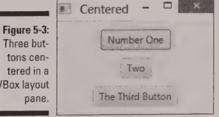

## 使节点具有相同宽度

当你向布局面板中放置一组按钮或其他控件时，你可能希望这些按钮具有相同的宽度，以创建整洁、均匀的外观。当你将它们放置在 `VBox` 面板的垂直列中，情况尤为如此，因为垂直列会突出按钮宽度之间的任何差异。

你可以通过将每个按钮的最大宽度设置为 `Double.MAX_VALUE` 来轻松地规定按钮具有相同的宽度。以下是前一个示例的修订版本，将三个按钮设置为相同的宽度：

```java
Button btn1 = new Button("Number One");
Button btn2 = new Button("Two");
Button btn3 = new Button("The Third Button");
btn1.setMaxWidth(Double.MAX_VALUE);
btn2.setMaxWidth(Double.MAX_VALUE);
btn3.setMaxWidth(Double.MAX_VALUE);
VBox vbox = new VBox(10, btn1, btn2, btn3);
vbox.setPadding(new Insets(10));
vbox.setAlignment(Pos.CENTER);
```

图 5-4 显示了当这些按钮被添加到场景并在舞台中显示时的外观。注意，所有三个按钮都采用了最宽按钮（btn3）的宽度。

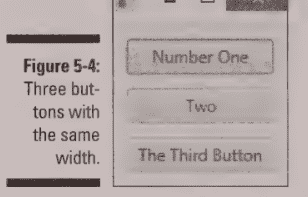

## 使用流式布局

流式布局有两种：水平和垂直。水平流式布局按行排列子节点，直到面板宽度达到你指定的特定尺寸。当该尺寸达到时，布局会在第一行下方开始新的一行子节点。这种流动一直持续，每当达到尺寸限制时就会开启新行，直到所有子节点都放置完毕。

垂直流式布局的工作方式相同，只是子节点按列排列，直到达到尺寸限制。当达到限制时，会在第一列的右侧立即开启新列。

你使用 `FlowPane` 类来创建流式布局。表 5-6 显示了 `FlowPane` 类的构造函数和常用的方法。

| 构造函数 | 描述 |
| --- | --- |
| `FlowPane()` | 创建一个水平和垂直间距均为零的空水平布局。 |
| `FlowPane(double hgap, double vgap)` | 创建具有指定水平和垂直间距的空水平布局。 |
| `FlowPane(double hgap, double vgap, Node... children)` | 创建具有指定水平和垂直间距以及子节点的水平布局。 |
| `FlowPane(Orientation orientation)` | 创建具有指定方向的空布局。 |
| `FlowPane(Orientation orientation, double hgap, double vgap)` | 创建具有指定方向和水平、垂直间距的布局。 |
| `FlowPane(Orientation orientation, double hgap, double vgap, Node... children)` | 创建具有指定方向、水平、垂直间距以及子节点的布局。 |

| 方法 | 描述 |
| --- | --- |
| `void setHgap(double value)` | 设置水平间距。 |
| `void setVgap(double value)` | 设置垂直间距。 |
| `void setPrefWrapLength(double value)` | 设置首选换行长度。 |
| `Orientation getOrientation()` | 获取布局方向。 |
| `void setOrientation(Orientation value)` | 设置布局方向。 |
| `ObservableList<Node> getChildren()` | 返回子节点列表。 |

`FlowPane` 类定义在 `javafx.scene.layout` 包中，因此在任何使用 `FlowPane` 的程序中都应该包含以下导入语句：

```java
import javafx.scene.layout.*;
```

`Orientation` 枚举定义在 `javafx.geometry` 包中。

请注意，无论首选的换行长度如何，如果不调用 `setPrefWrapLength` 方法，换行长度将默认为 400 像素。

下面的示例创建了一个水平布局，水平和垂直间隙均为 10 像素，由五个按钮填充，且首选换行长度为 300 像素：

```java
Button btn1 = new Button("Button One");
Button btn2 = new Button("Button Two");
Button btn3 = new Button("Button Three");
Button btn4 = new Button("Button Four");
Button btn5 = new Button("Button Five");
FlowPane pane = new FlowPane(Orientation.HORIZONTAL, 10, 10, btn1, btn2, btn3, btn4, btn5);
pane.setPrefWrapLength(300);
```

图 5-5 显示了当布局添加到场景并将场景在舞台中显示时，这些按钮外观。此图还显示了当用户调整窗口大小时，流布局中的按钮是如何重新排列的。注意，前三个按钮出现在第一行，接下来的两个出现在第二行。当窗口被拖得宽一点时，按钮会重流，使得四个按钮适应第一行，一个刚好溢到第二行。然后，当窗口被拖小时，只有两个按钮出现在第一行，并为第五个按钮创建了第三行。

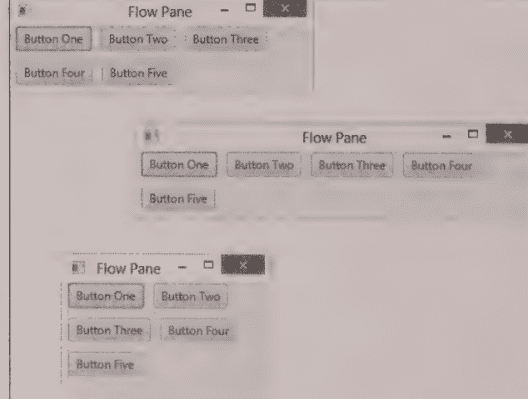

图 5-5：带有五个按钮的流布局。

## 使用边界布局

边界布局是一个划分为五个区域的面板：顶、左、中、右和底，如图 5-6 所示。当你将组件添加到布局时，可以指定组件位于这些区域中的哪一个。

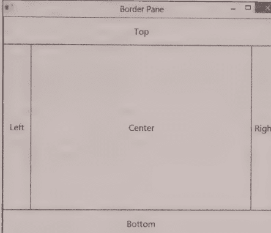

图 5-6：边界划分。

对于具有传统窗口布局的应用程序，边界布局是理想的布局管理器，在这种布局中菜单和工具栏显示在窗口顶部，状态栏或 OK 和取消按钮显示在底部，导航面板在左侧，各种任务面板在右侧，内容显示在中间。

你使用 `BorderPane` 类来创建边界布局。表 5-7 列出了 `BorderPane` 类的构造函数和常用的方法。

| 构造函数/方法 | 描述 |
| --- | --- |
| `BorderPane()` | 创建一个空的边界布局。 |
| `BorderPane(Node center)` | 创建带有指定中心节点的边界布局。 |
| `BorderPane(Node center, Node top, Node right, Node bottom, Node left)` | 创建带有指定的中心、顶、右侧、底和左侧节点的边界布局。 |
| `void setCenter(Node node)` | 设置中心节点。 |
| `void setTop(Node node)` | 设置顶部节点。 |
| `void setRight(Node node)` | 设置右侧节点。 |
| `void setBottom(Node node)` | 设置底部节点。 |
| `void setLeft(Node node)` | 设置左侧节点。 |
| `void setAlignment(Pos alignment)` | 设置面板内节点的对齐方式。参见表 5-5 关于 `Pos` 枚举的解释。更多信息请参见本章前面的“在布局面板中对齐节点”部分。 |
| `static void setMargin(Node child, Insets value)` | 设置给定子节点的边距。参见表 5-2 关于 `Insets` 类的构造函数。更多信息请参见本章前面的“添加外边距”部分。 |

`BorderPane` 类定义在 `javafx.scene.layout` 包中，因此在任何使用边界布局的程序中，都应该包含以下导入语句：

```java
import javafx.scene.layout.*;
```

该类的默认构造函数创建一个空的边界布局，你可以像示例中那样之后添加节点：

```java
Button btn1 = new Button("Button One");
Button btn2 = new Button("Button Two");
Button btn3 = new Button("Button Three");
VBox vbox = new VBox(btn1, btn2, btn3);

BorderPane pane = new BorderPane();
pane.setCenter(vbox);
```

在这里，创建了三个按钮并将它们添加到 `VBox` 中。然后，创建一个边界布局并将 `VBox` 添加到它的中心区域。

或者，你可以通过 `BorderPane` 构造函数向中心区域添加节点，如下：

```java
BorderPane pane = new BorderPane(vbox);
```

表 5-7 中列出的第三个构造函数允许你一次向所有五个区域添加节点。下面的示例假设你已经创建了五个名为 `centerPane`、`topPane`、`rightPane`、`bottomPane` 和 `leftPane` 的面板：

```java
BorderPane pane = new BorderPane(centerPane, topPane, rightPane, bottomPane, leftPane);
```

以下是关于 `BorderPane` 需要了解的一些要点：

- 如果将节点添加到中心区域，其宽度将由内容决定。
- 如果将节点添加到顶部，其高度将由内容决定。
- 如果将节点添加到右侧，其宽度将由内容决定。
- 如果将节点添加到底部，其高度将由内容决定。
- 如果将节点添加到左侧，其宽度将由内容决定。
- 如果调整窗口，边界布局将适应内容。
- 如果缩小窗口，边界布局将适应内容。


# 第 6 章：从用户获取输入

- 使用文本字段和区域
- 数据验证和创建复选框
- 设置单选按钮
- 使用这些组件

在前五章中，我讨论了如何仅使用基础输入控件（标签和按钮）创建 JavaFX 程序。但如果你想编写具有实际功能的程序，就需要使用其他输入控件。

在本章中，你将学习如何使用常用的控件。首先，你将学习获取单行的文本字段控件和获取多行的文本区域控件。我介绍了两种从用户处获取信息的控件：单选按钮和复选框。

在此过程中，你将发现任何从用户获取输入的 JavaFX 程序中一个重要的方面：数据验证。数据验证程序对于确保用户不输入错误数据至关重要。例如，你可以使用数据验证来确保用户输入必填字段，或者确保用户输入数字字段的数据确实是数字。

## 使用文本字段

文本字段是一个用户可以输入单行文本的框。你通过 `TextField` 类创建文本字段。表 6-1 显示该类的一些有趣的构造函数和方法。

| 构造函数/方法 | 描述 |
| --- | --- |
| `TextField()` | 创建一个空的文本字段。 |
| `TextField(String text)` | 创建一个包含指定文本的文本字段。 |
| `String getText()` | 返回文本字段中的文本。 |
| `void setText(String text)` | 设置文本字段中的文本。 |
| `void setPromptText(String text)` | 设置提示文本。 |
| `void setPrefColumnCount(int count)` | 设置首选列数。 |
| `void setEditable(boolean value)` | 设置是否可编辑。 |


| 构造函数 | 描述 |
| --- | --- |
| `TextField()` | 创建一个新的文本字段。 |
| `TextField(String text, int cols)` | 创建带有初始值的新文本字段。 |

| 方法 | 描述 |
| --- | --- |
| `String getText()` | 获取字段中的值。 |
| `void requestFocus()` | 请求聚焦到此文本字段。注意字段必须在场景中才能起作用。 |
| `void setEditable(boolean value)` | 如果为 false，则使字段变为只读。 |
| `void setMaxWidth(double width)` | 设置字段的最大宽度。 |
| `void setMinWidth(double width)` | 设置字段的最小宽度。 |
| `void setPrefColumnCount(int cols)` | 设置文本字段在列中的首选大小（即平均宽度文本字符的数量）。 |
| `void setPrefWidth(double width)` | 设置字段的首选宽度。 |
| `void setPromptText(String prompt)` | 设置字段的提示值。如果字段有文本值或获得焦点，则提示值将不会显示。 |
| `void setText(String text)` | 设置字段的文本值。 |

## 第 6 章：获取用户输入

`TextField` 类定义在 `javafx.scene.control` 包中，因此在任何使用文本字段的程序中都应该包含以下导入语句：

```java
import javafx.scene.control.*;
```

创建文本字段最常见的方法是调用不带参数的构造函数，如下：

```java
TextField textField1 = new TextField();
```

你可以像这样设置显示的初始值：

```java
TextField textField1 = new TextField("Initial value");
```

或者，如果你需要在之后设置值，可以调用 `setText()` 方法：

```java
textField1.setText("Text value");
```

要获取用户在文本字段中输入的值，请像这样调用 `getText()` 方法：

```java
String value = textField1.getText();
```

与任何 JavaFX 组件一样，管理文本字段的宽度可能会有点复杂。最终，JavaFX 将根据多个因素决定文本字段的宽度，包括包含 stage 和 scene 的窗口大小，以及放置文本字段的 pane（或多个 pane）上的任何尺寸限制。你可以通过调用 `setMinWidth()` 和 `setMaxWidth()` 方法为文本字段的大小设置最小和最大限制，并可以通过 `setPrefWidth()` 方法指定首选宽度，如示例所示：

```java
TextField textField1 = new TextField();
textField1.setMinWidth(150);
textField1.setMaxWidth(250);
textField1.setPrefWidth(200);
```

另一种设置首选宽度的方法是使用 `setPrefColumnCount()` 方法，它根据平均字符的大小设置宽度。例如，以下行大小使字段足够显示大约 50 个字符：

```java
textField1.setPrefColumnCount(50);
```

注意，`setPrefColumnCount()` 方法并不限制用户可以输入字段的字符数。相反，它限制了字段一次显示的字符数。

每当你使用文本字段时，请提供一个提示，让用户知道应该向字段输入什么数据。这一点的一种常用方法是在文本字段的左侧放置一个标签控件。例如：

```java
Label lbl1Name = new Label("Name:");
lbl1Name.setMinWidth(75);
TextField txtName = new TextField();
txtName.setMinWidth(200);
HBox pane = new HBox(10, lbl1Name, txtName);
```

在这里，创建了一个标签和一个文本字段，并将它们添加到一个 `HBox` pane 中，以便它们并排显示。

JavaFX 允许你在文本字段内部显示提示。提示以较浅的文本颜色显示，并在字段获得焦点时消失。你使用 `setPromptText()` 方法来创建这样的提示：

```java
TextField txtName = new TextField();
txtName.setPromptText("Enter the customer's name");
```

在这里，“Enter the customer's name”将显示在文本字段内部。

要获取用户在文本字段中输入的值，你使用 `getText()` 方法，如示例所示：

```java
String lastName = txtLastName.getText();
```

在这里，用户在 `txtLastName` 文本字段中输入的值赋值给 String 变量 `lastName`。

图 6-1 显示了一个简单程序的运行，该程序使用文本字段允许用户输入剧中的角色名称以及扮演该角色的演员名称。假设用户在两个字段中都输入了文本，程序将显示消息框，指示谁将扮演该角色。如果用户漏掉了其中一个或两个字段，将显示一个消息框以指示错误。（该程序使用了第 4 章列表 4-2 中介绍的 `MessageBox` 类来显示消息框。）

图 6-1 显示了该程序的主阶段的外观，以及当用户输入两个名称或漏掉一个名称时显示的消息框窗口。该程序的 JavaFX 代码如列表 6-1 所示。

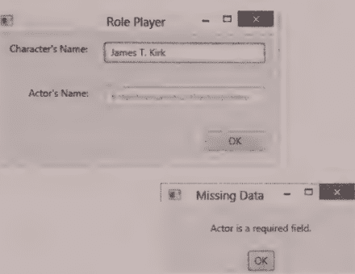

图 6-1：Role Player 应用程序的运行。

### 列表 6-1：Role Player 程序（续）

```java
// 创建角色的文本字段
txtCharacter = new TextField();
txtCharacter.setMinWidth(200);
txtCharacter.setMaxWidth(200);
txtCharacter.setPromptText(
    "Enter the name of the character here.");

// 创建演员标签
Label lblActor = new Label("Actor's Name:");
lblActor.setMinWidth(100);
lblActor.setAlignment(Pos.BOTTOM_RIGHT);

// 创建演员文本字段
txtActor = new TextField();
txtActor.setMinWidth(200);
txtActor.setMaxWidth(200);
txtActor.setPromptText("Enter the name of the actor here.");

// 创建 OK 按钮
btnOK = new Button("OK");
btnOK.setOnAction(e -> btnOK.handleClick());

// 创建角色面板
HBoxCharacter = new HBox(20, lblCharacter, txtCharacter);
paneCharacter.setPadding(new Insets(10));

// 创建演员面板
HboxActor = new HBox(20, lblActor, txtActor);
paneActor.setPadding(new Insets(10));

// 创建按钮面板
HboxButton = new HBox(20, btnOK);
paneButton.setPadding(new Insets(10));

// 将角色、演员和按钮面板添加到 VBox
VBox pane = new VBox(10, paneCharacter, paneActor, paneButton);

// 设置阶段
Scene scene = new Scene(pane, 300, 200);
primaryStage.setTitle("Role Player");
primaryStage.show();
```

```java
public void btnOK_Click() {
    String errorMessage = "";
    if (txtCharacter.getText().isEmpty()) {
        errorMessage += "Character is required.\n";
    }
    if (txtActor.getText().isEmpty()) {
        errorMessage += "Actor is required.\n";
    }
    if (errorMessage.isEmpty()) {
        String message = "The role of " + 
                          txtCharacter.getText() + 
                          " will be played by " + 
                          txtActor.getText() + ".";
        MessageBox.show(message, "Cast");
    } else {
        MessageBox.show(errorMessage, "Missing Data");
    }
}
```

## 第 6 章：从用户获取输入

### 验证数值数据

如果你使用文本字段从用户获取数值数据，需要特别小心。`getText()` 方法返回一个字符串值。你可以将此值传递给数值类型包装类的其中一个 `parse` 方法。要将文本框中输入的值转换为 `int`，请使用 `parseInt()` 方法：

```java
int count = Integer.parseInt(txtCount.getText());
```

在这里，`getText()` 方法的结果被用作 `parseInt()` 方法的参数。表 6-2 列出了各种包装类的 `parse` 方法。注意：这些方法在字符串无法转换时都会抛出 `NumberFormatException`。因此，你需要在 `try/catch` 块中调用 `parseInt()` 方法来捕获此异常。

| 表 6-2 | 将字符串转换为数字的方法 |
| --- | --- |
| 包装类 | parse 方法 |
| `Integer` | `parseInt(String)` |
| `Short` | `parseShort(String)` |
| `Long` | `parseLong(String)` |
| `Byte` | `parseByte(String)` |
| `Float` | `parseFloat(String)` |
| `Double` | `parseDouble(String)` |


如果你的程序使用了一个或两个数值输入文本字段，考虑创建单独的方法来验证用户的输入。以下代码段显示了一个方法，它接受一个文本字段和一个字符串（错误消息），如果字段中输入的数据无法转换为 `int`，则显示该错误消息。该方法返回一个 `Boolean` 值，指示该字段是否包含有效的整数：

```java
private boolean isInt(TextField f, String msg) {
    try {
        Integer.parseInt(f.getText());
        return true;
    } catch (NumberFormatException e) {
        MessageBox.show(msg, "Data Entry Error");
        return false;
    }
}
```

当你需要检查文本字段是否包含有效整数时，可以调用此方法。（`MessageBox` 类与列表 6-1 中使用的相同；你可以在第 4 章的列表 4-2 中找到它的代码）。

这是一个方法，它会获取 `txtCount` 文本框中输入的值，如果输入的值是有效的整数，则将其在消息框中显示：

```java
public void buttonOnClick() {
    if (isInt(txtCount, "You must enter an integer.")) {
        MessageBox.show("You entered " + 
            Integer.parseInt(txtCount.getText()) + 
            "Your Number");
    }
    txtCount.requestFocus();
}
```

调用 `isInt()` 方法是为了确保用户输入的文本可以转换为 `int`。如果是，则将文本转换为 `int` 并显示消息消息框。

### 使用复选框

复选框是用户可以点击进行选中或清除的控件。复选框允许用户为选项指定“是”或“否”设置。图 6-2 显示了一个带有三个复选框的窗口。

严格来说，复选框有三种状态：已选中、未选中和未定义。未定义状态通常与 `TreeView` 控件配合使用。

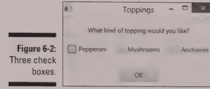

要创建一个复选框，你需要使用 `CheckBox` 类。表 6-3 显示了它常用的构造函数和方法。

| 表 6-3 | 常用的 CheckBox 构造函数和方法 |
| --- | --- |
| 构造函数 | 描述 |
| `CheckBox()` | 创建一个初始未选中的新复选框。 |
| `CheckBox(String text)` | 创建一个显示指定文本的新复选框。 |
| 方法 | 描述 |
| `String getText()` | 获取复选框显示的文本。 |
| `boolean isSelected()` | 如果复选框已选中则返回 true，否则返回 false。 |
| `void setAction(EventHandler<ActionEvent> value)` | 设置一个 ActionEventListener 来处理动作事件。 |
| `void setSelected(boolean value)` | 如果参数为 true 则选中复选框；如果参数为 false 则取消选中。 |
| `void setText(String text)` | 设置复选框文本。 |

与任何 JavaFX 控件一样，如果你想在程序的任何方法中引用复选框，请声明一个类变量来引用该控件：

```java
CheckBox chkPepperoni, chkMushrooms, chkAnchovies;
```

然后你可以在 `start()` 方法中使用像这样的语句来创建复选框并将它们添加到布局面板中（在此情况下为 `panel`）：

```java
chkPepperoni = new CheckBox("Pepperoni");
panel.add(chkPepperoni);

chkMushrooms = new CheckBox("Mushrooms");
panel.add(chkMushrooms);

chkAnchovies = new CheckBox("Anchovies");
panel.add(chkAnchovies);
```

注意，我没有在构造函数中指定这些复选框的初始状态。因此，它们初始是未选中的。如果你想创建一个初始为已选中的复选框，请调用 `setSelected()` 方法，如下：

```java
chkPepperoni.setSelected(true);
```

在事件监听器中，你可以使用 `isSelected()` 方法测试复选框的状态，并通过调用其 `setSelected()` 方法来设置复选框的状态。这里有一个方法可以在用户点击 OK 时显示消息框并清除所有复选框：

```java
public void btnOK_Click() {
    String msg = "";
    if (chkPepperoni.isSelected()) {
        msg += "Pepperoni\n";
    }
    if (chkMushrooms.isSelected()) {
        msg += "Mushrooms\n";
    }
    if (chkAnchovies.isSelected()) {
        msg += "Anchovies\n";
    }
    if (msg.equals("")) {
        MessageBox.show("You didn't order any toppings.");
    } else {
        MessageBox.show("You ordered these:\n" + msg);
    }
}
```

## 第 6 章：从用户获取输入

在这里，用户选择的配料名称被添加到字符串中。假设你的餐厅有安士丁鱼，如果你选择了意大利肠和安士丁鱼，显示如下：

Pepperoni

Anchovies

如果你为复选框提供时反馈，可以调用：

```java
MessageBox.show("We don't do anchovies!");
chkAnchovies.setSelected(false);
```

如下为复选框添加事件监听器：

```java
chkAnchovies.setOnAction(e -> {
});
```

### 使用单选按钮

单选按钮与复选框相似，但有一个关键区别：它们成组出现，用户每组只能选择一个。当你点击某个单选按钮来选中它时，同组内之前被选中的按钮会被取消选中。图 6-3 显示了一个带有单选按钮的窗口。


# 第 6 章：获取用户输入

## 创建单选按钮

使用单选按钮需要两个类。首先，使用 `RadioButton` 类创建单选按钮本身，其构造函数和方法见表 6-4。然后，使用 `ToggleGroup` 类为按钮创建一个组，并将单选按钮添加到切换组中。

`ToggleGroup` 对象仅仅是关联一组单选按钮的方法，使得组内只有一个按钮被选中。切换组本身不是控件，也不会显示。要显示单选按钮，你需要将单个单选按钮而不是切换组添加到布局面板中。

### 表 6-4 各种 RadioButton 构造函数和方法

| 构造函数 | 描述 |
| --- | --- |
| `RadioButton()` | 创建一个没有文本的新单选按钮。 |
| `RadioButton(String text)` | 创建一个带有指定文本的新单选按钮。 |

| 方法 | 描述 |
| --- | --- |
| `String getText()` | 获取单选按钮显示的文本。 |
| `boolean isSelected()` | 如果单选按钮已选中则返回 `true`，否则返回 `false`。 |
| `void setOnAction(EventHandler<ActionEvent> value)` | 设置一个 `ActionEventListener` 监听器来处理动作事件。 |
| `void setSelected(boolean value)` | 如果参数为 `true` 则选中单选按钮；如果参数为 `false` 则取消选中。 |
| `void setText(String text)` | 设置复选框文本。 |

创建单选按钮（radio button）的常用方法是声明一个变量将按钮作为类变量，这样可以在类的任何地方访问它，如下例所示：

```
RadioButton rdoSmall, rdoMedium, rdoLarge;
```

然后，在 `start` 方法中，你调用 `RadioButton` 构造函数来创建单选按钮：

```
rdoSmall = new RadioButton("Small");
```

之后，你可以将单选按钮添加到布局面板（layout pane）中以通常的方式工作。

要创建一个组合单选按钮的切换组（toggle group），请调用 `ToggleGroup` 类构造函数：

```
ToggleGroup sizeGroup = new ToggleGroup();
```

然后调用每个单选按钮的 `setToggleGroup` 方法：

```
rdoSmall.setToggleGroup(sizeGroup);
rdoMedium.setToggleGroup(sizeGroup);
rdoLarge.setToggleGroup(sizeGroup);
```

切换组与单选按钮的显示方式无关。要显示单选按钮，你仍然必须将其添加到布局面板中。并没有规则规定切换组内的所有单选按钮都必须添加到同一个布局面板中。然而，习惯做法是将同一个切换组中的所有单选按钮一起显示在场景中，这样用户就可以很容易地看到属于在一起的单选按钮。

如果你在 Swing 中用过单选按钮，你需要注意 JavaFX 切换组的工作方式与 Swing 按钮组工作方式之间的重要区别。在 JavaFX 中，切换组之外的单选按钮之间是相互独立的。在 Swing 中，按钮组之外的单选按钮都属于一个默认组。因此，在 JavaFX 中，请始终将单选按钮添加到切换组中，即使场景中只有一个切换组。

## 查看披萨订单应用程序

为了让你了解如何将本章介绍的控件与我在第 5 章介绍的布局面板结合使用，本节展示了一个相当复杂的应用程序，允许用户订购披萨。用户在文本框中输入他的姓名、地址和电话号码，使用单选按钮选择披萨的大小和饼底样式，并通过复选框（check boxes）选择配料。图 6-4 显示了披萨订单应用程序显示的主窗口。


当用户输入披萨订单数据并点击 OK 时，该程序将显示一个汇总订单的对话框，如图 6-5 所示。


乍看去可能并不明显，但披萨订单应用程序显示的场景总共使用了 12 个布局面板来管理其控件的布局。整个场景由一个边框（border）组织，其顶部区域显示标题（立即订购您的披萨！）。中心区域显示文本框、单选按钮和复选框，允许用户配置他们的披萨订单。底部区域包含 OK 和 Cancel 按钮。

为了供你参考，表 6-5 列出了用于组织这些内容的 12 个布局面板。

### 表 6-5 披萨订单应用程序中使用的布局面板

| 名称 | 类 | 描述 |
| --- | --- | --- |
| `paneMain` | `BorderPane` | 场景的主根面板。 |
| `paneTop` | `HBox` | 包含在边框面板顶部显示的标题文本。 |
| `paneName` | `HBox` | 包含客户姓名的标签和文本框，并排排列。 |
| `panePhone` | `HBox` | 包含电话号码的标签和文本框，并排排列。 |
| `paneAddress` | `HBox` | 包含地址的标签和文本框，并排排列。 |
| `paneCustomer` | `VBox` | 包含姓名、电话和地址面板，垂直堆叠。 |
| `paneSize` | `VBox` | 包含一个带有“Size”文本的标签和允许用户选择披萨大小的两个单选按钮，垂直堆叠。 |
| `paneCrust` | `VBox` | 包含一个带有“Crust”文本的标签和允许用户选择饼底样式的两个单选按钮，垂直堆叠。 |
| `paneToppings` | `FlowPane` | 配料复选框的流式布局面板（flow pane）。 |
| `paneTopping` | `VBox` | 包含带有“Toppings”文本的标签和列出配料的流式面板，垂直堆叠。 |
| `paneOrder` | `HBox` | 包含并排排列的尺寸、样式和配料的三个 `VBox` 面板。此面板显示在边框的中心区域。 |
| `paneBottom` | `HBox` | 包含并排排列的 OK 和 Cancel 按钮。使用间距符（spacer）强制按钮靠右对齐。此面板显示在边框的底部区域。 |

披萨订单应用程序的源代码位于代码列表 6-2。该类的源代码可以在第 4 章找到。

### 列表 6-2：披萨订单

```java
import javafx.application.*;
import javafx.scene.*;
import javafx.scene.layout.*;
import javafx.scene.control.*;
import javafx.scene.text.*;
import javafx.scene.text.*;
import javafx.geometry.Priority;

public class PizzaOrder extends Application {

    Stage stage;
    BorderPane paneMain;
    HBox paneTop;
    HBox paneName;
    HBox panePhone;
    HBox paneAddress;
    VBox paneCustomer;
    VBox paneSize;
    VBox paneCrust;
    FlowPane paneToppings;
    VBox paneTopping;
    HBox paneOrder;
    HBox paneBottom;
    RadioButton rdoSmall, rdoMedium, rdoLarge;
    RadioButton rdoThin, rdoThick;
    CheckBox chkPepperoni, chkSausage, chkLinguica, chkOlives;
    ToggleGroup sizeGroup;
    ToggleGroup groupCrust;

    public static void main(String[] args) {
        launch(args);
    }

    @Override
    public void start(Stage primaryStage) {
        paneMain = new BorderPane();

        paneTop = new HBox();
        Text title = new Text("Order Your Pizza Now!");
        title.setFont(new Font(20));
        paneTop.getChildren().add(title);
        paneMain.setTop(paneTop);

        paneName = new HBox();
        Label lblName = new Label("Name: ");
        TextField txtName = new TextField();
        paneName.getChildren().addAll(lblName, txtName);
        paneName.setPadding(10);

        panePhone = new HBox();
        Label lblPhone = new Label("Phone: ");
        TextField txtPhone = new TextField();
        panePhone.getChildren().addAll(lblPhone, txtPhone);
        panePhone.setPadding(10);

        paneAddress = new HBox();
        Label lblAddress = new Label("Address: ");
        TextField txtAddress = new TextField();
        paneAddress.getChildren().addAll(lblAddress, txtAddress);
        paneAddress.setPadding(10);

        paneCustomer = new VBox(10);
        paneCustomer.getChildren().addAll(paneName, panePhone, paneAddress);
        paneMain.setLeft(paneCustomer);

        paneSize = new VBox(5);
        Label lblSize = new Label("Size: ");
        rdoSmall = new RadioButton("Small");
        rdoMedium = new RadioButton("Medium");
        rdoLarge = new RadioButton("Large");
        sizeGroup = new ToggleGroup();
        rdoSmall.setToggleGroup(sizeGroup);
        rdoMedium.setToggleGroup(sizeGroup);
        rdoLarge.setToggleGroup(sizeGroup);
        paneSize.getChildren().addAll(lblSize, rdoSmall, rdoMedium, rdoLarge);
        paneSize.setPadding(10);

        paneCrust = new VBox(5);
        Label lblCrust = new Label("Crust: ");
        rdoThin = new RadioButton("Thin");
        rdoThick = new RadioButton("Thick");
        groupCrust = new ToggleGroup();
        rdoThin.setToggleGroup(groupCrust);
        rdoThick.setToggleGroup(groupCrust);
        paneCrust.getChildren().addAll(lblCrust, rdoThin, rdoThick);
        paneCrust.setPadding(10);

        paneToppings = new FlowPane(10, 10);
        chkPepperoni = new CheckBox("Pepperoni");
        chkSausage = new CheckBox("Sausage");
        chkLinguica = new CheckBox("Linguica");
        chkOlives = new CheckBox("Olives");
        paneToppings.getChildren().addAll(chkPepperoni, chkSausage, chkLinguica, chkOlives);

        paneTopping = new VBox(5);
        Label lblToppings = new Label("Toppings: ");
        paneTopping.getChildren().addAll(lblToppings, paneToppings);
        paneTopping.setPadding(10);

        paneOrder = new HBox(20);
        paneOrder.getChildren().addAll(paneSize, paneCrust, paneTopping);
        paneMain.setCenter(paneOrder);

        paneBottom = new HBox();
        Button btnOK = new Button("OK");
        Button btnCancel = new Button("Cancel");
        Region spacer = new Region();
        HBox.setHgrow(spacer, Priority.ALWAYS);
        paneBottom.getChildren().addAll(btnOK, spacer, btnCancel);
        paneBottom.setPadding(10);
        paneMain.setBottom(paneBottom);

        Scene scene = new Scene(paneMain, 600, 400);
        primaryStage.setScene(scene);
        primaryStage.setTitle("Pizza Order Application");
        primaryStage.show();
    }
}
```


```java
chkMushrooms = new CheckBox("Mushrooms");
chkTomatoes = new CheckBox("Tomatoes");
chkAnchovies = new CheckBox("Anchovies");

FlowPaneToppings = new FlowPane(Orientation.VERTICAL, chkPepperoni, chkSausage, chkLinguica, chkOlives, chkMushrooms, chkTomatoes, chkAnchovies);
paneToppings.setPadding(new Insets(10, 0, 10, 0));
paneToppings.setHGap(20);
paneToppings.setVGap(10);
paneToppings.setPrefWrapLength(100);

VBox paneTopping = new VBox(lbToppings, paneToppings);

// 将尺寸、饼底和配料面板添加到订单面板
HBox paneOrder = new HBox(50, paneSize, paneCrust, paneTopping);

// 创建中心面板
paneCenter = new VBox(20, paneCustomer, paneOrder);
paneCenter.setPadding(new Insets(0, 10, 0, 10));

//------ 创建底部面板 -----

Button btnOK = new Button("OK");
btnOK.setPrefWidth(80);
btnOK.setOnAction(e -> btnOK_Click());

Button btnCancel = new Button("Cancel");
btnCancel.setPrefWidth(80);
btnCancel.setOnAction(e -> btnCancel_Click());

Region spacer = new Region();

HBox paneBottom = new HBox(10, spacer, btnOK, btnCancel);
paneBottom.setHGrow(spacer, Priority.ALWAYS);
paneBottom.setPadding(new Insets(20, 10, 20, 10));

//------ 完成场景 -----

BorderPane paneMain = new BorderPane();
paneMain.setBorder(paneTop);
paneMain.setCenter(paneCenter);
paneMain.setBottom(paneBottom);
```

（续）

# 第 138 页 第一部分：JavaFX 入门

### 列表 6-2（续）

```java
// 创建场景和舞台

Scene scene = new Scene(paneMain);
primaryStage.setScene(scene);
primaryStage.setTitle("Pizza Order");
primaryStage.show();

public void btnOK_Click() {

    // 创建包含客户信息的消息字符串

    String msg = "Customer:\n\n";
    msg += "Name:" + txtName.getText() + "\n\n";
    msg += "Address:" + txtAddress.getText() + "\n\n";
    msg += "Phone:" + txtPhone.getText() + "\n\n";
    msg += "You have ordered a ";

    // 添加披萨尺寸
    if (rdoSmall.isSelected()) {
        msg += "small";
    }
    if (rdoMedium.isSelected()) {
        msg += "medium";
    }
    if (rdoLarge.isSelected()) {
        msg += "large";
    }

    // 添加饼底样式
    if (rdoThin.isSelected()) {
        msg += "thin crust pizza with ";
    }
    if (rdoThick.isSelected()) {
        msg += "thick crust pizza with ";
    }

    // 添加配料
    String toppings = "Toppings: \n\n";
    toppings = buildToppings(chkPepperoni, toppings);
    toppings = buildToppings(chkSausage, toppings);
    toppings = buildToppings(chkLinguica, toppings);
    toppings = buildToppings(chkOlives, toppings);
    toppings = buildToppings(chkTomatoes, toppings);
    toppings = buildToppings(chkMushrooms, toppings);
    toppings = buildToppings(chkAnchovies, toppings);
```

# 第 6 章：从用户获取输入 139

```java
if (toppings.equals(")"))
    msg += "no toppings";
else
    msg += "the following toppings:\n"
    + toppings;

// 显示消息

MessageBox.show(msg, "Order Details");

public String buildToppings(Checkbox chk, String msg)
{
    // 用于显示配料列表的辅助方法
    if (chk.isSelected())
    {
        if (!msg.equals(")"))
        {
            msg += ", ";
        }
        msg += chk.getText();
    }
    return msg;
}

public void btnCancel_Click()
{
    stage.close();
}
```

# 第二部分

# JavaFX 控件

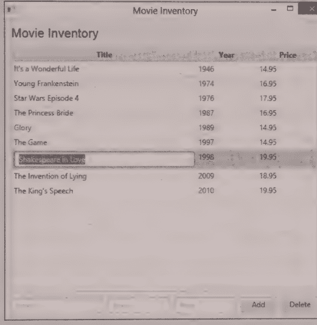

访问 `www.dummies.com/extras/javafx` 获取优质的 Dummies 在线内容。

## 在这一部分...

- 控制控件
- 组织列表
- 构建表格
- 创建菜单
- 访问 `www.dummies.com/extras/javafx` 获取优质的 Dummies 在线内容。

# 第 7 章

# 介绍 JavaFX 节点层次结构

本章内容

- 介绍组成 JavaFX 的最重要的包和类
- 查看所有控件通过继承继承的重要方法

JavaFX 最简单的定义是节点图（graph of nodes）。图中的每个节点都是 `Node` 的子类。图的根是 `Parent` 的子类。可以通过将 JavaFX 想象成一棵树来将其可视化，其中根节点是顶部，所有其他节点都是它的孩子。在本章中，我们将介绍组成 JavaFX 的最重要的包和类，并查看所有控件通过继承继承的重要方法。

`Node` 类是图中所有对象的基类。每个节点都有位置、尺寸和外观。节点还可以处理事件，例如鼠标点击和按键按下。`Parent` 类是 `Node` 的子类，它可以拥有子节点。这允许创建复杂的用户界面。`Region` 类是 `Parent` 的子类，提供了布局能力。`Control` 类是 `Region` 的子类，提供了用户界面控件。

JavaFX 节点层次结构如下：

- `Node`
    - `Parent`
        - `Region`
            - `Control`
                - `Button`
                - `Label`
                - `CheckBox`
                - `RadioButton`
                - `TextField`
                - `TextArea`
                - `ListView`
                - `ComboBox`
                - `TableView`
                - `TreeView`
            - `Pane`
                - `HBox`
                - `VBox`
                - `FlowPane`
                - `BorderPane`
                - `StackPane`
                - `GridPane`
                - `ScrollPane`
        - `Group`
    - `Scene`

`Pane` 类（`HBox`, `VBox`, `FlowPane`, `BorderPane`, `StackPane`, `GridPane`, `ScrollPane`）提供了布局能力。`Control` 类提供了用户界面控件。

`Scene` 类是图中所有对象的容器。它是节点层次结构的根。`Stage` 类是窗口。

`Pane` 类（`HBox`, `VBox`, `FlowPane`, `BorderPane`, `StackPane`, `GridPane`, `ScrollPane`）用于排列其他节点。`Control` 类提供了用户界面控件。

`Scene` 类是图中所有节点的容器。它是节点层次结构的根。`Stage` 类是窗口。每个 JavaFX 应用程序有一个主舞台。

在本章中，我们将介绍组成 JavaFX 的最重要的包和类，并查看所有控件通过继承继承的重要方法。

# JavaFX 包概览

在查看组成 JavaFX 的类之前，我想简要讨论各个包。到目前为止，你已经见过：

- `javafx.application`：该包中最重要的类是 `Application`，它提供了 JavaFX 的生命周期。所有 JavaFX 应用程序扩展 `Application` 并实现 `start` 方法。
- `javafx.stage`：该包中最重要的类是 `Stage`，它代表窗口。你可以使用 `Stage` 显示场景。每个 JavaFX 应用程序有一个主舞台（`primaryStage`）。
- `javafx.scene`：该包中最重要的类是 `Scene`，它是图中所有节点的容器。它是节点层次结构的根。你可以在第 4 章中关于 `Scene` 的内容。
- `javafx.scene.control`：该包包含了大多数 JavaFX 用户界面控件，包括 `Button`、`Label`、`CheckBox` 和 `RadioButton`。该包还包括 `Control`，它是所有用户界面控件派生的基类。
- `javafx.scene.layout`：该包包含了布局面板类，如 `HBox`、`VBox` 和 `BorderPane`。该包定义的另外两个重要类是 `Pane` 和 `Region`。所有的布局面板类都基于 `Pane` 类，而该包中的 `Pane` 类和 `javafx.scene.control` 中的 `Control` 类都基于 `Region` 类。
- `javafx.geometry`：这是一个较小的包，定义了与 JavaFX 节点几何相关的类和枚举。在第 5 章，你将学会如何使用 `Insets` 类来控制布局面板内的间距，以及使用 `Pos` 枚举指定对齐。
- `javafx.collections`：该包定义了 `ObservableList` 类，它被 `Pane` 类的 `getChildren` 方法使用。在接下来的几章中，你会遇到需要此包的几个控件类。

# 146 第二部分：JavaFX 控件

### `Node` 类

JavaFX Control 类层次结构始于 `Node` 类，该类表示可以添加到 JavaFX 场景（scene）中的对象。实际上，Control 类层次结构中的最顶层的类是 `Object` 类，但在这里几乎不值一提，因为所有的类层次结构都从 `Object` 类开始——`Object` 是所有 Java 类的母类。

所有属于场景的对象都属于一个场景图（scene graph），场景图是一个树形结构，包含了组成用户界面的所有节点。要成为场景图的一部分，对象必须继承 `Node` 类。因此，`Node` 类是所有可以添加到 JavaFX 场景的类的基类。

与其他树形结构一样，场景图从单个节点——根节点（root node）开始，并可以有一个或多个子节点，每个子节点反过来又可以有一个或多个子节点。至少有一个子节点的节点是分支节点（branch node）；没有节点的节点是叶子节点（leaf node）。一个场景只能有一个根节点，但可以有很多分支节点和叶子节点。

`Node` 类是一个抽象类，这意味着你不能直接创建它的实例。换句话说，以下代码会导致编译错误：

```java
myNode = new Node();
```

然而，你可以使用 `Node` 类来持有类型你不确定或不在乎的节点。例如：

```java
myNode = new Button();
```

在这种情况下，变量 `myNode` 的类型是 `Node`，但它被用于持有对 `Button` 控件的引用。

Node 层次结构中上层的许多方法都接受或返回类型为 `Node` 对象。例如，用于布局窗格（layout panes，如 `HBox` 和 `FlowPane`）的 `getChildren` 方法返回一个 `Node` 对象的列表，而用于将对象添加到布局窗格节点列表的 `add` 方法接受一个 `Node` 对象作为参数。换句话说，任何 `Node` 对象都可以添加到布局窗格中。

表 7-1 列出了你在大多数 JavaFX 程序中可能用到的少数方法。请注意，此表极大地简化了 `Node` 类的复杂性。实际上，该类定义了超过 300 个方法。其中超过三分之一的方法与事件处理有关：`Node` 类是负责所有节点大多数事件处理的类，包括处理与节点鼠标、键盘和触摸屏交互的事件。

| 表 7-1 `Node` 类的常用方法 |
| :--- | :--- |
| 方法 | 解释 |
| `Parent getParent()` | 返回此节点的 `Parent` 节点。 |
| `String getId()` | 返回此节点的 ID。 |
| `void setId(String id)` | 设置此节点的 ID。ID 在场景图内应该是唯一的。 |
| `Node lookup(String id)` | 在节点的子节点中搜索 ID 与参数匹配的节点。 |
| `String getStyle()` | 返回节点的 CSS 样式字符串。 |
| `Void setStyle(String style)` | 设置节点的 CSS 样式字符串。 |

`getParent` 方法返回一个节点的父节点。该方法返回一个类型为 `Parent` 的对象，这种节点可以拥有子节点（在接下来的节中发现）。场景图中的根节点外的每个节点都必须有一个父节点，且该父节点的类型始终为 `Parent`。如果你在根节点上调用此方法，将返回 `null`。

请注意，每个节点都可以有一个唯一的字符串标识符，这使得在复杂的场景图中很容易区分节点，并且在使用 CSS 格式化场景时也有帮助。你可以通过调用 `setId` 方法来设置字符串标识符，该方法接受如下所示的字符串参数：

```java
myNode.setId("LBL3");
```

在这里，你之后可以通过调用 `lookup` 方法找到此节点。这个方法有点独特，你必须在你要查找的 ID 前加一个哈希符号（#）。例如，以下是你如何在整个场景图中搜索一个 ID 为 LBL3 的控件：

```java
Node myNode = scene.getRoot().lookup("#LBL3");
```

在这里，调用了场景变量 `scene`（我假设其类型为 `Scene`）的 `getRoot` 方法来获取场景的根节点。然后，调用 `lookup` 方法返回 ID 为 LBL3 的节点。

`Node` 类还有许多其他方法，允许你为所有类型的节点应用通用格式或其他功能。例如，`setStyle` 方法允许你对任何类型的节点应用 CSS 样式格式。而 `setRotate` 方法允许你旋转任何节点。你可以在本书的后续章节中阅读关于这些以及其他 `Node` 方法。

### `Parent` 类

尽管有十个不同的类直接继承 `Node` 类，但由于某种关系之故，在操作 JavaFX 控件时，你唯一需要关注的是 `Parent` 类。关于 `Node` 的十个子类的解释，请参阅本章的侧边栏“十种节点”。

`Parent` 类拥有 `Node` 类的所有能力，并增加了拥有子节点的能力。它的主要工作是管理子节点集合，该集合表示为标准的 Java 列表。你可以通过调用 `getChildren` 方法来访问此列表。

你已经在布局窗格（如 `HBox` 和 `VBox`）中见过此方法的作用。例如，以下代码创建一个 `HBox` 窗格，然后向其添加两个元素：

```java
Label lblAddress = new Label("Address:");
TextField txtAddress = new TextField();
HBox hbox = new HBox();
hbox.getChildren().addAll(lblAddress, txtAddress);
```


# 第 7 章：JavaFX 层次结构简介

`getChildren` 方法返回一个类型为 `ObservableList` 的对象，它实现了 `List` 接口。在这两者之间，定义了一些你可以使用的方法。表 7-2 列出了 `ObservableList` 的常用方法：

### 表 7-2 ObservableList 的常用方法

| 方法 | 解释 |
| :--- | :--- |
| `void add(Node node)` | 添加单个节点。 |
| `void addAll(Node... nodes)` | 添加多个节点。 |
| `void remove(Node node)` | 删除指定的节点。 |
| `void clear()` | 删除所有节点。 |
| `int size()` | 返回节点数量。 |

`Parent` 类是一个抽象类，这意味着你不能直接创建它的实例。然而，它是所有布局窗格的基类。

正如其名，`Region` 类定义了场景中具有物理尺寸（即高度和宽度）的可见区域。区域的大小取决于多个因素，但默认情况下由其包含的内容的大小决定。你可以设置区域将遵守的最小、最大和首选约束，并指定固定数量的内边距（padding），在区域内容与其外部边缘之间提供留白。此外，可以通过层级样式表（CSS）来设置区域的视觉样式。

表 7-3 显示了 `Region` 类提供的常用方法，这些方法都与设置区域的大小有关。

### 表 7-3 Region 类的常用方法

| 方法 | 解释 |
| :--- | :--- |
| `void setMaxHeight(double height)` | 设置区域的最大高度。 |
| `void setMinHeight(double height)` | 设置区域的最小高度。 |
| `void setPrefHeight(double height)` | 设置区域的首选高度。 |
| `void setMaxWidth(double width)` | 设置区域的最大宽度。 |
| `void setMinWidth(double width)` | 设置区域的最小宽度。 |
| `void setPrefWidth(double width)` | 设置区域的首选宽度。 |
| `double getHeight()` | 获取区域的实际高度。 |
| `double getWidth()` | 获取区域的实际宽度。 |
| `void setPadding(Insets value)` | 设置内边距。 |

`Region` 类提供了三个不同的参数，允许你控制区域的高度和宽度。对于高度和宽度，你都可以设置一个最小值、一个首选值和一个最大值。正如其名称所示，JavaFX 不会让控件小于最小尺寸或大于最大尺寸，在可能的情况下，它会倾向于首选尺寸。

在这些参数范围内，JavaFX 将根据其包含的内容确定区域的理想高度和宽度。对于标签（label）或按钮（button）等控件，内容是标签或按钮显示的文本。对于更复杂的控件，内容更为复杂。对于布局面板，内容由添加到面板的所有节点组成。

如果你不指定任何高度或宽度约束，这三者（最小、首选和最大）将默认为控件的实际计算大小。

> **注意**：在许多情况下，区域的内容会自动调整大小以填充任何可用空间。因此，如果用户动态调整包含场景的窗口大小，场景内所有区域的大小可能会扩大或收缩以填充可用空间。

如果你想要区域宽度或高度的精确值，请将所有三个参数（最小、首选和最大）设置为相同的值。


```
lbl.setMinWidth(150)
lbl.setPrefWidth(150)
lbl.setMaxWidth(150)
```

在这种情况下，你可能更喜欢创建一个常量：

```
final static int LABEL_WIDTH = 150;
lbl.setMinWidth(LABEL_WIDTH);
lbl.setPrefWidth(LABEL_WIDTH);
lbl.setMaxWidth(LABEL_WIDTH);
```

这样，当你改变标签的宽度时，只需要在一个地方更改值即可。

另一个影响区域高度或宽度的设置是：指定的内边距量。内边距在区域边缘提供留白，以防止场景看起来拥挤。注意：与控件相比，你更有可能在布局中使用内边距。

要指定内边距，请使用定义在 `javafx.geometry` 包中的 `Insets` 类。`Insets` 提供两个构造函数。第一个允许你设置区域四侧的均匀边距：

```
pane.setPadding(new Insets(10));
```

或者，你可以为顶部、右侧、底部和左侧设置不同的值：

```
pane.setPadding(new Insets(10, 0, 10, 0));
```

在这个示例中，顶部和底部的边距被设置为 10 像素，但右侧和左侧的边距设置为 0。

关于内边距的更多信息，请翻阅第 5 章。

### Control 类

本章的最终目的是向你概述所有 JavaFX 控件共有的特征，这是因为所有控件都继承自 `Control` 类。现在你终于来到了对 `Control` 类本身的讨论，请做好心理准备，可能会有一点小小的失望。

`Control` 类本身并没有那么有趣。如表 7-4 所示，实际上只有三个感兴趣的方法。事实证明，所有控件共有的特征实际上是由 `Region`、`Parent` 和 `Node` 控件提供的。

### 表 7-4 Control 类的方法

| 方法 | 解释 |
| :--- | :--- |
| `void setTooltip(Tooltip value)` | 为控件设置工具提示。 |
| `void setContextMenu(ContextMenu value)` | 为控件设置右键菜单。更多信息请参阅第 10 章。 |
| `void setSkin(Skin value)` | 为控件设置皮肤。 |

`Control` 类增加了三个主要功能：添加工具提示、右键菜单和皮肤的能力。工具提示（tooltip）是一个提供控件说明的弹出气泡。创建工具提示更简单：将文本作为参数传递即可。这是一个示例：

```
btn.setTooltip(new Tooltip("保存文件"));
```

当鼠标悬停在按钮上时，工具提示就会出现。

恭喜！你现在知道了适用于所有 JavaFX 控件的重要方法。

# 第 8 章：从列表中选择

- 本章
- 使用 ChoiceBox
- 使用 ObservableList 监听选择的变化
- 使用 ComboBox 和 ListView 控件
- 使用 TreeView

有一类 JavaFX 控件设计用于用户从列表中选择一个或多个项目。本章介绍了此类控件：选择框（ChoiceBox）、组合框（ComboBox）和列表（ListView）。在此过程中，你将学习如何使用 `ObservableList`，它用于管理选择框、组合框或列表视图。

实际上，如果你一直读到这里，已经接触了 `ObservableList` 接口。在本章中，你将学习该接口的其他功能。你还将学习如何添加监听器，以便用户更改选择时做出响应。

## 使用选择框

选择框是一种允许用户从下拉列表中选择项目的控件。初始状态，选择框仅显示选中的项目。当用户点击选择框时，列表会显示。用户可以通过点击列表中的任何项目来更改选择。图 8-1 显示了一个带有简单选择框的场景。

你使用 `ChoiceBox` 类来创建选择框。表 8-1 列出了该类常用的构造函数和方法。

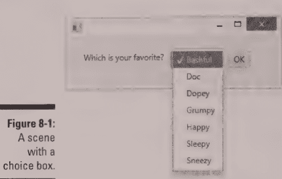

### 表 8-1 ChoiceBox 的常用构造函数和方法

| 成员 | 描述 |
| :--- | :--- |
| **构造函数** | |
| `ChoiceBox<T>()` | 创建指定类型的空选择列表。 |
| `ChoiceBox<T>(ObservableList<T> items)` | 创建选择列表并用指定列表中的值填充。 |
| **方法** | |
| `ObservableList<T> getItems()` | 获取项目列表。 |
| `void setItems(ObservableList<T> items)` | 设置项目列表。 |
| `T getValue()` | 返回当前选中的项目。 |
| `void setValue(T value)` | 设置当前选中的项目。 |
| `void show()` | 显示项目列表。 |
| `void hide()` | 隐藏项目列表。 |
| `boolean isShowing()` | 表示项目列表是否可见。 |

## 创建选择框

创建选择框非常简单。`ChoiceBox` 类是泛型的，因此需要为与选择框关联的列表指定类型。例如：

```
ChoiceBox<String> choice = new ChoiceBox<String>();
```

这里，创建了一个显示字符串的选择框。

下一步是向选择框添加项。你可以通过调用 `getItems` 方法访问项列表，然后调用 `add` 方法添加项：

```
choice.getItems().add("Bashful");
choice.getItems().add("Doc");
choice.getItems().add("Dopey");
choice.getItems().add("Grumpy");
choice.getItems().add("Happy");
choice.getItems().add("Sleepy");
choice.getItems().add("Sneezy");
```

或者，你也可以调用 `addAll` 方法一次性添加所有字符串，如下：

```
choice.getItems().addAll("Bashful", "Doc", "Dopey",
"Grumpy", "Happy", "Sleepy",
"Sneezy");
```

`getItems` 方法返回一个 `ObservableList` 类型的的对象，它提供了许多可以让你操作列表的方法。更多信息，请参阅本章后面的“使用 Observable 列表”节。

`ChoiceBox` 类还包含一个构造函数，允许你可以在创建选择框时添加一个 `ObservableList` 对象。这允许你在创建选择框之前先创建列表。你可以在本章的“使用 Observable 列表”节看到此构造函数的用法示例。

你可以向选择框添加任何种类的对象。选择框会调用每个项的 `toString` 方法来确定在选择列表中显示的文本。假设你有一个名为 `Astronaut` 的类，它代表一个执行太空任务的宇航员：


```
class Astronaut {
    private String firstName;
    private String lastName;

    public Astronaut(String firstName, String lastName) {
        firstName = firstName;
        lastName = lastName;
    }

    public String toString() {
        return firstName + " " + lastName;
    }
}
```

那么，你可以使用阿波罗 13 号的船员创建一个选择框：

```
ChoiceBox<Astronaut> apollo13 = new ChoiceBox<Astronaut>();
apollo13.getItems().add(new Astronaut("Jim", "Lovell"));
apollo13.getItems().add(new Astronaut("John", "Swigert"));
apollo13.getItems().add(new Astronaut("Fred", "Haise"));
```

如果你愿意，你可以在不等待用户点击框的情况下显示选择框的内容。要实现这一点，请调用 `show` 方法，如下：

```
apollo13.show();
```

要隐藏列表，调用 `hide` 方法：

```
apollo13.hide();
```

### 设置默认值

默认情况下，选择框在首次显示时没有初始选择。要设置初始值，请调用 `setValue` 方法，并传递你想要作为初始选择的列表对象。

如果选择框包含字符串，你可以通过将所需的字符串值传递给 `setValue` 方法来设置初始值：

```
choice.setValue("Dopey");
```

如果指定的字符串在列表中不存在，则初始值将保持未指定状态。

如果选择框包含对象（例如上一节所示的 `Astronaut` 对象），你必须传递一个想要作为默认选择的对象的引用。例如：

```
Astronaut lovell = new Astronaut("Jim","Lovell");
Astronaut swigert = new Astronaut("John","Swigert");
Astronaut haise = new Astronaut("Fred","Haise");
ChoiceBox<Astronaut> apollo13 = new ChoiceBox<Astronaut>();
apollo13.getItems().addAll(lovell, swigert, haise);
apollo13.setValue(lovell);
```

在这里，Jim Lovell 被设置为默认宇航员。

## 获取所选项

你可以调用 `getValue` 方法来获取用户选择的项。返回的值的类型取决于你在创建选择框时指定的类型。例如，如果你指定了类型为 `String`，则 `getValue` 方法返回字符串。如果你为选择框指定了类型 `Astronaut`，则 `getValue` 方法返回宇航员。

`getValue` 方法通常用于按钮的动作事件处理程序中。例如：

```
public void btnOK_Click() {
  String message = "You chose ";
  message += apollo13.getValue();
  MessageBox.show(message, "Your Favorite Astronauts");
}
```

此示例中使用的 `MessageBox` 类可以在第 4 章中找到。


### 使用 Observable 列表

正如你在上一节中看到的，`ChoiceBox` 类并不包含直接从列表中添加或删除项的方法。相反，它包含一个 `getItems` 方法，该方法返回一个 `ObservableList`。要操作由选择框显示的项，你必须先访问该列表。

到目前为止，我讨论了 `ObservableList` 的两种方法：`add` 和 `addAll`。这里是 `add` 方法的示例：

```
comboBox.getItems().add("Baseful");
```

这里是 `addAll` 方法的示例：

```
pane.getChildren().add("OK", "Cancel");
```

### 表 8-2 ObservableList 方法

| 方法 | 说明 |
| :--- | :--- |
| `add(E element)` | 将指定的元素添加到列表末尾。 |
| `add(int index, E element)` | 在指定的索引处添加元素。 |
| `addAll(E...elements)` | 将所有指定的元素添加到列表末尾。 |

### 表 8-3 其他 ObservableList 方法

| 方法 | 说明 |
| :--- | :--- |
| `addAll(Collection<E> c)` | 将指定集合中的所有元素添加到列表末尾。 |
| `set(int index, E elem)` | 将指定元素设置为指定的对象。该位置之前的元素作为方法的返回值。 |
| `clear()` | 删除列表中的所有元素。 |
| `remove(int fromIndex, int toIndex)` | 删除索引范围内的对象。 |
| `removeAll(E..elements)` | 删除索引范围内的所有对象。 |
| `contains(Object elem)` | 返回布尔值，表示指定对象是否在列表中。 |
| `get(int index)` | 返回列表中指定位置的对象。 |
| `indexOf(Object elem)` | 返回指定对象在列表中首次出现的索引位置。如果对象不在列表中，则返回 -1。 |
| `isEmpty()` | 返回布尔值，表示列表是否为空。 |
| `remove(int index)` | 删除指定索引处的对象并返回被删除的元素。 |
| `remove(Object elem)` | 从列表中删除对象。注意：多个元素引用该对象；此方法仅删除其中一个。它返回布尔值，表示该对象是否在列表中。 |
| `size()` | 返回列表中元素的数量 |
| `addListener(ListChangeListener listener)` | 添加一个列表监听器，每当列表发生变化时就会被调用。 |

如果你熟悉 Java 集合类（例如 `ArrayList`），你可能已经注意到表 8-2 中列出的许多方法都很很熟悉。这是因为 `ObservableList` 类继承了 `List` 类，而 `ArrayList` 和 `Vector` 等类实现了 `List` 。因此，任何用于 `ArrayList` 的方法都可以用于 `ObservableList`。

例如，你可以像清空数组列表一样清空选择框（choice box）的内容：

```
cbox.getItems().clear();
```


如果你需要知道选择框中有多少个项，请调用 `size` 方法：

```java
int count = cbox.getItems().size();
```

若要从列表中删除一个项，请使用 `remove` 方法：

```java
cbox.getItems().remove("Grumpy");
```

无论列表中是否出现字符串 "Grumpy"，该方法都会执行成功（返回结果）。你可以通过在 `add` 方法中指定集合，轻松地将现有的 Java 集合（如数组列表）中的项插入到选择框中。例如，假设你已经有一个名为 `list` 的数组列表，其中包含了你想在选择框中显示的项。你可以这样添加这些项：

```java
cbox.getItems().addAll(list);
```

你可能会疑惑，为什么基于列表的 JavaFX 控件显示的项需要可观测列表？为什么不直接使用集合类呢？原因是为了让基于列表的控件高效工作，控件需要监控你对项列表进行的任何更改，以便控件自动更新显示的项。表 8-2 中列出的最后一个方法（`addListener`）提供了这种能力，允许你添加一个监听器，每当列表内容更改时该监听器就会被调用。你很少直接调用此方法。但使用可观测列表的控件会调用此方法来创建事件监听器，每当列表内容更改时，自动更新控件。

# 第 8 章：从列表中选择

**注意：** 你不需要使用 `addListener` 方法来响应用户在选择框或其他类型列表控件中选择项的操作。相反，你将使用一种名为*选择模型*（selection model）的有趣结构来响应所选项的变化，正如下一节所描述的那样。

## 监听选择变化

让你的程序在用户更改选择框或其他列表控件的选择时立即做出响应是非常常见的，而无需等待用户点击按钮提交数据。例如，你可能有一个标签（label），每当用户更改选择时你都会立即更新它的值。你甚至可能想根据选择来显示或隐藏控件。

遗憾的是，选择框和列表控件在用户更改选择时不会产生动作事件（action event）。因此，`CheckBox` 类没有 `setOnAction` 方法。相反，你必须使用一系列复杂的方法调用来设置另一种类型的事件监听器，称为更改监听器（change listener）。

以下是步骤：

1. 通过调用选择框上的 `getSelectionModel()` 方法获取选择模型。

   `getSelectionModel()` 返回控件的 `selectionModel`，这是一个管理用户如何从列表中选择项的对象。选择模型是一个对象，它实现了几个继承自抽象 `SelectionModel` 类的类中的其中一个。对于选择框，选择模型始终是 `SingleSelectionModel` 类型，它实现了一个允许用户一次仅从列表中选择一个项的选择模型。

2. 通过调用选择模型上的 `getSelectedItemProperty()` 方法获取 `selectedItem` 属性。

   `SelectionModel` 类有一个名为 `getSelectedItemProperty` 的方法，该方法访问名为 `selectedItem` 的属性，该属性代表当前选中的项。（*属性* 是一种特殊的 JavaFX 类型，我将在第 19 章中进行更多讨论。现在，假设属性是一个对象，其值可以被监听器监控，监听器会在属性值更改时被调用。）

3. 通过在 `selectedItem` 属性上调用 `addListener` 方法添加更改监听器。

   每当 `selectedItem` 属性的值发生变化时，监听器就会被调用。更改监听器自然地实现了一个函数式接口：`ChangeListener`。由于 `ChangeListener` 是一个函数式接口（即它只有一个方法），你可以使用 Lambda 表达式来实现更改监听器。

你通常会在一个语句中完成这所有三个步骤，如下例所示：

```java
choice.getSelectionModel().getSelectedItemProperty()
  .addListener((observable, oldValue, newValue) ->
    lbl.setText(newValue));
```

在前面的示例中，更改监听器将标签控件显示的值设置为用户新选中的新值。

作为一个函数式接口，`ChangeListener` 定义了一个名为 `changed` 的单函数，每当属性值发生变化时该方法就会被调用。`changed` 方法接收三个参数：

- `observable`：值发生变化的属性
- `oldValue`：属性的旧值
- `newValue`：属性的新值

这三个参数在 Lambda 表达式开头的括号中指定。在 Lambda 表达式的主体中，`newValue` 参数被赋值给标签的文本。因此，用户选择的值将由标签显示，并且每当用户更改选择框选择时，标签将自动更新。

### 使用组合框

组合框是选择框控件的一个更高级的兄弟控件。通过组合框获得的主要改进是：

- 组合框包含了在显示列表时限制显示项数量的能力。如果列表中的项数超过了限制，会自动添加滚动条，允许用户滚动整个列表。
- 组合框包含一个文本框，允许用户输入值而不是从列表中选择。文本框是可选的，且默认不显示，但你可以通过一个方法显示它。
- 组合框在用户更改选择时触发事件。因此，使用组合框来响应用户的选择比使用选择框要简单。


你使用 `ComboBox` 类来创建组合框。表 8-3 列出了常用的构造函数和方法。

| 表 8-3 ComboBox 构造函数和方法 | |
| --- | --- |
| **构造函数** | **说明** |
| `ComboBox<T>()` | 创建指定类型的空组合框。 |
| `ComboBox<T>(ObservableList<T> items)` | 创建组合框并填充列表中的值。 |
| **方法** | **说明** |
| `void setEditable(boolean value)` | 如果为 true，则显示文本框允许用户编辑选择。 |
| `void setVisibleRowCount(int value)` | 设置显示的项数。 |
| `void setPromptText(String text)` | 设置初始显示在文本框中的提示文本。 |
| `ObservableList<T> getItems()` | 获取项列表。 |
| `void setItems(ObservableList<T> items)` | 设置项列表。 |
| `T getValue()` | 返回当前选中的项。 |
| `void setValue(T value)` | 设置当前选中的项。 |
| `void show()` | 显示列表。 |
| `void hide()` | 隐藏列表。 |
| `void setOnAction(EventHandler<ActionEvent> handler)` | 设置每当选择更改时调用的事件处理器。 |
| `boolean isShowing()` | 表示项列表当前是否可见。 |

### 创建组合框

创建组合框与创建选择框非常相似。由于 `ComboBox` 是泛型的，请为它将包含的项指定类型，如下例：

```java
ComboBox<String> cbox = new ComboBox<String>();
```

然后你可以使用 `getItems` 方法访问包含组合框显示的列表内容的 `ObservableList` 对象。例如，你可以这样向列表添加项：

```java
cbox.getItems().addAll("Bashful", "Doc", "Dopey", "Grumpy", "Happy", "Sleepy", "Sneezy");
```

有关如何使用 `ObservableList` 接口的更多信息，请参阅本章节前面的“使用 Observable Lists”部分。

默认情况下，用户不允许编辑组合框中文本框部分的数据。如果你想允许用户编辑文本框，请使用 `setEditable` 方法，如下所示：

```java
cbo.setEditable(true);
```

然后，用户就可以输入一个不在组合框中的值了。

如果你需要，可以通过调用 `setVisibleRowCount` 方法来限制列表显示的项数：

```java
cbo.setVisibleRowCount(10);
```

在这里，列表最多显示十项。如果列表包含的项目超过十项，系统会自动添加滚动条，以便用户可以浏览整个列表。

你还可以通过调用 `setPromptText` 方法为组合框的文本框组件指定要显示的提示文本：

```java
cbo.setPromptText("Make a choice");
```

在这里，文本“Make a choice”将显示在文本框中。

### 获取选中的项

要获取用户选中的项，请使用 `getValue` 方法，这与处理选择框时的方法一样。你通常在响应按钮点击的操作事件处理器中执行此操作。例如：

```java
public void btnOK_Click() {
    String message = "You chose ";
    message += cbo.getValue();
    MessageBox.show(message, "Your Choice");
}
```

示例中使用的 `MessageBox` 类可以在第 4 章找到。

请记住，`getValue` 方法返回的值可能不在组合框列表的值之中。这是因为用户可以在可编辑组合框的文本框中输入任何想要的内容。如果你想知道用户是从列表中选择了项，还是通过文本框输入了不同的项，请使用 `ObservableList` 的 `contains` 方法，如下所示：

```java
if (!cbo.getItems().contains(cbo.getValue())) {
    MessageBox.show("You chose outside the box");
}
```

在这里，如果用户输入了一个不在列表中的项，就会显示消息框。

### 处理组合框事件

当用户从组合框选择一个项时，会生成一个操作事件。在大多数应用程序中，你只需要忽略这个事件，因为你通常不需要在用户选择项时立即执行任何操作。相反，选中的项会在用户点击按钮时才被处理。

如果你想在用户选择项时提供即时反馈，可以通过调用组合框的 `setOnAction` 来设置事件处理器。在大多数情况下，最简单的方法是创建一个方法，该方法包含你在用户选择项时想要执行的代码，然后通过 Lambda 表达式将此方法传递给 `setOnAction` 方法。

例如，如果用户选择了 Dopey，以下方法将显示一个内容写着“He's my favorite too”的消息框：

```java
public void cboChanged() {
    if (cbo.getValue().equals("Dopey")) {
        MessageBox.show("He's my favorite too", "Good Choice!");
    }
}
```

以下是每当用户更改组合框选择时调用此方法的代码：

```java
cbo.setOnAction(e -> cboChanged());
```

### 使用列表视图

列表视图是一种强大的 JavaFX 控件，在框内显示对象列表。根据列表的配置方式，用户可以选择列表中的一个项或多个项。此外，你对列表项显示方式具有惊人的控制力。图 8-3 显示了一个带有列表视图的示例场景。

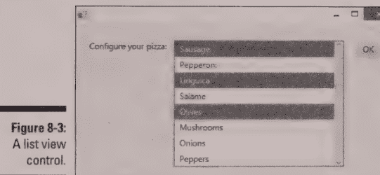

列表视图和组合框有几个重要的区别：

- 列表视图没有允许用户编辑选中项的文本框。相反，用户必须直接从列表视图选择项。
- 列表视图不会下拉。相反，列表项显示在一个你可以指定大小的框中。
- 列表视图中的项可以垂直排列（默认）或水平排列。图 8-4 显示了一个水平列表框。
- 列表视图允许用户选择多个项。默认情况下，列表视图允许用户只选择一个项，但你可以轻松地将其配置为允许多选。

要在列表中选择多个项，请按住 Ctrl 键并点击想要选择的项。要选择范围内的项，点击第一个项，按住 Shift 键，然后点击最后一个项。

## 170 第二部分：JavaFX 控件

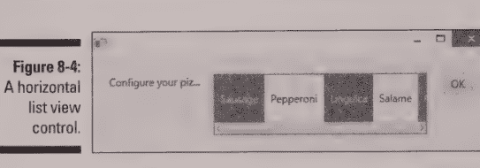

你使用 `ListView` 类创建列表视图控件。表 8-4 列出了该类最常用的构造函数和方法。

| 表 8-4 ListView 构造函数和方法 | |
| --- | --- |
| **构造函数** | **描述** |
| `ListView<T>()` | 创建一个指定类型的空列表视图。 |
| `ListView<T>(ObservableList<T> items)` | 创建一个列表视图并用指定列表中的值填充。 |
| **方法** | **描述** |
| `ObservableList<T> getItems()` | 返回项列表。 |
| `void setItems(ObservableList<T> items)` | 设置项。 |
| `void setOrientation(Orientation o)` | 设置方向。 |
| `SelectionModel<T> getSelectionModel()` | 返回选择模型。 |
| `void setSelectionMode(SelectionMode mode)` | 设置选择模式。 |
| `T getSelectedItem()` | 获取选中的项。 |

### 创建列表

创建列表与选择框类似。这里是创建列表的示例：

```java
ListView<String> list = new ListView<>();
list.getItems().addAll("Sausage", "Pepperoni", "Mushrooms", "Spinach", "Onions", "Peppers", "Tomatoes", "Anchovies");
```

要允许多选，添加此行：

```java
list.getSelectionModel().setSelectionMode(SelectionMode.MULTIPLE);
```

要水平而非垂直排列列表，添加此代码：

```java
list.setOrientation(Orientation.HORIZONTAL);
```

### 使用树视图

树视图是一种高级 JavaFX 控件，以大纲形式显示数据。树形结构在计算机世界非常常见。图 8-5 显示了一个树视图。在这个示例中，我使用树来表示一些剧集及其分支。

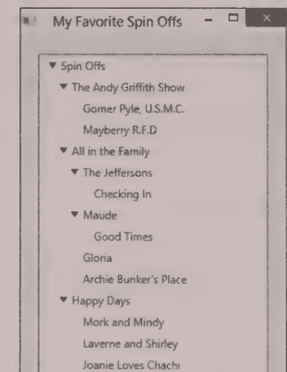

图 8-5：树视图。

## 树的元素

在进入创建树之前，你需要了解描述树元素的术语：

- **节点：** 树中的每个元素都是节点。树中的每个节点通过 `TreeItem` 创建。`TreeItem` 类是一个泛型类，因此你可以与其关联类型。因此，你可以使用任何类型（包括你自定义类型）创建树。
- **根节点：** 根节点是树的起始节点。每个树必须有且只有一个根节点。当你创建树组件时，会将根节点传递给树构造函数。
- **子节点：** 出现在给定节点下方的节点是它的子节点。节点可以有多个子节点。
- **父节点：** 位于给定节点上方的节点是它的父节点。根节点外的每个节点都有且只有一个父节点。
- **兄弟节点：** 兄弟节点是同一个父节点的子节点。
- **叶子节点：** 不包含子节点的节点。
- **路径：** 路径包含该节点及其所有的祖先——即它的父节点、父的父节点等，一直追溯到根节点。
- **展开节点：** 子节点可见的节点。
- **折叠节点：** 子节点隐藏的节点。

### 构建树

在实际创建树视图之前，你必须先构建它要显示的树。为了实现这一点，请使用 `TreeItem` 类，该类的细节将在表 8-5 中讨论。

| 表 8-5 TreeItem 类 | |
| --- | --- |
| **构造函数** | **描述** |
| `TreeItem<T>()` | 创建一个空树节点。 |
| `TreeItem<T>(T value)` | 创建一个带有指定值的树节点。 |
| **方法** | **描述** |
| `T getValue()` | 返回树节点的值。 |
| `void setValue(T value)` | 设置树节点的值。 |
| `ObservableList<TreeItem<T>> getChildren()` | 返回一个包含此树节点子节点的 ObservableList。 |
| `TreeItem<T> getParent()` | 获取此节点的父节点。 |
| `void setExpanded(boolean expanded)` | 指定为 true 以展开该节点。 |
| `boolean isExpanded()` | 返回一个布尔值，指示树节点是否已展开。 |
| `boolean isLeaf()` | 返回一个布尔值，指示树节点是否为叶子节点（即没有子节点）。叶子节点无法被展开。 |
| `TreeItem<T> nextSibling()` | 返回此树节点的下一个兄弟节点。如果没有下一个兄弟节点，则返回 null。 |
| `TreeItem<T> prevSibling()` | 返回此树节点的上一个兄弟节点。如果没有上一个兄弟节点，则返回 null。 |

`TreeItem` 类为每个节点提供了三个基本特征：


## 树节点属性

- **值（value）**：包含节点所表示的数据。在我的示例中，我使用字符串作为用户对象，但你可以使用任何你喜欢的类型对象作为用户对象。树控件会调用用户对象的 `toString` 方法来确定每个节点显示的文本。设置用户对象最简单的方法是通过 `TreeItem` 构造函数传递它。
- **父节点（parent）**：此节点的父节点，除非该节点恰好是根节点。
- **子节点（children）**：此节点的子节点，以 `ObservableList` 的形式表示。如果节点恰好是叶子节点，列表将为空。你可以使用 `ObservableList` 熟悉的方法创建或检索子节点。欲需更多信息，请参阅本章前面的“使用 Observable 列表”部分。

## 第 8 章：从列表中选择

在本节中，我将构建一棵树，列出过去三部热门电视节目的衍生剧：

- 《安迪·格里菲斯秀》（The Andy Griffith Show），它有两个衍生剧：《戈默·派尔，美国陆军》（Gomer Pyle, U.S.M.C.）和《梅伯里服务站》（Mayberry R.F.D.）。
- 《全一家》（All in the Family），它著名的产生了四部衍生剧：《杰斐逊一家》（The Jeffersons）、《莫德》（Maude）、《格洛丽亚》（Gloria）和《阿奇·邦克居住的地方》（Archie Bunker's Place）。
- 此外，这些衍生剧中本身还有两个涉及女佣的：杰斐逊一家的女佣变成了一部名为《入住登记》（Checking In）的短期剧的主角，而莫德的女佣成了《美好时光》（Good Times）的主角。
- 《快乐时光》（Happy Days），它衍生了《马克和明迪》（Mork and Mindy）、《莱文恩和莎莉》（Laverne and Shirley）以及《乔妮爱查奇》（Joanie Loves Chachi）。

构建树有许多方法，其中大多数方法涉及某些递归编程。为了保持简单，在本节中我将避免递归编程，但我的回避意味着你必须将树的细节硬编码到程序中。大多数与树交互的真实程序都需要某种类型的递归编程来构建树。

### 创建树节点变量

创建树的第一步是为每个非叶子节点声明一个 `TreeItem` 变量。对于我的电视剧示例，我从以下代码开始：

```
TreeItem andy, archie, happy, george, maude;
```

这些变量可以是 `start` 方法中的局部变量，因为一旦设置好树，你就不再需要这些变量了。稍后我们会看看为什么不需要为叶子节点变量。

### 创建根节点

接下来，我创建根节点并将其展开状态设置为 `true`，这样它在树最初显示时就会处于展开状态：

```
TreeItem root = new TreeItem("Spin Offs");
root.setExpanded(true);
```

### 辅助方法 `makeShow`

为了简化创建所有其他节点的任务，我使用了以下辅助方法 `makeShow`：

```
public TreeItem<String> makeShow(String title, TreeItem<String> parent) {
    TreeItem<String> show = new TreeItem<String>(title);
    show.setExpanded(true);
    parent.getChildren().add(show);
    return show;
}
```

此方法接受一个字符串和另一个节点作为参数，并返回一个用户对象设置为字符串参数的节点。返回的节点也作为子节点添加到父节点中，因此你可以调用此方法来同时创建新节点并将该节点放置在树中。

### 构建具体节点

**《安迪·格里菲斯秀》及其衍生剧：**

```
andy = makeShow("The Andy Griffith Show", root);
makeShow("Gomer Pyle, U.S.M.C.", andy);
makeShow("Mayberry R.F.D.", andy);
```

在这里，调用 `makeShow` 来为《安迪·格里菲斯秀》创建一个节点，并将根节点指定为其父节点。此方法返回节点保存在 `andy` 变量中。然后调用两次 `makeShow` 来创建衍生剧，这次指定 `andy` 为父节点。由于《戈默·派尔，美国陆军》和《梅伯里服务站》都没有衍生剧，我不需要将这些节点作为父节点参数传递给 `makeShow` 方法。这就是为什么我没有费力创建一个变量来引用这些节点。

**《全一家》及其衍生剧：**

```
archie = makeShow("All in the Family", root);
georgie = makeShow("The Jeffersons", archie);
maude = makeShow("Maude", archie);
makeShow("Gloria", archie);
makeShow("Archie Bunker's Place", archie);
```

**《杰斐逊一家》的衍生剧：**

```
makeShow("Checking In", georgie);
```

**《莫德》的衍生剧：**

```
makeShow("Good Times", maude);
```

**《快乐时光》及其衍生剧：**

```
happy = makeShow("Happy Days", root);
makeShow("Mork and Mindy", happy);
makeShow("Laverne and Shirley", happy);
makeShow("Joanie Loves Chachi", happy);
```

## 创建 TreeView

你使用 `TreeView` 类来创建树。表格 8-6 显示了该类的构造函数和方法。

### 表格 8-6 TreeView 构造函数与方法

| 构造函数 | 描述 |
| :--- | :--- |
| `TreeView()` | 创建一个空树（没什么用）。 |
| `TreeView<T>(TreeItem root)` | 创建一个显示指定节点的树。 |

| 方法 | 描述 |
| :--- | :--- |
| `TreeItem getRoot()` | 获取根节点。 |
| `void setRoot(TreeItem root)` | 设置根节点。 |
| `MultipleSelectionModel<T> getSelectionModel()` | 返回树的选择模型。你可以使用选择模型获取可选择列表。你也可以通过 `getSelectedItem` 获取最所选项。 |
| `void setRootVisible(boolean visible)` | 决定根节点是否可见。 |

### 实例化 TreeView

创建 `TreeView` 控件的第一步是声明一个 `TreeView` 类变量，以便你可以在程序中的任何方法中访问它：

```
TreeView tree;
```

然后，在应用程序的 `start` 方法中，你调用 `TreeView` 构造函数来创建树视图，将你想显示的树的根节点作为参数：

```
tree = new TreeView(root);
```

默认情况下，用户只能从树中选择一个节点。要允许用户选择多个节点，请使用以下代码：

```
tree.getSelectionModel().setSelectionMode(SelectionMode.MULTIPLE);
```

虽然由树视图控件显示的树必须从根节点开始，但在许多情况下根节点是多余的。`TreeView` 控件允许你抑制根节点的显示。要隐藏根节点，只需调用此方法：

```
tree.setShowRoot(false);
```

图 8-6 显示了隐藏根节点后树的样式。


### 获取选中节点

有几种方法可以确定树视图中当前选择了哪些节点。

**方法一：通过选择模型获取选中项列表**

通过调用 `getSelectionModel` 来访问树的选择模型。然后，你可以调用选择模型的 `getSelectedItems` 方法，返回一个只读的可观察列表，其中包含了已选中的项。

```
String msg = "";
ObservableList<TreeItem<String>> shows = tree.getSelectionModel().getSelectedItems();
for (TreeItem<String> show : shows) {
    msg += show.getValue() + "\n";
}
```

在前面的示例中，`msg` 字符串将包含用户从树中选择的所有节目，并用换行符分隔。

**方法二：添加选择变化事件处理程序**

另一种方法是添加一个在选择发生变化时调用的事件处理程序：

```
tree.getSelectionModel().selectedItemProperty()
    .addListener((v, oldValue, newValue) -> tree_SelectionChanged(newValue));
```

在这里，调用了 `getSelectionModel` 方法来获取选中项。然后，调用 `selectedItemProperty` 来获取选中项属性。最后，使用 Lambda 表达式为该属性创建一个事件监听器，调用一个名为 `tree_SelectionChanged` 的方法。新值作为参数传递。

以下是 `tree_SelectionChanged` 方法的内容：

```
public void tree_SelectionChanged(TreeItem<String> item) {
    if (item != null) {
        lblShowName.setText(item.getValue());
    }
}
```

在这里，更新一个名为 `lblShowName` 的标签以显示新选中项的值。**注意：** 使用了 `if` 语句来确保项不为空。这是必要的，因为如果用户取消选择某个项，`tree_SelectionChanged` 方法将带有 `null` 值作为项参数被调用。

### 完整程序示例

列表 8-1 显示了创建图 8-6 所示场景的完整程序。该程序允许用户从树中选择节目，并在树下方的标签中显示选中节目的标题。

#### 列表 8-1：衍生剧程序


```java
import javafx.application.*;
import javafx.stage.*;
import javafx.scene.*;
import javafx.scene.layout.*;
import javafx.scene.control.*;
import javafx.geometry.*;

public class Spinoffs extends Application {
    public static void main(String[] args) {
        launch(args);
    }

    TreeView<String> tree;
    Label lblShowName;

    @Override
    public void start(Stage primaryStage) {
        TreeItem<String> root, andy, archie,
                happy, archie, maude;

        root = new TreeItem<>("Spin Offs");
        root.setExpanded(true);

        andy = makeShow("The Andy Griffith Show", root);
        makeShow("Gomer Pyle, U.S.M.C.", andy);
        makeShow("Mayberry R.F.D.", andy);

        archie = makeShow("All in the Family", root);
        george = makeShow("The Jeffersons", archie);
        makeShow("Checking In", george);
        maude = makeShow("Maude", archie);
        makeShow("Good Times", maude);
        makeShow("Gloria", archie);
        makeShow("Archie Bunker's Place", archie);

        happy = makeShow("Happy Days", root);
        makeShow("Mork and Minds", happy);
        makeShow("Laverne and Shirley", happy);
        makeShow("Joanie Loves Chachi", happy);

        tree = new TreeView<>(root);
        tree.setShowRoot(false);
        tree.getSelectionModel().getSelectedItemProperty()
                .addListener((v, oldValue, newValue) -> {
                    treeSelectionChanged(newValue);
                });

        lblShowName = new Label();

        VBox pane = new VBox(10);
        pane.setPadding(new Insets(20, 20, 20, 20));
        pane.getChildren().addAll(tree, lblShowName);
        Scene scene = new Scene(pane);

        primaryStage.setScene(scene);
        primaryStage.setTitle("My Favorite Spin Offs");
        primaryStage.show();
    }

    public TreeItem<String> makeShow(String title,
                                     TreeItem<String> parent) {
        TreeItem<String> show = new TreeItem<>(title);
        show.setExpanded(true);
        parent.getChildren().add(show);
        return show;
    }

    public void treeSelectionChanged(TreeItem<String> item) {
        if (item != null) {
            lblShowName.setText(item.getValue());
        }
    }
}
```

## 第 9 章：使用表格

### 为表格创建数据

表格控件的底层数据是 `ObservableList`，与列表视图、组合框或选择框相同。然而，表格控件的性质更适合列表视图显示的复杂数据结构。列表视图、组合框和选择框为列表中的每个项显示一个数据值。相比之下，表格可以从底层列表中显示多个值，每个值位于自己的列中。

创建表格列表的最常用方法是创建一个自定义类，定义显示在表格中的对象。然后，表格可以通过调用自定义数据类的各种方法来提取每列的数据。

例如，表 9-1 显示了 `Movie` 类的构造函数和方法，该类将作为本章所示示例的数据模型。该类跟踪与每部电影相关的三个值：标题、年份和价格。提供了获取或设置这些值的方法。

| 构造函数 | 描述 |
| :--- | :--- |
| `Movie()` | 创建空的 `Movie` 对象。 |
| `Movie(String title, int year, double price)` | 创建具有指定标题、年份和价格的 `Movie` 对象。 |

| 方法 | 描述 |
| :--- | :--- |
| `String getTitle()` | 获取标题。 |
| `void setTitle(String title)` | 设置标题。 |
| `int getYear()` | 获取年份。 |
| `void setYear(int year)` | 设置年份。 |
| `double getPrice()` | 获取价格。 |
| `void setPrice(double price)` | 设置价格。 |

注意这些方法的名称都包含 `get` 或 `set`。这是该类能够作为表格控件的项目列表所必需的。在 JavaFX 术语中，这些方法访问的值是属性。这些属性名称必须紧跟 `get` 或 `set` 单词；因此，通过 `getTitle` 和 `setTitle` 方法访问的属性名称是 `title`。（注意，属性名称以小写字母开头，但在 `get` 或 `set` 方法中首字母大写。）

JavaFX 属性实际上不仅仅是创建获取和设置值的方法的命名约定。属性还有其他高级功能，例如自动将其绑定在一起的能力：当一个对象中的属性值发生变化时，另一个对象中相应的属性值也会随之改变。你还可以为属性创建监听器，这样当属性值改变时就会自动执行代码。

要创建一个属性，你必须使用实现 `Property` 接口的几个预定义类之一（或者创建你自己的实现 `Property` 的类）。由于处理 `Property` 接口是一个复杂的话题，我专门用了一整章来介绍它。因此，你将在第 15 章中发现如何创建正确的属性。出于我的目的，我使用了“伪属性”（我喜欢称它们为 sham properties），它们仅仅是类字段，可以通过遵循实际属性所相同命名规范的 `get` 和 `set` 方法进行访问。只要 `Movie` 类符合这些命名标准，它就可以作为表格控件的项列表工作。

列表 9-1 显示了 `Movie` 类的源代码。

### 列表 9-1：Movie 类

```java
public class Movie {
    private String title;
    private int year;
    private double price;

    public Movie() {
        this.title = "";
        this.year = 0;
        this.price = 0.0;
    }

    public Movie(String title, int year, double price) {
        this.title = title;
        this.year = year;
        this.price = price;
    }

    public String getTitle() {
        return this.title;
    }

    public void setTitle(String title) {
        this.title = title;
    }

    public int getYear() {
        return this.year;
    }

    public void setYear(int year) {
        this.year = year;
    }

    public double getPrice() {
        return this.price;
    }

    public void setPrice(double price) {
        this.price = price;
    }
}
```

该类的代码非常直观，所以我在这里只指出了几个重点：

- 第 3 行：这三个私有字段在内部用于存储每部电影的标题、年份和价格。
- 第 7 行：默认构造函数创建了一个没有数据的 `Movie` 对象。
- 第 14 行：此构造函数允许用户指定电影标题、年份和价格的数据。
- 第 21 行：`getTitle` 方法检索 `title` 属性的值。
- 第 26 行：`setTitle` 方法设置 `title` 属性的值。
- 第 31 行：`getYear` 方法检索 `year` 属性的值。
- 第 36 行：`setYear` 方法设置 `year` 属性的值。
- 第 41 行：`getPrice` 方法检索 `price` 属性的值。
- 第 46 行：`setPrice` 方法设置 `price` 属性的值。

使用这个类，你可以轻松创建一个 `Movie` 对象：

```java
Movie m = new Movie("The King's Speech", 2010, 19.95);
```

或者，如果你喜欢的话，也可以这样做：

```java
Movie m = new Movie();
m.setTitle("The King's Speech");
m.setYear(2010);
m.setPrice(19.95);
```

在你创建一个 `Movie` 对象后，你必须将其添加到 `ObservableList` 中，该列表可以作为 `TableView` 的项列表。最简单的方法是先创建 `TableView`，然后使用它的 `getItems` 方法访问可观察列表：

```java
TableView<Movie> table = new TableView<>();
table.getItems().add(movie);
```

注意 `TableView` 是一个泛型类，所以在创建它时要指定数据类型。

在实际程序中，表格显示的数据几乎肯定来自文件或数据库。因此，你需要编写 Java 代码从文件或数据库中读取数据，为每条记录创建一个对象，并将其添加到列表中。你可能想将这段代码隔离到单独的方法中，并命名为 `loadData`。然后，你可以将可观察列表作为参数传递给这个方法。

从文件或数据库读取数据超出了本书的范围，但如果你想弄清楚如何做到，我建议买一本我的书《Java All-in-One for Dummies, 4th Edition》（John Wiley & Sons 出版）。该书包含了几个示例程序，可以从各种类型的文件和数据库中读取和写入此类数据。

现在，请依靠以下方法为表格加载数据：

```java
void loadData(ObservableList<Movie> data) {
    data.add(new Movie("It's a Wonderful Life", 1946, 14.95));
    data.add(new Movie("Young Frankenstein", 1975, 15.95));
    data.add(new Movie("Star Wars Episode 4", 1976, 17.95));
    data.add(new Movie("The Princess Bride", 1987, 16.95));
    data.add(new Movie("Glory", 1989, 14.95));
    data.add(new Movie("The Game", 1997, 14.95));
    data.add(new Movie("Shakespeare in Love", 1998, 15.95));
    data.add(new Movie("The Invention of Life", 2009, 18.95));
    data.add(new Movie("The King's Speech", 2010, 19.95));
}
```

```java
public ObservableList<Movie> loadData() {
    ObservableList<Movie> data = FXCollections.observableArrayList();
    data.add(new Movie("It's a Wonderful Life", 1946, 14.95));
    data.add(new Movie("Young Frankenstein", 1975, 15.95));
    data.add(new Movie("Star Wars Episode 4", 1976, 17.95));
    data.add(new Movie("The Princess Bride", 1987, 16.95));
    data.add(new Movie("Glory", 1989, 14.95));
    data.add(new Movie("The Game", 1997, 14.95));
    data.add(new Movie("Shakespeare in Love", 1998, 15.95));
    data.add(new Movie("The Invention of Life", 2009, 18.95));
    data.add(new Movie("The King's Speech", 2010, 19.95));
    return data;
}
```

然后，你可以这样调用该方法为表格加载数据：

```java
TableView<Movie> table = new TableView<>();
table.setItems(loadData());
```

### 创建只读表格

现在你已经知道了如何创建底层数据，现在是进入下一部分了。在本节中，你将学习如何创建一个简单的只读表格，显示每部电影的标题、年份和价格。图 9-1 显示了你想要的表格。


你使用两个主要类来创建这个表格：`TableView` 代表整个表格，而 `TableColumn` 代表单个列。接下来的两个章节将展示如何首先使用 `TableColumn` 类创建表格列（如图 9-1 所示），然后使用 `TableView` 类将列组合成表格。之后，你会看到创建图 9-1 所示表格的代码。

### 使用 TableColumn 类

`TableColumn` 类代表表格中的单列。该类允许将列绑定到表格列表的属性，以便从正确的属性检索单元格值。表 9-2 列出了该类最重要的构造函数和方法。

| 构造函数 | 描述 |
| :--- | :--- |
| `TableColumn<S, T>()` | 创建一个空表格列。类型 `S` 应该与 `TableView` 及其 `ObservableList` 的类型对应。类型 `T` 指明列中显示的数据类型。 |
| `TableColumn<S, T>(String heading)` | 创建带有指定标题文本的空表格列。 |

| 方法 | 描述 |
| :--- | :--- |
| `void setMinWidth(double width)` | 设置列的最小宽度。表格列可能会需要扩展宽度以显示列的数据。 |
| `void setMaxWidth(double width)` | 设置列的最大宽度。 |
| `void setPrefWidth(double width)` | 设置列的首选宽度。 |
| `void setTitle(String title)` | 设置标题文本。 |
| `void setSortable(boolean sortable)` | 如果为 `true`，用户可以对此列的数据进行排序。（默认值为 `true`。） |
| `void setCellValueFactory(PropertyValue f)` | 指定为此列单元格提供值的工厂类。通常指定为 `PropertyValueFactory` 类的实例。 |

要创建一个表格，首先要调用构造函数。通常，当你调用构造函数时，你需要指定显示在列标题中的文本。你需要为表格列指定两种类型。第一种与表格本身相关的类型，它也是与表格项集合相关的类型。在本章所示的示例中，该类型是 `Movie`，因为表格将显示来自 `Movie` 对象的可观察列表的数据。


第二种类型是在此列中显示的属性的数据类型。对于 `Title` 属性，类型是 `String`。因此，`Title` 列的构造函数为：

```
TableColumn<Movie, String> colTitle =
new TableColumn<Movie, String>("Title");
```

你还想设置列的宽度，如下：

```
colTitle.setMinWidth(300);
```

在这里，列的宽度至少为 300 像素。这足够足够显示大多数电影标题了。

接下来，你需要将表格项集合中的一个属性与列关联。要做到这一点，请调用 `setCellValueFactory` 方法并提供一个单元工厂（cell factory）。单元工厂是一种特殊的对象类型，用于为表格列提供单元格值。提供单元工厂的最简单方法是使用 `PropertyValueFactory` 类，它允许你创建一个返回表格项集合中具名属性的单元工厂。

以下是为 `Title` 列实现此操作的代码：

```
colTitle.setCellValueFactory(
new PropertyValueFactory<Movie, String>("Title"));
```

该语句调用了 `PropertyValueFactory` 类的构造函数，指定 `Movie` 为从 `String` 中检索的对象类型，并作为属性的值类型，同时将属性的名称（`Title`）作为构造函数的唯一参数传递。该语句的最终效果是属性值工厂将调用 `Movie` 类的 `getTitle` 方法来填充此列的单元格。

为了清晰起见，我简化了表 9-2 中 `setCellValueFactory` 方法的签名。实际的签名是：

```
void setCellValueFactory(
Callback<TableColumn<S,T>, Func<S, ICellFactory<T>>> value);
```


哇！这真乱。它的意思是单元格值工厂必须使用正确的数据类型实现 `Callback` 接口。`PropertyValueFactory` 类专门设计用于与 `setCellValueFactory` 方法配合，因此它确实实现了 `Callback` 接口。

创建另外两列所需的代码与字符串值略有不同；它们处理的是整数和双精度数值。以下是创建 `Year` 列的代码：

```
TableColumn<Movie
```

这里是创建 `Price` 列的代码：

```
TableColumn<Movie
```

在某些情况下，`T` 类型指定的是包装后的 `Integer` 和 `Double` 类，而不是原始的 `int` 和 `double` 类型。

## 使用 TableView 类

在创建表格列之后，下一步是创建一个表格并将列添加到表格中。要做到这一点，请使用 `TableView` 类，该类在表 9-3 中讨论过。

创建一个表格视图控件需要几个步骤，这些步骤并不一定按此顺序执行：

- 调用 `TableView` 构造函数创建表格视图控件。
- 将表格列添加到表格视图中。

    这样做最简单的方法是调用 `getColumns` 方法，它以可观察列表的形式返回列列表。然后使用 `addAll` 方法添加列。
- 将数据添加到 `items` 列表中。

    我在前面的章节“创建表格数据”中讨论了实现此点的几种方法。

## 表 9-3

| 构造函数/方法 | 说明 |
| :--- | :--- |
| `TableView<S>()` | 创建一个新的表格视图。类型 `S` 指定了 `items` 列表中包含的对象类型。 |
| `TableView<S>(ObservableList)` | 使用指定的列表作为其 `items` 列表创建一个新的表格视图。 |
| `ObservableList getColumns()` | 获取表格显示的列列表。 |
| `ObservableList getItems()` | 获取作为表格数据源的项列表。 |
| `void setItems(ObservableList list)` | 设置作为表格数据源的项列表。 |
| `TableViewSelection getSelectionModel()` | 获取选择模型，允许你处理用户选择的行。 |

以下是你在本章一直看到的示例实现这些步骤的一种方法：

```
TableView<Movie> table = new TableView<Movie>();
table.getColumns().addAll(colTitle, colYear, colPrice);
table.setItems(loadData());
```

这里使用的 `loadData` 方法是在前面的章节“创建表格数据”中显示的那个。它返回一个包含要显示的 `Movie` 对象的 `ObservableList`。

你也可以通过将 `loadData` 方法传递给 `TableView` 构造函数来一次性创建表格并加载数据，如下：

```
TableView<Movie> table =
new TableView<Movie>(loadData());
```

在创建表格并添加列和数据内容后，你可以通过将其添加到布局窗格、将窗格添加到场景，然后用场景设置舞台并显示舞台，从而在场景中显示表格。下一节将给出精确执行此操作的完整程序代码。

## 一个创建只读表格的程序

列表 9-2 显示了创建一个只读 `TableView` 控件程序的完整源代码。该程序在之前的图 9-1 中显示过（注意：运行此程序需要如图 9-1 所示的 `Movie` 类）。

### 列表 9-2：MovieInventory 程序

```java
import javafx.application.*;
import javafx.stage.*;
import javafx.scene.*;
import javafx.scene.layout.*;
import javafx.scene.control.*;
import javafx.collections.*;
import javafx.geometry.*;
import javafx.scene.text.*;

public class MovieInventory extends Application {
    public static void main(String[] args) {
        launch(args);
    }

    @Override
    public void start(Stage primaryStage) {
        Label lblHeading = new Label("Movie Inventory");
        lblHeading.setFont(new Font("Arial", 20));

        TableView<Movie> table = new TableView<Movie>();

        TableColumn<Movie, String> colTitle = new TableColumn("Title");
        colTitle.setMinWidth(300);
        colTitle.setCellValueFactory(
            new PropertyValueFactory<Movie, String>("Title"));

        TableColumn<Movie, Integer> colYear = new TableColumn("Year");
        colYear.setMinWidth(100);
        colYear.setCellValueFactory(
            new PropertyValueFactory<Movie, Integer>("Year"));

        TableColumn<Movie, Double> colPrice = new TableColumn("Price");
        colPrice.setMinWidth(100);
        colPrice.setCellValueFactory(new PropertyValueFactory<Movie, Double>("Price"));

        table.getColumns().addAll(colTitle, colYear, colPrice);

        VBox paneMain = new VBox();
        paneMain.setSpacing(10);
        paneMain.setPadding(new Insets(10, 10, 10, 10));
        paneMain.getChildren().addAll(lblHeading, table);

        Scene scene = new Scene(paneMain);
        primaryStage.setScene(scene);
        primaryStage.setTitle("Movie Inventory");
        primaryStage.show();
    }

    public ObservableList<Movie> loadData() {
        ObservableList<Movie> data = FXCollections.observableArrayList();

        data.add(new Movie("It's a Wonderful Life", 1946, 14.95));
        data.add(new Movie("Young Frankenstein", 1974, 16.95));
        data.add(new Movie("Star Wars Episode 4", 1976, 17.95));
        data.add(new Movie("The Princess Bride", 1987, 16.95));
        data.add(new Movie("Glory", 1989, 14.95));
        data.add(new Movie("The Game", 1997, 14.95));
        data.add(new Movie("Shakespeare in Love", 1998, 19.95));
        data.add(new Movie("The Invention of Lying", 2009, 18.95));
        data.add(new Movie("The King's Speech", 2010, 19.95));

        return data;
    }
}
```

在本章前面的部分我已经展示并解释了该程序中的大部分代码，因此我在这里只需指出几个亮点：

- 第 20 行：这两行代码创建了出现在表格视图控件上方的标签。
- 第 23 行：这一行调用了 `TableView` 构造函数来创建一个新的 `TableView` 对象，并指定 `Movie` 为底层数据类型。
- 第 24 行：通过调用 `loadData` 方法创建了项目列表，该方法在程序稍后的第 53 行出现。
- 第 26 行：这些行创建了第一列，显示 `Movie` 类中的 `Title` 属性。该列的宽度设置为最小 300 像素。
- 第 31 行：这些行创建了第二列，显示 `Movie` 类中的 `Year` 属性。最小宽度设置为 100 像素。
- 第 36 行：这些行创建了第三列，显示 `Movie` 类中的 `Price` 属性。该列的最小宽度也设置为 100 像素。
- 第 40 行：将这三列添加到表格视图控件中。
- 第 42 行：创建了一个 `VBox` 布局面板，并将标题标签和表格视图控件添加到其中。
- 第 47 行：构建并显示了场景（scene）和阶段（stage）。
- 第 53 行：`loadData` 方法创建了项目列表，并加载了九部电影的数据。该方法返回的值被用作表格视图控件的项目列表。

## 创建可编辑表格

现在你已经知道了如何创建一个只读表格，下一步是添加从表格中添加和删除行的功能，或者编辑现有行内单元格的功能。接下来的章节将向你展示如何操作。

## 添加表格行

为了允许用户添加行，你需要提供文本框让用户可以在其中输入数据，以及一个“添加”（Add）按钮，用户可以点击该按钮使用用户输入的数据创建新行。在按钮的 `OnAction` 事件中，你只需使用用户在文本字段中输入的数据创建一个新对象，然后将该对象添加到表格的 `items` 集合中。

```java
public void btnAddClicked() {
    Movie m = new Movie();
    m.setTitle(txtTitle.getText());
    m.setYear(Integer.parseInt(txtYear.getText()));
    m.setPrice(Double.parseDouble(txtPrice.getText()));
    table.getItems().add(m);
    txtTitle.clear();
    txtYear.clear();
    txtPrice.clear();
}
```

该方法首先创建一个新的 `Movie` 对象，并将 `Title`、`Year` 和 `Price` 属性设置为用户输入的值。然后，该方法将新的 `Movie` 对象添加到 `items` 集合中。最后，该方法清空了三个文本框。


注意，`Integer` 和 `Double` 包装类的 `parse` 方法被用于将文本字段中输入的字符串值转换为有效的整数和浮点数值。遗憾的是，这些方法没有提供任何合理的数据验证；如果用户输入了无法转换为整数或浮点数的值，`parse` 方法将抛出异常，而此方法并没有处理该异常。我把这留给你来思考如何向这段代码中添加数据验证和错误信息。

## 删除表格行

从表格视图中删除项目只需要在场景中添加一个“删除”（Delete）按钮。用户随后可以通过选中一行或多行然后按删除键来删除这些行。这里是一个你可以从“删除”按钮的 `OnAction` 处理程序调用的方法：

```java
public void btnDeleteClicked() {
    ObservableList<Movie> sel, items;
    items = table.getItems();
    sel = table.getSelectionModel().getSelectedItems();
    for (Movie m : sel) {
        items.remove(m);
    }
}
```

此方法同时访问了表格的集合和表格选择模型的 `selectedItems` 集合。然后，使用 `for-each` 循环从 `items` 集合中删除 `selectedItems` 集合中的每一个项目。

此方法并没有验证用户是否真的想删除这些行。在更贴真实的程序中，你可能希望先显示一个警告框，询问用户是否真的想删除这些行。然后只有当用户点击“是”时，你才删除这些行。


## 编辑表格单元格

为了允许用户编辑单个表格单元格，你需要做三件事：

- 通过调用 `setEditable` 方法并传递 `true` 值将表格标记为可编辑。
- 为你想要允许用户编辑的每一列创建一个单元格工厂（cell factory）。
- 通过调用 `TableColumn` 类的 `setCellFactory` 方法来实现。
- 添加一个事件监听器，当用户完成编辑表格单元格时调用该监听器。
- 该监听器负责用用户输入的数据更新 `items` 集合。

要允许用户编辑表格内容，设置单元格工厂的最简单方法是使用 `TextFieldTableCell`。以下是使用方法：

```java
titleColumn.setCellFactory(new TextFieldTableCell());
```

的问题是 `TextFieldTableCell` 有多个方法，这使得它无法作为 Lambda 表达式函数式类。因此，在之前的示例中，传入 Lambda 的参数是通用的 `Event` 而不是特定的 `CellEditEvent`。相反，Lambda 函数会将此参数传递给 `setOnCommit` 方法，该方法必须接收 `Event`。

```java
titleColumn.setOnCommit(e -> colTitleOnCommit(e));
```

### 表 9-4 CellEdit 类

| 方法 | 描述 |
| :--- | :--- |
| `T getNewValue()` | 获取用户的新的值 |
| `T getOldValue()` | 获取单元格的旧值 |
| `S getRowValue()` | 获取行对象 |
| `TableColumn<S, T> getColumn()` | 获取发生事件的表格列 |
| `TableView<S> getTableView()` | 获取发生事件的表格视图 |
| `TableView<S>(ObservableList list)` | 使用指定的列表创建新的表格视图 |


`CellEdit` 类包含了你可以用于用用户输入的新数据更新 `items` 集合的信息。具体来说，`getRowValue` 方法返回正在编辑行的集合，而 `getNewValue` 方法包含了用户更新的值。在获取行对象后，你可以更新相应的属性。

```java
public void colTitleOnCommit(Event e) {
    TableColumn.CellEditEvent<Movie, String> ce;
    ce = (TableColumn.CellEditEvent<Movie, String>) e;
    Movie m = ce.getRowValue();
    m.setTitle(ce.getNewValue());
}
```

有了这个事件处理程序后，用户可以通过双击标题、输入新值并按回车键来更新任何电影的标题。

## 创建可编辑表格的程序

列表 9-3 显示了在列表 9-2 中编写的电影库存程序的改进版本。该程序添加了编辑现有电影的功能，以及添加和删除电影的功能。该程序显示的场景如图 9-2 所示。（注意：要运行此程序，需要在文件夹中存在列表 9-1 中讨论过的 `Movie` 类。）

# 第9章：操作表格 203

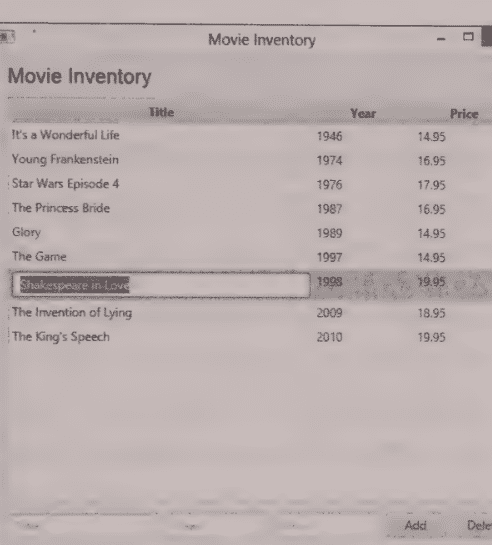

图 9-2：运行中的 Movie-Inventory-Editor 程序。

# 列表 9-3：MovieInventoryEditor 程序

```java
import javafx.application.*;
import javafx.stage.*;
import javafx.scene.*;
import javafx.scene.control.*;
import javafx.scene.layout.*;
import javafx.scene.text.*;
import javafx.event.*;
import javafx.scene.control.cell.*;
import javafx.beans.property.*;
import javafx.collections.*;
import javafx.geometry.*;
import javafx.util.converter.*;

public class MovieInventoryEditor extends Application
{
    public static void main(String[] args) {
        launch(args);
    }
}
```

（续）

### 列表 9-3（续）

```java
private TableView<Movie> table;
private TextField txtTitle, txtYear, txtPrice;

@Override public void start(Stage primaryStage) {

    Label lblHeading = new Label("Movie Inventory");
    lblHeading.setFont(new Font("Arial", 20));

    table = new TableView<Movie>();
    table.setEditable(true);
    table.setItems(loadData());

    TableColumn colTitle = new TableColumn("Title");
    colTitle.setMinWidth(300);
    colTitle.setCellValueFactory(new PropertyFactory<Movie, String>("Title"));
    colTitle.setCellFactory(new TextFieldCell().forTableColumn());
    colTitle.setOnEditCommit(e -> colTitle.onEditCommit(e));

    TableColumn colYear = new TableColumn("Year");
    colYear.setMinWidth(100);
    colYear.setCellValueFactory(new PropertyFactory<Movie, Integer>("Year"));
    colYear.setCellFactory(new TextFieldCell().forTableColumn(new IntegerConverter()));
    colYear.setOnEditCommit(e -> colYear.onEditCommit(e));

    TableColumn colPrice = new TableColumn("Price");
    colPrice.setMinWidth(100);
    colPrice.setCellValueFactory(new PropertyFactory<Movie, Double>("Price"));
    colPrice.setCellFactory(new TextFieldCell().forTableColumn(new DoubleConverter()));
    colPrice.setOnEditCommit(e -> colPrice.onEditCommit(e));

    table.getColumns().addAll(colTitle, colYear, colPrice);

    txtTitle = new TextField();
    txtTitle.setPromptText("Title");
    txtTitle.setMinWidth(100);

    txtYear = new TextField();
    txtYear.setMaxWidth(100);
    txtYear.setPromptText("Year");

    txtPrice = new TextField();
    txtPrice.setMinWidth(100);
    txtPrice.setPromptText("Price");
```

```java
btnAdd = new Button("Add");
btnAdd.setMinWidth(60);
btnAdd.setOnClick(() -> btnAdd_Clicked());
```

```java
btnDelete = new Button("Delete");
btnDelete.setMinWidth(60);
btnDelete.setOnClick(() -> btnDelete_Clicked());
```

```java
hboxPane = new HBox();
paneAdd.setSpacing(8);
paneAdd.getChildren().addAll(txtTitle, txtYear, txtPrice,
btnAdd, btnDelete);
```

```java
VBox paneMain = new VBox();
paneMain.setSpacing(10);
paneMain.setPadding(new Insets(10, 10, 10, 10));
paneMain.getChildren().addAll(lblHeading, table, paneAdd);
```

```java
Scene scene = new Scene(paneMain);
primaryStage.setScene(scene);
primaryStage.setTitle("Movie Inventory");
primaryStage.show();
```

```java
public ObservableList<Movie> loadData() {
    data = FXCollections.observableArrayList();

    data.add(new Movie("It's a Wonderful Life", 1946, 14.95));
    data.add(new Movie("Young Frankenstein", 1974, 16.95));
    data.add(new Movie("Star Wars Episode 4", 1976, 17.95));
    data.add(new Movie("The Princess Bride", 1987, 16.95));
    data.add(new Movie("Glory", 1989, 14.95));
    data.add(new Movie("The Game", 1997, 14.95));
    data.add(new Movie("Shakespeare in Love", 1998, 19.95));
```

（续）

### 列表 9-3（续）

```java
    data.add(new Movie("The Invention of Lying", 2009, 18.95));
    data.add(new Movie("The King's Speech", 2010, 19.95));

    return data;
}

public void colTitle_OnEditCommit(Event e) {
    TableColumn.CellEditEvent<Movie, String> ce;
    ce = (TableColumn.CellEditEvent<Movie, String>) e;
    Movie m = ce.getRowValue();
    m.setTitle(ce.getNewValue());
}

public void colYear_OnEditCommit(Event e) {
    TableColumn.CellEditEvent<Movie, Integer> ce;
    ce = (TableColumn.CellEditEvent<Movie, Integer>) e;
    Movie m = ce.getRowValue();
    m.setYear(ce.getNewValue());
}

public void colPrice_OnEditCommit(Event e) {
    TableColumn.CellEditEvent<Movie, Double> ce;
    ce = (TableColumn.CellEditEvent<Movie, Double>) e;
    Movie m = ce.getRowValue();
    m.setPrice(ce.getNewValue());
}

public void btnAdd_Clicked() {
    Movie m = new Movie();
    m.setTitle(txtTitle.getText());
    m.setYear(Integer.parseInt(txtYear.getText()));
    m.setPrice(Double.parseDouble(txtPrice.getText()));
    table.getItems().add(m);
    txtTitle.clear();
    txtYear.clear();
    txtPrice.clear();
}

public void btnDelete_Clicked() {
    ObservableList<Movie> sel, items;
    items = table.getItems();
    sel = table.selectionModel().getSelectedItems();

    for (Movie m : sel) {
        items.remove(m);
    }
}
```

# 第10章：制作菜单

### 本章内容

- 创建基础和动态菜单
- 使用分隔符和监听器
- 使用复选框和单选按钮构建菜单
- 创建子菜单和自定义

在本章中，你将学习如何为程序添加菜单。我们在应用程序中经常处理菜单，因此你可能已经熟悉菜单是什么以及它们如何工作。我不会在本章中回顾这些基础知识，我将直接进入创建菜单并将其添加到场景的细节。

# 创建菜单的类介绍

下面的文字描述了你在创建菜单时最常用的类：

- `MenuBar`：场景顶部菜单栏中菜单的顶层容器。
- `Menu`：菜单栏中的每个菜单都由一个 `Menu` 对象表示。菜单栏如图 10-1 所示，有两个 `Menu` 对象：一个是 Game 菜单，另一个是 Options 菜单。一个 `Menu` 对象包含一组在用户点击菜单时显示的 `MenuItem` 对象。
- `MenuItem`：菜单项由 `MenuItem` 类或其子类表示。图 10-1 所示的 Game 菜单有四个 `MenuItem` 对象：New Game、Pause Game、Quit Game 和 Exit。它还包含一个 `SeparatorMenuItem` 对象；`SeparatorMenuItem` 是 `MenuItem` 的子类。

## 210 第二部分：JavaFX 控件

有趣的是，`Menu` 类实际上是 `MenuItem` 的子类。这意味着菜单的项集合可以包含其他子菜单。当用户点击子菜单时，该子菜单的菜单项集合就会显示出来。

- `CheckMenuItem`：这种特殊的菜单项关联有一个复选框。虽然在图 10-1 中没有显示，但 Options 菜单包含两个 `CheckMenuItem` 对象。该类继承自 `MenuItem`。
- `RadioMenuItem`：这种特殊的菜单项关联有一个单选按钮。`RadioMenuItem` 类继承自 `MenuItem`。
- `CustomMenuItem`：自定义菜单项可以关联任何 JavaFX `Node` 对象。通过自定义菜单项，你可以向菜单中添加各种控件，例如文本字段或列表框。
- `SeparatorMenuItem`：分隔符菜单项仅在菜单中显示一条分割线。你使用该类在菜单中创建视觉分组。

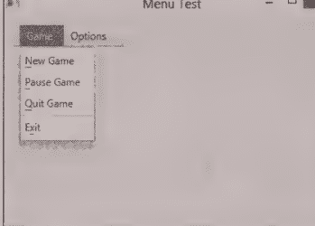

图 10-1：带有菜单栏的场景。

## 创建基础菜单栏

创建菜单的基础非常直观。首先，通过调用 `MenuBar` 构造函数来创建一个菜单栏：

```java
MenuBar menu = new MenuBar();
```

然后，创建一个或多个菜单，并将它们或它们添加到菜单栏中。

当菜单栏完成后，就像添加任何其他节点一样，将其添加到布局面板中：

```java
pane.getChildren().add(menubar);
```

供你参考，表 10-1 列出了 `MenuBar` 类最实用的构造函数和方法。

| 表 10-1 | MenuBar 类 |
| --- | --- |
| 构造函数 | 说明 |
| `MenuBar()` | 创建菜单栏。 |
| 方法 | 说明 |
| `ObservableList getMenus()` | 返回包含在此菜单栏中的菜单列表。你可以使用 `ObservableList` 接口的任何方法从菜单栏中添加或删除菜单。 |

### 创建菜单

要创建每个菜单，你需要使用 `Menu` 和 `MenuItem` 类，我将在本章的接下来两个表格中讨论它们的构造函数和方法。从调用 `Menu` 构造函数并为菜单命名开始：

```java
Menu menuGame = new Menu("_Game");
```

在这里，文本字符串中的下划线构成了快捷键键（mnemonic shortcut key），用户可以使用它在不触碰鼠标的情况下访问菜单。在这种情况下，字母 G 就是快捷键。

快捷键字符允许用户在按住 Alt 键的同时按下快捷键字符来打开菜单。当用户按下 Alt 键时，所有可见的快捷键字符都将带有下划线，以便用户确定哪些字符是快捷键。

表 10-2 列出了 `Menu` 类最重要的构造函数和方法供你参考。

| 表 10-2 | Menu 类 |
| --- | --- |
| 构造函数 | 说明 |
| `Menu(String name)` | 创建一个指定名称的菜单。 |
| 方法 | 说明 |
| `ObservableList getItems()` | 返回一个表示菜单中菜单项的 `ObservableList` 集合。你可以使用 `ObservableList` 接口的任何方法添加或删除菜单项。 |
| `String getText()` | 获取菜单的文本。 |
| `void setText(String text)` | 设置菜单的文本。 |

### 创建菜单项

创建菜单后，下一步是创建菜单项并将它们添加到菜单中。要创建菜单项，只需调用 `MenuItem` 构造函数，并将要显示的文本作为参数传递：

```java
MenuItem menuItemNewGame = new MenuItem("_New Game");
```

再次，下划线标识了该菜单项的快捷键。因此，用户可以通过按下 Alt+N 来选择此菜单项。

要为菜单添加事件处理器，请使用 `setOnAction` 方法。例如：

```java
menuItemNewGame.setOnAction(e -> startNewGame());
```

在这里，当用户选择 `New Game` 菜单项时，将调用 `startNewGame` 方法。

下面是一个创建图 10-1 所示的四个菜单项的短序列，并为每个项分配了事件处理器：

```java
MenuItem menuItemNewGame = new MenuItem("_New Game");
menuItemNewGame.setOnAction(e -> startNewGame());

MenuItem menuItemPauseGame = new MenuItem("_Pause Game");
menuItemPauseGame.setOnAction(e -> pauseGame());
```


```
MenuItem menuItemQuit = new MenuItem("Quit Game");
menuItemNewGame.setOnAction(e -> QuitGame());
```

```
MenuItem menuItemExit = new MenuItem("Exit");
menuItemExit.setOnAction(e -> ExitProgram());
```

在你创建完菜单项后，可以如下所示将它们添加到菜单：

```
menuGame.getChildren().add(menuItemNewGame);
menuGame.getChildren().add(menuItemPauseGame);
menuGame.getChildren().add(menuItemQuitGame);
menuGame.getChildren().add(menuItemExit);
```

或者，你可以使用 `addAll` 方法一次性添加所有菜单项：

```
menuGame.getChildren().addAll(menuItemNewGame, menuItemPauseGame, menuItemQuitGame, menuItemExit);
```

表 10-3 列出了 `MenuItem` 类的构造函数和方法，以便你以后快速查阅。

| 表 10-3 | MenuItem 类 |
| --- | --- |
| 构造函数 | 说明 |
| `MenuItem(String name)` | 创建一个指定名称的菜单项。 |
| 方法 | 说明 |
| `String getText()` | 获取菜单的文本。 |
| `void setText(String text)` | 设置菜单的文本。 |
| `boolean isDisable()` | 如果菜单项被禁用，则返回 true。 |
| `void setDisable()` | 禁用菜单项。 |
| `void setDisable(boolean value)` | 启用菜单项。 |
| `void setAction(EventHandler<ActionEvent> value)` | 设置菜单项的事件处理器。 |

## 214 第二部分：JavaFX 控件

### 使用分隔符

分隔符是一种仅用于在菜单内创建视觉间隔的菜单项。要创建分隔符，你使用 `SeparatorMenuItem`。是将分隔符添加到菜单的示例：

```
menuGame.getChildren().add(SeparatorMenuItem());
```

### 事件监听

菜单项在被选择时会产生事件。与其他事件一样，你通过创建一个退出程序的方法来处理事件。最简单的方法是创建一个调用 `stage` 的方法：

```java
private void menuItemOnClick() {
    stage.close();
}
```

注意：为了此方法有效，`stage` 必须是一个类字段。

要使用此监听器，通过 Lambda 表达式将其传递给 Exit 项的 `setOnAction` 方法，如下：

```
menuItemExit.setOnAction(e -> menuItemOnClick());
```

如果你愿意，可以消除单独的方法，直接在 `setOnAction` 方法中调用 `stage.close()`：

```
menuItemExit.setOnAction(e -> stage.close());
```

## 216 第二部分：JavaFX 控件

### 创建变化的菜单

在许多应用程序中，菜单项会随着程序运行而变化。某些项在特定情况下可能会被禁用，并且菜单项的文本可能会根据命令可能使用的上下文而改变。

例如，你可能希望“游戏”菜单中的“暂停游戏”菜单项在用户暂停游戏时变为“恢复游戏”。然后，当用户恢复游戏时，该菜单项又恢复为“暂停游戏”。你可以通过多种方式实现这一点。最简单的方法是直接查看菜单项中的文本。如果文本是 _暂停游戏_，则将其更改为 _恢复游戏_；如果文本是 _恢复游戏_，则将其更改为 _暂停游戏_。这里是一段可以实现此功能的代码片段：

```java
if (menuItemPauseGame.getText().equals("_Pause Game")) {
    menuItemPauseGame.setText("_Resume Game");
} else {
    menuItemPauseGame.setText("_Pause Game");
}
```

在实际程序中，这段代码还会负责暂停和恢复游戏。

根据程序正在发生的情况来启用或禁用菜单项也是常见的。假设你不希望用户在游戏暂停时退出游戏。在这种情况下，当用户选择“暂停游戏”时，你禁用“退出游戏”菜单项，并在用户选择“恢复游戏”时再次启用它，如下：

```java
if (menuItemPauseGame.getText().equals("_Pause Game")) {
    menuItemPauseGame.setText("_Resume Game");
    menuItemQuitGame.setDisable(true);
} else {
    menuItemPauseGame.setText("_Pause Game");
    menuItemQuitGame.setDisable(false);
}
```

### 使用复选和单选菜单项

复选菜单项（`CheckMenuItem`）类似于复选框的菜单项，用户可以点击它来勾选或取消。复选菜单项适用于允许用户选择程序选项的情况。

单选菜单项（`RadioMenuItem`）类似于复选菜单项，但它可以与其他单选菜单项分组，就像单选按钮一样。与单选按钮，一组单选菜单项中只能选择一个。当用户点击单选菜单项时，同一组中的其他单选项会自动取消勾选。

图 10-2 显示了一个包含两个复选项和单选项的“选项”菜单。使用分隔符将复选项与单选项分开。

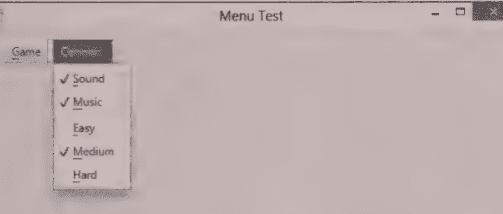

图 10-2：带有复选菜单项和单选项的菜单。

要创建复选菜单项，请使用 `CheckMenuItem` 类，其构造函数和方法列表 10-4所示。该类继承自 `MenuItem` 类，因此它的大多数方法与其是相同的。

## 218 第二部分：JavaFX 控件

| 表格 10-4 | CheckMenuItem 类 |
| :--- | :--- |
| 构造函数 | 描述 |
| `CheckMenuItem(String name)` | 创建一个指定名称的复选菜单项。 |
| 方法 | 描述 |
| `boolean isSelected()` | 如果项目已选中则返回 true。 |
| `void setSelected(boolean value)` | 指定为 true 以勾选项，指定为 false 以取消勾选项。 |
| `String getText()` | 获取菜单项的文本。 |
| `void setText(String text)` | 设置菜单项的文本。 |
| `boolean isDisable()` | 如果菜单项被禁用则返回 true。 |
| `void setDisable()` | 禁用菜单项。 |
| `void setDisable(boolean value)` | 如果 value 为 true，则禁用菜单项。否则，启用菜单项。 |
| `setOnAction(EventHandler<ActionEvent> value)` | 设置一个在用户选择此菜单项时调用的动作事件处理器。 |

初始时，复选菜单项是未选中的状态。如果你希望该项的默认设置为勾选状态，请调用 `setSelected` 方法，如下：

```java
menuMenuItem.setSelected(true);
```

要测试复选菜单项的状态，在例例中使用了 `isSelected` 方法：

```java
if (menuMenuItem.isSelected() == true)
    System.out.println("Your mamma can't dance.");
else
    System.out.println("Your daddy can't rock and roll.");
```

控制台上会显示两个不同的消息，具体取决于 `musicMenuItem` 菜单项的复选框的设置。

要创建单选菜单项，请使用表 10-5 所示的 `RadioMenuItem` 类。

## 第 10 章：制作菜单

| 表格 10-5 | |
| :--- | :--- |
| 构造函数 `RadioMenuItem(String name)` | 创建一个指定名称的单选菜单项。 |
| 方法 `void setToggleGroup(ToggleGroup group)` | 将此单选菜单项分配到一个切换组。 |
| `ToggleGroup getToggleGroup()` | 获取该单选菜单项所属的切换组。 |
| `boolean isSelected(boolean value)` | 如果项目已选中则返回 true。 |
| `void setSelected(boolean value)` | 指定为 true 以勾选项，指定为 false 以取消勾选项。 |
| `String getText()` | 获取菜单项的文本。 |
| `void setText(String text)` | 设置菜单项的文本。 |
| `boolean isDisabled()` | 如果菜单项被禁用则返回 true。 |
| `void isDisabled()` | 禁用菜单项。 |
| `void isDisabled(boolean value)` | 如果 value 为 true，则禁用菜单项。否则，启用菜单项。 |
| `setAction(EventHandler<ActionEvent> value)` | 设置一个在用户选择此菜单项时调用的动作事件处理器。 |

## 220 第二部分：JavaFX 控件

```java
menuItemEasy.toggleGroup(group);
menuItemMedium.toggleGroup(group);
menuItemHard.toggleGroup(group);
```

### 创建子菜单

子菜单是菜单中的菜单。由于 `Menu` 类本身是 `MenuItem` 类的子类，这意味着菜单中的任何项都可以是菜单。当用户点击子菜单时，子菜单会打开并显示其项。可以创建子菜单的子菜单，深度任意。但很少有菜单嵌套超过三层。

以下示例创建了“选项”菜单的版本，将难度选择隔离在一个名为“难度”的子菜单中：

```java
// 创建复选项
CheckMenuItem Sound =
    new CheckMenuItem("Sound");
CheckMenuItem Music =
    new CheckMenuItem("Music");
```

```java
// 创建单选项
RadioMenuItem Easy =
    new RadioMenuItem("Easy");
RadioMenuItem Medium =
    new RadioMenuItem("Medium");
RadioMenuItem Hard =
    new RadioMenuItem("Hard");
```

```java
ToggleGroup difficultyGroup = new ToggleGroup();
Easy.toggleGroup(difficultyGroup);
Medium.toggleGroup(difficultyGroup);
Hard.toggleGroup(difficultyGroup);
```

```java
// 创建难度子菜单
Menu Difficulty = new Menu("Difficulty");
Difficulty.getItems().add(Easy);
Difficulty.getItems().add(Medium);
Difficulty.getItems().add(Hard);
```

```java
// 创建选项菜单
Menu Options = new Menu("Options");
Options.getItems().add(Sound);
Options.getItems().add(Music);
Options.getItems().add(Difficulty);
```

## 第 10 章：制作菜单

## 221

图 10-3 显示了该菜单的运行效果。

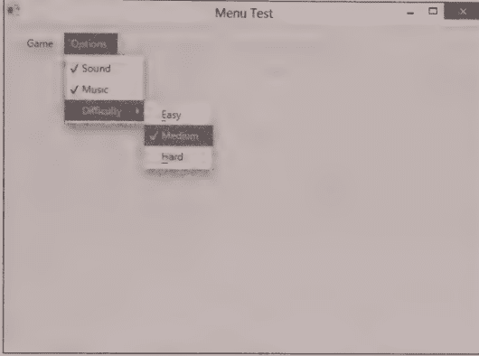

图 10-3：带有子菜单的菜单。

### 创建菜单项

自定义菜单项是可以包含任何 JavaFX 节点的菜单项。这允许你轻松地将任何 JavaFX 节点转换为菜单项。例如，你可以将文本字段、选择框或组合框添加到自定义菜单项中，然后将该自定义菜单项添加到菜单中。图 10-4 显示了一个包含文本字段的自定义菜单项的示例。

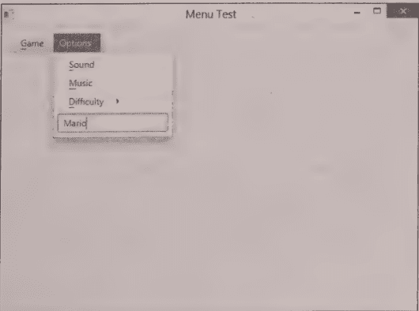

图 10-4：包含文本字段的自定义菜单项。

## 222 第二部分：JavaFX 控件

要创建一个自定义菜单项，请使用 `CustomMenuItem` 类。表 10-6 显示了该类的详细信息。

| 表 10-6 | CustomMenuItem 类 |
| --- | --- |
| 构造函数 | 说明 |
| `CustomMenuItem()` | 创建一个空的自定义菜单项。 |
| `CustomMenuItem(Node content)` | 创建一个指定节点为内容的自定义菜单项。 |
| `CustomMenuItem(Node content, boolean value)` | 创建一个以指定节点为内容并设置了指定 hideOnClick 设置的自定义菜单项。 |
| 方法 | 说明 |
| `Node getContent()` | 获取菜单项的内容。 |
| `void setContent(Node content)` | 设置菜单项的内容。 |
| `void setHideOnClick(boolean value)` | 设置 `HideOnClick` 属性。对于大多数自定义菜单项，此属性应设置为 false。 |
| `boolean isHideOnClick()` | 表示 `HideOnClick` 设置。 |
| `boolean isDisable()` | 如果菜单项被禁用，则返回 true。 |
| `void setDisable(boolean value)` | 禁用菜单项。如果 value 为 true，则禁用菜单项；否则，启用菜单项。 |
| `setOnAction(EventHandler<ActionEvent> value)` | 设置事件处理程序，当用户选择此菜单项时会调用该程序 |

如你所见，你可以在构造函数中或通过 `setContent` 方法指定你想要作为自定义菜单项内容的节点。

自定义菜单项的一个常见问题是，它们在用户点击时往往会消失。这是因为菜单项的默认行为是点击后立即消失。对于大多数自定义菜单项来说，这并不是所需要的。例如，如果一个自定义菜单项包含一个文本字段，但每当用户点击它时文本字段都会消失，用户就无法在文本字段中输入任何内容。

## 第 10 章：制作菜单 223

为了避免这种情况，你可以调用 `setHideOnClick` 方法并将 `false` 作为其参数。这会抑制点击隐藏的行为，允许用户点击自定义菜单项来选择它。然后，用户就可以在字段中输入数据了。注意：你也可以通过类构造函数设置点击隐藏的行为。

以下示例展示了如何创建一个文本字段自定义菜单项并将其添加到菜单中：

```
TextField txtName = new TextField();
txtName.setPromptText("Player Name");
CustomMenuItem menuItemName = new CustomMenuItem(txtName);
menuName.setHideOnClick(false);
menuOptions.getItems().add(menuName);
```

## 第三部分

增强你的场景设计

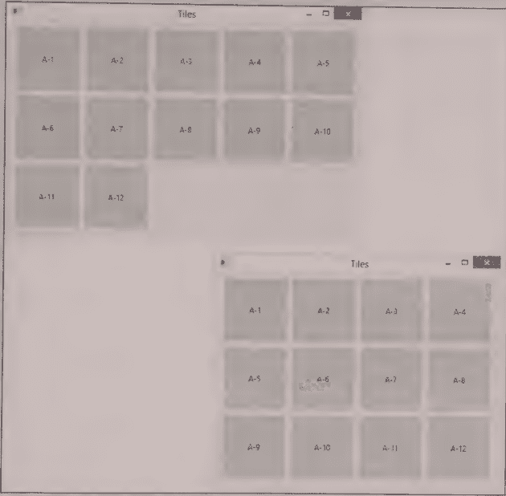

访问 www.dummies.com/extras/javafx 获取优质的 Dummies 在线内容。

## 在这一部分……

- 排版元素
- 管理主题和样式表
- 自定义形状
- 让形状看起来更真实
- 访问 www.dummies.com/extras/javafx 获取优质的 Dummies 在线内容。

## 第 11 章

### 更多关于精确场景设计的布局面板

### 本章内容

- 使用另外四种布局面板创建精彩的布局
- 引入矩形形状
- 在布局中添加滚动条
- 创建两个完整的程序

在第 5 章中，你可以读到如何使用四个基础布局面板类，这些类允许你控制场景中控件的排列：`HBox`（水平排列节点）、`VBox`（垂直排列节点）、`FlowPane`（同时水平和垂直排列节点）以及 `BorderPane`（将场景分为五个区域：顶、右、下、左和中）。

在本章中，你将发现另外四种布局面板，它们为你提供了排列场景中元素的其他方法。具体来说，你将发现如何使用以下布局面板类：

- `StackPane`：`StackPane` 类与其他布局面板略有不同，因为它不会在视觉上将节点相互分离。相反，它直接将节点堆叠在一起显示。例如，如果你向堆叠面板中添加一个矩形形状和一个文本形状，文本将直接显示在矩形上方。


## 228 第三部分：增强你的场景设计


- **AnchorPane**：这种布局允许你将节点锚定到面板的顶部、右、底部或中心。随着面板调整大小，节点会重新定位，但仍保持与其锚定点的绑定。注意：一个节点可以锚定到多个位置。例如，你可能将一个节点锚定在顶部和右侧。然后，当你调整面板大小时，该节点将保持在面板的右上角。

- **GridPane**：在行和列的网格中排列节点。网格不需要像棋盘那样尺寸均匀。相反，每列的宽度和每行的高度可以根据其内容变化。此外，内容可以跨列或跨行。`GridPane` 是通过文本框、列表框等界面控件从用户处收集信息的表的理想布局类型。

- **TilePane**：如果你想要一种类似于棋盘的布局，其中每个单元格的大小都相同，那么 `TilePane` 就是你寻找的布局面板。`TilePane` 非常适合组织图像文件的缩略图或其他相同大小的对象。

- **ScrollPane**：从技术上讲，`ScrollPane` 类根本不是布局面板；它继承的是 `Control` 类而不是 `Pane` 类。然而，它被用于那些大到无法一次性显示而需要滚动条的布局。请记住，布局面板通常用于创建那些无法一次性显示的布局。例如，你可能使用 `GridPane` 来放置用户输入控件，使用 `BorderPane` 来放置缩略图。或者，你可能使用 `VBox` 来排列这些缩略图。

## 使用 StackPane 布局

`StackPane` 布局的特殊之处在于它不会在视觉上将节点相互分离。相反，它直接将节点堆叠在一起显示。例如，如果你向堆叠面板中添加一个矩形形状和一个文本形状，文本将直接显示在矩形上方。

## 第 11 章：更多关于精确场景设计的布局面板 229

`StackPane` 布局的特殊之处在于它不会在视觉上将节点相互分离。相反，它直接将节点堆叠在一起显示。

创建堆叠面板的最简单方法是先创建节点，然后将它们传递给构造函数。例如：

```java
Rectangle r1 = new Rectangle(100, 100);
r1.setFill(Color.DARKGRAY);
Rectangle r2 = new Rectangle(50, 50);
// ...
```

在这里，我首先创建了一对矩形，一个是 100x100，另一个是 50x50。较大的矩形填充深灰色，较小的填充浅灰色。然后，我创建一个持有这两个矩形的堆叠面板。图 11-1 显示了该面板在显示时的外观。如你所见，较小的矩形显示在较大的矩形内部。

`Rectangle` 类位于 `javafx.scene.shape`，`Color` 类位于 `javafx.scene.paint`。因此，你需要包含以下导入：

```java
import javafx.scene.shape.*;
import javafx.scene.paint.*;
```

要创建堆叠面板，你可以使用 `StackPane` 类，其构造函数和方法见表 11-1。

| 表 11-1 | StackPane 构造函数和方法 |
| --- | --- |
| 构造函数 | 说明 |
| `StackPane()` | 创建一个空的堆叠面板。 |
| `StackPane(Node... children)` | 创建指定节点的堆叠面板。此构造函数允许你在创建堆叠面板的同时向其添加节点。 |
| 方法 | 说明 |
| `ObservableList<Node> getChildren()` | 返回添加到堆叠面板的所有节点集合。该集合作为 `ObservableList` 返回，它包含 `add` 和 `addAll` 方法，允许你向列表添加一个或多个。 |

# 第 11 章：更多关于精确场景设计的布局窗格

如果你愿意，可以调用 `getChildren()` 方法向 `StackPane` 中添加节点，如下所示：

```java
stack.getChildren().add(r1);
stack.getChildren().add(r2);
```

或者如下所示：

```java
stack.getChildren().addAll(r1, r2);
```

注意：向 `StackPane` 中添加节点的顺序对子节点的显示方式有很大影响。例如，假设你反转了两个矩形添加的顺序：

```java
stack.getChildren().addAll(r2, r1);
```

那么，较大的矩形将显示在较小矩形的上方。结果是用户只能看到较大的矩形。（当然，除非较大的矩形是透明的。我将在第 13 章中讨论如何创建透明形状。）

默认情况下，`StackPane` 中的对象是彼此堆叠居中的。你可以使用 `setAlignment()` 方法来更改这一点。该方法的参数类型为 `Pos`，与其他具有 `setAlignment()` 方法的布局窗格的类型相同。如果你需要复习 `Pos` 枚举，请翻到第 5 章的表 5-5。这是一个示例，显示了三个不同尺寸的矩形对齐在 `StackPane` 的左上角：

```java
Rectangle r1 = new Rectangle(400, 150);
r1.setFill(Color.DARKGRAY);

Rectangle r2 = new Rectangle(200, 400);
r2.setFill(Color.LIGHTGRAY);

Rectangle r3 = new Rectangle(150, 600);
r3.setFill(Color.DIMGRAY);

StackPane stack = new StackPane(r1, r2, r3);
stack.setAlignment(Pos.TOP_CENTER);
```

## 232 部分：增强你的场景设计

图 11-2 显示了该窗格在场景中显示时的外观。

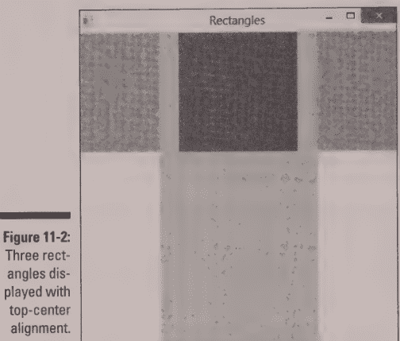

与其他布局窗格一样，你可以使用 `setPadding()` 方法在窗格的边缘添加内边距。例如，下面的代码行在窗格边缘创建了一个 50 像素的缓冲区：

```java
stack.setPadding(new Insets(50));
```

`setPadding()` 方法接受一个 `Insets` 类型的参数。有关 `Insets` 类的更多信息，请翻到第 5 章的表 5-2。

你也可以为 `StackPane` 内的单个节点添加外边距。要这样做，调用 `setMargin()` 方法并传递节点以及描述外边距的 `Insets` 对象：

```java
stack.setMargin(r1, new Insets(25));
```

## 使用 TilePane 布局

`TilePane` 布局与 `FlowPane` 布局类似：它以水平或垂直方向按行列排列节点。关键区别在于，在 `TilePane` 布局中所有单元格的大小都是相同的。`TilePane` 布局计算其子节点集合中最大节点的大小，然后将该大小作为每个单元格的大小。这创建了良好的网格状外观，如图 11-3 所示。

默认情况下，`TilePane` 每行显示五个节点，使用尽可能多的行来显示所有节点。因此，图 11-3 中的 `TilePane` 将它的 12 个矩形显示为两行五个和第三行仅两个。

如果你调整了 `TilePane` 的大小，每行的节点数量会自动调整。例如，图 11-4 显示了调整大小后的相同 `TilePane`，使得 12 个矩形显示为三行每四个。

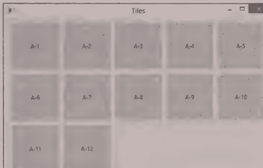

图 11-3：在 `TilePane` 中显示的一打个矩形。

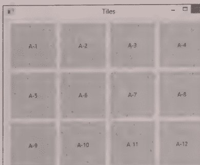

图 11-4：当窗格缩放时，`TilePane` 自动重新排列其瓷砖。

要创建一个 `TilePane`，你需要使用 `TilePane` 类，正如我在表 11-2 中描述的。

| 表 11-2 | TilePane 构造函数和方法 |
| --- | --- |
| 构造函数 | 说明 |
| `TilePane()` | 创建一个空的 `TilePane` |
| `TilePane(Node... children)` | 创建一个带有指定子节点的 `TilePane` |
| `TilePane(double hgap, double vgap)` | 创建一个具有指定行和列间距的空 `TilePane` |
| `TilePane(Orientation orientation)` | 创建具有指定方向的空 `TilePane`。你可以指定 `Orientation.HORIZONTAL` 或 `Orientation.VERTICAL` |
| `TilePane(double hgap, double vgap, Node... children)` |  |
| `TilePane(Orientation orientation, double vgap)` |  |
| `TilePane(Orientation orientation, Node... children)` |  |
| `TilePane(Orientation orientation, double vgap, Node... children)` |  |
| 方法 | 说明 |
| `ObservableList<Node> getChildren()` | 返回已添加到 `TilePane` 的所有节点集合。 |

## 234 部分：增强你的场景设计

| 方法 | 说明 |
| --- | --- |
| `void setHgap(double value)` | 设置列之间的间距。 |
| `void setVgap(double value)` | 设置行之间的间距。 |
| `void setOrientation(Orientation orientation)` | 设置方向。可用 `Orientation.HORIZONTAL` 或 `Orientation.VERTICAL`。 |
| `void setColumns(int value)` | 设置列数。 |
| `void setRows(int value)` | 设置行数。 |
| `void setPrefTileWidth(double value)` | 设置单元格的宽度。 |
| `void setPrefTileHeight(double value)` | 设置单元格的高度。 |
| `static void setMargin(Node, Insets value)` | 设置节点的外边距。 |
| `void setMinHeight(double value)` | 设置 `TilePane` 的最小高度。 |
| `void setMaxHeight(double value)` | 设置 `TilePane` 的最大高度。 |
| `void setMinWidth(double value)` | 设置 `TilePane` 的最小宽度。 |
| `void setMaxWidth(double value)` | 设置 `TilePane` 的最大宽度。 |
| `void setPrefWidth(double value)` | 设置窗格的首选宽度。 |
| `void setPadding(Insets value)` | 设置窗格内部的内边距。 |

以下是创建该 `TilePane` 的代码：

```java
TilePane tile1 = new TilePane();
tile1.setHgap(10);
tile1.setVgap(10);
tile1.setPadding(new Insets(10, 10, 10, 10));
for (int i = 1; i < 13; i++) {
    Rectangle r = new Rectangle(100, 100);
    r.setFill(Color.LIGHTGRAY);
    Label l = new Label("A-" + i);
    StackPane s = new StackPane(r, l);
    tile1.getChildren().add(s);
}
```

你可以看到，使用 `for` 循环创建了 12 个带标签矩形，并将它们添加到 `TilePane` 中。

## 使用 ScrollPane 布局

当布局无法放入窗口时，你需要提供水平或垂直滚动条（或两者），以便用户可以查看整个布局。最简单的方法是使用 `ScrollPane`。`ScrollPane` 将单个节点封装在一个必要时自动显示水平或垂直滚动条的区域。因此，如果整个布局适应 `ScrollPane`，则不会显示滚动条。如果布局比 `ScrollPane` 高，会出现垂直滚动条。如果布局比 `ScrollPane` 宽，会出现水平滚动条。

图 11-5 显示了包含在 `ScrollPane` 中的与上一节所示类似的 `TilePane`。你可以看到，此示例中的 `TilePane` 每行显示两个瓷砖，可以看到垂直滚动条，允许用户滚动查看所有瓷砖。为了给 `ScrollPane` 创建外边距，我将 `ScrollPane` 添加到 `StackPane` 中，然后对 `StackPane` 设置了外边距。

> 图 11-5：在 `ScrollPane` 中的 `TilePane`。

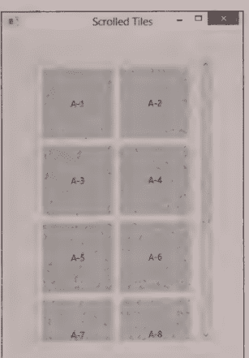

## 238 第三部分：增强你的场景设计

要创建一个滚动面板，请使用如表 11-3 所示的 `ScrollPane` 类。

| 表 11-3 | ScrollPane 构造函数和方法 |
| --- | --- |
| 构造函数 | 描述 |
| `ScrollPane()` | 创建一个空的滚动面板。 |
| `ScrollPane(Node node)` | 创建一个带有指定子节点的滚动面板。 |
| 方法 | 描述 |
| `void setContent(Node node)` | 设置此滚动面板内包含的节点。 |
| `void setHbarPolicy(ScrollPane.ScrollBarPolicy value)` | 设置水平滚动条的策略。 |
| `void setVbarPolicy(ScrollPane.ScrollBarPolicy value)` | 设置垂直滚动条的策略。 |
| `void setPannable(boolean value)` | 如果为 `true`，用户可以使用鼠标移动滚动面板的内容。默认为 `false`。 |
| `void setMinHeight(double value)` | 设置面板的最小高度。 |
| `void setMaxHeight(double value)` | 设置面板的最大高度。 |
| `void setPrefHeight(double value)` | 设置面板的首选高度。 |
| `void setMinWidth(double value)` | 设置面板的最小宽度。 |
| `void setMaxWidth(double value)` | 设置面板的最大宽度。 |
| `void setPrefWidth(double value)` | 设置面板的首选宽度。 |
| `void setPadding(Insets value)` | 设置面板内部边缘的内边距。参见第 5 章中的表 5-2 对 `Insets` 类的解释。 |

## 第 11 章：用于精确场景设计的布局面板更多信息 239

| ScrollBarPolicy 枚举 | 描述 |
| --- | --- |
| `ScrollBarPolicy.ALWAYS` | 始终显示滚动条。 |
| `ScrollBarPolicy.NEVER` | 永远不显示滚动条。 |
| `ScrollBarPolicy.AS_NEEDED` | 仅需要时显示滚动条。 |

创建面板最简单的方法是调用 `ScrollPane` 构造函数并将你要滚动的节点作为参数传递，如下：

```java
ScrollPane spane = new ScrollPane(tile1);
```

你可能还想为滚动面板设置尺寸限制。以下代码将宽度固定为 250，允许布局决定高度，首选高度为 400：

```java
spane.setMaxWidth(250);
spane.setMinWidth(250);
spane.setPrefWidth(250);
spane.setPrefHeight(400);
```

如果你需要，可以为垂直和水平滚动条设置策略。默认情况下，滚动条仅在需要时出现。如果你希望滚动条始终出现（即使在不需要时），请像本示例所示将策略设置为 `ALWAYS`：


```
spane.setVBarPolicy(ScrollPane.ALWAYS);
```

用于创建图 11-5 所示滚动面板的完整程序位于列表 11-1 中。

## 列表 11-1：滚动平格程序

```java
import javafx.application.*;
import javafx.stage.*;
import javafx.scene.*;
import javafx.scene.layout.*;
import javafx.scene.control.*;
import javafx.scene.shape.*;
import javafx.scene.paint.*;
import javafx.geometry.*;
```

（续）

## 列表 11-1（续）

```java
public class ScrolledTile extends Application {
    public static void main(String[] args) {
        launch(args);
    }

    @Override public void start(Stage primaryStage) {
        TilePane tilePane = new TilePane();
        tilePane.setHGap(10);
        tilePane.setVGap(10);
        tilePane.setPrefColumns(2);
        tilePane.setPadding(new Insets(10,10,10,10));
        for (int i=1; i<13; i++) {
            Rectangle r = new Rectangle(100, 100);
            r.setFill(Color.LIGHTGRAY);
            Label l = new Label("A-" + i);
            StackPane s = new StackPane(r, l);
            tilePane.getChildren().add(s);
        }

        ScrollPane spate = new ScrollPane(tilePane);
        spane.setMinWidth(250);
        spane.setPrefWidth(250);
        spane.setMaxWidth(250);
        spane.setPrefHeight(400);
        spane.setScrollBarPolicy(ScrollPane.ScrollBarPolicy.ALWAYS);

        StackPane stack = new StackPane(spane);
        stack.setMargin(spane, new Insets(40,40,40,40));

        Scene scene = new Scene(stack);
        primaryStage.setScene(scene);
        primaryStage.setTitle("Scrolled Tiles");
        primaryStage.show();
    }
}
```

## 第 11 章：用于精确场景设计的布局面板更多信息

以下段落描述了该程序的亮点：

- 20：这一行及其随后的四行创建了平格面板，将水平和垂直间隙设置为 10 像素，将首选宽度设置为两列，并设置了内边距。
- 25：使用循环来创建平格面板。
- 34：这些行创建了滚动面板，并将宽度固定为 250，允许布局决定高度，首选高度为 400。
- 39：滚动条仅在需要时出现。
- 41：如果你希望滚动条始终出现（即使在不需要时），请将策略设置为 `ALWAYS`。
- 44：网格面板用于显示。

## 使用 GridPane 布局

`GridPane` 网格布局允许你在网格中安排 GUI 元素。与 `TilePane` 不同，网格的行和列不需要相同的大小。以下是 `GridPane` 的一些重要特性：

- 你可以指定组件所在的行和列。
- 组件可以跨越行或列。
- 你可以控制组件在单元格内的对齐方式。
- 你可以设置列宽。

### 绘制规划

在创建网格布局之前，画一个草图显示你希望组件如何出现。然后将面板划分为行和列，从零开始编号。


| 组件 | x | y | 对齐 | 跨度 |
|---|---|---|---|---|
| “姓名”标签 | 0 | 0 | 右对齐 | |
| “电话”标签 | 0 | 1 | 右对齐 | |
| “地址”标签 | 0 | 2 | 右对齐 | |
| 姓名文本框 | 1 | 0 | 左对齐 | |
| 电话文本框 | 1 | 1 | 左对齐 | 2 |
| 地址文本框 | 1 | 2 | 左对齐 | 2 |
| 尺寸单选按钮 | 0 | 3 | 左对齐 | |
| 样式单选按钮 | 1 | 3 | 左对齐 | |
| 顶料复选框 | 2 | 3 | 左对齐 | |
| “确定”和“关闭”按钮 | 2 | 4 | 右对齐 | |

在布局网格后，你可以编写代码将组件放置在正确的位置。

### 创建网格面板

表 11-4 显示了 `GridPane` 类最常用的构造函数和方法，你使用它们来创建网格面板。

| 表 11-4 | 构造函数和方法 |
| --- | --- |
| 构造函数 | 描述 |
| `GridPane()` | 创建一个空的网格面板。 |
| 方法 | 描述 |
| `void add(Node node, int col, int row)` | 在指定的列和行处添加节点。 |
| `void add(Node node, int col, int colspan, int rowspan)` | 在指定的列和行处添加节点，并指定列跨度和行跨度。 |
| `void addColumn(int col, Node... nodes)` | 添加整列。 |
| `void addRow(int row, Node... nodes)` | 添加整行。 |
| `<ObservableList> getColumnConstraints()` | 返回列约束。更多信息请参见表 11-5。 |
| `<ObservableList> getRowConstraints()` | 返回行约束。更多信息请参见表 11-6。 |
| `void setColumnSpan(Node node, int colspan)` | 设置指定节点的列跨度。 |
| `void setRowSpan(Node node, int colspan)` | 设置指定节点的行跨度。 |
| `void setHalignment(Node node, HPos value)` | 设置节点的水平对齐。可用值有 `HPos.LEFT`、`HPos.CENTER` 和 `HPos.RIGHT`。 |
| `void setAlignment(Node node, VPos value)` | 设置节点的垂直对齐。可用值有 `VPos.BOTTOM`、`VPos.CENTER` 和 `VPos.TOP`。 |

| 表 11-4（续） |
| --- |
| 方法 | 描述 |
| `void setHgap(double value)` | 设置列之间间距的大小。 |
| `void setVgap(double value)` | 设置行之间间距的大小。 |
| `static void setMargin(Node node, Insets value)` | 设置特定节点的边距。关于 `Insets` 类的解释，请参见第 5 章表 5-2。 |
| `void setPadding(Insets value)` | 设置网格布局边缘的内边。关于 `Insets` 类的解释，请参见第 5 章表 5-2。 |
| `void setMinHeight(double value)` | 设置网格布局的最小高度。 |
| `void setMaxHeight(double value)` | 设置网格布局的最大高度。 |
| `void setPrefHeight(double value)` | 设置网格布局的首选高度。 |
| `void setMinWidth(double value)` | 设置网格布局的最小宽度。 |
| `void setMaxWidth(double value)` | 设置网格布局的最大宽度。 |
| `void setPrefWidth(double value)` | 设置网格布局的首选宽度。 |

要创建一个网格布局（grid pane），首先调用 `GridPane` 构造函数。你使用 `add` 方法将节点添加到网格布局的单元格中。`add` 方法的参数指定了要添加的节点、节点的列索引以及节点的行索引。例如，下面的代码段创建了一个标签，然后创建一个网格布局并将标签添加到第 0 列第 0 行的单元格中：

```java
Label lblName = new Label("Name");
GridPane grid = new GridPane();
grid.add(lblName, 0, 0);
```

在网格布局中填充节点的典型方法是为每个节点调用一次 `add` 方法。然而，如果你愿意，也可以通过单次调用 `addColumn` 或 `addRow` 一次性添加一整列或一整行的节点。例如，此示例创建了一个标签和一个文本字段，然后创建一个网格布局并将标签和文本字段添加到第一行：

```java
Label lbl1Name = new Label("Name");
TextField txtName = new TextField();
GridPane grid = new GridPane();
grid.addRow(0, lbl1Name, txtName);
```

如果一个节点应该跨越多个列，可以调用 `setColumnSpan` 方法来指定节点应跨越的列数。例如：

```java
grid.setColumnSpan(txtName, 2);
```

在这里，`txtName` 节点将跨越两列。如果你需要配置节点跨越多行，可以使用类似的方法使用 `setRowSpan`。

要控制节点的水平对齐，可以使用此示例中的 `setHalignment` 方法：

```java
grid.setHalignment(lbl1Name, HPos.RIGHT);
```

在这里，`lbl1Name` 节点在其所在的列内右对齐。`setValignment` 方法的作用也类似。

与其他布局面板一样，`GridPane` 类有一系列方法用于设置间距和对齐细节。你可以使用 `setHgap` 和 `setVgap` 方法来设置行和列之间的间距，这样你的布局看起来就不会那么拥挤。你可以使用 `setPadding` 和 `setMargin` 方法来设置内边和边距，它们的工作方式与其他布局面板完全相同。你还可以为网格布局设置最小、最大和首选的宽度及高度。

## 使用网格布局约束

你可以使用 `GridPane` 类的方法控制网格布局的大多数方面，但遗憾的是，你无法控制单个列或行的尺寸。要做到这一点，必须使用 `ColumnConstraints` 或 `RowConstraints` 类，如表 11-5 和 11-6 所示。

| 表 11-5 ColumnConstraints 类 |
| --- |
| 构造函数 | 描述 |
| `ColumnConstraints()` | 创建一个空的列约束对象。 |
| `ColumnConstraints(double width)` | 创建具有固定宽度的列约束。 |
| `ColumnConstraints(double min, double pref, double max)` | 创建具有指定最小、首选和最大宽度的列约束。 |
| 方法 | 描述 |
| `void setMinWidth(double value)` | 设置列的最小宽度。 |
| `void setMaxWidth(double value)` | 设置列的最大宽度。 |
| `void setPrefWidth(double value)` | 设置列的首选宽度。 |
| `void setPercentWidth(double value)` | 将宽度设为网格布局总宽度的百分比。 |
| `void setHgrow(Priority value)` | 确定当网格布局总宽度增加时，列的宽度是否增长。允许值为 `Priority.ALWAYS`、`Priority.NEVER` 和 `Priority.SOMETIMES`。 |
| `void setFillWidth(boolean value)` | 如果为 true，网格布局将扩展此列内的节点以填充空区域。 |
| `void setHalignment(HPos value)` | 设置整列的水平对齐。允许值为 `HPos.LEFT`、`HPos.CENTER` 和 `HPos.RIGHT`。 |

| 表 11-6 RowConstraints 类 |
| --- |
| 构造函数 | 描述 |
| `RowConstraints()` | 创建一个空的行约束对象。 |
| `RowConstraints(double height)` | 创建具有固定高度的行约束。 |
| `RowConstraints(double min, double pref, double max)` | 创建具有指定的最小、首选和最大高度的行约束。 |
| 方法 | 描述 |
| `void setMinHeight(double value)` | 设置行的最小高度。 |
| `void setMaxHeight(double value)` | 设置行的最大高度。 |
| `void setPrefHeight(double value)` | 设置行的首选高度。 |
| `void setPercentHeight(double value)` | 将高度设为网格布局总高度的百分比。 |
| `void setVgrow(Priority value)` | 确定当网格布局总高度增加时，行的高度是否增长。允许值为 `Priority.ALWAYS`、`Priority.NEVER` 和 `Priority.SOMETIMES`。 |
| `void setFillHeight(boolean value)` | 如果为 true，网格布局将扩展此行内的节点以填充空区域。 |
| `void setValignment(VPos value)` | 设置整行的垂直对齐。允许值为 `VPos.TOP`、`VPos.CENTER` 和 `VPos.BOTTOM`。 |

使用列约束为网格布局的每列设置固定宽度，首先为每列创建一个约束。然后将这些约束添加到网格布局的集合中。这是一个示例：

```java
ColumnConstraints col1 = new ColumnConstraints(200);
ColumnConstraints col2 = new ColumnConstraints(200);
ColumnConstraints col3 = new ColumnConstraints(200);
GridPane grid = new GridPane();
grid.getColumnConstraints().addAll(col1, col2, col3);
```

列约束最有用的功能之一是将其网格布局列的宽度设置为网格布局总宽度的百分比。例如，假设网格布局由三列组成，你希望无论网格布局宽度如何，所有列都具有相同的宽度。以下代码实现了这一点：

```java
ColumnConstraints col1 = new ColumnConstraints();
col1.setPercentWidth(33);
ColumnConstraints col2 = new ColumnConstraints();
col2.setPercentWidth(33);
ColumnConstraints col3 = new ColumnConstraints();
col3.setPercentWidth(33);
GridPane grid = new GridPane();
grid.getColumnConstraints().addAll(col1, col2, col3);
```

## 查看网格布局示例

列表 11-2 显示了显示图 11-6 中绘制场景的程序代码，图 11-7 显示了该场景在程序运行时外观。图 11-7 显示，该场景的最终外观与我草图的样子非常接近。

图 11-7：披萨订单应用程序。

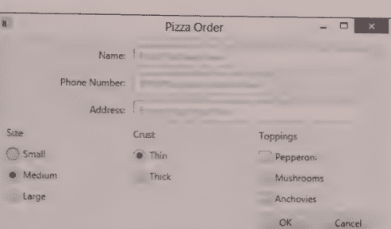

## 列表 11-2：披萨订单应用程序


```java
import javafx.application.*;
import javafx.stage.*;
import javafx.scene.*;
import javafx.layout.*;
import javafx.scene.control.*;
import javafx.geometry.*;

public class PizzaOrder extends Application {
    public static void main(String[] args) {
        launch(args);
    }

    Stage stage;
    TextField txtName;
    TextField txtPhone;
    TextField txtAddress;
    RadioButton rdoSmall;
    RadioButton rdoMedium;
    RadioButton rdoLarge;
    RadioButton rdoThin;
    RadioButton rdoThick;
    CheckBox chkPepperoni;
    CheckBox chkMushrooms;
    CheckBox chkAnchovies;
}
```

（续）

# 列表 11-2（续）

```java
  @Override public void start(Stage primaryStage) {
      stage = primaryStage;

      // 创建名称标签和文本字段
      Label lblName = new Label("Name:");
      txtName = new TextField();
      txtName.setMinWidth(100);
      txtName.setPrefWidth(200);
      txtName.setMaxWidth(300);
      txtName.setPromptText("Enter the name here");

      // 创建电话号码标签和文本字段
      Label lblPhone = new Label("Phone Number:");
      txtPhone = new TextField();
      txtPhone.setMinWidth(60);
      txtPhone.setPrefWidth(120);
      txtPhone.setMaxWidth(180);
      txtPhone.setPromptText("Enter the phone number here");

      // 创建地址标签和文本字段
      Label lblAddress = new Label("Address:");
      txtAddress = new TextField();
      txtAddress.setMinWidth(150);
      txtAddress.setPrefWidth(200);
      txtAddress.setMaxWidth(300);
      txtAddress.setPromptText("Enter the address here");

      // 创建尺寸面板
      Label lblSize = new Label("Size:");
      rdoSmall = new RadioButton("Small");
      rdoMedium = new RadioButton("Medium");
      rdoLarge = new RadioButton("Large");
      rdoMedium.setSelected(true);
      ToggleGroup groupSize = new ToggleGroup();
      rdoSmall.setToggleGroup(groupSize);
      rdoMedium.setToggleGroup(groupSize);
      rdoLarge.setToggleGroup(groupSize);

      VBox paneSize = new VBox(lblSize, rdoSmall, rdoMedium, rdoLarge);
      paneSize.setSpacing(10);
```

```java
      // 创建饼底面板
      Label lblCrust = new Label("Crust");
      rdoThin = new RadioButton("Thin");
      rdoThick = new RadioButton("Thick");
      rdoThin.setSelected(true);
      ToggleGroup groupCrust = new ToggleGroup();
      rdoThin.setToggleGroup(groupCrust);
      rdoThick.setToggleGroup(groupCrust);
```

```java
      VBox paneCrust = new VBox(lblCrust, rdoThin, rdoThick);
      paneCrust.setSpacing(10);
```

```java
      // 创建配料面板
      Label lblToppings = new Label("Toppings");
      chkPepperoni = new CheckBox("Pepperoni");
      chkMushrooms = new CheckBox("Mushrooms");
      chkAnchovies = new CheckBox("Anchovies");
```

```java
      VBox paneToppings = new VBox(lblToppings, chkPepperoni, chkMushrooms, chkAnchovies);
      paneToppings.setSpacing(10);
```

```java
      // 创建按钮
      Button btnOK = new Button("OK");
      btnOK.setPrefWidth(80);
      btnOK.setOnAction(e -> btnOK_Click());

      Button btnCancel = new Button("Cancel");
      btnCancel.setPrefWidth(80);
      btnCancel.setOnAction(e -> btnCancel_Click());
```

```java
      HBox paneButtons = new HBox(10, btnOK, btnCancel);
```

```java
      // 创建 GridPane 布局
      GridPane grid = new GridPane();
      grid.setPadding(new Insets(10));
      grid.setHgap(10);
      grid.setVgap(10);
      grid.setMinWidth(500);
      grid.setPrefWidth(500);
      grid.setMaxWidth(800);
```

```java
      // 将节点添加到面板中
      grid.add(lblName, 0, 0);
      grid.add(txtName, 1, 0);
      grid.add(lblPhone, 0, 1);
      grid.add(txtPhone, 1, 1);
      grid.add(lblAddress, 0, 2);
      grid.add(txtAddress, 1, 2);
      grid.add(paneSize, 0, 3);
      grid.add(paneCrust, 1, 3);
      grid.add(paneToppings, 2, 3);
      grid.add(paneButtons, 2, 4);
```

（续）

# 列表 11-2（续）

```java
      // 设置对齐方式和跨度
      grid.setHalignment(lblName, HPos.RIGHT);
      grid.setHalignment(lblPhone, HPos.RIGHT);
      grid.setHalignment(lblAddress, HPos.RIGHT);
      grid.setColumnSpan(txtName, 2);
      grid.setColumnSpan(txtPhone, 2);
      grid.setColumnSpan(txtAddress, 2);
```

```java
      // 设置列宽
      ColumnConstraints col1 = new ColumnConstraints();
      col1.setPercentWidth(33);
      ColumnConstraints col2 = new ColumnConstraints();
      col2.setPercentWidth(33);
      ColumnConstraints col3 = new ColumnConstraints();
      col3.setPercentWidth(33);
      grid.getColumnConstraints().addAll(col1, col2, col3);
```

```java
      // 创建场景和阶段
      Scene scene = new Scene(grid);
      primaryStage.setScene(scene);
      primaryStage.setTitle("Pizza Order");
      primaryStage.setMinWidth(500);
      primaryStage.setMaxWidth(800);
      primaryStage.show();
  }

  public void btnOK_Click() {
      // 创建一条消息
      String msg = "Customer:\n";
      msg += txtName.getText() + "\n";
      msg += "Phone: " + txtPhone.getText() + "\n";
      msg += "Address: " + txtAddress.getText() + "\n";
      msg += "You have ordered a";

      // 添加披萨尺寸
      if (rdoSmall.isSelected()) {
          msg += "small ";
      }
      if (rdoMedium.isSelected()) {
          msg += "medium ";
      }
      if (rdoLarge.isSelected()) {
          msg += "large ";
      }
```

```java
      // 添加饼底样式
      if (rdoThin.isSelected())
          msg += "thin crust with";
      if (rdoThick.isSelected())
          msg += "thick crust with";

      // 添加配料
      String toppings = "";
      toppings = buildToppings(chkPepperoni, toppings);
      toppings = buildToppings(chkMushrooms, toppings);
      toppings = buildToppings(chkAnchovies, toppings);
      if (toppings.equals(""))
          msg += "no toppings.";
      else
          msg += "the following toppings:\n" + toppings;

      // 显示消息
      MessageBox.show(msg, "Order Details");
  }

  public String buildToppings(CheckBox chk, String msg) {
      // 显示配料列表的辅助方法
      if (!msg.equals("")) {
          msg += ", ";
      }
      msg += chk.getText();
      return msg;
  }

  public void btnCancel_Click() {
      stage.close();
  }
}
```

以下段介绍了程序的亮点：

- 第 32 行：为客户姓名创建标签和文本字段。
- 第 40 行：为客户电话号码创建标签和文本字段。
- 第 48 行：为客户地址创建标签和文本字段。
- 第 56 行：为披萨尺寸创建标签和三个单选按钮。将标签和单选按钮添加到名为 `paneSize` 的 `VBox`。
- 第 70 行：为披萨饼底样式创建标签和两个单选按钮。将标签和单选按钮添加到名为 `paneCrust` 的 `VBox`。
- 第 82 行：为披萨配料创建标签和三个复选框。将标签和复选框添加到名为 `paneToppings` 的 `VBox`。
- 第 92 行：创建 OK 和取消按钮并添加到名为 `paneButtons` 的 `HBox`。
- 第 103 行：创建网格布局。设置内边距和水平、垂直间隙为 10，宽度设置为 500 到 800。
- 第 112 行：将节点添加到面板中。将姓名、电话和地址的标签及文本字段添加到第 0、1、2 行。然后将尺寸、饼底和配料的 `VBox` 面板添加到第 3 行。最后，将包含按钮的 `HBox` 添加到第 4 行的第 2 列。（记住）：行索引从 0 开始，而不是从 1 开始。
- 第 119 行：设置列对齐和跨度选项。
- 第 127 行：创建列约束以均匀分布列宽。
- 第 136 行：创建场景并显示阶段。
- 第 146 行：当用户点击 OK 时调用 `btnOK_Click()` 方法。该方法创建客户订单的摘要并使用 `MessageBox` 类显示。
- 第 185 行：`buildToppings()` 只是一个辅助构建消息字符串的辅助方法。
- 第 199 行：当用户点击关闭按钮时关闭阶段。

# 第 12 章：使用 CSS 为你的应用程序换肤

### 本章内容

- 以多种方式应用样式
- 创建你自己的样式表
- 通过字体样式控制字体
- 使用 CSS 创建填充和边框

JavaFX 最强大的功能之一是它能够使用 CSS（层叠样式表的缩写）来控制用户界面的视觉外观。通过 CSS，你可以在不更改驱动应用程序的 Java 代码的情况下更改应用程序的外观。CSS 本质上将程序的视觉部分与应用程序逻辑解耦。

在本章中，我首先讨论如何在 JavaFX 提供的两个默认主题之间切换整个应用程序。然后，你将学会如何编写自己的样式表并将其应用到场景中。

## 使用默认样式表

JavaFX 带有两个内置主题：Modena 和 Caspian。Modena 是随 JavaFX 8 引入的新主题；Caspian 是在之前的 JavaFX 版本中使用的旧主题。

图 12-1 显示我在第 11 章中介绍的披萨订单应用程序的一个版本；它包含了一对单选按钮，允许用户在 Modena 和 Caspian 主题之间切换。图中左侧的窗口显示 Modena 主题；右侧显示 Caspian 主题。

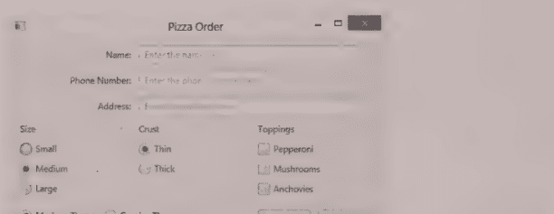

图 12-1：在 Modena 和 Caspian 主题下显示的 Java 应用程序。


要切换应用程序的主题，请使用 `Application` 类的 `setUserAgentStylesheet()` 方法。`Application` 类定义了两个静态字段，可以使用它们来引用内置样式：`STYLESHEET_MODENA` 和 `STYLESHEET_CASPIAN`。因此，要将 Caspian 设置为样式表，使用此语句：

```
Application.setUserAgentStylesheet(STYLESHEET_CASPIAN);
```

由于创建图 12-1 所示屏幕的程序与第 11 章列表 11-2 中介绍的披萨订单应用程序相同，因此我没有完整地复制它。披萨订单应用程序唯一的显著添加是定义场景左下角两个单选按钮的代码：


```java
ToggleGroup groupTheme = new ToggleGroup();

RadioButton rdoModena =
    new RadioButton("Modena Theme");
rdoModena.setToggleGroup(groupTheme);
rdoModena.setSelected(true);
rdoModena.setOnAction(e ->
{
    setUserAgentStylesheet(STYLESHEET_MODENA);
});

RadioButton rdoCaspian =
    new RadioButton("Caspian Theme");
rdoCaspian.setToggleGroup(groupTheme);
rdoCaspian.setOnAction(e ->
{
    setUserAgentStylesheet(STYLESHEET_CASPIAN);
});
```

`HBox paneTheme = new HBox(10, rdoModena, rdoCaspian);`

如你所示，这创建了两个单选按钮，其动作事件处理器将主题设置为 Modena 或 Caspian。这些单选按钮被添加到 `ToggleGroup` 和 `HBox` 中。在程序的后续部分，`HBox` 被添加到 `GridPane` 布局中，以显示在场景的左下角。

### 为场景添加样式表

如果你愿意，可以创建一个样式表来用自己的主题替换 Modena 或 Caspian 主题，从而为你的应用程序创建一个完全不同的外观和感受。然后，你可以像上一节描述的那样，使用 `Application.setUserAgentStylesheet` 将你的样式表作为应用程序的默认样式表。

然而，创建一个适用于应用程序的全新主题可能是一项困难的任务，因为你的样式表必须为每个可能的可以格式化的节点元素提供样式信息。相反，你可能想从创建一个较小的样式表开始，仅为应用程序的特定需求提供格式信息。然后，你可以将样式表应用于特定的场景或场景中的单个节点。

## 第三部分：增强你的场景设计

当你将样式表应用于场景时，该默认样式表中包含的任何样式都将覆盖应用程序样式表中任何相应的样式。同样，如果你将样式表应用于特定节点，则该样式表中的样式将覆盖应用于场景样式表中的任何相应的样式。


你可以根据需要创建任意数量的样式表，将不同的样式表应用于场景不同的父节点。然而，你会发现，如果坚持仅使用应用于场景层级的样式表，管理你的样式并保持一致性会变得更容易。

应用于场景或父节点的样式表实际上是一个以 `.css` 为扩展名的独立文件。样式表包含格式化规则，这些规则为你想要对应用程序进行的格式化提供了细节。

你可以在本章后面的“创建样式表”部分读到有关创建样式表的详细信息。现在，我介绍一个名为 `Simple.css` 的非常简单的样式表，它指定了文本使用的字体和背景颜色。`Simple.css` 样式表由以下行组成：

```css
.root {

  -fx-background-color: lightgray;

  -fx-font-family: serif;

  -fx-font-size: 12pt;

}
```

第一行指定大括号之间的格式化将应用于整个场景图。然后，在大括号内部，使用了三个格式化规则来指定背景颜色应为浅灰色，字体应为衬线字体（serif），字体大小应为 12 点。

向场景添加样式表最简单的方法是获取场景的样式表集合（场景可以有多个样式表），使用 `add` 方法添加样式表，如下：

```java
scene.getStylesheets().add("Simple.css");
```


为了保持书中的代码示例简单，本章的其余示例将使用前一个示例所示的简单技术。然而，仅将样式表名称作为 `add` 方法代码的参数仅在样式表文件与应用程序类文件位于相同文件夹时才起作用。如果样式表位于其他地方，请使用以下代码：

## 第 12 章：使用 CSS 为你的应用程序换肤

```java
scene.getStylesheets().add(
  getClass().getResource("Simple.css").toExternalForm());
```

而不是将样式表名称作为参数，这将调用 `getClass` 方法，该样式表位于应用程序的路径。然后，它调用 `getResource` 方法，返回 `Simple.css` 文件的 URL。最后，`toExternalForm` 方法接受 `getStylesheets` 方法。

图 12-2 的左侧显示了带有 `Simple.css` 的 Java 应用程序，右侧显示了没有 `Simple.css` 的应用程序。它将背景颜色更改为深程度的灰色。

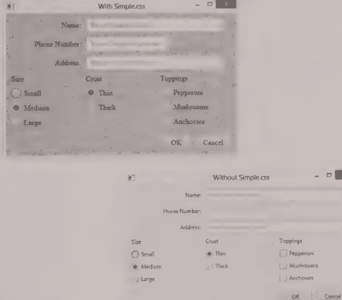，你可以看到，样式表将背景颜色更改为浅灰色，并将字体更改为衬线字体（Times New Roman）。


图 12-2：带有 Simple.css 样式表的 Java 应用程序。

## 第三部分：增强你的场景设计

### 内联样式

除了使用 `.css` 样式表文件外，JavaFX 还允许你通过调用节点的 `setStyle` 方法并将格式规则作为字符串直接应用于场景中的任何节点。例如，下面的示例将按钮的字体设置为 15 点：


作为一个一般原则，我建议在特殊情况下使用内联样式。这是因为内联样式使得更改应用程序的用户界面变得更加困难。如果你对所有样式元素使用内联样式，那么即使只想进行简单的更改，也要搜索整个应用程序代码以找到需要更改的内联样式。然后，你需要重新编译程序。

相比之下，外部样式表让更改 GUI 变得容易。

### 创建样式表

现在已经知道如何将样式应用于应用程序、场景或单个节点，现在可以将注意力转向创建样式的任务了。正如我之前提到的，样式表是一个以 `.css` 扩展的简单文本文件。你可以使用任何标准文本编辑器创建样式表，包括功能齐全的开发工具（如 Eclipse 或 NetBeans）以及简单的文本编辑器（如 TextPad 或 Notepad）。`.css` 文件位于应用程序类所在的文件夹中。

样式表由一个或多个样式规则组成，这些规则决定了应用于场景中各种元素的格式。每个样式规则由一个选择器（确定规则适用于哪些元素）组成，随后跟着一个声明块（包含在一对括号内的样式声明列表）。每个声明由一个属性名称、后跟一个冒号和一个值组成。每个声明都以分号结束。

### 使用类型选择器

最常用的选择器类型是类型选择器；它对应于 JavaFX 节点类型，例如 `Button` 或 `TextField`。类型选择器以点开头，后跟样式类名，这与所有 JavaFX 节点类型相关。（注意：style class 和 style type 术语可以互换。）

对于控件，样式类的名称与相应的 JavaFX 类名称相似。要将 JavaFX 类名转换为 CSS 类名，请使用全小写字母，如果 JavaFX 类名包含两个或多个单词，则在单词之间使用连字符。以下列表包含了到本书为止介绍的大多数 JavaFX 类的 CSS 样式类名。

| JavaFX 类 | CSS 样式类 |
|---|---|
| Button | button |
| CheckBox | check-box |
| ChoiceBox | choice-box |
| ComboBox | combo-box |
| Label | label |
| ListCell | list-cell |
| ListView | list-view |
| Menu | menu |
| MenuBar | menu-bar |
| MenuButton | menu-button |
| MenuItem | menu-item |
| RadioButton | radio-button |
| Separator | separator |
| TableView | table-view |
| TextField | text-field |
| ToggleButton | toggle-button |
| Tooltip | tooltip |
| TreeCell | tree-cell |
| TreeView | tree-view |

### 创建自己的样式类名

每个节点都有一个 `getStyleClass` 方法，它返回一个样式类名的可观察列表。因此，给定的节点可以有多个样式类名。对于具有复杂格式要求的场景，这非常有用，因为它允许你为了格式化目的将控件分组。例如，如果你想让一组按钮的格式与另一组按钮不同，可以为按钮创建额外的类名。

例如，假设你想将某些按钮的字体设置为 16 磅（points）。你可以通过在样式表中创建一个名为 `button-large` 的样式类型来实现，如下所示：

```css
.button-large {

  -fx-font-size: 16pt;

}
```

然后，你可以将 `button-large` 样式类添加到想要用大字号格式化的按钮的样式类列表中。例如：

```java
Button btn1 = new Button("Wow!");

btn1.getStyleClass().add("button-large");
```

当一个节点有多个样式类名时，在匹配样式表中的选择器时，将使用所有类名。换句话说，拥有 `button-large` 额外类名的按钮将同时匹配 `button` 和 `button-large` 的样式规则。

注意：对于许多 JavaFX 节点，默认样式类集合是空的。对于布局窗格（如 `HBox` 和 `BorderPane`），它们没有默认样式类，也没有像 `Rectangle` 或 `Circle` 这样的形状类。如果你想使用样式类型对这些节点之一应用 CSS 样式，必须调用 `getStyleClass().add` 为该节点创建一个样式类名。

### 使用 ID 选择器

如果你想创建一个仅适用于场景图中一个且仅一个节点的样式，你可以通过调用节点的 `setId` 方法为该节点指定一个唯一的 id，如下：

```java
Button btnOK = new Button("OK");

btnOK.setId("btn-wow");
```

然后，你可以创建一个仅应用于 id 为 `btn-wow` 的节点的样式规则。在选择器中，你必须用哈希标记（#）前缀 id，如下：

```css
#btn-wow {

  -fx-font-weight: bold;

}
```

哈希标记 (#) 不用于 `setId` 方法来创建 id，但在样式表中是必须的。

节点 id 在整个场景图中必须是唯一的。换句话说，你不能创建两个相同 id 的节点。遗憾的是，JavaFX 并不强制执行此点，因此确保你的节点 id 是唯一的取决于你。


### 使用多个选择器

样式选择器可以列出多个样式类型或 id。要这样做，你将所有类型或 id 作为选择器的一部分，并用逗号隔开。例如，这里有一个应用于所有按钮、单选按钮和复选框的样式：

```css
.button, .radio-button, .check-box {

  -fx-font-family: "serif";

}
```

这是一个包含多个 id 的示例：

```css
#btn1, #btn2, #btn3, #btn4 {

  -fx-fill: GREEN;

}
```

### 指定样式属性

在样式规则的声明块中，每个声明都指定了一个样式属性和一个值。例如，要将字体大小设置为 12 磅，使用 `-fx-font-size` 作为属性名，使用 `12pt` 作为值。总共存在数百个样式属性。然而，并非所有属性适用于所有节点类型。因此，JavaFX 属性以 `-fx-` 开头。

### 指定字体属性

对于显示文本的节点，可以使用表 12-1 所示的属性。

| 属性 | 样式 |
|---|---|
| -fx-font-family | 字体名称：serif, sans-serif, cursive 或 monospace。 |
| -fx-font-size | 数字后跟单位，通常是磅 (pt) 或像素 (px)。 |
| -fx-font-style | normal, italic 或 oblique。 |
| -fx-font-weight | normal, bolder, lighter。 |

以下章节描述了一些常用的颜色属性：

- **命名颜色**：JavaFX 定义了命名颜色，包括黑色、白色、橙色、蓝色等。例如：
```css
-fx-background-color: red;
```
- **RGB 颜色**：以十六进制表示颜色。这通常以哈希值开头，如下：
```css
-fx-background-color: #f5f5f5;
```
- **渐变**：允许你指定从一种颜色到另一种颜色的渐变。有关渐变的信息请参阅第 13 章。
- **查找颜色 (Lookup color)**：查找颜色允许你在样式表的 `.root` 部分定义一组颜色名称，然后在样式表的其他地方引用该颜色。你可以为颜色创建任何名称，只要它不与 JavaFX 属性冲突。例如：
```css
.root {

  my-color: aliceblue;

}

.button {

  -fx-background-color: my-color;

}
```

### 指定背景颜色

`Region` 类有一个名为 `-fx-background-color` 的属性，允许指定颜色。由于 Layout 和 Control 都继承自 `Region`，你可以将其应用于任何布局窗格。


要为布局窗格应用背景颜色，你必须先为布局窗格指定类名或 id，以便在选择器中引用它。

### 指定边框属性

`Region` 类还具有几种创建边框的样式属性。这些属性允许你为布局窗格添加边框，或添加或更改控件的边框。表 12-2 列出了边框样式属性。

| 表 12-2 | 边框样式属性 |
| 属性 | 值 |
| -fx-border-width | 数字后跟测量单位，通常以像素 (px) 表示。 |
| -fx-border-style | none, solid, dotted 或 dashed。 |
| -fx-border-color | 一种颜色 |

例如，以下样式规则为名为 `bordered` 的样式类应用虚线边框：

```css
.bordered {

  -fx-border-width: 4px;

  -fx-border-color: black;

  -fx-border-style: dashed;

}
```


# 第 13 章：绘制形状

## 本章内容

- 创建基本形状，如线条、矩形、圆形和椭圆
- 创建透明形状
- 创建渐变填充
- 形状的旋转、平移和缩放
- 绘制某些文本
- 使用并集、交集和减法操作组合形状

你小时候是否也曾那群孩子之一，在无聊的代数课上，通过在书本页边上涂鸦来度过枯燥的时光？如果是的话，那么你走运了。现在你已经成年，并且正在精通 JavaFX 编程，你不必在书上涂鸦了。相反，你可以编写在屏幕上“涂鸦”的程序。

本章简要介绍了 JavaFX 中迷人的绘图世界。具体来说，你将学习如何绘制二维对象，如线条、矩形、椭圆等。你可以设置用于绘制形状轮廓的样式，并可以使用实色、渐变填充或从图像创建的文本来填充形状。你可以让形状变为实心或透明，并对它们进行旋转、剪切、倾斜以及各种无法言喻的操作。

## 介绍 Shape 类

到本书为止，你已经读过两种可以添加到场景图中的节点类型：继承 `Control` 类的控件，以及继承 `Pane` 类的布局面板。在本节中，你将学习如何处理第三种节点：形状，正如你可能猜到的，它们继承自 `Shape` 类。表 13-1 列出了 `Shape` 类的一些最常用方法。

### 表 13-1 Shape 类常用方法

| 方法 | 说明 |
| --- | --- |
| `void setFill(Paint value)` | 设置填充颜色。 |
| `void setSmooth(boolean value)` | 如果为 true，则使用抗锯齿算法更精确地绘制形状。 |
| `void setStroke(Paint value)` | 设置用于绘制形状轮廓的描边颜色。 |
| `void setStrokeWidth(double value)` | 设置绘制形状轮廓的描边宽度。 |
| `void setStrokeType(StrokeType value)` | 设置描边相对于形状实际轮廓的位置。允许的值为 `StrokeType.CENTERED`、`StrokeType.OUTSIDE` 和 `StrokeType.INSIDE`。 |
| `void setStrokeLineJoin(StrokeLineJoin value)` | 设置绘制转角的方法。允许的值为 `StrokeLineJoin.MITER`、`StrokeLineJoin.BEVEL` 和 `StrokeLineJoin.ROUND`。 |
| `void setStrokeLineCap(StrokeLineCap value)` | 设置绘制线条末端的方法。允许的值为 `StrokeLineCap.BUTT`、`StrokeLineCap.ROUND` 和 `StrokeLineCap.SQUARE`。 |
| `static Shape intersect(Shape shape1, Shape shape2)` | 返回一个仅包含 shape1 和 shape2 重叠部分的新形状。 |
| `static Shape subtract(Shape shape1, Shape shape2)` | 返回一个通过从 shape1 中减去 shape2 形成的新形状。 |
| `static Shape union(Shape shape1, Shape shape2)` | 返回一个通过将 shape1 添加到 shape2 形成的新形状。 |

共有 12 种继承 `Shape` 类的形状：`Arc`、`Circle`、`CubicCurve`、`Ellipse`、`Line`、`Path`、`Polygon`、`Polyline`、`QuadCurve`、`Rectangle`、`SVGPath` 和 `Text`。表 13-2 显示了这些类的基本构造函数，图 13-1 显示了一个包含其中示例形状的场景。创建此图的代码在本章稍后部分的代码清单 13-1 中给出。

### 表 13-2 十二种形状类构造函数

| 构造函数 | 说明 |
| --- | --- |
| `Arc(double centerX, double centerY, double radiusX, double radiusY, double startAngle, double length)` | 创建一个弧，它是由前四个参数定义的椭圆的一部分。`startAngle` 是弧起点的角度（度），`length` 是弧的角跨度（度）。`Arc` 类还包含一个名为 `setType` 的方法，允许你设置弧的类型。允许的值为 `ArcType.CHORD`、`ArcType.OPEN` 和 `ArcType.ROUND`。 |
| `Circle(double centerX, double centerY, double radius)` | 创建一个具有指定中心点和半径的圆。 |
| `CubicCurve(double startX, double startY, double controlX1, double controlY1, double controlX2, double controlY2, double endX, double endY)` | 创建具有指定起点、终点和指定控制点的曲线。 |
| `Ellipse(double centerX, double centerY, double radiusX, double radiusY)` | 创建一个椭圆，`centerX` 和 `centerY` 指定椭圆的中心点。`radiusX` 指定椭圆的水平半径，`radiusY` 指定垂直半径。 |
| `Line(double startX, double startY, double endX, double endY)` | 创建一条具有指定起点和终点的线条。 |
| `Path(PathElement... elements)` | 创建一个具有指定元素的路径。 |
| `Polygon(Double... points)` | 创建一个以指定的 x, y 点为顶点的多边形。 |
| `Polyline(Double... points)` | 创建一个具有指定的 x, y 点的折线。 |
| `QuadCurve(double startX, double startY, double controlX, double controlY, double endX, double endY)` | 创建一个具有指定起点、终点和指定控制点的二次曲线。 |
| `Rectangle(double x, double y, double width, double height)` | 创建具有指定左上角坐标、宽度和高度的矩形。 |
| `SVGPath()` | 创建一个 SVG 路径。 |
| `Text(double x, double y, String text)` | 在指定的 x, y 位置创建文本。 |

## 线条

最基本的形状类型是线条。要创建线条，你需要指定起点和终点。以下是图 13-1 所示线条的代码：

```java
Line line = new Line(0, 0, 100, 100);
```

线条从 (0,0) 到 (100,100)。

循环从 0 到 600，步长为 10。在循环的每次迭代中创建了两条线条：一条使用变量 `i` 作为 x 轴，另一条使用变量 `i` 作为 y 轴。线条的描边颜色设置为浅灰色，然后将它们添加到名为 `group1` 的组中。

```java
for (int i = 0; i < 600; i += 10) {
    Line line1 = new Line(i, 0, i, 600);
    line1.setStroke(Color.LIGHTGRAY);
    Line line2 = new Line(0, i, 600, i);
    line2.setStroke(Color.LIGHTGRAY);
    group1.getChildren().addAll(line1, line2);
}
```

## 矩形

矩形需要一个 (x, y) 起点、宽度和高度。以下是创建图 13-1 所示第一个矩形的代码：

```java
Rectangle rect1 = new Rectangle(50, 25, 100, 140);
rect1.setStroke(Color.BLACK);
rect1.setFill(null);
rect1.setStrokeWidth(3);
```

这里矩形起始于 (50, 25)。宽度为 100，高度为 140。注意填充颜色设置为 `null`，以便矩形是透明的。

通过调用 `setArcWidth` 和 `setArcHeight` 方法可以创建圆角矩形。以下是图 13-1 第一行形状中间的圆角矩形：

```java
Rectangle rect2 = new Rectangle(250, 25, 100, 140);
rect2.setStroke(Color.BLACK);
rect2.setFill(null);
rect2.setStrokeWidth(3);
rect2.setArcWidth(25);
rect2.setArcHeight(25);
```

这里，圆角是由高度和宽度均为 25 的弧形成的。

你可以使用弧的宽度和高度的不相等值来创建一些有趣的形状。对于图 13-1 第一行的第三个形状，弧宽设置为 75，高度设置为 125：

```java
Rectangle rect3 = new Rectangle(450, 25, 100, 140);
rect3.setStroke(Color.BLACK);
rect3.setFill(null);
rect3.setStrokeWidth(3);
rect3.setArcWidth(75);
rect3.setArcHeight(125);
```

## 创建圆和椭圆

要创建一个圆，你使用 `Circle` 类，并指定圆心的 x 坐标、y 坐标以及半径。以下是创建图 13-1 中圆的代码：

```java
Circle c1 = new Circle(100, 300, 75);
c1.setStroke(Color.BLACK);
c1.setFill(null);
c1.setStrokeWidth(3);
```

椭圆与圆相似，但它有两个半径：一个在 x 轴上，另一个在 y 轴上。你在构造函数中指定这两个半径。以下是创建图 13-1 中第一个椭圆的代码：

```java
Ellipse e1 = new Ellipse(300, 300, 75, 40);
e1.setStroke(Color.BLACK);
e1.setFill(null);
e1.setStrokeWidth(3);
```

第二个椭圆类似，但 x 半径和 y 半径互换了：

```java
Ellipse e2 = new Ellipse(300, 300, 40, 75);
```

## 创建弧

另一种有用的形状是弧，它是椭圆的一部分。要创建一个弧，你需要提供椭圆的参数，然后提供弧开始的角度：0 是正东（时钟面上的 3:00 位置）。最后，你提供长度，它代表弧跨越的范围，同样以度为单位。

需要知道的重要点是，弧从起点开始逆时针方向移动。如果你将 90 设置为起点并将 90 设置为跨度，则弧将从 12:00 移动到 9:00，如图 13-1 中第三行的第一个形状所示。

JavaFX 可以创建三种类型的弧，你可以通过 `setType` 方法来指定类型：

- `ArcType.OPEN`：表示你想绘制弧本身。
- `ArcType.CHORD`：意味着你想绘制弧，然后用直线连接两端以创建一个闭合形状。
- `ArcType.ROUND`：意味着你想用直线将端点连接到椭圆中心，从而创建一个看起来像饼块的形状。


以下是创建图 13-1 中第一个弧的示例：

```java
Arc a1 = new Arc(150, 550, 100, 100, 90, 90);
a1.setType(ArcType.OPEN);
a1.setStroke(Color.BLACK);
a1.setFill(null);
a1.setStrokeWidth(3);
```

第二个弧通过这些语句创建：

```java
Arc a2 = new Arc(300, 550, 100, 100, 45, 90);
a2.setType(ArcType.CHORD);
a2.setStroke(Color.BLACK);
a2.setFill(null);
a2.setStrokeWidth(3);
```

最后，第三个弧通过这些语句创建：

```java
Arc a3 = new Arc(500, 550, 100, 100, 45, 90);
a3.setType(ArcType.ROUND);
a3.setStroke(Color.BLACK);
a3.setFill(null);
a3.setStrokeWidth(3);
```

## 查看 ShapeMaker 程序

现在你已经了解了如何创建各种形状，准备好查看代码清单 13-1 了，它绘制了本章前面图 13-1 所示的形状。

### 代码清单 13-1：ShapeMaker 程序

```java
import javafx.application.*;
import javafx.stage.*;
import javafx.scene.*;
import javafx.scene.shape.*;
import javafx.scene.paint.*;

public class ShapeMaker extends Application {
    public static void main(String[] args) {
        launch(args);
    }

    @Override
    public void start(Stage primaryStage) {
        Group group1 = new Group();

        // 背景网格
        for (int i = 0; i < 600; i += 10) {
            Line line1 = new Line(i, 0, i, 600);
            line1.setStroke(Color.LIGHTGRAY);
            Line line2 = new Line(0, i, 600, i);
            line2.setStroke(Color.LIGHTGRAY);
            group1.getChildren().addAll(line1, line2);
        }

        // 一个矩形
        Rectangle r1 = new Rectangle(50, 25, 100, 140);
        r1.setStroke(Color.BLACK);
        r1.setFill(null);
        r1.setStrokeWidth(3);
        group1.getChildren().add(r1);

        // 一个圆角矩形
        Rectangle r2 = new Rectangle(250, 25, 100, 140);
        r2.setStroke(Color.BLACK);
        r2.setFill(null);
        r2.setStrokeWidth(3);
        r2.setArcWidth(25);
        r2.setArcHeight(25);
        group1.getChildren().add(r2);

        // 另一个圆角矩形
        Rectangle r3 = new Rectangle(450, 25, 100, 140);
        r3.setStroke(Color.BLACK);
        r3.setFill(null);
        r3.setStrokeWidth(3);
        r3.setArcWidth(75);
        r3.setArcHeight(25);
        group1.getChildren().add(r3);

        // 一个圆
        Circle c1 = new Circle(100, 300, 75);
        c1.setStroke(Color.BLACK);
        c1.setFill(null);
        c1.setStrokeWidth(3);
        group1.getChildren().add(c1);
    }
}
```


// 代码列表 13-1（继续）
// 一个椭圆
`Ellipse e1 = new Ellipse(300, 75, 30, 40);`
`e1.setStroke(Color.BLACK);`
`e1.setFill(null);`
`e1.setStrokeWidth(3);`
`group1.getChildren().add(e1);`
// 另一个椭圆
`Ellipse e2 = new Ellipse(500, 300, 40, 75);`
`e2.setStroke(Color.BLACK);`
`e2.setFill(null);`
`e2.setStrokeWidth(3);`
`group1.getChildren().add(e2);`
// 一个开口弧
`Arc a1 = new Arc(150, 550, 100, 90, 90);`
`a1.setType(ArcType.OPEN);`
`a1.setStroke(Color.BLACK);`
`a1.setFill(null);`
`a1.setStrokeWidth(3);`
`group1.getChildren().add(a1);`
// 一个弦形弧
`Arc a2 = new Arc(300, 550, 100, 100, 45, 90);`
`a2.setType(ArcType.CHORD);`
`a2.setStroke(Color.BLACK);`
`a2.setFill(null);`
`a2.setStrokeWidth(3);`
`group1.getChildren().add(a2);`
// 一个圆弧
`Arc a3 = new Arc(500, 500, 100, 100, 45, 90);`
`a3.setType(ArcType.ROUND);`
`a3.setStroke(Color.BLACK);`
`a3.setFill(null);`
`a3.setStrokeWidth(3);`
`group1.getChildren().add(a3);`

// 创建场景和舞台
`Scene scene = new Scene(group1);`
`primaryStage.setScene(scene);`
`primaryStage.setTitle("Shape Maker");`
`primaryStage.show();`
}

## 花哨的填充

如果你一直跟到这里，你已经看到可以通过调用形状的 `setFill` 方法并指定 `Color` 来为形状填充纯颜色，例如：

```
Rectangle r1 = new Rectangle(0,0,100,100);
r1.setFill(Color.RED);
```

在这里矩形被填充为红色。

你已经看到可以通过设置填充颜色创建一个完全透明的对象。代码列表 13-1 中的 ShapeMaker 程序使用了 `null` 填充，以便网格透出来。

然而，填充不仅仅限于纯颜色。在接下来的章节中，你将学习如何创建部分透明填充以及从一种颜色渐变为另一种颜色的填充。

## 透明绘制

JavaFX 允许通过设置颜色的不透明度（opacity）值来创建透明颜色。不透明度值为 1.0 表示颜色完全不透明，而 0.0 则意味着颜色完全透明。要创建部分透明颜色，你将不透明度设置在 0.0 到 1.0 之间的某个地方。

有几种方法可以实现，但最简单的是使用 `Color` 类的静态方法之一根据其组成部分创建颜色。对于这里的用途，我们使用 `rgb` 方法，它接受四个参数：三个表示颜色红、绿、蓝分量的整数（值范围 0 到 255），以及表示不透明度的双精度浮点数。

例如，要创建一个 50% 透明的黑色，你可以像这样使用 `rgb` 方法：

```
Color.rgb(0, 0, 0, 0.5);
```

创建一个 20% 透明的红色，使用这个：

```
Color.rgb(255, 0, 0, 0.2);
```

图 13-2 显示了一个包含三个矩形的场景，其中两个应用了透明效果。下面的代码片段显示了创建这三个矩形的代码：

```
Rectangle r1 = new Rectangle(0,75,350,40);
r1.setStroke(Color.BLACK);
r1.setFill(Color.rgb(200, 200, 200, 1.0));
r1.setStrokeWidth(3);

Rectangle r2 = new Rectangle(50,5,100,200);
r2.setStroke(Color.BLACK);
r2.setFill(Color.rgb(200, 200, 200, 0.5));
r2.setStrokeWidth(3);

Rectangle r3 = new Rectangle(200,5,100,200);
r3.setStroke(Color.BLACK);
r3.setFill(Color.rgb(200, 200, 200, 0.5));
r3.setStrokeWidth(3);
```

如所示，这三个矩形都通过使用值 200、200 和 200 作为红、绿、蓝颜色分量指定了灰色。第一个矩形的不透明度指定为 1.0；另外两个指定为 0.5。结果是你可以看到第一个矩形在另外两个矩形的后面。

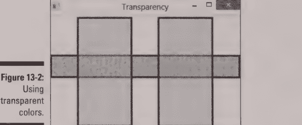

## 使用渐变填充

除了使用颜色，你可以指定渐变填充，在形状上均匀混合颜色。JavaFX 提供了两个类来处理渐变：`LinearGradient` 和 `RadialGradient`。

线性渐变是从两个点创建的。想象在这些点之间画出一条线。渐变填充从第一个点设置的颜色平滑过渡到第二个点设置的颜色。然后，它扩展与线成 90 度角的延伸线上的颜色，以填充整个区域。

径向渐变是由中心点的一个颜色和圆周上的第二种颜色创建的。填充颜色从中心颜色到外部颜色发生平滑的变化。

表 13-3 显示了 `LinearGradient` 和 `RadialGradient` 类的构造函数，以及 `Stop` 类的构造函数，后者用于指定渐变中使用的颜色。

| 类构造函数 | 描述 |
| --- | --- |
| `LinearGradient(double startX, double startY, double endX, double endY, boolean proportional, CycleMethod cycleMethod, Stop... stops)` | 创建一个线性渐变。`stops` 沿着由起点和终点定义的直线出现。`cycleMethod` 可以是 `CycleMethod.NO_CYCLE`、`CycleMethod.REPEAT` 或 `CycleMethod.REFLECT`。 |
| `RadialGradient(double focusAngle, double focusDistance, double centerX, double centerY, double radius, boolean proportional, CycleMethod cycleMethod, Stop... stops)` | 创建径向渐变。停止点是圆形的，从渐变的中心点开始延伸到半径。`focusAngle` 通常设置为零。 |

### 表 13-3（续）

| 类构造函数 | 描述 |
|--- |--- |
| `Stop(double offset, Color color)` | 定义渐变上的一个颜色停止点。`offset` 是一个范围从 0.0 到 1.0 的双精度浮点数。对于线性渐变，0.0 代表渐变的起点，1.0 代表终点。对于径向渐变，0.0 代表中心，1.0 代表半径。 |

使用这些构造函数时使用的几个参数值得稍微解释一下：

- **Proportional（比例）**：此参数决定了线性渐变的起点和终点（或圆形中心点和半径）的测量单位。如果此参数为 `false`，则坐标以像素表示。如果为 `true`，则坐标范围在 0.0 到 1.0 之间，并与填充形状的大小成正比。在大多数情况下，使用比例坐标更容易操作，因此此参数应设置为 `true`。

- **Cyclical（循环）**：默认情况下渐变从一种颜色开始，过渡到另一种颜色，然后结束。然而，你可以使用 `NO_CYCLE` 以外的循环方法创建重复循环颜色的渐变。如果你指定 `REPEAT`，渐变会在每个循环中重复自身。如果你指定 `REFLECT`，渐变会在每个循环中反转停止点的顺序。

- **Stop offset（停止点偏移）**：停止点代表用于渐变过渡的颜色。停止点的 `offset` 参数决定了停止点出现在渐变的沿何位置。值 0.0 意味着停止点出现在线性渐变的起点或径向渐变的中心处。值 1.0 意味着停止点出现在线性渐变的终点或径向渐变的半径处。

所有渐变都必须至少有两个停止点，一个在起点或中心，另一个在终点或半径处。然而，你可以通过添加额外的停止点来创建更复杂的渐变。在这种情况下，停止点偏移代表沿渐变长度的比例位置。例如，0.5 的停止点偏移将停止点放置在渐变线或半径的中心。

此外，起点和终点停止点并不非要位于偏移 0.0 或 1.0 处。例如，如果你不想在颜色过渡开始之前在渐变的两端都有一点纯色，你可以指定 0.2 和 0.8 作为起点和终点停止点偏移。

此示例创建了一个颜色从洋红色到黄色的渐变填充：

```
LinearGradient gradient1 = new LinearGradient(0, 0, 0, 1, true, CycleMethod.NO_CYCLE, new Stop(0.0, Color.WHITE), new Stop(1.0, Color.BLACK));
```

表 13-4 显示了用 `LinearGradient` 类创建的五个渐变填充示例以及用 `RadialGradient` 类创建的两个径向渐变。每个矩形都是 100 x 100 像素。该表还显示了用于创建每个填充的代码。

| 表 13-4 | 七种渐变填充 |
| --- | --- |
| | `LinearGradient gradient1 = new LinearGradient(0, 0, 0, 1, true, CycleMethod.NO_CYCLE, new Stop(0.0, Color.WHITE), new Stop(1.0, Color.BLACK));` |
| | `LinearGradient gradient2 = new LinearGradient(0, 0, 1, 0, true, CycleMethod.NO_CYCLE, new Stop(0.0, Color.WHITE), new Stop(1.0, Color.BLACK));` |
| | `LinearGradient gradient3 = new LinearGradient(0, 1, 1, 0, true, CycleMethod.NO_CYCLE, new Stop(0.4, Color.WHITE), new Stop(0.6, Color.BLACK));` |


```
LinearGradient gradient4 =
new LinearGradient(0, 0, 0, 0.2, true, CycleMethod.REPEAT, new Stop(0.0, Color.WHITE), new Stop(1.0, Color.BLACK));
```


```
LinearGradient gradient5 =
new LinearGradient(0, 0, 0, 0.2, true, CycleMethod.REFLECT, new Stop(0.0, Color.WHITE), new Stop(1.0, Color.BLACK));
```


```
LinearGradient gradient6 =
new RadialGradient(0, 0, 0, 0.2, true, CycleMethod.REFLECT, new Stop(0.0, Color.WHITE), new Stop(1.0, Color.BLACK));
```


```
RadialGradient gradient7 =
new RadialGradient(0, 0, 0, 0.5, true, CycleMethod.NO_CYCLE, new Stop(0.0, Color.WHITE), new Stop(1.0, Color.BLACK));
```


此外，起点和终点停止点并不非要位于偏移 `0.0` 或 `1.0` 处。例如，如果你不想在颜色过渡开始之前在渐变的两端都有一点纯色，你可以指定 `0.2` 和 `0.8` 作为起点和终点停止点偏移。

此示例创建了一个颜色从洋红色到黄色的渐变填充：

```java
GradientPaint gp =
new GradientPaint(0, 0, Color.MAGENTA,
    0, 100, Color.YELLOW);
```

表 13-4 显示了用 `LinearGradient` 类创建的五个渐变填充示例以及用 `RadialGradient` 类创建的两个径向渐变。每个矩形都是 100 x 100 像素。该表还显示了用于创建每个填充的代码。

| 表 13-4 | 七种渐变填充 |
| --- | --- |
| | `LinearGradient gradient1 = new LinearGradient(0, 0, 0, 1, true, CycleMethod.NO_CYCLE, new Stop(0.0, Color.WHITE), new Stop(1.0, Color.BLACK));` |
| | `LinearGradient gradient2 = new LinearGradient(0, 0, 1, 0, true, CycleMethod.NO_CYCLE, new Stop(0.0, Color.WHITE), new Stop(1.0, Color.BLACK));` (续) |
| | `LinearGradient gradient3 = new LinearGradient(0, 1, 1, 0, true, CycleMethod.NO_CYCLE, new Stop(0.4, Color.WHITE), new Stop(0.6, Color.BLACK));` |


```java
LinearGradient gradient4 =
new LinearGradient(0, 0, 0, 0.2, true, CycleMethod.REPEAT, new Stop(0.0, Color.WHITE), new Stop(1.0, Color.BLACK));
```


```java
LinearGradient gradient5 =
new LinearGradient(0, 0, 0, 0.2, true, CycleMethod.REFLECT, new Stop(0.0, Color.WHITE), new Stop(1.0, Color.BLACK));
```


```java
RadialGradient gradient6 =
new RadialGradient(0, 0, 0, 0.2, true, CycleMethod.REFLECT, new Stop(0.0, Color.WHITE), new Stop(1.0, Color.BLACK));
```


```java
RadialGradient gradient7 =
new RadialGradient(0, 0, 0, 0.5, true, CycleMethod.NO_CYCLE, new Stop(0.0, Color.WHITE), new Stop(1.0, Color.BLACK));
```


```java
RadialGradient gradient7 =
new RadialGradient(0, 0, 0, 0., true, CycleMethod.REFLECT, new Stop(0.0, Color.WHITE), new Stop(1.0, Color.BLACK));
```

### Translating, Scaling, and Rotating

This section describes several methods of the `Node` that are especially useful:

### Drawing Text

You can use the `Text` class to draw the text contained in a string. A `Text` object is similar to a `Label` object, but with one major difference: A `Text` object is a `Shape`, whereas a `Label` is a `Control`. Because a text object is a shape, you can format it using any of the methods that apply to shapes. For example, you can apply an outline color to a shape and fill it with a gradient or set the fill color to null.

The `Text` constructor accepts three parameters: the string to be drawn and the x- and y-coordinates of the bottom-left corner of the first character to be drawn (technically speaking, the start of the baseline for the text). Here's an example:

```java
text1 = new Text("Hello, World!", 100, 50);
```

Here is the string "Hello, World!" drawn at point (100, 50).

You can change the font by calling the `setFont` method, which accepts a `Font` object. The `Font` class accepts a string value that represents the font name and size. Here's how to set the font to 60-point Times New Roman:

```java
text1.setFont(new Font("Times New Roman", 60));
```

The following example shows how a `Shape` can be formatted with an outline stroke and a gradient fill:

```java
LinearGradient gradient1 =
new LinearGradient(0, 0, 1, true, CycleMethod.NO_CYCLE, new Stop(0.2, Color.WHITE), new Stop(0.8, Color.BLACK));
```

```java
text1 = new Text(100, 300, "Hello, World!");
text1.setFont(new Font("Times New Roman", 200));
text1.setStroke(Color.BLACK);
text1.setStrokeWidth(2);
text1.setFill(gradient1);
```

Figure 13-4 shows how this text object appears when displayed in a scene.

## 第三部分：增强你的场景设计

### 组合形状

本章的最后一个主题是使用 `Shape` 类的三种方法，这些方法允许你通过各种组合方式来创建复杂的形状。这些方法是：

- `intersect`：接受两个形状并返回一个仅包含两个形状重叠部分的新形状。
- `union`：通过将两个形状相加来将它们组合在一起。
- `subtract`：通过从一个形状中减去另一个形状来创建一个新形状。

这些方法是由 `Shape` 类定义的静态方法。每个方法接受两个形状对象，并返回一个由传入的两个形状创建的新形状对象。例如，下面的代码段使用 `union` 方法通过两个现有的形状（`shape1` 和 `shape2`）的组合创建一个新形状：

```java
Shape shape3 = Shape.union(shape1, shape2);
```

理解 `intersect`、`union` 和 `subtract` 之间区别的最佳方法是观察它们的所有操作。图 13-5 展示了这样一个示例。在左上，你可以看到两个重叠的圆。右上显示两个相似圆的并集（`union`）。左下显示两个相似圆的交集（`intersect`），右下显示两个相似圆的差集（`subtract`）。该程序的代码如列表 13-2所示所示

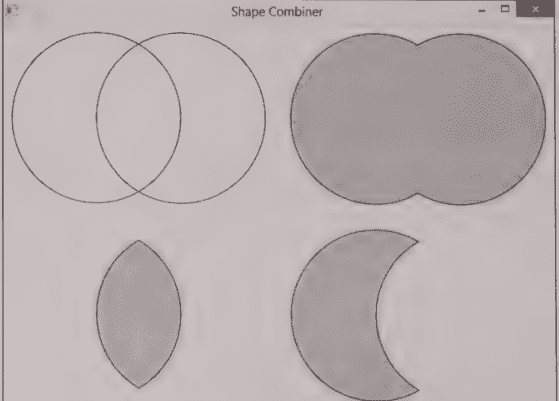

## 第13 章：绘制形状

### 列表 13-2：ShapeCombiner 程序

```java
import javafx.application.*;
import javafx.stage.*;
import javafx.scene.*;
import javafx.scene.shape.*;
import javafx.scene.paint.*;

public class ShapeCombiner extends Application
{
    public static void main(String[] args)
    {
        launch(args);
    }

    @Override
    public void start(Stage primaryStage)
    {
        Group group1 = new Group();

        Circle circle1 = new Circle(110, 110, 100);
        Circle circle2 = new Circle(210, 110, 100);
        Circle circle3 = new Circle(440, 110, 100);
        Circle circle4 = new Circle(540, 110, 100);
        Circle circle5 = new Circle(110, 340, 100);
        Circle circle6 = new Circle(210, 340, 100);
        Circle circle7 = new Circle(440, 340, 100);
        Circle circle8 = new Circle(540, 340, 100);

        Shape union = Shape.union(circle3, circle4);
        Shape intersect = Shape.intersect(circle5, circle6);
        Shape subtract = Shape.subtract(circle7, circle8);

        circle1.setFill(null);
        circle1.setStroke(Color.BLACK);

        circle2.setFill(null);
        circle2.setStroke(Color.BLACK);

        union.setStroke(Color.BLACK);
        union.setFill(Color.LIGHTGRAY);

        intersect.setStroke(Color.BLACK);
        intersect.setFill(Color.LIGHTGRAY);

        subtract.setStroke(Color.BLACK);
        subtract.setFill(Color.LIGHTGRAY);

        group1.getChildren().addAll(circle1, circle2, union,
        intersect, subtract);
        scene = new Scene(group1);
        primaryStage.setScene(scene);
        primaryStage.setTitle("Shape Combiner");
        primaryStage.show();
    }
}
```

接下来的段落描述了 Shape Combiner 程序的要点：

- → 17：创建了一个 `Group`，用于存放该程序显示的圆和复合形状。
- → 19：这些行创建了八个 `Circle` 对象，并以四组两个一组的形式布局在场景中。
- → 28：调用 `Shape.union` 方法，通过组合圆 3 和圆 4 创建一个名为 `union` 的 `Shape` 对象。
- → 29：调用 `Shape.intersect` 方法，创建一个名为 `intersect` 的 `Shape` 对象，该对象是圆 5 和圆 6 的重叠部分。
- → 30：调用 `Shape.subtract` 方法，创建一个名为 `subtract` 的 `Shape` 对象，其结果为从圆 7 中减去圆 8。
- → 32：这些行设置了圆 1 和圆 2 的描边（`stroke`）和填充（`fill`）。
- → 38：这些行设置了 `union`、`intersect` 和 `subtract` 形状的描边和填充。
- → 47：此行将圆 1、圆 2 以及 `union`、`intersect` 和 `subtract` 形状添加到 `group` 容器中，该容器作为场景的根容器。

## 第14 章

### 添加特殊效果

### 本章内容

- 在你的形状上应用阴影
- 使用反射
- 使项目变模糊
- 使用 `Bloom` 和 `Glow` 类
- 在扁平图形中添加透视
- 组合特殊效果

欢迎来到特殊效果章节！在这里章，你将学习如何通过添加模糊、阴影、色彩位移、发光等特殊效果来修饰场景图中节点的外观。你甚至可以添加透视效果，让你的应用程序具有三维视觉效果，而无需进行真正的 3D 编程。

### 介绍特殊效果

JavaFX 中的特殊效果继承自 `Effect` 类，这是一个抽象类，它有许多你可以使用的子类。相反，本章将重点介绍那些能让你的形状看起来更真实的效果：模糊、阴影和发光。

特殊效果在 JavaFX 中源自 `Effect` 类，这是一个抽象类，拥有许多你可以使用的子类。本章将重点介绍那些能让你的形状看起来更真实的效果：模糊、阴影和发光。本章中介绍的效果以类似的方式工作。很多情况下，你可以跳过设置属性，因为默认值是合适的。

### 添加阴影

你可能注意到示例中的阴影看起来并不真实。那是因为产生阴影的光源还没有设置。这里有一段创建矩形、填充它并添加投影影的代码：

```java
Rectangle r1 = new Rectangle(50, 50, 100, 100);
r1.setFill(Color.LIGHTGRAY);
r1.setStroke(Color.BLACK);

DropShadow shadow1 = new DropShadow();
r1.setEffect(shadow1);
```

`setEffect` 方法由 `Node` 类定义，这意味着你可以将其应用于场景中的任何节点。事实上，如果你对场景根调用 `setEffect`，效果将应用于整个场景。

`DropShadow` 类具有多个属性控制阴影的大小和位置。这些方法列在表 14-1 中，该表列出了 `DropShadow` 类的细节，以及它的姐妹类 `InnerShadow`。`InnerShadow` 类在形状内部创建阴影而不是外部。稍后我会介绍 `InnerShadow`。现在我们先关注 `DropShadow`。

| 表 14-1 DropShadow 和 InnerShadow 类 |
| --- | --- |
| 构造函数 | 说明 |
| `DropShadow()` | 创建具有默认设置的 DropShadow |
| `InnerShadow()` | 创建具有默认设置的 InnerShadow |
| 通用方法 | 说明 |
| `void setColor(Color value)` | 设置阴影使用的颜色。默认为 BLACK。 |
| `void setWidth(double value)` | 设置阴影的宽度。默认为 21。 |
| `void setHeight(double value)` | 设置阴影的高度。默认为 21。 |
| `void setOffsetX(double value)` | 阴影的水平偏移。默认为 0。 |
| `void setOffsetY(double value)` | 阴影的垂直偏移。默认为 0。 |
| `void setRadius(double value)` | 阴影模糊效果的半径。默认为 10。 |
| 仅限 DropShadow | 说明 |
| `void setSpread(double value)` | 阴影中实色部分的百分比（0.0 到 1.0）。默认默认为 0。 |
| 仅限 InnerShadow | 说明 |
| `void setChoke(double value)` | 阴影中实色部分的百分比（0.0 到 1.0）。默认默认为 0。 |


# 第 14 章：添加特效

## DropShadow 类

`DropShadow` 类的方法允许你指定要应用阴影的精确几何形状。`setWidth` 和 `setHeight` 方法允许你指定阴影的大小，而 `setOffsetX` 和 `setOffsetY` 则允许你更改投影相对于形状中心的位置。通常，你会添加正的 x 偏移和 y 偏移，使投影出现在形状的下方和右侧，如下所示：

```
DropShadow shadow1 = new DropShadow();
shadow1.setOffsetX(10);
shadow1.setOffsetY(10);
```

在这个示例中，投影被放置在形状右侧 10 像素、下方 10 像素处。

`setRadius` 方法允许你指定应用于阴影边缘的模糊效果大小。数字越大，阴影看起来越模糊。你还可以控制扩散范围（spread），它表示在模糊效果生效之前，阴影的部分应该是实色。（我发现扩散范围设置的效果很难辨别，所以我通常不设置它。）

图 14-2 展示了一个 JavaFX 应用，演示了基础投影效果的九种变体。

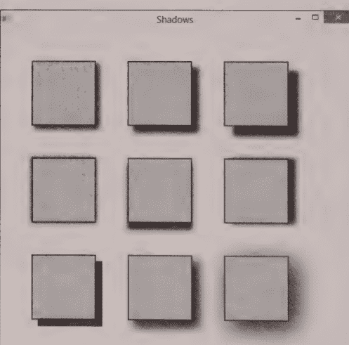

图 14-2：投影。

### 创建带投影的矩形

为了创建这些带投影的矩形，我创建了一个名为 `createShadowedBox` 的实用方法。这是该方法的代码：

```
Rectangle createShadowedBox(double size,
    double shadowWidth, double shadowHeight,
    double offsetX, double offsetY,
    double radius) 
{
    Rectangle r = new Rectangle(size, size);
    r.setFill(Color.LIGHTGRAY);
    r.setStroke(Color.BLACK);
    r.setStrokeWidth(2);
    DropShadow e = new DropShadow();
    e.setWidth(shadowWidth);
    e.setHeight(shadowHeight);
    e.setOffsetX(offsetX);
    e.setOffsetY(offsetY);
    e.setRadius(radius);
    r.setEffect(e);
    return r;
}
```

如你所示，此方法接受六个参数：要创建的矩形的大小（矩形是正方形，所以尺寸同时用于宽度和高度）、投影的宽度和高度、投影的 x 偏移和 y 偏移，以及投影的模糊半径。该方法从创建一个矩形开始。然后，创建一个投影效果，应用宽度、高度、x 偏移、y 偏移和半径，然后将该效果应用于矩形。

为了创建实际的带投影矩形，我调用了九次 `createShadowedBox` 方法，使用了不同的参数值：

| 代码 |
| :--- |
| `Rectangle r1 = createShadowedBox(100, 10, 10, 5, 5, 10);` |
| `Rectangle r2 = createShadowedBox(100, 20, 20, 10, 10, 10);` |
| `Rectangle r3 = createShadowedBox(100, 30, 30, 15, 10, 10);` |
| `Rectangle r4 = createShadowedBox(100, 20, 20, 0, 10, 10);` |
| `Rectangle r5 = createShadowedBox(100, 20, 20, 0, 10, 10);` |
| `Rectangle r6 = createShadowedBox(100, 20, 20, 10, 0, 10);` |
| `Rectangle r7 = createShadowedBox(100, 20, 20, 10, 10, 0);` |
| `Rectangle r8 = createShadowedBox(100, 20, 20, 10, 10, 20);` |
| `Rectangle r9 = createShadowedBox(100, 20, 20, 10, 10, 50);` |

对于第一组三个，我改变了投影的大小和偏移量，每组都使用相同的宽度、高度以及 x 偏移和 y 偏移值。因此，图 14-2 中的第一行矩形显示了投影在矩形下方和右侧的各种位置。

对于接下来的三个，我将 x 偏移或 y 偏移设置为零，以演示偏移的变化。对于最后一组三个，我改变了半径。请注意，当半径设置为 0 时，投影的边缘是锐利的。随着半径值的增大，投影会变得更加模糊。

## InnerShadow 类

图 14-3 显示了内阴影是如何工作的。对于此图，我更改了 `createShadowedBox` 方法中的一行代码：不再创建 `DropShadow`，而是创建了一个 `InnerShadow`：

```
InnerShadow e = new InnerShadow();
```

如你所示，`InnerShadow` 类将投影放置在矩形的内部而不是外部。

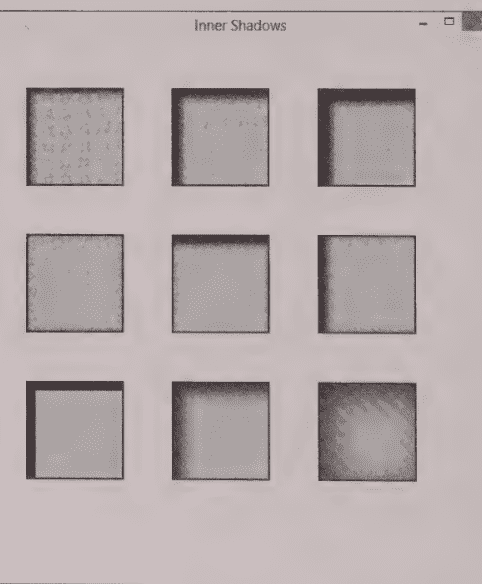

图 14-3：内阴影。

## 创建反射

反射在形状的前方和下方投影一个倒置的副本，营造出形状位于反射表面上的印象。你可以使用 `Reflection` 类来创建反射，其成员如表 14-2 所示。

**表 14-2：Reflection 类**

| 成员 | 说明 |
| :--- | :--- |
| **构造函数** | |
| `Reflection()` | 创建具有默认设置的反射效果。 |
| **方法** | |
| `void setBottomOpacity(double value)` | 反射底部的透明度（0.0 到 1.0）。默认值为 0。 |
| `void setFraction(double value)` | 被反射的形状部分。默认值为 0.75。 |
| `void setTopOffset(double value)` | 形状底部与反射开始之间的距离。默认值为 0。 |
| `void setTopOpacity(double value)` | 反射顶部的透明度（0.0 到 1.0）。默认值为 0.5。 |

表 14-4 显示了一个应用了反射的文本形状。我使用以下代码创建此形状：

```
Text t = new Text("Reflection");
t.setFont(new Font("Times", 60));
t.setFill(Color.LIGHTGRAY);
t.setStroke(Color.BLACK);
t.setEffect(new Reflection());
```


## 让物体模糊

JavaFX 提供了三种可以让物体变模糊的效果。这些类都使用不同的方法来实现模糊：

- `BoxBlur`：应用一种简单且高效的模糊技术，模糊区域中的每个像素通过与其相邻像素取平均值计算。
- `GaussianBlur`：使用高斯模糊算法，比框模糊更准确但效率较低。
- `MotionBlur`：方向性地模糊形状，产生运动效果。

表 14-3 显示了三种模糊类的成员。

**表 14-3：BoxBlur、GaussianBlur 和 MotionBlur 类**

| 类 | 成员 | 说明 |
| :--- | :--- | :--- |
| **构造函数** | | |
| `BoxBlur` | `BoxBlur()` | 创建具有默认设置的 BoxBlur 效果。 |
| `GaussianBlur` | `GaussianBlur()` | 创建具有默认设置的 GaussianBlur 效果。 |
| `MotionBlur` | `MotionBlur()` | 创建具有默认设置的 MotionBlur 效果。 |
| **BoxBlur 方法** | | |
| | `void setHeight(double value)` | 设置模糊效果的垂直尺寸。 |
| | `void setWidth(double value)` | 设置模糊效果的水平尺寸。 |
| | `void setIterations(int value)` | 设置效果重复的次数。默认值为 1。 |
| **GaussianBlur 方法** | | |
| | `void setRadius(double value)` | 模糊效果的半径。默认值为 10.0。 |
| **MotionBlur 方法** | | |
| | `void setAngle(double value)` | 运动效果的角度（度）。默认值为 0.0。 |
| | `void setRadius(double value)` | 模糊效果的半径。默认值为 10。 |

图 14-5 显示了这些模糊类型对文本形状的效果。我使用以下代码创建这三种模糊：

```
Text t1 = new Text("BoxBlur");
t1.setFont(new Font("Times Roman", 60));
t1.setFill(Color.LIGHTGRAY);
t1.setStroke(Color.BLACK);
t1.setEffect(new BoxBlur());

Text t2 = new Text("GaussianBlur");
t2.setFont(new Font("Times Roman", 60));
t2.setFill(Color.LIGHTGRAY);
t2.setStroke(Color.BLACK);
t2.setEffect(new GaussianBlur());

Text t3 = new Text("MotionBlur");
t3.setFont(new Font("Times Roman", 60));
t3.setFill(Color.LIGHTGRAY);
t3.setStroke(Color.BLACK);
t3.setEffect(new MotionBlur());
```

如你所示，我为每个模糊都使用了默认值。如果你愿意，可以使用表 14-3 中列出的方法来调整模糊效果的外观。

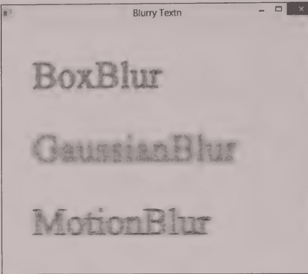

图 14-5：带有模糊效果的文本对象。

## 绽放与发光

今晚，在《花开》的一个特别剧集中（还是应该是《大爆炸理论》的特别剧集？），你将发现如何让你普通的 JavaFX 形状绽放并发光，这一切都归功于两个意外命名为 `Bloom` 和 `Glow` 的简单类。表 14-4 显示了这两个类的成员。

**表 14-4：Bloom 和 Glow 类**

| 类 | 成员 | 说明 |
| :--- | :--- | :--- |
| **构造函数** | | |
| `Bloom` | `Bloom()` | 创建具有默认参数的 Bloom 效果。 |
| `Glow` | `Glow()` | 创建具有默认参数的 Glow 效果。 |
| **Bloom 方法** | | |
| | `void setThreshold(double value)` | 设置亮度阈值。Bloom 效果将应用于形状中比阈值亮的部分。值范围为 0.0 到 1.0。默认值为 0.3。 |
| **Glow 方法** | | |
| | `void setLevel(double value)` | 设置效果的发光强度等级。值范围为 0.0 到 1.0。默认值为 0.3。 |

图 14-6 显示了光晕（Bloom）和发光（Glow）特效的效果。图中显示的三个文本形状都与一个矩形组合在一个组中。我使用以下代码创建第一个组（位于图中顶部）：

```
Rectangle r1 = new Rectangle(50, 50, 400, 100);
r1.setFill(Color.BLACK);
r1.setStroke(Color.BLACK);

Text t1 = new Text("Plain Text");
t1.setX(130);
t1.setY(125);
t1.setFont(new Font("Times New Roman", 60));
t1.setFill(Color.LIGHTGRAY);
```

我使用了相同的代码创建了第二个组（显示在图中中间），但添加了光晕特效：

```
Rectangle r2 = new Rectangle(50, 50, 400, 100);
r2.setFill(Color.BLACK);
r2.setStroke(Color.BLACK);

Text t2 = new Text("Blooming Text");
t2.setX(70);
t2.setY(125);
t2.setFont(new Font("Times New Roman", 60));
t2.setFill(Color.LIGHTGRAY);

Group g2 = new Group();
g2.getChildren().addAll(r2, t2);

Bloom e1 = new Bloom();
e1.setThreshold(0.3);
g2.setEffect(e1);
```

对于第三个组，我添加了发光特效：

```
Rectangle r3 = new Rectangle(50, 50, 400, 100);
r3.setFill(Color.BLACK);
r3.setStroke(Color.BLACK);

Text t3 = new Text("Glowing Text");
t3.setX(80);
t3.setY(125);
t3.setFont(new Font("Times New Roman", 60));
t3.setFill(Color.LIGHTGRAY);

Group g3 = new Group();
g3.getChildren().addAll(r3, t3);

Glow e2 = new Glow();
e2.setLevel(1.0);
g3.setEffect(e2);
```

光晕和发光特效之间的区别非常微妙。坦率地说，它们几乎难以察觉。如果你仔细观察，会发现发光的文本比光晕的文本稍微亮一点。（当使用黑白以外的颜色时，发光和光晕的区别会更加明显。）

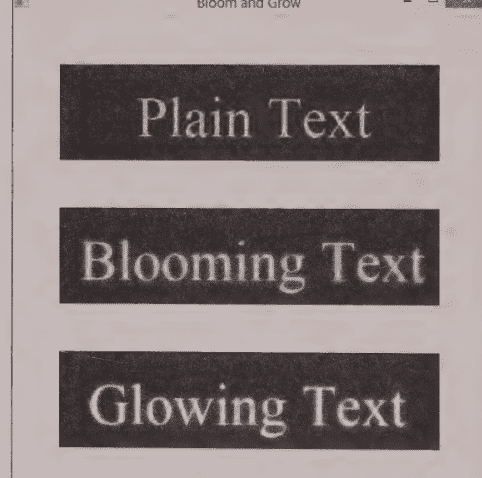

图 14-6：光晕和发光的文本！

## 获取透视效果

`PerspectiveTransform` 类允许你变形形状，使其看起来具有三维效果。注意：这等同于在你的场景图中创建真正的三维形状；它仅仅是通过扭曲节点的几何形状来创建透视效果。

`PerspectiveTransform` 类的工作是将原始形状边界矩形的四个顶点映射到任意四边形上。（边界矩形是完全包含形状的矩形，而四边形是任何四角形状。）你只需要使用表 14-5 中列出的方法提供四边形每个顶点的 x 和 y 坐标。

**表 14-5：PerspectiveTransform 类**

| 成员 | 说明 |
| :--- | :--- |
| **构造函数** | |
| `PerspectiveTransform()` | 创建一个带有默认参数的新 PerspectiveTransform 特效。 |
| **方法** | |
| `void setUlx(double value)` | 设置左上角的 x 坐标。 |
| `void setUly(double value)` | 设置左上角的 y 坐标。 |
| `void setUrx(double value)` | 设置右上角的 x 坐标。 |
| `void setUry(double value)` | 设置右上角的 y 坐标。 |
| `void setLlx(double value)` | 设置左下角的 x 坐标。 |
| `void setLly(double value)` | 设置左下角的 y 坐标。 |
| `void setLrx(double value)` | 设置右下角的 x 坐标。 |
| `void setLry(double value)` | 设置右下角的 y 坐标。 |

为了说明透视变换是如何工作的，我将其应用到一个使用以下代码创建的棋盘上：

```
Group board = new Group();

boolean isLight = true;
int size = 50;

for (int rank = 0; rank < 8; rank++) {
    for (int file = 0; file < 8; file++) {
        Rectangle r = new Rectangle(size, size);
        r.setX(file * size);
        r.setY(rank * size);
        if (isLight)
            r.setFill(Color.LIGHTGRAY);
        else
            r.setFill(Color.DARKGRAY);
        isLight = !isLight;
        board.getChildren().add(r);
    }
}
```


这段代码使用嵌套循环来绘制棋盘的行（rank）和列（file）。`isLight` 变量用于跟踪颜色；图 14-7 显示了绘制出的棋盘。


图 14-7：棋盘。

`PerspectiveTransform` 类通过将原始形状边界矩形的四个顶点映射到任意四边形来工作。为了说明透视变换是如何工作的，我将其应用到棋盘上。

| 表 14-5 | 方法 | 解释 |
| :--- | :--- | :--- |
| `void setUlx(double value)` | 设置左上角的 x 坐标。 |
| `void setUly(double value)` | 设置左上角的 y 坐标。 |
| `void setUrx(double value)` | 设置右上角的 x 坐标。 |
| `void setUry(double value)` | 设置右上角的 y 坐标。 |
| `void setLlx(double value)` | 设置左下角的 x 坐标。 |
| `void setLly(double value)` | 设置左下角的 y 坐标。 |
| `void setLrx(double value)` | 设置右下角的 x 坐标。 |
| `void setLry(double value)` | 设置右下角的 y 坐标。 |

*(注：此处表格内容重复了原文中的描述，按要求保留)*

*(注：原文文本中存在对表 14-5 的重复描述和逻辑重复，此处已按原文翻译)*

`PerspectiveTransform` 类通过将原始形状边界矩形的四个顶点映射到任意四边形来工作。为了说明透视变换是如何工作的，我将其应用到棋盘上。

*(注：原文文本中存在对表 14-5 的重复描述和逻辑重复，此处已按原文翻译)*

### 组合特效

现在，我希望你同意 JavaFX 特效对场景外观有巨大影响。但等一下！JavaFX 允许你通过组合特效来进一步改进场景外观。要组合特效，你需要创建一个特效类的实例，创建第二个特效类的实例，并通过调用第一个特效的 `setInput` 方法将第一个链接到第二个。例如，假设你想将反射和阴影组合在一起。你可以这样做：

```java
Rectangle rect = new Rectangle(100,100);

DropShadow shadow = new DropShadow();

Reflection reflect = new Reflection();

rect.setInput(shadow);

rect.setEffect(reflect);
```

在这个示例中，阴影特效将首先在矩形上渲染。然后，反射特效将在矩形上渲染，创建矩形及其阴影的反射。

图 14-8 显示了带有阴影的棋盘。创建透视变换和阴影特效的代码如下：

```java
PerspectiveTransform e = new PerspectiveTransform();

e.setULX(100); // 左上

e.setULY(100);

e.setURX(450); // 右上

e.setURY(100);

e.setLLX(0); // 左下

e.setLLY(300);

e.setLRX(400); // 右下

e.setLRY(300);

DropShadow shadow = new DropShadow();

shadow.setWidth(20);

shadow.setHeight(20);

shadow.setOffsetX(20);

shadow.setOffsetY(20);

shadow.setRadius(30);

e.setInput(shadow);

board.setEffect(e);
```


图 14-8：带有阴影的棋盘。

你可以看到，透视变换被应用于棋盘及其阴影上，创造出棋盘悬浮在表面之真实效果。


图 14-9：带有阴影的棋盘。

## 第四部分

## 让你的程序活起来


访问 www.dummies.com/extras/javafx 获取更多精彩 Dummies 在线内容。

## 在这一部分 . . .

*   属性属性的操作
*   添加视觉效果和声音
*   结合动画效果
*   使用触摸设备进行手势操作
*   访问 www.dummies.com/extras/javafx 获取优质的 Dummies 在线内容

# 第 15 章

## 使用属性创建动态场景

**本章内容**

- 介绍并创建属性
- 对只读属性和读/写属性的操作
- 为你的属性添加事件监听器
- 将属性绑定在一起

在本章中，你将发现如何使用 JavaFX 的一项强大特性——属性（properties）。简单来说，JavaFX 属性是类暴露的可观察值。属性之所以是“可观测的”，是因为你可以为它们挂载监听器。每当属性的值改变或变为未知时，这些监听器就会被调用。

属性最强大的特性之一是你可以对它们进行绑定，或者将属性连接在一起，这样当一个属性改变时，另一个属性会自动调整。换句话说，绑定允许两个属性保持同步。当一个属性改变时，另一个属性也会随之改变。

在本章中，我将讨论处理属性的基础知识。首先，你将学习如何创建你自己的属性。然后，你将弄清楚如何为属性挂载监听器，以便你的代码在属性值改变或失效时做出响应。最后，我将告诉你如何进行绑定。

### 介绍 JavaFX 属性

在面向对象编程的术语中，属性是一个代表实例化对象状态的值，用户可以获取该值，在某些情况下也可以设置该值。在某些面向对象编程语言（如 C#）中，属性的概念是内置在语言中的。遗憾的是，Java 并非如此。Java 没有实现属性的内置特性……至少直到现在还没有。

在 Java 8 之前，Java 开发者通常遵循使用属性获取器（getter）和设置器（setter）的模式来获取和设置属性值。getter 是一个获取属性值的公共方法，而 setter 是一个设置属性值的公共方法。

例如，假设你正在创建一个代表客户的类，每个客户通过一个唯一的客户编号识别。你可能将客户编号内部存储为名为 `customerNumber` 的私有字段。然后，你会提供一个名为 `getCustomerNumber` 的公共方法来返回客户编号，以及另一个名为 `setCustomerNumber` 的公共方法来设置客户编号。生成的代码如下：

```java
class Customer {

    private int customerNumber;

    public int getCustomerNumber() {

        return customerNumber;

    }

    public void setCustomerNumber(int value) {

        customerNumber = value;

    }

}
```

这种使用 getter 和 setter 方法的模式有一个名字：访问模式（accessor pattern）。（不，这与属性税无关。属性税是由评估师决定的，而不是由访问器决定的）。

JavaFX 引入了一种实现属性的新方案，它完全遵循了访问模式。因此，实现属性的 JavaFX 类必须提供一个 getter 和一个 setter 来返回和设置属性的值（除非属性是只读的，在这种情况下只需要一个 get 方法）。

然而，JavaFX 并没有使用简单的字段来表示属性的值，而是使用特殊的属性类来表示属性。这些类将属性的值封装在一个对象中，该对象提供了神奇的特性，使你能够监听属性值的变化或将属性绑定在一起。

# 第 15 章：使用属性创建动态场景

当使用 JavaFX 属性时，getter 和 setter 方法返回由属性对象封装的值。除了 getter 和 setter 方法外，JavaFX 属性还引入了第三种方法，它返回属性本身。这允许属性的用户直接访问属性对象，从而让他们能够访问新的神奇特性。

命名规范是正确使用 JavaFX 属性的一个重要方面。每个属性都有一个名称，按照惯例，它以小写字母开头。例如，代表人的第一个名字的属性可能称为 `firstName`。getter 和 setter 方法通过将属性名称的首字母大写并在其前面加上 `get` 或 `set` 单词来创建。返回属性对象的方法是属性名称（不大写）后跟 `Property` 单词。

因此，实现名为 `firstName` 的读/写属性的类必须暴露三个方法：

```java
getFirstName
setFirstName
firstNameProperty
```

如果属性是只读的，将省略 `setFirstName` 方法。

### Java API 属性

书中介绍的 JavaFX API 类大量使用了属性。事实上，几乎每个 API 的 get 或 set 方法实际上都是属性的 getter 或 setter，并且都有一个返回属性本身的对应方法。

例如，考虑 `TextField` 类，它有名为 `getText` 和 `setText` 的方法，用于获取和设置文本字段包含的文本。这些方法实际上是名为 `text` 的属性的 getter 和 setter，而 `TextField` 类有一个名为 `textProperty` 的方法，提供了直接访问文本属性。

`HBox` 类也是如此：它有名为 `alignment`、`hgroup`、`padding` 和 `spacing` 的属性，分别对应 `getAlignment`、`setAlignment`、`getHgroup`、`setHgroup`、`getPadding`、`setPadding`、`getSpacing` 和 `setSpacing` 方法。

到目前为止，你不需要直接访问属性，因此依赖 getter 和 setter 方法来操作属性值。在本章稍后的部分，当你发现如何绑定属性值时，你会看到访问这些属性非常有用。在接下来的几节中，我将讨论如何创建你自己的 JavaFX 属性。即使你永远不创建自己的类，了解如何这样做也将帮助你理解使用标准 JavaFX API 中属性的好处。

# Java 属性类

JavaFX 属性的核心是一组创建属性对象的类。有很多类，因为 JavaFX 为每种基本数据类型都提供了四个重要的类。以下段落描述了用于字符串属性的类：

- `ReadOnlyProperty`：一个只读属性的抽象类，其值可以读取但不能修改。
- `StringProperty`：另一个代表读写属性的抽象类。该类继承自 `ReadOnlyProperty`。
- `SimpleStringProperty`：你创建读/写字符串属性时使用的类。
- `ReadOnlyStringWrapper`：你创建只读字符串属性时使用的类。该类的用法有点复杂，所以我现在还不解释它。你可以在本章稍后的“创建只读属性”部分查看它是如何工作的。为了参考，表 15-1 列出了用于创建各种类型属性的所有类。

| 表 15-1 | JavaFX 属性类 |
| --- | --- |
| Boolean Classes | Long Classes |
| `ReadOnlyBooleanProperty` | `ReadOnlyLongProperty` |
| `BooleanProperty` | `LongProperty` |
| `SimpleBooleanProperty` | `SimpleLongProperty` |
| `ReadOnlyBooleanWrapper` | `ReadOnlyLongWrapper` |
| Double Classes | Map |
| `ReadOnlyDoubleProperty` | `ReadOnlyMapProperty<K, V>` |
| `DoubleProperty` | `MapProperty<K, V>` |
| `SimpleDoubleProperty` | `SimpleMapProperty<K, V>` |
| `ReadOnlyDoubleWrapper` | `ReadOnlyMapWrapper<K, V>` |
| Float Classes | Object Classes |
| `ReadOnlyFloatProperty` | `ReadOnlyObjectProperty<T>` |
| `FloatProperty` | `ObjectProperty<T>` |
| `SimpleFloatProperty` | `SimpleObjectProperty<T>` |
| `ReadOnlyFloatWrapper` | `ReadOnlyObjectWrapper<T>` |
| Integer Classes | Set Classes |
| `ReadOnlyIntegerProperty` | `ReadOnlySetProperty<E>` |
| `IntegerProperty` | `SetProperty<E>` |
| `SimpleIntegerProperty` | `SimpleSetProperty<E>` |
| `ReadOnlyIntegerWrapper` | `ReadOnlySetWrapper<E>` |
| List Classes | String Classes |
| `ReadOnlyListProperty<E>` | `ReadOnlyStringProperty` |
| `ListProperty<E>` | `StringProperty` |
| `SimpleListProperty<E>` | `SimpleStringProperty` |
| `ReadOnlyListWrapper<E>` | `ReadOnlyStringWrapper` |

注意表 15-1 中所示的所有类型（List、Map、Object 和 Set）都是泛型的。对于 List 和 Set 类，你必须为底层的列表和集合集合指定元素类型；对于 Map 类型，你需要为键和值指定类型。`Object` 属性类允许你创建任何种类型的属性，但你必须指定类型以便 JavaFX 强制类型安全。

# 314 第四部分：让你的程序活跃起来

## 创建读写属性（ReadWrite Property）

要创建一个值可以读取和写入的普通属性，你需要使用该属性类型类中的两个类：正确类型的属性类以及对应的简单属性类。例如，要创建一个类型为 Double 的属性，你需要同时使用 `DoubleProperty` 类和 `SimpleDoubleProperty` 类。

以下是创建读/写属性的步骤：

1. 使用正确类型的属性类为属性创建一个本地字段。

该字段应该定义为私有（`private`）可见性，并且应该是最终的（`final`）的。例如：

```java
private StringProperty firstName;
```

2. 使用正确类型的简单属性类创建属性的实例。

简单属性类型的构造函数接受三个参数，分别代表：包含该属性的对象（通常指定为 `this`）、表示属性名称的字符串以及属性的默认值。例如：

```java
firstName = new SimpleStringProperty(this, "firstName", "");
```

在这里，`this` 被指定为包含对象，`firstName` 是属性名称，默认值是一个空字符串。

通常在同一语句中声明私有字段并对其实例化非常方便，如下所示：

```java
StringProperty firstName = new SimpleStringProperty(this, "firstName", "");
```

3. 为属性创建一个 getter（get）。

getter 方法应该是公开的（`public`）或受保护的（`protected`），它应该是最终的（`final`），它应该遵循属性的命名规范（`get` 后面跟首字母大写的属性名称），并且应该返回底层属性类型的值。它应该调用私有属性的 `get` 方法来获取属性值，如下：

```java
public final String getFirstName() {
    return firstName.get();
}
```


# 第15章：使用属性创建动态场景

4. **为属性创建一个 setter（set）。**

setter 方法名应该是公开的（`public`）或受保护的（`protected`），它应该是最终的（`final`），它应该遵循属性命名规范（`set` 后面跟首字母大写的属性名称），并且应该接受一个底层属性类型的参数值。它应该调用私有属性的 `set` 方法将属性设置为传递过去的值。例如：

```java
public final void setFirstName(String value) {
    firstName.set(value);
}
```

5. **创建属性访问器对象本身：**

此方法应该返回属性对象本身：

```java
public final StringProperty firstNameProperty() {
    return firstName;
}
```

注意类型是 `StringProperty`，而不是 `SimpleStringProperty`。

6. **对类中的每个属性重复整个过程。**

这是一个完整的示例，在名为 `Customer` 的类实现了一个名为 `firstName` 的读/写属性：

```java
public class Customer {
    StringProperty firstName = new SimpleStringProperty(this, "firstName", "");

    public final String getFirstName() {
        return firstName.get();
    }

    public final void setFirstName(String value) {
```


# 第15章：使用属性创建动态场景

## 创建只读属性

虽然只读属性的功能比读/写属性少，但实际上实现起来更复杂。为什么呢？因为在包含只读属性的类内部——你需要能够读取或写入属性的值。但在外部——即在定义只读属性的类之外——你必须确保用户可以读取但不能写入属性值。

你可能认为省略 setter 方法就足够创建一个只读属性了。但问题在于，除了 getter 和 setter 方法外，JavaFX 属性还暴露了一个属性访问器方法，该方法提供了对属性对象本身的直接访问。

以下是一个如何*不要*创建只读属性的示例：

```java
Property firstName = new SimpleStringProperty(this, "firstName");

public final String getFirstName() {
    return firstName.get();
}

public final StringProperty firstNameProperty() {
    return firstName;
}
```

这段代码与前一节中创建读/写属性的代码相同，只是我省略了 `setFirstName` 方法。遗憾的是，这个属性定义并不能防止类的用户修改属性。要这样做，用户只需要访问该属性然后直接调用属性的方法即可。

例如，假设此属性是名为 `Customer` 的类的一部分，该实例由变量 `cust` 引用。以下代码将设置只读属性的值：

```java
cust.getFirstName().set("Bogus Value");
```


为了安全地创建一个只读属性，你实际上必须创建属性的两个拷贝：一个只读版本和一个读/写版本。只读版本将暴露给外部世界。读/写版本将在定义属性的类内部使用。

为了实现这一点，JavaFX 为每个属性类型提供了两个额外的类：只读属性类和包装类。只读属性类通过属性访问器方法与外部共享。包装类是你在程序内部使用的。这里有一个完整的示例，在类中实现一个名为 `accountNumber` 的只读属性：

```java
public class Customer {
    private IntegerProperty accountNumber = new SimpleIntegerProperty(this, "accountNumber", 0);

    public final Integer getAccountNumber() {
        return accountNumber.get();
    }

    public final ReadOnlyIntegerProperty accountNumberProperty() {
        return accountNumber.getReadOnlyProperty();
    }

    // 更多类细节在此
}
```

理解其工作原理的关键在于简单属性的扩展，它增加了一个新方法：`getReadOnlyProperty()`，返回简单属性的只读拷贝。这个只读拷贝与简单属性自动同步，因此当简单属性发生变化时，只读属性的值也会改变。

## 更高效地创建属性

JavaFX 属性的高级功能（将在本章的最后几节中体会）并不是免费的。具体来说，实例化属性对象比创建基于字段的属性消耗更多的内存和处理时间。而在很多类中，属性的高级功能偶尔才需要。因此为类中的每个属性实例化属性对象是浪费的。

在本节中，我将向你展示一种创建属性的技术，属性对象只有在需要时才实例化。这样，属性对象在被访问时才会创建。以下是该技术的细节：

1. 定义一个私有字段来存储属性表示的数据。
   例如，对于字符串属性，你创建一个 `String` 变量。对于变量名，使用带下划线的属性名称，如下所示：
   ```java
   private String _firstName = "";
   ```

2. 创建但不实例化一个私有变量来表示属性对象。
   换句话说，声明变量但不调用类构造函数：
   ```java
   private StringProperty firstName;
   ```

3. 创建 getter。
   在 getter 中，使用 `if` 语句判断属性是否存在。如果存在，则返回属性的值。如果不存在，返回私有字段的值。例如：
   ```java
   public final String getFirstName() {
       if (firstName == null)
           return _firstName;
       else
           return firstName.get();
   }
   ```

4. 创建 setter。
   在 setter 中使用相同的技术：
   ```java
   public final void setFirstName(String value) {
       if (firstName == null)
           _firstName = value;
       else
           firstName.set(value);
   }
   ```

5. 创建属性访问器。
   在此方法中，首先检查属性是否存在，如果不存在则创建该对象。使用私有字段的值作为属性的初始值。然后，返回该对象：
   ```java
   public final StringProperty firstNameProperty() {
       if (firstName == null)
           firstName = new SimpleStringProperty(this, "firstName", _firstName);
       return firstName;
   }
   ```

以下是在类名为 `Customer` 的类中组合后的样子：

```java
public class Customer {
    private String _firstName = "";
    private StringProperty firstName;

    public final String getFirstName() {
        if (firstName == null)
            return _firstName;
        else
            return firstName.get();
    }

    public final void setFirstName(String value) {
        if (firstName == null)
            _firstName = value;
        else
            firstName.set(value);
    }

    public final StringProperty firstNameProperty() {
        if (firstName == null)
            firstName = new SimpleStringProperty(this, "firstName", _firstName);
        return firstName;
    }
}
```

## 使用属性事件

JavaFX属性提供了一个 `addListener` 方法，允许你添加事件处理器，当属性值发生变化时就会被调用。你可以创建两种类型的属性事件处理器：

- **更改监听器**，每当属性值被重新计算时就会被调用。更改监听器接收三个参数：值发生变化的属性、属性的旧值以及新值。
- **失效监听器**，每当属性值变为未知时就会被调用。当属性值需要重新计算但尚未计算时，会触发此事件。失效监听器仅接收一个参数：属性本身。

更改和失效监听器由命名为 `ChangeListener` 和 `InvalidationListener` 的函数接口定义。由于这些接口是函数式接口，你可以使用 Lambda 表达式来实现它们。以下是使用 Lambda 表达式在名为 `text1` 的文本字段属性上注册更改监听器的示例：

```java
text1.textProperty().addListener(
    (observable, oldValue, newValue) ->
        // 代码在此处
);
```

以下是一个注册失效监听器的示例：

```java
text1.textProperty().addListener(
    (observable) ->
        // 代码在此处
);
```

`addListener` 知道你是在注册更改监听器还是失效监听器的唯一方法是查看你为 Lambda 表达式指定的参数。如果你提供三个参数，`addListener` 会注册一个更改监听器。如果你只提供一个参数，则安装一个失效监听器。

### 示例：自动矩形程序

列表 15-1 显示了一个简单的 JavaFX 程序，它使用更改监听器根据其包含的 `StackPane` 的大小自动改变矩形的大小。在 `StackPane` 的宽度属性上注册了一个更改监听器，这样每当 `StackPane` 的宽度变化时，矩形的宽度就会自动设置为 `StackPane` 新宽度的一半。同样，在高度属性上注册了一个更改监听器来更改矩形的高度。

图 15-1 显示了此程序的运行情况。图中显示了应用程序显示的初始窗口，以及用户将窗口调高调宽后窗口的样子。正如你所看到的，矩形的大小按比例地增加了。

**列表 15-1：自动矩形程序**

```java
import javafx.application.*;
import javafx.stage.*;
import javafx.scene.*;
import javafx.scene.layout.*;
import javafx.scene.shape.*;
import javafx.scene.paint.*;

public class AutoRectangle extends Application {

    public static void main(String[] args) {
        launch(args);
    }

    @Override
    public void start(Stage primaryStage) {
        Rectangle r = new Rectangle(100, 100);
        r.setFill(Color.LIGHTGRAY);
        r.setStroke(Color.BLACK);
        r.setStrokeWidth(2);

        StackPane p = new StackPane();
        p.setMinWidth(200);
        p.setPrefWidth(200);
        p.setMaxWidth(200);
        p.setMinHeight(200);
        p.setPrefHeight(200);
        p.setMaxHeight(200);
        p.getChildren().add(r);

        p.widthProperty().addListener(
            (observable, oldValue, newValue) ->
                r.setWidth((Double) newValue / 2)
        );

        p.heightProperty().addListener(
            (observable, oldValue, newValue) ->
                r.setHeight((Double) newValue / 2)
        );

        Scene scene = new Scene(p);
        primaryStage.setScene(scene);
        primaryStage.setTitle("Auto Rectangle");
        primaryStage.show();
    }
}
```

以下段落描述了亮点：

- 第 18 行：这些行创建了一个 100x100 的矩形，并设置了矩形的填充、颜色和描边。
- 第 23 行：这些行创建了一个 `StackPane` 并设置了它的尺寸。
- 第 33 行：这些行在宽度属性上添加了监听器以更新矩形。
- 第 38 行：这些行在高度属性上添加了监听器以更新矩形。

### 示例：角色扮演程序

```java
TextField txtCharacter;
TextField txtActor;

@Override
public void start(Stage primaryStage) {
    // 创建角色标签
    Label lblCharacter = new Label("角色名称:");
    lblCharacter.setMinWidth(100);
    lblCharacter.setAlignment(Pos.BOTTOM_RIGHT);

    // 创建角色文本字段
    txtCharacter = new TextField();
    txtCharacter.setMinWidth(200);
    txtCharacter.setMaxWidth(200);
    txtCharacter.setPromptText("在此处输入角色名称.");

    // 创建演员标签
    Label lblActor = new Label("演员名称:");
    lblActor.setMinWidth(100);
    lblActor.setAlignment(Pos.BOTTOM_RIGHT);

    // 创建演员文本字段
    txtActor = new TextField();
    txtActor.setMinWidth(200);
    txtActor.setMaxWidth(200);
    txtActor.setPromptText("在此处输入演员名称.");

    // 创建角色描述标签
    Label lblRole1 = new Label("角色 ");
    Label lblRole2 = new Label();
    Label lblRole3 = new Label("将由   ");
    Label lblRole4 = new Label();

    // 创建角色面板
    HBox paneCharacter = new HBox(20, lblCharacter, txtCharacter);
    paneCharacter.setPadding(new Insets(10));

    // 创建演员面板
    HBox paneActor = new HBox(20, lblActor, txtActor);
    paneActor.setPadding(new Insets(10));

    // 创建角色面板
    HBox paneRole = new HBox(lblRole1, lblRole2, lblRole3, lblRole4);
    paneRole.setPadding(new Insets(10));

    // 将角色面板和演员面板添加到 VBox
    VBox pane = new VBox(10, paneCharacter, paneActor, paneRole);

    // 创建绑定
    lblRole2.textProperty().bind(txtCharacter.textProperty());
    lblRole4.textProperty().bind(txtActor.textProperty());

    // 设置舞台
    Scene scene = new Scene(pane);
    primaryStage.setScene(scene);
    primaryStage.setTitle("角色扮演");
    primaryStage.show();
}
```

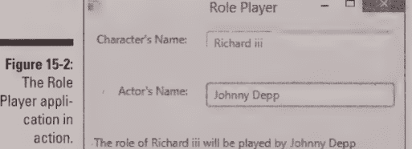

# 第16章：使用图像和媒体

## 本章内容

- 在 JavaFX 组件中显示图像
- 为你的程序添加声音
- 显示视频

到本书为止，所有的 JavaFX 应用程序都相当无聊。它们有许多标签、文本字段、组合框等，但没有图片、声音或电影！

本章将弥补这一空白。你将学会如何将图形图像整合到 JavaFX 应用程序中（即图片——不一定是图形性质的图像）。为了增加趣味性，我还会向你展示如何加入音效、音乐以及视频。

## 使用图像

图像是包含图片的文件。Java 支持多种格式的图片，包括 `.jpg`、`.png`、`.gif` 和 `.bmp`。要将图像整合到应用程序中，你需要使用两个类：`Image` 和 `ImageView`。`Image` 类表示内存中的图像，而 `ImageView` 类是一个节点，你可以将其添加到场景图中以便在屏幕上显示 `Image`。

这两个类都在 `javafx.scene.image` 包中，因此你需要在程序中添加以下语句：
```java
import javafx.scene.image.Image;
import javafx.scene.image.ImageView;
```


```java
import javafx.scene.image.*;
```

# 第 16 章：使用图像和媒体

## 使用 Image 类

要从外部源（如磁盘文件或网络位置）加载图像，可以使用 `Image` 类。该类有六个构造函数，详见表 16-1。

| 构造函数 | 说明 |
| --- | --- |
| `Image(InputStream in)` | 通过从指定的输入流读取创建图像。 |
| `Image(InputStream in, double width, double height, boolean preserveRatio, boolean smooth)` | 从指定的输入流读取创建图像，并根据你指定的宽度和高度调整大小。`preserveRatio` 表示是否保留原始图像的宽高比，`smooth` 表示是否应用图像平滑。 |
| `Image(String url)` | 从指定的 URL 创建图像。 |
| `Image(String url, boolean backgroundLoading)` | 从指定的 URL 创建图像。如果 `backgroundLoading` 为 `true`，则在后台加载（即在独立的线程中）。 |
| `Image(String url, double width, double height, boolean preserveRatio, boolean smooth)` | 从指定的 URL 创建图像。此构造函数指定了结果图像的宽度和高度，并指示是否保留原始图像的宽高比以及是否应用图像平滑。 |
| `Image(String url, double width, double height, boolean preserveRatio, boolean smooth, boolean backgroundLoading)` | 从指定的网络路径创建图像，并根据你指定的宽度和高度调整大小。`preserveRatio` 表示是否保留原始图像的宽高比，`smooth` 表示是否应用图像平滑。如果 `backgroundLoading` 为 `true`，则在后台加载（即在独立的线程中）。 |

加载图像最简单的方法是直接从本地计算机上的文件加载，只需在 `Image` 构造函数中指定文件路径。文件路径字符串前应带有 `file:` 前缀。例如，以下构造函数从 `C:\Pictures` 中的 `pic001.jpg` 创建图像对象：

```java
Image img = new Image("file:C:\\Pictures\\pic001.jpg");
```

你也可以使用网络位置指定网络位置，例如：

```java
Image img = new Image("http://www.domain.com/pic001.jpg");
```

注意在网络示例中，你不需要双反斜杠，因为 HTTP 地址使用正斜杠。

在许多情况下，你想从 `File` 对象加载图像。为了实现这一点，使用 `File` 对象的 `toURI` 方法获取路径。注意：`toURI()` 返回一个 URI 对象，你必须将其转换为字符串：

```java
File f = new File("C:\\Pictures\\pic001.jpg");
Image img = new Image(f.toURI().toString());
```

在创建 `Image` 对象时，可以通过指定宽度和高度来调整图像。你还需要两个布尔参数。第一个指示是否要让 JavaFX 保留宽高比（即宽与高的比率）。如果指定为 `true`，为了保持宽高比，图像可能会留白。如果指定为 `false`，图像可能会失真。

第二个布尔参数指示是否要让 JavaFX 应用平滑算法来提高清晰度。平滑处理会让图像看起来更好，但需要时间。

最后，你可以指定可选的第三个布尔参数，指示你想在后台加载图像。这会将图像加载过程转移到一个独立的线程，你的应用程序线程无需等待加载完成即可继续。

## 使用 ImageView 类

`Image` 类在内存中持有图像，而 `ImageView` 类在屏幕上显示图像。`ImageView` 是 `Node` 的子类，允许你将图像视图添加到场景图中。基本构造函数接收一个 `Image` 对象，如下：

```java
img = new Image("file:C:\\Pictures\\pic001.jpg");
ImageView view1 = new ImageView(img);
```

然后，你可以像其他节点一样将图像视图添加到布局面板并在场景中显示。

默认情况下，图像视图将按原始尺寸显示图像。通常你需要通过调用 `setFitWidth` 和 `setFitHeight` 方法来限制大小，并调用 `setPreserveRatio` 方法以确保调整大小时保留原始图像的宽高比。例如：

```java
view1.setFitWidth(200);
view1.setFitHeight(200);
view1.setPreserveRatio(true);
```

在这里，显示的图像大小为 200x200。图 16-1 显示了该图像在场景中的显示效果。

### 提示

在两个或多个图像视图（`ImageView`）中显示单个图像是完全允许的。例如：

```java
Image img = new Image("file:C:\\Pictures\\pic001.jpg");
ImageView imageView1 = new ImageView(img);
ImageView imageView2 = new ImageView(img);
```

### 提示

由于图像视图是一个节点，因此你可以对它应用特殊效果，正如我在第 14 章描述的那样。例如，这里有一段代码，用于加载图像，将其放入两个图像视图中，然后对第二个图像视图应用运动模糊：

```java
Image img = new Image("file:C:\\Pictures\\pic001.jpg");
ImageView imageView1 = new ImageView(img);
imageView1.setFitWidth(300);
imageView1.setFitHeight(300);
imageView1.setPreserveRatio(true);
ImageView imageView2 = new ImageView(img);
imageView2.setFitWidth(300);
imageView2.setFitHeight(300);
imageView2.setPreserveRatio(true);
MotionBlur blur = new MotionBlur();
blur.setRadius(25);
blur.setAngle(180);
imageView2.setEffect(blur);
```

图 16-2 显示了该图像在两个图像视图中的显示情况，其中一个具有运动模糊效果。

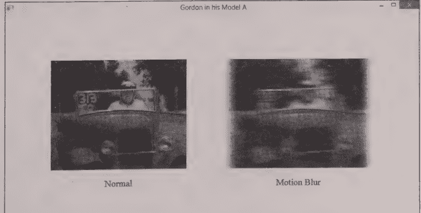

图 16-2：对图像应用效果。

## 查看图像示例

展示了前两个节中介绍的元素是如何协同工作的。列表 16-1 显示了一个完整的程序，该程序使用 `Image` 和 `ImageView` 类来显示本地文件系统中名为 `C:\Pictures` 的文件夹中的所有图像。

该程序使用 Java `File` 类来访问文件夹中的文件。如果你想了解更多关于该类的信息，请参阅我的书籍《Java All-in-One For Dummies, 4th Edition》（Wiley Publishing, Inc.）。

图 16-3 显示了该程序显示的屏幕。如你所见，访问的文件夹名称显示在窗口标题栏中，每个图像的名称由每个图像下方的 `Text` 字段显示。图像放置在 `TilePane` 中，以便它们会自动按行和列布局，并在需要时显示滚动条。


图 16-3：运行中的照片查看器应用程序。

### 列表 16-1：照片查看器应用程序

```java
import javafx.application.*;
import javafx.stage.*;
import javafx.scene.*;
import javafx.scene.layout.*;
import javafx.scene.control.*;
import javafx.scene.image.*;
import javafx.scene.shape.*;
import javafx.scene.text.*;
import javafx.geometry.*;
import java.io.*;
import java.util.*;

public class PhotoViewer extends Application {

    public static void main(String[] args) {
        launch(args);
    }

    private final String PATH = "C:\\Pictures";

    @Override
    public void start(Stage primaryStage) {
        TilePane tile = new TilePane();
        tile.setHGap(20);
        tile.setVGap(20);
        tile.setPadding(new Insets(20));
        tile.setPrefColumns(4);
        File dir = new File(PATH);
        File[] files = dir.listFiles();
        for (File f : files) {
            Image img = new Image(f.toURI().toString(), 200, 200, true, true);
            ImageView view = new ImageView(img);
            view.setFitWidth(200);
            view.setFitHeight(200);
            view.setPreserveRatio(true);
            Text txt = new Text(f.getName());
            txt.setFont(new Font("Times New Roman", 16));
            Region spacer = new Region();
            VBox box = new VBox(10, view, spacer, txt);
            box.setVgrow(spacer, Priority.ALWAYS);
            box.setAlignment(Pos.CENTER);
            tile.getChildren().add(box);
        }
        ScrollPane scroll = new ScrollPane(tile);
        scroll.setMinWidth(920);
        scroll.setMinHeight(450);
        Scene scene = new Scene(scroll);
        primaryStage.setScene(scene);
        primaryStage.setTitle("Photo Viewer - " + PATH);
        primaryStage.show();
    }
}
```

这些段落说明了该程序的重点：

- → 19: 在此处声明了 `PATH` 变量，以便类可以访问它。
- → 23: 创建了一个 `TilePane` 并初始化了它的属性。瓷格面板将具有 20 像素的水平和垂直间距，以及四周 20 像素的内边距。每行将显示四张图像。
- → 29: 接下来，创建一个 `File` 对象来访问文件夹。
- → 30: 代码封装在 `try` 块中。
- → 31: 列表遍历文件。
- → 33: 调用了 `toURI()` 方法。
- → 36: 图像被实际加载。
- → 41: 创建了一个 `Region` 对象。
- → 44: 字体设置为 16 点。
- → 46: 创建了一个 `VBox`。
- → 50: 将 `VBox` 添加到 `TilePane`。
- → 53: 将媒体添加到 `ScrollPane`。
- → 57: 将场景（`Scene`）添加到阶段（`Stage`）。

## 播放音频文件

JavaFX 提供了对播放音频文件的内置支持，常见格式有 .mp3、.wav。视频文件可以是 .mp4 或 .flv。你只需要关注两个类：`Media` 和 `MediaPlayer`。

`Media` 和 `MediaPlayer` 类都在 `javafx.media` 包中，因此你需要添加以下导入语句：

```java
import javafx.scene.media.*;
```

要创建 `Media` 对象，调用 `Media` 构造函数并指定媒体文件的 URI（统一资源标识符）。如果你从本地文件系统访问，获取有效 URI 的方法是先创建一个 `File` 对象。然后对 `File` 对象调用 `toString()`。以下示例假设本地文件路径位于变量：

```java
File f = new File(PATH);
Media media = new Media(f.toURI().toString());
```

获取 `Media` 对象后，你可以通过 `MediaPlayer` 类轻松地播放它：

```java
MediaPlayer mplayer = new MediaPlayer(media);
mplayer.setAutoPlay(true);
```

在这里，`MediaPlayer` 构造函数接受 `Media` 对象作为唯一参数。`setAutoPlay` 方法指示媒体器播放音频。

`MediaPlayer` 类不是 `Node` 的子类。这意味着你不能将媒体器添加到场景图中。如果你想显示标准的媒体控件如播放、停止和暂停按钮，必须手动创建这些按钮并使用它们来操作媒体器对象。`MediaPlayer` 有名为 `play`、`pause` 和 `stop` 的方法来实现这一点。

列表 16-2 显示了一个完整的示例，当用户点击按钮时加载并播放媒体片段。该示例假设媒体片段名为 `57428main_houston_problem.mp3`。这是宇航员吉姆·洛维尔说的名句：“休斯顿，我们遇到麻烦了。”我选择这个音频片段是因为你可以从 NASA 网站免费下载。只需访问 www.nasa.gov/connect，向下滚动到 Apollo and Mercury 部分，右键点击 Apollo 13: Houston, We've Had a Problem，并选择“另存为”。我将其保存到了 `C:\Media` 文件夹。如果你将其保存到其他位置或使用不同的 .mp3 文件，需要相应调整 `PATH` 变量。

### 列表 16-2：播放音频文件

```java
import javafx.application.*;
import javafx.stage.*;
import javafx.scene.*;
import javafx.scene.layout.*;
import javafx.scene.control.*;
import javafx.scene.media.*;
import javafx.geometry.*;
import java.io.*;

public class AudioApp extends Application {

    public static void main(String[] args) {
        launch(args);
    }

    private final String PATH = "C:\\Media\\574928main_houston_problem.mp3";

    @Override
    public void start(Stage primaryStage) {
        Button btn = new Button("Play Audio");
        btn.setOnAction(e -> playMedia());
        HBox box = new HBox(20, btn);
        box.setPadding(new Insets(20));
        Scene scene = new Scene(box);
        primaryStage.setScene(scene);
        primaryStage.setTitle("Media Player");
        primaryStage.show();
    }

    private void playMedia() {
        File f = new File(PATH);
        Media media = new Media(f.toURI().toString());
        MediaPlayer mplayer = new MediaPlayer(media);
        mplayer.setAutoPlay(true);
    }
}
```


# 第 16 章：使用图像和媒体

以下段落描述了此程序的重点：

- 17：一个名为 `PATH` 的最终变量指定了要加载的音频文件的路径。
- 22：使用一个按钮来启动媒体文件的播放。按钮的动作事件处理器调用了 `playMedia` 方法。
- 25：将按钮添加到 `HBox` 中。
- 28：将 `HBox` 添加到场景中，并显示场景。
- 34：`playMedia` 方法将音频文件加载到 `Media` 对象中，然后创建一个 `MediaPlayer` 来播放声音。

如果你的应用程序需要播放短音效，请对这些声音使用 `AudioClip` 类而不是 `Media` 和 `MediaPlayer` 类。`AudioClip` 类设计用于快速加载声音文件，然后让你通过调用 `play` 方法随意播放它们。这是一个示例，加载了一个路径由 `PATH` 变量指定的文件：

```java
AudioClip clip1 = new AudioClip(PATH);
```

在片段加载后，你可以通过调用 `play` 方法随意播放：
`clip1.play();`

# 播放视频文件

播放视频文件与播放音频文件类似，但有一个关键区别：要播放视频文件，你必须向场景图添加一个 `MediaView` 控件。与 `MediaPlayer` 不同，`MediaView` 是 `Node` 的子类，因此你可以像操作任何其他节点一样操作它。换句话说，你可以控制它的尺寸和位置，甚至可以通过特效对其进行平移或旋转。

`MediaView` 类在构造函数中接受一个 `MediaPlayer`。要播放视频文件，你首先创建一个加载视频文件的 `Media` 对象。然后，创建一个播放视频的 `MediaPlayer` 对象。最后，你使用 `MediaView` 对象来可视化视频文件。


# 338 第四部分：让你的程序活跃起来

列表 16-3 显示了一个简单的示例，加载并播放了我从 NASA 网站下载的视频文件。我从 NASA 网站 `www.jwst.nasa.gov/videos_science.html` 获取了此名为 `Solar_System_Birth_ipod_sm.mp4` 的视频文件；只需滚动到页面底部，然后右键点击页面上最后一个视频旁边的 mp4 链接即可。

图 16-4 显示了该媒体片段在列表 16-3 所示显示的媒体查看器中播放。

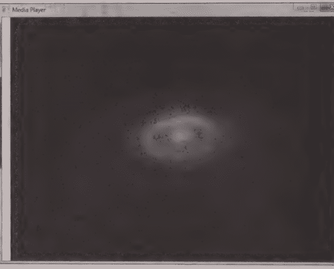

**图 16-4：** 播放视频文件。

**列表 16-3：** VideoApp 程序

```java
import javafx.application.*;
import javafx.stage.*;
import javafx.scene.*;
import javafx.scene.layout.*;
import javafx.scene.control.*;
import javafx.scene.media.*;
import java.io.*;

public class VideoApp extends Application {
    public static void main(String[] args) {
        launch(args);
    }

    private final String PATH = "C:\\Media\\Solar_System_Birth_ipod_sm.mp4";

    @Override
    public void start(Stage primaryStage) {
        File f = new File(PATH);
        Media media = new Media(f.toURI().toString());
        MediaPlayer mplayer = new MediaPlayer(media);
        mplayer.setAutoPlay(true);
        MediaView mview = new MediaView(mplayer);
        mview.setFitWidth(700);
        mview.setFitHeight(500);
        StackPane pane = new StackPane(mview);
        Scene scene = new Scene(pane);
        primaryStage.setScene(scene);
        primaryStage.setTitle("Media Player");
        primaryStage.show();
    }
}
```


# 第 17 章：让你的场景动起来

## 本章内容

- 查看创建 JavaFX 动画的各种方法
- 使用 JavaFX 过渡（transitions）
- 使用 `KeyFrame` 和 `Timeline` 类
- 创建跳动的球

你可以通过应用第 14 章中描述的特效、使用属性绑定来改进应用程序的外观和体验，并使用声音和媒体效果。在本章中，我讨论了如何通过整合简单的动画来进一步提升你的应用程序。本章中提到的特效让屏幕上的对象动起来。请不要对明年获得最佳动画奥斯卡奖抱太大期望。没有人会被认为你和 Pixar 合作过。尽管如此，可以使用这些技术为应用程序添加一些有趣的特效。

## 介绍 JavaFX 动画

JavaFX 动画的基本思想是定期操控一个或多个属性的值。例如，假设你有一个代表球的圆，你想移动它。

影响球跨越屏幕速度的因素有两个：每次变化之间的时间间隔，以及你添加的增量。例如，如果你在每个间隔向 `posX` 属性增加 3，那么需要 200 次才能到达 600。如果间隔每 10 毫秒发生一次（每秒 100 次），则需要 2000 毫秒（2 秒）球才能穿越屏幕。

如果没有 JavaFX 动画，你可以使用 `Timer` 对象来移动球。`Timer` 类可能很难设置和正确使用。JavaFX 动画类可以让你的过程变得简单得多。

JavaFX 提供了两种创建动画的基本方法，我在本章中使用术语称为硬方法和简单方法：

- **硬方法**：要求你手动设置定时器事件，并在事件发生时编写事件监听器。在事件监听器中，你操控想要动画的节点属性。例如，为了让球跨越屏幕，你设置一个每 10 毫秒触发一次的定时器。每次触发时将球的 x 位置增加 3。你设置定时器总共运行 200 次。
- **简单方法**：利用 JavaFX 提供的快捷类来轻松实现常见类型的动画。例如，你可以使用 `TranslateTransition` 类轻松地在指定时间内让圆从屏幕的一侧移动到另一侧。你只需创建一个 `TranslateTransition`，指定在 2 秒内将球的 x 位置从 0 变为 600。

## 使用过渡类

JavaFX 带有八种预定义的动画效果——被称为过渡类，你可以使用它们在场景图中的几乎任何节点上轻松地创建动画。（大多数过渡适用于任何节点，但某些只适用于形状。）这八种过渡类型是：

- **FadeTransition（淡入过渡）**：改变任何节点的透明度值。你可以使用此过渡效果让对象淡入或淡出。或者，你也可以用它通过快速淡出再淡入来让对象“眨眼”。你还可以用它创建一个不断重复淡入和然后淡出的闪烁光效果。
- **FillTransition（填充过渡）**：将形状的填充颜色从起始颜色变化到结束颜色。例如，你可以让圆圈从红色变为绿色。
- **PathTransition（路径过渡）**：让形状沿着预定义的路径移动。你可以使用任何形状作为路径。
- **PauseTransition（暂停过渡）**：这个实用的过渡效果只是简单地暂停一下；它用于两个过渡效果之间，引起动作的中断。
- **RotateTransition（旋转过渡）**：让节点旋转。
- **ScaleTransition（缩放过渡）**：让对象增大或减小。
- **StrokeTransition（描边过渡）**：改变用于形状轮廓描边的颜色。
- **TranslateTransition（平移过渡）**：通过将节点从一个位置平移到另一个位置来移动节点。

这八个过渡类都是 `Transition` 类的子类，而 `Transition` 类又是 `Animation` 类的子类。表 17-1 列出了 `Transition` 和 `Animation` 类定义的方法，因此这些方法对所有过渡类可用。

### 表 17-1 Transition 和 Animation 类的方法

| 方法 | 解释 |
| :--- | :--- |
| `void play()` | 从当前位置开始播放动画。 |
| `void playFromStart()` | 从开始播放动画。 |
| `void pause()` | 临时暂停动画。你可以通过调用 `play` 重新启动它。 |
| `void stop()` | 停止动画。 |
| `void setCycleCount(int value)` | 设置动画重复的次数。若要无限次重复动画，请指定 `Animation.INDEFINITE`。 |
| `void setAutoReverse(boolean value)` | 如果为 `true`，动画在每次循环重复时都会反转方向。 |
| `void setInterpolator(Interpolator value)` | 确定用于计算过渡控制的属性中间值的方法。可能的值有 `Interpolator.DISCRETE`、`Interpolator.LINEAR`、`Interpolator.EASE_IN`、`Interpolator.EASE_OUT`、`Interpolator.EASE_BOTH`。默认设置是 `EASE_BOTH`。 |

表 17-1 中的大多数方法都是简单直观的，但 `setInterpolator` 方法值得稍微解释。插值器是用于计算过渡控制的属性中间值的方法。例如，在 `FadeTransition` 中，插值器决定了动画运行期间节点透明度值的变化方式；对于 `TranslateTransition`，插值器决定了动画过程中 x 坐标和 y 坐标是如何变化的。

默认的插值器设置是 `Interpolator.EASE_BOTH`，这意味着变化开始很慢，在动画中间阶段加速，最后在动画结束前减慢。对于 `TranslateTransition`，这会导致节点的移动缓慢开始、加速，然后在结束时减慢。

`EASE_IN` 插值器在开始时加速但结束得很突然，而 `EASE_OUT` 插值器开始时很突然但在结束时减慢。`LINEAR` 插值器在整个动画过程中以恒定速率变化过渡控制的属性。而 `DISCRETE` 插值器在到达动画结束之前完全不改变属性值；到达之后，它会立即变为结束值。

表 17-2 列出了每个过渡类型最常用的构造函数和方法。

### 表 17-2 过渡类

| 类 | 构造函数/方法 | 解释 |
| :--- | :--- | :--- |
| **FadeTransition** | `FadeTransition(Duration duration, Node node)` | 为指定的节点创建指定持续时间的淡入过渡。 |
| | `void setFromValue(Double value)` | 设置淡入过渡的起始透明度。 |
| | `void setToValue(Double value)` | 设置淡入过渡的结束透明度。 |
| | `void setByValue(Double value)` | 如果没有指定结束透明度，则将此值加到起始值上以确定结束透明度。 |
| **FillTransition** | `FillTransition(Duration duration, Shape shape)` | 为指定的形状创建指定持续时间的填充过渡。 |
| | `void setFromValue(Color value)` | 设置填充过渡的起始颜色。 |
| | `void setToValue(Color value)` | 设置填充过渡的结束颜色。 |
| **PathTransition** | `PathTransition(Duration duration, Shape path, Shape shape)` | 创建指定持续时间的路径过渡。路径平移使指定的形状沿着指定的路径移动。 |
| | `void setFromValue(Color value)` | 设置淡入过渡的起始颜色。 |
| | `void setToValue(Color value)` | 设置淡入过渡的结束颜色。 |
| **PauseTransition** | `PauseTransition(Duration duration)` | 产生指定时间的延迟。 |
| **RotateTransition** | `RotateTransition(Duration duration, Node node)` | 在指定的节点上创建指定持续时间的旋转过渡。 |
| | `void setFromAngle(Double value)` | 设置旋转的起始角度。 |
| | `void setToAngle(Double value)` | 设置指定旋转的结束角度。 |
| | `void setByAngle(Double value)` | 如果没有指定结束角度，则将此值加到起始角度上以确定结束角度。 |
| **ScaleTransition** | `ScaleTransition(Duration duration, Node node)` | 在指定的节点上创建指定持续时间的缩放过渡。 |
| | `void setFromX(Double value)` | 设置 x 轴的起始缩放值。 |
| | `void setFromY(Double value)` | 设置 y 轴的起始缩放值。 |
| | `void setFromZ(Double value)` | 设置 z 轴的起始缩放值。 |
| | `void setToX(Double value)` | 设置 x 轴的结束缩放值。 |
| | `void setToY(Double value)` | 设置 y 轴的结束缩放值。 |
| | `void setToZ(Double value)` | 设置 z 轴的结束缩放值。 |
| | `void setByX(Double value)` | 如果没有指定 x 轴的结束缩放值，则将此值加到起始缩放值上以确定结束缩放值。 |
| | `void setByY(Double value)` | 如果没有指定 y 轴的结束缩放值，则将此值加到起始缩放值上以确定结束缩放值。 |
| | `void setByZ(Double value)` | 如果没有指定 z 轴的结束缩放值，则将此值加到起始缩放值上以确定结束缩放值。 |
| **StrokeTransition** | `StrokeTransition(Duration duration, Shape shape)` | 为形状创建指定持续时间的描边过渡。 |
| | `void setFromValue(Color value)` | 设置描边的起始颜色。 |
| | `void setToValue(Color value)` | 设置描边的结束颜色。 |
| **TranslateTransition** | `TranslateTransition(Duration duration, Node node)` | 为指定的节点创建指定持续时间的平移过渡。 |
| | `void setFromX(Double value)` | 设置 x 轴的起始位置点。 |
| | `void setFromY(Double value)` | 设置 y 轴的起始位置点。 |
| | `void setFromZ(Double value)` | 设置 z 轴的起始位置点。 |
| | `void setToX(Double value)` | 设置 x 轴的结束位置点。 |
| | `void setToY(Double value)` | 设置 y 轴的结束位置点。 |
| | `void setToZ(Double value)` | 设置 z 轴的结束位置点。 |
| | `void setByX(Double value)` | 如果没有指定 x 轴的结束位置点，则将此值加到起始位置点以确定结束位置点。 |
| | `void setByY(Double value)` | 如果没有指定 y 轴的结束位置点，则将此值加到起始位置点以确定结束位置点。 |
| | `void setByZ(Double value)` | 如果没有指定 z 轴的结束位置点，则将此值加到起始位置点以确定结束位置点。 |

### 通过、从或到设置属性？

在表 17-2 中列出的多个过渡类中出现的 `setFrom`、`setTo` 和 `setBy` 方法值得稍微解释。

默认情况下，过渡的起始和结束值是节点被动画属性的当前值。因此，`TranslateTransition` 的默认起始和结束位置是当前的 x 和 y 位置。

以下是指定不同起始值、结束值或其他几种方法：

- 使用 `setTo` 方法让节点的当前值作为起始值，并指定新值。
- 使用 `setBy` 方法指定一个到结束值的位移。您在 `setBy` 方法中指定的值将加到起始值上以确定结束值。
- 使用 `setFrom` 方法从节点的当前值处更改起始位置。然后，省略所有 `setTo` 和 `setBy` 值，以让节点的当前值成为结束值。
- 使用 `setFrom` 方法从节点的当前值处更改起始位置，并使用 `setTo` 设置结束值。
- 使用 `setFrom` 方法从节点的当前值处更改起始位置，并使用 `setBy` 指定一个位移值，该值将加到起始位置以确定结束位置。

## 查看过渡示例

表 17-2 列出的过渡工作原理基本相同。要使用其中任何一种，只需通过调用其构造函数创建过渡，并指定过渡的持续时间和你要动画化的节点。然后，如果有必要，可以调用额外的方法设置过渡参数。最后，调用 `play()` 方法开始动画。

下面的示例展示了一个将名为 `c` 的圆从场景的左上角移动到位置 300, 300 的过渡：

```java
TranslateTransition t = new TranslateTransition(
    Duration.millis(2000), c);

t.setFromX(0);
t.setFromY(0);
t.setToX(300);
t.setToY(300);
t.play();
```

在这里，动画持续时间设置为 2 秒（2000 毫秒）。

列表 17-1 显示了如何将此过渡整合到一个完整的程序中。如你所示，程序在场景的左边缘显示一个红球，然后将球移动到场景的右边缘。过渡的循环次数被设置为无限，自动反转设置为 `true`。结果是，动画无限重复，产生出球在屏幕右边缘和左边缘之间来回跳的效果。

### 列表 17-1：跳动球程序

```java
import javafx.application.*;
import javafx.stage.*;
import javafx.scene.*;
import javafx.scene.layout.*;
import javafx.scene.shape.*;
import javafx.scene.paint.*;
import javafx.animation.*;
import javafx.util.*;

public class BouncingBall extends Application {

    public static void main(String[] args) {
        launch(args);
    }

    @Override
    public void start(Stage primaryStage) {
        RadialGradient g = new RadialGradient(
            0, 0,
            0.35, 0.35,
            0.5,
            true,
            CycleMethod.NO_CYCLE,
            new Stop(0.0, Color.WHITE),
            new Stop(1.0, Color.RED));

        Circle ball = new Circle(0, 0, 20);
        ball.setFill(g);

        Group root = new Group();
        root.getChildren().add(ball);

        Scene scene = new Scene(root, 600, 600);

        primaryStage.setScene(scene);
        primaryStage.setTitle("Bouncing Ball");
        primaryStage.show();

        TranslateTransition t = new TranslateTransition(
            Duration.millis(2000), ball);

        t.setFromX(ball.getX() - ball.getRadius());
        t.setToX(scene.getWidth() - ball.getRadius());
        t.setFromY(scene.getHeight() / 2);
        t.setToY(scene.getHeight() / 2);

        t.setCycleCount(Animation.INDEFINITE);
        t.setAutoReverse(true);
        t.setInterpolator(Interpolator.LINEAR);
        t.play();
    }
}
```


接下来的段落强调了该程序中的关键点：

- 20：创建了一个径向渐变，以赋予球三维立体外观。
- 29：创建了圆。它的半径为 20 像素，填充颜色是第 20 行创建的渐变。
- 32：创建了一个组对象作为场景的根节点。然后，将球添加到组中，并使用该组创建并显示场景。
- 39：创建了一个 `TranslateTransition` 来移动球。持续时间设置为 2 秒。
- 41：将 `fromX` 属性设置为球的半径。这使得球的左边缘位于场景的左边缘。
- 42：将 `toX` 属性设置为屏幕宽度减去球的半径。这使得球在动画周期结束时位于屏幕的右边缘。
- 43：将 `fromY` 和 `toY` 属性设置为场景高度的一半。这样，球将沿着场景垂直方向上居中的水平路径移动。
- 45：将循环次数设置为 `INDEFINITE`，这样球将永远跳动。
- 46：将 `AutoReverse` 设置为 `true`，以便每个循环都会反转球移动的方向。
- 47：将插值器设置为线性的，这样球在接近场景边缘时不会减速。
- 48：播放！

图 17-1 显示了跳动球程序的运行情况。

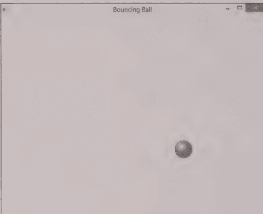

图 17-1：跳动球程序的运行情况。

## 组合过渡

JavaFX 提供了两个过渡类，旨在让你组合过渡，以便两个或多个过渡一个接一个或同时运行。`SequentialTransition` 类允许你一个接一个运行过渡，而 `ParallelTransition` 类允许你同时运行过渡。这两个类都拥有简单的构造函数，可以接受过渡列表，并有一个可以启动它们的 `play` 方法。例如，如果你有三个名为 `t1`、`t2` 和 `t3` 的过渡，你可以按如下顺序运行它们：

```java
SequentialTransition s = new SequentialTransition(t1, t2, t3);
s.play();
```

或者：

```java
SequentialTransition s = new SequentialTransition(t1, t2, t3);
s.play();
```

如果你希望同时运行所有过渡，请使用 `ParallelTransition`：

```java
ParallelTransition p = new ParallelTransition(t1, t2, t3);
p.play();
```

注意：`SequentialTransition` 本身可以是一个 `ParallelTransition`。例如，假设你有三个名为 `t1`、`t2` 和 `t3` 的过渡，并且你想顺序运行 `t1` 和 `t2`，同时运行 `t3`。你可以实现：

```java
ParallelTransition p = new ParallelTransition(new SequentialTransition(t1, t2), t3);
p.play();
```

为了说明如何将过渡组合成完整的程序，列表 17-2 显示了一个两个球的 `BouncingBall` 程序变体。

# 第四部分：让你的程序活跃起来

## 列表 17-2：跳动球程序

```java
import javafx.application.*;
import javafx.stage.*;
import javafx.scene.*;
import javafx.scene.layout.*;
import javafx.scene.shape.*;
import javafx.scene.paint.*;
import javafx.animation.*;
import javafx.util.*;

public class BouncingBall extends Application {

    public static void main(String[] args) {
        launch(args);
    }

    @Override
    public void start(Stage primaryStage) {
        RadialGradient g = new RadialGradient(
            0, 0,
            0.35, 0.35,
            0.5,
            true,
            CycleMethod.NO_CYCLE,
            new Stop(0.0, Color.WHITE),
            new Stop(1.0, Color.RED));

        Circle ball1 = new Circle(0, 0, 20);
        ball1.setFill(g);

        Circle ball2 = new Circle(0, 0, 20);
        ball2.setFill(g);

        Group root = new Group();
        root.getChildren().add(ball1);
        root.getChildren().add(ball2);

        Scene scene = new Scene(root, 600, 600);

        primaryStage.setScene(scene);
        primaryStage.setTitle("Two Bouncing Balls");
        primaryStage.show();

        TranslateTransition t1 = new TranslateTransition(
            Duration.millis(2000), ball1);
        t1.setFromX(ball1.getRadius());
        t1.setToX(scene.getWidth() - ball1.getRadius());
        t1.setFromY(scene.getHeight() / 3);
        t1.setToY(scene.getHeight() / 3);
        t1.setCycleCount(Transition.INDEFINITE);
        t1.setAutoReverse(true);
        t1.setInterpolator(Interpolator.LINEAR);

        TranslateTransition t2 = new TranslateTransition(
            Duration.millis(2000), ball2);
        t2.setFromX(scene.getWidth() - ball2.getRadius());
        t2.setToX(ball2.getRadius());
        t2.setFromY(scene.getHeight() / 3 * 2);
        t2.setToY(scene.getHeight() / 3 * 2);
        t2.setCycleCount(Transition.INDEFINITE);
        t2.setAutoReverse(true);
        t2.setInterpolator(Interpolator.LINEAR);

        ParallelTransition pt = new ParallelTransition(t1, t2);
        pt.play();
    }
}
```

## 使用进阶方式制作动画

现在你已经学会了创建动画的简单方法（使用过渡类），现在是时候看看更困难的方法了。当然，正如你可能预想的那样，更困难的方法也是更灵活的方法。

例如，列表 17-1 和 17-2 显示的跳球很有趣，但并不非常实用，因为它们在严格的水平方向上来回跳动。如果你想用这些球创建一个游戏，你可能希望它们能以角度到处跳动，并在场景的四个边缘上反弹。你还希望它们能够相互反弹。要实现这一点，你需要使用两个高级动画类：`KeyFrame` 和 `Timeline`：

- **KeyFrame：** `KeyFrame` 是一个时间间隔，当时间间隔过期时会触发一个 `Action`。
- **Timeline：** `Timeline` 是 `KeyFrame` 的序列。

当你创建一个 `KeyFrame` 时，你会指定时间间隔的持续时间并提供一个 `Action` 监听器。然后，在动作监听器中，你提供实现动画的代码。在这个跳球程序中，动作事件将检查每个运动中的球，并计算每个球的下一个位置，同时考虑球从场景边缘反弹或相互反弹的影响。

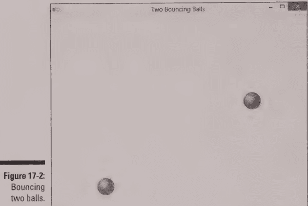

当你调用 `Timeline` 的 `play` 方法时，每个 `KeyFrame` 都会按顺序执行。`Timeline` 还有一个 `cycleCount` 属性，表示时间轴重复的次数，以及控制时间轴执行的 `play`、`pause` 和 `stop` 方法。你可以将循环次数设置为 `INFINITE` 以无限持续运行动画。

要创建一个 `KeyFrame`，请使用两个参数调用 `KeyFrame` 构造函数：keyFrame 的持续时间（通常以毫秒为单位）以及计时器过期时将调用的 `ActionListener` 监听器。这里有一个使用 Lambda 表达式定义简单监听器的示例：

```java
KeyFrame k = new KeyFrame(Duration.millis(10), e -> {
    // 动作监听器代码放在在这里
});
```

要将此 `KeyFrame` 添加到 `Timeline` 并运行动画，请使用以下代码：

```java
Timeline t = new Timeline(k);
t.setCycleCount(Timeline.INDEFINITE);
t.play();
```

列表 17-3 显示了一个使用 `KeyFrame` 和 `Timeline` 类让球在场景的四个边缘上反弹的程序。

### 列表 17-3：进阶 BouncingBall 程序

```java
import javafx.application.*;
import javafx.stage.*;
import javafx.scene.*;
import javafx.event.*;
import javafx.scene.layout.*;
import javafx.scene.shape.*;
import javafx.scene.paint.*;
import javafx.animation.*;
import javafx.util.*;

public class HardBouncingBall extends Application {

    public static void main(String[] args) {
        launch(args);
    }

    private Circle ball;
    private double x_speed = 2;
    private double y_speed = 3;
    final private int WIDTH = 600;
    final private int HEIGHT = 500;
    final private int BALL_SIZE = 20;

    @Override
    public void start(final Stage primaryStage) {
        Group root = new Group();
        RadialGradient g = new RadialGradient(
            0, 0, 0.35, 0.35,
            0.5,
            true,
            CycleMethod.NO_CYCLE,
            new Stop(0.0, Color.WHITE),
            new Stop(1.0, Color.RED)
        );

        ball = new Circle(BALL_SIZE, g);
        ball.setCenterX(BALL_SIZE);
        ball.setCenterY(BALL_SIZE);
        root.getChildren().addAll(ball);

        Scene scene = new Scene(root, WIDTH, HEIGHT);
        primaryStage.setTitle("Bouncing Ball");
        primaryStage.setScene(scene);
        primaryStage.show();

        KeyFrame k = new KeyFrame(Duration.millis(10), e -> {
            ball.setCenterX(ball.getCenterX() + x_speed);
            ball.setCenterY(ball.getCenterY() + y_speed);
            if (ball.getCenterX() <= BALL_SIZE ||
                ball.getCenterX() >= WIDTH - BALL_SIZE)
                x_speed = -x_speed;
            if (ball.getCenterY() <= BALL_SIZE ||
                ball.getCenterY() >= HEIGHT - BALL_SIZE)
                y_speed = -y_speed;
        });

        Timeline t = new Timeline(k);
        t.setCycleCount(Timeline.INDEFINITE);
        t.play();
    }
}
```

接下来的段落将该程序中的关键点：

- 18：这些类变量在 `ActionEvent` 处理器内部使用。
- 29：在这里创建了用于填充球的渐变。
- 38：创建了球。初始的 x 和 y 坐标将球放在场景的左上角。
- 42：设置了场景。
- 48：创建了一个持续时间 10 毫秒的 `KeyFrame`。
- 51：在动作监听器中，球在移动。
- 54：球与场景边缘的碰撞检测。
- 58：球与彼此边缘的碰撞检测。
- 63：`Timeline` 设置为 `INDEFINITE`。

# 第四部分：让你的程序运行起来

## 列表 17-4（续）

```java
KeyFrame k = new KeyFrame(Duration.millis(10), e -> {
    for (Ball ball : balls) {
        ball.move();
    }
});

Timeline t = new Timeline(k);
t.setCycleCount(Timeline.INDEFINITE);
t.play();
```

```java
public class Ball extends Circle {
    public double x;
    public double y;
    public double radius;
    private double fieldWidth;
    private double fieldHeight;

    Ball(double radius,
         double fieldWidth,
         double fieldHeight,
         ArrayList<Ball> balls) {
        super();
        this.radius = radius;
        this.fieldWidth = fieldWidth;
        this.fieldHeight = fieldHeight;
        this.x = Math.random() * (fieldWidth - radius);
    }

    super.setRadius(radius);
    super.setCenterX(Math.random() * (fieldWidth - this.radius) + 1);
    super.setCenterY(Math.random() * (fieldHeight - this.radius) + 1);
    this.x = Math.random() * 5 + 1;
    this.y = Math.random() * 5 + 1;

    RadialGradient g = new RadialGradient(
        0,
        0, 0.35, 0.35,
        0.5,
        true,
        CycleMethod.NO_CYCLE,
        new Stop(0.0, Color.WHITE),
        new Stop(1.0, Color.RED));
    super.setFill(g);
}
```

# 第 17 章：制作你的场景

```java
public void move() {
    super.setCenterX(super.getCenterX() + this.x_speed);
    super.setCenterY(super.getCenterY() + this.y_speed);
    // 检测与左边缘的碰撞
```


```java
if (super.getCenterX() <= this.radius) {
    super.setCenterX(this.radius);
    this.x_speed = -this.x_speed;
}

// 检测与右边缘的碰撞
if (super.getCenterX() >= this.fieldWidth - this.radius) {
    super.setCenterX(this.fieldWidth - this.radius);
    this.x_speed = -this.x_speed;
}

// 检测与顶边缘的碰撞
if (super.getCenterY() <= this.radius) {
    super.setCenterY(this.radius);
    this.y_speed = -this.y_speed;
}

// 检测与底边缘的碰撞
if (super.getCenterY() >= this.fieldHeight - this.radius) {
    super.setCenterY(this.fieldHeight - this.radius);
    this.y_speed = -this.y_speed;
}

// 检测与其他球的碰撞
for (Ball b : balls) {
    if (b != this && b.intersects(super.getLayoutBounds())) {
        double tempx = this.x_speed;
        double tempy = this.y_speed;
        this.x_speed = b.x_speed;
        this.y_speed = b.y_speed;
        b.x_speed = tempx;
        b.y_speed = tempy;
        break;
    }
}
```

# 第 362 部分：让你的程序活起来

以下段落解释了该程序的关键点：

- → 23: 使用了一个名为 `balls` 的 `ArrayList` 来存储由此程序动画的球。
- → 29: 循环创建了十个 `Ball` 对象并将它们添加到数组列表中。`Ball` 对象的构造函数传递了球的大小、场景的宽和高以及 `balls` 数组列表。
- → 34: 将 `balls` 数组列表添加到场景根节点。
- → 36: 将根节点添加到场景中并显示场景。
- → 41: 创建了一个间隔为 10 毫秒的 `KeyFrame`。动作监听器非常简单：它只是为 `balls` 集合中的每个 `Ball` 调用 `move` 方法。
- → 48: 使用第 41 行创建的 `KeyFrame` 创建了一个 `Timeline`。然后播放时间线以设置球的运动。
- → 53: `Ball` 类继承了 `Circle` 类。
- → 55: 类字段用于存储 `x` 和 `y` 速度内部值、圆形半径以及游戏场的宽和高。
- → 61: 构造函数接受四个参数：半径、游戏场宽和高，以及一个包含需要检查碰撞的其它 `Ball` 对象的数组列表。
- → 66: `Ball` 构造函数首先调用父类构造函数以创建一个 `Circle` 对象，该球将基于此对象进行扩展。
- → 68: 半径、宽度和高度类变量根据传递给构造函数的值初始化。
- → 72: 设置圆形的半径与传递给构造函数的半径匹配。
- → 74: 中心 x 轴和 y 轴位置以及 x 轴和 y 速度字段被设置为随机值。
- → 81: 创建了渐变填充。
- → 92: `move` 方法通过加上 `x` 和 `y` 速度字段开始。
- → 97: 使用 `if` 语句检测与左边缘的碰撞。
- → 104: 另一个 `if` 语句检查与右边缘的碰撞。
- → 111: 与顶边缘的碰撞。
- → 118: 与底边缘的碰撞。
- → 125: 现在变得有趣了。`for` 循环遍历球。
- → 131: 如果检测到碰撞，交换两个球的 x 和 y 速度值。
- → 137: 如果检测到碰撞，执行 `break` 语句以防止与其他球发生碰撞。

# 第 17 章：制作你的场景

## 第 18 章：针对触摸设备

# 第 366 部分：让你的程序活跃起来

在相反的方向，用户正尝试旋转屏幕上的一个对象。JavaFX 会确定哪个对象是旋转的目标，计算出用户旋转了多少度，然后向目标发送一个 `ROTATE` 事件。你所做的只是为 `ROTATE` 事件提供一个事件监听器。

实际上，当用户执行旋转手势时，JavaFX 可能会向旋转目标发送几十个独立的 `ROTATE` 事件。这些事件中的每一个都代表了完成完全旋转过程中的一个增量步骤。你的程序将通过按 `ROTATE` 事件指定的幅度旋转目标对象来响应这些事件；结果是当用户继续旋转时，对象会流畅地跟随用户的手指移动。

JavaFX 为四种不同类型的触摸手势提供了事件处理：

- 旋转（Rotate）：当用户将两个手指放在屏幕上并向相反方向旋转时，就会识别出旋转手势。识别出旋转手势时会生成三个不同的事件：
    - `ROTATE_STARTED`：此事件在识别出旋转手势后发生一次。
    - `ROTATE_DRAGGED`：此事件在整个旋转手势过程中可能会发生多次。这通常是你想要处理的事件。
    - `ROTATE_FINISHED`：此事件在识别出旋转手势结束后发生一次。

所有的旋转事件都由 `RotateEvent` 对象表示，该对象定义了两个关键方法：
    - `getAngle()`：返回此特定事件的旋转角度。
    - `getTotalAngle()`：返回整个旋转手势的累积角度。

- 缩放（Zoom）：当用户将两个手指放在屏幕上，然后分开或靠拢它们时，就会识别出缩放手势。与旋转手势一样，缩放手势会创建三种类型的事件：
    - `ZOOM_STARTED`：此事件在缩放手势开始时发生。
    - `ZOOM_DRAGGED`：此事件在整个缩放手势过程中发生多次。
    - `ZOOM_FINISHED`：此事件在缩放手势结束时发生。

缩放事件由 `ZoomEvent` 类定义，该类有两个重要的方法：
    - `getZoomFactor()`：返回此特定事件的缩放因子。
    - `getTotalZoomFactor()`：返回整个缩放手势的累积缩放因子。


## 第 18 章：针对触摸设备 367

缩放因子是一个你可以用来确定缩放对象新尺寸的倍数。例如，如果用户将目标对象的大小翻倍，缩放因子将为 2.0。

- 滚动（Scroll）：当用户将一个手指放在屏幕上并将其拖到另一个位置时，就会识别出滚动手势。同样，滚动手势会生成三种类型的事件：
    - `SCROLL_STARTED`：在滚动手势开始时发生。
    - `SCROLL`：在整个滚动手势过程中发生多次。
    - `SCROLL_FINISHED`：在滚动手势结束时发生。

滚动事件由 `ScrollEvent` 类表示，该类提供了几个方法来获取滚动量：
    - `getDeltaX()`：返回此滚动事件的水平变化。
    - `getDeltaY()`：返回此滚动事件的垂直变化。
    - `getTotalDeltaX()`：返回此滚动手势的水平总变化。
    - `getTotalDeltaY()`：返回此滚动手势的垂直总变化。

- 滑动（Swipe）：当用户将一个手指放在屏幕上并快速水平或垂直滑动时，就会识别出滑动手势。与其他手势不同，滑动手势不会产生指示手势开始和结束的事件。相反，会生成以下事件之一来指示滑动方向：
    - `SWIPE_LEFT`（左滑）
    - `SWIPE_RIGHT`（右滑）
    - `SWIPE_UP`（上滑）
    - `SWIPE_DOWN`（下滑）

滑动事件由 `SwipeEvent` 类表示。

滑动事件和滚动事件很难区分，因为滑动仅仅是在水平或垂直方向上的快速滚动。因此，当用户执行滑动手势时，除了滑动事件外，还会生成滚动事件。


## 第四部分：让你的程序活跃起来

## 监听手势

你可以通过调用表 18-1 列出的任方法之一，为任何节点对象上的任何手势安装监听器。与所有的 JavaFX 事件一样，这些事件使用函数式接口，因此你可以轻松使用 Lambda 表达式实现事件监听器。

| 表 18-1 | 安装手势监听器的节点方法 |
| --- | --- |
| 方法 | 解释 |
| `void setOnRotate(RotateEvent listener)` | 为 `ROTATE` 事件创建一个监听器。 |
| `void setOnRotateStarted(RotateEvent listener)` | 为 `ROTATE_STARTED` 事件创建一个监听器。 |
| `void void setOnRotateFinished(RotateEvent listener)` | 为 `ROTATE_FINISHED` 事件创建一个监听器。 |
| `void setOnZoom(ZoomEvent listener)` | 为 `ZOOM` 事件创建一个监听器。 |
| `void setOnZoomStarted(ZoomEvent listener)` | 为 `ZOOM_STARTED` 事件创建一个监听器。 |
| `void setOnZoomFinished(ZoomEvent listener)` | 为 `ZOOM_FINISHED` 事件创建一个监听器。 |
| `void setOnScroll(ScrollEvent listener)` | 为 `SCROLL` 事件创建一个监听器。 |
| `void setOnScrollStarted(ScrollEvent listener)` | 为 `SCROLL_STARTED` 事件创建一个监听器。 |
| `void setOnScrollFinished(ScrollEvent listener)` | 为 `SCROLL_FINISHED` 事件创建一个监听器。 |
| `void setOnSwipeLeft(SwipeEvent listener)` | 为 `SWIPE_LEFT` 事件创建一个监听器。 |
| `void setOnSwipeRight(SwipeEvent listener)` | 为 `SWIPE_RIGHT` 事件创建一个监听器。 |
| `void setOnSwipeUp(SwipeEvent listener)` | 为 `SWIPE_UP` 事件创建一个监听器。 |
| `void setOnSwipeDown(SwipeEvent listener)` | 为 `SWIPE_DOWN` 事件创建一个监听器。 |

## 第 18 章：针对触摸设备 368

这是一个示例，它创建一个矩形，然后为旋转事件安装监听器：

```java
Rectangle r = new Rectangle(150, 150, 200, 200);
r.setFill(Color.DARKGRAY);
r.setOnRotate(e -> {
    r.setRotate(r.getRotate() + e.getAngle());
    e.consume();
});
```

矩形的旋转通过获取当前旋转并加上旋转事件的角度来修改。


该事件处理器处理 `consume()` 方法以丢弃事件。这在处理手势事件时非常重要。如果不消费事件，事件将沿着链传递并可能再次处理。

你了解的另一个细节是手势事件具有惯性，这会导致在用户完成手势后产生事件。例如，当用户完成滚动手势时，会发生 `SCROLL_FINISHED` 事件，但在 `SCROLL_FINISHED` 事件之后还会产生 `SCROLL` 事件。

你可以调用手势事件的 `isInertia()` 方法来判断事件是否是由惯性产生的。如果你想抑制惯性的影响，当 `isInertia()` 返回 `true` 时可以忽略该事件，例如：

```java
Rectangle r = new Rectangle(150, 150, 200, 200);
r.setFill(Color.DARKGRAY);
r.setOnRotate(e -> {
    if (!e.isInertia()) {
        r.setRotate(r.getRotate() + e.getAngle());
        e.consume();
    }
});
```

在这里，只有当事件不是由惯性产生时，矩形才会旋转。

## 查看示例程序

在本节中，你将查看示例程序——Gesturator。该程序在屏幕上显示一个简单的矩形，并允许用户使用手势操作矩形。图 18-1 显示了 Gesturator 程序显示的场景。

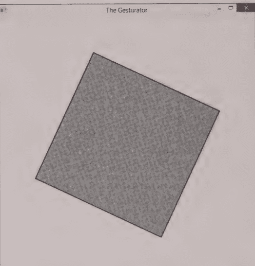

图 18-1：Gesturator 程序的运行。

以下是 Gesturator 程序的关键功能：

- 初始状态，矩形位于屏幕中央。
- 用户可以使用旋转手势旋转矩形。
- 用户可以使用缩放手势更改矩形的大小。
- 用户可以通过单指拖动来移动矩形。移动受到限制，以确保整个矩形留在场景边界内。
- 用户可以通过向正确的方向滑动矩形，将其推向屏幕的侧边缘。程序通过对滑动手势做出响应，将矩形一直移动到屏幕边缘。

列表 18-1 提供了 Gesturator 程序的完整源代码。

# 列表 18-1：Gesturator 程序

```java
import javafx.application.*;
import javafx.scene.*;
import javafx.stage.*;
import javafx.scene.control.*;
import javafx.scene.paint.*;
import javafx.scene.shape.*;
import javafx.scene.input.*;
import javafx.event.*;

public class Gesturator extends Application {

    public static void main(String[] args) {
        launch(args);
    }

    private final double RECT_X = 200;
    private final double RECT_Y = 200;
    private final double SCENE_X = 600;
    private final double SCENE_Y = 600;

    @Override public void start(Stage primaryStage) {
        Group root = new Group();
        Rectangle r = new Rectangle((SCENE_X - RECT_X)/2, (SCENE_Y - RECT_Y)/2, RECT_X, RECT_Y);
        r.setFill(Color.DARKGRAY);
        r.setStroke(Color.BLACK);
        r.setStrokeWidth(2);

        r.setOnZoom(e -> {
            r.setScaleX(r.getScaleX() * e.getZoomFactor());
            r.setScaleY(r.getScaleY() * e.getZoomFactor());
            e.consume();
        });

        r.setOnRotate(e -> {
            r.setRotate(r.getRotate() + e.getAngle());
            e.consume();
        });

        r.setOnScroll(e -> {
            if (e.isInertia()) {
                double newX = r.getX() + e.getDeltaX();
                if (newX >= 0 && newX <= SCENE_X - r.getWidth()) {
                    r.setX(newX);
                }
            }
            double newY = r.getY() + e.getDeltaY();
            if (newY >= 0 && newY <= SCENE_Y - r.getHeight()) {
                r.setY(newY);
            }
            e.consume();
        });

        r.setOnSwipeLeft(e -> {
            r.setX(0);
            e.consume();
        });

        r.setOnSwipeRight(e -> {
            r.setX(SCENE_X - r.getWidth());
            e.consume();
        });

        r.setOnSwipeUp(e -> {
            r.setY(0);
            e.consume();
        });

        r.setOnSwipeDown(e -> {
            r.setY(SCENE_Y - r.getHeight());
            e.consume();
        });

        root.getChildren().add(r);
        Scene scene = new Scene(root, SCENE_X, SCENE_Y);
        primaryStage.setTitle("The Gesturator");
    }
}
```


primaryStage.setScene(scene);
primaryStage.show();

以下段落解释了 Gesturator 程序的关键点：

- → 18：使用私有字段来设置矩形的大小和场景的大小。这些常量在程序中被多次引用。
- → 27：使用 `RECT_X` 和 `RECT_Y` 指定的大小创建矩形。初始中心位置是通过场景的大小和矩形的大小计算出的。
- → 36：缩放事件监听器通过将当前大小乘以 `ZoomEvent` 对象提供的缩放因子，来调整矩形的大小。
- → 43：旋转事件监听器通过将 `RotateEvent` 对象提供的旋转角度加到矩形的当前旋转值上来旋转矩形。
- → 49：滚动事件处理器比其他事件处理器稍微复杂一点，因为它对矩形的位置施加了若干限制。
- → 51：如果滚动事件是惯性的结果，则忽略它。这样，当用户停止滑动手势时，矩形会立即停止移动。
- → 53：为了确定新的 x 位置，滚动事件监听器通过在当前 x 位置上加上水平移动量 (`getDeltaX()`) 来计算建议的新的 x 位置。只有当建议的 x 位置大于 0 且小于屏幕宽度减去当前矩形宽度时，才将 x 位置设置为建议的位置。
- → 59：使用类似的逻辑来更改 y 位置。首先计算建议的 y 位置；然后只有当建议的 y 位置不会让矩形超出场景的顶部或底部时，才应用该 y 位置。
- → 69：向左滑动监听器将矩形移动到屏幕左边缘。
- → 75：向右滑动监听器将矩形移动到屏幕右边缘。
- → 81：向上滑动监听器将矩形移动到屏幕顶部。
- → 87：向下滑动监听器将矩形移动到屏幕底部。
- → 93：将矩形添加到根节点。然后，创建场景并显示在舞台上。

## 第五部分：十之篇


## 在部分 ...

- 应用更强大的控件
- 构建 3D 世界

## 第 19 章：更多 JavaFX 控件

### 本章内容

- 使用 `TitledPane` 类创建一个带边框和标题的面板
- 在 `Accordion` 中组合两个或多个 `TitledPane`
- 使用 `DatePicker` 和 `ColorPicker` 控件进行明智选择
- 创建外观像超链接的按钮
- 使用 `ProgressBar` 显示进度
- 使用 `Slider` 选择范围

```java
TitledPane sizeTPane = new TitledPane("尺寸", sizeBox);
```

```java
// 创建样式切换面板
RadioButton rbThin = new RadioButton("薄饼底");
RadioButton rbThick = new RadioButton("厚饼底");
ToggleGroup styleGroup = new ToggleGroup();
styleGroup.getToggles().addAll(rbThin, rbThick);
rbThin.setSelected(true);
VBox sizeBox = new VBox(10);
sizeBox.setPadding(new Insets(10));
sizeBox.getChildren().addAll(rbThin, rbThick);
TitledPane stylePane = new TitledPane("样式", styleBox);

// 创建配料切换面板
CheckBox cbPepperoni = new CheckBox("意大利腊米肠");
CheckBox cbSausage = new CheckBox("香肠");
CheckBox cbOlives = new CheckBox("橄榄");
CheckBox cbMushrooms = new CheckBox("蘑菇");
CheckBox cbAnchovies = new CheckBox("凤尾鱼");
VBox toppingsBox = new VBox(10);
toppingsBox.setPadding(new Insets(10));
toppingsBox.getChildren().addAll(cbPepperoni, cbSausage, cbOlives, cbMushrooms, cbAnchovies);
TitledPane toppingsTPane = new TitledPane("配料", toppingsBox);

// 创建折叠面板控件
Accordion acc = new Accordion();
acc.getPanes().addAll(sizeTPane, styleTPane, toppingsTPane);
```

## ColorPicker (颜色选择器)

颜色选择器是一种特殊的组合框，允许用户选择颜色。当颜色选择器最初显示时，它看起来是一个按钮。当用户点击它时，会出现一个调色板，用户从中选择颜色，如图 19-3 所示。

## 第 19 章：另外十个 JavaFX 控件 381

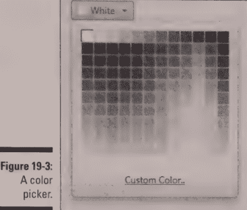

如果用户不喜欢颜色选择器调色板中显示的选项，可以点击选择器底部的自定义颜色链接。这将弹出一个对话框，允许用户创建自定义颜色，如图 19-4 所示。

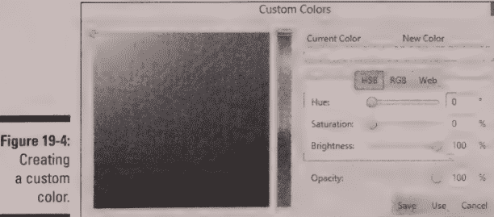

要创建一个颜色选择器，只需使用默认构造函数：

```java
ColorPicker cp = new ColorPicker();
```

你可以通过 `getValue()` 方法读取用户选择的颜色：

```java
Color c = cp.getValue();
```

## 382 第五部分：十之部分

下面的示例展示了如何为颜色选择器的 `OnAction` 事件添加监听器，以便将名为 `rect` 的矩形的填充颜色设置为所选颜色：

```java
cp.setOnAction(e -> rect.setFill(cp.getValue()));
```

## DatePicker (日期选择器)

类似于颜色选择器，日期选择器是一种特殊的组合框，允许用户从类日历显示中选择日期。最初，日期选择器看起来是一个文本字段。但当用户点击它时，会显示日历界面，如图 19-5 所示。用户随后可以选择日期，程序可以通过 `getValue()` 方法获取该日期，该方法返回 `LocalDate` 类型的日期。

> 图 19-5：日期选择器。


下面的示例创建了一个日期选择器控件和一个 `OnAction` 事件处理器，该处理器会将名为 `lbl` 的 Label 控件的文本设置为用户选择的日期：

```java
DatePicker dp = new DatePicker();
dp.setOnAction(e -> {
    LocalDate date = dp.getValue();
    lbl.setText(date.toString());
});
```

## 第 19 章：另外十个 JavaFX 控件

## Hyperlink (链接)

链接控件类似于 HTML 链接的按钮。它在鼠标悬停或点击时会发生变化。你可以通过为 `OnAction` 事件创建监听器来处理点击。

这里是创建链接并响应点击的示例代码：

```java
Hyperlink h1 = new Hyperlink("显示详情");
h1.setOnAction(e -> {
    // 此处编写代码
});
```

## ProgressIndicator (进度指示器) 和 ProgressBar (进度条)

进度指示器和进度条控件旨在让用户知道某些耗时较长的操作（例如更新数据库或下载文件）并没有停滞，而是正在完成。两者的区别在于可视化方式：`ProgressIndicator` 是一个圆形控件，随着进度的增加圆形会填充，而 `ProgressBar` 是从左到右填充的水平条。

要创建进度指示器或进度条，只需调用默认构造函数：

```java
ProgressIndicator pi = new ProgressIndicator();
ProgressBar pb = new ProgressBar();
```

要设置进度指示器显示的进度量，调用 `setProgress()` 方法并传入一个 0.0 到 1.0 之间的双精度值。例如，设置进度：

```java
pb.setProgress(0.45);
```

## 393 第五部分：十之部分

调用 `setProgress()` 方法之前，指示器被视为不确定状态，这意味着用户无法判断已经完成了多少进度。图 19-6 显示了两者。


## Slider (滑动块)

滑动块是一种常用的控件。事实上，你可以像使用滑动块一样使用滚动条，两者非常相似。一个区别是，与滑动块不同，滚动条不允许设置刻度。另一方面，滚动条的两端有递增和递减按钮，允许用户按固定步长增加或减少滚动条的值。

图 19-7 显示了两者。


## 第 19 章：另外十个 JavaFX 控件 385

## ScrollBar (滚动条)

滚动条控件通常不单独使用；相反，它被 `ScrollPane` 或 `ListView` 等其他控件使用，用于显示允许用户滚动面板或其他区域内容的滚动条。

然而，在某些情况下，你可能想将滚动条用于滚动区域以外的目的。事实上，你可以像使用滑动块一样使用滚动条，两者非常相似。

图 19-8 显示了图 19-7 所示音频调音器的版本，该版本仅使用滚动条实现。

```java
int i = newValue.intValue();
text.setText(Integer.toString(100 - i));
sb.setValue(value);
VBox box = new VBox(10, sb, text);
box.setPadding(new Insets(10));
box.setAlignment(Pos.CENTER);
box.setMinWidth(30);
box.setPrefWidth(30);
box.setMaxWidth(30);
return box;
```


图 19-8：使用滚动条创建调音台。

# PasswordField（密码字段）

密码字段是一种特殊的文本字段，它会隐藏用户输入的字符；当输入的信息敏感时，它非常有用。图 19-9 显示了正在工作的密码字段。

`PasswordField` 类是 `TextField` 的直接子类，没有添加额外的方法或构造函数。因此，你可以完全像使用文本字段一样来使用它。以下是创建密码字段的方法：

```java
PasswordField pw = new PasswordField();
```

# 第五部分：十的部分

要获取用户输入的值，请使用 `getText()` 方法：

```java
String pretext = pw.getText();
```

除了隐藏用户输入的输入外，密码字段与文本字段还有一个不同之处：它的内容不能被复制或粘贴。

图 19-9：使用密码字段。

# 第 20 章：构建 3D 世界的十步

## 在本章中

- 创建一个虚拟 3D 世界
- 在你的世界中填充形状
- 平移和旋转 3D 对象
- 为 3D 对象添加动画
- 添加光源以增强真实感

JavaFX 内置了对真实感 3D 建模的支持。事实上，JavaFX 场景图在本质上是三维的。大多数 JavaFX 程序仅在二维中运行，指定 x 坐标和 y 坐标。但你若要进入第三个维度，只需要指定 z 坐标，将你的场景图节点放置在三维空间中。

JavaFX 包含了一系列丰富的类，专门用于在 3D 世界中创建和可视化 3D 对象。你可以创建三维形状，例如立方体和圆柱体。你可以在 3D 空间内移动虚拟摄像机，从不同的角度和视角观察你的 3D 对象。你甚至可以添加光源，以仔细控制你虚拟世界的最终外观。简而言之，JavaFX 能够生成 3D 场景。

在本章中，我将通过十个简短的步骤讨论如何创建一个相对简单的 3D 程序，用于显示图 20-1 所示的三维世界。如你所见，这个 3D 空间包含了四个形状：球体、立方体、圆柱和金字塔。该程序还演示了 3D 编程的其他几个要素：透视相机、Phong 材质、光源和 3D 动画。

请动动脑筋，因为本章有时会变得相当技术化，而且本章介绍的许多概念可能会让人困惑，特别是如果你是第一次接触 3D 编程。


## 第一步：添加透视相机

创建三维 JavaFX 应用程序的第一步是向场景图添加相机。你通过创建一个 `PerspectiveCamera` 对象，调整其设置，然后调用场景的 `setCamera()` 方法来实现。这是一个示例：

```java
Group root = new Group();
Scene scene = new Scene(root, 800, 800);
PerspectiveCamera camera = new PerspectiveCamera(true);
camera.setTranslateZ(-1000);
camera.setNearClip(0.1);
camera.setFarClip(2000.0);
camera.setFieldOfView(35);
scene.setCamera(camera);
```

## 第 20 章：构建 3D 世界的十步

### 习惯 3D 坐标

在二维场景中，坐标是水平方向 (x) 和垂直方向 (y)。在三维的场景中，有第三个轴 z，代表深度。例如，一个宽 100 单位、高 200 单位、深 300 单位的立方体，其坐标在 x 轴上的范围是 0 到 100，y 轴上 0 到 200，z 轴上 0 到 300。

当你在 3D 空间中工作时，你可以沿着三个轴移动对象。沿着 x 轴移动对象会使其向左或向右移动；沿着 y 轴移动会使其向上或向下移动；沿着 z 轴移动则会使其靠近或远离相机。

相机本身是 3D 场景中的一个对象。通过移动相机，你可以改变场景的透视角度。例如，如果你将相机靠近对象，它们看起来会更大。如果你将它移远一点，它们看起来就会更小。

视野是相机可见的场景角度。较宽的视野允许看到更多的场景，而较窄的视野则会对对象进行缩放。视野以度为单位。

裁剪距离定义了相机可以渲染的范围。比近裁剪距离近或比远裁剪距离远的对象将不会被渲染。近裁剪距离通常是一个非常小的值，比如 0.1，而远裁剪距离是一个大值，比如 2000.0。

3D 场景的原点是点 (0,0,0)。场景中的所有对象都相对于此原点定位。例如，放置在 (100,200,300) 的对象将位于原点右侧 100 单位、上方 200 单位、正前方 300 单位处。

3D 场景图是组成 3D 场景的对象集合。场景图中的每个对象都是一个节点，节点可以以树形结构排列。这允许你将对象分组并同时对其变换。例如，如果你移动一个组，组内的所有对象都会随之移动。

3D 对象的材质定义了它如何与光相互作用。它决定了对象的颜色、反射和透明度。常见的材质包括 Phong 材质，它支持高光等光照效果。

3D 动画涉及随时间移动对象。这可以通过在每一帧中改变对象的位置、旋转或缩放来实现。

在本章中，你将学习如何使用这些概念在 JavaFX 中创建一个 3D 应用程序。

## 第 20 章：构建 3D 世界的十步 393

对于 3D 对象，你不需要涂油漆。相反，你需要应用一种名为 Phong 材质的特殊对象，它由 `PhongMaterial` 类表示。Phong 材质（以 Bui Tuong Phong 命名，他是 20 世纪 70 年代计算机图形领域的先驱）提供了真实渲染 3D 对象表面的手段。

以下代码创建一个基于两种蓝色调的简单 Phong 材质，然后将该材质应用到圆柱体上：

```java
PhongMaterial blueStuff = new PhongMaterial();
blueStuff.setDiffuseColor(Color.LIGHTBLUE);
blueStuff.setSpecularColor(Color.BLUE);
cylinder.setMaterial(blueStuff);
```

在将 Phong 材质应用到圆柱体后，圆柱体在场景中可见，如图 20-2 所示。


## 第四步：平移圆柱体

你无疑注意到图 20-2 中的圆柱体看起来并不非常三维。那是因为你正从侧面观察它：相机正对着 x 轴和 y 轴的交点，而圆柱体正位于该点中心。

为了获得圆柱体的透视效果，你可以通过平移 x、y 和 z 坐标将其移动到 3D 空间中的不同位置。例如：

```java
cylinder.setTranslateX(-200);
cylinder.setTranslateY(200);
cylinder.setTranslateZ(200);
```


## 第 20 章：构建 3D 世界的十步

在这里，圆体向左移动了 200 单位，向下移动了 200 单位，并距离相机 200 单位。结果看起来更像一个圆体，如图 20-3 所示。


在图 20-3 中，看起来圆体似乎向前旋转了，使得你可以看到一点顶表面。然而，事实并非如此。实际发生的情况是你不再从侧面观察圆体。相反，因为圆体在相机下方，你正在向下俯视它。因此，你可以看到一点顶面。你还在从侧面观察它，这解释了为什么它看起来略微倾斜。

### 第五步：添加一个盒子

在这步中，我向 3D 世界中添加了第二个对象：情况下是一个由 `Box` 类表示的盒子。以下是代码：

```java
Box box = new Box(100, 100, 100);
box.setMaterial(blueStuff);
box.translateX(150);
box.translateY(-100);
box.translateZ(-100);
root.getChildren().add(box);
```

`Box` 构造函数接受三个参数，代表盒子的宽度、高度和深度。在这个示例中，这三个参数都被设置为 100。因此，盒子将被绘制为一个每边长为 100 单位的立方体。

盒子被赋予了与圆体相同的材质；然后在三个轴上对其进行了平移，以便你可以获得盒子的透视视图。图 20-4 显示了渲染后的盒子外观。如你所看到的，盒子的左面和底部是可见的，因为你将盒子的位置向上并向右移动，以便相机可以获得一些透视效果。


### 第六步：旋转盒子

在这步中，我旋转了盒子以创建一个更有趣的透视视图。旋转 3D 对象有两种方法。最简单的是调用对象的 `setRotate` 方法并提供一个旋转角度：

```java
box.setRotate(25);
```

默认情况下，这会让对象绕其 z 轴旋转。如果这很难视觉化，请想象用一根与 z 轴平行的长签穿过对象。然后，在签上旋转该对象。

如果你想沿着不同的轴旋转对象，请先调用 `setRotationAxis` 方法。例如，要让对象绕 x 轴旋转，请使用以下序列：

```java
box.setRotationAxis(Rotate.X_AXIS);
box.setRotate(25);
```

想象用一根与 x 轴平行的签穿过盒子，然后旋转盒子 25 度。

使用 `setRotate` 方法旋转 3D 对象的唯一问题是它一次只能作用于一个轴。例如，假设你想让盒子在 z 轴和 x 轴上都旋转 25 度。以下代码无法实现这一点：

```java
box.setRotationAxis(Rotate.X_AXIS);
box.setRotate(25);
box.setRotationAxis(Rotate.Z_AXIS);
box.setRotate(25);
```

当第二次调用 `setRotate` 方法时，x 轴会被重置。若要在多个轴上旋转，你必须使用 `Rotate` 类。你为每个想要旋转的轴创建一个独立的 `Rotate` 实例，然后将它们全部添加到对象的 `Transforms` 集合中，如下：

```java
Rotate rotateX = new Rotate(Rotate.X_AXIS, 25);
Rotate rotateZ = new Rotate(Rotate.Z_AXIS, 25);
box.getTransforms().addAll(rotateX, rotateZ);
```

### 第七步：添加一个球体

在这步中，我向 3D 世界中添加了第三个对象：由 `Sphere` 类表示的球体。`Sphere` 构造函数接受一个参数，指定半径。例如，这些行创建了球体：

```java
Sphere sphere = new Sphere(100);
sphere.translateX(-180);
sphere.translateY(-100);
sphere.translateZ(100);
root.getChildren().add(sphere);
```

我没有给球体应用蓝色材质，而是决定做一些更有趣的：我使用以下代码应用由地球图像构建的 Phong 材质：

```java
Image earthImage = new Image("earth.jpg");
PhongMaterial earthPhong = new PhongMaterial();
earthPhong.setDiffuseMap(earthImage);
sphere.setMaterial(earthPhong);
```

图 20-6 显示了球体。


你可以使用这种技术将任何图像包裹在球体（或者，任何其他 3D 对象）。我使用的图像是从维基百科获得的。搜索 *Cindrical projection* 并下载该文件。（我使用 Windows 画板裁剪了边缘，因为维基百科上的图片有一个边框。）

### 第八步：添加网格对象

到目前为止，添加到虚拟世界的三个对象都是使用 JavaFX 自带的三个 3D 形状类创建的：`Cylinder`、`Box` 和 `Sphere`。对于更复杂的对象，你必须使用 `TriangleMesh` 类根据三角形序列创建对象。

这一步中，我创建一个简单的网格的对象：图 20-7 所示的四棱锥。从视觉上看，四棱锥共有五个面：四个三角形侧和一个方形底。但在三角形网格中，不允许方形，只能三角形。金字塔实际上由六面组成：四个三角形面和组成底部的相邻三角形。

本部分提供了整书中概念上最困难的信息。如果你没有在计算机图形课程中学习过网格，准备好阅读以下几段才能理解。如果仍然不理解，去买杯咖啡，拿一张网格纸开始涂鸦。亲手画出金字塔有助于你的理解。我建议你使用铅笔。

要启动金字塔，像这样调用 `TriangleMesh` 构造函数：

```java
TriangleMesh pyramidMesh = new TriangleMesh();
```

为了完成金字塔，你需要填充定义网格几何结构的三个集合。这些集合包含了点、面和纹理坐标。

我从纹理坐标收集开始，因为对于这个简单的金字塔，你几乎可以忽略它。当你使用包含图像的材质，且该图像应该在网格框架上以特定方式拉伸时，纹理坐标非常有用。它们允许你将图像中的特定的 x、y 坐标与面的每个角相关联。

遗憾的是，即使你不需要纹理坐标，也不能简单地忽略它们，所以你必须加载至少一个坐标。使用这行代码来实现：

```java
pyramidMesh.getTexCoords().addAll(0,0);
```

现在我开始处理另外两个集合。下一个是定义形状的顶点（即角）集合。你的金字塔有五个顶点，你可以将它们想象为：顶部、前角（离你最近的点）、左角、后角和右角。这些顶点被标记为 0, 1, 2, 3 和 4。

给定金字塔每条边的高度 `h` 和边长 `s`，你可以使用以下公式计算每个顶点的 x、y 和 z 坐标：

| 顶点 | 位置 | X | Y | Z |
|---|---|---|---|---|
| 0 | 顶 | 0 | 0 | 0 |
| 1 | 前 | 0 | h | -s/2 |
| 2 | 左 | -s/2 | h | 0 |
| 3 | 后 | s/2 | h | 0 |
| 4 | 右 | 0 | h | s/2 |

有了这些内容作为背景，这里是创建 `Points` 集合的代码：

```java
float h = 150; // 高
float s = 300; // 边长
pyramidMesh.getPoints().addAll(
    0, 0, // 点 0 - 顶
    0, h, -s/2, // 点 1 - 前
    -s/2, h, 0, // 点 2 - 左
    s/2, h, 0, // 点 3 - 后
    0, h, s/2 // 点 4 - 右
);
```

最后一个集合定义了面。面是通过指定构成每个面的每个顶点索引来定义的。例如，左面是一个三角形，其三个顶点是顶部、前部和左部。这三个顶点的索引是 0, 2 和 1。

金字塔总共有六个三角形，它们的面通过以下点来定义：

| 面 | 点 1 | 点 2 | 点 3 |
|---|---|---|---|
| 前左 | 0 | 2 | 1 |
| 前右 | 0 | 1 | 3 |
| 后右 | 0 | 3 | 4 |
| 后左 | 0 | 4 | 2 |
| 底部后 | 4 | 1 | 2 |
| 底部前 | 4 | 3 | 2 |

尽管从这个表中可能看起来并不明显，但面出现的顺序对于网格的成功至关重要。通常，面是按逆时针和向下的顺序列出的。因此，金字塔周围的四个侧面按逆时针顺序排列。随后是两个底面。

`Faces` 集合中的每个面由三对数字表示，每对数字代表三角形的一个顶点的索引以及相应的纹理坐标索引。由于你在纹理 Coordinate 集合中只有一个项目，每对数字中的第二个数字将始终为 0。因此，序列 0, 2, 0, 1 定义了前左面：顶点索引为 0, 2 和 1，纹理坐标索引均为 0。

这里是加载 `Faces` 的代码：

```java
pyramidMesh.getFaces().addAll( // 前左面
    0, 0, 2, 0, 1, 0, // 前右面
    0, 0, 1, 0, 3, 0, // 后右面
    0, 0, 3, 0, 4, 0, // 后左面
    0, 0, 4, 0, 2, 0, // 底部后面
    4, 0, 1, 0, 2, 0, // 底部前面
    4, 0, 3, 0, 2, 0);
```

三个集合准备好后，其余的代码通过添加材质来完善金字塔、移动金字塔使其离开场景中心，并将金字塔添加到根节点：

```java
MeshView pyramid = new MeshView(pyramidMesh);
pyramid.setDrawMode(DrawMode.FILL);
pyramid.setMaterial(blueStuff);
pyramid.translateX(200);
pyramid.translateZ(200);
root.getChildren().add(pyramid);
```

### 第九步：让对象动画

呼！你的 3D 世界现在有了四个对象：一个像地球的球体、一个盒子、一个像冰球的圆柱体和一个金字塔。

在这一步中，我为所有四个对象添加了动画让它们旋转。每个对象都获得了一个简单的 `RotateTransition`。首先是盒子：

```java
RotateTransition rt = new RotateTransition();
rt.setNode(box);
rt.setDuration(Duration.millis(3000));
rt.setAxis(Rotate.Z_AXIS);
rt.setAngle(360);
rt.setCycleCount(Animation.INDEFINITE);
rt.setInterpolator(Interpolator.LINEAR);
rt.play();
```

调用 `play` 方法后，盒子开始旋转，每秒绕其 z 轴旋转一圈。另外三个动画也类似，区别在于要旋转的节点、旋转轴和速度。对于圆柱体，旋转绕 x 轴进行。球体绕 y 轴旋转，营造出世界正在旋转的错觉。对于球体，速度设置为每 10 秒旋转一圈。最后，金字塔绕 y 轴旋转。

### 第十步：添加光源

进入 3D 编程世界的最后一步是添加光源。光源将改变整个场景的视觉效果，如图 20-8 所示。

要添加光源，我使用以下代码：

```java
PointLight light = new PointLight(Color.WHITE);
light.setTranslateX(-1000);
light.translateY(100);
light.setTranslateZ(-1000);
root.getChildren().add(light);
```


图 20-8：带有光源的 3D 世界。

`PointLight` 类定义了一个源自场景中特定点的光源，并投射给定颜色（在本例中为“白色”）的光。为了创建我想要的光效果，我通过将其坐标向左移动 1000 单位、向下移动 100 单位并向用户方向移动 1000 单位来重新定位光源。结果是在旋转物体的背面投下了漂亮的阴影。

### 整合在一起：完整的 3D 世界程序

现在你已经看过了所有的部分，代码列表 20-1 显示了整个程序。程序中的注释清楚地说明了程序的哪些部分与本章概述的步骤对应。

以此为起点，你已经走在了创建自己的虚拟 3D 世界的道路上。玩得开心！

#### 代码列表 20-1：3D 世界程序

```java
import javafx.application.*;
import javafx.stage.*;
import javafx.scene.*;
import javafx.scene.shape.*;
import javafx.scene.paint.*;
import javafx.animation.*;
import javafx.util.*;
import javafx.scene.transform.*;
import javafx.scene.image.*;

public class ThreeDWorld extends Application {

    public static void main(String[] args) {
        launch(args);
    }

    @Override
    public void start(Stage primaryStage) {
        Group root = new Group();
        Scene scene = new Scene(root, 800, 800);

        // 第一步：添加相机
        PerspectiveCamera camera = new PerspectiveCamera(true);
        camera.setTranslateZ(-1000);
        camera.setNearClip(0.1);
        camera.setFarClip(2000.0);
        camera.setFieldOfView(35);
        scene.setCamera(camera);

        // 第二步：添加圆柱体
        Cylinder cylinder = new Cylinder(100, 50);
        root.getChildren().add(cylinder);

        // 第三步：创建材质
        PhongMaterial blueStuff = new PhongMaterial();
        blueStuff.setDiffuseColor(Color.LIGHTBLUE);
        blueStuff.setSpecularColor(Color.BLUE);
        cylinder.setMaterial(blueStuff);

        // 第四步：移动圆柱体
        cylinder.translateX(-200);
        cylinder.translateY(200);
        cylinder.setTranslateZ(200);

        // 第五步：添加盒子
        Box box = new Box(100, 100, 100);
        box.setMaterial(blueStuff);
        box.translateX(150);
        box.setTranslateY(-100);
        box.setTranslateZ(-100);
        root.getChildren().add(box);

        // 第六步：旋转盒子
        Rotate rxBox = new Rotate(0, 0, 0, 0, Rotate.X_AXIS);
        Rotate ryBox = new Rotate(0, 0, 0, 0, Rotate.Y_AXIS);
        Rotate rzBox = new Rotate(0, 0, 0, 0, Rotate.Z_AXIS);
        rxBox.setAngle(30);
        ryBox.setAngle(50);
        rzBox.setAngle(30);
        box.getTransforms().addAll(rxBox, ryBox, rzBox);

        // 第七步：添加球体
        Sphere sphere = new Sphere(100);
        sphere.translateX(-180);
        sphere.translateY(-100);
        sphere.setTranslateZ(100);
        root.getChildren().add(sphere);

        Image earthImage = new Image("file:earth.jpg");
        PhongMaterial earthPhong = new PhongMaterial();
        earthPhong.setDiffuseMap(earthImage);
        sphere.setMaterial(earthPhong);
    }
}
```


## 第 20 章：构建 3D 世界的十步

### 第八步：添加网格

```java
TriangleMesh pyramidMesh = new TriangleMesh();

pyramidMesh.getTexCoords().addAll(0, 0);

pyramidMesh.getPoints().addAll(
    0, 0, 0,       // 点 0 - 顶
    0, h, -s/2,    // 点 1 - 前
    -s/2, h, 0,    // 点 2 - 左
    s/2, h, 0,     // 点 3 - 后
    0, h, s/2      // 点 4 - 右
);

// ... (后续代码省略)
```

```java
float s = 300;

// Side
pyramidMesh.getPoints().addAll(
    0, 0, 0,       // Point 0 - Top
    0, h, -s/2,    // Point 1 - Front
    -s/2, h, h,    // Point 2 - Left
    s/2, h, 0,     // Point 3 - Back
    0, h, s/2      // Point 4 - Right
);

pyramidMesh.getFaces().addAll(
    0, 2.0, 1.0,   // Front left face
    0.0, 1.0, 3.0, // Front right face
    0.0, 3.0, 4.0, // Back right face
    0.0, 4.0, 2.0, // Back left face
    4.0, 1.0, 2.0, // Bottom rear face
    4.0, 3.0, 1.0  // Bottom front face
);

Mesh pyramid = new Mesh(pyramidMesh);
pyramid.setDrawMode(DrawMode.FILL);
pyramid.setMaterial(blueStuff);
pyramid.translateX(200);
pyramid.translateY(100);
pyramid.translateZ(200);
root.getChildren().add(pyramid);
```

### 第九步：物体动画

```java
RotateTransition rt1 = new RotateTransition();
rt1.setNode(box);
rt1.setDuration(Duration.millis(3000));
rt1.setAxis(Rotate.Z_AXIS);
rt1.setAngle(360);
rt1.setCycleCount(Amount.INDEFINITE);
rt1.setInterpolator(Interpolator.LINEAR);
rt1.play();
```

```java
RotateTransition rt2 = new RotateTransition();
rt2.setNode(cylinder);
rt2.setDuration(Duration.millis(3000));
rt2.setAxis(Rotate.X_AXIS);
rt2.setAngle(360);
rt2.setCycleCount(Amount.INDEFINITE);
rt2.setInterpolator(Interpolator.LINEAR);
rt2.play();
```

```java
RotateTransition rt3 = new RotateTransition();
rt3.setNode(pyramid);
rt3.setDuration(Duration.millis(3000));
rt3.setAxis(Rotate.Y_AXIS);
rt3.setAngle(360);
rt3.setCycleCount(Animation.INDEFINITE);
rt3.setInterpolator(Interpolator.LINEAR);
rt3.play();
```

```java
RotateTransition rt4 = new RotateTransition();
rt4.setNode(sphere);
rt4.setDuration(Duration.millis(9000));
rt4.setAxis(Rotate.Y_AXIS);
rt4.setAngle(360);
rt4.setCycleCount(Animation.INDEFINITE);
rt4.setInterpolator(Interpolator.LINEAR);
rt4.play();
```

### 第十步：添加光源

```java
PointLight light = new PointLight(Color.WHITE);
light.translateX(-1000);
light.translate(100);
light.translateZ(-1000);
root.getChildren().add(light);
```

### 完成并显示舞台

```java
primaryStage.setScene(scene);
primaryStage.setTitle("3D World");
primaryStage.show();
```


# 索引

## 符号与数字

- `#` (井号), 263
- `->` (箭头运算符), 40, 48, 62
- 3D 坐标, 391
- 3D 世界程序
  - 物体动画, 401
  - 添加矩形体, 394
  - 添加圆柱体, 401–402
  - 添加材质, 392–393
  - 网格对象, 398–400
  - 概述, 389
  - 透视摄像机, 390–392
  - 旋转矩形体, 395–396
  - 源代码, 403–406
  - 添加球体, 397
  - 移动圆柱体, 393–394

## A

- 在布局窗中对齐节点
  - 边界布局窗 (`BorderPane`), 114
  - 流布局窗 (`FlowPane`), 110
  - 通用讨论, 106–107
  - 网格布局, 245
  - `HBox` 布局窗, 97
  - `VBox` 布局窗, 104
- `AnchorPane` 类, 228
- `Animation` 类, 343–344
- 动画效果
  - 高级动画类, 354–357
  - 弹跳球程序 (`BouncingBall` program), 31
  - 合并过渡动画, 351–353
  - 通用讨论, 341–342
  - 多球程序 (`ManyBalls` program), 358–363
  - 概述, 12, 341
  - 用于 3D 世界程序, 401
  - 过渡类, 342–347
- 匿名内部类，事件处理
  - 使用, 59–81
- `Application` 类, 15, 34–35, 46, 144
- `APPLICATION_MODAL` 模态性, 85
- `Arc` 类, 269, 273–274
- `Arcs`, 273
- 箭头运算符 (`->`), 40, 48, 62
- 图像宽高比例, 330
- 音频文件，播放, 334–337
- `AudioClip` 类, 337
- 自动矩形程序 (`AutoRectangle` program), 321–322, 323
- `javafx.scene.layout` 包, 34
- `AWT` (抽象窗口工具包), 1

- 抽象窗口工具包 (`AWT`), 1
- 访问器模式 (`accessor pattern`), 310
- 手风琴组件 (`accordions`), 379–380
- 动作事件处理, 39–40
- 动作监听器
  - 用于菜单, 214–215
  - 表格单元, 201
- `ActionEvent` 类, 50, 56
- `addListener` 方法, 320
- `AddSubtract` 类, 55, 57
- `AddSubtract1` 类, 55
- `AddSubtract2` 程序, 57–59
- `AddSubtract3` 程序, 59–61
- `AddSubtract4` 程序, 63–65
- `AddSubtract5` 程序, 65–66
- 警告框 (`alert boxes`), 77, 78

## B

- 背景颜色, 265–266
- `Ball` 类, 358–359
- 双向绑定, 323, 324
- `bin` 文件夹, 18
- 绑定属性, 49, 309, 323–326
- `Bloom` 类, 298–299
- 泛光效果, 298–300
- 模糊效果, 292–296
- `boolean` 类类字段, 84
- 边界布局窗
  - 向其中添加节点, 114–115
  - 点击计数器程序 (`ClickCounter` program), 47
  - 点击我程序 (`ClickMe` program), 41–42
  - 与其他窗合并, 96
  - 构造函数和方法, 113–114
  - 定义, 94
  - 通用讨论, 113–114
  - 样式, 266
- `BorderPane`, 41, 42
- 弹跳球程序, 31
- 合并过渡动画, 351–353
- 通用讨论, 341–342
- 多球程序, 358–363
- 概述, 12, 341
- 用于 3D 世界程序, 401
- 过渡类, 342–347
- 匿名内部类，事件处理
  - 使用, 59–81
- `Application` 类, 15, 34–35, 46, 144
- `APPLICATION_MODAL` 模态性, 85
- `Arc` 类, 269, 273–274
- `Arcs`, 273
- 箭头运算符 (`->`), 40, 48, 62
- 图像宽高比例, 330
- 音频文件，播放, 334–337
- `AudioClip` 类, 337
- 自动矩形程序, 321–322, 323
- `javafx.scene.layout` 包, 34
- `AWT` (抽象窗口工具包), 1

## C

- `Cache` 类, 298
- `Canvas` 类, 285
- `CheckBox` 类, 127
- `CheckMenuItem` 类, 218
- `ChoiceBox` 类, 156
- `Circle` 类, 269
- `CloseRequest` 事件, 88–89
- `Color` 类, 265, 277
- `ComboBox` 类, 165–166
- `Control` 类, 153
- `CustomMenuItem` 类, 210, 222
- `CyclicMethod` 类, 参数 280
- 将圆柱添加到 3D 程序, 392

## D

- `DropShadow` 类, 291
- `Duration` 类, 344

## E

### Eclipse

- 开发 Click Me 程序，24–29
- 下载，25
- 概述，24

- 可编辑表格
  - 创建，198–202
  - `MovieInventoryEditor` 程序，202–208
  - 编辑表格中的单元格，200–202
- `Effect` 类，289
- `Ellipse` 类，270, 273
- 椭圆，273
- 环境变量对话框，17–18
- 事件处理器
  - 创建，52
  - 定义，51
  - 一般讨论，39–40
  - 概述，49, 50
  - `SceneSwitcher` 程序，77
- 事件处理
  - 菜单的动作监听器，214–215
  - 表格单元格的动作监听器，201
  - 使用匿名内部类，59–61
  - `CloseRequest` 事件，88–89
  - 针对组合框（`ComboBox`），168–169
  - 事件类，50–51
  - `EventHandler` 接口，53–56
  - 事件，50
  - 事件，定义，51
  - 使用内部类，57–59
  - 使用 Lambda 表达式，61–66
  - 概述，49
  - 使用属性，320–322
  - 步骤，52–53
- 事件监听器
  - 变化监听器，163–164
  - 添加到复选框，129
  - 触摸手势，368–369
  - 事件源，51, 52
  - 事件目标，51

- 数据输入表单，11–13
- 数据验证，117–125–126
- 从数据库中读取数据，189
- 日期选择器，382
- 声明块，260
- 设置选择框的默认值，158–159
- 删除按钮，199–200
- 从表格中删除行，199–200
- 对话框
  - 创建确认框，82–85, 86, 90
  - 创建消息框，77–81
  - 用于 `Stage` 类的方法，71
- `DISCRETE` 插值器，344
- 下载
  - Eclipse，25
  - JDK 8，16
  - TextPad，22
- 绘制文本，284–285
- 投影投影，291–292

## F

- `FadeTransition` 类，343, 345
- `File` 类，332
  - 从中加载图像，328–329
  - 从中读取数据，189
- 填充颜色（fills）
  - 渐变，278–283
  - 概述，277
  - 堆叠面板布局，229
  - 透明颜色，277–278
- `FillTransition` 类，343, 345
- `FlowPane` 布局
  - 与其他面板结合，96
  - 构造函数和方法，109–111
  - 定义，94
  - 概述，108–109
  - 换行设置，111–112
- 字体
  - 绘制文本，285
  - 样式属性，264
- for 循环
  - 针对行，271–272
  - 瓷砖面板布局，236
  - 使用 CSS 控制格式属性，12
- 函数式接口，61–62
- `FXCollections` 类，190
- 渐变色
  - 绘制文本，285
  - 一般讨论，278–283
  - 形状填充，265
- 图形用户界面
  - 数据输入表单的控件，11–13
  - 选项，10
- 网格面板布局
  - 约束，245–248
  - 创建，243–245
  - 网格面板布局管理器，241
  - 披萨订单应用程序，248–254
  - 绘制面板设计，242
- `GridPane` 类，228–244
- `Group` 类，149
- 增长节点，97, 101–103

## G

- `GaussianBlur` 类，296, 297, 298
- 触摸设备手势，365–367
- `getChildren` 方法，98, 148
- `getItems` 方法，157
- `getParent` 方法，147, 148
- `getSource` 方法，56
- getter 方法，310–311
- `getText` 方法，40, 125
- `getValue` 方法，159, 167–168
- `Glow` 类，298–299
- 发光效果，298–300

## H

- `handle` 方法，56, 59, 61, 62
- 井号（`#`），263
- `HBox` 布局面板
  - 添加节点，95
  - 节点对齐，106–107
  - 与其他面板结合，96
  - 创建确认框，85
  - 构造函数和方法，96–97
  - 创建，94
  - 添加外边距（margins），100–101
  - 创建间隙节点（spacer nodes），101–103
  - 间距（spacing），98–100
  - 场景的高度，42
  - 菜单项点击行为，222–223
- Helios Solutions，222

## I

- IDE（集成开发环境），24–29
- if 语句
  - 选择器，262–263
- `id` 方法，40
- 图像
  - `Image` 类，328–329
  - 概述，227
  - `ImageView` 类，150, 330–331
  - 照片查看器，332–344
- import 语句
  - 针对 `BorderPane` 面板，114
  - 针对 `FlowPane` 面板，111
  - 针对 `HBox` 面板，98
  - 针对文本字段，119
  - 针对 `VBox` 面板，105
- 惯性（inertia），369
- `init` 方法，35
- `initModality` 方法，71, 79
- `initStyle` 方法，271
- 内联样式设置，260
- 使用内部类处理事件，57–59
- 内部投影，294
- `InnerShadow` 类，291, 294
- 输入控件
  - 复选框，126–129
  - 单选按钮，129–131
  - 概述，117
- `InputEvent`，50
- `Insets` 类，152
- 创建 `Insets` 对象，99–100
- JDK 8，17
- 从 Internet 下载图像，328–329
- 插值器，344
- `intersect` 方法，286
- 无效监听器，320

## J

- Java 8 开发包（JDK 8）
  - 下载，16
  - 安装，17
  - 概述，10
  - 设置，17–18
- Java 运行时环境（JRE），327
- JavaFX
  - 下载和安装，16–17
  - 一般讨论，10
- `javafx.application` 包，34, 144
- `javafx.collections` 包
- `javafx.geometry` 包，145
- `javafx.scene` 包，34, 144
- `javafx.scene.control` 包，144–145
- `javafx.scene.control.Control` 类，39
- `javafx.scene.image` 包，327
- `javafx.scene.layout` 包，Java 类，96
- `javafx.scene.layout.Node` 类，39
- `javafx.stage` 包，34, 144
- `java.scene.control` 包，34
- JDK 8（Java 开发包）
  - 下载，16
  - 安装，17
  - 概述，10
  - 设置，17–18
- `JOptionPane` 类，78
- JRE（Java 运行时环境），10

## K

- `KeyEvent` 类，50
- `KeyFrame` 类，354, 355

## L

- labels，43, 46
- Lambda 表达式
  - 箭头 lambda (`->`)，40, 48, 62
  - 单元格编辑，202
  - 在变化监听器中，164
  - 使用事件处理，61–66
  - 一般讨论，40
  - 概述，52
- 使用 `setCloseRequest` 方法，89
- `launch` 方法，15, 36
- 启动应用程序，36
- 布局管理器，34
- 布局面板。参见网格布局
- 在其中对齐节点，106–107
- 背景颜色，265–266
- `BorderPane` 类，111–112
- 类，227–228
- 在 Click Me 程序中创建，41–42
- 结合，96
- 创建，36
- `FlowPane` 面板，108–109
- 一般讨论，41
- `HBox` 面板，56, 77, 85, 96
- 添加外边距（margins），100–101
- 概述，15, 46
- 在披萨订单应用程序中，133
- 滚动面板，236–241
- 创建间隙节点，101–103
- 间距（spacing），98–100
- 堆叠面板布局，229–232
- 瓷砖面板，236–241
- 类型，94
- `VBox` 面板，77, 85, 104–106
- 设置节点宽度，107–108
- 叶子节点，146
- 应用程序生命周期，35
- 为 3D 程序创建材料，392–393
- 显示最大化窗口
  - 在阶段中，71
- 媒体
  - 音频文件，334–337
  - 视频文件，337–339
  - `Media` 类，334, 335
  - `MediaPlayer` 类，334, 335
  - `MediaView`，150, 337
- 创建菜单栏，210–211
- `Menu` 类，209, 211–212
- 菜单项
  - 更改，创建，216
  - 创建，212–213
  - 自定义，221–223
  - 菜单分隔符，214
- `MenuBar` 类，209, 211

## M

- `MenuItem` 类, 209–211, 213
- 菜单 (`menus`)
  - 动作监听器, 214–215
  - 修改--菜单项，创建, 216
  - 复选框菜单项, 217–220
  - 用于创建的类, 209–210
  - 创建, 211–212
  - 自定义菜单项，创建, 221–223
  - 菜单上的项, 212–213
  - 菜单栏，创建, 210–211
  - 概述, 209
  - 单选框菜单项, 217–220
  - 分隔符, 214
  - 子菜单, 220–221
- 网格对象, 398–400
- 消息框, 77, 78
- `MessageBox` 类, 75–80
- 方法。另参见按名称指定的特定方法
- `Animation` 类, 343–344
- 边框布局窗格, 113–114
- `pushButton`, 15, 46
- `buttonClicked`, 38
- `CheckBox` 类, 127
- `CheckMenuItem` 类, 218
- `ChoiceBox` 类, 156
- `ColumnConstraints` 类, 246
- 组合框, 165–166
- `Control` 类, 153
  - 用于将字符串转换为数字, 125
- `CustomMenuItem` 类, 222
- `DropShadow` 类, 291
  - 用于 `FlowPane` 窗格, 109–111
  - `getSource`, 56
  - `getText`, 40
- `GridPane` 类, 243–244
  - `handle`, 55, 59, 61, 62
  - 用于 `HBox` 窗格, 96–97
- `InnerShadow` 类, 291
  - 用于安装手势监听器, 368
  - `launch`, 15, 36, 46
- 列表视图, 170
  - `main`, 35, 46
- `Node` 类, 147
  - 用于可观察列表, 149, 160–161
- `PerspectiveTransform` 类, 301
  - 用于单选框, 130
- `RadioMenuItem` 类, 219
- `Reflection` 类, 295
- `Region` 类, 151
- `RowConstraints` 类, 247
- `Scene` 类, 72
- `ScrollPane` 类, 238–239
  - `setCenter`, 41, 47
  - `setOnAction`, 39, 61, 62, 66
  - `setScene`, 43, 47
  - `setText`, 30, 46
  - `setTitle`, 43, 47
  - `Top`, 47
- `Shape` 类, 268
  - `show`, 43, 47
- `StackPane` 类, 229–230
- `Stage` 类, 69–70
  - `start`, 15, 35, 36, 38, 46
  - `stop`, 35
- `TableView` 类, 195
- `TilePane` 类, 234–236
- `Transition` 类, 343–344
  - 用于过渡类, 345–347
- `TreeItem` 类, 173–174
- `VBox` 窗格, 104–105

## N

- `Node` 类
  - 继承它的类, 150
  - 一般讨论, 146–148
- 节点层级, 143
- 作为 `Parent` 类的子类, 32
- 节点层级
  - `Control` 类, 153–154
  - JavaFX 包, 144–145
  - `Node` 类, 146–148
  - 视图, 143
  - `Parent` 类, 148–149
  - `Region` 类, 150–153
  - 另参见节点层级
  - 控件, 39
  - 定义, 173
  - id 选择器, 262–263
  - 布局窗格, 41–42
  - 在记事本中开发 Click Me, 19–21
  - 数字数据, 125–126

  - `javafx.application`, 34, 144
  - `javafx.collections`, 145
  - `javafx.geometry`, 145
  - `javafx.scene`, 34, 144
  - `javafx.scene.control`, 144–145
  - `javafx.scene.image`, 327
  - `javafx.scene.layout`, 145
  - `javafx.stage`, 34, 144
  - `java.scene.control`, 34
  - padding (内边距)
  - 用于 `FlowPane` 窗格, 110
  - 用于 `HBox` 窗格, 97
  - 用于 布局窗格, 99
  - 用于 regions, 152–153
  - stack pane, 232
  - 用于 `VBox` 窗格, 105
  - `Pane` 类, 149
  - `ParallelTransition` 类, 351
  - `Parent` 类, 72, 148–150
  - 父类节点, 173
  - 解析方法, 125, 199
  - 密码字段, 387–388
  - `Path` 类, 270
  - Path 环境变量，设置, 17–18
  - 用于 JDK 8 的 path, 17–18
  - path, 173
  - `PauseTransition` 类, 343, 345
  - `PauseTransition`, 343, 345
  - 透视效果, 390–392
  - `PerspectiveTransform` 类, 300–301
  - Phong 材料, 393
  - Photo Viewer 程序, 322–334
  - 图片
  - `Image` 类, 328–329
  - `ImageView` 类, 330–331
  - 视图, 327
  - Photo Viewer 程序, 322–334
  - 披萨订单
  - 网格布局, 248–254
  - 布局窗格中的布局, 133
  - 视图, 131–132
  - 源码, 134–339
  - `PointLight` 类, 402
  - `Polygon` 类, 270
  - `Polyline` 类, 270
  - 可观察列表, 190
  - 数组列表, 190
  - 选择框，创建, 157
  - 用于 组合框, 166–167
  - 用于 `FlowPane` 窗格, 109
  - 一般讨论, 160–163
  - 用于 `HBox` 窗格, 97, 98
  - 用于 列表视图, 171–172
  - 相关方法, 149
  - 用于 表格, 186, 190
  - 用于 `VBox` 窗格, 104
  - JDK 离线版本, 16
  - JDK 在线版本, 16
  - flow 窗格的方向, 108, 109, 110
  - `@Override` 注解, 38, 46
  - 重写 `start`, 36–38
  - 包, JavaFX
  - `javafx.scene.layout`, 34
  - 一般讨论, 144–145
  - 导入, 34

## O

- 优先级枚举, 106, 231
- `posX` 属性, 341–342
- 主阶段, 38, 68
- 主参数, 38, 43, 48
- 编程, 9–10。另参见程序。另参见 3D World 程序：
  - `Add1`, 53–56
  - `Add2`, 57–59
  - `Add3`, 59–61
  - `Add4`, 63–65
  - `Add5`, 65–66
- 自动矩形, 321–322, 323
- 弹跳, 348–350, 355–357
- `Counter`, 43–47
- `CounterExt`, 90–92
- `GestureDemo`, 370–354
- `ManyBalls`, 358–363
- `MovieInventory`, 196–198
- `MovieInventoryEditor`, 202–208
- `RolePlayer`, 120–124, 324–326
- `SceneSwitcher`, 73–77
- `ScrolledTile`, 239–241
- `ShapeCombiner`, 287–288
- `ShapeMaker`, 274–276, 283–284
- `Spinoff`, 180–183
- 弹跳, 352–353
- `VideoApp`, 338–339
- 进度条, 383–384
- 进度指示器, 383–384
- 提示，在文本字段中显示, 120
- 属性
  - 绑定, 323–326
  - 类, 312–313
  - 创建, 187
  - 修改, 318–319
  - 用于 表格, 186–187
  - 事件处理, 320–322
  - 一般讨论, 309–311
  - 命名规范, 311
  - 视图, 309
  - 只读, 316–317
  - 只读数据, 314–315
  - 控件, 163
  - 样式, 260–266
  - 属性字段, 387–388
  - 优先级, 49
  - 属性接口, 187
  - 属性值, 193
- 矩形, 270
- 弧形, 270

## P

- `Pane` 类, 149
- `ParallelTransition` 类, 351
- `Parent` 类, 72, 148–150
- 父类节点, 173
- 解析方法, 125, 199
- 密码字段, 387–388
- `Path` 类, 270
- Path 环境变量，设置, 17–18
- 用于 JDK 8 的 path, 17–18
- path, 173
- `PauseTransition` 类, 343, 345
- 透视效果, 390–392
- `PerspectiveTransform` 类, 300–301
- Phong 材料, 393
- Photo Viewer 程序, 322–334
- 图片
  - `Image` 类, 328–329
  - `ImageView` 类, 330–331
  - 视图, 327
- Photo Viewer 程序, 322–334
- 披萨订单
  - 网格布局, 248–254
  - 布局窗格中的布局, 133
  - 视图, 131–132
  - 源码, 134–339
- `PointLight` 类, 402
- `Polygon` 类, 270
- `Polyline` 类, 270
- 可观察列表, 190
- 数组列表, 190
- 选择框，创建, 157
- 用于 组合框, 166–167
- 用于 `FlowPane` 窗格, 109
- 一般讨论, 160–163
- 用于 `HBox` 窗格, 97, 98
- 用于 列表视图, 171–172
- 相关方法, 149
- 用于 表格, 186, 190
- 用于 `VBox` 窗格, 104
- JDK 离线版本, 16
- JDK 在线版本, 16
- flow 窗格的方向, 108, 109, 110
- `@Override` 注解, 38, 46
- 重写 `start`, 36–38
- 包, JavaFX
  - `javafx.scene.layout`, 34
  - 一般讨论, 144–145
  - 导入, 34

## R

- 优先级枚举, 106, 231
- `posX` 属性, 341–342
- 主阶段, 38, 68
- 主参数, 38, 43, 48
- 编程, 9–10。另参见程序。另参见 3D World 程序：
  - `Add1`, 53–56
  - `Add2`, 57–59
  - `Add3`, 59–61
  - `Add4`, 63–65
  - `Add5`, 65–66
- 自动矩形, 321–322, 323
- 弹跳, 348–350, 355–357
- `Counter`, 43–47
- `CounterExt`, 90–92
- `GestureDemo`, 370–354
- `ManyBalls`, 358–363
- `MovieInventory`, 196–198
- `MovieInventoryEditor`, 202–208
- `RolePlayer`, 120–124, 324–326
- `SceneSwitcher`, 73–77
- `ScrolledTile`, 239–241
- `ShapeCombiner`, 287–288
- `ShapeMaker`, 274–276, 283–284
- `Spinoff`, 180–183
- 弹跳, 352–353
- `VideoApp`, 338–339
- 进度条, 383–384
- 进度指示器, 383–384
- 提示，在文本字段中显示, 120
- 属性
  - 绑定, 323–326
  - 类, 312–313
  - 创建, 187
  - 修改, 318–319
  - 用于 表格, 186–187
  - 事件处理, 320–322
  - 一般讨论, 309–311
  - 命名规范, 311
  - 视图, 309
  - 只读, 316–317
  - 只读数据, 314–315
  - 控件, 163
  - 样式, 260–266
  - 属性字段, 387–388
  - 优先级, 49
  - 属性接口, 187
  - 属性值, 193
- 矩形, 270
- 弧形, 270

## S

- `setAlignment` 方法, 106
- `setBy` 方法, 347
- `setCenter` 方法, 43, 47, 82
- `showMessageDialog` 方法, 78
- 兄弟节点, 173
- `Simple.css` 样式表, 258–259
- `SimpleStringProperty` 类, 312
- 用于 grid pane 布局的堆叠面板, 242
- skins, 255。另参见 themes
- 滑块, 384–386
- Solaris, 安装 JDK, 17
- 源文件, 创建, 19, 20
- 间距节点, 创建, 101–103, 105
- 布局面板中的间距
  - 对于 `FlowPane` 窗格, 111
  - 通用讨论, 118
  - 对于 `HBox` 节点, 97
- 外边距, 添加, 100–101, 104
- 特殊效果。另参见 animation effect
  - 边缘发光效果, 298–300
  - 模糊效果, 296–297
  - 组合, 304–305
  - 通用讨论, 289–290
  - 发光效果, 298–300
  - 对于图像, 331
  - 概览, 128
  - 透视效果, 300–303
  - 反射, 295
  - 阴影, 290–294
- `Sphere` 类, 397
- 在 3D 程序中添加球体, 397
- `Spinoff` 类, 180–183
- 阴影的扩散设置, 292
- stack pane 布局, 228–232
- `StackPane` 类, 227, 229–230
- `Stage` 类, 34, 68–71, 144
- 阶段
  - 关闭按钮, 创建, 87
  - `CloseRequest` 事件, 处理, 88–89
  - 对话框, 创建, 77–81
  - 在最大化窗口中显示, 71
  - 正确退出程序, 85–86–92
  - 概览, 15, 67
  - 防止调整大小, 71
  - 设置, 42–43
  - 尺寸调整, 71
  - `Stage` 类, 68–71
- `start` 方法, 15, 35, 36–38, 46
- 静态方法名, 48
- `Stop` 类, 280
- `stop` 方法, 35
- `stop offset` 参数, 280–281
- 字符串标识符, 设置, 147
- `String` 属性, 312
- `StringProperty` 类, 312
- 字符串，转换为数字, 125
- `StrokeTransition` 类, 343, 386
- 样式类名, 261–262
- 样式声明, 260
- 样式选择器, 263
- 子菜单, 创建, 220–221
- `SubScene` 类, 150
- `subtract` 方法, 286
- `SVGPath` 类, 270
- Swing API, 1, 70, 131
- `SwingNode` 类, 150
- 滑动手势, 367
- 切换
  - 场景, 73–77
  - 主题, 255–267
- Lambda 表达式的语法, 40

## T

- `TableColumn` 类, 185, 192–194
- 表格
  - 创建所需的数据, 186–191
  - 删除行, 199–200
  - 可编辑的，创建, 198–202
  - 单元单元格, 200–202
  - `MovieInventory` 类, 196–198
  - `MovieInventoryEditor` 程序, 202–208
  - 概览, 185
  - 只读，创建, 191–195
  - 添加行, 198–199
- `TableView` 类, 185, 194–195
- Technical Stuff 图标, 5
- 文本
  - 边缘发光效果, 299–300
  - 模糊效果, 297
  - 绘制, 284–285
  - 字体样式属性, 264
  - 发光效果, 299–300
  - 反射, 添加, 295
- `Text` 类, 270, 284–285
- 文本编辑器
  - Notepad, 19–21
  - TextPad, 22–24
- 文本字段
  - 构造函数和方法, 118
  - 创建, 119
  - 在菜单中，创建, 221–223
  - 概览, 118
  - 密码字段, 387–388
  - 提示，显示在, 120
  - `Role` 程序, 120–124
  - 宽度设置, 119–120
- `TextField` 类, 118, 311
- `TableCell` 类, 200
- TextPad
  - Click Me 程序，开发中, 22–24
  - 配置 Java, 22
  - 编辑功能, 23
- 主题
  - 默认, 256–257
  - 概览, 255
  - 切换, 256–257
- 3D 坐标, 391
- 3D World 程序
  - 动画对象, 401
  - 框, 添加, 394
  - 柱体, 添加, 392
  - 光源, 添加, 401–402
  - 材料, 创建, 392–393
  - 网格对象, 398–400
  - 概览, 389
  - 透视相机, 390–392
  - 旋转相机, 395–396
  - 源码, 403–406
  - 球体, 添加, 397
  - 调整柱体, 393–394
- tile pane 布局, 232–236
- `TilePane` 类, 228, 234–236
- `Timeline` 类, 355
- 定时器事件, 342, 354
- Tip 图标, 4
- 标题栏, 377–378
- 标题，设置, 43, 47
- 切换组, 130, 131, 219
- 提示框, 153–154
- 触摸设备
  - 事件监听器, 368–369
  - 手势和触摸事件, 365–367
  - 概览, 13, 365
- 触摸事件, 365–367
- `TouchEvent` 类, 51
- `Transition` 类, 343–344
- 过渡类, 342, 343, 344, 347
- `TranslateTransition` 类, 342, 343, 344, 347
- 调整形状, 283–284, 393–394
- 透明颜色, 277–278
- 树视图
  - 构建, 173–177
  - 创建 `TreeView`, 177–178
  - 获取选中的节点, 178–179
  - 览, 172
  - `Spinoff` 程序, 180–183
  - 相关术语, 173
  - `SelectedItem` 方法, 180
  - `TreeItem` 类, 173–174
  - `TreeView` 类, 177–178
- `TriangleMesh` 类, 398
- `TwoBalls` 程序, 352–353
- 类型选择器, 261
- 单向绑定, 323, 324
- `union` 方法, 286
- 用户输入控件。另参见特定按名称
  - 手风琴控件, 379–380
  - 复选框, 126–129
  - 颜色选择器, 380–382
  - 日期选择器, 382
  - 定义, 143
  - 超链接控件, 383
  - 概览, 117
  - 密码字段, 387–388
  - 进度条, 383–384
  - 进度指示器, 383–384
  - 单选按钮, 129–131
  - 滚动条, 386–387
  - 滑块, 384–386
  - 标题栏, 377–378

## V

- 验证数值数据, 125–126
- `VBox` 布局面板
  - 在其中对齐节点, 106–107
  - 与其他面板组合, 96
  - 确认框, 85
  - 构造函数和方法, 104–105
  - 定义, 94
  - 消息框, 80
  - `SceneSwitcher` 程序, 77
  - 间距, 105–106
  - 节点宽度设置, 107–108
- 垂直流式布局, 108, 110, 111
- 视频文件，播放, 337–339
- `VideoApp` 程序, 338–339
- 视觉效果。另参见 animation effects
  - 边缘发光效果, 298–300
  - 模糊效果, 296–297
  - 组合, 304–305
  - 通用讨论, 289–290
  - 发光效果, 298–300
  - 对于图像, 331
  - 概览, 12, 289
  - 透视效果, 300–303
  - 反射, 295
  - 阴影, 290–294
- Warning! 图标, 4
- 网络，从网络加载图像, 328–329
- 宽度
  - 节点宽度设置, 107–108
  - 场景宽度设置, 42
  - 文本字段设置, 119–120
- `WindowEvent` 类, 51
- Windows, Microsoft
  - 在 Notepad 中开发 Click Me 程序, 19–21
  - 为 Eclipse 创建快捷方式, 25
  - 安装 JDK, 17
  - Path 环境变量设置, 17–18
- 流式布局换行长度设置, 111–112
- z 轴, 391
- 缩放手势, 366–367

# 关于作者

**Doug Lowe** 从 Java 发明者上小学时就开始编写计算机编程书籍了。他写过关于 COBOL、FORTRAN、Visual Basic、IBM 主机计算机、中端系统、PC、Web 编程以及可能还有 a 的书籍。
