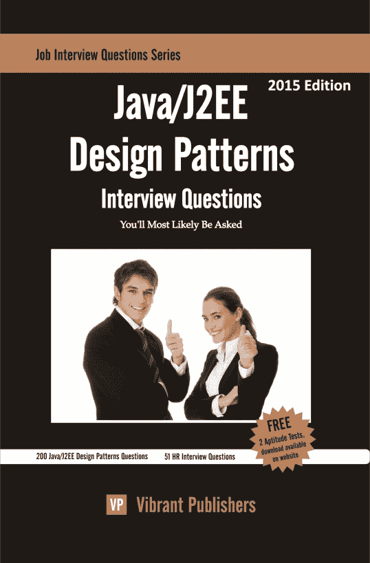

# Java/J2EE 设计模式：最常被问到的面试题

[`www.vibrantpublishers.com`](http://www.vibrantpublishers.com/)

回顾这些典型的面试题，并思考你将如何回答它们。阅读列出的答案；你将找到最佳答案以及相关的策略和建议。

回答：`Composite Pattern` 用于客户端以统一的方式处理单个对象和对象组合，方法是为组和项目定义共同类型，并将组建模为包含特定类型对象的集合。

回答：有向图（Directed Graph）是一个具有方向的对象引用，而“树”这一术语用于无向图。要使一个有向图被视为树，它必须有一个没有被引用的根节点，并且到所有其他节点都必须有一条边。

`Immutable Object` 主要用于确保对象的状态不能被更改，并确保多个客户端对象对数据对象的并发访问不会产生竞态条件。

答案：`Proxy Pattern`（代理模式）用于建立一个占位对象来管理对目标对象的访问。

答案：`Proxy Object`（代理对象）是一个用于隔离客户端与目标对象状态变化的对象，例如当加载图像会导致明显的持续时间时。

答案：`Method Lookup`（方法查找）被用作算法，在客户端调用对象的 `Method` 时决定使用哪个 `Method` 的定义。

答案：`Java` 中最常见的 `Immutable` 对象是 `string` 类的实例，一旦字符串创建，开发者或客户端都无法更改其字符。

答案：`Iterator Pattern`（迭代器模式）主要用于提供一种顺序访问集合元素的方法。

答案：`iterator()` `Methods` 主要是 `factory Method` 模式的一部分，用于创建一个返回集合元素序列的对象。

## 71. 设计模式中的备忘录（Memento）是什么？

答案：`Persistent Storage`（持久化存储）用于实现 `Memento Pattern` 的意图，它是开发者实现的撤销功能的自然扩展。

答案：区别在于 `Operation` 是可以从类实例请求的服务规范，而 `Method` 是类的实现。

对象的 `State` 是对象属性当前值的组合；它是对象行为的一个显著方面。

答案：`Strategy` 是一种计划或方法，类似于在给定一组输入的情况下追求输出的算法。

答案：`Façade Pattern` 为客户端使用的子系统提供了简化接口。有了 `Facade` 对象，客户端转而与 `Facade` 对象交互。`Facade` 对象承担了与子系统类交互的责任。

答案：

### 149: 垃圾回收（Garbage Collection）过程运行时会发生什么？

准备一两句来自同事的评价。具体的陈述或转述都可以。Clarke 公司的同事比尔·史密斯总是说我是他见过的最勤奋的人。这句话的力量应该像比尔本人在面试中说出来一样有说服力。

## 21: 同事中什么事让你烦恼？

**回答：**

这是一个陷阱问题。努力思考，但要想不出任何让你烦恼的事情。一个看起来你和大家相处融洽的简短陈述非常好。

## 22: 你最大的优势是什么？

**回答：**

多个答案都可以，只需保持积极。几个好的例子：你的优先级排序能力、你的问题解决能力、你的压力工作能力、你的专注能力、你的专业知识、你的领导力、你积极的态度。

## 23: 告诉我你的理想工作是什么，或者你在工作中寻找什么？

**回答：**

避开具体的职位。你赢不了。如果你说正在竞争的职位就是理想工作，会损害信誉。如果你说另一个职位才是理想工作，会种下你对这个职位不满的怀疑。最好的是泛泛地说，例如：我热爱工作、喜欢同事、可以做出贡献并且迫不及待开始的工作。

## 24: 你为什么认为自己在这个工作中会表现出色？

**回答：**

给出几个理由，包括技能、经验和兴趣。

## 25: 你觉得这个职位最吸引你的地方是（最不吸引你的地方）？

**回答：**

a) 列出一些吸引因素，例如该职位提供的责任以及与具有创新创造声誉的经验团队合作的机会。

b) 说你需要更多信息和时间才能对任何不吸引方面做出判断。

## 26: 你拒绝和什么样的人合作？

**回答：**

不要太琐碎。只有对组织不忠诚、暴力或违法行为才会让你产生反对。微小的反对会给你贴上牢怨者的标签。

## 27: 对你来说，钱还是工作更重要？

**回答：**

钱总是重要的，但工作最重要。没有更好的答案了。

## 28: 你的之前的主管会认为你最强的点是什么？

**回答：**

有很多很好的可能性：忠诚、精力、积极态度、领导力、团队合作精神、专业知识、主动性、耐心、勤奋、创造力、问题解决者。

### 29: 请告诉我你与上级发生过的矛盾。

**回答：**

最大的陷阱！这是为了测试你是否会背后中伤老板。如果你中招了并讲述了与前任老板的问题，你很可能在现场就失去机会。保持积极的态度，并对与上级的任何麻烦产生“选择性记忆”。

### 30: 工作中有什么让你感到失望的吗？

**回答：**

不要表现得琐碎或负面。安全的回答范围很少，但包括：

- 挑战性不足。你因为裁员被解雇；公司没有获得某项合同，而该合同本可以给你更多的责任。

### 31: 请告诉我你在压力下工作的能力。

**回答：**

你可以说你在某些类型的压力下表现出色。举一个与申请的职位类型相关的例子。

### 32: 你的技能与这份工作还是其他工作更契合？

**回答：**

可能是这一个！不要助长对方认为你可能比这份工作更想要其他职位的怀疑。

### 33: 是什么激励你在工作中尽全力？

**回答：**

这是一个只有你才能回答的个人特质，但很好的例子有：挑战、成就感和认可。

### 34: 你愿意加班吗？晚班吗？周末吗？

**回答：**

这取决于你。要完全诚实。

### 35: 你如何知道自己在这份工作中取得了成功？

**回答：**

几种方法是很好的衡量标准：

- 你给自己设定了高标准并达到了它们。你的成果是成功的。你的老板告诉你你很成功，并且做得非常好。

### 36: 如果需要，你愿意搬迁吗？

**回答：**

如果你认为有可能会出现这个问题，在面试之前你应该先和家人谈清楚。不要为了得到工作就说是，如果真实答案是否定的。这会在你职业生涯后期产生很多问题。在这个阶段要保持诚实，这将为你免除未来的苦恼。

### 37: 你愿意将组织的利益放在你个人利益之上吗？

**回答：**

这是一个关于忠诚和奉献的直接问题。不要担心深层的伦理和哲学含义。直接说是即可。

### 38: 描述你的管理风格。

**回答：**

尽量避免使用标签。一些常见的标签，如进步型、销售型或共识型，根据你听哪位管理专家的意见，可能有多种含义或描述。情境化风格是安全的，因为它表示你会根据情况进行管理，而不是一刀切的方法。

### 39: 你从工作中的错误中学到了什么？

**回答：**

在这里你必须编些什么，否则会损害信誉。让错误变得微小的、意图良好的，并带有积极的教训。例如，在某个项目中工作得比同事超前太多，导致协调出现问题。

### 40: 你有任何盲点吗？

**回答：**

陷阱题！如果你知道自己的盲点，那它们就不再是盲点了。在这里不要透露任何个人关注的领域。让他们自己去发现你的缺点。不要主动把题目交给他们。

### 41: 如果你要为这份工作招聘某人，你会寻找什么？

**回答：**

小心提到职位所需的特质以及你具备的特质。

### 42: 你认为你对这个职位来说资历过高吗？

**回答：**

无论你的资历如何，说明你非常适合你面试的这个职位。

### 43: 你打算如何弥补经验的不足？

**回答：**

首先，如果你有面试官不知道的经验，提出来；然后指出（如果是事实的话）你是一个勤奋且学习能力强的人。

### 44: 你希望老板具备什么样的特质？

**回答：**

回答要通用且积极。安全的特质包括知识渊博、幽默感、公平、对下属忠诚以及拥有高标准。所有的老板都认为自己具备这些特质。

### 45: 告诉我你曾帮助解决他人纠纷的经历。

**回答：**

选一个具体的事件。专注于你的解决问题技巧，而不是你解决的纠纷本身。

### 46: 在负责项目的团队中，你倾向于什么职位？

**回答：**

诚实。如果你在不同的角色中都感到自在，请指出这一点。

### 47: 描述你的工作伦理。

**回答：**

强调对组织的益处。诸如决心完成工作、努力工作但热爱你的工作都是很好的回答。

### 48: 你职业生涯上最大的遗憾是什么？

**回答：**

确保你提到的某件事是你无法控制的。表现出接受的态度，且没有负面情绪。

### 49: 告诉我你在工作中过的最开心的时刻。

**回答：**

谈谈为组织完成某项任务而带来的快乐。

### 50: 你能为我们做什么？（你能为别人做不到哪些事？）

a) 描述过去为前任雇主工作时的成功经验。

b) 谈谈你的新视角以及你能为公司带来的相关经验。

c) 突出你提供创造性、可行解决方案的记录。

### 51: 你对我有什么想问的吗？

**回答：**

始终要准备一些问题。准备那些能让你成为组织资产的问题是好的。我多久能开始发挥作用？我能协助哪些类型的项目？

最后，祝你好运！

---

## 索引

## Java/JEE 设计模式

### 设计模式导言

### 1: 什么是设计模式？

### 2: 什么是类接口？

### 3: 什么是类实现？

### 4: 什么是构造 (Construct)？

### 5: 什么是存根 (Stub)？

### 6: 什么是常量 (Constant)？

### 7: 设计模式的目的是？

### 8: 什么是适配器 (Adapter)？

### 9: 什么是度量维度？

### 10: `times()` 有什么作用？

### 11: 什么是抽象类 (Abstract class)?

### 12: JDK 代表什么？

### 13: `JTable` 有什么作用？

### 14: 什么是外观 (Façade)？

### 15: 什么是演示 (Demo)？

### 16: 什么是组合模式 (Composite)？

### 17: 组合模式的目的是？

### 18: 什么是有向图？

### 19: `stepCount()` 有什么作用？

### 20: 组合模式的风险是什么？

### 21: 什么是抽象 (Abstraction)？

### 22: 如何创建桥接 (Bridge)？

### 23: 什么是驱动程序 (Driver)？

### 24: 为什么要用 UML 设计模式？

### 25: UML 有多少种分类图？

### 26: UML 有多少种结构图？

### 27: UML 有多少种行为图？

### 28: UML 有多少种模型图？

### 29: 什么是类图？

### 30: 什么是内部类 (Inner Class)？

### 31: 泛化方法在设计模式中有什么用？

### 32: 设计模式中的接口 (Interface) 是什么？

### 33: 设计模式中的实现 (Realization) 是什么？

### 34: 设计模式中的依赖（Dependency）是什么？

### 35: 多重性是什么？

### 36: 设计模式中的消息 (Message) 是什么？

### 37: 私有方法在设计模式中有什么用？

## 方法与对象

### 38: 访问方法 (Accessor Method) 在设计模式中有什么用？

### 39: 不变对象 (Immutable Object) 在设计模式中有什么用？

### 40: 监视器函数 (Monitor Function) 在设计模式中作用什么？

### 41: 单例模式 (Singleton) 是什么？

### 42: `getFactory()` 有什么作用？

### 43: 观察者模式 (Observer Pattern) 的用途是？

### 44: MVC 代表什么？它指代什么？

### 45: 设计模式中的层 (Layer) 是什么？

### 46: 类在设计模式中如何观察子类？

### 47: `PropertyChangeSupport` 类的作用是什么？

## 模式与对象

### 48: 中介者模式 (Mediator Pattern) 有什么作用？

## 设计模式问题

- 代理模式（Proxy Pattern）的作用是什么？

- 什么是代理对象（Proxy Object）？

- 责任链模式（Chain of Responsibility Pattern）有什么用？

- 责任链中发生了什么？

- 在设计模式中抛出异常（Exception）会发生什么？

- 设计模式中的方法查找（Method Lookup）的作用是什么？

- 享元模式（Flyweight Pattern）在设计模式中用于？

- 如何识别享元模式？

- Java 中常见的不可变对象（Immutable objects）有哪些？

- 什么是构造方法？

- 什么是 Java 构造方法？

- Java 中的超类（Superclasses）是什么？

- 在 Java 中避免调用 `super()` 方法？

- 构建导向模式（Construction Oriented Patterns）有什么用？

- 建造者模式（Builder Pattern）在设计模式中用于？

- 工厂方法模式（Factory Method Pattern）有什么用？

- 如何判断设计模式中的工厂方法是否正常工作？

- 迭代器模式（Iterator Pattern）的作用是什么？

- `iterator()` 方法有什么用？

- 设计模式中的并行层次结构（Parallel Hierarchy）是什么？

- 抽象工厂模式（Abstract Factory Pattern）有什么用？

- 原型模式（Prototype Pattern）有什么用？

- 设计模式中的备忘录（Memento）是什么？

- 在设计模式中如何创建备忘录？

- 什么是持久化存储（Persistent Storage）？

- 对象序列化（Object Serialization）的作用是什么？

- `java.io` 包的作用是什么？

- 如何实现对象的持久化存储？

- UML 规范的操作（Operation）和方法（Method）有什么区别？

- 什么是算法（Algorithm）？

- 什么是多态（Polymorphism）？

- 什么时候适用终止操作（Term Operation）？

- 什么时候适用终止签名（Term Signature）？

- Java 方法声明（Method Declaration）包含什么？

- 排序方法（Sorting Method）的作用是什么？

- 什么是钩方法（Hook Method）？

- 什么是模板方法（Template Method）？

- 对象的状态（State）是什么？

- 如何处理状态之间的转换（Transition between States）？

- 状态模式（State Pattern）的作用是什么？

- 什么是策略（Strategy）？

- 策略模式（Strategy Pattern）的用途是什么？

## 命令

- 命令模式（Command Pattern）的作用是什么？

- 解释器模式（Interpreter Pattern）的作用是什么？

- 解释器对象（interpreter object）有什么用？

- 解析器对象（Parser Object）的作用是什么？

- 设计模式中的扩展（Extension）是什么？

- 什么时候通过委托（Delegation）发生扩展？

- 装饰器模式（Decorator Pattern）的目的是？

- 设计模式中的流（Stream）是什么？

- 设计模式中 `next()` 方法的作用是什么？

- 多线程应用程序中如何实现迭代（Iteration）？

- 外观模式（Façade Pattern）有什么用？

- 现实世界应用中子系统（subsystem）的意义是什么？

- 模式的主要优势是什么？

- 外观模式提供了什么？

- 应用外观模式时应该知道什么？

## 代理

- 代理对象（Proxy Object）的特征有哪些？

- 代理（Proxy）和装饰器（Decorator）的区别是什么？

- 代理和装饰器对象为对象添加的功能有什么？

- 远程代理（Remote Proxy）的作用是什么？

- 虚拟代理（Virtual Proxy）的作用是什么？

- 缓存代理/服务器代理（Cache Proxy/Server Proxy）的作用是什么？

- 防火墙代理（Firewall Proxy）的作用是什么？

- 保护代理（Protection Proxy）的作用是什么？

- 同步代理（Synchronization Proxy）的作用是什么？

- 智能引用代理（Smart Reference Proxy）的作用是什么？

- 计数代理（Counting Proxy）的作用是什么？

- 代理（Proxy）和外观（Façade）的区别是什么？

- 客户端对象（Client Object）访问目标的情况？

- 代理（Proxy）和责任链（Chain of Responsibility）的区别是什么？

- 在这两种模式下，请求的响应是如何处理的？

- Java 中远程方法调用（Remote Method Invocation）的概念意味着什么？

- RMI 的作用是什么？

- RMI 的组件有哪些？

- 远程接口（Remote Interface）代表什么？

- 提供远程接口有哪些要求？

- 远程对象（Remote Object）的责任是什么？

- 提供远程对象有哪些要求？

- 什么是 RMI 注册（RMI Registry）？

- RMI 的客户端（Client）代表什么？

- `RMIC`：Java RMI 存根编译器（Stub Compiler）代表什么？

- 什么是 RMI 通信机制？

- RMI 通信机制是如何工作的？

- 骨架（Skeleton）的责任是什么？

- RMI 和代理模式之间的联系是什么？

- 什么是虚拟代理（Virtual Proxy）？

- 使用虚拟代理的优势是什么？

# 设计模式相关面试题

- 使用虚拟代理的缺点是什么？
- 应用虚拟代理模式会发生什么？
- 计数代理（Counting Proxy）有什么用？
- 什么是聚合对象（Aggregate Object）？
- 构建聚合对象时发生了什么？
- 存在多少种聚合关系（Aggregate Relationships）？
- 聚合（Aggregation）发生时发生了什么？
- 早期初始化（early Initialization）发生了什么？
- 早期初始化揭示了什么？
- JVM 的目的是什么？
- 作用域（Scope）发生了什么？
- 垃圾收集（Garbage Collection）发生了什么？
- 模式（Patterns）的概念是什么？
- 命令模式（Command Pattern）的作用是什么？
- 中介者命令（Mediator Command）的作用是什么？
- 备忘录命令（Memento Command）的作用是什么？
- 观察者命令（Observer Command）的作用是什么？
- 解释器命令（Interpreter Command）的作用是什么？
- 状态命令（State Command）是什么？
- 策略命令（Strategy Command）的作用是什么？
- 空对象（Null Object）的作用是什么？

## 杂项

- 模板方法（Template Method）的用途？
- 对象验证器（Object Authenticator）的作用是什么？
- 通用注册（Common Registry）是什么？
- 处理方法（Process Method）的作用是什么？
- `createMemento` 的作用是什么？
- `setMemento` 的作用是什么？
- DCClient 的作用是什么？
- 备忘录处理器（MementoHandler）的作用是什么？
- 如何添加新的观察者（Observers）？
- 应用解释器模式的第一阶段是什么？
- 应用解释器模式的第二阶段是什么？
- 中间表达式（Infix Expression）有什么用？
- 凯撒密码（CaesarCipher）是什么？
- 替换密码（SubstitutionCipher）的作用是什么？
- 代码密码（CodeCipher）的作用是什么？
- 将算法转换为方法的初步是什么？
- 将算法转换为方法的第二步是什么？
- 将算法转换为方法的第三步是什么？
- 创建模式（Creational Patterns）的示例及其作用是什么？
- 结构性模式（Structural Patterns）的示例及其作用是什么？
- 行为模式（Behavioral Patterns）的示例以及如何使用
- 如何编写线程安全的单例（Thread-Safe Singleton）？
- 什么是反设计模式（Anti-Design Pattern）？
- 临界区模式（Critical Section Pattern）的作用是什么？
- 一致锁顺序模式（Consistent Lock Order Pattern）目的是？
- 保护挂起模式（Guarded Suspension Pattern）的作用是什么？
- 读写锁模式（Read Write Lock Pattern）的作用是什么？
- 外观模式的使用如何合理？
- 原型模式中深拷贝（Deep Copy）和浅拷贝（Shallow Copy）的区别是什么？
- `ReadWriteLock` 提供了多少方法？
- `Done` 方法是什么？
- 设计模式是如何文档的？
- 数据访问对象模式（DAO Design Pattern）的作用是什么？
- CVS 代表什么？
- Java 中最常用的模式有哪些？
- 定义一个创建类的接口，让子类（或辅助类）决定实例化哪个类。
- 设计企业 JavaBean（Enterprise JavaBeans）时使用了哪些模式？
- 设计模式之间的关系是什么？
- 反应器模式（Reactor Pattern）代表什么？

# HR 面试题

# 10: 你认识任何在我们公司工作的人吗？
# 11: 你期望的薪资是多少？
# 12: 你是一个具有团队精神的人吗？
# 13: 如果被录用，你预计在我们公司工作多久？
# 14: 你曾经不得不解雇过任何人吗？你对此有什么感受？
# 15: 你的工作哲学是什么？
# 16: 如果你现在有足够的钱退休，你会退休吗？
# 17: 你曾经被要求离开过某个职位吗？
# 18: 请解释你将如何成为这个组织的财富。
# 19: 为什么我们要雇用你？
# 20: 告诉关于你提过的某个建议。
# 21: 同事中哪些事让你感到反感？
# 22: 你最大的优势是什么？
# 23: 谈谈你的理想工作，或者你会在工作中寻找什么？
# 24: 你为什么认为自己能够胜任这份工作？
# 25: 你觉得这个职位最吸引你的地方是什么？（最不吸引你的地方呢？）
# 26: 你拒绝和什么样的人合作？
# 27: 对你来说，金钱还是工作更重要？
# 28: 你之前的上级会认为你最强点是什么？
# 29: 谈谈你与上级发生过的一个问题。
# 30: 工作中有什么事让你感到失望的？
# 31: 谈谈你的压力下工作能力。
# 32: 你的技能与这份工作还是另一份工作更契合？
# 33: 是什么激励你在工作中尽最大的努力？
# 34: 你愿意加班吗？上夜吗？周末加班吗？
# 35: 你如何判断自己在这份工作中取得了成功？
# 36: 如果需要，你愿意搬迁吗？
# 37: 你愿意将组织的利益放在个人利益之上吗？
# 38: 描述你的管理风格。
# 39: 你从工作中的错误中学了什么？
# 40: 你有任何盲点吗？
# 41: 如果你要为这份工作招聘一个人，你会寻找什么样的？
# 42: 你认为你对这个职位来说资历过了吗？
# 43: 你打算如何补偿你经验的不足？
# 44: 你对上司有什么品质的要求？
# 45: 谈谈你曾帮助解决他人之间争议的经历。
# 46: 在负责项目的团队中，你更倾向于担任什么职位？
# 47: 描述你的工作职业道德。
# 48: 你在职业生涯中最大的遗憾是什么？
# 49: 谈谈你在工作中经历的最有趣的时光。
# 50: 你能为我们做什么？（你能为我们做哪些别人做不到的事？）
# 51: 你对我有什么问题要问吗？

# 面试题分类列表

以下部分标题也可能很有用：

1. Oracle / PLSQL 面试题
2. ASP.NET 面试题
3. VB.NET 面试题
4. .NET Framework 面试题
5. C#.NET 面试题
6. OOPS 面试题
7. Core Java 面试题
8. JSP-Servlet 面试题
9. EJB (J2EE) 面试题
10. ADO.NET 面试题
11. SQL Server 面试题
12. C & C++ 面试题
13. 200 (HR) 面试题
14. JavaScript 面试题
15. JAVA/J2EE 面试题
16. Oracle DBA 面试题
17. XML 面试题
18. UNIX Shell 编程面试题
19. PHP 面试题
20. J2ME 面试题
21. 硬件与网络面试题
22. 数据结构与算法面试试题
23. Oracle E-Business Suite 面试题
24. UML 面试题
25. HTML, XHTML & CSS 面试题
26. JDBC 面试题
27. Hibernate, Springs & Struts 面试题
28. Linux 面试题

访问此处查看完整列表：`http://www.vibrantpublishers.com/`
