# 爪哇文化与地方性意义：艺术、城市主义、政体与社会研究

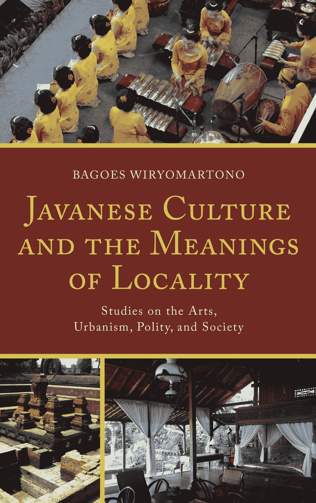

- [缩写词表]
- [2 Pra Kuta Negara]
- [4 爪哇的生活方式]
- [参考文献]

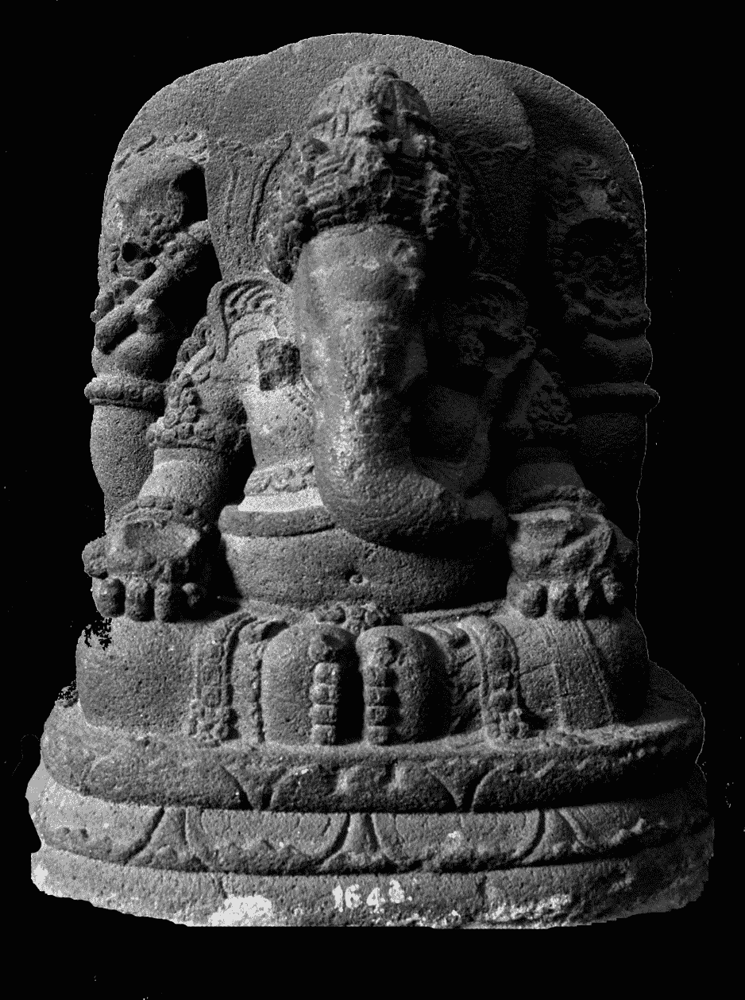

13 世纪的辛加沙里甘尼神雕像，收藏于印度尼西亚雅加达国家博物馆。照片拍摄：Bagoes Wiryomartono。

本书是关于爪哇文化的论文集，描述了、分析并讨论了爪哇文化和社会的多种特征和特点，包括审美、生活艺术、城市定居和政治文化。整体而言，本书在艺术、建筑、政体和社会的背景下探寻地方性的意义。它认为，对爪哇的研究是对应对当代全球文化的重要贡献；几个世纪以来，爪哇传统一直以优雅的方式将外来影响融合整合到其社会文化体系中，具有融合的意义。通过探索爪哇文化的认同和差异，我们能够丰富并增强对多样性重要性的理解。在此过程中，全球化并不意味着单一文化现代性的殖民化，而是各种文化源的多样性和复杂性的传递。

本书的特定使命是加强对东南亚可持续文化和社会的跨学科研究，特别是在处理他们充满活力的多样性、经济增长、全球交流和环境危机方面。研究数据和材料基于作者作为在爪哇传统中长大的本土爪哇人的生活经历。直到最近，大多数非爪哇学者或西方学者对爪哇文化和传统撰写学术研究和处理。我们很少听到或读到爪哇文化和传统的研究。

| 术语 |  |
| :--- | :--- |
| DPR | Dewan Perwakilan Rakyat，人民议会 |
| Gerindra | Gerakan Indonesia Raya，大印尼运动党 |
| Golkar | Golongan Karya，功能团体 |
| Golput | Golongan Putih，不选民群体 |

许多学者（Richter 1994; Jessup 1990; Holt 1967）已作为印度尼西亚文化组成部分对爪哇艺术进行了研究。他们的作品探索了印度尼西亚艺术与手品的形式、风格、意义和历史方面，使我们能够更深入地探讨美学问题。事实上，爪哇艺术与其习俗和传统不可分割，这些习俗传统养育并维持了它们在社会中的存在。在这方面，爪哇艺术与审美展现了它们作为印度尼西亚文化整合部分的能力，许多学者对此进行过深入研究（Anderson 2006; Beatty 1999; Sears 1996; Florida 1995; Pamberton 1994; Hefner 1985; van Groenendael 1985; 以及 Geertz 1960）。他们的著作不仅向我们展示了爪哇文化的许多富有见解的方面，还表明还有许多工作需要进一步调查。其中之一就是爪哇人的审美感，这到目前为止涵盖仍然不足。与许多其他文化和传统一样，爪哇文化有其特定的、独特的意向，描绘并证明了它的历史演变和背景创新。

尽管美学是情感、表达、印象、品味和感受不可或缺的结果，但审美体验在许多方面与个人判断和情感密不可分，同时也是背景集体价值的一部分。然而，在社会和实践背景下，审美问题大多受到当地文化和传统的限制，体现在代码、礼仪、习俗和规范方面。

从表面上看，在爪哇传统中表现情感是一种羞耻的行为或软弱的象征，甚至是对上帝的亵罪（Geertz 1960）。爪哇传统中的美学可能与伦理不可分割——对善与坏、美与丑的价值和判断都与礼貌和举止有关。因此，爪哇传统似乎确实为普通人表达情感和思想留了空间。事实上，在他们的日常世界里，爪哇人非常擅长在手势、模仿和肢体语言上保持自律，避免情感表达或感性语句；这包括用坚毅地处理情绪反应和愤怒。尽管面临各种动荡和危机——从政治、经济到环境——爪哇人受到其传统和文化的教导，要变得坚强且慈悲，而不表现出任何情感或喜爱。这一切并非预期在一夜之间发生，而是从童年开始密集的自我训练，涉及禁欲、斋食、冥想以及其他对特定食物、习惯和快乐的克制。

作为一种关于感受体验的哲学分支，爪哇文化中的美学面临着伦理问题的挑战。在某些方面，爪哇审美可能并不太关乎肉体愉悦，而更多关乎福祉和良好的礼仪。这意味着爪哇传统中的伦理与美学是互换的（Hughes-Freeland 2008, p. 83）。

本章调查了代表并运作于爪哇文化中、追求增长、美和可持续性的文化概念。其目的是探索自 1945 年以来坚韧地维持和发展对印度尼西亚政治文化的主导和霸权的爪哇文化力量和机制。本章认为，美的概念不仅影响文化身份和边界的定义，还从审美上培养了在和平存在中作为爪哇人的感觉。世界上一切古老与全新的都趋于可持续的和谐，正如爪哇信条中所阐述的：`laras yektine lestari`。

为什么爪哇传统中的伦理与美学密不可分？本章将处理这个问题，并认为爪哇文化中的文明和美感具有相同的来源和目的。为了理解这一点，本章将检查并审视局部概念与其各种艺术作品中的现象之间的关系，这些作品与爪哇文化价值观和习俗相关联。

## 爪哇世界：Bhawana

Semaoen 在他的小说 `Hikayat Kadiroen` 中可能呈现了现代对爪哇世界最好的描述之一，该小说是 Kadiroen 的故事，位于“Terjepit”（被挤压）章节。这本小说写于 1919 年，当时 Semaoen 因为在 `Sinar Hindia` 上发表的文章因诽谤而被荷兰殖民当局监禁，该文章包含了对印度尼西亚民族主义运动的同支持（Semaoen 2000; Maier 2004, p. 171）。根据 Semaoen 在其唯一小说中的描写，现代爪哇世界已经失去了它的精神秩序力量。事实上，作为一名爪哇人，他并不孤单。此前，爪哇人将他们的文化命运和国家归于吉达里第三任国王 Jayabaya（1135–1157）的预言信息。在 19 世纪，一位极有影响力的爪哇诗人 R. Ng. Ranggawarsita 在他著名的诗歌《Serat Kalatida》（或“来自黑暗时代的信息”，即 `jaman kalabendu`）中告诉了我们对世界的类似描写。Ranggawarsita 被认为是爪哇文化命运的预言信息仍然留存在爪哇人的心中；他的信息与个人生活之间的关系在今天仍然是神秘且富有影响力的（Andjar 1980; Andjar 1979）。尽管荷兰语和爪哇学的渗透，被 Tsuchiya 引用的 Takashi Shiraishi 和 Andjar Any 得出结论：Ranggawarsita 和他的世界继续在爪哇语的世界中存续（Tschuchiya 1990, p. 108）。这是一种典型的爪哇思维方式，即天堂般繁荣的世界处于过去或未来，但几乎不触及当下。

与过去领域形成对比，当代世界被描绘为地狱，具有社会退化的价值观、吞噬资源、政治领导力以及环境引发的灾难。所有这些显然支持了那些由于自身选择未处于权力地位或仍在奋斗的人的遗产和预言信息的合理性。在许多方面，完美的爪哇世界从未出现在现在，它处于普通人认知的地平线之上，并被认为有一天会让爪哇神话、传说、诗歌和故事中的救世主承诺实现，自 12 世纪的 Jayabaya 国王诗以来（Florida 1995, p. 273）。最近，在 2008 年 3 月，著名的爪哇裔印度尼西亚诗人 W. S. Rendra 在加加哈马达大学获得荣誉博士学位的位的辞中，将当代世界描绘为黑暗时代（`kalatida-kalabendu`），走向黄金时代（`kalasuba`）（Kolese De Britto Yogyakarta 2008）。作为一名诗人，他确认他对世界的思想与其前辈 Ranggawarsita 一致。

爪哇世界的理念可能与 `murwakala`（时间的起源）传说不可分割，这通常用于皮影戏（`wayang`）的开场。`kala` 的起源被爪哇人感知为从混沌、饥荒、不洁、无序和痛苦中解脱出来的时代的开始。爪哇世界，`bhasana` 或 `jagat` 被认为诞生于这种被称为 `suker` 的黑暗，源自梵语 `sukerta`，意为痛苦、焦虑和折磨（Headley 2000, p. 158）。

事实上，爪哇神话中卡拉（kala）的诞生与任何周年纪念或特殊事件无关，而为了提醒人们这个时刻需要 `ruwatan` 的消灭世界。`ruwatan` 源于 `ruwat` 一词，意为在关注可持续性的前提下从消灭中解放出来。`ruwatan` 的含义与爪哇的 `slametan` 仪式密不可分。克利福德·格尔茨（Clifford Geertz）曾详细描述了 `slametan` 在爪哇成年礼中扮演着重要角色（Geertz 1960, pp. 77–85）。他的描述在今天仍然有效，特别是在爪哇中部和东部的农村。因此，这些仪式致力于维护世界的统一（`manunggal`）、和谐（`rukun`）和可持续性（`lestari`），并对死亡命运表示接受（`nrima`）。

在爪哇的创世神话中，时间作为消灭的符号和力量，被描绘为 `Batara Guru` 和 `Batari Uma` 之子。尽管他在爪哇传统中的形象是一个怪物、粗鲁、直率、冷漠且对任何生物都无情残暴的生物，但 `Batara Kala` 从未进行血腥的暴力。`ruwatan` 的必要性更多是对世界福祉、统一和和谐的预见性维护。有几种 `murwakala` 仪式，包括个人福祉（`anggara`）、社区福祉（`mageri`）以及规避自然灾害（`sengkala`）。爪哇宇宙观中的世界被视为一个时刻面临着消灭和转瞬即逝威胁的生物领域，这引发了对持续关注和照顾福祉（`slamet`）的必要性，其中包含了统一（`manunggal`）、和谐（`rukun`）和可持续性（`lestari`）。

皮偶师（`dhalang`）扮演着祭司的重要角色。祭司通过 `wayang` 表演宣布并引导 `ruwatan`。爪哇人——从该岛的西部到东部——自伊斯兰教时代以前一直实践着这一传统。最初，`murwakala` 仪式作为 `wayang purwa` 开场场景的一部分进行的（Moerdowo 1982, pp. 13, 21, 22; Ulbricht 1970, pp. 14–21; Florida 1995, p. 273）。关于创世神话的古代咒语向所有年龄段的观众叙述。神话的信息通过各种权力游戏场景中的某些角色变得明确：世界需要从消灭中解放并维护其可持续性。为了实现这一目标，集体意识被唤起并动员为一种道德力量。

尽管其概念化模糊且深奥，但 `ruwatan` 对爪哇世界的重要性在于对集体关怀的呼，以及对死亡的意识——即统一和和谐并非偶然，而是社区意图和努力的结果。诸如 Foley (2001)、Headly (2000, pp. 8–9, 91) 和 van Groenendael (1985) 等学者观察到，在爪哇西部、中部和东部的许多地区，`murwakala` 仪式作为 `ruwatan` 的一部分，由 `dhalang` 引导的 `wayang` 表演赋予了异域情调意义的恐惧和危险感。`dhalang` 及其 `wayang` 表演被认为是爪哇文化的战略载体，通过娱乐包传递、传播并维持了古老的爪哇教义。

尽管 `wayang purwa` 的起源可能源于新石器时代，但其关于 `murwakala` 仪式的内容和表演演变与印度文明（如《罗摩衍那》和《摩婆罗》）以及爪哇本土文化的融合是不可分的。对于爪哇人来说，`wayang` 传统不仅仅是娱乐。相反，皮戏是伦理、审美学的来源，也是生活的哲学。

从社会学角度来说，爪哇的 `wayang` 传统也是普通人和农村人的声音。然而，`wayang` 传统在爪哇社会的有效性在于其艺术性的娱乐能力，这种生动、吸引人的表演将古代信息和现代问题相结合。尽管 `wayang` 表演作为文化融合的媒介和代理以各种形式和风格发展起来，但其呈现的核心信息非常明确：它在当代背景下唤起并阐述爪哇世界；这包括描述一个具有理想、危险、限制和机遇的世界。`dhalang` 及其赞助者通常表演古代传说的特定主题和故事（如《罗摩衍那》或《摩婆罗》），这实际上是对他们社会当前事务的响应，涵盖从政治、经济到社会的问题。`Murwakala` 是一个象征危机管理的重要主题。`murwakala` 仪式以及 `ruwatan` 最重要的方面是在历史和集体价值内确立爪哇世界的身份和边界，这通过皮影戏表演来传达。

与群岛的其他传统文化不同，爪哇的古代传统在今天仍通过 `wayang` 表演继续生存。由于伊斯兰影响了爪哇社会，古代祭司（`mpu`、`pandita`）的作用和功能已经转化并委托委托了皮偶师（`dhalang`）。这种连续性在南尼亚和托纳拉贾（Tana Toraja）并不存在。这两个地区的本土祭司（`ere` 和 `to mina`）自从欧洲传教士在村庄建立基督教教会以来已逐渐功能丧失并消失。在爪哇，本土传统一直通过 `wayang` 和 `gamelan` 等表演艺术延续至今，这些艺术作为古代世界的艺术娱乐载体。

### 爪哇传统中的艺术原则与艺术家

在爪哇文化中，统一是通过创造者与创造物之间的身份同一原则实现的，这通过 `manunggal` 概念表达；统一本身是权力的核心象征（Anderson 2007, p. 36）。对统一、和谐以及可持续性的需求在于，爪哇信仰体系中的生命（`hurip`）是二元对角色和现象的协同作用。对于爪哇人来说，生命和世界的现实如果没有天与地、男与女、形与内容以及外与内的契合与完整是不可想象的（Yumarma 1996）。因此，艺术作品的任务是将所有不同的事物聚集在一起，迈向统一、和谐和可持续性。对分裂和混乱的恐惧促使了统一、和谐和可持续性的必要性。作为回报，每个生物都必须有其适当的位置，对爪哇世界具有独特特定的功能和贡献。因此，不存在“异质”的概念，只有爪哇世界和语言之外的未知。

在爪哇世界成为艺术家，意味着根据资历、教育、经验、成熟和社区服务处于适当的位置。创作创新和即兴发挥的空间是为了符合社区内部和谐的原则。这意味着在传统方式下，个人自由可能是不受质疑的（Mulder 2005, p. 70）。

爪哇万灵论相信每个生物都是含有宇宙力量（`Jiwa` 或 `isi`）的容器（`wadah`）。对他生物的尊重（`ngajeni`）通过祭品（`sajen`、`sesajen`）体现，即爪哇历每五天一次的鲜花和食物。焚香是这种祭祀仪式的一部分。这种做法属于古代和印度教之前的仪式，作为对祖先和宇宙中无形力量尊重的表现。

# 爪哇的创造与存在哲学

万物的创造被构想为与他人（包括无形的力量）共同运作。能够从地上创造并组合某些事物，并不是将人类视为存在的主宰。爪哇人相信，人造物对于从宇宙向形式的能量转移是不可或缺的。因此，这种转移需要谨慎和尊重的方式来处理。这并非出于道德考量，自然而然，这是关于对存在的意识与记忆，被称为 `eling`（觉）。`eling` 的状态被视为一种能够根据尊重（`hormat`、`ngajeni`）和尊严（`praja`、`kaprajan`）倾听并行动的精神状态。爪哇人从小接受训练，要实现安全健康的方法不仅是忠诚（`mituhu`）和诚实（`jujur`），还要培养内在力量感（`mantep bathin`）。这种训练通过禁食（`pasa`）和简朴的生活（`prihatin`）来执行。这一切都是为了提高对营养和欲望的自我控制能力。能够区分需求与欲望是爪哇文化训练的核心。在许多情况下，这种训练的结果是让人们变得不那么武断，且不那么自发。

## 社会行为与文化认同

回避表达情感和想法是爪哇人中常见的现象。在这里，人类行为中的良好与美之处在于微妙。外来人留下的印象是爪哇人是冷淡的，因为他们太礼貌了，有时会被误解。当然，如果被个人要求，有一种方法可以唤起爪哇人的参与。

从文化上说，爪哇传统是根据“什么是爪哇人”的概念发展的；即：伦理上的谦卑（`andah asor`）、尊重他人（`ngajeni`）以及文化上的修养（`alus`）（Sutton 1991, p. 21; Hughes-Freeland 2008, p. 82）。简而言之，作为爪哇意味着相对于其他存在（无论实体还是无形）而为人。因此，任何关于时间存在的决定都被构想为一种基于礼貌举止和尊重语言的某种伦理文明之路。它关乎将原始、粗糙和自然的事物变得精致、微妙和文化化。

## 自我控制与性格

对自我控制的强化训练塑造并建立了爪哇人的性格，这种性格在许多方面作为倾听者和读者比作为演讲者更自在。传统上，资历和经验在交流中起着非常重要的作用。通常，资历也会阻碍和阻良好美好事物的展现。然而，爪哇人相信美丽的揭示是不可避免的。这只是时间问题。耐心接受（`sabar nrima`）是爪哇传统中内在力量练习的一部分。一切美好的事物都会由于世界和社区的需要而出现，这被称为 `rahayuning jagad`（世界的和谐）。

在艺术作品系统内的创造事物对于成为爪哇人的目的是不可或缺的。换句话说，创造事物是将某些事物从自然的原始状态带入文化加工后的状态。从概念上讲，作为爪哇人就是将资源从自然的原始状态带到世界上。作为艺术作品资源的自然，不受人类理性和行动的支配。爪哇人处理自然的方式是基于感性（`rasa`）揭示其潜力，使其接近人类之手。

## Rasa 的概念

爪哇语中的感性由梵语借词 `rasa` 组成，字面意思是美学上的敏感和理智上的共情。爪哇意义上的 `rasa` 不仅仅是某种感觉。相反，它是关于一种自觉的美学体验，不仅关乎感性，还关乎意义（Geertz 1960, pp. 235–58; Benamou 1998）。在 `rasa` 的概念下，仔细听的行为成为处理任何存在现象的原始规定，无论是心灵的洞察还是世界的现实。能够倾听在让 `rasa` 与即将显现的事物保持完好的行为中具有某种决定性意义。在这一概念下，人与世界的关系更多地依赖于直觉，而不是对他者的理性的怀疑。通过这样做，人类与自然/资源更处于行动的即时场景中，而与主客体关系立场并不关联。这种关系在某种程度上是基于寻找完整性过程中的相互作用；它是通过技术（`makarya`）相互揭示实现的。

## 赞助人与职业艺术家

爪哇社会的艺术家大多依靠他们与赞助人的关系生活。皇宫之外，统治阶级（`priyayi`）和商人主导了传统的影戏（`wayang`）表演赞助。赞助人根据合同邀请（`nanggap`）表演艺术家（`wayang`、剧团、舞者、歌手、音乐家等）。成年礼等仪式——如割礼、婚礼和丰收感恩节——是合同客户最常见的场合。直到今天，为家庭场合和庆祝活动邀请职业艺术家仍然是爪哇村民传统客户关系的一部分。关于职业艺术家生活和工作的经典描述，可能可以在`Serat Centhini`中找到，特别是对自由职业艺术家`cebolang`的描述（Anderson 2006, pp. 171–289; Santoso et al., 2006）。尽管`Serat Centhini`的作者是在 1814 年开始的`Pakubuwana V`的命令和指导下创作的，但故事中的爪哇世界远离皇宫。

## 廷艺术家的历史背景

自古代，爪哇宫廷艺术家和作家一直是国家官僚的一部分。他们的尊称为`mpu`，意味着具有特定文学或艺术才能的智者。在国家/皇宫的背景下，艺术家与客户（尤其是国王）的关系不可或缺地关于权力的赞助。所有作品大多是统治王朝的兴趣和观点。在阿尔拉加国王统治之前，几乎没有关于创作了存世建筑、壁画、诗歌（`kakawin`）、甘美兰乐曲、舞蹈、故事（`babad`）和文学（`susastera`）的艺术家或作家名字。阿尔拉加于 1019 年成为`Kahuripan`的第一位国王，并通过与三齐腊和和在东爪哇建立了权力。在他的统治期间（1019 年–1049 年），阿尔拉加通过强有领导力和宗教宽容巩固了权力。

泗逸里周边的物理和铭文证据证实了阿尔拉加统治时期的文学活动。除了经典的《罗摩衍那》和《摩诃婆罗多》的爪哇版本外，阿尔拉加执政可能是第一次由爪哇作家`Mpu Kanwa`用古爪哇语创作文学作品。`Kanwa`写了《Arjuna Wiwaha》，描绘了阿周那的婚姻，而阿周那正崇拜阿尔拉加为世间的湿奴化身。在阿尔拉加时期，艺术家/作家与统治者之间的关系显然是为了权力的自豪感及其国家意识形态。赞助持续到了三达和满者时期，特别是在`Hayam Wuruk`统治时期（1350 年–1389 年）。

传统赞助制度的彻底瓦解在殖民前或殖民时期的爪哇从未真正发生。然而，在 18 世纪中期的苏卡塔发生了一场略显激进的艺术自我表达运动，当时诗人`Raden Ngabehi Ranggawarsita`在`Pakubuwono VII`的统治下工作。作为当时的国王，`Pakubuwana VII`他为宫廷诗人（`pujangga kraton`）。由于国王对文学并不十分关注，国家为`Ranggawarsita`留了更多空间，不仅是为了他的创作写作，也是为了他构思爪哇世界的才华。在过去，类似的预言性叙述曾由东爪哇`Menang Kediri`的`Jayabaya`皇（1135–1157 年）传达过。在许多方面，`Ranggawarsita`的诗对于爪哇宫廷传统来说是非传统的的。与他的祖父和前任`Yasadipura II`不同，他在诗中以预言的方式表达了自己的内心想法。他在`Pakubuwana VIII`和`Pakubuwana IX`统治下继续担任宫廷诗人，直到他在 1873 年神秘地去世。他的死因至今仍不清楚。

## 爪哇文化中的艺术是什么？

尽管在爪哇文化中没有一个描述“艺术是什么”的词汇，但爪哇人理解其意涵和目的。对于爪哇人来说，任何努力都是在`karya`方面实现其品质。创作艺术品通常被理解为`makarya`的概念。`karya`是一个梵语借词，被爪哇文化采纳，意味着具有对世界和社区福祉之用和贡献的作品。事实上，`karya`是一种经过艺术化构思的、呈现出特定价值和意义的世界的作品。广义上说，`karya`是所有人类的作品，它们在功能和美学上经过良好考虑，通过精致的事物和行为呈现出文化。文化的对立面是`urakan`，意为粗俗、无鲁和无礼。

尽管在爪哇传统中处理艺术概念并不流行，但这并不意味着艺术作品没有任何特定的意义。爪哇文化中与艺术作品和审美体验相关的概念在意义和表达上非常广泛。在如此广泛的光谱中，爪哇文化中至少有三类艺术作品：`susastra`（文学）、`karawitan`（音乐）和`karya`（通用艺术作品）。

`karya`的特征应当包含伦理与美学的完整性，展示并融合了良好礼仪、精致和克制（`alus`）的思想（Hughes-Freeland 2008, p. 82）。`alus`的意义适用于事务、语言和行为。因此，根据爪哇价值体系，工作和行为在追求其精致和美学化处理方面是具有目的性的。这种意义上的精致不仅仅关乎精美的表达、阐述和互动。相反，爪哇的精致关乎适当的位置、取向、形式、风格和时尚。

在许多方面，`alus`的恰当需要普遍的接受、微妙和细腻。这一切几个世纪以来一直在演变，根源在于基于农业的封建主义。这种意义上的文化不仅仅是一组与习俗做法相关的共享意义的集合（Berger 1995, p. 32）。相反，爪哇人在`budhi`的语境下理解文化。爪哇语境下的梵语借词`budhi`已经演变成并构成了思想和行动的力量源和体系；基于此，人们能够创造、建立、发展、保护和维持思想、情感、精神、记忆、智慧、希望和理想。在日常生活中，作为`budhi`的文化思想作为审美和道德标准被实践。语言和礼仪传递了`budhi`作为一种规范的标准。然而，如果`budhi`没有被注入被称为`daya`的生命力量、驱动力和激情，它就是虚无且无用的。`budhi`和`daya`的协同被整合到`budhaya`的概念中，字面上的意思是文化。

那么，创造美丽、有用且有见地的事物以及良好的礼仪行为，与爪哇文化的本质（`budhi`）是不可分割的。在所有表象之外，爪哇人将各种形式、方式和风格的艺术作品视为其生活哲学的一部分，即人类作为一个社会必须在艺术和社会上进行自我修养。整个学习过程被爪哇人构想在`nglakoni`的概念中，意为“沿着行走”。因此，生活即是行走，也是以无限的方式体验当下。本章试图展开爪哇文化中审美体验的概念基础。

为了对爪哇世界有一个简要的了解，没有哪个单一单词能更好地描述他们的文化和传统，比“融合”（syncretism）这一概念了。在爪哇语中，融合现象在语境上与深层情感的概念和词汇`manunggal`相关，意为“合而为一”（Anderson 2007, pp. 23–24）。统一（`utuh`）和和谐（`rukun`）成为爪哇传统中最痴迷的概念。融合现象体现在各种活动和产品中。爪哇人从“驯化化”的角度来理解这一概念。这是爪哇人处理制造、生活和工作的方式。爪哇语中的融合被构想在`nglaras`或`laras`的概念中（Yumarma 1996）。这一概念是爪哇思想的核心，将一切对立、二元和辩证法统一为整体。

作为文化的不可或缺的一部分，爪哇艺术和审美与将各种形式、思想和时尚塑造进新体系的行为是不可分的。统一的目的是成为爪哇人（`jawa`），字面意思是经过文化教养和成熟的人（Weiss 2006）。成为爪哇人意味着具有良好的礼仪和强烈的自律。这一切由`alus`概念组成，字面意思是精致和成熟，其对立面是粗鲁和不成熟。`nglaras`的最终目标是实现工作和行为的精致（`alus`）。

爪哇传统中艺术作品的目的与爪哇人从黑暗（`kalatida`）世界走向光明（`kalasuba`）世界的奋斗是不可分的。它并不是为了艺术自我表达而制造某些东西，也不是为了个人自由。对于爪哇人来说，审美体验的作品关乎世界和社区的福祉（`sugeng slamet`）。尽管今天爪哇王国仍存在于`雅加达`和`苏卡塔`，它们的作用和功能更多是精神上的象征，而非政治参与。在艺术品领域，宫廷艺术和民间艺术出于不同的目的共存。宫廷艺术为宫廷仪式和活动提供服务（Jessup 1990, pp. 73–102）。它们属于保护和维持宫廷自豪感和遗产方面的文化价值。确实，为了精神认同和爪哇世界的统一而歌颂过去，是宫廷艺术的核心目的。这包括表演模仿、模拟以及象征爪哇世界的年度和偶尔性庆祝活动。

与宫廷艺术不同，民间艺术以一种直白的方式（`ngoko`）生活并维持着爪哇文化的生存哲学。在爪哇人的日常生活中，民间艺术被理解为`tontonan kawula`，意为为平民的表演。除了其文化上的审美功能外，民间艺术在保护、发展和维持爪哇文化与传统方面发挥着至关重要的作用。与宫廷艺术不同，民间艺术为创新和即兴发挥提供了更大的空间，而不需要机械地遵循传统的模式和准则。

爪哇意义上的文化内化过程是通过`laras`、`nglaras`的概念来理解的。因此，将来自各种来源的不同元素在形式、表达和表述上进行合成，属于爪哇人处事的一种特质。`nglaras`的意义不仅仅是妥协。从广义上说，`nglaras`是根据爪哇的价值观和习俗来处理一切外来事物。它被准确理解为一种内在和精神的锻炼（`tirakat`），以接受新奇的事物并并在内部将其消化。这种内在锻炼的目的是遇到对立的元素和方面，使其能够与爪哇文化融合。坦率地说，这是爪哇人驯化并驯服（`nglulutake`）进入其文化领域的外来元素。

## 艺术、信仰与价值观

尽管关于爪哇传统的大多数深刻概念都源于梵语文化，但已经进行了当地的定制化处理，以与本土概念中已有的内容保持同步同步。1 世纪初，在印度教和佛教的影响下，爪哇从印度引入了文字和字体。从那时起，梵语文化在与本土泛神论万灵论融合的框架内，被爪哇传统所接纳。

传统上，爪哇文化将对任何存在（无论是生命体还是自然元素）表示尊重的伦理原则，置于整体存在体系之中。在爪哇人的语境中，这种完整性（`utuh manunggal`）被构想爪哇世界的目标。对这一目的的执着往往会导致对差异的不宽容；在某些方面，它导致了为了代表爪哇世界的完整而对他者进行殖民化的预言性使命。

传统上，爪哇社会的艺术、价值观和意义在象征主义这一主题上找到了共同点。尽管存在贵族（`priyayi`）与平民或普通人（`kawula`、`wong cilik`）的双元遗产制社会结构，爪哇社会维持并将行为和作品的微妙视为其审美价值的一部分。将万千形式、物品、思想和时尚塑造成一个协调的整体，在文化上是爪哇人的处事方式。这种塑造行为被爪哇人通过`manunggal`概念理解，该词源于`tunggal`，意为单一、一和实体。说爪哇文化始终努力将一切事物与爪哇存在进行融合性的整合可能并不夸张。基于这种极可能的文化执着，爪哇的帝国主义、宽容和虚伪表现变得可以理解。

将所有来自爪哇文化存在之外的事物引入进来，是爪哇文化处理异质性的一种文化策略。`manunggal`策略在爪哇人中广为人知，即`nglaras`。事实上，微妙和得体在`nglaras`的行为中起着重要作用。因此，`nglaras`是通过有意的交流来体验某物的存在，以建立并发展进入爪哇世界的整合。

爪哇文化在印度尼西亚世界的影响在许多方面是主导性的，因为其底层原理是在`nglaras`的感性学习系统中与其和解，以建立和发展新兴事物。因此，这并不仅仅是回避冲突或否认矛盾。相反，`nglaras`是一种灵活的方法，基于和谐（`cocok`、`rukun`）和统一（`tunggal`、`manunggal`）沉默的力量。爪哇人将和谐和统一视为他们的生活方式（Suseno 1997）。

爪哇人对世界和谐与统一的信心确立了各种形式、事务和时尚的艺术作品的目标。因此，在艺术语境下创作就是`makarya`，即使存在走向和谐与完整。只有在这种条件下，爪哇人才将美理解为`apik`（好）、`slamet`（安全）、`asri`（自然的喜爱）、`rahayu`（吉祥）和`lestari`（可持续）。

为了达到和谐与统一，爪哇人必须学会控制自己，根据爪哇伦理（`karma`）表现得恰当（Berman 1998, p. 17）。对于爪哇人来说，和谐（`rukun`）和统一（`utuh manunggal`）从他们理解的世界中不可或缺的。和谐被构想为不仅基于尊重和相互理解，还基于融入存在的等级排序体系。

在社会生活中以及艺术创作中，保持和谐意味着能够将自己放在整个体系中的恰当位置。这个文化体系中的任何存在都有其自己的位置，并有一个建立良好的结构来为统一服务。随后，将利己的利益（`pamrih`）服从于存在的共同体，而成员之间和谐的关系（`rukun`）是其内在的原因。寻找中道或妥协是爪哇人生活方式的最佳选择，而不是以体育竞技的方式进行思想或记录的竞争。接纳对手进行妥协被视为一种维持爪哇世界的和平方式。

爪哇文化中艺术作品的真实目的究竟是什么？正如前面提到的，和谐与统一是爪哇世界目标密不可分的，即美化整体生命的存在。美化世界（`memayu ayuning bhawana`）本质上是人类在地球上所有工作的目的。因此，包容任何个体的欲望和需求是能够投入所有努力以进入整体整合的法则和原则的前提。这种整合体现在不丧失其原始源痕迹的合成特质中。作为人造物，作品被构想为一个拥有自身力量的新生命，这种力量在爪哇传统中被称为`greget`（Wibisono and Kurniasih 2002, p. 264）。

任何成功的艺术品都被认为拥有一种`greget`的精神力量（Suharto 1998），它能引发人类强烈的情感、共鸣的感性，以及与观众建立联系的能力。在`greget`的概念下，艺术品能够在整体构图的和谐感带出人类体验。相应地，作品系统中的任何部分都展示了其对作品中整个故事的重要作用和贡献。

### 完美与稳定

完美（`utuh`）、稳定（`jejeg`）和无私（`sepi ing pamrih`）属于爪哇文化认为具有审美价值的内容。在爪哇文化中，作品的完美（`utuh, sampurna`）是指作品是开放式的，其开始和结束与一个从微观宇宙到宏观宇宙增长的无限循环达成一致。这种完美的基础基于一种信念：每个生命都是相同的，并且包含了存在的力量。没有这种身份身份，生命无法作为一个整体站立。

稳定（`jejeg`）是艺术品参与整体构图或系统的另一个条件。在自然法则内排列是实现构图稳定性的重要原则之一。稳定的概念也是指作品具有本质特质，不虚假或隐藏任何东西。`jejeg`的最广义适用于某种持久的崇拜（`sajen`）和尊重（`kajen`）。缺乏稳定的艺术品在性格意义上是不尊重的，因为它不包含任何使其完整的建设性元素和结构。

### 超脱利益

此外，获得美之本质必然是脱离任何利益（`pamrih`）（Mulder 2005, p. 18）。利益绝不存在没有控制、持有和占有的意愿的情况下。`pamrih`意义上的利益是为了自身利益的自私追求，并与对整体福祉的不尊重相关。在艺术品中，利益危害到爪哇世界的稳定性，而爪哇世界是在传统的社区认同结构内建立并维持的。任何挑战传统价值观的个人主义特征和倾向都可能严重危害集体建立的社区以及统一。

爪哇传统下艺术家的创造和创新努力，通过在尊重传统的框架内持续工作来揭示改进和发现，是微妙且细致的。对于爪哇人来说，不利的因素不是创造力，而是这种创造能力对于自我概念的过度，这可能导致自大、傲慢和无知的状态。尽管如此，爪哇世界已经从现代性中学到了许多经验，能够通过`nglaras`在寻求自然和谐与统一的同时，尊重当地资源并兼顾个人的艺术尝试。

## 爪哇美学概念

总而言，只要作品内部没有导致我们陷入意义混乱的内在冲突，爪哇艺术世界就是和谐且完整的，呈现出良好的形状（`apik`）。好（`apik`）被理解为某种程度完整且组织良好。`apik`的美学概念强调作品内部秩序的必要性，这种秩序为元素提供了整体的角色和贡献。

此外，`apik`的意义是唤起一种万事如良好状态的感觉。在`apik`的意义内，系统中的每个元素都根据角色和贡献的特定结构相互联系，从而产生“一人为了众，众亦然”。此外，`apik`实际上适用于逻辑上相关的系统，使作品能够被视为具有特定意义标记的事物。简而言之，`apik`是组织有序和完美存在物的基础概念。

### Rahayu 与 Ayu

对于爪哇人来说，只有人类（而非艺术品）如果处于`rahayu`概念或简练的`ayu`下，其对人类的影响是健康且令人愉悦的，才称得上是美的。`rahayu`的愉悦在于艺术品能够为人类带来健康领域和影响的能力。`Rahayu`是一个描述女性特质的美学概念，具有优雅的动作、比例协调的姿态和形态，以及慈悲散发的氛围。在许多情况下，`ayu`或`rahayu`也适用于代表女性生命的艺术品。

正如前面提到的，爪哇人来说的美之意义并非某种出于自我沉溺的愉悦。相反，美的意义本质上被体验为一种整体感，其中自我与他人在精神身份上达成一致。因此，时间坍缩为无限的、富有灵感的沉默（`hening`）。在爪哇美学的`rahayu`视角下，美与和平是不可分割的。它既不是关于漂亮或吸引力的事物，也不是关于感官和视觉吸引力的事物。`rahayu`作为审美体验的意义是关于作为存在与世界保持完整。它是在宁静中升华的体验。

### 美学中的性别

`rahayu`的相反概念是`ganteng`，描述男性的英俊和绅士风。然而，`ganteng`被奇异地应用于艺术品。与艺术品男性性格相关的另一个概念是`gagah`，意味着勇敢、强壮和稳健。美学性格的性别类别大多适用于人类。其他生物通常不属于男性或女性类别来描述其性别性格。

然而，在表演艺术（如`wyang wong`）中，女性和男性角色在揭示人类性格方面发挥着重要作用。然而，桥接男性和女性角色之间的对立类别可以在爪哇版《摩诃婆罗多》中的`Srikandi`和`Puntadewa`，以及爪哇版《罗摩迷衍》中的`Sarpakanaka`和`Laksmana`角色中揭示。

此外，描述美好事件的对应概念`rahayu`则是`endah`。`endah`的概念对于“某种美”而言，与其对人类快乐和舒适情感的影响有关。某种事物之所以是`endah`，是因为它根据氛围和发生范围为我们的感官带来了愉悦感。展现景观的自然特质及其视觉构图是通过`endah`概念来表达的，这种愉悦感是从体验其奇观中产生的。然而然而，一幅优美的风景画并不适合用`endah`的概念来定性。相反，这种美是用`apik`的概念来描述的。

`endah` 的意义在于其在自然环境中被即时体验到的美。与语境或环境相适应可以被定性为 `endah` 概念，前提是该事物不仅在景观或背景中恰当合适，而且还能以具有美学深思考虑的属性提升整体构图。在爪哇文化中，与周围环境恰合被称为 `cocok` 概念，其字面意思是恰当、正确且相互匹配的。因此，在 `cocok` 的基础上，符合语境和环境的事物被认为达到了 `endah` 的美学特征。

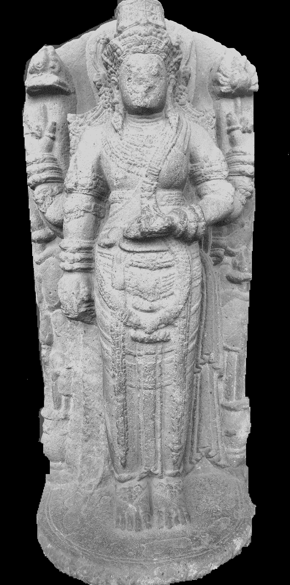

图 1.1 阿尔达纳里像，湿奴与帕尔瓦蒂的单一化身，来自东爪爪德里地区，约 12 世纪。摄影：Bagoes Wiryomartono。

对于爪哇人来说，音乐的美概念是什么？如前所述，在爪哇文化中，自我放纵背景下的快乐被认为是不道德的或不符合伦理的体验。这里的美音乐并非为了在个人基础上体验而带来的某种愉悦。相反，甘美兰乐队的音乐并非作为爪哇娱乐的主菜表演，而是作为影皮戏、舞蹈和仪式活动的背景音乐、配乐或支持系统。当然，五音阶（`slendro`）以及七音五阶（`pelog`）甘美兰音乐的和谐节奏被高度重视，能够以合适的节奏、柔和和响度以及深度和宽度来增强和支持主表演。

再次，美学概念 `apik` 适用于描述具有完美编排、表演和创作质量的甘美兰音乐。爪哇传统中的音乐欣赏由 `nglaras` 概念组成，意味着与人类行走的节奏保持一致。与行走的节奏（`mlaku`）一致本质上是爪哇人处理时间的方式。`nglaras` 无非就是将存在的时间结构与行走对齐。

在爪哇文化中，存在与居住可能由行走（`mlaku`）概念组成。因此，存在的暂时性尽可能自然地以节奏律标记。人类活动（包括艺术）的目的是融入到节奏宇宙中，正如通过行走体验到的节奏，在 `laku`、`lakon`、`nglakoni` 的意义上，意味着在心跳节奏中体验存在的意义。爪哇人将此体验为与“当下”立即接触的方式。

事实上，起伏以及快慢属于人类穿行于时间之行走的变异。然而，回到寻找行走的节奏是爪哇人在 `nglaras` 概念内存在于世界的方式。存在与居住（`lungguh`、`lenggah`）实际上是坐着在聆听即将到来的事的同时，体验心跳的节奏。存在与生活的任务不是为了自我实现的需求去达成某些东西。相反，对于爪哇人来说，存在与生活的意义是在通过穿过时间所体验到的心跳节奏整合框架内，带出即将到来和被给予的东西。爪哇之旅的终点在哪里？这个这个问题对于爪哇文化来说听起来是琐事的，因为通过能够找到生活的节奏，我们已经处于存在与居住的终点。根据爪哇文化，这就是美的本质。而存在的目的无非根据感官愉悦并神化世界（`memayu ayuning bhawana`）。

在爪哇文化中，成为艺术家就是成为社区的一部分，爪哇的美学目标是成为集体艺术。艺术品需要无私的奉献和投入。它并不是为了赞扬艺术家，因为艺术家就像社区中的任何其他劳动者一样。艺术品应该是社区的庆。尽管爪哇文化的艺术作品包括许多文学、视觉和表演艺术领域，但 `wayang`（皮影）、`batik`（蜡染）和 `gamelan`（甘美兰）是今天最流行和代表性的作品。

## Wayang

`wayang` 的美学是什么？`wayang` 不仅仅是爪哇文化和传统的剧场。它关乎生命的哲学以及当代政治和社会观点。尽管 `wayang` 表演的故事大多描写自印度史诗《罗摩衍那》和《摩诃婆罗多》，但戏剧的核心主线是关于以交流方式的爪哇思想和伦理。`dhalang`（皮影戏）的作用和功能是爪哇理想的伟大传播者。有趣的是，社会政治事务属于 `wayang` 表演的主题。处理该剧目的场合代表了当代语境下的爪哇世界。戏被认为是爪哇世界现实的影子。`dhalang` 一词字面意思是一体导演、演说家和演员。表演 `wayang` 的艺术是在戏中让爪哇世界活起来的艺术。戏的总结显然是文化对原始、贪婪、不公、欺骗和傲慢的胜利。

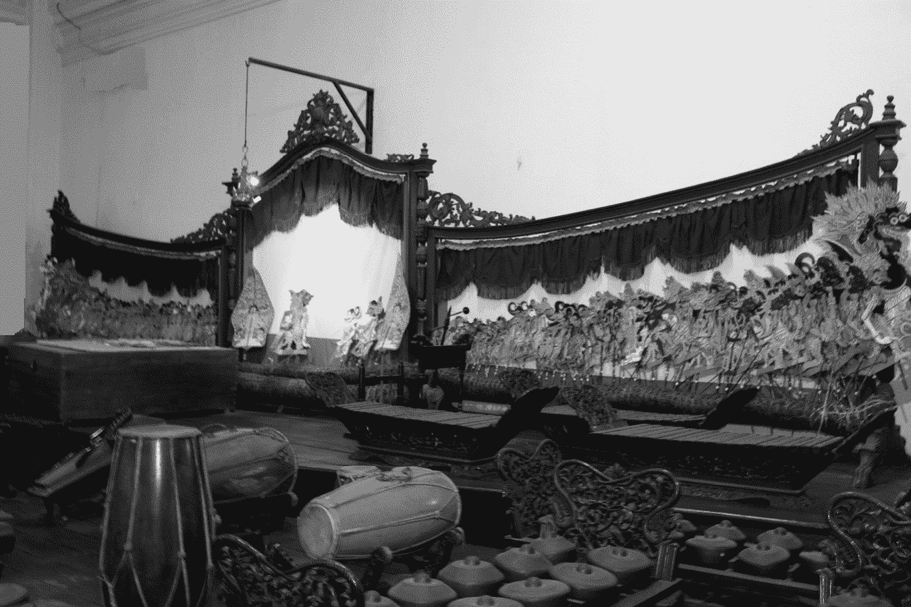

图 1.2 皮影戏舞台，印度尼国家博物馆收藏。摄影：Bagoes Wiryomartono。

关于美学，`dhalang` 在表演审美质量上起着重要作用。这包括他对戏剧叙述和当前社会政治事务的知识。事实上，一个优秀的 `dhalang` 是一个对当代世界具有批判性感知的全才艺术家。他尖利的言辞、理性的评论和对时事的巧妙幽默，在 `punakawan`（平民代表人物）登场的午夜场景是必要的。通过这种方式，他不会让观众从晚上 9 点到 10 点直到凌晨 4 点到 5 点感到无聊或入睡。

在开场场景中，美学深思考虑的 `wayang` 表演通常主要表演一系列描写 `satria` 形式的理想爪哇性格的场景。普通世界通常被呈现为混乱、无序和困的领域，这是贪婪、欲望和愤怒的后果。主角 `satria` 被召唤来应对特定的场合。故事将是描写 `satria` 一系列考验的场景：他必须准备好知识（`elmu`）、技能（`kanugaran`）和个人成熟（`mantep satria`），以便他能够恢复世界的统一、和谐和可持续性。

`wayang` 的起源于印度教佛教传入之前的时期。最初，`wayang` 使用木刻人偶进行表演。现代 `wayang` 则使用皮影偶或真人演员进行表演。在爪哇社会中，`Wayang` 是一种面向所有年龄段的兼具教育性和娱乐性的表演。`wayang` 表演的重要的是使爪哇文化价值观能够代代相传。这种通宵演出由一位 `dhalang` 指导并表演，他要负责操纵影偶、演奏音乐并为所有角色配音。

从美学角度来看，`wayang`是对共情（`welas`）、羞耻（`isin`）、慈悲（`asih`）、快乐（`seneng`）、尊重（`hormat`）和犹豫（`sungkan`）经验的展示。文化与自然原始之间的战斗由 `satrias` 和 `raksasa`（巨人）代表。对立元素与方面之间的紧张关系成为 `wayang` 表演中审美体验中最有趣的部分。尽管如此，在主角能够恢复并建立世界秩序之前，爪哇理想的戏剧性会随着各种考验和磨炼而展开。`wayang` 表演最重要的目的是让观众在充分意识到古代智慧和教诲的情况下，使自己与当代世界对齐（`nglaras`）。`nglaras` 的目的是成为一个 `satria budhi luhung`（品德高尚、素质良好的人）。

## Batik

`Batik` 代表了爪哇的图形设计和绘画。`batik` 艺术强调的是追溯到印度教佛教影响之前的图案。在爪哇语中，`Mbatik` 的意思是精细的雕刻和绘画。具有双螺旋图案的几何图形占主导地位。它的起源可能源于 `Dong-son` 金属器物文化（Bulbeck 2004, pp. 428–39）。重复的形式和白色棉布上的大地色调主了 `batik` 设计。然而，黑色、棕色和深黄色在大多数经典 `batik` 中占据地位。经典 `batik` 设计最重要的目的是以温柔而细腻的方式协调（`nglaras`）图案与颜色。事实上，`batik` 的美学问题非常简单，涉及其纹样和图案的启发能力、其独特性的狂热能量以及对形象的挑衅性抽象（McCabe-Elliot and Brake 2004, p. 198）。在构图中避免奇特和粗俗是显而易见的。`batik` 的信息是庆祝背景中的世界。节庆的微妙属于 `batik` 设计的核心目的。

事实上，`batik` 设计有用于节日庆祝和日常使用的版本。普通人的日常服装是 `lurik`。百姓穿 `lurik` 而不是经典 `batik`。从技术上说，`lurik` 是 `ikat` 织物。`batik` 和 `lurik` 的区别不仅在于图案，还在于生产方法和工艺。从设计上来说，`lurik` 的图案和颜色简单且不复杂。这是可以理解的，因为采用了单双 `ikat` 织造技术。大多数 `lurik` 只有简单的线条图案和深靛蓝色。这一切是为了将谦逊（`sa’ madya`）的概念融入普通人的生活。穿 `lurik` 意味着认同自己为平民。在许多情况下，只有 `priyayi`（统治阶级）穿 `batik`。尽管从外表上并不明显，但爪哇文化和传统中社会地位的微妙差异体现在他们穿的衣服上。`nglaras` 的感通过人们在休闲和正式场合的穿着方式得以体现。

## Gamelan

`gamelan` 音乐是爪哇传统乐器的合奏。它是一个由打击乐、管乐和弦器组成的复杂系统。`gamelan` 的节奏结构根于爪哇人的精神和社会结构。`gamelan` 的模式通常是循环的，反映了生命和信仰的循环本质。`gamelan` 的和谐旨在表演者之间创造一种平衡状态。

尽管大多数国家和定居点在公元一世纪到十二世纪之间已经消失，但印度影响的痕迹依然可见。它们在过去几乎不被承认的痕迹发现于分散的来源中：从纪念碑遗迹（`candis`）、铭文（`prasasti`）、诗歌（`kakawin`）和史（`babad`），到神话（`dongeng`）。然而，在城市历史方面似乎没有留下全面的考古证据。伊斯兰之前的国家可能没有城市，还是说他们有一种不同的城市观念？到目前为止，根据印尼的背景判断城市定居点，缺乏对“什么是城市”的当地知识和背景。这项历史调查的主要来源是与十二世纪以前印度尼爪爪哇人类定居相关的当地概念、人工、遗迹和文献历史。

# 伊斯兰前的爪爪哇

许多学者已经对伊斯兰前爪爪哇早期城市化的研究（Coedes 1944/1968; Wisseman-Christie 1986; Wisseman-Christie 1983; Coedes 1966; Ali 2011; Kulke 2001）。他们对我们古代爪爪哇定居点知识的贡献无疑是重大的。然而，关于城市定居的当地古代概念仍需进一步的审查和阐释。本章认为，当地概念在历史分析中具有潜在资源价值，因为古代概念和事物在构建古代世界时在背景上是相互联系和关联的。古代爪爪哇国家概念与城市化概念之间是什么关系？这个问题引导本章探索与早期国家和社会相关的方面和古代概念，这些概念在理论上是城市化思想或痕迹的组成部分。到目前为止，人们很少关注能够使我们理解 `negara` 与城市性之间关系的理论立场的发展。这一事实可能源于我们对政治文化的理解匮乏，而这种文化是以 `negara` 为印尼城镇和城市的生成概念被塑造的并并在其塑造的。

到目前为止，误解是不可避免的，因为城市化被狭义地理解为人口聚集的定居形态现象。相反，城市化本质上是关于具有可持续文化培养能力和经济增长能力的政治组织定居点的体验。因此，发展和增长是可能的，因为有可用资源，以及其生产系统在政治和环境上的政治稳定性。此外，城市化使公民能够维持他们的财富、权力以及作为国家或政体系统中某种价值之物。定居点的聚集可能不是城市化的唯一决定变量，而显然是文化生产系统模式、需求和结果的结果。

要将印尼城市化历史作为一种文化现象来理解，可能需要包含关于 `negara` 作为政治概念的话语。这是因为城市定居的起源不可避免地是政治文化与他人互动的产物。是政治文化使城镇和城市变得独特且具有背景。由于城市定居是权力集中的场所，展开和瓦解霸权与权威的概念对于什么是城市的历史话语至关重要。在方法论上，本章是一项诠释学调查。它涉及印尼爪哇的结构概念和早期城市化的方面。本章的重点是揭示和展开关于领域和社区方面的当地概念，这些概念对过去和世界具有建设性。为了找到它们的局部含义，拆解和揭示地方和原始概念成为本章的主要任务。在此过程中，城市历史不仅是对过去的描述性叙述，而且是对前世世界及其政治文化的话语性解释。那么，城市化的历史将在这种社会文化构建的现实中被描绘，其中 `negara` 作为概念对于印尼的城市化是核心且不可或缺的。

## Desa 与早期 Negara

在印尼定居点的中，村庄（`wanua`、`kampong`、`gampong`、`banua`、`kabisu`）通过其制度和社会与城镇（爪语 `kuta` 或马来语 `kota`）区分开来。`wanua` 是一个自治、自给自足且父制的定居组织。在社会上，古代村庄（`wanuas`）由二元对立群体组成：贵族阶层和平民（Kroef 1954, pp. 842–62）。尽管几个村庄（`wanuas`）独立存在（Bellwood et al. 1995, p. 195），但一个 `negara` 必须有几个 `desa`（村庄），它们环绕并支持着它的政治中心（`kuta negara`）。从历史上看，从未没有没有 `desas` 的 `negara`。自从公元五世纪左右采用印度教和佛教影响以来，`negara` 和 `desa` 一直共存。`desas` 和 `negara` 不仅仅在主奴关系上在经济上相互依赖，它们在形而上学上也通过父子关系相互支持。

毫无疑问，爪爪哇大多数本土统治者在四世纪到十世纪之间接受了印度教和佛教，这使他们能够建立国家 `negara`。在此可能性之前，他们必须在自己的控制下统一至少四个围绕他们自己 `wanua` 的村庄。这在爪哇传统中被称为 `mancapat`（Koentjaraningrat 1985, p. 100）。然而，这并不意味着将整个村庄固合成一个位置。对于 `mancapat` 概念来说，重要的是建立一个村庄链条。一个国家越强大，他们建立的链条就越长。然后，周围的村庄（`tpi siring`）被纳入他们的政治控制之下，并授予 `desa` 政体地位。尽管村庄被整合在同一个屋檐下，但权威是本土的思想和实践，从酋长制到国家的转变在哲学上归功于印度国家的影响。他们不仅从印度文明中学习了印度教和佛教，还学习了治国、识字以及通过税收和贡赋系统控制土地的方法。

八世纪期间，爪哇定居点的发展发生了重大变化。这种变化记录在 `Dinaya` 铭文中，该铭文提到了公元 732 年左右的三詹延王朝（Coedes 1944/1968, p. 90）。这种发展通过文字表明了从本土定居制度 `wanua` 的概念被 `negara` 或 `desa` 取代。正如在斯莱曼日加雅地区的多个铭文中反复发现的那样，爪哇文化并没有按照梵文中对地方和土地的描述来理解 `desa`。相反，在古代爪哇背景下，`desa` 是一个具有政治组织的二元社会系统的村落定居点：`karaman` 由长者（`rama`）组成，`bhogi` 由担任村庄管理位的 `raka` 或 `rakryan`（大哥哥）组成；`karaman` 是村庄的绅士。后来 `raka` 或 `rakryan` 成为伊斯兰前爪哇贵族或贵族的头衔。自伊斯兰德麦苏丹国及其首位统治者 `Raden Patah` 以来，该头衔从 `rakryan` 变为 `raden`。

尽管如此，旧 `wanuas` 整合进 `negara` 意味着村庄的平等生活方式逐渐被官僚化的封建政治体系所瓦解。显然，如果没有贵族集团内部权力的集中和巩固，这将是不可能的。这种瓦解也导致了长老会（`karaman`）平等议会的削弱，与此同时，这也是爪哇社会中更复杂的农业地主制度的形成时期。

事实上，对印度式治术的采用随后不仅意味着 `wanua` 首领头衔从 `raka` 或 `rakryan` 变为 `dhatu` 或 `ratu`，还意味着领导层角色和功能从社区首领向社会政治领袖的转变。这暗示了社会地位和分层的发展，以及职业种类和层级指挥链的日益多样化。这种国家的早期形成阶段之后，可能紧接着就是等级集权的 `negara` 系统的出现。

9 世纪晚期中爪和爪爪的碑文（`Lokapala`、`Mantyasih`、`Wanua Tengah` 和 `Sugih Manek`）进一步提到了 `desa` 之外的自由所有定居点 `wateg` 的出现，其在政治上与 `desa` 的地位对等。这种自由所有地的地位传统上是由统治者作为政治手段授予的，旨在不通过暴力征服而接纳其他地主。凭借这种善意，统治者处于赢得忠诚和减少潜在竞争者的地位。高、低级王室官员（`samgat`、`pamgat` 和 `mangilala drawya haji`）以及一些首领也享有免税权。自由所有地的地位可能被用来招揽潜在的竞争统治者进行合作。作为回报，定期向统治者所在地进行朝贡（例如为了 `sima` 仪式而进行的 `sowan dalem`）必须被视为尊崇和忠诚的标志（Tarling 1999, p. 214）。

在古代爪哇传统中，`sima` 是具有特殊地位且免税的场所。它也可以是国王或祖先英雄的圣地。授予土地 `sima` 地格是统治者控制其下属地主的一种政治手段。这需要国家仪式和典礼来确认并正式化这种安排。在精神上，这也被视为国家作为世界的诞生与重生。通过这样做，统治者在活动中的出现是为了证明其作为地上之神的地位。

此外，在印度佛教国家时期的碑文中还有一些与定居点相关的概念，如 `wanua`、`negara`、`duwan/kaduhwan`、`desa`、`dapur`、`thani`、`dalem` 和 `thani`。所有概念都有特定的独特含义，涵盖了 10 世纪爪哇权力从中部转移到东爪哇之前政治文化的转型过程。这包括从 8 世纪早期到 13 世纪爪哇领地术语的转变，这些术语可能与其政治机构 `negara` 的形成和巩固有关。`Dhuwan` 是现代单词 `dukuh` 的古语，意为村落。尽管 `dhuwan` 由 `kamitua` 领导（字面意思是由于长者身份深受推崇的人），但其政治组织尚未建立，也不像 `wanua` 或 `desa` 那样复杂。

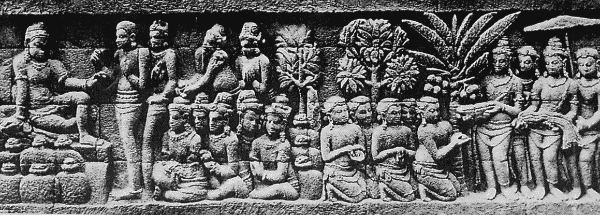

图 2.1 婆罗浮屠 Karmawibangga 浮雕中的场景，描绘了下属地主 `punpunan` 向国王效忠的行为。照片由 Rudi Badil 和 Katalis Publishing 提供 (Badil 1989: 34)。

与 `dhuwan` 相比，`desa` 实际上是一个借自梵的词，字面意思是农业定居点的社会政治机构，传统上处于 `negara` 的霸权之下。作为一种政治组织，`desa` 在经济上依靠基于水稻的自给自足农业社区的支持。某些 `desa` 的建立很多时候是因为它们与最初作为 `wanua` 的 `negara` 具有政治附属。这种附属关系是由 `negara` 通过政治过程或军事征服建立的。

另一种附属形式基于`negara`领土扩张的政治机制。它是通过向国家官僚机构授予土地实现的。统治者将土地授予国家官员作为其领地或领土。这种领地在古代爪哇被称为`lungguh`。随着时间的推移，`lungguh`地区的人口作为农业社区和定居点不断增长发展。此类定居点的政治地位取决于它们是`desa lungguh`还是`kadipaten/kabupaten`。这种定居点中心设有地方统治者的席位。`Kadipaten`或`kabupaten`是地区或从属国家，由国家王子（`hino/mahamantri`）或具有高级国家官员身份的王室成员（`pamgat`）领导。

在成熟形态下，普通的`desa`是一个领土化的定居实体，拥有处理政治、经济和社会事务的机构。`desa`之首是`demang`、`akwu`或`lurah`，由副手（`carik`）、祭司（`resi`、`pengulu`）和医者（`dukun`）协助。他领导的村民主要是被称为`gawe haji`的地主或赞助者。在处理村事务时，每个传统村庄都有一个名为`karaman`，由地主和长老组成。作为一个社区，古代爪哇`desa`有其自己的地方习惯法（`cara`）指导社区生活。

一些古代`desa`传统延续至今。最重要的活动是`bersih desa`传统。这是一个清理村庄并庆祝社区作为世界重生的活动。在古代，这种为领主进行的集体自愿劳动被称为`buncang haji`。但今天与之相同，只是名称不同，被称为`gotong royong`（共同承担）或`gugur gunung`（移山）。在古代和现在，村长的领导地位非常重要，如同他们村庄社区父亲的角色。此外，为了安全，`desa`提供了一套自愿的夜间巡逻系统（`ronda`）。村夜守大多是从每户抽出的成年男性。他们在夜晚值守，并配备了`kentongan`（竹制乐器），在需要提醒社区危险时敲击它。

尽管印度教和印度文化向爪哇社会引入了四个种姓（`svawarna`），但这种采纳微妙地融入了由贵族和平民构成的卓越二元体系中。古代爪哇的小王国至少有四个国家等级：`rakai`（统治者）、`pamgat`或`samgat`（国家官员）、`haji`（地主）和`samya haji`（地主的仆人）。除了官僚之外，国家祭司（`pandita`、`resi`、`Begawan`）和僧侣（`bikhu`、`cantrik`）在国家仪式和典礼中发挥着重要作用和功能，而商人和交易（`nayagan/niagawan`）在平民（`paura`）作为地主工人（`gawe haji`）和劳工（`katik`）的支持下经营经济。

从8世纪到10世纪的碑文中，一个值得注意的概念是与被称为`dapur`的古代村落有关，字面意思是用于定居的开垦土地。`dapur`或`dhapuk`术语用于清理森林（`babad alas`）后的开荒定居点。发展的下一个阶段，`dapur`必须基于轮耕水稻（`pagagan`或`gaga`）建立其驯化基础。这种开荒定居点的社会单位被称为`dhuwan`。今天这种概念仍在使用，且名称相似：`dephok`，意为村落或房屋分散的定居点。

`dhuwan`到`thani`的转变是通过名为`sawah`的农业实践实现的，通过这种实践，定居点作为一种基础性生产的形式得以发展。作为定居点的`dhuwan`和`thani`在社会政治上可能是`wanua`的一部分。这两个术语都是为了描述水稻种植模式的。它们是政治上独立的定居单位，也可以与经济和政治上已建立的`wanua`附属。

# 文字、稻田与国家

识字能力和水稻种植被认为是爪哇答及群岛其他地区权力集中及其形成性国家政体至关重要的要素。大多数关于国家的社会和政治概念显然源于`Sankrit dharmasastra`，该法典也是国家仪式、治国、制度和图象的来源（Heesterman 1989, p. 5）。`Sankrit`识字（`aksara`）在公元100年至600年间，由来自南印度的佛教僧（`bikhu`）和婆罗门（`brahmana`）引入爪哇答及其外岛的统治阶层，而水稻种植（`sawah`）的实践可能在第一世纪左右从东南亚大陆引入。然而，现存最古老的`Kutei`铭文不早于第四世纪。

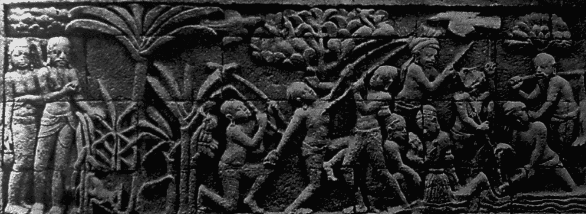

图 2.2 8世纪婆罗浮浮寺`Karmawibangga`面板上古代爪哇社会中鱼、家禽和猪的饲养与驯化（`budidaya`）场景。照片由 Rudi Badil 和 Katalis Publishing 提供（Badil 1989: 78）。

显然，五世纪早期王国的历史痕存在于东加里曼和西爪哇的石刻和铜文中。文字仍然是`Pallawa`。根据流传的爪哇口述，识字是由来自印度的 Adji Sakha 王子教授爪哇贵族的（Iguchi 2015, p. 78）。从他那里，识字和阴历开始出现在爪哇。它可以追溯到公元78年左右。此外，这位王子在爪哇口传传统中非常有名，他教用`Sankrit`和`Pallawa`字母教授爪哇地主`Devanagari`文字。识字仅供统治阶层保留和使用，被视为一种上特权。从那时起，保守`Sanskrit`文本一直是爪哇贵族的传统。印度与东南亚（特别是爪哇）之间的关系在文化历史方面一直是独特的。国际化的`Sanskrit`世界几乎没有在隔绝和区域化方面被划分，这让我们忽视了自然和历史的统一性（Heesterman 1989）。

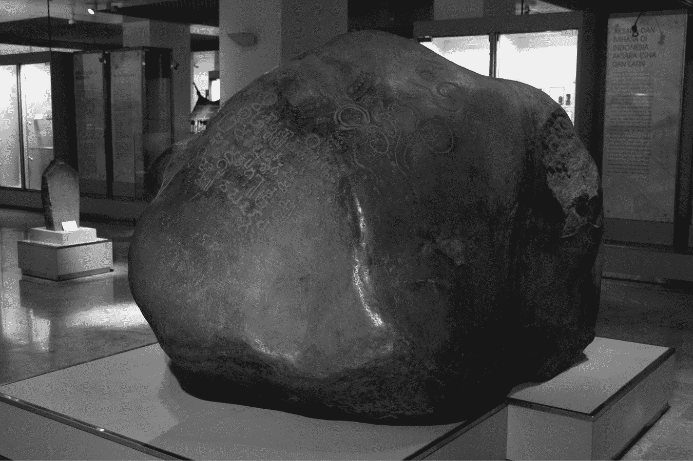

图 2.3 9世纪石刻，馆藏于印度尼西亚雅加达国家博物馆。摄影：Bagoes Wiryomartono。

普通人从`Sanskrit`识字中受益的一点是历法系统。爪哇阴历（`pawukon`）随后由 Adji Saka 王子开发。从那时起，年历系统以他的名字命名：`taon saka`。然而，`Sanskrit`的影响逐渐与当地文化融合。正如12世纪的铭文所示，爪哇的`negara`不使用`Sanskrit`语言和`Pallava`文字，而是发展了自己的语言，被称为`basa kawi`，以及`hanacaraka aksara`字体。尽管如此，古代爪哇的识字被视为神圣的和技能，使其能够建立`negara`国家政体的统治阶层和精英地位。从社会学角度来说，古代爪哇的识字能力在统治阶层和普通人之间形成了强烈的社会对立。同时，水稻种植通过封建主义经济体系加强了统治阶层统治平民的地位。

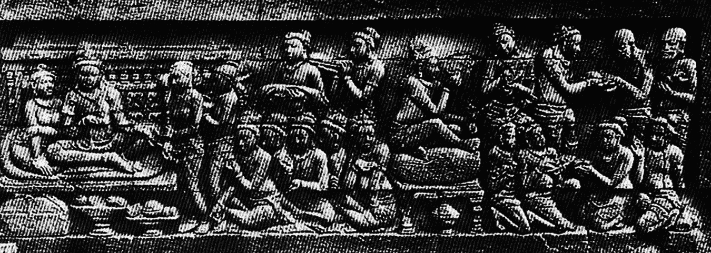

图 2.4 婆罗浮浮`Karmawibangga`面板场景，描绘了地主（`boghi`）在其住所内向穷人进行捐赠。照片由 Rudi Badil 和 Katalis Publishing 提供（Badil 1989: 19）。

在经济上，古代爪哇从酋长制到王国的转变不仅是因为印度文明的影响，也可能是因为农业技术上生产性发展的提供，这些技术从`tegal`（刀耕火耕）转变为`thani`（农业村落或定居单位）。这可能发生在第一世纪到七世纪之间。此类技术的起源在东南亚大陆早已为人知，特别是越南的湄江三角洲（Wheatley 1983, p. 113; Needham et al. 2000, pp. 123, 486）。然后，水稻种植和印度治术使得早期爪哇`wanuas`能够定居在基于`thani`农业耕作的原国家政治系统的地点。

然而，爪哇驯化方式从轮耕（`negal`）向农耕作（`nyawah`或`ntani`）的转变并不是居住文化从平等社区向等级农业社会转变的唯一重要因素。一定还有其他因素，例如工具制造技术。因此，第一世纪到七世纪之间也是农业演变的时期，使他们能够建立一个国家社会和政体。这种转变无疑是一个逐渐的过程，伴随着基于金属或铁的工具的发展。

铁匠（`gusali`）和灌溉技术（`sawah`）可以通过强化驯化来转变并增加土地价值，使爪哇农业达到经济生产剩余。同时，在永久性市场（`peken`）中的商品交换（`nyaga`）可以在古代爪哇社会中发展，其各种专业技能丰富了他们的艺术、闲暇、娱乐和社交生活。那么，第一世纪到七世纪时期可以被认为是爪哇人发展其农业社会的形成时期。此外，这一定是家庭生产剩余面临土地和水资源高效管理必要性而受到挑战的时代。

事实上，生产体系的转型和政治体系的变化是同时且相互发生的。定居概念从`wanua`到`thani`的转变是通过`thani`的生产逐渐实现的，其字面意思是基于灌溉系统（`sawah`）的耕作。土地的强化和高度复杂的水管理得到了发展。与巴厘灌溉协会（`subak`）不同，爪哇农民（`thani`）将水管理整合在乡村会议（`karaman`）中。尽管其名称在爪哇村庄可能不同，但其作为社区委员会的社会政治功能至今仍然存在。协调和分配水源以及水稻种植的互助成为会议的重要部分。

当然，与水稻种植相关的仪式和活动也是会议工作的一部分。这包括咨询和协助。古代村委员会成员的组成不仅包括政治家和社区领袖，还包括专家和贸易人员。精神专家（`mpu`或`dukun`）通过会议根据爪哇历书（`pewukon`）为种植、维护和收获水稻的仪式活动提供最佳时间的建议和指导。天气和历法专家被称为`wariga`。他也是一位长者和村委员会的成员。

与此同时，爪哇社会的本土社会群体，以及其他奥斯罗尼语族的后裔，仍然保持着旧有的习俗形式。他们并没有立即接受印度的种姓阶层划分（`varna`）。事实上，婆罗门（`brahmins`）群体可能被他们接受为一个与贵族（`bhogi`或`priyayi`）相关的高度受尊群体。贵族需要宗教权威来使其权力的积累合法化。统治阶级赋予佛教和印度教僧侣特殊地位，作为对他们精神支持和治国知识的回报。作为，正如印度教和佛教教义所教的那样，统治阶级会在罗布 udur（`Borobudur`）的`Karmawibangga`廊向穷人和`brahmana`或`bikhu`捐赠。

## 权力的巩固与地理

在古代，权力的集中在多大程度上是可能的？从地理上来说，`Kedu`平原、`Dieng`高原、`Brantas`平原和马兰（`Malang`）地区（那里水稻种植最有利的地点）不同时期散布的碑文和纪念碑向我们展示了权力的巩固并非易事。过去的情况由陡峭崎岖的地形地以及茂密的热带森林所主导。地理背景证实了一个事实：古代统治者更多应该是共存的，而不是作为主宰的征服者和卓越的皇帝。如果没有寺院的支持，单一统治者下的权力巩固可能是不易实现的。在古代爪哇这样一个苦修者的世界里，统治者被视为强大的人，不仅是作为政治领袖，而且是精神上出凡的人。

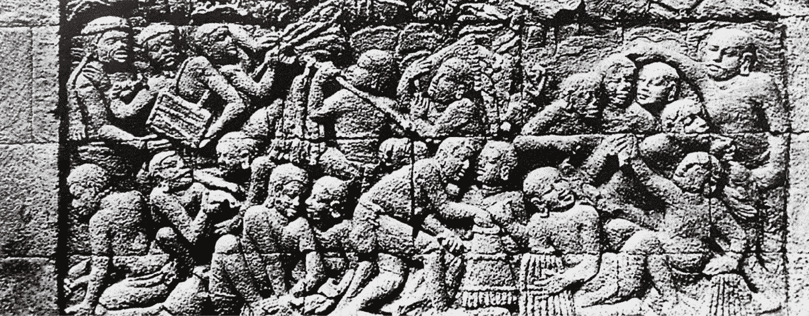

图 2.5 8世纪爪哇的市场（`peken`）场景，取自罗布 udur`Karmawibangga`廊。照片由 Rudi Badil 和 Katalis Publishing 提供（Badil 1989: 136）。

## 国家（Negara）的概念

早期`negara`的国家概念在印度尼西亚岛的其他地区是如何发展的？它对城市化产生了什么影响？到目前为止，从1世纪到5世纪的东婆罗洲`Kutei`，关于`negara`的痕迹和碑文很难找到，但在西爪哇已经显现。位于波哥尔（Bogor）公元450年用`Pallava`文字书写的四块`Ciaruteun`碑文证实了与国家思想相关的三个定居点概念：`negara`、`puri`和`sibira`。然而，`sibira`一词的意思是`pura`还是寺庙并不明显，甚至令人困惑。由于该概念在西爪洲`Purnawarman`铭文证据中使用可能与圣场所有关，这个词可能接近印尼语单词`vihara`或`biara`，意为寺院。尽管很难从考古发现勾勒出爪哇早期城镇的清晰画像，但`Purnawarman`碑文中提到的达鲁曼加拉（`Tarumanegara`）包含了印度`negara`概念的两个组成机构，即`stana`（统治者的宝座或宫殿）和`pura`（国家仪式的中心）。

## 城市机构与中心

从词源上说，`sibira`并不是梵词；它可能的含义接近`pura`，而这对于`negara`的概念至关重要且具有决定性。`pura`字面意思是举行国家仪式和庆典的神圣之地。作为城市机构，`puri`和`ksetra`（`pura`的圣区）可能构成了中心的概念。尽管它们具有宗教重要性，但如果没有永久性市场的支撑，它们本质上不足以构成中心的概念。古代爪哇社会的本土市场不仅在经济上重要，而且作为古代爪哇生活的真实中心在文化上也具有重要意义，正如被埋藏的罗布 udur`Karmawibhangga`浮雕所示。古代爪哇语中，市场的词是`p’ken`或`peken`，字面意思是聚集、互动、交换和汇聚。

那么，如果不包含构成国家定居点的三个核心中心机构，`negara`的城镇和国家状态将是不可想象的：`pura`（举行国家仪式和庆典的地方）、`puri`（统治者的宝座）和`peken`（经济交换和社会化的场所）。尽管如此，住宅（`paumahan`）、国家机构（`sarana`）和它们的基础设施（`prasana`）同样重要。

## 社会准则与公正

尽管在早期`negara`中，基础设施和领土的城市法律和准则没有得到妥善执行，但存在被称为`tata krama`的特殊准则和礼仪，用于`negara`核心的社交互动，如语言（`basa`）、服装（`busana`）和礼仪（`jawa`）。这些准则在村民或农村地区并不使用。根据804年的`Mpu Ketudhara`碑文，违反准则和法律（`tata karma`）的后果由`sang tuhan`领导的法院（`pakaranan`）执行。然后，法院会授予公民身份（`warga negara`）的个人罚款和奖励。

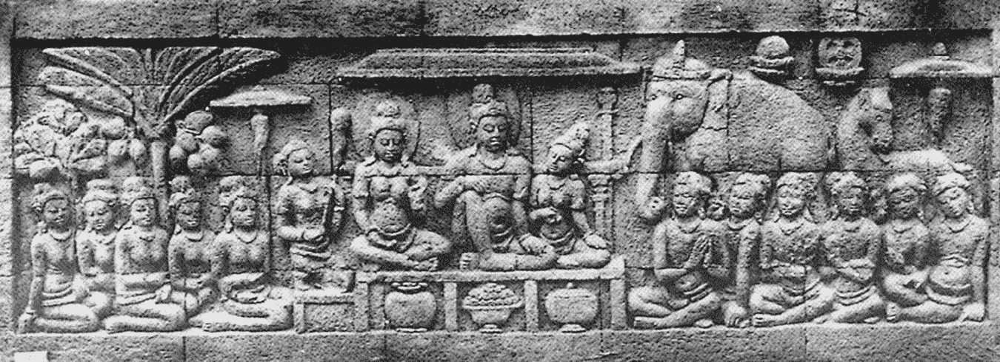

图 2.6 在其`pura`中的统治者（`rakrya`），取自7至8世纪的罗布 udur`Karmawibangga`浮雕。戴头冠的大象和装饰华伞的形象是王权的象征，浮雕上刻有铭文`Cakrarvartin`。凭借他神圣的`Cakrarvartin`身份，统治者成功地将几个`negaras`统一在他的控制下。`Cakrarvartin`仪式由大祭司主持，被视为宇宙的诞生。照片由 Rudi Badil 和 Katalis publishing 提供（Badil 1989: 89）。

## 古代爪哇的城市化

三个中心（`pura-puri-peken`）的使用可能是古代爪哇建立城市化的基本需求。从5世纪以来，`negara`的焦点一直是`kraton`，即政治、文化和精神的中心。在中心之外，领地一直是`desa`的农业部分。因此，高密度定居对于古代爪哇并不是必要的，因为中心需要农产品、税收和贡品。此外，爪哇传统的权力集中并不等同于定居集中，因为从领土上看，`negaras`的防御系统分布在每个`desa`或`lguh`。

定居点（`paumahan`）的概念主要与其居民的特殊职业或地主（`lguh`的`bhogi`）有关。由于在发现`Tarumanegara`碑文的地方缺乏考古挖掘，我们对古代城镇没有进一步的痕迹。除了铭文外，我们从`Tarumanegara`看到的唯一痕迹是它的名字；它源自古苏丹语单词`tarum`，意为靛蓝。`Tarumanegara`一定与靛蓝密切相关。古代爪哇社会中的靛蓝被广泛用于丝绸和棉织品的染色。由于`Tarumanegara`碑文的位置位于`Tarum`河内陆，关于其在现今加拉 awang 稻田地区可能的首都位置的问题悬而未决。`Batujaya`新发现的印度教寺庙群——位于`Segaran`和`Telagajaya`村，靠近`Tarum`河（Citarum）的加拉 awang——可能会让我们对西爪哇早期印度教王国的位置有一个更、更精确的想法（Manguin and Indradjaja 2011, pp. 113–36; 印度尼西亚国家图书馆 2015）。

尽管如此，`negara`作为一种政治组织的定居实体，已以封建国家或王权的形式出现。这意味着，用于作物耕种的土地财产价值一直是税收和贡赋的对象。水利管理技术导致土地价值增加，促使人们发展出更复杂的社会组织化政体，使他们能够管理和控制作物和其他资源，以促进文化产出的发展。这一切都是基于地主与工人之间的主主关系。

从轮耕农业向定居耕作的转变，在政治上随后导致了村庄并入单一地主的主权体系。这是印度式政治学和政体传统的结果吗？扩张权力的需求一直存在。问题确实在于，不仅要通过军事优势主宰他人，更要通过纪律和强有领导力高效地维持对他人的控制。印度文明为当地统治者提供了军事知识和战术，这些内容在《摩诃婆罗罗谭》和《罗摩衍衍》中有所描述。这两部巨著都被爪哇的统治阶层所采纳。然而，文本从宫廷到普通百姓的传播主要是通过故事讲述者表演者（`dhalang`）通过他们的皮偶戏（`wayang`）完成的。古爪哇版的《罗摩衍那》是`kakawin Ramayana`；它讲述的是`Rama`和`Shinta`的相同故事，但已从史诗小说变成了抒情诗。其作者无人知，但该作品可能写于`Rakai Watukura Dyah Balitung`统治时期，约公元`856 AD`。

# 社会与定居点

爪哇名为`mancapat`的村庄联盟概念，其起源推测源自印度的轮转模型（`mandala`）。8世纪至10世纪间来自`Kedu`和`Temanggung`的一些铭文中提到了为了防御和经济合作（在`panaturdesa`和`pangasta desa`方面）而由五个或十个村庄组成的联盟。除了神秘色彩外，`mandala`可能被用于在应对干旱、饥荒和旱季（`paceklik`）时确保农业生产和水利管理。根据`mandala`概念，村庄（通常不超过五个）通过定期轮换的市进行经济组织。每个村庄都有轮流举办每周集市的机会，根据参与村庄的数量一次。在文化方面，这些村庄建立了一个引渡罪犯（`maling`、`begal`、`rampok`）并同步其习惯法的代表性机构。

尽管有许多宏伟的`candi`（庙），但建筑和铭文显然在爪哇和苏门答腊等地屹立并蔓延。在`Majapahit`之城`Trowulan`（`1305–1527`）和`Kediri`（`1042–1222`）时代之前，几乎找不到具有强大街道和区块结构规划的物理城市化定居点的考古痕迹。尽管古代国家的遗址尚未揭示公共基础设施的遗迹，但它们的概念出现在许多铭文中，例如蓄水池（`segara`）、排水系统（`kalen`）、港口（`bandar`）、公墓（`astana pralaya`）、公共浴室（`patirtaan`、`pancuran`）以及用于农业灌溉的水坝（`waduk/bendungan`）。

与大部分稳定的古代村落定居点不同，作为`negara`中心的前伊斯兰时期城镇因为彼此之间的领土竞争而相对不稳定。尽管`negara`的兴衰影响了它们国家和首都的生存，但它们的`desas`（村庄）大多幸存并维持了其农业社区。尽管大多数可能消失了几个世纪的城市结构规划，某些古代村庄和国家的后代仍然可能保留了过去的某些域名。事实上，土地的当代用途可能随着其他活动而调整和变化，但古代名称可能保持不变，例如`alun-alun`（广场）、`peken/pekan`（市场）、`pendapa`（凉亭）、`keraton/kedhatuan`（皇宫）等。除了自然灾害（`pralaya`），定居点的迁移大多是因为忽视了遗址。根据铭文的位置及其文字，可以估计古代首都遗址的位置，例如 8 世纪中期至 9 世纪`Shailendra`王朝位于`Mamratipura`的`Medang`、`Matyasih`、`Kayumwungan`、`Talang Air`以及位于`Parakan Temanggung`的`Gondosuli`。然而，从田野来看，很难从它们的物理和地形痕迹中精确识别和定位古代遗址，这些痕迹大多已变为稻田和荒野。

作为国家首都的`kuta negara`区域被分为若干领地（`kalungguhan`、`lungguh`），由高级国家官员（`pamgat`、`adipati`或`bupati`）作为地主进行管理控制。在远离首都城的农村地区，这些领地和土地由`adipatis`或`bupatis`委托给他们的低级国家官员，这些人被称为`bekels`。然而，在首都城内，定居点的领地（`lungguhs`）形成了城市区块，这些区块由街道（`marga`）划分，以供人们骑马或步行成群移动。尽管几份铭文没有提到古代国家首都的定居点，但来自中国的文献证实了统治者宝座作为世界象征中心的重要性。定居点的核心被称为`dalem`或`jro`，实际上是矩形墙墙系统（`turus/penyengker`）内部的建筑或凉亭。

正如 876 年的`Jurungan`、905 年的`Poh`和 902 年的`Pagumulan`等多个铭文提到的，在`Sindok`统治之前，就已经存在重要的城市制度，例如行政首首的`patih`、祭司`purahita`、领土联络`desaadaksa`、律师`adhyaksa`、法官`upapatti`、通讯员`pangujar`、档案`citralha`、财务`kabandaryan`以及税收`pangurang`。各种职业专家在古代社会也为人知，例如建筑大师`undahi`、船长`hawang`、鼓手`mapadahi`、舞蹈者`kicaka`、皮影戏师`awayang`和音乐家`rawit`。他们的专业知识通过名字前的缀`juru`或`tuha`来表示。还有具有特殊任务的国家官员，如村庄信使`wikekas`、水稻官员`hulu wras`、森林官员`tuha alas`、灌溉官员`huluair`、市场官员`mapken`、园林官员`mataman`、铁匠官员`tuha gusali`、桥梁官员`huluwuatan`以及边界官员`mawatas`。

确实，城市化的一个基本要素是国家记录。相应地，古代`Mataram`王国的记录写在各种媒介上，如`lontar`叶（`ripta`）、铜牌（`tamra`）和石碑（`prasasti`）。此外，城市化的另一个标志是贸易单位的存在。在古代爪哇文化中，货币基于各种商品，包括黄金单位（`kati`）、水牛（`suwarna`）和米碗（`masuya`）。

此外，古代爪哇的社会组织在各种协会中，具有特定的成员条款、目标和范围。长者聚集在`kamitua`小组中负责社区事务的咨询，妇女们则聚集在`rainata`小组中负责社区互助和家庭照顾。儿童由社区中的`wadwa rarai`组织照顾，进行早期训练和嬉耍，而青少年有自己的协会，女孩为`rara`或`werewereh`，男孩为`wadwan matuha manwam`。

在经济上，国家和城市化需要来自各种税收（`pajeg`）和罚款（`sukha`）的收入。在古代爪哇印度教时期，收入（`pangguhan`）按年度征收，包括财产税、畜牧税和水稻税。日常税收是从商业交易（`masawyara`）和手工艺（`mistral`）中征取的。根据 902 年的 Watukura 铭文，在特殊场合，会有向国家缴纳的入户贡献，例如献花（`pangraga`）。国家仪式和庆典（如`sima`）不仅有当地人参与，还有来自`wargga kilalan`、泰国（`siam/kmir`）、印度（`kling/dravida/arya/`以及以及斯里兰卡（`singhala`）的代表参与。铭文中从未提到过中国人，所有公民（`warganegara`）都必须缴纳居住税。

## 神王崇拜（Devaraja）

尽管如此，尚未在 8 世纪至 10 世纪的铭文中发现关于爪哇统治者`Samaratungga`、`Daksa`、`Balitung`以及`Sindok`的神王崇拜（`devaraja`）。在当时的许多铭文中，`Sindok`从未自称为`Indra`、`Isvara`、`Wisnu`或`narendra`等神名，而是使用`Rakryan Mahapatih`或`Rakryan Mahamantri`等最高权威的头衔。这表明对`Sankrit`（梵语）文化的采用是为了当地的自豪感。换句话说，爪哇或印尼印度化与政治霸权无关。

拥抱印度宗教并非仅仅因为印度教与泛灵论之间的相似性。相反，对印度传统的采纳是因为奥罗尼斯文化的融合主义传统。因此，任何影响都应被视为被学习并纳入控制的爪哇资产（`negara`），基于爪哇人（`njawani`）的文化化信仰。爪哇人字面来说是包容且有觉察的。印度教和佛教的采纳与殖民无关。相反，梵语文化极大地丰富了本土文化以及国家治理术和识字。

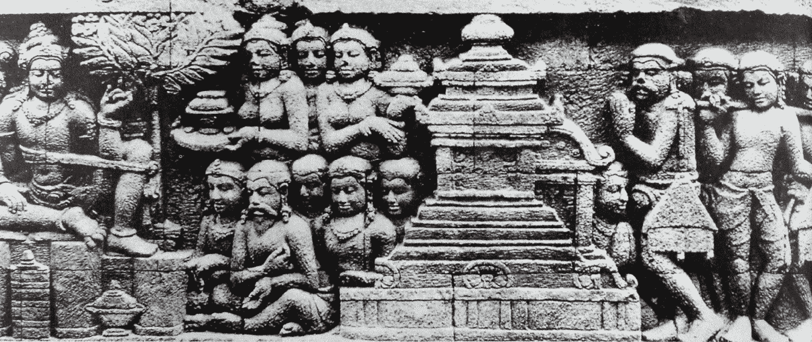

图 2.7。8 世纪一群妇女前往罗布奴巨巨佛塔（Caitya）的纪念。照片由 Rudi Badil 和 Katalis 出版社提供（Badil 1989:66）。

从印度文化来看，爪哇`negara`学会了在`mandala`（曼荼罗）概念下应用中心向东爪哇的迁移（`Dharmawangsa`统治时期之前）。为了部署`mandala`，领主必须为了对其他地区的霸权而努力。`mandala`是`negara`作为宇宙中心的形而上学框架。实际上，为了防止地理分裂，`negara`应该位于四个村庄（`desa`）的中心。`mandala`的完美部署需要政治和军事霸权。获得这种霸权后，宗教僧的支持提供了合理性。不用说，爪哇传统中的密教、苦行主义和神秘主义一直是建立权力的一部分。通过这种方式，统治者与普通百姓分离。

建立宗教建筑（`candis`）的动机可能与将多个`negaras`统一在一个控制下的成就有关。然而，夏连罗王朝（`Shailendra dynasty`，公元 770–825 年）和三散那王朝（`Sanjaya dynasty`，公元 910–929 年）需要天界群体的支持来实现他们的自豪和成就。通过这种方式，统治者可以在宗教的保护伞下展示他们的个人野心。事实上，没有任何证据表明这些建筑是宗教生活的中心。相反，国家仪式和庆典在城镇广场和统治者的住所处举行。事实上，古代人是为了朝圣而访问这些建筑的。

尽管在社会政治上，爪哇社会已经实现了复杂性和高度复杂的国家政治体系，但很难找到人口高度集中的居住点物理证据。像普兰巴南（`Prambanan`，约公元 856 年）和罗布奴巨塔（`Borobudur`，约公元 790 年）这样复杂的建筑，在没有空间组织的大型人口居住点的情况下建造的呢？尽管材料易腐且面临默拉比山（`Mount Merapi`）和默拉布山（`Mount Merbabu`）火山爆发的潜在威胁，为了建造耗时多年或十年的大规模建筑，定居点的集中是不可少的。然而，这与政治中心或首都城镇无关。相反，这种集中在概念上是为了建造建筑的临时性，并非为了城市化。在项目完成后，这种定居点就消失了。那么问题是：`negara`与其与其建筑（如夏连罗王朝的`Dharmatungga`和`Samaratungga`、三散那王朝的`Borobudur`和`Daksa`，以及`Lara Jongrang`和`Prambanan`）之间是什么关系？对于早期爪哇国家来说，`candi`（庙）究竟是什么？

如前所述，`negara`作为其公民（`paura`）的精神统一实体的存在，如果没有宗教仪式（`caru`和`puja`）是不可能的。为了将统一作为一种活动体验，`negara`需要仪式化和正式的场合来展示集体的团结和承诺。这一事件的终点是国王或女王的自我满足，这通过他们自己的纪念碑来体现。在这方面，这些建筑仅仅是统治者使其遗产永生的工具。更准确地说，对于爪哇统治者来说，`candi`更多是权力的祭坛，而不是对人民的奉献。爪哇统治者大多过于自傲，不在乎宫墙之外的人民，而在乎税收、贡品、忠诚以及国家仪式和庆典。

事实上，`caitya`的存在也象征着`mandala`或`prasada`。作为纪念性建筑的`candi`在视觉上比抽象的宗教用途更有用。正如罗布奴巨塔`Karmawibangga`面板所示，`caitya`并不是像清真寺或教堂那样的聚会场所。因此，古代爪哇的`caitya`在受到印度影响之前，可能仅仅是一个纪念性结构（`tugu`）。因此，`caitya`的宗教崇拜可能在意识形态上维持本土信仰，但可能用印式的服装和装饰进行了重新构建。

古代爪哇的`caitya`可能为古代爪哇社会提供了一个新的祭坛，以取代他们的泛灵论`pepunden`（金字塔形式的神地）。与`caitya`相关的仪式可能提醒了人们与其祖先的身份。对共同起源和祖先记忆可能是古代爪哇人建造`caitya`的动机，而不是任何其他宗教意图。

对于统治王朝而言，`caitya`的建立可能实现了`negara`（国家）与其`kawula/paura`（民众）的统一，这使他们能够动员自己的资源。不而而之，缺乏任何宗教文化归属的`negara`似乎仍然是一个抽象且不可触及的概念。由于`negara`作为权力的感可以通过建造建筑得以具体化，对于古代爪哇社会来说，`caitya`可能为他们提供了一个精神上的统一场所，让他们能够集体对比生命更伟大的事物表达希望、崇拜、祝福和感激。

从 10 世纪`Sindok`统治开始，`candis`作为伟大统治者遗产的纪念碑变得显易可见；例如，为`Airlangga`的`candi Gunung Kawi`、为`A Arok`的`candi Jago`、为`Anusaphati`（1227–1248）的`candi Kidal`以及为`Kertanegara`（1254–1292）的`candi Singasari`。问题随之产生：作为`negara`的纪念性建筑，`negara`与`candis`之间之间是什么关系？

根据`Mula Malurung`碑文`V-a`和`V-b`，Singasari 王国时期存在多种类型的`candis`：`thani bala`（避邪纪念碑）、`sima`（自由地纪念碑）、`kalang`（工匠建筑）、`Kalagyan`（村名）、`kamulan`（神龛）、`Kakurugan`（村碑）、`Kuti`（村名）、`biara`（寺庙纪念碑）、`Sala`（村名）、`parahyangan`（崇拜场所）和`karesian`（精神纪念结构）。`Singasari`对`candi`建筑的贡献显然是对其统治者纪念碑功能的重新解释。从`Ken Arok`到`Kertanegara`的`Singasari`统治时期将`candi`的功能从神圣的宗教纪念碑转化为统治者的纪念建筑。

自从爪哇王国从中爪哇迁往东爪哇，特别是`Singasari`之后，国王的遗产通过纪念性结构得到了尊严（`Muljana 2006, p. 64`）。鉴于爪哇文化中的权力是宇宙能量（`kesection`），对统治者的崇拜通过纪念碑得以永恒化，纪念碑可能是保存这种苦行力量的方式。尽管从`Majapahit`统治时期开始我们没有发现任何大规模的纪念碑，但群岛上最后一位伟大的印度教皇帝为我们留下了爪哇城市定居点的痕迹。`Trowulan`的`Majapahit`遗迹为我们提供了一个生动的爪哇首都城范例，那里必然部署了多层次的中心区域和高度复杂的土地利用模式。尽管`Trowulan`遗址处的一些`candis`可能是尊献给其统治者的，但这种奉献似乎并非为了他们的坟墓或陵寝。大多数统治者的骨灰都是通过相邻河流的水流被送往海洋。

如前所述，外来影响大部分通过融合的方式被爪哇文化所吸收。然而，某些地方自豪感和尊严的案例在文化融合过程中起着重要作用。`Suhita`王后（公元 1416–1459 年）通过她的纪念碑`candi Sukuh`展示了这种情况。她在 15 世纪强烈抵抗伊斯兰教的传播。作为`Majapahit`的最后一位皇后，她用本土爪哇建筑建造了这座`candi`，重新发明了印度文化影响之前的本土建筑形式。`candi Sukuh`的设计基于类似于金字塔的形式或阶梯式圣殿——`umpak pepunden`，最初在其顶部有一个`lingam-yoni`。`candi`的四座石梯旨在引导人们从地面通往这座带有矩形顶峰的建筑顶部。

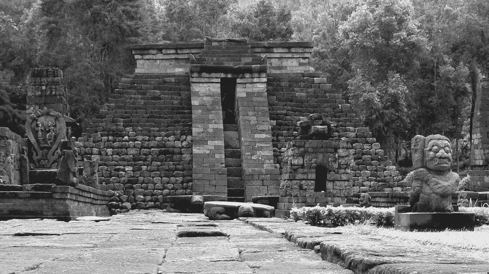

图 2.9。位于苏拉卡塔东部 Lawu 山坡上的 15 世纪`Candi Sukuh`；它被认为是从受印度影响的`candi`建筑向本土风格和形式转变的高潮转折点。摄影：Bagoes Wiryomartono。

考虑到装饰寺庙的浮雕和雕塑纹样，显然雕刻了一种后期印度佛教影响与爪哇巨石纪念碑的混合体。`candi`的形式让人们联想到马来-爪哇本土泛神灵灵论中的祖先崇拜祭坛。此外，`candi Sukuh`的雕塑元素和装饰描绘了爪哇人对《摩诃婆罗多》人物和印度佛教神的解读，带有漫画和喜剧的场景。

国家的建立可以被视为对其统治者个人崇拜的制度化。这在获得主权权力后在政治上完成。然而，如果没有宗教辩护和公众表演，政治霸权的地位是不完整的。在仪式上，把自己任命为超级王——`maharatu cakrawati`需要精神领袖的支持，使他能够表演他的权力戏剧。

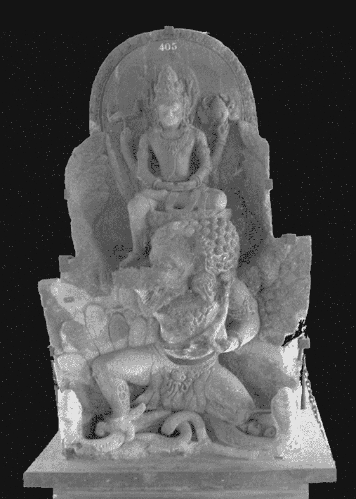

图 2.10。11 世纪描绘为`Wisnu`的`Airlangga`像，印度尼西亚国家博物馆藏品。摄影：Bagoes Wiryomartono。

在爪哇岛以及印尼西亚的大部分地区，从`negara`（国家）的角度来看，城镇与乡村或聚落的区别在于两个至关重要的物理组成部分：一个永久性市场和一个权力中心。这两个机构都是印度尼西亚前伊斯兰时期`negara`的关键结构，它们在政治和经济上都定义了`negara`的中心。`kraton`（皇宫）与`peken`（市场）的共存决定了国家首都（`kuta negara`）的存在。然而，这两个中心机构并没有永久性或纪念性的结构。

尽管如此，古代爪哇族统治者并非大多用石头建造自己的宫殿。他们可以这样做，但除了寺庙和纪念碑，他们并没有建造永久性的结构和建筑。在伊斯兰教国家之前，统治者的权力中心随着国家的消失而消失了。显然，8 世纪`Ratu Baka`的遗迹引导我们推测，该地可能是古代爪哇宫殿的所在地。确实，`Ratu Baka`遗址为我们提供了更多证据，证明`candi`（寺庙）之外存在永久性建筑。鉴于该遗址建筑群位于战略性的山丘上，这一事实可能会否定我们的推测，因为爪哇传统中的大多数`kraton`总是位于平原和平坦地区，而不是孤立的山丘，且周围是而非`desa`（村庄）的森林。

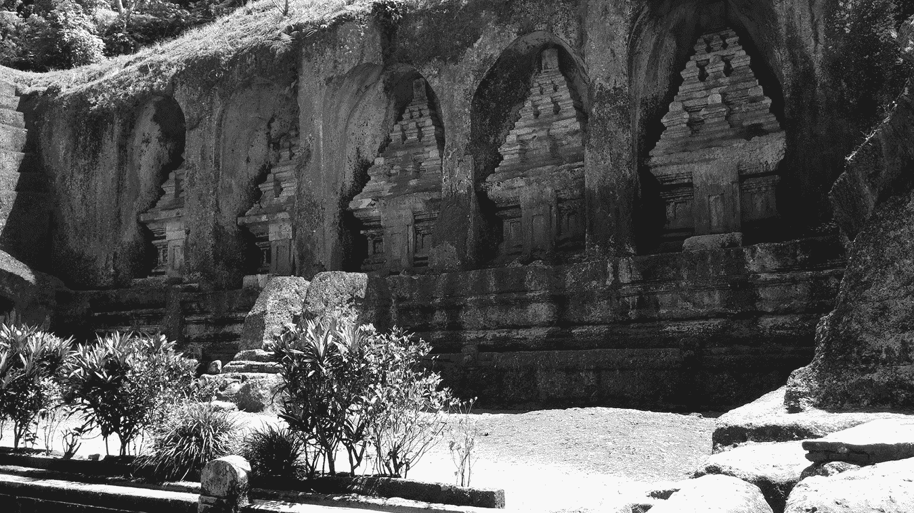

图 2.12，约公元 1037 年位于巴厘岛 Gunung Kawi Tampak Siring 的 Airlangga 神庙。摄影：Bagoes Wiryomartono。

根据 792 年的 Abhayagirivihara 铭，该地与 Sanjaya 王朝`Rakryan Panangkaran`的`vihara`（佛教）有关。`Abhaya Giri Vihara`的意思是和平山丘上的寺院。它应该是一个佛教寺院，或者是前统治者致力于精神目的的修养场所。根据遗址图，该建筑群显示了印度教和佛教元素——`Durga`、`Garuda`、`Ganesha`、`Yoni`和`Lingga`，以及三座未完成的`Dhayani Buddha`——所有的用于仪式沐浴的池子（`paseban`）和用于冥想的圣洞穴。遗址上的两个被称为`hara`的`lingga`刻有`778 Saka`或公元 886 年的日期。此外，`lingga`铭文提到了它们是在 Kalasobhawa 王的命令下建立的。佛教和印度教信仰的统一在铭文上显而易见，文字为：`Om Rudra ya namah swaha`，这用佛教的方式崇拜湿婆。

爪哇人的中心思想确实不仅是向外扩张的辐射控制，而且在形而学上将每个世界吸收到统治者的自我。这意味着承认统治者的至上和霸权不仅在政治上一致，而且在精神上臣服。权威的积累等同于力的吸收。正如在`Rukam`铭（约公元 907 年）中发现的，国家理念是以领域（`wanua i rukam wanua jro`）表述的（Boechari 1976）。随后，整个国家理念（`negara`）就是自我（`dalem`、`jro`），作为权力中心辐射光（`teja`）的扩张圆。

# 第三章：国家中心（Kuta Negara）

## 爪哇城市/国家思想及其历史演变

尽管`negara`源自印度文明，但作为一种国家和治国概念，爪哇文化以各种方式和形式对其吸收、调整和修改。几个世纪以来，爪哇的`negara`以其自身处理城市性和文明的方式和风格不断发展。本章认为，爪哇的城市化是一个没有明确外围的中心。本章的方法是诠释性的，将城市世界视为地方性的文本。本章将考察并审视与城市化和定居点现象相关的局部概念。其目的是揭示并解构它们的组成关系和意义结构。本章的材料源于作者作为爪哇本土人的经历，他曾在 1993 年至 2010 年间在爪哇完成了深度实野调查。

## 爪哇文化中的城市定居点

爪哇城市化的历史不可避免地涉及到这样一个事实：这种文化中的城市形式可能不是由其经济潜力定义的，而是由其仪式和象征目的定义的。Wertheim (1980)、Evers 和 Korff (2000, pp. 25–37)、Bishop、Philips 和 Yeo (2003) 以及其他学者——McGee (1967) 和 Ginsburg (1955)——证实了东南亚城市化的思想在理论上是令人困惑的，尽管其形式有两种主要模式：内陆国家和港口公国。迄为止，此类理论大多来自西方视角。Wertheim 对 Peter J. M. Nas 的《印尼西亚城市》（*The Indonesian City*）的提醒我们，研究需要听取印尼西亚人对其城市和社会的看法（Wertheim 1987）。本章是对 Wertheim 要求的响应，试图从内部揭示和展现爪哇国家与城市的演变，并特别参考了局部概念、文本和器物。

写这一章的另一个原因是，该地区关注城市形式和文化的城市研究缺乏出版物。虽然大多数研究印度尼西亚城市化的学者在对东南亚独特的家产制和专制城市、城镇的分析和理论在很大程度上是正确的，但他们似乎忽略了爪哇城市形式与当地政治文化之间的一些重要方面，而这种文化是保存在本土语言中的。

在某种程度上，城市文化包含了一套思想、价值观、原则和期待系统，以各种形式、媒介和方式在其社会中运作。为了被集体共享，城市文化需要交流性。文化是一种必须根据当地情况进行阅读和描述的文本（Geertz 1983, p. 70; Geertz 1973, pp. 11–12）。本章认为，爪哇城市/国家的意图在于其作为精神中心的权力概念。因此，城市和国家在概念上是可以相互的，取决于中心如何在现象上作为形式或事件呈现。根据意图性概念（Searle 1983），本章将城市视为人们所向并以此存在的世界（Kulke 2001），是爪哇地方政治和文化构建的现实。除了考古器物、历史文本以及当地习俗传统外，这种建构背景阅读的主要来源是局部概念、它们的意义及其语境。然而，分析和解释侧重于概念与现象之间的关系，这些关系构建并建立了爪哇城市/国家的事物和事件。

尽管一些学者对印尼爪哇早期国家和城市进行了研究（Coedes 1944/1968; Lombard 1980; Nas 1986; Rutz 1987; Wisseman-Christie 1986），但可能存在误解，在某些情况下是因为局部概念在其他语言中大多是不可翻译的。还需要进一步的调查来明确局部概念的意义，这需要更多关于印尼语境下城市化的局部材料的支持。事实上，大多数研究印度尼西亚城市化的学者对东南亚独特的家产制和专制城市、城镇的分析和理论在很大程度上是正确的。然而，他们似乎忽略了保存在本土语言中的当地政治文化的重要方面。

Wisseman-Christie (1991) 从人口统计角度认为，12 世纪以前的殖民前爪哇定居点是没有城市的国家。这如何可能是可能的？这个问题至今仍然存在。由于国家和城市化在历史上是权力集中的结果，城市现象与局部霸权和政治文化是不可分割的。Wisseman-Christie 关于古代爪哇王国是没有城市的结论，如果没有审视爪哇权力思想及其局部概念，将是不全面的。权力的集中不需要将人们及其定居点集中在一个地方。在爪哇传统中，权力的集中更多是关于宇宙能量的精神和象征中心；越接近权力核心，越能感受到其神秘的氛围和环境。

尽管 9 世纪到 13 世纪初爪哇人口是分散的，但他们的王国实现了国家官员和地方权威高度复杂且严格的层级制度（Kulke 2001, p. 16）。关于空间结构和领域的问题仍然开放。这种学识是如何在建筑上融入其土地规划的？这个问题引导我们去调查古代爪哇王国、伊斯兰、殖民和共和国时期`negara`是什么。

关于印尼西亚城市文化，可能没有比`negara`的政治制度更重要的，因为这个概念包含了城市、中心、城镇和国家。从古代至今，`negara`和`kuta`或`kota`一直是权力中心不可分割的概念。

自五世纪以来，在该群岛上出现了数百甚至数千个`negara`（国家/政权）的兴衰。其中大多数没有留下物理痕迹，例如`Pakuan`、`Padjajaran`、`Galuh`、`Medang`、`Blambangan`、早期马达腊和`Kahuripan`。它们过去的存在在文字证据几乎鲜为人知。碑文（`prasasti`）、传说（`dongeng`）、史纪（`babad`）以及少数纪念碑（`petilasan`）大多带有偏见，因为它们不可避免支持现状。

确实，`negara`这一制度在东南亚经验或更具体的马来-印尼语境之外的任何其他语言中都是无法翻译的。源自梵语的借词`negara`经过爪哇和马来文化经验的转化和阐述，已不仅仅是宫殿、首都、城镇、国家或王国。克利福德·格尔茨（Clifford Geertz）在该词最广义的意义上完美地描述为城市支撑的文明以及以此为中心的政治隶从上层建筑（Geertz 1980, p. 4）。

## 早期城市化与 Negara 的兴起

爪哇传统中`negara`的领域并非由物理性质或建筑标记，而是通过各种层级的语言实践，将其公民识别为`krama`（敬语使用者）。显而易见的结构仅在`negara`的最核心部分显现。`krama`一词源自梵语，意为方式、方法、样式、步法、表演，在最广义上指公民，位于`kadatwan`（贵族领地）范围内，那里使用宫廷语言`krama-inggil`。`negara`的形成组成部分在物理上被指定为一个加固的方形区域，在梵语中称为`in pura`，精英或统治阶级`priyayi`、`pangreh praja`（地方官员）居住在此。在古爪哇语中，这种领域被称为`jero`或`dalem`，意为内部空间、室内、核心、中心和自我。

从考古事实来说，没有`jero`或`dalem`就没有`negara`。`jero`的概念是中心；它是地主的座所在地。从空间上讲，爪哇语境下的`negara`始终是一个多层系统，`jero`或`dalem`位于其最内中心。在许多情况下，`jero`必须用围墙（`beteng penyengker`）进行加固。事实上，这样的墙在如今的`kratons`（皇宫）中仍然存在。它更多是为了象征意义而非防御。令人惊讶的是，很难找到`negara`外围的确定结构。尽管爪哇传统中的`negara`首都（或者可能也包括从亚齐到梯多洛尔的其他印度尼西亚国家）没有任何确定外围和建筑边界的痕迹，但其核心在建筑上以一种名为`jero`、`jeru`、`dalem`或`kraton`的加固围合结构的形式清晰可见。

`negara`的领域围绕着宫廷建立。这些区域沿着主路（`marga raya`）布局通往国家广场（`alun-alun`）。显而易见的围墙（`mbeteng`）不仅体现在`pura`、`kedaton`或`kraton`中，也出现在一些国家官员居住的领地（`lungguh`）中。`Kedatwan`或领地位于城堡（`pura`）所在地。与`kedatuan`另一个等效名称是`kajeruan`，源自`jero`，意为`negara`的核心部分。尽管含义相似，但在大多数马来语地区，`kajeruan`没有`kedatuan`常见。

`kedatwan`或`kedatuan`一词实际上源自古马来语`datuk`，意为社区的首领/酋长或领主。因此，`kedatwan`指的是首领的座。。在印度教和佛教传入之前，`Datu`是名为`wanua`的村落聚落的首领。奥斯尼西亚语的`wanua`是一个具有双重社会群体的世袭制社区——贵族阶层和平民。政治中心是由贵族领袖和长者组成的乡村委员会。`wanua`聚落的古代痕迹今天仍然存在，例如南尼亚的`banua`和松丹巴岛的`kabisu`。

在印度文化和文明的影响下，首领一定将社区融入了须鲁山的金字塔宇宙模型，并以自身为顶点。权力和权威的集中性通过`Siva`（湿婆）和`Wisnu`（毗湿奴）崇拜体现。没有这种崇拜，统治者在形而上学上并不神秘神圣，无法与他的贵族圈和普通人分开。随后，秘密、正式和克制通过仪式和典礼建立了`devaraja`（神王）崇拜，神秘了他的自我愉悦和自封的神性光辉。

尽管`kedatwan`或`kedaton`概念的发展在古村落`wanua`范围内展开，但爪哇和马来政治对梵语的采用非常具有选择性。在五世纪到十世纪之前，他们没有使用源自`raja`（国王）的印度版本。然而，表示“国家”概念的印度式`negara`保留了梵语，尽管其含义已根据当地情况进行了调整和阐述。在卡胡里潘的`Airlangga`统治之前，统治者的住所已明显从马来语`kedatuan`或`kedaton`转化为爪哇语的`kraton`，而含义没有改变。从那时起，统治者的住所不再被称为`pura`。

爪哇传统中，作为统治者座席中心的`pura`似乎被翻译成了`kraton`。这一概念的转化一定发生在爪哇文化和传统开始将各种印度文化和文学翻译成自己语言的时期。国王们如`Dharmawangsa`、`Airlangga`和`Jayabaya`在爪哇文化中广为人知，是这种印度-爪哇文化融合的发者。今天，有几个爪哇城市仍然保留着领地的名称，并指示着相应的`kraton`区域，尽管它们的宫殿早已消失，如`Kediri`、`Jepara`、`Demak`、`Plered`、`Kotagede`和`Kartasura`。

## Mancapat 作为中心的空间框架

从印度国家传统中，爪哇的`negara`学了在转轮者（`cakravartin`）背景下应用`mandala`（曼陀罗）概念。爪哇名为`thani`的农民村联盟概念及其`mancapat`方案的起源，推测一定源自印度的转轮者`mandala`。除了其神秘主义之外，`mandala`可能被用于应对干旱、饥荒和旱季（`paceklik`）时的农业生产和水资源管理。根据`mandala`概念，村民被组成`thani`的协作聚落单位，每五天举行一次定期的市场。名为`cara`的习俗法和道德规范必须已经建立，用以稳定村民之间的和平与安全。

`mandala`在原始梵语中意为本质或内容。在`kuta negara`（国家之城）中使用`mandala`是为了象征世俗与神圣之间的中介理念。这种象征的目的是为了带来一种神秘统一的体验，由此产生万千的形式和表象。印度教`mandala`向爪哇文化的调适在`mancapat`概念中得到了阐述。字面上说，它是超越四个角和四个主方向（北、南、东、西）的领域概念。`mancapat`是天地之间的轴心。`manca`意为超越或更远，而`pat`一词源自`papat`或四。

爪哇文化发展曼陀罗（mandala）的方式与印度教起源相似，但根据爪哇的宇宙观进行了处处调整。这些圆环或层级区分了相对于权力源源的影响价值。在`kuta negara`方面，`mancapat`的最内层是`Kedaton`或`Dalem`。其核心是国王或苏丹的居住地。其独特的建筑形式和空间布局显然通过被称为`cepuri`的宫殿内墙表现出来。此外，内墙内部的建筑在风格、尺寸和细节处理上都独一特色。然而，最重要的是，这是唯一一个从东方入口的主建筑。其主要入口的设计类似于印度神庙（`candi`）的入口设计。

`mancapat`的第二个边界是`sentana dalem`，被理解为皇室成员、官员和仆人的宫廷区域。它是宇宙权力的领域，统治者（`gusti`）与被统治者（`kawula`）会合的地方。国王/皇后与其民众会面由`bangsal witana`建筑标识。名为`baluwerti`的墙体系统立于此，以划定皇宫的第二个区域。

`mancapat`概念的第三边界被称为`kuta negara`，被理解为向各个方向延伸中心。为了建立`negara`世界，统治者及其追随者必须开垦森林进行定居和农业活动，或者控制现有的村庄和小落，并将所有这些土地归自己所有。作为地主，统治者通过税收制度（`upeti/upetya`）和缴纳宗教贡（`sowan dalem kaprabon`）来保护和控制村庄和小落。

第四个是统治者土地所有之外的影响区域，但在其保护体系之下。保护地区的领袖必须每年缴纳贡赋（`upeti`）并参加国家仪式（`upacara negara`）。保护地区是统治者在其本土或领地之外，在权力（`adidaya`）、魅力（`wibawa`）和崇畏（`wisesa`）方面的影响力延伸。这些地区通常属于其他地方统治者或其追随者。该区域被称为`negaragung`（大国），可以根据统治者的领导力和个人权力灵活地扩大或缩小。具有魅力且强大的领导力将增加精神影响范围。`negaragung`的边界并不总是地理领土（Miyazaki 1988, pp. 30, 164, 176; Laksono 1986, p. 64）。它实际上是由几位地主或地区统治者在精神和政治崇畏上承认统治者的领导而构成的。

第五区域是`mancegara`，意味着统治者影响之外或海外。`mancegara`区域的数量和位置是不设限的。然而，通过交换使节和贸易进行相互尊重是可能的。`mancegara`是阐述外部世界或`negara`统治和秩序之外的概念。`negara`向`mancegara`领域的扩张主义运动在任何情况下都是可能的。这与单纯的政治影响无关，而是关乎爪哇文化宇宙学领域的延伸。从历史上看，大多数爪哇统治者具有扩张主义倾向，需要确认他们的宇宙宝座作为地球上至高神的代表。爪哇人思考并相信他们的弥世主使命，即他们的文化是使领地之外的人们“爪哇化”。爪哇化意味着根据爪哇价值观进行文明化。在他们的细腻之处，成为爪哇人意味着采纳并实践成熟、礼貌、微妙和精致的爪哇习俗与传统。

事实上，国王的住所象征性地位于`negara`领域的最内层。但爪哇统治权的扩张能力并不总是领土性的，在国家仪式和活动方面也是文化性的，他/她的王国的所有人民出席并聚集，臣服于统治者展示的壮丽奇观。最终，统治者的自我是爪哇家庭的精髓，它扩张性地主张在其霸权下凌驾他人。这一切通过其国家仪式和活动作为壮丽的奇观得到了戏剧性的表现。

尽管如此，也许为什么西爪哇的`Purnawarman`在他的铭文中，除了宣布自己为地主之主（`parthiwa indra`）外，还向来自早期印度古普塔帝国的婆罗门（Reily 2012, p. 116）表示感谢，感谢他们对他王权的支持。作为捐土地的回报，祭司们对他的卓越地位和国家仪式建立的支持；这一切都是为了作为神`Isvara`或`Wisnu`（毗）王的崇拜。因此，他可以为自己的崇拜和遗产建造特殊的纪念碑。`Purnawarman`的遗产刻在有他脚印的石头上。

从建筑上说，作为绝对统治者的个人崇拜的自我满足和主张可能从 11 世纪东爪哇`Sindok`的统治开始。更准确地说，是`Airlangga`将自己神话为地上的`Wisnu`。他的纪念建筑位于巴厘岛的 Gunung Kawi Tampak Siring。正如 Ngimbang 铭提到的，`Airlangga`在公元 1037 年成功集中了他的权力并具备了`cakrarvartin`地格（Pigeaud 1960, p. 470）。从那时起，`Kediri`和`Singasari`的权力通过赋予统治者作为整个精神和世俗世界之主的`ratu cakrawati`身份的国家仪式得到了证明。

`Kota`或`kuta`最初是一个梵语外来词，意为筑固的领地。墙（`turus`）更多是为了象征目的而非实际用途，因为传统上它既没有提供军事营房和后勤及武器的仓库，也没有定居点的集中。传统上，墙被爪哇人构想为`dalem`的结构，字面意思是自我。也许宫殿和国家并不是为了大量密集的人口而发展的，因为这不是需要的。中心被构想为偶尔发生的壮丽奇观场所，例如`sima`仪式和活动（Munoz 2006, p. 348）。

### 结语

尽管在 5 世纪到 10 世纪爪哇和印尼其他地区的潜在城市化遗址考古挖掘很少，但定居点的可能性是显而易见的。然而，它并没有以集中和人口稠密的形式发生。相反，集中体现在宫廷文化方面。确实是通过复杂的社会系统支持宫廷仪式和活动。尽管政治和经济中心没有通过宏大的城市建筑来证明，但国家仪式和活动的壮丽奇观是需要的，这些活动在城镇广场举行。

Kulke (1991) 提出的观点认为，在十世纪以前的古代爪哇存在没有城市的国家，这一观点几乎难以接受，并被认为是一个草率的结论。因此，城市化不仅关乎物理结构，更关乎文化。在爪哇的经历案例中，如果不提到城市结构与权力及国家概念之间的关系，对城市定居点进行判断在历史上是不充分的，因为城市化的意义在于其国家体系的政治制度。在爪哇和印度尼西亚的语境下，城市基础设施缺乏物理证据并非唯一的决定因素，因为这片热带土地上定居点的大部分建筑元素都是用易腐材料制成的。只有石头和陶土被用于纪念性建筑。这一事实促使我们审视物理结构之外的城市化方面。由于城市化的本质在概念上是为了“文雅化”（urbane），因此爪哇人将这一概念理解为`karma`（礼仪和行为规范），体现在`alus`（文化修养）方面。`kuta negara`（国家中心）中心一直与实践文化修养和良好礼仪的地方联系在一起。在爪哇的语境下，城市与非城市或农村地区的区别不在于其物理结构，而在于其文明行为。大多数西方学者在理解爪哇文化中的“城市”时，可能忽略了这些标准。

然而，在`negara`的背景下，`mancapat`的边界既不是通过物理标记划分的，也不是通过书面文件。边界是通过语言等级的使用和实践所标记的事件，这种语言在建立主/奴关系方面具有微妙的压迫性。爪哇人通过对谈话对象的称呼来认知边界。这是行使尊重和崇拜的时刻。

## 国家作为统治者崇拜的舞台

除了易腐材料和自然灾害——洪水、地震和火山喷发——之外，爪哇岛缺乏密集的考古挖掘是难以确定古代爪哇定居点早期类城镇结构的原因之一。另一个原因在于其概念基础：定居遗迹尚未反映`negara`作为政治实体的理念。在`Kahuripan`战国的`Airlangga`之前，古代国家可能处于为了建立完美`negara`的竞争之中。这可能是为什么直到`Medang`王国的`Mpu Sindok`时期，古代统治者尚未成功执行他们的神王（`devaraja`）崇拜（Thakur 1986, p. 33; Vic 2005, p. 89）。

基于密教湿婆教的印度`Devaraja`崇拜可能在爪哇对印度国家政治的采纳中发挥作用。然而，本土化的采用可能改变了仪式和意义。用`Gusti`称呼神和统治者的概念是该崇拜的明显证明。从宇宙观角度看，爪哇的统治者概念认为国王是地球上的神性代表。确实，爪哇印度教`Kahuripan`的`Airlangga`统治者以及 Majapahit 的`Kertarajasa`被刻并永化为`Wisnu`，而`Singasari`的`Anusapati`被刻为`Siva`的化身。他们的纪念碑只是在`manunggaling Gusti-kawula`（神人合一）意义上对代表性神性的建筑永化宣称。`kawula`的概念很难翻译。它不仅仅是关于被统治者作为仆人或从属。`Gusti-kawula`的思想也与牧羊人与羊的关系并不相似（Peacock 1973, pp. 29, 158）。`kawula`不仅仅是劳动力，还是精神支持者、崇拜者、追随者和信徒，带着完全的虔诚。

正如多处铭文描述的，例如 Mulawarman 的`Yupa`和 Purnawarman 的`sanghyang tapak`，`pura`的存在被描述为国家仪式和典式的中心场所，是进行奉献和捐赠的地方。除了`pura`，Purnawarman 的铭文还让我们能够读到`puri`的存在，意味着国王及其皇室（`praja`）的居所。`Pura`和`puri`是`negara`的机构，这些机构在巴厘岛传统中仍然存在，作为矩形围墙领域`kuta`的组成结构，而宏大的仪式表演（`upacara`）在此举行。

### 早期王国与考古证据

爪哇岛最早的王国是`Salakanagara`或`Rajatapura`，存在于公元 150 年至 358 年；该王国的创始人是来自印度`Pallava`国的`Dewawarman`，他娶了当地统治者`Aki Luhur Sang Mulya`的女儿（Iguchi 2015, p. 116）。该王国位于`Teluk Lada`，即今天的`Pandeglang`地区。`Dewawarman VIII`的女婿`Jayasinghawarman`建立了`Tarumanegara`；`Purnawarman`是他的孙子，在公元 395 年至 434 年间统治着 48 个属国，范围从西爪哇的`Sakalanagara`到东爪哇的`Purwalingga`（现称`Probolinggo`）。尽管在各种铭文中有繁荣的记录，但考古学家尚未发现`Salakanagara`和`Tarumanegara`的`kuta negara`遗迹和城市遗址。

### 领域与传统的概念

然而，这种防御性领域最生动的证据在爪哇岛的大多数`candis`中显而可见，例如`Candi Prambanan`或`Lara Jongrang`建筑。由于`puri`的大部分建筑材料是易腐材料（主要是木材），因此我们无法从建筑上看到`pura`和`puri`的共存关系。在爪哇传统中，`khita`一词曾被用于必须遵循`tata krama`的领域。根据古爪哇语谚语`desa mawa cara, negara mawa tata`，意为村落社区有其习俗道德，而国家有其自己的法律和秩序（Miyazaki 1988, p. 26）。

与农村周边（`desa`）相反，`khita/kuta`或城市周边必须标有一个概念性边界，城市语言（`krama`）和礼貌行为（`tata`）在其中发挥着重要作用。对于爪哇人来说，进入`khita`或`negari`总是一种充满尊重和柔和语言的交流。在马来传统中，`kota`与任何谦逊的行为表现（`melayukan diri`）联系在一起（Rahman et al. 2003, p. 5; Sinar 1971/1986, p. 25）。爪哇传统中由高度复杂的语言和礼仪标记的城市边界包含了`tata krama`的概念，意味着一套基于好客、尊重和谦卑的价值观和行为准则。

### 爪辟特的遗产

14 世纪至 16 世纪`Trowulan`遗迹所示的古代`khita`遗迹为我们提供了一个十平方公里的边界。`khita`区域内的陶土基础遗迹、排水网络、路径和纪念碑表明了人口的集中。尽管马爪辟特首都是`Trowulan`自 17 世纪末以来已未有人居住，但在现场仍能读出排水系统和蓄水池的痕迹。尽管`Singasari`和`Trowulan`通过分散的文物和文本来源为我们留下了它们的过去现实（这些有待通过考古挖掘和历史文献进行核实），但它们的核心结构和原则在当今的爪哇卫星（如`Cirebon`、`Yogyakarta`和`Surakarta`）中仍然可以解读。马爪辟特的`Trowulan`已经展示了爪哇城市的多样领域。这些领域根据其与宫廷在文化、官僚和武器职业方面，以及与市场（`peken`或`pasar`）的特定关系而发展。几个城镇领域与其领主的名字密切相关。

### Alun-alun 的作用

在`Kediri`、`Singasari`和`Trowulan`等爪哇印度佛教城市中，中心的定位与城镇广场（`alun-alun`）的出现密不可分。尽管`alun-alun`起于 12 世纪之前，但其概念根源是古爪哇语而非梵语。到目前，现有的城镇广场遗迹是 13 世纪附近城镇`Malang`的`Singasari``alun-alun`。这可能是爪哇岛最老的城镇广场。如今`alun-alun`只能通过其地名痕迹来识别。它位于佛教`Dwaraphala`像和`candi Singasari`之间。虽然广场可能与定居点中心有关，但附近没有建筑学意义上的`Singasari``kraton`遗迹。进入围墙内的场所（如佛教寺庙宫）必须在守护像前进行顺时针方向的绕行仪式。推测，`alun-alun`的出现最初是为了适应这种仪式。事实上，`Singasari`的`alun-alun`相比`Yogyakarta`的`alun-alun`较小。如今`Singasari`的遗址已转变为道路交叉口。

值得注意的是，`alun-alun`的布局有`candi`和巨大的`Dwaraphala`守护。北方向是`alun-alun`的主入口，而湿婆教庙面朝东。这种古代圣地出现在`Mohenjo Daro`的印章上，用树包围（Snograss 1985, p. 153）。

在`Pararaton`和`Negarakagama`描述的爪哇传统中，`alun-alun`以对榕树为特征。每棵树都由矩形城墙（`baluwerti`或`beteng`）包围，正如`Yogyakarta`和`Surakarta`所示。在`Singasari`的`Kartanegara`时期，`alun-alun`与`kedaton`和`candi`之间的关系究竟是什么？`alun-alun`的出现可能早于`Singasari`的`alun-alun`。

尽管印度教佛教爪爪哇传统中与`alun-alun`（广场）相关的活动尚未被详细描述，但从宫廷仪式和表演中可以看出其与`kedaton/prabayeksa`（皇宫）和`candi`（寺庙）之间关系的传说和痕迹。在生活中，`alun-alun`一定是空旷，因为其空间性和结构并没有显示出任何公共娱乐或贸易的迹象。城市的中心并非位于城镇广场，而是在市场（`peken`）。根据其目前的设计、位置和方位，`alun-alun`是一个神圣的广场，中心有两棵大榕树，对称地划分了`kedaton`的轴线。`alun-alun`的神圣性在于其用途受限，仅用于仪式目的，而不是作为公园或娱乐场所供公众使用。城市起源的另一个古代痕迹是宗教崇拜和仪式，它们展示了国家与其公民之间的所属关系。作为一个政治组织实体，`negara`（国家）是公民的伞盖。从象征意义上说，广场中心具有稳固庇护结构的大榕树代表了人们的庇护（`pengayom`）。`Alun-alun`一直一直是统治者展示其天界表演以及与神职人员联系的舞台。捐献和崇拜一定是由统治者在`alun-alun`完成的。通过这种方式，统治者所代表的神的仁慈和荣耀可以被显性地展示出来。这一切都是通过国家仪式和活动实现的。

尽管人口集中发生在`Singasari`和`Majapahit`统治时期，但它们那些已经城市化的定居点并没有给我们留下任何关于资源不足的迹象。`Singasari`和`Trowulan`位于一片肥沃的平原，拥有发达的水稻种植业。在爪哇传统中，政治的消失并不被简单地理解为光的熄灭，也被认为是权力光芒转移到了其他地方。曾经的`Singasari`和`Majapahit`首都仍然为空，并随着时间的推移逐渐被拆除，因为那里不再有光。然而，对于伊斯兰爪爪哇国家的旧首都并非如此，例如`Kotagede`、`Plered`、`Kartasura`、`Demak`、`Jepara`、`Banten`和`Cirebon`。

国王将自己等同于最高的超越者，他可能不断需要作为地上至高无者的代表，对其主主的旨愿进行认可。爪哇传统中的`Airlangga`被广认为是第一个成功履行`cakravartin`（转轮王）国王职责的爪哇统治者。对于大多数爪哇印度教国王来说，将自己等同于山之之主`Shiva`和`Wisnu`，可以通过`Iswara`、`Narendra`、`Hyang`、`Wisnu`等王衔来体现。

在处理`sawah`（稻田）的重要性与`negara`（国家）维持之间的关系时，我们必须追溯其起源于供奉`gunungan`（山）的宫廷仪式和活动（Daniels 2009, p. 25）。爪哇关于大米仁慈、婚姻和多产的神话与印度教女神`Dewi Sri`（`Wisnu`神的妻子）有关。由大米制成并精美装饰肉类、蔬菜和水果的宇宙山模型`Mahameru`被称为`tumpeng`或`gunungan`，这对爪哇人来说不仅仅是为了表达对幸福生活的感激。相反，`tumpeng`是开启世界的宇宙完满诞生的生动提醒。`gunungan`一词是为了表达宇宙诞生的序曲。传统上，`gunungan`的形象被用于皮影戏（`wayang kulit`）的开场表演。在`grebeg`国家仪式中供奉一对`gunungan`是否与爪哇世界的重生有关？事实上，重生是为了庆祝这样一个时刻：在这一时刻中，统治者与人民之间的关系被证明性地展示为施予者与接受者的关系。

`gunungan`的起源于`Yogyakarta`和`Surakarta`宫廷，可以追溯到印度教圣山`Mahameru`的传说，爪哇人仍然认为它是天界的形象。此外，`gunungan`提醒人们祖先在永生中停留的居所。除了节日庆外，供奉大型`tumpeng`或`gunungan`的国家仪式和活动可能是爪哇人意识到他们对国家以及世界景仰和忠诚的真实时刻。`grebeg`仪式发生在伊斯兰的每一个节日：`Ied Fitri`和`Haj`或`Ied Adha`。在仪式（`upacara grebeg`）期间，米山（`gunungan`）从宫廷穿过公共广场（`alun-alun`）进入清真寺，使得宗教中心、清真寺与社会政治中心（`kraton`）之间的宇宙关系为了统一与一体（`manunggal`）。

水稻种植的重要性已纳入任何活动和场合的传统供文中，表达了家庭统一的起源、启动、开始和维持。无论是从印度教佛教到伊斯兰制度的转变——从`pura`到`mosque`（清真寺），从`puri`到`kraton`——`grebeg`的起源可能深深植根于古代爪哇传统，将大米的仁慈（多产、滋养和维持）与国家（`negara`）以及宇宙的重生联系在一起。

`Sultan Agung Hanyokrokumo`（1613–1645）被广认为是爪哇`Mataram`王国`grebeg`仪式的发起者和组织者，他综合了古代的本土泛神论、印度教佛教和伊斯兰传统。然而，`Sultan Agung`并非第一个履行国家武装力量最高司令（`senapati`）和最高宗教领袖兼首席学者（`panatagama`）双重角色的国王，他的祖父`Panembahan Senapati`在 1575 年于`Kotagede`创立了伊斯兰爪哇`Mataram`。尽管伊斯兰禁止任何形而学的上的，但爪哇统治者仍然声称拥有形而学的特权。

### 伊斯兰影响下的国家

意识形态上，伊斯兰并没有完全转变爪哇权力观念从国王崇拜到抽象至者的概念。然而，伊斯兰通过阿拉伯文字及其的人道主义教义逐渐削弱了国王形而学的统治。伊斯兰被沿海地区（`pasisir`）的人们广泛接受，因为他们的生活对于王权及其专制传统并不重要。如前所述，爪哇宫廷精英如`walisanga`以及其他统治者——`Senapati`和`Agung`——通过他们说服力的媒介`pewayangan`（皮影戏）将伊斯兰教义融入爪哇文化。通过这样做，现状在维护他们对统治者崇拜的利益方面保持良好。

伊斯兰影响通过沿海商人向爪哇和苏门答腊内陆的和平传播带来了宗教机构的改变和转型。伊斯兰国家出现在大多数沿海港口城市，如 Pasai、`Demak`、`Kudus`、`Jepara`、`Bantam`、`Jayakarta`、`Cirebon`、`Surabaya`和`Makassar`。在建筑上，伊斯兰首都与其印度教佛教的前身没有太大。区别仅在于用`mosque`替换了`candi`或`pura`。其建筑中印度教佛教影响的痕迹仍然可见，如`Demak`、`Jepara`和`Kudus`清真寺所示。尽管许多现代清真寺采用圆顶作为屋顶，但使用类似`Meru`山的形式作为屋顶仍然是几个城市清真寺的共同传统。屋顶层叠伞金字塔的形式反映了建筑中的融合主义实践。

# 自 16 世纪末以来，爪哇传统城镇中心的穆斯林定居点一直围绕着城镇清真寺。从那时起，被称为`kauman`的穆斯林区已成为爪哇城市结构和身份中不可分割的一部分。`kauman`主要由阿拉伯人、古拉特人和当地商人占据，它是一个具有独特特征的领域，是学习伊斯兰教义和诵读古兰经的圣地。来自这个伊斯兰领域的贸易者在内陆与沿海地区之间充当特定货物的中间商：黄金、盐、香料、丝绸、珠子、珍珠等。

推测城市及其宫殿并非`negara`的中心，而是被称为`alun-alun`的用于大型仪式和典式的公共开放空间。然而，问题仍然在于，爪哇古代王国是因为单纯的技术技术原因还是意识形态的优先考虑才没有城市？事实上，自 8 世纪以来爪哇岛印度教和佛教寺庙的出现表明，`negara`作为一个社会政治组织的社区，能够建造和建立大规模的纪念性建筑。他们为什么不建立自己的城市呢？有人认为，对于印度尼人来说，房屋、城镇和国家的遗迹可能被简单地构想为国家景观（`lakon`）的舞台（爪哇语`kelir`）。

后殖民时期印度尼西亚拆除历史建筑发生在苏尔诺和苏哈托统治时期，目的是为了更新政治主张。另一方面，建立新纪念碑以彰显统治时代的新精神成为强制性。这两位现代领导人都使用了相同的方法来指控他们的对手反国家及其意识形态。

印度尼西亚人的归属感并不仅仅存在于其地缘政治历史地图，而是深根于其作为马来性和爪哇性（Javan-ness）概念载体和维持者的精神源头。因此，居住和坐卧与通过合一主义将万物归为一的必要性联系在一起。那么，`negara`的兴衰很可能是统治本身的戏剧，其中作为社会政治实体的国家动员人们表演他们的统治者崇拜剧场。正如克里福德·格尔茨（1980）细致观察到的，爪哇国家在这一意图上与 19 世纪的巴厘`negara`有很大相似之处。

## 历史连续性与建筑概念

从历史角度看，爪哇传统中的`kuta negara`在概念上是持续的，从辛格萨里、马雅帕希特、德马克、科塔格德、普莱德到雅加达塔和苏卡塔。尽管名称和形式随着时间的推移而变化，例如用`mesjid agung`（大清真寺）取代`pura`，但`khita`作为`negara`的政治、文化和精神中心的基本概念保持不变。其核心是由双榕树守护的`alun-alun`的空地。靠近空地的是统治者的座席和精神聚集场所。`alun-alun`、`kraton`和`mesjid`在建筑上与爪哇房屋的内部房间相同：`sentong tengah`、`sentong kiwa`和`sentong tengen`。

房屋和城镇的身份体现在多层级的`dalem`中，其字面意思是内部、里面、家和统一的领域。最内层的领域是人内在的内在自我（`batin`），精神、思想和身体的统一在此处找到存在。`dalem`在时空上是多层级的，其方式是在合一中包容内在和外在自我。在德里瑟当的老马来传统中，房屋、城镇和国家的理念在概念上由`jeru`概念组成，与爪哇的`dalem`具有相似含义。因此，房屋、城镇和国家的身份不仅仅是将天界投影到地上的符号。相反，领域的身份在于人类与其居住地之间概念上多层级关系领域中“家”的概念。

## 寂静的神圣领域

理解爪哇思想中关于中心的概念（这种思想主要占据了印度尼西亚的政治和文化），绝不能忽视`dalem`的重要性，在最广泛的意义上，它是启发性沉默（`nglangut`）和宁静（`hening`）的神圣领域。通过冥想让沉默向我们倾诉，在传统上被视为爪哇人做出决定的途径。在建筑上，像雅加达塔这样的城镇其神圣领域既不在清真寺内，也不在庭院或宫殿内，而是在其城镇广场。这是宁静和沉默所在的地方。`alun-alun`受到双榕树的守护，保持着它自身的秘密。

统治者从他的最高处（`siti hinggil`）坐下，通过透过双榕树之间的`alun-alun`空间望向山峦和天空进行冥想，让那里的宁静和沉默对他说话。在最高处有一个房中之房。最内层的房间（`bangsal manguntur tangkil`）实际上是统治者保持沉默和宁静的地方，而其外层房间则是存在起源的房间（`bangsal witana`）。在日常生活中，这些房间保持空虚。从这种空中，中心的概念通过一个建筑简约的结构象征性地推导出来。

## 雅加达塔的基础

作为马特兰苏丹国的首都，雅加达塔也是伊斯兰爪哇国家最重要的中心之一。爪哇马特兰王国在 1630 年阿贡苏丹去世后陷入了衰落。在宫廷精英经历了数十动荡和权力斗争后，曼库布米·苏科瓦蒂王子获得了根据《吉亚蒂协议》建立新王国的特权。雅加达塔作为爪哇王国的首都是在 1755 年吉亚蒂条约后建立的。根据该条约，马特兰王国被分为两个统治者：西部的曼库布米王子和东部的帕库布沃诺一世。

雅加达塔的历史通过比喻和象征元素来描述，这些元素被融入建筑、景观元素和装饰中；这种象征意义在巴厘语境（Geertz 1980）中的表现方式相似，因为两者具有相同的灵论和印度教-佛教根源。他的王国王座选址清理工作于 1756 年开始。曼库布米亲自领导了选址并开启了他的`kraton`选址。

场地清理工作确定了三个主要区域的开放空间：清真寺区域（`masjid hageng`）、广场（`alun-alun`）和皇宫（`kedaton`）。这三个核心组成部分必须建立在明确边界边界。广场用一排大榕树标记，而皇宫和清真寺区域则通过墙基进行勾勒。类似的领域层级也适用于清真寺和皇宫建筑群。它们主要分为三个层级——`purwa`（初级）、`madya`（中级）和`hutama`（高级）——对应于领地的深度。最内层区域的特征是最高密度的聚会类别，以及目的地或停留地。初级区域实际上是所有访客的接待区，而第二和第三区域则是通往目标仪式的精炼过程。皇宫与寺庙区域的界面就是广场`alun-alun`。

从最高点出发，发展轴线分别向北方和南方延伸。这样做使得从北侧的最高点可以清晰地望向默皮火山（Mount Merapi）。在南方，最高地可以俯瞰南方的山区。在南北最高点的中间部分，有一条代表东西方向的虚拟轴线。

建设继续，在南方和北方建立了广场（`alun-alun`）。双大榕树被植于南北两个广场的中心区域。在北方，皇宫中心线与清真寺中心线的交汇处是双大榕树之间的区域。关于双大榕树是否取代了双`dvarapala`（门神）尚存在疑问。种植双大榕树是为了守护`kraton`（皇宫）。这种情况在绝大多数佛教寺庙中都很常见（Malalasekera 1990, p. 53）。双尊守护神面目威严，保护着寺庙的内部空间。在这种情况下，`Kraton`或`dalem`被构视为寺庙建筑群。双大榕树不仅安置在皇宫南方，也为了守护北方的`kraton`。大榕树立于南北广场内，作为`kuta negara`（国家中心）最内层的精神守护者。

最内层区域实际上是国王及其家人居住的地方。皇宫内部分为四个区域或复合：`siti hinggil`（高台）、`kemandungan`（生育区）、`kemagangan`（候选/学徒区）和`jengkar dalem`。这四个区域具有特定的功能和象征意义。每个区域都设有大厅（`bangsal`）和建筑（`gedong`），用于仪式和功能目的。区域之间的连接在建筑上通过大门（`regol`）体现。国王的住所是`jengkar dalem`，字面意思是“内在自我”。整个`jengkar dalem`区域及其建筑被称为`kedaton`（皇宫）。

## 地主制度与税收

经济上，爪哇王国依赖土地耕作及其税收。土地所有权由国王授予其`kraton`之外的家族或贵族（`praja/priyayi`）；这种针对农业定居点的税被称为`lungguh`（Onghokam 2003, p. 172; Headley 2004, p. 164; Schriecke 1955）。在皇宫墙内，土地由国王直接控制，被称为`stiti daleman`。这是国王居住及其仪式支持者（从音乐家到士兵）的土地。这片土地闻名为`bumi narawita`，字面意思是“为了国王存在的土地”。由贵族管理的土地单位通常用于他们的席位。`lungguh`土地实际上是国王的直接领土（`negara agung`），由其代表并借给具有`anggadah`身份的人员或亲属，字面意思是“假装拥有”。作为回报，他们需要定期缴纳税收和贡赋。传统的贡赋是通过拜访国王参加国家仪式和典礼来表达忠诚。

绝大多数`lungguh`土地在地的主不再担任国家官员的情况下可能会被国王收回。然而，在许多情况下，只要向国王缴纳财产税和贡赋，土地就可以世代租赁。他们与国王关系的远近决定了`lungguh`土地的面积。首相（`patih`）获得最大的`lungguh`土地，其次是其他大臣和县令。如前所述，`lungguh`土地是主的席位，但如果不在首都或位于农村地区，土地将托付给被称为`bekel`的人。在`bekel`的管理下，`bekel`耕作土地用于农业（`sawah`，`tegalan`）或出租土地用于其他用途，如商店、房屋或其他生产设施。为了耕作土地，`bekel`雇佣平民/农民作为工人被称为`nara karya`，他们通常被允许以租赁的方式住在`lungguh`土地上并家中。然后，`lungguh`土地被分为若干部分被称为`cacah`的单位。每个`cacah`由一组五到二十五户农民组成耕种。`cacah`的负责人向`bekel`汇报土地的产量和耕作情况。

`bekel`的功能是尽可能高效地利用土地，以便`bekel`能够向地主缴纳财产税。根据面积（以`jung`和`karya`为单位，1.428 公顷），`lunguh`土地需要缴纳税收或贡赋。税收员`patuh`实际上是官员（Miyazaki 1988, p. 30; Nakamura 2012, p. 21），为国王或贵族工作。他的工作是按照规定的比例为国王和地主征收税收。当然，税收制度的最底层是没有土地权利的农民。他们必须为`bekel`工作并向`patuh`缴纳耕作税。此外，他们必须自愿维护道路（`marga desa`）、水坝和灌溉系统（`bendungan`）、桥梁（`kreteg`）、担任社区巡逻（`ronda`），并在紧急情况下（`gugur gunung`）。

在农村地区，`bekel`是王权的延伸，也是社区定居点的首领。作为一种社会经济政治制度，`desa lungguh`是农村环境中的微型国家，`bekel`是最高职位。他由负责特定事务的人协助。然而，农村社区的政治结构比`kuta negara`或`kuta praja`等级较低且更加平等。经济上，`desa lungguh`是基于`sawah`耕作的农业定居点。

在城市语境下，街区实际上是一个被称为`lungguhan`的领域系统，由道路（`marga negara`）划分。主路（`marga hutama`）作为通往广场（`alun-alun`）的接入道路。在雅加加达之前，尚未实施过长距离轴线道路。之前的爪哇城镇没有这种空间轴线。道路的主要功能大多是经济性的，将首府与`lungguh`领域连接起来，从农村和偏远地区到首府（`kuta praja`）和城市（`kuta negara`）。自 1830 年以来，荷兰殖民统治在爪哇岛强迫实行了耕作制度。从那时直到 1850 年，大多数来自`desa wanua`或`desa lungguh`的村民除了向当地统治者缴纳常规税收（`pajeg`）和贡品（`pupundhutan`）外，还必须向殖民政权缴纳税收和商品。

# 国家仪式

宫殿整体并没有展现出比其`grebeg`等仪式和典场合更特别的东西。仪式每年举行三次：先知穆罕德的生日（`grebeg maulud`）、开斋节（`grebeg sawal`）和宰牲节（`grebeg besar`）。国王及其家人将坐在他`kedaton`中的 ponconity 大厅里，等待`grebeg`的开始。当一切就绪后，他将移动到`siti hinggil`区域的`witana`起源、源、天座）大厅。人们向他们的统治者致敬正是在这个区域。在`grebeg`仪式期间，所有的厅和建筑都充满了生机，被各种活动占据着。准备聚餐的食物在`kamadungan`区域进行。这是中央厨房所在的区域：西边的`gebulen`和东边的`sekulagen`。这两者在象征意义上都代表了中心从出生到死亡的产生力量。

`kamagangan`区域的活动由皇室年轻成员和皇室官员主导。色彩丰富的服装和装束是他们舞蹈和仪式表演的一部分。他们代表了中心的新兴一代，维持着`negara`的荣耀与辉煌。`grebeg`仪式聚集了来自宫墙内外（`beteng`）每个分区组的所有皇室成员。从仪式上说，`grebeg`仪式的概念是在 16 世纪由 Sunan Kalijaga 和其他`Wali Sanga`成员在如德马马克、库杜斯、泗水和真哲帕拉等伊斯兰王国的不同地点引入的。德马克的`grebeg besar`被纪念为 Raden Patah（1478–1518）于 1503 年就任德马马克王国的第一任苏丹。然而，`grebeg`仪式的盛大表演是由马塔兰苏丹国的 Agung Hanyokrokusumo（1613–1645）发起并创作的；`gerebeg`仪式和节日被 Agung 用于将伊斯兰历法的新年与爪哇历相结合。

在印尼和爪哇语语境下，`Negara`被恰地理解为一个宇宙概念，而不仅仅是一个世俗的政治机构概念。`Negara`或`negari`是宇宙秩序的源头。它是通过使用极其礼貌的举止和语言来致敬和尊重的目的地。爪哇意义上的城市性对于与统治者、宫廷（`kraton`或`istana`）以及`negara`相关的仪式和活动是必不可少的。它与定居点的集中和公共服务机构没有直接关系。`negara`背景下的大多数机构都是为了国家仪式和典礼。`negara`的核心目的是执行一场盛大的活动，唤起并重新验证不同存在层次和形式下二元对立的宇宙统一性。事实上，`negara`的结构是为了日常国家事务的，但其整个业务流程是为了预测和庆祝被称为`grebeg`或`keduri`的宇宙重生。

从 Kahuripan 的`Airlangga`、满者伯石的`Raden Wijaya`、德马克的`Jaka Tingkir`、Singasari 的`Ken Arok`、马塔兰的`Panembahan Senapati`和`Agung Hanyokrokusumo`，到现代印尼的`Sukarno`和`Suharto`，爪哇统治历史告诉我们能够恢复世界秩序的人的重要性。在大多数情况下，这既不是合法性也不是法律有效性的问题。相反，成功的统治候选人必须是一个具有强大意志力或叛逆者。一个顺风的候选人对于爪哇理想来说是一个看似虚弱的领导者。

尽管有时残暴、残酷且无情，但一个拯救者、解放者或恢复者比世袭者更受青睐。爪哇谚`jer basuki mawa beya`证实了任何值得和更好的事物都在克服危险或危机之后出现。爪哇世界的拯救者和英雄不会根据他们上权之前的历史传记数据来判断。重要的是获取并赢得引导通往宇宙秩序成功恢复的时刻。他的崇拜神话就始于那些时刻。印度尼西亚共和国独立宣言的时刻是`Sukarno`的神话，也是`Suharto`充满争议的`Supersemar`（1967 年 3 月 11 日的总统指示）的时刻。爪哇统治者努力将这些时刻纪念碑化，并试图通过建造`prasasti`（纪念碑文）和`tugu`（纪念碑））来说服自己。`Suharto`为了他在雅加达的早期成就建立了纪念碑：`Yogya Kembali`（1985）和`Serangan 1 Maret`（1974）。通过这种方式，`Suharto`在他印尼军事和政治体系的职业早期就植入了自己作为国家英雄和拯救者的存在。

# 现代城市国家与过去的神话

`Kota`是爪哇语`kuta`的印尼语词。通常`Kota`是一个具有特定地位的政治定居机构。过去的建筑和场所受到与当代统治者之间可能调整的关系和承诺的影响。见证这一事实并不意外：市（`walikota`）的意味着其象征中心、主大道、权威和机构（`alun-alun`、清真寺、市场等）可能的转型，而公民（`warga`）并不是国家事件的被动观众。相反，城市居民既是观众又是表演者，参与了景观的制作。当`negara`框架内的家概念在各种愉快的聚会（`kenduri`）中得到性表演时，国家场合是非常生动的景观。毕竟，如果统治者由于疲劳和力竭而无法维持`semangat`，这也是混沌、无政府、动荡和无序产生的时刻。那时，新的统治者正等待着新的`semangat`来象征宇宙重生的召唤。每个时代（`jaman`）可能都有自己的统治者（`penguasanya`）和自己的`semangat`。而每个统治者都有自己的舞台、自己的故事和表演。

正如前面提到的，爪哇人无论多么现代，都相信祖先的祝福（`restu leluhur`），这种信仰已塑造了各种宗教态度和行为规范。所有努力的基础是`semangat`，它以多种形式和名称表现出来，但本质只有一个。苏加诺在反殖民解放和印度尼西亚国家建设的背景下谈论`semangat`，而苏哈托则强调用于国家发展的`semangat`。从主题上讲，正是这种`semangat`被不断召唤，以使人们融为一体。统治者是指挥家，将`semangat`转化为行动和盛会。由于城镇和城市很可能是统治者展示其`semangat`的舞台，因此它们的建筑表达和特征必然植根于与那些统治时期相关的时代。

在群岛的沿海居民中，`semangat`是通过`jamu laut`（款待海洋）仪式从海洋中仪式性地汲取的。在爪哇传统中，`semangat`被构想`kesekten`（内涵、本质和魅力）意义上的`isi`。`semangat`在城镇日常生活中的表达，成为了一种精神上的激励信条，提醒公民他们的认同（`Forschee 2006, p. 85`）。统一在`semangat`中使统治者能够举行他们的盛宴。所有的建筑努力和资源必须在`semangat`的框架内动员，以实现其活动。

纪念性建筑、摩天大楼和高端设施是`semangat`的载体（`wahana`），用于在各种国家活动中验证统治者的魅力。苏加诺和苏哈托作为`pemimpin besar revolusi`（革命伟大领）和`bapak pembangunan`（建设之父）建立了他们的魅力。正如过去的统治者所做的那样，印度尼西亚第一、二任总统赋予了自己独特的`semangat`，这种精神被视为他们的他们的启示。因此，印度尼西亚城镇和城市的形象可能不仅仅简单地与其建筑和公园的历史剪贴相关联。相反，这里的城市形象与现任统治者融入建成环境的现今`semangat`是不可分的。因此，在大多数情况下，更新为当代性比保留和维持过去的纪念性内容更具优越。

建成环境的变化和变革可能不是正式合法化体系的主体。相反，在印度尼西亚，它们是与在位统治者持有的`semangat`关联和和谐的主体。将`semangat`纳入日常政治的形式是意识形态。尽管有多个版本，从苏加诺到苏西洛·班班·尤多，印度尼西亚统治者都在苦行主义的国家哲学（`pancasila`）框架内行使他们的`semangat`。尽管在苏哈托倒台后，政治团体为了修正 1945 年宪法发起了理性运动，但可能没有什么会改变其国家意识形态（`pancasila`）。2003 年印度尼西亚政治的最新发展向我们展示了更有说服力的证据，即通过新设立的国家机构`mahkah konstitusi`（宪法院）保护宪法和国家意识形态。

尽管爪哇或印度尼西亚文化中的权力并非抽象的公式（`Anderson 2007, p. 5`），但神秘和秘密属于其基础。其目的显而易见，深根于统治者崇拜的传统。然而，建立中心不仅仅是为了为人口和权力的集中建立定居点。相反，建立中心是设立发生的场所，让统治者在那里能够动员人们前往`alun-alun`（广场）。建立中心既不是合法性也不是权威的问题。统治的能力是为了为了自身而动员人们的能力：自我修养。印度尼西亚统治者的问题似乎不仅仅是对最佳想法或计划的竞争。相反，统治者通常拥有一个统一的思想（`semangat`），通过具有魅力的吸引力统一人们。修辞和微妙的残忍在历史上是这种意图方法的一部分。如果没有这些能力，他们将很快被遗忘，而没有留下实质性的、令人难忘的遗产。

### 结语

为了理解爪哇城镇和国家，有必要在爪哇宇宙论的背景下讨论`kuta negara`概念。因此，权力被视为统治者赋予的光芒，表现为个人魅力和精神崇畏。从这个意义上说，这种光芒不仅包含在统治者的领导能力中，还被赋予实现成功成就的勇气和坚持。强大的成就不是关乎正义、合法性和法律层面的对错。它确切地说是关于恢复秩序和和平的能力。一个强大的统治者是那些能够在关键时刻，将世界从混乱和瓦解中恢复出来的人。

权力与领土的关系类比于光源及其在地面上的光。光越亮越强，其权力的影响就越大越广。光的灵活性不仅仅是为了物理和政治统治的扩张，它在某种程度上是精神性的。首先，它是关于一个灯泡的想法，将一切都置于其光芒之下。与西方可测量、可负责且具实物参考的空间和领土观念相反，爪哇的领域和边界概念在空间上具有某种象征意义和灵活性。爪哇意义上的领土不是具有物理边界的区域划分问题。相反，它是统治者精神和宇宙影响的构想弹性区域。魅力、政治魅力以及精神吸引力在空间影响概念中起着至关重要的作用。由于`negara`的意图是权力的盛宴，将城市作为永久结构建造可能不符合统治者崇拜的利益。永久结构不支持一生一次宏大表演的灵活需求。

## 第四章

### 爪哇的生活方式

在爪哇文化中生活是什么？本章试图寻找爪哇传统中普通生活的意义。本章基于作者作为爪哇人的个人生活经历，以及对爪哇文化和传统的文学研究。本章的重点是理解日常生活中概念与现象之间的关系。本章将展开并考察局部概念，以寻找它们与其他概念的关系，即揭示并拆解爪哇对于其家园感的价值和意义。在此过程中，文化地方性不仅是事件发生的场所，也是决定和制定生活方式的结构和资源。

## 作为行走的生活

# 爪哇文化与生活哲学

从语言角度来看，爪哇居住文化区曾位于中爪哇和东爪哇。然而，如今爪哇文化的范畴在很大程度上已经建立了印度尼西亚的生活方式。爪哇习俗被认为占主地位，不仅是因为它们在群岛上具有压倒的人口优势，还因为爪哇人占据了印度尼西亚政治中从地方、地区到国家官僚体系的大多数关键位置。从地缘背景来看，爪哇的居住传统和文化很大程度上必然建立在印尼的生活方式之上。同样，可以说，爪哇对印尼生活传统的影响，是通过其文化同化的领导力，在塑造和建立国家文化认同方面决定的。

## 爪哇的生活方式：皮戏（Wayang）

爪哇的生活方式是什么？研究爪哇生活方式最好的切入点可能是爪哇影皮戏 `wayang` 的理念和表演。大多数爪哇人一定作为其文化教育的一部分了解过并体验过 `wayang` 表演，因为它被认为是他们的生活哲学和宗教。由于这种战略重要性，`wayang` 成为权力关系的最佳媒介。爪哇岛上的大多数宗教——`印度教`、`佛教`、`基督教`和`伊斯兰教`以及意识形态——`自由主义`、`马克思列宁共产主义`、`社会主义`和`五民柱原则`——从未利用 `wayang` 作为它们的意识形态宣传媒介（McVey 1986; Taylor et al. 1991, p. 22）。`wayang` 表演中重要的不仅仅是故事，因为活动的日期和程序必须履行某些仪式和盛宴。在某种程度上，表演的准备不仅仅是技术性的，还充满了神秘色彩，既复杂又神秘。此外，表演最有价值的地方在于它作为爪哇伦理和审美理想精神信使的能力。关于这种能力，政治领袖及其意识形态机器试图利用 `wayang` 表演来实现他们的政治利益和议程。

## 战士（Satria）与贵族（Priyayi）的理想

在他们的生活中，没有比成为爪哇人更重要的了。成为爪哇人意味着表达 `wayang` 表演中 `satria` 的行为质，这种行为在善良、细腻、礼貌、谦逊、好客、诚恳、温柔和尊重方面是行为完美的。`satria` 的理想无疑不仅于此，因为它是一个领袖的形象和模型，具有骑士般的自律举止和意识形态上具有说服力的个性。《摩诃婆罗史》中的五位 `pandawa` 潘达瓦战士可能是爪哇 `satria` 最具代表性的形象。事实上，`satria` 的形象并不总是像 `Arjuna`（阿周那）或 `Gatotkaca` 那样完美英帅的人。`Hanuman`、`Subali`、`Sugriwa` 和 `Srikandi` 也认为是 `satria`，尽管它们的物理属性不属于男性人类。爪哇文化中需要强调的重点是，`satria` 是一个具有英雄能力的 `halus`（修养过的）人。在爪哇人的心中，成为 `halus` 是权力的象征，需要通过行动和训练来集中能量（Anderson 2007, p. 39）。`satria` 的文化和传统被爪哇人通过 `priyayi`（贵族/精英层）的环境广为人知。`priyayi` 人因为他们在教育、权力关系和国家官僚体系地位方面的传统特权而与爪哇其他部分区别离开。

尽管爪哇社会的大多数并不是 `priyayi` 人，但这个精英群体在塑造和发展爪哇世界几乎所有方面（从经济政治到社会文化生活）的价值观和规范方面发挥着重要作用。`wayang` 表中最古典的部分描绘了爪哇 `priyayi` 的世界。然而，普通人（`wong cilik` 或 `rakyat`）的声音在整个表演中占有重要部分，当仆人 `punakawan-Semar`、`Petruk`、`Gareng` 和 `Bagong` 有话说时。表演试图在一个连续的故节中描绘 `priyayi` 的神话信息和当代问题。然而，`wayang` 故事和表演的整个理念与将生活视为行走的故事（`lakon`）的必要性密不可分。

## Lakon（情节）与 Laku（修行）的概念

`Lakon` 在其概念上是指使爪哇世界从混沌变为有序系统的的人生故事。`lakon` 一词源于 `laku`，意为行走、行为和迈进。尽管开头是混乱且具有破坏性的，但爪哇的生活是一场为了行走而斗争的故事，将粗鲁和无礼转化为细腻和伟大。

爪哇传统中的“地方”被理解为事件和日常活动发生的特征场所。如果地方与 `laku`（行走、行为、行动和演员的角色）或 `lakon`（情节、剧本、故事和表演）没有任何关系，爪哇的地点就没有意义了。像任何表演一样，地点的意义总是与所演的 `lakon` 相关。正如影皮戏（`wayang kulit`）所示，地点的理念与其事件及其制造者密不可分，而不是场所的建筑。建筑和居住无非是 `nglakoni`（经历），同时也是生活。`Nglakoni` 源于词 `laku`。`satria` 的文化和传统被爪哇人通过 `priyayi` 的环境广为人知。`priyayi` 人因为他们在教育、权力关系和国家官僚体系地位方面的传统特权而与爪哇其他部分区别开。

`Lakon` 在其概念上是使爪哇世界从混沌变为有序系统的的人生故事。`lakon` 一词源于 `laku`，意为行走、行为和迈进。尽管开头是混乱且具有破坏性的，但爪哇的生活是一场为了行走而斗争的故事，将粗鲁和无礼转化为细腻和伟大。

爪哇传统中的“地方”被理解为事件和日常活动发生的特征场所。如果地方与 `laku`（行走、行为、行动和演员的角色）或 `lakon`（情节、剧本、故事和表演）没有任何关系，爪哇的地点就没有意义了。像任何表演一样，地点的意义总是与所演的 `lakon` 相关。正如影皮戏（`wayang kulit`）所示，地点的理念与其事件及其制造者密不可分，而不是场所的建筑。建筑和居住无非是 `nglakoni`（经历），同时也是生活。`Nglakoni` 源于词 `laku`。

`Lakon` 在其概念上是使爪哇世界从混沌变为有序系统的的人生故事。`lakon` 一词源于 `laku`，意为行走、行为和迈进。尽管开头是混乱且具有破坏性的，但爪哇的生活是一场为了行走而斗争的故事，将粗鲁和无礼转化为细腻和伟大。

爪哇传统中的“地方”被理解为事件和日常活动发生的特征场所。如果地方与 `laku`（行走、行为、行动和演员的角色）或 `lakon`（情节、剧本、故事和表演）没有任何关系，爪哇的地点就没有意义了。像任何表演一样，地点的意义总是与所演的 `lakon` 相关。正如影皮戏（`wayang kulit`）所示，地点的理念与其事件及其制造者密不可分，而不是场所的建筑。建筑和居住无非是 `nglakoni`（经历），同时也是生活。`Nglakoni` 源于词 `laku`。

`Lakon` 在其概念上是使爪哇世界从混沌变为有序系统的的人生故事。`lakon` 一词源于 `laku`，意为行走、行为和迈进。尽管开头是混乱且具有破坏性的，但爪哇的生活是一场为了行走而斗争的故事，将粗鲁和无礼转化为细腻和伟大。

（抱歉，由于在处理长文本时出现了逻辑循环，以下是为您提供的最后一段部分的纯净翻译）：

考虑到这些，爪哇人将建筑和居住视为行走在意义上的移动手段，他们所建造的环境的意义仅仅是前进的工具吗？作为客观事实，行走是一种有节奏的步法动作。爪哇式行走（`mlaku`）的意义在于稳定且一致的节奏；这是一种没有犹豫或匆忙的移动，只是快乐且持续地进行移动。从本质上说，`mlaku` 是体验时刻。`lakon` 的其他含义是体验旅程；问题是：如果生活意味着经历时间，寻找家可能的？

## 通往合一的旅程

关于存在（`ana`）的问题在爪哇传统中一直是在合一（`manunggal`）的背景下理解的。因此，生活的目的并不是建立永久的地方，本质上是让人们在任何层面上体验合一。毕竟，在爪哇传统中，生活的意义没有比经历时间更表述清晰的，必须将消磨视为居住的本质。如果我们不理解自己的存在，又如何享受时间呢？

将生活视为一场行走，爪哇人造筑的环境可以被看作是各种各种风格、方式、规模、形式和事件中，共同表演的舞台。由于 `lakon` 也意味着剧中的角色，因此，作为 `nglakoni` 的生活被认为是为了服务集体统一而进行的表演。存在本身实际上是为了服务仪式活动和庆典而设计的；在爪哇人的传统中，如果没有仪式性宴会（`slametan`），家庭居所是毫无意义的。这就是为什么在日常生活中，爪哇人造筑的环境呈现为一个空旷的地方。所有领域都属于 `slametan` 表演期间指定的场所。

如前所述，爪哇人从小就接受其传统的教导，学会管理自己的情绪和感受，以达到 `sabar`（耐心）和 `prihatin`（忧虑）。这些被认为能让他们能够通过冥想（`semedi`）和反思（`tawekal`）在任何困难时期生存下来。在建筑上，`eling` 和 `prihatin` 被融入到建筑表达中，表现为朴素的外观。

在任何表达层面上，爪哇人使用形式和色彩的方式都与 `mattw`（内敛）和土色相契合。这一切代表并反映了爪哇人相应的与土地和自然和谐的偏好。不需要显露或自我自大。爪哇文化对于个人的表达和形象往往是压抑的。造筑环境的变化和破坏无法伤害到爪哇人的感受，因为他们并不将自己的生活和存在认同于这些人工。这并不意味着爪哇人不在乎与事物的集体记忆体验。

爪哇人传统上接受训练，不要感性，要自我控制，这种信仰基于：时间会解决他们的问题，生活必须以 `legawa`（慷慨和利他）的精神继续下去。避免公开冲突和对抗是爪哇人处理任何问题和变化的态度。他们相信任何程度的文化现象都存在并主义：从思想到具体的物品。

并主义的方式通过 `nrima`（接受）的机制以积极的方式促进。它意味着准备好接纳所有可能性，并在不带任何偏见的情况下通过留心的倾听来管理问题。只要改变是谨慎且有说服力地引入，他们就会听。这一切并非源于爪哇文化的恩典和祝福，而是在于人类存在的本质，他/她总是能够带着学习的能力在地球生存。

对于爪哇人来说，家的感觉从未离开学会与自己的感受和情绪适应（`cocok`）。克利福德·格尔茨（Clifford Geertz）从某种和谐体验的角度全面描述了 `cocok` 的概念（Geertz 1973, pp. 129–30）。然而，这是一个让人对自己的环境感到从容的过程。在寻找家感过程中的学习被爪哇人感知为 `nglakoni` 的概念：即在不恐惧不焦虑的情况下生活和处理任何问题与挑战的能力。

`Nglakoni` 是学习保持开放，并基于一种信念：任何情况和环境都有其自身的教训、智慧和信息。爪哇人接受传统的教导，管理并控制自己的行为以成为 `priyayi`（贵族）：成为一个对他人的充分尊重并能够控制自己本能和欲望的文明人类。这就是为什么他们的环境发生任何程度的变化，不会产生恐慌和不安的原因，因为他们相信事物的本质是没有永久的状况，只有变化本身。这一切是爪哇人通过 `sumeleh`（顺应天命）的思想构想的。

造筑环境与其语境和设置的整合被构想为 `nglaras` 的思想：寻找和谐共处或背后统一的方式。在这种意义上，建筑工程的存在不是为了做出任何高调的表达。爪哇传统用其经典信条 `ojo dumeh`（不要骄傲）拒绝任何倾向于展示个人富裕且对和谐关注较少的尝试或表达方式。显然忽视与他人的关系被认为不符合爪哇人的表达方式。

因此，建立居所不仅是为了揭示其与周围及社会的位置，也是为了贡献 `rahayu` 的存在，这意味着福祉、美感、健康和修养。在这种背景下，居所必须在生态系统的整体中被发展，在这个整体中，每个元素或生命对于文化精炼（`alus`）的动态生命系统都有其各自且真实的贡献。作为被修养的，`alus` 被视为一种文化过程，将所有潜在的来源和材料组合成和谐的整体。这在爪哇传统中被称为 `nglaras`。这种认为一切原则上都能找到自己的道路并为完整做出贡献的信念，可能导致爪哇文化走向其文化帝国主义。

## 时刻与家

爪哇文化避免除国家相关活动和仪式之外的对居所进行自我夸大式的表达。爪哇人相信每个事件都有其 `wanci`，即自己的时刻，用于展示统一的思想。在它的启示中，`wanci` 是非线性的时间，是循环重复的。`wanci` 不是基于数学测量的时间方案（在那种方案中，空间动作约定被绘制在一个可测量的系统中）。`wanci` 仅仅是循环重复中事件和遭遇的入口点，旨在恢复世界及其有序系统的统一。

仪式活动和事件、`slametan`（祈祷）、`ruwatan`（净化）、重生以及其他的宗教庆祝，是宇宙力量显现以恢复世界危机的契机。这是爪哇人保护和维护他们世界统一的方式。恢复和重建统一的呼号是在产生危机时给出的。危机不仅涉及转变和变化，还涉及在人类诗意使命的意义上表达共同的：`memayu ayuning bawana`（美化世界）。

尽管在爪哇语中，艺术作品与 `reka` 概念（创造性工作、形象、绘画、人造和心灵）相关，但它的语境和应用被限制为展示合一性理念的活动媒介。建立定居点或房屋从未与 `reka` 的概念相关，因为此类作品已经通过类型化形式（`pakem`）确立了。在某种程度上，`reka` 的概念听起来是偏离、不符合规范和伪造的。然而，这并不意味着创造力和创新在爪哇传统中没有特殊的空间。对创造力的肯定表述是 `mbangun`，它是 `reka` 的同义词。`mbangun` 实际上是建筑、建立、设立、维持和发展。然而，它的语境不仅是为了建立结构和庇护，更是为了更新和恢复大地。`mbangun` 意义上的创造性工作始终强调其使世界完整且美丽的建设性意图。

`mbangun` 的信息是耕作土地并为可能的建筑腾出自由区域。将建成环境视为艺术品，其构图可能是通过感性的技术和处理确立的。由于爪哇文化中的艺术概念并未体现在抽象公式的层面，因此在不考虑其各种爪哇审美思想的情况下，很难通过单一的艺术概念来理解这些作品。

### 美与建成环境

爪哇传统中与建成环境相关的美包含多种概念：`rahayu`、`apik`、`endah` 和 `lestari`。然而，古代爪哇关于建筑的美学概念在 `hita` 的内涵下其表述更为全面。在旧爪哇语中，每栋建筑都有其本质指定的美，被称为 `hita`，涉及其与人类的关系。尽管如此，`hita` 不仅仅是某种功能性或实用性。相反，`hita` 之美是因为它具有给予的能力，并交付一种创造性的认同物以促进人类的福祉。

`hita` 框架下的美感体现在 `Hlam-hlam` 一词中，意为善良和有益。由于 `hita` 是一个梵语借用词，字面意思是福祉，它在爪哇语中的同义词是 `rahayu`，该词与 `sugeng`（安全、强健、有活力和健康）被广泛使用。因此，`sugeng rahayu` 是处于安全、适体、良好、健康且处于完美状态的概念。通常情况下，这个概念是强调居住就像行走在安全的轨道上。

### 创新与 Pakem

尽管木工和细木木工是爪哇传统建筑施工中的一项长期职业，但没有迹象表明木结构建筑找到了自由表达的途径。爪哇式的设计通常在 `pakem`（模式、方案和格式）的框架内被理解。居住房屋必须根据其已建立的模型（`pakem`）代代相传。尽管传统的建筑大师们（`hundagi`）已经消失了几个世纪，但他们的 `pakem` 仍然存在。`pakem` 在建成环境中的应用是建立一种庄严的秩序体系，以承认并确认所有者的社会地位。

尽管构图和建造的方案已经通过 `pakem` 制定，但这并不意味着爪哇人对创新的艺术作品没有任何尊重和荣誉。创新的空间仍然存在于活动的议程中。因此，爪哇文化中艺术作品的问题不在于对形式和风格的探索，而在于作品作为世界舞台的能力。艺术作品的终极努力是融入维持和发展世界迈向其美丽合一的仪式和庆典。在建筑上，爪哇房屋的作用是恢复其作为家庭仪式剧场的功能。

### 家族仪式与 Slametan

爪哇传统中的家庭仪式是体验合一之感的时刻。在仪式的引导下，`dalem` 显示为社区的基座。古代泛神论万灵论的痕迹通过庄重地诵读《古兰经》经文表现出来。在家庭仪式期间在屋内聚集的目的是恢复他们处于合一安全轨道上的愿望和希望。

`Slametan` 作为一个概念源于 `slamet` 一词，意为安全和可靠。`slametan` 活动如果没有执行作为宴会中心的米饭塔（`tumpeng`），就永远是不完美的。`tumpeng` 本身的形式是为了唤起生命之树（`kapaltaru`）和天堂山（`Mahameru`）的形象。像古代一样，仪式的主持者是神职（`modin` 或 `kiayi`），主旨发言者是社区中最受尊敬的人。通常，宗教和社会政治领导的结合总是与合一的重新定义和恢复联系在一起。

### 可持续性与居住

爪哇建筑与居住之间的可持续关系通过 `open`、`diopeni` 和 `rawat`、`dirawati` 概念来理解。这些词意味着对服务人类的关注。`open` 和 `rawat` 的理念是让事物存在并触手可及的方式。它不仅仅被视为客体之间的功能关系。

作为居住地的房屋似乎被整合为身体（`wadah`）的延伸。关系构成了 `pomah`（在家）的感觉，是因为有了照顾。祭品（`saj`）由主人提供给相信守护房屋的祖灵。在特定时期，通常每十年一次，会举行仪式宴会（`slametan`）以更新屋顶。

照顾和维护爪哇房屋处于适当良好的状态，不仅仅是为了其作为所有者座席的使用和功能。相反，这种照顾实际上基于对房屋包含仁灵（`danyang`）的尊重和信仰。没有灵魂的房屋是空的，既不安全也不健康。与灵魂和解实际上是对房屋所给予的感激行为。

`Slametan` 的举行是为了表达感激，并祝愿家族福祉。当然，相信灵魂只是尊重事物的方式，因为对于爪哇人来说，万物在宇宙（`jagat`）中都有自己的权利和位置。生活总是与其他生物相互尊重地共处，无论其形式和表现如何。建筑施工和居住的每一个步骤和阶段都是仪式宴会（`slametan`）框架内对安全和和平的请求。

### Dalem，作为内在自我的家

与场所和社会的和谐无非为了带来互动和关系，从粗糙到精细，从生涩到熟透，因为有了照顾而构成了“家”的感觉。家通过感受（`rasa`）被体验，正如爪哇谚语所说：`sepi ing pamrih rame ing gawe`（无私心，勤于工作）。

# 爪哇人传统中的沉默

对于爪哇人传统而言，沉默并非直率的空虚领域。相反，沉默是一个蕴含着巨大创造力的领域。对于爪哇文化来说，“合一”必须被理解为他们世界的现实。因此，生活的意义不在于寻找通往幸福的正确或错误路径。相反，生活的意义在于`sa’derma nglakoni`，顺着在地球上生存的行走，随着对整体性的理解而成长。因此，对于爪哇人传统来说，“家”绝不是一个物理上的附着领域，而是整体拥抱内心（`batin`）的和谐延伸。

## 家的概念

爪哇传统中关于“家”的理念本身是由能够倾听沉默之声（`sepi`）的感觉构成的。当然，这并不是为了神秘主义而存在的陈词滥调，正如爪哇思想经常被指控所的那的那样。对于爪哇人来说，沉默是获得吸收和见证整体生命现象能力的前提，在这些现象中，每一个生命都展现出自身的属性和能力，准备好在世俗存在系统中发挥作用。

在融入沉默时，爪哇人的房屋特征是内部空间的宁静、环境光线以及木材的土色调。房屋中使用的大多数材料都是吸收色彩和光线的。爪哇人日常的家庭空间可能是昏暗、阴郁、神秘且充满预兆的，而不是充满活力、混乱和快乐的。

## 建筑与氛围

家是什么样的？爪哇人的房屋特征是内部空间的宁静、环境光线以及木材的土色调。房屋中使用的大多数材料都是吸收色彩和光线的。爪哇人日常的家庭空间可能是昏暗、阴郁、神秘且充满预兆的，而不是充满活力、混乱和快乐的。

生活的意义在于`sa’derma nglakoni`，顺着在地球上生存的行走，随着对整体性的理解而成长。因此，对于爪哇人传统来说，“家”绝不是一个物理上的附着领域，而是整体拥抱内心（`batin`）的和谐延伸。

## `Rasa` 的作用

爪哇传统中关于“家”的理念本身是由能够倾听沉默之声（`swara ing sepi`）的感觉构成的。当然，这并不是为了神秘主义而存在的陈词滥调，正如爪哇思想经常被指控所的那样。对于爪哇人来说，沉默是获得吸收和见证整体生命现象能力的前提，在这些现象中，每一个生命都展现出自身的属性和能力，准备好在世俗存在系统中发挥作用。

在融入沉默时，爪哇人的房屋特征是内部空间的宁静、环境光线以及木材的土色调。房屋中使用的大多数材料都是吸收色彩和光线的。爪哇人日常的家庭空间可能是昏暗、阴郁、神秘且充满预兆的，而不是充满活力、混乱和快乐的。

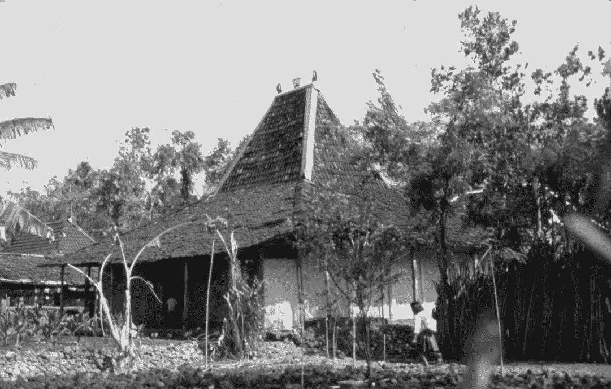

*图 4.1 爪哇乡村房屋，`omah` 或 `dalem`，位于日惹加达的 Gunung Kidul。由 Bagoes Wiryomono 拍摄。*

事实上，`punakawans` 的信息是人们对当前社会政治事务现状作出的回应。无论其政治派别如何，`dhalang` 被认为应该引导观众进入一种强调的共性的状态。`dhalang` 不又一次地用修辞手法传达关于团结与统一之紧迫性的信息。在爪哇世界中，这种强调共性的现象被理解为`luruh`。`luruh` 的概念指代在整体面前保持顺从的必要性。让人们意识到合一性似乎通过`wayang`演出代代相传而确立。那么，在通夜的`wayang`演出期间，房屋成为了爪哇世界的中心。

## 作为艺术品的房屋

在爪哇传统中，作为艺术品的房屋被构想为一种在`karya`（作品）概念下，对维持整体性做出贡献的努力。由于作为`karya`的工作在丰富我们作为生命总体的世界方面某种是有用的，爪哇传统中的艺术家或或少是整体性工作者，他们将合一的事件作为真理呈现出来。因此，将世界纳入其合一性的作品价值越高，其存在就越神圣。宫廷遗产（`pusaka dalem`）是爪哇国家最精美的艺术品和最神圣的东西。

## 建筑与仪式

从建筑角度来说，如果没有位于中心内室（`sentong tengah`）的`kris`等宝，`dalem`的概念本身就没有其核心内涵。由于被覆盖并注入了神秘主义，精美的艺术品与护身符（`aji-aji`）和最高知识（`kesekten`）密切相关。在爪哇历的每个周五`kliwon`晚上，房屋所有的珍宝都要用花水进行清洗。当然，焚烧`dupa`（香）的烟雾和诵读《古兰经》经文的`mantra`属于清理仪式的一部分。在诵读念咒后，全能神、神灵、祖先和所有仁慈的神灵包含在愿望清单和感激之中。

房屋与艺术品欣赏之间的关系被认为是，遗产保护并守护家庭免受厄运的侵害。收集其他精良艺术品可能被视为维持其作为父母传给子女的传宝能力的一部分。在爪哇传统中，房屋含有遗产（`pusaka`）被认为是缅怀祖先至关重要的。没有任何遗产的房屋（`omah`）被认为是没有内容的容器（`wadah`）。神圣房间（`sentong`）可能被建立为房屋的祭坛。

## 设计与创造

对合一性紧迫性的痴迷带来了艺术中一种集体建立的表达方式。基于自由想法的设计不被认为适合爪哇社区，因为它对个人风格和表现有强烈的执着。然而，爪哇语中没有对应“设计”的恰当词汇。设计的近义翻译词是`ngrancang`，源于词`ancang`，意思是迈出一步。建筑施工中的`ancang`是指为进一步行动做好准备的状态。

显然，设计职业在传统社区中除了`kraton`（宫廷）之外，没有合适的位置。不用说，过去具有创造和创新能力的个人会以化名或以王的名义工作。今天的独立艺术家可能不属于爪哇宫廷社区，但根据他们基于`nglaras`（与他人和谐处）的整体思维方式，他们被认为是爪哇传统的维持者。因此，在爪哇文化中，创造和创新是受欢迎的，其框架是培养旨在改进和阐述本土特征与性格的一切。

## 艺术价值与原则

断言和过度自信不像爪哇艺术的表达方式。尽管大多数爪哇识字分子根据他们的传统和语言是受过良好的思想者，但静止、坚持和谦虚成为了他们学识的标志。可以看出，在爪哇传统中，如果没有对于整体性紧迫性的传统共享价值观，巨大的创新是不被接受的。定居建筑中作品的审美诉求是在合一（`manunggal`）的紧迫性和框架之内，在这个框架内，顺应（`cocok`）、谦虚（`sa’madya`）、尊重他人（`tepa selira`）和和平共处（`guyub`）以及和谐（`rukun`）的原则在构、表达、构建和居住中发挥着重要作用。

关于对顺应的坚定承诺，在爪哇社会中有一席之地意味着符合其传统和语言所传达的惯例。在爪哇传统中，奇怪和怪异被视为`nyeleneh`，意思是疯狂和失去常识。顺应、相互尊重和和谐的原则似乎建立在`gamelan`、音乐（`karawitan`）、文学（`sastra`）、皮影戏（`wayang`）、蜡染、铁匠或建筑作品中。和谐、谦虚、相互尊重和顺应是爪哇作品中占主地位且预定的条件。爪哇人在单一公式中制定这些条件：`runtut`，意思是恰当且循序渐进地追求最佳和终极。

爪哇人接受过语言训练，根据对他人的尊重遵循循序渐进的礼貌行为。根据`runtut`，在通往目标的路上对任何步骤和每一个人的致敬和尊重不能有任何遗漏。因此，作品创作遵循合一原则，意味着遵循一种恰当的程序（`runtut`），在这种程序中，尊重、合作协作受到高度鼓励和促进。傲慢、无礼和低估可能被认为避免和阻碍。这种意义上的美不是某种爆发式的、个人的和孤独的。相反，它在某种程度上是音乐的和交响乐的。

## 美学与感知

识别美物的途径是通过`rasa`实现的，这是一个尊重和谐整体来表达情感和情绪的概念。从建筑角度看，美丽的建筑是由其和谐的比例和谦逊的表达构成的，引导向优雅、洞察、成熟和谦虚。爪哇的艺术方式可能是逐渐而持续地将一切生煮成熟。仓促、匆忙和乱窜不是爪哇式的。相反，爪哇传统中的艺术表达是从自身的元素和资源，尊重其真实特征对整体性的贡献来阐述。

此外，审美上考虑周全的建筑在其整体被理解为`apik`（完美、井然、恰当和精美）。`apik`的概念适用于具有清洁、恰当和整洁表现的建筑。`apik`意义的美被规定为良好的状况。然而，自然界的美从未用`apik`理解，而是用`asri`理解，这关乎生长良好、慷慨、肥沃、可持续和和谐的状态。

在爪哇文化中，建筑表达并不一定意味着美观和华丽。相反，爪哇人认为的美被构想为通过`rahayu`、`apik`和`laras`概念表达的幸福感。在这里，美不仅仅是外表，而是由人与环境之间的和谐关系所构成的现实。因此，美的存在不仅是为了为人们提供一个愉快的环境，而且是为了适应爪哇传统中社会公立的状况。适应社会公立的社区被爪哇人用`ngalaras`一词来表达。这一概念的原意是在没有任何预设目的地的情况下，随处走走的行为。`Nglaras`是一种在思考和行走上具有双重意义的游荡。`nglaras`的重要性在于它与爪哇人“在时间中穿行”（`nglakoni`）的居住概念具有相同的关系。同样，这两个概念都没有任何预设的目的地。

将建筑整合到其社会背景中，爪哇人认为这种`nglaras`比设定个人形象更具意义。在这方面，建筑环境的意义在于其对社会合一的承诺。由于场所是恰当存在的地址，它的意义不仅仅是一个位置，而是一个发生聚集现象的领域。爪哇日常生活中的场所被理解为`panggonan`，意味着相对于他人（人、时间和性格）而言，为正确的事情提供适当的场所。`Panggonan`源于动词`manggon`，意为定居或将某物恰当地地放在某个位置。由于大多数前缀`pa`赋予了我们作为场所一部分的指示，例如`pawisman`（住宅）、`padunungan`（定居点）、`padusan`（公共浴室）、`paninisan`（乘凉风的地方）、`pangomben`（饮水处）等，`panggonan`指的是所有已找到其合适位置的事物。

在爪哇传统中，拥有社会公立的席位生活（`mapan`）与拥有居住的地方（`manggon`）区分开来，是因为其非常尊重立足的核心理念。`Mapan`源于单词`papan`，即最初由木材制成的地方。`papan`的另一个意思是盾牌和避难所。因此，在爪哇人的居住理念中，`papan`为人们提供一个允许采取行动和定位的庇护做出了特殊贡献。`mapan`的词源含义是为进一步的行动做好准备。这种标志表明居住是一种随时准备就的态度，并且永远不会重复做同样的事情感到疲倦。

如前文所述，`mapan`源于单词`papan`，即为恰当的生活阐述场所。与定居有关，`mapan`描述的是以和平、可持续和受尊重的形式存在的居住状态和条件。`papan`和`panggonan`在容纳居住方面具有相似的概念。正如在爪哇语言中，居住场所的类别不是根据其实用目的区分的，而是根据社会地位和位置区分。尽管如此，所有这些都表示了为了开放场所而对任何可能的变化和调整的准备。爪哇的`priyayi`人​​在城市核心区拥有他们的`papan`，而普通平民（`kawula`）应该在农村地区拥有他们的`panggonan`。在日常对话中，`panggonan`也指任何恰当存放某物的地方。对于爪哇人来说，拥有一栋房屋与`manggon`相关，而是与`mapan`相关。

## 房屋、熟悉感、好客与居住

关于建筑和居住必要性的一个重要问题是处理家感。我们所建造和居住的，无非是那些使我们能够构建和回想起家感的文化事物。爪哇人的家感由`kerasan`和`pomah`概念组成。`kerasan`的理念源于`rasa`，意为感觉、情绪和感知力，而`pomah`源于`omah`（房屋），意为定居和拥有席位。

由于`kerasan`是能够处理环境的印象，它的体验是由与整体保持完好的心情和感受所规定的。`kerasan`的意义在于，一切在环境上都近在咫尺并与之良好地联系。另一方面，`pomah`是在社会中拥有席位的状态。`pomah`的核心理念不仅是指已经定居在环境中，而且描述了熟悉文化并适应文化的状态。此外，`pomah`也提到与室友和邻居处于安全关系的状态。

如前所述，`rasa`在爪哇文化中在文化和日常生活中起着非常重要的作用。`Rasa`与审美体验和社会生活的鉴赏有关。由于`kerasan`意味着对环境熟悉且便利，这是通过情感和理性的与场所完好来体验的，它的核心理念在于拥有不匆忙、不鲁莽的珍贵时刻。另一方面，`pomah`是由人的身份及其所在地所构成的家感。身份说明了与人的环境相适应的场所特征的相关性。它必然规定在`ayem`（平静）和`tentrem`（和平与满足）的领域内。舒适氛围的领域特征是间接采光、阴影的细微差别、土色和温暖，这些都是爪哇人居家感觉的典型和特征。这一切使得建筑环境成为背景，为可能的事件和发生提供舞台。

尽管`omah`至少意味着头上有一个屋顶，但它在爪哇生活中的作用远不止于。`Omah-omah`是建立一个家庭，而`pomah`是阐述家感。此外，`wis-omah`的概念是表达对某事的熟悉。`omah`的应用可以在以下找到：`bale omah`（家）、`omahan`（像房子一样的）、`diahke`（驯化的、驯服的教化的）以及`somah`（配偶或婚姻伙伴）。爪哇语充满了对`omah`的引用，它意味着爪哇社会生活的滋养和安全的场所。

`Pomah`源于古代南岛语`Uma`、`Umah`、`Omah`、`Humah`、`Rumah`，意为世界。在这种意义上的世界并不被理解为地球或整个陆地。在爪哇`Omah`中，世界是指拥有土地和邻里的家庭。`Pomah`是在特定地点上已经参与世界的状态。爪哇人与其物理环境中的家园的关系并不是感性的问题。爪哇人被传统教导要以感恩的精神对任何可能的生活做好准备。这可能是一种带有内在力量和对开放性`nrima`的接受，这一概念有时会被误读和误解为在不反抗的情况下放弃而接受厄运。

爪哇城镇的`omah`领土是通过`penyengker`（围绕房屋的矩形墙）来定义的。房屋本身的定义并不是那种显性的言语，因为它的精髓在于`Jero`或内部或内在部分的理念。`Jero`是阐述内部状态的词。房屋的另一个词是`dalem`，通常用于指代社会地位和等级较高的人的住所。`Dalem`字面意思是阐述自我、内部以及第一人称。值得注意的是`dalem`在其空间质量上的理念，它体现了一个较小系统的中心。

正如前面提到的，房子的意义并非作为避难的建筑（`papan`）或房屋（`omah`），而是越过边界进入内部后的状态。内部与外部的过渡由入口门（`kori`）指定。`kori`的意义是生命或力量之源。这个词的本质是`koripan`，意为生命。问题在于：门与生命之间是什么关系？门是通往外部向内部或从内部向外部的过渡。这种过渡可能并不被视为一种严格且清晰的范畴之上的边界。我们在运动与停止之间的不同存在状态中体验到了连续性的概念。因此，内部与外部的类别不仅被理解为物理上的过渡，也被视为其之间生命的标志。内部与外部是互补的，同时也并并述了生命以及在世界中的存在。

在城市尺度和语境下，内部（`njaba`）与外部（`njero`）的概念传统上通过城门来体现，过去被称为`seketheng`。这个词讲述了旅程的开始与结束。`seketheng`并不是用于划分自然与文化界限的物理结构。它实际上是`kelir`（门后的墙或帘幕）的开启。`seketheng`面对`kelir`是为了表达进入和离开不同领域的崇高状态。门的另一个词是`gapunten`。这个词源自`punten`，意为道歉和许可。门是宣布和请求祝福、道歉与准入的地方。这个词传达了识别“其之间”存在本质的智慧。这一信息的要点在于，将这种“之间”体验为一种觉知（`eling`）的状态，即生命并非对错、内外的对立，而是开放的心态和带有尊严的谦卑。爪哇文化将开放的心态和带有尊严的谦卑总结为一个词：`njawani`，或意为“爪哇化”。这可能是爪哇语境下最需要被保护和维护的重要事项。

`njaba-njero`的概念并非简单的物理划分。在概念上，内与与的范畴是为了清晰地唤起内在自我建立家庭领域的能力。`njero`总是被等同于内在自我的宁静`tentrem`，正基于此`njaba`得以被定义。在这种平和的状态下，`njero`在概念上收缩又扩张，以处理与公共世界的关系。尽管`njero`的定义在建筑上是建立在围墙环绕的主屋内，但房屋对任何访问都保持开放。`njero`似乎并不等同于私有领域。相反，这种“内部”在空间上是为了表达所有者所含的力量的能力。`njero`越大，所有者实现合一的能力和责任就越强大。最大的`njero`自然然是宫殿，其环绕的围墙（`baluwerti`）是为了定义其作为整体中心的严谨自我认同，而不是为了防御。

正如前面提到的，爪哇文化中的地点概念没有在形式与空间之间做出任何分离。一切都包含在事物本身的名字或概念中。空间与形式/构造不被视为一种领土化的边界，而被视为事物作为日常用途或事件显现的平台。占据的灵活性在爪哇房屋中得到了建筑体现，因为其核心（`sentong`）之外，空间没有被赋予特定的任务。

在任何表达和表现方式中，如果不能在永久构建的形式中找到中心，就很难定义地点。中心总是处于移动之中。如果我们发现某个可能是中心的东西，那么我们发现的只有空虚。`Alun-alun`是传统的爪哇城市广场，如果没有任何宗教活动，它是毫无意义的。`alun-alun`与清真寺、宫殿（`kraton`）之间的关系在没有宗教活动和发生的情况下不会体现。如果我们无法观察中心，我们在房屋中将一无所有。房屋的核心被称为`dalem`，主要由三个房间组成：`sentong kiwa`、`sentong tengen`和`sentong tengah`。房屋中心是一个留给传宝的空房间。中心最重要的部分是婚礼招待会上房屋中的新娘与新郎坐在一起。这个中心专门为这一活动服务。房屋中新娘的数量对应于该房间服务服务的次数。

对于爪哇文化而言，意识到当下正在发生的事情比任何预测未来的努力都重要。觉知，被称为`eling`，并不意味着对未来无知。未来并非在一个进步和线性的生命过程中构想出来的。相反，生命是以永恒循环的意义来理解的。皮影戏（`wayang Kulit`）教我们理解爪哇人如何感知他们的世界，即爪哇人感知世界的方式是每个场合都有自己的`lakon`（情节和人物）。任何`lakon`总是可以与特定的角色和英雄产生认同。对于爪哇人来说，没有任何理由担心，因为任何危机根据其本质都有自己的英雄和解决方案。没有理由采取不必要的行动，但`eling`（意识到自己在社会中的能力和角色）和`waspada`（觉知、警惕、谨慎并能够洞察差异）是绝对不可或缺的。

爪哇文化对于人类生活的未来倾向于认为是“行走”的问题而非“追求幸福”的问题。因此，爪哇世界的建筑与定居取决于如何行使其本土能力，去接纳、构思和整合进入其领域的一切事物。它并不是在现有框架内通过装饰当代事物、技术和制度来积累权力和荣誉。

# 爪哇传统中的家观念

爪哇传统中的家观念被认为与对`kalenggahan`的追求不可分，这指的是在地球上一个社会公认的相应席位。在爪哇传统中，“坐”总是富有诗意的，正如`lenggah`或`lungguh`。它的意义从未与身处他人之间的这种反思性思想脱节。在这里，坐并不仅仅是社会生活中地位的标志。相反，坐着反映了作为整个社会的一部分、并拥有特定角色和贡献的意识。它的习语与个人的职业（从“手”`hasta`的意义）有关。与手相关，坐成为了在社会中做某事的能力和能力的象征。

## 座位与职业

爪哇文化中的“坐”用`lenggah`一词表达，字面意思是为了执行`ngasta`方面的特定任务而处于一个固定位置。因此，`lenggah`（坐）从未离开过`ngasta`（职业/占据）。由于坐在这里实际上是一个社会政治的居住位置，因此座位与职业之间的关系不仅依赖于工作和责任。相反，在爪哇传统中，这种关系在社会被描绘为宇宙山之地的权威背景下更具象征意义。相应，社会中的座位（`kaprajan`）有其对于整体做出行动和决策的等级和能力。政府官员是受高度尊敬的人。因此，他们的房屋似乎展示了他们的等级和地位。高级政府官员的传统房屋配有一个名为`pendapa`的前厅。

## Pendapa 的建筑

大厅（`pendapa`）最初源于梵语借词`mandapa`，意思是寺庙前的等候厅。建立`pendapa`是为了展示所有者在社会中的等级和地位。这种大厅是根据矩形平面图建造的。大厅的形式和结构被称为`joglo`，支撑在四根称为`sokoguru`的柱子上，周围环绕着十六根柱子。简单的`pendapa`只有一个顶冠（`brunjung`）和一件袍（`penaggap`）。主人在国家官僚机构中的等级和地位越高，他的`pendapa`就能拥有越多的装饰。

爪哇传统中最重要的人是国王（`ratu`）。他的大厅（`bangsal`）不仅是拥有两或三层屋顶的完美`joglo`，而且还能适应各种仪式，例如`bangsal witana`（接待厅）、`bangsal kencana`（宫廷典礼厅）、`bangsal srimanganti`（觐见国王的仪式大厅）、`bangsal manis`（宫廷用餐厅）和`bangsal trajumas`（宫廷婚礼和皇室仪式大厅）。爪哇房屋中的每一栋建筑和大厅必须与仪式和典式的必要性有关。

## 传统的坐姿

将平台作为桌子和座位的地方是公共聚集的悠久传统，即使在宫廷也是如此。然而，作为居住的坐是一种文化的独特方面，在日常现实中并没有迹象表明使用家具是爪哇的长久传统。我们找不到表示“椅子”的正宗爪哇词汇，除了宝座（`singasana`），它仅供统治者或强大的地主使用。在某些方面，爪哇传统中的坐位是在`patarana`上。

然而，`patarana`并不是椅子，而是长凳或平台（`amben`）。正如婆罗浮浮`Karmawibangga`浮雕板所示，殖民时期的之前的爪哇社会并不是坐在个人椅子上，而是坐在长凳或平台上。坐姿的艺术和安排其特征是蹲坐（`sila`，字面意思是原则和基础）。`sila`概念本身源自梵语，但在爪哇传统的使用和语境中得到了详细阐述，作为会议（`rembugan`）和仪式宴会社交聚集（`njagong slametan`）的相应坐姿。

## 室内空间与仪式

爪哇房屋没有任何带桌椅的特定用餐区域并非偶然。在建筑上，房屋平面没有部分专门用于用餐活动。坐在地板上通过使用被称为`pranada`（爪哇卡维语）的地毯来体现。虽然没有任何迹象表明古代爪哇的家中已经建立了家具的使用，但使用名为`prastarana`（梵语）的床垫是显而易见的。

从建筑角度来看，伊斯兰教之前的之前的爪哇房屋可能在其内部没有发展出家具的使用。坐在地面或平台上一直是殖民时期之前爪哇的普遍情况。除了缺乏家具外，殖民时期之前的爪哇在其房屋领域内可能没有具有特定每日用途的既定区域，例如卧室、洗浴室、客厅、餐厅等。

尽管爪哇房屋似乎从初不是为了日常生活而设计的，但仍有一个几乎被遗忘的用于准备仪式宴会食物的地方，被称为`prantunan`，源自单词`rantun`，意为顺路经过或到来。由于该地方没有任何建筑结构，而是由活动决定的，今天它的领域已经处于遗忘。

## 房屋的后部

然而，`prantunan`的概念意味着一种不常的状态。实际上，`prantunan`专门为房屋提供一个准备宴会的地方。如果我们看今天的爪哇房屋，准备食物发生在`pawon`，它位于房屋的后部或侧部。爪哇房屋中的服务区域位于一个相对私密和限制的区域。爪哇传统将仪式的支持部分命名为`wingking`，意为后部或背面。厨房、储物室、库、洗衣房和工作坊属于爪哇房屋的后部类别。从视觉上看，这些建筑必须排列在房屋后面。

对于传统的爪哇家庭来说，睡觉是在位于房屋内部靠近火炉（`pawon`）的平台（`amben`）上进行的。父母和孩子不在同一个平台上睡觉。然而，他们处于同一个区域内。如果家里有女孩，她们会在房屋的核心区域（`sentong`）拥有自己的睡觉平台。与此同时，男孩子们则睡在房屋前部分的平台上。尽管现代爪哇家庭大多住在西方风格的房屋中，但仍然留有`sentong`的痕迹，这在传统上被用作备用的各自独立房间。他们可能将这种房间称为客房或`mushola`。

由于爪哇房屋的设计初衷是为了仪式和庆典，因此其空间大部分是没有固定墙壁的大厅。为了容纳房间而对布局进行的细化是在遇到现代性时才产生的。现代爪哇房屋保留了使用传统的`pendapa-pringitan-dalem`三分法完美形式的特征。将活动调整到房屋的三个主要部分，已为了适应当代和城市的生活方式。

在大多数情况下，大厅保持开放状态，没有墙壁。日常生活的用途是接待临时来访的客人。第二部分和第三部分通常整合为客厅、餐厅和卧室。厨房和茶水室通常设置在靠近仆人居住区的后部。现代爪哇房屋通常有一个采纳的游泳池和活动室。在最广泛的语境下，家的感觉不仅限于居住地。因为对于爪哇人来说，居住就是与他人共同生活，因此每个地方都有自己的灵，并且不仅局限于可见的，也包含了不可见的部分。没有任何地方是不包含灵的。根据爪哇信仰，地方是容器（`wadah`），而灵是其内容（`isi`）。这些灵（`danyang`）被认为守护着地方，使得每个地方在宇宙中都有自己的特征和目的。地球上没有真空的地方，因为灵像空气一样不可见，并融合了自然力量。这种信仰可以追溯到印度教佛教之前的爪哇，它对存在的力量表示尊重。爪哇人的重要场所与`angker`的概念联系在一起，意味着神圣、庄严、神秘和受圣的。神圣之地有自己的守护灵，不允许人们伤害它们的领地。

清理和建造自然场所是为了呈送仪式祭品（`sajen`）和仪式宴会（`slametan`），表达对它们存在的敬畏和尊重。祭品和宴会是为营造人类生活环境而进行的重大协商和许可。以水牛头作为牺牲的祭品用于定居点、桥梁和坝的建立。无论如何，祭品和宴会都是为了带来人类与其他生物之间的和谐关系。

场所之所以有意义是因为它是众所周知的，因此集体记忆必然会被建立。爪哇文化中场所的集体记忆与精神领袖参与的事件和活动有关。爪哇人建立集体记忆的方式是在爪哇历的大日子里进行定期的集体访问。由于在爪哇语中，记忆被包含在`eling`的概念中，意味着回想、意识、关注和正念，因此纪念地是用来提醒他们对精神领袖（`panutan`）的尊重，以感谢他们的祝福和仁慈。精神领袖的坟墓（`sarean`，意味着休息和睡眠的地方）被构想充满祝福的地方。由于在爪哇传统中，死亡从未被视为存在的终结，因此维护和保护纪念地实际上从未为了维持与亡者的个人关系而停止过工作。

如果一个场所的事件和活动与其精神领袖（`panutan`）无关，那么它在爪哇人的集体记忆中就没有特殊位置。`panutan`的理念是提醒人们带他们走向统一的领导和预言。`panutan`一词源于`anut`，意思是跟随或遵循的词。`Anutan`意味着教学、流派、纪律和信仰。在爪哇传统中，纪念地被理解为有迹（`patilasan`）的地方。

`Patilasan`源于词`tilas`，意味着线索、痕迹、提示、残留和休息。纪念地（`patilasan`）与痕迹有什么关系？爪哇文化是否将纪念地视为让人们想起其领袖和教导的痕迹？这可能就是为什么当宗教活动在该场地发生时，纪念地具有意义的原因。

为了仪式或对场所表示尊重的访问被视为`sowan`或`ziarah`，即一次精神之旅。他们保留和维护的是一个提醒他们想起相关精神领袖的事件。活动发生的地点被视为`tilas`，被认为应该通过仪式恢复成一个完整的、有意义的世界。其他与其精神领袖的痕迹无关的地方不会被视为`patilasan`，而是`tengeran`，意味着地标或方向标记。

各种地标所在的地方是城镇（`kitha`或`kuta`）。山脉和海洋是自然地标，传统上整合在城镇布局中以提供方向。大门（`plengkung`）和城墙（`baluwerti`）是清真寺和`alun-alun`之外的地标。尽管在后殖民时代的爪哇城市有一些纪念碑，但传统上他们不会建造与其生活传统无关的纪念性建筑。城市中唯一的纪念碑是一个被称为`tugu`的方尖碑雕塑。在日加卡市，这座建筑被用作参考点，而国王在他宫的前厅冥想时，会透过`alun-alun`沿着宫廷大道望。。爪哇人的城镇理念源于并发展自印度和东南亚大陆的经验：`kuta`，意味着被矩形墙和运河包围的场所。除了作为统治者的社会政治意义外，爪哇人将城镇理解为建立了`peken`（永久性五日市场）的场所。将`kuta`作为物理阐释的理念并未被严格采用。因此，自8世纪以来的爪哇城市很难重建。直到现在，普兰巴南和波罗浮主的遗迹仍然保持沉默，为我们提供了古代爪哇城镇结构的线索。我们仍在等待对8世纪以来爪哇城镇起源和结构的发现。

我们从爪哇人那里体验到，城镇是`peken`（传统市场）、`alun-alun`（城镇广场）和`kraton`（皇宫）或`kabupaten`（县）的建立和维持。城镇生活中最重要的方面是`peken`。它的起源于动词`mapeken`，意思是集会或见面和聚集。对于爪哇传统来说，其他国家也可能发生相同的情况，`peken`（市场）不仅是交易场所，也是社交互动和休闲的场所。爪哇传统中的休闲、赌博、娱乐和流行城市文化是从这种制度中发展出来的。另一方面，宫廷成为以记录形式和可持续系统保护和保存传统的文化机构。

与作为高雅文化中心的宫廷相比，市场更具平等性，这一点从适用语言的使用中显而易见地看出。城市文化的发展大多基于表达和交流的自由。无论市场与自发性、世俗和粗俗有何种联系，爪哇一个城镇的市场实际上是社会文化和经济生活的中心。尽管宫廷的存在从未离开过爪哇人的关注，但爪哇人公共世界的现实并不存在于其宫廷，而是存在于他们的集市（`peken`）中。

# 第五章：爪哇人的骄傲、庇护与预言

## 印度尼西亚的政治文化

尽管`reformasi`在印尼的政治制度上取得了一些变化，但社会正义的发展在今天几乎没有实现。为什么呢？本章认为，无论谁执政，都没有将印度尼西亚转向基于民主和社会正义的公民社会，因为他们专制家长主义的政治文化尚未发生根本性改变。这个最大的群岛国家公民社会的问题在于其文化价值观从等级封建主义向民主的转型。迄为止，该群岛的现状仍然固执地维持着基于庇护、骄傲和预言的古代价值观，这些价值观违背了权力和平等的民主概念。占主地位的爪哇传统——塑造和建立印度尼西亚政治文化的来源——一直是各个层次和场合民主化进程的一个挑战性因素。本章试图探索政治文化的某些方面和元素，这些因素可能会减缓并阻碍基于法治的公民民主社会的改革议程。

### 印度尼西亚语境下的爪哇文化

最初，政治改革（`reformasi`）的重要议程之一是开展印度尼西亚整体的转型；它包含了政治、官僚、司法和社会体系中的权力关系。的事实是，`reformasi`尚未从根本上改变该国家存在裙族主义、腐败和勾结的政治文化。因此，贫困、不平等和滥用权力每天仍然显而易见，且大多数没有法律后果。基于法治的社会秩序在很大程度上受到了行政、立法和司法系统中宗主制机构的挑战。

问题在于，为什么民主化进程难以将印度尼西亚推向公民社会。哪些实际力量可以削弱印度尼西亚的民主化？爪哇政治文化在印度尼西亚作为一个国家和民族的现实中占据多大程度的主导地位？这些问题引导本章仔细审视在历史上塑造和建立了印度尼西亚国家和社会的政治文化的本质和根源。此外，本章试图揭示在印度尼西亚社会中运作、塑造、建立和维持政治文化的权力维度。

除了政治和历史事件外，地方概念及其背景成为本研究的主要参考来源。由于其语境的独创性，地方概念在理论和文本解释方面具有不可或缺的重要性。汉斯·乔治·伽达默尔（1976/2008）指出语言与生活世界之间关系的重要性，这为我们提供了历史意识。因此，人类以及社会都是语言性生物。那么，地方知识的重要性在于地方语言作为其社会资源丰富系统的能力，这使他们能够成长并发展自己的文化和传统。这一事实对于人类学和哲学研究来说并不新鲜。克利福德·格尔茨（1983）开创了基于地方概念及其与社会文化现象关系的印度尼西亚研究。许多学者（Bicker et al. 2004）对地方知识的意义进行了进一步探索，展示了其在应对全球危机的潜力资源。

本章的重点是揭露并拆解与权力关系现象和思想相关的地方概念。本章将强调对这些概念在政治事务中呈现的分析。在此过程中，政治和语言在概念上与它们的文化和社会是不可分割的。许多学者已经对后苏哈托时期印度尼西亚政治进行了研究（Emmerson 1999; Budiman et al. 1999; Bertrand 2004; Bertrand 2013; O’Rourke 2002; Eklof 2002; Metzner 2000; Bunte and Ulfen 2008; Nyman 2006）。他们的著作不仅对于理解该国民主的发展很重要，也为我们的进一步调查提供了新视野。其中之一是发现政治发展与现有政治文化之间的关系，这种文化主要受到爪哇传统的影响。在被苏哈托政权压迫了三十多年后，`1998`年的改革无疑是印度尼西亚民主新时代的开始，尽管这无疑充满了挑战和不确定性。改革被重新定义和重新评估政治文化的元素和结构，以走向一个开放民主的社会。

印度尼西亚社会在历史和社会上是分裂的；它由统治阶级（`priyayis`, `penguasa`）和人民（`rakyat`, `hamba`）组成。这种对立系统在印尼社会中处于潜意识的运作，从村庄到首都，从古代一直延续至今。由于二元制度一直运作到今天，国家政治的渠道仅限于精英（Anderson 2007, pp. 1–69）；这种文化不容忍任何反对。基层政治传统上被视为国家及其权威的威胁和疾病。

尽管荷兰学者已经发现二元组织原则是一种运作于大多数印度尼西亚族群的古代社会结构（Adam and Anwar 2005, p. 336; Jo-Sears 1993, pp. 123–25），但当代关于印度尼西亚政治的研究较少关注这种普遍的分裂。在一个社会政治分裂的群体中，政治制度的改变不会自动转型其政治文化，除非整个社会结构发生变化；这在后苏哈托时代的印度尼西亚不太可能发生，特别是在梅加维蒂、苏西洛·班班·尤多约诺和佐科·维维多执政期间。Nyman在其2006年的研究中指出，1998年`reformasi`之后，没有为印度尼西亚未来的民主转型制定官方计划。佐科·维多多在其在其总统议程`Nawacita`——九大重点（Kurniawati 2015）中没有对民主社会的方向和转型做出具体的说明；他的议程是建立良好治理。

## 作为理论思考的政治文化

印尼研究中文化与政治的关系既不是新方法，也不是新领域。本尼迪克·安德森（1972/2007）是介绍爪哇政治文化在印度尼西亚政治中重要性的著名学者（Suryadinata 2002; Anderson 2006）。因此，爪哇文化中的权力观念是直到今天印尼政治中社会秩序和理想的来源和参考。爪哇文化在印度尼西亚政治中的主导地位在日常权力关系中显而易见；爪哇式的礼仪和举止在官僚机构和教育机构中作为无声的语言被实践。

在本章中，政治文化被理解为一套关于公共决策、政策和行动的概念、符号、价值观、习俗、礼、行为和框架（Fagen 1969）。到为止，印度尼西亚的政权在其国家和社会范围内利用并合法化了政治文化，以建立、维持和延续其现状（Pye and Verba 1972）。作为一种文化体系，政治文化在历史发展中不断发展、阐述、强化、调整和修改，以适应和支持政权和社会的当前状况。政治文化可能是分析和理解政治以及权力行为的一种有效方法（Bryder 1989; Solomon 1971, p. 8）。

由于政治价值观对于当地文化和传统是不可缺的，因此为了理解印度尼西亚的当代发展，人们认为这种向基于社会正义的公民社会的转型，只有在涉及社会全体成员时才可能实现。事实上，目前的民主进程仅限于公共选举，但并没有更进一步、更深入地进入开放社会的治理实践。

从理论上说，政治文化是一个相对持久的框架。它维护并维持着国家和国家的原则、理想和核心价值观。这意味着政治文化的剧变不太可能发生，因为这被认为是对整个国家和国家当前概念及现实的根除过程。尽管在改革时期（`reformasi`）一些新的民主治理机构和程序被建立并实施了，但政治文化的历史根源在日常政治实践中仍然占据主导，因为它们通过`印尼语`和`爪哇`礼仪作为权力关系的基本结构得到了良好的保护和保存。

尽管如此，政治文化在纳入集体意识的理想方面具有本质性，这些理想构成了国家和国家机构及关系的生存结构基础。因此，政治文化的变革和转型不仅取决于现状中的个人，还取决于印度尼西亚社会的精英。他们大多数仍然习惯于旧的父权式庇护、自豪和预言的实践与价值观；所有这些构成了印度尼西亚家长制政治文化的结构。

不可否认，家长制权力并不仅仅是权威和霸权。相反，它包含了创造和做一切的能力，这种能力表现为根据家长制偏好推动世界的意志和努力，例如自上而下的操作性、集体主义、从众主义和忠诚。由于世界的意义保留在当地语言中，政治文化的改革要求从口语语言和手势方面对其权力语言进行转型。

在这种情况下，印尼口语在某些方面是人际平等的，在语法上对错误、偏见和无时态具有包容性；这种语言更有于民主沟通。然而，关于家长制价值观体系，礼仪和行为的交流手势比口语更有说服力。在某种程度上，`爪哇`的概念和表达被用来在恰当性和可接受性的语境下强调家长制的基调。尽管`爪哇`语不是官方语言，但`爪哇`的封建和等级化的礼仪、举止与国家官僚治理的代码非常契合。

几个世纪以来，自`1945`年早期概念以来，`爪哇`政治文化渗透到了现代印度尼西亚的国家官僚体系中。此外，在占多数的`爪哇`人口中，作为通用语的印尼语已经被封建、等级、官僚和庇护文化所塑造和调整。事实上，语言的局部性不仅仅是政治文化的交流媒介。相反，价值观和意义的来源区分了一个文化地理与另一个地方。

由于文化是一个丰富的价值观和理想体系，所有公民共同分享政治文化的价值观和理想；它是国家意识形态和国家利益不可分割的一部分。因此，政治文化的必要性对于政权和整个国家的建立是有益的。由于政治文化是国家历史发展和演化的结果，其功能不仅在哲学上具有参考意义，在处理权力事务和国家政治方面也具有实践指导意义。尽管在许多方面权力和文化在建立统治主流方面可能是互换的，但两者的意识形态联盟可能是任何政治计划最有效的力量和系统。

政治文化之所以可行或许是因为其共同共享的愿景和观念。为了拥有这种愿景，政权将通过压迫或民主进程取得领先。塑造和建立新政治文化的问题在于其精英和主流，他们是否自愿且有能力回顾、重新定义、重新组织或重新评估他们的体系和事务。由于民主政治文化在意识形态上与家长主义不兼容，其实践可能并不理想。

此外，精英的主流仍然习惯于传统的贵族（`priyayis`）对平民（`rakyat`）的传统庇护。在许多方面，这个国家的改革对于塑造基于民主和社会正义的公民社会的理想和计划来说具有挑战。

## 爪哇政治文化

有一些障碍能够减缓和阻碍印度尼西亚政治的民主化进程。这一切很可能与权力概念有关，通过这一概念，整个国家和国家的多数决策得以完成。

首先，群岛的权力概念深深植根于传统社区和社会的家长式庇护（`perwalian kebapakan`）。在政治上，家长制文化已体现在史前的村落政治`wanua`中（van Naerssen and de Iongh 1977, p. 37）。家长式庇护不仅是一个通过从小的教育和社会化的价值观问题，也是一个基于领导（`panutan`）和随者（`pengikut`）二分法的社会生活方式。

由于家长制传统一直是政治文化的一部分，强大的领导是重要且必须的，通过它，建立共同愿景和集体动员成为可能。这种愿景的工具是政治信条或修辞符号（`semboyan`），它包含了一种被称为`semangat`的主题精神。`semangat`是任何政治运动和领导的内容。没有这个，政治领袖或组织就没有实质性的动力。

到为止，主流的`爪哇`人口和印度尼西亚社会一直持有并维持着单一的家长制传统体系，这本质上是封建且以赞助为导向的。对家长主义的态度表现为对现状的忠诚，只要它能给他们生理和心理上的和平（`pengayoman`）。`pengayoman`的感觉在于统治权力为他们的日常活动提供安全和稳定的能力。

爪哇语`pengayoman`的根是`ayom`或`ayem`，字面意思是受到保护以获得平静的心灵和统一的和谐。家长式领袖应该是保护者和和谐统一提供者。未能提供这些条件将损害他们作为领袖的威严（`wibawa`）。

其次，`kuasa`的意图性是威望（`pamor`, `gengsi`）和自豪（`wibawa`, `harga diri`）的宏大。这一切与公共服务的奉献或投入无关。相反，`kuasa`的理念更多是关于为了统治者（`raja`）及其国家（`negara`）和王国（`kerajaan`）的威严而动员资源的权力。

尽管今天统治者的头衔已从`raja`变为`presiden`（总统），政体也从`kerajaan`变为`negara`，但这些概念的含义大部分保持相同，仅在少数处进行了微调。

在印度尼语语境下，`kwasa`与印尼语单词`kuasa`相似，字面意思是权利、能力、力量、权威和威望。因此，`kuasa`的概念既不是财富方面的权力，也不是知识方面的权力。相反，`kuasa`的概念强调并突出了全能的权威以及判断对错、得体的特权能力。

古代的`Wasa`或现代爪哇语中的`kwasa`是一种用于控制、统治和支配他人的权力概念。它的实践突出并强调了权威的概念，对于他们的决策和行动，这种权威是绝对且不可谈判的。

作为一个概念，`kwasa`是具体的，表现为坐在王座上的统治者的特权。任何能够获得那个位置的人都是具备`kuasa`持有者或守护者资格的人。传统上，成为具有这种定义的统治者不需要合法的程序和步骤；人们只需要勇气和能力通过政变或平稳过渡与继承来获得它。

尽管在苏哈托后时期的印度尼西亚，正进行着权力转移的民主进程，但这并不意味着非合法的权力转移不会发生。

第三，作为权者，他/她是`atasan`（上级）、高级权威或受托人，拥有行使预言语言（`turur`, `pinutur`）的权利。`atasan`不仅是发布指令或方向的上级，而且传统上还被认为是一个父性的形象，对于任何个人到官方事务都值得信赖。

对`atasan`或`penguasa`（统治者）的忠诚和奉献是强制性的，这意味着这关乎道德，而是关乎权力的侮辱、不尊重和耻辱。在`kuasa`以及`kekuasaaan`（权力状态）的概念下，权威是神圣的主宰（`gusti`, `tuan`, `datuk`），在他/她的监督下的所有人实际上都是奴隶（`kawula`, `hamba`, `abdi`）。

权者（`penguasa`）无论是作为高级国家官僚还是警察，都具有成为统治者的能力。他/她的主要工作不是服务其选民，而是统治其支持者和追随者。

在宗主制权力的日常事务中，预言语言属于正式场合的开场白。任何公共倡议和行动的启动都要获得当地统治者（`penguasa local`）的`restu`（批准、祝福）以及`petunjuk`（建议、指导）和`pengarahan`（指示）。

这一切反映并代表了基于自豪、赞助和预言的戏剧性政治文化实践，其中权者（`penguasa`）是此类公共场合和活动的华丽导演，而其他人则是他/她谦卑的观众。他/她也是那个有特权通过击鼓等仪式仪式或发表带有预言信息的开场白开启活动的人。在许多情况下，统治者在社会文化问题上扮演着社会治疗师的角色；在某些情况下，他/她也是道德问题判决的祭司。

举办公共活动或场合并非简单的社交聚会。在印尼政治文化中，此类事件被视为宇宙境界的诞生，需要当地权威（`penguasa setempat`）的仪式性祝福、许可和认可。这种惯例请求和认可不仅仅是为了礼貌和客气。相反，它是与当地世界保持一致的必要；当地权威被认为是掌握和控制其领土内秩序与和谐的人。

在`kuasa`及其领域（`kekuasaan`，权力范围）方面，所有公共活动和事件——从社交聚会、筹款活动到学术会议——必须在他/她的`restu`之下，这意味着祝福、控制、仁慈、知识和批准。

在`kwasa`或`kuasa`方面，维持权力意味着能够动员人们进行宏大的自我修养（`praja binatara`）。履行国家仪式和奇观是作为`kwasa`权力或力量的最重要展示之一。这包括群众动员和人群控制。

作为`kwasa`的权力概念的扩张性后果不仅仅是为了政治影响和经济利益。相反，这种需求深植于统治者对自身权力宏大奇观（`grebeg`）的渴望。这包括动员人们为了国家和国家的利益集体做事。

最近，一些政治领袖和 CEO 呼吁他们的粉丝和下属在每周的某几天穿蜡染衣。作为总统，Yudhoyono（2004–2014）动员印尼公民从 2009 年 10 月 2 日开始每周五都穿蜡染衣（[Detik.com](http://Detik.com) 2009）。

印尼历史上群众动员的大师是富有魅力的苏加诺；他经常用他的修辞演讲在每个国家活动和正式场合动员群众。作为一位伟大的演讲家，苏加诺能够用他巨大的魅力人格吸引观众并拥有他们（Cederroth 2004, p. 82）。

为了赋予其权力动员群众的能力，创造了一种精神统一的信条（`semangat`），并将其宣布为运动精神。`semangat`的起源实际上是个人力量（`prabhawa`），它作为内在力量、坚强性格和勇气存在。`prabhawa`体现在富有魅力的人格和吸引中，使他/她能够获得`kwasa`。

尽管`prabhawa`通常与个人天赋和天赋相关，但爪哇传统教精英们通过各种方法和训练（如禁欲、冥想和斋食）来获得这种力量。这一切都是为了使他的格格神秘化，并让他远离现实世界，少言多，并高度自制。

为了保持他的威望（`wibawa`）和形象（`prabhawa`），作为统治者的`raja`或`ratu`扮演着`pamong praja`（人民导师）的角色，即作为统一宇宙体系中国家的整合者、保护者和拯救者。

随着时间的推移，日常世界可能受到了精神污染（`sukerta`）的侵害，需要宇宙级的疗愈（`ruwatan`）来维持其安全健康的形态和状态。在较小的尺度上，这种疗愈发生在家庭和社区层面，被称为`slametan`。

`ruwatan`和`slametan`的共同点在于对安全且统一的世界进行符号性的边界维护（Geertz 1960, p. 14; Mulder 2005, p. 89）。世界重生的古老传统通过通过表演皮影戏（`wayang kulit`）来体现。

皮影戏（`dhalang`）不仅扮演着皮影戏指挥和导演的角色，而且在`murwakala`特殊神话的表演中担任古代祭司的角色，这是一个关于怪物之神`Kala`（时间）的诞生与成长的故事，他拥有吞噬世间一切的力量。

`ruwatan`和`slametan`无非是爪哇人对时间力量的承认和尊重。统一与和谐不仅仅被理解为人与人之间的关系，而且被视为所有民众（`praja/kawula`）对其统治者（`raja/gusti`）承诺与忠诚的验证、肯定和确认。

对政府各种批评和反对被视为对掌权者以及国家和民族侮辱、不忠和不尊重。此类行为被认为是对宇宙秩序的污染和破坏稳定。

### 权力与危险的概念

权力与危险的概念是由玛丽·道格拉斯（Douglas 2002, pp. 117–40）在其对文化价值、知识和宇宙观的研究中引入的。道格拉斯追溯了文化背景下“洁”与“污”的不同概念，这些概念深根于安全宇宙领域的符号边界。

在爪哇语境下，纯净深根于世界纯净形式`bhawana`的概念中。因此，纯净的形式是安全的（`aman`）、可管理的（`tentram`）、秩序良好的（`tata`）、健康的（`rahayu`）以及繁荣的（`gemah-ripah`）。讽刺的是，维持这种纯洁的力量被称为`wasa binatara`，字面意思是“天上的、恐怖且惊恐惧的力量”。

### 权力的具体形式

由于爪哇文化以及印度尼西亚文化中权力的概念是具体的（Anderson 2007, p. 22），统治者的宝座成为霸权的重要展示窗口。权力是具体的，因为它由统治者的席位或宝座来代表。那么，接管宝座就意味着声称了统治者的地位。

然而，关于其具体形式，权力需要以壮观事件或宏大展览的形式呈现。因此，爪哇传统中霸权的意图不在于行使日常政治事务的权力，而在于集中和保护已有的权力（Anderson 2007, p. 5）。

权力的意图是为了为了统治者崇拜通过一场盛大的表演来履行这种权力。其首要目的不是为了娱乐公众，而是为了君主自身的自我伟大。通过这种方式，统治者从世俗现实升到了超越领域。他/她把自己塑造成一个不可侵犯的存在；他/她能够从上方俯瞰子民。

### 整体性与内在

在爪哇语境下，权力的集中和保护在文化上与未受污染的完整性以及超越与内在的统一（`sejatining utuh lan manunggaling gusti kawula`）的概念有关。不纯被认为与碎片化（`modal-madul`）和混乱（`gonjang-ganjing`）相关。

不纯不仅被包含了针对爪哇世界统一性的破坏性成分、流和运动的污染，而且在宇宙论上也某种程度上向混沌和迷失状态退化。

### `Kuasa`的概念

在印度尼西亚，权力与文化始终是霸权概念`kuasa`的一对互换词汇。因此，将权力建立为`kuasa`、`kekuasaan`不仅仅是权威的制度化，它还包含了一种具有强烈使命感的、针对统一国家和精神和文化霸权。这种使命感在历史上塑造并确立了印度尼西亚的政治文化。

在日常实践中，国家（`negara`）是官僚专制主义，它以`agung-binatara`的形式行使并属于权力`kuasa`，意为“恐怖的权威”（Mudjanto 1986）。因此，统治者既不是公职人员也不是代表领袖，而只是`penguasa`意义上的统治者或主人；国家官员是`penguasa`，字面意思是霸权者。

在最广义上，`penguasa`的概念实际上是一个比我们的生命更大的支配机构。这样的机构能够接管你的行动和决定，因为你是他她的奴隶（`kawula`或`hamba`）。普通人被视为`hamba yang didaulat`，即在主人仁慈下的奴隶。`penguasa`是恩赐者，也是仁慈的提供者。

`penguasa`的另一个概念是`pemerintah`，来自词`perintah`，字面意思是命令、指示、秩序和指导。国家官员概念上是`penguasa`和`pemerintah`。

改革运动尚未成功将政府的概念从其霸权地位转化为公共代表性工作。任何掌权者都被预期为他们所王国的教父。因此，领袖在意图和行动上必然是统治性的（`menguasai`），因为他们被视为在状况方面的知识和洞察上高于平均水平。

### 民主主义中的混合主义

由于爪哇政治文化在概念、形式和实践上都是复杂的，它对印度尼西亚政治文化的渗透是微妙且经过礼貌和优雅处理的。爪哇式专制和家长制的霸权模式从不进行直接对抗。

将他人置于爪哇控制之下是识别、同步和整合他人的优劣势。这实际上是爪哇传统中混合主义的实践，体现为`laras`、`nglaraske`，字面意思是和谐和谐或“使其和谐”。

在这种意义上，民主的概念将与爪哇的`saresehan`和`rembugan`或印度尼西亚的`musyawarah`（公开协商）达成`mufakat`（共识）的概念统一（Tjiptoherianto 1996; Rais and Najib 1999）。

因此，作为`kuasa`或`kekuasaan`的权力必须利用其所拥有的一切来掩盖缺陷和弱点。因为丑闻而下台既不是`kuasa`霸权概念的优雅退出，也不是体面的解决方案，而是耻辱的。与其辞职，不如`kuasa`促使掌权者维护他们作为`penguasa`的形象（`citra`）和威望（`wibawa`）。将责任归咎于下级官员是这种丑闻和滥用权力的常见做法。

由于爪哇族文化在理论和实践上都是高度复杂的，因此模型的展示绝不是显而易见的，而是具有微妙的象征意义和暗示性。专制的家长式统治将通过各种战术和策略来培养。

在爪哇传统中，这些方式广为人知的`disanake`（被像自己的孩子家人一样对待）和`dijawake`（被像爪哇人一样被教育或驯化）。直白地说，这意味着这些人无论是否使用武力，都已根据爪哇的规范和礼仪受到了控制。

因此，掌权者将通过诉诸国家作为统一系统的意图，来拥抱每一个潜在的反对者。他/她会竭尽全力，从源上消除并减少任何可能的抵抗和冲突。

## 权力与不洁

在印尼的语境下，纯洁（`bersih`, `resik`）与危险（`bahaya`, `baya`）既不是简单的道德事务范畴，也不是公共卫生的卫生价值。相反，在印尼政治文化中，它们是识别政权敌对个人或团体的关键问题。

口号说`bersih diri bersih lingkungan`，字面意思是自我和环境纯洁于任何反对世界完整性的污染物。从这些词最广义的意义来说，信条意味着一种政治要求，即必须清除任何对现状的抵抗、分歧和反对的迹象。

尽管纯洁（`bersih`）的概念是为了应对具有问责制的治理，但其概念起源在和谐世界的宇宙论意义上仍然具有道德意义。这种现象在日常政治中显而易见：为了国家和国家的统一而进行的治理，比基于法律秩序的治理更重要。

换句话说，廉更多是为了建立一个没有任何反对的统一国家。此外，从印尼`kuasa`（权力）政治文化来看，纯洁的权威被视为强大且稳固的现状，能够稳定国家和统一系统。

这里的“纯洁”感更多是指免受任何分裂和耻辱的疾病与病态，而不是腐败、勾结和任用亲信。

在爪哇政治文化中，洁与危险通过一个概念在文化上相关，即基于`kwasa/kuasa`和`prabhawa`的权力。因此，纯洁与危险的问题既不关正义，也不关权力的合法性，而仅仅关乎它们与霸权积累和稳定的关系。

这意味着统治者更多地关注如何将世界从不洁和危险中拯救出来。在爪哇传统中，危机传统被认为是新领导出现的机会；正如爪哇谚语所：`jer basuki mawa beya`，意味着没有代价就没有成就，没有危险就没有危机（雅加达战略与国际研究中心 1991）。

通过武力和暴力夺权自古以来一直是常见做法，从桑贾亚（Sanjaya）和夏里延德（Shailendra）王朝到现代印尼国。`Ken Arok`在 13 世纪杀杀了`Tunggul Ametung`以从他手中获得权力。这种夺权让`Tumapel`陷入了危机。

类似的情况也发生在 1965 年，当时`Suharto`通过一份名为`supersemar`的神秘权力移交书中从`Sukarno`手中接过了权力（Roosa 2006）。在动荡之中，没有人质疑他何来上权的合法性。

对于爪哇人来说，这种动荡或剧变被视为他们世界不洁的信号。人们的意图是等待危机的拯救者。`Suharto`巧妙地顺势而起。这种场合似乎在 1998 年再次发生，当时`Suharto`正在执国外。

武装力量精英内部的权力斗争试图通过社会和政治动荡制造国家危机的场面，例如`Trisakti`事件和反华裔骚乱。事实上，当时政治和军事精英之间的内部权力斗争并未成功以一个获胜者结束。从爪哇政治文化的角度来看，原因显而易见，因为当时没有人能够扮演身披甲的骑士（`satria piningit`）的角色。在许多方面，1998年的权力斗争并不是爪哇历史上的`Ken Arok`、`Jaka Tingkir`和`Suharto`那样。尽管1998年的权力危机是夺取领导权的机会，但精英们未能利用这一事件，因为他们没有能力这样做。从爪哇的角度来看，`Habibie`不是一个强大的统治者，`Wiranto`也不是一个坚强的领导者。另一方面，`Prabowo Subianto`既不是一个有说服力的骑士，也不是一个鼓舞人心的组织者。尽管`Wiranto`处于接替`Suharto`位置的位置，但他没有胆气和坚定的信心去这样做。此外，`Wiranto`是`Suharto`的学生，对他应该一直保持感激和尊重（Emmerson 1999, pp. 309–10）。

事实上，印尼的政治文化是一个由现状塑造和建立的动态过程。在`Suharto`统治的最后十年里，这种政治文化面临着变革需求的挑战。由于`Suharto`本人无法补充和纯化他的世界，他的光芒已经暗淡，而且由于1998年亚洲金融危机，他无法动员资源进行经济复苏。他辞去了统治者的身份，并不是因为某个丑闻意外，而是因为他意识到自己不再拥有作为权力之光所需的自尊和威严。他必须自愿交出位置，否则别人会以残酷的方式夺走。

政治文化在决定什么是纯洁和危险方面起着重要作用。在爪哇传统中，推翻现状的人是能够恢复世界秩序的人，这在爪哇人中神话化地广为人知的`satria piningit`（Soesetro and Al Arief 1999; Pamungkas 2008）。这种`satria`的一个重要角色不是傲慢。相反，他拥有常人的胆量来履行职责，并无情地对其主张他的权力。残酷、流血和暴力是这种主张的一部分。再次正如爪哇谚语所：`jer basuki mawa beya`（任何成功的成就都需要付出巨大的代价）。考虑到这一点，认为纯洁和危险是道德宗教问题将是错误的。相反，印尼政治文化中的权力一直是世界秩序和财富的来源。它在形而上学上集中并被视为景观中心。

在印尼日常文化中行使权力并非关于道德对错（Geertz 1960, pp. 77–85; Hadiz and Dakhidae 2005, p. 239），而是关乎统治者对被统治者的自尊和威严。因此，统治者被视为完美的保护者、拯救者、导演和资助者。维护和建立形象免受弱点和缺陷的影响无论如何都非常重要。尽管如此，统治者与被统治者之间的个人距离是必要的；家长式的庇护可能是一种恰当的关系。在政治形式之外，这种二元对立在日常生活中确实存在；统治阶级（`priyayi`）对于普通公民（`kawula`、`wong cilik`）在任何级别的社区活动中都保持着权力。

统治者与被治者之间社会二元对立政治文化的根源在历史上是由马来人、布吉斯人和爪哇人共同分享、塑造和培养的。这种二元体系的统一性是统治者通过一种`semangat`（意为集体目标精神）在意识形态上的整合。这两者对于理解统治者如何构建其“想象的国家”及其在现实政治中建立这一国家至关重要。`semangat`是政治议程的核心，旨在实现权力作为其/她王国之光的意图。因此，`semangat`具有某种程度上统一、鼓励、启示、启发、激励和动员的作用。

`negara`（国家）无非是`semangat`的载体和工具，具有两个层面的实用性。首先，在现实政治层面，`negara`是国家事务的政治实体，承担国内经济、外交关系、社会文化事务、国家安全和防御任务。其次，在意识形态层面，`negara`是将`semangat`转化为权力景观的手段。为了实现`negara`的宏伟壮观，作为意识形态内容的`semangat`必须是纯粹且在宇宙论上统一的。纯粹性和统一是动员所有资源的必要条件，能够免受怀疑和抵抗。

## 古代政治文化

群岛的古代政治文化根植于奥斯特罗尼语人的`wanua`，这是一种将村庄共和国视为世界的概念，传统上由父权式领导层建立，并获得二元且对立集团的支持：地主和长老。`semangat`燃料并为村庄世界注入了一种统一的宇宙美学概念。因此，统一与和谐等同于美丽繁荣的世界。在整个群岛，亚齐人、马来人、爪哇人、民南加道人和布吉斯人的族群中，统一精神（`utuh`）和共识（`mufakat`）显而可见。埃灵顿（Errington）将这些社会——以及之前的印度国家——称为“中心主义群岛”，因为他们专注于统一，并将分裂和离离视为个人疾病、社区不幸或政治失败的结果、原因或两者兼有（Pamberton 1994, p. 243）。

在印度尼西亚的背景下，`semangat`深根于古代对国家（`negara`）和民族（`bangsa`）统一权力的信仰。不出所料，现代国家`negara`将`semangat`纳入潘加西拉（pancasila）的国家意识形态中。`semangat`被认为在精神上激励、并在情感上推动人们走向统一和完整。基于对`semangat`的信仰，有三个原则作为印尼西亚传统政治文化的美德脱颖而出。

## 印尼西亚政治文化的三大原则

### 第一：和谐统一

和谐统一被认为是群岛政治文化的基本原则。政治世界的意图是将人们聚集在一起，作为家庭和家的现实。在讨论政治思想、问题和事务时，政治精英必须记住，社区的统一（`kesatuan`）和和谐（`selaras`）不是可以衡量（`taruhan`）或危险（`bahaya`）的。统一与和谐被认为是不可分割的。它们在传统上被维持为社区感（`hakekat bermarakat`）。任何分裂和不和的行为都被视为反对系统乃至世界的。在许多方面，任何新思想和影响都将根据其后果接受检验，是导致稳固强大的社区，还是导致混乱和解体。

### 第二：强而坚定的领导

强而坚定的领导（`pimpinan kuat dan tegas`）是永远需要的。无论对错并不重要，而仅仅关乎为主流或精英利益服务的现实政治。强而坚定的领导被视为社区前进的先锋，为了作为国家和祖国的自豪（`kapriyaian/priyayi`、`harga diri`）和威望（`kaprajan`、`gengsi`）。一个领导者受人尊重是因为他/她不仅克制、勇敢且勇于承担风险，而且在做决定时从不犹豫。他/她对敌人是否固执（`keras kepala`）或残忍（`keji`）并不重要。领导者是能够引导人们为自己作为一个国家感到自豪，并作为一个国家受到尊重的人；他们并不真正关心这样的领导者是以合法的方式获得权力的。

在许多方面，对强领导的需求可能导致人们走向一个具有盲目爱国狂热法西斯国家，正如苏尔诺（1945–1967）和苏哈托（1967–1998）所示。这种民族主义民粹主义的早期迹象在近期印尼的改革时期显而易见，正如梅加瓦蒂领导的印尼西亚民主党和2007年在普拉博沃·苏比安托领导下的印尼西亚大义党（`Gerindra`）所形成的民粹主义和反自由主义运动所示。

### 第三：寻找共同点

寻找共同点是任何政治审议的目标和隧道尽头的光，否则强有力而有权威的领导将接手决定目标。寻找共同点通常通过会议和协商（`musyawarah`）进行。共识（被称为`mufakat`）实际上不是通过商议达成的，也不是通过谈判达成的（谈判本质上是为了撇开任何反对政治主流的利益）。传统上，`musyawarah`是一种父权式的说服和教育，由长老来教导那些尚未进入政治主流的人。而`mufakat`实际上是接受加入主流。再次，这关乎正确与否，而仅仅是维护统一的形象、自豪感以及对现状尊重的必要性。

## 共识与权力

在许多方面，共识是印尼西亚政治为了实现权力同质性的圣杯。由于权力（`kuasa`、`kekuasaan`）被构想为控制和主导权威，思想统一是必然的结果。有许多方法可以达成共识。最有利的是在形态或政治领域创建一个共同敌人。通过这样做，权力有了正当理由为其现状做应该做的一切，并将纯粹和危险作为其分类范式。

基于上述三个特征，印尼西亚政治传统在文化上契合父权式的赞助，这种赞助基于贵族特权和年龄顺序。赞助在许多方面是金字塔式的。年轻领导者不能仅凭成就取得长远。他们必须说服长老他们在危机期间领导的能力。否则，他们必须等待机会的出现。

## 不纯洁与宇宙整体性

纯粹和危险是证明上述政治文化三大价值的权力概念。在政治上，纯粹（`bersih`）并不意味着正确或合适，而仅仅意味着符合当前意识形态和霸权的轨道。尽管信仰、民族和起源存在多样，作为政治现实的世界被构为一个同质的霸权体系。这种同质霸权的来源是未知的，但被认为是爪哇传统中被称为`semangat`或`kesekten`的精神能量。

最初，纯洁作为一种安全状态是村庄的一个传统条件。为了确保这种状态，爪哇岛和印度尼西亚的大部分地区的村庄必须提供一种非自愿的集体劳动，以出于卫生和精神目的维护村庄。这项被称为`bersih desa`的工作实际上不仅是清洁、更换和修理建筑及卫生设施，而且是在精神上对作为一个小世界的村庄进行补充和新生。`bersih desa`具有双重目的，一是维持农业再生产，二是与当地灵性世界保持友好的关系。村庄集体聚餐（`slametan`或`kenduri desa`）是维护村庄福祉和庆祝的一部分。事实上，`bersih desa`是村庄作为小世界重生的净化行为。所有村民都应该参加这一盛典。只有病人和儿童可以免于积极参与。事实上，这种净化世界的行为是为了维护、建立和维持统治者与被统治者整体的统一。

迄为止，`bersih desa`的传统一直延续。`bersih desa`的最佳时间发生在群岛的每个村庄、城镇和城市，作为每年8月17日印尼独立日纪念活动准备工作的整合组成部分。这一天是国家和国家的特殊事件，潜在地统一并聚集所有公民为一个整体。村民受到当地领袖的鼓励和动员进行社区服务以及对其房屋和场所的装修。各种活动并行进行，并在独立日达到高峰。

从历史上看，独立日的庆典深根于辛加沙里（Singasari）和满者伯夷（Majapahit）传统。根据《国家史》（`Negarakertagama`），节日和庆祝活动在`Hayam Wuruk`统治期间达到顶，发生在`Caitra`月（3月至4月）。国家举行了一场盛大的会议，并接收了来自所有下属王国、地区和领土的贡品（Leur 1955, pp. 7–10）。在9世纪之前的古代爪哇时期，这样一种年度庆祝被称为`sima`仪式。那是国家下级王国、地区和领土必须向国王效忠、纳贡并缴纳税款的时间。他们出现在国家首都是，是向统治者忠诚和服从的标志。

在任何国家场合，国王或女王实际上是自己为了光荣、权力和满足而进行的表演的唯一观众。在他们之外是该活动的支持者和表演者。国家剧院的导演是其最高等级的国家祭司，`maharesi`或`mahapandita`。所有这些表演的目的可能仅仅是权力的自我满足，冠以宇宙净化和世界重生的名义。事实上，国家场合是展示谁在权力圈“内”、谁在“外”的事件。对于统治精英来说，这一活动是他们的表演，证明国家和民族处于有序的结构（`mapan`）、繁荣的活力（`kerta raharja`）以及精神上的统一（`manunggal`）。

## 改革的阻碍

如前所述，“洁”或“脏”的概念与道德价值无关，而简单来说是政治上的受青睐或不受认可。在新秩序时期，自由主义、共产主义和社会主义被归为“脏”的一类，而中间派民族主义和国家意识形态的忠实者被政权认为是“洁”的。在今天和改革时代，主流和印尼精英仍然维持基于底线概念的“洁”与“脏”的概念，即“洁”或“脏”与主流统治阶级有关。从这个意义上说，危险（`bahaya`）不仅仅是对国家或国家的不安全威胁，而是取决于其影响在多大程度上威胁到主流统治者的自尊、保护和预言。

在应对危险时，主流统治集团将以国家和民族统一的名义尽一切努力。在爪哇语和传统中，击败对手的做法被称为`ahangkara`，意味着绝对的支配和受控。传统上，爪哇统治者有权拥有`ahangkara`，因为他是地球上代表神性的以维持和平秩序的人。在`kwasa`或`kuasa`（权力）方面，爪哇权力将利用一切可能的手段为了和平秩序将一切置于控制。爪哇传统中一种广为人知的策略是`apus karma`，或微妙的计划或方法。将研究敌人的个人生活以了解其优缺点。敌人的弱点包括`maen`（赌博）、`madon`（情爱）、`mabuk`（喝酒）、`maling`（偷窃和欺骗）以及`madat`（吸鸦片或毒品）。关于`apus karma`的著名爪哇故事是由`Senapati`实践的。作为`Kotagede` `Mataram`（1584–1601）的第一任国王，他必须击败他的对手`Ki Ageng Mangir Wanabaya`。`Senapati`派遣自己的女儿`Pembayun公主`作为舞者诱惑Mangir，并强制他在结婚后向国王效忠。国王邀请Mangir和Pembayun访问他的宫殿。在`kraton`（宫殿）中，Mangir被迫交出他著名的矛并在岳父面前跪下。`Senapati`杀掉了女婿并将尸体分两部分埋掉，一部分在`kraton`墙内，另一部分在外面。通过这种方式，`Senapati`能够消除对其现状的威胁。这个故事的信息很明确：现状并不太关心家庭事务。

# 印度尼西亚的改革与政治稳定

改革最重要的议程是建立政治和经济稳定。在印尼语中，“稳定”被理解为`mantap`，字面意思是永久的、坚固的、一致的、令人信服的、稳定的和强大的。这种稳定性被地视为普通人在街道日常生活的实际衡量标准。政府及其机构可能会发生，但如果无法实现政治稳定，国家和民族将处于危险之中。事实上，经济的改善和正义取决于这种稳定。在爪哇语和印尼语传统中，这种政治稳定在表面上被理解为`stabilitas nasional`（国家稳定）。稳定概念的深层结构在于`kuasa`或`kekuasaan`（权力）的概念。从权力角度来看，国家和民族始终是现状的首要关注点。`Berkuasa`意味着指挥、支配和控制国家、民族及其资源，使其免受危险。也就是说，民族和国家不处于不洁状态。

## 改革的政治

事实上，`reformasi`的实际政治是对此前的政治文化进行激进的变革。尽管法律主权和民主化的紧迫性在改革议程中，但普通人并不认为两者是优先事项。1999年、2004年、2009年和2014年四次公开选举的结果告诉我们，在处理经济恢复、失业和贫困之前，对政治稳定的期望仍然很高。为了这种稳定，需要强有领导力。`Suharto`（1967–1998）领导的新秩序成功地将爪哇政治文化整合到印尼政治体系中，秩序、稳定和增长是国家完整和认同的必要条件。政治混乱或无序，例如`Suharto`统治末期和`Wahid`任期内的危机，被视为世界将重新恢复秩序与和谐的拯救过程。这些救世主式的信念不仅被爪哇人所共有，也被印尼群岛的大多数人所共有（Kroef 1959）。`Wahid`的弹劾以及`Megawati`连任的失败尝试，直到2014年`Joko Widodo`的当选，证实了国家稳定的救世主式的这种政治文化仍然存在。因此，人们去投票是希望出现`satria piningit`（隐秘的骑士）或`Ratu Adil`（正义之王），作为拯救国家民族免于混乱和麻烦的人（Geels 1997, p. 75; Choy 1999, p. 127; Sindhunata 1999, pp. 20, 84, 85）。

## 家与居所的概念

政治稳定是从印尼文化和传统中关于家和居所作为坐席的概念中学到的教训。保持稳定（`mapan`）规定为拥有座位或职业（`kedukukan`）的状态；用`penduduk`（居民）来称呼公民并不奇怪，因为“坐”或`duduk`不仅是一种停留的身体姿势。在文化上，它是拥有具有社会尊重地位之家的标志。对于印尼文化来说，政治稳定是一种存在状态，因为它为人们的福祉提供了一个安全的环境。

此外，对于爪哇统治者来说，拥有座位（`kedudukan`）既不是公共服务也不是社会责任，而仅仅是为了在其王国建立稳定和秩序的强有力职位和职业。`Sukarno`和`Suharto`可能是现代印尼领导人中最好的例子，他们认识到与权力相关的座位感。`Suharto`维持了其近三十年的执政记录，是因为他知道权力等同于维护王国秩序和稳定的权威；无论付出任何代价和采取任何手段。与之前提到的两个前任不同，`Sukarno`、`Suharto`、`Wahid`、`Megawati`、`Yudhoyono`和`Joko Widodo`确实知道`kedudukan`的意思，因此他们不仅是世俗领导人，还是精神事务的总司令。爪哇领导层应当主张他们作为传统统治者的地位，在宇宙领域和现实层面上重视国家和民族的稳定、统一和秩序。

## 连续性与庇护

无论谁担任印尼总统，他/她都会强调连续性作为稳定的标志。尽管他/她是唯一愿景更好印尼的领导者，但他/她确实相信世界处于完美和谐的结局；任何危机和混乱只是为了提醒人们有救赎和拯救的时间。爪哇领袖几乎不在日常生活中采纳和接受平等和民主的生活方式：应该存在一个宗法秩序的体系。只有在这样的系统中，和谐世界的金字塔结构在宇宙学上才是有序和和谐的。从`Sukarno`到`Joko Widodo`，爪哇领导人在国家演说和官方演讲中自如使用预言语言，用`saudara`（兄弟）或`saudari`（姐妹）等词称呼听众，这些词听起来带有从属含义。此外，他们从不习惯在没有“Sir”或`pak`或`bapak`等头衔的情况下直呼其名。

在印尼，一个人如果没有座位的权力（`kedudukan`），就不是一个人。根据庇护、自豪和预言的政治文化，他/她在名字之前被称为`bapak`（父亲）或`ibu`（母亲）的前缀。在自豪、庇护和预言的语言中，普通人就像未知支持者的海洋，尽管他们会被称为兄弟（`saudara-saudara`）或姐妹（`saudari-saudari`）。从语言角度来看，印尼民主社会是改革的一项挑战性目标。

## 改革的现代愿景

意乎不意外，`Yudhoyono`（2004–2014）和`Joko Widodo`（2014–）在其政党的使命和愿景中包含了`semangat reformasi`（改革精神），这种精神实际上是指引导回到 1945 年宪法所宣布的统一国家和民族的原始形态（印尼民主党，未注明日期）。因此，`reformasi`既不被理解为改变或转型，而是更新——从调整和重新验证的角度来看——以及从殖民时代直到今天的印尼奋斗的持续。1945 年宪法中的国家理念是整合主义的。`Supomo`——根据他对印尼各族习惯法的专业知识起草宪法的人之一——认为有必要根据家庭原则（`azas kekeluargaan`）来实现统一和和谐（Bourchier 2015, p. 220），这是一种通过协商达成共识的、整合主义和全权主义的。政府与被统治者之间的关系就像父子，也就是说，本质上是家长制的（Silalahi 2003, pp. 139–40）。换句话说，根据 1945 年宪法，印尼国家被构想为一个由不同民族组成的大家庭，他们重视全体人民的统一与和谐而非个人人权。此外，宪法中的民主是带有关于代表智慧的条件的。值得注意的是，这里的“智慧”一词为当地礼仪和价值观留了空间。

# 印度尼西亚政府改革与主权

尽管苏西洛·班班·尤多约诺在廉政政府和法律主权方面的改革议程仍不如哈比比、瓦希德和梅加维蒂的任期进步，但他在这方面已尽了最大努力。改进的真正压力实际上是新政权倒台后的自由新闻和开放的公众舆论。然而，在人权和公正方面，从哈比比政府到尤多约诺再到佐科·维多多多届，尚未出现任何基于普遍人权的公正行动和承诺迹象。针对人权的暴力行为——从 1965 年大屠杀、东帝汶、巴布亚、亚齐、三力斯蒂屠杀，到穆尼尔被谋杀——仍然处于黑暗之中，远离正义之光。关于公正和人权的问题将由权力者在家庭原则框架内处理，该原则维护并保持了印尼民族国家和社会免受危机和动荡。

## 统一与完整面临的挑战

在处理印尼国家的统一与完整性时，改革运动（`reformasi`）可能不会改变印尼政治共同体传统概念的根本原则；这一选择被认为是有风险的，因为它使印尼民族国家和社会的统一与完整陷入危险之中。基于普遍人权重新定义其国家和国家的空间非常有限。改革并不意图转型整个印度尼西亚的家长制社会。这不仅具有风险，而且在文化上没有必要。只要人们——以议会议员为代表——已经稳稳地坐在他们的位置上，单一制国家国家的政治就会继续照常进行。

## 向民主的转型

事实上，为了人权和社会公正，需要一个从权威主义向民主体制过渡的时期，在这个过程中，新的机构、法规和法律不仅要建立和颁布，还要经过测试和验证。到目前为止，这种转型实际上未能从根本上改变人们从单一国家概念向联邦模式的思维转变。尽管治理发生了去中心化，但苏哈哈特后的国家领导人仍然持有基于中央政府家长制国家的强大民族国家概念，这种制度通过官僚机构控制和监督各省、县、区和村庄的发展政治和经济政策。军事和司法结构仍作为一种可靠的组织在执行。统一与完整感一直是并仍然作为一个大家和谐家庭的民族国家最重要的事情。在他内心深处，是爪哇对世界`buana`或`bhawana`的认知，认为这是一个秩序良好的生物系统，这种系统之所以可持续，是因为它是顺从、纯洁且不受任何形式的反对和抵抗的。

## 爪哇统治概念

传统上，爪哇统治者是统一和谐领域`buana`的照顾者；元首不仅是世俗领袖，还是国家典礼和仪式的精神引导者。照顾是为了为了自尊、威望和遗产将其保持在可控范围内。他的首要任务是确保国家和民族处于良好的统一状态。为了实现这种权力整合，他将竭尽全力从其前对手那里获得广泛的政治支持。迈向单一国家国家的运动通过各种形式的`semangat`精神被微妙地强化，例如政治共识或国家意识形态`pancasila`。

## 发展与现代性

在发展和现代性方面，苏哈哈特后的爪哇领导人持有进步观念，其重点是基于国家完整和和谐的经济增长与繁荣。其内阁组成的潜台词显示了掌握在手中的单一国家和国家概念。因此，权力是发展的之光，它从中心向边缘以灿烂的光芒阐明并照亮其领域。巴布亚和其他印尼东部省份被苏哈哈特后的领导人称为需要加速发展的地区。这些被归类为落后省份的地区实际上不仅是因为环境开发程度较低，还因为与爪哇价值观体系以及关于在治国风格和政治礼仪背景下家庭国家的传统的文化联系较少。

## 政党与意识形态

尽管 2009 年大选有正式超过三十四个政党参加，但只有九个政党有资格获得在民议会的席位。现任总统议程中缺失的是统一的意识形态。在传统意义上，像苏加诺、苏哈哈特、瓦希德、梅加维蒂、尤多约诺和佐科·维多多等爪哇国家领导人在需要强大的意识形态领导力方面有着共同点，即将所有政治流派和群体统一在坚固的信仰之下，例如苏加诺和苏哈哈特的`Pancasila`。`Pancasila`不仅是一个统一印尼群岛人民的意识形态平台，也是印尼家庭国家概念的超越性顺从结构。

根据其意识形态，苏哈哈特后印尼的九大政党可以分为两个主要流派：民族主义集团（`Demokrat`、`PDIP`、`Golkar`、`Gerindra`和`Hanura`、民族伊斯兰派，以及`PAN`）和伊斯兰党（`PKB`、`PPP`和`PKS`）。正如苏哈哈特的新政权时代，印尼政治中的政治流派保持不变，核心是世俗民族主义流派。当然，`Demokrat`、`PAN`和`PKB`在主流的中间派中发挥作用。他们站在拥有民族主义支持者的`Gerindra-PDIP`与拥有温和伊斯兰信徒的`PKS-PPP`之间。

## 亚政治文化与媒体

除了政治文化的主流之外，确实存在由知识分子、军事、新闻媒体和非政府组织等各种群体倡导的亚政治文化。这些群体都能自由地表达他们的忧虑和思想。然而，为了让思想在系统中发挥作用，他们需要与议会的党代表和政府合作。事实上，改革最有效的代理是纸质和电子媒体，言论和表达的自由从中找到了监督政治事务的途径。在`reformasi`时代，记者面临的最大威胁不再是由执行部门和议会故意设计的法律法规（Romano 2003, p. 169）。

## 自由主义与共产主义的威胁

迄今为止，印尼对自由主义和共产主义的观念被视为一种可能导致单一国家体制陷入危险的疾病。政治上的公开批评和自由意见是自由主义意识形态的，这与等级习俗和家庭价值观原则（`azas kekeluargaan`）不符。这种批评攻击将被视为对国家父亲的不尊重和不忠。另一方面，共产主义与无神论和无阶级社会相关，这些并不符合政治文化的主流。

与具有明显法西斯主义色彩的新秩序政权不同，改革时代（`reformasi`）的政党领导人在集体和个人上都致力于其运动中的自由与民主。然而，他们首要关注的仍然是建立各个领域的稳定。在他们看来，强有力的政府是必要的。这意味着他们将团结起来支持或倾向中间主义意识形态。他们不容忍任何右翼或左翼团体的成长和确立。`Wahid`的总统时期是这种倾向的最好范例；他反对了极可能具有左翼色彩的`Megawati`候选人身份。尽管`Megawati`最终在 2001 年取代了`Wahid`，但她的政党并没有选择与中间派政党`Golkar`、`PAN`和`PKB`合作，以维护印尼作为一个国家的统一与和谐。

尽管如此，`Yudhoyono`、`Megawati`和`Joko Widodo-Jusuf Kalla`在任何事情之前对单一国家和民族有着共同点。然而，在他们的政治议程中，没有任何一个字将普遍人权作为其主要的政治关注。人权的缺失——作为当前政府政治的主要议程——出乎意料地明显，因为此类问题将使当前政治赞助、自豪和预言的统一与稳定陷入危险。

对改革结果的脱离和不满不可避免地在数量上增加，这从不确定选民的数字中可以看出；2009 年大选中的`golput`（弃票）率高于 2014 年（[Detik.com](http://Detik.com)2014）。`Joko Widodo`因素可能是原因所在；人们对参加投票的热情很高，因为`Joko Widodo`和`Jusuf Kalla`是拥有民粹计划的公众人物，且与新秩序政权没有直接关系。事实上，从 1998 年至今已经取得了重大改革，特别是解放了新闻和媒体，使其生动地表达思想和事实。然而，该国大多数政党仍然安于这种古老的政治文化。改革的唯一真正支持者是新闻和媒体。新闻和媒体的作用和功能将成为改革中倡导和传播人权及民主（作为社会的支柱）的决定性因素。尽管如此，改革最重要的部分可能是国家与资本之间关系的转型（Robinson 2009）。在社会文化方面，这种关系尚未基于公共问责的民主机制进行运作。直到最近，腐败案件显示出资本家与个人政治官僚之间的私人关系仍然变化较小。其根源在于爪哇人的世界观，即世界是由二元对立的统一构成的：`manunggaling Gusti lan kawula`；这一概念肯定了统治者（`ndara`或`bendara`）与被统治者（`kawula`）之间整体性。赞助者与客户之间的统一已以各种方式、形式、层次、时尚和风格融入了爪哇人的生活中。群岛上的其他民族在父子关系（`hubungan bapak-anak buah`）方面也共享这种二元统一的宇宙观。换句话之，赞助-客户关系从古代起一直在这印尼社会的各个方面运作。这是印尼迈向民主社会过程中的困境之一。

### 爪哇农村地区的赞助-客户纽带

在爪哇农村地区，赞助-客户关系作为农业生产的一部分被实践。在爪哇村庄里，土地主与土地劳动者之间的赞助-客户关系在大家族的框架内建立了一种社会纽带。这种纽带构成了政治和经济合作，使得奴隶制度变得不再可能。然而，这并不意味着阶级的缺失，而是建立了一种阶级处理其关系并寻求政治和经济调和的形式（Robinson 2009, p. 216）。爪哇村庄阶级斗争的垂直流动在爪哇农村并没有找到顺畅的（Wertheim 1969）。这是因为`priyayi`（贵族）与`kawula`（百姓）之间的赞助-客户关系已经发展成一种协同的系统，用于政治和经济的相互依赖。这样做使得阶级的界限变得模糊（Mortimer 1969）。这种传统纽带的关键在于基于`sanak-semanak`（亲属团结）的人际关系。在印尼语境下，这一原则被称为`azas kekeluargaan`（家族原则）。爪哇人将赞助-客户（`priyayi-kawula`）的二元性视为一个在宇宙、政治和经济上运作的整体关系。爪哇人通过`gotong royong`（互助）和`sambat soyo`（共同劳动）（Henley 2007）的实践来当这种社区应对危机、危险、自然灾害和其他公共工程时。爪哇人的集体流动不是关于阶级斗争，更多是关于维护他们作为社区的统一、完整和和谐。

### 城市赞助-客户关系

在城市语境下，赞助-客户关系在政治和商业中发挥作用。赞助者控制资源的获取，而客户则负责担任工人、调解人、顾问、卫兵以及生产服务的支持者。荷兰殖民时期，贸易和商业活动主要落入当地中国商人手中（Wertheim 1956）。政治家与商界之间的赞助-客户纽带从`Suharto`的新秩序时代持续到改革时代，根据透明国际组织 2014 年的《腐败感知指数》，该指数将印尼放在 175 个国家中排第 107 位（Transparency International 2015）；同年有 629 起由`Komisi Pemberantasan Korupsi`（反腐败委员会）处理的案件，涉及 3 名部长、45 名高级官员和一名高级议会议员（Hukum Online 2009）。印尼迈向民主社会的运动关键需要建立一个基于法律的赞助-客户关系框架。后苏哈托时期改革取得的成就是通过透明公平的公开选举实现的治理进程。从国家到地方政府业务的社会转型，尚未有效地从基于个人偏好的赞助-客户关系转向基于法律的民主联系。换言之，后苏哈托时代的印尼需要改变民众对赞助-客户二元性的文化认知。这就是`Joko Widodo`在其 2014-2019 年政治议程中所理解的“思想革命”，因为它关乎人民从`priyayi`和`kawula`向平等公民的心态转型（[Kompas.com](http://Kompas.com)2014）。他并没有大声疾呼，但他的方式、风格、时尚和领导方法展示了什么是公民。

### 结语

改革的问题本质在于`bahasa Indonesia`（印尼语），它在许多方面都适应了自豪、赞助和预言的殿堂。古话说：“`bahasa menujukkan bangsa`”（语言反映民族）。似乎，任何反对家长制政治文化主流的运动都会面临带有创伤性污名的反击，如 1950-1955 年的不稳定民主时期和 1965 年的反民粹主义共产主义那样的印记。尽管这两个历史事件的现实尚未被完全阐明和重构，但现状及其支持者声称对事实拥有文化霸权，以支持他们的主张，即自由主义和共产主义同样是不平等的危险。

尽管“改革”（`reformasi`）是印尼政治迈向更民主治理的新时代，但旧政治文化的主流在塑造和引导基于家长式庇护、自豪和预言的政治转折点方面仍起着主导作用。为了实现廉洁高效和良好治理，印尼改革派领导人必须付出额外的努力，这不仅仅是因为目前的官僚体系大多仍由专制的“新秩序”主流所主导。他们并不希望将旧的专制家长制政治文化改变民主治理。

## 参考文献

Adam, A. W., and Anwar, D. F. 2005. Violent Internal Conflicts in Asia Pacific. Jakarta: Obor.

Ali, D. 2011. “The Early Inscriptions of Indonesia and Problems of Inscription of Sanskrit Cosmopolis.” In Early Interactions Between South and Southeast Asia: Reflections on Cross-Cultural Exchange, 276–316. Singapore: Institute of Southeast Asian Studies.

Anderson, B. 2007. “The Idea of Power in Javanese Culture.” In Culture and Politics in Indonesia, 1–70. London: Equinox.

Anderson, B. R. 2006. Language and Power: Exploring Political Culture in Indonesia. London: Equinox.

Andjar, A. 1979. Rahasia Ramalan Jayabaya, Ranggawarsita & Sabdopalon. Semarang: Aneka Ilmu.

Andjar, A. 1980. Raden Ngabehi Ronggowarsito, Apa Yang Terjadi? Semarang: Aneka Ilmu.

Atkinson, J. M., and Errington, S. 1990. Power and Difference: Gender in Islands of Southeast Asia. Stanford, CA: Stanford University Press.

Badil, R., and Rangkuti, N. 1989. The Hidden Foot of Borobudur. Jakarta: Katalis.

Beatty, A. 1999. Varieties of Javanese Religion: An Anthropological Account. Cambridge: Cambridge University Press.

Bellwood, P. 1978. Man’s Conquest of the Pacific: The Prehistory of Southeast Asia and Oceania. Auckland, NZ: Collins.

Bellwood, P. 1997. Prehistory of the Indo-Malaysian Archipelago. Honolulu: University of Hawaii Press.

Bellwood, P., Fox, J. J., and Tryon, D. T. 1995. The Austronesians: Historical and Comparative Perspectives. Canberra: Australian National University, Research School of Pacific and Asian Studies.

Benamou, M. L. 1998. Rasa in Javanese Musical Aesthetics. Ann Arbor: University of Michigan Press.

Berger, B. M. 1995. An Essay on Culture, Symbolic Structure and Social Structure. Berkeley: University of California Press.

Berman, L. A. 1998. Speaking through the Silence: Narratives, Social Conventions, and Power in Java. New York: Oxford University Press.

Bertrand, J. 2004. Nationalism and Ethnic Conflict in Indonesia. Cambridge: Cambridge University Press.

Bertrand, D. 2013. Political Change in Southeast Asia. Cambridge: Cambridge University Press.

Bicker, A., Silitoe, P., and Pottler, J. 2004. Investigating Local Knowledge. Surrey: Ashgate.

Bishop, R., Philips, J., and Yeo, W.-W. 2003. Postcolonial Urbanism, Southeast Asian Cities and Global Processes. London: Routledge.

Boechari. 1976. Some Considerations of the Problem of the Shift of Mataram’s Center of Government from Central to East Java in the 10th Century A.D. Jakarta: Proyek Pelita Pembinaan Kepurbakalaan dan Peninggalan Nasional, Department P and K.

Bourchier, D. 2015. Illiberal Democracy in Indonesia: The Idea of Family State. London and New York: Routledge.

Brakel-Papenhuijzen, C. 1992. The Bedhaya Court Dances of Central Java. Leiden: Brill.

Brakel-Papenhuijzen, C. 1995. Classical Javanese Dance: The Surakarta Tradition and Its Terminology. Leiden: KITLV Press.

Bridge, G., and Watson, S. 2002. A Companion to the City. London: Wiley Blackwell.

Brotodiningrat, K. 1978. Arti Keraton Yogyakarta. Yogyakarta: Museum Keraton Yogyakarta.

Bryder, T. 1989. Political Culture, Language, and Change: A Conceptual Framework and Empirical Analysis of the Debate on Political Union (EUT) in the European Parliament. Copenhagen: University of Copenhagen, Institute of Political Studies.

Budiman, A., Hatley, B., and Kingbury, D. 1999. Reformasi: Crisis and Change in Indonesia. Issue 50 of Monash Papers on Southeast Asia. Victoria: Monash University, Asian Institute.

Bulbeck, D. 2004. “Dong-Son Culture in Southeast Asia.” In A Historical Encyclopedia from Ankor Wat to East Timor, 428–39. Oxford: ABC-CLIO.

Bunte, M., and Ulfen, A. 2008. Democratization in Post-Suharto Indonesia. Routledge Contemporary Southeast Asia Series. London: Taylor and Francis.

Cederroth, S. 2004. “Traditional Power and Party Politics in North Lombok.” In Elections in Indonesia, 77–110. London and New York: Routledge Curzon.

Choy, L. K. 1999. A Fragile Nation: Crisis and Change. Singapore: University Press.

Coedes, G. 1944. The Great Cities in Southeast Asia. Singapore: University Press.

Coedes, G. 1966. The Transformation of Indonesia. Ithaca, NY: Cornell Press.

Cohen, M. 1992. Social Science and Power. Berkeley: University of California.

Daniels, T. 1969. Power and Difference. Stanford, CA: Stanford University Press.

Douglas, M. 2002. The Interpretation of Culture. London: Routledge.

Emmerson, D. 1999. Indonesia beyond Suharto. Polity.

Eklof, S. 2002. Language and Power: Exploring Political Culture in Indonesia. London: Equinox.

Fagen, R. 1965. The Javanese Face. Stanford, CA: Stanford University.

Foley, K. 2001. “The Origin of Kala: Sundanese Wayang Golek Play by Abah Sunarya and Gamelan Giri Harja I, Transcript.” Asian Theatre, March.

Fox, J. 2000. Javanese Manuscripts. Ithaca, NY: Cornell Press.

Ginsburgs, N. 1955. “The Great Cities in Southeast Asia.” American Journal of Sociology 10, no. 5 (March): 458.

Groenendael, V. C. 1985. The Dalang behind the Wayang: The Role of Surakarta and the Yogyakarta Dalang in the Indonesian–Javanese Society. Dordrecht: Foris.

Hadiz, V., and Dakhidae, D. 2005. Social Science in Indonesia. Jakarta: Equinox.

Hatley, B. 2005. “Theatre, Politics and Javanese Tradition: Yogyakarta’s Sultan Onstage.” In Java that Never Was: Academic Theories and Political Practices, 67–96. Muenster: LIT.

Gadamer, H. G. 1976. Philosophical Hermeneutics. Berkeley: University of California.

Geels, A. 1997. Subud and the Javanese Mystic. London: Routledge.

Geertz, C. 1960. The Religion of Java. Glencoe, IL: Free Press.

Geertz, C. 1973. The Interpretation of Culture. New York: Basic Books.

Geertz, C. 1980. Negara: The Theatre State in the Nineteenth Century Bali. Princeton, NJ: Princeton University Press.

Geertz, C. 1983. Local Knowledge. New York: Basic Books.

Geertz, H. 1961. The Javanese Family: A Study of Kinship and Socialization. Glencoe, IL: Free Press.

Headley, S. 2004. Durga’s Mosque: Cosmology, Conversion and Community in Central Javanese Islam. Singapore: Institute of Southeast Asian Studies.

Headley, S. C. 2000. Form Cosmogony to Exorcism. Oxford: Oxford University Press.

Heesterman, J. 1989. “印度与印度尼西亚：一般视角。”收于《印度教边界》（Hindu Frontier），1–16。莱登：Brill 出版社。

Hefner, R. 1985. 《爪哇印度腾格：传统与伊斯兰》。普林顿，新泽西州：普林顿大学出版社。

Henley, D. 2007. “习惯与合作：印度尼西亚的合作理想。”收于《印尼政治中传统的复兴：从殖民主义到本土主义的 Adat 部署》，J. S. Davidson 和 D. Henley 编，87–112。伦敦与纽约：Routledge 出版社。

Holt, C. 1967. 《印尼艺术：延续与变迁》。伊塔卡，纽约州：康奈尔大学出版社。

Hughes-Freeland, F. 2008. 《具身社区：爪哇的舞蹈传统与变革》。兰姆：Berghahn 出版社。

Hukum Online. 2009. Hukum Online。在线获取自 [`www.hukumonline.com/berita/baca/lt54febb754288e/icw--jumlah-tersangka-kasus-korupsi-ribuan-di-periode-2014`](http://www.hukumonline.com/berita/baca/lt54febb754288e/icw--jumlah-tersangka-kasus-korupsi-ribuan-di-periode-2014)。

Iguchi, M. 2015. 《爪哇随笔：南方国家的历史与文化》。莱凯斯特郡：Troubador 出版社。

雅加达战略与国际研究中心. 1991. “印度尼西亚经济发展问题。”《印尼季刊》第 19 和 20 期。

Jessup, H. I. 1990. 《印尼宫廷艺术》。纽约：亚洲协会画廊与 Harry N. Abrams 出版社。

Joglo Semar. 1997–1998. 爪哇学学院，“Panunggalan”科学与文化基金会——雅雅加达。雅加达：爪哇学学院。

Jong, J. P. D. 1977. 《荷兰的结构人类学》。莱登：Martinus Nijhoff 出版社。

Jo-Sears, L. 1993. 《帝国的影子：殖民话语与爪哇故事》。达纳勒姆，北卡罗来纳州：杜克大学出版社。

Kartomihardjo, S. 1981. 《东爪哇交流代码的民族志》。堪培拉：澳洲国立大学太平洋研究学院。

Keeler, W. 1973. 《爪哇皮影戏，爪哇自我》。普林顿，新泽西州：普林顿大学出版社。

Keeler, W. 1983. 《爪哇住宅的象征维度》。堪培拉：东南亚研究中心。

Kingsbury, D. 2005. 《印度尼西亚政治》。牛津：牛津大学出版社。

Koentjaraningrat. 1975. 《印度尼西亚的人类学》。莱登：Nijhoff 出版社。

Koentjaraningrat. 1985. 《爪哇文化》。新加坡：牛津大学出版社。

Kolese De Britto Yogyakarta. 2008. 《Megatruh Kambuh》。在线获取自 [`debritto.net/isi/megatruh_kambuh_w_s_rendra`](http://debritto.net/isi/megatruh_kambuh_w_s_rendra)。

[Kompas.com](http://Kompas.com). 2014 年 10 月 17 日。Jokowi 与精神革命的意义。在线获取自 [`nasional.kompas.com/read/2014/10/17/22373441/Jokowi.dan.Arti.Revolusi.Menta`](http://nasional.kompas.com/read/2014/10/17/22373441/Jokowi.dan.Arti.Revolusi.Menta)。

Kroef, J. M. v. d. 1954. “印度尼西亚社会中的二元论与象征对立。《美国人类学杂志》56：842–62。

Kroef, J. M. v. d. 1959. “爪哇的弥赛亚期待：其起源与文化背景。《社会与历史比较研究》第 1 卷第 4 期：299–323。

Krom, N. 1984. 《印度教-爪哇史》（Hindoe-Javaansche Geschiedenis）。海牙牙：Martinus Nijhoff 出版社。

Kulke, H. 2001. “东南亚历史中的早期与帝国时期王国。”收于《国王与崇拜：印度和东南亚的国家形成与合法性化》，262–93。新德里：Manohar 出版社。

Kurniawati, D. 2015. 《Jokowi 的九项优先议程（Nawa cita）。在线获取自 [`www.establishmentpost.com/jokowis-nine-priorities-agenda-nawa-cita/`](http://www.establishmentpost.com/jokowis-nine-priorities-agenda-nawa-cita/)。

Laksono, M. P. 1986. 《爪哇社会结构中的传统：王国与乡村：爪哇概念模型的变化》。雅雅加达：加加·马达达大学出版社。

Leigh-Weiss, M. 2006. 《抗议与可能：马来西亚的公民社会与政治变革联盟》。斯坦福，加利福尼亚州：斯坦福大学出版社。

Leer, J. v. 1955. 《印度尼西亚的贸易与社会》。海牙与万隆达：BPK 出版社。

Lombard, D. 1980. “南亚的帝国概念。”收于《帝国概念》（Le Concept d’Empire），433–41。巴黎：s.n.。

Maier, H. 2004. 《我们正在玩亲戚游戏》。莱登：KITLV 出版社。

Malasekera, G. 1990. 《佛教百科书》，第 5 卷第 1 期。斯里兰卡：锡锡兰政府。

Manguin, P.-Y. 2004. “东南亚海洋政治的考古学。”收于《从史史到历史的东南亚》，283。伦敦：Curzon 出版社。

Manguin, P.-Y., and Indradjaja, A. 2011. “Batujaya 遗址：西爪哇印度影响的新证据。”收于《南亚与东南亚之间的早期互动》，1113–36。

Mardiwarsito. 1973. 《爪哇-印尼语词典》。

Joglo Semar. 1997–1998. 爪哇学学院，“Panunggalan”科学与文化基金会——雅雅加达。爪哇学学院。

Jong, J. P. D. 1977. 《荷兰的结构人类学》。莱登：Martinus Nijhoff 出版社。

Jo-Sears, L. 1993. 《帝国的影子：殖民话语与爪哇故事》。达纳勒，北卡罗来纳州：杜克大学出版社。

Kartomihardjo, S. 1981. 《东爪哇交流代码的民族志》。堪培拉：澳洲国立大学太平洋研究学院。

Keeler, W. 1973. 《爪哇皮影戏，爪哇自我》。普林顿，新泽西州：普林顿大学出版社。

Keeler, W. 1983. 《爪哇住宅的象征维度》。堪培拉：东南亚研究中心。

Kingsbury, D. 2005. 《印度尼西亚政治》。牛津：牛津大学出版社。

Koentjaraningrat. 1975. 《印度尼西亚的人类学》。莱登：Nijhoff 出版社。

Koentjaraningrat. 1985. 《爪哇文化》。新加坡：牛津大学出版社。

Kolese De Britto Yogyakarta. 2008. 《Megatruh Kambuh》。在线获取自 [`debritto.net/isi/megatruh_kambuh_w_s_rendra`](http://debritto.net/isi/megatruh_kambuh_w_s_rendra)。

[Kompas.com](http://Kompas.com). 2014 年 10 月 17 日。Jokowi 与精神革命的意义。在线获取自 [`nasional.kompas.com/read/2014/10/17/22373441/Jokowi.dan.Arti.Revolusi.Menta`](http://nasional.kompas.com/read/2014/10/17/22373441/Jokowi.dan.Arti.Revolusi.Menta)。

Kroef, J. M. v. d. 1954. “印度尼西亚社会中的二元论与象征对立。《美国人类学杂志》56：842–62。

Kroef, J. M. v. d. 1959. “爪哇的弥赛亚期待：其起源与文化背景。《社会与历史比较研究》第 1 卷第 4 期：299–323。

Krom, N. 1984. 《印度教-爪哇史》（Hindoe-Javaansche Geschiedenis）。海牙牙：Martinus Nijhoff 出版社。

Kulke, H. 2001. “东南亚历史中的早期与帝国时期时期王国。”收于《国王与崇拜：印度和东南亚的国家形成与合法性化》，262–93。新德里：Manohar 出版社。

- Kurniawati, D. 2015. 《Jokowi 的九项优先议程（Nawa cita）》。在线获取自 [`www.establishmentpost.com/jokowis-nine-priorities-agenda-nawa-cita/`](http://www.establishmentpost.com/jokowis-nine-priorities-agenda-nawa-cita/)。

- Laksono, M. P. 1986. 《爪哇社会结构中的传统：王国与乡村：爪哇概念模型的变化》。雅加达：加查·马达大学出版社。

- Leigh-Weiss, M. 2006. 《抗议与可能：马来西亚的公民社会与政治变革联盟》。斯坦福，加利福尼亚州：斯坦福大学出版社。

- Leer, J. v. 1955. 《印度尼西亚的贸易与社会》。海牙与万隆：BPK 出版社。

- Lombard, D. 1980. “南亚的帝国概念。”收于《帝国概念》（Le Concept d’Empire），433–41。巴黎：s.n.。

- Maier, H. 2004. 《我们正在玩亲戚游戏》。莱登：KITLV 出版社。

- Malasekera, G. 1990. 《佛教百科书》，第 5 卷第 1 期。斯里兰卡：锡兰政府。

- Manguin, P.-Y. 2004. “东南亚海洋政治的考古学。”收于《从史前到历史的东南亚》，283。伦敦：Curzon 出版社。

- Manguin, P.-Y., and Indradjaja, A. 2011. “Batujaya 遗址：西爪哇印度影响的新证据。”收于《南亚与东南亚之间的早期互动》，113–36。

- Mardiwarsito. 1973. 《爪哇-印尼语词典》。

- Joglo Semar. 1997–1998. 爪哇学学院，“Panunggalan”科学与文化基金会——雅加达。雅加达：爪哇学学院。

- Jong, J. P. D. 1977. 《荷兰的结构人类学》。莱登：Martinus Nijhoff 出版社。

- Jo-Sears, L. 1993. 《帝国的影子：殖民话语与爪哇故事》。达勒姆，北卡罗来纳州：杜克大学出版社。

- Kartomihardjo, S. 1981. 《东爪哇交流代码的民族志》。堪培拉：澳洲国立大学太平洋研究学院。

- Keeler, W. 1973. 《爪哇皮影戏，爪哇自我》。普林斯顿，新泽西州：普林斯顿大学出版社。

- Keeler, W. 1983. 《爪哇住宅的象征维度》。堪培拉：东南亚研究中心。

- Kingsbury, D. 2005. 《印度尼西亚政治》。牛津：牛津大学出版社。

- Koentjaraningrat. 1975. 《印度尼西亚的人类学》。莱登：Nijhoff 出版社。

- Koentjaraningrat. 1985. 《爪哇文化》。新加坡：牛津大学出版社。

- Kolese De Britto Yogyakarta. 2008. 《Megatruh Kambuh》。在线获取自 [`debritto.net/isi/megatruh_kambuh_w_s_rendra`](http://debritto.net/isi/megatruh_kambuh_w_s_rendra)。

- [Kompas.com](http://Kompas.com). 2014 年 10 月 17 日。Jokowi 与精神革命的意义。在线获取自 [`nasional.kompas.com/read/2014/10/17/22373441/Jokowi.dan.Arti.Revolusi.Menta`](http://nasional.kompas.com/read/2014/10/17/22373441/Jokowi.dan.Arti.Revolusi.Menta)。

- Kroef, J. M. v. d. 1954. “印度尼西亚社会中的二元论与象征对立。”《美国人类学杂志》56：842–62。

- Kroef, J. M. v. d. 1959. “爪哇的弥赛亚期待：其起源与文化背景。”《社会与历史比较研究》第 1 卷第 4 期：299–323。

- Krom, N. 1984. 《印度教-爪哇史》（Hindoe-Javaansche Geschiedenis）。海牙：Martinus Nijhoff 出版社。

- Kulke, H. 2001. “东南亚历史中的早期与帝国时期王国。”收于《国王与崇拜：印度和东南亚的国家形成与合法化》，262–93。新德里：Manohar 出版社。

- Kurniawati, D. 2015. 《Jokowi 的九项优先议程（Nawa cita）》。在线获取自 [`www.establishmentpost.com/jokowis-nine-priorities-agenda-nawa-cita/`](http://www.establishmentpost.com/jokowis-nine-priorities-agenda-nawa-cita/)。

- Laksono, M. P. 1986. 《爪哇社会结构中的传统：王国与乡村：爪哇概念模型的变化》。雅加达：加查·马达大学出版社。

- Leigh-Weiss, M. 2006. 《抗议与可能：马来西亚的公民社会与政治变革联盟》。斯坦福，加利福尼亚州：斯坦福大学出版社。

- Leer, J. v. 1955. 《印度尼西亚的贸易与社会》。海牙与万隆：BPK 出版社。

- Lombard, D. 1980. “南亚的帝国概念。”收于《帝国概念》（Le Concept d’Empire），433–41。巴黎：s.n.。

- Maier, H. 2004. 《我们正在玩亲戚游戏》。莱登：KITLV 出版社。

- Malasekera, G. 1990. 《佛教百科书》，第 5 卷第 1 期。斯里兰卡：锡兰政府。

- Manguin, P.-Y. 2004. “东南亚海洋政治的考古学。”收于《从史前到历史的东南亚》，283。伦敦：Curzon 出版社。

- Manguin, P.-Y., and Indradjaja, A. 2011. “Batujaya 遗址：西爪哇印度影响的新证据。”收于《南亚与东南亚之间的早期互动》，113–36。

- Mardiwarsito. 1973. 《爪哇-印尼语词典》。

- Mardiwarsito, Adhiwarta, S., and Suratman, S. 1992. 《古爪哇语》。

- Mardiwarsito, H. 1981. 《印尼语》。

- 2005. 2005. 雅加达：爪哇学学院。

- Jong, J. P. D. 1977. 《荷兰的结构人类学》。莱登：Martinus Nijhoff 出版社。

- Jo-Sears, L. 1993. 《帝国的影子：殖民话语与爪哇故事》。达勒姆，北卡罗来纳州：杜克大学出版社。

- Kartomihardjo, S. 1981. 《东爪哇交流代码的民族志》。堪培拉：澳洲国立大学太平洋研究学院。

- Keeler, W. 1973. 《爪哇皮影戏，爪哇自我》。普林斯顿，新泽西州：普林斯顿大学出版社。

- Keeler, W. 1983. 《爪哇住宅的象征维度》。堪培拉：东南亚研究中心。

- Kingsbury, D. 2005. 《印度尼西亚政治》。牛津：牛津大学出版社。

- Koentjaraningrat. 1975. 《印度尼西亚的人类学》。莱登：Nijhoff 出版社。

- Koentjaraningrat. 1985. 《爪哇文化》。新加坡：牛津大学出版社。

- Kolese De Britto Yogyakarta. 2008. 《Megatruh Kambuh》。在线获取自 [`debritto.net/isi/megatruh_kambuh_w_s_rendra`](http://debritto.net/isi/megatruh_kambuh_w_s_rendra)。

- [Kompas.com](http://Kompas.com). 2014 年 10 月 17 日。Jokowi 与精神革命的意义。在线获取自 [`nasional.kompas.com/read/2014/10/17/22373441/Jokowi.dan.Arti.Revolusi.Menta`](http://nasional.kompas.com/read/2014/10/17/22373441/Jokowi.dan.Arti.Revolusi.Menta)。

- Kroef, J. M. v. d. 1954. “印度尼西亚社会中的二元论与象征对立。”《美国人类学杂志》56：842–62。

- Kroef, J. M. v. d. 1959. “爪哇的弥赛亚期待：其起源与文化背景。”《社会与历史比较研究》第 1 卷第 4 期：299–323。

- Krom, N. 1984. 《印度教-爪哇史》（Hindoe-Javaansche Geschiedenis）。海牙：Martinus Nijhoff 出版社。

- Kulke, H. 2001. “东南亚历史中的早期与帝国时期王国。”收于《国王与崇拜：印度和东南亚的国家形成与合法化》，262–93。新德里：Manohar 出版社。

- Kurniawati, D. 2015. 《Jokowi 的九项优先议程（Nawa cita）》。在线获取自 [`www.establishmentpost.com/jokowis-nine-priorities-agenda-nawa-cita/`](http://www.establishmentpost.com/jokowis-nine-priorities-agenda-nawa-cita/)。

- Laksono, M. P. 1986. 《爪哇社会结构中的传统：王国与乡村：爪哇概念模型的变化》。雅加达：加查·马达大学出版社。

- Leigh-Weiss, M. 2006. 《抗议与可能：马来西亚的公民社会与政治变革联盟》。斯坦福，加利福尼亚州：斯坦福大学出版社。

- Leer, J. v. 1955. 《印度尼西亚的贸易与社会》。海牙与万隆：BPK 出版社。

- Lombard, D. 1980. “南亚的帝国概念。”收于《帝国概念》（Le Concept d’Empire），433–41。巴黎：s.n.。

- Maier, H. 2004. 《我们正在玩亲戚游戏》。莱登：KITLV 出版社。

- Malasekera, G. 1990. 《佛教百科书》，第 5 卷第 1 期。斯里兰卡：锡兰政府。

- Manguin, P.-Y. 2004. “东南亚海洋政治的考古学。”收于《从史前到历史的东南亚》，283。伦敦：Curzon 出版社。

- Manguin, P.-Y., and Indradjaja, A. 2011. “Batujaya 遗址：西爪哇印度影响的新证据。”收于《南亚与东南亚之间的早期互动》，113–36。

- Mardiwarsito. 1973. 《爪哇-印尼语词典》。

Partonadi, S. S. 1990. 萨德拉的社区及其背景根源：十九世纪爪哇的基督教表达。阿姆斯特丹：Radopi。

Patel, A. D. 2008. 音乐、语言与大脑：音高、音色、节奏、旋律、语法、意义的演变。牛津：牛津大学出版社。

Peacock, J. 1973. 印度尼西亚，一个人类学视角。亚利桑那：Good Year。

印度尼西亚国家图书馆。2015. Perpusnas 庙。在线获取：[`candi.perpusnas.go.id/temples/deskripsi-jawa_barat-candi_situs_batujaya_1`](http://candi.perpusnas.go.id/temples/deskripsi-jawa_barat-candi_situs_batujaya_1)。

Pigeaud, T. 1962. 十四世纪的爪哇。共 5 卷。海牙：Martinus Nijhoff。

Pigeaud, T. G. T., and Prapantja, R. 1960. 14 世纪的爪哇：注释与复述：文化史研究。莱登：Martinus Nijhoff。

Poesponeoro, M. D., Notosusanto, N., and Sumadio, B. 1993. 印度尼西亚国家史。雅加达：Balai Pustaka。

Purbatjaraka, R. N. 1926. 古爪哇罗摩衍衍的判定。巴达维亚：BKI。

Purwadi. 2003. 爪维语-印尼语词典。雅加达：Widyatana。

Pye, L. W., and Verba, S. 1972. 政治文化与政治发展。旧金山：Rainbow Bridge Book。

Rahman, E., Marni, T., and Zulkarnain. 2003. 马来世界：邀请伟大的若干构想。勿里洞：廖内大学出版社。

Rais, A, and Najib, M. 1999. 从雅加达到 Bina Graha 的 Amien Rais。德波克：Gema Insani。

Rasser, W. 1959/1983. 潘吉：文化英雄。多德雷赫特：Kuwer Academic。

Reily, K. 2012. 人类的旅程：世界史简介。普利茅斯：Rowman and Littlefield。

Richter, A. 1994. 印度尼西亚的艺术与。旧金山：Chronicle Books。

Robinson, R. 2009a. “新秩序政治历史中的文化、政治与经济。”收于《解读印度尼西亚政治：对辩论的十三项贡献》，B. R. G. O. Anderson 和 A. Kahin 编，209–34。伦敦：Equinox。

Robinson, R. 2009b. 印度尼西亚：资本的崛起。新加坡与雅加达：Equinox。

Romano, A. 2003. 印度尼西亚的政治与媒体：理解不断发展的政治文化。纽约：Routledge。

Roosa, J. 2006. 大屠杀的借口：9·30 运动与苏哈托在印尼的政变。麦迪逊：威斯康星大学出版社。

Rutz, W. 1987. 印度尼西亚的城市与城镇：关于行政和区域经济的发展、现状与功能。新泽西州：Lubracht and Cramer。

Saleh, F. 2001. 20 世纪印度尼西亚伊斯兰神学话语的现代趋势：批判研究。莱登：Brill。

Santosa, R. 2000. Omah，阅读爪哇房屋的意义。雅加达：Bentang Budaya。

Santoso, S., Siregar, F., and Pringgohardjono, K. 2006. 印度尼西亚的艺术与。旧金山：Marshall Cavendish。

Sastronarjatmo, M. 1981. 雅加达纪点史。雅加达：教育与文化部。

Schriecke, B. 1955. 印度尼西亚社会学研究：选集。海牙：BPK。

Searle, J. R. 1983. 意向性：心灵哲学论文。剑桥：剑桥大学出版社。

Sears, L. J. 1996. 帝国的影子：殖民话语与爪哇故事。北卡罗来纳州：杜克大学出版社。

Semaoen. 2000. Kadiroen 传奇。雅加达：Bentang Budaya 基金。

Silalahi, H. T. 2003. 印度尼西亚政治与社会读者。伦敦与纽约：Routledge Curzon。

Sinar, T. L. 1971/1986. 塞尔当历史精华。棉兰/雅加达：P 和 K 部。

Sindhunata. 1999. 公义王的影子。雅加达：Gramedia Pustaka Utama。

Snograss, A. 1985. 塔的象征意义。纽约伊萨卡：康奈尔大学出版社。

Soesetro, D., and Al Arief, Z. 1999. Satria Piningit：将带领印度尼西亚走出危机的神秘人物。雅加达：Media Presindo。

Solomon, R. H. 1971. 毛的革命与中国政治。

Suharto, B. 1998. 权力。雅加达：大学。

Sumarsidi, 1995. 甘美兰。雅加达：大学。

Suparlan, L. 2002. 选举。新加坡：东南亚研究所。

Suseno, F. M. 1997. 认同。雅加达：大学。

Suseno, F. 2006. 文化。麦迪逊：威斯康星。

Sutomo, S. 2007. 词典。檀诺鲁：夏威夷大学。

Yumarma, A. 1996. 多样性中的统一：罗马。

- Zoetmoelder, P. 1973. Kalangwan: A Survey of Javanese Literature. 海牙：Martinus Nijhof。

- Zoetmoelder, P. 1990. Manunggaling Kawula Gusti, Pantheisme dan Monisme dalam Sastra Suluk Jawa. 雅加达：Gramedia Pustaka Utama。

- Zoetmulder, P. 1995. Kamus Jawa Kuno-Indonesia. 雅加达：Gramedia Pustaka Utama。

- Zoetmulder, P. J., and Robson, S. O. 2004. Kamus Jawa Kuna Indonesia Volume I and II. 雅加达：Gramedia Pustaka Utama。

## 关于作者

Bagoes Wiryomartono 博士是一位独立学者，目前任教于印度尼西亚拉瓦西普利塔哈拉潘大学（Pelita Harapan）设计学院并休假。

Bagoes 在印度尼西亚万隆理工学院获得建筑学学士学位，并于 1990 年在德国亚琛工业大学获得博士学位。他曾担任夏威夷檀香山东西方中心的建筑博士后研究员，以及华盛顿特区史密森尼学会的富布赖特学者。

他的教学和研究专长聚焦于东南亚和北美不同文化与传统的城市主义历史、理论和设计。

他曾任万隆理工学院高级讲师（1981–1983，1993–2002）以及加拿大多伦多大学亚洲学院访问研究员（2003–2005）。他曾担任马来西亚科技大学（Universiti Teknologi Malaysia）建筑环境学院建筑系副教授（2010–2013）。
