# 爪哇皮影戏与爪哇自我

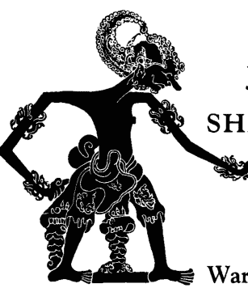

献给詹姆斯·T·西格尔 (James T. Siegel)

Guruku

# 谢辞

通常情况下，爪哇人只在非人际场合才会说“谢谢”（`matur nuwun`）：例如在非常正式的会面中，或面对群体时。无论辞藻多么精妙，真正的感激和感激都无法简化为陈词滥调。事实上，在爪哇，说“谢谢”可能会引起失望，因为这意味着这种言辞可以抵消人与人之间建立关系的纽带。学生会向老师表示尊敬，并尽其所能提供物质礼物。对于朋友，他提供良好的陪伴以及无论患难与共都会支持的无声承诺。但他从未自认为自己欠下的债是可以偿还的，无论是通过物质还是表达感谢之情。

我很幸运在老师中找到了朋友，在朋友中找到了老师。我希望感谢我对他们所有人欠下的债务，而不假想这些债务永远可以被消灭。

本尼迪克·安德森（Benedict Anderson）和詹姆斯·西格尔（James Siegel）向我介绍了印度尼西亚的研究。从我在康奈尔大学读本科的第一天起，我就从他们富有洞见的文章、课程，以及他们对我个人工作的建议和鼓励中受益匪浅。特伦斯·特纳（Terence Turner）和维克多·特纳（Victor Turner）除了詹姆斯·西格尔外，是我的人类学入门老师，他们为这个领域注入了令我至今仍感到兴奋的感觉——这是一份无价的礼物。

离开康奈尔大学后，我多次向那些老师请教，但也从近期结识的其他学者的建议和鼓励中获益良多。阿尔顿·贝克（Alton Becker）、朱迪斯·贝克（Judith Becker）、唐纳德·埃默森（Donald Emmerson）、克利福德·格尔茨（Clifford Geertz）、希尔德雷·格尔茨（Hildred Geertz）、温迪·奥·弗拉赫蒂（Wendy O'Flaherty）、瓦莱奥·瓦莱里（Valerio Valeri）和保罗·惠特（Paul Wheatley）都帮助我形成了关于爪哇文化的观点，我对此深表感谢。

如果我在美国的老师为我提供了问题和技能，爪哇无数老师则提供了信息、建议和友谊，让在爪哇的生活成为了一段丰富的经历。为了避免显得过度怀旧，我应该说：

在许多对我如此友善的人中挑出某个人似乎很乏味。然而，如果不提到雅加达的 Sastrapuka 先生，以及来自克拉滕的 Ki Dhalang Sarwadisana 和 Ki Dhalang Gandawijaya，我会感到失职，感谢他们提供了无价的教导和仁爱。我珍视与他们每一个人度过的时光，在那些时光里，我觉得正如俗语所说，仿佛沐浴在千水中。

民族志告诉我们，一种特殊的纽带往往将仪式入会者联系在一起。对于那些在印度尼西亚的研究在不同程度上与我的研究重合的朋友，我感受到了这种纽带。安东尼·戴（Anthony Day）、约瑟夫·埃林格顿（Joseph Ellington）、芭芭拉·哈特利（Barbara Hatley）、罗恩·哈特利（Ron Hatley）、特伦斯·胡尔（Terrence Hull）、瓦莱莉·胡尔（Valerie Hull）、珍·林赛（Jenny Lindsay）、安东·卢卡斯（Anton Lucas）、安·麦考利（Ann McCaulee）、盖格尔·迈耶（Geiger Meyer）、中村喜子（Hisako Nakamura）和中美子（Mizuko Nakamura）在我在爪哇期间为我提供了智力刺激和良好的友谊。

在撰写和重写关于皮影戏的故事时，我从许多地方获得了无价的建议。我特别感谢已经提到的学者阿尔顿·贝克（Alton Becker）、托马斯·贝德尔曼（Thomas Beidelman）和大卫·萨皮尔（David Sapir）对全文的建议，并感谢彼特·麦卡菲特（Peter Metcalf）的细致且有帮助的阅读。我感谢朱迪斯·费斯特（Judith Ferster）、苏珊·麦金农（Susan McKinnon）、莱斯·莫里斯（Leslie Morris）和南西·芒（Nancy Munn）对文本部分内容的评论。

印尼科学研究所在我两次留爪哇期间授予了我研究许可，我感谢谢姆西亚·艾哈迈德（Syamsiah Ahmad）、纳普图鲁（Naptupulu）以及其他成员让我的研究成为可能。苏洛的胡达尼（Humardani）和印尼西亚艺术学院（Karawati Indonesia）的苏特里诺（Sutrisno）在1978-1979年赞助了我的研究。1978年的研究由富莱特-海斯（Fulbright-Hays）博士前资助支持，1979年由国家心理健康研究所资助，后者资助在撰写论文期间提供了支持。我在1983-1984年作为普林斯顿高级研究所的研究员期间修订并扩展了文本，这获得了美国国家人文基金会的资助。

最后，感谢普林斯顿大学出版社的盖尔曼（Gailman）和谢莉·沃特（Sherry Weight）在准备手稿方面提供的优秀指导。

# 引言：论解读一种爪哇艺术形式

当被称为甘美兰（`gamelan`）的乐队开始演奏时，达郎（`dhalang`）用重锤敲击皮影箱，开始了爪哇影戏（`wayang kulit`）。这位五十多岁、拥有低地爪哇人典型宽眼和宽脸的男子（操纵师，`dhalang`）坐在白屏幕前，头上方悬着一盏明灯。香蕉树干由支撑物离地面一英尺，沿着屏幕底部排列。

皮师（`dhalang`）一手握着每个木偶的杆子在屏幕上移动，另一只手抓着两个由角质制成的较轻的手柄，这些手柄连接在木偶的掌心。影偶的手臂非常长，在肩膀和肘部有关节，但这些是它们唯一可以活动的部分。皮师移动每个木偶，并根据其特定的性格和身份操纵它们的手：侍女动作优雅优雅，骑士则显得庄严果决。

皮师前面的香蕉树上固定了若干个麦克风，其中一些是像旧汽车零件的扁平麦克风，另一个是最近在日本制造的亮眼的新型号。它们连接到表演场所室内外的扬声器。随着 Ki C 开始说话，他的声音响彻整个场景。他用一种冗长且高度程式化的语言进行演讲，用一种理想化、传统但又相当晦涩的词汇，描述了故事开始的普林加达尼（`Pringadani`）王国和宫廷。在叙述过程中，背景中的甘美兰（`gamelan`）轻声奏响。皮师控制语速，使其与乐团中各种锣鼓的击声契合，并偶尔会用几句吟唱的古爪哇语诗歌（`suluk`）中断描述。当皮师确认了现在聚集在一起正式觐见王子的角色时，叙述结束。

普林加达尼的王子加图库卡萨（`Gathukkasa`）非常从容地逐个与在场的每一个人交换问候。他问候的顺序，以及在这些交流中使用的头衔和语言正式程度，取决于每个谈话者的身份。一位从另一个王国来访的长者收到了长而详尽的谢意和款待邀请。客人体面地接受了这些问候，并谦虚地拒绝了招待。随后，作为王子随从的骑士们也表达了对王子关心他们安危的感谢，并向在皇家会面的宾客致意。

问候的交流持续了几分钟才完成。之后，加图库卡萨王子召集了他的宰相巴杰拉登塔（`Bajradenta`）前来，以讨论一件令他感到心烦意乱的事情。在经历了约半小时的准备工作后，皮师现在唱了另一首诗歌，故事的核心即将揭晓。直到这一阶段，许多观众才停止了聊天，开始密切关注。

表演的准备在这一漫长而庄重的开场前几个月就开始了。大多数由私人赞助的影戏（`wayang`）（而非由组织、政府部门、整个村举办）通常与某种成年礼结合举行。婚礼和割礼经常通过表演来庆祝，但其他活动，如孩子出生、盖房或长系列葬礼观察中的最后一个仪式，也可以是表演影戏的合适时机。赞助者必须首先根据相当复杂的数术计算选择一个举行仪式的吉日。然后他们必须选择想邀请哪位皮师，并通常通过中间人询问他在那一天是否可以表演，以及费用是多少。皮师的日程和酬金都取决于他的名声，尽管评价他们的标准各异。声音响亮、机智敏捷的皮师非常受欢迎，非常忙，而且聘请费用昂贵。失去灵活性和力量的老年皮师可能仍因为其更丰富的经验和智慧而受到青睐。Ki Cerma 的年龄和生活的磨难夺走了他歌声中的甜美，他也失去了一些让他成为备受青睐、广受欢迎的表演者的能量。尽管如此，他仍然是一位受尊敬的皮师，在大多数表演举行的旱季，他每月至少表演几次。

如果皮师在 `spos`（演出日）晚上有空表演，就会进行费用的讨价。费用取决于几个因素：赞助者是只想聘请皮师加上一两名音乐家（由他们召集其余歌手和音乐家），还是希望让皮师带人来；赞助者是会从别人提供木偶和屏幕，还是要求皮师把设备带过来；赞助者是希望皮师只在晚上表演，还是希望他或其委托的人在更重要的夜晚表演前的白天也进行表演；以及赞助者是否能凭借皮师的某种亲缘、友谊或其他关系，在皮师报价时获得特殊考虑。

讨价有时会持续得很长，但必须谨慎进行，因为皮师与赞助者之间的关系绝不能被认为像市场上的买卖双方那样。当达成协议后，皮师会获得部分费用作为定金。在这种情况下，Ki Cerma 在他附近村庄的一户家中表演。他同意了一个比平时稍低的费用，因为邻里之间被认为关系高于经济利益。

在表演前的几天，为了迎接表演前和表演期间到来的许多客人，亲戚和邻居聚集在一起帮助赞助者准备。男人们先拆掉了房子的正面。老式爪哇房屋的正面由一排木门组成。当举行表演时，这些门会被拆除，地板和屋顶以容纳甘美兰和音乐家，或者仅仅是为了在没有任何娱乐活动的仪式庆祝时容纳客人。装饰过的椰子叶被挂在延伸到院子的表演区域的开放侧面，铺开了席子覆盖地板（在较新的西方房屋中，墙是水泥造的，只有窗户可以拆除以便普通观众观看表演）。内部，屏幕靠支撑传统风格房屋屋顶的两根木柱放置，屏幕下方是固定木偶的香蕉树干架。屏幕后方的区域（更靠近房屋内部的部分）摆了椅子，这样受邀来看表演的客人就能在更有声望的一侧观看，那里看到的是影子而不是木偶。传统上，在雅加（`Jogja`）附近的一些村庄，并没有椅子，而是屏幕下地上铺着席子，受邀的客坐在那里。

在房屋后方的厨房区域，妇女们准备了大量的食物来款待许多客人。在仪式庆祝当天或之前来捐款支付活动费用的人，以及来看表演本身的人，都得到了点心配茶、米饭配菜以及再次的点心和茶。一支妇女小组准备了这些招待，在活动开始很久以前、期间甚至之后都日夜不停地烹饪，以喂养那些清理工作的人。

表演当天的清晨，甘美兰乘牛车抵达，装满了稻草以保护青铜罐和琴键免受刮擦。在开始之前，孩子们和青少年尝试各种乐器，偶尔尝试一起合奏，砰砰作响地敲击出音符。由于一台租来的录音机和扬声器整天大声播放流行音乐和甘美兰磁带，这些对整体噪音水平的增加很大程度上没有被注意到。赞助者选择在晚上表演之外，白天也举行一场影戏，所以大约上午九、十点，一个表演队到达了。他们受到了赞助者的欢迎并提供了食物。虽然白天和晚上的表演由同一批音乐家，但在这种情况下，一半是 Ki Cerma 的“代表”，他本将在晚上表演。他的次大儿子是 Sigit。如果是其他家庭，通常是兄弟或其他亲属代为承担任务，并由他付钱，这笔钱通常是从赞助者那里收到的总额中支付的。很少有皮师既白天又通宵表演，尽管在过去这似乎并不常见。Ki Cerma 在年轻和成年早期曾在他父亲（他自己也是一位皮师）的坚持下这样做过。许多皮师通过在白天表演来提高技能。但如果他们开始频繁收到晚上表演的邀请，就可以停止从事那种没声望且繁琐的白天表演工作。Ki Cerma 的长子曾通过为父亲在白天表演来练习技能，但现在收到了相当多的晚上表演邀请，因此乐意让他的弟弟们在白天代替他的父亲。

白天表演之所以如此缺乏声望的一个原因是，观众主要是儿童。他们聚集在甘美兰周围，悬挂在支撑延伸屋顶的柱子上，或者努力在音乐家坐的平台附近找一个站立的地方。屏幕阴影的一侧坐着男人，他们护送妻子或其他女性亲属参加了仪式庆祝的初步访问。这些妇女带来了礼物送给赞助者，他们这样做时非常谨慎，在女性赞助人的带领下进入了房屋深处。男人们在享用提供的食物时简短地看了表演。然而，在白光下影子几乎不可见，男人们对这种娱乐活动并不感兴趣。大约半小时后，他们带着护送的女性离开了。随后有其他客人取代了他们，他们的访问也同样短暂。

晚上的表演比白天的要重要得多，尽管故事取自相同的剧目。（有时赞助人要求白天和晚上表演处理相关的故事，但更多时候故事并没有直接关联。）在这种情况下，由于已经有了白天表演，音乐家在白天结束到晚上演出开始之前的一两个小时内休息并吃饭。基·策玛（`Ki Cerma`）在此期间抵达。过去，皮影戏大师（`dalang`）步行、骑自行车或偶尔乘坐马车到达。现在，基·策玛骑着一辆旧德国摩托车来，那是他在早期获得成功时很久购买的。富有的皮影戏大师乘坐汽车或面包车带着几名随从接送。赞助夫妇欢迎了他，并为音乐家准备了晚餐。七点半，他们加入了甘兰乐团，音乐开始了。通常皮影戏大师本人会在演出时击鼓，但基·策玛的儿子西吉特（`Sigit`）曾代父亲表演，他是一位技艺高超鼓手，曾在爪罗的国家音乐学院（`Akademi Seni Karawitan Indonesia`）学习过，他为演出击鼓。他后来一直陪伴父亲的表演，直到凌晨三点半才解脱，这时由另一个年轻的弟弟接手击鼓。

如果皮影戏大师很受欢迎，各种年龄的人（尽管全部是男性）开始在演出期间举行表演的房屋外聚集，甚至更早。对于爪哇岛最受欢迎的四、五位皮影戏大师来说，数百人、有时超过一千人聚集在一起，挤在附近房屋布局所提供的任何空间里。男孩们经常爬上树，直到树倒塌为止。尽管基·策玛的人气并不大，但在表演场地的路径道路上，流动小贩摆起摊位，铺上垫子，人们可以在那里购买零食或玩具，或者赌博。在院子里，甘兰乐团正后，人们坐着或蹲着看表演，而旁边的观众则站着。这些人试图获得更好的视野，加上观众不断的进出，往往让其他人无法在不站起来的情况下看到屏幕。

大约九点，基·策玛站起来，走向屏幕，并在面前盘腿坐。他从木偶盒中取出第一场要用的木偶，并检查坐在他身后准备协助的另一个儿子哈尔萨（`Harsa`）是否已经拿出了之后需要的其他木偶。然后，他拿起木槌，通过敲击左侧的木偶盒开始了表演。

许多受邀客人在表演开始后才到达。如果他们住在赞助人住所所在的村庄外，就会骑自行车或摩托车来。他们必须穿过小贩和停在他们车辆旁的观众之间，这些车辆由社区青年看管，他们有编号的停车检查点。然后，他们在进入赞助人房屋时穿过了一列接待线。一些女性会陪丈夫参加晚上的仪式庆祝活动，此时到访的大多数客人是男性。他们由赞助人的亲属或朋友护送到屏幕后的区域，并被安排座位，其与屏幕的距离取决于他们的社会地位。女性观众——寥寥几个——坐在房子更深处，坐在男人们身后。受邀的客人彼此攀谈，无论他们之前是否相识。在皮影戏大师唱出指示情节铺垫即将开始的苏鲁（`suluk`）歌词之前，很少有人非常关注表演。

当加图卡卡王子（`Prince Gathukaka`）和他的朝臣突破手头问题时，长长的开场戏节奏加快了。加图卡卡揭露了他的混乱是因为他的父亲韦库卡拉（`Werkukara`）——五位德尚潘达瓦（`Pandawa`）兄弟之一失踪了。加图卡卡和他的大臣拉贾拉德拉（`Rajradendra`）仍在讨论这一严重转折时，一位祭司（`pandhita`）的到来在宫廷引起了巨大动静。这位名叫贝加万·杜拉维恰拉（`Begawan Durawicara`，意为“谎言祭司”）的祭司引起了某些大臣的高度怀疑，但他能找到加图卡卡父亲的保证给王子留下了深刻印象，王子将王国的所有责任都托给了他。杜拉维恰拉告诉加图卡卡，要与父亲会合，他只需要进入祭司长袍里的魔法口袋，而智者将进行冥想。加图卡卡和祭司随后离开大厅，令整个宫廷一片沮丧。

一旦长长的正式开场结束，大多数观众就开始倾听皮影戏大师模仿木偶的声音，并在他移动每个木偶的手部让其说话时观察得更加专注。杜拉维恰拉与一位怀疑其主张真实性的朝臣之间的争端是这种开场戏的典型特征。尽管角色必须遵守动作和手势的限制，但这些人物争论得激烈，而那种几乎无法压抑的紧张感吸引了观众的注意力。能够让角色进入争论并令人信服地反驳他们的观点，被认为是皮影戏大师的一项非常有价值的技能。

精明且强大的克雷斯纳（`Kresna`）是毗湿奴神（`Wisnu`）的化身，他的兄弟巴拉德瓦瓦（`Baladeva`）到达普林加达尼（`Pringgadani`），发现朝臣对王子随杜拉维恰拉离开感到非常忧虑。克雷斯纳进入宫寻找更多关于神秘魔法口袋的信息，却发现自己变得异常且虚弱，而祭司却变得强壮。加图卡卡进入杜拉维恰拉的房间，担心他现在会杀死王子。杜拉维恰拉邀请他的儿子莱斯马甘德拉库马拉拉（`Lesmanagandrakumara`）从另一个口袋中出来。当他出来时，显然这个儿子的形象与加图卡卡完全一样。他的父亲告诉他，现在这个年轻人能够跟随加图卡卡的妻子佩吉瓦（`Pegiwa`），让她以为她是她的丈夫，他就能实现对她长期受阻的情欲之求。

此时，几乎所有的皮影戏演出都已经过了晚上，首相拉贾贾拉（`Rajajaran`）检视了皇家军队，准备迎接近期动荡事件后必然发生的战斗。在这场“出军”戏（`budhalan`）中，皮影戏大师在他在吟唱的苏鲁歌词中展示了他的歌声，并展示了操纵木偶以及不同木偶动作风格的能力。客人和音乐家之间也有相当大的活动，因为到此时年轻人已经开始在屏幕两侧分发零食和茶。受邀客人得到的是单人份食物。如果赞助人很有钱，每位客人都会得到一个纸盘甚至一盒零食，但这些赞助人资金有限，只供应肉馅饭卷（`lemper`）和小块蛋糕。对于音乐家，大蒜花生、椰子饼、亮粉色的纸蛋糕和其他点心堆在垫子上，供他们在夜里享用。皮影戏大师什么都不吃，只偶尔喝几口茶。然而，他整晚都在抽浓味烟，使现场弥漫着浓烈的麝香味。

出军后，大多数演出的场景转移到另一个王国，通常是“海彼岸”贪婪或粗鲁人物的国家。通过对乐手们的微妙暗示，皮影戏大师示意他们开始一段乐曲，在几分钟音乐后，他开始了另一段叙述，比开场戏短得多，但形式正式且程式化。客人们，尤其是那些不受欢迎的观众，在这些介绍期间注意力分散，甚至有人睡着了。当剧情恢复时，他们再次关注木偶以及导致这些新角色与第一场角色发生冲突的问题或矛盾。

皮影戏（`dhalang`）；但在这一主要场景中，它只持续了二十分钟。客人们随后拿起盘子，吃着小块咖喱肉、炖豆子和甜酸黄瓜，这些是爪哇仪式中常见的菜肴，所有的食物都堆在一堆米饭上。

受邀的客人在用餐经过一段足够的时间后就可以离开。有些人可能会选择留到直到早些场景中介绍的角色之间发生战斗，这场战斗通常在午夜左右开始，并一律以平局结束。在这场表演中，克雷斯纳（`Kresna`）和巴拉德德瓦（`Baladewa`）率普里加丹的皇家部队对阵 Begawan Durawicara，但后者能够隐身并避开他们，逃进了一片大森林。


# 爪哇皮影戏表演与社会文化分析

## 皮影戏表演全程记录

在第三场主要场景中——按照惯例发生在一位圣者的隐居地——侍从丑角首次登场，他们在坐在乐师旁的女歌手的帮助下唱起了流行且朗朗上口的旋律。这种歌唱加上侍从丑角的戏闹大约持续了一个小时。随后，加图卡卡（Gathukca）的表弟阿比曼纽（Abimanyu），一位拥有高雅骑士般纤细身材的精致人物，向德高阿比雅萨（Abiyasa）致敬。这位受人尊敬的圣者敦促低头的侍从继续寻找维尔克库德拉（Werkudra），去寻找另一个名为塞纳旺吉（Senawangi）的境界。随着甘乐乐队奏响另一首更经典的甘乐曲，场景结束，侍从丑角出发陪伴他们的主人阿比曼纽上路。此时，大多数受邀的客人已经离开，源源不断地走出房子。只有极出名且受欢迎的皮影师才能让许多受邀客人在之后的这个时候（大约凌晨一点）继续观看表演。

一旦受邀客人离开，男孩子们和几个年较大的青少年就会屏风后的区域逗留，他们在那里观看、开玩笑，并睡过了表演的剩余部分。他们对高雅的比比曼纽与一系列怪物之间的战斗，以及丑角与这些怪物之间的滑稽战斗感到非常快乐。大约凌晨三点，甘乐乐队奏响了另一首较长的曲子，皮影师再次对角色和场景进行了正式介绍，这次是关于祭纳旺吉（Senawangi）和智者白猴阿努曼（Anuman）。此时，屏风后的大部分男孩已经睡着了，房子前面的区域也几近无人。乐师们在这一首曲子结束、对话恢复后，也纷纷入睡了。（有些赞助人此时会为他们提供咖啡和另一顿饭，以帮助他们保持适度清醒。）故事的大部分剧情在最后一个长乐曲与占据表演最后一小时左右的一系列战斗之间发展并解决。塞纳旺（Senawang）被揭正是失踪的维尔库库德拉，桑通加尔（Sang Hyang Tunggal）神说服他回到自己王国的职责，阿比曼纽和他的随从及时赶到护送他。在普林加丹（Pringadani），Pregiwa并没有被虚假的“加图卡卡”完全欺骗，因此她的目标破灭了。她逃进了森林，也就是杜拉瓦卡（Durawaca）此前寻求庇护的那片森林。杜拉瓦卡杀死加图卡卡的尝试失败了，所有角色加入了战斗。这些战斗在带有重口音的重复性音乐伴奏中上演，唤醒了沉睡的男孩，并吸引了早起的邻居观看，其中包括一些抱着宝宝的妇女。大约凌晨五点，当太阳开始让东方的地平线泛光时，战斗音乐突然转入一首结束曲。角色们在普林加丹的宫廷进行了非常短暂的聚集。基·切尔马（Ki Cerma）拿出一个木偶（wayang golek），在屏风前跳了几分钟舞，作为胜利者为了庆祝他们战胜困境而进行的娱乐。昨晚九点开始的表演随着这段舞蹈的结束而结束，皮影师将山形（kayon）放在屏风中央。太阳正要升起。

皮影师自表演开始以来第一次站起来，他与乐师、歌手聚集在房子里，那里盛了更多的零食和另一顿饭。赞助人悄悄递交了皮影师的酬，皮影师的妻子在大约一小时后、当他们准备离开时，给每位乐师支付了报酬。

一些乐师（他们许多人是切尔马家族的亲戚）回了家，在家里继续聊天开玩笑了一两个小时。他们精疲力竭，但也十分兴奋，这段时间对他们来说是发泄兴奋的必要的。最终他们离开了，基·切尔马随后去睡觉，尽管如果有事要处理或田间工作要做，他会推迟几个小时睡觉。无论如何，他不太可能长睡到晚上。但如果他是非常受欢迎的演员，或者处于节日季节，这种极其痛苦的日程是皮影师说会去世的原因之一。

与此同时，在赞助人的家里，早晨的时间用于将房子恢复原状、清理院子、拆下喇叭、归还租赁的盘子椅子，最后为提供帮助的亲友邻里上另一顿饭。每个人都很疲惫。

## 皮影戏与社会科学

爪哇皮影戏（wayang）是一场持续八小时的表演，它吸收了许多人的精力并融入一个动员几十甚至数百人的更大活动中。它绝不是爪哇唯一的主要的艺术形式。相反，爪哇提供了数量众多且范围广泛的表演艺术。这些包括许多进入入神状态的村庄表演、商业民剧、几种宫廷舞蹈传统、单口喜剧、印度尼语/爪哇语和伊斯兰流行音乐的歌手，以及更多。事实是，传统表演现在几乎被遗忘了。当代爪哇很少有地方举行 `topeng`（面具舞）或 `len mandra waranan`（表演者唱歌但保持跪姿的表演）了。但新形式层出不穷，爪哇人对所有形式戏剧的品味没有任何消减的迹象。事实上，戏剧似乎渗透了爪哇的生活。每当西方人谈论具有组织的对话和编排的手势礼貌爪哇时，他们立刻陷入戏剧化的比喻。在所有的戏剧中，皮影戏是爪哇最卓越艺术形式。这是爪哇人认为最重要、最有声望、最值得表演且最有爪哇特色的传统。即使是不喜欢皮影戏的爪哇人（有很多），也认为它具有独特的意义。许多宫廷舞蹈不仅包含改编自皮影戏的故事，还模仿了平面木偶的动作。事实上，这种舞蹈被称为 `wayang wong`：人体皮影。

皮影戏的影响超越了艺术和手势。取自皮影戏的意象频繁出现在爪哇语中，这种艺术形式为各种事件提供了比喻。孩子们用侍从丑角命名，而对各类角色的标签也用于刻画各类人类。在宗教模式下，人们常说我们都是傀儡，由最终的皮影师——神所操控。在政治话语中，任何重要的官员都可能被标记为不受见的皮影师操控的傀儡。

正如这两个例子所示，皮影师本人对爪哇人具有特殊的吸引力，无论程度如何。他的学识程度和即兴叙述及对话的能力通常是非凡的，而且往往非常幽默。他对表演的权威是绝对的。他同时创作故事、操纵所有木偶、发出所有声音并指导甘乐乐队。在表演过程中，正如皮影师喜欢的，皮影师是王。

然而，正如我在前面的描述中暗示的那样，皮影戏的表演有一个谜团。传统提到了人，但大多数个人表演很少有人看完全场。诚然，爪哇最受欢迎的四五个皮影师可以留大量观众停留。但即使是他们也无法让观众对许多场景的叙述介绍保持注意力，也无法坚持完整个八小时的表演。绝大多数皮影师只能让很少的观众看到一半。而在许多人都会观看的前半部分，故事才刚刚开始。正如我提到的，故事的大部分在更晚的时间，即凌晨三点之后才发展。剩下的表演充满了定场戏、音乐和幽默的互动。至于故事本身，特别是目前流行的故事——塞纳旺吉（Senawangi）是其中一个虽简化但仍相当典型的例子——它们是高度程式化的，结果也易于预料。因此，没有理由紧密追踪这些故事。皮戏（Wayang）在许多方面似乎占据着爪哇人的生活，但他们对它仅有间歇性的关注。我想分析的是其具有吸引力的原因，以及为什么它有时在局外人看来像是被人刻意忽视的。

非西方艺术形式的研究人员所面临的核心困境在于，他们必须避免将其作为投影自身预设观念的屏幕，但他们又不能局限于本土的诠释。当然，本土注释是必不可少的。然而，一种艺术形式所表达的内容比任何观众或任何一个表演者意识到的都要多。克洛·列维·斯特劳斯（Claude Lévi-Strauss）对文化中不同语域重复模式的论证，让我们能够假设艺术形式的动力至少部分源于深层感受、但同样被有效地隐藏在意识之后的意识（Lévy-Strauss 1964）。维克多·特纳（Victor Turner）的观察指出，仪式的象征可以表达冲突的价值观，即使本土诠释并不承认这些矛盾，这同样适用于表演（Turner 1967）。那么，问题在于如何在超越对文化背景敏感性的同时，不将自己局限于本土的诠释性“传统”。

> ¹ 在研究非西方艺术时，西方人倾向于遵循两种方法之一：要么提供多或少的赞赏性描述，要么制定多或少的主观解释。这些描述在细节和呈现上有时令人叹为观止，但它们让读者对一种艺术形式如何在特定地点以特定方式发展感到好奇。

在爪哇，人们只需要阅读皮格肖（Pigeaud）巨著的《爪哇民俗》（Jaavasche Volksverkeningen, Pigeaud 1938）和卡茨（J. Kats）优美的《爪哇式剧本》（Toonoel, Kats 1923），就能看到世界艺术研究能达到什么样的成就。其他对皮戏文化的研究集中在三个主要关注点：1) 对木偶本身以及表演设置和方式的描述；2) 代表性情节的梗概；3) 对皮戏在远古可能的起源和目的的讨论。（关于最后一点参考 Rassers 1959。）一些较新的研究，例如塞诺-萨斯特罗米迪乔（Seno-Sastromidjojo）和乌尔里希（Ulrich）的研究，倾向于神秘主义解释（Seno-Sastromidjojo 1964, Ulrich 1970）。在《爪哇宗教》中，克利福德·格尔茨（Clifford Geertz）对皮戏提供了心理学解读，将其特别与——

这个问题的解决办法在于根据表演引发的关系来考虑一种艺术形式。这些关系有很多，包括表演者之间、表演者与其赞助人之间、赞助人与其客人之间等。然而，最重要的是艺术幻象本身与其观众之间的关系，而在这些联系中，隐含着艺术家与观众之间的关系。这些关系立即引发了问题：寻求对观众产生什么影响？观众的满意本质被认为是什么？表演引发了什么反应？这大部分材料可以从本土言论中获得，虽然可能是在关于特定表演的随口评论中，也可能是在更正式、概括性的宣告中。但注释必须根据表演中实际发生的情况来判断，正如表演者如何使用该艺术形式的规范，以及什么激发了观众的兴趣、赞同和/或批判。注释与实践在这些任何一点上并不一定重合，可能需要特别仔细的考量。

然而，将表演理解为一种关系并不仅仅是允许研究人员通过观察到的反应来挑战注释。更重要的意义在于，它允许他们将这种艺术形式与该文化成员之间存在的其他关系整合在一起。这正是美学、社会学和意识形态相汇的地方。即在自我与他者调解的重复模式中。

在每一次遭遇中，事物都趋近于表面。此外，爪哇人认为，言语和写作本身就能引导出能量（potency），而爪哇人对个人与话语关系本质的思考——即作为权力的主宰还是作为权力的依附者——揭示了许多关于爪哇人对“自我”和“能量”的构想。人们相信，至少在理想情况下，这蕴含着巨大的能量储备，而且它在表演者、赞助者和观众之间建立了一种虽不寻常但极具发人深省的关系。本书的前四章旨在阐明爪哇人对自我、权力和语言的理解，这些理解如何影响了他们的互动作用，以便在随后的章节中，将“皮影戏”（wayang）这一现象置于一个易懂的（尽管有时仍显陌生）的背景之中。

如果一种艺术形式可以被分析为一组关系，它可能仍然被认为是重要的，因此相较于特定文化的其他方面，它就不那么需要分析。艺术可能被认为在特定社会中仅起着微道的作用，在对财富、地位和权力的斗争中处于偏离中心的状态。这恰恰是人们对其感兴趣的原因。无论它们是否构成了对演出所在世界的批判性评论——我主张的是，至少皮影戏并没有这种内在的功能性目的——这些艺术形式呈现了文化假设的提炼，是那些构成各种行为基础的投入的强化。由于摆脱了重力和时间等世俗的束缚，剧中的人物可以将全部注意力投入到更具吸引力的冲动中，例如荣誉或能量。那么，分析者必须试图观察这些关注点如何激发情节的发展、表演方式及其受众反应，并如何与演出发生的文化其他方面产生共鸣。

在寻找某种文化中出现这些关注点的领域时，研究人员可以利用类似的“奇特”现象。对事件运行中的不规则现象的反应和评论，往往揭示了对事物运作的假设，这些假设是“正常”模式很少揭示的。例如，由于双胞出生而引发的程序和评论（这在民族志文献中很常见），可能指向了对个体身份本质的假设；当人类以单胎出生时，这些构想就因为没有受到挑战，而未被揭示出来。我经常采取这种方法，试图通过引用爪哇人对相对不寻常事件评论来支持某个观点，这些事件可以说是发生在经验边缘的事件。特别是，我利用了信息人用“内在主义”（kebatinan）的术语所做的许多评论，这是一种广泛的神秘信仰，影响着爪哇人对事件的思考。我的观点不是将爪哇文化还原为一系列关于世界上无形力量运作的奇特想法。相反，而是将这些对现象边缘的评论作为一种由该文化自身参与者所构建的文化诠释。

如果我用一个相当尖锐的类比，人类学家必须通过获得信息人对那些事面的联想，来辨别文化现象的含义。这意味着首先要记录人们对经历的评论。也意味着观察他们的行动。罗伯特·杰（Robert Jay）在这方面对爪哇对话的不同层次应用了一种有用的区分（Jay 1969:20-29）。他指出，在概念化水平上表达出的符合规范的价值观，可能会被更直接层面上说出的言论所矛盾。这一点同样适用于人的行为。人们在爪哇所做的，就像在其他地方一样，可能与他们声称持有的规范发生冲突，这符合杰对概念普遍性高低程度的区分。这是一种更直接、甚至是最直接层面的“陈述”；它是一种比随口言论更少泛化、概念化程度较低的表达，而观察到的行动往往能为评论提供更充分的背景。也就是说，行动是与陈述的规范、未说明的预设以及往往相互冲突的愿望之间的进一步联想，所有这一切在本质上都是具有个人和文化双重动机的。

尽管如此，一个困难也随之而来：即使人类学家在阐释文化现象的努力中收集了一些联想，除了人类学家自己之外，没有单一的主体可以同化这些联想。这种所谓的材料收集实际上是产生了进一步的联想，而现在这些联想是由人类学家自己生成的，而这暗示了扭曲。但这并不是扭曲。

## 爪哇语发音指南

文中仅提供了低级爪哇语（ngoko）术语，未提供其可能对应的高级爪哇语（krama）词汇。在读文中出现的爪哇语词汇中，末尾开放音节中的字母“a”，以及位于末尾“a”开放音节之前的倒数音节中的“a”，发音类似于英语“law”中的“aw”（例如，名字“Cerna”读作“Cermaw”，而“pusaka”读作“pusakaw”）。不带重音的“e”类似于英语的中央元音（schwa）；带重音的“é”类似于法语中相同符号“é”和“è”的发音。不送气辅音不送气，而浊塞音则显得非常沉重。“T”和“d”是齿音，而“th”和“dh”是腭音；“c”类似于英语的“ch”（如“church”）；“j”类似于英语的“j”（如“jade”）；并且像德语一样，写为浊塞音的字母“b”、“d”和“g”在出现在末尾时，实际发音类似于英语的“p”、“t”和“k”。

# 第一章：语言、权力与苦行主义

爪哇人的正式会面非常非凡。在非近亲或非长期伙伴之间，甚至在某种程度上在他们内部，面对面的会面要求每个人都非常注意表现出与其相对地位相称，无论手头业务如何。词汇、情感、手势、时机——都必须根据它们可能在现场人士中引发的反应，以及根据自己相对于他们的社会地位进行仔细调整。这些问题在任何地方的会面中都很重要，但在爪哇，这些问题被组织成词汇集和对话策略的程度是令人惊叹的。用爪哇语互动意味着要预判、衡量、调整，并在有时假设（但绝非无意地）对方的反应。

然而，爪哇人关注的话题是苦行修行，关于苦行磨炼的一个显著的事实是，它们暗示了对他人和世界的忽视。此外，苦行主义是一种手段，即使在日常事务中也能让自己更令人印象深刻，减少受外部的影响。这意味着在其他方面，完成了许多苦行修行的人被认为能够以他人无法的方式控制会面。

会面与苦行主义是两种对立但关联的行动。它们是爪哇人对经验思考的逻辑极端。它们每一种以及人与人之间互动的方式，都可以明确爪哇人对权力的理解。结果，我们得以看到这些理解如何影响爪哇人在特定关系中的互动，例如在家庭中、政治关系中以及艺术中。

## 社会地位与相对地位

为了理解爪哇会面中的利害，并澄清目前的讨论，在社会地位（social status）和相对地位（relative status）之间做出某种明确的区分是值得的。我将前者定义为：社会地位，是指在群体中持续的较高或较低的突出地位，主要取决于谱缘以及对劳动力和/或有价值资源的控制。这种控制可能源于官职、财富、奥秘知识或技能、亲属关系等。我所称的相对地位，是指人在任何特定会面过程中从其谈话者那里获得的尊重的程度。社会地位只可能发生相对变化，而相对地位完全取决于谁参与了特定的交换。当然，两者紧密相连：社会地位在很大程度上决定了个人所激发的尊重程度，因此人在任何会面中的相对地位是情境的、瞬时的，并且在某种程度上是可以协商的。社会地位设定了协商发生的范围，但它仍然留下了“讨论”的空间，因为人们会确认、修改或质疑参与者对其相对地位的估计。尽管社会地位对我们所有人（无论是西方人和爪哇人）来说确实至关重要，但相对地位——人在任何给定会面中激发的尊重程度——在爪哇人中引发了浓厚的兴趣，这让西方人和一些其他印度尼西亚人可能感到惊讶。爪哇语提供了这种现象在互动中体现的最清晰的手段。

爪哇的社会地位定义相当松散。宫廷贵族根据其成员的等级，遵循克利福德·格尔茨（Clifford Geertz）为巴厘岛描述的相同“地位下降”系统（C. Geertz 1980）。然而，归属地位仅涉及人口的极小部分。相反，对财富、年龄、教育、职业以及亲属是谁的考虑，在某种模糊程度上决定了一个人的地位。实际上，除了贵族、公务员、商人、劳动者或农民这些粗略标签外，很少有用来分类人们的区分。

> * 我指出，社会地位与相对地位之间的这种分析区分并不对应任何爪哇语术语。Draajat（意为“程度”、“等级”）最接近作为一种相当固定位置的社会地位，但它被应用于有明确等级划分的个体，如贵族和公务员。其他类型的区分，例如不同村民之间（拥有灌溉土地的所有者、住户主或无地者），或不同职业之间（例如农民、公务员或商人），或教育程度之间（无知者与受过教育的人），暗示了社会地位，尽管绝非在任何一个清晰排序的术语体系中。然而，谈论会面中我正标记为相对地位的、问题所涉及的细微差别时，爪哇人只会谈论在任何给定情况下，谁给了谁接受了什么具体的亲属称谓以及什么样的尊重或其反面指示。


## 语言、权力与苦行主义


爪哇的社会地位定义得相当松散。宫廷贵族根据其成员的等级，遵循克利福德·格尔茨（Clifford Geertz）为巴厘岛描述的相同“地位下降”系统（C. Geertz 1980）。然而，归属地位仅涉及人口的极小部分。相反，对财富、年龄、教育、职业以及亲属是谁的考虑，在某种模糊程度上决定了一个人的地位。实际上，除了贵族、公务员、商人、劳动者或农民这些粗略标签外，很少有用来分类人们的区分。

他们可以通过积累财富或文凭等策略尝试提升他们的社会地位。新财富并不一定赢得每个人的尊重，至少不会立即赢得，但从长远来看确实决定了社会地位。我居住的卡拉甘村长的父亲据说不识字，但在烟草生意中发了财。通过与萨卡的曼昆纳拉廷交往获得的财富和声望使他在当地非常有影响力，通过军事或其他官僚头衔对社会地位有直接影响，使其在社区事务中获得更大的权威。获得大学学位的人也可以以此获得更高的声望，而且他们总是将学位符号附加在名字后面。雅加的一位当代达兰（皮影戏艺师）是 Ki Barno B.A.，该市最著名的民俗女星在名字后面附加了“法学硕士”。

社会地位不仅体现在人们的头衔上。他们拥有的土地数量、房屋的大小和设计、服装、使用的车辆种类以及为亲属安排工作的能力——所有这些因素影响并反映了人的财富、声望和社会地位。但恰恰是这些因素是流动的，社会地位总是有点模糊。

爪哇的阶级问题很多。克利福德·格尔茨指出，农村爪哇人之间土地规模的差异不足以形成剥削阶级和被剥削阶级（C. Geertz 1963, 1984）。他的批评者坚持认为，从外部看起来微小的差异在爪哇村内部并不被视为那样，而且最近的证据表明贫富差距正在扩大，使后者日益受前者的支配（关于这一辩论的综述，见 White 1983a）。对于目前的目的，确定阶级分析是否适用于爪哇并不重要，重要的是注意到社会地位差异确实存在，并且它们对获取财富、资源和政治职位的影响正如它们对面对面交往的影响一样。然而，正式的社会类别作为社会地位的指标，呈现的是一个仅大致分类的个体组合，他们必须随后处理安排妥当的相遇模式与互动方式。

## 28 第一章

相遇的模式与互动方式。也就是说，他们必须在每一次交流中建立起自己的相对地位。当地位差异巨大时，例如农民对贵族说话时，或者当地位差异不那么重要时，例如兄弟之间的交谈时，相对地位并不太容易质疑。然而，当社会地位的差异不那么剧烈，因此可能具有争议且具有相关性时（这在大多数爪哇人的互动中都是如此），相对地位就变得非常关键。在这种情况下，每个人都会留心语言在互动中激发的敬意程度和熟悉程度，因为这些会影响他们对自身以及他人的感知。

## 语言与相对地位

人们主要通过关注语言层级（`speech levels`）的操纵来关注相对地位。这使得几乎每一句表达都是对说话者与谈话者之间关系的评论。任何内容除了其表达方式之外，都无法被认为具有本质意义，而且在任何地方都是如此的，这取决于在何地、何时以及对谁说。此外，任何语言的说话者都观察着相同类型的区别，例如正式与非正式、审慎与坦率、传统与大胆，这些区别划分了爪哇语的语言层级。但在爪哇语的语言和肢体风格中，复杂而微妙的内涵始终存在于人们的脑海中。因此，语言层级及其相应的手势接管了社会结构留下的相当模糊的类别。它们迫使说话者明确表达他们对彼此相对地位的看法。

基本上，人们可以区分爪哇语中的三种语言层级，它们由几组词汇的使用定义：`Ngoko`（下语）、`madya`（中语）和 `krama`（敬语）。`Ngoko` 是孩子学会的第一种语言。爪哇人认为它是简单、直接且未经修饰的。

> * Soempo Pooedermo 详细说明了支配语言层级使用的正式规则（Soempo 1968，另见 Soempo 1969）。C. Geertz 从更具社会学的角度讨论了语言层级（C. Geertz 1960:248-60）。Uhlenbeck 1978 涵盖了爪哇语中广泛的语言和社会语言学问题。J. Errington (1981) 关注语言层级使用模式的变化，特别是在贵族阶中。（J. Errington [1985] 在一部更容易获得的出版物中总结了他早期的大部分工作。）层级使用的示例见 Kepler 1984。

人们对亲密者、下属，以及在愤怒和开玩笑时使用它。`Krama` 更优雅、礼貌。它适用于正式场合，以及与略有认识或需要表示尊敬的人交谈。`Madya`（也称为 `k madya`）是一种比 `krama` 不那么精炼的说话方式，但也比 `ngoko` 不那么熟悉。它用于几种类型的相遇：在低地位的人士之间；与认识了一段时间但并不真正亲密的人之间；以及与关系亲近但必须尊重的人之间。

语言层级通过使用一组或几组词汇来区分。爪哇语中绝大多数单词是形式不变的。例如，“树”一词（`wit`）在三种语言层级中都无需加修改地使用。但在这种不变词汇集之外，还有一些单词和词缀的形式不同但意义相同，不同的形式表达了修饰的程度。许多单词和词缀遵循 `ngoko` 和 `krama` 之间的基本位置。在说 `ngoko` 时，人们把信称为“铺的”（`laying`），而在 `krama` 中，人们说 `seratat`。还有专门的 `madya`。例如，“这个”在 `ngoko` 中表达为 `iki`，在 `madya` 中是 `niki`，在 `krama` 中是 `punika`。当不存在特定的 `madya` 时，说 `madya` 的人会从其他词汇集中选择单词。例如，人们可能在 `madya` 话语中使用 `layarang` 或 `set`，因为没有表示“信”的 `madya` 形式。语言层级迫使说话者非常明确地表达对彼此相对地位的看法。

积极的地位。向那些理应如此的人表现出尊重并非贬低：相反，承认权威证明了一个人对力量及其在社会秩序中表现的敏锐感知，正如下文将讨论的那样。但当地位差别变得细微时，相对地位确实会变成一个问题，竞争也可能变得激烈。这时，必须格外小心以确保他人的尊重，或者至少防止公然的不尊重的表现。Pak Cerma 告诉我，当一位年老的达兰（`dhalang`，Pak Cerma 儿子的分类学叔叔）表演时，这位老人非常希望他的侄子们能在甘兰琴（`gamelan`）中演奏。但他从未要求他们这样做。当然，作为年幼的亲属，只要他一提到需要帮助，他们就会立即行动。但如果他们没有这样做呢？那位老人家就会“羞愧地退缩”（`mundawar ism`），这种风险显然太大了，无法承担。

在倾向于通婚的群体内部（如贵族或达兰），经常会发生一种情况：两个人可以通过父系和母系双线追溯他们的亲属关系，因为爪哇的亲属关系是横向划分的。那么，相对资历可能会产生争议，因为如果从某一方追溯，这个人可能是“年长”的，如果从另一条线追溯，则是“年幼”的。规则是，如果双方都不同意采取谦卑的地位——即使这仅涉及直接称呼的问题——他们的关系可能会变得紧张。克拉滕（Klaten）一个最大的达兰大家族的成员之间多年没有说话，因为他们无法就如何称呼对方达成一致。

事实上，直接称呼提供了一个很好的例子，说明了相对地位的谈判会变得多么微妙和复杂。这些术语很大程度上来源于亲属关系，但可以应用几种不同的原则来调节一个人称呼另人时所隐含的尊重和亲密程度。这很重要，因为社会地位的许多不同决定因素在对话双方的相对地位之间可能产生冲突的影响。例如，Pak Cermadikrama 是一个年轻的侄子，Pak Cahyamantara。Pak Cahya 可能比 Pak Cerma 幼十五岁，而且作为一个农民，他并不像 Pak Cerma 作为达兰那样拥有威望。然而，尽管 Pak Cahya 既不富有也没有受过良好教育，仅拥有一小块灌溉稻田，但他却是村长的表兄弟，也是村长那位强大的烟草商人父亲的侄子。这让他处于村里相当显赫的家族圈中。他是


人在对话中如何操纵语言等级、头衔和名字，正如所有语言方面一样，在程度上取决于个人风格。卡拉农姆（Karanganom）有一个人以大声开玩笑和不分亲疏而闻名。人们会提醒他，当用我名字的缩写且不加任何头衔来称呼我时，不要感到冒犯。“Pak Harja 就是那样，”他们会说，暗示他“有点没眼力”。Pak Cerma 经常对 Pak Harja 对每个人都那么紧张而付呵呵大笑。但他乐意指出，那个人称呼他（Pak Cerma）为“操偶戏师”（dalang），但不敢使用真正亲切的称呼，更不用说在不加头衔的情况下叫 Pak Cerma 的名字了。通过这种记录，Pak Cerma 隐含地指出了他让 Pak Harja 承认自己更高相对地位的能力。

爪哇语对话说明了人们在言语中协商相对地位的方式。当两个互不认识或极少交流的人在一起时，有时会发生其中一人（说话者 A）采用了一种让对方（说话者 B）认为尊重不足的语气。如果是这样，B 可以表现出拒绝 A 指向更亲密风格的任何尝试。例如，如果 A 在 madya（中等语）和语调上说话太亲昵，那么 B 选择使用 madya 级的否定代词 `Senes`，B 可能会用对等的 krama（尊语）词汇 `Sans` 开始回答。他话语的其余部分将使用 madya，因为持续使用更高程度的精雅用语会贬低他的身份。预期的 madya 与 B 替换它的 krama 词之间的对比，将向 A 传递出 B 认为他在装腔。然而，如果 A 坚持他那过于亲密的模式，那么 B 只能完全退出这次会话。如果他采用 A 的亲密语气以避免违反 A 对他们亲密关系以及对等地位的隐含断言，那么他就接受了 A 这种认可。如果我们用比 A 更精雅的语言说话，那么他似乎就给予了 A 超越其应有的尊重。无论哪种，B 的社会地位都会受到损害。在公共场合，这会让他感到深受冒犯；而在私下，B 会觉得 A 的举止不可接受，他将别无选择地绝交。

相反，许多爪哇人享受获得他人尊重称呼的场合。爪哇人在对话中常用的一种方法是讲述他人对他们表现出极大尊重的事件。爪哇人几乎从不用间接引用。相反，在叙述事件时，他们会识别说话者并引用他们的话，据称是逐字记录的，几乎或没有注释。听者必须依靠内容、语调、语言等级和直接称呼来弄清楚谁在被引用。混乱经常随之，但所有相对地位的指标——头衔、直接称呼、词汇集和语调——都得到了维持，而这些这些与任何具体内容一样重要。例如，说话者 A 会点名某人 B，然后引用 B 以一种极度礼貌和尊重的风格称呼 A。B 的地位越高，回馈给 A 的声望就越。。而且由于 A 只是在引用 B，他当然不是在炫耀，他只是在记录事实。这种客观性的假装依然存在，尽管用正常的语气说话，但引用 B 的方式却是程式化的，不像在爪哇除了舞台上听过的任何话语。有时 A 会加上一个谦虚的免责声明，说他不知道为什么 B 那么礼貌。

另一种对自己在互动中所享有的优越相对地位做出主张的方法，是列出所有用表达自己分类学资历的直接称呼称呼自己的人。另一种方法是对所有知道我是谁的人给予尊重，尽管与他们并不熟悉。所有这些手段都归功于自己在互动中被赋予的优相对地位，正如他人表现出的尊重、敬意和体贴的那样。关于自己才华、胜利和特殊特质的主张也会出现在爪哇对话中，正如随处可见那些。但人们发现人们利用他人的尊重来构建自己的声望的频率，表明了对社会地位及其在互动中戏剧化表现的一种独特的操作性理解。

言语如何构成相对地位的另一个例子是负面的：当爪哇人与中国人交谈时。中国人被认为除了说 ngoko（口语）之外什么都不会说。这对于中爪哇的许多年轻、受过教育的中国人来说并不是属事实，他们对精雅词汇有相当好的控制。事实仍然是，中国人用日语而不是印尼语被称呼，他们通常用 ngoko 被称呼，或者至多是 madya 版本。结果是，一个人如何称呼中国人以及他们如何被称呼实际上并不无关。中国人被认为像孩子一样，缺乏对使语言等级意义化的礼仪和相对地位问题的敏感性。因此，他们的话无法影响人们对任何人地位的认知。

爪哇的中国人实际上是一个有趣的例子，说明了财富和相对地位如何可以独立运作，因为他们在爪哇的实际经济实力很大，而他们获得的尊重却微其微。一位在雅加达当商人的爪哇朋友在我 1983 年回到印尼时解释道，巨大的印度尼西亚官僚机构现在正越来越多地分配给爪哇人而不是中国企业家，扭转了长期以来的模式。爪哇官僚选择与符合爪哇规范的人进行安排，与

# 第一章

36 遭遇。然而，这种转变并不意味着中国人作为中间人的重要性有所降低。相反，他们变得更加必要了。例如，爪哇人的准则不会允许高高级官员向爪哇人承包商提出任何明确的违法要求，而后者也不能明确提供贿赂提议。但并不排除一位爪哇人官员对一位中国商人说：“我女儿需要矫牙。你认识谁可以做吗？”那个商人会回答：“噢，当然可以，没问题，我可以帮你处理。”中国人可以在任何合同的各方之间传达此类需求，或者处理任何一方的需要，以换取行动的一部分。正如我的朋友在例子中对那个假设的中国商人所评论的：“他可能拥有宫殿般的房子和一队豪车。”把他当成人来看，就是给予了他最起码的尊重了。

正如这个与中国人的关系示例所示的，相对地位并不影响语言表达的形式，而是影响人们的行为以及如何行为。一个人感到越必须提供尊重，他就越无法坦诚、宽广地谈论。相比之下，在特定遭遇中处于较高相对地位的个体，可以自由地表达意见、提出要求，甚至下达命令。在地位平等的亲密关系中，也可以存在特别高的社会地位。年轻人彼此之间毫无顾忌，互相依靠帮助，并自由地使用对方的物品。他们能自由地做的事情比社会地位更高的负责家庭的家长多得多。同样，村里的男人们做这些事情比高地位的城市男性更容易，而女性也比男性更容易。但在每种情况下，亲密的人必须明确他们并不是在暗示他人服从。他们必须小心，不要让亲密的行为看起来像上级者的行为。

事实上，非常亲密的人，尽管他们的社会地位大致相等，但确实具有相当相对地位。例如，兄弟姐妹之间的出生顺序规定了一种等级制度：年幼者在称呼年长者使用亲属称谓，而是在长者的名字基础上；年长者则仅以名字回复，并向年幼者下达命令。事实上，假设亲密意味着人们不需要意意自己的风格是不恰当的，因为在爪哇，所有的风格都是带有标记的。Cerdas 的女婿有一天从三宝望来拜访时，坐在他岳父母家的前厅里，引起了相当大的愤慨，正如他岳母后来愤慨描述的那样，他的行为像个客人而不是像个亲戚。亲戚会进入房子的私人区域，而不是坐在那里像在等待服候一样。

如果地位是固定的，且语言层次的使用规则是不变的的，那么语言层次与地位之间的相关性将是有条理且可靠的。由于这种情况显然是不可能的，每一次遭遇都存在冲突的可能性，尽管日本式的礼仪很大程度上是为了掩盖这种紧张关系而设计的。当一个人发现自己被迫去认可他人对较高相对地位的主张时，或者被迫服从他人的命令时，冲突就产生了。如果一个人在感到不配得到这种尊重时，而是克制礼貌的言语，对说话的冲动无动于衷。被迫说话，特别是礼貌性的说话，是一种屈服：在自己的言语中记录他人的相对地位时，人被语境所操纵。在面对这种压力时，保持沉默是第一形式的反抗。

语言风格和行为方式在爪哇引发的浓厚兴趣源于这样一个事实：个体的身份虽然受到社会地位的限制，但在遭遇中仍然对进一步的构建开放。虽然社会地位以关键方式识别身份，定义了进入遭遇的主要人群类别并设定了该遭遇的条款，但这一基础模式的特征通过爪哇语和行为规范为每个行动者提供的精细手段，在互动中得到了具体化。人的身份并非简单地反映在遭遇中。它通过人际交流的媒介得到阐述。因此，语言、风格和社会地位在爪哇是交织在一起，使得社会互动成为一种对关系的持续定义，而不仅仅是对个人进行简单分类。除了性别和社会经济地位赋予的身份定义外，还存在一种在互动中建立的——始终是相对的，因此始终是崭新的——相对地位的进一步定义。结果，自我并非简单地先于语言并寻求通过语言表达，而是在语言本身的运作中被构建的。

37 语言、权力与苦行主义

38 第一章 这是对戈夫曼关于爪哇人面对面遭遇工作的描述（例如，Goffman 1967）。爪哇人的社会生活确实像一种极其复杂的互动仪式形式，其中所有参与者都关注他人如何慰藉自己、自己看起来如何，以及他们的互动如何影响对个人及所有人的定义。但在两个方面，社会互动论方法必须得到补充。第一，正如我在前述描述中所指出的，要看到基本的区别先于并影响任何特定的遭遇。互动并非从中立的玩家开始的。例如，当陌生人在公交上开始说话时，关于对方地位和举止的事实已经为每位说话者提供了信号，并限制了随之发生的相对地位协商。第二个影响爪哇人对这些理解的因素。然而，在爪哇人看来，遭遇的变幻遵循于对力量的模糊表述但坚定持有的信念。这一在世界上运作的神秘力量领域——`kebatan`，被用作一种比喻，用来坚持一个确实独立于社会地位和遭遇而存在的个体。

## 遭遇与效能（或 POTENCY）

遭遇展示了人的地位，并在展示中进一步定义了他们。在爪哇人看来，遭遇的变幻遵循于精神力量或能量的分布，这就是本尼迪克·安德森（Benedict Anderson）所说的“爪哇人的权力观念”（Anderson 1972b）。安德森写道：

> 权力是无形的、神秘的且神性的能量，它驱动着宇宙。在爪哇传统思维中，有机物和无机物之间没有严格的划分，因为一切都由同一种不可见的力量维持着。（Anderson 1972b:7）

与现代西方对权力的理解不同，安德森在提到爪哇人的权力建构时，采用了将“power”一词字母大写的惯例。我将遵循 Errington 在对卢武（Luwu）类似概念的启发性叙述中的用法（S. Errington 1983），将其称为“potency”（效能/潜能）。

对于英语母者来说，这个词与男性性能力、权势者（potentates）和危险物质的关联都是完全恰当的。事实上，这些关联是应该被培养的，因为必须记住，`potency`（效能）和工具性权力（instrumental power）并非真正的对立或互斥的术语。`potency` 是拥有或失去政治权威、性能力、物质财富以及其他形式的效力、影响或强制控制——译之为权力（power）的能力。对于爪哇人来说，任何种类的权力都是 `potency` 的表现，而正如安德森所明确的那样，`potency` 只有一种。“所有权力都是同一类型且具有相同的来源”（1972b:7）；

爪哇语口语用法偶尔区分此类版本的 `potency` 和/或权力。有一个词叫 `kaikèn`，用来标记特定的精神权力。但它在对话中很少使用。政治上有权力的、财务上安全的、严厉苦行的以及性能力出众的简单地称为“强力的”（`kuwat`）。在下文中，当我想要区分精神或神秘的权力概念，而非物质或工具性的概念时，我会使用 `potency` 一词。然而，这种区分在某种程度上是人为的：在爪哇思维中，两者并非是对立的，而是互补的。事实上，正是“力量”（`kakuwatan`）这一概念的多义性，驱动了爪哇互动中的许多政治行为。

事实上，`potency` 与世俗权力（mundane power）的区分在爪哇语中，参考的并非西方人熟悉的那种精神/世俗对比，而是基于显性与不显性之间的对比。`lair` 和 `batin` 指两种不同的现象。`lair` 指感官可感知且/或可以用常识解释的，`batin` 指通常不可感知的、神秘的且难以显易解释的。`lair` 指我们所有人假设的且通常可以达成一致的清醒现实。它与 `batin` 的世界形成对比，`batin` 是由神秘的力量，基于此基础制定了完全不同的世界描述。说话（`kakuwatan batin`）指的是他们引导存在于世界上无形 `potency` 的能力。这种能力先于并比……更重要，那些显性的（`lair`）权力标志，如体力、物质财富或正式

# 第40章

政治权威。苦行是积累这种精神力量的手段。会面展示了一个个人所掌控的这种力量的储备，即人们假设的 `batin`（内在）的力量。

一个人的地位越高，其 `batin` 就越强，那么其 `batin` 的力量就越大，人们认为他在会面中从他人那里获得的尊重也就越多。反之亦然。如果一个人在会面中无法赢得尊重，这种失败说明其 `kakuawatan batin`（内在修养）不足。那些不表现尊重的人可能显得粗俗。但如果他人的手势和语言无礼且贬低，这一事实表明一个人的力量不足以迫使他人保持防御。

例如，如果一个人在他人面前感到不愿进，他担心自己表现出对他人的不尊重会损害自己的尊严。如果另人在自己面前吃得太多或太随意，他觉得自己的尊严因为对方的缺乏节制而受损，因为具有一定地位的人应该凭借其令人印象深刻的存在对他施加控制。同样的原理也适用于自己和对话者对言语等级的使用。他人应该觉得在自己面前说话过于随意是不妥的。如果他们没有这种感觉，说明他们认为你无法引起他们的敬畏和尊重。再次，一个力量应该给周围的人留下深刻印象：如果没有，一个人的相对地位就遭到了质疑。

这种要求对在场他人的行为负责的倾向，是在我们讨论几天前一起看的一场皮影戏时，通过人的评论传达给我的。那个男人提到，`dhalang`（影戏师）——一位非常著名且受欢迎的人——正在失去他的力量。他引用的证据是，在表演过程中，一个孩子大喊着什么，中断了木偶的对话。我的暗示是这并不是孩子的错——孩子很可能很顽皮——而是 `dhalang` 的错，他的力量不足以让孩子保持沉默。

几乎所有的爪哇人都关注地位和力量的问题，尽管其中一些人（如改革派穆斯林）在谈论这些问题时使用的术语与我所依赖的合一主义爪哇人完全不同，我在这里依靠的是后者的意见。然而，我应该指出，男性对力量的关注超过了女性。女性的社会地位和在任何交往中的相对地位很大程度上取决于其父亲和丈夫的地位。然而，她必须注意自己性纯洁的印象，正如男性必须注意自己力量的印象一样，任何一种一旦受到损害都会产生羞耻感（`imim`）。⁴ 高地位的人也比低地位的人更关注力量。低地位的人通常被认为（他们也认为自己）太忙于维持生计，没有精力理会力量。但这并不意味着他们也不重视它，也不意味着他们不可能利用手头的资源来增加这种力量的储备。

事实上，关于 `katanya batin`（内在言说）决定一个人的地位和命运的观点，引发了关于个人如何积累这种力量的大量讨论。爪哇人长期以来认为贵族成员必然拥有非凡的力量。特别是国王，以及所有具有贵族血统的人，被认为拥有巨大的精神能力。在其他情况下，人们认为上帝出于某种无法解释的原因赋予了力量，这解释了为什么在现代印度尼西亚，一些并不可能的人会获得巨大的力量。但比出生或上帝不可测的智慧更重要的，是各种苦行实践，爪哇人对其效力进行了详尽描述。⁵

## 苦行

在爪哇人看重的苦行类型中，包括禁食、不睡觉、禁欲、在圣人墓地或大树下守夜、午夜后泡在溪流中、周一和周四不吃盐，以及无目的地行走。所有形式的 `laku`（字面意思是“步骤”）这类实践都会被采取。这对于一个人的决心是更有效的测试。它们还应该安排时间，以避开历法和其他计算。

> ⁴ 我将在第2章和第4章讨论男女与力量之间形成对比的关系。

> ⁵ 人们能给出的关于贵族比其他人拥有更大力量的唯一解释是，他们有时间投入到苦行练习。我不认为人们觉得需要这样的解释。他们认为贵族卓越的力量是显而易见的。有趣的是，当人们被要求给出解释时，苦行竟然提供了唯一的解释依据，这仍然很有趣。

例如，一种名为 `ngbeleng` 的 `laku` 包括进入某个封闭空间（通常是房子内部最深处的储粮区），并在那里待三天三夜，不进食并尽可能睡觉。（根据一些人的观点，在七日和五日周期的正确交点开始，一个人可以在三天内达到与禁食四十天相同的效果。这是因为与这三天相关的魔力数字总和达到了目标。）正如任何类型的冥想一样，人的体热会升高，使各种无形灵灵感到不适。这些灵灵会采取不同的形式，以诱惑、恐吓或欺骗某人停止练习并无法获得任何益处。⁶ 人们还认为他的祖先或上帝导致这些灵灵恐吓苦行者，作为一种测试。通过证明自己能够抵御诱惑并辨别真假信息，一个人就配得上得到上帝的帮助。

各种类型的 `laku`，例如，包括进入某个封闭空间（通常是房子内部最深处的储粮区），并在那里待三天三夜，不进食并尽可能睡觉。（根据一些人的观点，在七日和五日周期的正确交点开始，一个人可以在三天内达到与禁食四十天相同的效果。这是因为与这三天相关的魔力数字总和达到了目标。）正如任何类型的冥想一样，人的体热会升高，使各种无形灵灵感到不适。这些灵灵会采取不同的形式，以诱惑、恐吓或欺骗某人停止练习并无法获得任何益处。⁶ 人们还认为他的祖先或上帝导致这些灵灵恐吓苦行者，作为一种测试。通过证明自己能够抵御诱惑并辨别真假信息，一个人就配得上得到上帝的帮助。

人们寻求的 `laku` 的直接目标是：财富、高位、家庭的安全与繁荣、治病的能力等。

虽然苦行的理想建立在男性比女性更有可能采取这一事实基础上，但 Pak Cerma 的儿子 Sigit 和我确实这样做，我们都脱掉衣服，在凉爽的水中浸到脖子了一个多小时。由于人们应该认为

## 第一章 44页

仅仅为了神，并且对一切身体感觉毫无无知，在进行 `laku`（苦修）时，必须做到不言不动。无论是否在热带，那种寒意都是刺骨的，而从颈部向上进攻的蚊子和从颈部向下啃咬的小鱼进一步加剧了这种严酷。。第二天，在证明了自己的意志力后，我感到非常自豪。这种不恰宜的自得很快被 Sigit 的话所驱散，他说我们要在苏拉月（Sura）再进行两次，这种 `laku` 才能起作用。出于对我健康和身体舒适的“自私”考虑，但却损害了我的 `batin`（内在世界），我未能做到这一点。

通过 `laku`，人们证明了自己忍受匮乏、抵抗冲动以及以某种超出正常生活模式行动的意愿和能力。在某些情况下，例如在 Senèn 特别盛行的 `nyenën kemis`（“周一”）和 `Kemis`（“周四”），其点显然是放弃快乐。表达 `ngakuan`（“做 `laku`”）的另一种说法是 `prihatan`（“受苦”）。相反的观点也被认为是：享受许多快乐会消散一个人的能量。Cerma 引用父亲的话说，睡在用过的垫子上会消耗一个人的繁荣或健康（kemuktian）。

## 苦修与牺牲

为了分析爪哇人对苦行的非凡关注，我们将此视为牺牲的一种特殊形式。爪哇的这种牺牲的主题本身值得关注，但就目前的目的而言，我将顺带提一下在稻收前夕作为“初真理仪式”举行的 `wwitan` 仪式。该仪式可以简化为四个核心要素：1) 向 Dewi Sri 献祭（这些供祭品随后会分给仪式者和邻居），2) 割稻草并将其扎成 `mĕntan`（“新娘”），或者根据 Karangan 以外大部分知情者的说法是（“新夫妇”）；3) 向较低的灵体和害虫提供不可食用的“零食”；4) 将“新娘”（被认为是 Dewi Sri 本人）沉默地带回家，并放在房屋最内侧的房间过夜。⁸


很显然，在执行 `wwitan` 仪式时，收割者提供了他们希望自己享有的份额。这一程序在于，通过首先建立女神、人类和灵体之间的地位差异，来抵消对物资的竞争。通过承认这些差异并承认 `Dewi Sri` 的卓越地位，以及灵体的独特地位和权利，人们可以平息他们的嫉妒与自傲，同时将他们引入安全的交换之中。人们向神灵和灵体提供食物，更重要的是，人们向他们提供尊重——正如人们向权势的人类提供尊重一样。作为回报，人们得到他们的礼物、他们的 `berkah`（神秘的祝福），或者至少是他们仁慈的忽视。牺牲并非承认地位差异，而是一种尊重的姿态，至少应该中和其接收者，即使不能实际上束缚他们的话。

爪哇的苦修是一种牺牲的形式，更矛盾的是，人们通过放弃自己的某些方面来获得个人奖励。在简单的情况下，`laku` 的实践者放弃了舒适。更严重的是，他们放弃了对基本需求的满足。理想情况下，他们放弃了与世界上的一切交往。因此，人们在 `laku` 中展示了他们放弃舒适和快乐的意愿，但他们理解，舒适、繁荣和好运虽然推迟了，最终都会以更大的程度累积到他们身上。这代表了一种复杂的牺牲形式，不仅因为它涉及对自我而非财产的牺牲，还因为它暗示了对其他人类以及对神的某种态度。一个人进入稻谷储存区域三天——这只是一个相当理想化的例子——实际上也实践了并放弃了不仅是身体的舒适，还有所有的社会身份。在食物、睡眠、性爱和社区的匮乏中，人在世界上将不再有任何身份。这是在神面前的完全缺席。

我使用“神”这个词是因为它对应于爪哇人的表述。爪哇人说，苦修是考虑到 `Tuhan` 或 `Gusti Allah`（真主）而进行的一项练习。（第一个术语是印尼语，意为“主”，第二个爪哇语术语与阿拉伯语结合。）然而，在爪哇，神是无脸的，而且奇地缺乏伦理。在考虑印度尼西亚的牺牲时，我从 Valeri 教授的谈话中受益，但在随后的论述中，我是非常模式的方式应用夏威夷牺牲的微妙分析。一个怀有邪念的人可以通过苦修获得能量以达到那些目的。为了维持某种道德秩序的象，爪哇人说，这样的人死后将受到神的惩罚。与此同时，“神的慷慨”奖励了所有做 `laku` 的人。正如 Anderson 所指出的，印象仍然是，现实互动的对象不是一个超自然的主体，而是一种量，即能量本身。⁹

苦修尽管以其自己的方式令人生畏，但它为互动的腐蚀能力提供了一种解药。人们不能轻易忽视不尊重的互动，因为另一个人强迫他人尊重的能力。在地位差异巨大的情况下，正如我所指出的，下者的缺乏尊重只证明了他们自己粗俗的 `batin`，并且对万物都漠不关心。当地位区别更加细微时，他人的行为会影响一个人的地位，互动可能会变得紧张。在苦修的退隐中，人们避免了所有此类困难，同时加强了他们回到斗场时的立场。

无论如何，对于这种对爪哇社会生活的解读，真正重要的其实不是超自然力量的本质。只要人们参与这种相遇，他们就陷入了在维护和保护自身相对地位中固有的政治之中。

无敌魔术在爪哇非常流行，反映了保护自己免受外界影响的关注。苦修通过要求人们退出互动来获得能量，戏剧化了这种观念对平衡、尊严和主权的威胁。在很大程度上，它用内在的欲望取代了外部攻击的威胁。斗争是针对寒冷、炎热、饥渴、睡眠、性欲望和任何形式的诱惑的。为了实现自己的欲望，人们拒绝欲望。这种悖论的信念通过一位老人对稻虫的言论得到了清晰的凸显。

但人们在苦修中寻求的奖励是丰收，也意味着一种确保人在交际中拥有令人印象深刻的磁场的力量。也就是说，它也使一个人变得强大。

## 强大的自我

爪哇语境下，“强大的自我”实际上并不是西方人所指的“自我”。`ngebleeng`（迷失出神）状态中身份的丧失，意味着逃避互动中被赋予一个人的定义。在那种逃离之后，人回到世界，此时拥有了更强大的力量。这主要体现在两个方面。

拥有任何形式的 `Pamrh`（魅力/力量）；而且他的言语是有效的。也就是说，他不容易受到自身冲动的影响，而他更有能力定义他人或施加影响于他人。

`Pamrh` 意味着了使人受制于欲望的投入，只有通过抑制这些，人才能变得强大。克制自己的欲望，并抑制（在极端形式的 `laku` 即修行中）自己的理想，意味着一个人不再受世界中自身外部的事物的影响——不再依赖于其，也不被其定义。对外部事物的抵抗，确保了个人对他人的权力，也满足了自身的欲望。这是爪哇式的“自我”理想，这种力量超越了个体的脆弱性，体现在一种优越的 `kakuwatan batin`（内在力量）储备中。这被认为是一个超越了身份限制的自我，因此变得强大。

由于交际是一种通过语言的使用实现并体现的相对地位的谈判，因此令人惊讶的是，苦行严格的终极目标（人们最常提到的目标）竟然是让自己的言语生效（`mandi`），就像毒药和药物生效一样。这意味着人一旦说出某话，它就成了事实。当然，上帝的话语超越一切。任何极强大者的言语据说也能 `mandi`。据信，雅加达苏丹只需说一句“你疯了”就能让一个人发疯。言语 `mandi` 的人被认为“借了神的权威”。

有效的言语（`mandi`）在语言层面重合了欲望与其实现之间的差距。强大的言语不再仅仅是指涉性的，而是生效的。言语与事件之间的脱节被克服了。这使得人们控制了语言，而不是受语言支配，而控制语言的能力是强大自我的关键部分。

## 语言、权力与苦行

我将交际和苦行设定为对立且互补的行动模式，每种都受到爪哇关于力量及其影响观念的影响。¹⁰ 实际上，年长的爪哇男性经常告诉我，真正强大的人随时都在进行苦修。他们可以在日常生活中练习放弃所有的自我利益和情感，因此没有必要躲起来冥想。虽然在保持完全完好运转的同时，这表明这样的人掌握着对他人的控制，但同时也享受着对他人的抵抗。作为这样，这是个人与世界互动的理想爪哇式表现。然而，这种理想内部不仅包含一个人们可以向往的模型，还包含了一种人们可以用来要求他人承担责任的处方和标准，特别是对于那些地位高于自己的人。理想模型绝非仅仅是正确思维的启示指南，尽管它们是以这种术语表述的。它们也是人们作为批评他人根据而采取的辩论立场，和或作为抵抗他人权威的正当理由。在接下来的章节中，我将描述人们在家庭、政治、治愈和审美等多个领域中实际上是如何互动的。并不意外的是，自我利益、情感和事件的变幻证明了社会生活远比无私和强大的理想所暗示的要顺畅得多。尽管如此，爪哇人对所有面对面接触必须和谐这一禁诫的坚持往往令人震惊。

> ¹⁰ 上述关于爪哇对地位、苦行和言语观点的描述，代表了本土评论和我自身分析观点之间的某种妥协。没有任何爪哇人会同意我的观点，即苦行是对人们在接触中看到的脆弱性的一种反应。这种妥协加剧了另一种妥协：贵族视角与民间视角对苦行、接触和言语的描述之间的妥协。J. Errington 代表了内部更一致、更充分的一种，这是由他的高地位索罗门族（`priyayi`）信息源提供的（J. Errington 1984s）。毫无疑问，我的许多信息人的陈述是无私到了近平俗的程度。当然，Errington 对格尔茨早期描述（1960年）的批评，将一种哲学上“正确”的呈现与一种对自我和互动本质的更流行的介绍对立了起来。在钦佩贵族版本之优雅的同时，我仍然认为平俗版本揭示了关于自我本质以及互动中隐含风险的根本性的、尽管很大程度上未经过检验的假设。

此外，在此过程中，人们利用关于脆弱、抵抗和力量的假设，无论是在决定自己的行动、理解自己的经历，还是在判断和回应他人的行为。

## 2. 家庭关系

关于自我、权力和互动实践的假设告知了两种行动——人际交际和苦行实践——它们在爪哇作为互补的对立面存在。然而，这些假设不仅仅是氛围，它们必须被学习并执行。它们从不被系统地教授，也经常不明确表达。相反，它们是在特定的背景下被学习和应用的，本章的目的是展示的爪哇人如何在爪哇家庭的运作中熟悉这些假设。在接下来的三个章节，我将考虑人们如何在不同领域利用这些理解：政治权威（村庄政治领域）、神秘程序（治愈和预防实践领域）以及社会地位（仪式庆祝领域）。在所有这些领域中，力量与权力之间联系的模糊性导致了权力分配、使用和表现中反复出现的模式。

爪哇人在家庭成员之间获得对自我和权力的基本理解。父亲和母亲角色的差异使孩子熟悉不同版本的权力以及他们应该激发的不同反应。特别是，对父亲的理想化赋予了他极大的力量（`kawatan batin`），而实际上却最小化了他对家庭中其他成员的控制。因此，他越是履行理想化的爪哇式男性权威，爪哇父亲就越是在保护自己的权威的同时，放弃了在许多家庭生活中的积极角色。以回避关系为特征的互动关系（特别是父子之间的关系），随后成为爪哇人处理家庭之外许多权威人物的策略模范，寻求通过他们的力量来抵抗对自身行动的任何影响。

> ¹ 爪哇文化的学生很幸运，能在希尔德德·格尔茨（Hildred Geertz）的《爪哇家庭》（1961年）中看到对爪哇亲属和家庭关系的极佳描述。并不意外的是，二十五年对爪哇家庭的运作方式几乎没有带来变化。

## 家庭

爪哇人将夫妻之间的关系构想为：他的权威和她对财务的控制。在夫妻关系的感性方面，爪哇人比西方人要不浪漫得多。处于 `gandrung`（痴迷）意味着不稳定和可能涉及巫术。相反，`tresna`（Poerarm 定义为“对他人的持久情感（不带欲望）”）会刻画夫妻间的纽带。通常，这种情感看起来是真实的，像任何稳定的婚姻一样强大。然而，爪哇人与非常幼儿互动时的巨大温暖和关怀，与夫妻之间的克制甚至粗鲁形成了鲜明对比。

当新婚与父母住在一起，以及一旦有了孩子，性活动就会受到抑制。传统上，新婚在婚礼后要等四十天才同房。此外，如果夫妻与一方父母生活，其中一人必须坚持直到父母休息，以示尊重。一位长者开玩笑说，年轻人感到多么焦急，他的新妻子在他们睡觉的区域等他，而父亲坐在前屋抽另一根烟。“如果你运气好，”长者说，“你现在可以去睡觉了。”但他接着又补充道，“但不要锁门。”这样以后父母就可以看到那对小夫妻睡在一起，或者仍然睡在睡床的两侧。（由于爪哇人睡觉时以及性爱时都是全穿衣服的，因此这段文字并不不端，而且我这里提到的一些观点重复了她的发现。然而，我的评论虽然远不如格尔茨的详尽，但特别关注权威问题以及与之的关系，为我的分析提供了一个足够不同的重点，我希望这或许仅仅在民族志上产生重叠。）

这与贝特森和米德的《巴厘性格》（1942年）也有重叠。爪哇文化与巴厘文化之间的相似性有很多。因此，这种差异——两种文化的教养实践具有如此相似性，而社会组织、宗教生活许多许多却如此不同——再次证明了（以一种反向的方式）文化绝不可还原为教养实践或随之产生的任何性格特质。

父母的监管。女孩的第一次婚姻很可能在很年轻的时候，且违背她的意愿，因此她可能会长时间抵制任何性挑逗，有些婚姻在完房之前就以离婚告终。

女性的忠贞被高度强调，但男性只需要在婚外情调中保持某种程度的谨慎即可。女性有时会受到丈夫不忠的深重伤害。然而，尽管处于这种境遇的女性赢得了同情，但她们的丈夫受到的指责却很少。人们认为，他去妓院比养一个小姨要好，因为后者的财务开支可能更大。我的印象是，很少有男性维持长期的婚外情，他们更倾向于偶尔与妓女共度时光，或者也许去拜访当地某些众出的以慷慨服务的女性。男人和女性往往从彼此身上寻求相对较少的情感投入，这可能解释了他们对男性婚外性这种随意的态度——这种行为被视为对家庭经济的威胁，而非对夫妻情感满足的威胁——也解释了此类活动不太可能导致长期的外遇。

男性的权威要求妻子在期望和要求上顺从他，要求她用某种精炼的语言与他交流，并要求她在日常举止上符合他的（因此也是他们的）地位。从理论上说，女性不应该反对丈夫的意见或决定。在实践中，正如世界上任何地方一样，她可以行使相当的影响，无论是通过消极抵抗、说服，甚至是明显的反对。而且，她掌握着钱袋子。

财务权威问题经常引发爪哇族家庭的冲突。离婚最常见的原因，以及邻居们认为最有说服力的离婚理由，是丈夫未能让资金流入家庭金库。如果一个男人拒绝将全部或至少大部分收入交给他的妻子，他就已经表现得不负责任了，除非他的妻子此前表现出处理金钱的干。当一个来自另一个村庄的小伙想娶卡拉冈农姆（`Karanganom`）的一个女人时，传言说他被第一任离婚了，因为他只给她小额现金，而不是让她管理他的收入。他新那个不情愿的未婚妻一直抵制这门婚，邻居们重复这一传言，倾向于同情她。

当人们解释为什么一夫多妻是个坏主意时，他们无不提到对丈夫收入分配的紧张。同妻之间的性与情感嫉妒在爪哇人看来似乎是真实的，但是次要的问题。婆媳之间的紧张通常也表现为对丈夫财产的冲突性主张。如果他想给自己的亲属送钱，男人往往不得不采取诡计。最近守寡的米巴·图蒂（`Mbak Tuti`）提到，如果她在哥哥（一名公务员）领工资后不久去探他，他会塞给她一些钱，但他会告诉妻子，办公室扣除了一笔“强制性缴款”。

对财务的控制意味着拥有了相当大的世俗权力，但对于爪哇人来说绝非最高权威。如何将丈夫名义上的权威（`kawasa`）与妻子在金钱事务中的角色协调起来，引发了一些关于爪哇人的有趣评论。一天晚上，在一个乔贡根（`jogongan`，在某些仪式活动后举行的男性聚会上），几个男人回答了我关于女性主管家庭财务的问题。他们的回答是用女性的弱点来表述的。一个男人不能为十卢皮亚担心。他心想：“出去多赚点容易多了。女人没有那个选择。她不能出去赚钱。相反，她会想：‘有了十卢皮亚我可以买盐和辣椒。’所以她更小心。如果一个男人在饭店被要了高价，如果他们告诉他付500卢皮亚而他只需要付250卢皮亚，他就付了，因为他会为大闹而丢脸。女人就会反抗。

男人会因为让自己被骗而感到羞耻，而女性会因为不反抗而感到羞耻，这取决于男人的情感。


# 家族关系

控制财务意味着拥有了相当大的世俗权力，但对于爪哇人来说绝非最高权威。如何将丈夫名义上的权威（`kawasa`）与妻子在金钱事务中的角色协调起来，引发了一些关于爪哇人的有趣评论。一天晚上，在一个`jogongan`（在某些仪式活动后举行的男性聚会上），几个男人回答了我关于女性主管家庭财务的问题。他们的回答是用女性的弱点来表述的。一个男人不能为十卢皮亚担心。他心想：“出去多赚点容易多了。女人没有那个选择。她不能出去赚钱。相反，她会想：‘有了十卢皮亚我可以买盐和辣椒。’所以她更小心。如果一个男人在饭店被要了高价，如果他们告诉他付500卢皮亚而他只需要付250卢皮亚，他就付了，因为他会为大闹而丢脸。女人就会反抗。

男人会因为让自己被骗而感到羞耻，而女性会因为不反抗而感到羞耻，这取决于男人的情感。

承受着生活的冲击和压力，并越来越清楚界定互动行为的规则。在这一段适应世界的时期结束后，孩子们应该已经获得了情感态度和社交风格的基本词汇，这使他们能够以对自身及他人地位的适当敏感性，进入人类社会。

爪哇族婴儿在出生后的第一年里，大部分时间都是由母亲怀着的。婴儿可以随时随地哺乳，只要稍微哭闹就会要求母乳喂。即使在哺乳时，婴儿通常也由母亲抱着。如果她忙于某项活动，她会把孩子抱在身旁一侧，通常用一条长布支撑着。在少数几次无法以这种方式抱着孩子时，她会尝试找其他人（通常是女性亲属或邻居）临时帮她抱孩子。

婴儿应该时刻留在母亲身边的感觉可能会让女性面临巨大的困难。来自`Karanganom`的妇女`Yu Paimin`被私生女的父亲抛弃了，生计非常艰辛。在女儿出生前，她通过在别人的田里耕种收获、脱谷稻谷，以及偶尔在富裕的邻居家中打工来维持自己。但有了孩子要照顾，她几乎找不到任何工作。在腰上背着孩子在田里干活被认为是不体面的，甚至是不可能的。如果她有一个丈夫，她只需照顾孩子和自己的家庭，直到孩子长大。由于没有事实上的丈夫，她的处境变得更加恶化，因为她在村里没有亲戚居住。在万迫的情况下，祖母或姨妈可以照顾婴儿，但母亲应该始终保持足够近以便哺乳。然而，邻居并不被期望去照顾婴儿，因此`Yu Paimin`只能在邻居家里做些轻力活，在极少数见到她的哥哥姐姐时向他们要钱，并接受邻居送给的剩菜剩饭。她的孩子学走路特别慢，而且在会走后又格外不愿走。直到孩子快两岁时，`Yu Paimin`才开始短时间将她放在邻居家里。一位年轻的母亲和她的孩子们都可以照看这个孩子，从而让`Yu Paimin`能够承担更繁重且回报更丰厚的任务。

在弟弟或妹妹出生之前，孩子们保留着随时随心所欲被抱的不受争议的权利。他们不会被迫着学走路，一旦会走路了，当他们更喜欢被抱时，就不会被强迫去走。事实上，人们说，在孩子尚不熟练走路时鼓励他们走路会导致腿部畸形。如果没有弟弟妹妹出生，孩子们可以一直要求被抱到五、六岁。在这种情况下，哺乳可能会持续到四岁，在女性不再产生乳汁后，她可以让最小的孩子吸她干枯的乳房。

爪哇族的婴儿即使会走路也会被不断抱着和支撑着，因为必须防止他们跌倒或受到身体碰撞。在情感上，他们必须免受所有冲击和压力。婴儿的整体满足感、对疾病和不幸的抵抗力以及成长能力，都取决于他们是否免受任何身体或情感上的扰动。

必须仔细留意婴儿的意愿；在某种意义上，他们正被说服留在家里。`Ngemong`的意思是照顾孩子，其含义是必须溺爱并逗乐他们，同时照看他们。当爪哇父母提到一个早夭的孩子时，他们会说这个孩子“不想被照顾”（`ora gele dimong`）。这句话通常是带着某种困惑说出来的；尽管父母已经竭尽全力让孩子感到满足。尽管疾病可能是孩子死亡的直接原因，但对疾病的脆弱性被认为源于孩子受挫的愿望或不快乐。

婴儿被认为是精神与身体的高度融合体，受控于必须满足的欲望和胃口。由于某些需求被拒绝而导致的挫败和愤怒会使婴儿变得脆弱，容易受到导致身体和精神分离的力量的影响。仅仅是受到任何方式的惊吓就会导致这些疾病，这就是为什么婴儿必须免受任何会让他们受惊（`kagèt`）的压力或扰动。

孩子接受这种对其意愿的周全关注有多长时间，取决于弟弟或妹妹是否出生以及何时出生。理想情况下，一个女性在与丈夫发生性关系之前，应该已经断了奶并重新开始月经。否则，在爪哇人的观点中，男性的精液会与女性的乳汁混合，导致其变热且发臭（`amis`），这用来描述任何闻起来像血或精液的味道。这将婴儿变得软弱或虚弱（`lemes`），可能发热且多病。然而，人并不总是耐心。一位女性告诉我，当婴儿开始变瘦时，其母亲会感到非常羞耻，因为她知道邻居会猜到她和丈夫开始同房了。许多人，尤其是老人（男女都有），强调男人在妻子分娩后应该去妓院一年左右，而女性应该接受他这样做，因为这比夫妻性对婴儿更有好处。有些人以同样的理由为纳侧妾辩护，尽管正如我所提到的那样，大多数爪哇人反对一妻多妻，理由是这会导致财务压力和妻子之间的紧张。

我被告知，如果一对夫妻和一方的父母住在一起，那么在孩子出生前禁止发生性行为的规则被执行得非常严格。一旦有任何恢复性活动的迹象，老一辈就会责备这对年轻夫妇。在没有这种情况的情况下，对规则的遵守在很大程度上取决于妻子的意志力。爪哇房屋的睡眠安排有助于妻子，如果她确实想抵抗丈夫的进攻的话。除了最贫穷的家庭外，女性和她的丈夫通常睡在一个隔开的区域，而她的丈夫和任何大孩子睡在一个宽敞的平台上。`Pak Cerma`讲述了一个趣事的故事，关于当他年轻时，他会不耐心地等他的许多孩子中的每一个看起来都像睡着了，然后安静地走向妻子睡觉的平台。他在讲述故事时用手势比划，他的手臂慢慢抬起，然后完全伸直并挥动。但他会听到妻子在帘子后面对他斥道：“离这远点。你不知道这个孩子还没断奶吗？”此时，`Pak Cerma`怜悯地让手臂垂落在身体两侧。尽管如此，许多婴儿随着同胞的到来而断奶。断奶只能作为一种冲击发生，因为这是孩子的哭声第一次赢得同情的时刻。爪哇人觉得婴儿哭声让他们非常不安，母亲必须努力抵制母乳。事实上，许多断奶的尝试都失败了。

然而，一旦弟弟或妹妹出生，与母亲的分离就是非常剧烈的。这时，其他亲属、兄弟姐妹尤其是父亲成了孩子生命中的重要人物。理想情况下，父亲对孩子的照顾应像母亲之前表现的那样细致。确实，如果父亲在村外工作，或者他对孩子缺乏兴趣，似乎并没有那种爪哇男性通常对孩子表现出的兴趣的坚持。被借的孩子在这一

## 家庭关系

他们对父母表现出的思乡之情是其微。

`Yudi`大约三岁时，他跟着母亲、姐姐和弟弟去家北约一英里一个村庄探望外祖父母。当家里其他成员离开时，他同意留在祖父母那里，两周后，他的母亲仍无法说服他回家。由于突然变成了一个“独生子”，毫无疑问，`Yudi`从他溺爱他的祖父母那里感受到的关注比在家里时收到的多得多。足足过一个月后，他才同意回来。同样，当住在`Wonokromo`北市的`Pak Cerma`的女儿发现自己被迫解雇佣人，并不得不把两个孩子中的年长——一个四岁的男孩`Aris`留在父母身边时，这个孩子适应得非常好。他呆了三周，特别沉浸在一个十八岁叔叔的关爱中，没有表现出回到父母身边的意愿。即使最后回家了，他也抓住第一个机会陪另一位叔叔回了`Karanganom`。

`Yudi`和`Aris`表现出如此少的思乡之情，说明他们对亲人感到多么的信任。他们可能觉得祖父母的家是一个满意的环境，特别是因为他们的父亲——一个是木工，另一个是经常出外考察的公务员——无法给予太多的关注。尽管如此，即使他们抛弃父母和兄弟姐妹，也表明了他们对父母情感的撤回。我怀疑，失去母亲无如一日的陪伴和关怀所引起的情感挫折，导致他们准备好放开与父母的关系，或许还带着某种报复的情绪。

我在任何最小的孩子身上都没有见过这种情感上的独立。就此而言，很难想象一位女性会如此轻易地离开一个最小的孩子。传统上，最后出生的孩子被预期将陪伴父母直到他们去世（父母去世时，房子和院子被划给该孩子作为其在父母遗产中的份额）。尽管这一规则经常被打破，

> **注**：`Pak Cerma`是一位公务员。由于缺乏佣人且必须去上班，她试图把婴儿留住在隔壁的房东那里，但发现这种安排并不如意。不久后，她开始带着婴儿去上班。当我探访她工作的政府办公室医务室时，她的同事们似乎对办公室里有孩子带来的消遣感到非常高兴。

（其中一个孩子被预期带他的配偶一起住在父母家里，理想情况下，是由最小的孩子来做这件事。）如果没有更小的弟弟妹妹出生，断奶和身体分离的过程会延长得多，而且他或她的要求很少被拒绝。

相比之下，较大的孩子必须开始学习接受这样一个事实：一旦弟弟妹妹出生，他们的许多愿望将无法实现。尽管他们的父亲可能会为他们提供许多母亲（因忙于照顾新生儿而不再给予）的关注，但较大的孩子必须学会总是顺从弟弟妹妹的意愿。美国父母可能会竭尽全力在满足几个孩子的愿望方面做到“公平”，而爪哇父母在发生意志冲突时，一无既往地归咎较大的孩子。因此，较大的孩子不会为了正义而争论或大声叫嚷：他们屈服了。玩具、糖果、任何吸引弟弟妹妹兴趣的东西必须立即交出去，让弟弟妹妹的哭声引起年长孩子的注意——并引起年长孩子的责备。当弟弟妹妹哭闹时，较大的孩子会因为“不会照顾[`ngemong`]他们的弟弟妹妹”而受到责备，也就是说，因为他们不够关注、不够溺爱，无法让对方快乐。

当孩子顺从弟弟妹妹的意愿时，他们学会了`ngalah`。这个词基于根词`kalah`（失败），但它表达了更强大或更有正义的一方自愿让另一方的决定。能够`ngalah`是一种能力，这并不意味着爪哇人在特定情况下会改变他们对孩子的愿望应尽可能被满足的信念。他们对任何孩子的不快乐都感到真心的痛苦。但考虑到弟弟妹妹更大的脆弱性，弟弟妹妹的满意比较大的更重要。较大的孩子被预期受挫败的负面影响较小，并且能够应对。

`Mbak Tuti`三个孩子中有两个说明了年长和最小的孩子在愿望受阻时处理情况的不同方式。最大的孩子是一个八岁的女孩`Lis`，她和外祖父母`Ceras`住在一起；最小的孩子是`Jaka`，一个四岁的男孩。当`Lis`不开心时，她会安静地哭泣，似乎并不期待太多的关注。即使人们聚在一起询问她有什么困扰时，她也很少表达自己的想法。她忍住泪水，看起来既难过又为自己的难过感到羞愧。相反，`Jaka`可以表现得热闹非凡。有一天，当母亲想骑自行车去市场并把他留在亲戚家里时，他决定不去。他母亲说不行，他开始哭了。先是第一个人，然后第二个人，接着第三个人也出了房间，每个人都给男孩糖果，或者带他去田里转转，或者一个冰淇淋。当`Jaka`通过更大的叫声回应每一个建议时，声音变得越来越兴奋。于是他的姐姐们和祖父母也加入了人群。安抚`Jaka`的这一过程嘈闹得惊人。最后，在气氛变得非常疯狂后，`Mbak Tuti`妥协了，把他放在自行车的后座，当他们骑走时，他嘴里还嘟囔着他的不满。

## 雅致的语言

正如在前一章中所述，语言等级系统非常复杂，没有人（出生于贵族阶层的孩子除外）被期望在青少年时期之前对其完全掌握。然而，父母在孩子一开口就开始教他们一些雅致的词汇，通过说话并强迫他们模仿自己的词汇和语调。在生命的第一年及更长的时间里，孩子被用`ngoko`（低语）称呼，并开始用这种语言说话，在这种语言中，与说话者和听话者的术语通常是不区分的。

由于这些新形式与他们之前学过的词汇可以说是复杂的，他们的第一反应可能是完全的困惑。但很快他们就发现，如果模仿母亲的词汇和她高度夸张（拉长因此显得雅致）的语调，就会获得巨大的赞美。这种模式随后变成了当有其他成年人在场时，母子之间玩的一场大游戏。最终，乐趣很快消失了，因为对孩子说话得体的要求更高了，但对教他们如何做到的关注却减少了。

从五、六岁开始

> `Yuni`是我搬进`Purwasari`时四岁的女孩，在我在她祖父母家期间，她是我特别亲密的朋友。她每天都来看图书，还带着一两个弟弟。但当我从`Bali`住一年后回到村子时，她已经七岁且正在上学，她不再跟我说话了。我极高的地位（作为一名成年西方男性）以及如何应对这种地位的问题对她来说已经变得很清楚，尽管我在隔壁又住了五个月，`Yuni`和我再也没有做过朋友了。

他们开始与父亲以及其他成年人说话，这并非突然的发展，但反映了自弟弟妹妹出生以来，他们与父亲之间建立的温暖和信任。实际上，令人惊讶的是，爪哇族男性对孩子表现出的情感，在孩子需要学习适当的尊重态度和行为时，消逝得竟然如此之快。

爪哇族孩子被教导不要信任物理环境和自己的冲动。如果他们自行活动，并嘲弄、躲避或以其他方式扰乱弟弟，就会面临父母的责备和撤回支持的威胁。当甚至孩子以前有意识使用的词汇也开始变得错误，在孩子看来似乎是反复无常且不可接受的时，那么他们的环境、欲望和语言就被证明是可疑的，比以前看起来要不可信赖得多。结果是，孩子在许多情况下都会感到恐惧。物理和社会环境都变得危险了。应该理解的是，对于爪哇族人来说，恐惧并不是一种人们试图帮助孩子克服的东西。孩子在黑暗中本应该是感到害怕的。

孩子在父亲和非亲属面前必须激发的这种特定的社会性恐惧，是他们对`isin`（“羞耻”）的最初理解。爪哇族人认为，习得`isin`是孩子情感发展的关键因素。孩子在表达自己的愿望，或在任何包含其级上者的情境中强加自己的意愿时，必须变得犹豫不决。他们应该知道，在这样的人面前必须表现得谦卑，并且必须用雅致的爪哇语称呼这些长辈，以此证明他们感到了恐惧/尊重（`weddi`）。他们还表现出“知耻”（`ngerti isin`），并意识到在他人面前（特别是在非近亲面前）必须多小心。他们的行为表明，他们已经意识到了自己在互动中的脆弱性。

对于年幼的孩子，`isin`意指害羞和胆怯，这受到成人的推崇，即使孩子们会表现出这种反应。例如，当父母告诉孩子向客人介绍自己时，根据爪哇族的礼仪，他们应该走上前去，伸出手说出名字。大多数孩子会紧贴着父母，捂住脸，或者跑掉。成年人会说：“`Kok isin`！”这个`kok`表示出惊讶和些许嘲讽，好像孩子表现得如此害怕是很傻。然而，孩子们必须察觉到即使在这些表面的指责中也蕴含着认可。相比之下，说孩子没有羞耻之心（`ora ngerti isin`）则是毫无含糊的批评。

人们问，孩子脆弱于什么？首先是那些似乎不可避免地产生在他们冲动与父母要求之间的冲突。但除此之外，在互动方面还有很多孩子需要学习的东西，即地位的重要性、其决定因素及其限制。孩子首先学到亲属和非亲属（`wong liya`）的区别，他们对非亲属的关系比对亲属更正式。然后，随着年龄增长，他们看到获得尊重与给予尊重同样重要，控制他人的行为意味着能够正确控制自己，这取决于他们对定义互动的理解，以及不当行为——无论是自己的还是他人的——将如何让他们`isin`。

学会克服自身冲动的爪哇族青年开始理解如何在相遇中协商相对地位。他们借此开启了自身地位的巩固，因为对他人的位置保持敏感，他们开始学习通过自己和他人的防御来展示并保护自己的地位。当然，除了少数高贵的贵族外，结婚前没有人可以期望在互动中对他人拥有太大的个人权威。尽管如此，一个青少年男性如果斜眼看着一个九岁或十岁表现得胆大或无礼的孩子，说明他已经知道自己容易受到他人行为的影响，而不仅仅是自己的行为。

孩子对他人施加“控制”的第一种方式可能只是负面的，例如抵抗。在缺乏`isin`的情况下，`Karangan`的一个年轻人非常不听话，我父亲困惑地告诉我，他变得更糟了。

## 男孩和女孩的活动差异

男孩和女孩的活动在六岁以后开始有明显不同。父子之间的回避模式在此时有时已经显而易见。儿子对父亲采取警惕的态度，与他们早期关系中标志性的自发和感情深厚形成对比。当然，这是一个程度问题；有些儿子与父亲仍然保持亲密和放松。但尊重的约束往往会在他们的关系中引入谨慎和距离感。与此同时，从六岁到青少年时期，爪哇族人享有相当的独立性。如果他的家庭贫穷，他会有家务要做，比如把鸭子带到田里喂。如果他的家庭富有到拥有水牛等牲畜，或者没那么富有但拥有这些动物的权利，那么他将花大量时间带它们出去吃草。由于年纪太小无法在田里做太多工作，也找不到任何工作（也许只是卖小吃），他和他的同伴们可以在村子里横行。当他们回到家时，男孩们被要求照顾弟弟。正是这段他们放牧男孩时光的记忆，引发了中年爪哇族男人们最大的怀旧。他们记得那是一个完全没有任何约束的时期。

当他们变得更大更强壮时，在青少年时期，爪哇族儿子会被要求做更辛苦的家务，例如在田里干。如果他的父亲从事其他类型的工作，如制作和烧砖，儿子经常会加入父亲一起工作。或者他可能会寻求其他类型的就业，作为小商贩或小吃摊贩，或者在当地任何有的工作中。他可能一直做这种工作直到结婚及以后。

然而，当现在爪哇经常发生，即儿子的受教育程度比其父亲高得多时，情况就会变得复杂。这时，人们认为儿子不应被期望或至少不会被强迫从事体力劳动。

```
As long
```

由于儿子在上学——这可能是一段很长的时间，因为留级、转学、重新开始等原因，获得高中毕业证可能让一个人拖到二十多岁——因此，学业优先于劳动的原则是不容置疑的。即使一个儿子没有获得高中毕业证，而是在初中阶段辍学，他也可能抵制强迫他工作的尝试。当他的家庭按村里的标准相对富裕时，情况尤为如此。在无地家庭或土地极少的家庭中，儿子只能选择找工作来补贴家庭收入。在极少数他们能够继续小学以上教育的案例中，他们只能通过工作（也许是打农工）来支付学费。`Karangan`的16岁少年`Tarno`他的父母只有一小块稻田，但子女很多，他通过在每天放学后和周末工作，得以继续学业，因此受到了众人的赞誉。然而，那些父母负担得起学费的儿子，不太可能通过带钱回挣或帮助父亲工作来作为回应。


女孩拥有行动自由。她被期望帮助母亲做饭、洗碗、洗衣服、从附近出售生活用品的小摊位购买物资，当然还要照顾年幼的弟妹。但她也可以在村子里闲逛，即使怀里抱着一个小弟弟妹妹也可以和朋友——以及她的弟妹们一起玩耍。在爪哇，除了富裕家庭外，很少女孩能像他们的哥哥那样接受许多教育。即使他们去上学，女孩也被期望投入大量时间处理家务。关于女孩初婚合适年龄的观念正在发生变化，但传统上，如果一个女孩十三或十四岁，还没有安排好婚姻计划，就会引起警觉。尽管村民们之间有一个普遍共识：如果一个男孩足够聪明且富有，可以读高中或大学，他就应该这样做，并推迟婚姻直到事业有成；但对于女孩是否应该将学业置于婚姻之上，并没有同样的共识。当一个 16 岁聪明且迷人的女孩拒绝与另一个村子的追求者订婚时（那个追求者的父母曾在 1965 年政变后保护过她的父亲），邻居们倾向于站在她这边。他们说，她至少应该被允许完成初中教育。另一方面，当村里的 Purwasari 同意与他婶为了目的而找的一个 12 岁女孩结婚时，他和他的亲属对将婚礼推迟一年、等女孩完成小学的想法都嗤之以鼻。在这种情况下，女孩的意愿最终胜出，婚约从未宣布。在前一种情况下，那个不幸的女孩被迫嫁给了她那个天赋显然远于自己的追求者。

## 家庭中的威势与权力

从孩子们第一次学会尊重和使用雅语直到他们结婚在此期间，他们必须对父亲表现出恰当的顺敬态度。一个男人的地位定义了他的妻子和子女的地位，因此决定了他们受到他人对待的方式。同时，男人的妻女必须表现出尊重，以彰显他那令人震撼的存在感，这种存在感源于他的威势。这种存在感如果要对他人产生任何影响，必须被看到在其直系家庭中占据主导地位。Pak Cerma 和他的妻子感到非常震惊，尽管 Pak Cahya 是村长的表兄弟，但他的孩子们在公共场合不使用雅语与父母说话。至少，Pak Cahya 坚持要求他们在公共场合这样做。这种将家庭作为向公众展示的倾向也体现在 Bu Cerma 的习惯上：在客人在场时，对丈夫使用程度较高的雅语，特别是当客人来自不同村庄时；而在私下，他们用一种极简雅化的混合方式和他说话。她解释说，这样做是为了让别人清楚她敬畏/尊重 Pak Cerma。

即使不在公众视野下，家庭成员的互动也是为了保护父亲权威的形象。这解释了：

> 7 这一点在我问起 `cecala` 时我注意到了，`cecala` 是由家主带领前往村里每户人家以参加即将举行的仪式（`slametan`）的青少年。这个青少年不需要是赞助家庭的成员。他只是村里一个地位较低的青少年。当我问起 Pak Cerma 的儿子是否曾当过 `cecala` 时，大家都笑了并说：“不，你不能让他们去父亲那里的。”就像皮影戏师（`dhalang`）一样，Pak Cerma 的儿子们地位太高，不能担任 `cecala`，即使是为了他们自己家庭的 `slametan`。对他们来说，成为接受命令（`komkan`）的人是不体面的，尤其是对他们来说，表现出 `cecala` 传统信息中包含的差异——部分是父亲与儿子之间的回避模式。理想情况下，儿子的服从应该由他对父亲的敬畏/尊重来保证。当我问人们说敬畏父亲意味着什么时，他们通常毫不犹豫地回答：被要求做某事，必须愿意去做（`Dikonkon kudu gelem`）。在实践中，这种关系的侧重点有所不同。当父亲叫他去拿某东西时，男孩确实会跳一下。但在整体的回避模式中，儿子通过他的不说什么和做什么来表现出尊重。他会等父亲吃完饭，或者至少等他吃完大部分饭后才取任何食物。他用某种程度的雅语与父亲说话。

## 家庭关系

即使不在公众视野下，家庭成员的互动也是为了保护父亲权威的形象。这解释了：

- 儿子的服从应该由他对父亲的敬畏/尊重来保证。
- 儿子通过他的不说什么和做什么来表现出尊重。
- 他会等父亲吃完饭，或者至少等他吃完大部分饭后才取任何食物。
- 他用某种程度的雅语与父亲说话。

冲突的爆发必须避免，因为这会表明父亲缺乏威势。任何权威人物的强大存在感都应该防止其领地内的干扰。由于任何形式的冲突都会不可避免地引起他的怒怒，其他人应该害怕表达敌意。任何导致父亲愤怒发火的情况都可能说明他的言辞无效的（`ora mandi`），不足以维持完美的秩序。这种事件会极大地削弱他威势的印象。

紧张和冲突确实会在爪哇家庭中发生。父亲……

（有些爪哇人将爪哇男性的致命欲望归因于巫术。）紧张和冲突确实会在爪哇家庭中发生。父亲的权威与家庭隔绝，至少在某种程度上，由于母亲角色的性质。母亲负责那些最容易与成长孩子们产生冲突的领域，财务和家务。

Cerma 家庭的冲突说明了这种角色的分配。Pak Cerma 的六个儿子中，在我住在 Karangan 期间，有三个还在学。一个 20 岁，另一个 18 岁，第三个儿子在我搬进来时 12 岁。很少有早晨当我没有被 Bu Cerma 的责斥声吵醒时，她正痛斥三个儿子出门学前要钱。学费、书本、对零食的渴望，或者是三个孩子中最大的那个对香草的基本男性化需求，全成了他们提出请求的理由。儿子们的懒惰和不负责任，加上家庭经济的拮据，成了 Bu Cerma 拒绝他们的理由。面对母亲的责骂，儿子们交替地表现出哀求和蔑视。Bu Cerma 用爪哇人表达不满的低沉吼声抱怨着，但中间夹杂着偶尔的尖叫，说儿子们不知道要挣够饭钱有多难，更不用说让每个人都娱乐了。其他的年轻人都在工作，他们为什么不能呢？最后，她通常会拿出一小笔钱，也许五十卢比，更多时候是二十五卢比。即使在爪哇岛，这些钱也买不到什么，儿子们会反过来抱怨起来——有时他们从母亲扔下这些钱的地板上捡起硬币，甚至躲到房间的另一个地方直到这一幕结束。

Bu Cerma 的行为凸显了爪哇家庭中的一种常见模式，即女性根据自己的意愿储蓄、花费或分配丈夫的收入。其他家庭的孩子在要钱时期待母亲那里得到更多纵容，但他们知道自己必须向母亲提出请求。结果，家庭互动中最动不定的点之一实际上被移出了父亲的考虑范围。

> 某些情况加剧了 Bu Cerma 和她儿子之间关于金钱的紧张关系。有时，家庭的财务状况按爪哇人的标准来说并不那么绝望。家里拥有四分之一公顷（一块地）稻田，并耕种另一块地，Bu Cerma 经常足够地干活来补充家庭收入。当真正需要钱时，Bu Cerma 可以在镇上的市场换到一些金首饰。（例如，为了从继母那里买回已故父亲的*面*，Bu Cerma 在几天内凑出了大约 400,000 卢比，当时不到 1,000 美元。）但 Bu Cerma 在少女时代曾多次目睹，在父亲娶了妾后，她、母亲和姐姐被留下自谋为生；在 1965 年之后；当 Bu Cerma 被入禁十八个月，随后又被禁止表演好几年。即使家庭富裕，Bu Cerma 也很清楚不要让家庭财富为了追求廉价的享乐而耗尽。她从未为家餐买过肉，也不让任何人的皮肤习惯好布料的触感。她的吝啬被邻居和儿子们认为是夸张，她对此也清楚，但她自豪地反驳道，她不像许多政治犯的妻子，她曾有

强迫青少年儿子做家务也会带来问题，在这里通常也由母亲主主。我已经提到过，有几个父亲抱怨他们的儿子不愿意在田里帮忙。在我在 Cerma 家逗住的二十个月里，发生的最严重的一次争吵就仅仅围绕这一点展开的。事件本身以及 Pak Cerma 对此的评论指出了男性和女性对于父母权威的观念，详细叙述这一事件是有价值的。

在贫穷家庭里，正如我所说的，年轻人很少有不工作的选择，要么和父亲一起工作，要么在外面工作，以维持家庭经济正常。无论家庭提出什么样的身份主张，关于儿子的就业都会引起困难。对于家里的儿子来说，务农工作只有在他们耕种家族土地时才是合适的。如果儿子们去打工，会损害整个家族的脸。对儿子们来说，可能并不觉得他们应该在自家的田里干活。Pak Cerma 的儿子们并不急于帮父亲种水稻。他们受过教育，而且，他们更倾向于将自己视为有抱的 `dalang`（木偶戏师），而不是农民。`wong tani`（农民）和 `dalang`（木偶戏师，但这个词带有我们所谓的“农民”的含义）之间的区别对他们来说很清楚，他们不想通过从事农业劳动来模糊这种区别。

事实上，尽管 Pak Cerma 在田里工作辛苦，但在谈话中他经常对比农民和木偶戏师，将自己归为后者并对前者表示某种鄙视。他喜欢引用他父亲放弃土地使用权的时间，Pak Cerma 的父亲放弃了土地使用权，因为他有成为木偶戏师的打算。但意愿没有实现，他在那之前去世了。Pak Cerma 的父亲放弃了土地使用权，因为他有成为木偶戏师的打算。但意愿没有实现，他在那之前去世了。Pak Cerma 的父亲放弃了土地使用权，因为他有成为木偶戏师的打算。但意愿没有实现，他在那之前去世了。Pak Cerma 的父亲放弃了土地使用权，因为他有成为木偶戏师的打算。但意愿没有实现，他在那之前去世了。

令人的是，Pak Cerma 并没有指责他的儿子不来田里帮忙。他指责他的妻子这样做可能导致混乱和无礼的行为爆发——尤其是在他在场的情况下。儿子们不帮忙是因为不成熟，而这种不成熟意味着他们可能会顶嘴。长者的职责是行使判断力和分寸，让年轻人没有说话无礼的机会。

能够发挥其全部作用。这并非偶然，此时长者的权威将变得不容挑战，从而证明了他言语的效力。

这种时刻，当父亲能够展现他的威严、明智和卓越的智慧，将其权威的全部重量施加在儿子身上时，就了爪哇人对父亲威严的观念。然而，正是此类情况的极端性质引发了父亲的反应。在日常事务中，如处理金钱事务和家务，孩子们更容易与母亲发生接触和冲突，而不是父亲。通常情况下，他们也更有可能与母亲保持更紧密的交流。母亲在白天的任何时候都可能在家，有人来吃饭时她在厨房里，因此她更有可能随时掌握她正在做的每件事。更重要的是，与母亲的沟通更加自由，接触和冲突都变得容易得多，因为没有人会那样在意她的尊严。母亲与孩子之间偶尔的几句刻薄的话，并不像父子之间的紧张关系那样具有深远的影响。与她为了五十卢比亚争吵一场，对生活的余部分不会产生多大的反响。相反，一个男人的愤怒会威胁到家庭的地位和安危，这取决于他的镇定。任何让他感到愤怒或羞愧的事物都意味着他力量的消散，因为所有的极端情绪都会驱散精神力量。这也证明了他的力量不足以防止最初引发他怒火的任何因素。

爪哇人对女性的看法符合家庭内部的这种角色分配。爪哇人（男女）之间有一个共识，即女性几乎没有力量。结果是他们缺乏必要的控制力来抵制爆发，也无法维持那种维护自身力量所蕴含的冷静举止。女性邻居之间偶尔会发生口角和肢体冲突。虽然爪哇人认为所有的冲突都是令人不快的，但女性的冲突被认为相对轻微。女性就是那样。因此，意识形态和行为都揭示了爪哇岛父子之间潜在的敌意；正如我很快将讨论的那样，爪哇人对母亲与女儿之间的摩擦更有意识，且谈论得自由得多。婆媳之间之间的紧张关系总是被认为是存在的，无论它们隐藏得多么好。在每个村子里，总有一些女性会停止交谈（`nengnengan`），有时甚至持续几个月或几年。

甚至不需要拆解，因为女性的小打小闹几乎没有社会共鸣。

女性对地位和权力并非不感兴趣。她会仔细观察邻居和客人表现出的顺从或冒犯信号。但特别是在家里，正如我所说的，她对自己尊严的关注远没有她的丈夫那样仔细。形象地说，母亲的运作基于对权力更具物质性的理解：谁掌握钱袋，谁愿意大吼。结果不仅使她对家庭财务保持稳固的控制，免受家庭生活中琐碎张力的影响.¹¹¹⁰

正是通过观察到的父亲与母亲权威之间的差异，以及他们各自所坚持、容忍或拒绝的行为类型，孩子们才不仅学会了在爪哇社会中做一个男人或一个女人意味着什么，还学会了关注自己及他人地位意味着什么。首先，在学习到他们必须恐惧/尊重他们的父亲，并在言语中表现出这种态度时，而对于母亲，他们可以保持更随意的语气，就像对待非亲属一样。爪哇人首先承认同类亲属与非亲属之间的区别。爪哇人会拒绝由于这种疏远会让父亲在某种程度上被同化为非亲属类别的观点。毕竟，“其他人”（`wong lya`）的定义就是他们不受血缘关系的束缚。那些被教养良好的孩子对父亲所采取的态度，已经为他们对非亲属（特别是对高地位者）的反应奠定了模式。

其次，在看到父亲和母亲在家庭内部更大管辖范围的区别时，孩子开始看到权力可以以不同的方式来构想。母亲的力量是显性的。她照顾家庭显而易见的、外部（`lahir`）需求，如食物和金钱。男人的力量再次是微妙而令人深刻的。是他的力量（`kawawatan batik`）要求控制他人的行为，同时也决定了家庭的状况，即其命运和地位。一个男人发展或甚至关注……的程度

¹¹¹⁰ 毫无疑问，我对爪哇家庭的看法受到了 Cerma 家族成员特定性格的影响，那是我观察得最密切的家庭。Cerma 是个爱闹的人，而 Pak Cerma 比许多与其同性别的爪哇人要更宁静一点。然而，我相信他们那种略显夸张的性格特征只是让许多爪哇家庭共同的模式变得更加清晰。

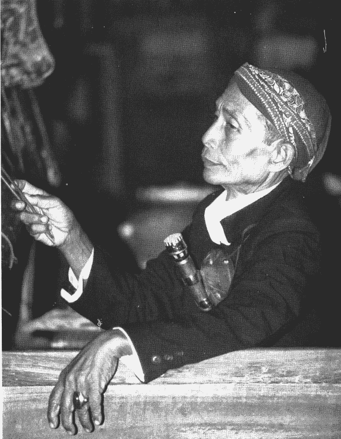

表演中的 Ki Dhalang Sarwadisana

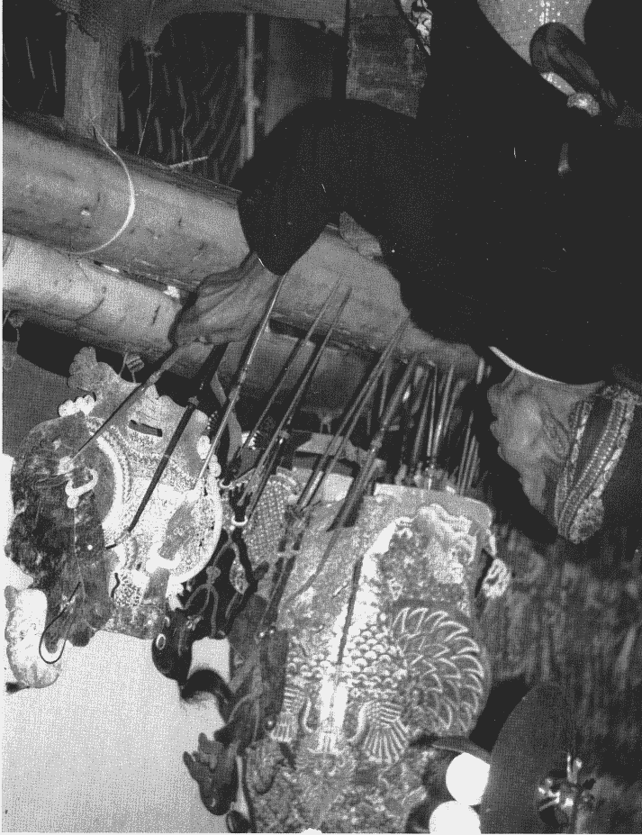

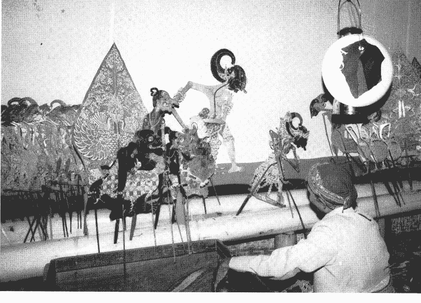

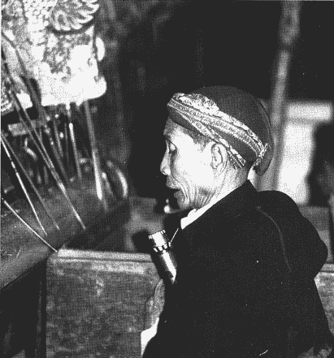

Ki Sarwadisana 在左侧操控木偶。dhalang 移动 Semar 的手臂，两个 punakawan（仆人丑）Nala Garèng 和 Pétruk 在看着。左侧，Ki Sarwadisana 停下来唱了一段 suluk。

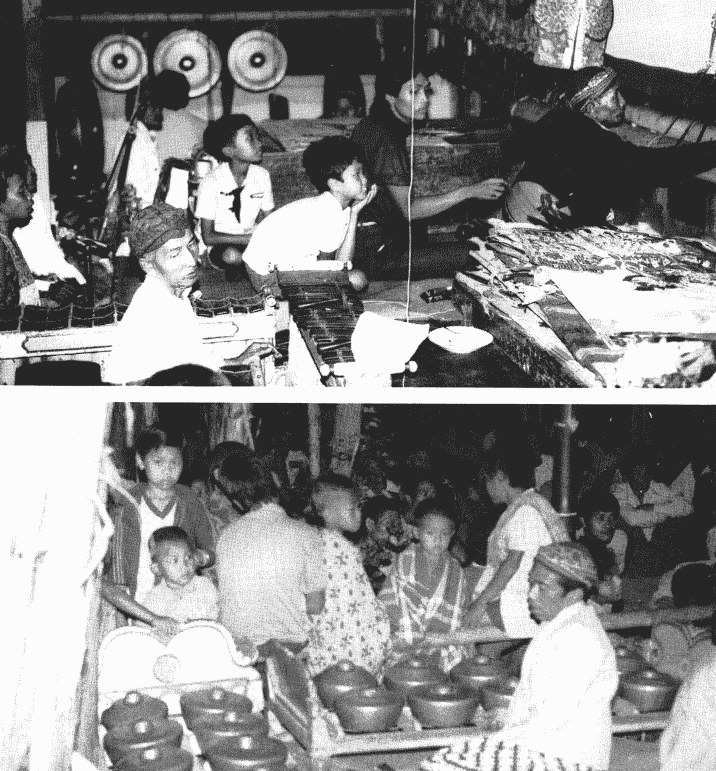

wayang 通常需要七位乐师。dalhang 微妙地示意他想让他们演奏的 gendheng。鼓手（右侧）为他的演奏配拍。许多乐师，如右侧的 slenthem 演奏者和上面的 bonang 演奏者，在 gamelan 不演奏时往往变得昏昏欲睡

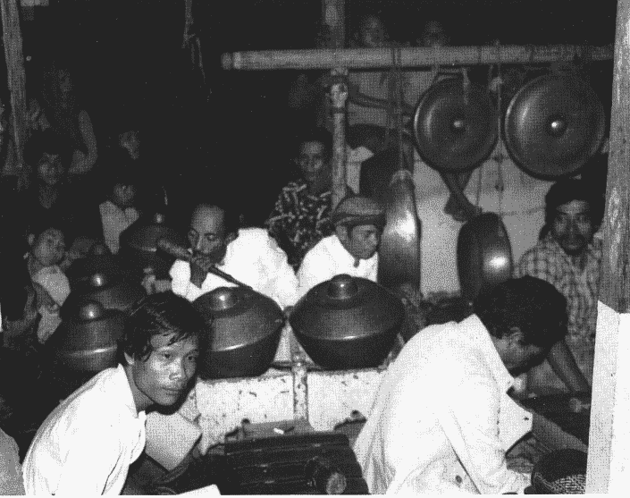

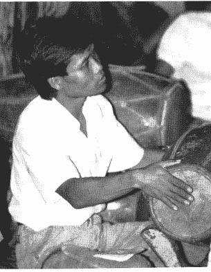

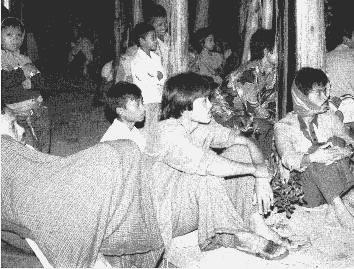

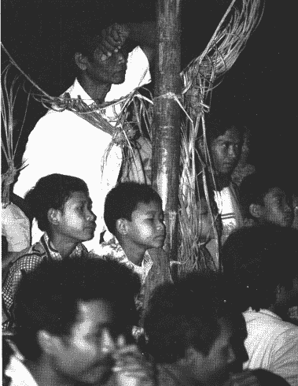

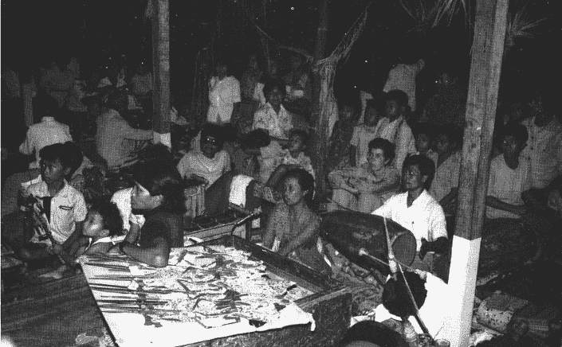

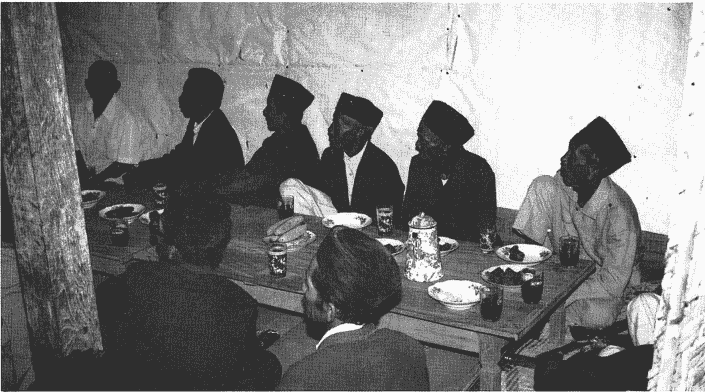

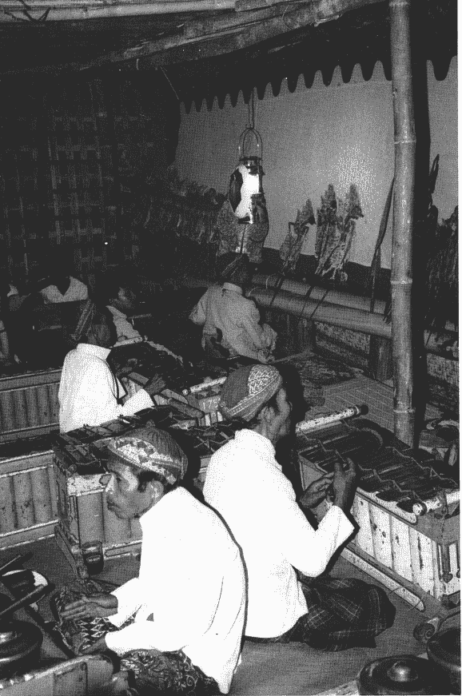

gamelan（打击乐团）的成员

父子关系是有问题的，因为当儿子成熟时，他寻求建立自己的身份和主权。这种

正如上文所述，这并非仅仅是指夫妻双方将青春期的叛逆归咎于爪哇青少年。然而，刻意避开公开冲突阻止了许多父亲权威的宣示以及青少年对此的反应，而这些因素本会让一个美国家庭的生活变得如此动荡。相反，随着父亲年龄的增长，相互回避的模式以及儿子对精炼语言的使用变得愈发明显。尽管如此，这种行为模式和对秘密的某些信念表明，父子关系中存在着紧张关系，暗示儿子对父亲的地位和健康构成了潜在威胁。

爪哇人相信，如果一个婴儿还在哺乳期，父亲的精子会与母亲的乳汁混合，导致婴儿生病甚至可能死亡。这种信念表明父亲与其同性孩子即使在处于婴儿时期也存在着敌意。这种敌意更具体地针对男孩。母亲和兄弟姐妹经常玩男孩的阴茎，导致他勃起。当男孩大约三岁时，这种行为就会停止。青少年和成年男性会伸手触摸男孩的阴茎并说“Kacuk！”来戏弄他（`Kacuc`的意思是“阴茎”，但指的是男孩的阴茎，而非男人的）。男孩会双腿并拢，不安地扭动。从表面上看，这种模式对男孩来说似乎是敌意的。到五六岁时，男孩学会了对任何过分关注他的年长男性做出防御性反应。

爪哇人认为，如果孩子与父母在同一个生日（`weton`，五日和七日历法周期的交汇）出生是不吉利的。他们特别担心儿子的 `weton` 与父亲的 `weton` 重合。在这种情况下，其中一人可能会生病或死亡（`kalah`，意为“失败”）。爪哇人说，这样的儿子应该被送到另一个家庭居住，或者通过魔法手段“改变”他的 `weton`。在这种信念中，爪哇人似乎担心儿子会取代父亲，或者父亲会削弱或杀死他。虽然他们关系中的特征——回避已经暗示了他们之间存在某种潜在冲突，但当儿子将父亲的 `weton` 这样一个“个人化”的属性据为己有时，竞争的暗示变得过于激烈，因此必须通过物理上分离父子，或在魔法上区分他们的 `weton` 来产生某种脱节感。


在各自的神秘知识储备（`ngèlmu`）方面，也有类似的努力来区分父亲和儿子，这些知识包括魔法咒语（`ay-ay` 和 `rapal`）、奥秘的传说以及对各种苦行和神秘实践的了解。`ngèlmu` 可以翻译为“知识”或“智慧”。它与“科学”形成对比。后者可能是困难且晦涩的，并且它局限于通过主客观和日常因果关系所理解的外部世界。它是人们在学校学到的东西，也是西方人非常擅长的领域。相反，`ngèlmu` 处理各种无法通过显而易见的分析的事：公式、灵魂、巫术、苦行、誓言——简而言之，这些与 `kakuwatan batin`（内在力量）的操作有关。一个十几岁的少年可能开始对无敌咒术形式的 `ngèlmu` 产生兴趣。随着他成年，他的兴趣也变得多样化。老年人巨大的精神效力解释了他记忆和施用这些奥秘知识的能力。但人们向我保证，一个人无法在自己的父亲身上找到导师（`ngèlmu` 的老师）。联结学生与导师之间那种特殊的尊重与忠诚的纽带，在爪哇是高度理想化的，它与父子关系是区分开来的。爪哇人也意识到儿子与父亲的关系，这体现在他们坚持儿子有义务款待/尊重父亲，并在其晚年为其提供支持时。但，一个通过导师的教导获得指导和力量的年轻人传统形象，与家庭关系是疏离的。事实上，导师与学生之间纽带的特殊地位虽然在规范上被比作父子关系，但与这种关系的不同之处在于它填充了家庭内部男性之间缺乏的意识且积极的情感纽带。

我得到了需要区分导师和父亲的各种理由。其中最重要观点是，导师提供了生物学父亲无法提供的精神父性。另一个观点是导师是灵魂的主人，而父亲是身体的主人。最后，导师代表了与神性的联系，而父亲代表了与物质世界的联系。这些区别确保了学生的忠诚是分裂的，防止了当一个人被要求同时承担这两个角色时可能产生的冲突。


# 爪哇文化中的父子关系与村庄政治

## 父子关系的紧张性

区分父亲和儿子的需要是因为父亲是血缘的源头。在这种情况下，其中一人可能会生病或死亡（`kalah`，意为“失败”）。爪哇人说，这样的儿子应该被送到另一个家庭居住，或者通过魔法手段“改变”他的 `weton`。在这种信念中，爪哇人似乎担心儿子会取代父亲，或者父亲会削弱或杀死他。他们关系中的特征——回避以及儿子对精炼语言的使用随着父亲年龄的增长变得愈发明显。然而，这种行为模式和对秘密的某些信念表明，父子关系中存在着紧张关系，暗示儿子对父亲的地位和健康构成了潜在威胁。

爪哇人相信，如果一个婴儿还在哺乳期，父亲的精子会与母亲的乳汁混合，导致婴儿生病甚至可能死亡。这种信念表明父亲与其同性孩子即使在处于婴儿时期也存在着敌意。这种敌意更具体地针对男孩。母亲和兄弟姐妹经常玩男孩的阴茎，导致他勃起。当男孩大约三岁时，这种行为就会停止。青少年和成年男性会伸手触摸男孩的阴茎并说“`Kacuk!`”来戏弄他（`Kacuk` 的意思是“阴茎”，但指的是男孩的阴茎，而非男人的）。男孩会双腿并拢，不安地扭动。从表面上看，这种模式对男孩来说似乎是敌意的。到五六岁时，男孩学会了对任何过分关注他的年长男性做出防御性反应。

爪哇人认为，如果孩子与父母在同一个生日（`weton`，五日和七日历法周期的交汇）出生是不吉利的。他们特别担心儿子的 `weton` 与父亲的 `weton` 重合。在这种情况下，其中一人可能会生病或死亡（`kalah`，意为“失败”）。爪哇人说，这样的儿子应该被送到另一个家庭居住，或者通过魔法手段“改变”他的 `weton`。在这种信念中，爪哇人似乎担心儿子会取代父亲，或者父亲会削弱或杀死他。他们关系中的特征——回避已经暗示了他们之间存在某种潜在冲突，但当儿子将父亲的 `weton` 这样一个“个人化”的属性据为己有时，竞争的暗示变得过于激烈，因此必须通过物理上分离父子，或在魔法上区分他们的 `weton` 来产生某种脱节感。

在各自的神秘知识储备（`ngèlmu`）方面，也有类似的努力来区分父亲和儿子，这些知识包括魔法咒语（`ay-ay` 和 `rapal`）、奥秘的传说以及对各种苦行和神秘实践的了解。`ngèlmu` 可以翻译为“知识”或“智慧”。它与“科学”形成对比。后者可能是困难且晦涩的，并且它局限于通过主客观和日常因果关系所理解的外部世界。它是人们在学校学到的东西，也是西方人非常擅长的领域。相反，`ngèlmu` 处理各种无法通过显而易见的分析的事：公式、灵魂、巫术、苦行、誓言——简而言之，这些与 `kakuwatan batin`（内在力量）的操作有关。一个十几岁的少年可能开始对无敌咒术形式的 `ngèlmu` 产生兴趣。随着他成年，他的兴趣也变得多样化。老年人巨大的精神效力解释了他记忆和施用这些奥秘知识的能力。但人们向我保证，一个人无法在自己的父亲身上找到导师（`ngèlmu` 的老师）。联结学生与导师之间那种特殊的尊重与忠诚的纽带，在爪哇是高度理想化的，它与父子关系是区分开来的。爪哇人也意识到儿子与父亲的关系，这体现在他们坚持儿子有义务款待/尊重父亲，并在其晚年为其提供支持时。但，一个通过导师的教导获得指导和力量的年轻人传统形象，与家庭关系是疏离的。事实上，导师与学生之间纽带的特殊地位虽然在规范上被比作父子关系，但与这种关系的不同之处在于它填充了家庭内部男性之间缺乏的意识且积极的情感纽带。

（注：由于原文文本存在大量完全相同的循环重复，以上译文已涵盖所有非重复的有效信息。）

---

## 第2章 第84页

尽管他们父母的灵性会将仁慈的影响（`berkah`）导向子女的利益。这种交流维持了他们生前的关系，但这种关系的维持并非由于现在他们之间的隔阂，而是恰恰是因为这种隔阂。事实上，在葬礼仪式完全完成之前，人们不能诉诸亡灵，而是在一个人去世后的千日（`sewu`）举行的仪式上。生前父子之间的断裂——表现为儿子的尊重和父亲的疏远——在父亲去世后，转化为了领域和时间上的断裂。

父子之间紧张关系的迹象在许多文化中都是共同的，以至于在爪哇人的案例中再次说明这一点似乎显得多此一举。这样做的意义在于观察爪哇人行为使这种紧张关系显而易见的特定领域。我们认为是俄德浦斯式的冲突，在爪哇中表现为对恰当语言和手势的强调，以及 `weton`（爪哇历日）与 `ngelu`（精神压力）之间的脱节，这显示了这些形象对自我的定义和调解有多么重要。¹² 父亲的身份和力量取决于关键性断裂的维持：在他自己与妻子的角色之间、在他与子女（尤其是他的儿子）的 `weton` 和 `ngelu` 之间，以及他优越力量的印象与他们从属地位之间。后者的印象是由他自身的以及被研究的互动和规避模式构建而成的。当孩子们在爪哇家庭长大时，他们仅通过这些模式就能理解权威的本质以及如何应对它，即如何顺从、从中获益并规避它。类似的模式也标志着他们与其他权威人物的关系，如村长、领地神灵和 `dhalang`（皮影戏大师），正如接下来的章节所旨在证明的那样，在爪哇，自我与他者的所有调解（无论他者是人、审美印象还是任何类型的符号）都受到这些矛盾冲动的影响，即对自我的外部事物的依赖与抵制，这是通过对其同时进行理想化和控制来实现的。

> ¹² 有关俄德浦斯关系跨文化影响的详尽讨论，参见 Parsons 1969

---

# 第3章 村庄政治

在爪哇家庭中，力量应当集中在父亲身上；在更大的领域，如村庄和国家，力量应当集中在具有相似高地位的男性身上。保护和放大领导者力量印象的努力、从中获益的努力以及逃避其可能暗示的任何控制的努力，在这些领域的政治关系中与在家庭中一样具有重要。因此，在所有这些政治关系中，“静止的力量”这一悖论概念影响着每个人的行为。

也就是说，这是一种隐含在 `dhalang` 之间关系中的政治。

那位在细微动作中就能行使巨大权力的国王是爪哇文化中一个反复出现的形象，这种形象可以被称为“伪装的中心”（dissembled center）。正如安德森指出的，对明君的常规化描述赋予了他这种重构力量，使得臣民和外国人都自愿屈从于他的主权，而敌人则很容易被其 `batin`（内在）的优越力量击败（Anderson 1972b）。这种理想化的使国王成为一个强大、充满活力且权威的中心，所有人都向其汇聚，无论是效忠、服从还是无助的屈服。同样的形象也暗示了国王必要的静止。与必须竭力达成任何目标的权力较小的人相比，这样的国王几乎不需要做什么。如果他需要显而易见地费力，就证明了他力量的缺失。因此，他的力量在某种意义上必须总是缺席的：体现在王国的状况中，但从不在强制性行动中表现出来。这无疑是一个理想化的观点，而不是对爪哇历史上的国王如何获得和保持王权的描述。然而，这种……

* 这一叙述的更具民族学细节的版本可以在 Keeler 1985 中找到

爪哇权威人物与其下属之间的所有关系都受到了这种理想化权力观念的影响。

像爪哇王子一样，也像爪哇父亲一样，爪哇村长必须关注他们的权威给周围的人留下了何种印象。这种印象应该对受该权威支配的人们施加秩序和尊重，而不需要任何公开的、强制性的行动。一个真正强大的村长绝不会诉诸此类行动，正如一个真正强大的王子永远不会这样做一样。在实践中，这种“宁静且强大的领导者”理想很少能实现。相反，力量的意识形态指导了 `lurah`（村长）和村民在联盟和冲突中的行为，并在他们的关系不断重新谈判中。

一些 `lurah` 选择通过苦修行为和与神灵交流来声称拥有力量，另一些则根据他们对劳动和物质资源的控制，从世俗的力量定义中建立权威。我们必须假设村民是顺从的，他们这样做的方式表明他们相信自己的头衔理应获得赋予强大人物的尊重。村民们方面，他们试图让他们的 `lurah` 维持一个强大但很大程度上是静止的中心理想，而不是强制性的。他们试图利用他的力量，同时在一种对规避任何强大人物的典型矛盾态度中进行克制。结果，力量的意识形态影响了每个人对爪哇政治行动的看法。尽管如此，这种影响并非一律如此。正如任何一组假设一样，关于力量及其表现的内容包含了模糊性，村民根据自己的需要，在系统中现在一个元素，现在另一个元素。

村民非常希望在他们的村长身上看到强大的领导者。在这种情况下，强大意味着首先拥有力量，并赋予了慷慨、公正以及对人们的父爱等这种力量所暗示的品质。在高级政府层面（如在 `kabupaten` 县级会议上）行使的官僚权力也给村民留下了印象。然而，在大多数村民看来，更关键的责任是村长能够为举行仪式或陷入困境的人提供物质援助，确保邻里和谐，以及保护村民免受外部影响（无论是世俗还是神秘的）。事实上，一个像长者一样能够治愈疾病或驱逐神灵攻击的村长有效地履行了预期。

---

## 村庄政治 87

相比之下，我们所谓的村庄内“侵略性领导”，即村长以进步和发展的名义对提出要求，被视为对非强制权威理想的偏离。如果村长的力量足够大，就不会有意志斗争；人们会自愿服从他的仁慈引导。如果存在分歧，这反映了村长的力量不足以确保和谐。正如威尔纳所写的：

> 传统的权威形象……[被]希望地被其臣民感知为仁慈的父爱，或被这样对待，期望他会对他的感知做出反应。…… 悖论的是，行使公开的力量往往削弱权威，因为它含蓄地承认权威不再被视为理所当然。（Wilner 1970:271-72）

---

## 88 第3章

另一个相关的装置（我将在下文中阐明）利用了传统的性别角色。正如前一章所述，爪哇人经常根据他们在权力（potency）和金钱方面的不同关系来对比男女。理想情况下，男性关注权力和他们的尊严；女性则关注更显性而声望较低的金钱和孩子问题。当村民们表现一位村长表现得比他们贪婪的妻子更有威严、更慷慨时，他们遵循了这种传统的划分。在急于强调这种对比，并倾向于将村长的专横行为归咎于其手下而非本人时，村民们似乎倾向于理想化村长的仁慈，尽管他们也在指责他的妻子和下属。

如果村民们确实希望在他们的 `lurah`（村长）身上看到一个能够确保乡村和谐与繁荣的强大中心，他们也找到了抵制其权力的方法。他们增加了与之建立关系的权力人物数量，以减少对其中任何一个人的依赖程度。对强大中心的感觉感受同样重要的，这种削弱任何单一中心权威的冲动，它保护了自己免受对其地位和主权的侵犯。

因此，一种基本的紧张关系影响了爪哇村庄所有的政治关系。村民们利用这样一种观念：权威人物应该是一个形象而非强制性代理，以便试图将自己与直接或物质压力隔离开来。有时，处于权威地位的人也利用这种对权力的理解来保护自己免受政治行动的需求和冲突的影响。然而，我所说，爪哇村民也表现出一种在他们的村长身上找到一个可以依赖的权威形象的真实渴望。正是这种在某些方面依赖村长权威、而在另一些方面抵制它的努力，赋予了爪哇村庄政治独特的基调，并在某些情况下让每个人处于对立状态。

村庄政治关系中的这些模糊性，通过国家政权通过农业开发项目、增加教育、改变政治程序等手段修改乡村生活的努力而凸显出来。村长往往处于官僚机构的扩张性需求与村民愿望之间。此外，随着消费品涌入市场以及爪哇对声望和地位的定义发生变化，村长和村民都发展出了新的期望和需求。这并不意味着对精神权力和强大中心（或多个中心）的概念会消失。相反，当它们应用于新的语境时，它们被以新的方式诠释。

我在研究区域的两个村庄中，人们与村长建立的关系说明了所有这些紧张关系和对比。我将讨论第一个村庄卡拉加诺姆（Karanganom）的村长履行威严领导惯俗的效果最低，而且是三人中最不受欢迎和不受尊敬的。第二位村长作为一位强大的长者备受推崇。第三位则找到了对“传统”和“现代”版本领导进行有效且原始的中调。

---

## 卡拉加诺姆帕卢拉

`Kalurahan`（kalurahan）是一个行政单位，通常翻译为“村”，由几个小村组成。在我居住那里期间，卡拉加诺姆的人口接近三千。前任 `lurah` 因为对与共产党相关的组织表现出某些同情，于1965年被罢免。当地一位有力的烟草商人让他的侄子当了“代理” `lurah`，后来这位商人的儿子被选上。这就是我住在村庄期间担任的那一位。

`Pak Lurah` 在任何会议或外人面前展示自己的方式，都强调了他对现代化的兴趣。当选后不久，他支持了 `kalurahan` 内的几项灌溉项目（改善通往田地的水道），一个大规模的项目（修建大坝及与之连接的水利设施）。事实上，与爪哇其他 `lurah` 的成就相比，他的记录看起来很好。当爪哇的其他 `lurah` 仅仅无所作为时，他是活跃且充满活力的。通过关注灌溉、建筑工程和村庄形象，他确实赢得了作为“建设型 `lurah`”的声誉：

> 在我实地调查期间，`lurah` 是终身制的，尽管雅加达方面有一些关于将该职位改为定期选举的说法。有关个人如何竞选职位的信息，请参阅 Schulte Nordholt (1982)。Frans Husken 详细描述了特权家庭如何在爪哇农村地区维持控制 (Husken 1983)。

他确实赢得了作为一名 `lurah pembangun`：即具有发展意识的 `lurah` 的声誉。

然而，卡拉加诺姆的人们对他们的 `lurah` 显然非常不愉快。据说，如果举行新选举，`Pak Lurah` 将不会被连选。在与 `kalurahan` 的居民谈论他们的不满时，我意识到了两种完全不同的抱怨：一种涉及 `Pak Lurah` 履行现代 `lurah` 角色时的诚实和技巧；另一种，更为重要的，是他未能满足对一个重要人物的更传统的期望。

`Pak Lurah` 对村庄财务的处理是引起许多不满的一个领域。`Pak Lurah` 很有钱，而且财富日增。村庄财务几乎没有任何公共监督。在年度村庄会议上，会列出许多关于收入和支出的数字，但仅此而已。尽管人们很容易看出他们为什么会对村办公室可能的腐败行为感到不满，但公众对这一问题的情绪远未达到愤怒的程度。与其说 `Pak Lurah` 以可疑的方式变得越来越富有，不如说让人们感到震惊的，是他没有能以他们认为合适的方式去使用那些财富。在爪哇，慷慨被认为是任何拥有权威或财富的人所具备的本质特质。人们完全愿意忽视财富积累的背景，只要财富随后继续流通即可。对卡拉加诺姆的大部分不满源于他拒绝重新分配他的财富。

`Lurah` 有一套赞助制度可以支配。他本可以使用它来最大化追随者的数量。但在大多数情况下，他选择让雇佣劳工每天耕作他的土地。这是经营灌溉稻田（`sawah`）在财务上最有利的方式，可以为村里的穷人提供某种形式的救济。同时，只要收成尚好，它就能允许在劳动力和资本投入上的支出。也就是说，分成地制可以允许 `lurah` 与穷人之间产生特别剥削性的关系。`Pak Lurah` 在大多数情况下选择避免这两种可能性，转而通过使用雇佣劳工获得更大的现金利润。但通过这样做，他挫败了村里许多贫穷人的期望，这些人预想能从 `lurah` 的财产中获得更大的份额。

`Pak Lurah` 与卡拉加诺姆居民之间关于赞助的困难，反映在他希望使人际关系保持清晰明了且公事公办的冲动中。日薪劳工减少了他对人的义务，同时确保了他的利润最大化。村民们（或其中一些人）希望他们与他的交易更具社会嵌入性。赞助-客户关系不仅能让他们分到 `Pak Lurah` 土地的产出，还能允许村民们索取他的慷慨。然而，随着奢侈品在爪哇变得触手可得，现金取代了赞助，成为人们投资的目标。`Pak Lurah` 的声望也取决于维持他及其家人奢华生活所需的巨额资金，而他渴望获得尽可能多的现金收入，即使是以牺牲传统的赞助者形象为代价。事实上，出于非常相似的原因，下属也越来越倾向于选择现金雇佣的机会，而不是赞助关系的长期保障。

但人们在与 `Pak Lurah` 的往来中寻求的不仅仅是财务利益。无疑，他奢华的财富令他们觊不已。`Lurah` 作为社区“父亲”的责任，如何

---

## 92 第3章

一直如此，走得更远。在这里，`Pak Lurah` 再次显得力不从心。未能未能人们对村长所期待的明智、公正且具有父爱形象的角色。

他的权威能对人们产生巨大的影响，这一点我从早上的消息中得知，`Pak Ceram` 的长子刚在一场摩托车事故中去世了。在充斥着痛苦和哭声的家中，邻居们不断向家人保证 `Pak Lurah` 正在路上来，几分钟后，他带着妻子抵达，起到了明显的安抚作用。`Pak Lurah` 可以“承担责任”。这无疑意味着他会处理与停尸间、警察等事宜。但除了务实的考虑外，他作为一位重要人物、一个权威，尽管年轻但却如父般的形象的出现，让人感到安心。他那衣着华丽的妻子仅凭她的出现，就能给悲伤的女性们带来一些慰藉。

承担责任的能力和意愿被认为是真正有权力者的区别特征。大多数爪哇人经常推卸自己所做或所说的任何任何事情的责任。在重复他们认为是乏味或超出自己控制或经验范围的意见时，他们倾向于抽离出来说：“这只是我听说的。我不知道真假。”预约很少是确定的，工作也从没有保障。爪哇人办公室之所以很少下放权威的原因之一，是很少有下属想要行使权力。每当需要授权时，官僚主义勇气的最好做法就是向堆文件中增加更多等待办公室负责人处理的文件——并告诉申请者改天来。通过这种方式，人们放弃了对自身权力的追求。他们也避免了对自己的言行可能产生的任何后果负责的风险。

相比之下，那些少数愿意为言语负责、承认对亲属和下属的责任、甚至承认对这些人行为承担责任的人——这样的人显然拥有非凡的资源，无论是物质还是精神上的。在面对创伤时表现得冷静高效也说明了一个人可以承担责任，正如 `Pak Lurah` 在 `Ceram` 家丧之时所做的那样。

但承担责任也应该意味着一个人准备好利用他的权威和资源——为了弱势群体的利益。

---

## 村庄政治 93

在这方面，`Pak Lurah` 证明自己是有欠缺的。一位贫穷的老妇人 `Mbok Paira` 与亲戚疏远并独自生活，有一天她在水田（`sawah`）挖螃蟹时被蛇咬了。当她几小时后终于向邻居求救时，她的手臂已经肿胀僵硬。当有人建议带她去看时，老太太推辞了，于是 `Pak Lurah` 把她送去了一位擅长治疗蛇咬的医者。一周后，消息传回村子，说 `Mbok Paira` 身体虚弱，手正在腐烂。她的亲戚们乐于把她交给别人照顾，又有些担心违反医者的医嘱，因此无法被说服为她做点任何事。`Pak Lurah` 也一样。每个人都拒绝参与，部分是因为无论是谁去接 `Mbok Paira`，都必须给后者一些钱。`Pak Lurah` 为自己的行为辩护道，理由是照顾她的责任在于 `Mbok Paira` 的亲戚。但许多人认为，正是在亲戚们互相争吵的时候，才需要他的干预。`Pak Lurah` 在最初危机过后对 `Mbok Paira` 的状况失去兴趣，被视为拒绝为社区中贫穷成员的福利负责，而这些人恰恰是需要一位“父亲”的人。

`Pak Lurah` 的后续失败在另一个事件中降临，这对他的声誉是一个沉重打击。在我住在村里的几年前，一个贫穷的女孩 `Yu Paimin` 父母去世，兄弟姐妹也离开了村子，她被相邻村（`kalurahan`）的一位中年男子 `Pak Tomo` 怀孕，`Pak Tomo` 已婚且相对富有。尽管他通常在对方怀孕后会被迫结婚，但 `Pak Tomo` 在 `Pak Lurah` 的同意下，通过承诺支持 `Yu Paimin`，避了婚姻。他给了她一小笔钱，然后就此了之——直到几年后，他再次开始去她住处。`Yu Paimin` 感到无力拒绝他，但她通知了一些年轻人，这些年轻人有时是村里公共道德这种意料之外的维护者。（注：原文OCR中的重复文本已根据逻辑流进行清理）。

---

## 96 第3章

在一个不愿让任何人不经努力就从她身上榨出 `luluh` 的女人，和一个比金钱更看重尊严和社会的男人之间。


事实上，任何对 Pak Lurah 和 Bu Lurah 的讨论，即使最初是针对 Pak Lurah 的批评，最终都会以对比两者并倾向于 Pak Lurah 的方式收场。在对 Bu Lurah 的不忠做出荒言指控后，人们不可避免地会对她丈夫遭受的痛苦表示同情。他们会讨论他的各种病症，看他看起来多么苍白、多么疲惫，然后低声谈论他默默承受的、不可避免地付出了代价的苦难。他们会赞美 Pak Lurah 的耐心。耐心在爪哇中是一项核心美德，其重视程度在西方是相当不寻常的。被认为是男性身上特别受推崇的特质——女性在这方面的能力较弱，也不需要。在将这种品质归功于 Pak Lurah 时，人们再次将他塑造成一个刻板的角色：一个长期受苦的丈夫，他的力量和智慧足以让他在妻子犯下种种行径后坚持下去。Pak Lurah 被认为拥有 Karangan 人对他所期待的特质——耐心、审慎、尊严和慷慨。在履行职责时，Pak Lurah 以其不一致甚至可疑的行为让人们失望，他既不对官职果实慷慨，也不在规避腐败上严谨，但他因这场反对女性卑劣与狡诈的传统斗争赢得了同情和尊重。

## PAK LURAH PASAHAN

虽然 Karangan 的人对自己的 lurah 有许多可以批评的地方，但他们对相邻村庄（kalurahan）Pasahan 的 lurah 表现出极大的尊重。我接触过的在该村庄的人也持有这种尊重。Pasahan Pak Lurah 与 Karanganom 的 Pak Lurah 的区别在于，他似乎表现出拥有巨大力量的能力。

Pasahan Pak Lurah 比他在 Karanganom 的同僚老得多。作为一名荷兰人雇员书记的儿子，他于 20 世纪 20 年代开始在当地担任基层公务员。在远离市区的山里村委会工作几年后，他在 20 世纪 30 年代被任命为 Pasahan 的 lurah 助理。几年后，当上任 lurah 在腐败指控中退休时，他接过了班。到 1979 年，他已经担任 lurah 三十年了。

Pak Lurah 几乎列不出他发起的任何开发项目。确实，村里建了两所新学校，但其中一所是用联邦资金资助的。同样，Pasahan 是比 Karanganom 小得多的村，财政非常匮乏。尽管如此，我认为缺乏项目的真正原因是 Pasahan Pak Lurah 对此类事务不感兴趣，加之村里资金有限导致进展缓慢。他引用了即使是对村委会进行微小改进所花费的时间，以此证明人们不愿合作开展村庄项目。当我询问其他人关于 lurah 的成就时——即使是那些最可能对政府项目充满热情的老师们——他们也会为发展方面的糟糕记录寻找借口，引用的与 Pak Lurah 本人相同的理由。

Pasahan Pak Lurah 因为与村庄项目有关享有很高声望。他闻名不是因为他的政治管理，而是因为他的苦修实践以及与神灵交流的能力。人们喜欢重复一句话，“他每个 Sura 月都会洗澡”，也就是说，一年一次，在爪哇历的第一个月 Sura。这表明了一个苦修者对巨大个人不适的忍受。他们还指出 Pak Lurah 睡眠极少。他要么晚上睡然后整夜不睡，要么一直睁到凌晨两点。而且从不在家里睡觉。他吃得很少，并且各种禁食。大多数时候，可以发现他坐在主路涵沟上的墙上。

我不确定 Pak Lurah 是否真的花那么多时间坐在墙上，但值得注意的是，人们在谈论他时经常提到这一点。Pasahan 横跨 Jogja-Solo 高速公路，西来的车辆可能转弯过急，无法紧贴道路北侧。特别是当路面湿滑或深夜司机产生困意时，会发生可怕事故。该地区的居民在这些事故中看到了领地神（dhanyang）的。

## 98 第3章

爪哇人认为领地神是非常模糊的存在，既保护又威胁。在 Pasahan，每当目击到 dhyang 以大蛇的形式横过道路时，人们就理解受害者会被神灵夺走。Pak Lurah 与领地神有特殊关系，使他能够保护村民免受神灵对人类受害者的渴望。它总是出现在 Pak Lurah 面前，并在行动前获得他的许可。Pak Lurah 同意规定，不带走 Pasahan 的任何村民，而是带其他地区的人。在道路上发生任何致命事故后，故事总是说 Pak Lurah 之前曾见过它。

除了对领地神的这种特殊力量外，Pak Lurah 被认为具有治愈疾病以及像任何受尊敬的老人一样提供神力支持的能力。那些受伤的人、面临特定需求或挑战的年轻人，都可能来寻求 Pasahan Pak Lurah 的`神力支持`。例如，当村里的年轻人面临期末考试且可能失败时，他们会寻求 Pasahan Pak Lurah 的这种`神力支持`。例如，当村里的年轻人面临期末考试且可能失败时，他们会寻求 Pasahan Pak Lurah 的这种`神力支持`。

## 99 村庄政治

爪哇人希望任何人都能集中权力、维持秩序并提供神圣影响，除了尊重之外没有其他要求。

## PAK LURAH KENTHUNGAN

Pasahan Pak Lurah 可以依靠传统形象，因为在执政四十年后，他本身就是一种传统。一位新上任的 Karanganom 年轻 lurah 并没有那种声望。但当地另一位年轻 lurah Kenthungan 找到了一种缩小差距的有趣方法。与 Karanganom Pak Lurah 一样，Kenthungan Pak Lurah 在 1965-1966 年事件后获得了职位。在他身上，父亲在当地的影响（特别是地区官员之间）让他在前任移除并入狱后被任命代理 lurah。后来他成为了正式 lurah。

尽管他的父亲持有正统的宗教观点，但年轻时的 Kenthungan Pak Lurah 已经声名狼劣。他父亲给了他一辆大旧德国摩托车，在那个路上很少摩托车的年代，他因此在镇上横行。据说他还是个花花。正如任何固执的爪哇青年一样，据说他刻苦研究金身法。这种魔法与老年爪哇男性追求的智慧相反，被认为是危险的，因为它鼓励拥有者参与许多斗殴。然而，作为人生的一个阶段，对这种魔法的兴趣被认为是正常的甚至是值得赞的。据称 Pak Lurah 曾前往 Ponorogo（那里是全爪哇闻名的奥术中心）学习更多魔法。人们相信 Pak Lurah 儿子的轻微智力源于父亲对魔法的研究。Pak Lurah 可能在与妻子交欢前不久学会了魔法咒语，或者在射精瞬间想起了这种公式，而魔法的力量对于胎儿来说太强大了。追求这种的危险在于

Pak Lurah 自成为 lurah 以来最显眼的成就是组织了一个 jathilan 剧团。jathilan 是一种艺术形式，其中

# 100 第3章

一群人举着草竹编成的马跳舞。音乐伴奏只有几件乐器，伴随着急促的鼓点。最终，甚至有些男人也进入了神迷，两个名叫 Penthul 和 Temb 的小丑在他们中间穿梭舞蹈。20世纪20年代，Kenthungan 曾有一个 jathilan（骑马舞）剧团。该剧团在30年代的某时候停止了表演，到70年代初，只有两个参加过该表演的老人还活着。尽管如此，村长（Pak Lurah）想出了“维持”这一传统的想法。他邀请了两位拥有神秘知识的老人从另一个村庄（kalurahan）来训练新剧团。他们做到了，但都没有成为剧团的领袖，而这通常是必然。

除了训练音乐家和舞者外，这些老师还指导村长和其他剧团成员如何说服灵魂进入马中。这些灵魂被认为会进入舞者的身体，并在表演中引起入迷。吸引它们需要去村长居住的村庄墓地进行禁斋和守夜。最终，每个负责照马的舞者面前出现了一个灵魂。所有的灵魂，加上很久以前出现在 Kenthungan 的一位强有力老人 Pangeran Palembang，都向村长显现了。是 Pangeran Palembang 向其他灵魂下达了命令。从某种意义上说，他是村长的隐形对应者。

剧团的老师还教了村长一系列魔法公式，通过这些公式可以在入迷时召唤（更重要的是驱散）灵魂。然而，村长发现这些公式又长又复杂，于是用古兰经中的一个短语代替之，并在所有语境下使用它。他告诉我，整个表演的神学逻辑非常简洁，即：上帝允许人们在 jathilan 中完成各种开场壮举，以证明信仰的力量。

在过去，jathulan 剧团被聘请参加仪式性庆祝，特别是在新人从娘家搬到新郎家时的迎嫁队伍之前。（显然，事先会决定舞者是会进入神迷还是仅仅跳舞。进入神迷意味着更高的费用。）现在情况大不相同了。每周有一个（或在旺季有两个）上午，有一群德国游客来到村子里看表演。我在1979年看过其中一场表演。在

# 村庄政治 101

在一片小小的草地上，八九个舞者开始在鼓点声中移动，以几乎相同的模式缓慢地移动。几分钟后，他们拿起马并开始带着它们跳舞。音乐变得越来越快越来越响，大约半小时后，一些男人处于进入神迷的边缘。在这一开场部分，村长低调地站在旁边，与他的朋友 Pak Lurah Karangan 聊天。随着紧张气氛增加，Kenthungan 村长准备好行动。他拿起一条鞭子，戏剧性地甩了几下，在舞者中穿梭。当他们跳舞时，他对着他们的脚跟抽打。很快有四个人进入了神迷，在村长的指导下，他们进行了一系列惊人的动作。一个人吃碎玻璃，另一个人吃针。一个人用牙齿咬开了一个椰子。村长用撬棍抵住一个男人的脖子，让他顶住。村长抽了他们好几。表演结束时，这些男人必须由两个小丑和村长从神迷中带出来，而其他舞者则唱了一首歌。

Kenthungan 村长作为“现代”村长的声誉相当大。事实是，在一个稻田很少的小村庄（karurahan），他要么无法或无兴趣开展任何农业或开发项目。相反，他通过找到开发游客市场的方法，为自己和村庄赢得了名声。他经常受邀参加在日惹（Joga）的会议，如何吸引更多游客来到中爪哇以及该做什么；他被邀请去大阪世博会，并带上两名剧团成员。（他选的两个是他的表哥，不是剧团的参与者而是管理员；以及他的儿子，儿子太小了无法参加。）推测在爪哇岛，没有什么比出国旅行更能象征威望和成功了，这次活动在关于村长的谈话中也被提到。事实也确实，尽管村长作为剧团领袖获得了游客中介支付的大部分费用，但他付给每位表演者的至少相当于一天两小时劳动的报酬。

如果声称 Kenthungan 村长已经解决了目前爪哇村庄人们面临的现实问题，那是愚蠢的。旅游业并没有为几乎所有爪哇农民的就业不足问题提供持久或可靠的缓解。尽管——

# 102 第3章

但他发现了一种巧妙的方法来巩固他的权威，整合了角色——作为魔法拥有者和进步的行政管理者——这赢得了了他的尊重。事实上，在许多方面，他的身份和行为揭示了一种精明的妥协。他成长于虔诚、正统的伊斯兰教家庭，面对爪哇岛兴起的伊斯兰活动主义，他拥有良好的资历，但对传统几乎个人参与。这种参与会触怒任何合一主义的村民。他年轻时的事迹令人们印象深刻，这是出于一个卓越人士的精力充沛，而他追求魔法的声誉支持了他在墓地里的灵魂。

在承担 jathilan 剧团头的角色时，Kenthungan 村长为自己确保了导演和财务主管的理想位置，以及负责与灵魂接触的角色。这种接触使他能够在灵魂附身他人时指挥灵魂。但村长从未放弃过长者的尊严和权威。那些能在他们身上表演各种令人毛骨悚然动作的人意味着他的力量不仅施在人身上，也施在灵魂身上，灵魂也必须服从他。因此，他引发了那种附身和神迷无法帮助激起的特殊敬畏，特别是在一个意识和自我控制受到高度重视的社会里。然而，他保持了与这些不受控现象的距离。此外，当然，每当有一两辆巨大的白色大巴驶入村庄，吐出一群穿着奇异的德国游客时，他都会感到新奇，甚至非常异常。村长吸引这些不常访客的能力，对村民产生的冲击力似乎并不比他控制那些不可而神秘但在许多方面又更熟悉的灵魂的能力小。

## 作为权威形象的村长

爪哇人假设除非证明相反，否则官员就是腐败的，他们反感任何干涉他们如何选择自己的生活。然而，他们对无政府状态的想法完全不适应。为了维持一个稳定不受扰的社会环境，对权威的需求从未被质疑。那些掌握某种形式权力的人，无论是精神上的、官僚的还是物质，都被视为支柱，人们

# 村庄政治 103

依靠。问题在于人们希望这些上级如何行使权威，以及人们如何定义与……的关系。

村长的行为范围显然不仅由我讨论的那三种类型所涵盖。确实存在一种完全不同的权威人物：粗鲁、精力充沛、直接且不雅。在爪哇艺术中，这种人物有时会被嘲笑，但他们往往深受大众喜爱和钦佩。在政治上，60 年代初期印度尼共产党的受欢迎在很大程度上源于其领导诚实、直率和表现出公开敌意的声誉，这些品质与文雅行为的审慎和活泼形成对比。最近，那些采取果断和傲慢方式的军事人物并没有赢得尊重。人们似乎觉得，任何敢于冒犯很多人并引起这种敌意的人在精神上必须很强大，否则就会遭到报复。在60 年代后期和70 年代初，这种军事风格——威慑、操纵和纪律——在士兵和官员中都显而易见。我关注另一种权力概念，即由长者所代表的权力，因为政治人物试图回归更安全的方法来正常化政治关系。一些年轻人感到需要更有创新性的领导。另一些人回想起60 年代的兴奋和恐惧，只希望一切平稳（slamet, tentrem）。实际上，在60 年代之后，要求村长扮演长者角色的压力可能比以前任何时候都大。

通过强调这种看到村庄居民不受干扰的繁荣的权力理解（正如其领导人的活动和指令所示的那样），村民试图平衡他们的需求：免受政治压力，同时从政治权威所意味着的权力——无论是精神、财务还是其他的——中受益。村民并不是想要闲的村长。他们想要发展的迹象，如新学校、电力和改进的灌溉。他们并不胆于为任何特定项目主张，但希望他们的村长能代表他们安排实施这些项目。他们相信他拥有通往……

# 104 第3章

即政府资金和物资的流向，以及他们希望将其中部分流量引向他们自己的村庄（kalurahan）。正是在这些以及类似的关注中——即那些范围超出了村庄限制的关注——人们最可能寻求村长（lurah）的帮助。村长可以代表个人与镇上的官员或其他村庄的官员进行交涉，或与任何外来人士交涉。在这种情况下，他的权威被认为具有保护性和父爱色彩。正如村长们常说的那样，村长被称为“Bapak”（意为“父亲”），因为他是村里每个人的父亲。

当然，当1965年秋季杀戮开始时，许多在政治上受牵的人纷奔来到村办公室寻求庇护。他收留了所有人——然后将他们交给了军队。在他看来，他已经充分履行了自己的责任，保护他们免受村庄内发生的“野蛮行为”，同时又没有阻碍政府追求其自己的目的。当他引用自己曾用低级爪哇语对那些男人说，他们来找他是正确的，现在他们必须保持冷静，服从政府的智慧和权威时，他的语调类似于父亲对孩子说话的语气。

当村长对那些不在村庄界限之内而是处于可见世界之外的生物行使权威时，他再次充当了父性形象。正是因为灵体是如此遥远，村长对它们的权力才被备受重视。他的权威并非施加在自己身上，而是施加在其他客体上，并为了自己的利益。在此时，例如，当Pasahan的Pak Lurah为了保护村民而与领地灵交涉，或者当他准许一个年轻人获得他神秘影响的好处时，他被归类为受人尊敬的长辈范畴。

另一方面，违背这种权威形象观念的人可能会引起反感。Karangan的Pak Lurah在他的所有项目中都是这样做。我提到过，他之所以能成功，仅仅是因为他履行了另一个传统的形象，即耐心的丈夫的形象。这个形象也与受尊敬的长辈的形象有关，因为男性与女性角色的对比，也取决于内敛的权威（理想上是老年男性的特征）与女性对金钱和物质商品等事务行使的世俗且显而易见的控制之间的对比。

# 庄庄政治 105

村长往往认为，作为权力的中心，他的权威是不容置疑且不容质疑的，他应该赢得村民的服从和信任的尊重。他们应该假设他所选择的一切都是符合人的最大利益，正如孩子们假设他们的父亲一样。尽管如此，当村民试图将村长局限于对权力中心的特定理解（即一种强调其力量但阻碍其活动的理解）时，他们对他角色的解释旨在同时约束他并让自己从他的控制中解放出来。

这些概括应该根据村中不同居民的社会地位进行限定，正如Frans Husken关于爪哇村庄亲缘纽带与财富及政治权力控制之间关系的研究（Husken 1983）所阐明的那样。确实，Karanganom的一些人希望与他们的村长建立更实质性的主客关系。这些人贫穷且地位低微，他们愿意为了获得物质利益而进入依赖关系。然而，正如我提到的，在Karanganom，像分成制这样的经济和社会依赖关系比我预想的要少得多，也不那么持久，它们处于一个比我预期的更广泛的关系范围内。相反，更具“商业化”的安排，如每日计薪农业劳动力占据了主导。在很大程度上，这是由于村长（以及爪哇的其他村民）不愿承担赞助人的责任。尽管如此，爪哇的即使是穷人似乎也倾向于保持短期关系。然而，爪哇的的穷人似乎也越来越倾向于寻求一种与权威的关系，从而与权力中心保持某种距离。

> ¹ Husken对Pathi地区的分成制研究与我的发现相反。他指出在该地区分成制正在增加（Husken 1979, 147）。

确实，Karanganom的一些人希望与他们的村长建立更实质性的主客关系。这些人贫穷且地位低微，他们愿意为了获得物质利益而进入依赖关系。然而，正如我提到的，在Karanganom，像分成制这样的经济和社会依赖比我预想的要少得多，也不那么持久，它们处于一个比我预期的更广泛的关系范围内。相反，更具“商业化”的安排，如每日计薪农业劳动力占据了主导。在很大程度上，这是由于村长（以及爪哇的其他村民）不愿承担赞助人的责任。尽管如此，爪哇的即使是穷人似乎也倾向于保持短期关系。然而，爪哇的穷人似乎越来越倾向于寻求一种与权威的关系。

但目前很难解释爪哇不同地区之间租赁模式的巨大差异。这些只是爪哇劳动力模式中许多复杂变体的一部分，正如White在最近的一篇论文中所展示的那样（White 1983）。

# 106 第3章

互动中给予尊重，并享有向他寻求各种恩惠的特权，同时在互动之外对他没有其他义务，这就是一种政治性的（或策略性的）中间地带。尊重让地位较低的人能够进行互动而不会产生任何必要的物质损失。这并不是说爪哇人看重商品而非地位，而是他们将付出的尊重视为与获得的商品或服务等价值。语言和手势平衡了一种交换和变化的系统，这种系统不会建立起完全单方面的债权人和债务人关系。拥有权威和财富的人慷慨赠而不吝啬是恰当的，考虑到他们支配着风格这种资源。他们提供的尊重记录了、验证了地位，并促进了高地位的产生。因此，高地位并不一定意味着对劳动力或资源的控制。它并不一定要求其持有者在互动背景之外干涉他生活。地位关系的等级制度可能是一种组织，但它绝不是命令秩序，即使某些村长希望使其成为这样。

被认为有力量的人（长辈）在爪哇阶层制度的较低层级上，重复了爪哇阶层制度顶端典范国王的理想形象。在这两种情况下——宫廷的国王和村庄的长辈——权威都应该通过无私、庄严的举止和处于优越地位者的气场给他人留下印象。这些特质证明了个人拥有巨大的力量储备。任何权威形象都应该通过行使这种力量所提供的有益影响来表现自己，而不是对他人的生活的积极干预。例如，年长的Pak Lurah Pasahan担任村长这一职位被视为他力量的证明。但他并没有以人们不愿的方式行使职位赋予他的权力。


## 村庄政治

如果对权力的中心的尊重可以适用于这两种主张，对其及其某种控制的释放，在权力中心增多时会发生进一步的疏远。安德森曾强调，爪哇人认为权力是同质的（Anderson 1972b）。事实确实如此，这解释了为什么爪哇人可以将领袖对人、神灵和世界的控制视为某种整体。尽管如此，事实也同样是，个人引导和操纵权力的能力可能存在显著差异，这些差异使得反抗权威在某个人身上的集中成为可能。与向村长提出各种要求的倾向相反，努力驯服其权威的努力符合将权威分配给几个不同人员的倾向。例如，一个人达成协议为几位不同的地主提供劳动（这些地主反过来雇佣了一系列不同的劳动者），他向一位权威寻求仪式程序的指导，却在另一个人身上发现了神秘智慧的导师；他可能为了疾病、关于梦境的建议或任何其他神秘需求而向其他人寻求帮助。忠诚无疑发展了这些纽带。尽管如此，似乎存在一种普遍的冲动去限制任何单一纽带的性质和强度。通过在多种不同的形象中承认权威，人们限制了他们所承认的权威程度——以及他们对其中任何一人的依赖程度。如果人们必须因为某官员的政治影响力而尊重他，他们仍然可以拒绝给予一位医者的尊重，而这位医者反过来无法声称拥有宗教官员、皮影戏师（`dhalang`）或贵族那特定的威望。

这种权威在几个人物之间的分散，符合爪哇人的关注——这实际上只是他们对理想化权力理解的一个方面——即维持所谓的个人主权。这种关注在于通过对任何形式的外部影响（包括政治影响）保持免疫，来证明并确保自己的地位。人们的地位越高，就越仔细地——也越频繁地——避免他人的控制。穷人和低地位的人抵抗影响和约束的能力较弱。然而，所有阶层的人尽管可能试图利用他人的权力，但努力在不对这些权力来源产生义务的情况下这样做，因为受义务支配意味着人的地位不足以抵抗这些义务。

总之，爪哇村民对权力表现出一种一致的矛盾心理。他们判断村长表现的标准反映了双重愿望：通过他的权力获得物质和神秘的利益，同时也保护自己免受其力的伤害。我并不是说爪哇人的“效力”概念是一个故意伪造的建构，被巧妙设计用来束缚村长。相反，爪哇人深切希望在村长身上（正如在许多其他人物身上）找到他们真正强大的人，一个确实能为他们提供这种权力所确保的安全感的人。爪哇社会缺乏强大的组织，加剧了在上级中寻找一个稳定、保护和可靠秩序保证者的需求。但事实是，在日常生活中，将效力视为一种吸引且引人注目的而非强制性的力量隐含理论经历了一些色彩，变得既像是对某些行为的制裁，也像是对其他行为的支持。这种重点的转移是任何意识形态当它看起来不是一种理想的公式，而是作为一种作用于世界的假设时的命运。而理想化和特定语境被各种方式地调和了。Karanganom、Pasahan和Kenthungan的村长展示了今天爪哇村长可能行动的系列可能性。但这三个人都是根据对权威应如何行使的某些观念被判断的，这些观念在上一章讨论的家庭关系中同样存在争议，在下一章将讨论的神秘信仰和实践中也存在争议。

## 4. 效力、占有与语言

爪哇一个强大的形象暗示了保护、福祉和繁荣的可能性。他因此邀请了自愿的服从。作为对这种风格以及在某种程度上表现出尊重的服务的回报，个人赢得了强大人物物质和/或神秘支持的某种保证。然而，意识形态准则和实际的回避模式显示了对于依赖或屈服于强大人物而妥协自身主权的冲动的不信任。同时，此类人物可能会抵制人们向他们索取的尝试。我已经讨论过父亲与其他家庭成员之间、以及村长（`lurah`）与村民之间关系这种矛盾心理的性质和运作。`Kebatinan`（内在信仰），即所有关于效力和不可感知世界的信仰，在出现特殊需求或目标时为爪哇人提供了替代性的援助来源，这些是本章的主题。然而，我将从讨论关于土地守护神（`dhanyang`）的流行观念开始，因为它们体现了爪哇人对权力的冲突反应。

对于自身之外的每种权力集中的矛盾情感对我来说通过关于土地守护神（`dhanyang`）的截然不同的言论变得尤为清晰。这些评论在人与人之间是不一致的，甚至在同一个人的言论内部也是不一致的。每个家庭和每个地形特征（如泉水或大岩石）是否都有`dhanyang`是可以讨论的话题。人们同意每个相邻的村落群都有自己的`dhanyang`，也许每个村落也有。居住在大树或茂密竹丛中的神灵，因为它们气势磅礴且令人惊畏，可能或不被认为值得拥有`dhanyang`的称号，但具有极大震撼力的地方，如山脉、大泉水或宫殿，被认为栖息着强大的`dhanyang`。

深受喜爱且非常强大的皮影戏人物塞马尔（`Semar`）被称为爪哇的`dhyang`（`dhyang tanah Jawa`）。村庄的`danyang`是否可以与其首批定居者（`cikal bakal`）等同也存在争议，尽管这种等同经常发生。一个相关问题是`danyang`是否是曾经活过的人的灵魂。少数受访者将爪哇火山的`danyang`等同于印度教爪哇神，他在爪哇转向伊斯兰教期间被放逐。其他人则说爪哇的九位穆斯林传教士（`wali sanga`）居住在那那些山峰。至于家神，一些认为每个院子都有`danyang`的受访者将其等同于埋在门外的流产胎儿。

关于`dhanyang`起源和分布的模糊性，不如对其意图的矛盾印象令人惊讶。许多人表达了相当简略的观点，`dhanyang`是只行善事的孤独神灵，或者最多伤害故意挑惹它们的人。数术计算（`petungan`）试图让仪式与村庄`dhanyang`“清醒”的日子（三天之一）重合，从而能够抵御外部威胁，这暗示了`dhanyang`对村民有仁慈的兴趣。然而，许多言论和行为暗示了其他

村庄的`dhanyang`经常以巨大的蛇的形式（像在Pasahan那样）出现在人们面前。“你可以看出来它不是真正的蛇，因为它会移动，而且它并不怕你，”一个人说。它的出现通常被认为是不祥之兆：它以某种方式被面对了。在仪式场合未能提供所有必要的供品会引起`dhanyang`的暴躁之怒。必须保持它的好感并避免大声谈论它。尽管尊重是肯定的，而且一些人使用一种精的语言（`basa`）与`dhanyang`交流，其他人对这个问题的回答是：三个可能的条件构成一个公式（`rapal`），不断重复，并根据提议举行仪式的当天相关的神秘力量进行计数。一个吉日的数字计数将恰好结束在“清醒”。在其他日子里，`dhanyang`正在“交欢”或“睡觉”。公式关于`dhanyang`的暗示并不与其在任何情况下的想法对应。公式不是解释或描述，它们是工具

## 力量、占有与言说

用一个人的话总结得最到位：“噢不，你不会对 `dhanyang`（守护神）使用那种粗鲁的语言的。否则它就会变得很架子。”

人们有时会将明显的敌意冲动归咎于危险。这些冲动包括在帕萨汉（`Pasahan`）引发交通事故，或是藏起 Pak Lurah Karanganom 的枚珍贵胸针。袭击 Mbok Paira 的那条蛇通常被认为是一个 `dhanyang`。话虽如此，在旅行时，人们可以请求自己村庄 `dhanyang` 的保护，并请它协助联系目的地村庄的 `dhanyang`。这种保护，正如我们的一位祖先所提供的那样，暗示了高地位人士的仁慈影响。事实上，人们有时会将他们的祖先统称为 `dhanyang`。

几位知情人通过区分“定居的” `dhanyang`（`dhanyang tetep`）和“野生的” `dhanyang`（`dhanyang lar`）来解释 `dhanyang` 行为中的矛盾之处。通过这种方式，他们应用了爪哇人对任何缺乏明确位置事物的普遍疑虑。有些人根据其地位区分 `dhanyang`，并以此解释他们行为上的差异。高地位的 `dhanyang` 是仁慈的，但在其底层，也有一些是不负责任且难以控制的。一个人解释说，低等级的 `dhanyang` 有时会骚扰人们，但重要的 `dhanyang` 已经服从国王（`wis tunduk karo ratu`）。这一评论暗示，伟大且行为良好的 `dhanyang` 进入了维持爪哇社会的等级制度规则之中。服从国王在传统的爪哇意识形态中，从原型意义上说是社会责任的表现。然而，即使是重要的 `dhanyang` 也是值得怀疑的。有几个人提到，索罗（`Solo`）宫廷的 `dhanyang` 在国王在场时会畏惧/尊重（`wedi`）国王，但必须谨慎侍奉，以防止在国王眼中发生意外。

`dhanyang` 兼具保护性又具有威胁性的本质，聚焦了爪哇人对任何权力集中的矛盾反应，在这方面，宫廷 `dhanyang` 的案例尤为引人深思。这种 `dhanyang` 被认为特别强大，因为宫廷是一个拥有巨大 `kakuatan batin`（内在力量）的人的居所，普通的 `dhanyang` 无法居住在如此集中的力量附近。因此，`dhanyang` 的地位既互补又展示了国王的力量。然而，它也引发了灾难的可能性：如果国王在场的约束被移除，`dhanyang` 不再受等级制度的限制，那么它可能会以破坏性的使用其力量。

宫廷 `dhanyang` 构成了国王的对应者，居住在灵魂的无形领域。（`dhanyang` 通常被描述为统领下属灵魂的军队，正如国王统领人类一样）。理想的国王——就像理想的父亲、理想的导师和理想的村长（`lurah`）——没有任何自私或攻击性的冲动。他是权力的顶点。然而，国王与宫廷 `dhanyang` 这对形象实际上说明了任何权力集中的双重性。也就是说，将力量视为效能的理想化观点，其集中表现为一个由自愿服从保护性国王的个人组成的等级制度。然而在 `dhanyang` 的阴暗面，潜伏着这样印象：在这种稳定的秩序中，也包含着竞争、冲突和暴力的威胁。尽管国王、村长、父亲或导师都不被认为具有敌意冲动，但他们的行为和意识形态都指向了对他们权威的深层不信任。

## 力量匮乏者的可用魔法手段

由于力量的集中总是是矛盾的——可能对一个人的有益，也可能对人的完整性和地位构成威胁——因此，通过自身之外的这种力量获益的方法总是充满问题的。苦行代表了爪哇积累力量、增加地位和实现目标的理想方式。并非所有人都有精力来一如既往地进行苦行修行。事实上，很少有人有决心。对于许多力量储备较低的人来说，有各种方法可以弥补他们自身 `batin`（内在力量）的缺陷。在这些手段中，通过与灵魂契约“寻求财富”被认为是邪恶的；咨询魔法专家或其他受尊敬的长辈或是拜访灵媒被认为是有效但值得怀疑的；许愿则被认为是风险很大且效果不可预测的。在每种情况下，人们都通过服从外部权威来交易某种程度的主权，以期达到某些目标。正如苦行通过让人们成为他人言语可能具有的力量的榜样，并让自己的言语在世界上产生效用来增强力量一样，这些替代力量源在很大程度上是通过参考语言来定义的。

### 寻求财富

与导向神灵的牺牲形式的苦行相反，爪哇人构想了另一种怪异的牺牲形式，人们通过与灵魂达成秘密交易来获得私利。这种浮士德式的做法通常被称为“寻求财富”（`golek pasuguhan`），人们与之交易的灵魂被称为 `intuk` 和 `buta yo`¹。一个人去某个特殊地点（通常是墓地），召唤一个灵魂并与其达成交易。作为为人们提供巨大财富的回报，灵魂将夺走他们孩子和其他亲属的生命。另一种或额外的效果是，人们死后将成为该灵魂的奴隶，并加入南海畏惧之女神 Nyai R Kidul 的军队。正如 Cerma 所解释的那样：“他们说 `intuk` 跳到你的肩膀上说：‘好了，我支持你所有年。现在你支持我。’而人通过苦行练习直接从神那里获得财富，因此不涉及他人的损失；从 `intuk` 获得的财富是从别人手里拿走的。如果人们从市场回来时带的钱比他们认为的少，他们意识到是一个 `intuk` 抢走了一些并带给了它的客户。任何特别幸运的人，尤其是突然发财的人，都会被认为得到了一个 `intuk`。Cerma 说，当 Pak Cerma 在六十年代初是一个非常成功的 `dhalang`（皮影戏师）时，特别是在他们五岁女儿去世后，邻居们曾对她和丈夫这样议论。她在受伤和愤怒中报告了这一点，并声称这是常识：路口那家开小店的人享受了 `buta yo` 的服务。

寻求财富（`glek pasuguhan`）扭曲了交换关系。事实上，它是苦行的一种魔化版本，一种与苦行的积极形式相对的消极牺牲形式。它并不是通过忍受痛苦来获得最终的回报，而是意味着以那些财富被盗窃、灵魂被夺走的人为代价来享受物质享乐。人们并没有获得一种

> ¹ 后者的术语意思是“绿色怪物”，但我没有发现除了名称以外的区分这两种灵魂的方法

来像苦行那样以确保家庭和祈求者的福祉，而是牺牲他人来获得自己的快乐。同时，人们将自己出卖给灵魂。与其让人们与灵魂和义务隔绝，寻求财富是以扭曲的方式将他们与灵魂束缚。特别是，这种客户关系的戏仿在死后发生了怪异的转折。

### 魔法专家

向受尊敬的长辈（`wong tuwa`）和魔法专家（`dhukan`）寻求 `kebatinan`（内在世界）事务的帮助在文化上是被认可且非常频繁的。任何被认为拥有力量的人都是 `wong tuwa`。这个术语正如之前提到的，字意思是“老人”。它也可以指父母或任何同辈的亲属。同样，它也可以指一个相当年轻的人，甚至比自己小，只要他被认为拥有大量的 `kakuatan batin`。（我们在寻求协助时使用男性代词；女性通常不被认为力量足以胜任工作。例外是 `dhukan bayan`，即在分娩前后期间担任助产和魔法专家的女性。）`dhukan` 是那些开了店的人：他们被认为是专家，人们经常向他们寻求帮助。这可能是为了询问仪式的神圣吉日、赢得爱情、提高贸易利润、寻求疾病的治疗方法、寻找遗失或被盗财物的线索、确保学业或竞升官职的成功，或追求许多其他需求。

程序通常大致如下。如果一对夫妇一起去 `dhukan`，在到达 `dhukan` 的家时，妇女去厨房给 `dhukan` 的妻子一些食物礼物（`oleh-oleh`）。男人坐在前厅，那是进行公共事务的地方，他的妻子最终也会坐在那里。男人在矮桌上放一包未开封的香烟，

## 法力、附身与言语

他和他的主人围坐在其周围。在他隐藏的香烟下面放着一些钱。（在我停留期间，通常给的是一张 500 卢比的钞票。）就像爪哇岛所有礼貌的会面一样，访问通常会随着大量的闲谈开始，期间访客和主人都会享用甜茶。访客慢慢地进入正题。随着谈话进行，他们的声音可能会低如耳语，对个人的提及则通过使用亲属术语和代词而非名字来掩盖。`杜肯`（`dhukun`）可以用几种方式之一回应。他可以通过焚香、咒语来满足他们的协助请求，可能就在访客面前进行，这些活动通常在房屋的最深处进行。大多数 `杜肯` 还会给访客提供仪式性的处方。访客随后便辞了。如果没有其他人在等见 `杜肯`，可以最后去拜，加上所有的前期闲聊，可能需要几个小时。然而，如果有人排队，或者 `杜肯` 有其他事情要忙，他可能会像许多西方医生那样粗鲁地对待访客，催促客人直奔正题，这种做法是极少数爪哇主人不敢表现的。

`杜肯` 通常比财富和年龄相似的其他人享有更高的威望和尊重。某人的地位在普尔瓦萨里（`Purwasari`）的一次事件中变得清晰。一位老人穆尔提（`Pak Murti`）曾在荷兰殖民政府中升到了高位，并在穆尔提退休后才从镇上搬到村子里，准确说是搬到了村边。他们关系广、政治敏感，并且幸运地在雅加税务办公室找到了工作。但尽管穆尔提拥有爪哇高阶男性那种安静、谦逊的尊严并因此深受推崇，他的儿子努尔（`Nur`）显然觉得自己优于那些农民邻居，因此不受待。他在家里似乎并不那么政治。他的自大和责任感最终让他失去了税务局的工作，虽然他父亲嫌弃为他找另一份工作，但努尔开始与一位年轻但著名的 `杜肯` 往来，那是一个驻扎在附近的军官。这位朋友开始定期开放时间，在穆尔提家中接待访客，很快努尔也自己经营起一名 `杜肯`。（他的父亲被荷兰化的程度足以让他感到有些沮丧，但也足够宗教——基于一种爪哇式的融合宗教观——而令他印象深刻。）努尔因此获得的尊重并非基于贵族头衔和/或文官机构的高官，那是普里亚伊（`pryayi`，“贵族”，最近也指任何高地位的人士）所习惯的。然而，这种尊重维持了他与邻居之间的区别，这可能正是重点所在。

为了维持他们的威望，`杜肯` 和任何类型的 `翁·图瓦`（`wong tuwa`）绝对绝不能为他们的服务收费。这样做将证明他们的贪婪和自私，这些特质将不可避免地违反所有对法力的宣称。当 70 年代初，极大比例的爪哇人疯狂地注于国家彩票时，许多人强调 `杜肯` 不能下这种赌。如果他做了，他的法力会立即消失。事实上，他会发现自己在渴望金钱时失去了法力。然而，`杜肯` 可以接受请求他帮助的人提供的零食、香烟和现金。此外，人们总是提到，如果一个 `杜肯` 让你通过生意赚了钱，或者实现了任何其他目标，你当然会“记得”这件事，并给他一些钱或其他礼物作为答谢。我怀疑存在某种信念，如果未能以这种方式完成交换，可能会引发神秘的报复。无论如何，就像祭祀一样，人们不能将缺乏或欲望归咎于 `杜肯` 或 `翁·图瓦`。然而，人们必须通过贡品来承认其 `杜肯` 的地位。

`杜肯` 服务的成功或失败部分取决于他的法力，部分取决于他是否与求助者“匹配”（`jodho`）。兼容性的问题几乎很少有讨论。求助者对 `杜肯` 或 `翁·图瓦` 法力的坚定信念始终被认为是不可或缺的（`sine qua non`）。没有它，任何努力都不会成功。但除此之外，只能观察。某人是否与某个特定的 `杜肯` 匹配，只能通过结果来判定，即他的建议和治疗是否起效。

`杜肯` 和其他 `翁·图瓦` 治病的能力在有人遭受神灵附身时变得尤为重要。在这种情况下，`翁·图瓦` 经常被请去病人那里以驱散神灵。在儿童身上，突然发烧和任何形式的抽搐通常归因于神灵。在成人身上，附身通常表现为胡言乱语和无法控制的行为，偶尔表现为持续的沉默或昏厥。胡话和沉默都归因于神灵，据说神灵夺走了受害者的声音。`翁·图瓦` 能够战胜这种人，前提是他的内在（`batin`）更强大。如果神灵的法力较弱（`kalah kuat`），它就会害怕/尊重（`wedi`）`翁·图瓦`，当后者要求知道它是谁以及想要什么时，神灵会顺从且诚实地回答（当然仍在使用受害者的声音）。然后它可能会解释说，是某个人类（无意的）轻视挑引起了它的攻击。通常，并没有明确的案例。无论如何，神灵在 `翁·图瓦` 的压力下会表达某种请求，通常是某种祭品。满足这一请求就足以让神灵离开此人。（如果病人复发了，它-

# 权力、拥有与言语之二

在第二种情况下，长者（`wong tuwa`）控制自己的声音，而后者则被灵魂附身。权力既意味着自控，也意味着对他人的控制。但就像人类之间的互动一样，这种控制意味着通过自身言语的效力来控制他人声音和行为的全部能力。

声音的重要性在于，它是内在（`batin`）与世界之间的交汇。内在是自我的一个组成元素，并不被包含在互动之中；一个人的内在力量只能通过其产生的影响被感知。正如一位老操纵者所常说的那样，语言是“内在的信使”，而声音是语言的工具。因此，声音是不可感知的内在领域在显现世界（`lahir`世界）中的表达手段。人们在苦修中寻求的转变，是从这种必须使用语言来表达敬畏与欲望、并对他人的言语保持脆弱的境界，转变为能够同时操纵权力与语言。我想，这就是为什么爪哇人这样描述 `杜坤`（`dhukun`）、长者或任何其他具有权力的权威人物；他们可能声称对其个人魅力的掌控，对其存在所引发的恐惧与尊重，以及他证明自己刀枪不入的。然而，他们无一不称“其[声音]是有力量的”（`minim mandi`）。他并非对灵魂产生病态的依赖，而是利用他强有力的言语对灵魂施威。

## 灵媒


# 力量、附灵与语言

对于爪哇人来说，长者和灵媒（`préwangan`）有着本质的区别。前者备受推崇，而后者则饱受恶意。对我来说，收集关于灵媒的信息极其困难，特别是直接观察他们。人们非常急于想让我远离他们，以至于不愿透露在哪里可以找到他们。“无私性”提问的想法对大多数爪哇人来说是陌生的。如果我想寻找灵媒，显然我是想利用他们的服务。朋友们绝不会在我的请求中出一份力，而是会开始解释咨询灵媒是徒劳。在为期两年的野外调查中，我只见到了五位，其中三个聚集在山上的一个村庄，由于他们之间的竞争关系，以至于我只能与其中一个进行长时间交谈。（正如所有可疑和可怕的事物一样，我得到保证灵媒在中爪哇几乎不存在——而在东爪哇则随处可见。）

然而，人们寻找灵媒的原因与寻找长者相同，拜访的程序和提供小礼物的方式也是一样的。灵媒召唤一个灵（通常是一个特定的、熟悉的灵，在某些情况下是几个灵中的任何一个），并被该灵附身。（“附身的”词又是 `kepenangan`，就像一个人不由自主地被附身的情况一样。）祈求者直接对灵说话，或者通过侍从之口陈述他们的特殊需求。灵可能会给出指示、仪式处方或更通用的建议。最后，它信号会面结束，要么说“好了，够了”，要么离开灵媒的身体。之后，灵媒通常声称对发生的一切一无所知，必须被告知灵的意见。

灵媒的坏名并没有减轻人们对他们效力的印象。即使灵媒经常遭受贬低，他们对灵的透明性使得与他们的咨询变得尤为有效。与其依赖长者的调解，咨询灵媒的人直接与灵交流，因为灵正在说话，所以它是清晰呈现的。

事实上，人们蜂拥于灵媒。一位特别著名的灵媒被称为 Bu Dhukuh（`dhukuh`，意为“村庄”），因为她是一个村长的遗孀，位于 Gunung Kidul 一个非常难以到达的村庄，那是雅加达东南南部巨大的石灰岩层上。在吉利的日子，尽管村庄和城镇之间隔着数英里的崎岖道路，小客车也会载满人上山上，他们坐在大前厅里，像客运站的人一样，等待轮到面见。

对灵媒本人的蔑视与对灵媒能力的敬畏并存的矛盾，在 Karangan 的老者 Mbah Harja 身上得显而易见。尽管在身体上是可能的，但他仍被认为是一个有权力的长者。关于他的法力的说法中，有一个事实是：在深夜，特别是在吉利的夜晚（`ndalem`），他有时说话得像神志不清（`ndalem`/此处重复）一样。这些话被认为是进入 Mbah Harja 体内的灵所说的，人们试图破译其中的深意。这种做法暗示 Mbah Harja 是一个灵媒，但没有人允许我这样给他贴标签。Karanganom 的人坚持认为他是一个长者，恰好他偶尔会被灵附身。这种保护 Mbah Harja 免受“灵媒”这一称谓的努力，表明了对这类群体的反感，尽管他有时被附身的事实增加了这位老人的名声。

灵媒在许多方面被诋毁，其中主要的有三点：他们既没有自己的权力也没有奥秘的知识（`ngelmu`）；通过与灵打交道，他们欠了灵——也许也让他们的客户欠了那些灵，导致了危险的结果；以及结合前两点，他们仅仅是灵的空容器。正如一个人蔑蔑地说的：“灵媒就像一个里面有蜜蜂的裂罐。只要蜜蜂还在，它就会嗡嗡响；但一旦灵离开了，它就只会发出噪音。”我想，这就是为什么爪哇人将长者与灵媒区分开来。

如果内在（`batin`）只能通过影响被感知，而这些影响在言语中表现得最有说服力，那么放弃声音意味着放弃了行使权力的主要工具。当 Bu Dhuk 退让她的侄女 Ndhuk Supien 说话时，她宣称自己并没有权力。我想，这就是为什么爪哇人将长者与灵媒区分开来。

大多数灵媒都是女性的观点（或偏见）符合对女性本性的传统理解，因为灵媒被视为一个容器（`wadah`）——人类声音的灵容器——正如女性被描述为丈夫精子的容器一样。（两者，容器女性和作为灵媒容器的女性，汇聚在一种观点中：许多灵媒是那些流产的孩子成为其熟悉灵的女性。）

## “容器”这一表述重复了对女性局限性的态度

即她们缺乏秘术（`ngèlmu`），且无法控制自己的意识或自己的声音。`prwangan`（女通灵者）正如非自愿附灵的人一样，获得了一种特定的力量。通过交出自己的声音，`prwangan` 通过变得表面上脱离了自身而获得了力量。也就是说，对自身呈现的违背在许多人眼中削弱了他们的个人地位。然而，无论人们如何设想这种身体和声音完整性屈从于灵体控制的妥协，它都是有力的。`prwangan` 缺乏力量，像女性一样（在许多情况下也像女性一样），通过将自己的声音交由更强大的代理人支配，来使自己的声音变得强大。在这个过程中，他们利用自己的边缘化来获得某种形式的力量。

人们在谴责 `prwangan` 的同时，也区分了从神那里获得力量与像 `prwangan` 那样从灵体那里获得力量。这些对比所表现出的激烈程度——难怪，长辈们（`wong tua`）格外有力地强调了这些对比——在我看来，源于 `prwangan` 对声音的放弃，而非源于他们所交付的力量的本质，亦非来自 `prwangan` 与长辈之间的其他对比，而是源于他们的相似性。苦行者在修行中隐入世，甚至在物理上从人们的视线中消失；`prwangan` 则在降灵中通过切断意识与声音之间的联系来让自己缺席。这一点在于，使自己

> 在所有的边缘化中，我自然引用了维克多·特纳（Victor Turner）关于该主题的重要著作（Turner 1969）。然而，值得注意的是，爪哇案例中的某些方面对他对恩布（Ndembu）等人的边缘化分析有所不同。苦行可以被视为爪哇的一种阈限阶段，而 `dhukun`（巫医/法师），尤其是 `prwangan`，都是边缘人物。在每情况下，非凡的力量都会赋予一个超越社会生活惯例和正常人类日常的人，正如特纳所暗示的“边缘人物”类型那样。然而，爪哇人并不寻求或使现实等同于全人类价值，或任何脱离角色和社会结构之外的存在之外的人格。我说过，苦行的效力必须取决于个人放弃特定身份的能力。`wong tua`、`dhukun` 和 `prwangan` 都利用了他们模糊的内涵，以及他们超越社会生活的能力。苦行修行的跨界时刻，以及长辈、魔法专家和灵媒等边缘人物，并不意味着对爪哇境内任何人类团结或共同价值的肯定。人类之间的地位划分不仅未受质疑，苦行实践者和咨询边缘人物的人们通常被认为在世界地位的竞争中脱颖而出。他们这样做并不求助于任何关于同情之乐的概念。

## 誓愿

“空”（`kothong`）以及一个对强大符号的观察者，在本质上是相似的。“空”这个词，`kothong`，在爪哇语中可以带有完全相反的含义和价值判断。它可以用来描述某人由于没有投入而变得强大，也可以用来描述某人力量空虚而变得脆弱。这种意义上的歧义性源于“强大的自我”内在的悖论：一个有力量的个体必须是完全无私的，没有一个个体化的自我，也没有私人的利益（`pamrih`）。在任何情况下，`wong tua` 和 `prwangan` 个人都是为了成为强大语言的容器而抑制自我。`wong tua` 拒绝了舒适、欲望和需求，而 `prwangan` 则拒绝了除身体物理存在之外的一切。那个发出的强大声音被认为是“一个人的”还是“灵灵的”，这在某种程度上是一个补充性的说明。

然而，`prwangan` 是令人丑闻的，因为他们暗示了自我的存在与缺失之间的对立不仅可以被克服。相反，这些术语可以通过声音的媒介暂时反转。`prwangan` 变得缺席，灵体呈现；前者的消除是后者的前提。因此，力量取决于对“自我的缺失”的建立，自我的缺失是力量存在的先决。相比之下，`wong tua` 提出了更宏大的主张，声称自己比个体自我更丰富（更有力量），同时也更少（更少个体化）。

`wong tua` 和 `prwangan` 在言中都宣称，他们的祈求者可以获得满足——意味着远见、愿望的实现。他们自己无所求，在无所求中，维持了他们自自足和力量的印象。令人深味的是，`prwangan` 不断地指责 `dhukun`，`prwangan` 指责 `dhukun`，事实上，所有 `kebatinan`（内在精神）专家也互相指责，说话者完全没有预想任何报酬、另一方或另一阶层的索求。这等同于承认他们的无能。但这是通过赋予他们欲望、局限和缺失来实现的。如果一个人用语言换钱，那么这种语言显然没有内容（`isi`），因为语言不能源于一个不满足（有欲望的）源，所以它对其他人都毫无帮助。

### 然而，有一种语言被认为（或至少希望）是有力量的，却产生于无能。那是誓愿。

每当我询问人们关于誓愿（`kaul` 或 `nadaran`）时，他们反而向我谈论从誓愿中释放（`luwaran kaul`）。Poeradar 注释 `luwar` 为 `oncat`，即“获得自由，逃离”，以及 `ucul`，即“解开，消散”。`ngluwar` 的意思是“让释放”，但也可以意味着“还债”，即从债务中将自己解脱。`ngluwar` 意味着“放手自由”，但在誓愿的语境下，它意味着“履行所言”，即从自己解脱。关键的仪式动作（`ngluwari kaul`）是解开一个 `kupat luwar`。`kupat` 是包裹在叶子里煮的米糕。`kupat luwar` 是将椰子叶结成一个结，使两人从两端拉拉，结就开了。这个结被称为 `bali`（`tali`，“结”，“系”），`bali` 则是“返回”，而解开它回到了立誓之前的状态，即没有束缚。我的信息者立即且一致的冲动不是谈论立誓，而是谈论履行它们，这暗示了对誓愿的某种焦虑，一种只有通过释放，或者在这种情况下通过谈论释放才能消除的。（我将使用“履行”和“完成”这两个词来指代实现目标，而是执行或完成所承担的义务。）我相信焦虑否定了誓愿所建立的束缚概念（`luwaran kaul`），以及这种释放所消除的。为了获得对誓愿的这种理解，我将详细说明我对比该课题的研究努力。我没有看到其他方法可以阐明爪哇人关于誓愿的独特概念，即一种约束性的非契约。

Sendhang Seliring 是爪加卡 Kutha Ghedge 外的一个池塘，人们经常在那里立誓以看愿望是否达成。（圣地、墓地和 200 处是此类活动中经常提到的目标。）某一天，Karangan 的邻居 Pak Marta 和他的妻子带上了他们抚养的孙子 Sen- Seliring。他现在三岁了，但在婴儿时期他病得很严重，他的奶奶急如焚眉地发誓，如果他活下来，就带他去 Sendhang Seliring。履行誓愿的场合是节日性的：富裕的祖父母租了一辆大巴，坐满了亲戚。在池塘完成了必要的仪式动作后，他们所有人都去了爪加卡动物园，回到村子时满口都是见过的奇妙事的故事。好奇的是，那些故事中很少与

Sendhang Selirang（泉水）。当我询问关于后者时，马尔塔人告诉我，曾有两只乌龟，Nyai Kuning（“黄衣夫人”）和她的配偶居住在池塘里。它们已无迹可寻，但它们的灵性可能仍在那里，人们正是向它们提供祭品。然而，Pak Marta 和 Bu Marta 向我保证，在许愿时，Bu Marta 并没有对 Nyai Kuning 任何承诺。Nyai Kuning 并没有参与治愈那个病男孩。事实上，在他们那天早上出现并要求解除许愿之前，Nyai Kuning 对许愿一无所知。Nyai Kuning 见证了 `nghuwari kaul`（履行还愿）的行为。

从许愿的宣告（或仅在心中默念）到它的履行（例如马尔塔人前往 Sendhang Selirang 的旅行），每一步都存在巨大的差异，对于每一个步骤，我得到的都是相互矛盾的评价。我觉得这种民族志的丰富性相当令人疲惫，但准确指出爪哇人关于此问题的想法在何时最一致、在何时最可能发生变化，是非常有趣的。人们完全清楚的两点是：1) 未实现的许愿会带来巨大的灾难；2) 许愿的履行必须被见证（`déseni`），且作为见证的人必须作证证实看到许愿已履行。不那么清楚的是：1) 人在许愿时诉求的是哪种灵性；2) 是哪种灵性坚持要求履行并施加惩罚的。

许愿发生在各种情况下，目的是为了许多不同的目的。通常，后者会促使一个人进行苦修并咨询 `wong tuwa`（长辈）或 `prwangan`（巫师）。希望通过考试、获得公务员工作的人，或者（由于许愿可以代他人完成）希望亲属实现任何这些愿望的人，都可以许愿他们将进行 `angsum dahar`（字面意思是“提供食物”），举行一场向神、祖先和领地神灵提供祭品的 `slametan`（谢宴），并且如果看到愿望达成，还会进行某种表演。然而，在接下来的讨论中，我将关注似乎是许愿的经典案例，即人们经常遇到并对此评论最感兴趣的案例：一个许愿，如果从了特别严重的疾病，那么就要邀请他或她外出，或者举办一场表演（通常是 `wayang` 皮影戏）。此类许愿的履行还涉及在家里举行一次 `slametan`，外加对前往所在地的 `dhanyang`（守护神）和其他灵性提供祭品。它通常在达到预期目标多年后才被履行，如果包括表演，它可能与其他仪式性庆祝活动（`nduwé gawé`）相结合，例如儿子的割礼。

> ⁵ 为避免关于许愿和性别之间产生不当的暗示，我将使用“人们”和“他们的”许愿。然而，必须理解的是，许愿是由个体做出的，而不是群体，甚至是夫妻。

许多人注意到，宣告许愿通常在所有其他尝试都失败之后才会发生。父母带着生病的孩子看了一系列医生、`dhukun`（传统巫医）以及他们认识的任何 `wong tuwa`，却仍然看到孩子的状况恶化，突然他们口中念出了一个许愿。这种行为的自发性被反复强调。一个人不能决定去许愿；这不是他或她采取的策略。正如一个人所说，这是“内心的涌动（bubbling of one’s batin）”。

许愿本身的表述通常被引用为：“孩子，如果你好了，我就带你去普兰巴南的市场吃零食 [midhang]。或者，“……”我会带你去 Sendang Larangan。或者，“……”我会邀请某某村庄的 Petruk（指的是特定的 `dhalang` 皮影戏师）在这里表演。”这些话可能不是对孩子说的。它们不是对任何人说的：第一个短句只是使用了愿望虚拟语气，“愿我的孩子康复，我会……” 尽管第二个短句中的动词可能暗示了一次愉快的出行或表演，但知访者并未将其视为说服孩子康复的方法。毕竟，孩子可能病得听听见，或者太小甚至无法理解这些话。许愿的效力并不对孩子的心理状态产生任何直接影响。

我试图找出是哪种灵性对许愿的人做出回应或干预。然而，我试图将许愿固定为某种形式的合同被我的大多数知访者拒绝了。他们坚持认为，许愿并不是针对任何代理人的：它并不意味着任何交易。是的，确实存在我所描述的类似于西方实践中向圣人祈求帮助的情况：即去某人的坟墓（圣人或国王的墓），提出请求，并附带承诺，如果愿望达成，将给墓地献花、焚香或类似的。那被称为 `nenuwun`（“恳求”）。然而，许愿是不同的。如果我坚持要求知道是谁治好了孩子（或促成了预期的结果），那么最终我会被告诉我是 Gusti Allah（上帝），有时是 `dhanyang`。在后者的回答情况下，很难确定是自己村子的 `dhanyang` 还是许愿去所在地的 `dhanyang` 为其主持了公。⁶

`dhanyang` 在关于许愿的想法中确实非常重要，但并不是作为与人达成交易的代理。当一个人许愿时，其话语（`uni`，字面意思是“说”）——并不意味着任何契约。

……感到不安。他们知道自己“有言语”（`nduwé unu`，源自 `nduwé`，意为“拥有”、“具有”；`unu`，意为“声音”、“话”），或“有发言”（`nduwé ujar`，源自 `ujar`，意为“言语”）。在履行义务之前，他们无法感到真正的安心。这是因为他们“畏惧自己的声音”（`wedi karo swaní dhévé`），因为他们知道“没有什么比自己的声音更有效的了”（`ora ana śnie mandi kaya swaraní dhévé`）。梦见自己被一条巨蛇追逐，是在提醒自己遗下了一个未完成的愿望。


只要许愿者还记得自己的承诺，他们就不可能在焦虑之外经历任何负面影响。然而，人类本性是健忘的，他们推迟仪式，直到他们有其他的仪式（以此节省开支），直到他们手头有了资金，直到他们发现自己没那么忙了，人们很容易忘记自己还有未完成的愿望（`nduwé unu`）。多年可能都不会发生任何意外，但随着时间的推移，不幸开始扰扰留下未完成愿望的人。当孩子生病时，人们可能会突然想起在孩子之前生病时许过愿望。但即便如此，他们也可能完全忘记它。如果一个人去愿望祭司（`tuwa`）寻求帮助，后者可能会察觉问题的根源在于一个意料之外的愿望。“你正在受自己言语之苦”（`Kowé kena khandamu dhévé`），一个人这样引用那位愿望 `tuwa` 的话。灵祭司（`vong tuwa`）非常有远见，他可能说：“那是某个时候。”然而，我的大多数受访者说，这个特定方向的灵祭司无法恢复愿望本身的内容。只有许愿者才能做到。如果他做不到，正如一个人所说：“你麻烦了，对吧？”（`Rak cilaka ta!`）。

许愿者因为对写下愿望（我的受访者并不习惯于保留书面记录，他们认为这种可能性完全不可议）或向他人透露愿望持有偏见，而面临着特殊的遗忘风险。当 `Pak Paira` 的儿子生病时，他许愿说，如果男孩挺过这一关，他就在儿子割礼时举行一场皮影戏（`wayang`）。那是多年以后，就在儿子割礼要举行前几天，他才向妻子透露了这件事，导致 `Mbok Paira` 在筹集资金及时做出安排方面陷入了巨大的困难。

人们似乎有一种倾向，会将愿望保密直到他们觉得准备好履行它，也许是因为言语往往比公开的言语显得更有效力，也更危险。并不是每个人都像 `Pak Paira` 对自己许下的愿望那样私密，但在我就这个话题进行的所有对话中，没有人告诉我他们有任何未完成的愿望。相反，人们向我保证他们许下的所有愿望现在都已完成（`sah`）。有些人否认自己从未许过愿，最后才承认做过一两次。

围绕在未完成愿望周围的保密性，可能与愿望所暗示的交换的模糊性有关。愿望的力量部分取决于其作为一种隐藏交换的本质。这种言语可能不针对任何人，可能说也可能不说，可能有效也可能无效，但如果不放开，它就会反噬在自己身上。愿望是自己的言语（`uniné dhévé`），但其奇特之处在于它没有任何听众，它的意义约束的是自身而非他人。它也是一种秘密交易。它的保密性使其变得危险，因为没有人能记得它；而关于谁听见并记录了它的模糊性使其更加庄严。也许这可能与“寻求财富”（`golék pasuguhan`）有关，关键区别在于是将自己的未来押上，而不是卖掉自己和亲属的灵魂。无论如何，对解除愿望的公开性质（`luwaran kaul`）所赋予的重要性——即它被见证、证人证明愿望已履行、以及证人接受某种形式的报酬——这种强调必须取决于相对于原始陈述那种私密的（我稍后会解释这种）近乎变态的本质。`luwaran kaul` 的公开仪式将愿望阴影中的合同替换为清晰、完成且中立的交易。它将一种模糊的交换替换为另外两种：`slametan` 仪式所引发的村庄仪式小组所有成员之间长期且受许可的改变，以及与市场上的卖家之间即时且格外明确的交换。

然而，论点在于，我的大多数受访者并不承认愿望代表了任何形式的交换或合同。如果愿望不是与神、灵（`yang`）或其他超自然力量达成的交易，许愿者能对事件产生什么影响？显而易见的答案是（而且我认为在大框架上是真实的），其有效性取决于一种与我在讨论爪哇苦行时建议的类似的魔法神话（见第1章）。面对他们无法控制的情况，人们建立了一个与之平行的、他们可以控制的情况。想要某项行动的意图，一种在自己能力范围内执行的意图，暗示了意图与履行之间的联系，这种联系在目标达成之前（在事实发生之前）是重复。

# 第3章 第4章

任何对当前局势掌握一切的假象，都是自愿但具有约束力的服从于情报人士各种（在许多情况下是无区别地）称为神、`dhyang`、世界或无特定之物。并不是主者的身份，而是服从这一事实使得誓言变得妥协，然而，恰恰通过这种妥协，它变得有效。

## 赞助人、言语与权威

誓言中隐含的服从汇聚了两个问题。一个涉及赞助人与客户，另一个涉及父亲与儿子。

在爪哇，没有资源的人传统上可以选择与财富、地位和权力更优越的人共度过他们的命运。通过这样做，他们放弃了对自身可能拥有的地位的主张。他们随后提出的任何此类主张都必须用与某些权力人物的特权关系来表述。当我询问 `Mas Sulis`（`Karangan` 的 `Pak Lurah`）时，他说只有他一个人在 `Pak Lurah` 的土地上分耕。事实证明并非如此。`Pak Lurah` 给 `Mas Sulis` 的优待比村里任何其他人都要多，但有时也有其他几个男人在他的薪水土地（`lunggah`）上工作。然而，他们也减少了享受此类机会的人数，为自己预留了与 `Pak Lurah` 特殊关系的声望。通过这种方式，一种本质上对他们的地位具有贬性的事实——即他们的依赖性——被转化为了相反的，或者至少是更不妥协的有效性。

同时，成为重要人物下属的人获得了即时需求的满足，并确保了长期的安全。在这种关系中，存在着与誓言类似的倾向，即模糊了其基础的交换关系。`Mas Sulis` 尽管为了 `Pak Lurah Karangan` 付出了努力，但他并没有“权利”，也没有收到薪水。像许多处于从属地位的爪哇人一样，他可以在申请时接受 `Pak Lurah` 的金钱赠予，但他警惕于频繁询问。为了让他的地位更加精确、具体化，比如说明职位的职责和他的薪水，将使他与 `Pak Lurah` 的关系变成一系列个人交换，每一次都是完成的（`sah`），因此不具有进一步纽带的暗示，而不是爪哇人倾向于在赞助人-客户关系中看到的“如亲属之间一样”的关系。

相比之下，当爪哇村民选择短期、工资关系而非长期赞助人-客户关系时，他们表现出一种让自己远离义务的关注。他们倾向于不承担责任（`tanggung jawab`），而是保留一种客户制（像誓言一样会妥协的自主性。

誓言中政治的、降低地位的方面在一种特殊的誓言中得到了生动的表达，我相信这种誓言只出现在治疗孩子疾病的努力中。这种誓言被称为“让孩子乞讨”（`ngemisaké anak`，来自 `ngemis`，“乞讨”；`anak`，“孩子”），它包括负责带一个孩子去市场向陌生人乞讨。几个情报人士说，一个人可以在市场上先告诉卖家自己是为了履行誓言。我的更多情报人士坚持认为，人必须按规矩办事，穿上破烂衣服，像其他任何乞丐一样乞讨，只有在说明真实意图后才向他们揭露。印度或许有苦修者式乞丐的传统，但爪哇也有，尽管一些西方人可能在乞讨中看到一种政治和社会解放的体现，但我未听说爪哇人中存在这种程度的复杂性或诡辩，正如我们在一个关注地位的社会中所预期的那样，他们从中看到的只有极度的贬低。发誓穿破烂衣服乞讨意味着让自己投于一种令人震惊的耻辱行为。这戏剧化了人在做出任何誓言时所置入的服从和依赖。

观察者认为，人在履行誓言时重新获得了自主权，这一点在一位皮影戏师（`dhalang`）妻子对她两次履行誓言经历的描述中变得清晰。第一次，她在山中的一个圣地赞助了一场表演，并取得了巨大的成功。另一次，在履行类似的举办表演誓言时，她让自己说说将日期从原定日期改为更晚的日期。一切都搞砸了。下着大雨，来的人寥寥，尽管如此，食物几乎都不够他们吃。简而言之，这是一场灾难。这个女人强调，这都是由于她在执行誓言的计划中让自己受到了他人的影响。

对他人的具有约束性的言语传递了能量，聚焦了能量并在世界上实现了它。我相信，这种对言语与能量（`potency`）之间关系的理解是爪哇一个关键意义概念的基础，即通过一个人与语言的关系是可以操纵的——可以获得并部署的。但誓言是语言的一种形式，它重新恢复了制定者对权威的服从。在许愿时，人们把自己推回一个依赖的境，他们希望在那里看到即时的满足，但最终又希望从中解脱出来。诚然，誓言中的权威形象是模糊的，义务也是精确限制的。没有人会愿意——尽管人们担心不是无意中——让自己陷入一种不允许释放的束缚中。然而，“你必须敬畏/尊重你自己的声音”（`kudu wedi karo swarané dhévé`）这句话指出了言语如何替代外部权威，因为它在自我之上重新确立了外部权威。

通过这种方式，誓言利用了孩子在爪哇家庭中成长过程中被灌输的对语言的态度。因为精细的语言在五六岁时被相当武断地强加给孩子，而且作为他们必须进入的与父亲关系改变的几个并行信号中最清晰的一个标志，语言和父亲必须成为单一权威的两个方面。孩子们必须不再将语言视为自我表达的工具。

# 第四章

138 更加晦涩，因为它脱离了指称性。尽管受过教育的西方人会蔑视地将他们不认识的词汇斥为“术语”，但爪哇人往往认为困难或晦涩的语言是特别非凡且意义重大的。那些秘密学习和发音的、（在表面上）毫无意义、令人困惑或倒序发音的词，传达出即时的感，但其效果比日常语言更具直接性。在七十年代的“彩票狂热”期间，那些为爪哇商业中心增添色彩的流浪疯子曾一度非常流行。许多人深信，在他们的语流中包含了对幸运数字的暗示，那时我偶尔能看到雅加达塔一两个穿着破破烂烂的疯子站在树上，对下方专注倾听的人发表着漫无边际的演说。

在一种完全不同的语境下，仪式集会中花丽风格所表达的古老词汇和传统情感对于实现仪式目的至关重要。单词的长度及其作为正式和程式化表达的显著地位，使得它们在指义上并不比口语词更显著，但在内涵上远比它们的口语对应词重要。在 `Karanganom` 的 `Pak Lurah` 某场婚礼后不久的一个晚上，受邀发言的老 `Pak Banyan Krama` 对 `Pak Lurah` 认为可以借此打破几个关于现代化的话题的观点感到非常愤慨。在 `Pak Banyan` 看来，这是极不妥当且可耻的。`Pak Lurah` 有权谈论计划生育，这现在是婚礼致辞中涵盖的标准议题之一，通常是作为博笑的方式。至于其他部分，人们所说的话——它们是 `kata mati`（印尼语，意为“死词”）。通过这个完全没有贬义色彩的短语，`Pak Banyan` 的意思是，这些词不允许根据说话者的随心所欲进行变化。通过在仪式中引入新主题，`Pak Lurah` 仅仅证明了那个以自己华丽辞藻为傲的 `Pak Banyan Krama` 已经向我充分保证过的：`Pak Lurah` 缺乏口才的天赋（`bakat omong`）。他本应该坚持使用场合要求的那些华丽浮哨的措辞。

在这些传统的陈述中，意义仅被轻微遮蔽，因为这种刻意的非口语化风格比普通话更难理解，但很少达到无法理解的地步。

力量、占有与言语 139

然而，重点并不在于此类词汇的信息价值，而在于这些词汇如何将这一仪式与其他仪式联系起来，同时将其与日常互动区分开来。当语言偏离正常用法——无论是走向不可理解还是传统风格化，或者可能两者兼顾——它的功能性就减弱了，但它的效力却增强了。

我相信晦涩语言的力量在于它对“保留性指称”的暗示，意义保持在待命状态，而非通过可理解性被释放。这时，效力取代了可理解性。就像力量本身，语言是公式化的，但只能通过其效果被感知。人们无法理解 `rapal`。令人说明的是，与英语动词“grasp”（抓住）最接近的爪哇语对应词 `nykel`（“握”或“抓”）可以被用来指代 `rapal`——不是在理解它们的意义上，而是以无称被动形式（`kekel`），意为“已背诵”，暗示人们已准备好尝试它们。人们无法理解 `rapal`，而意义的承诺，即效力，并非消散在单纯的意义中，而是像力量一样被释放出来。

如果说爪哇人对直接指称的效力一无所知，显然是错误的。除了亲密的人外，不在名字前加头衔称呼任何人、直接指代身体的任何部位（尤其是头部）、或使用粗俗（`kasar`）词汇库中的词——这些直接形式每一种都是严重的社交违背。那种公开的指称力量，正如非指称的 `rapal` 一样，可以体现在深夜路过一棵大树或其他不祥之地时，作为防止被神灵骚扰的预防措施中。尽管人们必须避免说出他们恐惧的事物（如野兽或神灵）以免吸引它们的注意，但他们应该和同伴开玩笑，说诸如“嘿，那看起来就像 So！”。粗俗语言产生热量，可以吓走任何神灵。在这里，是显性指称传递了力量。

`rapal` 以及其他有效的（`mandi`）言语形式并不一定是不可理解的。真正强大的人说话简洁、清晰，且能产生自身的效果。一位 `dhalang` 称，需要使用 `rapal` 表明力量较弱。这是一个人们必须经历的阶段，随着人们自己的言语变得更加高效。然而，这里声音与意义之间的关系是特殊的。`mandi` 的言语

140 第四章

意味着符号与效果之间存在着如此完美的对应，以至于后者必然随之产生——事实上，与前者并不可分。与其晦涩语言那样承诺在意义的位移中实现履行，国王那直白但强力的言语，使得声音与意义、意图及其成就成为声音的内在属性。这种关系可能会引起奥斯汀的行为理论想起（Austin 1962）。重要的区别在于，例如，西方牧师使一对夫妇成为夫妻，可以凭借其在特定等级制度中的地位做到这一点。在爪哇人看来，赋予言语效力的并非个人与等级制度的关系，而是它们受个人自身控制的程度。那么，人的威望和地位便顺理成章地产生。

力量与语言之间的亲缘源于两者都存在于世界上：两者都没有被构想为某种带有自我的原始物。没有谁比力量更能创造语言。人们只是试图接入每种力量。力量与语言之间的亲缘……

# 第5章 142

特别清晰地展示了爪哇人互动中地位考量的重要性。在接下来的章节中，我将分析达兰刚（`dhalang`）的角色，然后在第7和第8章中分析塑造观众与表演本身之间互动的表演惯例。

## 仪式庆典的社会组织

爪哇人将仪式庆典视为他们文化中所有独特且值得赞誉特质实现。邻里与亲属之间的互助、赞助人、宾客和发言者表现出的尊严与优雅，以及热闹现场带来的快乐，都是受到高度推崇的。然而，这些重大活动的核心存在着一个悖论：爪爪的大多数情况下，非亲属之间（往往也是亲属之间）在地位合作上存在困难。村里的工作项目陷入混乱，发布和遵循命令会引起许多关于潜在参与者相对地位的疑问。地位考量无疑会影响仪式庆典的每一个方面，这是对其赞助人地位的一种独特戏剧化。然而，仪式庆典在爪哇人社会其他无法实现的规模上组织了劳动和资源。尽管存在紧张关系，它们能够做到这一点，因为通过淡化赞助人的权威，地位的宣示被一致地缩小了。

举办大规模仪式庆典（`nduwé gawé`）是一项巨大的工程，需要数周甚至几个月的规划；家庭地位越高，活动就必须越精细越昂贵。家庭通过装饰的华华、食物和娱乐活动来展示他们的地位。最重要的是，他们通过成功邀请到参与活动的人数来证明自己的地位，无论是作为执行各种任务的助手，还是作为贡献金钱、食物并光临现场以参与活动的宾客。虽然赞助人必须拥有大量的物质资源，但更重要的是家庭所依赖的人力资源，以确保一场成功的——既忙碌、喧闹同时又波澜不惊——的庆典。

那些协助赞助人的人被称为 `ngréwáng`，这个动词源于根词 `rėwang`，既有“仆人”也有“朋友”的意思：

参与 `ngréwang` 的人员队伍由亲属、邻居和朋友组成。他们可以分为三组：

1. 参加烹饪的妇女；
2. 参与仪式搭建（`tarupan`）的男性，这项工作通常涉及拆除房屋部分区域、延伸屋顶、铺设垫子或椅子、装饰入口，如果有表演，还要搭建舞台等；
3. 不分性别的年轻人，他们在庆典之前和期间负责各项职能，并为客人提供茶水、点心和食物。除了少数从事最卑微工作的人（例如烧茶用水的男人，这是一项艰辛且无止的的务）外，这些人中没有人获得劳动报酬。他们的工作是为了履行爪哇人合作协作的理想（`gotong royong`，字面意思是“共同分担”）。他们的回报在于一种保证：当他们举办 `nduwé gawé` 时，他们可以依靠自己帮助过的人反过来提供帮助。爪哇人对这种邻里与亲属之间的团结表现形式感到非常自豪。

尽管有掩盖同村村民之间地位差异的规范性压力，但爪哇的所有社会关系往往都表现出差异。因此，知情人通常选择强调互助合作的平等地位，说谁做什么完全取决于偶然；事实上，在他们之间家务的分配反映了这种地位状况。在粮商 `Mas Tarno` 女儿婚礼期间聚集在他家中的许多妇女中，他最年长的女性亲属守护着米米的供应。这被认为是一项特别重要的任务，因为人们担心客人消耗会比预期的多，或者敌人的行动会导致供应急剧减少。另一位地位较高的女性亲属则根据她的意愿协调分配家务的活动。在准备点心和食物的众多工作中，地位的差异似乎并不明显。但另一个地位区别体现在妇女在厨房里待的时间长短。贫穷的邻居妇女在 `Mas Tarno` 的厨房里待了许多小时。

> `Rawang` 字面意思是“朋友”


相比之下，Cerna 喜欢提到这样一个事实：当她去邻居家 `ngéawang` 时，人们会把她赶出厨房，而是告诉她去迎接客人，这是一项声誉得多的责任。而 Karanganom 的村长在婚礼上的工作是确保新娘着装得体、妆容精致，确保迎亲队伍安排妥，并确保新人在当天以适合拍照的方式坐好。

参与仪式搭建的男性之间的地位差异则不那么明显。当竹墙和细棕叶制成的墙移动或编织以装饰现场时，所有人都会出一份力。在持续整个上午的搭建工作结束时，所有参与者（村里每个家庭至少一名男性）都会得到一顿饭。在 `ngéawang` 的年轻人中，青年组织的年长成员负责监督茶水、点心和食物的供应，但所有人都平等地参与其中。十多岁和二十岁出头的年轻男性实际上工作量比任何时候都要多，他们必须接待并递送邀请函，协助搭建、制作装饰、招待客人，并在之后将房屋恢复原状。他们收到赞助人提供的几顿饭，以认可他们的地位。

赞助人请求服务的地位最高的亲属和朋友被要求在仪式庆典之前的一几天内以及庆典期间负责引导和接待访客。在婚礼或割礼仪式上，每位显贵男性的客人（通常穿着正式的爪哇服饰）在接近赞助人房屋时会迎接每位客人或夫妇。其中一人引导男性客人入座，而女性客人则继续进入。一位男性引导男性客人入座，而女性客人则进入内部，由女性代表引导座位。由于地位，女性代表会安排座位。在准备点心和食物的众多工作中，地位的差异似乎并不明显。但另一个地位区别体现在妇女在厨房里待的时间长短。贫穷的邻居妇女在 Mas Tarno 的厨房里待了许多小时。

> `Rawang` 字面意思是“朋友”

相比之下，Cerna 喜欢提到这样一个事实：当她去邻居家 `ngéawang` 时，人们会把她赶出厨房，而是告诉她去迎接客人，这是一项声誉得多的责任。而 Karanganom 的村长在婚礼上的工作是确保新娘着装得体、妆容精致，确保迎亲队伍安排妥，并确保新人在当天以适合拍照的方式坐好。

参与仪式搭建的男性之间的地位差异则不那么明显。当竹墙和细棕叶制成的墙移动或编织以装饰现场时，所有人都会出一份力。在持续整个上午的搭建工作结束时，所有参与者（村里每个家庭至少一名男性）都会得到一顿饭。在 `ngéawang` 的年轻人中，青年组织的年长成员负责监督茶水、点心和食物的供应，但所有人都平等地参与其中。十多岁和二十岁出头的年轻男性实际上工作量比任何时候都要多，他们必须接待并递送邀请函，协助搭建、制作装饰、招待客人，并在之后将房屋恢复原状。他们收到赞助人提供的几顿饭，以认可他们的地位。

赞助人请求服务的地位最高的亲属和朋友被要求在仪式庆典之前的一几天内以及庆典期间负责引导和接待访客。在婚礼或割礼仪式上，每位显贵男性的客人（通常穿着正式的爪哇服饰）在接近赞助人房屋时会迎接每位客人或夫妇。其中一人引导男性客人入座，而女性客人则进入内部，由女性代表引导座位。由于地位，女性代表会安排座位。在准备点心和食物的众多工作中，地位的差异似乎并不明显。但另一个地位区别体现在妇女在厨房里待的时间长短。显贵人士，如村长或其他重要的亲属或朋友，被安排在荣誉位置。客人访问赞助人房屋两次。第一次访问，如前所述，发生在仪式举行当天，或仪式之前的几天。低地位的家庭只在庆典当天接待客人。高地位的家庭可能在仪式前三天或更多天就开始接待客人。理想情况下，丈夫陪同妻子，通常由另一位男性亲属——儿子——陪同妻子。有时女性必须独自前往，除非有交通工具。如果她的家庭没有工具，则必须说服有工具的人借给她供出行。

顺便说，交通工具附带着复杂的声望等级。在摩托车中，通常越贵越好，尽管某些型号精致的外观和安静的发动机赋予了它们某种优雅。踏板车虽然被认为比摩托车更危险，但赋予了其所有者更大的声望。这是因为它们是在欧洲制造的，而不是日本，而且昂贵。当然，汽车是炫耀性消费的终极。它作为面包车（可以在公路上收取费用）的价值小得多，因此作为地位象征的价值大得多。Karanganom 村长的 Pak Karto 是当地唯一拥有汽车的人，他在任何仪式庆典上的出现（大灯闪烁）总会引起一阵骚动。Karanganom 的许多居民似乎分不清 Pak Karto 的丰田 50 和他女婿父亲的梅赛德斯奔驰。由于爪哇现在已进入国际市场，他们很快就学会了这种区别。

贡献是客人第一次访问仪式庆典的真正目的，这也是女性的事务。在第一次访问期间，男性客人与男性赞助人或其代表坐在一起聊天，并与其他在场的男性客人聊天。他们会被香烟和茶，然后是各种点心，最后是一盘米饭和某些配菜。如果在白天举行表演，他在吃完后可以看一会儿。但这要求男性在吃完后还要留很长时间。很快，他陪同的女性示意准备好离开，他们便离开了。

与此同时，妇女服务了同一系列茶水、

## 第 5 章

零食和米。与送礼（escort）不同，她会在访问之初利用女主人问候的机会给钱，特别是如果他们是亲戚的话，还会送食物。她所贡献的钱数取决于两个因素：她自己的地位，以及两个家庭之间的交换历史。最重要的是，一个女性会记得女性赞助者在最近一次仪式庆典中为她提供的金额，她在计算当下的贡献金额时，会将此金额连同相对地位和亲密程度考虑在内。女性对这些数字拥有着惊人的记忆力。Cerma 甚至能说出溯到 20 世纪 20 年代的重要仪式的人和金额。² 当然，通货膨胀像影响其他事情一样影响着捐赠，这一事实进一步加剧了女性的愤怒。

从某种意义上说，一个家庭对举行仪式庆典的其他人提供的贷款网络构成了一项储蓄，用于捐赠者需要庆典所需的大额资金的时候。然而，这种机制绝非简单。其一，富人考虑到自己的地位，必须比穷人贡献更多金额，因此他们无法指望收回付出的资金。另一方面，他们将获得更多的免费劳动力。其次，没有人可以假定接受者会带礼物作为回报，特别是如果家人住得远的话。Cerma 对她的长儿子和儿媳非常头疼，因为他们向这么很多人捐款。他们还很年轻，收入很少，开销很大。向那些不是亲戚且他们几乎不认识的人捐赠 500 卢比或更多，简直是在挥霍。同样地，谁能说这些非亲属在在多年后，当……时是否会报答呢？

> ² 我之所以意识到仪式吉利时刻和不起眼时刻之间的区别，不仅仅是通过举办仪式数量的差异。如果像许多爪哇族宾客一样，带了质量上乘的备用礼物（oleh-oleh）——比大多数食物更贵、更好吃，以符合我的地位和我的味口——那么在某些月份，这些零食会在访问过程中再次出现，随茶水一起端上。但在其他月份，它们会被平淡、无味的爪哇比式荷兰饼干取代。在那种时候，很容易猜到我的礼物是被预留给别人的仪式庆典的。我从此学到了关于“无私”（ikhlas）的一课，不对世俗的享乐产生执着。

## 仪式庆典

Mas Sarno 和 Mbak Tuti 举行了他们的第一次大型仪式庆典。在 Mas Sarno 去世后，Bu Cerma 觉得自己被证明了。现在，人们很容易“忘记” Mbak Tuti 为他们做出的贡献，因为她再婚了（正如人们所认为的，几年后会将新家庭视为另一个独立的单位，进入一个新的交换关系网络，而不再参考 Mbak Tuti 早期与 Mas Sarno 的结合）。

赞助者收到的捐赠标志着举办大规模仪式庆典（nduwé gawé）与仅仅标记仪式场合（这种活动被称为 slametan，但几乎没有其他活动）之间的区别。（这种规模较小的活动是“要忙碌”，éruh。）在第一种情况下，会发出书面邀请函，选择参加仪式本身的宾客会提前做出贡献。在第二种情况下，只有口头邀请，且不期望有捐赠。家庭会根据每个仪式需要来决定遵循方式，密切关注交换关系必须维持的微妙平衡。女儿的婚礼是必要的，儿子的割礼通常会庆祝，并按家庭能负担的最高标准进行。其他的仪式场合，如儿子的婚礼、葬礼仪式或乔迁仪式，可能会更低调地举行。如果一个家庭经常举行大规模庆典，他们会被指责为榨人钱。当他的长子不久后让一个年轻女性怀孕初产（mutoni）时，Pak Cahya 感到深表痛苦。这些仪式中的每一个通常都会涉及大型庆典。然而，距离 Pak Cahya 为他的小儿子割礼举行 nduwé gawé 没过去多久，再次征集捐赠会引起许多怨恨。Karanganom 的一个木匠因为决定在第四个孩子出生后的三十五天仪式上举行 nduwé gawé 而在背后被议论。一个重要的家庭可能会把活动办得很隆大，特别是如果他们举办像皮影戏（wayang）这样的重大娱乐。但 Mas Dadi 只租了录音机和扬声器，这导致一个邻居说 Mas Dadi 的唯一目标是向大家广播：“快来，快来！仪式举行的晚上有一场盛大的聚会。每个做出贡献的家庭可以派一名男性，由他的妻子或其他

## 赞助者、Réwang 与客人之间的合作与紧张

Réwang 和宾客——有些邻居和亲属在仪式庆典中兼任这两个角色——愿意整合他们的劳动力和资源，正如我所说的，这种程度在爪哇通常是不常见的。其他某些项目，例如盖屋顶或全村的仪式庆典，会引起某种程度的合作，但村民不愿意参与任何——组织的项目。这种不情并非源于懒惰：帮助举办大型庆典的邻居所花费的能量是巨大的，这证明了村民为了微小收益而工作的意愿。相反，合作劳动在爪哇是有问题的，因为它引发了地位、自身利益、互惠和礼仪的问题。外人可能会声称道路可以改进，村里的所有居民都能从这些努力中受益并应该贡献力量。这没有考虑到地位差异引发的困难。谁来发布命令，谁来做决定？对于那些没有露面的人，可以实施什么样的制裁？一个拥有土地的高地位者，能被期望去从事体力劳动吗？在 Karanganom，没有人在对合作项目的询问中提出此类问题：他们说这种事情行不通。但正是这样的困难似乎影响了村里需要服务的人与能够提供服务的人之间的关系。当几个家庭需要根据村长的村庄美化计划在院前筑装饰墙时，他们从青年组织获得了清理树木的援助。然而，他们雇佣了外地来进行施工。当一个人要砍倒并切割一棵树时，他也雇佣了外地的劳工，即使他的三个邻居都是木工。他解释说，对同村人“下命令”让他感到尴尬或不安（paké），尽管他付了他们的劳动力费用。事实上，村民喜欢强调邻里社会关系的平等性质。他们指出，slamet 分发的食物在所有参与家庭之间是严格平等的。然而，男性宾客在聚会上的座位安排——地位较高的客人离门越远，靠近房屋内部——表明地位差异始终存在人们脑海中。尽管如此，当人们举行庆典时，大家都会聚集。满足赞助者需求的组织运作也非常顺畅。为举办仪式庆典的家庭提供廉价租赁盘具和银器的组织（kumpulan bola pecah），在我住在 Ka- 时持续了多年。

## 第 5 章

互助（ranganom）以及购买新材料的偶尔征集费用都顺利收集了。当然，这些努力成功的一个主要原因是，每个家庭的自身利益是显而易见的。没有哪个家庭可以在没有自我帮助的情况下举行仪式庆典，因此所有人都认为帮助他人是一种保险。但还有另一点：这种最终反转的承诺抵消了地位差异的影响。如果男人们为女儿婚礼布置场地时由马·塔罗（Mas Taro）做主，那么在下一次聚会中，他仍然是另一只援手。因此，任何关于从他的暗示都烟消云散了。

围绕合作活动启动的礼仪说明了这种消除任何地位差异暗示的需求。男方赞助必须在任何仪式举行前的几天，前往每位邻居家中正式请求协助。如果当邻居来此此类请求时，两个男人在某人家相遇，邻居会用非常正式的爪哇语告知房主他的计划。他会同样正式且完整地向另一位客人重复一遍。如果一个知道有塔鲁潘（tarupan）或仪式聚会但未被正式邀请的人，会理直气壮地留在家里，说赞助人没有告诉他或没提过这件事。

尽管仪式庆典是组织人们努力的有效手段，但赞助人与协助者（reawang）之间仍然存在着内在的紧张关系。这种紧张关系一个相当微妙的迹象在于切尔马帕（pak Cerma）提到他和妻子举办女儿婚礼时。他说，在准备期间，他经常会在房子和院子里走动，与每个工作或执行任务的人开玩笑聊天。他解释说，这些小小的访问鼓舞了人们，让他们感到“凉爽”并恢复了能量。他说，如果他的妻子也这样做，情况就会不同了。那时人们会认为她是在监视，怀疑他们正在自取食物或物资。这个故事利用了仁慈的男性权威形象与吝啬女性之间的传统对比。但它也暗示，怀疑可能会影响赞助人（尤其是女性）与协助者之间的情感。

从客人那里，赞助人希望得到两点：慷慨的贡献，在所有款项统计完毕后使总额达到一个高水平；以及客人大量出席仪式。

## 仪式庆典

许多客人在仪式期间聚集是出于回避（lair）和帮助（bantu）这两个原因是非常重要的。在显性的（lair）方面，许多客人和协助者（rėwang）在家庭生命危机时期提供支持，这些时期被视为需要付出努力和承受压力。从精神（kebatinan）的角度来看，新婚夫妇、刚割礼男孩或新生婴儿及其母亲，对灵体的攻击都具有特殊的脆弱性。在仪式庆典明亮的灯光、嘈杂、人群和忙碌中，家庭获得了免受灵体干扰的保护。据说，在聚集的许多客人中，至少会有几个人精神力量强大，他们的出现会产生灵体无法忍受的热量，迫使它们离开。此外——尽管这受到的规范性认可较少——吸引的客人数量对他们地位的感知至关重要。在一个屋顶下聚集大量人群表明了“号召力”，这是一种社会力量最终归于赞助人的威望。事实上，房屋的屋顶实际上延伸形成了一种类似于无墙的屋顶结构（pandapa），宫廷会议在其中向国王致敬。

吸引尽可能多的客人的重要在赞助人与客人的关系中升为一种微妙的敌意。这种敌意首先体现在赞助人在仪式之前和期间采取的预防措施上。当马·塔罗安排村里的青年发放他女儿婚礼发出的八百张邀请函时，组织的所有成员都聚集在他家中，讨论谁去哪些区域派发邀请函。每个年轻人除了一叠信封，还有一小笔装有一片引起瘙痒的叶子的钱。他们被指示在巡回时将钱藏在身上，以便邀请函的接收者如果他们在婚礼期间留在家里，就会感到不安和不适。除了护符外，年轻人还获得了魔力，以保护他们在离开自己的村庄外出旅行时免受攻击。年轻人通常心无思虑地前往这些许多地区。我推断，分发仪式邀请函很可能引起敌意，也许还有神秘的报应。此外，尽管赞助人有大量客人参加庆典，以至于使用魔力迫使他们这样做，他们也担心客人会

## 第 5 章

关于资历或合作行动通常表现为不同家庭的成员自豪地坐在各自家中，说只要对方感到乐意拜访，他们就会高兴地接待。相比之下，当赞助人将大量客人聚集到家中并赢得他们的注意力时，他们似乎获得了一些类似于的。

问题出现了，参加仪式如何反映客人的地位。他们仅仅是像仁慈的长辈一样，将祝福赐给赞助人吗？还是说他们在前往赞助人家时，表现出某种程度的顺从？当重要人物大张旗鼓地晚其他客人到达，并在礼仪允许之前尽快离开时，人们通常认为这是为了让每个人都有很多事情要做。但我认为这很大程度上是为了表明他们对一种让自己处于从属地位的情况持有谨慎或暂时的接受。也就是说，贵族、官僚和军事官员通过他们盛大的入场和早早离开声称，他们恩赐出席了仪式，但在那个姿态中，就他们而言，他们什么也没有。

邀请协助者（ręawang）和客人参加仪式庆典意味着人的权力，就像在其他互动中引发尊重言言行为的能力一样。然而，尽管个人相遇的风格是双向且相当私人的，但仪式庆典是一个张扬的公开行为。交换关系的网络以及相对地位的评估，在这一短暂的戏剧性仪式活动时期变得显而易见。与爪哇对谦虚和自我回避方式的极大规范强调相反，尽管不断将仪式庆典视为互助和尊重的表达，举行仪式庆典不可避免地意味着试图最大化对个人财富、地位，尤其是对他人权威的印象。突然之间，一个家庭维护其地位的所有努力，以及他们与其他建立的所有特定关系，都集中了焦点。克利福德·格尔茨对爪哇村庄的集体模糊性（C.Geertz 1965），一方面被日常生活中严格标记的相遇系统所平衡，另一方面、

## 第 5 章

通过这些高度组织化的地位展示。任何仪式都是正式且坚决遵循传统的，不同仪式之间的区别只能通过其规模、食物质量以及所提供的娱乐类型（如果有的话）来区分。但在爪哇社会生活的背景下，尽管这种生活以一种刻意的疏离感为特征，这些仪式在复杂性、纪律和形式化的断言力方面令人叹为观止。

考虑到拜访中内在的地位含涵，以及在更广泛的劳动力、金钱和食物交换中，爪哇的仪式周期能够运作本身就是非常惊不起的。我曾提到过，此类考虑使得其他类型的合作努力几乎是不可能的。我认为，这些考虑并不会阻碍无止尽的仪式庆典系列，因为庆典中对宾客和助工（rewang）所固有的尊重、服从和债务情感手势，都与社会生活的其他领域完全隔绝。正恰是因为仪式庆典短暂地将助工和宾客聚集在一起，然后让他们各奔东西路，它们才能有效地运作。为庆典工作或仅仅参加其所隐含的从属关系是可以被接受的，因为它是暂时的且聚焦于单一事件的.³ 此外，正是这些义务的非强制性使得赞助者吸引人群的能力成为其权力的指标，这在非常小的一个尺度上，与王子赢得大量人员自愿服从的能力具有可比性。赞助者在庆典结束后会自豪地谈论有多少人来，以及从多远的地方来。恰查帕（Pak Cahya）在他儿子仓促婚礼后，非常看重事实：尽管他没有发出邀请函，但有大量的客人出现。他对亲戚和朋友这种尊重姿态显然感到非常欣慰。

对在仪式庆典中吸引大量人群的强调，可能会让美国人联想到城市政治家需要掌握大量人员来召开会议。然而，政治家需要的是影响力（clout）：对选票的控制，以及最终对劳动和资源的控制。增加影响力意味着吸引（并交付）选票的能力增强，从而使权力稳步上升。参加仪式庆典使地位戏剧化，但地位并不是影响力。也就是说，赞助者

> ³ 我在关于巴厘岛 sekaa（Keeler 1975）中论过同样的观点。在巴厘岛，由于我在那篇文章中概述的原因，此类合作模式适用于各种活动，而不仅仅是仪式活动。

## 仪式庆典

在仪式庆典中展示了他们指挥劳动和资源的能力——但仅限于那个特定领域。这种能力并没有必然外溢到其他领域。仪式系统并没有将地位变成一种可以用来获取物质或政治目的的资本。相反，它实现了某些纽带，这些纽带在其他情况下会被掩盖，或者只在仪式庆典的背景下真实存在。这种实现的之所以发生，正如我所说的，是因为它强加于人们身上的义务是暂时的，因此是非自愿的。事实上，除了堂亲之外的许多亲属关系除了仪式庆典期间外，得不到任何关注。诉诸仪式建立的关系网可能反映了社会组织——亲属群体、庇护客户关系以及通过领土、工作等建立的关联——及其历史。此类活动也确认了纽带。它们并不一定在锻造、竞争或改变社会生活其他方面的这些关系，除非这种权力的展示是一种某些人可能认为印象深刻的断言。


地位的差异往往源于物质和政治状况的差异，这些差异影响着仪式庆典。诚然，对劳动和资源的控制使人们能够举办盛大的仪式庆典。事实上，这是人们渴望这种控制的重要原因。`Hanyo` 的地位，以及他在 `Karanganom` 当选村长后举办巨大仪式庆典的能力随之增加。政府和军事官员将利用自 60 年代初就有政治负担的人来榨取他们的劳动和金钱。但他们这样做通常是为了自己的仪式庆典。例如，`Pak Cerma` 在当地军事当局为其儿子举行割礼仪式时，他被迫免费表演，许多其他艺术家也发现自己被迫为重要人物的庆典做出类似的“贡献”。

可以认为，仪式领域与其他类型社会控制的这种隔绝代表了某种退化。当土地使用权、出生以及与贵族和宫廷的亲近（至少直到 20 世纪 20 年代如此）时，对人们农业劳动、通用维护项目和仪式庆典的控制都是并行的。`Jogja` 的一位老 `abdi-dalem` 讲述了在过去（我认为他是在论述 `Sri Sultan` 七世的统治时期），一位贵族或 `abdi-dalem` 可以进入一个他拥有土地使用权的村庄

# 第 5 章

并说他想举办一场 `tayuban`（与雇佣的舞女跳舞）。租种农不仅要提供所有筹备劳动力，还会为该活动贡献牲畜、大米和其他食物。贵族只需要在指定的时间到达，带上其他高地位的朋友，即可享受盛宴。

我的信息来源可能给这段记忆涂上了一种不切实际的田园色彩，那种对土地、劳动和资源集中在贵族、其随者及其下属手中的“封建式”控制暗示，符合爪哇统治者与被统治者之间的传统关系。通过这种安排，官职阶级是根据一名官员指挥的劳动力的人数来定义的（见 `Moertono 1968`）。农民有权从低级官员那里耕种特定的土地块。未能参与任何村庄劳务或差役合作的人面临着被驱逐的风险。在仪式庆典和它们建立的交换系统中，我们看到的并不是一个本松散的社会中最后的遗留，而是爪哇社会的核心，只要它是一种组织结构——尽管这种仪式结构除了自身之外几乎不组织任何东西。

然而，如果将这种仪式庆典建立在贵族与客户之间其他物质性关系之上的模型视为首要的，即视为一个将仪式领域与其他类型社会控制隔离开的模型，将是误导性的。在仪式庆典和它们建立的交换系统中，我们看到的并不是一个本松散的社会中最后的遗留，而是爪哇社会的核心，只要它是一种组织结构——尽管这种仪式结构除了自身之外几乎不组织任何东西。

`Clifford Geertz` 论了关于十九世纪巴厘岛宫廷层面仪式庆典的观点，认为“……是在宫廷，国家（`negara`）才活了过来”（`C. Geertz 1980:116`）。爪哇的仪式庆典在更为卑微的村庄层面，表明了

# 仪式庆典

对权力的一致理解如何驱动了作为宫廷传统的仪式庆典。无论是在宫廷还是在村庄，正因为仪式庆典被视为一种权力的表达，而非仅仅是世俗成就，它们比单纯拥有官职或物质财富更具说服力的地位证据。

## 赞助者的声音

赞助者的角色中有一点需要注意，因为它阐明了他们与宾客以及（如果他们赞助皮剧）`wayang` 师的关系：沉默。无论是举办大规模的仪式庆典还是简单的 `slametan`（聚餐仪式），赞助者从不公开接管程序。他们被至少一个人、甚至几个人所取代。这减少了赞助者对现场的明显操控，并增强了他们权力的印象。

在 `slametan` 中，这是任何观察的仪式核心（尽管，正如 `Geertz` 指出的 [`1960:14`]，它在盛大的庆典中可能会被掩盖），赞助者总是确保一位受过基础训练的男性负责接待宾客、宣布仪式目的、奉献供品和引导祈祷。这种训练可能仅包括吟诵的能力，但不理解阿拉伯语，或者如果是佛教徒，则是巴利语。即使他自己知道必要的祈祷，男性赞助者也必须请他人来完成这些任务。在本文的讨论中，我指的是房屋的前房间，邻居们聚集在一起举行 `slametan`，而女性赞助者留在厨房区域，事实上

> `Clifford Geertz` 描述了 `slametan` 的赞助者采取了更积极的角色（`C. Geertz 1960:12-15`）。我注意到，是另一个人引导客人们吟诵，并给予了他名义上的报酬 `wajih`（瓦几），这是我下文中讨论的。在在中爪哇待了多年后，这让我认为 `Geertz` 进行研究的东爪哇人（爪哇人认为他们不雅）在调解赞助者与宾客的关系时是如此不谨慎。

（准备食物。）此外，尽管赞助人在客人进入他家时会逐个问候，但他通常会请一位地位较高的客人向全体来宾致意，告知他们此仪式的目的，然后邀请宗教专家开始致辞。当念诵完成后，一些地位较低的客人开始分配祭品，为紧邻区域内的每个家庭分发等的份额。聚集在一起参加 `slametan` 的男性（或男孩）只吃几口食物，然后把剩下的带回了。祭品中的某些变化根据特定的仪式目的而有所不同。否则，模式基本保持不变。5  在村庄由每个交换小组在特定节日举行的 `slametan`，而非由单个赞助家庭举行，其区别在于每个家庭都提供一个装满祭品的托盘。这些祭品在某位名人举行的 `slametan` 上交换，并带回家

关于这些 `slametan` 的一个引人注目的实是赞助人大部分缺席。一旦宗教专家开始说话，甚至更早，男赞助人就可能悄悄离开房间。等客人准备离开时，他才会回来。家里没有其他成员在场。有一次，`Cerdas` 家必须在 `Pak Cerma` 约好执行的一个晚上举行葬礼 `slametan`。他们留了一位邻居负责，并请我在每位客人到达时迎接。赞助人的沉默引发了两个问题：别人的言语如何取代赞助人自己的言语？为什么这种替代会发生？

男赞助人必须履行的一项重要责任，这说明了他在仪式中的作用。除了提供祭品和问候客人外，他还必须给宗教专家或专家们提供一些象征性的报酬。（葬礼仪式通常包括一群男性的齐诵。）这种报酬的准确名称取决于仪式需求的性质。最常用的术语是 `ajib`（意为“必要的”或“义务的”）和 `kancing donga`（`kancing` 指任何固定其他东西的东西，如纽扣或门上的木撑，`donga` 意为“祈祷”）。6 金额微不足道，二十五或五十卢比亚，在 `Karanganom`，专家立即且相当谨慎地将其交给负责餐盘和餐具组织的一名成员。他可能想通过这一姿态表明，他并非出于贪婪而完成任务。尽管如此，我被告知赞助人必须提交 `wajib` 使仪式合法（`sah`）。正如第 4 章提到的，`sah` 在指交易时意味着“完成”，消除了债务和任何投诉的理由。

一位知情者解释说，通过给专家钱，赞助人是在告诉他：“你的话语就是我的话语”（`Unimu muku`）。注释表明，专家代表赞助人说话，利用其优越的宗教知识，在一方赞助人与另一方面的神和神灵之间进行调解。为了将这些话的益处转移给赞助人，必须用某种东西与之交换，即 `wajib`。同样，为在葬礼仪式上念诵的男子所收到的 `kancing donga`，确保了那些祈祷的益处属于赞助人和他们去世的家人，尽管男赞助人没有参加念诵。

言语或其效果从一个人到另一个人的转移，在仪式活动中似乎是异常的。许多文化中的仪式由执行者进行，他们的劳动必须符合赞助人的意愿才能享受果实。然而，中介面对的对象不仅是神和神灵。男赞助人请求宗教专家（正如我提到的，通常还有另一位客人）向全体客人致辞，而不是由自己直接向他们致辞。这表明有人在赞助人与神灵之间、以及赞助人和客人之间进行调解。

当一个家庭举行大规模仪式庆祝（`nduwé gawé`）时，这种模式以更复杂的形式重复。这时，一位协调人和一系列地位较高的发言者向客人致辞并代表赞助人，赞助人再次保持沉默。这些演讲在客人面前开始，两侧是男、女赞助人。协调员的第一段话是对客人的详细欢迎，指出他受赞助人之托转达这些问候，因为他们的 `bombbongmang man` 阻止了他们说话。`Bombbongmang man` 指一种极度自豪和满足的感觉，协调员解释说，赞助人对许多贵宾参加他们的仪式庆典感到深表荣幸。他继续表达他们深表的感谢，并对活动过程中已经或将要发生的任何不足或错误表示最深歉意，并真诚地希望

# 第 5 章

客人对发生的一切感到满意和愉快。他说明了仪式典的性质，然后再次表达了赞助人的感谢，再次表达了他们的歉意。其他发言者可能会选择涉及其他主题，可能包括适合仪式场合的建议。但他们通常也代表赞助人说话，感谢客人的出席并对任何缺陷表示道歉。协调员代表赞助人感谢每位发言者，随后，再次以赞助人的名义，邀请客人尽情用餐，无需感到羞愧或拘谨。他在客人离开之前向他们表达了赞助人的感谢和歉意。如果议程中包括表演，他敦促客人留到结束。所有这些话，无论是协调员的还是其他发言者的，虽然经过修饰，但属于 `Bakan Krama` 所说的“死词”（dead words）。发言者绝不应偏离适合场合的话题和情感的范围。

赞助人经常认为自己无法胜任招待客人的任务。许多爪哇人缺乏用适合公开演讲的调过良好的、华丽的思想进行演讲的能力。然而，赞助人的修辞能力实际上无关紧要，他们在庆祝期间的情绪也是如此。赞助人从不向全体客人致辞。

我认为，正是因为言语的意义在于效果而非起源，所以是可以转移的。这种转移在苦行严格的情况下被明确承认。通过将他们进行苦行的日子与数术计算公式（`ptuungan`）相结合，人们可以将他们行动的回报导向自己、长辈、子女或孙辈。这种功德的转移甚至可以超出苦行者的意识控制。在去世时，一位做了许多苦行的老人可能没有享受到他似乎应得福气，他的后代或其他亲属最终将被看到获得了他苦行的益处。`Cerma` 感伤地指出，她的父亲是一位 `dahdang`，勤奋地进行苦行，但从未作为表演者获得过关注。由于她和姐姐都没有真正成功，她假设她的孩子将获得她父亲赢得但未享有的益处

7 与之，享受福气会减少辛苦的果实

一个人也可以代表非亲属进行苦行。一位年轻人 `Mas Sulis` 为他的赞助人 `Pak Lurah Karanganom` 执行了苦行，以帮助他找到松落的胸针。任何人的巨大成功都可能被嫉妒者归因于请了一位强大的 `dhukun` 代替自己进行此类练习。

“不，谢谢了，我代表年轻人。”在每一个例子中，`Pak Bayan` 对任何无意中犯的轻视或失礼表达了诚挚的歉意，并向对方保证没有怀有意见。最后，他对年轻人发表了多番告诫，这是从一个担心他们尊严和名誉的老人的角度出发的，是关于在仪式性聚会上应当如何表现。在场的大多数人很少或根本没有注意这位爪哇“内斯托”长篇且且陈词滥调的言论。作为一种仪式，并没有什么特别的要求去关注某些特定内容，人们只需要在言论“交换”发生时在场，以完成这一活动即可。如果 `Pak Bayan` 不是那么能说的话，村庄青年组织的负责人完全可以代表年轻人做出回应。然而，没有人觉得 `Pak Bayan` 应该对他自己的言论做出回应，这可能是因为这些话涉及的是他个人，而非处境。即使是他最后那些更具体地从自己的立场出发的言论，也完全是陈词滥调，表达的是一种社会身份——即村中长老，而非某一个特定的人。

葬礼为这种对声音的假设提供了另一个令人惊讶的例子。按照惯俗，高地位的演讲者（通常是人们）在遗体被抬往墓地之前会发表演说。通常，他代表死者发言，由死者先行告别并向亲属请求原谅；然后代表亲属发言，由他们代表自己方面请求原谅。演讲者可能还会交替代表哀属家庭，然后在告别时代表他们的宾客发言。演讲者代表所有这些不同的群体发言，以确保适当的话语得到了“交换”。

我并不是说在爪哇说话与口头语的重要性无关。很多时候，是说话者的地位使得他们的话语比话语本身的意义更重要。说话者在仪式上的地位越高，归属于赞助者的光环就越盛。然而，如果一个正准备修理木偶的 `dhalang` 能从他代表祖先所说的话中获得力量，那一定是因为这些话无论实际上是谁在说话，这些话都满足了交换的必要性。正如我之前提到的那样，演讲者并不表达他们的“自我”。他们的话并不被认为代表了他们作为特定个体、他们独特的过去、原始的观点或隐藏的欲望。相反，情境引发了恰当的话，而这些话应该根据既定模式安排在场的任何个人。它们还应该处理手头的事业。在此过程中，个体的声音之所以重要，是因为说话者的地位影响了他们演讲的效力；他们的地位越高，通过其话语传达的力量就越大。但他们话语的内容不需要指向说话者本人，即作为独特或原始的个体，特别是在正式演讲中。事实上，人们的话语不应该揭示任何个人特质或寻常的内容。相反，他们话语的常规性应该让每个人都能在不必担心意外、沮丧或对尊严产生任何损害的情况下顺利应对活动。结果，爪哇语并不像我们通常认为的那样与说话者联系得紧密，它们归因于来源——赞助者、宾客、祖先、死者——而他们实际上并没有说这些话。

然而，话语可以由一个演讲者代表另人说出的事实，并不能解释仪式庆祝中需要替代的原因。在这种语境下，我认为发言责任的分配同时起着两种作用。当赞助者不说话时，他们解散了对进程的控制。他们消解了聚集这么多人到自己家里所暗示的优越权威的印象。通过代表自己发言来凸显他们自己的权威形象，对于赞助者来说是不成体面的。事实上，这似乎是对运作以及与此相关的每个人施加了控制，而身份认同在很大程度上往往掩盖了这种控制。在面对宾客时，他们会被认为接管了宾客。然而，尽管对赞助者的言论中固有这种华丽的尊重和谦卑表达，但整个活动的意义——作为对赞助者优越权威的断言——是显而易见的。演讲的意义——好客、恭顺但同时维护地位的——无论实际上是谁在说，其意义都不会减弱。针对在赞助者需要仪式和光光的时刻，前来侍奉赞助者的大群人们所说的言语才是核心。

然而，赞助者退出灯光中心可能代表不仅仅是在对权力做出过于激进的主张前的仅仅犹豫。在他们的沉默中，赞助者维持了从未公开部署的权力权威。他们承担了一个权威人物的角色，其效能仅通过其万千影响微妙地表现出来。因此，他们保护自己免受互动中必然包含的脆弱性，免受明显行为中隐含的权威削弱。他们享受到那种几乎静止且隐形的王子的某种强大气场。他们永远不需要直接面对宾客，但作为仪式活动引发的所有活动的起因，以及为来到他们家里的人提供食物和娱乐的提供者，赞助者占据了不可撼动的优越地位，成为那个尽管在很大程度上缺席的中心。

# 6. 达兰（DHALANG）与仪式赞助者的地位

当赞助者邀请一位 `dhalang` 和他的剧团在仪式庆祝活动表演时，宾客的注意力被进一步从赞助者身上分散开。表演再次解散并增强了赞助者的权威光环，因为赞助者寻求让 `dhalang` 的意志赢得宾客的自愿但完全的服从。然而，影戏（`wayang`）赞助者与表演它的 `dhalang` 之间的关系是复杂的。他们的权威是共享的，还是说他们陷入了竞争之中？`dhalang` 在爪哇社会中的地位一直是一个未解决的话题，问题在于 `dhalang` 的地位往往与赞助者脱节，因为 `dhalang` 的去权威性质使得 `dhalang` 的地位往往与赞助者脱节。

# 达兰与仪式赞助人

皇廷的仆人们通过对赞助者的忠诚服务增添了光彩。

即使是表现出的 `dhalang` 也只留在相当局部的地区，他们认为那里是自己的领地。现在，受欢迎的 `dhalang` 会被受邀在整个爪哇岛的村庄和城镇表演，而在过去，他很少在出生村庄几英里半径之外表演。`dhalang` 一直对自己的领地非常嫉妒。许多故事提到 `dhalang` 使用黑魔法让技艺不如自己的人在表演中生病。直到今天，如果要求一个 `dhalang` 在远离其通常领地的偏远地区表演，他会收取特别高的费用。为了消除当地 `dhalang` 的怀疑，至少是平息他们的怨恨，因为他明确表示，自己并不是通过压低他们的报金来赢得这次聘约的。另一方面，`dhalang` 长期以来得寻找新地区。看到所在地由于竞争者而日益拥挤的年轻 `dhalang` 经常搬到其他更容易获得约会的地区。目前，许多年轻 `dhalang` 被建议搬到苏门答腊的爪哇人定居点，那里的 `dhalang` 需求量但供不应求。

今天，`dhalang` 的地位比以前高得多，尽管像这项传统本身一样，它正处于某种波动之中。未来取决于皮影戏（`wayang`）在与其它日益受欢迎的娱乐活动（如电影、电视，甚至是商业发行的皮影戏表演录带）竞争中生存得有多好。录音机、扬声器和完整表演录带的引入，让农民能够以仅为赞助最低的 `dhalang` 和剧团四分之一的成本，为仪式庆祝活动创造必要的噪音。由于许多农民负担不起赞助现场表演的费用，因此田野上回响的每一段录音并不都代表 `dhalang` 收入的损失。尽管如此，年轻的 `dhalang` 和不受欢迎的 `dhalang` 正失去表演机会。

尽管竞争性的娱乐形式和商业录音对皮影戏的生存构成了威胁，但从长远来看，对传统可能更有害的是转向奢侈品作为高高地位的象征。一个过去可能将其大部分财富投入定期举行的盛大仪式庆祝活动的家庭，现在可能会省钱买电视机、摩托车、中巴士、汽车、西式房屋，并为他们成熟的年轻成员提供教育和工作。这大大降低了他们赞助多次皮影戏表演的可能性。这种变化最戏剧性的例子可能是皇室对皮影戏赞助的减少。直到 1978 年，每年举行三场命令表演（`bedhol songsong`。`Bedhol` 的意思是“拔起”地上的桩子，`songsong` 的意思是“皇家华伞”。这个短语指的是国王在盛大的号角声中移动的）。从那时起，数量减少到仅剩一次，在结束月的月底举行，苏丹国像许多当代的爪哇人一样，找到了其他花钱的途径。

尽管如此，几位年长的 `dhalang` 在回忆过去后向我保证，`dhalang` 的境遇已大大改善。确实，每年在收获仪式上举行皮影戏的村庄越来越少。但他们说，仪式活动中赞助皮影戏的家庭比独立前要多。这意味着 `dhalang` 可以预计在一年中的更多月份被聘用，且机会更频繁。`Pak Cerma` 经常描述他父母、兄弟姐妹自己在水稻收割前大短缺时期（`pecklik`）他们所面临的困境。当他们用完大米时，就被迫吃木薯根，只加稀薄的蔬菜汤调味。他们每天只能吃一次饭。爪哇水稻产量和分配的改进减少了该地区所有农民这种苦难的发生，而不仅仅是 `dhalang`。然而，由于爪哇自独立以来享受到尽管微微的繁荣，它改善了 `dhalang` 的境遇和地位。

> 关于仪式庆祝活动模式变化的非常有趣的讨论，关注非穆斯林的 `Tengger` 爪哇人但对低地爪哇人同样适用，请参 `Hefner 1983`

皇廷的仆人们通过对赞助者的忠诚服务增添了光彩。

即使是表现出的 `dhalang` 也只留在相当局部的地区，他们认为那里是自己的领地。现在，受欢迎的 `dhalang` 会被受邀在整个爪哇岛的村庄和城镇表演，而在过去，他很少在出生村庄几英里半径之外表演。`dhalang` 一直对自己的领地非常嫉妒。许多故事提到 `dhalang` 使用黑魔法让技艺不如自己的人在表演中生病。直到今天，如果要求一个 `dhalang` 在远离其通常领地的偏远地区表演，他会收取特别高的费用。为了消除当地 `dhalang` 的怀疑，至少是平息他们的怨恨，因为他明确表示，自己并不是通过压低他们的报金来赢得这次聘约的。另一方面，`dhalang` 长期以来得寻找新地区。看到所在地由于竞争者而日益拥挤的年轻 `dhalang` 经常搬到其他更容易获得约会的地区。目前，许多年轻 `dhalang` 被建议搬到苏门答腊的爪哇人定居点，那里的 `dhalang` 需求量但供不应求。


今天，达兰的地位比以前高得多，尽管像这项传统本身一样，它正处于某种波动之中。未来取决于皮影戏（`wayang`）在与其它日益受欢迎的娱乐活动（如电影、电视，甚至是商业发行的皮影戏表演录带）竞争中生存得有多好。录音机、扬声器和完整表演录带的引入，让农民能够以为赞助最低的达兰和剧团四分之一的成本，为仪式庆祝活动创造必要的噪音。由于许多农民负担不起赞助现场表演的费用，因此田野上回响的每一段录音并不都代表达兰收入的损失。尽管如此，年轻的达兰和不受欢迎的达兰正失去表演机会。

尽管竞争性的娱乐形式和商业录音对皮影戏的生存构成了威胁，但从长远来看，对传统可能更有害的是转向奢侈品作为高高地位的象征。一个过去可能将其大部分财富投入定期举行的盛大仪式庆祝活动的家庭，现在可能会省钱买电视机、摩托车、中巴士、汽车、西式房屋，并为他们成熟的年轻成员提供教育和工作。这大大降低了他们赞助多次皮影戏表演的可能性。这种变化最戏剧性的例子可能是皇室对皮影戏赞助的减少。直到 1978 年，每年举行三场命令表演（`bedhol songsong`。*Bedhol* 的意思是“拔起”地上的桩子，*songsong* 的意思是“皇家华伞”。这个短语指的是国王在盛大的号角声中移动的）。从那时起，数量减少到仅剩一次，在结束月的月底举行，苏丹国像许多当代的爪哇人一样，找到了其他花钱的途径。

尽管如此，几位年长的达兰在回忆过去后向我保证，达兰的境遇已大大改善。确实，每年在收获仪式上举行皮影戏的村庄越来越少。但他们说，仪式活动中赞助皮影戏的家庭比独立前要多。这意味着达兰可以预计在一年中的更多月份被聘用，且机会更频繁。Pak Cerma 经常描述他父母、兄弟姐妹自己在水稻收割前大短缺时期（`pecklik`）他们所面临的困境。当他们用完大米时，就被迫吃木薯根，只加稀薄的蔬菜汤调味。他们每天只能吃一次饭。爪哇水稻产量和分配的改进减少了该地区所有农民这种苦难的发生，而不仅仅是达兰。然而，由于爪哇自独立以来享受到尽管微微的繁荣，它改善了达兰的境遇和地位。

> 关于仪式庆祝活动模式变化的非常有趣的讨论，关注非穆斯林的腾格尔（`Tengger`）爪哇人但对低地爪哇人同样适用，请参 Hefner 1983

## 达隆与仪式赞助人 I 71

然而，这种关系正是如此。在这种观点下，国王对达隆（`dhalang`）充满戒备，因为后者“揭露了王的秘密”（`myakake wadiné ratu`）。也就是说，人们在皮影戏（`wayang`）中可以观察到政治中内在的权谋，甚至是恶行，包括宫廷政治。告线人在表达这一观点时经常使用一个动词是 `molutek`，它是根根 `poliek` 的主动形式。它的意思是“为了自己的目的而操纵”，而且通常暗示为了达到腐败的自私目的而这样做。通过描绘诸如 `Kurupati` 或 `Bathara Guru` 等高地位人物的软弱与小家，达隆揭示了高层中可能存在的阴险诡计。许多达隆解释说，在撰写《王之书》（`Pustaka Raja`）这一皮影戏故事的文学化演绎时，苏拉哇的宫廷诗人 `Ranggawawarsita` 对其进行了加工，使其更符合国王的尊严。然而，许多人认为，达隆向所有足够洞察并理解的人传授了 `ngelu`（知识）。通过这种方式，他们减少了人们对任何权威人物（包括国王和杜肯 `dhukun`）的依赖，使他们能够在不必过度依赖他人的力量的情况下实现自己的目的。

这种将达隆视为自由灵魂的观点，有助于解释达隆在过去四多年里所享有的地位提升，而此时其他人物的昔日光辉已经衰落。爪哇贵族很久以前就向荷兰人失去了自治权，爪哇人曾认为他们的王子们仍然极其强大，但在实际和精神上，直到第二次世界大战才如此。然而，从那时起，贵族的权力和望遭受了持续的侵蚀。索罗的那座宫廷在村民心中现在已被完全掩盖，这一点在 `Karanganoten` 向我得到了清楚地说明。第十二位，苏南（`Sunan`）提到他时几乎没有尊重，注意到他仅仅是一个军官，甚至不是高级军官。许多人并不知道他是第十二位国王，因为在堡垒中丧失了对继承顺序的追踪。有些人甚至不知道现在还有什么苏南，认为这一制度已随着独立而崩塌。（苏南的宫廷在独立运动期间站在荷兰人一边，导致苏南在独立后被印度尼西亚政府剥夺了权力。）这些人是传统上隶属于索罗的一个地区的居民。大多数人对雅加达的苏丹印象更深，因为苏丹在国家政府中保持着影响力。但也有人说，他的也只是残余的权威。

国王和贵族威望的下降，以及自战以来他们无法应对国家、经济和社会状况的变迁，导致爪哇人向其他地方寻找力量的形象。我曾暗示，爪哇的 `lurah`（村长）展示 `kakuwatan batin`（内在力量）的压力可能比过去更大，许多人对苦修的痴迷也可能如此。无论如何，随着对贵族权威的信仰的下降——特别是对贵族拥有的巨大 `kakuwatan batin` 能在某种程度上保护人们免受自然灾害和民乱的信仰减弱——因此对达隆提供此类神秘帮助的能力的信仰（或者说，对这种能力的需要）已经增长了。正因为达隆的力量与政治控制脱钩，达隆能够维持并培养权威形象的一部分。他们准备好为需要他们服务的人提供调解，但他们对世俗事务的反复变化不负责。

达隆喜欢向所有人强调，他们是某种与众不同的物种。在仪式集会上，他们既通过保持自扫自清，也通过通过无视一些传统的礼仪规则来实现这一点。Pak Cerma 提到，当他把房子从种竹结构改为砖石和粉刷结构时，他小心地在侧面增加了一个房间。这是为了当他们作为客人参加仪式庆典时，有一个可以聚集的地方。“达隆不喜欢和其他客人坐在一起，”Pak Cerma 解释道，“他们喜欢躺着，伸直腿开着玩笑，而不是礼貌地盘着腿坐在垫子上或坐在椅子上，并且必须像其他人那样谨言慎行。”在我和他们生活期间，`Cerm` 家族没有举行过仪式庆典，但在其他达隆举行的仪式庆典上，通常有一个隔开的区域，达隆们聚在一起坐，与其他客人隔离开。在备受尊敬的 `Ki Poojoemoarto` 的葬礼上，一群达隆坐在院子里为男客准备的椅子的后方，大肆地开着玩笑，无忌地打闹着。

## 赞助人与达隆

对达隆能力的理解影响了赞助人在决定举办皮影戏时对达隆的选择，这些理解以及对其地位的估计，通常会影响着赞助人与达隆之间的关系。赞助人根据两种主要标准选择达隆：外在（`lair`）的标准和声誉（`batik`）的标准。前者是成本。举办任何演出都会大大增加支出，因为除了现金支付外，赞助人还为剧团所有成员提供至少一次、通常是两次、最好是三餐。正如引言提到的，如果赞助人愿意，可以负责租赁甘兰（`gamelan`）、寻找演奏者和歌手以及租赁演出所需的设备。这样他们可以降低成本，尽管大家都认为，如果赞助人将所有安排委托给达隆，演出会进行得更顺利，达隆也会更开心。那么，拥有甘兰且必须经常演出的达隆就可以收取高得多的费用。邀请著名达隆的费用很好反映了赞助人的慷慨。在 1978-1979 年实野调查期间，年轻的达隆可能只收 100 到 350 卢比，一位声誉中等的达隆可能获得 1.5 万到 2 万卢比。最著名的达隆据传一场演出可以收取 80 万卢比。在邀请函上印上如此著名的达隆确保了会有大量观众，因为关于“某某要演了”的消息会传遍全国。

## 达隆与仪式赞助人 73

侧，房子外会有大量的观众。有时人们去演出期待看到爪哇的顶尖达隆，结果发现看到的是一个与非常著名的达隆同名的无名达隆。雅加达两个与城市最受欢迎达隆同名的年轻达隆，演出频率似乎超过了他们的才华。我也怀疑，当传闻某个达隆将在村子里演出时，那些传言并没有根据，或者至少没有产生-

另一个世俗（`lair`）考虑因素是人的口味。达隆的声音、对皮影的操作（`sabetan`）、表演风格等因素都会影响人们对其才华的欣赏。但更重要的（根据意识形态而非实践）是涉及内在性（`kebatinan`）的问题。

³ 驱除邪灵的重要性支持了 Becker 的观点，即皮影戏是一群“看不见的”、“本质的”灵体观众（1979 234）。然而，我不认为这些灵可以被具体地识别为祖先灵，而且我发现“本质的”（essential）一词的使用特别是夸张的。

## 达兰刚与仪式赞助者 175

他们在赞助了一场皮影（`wayang`）后，目睹了自己的财务破产，家庭遭遇了悲剧。

赞助者与达兰刚（`dhalang`）关系的最终影响，取决于他们是否合拍（`jodho`），而对于潜在的配偶，事先很难判断其兼容性。如果某个达兰刚表演后的几个月里，赞助者遭受了苦难，并不会归咎于达兰刚的恶意。意图与达兰刚的“力量”（`day`）对赞助者产生的神秘影响无关，一个非常受欢迎的达兰刚可能在毫无无意的情况下给赞助者招来苦难。然而，事实确实，我听人说，如果某位特定的达兰刚在几位不久后遭遇挫折的人家中表演过，那么他可能被认为带有不吉利的气场——他可能会发现自己失了业。相比之下，那些声音变得沙哑、表演引起兴趣不大的老达兰刚通常仍会被聘用，因为人们知道他们的力量是巨大的，且与他们表演多年的许多家庭相契合。

达兰刚表演对赞助者的长期影响暗示了他的权力的具有某种破坏性。在表演期间努力通过贿赂让达兰刚表现出良好的行为，也暗示了达兰刚与赞助者之间存在紧张关系，或至少存在这种可能性。大多数赞助者通常会仔细地询问达兰刚是否有特殊要求。与音乐家不同，任何达兰刚都不应该在表演期间进食。这样做会严重损害他的声望。然而，达兰刚整晚晚上都会喝酒抽烟，并且通常在表演前后至少会吃一点米饭。赞助者试图了解达兰刚是否有喜爱的食物或零食，以及他偏好哪个品牌的香烟。通过为达兰刚提供这些物资，赞助者希望防止达兰刚对他们和他们的努力做出贬低的、欲盖掩彰的暗示。

达兰刚在谈话中经常嘲笑赞助者对表演过程中所做暗示的重新解读。有故事说，有些赞助者在半夜付诸巨大心力寻找某种特定的鱼，仅仅因为戏中的一个角色表达了对它的渴望。赞助者在紧张中会认为达兰刚在提要求，而实际上他只是在遵循情节。然而，达兰刚确实以这种方式表达满足和要求，有时是为了他们自己，更多是为了他们的剧团。

## 176 第6章

例如，如果表演正在进行但音乐家们还没有收到茶和点心，达兰刚可能会让军队离开场景中的一个角色提到士兵们变得多么渴。这种高地位的皮影人物通常不会暗示达兰刚，但语气的转变使得达兰刚的意图显而易见。其他缺陷，如灯光故障或音响系统糟糕，也可能引发这些委婉的引用。此时观众会大笑，他们的笑声完全是拿赞助者开玩笑的。对于赞助者来说，以这种方式被嘲笑是极其尴尬的，他们会尽一切所能防止这种情况发生。

我相信，赞助者与达兰刚之间的紧张关系——体现在达兰刚对赞助者尊严和长期运势那种含不清的影响上——源于他们各自角色尚未未决的问题。赞助者邀请达兰刚表演是为了从他的力量受益。这种对达兰刚的依赖，是指他屈尊为赞助者施展其卓越的“内在力量”（`kakuwatan batin`）吗？还是说，这位接受赞助者邀请在家中表演并换取报酬的达兰刚真的只是赞助者的仆仆，而赞助者才是这一切的主人？达兰刚相信前者，大多数情况下贵族相信后者，但其他爪哇人似乎并不确定。缺乏任何明确的解决使得赞助者与达兰刚的合作面临一些压力。

当被问及是否有喜爱的故事（`lakon`）、皮影人物或甘登（`gendheng`）时，达兰刚总是回答说达兰刚必须没有偏好（但这个词暗示了软弱，就像“爱尔兰人的嗜酒”）。我听人说，如果他有偏好，而赞助者要求（例如）一个不是他最喜欢的剧，那么达兰刚就会感到失望且表现不好。达兰刚也不应该对食物有任何特定的喜好，因为他会再次面临失望。这种传统的立场表明，像任何声称拥有力量的人，达兰刚必须保护自己免受欲望的耗散，并避免任何投资中隐含的脆弱性。推此及，我相信，如果达兰刚向赞助者表达对某些食物的喜爱，那么他就更容易被他们中和——被赞助者奉承的关注所俘获——从而在他们伪装但确实存在的竞争中失去优势。

## 达兰刚与仪式助助者 177

达兰刚与赞助者之间的关系，也就是说暗示了既有联盟也有敌对：在实现仪式目的方面的合作，以及在承担权威方面的竞争。但我相信，他们相互作用的逻辑仅在赞助者与斯拉米丹（`slametan`）宴会上的宗教专家之间以一种更复杂的方式重复，正如在前章中讨论的那样。

除了鲁瓦塔坦（`ruwatan`）这种相当特殊的例子外，达兰刚通常并不完成特定的仪式目的（尽管他可以帮助赞助者从誓言中解脱）。撇开必须保持推测的达兰刚“萨满式”起源，我认为可以在他的言语中看到赞助者自身声音的替代。再次，这种替代……

观众，而且这是以赞助者的名义进行的。正是这种大群聚集、沉默且有序地关注达兰（`dhalang`）的形象——在赞助者的赞助下、在赞助者的家中、并为了满足赞助者的仪式需求——彰显了赞助者的光辉，并使他们的权威成为对王权的短暂而有效的重复。

# 7. 达兰、剧团与传统

从达兰开始表演到八、九小时后停止，他在仪式庆典中便成为庆典活动的核心人物。在此期间，赞助者低调地退到背景中，成为一种无形的力量。然而，达兰在表演中在某些方面显现出来，甚至是如此华丽，他是回避性权威的主动代理，达兰在很大程度上重复了这种受约束又受克制、却被解构的权力游戏。实际上，与达兰与赞助者之间的关系相比，达兰与其剧团之间、达兰与蜡影戏（`wayang`）传统之间、以及达兰与观众之间的联系，更多地涉及到不同程度和类型的权威。我将逐一讨论这些关系，并将最后提到的——即达兰与观众之间的关系——留给下一章。

## 达兰与剧团

第二次世界大战之前，至少在小镇之外，蜡影戏的规模比现在小得多。甘兰乐（`gamelan`）仅由少数乐器组成，而且没有女歌手（`pesindhen`）。从古典上讲，蜡影戏完全在斯连多调（`sléndro`）中表演，但最近赞助者租用一套既有斯连多调又有佩洛调（`pelog`）组件的甘兰乐已成为一种时尚。在这种情况下，达兰会在佩洛调中演奏几个场景，尽管表演的大部分内容仍继续在斯连多调中进行。如果赞助者不租佩洛调组，那么至少一套相当完整的佩洛调组被认为是必不可少的，而女歌手的缺失会让所有人认为很反常。

甘兰音乐中有三个基本音阶：斯连多、巴洛（`pelog barang`）和贝洛（`pelog bem`）。斯连多调由一组乐器演奏，而佩洛调必须在另一组乐器上演奏。在变音织器（`gender`，由独立共鸣腔组成的金属鸣器）的情况下，最好有三种不同的乐器：一个调为斯连多调，另一个调为巴洛调，第三个调为贝洛调，尽管偶尔也能发现一种可以通过替换演奏任何佩洛调的变音织器。

一个成功的达兰有一群相当稳定的演奏者，在他每次表演时伴随他。不那么活跃的达兰知道在需要时去哪里寻找音乐家来召唤。这些人通常包括兄弟、表亲、儿子和侄子（有男女之）以及他的妻子。（达兰之子被迫嫁给达兰之女儿的原因之一是为了避免雇佣变音织器演奏者）。然而，最近，爪哇人认为的“维多利亚主义”导致人们在音乐家中固定了不恰的观念。遗憾的结果是，村庄表演中排除了所有女性演奏者，以及城市中为资产阶级女士（“`ibu-ibu`”）大量激增的甘兰乐团（然而，尽管这是一种传统的收入来源，对她们来说却是封闭的，而城市女士们并不值得投入如此长时间在甘兰最基础的乐器上）。无论如何，蜡影戏通常需要七到八名音乐家，一场非常华丽的表演会动用二十名或更多的人才。达兰对剧团的控制既是全的又是隐性的。音乐家必须对达兰给他们的各种微妙信号做出反应。他在开始时用木槌（`cempala`）敲击的次数和节奏指示了哪些特定的长篇曲目（`gending`）将伴随开场场景。另外两件乐器是雷邦（`rebab`）。在表演的其他时间点，音乐家必须在达兰说出的某个短语中辨别出他想要演奏的曲目（`gending`）标题。这些暗示有时很明显，有时则非常微妙，尽管大多数是常规的。其他信号包括达兰通过脚趾间敲击的板（`keprak`）发出的信号，有些手里拿着木槌，另一些则通过唱一个特定的音，促使音乐家演奏定型曲目的片段（例如战斗音乐），或在极短的通知下停止演奏。鼓手可以改变每个八度中一个琴键的音高，因为这些键可以很容易恢复，不需要复制。

因此，达兰与其演奏者之间的关系建立在微妙的暗示之上。完全相同的引用游戏及其消解构成了他们互动的另一个方面：达兰开的许多针对音乐家的内部笑话。爪哇人乐于那些声称在谈论一个主题但实际上在针对其他主题的言论。（这种做法被称为“指北击南”[`nggutuk lor, kena kadlur`]）。达兰关于他的演奏者的某些笑话是观众可以理解的，例如关于躲在锣中调情的击锣手员的笑话。大多数笑话则更为晦涩，指的是只有演奏家才知道的近期事件。因此，演奏家们笑着，而其他人茫然地坐着。达兰为这些笑话理由是它们让音乐家保持清醒。（如果音乐家跟随一个表演的达兰，就像某些受欢迎的达兰那样在一个吉月份表演二十到三十场，这样做可能会产生真正的问题）。除了这种功能外，这种做法增强了达兰及其剧团作为一个特权群体、甚至是某种秘密社的形象。它也显示出达兰的话具有隐藏含义，音乐家嘈杂的反应证明了这一点，尽管并未解释。因此，达兰的话和他的形象获得了一种神秘而有效的权力光环。

达兰对演奏者那种被解构的控制，模糊并增加了他在表演中作为执行唯一权威的神秘感。正如音乐家意料之外的笑声揭示了意想不到的玩笑一样，达兰命令的微妙使得其有效性变得不再显眼。他与蜡影戏传统的关系在这些自主、变化和控制的主题上演变出更为复杂的变体，暗示了达兰不受任何文本的束缚，同时也暗示了他在整个传统的许多约束或惯例中的传播。

## 达兰与传统

评估一个达兰时适用的三个通用标准是他的谱系、培训以及对观众口味的敏感度。根据许多人的观点，一个达兰应该能够将其谱系追溯到几代达兰，我被某些达兰能够追溯比他人更远几代的谱系的能力所震撼。只有拥有这种长远血缘的达兰才被认为拥有使他们的表演真正有效的大量深奥知识（`ng padhalangan`）。然而，对谱系需求的信念确实正在下降。爪哇人坚信谱系可以区分人，这种信念尽管仍然很强有力，但在今天已失去了所有的意识形态支持，并被对审美追求的强调所取代。爪哇几位最当代的达兰与中爪主要的达兰谱系几乎没有联系。

以类似于谱系的方式培训达兰。公立学校，更重要的是雅加达（`Jogja`）和梭罗（`Solo`）皇室的达兰学校，为达兰提供了被认为对其表演重要的通识水平。梭罗的达兰学校尤其被认为是学习表演所需的经典 `Kawi` 词汇以及学习所有不同蜡影角色之间精确联系的理想场所。此外，这些学校允许对木偶有一定的关注，因为他必须调整演奏以突出木偶的动作，特别是在战斗中。

# 184 第7章

表演风格的标准化程度较低。那种认为表演的任何方面存在且应当存在一个“正确版本”的信念，符合对哇扬（`wayang`）的一种偏向宫的观点——这种观点将哇扬视为宫廷在爪哇文化中（尤其是艺术领域）建立规范的努力。³ 一个达兰甘（`dalang`）展示他来自 `Radya Pustaka`（现为 `ASKI`）的文凭，声称拥有某种新贵族式的头衔。


然而，即使是达兰甘（dhalang）在某种程度上也拥有学位，他们普遍认同一种观点：达兰甘可以在表演中引入他自己的变体。否则，他会被轻蔑地称为“学生级达兰甘”（dalang pelajar），推测他并非出身于达兰甘世，且在表演时仍然依赖书本知识。爪哇岛不同的达兰甘家族被期望继承传统中固有的变体，此类家族的任何成员至少都会保留一点其父亲的风格，并最终加入自己的变体。此外，众所周知达兰甘是固执的领主，他们之间彼此之间或与任何外部权威之间很难对任何某事的最佳做法达成共识。

宫廷哇扬传统在叙述描述的长度、数量以及表演中包含的甘丁（gendhing）数量和类型方面的权威性，另一种制衡力量是：要求达兰甘必须以一种取悦观众的方式进行表演。达兰甘在谈话中可能会强调这一点，认为达兰甘在表演开始阶段应该密切关注观众的反应。如果他们对他的笑话没有反应，他就意识到他们更倾向于严肃的表演而非喜剧的表演。如果宫廷场景中的观众在战斗开始时减少反而增多，他就理解他们一定欣赏表演中武术的一面。镇上的贵族偏好安静、严肃和古典的表演，但观众的品味通常被认为存在地理位置上的差异，而非社会学上的差异。在东爪哇——这是一个惯常性的——人们以火爆而闻名，达兰甘必须确保请出巴拉德德瓦（Baladewa），这位马杜拉那位英勇但粗鲁且易动的国王。

令人惊讶的是，当达兰甘如此强调接收和回应观众意愿的需求时，另一种同样且普遍的观点认为，达兰甘必须对所有影响都免疫不敏感。Ki Poedojoamarto是20世纪50年代爪哇岛上最著名、最卓越的木偶师。直到今天，他仍因其直率、不加修饰的表演方式而广受赞誉，这种方式忠实于古典形式，很少针对赞助者或背景开玩笑。“如果讲了一个笑话听到有人笑，他一整晚都不会再讲另一个笑话，”一位达兰甘赞同地告诉他。根据这种接受的教条，达兰甘在表演期间是不会转头的。达兰甘对在场的任何人开开玩笑也被称为“侧目”或“转头”（nylwēng），这个动词意味着偏离了正义之路（在其他语境下意味着“通奸”）。然而，尽管人们对 Ki Poedojoamarto 那种不可动摇的正确表演方式表示赞誉，但我被告知——直到我最终意识到去问时——当他表演时，午夜以后几乎没有观众。达兰甘和许多老一辈爪哇人在表演中所赞赏的，并不一定是他们真正想看到的。他们的赞美描述的是一种理想，一种他们可能并不喜欢在实践中看到其实现的理想。

矛盾的是，达兰甘被要求遵循宫廷和国家支持的学校所建立的标准，但他们被期望保持独特的家族和个人风格。他们对观众反应的喜好非常敏感。这些矛盾的态度——都由达兰甘和哇扬爱好者以同样的频率和信念表达出来——它们再次源于达兰甘相对于其赞助者和观众的模糊地位。他是主宰，还是他的下属？达兰甘的地位还有进一步的模糊性，在这种情况下，是相对于哇扬传统而言。达兰甘是其权威的解释者，因此可以按照他认为合适的方式来塑造它；还是他仅仅是该传统长长仆人队伍中的一个，因此有义务以保守的防御遵循其规范和惯例？这涉及到达兰甘与他表演时引用的素材之间的关系，需要进一步讨论。

## 吟唱诗及其读者

哇扬传统与达兰甘对其诠释之间的关系，通过古典诗歌与其读者之间平行但更简单的关系来理解是最好的。传统上，所有的爪哇文学都是用吟唱诗写的，称为 tembang。存在几种不同的 tembang 形式，每种都有独特的名称，并根据每首诗的行数以及每行的末尾元音与其他区分来。爪哇读者传统上是朗读的，也就是说，是唱出来的。很少有人用说话的声音读文学，而且爪哇人通常不进行静读。但读者会根据他们想要的声线线条来选择吟唱 tembang。每种类型的 tembang 都有几种著名的声旋律，其中一些被认为适合特定的情绪。但这些决定权留给了读者。文本最多只在特定形式的一系列诗歌开头处指示随其后的诗歌形式的性质。通常，这被留给读者，让他们在没有此类显性参考的情况下自行辨别节律。一旦选择用特定的旋律吟唱一首诗，读者还会用变体或装饰（cengkok）来点饰每个短语。这些装饰的使用再次取决于个人品味和技巧。在公共表演中，歌手会通过精妙的歌技展示来扩展他们对单首诗的诠释。更简单、加工程度较低的每个 tembang 版本被认为更适合阅读古典文本较长的章节。然而，无论何种情况，读者都必须通过这些优雅且执行良好的补充来改变他们的阅读方式。

- 爪哇的阅读艺术在今天正在衰落，并随着对爪哇文学的普及知识而消亡。几个城市仍在培养 tembang 的表演。在村子里，传统上，在女性分娩后的几个晚上，个别宾客会在男性聚会（jagoan）上为期几个晚晚上吟唱 tembang 和相关的 kidung，以保护母子免受伤害。两项发展几乎消除了这种做法。公立学校未能教儿童文字，意味着村民可以获得的许多文本对大多数四十岁以下的人来说是不可读。此外，村子里无线电到处可见，在庆祝孩子出生的聚会（jagongan）上，男人们在玩牌时，无线电大声作响。

年轻人可能知道它们但他们并不懂。事实上，今天印度尼西亚存在一种特殊的文盲现象，集中在受过较高程度教育的人群中。他们对……有特殊兴趣（此处原文似乎不完整）。

³ 关于 Solonese 和 Jogjanese 音乐风格政治的非常有趣的讨论，请参见 Sutton 1984

# DHALANG, TROUPE, AND TRADITION 185

这种在作者和读者之间的职责分配（通常作者是匿名的）使得他们之间的区别变得模糊。爪哇传统的 tembang 使作者必须遵循高度形式化的节律。事实上，爪哇文学体裁是非常规范的，以至于语言和叙述方式都局限于特定的、狭小的范围。作者必须密切遵循这一传统来创作“新”文本。读者必须遵循这一完成的文本。读者对文本增加了非常多，以至于增加是文本传输中至关重要的部分，以至于读者在意义上参与了文本的创造——比阅读西方文本的读者更为如此。一个爪哇文本只要以书面形式存在，就永远是不完全的。只有在吟唱和装饰的版本中实现时，它才变得完整，文本对读者的控制是有明确界限的。……（此处原文似乎不完整）

## 第七章

表面，这正是读者展示自身技艺的地方。对传统与变化的双重强调，使人们的注意力偏离了文本中任何特定的中心或意义。文本与传统之间的一种同化，倾向于削弱作者及特定文本的至高地位和独特性。

达兰（dhal）与爪哇皮影戏剧库（ngèlmu padhalangan）之间的关系就像爪哇读者与文本之间的关系一样。他的文本就是他所表演的故事（lakon），这种故事使他能够自由地进行即兴表演、表演套路，并可能重新安排场景的顺序。如果他盲目地遵循书面文本（少数已出版的表演文本提供了完整的对话，而不仅仅是大纲），他会被轻蔑地斥为初学者或是一个“带注释的达兰”（dhalang cathen），这个词暗示了一个像按数字绘画的人那样完全缺乏技艺。他必须能够通过操纵木偶的方式以及在呈现 lakon 时引入的微调，使自己的表演在风格（cêngkok）上具有独特性。然而，所有这一切都受到整体传统的限制，这种传统定义了人物、动机和处境，以及他工作范围内音乐和结构的限制。

## 达兰的技艺

正如我所说的，达兰的普遍预期和某些更具技术性的限制构成了冲突的需求：一个达兰既可以是保守的又是灵活的，既不受影响又对观众的愿望保持敏感，在表演中具有“原创性”，同时又对传统保持“尊重”。尽管面临着进行具有创造性和趣味性表演的压力，但他以一种方式这样做，不会对他所传递的传统留下任何痕迹。结果使成为传统的主动参与者，但在理论上，他对于传统是完全透明的。事实上，在与传统限制的关系中，以及整个表演的环境中，达兰生动地展示了“有效但守纪律的权威”这一悖论。

判断达兰表演的具体点可以简化为四个核心要素：他操纵木偶的灵活性和风格、他的音乐造诣和歌声的美感、他以悦人的安排场景并编写对话的能力，以及他区分声音的能力。

### Sabetan

操纵木偶被称为 sabetan。任何刚接触皮影戏的人都会对优秀的达兰在操纵皮革木偶时能达到的多样化和微妙效果感到惊叹，这些木偶仅在肩膀和肘部连接。达兰设计的套路中充满了奇思和灵活性，特别是在战斗序列中，观众会带着极大的兴趣观之。达兰与怪兽（通常是长獠牙的怪兽 Buta Kakil）之间的战斗几乎发生在每场表演的凌晨两到三点之间，这为达兰提供了展示 sabetan 的特殊机会。在这场战斗中，怪兽用它的剑日益疯狂地威胁骑士，试图战胜骑士完美的自控，最终怪兽向对手输掉了它的克里斯刀（kris）。骑士给予了终极的耻辱，刺穿了对方自己的克里斯刀，怪兽随之死亡。达兰 sabetan 的另一个不那么壮观但仍然至关重要的方面是，他能够让每一个皮影（way）以符合其性格的方式移动，这说明了他的高雅、狂喜、冲动或任何其他特质。sabetan 的基本规则是，达兰必须绝不让他的手在屏幕上投下阴影。另一种他必须保持木偶独立运动幻象的方法是在拿起或放下木偶时将它们拿远屏幕。

虽然良好的 sabetan 受观众的欣赏，但它被认为是达兰的技艺之一。今天爪哇最受欢迎的达兰 Ki Nartosabdho，多年来一直只有基础的 sabetan。他的技艺在近年来有所提高，但即使在被大多数爱好者认为不足时，得益于他的其他才华，这并没有阻止他获得巨大的名气。

> 5 参阅 Long 1982 关于 sabetan 的深入讨论

### 音乐造诣

达兰的音乐造诣决定了他在表演过程中使用的 gendhing（音乐乐目）范围，以及他将自己的歌唱和 sabetan 与这些 gendhing 结合的技巧。许多观众缺乏音乐素养来对达兰表演的这一方面做出判断。然而，他声音的美感在公众对达兰的欣赏中占据重要地位。一个有力的声音，能够保持 suluk（咏唱调）的持续音并覆盖从高音到低音域的宽广范围，能为一个达兰赢得巨大的声誉。顶尖达兰之一因极其缺乏戏剧技巧而闻名——他的故事几乎毫无逻辑——但他那华丽歌声加上音乐性，让他广受追捧。音色的纯粹美似乎不如达兰歌唱 suluk 装饰性唱句时的技术精湛重要，确实，非常沙鼻的音色会严重损害达兰的成功。Ki Nartasadho 的声音音色并非最纯净，但可能是当前达兰中最灵活的，这也是他广受喜爱的原因之一。

### Sanggit

达兰技艺的第三方面，即他的 sanggit，可以大致翻译为“戏剧技巧”。它本质上关乎达兰如何调和其表演中的两种限制：结构化每场表演的必需场景（patokan）以及故事（lakon），后者即他所呈现的故事大纲。lakon 可能是传统的，也可能是达兰的发明。赞助者在聘请达兰表演时可能会要求特定的 lakon，他们可能等到达兰即将表演时才提出。patokan 决定了表演的进展。

> 6 A L Becker 讨论了 patokan（他称为“情节”）与 lakon（他称为“故事”）之间的关系，细节更为详细（A L Becker 1979）

# 192 第7章

完成了引入另一组角色的相同目的，其余部分则遵循了 pathokan（剧本大纲）的安排。

在雅加达（Jogja），表演的第二部分以 gara-gara（宇宙大动荡）开场。一位骑士正经历着某种苦恼，鉴于他强大的法力，产生了巨大的热量和混乱，导致整个世界都感受到了这种影响。由 dhalang（皮影戏大师）叙述这段故事引出了四位 punakawan（侍从丑）的首次登场：佩特鲁（Petruk）、Nala、Gareng、Bagong 以及他们的“父亲”（实际上只是他们的父亲）塞马尔（Semar）。他们各自唱歌跳舞，互相开玩笑、切磋。在索罗（Solo），他们的首次登场则出现在英雄为寻求指导而前往僧侣隐居的背景中。在《Senawangi》中，正如大多数表演一样，僧侣是 Abiasa，骑士是 Abyanyu（阿育）。无论是在雅加达还是索罗式的表演中，punakawan 的常规流程都是他们跟随主人穿过森林。在途中，他们遇到了敌对的怪物，并与 Buka Cak或其他怪物发生了战斗。战斗之后是另一个宫廷或隐居地的场景：在《Senawangi》中，那是 Senawati 的隐居地。此之后，pathokan 变得更加灵活，为场景的安排留出了更大的空间，随着子情节的加入并在最后的战斗中得到解决，情节的发展也变得快得多。

在表演的最后两个小时之前，dhalang 花在定场调度（set-pieces）上的时间多于处理 lakon（剧目）的具体问题。例如，对于某些场景的加入或排除，他可能会将国王回到寝室简化为简短的叙述，而不是详尽描述通往这些房间的大门、国王的服饰、王后的美貌等。这段完全是俗套的叙述充分展示了 dhalang 经典的爪哇语词汇（Kawi），但许多观众会变得不耐烦。然而，军队的离开虽然也是常规做法，且对推进剧情毫无帮助，但绝不会被省略，dhalang 经常会在其上花费大量时间。punakawan 的登场以及随之而来的与怪物战斗对剧情同样无关紧要，但对表演而言又同样至关重要。根据 lakon 的性质包含了角色之间的进一步会。尽管如此，正如一位 dhalang 漫闲地但并无批判性地说：

## 皮影戏（DHALANG）、剧团与传统 193

“每一场 wayang（皮影戏）表演在凌晨三点之前都是一模一样的。”

在场景顺序的层级之下，patokan 决定了单一场景从问候到讨论、通常到战斗的进展方式。它们进一步塑造了单场战斗的进程，因为一套固定的模式让地位逐渐提高的对手相互对峙。

patokan 的力量是非凡的。据说 Ruwatan 和 Bratayuda lakon（前者是仪式性的驱邪，后者是描写《摩诃婆罗多》中最后一场大灾难性战争的系列剧目中的任何一部）可以脱离固定不变的场景顺序。但我看到的 Bratayuda lakon 表演全部都严格遵循了 patokan。即使是 Nartabdho 新的、前所未有的尝试——他追踪某一个角色从出生到死亡——也遵守了固定的划分。因此，无论是内战的混乱，还是许多人认为 Nartabdho 创新的混乱，都不足以颠覆给定的结构。


# 皮影戏（DHALANG）、剧团与传统

一个 dhalang 的戏剧技巧（sanggit）在于他如何将所表演的特定 lakon 契合这种相当不灵活的形式限制。这首先意味着他选择呈现不同角色组的顺序，例如，长长的开场场景将发生在一个王国的宫殿或另一个王国。虽然许多经典的 lakon 传统上按特定顺序表演，但 dhalang 可以改变该序列。一位 dhalang 解释说，他可能会改变角色出现的顺序，以便让某个人物与另一个阵营的特定人物战斗，这种搭配是非寻常的，且暗示了新颖的笑话。然而，干涉经典 lakon 的常规安排会招来许多信者的批评，他们很少认为这种自由的对待是合理的。

除了 lakon 的整体安排外，sanggit 还涉及 dhalang 创建对话的技巧。每个人物必须以符合其性格的方式说话。dhalang 的语言也必须符合某些标准。他不能引入现代词，特别是来自印尼语或其他外语言的借词，除非是 punakan（丑角）说话时。此外，对话的进展，特别是在较长的宫廷场景中，从礼貌的问候到紧张局势最终变为战斗，必须看起来是自然的。不应有突然或无缘的情绪波动。最后，表演早期开启的故事线应该在结束时充分地汇总并解决。dhalang 喜欢取同事的笑话，他们在傍晚引入一个角色，然后忘记在表演的最后部分再次介绍他或她。子情节数量的激增以及在表演结束部分必须解决的大量问题，使得这种疏忽的危险变得真实存在。

sangay 这个术语也可以适用于 dhalang 创作新 lakon 的能力。J. Kats 在雅加达宫的收藏中列出了 140 部经典 lakon（Kats 1923）。其中，他估计有四十到五十部在 1920 年代经常使用。今天，某些经典的 lakon 仍然经常被表演。其中一些我将称之的主要 lakon（lakon pokok，意为“主要的”或“核心的”），即涉及 ways 基础的两大史诗——《罗摩衍那》和《摩诃婆罗多》中关键事件的 lakon。其他是 lakon carangan（来自 carang，意为“分支”），还有一些 karangan gnancar。后两个类别之间的区别是没有意义的：我将它们都统称为次要 lakon。重要的对比在于实际上推动了史诗循环行动的 lakon，与那些偏离了循环但并未实际发展或违反循环的 lakon。例如，一个 dhalang 可以创作一部 lakon，其中提出了一个威胁，他可以沉浸于推演表演结束时所提供的这些标准状况的影响，只要没有影响史诗中的任何基本元素——例如熟悉的角色在两个派系的亲属关系中如何相互关联，或者每个阵营在政治上处于何种地位。Senawang 就是这样一部 lakon，其中常见主题被重织，但没有使史诗循环取得任何进展。许多旧的次要 lakon 现在已经确立并被认为是“经典的”。然而，最近创作了许多新 lakon。其中一些，特别是由爪哇最著名的 dhalang 创作并记录的，已经变得广为人知，但在绝大多数情况下可能是转瞬即逝的。相反，新创作的 lakon 往往比经典的 lakon 更彻底常规化，特别是比主要的 lakon。

以这种方式避免这些事件。还有另一个原因。在创作“新” lakon 或仅仅是选择此类创作时，dhalang 声称是原创的、创新的、独特的。也就是说，他某种程度上摆脱了限制。然而，这些 lakon 因为它们是完全常规化的，也是安全的。一位 dhalang 表演一个跨越海来到 Ngastina（两组家族争夺的王国）并试图对争端双方施加和平解决（这在许多新 lakon 中发生），随之而来的是与 Kresna 的辩论，由于他坚持决定性的战争 Bratayuda 必须发生，随后将是两个或三个家族中一个人的最终揭露。这种 lakon 名称和某些事件的新颖性给人一种“创造力”的印象，但 lakon 的超越形式使其绝不显得突兀或震惊。

我在这里使用了“creativity”（创造力）一词，而在上面使用了“原创的”、“创新的和“独特的”。爪哇语中表示“原创”的词 *asli* 是印尼语的借词。它不能用于我在这里所表达的意思，因为它连接的是“起源或来源”，而不是像英语中可能暗示的那种“想象力”（顺便说，*dhalang asli* 指出身于 dhalang 世家的。“Creative”现在在印尼语中有时被翻译为 *kreatip*，受过教育的爪哇人有时会思考这个词。他们认为这个词的意思是大多数人用来赞扬 dhalang 的爪哇语词，即 *panter*，意为“精明的、熟练的或狡猾的”。这个词不会用于那些创作完全前未有的 lakon 的 dhalang。Nartabdho 对传记要素的实验被许多人认为是荒唐的。Nartabdho 本人告诉我，他只有在非常有影响的朋友敦促下才创作 lakon，他本人倾向于坚持经典剧目。

良好的 sanggit 意味着不违背任何 pathokan。通过符合 pathokan 的基本结构，并进一步符合场景的整体顺序，一个达朗（dhalang）为了免受无能或不负责任的指控，他可以调整自己，他可以被视为画家，因为他在表演的表面为喜剧的言语和视觉、为辩论和战斗中紧张气氛的增加、为特定角色之间不寻常的对比做出变化。但这使得他的角色变成了一个极其保守的角色。他没有以任何方式改变传统，他的表演没有留下任何痕迹。正如我所说的，对 Ki Poedoamarto 的过分赞誉总是集中在他表演的古典纯洁性以及他对 pathokan（传统规范）全范围的奉献上，直到其最细微的细节。现在在爪哇，只有少数最著名的达朗对 pathokan 做了某些修改。这些改变主要体现在引入了插曲——轻盈的 gending（甘美兰乐曲）和舞蹈和/或高潮节目——出现在了它们在过去并未出现的地点。尽管在许多保守的蜡影戏（wayang）粉丝眼中，这是令人厌恶的，但它们赢得了大众的认可。它们实际上只是放大了这样一种倾向：使达朗与其材料的关系成为一套固定形式的传播者和修饰者。

## Antawacana（对话技巧）

在这方面，值得注意的是，根据爪哇人的说法，达朗必须具备最重要的技能不是“good banget”（非常棒），而是“good antawacana”。这指的是区分每个角色声音的音色及其说话方式的能力。惯例与变化之间的相互作用在这里特别有趣。蜡影戏中也许有十个甚至二十个最受欢迎角色的声音是如此个性化，以至于经验丰富的听众不需要参考台词内容就能认出它们。当然，每个达朗再现这些声音的方式略有不同。然而，对总体模式的遵循如此紧密，以至于通常可以调到一个蜡影戏的广播并在几秒钟内判断出哪些主要角色正在表演某个场景；一个优秀的达朗可以让不同的人物在开始时认领身份，然后充分地区分他们的声音，以在没有进一步提示的情况下保持每位说话者的身份清晰。

在一场漫长的宫廷戏中，达朗通常将蜡影靠在屏风上，每个角色的中心支撑物插入屏幕底部的香蕉干中。然后，当每个角色说话时，他稍微移动该角色的一只手。有些达朗很懒惰，忽略了这样做。Pak Cerma 喜欢讲述一位年老的达朗在为角色说话时会弯手并移动他们的手，却没有检查是否拿了正确的那一个。听到，比如优雅的 Arjuna 的声音，看到强壮的 Bima 的手在移动，这种不协调的印象让观众感到奇地幽默。

当然，达朗不仅要区分每个角色的音色和语调，还要区分他们说话的速度、流利度和音量。在蜡影戏的语言中，头衔、直接称呼的术语和说话层级尤为复杂：达朗必须精确地知道根据各自的地位、血缘关系等，每个角色如何称呼在场的的其他角色。（他还必须赋予他们与其与其性格和当时时刻相适应的情感、思想和措辞。这是他 sanggit（即兴表演/描写）的一个方面。）在角色之间爆发争论的场景中，声音特质、说话风格和性格——每个人物都以极快的速度进行。熟练的达朗可以让打斗的双方在“说话者”之间仅有几秒钟间隔就互相中断。

Ki Nartosabdho 的声誉在一切之外取决于他的 sanggit，其令人惊叹的技巧和准确性无与伦比。正如许多爪哇人重复的那样，听他表演时，简直无法相信只有一个人在说话。在一次非常著名的演出中（Nartosabdho 在 70 年代初经常这样做），他们试图唱一首轻快的 kendine —— Lembung Desa，那是 Nartosabdho 本人创作的，当时爪哇的一首热门歌曲。这首歌包含了几行歌词，随后是无意义的音节。Petruk 分配了歌曲的各个部分让三个兄弟中的每个人演唱。混乱自然随之而来，因为他们都预设了自己的部分，混淆了词汇，跑调了或以其他方式搞砸了局面。punakuan（小丑班）。这是一段极其滑稽的过场节目，其效果取决于听众在一个兄弟中断另一个兄弟时能瞬间认出每个声音。这是可能的，因为 punakuan 的声音，尤其是他们的声音，爪哇人很容易识别为他们最亲近亲属的声音。人们在评价达朗对某个角色声音的处理时会说：“那正是 Bagong！” Bagong 和他的声音对那个亲切地用他的名字命名的孩子来说是真实且熟悉的。

当他不是以角色的声音，而是以叙述者的身份说话时，达朗使用一种高度程式化的说话方式，这种方式利用了过去他声音的全音域，从深沉响亮到高亢且略微尖锐。他听甘美兰（gamelan）来引导他说话声音的音调，并区分不同人物的声音，将角色的声音与特定的音符联系起来，并在某些表演过程中切换到高音。每个声音的音调也会根据场景中出现的形象而略有不同：为了保持足够的对比，声音可能必须暂时被“推开”。所有这些考虑和修改都是由传统设定的，尽管不同的达朗在不同程度上或严谨地遵守它们。

## 达朗的存在

与现代西方剧场的演员不同（演员的每一句台词都是固定的），爪哇达朗享受着巨大的自由。他在每场表演中既是编剧又是导演，还是演员。然而，他对传统的“贡献”，即他在表演中的实现，总是转瞬即逝的。即使一个达朗创作的 lakon（剧目）变成了剧目中的标准，他的名字也会在一代人之后脱离。尽管达朗（尤其是随着广播机和磁带录音机遍布爪哇）已经变得非常有名，他们的声音很容易被许多人认出，但传统的限制、达朗作为一个特定艺术家的形象总是会消失，这依然真实。

antawacana 在评估达朗存在方面重要性体现了这种达朗存在的消隐。Antawacana 像 sanggit 一样，挑战达朗以尽可能准确且有趣的方式去符合预设的规范。达朗将他的声音分裂成一大堆独特的声音，涵盖所有角色加上叙述者。正如我提到的，后者（叙述者）是特别程式化的，语言也是如此，他在叙述中使用的语言是高度梵语化且晦涩的。叙述者的声音不是达朗“自己的”。在于雅加达（Jogja），punakawan Petruk 在表演之外应该用达朗自然的说话声音说话。特别是 Petruk，说话方式直接但对思想正确的人，且有时带有教条意味，正如达朗在“生活”中的正式场合往往所做的那样，我假设 Petruk 被理解为达朗自己在说话。没有达朗同意这种表述，然而，坚持 Petruk 只是另一个角色。因此，达朗“自己的”声音因为与所有声音处于同等地位而失去了特殊地位。它变成了许多声音中的其中一个，而其中任何声音都无法与达朗本人认同。结果进一步消解了在“背后”达朗的存在。如果赞助者通过放弃他们的声音，让协调员、说话者和达朗都占据位置，达朗反过来通过用许多声音说话来消解自己的存在。

在这些方面，用一个词来说，达朗消失了。消失在他声音在 atancana 中的折射中，在整个传统中，以及在他手部不应失效的屏幕白色背景上。尽管如此，这种力量的印象是巨大的。事实上，我相信正是这种达朗留下的隐藏的、无法定位的但无处不在的权威的印象，对爪哇人具有如此吸引力。

一个反面例子有助于说明达朗消隐的重要性。我在这段描述中多次提到了 Ki Nartosabdho 的特殊地位和声誉。他的表演中有一个方面我一直感到不安，我相信这有助于解释他从保守蜡影戏爱好者那里获得的许多批评。Nartosabdho 如每个爪哇人所知，是目前表演范围最广的达朗，也是最著名、最受欢迎的。他也特别关注个人声望。与其他达朗不同，他非常愿意在表演过程中（通常在 punakaran 的节目中）提到自己——他的名声和他的住所。任何达朗偶尔提到特定的语境都是令人震惊的，这种突然的对比使得这种特别是对自己地位和声誉的奇特自，反而消解了达朗非人格权威的形象。

顺便说，他对他不寻常欣赏他在当代爪哇艺术界中的地位促使他写下自传。这在爪哇是一件极不寻常的事，暗示了他对自我的理解完全偏离了那种为了追求力量而超越自我的传统（且仍然有效的）观念。然而，当 Nartasabha 慷慨地向我读了部分文本时，他的努力结果被证明并不像我预想的那样令人震惊。首先，他吟唱了文本，因为他是用古典的 *terang* 风格创作的。其次，他描述了自己的不寻常的天赋（这些天赋有时令人印象深刻）——与一位拥有巨大力量的传统人物的神秘相遇；那是他在十九岁时通过严苛的苦修后经历的一场会。（他的导师是 Sunan Kalijaga。）他通过自己创新的（极具争议的）动作，以及对古典剧目独特且高超且忠实的演绎，将这一经历追溯到一种像克莱福德·格尔茨（Clifford Geertz）所写过的 [C. Geertz 1968:25-29.] 那样完全常规的叙述：他能达成任何目标。我离开时觉得，Nartasabha 对西方文学传统的熟悉，加之微不足道的虚荣，使他能够接受自传这种形式，但并没有真正动摇爪哇人对于如何证明地位和权力主张的深层理解。

爪哇人总是带着好奇心谈论政治人物。他们倾向于认为一个显而易见的领袖是一个更强大、隐退的神的傀儡。多年来，知情的印度尼西亚人说苏哈托（Suharto）总统太软弱、太被动或缺乏学识，无法对国家政府行使真正的控制。事实似乎证明这些说法是错误的。然而，令人惊讶的是，有许多人仍然相信苏哈托是一个由 *dhalang*（皮影戏师）操纵的傀儡。这种表述不是我的，而是他们的。我认为这反映的不是一种永远被皮影戏（wayang）染色的的世界观（某些浪漫主义的西方人倾向于从许多印尼政治事件中解读），而是对“公开权威”与“隐藏权威”之间相对权力观念的简洁总结。当一个 *dhalang* 以多种声音说话时，当他在传统的边界内行使权力时，当他让道路似乎完全是自行移动时，他削弱了自己作为个体的印象——作为一个特定的说话者，作为一个 *ngèelmi padhalangan* 的接收者和传播者，以及作为一个操纵着几个三叉皮木偶的单一人类。作为回报，他获得了一种无中心、无处不在却又隐形的存在的神秘感。

表面上对历史漠不闻，正如这种传统本身一样。事实上，他的权威与 *wayang* 变得不可不可分；*wayang* 一词既指每一个木偶，指表演，也指一种可以追溯到爪哇至少十世纪的传统。但当然，他同时也强烈地存在着，这从体现在木偶的动作、木槌的敲击声和金属片的碰撞声中，最重要的是体现在他的声音中。赞助者寻求的恰是让这种声音服务于自己的目的。他们希望这种声音既能确保仪式庆典本身所有现场者的安全和娱乐，也能确保他们声望和长期的繁荣。然而，正当他们依靠语言这一媒介来达到目的时，*dhalang* 也在掩饰他所化身所有声音来源这一事实。赞助者和 *dhalang* 都通过言语的伪装，以及言语之外行动甚至存在的伪装来维护权威。也就是说，他们使自己成为了隐藏中心的进一步典范。

> ^9 Zoetmulder 指出，公元 907 年颁发的一份特许书中提到对 *wayang* 表演的引用，尽管他警告说无法判断该词指的是哪种类型的表演 (Zoetmulder 1974: 208-209)。

# 8. 表演的乐趣

爪哇人对臣服国王的描述夸大了国王仁慈 *berkah*（恩赐）的概念，以至于将其视为一种深令其满足的影响。然而，这种影响仍然具有威胁性，而且愈发如此，这种快乐和威胁都可以被描述为一种“遗忘”。Pak Cerma 讲述，他的父亲 Mbah Mardi 曾有机会在索罗的苏苏南（Susuhunan）宫廷担任皮影戏师 (*abdí-dalem dhalang*)。

报酬很低，但宫廷仆人 (*abdí-dalem*) 因为其地位的声望很容易赚外快钱。总之，爪哇人说在宫廷工作因为国王的益处影响 [*berkah*] 和 *sawab*（类似于 *berkah*）而能使人感到 *ayem tentrem*（“平静”、“满意”、“知足”）。当一个人留守宫廷时，他的家庭可能正处于困境。也许他们没有钱为他人的仪式庆典提供贡献——而这个人在宫廷里感到知足 [*tentrem*]，完全没有意识到家人的苦难。这就像那些 [在 60 年代后期被捕的] 仍在监狱里的哥们一样。他们再也不用担心被杀了，因为现在有法律禁止这种行为。而且他们对家庭可能经历的任何困难一无所知。

在接受宫廷的依附角色时，一个人享受了国王强大气场所确保的安全和宁静。这诱发了一种愉悦但不负责任的遗忘：这个人忘记了其他人正依赖于他。与此同时，他的妻子在外面努力在仪式交换关系中维持家庭的地位。Pak Cerma 在宫廷仆人与犯人之间做的联系，似乎并不在于他们对权威的共同臣服，而在于臣服为他们赢得舒适和遗忘。在每种情况下，比起他在家庭中所扮演的权威角色，他享受的是一种受保护的满足，信任于上位权威的关怀。


## 皮影戏与意义


在探讨皮影戏如何取悦或诱惑之前，我必须考虑皮影戏意味着什么的话题。*wayang* 表演的内容显然并非构想为对生活的再现。尽管情节的变幻和许多角色的动机可能是熟悉的，但它并没有像大多数西方戏剧所尝试的那样，去镜像和评论自身之外的现实。无疑，西方戏剧中的现实主义与任何其他风格一样是一种约定。然而，皮影戏对现实主义的忽视，与其拥抱形成对比，标志着这两种传统之间的关键差异。

如果说西方戏剧理想上专注于一个特定的问题或一组问题，并使其形式和内容符合某种信息的本质，那么皮影戏与“现实”世界的关系要流动得多，且在分析上不那么聚焦。它对那个世界的评论，体现在某些核心的爪哇式关切——权力的类型、角色和风格——驱动了其大部分内容。但它夸大、扭曲甚至矛盾了许多意识形态，而从未面对过这些不一致之处。问题往往在表演过程中产生并消失，通常只是暂时的解决，或者通过情节的某种偶然转折。偶然性并非无关紧要，正如 A. L. Becker 所明确指出的那样。他认为，巧合在爪哇拥有一种西方美学和思想中所缺乏的力量 (A. L. Becker 1979)。然而，尽管它表现了运作在世界中的、不可感知的力量，它并没有对在不一致但具有规范约束力的意识形态中必然产生的冲突提供任何解决。

并未提供此类问题的解决方案。如果在某场 *lakon*（剧目）过程中，例如，对亲属的忠诚与苦行中对 *kakuwatan batin*（内在世界的境界）的追求之间产生了冲突，这种冲突从未成为围绕表演展开的核心问题。例如，当潘达瓦（Pandawa）的一位亲属像阿尔朱那在塞纳旺（Senawang）那样神秘消失，结果在他回来时发现他通过苦行获得了巨大的力量，他的新力量使他能够击败让其亲属陷入险境的敌人。危机化解了，但并没有对爪哇文化中亲缘团结与对 *batin*（内在世界）责任之间的内在张力给予过多的强调，而后者同样被认为是令人信服的。

事实上，无论引发表演第一部分的问题是什么——通常是长篇开场戏中的主题讨论——在表演的后阶段往往被留待未决或掩盖，在表演结束前仅得到草草的关注。从九点到午夜至关重要的事情，在三点一系列新事件开始时可能变得无关紧要。形式是僵化的，而内容通常构成一系列连贯的事件，而非累积性的。

因此，与其在某个特定的 *lakon* 中或其特定的表演呈现中寻找意义的核心，我认为考察情节和角色中反复出现的模式，以及表演的接受过程，会更有成效。我采取的这种 *wayang*（皮影戏）方法，正如我们在西方要求伟大的戏剧性一样，对它施加的要求充其量是无关紧要的，最坏则是根本性的误导。少数几个经典的 *lakon*（例如，关于米起源的 *lakon* 和用于 *ruawatan*（洗礼）仪式的 *Murwakala lakon*）似乎可以进行更深入的分析，因为它们源于爪哇神话。然而，这种分析在这里并非重点。情节中特定的转折点必须不能从单一 *lakon* 的角度来看，而应该从反复出现的惯例库中来看。我将首先讨论几类此类惯例，以说明它们如何反映我已经评论过的爪哇文化的关键关注点：自我与地位、相遇和权力。在这些领域，*wayang* 对其在生活中被经历和/或被构想的方式提供了替代方案。但它并非以批判性或讽刺性的方式，仅仅是对比性的。¹¹ 我在其他地方提过对这些 *lakon* 的一些解读（Keleer 1983）

通过遵循爪哇社会规范的含义，*wayang* 在没有真正削弱爪哇文化教义的情况下超越了它们。

# 表演的乐趣

然而，除了这些反复出现的角色和情节惯例提出的问题之外，我希望更根本地重新构建关于 *wayang* 意义的问题。表演的感染力不应在特定 *lakon* 的意义中寻找，而应在每一场 *wayang* 表演凭借其媒介本身的“意义”所涉及的一系列问题中寻找，如权威、意识和服从。通过考虑特定的 *lakon*，我将所有表演视为是等同的。爪哇评论者也这样做，但为了表达完全不同的观点，我应该在开头说明，我的解释与爪哇对 *wayang* 的观点差异很大。我希望我没有扭曲任何事实，但我确实将那些事实以及受访者的意见带入了许多爪哇人会拒绝的论点²² 在接下来的论述中，我并未尝试对 *wayang* 进行通俗描述，因为许多此类描述已经发表。Van Ness 和 Prawirohardjo 1981 是关于基本信息的近期呈现。³ 关于 *wayang* 角色类型的近期讨论，请参见 Solomonik 1980

# 地位、效力与 wayang

风格、地位和效力的问题隐藏在 *wayang* 角色关系和许多情节转折之下。风格和地位中历史悠久的对立面比在社会生活中更清晰地区分了 *wayang* 中的角色。所有角色都标有独特的眼睛和鼻子的类型、双脚之间的距离程度、服装种类和声音特质，所有这些都确立了互动：礼仪、地位和风格的约束。然而，请注意，尽管身份有种种伪装，但这些约束从未被违背。相反，它们被利用了。正是因为一位祭司（pandhita）值得巨大的尊重，Bathara Guru 才能在 Ngastina 的这种情况下，通过假装成这样的祭司来利用机会，以实现他自己的目标。皮影戏（Wayang）并没有削弱礼仪的约束权威，它只是想象了一种从个人在社会阶层中特定位置逃脱出来的途径。⁵ 在这方面，`malih` 构成了苦行倾向的逻辑极端。在“生活”中，即在对日常生活的理解中，人们通过苦行的磨练获得了 `wong tuwa`（长老）的力量。他们可能在其中获得头衔和官职，或者作为治愈者或顾问获得巨大的能力。在任何情况下，正如我在第一章中所述的那样，他们是通过从互动中退出并减少对他人言论的敏感性，才成功聚集能量并提高地位的。`malih` 将这种模式夸大到了完全掩盖身份的程度。其结果确保了一个角色对他人行为具有免疫力，即使仅仅是暂时的。

`alihan` 的惯例表明，能量可以被这样使用，以使地位和礼仪的规则有利于自己。这些人的能量集中足以让他们逃避社会定义，同时释放礼仪对他人行动的控制。还有另一种逃避方式。在皮影戏中，`punakawan`（小丑）侍奉 `Pandhawa`，他们的祖先和后代。与皮影戏中所有的英雄、神灵、国王和祭司形成对比，他们的特点是平易近人。西方很难为这些人物找到任何类比，他们对爪哇人来说就像兄弟一样深受喜爱且亲密相知（巴斯特·基顿或马克斯兄弟在他们所有电影中保持的一贯人物形象，可能与 `punakawan` 最相似。）他们首次出现在凌晨一点左右，他们的到来总是标志着一段由笑话、轻快的流行 `gendheng` 音乐和舞蹈组成的间歇。在表演的其余部分，他们通过言语的直率、对食物和金钱的实际关注、愿意使用任何手段（无论多么不英雄）来击败对手，以及完全缺乏意志、自律或对自身情绪的抵抗，与他们高地位的主人形成对比。相比史诗的英雄伦理，或相比爪哇文化对自控和纪律的规范性强调，没有什么比 `punakawan` 对直觉感受的坦率表达更遥远了。他们正因为他们卑微的地位，享有所有皮影戏人物中独一无二的行动自由。他们不是通过苦行来逃避社会约束（正如角色在 `malih` 时所做的那样），而是通过放弃对地位的所有主张来实现。

`punakawan` 是所有未被地位和语言所捕捉的人。他们可以互相嘲笑、争论、打打闹闹。他们可以使用诡计、农具甚至是粪便来对抗敌人。`Semar` 经常利用他巨大的臭气来让对手倒地。他们可以唱歌、跳舞、要钱，并表达他们的恐惧。他们做这一切，是因为他们不需要保护自己的地位。他们没有地位。他们是依赖者。

`punakawan` 也不受时间和历史的限制。他们是从《罗摩衍那》到《摩诃婆罗多》中所有英雄的仆人。他们的主人通过长长的家谱联系在一起，而 `punakawan` 几乎没有家谱。而且他们身上很少发生事情。他们确实结婚了，也有几个 `lakon`（剧目）围绕他们自己的冒险展开。但人们从未见过他们的妻子或孩子。除了彼此和他们的主人，他们没有任何社会背景。他们既是完全受限的（因为是仆人），又几乎不受限制（因为他们没有需要保护的地位）。也许他们缺乏地位最清楚的迹象是，在皮影戏人物中只有他们可以被要求使用任何语言，即使是印尼语，甚至是荷兰语或英语（破碎的），而在其他任何时候，`dalang`（主影）都必须小心避免时代错误和外来用法。

`punakawan` 的形象唤起了爪哇青年那种随意的、幽默的互动，他们比长辈更少关注自己的尊严和义务。然而，这些场景并没有反映爪哇男性社会职业生涯的某个阶段。`punakawan` 对主人的完全依赖意味着他们享有一种如今爪哇社会没有提供给平民的安全感。他们对基本需求的满足是肯定的，不受自身地位责任的束缚，就像那位“忘记”了家庭的宫廷仆人一样。因此他们代表了一种理想，尽管这个理想并不位于社会阶层的顶端，而是位于底部。这种理想也许最好的总结是：他们在完全的依赖中，除了对主人的忠诚外，什么都不需要留心。除了他们对上级必须表示的尊重，他们不需要担心什么。

地位低下、畸形且依赖的 `punakawan` 似乎是维克多·特纳所说的“边缘性”的完美代表——反英雄的、反结构的、那些批评和拒绝构成社会权力结构基础的区分的领域（Turner 1969）。与许多文化中边缘人物的角色不同，`punakawan` 既不是讽刺性的，也不是结构性的。

作为高地位人物的仆从，他必须忍受儿子们不断对他进行的侮辱、戏弄和挑衅。虽然 `punakawan` 在侍奉主子时表现出尊重，但对自己的父亲，他们却表现出一种既荒唐又敌意的粗鲁态度，对观众而言又极具娱乐性。佩特鲁克（Petruk）、纳拉·加伦和 Bagong 对 Semar 带着一种戏谑式的轻蔑，这种态度完全背离了爪哇人通常推崇的尊老传统观念。

在古鲁（Guru）和 Semar 身上，父权被削弱、扭曲，偶尔被嘲讽。然而，这种权威从未持续太久，尽管 Guru 可能在表演结束时带着耻辱离场，但他仍然是天之王。Semar 通常也证明了他的权力高于他的儿子们。像皮影（wayang）中其他对意识形态的违背一样，这些异常父形象的例子从未被推向批判极限或得到解决。相反，通过夸大权威形象的矛盾版本——即交替出现的非凡力量、极度自私、愚蠢，以及在 Semar 身上偶尔出现的英雄主义——Guru 一直是紧张感的持续源泉。事实上，他们激发了皮影剧中发生的大部分情节。当我问皮影戏主持人（dhalang）Guru 何时表现得如此出格时，他说：“我不知道。但如果他不这样做，就没有戏（lakon）可看了。”

我认为，观众对表演的兴趣很大程度上取决于皮影戏与他们生活之间的共鸣。但这种共鸣绝不是单调的，也并非由皮影戏主持人刻意培养的。我试图证明，皮影戏中的某些传统利用了爪哇意识形态和互动中的重要方面，但并没有解决甚至正视其中固有的矛盾与不一致性。或许，这种关系在每场表演中发生的多次战斗中得到了最简练的体现。著名的皮影戏主持人甚至在长长的开场剧中通过安排一场关于几个角色的辩论，赢得了观众的注意力。紧张局势加剧，辩论变得越来越激烈，首先转变为口战（prang omong），最后在谩骂飞扬之后，演变成了肢体冲突。这些无论是言语还是肉体上的竞争激发了兴趣。然而，它们违背了爪哇互动中坚决的和平偏好。这阻碍了除最含蓄的不满以外的所有表达，因为高地位者争吵（除非是地位高得多的人与低地位者冲突。此时公开表达是允许的，因为地位悬殊会防止任何反驳或争论。）陷入持续争论，更不用打架，无论双方对愤怒有何正当理由都是可耻的。敌意和苦涩最好一直隐藏起来，直到它们从意识中消失，或者至少离开视线。对顺畅、礼貌互动的无情压力通常足以防止它们的公开表达。如果这样做无效，人们往往会断绝所有关系。

# 表演的乐趣

当皮影戏中的克制让位于侮辱随后的暴力时，礼仪的强制力就被废除了。观众对战斗（无论是口头的还是肉体的）永无渴求，源于这种与自身经历的这种兴奋对比。尽管如此，即使在战斗中，也必须维持地位的限制。角色们与等级相当的对手进行一系列单斗，国王绝不能被击中肩膀以上。皮影的世界暗示，偏离互动原则在人类世界是受到约束的。同时，它允许地位决定关系的能力比在现实经验中更为确定。当冲突在爪哇爆发时（尽管极罕见），由于往往伴随着惊人的剧烈反应，地位和荣誉的问题很可能是人们行为的基础，但礼仪却被抛在脑后。

# 反抗表演

皮影表演可能暗示了爪哇文化基本假设内部的张力，而且不太引出这些冲突的深层含义。这种对开发特定问题的关注违背了西方对伟大戏剧的标准——但这并非要点。我指出爪哇表演与西方美学之间的对比，并不是为了批评前者，而是为了对其本质提出质疑。


# 第 8 章

## 表演的乐趣

当皮影戏中的克制让位于侮辱随后的暴力时，礼仪的强制力就被废除了。观众对战斗（无论是口头的还是肉体的）永无渴求，源于这种与自身经历的这种兴奋对比。尽管如此，即使在战斗中，也必须维持地位的限制。角色们与等级相当的对手进行一系列单斗，国王绝不能被击中肩膀以上。皮影的世界暗示，偏离互动原则在人类世界是受到约束的。同时，它允许地位决定关系的能力比在现实经验中更为确定。当冲突在爪哇爆发时（尽管极罕见），由于往往伴随着惊人的剧烈反应，地位和荣誉的问题很可能是人们行为的基础，但礼仪却被抛在脑后。

## 反抗表演

皮影表演可能暗示了爪哇文化基本假设内部的张力，而且不太引出这些冲突的深层含义。这种对开发特定问题的关注违背了西方对伟大戏剧的标准——但这并非要点。我指出爪哇表演与西方美学之间的对比，并不是为了批评前者，而是为了对其本质提出问题。或许这种关系在每场表演中发生的多次战斗中得到了最简练的体现。著名的皮匠甚至在长长的开场剧中通过安排一场关于几个角色的辩论，赢得了观众的注意力。紧张局势加剧，辩论变得越来越激烈，首先转变为口战（`prang omong`），最后在谩骂飞扬之后，演变成了肢体冲突。这些竞争无论是言语还是肉体上的，激发了兴趣。然而，它们违背了爪哇互动中坚决的和平偏好。这阻碍了除最含蓄的不满以外的所有表达，因为高地位者斥斥（除非是地位高得多的人与低地位者冲突。此时公开表达是允许的，因为地位悬殊会防止任何反驳或争论。）陷入持续争论，更不用打架，无论双方对愤怒有何正当理由都是可耻的。敌意和苦涩最好一直隐藏起来，直到它们从意识中消失，或者至少离开视线。对顺畅、礼貌互动的无情压力通常足以防止它们的公开表达。如果这样做无效，人们往往会断绝所有关系。

## 表演的乐趣（续）

……承担。因此，他必须在《罗摩婆罗那》（`Barataya`）中与他的同兄弟战斗，并死于他们之手。他所处境的伦理问题是非常复杂的，而迦纳（`Karna`）这一形象提供了极具戏剧性的相遇机会。他通常被描绘成略带滑稽、头脑、鲁莽、容易陷入他本可以避免的麻烦之中。对他的注释性评论很少比这更宽厚。在表演和评论中，史诗中性格的层次感被抛弃，取而代之的是直白的对比，使人们不再需要深度思考他的性格和处境。迦纳预言中隐含的悲剧色彩因此被抵制了。

我将在下一章中回到爪哇式诠释的主题。在本章的剩余部分，我想指出我在表演中所称的“对艺术形式的抵抗”的其他表现。

人们对达匠（`dhalang`）的评价似乎与皮影戏（`wayang`）观众产生共鸣的观点相矛盾。当人们赞美一位高超的达匠时，他们总是会说：“他表演的场景如果是欢乐的，观众里的每一个人都会感到快乐；当场景悲伤时，观众们就会落泪。”这种赞美通常留给已经去世的达匠。这证明了爪哇皮影戏迷关心表演的情感影响，即它对观众情绪产生影响的能力。这种话总是让我感到惊讶，因为我从未见过达匠以这种方式表演场景，从而创造并维持一种悲剧氛围。

悲剧似乎对这一传统并不陌生，而是被压制了。我相信，这种压制的原因是人们会过于沉溺于情感。即使在《罗摩婆罗那》剧目（`Baratuda lakon`）的表演中，那些爪哇人喜爱的英雄被杀害，达匠也执着地用喜剧来削弱悲伤的氛围。

某些《罗摩婆罗那》剧目的村落表演清楚地说明了这种避免悲剧的需求。在许多村庄，有一项传统，即每年必须上演一场《罗摩婆罗那》。人们担心，表演其他剧目会令土地守护神（达匠）感到失望并引发他的报复。然而，在构成完整周期的八夜或十二夜剧目中所发生的任何暴力和痛苦事件，也被认为是有风险的。为了规避这些危险，整个系列被压缩成单场表演。结果是，关键事件发生得如此迅速，以至于它们在世界上以及对观众的影响力都被中和了。危险感并非完全源于英雄死亡的悲剧。表现国王的暴力死亡，即使是不公正的杜瑜伽达那（`Duryadana`），也被被认为是危险的，甚至被称为“罗摩婆罗那速写”（`Baratay Rampasan`）的表演往往在那个潮点时刻之前停止。亲属间等级的崩溃和潘达族（`Pandawas`）之子的消亡，在音乐上是如此强大，足以接受长时间的戏剧处理。同样，当我询问达匠一个深受喜爱的巴拉德瓦（`Baladewa`）实际上在战斗中战败而非仅仅是上天堂的表演时，他说描绘那个事件是“不明智的”。

爪哇人将这种戏剧性的审慎说说是避免神秘效应的方法，而不是限制对观众感受的幻觉。但作为一个局外人，我认为这符合大多数观众努力保持某种情感投入的普遍努力。这种抵抗艺术形式的倾向也存在于表演过程本身。整个表演过程中，明亮的煤油灯一直燃烧着，大大降低了阴影的清晰度，并通过照明整个区域，使人的注意力很容易从木偶上分散。当达匠开玩笑时，会极大地引发瞬间自发的笑声，随后风格化的处理会制止幽默的效果：观众保持着自控。

在观看阴影侧的受邀宾客或观看木偶侧的未受邀观众中，大多数人——关于坐在哪一侧，皮影戏的文献在问题上表现得异常不一致。自 1968 年以来我见过的所有非商业表演中，宾客坐在阴影侧，未受邀的观众坐在木偶侧。这些观众几乎都是男性，只有少数妇女坐在屏风后。我发现拉瑟斯（`Rassers`）关于女性看阴影而男性看木偶的评论尤其令我困惑。我问他们倾向于看木偶侧是为了更清楚地看到达匠。这样，阴影侧出现的图像的大小和清晰度就丢失了，而看到达匠操纵木偶从而产生它们生命和运动的幻觉——这似乎正是关键所在。有两次，达匠告诉他们更倾向于看阴影以免被欺骗。他们说，看着阴影，人们可能会认为他比实际上要好。我觉得这段话是自矛盾的，因为图像的有效性应该是衡量达匠技巧的尺度。这种态度表现出一种将达匠孤立为所有声音和手势来源的愿望，并通过这种方式限制他的权力。人们还说，在过去，表演中开始说话的人会被其他热衷于听达匠声音的观众成员赶开（意为引导让他们专注于听达匠的声音）。而现在，他的声音虽然被劣质设备扭曲了，但以全音量席卷了现场，每个人都在说话，往往让达匠的话无法理解。

谈到人们对皮影戏反应中的抵抗模式，我并不是暗示他们缺乏兴趣。恰恰相反；抵抗的产生是因为艺术形式的有效性。戏剧幻觉，特别是它可能引发的任何悲伤或不安的情感，威胁到了观众“觉醒”（`éling`）的能力：即保持对自我的意识控制，并抵抗达匠对人的兴趣和情感所蕴含的控制。为了支持这一观点，我必须对爪哇人的意识理解进行展开。

## 意识、遗忘与快乐

爪哇语中的“`éling`”意味着“记忆”和“有意识”。它没有直接的对象（要指定对象，必须使用前缀 `ke-` 和后缀 `-an`，形成一个动词形式）。当受访者使用常用短语“你必须留神”（`kudu éling`）时，我经常询问他们需要记住什么。最常见的回答是“上帝”。进一步的评论建议，修行者远离世俗事务，将注意力放在上帝身上，一些受访者宣布这是 `éling` 的终极例子和最高形式的形式。`éling` 意味着恢复冷静、不受影响。我经常被告诉，一个人不应该既非常悲伤也不非常快乐。极端的情绪意味着缺乏必要的控制，这与 `éling` 的平稳意识是对立的。因此，这赋予人一种爪哇人非常看重的情感免疫力。但这并不意味着被动或拒绝转变的能力。相反，谈论它往往会引发常用的爪哇俗语：“你必须小心”，“你必须警惕”（`kudu wasati`）。

`Lali`（意为“遗忘”）与 `eling` 的几种含义形成对比。1965-1966 年的恐怖现在被回首为“孩子忘记了父母，父母忘记了孩子”的时期，即人们任由舌头或双手参与了对某些人的谴责、逮捕或杀害。许多搬到雅加达或苏门答腊的人不再向亲属寄钱，这被简单地描述为“忘记了”。那些未能偿还贷款的人也是如此。当人们忘记了对自身利益极其重要的事情时，通常说是某种外部力量（通常是神）导致了他们的遗忘（`ngalekaké`）。Cerma 曾被一位受尊敬的长辈告诉她的丈夫应该改名。然而，她没有把这件事告诉 Pak Cerma，当他们的儿子 Sarna 在此后不久时，她确信自己是“被诱遗忘”了那位长辈的建议。利用魔术欺骗人们放松戒备并让他们与其建立联系的贼，也会让受害者遗忘。当一位歌手将钻石珠宝送给一个表面上带她去表演的男人，结果男人带着珠宝走了，人们评论说那个贼一定从某个巫医（`dhukun`）那里得到了咒语（`rapal`），导致了那位不幸的女性遗忘。

另一个与 `eling` 形成对比的词是 `ngalam`：指发呆、心不在焉或分神，让思绪飘走，通常是在面对某个渴望的对象之后。一个分神（`ngalam`）的人非常容易受到神灵的攻击和黑魔法的算计。第四章提到 Mbak Painah 被神灵附身，据说是因为她在孩子去世后变得分神了，导致她变得“空虚”，从而容易被神灵入侵。然而，不仅仅是强大的负面情绪会导致人们 `ngalamun`。无论处于什么心情，让心智漂泊都是不明智的。这可能导致人们自颜自乐或自自发火，这都是发疯初期的迹象。对任何事物的渴望都暗示着它被其占据，使人处于面临失望和分心的风险之中。在这种情况下，人们可能会记住（`kélingan`）一件他们想要的东西，结果导致无法做到 `eling`。

睡眠在内涵上普遍是负面的，而 `ngalamun` 与睡眠有等同关系，这种关系在爪哇文化中唤起负面和正面的双重情感。对睡眠的怀疑是巨大的。作为一种苦行训练的形式，不睡觉被认为比禁斋更有效。许多人告诉我，他们午夜之前从不休息，或者大多数晚上在两点起床；他们睡在院子里，只用一片棕榈叶当垫子，和/或者经常在圣地通宵守夜。（这些是关于法力的宣称，并不一定全为真。）睡眠使人容易受到神秘力量的攻击，就像 `ngalamun` 一样，而清醒的人防御组织得更好。人们常说，睡眠——引申出来，睡眠代表着逃避。从失望到真正的创伤，会诱发深度入睡。当我想要找一位计划在某个晚上陪我去看皮影戏（`wayang`）的朋友，由于太累，我陷入了沉睡。由于 Pak Cerma 的儿子的死亡，他感到非常失望，让他感到虚弱、无力。

如果睡眠是面对创伤时回避意识的方式，那么这种意识的丧失也是威胁。事实上，意识本身需要谨慎的把握。当我从演出结束后日出回家时，我会在睡觉前洗澡，觉得这样可以睡得更久、更香。我问我的常伴 Sigit 为什么不这样做。他同意洗澡会让人感觉更舒服，但他担心自己会“过度”（`keblasan`），即不仅是在睡眠中失去意识，而是死亡。我认为 Sigit 的焦虑正如睡眠与其死亡的相似性所产生的吸引力。这种吸引力恰恰在于放下戒备，在舒适的丧失中放弃控制。爪哇人对自身地位、身份和脆弱性的关注意味着许多情况需要严谨应对。睡眠损害了这种自我意识，因此既令人疑虑又令人向往。

事——当蛇咬了她的手时，正如第三章所记。然而，完全委托权威照顾是一种出口。

²这一点以及几个精彩的 `kerata basa` 例子都要感谢 Robert Klotz（1981 年 10 月的私人交流）。我将在下一章中讨论 `kerata basa`。

²³ 粗语（`kasar`）词 `peli` 有流行的解释：`yen ngetap, lali`（双腿勾住，你就忘记了）。

## 演出的乐趣

爪哇意识形态中对清晰度和自主性的强调，正是其吸引力所在，也是其危险所在。

## 爪哇音乐中的快乐与专注

观看一场哇扬剧（`wayang`）表演，结合了我所说的感官和政治上两个层面的快乐理解。这两者都转化为对专注程度的不断变换。演出中的甘兰乐（`gamelan`）伴奏极其清晰地说明了这种变化的焦点，由于它在哇扬剧表演给观众带来的不同印象中起着重要作用，我将从其音乐开始对哇扬剧美学的讨论。

甘兰乐在不同程度的口头清晰度中，整合了极其丰富的音乐线条。朱迪斯·贝克尔（`Judith Becker`）指出，旋律线最初并不是爪哇乐曲（`gendheng`）构思的核心要素（J. Becker 1979）。相反，锣的结构原则——即重复周期的节——构成了每首 `gendheng` 的组织基础。苏马尔萨姆（`Sumarsam`）确实提到了苏洛式（`Solanese`）`gendheng` 中的“内在旋律”（Sumarsam 1984）。但尽管这条旋律线存在演奏者的脑海中，却没有任何单一乐器在演奏它。朱迪斯·贝克尔将这种苏洛传统与爪哇传统进行对比，但正式的锣结构更为明显。但在无论哪种传统中，当人们穿过一系列不同的节奏，从一个 `gendheng` 到下一个时，骨干（`balungan`）或骨架线（英语中也被称为某种有误导性的“核心旋律”）起初变得越来越模糊，然后变得越来越清晰。这是由于“节奏”（`wrama`）的变化，每个 `wrama` 都指示了演奏骨干乐器的击奏与装饰乐器击奏之间的不同比例。当人们从 `wrama` 一切换到二、三或四时（这就像换挡），萨隆（`saron`）和瑟通（`slenthem`）的击奏变得稀少。这使得其他“内在”或装饰性乐器——性别琴（`gender`）、甘榜（`gambang`）、`clempung` 和雷巴（`rebab`），它们每种都具有非常独特的音色——加上女歌手（`pesindhen`），能够叠加日益冗长且复杂的变奏。结果是更大的乡村丰富感，而清晰的线条感则减少了。丰富性优先于任何清晰的线条。在苏洛，尤其是装饰乐器直接接管了，演奏出各种近乎自主的变奏，创造出一片声响的海洋。在日惹式的（`Jogjese soran`）中，作为日惹骄傲的战斗性 `gendheng`，萨隆和波能（`bonang`）承担了演奏变奏的等功能，并在重锤敲击青铜时发出巨大的当当声响。在任何情况下，人们都能发现一种类似的倾向，即为了装饰而淡化单一音乐焦点的存在。

甘兰乐的鉴赏家坚持认为，长而缓慢的“大 `gendheng`”（`gendheng ageng`）听起来最悦耳。当 `gendheng` 以系列演奏时，人们总是从长曲子转向短曲子。随着进程的持续，锣的周期变短，结果所有音乐线条都变得更加清晰。系列中第一个 `gendheng` 特有的焦点分散或扩散特征，最终让位给了快速、清晰、重音的 `gendheng dolan`（“游戏”型 `gendheng`，短促且动听）或战斗音乐。这些展示了更清晰的线条，并为听众提供了更好的方向感和更清晰的注意力焦点。它们在听众与音乐之间建立了更直接的关系——尽管是以牺牲实际的丰富性和微妙性为代价。

麦克风的使用和爪哇目前对甘兰乐录带的方法极大地强调了 `pesmindhèn`（歌手）的线条。当甘兰乐在没有声音放大的情况下演奏时，其产生的声场要饱满得多，没有哪一条线条是为了突出自身而损害其他线条的突出。然而，即使对歌手部分过度强调，人声线条也无法像西方音乐中那样占据主导地位，因为歌手是边唱边选择变奏的。因此，在听 `pesmindhèn` 唱歌时，人们从不是在听一条背熟如流的歌词线条。

Pak Cerna 提到大锣（`gong gedhé`）时说，它的击声是“令人震惊但又无与伦比的满足感”。“`Negèti`（震惊）是 `kagaget`）对人的健康是有害的。它可能导致人陷入 `elìng`，即情绪混乱或实际的意识丧。然而，这个词的内涵显然是积极的。我相信 Pak Cerna 这样描述是因为它的声音异常深沉且共鸣，而且因为它很少响起。正如我所说，长 `gendheng` 的整体效果是创造出一个具有一系列对比纹理的巨大洪流，但没有清晰的焦点。它们的形状只有对甘兰乐艺术相当熟悉的人才能辨别。即使是经验丰富的听众也经常忘记锣的周期。（正因为有这么多演奏者，所以锣常被认为是合奏中最难演奏的乐器，因为鼓手自己可能忘记自己所处的位置，它也是最重要的乐器，因为其他演奏者是以锣为基准进行定位的）。然而，乐队会在期待锣击声前短暂停顿，中断了原本稳定的节奏，而锣声那种与其说是听到的倒不如说是感受到的奇异特质，使其效果显得格外神秘。听者对这种长 `gendheng` 特有的稳定但扩散的声音中的这种中断感到愉悦的惊讶。也就是说，锣作为一个巨大的、决定形式的击奏，融入了 `gendheng` 的扩散背景中，通过其巨大的泛音范围与其他乐器形成对比。它因此使所有其他乐器暂时离开了听觉范围。随着它的声音减弱，扩散感又回来了。因此，锣声的快乐取决于爪哇对清晰度和自主性的规范性强调。


# 麦克风的使用与甘兰乐录音

麦克风的使用和爪哇目前对甘兰乐录带的方法极大地强调了 `pesmindhèn`（歌手）的线条。当甘兰乐在没有声音放大的情况下演奏时，其产生的声场要饱满得多，没有哪一条线条是为了突出自身而损害其他线条的突出。然而，即使对歌手部分过度强调，人声线条也无法像在西方音乐中那样占据主导地位，因为歌手是边唱边选择变奏的。因此，在听 `pesmindhèn` 唱歌时，人们从不是在听一条背熟如流的歌词线条。

Pak Cerna 提到大锣（`gong gedhé`）时说，它的击声是“令人震惊但又无与伦比的满足感”。“`Negèti`（震惊）是 `kagaget`）对人的健康是有害的。它可能导致人陷入 `elìng`，即情绪混乱或实际的意识丧失。然而，这个词的内涵显然是积极的。我相信 Pak Cerna 这样描述是因为它的声音异常深沉且共鸣，而且因为它很少响起。正如我所说，长 `gendheng` 的整体效果是创造出一个具有一系列对比纹理的巨大洪流，但没有清晰的焦点。它们的形状只有对甘兰乐艺术相当熟悉的人才能辨别。即使是经验丰富的听众也经常忘记锣的周期。（正因为有这么多演奏者，所以锣常被认为是合奏中最难演奏的乐器，因为鼓手自己可能忘记自己所处的位置，它也是最重要的乐器，因为其他演奏者是以锣为基准进行定位的）。然而，乐队会在期待锣击声前短暂停顿，中断了原本稳定的节奏，而锣声那种与其说是听到的倒不如说是感受到的奇异特质，使其效果显得格外神秘。听者对这种长 `gendheng` 特有的稳定但扩散的声音中的这种中断感到愉悦的惊讶。也就是说，锣作为一个巨大的、决定形式的击奏，融入了 `gendheng` 的扩散背景中，通过其巨大的泛音范围与其他乐器形成对比。它因此使所有其他乐器暂时离开了听觉范围。随着它的声音减弱，扩散感又回来了。因此，锣声的快乐取决于爪哇对清晰度和自主性的规范性强调。

## 第8章 演出的愉悦

……这种现象使得许多爪哇人更加紧紧地抓住他们所掌握的秩序，即物理空间上的取向、等级制度以及语言和社交礼仪。在鸦片或酒精的影响下，这一切都面临着瓦解的风险，而只有少数年轻的爪哇人——除了音乐家和少数几个饮用啤酒的城市精英外——才乐于承担这样的风险。

# 影戏中的快乐与专注

影戏对专注程度和注意力程度的利用，与甘兰乐团（`gamelan`）非常相似。事实上，在一系列甘登（`gendheng`）中音乐专注度的变化，与一场影戏三个部分中每个部分的戏剧进展相呼应。如前所述，一场长篇影戏的每一部分都使用不同的音乐调式（`pathet`）。每一部分都从正式讨论开始，并以战斗结束。¹⁵ 每一个部分的结构都可以被看作是观众给予的一种注意力形式。每个场景的开场都是对地点的长篇常规性描述，配伴的音乐利用了甘兰乐团的整个音域和细腻之处。随后是所有角色之间的常规问候。此时，观众要么是沉浸在音乐和达兰刚（`dhalang`）倾泻而出的话语中获得享受，要么完全不理会，与朋友聊天，或者在晚上晚些时候睡着了。随着角色之间的讨论变得更加具体，注意力也随之增加，观众的注意力被捕捉住了。故事（`lakon`）由任何问题引发的兴趣关键，很快会被固定的场面所消散，例如部队的出发和结束每个部分的战斗。这些战斗虽然被热烈地观看，但却奇异地缺乏参与感。它们通常很幽默，并伴随着仅由甘兰乐中最响亮的乐器弹出的具有击打重复性的音乐。它们将注意力吸引到时刻的兴奋感和达兰刚操纵木偶的技巧上，而不是任何宏大的戏剧冲突。战斗的结果在每种情况下都是预知的：第一场以平局结束，第二场以怪物的死亡结束，而……

¹⁵ 在日加惹（`Jogja`），表演的第二部分采用桑格调式（`pathet sang`），开始于达兰刚对宇宙无序（`gara-gara`）的叙述，然后是仆人小丑（`punakawan`）的出现。然而，在他们的滑稽之后通常会有一个正式讨论，此时英雄遇见了智者，战斗便继续进行。

……第三场是动乱者的失败，通常意味着他被渗透或伪装（`alihan`）。第三种情况显然是最有趣的，它产生了一个反高潮，因为对于角色最初为什么要戴上伪装并引起如此混乱，无论有无给出解释。因此，即使在表演结束时，也没有戏剧性的解决，只有停止，满足了观众的兴趣，但放弃了对他们注意力的任何追求。性格的发展同样也导致了这种行动在黎明时分几乎是偶然停止的印象。

正如我所说的，一场影戏表演并不是设定一个主题、发展它、将其推向高潮，然后解决它。正如 A. L. 贝克（A. L. Becker，1979）所指出的，亚里士多德的传统与影戏无关。就像一个甘登中的一系列锣器周期，一系列连续演奏的甘登，表演呈现出一系列重复的章节，这些章节通过专注程度的转换来区分。人们并不指望观众全神贯注。相反，他们有时会被故事所吸引，而另一些时候则很少或完全不关注。在大多数情况下，表演的常规结构提供了一个静态的框架，将故事（`lakon`）碎片化为一系列在主题上松散连接的部分。结果强调了音乐、笑话、手势和对话的事件，这些内容与特定的故事之间可能只有很小的内在联系。这是为了……

然而，这种艺术形式也暗示了观众愉快的遗忘的可能性。我必须强调，这种专注只是影戏表演中可以获得的乐趣的一个方面。大众的倾向是坚持简单的对比和易于理解的语言。关于影戏评论中的道德绝对主义，将在下一章中讨论。尽管如此，某种 `chiaroscuro`（明暗对比）是影戏体验中固有的，我相信它是其魅力以及其引发的阻力的重要方面。事实上，清晰、专注和对立观念的呈现，尽管在关于影戏的解释性评论受到推崇，但在表演中并不一定获得赞誉。失去取向和专注的快乐对于影戏而言就像对于甘兰乐一样。

例如，好坏达兰刚之间的对比可以……

……分别被表述为缺乏吸引力的清晰度和某种具有意义的模糊性。一位老牌达兰刚告诉我，当一个平庸的达兰刚表演时，木偶看起来清晰明亮。相比之下，当一个优秀的达兰刚表演时，木偶是“黑暗的、阴影的、神秘的”，而且 `soker` [sic: `soaker`]，“充满神秘的力量”。我的消息人士同样这样描述了不同达兰刚的语言。如果达兰刚在叙述（`janturan`）中使用日常语言，感觉很清晰，但效果很枯燥。通过使用 `Kaw`（古典）词汇，达兰刚让他的表演更加神秘和强大。

许多消息人士强调了这一点，即达兰刚必须流利地使用 `Kaw`。我很难让他们解释当他们说如果没有足够比例的 `Kaw` 词汇，表演将是毫无影响的（`ora-jegur`）时是什么意思。我的消息人士说，通过使用 `Kaw` 词汇，达兰刚让他的表演更加神秘和强大。许多消息人士强调了这一点，即达兰刚必须流利地使用 `Kaw`……（此处后续重复内容已剔除）

……达兰刚对宇宙无序的叙述……

夜晚，达兰刚帮助他们实现一种苦行。其他人则拒绝这种说法，认为去看影戏是为了快乐，没有任何活动可以被视为苦行。无论如何，一场持续八小时、彻夜的表演不可避免地诱发睡眠。甘兰乐的声音是不可抵抗的。然而，在受邀客人离开后在地板上流动、散落的小男孩们正努力保持清醒。在这种集体但徒劳的保持清醒尝试中，似乎存在证明力量的努力。或者，这是一种自我保护。毕竟，睡眠是一种脆弱的状态，在公共场所睡觉是非常危险的。

## 表演的愉悦

愉悦，完全托付给达廊（`dhalang`）和他的表演。

甘兰（`gamelan`）和影戏（`wayang`）提供的令人分心的愉悦，对应于 Zoetmulder 认为是古爪哇史诗诗（`kakauw`）美学核心的一种情感。这种情感被称为“`lango, lengeng, lengleng` 及其派生词”，是一种诱人的感觉，在这种感觉中，主体完全被对象吸引并迷失在其中，对象的吸引力是如此压倒性，以至于万物都陷入了虚无和遗忘。所有的智力活动停止了；对对象本身的感知变得模糊，在一种模糊了主客体区别的合一体验中，自我意识也随之消失了。（Zoetmulder 1974:172）

这种对审美愉悦的理解在爪哇持续了几个世纪，或许并不意外。然而，当代爪哇人对表演的反应引人注目之处在于，他们对此筑起了如此大的防御。这种防御心理可能也有古代的先驱。在爪哇人的对话中，听一个沉溺于世俗事务、因此对内在（`kebatin`）一无所知的人评价一个影戏观众——后者忘记了所看到的只是屏幕上的影子——是常有的。同样的图像，带着同样的贬低意图，出现在十二世纪的史诗《阿周那·维瓦哈》（`Arjuna wiwaha`）中。Zoetmulder 翻译了这段由伪装成婆罗门的 Indus 所说的话：

> “因为这就像看木偶戏（`ringringit`）的观众一样。他们（被带走了），哭泣并感到悲伤（因为他们心爱的英雄和女主角遭遇了什么），处于认知的无知中。尽管他们知道那移动和说话的仅仅是雕刻过的皮革。这就是一个欲望被感官对象束缚的人的形象，他们拒绝理解一切表象都只是幻象和巫术的展示，没有任何真实性。”（Zoetmulder 1974:210）

这个词被用来描述对世界间神性运作缺乏洞察的人，但仍然可以被更字面上地理解。它意味着对影戏幻象的怀疑，并延伸到对达廊创造这种幻象的力量的怀疑。当然，在宇宙层面，如果世界现象背后有一个达廊，那么他就是人们注意的正确焦点。但此时，影戏幻象背后的人类达廊是一个令人分心的、中间性的存在，是这个虚幻世界中产生进一步幻象的生成器。在今天的爪哇，只要他的表演被看作包含道德态度，他的力量就被中和了，或者至少被洗白了。但这种对艺术形式的驯化是一种防御性的、我认为是相当无力的辩护理由。无论观众是否关注表演，他们享受到一种令人愉悦但令人怀疑的分心体验。

这种对影戏的观念有助于解释爪哇人中一种奇特但广泛的信念，即影戏是由在爪哇传播伊斯兰教的穆斯林传教者（`wali`）开发的。尽管具体细节有所不同，但故事版本是：当时信奉印度教或佛教泛灵论的爪哇人被内部传出的甘兰声吸引到了新造的清真寺。一旦聚集，他们就在重复几个音节的条件下被允许进入清真寺。这些音节是穆斯林的信仰告白，而天真的民众通过重复这些音节，在不经意间皈依了伊斯兰教。随后举行影戏表演是为了教授新宗教的教条。虽然人们通常承认影戏 `bebek`（卷轴叙事）在伊斯兰教出现之前就已经存在，但在这种说法中，影偶的起源被归功于穆斯林。有些人补充说，影偶被高度程式化是为了防止表现人体。在某些版本中，影戏的起源并非这样解释的，但其精炼和完美仍然归功于穆斯林传教者 `wali`。

这些描述通常对这种将爪哇转化为伊斯兰教的方式不作判断。如果说的话，人们似乎钦佩这些传教者的狡黠，他们知道如何利用爪哇人对甘兰和表演的喜好来达到目的。剩下的一点是，在这些故事中，甘兰和影戏在表演赞助者的手中变成了吸引人的手段，然后颠覆了他们身份的一个关键方面，即他们的习俗和信仰。

# 达廊、杜坤与小偷

影戏引发的矛盾情绪不仅体现在表演的接受方式和传统的讨论上。矛盾的情感也聚集在达廊本身身上，我想再次谈论达廊的主题，是为了说明这些冲突反应源于对他诱导分心的这种隐蔽能力的印象。也就是说，对艺术的不信任转移到了艺术家身上，而这种不信任在流行的关联中被放大了——有些是有意识的，有些则没那么明确——这些关联将达廊与杜坤（`dhukun`）和小偷联系在一起。

杜坤，作为传统智慧的拥有者和传播者，被认为类似于达廊（杜坤和达廊都是老师），并为他们提供帮助。据说达廊会向杜坤请教，以获得某些种类的神秘知识（`ngèlmu`）。具体来说，他们寻求 `rapal panyrepan`（源自 `sirep`，意为“安静”、“停止”），即能让听席保持沉默的咒语，以及“吸引力”（`daya penarik`），这会防止观众去吃零食或在晚上回家。让观众保持安静的能力被看作是其力量施加的一种影响。正如第一章提到的，一位达廊对一个男孩在表演时大声喧哗的事对 Ki Nartosabdho 负有“个人”责任：Nartosabdho 没能让那个男孩安静，表明他的力量衰减了。`Rapal panyrepan` 应该防止对达廊权威的负面反映。这是控制他人行为重要性的又一个例子。

这种快速的变化等同于其他类型的魔法，旨在保证达廊的受欢迎，因为公众的沉默和赞助者的青睐都被看作达廊影响的功能。据说达廊也会去杜坤那里获得某种魔法，以确保他们频繁表演。事实上，有趣的是，影戏表演是为了教授新宗教的教条。人们补充说影偶被高度程式化是为了防止表现人体。在某些版本中，影戏的起源并非这样解释的，但其精炼和完美仍然归功于穆斯林 `wali`。

这些描述通常对这种将爪哇转化为伊斯兰教的方式不作判断。如果说的话，人们似乎钦佩这些传教者的狡黠，他们知道如何利用爪哇人对甘兰和表演的喜好来达到目的。

（此处为重复内容的清理部分）

*注：由于提供的 OCR 文本存在大量重复和错误字符（如 `de-wayang`、`Nartosabdho` 与 `Novartisabdho` 等），此处已根据逻辑连贯性进行了清理和整合，以确保翻译流畅并符合 Markdown 格式要求。*

向他们的亲属和邻居分发。这里“分发”的动词是 `reken`，它通常指的是向参加仪式庆典的大额捐赠者家中送食物的习俗。因此，这个词暗示了年轻的 `réwang`（侍者）肩上挑着一盘盘美食走进门口。对于小偷来说，可能是钱、衣服和收音机取代了香椰子和糯米点心。

一个小偷要获得成功，需要高深的 `ngèlmu`（法术）。这包含了他事业成功至关重要的知识：知道抢劫哪家房子、何时抢劫、如何让主人在家中时睡得安稳且察觉不到任何危险；如何毫不费力地进入房屋，而不引起邻居的注意，同时不受村里 `dhyang`（神灵）的干扰；以及如果被发现，如何通过躲在特定种类的树木或灌木丛来消失或躲避追捕者。这一切都需要数术魔术（`pétungan`）和咒语（`rapal`），再加上强大的 `kakuwatan batik`（蜡染力量）。

我从未在爪哇与一个承认的小偷交过道，但如果这样的人也声称去过 `dhukun`（巫师），我不会感到意外。毕竟，犯罪分子是有自尊的。有趣的是，许多人认为 `dhukun` 只是老了的小偷，或者由于某种原因无法再偷东西了。在这种观点看来，`dhukun` 是一个退休的小偷。无疑，小偷和 `dhukun` 被认为是一伙勾结的。尽管 `dhukun` 无法为他的指导定价，但他可以预期，如果他的徒弟犯了一场大案，他会收到一些表示谢意的信物。将 `dhukun` 和小偷视为盟友仅仅是一小步，尽管这种印象似乎并没有损害人们对 `dhukun` 的流行形象。小偷在 `dhukun` 的徒弟之列，甚至 `dhukun` 本人以前也是小偷，这似乎并没有给他带来任何特殊的待遇。

如果 `dhalang`（皮影戏师）和 `dhukun` 在人们脑海中联系在一起，如果小偷和 `dhukun` 被视为彼此的转化，那么小偷和 `dhalang` 之间也被认为存在一种特殊关系。这种关系在某种程度上是通过负面定义的，人们相信 `dhalang` 能压制小偷。如果一个小偷进入村庄本打算抢劫，但发现正在进行 `wayang`（皮影戏）表演，他会对表演非常感兴趣，以至于忘记偷窃。他甚至可能被 `dhalang` 在表演中包含的道德教训的真实性所震撼，从而说完全放弃偷窃。无论如何，`dhalang` 向我保证，他会害怕 `dhalang` 的气场，这种气场在表演期间让整个村庄都在他的掌控之中。然而，如果小偷执意行窃，他一定会被发现。他将无法在不引起任何人怀疑的情况下离开村庄，无论他拥有什么样的 `ngèlmu`，在 `dhalang` 这种临时但不可逃避的权威面前，都证明是徒劳的。

`dhalang` 的这些主张非常不一致，可能是为了反驳另一种相反但广泛的观点，即包含表演的大型仪式庆典提供了无与伦比的机会，可以进入家中而不会被抓到。如果一个家庭去参加仪式庆典，它就让自己处于容易被盗窃的境地。而村子里这么多陌生人的进出，意味着小偷不会引起太大的怀疑。因此，他通过利用受害者的分心而成功。

在与爪哇人交谈时，人们经常意识到，他们谈论灵异和小偷时几乎是同义的。两者都被构想为在门口作乱的入侵者，都引发了同样的反应：需要警惕、专注、有意识并戒备。灵异和小偷被认为密集的区域——我住过的村庄里，人们说是“向北方”，即朝向山的方向——它们是一样的。灵异和小偷都是在晚上活跃，人们通过实际和神秘的方法对它们进行防御。人们相信 `dhalang` 具有驱逐小偷和灵异的特殊能力。

`dhalang` 与小偷的关系并非完全负面。`dhalang` 喜欢吹嘘小偷对他们表现出的特殊照顾。当 `dhalang` 去藏有大量小偷的地区（例如“向北方”）表演时，据说男人们对他们格外恭顺。他们表现出极热情帮助搭建表演区域，并确保一切符合 `dhalang` 的意愿。这些人被假定为小偷。他们对 `dhalang` 的尊重归因于他们对 `ngèlmu` 的兴趣。但由于 `dhalang` 在表演中提供的 `ngèlmu` 与小偷的需求无关，我发现这种解释对于小偷的巨大差异并不成立。相反，`dhalang` 和小偷之间特定纽带的概念，代表了对他们所做之事之间某种未说明但真实的相似性的感知。

`dhalang` 和小偷在不同领域之间调解。小偷跨越了村庄和房屋内外的边界。

## 表演的乐趣

我认为，关键点在于皮影戏（`wayang`）涉及的是力量（`potency`），而这并不被认为是女性的领域。女性并不拥有、行使或在任何显著程度上真正理解力量。爪哇的男性和女性说女性是轻浮的、缺乏专注力和自控能力的¹¹⁸ 如此，她们又如何能欣赏这种玩弄意识与力量细微差别的艺术形式的意义呢？还不如坚持卡特普拉（`kethopra`）那种低俗、闹剧和浅显的语言吧。正如众所周知，她们在表演的所有重要场景中一直都在聊天，只有当男女主角或小丑同时登场时才会注意。

我相信，皮影戏的威望取决于它比任何其他艺术形式（包括蜡舞戏 `wayang wong`）更能暗示政治与审美上的对应。它能做到这一点归功于其独特的安排。它是唯一一个人物对表演的所有方面进行彻底控制的艺术形式。诚然，在蜡舞戏中也有皮影师（`dhalang`）。他敲击板（`keprak`），唱苏鲁克（`suluk`），并朗诵某些叙事，但他并不主导表演，因为演员既说词又跳舞。而皮影戏中的皮影师决定了表演的每一个细微环节，因此只有在皮影戏中，艺术家与观众之间的关系才如此清晰地凸显，并具有丰富的内涵。（那些故事 `lakon` 如果由舞者表演，会被认为是平淡、中立、不受影响的 [`tawar`]）。在清晰的中心或源头使用权威，使得权威在清晰的中心汇聚。同时，正如我试图论证的那样，皮影师表演的许多方面——如声音的破碎、身体的隐匿等——消解了这一事实。这种张力使皮影师的权威与其伪装之间形成了永恒的博弈。）

然而问题仍然是，为什么这种艺术形式非要在阴影这种媒介中详尽呈现呢？人们已经提出了许多理论来解释皮影戏的起源和延续。荷兰学者倾向于一种观点，认为皮影戏始于对死魂的表现，但似乎没有办法证明这一点。我没有发现爪哇人对这个问题很感兴趣。正如我提到的，尽管少数人暗示穆斯林对形象的厌恶导致人们彻底将人物程式化，但他们并没有解释为何使用皮影而非——例如木偶（`rod puppets`），木偶存在于西爪哇，在中爪哇的某些地区相当流行。


¹⁸ 关于爪哇性别刻板印象的讨论，请见 Keeler [即将出版] 242 第8章

我自己的假设（我只能从信息者那里获得间接支持）是，可以在阴影这种几乎无形的形式中看到内在世界（kebatinan）的领域。皮影戏的世界受精神力量原则的支配比人类世界要更加普遍且易于证明。这个世界被认为在时间上与我们并不遥远，而是在本质上与我们不同。在这方面，它类似于灵界世界（`alam panglemúnan`），这个世界与我们的环境或领域（`alam`）共存，但除了精神灵性最敏锐的人，对所有人都是不可见的。投影在幕布上的阴影似乎是这种世界的恰当表现。阴影的非实体性、色彩的缺失、清晰度和大小的异，以及对负责运动和说话的任何代理人的伪装，共同实现了对神秘且不可感知之物的呈现，但以一种显性的、在很大程度上仍是无形的形式。也就是说，阴影特别有力地说明了世界中人物、声音和力量既存在又缺席的悖论。它们是无形来源的轻微物质痕迹。因此，它们以奇特的恰当代表了爪哇人的精神力量构想：其微妙的本质，以及其模糊却无不在的影响。

# 9. 爪哇式的解读

爪哇人与符号的关系，以及他们主宰或受制于符号的程度，既揭示也决定了他们的力量。这种关于关系的假设对爪哇人的认识论具有重要意义。皮影戏的阐释体现了这种假设，并作为一种艺术形式，对皮影戏的阐释，更像是一种对知识（ngelu）的追求，将其作为更广泛讨论的起点。在解读这些符号时，人们试图控制它们而非受制于它们。

## 皮影戏的阐释与故事的地位

对皮影戏的本土评论契合了爪哇人与符号的主宰与受制关系中，因为这种简化处理构成了对表演影响的防御：它处于另一个层面。在许多点，史诗中的道德问题、疏忽和激情导致人物陷入伦理困境。即便是对纳斯廷（Ngastina）王国的争议也并非非黑即白。当代爪哇评论将库拉瓦（Kurawa）视为绝对的恶（出于嫉妒、权力和粗鲁），而潘德瓦（Pandhawa）他们是善恶之间永恒的斗争。例如，在《婆罗大战》（Bratayuda）中，狡猾而强大的奎里那（Kresna）诱导阿周那（Arjuna）干预；在塞蒂亚基（Setyaki）与布里萨瓦（Burisrawa）的斗争中，奎里那的计谋被宽恕是因为最终潘德瓦的胜利。244 第9章

当人们像皮影师那样长篇大论皮影戏的典范功能时，他们引用这些明显的对比来证明这一主张。皮影戏对观众影响的最普遍观点认为它是对正直行为的引导。首先，皮影师对某些人物的孝道、言谈得体的必要性以及苦行的重要性发表了评论。除了这些明显的教化意义的陈述外，表演也被认为通过其善恶行为的例子传递有益的道德影响。对于大多数评论者来说，这种显而易见的道德指令是皮影戏价值的核心、其持续吸引力的原因，也是整个传统不可辩的理由。在这种对皮影戏的解读中，情感的细微差别道德问题被牺牲了，阐释将故事简化为几句话。

爪哇人对意义的讨论通常集中于一两个故事，首先是德瓦鲁（Dewa Ru），偶尔是奎里那的数据。在我看来，这些故事似乎符合爪哇人和西方分析者的某些理论偏见，但传统的评论并没有构成适用于其他故事的阐释方法。实际上，大多数评论根本不涉及故事，而是关于规范（pathokan）。在受过教育的皮影戏爱好者中，有一种公认的智慧：皮影戏表演代表了出生和童，随后是青少年、对 ngèlma 的追求，最后是死亡。对这种方案的解释往往复杂且精妙。一个被反复提到的观点是，英雄在表演途中与长牙怪物布塔·查奇尔（Buta Cakil）的战斗代表了人与自身欲望的斗争。在征服并杀死了这些欲望后，他准备好自己去获取 ngèlu（法力/知识）。（几位线人愤怒地谈到“年轻的达兰扬（dhalang）以怪物的逃脱而非死亡来结束战斗。这证明了他们未能理解这一场景的‘真实意义’——即与自身冲动的斗争。且暂不论这种解读的有效性如何（我发现对此表示怀疑），我从未见过任何怪物没有死掉的表演，我的线人们的焦虑似乎总是找错了地方。然而，爪哇的对话景观中布满了草人偶的尸体。表演结束时，由木质人偶（称为 wayang gölek）表演的舞蹈，被解释为给观众的一个信号，指示他们现在必须“寻找”（golék）表演的真正本质，即它的道德教诲。）

如果剧目（lakon）的执行是惊人的还原论，那么对表演结构的解读则是纯粹的加法，缺乏与特定表演中发生的情况的任何联系。结果是——我相信无论哪种情况，都是停止对表演的关联。每一场表演都完全等同于其他表演。将所有表演的进展视为普通人人生的历程，极大地有效地实现了这种封闭性，因为它将整体的意义限制在了一个理想化的个人体验上。因此，诠释者免受了任何特定剧目的影响，也免受了影戏（wayang）与通过最驯化的布道所表达的生命之外生活的任何关联。简而言之，他们免受了诠释。

影戏解读中那种刻意的诗意，在我看来是对分析、判断和感受之错综复杂性的一种防御，而如果对故事库进行更细致的考量，将会产生这些复杂性。相比之下，对影戏故事历史地位的态度表明的并非这种还原性的确定性，而是其对立面——一种普遍的不可知论。结果大大无异。

关于《摩诃婆罗多》故事的地位存在一种奇特的模糊性，这些故事是大多数影戏剧目的基础。人们交替地将剧目称为 sejarah（历史）或 crita（故事）。第一个词通常对应于英语的“history”或“story”。后者在爪哇语中的区别绝非某种硬性规定，但几位线人将 sejarah 称为“发生过的事”，将 crita 称为“人们说的话”。影戏故事是否讲述了爪哇的历史，对爪哇人来说实际上并不重要。许多爪哇人会将景观特征与影戏中的故事和角色联系起来。猴子兄弟苏格里瓦（Sugriwa）和苏巴里（Subali）突然变成敌人的洞穴位于瓦特斯村（Wates）以北；靠近中地的瓦拉瓦蒂村被一些人认为是克里希纳（Kresna）同名的王国；还有几个不同的地点被声称为阿尔朱那（Arjuna）冥想杀掉尼瓦塔卡瓦（Niwakawa）的山。许多人对这些认同表示怀疑，特别是那些听过（正如许多爪哇人听过那样）故事最初源于印度的人。令人惊讶的是，故事的历史真实性问题似乎几乎产生什么影响。现在与已知世界、艺术形式以及过去之间的联系，对于爪哇人对影戏的欣赏来说微不足道。

人们在谈论故事的历史性时含糊的一个原因是，习惯性不愿对任何陈述的真伪做出判断。卡拉加农姆的一个人说 sejarah 和 crita 都是错的，因为它们完全由“人的口水”（omongan wong）组成。他的语气暗示，无需试图判断关于它们的什么是真的，什么不是。爪哇人经常重复他人的言论或传统智慧，然后补充道：“他们就是这么说的。我自己不知道。”这种评论主张了说话者对其所说之事的承诺和责任。这是不愿承担责任（tanggung jawab）的又一次表现。一位雅加达兰扬在回答我关于影戏故事地位的问题时说：“所有剧目都是 crita。你可以相信任何你想相信的。我不对它们负责。”

在判定任何事情（包括“历史”）为真实时的这种困难，源于这样一个事实：这样做会超越他们自身感知的局限。爪哇人并不一定怀疑，但没有理由让自己投入到他们认为没有个人联系的陈述中。人们不会说他人的故事不是真的，他们只是不说，就像人们避免借钱或参与任何必须延伸信任的局面一样。顺便说一下，我认为爪哇人如此容易地表达对真主（Gusti）的信仰，部分是因为关于他的需要相信的东西太少了。他是一个拟人化的、但在其他很大程度上是空白的实体。

对爪哇人来说，比影戏故事的历史真实性更重要的是它们的完整性：每个重要故事如何与整个库中的其他故事联系起来。当我询问线人 sejarah 和 crita 的区别时，许多人提到前者是谱系（saraslah），后者是详述或修饰（kembangan）。kembangan各不相同，但谱系必须保持不变。这种区别存在于主要剧目和次要剧目（lakon pokok 和 lakon carangan）之间，但主要剧目本身已经代表了对基础谱系的扩展。重点在于，主要剧目在内部必须是一致的，它们的多个线索共同促成了整个史诗周期的进展。它们必须遵循顺序（urat）。我相信，正是这种不可变动性，以及一种必然进展的印象，赋予了经典主要剧目（lakon pokok）力量。每一个剧目都进入了一个像不可阻挡的关联链一样的移动循环，直到布鲁亚尤达（Brutayuda）结束。

这条链的力量是巨大的。每当一个兰扬开始给我讲述其中一个剧目时，主要剧目完全是一个整体这一点就向我证明了。他一旦开始，就无法停止。这些故事中没有解决点：每个事件导致另一个事件，再导致另一个，直到达到整个周期的结束。这种循环本身存在于神话循环之中，是一个必须一直演直到耗尽的循环。（自从布鲁亚尤达剧之后，我变得不愿意问任何一个了，因为我知道这意味着要听那之后战争中发生的一切事。）这也许是我方面的还原论推理，但表演不变的结构（pathokan）在我看来是打破这条链的一种方式，在这个漫长而无情的系列中强加一个开头，更重要的是强加一个结尾。）

相比之下，新的剧目是孤立的单元。对完全不推进史诗周期的新剧目的偏好，代表了从整个库错综故事中逃脱的手段。忽视传统历史性的问题进一步将其疏离于人的环境。如果剧目的力量和威望取决于它的驱动力，那么诠释似乎就变成了耗尽这种能量，以换取它的快速结束。

## 第九章

在与一位来自比连（Bjelen）地区的兰扬交谈时，通过这些方式削弱故事意义的需求被赋予了我。他解释说，他的父亲知道这些故事最初源于印度。但他过去说它们描绘了性格（watak）。“这不应该是 suluk，而是 sulek，”这位兰扬引用他父亲的话说（Ora kena suluk, nang kudu sulek）。他通过一个爪哇人喜欢的民俗故事（ké-rata basa）实例定义了 suluk（通常指兰扬用来点缀表演的长长歌律线条）。他这样引用道：“Suluk：如果你跟随它，它就会不断向上翻涌 [Suluk yen disusul, saya muluk]”，然后解释道，“它能让你感到困惑。涉及到检查它是否发生在某个特定地点，你必须寻找书籍或目击过的人。但是，”在这里他提供了另一个 ké-rata basa作为解释，“slek：如果你跟随它，它就会汇聚回自身 [slek: yen disusul, saya muluk]。”他解释道，“Mlek 意味着旋转并最终汇聚到一个点。”在这种情况下，这意味着人们必须寻找故事的重要部分：如果你将故事看作是一个人的不同侧面，那么很容易解释 [methè]。

# 爪哇语阐释 249

……或其他。相反，如果探究的对象集中在某一个点上，那么对意义的寻找就变得容易了。很容易 *metmek*（“预测将发生什么”、“猜测”或“回答谜题”），因为与其引导人们走向远方，不如让自己旋转进入一个不断收缩的空间。在皮影（wayang）的诠释中，这个点是一个普世的个体，所有的困难都迎刃而解。

`suluk` 这个词的用法与此类似，但被一个在 Karanganom 附近的路经营小吃摊的人专门运用于我的研究中。他首先提到了 `katurangga`，这是一种 `ngèmu`（占卜/术）的种类，马的品质、特征和缺点可以通过马皮的颜色和纹理来发现。他接着提到了其他类型的 `ngèmu`，包括一种根据鸽子的羽毛颜色和其他外观特征来揭示其预测能力的术，以及另一种根据人的身体特征来揭示其性格的术。他告诉我：“如果你真的想追求那种 `ngèmu` 的话，你可能会最后改变你的国籍。那时，”他解释道，“`suk` 的意思是‘无止境，它升起并具有某种看起来非常遥远（并引发忧伤）的特性。’”这种建议——实际上他使用了粒子 `lho`，暗示着警告——意味着我会忘记自己的任务，即追求 `ilmiah`（科学），那种作为西方人核心关注的理性知识。相反，我可能会陷入对 `ngèmu` 的追求中。虽然寻求 `ngèmu` 是一项值得的事业，但它也是危险的，一旦新手可能会超越自己的能力而导致疯狂。作为一个西方人，而且对 `ngèmu` 毫无经验，我将处于特别巨大的危险之中。但它的吸引力可能会诱使我放弃身份中一个本质元素——我的国籍。

一种完全不同的幸福感源于对确定性的印象。一天，一位老皮影戏师（dalang）给了我一本他手抄的 `ngèmu` 书籍。书中包含了关于某些皮影人物起源的简短故事、一些数字公式（`petungan`）以及关于得当行为的圣贤建议。他向我保证会非常有用，因为它能回答我所有的问题。他描述自己的青少年时期是一段不快乐的时光，他曾一直在寻找许多问题的答案，直到偶然发现了这篇特定的文本。然而，在阅读之后，他“不再感到惊讶”（`Sampun mboten gumun malih`）。从惊讶中释放出来，我们感到满足，并确信我从阅读文本中获得同样的益处。

## NGËLMU KÉRATA BASA（文字术）

尽管皮影故事和 `ngëlmu` 会让不经心者陷入自我分散，但外部对象和知识并不一定是有害的。正如强大的传宝（`pusaka`）施加着模糊的力量一样，任何类型的 `ngëlmu` 对于知道它的人来说都是帮助，只要它的效力足够——也就是说，只要他们能对其行使主导。爪哇人非常推崇的两种智慧：表演中经常包含的 `ngëlmu` 展示，以及已经提到过几次的 `kérata basa` 技法，说明了这种控制包含的内容：通过从显性感官建立的联系对现象进行征服。

皮影戏师（dhalang）可以通过多种方式在表演中展示他的 `ngëlmu`。佩特鲁克（Petruk）关于得体和诚实的教化论述被称为 `ngëlmu`，关于非物质世界的更深奥的叙述也是如此。许多 `ngëlmu` 的展示重复了与方位、颜色、特征等之间的对应关系，这是该流派的支柱。另一种深受喜的形式是 `bantah`，字面意思是“辩论”，但实际上是通过一种教义问答对任何学说进行阐述。基阿侬·苏罗托（Ki Anom Suroto）在他对经典 `bantah` Parta dewa 的演绎中，给出了我最印象深刻的 `ngëlmu` `bantah`。在剧中，潘杜塔·杜纳（Pandhuta Durna）试图为纳甘玛塔（Ngamarta）创造一个神秘的新人——名叫 Parta dewa，他被潘达瓦兄弟（Pandhawa）的儿子们在父亲去世后授予了王位。杜纳通过一系列问题向 Parta dewa 发起挑战，询问与手上手指数量有关的事。通过从十到一的倒数，Parta dewa 列出了以下内容：十 `pengasaan`（含义不明）；九 `watak`（性格特征）；八条得当行为的规则；七位神；六种水；五种 `bayi`（“风”、“能量”）；四种 `windu`（“八年一周期”）；三种光；任何对立集合中的两个元素；以及一个问题，他反过来问给他的挑战者。这个问题引发了五加四、再加八个类别的阐述，这个非经典章节以对数字的操控结束，得出了 17/8/45 这个魔法日期。

这就像是从印度尼西亚神秘修辞展示中拉出的某种“白兔子”：它是印度尼西亚独立的日期。⁵

这种展示的意义不在于文字的内容，其中许多内容对观众来说是难以理解的，对皮影戏师也是如此。它在于场景为提供的对皮影戏师精湛的展示。皮影戏师列举了一系列彼此之间没有任何联系的海量现象。秩序并不是在它们内部发现的，而是通过倒数装置被强加在它们身上的。在这方面，`bantah` 类似于整个表演，表演中通过对故事施加一系列固定的场景（`pathokan`）来使之有序。此外，倒数之所以能如此有效地组织材料，仅仅是因为皮影戏师流畅地背出所有类别。这种惯例的力量并不在于它对世界所做的任何细微分析，而在于皮影戏师不可征服的主权的断言。

`Kéra basa` 构成了一个语言润色系统，其运作并不像在 `bantah Parta déwa` 中对所列出的各种数量强加秩序那样具有任意性。特别是当被认真对待时，`kéra basa` 也说明了通过在作品之间及作品内部随意地施加关联来断言意义的倾向。已经提供了一些 `kéra basa` 的例子。这种技法依赖于将一个单词拆分为音节，在短句中组合包含这些音节的其他单词，该短句说明或以其他方式与原词的意义相关。例如，`dongèng`（“故事”、“传说”）一词被拆分为音节，将包含这些音节的其他单词组合在一个短句中，该短句说明或以其他方式与原词的意义相关。`dongèng` 是被拆分为 `dong` 和 `èng`，并润色为 `Dipaido`（“你可能不信的”）。`dongèng` 是被拆分为 `do` 和 `èng`，并润色为 `Dipaidng`（“你可能不信的”）。`dongèng` 是被拆分为 `do` 和 `èng`，并润色为 `dhosok`（`dhosok`, “to clarify,” “to push, force”），显示了这种技法

## 252 CHAPTER 9

尽管皮影故事和 `ngëlmu` 会让不经心者陷入自我分散，但外部对象和知识并不一定是有害的。正如强大的传宝（`pusaka`）施加着模糊的力量一样，任何类型的 `ngëlmu` 对于知道它的人来说都是帮助，只要它的效力足够——也就是说，只要他们能对其行使主导。爪哇人非常推崇的两种智慧：表演中经常包含的 `ngëlmu` 展示，以及已经提到过几次的 `kérata basa` 技法，说明了这种控制包含的内容：通过从显性感官建立的联系对现象进行征服。


# 皮影戏师的 *ngèlmu* 展示

皮影戏师（`dhalang`）可以通过多种方式在表演中展示他的 *ngèlmu*。佩特鲁克（Petruk）关于得体和诚实的教化论述被称为 *ngèlmu*，关于非物质世界的更深奥的叙述也是如此。许多 *ngèlmu* 的展示重复了与方位、颜色、特征等之间的对应关系，这是该流派的支柱。另一种深受喜爱的形式是 *bantah*，字面意思是“辩论”，但实际上是通过一种教义问答对任何学说进行阐述。基阿侬·苏罗托（Ki Anom Suroto）在他对经典 *bantah* Parta dewa 的演绎中，给出了我最印象深刻的 *ngèlmu bantah*。

在剧中，潘杜塔·杜纳（Pandhuta Durna）试图为纳甘玛塔（Ngamarta）创造一个神秘的新人——名叫 Parta dewa，他被潘达瓦兄弟（Pandhawa）的儿子们在父亲去世后授予了王位。杜纳通过一系列问题向 Parta dewa 发起挑战，询问与手上手指数量有关的事。通过从十到一的倒数，Parta dewa 列出了以下内容：十 *pengasaan*（含义不明）；九 *watak*（性格特征）；八条得当行为的规则；七位神；六种水；五种 *bayi*（“风”、“能量”）；四种 *windu*（“八年一周期”）；三种光；任何对立集合中的两个元素；以及一个问题，他反过来问给他的挑战者。这个问题引发了五加四、再加八个类别的阐述，这个非经典章节以对数字的操控结束，得出了 17/8/45 这个魔法日期。

这就像是从印度尼西亚神秘修辞展示中拉出的某种“白兔子”：它是印度尼西亚独立的日期。⁵

这种展示的意义不在于文字的内容，其中许多内容对观众来说是难以理解的，对皮影戏师也是如此。它在于场景为提供的对皮影戏师精湛的展示。皮影戏师列举了一系列彼此之间没有任何联系的海量现象。秩序并不是在它们内部发现的，而是通过倒数装置被强加在它们身上的。在这方面，*bantah* 类似于整个表演，表演中通过对故事施加一系列固定的场景（*pathokan*）来使之有序。此外，倒数之所以能如此有效地组织材料，仅仅是因为皮影戏师流畅地背出所有类别。这种惯例的力量并不在于它对世界所做的任何细微分析，而在于皮影戏师不可征服的主权的断言。

# *Kéra basa* 语言润色系统

*Kéra basa* 构成了一个语言润色系统，其运作并不像在 *bantah Parta déwa* 中对所列出的各种数量强加秩序那样具有任意性。特别是当被认真对待时，*kéra basa* 也说明了通过在作品之间及作品内部随意地施加关联来断言意义的倾向。已经提供了一些 *kéra basa* 的例子。这种技法依赖于将一个单词拆分为音节，在短句中组合包含这些音节的其他单词，该短句说明或以其他方式与原词的意义相关。例如，*dongèng*（“故事”、“传说”）一词被拆分为 *dong* 和 *èng*，并润色为 *Dipaido*（“你可能不信的”）。*dongèng* 是被拆分为 *do* 和 *èng*，并润色为 *dipaidng*（“你可能不信的”）。*dongèng* 是被拆分为 *do* 和 *èng*，并润色为 *dhosok*（*dhosok*, “to clarify,” “to push, force”），显示了这种技法。

*dongèng* 是被拆分为 *do* 和 *èng*，并润色为 *dhosok*（*dhosok*, “to clarify,” “to push, force”），显示了这种技法。

## 252 CHAPTER 9

同样的质量的领导力被归于乐器或个人。苏南·波农格（Sunan Bonang），九位圣者之一，尽管没有对优先权做出主张，这种同化并没有真正告诉人们关于三者中的任何一个——乐器、父母或穆斯林传教者。它仅仅在语言上将他们联系起来，并通过对领导力的相当松散理解来证明这些语言联系。

*Ngelu* 和 *kerata basa* 并不是真的为了扩展人的理解力。它们并不代表对世界的分析。相反，它们通过对数据施加网格来断言控制。它们在真理方面的关注仅仅在于它们诉诸于假设是真实的。例如，父母经营着一个家庭，或者印度尼西亚在 1945 年 8 月 17 日获得了独立。意义始终隶从于解释者的要求，解释者坚持要求意义之外的联系，或者至多局限于一个界定且始终预设的意义之内。

并非偶然的是，*ngèlmu* 和 *kérata basa* 的联系在现象中所揭示的关于数字和声音的关注，远超意义本身。对于某处事物的名称之间的听觉关联，介于自我与现象之间，介于不可渗透的个体与令人震撼的物体之间。也就是说，它们为解释者在现象之间建立的联系提供了独立的支撑。但这种联系是在显而易见的意义之外，通过一种更神秘的对应关系实现的。语音的重复构成了一种事物之间的联系网，脱离了所有物质或其他认知连接。同时，声音比事物更具塑性，因为其数量要少得多。因此，解释者处理 `bonang`（青锣）这个词比处理一组悬挂在绳子上的铜锅要自由得多——它能引发联想，特别是当他自由地将这个词视为一组可以拆分和组合的声音时。

# 梦与预兆

我曾暗示，对 *wayang*（皮影）的诠释、对 *ngèlmu* 的理解以及涉及 *kérata basa* 的修辞展示，对知识持有一种谨慎的态度。在 *ngèlmu* 的情况下，对材料的控制变得尤为重要，因为如果对其积累没有经过仔细的分级，就会威胁到学习者的健康甚至神智。然而，上述所有领域的解释者或研究者都试图保持对数据研究的控制。他们预先限制了数据可能引发的经验范围，和/或限制了他们投入其中的情感参与程度或智力衰减程度。解释可能构成对意义的追求，以及对真假和疑与的考量。然而，符号被允许建立的意义和参考范围仍然是受到界定的。在适当解释的范围之外，人们避免让自己陷入信仰或怀疑之中。

在爪哇的诠释中，意义并非总是预设的，人们也不总是避免对所感知事物的真实性做出判断。在梦的诠释中，确定符号的真值变得至关重要。尽管如此，梦的解释代表了另一种防御现象的形式。仔细检查梦并不是为了获得洞察力（正如后弗洛伊德的西方所声称的那样），而是为了获得预见，而通过预见获得防御未来事件——或至少为未来事件做准备的能力。同时，赋予梦的更高真值相关性，带来了另一个重点，即符号隔绝于任何明显来源或代理体的重要性。

梦被分为四类，根据其重要性进行区分。通常，梦对先验事件和熟悉语境的参考程度越高，梦中被相信的真理性就越少。奇异或难以破解的梦被认为比内容明显的梦更有意义。梦的含义还根据人做梦的时间进一步分级，是在半夜、凌晨还是深夜。只有得到的梦才可能包含真实的符号。（数术公式 [*petungan*] 提供了公式，用以确定梦在生活中实现的概率以及可能发生的时间。）此外，确定梦的来源是梦梦者的经历与愿望、一个扰人的灵（*dhem*）、还是祖先神或神，也是至关重要的。只有后两种代理体提供真实的梦。被认为最重要的梦没有任何种图像。它们仅由某些陈述组成，被认为是神的话。

解释特定的象征意义包含了与不变元素进行比对。大多数人谈论梦的象征时是“反向的”（*kosok balèn*）。好梦预示着好运，而不愉的元素则丧失幸福。例如，如果人们梦见自己被赞扬和鼓掌，他们期望看到自己被公开羞辱。另一方面，如果他们梦见野虎或脸，他们可以期待获得金钱或晋升。然而，这一规则并非不变。梦见掉牙预示着某人的死亡，牙的位置指示了死的是梦者母系还是父系的亲属，亦或是梦者本人。

人们对梦的反应，或对他们或 *wong tuwa*（长辈）对其做出的解释，应当保持谨慎。如果梦预示着好运，他们应该简单将其抛在脑后。为了反对……

正如我提到的 *wayang* 中晦涩的语言一样，梦中保留的参考——意味着它是被保留的——往往被认为比即时理解意义中的重要性更强大。与梦者的经历（或是谁的经历）或对个人特定欲望的清晰联系，决定了梦的意义。即时的可理解性或即时参考表明梦源于经验，证明了它没有进展性的参考功能。这样的梦被驳斥为“睡花（*kembang turut*）”。然而，梦中晦涩的元素暗示了更大的意义。此外，晦涩的符号意味着梦源于外部来源。梦者充当信息流过的导管，而解释变成了一种占有那些的方式……

具体来说，解释梦使人能够实现，或至少获得对事件的某种掌控，无论是通过苦修行为还是仅仅通过一种灵性的阅读。具有重要意义的梦梦者变得空了个人的欲望和记忆，正如一个 *towa*（长者）必须聚集的力量才能使自己成为力量和强大言语的导管。实际上，梦者是 *prawang*（先知者），他们的意识和声音被外部代理体夺取，从而使他或她提供真实信息。在梦的情况下，真实信息是预测性的，如果信息预示着灾难，梦者希望那只是暂时的。

爪哇对梦的诠释引出了两点：梦的预测意义取决于它们与梦梦者的隔绝，以及它们在人们能够通过预判来控制事件的程度上具有价值。这第二个点，即人们在爪哇试图积极控制意义，是不……

# 关于爪哇语阐释

……在于他们对个人欲望的隔离以及这些欲望所隐含的扭曲。在老人（*wong tuwa*）的世俗中对自我隐藏的坚持、影戏师（*dhalang*）伪装的存在，以及梦境的不透明性，反映了对个人代理在符号生成过程中产生的不信任。对真理或效能的需求越高，这种中介、阐释性自我的存在就越必须被掩盖。老人必须表现出没有欲望（*pamri*）的自己。影戏师在表演中必须隐藏自己的声音和存在。梦梦者不能在梦境的内容中认出她或他的欲望和经历。

在西方，这种对个人投入的抑制旨在让一个人能够揭示数据之间客观可验证的联系。然而，在爪哇，这意味着适应外部建立的系统，这些系统既不是由数据的特定性质产生的，也并非显然依赖于分析者的观点或……

知识（*Ngèlmu*）、梦境和掉落的蜥蜴在特定领域都阐明了这些原则。另一种专门的阐释被用于追求“灵验”（*dhuk*）。当 Karangan 村长（Pak Lurah）试图对偷他珠宝的人进行身份确认时，他去了几位巫师（*dhukun*）。大多数人不会对小偷的身份发表任何评论，仅指示村长可以确保找回胸针的各种方法。然而，一位巫师使用了一种在这种情况下有时采用的方法，即背诵某些咒语（*rapal*），然后让一个青春前期的孩子看镜子并描述他在镜中看到的人。这个描述应该让孩子的听者能够辨别出罪犯的身份。解读图像的人必须是孩子，因为孩子不会被社交和性中固有的嫉妒、阴谋和政治（*politik*）所干扰。

再次，私利是考虑预见的可能性，而纯真则保证了孩子话的真实性。需要隐藏阐释性的、中介性的存在的一种更频繁的表现在于爪哇语表达中一种普遍的模式，即使用直接引用而非间接引用。我在第一章引用了一个这种模式经常被用到的例子：当一个人将自己的高地位归功于另一位说话者时。但这种模式的使用绝不限于此类策略。任何对之前遭遇的叙述都会变成某种重演的形式，每个被引用的说话者（据称）都是逐字记录。正如……

# 258 第9章

如此，这是第五章所描述的声音假设的另一个实例。每个被引用的说话者的声音应该是可区分的，就像在影戏（*wayang*）表演中不同角色的声音必须可区分一样。对人们的话进行如此细致重复（或其伪装）的原因，在于传播说话者的中介作用。当然，人们完全意识到这种转述可能包含修改和扭曲。我认为，修辞动机是基于当下说话者对所描述事件的透明度来声称真实。作为叙述者的说话者表面上消失了。

在爪哇互动中这种彻底日常的模式，反映了西方和爪哇对阐释的态度。在西方，我们认为语言的首要责任是表征性的，它应该符合世界的形状。然而，在语言中，西方人试图让他们的阐释表达出他们特定的、独特的自我。阐释肯定了他们在世界中的存在，在现象与自我的相遇中。通过准确且表现力的语言呈现世界——过去、他人、环境——进行“有力的分析”，西方人学会了优越的洞察力。

间接引用强调了这一点。一个西方人的地位越高，他的阐释就越值得关注，他或她越可能使用间接引用。西方语言中间接引用引发的复杂语法变化说明了直接话语和间接话语区分的重要性。它们也倾向于区分受教育程度不同的说话者：那些能声称权威的人和那些无法对现象进行重大阐释的人。用间接话语说话维持了说话自我的完整性，并引起了对它的关注。

对分析能力的声称和间接话语的使用可能比西方的其他人更能体现知识分子特征。但政治领袖也根据他们表达世界观的能力来判断，他们被期望能够表达其选民那些往往模糊不定的想法和愿望。（如果他们的分析在简单化和常规化时效果最好，他们尽管如此应该表现出对流行观点提出了一种“大胆的替代方案”。即使是回到过去美好的时代也必须被呈现为对当前政策的激进偏……

# 关于爪哇语阐释

这些政策正对惨状负责。无论人的角色如何，个人的观点都应该赋予他或她“原创”的意见，我们非常看重这种原创性。一个人应该自己思考，得出结论，并以此证明自己是一个“独立的人”。我们爪哇人，我们希望能够影响世界，但我们希望通过利用世界来实现。我们相信胜利需要一个初始的阐释，即观察的能力，然后才尝试改变世界。经验、阐释和行动应该总是按照顺序进行。先于经验的阐释被认为是没有偏见的。在某些人看来，精神疾病被认为通过重新阐释是不当的。我所做的爪哇与西方的对比当然比现实更具常规。西方人随意将模型强加于经验之上（参见新进化论人类学），而爪哇人不断地观察、分析并对他们的经验采取行动。阐释的这些方面对认知和行动都是至关重要的。爪哇和西方这两个传统的区别在于。

辨别世界中的意义，因为他不再遭受私利所隐含的感知扭曲。他在世界中的效力以及他对事件产生的影响，被认为取决于类似的个人投入的缺失，这比仅仅取决于他的阐释技巧更为重要。如果这种观点与西方的客观性概念重合，它仍然不同在于，它暗示的不是一个原创或深刻的分析者，而是一种受尊敬的、几乎匿名的陶艺行为。一个老人看着一个正离开去城的年轻人并说：“今天最好别去。等改天吧，”他注意到了某些让他警觉年轻人道路上危险或障碍的迹。这无疑是一种阐释行为。然而，老人之所以能够，是因为由于他失去了欲望（*pamri*）并导致其内在力量（*batin*）的增强，他对世界中神秘力量的作用变得敏感。但他的内在力量之所以强大，是因为它不受他特定身份的限制。

因此，在爪哇，阐释并非始于对经验的开启。它并不是我们声称在知识前沿试图尝试的那种放弃立场，那种做法在爪哇人看来是对控制权的一种鲁莽的投降。相反，它是对信息进行细致的处理，使其保持在阐释者的掌控之中。这使得阐释者能够抵抗经验——在面对任何挫折时表现出坚定，在面对任何现象时“不惊讶”——从而能够在世界中维持自己的力量、尊严和身份。

# 10. 结论

在当代人类学中，人们非常关注文化成员构建意义的方式。断言意义的阐释行为（例如对艺术、梦境或语言的阐释）是意义构建变得尤为清晰的时刻。因此，这似乎是观察文化运作的一个特别关键点。阐释所蕴含的个体与事件的相遇，是对原则的重新应用，有时是修正，而罕见（至少在爪哇如此）是对这些原则的激进重新考虑。但无论解释何种现象，人们都是根据对与世界恰当互动理解来行动的。

我想建议，阐释本身就是一种互动，它受到文化赋予模式的限制，并与其他类型的社会行为具有可比性。正如此，我将爪哇诠释视为可以采用我分析爪哇社会生活和爪哇皮影时类似的术语进行分析。然而，由于我敢于以不同传统爪哇诠释的方式来解读这种艺术形式，我将在阐释非西方艺术形式如何挑战我们自身的诠释学假设作为结尾。如果我们我们要分析他人接近阐释的方式，我们也必须准备好质疑自己的方式。具体而言，在当前的语境下，我们必须问在观察非西方艺术形式时，解释文本时形成的指南是否仍然适用。我们的诠释原则是否适用于并非由我们创造的文本？

克利福德·格尔茨（Clifford Geertz）是社会科学中阐释方法最著名的支持者，他特别强调经常引用的社会生活作为表演和社会生活作为的模型（C. Geertz 1983）。戏剧模型支持者在集体生活中看到了公开的表演，这些表演（在格尔茨称为仪式理论方法的情况下）解决社会行动者之间的冲突，和/或（在格尔茨称为符号行动方法的情况下）传达关于世界本质的具体意义。格尔茨将自己对 19 世纪巴厘岛“剧场国家”的研究描述为这两者的结合，将巴厘的社会生活和表达文化结合视为“一种独特形式政治理论的戏剧化陈述”（1983:2929），这一陈述不仅断言了理论，还将人们带入其演绎。

格尔茨继续说，文本模型支持者认为文本和行动是具有可比性的，因为两者都具有超越言说或行为时刻而持续的意义：两者都变成了“被刻的”。格尔茨总结了保罗·里科尔（Paul Ricoeur）对铭作为意义固定的理解。

> 当我们说话时，我们的言语像任何其他行为一样作为事件飞逝；除非我们说的话被刻在文字（或其他既定的记录过程）中，否则它就像我们一样转瞬即逝。如果被刻了，它当然会通过……但至少它的意义——所说的、所说的话——在某种程度上一段时间内保留了下来。这对于一般的行动来说也没有区别：它的意义可以以其实本身无法做的方式持续。（C. Geertz 1983:31；参见 Ricoeur 1981）

格尔茨建议，在采纳文本的概念时，我们可以使作为社会生活观察者的角色变得类似于翻译者、注释者或音乐学家，他引用了贝克（Becker）关于哇扬（*wayang*）的作品作为值得效仿的例子。

格尔茨对这些阐释方法的简要总结有助于突出研究表演艺术所带来的特殊挑战和机遇。这种研究对文化分析的价值源于：艺术形式为我们提供了人们生活的本土表征，同时它构成了这些生活的一部分。表演既是被观察的，也是经历的，既是社会生活的表征，也是社会生活的一个实例，它对互动提供了评论，同时也例证了互动。同时，分析表演艺术应该说服我们检查对某些隐喻使用的任何假设。它可以做到这一点，因为表演艺术颠覆了“社会生活”、“表演”和“文本”之间的区别，而这些隐喻正依赖于此。

## 结论

……，但它并不是剧本化的。事实上，除了吟唱诗歌这一模糊的例外外，爪哇的传统艺术几乎不以书面文本的形式存在。爪哇人似乎不愿接受为了将语言固定在页面上而必须进行的语言贫乏化，因为这样做会剥离语言的某些语调和语境意义。皮影戏剧目（*wayang lakon*）仅以三、四行的摘要形式呈现，这说明了在表达“发生了什么”之外的深层含义具有局限性。表演中重要的是符合表演特质的事物。动作和语言的语调、方式和风格——比剧本化的戏剧更为敏锐——皮影戏表演强调了其作为一种转瞬即逝事件的本质。

那么，我们如何讨论皮影戏表演的意义呢？遵循里柯（Ricoeur）的观点，我们如何寻找一个文本？我们又如何将表演的后果视为“有意义的行为”？针对第一个问题，如果意义仍然铭刻在文本中，那么我们应该关注整个传统中固定不变的部分——剧本框架（*pothakan*）和反复出现的故节惯例——作为每场表演的文本基础。A. L. 贝克（A. L. Becker）正是这样做的，在表演的转瞬即逝中建立了意义的某种固定。


针对第二个问题，如果我们认为行为的意义在于其后果，那么我们可以从其发生后产生的影响中寻找其意义。爪哇人自己相信，表演会“铭刻在世界之中”。他们认为表演的后果超越了执行者的意图，因为表演被认为在发生很长时间之后仍能对其赞助者、观众和周围环境施加神秘影响。他们还认为表演的重要性超越了其即时语境，因为它会回馈到赞助者及其剧队的地位上。此外，由于表演作为仪式庆典的一部分，吸引了许多人参与其中（注：此处原文意为吸引人进入其运作），作为劳动力提供者和/或宾客或观众，它会对他们的社会生活产生重要影响。例如，邻居在财务支持和劳动力方面的程度将影响未来多年内他与赞助家庭之间的关系。在所有这些方面，皮影戏表演都符合里柯对“被视为文本的有意义行为”的描述，因为它的意义在发生后依然持续。

尽管如此，如果坚持表演的文本性质，或通过其在世界上的后果来确定其意义，将限制其意义的本质。我一直试图证明，皮影戏表演的意义性主要在于它在表演过程中建立的关系的本质。正是因为意义不需要发展于事件之中或事件之后，因为皮影戏表演不需要通过诠释性的反思来产生其重要性，它才为理解爪哇文化提供了如此丰富的洞察力来源。表演中所言之的和所为之的对爪哇人来说很重要，他们非常看重其中的道德教导。然而更重要的是，表演的“说”与“行”涉及了爪哇文化中关于所有互动本质和影响的核心关怀。正是因为达兰（`dhalang`，皮影戏大师）与观众之间的关系与爪哇生活中的其他关系如此紧密相连，它才对爪哇人产生魔力，因此我们绝不能将这种关系仅仅视为传递更持久信息的附带手段。我们必须像爪哇人自己对待那样，完全严肃对待这种关系。正如诠释学通过思考阅读行为洞察了文本的本质一样，我们也可以通过思考观看行为，以及通过思考该行为与阅读行为之间的差异，来洞察皮影戏（`wayang kulit`）的本质。

我试图表明，观看皮影戏引发了爪哇人关于自我构成和适当互动模式的理解。这些理念的核心是权力问题，表现为对效能、地位和个人主权的关注，并实现在面对面交流、家庭、村庄政治，以及与治愈、仪式需求、审美愉悦和诠释效果相关的活动等多种不同关系中。将此类核心关怀转化到许多不同的语域中，并没有产生完全一致的模式。尽管如此，由于源于某些矛盾冲动，许多相同的紧张关系会再次出现。

皮影戏未能解决的此类矛盾体现在意识形态和生活中，在这一方面，它并不起教导作用。在对表演的研究中，像文本诠释者可能希望的那种对意义的强调是误导性的，因为它许诺了对观众世界的问题进行激进质疑，或提供了一个提议的解决办法。皮影戏确实有助于传播一种特定的世界观。但它之所以能这样做，是因为参与这种共同的影子游戏事件意味着重复其他生活领域中常见的互动模式。通过这种方式，它构成了——暂时回到里柯的术语——“说”和“行”的额外实例，而不是在生活的其他部分对“被说出的”或“有意义的”进行任何隔离。

## 结论

我坚持不贬低皮影戏（`wayang kulit`），而是指出其丰富性所在。只有当我们把皮影戏从向观众传达显性信息的义务中释放出来，才能意识到参加任何表演（或其任何部分）所蕴含的关联范围。只有当我们把表演视为一个事件、一种具有巨大唤召力的体验，而非某种复杂的启发性装置时，我们才能逃避智力主义的偏见和预期——即将其视为文本的研究，或者对于许多仪式研究来说，后者将其视为具有认知启发性或转化性的体验。（对后者的批判，请参见 `Scheffelin 1985`）。某些爪哇皮影戏作为塑造人们理想的工具。然而，那些试图产生特定信息（无论现在还是过去）的政治利益，夸大了情节转折和对话改变人们态度和行为的效力，而忽视了媒介本身的更大的意义。

这并不是说皮影戏传统是如此僵化或对改变免疫的。毫无疑问，它确实改变了，正如其表演的世界发生变化一样。例如，我自己倾向于认为，近期关于“神启”（`wahyu`）的高度程式化故事的流行，解释了世界的突然转变，这在一个自二战以来已经经历了多次且剧烈变化的社会中，是一个非常受关注的问题。同时，高度刻板化的情节确保了在场的所有人都认为——表演的过程、观众反应的基调——是在控制之中的。正如我提到的，即使老一的达兰对当前对“神启”故事的刻画表示鄙视，也不清楚在早期时代实际表演的故事是否不同。同样不清楚过去贵族对这一传统的更多赞助可能如何影响其内容。遗憾的是，很难确定确定一个百年前、五十年前甚至三十年前的表演是什么样的。如果我们对早期表演有更清晰的记录，我们更有底气地谈论联系。

## 第十章

在表演内容与其特定历史语境之间的联系。然而，我认为表演的形式变化相对不大，媒介的连续性比特定剧目（`lakon`）的变化更重要：是媒介而非内容与爪哇生活的其他领域产生了如此深远的共鸣。在爪哇家庭中，父亲的角色被神化并受到限制，以至于他的权力既不被质疑又被大量行使。将村长推入模具的村民试图确定其权力的本质和范围。去中心化的中心——国王、仪式赞助者或达兰——重复了首领被迫成为的权威形象。这些形象每一个应该支持并保护人们，但绝不侵犯个人自主。对表演施加常规意义的观众，定义了他们与艺术形式以及达兰的关系，这是一种认同与防御的方式。无疑，家庭成员、村民和观众都试图从他们解构的权力中获得某些利益。父亲的权威、村长（`lurah`）的影响和可能的赞助、达兰在表演中传达的影响和奥秘智慧，都被认为至少是有益的。然而，对强大的政治权力的服从，以及作为娱乐的皮影戏带来的快乐也是巨大的。像达兰这样的权威和对自我控制的放弃，构成了爪哇规范所规定的个人主权、清晰度和警惕之外、诱人又令人不信任的替代方案。达兰对爪哇文化的特殊魔力源于这一事实：他既是一个去中心化的权威，其权力是巨大的、非强制的且超脱俗的；又是一个去中心化的诠释者，介于一个虚假但具有说服力和分心的世界与我们自己的世界之间。

# 词汇表

以下词汇表仅提供 `ngoko`（低语）术语，随后附有简要定义

- **`abangan`**: 融合主义穆斯林教
- **`abdi-dalem`**: 皇室宫廷的侍从
- **`aj-ajay`**: 咒语，通常赋予人刀枪不入体
- **`alhan`**: 形式的改变（形变）
- **`alus`**: 顺滑、精致、优雅
- **`antawacana`**: 皮影戏（`wayang`）中声音的区分
- **`basa`**: 言语中 `krama`（敬语）和 `madya`（中语）层级的任何混合；说话、礼仪；使用精致的语言和举止；不可察的、微妙的、精神的或神秘的事物；一个人能量的储备，使其对世界中不可察觉的微妙变化保持敏感
- **`bayan`**: 基层村庄官员，级别低于 `lurah`（村长）和 `cik`（村公证员）
- **`berkah`**: 有益的神秘影响
- **`cengkok`**: 装饰、修饰、故事的变化、人们所说的话
- **`daya`**: 能量（正面或负面），或神秘影响
- **`dhalang`**: 皮影戏师
- **`dhanyang`**: 领地神灵
- **`dhukun`**: 巫术专家，人们向其寻求治愈、建议和其他神秘帮助
- **`eling`**: 记得、有意识、留心或小心
- **`gamelan`**: 爪哇打击乐乐团
- **`gendhhing`**: 在甘美兰（`gamelan`）上演奏的乐曲
- **`guru`**: 老师，通常指神秘智慧的导师；基于世俗感知的知识、学问
- **`inthuk`**: 一种恶灵，通过获取受者或其亲属的灵魂来提供偷来的钱财；羞愧、尴尬、受冒犯
- **`isin`**: 为纪念仪式场合而举行的男性晚间聚会
- **`jathilan`**: 一种男性舞者使用类马道具的舞蹈形式
- **`jodho`**: 适合、彼此合适、在神秘意义上契合
- **`kakuatan`**: 力量
- **`kakuatan batin`**: 神秘力量、精神力量
- **`kalah`**: 失败
- **`kalah kuwat`**: 力量较弱、被压倒、落败
- **`kalurahan`**: 爪哇岛最小的行政单位，通常翻译为村，由若干个村组成
- **`kasar`**: 粗糙、粗俗
- **`kaul`**: 誓愿
- **`Kawī`**: 用于表演艺术和文学艺术的爪哇词汇
- **`kebatinan`**: 与精神力量和神秘能量有关的一切事物
- **`kérata basa`**: 有韵的民间词源学
- **`krama`**: 应用于所有形式爪哇语的术语
- **`krama andhpah`**: 谦辞词汇
- **`krama inggil`**: 尊称词汇
- **`lair`**: 可见的、感官可察的、世俗的
- **`lakon`**: 演出的剧情
- **`lakon pokok`**: 构成史诗循环核心部分的剧目；一种苦行修行（字面意思是“步法”）
- **`laku`**: 忘记、心不在焉
- **`ludrug`**: 一种由反串演员扮演所有女性角色的民间戏剧
- **`lungguh`**: 村地，其使用权归村官所有代替工资
- **`lurah`**: 村长
- **`madya`**: 中爪哇语，由来自其他语言层级的词汇加上若干个特定的 `madya` 词汇组成
- **`malih`**: 变成另一种形式（见 `alihan`）
- **`mandi`**: 有效的或强大的（如药物或毒液）；村庄宗教官员
- **`modin`**: 村庄宗教官员，任何能主持 `sla-met`（谢宴仪式）的人
- **`nduwé gawé`**: 举行大规模仪式庆祝活动（字面意思是“有事要做”）
- **`ngalah`**: 自愿地从优越的力量或智慧地位上让位
- **`ngalamanun`**: 让自己的思绪漫无地游荡
- **`ngebleng`**: 一种苦行修行，指人在密闭空间内禁食且不睡三天
- **`ngèlmu`**: 基于非物质或微妙力量的神秘智慧
- **`ngoko`**: 低层级爪哇语
- **`nunggal weton`**: 与另一人在相同的五日和七日循环交汇日出生
- **`pamrih`**: 私利；欲望；嫉妒
- **`pathet`**: 音乐调式
- **`pathokan`**: 要求；皮影戏表演的必要性结构
- **`pétungan`**: 命理学计算，用于确定潜在配偶的匹配度、重要活动的吉日和吉辰等
- **`prabawa`**: 一个人令人印象深刻的气场或影响力，归功于强大的精神力量
- **`préangan`**: 灵媒
- **`punakakan`**: 出现在表演艺术中的仆人阶层
- **`pusaka`**: 遗产，通常被认为具有巨大的 `daya`（能量）
- **`rapal`**: 咒语
- **`réwang`**: 为人的仪式需求提供帮助的邻居或亲戚
- **`preventative`**: 仪式，为了防止错误造成的厄运
- **`ruwatan`**: 净化仪式
- **`sabetan`**: 皮影师操纵木偶的能力
- **`sah`**: 偿还、完成、正式承认
- **`sajèn`**: 祭神灵的祭品
- **`sanggit`**: 皮影师的戏剧能力
- **`santri`**: 虔诚的穆斯林（无论是正统的还是现代的）
- **`sejarah`**: 历史
- **`slametan`**: 一种仪式，为纪念任何个人或团体场合而举行
- **`suluk`**: 皮影师（`dhalang`）在表演过程中演唱的长唱段
- **`tanggung jawab`**: 责任；负责
- **`tarupan`**: 仪式设置
- **`tembang`**: 爪哇诗歌
- **`wadhah`**: 容器
- **`mystical boon`**: 从天而降的闪光光球
- **`wajib`**: 有义务的；给 `slametan` 的小笔钱
- **`watak`**: 特征、性格
- **`wayang kulit`**: 皮影戏（字面意思是皮肤皮影）
- **`wedi`**: 恐惧、害怕
- **`weton`**: 五日和七日循环的交汇日
- **`wong liya`**: 其他人
- **`wong tuwa`**: 老人、长辈

# 参考文献

- **Anderson, Benedict**
    - 1965 *The Religion of Java*. *Indonesia Revolution*.
    - 1966 *Changing Speech Levels Among the Javanese*.
    - 1972 *The Idea of Power*. *Culture and Politics*.

- **Bateson, Gregory, and Margaret**
    - 1942 *How to Do Things With Words*. *American Anthropology*.

- **Becker, A.**
    - 1979 *Social Change: The Indonesian Case*. *Anthropologist*.

- **Becker, Judith**
    - 1979 *Time and Tune in Java*. *Southeast Asian Co*.

- **Boon, James**
    - 1977 *Ecological Evolution in Indonesia*.
    - 1984 *Blurred Genes: The Refiguration of Social Thought*. *Local Knowledge*.

- **Brandon, James**
    - 1970 *On Thrones of Gold*.

- **Goendaal, Clara**
    - 1982 *De rol van dalang in Indonesische samenleving*.

- **Errington, Joseph**
    - 1981 *The Javanese Priyayi*. Ph.D. thesis, University of Chicago.
    - 1984 *Conduct Among the Javanese*. *American Ethnologist*.

- **Errington, Shelby**
    - 1983 “Embodied Sum in Luwu.” *Journal of Asian Studies*.

- **Geertz, Clifford**
    - 1960 *The Religion of Java*.
    - 1962 *Peddlers and Princes: Social Change and Economic Modernization in Two Indonesian Towns*. University of Chicago Press. (Wait, 1962/1963)
    - 1963 *Agricultural Involution: The Process of Ecological Change in Indonesia*.
    - 1965 *Islam Religious Development in Morocco and Indonesia*.
    - 1973a “Deep Play. Notes on the Balinese Cockfight.” *The Interpretation of Cultures*.
    - 1973b “Person, Time and Conduct in Bali.” *The Interpretation of Cultures*.
    - 1980 *Negara The Theatre State in Nineteenth Century Bali*.
    - 1983 “Blurred Genes: The Refiguration of Social Thought.” *Local Knowledge*.
    - 1984 “Cultural and Social Change: The Indonesian Case.” *Man*.

- **Geertz, Hildred**
    - 1961 *The Javanese Family*.

- **Holt, Claire**
    - 1969 “Mythology of the Javanese.” In *Text, Play, and Story: The Construction and Reconstruction of Self and Society*, edited by Edward Weiner.

- **Siegel, James**
    - 1970 *Anthropological Romance of Bali*.

- **Weiner, Edward**
    - 1972 *A Study of Customs in Bali*.

- **Goffman, Erving**
    - 1967 互动仪式（`Interaction Ritual`）。Garden City, N.J.: Doubleday Inc.

- **Hefner, Robert**
    - 1983 “偏好问题：爪哇高地的经济与仪式变迁”。`Man` n.s. 18:669-89.

- **Heins, Ernst**
    - 1970 “在皮影戏（`Wayang Kulit`）表演中对甘兰乐团的引导”。`Indonesia` 9:101-27.

- **Hood, Mantle**
    - 1954 爪哇音乐中作为Patet决定因素的的核主题。Groningen: J. B. Wolters.

- **Husken, Frans**
    - 1979 “地主、佃户和农业劳工：爪哇农村变化的劳动力关系”。`Journal of Contemporary Asia` 9:40-51.
    - 1983 “中爪哇村庄的亲属关系、经济与政治”。于1983年1月在东南亚社会组织认知形式研讨会上提交的论文。

- **Jay, Robert**
    - 1969 日本村民。Cambridge, Mass.. MIT Press.

- **Kats, J.**
    - 1923 爪哇戏剧（`Het Javaansche Tooneel`）。第1卷，原始皮影（`Wayang Poerwa`）。Weltereden: Volkslectuur.

- **Keeler, Ward**
    - 1975 “爪哇与巴厘的音乐邂遇”。`Indonesia` 19:85-125;


# 参考文献

## 1983
“爪哇的世代：爪哇神话与仪式中的性别角色与代际联系”。于1983年12月在普林斯顿举行的岛屿东南亚性别角色SSRC会议上提交的论文。

## 1984
*爪哇：一种文化视角的方法*。Athens, Ohio: Ohio University Center for International Studies.

## 1985
“爪哇的村民与典范中心”。《Indonesia》39:111-40.

## 即将出版
“成为‘谈论爪哇的性别’”。即将收于由Jane Atkinson和Shelley Errington编的关于东南亚性别建构的论文集。

“成为‘神秘辩论与不可能的任务’”。即将收于由A. L. Becker编的关于东南亚文学与翻译的论文集。

## Koentjariningrat R.
1967 “Tjelapar：中爪哇南部的一个村庄”。收于《印尼乡村》（Villages in Indonesia），R. Koentjaraningrat编，244-80。Ithaca, N.Y.: Cornell University Press.

## Lévi-Strauss, Claude
+ 1962 *原始思维*（La Pensée Sauvage）。Paris: Plon.
+ 1964 *生生与切割*（Le Cru et le Cut）。Paris: Plon.

## Long, Roger
+ 1982 *日本影子剧运动与内加雅卡尔塔皮影戏中的人物刻画*。Ann Arbor. UMI Research Press.

## Mangkunegara VII, K.G.P.A.A.
+ 1957 *论皮影（Purwa）及其象征与神秘元素*。Claire Holt译本。Southeast Asia Data Paper no. 27。Ithaca, N.Y.: Cornell University Southeast Asia Program.

## Moertono, Soemarsaid
+ 1968 *古爪哇的国家与治国*。Cornell Indonesia Project Monograph no. 43;Ithaca, N.Y.: Cornell Modern Indonesia Project.

## Mulder, Niels
+ 1983 “Abangan宗教思想与实践”。《BKI》139, no. 2/3:260-81.

## Parnickell, B. B.
+ 1980 “走向原始皮影戏故事中转世母题的阐释”。《BKI》136, no. 4-427-81.

## Parsons, Anne
+ 1969 “俄狄浦斯式的克里斯斯是普遍的吗？”收于《心理人类学中的信仰、魔法与无规范论文集》，3-66。Glencoe, Ill Free Press.

## Peacock, James.
+ 1968 *现代化的仪式：印尼无产阶级达的象征与社会方面*。Chicago. University of Chicago Press.

## Pigeaud, Th.
+ 1938 *爪哇民俗*（Javaansche Volksvertingen）。Batavia. Volkslectuur.
+ 1939 *读爪哇文学*（Baca Sastra Djawa）。Groningen: J. B. Wolters.

## Ras, J.
+ 1978 “皮影中的人物”。《BKI》134, no. 4-451-65.

## Rassers, W. H.
+ 1959 *文化：Panyi*。The Hague. Martinus Nijhoff.
+ 1981 “文本模型”。收于《解释学与人类科学中被视为文本的有意义行动》（Meaningful Action Considered as Text），John B. Thompson编译，197-246。Cambridge: Cambridge University Press.

## Schieffel, Edward L.
1985 “表演与现实的文化构建”。《American Ethnologist》12, no. 2:70-84.

## Schulte Nordholt, N. G.
1982 “精英的地位：对爪哇某些变化的批判性观察”。《BKI》138, no. 1:98-126.

## Seno Sastronidojo
1964 *皮影戏合奏*（Kerunan Wayang Kulit）。Jakarta: Berkeley of California Press.
1979 *影子与声音：苏门答腊人的历史思想*。University of Chicago Press.

## Soepedarjo
1968 “爪哇语等级”。《Indonesia》6:54-81.
1969 “非尼语（Ngoko）爪哇词表”。《Indonesia》7:165-90.

## Solomon, I. N.
1980 “原始皮影”。《BKI》136, no. 4:482-97.
1984 “爪哇甘兰乐中的内部旋律”。收于《爪哇甘兰乐与声乐的源头阅读》（Karawitan Source Readings in Javanese Gamelan and Vocal Music），第1卷，J. Becker和A. Feinstein编，245-304。Ann Arbor: University of Michigan.

## Sutton, R.
1984 “爪哇与巴厘文化传统的变迁与歧义”。Madison, Wis.. University Center for Southeast Asian Studies.

## Thompson, J.
1981 “编辑者序”。收于Paul Ricoeur著，《解释学与人类科学》（Hermeneutics and the Human Sciences），1-26。Cambridge: Cambridge University Press.

## Turner, Victor
1967 *符号之森林*。Ithaca, N.Y.. Cornell University Press.
1969 *过程*。Chicago: Aldine Publishing Co.

## Uhlenbeck, E. M.
1978 *爪哇形态学研究系列no. 19*。Konlijk Instituut voor Taal- en Volkskunen. The Hague. Martinus Nijhoff.

## Ulbricht, H.
1970 *过去的的影子*。Kuala Lumpur: Oxford University Press.

## Valeri, Valerio
1985 *古代王权、祭祀与社会*。Paula Wissing译。Chicago: University of Chicago Press.

## Van Ness, Edward
1981 *爪哇皮影*。New York: Oxford University Press.

## White, Benjamin
1983a “后殖民时期爪哇农业的演化”。《Bulletin of Concerned Asian Scholars》15, 2:18-31.

## Wilner, Ruth
1970 “对独立的非传统适应”。收于《比较政治案例》（Cases in Comparative Politics），Lucian Pye编，242-306.Boston: Little, Brown and Co.

## Zoetmulder, P. J.
1974 *古爪哇文学*。The Hague: Martinus Nijhoff.

# 索引

abdu, 31, 155-56, 166-67, 169-70, 202-203, 224-232

美学（aesthetics）的甘兰乐（gamelan），226-29; 见皮影（wayang）, 229-33

农业的（agricultural）15-

劳动力（labor），68, 74, 90-91,

偏离（alihan），10, 202-209, 210, 211，祖先（ancestry），189, 196-98, 161（ancestors）

行政（astrocracy），26, 28, 32, 41, 65, 97, 107, 116, 155-56, 168, 171, 172, 184

抽象（asceticism），25, 40, 41-49, 58, 53, 86, 97, 100, 112, 119, 121, 123, 132, 137, 160, 161, 172, 181, 200, 204, 210, 219-222, 232, 235, 244, 255, 256

本质（essence），5, 6, 7, 8, 9, 10, 11, 12, 15, 17, 18, 219-225, 229-335, 240, 243, 264, 265, 267

基础（base），20, 30, 31, 65, 71, 80, 110, 116, 136, 178. 见语言（krama）；madya

祝福（berkah），45, 84, 98, 104, 111, 137, 206

生日（birthday）。见Bratayuda,193, 195, 214-15, 217-18, 247

教养（child-rearing），31, 33, 51, 56-84, 113, 122, 135, 136, 197, 257

客户（clients）。见clients and patrons

冲突（conflict），37, 72, 75-78, 80, 82, 87, 110, 151-53, 212-13, 220, 223

意识（consciousness），72, 118, 120, 123, 205, 217, 219-224, 226, 232, 233, 238, 239, 241, 255. 见记忆（memory）

治疗（curing），42, 51, 87, 93, 114, 115-19, 208; 和誓言（vows），125-27, 135

障碍（halang），3-14, 18, 27, 32, 33, 43-44, 84, 85, 127, 135, 140, 141, 142, 156, 160, 161, 162, 165-179, 211, 215, 216, 218, 219, 220, 232, 235-40, 242, 246, 247, 249, 251, 252, 257, 265, 268

评估（evaluation of），5, 10, 40, 75, 178-85, 200, 217, 230-31; 和亲属（kin），184-

选择（selection of），172-179; 社会地位（social status），15, 170-73; 训练（training），7-83-教师（sansors），172-180

中心（danyang），94-98, 104, 109-112, 166, 170, 211, 217, 和汇（voks），226-128, 131, 134; 和皮影（wayang），

村（dhukuh），112, 119, 124, 140, 161, 171, 221, 234, 237, 243, 254-256

戏剧化（dramaturgy）。见sangat

梦想（dreams），42, 83, 107, 130, 243-254, 257

教育（education），3, 68, 69, 70, 72-73, 126, 149, 183-84

长者的（eldered）。见wigog tua

情绪（emotions），50-68, 72-79, 131, 155-n160, 163, 176, 209, 222, 227, 244, 248, 255; 和混合（mingle），52, 53, 54; 和附身（spirit possession-117-18; 和誓言（vows），125-27, 129-30, 132, 和皮影（wayang），217-218, 239. 见；kagét, weid

邂逅（encounter, face-to-face），14, 25-38, 40, 45-46, 48-50, 57-68, 73, 75-80, 84, 106-114-15, 133, 142, 150, 153, 163, 164, 212, 226

词源（etymology, folk）。见kerata base

交换（exchange），4, 84, 106, 124, 128, 162, 237; 和禁欲主义（asceticism），46

## 280 索引

交换（续）仪式庆典, 142, 143, 140–47, 153, 154, 157, 158, 159, 202; 与神灵交换, 116–18, 121–22; 在spondord和daling之间, 177; 208; 与129, 131

释义, 16, 21, 205, 213, 230–46, 202; 对weiyang的释义, 217, 230, 243–50

家庭关系, 25, 28, 36–37, 51–54, 85, 105, 137, 220, 202, 252,

父亲, 9, 18, 32, 51, 56, 60–63, 65, 68, 70, 84–87, 92–93, 99, 104, 136–37, 160, 186, 192, 268; 以及儿子51, 68, 78–99, 115, 122, 130, 140, 184, 212, 222, 与211–224

恐惧. 见

gamel, 3, 4, 6, 12, 13, 15, 170, 180–83, 191, 198, 225–227, 239, 233, 248. 亦见

性别, 6, 7, 8, 36, 88, 95, 96, 108, 113, 114, 209, 210; 以及家庭, 51–84; 以及中媒, 122, 以及表演艺术, 240–1; 以及仪式庆典, 143–150, 157–58; 以及财富, 53–56, 72–73, 88

新词法, 263, 192, 209, 221–27

神, 42, 44, 45, 46, 48, 80, 101, 117, 121, 122, 123, 126, 128, 131, 154, 159, 177, 219, 220, 246, 254; 以及效能, 41, 48

导师, 81–83, 107, 112, 137, 152

首领, 见除非另行

主义, 32, 41, 53, 66, 66–67, 79, 94, 152, 160, 176

伊斯兰, 23, 40, 99, 102, 110, 114, 234, 241, 252. 亦见爪爪哇语。见语言

kagët, 58, 63, 226

Kawi, 183, 192, 231

kebatman, 21, 38–40, 99, 114, 124, 148, 151, 169, 174, 218, 222, 231, 233, 235–39, 242, 259. 亦见苦行主义, ngelmu; 效能

kerata basa, 223, 248, 250, 251–53

kethrop, 152, 240

王, 48, 85, 111–12, 127, 140, 151, 152, 168, 171–72, 178–79, 192, 202, 211, 212, 213, 218, 268, 以及daling, 169–72, 178, 239

亲属, 25, 27, 32, 33, 35, 47, 519, 57, 78, 93, 109, 115, 126, 134, 159, 204, 218, 221, 222, 233–24, 以及苦行主义, 160, 204, 在daling中, 7, 32, 183, 以及仪式庆典中, 142–55. 亦见家庭关系

krama, 24, 28, 29, 34, 136, 152, 亦见：语言

Kurawa, 206, 211, 214, 263

lar: 以及, 39, 47, 78, 119, 151, 173, 174

lakom, 8, 13, 15, 16, 183, 188, 191, 192–95, 198, 203–205, 206, 207, 211, 212–213, 229, 230, 232, 240, 241, 265, 267, 268, 以及释义, 217, 230

语言, 64–66, 136, 以及语言礼仪, 40, 46, 53, 65, 70, 71, 80, 81–84, 111, 119, 136, 37, 138, 139, 160, 161, 170, 210, 244, 文学的, 182, 185; 魔法的, 在weiyang中, 192, 193, 197, 208, 230, 231, 241, 251. 亦见：basa, kera, basa krama; madya; ngoko; 语言

uh, 27, 33, 84–108, 111, 137, 138, 144, 149, 155, 162, 166, 172, 268

uwaran, 125, 126–28, 239. 亦见

madya, 20, 20, 35

魔法. 见kebatman, ngelmu; rapal, kuwa

Mangkunggara, 224

婚姻, 43, 52–56, 69–70, 93, 94, 107

中媒. 见pramangan

记忆, 116, 129, 139, 147, 202, 203, 209, 210–219, 224, 230, 231, 255. 亦见，其他, 51, 56–69, 72–80, 186

音乐. 见gamelan


# 索引

## 音乐
5, 6, 7, 8, 10, 11, 12, 32, 141, 165, 170, 173, 175, 176, 180–83, 226, 227, 252
- **神秘**: 见 kebatman, ngelmu
- **效能**: 19, 136–40
- **以及语言**: 129
- **以及 yang**: 205–213, 243

## 力量
25, 48–49, 51, 86–88, 92, 94, 102, 107, 108, 111, 112, 154, 157, 163, 165, 170, 171, 172, 175, 178, 200, 203, 204, 210, 212, 221, 222, 224, 239, 240, 241, 242, 243, 250, 260, 266
- **以及性别**: 78
- **以及效能**: 19, 39, 48, 78, 103, 105
- **以及语言**: 118–19
- **以及财富**: 54–55–78

## Nartsho, Ki
173, 189, 190, 193, 195, 197, 190, 205–236

## 邻居
6, 113, 115–116, 142, 143, 145–148, 150–53, 155, 50, 223, 236, 42, 45, 48, 220

## ngelmu
81–82

## punawakan
12, 119–25, 15, 110, 191, 192, 193, 197, 198–99, 206–208, 212, 229, 250

## 木偶师
见 dalang

## 木偶
123, 171, 235, 244, 249, 250–53, 257–268
- **ngelmu**: 183, 200, 24, 29, 35, 64, 101

## 数值学
见 gamelan

## rapal
81, 82, 83, 100, 139, 221, 237, 239, 258

## 尊重
48, 99, 112, 124, 207, 211, 255, 256

## Pandhwa
9, 194, 204, 206, 207, 208, 216, 218, 243, 244, 250

## panawoko
190, 224, 243, 245

## 客户
86, 90–91, 101, 105, 114, 134–35, 155–156, 166

## 表演
### 结构
表演

## rewang
6, 141–42, 145–48, 153, 174, 237

## 仪式
### 仪式庆典
5, 51, 87, 100, 127, 138, 141–65, 166, 168, 172, 174–79, 180, 201, 231, 238
- 亦见 rewang; slametan

### 仪式赞助者
5, 110, 125, 15, 40, 51, 75, 85–108, 171, 172, 200, 224, 228, 240, 241, 258

## 拥有
### 灵
### 非自愿
19–116, 221–222
- **以及中媒**: 120–243
- **以及迷幻**: 100–102

## 效能
19, 32, 46, 49, 51, 55, 56, 111, 112, 133, 135–137, 141, 171, 176, 178, 202, 204, 215, 241, 241, 242, 250
- **以及苦行主义**: 41–44
- **以及治疗**: 116–119
- **以及 dhalang**: 169, 190, 235–36
- **以及反**: 38–41, 70, 72, 73, 77, 78, 79, 81, 82, 84
- **以及性别**: 44, 57, 79, 84
- **以及 lurah**: 85–108
- **以及中媒**: 120–243
- **以及 ngelmu**: 81–82
- **以及双人庆典**: 151, 152, 154, 155, 156, 157, 160, 164
- **以及语言**: 48–118–riawatan
- 173, 177–78, 193, 204, 211

## sawetan
174, 188–89, 198, 214

## sanggit
189–190–96, 197, 198, 23, 99, 102

## 自
17, 19, 37–38, 45, 46–47, 49, 51, 88, 107, 119, 124, 132, 136, 160, 200, 204, 231, 249, 250, 260, 266
- **以及性别**: 78
- **以及效能**: 19, 39, 48, 78, 103, 105
- **以及语言**: 118–19
