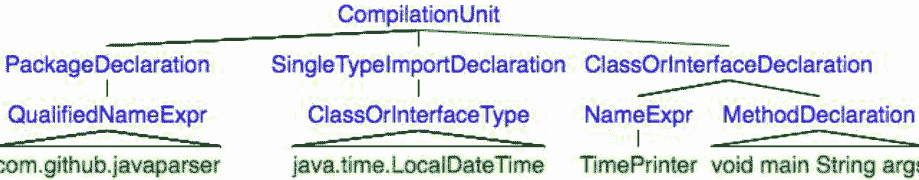
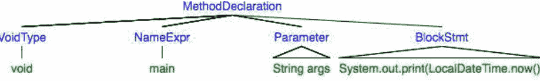
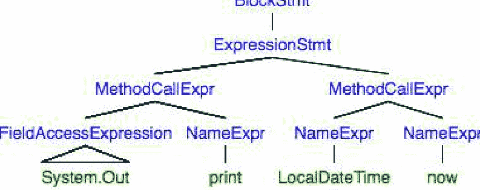
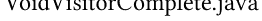
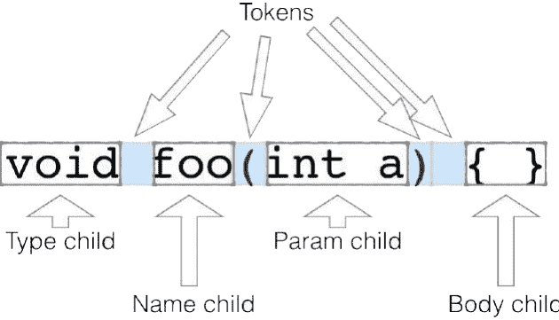

# JavaParser：分析、转换并生成你的 Java 代码库

Nicholas Smith, Danny van Bruggen 和 Federico Tomassetti

# 推特此本书！

请通过在 Twitter 上传播这本书来为 Nicholas Smith, Danny van Bruggen 和 Federico Tomassetti 提供帮助！

本书建议使用的标签为 `#JavaParser`。

点击此链接在 Twitter 上搜索该标签，了解其他人对这本书的评价：

#JavaParser

# 前言

## 什么是 JavaParser？

在最形式的形式，JavaParser 库允许你在 Java 环境中将 Java 源代码作为 Java 对象表示进行交互。更正式地说，我们将这种对象表示称为抽象语法树（AST）。

此外，它还提供了一种便利机制，通过我们称之为“访问者支持”（Visitor Support）的机制来遍历树。这让开发者能够关注识别源码中感兴趣的模式，而不是编写繁琐的遍历代码。

该库的最后一个核心特性是操纵源代码的底层结构。这些结构随后可以写入文件，为开发者提供了构建自己的生成软件的便利。

## JavaParser 不是

尽管该库可以作为某些工具的一部分使用，但它并不是一个代码重构工具包。这可能是我们看到的关于该库最流行的误解。

请将该库视为提供一种回答“**这段代码是什么？**”问题的机制，而**为什么**以及**如何**选择对其进行监控或报告，取决于你——这位语言工程师。

它还不是编译器。语法上正确且可以被库解析的代码并不意味着它能成功编译。虽然成功编译的代码本质上在语法是正确的，但解析只是编译过程的一个阶段。例如，如果你在没有定义变量的情况下引用了变量 `v`，这在语法上是正确的，但在编译过程中会导致语义错误。

## 它是给谁准备的？

说得直白一点：大多数 Java 开发者。即使不使用 JavaParser 库，他们可能也会从理解解析器在日常工作中能提供的功能中获益。

进一步说明的是，在选择解析源码的大多数情况下，你正在寻找识别某些内容（通常是代码中的问题）或自动生成代码的方法。这两种实践在很大程度上是为了实现质量和效率的提升；

我可以自动检测问题吗？我可以更快地生成这些代码吗？所有开发者都对如何实现这这两点感兴趣。

然而，你很少会把 JavaParser 库包含在用户软件中。通常，它作为工具组件的一部分，在你的项目源码上运行，或者可能生成最终服务用户的代码。

语言工具可能是我们看到该库用途最常见的例子。即这种我们可以识别代码中的位点并执行操作的理念。

更广泛地说，它是面向语言工程师和工具开发者的。

作为一个 Java 库，我们假设你已经对 Java 有相当的了解。

## 这本书不是给谁的

那些想要学习 Java 的人（通过上述内容的延伸）并不会教读者 Java。

它也不会让你对如何编写解析器产生深刻见解，除了用户可能感兴趣的功能之外。

我们还将深入研究 Java 语法或该库底层的语法定义。希望在该领域获得更多理解的读者应该访问 [Java 语言规范](https://docs.oracle.com/javase/specs/jls/se8/) 网站。

也许最有争议的是，对于那些对缺乏测试感到不安的人。和大多数事情一样，测试方法是主观的，本书的目标并不是对该主题提供意见。因此，书中的示例主要通过 `main` 方法进行演示。

## 如何使用这本书？

本书旨在为那些为此目的而使用 [JavaDoc](http://www.javadoc.io/doc/com.github.javaparser/javaparser-core/) 的人员提供学习指南。如果你发现文档缺失，请在 GitHub 上提出问题。

我们将书分为两个部分，第一部分旨在让你熟悉抽象语法树（该库的核心组件）以及如何在你的机器上获得运行示例。如果你是初学者，建议阅读第一部分以在该主题上建立良好的基础。

书的第二部分是用例集，提供了更详细地展示了我们认为该库的使用方式。这些用例可以乱序阅读，也许可以从用户相关的某一个开始。尽管阅读所有内容也并没有坏处。

## 书中使用的惯例

*斜体* - 用于介绍主题中的某个重要概念。

**粗体** - 在上下文中强调某个特定概念。

`代码` - 用于高亮内联的程序代码。

## 代码示例

你可以自由无限制地使用书中的所有代码示例。

原始源码可以在 GitHub 上找到。

我们对署名表示感谢，但并不强制要求。这通常包括书名及其作者。例如：JavaParser: by Smith, Tomassetti

## 如何与我们联系

任何问题、意见或疑虑，请在 Gitter 上访问我们。

关于书的反馈：https://gitter.im/javaparser/javaparbook

JavaParser 库支持：https://gitter.im/javaparser/javapar

# 作者

## Nicholas Smith

Nicholas 是一位经验软件工程师和架构师，目前在伦敦工作。他很有在职业生涯中因工作进行旅行，曾在葡萄牙、丹麦、印度和意大利工作过。

他的教育背景主要侧重于软件工程，拥有学士和硕士学位，后者专攻金融服务。也许不太寻常的是他还有一个野生动物保护学位，并且非常喜欢小熊猫。

尽管他在这段时间内接触过多种语言，但他认为自己主要是一个 Java 程序员，从该语言诞生之初就一直在使用它。

## Federico Tomassetti

Federico 是一位独立的软件架构师，专注于构建语言：解析器、编译器、编辑器、模拟器和其他类似的工具。他在博客 [tomassetti.me](http://tomassetti.me) 上分享他关于语言工程的思考。

此前，他获得了语言工程博士学位，曾在各处工作过（包括 TripAdvisor 和 Groupon），现在他专注于咨询以及为 JavaParser 和 JavaSymbolSolver 等开源项目做出贡献。

## 致谢

我们要感谢 JavaParser 的原始作者：Sreenivasa Viswanadh 和 Julio Vilmar Gesser。

此外，最重要的是，我们要感谢所有贡献者以及围绕 JavaParser 成长的奇妙社区。今天，有几十人发送了补丁，数百人在论坛、Stack Overflow、GitHub 和 Gitter 上提过问题。他们的讨论对于理解 JavaParser 如何被使用以及哪些部分需要澄清起了巨大的帮助。

# 抽象语法树简析

如果不是先理解语法树的概念，实际上无法考虑 Java 语言解析器将如何发挥作用。

让我们从尝试想象源代码可以被表示为一棵树开始。它们都有一个单一的起点，从这里开始，分支独立地形成，就像代码语句或者在树中，实际的树枝一样。就像真实树的分支一样，拆解复杂语句的过程将持续，直到我们遇到终结节点（terminal）或叶子节点（leaf）。

代表 Java 代码的树将有一个代表整个文件的根节点，连接到根节点的节点是文件中所有的顶级元素，如 `import` 或 `class` 声明。从一个单一的类声明，我们可以到达多个节点，代表该类的字段和方法。


正如真实树上的分支除了其起源外，与其他分支之间没有连接一样，表示源代码的树也是如此。人类或编译器可以理解变量引用或方法调用与代码的另一个部分相关，但语法树并不能，这是一个重要的区别。

> *添加相关元素之间的连接（例如方法调用到方法声明，或字段引用到字段）是“符号解析器”（Symbol Solver）完成的工作。JavaSymbolSolver 是为了与 JavaParser 配合而创建的符号解析器。*

## 一切皆为节点

然而，树的隐喻只能带我们到这里。

在经典计算机科学的意义上，当我们谈论具有顶点和边的图时（在树的情况下是有向图），取决于你所阅读的文献，这些也可以是节点和关系的同义词。为了本书的目的，我们使用“节点”（node）一词，因为它被认为不复杂，并且与库类保持一致。

## 抽象语法树的结构规则

有几个简单的规则规定了什么是树。除了根节点外，所有节点将恰好有一个入度关系。根节点将为零。所有节点可以有多个出度关系。那些零出度关系的节点被认为是叶子节点而不是父节点。相反，那些具有出度关系的节点被认为既是分支也是一个或多个子节点的父节点。

当节点拥有子节点时，在 JavaParser 创建的对象模型中，这简单地表示为 `Node` 类中名为 `childNodes` 的 `List<Node>`。

树的词汇还留下了进一步的定义：具有相同父节点的节点是兄弟。当节点可以通过向上或向下遍历树建立联系时，也会使用祖先（ancestor）和后代（descendant）。因此，所有节点都是根节点的后代。

为了在常用的 Java 语言概念中建模，`MethodDeclaration`、`Statement`、`Parameter` 等将是 JavaParser 库中 `Node` 类的后代（面向对象的意义上）。在大多数情况下，JavaParser 试图在类命名上保持与官方语法规范中定义的名称一致。

## 节点什么时候是节点，什么时候不是节点？

通常当它是另一个节点的属性时。

除了具有特定的类型来描述它们所代表的语言概念（例如，`MethodDeclaration` 节点应该具有描述其特征的属性），行号就是一个很好的例子，对于 AST 中的所有节点，解析库在解析时会记录每个节点的行号。

如果我们考虑一个 `MethodDeclaration`，它将拥有子节点，代表它的名称、参数（如果有的话）、它的类型、返回值和正体。至于用于定义方法的其他语言关键字（例如 `final`、`static`、`abstract` 等）？嗯，这些被定义为 `MethodDeclaration` 自身的修饰符属性（modifier property）。

我们可以将节点实体单独分离出来，而不是作为一种属性吗？可以。像大多数事情一样，以这种方式表示它们是一种设计选择，你会发现支持这两种论点的支持者。

## 构建我们的第一棵树

为了巩固对这一相当抽象讨论的直觉，我们将查看使用 JavaParser 解析简单类时创建内容的图形化表示。

> *https://docs.oracle.com/java/specs/jsp/se7/html/ls-18.html*

### 示例：TimePrinter

```java
package com.github.javaparser;
import java.time.LocalDateTime;
public class TimePrinter {
    public static void main(String[] args) {
        System.out.println(LocalDateTime.now());
    }
}
```

上面的内容显示：



该图显示编译单元有三个子节点：一个用于包声明，一个用于导入，最后一个用于类声明。上面的树代表了 `ClassDeclaration` 的很大一部分，它可以进一步分叉。



最后，我们可以看到名称、返回类型和参数以及 `BlockStmt`，后者再次代表了单行。



在几句话中，我们希望通过这个例子看到语法树会很快变得复杂！

## 超抽象

我们还应该考虑是什么让 AST 是抽象的，而不是具体树（Concrete Tree）或解析树（Parse Tree）。

在支持 JavaParser 库的过程中，我们却意识到许多人需要注释。默认情况下，在解析时，JavaParser 库会记录注释信息并包含在树中。团队还在研究在编写类时保留空白的方法。

# 快速巡览

在本章中，我们将对 JavaParser 库提供的关键功能进行快速巡览。你可以将其视为一个快速上手指南，让你在本地机器上运行起来。

我们将分析一个有趣的但基础的计算器代码，它接收逆波尔表达式（Reverse Polish Notation）格式并计算结果。它还有一个简单的内存功能，可以存储单个数字。

该类长度适中，可以在附录 A 中找到。

## 旅行伙伴

首先，我们应该向你介绍在在使用 JavaParser 旅程中的主要旅行伙伴。

除了用于表示语言概念的众多类外，还有几个支持处理 Java AST 的主要类，即 `JavaParser`、`StaticJavaParser` 和 `CompilationUnit`，此外还有各种 `Visitor` 类。我们将在本书中详细讨论这些内容，但这里有一个简要介绍。

用几句话来说：

- `JavaParser` 类提供了从代码生成 AST 的完整 API。
- `StaticJavaParser` 类提供了从代码生成 AST 的快速简单的 API。
- `CompilationUnit` 是 AST 的根。
- `Visitor` 类是用于查找 AST 特定部分的类。

一如既常，在使用 Java 库时，JavaDoc 是你的好朋友，尽管本书将尽可能涵盖，但不可避免地会跳过某些领域。

# 快速浏览

在大多数情况下，你将与完整的类文件一起工作，在这种情况下，`.parse` 方法被重载，以接受 `Path`、`File`、`InputStream` 和 `String`，并返回一个 `CompilationUnit` 供你使用。

处理源代码片段也是可行的，尽管为了解析一个 `String`，你将知道所需的类型以避免解析错误。

例如：

```java
Statement statement = StaticJavaParser.parseStatement("int a = 0;");
```

## CompilationUnit 类

`CompilationUnit` 是你所解析的完整且语法正确的类文件的源代码的 Java 表示。

在如文所述的 AST（抽象语法树）的上下文中，你可以将该类类为根节点。

从这里，你可以访问树的所有节点以检查其属性、操作底层的 Java 表示，或作为你定义的 Visitor（访问者）的切入点。

## Visitor 类

虽然手动编写代码来直接遍历 `CompilationUnit` 中的 AST 是可行的，但这通常很费力且容易出错。这在很大程度上是因为该过程依赖于递归和频繁的类型检查来实现你的目标。

在大多数情况下，你可能想要确定你在寻找什么，然后定义一个操作该内容的 visitor。使用 visitor 可以很容易地找到所有特定类型的节点，例如方法声明或所有的乘法表达式。

## 简单的 Visitor

如前所述，定义一个遍历 AST 并操作你感兴趣的代码中概念的 visitor 通常是一个好主意。因此，我们开始从一个简单的 visitor 作为第一个示例是有意义的。

书中找到的所有代码在随附的仓库* 中均可用，欢迎从那里查看工作示例。我们建议你自己编写代码，这是获得该主题直觉的最佳方法。

在这个示例中，我们正在创建一个 visitor，它会检查我们类中的所有方法，并将名称和行长度打印到控制台。让我们开始吧！

> *https://github.com/javaparser/javaparser-visited

### 环境搭建

首先，在你喜爱的 IDE 中创建一个新项目，并将 JavaParser 库添加到类路径中。如果你倾向于使用依赖管理工具，只需在构建脚本中添加几行即可。对于 Maven，这些行是：

```xml
<dependency>
  <groupId>com.github.javaparser</groupId>
  <artifactId>javaparser-symbol-solver-core</artifactId>
  <version>LATEST</version>
</dependency>
```

当你使用 Gradle 时，这一行即可：

```gradle
compile group: 'com.github.javaparser', name: 'javaparser-symbol-solver-core', version: 'LATEST'
```

在编写时，3.18.0 是该库的最新版本。如果你在此某些示例处遇到问题，请恢复到此版本。

上面的依赖项包含了 Java 解析和求解能力。本书涵盖了这两个库；我们建议你都包含它们。

如果你只需要解析功能，可以将 `artifactId` 标签更改为 `javaparser-core`。

现在是写一些代码了。你可以查看附录 A 并创建 `ReversePolishNotation.java` 类。包将为 `org.javaparser.examples`。

接下来，创建第二个类，名称和包名由你决定。我们将使用 `org.javaparser.examples.VoidVisitorStarter.java`。

现在我们已经完成了所有设置，是时候创建一个 `CompilationUnit` 了：即 `ReversePolishNotation` 类的解析脚本。可以复制下面的代码。


这里有几行代码，让我们过一遍它们：

我们创建一个常量 String，指向我们的 Java 文件的路径。由于两个文件都存在于项目中，为了简洁，我们使用了相对路径而不是文件系统根路径。


在 `main` 方法内部，我们通过调用 `StaticJavaParser` 类的静态 `parse` 方法来实例化 `CompilationUnit` 类型，该方法使用之前定义的路径的 `InputStream`。

虽然没有输出，但如果你正确完成了所有之前的步骤，执行 `main` 将成功。现在试一试。

一旦我们有了可以工作的 `CompilationUnit`，我们就可以定义第一个 visitor。我们的 visitor 目标是找到所有特定类型的节点。使用 visitor 可以很容易地找到所有特定类型的节点，例如方法声明或所有的乘法表达式。

## 快速访问

`visit` 方法的第二个参数用于提供一种简单的状态机制，该机制在树的遍历过程中会被传递。这让我们可以选择让访问者执行某种操作，而访问者的责任将是收集项（即方法名）。然后，调用类如何处理这些收集到的方法名则取决于他们自己。

让我们在实践中来看这一点，创建一个另一个访问者类，这次它将用 `List<String>` 进行参数化。

```java
private static class MethodNameCollector extends VisitorAdapter<List<String>> {
    @Override
    public void visit(MethodDeclaration md, List<String> collector) {
        super.visit(md, collector);
        collector.add(md.getNameAsString());
    }
}
```



之前我们将该参数称为“状态（state）”，但这往往会在人们脑海中勾起负面印象。因此，将此对象视为“收集器（collector）”可能会让它更容易接受。在我们的 `visit` 方法中，我们添加代表收集器对象名称的 String，而不是打印它。

好的，我们可以将第二个访问者添加到 `main` 方法中以比较结果。

```java
List<String> methodNames = new ArrayList<>();
VoidVisitor<List<String>> methodNameCollector = new MethodNameCollector();
methodNameCollector.visit(cu, methodNames);
methodNames.forEach(n -> System.out.println("Method Name Collected: " + n));
```


如你所见，我们实例化了一个 List 并将其传递到 `visit` 方法。我们在 `main` 方法中执行打印到控制台的工作，而不是期望访问者去完成。

运行 `main` 时的输出应该是：

- 1 Method Name Printed: calc
- 2 Method Name Printed: memoryRecall
- 3 Method Name Printed: memoryClear
- 4 Method Name Printed: memoryStore
- 5 Method Name Collected: calc
- 6 Method Name Collected: memoryRecall
- 7 Method Name Collected: memoryClear
- 8 Method Name Collected: memoryStore

虽然在第二个例子中以这种方式分离关注点被认为是一种良好实践，但我们也愿意务实一些，第一种方法也没有问题。作为一名语言工程师，你可能想快速编写一些在代码库中只使用一次的一次性代码。在这种情况下，也许更快速、不那么整洁的方案是更好的选择。

这些是两个简单的例子，但我们希望你能看到从这里扩展出去的巨大潜力。在这里，我们可以轻松地调整，以收集长度超过 50 行的方法。我们用于收集代码名称的 String 可以扩展为使用 DTO¹ 风格的对象，该对象可以收集行数以及该方法是否有 JavaDoc。这样，我们就走在了编写自己的源码分析器的道路上。

## 简单的修改访问者

Java 7 版本语言中一个鲜为人知的细微变化是，可以在数值字面量中使用下划线。

虽然这不是一个杀手级特性，因为其应用相当窄，但它对可读性特别有用。

```java
public static int ONE_BILLION = 1000000000;
public static int TWO_BILLION = 2_000_000_000;
```

如果你在一个必须定义任意数值的代码库中工作，你就会看到这种约定有其优势。

我们将再次使用我们的逆波兰表达式表示法类作为基础，如果你跳过了这本书的这部分，可以在附录 A 中找到。它恰好有一个以 Java 7 之前的风格定义的成员。

再次创建一个带有 `main` 方法的骨架类，我们命名为 `ModifyingVisitorStarter`。和之前一样，运行此类在成功解析源码后应该只产生绿条。

> *DTO 代表数据传输对象（Data Transfer Object）。它是用于存储数据的对象。

## 快速访问

```java
public class ModifyingVisitorStarter {
    private static final String FILE_PATH
        = "src/main/java/org/javaparser/samples/ReversePolishNotation.java";
    public static void main(String[] args) throws Exception {
        CompilationUnit cu = StaticJavaParser
        .parse(Files.newInputStream(Paths.get(FILE_PATH)));
    }
}
```

### ModifyingVisitorStarter.java

之前我们在 `VisitorComplete_java` 中创建的访问者是以 `VoidVisitorAdaptor` 为基础的，因为我们不想更改 AST。这次，我们想要更改底层 AST，所以我们将创建一个 `ModifierVisitor` 的子类并命名为 `IntegerLiteralModifier`。

简单起见，我们在这个例子中只关注整数数字。

```java
private static class IntegerLiteralModifier extends ModifierVisitor<Void> {
    @Override
    public FieldDeclaration visit(FieldDeclaration fd, Void arg) {
        super.visit(fd, arg);
        return fd;
    }
}
```

### ModifyingVisitorComplete.java

由于该类像我们的第一个例子一样是参数化的，我们并不关心在遍历之间传递状态，因此我们将将其设为 `Void`。

我们看到的与之前的 `VoidVisitorAdapter` 示例相比的区别是，我们的方法现在有一个返回类型 `FieldDeclaration`。这与我们 `visit` 方法的第一个参数类型相匹配。

## 快速访问

在我们的初始示例中，我们返回未修改的内容。一旦我们在处理整数字面量时，我们将初始值设置为当前值的结果，该值经过了我们辅助方法的处理。

现在我们定义了访问者，可以更新 `main` 方法以实例化并使用编译单元调用 `visit` 方法。

## 快速访问

我们在这里执行的第一件事是遍历字段声明中的变量。这看起来很奇怪，请记住虽然罕见，但我们会声明类似 `int a, b, c;` 的变量；

接下来我们将确定变量是否初始化了值。`getInitializer` 方法返回一个 Java `Optional`，因此我们使用 `ifPresent` 方法，并在情况下传递一个 lambda 表达式。这反会检查变量是否是 `IntegerLiteralExpr` 的实例。我们可以根据需要扩展此以涵盖其他数值类型，以作为一个完整的案例。

## 快速概览

```java
public class CommentReporterStarter {
    private static final String FILE_PATH = 
        "src/main/java/org/javaparser/samples/ReversePolishNotation.java";

    public static void main(String[] args) throws Exception {
        CompilationUnit cu = StaticJavaParser
            .parse(Files.newInputStream(Paths.get(FILE_PATH)));

        List<Comment> comments = cu.getAllContainedComments();
    }
}
```

### CommentReporterStarter.java

我们目前为止处理过的访问器类并没有提供获取所有注释的机制，因为它们是针对特定节点类型操作的。相反，注释往往会横跨整个代码，其位置和随后的归属几乎可以出现在任何地方。

虽然 `Node` 对象有一个 `getComment` 方法可以被调用来获取节点的注释，但你将手动遍历整棵树。因此，为了方便起见，库在 `CompilationUnit` 上提供了一个 `getAllContainedComments` 方法来获取所有注释。

现在我们代码中有了一个注释列表，让我们来对它们做一些更有意义的事情。从解析的角度来看，处理注释时最大的挑战之一是注释被归属于哪里，即它说明了哪个节点。在某些情况下，注释位于某行没有明显归属的行上，在这种情况下，解析器会将它们确定为“孤儿注释”（orphan）。

从我们的注释列表中，我们不仅要报告它们的文本内容、类型（即它们是块注释、行注释还是 JavaDoc 风格注释），还要报告它们是否为孤儿。

在我们之前创建的启动类中添加一个内部类，用以表示我们的报告项。

## 快速概览

```java
private static class CommentReportEntry {
    private String type;
    private String text;
    private int lineNumber;
    private boolean isOrphan;

    CommentReportEntry(String type, String text, int lineNumber,
        boolean isOrphan) {
        this.type = type;
        this.text = text;
        this.lineNumber = lineNumber;
        this.isOrphan = isOrphan;
    }

    @Override
    public String toString() {
        return lineNumber + "|" + type + "|" + isOrphan + "|" + 
            text.replace("\\n", "").trim();
    }
}
```

### CommentReporterComplete.java

这里没有什么特别不凡的，它只是对报告中感兴趣的注释属性的简单容器。`toString` 方法创建了一个管道符分隔的表示形式。它还删除了注释中的一些空格，使其更适合控制台输出。

现在让我们修改代码，通过从 JavaParser `Comment` 类型中映射我们感兴趣的字段，创建一个 `CommentReportEntry` 集合。

```java
List<CommentReportEntry> comments = cu.getAllContainedComments()
    .stream()
    .map(p -> new CommentReportEntry(p.getClass().getSimpleName(),
        p.getContent(),
        p.getRange().map(r -> r.begin().line).orElse(-1),
        p.getCommentNode().isPresent()))
    .collect(Collectors.toList());
comments.forEach(System.out::println);
```

### CommentReporterComplete.java

## 快速概览

在这里，我们使用类名作为注释的类型，然后使用内容作为文本。要获取行号，我们使用所有节点都包含的 `Range` 对象。`Range` 记录了源代码中的位置信息，包括行的开始和结束，以及列位置。最后，为了确定注释是否为孤儿，我们访问 `getCommentedNode`。`CommentNode` 是一个 Java `Optional`，因此调用 `isPresent` 来检查其存在性；如果一个节点没有被注释的节点，我们认为它是一个孤儿。

在这个示例中，我们从注释的角度出发来识别它是否归属于特定节点。我们也可以从节点的角度出发，从一个给定的节点，我们可以使用 `node.getComment` 方法或 `node.getOrphanComments`。

运行应用程序应返回如下内容的未桥接版本：

```
1 |BlockComment|true|EOF
2 |JavadocComment|false|* A Simple Reverse ...
3 12|LineComment|false|* What does this do?
4 17|JavadocComment|false|* Takes reverse ...
5 59|JavadocComment|false|* Memory Recall ....
6 68|JavadocComment|false|* Memory Clear ....
```

这就结束了我们如何开始使用 JavaParser 库的简要介绍。希望这已经激发了你探索自己 Java 代码库的有趣方法。

## 注释 - 此处有龙（此处充满困难）

关于这个主题该从何处开始？嗯，似乎是从经典的程序员比喻开始。我想，作为一个开发者社区，花在讨论注释解析的想法上的时间比花在 JavaParser 项目中任何其他功能上的都要多。

很难开始，也许它的尾巴（此处有一个双关梗）尚未结束。在撰写该库的下一个大版本时，计划将从头开始重建这些行为。

为什么注释处理起来如此困难？嗯，从形式上说，注释并不构成语言抽象语法树的一部分。“抽象”部分意味着它省略了对编译器不感兴趣的语法树元素。

因此，它们实际上由 Java 语言规范覆盖，且超出了单页的范围；在一份 800 页的文档中，它仅仅算是一个脚注。

在大多数情况下，你在注释标记中包含什么，以及何时包含它们，就变成了“监狱规则”，即随心所欲。即使你考虑了所有可能的情况，也会有人提供新的边界情况，导致注释解析出现短缺之处。

与通过另一种语言概念（类、方法、字段）明确说明的注解不同，注释由于其在语法树中的位置，并非如此。反之，这意味着归属概念（即注释的是什么）可能是歧义的；因此，实现不可避免地无法适应所有人。

尽管如此，这是该库一个非常受欢迎的功能。

对于作为用户的你，这一切意味着什么？嗯，尽管我们已经尽力让注释解析和归属以合理且健壮的方式运行，但在工作方式方面可能无法满足某些预期，特别是当你有复杂需求时。

对于目前的行为，节点与注释之间的 1:1 关系并不总是理想的。考虑：

```java
// TODO: Fix this
// Super important method
public void doAllTheThings(){
    ...
}
```

在这种情况下，人类可以很容易理解 TODO 注释与该方法有关；然而，解析器将将其视为孤儿，或者仅将其归属于下一行。可以理解该库的用户对这应该如何工作可能会有不同的意见。

## 注释 - 此处有龙（此处充满困难）

在库开发的这个阶段，我们很大程度上选择合理的默认值，而不是提供大量的各种配置选项，这些选项本身可能会更令人困惑。

在上面的例子中，程序员可以使用多行注释，这样我们就能避免这个问题！这本身就是一个很好的练习；看看你是否能识别出连续出现在多行的注释，并将它们合并为一个单个块注释。

## 注释归属

一个节点最多关联一个注释，该注释在它的注释字段中被引用。然后，正如你预期的，注释类型将 `LineComment`、`BlockComment` 或 `JavadocComment` 之一。

节点与注释之间的关系是双向的，因此注释维护了一个 `commentedNode` 引用。

在尝试确定注释应该归属于哪里时，首先考虑它是什么类型的注释；块注释和 JavaDoc 风格的行为相同，但行注释略有不同。

在归属过程中，注释解析器将尝试将块注释或 JavaDoc 风格的注释分配给后续节点：在同一行或后续行。另一方面，当它们出现在另一个节点的同一行时，将分配给之前的节点；当它们单独位于时，将分配给后续节点。

只有当注释“合理”地放置两个标记之间时，上述情况才成立。

## 孤儿注释

我们在书的其他章节提到过这个概念，但值得重复强调。无法归属于树中特定节点的注释被认为是孤儿注释。通常情况下，如果你无法找到归属于你预期的节点的注释，它会在别处成为孤儿。最可能是在你预期节点的父节点中。

考虑以下：


```java
// Orphaned 1
// Attributed 1
public class TimePrinterWithComments {

    // Orphaned 2
    // Attributed 2
    public static void main(String args[]) {
        System.out.print(LocalDateTime.now());
    }
    // Orphaned 3
}
```

# 注释 - 此处有龙

所有的 `Node` 对象都通过 `getOrphanedComments` 特别暴露它们的孤立注释；它们也会作为 `getAllContainedComments` 的一部分被返回。

## 使用注释

在大多数情况下，我们建议使用访问者来满足你的需求，我们之前在快速入门章节中介绍过相关的示例：快速访问。如果你跳到了这一章，应该返回查看那里。

在代码中处理注释，除了访问者之外，另一个很好的选择是 `CompilationUnit` 的 `getAllContainedComments` 方法。如果你正在进行的任务主要关注注释，该方法可以为你提供一个以注释为中心的代码视图。从返回的列表中，你可以导航到 AST 中属于该注释 `commentedNode` 关系的 `Node`。

此外，注释本身也是 `Node` 类型，因此它们是编译单元中的一等公民。它们包含的信息与任何 AST 节点关于位置的信息大部分相同。尽管有一些不同之处；它们不能被赋予属性且没有子节点，但这应该是直观的。因此，总的来说，你可以以处理其他节点类似的方式对它们进行检查和操作。

# 解析选项

到为止，我们通常通过直接调用 `StaticJavaParser` 类上的静态 `parse` 方法来创建 `CompilationUnit`。这是因为假设解析器有许多合理的默认值；然而，在处理注释解析时，有几个参数可以进行调优。

注释解析默认开启，如果你决定希望禁用它，可以提供一个将 `setAttributeComments` 设置为 `false` 的 `ParserConfiguration` 实例。这将导致解析速度更快，尽管在处理单个源文件时可能感知不到，但如果你打算解析大量文件，这值得记住。

```java
ParserConfiguration parserConfiguration = new ParserConfiguration()
    .setAttributeComments(false);
StaticJavaParser.setConfiguration(parserConfiguration);
```

## ConfigurationOptions.java

第二个选项允许你控制是否考虑行首之前的注释。

考虑以下代码：

```java
class A {
  // Blah
  boolean f() { return false }
}
```

在此实例中，如果启用了注释属性，注释 `// Blah` 将被分配给方法 `f`。

它是属于该方法，还是在描述后续行将要发生什么？像许多事情一样，答案可能是“取决于情况”。

JavaParser 提供的另一种行为是将注释分配给包含它的节点。在类 `A` 的情况下，它将作为 `orphanComments` 列表中的一个项出现。

默认情况下，解析器将使用前一种行为，即将注释分配给下一个节点。如果你希望将其视为孤立注释，请使用以下配置。

```java
ParserConfiguration parserConfiguration = new ParserConfiguration()
    .setDoNotAssignCommentsPrecedingEmptyLines(true);
```

## ConfigurationOptions.java

## 注释的实践

这里有一个我们组合编写的有趣类，用来夸大之前关于代码注释是“监狱规则”的观点，即在这种情况下可以随心所欲。信不信由你，这些实际上是我们见过的一些比较理性的示例了。

让我们解释一下这个类本身，以免分散我们真正关注的重点（注释）。为了对应我们的类比，我们使用线程来竞争谁最先/最后写入控制台。我们定义了一个简单的类，其中包含一个字段，该字段将是每个线程的个人口号。当为线程调用 `run` 时，它将打印自己的口号。`main` 方法启动了三个具有不同执行阶段的不同线程，然后调用了 `start` 方法。大多数情况下，这段代码将按照你预期的方式执行，但这不是保证的！

尽管在单个类中拥有各种注释特别令人反感，但这些情况确实会出现，而且看起来可能有些反直觉。

```java
package com.github.javascript;
public class PrisonRules /* Maybe be Runnable? */ extends Thread {
    @Deprecated
    // What is
    // dibbs?
    private final String dibbs;

    public PrisonRules(final String dibbs) {
        this.dibbs = dibbs;
    }

    @Override // Is this really overridden?
    public void run() {
        System.out.println(dibbs);
    }

    public static void main(String[] /* We should pass arguments in here * */ args) {
        Thread t1 = new Thread(PrisonRules("mine!") /* This should run first */);
        Thread t2 = new Thread(PrisonRules("yoink!"));
        Thread t3 = new Thread(PrisonRules("finders keepers!"));

        // Here Be Dragons
        t1/**("_+")*/.start();
        t2/**(@_)*//*(~)*/.start();
        /** We need more JavaDocs! */
        t3.start();
    }
}
```

## PrisonRules.java

由于我们要以此制作一个测验，所有极好的学习材料都需要测验。对于每个注释，尝试判断该注释将分配给 AST 的哪个节点。之后我们将更详细地查看答案。

- 1. `/* Maybe Runnable? */` 分配给：
  1. `ClassOrInterfaceDeclaration`
  2. `ClassOrInterfaceType` "Thread"
  3. `SimpleName` "PrisonRules"
  4. 都没有，它应该是空的

- 2. `// What is` 分配给：
  1. `FieldDeclaration`
  2. `Deprecated`
  3. `final String dibbs`

- 3. `// dibbs?` 分配给：
  1. `VariableDeclarator`
  2. `LineComment`
  3. `String dibbs`

- 4. `// Is this really overridden?` 分配给：
  1. `MarkerAnnotation`
  2. `MethodDeclaration`
  3. `void run`

- 5. `/* We should pass arguments in here * */` 分配给：
  1. `ArrayType`
  2. `BlockStmt`
  3. `String args`

- 6. `/* This should run first */` 分配给：
  1. `ObjectCreationExpression`
  2. `new Thread("mine!")`
  3. `t1`

- 7. `// Here Be Dragons` 分配给：
  1. `NameExpr` t1
  2. `MethodCallExpr` t1.start()
  3. `ExpressionStmt` t1.start()

- 8. `/*("_+")*/` 分配给：
  1. `NameExpr` t1
  2. `MethodCallExpr` t1.start()

- 9. `/*(@_)*//*(~)*/` 分配给：
  1. `NameExpr` t2
  2. `MethodCallExpr` t2.start()

- 10. `/* We need more JavaDocs! */` 分配给：
  1. `MethodDeclaration` public void main
  2. `ExpressionStmt` t3.start()

# 答案：

问题 1，答案是 1，`ClassOrInterfaceDeclaration` "Thread"。当寻找分配块注释时，我们寻找的是后续节点。在此实例中，`ClassOrInterfaceDeclaration` 是包含节点。`SimpleName` 是前一个节点。`extends` 关键字通过类上的 `extendedType` 引用进行建模，而不是节点本身。

问题 2，答案是 4，它是孤立的。`MarkerAnnotationExpr` 位于上一行的注释之前，因此不会分配给它。注释节点本身不能被赋予注释，所以它不是 `LineComment`。

问题 3，答案是 1，`VariableDeclarator`，它是在此实例中 `SimpleName` 和 `ClassOrInterfaceType` 类型的父节点。

问题 4，答案是 1，`MarkerAnnotation` "Override"。与块注释不同，行注释会寻找同一行中之前的节点，然后再考虑后续节点。

问题 5，答案是 4，注释定义在 `ArrayType` 标记内部；因此它是父节点，也是找到孤立注释的地方。在树的这一层级没有后续节点来归属于。`Parameter` 节点是 `ArrayType` 的父节点，尽管 `BlockStmt` 在词法上之后，但它是 `Parameter` 的兄弟节点。

问题 6，答案是 1，`ObjectCreationExpression` "new Thread" 的孤立节点。由于与问题 5 类似的原因，树的同一层级没有后续节点可以关联该注释。因此，它是包含节点中的一个孤立注释。

问题 7，答案是 3，`ExpressionStmt` "t1.start()"。当 `LineComment` 没有前置节点时，它将寻找下一个节点。`NameExpr` 和 `MethodCallExpr` 都是 `ExpressionStmt` 的子节点。

问题 8，答案是 3，`SimpleName` "start"。如果你一直很关注，你应该能做出这道题。`NameExpr` 位于块注释之前，因此不被考虑。`MethodCallExpr` 是包含该节点的父节点。`SimpleName` "start" 是后续节点，并被赋予了注释。

问题 9，答案是 4，一个孤立节点。与上一行代码不同，有两个注释竞争关联到 `SimpleName` 上。随后的注释 "(\~)" 使它变成了孤立状态（坏掉的 Lenny！），`SimpleName` 成为它的父节点。记住——从节点到注释的关系是 1:1。

问题 10，答案是 3，`ExpressionStmt` "t3.start()"。Javadoc 注释的关联方式与块注释相同；尽管有一种惯例将其应用于类、接口和方法，但这种做法并不是强制执行的。

# 美化打印与词法保留

你可以将 JavaParser 用于不同的目的。最常见的两种是代码生成和代码转换。在这两种情况下，你最终都会生成 Java 代码，可能将其存储在扩展名为 `java` 的文件中。

对你的 `CompilationUnit` 简单调用 `toString()` 将返回一个你可以用于写入源码的 `String`。我们面临的问题是：*它将如何格式化来自 AST 的代码？*

答案有两种方式之一：

- 使用美化打印
- 使用词法保留打印

所以让我们考虑它们之间的区别。

## 什么是美化打印？

美化打印意味着当我们把代码写源码时，文本表示将以良好格式化且标准的方式打印。

例如，如果你解析了一个现有的 java 类，如下：

```java
class A {
int a;
}
```

那么之后你决定使用 JavaParser 对其进行美化打印，你将得到如下的代码表示：

```java
class A {
    int a;
}
```

## 什么是词法保留打印？

词法保留打印意味着打印时保留原始布局。当我们编写代码时，有些信息对于编译器来说没有严格意义，但对人类来说非常重要。即：空格的位置和注释。

如果你解析了一些代码并使用词法保留打印将其打印回来，你将得到解析时相同的代码。

如果你解析了一些代码，修改它，然后使用词法保留打印将其打印回来，你将得到非常接近原始代码，更改仅限于你显式修改的节点。

你可以使用词法保留打印，即使是在一个你通过程序构建而非从源码解析而来的 AST 上。在这种情况下，没有原始布局需要保留，且代码将默认为美化打印形式。当你解析代码并在 AST 中添加一些程序化创建的新节点时也是如此：你解析的代码部分将附带布局信息，而你创建的节点将不会，它们将被美化打印。

## 在美化打印和词法保留打印之间选择

我们已经看到，在生成代码时，有两种样式可以使用。

### 使用美化打印

- 美化打印是强制的。
- 在转换代码时，美化打印是一个良好的选择。
- 美化打印允许我们处理复杂的布局。

### 使用词法保留打印

- 词法保留打印可用于保留代码在解析时的原始布局。

## 美化打印与词法保留

```java
@Override
public void visit(NormalAnnotationExpr n, Void arg) {
    // ignore
}
Printer prettyPrinter = new DefaultPrettyPrinter(prettyPrinterFactory, conf);
System.out.println(prettyPrinter.print(myClass));
```

## PrettyPrintVisitor.java

运行这段代码将产生以下输出：

```java
class MyClass {
    String foo;
}
```

而不是：

```java
class MyClass {
    @MySecretAnnotation
    String foo;
}
```

换句话说，在自定义节点美化打印方式方面有很大的灵活性；允许你以任何符合你逻辑的方式来实现你的美化打印器。

## 使用词法保留打印

词法保留打印可用于保留代码在解析时的原始布局。尽管这是它的主要目标，但你也可以将其用于你创建的节点。在这种情况下，结果等同于对这些节点进行美化打印。

设置词法保留打印的最简单方法是使用 `LexicalPreservingPrinter` 的 `setup` 方法。这将完成解析、注册初始文本并在 AST 上添加一个观察者。当你对 AST 进行操作时，观察者会在每次修改时调整文本。

在下面的示例中，你可以看到如何使用词法保留打印解析某些代码并将其打印：

```java
public static void main(String[] args) {
    String code = "// Hey, this is a comment\n\n// Another one\n\nclass A ( )";
    CompilationUnit cu = StaticJavaParser.parse(code);
    LexicalPreservingPrinter.setup(cu);
    System.out.println(LexicalPreservingPrinter.print(cu));
}
```

### LexicalPreservationStarter.java

乍一看，这段代码与 JavaParser API 的其他部分相比似乎更复杂。请考虑到词法保留打印是一个最近添加的功能，我们可能在未来找到简化 API 的方法。欢迎提交你的建议。

如果我们使用上述代码解析并打印以下内容：

```java
// Hey, this is a comment

// Another one
class A ()
```

我们将得到完全相同的结果。这就是词法保留的全部意义，不是吗？


不，实现词法保留的困难之处在于支持在保留并演进原始布局的同时更改 `AST` 的能力。

如果我们更改类名呢？

```java
// use LexicalPreservingDeclaration.setup
ClassOrInterface myClass = cu.getClassName("A").get();
myClass.setName("MyNewClassName");
System.out.println(LexicalPreservingPrinter.print(cu));
```

### LexicalPreservationComplete.java

我们将得到这个：

美化打印与词法保留

我们可以添加一个修饰符，使我们的类变为公有。

```java
1 ClassOrInterfaceDeclaration myClass = cu.getClassByName("A").get();
2 myClass.setName("MyClassName");
3 myClass.addModifier(Modifier.Keyword.PUBLIC);
4 System.out.println(LexicalPreservingPrinter.print(cu));
```

LexicalPreservationComplete.java

结果将是：

```java
 // Hey, this is a comment
2
4 // Another one
5
6 public class class MyClassName {}
```

最后，如果我们想指定包呢？

```java
1 ClassOrInterfaceDeclaration myClass = cu.getClassByName("A").get();
2 myClass.setName("MyClassName");
3 myClass.addModifier(Modifier.Keyword.PUBLIC);
4 cu.setPackageDeclaration("org.javaparser.samples");
5 System.out.println(LexicalPreservingPrinter.print(cu));
```

LexicalPreservationComplete.java

这将让你得到这个结果：

美化打印与词法保留

```java
package org.javaparser.lexicalpreservation.examples;

// Hey, this is a comment

// Another one

public class MyNewClassName {}
```

其理念是，除了初始设置外，你只需要正常使用 `JavaParser`，在后台，原始文本会使用词法保留以一种完全透明的方式更新。

你不需要理解它内部是如何工作的，除非你对此很好奇；如果是那样，下一节就是为你准备的。

# 工作原理：NodeText 与具体语法树模型

我们之前描述过词法保留存储了初始文本，这是对发生过程的某种简化。词法保留实际上执行的操作是为每个节点创建一个 `NodeText`。`NodeText` 本质上是其他标记或子节点占位符的列表。

例如，如果你考虑这个方法声明：

```java
void foo(int a) { }
```

它的 `NodeText` 看起来如下：



图 6.1 - 一个 NodeText

如果我们对不同的元素进行排序：

- child(`void`)
- 2. token(`space`)
- 3. child(`name`)
- 4. token(`lparen`)
- 5. child(`param#0`)
- 6. token(`rparen`)
- 7. token(`space`)
- 8. child(`body`)

现在假设你向此方法添加了一个参数。会发生什么？我们需要更新 `NodeText`。

## 什么是语法模型？

具体语法模型（`CSM`）是代码的表示，包含了所有信息，包括空格和注释。它比 `AST` 更详细，`AST` 只包含代码的结构元素。对于 `AST` 中的每个节点，`CSM` 存储了代表该节点的标记列表。

## 解析符号与引用

`JavaParser` 与其他解析器一样，会获取源代码中存在的信息并将其组织成一棵树，即抽象语法树（`Abstract Syntax Tree`）。

在很多情况下，`AST` 中存在的信息已经足够满足用户需求。但在其他情况下，你需要详化 `AST` 并计算额外信息。特别是，你可能想要解析引用并找到节点之间的关系。从某种意义上说，这是在追踪新的链接并将树转换为图。

当我们在 `Java` 代码中发现一个使用的名称时，我们将其识别为一个符号（`symbol`）。符号是我们用来指代任何可能由名称表示的元素的术语。符号可以是一个变量，也可以是一个字段或类型。

当我们遇到这个表达式时：

```
container.element
```

`container` 是什么？`element` 是什么？也许 `container` 是一个变量，而 `element` 是该变量的字段。或者 `container` 是一个类名，`element` 是该类的静态字段。在这一阶段我们并不知道，所以我们泛泛地谈论符号。

`JavaParser Solver` 是库的一部分，它负责检查这些符号并告诉我们它们究竟是什么，为我们找到这些符号所代表的变量声明、参数声明或类型声明。

考虑以下示例：

```
void aMethod() {
  int a;
  a = a + 1;
}
```

通过查看 `AST`，我们知道 `a = a + 1` 对应于一个赋值。我们还知道正在将加 1 的结果赋值给 `a` 的值。

有些事情是我们明确知道的：

- 在该上下文中是否存在符号 `a`？
- 该符号可以被赋值吗？
- 该符号的类型是什么？

考虑最后一点：如果 `a` 是一个 `int`，那么 `a + 1` 的结果将是一个 `int`。然而 `a` 也可能是一个 `String`，在这种情况下，我们不是在相加 1，而是将其字符串表示连接到由 `a` 表示的字符串上。换句话说，仅通过 `AST` 无法判断我们正在执行什么样的操作：代数和还是字符串拼接？这取决于 `a` 的类型。为了回答这些问题，我们必须解析引用。我们必须将 `a + 1` 中对 `a` 的引用连接到被引用的 `a` 的声明上。

现在考虑以下情况：

```
class Bar {
  private String a;

  void aMethod() {
    while (true) {
      int a;
      a = a + 1;
    }
  }
}
```

Bar.java

有很多符号。解析引用意味着找到正确的符号，这可能很困难。请相信我们，情况可能会变得非常复杂。幸运的是，你只需要使用 `JavaParser Solver` 来解析 `JavaParser AST` 中元素之间的引用即可。

### 如何设置 JavaParser 符号解析器？

从现在开始，我们将 `JavaParser Symbol Solver` 称为 `JavaSymbolSolver`，命名是一件困难的事，而且我们并不总是第一次就能做对。未来的版本可能会重构该类名。

`JavaSymbolSolver` 与 `JavaParser` 核心库捆绑。这是因为每个版本的 `JavaSymbolSolver` 都能保证与特定版本的 `JavaParser` 兼容。在历史上，并非如此，库是分开分发的。

如果你之前选择不包含 `JavaSymbolSolver` 而仅在依赖中引入了 `javaparser-core` get，那么你需要更新到捆绑的版本。

## 解析符号与引用

43

```
dependencies {
  compile group: 'com.github.javaparser', name: 'javaparser-symbol-solver-core',
  version: 'LATEST'
}
```

或者如果你更习惯 `Maven` 的冗长写法，这里有提供：

```xml
<dependency>
  <groupId>com.github.javaparser</groupId>
  <artifactId>javaparser-symbol-solver-core</artifactId>
  <version>LATEST</version>
</dependency>
```

### 如何获取引用的类型：第一个示例

让我们考虑我们的初始示例。我们如何获取被赋值值的类型？

这是我们想要解析的代码：

```
class Bar {
  private String a;
  void aMethod() {
    while (true) {
      int a = 0;
      a = a + 1;
    }
  }
}
```


这是获取类型的代码：

```java
public class GetTypeOfReference {
  private static final String FILE_PATH =
      "src/main/java/org/javaparser/examples/chapter5/Bar.java";
  public static void main(String[] args) throws FileNotFoundException {
      TypeSolver typeSolver = new CombinedSolver();
      JavaSymbolSolver symbolSolver = new JavaSymbolSolver(typeSolver);
      StaticJavaParser
          .getParserConfiguration()
          .setSymbolResolver(symbolSolver);
      CompilationUnit cu = StaticJavaParser.parse(new File(FILE_PATH));
      cu.findAll(AssignExpr.class).forEach(ae -> {
          ResolvedType resolvedType = ae.calculateResolvedType();
          System.out.println(ae + " is a: " + resolvedType);
      });
  }
}
```

GetTypeOfReference.java

输出将是：`a+1 is a: PrimitiveType(name='int')`

这一行可能是：

```java
TypeSolver typeSolver = new CombinedSolver();
```

我们将接下来查看 `TypeSolver` 是什么。

### 指定查找类型的位置

在之前的示例中，我们看到了同一个 `AST` 中的元素引用。即在源文件中。情况通常比这复杂，并且涉及到其他文件。考虑这个：

```java
class MyClass extends SuperClass {
    public void returnSomeValue() {
        System.out.println(aField.size());
    }
}
```

`aField` 来自哪里？我们不知道，它可能是 `SuperClass` 中的一个字段。所以我们需要检查。嗯，这就是 `JavaSolver` 为我们所做的。为了实现，`JavaSolver` 需要知道去哪里查找。类可能位于：

- 在源文件中，如果我们正在编译它们
- 在某些库的类文件或 `JAR` 中
- 在 `JDK` 中

根据上述情况，有不同的 `TypeSolver` 需要传递给 `JavaSolver`。

`JarTypeSolver`：该解析器在 `JAR` 文件内部查找类。你只需要指定 `JAR` 文件的位置。

`JavaParserSolver`：该解析器在源文件中查找类。你只需要指定根目录。例如 `src` 目录。它将在与包对应的目录中查找源文件。因此，它会在 `a/b` 目录下查找类 `C`。

`ReflectionTypeSolver`：某些类是作为语言的一部分定义的，没有 `JAR`。例如 `java.lang.Object` 等类。为了查找此类类的定义，我们可以使用反射。

`MemoryTypeSolver`：该解析器返回我们记录在其中的类。它主要用于测试。

`CombinedTypeSolver`：你通常想要将多个 `TypeSolver` 合并为一个。为了这一点，你使用 `CombinedSolver`。

### 使用绝对名称解析类型

如果你愿意，可以直接使用 `TypeSolver`。它执行的操作是根据给定的限定名称查找元素。

考虑这个示例：

在这个示例中，我们获取了三种类型的定义：

- `java.lang.Object`
- `java.lang.String`
- `java.util.List`

这些每一个项都是 `ReferenceTypeDeclaration` 的实例。该类有许多方法可以访问丰富的类型模型。你可以找到所有的祖类、继承的方法和字段、注解、它可以赋值的类型并进行管理。

注意，无论你使用哪种 `TypeSolver`：如果你的类是通过反射、解析源文件或从 `JAR` 中找到的，`JavaSymbolSolver` 都会提供一个具有相同接口的模型，即它总是返回一个 `ReferenceTypeDeclaration` 实例。

## 解决符号与引用

## 在上下文中解析类型

`TypeSolver` 仅在提供全限定名时才能找到类型；然而，`JavaSolver` 可以利用上下文来查找哪个实际的全限定名对应特定的声明。考虑以下情况：

```java
package org.javaparser.examples.chapter5;
import org.javaparser.examples.chapter4.*;
class Foo {
  Bar;
}
```

Foo.java

字段的类型是什么？

它可能是 `org.javaparser.examples.chapter5.Bar`，也可能是 `org.javaparser.examples.chapter4.Bar`。`JavaSolver` 将通过查看上下文并考虑以下因素为你解决这个问题：

- 使用该类型的类名
- 导入指令
- 当前包

你如何告诉 `JavaSolver` 使用哪个上下文呢？嗯，它是通过查看包含你感兴趣的节点所在的 `AST`（抽象语法树）来确定的。

```java
public class ResolveTypeInContext {
  private static String FILE_PATH = "src/main/java/javaparser/examples/chapter5/Foo.java";
  private static String SRC_PATH = "src/main/java";
  public static void main(String[] args) throws Exception {
    TypeSolver reflectionTypeSolver = new ReflectionSolver();
    TypeSolver JavaParserTypeSolver = new JavaParserTypeSolver(
      new File(SRC_PATH));
    CombinedTypeSolver combinedSolver = new CombinedTypeSolver();
    combinedSolver.add(reflectionTypeSolver);
    combinedSolver.add(javaParserSolver);

    JavaSymbolSolver symbolSolver = new JavaSymbolSolver(combinedSolver);
    StaticJavaParser
      .getParser()
      .setSymbolResolver(symbolSolver);

    CompilationUnit cu = StaticJavaParser.parse(new File(FILE_PATH));

    FieldDeclaration fieldDeclaration = Navigator.demandNodeOfGivenClass(
      cu, FieldDeclaration.class);

    System.out.println("Field type: " + fieldDeclaration.getVariables().get(0)
      .getType().resolve().asReferenceType().getQualifiedName());
  }
}
```

### ResolveTypeInContext.java

我们在这里做什么？

- 我们获取在 `FieldDeclaration` 中定义的第一个（也是唯一的）变量的类型
- 我们将该类型转换为 `JavaSymbolSolver` 类型，为此我们传递了 `JavaParser` 类型和要使用的上下文

`JavaSymbolSolver ResolvedType` 是包含你可能需要的关于该类型的所有信息的类型。

在这种情况下，我们使用的上下文是 `fieldDeclaration`。这意味着我们希望 `JavaSymbolSolver` 考虑当引用类型 `Bar` 用于指向该特定节点时，它是如何定义的。

考虑以下情况：

```java
class Foo {
  Bar;
}
class Zum {
  Bar;
  class Bar {
  }
}
```


从 JavaParser 的角度来看，两个 `FieldDeclaration` 具有相同的类型：名为 `Bar` 的类型。但该名称在不同的上下文中含义不同。通过传递该 JavaParser 类型和上下文（第一个或第二个 `FieldDeclaration`），`JavaSymbolSolver` 将为我们不同的答案，并确定每种情况下实际使用的真实类型。

很酷，对吧？

## 解析方法调用

`JavaSymbolSolver` 可以帮助你解决的另一个问题是解析方法调用。正如你可能知道的，Java 允许方法重载，即不同的方法具有相同的名称但不同的签名。然而，这使得特定的调用执行了哪个方法变得不再直观。

考虑这种情况：

**A.java**

我们有三个调用，这三个调用指向三个恰好具有相同的不同方法。

以下是我们可以使用 `JavaSymbolSolver` 查找每种情况下调用的方法的方法：

```java
public class ResolveMethodCalls {
    private static final String FILE_PATH
        = "src/main/java/javaparser/examples/chapter5/A.java";
    public static void main(String[] args) throws Exception {
        TypeSolver typeSolver = new ReflectionTypeSolver();

        JavaSymbolSolver symbolSolver = new JavaSymbolSolver(typeSolver);
        StaticJavaParser
            .getParserConfiguration()
            .setSymbolResolver(symbolSolver);

        CompilationUnit cu = StaticJavaParser.parse(new File(FILE_PATH));

        cu.findAll(MethodCallExpr.class).forEach(mce ->
            System.out.println(mce.resolve().getQualifiedSignature());
        );
    }
}
```

### ResolveMethodCalls.java

这将打印：

```
java.io.PrintStream.println(int)
java.io.PrintStream.println(java.lang.String)
java.io.PrintStream.println(java.lang.Object)
```

注意，`TypeSolver` 也会确定在特定上下文中哪些方法是可见，它确定了方法调用作用域的类型（在此情况下为 `System.out`）等。这是一项大量工作，你可能不想自己完成它，尤其是当你可以使用这个库并继续处理下一个问题时。

## 使用 CombinedTypeSolver

在检查实际应用程序时，你通常会使用 `CombinedTypeSolver` 将其他 `TypeSolver` 组合在一起。

假设你想检查的应用程序类来自：

- 标准库
- 不同的 jar 包
- 包含源代码的目录

代码可能像这样：

```java
public class CombinedSolver {
    public static void main(String[] args) throws IOException {
        TypeSolver mySolver = new CombinedTypeSolver(
            new ReflectionSolver(),
            new JarTypeSolver("jars/library1.jar"),
            new JarTypeSolver("jars/library2.jar"),
            new JarTypeSolver("jars/library3.jar"),
            new JavaParserTypeSolver(new File("generated_code"))
        );
        // 使用 mySolver
    }
}
```

### 使用 MemoryTypeSolver

正如我们预期的，这种 `TypeSolver` 通常不用于实际应用程序；它而是旨在用于测试。让我们考虑 JavaSolver 项目中的一个真实测试：

```java
public class MemoryTypeSolverComplete {
    private static String FILE_PATH =
        "src/main/java/javaparser/examples/chapter5/Foo.java";

    @Test
    public void solveTypeInPackage() throws Exception {
        CompilationUnit cu = StaticJavaParser.parse(new File(FILE_PATH));

        ResolvedReferenceDeclaration otherClass =
            EasyMock.createMock(ResolvedReferenceDeclaration.class);

        EasyMock.expect(otherClass.getQualifiedName())
        .andReturn("org.javaparser.examples.chapter5.Bar");

        /* 相关部分开始 */
        MemoryTypeSolver memorySolver = new MemoryTypeSolver();
        memorySolver.addDeclaration(
            "org.javaparser.examples.chapter5.Bar", otherClass);
        Context context = new CompilationUnitContext(cu, memorySolver);
        /* 相关部分结束 */

        EasyMock.replay(otherClass);

        SymbolReference<ResolvedTypeDeclaration> ref = context
        .solveType("Bar", null);
        assertTrue(ref.isSolved());
        assertEquals("org.javaparser.examples.chapter5.Bar",
            ref.getCorrespondingDeclaration());
    }
}
```

### MemoryTypeSolverComplete.java

在这种情况下，我们想要验证代码的其他部分查找的是一个特定类型 (`com.foo.OtherClassInSamePackage`)，而不是在正文中创建一个 JAR 来使用它，我们使用 `MemoryTypeSolver` 并指示它在使用 `com.foo.OtherClassInSamePackage` 名称时返回一个特定的 `TypeDeclaration`。

可能可以使用它来分析使用特殊类加载器、动态生成类或在最坏情况下运行时生成类的应用程序。在大多数情况下，你只需要忽略 `MemoryTypeSolver` 的存在即可。

## 总结

到此时，你应该对 `JavaSymbolSolver` 可以为你解决什么类型的问题有了了解。我们并不期望已经回答了你关于该库的所有问题，而且还没有探索整个 API，但我们应该为你提供了一个起点。Javadoc 也可以帮助你解决剩余的一些问题。对于其他问题，请随时联系我们。

请记住，与 `JavaParser` 相比，`JavaSymbolSolver` 还很年轻，它的 API 可能会随着时间的推移而演变变得更易使用。然而，这是一个增长非常快速的项目，得益于出色的 `JavaParser` 社区，并且已经在商业产品中使用。

# 附录 A - ReversePolishNotation.java

第 1 部分示例中使用的逆波表达式计算器示例源代码。

```java
package com.github.javaparser;

import java.util.Stack;
import java.util.stream.Stream;

/**
 * 一个带有内存功能的简单逆波表达式计算器。
 */
public class ReversePolishNotation {

    // 这个是做什么的？
    public static final int ONE_BILLION = 1000000000;

    private double memory = 0;

    /**
     * 接收逆波表达式格式的字符串并返回计算结果。
     * @param input 逆波表达式格式的数学表达式
     * @return 计算结果
     */
    public Double calc(String input) {
        String[] tokens = input.split(" ");
        Stack<Double> numbers = new Stack<>();

        Stream.of(tokens).forEach(t -> {
            double a;
            double b;
            switch(t) {
                case "+":
                    b = numbers.pop();
                    a = numbers.pop();
                    numbers.push(a + b);
                    break;
                case "/":
                    b = numbers.pop();
                    a = numbers.pop();
                    numbers.push(a / b);
                    break;
                case "-":
                    b = numbers.pop();
                    a = numbers.pop();
                    numbers.push(a - b);
                    break;
                case "*":
                    b = numbers.pop();
                    a = numbers.pop();
                    numbers.push(a * b);
                    break;
                default:
                    numbers.push(Double.valueOf(t));
            }
        });
        return numbers.pop();
    }

    /**
     * 内存召回使用存储在内存中的数字，默认为 0。
     * @return double 类型
     */
    public double memoryRecall(){
        return memory;
    }

    /**
     * 内存清除将内存置为 0。
     */
    public void memoryClear(){
        memory = 0;
    }

    public void memoryStore(double value){
        memory = value;
    }
    /* EOF */
}
```

# 附录 B - 可访问节点

以下提供了所有可见类型的快速参考，如需更详细的信息，请查阅每个类的 JavaDoc¹¹。

| 解析器类型 | 源码示例 |
| --- | --- |
| `AnnotationDeclaration` | `@interface X { ... }` |
| `AnnotationMemberDeclaration` | `@interface X { int i(); }` |
| `ArrayAccessExpr` | `getName() { 15*15 }` |
| `ArrayCreationExpr` | `new int[5]` |
| `ArrayCreationLevel` | `new int[1][2]` |
| `ArrayInitializerExpr` | `new int[][] { 1, 1, 2, }` |
| `ArrayType` | `int[]` |
| `AssertStmt` | `assert` |
| `AssignExpr` | `a=5` |
| `BinaryExpr` | `a && b` |
| `BlockComment` | `/* My Comment */` |
| `BlockStmt` | `{ ... }` |
| `BooleanLiteralExpr` | `false` |
| `BreakStmt` | `break` |
| `CastExpr` | `(long)15` |
| `CatchClause` | `catch (Exception e) { ... }` |
| `CharLiteralExpr` | `'a'` |
| `ClassExpr` | `Object.class` |
| `ClassOrInterfaceDeclaration` | `class X { ... }` |
| `ClassOrInterfaceType` | `Object HashMap<String, String>` |
| `CompilationUnit` | `if(a)` |
| `ConditionalExpr` | `X { X0 { } }` |
| `ConstructorDeclaration` | `continue` |
| `ContinueStmt` | `do { ... } while (a==0)` |
| `DoStmt` | `100.1` |
| `DoubleLiteralExpr` | `X { : }` |
| `EmptyMemberDeclaration` | `(1+1)` |
| `EnclosedExpr` | `X { A(1), B(2) }` |
| `EnumDeclaration` | `enum X { ... }` |
| `ExplicitConstructorInvocationStmt` | `class X { X() { super(15); } } class X { X() { this(1, 2); } }` |
| `ExpressionStmt` | `person.name` |
| `FieldAccessExpr` | `private static int a=15` |
| `FieldDeclaration` |  |
| `ForEachStmt` | `for(Object o: objects) { ... }` |
| `ForStmt` | `for(int a=3,b=5; a<99; a++) { ... }` |
| `IfStmt` | `if(a==5) hurry() else boo` |
| `ImportDeclaration` | `import com.github.javaparser.JavaParser` |
| `InitializerDeclaration` | `class X { static [a=3};` |
| `InstanceOfExpr` | `tool instanceof Drill` |
| `IntegerLiteralExpr` | `8934` |
| `IntersectionType` | `Serializable & Cloneable` |
| `JavadocComment` | `<string>/* a comment */</string>` |
| `LabeledStmt` | `label123: print('continuing')` |
| `LambdaExpr` | `(a, b) -> a+b` |
| `LineComment` | `// Comment` |
| `LocalClassDeclarationStmt` | `class X { void(m) { class Y \ 89341` |
| `LongLiteralExpr` | `@Override` |
| `MarkerAnnotationExpr` | `@Counters(15)` |
| `MemberValuePair` |  |
| `MethodCallExpr` | `circle.circumference()` |
| `MethodDeclaration` | `public int abet() [return 1]:` |
| `MethodReferenceExpr` | `System.out.println` |
| `Name` |  |
| `NameExpr` |  |
| `NodeList` | `A List of Nodes` |
| `NormalAnnotationExpr` | `@Mapping(...)` |
| `NullLiteralExpr` | `null` |
| `ObjectCreationExpr` | `new HashMap.Entry(` |
| `PackageDeclaration` | `package com.github.javaparser.ast` |
| `Parameter` | `int abc(String x)` |
| `PrimitiveType` | `int` |
| `ReturnStmt` | `return 5 * 5` |
| `SimpleName` | `name` |
| `SingleMemberAnnotationExpr` | `@Count(15)` |
| `StringLiteralExpr` | `"Hello World!"` |
| `SuperExpr` | `super` |
| `SwitchEntryStmt` | `case 1:` |
| `SwitchStmt` | `witch(a) { ... }` |
| `SynchronizedStmt` | `synchronized(a123) { ... }` |
| `ThisExpr` | `this` |
| `ThrowStmt` | `throw new Exception()` |


| TryStmt | `try (...) { ... } catch (...) { ... } finally { }` |
| TypeExpr | `World=greet` |
| TypeParameter | `<U> U get() { ... }` |
| UnaryExpr | `11++` |
| JavaParser 类型 | 源码示例 |
| --- | --- |
| UnionType | `catch(IOException NullPointerException ex)` |
| UnknownType | `DoubleToIntFunction d = x -> (int)x + 1` |
| VariableDeclarationExpr | `final int x=3, y=55` |
| VariableDeclarator | `int x = 14` |
| VoidType | `void HelloWorld() { ... }` |
| WhileStmt | `while(true) { ... }` |
| WildcardType | `Collection<?> c` |
