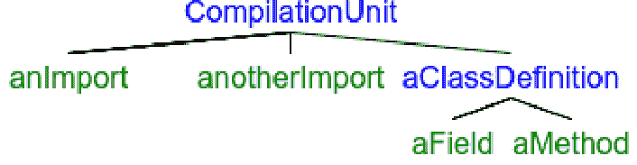
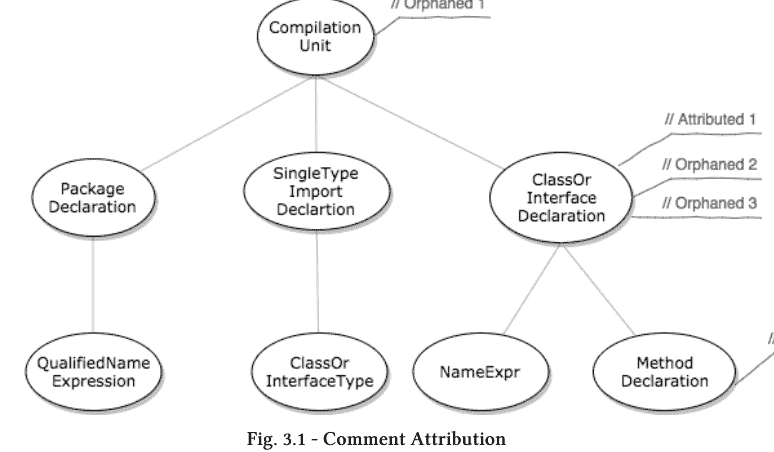
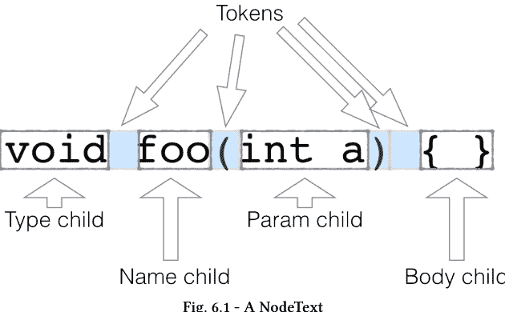

# JavaParser：分析、转换并生成你的 Java 代码库

## 推特此本书！

请在 Twitter 上传播此书，帮助 Nicholas Smith, Danny van Bruggen 和 Federico Tomassetti 推广！

本书建议使用的标签是 `#JavaParser`。

点击此链接在 Twitter 上搜索该标签，了解其他人对这本书的评价：

#JavaParser

## 前言

### 什么是 JavaParser？

在最简单的形式下，JavaParser 允许你在 Java 环境中将 Java 源代码作为 Java 对象表示来与其进行交互。更正式地说，我们将这种对象表示称为抽象语法树（AST）。

此外，它还提供了一种便利机制，通过我们所说的“访问者支持”来遍历树结构。这让开发者能够专注于识别源码中感兴趣的模式，而不是编写繁琐的树代码。

该库的最后一个核心特性是操纵源代码的底层结构。这可以被写入文件，为开发者提供构建代码生成软件的便利。

### JavaParser 不是

尽管该库适合作为此类工具的一部分，但它并不是一个代码重构工具包。这可能是我们看到的关于该库最流行的误解。

可以将该库设为提供一种回答**这段代码是什么？**问题的机制，而你**为什么**以及**如何**选择监控或报告它，取决于你，这位语言工程师。

它不是一个编译器。被库解析的语法上正确的代码并不意味着它就能成功编译。虽然成功编译的代码本身在语法上是正确的，但解析只是编译过程的一个阶段。例如，如果你在没有定义变量 `v` 的情况下引用它，这在语法上是正确的，但在编译过程中会导致语义错误。

### 这本书是写给谁的？

话说直说：绝大多数 Java 开发者。即使不是为了 JavaParser 库，他们可能也会从理解解析器在日常工作中方面能提供的功能中获益。

进一步说明一下，在选择解析源代码的大多数情况下，你要么是想要识别某些东西（通常是代码中的问题），或者是自动化生成代码的方法。这两种实践在很大程度上被认为是为了实现质量和效率的提升；我能自动检测问题吗？我可以更快地生成这段代码吗？所有开发者应该对如何实现这两者都感兴趣。

很可能，你很少会将 JavaParser 库包含在用户软件中。通常，它是一个工具组件的一部分，运行在你的项目源码上，或者可能用于生成最终服务用户的代码。

语言工具可能是我们看到该库用途最常见的例子。即这种“我们可以识别代码中的兴趣点并执行操作”的观点。

更广泛地说，它是为语言工程师和工具开发人员准备的。

作为一个 Java 库，我们假设你对 Java 已有相当的了解。

### 这本书不是写给谁的

那些希望通过本书学习 Java 的人，本书并不会教读者学习 Java。

它也不会让你对如何编写解析器获得深刻的见解，除了用户可能感兴趣的内容之外。

我们还不会深入研究 Java 语法或该库底层的语法定义。希望在该领域获得更多理解的读者应该访问 Java 语言规范¹ 网站。

也许最有争议的是，针对那些对缺乏测试感到心有胆怯的人。和大多数事情一样，测试方法是主观的，本书的目标并不是对该主题提供意见。因此，书中的示例在很大程度上是通过 `main` 方法演示的。

### 如何使用这本书？

本书旨在为使用 JavaParser 库的人士提供学习辅助。

它不是参考指南，我们已尝试为这一目的维护了 JavaDoc²。如果你发现文档欠缺，请在 GitHub 上提问。

我们将书分成了两个部分，第一部分旨在让你快速熟悉抽象语法树（该库的核心组件）以及如何在你的机器上获得运行示例。如果你是初学者，建议阅读第一部分以在该主题上打好基础。

书的第二部分是一个用例集合，提供了关于我们如何看待该库使用的更详细的视角。用例可以无序阅读，也许可以从用户相关的一个开始。尽管读完它们当然没有坏处。

> ¹https://docs.oracle.com/javase/specs/jsls/se8/
>
> ²http://www.javadoc.io/doc/com.github.javaparser/javaparser-core/

### 本书中使用的惯例

*斜体* - 用于介绍主题内的某个重要概念。

**粗体** - 强调主题内的特定概念。

`代码` - 用于高亮程序代码。

### 代码示例

你可以不受限制地使用书中所有的代码示例。

原始可以在 GitHub³ 上找到。

我们感谢，但不要求署名。这通常包括书名和作者。例如：*JavaParser: Visited by Smith, Tommasetti*

### 如何与我们联系

任何问题、意见或担忧请在 Gitter 上访问我们。

关于书籍的反馈：https://gitter.im/javaparser/javaparser

JavaParser 库支持：https://gitter.im/javaparser/javaparser

> ³https://github.com/javaparser/javaparser

## 作者

### Nicholas Smith

Nicholas 是一位经验丰富的软件工程师，目前在伦敦执业。职业生涯中他幸运地因工作旅行过丹麦、印度和意大利。

他的教育背景主要集中在软件工程，拥有学士和硕士学位，后者专攻金融服务。

尽管他尝试过多种语言，事实上他认为自己主要是一个 Java 程序员，一直使用该语言¹³

当空闲时，除了为 JavaParser 项目贡献外，可能会忽略技术博客 nicholaspaulsmith.com 或编写一些能让他提前退休的脑洞计划。

### Federico Tommasetti

Federico 是一位独立的软件架构师，专注于构建语言：解析器、编译器、编辑器、模拟器以及类似的工具。他在博客 tomasetti.me 上分享关于语言工程的思考。

此前他拥有语言工程博士学位，曾在各地工作过（包括 TripAdvisor 和 Groupon），现在他专注于咨询以及向 JavaParser 和 JavaSolver 等开源项目贡献。

### 致谢

我们要感谢 JavaParser 的原始作者：Sreenivasa Viswanath 和 Jú Vilmar Gesser。

此外，最重要的是，我们要感谢围绕 JavaParser 成长的所有贡献者和优秀的社区。今天有几十人发送过补丁，数百人曾在论坛、Stack Overflow、GitHub 和 Gitter 上提过问题。与他们的讨论对于理解 JavaParser 如何使用以及哪些部分需要澄清提供了不可量的帮助。

> *http://nicholaspaulsmith.com
>
> *http://tomasetti.me

# 抽象语法树简析

如果不理解语法树的概念，实际上无法考虑 Java 语言解析器何何用。

让我们先尝试想象，源代码可以表示为一棵树。它们都有共同的起点，从这里开始，分支相互独立地形成，要么作为代码语句，或者在树的情况下作为实际的分枝。就像真实树的树枝一样，将复杂语句分解为较小部分的过程将一直持续，直到我们遇到终端节点或叶子节点。

代表 Java 代码的树将有一个代表整个文件的根节点，连接到根节点的是文件中的所有顶级元素，如 import 声明或类声明；我们可以到达多个节点，代表类的字段或方法。



图 1.1 - 抽象语法树初探

正如真实树上的树枝除了其源头外与其他树枝没有连接一样，代表源代码的树也是如此。人类或编译器理解变量引用或方法调用与源代码的另一部分相关，但语法树并不理解，这是一个重要的区别。

> * 添加相关元素之间的连接（例如方法调用到方法声明，或字段引用到字段）是符号解析器（Symbol Solver）的工作。JavaSymbolSolver 是为了与 JavaParser 工作而创建的符号解析器。

## 一切都是节点

然而，树的比喻只能带我们到这里。

在经典的计算机科学意义上，当我们讨论具有顶点和边的图时（或者在树的情况下讨论有向图），取决于你正在阅读的文献，这些也可以节点和关系的同义词。为了本书的目的，我们使用“节点”一词，因为它被认为不复杂，并且与库类一致。

## 树的规则

有一些简单的规则规定了什么是树。除了根节点外，所有节点将恰好有一个入度关系。根节点为零。所有节点可以有多个出度关系。具有零出度的节点是叶子节点。相反，具有出度的节点被认为是父节点。

## 快速上手

在大多数情况下，你将处理完整的类文件，在这种情况下，`parse` 方法被重载了，可以接受 `Path`、`File`、`InputStream` 和 `String` 并返回一个 `CompilationUnit` 供你使用。

你也可以处理源码片段，尽管为了解析一个 `String`，你需要知道结果的类型以避免解析错误。

例如：

```java
Statement statement = StaticJavaParser.parseStatement("int a = 0;");
```

### CompilationUnit 类

`CompilationUnit` 是你解析的完整且语法正确的类文件的源码的 Java 表达式。

在所述的 AST（抽象语法树）上下文中，你可以将该类类为根节点。

从这里，你可以访问树的所有节点以检查其属性、操作底层的 Java 表达式，或将其用作你定义的访问者（Visitor）的入口点。

### Visitor 类

虽然手动编写代码来直接遍历 `CompilationUnit` 中的 AST 是可行的，但这往往非常费时且容易出错。这很大程度上是因为该过程依赖于递归和频繁的类型检查来实现你的目标。

在大多数情况下，你可能想确定你在寻找什么，然后定义一个对其进行操作的访问者。使用访问者可以很容易地找到所有特定类型的节点，例如所有的方法声明或所有的乘法表达式。

### 简单的 Visitor

如所述，定义一个遍历 AST 并操作你感兴趣的代码中概念的访问者通常是一个好主意。因此，我们从一个简单的访问者作为第一个示例是明智的。

书中的所有代码都可以在附带的仓库¹中获取，欢迎从那里查看工作示例。不过，我们建议自己编写代码是获得该领域直觉的最佳方式。

在这个示例中，我们正在创建一个访问者，它将检查类中的所有方法，并将它们的名称和行长度打印到控制台上。让我们开始吧！

> ¹https://github.com/javaparser/javaparser-visited

#### 项目设置与依赖

首先，在你喜爱的 IDE 中创建一个新项目，并将 JavaParser 库添加到你的类路径中。如果你倾向于使用依赖管理工具，只需在你的构建脚本中添加几行即可。对于 Maven，这些行是：

```xml
<dependency>
  <groupId>com.github.javaparser</groupId>
  <artifactId>javaparser-symbol-solver-core</artifactId>
  <version>LATEST</version>
</dependency>
```

如果我们使用 Gradle 命令行，一行就够了：

```groovy
compile group, 'com.github.javaparser', name: 'javaparser-symbol-solver-core', version: 'LATEST'
```

在编写时，3.18.0 是该库的最新版本。如果你在使用这里的某些示例时遇到问题，请退回到此版本。

上面的依赖项将 Java 解析和求解能力都引入了你的项目中。本书涵盖了这两个库，因此我们建议你都包含它们。

如果你只需要解析功能，可以将 `artifactId` 标签更改为 `javaparser-core`。

#### 创建 CompilationUnit

现在是写一些代码了。你可以查看附录 A 并创建 `ReversePolishNotation.java` 类。包名将是 `org.javaparser.examples`。

接下来，创建第二个类，名称和包名由你决定。我们将使用 `org.javaparser.examples.VoidVisitorStarter.java`。

现在我们已经完成了设置工作，是时候为 `ReversePolishNotation` 类创建一个 `CompilationUnit` 或解析后的 AST 了。请随时复制下面的代码：

```java
private static final String FILE_PATH = "src/main/java/org/javaparser/samples/ReversePolishNotation.java";

public static void main(String[] args) throws Exception {
    CompilationUnit cu = StaticJavaParser.parse(new File(FILE_PATH));
}
```

#### 实现 VoidVisitor

这里有几行代码，让我们过来看它们：

我们创建了一个自定义 `String`，指向我们的 Java 文件的路径。由于两个文件都存在于项目中，为了简洁，我们使用了相对路径而不是文件系统根路径。

在我们的方法内部，我们通过调用 `StaticJavaParser` 类的静态 `parse` 方法来实例化 `CompilationUnit` 类型；该方法使用我们之前定义的路径接收一个 `FileInputStream`。

为了方便，尽管我们正在创建一个 `CompilationUnit`，但我们没有直接使用 `FileInputStream`，而是使用了 `File` 对象。

```java
private static class MethodNamePrinter extends VoidVisitorAdapter<Void> {
    @Override
    public void visit(MethodDeclaration md, Void arg) {
        super.visit(md, arg);
        System.out.println("Method Name Printed: " + md.getName());
    }
}
```


现在我们有了继承 `VoidVisitorAdapter` 的新类 `MethodNamePrinter`。该类还接受一个类型参数，它与第二个参数相关。不过，我们在第二个示例中了解到这为什么有用，因为我们在这里不会使用该功能。

一旦定义了类，我们就定义了 `visit` 的实现，我们对方法声明感兴趣，所以第一个参数类型是 `MethodDeclaration`。如果我们对其他内容感兴趣，例如 `ImportDeclaration`，我们将使用它作为参数。第二个参数是 `VoidVisitorAdapter` 的泛型类型。

对于我们的实现，我们随后使用 `MethodDeclaration` 的 `getName` 方法将方法名称打印到控制台上。

最后，我们需要为 `main` 方法提供主体，我们在其中实例化 `MethodNamePrinter` 并为它提供要操作的 `CompilationUnit`。此外，第二个参数传递了 `null`，我们不会使用它。

```java
VoidVisitor<Void> methodNameVisitor = new MethodNamePrinter();
methodNameVisitor.visit(cu, null);
```

### 带状态的简单访问者

在遍历过程中，能够维护一份到目前为止所看到的记录通常是有用的。这可能对我们当前的决策过程有所帮助，或者我们可能想要收集所有被认为感兴趣的出现情况。

`visit` 方法的第二个参数用于提供一种简单的状态机制，该机制在树的遍历过程中传递。这让我们有了让访问者执行某种操作的选项，访问者的责任是收集项，即方法名。然后，调用类将收集到的方法名，后续操作由它们来决定。


让我们在实践中看看这一点，创建另一个访问者类，这次它将用 `List<String>` 参数化。

```java
private static class MethodNameCollector extends VisitorAdapter<List<String>> {
    @Override
    public void visit(MethodDeclaration md, List<String> collector) {
        super.visit(md, collector);
        collector.add(md.getNameAsString());
    }
}
```


之前我们将该参数称为“状态”，但这会在人们的脑海中引起负面印象。因此，将此对象视为“收集器”可能更好，以便它更容易被接受。在我们的访问方法中，我们添加收集器对象的 String 名称，而不是打印它。

好的，现在我们可以将第二个访问者添加到 `main` 方法中，以比较结果。

```java
List<String> methodNames = new ArrayList<>();
VoidVisitor<String> methodNameCollector = new MethodNameCollector();
methodNameCollector.visit(cu, methodNames);
methodNames.forEach(n -> System.out.println("Method Name Collected: " + n));
```


你可以看到，我们额外实例化了一个 `List` 传递给 `visit` 方法。我们在 `main` 中完成了打印到控制台的工作，而不是期望访问者去做。

运行 `main` 时我们的新输出应该是：

## 快速访问

- 1 Method Name Printed: calc
- 2 Method Name Printed: memoryRecall
- 3 Method Name Printed: memoryClear
- 4 Method Name Printed: memoryStore
- 5 Method Name Collected: calc
- 6 Method Name Collected: memoryRecall
- 7 Method Name Collected: memoryClear
- 8 Method Name Collected: memoryStore

虽然在第二个例子中分离关注点被认为是一种良好的实践，但我们也应该愿意务实，第一种方法也没有问题。因为一个语言工程师可能想要快速编写一些在代码库中只使用一次的丢弃性代码。在这种情况下，也许越快的整洁解决方案越是上之选。

这些是两个简单的例子，但我们希望你能看到从这里扩展的巨大潜力。在这里，我们可以轻松地调整此代码以处理长度超过 50 行的方法。从我们用于收集名称的 `String`，我们可以扩展到使用一个 DTO¹ 对象，该对象收集行数以及该方法是否有 JavaDoc。这样我们就在了编写自己的源码分析器的道路上。

> ¹DTO 代表数据传输对象（Data Transfer Object）。它是用于存储数据的对象。

## 简单的修改访问者

Java 语言版本 7 中一个不为人知的次要变化是，可以在数值字面量中使用下划线表示。

虽然这不是一个杀手级特性，因为其应用相当狭窄，但它对可读性特别有用。

```java
public static int ONE_BILLION = 1000000000;
public static int TWO_BILLION = 2_000_000_000;
```

如果你在一个需要定义任意大数值的代码库中工作，你会发现这种约定有其优势。

我们将再次使用我们的反向波尔表达式类作为基础，如果你跳过了书的这部分，可以在附录 A 中找到。它恰好有一个以 Java 7 之前的风格定义的成员变量。

创建一个带有 `main` 方法的骨架类，我们将其命名为 `ModifyingVisitorStarter`。和之前一样，运行此类在成功解析源码后，除了绿色条之外不应该产生产生。

## 快速访问

16

```java
1 private static String FILE_PATH = "src/main/java/javaparser/samples/Reverse
2 ePolishNotation.java";
3
4 public static void main(String[] args) throws Exception {
5
6 CompilationUnit cu = StaticJavaParser.parse(new FileInputStream(FILE_PATH));
7 }
```

## ModifyingVisitorStarter.java

我们之前在 `VoidVisitor.java` 中创建的访问者是以 `VoidVisitorAdaptor` 为基础的，但我们并没有更改 AST。然而，我们想要更改底层 AST，因此我们将创建一个 `ModifyingVisitor` 和 `IntegerLiteralModifier` 的子类。为了简单，我们在在这个例子中关注整数。

```java
1 private static class IntegerLiteralModifier extends ModifyingVisitor<Void> {
2
3 @Override
4 public FieldDeclaration visit(FieldDeclaration fd, Void arg) {
5 super.visit(fd, arg);
6 return fd;
7 }
8 }
```

## ModifyingVisitorComplete.java

由于类是参数化的，并且像第一个例子一样，我们不关心在遍历之间传递状态，因此我们将其设置为 `Void`。

我们看到的与之前的 `VoidAdapter` 示例相比的区别是，我们的 `visit` 方法现在有一个返回类型 `FieldDeclaration`。这与 `visit` 方法的第一个参数类型也匹配，基本上意味着此访问者将一对一地替换字段声明。

我们决定对 `FieldDeclaration` 类成员而不是实例变量进行操作。虽然你可以想象定义值为大数字的实例变量，但那些可能是你代码中的“魔数”，你可能需要不同形式的补救措施，例如变量提取。

在上面的初始示例中，我们返回了未修改的 `FieldDeclaration` 对象。一旦运行 `main`，应该能够成功执行而没有明显的结果。

接下来，为了实现向字面量表示添加下划线的目标，我们将定义一个带有正则表达式的辅助方法。

向你的类中添加以下正则表达式：

## 快速访问

```java
private static final Pattern LOOK_AHEAD_THREE = \
Pattern.compile("\\d(?:\\d{3})*$");
```

## ModifyingVisitorComplete.java

然后是辅助方法

## ModifyingVisitorComplete.java

这给了我们一个简单的处理器，在删除任何下划线后，每三个字符将插入一个下划线。例如，对于整数来说这足够了；如果我们的访问者旨在处理浮点数，我们还需要考虑点、指数等。

现在我们为我们的 `visit` 方法中充实内容，在 `super` 调用和 `return` 语句之间添加以下代码行：

```java
fd.getVariables().forEach(v ->
v.getInitializer().ifPresent(i ->
(i instanceof IntegerLiteralExpr)
v.setInitializer(formatWitherscores(i.getValue()))));
```

## ModifyingVisitorComplete.java

我们做的第一件事是迭代字段声明中的变量。如果这看起来很奇怪，请记住尽管罕见，我们可以在 Java 中声明变量 a、b、c。

我们将确定变量是否已初始化。`getInitializer` 返回一个 `Optional`，所以我们使用 `ifPresent` 方法，传递一个 lambda 在真情况下执行。这一次，这检查变量是否是 `IntegerLiteralExpr` 的实例。我们可以将其扩展到涵盖其他数值，以实现完整。

一旦我们知道正在处理整数字面量，我们将初始值设置为下划线格式方法的结果。

现在我们定义了访问者，可以更新 `main` 方法实例化并使用编译单元调用 `visit` 方法。

## 快速访问

```java
1 ModifierVisitor<??> numericLiteralVisitor = new IntegerLiteralModifier();
2 numericLiteralVisitor.visit(cu, null);
```

## ModifyingVisitorComplete.java

我们可以使用 `CompilationUnit` 的 `toString` 将类的源码打印到控制台。

```java
1 System.out.println(cu.toString());
```

## ModifyingVisitorComplete.java

滚动控制台输出，你应该看到我们修改后的字面量值。

```java
// 这个是做什么的？
public static int ONE_BILLION = 1_000_000_000;
private double memory = 0;
```

## ModifyingVisitorComplete.java

成功！我们的代码现在得到了改进，后继的人读起来会更容易了。

## 简单的注释报告

作为与之前的示例相比的一个令人愉快的变化，我们现在不会创建一个访问者。虽然我们仍然会从义务的 `main` 方法开始，但我们将使用 `CompilationUnit` 上的 `getAllContainedComments` 方法。这将为我们提供文件中所有注释的输出。稍后我们可以以某种有趣的方式继续使用它。

```java
private static String FILE_PATH = "src/main/java/org/javaparser/samples/ReversePolishNotation.java";

public static void main(String[] args) throws Exception {

    CompilationUnit cu = StaticJavaParser.parse(new File(FILE_PATH));

    List<Comment> comments = cu.getAllContainedComments();

}
```

## CommentReporter.java

我们目前为止所使用的 Visitor 类并没有提供获取所有注释的机制，因为它们作用于特定的节点类型。相反，注释往往会横穿我们的整个代码，它们的位置和属性实际上可以出现在代码的任何地方。

所有的 Node 对象都有一个 `getComment` 方法可以调用以获取注释，但对于给定的节点，您需要手动遍历树。考虑到这一点，该库提供了一个便利方法：`CompilationUnit` 上的 `getAllContainedComments`，用于获取所有注释。

现在我们已经在代码中有了一份注释列表，让我们对它们做一些更有意义的事情吧。从解析的角度来看，处理注释时最大的挑战之一是注释归属于哪里，即它说明了哪一个节点。在某些情况下，注释位于某没有明显属性的行上，在这种情况下，解析器将其判定为孤儿注释（orphan）。

从我们的注释列表中，我们不仅要报告它们的文本内容和类型（例如它们是 Block、Line 还是 JavaDoc 风格的注释），还要报告它们是否为孤儿注释。

在我们准备的启动类中，添加一个内部类，用于表示我们的报告项。

```java
private static class CommentReportEntry {
    private String type;
    private String text;
    private int lineNumber;
    private boolean isOrphan;

    CommentReportEntry(String type, String text, int lineNumber, boolean isOrphan) {
        this.type = type;
        this.text = text;
        this.lineNumber = lineNumber;
        this.isOrphan = isOrphan;
    }
}
```

## A Flying Visit

```java
@Override
public String toString() {
    return lineNumber + " |" + type + " |" + isOrphan + " |" +
           text.replaceAll("\n","").trim();
}
```

## CommentReporter.java

这里没有什么特别的，它只是一个我们在报告中感兴趣的注释属性的简单容器。`toString` 方法创建了一个管道分隔的表示。它还去除了注释中的空白字符，使其更符合控制台的习惯。

现在让我们修改代码来创建一个 `CommentReportEntry` 集合，通过将我们感兴趣的字段映射到 JavaParser 的 `Comment` 类型。

```java
List<CommentReportEntry> comments = cu.getAllContainedComments()
  .stream()
  .map(p -> new CommentReportEntry(
      p.getClass().getSimpleName(),
      p.getComment(),
      p.getRange().map(r -> r.beginLine).orElse(-1),
      !p.getCommentedNode().isPresent()))
  .collect(Collectors.toList());

comments.forEach(System.out::println);
```


## CommentReporterComplete.java

我们使用“类”名称作为注释的类型，使用内容作为文本。要获取行号，我们使用了所有节点都包含的 `Range` 对象。`Range` 提供了源代码的位置信息，包括行的起始和结束位置，以及列注释。最后，为了确定注释是否为孤儿注释，我们访问了 `CommentedNode`。`CommentedNode` 是一个 Java `Optional`，因此需要调用 `isPresent` 来检查其存在性；如果一个节点没有对应的注释节点，我们将其视为孤儿注释。

在这个示例中，我们从注释的角度出发来识别它是否归属于某个特定节点。我们也可以从节点的角度出发，从给定的节点我们可以使用 `node.getComment` 方法或 `node.getOrphanComments`。

运行应用程序应该返回如下所示的版本：


## A Flying Visit

| 行号 | 类型 | 是否孤儿 | 文本 |
| :--- | :--- | :--- | :--- |
| 81 | BlockComment | true | EOF |
| 7 | JavadocComment | false | * A Simple Reverse ... |
| 12 | LineComment | false | 这是做什么的? |
| 17 | JavadocComment | false | * Takes reverse ... |
| 59 | JavadocComment | false | * Memory Recall ... |
| 68 | JavadocComment | false | * Memory Clear ... |

以上就结束了关于如何开始使用 JavaParser 库的简要介绍。希望这激发了你深入探索自己 Java 代码库的有趣想法。

# 注释 - 此处有龙

关于这个主题该从何开始？—— 似乎是一个经典的程序员比喻。我认为，作为一个开发者社区，花在讨论注释解析的想法上的时间比花在 JavaParser 项目中任何其他功能上的都要多。

很难开始，也许它的尾巴 [恶龙] 尚未结束。在写本文时，该库的下一个主版本计划从底层开始重构这些行为。

注释 - 此地有龙

24



所有 `Node` 对象都通过 `getOrphanComments` 具体暴露它们的孤立注释；但它们也会作为 `getAllContainedComments` 的一部分返回。

## 使用注释

在大多数情况下，我们倾向于使用访问者（visitor）来满足你的需求，我们之前在快速入门章节中见过这方面的示例：快速访问（A Flying Visit）。如果你直接到了这一章，应该回去参考。

除了访问者之外，在代码中处理注释的另一种好方法是 `CompilationUnit` 的 `getAllContainedComments` 方法。如果你当前承担的任务主要与注释有关，该方法可以为你提供一个以注释为中心的代码视图。返回的列表允许你在 AST 中导航 `Node`，它是通过 `commentedNode` 关系进行关联的。

此外，注释本身也是 `Node` 类型，因此它们是编译单元中的一等公民。它们持有的与任何 AST 节点关于位置的信息基本相同。它们也有一些区别：它们不能被赋予注释，也没有子节点，但这是符合直觉的。因此通常情况下，你可以像处理任何其他节点一样对它们进行检查和操作。

## 解析选项

到目前为止，我们仅通过直接调用 `StaticJavaParser` 类上的静态 `parse` 方法来创建 `CompilationUnit`。这是因为假设解析器有很多合理的默认值；然而，在处理注释解析时，有几个旋钮是可以调整的。

注释解析默认开启，如果你决定禁用它，可以提供一个 `setAttributeComments` 设置为 `false` 的 `ParserConfiguration` 实例。这样做将加快解析，尽管在处理单个源文件时这种差异并不明显，但如果你打算解析大量文件，这值得记住。

```java
ParserConfiguration parserConfiguration = new ParserConfiguration()
    .setAttributeComments(false);

StaticJavaParser.setConfiguration(parserConfiguration);
```

## ConfigurationOptions.java

第二个可用选项允许你控制是否考虑位于空行之前的注释。
考虑以下代码：

```java
class A {

  // Blah

  boolean f() { return false }

}
```

在此实例中，如果启用了注释分配，注释 `// Blah` 将归属于方法 `f`。

它真的属于该方法吗，还是在描述后续行中将发生什么？像很多事情一样，答案可能是“取决于情况”。

JavaParser 提供的另一种行为是将注释归属于其包含的节点。在上面的例子中，对于类 `A`，它将作为 `OrphanComments` 列表中的一项。

默认情况下，解析器将使用前一种行为，即将注释归给后续的节点。如果你希望将其视为孤立注释，请使用以下配置。

```java
ParserConfiguration parserConfiguration = new ParserConfiguration()
    .setDoNotAssignCommentsPrecedingEmptyLines(true);
```

## ConfigurationOptions.java

## 注释实践

所以，这里我们组合了一个有趣的小类，用来夸大之前提到的关于代码注释是“监狱规则”（即一切随心所欲）的观点。信不信由，这些实际上是我们见过的一些比较理智的例子了。

让我们解释一下这个类本身，以免分散我们真正目的（注释）的注意力。对应我们的比喻，我们使用线程来竞争谁先/后写入控制台。我们定义了一个简单的类，包含一个字段，每个线程将作为该线程的个人口号。当为线程调用 `run` 时，它会打印它的口号。`main` 方法实例化了三个带有不同口号的线程并调用了 `start` 方法。大多数情况下，这段代码执行将按照你预期的方式运行，但并没有保证！
尽管在单个类中拥有各种注释特别反常，但这些情况确实会出现，而且有些可能是违背直觉的。

```java
package com.github.javaparser;

public class PrisonRules /* 可能该用 Runable? */ extends Thread {

    @Deprecated

    // What is

    // dibbs?

    private final String dibbs;

    public PrisonRules(final String dibbs) {

        this.dibbs = dibbs;

    }

    @Override // 这真的重写了吗？

    public void run() {

        System.out.println(dibbs);

    }

    public static void main(String/* 我们应该在这里传递参数 */ args) {

        Thread t1 = new Thread(PrisonRules("mine") /* 这应该先运行 */);

        Thread t2 = new Thread(PrisonRules("yoink"));

        Thread t3 = new Thread(PrisonRules("finders keepers!"));

        // 此地有龙

        t1/*(\*_*)*/.start();

        t2/*(@_)*/*(~)*/start();

        /** 我们需要更多 JavaDocs! */

    }

    t3.start();

}
```

# 注释 - 此地有龙

## PrisonRules.java

为了好玩，我们将此制作成测验，所有优秀的学习材料都需要测验。对于每个注释，尝试判断该注释将归属于 AST 的哪个节点。之后我们将详细地回顾答案。

- 1. `/* Maybe use Runnable? */` 归属于：
   1. `ClassOrInterfaceDeclaration`
   2. `ClassOrInterface` "Thread"
   3. `SimpleName` "PrisonRules"
   4. 无，它应该是孤立的
- 2. `// What is` 归属于：
   1. `LineComment` "dibbs"
   2. `MarkerAnnotationExpr` "Deprecated"
- 3. `// dibbs?` 归属于：
   1. `VariableDeclarator`
   2. `ClassOrInterface`
   3. `SimpleName`
   4. 无，它应该是孤立的
- 4. `// Is this really overridden?` 归属于：
   1. `MarkerAnnotationExpr` "Override"
   2. `MethodDeclaration`
   3. `VoidType`
   4. 无
- 5. `/* We should pass arguments in here */` 归属于：
   1. `ArrayType`
   2. `BlockStmt`
   3. `Parameter`
   4. 无，它应该是孤立的
- 6. `/* This should run first */` 归属于：
   1. `ObjectCreationExpression`
   2. `ObjectCreationExpression` (重复)
   3. 无，它应该是孤立的
- 7. `// Here Be Dragons` 归属于：
   1. `NameExpr`
   2. `MethodCallExpression`
   3. `ExpressionStmt`
   4. 无，它应该是孤立的
- 8. `/*(***)*/` 归属于：
   1. `NameExpr`
   2. `MethodCallExpression`
   3. `SimpleName`
   4. 无，它是孤立的
- 9. `/*(@_)**/` 归属于：
   1. `NameExpr`
   2. `MethodCallExpression`
   3. `SimpleName`
   4. 无，它是孤立的
- 10. `/** We need more JavaDocs! */` 归属于：
   1. `MethodDeclaration`
   2. `MethodCallExpression`
   3. `ExpressionStmt`
   4. 无

# 答案：

问题 1，答案是 1，`ClassOrInterfaceDeclaration`。当寻找块注释时，我们寻找的是后续节点。在此实例中，`ClassOrInterfaceDeclaration` 是包含节点。`SimpleName` 是前一个节点。

问题 2，答案是 4，它是孤立的。`MarkerAnnotationExpr` 位于上一行的行首，因此不会归属于它。注释节点本身不能被赋予注释，所以不是 `LineComment`。`FieldDeclaration` 以注解开头，它是包含节点，你会在通过 `orphanComments` 引用的列表中找到它。

问题 3，答案是 1，`VariableDeclarator`，它是此实例中 `SimpleName` 和 `ClassOrInterface` 类型的父节点。

问题 4，答案是 1，`MarkerAnnotationExpr` "Override"。与块注释不同，行注释寻找同一行中的前一个节点。

问题 5，答案是 4，注释定义在 `ArrayType` 标记内；因此它是父节点，且孤立注释可以在该处找到。

归属于（attributed to）。`Parameter` 节点是 `ArrayType` 的父节点，尽管 `BlockStmt` 在词法上随其之后，但它是 `Parameter` 的兄弟节点。

问题 6，答案是 3，`ObjectCreationExpression` "new Thread" 的孤立节点。与问题 5 的原因类似，在树的同一层没有后续节点可以归属于该注释。因此，它是包含节点中的一个孤立注释。

问题 7，答案是 3，`ExpressionStmt` "t1.start()"。当行注释（LineComment）没有前置节点时，它将寻找下一个节点。`NameExpr` 和 `MethodCallExpr` 都是 `ExpressionStmt` 的子节点。

问题 8，答案是 3，`SimpleName` "start"。如果你一直很关注，应该能拿到这道题。`NameExpr` 位于块注释之前，因此不被考虑。`MethodCallExpr` 是包含父节点。`SimpleName` "start" 是后续节点并被赋予了注释。

问题 9，答案是 4，一个孤立节点。与上一行代码不同，有两个注释竞争归属于 `SimpleName`。随后的注释 "(-_)" 将其变为孤立状态（坏掉的 Lenny！），并将 `SimpleName` 作为其父节点。请记住——节点与注释之间的关系是 1:1。

问题 10，答案是 3，`ExpressionStmt` "t3.start()"。Javadoc 注释的归属方式与块注释相同；尽管习惯上将它们应用于类、接口和方法，但这并不是强制执行的。

# 格式化打印与词法保留

你可以将 JavaParser 用于不同的用途。其中最常见的两种是代码生成和代码转换。在这两种情况下，你最终都会生成 Java 代码，可能会将其存储在带有 .java 扩展名的文件中。

对你的 `CompilationUnit` 调用简单的 `toString()` 将返回一个字符串，你可以用它来写入源码。我们面临的问题是：它将如何格式化来自 AST 的代码？

答案是两种方法之一：

- 使用格式化打印（pretty-printing）
- 使用词法保留的打印（lexical-preserving printing）

所以让我们考虑它们之间的区别。

## 什么是格式化打印？

格式化打印意味着我们将代码写成源码，其文本表示将以一种整洁且标准的方式打印。

例如，如果你正在解析一个看起来如下所示的现有 java 类：

```java
class A { int
a; }
```

那么之后你决定使用 JavaParser 对其进行格式化打印，你将得到代码的如下表示：

```java
class A {

    int a;

}
```

## 什么是词法保留的打印？

词法保留打印意味着在打印时保留原始布局。当我们编写代码时，有些信息对于编译器来说没有严格的意义，但对人类来说非常重要。即：空格和注释的位置。

如果你解析了一些代码并使用词法保留打印打印回来，你将得到与解析时相同的代码。如果你解析了一些代码，对其进行修改，然后使用词法保留打印打印回来，你将得到与原始代码非常接近的代码，更改仅限于你显式修改的节点。

即使对于一个通过程序化构建而非从源码解析而来的 AST，你也可以使用词法保留打印。在这种情况下，没有原始布局需要保留，代码将默认采用格式化打印的形式。同样，当你解析代码并向 AST 中添加一些程序化创建的新节点时：你解析的代码部分将带有布局信息，而你创建的节点将不会，它们将被进行格式化打印。

## 在格式化打印和词法保留打印之间选择

我们已经看到，使用 JavaParser 从 AST 生成代码时有两种不同的风格。下一个问题是，我们什么时候该用一种，什么时候该用另一种？

根据我们所见，许多情况都涉及使用 JavaParser 对大型代码库进行转换。在这种情况下，你通常会想要词法保留打印。原因是，所有未修改的代码都将保持原样。

# 格式化打印与词法保留

```java
public static void main(String[] args) {

    String code = "// Hey, this is a comment\n\n// Another one\n\nclass A { }";

    CompilationUnit cu = StaticJavaParser.parse(code);

    LexicalPreservingPrinter.setup(cu);

    System.out.println(LexicalPreservingPrinter.print(cu));

}
```

LexicalPreservationStarter.java

乍一看，这段代码与 JavaParser API 的其他部分相比似乎更为复杂。请考虑到词法保留（lexical-preserving）是一个最近添加的功能，我们未来可能会找到简化 API 方法。也欢迎提交自己的建议。

如果我们使用上述代码来解析并打印以下内容：

```java
// Hey, this is a comment


// Another one


class A ()
```

我们将得到完全相同的结果。这正是词法保留的意义所在吗？
不，实现词法保留的困难之处在于支持在更改 AST（抽象语法树）的同时，保留并演进原始的布局。
如果我们更改类名呢？

```java
// use LexicalPreservingDeclaration.setup

ClassOrInterfaceDeclaration myClass = cu.getClassByName("A").get();

myClass.setName("MyClassName");
```


System.out.println(LexicalPreservingPrinter.print(cu));

```
LexicalPreservationComplete.java
```

我们将得到：

```
// Hey, this is a comment
//
// Another one
//
// class MyClassName {}
```

然后我们可以添加一个修饰符，使类变为公共（public）。

```java
ClassOrInterfaceDeclaration myClass = cu.getClassName("A").get();
myClass.setName("MyClassName");
myClass.addModifier(Modifier.Keyword.PUBLIC);
System.out.println(LexicalPreservingPrinter.print(cu));
```

```
LexicalPreservationComplete.java
```

结果将是：

```
// Hey, this is a comment
//
// Another one
//
// public class class MyClassName {}
```

最后，如果我们想指定包呢？

```java
ClassOrInterfaceDeclaration myClass = cu.getClassName("A").get();
myClass.setName("MyClassName");
myClass.addModifier(Modifier.Keyword.PUBLIC);
cu.setPackageDeclaration("org.javaparser.samples");
System.out.println(LexicalPreservingPrinter.print(cu));
```

```
LexicalPreservationComplete.java
```

这将为你得到如下结果：

```java
package org.javaparser.lexicalpreservation.examples;
// Hey, this is a comment
// Another one
public class MyNewClassName {}
```

其核心思想是，从初始设置开始，你只需要正常使用 JavaParser，而在后台，原始文本会以完全透明的方式通过词法保留进行更新。

你不需要理解它的内部工作原理，除非你对此很好奇；如果是的话，下一节将适合你阅读。

## 工作原理：NodeText 与具体语法模型 (Concrete Syntax Model)

我们之前描述过词法保留存储了初始文本，这是对发生过程的某种简化。词法保留实际上执行的是为每个节点创建一个 `NodeText`。`NodeText` 基本上是一个包含令牌（tokens）或子节点占位符的列表。

例如，如果你考虑这个方法声明：

```java
void foo(int a) { }
```

它的 `NodeText` 看起来如下：



如果对不同的元素进行排序：

1. child(`void`)
2. token(`space`)
3. child(`name`)
4. token(`lparen`)
5. child(`param#0`)
6. token(`rparen`)
7. token(`space`)
8. child(`body`)

现在假设你向此方法添加了一个参数。会发生什么？我们需要更新与 `MethodDeclaration` 关联的 `NodeText`。

词法保留设置为所有节点附加了观察者。在每次更改时，我们都会收到通知，并计算该节点在更改后的样子，并将这些修改更新到 `NodeText` 中。

为了理解节点更改后的样子，我们使用了 `ConcreteSyntaxModel`（具体语法模型）。

## 什么是具体语法模型？

你可能会好奇什么是具体语法模型（CSM）：它定义了一个节点通常的模样。具体语法模型解释了我们使用什么来“反解析”一个 AST 节点并将其转换成什么。

`MethodDeclaration` 的具体语法模型看起来如下：

```java
concreteSyntaxByClass.put(MethodDeclaration.class, sequence(
   orphanCommentsBeforeThis(),
   comment(),
   memberAnnotations(),
   modifiers(
     conditional(ObservableProperty.DEFAULT, FLAG, sequence(GeneratedJavaParserConstants.DEFAULT, space))),
     typeParameters(),
     child(ObservableProperty.TYPE, space()),
     child(ObservableProperty.NAME, token(GeneratedJavaParserConstants.LPAREN,
     list(ObservableProperty.PARAMETERS, sequence(comma, space()), none)),
   token(GeneratedJavaParserConstants.RPAREN),
   list(ObservableProperty.THROWN_EXCEPTIONS, sequence(comma, space)),
   sequence(space),
   child(ObservableProperty.BODY, sequence(space))
));
```

# 格式化打印与词法保留

（注：此处 OCR 文本似乎存在重复或损坏片段，但根据文档流，该部分继续对 CSM 结构的解释。）

其核心思想是，从初始设置开始，你只需要正常使用 JavaParser，而在后台，原始文本会以完全透明的方式通过词法保留进行更新。

# 符号与引用的解析

思考最后一点：如果 `a` 是一个 `int`，那么 `a + 1` 的结果将是一个 `int`。然而，`a` 可能是一个 `String`，在这种情况下，我们不是在加 1，而是将其字符串表示连接到 `a` 所代表的字符串上。换句话说，仅通过 AST 无法判断我们正在执行哪种操作：代数加法还是字符串拼接？这取决于 `a` 的类型。为了回答这些问题，我们需要解析引用。我们必须将 `a + 1` 中的引用连接到被引用的 `a` 的声明。

现在考虑以下情况：

```java
class Bar {
    private String a;
    void aMethod() {
        float a;
        while (true) {
            int a;
            a = a + 1;
        }
    }
}
```

```
Bar.java
```

这里有很多 `a` 符号。解析引用意味着找到正确的符号，这可能很困难。相信我们，情况可能会变得非常复杂。幸运的是，你可以使用 JavaParser Symbol Solver 来解析 JavaParser AST 元素之间的引用。

## 如何设置 JavaParser Symbol Solver？

从现在开始，我们将 JavaParser Symbol Solver 称为 'JavaSymbolSolver'，命名是一件困难的事，而且我们并不总是第一次就做对。未来的版本可能会重构类名。

JavaSymbolSolver 随 JavaParser 核心库一起发布。这是因为每个版本的 JavaSymbolSolver 都能保证与特定版本的 JavaParser 配合。在历史上，情况并非如此，库是分开分发的。

如果你之前选择不包含 JavaSymbolSolver 而仅在依赖项中包含了 `javaparser-core` get，你将需要更新到绑定的版本。

```
dependencies {
  compile group: 'com.github.javaparser', name: 'javaparser-symbol-solver-core', version: 'LATEST'
}
```

或者如果你觉得 Maven 的冗长让你更舒服，这里：

```xml
<dependency>
  <groupId>com.github.javaparser</groupId>
  <artifactId>javaparser-symbol-solver-core</artifactId>
  <version>LATEST</version>
</dependency>
```

## 如何获取引用的类型：第一个示例

让我们考虑最初的示例。我们如何获取被赋值值的类型？
这是我们想要解析的代码：

```java
class Bar {
  private String a;
  void aMethod() {
    while (true) {
      int a = 0;
      a = a + 1;
    }
  }
}
```


这是获取获取类型的代码：

```java
public class GetTypeOfReference {
    private static final String FILE_PATH = "src/main/java/org/javaparser/examples/chapter5/Bar.java";
    public static void main(String[] args) throws FileNotFoundException {
        TypeSolver typeSolver = new CombinedTypeSolver();
        JavaSymbolSolver symbolSolver = new JavaSymbolSolver(typeSolver);
        StaticJavaParser
            .getConfiguration()
            .setTypeSolver(symbolSolver);
        CompilationUnit cu = StaticJavaParser.class.parse(new File(FILE_PATH));
        cu.findAll(AssignExpr.class).forEach(ae -> {
            ResolvedType resolvedType = ae.calculateResolvedType();
            System.out.println(ae.toString() + " is a: " + resolvedType);
        });
    }
}
```


输出将是：Type of a = a + 1 is PrimitiveTypeUsage(name='int')
这一行对你可能看起来神秘：

```
TypeSolver typeSolver = new CombinedTypeSolver();
```

我们将在下一段中查看什么是 `TypeSolver`。

## 指定查找类型的位置

在在上一个示例中，我们看到了对同一个 AST 中元素的引用，即在同一个 Java 源文件中的引用。现实中的情况往往比这更复杂，引用通常涉及其他文件。
考虑此情况：

```java
class MyClass extends SuperClass {
    public void returnSomeValue() {
        System.out.println(aField.size());
    }
}
```

`aField` 来自于哪里？我们不知道，它可能是 `MySuperClass` 中定义的字段。或者 `MyClass` 继承了另一个名为 `MyExtraSuperClass` 的类，而该类定义了名为 `aField` 的字段。

所以我们需要检查 `MyClass` 来弄清楚。嗯，这正是 JavaSolver 为我们做的事情。然而，JavaSolver 需要知道去哪里查找类。类可能：

- 在 Java 源文件中，如果它们是我们正在编译的类
- 在某些库的类文件或 JAR 包中
- 在 JDK 中，对于 `java.lang.Object` 或 `java.lang.String` 等类

根据你的领域，有不同的 TypeSolvers 需要传递给 JavaSolver。
`JarTypeSolver`：此 TypeSolver 在 JAR 包内查找类。
`JavaTypeSolver`：此 TypeSolver 在源文件中查找类。
`ReflectionTypeSolver`：此 TypeSolver 查找如 `java.lang.Object` 类的类。
`CombinedTypeSolver`：此 TypeSolver 组合了多个 TypeSolvers。

## 使用绝对名称解析类型

考虑这个示例：

```java
import com.github.javaparser.resolution.declarations.ResolvedTypeDeclaration;
import com.github.javaparser.symbolsolver.types.TypeSolver;
import com.github.javaparser.symbolsolver.typesversvers.CombinedTypeSolver;
import com.github.javaparser.symbolsolver.typesversvers.ReflectionTypeSolver;
import com.github.javaparser.symbolsolver.typesversvers.JavaTypeSolver;
import com.github.javaparser.symbolsolver.typesversvers.JavaSymbolSolver;
import com.github.javaparser.ast.StaticJavaParser;
import com.github.javaparser.ast.CompilationUnit;
import com.github.javaparser.ast.expr.AssignExpr;
import com.github.javaparser.resolution.types.ResolvedType;
import java.io.File;
import java.io.FileNotFoundException;

class UsingTypeSolver {
  public static void showTypeDeclaration(ResolvedTypeDeclaration declaration) {
      System.out.println(String.format("== %s =", declaration.getQualifiedName()));
  }
  public static void main(String[] args) {
      TypeSolver typeSolver = new ReflectionTypeSolver();
      JavaSymbolSolver symbolSolver = new JavaSymbolSolver(typeSolver);
      StaticJavaParser.getConfiguration().setTypeSolver(symbolSolver);
      CompilationUnit cu = StaticJavaParser.class.parse(new File("src/main/java/org/javaparser/examples/chapter5/Bar.java"));
      cu.findAll(AssignExpr.class).forEach(ae -> {
          if (ae.getType().resolve() instanceof ResolvedTypeDeclaration) {
              showTypeDeclaration((ResolvedTypeDeclaration) ae.getType().resolve());
          }
      });
  }
}
```

```java
import com.github.javaparser.resolution.declarations.ResolvedTypeDeclaration;
import com.github.javaparser.symbolsolver.types.TypeSolver;
import com.github.javaparser.symbolsolver.typesversvers.CombinedTypeSolver;
import com.github.javaparser.symbolsolver.typesversvers.ReflectionTypeSolver;
import com.github.javaparser.symbolsolver.typesversvers.JavaTypeSolver;
```


# 使用类型解析器

```java
import com.github.javaparser.symbolsolver.typesversvers.JavaSymbolSolver;
import com.github.javaparser.ast.StaticJavaParser;
import com.github.javaparser.ast.CompilationUnit;
import com.github.javaparser.ast.expr.AssignExpr;
import com.github.javaparser.resolution.types.ResolvedType;
import java.io.File;
import java.io.FileNotFoundException;
```

## UsingTypeSolver.java

```java
class UsingTypeSolver {

  public static void showTypeDeclaration(ResolvedTypeDeclaration declaration) {
      System.out.println(String.format("== %s =", declaration.getQualifiedName()));
  }

  public static void main(String[] args) throws FileNotFoundException {
      TypeSolver typeSolver = new CombinedTypeSolver();
      JavaSymbolSolver symbolSolver = new JavaSymbolSolver(typeSolver);
      StaticJavaParser.getConfiguration().setTypeSolver(symbolSolver);
      CompilationUnit cu = StaticJavaParser.class.parse(new File("src/main/java/org/javaparser/examples/chapter5/Bar.java"));
      cu.findAll(AssignExpr.class).forEach(ae -> {
          if (ae.getType().resolve() instanceof ResolvedTypeDeclaration) {
              showTypeDeclaration((ResolvedTypeDeclaration) ae.getType().resolve());
          }
      });
  }
}
```

在这个示例中，我们获得了三种类型的定义：

* `int`
* `String`
* `java.List`

这些每一个都是 `ResolvedTypeDeclaration` 的实例。该类有许多方法可以访问类型的丰富模型。你可以找到所有的祖类、继承的方法和字段、注解、可以赋值给哪些类型等等。

注意，无论你使用哪种 `TypeSolver`：如果你的类是通过反射从源文件或 JAR 包找到的，`JavaSolver` 都会提供一个相同接口的模型，即它总是返回 `ResolvedTypeDeclaration` 实例。

# 在上下文中解析类型

`TypeSolver` 仅在提供限定名称时才能查找类型；然而，`JavaSolver` 可以利用上下文找到与特定声明对应的实际限定名称。考虑此情况：

```java
package org.javaparser.examples.chapter5;

import org.javaparser.examples.chapter4.*;

class Foo {
  Bar bar;
}
```


# 解决符号与引用

```java
public class ResolveTypeInContext {
    private static final String FILE_PATH = "src/main/java/org/javaparser/examples/chapter5/Foo.java";
    private static final String SRC_PATH = "src/main/java";

    public static void main(String[] args) throws Exception {
        TypeSolver reflectionSolver = new ReflectionSolver();
        TypeSolver javaParserSolver = new JavaParserSolver(new File(SRC_PATH));
        reflectionSolver.setParent(reflectionSolver);
        CombinedTypeSolver combinedSolver = new CombinedTypeSolver();
        combinedSolver.add(reflectionSolver);
        combinedSolver.add(javaParserSolver);
        JavaSymbolSolver symbolSolver = new JavaSymbolSolver(combinedSolver);
        StaticJavaParser
            .getStaticConfiguration()
            .setSymbolResolver(symbolSolver);
        CompilationUnit cu = StaticJavaParser.parse(new File(FILE_PATH));
        FieldDeclaration fieldDeclaration = Navigator.findNodeOfGivenClass(cu, FieldDeclaration.class);
        System.out.println("Field type: " + fieldDeclaration.getVariables().get(0).getType()
            .resolve().asReferenceType().getQualifiedName());
    }
}
```

## ResolveTypeInContext.java

我们在这里做什么？

- 我们获取了 `FieldDeclaration` 中定义的第一个（也是唯一的）变量
- 我们将该类型翻译为 `JavaSymbolSolver` 类型，为此，我们传递了 `JavaParser` 类型和要使用的上下文

`JavaSymbolSolverResolvedType` 是一个包含了你对该类型可能需要的所有信息的类型。

## 解决符号与引用

在这种情况下，我们使用的上下文是 `fieldDeclaration`。这意味着我们希望 `JavaSymbolSolver` 考虑当引用类型 `Bar` 用于指向特定节点定义的位置时它代表什么。

考虑以下情况：

```java
class Foo {
  Bar bar;
}

class Zum {
  Bar bar;
}

class Bar {
}
```

从 `JavaParser` 的角度来看，两个 `FieldDeclaration` 具有相同的类型：一个名为 `Bar` 的类型。但该名称在不同的上下文中具有不同的含义。通过传递该名称、`JavaParser` 类型以及上下文（第一个或第二个 `FieldDeclaration`），`JavaSymbolSolver` 将为我们提供不同的答案并确定每种情况下使用的真实类型。

很棒的方法，对吧？

# 解析方法调用

`JavaSymbolSolver` 能够帮助你的另一件事是解析方法调用。正如你可能知道的，Java 方法重载，即不同的方法具有相同的名称但不同的签名。然而，这使得特定的调用执行了哪个方法变得不再直观。

考虑以下情况：

```java
class A {
  public void foo(Object param) {
    System.out.println(1);
    System.out.println("hi");
    System.out.println(param);
  }
}
```

## A.java

我们有三个调用，这三个调用指向三个恰好具有相同的方法。

以下是我们如何使用 `JavaSymbolSolver` 来找出每种情况下调用的方法的：

```java
public class ResolveMethodCalls {
    private static final String FILE_PATH = "src/main/java/org/javaparser/examples/A.java";

    public static void main(String[] args) throws Exception {
        ReflectionTypeSolver typeSolver = new ReflectionTypeSolver();
        JavaSymbolSolver symbolSolver = new JavaSymbolSolver(typeSolver);
        StaticParser
            .getConfiguration()
            .setSymbolResolver(symbolSolver);
        CompilationUnit cu = StaticParser.parse(new File(FILE_PATH));
        cu.findAll(MethodCallExpr.class).forEach(mce ->
            System.out.println(mce.resolveInvokedMethod().getQualifiedSignature()));
    }
}
```

## ResolveMethodCalls.java

这将会打印：

```
java.io.PrintStream.println(int)
java.io.PrintStream.println(java.lang.String)
java.io.PrintStream.println(java.lang.Object)
```

同样注意，`JavaSymbolSolver` 可以找出在特定上下文中哪些方法是可见的，它确定了方法调用的类型（在此例中为 `System.out`）等等。这是一大量工作，你可能不想自己做，尤其是当你可以直接使用它时。

# 附录 A - ReversePolishNotation.java

```java
b = numbers.pop();
a = numbers.pop();
numbers.push(a + b);
break;
case "/":
b = numbers.pop();
a = numbers.pop();
numbers.push(a / b);
break;
case "-":
b = numbers.pop();
a = numbers.pop();
numbers.push(a - b);
break;
case "*":
b = numbers.pop();
a = numbers.pop();
numbers.push(a * b);
break;
default:
numbers.push(Double.valueOf(t));
}
);
    return numbers.pop();
}
```

```java
/**
 * 记忆恢复使用存储内存中的数字，默认值为 0。
 * @return double 类型
 */
public double memoryRecall(){
    return memory;
}
```

```java
/**
 * 内存清空将内存置为 0。
 */
public void memoryClear(){
    memory = 0;
}
```

```java
public void memoryStore(double value){
    memory = value;
}
/* EOF */
```


## 附录 B - 可视节点

以下提供了所有可见类型的快速参考，有关更多详细信息，请参阅每个类的 JavaDoc[^12]。

| Java 类型 | 源码示例 |
|---|---|
| `AnnotationDeclaration` | `@interface X { ... }` |
| `AnnotationMemberDeclaration` | `@interface X { int id(); }` |
| `ArrayAccessExpr` | `getNames()[15 * 15]` |
| `ArrayCreationExpr` | `new int[5]` |
| `ArrayCreationLevel` | `new int[1][2]` |
| `ArrayInitializerExpr` | `new int[][]{ { 1, 2 } }` |
| `ArrayType` | `int[]` |
| `AssertStmt` | `assert` |
| `AssignExpr` | `a=5` |
| `BinaryExpr` | `a && b` |
| `BlockComment` | `/* My Comment */` |
| `BlockStmt` | `{ ... }` |
| `BooleanLiteralExpr` | `false` |
| `BreakStmt` | `break` |
| `CastExpr` | `(long)15` |
| `CatchClause` | `catch (Exception e) { ... }` |
| `CharLiteralExpr` | `'a'` |
| `ClassExpr` | `Object.class` |
| `ClassOrInterfaceDeclaration` | `class X { ... }` |
| `ClassOrInterfaceType` | `Object HashMap<String, String>` |
| `CompilationUnit` | `if(a)` |
| `ConditionalExpr` | `X { X0 { } }` |
| `ConstructorDeclaration` | `continue` |
| `ContinueStmt` | `do { ... } while (a==0)` |
| `DoStmt` | `100.if X : {: }` |
| `EmptyMemberDeclarationclass` | `(1+1)` |
| `EnclosedExpr` | `X { A(1), B(2) }` |
| `EnumConstantDeclaration` | `enum X { ... }` |
| `EnumDeclaration` | `ExplicitConstructorInvocationStmt class X { X() { super(15); } class X { X() { this(1, 2); } }` |

[^12]: http://www.javadoc.io/doc/com.github.javaparser/javaparser-core/

## 附录 B - 可访问节点

| JavaParser 类型 | 源码示例 |
| --- | --- |
| `ExpressionStmt` | Wraps Expressions to Statements |
| `FieldAccessExpr` | `person.name` |
| `FieldDeclaration` | `private static int a=15` |
| `ForeachStmt` | `for(Object o: objects) { ... }` |
| `ForStmt` | `for(int a=3,b=5; a=-99; a++) { ... }` |
| `IfStmt` | `if(a==5) else boolean` |
| `ImportDeclaration` | `import com.github.javaparser.JavaParser` |
| `InitializerDeclaration` | `class X { static [a=3];}` |
| `Instance` | `tool instanceof Drill` |
| `IntegerLiteralExpr` | `8934` |
| `IntersectionType` | `Serializable & Cloneable` |
| `JavaComment` | `<string>/* a comment */</string>` |
| `LabeledStmt` | `label123: println("continuing")` |
| `LambdaExpr` | `(a, b) -> a+b` |
| `LineComment` | `// Comment` |
| `LocalClassDeclarationStmt` | `class X { void(m) { class Y { }` |
| `LongLiteralExpr` | `89341` |
| `MarkerAnnotationExpr` | `@Override` |
| `MemberValuePair` | `@Counters(a=15)` |
| `MethodCallExpr` | `circle.circumference()` |
| `MethodDeclaration` | `public int abet(int) { return 1:` |
| `MethodReferenceExpr` | `System.out.println it.may.domain` |
| `Name` | `int x = a + 3` |
| `NameExpr` | `A List of Nodes` |
| `NodeList` | `@Mapping(...)` |
| `NullLiteralExpr` | `null` |
| `ObjectCreationExpr` | `new HashMap.Entry()` |
| `PackageDeclaration` | `package com.github.javaparser.ast` |
| `Parameter` | `int abc(String x)` |
| `PrimitiveType` | `return 5 * 5` |
| `ReturnStmt` | `name` |
| `SingleMemberAnnotationExpr` | `@Count(15)` |
| `StringLiteralExpr` | `"Hello World!"` |
| `SuperExpr` | `super` |
| `SwitchStmt` | `case 1:` |
| `SwitchStmt` | `switch(a) { ... }` |
| `SynchronizedStmt` | `synchronized(a123) { ... }` |
| `ThisExpr` | `this` |
| `ThrowStmt` | `throw new Exception()` |
| `TryStmt` | `try { ... } catch ( ... ) { } finally { }` |
| `TypeExpr` | `World:greet` |
| `TypeParameter` | `<U> U get() { ... }` |
| `UnaryExpr` | `11++` |

| JavaParser 类型 | 源码示例 |
| --- | --- |
| `UnionType` | `catch(IOException NullPointerException ex)` |
| `UnknownType` | `DoubleToLongFunction d = x -> (int)x + 1` |
| `VariableDeclarationExpr` | `final int x = 3, y=55` |
| `VariableDeclarator` | `int x = 14` |
| `VoidType` | `void helloWorld() { ... }` |
| `WhileStmt` | `while(true) { ... }` |
| `WildcardType` | `Collection<?> c` |
