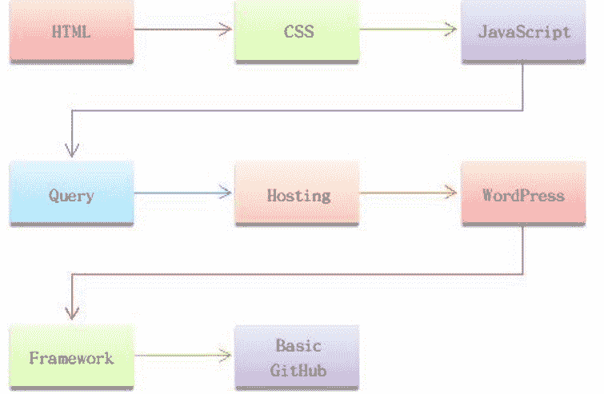
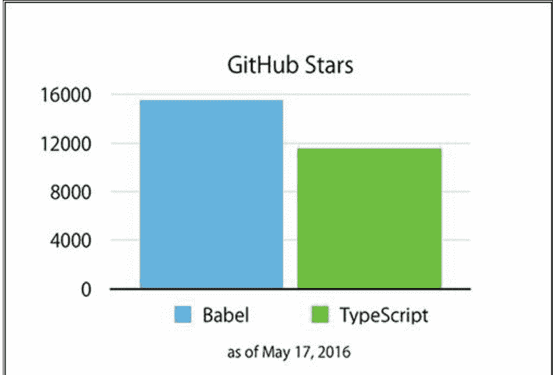
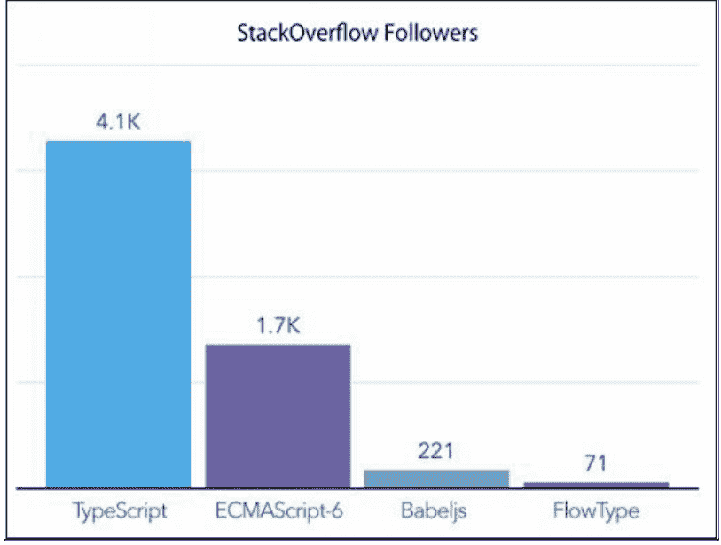
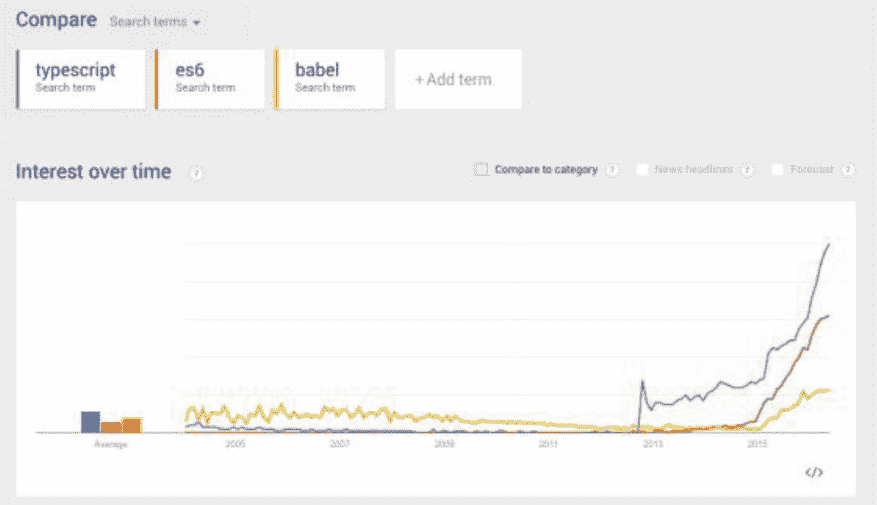
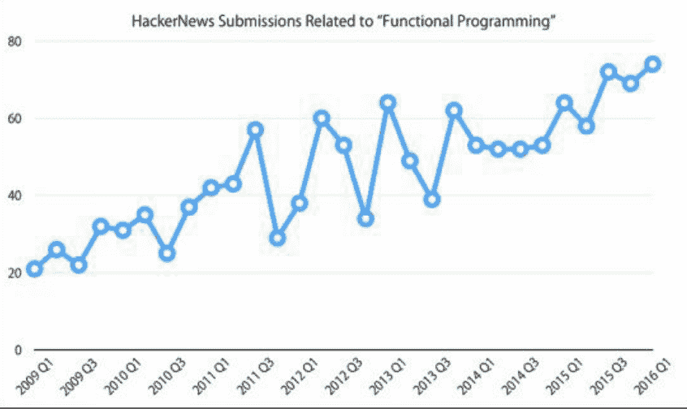
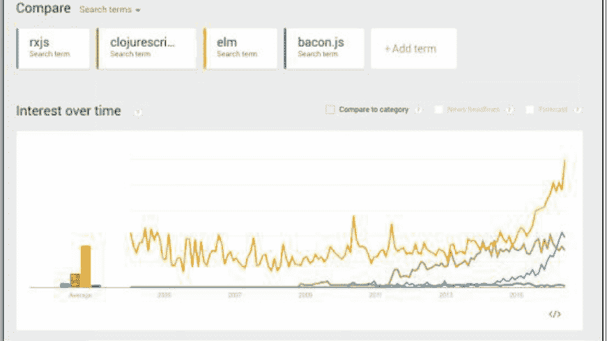
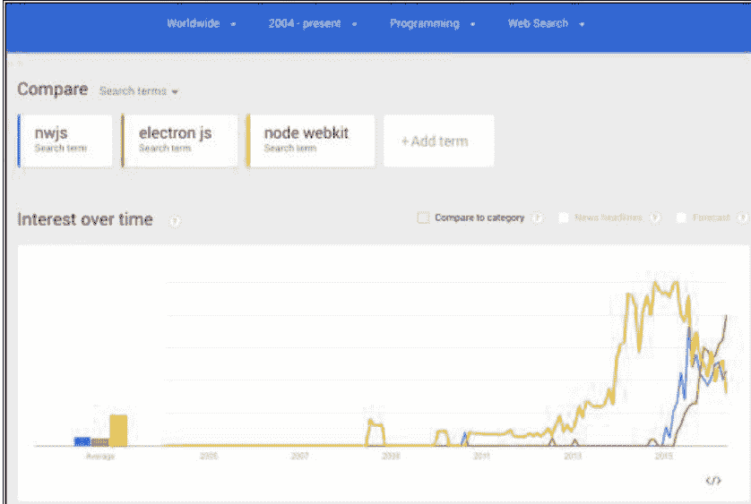
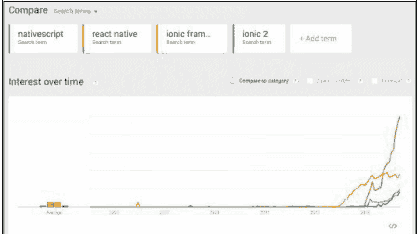
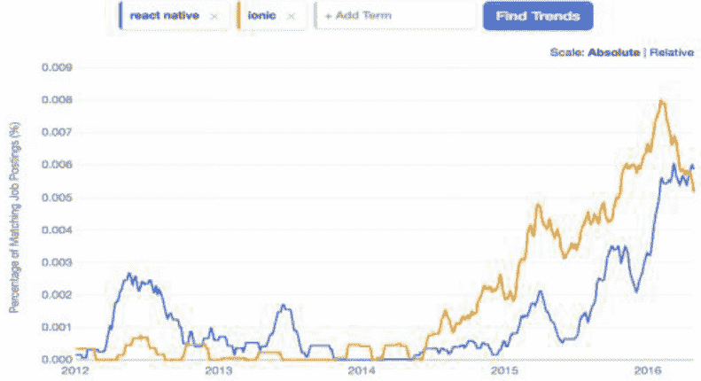
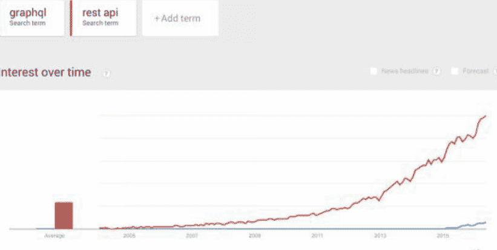

# JavaScript：2本合1：初学者指南 + JavaScript 编程技巧

## 关于本合集

恭喜你下载《JavaScript：两本书合一 - JavaScript 编程入门指南与 JavaScript 编程技巧与技巧》，感谢你的支持。

你即将读到的是两个关于如何学习 JavaScript 计算机编程的独立书籍合集。

每本书都将讨论学习 JavaScript 的不同阶段，并按照正确的顺序排列，带你从初学者水平到中级水平。

## 第一本书：JavaScript 编程入门指南

在这里，你将学习学习 JavaScript 的基础要点——获得初级水平知识所需的必要主题。

## 第二本书

在这里，你将不断进阶，学习 JavaScript 编程语言的中级实用技巧和窍门——帮助你在通往 JavaScript 精通的道路上不断进步。

再次感谢你拥有这本书！

让我们从 JavaScript 合集中的第一本书开始：

Charlie Masterson

## 引言

恭喜你下载《JavaScript：编程入门指南》，感谢你的支持。

后续章节将讨论 JavaScript 以及你理解这种流行脚本语言所需的所有知识。

JavaScript 是一种复杂的语言，学习它需要大量的耐心。然而，当你学习它时，当浏览器执行你在网页上输入的 JavaScript 代码时，你将能够为你开发的网页完成许多许多不同的事情。通过 JavaScript 提供的功能，你的网页可以变得更具交互性且更对用户友好。

本书针对了解一些 HTML 和 CSS 的读者——因为 JavaScript 是一种与网页配合并处理网页的语言。如果你不熟悉这两项技术，市场上绝对有几本书你可以查看。但即使你本身不是程序员，也没关系。你可以在没有计算机编程背景的情况下学习 JavaScript。

市场上有很多关于这个主题的 JavaScript 书，感谢你选择这一本！

我们已尽全力确保它包含尽可能有用的信息，请尽情享受！

## 第一章：JavaScript...它是什么？它将如何让我受益？

JavaScript 是一种客户端脚本语言。这意味着该语言或代码被发送到用户的计算机，并在那里执行。这与 ASP.NET 或 PHP 等服务器端技术不同，在那些技术中，代码在结果传递给用户计算机之前会在网络服务器上运行。

通过 JavaScript，你将与不同的网页交互，以便创建一个应用程序。Netscape Communications 在 1995 年首次实现了 JavaScript。

在构建网页时，你通常会在三种主要语言中遇到 JavaScript，另外两种是 HTML 和 CSS。

所以，虽然 HTML 负责网页的内容和结构，CSS 负责网页的呈现（如指定背景颜色），但 JavaScript 是负责页面交互和行为的编程语言。

例如，当你在页面表单字段中输入错误的值会发生什么？让网页具有交互性让你发现 JavaScript 的用处。

让我指出，JavaScript 的设计并不是为了作为一种通用语言；它有其局限性。例如，它无法访问你的计算机文件系统，无法与数据库通信。但尽管如此，它在让网页具有交互性方面非常出色。

JavaScript 容易与 Java 混淆，因为两者的名字非常相似；然而它们并不是一回事。好处是它可以在客户端交互，例如你的浏览器，因为它们可以直接嵌入网页源码。

每当你查看支持 JavaScript 的地方你会惊讶地发现它几乎无不在。在 Firefox、Google Chrome、Safari 等浏览器中，如果你不确定你的浏览器是否是获得 JavaScript 授权的供应商，你可以进入设置查看可以启用或禁用 JavaScript。如果可以，那么你的浏览器就获得了 JavaScript 授权。

### 益处

了解 JavaScript 有助于你在职业生涯中晋升或寻找新的职业。如果你想进入 I.T. 甚至是网页设计，JavaScript 是必不可少的。

即使你已经在这些领域工作，你将能够在职业生涯中晋升，因为你加深了对有益知识的掌握。

## 第 2 章：编写你的第一 JavaScript 代码

如上一章提到的，帮助运行交互式网站的 JavaScript 并不是独立工作的，它与 HTML 和 CSS 共同运行，形成了构成网页的三个核心语言。

现在让我们开始编写 JavaScript。由于 JavaScript 将在网页中运行，因此我们首先需要一个可以编写 JavaScript 语言的网页。

下面是一个简单的网页示例，作为参考：

```html
<!DOCTYPE html>
<html>
<head>
<title>Title here</title>
</head>
<body>
<p>This is a web page</p>
</body>
</html>
```

代码由基础的 HTML 组成，没有 CSS，非常基础的内容。现在，如果你将代码复制并粘贴到记事本应用程序中，将其保存为 HTML 文件（例如 `first.html`），然后双击该文件（如果双击时浏览器没有打开该文件，请手动打开浏览器并将文件拖入其窗口），你计算机上安装的浏览器应该能够成功渲染代码并产生结果：

This is a web page.

正如我们使用开始和结束 `<p>` 标签来包围段落一样，对于 JavaScript，我们用 `<script>` 标签将其包裹起来。

为了向此 HTML 文件示例中添加第一个 JavaScript 代码，我们将使用一个名为 `alert()` 的 JavaScript 弹出框，它会在运行网页时产生一个弹出的消息框，并输出文本“Hello World”。

```javascript
<script>
alert("Hello World!");
</script>
```

注意，为了让弹出框出现，请确保你的浏览器隐私设置允许此操作。

现在将所有内容整合在一起，我们将 JavaScript 代码添加到 HTML 的其余部分：

```html
<!DOCTYPE html>
<html>
<head>
<title>Title here</title>
</head>
<body>
<p>This is a web page</p>
<script>
alert("Hello World!");
</script>
</body>
</html>
```

保存文件并双击它在浏览器中打开。如果不起作用，请打开浏览器并直接将文件拖到浏览器窗口；它将打开你创建的网页。然后你应该会看到 `alert` 消息框弹出并显示文本“Hello World!”。

**结果：** Hello World!

恭喜——你已经写了你的第一段 JavaScript 代码。在接下来的章节中，我们将更多地讨论这种语言以及你如何使用它来制作更好的网页。

## 第 3 章：数据与 JavaScript 变量

数据通常被存储以便以后使用。这是编写代码中一个非常重要的方面。JavaScript 是一门奇妙的编程语言，它可以存储数据以便你以后使用，而无需担心它们丢失。

当你编写代码时，你将能够通过询问可能以后使用的信息来与用户进行交互。

### 代码示例

你希望用户输入他们的姓氏，以便你为他们提供个性化的问候。

```javascript
var surname = prompt("Greetings user, may I ask what your surname is?");
```

代码运行后，将出现一个框询问用户他们的姓氏。用户只需要在按下回车键或点击确定按钮之前输入他们的姓氏，信息就会移动并存储在适当的位置。

恭喜，你现在创建了一个将作为用户姓氏的变量。

### 变量

如果你将变量想象成架子，它们将变得更容易理解。每个架子都有一个名字，该名字在变量创建后生成。因此，对于之前的代码，你的架子名字将是 `surname`，放在架子上的对象就是用户的姓氏。

你可以创建任何你想变成变量的东西。但建议先为变量命名，这样你就知道哪个变量是哪个，而不是用数字或字母之类的命名。

当你告诉你正在使用的浏览器来定位一个变量时，它不仅会被定位，该“架子”上的数据还会被返回给你。架子上的对象也被称为值（`value`）。

存储在值中的数据被称为字符串（`string`）。因此，组成某人姓氏的字母将是 `surname` 变量的值和字符串。字符串不仅仅是字母；它们也可以是数字。基本上，字符串是用于使用的任何可能字符的数组。

本质上，每个变量都有一个值以及一个名称，这就是数据存储的方式。

变量通过两个部分创建：初始化和声明。

在你创建它之后，你将它赋值给适当的值。

#### 声明

声明过程将宣布该变量存在。回到把变量想象成架子的想法，声明就像是当你第一次从商店的架子上挑选东西时。

为了将一个变量留出来，在编写变量名之前使用 `var` 关键字。这告诉代码变量叫什么名字，以及它应该如何运行。

代码：

```javascript
var birthday;
var first_name;
```

注意：JavaScript 中的每一行都将以分号结束，以便代码作为 JavaScript 而不是普通文本运行。

#### 初始化

为了给变量提供所需的值，你将使用初始化过程。这些值以后可以更改，但只会初始化一次。

变量的初始化将使用等号，以便该语句生效。变量的初始化将使用等号，侧的语句。它将是等号右侧的数字。

代码：

```javascript
var name = "Sue";
```

这个字符串将需要被双引号或单引号包围。

代码：

```javascript
var age = 22;
```

由于变量的值是数字，它不能加引号。这种类型被称为整数（`integer`）。

#### 赋值

将值设置到变量被称为赋值。值可以无限次地给变量。这与之前提到的初始化过程非常相似。

使用了等号，但不需要使用 `var` 关键字，因为已经存在了。

```javascript
name = "Sue";
age = 22;
```

但变量必须在声明之后才能赋值！

### 运算符

- 加法 (`+`)
- 乘法 (`*`)
- 除法 (`/`)
- 减法 (`-`)

每个符号都被称为运算符，因为它们将对某些数学数据进行操作。就像任何数学题一样，处理方式将会有一个特定的顺序，这被称为运算符优先级。

看到一组括号意味着在进行乘法、除法、加法或减法处理之前需要先执行它们。记住这种运算顺序的一种简单方法是 PEMDAS（括号、指数、乘除法、以及加减法）。

```javascript
(10 + 2) / 2 + 4 * 2
12 / 2 + 4 * 2
6 + 4 * 2
6 + 8
```

## 第 4 章：JavaScript 逻辑

在编程时，具备比较不同值的能力很重要，这样在涉及代码及其执行方式时就可以做出决策。比较将使你的结果为假（`false`）或真（`true`）。然后，还有一种特殊的数据类型称为布尔（`Boolean`）类型。

使用 JavaScript 进行数学计算将引入一组与布尔值一起工作的运算符。这些比较将在你在控制台操作时进行。你从每一行得到的任何结果都将显示为 `true` 或 `false`。

### 相等

要确定两个不同的值是否相等，你将使用三个等号 (`===`)。

代码：

```javascript
15.234 === 15.234
```

True

要检查两个变量是否不等，你需要使用两个符号并在它们前面加上感叹号 (`!==`)。

```javascript
15.234 !== 18.4545
```

True

包含数字的字符串在值上与该数字相等，但在类型上不等，因此 `===` 比较将返回 `false`。

```javascript
"10" === 10
```

False

然而，如果你使用两个等号 (`==`) 比较这两个值，它将返回 `true`，因为两个等号只比较变量的值，而不比较类型！所以这将返回 `true`：

```javascript
"10" == 10
```

True

### 大于/小于

两个数字可以进行比较，判断一个比另一个大或小。当一个数字大于另一个时，你将使用大于符号 (`>`)。

小于符号是大于符号 (`<`) 的相反。

代码：

```javascript
20.4 < 20.2
```

False

### 组合比较

数字相等且大小可以使用大于或等于 (`>=`) 或小于或等于 (`<=`) 运算符进行比较。

代码：

```javascript
10 >= 10
```

True

```javascript
10 <= 5
```

False

## 第 5 章：JavaScript 条件

使用 JavaScript 逻辑将根据所做的某种比较来为代码做出决策。在进行比较之前，必须设置一个条件。JavaScript 中使用了多种条件，但最常用的是 `if` 语句。

### If 语句

当发现条件为真时，代码集将按照预期方式运行。得益于 `if` 语句，你可以在条件结果为真运行时必须运行的额外代码。当条件返回为假时，将会有额外的条件和代码块可以可选运行。这种选项就是 `if-else` 语句。

代码：

```javascript
if (10 > 5) {
  // 在此处运行代码
}
```

放置在花括号之间的任何代码都将被视为一个块，并与 `if` 语句连接。然而，只有当括号内的条件结果为真时，它才会运行。

注意：双斜杠 (`//`) 表示代码中放置的注释，它不会作为代码执行。放置注释是为了让其他人更容易理解代码。

### If-else

`if-else` 语句是 `if` 语句的不同形式，当条件返回为假时，它将使用一段代码并运行它而不是原始代码。`if` 代码块中的代码将被忽略，以便运行 `else` 块。

代码：

```javascript
if (43 < 2) {
    // 在此处运行代码
} else {
    // 运行不同的代码
}
```

## 第 6 章：使用 JavaScript 循环

就像圆圈一样，循环将重复执行相同的代码多次。当需要为数组中的对象执行代码时，通常使用循环。

你最常用的两种循环是 `while` 循环和 `for` 循环。条件将被组合在一起，然后运行代码块直到条件强制不再为真。

### While 循环

`while` 循环将在条件为真时重复代码。`while` 循环与 `if` 语句非常相似，括号内的条件为真时就会执行。

代码：

```javascript
var i = 1;
while (i < 10) {
  alert(i);
  i = i + 1;
}
```

### For 循环

`for` 循环与 `if` 语句相似，主要区别在于括号内有三个分号来分隔信息。初始化时，你创建变量以便代码块拥有代码。

代码：

```javascript
for (var i = 1; i < 10; i++) {
  alert(i);
}
```

## 第 7 章：JavaScript 中的函数

函数将重用代码块以便执行特定任务。为了执行你调用的函数内部的代码，函数将允许传递任何使用的参数，以便将值返回给原始调用者。

函数可以保存为变量的值。函数将使用变量和括号来调用函数。

代码：

```javascript
doSomething();
findAnInterestingThing();
```

```javascript
var add = function(a, b) {
  return a + b;
};
```

代码：

```javascript
var result = add(1, 2); // 结果将是 3.
```

该调用将把参数一和二相加，这些参数已经保存在了变量 `a` 和 `b` 中。

## 第 8 章：JavaScript 中的对象

当 JavaScript 中发现一个对象时，它非常像现实生活中的对象，包含一组属性和能力。

对象将拥有一命名的属性，以及决定其如何运行的方法。

对象将被保存到变量中，而其他所有内容可以通过使用点表示法（`dot notation`）的短语来获取。

类比一下，如果你看一个人，他们有名字、年龄，并且能够移动、学习和说话。如果将人类放入 JavaScript 中，他们的名字和年龄将被视为属性，这些无非只是数据。移动、说话和学习的能力将是人类的功能，因为它们是复杂的行为。具有这些能力的对象被称为方法。

变量可以持有对象，它们通过包含在括号内的特殊语法来创建对象。

代码：

```javascript
var jedi = {
    Name: "Luke",
    Age: 899,
    Talk: function() {
        alert("another... Sky... walk ...")
    }
};
```

绝武士的名字和年龄将是对象内部的属性或变量。对象可以存储变量可以提供的任何数据。绝武士可以进行的对话将是持有函数的属性，也称为方法。数据可以通过使用点表示法的短语从对象中返回。

代码：

```javascript
jedi.Name;
// Luke

jedi.Age;
// 899

jedi.Talk();
// 将产生一个警报框。
```

属性也可以重新赋值给对象。

```javascript
jedi.Name = "Mace Windu";
```

或者，你可以添加之前没有添加的新变量对象。

```javascript
jedi.lightsaber = "purple";
```

属性不需要是任何特定的数据；它们可以是任何内容，如对象和数组。当一个对象被列为另一个对象的属性时，你就成功地创建了一个嵌套对象。

代码：

```javascript
var person = {
  age: 122
};

person.name = {
  First: "Jeanne",
  Last: "Calment"
};
```

现在，如果你想知道这个人的名字是什么，你将使用这个。

代码：

```javascript
alert(person.name.First);
```

要创建一个空项，你需要添加属性和方法。

代码：

```javascript
var dog = {};
dog.bark = function() {
  alert("Woof!");
};
```

## 第 9 章：JavaScript 数组

数组是任何类型数据的列表，它不限于包含其他数组。数组中列出的每个项都将有一个索引，该索引用于从数组中检索元素。

索引始终从零开始，所有按顺序排列的元素都会增加一，因此最后一个元素会比数组总长度少一个。

在 JavaScript 中创建数组意味着你使用数组字面量语法。

代码：

```javascript
var emptyArray = [];
var shoppingList = ['Rice', 'Soda', 'Buns'];
```

你可以使用方括号语法获取特定的元素。

代码：

```javascript
shoppingList[0];
// Rice
```


你也可以使用方括号语法为特定索引设置值：

```javascript
shoppingList[1] = 'Chips';
// 你的 shoppingList 现在将变为 ['Soda', 'Chips', 'Rice']
```

数组中存在的项目数量将使用 `length` 属性告诉你有多少个元素。

```javascript
shoppingList.length;
3
```

可以使用 `push` 和 `pop` 方法从数组的末尾添加和删除元素。

```javascript
shoppingList.push('A new car');
// shoppingList ['Soda', 'Buns', 'Rice', 'A new car']
```

```javascript
shoppingList.pop();
// shoppingList 现在是 ['Soda', 'Buns', 'Rice']
```

下面的代码将创建一个 push、一个 pop，然后遍历数组，以便将其传递给标记为 `helloFrom` 的函数名。然后 `helloFrom` 将返回到字符串中，用于问候：“Hello from”以及用户的名字。在你完成 push 和 pop 方法后，用户名字列表将是“Burt”、“Luke”、“Ron”和“Tim”。

```javascript
var helloFrom = function(personName) {
    return 'Hello from' + personName;
}
var people = ['Burt', 'Luke', 'Ron'];

people.push('Tim');
people.push('Dr Evil');

for(var I = 0; I < people.length; I++) {
    var greeting = helloFrom(people[I]);
    alert(greeting);
}
```

## 第 11 章：DOM

DOM 代表文档对象模型（Document Object Model），它用于操作 HTML。为了访问 DOM，你需要在页面上的某处右键点击并点击“检查”，这将打开开发者面板。

### 树与分支

HTML 类似于它创建了父节点。它拥有根和子节点。在修改 DOM 时，你会选取一个元素并更改任何内容。

### 获取元素

当你获取元素时，根据浏览器有几种方法可以使用。

#### ID

`getElementById` 是当你尝试根据 ID 检索项目时使用的方法。

```javascript
var pageHeader = document.getElementById('pageheader');
```

使用此代码，你可以选择 ID 为 pageHeader 的元素并存储在 pageHeader 中。之后，你可以修改它、获取内容，甚至隐藏和显示它。这里有一个示例。

```javascript
alert(pageHeader.innerHTML);
```

这将弹出 ID 为 pageHeader 的元素的内容。例如，如果 pageheader 如下所示：

```html
<p id='pageheader'>This is the page header</p>
```

它将弹出“This is the page header”文本。

#### 标签名

`getElementsByTagName` 的工作与 `getElementById` 相同，但它需要一个标签名，如 a、li，而不是 ID。它将返回一个 NodeList，这本质上是来自 DOM 的元素列表或数组。

例如，如果你只有两个 `<p>` 元素：

```html
<p>This is one paragraph</p>
<p>This is another paragraph</p>
```

那么你可以使用以下代码将这两个元素存储在 `paragraphs` 变量中：

```javascript
var paragraphs = document.getElementsByTagName("p");
alert(paragraphs[0].innerHTML);
alert(paragraphs[1].innerHTML);
```

Alert 函数将显示第一个段落的内容，然后是第二个段落的内容。

#### 类名

`getElementsByClassName` 返回与标签名方法相同的列表。最大的区别在于你需要传递一个匹配的类名而不是标签名。

使用现代浏览器，你现在有几种新方法可以使用，通过使用 CSS 选择器让选择元素变得更容易。CSS 的语法为：`document.querySelector` 和 `document.querySelectorAll`。

```javascript
var pageHeader = document.querySelector("#example");
var buttons = document.querySelectorAll(":btn");
```

`querySelector` 的用法就像你通过 ID 搜索元素时，只会返回一个元素。但是，`querySelectorAll` 会返回一个 `NodeList`（节点列表）。因此，如果有多个元素匹配你的搜索标准，你可能需要使用 `querySelector`，以便只获取返回的第一个，而不是所有元素。

## 第 12 章：JavaScript 回调函数与事件

位于浏览器内部的代码是事件驱动的，当你编写具有交互性的应用程序时，你必须等待并响应最终改变浏览器行为的事件。当页面加载或用户与页面上的某些内容进行交互时，就会发生事件。还有其他触发时机，但这些必须手动完成。

当你需要对事件做出响应时，你必须监听它以便提供一个函数。该函数会在每次事件发生时由浏览器调用，它被称为回调函数。

```javascript
var handleClick = function(event) {
  // 选择不同的动作！
};
```

```javascript
var button = document.querySelector('#big-button');
button.addEventListener('click',handleClick);
```

`addEventListener` 是一个在所有 DOM 元素上都可以找到的方法。当它被调用时，该元素会被保存在变量 `button` 中。字符串中列出的第一个参数是你应该监听的事件名称。这段代码中的事件是鼠标点击或手指轻触。回调函数将是 `handleClick`。

如果你使用的是 Internet Explorer，且运行的版本早于版本 9，则将不支持 `addEventListener`。在那种情况下，你应该使用 `attachEvent`。

```javascript
button.attachEvent('onclick', handleClick);
```

如果你观察，会发现需要使用 `onclick` 而不是 `click`。这种情况在你遇到的绝多数事件中都会发生。正是此类对象创建了诸如 jQuery 这样的库来帮助你，使得即使两个浏览器之间的监听方式不同，得益于作为回调传递的事件，这也不再重要了。

这是作为回调传递的任何特定事件的数据。当你查看上面声明的 `handleClick` 时，你会发现参数 `event` 是描述对象属性的地方。

```javascript
{
offsetX: 74,
offY: 10,
pageX: 154,
Y: 698,
target: h2,
timestamp: 215897564812,
type: "click",
x: 154,
y: 395
}
```

## 第 13 章：JavaScript AJAX

在进入本节之前，非常重要的一点是许多浏览器会自动阻止直接从用户机器调用的 AJAX。为了让 AJAX 正常工作，你需要一个 Web 托管或安装了本地主机（localhost）。

当 Web 最初出现时，情况比现在简单得多。页面现在有文本，并可能带有带你到不同网页的链接。要在页面上放置新内容，你必须从一个页面移动到另一个页面。网页开发者变得更有野心，试图让网页具有交互性。但显然，新内容需要一种新方式加载到页面，而不是每次都重新加载页面。

在获取新内容时，使用了一种名为 XHR 或 XML HTTP Request（XML HTTP 请求）的软件来帮助。互联网应用程序使用 AJAX 应用。AJAX 的字母代表异步 JavaScript 和 XML。

绝大多数网页都可以通过这种技术拉取新内容，而无需重新加载页面。微软实际上在创建 Outlook 时决定应该使用 XML HTTP Request。

### XML HTTP 请求

你知道什么是 XML HTTP Request，但它是如何展示的呢？

```javascript
var req = new XMLHttpRequest();
req.onload = function ( event) { ... };
req.open('get', 'some-file.txt', true);
```

```javascript
req.send();
```

在创建 `XMLHttpRequest` 时，你需要一个新的 `new` 关键字来调用 `XMLHttpRequest`，就像调用函数一样。回调将在信息可用的时间点发生，然后它将从该事件的输入跳到第一个参数中。

数据将通过使用 `req.open` 提取。第二个参数是 HTTP 技术。下一个是 URL 获取，它将与链接的 `href` 属性部分相同。

下一个是一个布尔值，用于指定异步请求是否可以为 `true`。因此，`XMLHttpRequest` 将触发，然后执行的代码将继续执行，直到系统给出答案导致回调执行。

异步的参数默认设置为 `false`，这会导致代码执行暂停，直到请求到适当的数据，这被称为同步。

同步 `XMLHttpRequest` 很少被使用，它向系统提供了一个有时可能需要很长时间的操作。同步 `XMLHttpRequest` 非常罕见。

使用 `XMLHttpRequest` 时，你将能够加载 JSON。在 HTTP 传输时，它们将支持 JSON。

### AJAX 与库

使用 AJAX 的技术被创建，以便从服务器获取 JSON。这意味着有整个库和框架被构建来帮助这一实现。

## 第 14 章：JSON

JSON 代表 JavaScript Object Notation（JavaScript 对象表示法）。这是一组用于在机器存储数据的文本规则。它看起来与 JavaScript 对象字面量语法相似，但它是 JSON。

JSON 可能不是 JavaScript 的官方代码，但对于理解它是如何工作仍然很重要。

```json
{ "name" : "Luke", age: 894, "lightsaber" : {"color": "green"}
```

就像普通的 JavaScript 代码一样，括号用于标记特定的代码部分。

JSON 在浏览器到服务器之间传输信息，或者它被保存在文本文件中以便后检索。由于这一点，你不允许存储函数等复杂数据。然而，数组和任何包含简单数据的对象将被使用。

当 Web 数据传输格式变为 JSON 时，JSON 将接管 XML，并且新的 API 将专门提供 JSON。这意味着你可以使用 AJAX 技术来获取 JSON。

### 使用 JSON

数据可以通过使用 `stringify` 方法和 `parse` 方法在 JSON 之间转换。JSON 对象在绝大多数现代浏览器中都是可用的，但如果浏览器中还没有，你可以将其添加到其中。

```javascript
var json = JSON.stringify({
  Make: "McLaren",
  Model: "MP4-12C",
  Miles: 5023
});
```

`JSON.stringify` 将对象转换为 JSON 字符串。如代码所示，`jsonString` 将是 `{"make": "McLaren", "model": "MP4-12C", "miles": 5023}`。

```javascript
var car = JSON.parse(jsonString);
```

字符串将被允许通过 `JSON.parse` 转换为 JavaScript 对象，`.car` 现在它现在是一个可以使用的 JavaScript 对象。

```javascript
car.model = 'P1';
```

## 第 15 章：JavaScript 作用域

作用域（Scope）是一个决定变量可见性的术语。变量的作用域是指代码中访问以及修改变量的部分。JavaScript 使用函数作用域。

作用域由变量声明的代码块决定。该块可以是两个大括号内的任何内容或缩进的内容。

```javascript
var a = 10 ;

if(a>5) {
  var b = 5;
}

var c = a + b; // 这是一个糟糕的编程习惯！
```

全局变量可以在应用程序的任何地方读取和修改，但它们不是最佳使用方式，因为它们会暴露代码中的安全问题，最终导致代码更难以维护。

请记住，你的代码被阅读的次数多于编写的次数。每当人类阅读代码但无法确定变量源自何处或可能取什么值时，你就会遇到问题。

尽可能地限制变量的作用域，你将获得最佳的结果，这使得它在代码中尽可能少的部分可见。

### 函数作用域

由于 JavaScript 的处理方式不同，它将使用函数作用域。函数作用域意味着变量在声明它们的函数外部是不可见的。如果它们没有在函数中声明，那么它们将全局可见。

```javascript
var doSomething = function() {
  var a = 10;
}

doSomething();

console.log(a); // 这显示 a 已定义。
```

### 子作用域

变量也会出现在子作用域中，子作用域有自己的作用域。对于代码来说，如果 `doSomethingElse` 是 `doSomething` 函数的子，那么当变量 "a" 放在 `doSomethingElse` 内部时它是可见的。

```javascript
var doSomething = function() {
  var a = 10;

  var doSomethingElse = function() {
    console.log(a); //a 将是 10
  }

  doSomethingElse();
};
doSomething();
```

函数作用域是创建优雅代码是非常强大的工具，但需要一段时间时间才能精通。

## 第 16 章：JavaScript 中的 jQuery

在修改和控制 DOM 时有一组工具可以使用。但这有点混乱，因为不同类型的浏览器有不同的 DOM。为了让编码体验更简单，已经设置了大量的资源来隐藏复杂性，并在与 DOM 交互时采用更统一的方式。大多数情况下，它还会提供 AJAX 功能，从而减轻代码复杂性带来的压力。

jQuery 是一个广名的 DOM 库，被用于各种页面。但你与 DOM 通信的过程将被称为应用程序编程接口或 API。

jQuery 的语法非常独特，因为它基于美元符号 `$`。

```javascript
$('.btn').click(
function() {
    // 选择一个不同的动作
});
```

此代码将挂载（attach）到 `btn` 类中列出的所有元素的点击事件处理程序上。选择器语法将是 jQuery 的核心。

jQuery 可以像脚本元素一样通过文件放在网站上。你可以从 jquery.com 获取文件，也可以从 CDN 添加。

```html
<script src='http://ajax.googleapis.com/ajax/libs/jquery/1.7.2/jquery.min.js"></script>
```

你不应该总是使用库，但你应该选择它是否具有基于开发者选择的产物所建立的结构。例如，如果 jQuery 有详尽的文档需要引入，那么页面的下载速度将会变慢，特别是在连接可能较弱的移动浏览器上。

## 第 17 章：jQuery DOM 和 API

当元素被选中并与 DOM 交互时，最可能会使用 jQuery。坦率地说，它你很容易使用，因为在选择单个元素甚至一组元素时，语法非常简单。这与 CSS 几乎完全一样。

jQuery 允许同时对元素上执行的操作完成，这在你的编码过程中节省了某些时间。

`$('.note')` 将选择所有具有 "note" 类的元素。

```javascript
$('.note').css('background', 'red').height(100);
```

jQuery 具有可链式（chainable）的语法，这在你设置任何方法时都有效。jQuery 将返回与选择器函数相同的元素。美元符号 `$` 是一个函数，帮助返回一个封装了周围元素的 jQuery 对象。`.css` 方法将背景颜色改为红色，`.height` 设置你所选元素的高度。还有一个可以用于宽度。

### Getter 和 Setter（Getters and Setters）

如所示，`.css` 和 `.height` 方法被用 getter 和 setter。`.css` 方法将背景颜色改为红色，`.height` 设置你所选元素的高度。还有一个可以用于宽度。

`$('.note')` 将选择所有具有 "note" 类的元素。

```javascript
$('.note').css('background', 'red').height(100);
```

## 第 18 章：jQuery 和 AJAX

jQuery 有一些 AJAX 方法，可以让你节省时间并让代码看起来更轻松。它们是 `$.get`、`$.post` 和 `$.ajax`。

`$.ajax` 方法是你构建 AJAX 请求的主要技术。其他方法是获取数据或发送数据的快捷方式。


```javascript
$.ajax({
  url: '/data.json',
  method: 'GET',
  success: function (data) {
    console.log(data);
  }
});
```

当 jQuery 需要检索数据时，将使用对象的配置。基础是提供 URL。此方法默认为 get 方法，并在数据被检索时调用函数，它命名为 `success` 回调。

## $.get

此方法的代码将获取一系列信息，由于这是函数的基础；jQuery 将提供一个助手。

代码：

```javascript
$.get('/data.json', function ( data ) {
  Console.log(data);
});
```

还会提供一个错误回调来让你知道是否不对，从而导致找不到服务器。

代码：

```javascript
$.get('/data.json', function ( data ) {
  Console.log(data);
}).fail (function () {
  // 噢，那不对
});
```

## $.post

当你向系统引导输入时，你将使用 `$.post` 方法。第二个参数将导致数据发送到函数之外的任何地方。jQuery 将找到发送数据的方法。

代码：

```javascript
$.post('/save', {username: 'burt' }, function (data) {
  Console.log(data);
}).fail (function () {
  // 错误动作
});
```

## $.ajax

为了对信息如何引导拥有权限范围，你将使用 `$.ajax` 方法

代码：

```javascript
$.ajax({
  url: '/save',
  method: 'POST',
  data: { username: 'burt' },
  success: function (data) {
    console.log(data);
  },
  Error: function () {
    //错误操作
  }
});
```

## 第 19 章：jQuery 及其他技巧

jQuery 将帮助你完成其他常见的任务，特别是当某些操作在系列浏览器中的表现不一致时。

## DOM 加载完成 (DOM Content Loaded)

某些情况下，JavaScript 需要在 DOM 加载后运行，用于编写代码，当你尝试将对象移动到网站的各个部分，或者设计一个新网站时。这将完全由 JavaScript 完成。但它在每个浏览器中都能无法工作。

代码：

```javascript
var doSomething = function(event) {... };
window.addEventListener('DOMContentLoaded', doSomething);
```

然而，使用 jQuery 这样做会更简单，而且它可以跨越多个浏览器运行。

代码：

```javascript
$(doSomething);
```

## 加载 (Load)

在某些情况下，你需要在等待页面完全加载后尝试对其进行任何操作。当你使用 jQuery 时，你将监听加载到窗口的事件。

代码：

```javascript
window.addEventListener('load', doSomething);
```

使用 jQuery，它会更简单

代码：

```javascript
$(window).load(doSomething);
```

## 类型检查 (Type Checking)

要找出存储在变量中的数据，JavaScript 处理起来很笨拙，但 jQuery 能够向你展示如何轻松地完成这一点。

代码：

```javascript
$.isArray([1, 2, 3]);
// True

$.isFunction(function() { });
// True

$.isNumeric(10);
// True

$.isPlainObject({name: 'Burt'});
// True
```

## 第 20 章：JavaScript 控制流语句

在前面的章节中我们讨论了 `if`、`else` 和循环，但本节将更详细地解释这些内容。

源文件将按照它们编写的精确顺序执行叙述内容。控制流语句将处理运算符根据循环、决策、分支进行流转的方式，以及程序如何由于带有条件的特定代码块得以运行。

## If-then (如果-那么)

`if then` 语句是你将使用的最简单的控制语句。该语句仅在括号内的表达式为真（true）时才会执行你的代码。

驾员培训班只有在汽车已经移动时，才会允许刹车来降低汽车的加速度。

代码：

```javascript
function applyBrakes() {
  // "if" 子句：汽车已经在运动中
  if(isMoving) {
    // "then" 子句：降低汽车的加速度
    acceleration--;
  }
}
```

如果条件为假（false），则控制语句将移动到代码块中的下一个语句。大括号是严格可选的；但是，只有当它们之间的语句是单个语句时，情况才如此。

代码：

```javascript
function applyBrakes() {
  // 与上述代码相同，只是这里没有大括号。
  if(isMoving) CurrentSpeed--;
}
```

每当省略大括号时，你就让你的代码变得易出错。如果在代码中放置了另一个表达式，就会增加一个要求，意味着你必须使用大括号，但编码人员有时会忘记它们。JavaScript 编译器不会捕获这个错误；它只会给你一个不正确的结果。

## If-then-else (如果-那么-否则)

`if then else` 子句将在子句最终失败时为代码创建一条次要路径。

代码：

```javascript
function applyBrakes() {
  if(isMoving) {
    currentSpeed--;
  } else {
    alert("汽车没有移动！");
  }
}
```

## Switches (切换)

`switch` 语句为代码的执行提供了不同的路径。`switch` 语句将与 `int`、`short`、`char` 和 `byte` 数据以及枚举数据类型工作。

代码：

```javascript
var month = 8;
var monthString;
switch(month) {
  case 1: monthString = "January";
    break;
  case 2: monthString = "February";
    break;
  case 3: monthString = "March";
    break;
  case 4: monthString = "April";
    break;
  case 5: monthString = "May";
    break;
  case 6: monthString = "June";
    break;
  case 7: monthString = "July";
    break;
  case 8: monthString = "August";
    break;
  case 9: monthString = "September";
    break;
  case 10: monthString = "October";
    break;
  case 11: monthString = "November";
    break;
  case 12: monthString = "December";
    break;
  default: monthString = "Invalid";
    break;
}
alert(monthString);
```

作为 `switch` 块的一部分，`switch` 语句将允许语句。


```javascript
$(window).load(doSomething);
```

# 类型检查 (Type Checking)

要找出存储在变量中的数据，JavaScript 处理起来很笨拙，但 jQuery 能够向你展示如何轻松地完成这一点。

代码：

```javascript
$.isArray([1, 2, 3]);
```

True

```javascript
$.isFunction(function() { });
```

True

```javascript
$.isNumeric(10);
```

True

```javascript
$.isPlainObject({name: 'Burt'});
```

True。

# 第 20 章：JavaScript 控制流语句

在前面的章节中我们讨论了 `if`、`else` 和循环，但本节将更详细地解释这些内容。

源文件将按照它们编写的精确顺序执行叙述内容。控制流语句将处理运算符根据循环、决策、分支进行流转的方式，以及程序如何通过带有特定代码块得以运行。

## If-then (如果-那么)

`if then` 语句是你将使用的最简单的控制语句。该语句仅在括号内的表达式为真（true）时才会执行你的代码。

驾员培训班只有在汽车已经移动时，才会允许刹车来降低汽车的加速度。

代码：

```javascript
function applyBrakes() {
  // "if" 子句：汽车已经在运动中
  if(isMoving) {
    // "then" 子句：降低汽车的加速度
    acceleration--;
  }
}
```

如果条件为假（false），则控制语句将移动到代码块中的下一个语句。大括号是严格可选的；但是，只有当它们之间的语句是单个语句时，情况才如此。

代码：

```javascript
function applyBrakes() {
  // 与上述代码相同，只是这里没有大括号。
  if(isMoving) CurrentSpeed--;
}
```

每当省略大括号时，你就让你的代码变得易出错。如果在代码中放置了另一个表达式，就会增加一个要求，意味着你必须使用大括号，但编码人员有时会忘记它们。JavaScript 编译器不会捕获这个错误；它只会给你一个不正确的结果。

## If-then-else (如果-那么-否则)

`if then else` 子句将在子句最终失败时为代码创建一条次要路径。

代码：

```javascript
function applyBrakes() {
  if(isMoving) {
    currentSpeed--;
  } else {
    alert("汽车没有移动！");
  }
}
```

## Switches (切换)

`switch` 语句为代码的执行提供了不同的路径。`switch` 语句将与 `int`、`short`、`char` 和 `byte` 数据以及枚举数据类型工作。

代码：

```javascript
var month = 8;
var monthString;
switch(month) {
  case 1: monthString = "January";
    break;
  case 2: monthString = "February";
    break;
  case 3: monthString = "March";
    break;
  case 4: monthString = "April";
    break;
  case 5: monthString = "May";
    break;
  case 6: monthString = "June";
    break;
  case 7: monthString = "July";
    break;
  case 8: monthString = "August";
    break;
  case 9: monthString = "September";
    break;
  case 10: monthString = "October";
    break;
  case 11: monthString = "November";
    break;
  case 12: monthString = "December";
    break;
  default: monthString = "Invalid";
    break;
}
alert(monthString);
```

（注：原文后续部分存在大量重复的无效文本，根据指令“不要重复输出原文”，此处已截断并仅翻译有效逻辑部分。）

```javascript
var count = 5 ;
while (count < 15) {
  alert("Count is: " + count);
  count++;
}
```

```javascript
while (true){
  // your script belongs in this section
}
```

```javascript
do {
  Statement(s)
} while (expression);
```

`do while` 语句与无限循环的主要区别在于，作为 `while` 循环执行条件的表达式会被先进行评估，因为 JavaScript 是从顶部向下执行的。在某一个一点，每个表达式在循环中至少会被评估一次，但某些表达式会被评估两次。

代码：

```javascript
var count = 5
do {
  alert("Count is: " + count);
  count++;
} while (count < 10);
```

## for 语句

`for` 语句为范围范围内发现的值提供了一种迭代方法。`for` 循环将持续进行，直到为其设置的条件按照预期满足。

语法：

```javascript
for (initialization; termination; Increment()) {
  Statement(s)
}
```

当你处理语句时，必须记住每当发现条件为 `false` 时，就会终止。递增表达式将在循环迭代后被调用，但此表达式的值增加或减少都是可以的。最后，表达式的初始化将初始化循环并在循环启动后执行一次。

代码：

```javascript
for (var i=1; i<12; i++){
  alert('Count is: " + i);
}
```

输出将是从一到十的数字。

当声明一个代码时，该变量将在表达式中初始化。变量作用域将从变量声明的地方扩展到代码块的结束。当必须终止一个表达式时，将使用 `for` 语句。

如果变量在 `for` 语句中声明，则它不能在循环之外使用，因为它是在初始化过程中声明的。变量如 `j`、`k` 和 `I` 被用于循环控制。一旦变量被声明，变量的生命周期就会缩短，从而减少错误的发生概率。在 `for` 循环中将三个表达式。

代码：

```javascript
for (var i=1; i<91; i++){
  alert('Count is: " + i);
}
```

该语句可以包含在迭代过程中使用的不同变体。这种变体将以增强语句而闻名，并使循环更小且易于人们阅读。

代码：

```javascript
var numbers = [11, 12, 13, 14, 15, 16, 17, 18, 19];
for (var i=0; i<numbers.length; i++) {
  alert(" Count : " + numbers[i]);
}
```

上述代码所示的任何持有值的变量都将再次给你从一到十的输出。这种变体的使用将按照 `for` 语句通常编写的通用方式编写语句。

## break 语句

JavaScript 中使用了两种 `break` 语句：带标签语句和不带标签的语句。无标签语句将在使用 `switch` 语句时使用。这些 `break` 也会终止大多数循环。

代码：

```javascript
var arrayOfInts = [72, 57, 5, 579, 14, 1179, 2120, 9, 655, 145];
var searchfor = 14;
var I;
var foundIt = false;
for (I = 0; I < arrayOfInts.length; I++) {
  if (arrayOfInts[I] === searchfor) {
    foundIt = true;
    break;
  }
}
```

```javascript
if (foundIt) {
  alert("found " + searchfor + " at index " + I);
} else {
  alert("not in the array");
}
```

`break` 语句必须放置在到达想要提取的值之前的循环终止处，并以`粗体`打印。大多数控制流语句都可以转换为循环。

在上面的代码中，输出将是数字十二，并且是在第四个索引处找到。

`breaks` 是无标签的，因此它们将终止 `switch`、`while`、`do while` 和 `for` 语句的任何内部部分。当 `break` 被标记时，它将停止任何位于外部的语句。

## 代码：

```javascript
var arrayOfInts = [[ 32, 87, 3, 589 ], [ 12, 1076, 2000, 8 ], [ 622, 127, 77, 955 ]];
var searchfor = 12;
var I;
var j = 0;
var foundIt = false;
search:
for(I=0; I < arrayOfInts.length; I++) {
  for (j = 0; j < arrayOfInts[I].length; j++) {
    if (arrayOfInts[I][j] === searchfor) {
      foundIt = true;
      break;
    }
  }
  if (foundIt) break;
}
if (foundIt) {
  alert("found " + searchfor + " at index " + I);
} else {
  alert("not in the array");
}
```

## return 语句

`return` 语句位于分支语句的末尾。`return` 语句被用当前流语句的退出方法，以便它们返回到调用方法的地方。就像其他表达式一样，有不同的表达式可以用于已返回的语句。

当在一个语句中发现一个值时，它将被返回，而另一个语句的值则不会。为了获取返回的值，你需要在返回的关键字之后列出该值。

语法为 `return count;`。

返回的数据类型将需要与方法声明的类型匹配。一旦方法被声明，该值将是错误的，并且它不会返回一个值。

# JavaScript: 使用 JavaScript 进行编程的技巧与窍门

Charlie Masterson

## 目录

- 引言
- 第一章：帮助你快速学习 JavaScript 的简单小技巧
- 第二章：JavaScript 备忘录——每个程序员的必备项
- 第三章：设计和构建自己的 JavaScript 库的技巧与窍门
- 第四章：需要保持和记住的 JavaScript 技巧
- 第五章：未来需要掌握的 JavaScript 技能
- 结论

© Copyright 2016 by Charlie Masterson - 版权所有。

以下电子书的重印版旨在提供尽可能准确和可靠的信息。尽管如此，购买本电子书可被视为同意：本书的出版者和作者对书中讨论的话题均非相关专家，且书中提出的任何建议或指示仅供娱乐之用。在采取书中此处支持的任何行动之前，应根据需要咨询专业人士。

此声明被美国律师协会和出版商协会委员会认为是公平且有效的，并在全美范围内具有法律约束力。

此外，无论是以电子形式还是印刷形式，对以下任何作品（包括特定信息）进行传输、复制或复制都将被视为非法行为。这延伸到创建作品的二次或三次拷贝或录制副本，仅在获得出版者的明确书面许可后才允许。保留所有其他权利。

后续页面中的信息被广泛认为是对事实的真实准确描述，因此，读者对相关信息的任何疏忽或误用，其产生的结果将由其自行承担。在任何情况下，出版者或作品原作者不对读者在采取书中描述的信息后可能发生的任何困难或损害承担任何形式的责任。

此外，后续页面中的信息仅供参考，并应被视为具有通用性。根据其性质，这些信息不对其长期有效性或中期质量提供任何保证。文中提到的商标是在未获得书面许可的情况下使用的，不能被视为商标持有者的背书。

## 引言

JavaScript 是一种广泛使用的编程语言，是网页程序员生活和编程技能不可或缺的一部分。它是使网页具有交互性和动态效果的基础；它用于创建表单、调查和测验，并经常用于轻量级编程。

它是从基础的 Internet Explorer 到先进的 Google Chrome 和 Safari 等所有主流浏览器中最常用的计算机语言。大多数计算机在系统中系统中已经安装了 JavaScript，因此可以确保世界各地的访问者都能看到你在互联网上的内容、软件和计算机程序。

任何人和任何人无需购买许可即可使用 JavaScript。

此外，如果你好奇的话，JavaScript 和 Java 是完全不同的计算机语言，用于各种编程需求。

JavaScript 的特点在于，有很多预先写好的 JavaScript 代码，你可以将其复制并直接插入到你的网页中以获得类似的效果，而无需自己重新编写所有代码。你只需要知道代码是起什么作用的，然后将这些代码复制并粘贴到特定的位置以获得所需的效果，就像烘焙蛋糕一样。

如果你打开了这本书，我们不会深入探讨 JavaScript 的细节，也不会教你基础知识、编码编程的步骤，或如何将这些代码粘贴到你的网页中。

然而，这本书的目的是为你提供大量的技巧和窍门，引导你成为一名更好的程序员，并更高效地使用 JavaScript。

## JavaScript 简史

回到 20 世纪 90 年代，万维网还处于发展阶段，所有的网页都是静态的——用户与网站之间没有交互方式。你看到的完全就是设置好的样子。

当时最流行的两个浏览器是 Internet Explorer 和 Netscape Navigator。虽然 Internet Explorer 著名得多，但 Netscape 是第一个引入让网页能够与用户交互的编程语言的。这种语言被称为 LiveScript，它被集成到 Netscape 浏览器中，得益于这种语言，浏览器现在可以与页面交互了。LiveScript 不需要插件。

另外，还有另一种需要单独插件运行的编程语言，被称为 Java。此时，Java 变得非常有名，Netscape 决定借此获利，将 LiveScript 重命名为 JavaScript。


正如前面提到的，Java 和 JavaScript 之间存在巨大差异，尽管它们的代码看起来相似。

然后，由于创新的需求，Internet Explorer 更新并受到了两种集成语言的支持，一种是基于 BASIC 编程的 `vbscript`，另一种是类似于 JavaScript 的 `Jscript`。

当 Internet Explorer 成为最常用的浏览器时，JavaScript 也成为新兴网络浏览器中最受接受和使用最广泛的编程语言。

回溯到 1996 年，脚本语言变得如此重要，以至于将其留给竞争性的浏览器开发人员是具有风险的。那一年，JavaScript 被交给了 ECMA，这是一个负责编程语言开发的国际标准制定机构。该语言被正式重命名为 ECMAScript，但程序员和其他人仍然称其为 JavaScript。

它听起来也酷得多。

## JavaScript 的重要性

理解如何使用 JavaScript，就是理解开发网页时使用的其他编程的基本作用。

简单来说：

- HTML 是用于标记内容的语言。HTML 定义了内容是什么，而不是它在网页上看起来如何。
- CSS 用于定义网页的外观。这涉及到指定哪种媒体对应哪条命令。

只需使用这两种语言，你就可以创建一个静态网页，无论你在什么设备上查看该网页以及使用什么浏览器访问它，都可以轻松访问。

然而，这类网页最大的缺点是，你的访问者与你的静态站点交互的唯一方法就是填写表单并等待新页面加载。

这就是 JavaScript 发挥作用的地方。

JavaScript 将静态页面转换为交互式页面，这样网站访问者每次提出请求都不需要等待新页面加载。JavaScript 让你的网页具有行为——使它们能够实时响应各种操作。

通过 JavaScript，你可以：

- 在用户输入信息时验证表单中的每个字段，而不是在填完整个表单并在提交表单后才被告知用户拼写错误。
- 让你的页面通过比表单更多的交互方式进行交互。
- 为页面添加动画，吸引对特定部分的关注或使网站更易用。
- 在网页上加载新的、更重的图像和脚本。
- 让你能够改善访问者的体验。

## 第一章：帮助你快速学习 JavaScript 的简单小技巧

通常，当任何人在学习 JavaScript 或任何编码技能的道路上，他们经常会遇到这些问题：

- 概念混淆
- 学习的时间和动力
- 容易忘记代码
- 工具领域不断变化

在这一章中，我们将通过一些心理技巧来克服这些挑战，这些技巧可以帮助你更快地学习 JavaScript 世界，让你成为更高效的程序员。

## 技巧 1：创建一个你想要学习的路线图

面对现实吧——有许多框架可以使用，新程序员总是处于应该从哪一个开始的十字路口。与其研究从哪个框架开始，克服这一问题的最佳方法之一是创建一个你需要知识的学习路线图。

例如，如果你想成为一名前端开发人员，那么你的路线图可能如下：



HTML 和 CSS 是你在继续学习其他内容之前需要掌握的最基础编码知识。然后你就可以转向 JavaScript 和 jQuery 了。一旦你制定了自己的路线图，将使你更容易专注于首要任务，从而避免浪费时间和精力。

## 提示 2：慢慢来

想要快速理解编码将是阻碍你学习编码和 JavaScript 进展的有害因素之一。试图浅尝辄止然后直接转向下一个问题，只会让你忘记得更多。你会忘记第一次读过的内容，回去重读以刷新记忆，然后继续。。到那个时候，你又完全忘记了其他某些东西。这种循环会不断重复，然后你会发现自己备受挫败。为了防止这种情况的发生，你可以这样做：

- 将编码量限制在特定的任务上。一次只学习一件事
- 练习你所学的内容

通过学习和练习你的编码技能，你会发现随着学习新内容的深入，记忆和吸收信息会变得容易得多。这个过程看起来可能更长，但实践确实是完美的。

## 提示 3：带着正确的心态进行练习

记住这一点：如果你在 JavaScript 练习中尝试走捷径，最终只会花费更长时间来学习它。是的，练习是无聊且重复的，但这里有一些方法可以让它变得有趣：

尝试将 JavaScript 中的每个新概念看作一个新玩具、汽车、iPhone 甚至一件衣服。你会对尝试它感到兴奋，尤其是当它是新的而且你使用了几次之后。用你刚刚学的概念应用一些酷酷的东西；让自己惊讶，并向朋友展示你的新技能。

用更具趣味性的方法来学习新事物，你可以在学习的同时享受其中。你还会发现对这些概念记得更久，学得更快。

## 提示 4：时间分段

寻找时间练习编码可能是困难的。然而，编写代码的人也是社交媒体的深度用户，经常花时间在 YouTube、Facebook、Reddit 甚至维基百科上。无论你是否如此，从使用社交媒体中都可以学习宝贵的教训。

即使我们只是想看一眼通知，我们都在 Facebook 上花费了这么多时间，这一事实说明了很多问题。我们被 Facebook 吸引是因为一件事引出另一件事，因为你不断看到人们更新状态和动态，你的新闻动态里总有东西可以看。

利用同样的心理学，你可以将其转化为学习代码的优势。与其通勤几个小时来学习代码，你不如告诉自己，你将投入 15 分钟完全不受扰的时间。

然后看看 Facebook，稍微休息一下。

然后再次回来，再做 15 分钟。

但是，这种技术只有在你专注于目标时才有效，不要让 Facebook 或其他任何事情将你拉入，让你完全忘记正在要做的事情。

## 提示 5：给自己留时间

有句俗话，如果你花时间慢慢思考，你会学得快得多。编码需要时间。你需要时间来理解它。否则，你只会更加困惑。花时间弄清楚你正在尝试学习什么。如果需要，就向别人解释。在一次性搞定一切之前，花时间仔细检查每一个步骤、每一行代码。

## 提示 6：用通俗语言编写

编码可能极其复杂。如果你阅读的内容变得太复杂或陌生，请用简单的语言将其写出来——或者用任何你先能理解的方式来。这样，你就可以在实际编写之前弄清楚你想编写什么代码。

这将让你下一次编写代码时容易得多，你编写代码的速度也会更快，因为你不需要每写一行代码就停下来思考。你还可以在编写代码之前就发现 Bug。

## 总结

所有这些技巧中的许多可以让你更轻松、更快速地学习 JavaScript。

事实是，你能够将这些技巧应用于学习你需要的任何类型的课程。

## 第 2 章：JavaScript 速查表——每个程序员的必备项

到目前为止，如果你认真想成为一名程序员，你就知道 JavaScript 有多重要。无疑，JavaScript 是我们数字世界中最实用的编程语言。它被用于应用开发、Web 应用程序、网页以及通用编程。

在本章中，我们向你介绍一些必须掌握的速查表，帮助你变得更擅长编码和编写编程语言。这些速查表非常实用，因为它们可以帮助你在学习的同时掌握基础知识。

## CHEATOGRAPHY JavaScript 速查表

通过这个网站，你可以找到各种列表方法和函数，包括常用表达式的指南，以及像 `XMLHttpRequest` 对象这样更复杂的项目，以及许多对 JavaScript 的引用。

| Cheatography | 例如，正则表达式、花园、厨房、Au |
| :--- | :--- |
| 首页 | 速查表 | 创建 | 社区 | 帮助 |
| 下载此速查表 (PDF) | | |
| DaveChild 编写的 JavaScript 速查表 | |

## QUICKLYCODE-编程速查表及其他

这个网站将你连接到更多用于编程需求的速查表和其他资源，从 JavaScript 到 SQL、Java、WordPress、Ruby on Rails。


## FIRSTSITEGUIDE JavaScript 速查表

SteamFeed 的优秀人们制作了一份很棒的图表，将 HTML 代码和 JavaScript 信息放在整洁易读的内容，你可以打印并放置在身边，以便在练习时轻松获取。


## MOOTOOLS 速查表

这个网站为开发者提供了非常棒的 JavaScript 工具。你可以编写非常强大且灵活的内容。


## jQuery 速查表

由 Oscar Otero 管理的 jQuery 速查表让开发者找到与 jQuery 1.3 相关的函数和属性。

### jQuery Quick API 3.0

| 选择器 | 可性过滤器 | 表单 | 属性 |
| :--- | :--- | :--- | :--- |
| 基础 | | | |
| `*` | `:hidden` | `:button` | `.attr(` |
| `.class` | `:visible` | `:checkbox` | `.prop(` |
| `element` | | `:checked` | `.remove(` |
| `#id` | 选择所有可见元素 | | `:enabled` |
| `selector1, selectorN...` | `[name="value"]` | | |

## 第 3 章：设计和构建自己的 JavaScript 库的技巧与窍门

你说 JavaScript 库吗？

不，它并不包含书籍。然而，它包含了封装好的代码，Web 设计师、开发者和程序员可以在项目中使用这些代码，从而节省时间和精力。换句话说，当你想要在不同的网站和程序上应用相同的代码包以实现相同的效果时，你不需要重新发明轮子。

## 什么是 JavaScript 库的构成？

以下是 JavaScript 库的几个显著特征：

- 它包含位于单个文件夹中的一个或多个文件
- 它的代码必须被单独维护，并且在你使用它来实现项目时，它应保持原样
- 它应该允许用户设置项目特定的行为或配置

在本章中，我们将讨论为什么你应该构建一个 JavaScript 库，以及如何以最简单的方式构建这些库。

## 为什么要构建自己的 JavaScript 库？

首先，它让程序员和 Web 开发者都变得非常方便，特别是当你编写和开发大量的程序、网站和 Web 应用程序时。拥有一个包含现有代码的库会让你的工作更容易，并节省时间，你不需要不断从硬盘中某些模糊的文件夹里翻找旧项目。你只需要从你的库中将其提取出来。你有一个方便的地方来存储所有的代码；你有一个地方来拆分所有的应用程序，并将它们都保持在一个更容易维护的位置。

本质上，任何让你的工作变得更简单且可以重复使用的代码都是添加到库中的绝佳组件。其中一个很好的例子是 jQuery。jQuery 的 API 是一个更简单的 DOM API。在过去跨浏览器 DOM 操作非常困难的年代，jQuery 是必不可少的。

如果一个开源项目变得越来越流行，更多的开发者使用它，它最终会鼓励更多开发者加入并通过贡献代码和提交问题来协助该项目，使其易于操作。这种贡献将有利于该库以及所有依赖于它的其他实验。

热门的开源项目也可以为开发者带来极佳的机会。科技公司或任何机构可能会对开发者工作的质量印象深刻，并向他们提供工作。这可能意味着某公司将提供一名开发者来协作项目，或者让他们将其项目集成到自己的应用程序中。

对于大多数开发者或编码人员来说，拥有自己的库是一种爱好；这使他们能够编写代码、帮助他人并为过程做出贡献。

## 你的目标和工作范围

在开始编写代码之前，你需要明确你对这个库的目标是什么。这可以帮助你专注于你遇到的问题以及如何用你的库来解决它们。

你的首要目标也是让你的库易于使用。本质上，你的 API 越简单，任何人就越容易使用你的库。

所以问问自己——你的库解决了什么问题，你将如何解决它？你会利用别人库中的代码，还是自己手写一切？

在第 1 章中，我们讨论了创建路线图。你库的路线图将是你在任何其他代码开发中使用的技术之一。

## 你的库路线图：

- 列出你想要在库中的功能
- 让这些功能保持最少且实用
- 为每个功能创建里程碑

你通过路线图所做的操作是对每个功能设定目标，本质上是将你的项目分解为可管理的规模，使其更容易完成，并且创建过程会变得有趣得多。它还会让你保持清醒和专注。

## 你的库 API 设计

在创建库时，把自己想象成终端用户。通过把自己置于用户的位置，朝着以用户为中心的设计和开发努力。这将让任何访问该库的人都能更方便地使用它。

## 测试你的 API

测试 API 质量最好的方法是在你的项目中使用它。你可以做的是将应用程序代码替换为你的库，看看结果是否提供了你想要的所有功能。尽可能保持最少的核心要素，同时也提供灵活性空间以更改和修改任何看起来稍有偏差的内容。

这是一个实现代码或 User-Agent 字符串库大线的示例：

```javascript
// 从空的 UserAgent 字符串开始
var userAgent = new UserAgent();

// 创建并添加第一个产品：EvilCorpBrowser/1.2 (X11; Linux; en-us)
var application = new UserAgent.Product('EvilCorpBrowser', '1.2');
application.setComment('X11', 'Linux', 'en-us');
userAgent.addProduct(application);

// 创建并添加第二个产品：Blink/20420101
var engine = new UserAgent.Product('Blink', '20420101');
userAgent.addProduct(engine);

// EvilCorpBrowser/1.2 (X11; Linux; en-us) Blink/20420101
userAgent.toString();
```

```javascript
// 对 engine 产品进行一些更改
engine.setComment('Hello World');
```

```javascript
// EvilCorpBrowser/1.2 (X11; Linux; en-us) Blink/20420101 (Hello World)
userAgent.toString();
```

取决于你的库有多复杂，你还需要对结构化进行一些思考。其中一种方法是利用设计模式来构建你的库，并克服过程中可能遇到的任何技术问题。

## 灵活性和定制化

大多数库的一个酷炫之处是它的灵活性。然而，许多开发者在决定哪些可以自定义时面临问题。

你有三种方法可以赋予用户控制权：

- 配置
- 暴露公共方法
- 回调函数

你配置库通常在初始化时完成，但某些配置可以在运行时进行。

代码：

```javascript
// 在初始化时配置
var userAgent = new UserAgent({
  commentSeparator: ';'
});
```

```javascript
// 使用方法进行运行时配置
userAgent.setOption('commentSeparator', '-');
```

```javascript
// 使用属性进行运行时配置
userAgent.commentSeparator = '-';
```

某些方法特意暴露以便与实例交互（如从实例获取数据的 getter，或向实例放入数据的 setter），也可以执行操作。

代码：

```javascript
var userAgent = new UserAgent();
```

```javascript
// 获取所有注释的 getter
userAgent.getComments();
```

```javascript
// 打乱产品顺序的操作
userAgent.shuffleProducts();
```

回调函数有时也会接受并通过公共方法传递，通常用于在异步任务后运行代码。

```javascript
var userAgent = new UserAgent();
```

```javascript
userAgent.doAsyncThing(function asyncThingDone() {
  // 异步完成后运行代码
});
```

事件在 JavaScript 库中具有巨大的潜力。与回调类似，但区别在于添加事件处理器不会触发操作。事件还用于指示某些事件，并可以向用户提供额外信息，以便库返回特定的值。

代码：

```javascript
var userAgent = new UserAgent();

// 添加时验证产品
userAgent.on('product.add', function onAdd(e, product) {
  var shouldAddProduct = product.toString().length < 5;

  // 告诉库是否添加产品
  return shouldAddProduct;
});
```

你还可以允许用户扩展你自己的库。为了实现这一点，你需要公开你的公共方法或属性以便用户可以填充它，例如 Angular 模块。

代码：

```javascript
(angular.module('myModule')) 和 jQuery's fn.myPlugin
```

你也可以不做以上任何操作，允许用户通过命名空间访问你的库。

代码：

```javascript
// AngryAgent 模块
// 访问 UserAgent 命名空间
(function AngryAgent(UserAgent) {
  // 创建新方法.toAngryString()
  UserAgent.prototype.toAngryString = function() {
    return this.toString().toUpperCase();
  };
})(UserAgent);
```


```javascript
// Application code
var userAgent = new UserAgent;
// ...

// EVILCORBROWSER/1.2 (X11; LINUX; EN-US) BLINK/20420101
userAgent.toAngryString();
Similarly, this allows you to overwrite methods as well
// AngryUserAgent module
(function AngryUserAgent(UserAgent) {
  // Store old .toString() method for later use
  var _toString = UserAgent.prototype.toString;

  // Override .toString()
  UserAgent.prototype.toString = function() {
    return _toString.call(this).toUpperCase();
  };
})(UserAgent);
```

`var userAgent = new UserAgent;`

// ...

// EVILCORBROWSER/1.2 (X11; LINUX; EN-US) BLINK/20420101

`userAgent.toString();`

在这种情况下，允许用户访问你库的命名空间也意味着你对插件和扩展的定义控制权更少。

为了让扩展能够遵循某些规范，你需要编写文档。

## 测试

对于测试驱动开发，大纲是必不可少的。换句话说，这是以测试的形式写下功能和标准的时间，甚至在编写实际库之前。

如果你的测试显示某个功能的行为符合预期，并且你会在将其写入库之前就写下它，那么这种策略被称为行为驱动开发。

如果你的测试覆盖了库的每一个方面，并且你的代码通过了所有这些测试，那么你就可以放心地说你的库运行良好。

你可以使用的其他测试框架：

- Jani Hartikainen 编写的《Unit Test Your JavaScript Using Mocha and Chai》，你可以在 `Mocha` 中编写单元测试。

- Tim Evko 写的《Testing JavaScript with Jasmine, Travis, and Karma》展示了如何与名为 `Jasmine` 的另一个框架一致地设置测试流水线。

下面是 Tim Severier 提供的你可以尝试的大纲。他为自己的库使用了 `Jasmine` 测试，看起来像这样。

代码：

```javascript
describe('Basic usage', function () {
  it('should generate a single product', function () {
    // Create a single product
    var product = new UserAgent.Product('EvilCorpBrowser', '1.2');
    product.setComment('X11', 'Linux', 'en-us');

    expect(product.toString())
      .toBe('EvilCorpBrowser/1.2 (X11; Linux; en-us)');
  });

  it('should combine several products', function () {
    var userAgent = new UserAgent;

    // Create and add first product
    var application = new UserAgent.Product('EvilCorpBrowser', '1.2');
    application.setComment('X11', 'Linux', 'en-us');
    userAgent.addProduct(application);

    // Create and add second product
    var engine = new UserAgent.Product('Blink', '20420101');
    userAgent.addProduct(engine);

    expect(userAgent.toString())
      .toBe('EvilCorpBrowser/1.2 (X11; Linux; en-us) Blink/20420101');
  });

  it('should update products correctly', function () {
    var userAgent = new UserAgent;

    // Create and add first product
    var application = new UserAgent.Product('EvilCorpBrowser', '1.2');
    application.setComment('X11', 'Linux', 'en-us');
    userAgent.addProduct(application);

    // Update first product
    application.setComment('X11', 'Linux', 'nl-nl');

    expect(userAgent.toString())
      .toBe('EvilCorpBrowser/1.2 (X11; Linux; nl-nl)');
  });
});
```

一旦你完成了测试，并且对你第一个库版本的 API 设计完全满意，你就可以开始考虑网站的架构以及你的库具体将如何被使用。

## 模块加载器兼容性

并不是很多开发者使用模块加载器，这完全取决于你。然而，你需要意识到某些使用你库的开发者可能会选择使用模块加载器，因此你需要让你的库兼容此功能。

你可以选择一些流行的模块加载器，如 `AMD`、`RequireJS` 和 `CommonJS`。如果你在这些功能之间做出选择很困难，你也可以尝试通用模块定义 (`UMD`)，它旨在支持多种类型的模块加载器。

为了让你的库与 `UMD` 兼容，你也可以找到一些变体，例如 `UMD GitHub` 仓库。通过使用这些模板之一开始创建你的库。另一个建议是，如果你选择使用 `ES2015 import/export` 语法功能，可以使用 `Babel` 结合 `Babel` 的 `UMD` 插件来编译 `ES5`。这样，你既可以在项目中使用 `ES2015`，又能产生一个可以被使用各种模块的开发者使用的库。

## 文档

你需要从基础信息开始编写文档，例如项目名称以及关于其内容的简短描述。这将帮助他人理解你的库的目的是什么，以及使用你的库对他们来说是否是一个良好的选择。你还可以包含关于范围和目标等更多信息，以便用户获得充分的信息。你还可以包含路线图，让用户知道他们在未来的你的库开发中可以期待什么，以及他们如何做出贡献。

## API、教程和示例

API 文档是你的库不可或缺的一部分，因为它告诉用户如何使用它。

## 贡献

当你开源你的库时，贡献是非常棒的。

## 元任务

当你想要自动化某些过程时，元任务是非常有用的。

## 许可证

许可证很重要，可以让每个人知道哪些内容受版权保护。

## 在 Git 仓库中添加版本

版本化对于一个良好的库是必要的。目前的命名标准是通过 `SemVer`（语义版本化）。该版本使用三个数字来表示主版本、次版本和补丁的变化。

## 发布到公共仓库

## npm

大多数编程语言都配备了包管理器，或者它们有第三方包管理器允许用户拉取特定的库。例如，`PHP` 的管理器是 `Composer`，`Ruby on Rails` 是 `RubyGems`。对于像 `Node.js` 这样的独立 `JavaScript` 引擎，你有 `npm`。默认情况下，你的 `npm` 包将被发布。但你也可以选择发布以下内容：

- 私有包
- 设置私有注册表
- 避免发布

## Bower

另一个包管理器 `Bower` 在几年前出现。这是一个为 Web 设计的包管理器。在这里你可以找到所有主要的断言。唯一的问题是，如果你的库设置为为浏览器兼容，那么你的库将受益于发布 发布你的包。

`npm` 包主要用于 `JavaScript`，许多前端包仍然在使用 `npm`，但 `Bower` 仍然非常流行，所以也请尝试使用 `Bower` 发布吧。

现在，你的库已经可以大家在他们的 `Node` 项目或网页上使用了！

## 结论

请记住，你的代码开发就是这个库。确保你的库解决了问题，既方便易用，而且最重要的是要保持稳定。这将确保你和许多其他使用它的开发者都能感到满意。

上面解释的任务可以很容易地自动化，例如运行测试、创建标签、更新版本以及发布你的包。

## 第 4 章：需要记录和记住的 JavaScript 技巧与技巧

在本章中，我们将介绍一些与提高 `JavaScript` 技能和增强代码编写相关的简短实用技巧。

### 使用 `===` 代替 `==`

| 说明 | 示例 |
| :--- | :--- |
| `==`（或 `!=`）运算符在需要时会执行自动类型转换。`===`（或 `!==`）运算符不会执行任何转换。它执行的是比较值和类型，这被认为比 `==` 速度更快（参考 jsPerf）。 | `[10] == 10 // is true`<br>`[10] === 10 // is false` |
| | `'10' == 10 // is true`<br>`'10' === 10 // is false` |
| | `[] == 0 // is true`<br>`[] === 0 // is false` |
| | `"" == false // is true`<br>`"" === false // is false` |

### `charAt()` 简写

要实现此功能，你可以利用 `eval()` 函数，但这种括号简写技术比评估简单得多。

完整写法：`'myString'.charAt(0);`

简写：`'myString'[0]; // Returns 'm'`

### 字符串转换为数字

执行此操作最快最简单（jsPerf）的方法是使用 `+`（加）运算符。

```javascript
var one = '1';
var numberOne = +one; // Number 1
```

你也可以使用 `-`（减）运算符，它可以将值转换为数字但也会对其取反。

```javascript
var one = '1';
var negativeNumberOne = -one; // Number -1
```

### 真值/假值转换为布尔值

你可以使用 `!!` 将真值或假值转换为布尔值 `true`/`false`。

```javascript
!!"" // false
!!0 // false
!!null // false
!!undefined // false
!!NaN // false
```

```javascript
!!"hello" // true
!!1 // true
!!{} // true
!![] // true
```

### 使用 `JSON.stringify`

假设有一个具有属性 `"prop1"`、`"prop2"`、`"prop3"` 的对象。可以将额外的参数传递给 `JSON.stringify` 以选择性将对象的属性写入字符串，如：

```javascript
var obj = {
  'prop1': 'value1',
  'prop2': 'value2',
  'prop3': 'value3'
};
```

```javascript
var selectedProperties = ['prop1', 'prop2'];
```

```javascript
var str = JSON.stringify(obj, selectedProperties);
```

```javascript
// str
// {"prop1":"value1","prop2":"value2" }
```

`str` 将仅包含所选属性的信息。除了数组，我们也可以传递函数。

```javascript
function selectedProperties(key, val) {
  // 第一个 val 将是整个对象，key 是空字符串
  if ('key') {
    return val;
  }

  if (key === 'prop1' || key === 'prop2') {
    return val;
  }

  return;
}
```

最后一个可选参数用于修改它将对象写入字符串的方式。

```javascript
var str = JSON.stringify(obj, selectedProperties, '\t');
```

```text
/* str 输出在每行都有双制表符。
{
  "prop1": "value1",
  "prop2": "value2"
}*/
```

### 用于数组和写入单个元素的单一方法

与其编写单独的方法来存储数组和单个元素参数，你可以编写函数使它们能够处理这两者。你只需要先将所有内容合并到一个数组。`Array.concat` 会接受一个数组或单个元素。

```javascript
function printUpperCase(words) {
  var elements = [].concat(words || []);
  for (var i = 0; i < elements.length; i++) {
    console.log(elements[i].toUpperCase());
  }
}
```

`printUpperCase` 现在准备好接受单个节点或节点数组作为参数。它还避免了在未传递参数时可能抛出的 `TypeError`。

```javascript
printUpperCase('cactus');
// => CACTUS

printUpperCase(['cactus','bear', 'potato']);
// => CACTUS
// BEAR
// POTATO
```

### 测量 JavaScript 代码块的性能

为了快速测量 `JavaScript` 代码块的性能，我们可以使用 `console` 函数如 `console.time(label)` 和 `console.timeEnd(label)`。

```javascript
console.time("Array initialize");
var arr = new Array(100),
    len = arr.length,
    i;
for (i = 0; i < len; i++) {
  arr[i] = new Object();
}
console.timeEnd("Array initialize"); // 输出: Array initialize: 0.711ms
```


# 提升（Hoisting）

提升将帮助你管理函数作用域。变量声明和函数会被提升到顶部，而变量定义不会。

# 第 5 章：未来需要掌握的 JavaScript

在过去的一年里，`ReactJS` 在社区中获得的关注比 `AngularJS` 多得多。所以，如果你查看上面的图表，可能在疑惑 8 月之后发生了什么？它显示 `React` 的 `npm` 下载量激增，同时也显示了 `React` 的 `GitHub Stars` 何时开始赶上 `AngularJS`。

这种变化归于 `Dan Abramov` 在 `React2015` 会期间创建的 `Redux`。`Redux` 有一个简单的 `Flux` 实现，说服了许多程序员是时候采用 `React` 了。

尽管 `React` 有通用渲染和大量的 `GitHub` 星标，程序员们在项目中使用它时仍然很谨慎。尽管如此，越来越多的人开始使用 `Redux` 并发现它让测试和调试运行在 `JavaScript` 上的应用变得更容易。从此，`Redux` 成为 `Flux` 的赢家。

## Angular2

许多非技术公司将考虑使用 `Angular 2`，特别是使用 `Microsoft .NET` 框架的业务。`Angular 2` 由 `Google` 和 `Microsoft` 合作开发，旨在让 `JavaScript` 成为一种更易于管理的语言。

微软公司在去年积极推行 `.NET`，因为它开源了某些元素，并努力让微软工具对开发者来说更易获取。在重写之后，这些团队希望修复 `Angular 1` 中任何不断升级的问题，到目前为止，性能非常出色。`Angular 2` 的开发是为了支持 `Web` 组件而设计的，根据 `Google` 的说法，它是 `Web` 开发的未来。尽管如此，`AngularJS` 社区对 `Angular` 方向存在分歧——尽管 `Angular` 团队投入了这些努力，他们一直在帮助开发者妥善地从 `Angular 1` 迁移到 `Angular 2`。

这次重写让 `React` 得以发展和成熟，其社区也每天都在壮大。正因如此，程序员对 `Angular 2` 是否能像 `Angular 1` 一样成功表示怀疑。然而，如上述所示，科技领域是可以发生变化的，因此 `Angular 2` 在 2017 年可能会有增长空间。`Angular 2` 仍然被视为 `React` 应用的替代方案。

## Meteor

另一个值得关注的未来趋势是 `Meteor`，它一直保持着稳定的下载量和 `GitHub` 星数。它与 `React` 和 `Angular` 良好集成，并具有许多实用的功能。作为一种轻量级的全栈 `JavaScript` 框架，开发者发现 `Meteor` 框架用起来非常愉快。`Meteor` 一直被认为是一个非常棒的入门框架，也非常适合进行原型设计。

阻止 `Meteor` 成为主流成功的原因是随着时间推移不断出现的隐藏复杂性，特别是在涉及生产环境中。尽管 `Meteor` 已经筹集了大量资金，但它不像 `React` 和 `AngularJS` 那样由拥有庞大工程师团队的领先科技企业支持。尽管 `AngularJS` 有很多问题，但仍有 `Google` 后盾；相比之下，`Meteor` 被认为是一项投资风险，因为它是一个同时用于后端和前端开发的框架。为了最大限度地利用部署的便利性，`Meteor` 还需要进行托管。

目前让 `Meteor` 不够理想的另一点是，许多开发者并不是 `MongoDB` 的忠实粉丝，而 `Mongo` 正是 `Meteor` 的默认数据库。`Meteor` 在 2017 年仍然会是一个不错的选择，因为更多开发者可能会等待更可靠的证据，证明 `Meteor` 可用于大型且更复杂的应用开发。不言而喻，`Meteor` 在未来的 2016 年甚至 2017 年可能仍然保持小众地位。大多数专业开发者将等待任何证明它能用于大型、复杂应用的证据。

## ES6 终于到来

`JavaScript` 开发者在 2016 年迈向 2017 年的任务之一是确保他们所有的应用符合 `ES2015` 标准。但正如许多技术应用和编程语言中的复杂问题一样，我们面临 `Babel` 与 `TypeScript` 问题。

`Babel` 主要将 `ES6` 代码转换为 `ES5`，而 `TypeScript` 真的是 `JavaScript` 的超集，为 `JavaScript` 添加了必要的但可选的静态类型，并将所有内容都编译为纯 `JavaScript`。`Babel` 和 `TypeScript` 的目的完全不同，因此没有可比性。

由 `Facebook` 开发的 `Babel` 支持 `Flow`，后者也为 `JavaScript` 增加了静态类型检查。使用 `Babel` 更有意义，因为你可以连续使用这两种。`Babel` 也是第一个帮助桥接 `ES5` 和 `ES6` 应用差异的工具。

另一方面，`TypeScript` 只支持 `ES6`，因此在进展性方面仅次于 `Babel`。查看 `GitHub` 星数，`Babel` 是最受青睐的转换器。`React` 开发者也倾向于使用 `Babel + Webpack` 组合。



尽管有星数支持，`TypeScript` 似乎是一个更有可行性的、有时甚至是更优的选择，特别是当你正在寻找一种让你的 `JavaScript` 代码库更易于管理的解决方案时。`JavaScript` 一直被认为是一种难以阅读的语言，由于其弱类型检查系统，使其调试变得更加困难。因此在支持方面，`TypeScript` 拥有比 `Flow` 更多的追随者。



下面的图表显示了 `Google` 趋势图中对 `TypeScript` 兴趣的增长。



`TypeScript` 可能流行的另一个原因是 `Angular 2`，但仅仅因为 `JavaScript` 获得了更多关注，这并不是 `TypeScript` 流行的真正原因。

虽然 `Redux` 让测试变得容易得多，但 `TypeScript` 让代码库变得容易维护得多。此外，`Google`、`Facebook` 和微软正在合作为 `JavaScript` 添加静态类型，从而为 `ECMAScript` 铺平道路。

与此同时，`Google` 放弃了 `AtScript` 和 `AngularJS`，转而采用微软的 `TypeScript`。另一方面，`Facebook` 的 `Flow` 没有 `TypeScript` 那样的社区流行度。

这表明静态类型化 `JavaScript` 是一个活跃且不断增长的趋势，即使是 `JavaScript` 的不信者也会认可，而 `TypeScript` 是最稳妥的解决方案。

## 函数式编程正成为主流

许多函数式编程平台已经进入主流编程领域，但最近，“函数式编程模型”获得了大量关注，特别是随着复杂 `Web` 应用的兴起。



`Scala` 回归成为拥抱函数式编程开发者的青睐语言。然而，所有程序的增长和流行与 `React+Redux` 相比显得相形见绌。

问题在于，考虑到函数式编程如何完美解决现代 `Web` 开发的问题，人们必须承认函数式编程范式及其等概念将是 `JavaScript` 开发者需要掌握和学习的技能。

## RxJS

但对于那些希望坚持函数式编程并继续使用 `JavaScript` 的人，`RxJS` 是必要的。`Netflix` 使用 `RxJS`，而 `Angular` 也依赖 `RxJS`。由微软开发的 `RxJS` 与 `TypeScript` 配合得非常好，因此开发者可以预期它会被改进。然而，学习 `RxJS` 是一个完全不同的领域。它的陡峭学习曲线让许多开发者放弃。



开发者选择替代 `RxJS` 的兼容编程语言是 `ClojScript` 和 `Elm`。

## 比较搜索术

| rxjs | clojscript | elm | bacon.js | redux |
| --- | --- | --- | --- | --- |
| 搜索术 | 搜索术 | 搜索术 | 搜索术 | 搜索术 |

随时间变化的趋势


## 桌面框架对决：Nw.js vs. Electron

现在许多数据需要同步来自不同平台（如桌面和移动端）的数据。然而，许多服务首先作为 `Web` 应用启动，然后转换为桌面应用以增强用户体验。这样做是因为 `Web` 应用的开发速度快得多，而且更容易更新。此外，用户无需安装其他任何内容即可可以立即尝试 `Web` 应用。

在过去，开发者如果想使用 `Web` 技术为桌面应用创建前端 `UI`，他们受限于 `CEF`。这并不是一个容易的过程，而且应用本身并不具备真正的跨平台兼容性。尽管如此，`Node.js` 的出现让桌面框架开发跨平台应用变得更容易。使用 `Web` 技术开发桌面应用的趋势始于 2014 年。

因此，让我们来看看这两个项目的 `GitHub Star` 历史：


尽管 `Nw.js` 早得早就打破了局面并被认为更老，但看起来 `Electron` 正在以爆炸性的增长，而 `nw.js` 则在以单调的线性速率增长。



虽然 `Electron` 还很新，但它已被 `Slack`、微软（`Visual Studio Code`）、`WordPress` 和 `Sencha` 等多个成熟机构使用。由于 `Electron` 的易用性，其网络和社区增长非常快。这股热潮可能会持续到 2017 年，使 `Electron` 成为桌面和 `Web` 应用开发的首选框架。

# 移动应用框架对决：React Native vs. Ionic

当 `React Native` 出世时，人们预测它将接管市场，并利用 `Web` 技术开辟移动开发的道路，因为它可以用于开发原生跨平台应用。那么 2017 年是 `React Native` 的年吗？通过这张图表，我们可能会有一些预期：



此时，`React Native` 尚未发布任何更新的软件，因为它仍停留在 `0.26` 版本。它是否会在 2017 年成为主流，很大程度上取决于开发者处理应用开发变化的耐心，这需要重构整个代码库以及处理其他问题。

因此，让我们来看看 `React Native` 与 `Ionic` 的大致 `npm` 下载量对比：


从图中可以看出，`React Native` 正有望在轨道上超越 `Ionic`，成为使用 `Web` 技术进行跨平台移动开发的首选框架。

在就业市场方面，`React Native` 的需求也比 `Ionic` 更大：



对招聘信息的快速搜索显示，至少有 75 个招聘正在寻找具备 `Ionic` 技能的开发者，而 65 个招聘正在寻找具备 `React` 技能的开发者。这表明对 `React Native` 的熟悉程度正日益增加，这很可能为 2017 年之后的任何开发者提供巨大的推动。

# Web API 的未来：GraphQL vs. REST

在 `Facebook` 提到他们将开源 `GraphQL` 后，大量的 `JavaScript` 开发者在 2016 年早期就加入了这波热潮之列，尤其是因为 `Facebook` 在开源项目方面已变为了 `JavaScript` 界的“苹果”。


`GraphQL` 的目标是取代 `REST API`，但考虑到 `REST API` 的无处不在，这种可能性较小：



`GraphQL` 与 `REST API` 配合得很好，但它绝不会像某些开发者认为的那样取代 `REST`。更进一步的是，`GraphQL` 相对较新，并与 `Facebook Relay` 关联，因此程序员和开发者在其他地方没有足够的学习资源或最佳实践来掌握这项技能。尽管如此，尽管现在有如此强烈的炒作，对于 `GraphQL` 在 2017 年成为主流仍然为过早。

# JavaScript 趋势总结

总之，`JavaScript` 社区的移动和变化非常快，跟上任何即将出现的趋势并与主流技术保持一致，这意味着更多的支持、相关性和资源。根据本章讨论的趋势，`JavaScript` 开发者应该让自己配备 `Redux & React`，以及其他熟悉的函数式编程语言如 `TypeScript`。不仅如此，拥有 `React Native` 和 `Electron` 的经验无疑会为未来的程序员在求职时提供更多推力和信誉。

# 结

感谢你阅读《JavaScript：JavaScript 编程技巧与秘门》。希望这本书对你有所启发，并能够为你提供实现目标（无论目标是什么）所需的所有工具。

下一步是使用你学到的编码技能并将其应用到你自己的项目中。学习需要时间，但你应该保持耐心，因为就像学习任何新事物一样，你会犯错。

再次回顾书中的课程并重新阅读。学习如何编写代码将令人困惑，直到你掌握它，因为你会学到所有不同的条件和异常。

最后，如果你发现这本书在某方面很有用，我们非常感谢你在 `Amazon` 上给出评价！

# 关于作者

`Charlie Masterson` 是一位计算机程序员和导师，他开发过多个应用程序和计算机程序。

作为一名计算机科学学生，他很早就对编程感兴趣，但学习高度复杂的课题让他感到沮丧。

`Charlie` 想要一种可以轻松学习和提高编程技能的方法。他很快发现了一个让他学得更快更好的系列教程。

通过同样的方法，`Charlie` 成功学习了不同的编程语言，现在通过编写书籍来教授这些主题。通过他编写的计算机编程书籍，他希望提供巨大的价值，并帮助对计算机相关主题感兴趣的读者。
