# JavaScript：二合一合集：初学者指南 + JavaScript 编程技巧

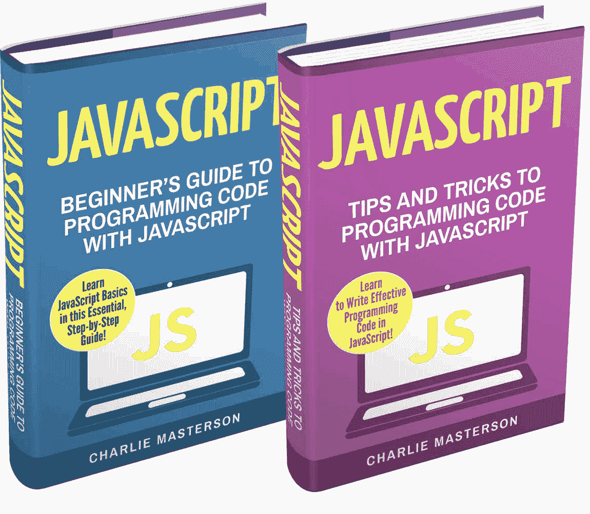

## 关于本合集

恭喜你下载`JavaScript: 2 Books in 1 - Beginner’s Guide and Tips and Tricks to Programming Code with JavaScript`，感谢你的支持。

你即将阅读的是两本关于如何学习 JavaScript 计算机编程的独立书籍集合。

每本书将讨论学习 JavaScript 的不同阶段，并按照正确的顺序排列，带你从学者水平到中级水平。

### 第一本书

JavaScript: 编程入门指南

在这里，你将学习学习 JavaScript 的基础要点——获得初级知识水平所需的必要主题。

### 第二本书

JavaScript: 编程技巧与方法

在这里，你将不断进阶，学习 JavaScript 编程语言的中级实用技巧和窍门——帮助你在精通 JavaScript 的道路上不断进步。

再次感谢你拥有此本书！

让我们从 JavaScript 合集中的第一本书开始：

此外，后续页中的信息仅供参考。

## 介绍

恭喜你下载`JavaScript: 2 Books in 1 - Beginner’s Guide and Tips and Tricks to Programming Code with JavaScript`，感谢你的支持。

你即将阅读的是两本关于如何学习 JavaScript 计算机编程的独立书籍集合。

每本书将讨论学习 JavaScript 的不同阶段，并按照正确的顺序排列，带你从学者水平到中级水平。

## 第 1 章：JavaScript……它是什么？它将如何受益？

JavaScript 是一种客户端脚本语言。这意味着该语言或代码被发送到用户的计算机并在那里执行。这与服务器端技术（如`ASP.NET`或`PHP`）不同，后者在结果传递给用户计算机之前，代码在 Web 服务器上运行。

通过 JavaScript，你将与不同的网页进行交互，从而能够 Web 应用程序。Netscape Communications 于 1995 年首次实现了 JavaScript。

在构建网页时，你通常会将 JavaScript 作为所使用的三种主要语言之一，另外两种是 HTML 和 CSS。

因此，虽然 HTML 负责网页的内容和结构，CSS 负责页面的呈现（如指定背景颜色），但 JavaScript 才是页面交互和行为的编程语言。

例如，当你在“联系我们”页面的表单字段中输入错误的值时会发生什么？让网页具有交互性并执行 HTML 和 CSS 无法实现的附加功能的能力，让你发现了 JavaScript 的用处。

但让我指出的是，JavaScript 并不是作为一种通用的、万能的语言而设计的；它有其局限性。例如，它无法访问你计算机的文件系统，也无法与数据库通信。但尽管如此，在让网页具有交互性方面，它表现得非常好。

JavaScript 很容易与 Java 混淆，因为两者的名字非常相似；然而它们并不是同一种东西。好在是它们可以在客户端（例如你的 Web 浏览器）共同交互，因为它们可以直接嵌入 Web 源码中。

每当你查看 JavaScript 的支持情况时，你会惊讶地发现它几乎在任何地方都被支持。在`Firefox`、`Google Chrome`和`Safari`等浏览器中，如果你不确定你的浏览器是否是 JavaScript 授权的供应商，你可以进入设置查看是否可以启用或禁用 JavaScript。如果可以，说明你的浏览器已获得 JavaScript 授权。

## 优势

学习 JavaScript 将对你非常有益，无论是帮助你晋升还是寻找不同的职业。如果你想进入 IT 领域甚至网页设计，`JavaScript`是必不可少的。

如果你已经在这些领域之一有一份工作，你将能够获得职业晋升，因为你加深了对你有益的知识。

`JavaScript`不仅在 IT 或网页设计中很有用处。`JavaScript`可以用于任何工作，如果你不确定它是否可以在你的工作中中使用，请询问你的老板。表现出学习工作要求之外内容的积极性将给老板留下深刻印象并赢得青睐。

## 第 2 章：编写你的第一段 JavaScript 代码

如上一章提到的，帮助运行交互网站的`JavaScript`并不是独立工作的，它与`HTML`和`CSS`共同运行，这三者构成了网页的三大核心语言。

所以让我们开始编写`JavaScript`吧。由于`JavaScript`将运行在网页中，我们首先需要一个编写`JavaScript`语言的网页。

下面是一个简单的网页示例，作为我们的参考：

```html
<!DOCTYPE html>
<html>
<head>
<title>这里是标题</title>
</head>
<body>
<p>这是一个网页</p>
</body>
</html>
```

代码由基础的`HTML`组成，没有`CSS`，都是非常基础的内容。现在现在，如果你将代码复制并粘贴到记事本应用程序中，然后将其保存为`HTML`文件（例如`first.html`），然后双击该文件（如果双击时浏览器没有打开文件，请手动打开浏览器并将文件拖入其窗口），那么你电脑上安装的 浏览器应该能够成功渲染代码并产生如下结果：

这是一个网页。

就像我们使用起始和结束的`p`标签来包裹段落一样，对于`JavaScript`，我们用`script`标签来包裹它。`<script> </script>`

为了向这个`HTML`文件示例中添加第一段`JavaScript`代码，我们将使用一个名为`alert`的`JavaScript`弹出框，它在运行网页时会产生出一个消息框并输出文本“Hello World”。

```javascript
<script>
alert ("Hello World!");
</script>
```

注意，为了让弹出框出现，请确保你的浏览器隐私设置允许此操作。

现在将所有内容整合在一起，我们将`JavaScript`代码添加到`HTML`的其他部分：

```html
<!DOCTYPE html>
<html>
<head>
<title>这里是标题</title>
</head>
<body>
<p>这是一个网页</p>
<script>
alert ("Hello World!");
</script>
</body>
</html>
```

保存文件并双击它在网络浏览器中打开。如果这不起作用，打开浏览器并直接将文件拖到浏览器窗口；它将打开你正在创建的网页。你应该会看到`alert`消息框弹出，并显示文本“Hello World!”。

结果：Hello World!

恭喜你——你写了了自己的第一段`JavaScript`代码。在接下来的章节中，我们将讨论更多关于这种语言以及你如何使用它来制作更好的网页。

## 第 3 章：数据与 JavaScript 变量

数据通常被存储以便日后使用。这是编写代码的一个非常重要的方面。`JavaScript`是一种极佳的编程语言，它可以存储数据以便你以后使用，而不必担心它们丢失。

当你编写代码时，你能够通过询问可能以后使用的信息来与用户进行交互。

#### 代码

你希望用户输入他们的姓氏，以便为他们提供个性化的问候。

```javascript
var surname = prompt(“你好用户，请问你姓什么姓氏?”);
```

代码运行后，会出现一个框询问用户的姓氏。用户只需要在按下回车键或点击确定按钮之前输入他们的姓氏，信息就会移动并存储在适当的位置。

恭喜，你现在创建了一个将作为用户`surname`的变量。

### 变量

如果你将变量想象成架子，它们会更容易理解。每个架子都有一个名字，该名字在变量创建时生成。所以，对于之前的代码，你的架子名字将是`surname`，而放在架子上的对象就是用户的姓氏。

你可以创建任何你想变成变量的东西。但建议先变量命名，这样你就知道哪个变量是哪个，而不是用数字或字母来命名。

当你告诉浏览器你正在使用它来定位变量时，它不仅会被定位，该“架子”上的数据也会被找到。变量可以创建任何值。本质上，`string`是任何可能字符的数组。变量通过两个部分创建：初始化和声明。

#### 声明

声明过程将宣告变量存在。回到把变量比作架子的想法，声明就像你在商店里挑选架子。

要设置一个变量，在编写变量名称之前使用`var`。

```javascript
var birthday;
var first_name;
```

注意：`JavaScript`中的每行都将以分号结束，以便作为普通文本运行。

#### 初始化

为了给变量所需的值，你将使用初始化过程。这些值在以后可以更改，但只需初始化一次。

变量的初始化将使用等号，以便语句读取等号左侧的变量对应的右侧的数据。

```javascript
var name = “Sue”;
```

`string`将是`name`，并且该字符串将被双引号或单引号包围。

```javascript
var age = 22;
```

由于变量的值是一个数字，它不能放在引号中，以便识别为数字。这种类型的变量被称为整数。

#### 赋值

将值设置变量被称为赋值。值可以无限次地赋值给变量。它非常像之前提到的初始化过程。

使用了等号，但你不需要使用`var`关键字，因为代码已经知道该值是一个变量。

```javascript
Name = “Sue”;
Age = 22;
```

但在赋值之前必须先声明变量！

## 第 4 章：JavaScript 数学

你在`JavaScript`中声明的变量可以使用存储的字符串以及任何存储的数字。但，当你进行数学运算时，`JavaScript`主要关注数字。

在你的脚本中，你将创建两个带有不同数字的变量。

```javascript
var apples = 5, oranges = 10;
```

现在你已经创建了两个变量。`var`只被使用了一次是因为你进行了初始化并给变量了赋值。当你只写一次关键字并用逗号将它们隔开时，你可以节省一些额外的工作。

在 JavaScript 的帮助下，你将能够计算出你有多少个水果。

代码：

```javascript
var piecesOfFruit = apples + oranges;
```

这段代码将告诉浏览器，在将结果重新赋值给`howmany-piecesOfFruit`之前，它需要计算右侧数字的和和。但是，变量名不会被相加，只有值会被相加。你的浏览器会知道你在做什么，并只会给你值的总和。

你的总和将不会是`pieces of fruit`，而是`piecesOfFruit`，因为你的变量不能包含任何空格。很容易发现`Of`和`Fruit`中的`O`和`F`是大写的。这被称为“驼峰命名法”（camel casing），它有助于让变量更易读。

请记住，代码的阅读方式有多种。这就是为什么确保你的代码易于阅读和理解是如此重要。

### 分割

当你进行数学运算时，不仅仅有加法。对于代码来说，还有除法。

代码：

```javascript
var piecesForEachPerson = piecesOfFruit / 3 ;
```

JavaScript 可以完成这些数学计算，你不需要为了拿出计算器来确保计算正确。

除法通过正斜杠`/`完成，以确保你将左侧除以右侧。

### 运算符

为了得到一组数字的和，你将为每种操作使用符号。

- 乘法 (`*`)

- 加法 (`+`)

- 除法 (`/`)

- 减法 (`-`)

每个符号都被称为运算符，因为它们将对某种数学数据进行操作。就像任何数学题一样，执行方式有一个特定的顺序，这被称为运算符优先级。

看到一组括号意味着在执行乘法、除法、加法或减法过程之前，需要先执行它们。记住这种运算顺序的一种简单方法是`PEMDAS`（括号、指数、乘除法、以及加减法）。

代码：

```javascript
(10+2) / 2 + 4 * 2
12 / 2 + 4 * 2
6 + 4 * 2
6 + 8
```

## 第 5 章：JavaScript 逻辑

在编程时，能够比较不同的值很重要，以便在涉及代码及其如何执行时做出决策。比较将使你的结果设为`false`（假）或`true`（真）。然后，有一种特殊的数据类型被称为布尔（Boolean）数据类型。

使用 JavaScript 进行数学计算将引入一组与布尔值工作的运算符。这些比较将在你在控制台操作时进行。每一行得到的任何结果都将显示为`true`或`false`。

### Equality

要确定两个不同的值是否相等，你将使用三个等号 (`===`)。

代码：

```javascript
15.234 === 15.234
True
```

要检查两个变量是否不等，你需要使用两个等号并在它们前面加上感叹号 (`!==`)。

代码：

```javascript
15.234 !== 18.4545
True
```

包含数字的字符串在数值上等于该数字，但在类型上不等，因此`===`比较将返回`false`。

```javascript
"10" === 10
False
```

然而，如果你使用两个等号 (`==`) 比较这两个值，它将返回`true`，因为两个等号只比较变量的值，而不比较类型！所以这将返回`true`：

```javascript
"10" == 10
True
```

### 大于/小于

两个数字可以比较为其中一个比另一个大或小。当一个数字大于另一个时，你将使用大于符号`>`。

代码：

```javascript
10 > 5
True
```

小于符号是大于符号的反面 (`<`)。

代码：

```javascript
20.4 < 20.2
False
```

### 组合比较

当数字相等时可以对它们进行比较，且大小可以使用大于或等于 (`>=`) 或小于或等于 (`<=`) 运算符进行比较。

代码：

```javascript
10 >= 10
True
10 <= 5
False
```

## 第 6 章：JavaScript 条件

使用 JavaScript 逻辑将根据所做的何种比较为代码做出决策。在进行比较之前，必须设置一个条件。JavaScript 中使用了几种条件，但最常用的是`If`语句。

### If 语句

当发现条件为`true`时，设置的代码将按照预期方式运行。得益于`if`语句，你可以在条件结果为非真时添加必须运行的额外代码。当条件返回为`false`时，将会有额外的条件和代码块选择性运行。这种选项就是`if-else`语句。

代码：

```javascript
if(10 > 5) {
  // 执行代码
}
```

括号内的任何代码被视为一个块，只有在条件成立时运行。

### If-else

`else`是另一种形式，当条件返回为`false`时执行。

代码：

```javascript
if(43 < 2) {
  // 执行代码
} else {
  // 执行不同的代码
}
```

`while`循环通常用于在你不知道循环会执行多少次。例如，用户正在玩一个游戏，他需要猜出一个隐藏的数字。你永远不知道用户有多幸运，所以你不知道他何时会选中正确的数字。这就是为什么你设置`while`循环并等待正确数字的出现。

代码：

```javascript
var number = 0;

// 7 is the hidden number!

prompt("Try to guess the number!");

while (number !== 7)
{

number = parseInt(prompt("Wrong number, try again!"));
}

alert("Congratulations, you guessed it correctly!");
```

当用户输入 7 时，它会显示恭喜消息，但如果用户输入其他数字，它将继续显示错误信息，直到用户输入 7 为止。另一方面，在使用`for`循环时，我们是在确切知道需要执行循环多少次的情况下使用它们；它主要用于处理数组，我们将在后面的章节中学习数组。

## 第 8 章：JavaScript 中的函数

函数将重用代码块，以便执行特定的任务。为了执行你调用的函数内部的代码，该函数将允许传递任何使用的参数，以便将值返回给最初调用它的地方。

函数可以保存你变量的值。函数将使用变量和括号来调用该函数。

代码：

```javascript
doSomething() ;

findAnInterestingThing() ;
```

创建一个函数意味着你将使用`function`关键字。在使用该关键字后，参数将列在一组括号内，以便代码块拥有该函数的代码。

代码：

```javascript
var add = function(a, b) {

return a + b ;

} ;
```

`a`和`b`是函数的参数，而值将由关键字返回。用于返回的关键字将停止执行函数中的代码；因此，它之后将不再有代码运行。

代码：

```javascript
var result = add( 1, 2); // the result is going to be 3\.
```

调用将把参数一和二相加，这些参数已保存到`a`和`b`变量中。

## 第 9 章：JavaScript 中的对象

当在 JavaScript 中找到对象时，它将非常像现实生活中的对象，包含一组属性和能力。对象将拥有一系列命名的属性以及决定它如何运行的方法。对象将保存到变量中，而其他所有内容都可以通过点符号法（dot notation）获取。

作为一个类比，如果你观察一个人，他们会有名字，有年龄，并且能够移动、学习和说话。如果将这个人类放入 JavaScript，他们的名字和年龄将被视为属性，这些无非是数据片段。移动、说话和学习的能力将是人类的功能，因为它们是复杂的行为。拥有这些能力的对象被称为方法。变量可以持有对象，它们通过使用封装在括号中的特殊语法来创建对象。

代码：


```javascript
var jedi = {
  Name: "Luke",
  Age: 899,
  Talk: function() {
    alert("another... Sky... walk …");
  }
};
```

绝地武的名字和年龄将是对象内部的属性或变量。对象可以存储变量可以存储的任何数据。绝地武可以做的说话是持有函数的属性，也称为方法。数据可以通过使用点符号法的短语从对象中传回。

代码：

```javascript
jedi.Name;
// Luke

jedi.Age;
// 899

jedi.Talk();
// 将产生一个警告框。
```

属性也可以重新赋值给对象。

代码：

```javascript
jedi.Name = "Mace Windu";
```

或者你可以添加之前没有添加的新变量对象。

```javascript
jedi.lightsaber = "purple";
```

属性不需要是任何特定的数据；它们可以是任何内容，也可以是对象和数组。当一个对象被列为另一个对象的属性时，你就成功创建了一个嵌套对象。

代码：

```javascript
var person = {
  age: 122
};

person.name = {
  First: "Jeanne",
  Last: "Calment"
};
```

现在，如果你想知道这个人的名字是什么，你将使用这个。

代码：

```javascript
alert(person.name.First);
```

要创建一个空项，你需要添加属性和方法。

代码：

```javascript
var dog = {};

dog.bark = function() {
  alert("Woof!");
};
```

## 第 10 章：JavaScript 数组

数组是任何类型数据的列表，它不限于包含其他数组。数组中列出的每一项都有一个索引，用于从数组中检索元素。

索引始终从零开始，数组中的元素逐行增加，因此会比总长度少一。在 JavaScript 中创建数组意味着你使用数组字面量语法。

代码：

```javascript
var emptyArray = [];
var shoppingList = ['Rice', 'Soda', 'Buns'];
```

你可以使用方括号获取特定元素。

代码：

```javascript
shoppingList[0];
// Rice
```

你也可以设置索引：

```javascript
shoppingList[1] = 'Chips';
// shoppingList 现在是 ['Soda', 'Chips']
```

数组中存在的项目数量将使用 `length` 属性。

代码：

```javascript
shoppingList.length;
// 3
```

可以使用 `push` 和 `pop` 方法从数组中添加和删除元素。

代码：

```javascript
shoppingList.push('A car');
// shoppingList ['Soda', 'Buns', 'Rice', 'A car']

shoppingList.pop();
// shoppingList 现在是 ['Soda', 'Buns', 'Rice']
```

下面的代码将创建 `push`、`pop`，然后遍历数组以便传递给函数名。然后 `helloFrom` 将返回字符串对于“Hello from”和用户的名字。

```javascript
var helloFrom = function(personName) {
  return "Hello from" + personName;
};

var people = ['Burt', 'Luke', 'Ron'];
people.push('Tim');
people.push('Dr Evil');
people.pop();

for (var i = 0; i < people.length; i++) {
  var greeting = helloFrom(people[i]);
  alert(greeting);
}
```

## 第 11 章：DOM

DOM 代表文档对象模型，它将操控 HTML 页面的结构和样式。它将由浏览器看到的内部页面表示，以便开发者修改 JavaScript 代码。

为了查看页面的 DOM，你将打开正在使用的浏览器开发者工具并定位到“元素”面板。你可以通过在页面的任何地方点击右键并点击列表中的“检查元素”来实现。

## 树与分支

HTML 结构与 XML 相似，元素将包含它创建的结构中的父节点以及子节点。就像树枝。因此，DOM 也称为 DOM 树。

当修改 DOM 时，你将选择一个元素并对它进行你想要的任何更改。这个过程通常通过 JavaScript 完成。为了从 JavaScript 访问 DOM，你需要一个被使用的 `document` 对象。它将由浏览器提供，以便允许代码能够与页面内容中的代码进行交互。

## 获取元素

当你获取一个元素时，取决于你所使用的浏览器，你有几种方法可以实现这一点。

### ID

当你尝试通过其 `Id` 获取一个项目时，`document.getElementById` 将是你使用的方法。

代码：

```javascript
var pageHeader = document.getElementById('pageheader');
```

使用这段代码，你可以选择 ID 为 `pageheader` 的元素并将其存储在变量 `pageHeader` 中。稍后，你可以修改它、获取它的内容，甚至隐藏和显示它。这里有一个示例。

代码：

```javascript
alert(pageHeader.innerHTML);
```

这将弹出一个 ID 为 `pageHeader` 的元素的内容。例如，如果 `pageheader` 看起来如下所示：

代码：

```html
<p id="pageheader">This is the page header</p>
```

它将弹出“This is the page header”文本。

你会注意到 `getElementById` 是与 `document` 对象一起使用的方法。其他某些方法将能够访问在文件中为元素定位的页面。

### 标签名

`document.getElementsByTagName` 的工作方式与 `getElementById` 相同，但它需要标签名（如 `a`、`li` 或 `ul`），而不是 ID。它随后将返回一个 `NodeList`，这基本上是来自 DOM 的元素列表或数组。

例如，如果你只有两个这样的 `<p>` 元素：

代码：

```html
<p>This is one paragraph</p>
<p>This is another paragraph</p>
```

那么你可以使用以下代码将这两个元素存储在 `paragraphs` 变量中：

代码：

```javascript
var paragraphs = document.getElementsByTagName("p");

alert(paragraphs[0].innerHTML);
alert(paragraphs[1].innerHTML);
```

`alert` 函数将显示第一个段落的内容，然后显示第二个段落的内容。

### 类名

`document.getElementsByClassName` 将返回与标签名方法相同的列表。最大的区别在于，你需要传递一个匹配的类名，而不是标签名。

### CSS

在现代浏览器中，有一些新方法供你使用，通过使用 CSS 选择器更方便地选择元素。CSS 的语法为：`document.querySelector` 和 `document.querySelectorAll`。

代码：

```javascript
var pageHeader = document.querySelector("#example");
var buttons = document.querySelectorAll(".btn");
```

`querySelector` 就像你通过 ID 搜索元素一样，它只会返回一个元素。但是，`querySelectorAll` 将返回 `NodeList`。因此，如果有多个元素匹配你的搜索标准，你就需要使用 `querySelector`，以便你只获取返回的第一个，而不是所有元素。

## 第 12 章：JavaScript 中的回调函数和事件

位于浏览器内部的代码是事件驱动的，当你编写交互式应用程序时，你必须等待并响应最终会改变浏览器行为的事件。当页面加载或用户与页面上的某些内容进行交互时，就会发生事件。还有其他会被触发的时间，但这些必须手动完成。

当你需要对事件做出反应时，你必须监听它以便提供一个函数。每当事件发生时，浏览器就会调用该函数，这被称为回调函数。

代码：

```javascript
var handleClick = function(event) {
  // 选择一个不同的动作！
};

var button = document.querySelector('#big-button');
button.addEventListener('click', handleClick);
```

`addEventListener` 是在所有 DOM 元素上都能找到的方法。当它被调用时，元素将被保存在变量 `button` 中。字符串中列出的第一个参数是你应该监听的事件名称。这段代码中的事件是鼠标点击或手指轻击。回调函数将是 `handleClick`。

如果你正在使用 Internet Explorer，且运行的版本早于版本 9，则不支持 `addEventListener`。在这种情况下，你应该使用 `attachEvent` 代替。

代码：

```javascript
button.attachEvent('onclick', handleClick);
```

如果你仔细看，你会发现需要使用 `onclick` 而不是 `click`。这会在你遇到的大多数事件中发生。正是这样的对象创建了如 `jQuery` 这样的库来帮助你，使得即使两个浏览器之间的监听方式不同，得益于作为回调传递的事件，这也不会产生影响。

传递给任何特定事件的数据都是回调函数。当你查看上面声明的 `handleClick` 时，你会发现参数 `event` 是描述对象属性的地方。

代码：

```javascript
{
  offsetX: 74,
  offsetY: 10,
  pageX: 154,
  pageY: 698,
  target: h2,
  timestamp: 215897648,
  type: "click",
  x: 154,
  y: 395
}
```

## 第 13 章：结合 JavaScript 使用 AJAX

在进入本节之前，非常重要的是，如果直接调用 AJAX，许多浏览器会自动阻止。为了让 AJAX 正常工作，你需要一个 Web 主机或本地主机。

当 Web 最初出现时，情况比现在要简单。现在页面有了可能带你到另一个页面的文本和样式。为了在页面上放置新内容，必须从一个页面移动到另一个页面。开发者一直在努力让网页具有交互性。但显然，新内容需要一种新的加载方式。

在获取新内容时，有一种被称为 `XHR` 或 `XML HTTP Request` 的软件可以帮助。互联网应用程序使用 AJAX。AJAX 的字母代表异步 JavaScript 和 XML。

大多数网页能够通过这种技术获取新内容，而无需重新加载页面。微软实际上是决定在创建 Outlook 时使用 `XML Http Request` 的人。

## XML HTTP Request

你知道 `XML HTTP Request` 是什么，但它是如何显示的呢？

代码：

```javascript
var req = new XMLHttpRequest();
req.onload = function(event) { … };
req.open('get', 'some-file.txt', true);
req.send();
```

当创建 `XMLHttpRequest` 时，你需要一个新的关键字来调用 `XMLHttpRequest`，就像调用函数一样。回调会在信息可用的时间点发生，然后它会将输入传递到第一个参数中。

异步的参数将默认为 `false`，这会导致代码的执行暂停，直到请求到适当的数据，这被称为同步。

同步的 `XMLHttpRequest` 很少被使用，它是向系统提供的一种请求，有时加载可能需要很长时间。最后一行将允许网页拒绝对任何信息的请求。

在使用 `XMLHttpRequest` 时，你将能够通过 `HTTP` 和 `HTTPS` 服务器持续加载 `JSON`、`XML`、`HTML` 以及一系列文本，同时继续支持如 `FTP` 之类的规则。最终，当涉及到 JavaScript 应用开发中将涉及的一系列任务时，它们是非常有用的。

## AJAX 与库

与 `AJAX` 使用的技术正在被创建出来，使得现在已经有了单页应用，其需求会调出 JavaScript 脚本，从而允许从服务器加载的任何其他脚本能够异步出现。有整个库和框架是为了帮助这一实现而构建的。

## 第 14 章：JSON

`JSON` 代表 JavaScript 对象表示（JavaScript Object Notation）。这是一组文本格式规则，用于在机器中存储和移动数据，以便人类能够阅读。它看起来类似于在 `JavaScript` 中使用的对象字面量语法，但这正是 `JSON` 起源的地方。

`JSON` 可能不是 `JavaScript` 官方代码的一部分，但它是 `JavaScript` 的重要组成部分，因此虽然它是一种不同的语言，但当它与 `JavaScript` 工作时，理解它是如何工作的对你仍然很重要。

### 代码：

```json
{ "name": "Luke", age: 894, "lightsaber": { "color": "green" } }
```

就像普通的 `JavaScript` 代码一样，括号用于标记代码的特定部分。

`JSON` 将传输在浏览器与其服务器之间需要移动的信息，或者它将被保存到文本文件中稍后检索，因为它仅仅是文本。正如此，你将被允许存储函数等复杂数据。然而，数组和任何包含简单数据的对象将被使用。

当来自 Web 的数据传输格式以及专门提供 `JSON` 的新 API 被编写时，`JSON` 将取代 `XML`。这意味着你能够使用 `AJAX` 技术来获取 `JSON`。

## 使用 JSON

通过 `stringify` 方法配合 `parse` 方法，数据具有从 `JSON` 转换或反之的能力。`JSON` 对象在大多数现代浏览器中都是可用的，但如果你的浏览器中不存在，你可以将其添加到浏览器中。

### 代码：

```javascript
var jsonString = JSON.stringify({
  Make: "McLaren",
  Model: "MP4-12C",
  Miles: 5023
});
```

`JSON.stringify` 将一个对象转换为 JSON 字符串。如代码所示，`jsonString` 将是 `{ "make": "McLaren", "model": "MP4-12C", "miles": 5023 }`。

### 代码：

```javascript
var car = JSON.parse(jsonString);
```

通过使用 `JSON.parse`，允许字符串转换为 JavaScript 对象，现在它是一个可以设置属性的 JavaScript 对象。

### 代码：

```javascript
car.model = "P1";
```

## 第 15 章：JavaScript 作用域

作用域（Scope）是决定变量可见性的术语。变量作用域是代码中可以访问和修改变量的部分。`JavaScript` 中使用了函数作用域。

作用域由声明变量的代码块决定。该块将是包含在两个大括号内的任何内容，或者是缩进的内。

### 代码：

```javascript
var a = 10;

if (a > 5) {
  var b = 5;
}

var c = a + b; // 这是糟糕的编程习惯！
```

全局变量无论你放在应用的任何地方都可以被读取和修改，但它们不是最好的使用方式，因为它们会暴露代码中的安全问题，最终导致代码更难维护。

记住，你的代码需要阅读的要比编写的要多。每当代码被人类阅读，但无法确定变量来自哪里或存在哪些潜在值时，你就会遇到问题。

当你尽可能地限制变量的作用域时，你将获得最佳结果，这将使得它在尽可能少的代码部分中可见。

## 函数作用域

由于 `JavaScript` 的处理方式不同，它将使用函数作用域。函数作用域意味着变量在它们声明的函数外部时是不可见的。如果它们没有在函数中声明，那么它们将是全局可见的。

### 代码：

```javascript
var doSomething = function() {
  var a = 10;
};

doSomething();
console.log(a); // 这显示 a 未定义（undefined）。
```

## 子作用域

变量也会出现在子作用域中，子作用域有它们自己的作用域。对于代码来说，如果 `doSomethingElse` 是 `doSomething` 函数的子，那么当变量 "a" 放在 `doSomethingElse` 内部时，它是可见的。

### 代码：

```javascript
var doSomething = function() {
  var a = 10;

  var doSomethingElse = function() {
    console.log(a); // a 为 10
  };

  doSomethingElse();
};

doSomething();
```

函数作用域在创建代码方面是非常强大的，但需要时间来掌握。


# 第 16 章：JavaScript 中的 jQuery

jQuery 是一组工具，被用于修改和控制 `DOM`。尽管这有点混乱，因为存在许多不同类型的 `DOM`。为了让编码变得更简单，已经有了大量的资源。大多数情况下，它还提供 `AJAX` 功能，从而减轻了复杂代码的压力。但你与 `DOM` 通信的过程被称为应用程序接口或 `API`。

`jQuery` 拥有一种非常独特的语法，因为它基于 `$` 符号。

## 代码

```javascript
$('.btn').click(

function() {

//选择一个不同的操作

}

) ;
```

这段代码将绑定到所有 `btn` 类元素的点击处理程序。选择器语法是 `jQuery` 的核心。

`jQuery` 可以像脚本元素一样放置在网站上。你可以从 `jquery.com` 获取文件，也可以从 `CDN` 添加。

## 代码

```html
<script src="http://ajax.googleapis.com/ajax/libs/jquery/1.7.2/jquery.min.js"></script>
```

你不应该总是使用库，但你应该根据它是否具有开发者所选的结构来决定。例如，如果 `jQuery` 有一个庞大的文档需要引入，那么下载速度将会变慢，特别是对于连接较弱的移动浏览器。

jQuery 具有一种可链的语法，当你在设置任何类型的方法时它都非常有效。jQuery 将返回与选择器函数相同的元素。`$` 符号是一个函数，用于帮助返回一个封装了元素的 jQuery 对象。`.css()` 方法可以将背景颜色改为红色，而 `.height()` 则设置你所选元素的高度。还有一个可以用于宽度的方法。

## Getter 和 Setter（访问器与设置）

如上所示，`.css()` 和 `.height()` 用于设置元素的值，但这些方法也被称为 getter（访问）。当你调用 `.height()` 而没有提供任何要设置的值时，元素的当前高度将通过一个简单的 CSS 属性调用 `.css()` 来获取该属性的值。

### 代码

```javascript
var currentHeight = $('.note').height(),
currentColor = $ ('.note').css('color') ;
```

当选取了多个元素时，getter 将获取其中第一个元素的值。

## 上下文 (Context)

有时需要限制选择元素的 DOM 范围。所使用的 DOM 区域被称为不同的上下文。

你需要通过第二个参数告诉 jQuery 你想要选择的区域，该参数可以是一个 DOM 元素、字符串选择器，甚至是 jQuery 对象。jQuery 只会在你的选择器所在的上下文中搜索，而不进行其他操作。

### 代码

```javascript
var $header = $('header'),
$headerBoxes = $('.note' , $header);
```

# 第 18 章：jQuery 和 AJAX

在 jQuery 中，有一些 AJAX 辅助方法可以让你节省时间并让你的代码看起来更轻松。它们是 `$` 变量的方法：`$.get`、`$.post` 和 `$.ajax`。

`$.ajax` 策略将是你构建 AJAX 请求时使用的主要技术。其他方法将作为配置的快捷方式，例如获取数据或提交数据。

### 代码

```javascript
$.ajax(  
url: '/data.json',
method: 'GET',
success: function (data) {
console.log(data);
}
} ) ;
```

当 jQuery 需要检索数据时，将使用对象配置。它会提供基本信息，如 URL。该方法默认为 get 方法，每当数据检索成功时就会调用该函数，因为它命名为 success 回调。

## $.get

该方法的代码将获取一系列信息，由于这是函数的基础，jQuery 将提供一个辅助。

### 代码

```javascript
$.get ('/data.json', function ( data ) {
Console.log(data);
} ) ;
```

还会提供错误回调，以告知你是否出现错误，从而导致找不到服务器。

### 代码

```javascript
$.get('/data.json', function ( data ) {
Console . log ( data ) ;
} ) . fail ( function () {
// 噢，那不对
} ) ;
```

## $.post

当你将输入重定向到系统时，将使用 `$.post` 方法。第二个参数会导致数据发送到函数之外的任何地方。jQuery 会找到发送数据的方法。

### 代码

```javascript
$.post('/save', { username: 'burt' } , function (data) {
Console . log (data) ;
} ) . fail (function () {
// 错误操作
} ) ;
```

## $.ajax

为了获得信息流向的权限范围，你会使用 `$.ajax` 方法。

### 代码

```javascript
$.ajax( {
url: '/save' ,
method: 'POST' ,
data: { username: 'burt' } ,
success: function (data) {
console . log (data) ;
},
Error: function () {
//错误操作
}
} ) ;
```

# 第 19 章：jQuery 和其他技巧

jQuery 将帮助你完成其他常见任务，特别是当一系列浏览器之间存在不一致之处时。

## DOM 内容加载完成 (DOM Content Loaded)

有时 JavaScript 会会在 DOM 加载后运行，用于在尝试将对象移动到网站的不同部分或设计新网站时的代码。这完全是 JavaScript 的。但它在所有浏览器中并不都能工作。

### 代码

```javascript
var doSomething = function(event) {...} ;
window.addEventListener('DOMContentLoaded', doSomething);
```

然而，使用 jQuery 这样做更容易，并且它可以跨越多个浏览器。

### 代码

```javascript
$(doSomething);
```

## 加载 (Load)

在某些情况下，你需要在页面完全加载后再对其进行任何操作。当你使用 jQuery 时，你将监听加载到窗口的事件。

### 代码

```javascript
window.addEventListener ('load', doSomething);
```

使用 jQuery，这会更简单。

### 代码

```javascript
$(window).load(doSomething) ;
```

## 类型检查 (Type Checking)

要找出存储在变量中的数据，JavaScript 会很笨拙，但 jQuery 能够向你展示如何不笨拙地完成。

### 代码

```javascript
$.isArray([1, 2, 3]); // True
$.isFunction(function() { }); // True
$.isNumeric(10); // True
$.isPlainObject({name: 'Burt'}); // True
```

# 第 20 章：JavaScript 控制流语句

前面的章节中我们讨论了 `if`、`else` 和循环，但本节将详细解释这些内容。

源文件将按照编写的精确顺序执行内容。控制流语句将处理运算符根据循环、决策、分支进行流动的方式，以及程序如何由于带有条件的特定代码块得以运行。

## If-then

if-then 语句将是你使用的最简单的控制语句。只有当括号中的表达式为真时，该语句才会执行你的代码。

驾驶培训班只有在车辆已经在移动时才会允许刹车来减慢车辆的加速。

### 代码

```javascript
function applyBrakes() {
// "if" 子句：车辆正在运动
if(isMoving) {
// "then" 子句：降低加速
acceleration -- ;
}
```

如果条件为假，控制语句将移动到块中的下一个语句。大括号是严格可选的；但仅当它们之间是单个语句时。

### 代码

```javascript
function applyBrakes() {
// 与上方代码相同，只有大括号
if(isMoving) CurrentSpeed
```

一旦省略了大括号，你就让代码变得容易出错。如果在代码中放置了另一个表达式，就会增加一个要求，意味着必须使用大括号，但程序员有时会忘记。JavaScript 编译器不会捕捉这个错误；它只会给你不正确的结果。

## If-then-else

if-then-else 子句将在语句失败时为代码创建一个次要路径。

### 代码

```javascript
function applyBrakes() {
if(isMoving) {
currentSpeed -- ;
} else {
alert("车辆未移动！");
}}
```

## Switches (切换)

switch 语句为代码执行提供了不同的路径。switch 语句适用于 `int`、`short`、`char` 和 `byte` 数据以及枚举数据类型。

### 代码

```javascript
var month = 8;
var monthString ;
switch(month) {
case 1: monthString = "January"; break;
case 2: monthString = "February"; break;
case 3: monthString = "March"; break;
case 4: monthString = "April"; break;
case 5: monthString = "May"; break;
case 6: monthString = "June"; break;
case 7: monthString = "July"; break;
case 8: monthString = "August"; break;
case 9: monthString = "September"; break;
case 10: monthString = "October"; break;
case 11: monthString = "November"; break;
case 12: monthString = "December"; break;
default: monthString = "无效月份"; break;
}
alert(monthString);
```

作为 switch 语句的一部分，其主要陈述是允许注释进入 switch 块，以便执行多个 `case` 或 `default` 标签。所有的 switch 语句在被 JavaScript 执行之前都会被评估。当一个语句的标签与另一个语句具有相同的标签时，它将执行成功。

### 代码

```javascript
var month = 8

if(month === 1) {

alert("January");

} else if (month === 2) {

alert("February");

}

…以此此类推。
```

当使用 `if then else` 语句时，必须检查表达式的清晰度。`if then else` 语句将测试任何表达式，以检查条件以及为了根据枚举值、字符串值和整数进行测试而必须使用的任何值。Switch 语句将结束任何 `break` 语句。

控制流将继续执行放置在 switch 块之后的任何注释。`break` 语句仅在 switch 块发生穿透（fall through）时使用，但所有其他语句都需要相同的标签，以便按照它们放置的顺序执行。`case` 标签位于何并不重要，直到遇到 `break` 语句为止。

### 代码

```javascript
var futureMonths = [ ];

var month = 8;

switch (month) {

case 1: futureMonths.push ("January") ;

case 2: futureMonths.push ("February") ;

case 3: futureMonths.push ("March") ;

case 4: futureMonths.push ("April") ;

case 5: futureMonths.push ("May") ;

case 6: futureMonths.push ("June") ;

case 7: futureMonths.push ("July") ;

case 8: futureMonths.push ("August") ;

case 9: futureMonths.push ("September") ;

case 10: futureMonths.push ("October") ;

case 11: futureMonths.push ("November") ;

case 12: futureMonths.push ("December") ;

break ;

break ;

Default: break ;

}

if(futureMonths.length === 0) {

alert ("Invalid month number") ;

} else {

for(var i=0; i<futureMonths.length; i++) {

alert(monthName);

}
}
```

该代码的输出将弹出从八月到十二月的月份。

当 `break` 结束时，你不需要替换任何代码，因为代码已经从 switch 语句中消失。强烈建议使用此 `break`，因为它使得修改代码变得更容易，从而减少你可能收到的任何错误。`default` 部分的代码将处理未放置在 `case` 部分的值。代码可以包含多个 `case`。

### 代码

```javascript
var month = 2;

var year = 2016;

var numDays = 0;

switch (month) {

case 1: case 3: case 5:

case 7: case 8: case 10:

case 12:

numDays = 28;

break ;

case 4: case 6:

case 9: case 11:

numDays = 31;

break;

case 2:

if ((year % 4 === 0) &&

!(year % 100 === 0)

|| (year % 400 === 0))

numDays = 29;

else

numDays= 28;

break;

default: alert ("Invalid month.") ;

break ;

}

alert("Number of Days = " + numDays) ;
```

结果将是 29，因为二月有 29 天。

## Switch 语句字符串

字符串对象将被放入 switch 语句中。在某个时刻，将放置一个 switch，其表达式将根据其 `case` 标签与其他表达式进行比较。只有当 `case` 是小写且 `case` 标签也是小写时，这些字符串才能被 switch 接受。

### 代码

```javascript
var month = "January";

var monthNumber = 0;

switch (month.toLowerCase()) {

case "january":

monthNumber = 1

break ;

}
```

语句将继续执行，直到所有十二月份都以小写写出以及相关的月份数字为止。

## While 和 do while 语句

`While` 语句只有在条件为真时才会持续语句块上连续工作。

### 语法

```javascript
While (expression) {

Statement(s)
}
```

`while` 语句在返回布尔语句之前会评估任何和所有表达式。当发现条件为真时，它将执行 `while` 块中的任何语句。但在测试语句时，它将一直执行到语句被证明为假为止。

### 代码

```javascript
var count = 5 ;

while (count < 15) {

alert(" Count is: " + count) ;

count++;

}
```

无限循环将通过此语法在 `while` 语句中实现：

```javascript
while (true){

// 脚本在此部分
}
```

`do while` 语句也可以是 JavaScript 代码的一部分。

```javascript
do {

Statement(s)
} while (expression)
```

`do while` 语句与无限循环的主要区别在于，`do while` 语句首先执行代码。

### 代码

```javascript
var count = 5

do {

alert("Count is: " + count)

count++;

while (10)
```

## For 语句

`For` 语句提供了一种迭代值的方式。

### 语法

```javascript
for (initialization; termination; Increment) {

Statement(s)
}
```

当你处理 `for` 语句时，必须记住每当条件为假时就会发生终止。`Increment` 表达式将在循环之后被调用。

### 代码


```javascript
for (var i=1 ; i<12; i++){

alert("Count is: ");
```

输出将是一到十。当变量在`for`语句中声明时，它无法在语句外部使用。`j`、`k`和`I`等变量用于循环控制。一旦变量被声明，它的生命周期将被缩短，从而减少出现错误的概率。在`for`循环中有三个表达式。

代码：

```javascript
for (var i=1 ; i<9; i++){

alert("Count is:
```

`for`语句可以包含迭代过程中使用的不同变体。这种变体将增强语句，并使循环更小、更容易阅读。

代码：

```javascript
var numbers = [11, 12, 13, 14, 15, 16, 17, 18, 19];

for (var i=0; i<numbers.length; i++) {

alert (" Count is : + numbers[i]) ;

}
```

任何持有上述代码所示值的变量将再次给你一个一到十的输出。使用这种变体是为了按照通常编写`for`语句通语句。

### break 语句

JavaScript 中有两种`break`语句，有标签语句和无标签语句。无标签语句将在使用`switch`语句时使用。这些 break 还将终止大多数循环。

代码：

```javascript
var arrayOfInts = [72, 57, 5, 579, 14, 1179, 2120, 9, 655, 145];

var searchfor = 14;

var I;

var foundIt = false;

for (I = 0; I < arrayOfInts.length; I++) {

if (arrayOfInts [I] === searchfor) {

foundIt = true;

break;

}

}

if (foundIt) {

alert("found " + searchfor + " at index " + I);

} else {

alert("not in the array");

}
```

- 引言

- 第一章：帮助你快速学习的简单技巧

- 第二章：JavaScript 速查表 – 每个开发者的必备

- 第三章：设计和构建自己的库的技巧与窍门

- 第四章：JavaScript 记忆与回顾技巧与窍门

- 第五章：未来需要掌握的 JavaScript 技能

- 结论

它是所有主流浏览器中最常用的计算机语言，从基础的 Internet Explorer 到先进的 Google Chrome 和 Safari 都不例外。大多数计算机在系统中系统中已经安装了 JavaScript，因此可以确保来自世界各地的访问者查看你在互联网上的内容、软件和计算机程序。

每个人和任何人都可以使用 JavaScript，无需购买许可证。

此外，如果你在好奇的话，`JavaScript`和`Java`是两种完全不同的计算机语言，用于各种编程需求。

JavaScript 的之处在于，有许多预先写好的 JavaScript 代码，你可以将其复制并直接插入到你的网页中实现类似的效果，而不需要自己重新编写所有代码。你唯一需要做的就是清楚代码的作用，然后将这些代码复制并粘贴到特定的位置以获得所需的效果，这就像烘焙蛋糕一样。

如果你打开了这本书，我们不会深入探讨`JavaScript`的细节，也不会教你编码、编程的基础知识或步骤，或是如何将这些代码粘贴到你的网页中。

然而，这本书将做的是为你提供大量的技巧和窍门，帮助你通往成为更好的程序员之路，并更高效地使用 JavaScript。

# JavaScript 简简历史

回到 20 世纪 90 年代，当时全球维网还处于发展阶段，所有网页都是静态的——用户与网站之间没有交互。你看到的完全就是设置好的样子。

当时最流行的两个浏览器是 Internet Explorer 和 Netscape Navigator。虽然 Internet Explorer 著名得多，但 Netscape 是第一个引入让网页能够与用户交互的编程语言的。这种语言被称为`LiveScript`，并集成在 Netscape 浏览器中。得益于这种语言，任何使用 Netscape 的现在都可以与页面进行交互。`LiveScript`不需要插件。

另外，还有另一种编程语言需要单独的插件才能运行，那被称为`Java`。此时，`Java`变得非常有名，Netscape 决定通过将`LiveScript`重命名为`JavaScript`来从中获利。

正如前面提到的，`Java`和`JavaScript`之间存在巨大差异，尽管它们的代码看起来相似。

随后，由于创新的需求，Internet Explorer 更新并受到了两种集成语言的支持，一种是基于 BASIC 编程的`vbscript`，另一种是与`JavaScript`类似的`Jscript`。

当 Internet Explorer 成为最常用的浏览器时，`JavaScript`也成为新兴浏览器中最受接受和使用最广泛的编程语言。

回到 1996 年，脚本语言变得如此重要，以至于将其交给竞争性的浏览器开发者是有风险的。在同同年，`JavaScript`被交给了`ECMA`，这是负责开发编程语言的国际标准机构。这种语言被正式重命名为`ECMAScript`，但程序员和其他人仍然认为它为`JavaScript`。

它的听起来也酷得多。

## JavaScript 的重要性

理解 JavaScript 如何使用，就是理解开发网页时涉及的其他编程语言的基本作用。

简单来说：

1. `HTML`是用于标记内容的语言。`HTML`定义了内容是什么，而不是它在网页上什么样子。

2. `CSS`用于定义网页的外观。这涉及到指定哪种媒体对应哪种命令。

只需使用这两种语言，你就可以创建一个静态网页，无论你在什么设备上查看该网页以及使用什么浏览器访问，都可以轻松访问。

然而，这类网页最大的缺点是，访问者与你的静态网站交互的唯一方法就是填写表并等待新页面加载。

这就是 JavaScript 的用场。

JavaScript 将静态页面转换为交互式页面，这样网站访问者每次每次请求时就不需要等待新页面加载。JavaScript 让你的网页具有行为——让它们能够实时响应各种操作。

通过 JavaScript，你可以：

- 在用户输入信息时验证表单中的每个字段，而不是填写整个表单并在提交后才被告知用户写了错误

- 让你的页面以比表单更多的方式进行交互

- 为页面添加动画，吸引对特定部分的注意或使网站更易用

- 在网页上加载新的、更重的图像和脚本

- 让你能够访问者的体验

## 第 1 章：帮助你的简单技巧

## 更快学习 JavaScript

通常当任何人在学习 JavaScript 或任何编码技能的道路上，他们经常会遇到这些问题：

- 概念混淆

- 学习的时间和动力

- 容易忘记代码

- 工具格局不断变化

在这一章中，我们将通过一些心理技巧来攻克这些挑战，这些技巧可以帮助你更快地掌握 JavaScript 领域，让你成为一个效率更高的编码员。

### 技巧 1：创建一个你想要学习内容的路线图

让我们面对现实——有许多框架可以使用，新手总是处于不知道从哪一个开始的十字路口。与其研究从哪个框架开始，克服这一点的最佳方法之一是为你需要知道的知识创建一个路线图。

例如，如果你想成为一名前端开发人员，那么你的路线图可能像这样：

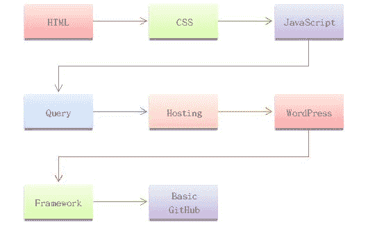

`HTML`和`CSS`是你在继续学习其他内容之前需要的最基础编码知识。然后你可以继续学习`JavaScript`和`jQuery`。一旦你创建了路线图，它将让你更容易专注于最核心的内容，以免浪费时间和精力的。

### 技巧 2：慢慢来

想要快速理解编码将是停止编码和 JavaScript 学习的有害因素之一。

试图扫读某些内容然后转向下一个问题只会让你忘记得更厉害。你会忘记第一次读过的内容，回去看以刷新记忆，然后继续下一个。到那时，你已经完全忘记了其他东西。这种循环会不断重复，然后你会发现自己沮丧。为了防止这种情况发生，你可以这样做：

- 将编码量限制在特定的任务上。一次学习一样

- 练习你所学会的

通过学习和练习你的编码技能，你会发现在学习新事物时，记忆和吸收变得容易得多。这个过程可能看起来更长，但熟能生巧。

### 技巧 3：带着正确的心态练习

记住：如果你试图在 JavaScript 练习中走捷径，你只会花费更长时间来学习。是的，练习是枯燥且重复的，但这里有一些方法可以让它变得有趣：

将 JavaScript 中的每个新概念想象成一个新的玩具、汽车、iPhone 甚至新衣服。你渴望尝试它，特别是当它是新的并且你使用它几次时。用你刚刚学的概念应用一些酷的东西；让自己惊喜并向朋友展示你的新技能。

寻找时间练习代码可能是困难的。然而，编写代码的人也是社交媒体的重度用户，经常花时间在`YouTube`、`Facebook`、`Reddit`甚至`Wikipedia`上。无论你是否如此，从使用社交媒体中都能学到贵的教训。

即使我们只想看一眼通知，却在`Facebook`上花费了这么多时间，这一事实说明了很多问题。我们被`Facebook`吸引是因为一件事导致另一件事，因为你不断看到人们更新他们的状态和动态，你的新闻消息里总有新内容可以看。

利用同样的心理学，你可以将其转化为学习代码的优势。与其投入几个小时来学习代码，你只需要告诉自己你将投入 15 分钟完全不受干扰的时间。然后去看看`Facebook`，休息一下。之后再回来，再做 15 分钟。

但是，这种技术只有在你专注于目标、不让`Facebook`或其他任何事情将你拖入并让你完全忘记正在做什么时，才能起作用。

### 技巧 5：给自己留出时间

俗句说得，如果你花时间慢慢思考，你学得会快得多。编码需要时间。你需要时间来理解它。否则，你只会更加困惑。花时间弄清楚你正尝试学习什么。如果需要，就向别人解释。在一次性搞定一切之前，花时间仔细检查每一个步骤和每一行代码。

### 技巧 6：用通俗语言编写

编码可能变得极其复杂。如果你阅读的内容变得太复杂或陌生，尝试用简单的术语写出来——或者用任何你先理解的方式先写出来。这样，在实际编写之前，你就可以弄清楚你想编写什么代码。

这将使你下次编写代码变得容易得多，你编写代码的速度也会更快，因为你不需要在每一行代码处停下来思考。你甚至可以在编写代码之前就发现 Bug。

### 核心总结

这些技巧中的许多可以让你轻松且更快速地学习`JavaScript`。事实是，你可以将这些技巧应用于学习任何你需要的课程。

## 第 2 章：JavaScript 抄表——每个程序员的必备指南

到目前，你已经知道如果你想认真成为一名程序员，学习`JavaScript`有多重要。毫无疑问，`JavaScript`是数字世界中最实用的编程语言。它被用于应用开发、Web 应用、网页以及通用编程。

在本章中，我们将为你介绍一些你可以获得的必备抄表（cheat sheets），通过这些工具你可以提高自己编码和编写编程语言的能力。这些抄表非常实用，因为它们可以帮助你在学习的同时掌握基础知识。

- [CHEATOGRAPHY JAVASCRIPT 备查表](https://www.cheatography.com/davechild/cheat-sheets/javascript/)

通过这个网站，你可以找到各种列表方法和函数，包括常用表达式的指南以及更复杂的项目，如`XMLHttpRequest`对象以及许多关于`JavaScript`的引用。

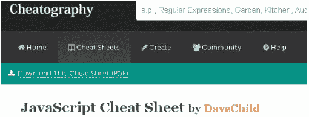

- [QUICKLYCODE- 编程抄表及其他许多](http://www.quicklycode.com/)

该网站将你链接到更多满足编程需求的抄表和其他资源，从`JavaScript`到`SQL`、`Java`、`WordPress`、`Ruby on Rails`和`PHP`。

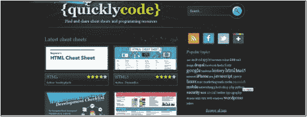

- [FIRSTSITEGUIDE JavaScript 备查表](https://firstsiteguide.com/javascript-cheat-sheet/)

FirstSiteGuide 由几位自诩为 Web 极客组成，他们为从`SEO`到营销、Web 托管、设计和开发的所有内容提供建议和教程。他们还为你链接了免费资源和工具包。


- [MOOTOOLS 抄表](http://mootools.net/)

该网站为你提供了各种`JavaScript`工具，对于中高级`JavaScript`开发者来说非常出色。你可以使用许多文档齐全且优雅的`APIs`编写强大且灵活的代码。

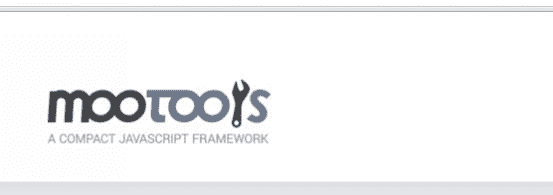

- [jQUERY 抄表](https://oscarotero.com/jquery/)

由 Oscar Otero 管理，"jQUERY`抄表让开发者能够找到与`jQuery`1.3库相关的函数和属性。


- [STEAMFEED HTML & JavaScript 快捷键](http://www.steamfeed.com/html-and-javascript-cheat-sheet-for-site-designers/)

SteamFeed 的优秀们想出份很棒的抄表，将`HTML`代码和`JavaScript`信息放在整洁且易于阅读的信息图表中，你可以将其打印并放在阅读距离内，以便在练习编码时方便查看。

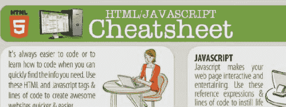

- [WEB 设计抄表](http://blog.sellfy.com/cheat-sheets-for-web-designers/)

如果你需要一个可以获取所有各种与 Web 设计相关的抄表的网站，那么 Sellfy 拥了一些关于`CSS`、响应式 Web 设计抄表、`HTML`标签等更多资源。


- [终极 JavaScript 备查表](https://www.codementor.io/johnnyb/tutorials/javascript-cheatsheet)

这份来自 codementor 的抄表提供了`JavaScript`语言的快速概述。你可以从开始阅读，也可以跳转到你感兴趣的主题。


## 第 3 章：设计和构建自己的 JavaScript 库的技巧

你说 JavaScript 库 吗？

不，它不包含书籍。然而，它包含了网页设计师、开发者和程序员可以在项目使用的代码包，从而节省时间和精力。

### 什么是 JavaScript 库？

这里是 JavaScript 库的一些独特特征：

- 它在一个文件夹中有一个或多个文件

- 它的代码必须独立维护，并在在使用时保持不变

- 它允许用户设置项目特定的行为或配置

在本章中，我们将讨论为什么要构建 JavaScript 库，以及如何用简单的方法构建它们。

### 为什么要构建自己的 JavaScript 库？

首先，这对程序员和 Web 开发者来说都很方便特别是当你开发大量的程序、网站和 Web 时。拥有现有代码的库会让你的工作变得更容易并节省时间，因为你不需要从硬盘的某个模糊文件夹中寻找旧项目。你只需要从库中提取它们。你有了一个存储所有代码的地方；你有了一个将所有应用程序放在更容易维护的地方。

基本上，任何让你的工作变得更容易且可以重复的代码都是加入库的优秀组件。一个很好的例子是`jQuery`。`jQuery`的`API`是一个更简单的`DOM API`。当跨浏览器`DOM 操作`变得困难时，`jQuery`是必不可少的。

但对于大多数开发者或编码人员来说，拥有自己的库是一种爱好；这种爱好让他们能够编写代码、帮助他人并为这一过程做出贡献。

## 你的目标和工作范围

在你开始编写代码之前，你需要明确你开发这个库的目标是什么。这将帮助你专注于你所遇到的问题，以及如何用你的库来解决这些问题。

你的首要目标也是让你的库易于使用。从本质上说，你的`API`越简单，任何人使用你的库就越容易。

所以问问自己自己——你的库解决了什么问题，你将如何解决它？你会利用别人库中的代码，还是自己编写所有内容？

在第 1 章中，我们讨论了创建路线图。这个库的路线图将成为你在任何其他代码开发中使用的技术之一。

### 你的库的路线图：

- 列出你希望在库中实现的功能

- 使这些功能保持最简且实用

- 为每个功能创建里程碑

你通过路线图所做的是为每个`function`设定目标，本质上是将你的项目拆分为可管理的规模，使其更容易完成，并让创建过程更加愉快。它还能让你保持理智和专注。

## 你的库 API 设计

在创建库时，要把自己想象成最终用户。通过把自己当作用户，你将朝着以用户为中心的设计和开发努力。这将让任何访问该库的人都能使用得更加方便。

### 测试你的 API

测试`API`质量的最佳方法是将其应用于你的项目。你可以做的是将应用程序代码替换为你的库，看看它给出的结果是否涵盖了你想要的所有功能。尽可能保持最基本的元素，同时也留出灵活性空间，以更改和修订任何看起来略有偏差的地方。

这是一个实现代码或 User-Agent 字符串库大的示例：

代码：


```javascript
// Start with empty UserAgent string
var userAgent = new UserAgent;

// Create and add first product: EvilCorpBrowser/1.2 (X11; Linux; en-us)
var application = new UserAgent.Product('EvilCorpBrowser', '1.2');

application.setComment('X11', 'Linux', 'en-us');
userAgent.addProduct(application);

// Create and add second product: Blink/20420101
var engine = new UserAgent.Product('Blink', '20420101');

userAgent.addProduct(engine);

// EvilCorpBrowser/1.2 (X11; Linux; en-us) Blink/20420101
userAgent.toString();

// Make some more changes to engine product
engine.setComment('Hello World');

// EvilCorpBrowser/1.2 (X11; Linux; en-us) Blink/20420101 (Hello World)
userAgent.toString();
```

取决于你的库有多复杂，你可能还需要对结构化进行思考。一种方法是利用设计模式来结构化你的库，并克服你在过程中可能遇到的任何技术问题。

结构化还能在当你向库中添加新功能时，减少重新对齐巨大部分的风险。

## 灵活性与定制化

世界上大多数 JavaScript 库的一个酷酷的地方在于其灵活性。然而，许多开发者在决定哪些可以自定义哪些不能自定义时会遇到问题。其中就有 `chart.js` 和 `D3.js`。

这两个元素都是数据可视化的优秀库。如果你对图形有更多的控制需求，那么 `D3.js` 就是你想要的。如果你想要一种易于创建且提供不同类型内置图表的东西，那么 `Chart.js` 是你的选择。

有三种方法可以让你用户对你的库进行控制：

1. 配置
2. 暴露公共方法
3. 回调与事件

配置库通常是在项目初始化阶段完成的，但某些库也允许你在运行时进行设置。这些配置通常仅限于简单问题，因为更改这些设置只会更新这些值以供以后使用。

代码：

```javascript
// Configure at initialization
var userAgent = new UserAgent({
  commentSeparator: ';'
});

// 使用 public method 进行运行时配置
userAgent.setOption('commentSeparator', '-');

// 使用 public property 进行运行时配置
userAgent.commentSeparator = '-';
```

刻意暴露某些方法是为了与实例进行交互（getters），例如从实例中检索数据或向实例中放入数据（setters），以及执行某些操作。

代码：

```javascript
var userAgent = new UserAgent;

// 用于从所有产品检索注释的 getter
userAgent.getComments();

// 用于打乱所有产品顺序的操作
userAgent.shuffleProducts();
```

回调有时也会通过公共方法接受并传递，它通常用于在异步任务后运行用户代码。

```javascript
var userAgent = new UserAgent;

userAgent.doAsyncThing(function asyncThingDone() {
  // 在异步任务完成后运行代码
});
```

事件在 JavaScript 库中具有巨大的潜力。与回调相似，但它们有细微不同：添加事件处理器不会触发动作。事件还用于指示某些事件，并为用户提供额外信息，同时为库返回一个特定的值。

代码：

```javascript
var userAgent = new UserAgent;

// 在添加时验证产品
userAgent.on('add', function onAdd(product) {
  var shouldProduct = product.toString().length < 5;
  // 告诉库添加
  return shouldProduct;
});
```

你可能还可以允许用户扩展你的库。为了做到这一点，你需要提供公共方法以便用户可以填充它，例如 Angular 模块。

代码：

```javascript
(angular.module('myModule'))).fn(myPlugin)
```

你也可以对上述操作都不做，允许用户通过命名空间访问你的库。

代码：

```javascript
// AngryUserAgent module
// 有权访问 UserAgent
(function AngryUserAgent(UserAgent) {
  // 创建新方法 .toString()
  UserAgent.prototype.toString = function() {
    return this.toString().toUpperCase();
  };
})(UserAgent);

// Application code
var userAgent = new UserAgent;

// ...
// EVILCORPBROWSER/1.2 (X11; LINUX; EN-US) BLINK/20420101
userAgent.toString();
```

同样，这也允许你覆盖方法。

代码：

```javascript
// AngryUserAgent module
(function AngryUserAgent(UserAgent) {
  // 旧的 .toString() 方法供以后使用
  var _toString = UserAgent.prototype.toString;

  // 覆盖 .toString()
  UserAgent.prototype.toString = function() {
    return _toString.call(this).toUpperCase();
  };
})(UserAgent);

var userAgent = new UserAgent;

// ...
// (result)
userAgent.toString();
```

在这种情况下，允许用户访问你的库的命名空间也会导致你对插件和扩展的定义控制较少。

为了让扩展遵循某些约定，你需要编写文档。

## 测试

对于测试驱动开发，大纲是必不可少的。换句话说，这是以测试的形式写下功能和标准的时刻，甚至在编写实际库之前。

如果你的测试显示功能按照预期方式运行，并且你的代码通过了所有这些测试，那么你可以放地说你的库运行良好。

你可以使用的其他测试框架有：

[使用 Mocha 和 Chai 测试 JavaScript 测试](http://www.sitepoint.com/unit-test-javascript-mocha-chai/)由 Jani Hartikainen 编写，你可以在 Mocha 中编写单元测试。

[使用 Jasmine, Travis 和 Karma 进行 JavaScript 测试](http://www.sitepoint.com/testing-javascript-jasmine-travis-karma/) 由 Tim Evko 编写，向你展示了如何与名为 Jasmine 的另一个框架紧密地构建测试流水线。

下面是由 Tim Severien 提供的另一个大纲。他为他的库使用了 Jasmine 测试，它看起来像这样：

代码：

```javascript
describe('Basic usage', function () {

  it('should generate a single product', function () {
    // Create a single product
    var product = new UserAgent.Product('EvilCorpBrowser', '1.2');
    product.setComment('X11', 'Linux', 'en-us');
    expect(product.toString())
      .toBe('EvilCorpBrowser/1.2 (X11; Linux; en-us)');
  });

  it('should combine several products', function () {
    var userAgent = new UserAgent;
    // Create and add first product
    var application = new UserAgent.Product('EvilCorpBrowser', '1.2');
    application.setComment('X11', 'Linux', 'en-us');
    userAgent.addProduct(application);
    // Create and add second product
    var engine = new UserAgent.Product('Blink', '20420101');
    userAgent.addProduct(engine);
    expect(userAgent.toString())
      .toBe('EvilCorpBrowser/1.2 (X11; Linux; en-us) Blink/20420101');
  });

  it('should update products correctly', function () {
    var userAgent = new UserAgent;
    // Create and add first product
    var application = new UserAgent.Product('EvilCorpBrowser', '1.2');
    application.setComment('X11', 'Linux', 'en-us');
    userAgent.addProduct(application);
    // Update first product
    application.setComment('X11', 'Linux', 'nl-nl');
    expect(userAgent.toString())
      .toBe('EvilCorpBrowser/1.2 (X11; Linux; nl-nl)');
  });
});
```

一旦你完成了测试并对你第一个版本的库 API 设计完全满意，你就可以开始考虑网站的架构以及你的库具体将如何被使用。

### 模块加载器兼容性

并不是很多开发者使用模块加载器，这完全取决于你。然而，你需要意识到，某些使用你库的开发者可能会选择使用模块加载器，因此你需要让你的库兼容此功能。

你可以选择一些流行的模块加载器，如 `AMD`、`RequireJS` 和 `CommonJS`。如果你在这些功能之间做出选择很困难，你也可以尝试通用模块定义 (`UMD`)，它旨在支持多种类型的模块加载器。

为了让你的库兼容 UMD，你也可以找到一些变体，例如 UMD GitHub 仓库。使用这些模板之一开始创建你的库。另一个技巧是，如果你选择使用 ES2015 的 `import/export` 语法，可以使用 `Babel` 编译 ES5，并结合 `Babel` 的 UMD 插件。这样，你就可以可以在项目中使用 ES2015，同时产生一个可以使用使用各种模块的开发者使用的库。

### 文档

你需要从基础信息开始编写文档，例如项目名称以及对其内容的简短描述。这将帮助他人理解你的库是做什么的，以及使用你的库对他们来说是否是一个很好的选择。你还可以包含关于范围和目标等更多信息，以便用户获得更多信息。你也可以包含路线图，让用户知道他们在你未来的库开发中可以期待什么，以及他们如何也能做出贡献。

### API、教程和示例

API 文档也是文档不可或缺的一部分，因为它将告诉用户具体如何使用你的库。其他很好的补充是示例以及教程。这可能花费一些时间，所以你可以在库开发的过程中进行此。

### 元任务 (Meta-tasks)

用户还想对你的库进行更改，这通常以贡献的形式出现，但某些人只想为私人使用创建一个自定义构建。对于这些用户，你可以包含关于元任务的文档，其中包含构建库、运行测试、生成和转换或下载数据的命令列表。

### 贡献

贡献是非常棒的，尤其是当你开源你的库时。你可以添加的另一部分文档是引导贡献者解释向库做出贡献的步骤，以及他们在做出贡献之前应该满足哪些标准。这将使你的审核过程更容易接受那些能够积极升级和增强你库的贡献。

### 许可证

许可证同样重要。包含许可证，以便每个人都知道哪些材料受版权保护。推荐使用 [ChooseALicense.com](http://choosealicense.com/) 作为在没有法律顾问的情况下获取许可证的优秀资源。将你选择的许可证作为文本保存为项目中的 `LICENSE.txt` 格式文件。

### 为你的 Git 添加版本/发布

版本控制对于一个良好的项目是必要的。目前的命名标准是 [SemVer](https://semver.org/)。该版本由三个数字组成，表示主版本（major）、次版本（minor）和修订版本（patch）。创建一个标签，打开终端并执行以下操作：

```bash
git tag -a [version] -m [message]
```

### 发布到公共仓库

npm

大多数编程语言都配备了包管理器，或者它们至少有第三方包管理器。例如，PHP 的管理器是 [Composer](http://www.sitepoint.com/mastering-composer-tricks/)，Ruby on Rails 是 [Gems](https://rubygems.org/)。对于独立的 JavaScript 引擎如 Node.js，你有 [npm](https://www.npmjs.com/)。默认情况下，你的 npm 包将是公开的。但你也有选择发布：

- [私有包](https://www.npmjs.com/npm/private-packages)
- [设置私有仓库](https://docs.npmjs.com/registry#set-up-a-private-registry)
- [完全避免在官方发布](https://docs.npmjs.com/registry#i-dont-want-my-package-published-in-official-registry)

然而，如果你决定发布包，你需要 `package.json` 文件。你可以手动执行，也可以使用交互式向导。开始此向导，输入：

```bash
npm init
```

`version` 属性应该匹配你的 git tag。同时也包含 `README.md` 文件。就像 GitHub 一样，npm 使用它作为展示你包的页面。

完成后，通过输入发布包：

```bash
npm publish
```

这就成功发布了 npm 包！

Bower

另一个非常有用的包管理器在几年前出现。这是一个为网页设计的包管理器。在这里，你可以找到所有的前端。唯一的问题是，许多前端包仍然使用 npm，但 Bower 仍然非常流行，所以也尝试使用 Bower 发布你的包吧。

要生成 `bower.json` 文件，输入：

```bash
bower init
```

就像 `npm init` 一样，指令是自而易见的。最后，发布你的包：

```bash
bower register awesomelib [`github.com/you/awesomelib`](https://github.com/you/awesomelib)
```

现在你的库可以供大家在他们的 Node 项目或网页上使用了！

### 结论

记住，你的代码开发就是库。确保你的库解决了一个问题、方便易用，最重要的是稳定。这将确保你和许多使用它的开发者都感到满意。

上述解释的任务可以很容易自动化，例如运行测试和创建标签、更新你的版本以及发布你的包。

# 第 4 章：JavaScript 技巧与窍

## 保留与记忆

在本章中，我们将探讨一些与提高 JavaScript 技能和增强代码编写相关的简短而实用的技巧。

| 使用 === 代替 == |get |

| :--- | :--- |

| `==`（或 `!=`）运算符在需要时会执行自动类型转换。`===`（或 `!==`）运算符不会执行任何转换。它执行的是比较值和类型，这被认为比 `==`（[jsPref](http://jsperf.com/strictcompare)）更快。 | ```javascript
[10] == 10 // is true
[10] === 10     // is false
'10' == 10 // is true
'10' === 10     // is false
[] == 0 // is true
[] === 0      // is false
'' == false   // is true 但 true == "a" is false
'' === false // is false ``` |


| `charAt()` 简写 | 要实现这一点，你可以利用 `eval()` 函数，但这种括号表示法的简写技术比求值简单得多。 |
| --- | --- |
| 代码示例 | 
```javascript
Longhand:"myString".charAt(0);
Shorthand:"myString"[0]; // Returns 'm'
```

| 字符串转换为数字 | 最快且最简单 ([jsPerf](https://jsperf.com/number-vs-parseint-vs-plus/29)) 方法是使用 `+`（加号）运算符。 |
| --- | --- |
| 代码示例 | 
```javascript
var one = '1';
var numberOne = +one; // Number 1
```

你也可以使用 `-`（减号）运算符，它会将值类型转换为数字但也会对其进行取反。

```javascript
var one = '1';
var negativeNumberOne = -one; // Number -1
```

| 真值/假值转换为布尔值 | 你可以使用 `!!` 将真值或假值转换为布尔值 `true` |
| --- | --- |
| 代码示例 | 
```javascript
!!""  // false
!!0  // false
!!null  // false
!!undefined  // false
!!NaN  // false
!!"hello"  // true
!!1  // true
!!{}  // true
!![]  // true
```

| 使用 `JSON.Stringify` | 假设有一个具有属性 `prop1`、`prop2`、`prop3` 的对象。可以向 `JSON.stringify` 传递额外的参数来选择性地将对象的属性写入字符串，例如： |
| --- | --- |
| 代码示例 | 
```javascript
var obj = { 'prop1': 'value1', 'prop2': 'value2', 'prop3': 'value3'};
var selectedProperties = ['prop1', 'prop2'];
var str = JSON.stringify(obj, selectedProperties);
// str// {"prop1":"value1","prop2":"value2"}
```

`str` 将仅包含所选属性的信息。除了数组，我们也可以传递一个函数。

```javascript
function selectedProperties(key, val) { //第一个 val 是整个对象，如果 key 为空字符串
  if (!key) {
    return val;
  } if (key === 'prop1' || key === 'prop2') {
    return val;
  } return;
}
```

| 最后一个可选参数的作用是用于修改它将对象写入字符串的方式。 |
| --- |
| 代码示例 | 
```javascript
var str = JSON.stringify(obj, selectedProperties, '\t\t');
/* str 输出在每行都有双制表符.{
    "prop1": "value1",
    "prop2": "value2"}*/
```

| 用于数组和写入单个元素的单一方法 | 与编写单独的方法来保存数组和单个元素参数，你可以编写函数使它们能够同时处理两者。你只需要先将所有内容合并到一个数组中。`Array.concat` 会接受数组或单个元素。 |
| --- | --- |
| 代码示例 | 
```javascript
function printUpperCase(words) {
  var elements = [].concat(words || []);
  for (var i = 0; i < elements.length; i++) {
    console.log(elements[i].toUpperCase());
  }
}
```

| `printUpperCase` 现在准备好接受单个节点或节点数组作为其参数。它还避免了在未传递参数时可能抛出的 `TypeError`。 |
| --- |
| 代码示例 | 
```javascript
printUpperCase("cactus"); // => CACTUS
printUpperCase(["cactus", "bear", "potato"]); // => CACTUS // BEAR // POTATO
```

| 测量 JavaScript 代码块的性能 | 为了快速测量 JavaScript 代码块的性能，我们可以使用 `console` 函数，如 [console.time(label)](https://developer.chrome.com/devtools/docs/console-api#consoletimabel) 和 [console.timeEnd(label)](https://developer.chrome.com/devtools/docs/console-api#consoletimeendlabel) |
| --- | --- |
| 代码示例 | 
```javascript
console.time("Array initialize");
var arr = new Array(100), len = arr.length, i;
for (i = 0; i < len; i++) {
  arr[i] = new Object();
};
console.timeEnd("Array initialize"); // Outputs: Array initialize: 0.711ms
```

| 变量提升 | 提升将帮助你管理函数作用域。变量声明和函数会被提升到顶部，而变量定义则不会。 |
| --- | --- |
| 代码示例 | 
```javascript
function doTheThing() {
  // ReferenceError: notDeclared is not defined
  console.log(notDeclared); // Outputs
}
```


React 和 Redux 绝对是 2016 年最热门的趋势，而且就前端“框架”JavaScript 而言，它们在 2017 年似乎不会消退。Netflix、Yahoo! 和 Dropbox 都已将 `React` 纳入他们的技术武器库，这为它注入了信心。尽管如此，Facebook 的 `Relay` 看起来也是 2017 年一个很有前景的竞争者。

## 其他值得关注的框架

其他框架可能会加入这一领域，虽然它们不可同日而论，但这里是对现有框架的总体概述。再次强调，技术领域的任何事情都可能发生。今年可能不太好用的东西，到明年可能会成为行业顶尖水平。

话不多说，这里是一些其他值得关注的框架。

### Angular2

许多非技术性公司将考虑使用 `Angular 2`，特别是那些使用微软 `.NET` 框架的业务。`Angular 2` 由谷歌和微软合作开发，旨在让 JavaScript 成为一种更易于管理的语言。

微软公司去年积极地推行 `.NET`，因为它开源了许多元素，并努力让微软的工具对开发者更容易获取。在重写之后，团队希望修复 `Angular 1` 应用中出现的任何升级问题，到目前为止，性能非常出色。`Angular2` 的开发是为了支持 Web 组件，根据谷歌的说法，它是 Web 开发的未来。然而，AngularJS 社区对 `Angular` 采取的方向持有不同意见——尽管 `Angular` 团队投入了大量精力帮助开发者从 `Angular 1` 正确地过渡到 `Angular 2`。

这次重写也让 `React` 随着社区的日益增长而发展和成熟。由于此，程序员怀疑 `Angular 2` 是否像 `Angular 1` 那样成功。但正如上述提到的，技术世界充满变化，2017 年 `Angular2` 可能会有增长空间。

### Meteor

另一个值得关注的未来趋势是 `Meteor`，它一直拥有稳定的下载量和 GitHub Star。它与 `React` 和 `Angular` 良好集成，并有很多巧妙的功能。作为一个轻量级的全栈 JavaScript 框架，开发者发现使用 `Meteor` 框架非常愉快。`Meteor` 一被认为是一个实实的学者框架，也非常适合原型设计。

防止 `Meteor` 成为主流成功的原因是随着时间推移不断出现的隐藏复杂性，特别是在生产环境方面。尽管 `Meteor` 募集了大量资金，但它并没有像 `React` & `AngularJS` 那样拥有庞大工程师团队的领先技术企业支持。尽管 `AngularJS` 有很多问题但有谷歌的支持，另一方面，`Meteor` 被认为存在投资风险，因为它是一个兼顾后端和前端开发的框架。为了充分利用部署的便利性，`Meteor` 还需要托管。

目前 `Meteor` 不够理想的另一点是，许多开发者并不是 `MongoDB` 的粉丝，而 `Mongo` 是 `Meteor` 的默认数据库。`Meteor` 在 2017 年仍是一个不错的选择，因为更多开发者可能会等待更可靠的证据，证明 `Meteor` 可以用于开发大型且更复杂的应用程序。不否说，`Meteor` 在 2016 年甚至 2017 年可能将保持小众。大多数专业开发者将等待任何关于它可以用于开发大型、复杂应用的证据。

### ES6 终于到来

JavaScript 开发者在 2016 年迈向 2017 年要做的事情之一是确保他们所有的应用都符合 `ES2015` 标准。但像许多其他技术应用和编程语言的复杂问题一样，我们面临着 `Babel` 与 `TypeScript` 问题。

`Babel` 主要将 `ES6` 代码翻译为 `ES5`，而 `TypeScript` 实际上是 JavaScript 的超集，为 JavaScript 增加了必要但可选的静态类型，然后将所有内容编译为纯 JavaScript。`Babel` 和 `TypeScript` 的创建目的完全不同，因此没有可比性。

由 Facebook 开发的 `Babel` 支持 `Flow`，它为 JavaScript 添加了静态类型检查。使用 `Babel` 更有意义，因为你可以连续使用两者。`Babel` 也是第一个帮助桥接 `ES5` 和 `ES6` 应用差异的工具。

另一方面，`TypeScript` 只支持 `ES6`，因此在先进性方面次于 `Babel`。查看 GitHub Star，`Babel` 似乎是最受欢迎的转编译器。`React` 开发者也倾向于使用 `Babel` + `Webpack` 组合。


尽管有 Star 数，但 `TypeScript` 似乎是一个更可行且有时甚至是首选的选择，特别是当你寻找一种解决方案让你的 JavaScript 代码库更易于管理时。JavaScript 一直被认为是一种难以阅读的语言，由于其弱类型检查系统，调试变得更加困难。因此在支持方面，`TypeScript` 拥有比 `Flow` 更多的粉丝。


下面的图表显示了 `TypeScript` 兴趣增长趋势。


`TypeScript` 变得流行的另一个原因是 `Angular2`，但仅仅因为 JavaScript 应用受到更多关注，并不是 `TypeScript` 流行的真正原因。

虽然 `Redux` 让测试变得更容易，但 `TypeScript` 让代码库变得更容易维护。此外，谷歌、Facebook 和微软正在合作为 JavaScript 添加静态类型，从而为 ECMAScript 铺平道路。

与此同时，谷歌放弃了 `AtScript` 和 `AngularJS` 转而支持 `TypeScript`。另一方面，Facebook 的 `Flow` 没有 `TypeScript` 那样的社区人气。

这表明静态类型 JavaScript 是一个活跃且增长的趋势，即使是 JavaScript 的不信者也会认可 `TypeScript` 是最可靠的解决方案。

## 函数式编程正在成为主流

许多函数式编程平台正在进入主流编程，但最近，“函数式编程模型”引起了大量关注，特别是随着复杂应用程序的出现。


`Scala` 再次成为想要采用函数式编程的后端开发者青睐的语言。然而，Facebook 的 `React` 则鼓励前端开发者使用实用方法进行 UI 开发。

对于函数式编程的积极反馈越来越多，看起来它可能在 2017 年成为主流。目前，前端 Web 开发正处于反应式和函数式编程的前沿。

因此，`React+Redux` 议程对于那些熟悉面向对象编程的开发者来说，确实是最受青睐的初学者友好解决方案。换句话说，`React` 只需要开发者采用函数式方法处理 UI，而 `Redux` 主要是一个鼓励实用方法处理数据的系统。所有其他事情都以 OOP 风格完成。

### RxJS

但对于那些仍然想继续追求全功能式响应式编程（这被认为是“真正”的 FRP）并且仍然想使用 JavaScript 的人来说，`RxJS` 是一项必须学习的技能。`RxJS` 是 JavaScript 的一种响应扩展，可以用来替代 `Flux` 架构。对于简单的小型应用来说，这听起来可能大材小用，但实际上，它为经过复杂流处理的 Web 应用程序构建了强大的基础。

Netflix 使用 `RxJS`，而 `Angular2` 也依赖于 `RxJS`。`RxJS` 由微软开发，与 `TypeScript` 配合得非常完美，因此开发者可以预期 `RxJS` 将持续得到改进。

然而，学习 `RxJS` 是一个完全不同的领域。它的学习曲线非常陡峭，导致大多数开发者放弃了在 JavaScript 中进行任何 FRP 编程，转而选择其他兼容 JavaScript 的函数式编程语言。


开发者选择用来替代 `RxJS` 的一些兼容编程语言是 `ClojureScript` 和 `Elm`。然而，这些程序的增长和流行程度与 `Redux+React` 相比显得黯淡。


事实是，看到函数式编程如何完美地解决 Web 开发中的现代问题，人们必须承认函数式编程范式及其等效概念将作为 JavaScript 开发者需要掌握和学习的技能持续存在。

## 桌面框架对决：Nw.js vs. Electron

如今大量数据需要从各种平台（如桌面和移动端）同步数据。然而，许多服务大多数以 Web 应用的形式开始，然后转换为桌面应用以增强用户体验。这样做是因为 Web 应用的开发速度更快、更新更方便。此外，用户还可以更快速地尝试 Web 应用，而无需安装任何其他东西。

过去，开发者如果想使用 Web 技术为桌面应用创建前端 UI，就受限于使用 `CEF`。这并不是一个容易的过程，而且应用程序本身并不是真正的跨平台兼容。尽管如此，`Node.js` 让桌面框架的跨平台应用变得更加简单。使用 Web 技术进行桌面应用开发的趋势从 2014 年开始兴起。

因此，让我们来看看这两个项目的 GitHub Star 历史：


尽管 `Nw.js` 早得多进入领域并被认为更老旧，但看起来 `Electron` 正在以爆炸性的速度增长，而 `nw.js` 则以单调的线性速度增长。

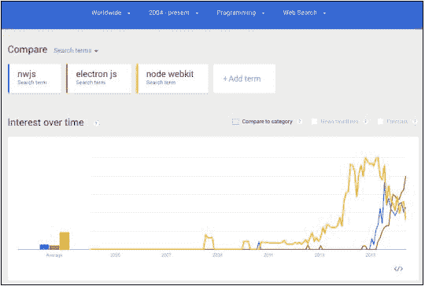

虽然 `Electron` 非常新颖，但它被许多成熟的组织使用，如 `Slack`、`Microsoft` (`Visual Studio Code`）、`WordPress` 和 `Sencha`。但由于 `Electron` 的易用性，网络和社区增长非常快。这股热潮很可能会持续到 2017 年，使 `Electron` 成为桌面和 Web 应用开发的首选框架。

## 移动应用框架对决：React Native vs. Ionic

当 `React Native` 出世时，人们预测它将接管并规划 Web 技术移动开发的蓝程，因为它可以用于开发原生跨平台应用。那么 2017 年是 `React Native` 的年吗？通过这张图表可能会产生一些预期：

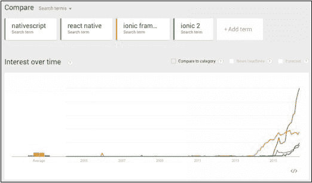

此时，`React Native` 尚未发布任何更新的软件，因为它仍处于 `0.26` 版本。它在 2017 年是否会成为主流，很大程度上取决于开发者对于处理需要重构整个代码库以及其他问题的应用开发变化的耐心。

因此，让我们来看看 `React Native` 与 `Ionic` 的近似 `npm` 下载量对比：

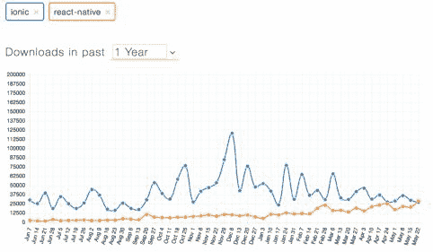

从图表来看，`React Native` 望有望超越 `ionic`，成为使用 Web 技术进行跨平台移动开发的首选框架。

在就业市场方面，`React Native` 的需求也比 `Ionic` 更大：


快速搜索招聘职位显示，至少有 75 个招聘帖子正在寻找具有 `ionic` 技能的开发者，而 65 个招聘帖子正在寻找具有 `React` 技能的开发者。这表明对 `React Native` 的熟悉程度正在增加，这很可能为 2017 年及以后任何新出的开发者提供巨大动力。

## Web API 的未来：GraphQL vs REST

在 `Facebook` 提到他们将开源 `GraphQL` 后，许多 JavaScript 开发者在 2016 年早期就加入了追逐热潮，尤其是考虑到 `Facebook` 在开源项目方面已变成了 JavaScript 界的“苹果”。

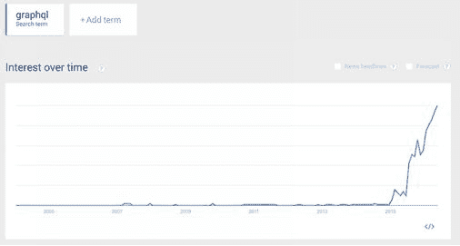

`GraphQL` 的目标是取代 `REST` API，但考虑到 `REST` API 的无处不在，这种场景是不可能的：

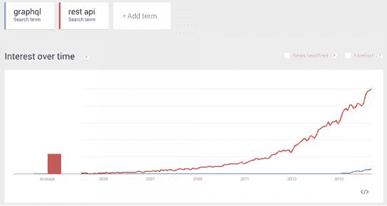

`GraphQL` 与 `REST` API 配合得很好，但它绝对不会像某些开发者认为的那样取代 `REST`。更重要的是，`GraphQL` 相对较新，并且与 `Facebook Relay` 关联，因此程序员和开发者在其他地方没有学习资源或最佳实践来掌握这项技能。尽管如此，2017 年对于 `GraphQL` 成为主流来说仍然太早了。

### JavaScript 趋势总结

结论，JavaScript 社区以快速的速度移动和变化，跟上任何趋势并与主流技术保持一致，这意味着会有更多的支持、相关性和资源。根据本章讨论的趋势，JavaScript 开发者应该为自己配备 `Redux&React`，以及其他函数式编程工具，如 `TypeScript`。不仅如此，拥有 `React Native` 和 `Electron` 的经验无疑会为未来的程序员在求职时提供多多的推力和信誉。

### 结语

感谢你读完《JavaScript: Tips and Tricks to Programming Code with JavaScript》。让我们希望这本书对你来说是有启发性的，并能够为你提供实现目标所需的所有工具，无论你的目标是什么。

下一步是使用你所学到的编码技能并将其应用到自己的项目中。学习需要时间，但你应该保持耐心，因为每当你学习新事物时，你都会犯错。

再次回顾书中的课程并重读它们。学习如何编写代码在掌握之前会让你感到困惑，因为你将学习到所有不同的条件和异常。

最后，如果你觉得这本书在任何方面都有帮助，我们将非常感谢你在 Amazon 上的评论！

## 关于作者

Charlie Masterson 是一位计算机程序员和导师，开发过多个应用程序和计算机程序。

作为一名计算机科学学生，他很早就对编程感兴趣，但学习极其复杂的课题让他感到沮丧。

Charlie 想要一种可以轻松学习和提高编程技能的方法。他很快发现了一系列教学课程可以让他学得更快、更好。

通过同样的方法，Charlie 成功学习了不同的编程语言，现在通过编写书籍来教授这些课题。

通过他编写的计算机编程书籍，他希望提供巨大的价值，并帮助对计算机主题感兴趣的读者。
