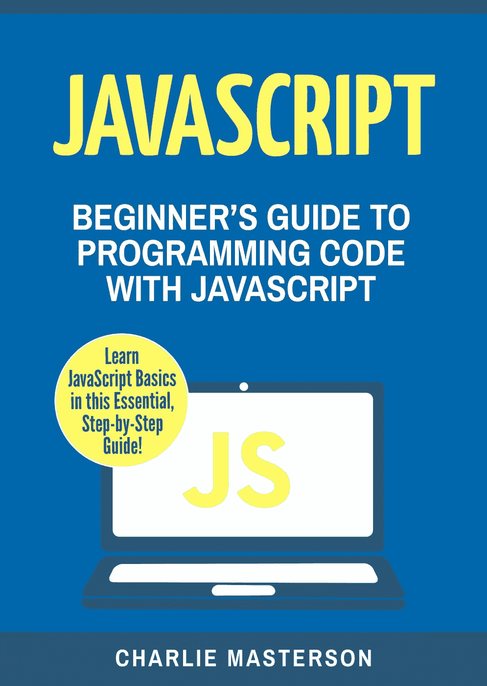

# JavaScript：四本合一；Java 编程入门指南；Java 编程技巧与窍门；Java 编程最佳实践；Java 编程高级指南



|  |  |  |


# 介绍


恭喜你下载《JavaScript：初学者 JavaScript 编程指南》，感谢你的支持。

后续章节将讨论 JavaScript 以及你理解它所需要的所有知识。JavaScript 是一门复杂的语言，学习需要大量的耐心。然而，当你学会它后，在 HTML 代码中输入 JavaScript 代码时，你能够在浏览器中执行许多不同的操作。

市场上有许多关于这个主题的书，再次感谢你选择这一本！我们尽力确保它包含尽可能多的有用信息，请尽情享受！

|  |  |  |

# 第一章：JavaScript...它是什么？它将如何带给我好处？


JavaScript 是一门脚本语言。通过 JavaScript，你将与不同的网页进行交互，从而创建一个 Web 应用。Netscape Communications 公司于 1995 年首次实现了 JavaScript。

JavaScript 很容易与 Java 混淆，因为两者的名字非常相似，但它们并不是同一个东西。不过好处是，它们可以在客户端共同交互，因为它们可以直接嵌入网页中。取决于你的意图，脚本可以在网页打开或调用时被运行。

JavaScript 还是是一门面向对象的语言，具有原型继承（prototypal inheritance）。这意味着 JavaScript 与你在其他编程语言（如 C++）中发现的类是不一样的。相反，JavaScript 对象会从其他对象获取属性，从而形成原型链。

当 JavaScript 作为解释型语言时，JIT 编译是可选的。当你查看 JavaScript 的旧实现版本时，它严格是一门必须经过解释的语言。在不进行预编译（如将脚本转换为系统代码）的情况下，浏览器将解释数据以便立即分析并执行。

当你查看现代实现版本时，代码要么被编译，要么通过 `JIT`（即时）编译器进行解释。当浏览器运行时，它会识别哪些代码需要 JIT 编译，从而允许对复杂性能要求的 Web 应用获得更好的性能。所有较新的浏览器 JavaScript 版本都将拥有 JIT 编译器。

每当你查看 JavaScript 支持的地方时，你会惊讶地发现它几乎在处处支持。在 `Firefox`、`Google Chrome` 和 `Safari` 等浏览器中，如果你不确定浏览器是否支持 JavaScript，可以进入设置查看是否可以启用或禁用它。如果可以，说明你的浏览器支持 JavaScript。

## 好处

了解 JavaScript 将对你职业的晋升或寻找新职业产生好处。如果你想进入 `IT` 领域甚至是网页设计领域，JavaScript 是必不可少的。如果你已经在这些领域中工作，你将能够在职业生涯中获得进步，因为你加深了对你有益的知识。


# HTML 与 JavaScript

帮助运行你喜爱的网站的 JavaScript 并不是孤立运行的。事实上，它与 HTML 甚至 CSS 并列工作。JavaScript 也可以用作 `script` 标签代替实际的 `script`，以确保脚本按照预期的方式运行。

JavaScript 也可以直接在脚本中使用，即所谓的“内部使用”，或者作为已上传到脚本的独立文件来使用。这被称为“外部使用”。

每当浏览器运行 JavaScript 时，它们会像人们阅读任何内容一样开始读取脚本。脚本是从上到下、从左到右被读取的。

## 内部

每当 JavaScript 代码被放入 HTML 正在使用的脚本元素中，你就是在从内部使用 JavaScript，因为它被直接放置在脚本中。

### 代码

```html
<script>
Alert("Hello, people.");
</script>
```

## 外部

JavaScript 的外部文件在文件名后总是会有一个 `.js` 扩展名。当你将文件添加到页面时，将需要一个 `script` 标签来帮助 `src` 属性读取文件，以便能够正确读取。

你使用的文件应该命名为 `filename.js`，并列在 HTML 文件所在的相同目录下。

### 代码

```html
<script src = “ script.js> </script>
```

每当你看到类似 `<a href = “somewhere . html” onclick = “alert (‘Noooooo! ‘) ; > Click me <a>` 的属性时，只需忽略它即可。

## 控制台

当你实际编写代码时，你会进入浏览器找到一个网页。大多数情况下，你可以点击鼠标右键然后选择“查看源代码”，以查看创建该页面所使用的 JavaScript 和 HTML。

输入 JavaScript 后，你应该按回车键让代码立即运行。你还可以在网上搜索并找到可能需要的任何帮助编写正确代码的开发工具。

|  |  |  |


# 第 3 章：


# 数据与 JavaScript 变量

数据通常被存储以便日后使用。这是编写代码的一个非常重要的方面。JavaScript 是一个很棒的程序，它会存储数据以便你以后使用，这样你就不用担心它们丢失。

当你编写代码时，你能够通过询问可能以后使用的信息与用户进行交互。

### 代码

你希望用户输入他们的姓氏，以便为他们提供个性化的问候。

```javascript
Var surname = prompt ( ‘ Greetings user, may I ask what your surname is? ‘ ) ;
```

代码运行后，将弹出一个框询问用户的姓氏。用户只需要在按下回车键或点击“确定”按钮之前输入姓氏，信息就会移动并存储在适当的位置。

恭喜，你现在创建了一个将作为用户姓的变量。

## 变量

如果你将变量想象成架子，它们就会变得更容易理解。每个架子都有一个名字，该名字在变量创建时被创建。因此，对于之前的代码，你的架子名字将是 `surname`，放在架子上的对象就是用户的姓氏。

你可以创建任何你想变成变量的东西。但建议先为变量命名，这样你就知道哪个变量是哪个，而不是用数字或字母之类来命名。

当你告诉正在使用的浏览器要定位变量时，它将不会被定位，但该“架子”上的数据将返回给你。架子上的对象也被称为 `value`（值）。

存储在值中的数据被称为 `string`（字符串）。因此，组成某人姓的字母将是 `surname` 变量的值和 `string`。字符串不仅仅是字母；也可以是数字。

本质上，每个变量都有一个值和一个名称，这就是数据存储的方式。

变量通过两个部分创建：初始化和声明。在你创建它之后，你将将其赋值为适当的值。

## 声明

使用 `declare` 进行声明过程表示该变量存在。回到将变量想象成架子的想法，声明就像是你第一次在商店里挑选架子时。

为了将一个变量留存，在编写变量名之前使用 `var` 单词。这告诉代码变量叫什么名字以及它应该如何运行。

### 代码

```javascript
Var birthday ;
Var first name ;
```

注意：JavaScript 中的每行代码都将以分号结束，以便代码作为 JavaScript 而不是普通文本运行。

## 初始化

为了给变量提供所需的值，你将使用初始化过程。这些值在日后可以更改，但只会初始化一次。

变量的初始化将使用等号 `=`，以便语句能够执行。等号左侧的变量将来自右侧的数据。

### 代码

```javascript
Var name = “Sue” ;
```

字符串将是 `Sue` 并被引号包围。

```javascript
Var age = 22 ;
```

由于变量的值是数字，它不需要加引号。

## 赋值

将值设置给变量被称为赋值。该值可以无限次赋值。这非常像之前提到的初始化过程。

将使用等号 `=`，但你不需要 `var` 关键字，因为代码已经知道该值是一个变量。

### 代码

```javascript
Name = “Sue” ;
```

```javascript
Age = 22;
```

必须是声明的，但变量必须先声明！

|  |  |  |

# 第 4 章：


# JavaScript 中的数学

你在 JavaScript 中声明的变量可以使用存储的字符串，以及任何存储的数字。但是，当你进行数学运算时，JavaScript 主要关注数字。

在你的脚本中，你将创建两个不同的变量。

```javascript
Var apples = 5, oranges = 10;
```

现在你创建了这两个变量。`var` 只使用了一次是因为你进行了初始化并给它们了值。当你写一次关键字并用逗号分隔它们时，你节省了额外的工作。

在 JavaScript 的帮助下，你能够计算出有多少水果。

```javascript
Var piecesOfFruit = apples + oranges;
```

代码将告诉浏览器它需要计算右侧的和，然后将结果重新赋值给有多少个 `piecesOfFruit`。但是，变量名本身不会被相加，只有值会相加。你的浏览器将知道你在做什么，并只会给你值的和。

你的总和不会是 pieces of fruit，而是 `piecesOfFruit`，因为你的变量不能包含任何空格。很容易发现 `Of` 和 `Fruit` 中的 `O` 和 `F` 是大写的。这被称为驼峰命名法（camel casing），它有助于阅读变量。

请记住，代码有多种读取方式。这就是为什么确保你的代码易于阅读和理解对你来说非常重要。

## 分割

当你做数学题时，不仅仅有加法。对于代码来说，还有除法。

### 代码

```
Var piecesForEachPerson = piecesOfFruit / 3 ;
```

JavaScript 能够完成这些数学计算，而不需要你取出一个计算器来确保计算正确。

除法是通过正斜杠 `/` 完成的，以确保你正在将左侧除以右侧。

### 运算符

为了得到一组数字的和，你将为每种操作使用符号。

- 乘法 (`*`)

- 加法 (`+`)

- 除法 (`/`)

- 减法 (`-`)

每个符号都被称为运算符，因为它们将对某种数学数据进行操作。就像任何数学题一样，执行方式会有特定的顺序，这被称为运算符优先级。

看到一组括号意味着在执行乘法、除法、加法或减法之前，需要先执行它们。记忆这种操作顺序的一种简单方法是 `PEMDAS`（括号、指数、乘法和除法、以及加法和减法）。

### 代码

```
(10+2) / 2 + 4 * 2
12 / 2 + 4 * 2
6 + 4 * 2
6 + 8
```

|  |  |  |


# 第 5 章：


## JavaScript 逻辑

当你编程时，拥有比较不同值的能力很重要，这样在涉及代码以及如何执行代码时就可以做出决策。比较将使你的结果变为 `false`（假）或 `true`（真）。然后，有一种特殊的数据类型被称为布尔（Boolean）数据类型。

使用 JavaScript 进行数学计算将引入一组与布尔值共同工作的运算符。这些比较将在你在控制台操作时进行。每一行代码得到的任何结果都将显示为 `true` 或 `false`。

### 等于

要确定两个不同的值是否相等，你将使用三个等号（`===`）。

### 代码

```
15.234 === 15.234
True
```

当两个值不相等时，你不仅使用三个等号，还会有一个感叹号（`!==`）。

```
15.234 !== 18.4545
True
```

字符串将包含数字，但任何实际数字都不会等于它。

```
‘10’ === 10
False
```

### 大于/小于

两个数字可以比较为一个比另一个大或小。当一个数字大于另一个数字时，你将使用大于符号 `>`。

### 代码

```
10 > 5
True
```

小于符号是大于符号的反向符号（`<`）。

### 代码

```
20.4 < 20.2
False
```

### 组合比较

当数字相等且大小可以使用大于等于 (`>=`) 或小于等于 (`<=`) 运算符进行比较时，就可以比较它们。

### 代码

```
10 >= 10
True
10 <= 5
False
```

|  |  |  |


# 第 6 章：


## JavaScript 条件

使用 JavaScript 逻辑将根据所做的比较类型为代码做出决策。在进行比较之前，必须设置一个条件。JavaScript 中使用了几种条件，但最常用的是 `If` 语句。

### If 语句

当发现条件为 `true` 时，代码集将按照预期运行。得益于 `if` 语句，当条件被证明不成立时，你可以添加必须运行的额外代码。当条件返回 `false` 时，将会有额外的条件和代码块可以选择运行。这种选项就是 `if-else` 语句。

```
If (10 > 5) {
// 在此处运行代码
}
```

放置在花括号之间的任何代码将被视为一个块，并与 `If` 语句连接。然而，它只有在括号内的条件被证明为 `true` 时才会运行。

注意：双斜杠 `//` 表示放置在代码中的注释，它不会作为代码运行。放置注释是为了让其他人能够更容易理解代码。

### If-else

`if-else` 语句是 `If` 语句的另一种形式，当条件返回 `false` 时，它将使用一段代码并运行它而不是原始代码。

```
If (10 > 5) {
// 在此处运行代码
} else {
// 运行代码
```

|  |  |  |

`a` 和 `b` 将作为函数的参数，而值将通过关键字返回。用于 `return` 的关键字将停止函数中已放置的代码，因此在它之后将不再有代码运行。

```javascript
Var result = add ( 1, 2) ; // 结果将不是 3.
```

该调用将 `add` 处理 1 和 2 这两个参数，这些参数被保存到 `a` 和 `b` 变量中。

 | |  |


# 第 9 章：


## JavaScript 中的对象

当在 JavaScript 中找到一个对象时，它非常像现实生活中的对象，包含一组属性和能力。对象将包含一个集合，其中有命名的属性和决定其如何运行的方法。对象将保存到一个变量中，而其他所有内容都可以通过点符号短语来获取。

如果你观察一个人，他们会有名字、有年龄，并且能够移动、学习和说话。如果将这个人类放入 JavaScript，他们的名字和年龄将被视为属性，这些本质上只是数据片段。移动、说话和学习的能力将是这个人的函数，因为它们是复杂的行为。具有能力的对象被称为方法。

变量可以持有对象，它们通过使用封装在一组括号内的特殊语法来创建对象。

```javascript
Var jedi = {
Name: “Luke” ,
Age: 899,
Talk: function () { alert (“ another ... Sky ... walk ...”);
}
} ;
```


`Jedi`的`name`和`age`将是位于对象内部的属性或变量。对象可以存储变量可以存储的任何数据。`Jedi`可以进行的说话是持有函数的属性，也称为方法。数据可以通过点符号短语从对象返回。

```javascript
Jedi. Name;
Luke

Jedi . age ;
899

Jedi . talk() ;
// 将产生一个 alert 框。
```

属性也可以重新赋值给对象。


```javascript
Jedi . name = “Mace Windu” ;
```

或者你可以添加之前没有添加过的新变量对象。

```javascript
Jedi.Lightsaber = “purple” ;
```

属性不需要是任何特定数据；它们也可以是任何内容，如对象和数组。当一个对象被列为另一个对象的属性时，你就成功地创建了一个嵌套对象。

```javascript
Var person = {
Age: 122
} ;

Person . name = {
First: “Jeanne” ,
Last: “Calment”
} ;
```

要创建一个为空的条目，你需要添加属性和方法。

```javascript
Var dog = { } ;

Dog . bark = function () { alert (“Woof!” ) ; } ;
```

 | |  |


# 第 10 章：


## JavaScript 数组

数组是任何类型的数据列表，它不限于包含其他数组。数组中列出的每个项目都有一个索引，该索引将用于从数组中检索元素。

索引始终从零开始，所有按顺序排列的元素增加一，因此最后一个元素将比数组总长度少 1。

在 JavaScript 中创建数组意味着使用数组字面量语法。

```javascript
Var emptyArray = [ ] ;
Var shoppingList [ ‘ Rice ‘ , ‘Soda’, ‘Buns’] ;
```

你可以使用方括号语法获取特定的元素。

```javascript
shoppingList [ 0 ] ;
Rice
```

你也可以使用方括号语法为特定索引设置值。

```javascript
shoppingList [ 1 ] = ‘Chips’ ;
// 你的 shoppingList 现在将是 [ ‘Soda’, ‘Chips’, ‘Rice’ ]
```

数组中存在的项目数量将`length`属性来告诉你有多少个元素。

```javascript
shoppingList . length ;
3
```

可以使用`push`和`pop`方法从数组末尾添加和删除元素。

```javascript
shoppingList . push (‘A new car ‘ ) ;
// shoppingList [ ‘Soda ‘ , ‘Buns’, ‘Rice’, ‘A new car’]

shoppingList . pop() ;
// shoppingList 现在是 [‘Soda’, ‘Buns’, ‘Rice’]
```

`push`和`pop`方法可以用于从数组末尾添加和删除元素。下面的代码将创建`push`、`pop`并遍历数组，将其传递给标记为`helloFrom`的函数。

```javascript
function helloFrom(personName) {
    return “Hello from “ + personName;
}

var people = ['Burt’, ‘Ron’];
people.push (‘Tim’);
people.pop() ;

for (var I = 0 ; I < people.length ; I++) {
    var greeting = helloFrom(people[I]);
    alert(greeting)
}
```

 | |  |


# 第 11 章：

## DOM

DOM 代表文档对象模型，它将操纵 HTML 页面的结构和样式。

为了查看页面的 DOM，你需要打开正在使用的浏览器开发者工具，并定位到“元素”面板。在大多数浏览器中，你可以在不请求许可的情况下修改元素。

### 树与分支

HTML 的结构类似于 XML，元素包含父节点和子节点。HTML 将具有单个根元素，包含头部、主体以及附加在其上的分支。

在修改 DOM 时，你会选择一个元素并更改它的任何内容。这个过程通常通过 JavaScript 完成。为了从 JavaScript 访问 DOM，你需要`document`对象。

### 获取元素

当你获取元素时，根据你使用的浏览器，你有几种方法可以使用。

#### ID

`document.getElementById()`是你尝试通过 ID 项目时使用的方法。

```javascript
Var pageHeader = document.getElementById ( ‘ page header ‘);
```

`pageHeader`可以被更改，这将改变大小和颜色。当声明其他代码时，它将在鼠标悬停或点击元素时处理该元素。

#### 标签名

`document.getElementsByTagName()`的工作方式与`getElementById`相同，但它需要标签名（如`a`、`li`或`ul`）而不是 ID。

#### 类名

`document.getElementsByClassName`返回的列表与标签名方法返回相同。最大的区别在于，你需要传递一个匹配的类名（class name），而不是标签名。

## CSS

在现代浏览器中，有几种新方法供你使用，通过使用 CSS 选择器让选择元素变得更容易。CSS 的语法为：`document.querySelector`和`document.querySelectorAll`。

### 代码

```javascript
Var pageHeader = document.querySelector('#header');
Var buttons = document.querySelectorAll('.btn');
```

`querySelector`就像你通过`ID`搜索元素一样，它只会返回一个元素。但是，`querySelectorAll`会返回一个`NodeList`。因此，如果有多个元素符合你的搜索标准，你就需要使用`querySelector`，以便只获取返回的第一个元素，而不是所有元素。

|  |  |  |


# 第 12 章：JavaScript 回调与事件

位于浏览器内部的代码是事件驱动的，当你编写交互式应用程序时，你必须等待并响应那些最终会改变浏览器行为的事件。当页面加载或用户与页面上的某些内容进行交互时，就会发生事件。还有其他时刻也会触发事件，但这些必须手动完成。

当你需要对事件做出响应时，你必须监听它以便提供一个函数。每当事件发生时，浏览器都会调用该函数，它被称为回调函数（callback）。

### 代码

```javascript
Var handleClick function (event) {
  // 选择不同的动作！
};

Var button = document.querySelector('# big-button');
Button.addEventListener('click', handleClick);
```

`addEventListener`是一个可以在所有 DOM 元素上找到的方法。当它被调用时，该元素将保存在变量`button`中。字符串列表中第一个列出的参数是你应该监听的事件名称。这段代码中的事件是鼠标点击或手指的轻点。回调函数是`handleClick`。

如果你使用的是 Internet Explorer，且运行的版本低于 9，则`addEventListener`将不被支持。在这种情况下，你应该使用`attachEvent`。

### 代码

```javascript
Button.attachEvent('onclick', handleClick);
```

如果你观察的话，会发现需要使用`onclick`而不是`click`。这种情况会在你遇到的大多数事件中发生。正是这样的对象创建了如`jQuery`这样的库来帮助你，使得即使两个浏览器之间的监听方式不同，得益于作为回调传递的事件，这也不再重要了。

传递的任何特定事件的数据都是回调。当你查看上面声明的`handleClick`时，你会发现事件的参数是描述对象属性的地方。

### 代码

```json
{
  OffsetX: 74,
  offsetY: 10,
  pageX: 154,
  pageY: 698,
  target: h2,
  timestamp: 215897564812,
  type: “click”,
  x: 154,
  y: 395
}
```

|  |  |  |


# 第 13 章：JavaScript 与 AJAX

当 Web 刚出现时，情况比现在简单。现在的页面有文本和样式，同时可能带有引导你进入不同网页的链接。要在页面上放置新内容，你必须从一个页面移动到另一个页面。网页开发者变得更有野心，尝试让网页具有交互性。但显然，新内容需要一种新的方式加载到页面，而不是每次都完全重新加载页面。

在获取新内容时，有一种名为`XHR`或`XML HTTP Request`（XML HTTP 请求）的软件提供帮助。互联网应用程序使用`AJAX`。`AJAX`的字母代表异步 JavaScript 和 XML。

通过这种技术，大多数网页都可以在不重新加载页面的获取新内容。微软实际上是在创建`Outlook`时决定使用`XML Http Request`的。

## XML HTTP 请求

你知道`XML HTTP Request`是什么，但它是如何显示的呢？

### 代码

```javascript
Var req = new XMLHttpRequest();
Req.onload = function (event) { ... };
Req.open(' get', 'some- file . txt ', true);
Req.send();
```

当创建一个`XMLHttpRequest`时，你需要一个类似于调用函数的关键字来使用`XMLHttpRequest`。在`req.open`处，`href`这种方式是用来提取提取的。

下一个参数是一个`Boolean`（布尔值），用于指定是否为异步`true`。

异步的参数默认为`false`，这会导致在请求完成之前执行代码。

同步`XMLHttpRequest`很少使用，它会导致代码执行暂停，直到请求完成。

使用`XMLHttpRequest`，你可以加载`JSON`、`XML`、`HTML`以及一系列通过 HTTP 和 HTTPS 服务器的文本，同时也支持`FTP`等规则。最终，它们在 JavaScript 应用程序的各种任务中非常有用。

## AJAX 与库

用于`AJAX`的技术被创建，使得现在有了单页应用程序，通过请求引入 JavaScript 脚本，使其能够异步从服务器加载。有许多整个库和框架为此而构建。

|  |  |  |

# 第 14 章：


## JSON

`JSON`代表 JavaScript 对象表示法（JavaScript Object Notation）。这是一套文本格式规则，用于在机器中存储和移动数据，以便人类阅读。它看起来与 JavaScript 中使用的对象字面量语法相似，但这是`JSON`的起源。

`JSON`可能不是 JavaScript 官方代码的一部分，但它是 JavaScript 的重要组成，所以尽管它是一门不同的语言，理解它如何与 JavaScript 工作对你仍然很重要。

### 代码

```json
{ “name” : “Luke”, age: 894, “lightsaber” : { “color” : “green” } }
```

就像普通的 JavaScript 代码一样，括号被用于标记代码特定部分。

JSON 将在浏览器与其服务器之间传输需要移动的信息，或者被保存到文本文件中稍后检索，因为它本质上只是文本。正如此，你将不会允许存储像函数这样的复杂数据。然而，数组任何其他包含简单数据的对象是可以使用的。

当用于网页的数据传输格式以及专门提供 JSON 的新 API 编写完成时，JSON 将取代 XML。这意味着你可以使用 AJAX 技术来获取 JSON。

## 使用 JSON

通过使用`stringify`方法结合`parse`方法，数据具有转换为 JSON 或从 JSON 转换。JSON 是大多数现代浏览器都可用的对象，但如果你的浏览器中还没有，你可以将其添加到浏览器中。

### Code

```
Var jsonString = JSON .stringify ( {
Make: “McLaren” ,
Model: “MP4-12C” ,
Miles: 5023
} )
```

`JSON.stringify`将一个对象转换为 JSON 字符串。如代码所示，`jsonString`将是`{ “make” : “McLaren”, “model” : “MP4-12C”, “miles”: 5023 }`。

### Code

```
Var car = JSON .parse (jsonString) ;
```

使用`JSON.parse`将允许字符串转换为 JavaScript 对象。`car`现在是一个 JavaScript 对象，可以在你设置属性的地方使用。

### Code

```
Car . model = “P1” ;
```

 |  | 


# 第 15 章：


## JavaScript 中的作用域

作用域（Scope）是一个决定变量可见性的术。变量作用域是指代码中访问以及修改变量的部分。JavaScript 中有一种函数作用域。

作用域由变量声明的代码块决定。该块可以是包含在两个大括号内的任何内容，或者是缩进的内容。

### Code

```
Var a = 10 ;
If ( a > 5) {
Var b = 5
}
Var c = a + b ; //这不起作用！
```

全局变量可以在你放在应用程序的任何地方被读取和修改，但它们不是最佳用法，因为它们会暴露代码中的安全问题，最终导致代码更难以维护。

重要的是记住，你的代码被阅读的次数需要比编写的次数多。每当人类阅读代码但无法确定变量来自哪里或存在哪些潜在值时，你就会遇到问题。

当你尽可能地限制变量的作用域时，你将获得最佳结果，这将使其在尽可能少的代码部分可见。

### 函数作用域

由于 JavaScript 的处理方式不同，它将使用函数作用域。函数作用域意味着当变量位于声明它们的函数外部时，它们将是不可见的。如果它们没有在函数中声明，那么它们将是全局可见。

### Code

```
Var doSomething = function () {
Var a = 10 ;
} ;
doSomething () ;
console .log (a) ; // 这显示 a 是未定义的。
```

当你将此块作用域与你看到的代码进行比较时，你会发现`b`是可用的。

### Code

```
Var a = 10 ;
If(a > 5 ) {
Var b = 5
}
Var c = a + b ; // c 将是 15
```

### 子作用域

变量也会出现在具有自身作用域的子作用域中。对于代码，如果`doSomethingElse`是`doSomething`函数的子，那么当`a`被放置在`doSomethingElse`内部时它是可见的。

### Code


```javascript
Var doSomething = function () {
Var a = 10 ;
Var doSomethingElse = function () {
Console .log (a) ; //a 将是 10
} ;
doSomethingElse ();
} ;
doSomething() ;
```

函数作用域在创建优雅代码方面是非常强大的工具，但需要一些时间才能真正精通。

 |  | 


# 第 16 章：JavaScript 中的 jQuery

在修改和控制 DOM 时将有一组工具被使用。不过这有点混乱，因为不同浏览器类型之间有不同的 DOM。为了让编码体验更简单，已经设置了大量资源来隐藏大的错误，并使其更加统一。这是大多数现代浏览器都可用的对象，大多数情况下它将提供 AJAX 功能，减轻复杂编码的压力。jQuery 是一个在各种页面上为人知的 DOM 库。但是，你与 DOM 交互的过程被称为应用程序接口或 `API`。

jQuery 拥有的语法非常独特，因为它基于美元符号。

## Code

```javascript
$ ( ‘btn’ ) . click ( function () {
//选择不同的操作
}
```

字符串语法是 jQuery 的核心。你可以从 `jquery.com` 获取文件，也可以从 CDN 添加。

## Code

```html
<script
Src = “https://cdn.cloudflare.com/ajax/libs/jquery/1.9.1/jquery.min.js” >
</script>
```

你不应该总是使用库，但你应该根据是否需要结构来选择。例如，如果 jQuery 需要引入大量的文档，那么下载速度将会变慢，特别是对于连接较弱的移动浏览器。

 |  | 


# 第 17 章：jQuery DOM 和 API

当元素被选中并与 DOM 交互时，jQuery 最可能被使用。坦率地说，你可以很容易使用，因为在选择元素甚至一组元素时语法非常简单。这与 CSS 几乎一样。

jQuery 允许对元素执行的操作同时完成，从而节省了编码过程中的时间。

`$ ( ‘note ‘ )` 将选择 `note` 类内部的所有元素。

## Code

```javascript
$ ( ‘ note ‘ ) .css ( ‘ background ‘ , ‘ red’ ) . height (100) ;
```

## Getter 和 Setter

如所示，`.css` 和 `.height` 将用于设置元素的值，但这些方法也是 Getter。当你调用 `.height` 而没有传入任何返回的值时，元素当前的高度将调用 `.css` 并带有一个简单的 CSS 属性来检索属性值。

## Code

```javascript
Var currenHeight = $ ( ‘ . note ‘ ) . height () ,
currentColor = $ ( ‘ . note ‘ ) .css ( ‘ color ‘ ) ;
```

当选取了多个元素时，获取器（getter）将检索其中第一个元素的值。

## 上下文

在某些情况下，需要限制 `DOM` 元素的选取范围。所使用的 `DOM` 区域被称为不同的上下文（context）。

你需要通过第二个参数告诉 `jQuery` 你想要从中选择的区域，该参数可以是一个 `DOM` 元素、字符串选择器，甚至是一个 `jQuery` 对象。`jQuery` 只会根据你的选择器在该文中进行搜索，而不进行其他操作。

## 代码

```javascript
Var $header = $ (' header '),
$headerBoxes = $ ( '.note ', $header );
```

# 第 18 章：jQuery 和 AJAX

在涉及 `jQuery` 时，有一些 AJAX 辅助方法可以帮助你节省时间并让你的代码看起来更轻松。它们是 `$` 变量的方法：`.get`、`.post` 和 `.AJAX`。

`.AJAX` 策略将是主要的技巧，也是你构建 AJAX 请求时使用的主要方法。其他方法作为配置的快捷方式，例如获取数据或发布数据。

## Code

```javascript
$ . AJAX ( {
url : ‘ / data . json ‘ ,
method: ‘ GET ‘ ,
success: function (data) {
console . log (data) ;
}
} ) ;
```

每当 jQuery 需要检索数据时，都会使用对象配置。它提供基础信息，如 URL。此方法默认使用 `get` 方法，每当数据检索完成时都会调用该函数，其命名为 `success` 回调。

## $.get

该方法的代码将获取一系列信息，这是函数的基础；`jQuery` 提供了一个辅助方法。

## Code

```javascript
$ . get ( ‘ / data . json ‘ , function ( data ) {
Console . log ( data ) ;
} ) ;
```

还会提供错误回调来让你知道是否出错以及导致找不到服务器。

## Code

```javascript
$ . get ( ‘ / data . json ‘ , function ( data ) {
Console . log ( data ) ;
} ) .fail ( function () {
// 哦，不对
} ) ;
```

## $.post

当你将输入重定向到系统时，将使用 `.post` 方法。第二个参数会将数据发送到函数以外的任何地方。`jQuery` 会找到发送数据的方法。

## Code

```javascript
$ . post ( ‘ / save ‘ , { username: ‘burt’ } , function (data) {
Console . log(data) ;
} ) .fail(function () {
// 错误操作
} ) ;
```

## $.AJAX

为了控制信息方向的权限，将使用 `.AJAX` 方法。

## Code

```javascript
$ . AJAX ( {
url: ‘ / save ‘ ,
method: ‘POST’ ,
data: { username: ‘burt’ } ,
success: function (data) {
console . log (data) ;
} ) ,
Error: function () {
// 错误操作
}
} ) ;
```

# 第 19 章：jQuery 和其他技巧

`jQuery` 将帮助你完成其他常见任务，特别是当一系列浏览器之间存在不一致性时。

## DOMContentLoaded

在某些情况下，当 `DOM` 加载完成后，`JavaScript` 将运行，例如当你尝试将对象移动到网站的不同部分或设计新网站时。这完全是 `JavaScript` 的功能。但它在所有浏览器中并不都能工作。

## Code

```javascript
Var doSomething = function (event) { . . . } ;
Window.addEventListener ( ‘ DOMContentLoaded ‘ , doSomething) ;
```

然而，使用 `jQuery` 这样做会更简单，并且可以跨多个浏览器。

## Code

```javascript
$ ( window ) . read ( doSomething) ;
```

你还可以将其进一步缩短：

## Code

```javascript
$( doSomething) ;
```

## load

在某些情况下，你需要在等待页面完全加载后再尝试对其进行任何操作。当你使用 `jQuery` 时，将监听加载到其 `window` 中的事件。

## Code

```javascript
Window . addEventListener ( ‘ load ‘ , doSomething) ;
```

使用 `jQuery` 将变得更简单：

## Code

```javascript
$(window) . load (doSomething) ;
```

## 类型检查

要找出存储在变量中的数据，`JavaScript` 会有些笨拙，但 `jQuery` 能够向你展示如何不笨拙地完成。

## Code

```javascript
$. isArray ( | 1, 2, 3 | ) ; // True
$.isFunction (function () { } ) ; // True
$. isNumeric (10) ; // True
$. isPlainObject ( { name: ‘Burt’ } ) ; // True
```

# 第 20 章：JavaScript 控制流语句

源文件将按照它们编写的精确顺序执行叙述。控制流语句将处理循环、决策、分支以及程序逻辑。

## If-then

`if then` 语句将是你使用的最简单的控制语句。它仅在条件为真时执行代码。

## Code

```javascript
Void applyrakes() {
// if 子句：移动
If (isMoving) {
// then 子句：加速
}
```

如果条件为假，控制语句将移动下一个语句。大括号是可选的：

```javascript
Void applyBreaks() {
// 与上述相同，仅这里没有大括号
If (isMoving)
CurrentSpeed—;
}
```

省略大括号，如果在代码中放置另一个表达式，将增加一个要求，即必须使用大括号，但有时程序员会忘记。`JavaScript` 编译器不会捕获这个错误；它只会给你不正确的结果。

## If-then else

`If then else` 子句将在子句失败时为代码创建一个次要路径。

## Code

```javascript
Void applyBakes() {
If (isMoving) {
CurrentSpeed—;
} else {
System.err.printin (“汽车未移动！”)
}
```

## Switches

一个 `switch` 语句提供了不同的代码执行路径。`switch` 语句适用于 `int`、`short`、`char` 和 `byte` 数据以及枚举数据类型。

## Code

```javascript
Public class SwitchDemo {
Publicstatic void main (String[] args) {
Int month = 8 ;
String monthString ;
Switch (month) {
Case 1: month = “January” ;
Break ;
Case 2: monthString = “February” ;
Break ;
Case 3: monthString = “March” ;
Break ;
Case 4: monthString = “April” ;
Break ;
Case 5: monthString = “May” ;
Break ;
Case 6: monthString = “June” ;
Break ;
Case 7: monthString = “July” ;
Break ;
Case 8: monthString = “August” ;
Break ;
Case 9: monthString = “September” ;
Break ;
Case 10: monthString = “October” ;
Break ;
Case 11: monthString = “November” ;
Break ;
Case 12: monthString = “December” ;
Break ;
Default: monthString = “Invalid month” ;
Break ;
}
System.out.println(monthString) ;
}
}
```

作为 switch 语句的一部分，其主要功能是允许注释进入 switch 块，以便执行多个 case（case）或默认标签（default）。所有的 switch 语句在被 JavaScript 执行之前都会进行评估。当一个语句与另一个语句具有相同的标签时，它将成功执行。

## Code

```java
Int month = 8
If (month == 1) {
System.out.println (“January”) ;
}else if (month ==2) {
System.out.println (“February”) ;
}
... 以此类推。
```

当使用 if then else 语句时，必须检查表达式的清晰度。if then else 语句将测试任何表达式，以检查条件以及为了根据所使用的枚举值、字符串值和整数值进行测试而必须使用的任何值。switch 语句将结束任何 break 语句。

控制流将继续执行放置在 switch 块之后的任何注释。break 语句仅在 switch 块发生“穿透”（fall through）时才会被使用，但所有其他语句都需要具有相同的标签，以便按照它们放置的顺序执行。case 标签的位置在哪里并不重要，直到遇到 break 语句为止。

## Code

```java
Public class SwitchDemoFallThrough {
Public static void main (String[] args) {
Java.util.ArrayList<String> futureMonths =
New java.util.ArrayList<String> () ;
Int month = 8 ;
Switch (month) {
Case 1: futureMonths.add (“January”) ;
Case 2: futureMonths.add (“February”) ;
Case 3: futureMonth.add (“March”) ;
Case 4: futureMonth.add (“April) ;
Case 5: futureMonths.add (“May”) ;
Case 6: futureMonths.add (“June”) ;
Case 7: futureMonths.add (“July”) ;
Case 8: futureMonths.add (“August”) ;
Case 9: futureMonths.add (“September”) ;
Case 10: futureMonths.add (“October”) ;
Case 11: futureMonths.add (“November”) ;
Case 12: futureMonths.add (“December”) ;
Break ;
Break ;
Default: break ;
}
If (futureMonths.isEmpty()) {
System.out.println (“Invalid month number”) ;
} else {
For (String monthName : futureMonths) {
System.out.println (monthName) ;
}
}
}
}
```

该代码的输出将是 8 月到 12 月的字符串。

当 break 结束时，你不需要任何代码，因为代码已经从 switch 语句中消失了。强烈建议使用此 break，因为它让修改代码变得更容易，从而减少你可能收到的任何错误。default 部分的代码将处理未放置在 case 部分的值。代码可以包含多个 case。

## Code

```java
Class SwitchDemo2 {
Public static void main (String[] args) {
Int month = 2;
Int year = 2016;
Int numDays = 0
Switch (month) {
Case 1: case 3: case 5:
Case 7: case 8: case 10:
Case 12
numDays = 28
break ;
case 4: case 6:
case 9: case 11:
numDays = 31;
break;
case 2:
if ((year % 4 == 0) &&
!(year % 100 == 0))
|| (year % 400 == 0))
NumDays = 31;
Else
numDays= 30;
break;
default:
system.out.println (“Invalid month.") ;
break ;
}
System.out.println (“Number of Days = “ + numDays) ;
}
}
```

结果将是 29，因为在 2 月发现了 29 天。

## Switch statement strings

字符串对象将被放入 switch 语句中。在某个时刻，将放置一个 switch，根据其 case 标签将表达式与其他表达式进行比较。只有当 case 是小写且 case 标签也是小写时，这些字符串才能被 switch 语句接受。

## Code


```java
Public class StringSwitchDemo {
Public static int getMonthNumber(String month) {
Int monthNumber = 0
If (month == null) {
Return monthNumber ;
}
Switch (month.toLowerCase()) {
Case “January”:
monthNumber = 1
break ;
```

该语句将继续执行，直到所有十二月份都以小写形式写出并带有与月份相关的数字为止。

## While and do while statements

`while` 语句只有在条件为真时才会对语句块连续工作。

### Syntax

```
While (expression) {
Statement(s)
}
```

`while` 语句在返回布尔语句之前将评估任何和所有表达式。当发现条件为真时，它将执行 `while` 块中的任何语句。但当测试语句时，它将一直执行到语句被证明为假为止。

### Code

```java
Class WhileDemo {
Public static void main(String[] args) {
Int count = 5 ;
While (count < 19) {
System.out.println(“ Count is: “ + count) ;
Count++;
}
}
```

无限循环通过以下语法实现：

```
While (true){
```

`do while` 和无限循环的区别在于每个表达式至少会被评估一次。

### Code

```java
Class DoWhile {
Public static void main(String[] args) {
Int count = 5
Do {
System.out.println (“Count is: “ + count) ;
Count++;
} while (count < 8) ;
}
}
```

## For statement

`for` 语句提供了一种迭代值的方法。`for` 循环将持续到条件满足为止。

### Syntax

```
For (initialization; termination; Increment) {
Statement(s)
}
```

当你处理 `for` 语句时，必须记住当条件被发现为假时将终止。`increment` 表达式将在迭代后调用，但它可以增加或减少。最后，表达式的初始化将初始化循环并在循环启动后执行它。

### Code

```java
Class ForDemo {
Public static void main(String[] args) {
For (int i=0 ; i<10; i++){
System.out.println (“Count is: “ + i);
}
}
```

输出将是从到十的数字。当编写语句时，变量将在表达式中初始化。变量的作用范围将从声明处延伸到代码块结束。`for` 语句将在表达式终止时使用。

如果变量在 `for` 语句中声明，则它不能在循环外部使用，因为它是在初始化过程中声明的。`j`、`k` 和 `i` 等变量用于循环控制。一旦变量被声明，该变量的寿命就会缩短，从而减少发生错误的几率。在 `for` 循环中将使用三个表达式。

### Code

```java
Class ForDemo {
Public static void main(String[] args) {
For (int i=0 ; i<10; i++){
System.out.println (“Count is: “ + i);
}
}
```

`for` 语句可以包含一种在迭代过程中使用的不同变体。这种变体以增强语句而闻名，并会让循环更小且易于阅读。

### Code

```java
Int[] numbers = {11, 12, 13, 14, 15, 16, 17, 18, 19};

Class EnhancedForDemo {
Public static void main (String[] args){
Int[] numbers =
{11, 12, 13, 14, 15, 16, 17, 18, 19};

For (int item : numbers) {
System.out.print;n (“ Count is : “ + item) ;
}
}
}
```

任何持有值的变量（如上面所示的代码）都将再次给你从一到十的输出。这种变体的用法将按照 `for` 语句通常编写的形式写出语句。

## break 语句

JavaScript 中有两种 `break` 语句，即带标签的语句和无标签的语句。无标签语句通常用于 `switch` 语句中。这些 `break` 也会终止大多数循环。

### Code

```java
Class BreakDemo {
    Public static void main(String[] args) {
        Int[] arrayofInts = {72, 57, 5, 579, 14, 1179, 2120, 9, 655, 145};
        Int searchfor = 14;
        Int I;
        Boolean fountIt = false;
        For (I = 0; I < arrayOfInts . length; i++) {
            If (arrayOfInts [i] == searchfor) {
                fountIt = true;
                break;
            }
        }
        If (foundIt) {
            System.out.println(“found “ + searchfor + “ at index “ + i);
        } else {
            System.out.println (search for + “ not in the array”);
        }
    }
}
```

如果在循环在到达你想要提取的值之前就已经终止，则必须在相应位置放置 `break` 语句。大多数控制流语句都可以转换到循环中。

在上面的代码中，输出将是数字十二，并且它在第四索引处找到。

`Break` 是无标签的，因此它们将终止 `switch`、`do while` 和 `for` 语句的任何内部部分。当 `break` 带有标签时，它将停止任何位于外部的语句。

### Code

```java
Class BreakWithLabelDemo {
    Public static void main(String[] args) {
        Int[] []arrayOfInts = {
            { 32, 87, 3, 589 },
            { 12, 1076, 2000, 8 },
            { 622, 127, 77, 955}
        };
        Int searchfor = 12;
        Int I;
        Int j = 0;
        Boolean foundIt = false;
        Search:
        For (I =0; I < arrayOfInts.length; i++) {
            For (j = 0; j < arrayOfInts[i].length; J++) {
                If (arrayOfInts[i][j] == searchfor) {
                    foundIt = true;
                    breack search;
                }
            }
        }
        If (foundIt) {
            System.out.println(“Found “ + searchfor + “ at “ + I + “, “ +j);
        } else {
            System.outprintln(searchfor + “ not in the array”);
        }
    }
}
```

输出将是可以在第一个索引处找到了十二。

## continue 语句

`Continue` 语句将跳过你放置在 `for`、`do while` 或 `while` 循环内部的任何迭代。无标签的形式将被跳过，以便在控制你循环的布尔表达式之前评估内部的代码。

### Code

```java
Class ContinueDemo {
    Public static void main(String[] args) {
        String searchMe = “Peter Piper picked a “ + “peck of pickled peppers”;
        Int max = searchMe.length();
        Int numPs=0;
        For (int I = 0; I < max; I++) {
            // interested only in p’s
            If (searchMe.charAt(i) ! = ‘p’)
                Continue;
            // process p’s
            numPs++;
        }
        System.out.println(found” + numPs + “ p’s in the string. “ );
    }
}
```

在上面的代码中找到了两个 `p`。

每当 `continue` 语句被移除时，实际上会找到 35 个 `p`。如果发现外层循环的当前迭代有标签，则该语句将被跳过。

在代码中，你将看到两个嵌套在一起的循环，以便搜索子字符串。当两个循环嵌套时，需要其中一个遍历子字符串，而另一个字符串进行搜索。

### Code

```java
Class ContinueWithLabelDemo {
    Public static void main(String[] args) {
        String searchMe = “Look for a substring in me” ;
        String substring = “sub”;
        Boolean foundIt = false;
        Int max = searchMe.length() – Substring.length();
        Test:
        For (int I = 0; I <= max; i++) {
            Int n = substring.length();
            Int j = I;
            Int k =0;
            While (n—!= 0) {
                If (searchMe.charAt(j++) != substring.charAt((k++)) {
                    Continue test;
                }
            }
            foundIt = true;
            break test;
        }
        System.out.println(foundIt ? “Found it” : “Didn’t find it”);
    }
}
```

## return 语句

`return` 语句位于分支语句的结尾。`return` 语句用作当前控制流语句的退出方法，以便它们返回到方法首次调用的点。与其他表达式一样，对于返回的语句，可以使用两种不同的表达式。

当在一个语句中找到值时，它将被返回，而另一个值则不会。要获取返回的值，你需要在想要返回的关键字之后列出该值。语法为`return ++ count ;`。

返回的数据类型需要与方法声明的类型匹配。一旦声明了方法，值将是有效的且不会返回值。

# 结论

感谢你阅读《JavaScript：初学者 编程代码指南》，希望它能为你提供启发，并能够为你提供实现无论目标为何，所需的所有工具。

下一步是使用你学到的编码技能并创建你自己的代码。
