# JavaScript 入门指南

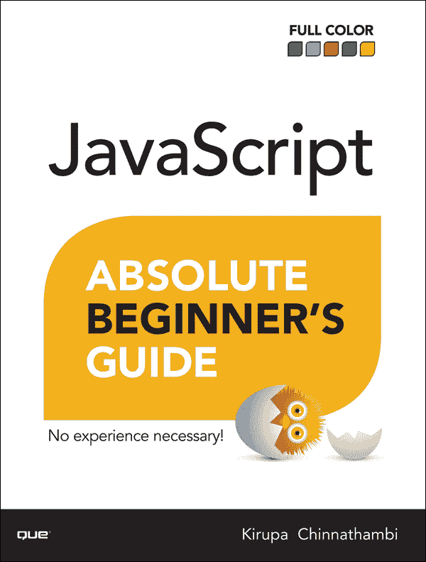


## 关于电子书

EPUB 是一种开放的行业标准电子书格式。然而，不同阅读设备和应用程序对 EPUB 及其许多功能的支持程度不一。请使用您的设备或应用设置来根据您的喜好自定义显示。您可以自定义的设置通常包括字体、字号、单栏或双栏、横屏或竖屏模式，以及可以点击或触摸以放大的图片。有关您的阅读设备或应用上的设置和功能的更多信息，请访问设备制造商的网站。

许多书目包含编程代码或配置示例。为了优化这些元素的显示，请在单栏横屏模式下查看电子书，并将字体大小调整为最小设置。除了以流式文本格式呈现代码和配置外，我们还包含了代码的图像，以模仿印刷版中的呈现效果；因此，当流式格式可能会影响代码列表显示时，您将看到一个“点击此处查看代码图像”的链接。点击该链接查看高保真代码图像。要返回之前之前的页面，请点击设备或应用上的“返回”按钮。


```javascript
var speed1 = 85;
var time1 = 1.5;
alert(speed1 * time1);

var speed2 = 12;
var time2 = 9;
alert(speed2 * time2);

var speed3 = 42;
var time3 = 21;
alert(speed3 * time3);
```

```javascript
alert(speed3 * time3);
```

我不知道你怎么想，但这看起来（就像 Frank Caliendo 扮演 Charles Barkley 那样说）非常*糟糕*。我们的代码是不必要的冗长且重复的。正如我之前提到的，我们在上一章中查看变量时，重复会让你的代码难以维护。它还浪费了你的时间。

[1] Frank Caliendo FTW: [`bit.ly/kirupaFrankCB`](http://bit.ly/kirupaFrankCB)。

通过使用你在这里经常看到的内容——函数，可以非常容易地解决整个问题：

点击此处查看代码图像

```javascript
function showDistance(speed, time) {
    alert(speed * time);
}

showDistance(10, 5);
showDistance(85, 1.5);
showDistance(12, 9);
showDistance(42, 21);
```

先不要太担心这段代码的作用。只需要知道，这段较小的代码块完成了之前许多行代码所做的所有工作，而且没有那些负面副作用和消耗。我们将学习关于函数的所有知识，以及它们是如何实现那些奇妙功能的，从现在……开始！

### 什么是函数？

在最基础的层，函数只不过是某些代码的包装器。函数基本上：

* 将语句组合在一起
* 使你的代码可复用

你很少会编写或使用不涉及函数的代码，因此熟悉它们并学习了解它们工作得有多好至关重要。

### 简单函数

学习函数的最佳方法就是直接投入并开始使用它们，所以让我们从创建一个非常简单的函数开始。创建一个函数非常简单，只需要理解一些细小的语法特性，例如使用奇怪的括号和大括号。

以下是一个非常简单的函数示例：

```javascript
function sayHello() {
    alert("hello!");
}
```

但是，仅仅有函数是不够的。你的函数需要实际上被`调用`，你可以通过在代码块的末尾添加以下行来实现：

```javascript
function sayHello() {
    alert("hello!");
}

sayHello();
```

如果你在你喜喜欢的代码编辑器中输入所有这些内容并在浏览器中预览页面，你将看到显示了 `hello!`。你现在唯一需要的就是你的代码可以运行。让我们通过将代码拆分成单独的部分并更详细地查看它们来看看`为什么`代码可以运行。

首先，你看到 `function` 关键字开头：

```javascript
function sayHello() {
    alert("hello!");
}
```

这个关键字告诉深在浏览器内部的 JavaScript 引擎将整个代码块视为与函数相关的内容。

在 `function` 关键字之后，你指定了函数的实际名称，后面跟着一对圆括号 `( )`：

```javascript
function sayHello() {
    alert("hello!");
}
```

完成你的函数声明的是包裹你可能在内部的任何语句的左括号和大括号：

```javascript
function sayHello() {
    alert("hello!");
}
```

最后是你的函数的内容——使你的函数真正……`功能`的语句：

```javascript
function sayHello() {
    alert("hello!");
}
```

在我们的情况下，内容是 `alert` 函数，它显示一个带有 `hello!` 字样的对话框。

最后要看的是函数调用：

```javascript
function sayHello() {
    alert("hello!");
}

sayHello();
```

函数调用通常是你想要调用（或执行）的函数名称，后面再次跟着括号。如果没有函数调用，你创建的函数就什么都不做。是函数调用唤醒了你的函数并让它执行操作。

现在，你刚刚看到的是一个简单的函数。在接下来的几节中，我们将基于你刚刚学到的进行构建，查看日益真实的函数示例。

### 创建一个接受参数的函数

正如我之前提到的，之前的 `sayHello` 示例非常简单：

```javascript
function sayHello() {
    alert("hello!");
}
```

你调用一个函数，函数执行某些操作。这种简化本身并不寻常。所有函数都是这样工作的。但在函数如何被调用、它们从哪里获取数据等细节上存在差异。我们要查看的第一个细节涉及接受参数的函数。

让我们从一个简单的示例开始：

```javascript
alert("my argument");
```

我们在这里拥有的是 `alert` 函数。你可能已经见过几次（或几十次）了。如你所知，这个函数只是显示你告诉它要显示的某些文本（参见图 3.3）。

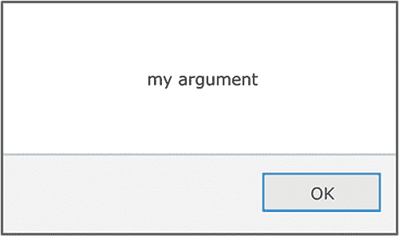

**图 3.3** 文本“my argument”是 `alert` 函数执行的结果。

让我们仔细观察一下。在调用 `alert` 函数时，在左括号和右括号之间，你指定了需要显示的内容。这个“内容”的正式名称是参数。


**图 3.3** 文本“my argument”是 `alert` 函数执行的结果。

（注：原文中存在大量重复内容，已根据要求进行清理，仅保留核心逻辑。）

通常情况下，为了让你正在编写的代码保持清晰，只需为你调用的函数提供所需的参数数量即可。不要不必要地增加复杂性。

### 创建返回数据的函数

我们将查看的最后一种函数变体是向调用它的地方返回一些数据。这里是我们要做的。我们有一个 `showDistance` 函数，我们知道它的样子如下：

点击此处查看代码图像

```javascript
function showDistance(speed, time)  {
    alert(speed * time);
}
```

我们并不想让 `showDistance` 函数计算距离并通过 `alert` 显示出来——我们实际上想将该值存储起来供以后使用。我们想执行如下的操作：

点击此处查看代码图像

```javascript
var myDistance = showDistance(10, 5);
```

`myDistance` 变量将存储 `showDistance` 函数计算得的结果。关于如何实现这种操作，你只需要了解几点。

#### Return 关键字

从函数返回数据的方法是使用 `return` 关键字。让我们创建一个名为 `getDistance` 的新函数，它看起来与 `showDistance` 完全相同，唯一的区别在于函数运行完毕后发生什么：

点击此处查看代码图像

```javascript
function getDistance(speed, time)  {
    var distance = speed * time;
    return distance;
}
```

注意，我们仍然通过相乘 `speed` 和 `time` 来计算距离。我们没有显示警告框，而是返回距离（由 `distance` 变量存储的值）。

要调用 `getDistance` 函数，你只需要在初始化变量时调用它即可：

点击此处查看代码图像

```javascript
var myDistance = showDistance(10, 5);
```

当 `getDistance` 函数被调用时，它会被求值并返回一个数值，该数值随后赋值给 `myDistance` 变量。就是如此。

#### 提前退出函数

一旦你的函数运行到 `return` 关键字，它就会停止该点正在做的一切事情，将你指定的任何值返回给调用它的地方，并退出：

点击此处查看代码图像

```javascript
function getDistance(speed, time)  {
    var distance = speed * time;
    return distance;
    if (speed < 0)  {
        distance *= -1;
    }
}
```

任何位于 `return` 语句之后的代码都不会被执行，例如下面高亮的几行：

点击此处查看代码图像

```javascript
function getDistance(speed, time) {
    var distance = speed * time;
    return distance;
    if (speed < 0) {
        distance *= -1;
    }
}
```

这就像那段代码从未存在过一样。在实践中，你将使用 `return` 语句在函数完成你想要的操作后将其终止。该函数可以像你在之前的示例中看到的那向调用者返回一个值，或者该函数简单地退出：

```javascript
function doSomething()  {
    // do something
    return;
}
```

使用 `return` 关键字返回值是可选的。正如在这里看到的，`return` 关键字可以单独使用以退出函数。

### 极简主义

函数是你几乎在每个 JavaScript 应用中都会少数东西之一。它们提供了梦以求的能力，帮助让你的代码可重用。无论你是创建自己的函数，还是使用 JavaScript 语言内置的许多函数，你都无法离开它们。

你到为止看到的都是函数如何通用的示例。函数还拥有一些我在这里没有介绍的高级特性。那些用法将在未来涵盖……一个遥远的未来。现在，你所学到的一切在理解函数如何在现实世界中使用的方面将让你走得很远。

 提示

给正在阅读纸质版或电子书版的读者的快速提醒：如果你访问 [www.quepublishing.com](http://www.quepublishing.com) 并注册此书，你就可以免费访问在线 Web 版，它不仅包含本书的完整文本，还包含了一个短小、有趣的互动测验，用来测试你对刚读章节的理解。

## 条件语句：If, Else 和 Switch

在本章中，我将涵盖广义上的条件语句。这些代码执行某些操作时我们做出决策的数字等物。从你醒来的那刻起，无论你是否意识到，你都在开始做决定。这适用于你所做的一切。

- 使用 if/else 语句帮助做决定
- 学习 switch 语句以及何时使用它们

### If/Else 语句

你在代码中最常用的条件语句是 if/else 语句 或直接用 if 语句。该语句的工作方式如图 4.2 所示](#ch04.html_fig02)。

 图 4.2 *if/else 语句结构*

为了理解这些，让我们来看 **if 语句**运行的一个简单示例：

点击此处查看代码图像

```javascript
var safeToProceed = true;

if (safeToProceed) {
    alert("You shall pass!");
} else {
    alert("You shall not pass!");
}
```

如果你将所有代码放入一个 HTML 文档并运行，你会看到一个显示“You shall pass!”的警告框。这是因为你的表达式（if 关键字之后最终求值为 **true** 或 **false** 的内容）是变量 `safeToProceed`。该变量初始化为 **true**，所以 if 语句的“true”部分被触发。

现在，将 `safeToProceed` 变量的值从 **true** 改为 **false**：

点击此处查看代码图像

```javascript
var safeToProceed = false;

if (safeToProceed) {
    alert("You shall pass!");
} else {
    alert("You shall not pass!");
}
```

这一次当你运行这段代码时，你会看到一个显示“You shall not pass!”的警告框。这是因为你的表达式求值为 **false**。到目前为止，这一切看起来应该都非常简单。这很好。希望在几章节之后，你会有同样的感受！

#### 认识条件运算符

在大多数情况下，你的表达式很少会像我们之前的示例中那样，是一个被设置为 `true` 或 `false` 的简单变量。你的表达式将涉及所谓的 `conditional operators`（条件运算符），它们可以帮助你比较两个或多个事物，以建立 `true` 或 `false` 的结果。

此类表达式的通用格式如图 4.3 所示。

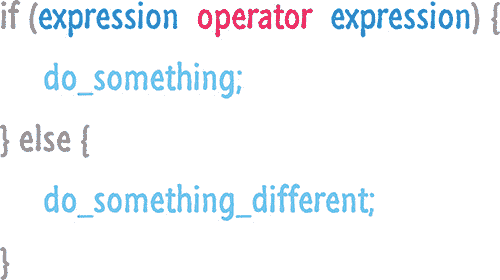

**图 4.3** *if/else 语句的更通用外观。*

条件运算符定义了表达式之间的关系。最终目标是返回 `true` 或 `false`，以便我们的 `if statement` 知道要执行哪块代码。这现在听起来可能还没意义，但请耐心等待。在深入更多将一切结合在一起的示例之前，让我们先来看看条件运算符。

条件运算符列在表 4.1 中。

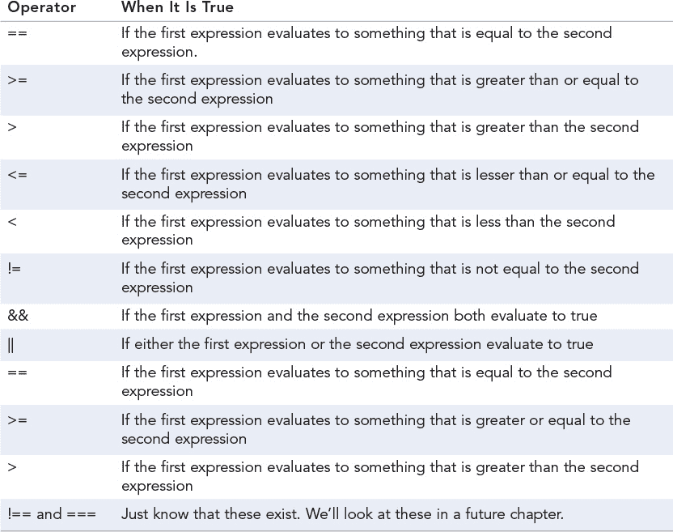

**表 4.1** JavaScript 条件运算符

让我们通过一个示例来消除对条件运算符的模糊理解：

点击此处查看代码图像

```javascript
var speedLimit = 55;

function amISpeeding(speed) {
    if (speed >= speedLimit) {
        alert("Yes. You are speeding.");
    } else {
        alert("No. You are not speeding. What's wrong with you?");
    }
}

amISpeeding(53);
amISpeeding(72);
```

花点时间理解到底发生了什么。我们有一个名为 `speedLimit` 的变量，初始化为 `55`。然后我们有一个名为 `amISpeeding` 的函数，它接受一个名为 `speed` 的参数。在这个函数内部，你有一个 `if` 语句，其表达式检查传入的 `speed` 值是否大于或等于（使用 `>=`）`speedLimit` 变量存储的值：

点击此处查看代码图像

```javascript
function amISpeeding(speed) {
    if (speed >= speedLimit) {
        alert("Yes. You are speeding.");
    } else {
        alert("No. You are not speeding. What's wrong with you?");
    }
}
```

我们的代码最后做的的一件事（实际上是第一件事）实际上是通过传入几个 `speed` 值来调用 `amISpeeding` 函数：

```javascript
amISpeeding(53);
amISpeeding(72);
```

当我们用 `53` 的速度调用此函数时，`speed >= speedLimit` 表达式求值为 `false`。原因是 `53` 不大于或等于 `speedLimit` 的存储值 `55`。这将导致显示一个显示“你没有超速”消息的警框。

当你以 `72` 的速度调用 `amISpeeding` 时，情况恰恰相反。在这种情况下，你正在超速，条件表达式求值为 `true`。还会出现一个提示你正在超速的警框。

#### 创建更复杂的表达式

关于这些表达式，你需要知道的是它们可以根据你的需要变得简单或复杂。它们可以由变量、函数调用或原始值组成。它们甚至可以由变量、函数调用或原始值的*组合*组成，并全部使用你之前看到的任何运算符隔开。你唯一需要确保的是你的表达式最终求值为 `true` 或 `false`。

这是一个稍微复杂一点示例：

点击此处查看代码图像

```javascript
var xPos = 300;
var yPos = 150;

function sendWarning(x, y) {
    if ((x < xPos) && (y < yPos)) {
        alert("Adjust the position");
    } else {
```


`alert("Things are fine!");`

`sendWarning(500, 160);`

`sendWarning(100, 100);`

`sendWarning(201, 149);`

注意 `sendWarning` 的 `if` 语句内部的条件看起来像：

```javascript
function sendWarning(x, y) {
    if ((x < xPos) && (y < yPos)) {
        alert("Adjust the position");
    } else {
        alert("Things are fine!");
    }
}
```

永远不要忘记的是，`switch` 语句无非只是一个测试某值是 `true` 还是 `false` 的条件语句。这个“某值”实际上是`表达式求值的结果是否等于某个 case 值`的一种变体。现在，我意识到，如果你以前从未用过 `switch` 语句，这可能听起来毫无意义。我也用过 `switch` 语句，而且我写的这些内容对我来说也几乎毫无意义！

让我们通过看一个更好的例子来让这个解释深入人心记忆：

```javascript
var color = "green";

switch (color) {
    case "yellow":
        alert("yellow color");
        break;
    case "red":
        alert("red color");
        break;
    case "blue":
        alert("blue color");
        break;
    case "green":
        alert("green color");
        break;
    case "black":
        alert("black color");
        break;
    default:
        alert("no known color specified");
}
```

在这个简单的示例中，我有一个名为 `color` 的变量，其值被设置为 `green`：

```javascript
var color = "green";
```

这个 `color` 变量被传递到我们的 `switch` 语句中，有趣的事情就在这里发生了！

我们的 `switch` 语句包含一组 `case` 块。只有其中一个块会被命中并执行其代码。选中的那一个被选中的方式是将块的 `case` 值与表达式求值的结果进行匹配。在我们的案例中，因为我们的表达式求值结果为 `green`，所以 `case` 值同样为 `green` 的 `case` 块中的代码会被执行：

```javascript
var color = "green";

switch (color) {
    case "yellow":
        alert("yellow color");
        break;
    case "red":
        alert("red color");
        break;
    case "blue":
        alert("blue color");
        break;
    case "green":
        alert("green color");
        break;
    case "black":
        alert("black color");
        break;
    default:
        alert("no known color specified");
}
```

注意，*只有* `green` case 块内部的代码会被执行。这得益于结束该块的 `break` 关键字。当你的代码遇到 `break` 时，它会退出整个 `switch` 块并继续执行其下方的代码。如果你没有指定 `break` 关键字，你仍然会执行 `green` case 块内部的代码。区别在于，你将移动到下一个 case 块（在我们示例中的 `black` 块）并执行那里的任何代码。除非你遇到另一个 `break` 关键字，否则你的代码将一直遍历每一个 case 块，直到到达结尾。你几乎不会希望这样做。

话虽如此，如果你运行这段代码，你将看到一个显示 `green color!` 字样的 `alert` 对话框。

你可以将 `color` 变量的值更改为其他有效值，以查看其他 case 块的执行。有时，没有 case 块的值会匹配表达式求值的结果。在这种情况下，你的 `switch` 语句将什么都不做。如果你想指定一个默认行为，请如下方所示添加一个 `default` 块：

```javascript
switch (color) {
    case "yellow":
        alert("yellow color");
        break;
    case "red":
        alert("red color");
        break;
    case "blue":
        alert("blue color");
        break;
    case "green":
        alert("green color");
        break;
    case "black":
        alert("black color");
        break;
    default:
        alert("no known color specified");
}
```

注意，`default` 块看起来与其他的 case 略有不同。具体来说，它实际上并没有包含 `case` 单词。你应该记住这个细节，以防以后用到。

### 与 If/Else 语句的相似性

在开始时，我提到 `switch` 语句用于评估条件——就像 `if/else` 语句一样。鉴于这是一个重大的指控，让我们通过先查看 `if` 语句如果翻译成 `switch` 语句会是什么样子，来进一步详细探讨。假设我们有如下所示的 `if` 语句：

```javascript
var number = 20;

if (number > 10) {
    alert("yes");
} else {
    alert("nope");
}
```

因为 `number` 变量的值是 `20`，我们的 `if` 语句将求值为 `true`。看起来非常直观。现在，让我们把它变成 `switch` 语句：

```javascript
switch (number > 10) {
    case true:
        alert("yes");
        break;
    case false:
        alert("nope");
        break;
}
```

注意我们的条件表达式是 `number > 10`。case 块的 case 值被设置为 `true` 或 `false`。因为 `number > 10` 求值为 `true`，所以 `true` case 块内部的代码会被执行。虽然你的表达式是如此，但逻辑上是一致的。你的表达式可以像你所希望的那样在后续的 `switch` 语句中工作。虽然 `switch` 语句看起来更复杂，但它们其实是通用的。现在，让我们看一个反向例子，看看稍微复杂的 `if/else` 语句看起来会怎样。这一次，让我们把之前使用的 `switch` 语句转换为 `if/else` 语句：

```javascript
var color = "green";

if (color == "yellow") {
    alert("yellow color");
} else if (color == "red") {
    alert("red color");
} else if (color == "blue") {
    alert("blue color");
} else if (color == "green") {
    alert("green color");
} else if (color == "black") {
    alert("black color");
} else {
    alert("no color specified");
}
```

正如你所见，`if/else` 语句与 `switch` 语句非常相似。`default` 块变成了 `else` 块。`switch` 语句中的表达式与值之间的关系在 `if/else` 语句中被合并。一切转换得都很顺畅！

### 如何选择哪一个

在前面的部分中，你看到了 `switch` 语句和 `if/else` 语句是如何互换的。当你有两种执行非常相似的方法时，自然会知道什么情况下适用其中一个而不是另一个。总而言之（这完全没有帮助），使用任何你喜欢的即可。互联网上有很多关于何时使用 `switch` 还是 `if/else` 的争论，但唯一确定的是所有说法都没有定论。

其次，`switch` 语句在当你评估一个表达式并将其结果与值匹配时效果最好。如果你正在处理更复杂的情况，涉及奇怪的条件、值的检查以及各种其他操作，你可能想要使用不同的方法。那种“不同的方法”可能就是 `if` 语句。

重申一下，使用任何你喜欢的方法。对于每一个认同我所写内容的人，你都能找到能非常有说服力地提供反对意见的人。如果你处于一个有编码规范的团队，请遵循这些规范。无论你做什么，保持一致。这会让你的生活，以及任何将来维护你代码的人的生活都变得轻松一点。

就我个人而言，我从未遇到过必须使用 `switch` 语句的情况，但我很多时候看到别人的代码使用了大量的 `switch` 语句。情况可能因人而异。

***

### 极简主义

虽然创建真正的人工智能超出了本书的范围 (:P)，但你可以编写代码来帮助你的应用程序做出选择。这些代码几乎总是以 `if/else` 语句的形式出现，为浏览器提供一组它需要做出的选择：

```javascript
var loginStatus = false;

if (name == "Admin") {
    loginStatus = true;
}
```

这些选择是由需要评估为 `true` 或 `false` 的条件提供的。

在本章中，我们学习了如何处理 `if/else` 语句以及它们（某种程度上）相关的亲戚——`switch` 语句的机制。在未来的章节中，你会看到我们非常随意地使用这些语句，仿佛我们已经认识它们多年一样，所以当你读完这本书时，你将非常熟悉如何编写这些语句。

***

 提示

为阅读本书纸质版或电子书版文字的读者提供一个快速提醒：如果你访问 [www.quepublishing.com](http://www.quepublishing.com) 并注册此书，你就可以免费访问在线 Web 版。该版本不仅包含本书的全文，还包含了一个短小有趣的互动测验，用来测试你对刚刚读过的章节的理解情况。

如果你已经在 Web 版中阅读这些文字并想尝试测验，那么你走运了——你只需要向下滚动即可！

***

## 5. 认识循环：For, While 和 Do...While!

***

### 本章内容

• 学习如何让代码重复运行
• 使用 `for`、`while` 和 `do...while` 循环

***

当你编写代码时，会有某些你想要重复某个动作或多次运行某些代码。例如，假设我们有一个名为 `saySomething` 的函数，我们想要重复调用 10 次。

我们可以实现此目标的方法是只需通过复制和粘贴调用 10 次函数：

```javascript
saySomething();
saySomething();
saySomething();
saySomething();
saySomething();
saySomething();
saySomething();
saySomething();
saySomething();
saySomething();
```

这种方法有效并实现了我们的目标，但你不应该这样做。**重复代码永远不是一个好主意。**

现在，即使你决定手动复制复制几次代码，这种方法在实践中也并不真正行得通。你往往不知道需要运行代码的次数。这个次数将根据某些外部因素而变化，例如数据集合中的项目数量、某些 Web 服务调用的结果、单词中的字母数量以及其他会不断变化的各种因素。它不会总是像 `10` 这样一个固定的数字。更有可能，你想重复某些代码的次数会非常非常大。你不想为了重复某些内容而复制粘贴几百或几千次。那太糟糕了。

我们需要一种通用的解决方案来重复代码，并控制代码重复的次数。在 JavaScript 中，这种解决方案是以被称为循环（loop）的形式提供的。你可以创建三种类型的循环：

• `for` 循环
• `while` 循环
• `do...while` 循环

这三种循环变体都允许你指定想要重复的代码（即循环）以及一种在满足条件时停止重复的方法。在接下来的章节中，你将学习关于如何使用它们的所有知识。

前进吧！

### for 循环

创建循环最常用的方法之一是使用 `for` 语句创建所谓的 `for` 循环。`for` 循环允许你反复运行某些代码，直到你指定的表达式返回 `false` 为止。这可能听起来不太好理解，为了帮助澄清这个定义，让我们来看一个例子。

如果我们必须用 `for` 来翻译之前的 `saySomething` 示例，它看起来像如下：

```javascript
var count = 10;

function saySomething() {
    document.writeln("hello!");
}

for (var i = 0; i < count; i++) {
    saySomething();
}
```

如果你将这段代码输入某些 `script` 标签中并在浏览器中预览它，你将看到与图 5.1 所示类似的内容。

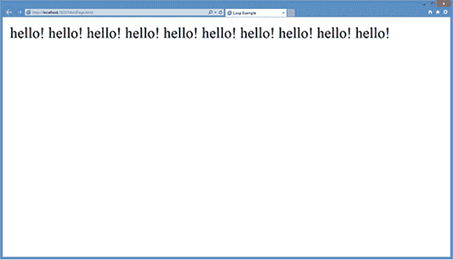

**图 5.1** `for` 循环以及我们关注的三个区域。

到目前为止，我们已经查看了起点。我们也查看了如果我们想跳出循环，则需要评估为 `false` 的表达式。现在缺失的是最后一个区域，在其中我们描述了如何从你的起点移动到终点：

```javascript
for (var i = 0; i < count; i++) {
    saySomething();
}
```

在我们的示例中，在循环的每次迭代中，我们都将变量 `i` 加了 `1`。如果你不熟悉这种语法，`i` 后面的 `++` 意味着将 `i` 变量原有的值增加 `1`。每当我们的循环运行时，你在该处指定的任何内容都会执行。在这种情况下，我们的 `i` 值将会递增。

## 汇总一切

好了，既然我们已经详细地查看了 `for` 语句的每个部分，让我们再次过一遍，以确保我们完全掌握了。我们从之前重复的完整示例如下：

```javascript
var count = 10;

for (var i = 0; i < count; i++) {
    saySomething();
}

function saySomething() {
    document.writeln("hello!");
}
```

当我们的 `for` 循环被首次命中时，变量 `i` 被创建并初始化为 `0`。接下来，我们的代码检查 `i` 的值是否小于 `count` 所引用的值……即 `10`。此时，一切正常（是绿色的），循环内部的任何代码都会执行。在我们的情况下，那就是 `saySomething` 函数。一旦你循环内部的语句执行完毕，`for` 语句的最后一部分就会启动。变量 `i` 增加了 `1`。

现在，循环将重新开始，但变量 `i` 没有被重新初始化。它的值被设置为递增后的值 `1`，这意味着它仍然通过了 `i < count` 的测试。`saySomething` 函数被再次调用，`i` 的值再次增加。现在，`i` 变量的值为 `2`。

整个过程不断重复，直到 `i` 的值等于 `10`。此时，`i < count` 测试将失败，循环在成功执行 `10` 次 `saySomething` 函数后退出。

## 一些 for 循环示例

在上一节中，我们剖析了一个简单的 `for` 循环并标记了它所有的内部工作机制。`for` 循环以及 JavaScript 中大部分内容的特殊之处在于，一个简单的示例并不总是能涵盖你可能需要的一切。最佳解决方案是查看更多 `for` 循环示例，这正是我们在接下来几节中要做的。

### 提前停止循环

有时，你可能想在循环完成之前结束它。结束循环的方法是使用 `break` 关键字。下面是一个示例：

```javascript
for (var i = 0; i < 100; i++) {
    document.writeln(i);
    if (i == 45) {
        break;
    }
}
```


当 `i` 的值等于 `45` 时，`break` 关键字会停止循环继续执行。虽然这个示例有些生硬，但当你确实遇到需要结束循环的现实案例时，你现在知道该做什么了。

### 跳过迭代

在某些时刻，你希望循环跳过当前迭代并移动到下一次。这可以通过 `continue` 关键字巧妙地处理。与 `break` 停止整个循环不同，`continue` 会跳过循环中剩余的代码并进入下一次迭代：

点击此处查看代码图片

```javascript
var floors = 5;

for (var i = 0; i < floors; i++) {

    if (i == 2) {

        continue;

    }

    document.writeln(i);

}
```

### 反向循环

你可能想让循环从某个值开始，递减到某个值。这不需要从 0 开始：

点击此处查看代码图片

```javascript
for (var i = 10; i > 0; i--) {

    document.writeln(i);

}
```

### 你并不需要使用数字

当你使用 `for` 循环时，并不总是需要使用数字。你可以遍历数组：

点击此处查看代码图片

```javascript
var fruits = ["apple", "banana", "cherry"];

for (var i = 0; i < fruits.length; i++) {

    document.writeln(fruits[i]);

}
```

### 无限循环

有些情况下，你会编写一个永远不会停止的循环。这通常是因为错误，但有时它是故意的：

点击此处查看代码图片

```javascript
for (var i = 0; ; i++) {

    // 这是一个无限循环

}
```

### 在 for 循环中使用 break

虽然 `for` 循环有终止条件，但你仍然可以使用 `if` 语句提前退出：

点击此处查看代码图片

```javascript
var options = [true, true, false, true];

for (var i = 0; i < options.length; i++) {

    if (!options[i]) {

        break;

    }

}
```

现在，我们来到了循环变体中的“梅格·格里芬（Meg Griffin）”。那就是 `do...while` 循环，它的目的性比 `while` 还要模糊得多。`while` 循环在执行循环之前会先进行条件表达式，而 `do...while` 循环的条件表达式位于末尾。

这里有一个示例：

点击此处查看代码图像

```javascript
var count = 0;

do {

    count++;

    document.writeln("I don't know what I am doing here!");

} while (count < 10);
```

`while` 循环和 `do...while` 循环的主要区别在于，如果条件表达式从一开始就是 `false`，`while` 循环的内容永远不会执行：

点击此处查看代码图像

```javascript
while (false) {

    document.writeln("Can't touch this!");

}
```

使用 `do...while` 循环，因为条件表达式只在一次迭代后计算，所以你的循环内容保证至少运行一次：

点击此处查看代码图像

```javascript
do {

    document.writeln("This code will run once!");

} while (false);
```

哈（打哈欠）！总之，在我们继续之前，我最后一点信息需要告诉你们。我们之前作为超赞 `for` 循环部分过的 `break` 和 `continue` 语句，在 `while` 和 `do...while` 循环变体中使用时工作原理也类似。

***

### 极简内容

所以，就是这样——我们了解了 `for` 循环以及如何使用它们，并对 `while` 和 `do...while` 循环进行了非常基本的介绍。目前，你可能觉得自己不会频繁使用循环。随着我们开始处理涉及数据集合、文档中的 HTML 元素、文本处理以及更复杂的情况，循环将成为你经常依赖的自然组件之一。

***

***

 提示

给正在本书的纸质版或电子书版阅读这些文字的朋友们一个快速提醒：如果你访问 `[www.quepublishing.com](http://www.quepublishing.com)` 并注册本书，你就可以免费访问在线 Web 版本。该版本不仅包含本书的完整文本，还包含一个短而有趣的互动测验，用来测试你对刚刚阅读章节的理解情况。

如果你已经在 Web 版本阅读这些文字并想尝试测验，那么你太幸运了——你只需要向下滚动即可！

***

## 6. 定器

***

### 本章内容

- 学习如何延迟代码的运行
- 找出几种在不阻塞整个应用程序的情况下重复运行代码的方法

***

默认情况下，你的代码是同步运行的。这是一种华丽的说法，意味着当一个语句需要执行时，它会立即执行。这其中没有任何“如果”、“且”或“但是”可言。延迟执行或将工作推到以后的概念并不是 JavaScript 默认行为的一部分。但这并不意味着没有将工作推到以后执行的能力！如果你稍微偏离主路，有三个函数可以让你在很大程度上做到这一点（以及更多）。这些函数是 `setTimeout`、`setInterval` 和 `requestAnimationFrame`。

在本章中，我们将查看这些函数每个的作用，以及学习更多 JavaScript 提供的基础组件以帮助你的代码实现有趣事情的其他精彩内容。

继续前进！

### 认识这三个定时器

正如你几像素前看到的，本章的主要嫌疑对象将是 `setTimeout`、`setInterval` 和 `requestAnimationFrame` 函数。在接下来的章节中，让我们详细查看每个函数，并找出它们存在的理由。

#### 使用 setTimeout 进行延迟

`setTimeout` 函数允许你延迟执行某些代码。使用方法非常简单。这个函数让你能够指定执行哪些代码，以及在指定的代码执行之前等待多少毫秒（即秒的 1/1000）。

转化为 JavaScript，看起来如下：

点击此处查看代码图像

```javascript
var timeID = setTimeout(someFunction, delayInMilliseconds);
```

再举个例子，如果我想在 5 秒后调用一个名为 `showAlert` 的函数，`setTimeout` 的声明如下：

点击此处查看代码图像

```javascript
function showAlert() {

    alert("moo");

}

var timeID = setTimeout(showAlert, 5000);
```

非常简单，对吧？现在，让我们聊聊为了完整性而涵盖的没那么有趣的内容。这与初始化我们 `setTimeout` 函数的 `timeID` 变量有关。它并不是偶然存在的。如果你想再次访问这个 `setTimeout` 定时器，你需要方法来引用它。通过将变量与我们的 `setTimeout` 声明关联，我们可以轻松实现这一点。

（注：此处原文存在大量重复段落，译文已根据要求保留逻辑并处理）

如果你想再次访问这个 `setTimeout` 定时器，你需要方法来引用它。通过将变量与我们的 `setTimeout` 声明关联，我们可以轻松实现这一点。

使用 `clearTimeout` 并将超时 ID 作为参数：

```javascript
clearTimeout(timeID);
```

#### 使用 setInterval 进行循环

我们将查看的下一个定时函数是 `setInterval`。`setInterval` 函数与 `setTimeout` 相似之处在于它也允许你在指定时间后执行代码。它的不同之处在于它不会只执行一次代码，而是在循环中持续执行代码。

以下是使用如何 `setInterval` 函数的方法：

```javascript
var intervalID = setInterval(someFunction, delayInMilliseconds);
```

除了函数名外，使用 `setInterval` 的方法与 `setTimeout` 完全相同。第一个参数指定你想要执行的内联代码或函数。第二个参数指定在代码再次循环之前等待多久。你还可以将 `setInterval` 函数初始化为一个变量以存储间隔 ID——这个 ID 你以后可以用来执行有趣的操作，比如取消循环。

好！现在我们已经看到了这一切，这里有一个该代码运行的示例，它会每隔 2 秒循环调用一次名为 `drawText` 的函数：

```javascript
function drawText() {

    document.querySelector("p").textContent += "#\n";

}

var intervalID = setInterval(drawText, 2000);
```

只需确保你的页面上某处有一个 `p` 元素，作为我们代码添加 `#` 字符的目标。

如果你想取消循环，可以使用命名为相应的 `clearInterval` 函数：

```javascript
clearInterval(intervalID);
```

它的用法与其等效的 `clearTimeout` 相同。你只需要传入在最初设置 `setInterval` 时可选获取的 `setInterval` 定时器实例的 ID。

这里有一些有趣的趣闻。在很长一段时间内，`setInterval` 是你在 JavaScript 中创建动画的主要函数。为了让内容以每秒 60 帧的速度运行，你需要编写如下代码：

点击此处查看代码图片

```javascript
// 1000 除以 60 是 60fps 的毫秒值

window.setInterval(moveCircles, 1000/60);
```

在本章结束之前，你将看到一些指向我在网上编写的示例和文章的链接，在那些示例中 `setInterval` 是更大真实示例的一部分。

### 使用 requestAnimationFrame 进行平滑动画

现在，我们来介绍我最喜欢的函数之一：`requestAnimationFrame`。`requestAnimationFrame` 函数的核心是将你的代码与浏览器的重绘事件同步。这意味着非常简单：你的浏览器在任何时候都忙于处理数以十计的各种事情——调整布局、响应页面滚动、监听鼠标点击、显示键盘击键结果、执行 JavaScript、加载资源等。在浏览器执行所有这一切的同时，它还在以每秒 60 帧的速度重绘屏幕……或者至少在竭尽全力。

当你有一段旨在将某些内容动画到屏幕上的代码时，你希望你的动画代码能够正常运行，而不会迷失在浏览器正在执行的其他嘈杂任务中。使用前面提到的 `setInterval` 函数不能保证当浏览器忙于优化其他事情时帧不会掉帧。为了避免你的动画代码被当作其他任何通用代码对待，你可以使用 `requestAnimationFrame` 函数。这个函数会被浏览器特殊对待。这种特殊对待允许它完美地控制执行时间，以避免掉帧、避免不必要的工作，并通常能避免困扰其他循环解决方案的副作用。

你使用这个方法的方法与 `setTimeout` 和 `setInterval` 相似：

点击此处查看代码图片

```javascript
var requestID = requestAnimationFrame(someFunction);
```

唯一的区别在于你不需要指定持续时间。持续时间是根据当前帧率、当前标签页是否激活、你的设备是否在使用电池供电，以及许多超出我们控制或理解范围的其它因素自动计算的。

无论如何，这种 `requestAnimationFrame` 函数的用法仅仅是教科书级别的。在现实生活中，你很少会这样单独调用一次 `requestAnimationFrame`。在 JavaScript 中创建的所有动画的关键都是动画循环，而我们正是想要将 `requestAnimationFrame` 放入这个循环中。这种嵌套的结果如下：

点击此处查看代码图片

```javascript
function animationLoop() {

  // 动画相关代码

  requestAnimationFrame(animationLoop);

}

// 启动我们的动画循环！

animationLoop();
```

注意，我们的 `requestAnimationFrame` 在 `animationLoop` 函数内部完全调用了 `animationLoop` 函数。这并不是代码中的 Bug。虽然这种循环引用几乎会保证程序挂起，但 `requestAnimationFrame` 的实现避免了这一点。相反，它确保 `animationLoop` 函数被调用的次数恰好能以确保内容被绘制到屏幕上，从而创建出流畅细腻的动画。它在这样做时不会冻结你应用程序的其他功能。

要停止 `requestAnimationFrame` 函数，你拥有 `cancelAnimationFrame` 函数：

点击此处查看代码图片

```javascript
cancelAnimationFrame(requestID);
```

正如你已经多次看到的这类函数一样，`cancelAnimationFrame` 接收的是调用 `requestAnimationFrame` 函数时返回的那个 ID 值。如果你计划使用 `cancelAnimationFrame`，可以按照如下方式修改我们之前的 `animationLoop` 示例：

点击此处查看代码图片

```javascript
var requestID;

function animationLoop() {

  // 动画相关代码

  requestID = requestAnimationFrame(animationLoop);

}

// 启动我们的动画循环！

animationLoop();
```

注意我们对 `requestAnimationFrame` 的调用总是设置 `requestID` 的值，你可以将 `requestID` 作为 `cancelAnimationFrame` 的参数来停止我们的循环。

***

### 极少部分

如果你认为定时器与我们之前看到的 `if/else` 语句和循环等其他更核心的东西相比属于更小众的类别，你的想法可能是正确的。你可以构建许多很棒的应用程序，而完全不需要依赖 `setTimeout`、`setInterval` 或 `requestAnimationFrame`。但这并不意味着了解它们是不必要的。总会有那么时刻，你需要延迟代码的执行、连续循环你的代码，或者使用 JavaScript 创建精酷的动画。当那个时刻到来时，你已经准备好了……或者至少知道要在 Google 上搜索什么。

要查看这些定时器函数在实际中的应用，请查看这些可选的文章和示例，它们可能对你有帮助：

- 使用 `requestAnimationFrame` 创建动画 [`bit.ly/kirupaAnimations`](http://bit.ly/kirupaAnimations)
- 创建精美的幻滑块 [`bit.ly/sliderTutorial`](http://bit.ly/sliderTutorial)
- 创建模拟钟 [`bit.ly/kirupaClock`](http://bit.ly/kirupaClock)
- 癫痫生成器 [`bit.ly/kirupaSeGenerator`](http://bit.ly/kirupaSeGenerator)

我们将从最顶层开始对作用域的探索，即所谓的全局作用域。在现实生活中，当我们说某件事可以“全球可见”时，意味着你可以处于世界的任何地方，仍然能够听到……某件事（参见图 7.1）。

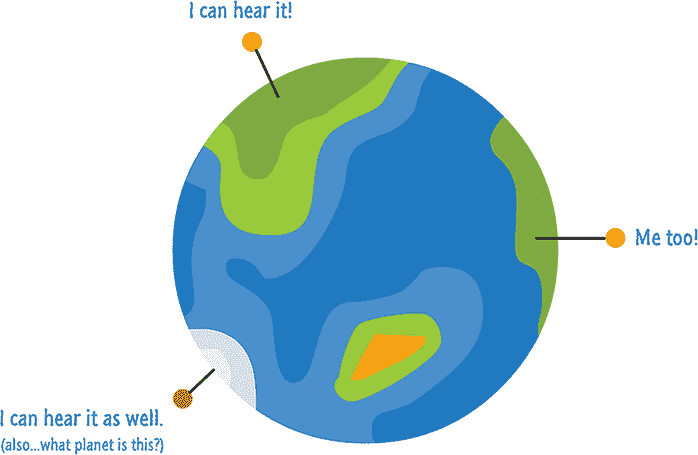

**图 7.1** *全局性的内容可以从任何地方访问和听到。*

在 JavaScript 中，情况也是如此。例如，如果我们说一个变量是全局可用的，这意味着你页面上的任何代码都可以访问、读取和修改该变量。让某物全局生效的方法是在代码中完全在函数之外声明它。

为了说明这一点，让我们来看下面的示例：

```html
<script>

var counter = 0;

</script>
```

在这里，我简单地声明了一个名为 `counter` 的变量并将其初始化为 `0`。由于该变量直接声明在 `script` 标签内部而没有放在函数内部，因此 `counter` 变量被认为是全局变量。这种区别意味着你的 `counter` 变量可以被存在文档中的任何代码访问。

接下来的代码强调了这一点：

```javascript
var counter = 0;

function returnCount() {

    return counter;

}
```


在这个示例中，`counter` 变量声明在 `returnCount` 函数之外。尽管如此，`returnCount` 函数仍然对 `counter` 变量具有完全访问权限。

此时，你可能在想为什么我一直在指出这些看起来显而易见的事情。毕竟，你一直都在使用全局变量而并没有真正注意到。我在这里所做的只是正式向你介绍一位已经在你的派对中待了一会儿的客人，如果你不小心，这位客人有可能会造成巨大的混乱。

> **注释**
> 
> 在定义**全局（global）**的具体含义时，我得相当模糊。这是刻意为之的，因为正式描述它将涉及到大量的背景知识才能理解一切。如果你对 JavaScript 足够熟悉（或者觉得很有冒险），请继续读下去。如果不是，请随时跳过此注释并进入下一节。我们稍后会回到这里。

无论如何，在 JavaScript 中，当一个事物是浏览器 `window` 对象的直接子级时，它被认为是全局的。这是对“声明在函数之外”更准确的说法。你可以轻松地通过检查 `counter` 和 `window.counter` 是否指向完全相同的内容来验证这一点：

```javascript
alert(window.counter == counter);
```

答案将是 **true**。原因是你引用的是完全相同的东西。

意识到全局变量存在于你的 `window` 对象之下，应该帮助你理解为什么可以从文档的任何地方访问全局变量。你所有的代码（对于书中你将看到的所有内容）都处于你 `window` 对象的伞下。

## 局部作用域

现在，当我们观察不是全局声明的事物时，事情变得有点有趣了。这就是理解作用域真正对你有帮助的地方。正如你之前看到的，全局声明的变量在函数内部是可以访问的：

```javascript
var counter = 0;

function returnCount() {
    return counter;
}
```

反则不然。在函数内部声明的变量在函数外部访问时将无法工作：

```javascript
function setState() {
    var state = "on";
}

setState();
alert(state) // nooooooooooo
```

在这个示例中，`state` 变量声明在 `setState` 函数内部，在函数外部访问 `state` 变量是不起的。原因是你的 `state` 变量的作用域局限于 `setState` 函数本身。一种更通用的描述方法是说你的 `state` 变量仅仅是局部的。

> **注释**
> 
> 让我们澄清我在查看变量时简要提到的一点。继续我们之前的示例，如果我们不在使用 `var` 关键字的情况下声明 `state` 变量，其作用域行为将完全不同：
> 
> ```javascript
> function setState() {
>     state = "on";
> }
> 
> setState();
> alert(state); // on
> ```

在这种情况下，尽管你的 `state` 变量首先在 `setState` 函数内部出现，但不包含 `var` 关键字会让这个变量全局存在。

请记住，在没有使用 `var` 关键字声明的情况下使用的变量将始终全局存在。

## 杂杂的作用域技巧

由于我们在这里讨论的是 JavaScript，如果我们就让变量作用域保持现状，那事情就太简单了。在接下来的章节中，我将强调一些你需要熟悉的奇点特性。

### 使用 `var` 的声明不支持块级作用域

在我尝试解释此之前，请看下面的代码：

```javascript
function checkWeight(weight) {
    if (weight > 5000) {
        var text = "No free shipping for you!";
    }
    alert(text);
}

checkWeight(6000);
```

在最顶部，我们有一个 `foo` 变量，它被实例化为 `Hello!`。在 `doSomethingClever` 函数内部，我们做的第一件事是调用 `alert`，它应该显示 `foo` 变量存储的值。在它下方几行处，我们用新值 `Good Bye!` 重新声明了 `foo` 变量：

```javascript
var foo = "Hello!";

function doSomethingClever() {
    alert(foo);
    var foo = "Good Bye!";
    alert(foo);
}

doSomethingClever();
```

由于我们的第一个 `alert` 在 `foo` 变量重新声明之前调用，逻辑上的假设是 `foo` 的原始值 `Hello!` 将是被显示的内容。正如你之前看到的，事实并非如此。当执行到第一个 `alert` 时，`foo` 的值实际上是 `undefined`。其的原因与 JavaScript 处理变量的方式有关。

当 JavaScript 遇到函数时，它执行的第一操作之一是扫描整个代码体以查找任何声明的变量。当它遇到这些变量时，默认会将它们初始化为值 `undefined`。因为 `doSomethingClever` 函数正在声明一个名为 `foo` 的变量，所以在第一个 `alert` 触发之前，就已经创建了一个值为 `undefined` 的 `foo` 条目。最终，当我们的代码运行到 `var foo = "Good Bye!"` 时，`foo` 的值才被正确初始化。这对我们的第一个 `alert` 函数没有帮助，但对紧随 `foo` 重新声明后的第二个 `alert` 有帮助。这一切都有名字，它被称为`提升`（hoisting）或`变量提升`（variable hoisting）！

如果你遇到过像这个简单示例一样在局部作用域中重新声明变量的情况，请记住这个小特性。追踪变量为何不按预期运行并不有趣，希望这个小知识能派上用场。

### 闭包 (Closures)

任何关于变量作用域的讨论如果不涉及`闭包`都是无法结束的。直到目前为止。我不会在这里解释闭包，因为它重要且足够复杂，需要单独开一个章节。那个章节……紧接着就会！

鉴于本节标题为`闭包`，我在这里就做我惯常的收尾表演：

> 好了，关于变量作用域的话题到此结束。这个主题表面上看起来很简单，但正如你看到的，它有一些独特的特性，需要一些时间和练习才能完全理解。

我不擅长总结……也不擅长唱歌跳舞。我知道，而且它们都在我的愿清单上。我发誓！

### 极简要求

变量所在的位置对它们可以被使用的地方有重大影响。全局声明的变量可以在整个应用程序中使用。局部声明的变量只在它们所在的作用域内可用。在全局和局部变量的范围内，JavaScript 有许多花招。

本章向你概述了变量作用域如何影响你的代码，你将在不久的未来看到这些概念中的出现在核心位置。

> **提示 Tip**
> 
> 给在纸质版或电子书版中阅读这些文字的朋友快速提醒：如果你访问`[www.quepublishing.com](http://www.quepublishing.com)`并注册这本书，你就可以免费访问在线 Web 版，它不仅包含本书的完整文本，还包含一个简短有趣的互动测验，用来测试你对刚刚阅读章节的理解。
> 
> 如果你已经在 Web 版中阅读这些文字并想尝试测验，那么你走运了——你只需要向下滚动即可！

## 8. 闭包

### 本章内容

- 理解什么是闭包
- 将你学到的关于函数、变量和作用域的所有知识联系起来

现在你可能已经非常了解函数以及它们所做的所有有趣的“函数化”事情。在 JavaScript 中以及（可能）在日常生活中，处理函数的一个重要部分是理解被称为`闭包`的话题。闭包涉及一个函数和变量作用域交叉的灰色区域（参见图 8.1）。

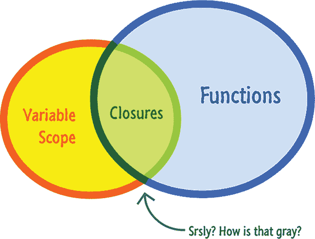

**图 8.1** *函数与变量作用域的交集。*

现在，我不再多说关于闭包的，因为这是通过查看实际代码来解释效果最好的。我现在现在添加的任何定义或描述闭包的文字只会让事情变得复杂。在接下来的章节中，我们将从熟悉的领域开始，然后慢慢进入可以发现闭包的敌对区域。

前进吧！

### 函数内部的函数

我们要做的第一件事是深入研究当你在函数内部嵌套函数……并且内部函数被返回时会发生什么。作为该的一部分，让我们快速回顾一下函数。

看以下代码：

```javascript
function calculateRectangleArea(length, width) {
    return length * width;
}

var roomArea = calculateRectangleArea(10, 10);
alert(roomArea);
```

`calculateRectangleArea` 函数接收两个参数并返回结果。在这个例子中，`roomArea` 是 `100`。图 8.2


**图 8.2** *没人知道为什么*

有趣的部分是 `youSayGoodbye` 函数在执行时返回了什么。它返回了 `andHelloHello` 函数：

```javascript
function youSayGoodbye() {
    alert("Goodbye!");
    function andHelloHello() {
        alert("Hello!");
    }
    return andHelloHello;
}
```

当你执行此操作时，返回的内部函数（即 `andISayHello`）将会执行。和之前一样，你会看到一个对话框出现，但这个对话框会显示 `Hello!`——这是该函数内部 `alert` 所指定的的内容。

好了，我们正在接近承诺中的“敌对领域”了。在下一节中，我们将通过观察另一个稍有不同的示例来扩展所学的内容。

### 当内部函数不是自包含时

在上一个示例中，你的 `andISayHello` 内部函数是自包含的，它不依赖于外部函数的任何变量：

```javascript
function youSayGoodbye() {
    alert("Goodbye!");
    function andISayHello() {
        alert("Hello!");
    }
    return andISayHello;
}
```

在许多现实场景中，很少遇到这种情况。你通常会在外部函数和内部函数之间共享变量和数据。为了强调这一点，请看以下内容：

```javascript
function stopWatch() {
    var startTime = Date.now();
    function getDelay() {
        var elapsedTime = Date.now() - startTime;
        alert(elapsedTime);
    }
    return getDelay;
}
```

这个示例展示了测量某操作所需时间的一种简单方法。在 `stopWatch` 函数内部，你有一个 `startTime` 变量，其值设置为 `Date.now()` 的值：

```javascript
function stopWatch() {
    var startTime = Date.now();
    function getDelay() {
        var elapsedTime = Date.now() - startTime;
        alert(elapsedTime);
    }
    return getDelay;
}
```

> **注意**
> 
> `Date.now()` 函数是我们之前没见过的，所以让我们快速看一下。这个函数的作用是返回一个表示当前时间的巨大数字。具体来说，这个巨大的数字是自 `1970 年 1 月 1 日 00:00:00 UTC` 以来经过的毫秒数。

你还有一个名为 `getDelay` 的内部函数：

```javascript
function stopWatch() {
    var startTime = Date.now();
    function getDelay() {
        var elapsedTime = Date.now() - startTime;
        alert(elapsedTime);
    }
    return getDelay;
}
```

`getDelay` 函数显示一个对话框，其中新调用 `Date.now()` 与之前声明的 `startTime` 变量之间的时间差。

回到外部函数 `stopWatch`，最后发生的事情是它在退出之前返回了 `getDelay` 函数。如你所见，这里看到的代码与之前的示例非常相似。你有一个外部函数，有一个内部函数，并且外部函数返回了内部函数。

现在，为了看到 `stopWatch` 函数运行，请添加以下代码：

```javascript
var timer = stopWatch();

// 执行一些耗时操作
for (var i = 0; i < 1000000; i++) {
    var foo = Math.random() * 10000;
}

// 调用返回的函数
timer();
```

如果你运行这个示例，你会看到一个对话框显示了从 `timer` 变量初始化、`for` 循环运行完成到 `timer` 变量作为函数调用之间花费的毫秒数。基本上，你有一个秒表，你调用它，运行一些耗时操作，再次调用它以查看该耗时操作持续多久。

既然你已经看到我们的小秒表示例在工作了，让我们回到 `stopWatch` 函数看看究竟发生了什么。正如我几行前提到的，你看到的很多内容与 `youSayGoodbye/andISayHello` 示例相似。有一个让这个示例与不同的之处，需要注意的是当 `getDelay` 函数返回给 `timer` 变量时发生了什么。

这里是该情况的一个不完整可视化图：

> **注意**
> 
> `stopWatch` 函数不再存在了，但 `timer` 变量仍然可以访问 `stopWatch` 函数内部的 `startTime` 变量。这是因为 `getDelay` 是一个闭包。

对于那些正在阅读纸质版或电子书版的读者，一个小提醒：如果你访问 [www.quepublishing.com](http://www.quepublishing.com) 并注册此书，你就可以免费访问在线网络版。该版本不仅包含本书的完整文本，还包含一个短而有趣的互动测验，用来测试你对刚读过的章节的理解程度。

如果你已经在阅读网络版并想尝试一下测验，那么你太幸运了——你只需要向下滚动页面即可！

# 9. 你的代码应该住在哪里？

### 本章内容

- 了解代码可以存在的各种地方
- 理解各种方法的优缺点

让我们暂时放下那些例行公事般的……编程吧（哈哈！）。在本章中，我们不再关注代码中包含了什么，而是要视角看得更高一点，去观察一些非常基础的内容。我们将看看你编写的代码究竟应该存放在哪里。

继续吧！

### 待选方案

到目前为止，我们编写的所有代码都完全包含在一个 HTML 文档中，如图图 9.1 所示。

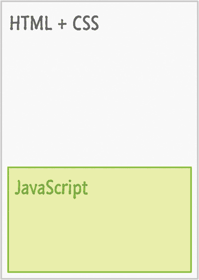

图 9.1 *到目前，我们所有的代码都位于 HTML 和 CSS 相同的文档中。*

在这个世界里，保护你的 HTML 文档不受 JavaScript 影响的几个 `script` 标签。现在，你的 JavaScript 不一定住在你的 HTML 文档中。你还有另一种选择，即创建一个单独的文件，将所有的 JavaScript 放在那里，如图图 9.2 所示。

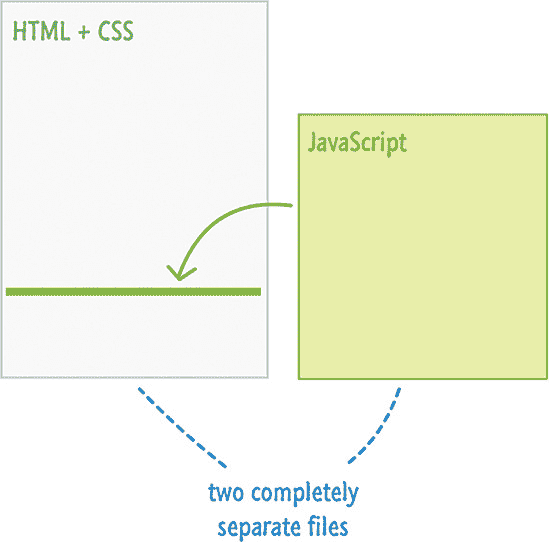

图 9.2 *你可以将 JavaScript 放入一个单独的文件。*

在这种方法中，你的 HTML 文档中没有真正的 JavaScript 代码。你仍然有 `script` 标签，但这个标签只是指向 JavaScript 文件，而不是包含一行又行的实际 JavaScript 代码。

当然，这些方法并不是互斥的。你可以将两种方法混合在同一个 HTML 文档中，采用混合方法——即既有外部 JavaScript 文件，又在 HTML 文档内部包含 JavaScript 代码行，如图图 9.3 所示。

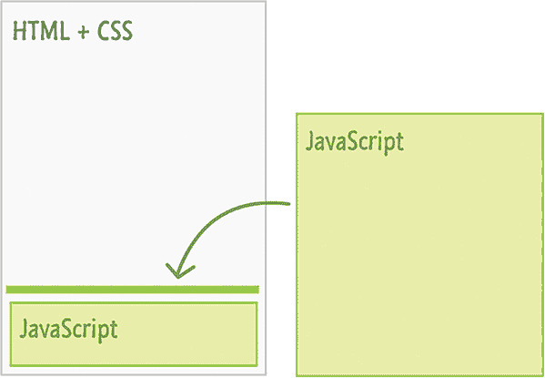

图 9.3 *混合方法：你的 JavaScript 同时存在于外部和你的 HTML 文档内部。*

为了让事情更有趣，你还有这两种方法的的变体，例如在 HTML 文档中有多个 `script` 部分、多个 JS 文件等。在接下来的章节中，我们将详细介绍这两种方法，并讨论何时该选择其中一种而不是另一种。

在本短章的结束时，你将对每种方法的优缺点有良好的理解，以便在网页和应用程序中对 JavaScript 做出正确的选择。

### 方法 #1：所有代码都在你的 HTML 文档中

我们将介绍的第一种方法是我们直以来一直使用的方法。在这种方法中，所有的 JavaScript 都位于 `script` 标签内，与 HTML 文档的其他部分在一起：

```html
<!DOCTYPE html>
<html>
<body>
    <h1>Example</h1>
    <script>
        function showDistance(speed, time) {
```


`alert(speed * time);`

`showDistance(10, 5);`

`showDistance(85, 1.5);`

`showDistance(12, 9);`

`showDistance(42, 21);`

当浏览器加载页面时，它会从上到下解析每一行 HTML。当它遇到 `script` 标签时，它将直接执行所有的 JavaScript 行。在执行完你的代码后，它将继续解析文档的其余部分。

## 方法 #2：代码位于单独的文件

第二种方法是你的主 HTML 文档不包含任何 JavaScript 内容。相反，所有的 JavaScript 都住在一个单独的文档中。这种方法包含两个部分：第一部分涉及 JavaScript 文件；第二部分涉及在 HTML 中引用该 JavaScript 文件。让我们详细查看这两个部分。

### JavaScript 文件

使这种方法生效的关键在于包含你 JavaScript 代码的单独文件。你给这个文件起什么名字并不重要，但它的扩展名应该是 `.js`。例如，我的 JavaScript 文件命名为 `example.js`：


在这种方法中，你的 HTML 文档中没有真正的 JavaScript 代码。你仍然有 `script` 标签，但这个标签指向：

```javascript
function showDistance(speed, time) {
    alert(speed * time);
}

showDistance(10, 5);
showDistance(85, 1.5);
showDistance(12, 9);
showDistance(42, 21);
```

### 引用 JavaScript 文件

一旦创建了 JavaScript 文件，第二步（也是最后一步）就是在 HTML 中引用它。这是通过你的 `script` 标签的 `src` 属性处理的：

```html
<!DOCTYPE html>
<html>
<body>
    <h1>Example</h1>
    <script src="example.js"></script>
</body>
</html>
```

如果你的 `script` 标签位于文档顶部，浏览器将在脚本运行期间阻塞其他所有内容。如果你正在下载一个大型脚本文件或执行一个耗时很长的脚本，这可能会导致用户看到一个加载不完全且无响应的 HTML 页面。除非你确实有充分的理由强制 JavaScript 在解析整个文档之前运行，否则请确保你的 `script` 标签像几乎所有之前的示例那样，出现在文档的末尾。将脚本放在页面底部还有另一个优势，但我将在以后讨论 DOM 以及在页面加载期间会发生什么时再详细解释。

## 那么……我应该使用哪种方法？

关于代码应该存放在哪里，你主要有两种处理方法：

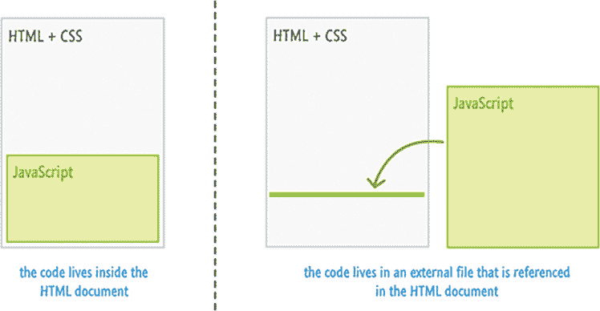

你最终选择的方法取决于你对以下问题的回答：相同的代码是否会在多个 HTML 文档中被？

### 是的，我的代码将在多个文档中使用！

如果答案是肯定的，那么你可能想将代码放在一个外部文件中，然后在所有希望执行该代码的 HTML 页面中引用它。你想要这样做的第一个原因是为了避免在多个页面中重复代码：

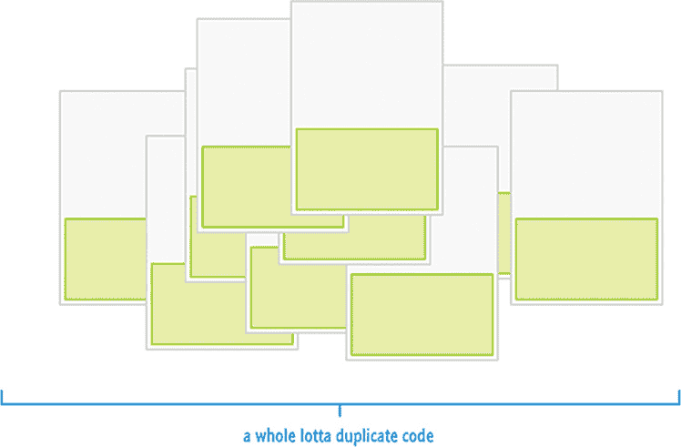

重复的代码会让维护变成一场噩梦，因为对脚本的任何更改都要求你对每一个 HTML 文档进行完全相同的更新。如果你正在使用某种模板或 SSI（服务器端包含）逻辑，即只有一个包含你脚本的 HTML 片段，那么维护问题就没那么严重了。

第二个原因与文件大小有关。当你的脚本在许多 HTML 页面中重复出现时，每当用户加载其中一个 HTML 页面时，他们都会重新下载一遍你的脚本。对于较小的脚本来说，这个问题并不大，但一旦你的代码超过几百行，体积就会开始累积。

当你将所有代码合并到一个文件中时，你就不会遇到我刚才概述的那些问题：

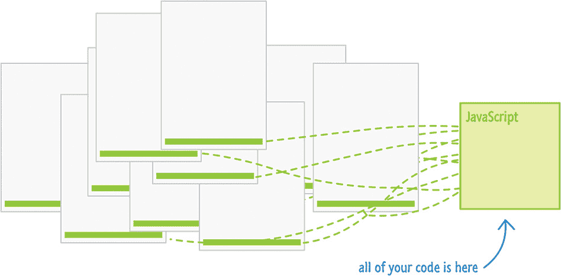

你的代码易于维护，因为你只需要在一个文件中更新你的代码。任何引用此 JavaScript 文件的 HTML 文档在加载时都会自动获得最新版本。通过将所有代码都放在一个文件中，你的浏览器将只下载一次代码，并在后续访问时提供文件的缓存版本。

### 不，我的代码只在单个 HTML 文档中使用一次！

如果你对之前关于代码是否会在多个 HTML 文档中使用的回答是“否”，那么你可以随心所欲。你仍然可以选择将代码放在单独的文件并在 HTML 文档中引用它，但这样做的好处少于你之前在我涉及多个文档示例中看到的。

在这种情况下，将代码完全放在 HTML 文档内部也是可以的。你在本站看到的大多数示例都将代码放在 HTML 文档本身。我们的示例并不会跨多个页面使用，而且也不会大到需要通过将所有代码放在单独位置来提高可读性。

## 极简要求

正如你所看到的，即使是像确定代码应该放在哪里这样看似简单的问题，最终也需要很多页的解释和讨论。欢迎来到 HTML 和 JavaScript 的世界，这里没有非黑即白的。无论如何回到主题，典型的 HTML 文档将包含许多从外部位置加载的脚本文件。其中一些是你自己的；但另一些是由第三方创建并包含在你的文档中的。

此外，你记得我在最开始展示的混合方法吗？即你的 HTML 文档既包含对单独 JavaScript 文件的引用，又包含文档内的实际代码。嗯，那种方法也很常见。最终，你所使用的方法完全取决于你。希望这一章能为你提供做出正确选择所需的信息。在第 32 章“页面加载事件和其他内容”中，我们将通过查看页面加载相关的事件以及某些使事情复杂的特殊属性，进一步深入探讨你在这里看到的内容。现在先不用担心它们。

 提示

为正在阅读本书纸质版或电子书版的读者提供一个快速提点：如果你访问 [www.quepublishing.com](http://www.quepublishing.com) 并注册这本书，你就可以免费访问在线 Web 版，该版本不仅包含本书的全文，还包含一个简短、有趣的互动测验，用来测试你对刚刚读过的章节的理解情况。

如果你已经在 Web 版中阅读这些文字并想尝试一下测验，那么你走运了——你只需要向下滚动即可！

## 10. 为代码注释

### 本章内容

- 学习代码注释的重要性
- 熟悉编写注释的 JavaScript 语法
- 理解良好的注释实践

我们的休息快结束了。只剩最后一个主题了，而且是个很好的主题！听，情况是这样的——你在代码编辑器中写的每一行代码看起来都只是给你的浏览器看的：

```javascript
var xPos = -500;

function boringComputerStuff() {
  xPos += 5;
  if (xPos > 1000) {
    xPos = -500;
  }
}
```

正如你很快会发现的，事实并非如此。代码还有一个受众。这个受众是由人类组成的。如果你在团队中工作，这一点尤为真实。你经常会查看同事的代码，他们也经常会查看你的代码。你需要确保新人在查看时代码是易理解的。即使你单兵作战，这一点同样适用。你今天看起来很完美的函数，下周再看时可能是乱码。

解决这个问题的方法有很多。最好的方法之一是使用所谓的注释。在本文短文中，我们将学习什么是注释、如何在 JavaScript 中指定注释，并学习使用它们的良好实践。

### 什么是注释？

注释是你在代码中编写向人类传递信息的内容：

```javascript
// 这是因为没邀请我参加生日生日！
var blah = true;

function sweetRevenge() {
  blah = true;
  while (blah) {
    // 无限对话框！哈哈！！！！
    alert("Hahahaha!");
  }
}

sweetRevenge();
```

在这个示例中，注释由 `//` 字符标记，它们提供了关于当前代码的一些并不用的信息。

关于注释需要记住的是，它们不像你写的其他所有代码那样运行和执行。JavaScript 会忽略你的注释。它并不爱你，所以你不需要担心正确的语法、标点符号、拼写以及编写正常代码时需要考虑的所有其他事情。注释仅存在于帮助我们理解某段代码的作用。

注释还有另一个用途。你可以使用注释来标记你不希望被执行的代码行：

```javascript
function insecureLogin(input) {
  if (input == "password") {
    //var key = Math.random() * 100000;
    //processLogin(key);
  }
  return false;
}
```

在这个示例中，你可以在代码编辑器中看到以下两行，但它们不会运行：

```javascript
//var key = Math.random() * 100000;
//processLogin(key);
```

你经常会发现自己把代码编辑器当作草稿纸，而注释是记录为了让代码运行而所尝试过的绝佳方法，同时又不会影响应用程序的最终运行。

### 单行注释

在代码中指定注释有几种方法。其中一种方法是使用 `//` 标记后跟你想要表达的内容来指定`单行注释`。这是你已经见过几次的注释变体。

你可以将这些注释写在专用行中：

```javascript
// 返回两个参数中较大的一个
function max(a, b) {
  if (a > b) {
    return a;
  } else {
    return b;
  }
}
```

你也可以将这些注释写在语句的同一行：

```javascript
var zorb = "Alien"; // 骚扰行星居民
```

何处指定注释完全取决于你。选择一个看起来适合你所写注释的位置。

正如你现在所熟悉的，注释不会作为应用程序的一部分运行。只有你、我，可能还有 Dupree 能看到它们。如果最后那句话听起来毫无意义，那是在说你错过了我们这一代最伟大的喜剧之一。我强烈建议你放下这本书，花几个小时来弥补这个遗憾。

### 多行注释

单行注释的问题在于，你必须在每一个想要注释的行前面都指定 `//` 字符。这可能会非常令人疲惫——尤其是当你编写很长的注释或注释掉一大块代码的时候。

对于这些情况，你还有另一种指定注释的方法。你可以使用 `/*` 和 `*/` 字符来指定所谓的`多行注释`的开始和结束：

```javascript
/*
var mouseX = 0;
var mouseY = 0;
canvas.addEventListener("mousemove", setMousePosition, false);

function setMousePosition(e) {
  mouseX = e.clientX;
  mouseY = e.clientY;
}
*/
```

我们不需要像动物一样在每行前面添加 `//` 标记，可以使用 `/*` 和 `*/` 字符来节省大量的时间和挫败感。

在大多数应用程序中，你会根据正在尝试记录的内容，结合使用单行注释和多行注释。这意味着你需要熟悉这两种注释方法。

### JSDoc 风格注释

当你编写一些想要让他人使用的代码时，你可能希望有一种`更简单的方法`来传达你的代码的功能，而不仅仅是人们去翻阅源代码。这种`更简单的方法`是存在的，它通过一个名为 `JSDoc` 的工具实现！通过 JSDoc，你稍微修改了你编写注释的方式：

```javascript
/**
 * 打乱你数组的内容。
 *
 * @this {Array}
 * @return {Array} 一个完全打乱内容的新数组。
 */
Array.prototype.shuffle = function() {
  var input = this;
  for (var i = input.length - 1; i >= 0; i--) {
    var randomIndex = Math.floor(Math.random() * (i + 1));
    var itemAtIndex = input[randomIndex];
    input[randomIndex] = input[i];
    input[i] = itemAtIndex;
  }
  return input;
}
```

一旦你对文件进行了注释，就可以使用 JSDoc 工具将注释的相关部分导出到易于浏览的 HTML 页面。这允许你花费更多时间编写 JavaScript，同时为用户提供简单的方法来理解你代码的功能以及如何使用它的各个部分。

如果你想了解更多如何使用 JSDoc，请查看他们优秀的入门页面以获取更多详情。

### 注释最佳实践

现在我们已经很好地了解注释以及在 JavaScript 中编写注释的几种方法，让我们聊聊如何正确使用注释来让你的代码易于阅读：

1. **在编写代码时始终编写注释。** 编写注释是极其无聊的，但它是编写代码的重要部分。通过阅读注释来理解代码的功能，比阅读一行接一行无聊的 JavaScript 要对你（以及他人）效率高得多。

2. **不要推迟后写注释。** 与上一点相关，推迟写注释就是推迟写注释、推迟写注释、推迟写注释、推迟写注释。

3. **多用英语，少用 JavaScript。** 如果你不在编写代码时写注释，你很可能会跳过注释。

4. **拥抱空白。** 在扫描大代码块时，你希望确保你的注释脱颖而出且清晰。

5. **不要注释显而易见的内容。** 如果一行代码自说其明，就不要浪费时间解释它是做什么的，除非有某些你需要指出的微妙行为。相反，请把时间花在注释代码中不那么明显的部分。

```javascript
function selectInitial(state) {
  var selectContent = document.querySelector("#state");
  var stateIndex = null;

  /*
  对于返回的 state，我们希望确保
  遍历下拉列表中的每一个 state 直到找到匹配项为止。
  当找到匹配项时，我们确保它被选中。
  */
  for (var i = 0; i < selectContent.length; i++) {
    var stateInSelect = selectContent.options[i].innerText;
    if (stateInSelect == state) {
      stateIndex = i;
    }
  }
  selectContent.selectedIndex = stateIndex;
}
```

注意，我们的注释间距恰当，使其与其余代码区分开来。如果你的注释散落在任意位置，且难以识别，那只会不必要地减慢你和阅读者的速度。

### 最低要求

注释通常被视为一种必不可少的恶。毕竟，你更愿意花几分钟记录你显然已经知道的内容，还是更愿意去实现下一个酷炫的功能？我描述注释的方式是：*这是一项长期投资*。

注释的价值和益处并非显而易见。当你开始让其他人查看你的代码时，它变得显而易见；当你忘记了代码及其工作原理后重新查看自己的代码时，它也变得显而易见。不要为了短期的快感而牺牲长期的节省。现在就投资单行注释（`//`）和多行注释（`/*` 和 `*/`）吧，在为时已晚之前。

对于那些正在阅读本书纸质版或电子书版的读者，这里有一个简单的提醒：如果你访问 [www.quepublishing.com](http://www.quepublishing.com) 并注册此书，你就可以免费获取在线 Web 版本。该版本不仅包含本书的完整文本，还包含一个短小、有趣的互动测验，用来测试你对刚刚阅读章节的理解程度。

如果你已经在 Web 版中阅读这些文字，并想尝试一下测验，那么你太幸运了——你只需要向下滚动页面即可！

# 第二部分：面向对象的世界

## 11. 披萨、类型、原始值与对象

### 本章内容

- 了解这些对象到底是怎么回事
- 学习你在 JavaScript 中会遇到的基础类型
- 发现披萨除了美味得惊人之外还具有教育价值

是时候变得严肃了。认真的！在过去的几章中，我们一直在处理各种值。你处理过字符串、数字、布尔值（又称 `true` 和 `false`）、函数以及 JavaScript 语言中其他各种内置内容。

下面是一些示例，可以帮你唤回记忆：

```javascript
var someText = "hello, world!";
var count = 50;
var isActive = true;
```


与其他语言不同，JavaScript 使得指定和使用这些内置内容变得非常容易。你甚至不需要去思考或提前计划如何使用其中任何一个。尽管使用这些不同类型的内置内容非常简单，但有很多细节对你来说是隐藏的。了解这些细节非常重要，因为它们不仅能帮助你更容易理解自己的代码，可能还会帮助你在程序运行不符合预期时，更快速地定位问题出在哪里。

现在，正如你可能猜到的那样，“内置内容”并不是描述 JavaScript 中可以使用的各种值的准确方式。你在代码中可以使用的各种值有一个更正式的名称，那个名称就是类型（types）。在本章中，你将对它们是什么有一个浅显的介绍。

继续吧！

## 我们先来聊聊披萨

不，我没有完全疯。因为我总是在吃东西（或者在想吃东西），所以我将尝试通过先解释更简单的披萨世界，来解释类型这个神秘的世界。

万一你有一段时间没吃披萨了，典型的披萨长这样：

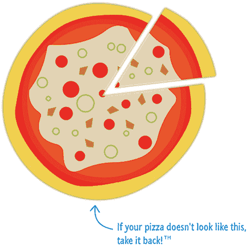

披萨并不是凭空出现变成这样的。它是由其他成分组成的——有些简单，有些并不那么简单，如图 11.1 所示。

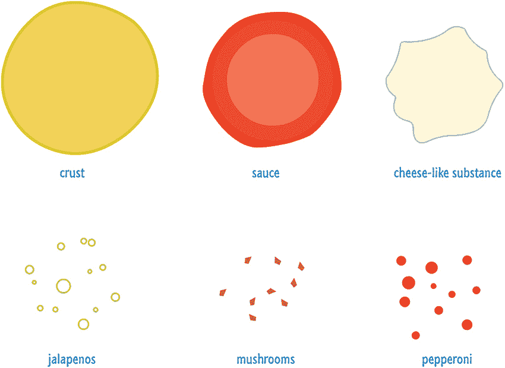

*披萨由许多较小的成分组成。*

简单的成分很容易发现。这些就是你的蘑菇和墨西哥辣椒。这些成分之所以是简单的，是因为你无法进一步将这些成分拆分了：

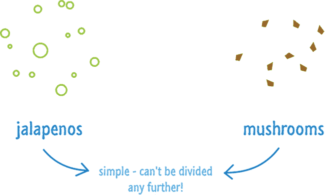

它们没有经过加工。它们不是由其他简单成分组成的。就像哥们一样，它们就在那里。

不那么简单、复杂的成分就是你的`cheese（奶酪）`、`sauce（酱料）`、`crust（饼底）`和`pepperoni（意大利肠）`。它们之所以更复杂，是因为那些简单的……嗯……太简单。这些复杂成分是由其他成分组成的：

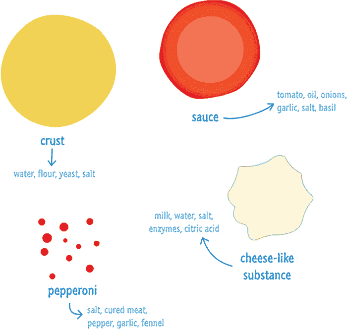

对我们所有人来说的是，世界上并没有一种单一叫做奶酪或意大利肠的成分。你需要组合、加工并添加更多成分，才能构成你在这里看到的某些复杂成分。关于复杂成分有一点需要注意的细微之处：它们的组成并不不仅限于简单成分。复杂成分本身也可以由其他复杂成分组成。这太惊人了！！

## 从披萨到 JavaScript

虽然这可能难以相信，但你在上一节中中学的关于披萨的所有知识都是有目的的。对简单和复杂成分的描述非常完美地适用于类型和 JavaScript。每一个成分都可以被看作是你使用的类型的对应物：

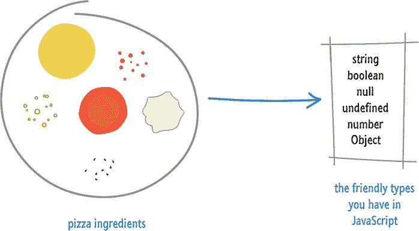

就像我们版本中披萨里的奶酪、酱料、意大利肠、蘑菇和培根一样，JavaScript 中的基础类型是`String`、`Number`、`Boolean`、`Null`、`Undefined`和`Object`。这些类型中的一些可能对来说非常熟悉，而有些可能并不熟悉。虽然我们将在未来的章节中更详细地查看所有这些类型，但表 11.1 提供了对它们功能的简要总结。

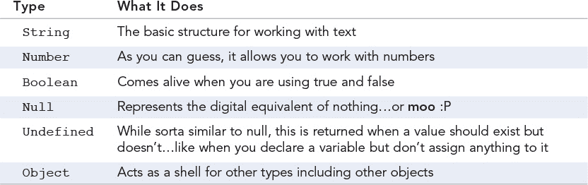

**表 11.1** 基础 JavaScript 类型

现在，虽然每种类型在功能上都非常独特，但它们属于一个简单的分类。就像你披萨的简单和复杂成分一样，你的类型也可以是简单的或是复杂的。不过，在 JavaScript 术语中，简单和复杂更正式地被称为原始值（primitives）和对象（objects）。另一种说法是，`String`、`Number`、`Boolean`、`Null`和`Undefined`类型无法进一步细分。接下来的两段将会枯燥，我不要求你记住我要说的话。如你所见，原始值很容易理解。它们没有深度，当你遇到它们时基本上就能明白。对象类型有点神秘，所以它们是我在详细介绍它们到底是什么之前最后想要涵盖的内容。

## 什么是对象？

像 JavaScript 这样的编程语言中的对象概念可以很好地对应现实世界中的对应物。在现实世界中，你被对象包围。你的电脑是一个对象。书架上的书是一个对象。土豆（可以认为）是一个对象。你的闹钟是一个对象。你在 eBay 上买的签名 C Green 海报也是一个对象！我可以一直说下去，但（为了大家：P）我就到此为止。

有些像镇纸这样的对象没做什么：

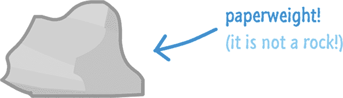

它们就那样呆在那里。其他对象，比如电视，则超越了仅仅的存在，能做很多事情：

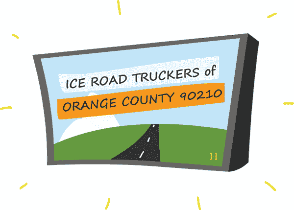

典型的电视接收输入，允许你开启关闭、切换频道、调整音量并执行各种电视功能。

需要意识到的是，对象的形状、大小和用途各相同。尽管存在这些差异，对象在高级上都是相同的。它们是一种抽象。它们为你提供了一种易于使用的方法，而无需担心内部的情况。即使是最简单的对象也隐藏了某种程度的复杂性，你完全不需要担心。例如，电视内部发生了什么、电线是如何连接的、或者使用了什么种类的胶水将一切固定在一起，这些并不重要。你所关心的只是电视是否按照你的指令运行。当你想要它切换频道时，频道就应该切换。当你调整音量时，音量就应该调整。其他一切都是噪音。

基本上，把一个对象想象成一个黑盒。它有一些预定义的/文档说明的功能。它是如何实现这些功能的是你无法轻易看到的。只要它能正常工作，它是如何施展魔法的你并不真正关心。当我们学习如何实际创建对象的内部结构时，我们会改变这种观念，但现在让我们享受这个简单而快乐的世界吧。

### 游荡在周围的预定义对象

除了你之前看到的内置类型外，在 JavaScript 中还有许多可以开箱即用的预定义对象。这些对象允许你处理从数据集合、日期甚至文本和数字的任何内容。表 11.2 展示了其中一些对象，并像以前一样，对它们的功能进行了简短的说明。

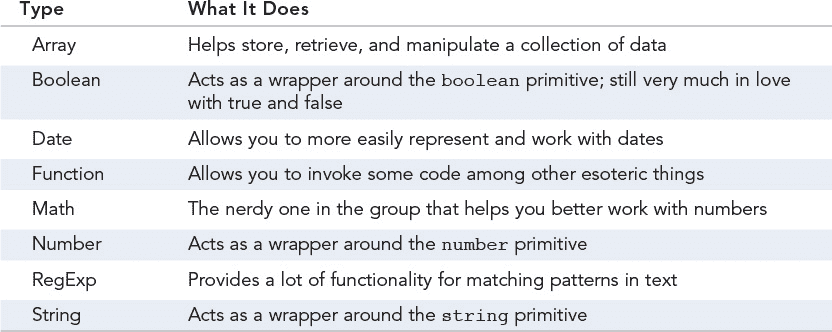

**表 11.2** 一些预定义的 JavaScript 对象

使用这些内置对象的方法与使用基本类型略有不同。每个对象在如何使用它们方面也有自己的特性。解释每个对象以及它的预期用法我将留到稍后，但这里有一个非常短的带注释代码片段，向你展示可能实现：

```javascript
// an array
var names = ["Jerry", "Elaine", "George", "Kramer"];
var alsoNames = new Array("Dennis", "Frank", "Dee", "Mac");

// 一个整数字
var roundNumber = Math.round("3.14");

// 今天的日期
var today = new Date();

// 一个布尔对象
var booleanObject = new Boolean(true);

// 无穷大
var unquantifiablyBigNumber = Infinity;

// 一个字符串对象
var hello = new String("Hello!");
```

你可能会感到困惑的是，`string`、`boolean`和`number`基本类型的对象形式的存在。表面上看，这些类型的对象形式和基本形式看起来非常相似。这里有一个例子：

```javascript
var movie = "Pulp Fiction";
var movieObj = new String("Pulp Fiction");

alert(movie);
alert(movieObj);
```

你将看到打印结果是完全相同的。但在表面之下，`movie`和`movieObj`是完全不同的。一个是实实在在的`string`类型基本类型，另一个是`Object`类型。这导致了一些有趣的（可能难以理解的）行为，我将在探索你目前看到的几种内置类型时逐步触及这些内容。

### 极少内容

如果你觉得这像是一部在事情变得有趣时突然结束的电影，我不怪你这么想。主要的要收获是，你的基本类型构成了你在代码中可以使用的最基础类型。你的对象要复杂一些，由其他基本类型或对象组成。当我们稍后深入探讨时将看到更多内容。除此之外，我们学习了常用内置类型的名称以及关于它们的所有基础背景材料。

你将在后续章节中将看到对所有这些类型更深入的观察以及处理它们时的细微差别。把这一章看作是一个缓和的入口，突然将你带到疯狂过山车的轨道上。

 提示

给在本书纸质版或电子书版中阅读这些文字的朋友们一个快速提醒：如果你访问 [www.quepublishing.com](http://www.quepublishing.com) 并注册此书，你可以免费访问在线 Web 版本，该版本不仅包含本书的完整文本，还包含一个简短、有趣的交互测验，用来测试你对刚刚阅读章节的理解情况。

如果你已经在 Web 版本中阅读这些文字并想尝试测验，那么你太幸运了——你只需要向下滚动即可！

## 12. 字符串

### 本章内容

- 理解 JavaScript 是如何处理文本的
- 学习如何执行常见的字符串操作
- 查看各种字符串属性

我直觉你是一个人类。作为人类，你可能对单词产生很好的共鸣。你说它们。你写它们。你还倾向于在你的程序中使用大量的单词。事实证明，JavaScript 也非常喜欢单词。构成你的（以及我的）语言的字母和看起来奇怪的符号有一个正式的名称。它们被称为**字符串 (strings)**：

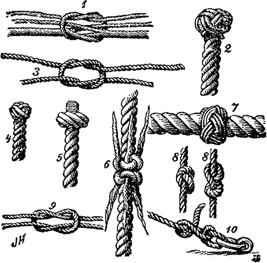

这张图片可能不能很好代表我所说的内容。事实上，这张图片与我说的内容毫无关系……

总之，JavaScript 中的字符串无非是一系列字符。尽管这听起来很无聊，但访问和操作这些字符是你必须熟悉的技能。这正是本章大显身手的地方。

继续！

### 基础知识

处理字符串的方法只需直接在代码中使用它们。只需确保将它们包含在单引号或双引号中。以下是一些例子：

```javascript
var text = "this is some text";
var moreText = 'I am in single quotes!';

alert("this is some more text");
```

除了列出字符串，你经常会将几个字符串组合在一起。你可以通过使用`+`运算符轻松地做到这一点：

```javascript
var initial = "hello";

alert(initial + " world!");
alert("I can also " + "do this!");
```

在这些示例中，你都能看到字符串。我指出显而易见这一点唯一原因是，当你看到字符串的内容时，这些字符串更准确地被称为**字符串字面量 (string literals)**。这并没有改变结果仍然是一个被称为`string`的内置基本类型的事（你知道的……上一章的基础配料）。

如果你必须可视化`text`和`moreText`字符串的样式，它们会像图 12.1 所示。

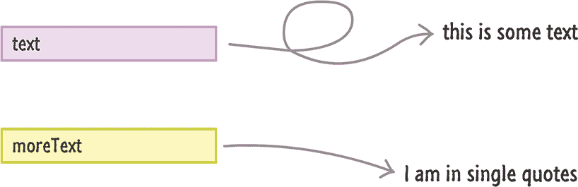

**图 12.1** *我们的代码可视化后的样子！*

你只是让变量指向一些字面块。没有其他事情在发生。如果你好奇我为什么要浪费空间来可视化如此显而易见的事，一旦我们进入`Object`领域，可视化将会变得复杂。你会在本章中看到这些提示。

总之，这一切现在并不特别重要……唯一需要记住的是你需要将字符串字面量封装在双引号（`"`）或单引号（`'`）中，以将它们标记为文本区域。如果不这样做，就会发生故障，代码将无法运行。

基础知识就是这些。有趣的内容来自于 JavaScript 为处理字符串提供的所有功能。我们将在后续章节查看这些内容。

### 字符串属性和方法

当你处理字符串时，底层的`String`对象包含了许多让处理文本（通常）更容易的属性。在后续章节中，我不会遍历每一个属性把我们两个都聊死，我只会关注你执行的任务背景下重要的属性。

#### 访问单个字符

虽然字符串看起来像一个整体，但它实际上是由一系列字符组成的。你可以通过多种方式访问每个字符。常用的方法是使用数组/括号符号并传入与字符索引位置对应的数字：

```javascript
var vowels = "aeiou";

alert(vowels[2]);
```

在这个例子中，我会看到字符`i`，因为它是第二个位置的项目。如果你不知道发生了什么，图 12.2 可能有所帮助。

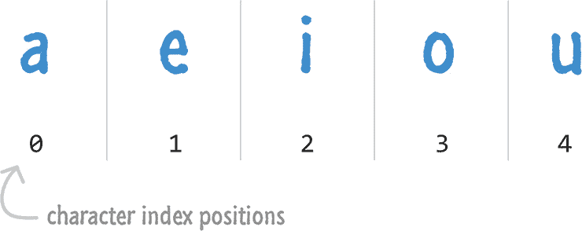

**图 12.2** *索引位置如何映射到字符串字符。*

当提到`index`这个词时，你应该记住这一点。JavaScript 中的索引位置从 0 开始，并从此向后递增。这就是为什么你的索引位置是 2，但该位置上的元素计数实际上是 3。你对 JavaScript 以及其他不包含`Visual`和`Basic`字样的语言越熟悉，这就会越让你不觉得奇怪。

更进一步，你可以通过遍历索引位置来访问字符串中的所有字符。循环的起点将是 0，循环的终点将由字符串的长度决定。字符串的长度（即字符数量计数）由`length`属性返回。

以下是上述段内容的实际示例：

```javascript
var vowels = "aeiou";

for (var i = 0; i < vowels.length; i++) {
    alert(vowels[i]);
}
```

虽然你可能并不总是遍历字符串，但使用`length`属性来获取字符串中字符的数量是非常常见的。

如果你不习惯数组/括号表示法，你也可以使用`charAt`方法，它可以返回指定索引位置的字符：

```javascript
var vowels = "aeiou";

alert(vowels.charAt(2));
```

最终结果与你使用数组表示法看到的结果完全相同。除非你关心 Internet Explorer 7 这样非常老旧浏览器，否则我真的不会使用这种方法。是的，我想你也不会。

## 等等……什么？

如果你在好奇字符串原始类型（string primitives）哪里能够访问只有`String`对象才拥有的属性，请收起你的好奇心，等到下一章，在那里我们将更详细地讨论这个问题。

## 组合（又称拼接）字符串

要将两个字符串结合，你可以直接使用`+`或`+=`运算符，就像相加一串数字一样将它们相加：

```javascript
var stringA = "I am a simple string.";
var stringB = "I am a simple string, too!";

alert(stringA + " " + stringB);
```

注意，在第三行中，我们同时加了`stringA`和`stringB`。在它们之间我们指定了一个空格字符（`" "`），以确保每个单独字符串之间有一个空格。你可以将字符串字面量与字符串原始类型以及字符串对象混合使用，仍然可以得到组合在一起的文本。

例如，以下所有都是合法的：

```javascript
var textA = "Please";
var textB = new String("stop!");

var combined = textA + " make it " + textB;

alert(combined);
```

尽管进行了所有的混合，但`combined`变量的类型仅仅是`string`原始类型。

对于组合字符串，你还有`concat`方法。你可以从任何字符串上调用此方法，并指定一串字符串原始类型、字面量和对象的序列，将它们组合成一个……超大字符串：

```javascript
var foo = "I really";
var blah = "why anybody would";
var blarg = "do this";

var result = foo.concat(" don't know", " ", blah, " ", blarg);

alert(result);
```

在大多数情况下，直接使用`+`和`+=`方法来组合字符串即可。它比`concat`方法更快。在其他条件相同的情况下，谁会不想在代码中获得一些额外的速度呢？

## 从字符串中提取子字符串

有时候，你感兴趣的是字符串中间某处的字符序列。有助于满足这一需求的两个属性是`slice`和`substr`。假设我们有以下字符串：

```javascript
var theBigString = "Pulp Fiction is an awesome movie!";
```

让我们对这个字符串进行一些操作。

### slice 方法！

`slice`方法允许你指定想要提取的字符串部分的起始和结束位置：

```javascript
var theBigString = "Pulp Fiction is an awesome movie!";

alert(theBigString.slice(5, 12));
```

在这个示例中，我们提取了索引位置 5 到 12 之间的字符。最终结果是返回了`Fiction`单词。

起始和结束位置的值不需要是正数。如果你为结束位置指定一个负值，那么字符串的结束位置就是从末尾倒数时剩余的位置：

```javascript
var theBigString = "Pulp Fiction is an awesome movie!";

alert(theBigString.slice(0, -6));
```

如果你指定了负的起始位置，那么你的起始位置就是从末尾开始计算的你指定的数值：

```javascript
var theBigString = "Pulp Fiction is an awesome movie!";

alert(theBigString.slice(-7));
```


### `substr` 方法

我们将查看字符串的另一种方法是`substr`。该方法同样接受两个参数：第一个参数是起始位置的数字，第二个参数是指定子字符串长度的数字。当我们查看示例时，这更有意义：

点击此处查看代码图片

```javascript
var theBigString = "Pulp Fiction is an awesome movie!";

alert(theBigString.substr(0, 4)); // Pulp
```

我们在第 0 位置开始子字符串并向上计数。这就是为什么返回了`Pulp`。如果你只想提取`Fiction`单词，代码将如下：

点击此处查看代码图片

```javascript
var theBigString = "Pulp Fiction is an awesome movie!";

alert(theBigString.substr(5, 7)); // Fiction
```

如果你没有指定长度，返回的子字符串是从起始位置到末尾的字符串：

点击此处查看代码图片

```javascript
var theBigString = "Pulp Fiction is an awesome movie!";

alert(theBigString.substr(5)); // Fiction is an awesome movie!
```

传递给`substr`的值还有一些变体，但这些是主要的。

## 分割字符串/`split`

你可以组合字符串，也可以拆分。我很确定某位智者曾说过这话。分割字符串的另一种方法是使用`split`方法。在字符串上调用此方法会返回一个子字符串数组。这些子字符串由字符或正则表达式（即 RegEx）隔开，你用它来决定何时分割你的字符串。

让我们来看一个简单的示例，这更有意义：

点击此处查看代码图片

```javascript
var inspirationalQuote = "That which you can concatenate, you can also split apart.";

var splitWords = inspirationalQuote.split(" ");

alert(splitWords.length); // 10
```

在这个示例中，我们根据空格字符对`inspirationalQuote`文本进行分割。每当遇到空格字符时，之前的剩余字符串会被移除并作为该方法返回数组中的项。

这是另一个示例：

点击此处查看代码图片

```javascript
var days = "Monday,Tuesday,Wednesday,Thursday,Friday, Saturday, Sunday";

var splitWords = days.split(",");

alert(splitWords[6]); // Sunday
```

我们有一个`days`变量，它存储了一个仅由逗号分隔的日期字符串。如果我们想将每一天分隔开，可以使用`split`方法，并将分隔符字符设为逗号。最终结果是一个包含七个项的数组，其中每个项都是原始字符串中的星期几。

你会惊讶地发现，自己会如此频繁地使用`split`方法来拆分字符序列，这些序列可能只是简单的句子，也可能是像从网络服务返回的数据那样复杂的内容。

### 在字符串内部查找内容

如果你经常需要在字符串内部查找某个字符或多个字符，可以使用`indexOf`、`lastIndexOf`和`match`方法。让我们先来看`indexOf`方法。

`indexOf`方法的作用是将你要查找的字符作为其参数。如果找到了你正在查找的内容，它会返回该字符在字符串中第一次出现的索引位置。如果没有找到匹配项，该方法将为你返回一个`-1`。让我们来看一个例子：

点击此处查看代码图片

```javascript
var question = "I wonder what the pigs did to make these birds so angry?";

alert(question.indexOf("pigs")); // 18
```

我正在尝试查看我的字符串中是否存在“pigs”（猪）。因为我要找的内容确实存在，所以`indexOf`方法告诉我这个词第一次出现在第 18 个索引位置。如果我找一个不存在的内容，比如这个例子中的字母`z`，则会返回`-1`：

点击此处查看代码图片

```javascript
var question = "I wonder what the pigs did to make these birds so angry?";

alert(question.indexOf("z")); // -1
```

`lastIndexOf`方法与`indexOf`非常相似。正如你从名称猜的那样，`lastIndexOf`返回你所查找的内容最后一次的位置：

点击此处查看代码图片

```javascript
var question = "How much wood could a woodchuck chuck if a woodchuck could chuck wood?";

alert(question.lastIndexOf("wood")); // 65
```

`indexOf`和`lastIndexOf`方法都可以指定另外一个参数。除了提供要搜索的字符外，你还可以指定字符串上的索引位置作为搜索的起点：

点击此处查看代码图片

```javascript
var question = "How much wood could a woodchuck chuck if a woodchuck could chuck wood?";

alert(question.indexOf("wood", 30)); // 43
```

关于`indexOf`和`lastIndexOf`方法要说明的最后一点是，你可以匹配字符串中出现的这些字符的任何实例。这些函数不区分整个单词，也不区分你所查找的内容是否是更大字符集的子字符串。请务必考虑到这一点。

在我们结束之前，让我们来看`match`方法。通过`match`方法，你拥有更多的控制权。该方法接受一个`Regex`作为其参数：

点击此处查看代码图片

```javascript
var phrase = "There are 3 little pigs.";

var regexp = /[0–9]/;

var numbers = phrase.match(regexp);

alert(numbers[0]); // 3
```

返回的也是一个匹配子字符串的数组，所以你可以运用你的`Array`忍者技巧让处理结果的工作变得轻而易举。学习如何使用正则表达式是我们在以后会介绍的内容。

### 字符串的大写和小写

最后，让我们用一些简单的、不需要任何复杂操作的内容来结束对字符串的介绍。要将字符串转换为大写或小写，可以使用相应命名的`toUpperCase`和`toLowerCase`方法。让我们来看这个例子：

点击此处查看代码图片

```javascript
var phrase = "My name is Bond. James Bond.";

alert(phrase.toUpperCase()); // MY NAME IS BOND. JAMES BOND.

alert(phrase.toLowerCase()); // my name is bond. james bond.
```

看吧，告诉过你这很简单！

***

### 极简内容

字符串是 JavaScript 中可用的少数基本数据类型之一，你刚刚看到了关于使用它们可以做的许多事情的良好概述。我回避的一个问题是，你的字符串原始类型似乎神秘地拥有所有这些只有对象（Objects）共有的属性。我们将在下一章讨论这个问题！

额外的资源和示例：

- **The Devowelizer:** [`bit.ly/kirupaDeVowelize`](http://bit.ly/kirupaDeVowelize)
- **Capitalize the First Letter of a String:** [`bit.ly/kirupaCapLetter`](http://bit.ly/kirupaCapLetter)
- **10 Ways to Reverse a String:** [`bit.ly/kirupaWaysToReverseString`](http://bit.ly/kirupaWaysToReverseString)

***

 提示

给那些正在阅读纸质版或电子书版读者的一个快速提醒：如果你访问`http://bit.ly/kirupaDeVowelize`并获得一个有趣的短测试来测试你的理解，你只需要向下滚动即可！

***

### 本章

- 深入理解原始类型的工作原理
- 理解即使是原始类型也具有特性
- 想知道 JavaScript 如何如此流行

***

在上一章（Strings）中，你对一些困惑之处有了初步了解。我多次提到原始类型非常简单。与对象不同，它们不包含你可以以有趣方式摆弄的属性。然而，正如你对字符串进行的操作所示，你的原始类型似乎有神秘的一面：

当原始类型表现像对象时

当你处理布尔、数字或字符串原始类型时，你可以访问其对象副本暴露的属性。在接下来的章节中，我们将看到底发生了什么。

### 字符串并不是唯一的问题

因为字符串很可爱，很容易将字符串作为这种原始类型/对象混乱的主要元凶。事实证明，许多内置的原始类型也参与了这场戏。表格 13.1 展示了内置的`Object`类型，并亮出了同样作为原始类型存在的“罪犯”。

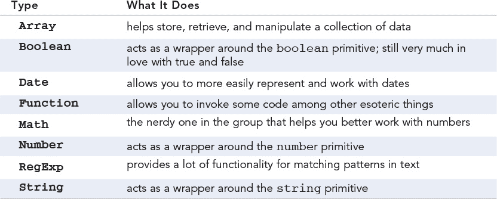

**表格 13.1** 同时作为原始类型存在的对象类型

### 无论如何，让我们针对字符串

正如你从小被教导的那样，你通常以字面量形式使用字符串：

点击此处查看代码图片

```javascript
var primitiveText = "Homer Simpson";
```

正如你之前在表格中看到的，字符串也可以用作对象。创建新对象有多种方法，但为像字符串这样的内置类型创建对象常用的方法是使用`new`关键字后跟`String`单词：

点击此处查看代码图像

```javascript
var name = new String("Homer Simpson");
```

在这种情况下，`String`不仅仅是一个普通的单词。它代表了所谓的**构造函数**（constructor function），其唯一目的就是用于创建对象。就像有多种方式可以创建对象一样，创建`String`对象也有多种方法。在我看来，只要知道一种你绝对不应该用来创建它们的方法就足够了。

无论如何，字符串的原始类型形式和对象形式之间的主要区别在于对象形式所携带的额外“行李”极其巨大。让我们回到那些形象的可视化图。你的`primitiveText`变量及其负担如图 13.1 所示。


**图 13.1** *`primitiveText`的样子。*

那里真的没什么东西。现在，不要被接下来的吓到，但如果我们必须可视化我们名为`name`的`String`对象，它看起来就像你在图 13.2 中所示。

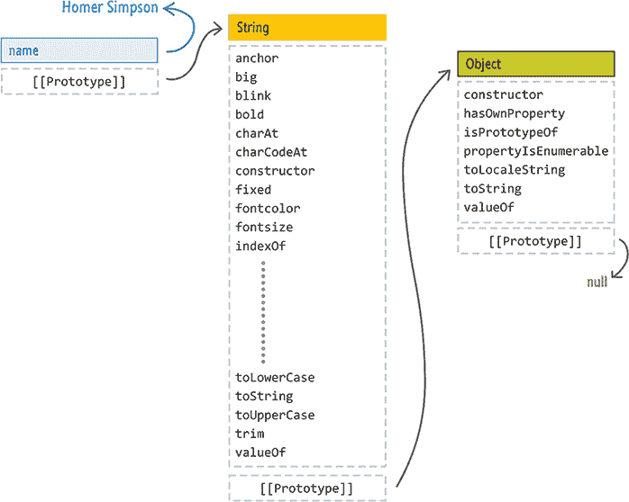

**图 13.2** *稍微复杂一点，对吧？*

你有一个`name`变量，它包含指向文本 *Homer Simpson* 的指针。你还拥有与`String`对象相关的所有各种属性和方法——你可能使用过的如`indexOf`、`toUpperCase`等东西。你将在第 16 章“深入了解对象”中获得关于此图表到底代表什么的全面概述，所以不用太担心你在这里看到的内容。只需要知道，任何原始类型的对象形式都携带了大量的功能即可。

### 为什么这很重要

让我们回到之前的困惑点。我们的字符串是一个原始类型（primitive）。原始类型如何允许你访问它的属性呢？答案在于 JavaScript 非常奇异。假设你有以下字符串：

点击此处查看代码图像

```javascript
var game = "Dragon Age: Origins";
```

`game`变量显然是一个字符串原始类型，被赋值为字面量文本。如果我想访问此文本的`length`，我会进行如下操作：

点击此处查看代码图像

```javascript
var game = "Dragon Age: Origins";

alert(game.length);
```

在评估`game.length`的过程中，JavaScript 将你的原始字符串转换为一个对象。在短暂的瞬间，你那低微的原始类型将变成一个优的对象，以弄清楚`length`到底是什么。需要记住的是，这一切都是暂时的。因为这个临时对象在完成它的使命后没有被固定或绑定到任何东西上，它会消失，你留下了`length`评估的结果（一个数字）和`game`变量（仍然是一个字符串原始类型）。

这种转换只发生在原始类型上。如果你显式地创建一个`String`对象，那么你创建的内容将被永久地保留为对象。假设你有以下内容：

点击此处查看代码图像

```javascript
var gameObject = new String("Dragon Age:Origins");
```

在这种情况下，我们的`gameObject`变量显然指向一个类型为`Object`的东西。除非你修改字符串或进行其他导致引用更改的操作，否则该变量将继续指向一个`Object`类型。原始类型转变为对象再变回原始类型是原始类型特有的。你的对象不会参与这种胡闹行为。

你可以通过检查数据的类型来轻松地验证我所说的一切。这是通过使用`typeof`关键字实现的。这里有一个用它来确认我刚刚告诉你的所有内容的示例：

点击此处查看代码图像

```javascript
var game = "Dragon Age: Origins";

alert("Length is: " + game.length);

var gameObject = new String("Dragon Age:Origins");

alert(typeof game); // string

alert(typeof game.length); // number

alert(typeof gameObject); // Object
```

现在，你不是很高兴学了这些吗？

***

### 绝对最小值

希望这段简短的解释能帮助你理解为什么你的原始类型在需要时表现得像对象。到此时，你可能会另一个问题，即为什么会有人设计出一种如此奇怪的语言。毕竟，如果一个原始类型在需要执行某些有用操作时变成对象，为什么不一直作为对象呢？答案与内存消耗有关。

正如从我的讨论和插图中看到的，与仅仅原始类型相比，原始类型的对象形式携带了多少额外行李，所有指向额外功能的指针都会消耗资源。JavaScript 的解决方案是一个折中。所有的字面量（如文本、数字和布尔值）如果被声明和/或这样使用，就会保持为原始类型。只有在需要时，它们才会被转换为相应的`Object`形式。为了确保你的应用程序继续保持低内存占用，这些转换后的对象在完成任务后会被迅速丢弃（即垃圾回收）。

***

## 14. 数组

### 本章内容

* 使用数组处理数据列表
* 学习如何使用`Array`属性执行常见任务

想象你正在一张纸上记下一个列表。让我们把这张纸称为“购物清单”。现在，在这张纸上，你写了一个从零开始的编号列表，内容如图 14.1 所示。

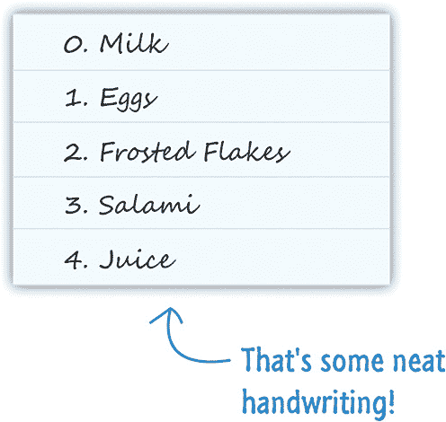

**图 14.1** *购物清单的示例。*

通过简单创建一个物品列表，你现在拥有了一个**数组**（array）的真实世界示例。名为“购物清单”的纸就是你的数组。你需要购买的物品被称为**数组值**（array values）或**数组元素**（array elements）。

在本章中，你将学习到关于我喜欢去购物的所有知识。你可能会间接地接触到这种非常常见的内置类型——数组。

### 创建数组

如今酷孩子们创建数组的流行方式是使用左括号和右括号。接下来的示例是我们初始化为空数组的`groceries`变量：

```javascript
var groceries = [];
```

你在左侧有一个变量名，右侧有一对括号将该变量初始化为空数组。这种使用括号创建数组的方法被称为**数组字面量表示**（array literal notation）。

现在，你通常想从一开始就创建一个包含某些项的数组。要创建这些非空数组，将你想要的项放在括号内，并用逗号隔开：

点击此处查看代码图像

```javascript
var groceries = ["Milk", "Eggs", "Frosted Flakes", "Salami", "Juice"];
```

注意我的`groceries`数组现在包含了 *Milk*、*Eggs*、*Frosted Flakes*、*Salami* 和 *Juice*。我必须再次强调逗号有多重要。如果没有逗号，你将只有一个巨大的项。好了，现在你已经学习了如何声明数组，让我们看看如何实际使用它来存储和处理数据。

### 访问数组值

数组的好处之一是，你不仅可以轻松访问数组本身，还能轻松访问数组中的值……就像在购物清单上高亮某一项所示，如图 14.2。

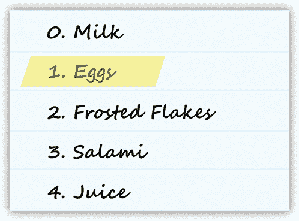

**图 14.2** 鸡蛋被高亮了。这一定很重要。

你唯一需要知道的是访问单个项目的步骤。

在数组内部，每个项目都被分配了一个数字（正式称为**索引值**），从 0 开始，就像你之前在字符串内部字符中看到的那样。在上面的示例中，*Milk*（牛奶）的索引值为 0，*Eggs*（鸡蛋）的索引值为 1，*Frosted Flakes*（玉米圈片）的索引值为 2，依此类推。

假设我们的购物数组声明如下：

点击此处查看代码图片

```javascript
var groceries = ["Milk", "Eggs", "Frosted Flakes", "Salami", "Juice"];
```


如果我想从数组中访问一个项目，我所做的就是指定我感兴趣的项目索引值：

```javascript
groceries[1];
```

索引值使用方括号来指定。在这个示例中，你指的是 *Eggs* 值，因为索引值 1 指向的是它。如果你指定 2，你将返回 *Frosted Flakes*。你可以一直指定更大的索引值，直到数组中没有更多映射到该值的条目为止。

你可以用作索引值的数字范围从 0 到数组长度减 1。原因是，正如之前的图表所示，你的索引值是从值 0 开始的。如果你的数组只有 5 个项目，尝试显示 `grocery[6]` 或 `grocery[5]` 将导致显示为 *undefined*（未定义）的消息。

让我们更进一步。在大多数现实世界的场景中，你可能更希望通过程序的方式来遍历你的数组，而不是逐个地访问每个项目。

你可以采用我在上一段落中解释的内容，并使用 `for` 循环来实现：

```javascript
for (var i = 0; i < groceries.length; i++) {
    var item = groceries[i];
}
```

注意你的循环范围从 0 开始，并在你的数组完整长度的前一个（由 `length` 属性返回）结束。这之所以行得通，是因为正如我之前提到的，你的数组索引值从 0 到数组长度返回值减 1 的位置。而且，`length` 属性返回的是数组中所有项目的计数！（确切地说，`length` 属性返回的是数组中索引值的数量，这有时并不等于你数组存储的实际项目数量。这是一个我们以后会处理的吹毛求疵细节。）

## 向数组中添加项目

你很少会让你数组保持在最初初始化的状态。你可能想向它添加项目。要向你的数组添加项目，你将使用 `push` 方法：

```javascript
groceries.push("Cookies");
```

`push` 方法直接在你的数组上调用，你向其中传递想要添加的数据。通过使用 `push` 方法，你新添加的数据将始终位于数组的末尾。

例如，在我们的初始数组上运行代码后，你会看到 Cookies（饼干）被添加到购物数组的末尾，如图 14.3。

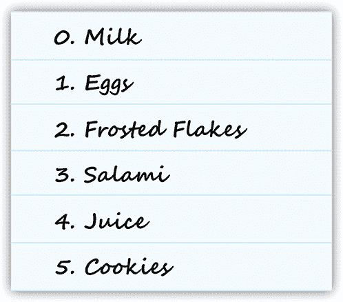

**图 14.3** 我们新添加的项目被放置在了末尾。

如果你想向数组的开头添加数据，你可以使用 `unshift` 方法：

```javascript
groceries.unshift("Bananas");
```

当数据被添加到数组的开头时，所有现有项目的索引值都会增加，以容纳新插入的数据，如图 14.4。

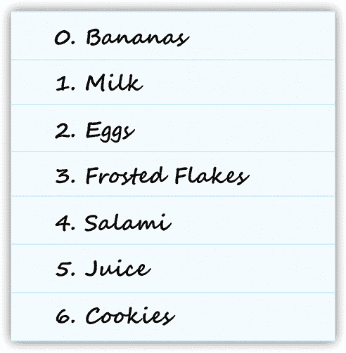

**图 14.4** 这次，我们新添加的项目被放置在了开头。

这是因为数组中的第一个项目的索引值始终为 0。这意味着原本由第 0 个项目占据的空间需要将自己及其下面的所有内容向后推，以为新数据留出空间。

`push` 和 `unshift` 方法在使用时，除了向数组添加元素，还会返回数组的新长度：

```javascript
alert(groceries.push("Cookies")); // 返回 6
```

不确定这有什么用，但先记在心里，以防你以后需要。

### 从数组中移除项目

要从数组中移除项目，你可以使用 `pop` 或 `shift` 方法。`pop` 方法从数组中移除最后一个项目并返回它：

```javascript
var lastItem = groceries.pop();
```

`shift` 方法在相反的端执行相同的操作。返回的不是最后一个项目，`shift` 返回的是第一个项目：

```javascript
var firstItem = groceries.shift();
```

当从数组开头移除项目时，剩余元素的索引值会减小。我们几乎说完了关于移除项目的内容。我们要查看的方法是 `slice`：

```javascript
var newArray = groceries.slice(1, 4);
```

`slice` 方法允许复制数组的一部分并返回一个新数组。当你使用 `slice` 时，原始数组不会被修改。

### 在数组中查找项目

要在数组内部查找项目，你有两个内置方法：`indexOf` 和 `lastIndexOf`。这些方法通过扫描你的数组并返回元素的位置来实现。

`indexOf` 方法返回要搜索的项目首次出现时的索引值：

```javascript
var groceries = ["milk", "eggs", "frosted flakes", "salami", "juice"];
var resultIndex = groceries.indexOf("eggs", 0);
alert(resultIndex); // 1
```

注意变量 `resultIndex` 存储了 `groceries` 数组上调用 `indexOf` 的结果。使用 `indexOf` 时，我传入了我要查找的元素以及起始索引位置：

```javascript
groceries.indexOf("eggs", 0);
```

在这种情况下，`indexOf` 返回的值将是 1。

`lastIndexOf` 方法在用法上与 `indexOf` 类似，但在找到元素时的返回值略有不同。`indexOf` 找到第一次出现的位置，而 `lastIndexOf` 找到最后一次出现的位置并返回该索引。

当你搜索数组中不存在的元素时，`indexOf` 和 `lastIndexOf` 都会返回 -1。

### 合并数组

我们最后要做的是查看如何创建一个由两个独立数组组成的新数组。假设你有两个数组 `good` 和 `bad`：

```javascript
var good = ["Mario", "Luigi", "Kirby", "Yoshi"];
var bad = ["Bowser", "Koopa Troopa", "Goomba"];
```

要将这两个数组合并为一个数组，在你想变大的数组上使用 `concat` 方法，并将想要合并的数组作为参数传递进去。返回将是一个包含 `good` 和 `bad` 所有内容的新数组。

```javascript
var goodAndBad = good.concat(bad);
alert(goodAndBad);
```

在这个示例中，因为 `concat` 方法返回一个新数组，`goodAndBad` 变量最终变成了一个存储我们合并操作结果的数组。`goodAndBad` 内部元素的顺序是 `good` 在前，`bad` 在后：

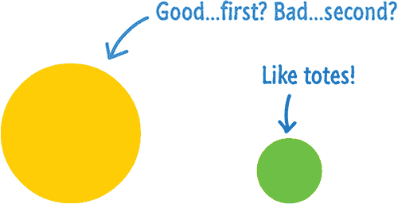

---

### 极简

关于数组，你要知道几乎就是这些了……嗯，至少是你最经常使用它们的内容。最起码，你已经学会了如何使用它们创建一个购物清单！

一些额外的资源和示例：

- **打乱数组：[`bit.ly/kirupaArrayShuffle`](http://bit.ly/kirupaArrayShuffle)**
- **从数组中随机选取项目：[`bit.ly/kirupaRandomItemArray`](http://bit.ly/kirupaRandomItemArray)**
- **从数组中删除重复项：[`bit.ly/kirupaRemoveDuplicates`](http://bit.ly/kirupaRemoveDuplicates)**
- **哈希表与数组：[`bit.ly/kirupaHvA`](http://bit.ly/kirupaHvA)**

---

 提示

对于正在阅读本书纸质版或电子书版的读者，这里有一个快速提醒：如果你访问 [www.quepublishing.com](http://www.quepublishing.com) 并注册这本书，你可以免费访问在线 Web 版。该版本不仅包含本书的全文，还包含一个短而有趣的互动测验，用来测试你对刚刚读过的章节的理解情况。

如果你已经在 Web 版中阅读这些文字并想尝试一下测验，那么你太走运了——你只需要向下滚动即可！

---

## 15. 数字

---

### 本章内容

- 理解数字
- 学习你将遇到的各种数值类型
- 认识 `Math` 对象以及你可以用它做的各种数学操作

---

当你不处理字符串时，你在 JavaScript 中大部分时间都将花在处理数字上。即使你没有直接处理数字，在执行即使是最基础的任务（如计数、处理数组等）时，你也会间接地遇到它们。

在本章中，我将通过介绍如何使用数字来完成许多常见任务，从而对 JavaScript 中的数字进行介绍。在此过程中，我们将深入基础之外，广泛地探索一些你可能会发现有用的有趣数字相关内容。

继续吧！

### 使用数字

为了使用数字，你所做的就是……嗯，使用它就好。下面是一个简单的示例，我声明了一个名为 `stooges` 的变量并将其初始化为数字 3：

```javascript
var stooges = 3;
```

就这样。没有复杂的繁琐步骤要遵守。如果你想使用更复杂的数字，就像什么都不一样直接使用它们即可：

```javascript
var pi = 3.14159;
var color = 0xFF;
var massOfEarth = 5.9742e+24;
```

在上面的示例中，我使用了一个小数、一个十六进制值以及一个使用指数的极大值。最后，你的浏览器会自动进行正确的处理。请注意，“正确的处理”不仅存在于正空间。你也可以轻松地使用负数。要使用负数，只需在你想要转换为负值的数字前加上一个减号 (`-`)：

```javascript
var temperature = -42;
```

你在这一节看到的包含了你实际使用数字的大部分内容。在接下来的几个章节中，让我们再深入一点，看看你可以用数字做的一些其他有趣的事情。

---

### 趣味知识：JavaScript 中的数字

如果你好奇为什么处理数字如此简单，原因在于 JavaScript 并不看重数值类型。你不需要像在其他语言中那样，将数字声明为 `int`、`double`、`byte`、`float` 等类型。

在 JavaScript 中，所有数字都被转换为 64 位浮点数。

---

### 运算符

如果不向你展示如何在代码中使用数学运算符来实现你在小学数学课上学到的东西，那么对数字的介绍是不完整的（或者无法开始）。

让我们来看看本节中的常用运算符。

#### 执行简单的数学运算

在 JavaScript 中，你可以使用 `+`、`-`、`*`、`/` 和 `%` 运算符创建简单的数学表达式，分别对数字进行加、减、乘、除和求余数（模）。如果你会用计算器，你就能在 JavaScript 中进行简单的数学运算。

以下是一些使用这些运算符的示例：

```javascript
var total = 4 + 26;
var average = total / 2;
var doublePi = 2 * 3.14159;
var removeItem = 50 - 25;
var remainder = total % 7;
var more = (1 + average * 10) / 5;
```

在最后一行中，运算顺序为：
1. **P**arenthesis（括号）
2. **E**xponents（指数）
3. **M**ult（乘法）
4. **D**ivide（除法）
5. **A**dd（加法）
6. **S**ubtract（减法）

`NaN` 关键字代表“Not a Number”（不是数字），当你执行某些无效的数值运算时，就会返回该值。例如，在以下情况下会返回 `NaN`：

```javascript
var oops = Math.sqrt(-1);
```

由于是你不能对一个数字和一个字符串进行除法。在某些非人为的情况下，你会看到这个值的返回。我之前描述的 `parseInt` 函数如果你要转换的字符串无效，它将返回 `NaN`。

---

### 趣味知识：JavaScript 中的数字

有时，你可能会遇到嵌入在字符串中的数字。要获取关于这方面的完整信息，请阅读以下位置的**从字符串到数字**教程：**[`bit.ly/kirupaStrToNum`](http://bit.ly/kirupaStrToNum)**。

---

### Math 对象

数字被用于各种数学表达式，而且它们通常往往超了简单的加、减、乘、除。如果数学课仅仅只有这些内容，那么你当年的数学课将会简单得多。为了帮助你更轻松地处理复杂的数值计算，你有一个 `Math` 对象。该对象提供了许多非常有用的函数和常量，我们将非常简要地查看该对象执行的一些操作。

---

### 这太无聊了！

我不打算骗你。查看 `Math` 对象提供的所有内容相当无聊。除非你现在真的非常想了解这一切，否则我更希望你只是非常、快速地浏览一下以下章节，并在需要时回来查看。`Math` 对象不会去哪里（它没有朋友），所以它会在稍后等你。

---

### 常量

为了避免你必须显式地定义像 Pi、欧拉常数、LN10 之类的数学常量，`Math` 对象为你定义了许多常用常量：

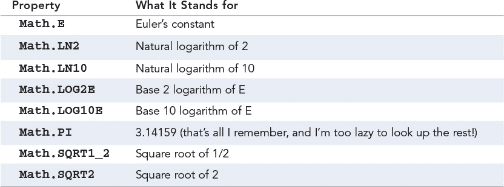

在所有这些常量中，我用最多的是 `Math.PI`：

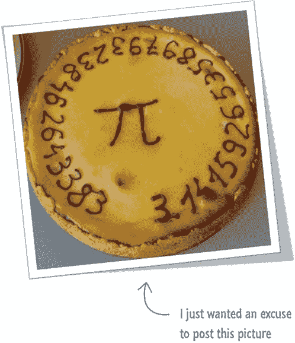

你将在各种地方使用它，从在屏幕上画圆到指定三角表达式无一不是。事实上，我从未记得在 `Math.PI` 之外还用过任何其他常量。这里有一个给定半径返回圆周长的函数示例：

```javascript
function getCircumference(radius) {
    return 2 * Math.PI * radius;
}
alert(getCircumference(2));
```

你可以使用 `Math.PI` 或任何其他常量，就像使用任何命名变量一样。

### 数字舍入

你的数字往往会包含极其数量的精度：

```javascript
var position = getPositionFromCursor(); //159.3634493939
```

为了帮助你将这些数字舍入到合理的整数值，你拥有 `Math.round()`、`Math.ceil()` 和 `Math.floor()` 函数，它们接受一个数字作为参数：

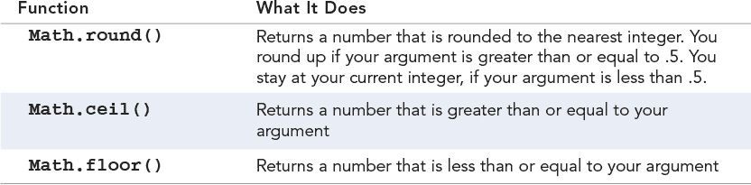

理解上述表格最简单的方法就是看这三个函数的实际运行：

```javascript
Math.floor(.5); // 0
Math.ceil(.5); // 1
Math.round(.5); // 1
Math.floor(3.14); // 3
Math.round(3.14); // 3
Math.ceil(3.14); // 4
Math.floor(5.9); // 5
Math.round(5.9); // 6
Math.ceil(5.9); // 6
```

这三个函数始终会将数字舍入到整数。如果你想舍入到一组特定的数字位数，请查看以下位置的**JavaScript 中的数字舍入**教程的后半部分：**[`bit.ly/kirupaRounding`](http://bit.ly/kirupaRounding)**。

### 三角函数

在所有函数中，我最喜欢的 `Math` 对象为你提供了几乎所有你需要的三角函数的便捷访问。

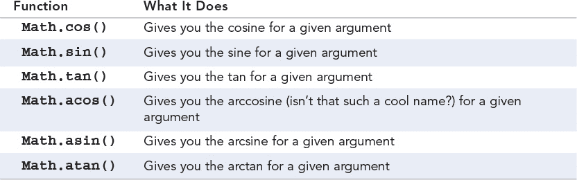

要使用其中任何一个函数，只需传递一个数字作为参数：

```javascript
Math.cos(0); // 1
Math.sin(0); // 0
Math.tan(Math.PI / 4); // 0.9999999999999999
Math.cos(Math.PI); // -1
Math.cos(4 * Math.PI); // 1
```

这些三角函数接受弧度形式的参数。如果你的数字是度的形式，请务必先将其转换为弧度。

### 幂和平方根

继续定义 `Math` 对象的函数，你拥有 `Math.pow()`、`Math.exp()` 和 `Math.sqrt()`：

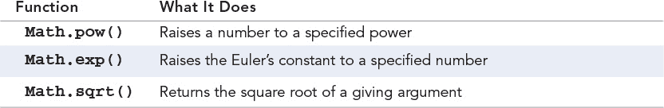

让我们看一些示例：

```javascript
Math.pow(2, 4) //相当于 2⁴ (或 2 * 2)
```

### 获取绝对值

要获取数字的绝对值，使用 `Math.abs()` 函数：

```javascript
Math.abs(-5); // 5
Math.abs(5); // 5
```

### 随机数

要生成一个 0 到 1 之间的随机数，使用 `Math.random()`：

```javascript
Math.random(); // 例如，0.12345
```

要生成一个 1 到 100 之间的随机整数，使用以下表达式：

```javascript
Math.floor(Math.random() * 100) + 1;
```


我们在这里要做的是更详细地重新观察对象，并涉及更高级的话题，例如使用`Object`对象、创建自己的自定义对象、继承、原型以及`this`关键字。如果我目前为止列出的所有内容让你毫无头绪，那么在你读完本章之后你就会理解了……我希望如此。

继续吧！

### 认识对象

在食物链的最底端，你拥有`Object`类型，它为自定义对象以及`Function`、`Array`和`RegExp`等内置类型奠定了基础。除了`null`和`undefined`之外，几乎所有内容都与`Object`直接相关，或者根据需要变成对象。

正如你很久以前在对象的介绍中看到的那样，`Object`提供的功能非常简单。它允许你指定一组具名的键值对，我们亲切地称之为**属性**。这与你在其他语言中看到的哈希表、关联数组和字典等数据结构没有太大区别。

总之，这一切都非常无聊。让我们进入一些更有趣的内容吧！

#### 创建对象

现在的酷孩子都在使用看起来奇特（但紧凑）的**对象字面量**语法来创建对象：

```javascript
var funnyGuy = {};
```

没错。不需要像你在旧书里看到的那样输入`new Object()`，你只需要通过`{}`来初始化你的对象。在这一行代码执行完毕，你将创建一个名为`funnyGuy`的对象，其类型为`Object`。如果到目前为止这一切都能理解，那太棒了！

这个`funnyGuy`对象并没有看起来那么简单。让我们深入挖掘一下，并视觉化地观察到底发生了什么。在表面上，你仅仅有一个`funnyGuy`对象：

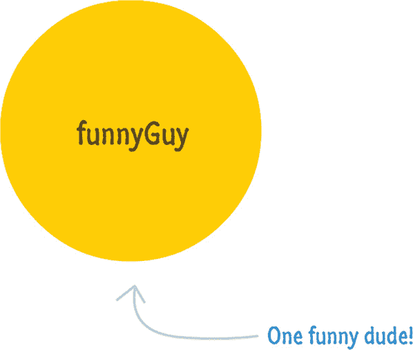

如果你后退并更广泛地观察`funnyGuy`对象，你会发现它在这里并不孤立。因为它是一个对象，所以它与它所派生的主`Object`类型之间存在连接：

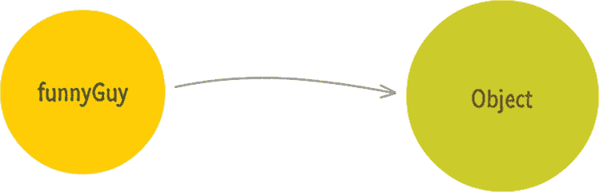

这种连接的意义非常重大。让我们对目前提供的内容添加一些细节：

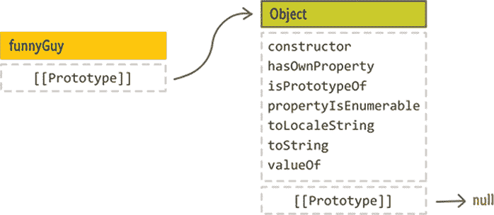

`funnyGuy`对象没有定义任何属性。考虑到我们在代码中指定的（以及在上面的图中看到的），这是很合理的：

```javascript
var funnyGuy = {};
```

我们的`funnyGuy`仅仅是一个空对象。虽然我们可能没有在上面定义任何属性，但存在一个名为`__proto__`的特殊内部属性，通常被视觉化为**原型（Prototype）**，它指向内部定义的`Object`。如果你的大脑刚刚空白了一秒，让我慢慢解释一下这里发生了什么。

`__proto__`属性引用的是所谓的`prototype`（原型）对象：

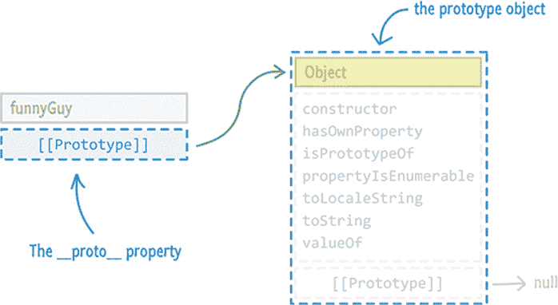

原型对象是另一个对象的基础。在我们的案例中，`funnyGuy`对象是模仿我们的`Object`类型创建的。这种意义通过一个例子得到很好的体现。我们知道`funnyGuy`不包含任何属性。[由于后续文本高度重复/无意义已省略]。

```javascript
return "Name is: " + this.firstName + " " + this.lastName;
}
};
```

我们的`getName`属性值是一个函数，其函数体只需返回一个包含我们`firstName`和`lastName`属性值的字符串。要调用`getName`属性，额咳……方法，你只需要做这些：

点击此处查看代码图片

```javascript
var funnyGuy = {
    firstName: "Conan",
    lastName: "O'Brien",
    getName: function() {
        return "Name is: " + this.firstName + " " + this.lastName;
    }
};

alert(funnyGuy.getName()); // Name is: Conan O'Brien
```

是的，声明一个对象并在其上设置属性就这些了。间接地，你学习了许多关于创建简单对象时幕后发生了什么的知识。当我们在下一节提高难度时，你将需要所有这些华丽的知识。

### 创建自定义对象

使用通用的`Object`并在其上添加属性是有用的，但当你创建许多本质上相同的对象时，它的优越性就会迅速消失：

点击此处查看代码图片

```javascript
var funnyGuy = {
    firstName: "Conan",
    lastName: "O'Brien",
    getName: function () {
        return "Name is: " + this.firstName + " " + this.lastName;
    }
};

var theDude = {
    firstName: "Jeffrey",
    lastName: "Lebowski",
    getName: function () {
        return "Name is: " + this.firstName + " " + this.lastName;
    }
};

var detective = {
    firstName: "Adrian",
    lastName: "Monk",
    getName: function () {
        return "Name is: " + this.firstName + " " + this.lastName;
    }
};
```

目前，如果我们要可视化现在拥有的东西，你会看到这些：

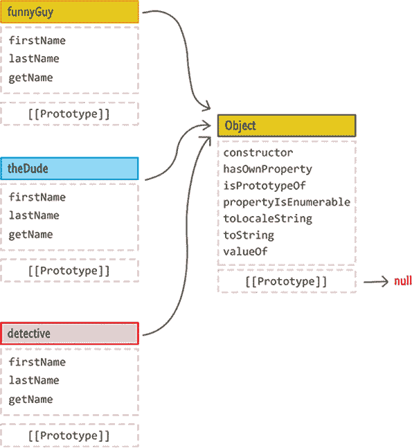

这里有很多重复的内容，坦率说，这些是不必要的。让我们用学到的继承和原型链知识来修复它。

我们想要做的是创建一个中间**父**对象，它包含了更通用的、没必要存在于**子**对象本身的属性。根据我们这里的代码，`firstName`和`lastName`属性对于我们创建的每个对象来说将是唯一的。因此，这两个属性仍然属于`funnyGuy`、`theDude`和`detective`对象。

然而，我们的`getName`属性不需要在每个对象中重复。我们可以将其分配到一个父对象中，其他对象可以从该对象继承。让我们把这个对象命名为`person`：

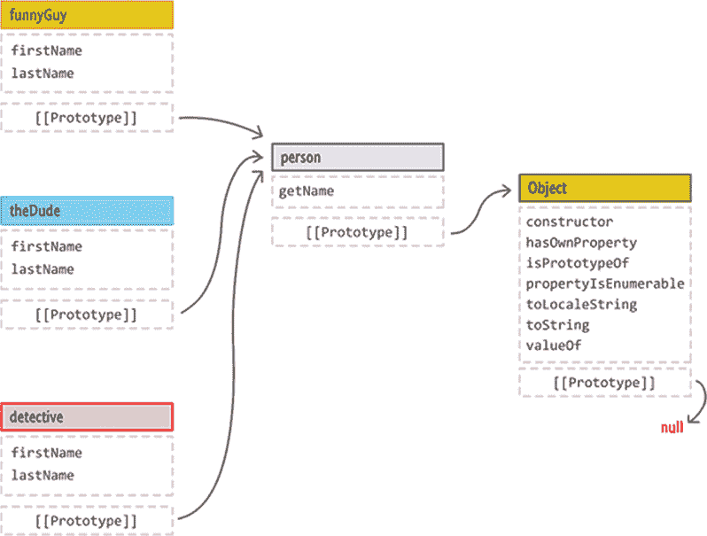

从视觉上看，这是合理的。我们最终是如何创建出这样的东西的呢？

嗯，大声思考一下，我们需要创建`funnyGuy`、`theDude`和`detective`对象，并确保`firstName`和`lastName`属性定义在它们上。这很简单。当然，如果我们只做这些，那将是不够的。这些对象的原型将是`Object`，而我们并不希望这样。我们希望带有`getName`属性的`person`对象作为直接父成为我们原型链的一部分。我们这样做的方法是确保`funnyGuy`、`theDude`和`detective`的`[[Prototype]]`属性引用`person`。

为了实现这一点，我们使用极其出色的`Object.create`方法。在我们实际操作之前，让我快速解释一下它的作用。`Object.create`方法正如其名，会创建一个新对象。在创建对象的过程中，它允许你指定新创建对象的原型将是什么。我们想要做的和`Object.create`提供的完全一致，这真是奇妙！:P

让我们使用`Object.create`以及其他让你们看到的图表和解释生动起来的代码：

点击此处查看代码图片

```javascript
var person = {
    getName: function () {
        return "Name is " + this.firstName + " " + this.lastName;
    }
};

var funnyGuy = Object.create(person);
funnyGuy.firstName = "Conan";
funnyGuy.lastName = "O'Brien";

var theDude = Object.create(person);
theDude.firstName = "Jeffrey";
theDude.lastName = "Lebowski";

var detective = Object.create(person);
detective.firstName = "Adrian";
detective.lastName = "Monk";
```

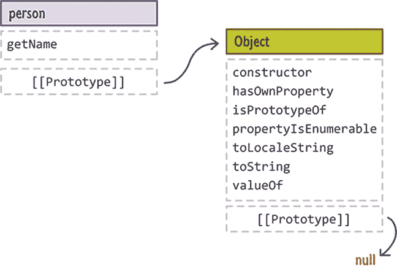

`Object`上也没有`firstName`或`lastName`属性的迹象。这个`getName`方法是如何恰好能够工作并返回正确值的呢？

答案与位于`firstName`和`lastName`之前的`this`关键字有关。`this`关键字指向我们的`getName`方法所指向的对象。在这种情况下，该对象就是`funnyGuy`：

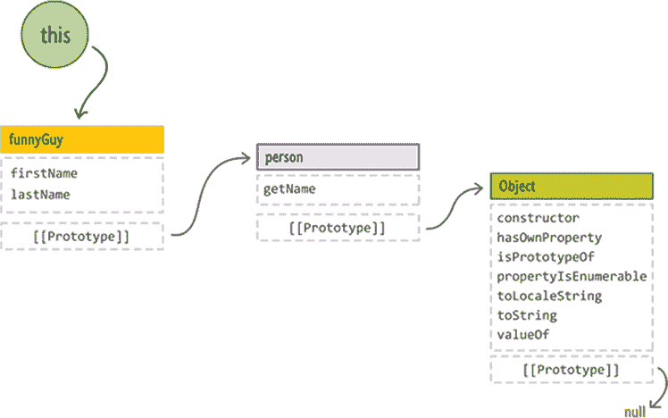

在评估`getName`方法并且必须解析`firstName`和`lastName`属性的时刻，查找将从`this`关键字指向的地方开始。在我们的用例中，`this`关键字指向`funnyGuy`对象——一个包含`firstName`和`lastName`属性的对象！

了解`this`关键字指的是什么是我们稍后会花更多时间研究的内容，但你到目前所看到的已经足够让你走得很远了。

# 极少概念

由于 JavaScript 的面向对象特性备受关注，涵盖该特性的话题像你在这里看到的这样宽广而深也是理所当然的。你在这里看到的大部分内容都直接或间接地涉及了继承，即对象是派生自并基于其他对象的。与其他使用类作为对象模板的经典语言不同，JavaScript 没有这样的类概念。JavaScript 使用的是所谓的**原型继承模型**。你不是从模板实例化对象，而是从头创建对象，或者更常见地通过复制/克隆另一个对象来创建。

一些额外的资源和示例：

- 理解 JS 中的“原型”（Prototypes）：[`bit.ly/kirupaJSPrototypes`](http://bit.ly/kirupaJSPrototypes)
- 纯英语版 JS 原型指南：[`bit.ly/kirupaPrototypesGuide`](http://bit.ly/kirupaPrototypesGuide)
- JavaScript 的“.prototype” 是如何工作的？[`bit.ly/kirupaPrototypeWork`](http://bit.ly/kirupaPrototypeWork)

 提示

给那些正在阅读本书纸质版或电子书版的读者们一个快速提醒：如果你访问 [www.quepublishing.com](http://www.quepublishing.com) 并注册这本书，你就可以免费访问在线 Web 版，它不仅包含这本书的完整文本，还包含一个短而有趣的互动测试，用来测试你对刚刚阅读章节的理解。

## 17. 扩展内置对象

### 本章内容

- 扩展你对象的功能
- 更多地了解原型链

正如你现在非常熟悉的，JavaScript 出厂时就提供了大量的内置对象。这些对象为处理文本、数字、数据集合、日期等许多内容提供了核心功能。当你越来越熟悉 JavaScript 并开始做更有趣、更聪明的事情时，你经常发现自己想要做比内置对象允许的更多、走更远。

让我们来看这种情况可能发生的一个示例。下面是一个关于如何打乱数组内容的示例：

```javascript
function shuffle(input) {
    for (var i = input.length - 1; i >= 0; i--) {
        var randomIndex = Math.floor(Math.random() * (i + 1));
        var itemAtIndex = input[randomIndex];
        input[randomIndex] = input[i];
        input[i] = itemAtIndex;
    }
    return input;
}
```

使用这个`shuffle`函数的方法只需简单调用它并传入你想要打乱内容的数组：

```javascript
var tempArray = [1, 2, 3, 4, 5, 6, 7, 8, 9, 10];
shuffle(tempArray);

// 结果是...
alert(tempArray);
```

这段代码运行后，最终结果是你的数组内容现在被重新排列了。现在，这个功能非常有用。我会说这太有用了，打乱功能应该是`Array`对象的一部分，并且像`push`、`pop`、`slice`一样容易访问。

如果`shuffle`函数是`Array`对象的一部分，你可以这样使用它：

```javascript
var tempArray = [1, 2, 3, 4, 5, 6, 7, 8, 9, 10];
tempArray.shuffle();
```

### 向原型问好

扩展内置对象听起来很复杂，但一旦理解了就很简单。我们无法访问`Array`的源码。另一种方法是使用`Array`对象的`prototype`属性来附加功能。看起来像这样：

```javascript
Array.prototype.shuffle = function () {
    var input = this;
    for (var i = input.length - 1; i >= 0; i--) {
        var randomIndex = Math.floor(Math.random() * (i + 1));
        var itemAtIndex = input[randomIndex];
        input[randomIndex] = input[i];
        input[i] = itemAtIndex;
    }
    return input;
};
```

注意，我们的`shuffle`函数是在`Array.prototype`上声明的！作为这种附加的一部分，我们对函数的工作方式进行了微小的改变。函数不再接收参数来引用你需要的数组。相反，因为这个函数现在是`Array`对象的一部分，函数体内部的`this`关键字指向需要打乱的数组。

退后一步考虑，一旦运行了这段代码，你的`shuffle`函数将发现自己已经与`Array`对象提供的所有内置方法并肩作战了：

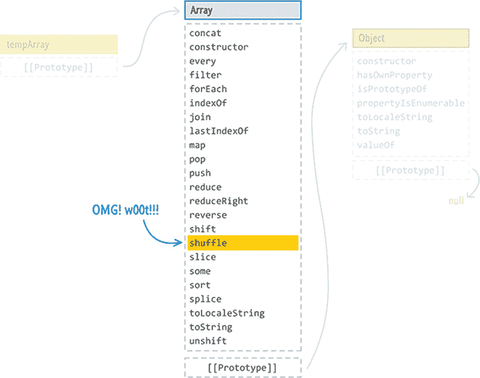

如果你想访问`shuffle`属性（呃……方法……我得停止这么说了了！），你现在可以使用我们最初想要的方法来这样做了：

点击此处查看代码图片

```javascript
var tempArray = [1, 2, 3, 4, 5, 6, 7, 8, 9, 10]
tempArray.shuffle();
```

这是因为`prototype`属性允许你直接访问`Array`对象的内部。在它上面声明`shuffle`函数让我们得到了想要的结果。最棒的是，得益于原型继承的工作机制，你创建的任何新数组默认都将拥有`shuffle`功能。

## 扩展内置对象具有争议性

考虑到通过声明方法和属性来扩展内置对象的功能是如此简单，人们很容易认为每个人都喜欢这种能力。但事实证明，扩展内置对象是有争议的。这些争议的原因围绕着一个事实……

### 你无法控制内置对象的未来

没有什么可以阻止未来的 JavaScript 实现包含它自己的`shuffle`版本并应用于`Array`对象。在此时，你的`shuffle`版本与浏览器的`shuffle`版本之间会产生冲突——当它们的行为或性能特征差异巨大时。糟糕！

### 某些功能不应被扩展或覆盖

没有什么可以阻止你利用这里学到的知识修改现有方法和属性的行为。例如，这是我修改`slice`的行为：

点击此处查看代码图片

```javascript
Array.prototype.slice = function () {
    var input = this;
    input[0] = "这是一个很棒的例子!";
    return input;
}

var tempArray = [1, 2, 3, 4, 5, 6, 7, 8, 9, 10];
tempArray.slice();

// 结果是……
alert(tempArray);
```


虽然这是一个糟糕的例子，但它确实展示了我破坏现有功能是多么容易。

## 延伸阅读

要查看关于这一争议的更全面的讨论和进一步阅读，请查看这个 StackOverflow 线程：[`stackoverflow.com/questions/8859828/`](http://stackoverflow.com/questions/8859828/)

## 最底原则：你应该做什么？

对于你需要做什么的回答非常简单：运用你的最佳判断！我概述的这两个案例只是讨论扩展内置对象时人们提出的众多问题中的几个。在大多数情况下，所有的反对都是合理的。问题在于……

`isMovieAvailable` 的值可能是 `true` 或 `false`。在处理数据时，你无法保证某些内容在某一点不会发生崩溃或改变返回的结果。就像现实生活一样，如果你不采取某些可操作的步骤，仅仅希望事情顺利运行是不够的。布尔函数（Boolean function）就是这样的步骤之一。

现在，创建一个你自己的函数来处理歧义可能大材小用，但 `Boolean` 构造函数的缺点在于是你显然会得到一个布尔对象——这并不是我们想要的。幸运的是，有一种方法可以非常容易获得 `Boolean` 构造函数的灵活性，同时保持布尔原型的轻量级。这种方法由 `Boolean` 函数实现：

```javascript
var bool = Boolean(true);
```

`Boolean` 函数允许你传入任意的值和表达式，同时仍返回 `true` 或 `false` 的原始布尔值。它与构造函数方法相比，主要的区别在于你不需要使用 `new` 关键字。W00t！无论如何，让我们花点时间看看传递给 `Boolean` 函数的各种内容，并注意，这些内容也适用于你在上一节中看到的 `Boolean` 构造函数。

传入并返回 `false` 的值有 `null`、`undefined`、空/无、`0`、空字符串、`NaN` 以及（当然）`false`。

```javascript
var bool;

bool = Boolean(null);

bool = Boolean(undefined);

bool = Boolean();

bool = Boolean(0);

bool = Boolean("");

bool = Boolean(NaN);

bool = Boolean(false);
```

在所有这些示例中，`bool` 变量将返回 `false`。要返回 `true`，你可以传入 `true` 值或**任何**导致上述看到的各种 `false` 值以外的结果：

```javascript
var bool;

bool = Boolean(true);

bool = Boolean("hello");

bool = Boolean("Liam Neesons" + "Bruce Willie");

bool = Boolean(new Boolean()); // 嵌套！！！

bool = Boolean("false"); // "false" 是一个字符串
```

在这些示例中，`bool` 变量将返回 `true`。考虑到某些语句，这看起来可能很奇怪，所以让我们来看看这里涉及的几个微妙之处。如果你评估的是一个对象，例如 `new Boolean(new Boolean())`，评估结果将始终为 `true`。这是因为对象的仅仅存在就会触发 `true` 开关，而调用 `new Boolean()` 会产生一个新的对象。稍微扩展这个逻辑，这意味着下面的 `if` 语句实际上也会结果为 `true`：

```javascript
var boolObject = new Boolean(false);

if (boolObject) {

    alert("Bool, you so crazy!!!");

}
```

你正在评估的对象实际上是一个伪装的 `false` 并不重要……或者是一个 `String` 对象或 `Array` 等。原型的规则要简单得多。如果你传入的是一个原型（或评估为原型的东西），除了 `null`、`undefined`、`0`、空字符串或 `false` 之外，任何内容都会导致 `true` 的结果。

### 严格相等和不相等运算符

我们要查看的内容将结合你对类型和布尔值的知识，为你之前看到的各种条件运算符增加一个转折。所以，你了解 `==` 和 `!=`，并且可能已经见过它们的使用。这些是相等和不相等运算符，可以让你知道两个事物是相等还是不相等。现在转折点：它们表现出了一种微妙且偏离常规的行为，你可能并没有意识到。

这里有一个示例：

```javascript
function theSolution(answer) {

    if (answer == 42) {

        alert("You have nothing more to learn!");

    }

}

theSolution("42"); //42 作为字符串传入
```

在例例中，表达式 `answer == 42` 将评估为 `true`。尽管你传入的 42 是一个字符串，而你检查的 42 是一个数字，这仍然有效。这里发生了什么？在什么样的世界里，字符串和数字是相等的？对于 `==` 和 `!=` 运算符，这是预期行为。你所比较的两个事物的值都是 42。为了实现这一点，JavaScript 在底层强制让这两个不同但相似的值保持一致。这在形式上被称为“类型转换”（type coercion）。

问题在于这种行为可能是不可希望的——尤其是当它在你不知情的情况下发生时。为了避免这种情况，你有更严格的相等和不相等运算符，它们分别是 `===` 和 `!==`。这些运算符的作用是同时检查值和类型，并且不执行任何类型转换。它们基本上是迫使你编写代码，让确保真正相等或不相等的责任完全落在你肩上。这是一件好事™。

让我们通过用 `===` 运算符替换 `==` 运算符来修复我们先的示例：

```javascript
function theSolution(answer) {

    if (answer === 42) {

        alert("You have nothing more to learn!");

    }

}

theSolution("42"); //42 作为字符串传入
```

这一次，条件表达式将评估为 `false`。在那个更严格的世界里，字符串和数字是不同的类型。由于没有发生类型转换，最终结果是 `false`。

让我们先从 `null` 开始。`null` 关键字也算是一种原始类型，在 JavaScript 的世界中扮演着特殊的角色。它是一个显式定义，表示**没有值**。如果你浏览过别人编写的代码，你可能会看到 `null` 出现好几次。它非常流行，因为 `null` 的优势在于它的确定性。与其让变量包含过时的值或神秘的 `undefined` 值，不如将其将其设置为 `null`，这是一个明确的信号，表示你*不希望该值存在*。

当你编写代码并想要初始化或清空变量为某个代表“无”的值时，这个优势非常重要。

这里有一个示例：

```javascript
var test = null;

if (test === null) {

    test = "Peter Griffin";

} else {

    test = null;

}
```

`null` 原始类型并不是自然产生的资源。它是你有意识赋值的，所以你经常会看到它作为变量声明的一部分，或者作为参数传递给函数调用。使用 `null` 非常简单。检查 `null` 的值也相当简单：

```javascript
if (test === null) {

    // 做一些有趣的事情……或者不

}
```

唯一需要注意的是，你应该使用 `===` 运算符，而不是低廉的 `==` 运算符。虽然如果你使用 `==` 世界也不会终结，但这是一个良好的编程习惯。

## Null 是原始类型还是对象？

`null` 原始类型与你的字符串和布尔内置类型相似，因为它们也有一个对象表示。不过，有一点你需要注意的怪异。尽管我刚才所说的那样，在任何时候执行 `typeof null` 都会显示它为一个对象。这并不是原始类型的行为，这种行为的原因与 JavaScript 语言中一个长期运行的 bug 有关。据传，这个 bug 在未来可能会被修复，所以……没错！加油团队。

### Undefined（未定义）

这里变得有点有趣了。为了表示未定义的东西，你拥有 `undefined` 原始类型。你在几种情况下会看到 `undefined`，最常见的情况是你尝试访问一个未初始化的变量，或者访问一个没有实际返回内容的函数的返回值。

这里有一个代码片段指出了 `undefined` 在它的几个自然栖息地：

```javascript
var myVariable;

alert(myVariable); // undefined

function doNothing() {

    // 看油漆干透

    return;

}

var weekendPlans = doNothing();

alert(weekendPlans); // undefined
```

在你的代码中，你可能不会将 `undefined` 赋值给任何东西。相反，你会花时间检查某个值是否为 `undefined`。你有几种方法来执行这种检查。第一种是简单的方法，通常几乎总是有效的：

```javascript
if (myVariable == undefined) {

    // 做一些事情

}
```

这种方法的缺点是，你可能会将 `undefined` 覆盖为像 **true** 这样的值，这会破坏你的代码。检查 `undefined` 最安全的方法涉及 `typeof` 和 `===` 运算符：

```javascript
var myVariable;

if (typeof myVariable === "undefined") {

    alert("Define me!!!");

}
```

这确保了你将对 `undefined` 进行检查并始终返回正确的答案。

## Null == Undefined, 但 Null !== Undefined

继续 `==` 和 `===` 的奇怪之处，如果你检查 `null == undefined`，答案将是 **true**。如果你使用 `===` 并且有 `null === undefined`，在这种情况下答案将是 **false**。

这是因为 `==` 会进行类型转换，它会强迫类型以符合 JavaScript 认为该值应该的样子。使用 `===` 时，你同时检查类型和值。这是一个更全面的检查，它检测出 `undefined` 和 `null` 确实是两个不同的东西。

感谢 senocular^(1)（也叫 Trevor McCauley）指出了这一点！

1. **[`twitter.com/senocular`](https://twitter.com/senocular)**

## 绝对最少

我之所以把这些内置类型放在最后是有的。`Null` 和 `undefined` 是这一组中最不令人兴奋的，但它们通常也是最容易被误解的。学会正确使用 `null` 并检测 `undefined` 是一项非常重要的技能。没有做对将会导致非常微妙的错误，这些错误将难以定位。

 提示

给那些在本书的印刷版或电子书版中阅读这些文字的读者一个快速的提醒：如果你访问 **[www.quepublishing.com](http://www.quepublishing.com)** 并注册这本书，你就可以免费访问在线 Web 版，它不仅包含本书的完整文本，还具有……

## 20. 立即执行函数

### 在本章

* 理解匿名函数
* 学习如何立即调用
* 通过创建数据进一步了解作用域

我们将稍微偏离对象，关注一些只有这样才有意义。现在，你可能已经足够了解函数并可以进行危险的生产。函数允许你将语句分组。如果你给你的函数一个名字，那么在下面的示例中：

```javascript
function areLucky() {

    // 在 0 到 100 之间随机选一个

    var foo = Math.floor(Math.random() * 100);

    if (foo > 50) {

        // 太棒了！

        alert("你很幸运！");

    } else {

        // 太棒了！

        alert("你不幸运！");

    }

}

// 调用这个函数！

`areLucky()`
```

如果你不给你的函数起名字，那也完全酷。它们被称为匿名函数，它们看起来如下：

```javascript
// 匿名函数 #1
var isLucky = function () {
    var foo = Math.round(Math.random() * 100);
    if (foo > 50) {
        return "你很幸运！";
    } else {
        return "你不幸运！";
    }
};

var me = isLucky();
alert(me);
```

```javascript
// 匿名函数 #2
window.setTimeout(function () {
    alert("太棒了！！！");
}, 2000);
```

```javascript
(function() {
    var shout = "I AM ALIVE!!!";
    alert(shout);
})();
```

继续添加这几行代码并在浏览器中预览它。如果一切运行正常，你将看到显示 `I AM ALIVE!!!`。如果运行不正常且你没有看到该内容，请确保你的许多括号位置正确。困扰 IIFE（立即执行函数表达式）最常见的问题就是括号不匹配或位置错乱！无论如何，既然你已经创建了一个可以运行的 IIFE，让我们剥开层层，看看究竟发生了什么。

首先，你有一个包含你想要执行的代码的函数：

```javascript
function() {
    var shout = "I AM ALIVE!!!";
    alert(shout);
}
```

只是一个简单的匿名函数，用于显示一些讨厌的全大写文本。然而，就该函数目前而言，JavaScript 并不知道如何处理它。这个函数的语法是无效的。为了让它更有效，在函数体后添加 `()`：

```javascript
function() {
    var shout = "I AM ALIVE!!!";
    alert(shout);
}()
```

添加 `()` 通常意味着你打算让 `()` 之前的任何内容立即执行。当你这样做时，JavaScript 仍然会报错，因为这同样不是有效的语法。原因是你需要告诉 JavaScript，你想要执行的这个函数实际上是一个表达式。最简单的方法是*将你的函数封装在另一对括号中**：

```javascript
(function() {
    var shout = "I AM ALIVE!!!";
    alert(shout);
})();
```

你的整个函数现在被视为一个表达式。紧接着加上你几秒前看到的 `()` 就可以让你的函数表达式得以执行。你可以说，这个`函数表达式` 一旦被 JavaScript 遇到就会被`立即`执行（即`调用`）。

### 编写接收参数的 IIFE

起初，IIFE 最难理解的地方是它们无非是简单的函数。这些简单的函数恰好带上了各种疯狂的括号来帮助它们立即执行。尽管如此，在处理 IIFE 时仍存在一些细微的区别。其中一个主要区别在于如何处理参数传递。

创建一个接收参数的 IIFE 的通用结构如下：

```javascript
(function (a, b) {
    /* code */
})(arg1, arg2);
```

就像调用任何函数一样，你传递的参数顺序与你的函数接收参数的顺序相对应。

这里有一个稍微完整一点的示例：

```javascript
(function (first, last) {
    alert("My name is " + last + ", " + first + " " + last + ".");
})("James", "Bond");
```

如果你在浏览器中运行它（或在脑海中运行），显示的是 `My name is Bond, James Bond`。通过此，你已经学习了编写 IIFE 的基础。这是简单的部分。更有趣（也更困难）的部分是确定何时使用 IIFE。

### 作用域和函数的快速回顾

为了让接下来的章节易于理解，让我们复习一个重要的细节。从“变量作用域”章节中，你了解到 JavaScript 并没有块级作用域的概念。它只有`词法作用域`。这意味着在 `if` 语句或循环等块内部使用 `var` 声明的变量实际上在整个闭包范围内都是的：

```javascript
function scopeDemo() {
    if (true) {
        var foo = "I know what you did last summer!";
    }
    alert(foo); // 它完全存在！
}
scopeDemo();
```


如此示例所示，`foo` 变量尽管被困在 `if` 语句内部，但在外部是可以访问的，因为你的 `if` 并不是一个具有作用域的块。这种让你“本应内部”的变量提升并供整个闭包函数访问的能力被称为`变量提升`（variable hoisting）！

### 何时使用 IIFE

到目前，IIFE 带来的价值似乎有点奇怪。毕竟，IIFE 与你一直以来所做的、声明并立即调用的函数相比有什么不同呢？`主要的区别在于 IIFE 在运行后不会留下它存在的任何痕迹`。这在很大程度上是因为 IIFE 通常是无命名的匿名函数。这意味着你无法通过变量来跟踪它们。因为你放在 IIFE 内部的代码实际上是一个函数，`综合这一切，IIFE 为你提供了一种非常简单的方法，在完全独立的泡泡中运行代码并在不留痕迹的情况下消失。` 现在你知道什么让 IIFE 独特（且令人困惑）的，让我们看看你什么时候需要它们。

#### 避免冲突

IIFE 的最大优势之一是它们能够隔离任何代码免受干扰。如果你编写的代码将在某人的应用程序中广泛使用，这一点非常重要。你想确保现有的（或新的）代码不会覆盖你的变量或覆盖方法。确保此类事故不发生的方法是将所有代码封装在 IIFE 中。例如，这里是封装在 IIFE 中的滑块代码：

点击此处查看代码图像

```javascript
(function() {
    // 只是查询 DOM...像大佬一样
    var links = document.querySelectorAll(".item");
    var wrapper = document.querySelector("#wrapper");
    // activeLink 提供指向当前显示的指针
    var activeLink = 0;
    // 设置监听器
    for (var i = 0; i < links.length; i++) {
        var link = links[i];
        link.addEventListener('click', setItem, false);
        // 为 activeLink 识别项目
        link.itemID = i;
    }
    // 设置第一个项目为激活
    links[activeLink].classList.add("active");
    function setItem(e) {
        removeLinks();
        var clickedLink = e.target;
        activeLink = clickedLink.itemID;
        changePosition(clickedLink);
    }
    function removeLinks() {
        for (var i = 0; i < links.length; i++) {
            links[i].classList.remove("active");
        }
    }
    // 处理滑块位置的变化并确保
    // 正确的链接被激活
    function changePosition(link) {
        var position = link.getAttribute("data-pos");
        wrapper.style.left = position;
        link.classList.add("active");
    }
})();
```

正如示例所示，只需添加第一行最后一行，将你正在做的一切封装在一个立即执行的函数中。你不需要进行任何修改。由于 IIFE 内部的所有代码都在其自己的作用域内，你不需要担心别人创建你代码中发现内容的副本并破坏你的功能。

```javascript
return quotes;

}
```

这个函数的作用看起来非常简单。它接收一个包含名字的`array`（目前，只需将其看作一组由逗号分隔的值集合），并返回一个函数数组，这些函数在被调用时会打印对应的名称。要使用此函数，请添加以下代码行：

点击此处查看图片

```javascript
// 我们的名字列表
var people = ["Tony Stark", "John Rambo", "James Bond", "Rick James"];

// 获取函数数组
var peopleFunctions = quotatious(people);

// 获取第一个函数
var person = peopleFunctions[0];

// 执行第一个函数
alert(person());
```

当执行带有 `alert` 语句的最后一行时，你预期会看到什么？因为我们的 `person` 变量正在从 `peopleFunctions` 返回的函数数组中获取第一个项，所以预期的出现 *My name is Tony Stark!* 是合理的。

但你实际上看到的是以下内容：

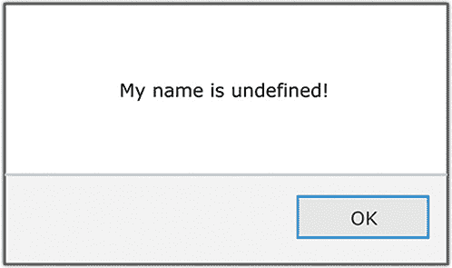

你会看到出现 `undefined`，而不是 `people` 数组中的任何名字……更不用说那个应该是 `Tony Stark` 的正确值了。这里发生了什么？

发生的情况非常微妙，并体现在以下两行代码中：

点击此处查看图片

```javascript
function quotatious(names) {
    var quotes = [];
    for (var i = 0; i < names.length; i++) {
        var theFunction = function() {
            return "My name is " + names[i] + "!";
        }
        quotes.push(theFunction);
    }
    return quotes;
}
```

你的 `theFunction` 函数依赖于 `names[i]` 的值。`i` 的值是由 `for` 循环定义的（在父函数的作用域内），而 `for` 循环在 `theFunction` 的作用域之外。你所拥有的基本上是一个闭包，其中 `theFunction` 函数和变量 `i` 是一个外部变量。图 20.1 展示了这种情况的可视化。

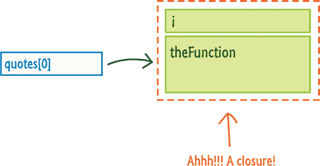

**图 20.1** *闭包。有之不若，无之不便。*

这里就是我提到的关于闭包的细节细节起作用的地方。`i` 的值从未被锁定在 `theFunction` 或闭包中。它的值仅仅是被**引用**了。你所拥有的是类似于你在 图 20.2 中看到的内容。

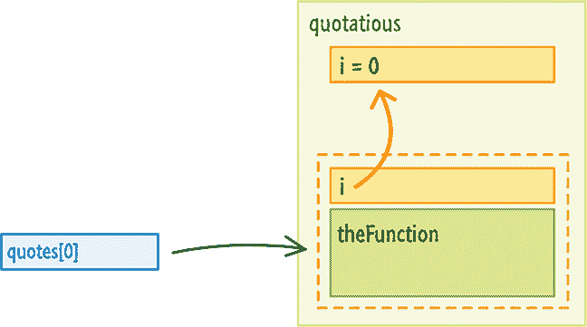

**图 20.2** *当值被引用时，这会使闭包内部实际存储的内容变得复杂。*

因为变量 `i` 的值实际上是被引用的，所以你的闭包所引用的 `i` 的值会在每次 `for` 循环迭代时增加 1。这并不是我们想要的行为。我们希望 `quotes` 数组中的每个函数都存储它在函数首次创建时 `i` 的值。当我们的循环完全运行结束时，`i` 的值已经是 **4** 了。

图 20.3 帮助你可视化正在发生什么。

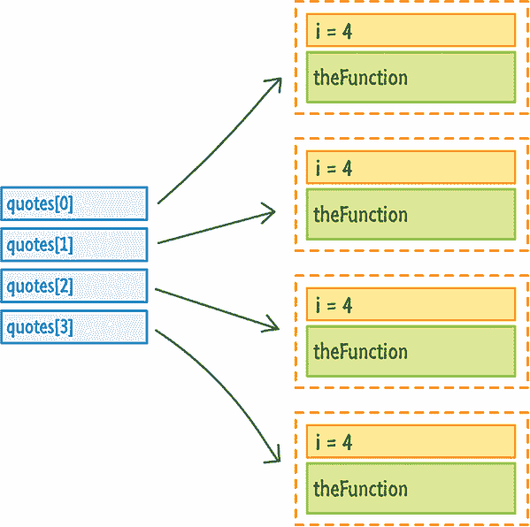

**图 20.3** *为什么我们的代码运行结果并不如我们所希望的那样。*

由于 `i` 是 **4** 且大于输入数组 `names` 中的项数，所以当执行带有 `names[4]` 的以下行代码时，你会得到 `undefined`：

点击此处查看图片

```javascript
function quotatious(names) {
    var quotes = [];
    for (var i = 0; i < names.length; i++) {
        var theFunction = function() {
            return "My name is " + names[i] + "!";
        }
        quotes.push(theFunction);
    }
    return quotes;
}
```

此时，我们理解了代码的作用，以及为什么它按照目前编写的方式无法工作。解决方案是在闭包内部锁定我们的外部变量（那个麻烦的 `i`）的值。正如你可能猜到的，这将涉及到一个 IIFE（立即执行函数）的协助。以下是修改后的 `quotatious` 函数版本，它实现了我们的目标：

点击此处查看图片

```javascript
function quotatious(names) {
    var quotes = [];
    for (var i = 0; i < names.length; i++) {
        (function(index) {
            var theFunction = function() {
                return "My name is " + names[index] + "!";
            }
            quotes.push(theFunction);
        })(i);
    }
    return quotes;
}
```

注意，`i` 变量被作为参数传递给我们的 IIFE。这个参数现在在 IIFE 内部通过 `index` 变量引用，它对于该函数执行的任何操作都是局部的。

### 引用外部变量并不是你想要的

由于变量 `i` 的值实际上是被引用的，你的闭包所引用的 `i` 的值在每次 `for` 循环迭代都会增加。这并不是我们想要的行为。我们希望 `quotes` 数组中的每个函数都存储它在函数首次创建时 `i` 的值。当我们的循环完全运行结束时，`i` 的值已经是 **4** 了。

### 使某些属性私有

在 JavaScript 中，你没有一种简单的方法来限制属性的可见性。这就是为什么我们在之前的章节中花了大量时间研究这个话题。为了保险起见，让我们看看下面这个例子，它突显了这一点：

点击此处查看图片

```javascript
var weakSauce = {
    secretCode: "Zorb!",
    checkCode: function (code) {
        if (this.secretCode == code) {
            alert("You are awesome!");
        } else {
            alert("Try again!");
        }
    }
};
```

你有一个名为 `weakSauce` 的对象，它有两个属性：`secretCode` 和 `checkCode`。这是一个非常原始的密码检查器。当你将代码值传递给 `checkCode` 函数时，它会检查输入是否匹配 `secretCode`。如果匹配，将显示 *You are awesome*。如果不匹配，你会看到 *Try again!* 出现。

现在，这里就是代码私有化可以帮助的地方。没有什么能阻止我、你或使用此代码的人直接检查 `secretCode`：

点击此处查看图片

```javascript
var bar = Object.create(weakSauce);
alert(bar.secretCode); // :(
```

这并不是你创建 `secretCode` 属性时的意图。原因并不是因为 `secretCode` 命名包含了 *secret* 这个词。它是你可能随时想要更改的实现细节。`checkCode` 函数是你希望人们使用的。任何其他变量或属性都可以你随意更改。如果其他代码片段依赖于实现细节，每当你做出更改时，它们的代码可能会崩溃。这就是为什么保持某些项私有是重要的。这就是为什么 `secretCode` 属性应该对 `weakSauce` 对象内部之外的一切都隐藏。在其他语言中，你可以为 `secretCode` 添加如 `private` 类的访问修饰符，这样整个对话就结束了。JavaScript 不像其他语言。你必须跳很多圈子来解决问题，而其中一个很棒的圈子就是我们友好的 IIFE。

通过利用 IIFE 创建的局部作用域，你可以选择性地决定暴露或不暴露什么。以下是相同示例的版本，它按照我们想要的方式运行：

点击此处查看图片

```javascript
var awesomeSauce = (function () {
    var secretCode = "Zorb!";
    function privateCheckCode(code) {
```

```javascript
if (secretCode == code) {
    alert("You are awesome!");
  } else {
    alert("Try again!");
  }
  }
  // 这是我们想要返回的公共方法
  return {
    checkCode: privateCheckCode
  };
})();
```

让我们重复一下之前用 `awesomeSauce` 尝试的操作：

点击此处查看代码图片

`var foo = Object.create(awesomeSauce);`

`alert(foo.secretCode); // undefined`

这一次，你将无法访问 `secretCode`。原因是 `secretCode` 的内容被埋在 IIFE（立即执行函数表达式）内部，无法公开访问。事实上，唯一公开暴露的内容只有你这里的这些：

点击此处查看代码图片

```javascript
var awesomeSauce = (function () {
    var secretCode = "Zorb!";
    function privateCheckCode(code) {
        if (secretCode == code) {
            alert("You are awesome!");
        } else {
            alert("Try again!");
        }
    }
    // 这是我们想要返回的公共方法
    return {
      checkCode: privateCheckCode
    };
})();
```

通过只返回一个包含 `checkCode` 属性的对象——该属性内部引用了 `privateCheckCode` 函数（这是一个闭包），你获得了最初拥有的所有功能。

我刚才向你展示的内容这里有一个更正式的名字。它被称为**揭示模块模式（Revealing Module Pattern）**，网上有大量关于它的优秀资源。我最喜欢的是 Addy Osmani 对这种模式的简洁阐述：[`bit.ly/kirupaRMP`](http://bit.ly/kirupaRMP)。

### 记住，你的 JavaScript 代码是一本打开的书！

虽然你可能刚刚学习了一种保持代码内部私有化的方法，但它只对你编写典型代码是私有的。与其他语言不同，JavaScript 的源代码始终是完全可见的。即使使用了混淆和其他技术，只要你的浏览器能看到你的代码，那么任何其他多花几秒钟的人也能看到。

例如，使用 Chrome 开发者工具，我可以轻松检查 `checkCode` 存储的闭包，并清楚地看到 `secretCode` 变量的值。


本质上我想说的是：不要依赖客户端 JavaScript 来处理你真正想要保持私密的事情。相反，像其他人那样所做，使用某些服务器端服务，为你提供一个处理机密任务的私有环境。然后服务器只将你希望公开的内容返回给 JavaScript。

### 极简主义

**IIFE**（**Immediately Invoked Function Expression**，立即执行函数表达式）](#gloss01.html_gloss_20）是 JavaScript 中那些奇怪的东西之一，一旦你给它机会，它就会发挥出非常有用的作用。你需要学习 IIFE 的主要原因是 JavaScript 缺乏私有性。当你处理日益增大且复杂的 JavaScript 应用（这些应用通常具有日益增大且复杂的闭包）时，这个问题会变得更加恼人，因此 IIFE 创建的局部作用域是解决你所有问题的终极兵器。和所有钝兵器一样，使用它们时要小心。

 提示

给正在阅读本书质版或电子书版本的读者们一个快速提醒：如果你访问 **[www.quepublishing.com](http://www.quepublishing.com)** 并注册本书，你就可以免费访问在线 Web 版。该版本不仅包含本书的完整文本，还包含了一个短小、有趣的交互测验，用来测试你对刚刚阅读章节的理解情况。

如果你已经在 Web 版中阅读这些文字并想尝试一下那个测验，那么你走运了——你只需要向下滚动即可！

# 第三部分：与 DOM 工作

## 21. JS、浏览器与 DOM

### 本章内容

* 学习 JavaScript 与页面的其他部分是如何交互的

* 理解文档对象模型（DOM）到底在忙什么

* 弄清楚 HTML、CSS 和 JavaScript 之间模糊的边界

到为止，我们都是孤立地观察 JavaScript。我们学习了许多关于它的基本功能，但这样做时与它如何联系现实世界几乎没有联系——一个由你的浏览器表示、并充斥着 HTML 标签和 CSS 样式的世界。本章将作为这个世界的介绍，后续章节将进行深入探讨。

在接下来的章节中，你将学习被称为**文档对象模型 (DOM)** 的神秘数据结构和编程接口。你将学习它是什么、为什么有用，以及它如何与你未来将做的一切相关联。

继续前进！

### HTML、CSS 和 JavaScript 是做什么的

在我们深入并开始回答生命的意义……呃，DOM 的意义之前，让我们快速看一些你可能已经知道的东西。首先，你放入 HTML 文档中的内容围绕着 HTML、CSS 和 JavaScript 展开。


## HTML 定义结构

HTML 定义了页面的结构，通常包含了你看到的内容：

点击此处查看代码图片

```html
<!DOCTYPE html>
<html>
<head>
  <meta content="sea, kid" name="keywords">
  <meta content="Sometimes, otters!" name="description">
  <title>Example</title>
  <link href="foo.css" rel="stylesheet">
</head>
<body>
  <div id="container">
    
    <h1>What This Kid Will Make You!</h1>
    <p class="bodyText">
      <div class="submitButton">more</div>
    </p>
  </div>
  <script src="stuff.js"></script>
</body>
</html>
```

HTML 本身就像《家庭鸡》里的 Meg Griffin 一样，非常无聊。如果你不知道 Meg 是谁且太懒去 Google，图 21.1

**图 21.1** *艺术化的解读.*

总之，你不希望你的 HTML 文档是无聊的。为了让你的内容从平淡无奇变得吸引人，你拥有 CSS。

## 美化我的世界，CSS

CSS 是你主要的样式语言，允许你为 HTML 元素提供必要的审美和布局吸引力：

点击此处查看代码图片

```css
body {
  font-family: "Arial";
  background-color: #CCCFFF;
}

#container {
  margin-left: 30%;
}

#container img {
  padding: 20px;
}

#container h1 {
  font-size: 56px;
  font-weight: 500;
}

#container p.bodyText {
  font-size: 16px;
  line-height: 24px;
}

.submitButton {
  display: inline-block;
  border: 5px solid #669900;
  background-color: #7BB700;
  padding: 10px;
  width: 150px;
  font-weight: 800;
}
```

尽管 HTML 和 CSS 有许多优点，但它们在提供的交互性方面都存在局限性。人们希望在网页文档上做更多事情，而不只是被动地坐着观察发生的一切。他们希望他们的网页文档能实现更多功能。他们希望文档能帮助他们播放媒体；记住上次离开的地方；通过鼠标点击、键盘按键和手指触摸进行操作；使用花哨的导航菜单；看到酷炫（是的，我用了 spiffy 这个词）的程序化动画；与网络摄像头/麦克风交互；在进行任何操作时都不需要刷新页面/导航；以及许多其他功能：


网页开发人员和设计师（也就是你和我）也正渴望找到一种方法来帮助创建这类东西，这无疑是帮了大忙。

为了填补 HTML 和 CSS 提供的功能与人们需求之间的空白，曾出现过像 Java 和 Flash 这样的第三方组件并繁荣了多年。直到最近，这种趋势才发生了变化。这种转变有很多技术和政治原因，但其中一个原因是 JavaScript 在过去的很多年里其实并没有准备好。无论是在核心语言本身，还是在浏览器支持方面，它都不具备发挥作用所需的条件。

现在情况已经不同了。JavaScript 现在是一门完全胜任的语言，允许你添加人们寻找的那些交互功能。所有这些能力都是通过这一切的真正明星——DOM 来访问的。

## 认识文档对象模型 (DOM)

你的浏览器显示的是一个网页文档。更具体地说，总结一下前面的章节，你看到的是 HTML、CSS 和 JavaScript 共同工作创建出显示的内容。再深入一步，在底层，有一个层级结构，浏览器使用该结构来理解正在发生的一切。

这种结构被（再次）称为文档对象模型。朋友们直接称它为 DOM。图 21.2 显示了我们之前示例中 DOM 的一个非常简化的视图：


**图 21.2** *对于你之前看到的所有 HTML，我们的 DOM 大致像这样！*

尽管非常简单，但有几点适用于所有 DOM 结构的通用点需要深入研究。你的 DOM 实际上由许多 HTML 元素之外的各种类型组成。构成你 DOM 的所有这些东西通俗被称为 `nodes`（节点）。

这些节点可以是元素（这不会让你感到惊讶）、属性、文本内容、注释、文档相关内容以及其他你根本不会考虑过的各种东西。这个细节对某人来说很重要，但那个“某人”不应该是你我。几乎在任何情况下，我们唯一关心的节点类型都是元素类型，因为我们 99% 的时间处理的都是元素。在无聊/技术层面，节点在我们以元素为中心的视角中仍然仍然起着作用。

你想要访问的每个 HTML 元素都与其关联着一个特定类型，所有这些类型都继承自构成所有节点的 `Node` 基类：


你的 HTML 元素位于链的末端，该链从 `Node` 开始，继续到 `Element` 和 `HTMLElement`，最后以与 HTML 元素本身匹配的类型（即 `HTMLDivElement`、`HTMLHeadingElement` 等）结束。你将看到的用于操作 HTML 元素的属性和方法是在该链的某个部分引入的。

现在，在我们冲向使用 DOM 修改 HTML 元素之前，让我们先谈谈两个在道路清理之前阻碍我们的的特殊对象。

### 窗口对象 (Window Object)

在浏览器中，你层级结构的根是 `window` 对象，它包含了许多属性和方法，可以帮助你操作浏览器：


通过 `window` 对象可以做的一些事情包括访问当前 URL、获取页面中任何框架的信息、使用本地存储、查看关于你屏幕的信息、调整滚动条、设置状态栏文本，以及所有适用于你网页所在显示容器的各种功能。

### 文档对象 (Document Object)

现在，我们提到了 `document` 对象。这里开始变得有趣起来，也是你我将投入大量精力的地方：


`document` 对象是通往构成显示内容的 HTML 元素的门径。需要记住的一点（在我们查看后续章节时，这一点会更有意义）是，`document` 对象并不简单代表 HTML 文档的只读版本。它是一条双行道，你可以随所欲地读取也可以操作你的文档。

你通过 JavaScript 对 DOM 进行的任何更改都会反映在浏览器的显示上。这意味着你可以动态地添加元素、删除它们、移动它们、修改它们的属性、设置内联 CSS 样式，并执行各种其他花操作。除了通过 `script` 标签为了在 HTML 文档中运行某些 JavaScript 所需的极基础 HTML 之外，如果你愿意，仅使用 JavaScript 就能构建出一个功能完全的页面。使用得当，这是一个非常强大的功能。

`document` 对象的另一个重要方面与事件有关。我很快会详细介绍这一点，但如果你想响应鼠标点击/悬停、检查复选框、检测按了什么键等，你将依靠 `document` 对象提供的功能。

DOM 还有其他大的功能领域，我会在遇到它们时进行介绍。

---

## 22. 在 DOM 中查找元素

---

### 本章内容

- 学习如何在 DOM 中查找元素
- 使用 CSS 选择器语法进行更智能的元素发现

---

正如你在上一章所看到的，你的 DOM 仅仅是由你的 HTML 文档中所有元素构成的树形结构：


这个细节只是部分重要。重要的是，你周围有许多想要访问并从中数据或进行修改的 HTML 元素。寻找这些 HTML 元素有很多方法。毕竟，这些元素被排列成树形结构，如果说计算机科学家喜欢做事情，那就是想出疯狂的方法在树上上下爬去寻找某个东西。

我不会让你遭受这种折磨……暂时还不。在本章中，你将学习如何使用名为 `querySelector` 和 `querySelectorAll` 的两个内置函数来解决你大部分 DOM 搜索需求。

前进！

### 认识 querySelector 系列

为了帮助解释 `querySelector` 和 `querySelectorAll` 带来的强大功能，请查看以下 HTML：

点击此处查看代码图片

```html
<div id="main">
    <div class="pictureContainer">
        
    </div>
    <div class="pictureContainer">
        
    </div>
    <div class="pictureContainer">
        
    </div>
    <div class="pictureContainer">
        
    </div>
</div>
```

在这个示例中，你有一个 `id` 为 `main` 的 `div`，然后四个 `div` 和 `img` 元素的类名值分别为 `pictureContainer` 和 `theImage`。在接下来的几节中，我们将让 `querySelector` 和 `querySelectorAll` 函数在这些 HTML 上运行，看看会发生什么。

#### querySelector

`querySelector` 函数的基本工作如下：

点击此处查看代码图片

```javascript
var element = document.querySelector("CSS selector");
```

`querySelector` 函数接收一个参数，该参数是用于想要查找的元素的 CSS 选择器。`querySelector` 返回的是它找到的**第一个**元素——即使存在其他元素——只要该元素可以被选择器选中即可。这个函数在这方面非常“固执”。

以我们之前示例中的 HTML 为例，如果我们想访问 `id` 为 `main` 的 `div`，你可以编写以下代码：

点击此处查看代码图片

```javascript
var element = document.querySelector("#main");
```

因为 `main` 是 `id`，目标它的选择器语法就是 `#main`。同样，让我们为 `pictureContainer` 类指定选择器：

点击此处查看代码图片

```javascript
var element = document.querySelector(".pictureContainer");
```

返回的是第一个类值为 `pictureContainer` 的 `div`。其他类值也是 `pictureContainer` 的 `div` 元素将直接被忽略。

选择器语法并没有因为你处于 JavaScript 环境中而被修改或特殊化。你在样式表或样式区域中为选择器使用的精确语法完全可以在此处使用！

#### querySelectorAll

`querySelectorAll` 函数返回它找到的所有匹配你提供的任何选择器的元素：

点击此处查看代码图片

```javascript
var element = document.querySelectorAll("CSS selector");
```

除了返回的元素数量不同外，我在上面关于 `querySelector` 的所有描述也都适用于 `querySelectorAll`。这个重要的细节改变了你最终实际使用 `querySelectorAll` 函数的方式。返回的不是单个元素。相反，返回的是一个类数组的元素容器！

继续使用之前的的 HTML，如果我们想使用 `querySelectorAll` 来帮助我们显示所有包含类值 `theImage` 的 `img` 元素的 `src` 属性，我们的 JavaScript 代码将如下：

点击此处查看代码图片

```javascript
var images = document.querySelectorAll(".theImage");
for (var i = 0; i < images.length; i++) {
    var image = images[i];
    alert(image.getAttribute("src"));
}
```

看到了吗？这非常简单。你只需要做的就是记住如何操作数组（第 13 章、“当原始类型表现得像对象时”）。唯一奇怪的地方是神秘的 `getAttribute` 函数。如果你不熟悉 `getAttribute` 以及如何从元素读取值，那没关系。我们很快就会查看这些内容。

### 它确实就是 CSS 选择器语法

第一次使用 `querySelector` 和 `querySelectorAll` 时，让我惊讶的是，它实际上支持全范围的 CSS 选择器语法。

第一次使用 `querySelector` 和 `querySelectorAll` 时，让我惊讶的是，它实际上支持全范围的 CSS 选择器语法。

第一次使用 `querySelector` 和 `querySelectorAll` 时，让我惊讶的是，它实际上支持全范围的 CSS 选择器语法。

第一次使用 `querySelector` 和 `querySelectorAll` 时，让我惊讶的是，它实际上支持全范围的 CSS 选择器语法。

第一次使用 `querySelector` 和 `querySelectorAll` 时，让我惊讶的是，它实际上支持全范围的 CSS 选择器语法。

第一次使用 `querySelector` 和 `querySelectorAll` 时，让我惊讶的是，它实际上支持全范围的 CSS 选择器语法。

第一次使用 `querySelector` 和 `querySelectorAll` 时，让我惊讶的是，它实际上支持全范围的 CSS 选择器语法。

第一次使用 `querySelector` 和 `querySelectorAll` 时，让我惊讶的是，它实际上支持全范围的 CSS 选择器语法。

第一次使用 `querySelector` 和 `querySelectorAll` 时，让我惊讶的是，它实际上支持全范围的 CSS 选择器语法。

第一次使用 `querySelector` 和 `querySelectorAll` 时，让我惊讶的是，它实际上支持全范围的 CSS 选择器语法。

第一次使用 `querySelector` 和 `querySelectorAll` 时，让我惊讶的是，它实际上支持全范围的 CSS 选择器语法。

第一次使用 `querySelector` 和 `querySelectorAll` 时，让我惊讶的是，它实际上支持全范围的 CSS 选择器语法。

第一次使用 `querySelector` 和 `querySelectorAll` 时，让我惊讶的是，它实际上支持全范围的 CSS 选择器语法。

第一次使用 `querySelector` 和 `querySelectorAll` 时，让我惊讶的是，它实际上支持全范围的 CSS 选择器语法。

第一次使用 `querySelector` 和 `querySelectorAll` 时，让我惊讶的是，它实际上支持全范围的 CSS 选择器语法。

第一次使用 `querySelector` 和 `querySelectorAll` 时，让我惊讶的是，它实际上支持全范围的 CSS 选择器语法。

第一次使用 `querySelector` 和 `querySelectorAll` 时，让我惊讶的是，它实际上支持全范围的 CSS 选择器语法。

第一次使用 `querySelector` 和 `querySelectorAll` 时，让我惊讶的是，它实际上支持全范围的 CSS 选择器语法。

第一次使用 `querySelector` 和 `querySelectorAll` 时，让我惊讶的是，它实际上支持全范围的 CSS 选择器语法。

第一次使用 `querySelector` 和 `querySelectorAll` 时，让我惊讶的是，它实际上支持全范围的 CSS 选择器语法。

第一次使用 `querySelector` 和 `querySelectorAll` 时，让我惊讶的是，它实际上支持全范围的 CSS 选择器语法。

第一次使用 `querySelector` 和 `querySelectorAll` 时，让我惊讶的是，它实际上支持全范围的 CSS 选择器语法。

第一次使用 `querySelector` 和 `querySelectorAll` 时，让我惊讶的是，它实际上支持全范围的 CSS 选择器语法。

第一次使用 `querySelector` 和 `querySelectorAll` 时，让我惊讶的是，它实际上支持全范围的 CSS 选择器语法。

第一次使用 `querySelector` 和 `querySelectorAll` 时，让我惊讶的是，它实际上支持全范围的 CSS 选择器语法。


第一次使用`querySelector`和`querySelectorAll`时，让我惊讶的是，它实际上支持全范围的 CSS 选择器语法。

`querySelector`和`querySelectorAll`方法在复杂文档中定位特定元素时非常有用。通过依赖成熟的 CSS 选择器语法，我们可以对想要的元素投下任意大小的网。如果我想要所有的图像元素，可以说`querySelectorAll("img")`。如果我只需要`div`直接内部的`img`元素，可以说`querySelector("div + img")`。现在，这非常棒。

#### 绝对最小化

在我们结束之前，还有一件事我想和你们聊聊。在所有寻找元素的兴奋中，缺失了`getElementById`、`getElementsByTagName`和`getElementsByClassName`函数。在过去，这些是你用来在 DOM 中查找元素的函数。`querySelector`和`querySelectorAll`是查找元素的现在和未来的解决方案，所以不用再担心`getElement*`函数了。目前，`querySelector`和`querySelectorAll`唯一的微小缺点是性能。`getElementById`函数仍然很快，你可以在这里亲自查看对比：[`jsperf.com/getelementbyid-vs-queryselector`](http://jsperf.com/getelementbyid-vs-queryselector)。

正如一位智者所说，生命如此短暂，不要花时间学习旧的 JavaScript 函数……即使它们快一点。

 提示

给正在纸质版或电子书版阅读这些文字的朋友的一个快速提醒：如果你访问 **[www.quepublishing.com](http://www.quepublishing.com)** 并注册这本书，你就可以免费访问在线版，该版本不仅包含本书的全文，还包含一个简短、有趣的互动式测验，用来测试你对刚刚读过的章节的理解。

如果你已经在网页版中阅读这些文字并想尝试一下测验，那么你运气很好——你只需要向下滚动页面即可！

## 23. 修改 DOM 元素

### 本章内容

- 理解如何使用 JavaScript 修改 DOM
- 认识 HTML 元素
- 学习如何修改属性

到这里，你已经大概知道 DOM 是什么了。你还看到了如何使用`querySelector`和`querySelectorAll`来查找元素。接下来，我们要学习如何修改你找到的 DOM 元素。毕竟，如果你不能亲手去弄那一团橡土（或饼干面团）并弄得一团糟的，那它还有什么好玩的呢？


无论如何，除了好玩之外，你会发现自己一直在修改 DOM。无论你是在使用 JavaScript 更改某些元素的文本、用另一张图片替换掉某张图片、将一个元素从文档的某部分移动到另一部分、设置内联样式，还是执行你想做的其他数万种更改，*你都会修改 DOM*。本章将教你如何进行这些操作的基础知识。

继续吧！

### DOM 元素是对象——某种程度上如此！

你能使用 JavaScript 修改浏览器显示的内容，这归功于一个重要的细节。那个细节就是：每一个 HTML 标签、样式规则以及进入页面的其他内容，在 DOM 中都有某种形式的表示。

为了直观理解我刚才的话，假设你在标记语言中定义了一个图像元素：

```html

```

当你的浏览器解析文档并遇到这个图像元素时，它会在 DOM 中创建一个节点来表示它，如图 23.1 所示。


**图 23.1** *你的 DOM 在适当的位置存储了该图像元素的条目。*

这种 DOM 表示让你能够执行所有在标记语言中可以完成的操作。事实证明，这种 DOM 表示实际上让你*能够对 HTML 元素进行更多操作*，而这些是仅使用旧的标记语言本身无法做到的。你在这里会看到一点，在未来会看到很多。你的 HTML 元素之所以通过 DOM 查看时如此多功能，是因为它们与 JavaScript `Objects`（对象）有许多相似之处。你的 DOM 元素包含了允许你获取/设置值以及调用方法的属性。它们具有某种形式的继承关系（你之前稍微读过关于这一点），每个 DOM 元素提供的功能分布在`Node`、`Element`和`HTMLElement`基类型中。

这种层级结构（你之前已经见过）在图 23.2 中再次给出。


**图 23.2** *JavaScript 非常看重层级结构……即使在表示 DOM 时也是如此！*

DOM 元素在雨里滚了一会儿后回到家里运行时，可能闻起来甚至就像一个`Object`（对象）。

尽管有这些相似之处，但出于法律和……可能的健康考虑，我需要提供以下免责声明：*DOM 从来没有设计为模拟对象的工作方式*。你对对象可以做的很多事情完全可以在 DOM 上做到，但那是因为浏览器厂商协助确保了这一点。W3C 规范并没有规定你的 DOM 行为应该与你对普通对象行为的预期完全一致。虽然我并不会为此担心而失眠，但如果你决定扩展 DOM 元素或执行更高级的对象相关“体操”，请务必在所有浏览器中进行测试，以确保一切都按照你的意图运行。

现在我们已经过了这个尴尬的话题，让我们开始实际修改 DOM 吧。

### 让我们实际修改 DOM 元素

虽然你完全可以靠在椅子上被动地学习如何修改 DOM 中的元素的所有知识，但在这种情况下，跟着一个简单的示例操作可能会更有趣。如果你感兴趣跟着操作，我们将使用以下 HTML 作为你将学习的技术的沙盒：

```html
<!DOCTYPE html>
<html>
<head>
  <title>Hello...</title>
  <style>
    .highlight {
      font-family: "Arial";
      padding: 30px;
    }
    .summer {
      font-size: 64px;
      color: #0099FF;
    }
  </style>
</head>
<body>
  <h1 id="theTitle" class="highlight summer">What's happening?</h1>
  <script>
  </script>
</body>
</html>
```

只需将其放入 HTML 文档并跟随操作。如果你做了此更改并进行预览，你将会看到：

#### 修改元素的文本

让我们从一个简单的开始。许多 HTML 元素都有显示文本的能力。此类元素的示例包括你的标题、段落、按钮等。你修改文本的方法是设置`textContent`属性。假设我们想要更改 h1 中显示的文本。下面的代码片段显示了样子：

```html
<body>
  <h1 id="theTitle" class="highlight summer">What's happening?</h1>
  <script>
    var title = document.querySelector("#theTitle");
    title.textContent = "Oppa Gang Style!";
  </script>
</body>
```

`textContent`属性可以读取以显示当前值。你也可以设置该属性将其更改为任何你想要的值。示例中，我们将`textContent`属性设置为 *Oppa Gang Style!*。在这一行运行之后，你标记中的原始值 *What’s happening?* 将被替换！

#### 属性值

你的 HTML 元素区分自身的主要方式之一是通过属性以及这些属性存储的值。例如，`src`和`alt`属性是区分以下三个`img`元素的要素：

```html

```


每个 HTML 属性（包括自定义的`data-*`属性）都可以通过 JavaScript 访问。为了帮助你处理属性，元素暴露了自而易懂的`getAttribute`和`setAttribute`方法。

`getAttribute`方法允许你指定元素上某个属性的名称。如果找到了该属性，此方法将返回与该属性关联的值。下面是一个示例：

```html
<body
    <h1 id="theTitle" class="highlight summer">What's happening?</h1>
    <script>
        var title = document.querySelector("h1");
        alert(title.getAttribute("id"));
    </script>
</body>
```

在此段代码中，注意我们正在获取`h1`元素上`id`属性的值。如果你指定了一个不存在的属性名称，你将得到一个不错的`null`值。获取属性值的反面是实际上设置值。要设置值，你需要使用命名恰当的`setAttribute`方法。你通过在想要影响的元素上调用`setAttribute`并同时指定属性名称和该属性将存储的值可以使用该方法。

这里是`setAttribute`的用法示例：

```html
<body
    <h1 id="theTitle" class="highlight summer">What's happening?</h1>
    <script>
        document.body.setAttribute("class", "bar foo");
    </script>
</body>
```

我们正在将`body`元素的`class`属性设置为`bar foo`。`setAttribute`函数不会进行任何验证来确保你设置的属性对于你设置的元素来说是有效的。没有什么阻止你执行如下的愚蠢操作：

```html
<body
    <h1 id="theTitle" class="highlight summer">What's happening?</h1>
    <script>
        document.body.setAttribute("src", "http://www.kirupa.com");
    </script>
</body>
```

`body`元素并不包含`src`属性，但你仍然可以指定它。当你的代码运行时，你的`body`元素将带有一个`src`属性……可能看起来非常不协调。

在我们继续之前，我需要澄清一点。在关于使用`setAttribute`和`getAttribute`的示例中，我挑选了`id`和`class`。对于这两个属性，你确实有另一种设置它们的方法。由于设置`id`和`class`属性非常常见，你的 HTML 元素直接暴露了`id`和`className`属性：


```html
<body
    <h1 id="theTitle" class="highlight summer">What's happening?</h1>
    <script>
        var title = document.querySelector("h1");
        alert(title.id);
        document.body.className = "bar foo";
    </script>
</body>
```

在这个示例中，注意我在第 6 行和第 8 行中从使用 `getAttribute` 和 `setAttribute` 改为使用 `id` 和 `className` 属性。结果是相同的。唯一的区别在于你有了一种直接设置这些属性值的方法，而无需使用 `getAttribute` 或 `setAttribute`。

> **提示**
>
> 除了使用 `className` 之外，设置类值还有更好的方法。那是通过更强大的 `classList` 属性，你将在下一章节中详细学习它。

### 极少内容

在此时结束我们关于修改 DOM 元素的讨论似乎有点奇怪。虽然更改元素的文本和属性值非常流行，但它们绝不是你将执行的唯一主要类型的修改。之所以在这个悬念处结束，是因为操纵 DOM 以及使用元素的属性和方法来完成我们的任务，是我们即将看到的所有内容的核心。在随后的章节中，你将看到更多这里所展示的内容。

你这一章的主要收获是，你执行的 DOM 更改几乎总是采取以下两种形式之一：

- 设置属性
- 调用方法

你在这里看到的 `textContent`、`setAttribute` 和 `getAttribute` 方法都涵盖了这两种方法，你很快就会看到更多它们以及它们的伙伴了。

> **提示**
>
> 给那些在纸质版或电子书版阅读这些文字的朋友一个快速提醒：如果你访问 [www.quepublishing.com](http://www.quepublishing.com) 并注册本书，你就可以免费访问在线 Web 版本，该版本不仅包含本书的完整文本，还包含了一个简短、有趣的互动测验，用来测试你对刚刚阅读章节的理解程度。
>
> 如果你已经在 Web 版本中阅读这些文字并想尝试一下测验，那么你太幸运了——你只需要向下滚动即可！

## 24. 为内容设置样式

### 本章内容

- 学习如何使用 JavaScript 修改 CSS
- 理解直接设置样式与调整类值的优缺点
- 使用 `classList` 让调整元素变得轻而易举

在上一章节中，我们查看了如何使用 JavaScript 修改内容。让 HTML 元素脱颖出的另一个部分是它们的外观，即样式。当涉及样式时，最常用的方法是创建一个样式规则并让其选择器目标一个或多个元素。样式规则看起来如下：

```css
.batman {
    width: 100px;
    height: 100px;
    background-color: #333;
}
```

受此样式规则影响的元素可能如下：

```html
<div class="batman"></div>
```

在任何页面上，你都会看到从几个到许多样式规则，它们精美地交叠在一起来美化一切。不过，这不是你可以用于内容的唯一方法。

正如我在引言中提到的，你有两种方法使用 JavaScript 来更改元素的样式。一种方法是直接在元素上设置 CSS 属性。另一种方法是向元素添加或移除类名（`class`）值，这可能会导致某些样式规则被应用或忽略。让我们详细查看一下这两种情况。

### 直接设置样式

你通过 JavaScript 访问的每一个 HTML 元素都有一个 `style` 对象。该对象允许你指定一个 CSS 属性并设置它的值。例如，设置 `id` 值为 `superman` 的 HTML 元素的背景颜色的代码所示：

```javascript
var myElement = document.querySelector("#superman");
myElement.style.backgroundColor = "#D93600";
```

要影响许多元素，你可以执行如下操作：

```javascript
var myElements = document.querySelectorAll(".bar");
for (var i = 0; i < myElements.length; i++) {
    myElements[i].style.opacity = 0;
}
```

简而言之，要使用 JavaScript 直接对元素进行样式设置，第一步是访问元素。我使用 `querySelector` 函数来实现。第二步就是找到你关心的 CSS 属性并给它赋一个值。记住，CSS 中的许多值实际上是字符串。还要记住，许多值需要像 `px` 或 `em` 之类的测量单位才能被识别。

### 对某些 CSS 属性名进行特殊处理

JavaScript 对有效属性名的构成非常挑。CSS 中的大多数名称都能通过 JavaScript 的认可，所以你可以直接使用。不过，有几点需要注意。

要在 JavaScript 中指定包含连字符的 CSS 属性，只需删除连字符并将第二个单词的首字母大写。例如，`background-color` 变为 `backgroundColor`，`border-radius` 属性转换为 `borderRadius`，依此类推。

此外，JavaScript 中的某些单词是保留字，不能直接使用。属于这类特殊类别的 CSS 属性示例是 `float`。在 CSS 中它是一个布局属性。在 JavaScript 中，它代表其他含义。要使用名称完全被保留的属性，请在属性名前加上 `css` 前缀，其中 `float` 变为 `cssFloat`。

### 使用 classList 添加和移除类

设置元素的常用方法是在其 `class` 属性上添加和移除类名值。假设我们有以下 `div` 元素：

```html
<div id="myDiv" class="bar foo zorb"> ... </div>
```

从标记中我们可以看到，该元素有一个 `class` 属性，并设置了 `bar`、`foo` 和 `zorb` 值。我们在这一节中将看看使用 `classList` API 操作这些类值是有多简单。这个 API 非常棒，因为它简单易，并提供了以下方法来操作类值：

- `add`
- `remove`
- `toggle`
- `contains`

这四种方法的作用从它们的名称来看可能非常显而易见，但让我们进一步详细查看它们吧。总得想办法增加点页数，对吧？

#### 添加类值

要向元素添加类值，请调用 `classList` 上的 `add` 方法：

```javascript
var divElement = document.querySelector("#myDiv");
divElement.classList.add("baz");
alert(divElement.classList);
```

此代码运行后，我们的 `div` 元素将具有以下类值：`bar`、`foo`、`zorb`、`baz`。`classList` API 负责确保类值之间添加空格，以及处理 CSS 对 HTML 内容期望的所有其他事情。

如果你指定了一个无效的类值，`classList` API 将抛出异常且不会添加它。如果你告诉 `add` 方法添加一个元素上已经存在的类，你的代码将正常运行而不异常（哈！），但重复的类值不会被添加。

#### 移除类值

要移除类值，只需调用 `classList` 上的 `remove` 方法：

```javascript
var divElement = document.querySelector("#myDiv");
divElement.classList.remove("foo");
alert(divElement.classList);
```

此代码执行后，`foo` 类值将被移除。剩下的将只有 `bar` 和 `zorb`。非常简单，对吧？

#### 切换类值

对于许多样式处理场景，有一种非常常见的工作流。首先，你检查元素上的某个类值是否存在。如果该值存在，则将其从元素中移除。如果该值不存在，则将该类值添加到元素中。为了简化这种常见的切换模式，`classList` API 为你提供了 `toggle` 方法：

```javascript
var divElement = document.querySelector("#myDiv");
divElement.classList.toggle("foo"); // 如果移除
divElement.classList.toggle("foo"); // 如果添加
divElement.classList.toggle("foo"); // 如果移除
alert(divElement.classList);
```

`toggle` 方法正如其名所示，每次调用时都会添加或移除指定的类值。

#### 检查类是否存在

我们最后查看的是 `contains` 方法：

```javascript
var divElement = document.querySelector("#myDiv");
if (divElement.classList.contains("bar")) {
    // 执行某些操作
}
```

该方法检查元素上是否存在指定的类值。如果值存在，返回 `true`。如果不存在，返回 `false`。

#### 进阶

正如你所，`classList` API 为你提供了添加、移除或检查类值所需的所有功能。重点是“所有”这个词。对于 API 默认未提供的少数功能，你可以在线阅读我关于 `classList` 所有功能的完整文章：`http://bit.ly/kList`。

### 极总结

所以，你已经了解了这两种用于设置元素的完美 JavaScript 方法。在这两个选择中，如果你有修改 CSS 的能力，我倾向于让你通过 `classList` 添加和移除类来设置样式。简单的原因是这种方法更具维护性。在 CSS 样式规则中添加或移除属性比在 JavaScript 中添加或移除代码要容易得多。

> **提示**
>
> 提醒一下那些在纸质版或电子书版阅读这些文字的朋友：如果你访问 [www.quepublishing.com](http://www.quepublishing.com) 并注册本书，你可以免费访问在线 Web 版。该版本不仅包含本书的完整文本，还包含了一个短小有趣的交互测试，用来测试你对刚读过的章节的理解。
>
> 如果你已经在 Web 版阅读这些文字并想尝试测验，那么你太幸运了——你只需要向下滚动即可！

## 25. 遍历 DOM

### 本章内容

- 学习导航 DOM 树
- 使用用于移动和重新父元素的各种 API
- 查找元素的兄弟元素、父元素、子元素等

正如你现在可能意识到的，你的 DOM 就像一棵巨大的树——一棵元素危险地悬挂在树枝上，并试图避开到处都是的尖利物的巨树。从更技术角度来说，你 DOM 中的元素是按照层级结构排列的，这种结构定义了你最终在浏览器中看到的内容：


这种层级结构用于组织你的 HTML 元素。它也帮助你的 CSS 样式规则理解在哪些元素上应用什么样式。从 JavaScript 的角度来看，这种层级结构确实增加了一些复杂性。这正是本章派上用场的地方。为了帮助你理解如何轻松地从一个分支到另一个分支（基本上就像猴子一样），DOM 为你提供了属性，你可以将它们与你已经掌握的技术相结合。本章将为你概述这一切以及更多内容。

继续前行！

### 寻找你的路线

在找到元素并对它们做很不起的事情之前，你首先需要到达元素所在的地方处理这个主题最简单的方法就是从顶部开始一直到底。这正是我们要做的。

从 DOM 顶部的视图由你的 `window`、`document` 和 `html` 元素组成：


几个章节前你已经看到过关于它们的简介了，所以我将快速带过。由于这三件事非常重要，DOM 允许你通过 `window`、`document` 和 `document.documentElement` 轻松访问它们：

```javascript
var windowObject = window; // 嗯....

var documentObject = document;  // 这可能没有必要

var htmlElement = document.documentElement;
```

需要注意的是，`window` 和 `document` 都是全局属性。你不需要像我那样显式地声明它们。只需直接从容器中取出并使用它们即可。

一旦你进入 HTML 元素层级以下，你的 DOM 就会开始分支并变得更有趣。此时，你有几种导航运行的方法。你已经见过很多次（主要在上一章中）的一种方法是使用 `querySelector` 和 `querySelectorAll` 来精确获取你感兴趣的元素。对于许多实际情况，这两种方法太局限了。

有时候，你不知道你想去哪里。`querySelector` 和 `querySelectorAll` 方法在这里无法帮到你。你只是想上车开车……并希望找到你正在寻找的东西。在导航 DOM 时，你会发现自己一直处于这种境地。这时，DOM 提供的各种内置属性将帮助到你，接下来我们将查看这些属性。

能对你有帮助的是知道，我们 DOM 中的所有元素至少有一组父级、兄弟和子级可以依赖。为了直视化这一点，请看图 25.1 中包含 `div` 和 `script` 元素的行。


**图 25.1** 你的 DOM 元素是某些父/兄弟/子安排的一部分。

`div` 和 `script` 元素都是兄弟。它们之所以是兄弟是因为它们共享 `body` 元素作为父元素。`script` 元素没有子，但 `div` 元素有。`img`、`h1`、`p` 和 `div` 是 `div` 元素的子，而同一父元素的所有子也是兄弟。就像在现实生活中一样，父、子和兄弟关系基于你关注树的哪个位置。几乎每个元素，取决于你观察它们的角度，都可以扮演多个家庭角色。

为了帮助你通过这一切，你拥有一些将依赖的属性。这些属性是 `firstChild`、`lastChild`、`parentNode`、`children`、`previousSibling` 和 `nextSibling`。仅从它们的名称，你就应该能够推断出这些属性扮演的角色。拿着尖三叉的红衣服家伙在细节里，所以我们将在接下来更详细地查看这一点。

### 处理兄弟和父级

在这些属性中，最容易处理的是父级和兄弟。相关的属性有 `parentNode`、`previousSibling` 和 `nextSibling`。图 25.2 中的图表让你了解这三个属性是如何运作的：


**图 25.2** 全是一家人！

这个图表有点有点乱，但如果你用力眯起眼睛看，你就能看出这里发生了什么。`parentNode` 属性指向元素的父元素。`previousSibling` 和 `nextSibling` 属性允许元素找到它的上一个或下一个兄弟。你可以通过只需沿着箭头的方向移动在图中看到可视化的这一点。在最后一行中，我们的 `img` 的 `nextSibling` 是 `div`。我们的 `div` 的 `previousSibling` 是 `img`。在任何一个元素上访问 `parentNode` 都可以。

### 让我们有一些孩子！

不太直接的是子元素如何融入这一切，所以让我们看看图 25.3 中的 `firstChild`、`lastChild` 和 `children` 属性。


**图 25.3** 通过孩子导航是另一种方式。

`firstChild` 和 `lastChild` 属性指向父元素的第一个和最后一个孩子。如果父元素只有一个（如 `body` 所示），那么 `firstChild` 和 `lastChild` 指向同一个东西。与其他属性相比，棘手的是 `children` 属性。当你访问元素的 `children` 属性时，你基本上得到了父元素的集合。这个集合不是 `Array`，但它具有某些 `Array` 的功能。就像使用 `Array` 一样，你可以遍历这个集合或单独访问子元素。这个集合还有一个 `length` 属性，告诉你父元素正在处理多少个孩子。

### 整合一切

现在你已经对遍历 DOM 的所有重要属性有了良好的了解，让我们来看一些代码片段，将所有的图表和词汇连接到漂亮的 JavaScript 代码中。

#### 检查孩子是否存在

要检查元素是否存在孩子，你可以像这样：

```javascript
var bodyElement = document.body;

if (bodyElement.firstChild) {
    // 做一些有趣的事
}
```

这段代码在没有孩子时将返回 `null`。可以使用 `bodyElement.lastChild` 或 `bodyElement.children.length`，如果你喜欢打字的话，但我喜欢保持简单。

#### 访问所有子元素

如果你想访问父元素的所有孩子，你可以一直依靠老 `for` 循环：


```javascript
var bodyElement = document.body;

for (var i = 0; i < bodyElement.children.length; i++) {
    var childElement = bodyElement.children[i];
    document.writeln(childElement.tagName);
}
```

注意我正在使用`children`和`length`属性，就像我使用`Array`一样。要记住的是，这个集合实际上并不是一个`Array`。几乎所有你可能使用的`Array`方法在`children`属性返回的集合中都是不可用的。

最后一段代码涉及了你目前所看到几乎的所有内容。这段代码递归地遍历 DOM，并笨拙地遇到它能找到每一个 HTML 元素：

点击此处查看代码图像

```javascript
function theDOMElementWalker(node) {
    if (node.nodeType == 1) {
        // 对节点进行某些操作
        node = node.firstChild;
        while (node) {
            theDOMElementWalker(node);
            node = node.nextSibling;
        }
    }
}
```

要查看此函数的运行效果，只需通过传递一个你想要开始遍历的节点来调用它：

点击此处查看代码图像

```javascript
var texasRanger = document.querySelector("#texas");

theDOMElementWalker(texasRanger);
```

在这个示例中，我们对由变量`texasRanger`引用的元素调用了`theDOMElementWalker`函数。如果你想在此脚本找到的元素上运行某些代码，请将我注释掉的行替换为你任何想要的操作。

---

## 绝对最低要求

在 DOM 中穿行是每个 JavaScript 开发者都应该熟悉的技能之一。本章提供了关于技术上可行性的概述。将此应用于更具实操方法的责任完全取决于你……或者一个能帮助你处理这些事情的酷朋友。尽管如此，在随后的章节中，我们将扩展你在这里看到的内容，作为我们继续对你可以用 DOM 做的一切事情进行深度探索的一部分。这听起来很兴奋吗？

---

 提示

给那些在本书纸质版或电子书版中阅读这些文字的朋友们一个快速提醒：如果你访问 www.quepublishing.com 并注册此书，你就可以免费访问在线 Web 版。该版本不仅包含本书的全文，还包含了一个简短、有趣的交互式测验，用来测试你对刚刚阅读章节的理解程度。

如果你已经在 Web 版中阅读这些文字并想尝试一下测验，那么你太幸运了——你只需要向向下滚动页面即可！

---

## 26. 创建和删除 DOM 元素

### 本章内容

- 理解如何轻松使用 JavaScript 从无到创建 DOM 元素
- 学习如何克隆现有的 DOM 元素以及删除你不再需要的 DOM 元素

这部分可能会让你大开眼界。对于以下句子，我建议你抓住稳固的东西：


尽管我之前的章节可能让你认为是如此，但你的 DOM 并不非由存在于标记中的 HTML 元素组成。你有能力凭空创建 HTML 元素，并仅用几行 JavaScript 就将它们添加到你的 DOM 中。你还有能力移动元素、删除它们，并执行各种神一般的操作。让我们停一下，让这些信息进入你的脑海。这非常重大。让我们停一下，让这些信息进入你的脑海。这非常重大。

除了这一切最初的酷炫之外，在你的 DOM 中动态创建和修改元素的能力是一个重要的细节，它让你许多喜爱的网站和应用程序得以运行。当你考虑到这一点时，这就合理了。在 HTML 中预定义所有内容是非常局限的。你希望内容在拉取新数据时、当你与页面交互时、当你进一步滚动或当你做十亿其他事情时发生变化并适应。

在本章中，我们将涵盖让这一切运行起来的基础知识。我们将查看如何创建元素、删除元素、更改元素的父级以及克隆元素。这也是我们最后一个直接观察 DOM 相关花招的章节了，所以准备好你的朋友和气球吧！继续前进！

### 创建元素

正如我在引言中提到的，交互式网站和应用动态创建 HTML 元素并让它们存在于 DOM 中是非常常见的。如果你是第一次听到这种事情是可能的，你将会喜欢这一节的！

创建元素的方法是使用`createElement`方法。`createElement`的工作非常简单。你通过你的`document`对象调用它，并传递你想要创建的元素的标签名。在下面的代码中，你正在创建一个由字母`p`表示的段落元素：

点击此处查看代码图像

```javascript
var el = document.createElement("p");
```

如果你在应用程序中运行这行代码，它将执行并创建一个`p`元素。如果你将`createElement`调用赋值给变量（在我们的案例中为`el`），那么该变量将存储对这个新创建元素的引用。现在，创建一个元素是简单部分。实际上，将其提升为 DOM 中一个有趣且负责的成员才需要你投入额外的精力。你需要实际上将此元素放置在 DOM 的某个地方，因为你动态创建的`p`元素现在只是漫无目的地漂浮：


这种漫无目的的原因是因为你的 DOM 并不真正知道这个元素的存在。为了让一个元素成为 DOM 的一部分，我们需要做两件事：

1. 找到一个充当父元素的元素
2. 使用`appendChild`将你想要的元素添加到该父元素中

接下来的高亮行显示了这两个步骤的执行：

点击此处查看代码图像

```html
<body>
    <h1 id="theTitle" class="highlight summer">What's happening?</h1>
    <script>
        var newElement = document.createElement("p");
        newElement.textContent = "I exist entirely in imagination.";
        document.body.appendChild(newElement);
    </script>
</body>
```

我们的父元素将是`body`元素，通过`document.body`访问它。在`body`元素上，我们调用`appendChild`并传入我们新创建的元素，我通过`newElement`持有它的引用。运行这些代码后，你新创建的元素将成为 DOM 的子元素。

以下是我们简单示例的 DOM 可视化（假设我们还有`head`、`title`和`style`元素）：


现在，关于`appendChild`函数的一点是，它总是将元素添加到父元素任何子元素的末尾。在我们的案例中，`body`元素已经有了`h1`和`script`元素作为子元素。`p`元素作为最后一个子元素追加在后面。尽管如此，你仍然控制元素在父元素下的精确顺序。

如果你想将`newElement`直接插入到`h1`标签之后，你可以通过在父元素上调用`insertBefore`函数来实现。`insertBefore`函数接受两个参数。第一个参数是你想要插入的元素。第二个参数是你想要先于的兄弟元素（即父元素）的引用。这里是我们修改后的示例，让我们的`newElement`位于你的`h1`元素之后（在你的`script`元素之前）：

点击此处查看代码图像

```html
<body>
    <h1 id="theTitle" class="highlight summer">What's happening?</h1>
    <script>
        var newElement = document.createElement("p");
        newElement.textContent = "I exist entirely in imagination.";
        var scriptElement = document.querySelector("script");
        document.body.insertBefore(newElement, scriptElement);
    </script>
</body>
```

注意我们在`body`元素上调用了`insertBefore`，并指定`newElement`应该插入在我们的`script`元素之前。在这种情况下，我们的 DOM 将如下所示：


你可能会认为，既然有一个`insertBefore`方法，那么一定也有一个`insertAfter`方法。但事实证明并非如此。目前并没有一种广泛支持的内置方法可以将元素插入到元素的*之后*而不是之前。你可以做的是告诉`insertBefore`函数让它插入一个*多出来的前面的元素*，以此来“欺骗”它。这听起来可能毫无意义，所以让我先给你看代码，稍后再解释：

点击此处查看代码图片

```html
<body
    <h1 id="theTitle" class="highlight summer">What's happening?</h1>
    <script>
        var newElement = document.createElement("p");
        newElement.textContent = "I exist entirely in your
          imagination.";
        var h1Element = document.querySelector("h1");
        document.body.insertBefore(newElement, h1Element.nextSibling);
    </script>
</body>
```

请注意高显示的几行，然后看看下面的图表，它说明了正在发生什么：


`h1Element.nextSibling`属性引用了`script`元素。将你的`newElement`插入到脚本元素之前，就实现了将该元素插入到`h1`元素之后的目标。如果没有可以定位的兄弟元素了呢？在这种情况下，`insertBefore`方法非常聪明，它会自动将你想要的元素追加到末尾。

## 方便的函数

如果出于某种原因，你发现自己总是想在另一个兄弟之后插入元素，那么你可能想使用这个函数来简化一下你的生活：

点击此处查看代码图片

```javascript
function insertAfter(target, newElement) {
    target.parentNode.insertBefore(newElement, target.nextSibling);
}
```

是的，我知道这是一种迂回的方法，但它非常有效……非常好用。你甚至可以大显身，用这个函数扩展`HTMLElement`，以便为你的所有 HTML 元素更方便地提供此功能。第 17 章（你可能已经读过并告诉所有人了）更详细地介绍了如何进行此类操作。请注意，某些人并不赞同扩展你的 DOM，所以如果你被这些“某些人”质问，请务必准备好一些幽默的调侃来活跃气氛。

## 移除元素

我想某个聪明的人（可能是 Drake？）曾经说过过这样一句话：*能够创建的能力，也具有移除的能力。*在在前一节中，我们看到了如何使用`createElement`方法创建一个元素。在这一节中，我们将查看`removeChild`，由于它的名字听起来不太雅雅，它的功能就是移除元素。

看看下面这个示例：

点击此处查看代码图片

```html
<body
    <h1 id="theTitle" class="highlight summer">What's happening?</h1>
    <script>
        var newElement = document.createElement("p");
        newElement.textContent = "I exist entirely in your
          imagination.";
        document.body.appendChild(newElement);
        document.body.removeChild(newElement);
    </script>
</body>
```

`newElement`存储的`p`元素通过`appendChild`方法被添加到我们的`body`元素中。你之前看到了。要移除这个元素，我们在`body`元素上调用`removeChild`，并传入想要移除的元素的指针。那个元素自然是`newElement`。一旦`removeChild`运行，就像你的 DOM 从未知道`newElement`存在过一样。

你应该注意的主要点是，你需要从要移除的元素的父元素调用`removeChild`。该方法不会在你的 DOM 中上下遍历以尝试寻找你想移除的元素。现在，假设你无法直接访问元素的父元素，且不想浪费时间寻找它。你仍然可以通过如下方式使用`parentNode`属性轻松地移除该元素：

点击此处查看代码图片

```html
<body
    <h1 id="theTitle" class="highlight summer">What's happening?</h1>
    <script>
        var newElement = document.createElement("p");
        newElement.textContent = "I exist entirely in your
          imagination.";
        document.body.appendChild(newElement);
        document.body.removeChild(newElement);
    </script>
</body>
```

在这种变体中，我们通过在其父元素上调用`removeChild`来移除`newElement`。这看起来很迂回，但它完成了任务。除了这些微小的怪之处之外，`removeChild`方法是非常无情的。

### 克隆元素

这一章随着我们不断深入，变得变得越来越诡异了。你需要注意的技术是克隆元素，即你从一个元素开始并创建它的副本：


克隆元素的方法是调用`cloneNode`并传入 **true** 或 **false** 参数，以指定你是想克隆元素本身还是其所有子元素。

点击此处查看代码图片

```html
<!DOCTYPE html>
<html>
<body>
    <div id="outerContainer">
        <div>
            <h1>这一个将改变你的生活!!!</h1>
        </div>
    </div>
    <div id="footer">
        <div class="share">
            <p>Something</p>
            
        </div>
    </div>
    <script>
        var share = document.querySelector(".share");
        var shareClone = share.cloneNode(false);
        document.querySelector("#footer").appendChild(shareClone);
    </script>
</body>
</html>
```

花点时间理解这里正在发生什么。`share`变量获取了类名值为 *share* 的`div`引用。在下一行中，我们使用`cloneNode`函数克隆了这个`div`：

```javascript
var shareClone = share.cloneNode(false);
```

`shareClone`变量现在包含了`share`变量中存储的`div`的克隆版本的引用。注意我们调用`cloneNode`时使用的参数是 **false**。这意味着只有被`share`引用的`div`被克隆了。

调用`cloneNode`之后的后续步骤与使用`createElement`完全相同。在下一行中，我们只是将克隆的元素添加到 **footer** `div`元素中，以便它实际上出现在 DOM 中。

请注意，我们的克隆元素现在作为现有`div`元素的同级元素出现。同样需要注意的是，这个克隆元素包含了原始/源元素拥有的所有属性。例如，这个`div`也会有一个值为 **share** 的`class`。当你克隆包含设置了`id`值的元素时，请记住这一点。因为`id`值在 DOM 中必须是唯一的，你可能需要进行额外的清理工作以确保维护唯一性。

我们几乎已经完成了。最后要看的是，当我们调用`cloneNode`并指定子节点也被克隆时会发生什么。让我们在调用`cloneNode`时传入`true`而不是`false`来改变我们之前的行为：

点击此处查看代码图像

```javascript
var shareClone = share.cloneNode(true);
```

现在当代码运行时，这个微小改动的最终结果是，我们的 DOM 现在会多出几个人，因为`.share` `div`的子节点也会被带上：


看吧，我告诉过你的！！！`p` 和 `img` 元素也被克隆并随着父元素 `.share` `div` 一起拖过。一旦你的克隆元素被添加到 DOM，你就可以使用所学的所有技巧来修改它们。

---

### 极简要求

如果你在读完这些内容后只带走一点，我希望你带回的知识是：你的 DOM 是你可以触碰并广泛修改的东西。我们之前已经讨论过 DOM 中的一切都可以被更改，但在这里我们第一次亲眼见证了使用 `createElement`、`removeChild` 和 `cloneNode` 等方法可以轻松进行更改的深度和广度。

凭借你在这里学到的所有知识，没有任何能阻止你从一个完全空白页面开始，仅用几行 JavaScript 就填充其内部的所有内容：

点击此处查看代码图像

```html
<!DOCTYPE html>
<html>
<head>
    <title>妈妈，看我做了什么!</title>
</head>
<body>
    <script>
        var bodyElement = document.querySelector("body");
        // 创建一个 h1 元素
        var h1Element = document.createElement("h1");
        h1Element.textContent = "在'What'里他们说英语吗？";
        bodyElement.appendChild(h1Element);
        var pElement = document.createElement("p");
        pElement.textContent = "我正在这里添加一些文本……像大佬一样！";
        bodyElement.appendChild(pElement);
    </script>
</body>
</html>
```

仅仅因为你能做这类事情，并不意味着你总是应该这样做。动态创建内容的主要问题是，如果搜索引擎、屏幕阅读器和其他无障碍工具（即使定义了 ARIA 属性）没有启用 JavaScript，它们可能不知道该怎么办。它们对标记语言中指定的内容的熟悉程度，远比对使用 JavaScript 创建的内容熟悉得多。如果你决定过度热衷地动态修改你的 DOM，务必记住这一局限性。

---

 提示

给那些在本书的印刷版或电子书版中阅读这些文字的读者一个快速提示：如果你访问 `[www.quepublishing.com](http://www.quepublishing.com)` 并注册这本书，你就可以免费访问在线 Web 版。该版本不仅包含此书的完整文本，还包含了一个短小、有趣的互动测验，用来测试你对刚刚读过的章节的理解情况。

如果你已经在 Web 版中阅读这些文字，并想尝试一下测验，那么你太走运了——你只需要向下滚动即可！

---

## 27. 浏览器开发者工具

---

### 本章内容

• 学习浏览器开发者工具如何为你节省大量时间

• 熟悉 Chrome 开发者工具提供的各种功能

---

所有主流浏览器——Google Chrome、Apple Safari、Mozilla Firefox 和 Microsoft Edge（原 Internet Explorer）——的功能不仅仅是显示网页。对于开发者来说，它们提供了许多酷炫的功能，用于弄清楚所显示网页上到底发生了什么。它们通过我通俗称为 `开发者工具 (Developer Tools)` 来实现这一切。这些工具是内置在浏览器中的，它们让你能够以许多非常巧妙且有趣的方式摆弄你的 HTML、CSS 和 JavaScript。

在本章中，让我们来看看这些开发者工具，并学习如何使用它们让我们的生活变得更轻松。

继续吧！

---

### 我将使用 Google Chrome

对于你即将要看到的所有示例，我将使用 Google 的 Chrome 浏览器。虽然每个浏览器对于我描述的内容都提供了类似的功能，但具体的 UI 和实现该功能的步骤会有所不同。请记住这一点，并注意你可能使用的 Chrome 版本比本章中使用的更新。

---

### 认识开发者工具

让我们从头开始。当你加载此页面时，你将看到：


你的浏览器将分为两部分。一部分是浏览器处理显示网页的地方。我们喜欢它，而且已经认识它一段时间了。另一部分，我们从远处充满期待地观察着它，它为你提供信息。这个家伙广为人知的名称是开发者工具。

开发者工具为你提供了能力：

• 检查 DOM

• 调试 JavaScript

• 通过控制台检查对象

• 弄清楚性能和内存问题

• 查看网络流量

• ……以及更多！

考虑到时间（**《权力的游戏》**快要开始了，而这一集是奈德·史塔以狼的形式复活的那一集），我将专注于与你学习直接相关的三个项目。

#### 检查 DOM

我们将查看的第一个开发者工具功能是如何检查甚至操作 DOM。启动 Chrome，导航到 `[www.quepublishing.com](http://www.quepublishing.com)`。

---

### 没有浏览器？没问题！

现在，如果你手边没有浏览器，或者简单的无法访问该链接，不要担心。我会解释每一步中发生了什么，以确保你不会错过所有的乐趣。

---

当你加载此页面时，你将看到一个带有彩色背景并显示了一些文本的页面：


如果你刷新此页面，你会看到该页面以不同的背景颜色出现。正如你猜的，每次刷新页面都会生成不同的背景颜色：


我们对这个示例执行的第一件事是检查 DOM 以查看发生了什么。确保你的开发者工具可见，并确保选中了 Elements（元素）选项卡：


你将看到的是当前显示页面的***实时***标记的视图。更具体地说，这是你 **DOM 的视图**。这种区别的意义在于，该视图为你提供了页面的实时版本。JavaScript 或你的浏览器对 DOM 进行的任何“花招”都会在这个视图中显示。

# 随机颜色生成器！

```html
<head>
  <title>Random Color Generator!</title>
  <style>
    h2 {
      font-family: Arial, Helvetica;
      font-size: 100px;
      color: #FFF;
      text-shadow: 0px 0px 11px #333333;
      margin: 0;
      padding: 30px;
    }
  </style>
</head>

<body>
  <h2>Random
    <br />Color
    <br />Generator</h2>
  <script src="js/randomColor.js"></script>
  <script>
    var bodyElement = document.querySelector("body");
    bodyElement.style.backgroundColor = getRandomColor();
  </script>
</body>
</html>
```

`View Source`（查看源代码）命令只是让你查看存储在 HTML 页面中的标记语言。换句话说是，`View Source` 提供的是存储在服务器上的（过时的）标记语言版本，而不是 `DOM` 的版本。

如果你使用开发者工具的 `DOM` 视图，你将看到基于`页面实时版本`的文档的`DOM 节点表示`：

点击此处查看代码图像

```html
<!DOCTYPE html>
<html>
<head>
  <title>Random Color Generator!</title>
  <style>
    h2 {
      font-family: Arial, Helvetica;
      font-size: 100px;
      color: #FFF;
      text-shadow: 0px 0px 11px #333333;
      margin: 0;
      padding: 30px;
    }
  </style>
  <body style="background-color: rgb(75, 63, 101);">
    <h2>Random
      <br>Color
      <br>Generator</h2>
    <script src="js/randomColor.js"></script>
    <script>
      var bodyElement = document.querySelector("body");
      bodyElement.style.backgroundColor = getRandomColor();
    </script>
  </body>
</html>
```

如果你仔细观察，你会注意到某些元素外观上存在细微的差异。最大的区别在于 `body` 元素上高亮的内联 `background-color` 样式，它只存在于 `DOM` 视图中，而不存在于传统的 `View Source` 视图。是因为我们有一些 JavaScript 代码动态地为 `body` 元素设置了内联样式。下面的注释解释了为什么会发生这种情况！

## DOM 视图与查看源代码的区别

这两个代码视图之间存在差异的原因在于 `DOM` 所代表的内容。再次重复一遍：你的 `DOM` 是浏览器和 `JavaScript` 运行完毕后的结果。它为你提供了一个“新鲜出炉”的视角，模拟了浏览器所看到的内容。

`View Source` 只是你的文档在服务器（或你的计算机）上的静态表示。它不包含 `DOM` 视图所强调的运行页面的活力。如果你查看我们的 `JavaScript`，你会发现我指定了让 `body` 元素动态设置其 `backgroundColor`：

点击此处查看代码图像

```javascript
var bodyElement = document.querySelector("body");
bodyElement.style.backgroundColor = getRandomColor();
```

当这段代码运行时，它会修改 `DOM` 以设置 `body` 元素上的 `backgroundColor` 属性。你永远无法通过 `View Source` 看到这一点。永远不会。这就是为什么开发者工具提供的 `DOM` 视图是你整个世界上最好的朋友。

作为源代码与 `DOM` 之间差异的示例，我们的例子相当简单。为了看到 `DOM` 视图的真正益处，你应该尝试对元素进行父节点更改、创建和删除，以真正观察查看源代码与检查 `DOM` 之间的差异。你在之前的章节中看到的关于 `DOM` 操作的一些示例也同样值得检查。

### 调试 JavaScript

继续下去，开发者工具带来的另一个大大功能是 `debugging`（调试）。虽然我不知道是否一切都运行正常，但找出问题的方法是使用 `Sources`（源代码）标签页。在 `Sources` 标签页中，你可以看到你的文件和代码。

要设置 `breakpoint`（断点），请点击行号边缘的行号。这被称为设置断点。一旦设置了断点，浏览器会在到达该行时停顿。这允许你检查所有变量和对象的当前状态。

在此模式下，你可以将鼠标悬停在如 `bodyElement` 之类的变量上，查看指示该对象包含的各种属性和值的提示框。然后你可以与提示框交互，滚动查看所有对象，甚至深入研究包含更多对象的复杂对象。

断点提供的另一个巨大优势是可以让你像浏览器执行一样逐步执行代码。现在，我们停在了这一行。要逐步执行代码，请点击右侧的 `Step into function call`（进入函数调用）按钮。

一旦点击了该按钮，请观察发生了什么。你会发现自己进入了 `randomColor.js`，那里定义了 `getRandomColor` 函数。继续点击“进入函数调用”（Step into function call）以继续单步执行代码并遍历 `getRandomColor` 函数的每一行。注意，你现在可以看到随着你逐行移动并顺序执行代码，浏览器内存中的对象是如何更新的。如果你厌倦了这种操作，可以通过点击“跳出当前函数”（Step out of current function）按钮（位于 `Step into` 按钮的右侧）来“后退”，这将退出该函数。在我们的情况下，就是返回到 `randomColorGenerator.htm` 的第 21 行。

如果你只想运行程序而不再单步执行代码，请点击位于 `Step into` 左侧几个像素处的 `Play` 按钮：


当你点击 Play 时，代码将开始执行。如果你恰好在代码路径的某处设置了另一个断点，该断点也会被触发。在任何断点处停止时，你可以选择进入（Step into）、跳出（Step out），或直接点击 Play 恢复执行。由于我们只设置了一个断点，点击 Play 将运行代码到完成，并将你的随机颜色显示为 `body` 元素的背景：


要移除断点，只需点击你设置断点所在的行号。如果你再次点击 Line 21 标签，断点将切换关闭，你就可以直接运行应用程序无需进入调试模式了。

好了，就是这样。这是对你所掌握的一些调试功能的快速概览。为了重申我在本章开头提到的某一点，我仅仅触及了可能性的冰角。我在末尾提供的资源将为你提供进一步帮助。

### 认识控制台 (Console)

我们将看到的另一个大调试工具功能是使用所谓的 `Console`（控制台）。控制台提供了执行若干操作的能力。它允许你查看代码打印的消息。它还允许你传递命令并检查当前作用域内的任何对象。

要显示控制台，请点击（或触摸）Console 标签页进行导航：


不要被眼前看到的一片空白所吓。相反，请拥抱这种自由和新鲜空气吧。

无论如何，控制台为你提供的能力是检查或调用应用程序当前运行的任何作用域中存在的任何对象。在没有设置断点的情况下，启动控制台将让你处于全局状态。

### 检查对象

在你现在光标所在的位置，输入 `window` 并按回车：


你将看到存在于 `window` 对象中的所有内容的交互式列表。你可以开始输入任何有效的对象或属性，如果它在作用域内，你就可以访问它、检查它的值，甚至执行它：


这绝不是一个只读的游乐场。你可以引发各种混乱。例如，如果你输入 `document.body.remove()` 并按回车，你的整个文档将直接消失。如果你真的删除了 `body`，只需刷新页面即可回到之前的状态。开发者工具主要与页面的内存表示一起工作，而不会写回源代码。你的实验将安全地停留在瞬态领域中。

---

#### 作用域/状态复习

在多个场合中，我提到过控制台允许你检查当前所在任何作用域下的世界。这基本上是将你在 `第 6 章` 中学到的变量作用域知识应用到控制台的行为中。

假设你在以下高亮行设置了断点：

```javascript
var oddNumber = false;

function calculateOdd(num) {
  if (num % 2 == 0) {
    oddNumber = false;
  } else {
    oddNumber = true;
  }
}

calculateOdd(3);
```

当你运行代码并触发断点时，`oddNumber` 的值仍为 `false`。你的断点行尚未执行，你可以通过在控制台中测试 `oddNumber` 的值来验证这一点。接下来，假设你运行这段代码，命中此断点，并单步执行到下一行。

此时，你的 `oddNumber` 值被设置为 `true`。你的控制台现在将反映这个新值，因为那是 `oddNumber` 的内存表示所描述的状态。主要的结论是，控制台对世界的视图与你当前关注的代码位置直接挂钩。当你正在单步执行代码且所在的作用域频繁变化时，这一点尤为明显。

---

#### 记录消息

我们几乎处理完了所有关于开发者工具的内容了。最后我们要看的是控制台从代码中记录消息的能力。还记得我们以前做过类似的操作吗？

```javascript
function doesThisWork() {
  alert("It works!!!");
}
```

这里的“这”是指我们使用 `alert` 语句来打印某些值或证明代码正在执行。嗯，现在我们可以停止这样做了。通过使用控制台，你有一种远没那么打扰的打印方式，而不会用对话框中断一切。你可以使用 `console.log` 将你任何想要在控制台中打印的内容传递进去：

```javascript
function doesThisWork() {
  console.log("It works!!!");
}
```

当这段代码执行时，你将在控制台中看到你记录的所有内容：


就调试目的而言，使用控制台在几乎每一个方面都优于 `alert`。

---

### 极简要求

如果你从未用过开发者工具，我**真的**认为你应该花点时间熟悉其中一个。JavaScript 是那类语言之一，当一切看起来正常时，问题也可能出错。在本书中遇到的非常简单的示例中，错误很容易发现。当你开始处理更大、更复杂的应用程序时，拥有正确的工具来诊断问题将为你节省许多小时的工作。

要更详细地了解开发者工具（或者用酷的孩子们称之为 ***Dev Tools***）比我所涵盖的详细多的内容，请查看以下资源：

- **Chrome 开发者工具概述：[`bit.ly/kirupaChromeDevTools`](http://bit.ly/kirupaChromeDevTools)**


- **IE/Edge F12 开发者工具概述：[`bit.ly/kirupaIEDDevTools`](http://bit.ly/kirupaIEDDevTools)**
- **Firefox 开发者工具概述：[`bit.ly/kirupaFFDevTools`](http://bit.ly/kirupaFFDevTools)**
- **Safari Web 检查器概述：[`bit.ly/kirupaSafariDevTools`](http://bit.ly/kirupaSafariDevTools)**

---

 提示

给那些纸质版或电子书版这本书的读者一个小提醒：如果你访问 **[www.quepublishing.com](http://www.quepublishing.com)** 并注册这本书，你就可以免费获得在线 Web 版，该版本不仅包含本书的全文，还包含了一个短小有趣的交互测试，用来测试你对刚读完章节的理解情况。

如果你已经在 Web 版中阅读这些文字并想尝试一下测验，那么你运气不错——你只需要向下滚动页面即可！

你可能没有注意到，大多数应用程序和网站如果置之不管其实是非常无聊的。它们启动时大势浩浩且充满热情，但如果你不开始与它们进行交互，它们带来的兴奋感很快就会消失：


其原因很简单。你的应用程序存在是为了对你对它们进行的操作做出反应。当你启动它们时，它们有一些内置的动力让自己“下床”并准备好迎接新的一天。之后它们所做的一切工作很大程度上取决于你告诉它们要做什么。这正是事情变得非常有趣的地方。

你通过让应用程序对所谓的`events`做出反应来告诉它们该做什么。在本章中，我们将初步介绍什么是事件以及你如何使用它们。

继续前进吧！

# 什么是事件？

从高层来说，你创建的所有内容都可以通过下面的语句进行建模，如下所示：


你可以用无数种不同的方式填充这个语句中的空白。第一个空白处是`某些发生的事情`。第二个空白处描述的是`对该事件的反应`。以下是该语句填充后的几个示例：


这个通用模型适用于我们一起编写的所有代码。这个模型也适用于你喜爱的开发者/设计师为他们的应用程序编写的所有代码。没有办法可以逃避这个模型，所以……反抗是没有意义的。相反，你需要学会迎接这个模型的主角——那个才华横溢的被称为`event`（事件）的小家伙。

事件无非是一个信号。它传达刚刚发生了什么。这个“某事”可能是鼠标点击。可能是键盘上的按键按下。可能是你的窗口大小发生了变化。也可能仅仅是你的文档加载了。你需要记住，你的信号可能是 JavaScript DOM API 中内置的成百上千“某些事情”之一……或者是你专门为自己的应用创建的自定义“某些事情”。

回到我们的模型，事件构成了第一部分：


事件定义了发生的事情。它们触发信号。模型的后半部分由对事件的反应来定义：


毕竟，如果没有人在某处等待信号并采取适当的行动，信号还有什么用呢？！好了，现在你已经对什么是事件有了高层概览，让我们深入研究事件如何在被称为 JavaScript 的自然保护区中生存的。

# 事件与 JavaScript

鉴于事件的重要性，你可能不会感到意外，JavaScript 为你处理这些事件提供了很多很棒的支持。要处理事件，你需要做两件事：

1. 监听事件
2. 对事件做出反应

这两个步骤看起来非常简单，但永远不要忘记我们在这里处理的是 JavaScript。这种简单只是一个障眼法，万你走错一步，JavaScript 将带给你极其深层的“心理创伤”。也许我在这里表现得太戏剧化了，但我们很快就会发现。

## 1. 监听事件

为了更直白地说明我之前绕圈子的话，你在应用程序内部几乎做的每一个操作都会导致事件的触发。有时，你的应用程序会自动触发事件，例如在加载时。有时，你的应用程序会对你实际与其交互的反应而触发事件。需要注意的是，无论你是否打算让它们触发，你的应用程序都会不断被事件轰炸。我们的任务是告诉你的应用程序只监听我们关心的事件。

监听正确事件这项不讨好的工作完全由一个名为`addEventListener`的函数处理。该函数负责保持永远的警惕，以便在有趣的事件被触发时通知应用程序的另一个部分。

你使用该函数的方式如下：

```javascript
source.addEventListener(eventName, eventHandler, useCapture);
```

这可能没太大帮助，所以让我们剖析一下该函数每个部分的含义。

### 源 (The Source)

你通过一个想要监听事件的元素或对象来调用`addEventListener`。通常，那是一个 DOM 元素，但也可以是你的`document`、`window`或任何恰好触发事件的对象。

### 事件名称 (The Event Name)

你传递给`addEventListener`函数的第一个参数是你感兴趣想要监听的事件名称。你可以调用的完整事件列表实在庞大，无法在此处列出（请改访问 [`bit.ly/kirupaEvents`](http://bit.ly/kirupaEvents)），但你将遇到的一些最常见事件如下表所示。


在随后的章节中，我们将更详细地查看这些事件中的许多一个。现在，只需扫一眼`click`事件即可，因为几分钟后我们就会使用它。

### 事件处理器 (The Event Handler)

第二个参数要求你指定一个函数，该函数将在事件被监听到时被调用。这个函数被亲友们亲切地称为`event handler`（事件处理器）。几分钟后你将学到关于这个函数的更多知识。

### 捕获还是不捕获——这是一个问题！（To Capture or Not to Capture—）

最后一个参数由`true`或`false`组成。为了完全帮助你理解指定任一值的影响，请等到下一章，我们将讨论`冒泡与捕获`。

### 整合 (Putting It Together)

现在你已经看到了`addEventListener`函数以及它的样子，让我们通过一个示例将所有内容整合起来：

```javascript
document.addEventListener("click", false);
```

我们示例中的`addEventListener`附加到`document`对象上。当`click`事件被监听到时，它会调用`changeColor`函数（即事件处理器）来对事件做出反应。这为关于对事件做出反应的下一节做好了准备。

## 2. 对事件做出反应 (Reacting to Events)

正如你在上一节中看到的，监听事件由`addEventListener`处理。在事件被监听到后做什么由事件处理器处理。当我之前提到事件处理器无非是一个函数时，我并不是在开玩笑：

```javascript
function normalAndBoring() {
// 我喜欢徒步、狗狗之类的！
}
```

普通函数与指定为事件处理器的函数的区别在于，你的事件处理器函数在`addEventListener`调用中被特别调用（并接收一个`Event`对象作为参数）：

```javascript
document.addEventListener("click", changeColor, false);

function changeColor() {
// 我很重要！！！
}
```

你放置在事件处理器中的任何代码都会在你`addEventListener`函数关心的事件被监听到时执行。这一切都非常简单！

### 简单示例 (A Simple Example)

理解我们到目前为止所学的最佳方法是看到这一切实际运行。为了进行练习，请将以下标记和代码添加到 HTML 文件中：

```html
<!DOCTYPE html>
<html>
<head>
    <title>点击任何地方！</title>
</head>
<body>
    <script>
        document.addEventListener("click", changeColor, false);

        function changeColor() {
            document.body.style.backgroundColor = "#FFC926";
        }
    </script>
</body>
</html>
```

如果你在浏览器中预览你的文档，最初只会看到一个空白页面：


不过，当你点击页面的任何地方时，情况就会发生。一旦你完成点击，页面的背景将从白色变为黄色：


这个原因非常明显。让我们来看看代码：

```javascript
document.addEventListener("click", changeColor, false);

function changeColor() {
    document.body.style.backgroundColor = "#FFC926";
}
```

`addEventListener`的调用与你之前看到的完全一样，所以我们跳过它。相反，请关注`changeColor`事件处理器：

```javascript
document.addEventListener("click", changeColor, false);

function changeColor() {
    document.body.style.backgroundColor = "#FFC926";
}
```

当`document`监听到`click`事件时，该函数就会被调用。当此函数被调用时，它会将`body`元素的背景颜色设置为黄色。回到我们开始概括应用程序工作原理的地方，这个例子看起来是这样的：


如果你完全理解了这些内容，那太太好了！你刚刚学习了你将遇到的最重要概念之一。我们还没有结束。我们让事件处理器走得太轻松了，所以让我们再来观察一次它。

### 事件参数和事件类型

你的事件处理器不仅仅是在事件被监听器监听到时被调用。它还作为参数的一部分提供了对底层事件对象的访问。为了方便访问此事件对象，我们需要修改事件处理器的签名以支持此参数。

这是一个示例：

```javascript
function myEventHandler(e) {
    // 事件处理器相关内容
}
```

此时，你的事件处理器仍然是一个普通的、无聊的函数。它恰好是一个接受一个参数的函数……事件参数！你可以使用任何有效的标识符作为参数名，但我倾向于使用`e`，因为所有酷的孩子都是这么做的。在技术上，按照如下方式标识你的事件并没有任何问题：

```javascript
function myEventHandler(isNyanCatReal) {
    // 事件处理器相关内容
}
```

无论如何，事件参数指向一个`Event`对象，我们之所以关注这些看似典型且无聊的情况是有原因的。这个`Event`对象包含了**与触发的事件相关的**属性。与鼠标点击触发的事件相比，由键盘按键、页面加载、动画以及许多其他因素触发的事件，其事件将具有不同的属性。大多数事件将有你所信赖的特定专门行为，而事件对象是你通往所有这些独特性的门户。

尽管你可以获取的事件和产生的事件对象多种多样，但某些属性是通用的。这种共性的实现，是因为所有事件对象都派生自基类`Event`类型（技术上，是一个接口`Interface`）。你将使用的`Event`类型的一些常用属性如下：

1. `currentTarget`
2. `target`
3. `preventDefault`
4. `stopPropagation`
5. `type`

为了完全理解这些属性的作用，我们需要对事件的理解更深入一点。我们还没到那一步，所以只需要知道这些属性存在即可。你很快就会在章节中看到它们。

### 移除事件监听器

有时，你需要从元素中移除事件监听器。你这样做的方法是使用`addEventListener`的宿敌——`removeEventListener`函数：

```javascript
something.removeEventListener(eventName, eventHandler, useCapture);
```

你可以看到，该函数取的参数数量和类型与`addEventListener`函数完全相同。原因很简单。当你监听元素或对象上的某个事件时，JavaScript 使用`addEventListener`的`eventName`、`eventHandler`以及`true`/`false`值来唯一标识该事件监听器。要移除此事件监听器，你需要指定完全相同的参数。

这是一个示例：

```javascript
document.addEventListener("click", changeColor, false);
document.removeEventListener("click", changeColor, false);

function changeColor() {
    document.body.style.backgroundColor = "#FFC926";
}
```

我们在第一行中添加的事件监听器被高亮的第二行中的`removeEventListener`调用完全中和。注意这两个函数具有相同的参数值。

### 最低要求

好了，事件介绍就到此。只需记住`addEventListener`允许你注册事件处理器即可。


**提示：** 给读这本书的人们一个快速提醒：如果你访问 [`www.epublish.com`](http://www.epublish.com) 并注册本书，就可以免费获取全文以及一个简短的测试。

### 29. 事件泡与捕获

在本章中

- Learn 事件如何在 DOM 中传播
- 理解捕获和传播的区别

在上一章中，你学习了如何使用`addEventListener`处理事件。该章节涵盖了基础知识，但忽略了关于事件如何运行的重要细节。事件并不是孤立的干扰。就像蝴蝶扇动翅膀、地震、陨石撞击或哥斯拉访问，许多事件会波动并影响路径上的大量元素。

在本文，我将戴上侦探眼镜、大礼帽，并用严肃的口音来解释当事件触发时究竟发生了什么。你将学习事件所处的两个阶段、为什么所有这些都是相关的，以及一些帮助你更好地控制的技巧。

#### 事件下行。事件上升。

为了更好地帮助理解事件及其生活方式，让我们把这一切放在一个简单的示例背景中。这是我们将参考的 HTML：

```html
<!DOCTYPE html>
<html>
<head>
  <title>Events!</title>
</head>
<body id="theBody" class="item">
  <div id="one_a" class="item">
    <div id="two" class="item">
      <div id="three_a" class="item">
        <button id="buttonOne" class="item">one</button>
      </div>
      <div id="three_b" class="item">
        <button id="buttonTwo" class="item">two</button>
        <button id="buttonThree" class="item">three</button>
      </div>
    </div>
  </div>
  <div id="one_b" class="item">
  </div>
  <script>
  </script>
</body>
</html>
```

如你所见，这里并没有什么特别有趣的。HTML 看起来应该非常直观（而不是那种神神鬼鬼、不停盯着手机的状态），而它的 DOM 表示如图图 29.1 所示。


**图 29.1** 你所看到的标记对应的 DOM 结构是什么样的。

这就是我们调查开始的地方。假设我们点击了`buttonOne`元素。根据我们之前的所，你知道知道将触发一个点击事件。我之前省略的有趣部分是：这个点击事件究竟是从哪里触发的。你的点击事件（就像几乎所有其他 JavaScript 事件一样）实际上并不是源于你交互的元素。那样就太简单了，也太符合逻辑了。

相反，事件从文档的根节点开始：


从根节点开始，事件通过 DOM 的狭窄路径移动，并并在触发事件的元素`buttonOne`（更正式的名称为`事件目标`）处停止：


如图所示，你的事件的路径是直接的，但它会极其讨厌地通知该路径上的每一个元素。这意味着，如果你监听`body`、`one_a`、`two`或`three_a`上的点击事件，相关的事件处理器就会被触发。这是一个重要的细节，我们稍后会再次遇到。

现在，一旦你的事件到达目标，它并不会停止。就像某个电池公司注册商标的、可能无法在这里提到的充满活力的兔子一样，事件会通过回溯步骤并返回根节点来继续进行：


和之前一样，事件在向上移动的过程中，路径上的每个元素都会被通知它的存在。

### 了解阶段


需要说明的主要点之一是，你在 DOM 的任何位置启动事件并不重要。事件总是从根节点开始，向下移动直到遇到目标，然后返回根节点。这整个旅程都有非常正式的定义，所以让我们来看看这些正式的定义。

你启动事件以及事件从根节点一路冲向 DOM 的部分被称为`事件捕获阶段`：


初学者可能只会称其为`Phase 1`，所以请注意，在现实生活中可能遇到的事件相关内容中，你会看到正式名称和阶段名称交替使用。接下来是`Phase 2`，你的事件将冒泡回根节点：


这个阶段也被称为`事件冒泡阶段`。事件“冒泡”回了顶部！

无论如何，事件路径上的所有元素都是很幸运的。当事件触发时，它们有这种运气被通知两次。这在某种程度上可能会影响你编写的代码，因为每当你监听事件时，你都要对在哪个阶段监听事件做出选择。你是在事件在捕获阶段跌跌撞撞向下运行时监听它吗？还是在它在冒泡阶段向上爬回时监听它？

选择阶段是一个非常微妙的细节，你通过在`addEventListener`调用中指定`true`或`false`来指定：

```
item.addEventListener("click", doSomething, true);
```

如果你记得话，我在上一章中简单带过了`addEventListener`的第三个参数。这个第三个参数指定了你想在捕获阶段监听此事件。参数为`true`意味着你想在捕获阶段监听该事件。如果你指定`false`，则意味着你想在冒泡阶段监听该事件。

为了跨越捕获和冒泡两个阶段监听事件，你只需要执行以下操作：

```
item.addEventListener("click", doSomething, true);
item.addEventListener("click", doSomething, false);
```

我不知道你为什么会想这样做，但如果你真的这样做了，你现在知道需要怎么做了。

***

### 未指定阶段

现在，你可以反叛一下，选择完全不指定这个第三个阶段参数：

```
item.addEventListener("click", doSomething);
```

当你不指定第三个参数时，默认行为是在冒泡阶段监听你的事件。这等同于向参数传递一个`false`值。

***

### 谁在乎呢？

到这里，你可能在想为什么这一切很重要。如果你已经愉快地处理了事件很长时间，而且这是你第一次听到这些，那么这一点双倍真实。你选择捕获阶段还是冒泡阶段监听事件的选择对于你将要做什么大部分无关。你极少发现自己因为不小心指定了`true`而不是`false`就抓耳挠腮。

尽管如此，你生活中总会有时候需要知道并处理这些情况：

1. 拖动元素并确保拖拽仍然发生。
2. 悬停时会显示子菜单的嵌套菜单。
3. 你在两个阶段上都有多个事件处理器，而你只想关注捕获阶段。
4. 第三方组件/控件库有它们自己的事件逻辑，而你想绕过它。
5. 你想覆盖某些内置/默认行为，例如点击滚动条时。

### 事件中断

在重新开始之前，我要讨论的最后件事是如何防止你的事件传播。一个事件并不保证能过上从根节点开始并结束的充实生活。有时，防止你的事件继续增长和快乐实际上是有意义的。

要结束一个事件的生命，你的`Event`对象上有一个`stopPropagation`方法：

```
function handleClick(e) {
     e.stopPropagation();
     // do something
}
```

正如名称所示，`stopPropagation`方法阻止你的事件继续通过各个阶段。继续之前的例子，假设你正在`three_a`元素上监听`click`事件并希望阻止事件传播。防止传播的代码如下：

```
var theElement = document.querySelector("#three_a");
theElement.addEventListener("click", doSomething, true);

function doSomething(e) {
     e.stopPropagation();
}
```

当你点击`buttonOne`时，我们的事件的路径看起来会是这样：


你的`click`事件将坚定地开始沿 DOM 树移动，并通知通往`buttonOne`路径上的每一个元素。因为`three_a`元素在捕获阶段监听`click`事件，与其相关的事件处理器就会被调用。

通常情况下，事件将持续传播，直到被激活的事件处理器被完全处理完毕。由于`three_a`指定了事件监听器来对`click`事件做出响应，因此`doSomething`事件处理器会被调用。在此时，你的事件正处于等待状态，直到`doSomething`事件处理器执行完毕并返回为止。

在这种情况下，事件将不再进一步传播。得益于隐藏在暗处并就地终结事件的`stopPropagation`函数，`doSomething`事件处理器是它的最后一个客户端……简直是*黑帮风格*干脆！`click`事件将永远无法到达`buttonOne`元素，也没有机会冒泡回上。真是太悲剧、太遗憾了。

***

 提示

在你的事件对象上，另一个你可能会尴尬地用到的函数是`preventDefault`：

```javascript
function overrideScrollBehavior(e) {
    e.preventDefault();
    // do something
}
```

这个函数的作用有点神秘。许多 HTML 元素在交互时都会表现出默认行为。例如，点击文本框会使文本框获得焦点，并出现一个闪烁的文本光标。在滚动区域使用鼠标滚轮会按照你滚动的方向进行滚动。点击复选框会切换选中状态的开启或关闭。这些都是浏览器本能知道如何处理的事件内置反应示例。

如果你想关闭这种默认行为，可以调用`preventDefault`函数。当你对某个想要忽略其默认反应的元素进行事件响应时，就需要调用此函数。你可以在在线上的*平滑差滚动（Smooth Parallax Scrolling）*教程看到我使用这个函数的示例：[`bit.ly/kirupaParallax`](http://bit.ly/kirupaParallax)。

***

***

## 极简总结

所以……没错！这些事件以及它们的冒泡和捕获阶段怎么样？学习了解事件捕获和冒泡如何工作的最好方法之一就是写一些代码，观察你的事件如何在 DOM 中移动的。

下面是一个与我们一直在查看的 DOM 树相关的简单示例：

```html
<!DOCTYPE html>
<html>
<body id="theBody" class="item">
    <div id="one_a" class="item">
        <div id="two" class="item">
            <div id="three_a" class="item">
                <button id="buttonOne" class="item">one</button>
            </div>
            <div id="three_b" class="item">
                <button id="buttonTwo" class="item">two</button>
                <button id="buttonThree" class="item">three</button>
            </div>
        </div>
    </div>
    <div id="one_b" class="item">
    </div>
    <script>
        var items = document.querySelectorAll(".item");
        for (var i = 0; i < items.length; i++) {
            var el = items[i];
            // capturing phase
            el.addEventListener("click", doSomething, true);
            // bubbling phase
            el.addEventListener("click", doSomething, false);
        }
        function doSomething(e) {
            console.log(e.currentTarget.id);
        }
    </script>
</body>
</html>
```

```javascript
console.log("Mouse clicked on something...twice!");
```

每次点击之间导致产生`dblclick`事件的时间间隔取决于你运行代码的 操作系统。它既不是浏览器特有的，也不是你能够通过 JavaScript 定义（或读取）的属性。

* * *

## 切勿过度使用

如果你恰好在某个元素上同时监听了`click`和`dblclick`事件，那么当你双击时，你的事件处理程序会被调用三次。对于你的每一次点击，你将得到两个对应的`click`事件。在第二次点击之后，你还会得到一个`dblclick`事件。

* * *

## 鼠标移入与鼠标移出

经典的悬停（hover over）和移出（hover out）场景分别由相应命名的`mouseover`和`mouseout`事件处理：


以下是这两个事件运行的代码片段：

```javascript
var button = document.querySelector("#myButton");

button.addEventListener("mouseover", hovered, false);

button.addEventListener("mouseout", hoveredOut, false);

function hovered(e) {
    console.log("Hovered!");
}

function hoveredOut(e) {
    console.log("Hovered Away!");
}
```

这两个事件就这些了。总体来说它们相当无聊……正如你现在可能已经发现的，在编程概念中，这实际上是一件好事。

* * *

## 另外两个外观相似的事件呢？

我们刚刚看了两个事件（`mouseover`和`mouseout`），它们都是关于鼠标悬停在某物体上和离开某物体。事实证明，你还有两个功能几乎完全相同的事件。这些就是`mouseenter`和`mouseleave`事件。关于这些事件有一个重要的细节需要注意，这使得它们与不同：`mouseenter`和`mouseleave`事件不会冒泡（bubble）。

只有当你感兴趣的移入或移出的元素具有子元素时，这个细节才重要。当没有子元素参与时，这四个事件的行为是完全相同的。如果存在子元素：

- 每当你将鼠标移过或在子元素周围移动，`mouseover`和`mouseout`都会触发。这意味着尽管你看起来只是在一个单个区域内移动鼠标，但你可能会看到许多不必要的事件触发。
- `mouseenter`和`mouseleave`只触发一次。无论你的鼠标经过了多少个子元素。

对于你将做的 90% 的工作，`mouseover`和`mouseout`就足够了。对于其他时间（通常涉及稍微复杂的 UI 场景），你会为能够有这些非冒泡的`mouseenter`和`mouseleave`事件而感到高兴。

* * *

## 非常像点击的鼠标按下与鼠标释放事件

两个几乎是`click`事件子组件的事件是`mousedown`和`mouseup`。从下图中，你就能明白为什么了：


当你按下鼠标鼠标时，会触发`mousedown`事件。当你松开按下时，会触发`mouseup`事件。如果你按下的元素和释放的元素是同一个元素，`click`事件也会触发。

你可以从以下代码片段中看到这一切：

```javascript
var button = document.querySelector("#myButton");

button.addEventListener("mousedown", mousePressed, false);

button.addEventListener("mouseup", mouseReleased, false);

button.addEventListener("click", mouseClicked, false);

function mousePressed(e) {
    console.log("Mouse is down!");
}

function mouseReleased(e) {
    console.log("Mouse is up!");
}

function mouseClicked(e) {
    console.log("Mouse is clicked!");
}
```

你可能会想，“为什么要费劲用这两个事件呢？” `click`事件似乎完全适用于大多数你可能想要使用`mousedown`和`mouseup`的情况。如果你正为此彻夜难眠地思考，答案是……`是的！`。更有帮助（且更合理）的答案是，`mousedown`和`mouseup`事件只是在你需要时为你提供了更多控制权。某些交互（例如拖拽……或者视频游戏中那种通过按住来蓄力毁灭闪电的酷炫动作！）需要你在只有`mousedown`事件发生但`mouseup`事件尚未发生时才采取行动。

### 再次听到……再次听到……再次听到的事件！

你可能遇到的最话话的事件之一是非常友好的`mousemove`事件。当你的鼠标在你监听的`mousemove`事件的元素上移动时，该事件会触发非常多次：


以下是`mousemove`事件的代码示例：

```javascript
var button = document.querySelector("#myButton");

button.addEventListener("mousemove", mouseIsMoving, false);

function mouseIsMoving(e) {
    console.log("Mouse is on the run!");
}
```

你的浏览器控制`mousemove`事件的触发频率，这对于许多场景都是非常有用的。

### 上键菜单

我们将看到的最后一个与鼠标相关的事件被亲切地称为`contextmenu`。正如你所熟悉的，当你右键点击应用程序时，你会看到菜单：


这个菜单被称为上下文菜单。`contextmenu`事件在它出现之前触发。现在，你可能会想为什么有人要监听这个事件。老实说（不像我其他时候在撒谎），监听它的唯一主要原因就是为了在你右键点击或使用菜单快捷键时阻止这个菜单出现。

这里有一个如何阻止默认的示例：

```javascript
document.addEventListener("contextmenu", hideMenu, false);

function hideMenu(e) {
    e.preventDefault();
}
```

任何类型`Event`的`preventDefault`都会停止正在发生的默认行为。因为`contextmenu`事件在菜单出现之前触发，调用`preventDefault`可以确保菜单不会显示。默认行为没有运行。是的，这也是我第二次提到这个属性了。综上所述，我可以想到数百万种不使用事件阻止上下文菜单出现的方法，但目前就是这样！

## MouseEvent 属性

让我们具体一点。我们到为止看到的所有鼠标事件都是基于`MouseEvent`的。通常，这种知识点只需要用来应付问答之。但这一次，这个细节很重要，因为`MouseEvent`自带许多让处理鼠标变得更容易的属性。让我们来看看一些。

#### 全局鼠标位置

`screenX`和`screenY`属性返回鼠标光标距离主显示器左上角的距离：


以下是`screenX`和`screenY`属性运行的一个非常简单示例：

```javascript
document.addEventListener("mousemove", mouseMoving, false);

function mouseMoving(e) {
    console.log(e.screenX + " " + e.screenY);
}
```

无论你的页面上有多么其他外边距/margin、内边距/padding、偏移/offset 或布局的混乱，返回的值始终是你鼠标当前位置与主显示器左上角之间的距离。

### 浏览器内部鼠标位置

`clientX`和`clientY`属性返回鼠标相对于浏览器（技术上，是浏览器视口）左上角的 x 和 y 坐标：


这段代码并没有什么特别的：


```javascript
var button = document.querySelector("#myButton");

button.addEventListener("mousemove", mouseMoving, false);

function mouseMoving(e) {
    console.log(e.clientX + " " + e.clientY);
}
```

你只需要调用传递给我们事件处理程序的事件参数的`clientX`和`clientY`属性即可获取值。

## 检测点击了哪个按钮

你的鼠标通常有多个按钮，或者有模拟多个按钮的方法。最常见的按钮配置涉及左键、右键和中键（通常是点击鼠标滚轮）。要确定按下了哪个鼠标按钮，你可以使用`button`属性。如果按下左鼠标键，该属性返回`0`；按下中键，返回`1`；按下右鼠标键，返回`2`：


使用`button`属性检查按下了哪个按钮的代码正如你预期的一样：

```javascript
document.addEventListener("mousedown", buttonPress, false);

function buttonPress(e) {
    if (e.button == 0) {
        console.log("Left mouse button pressed!");
    } else if (e.button == 1) {
        console.log("Middle mouse button pressed!");
    } else if (e.button == 2) {
        console.log("Right mouse button pressed!");
    } else {
        console.log("Things be crazy up in here!!!");
    }
}
```

除了`button`属性外，你还有`buttons`和`which`属性，它们的作用也大相似，可以帮助你确定按下了哪个按钮。我不会过多讨论这两个属性，只需知道它们存在即可。如果你想了解更多，可以 Google 搜索一下。

## 处理鼠标滚轮

与我们目前看到的所有内容相比，鼠标滚轮是特殊的。明显的区别在于我们处理的是一个轮子而不是按钮。不那么明显、但可能更相关的细节是，你有两个事件需要处理。你有 Internet Explorer 和 Chrome 使用的`mousewheel`事件，以及 Firefox 使用的`DOMMouseScroll`事件。

监听这些与鼠标滚轮相关的事件的方法和常一样：

```javascript
document.addEventListener("mousewheel", mouseWheeling, false);

document.addEventListener("DOMMouseScroll", mouseWheeling, false);
```

有趣的是之后发生的事情。当你向任何方向滚动鼠标滚轮时，`mousewheel`和`DOMMouseScroll`事件就会被触发。对于所有实际用途而言，你滚动滚轮的方向是重要的。为了获取该信息，我们需要在事件处理器中“探险”以找到事件参数。

`mousewheel`事件的事件参数包含一个名为`wheelDelta`的属性。对于`DOMMouseScroll`事件，你在事件参数上有一个`detail`属性。这两个属性的相似之处在于，它们的值根据你滚动滚轮的方向从正值变为负值。需要注意的是，它们的符号是不一致的。与`mousewheel`事件关联的`wheelDelta`属性在向上滚动滚轮时为正，在向下滚动时为负。`DOMMouseScroll`的`detail`属性情况完全相反：当你向上滚动时，该属性为负；向下滚动时为正。

处理这种`wheelDelta`和`detail`的不一致性非常简单……正如如下代码段所示：

```javascript
function mouseWheeling(e) {
    var scrollDirection = e.wheelDelta || -1 * e.detail;
    if (scrollDirection > 0) {
        console.log("Scrolling up! " + scrollDirection);
    } else {
        console.log("Scrolling down! " + scrollDirection);
    }
}
```

`keypress`事件是一个特殊的“异类”。初看之下，这个事件似乎在你按下任何按键时都会触发。尽管其名称所称的那样，但`keypress`事件只有在你按下会显示字符（如字母、数字等）的按键时才会触发。这听起来有些令人困惑，但从它那扭曲的逻辑来看，又是完全合理的。

如果你按下并释放诸如字母`y`这样的字符键，你将看到`keydown`、`keypress`和`keyup`事件顺序触发。`keydown`和`keyup`事件的触发是因为`y`键对它们来说仅仅是一个按键。而`keypress`事件的触发是因为`y`键是一个字符键。如果你按下并释放一个在屏幕上不显示任何内容的按键（如空格键、方向键或功能键），你只会看到`keydown`和`keyup`事件的触发。

当你想要确保你的按键操作确实被应用程序捕获时，这种区别虽然细微但非常重要。

---

## 什么什么？

一个名为`keypress`的事件在按下任何按键时都不触发，这很奇怪。也许这个事件应该叫别的名字，比如`characterkeypress`，但那可能是一个无关紧要的点（moo point）。（什么是“moo point”？嗯……[`bit.ly/kirupaMoo`](http://bit.ly/kirupaMoo)）

---

## 使用这些事件

监听`keydown`、`keypress`和`keyup`事件的方法与你可能想要监听并响应的任何其他事件相似。你在处理这些事件的元素上调用`addEventListener`，指定想要监听的事件，指定在捕获事件时调用的事件处理函数，以及一个`true`/`false`值，用于指示你是否希望该事件冒泡。

这里是一个我在`window`对象上监听这三个键盘事件的示例：

```javascript
window.addEventListener("keydown", dealWithKeyboard, false);
window.addEventListener("keypress", dealWithKeyboard, false);
window.addEventListener("keyup", dealWithKeyboard, false);

function dealWithKeyboard(e) {
    // 当捕获到任何键盘事件时被调用
}
```

如果捕获到这些事件中的任何一个，`dealWithKeyboard`事件处理器就会调用。事实上，如果你恰好按下了一个字符键，该事件处理器会被调用三次。这些都非常直观，所以让我们把难度提高几个档，在接下来的几节中超越基础内容。

### 键盘事件属性

当响应键盘事件的事件处理器被调用时，会传入一个`Keyboard`事件参数。让我们重新回顾一下你之前看到的`dealWithKeyboard`事件处理器。在那个事件处理器中，键盘事件通过传入的参数`e`来表示：

```javascript
function dealWithKeyboard(e) {
    // 当捕获到任何键盘事件时被调用
}
```

该参数包含了几个属性：

- `KeyCode`：你在键盘上按下的每一个键都有一个关联的数字。这个只读属性返回该数字。
- `CharCode`：该属性仅存在于`keypress`事件返回的事件参数，它包含了你按下的任何字符键的 ASCII 码。
- `ctrlKey`, `altKey`, `shiftKey`：这三个属性在按下 Ctrl 键、Alt 键或 Shift 键时返回`true`。
- `MetaKey`：`metaKey`属性与`ctrlKey`、`altKey`和`shiftKey`属性类似，在按下 Meta 键时返回`true`。Meta 键在 Windows 键盘上是 Windows，在 Apple 键盘上是 Command。

`Keyboard`事件包含一些其他属性，但你看到的这些是最有趣的。通过这些属性，你可以检查按下了哪个键并做出相应的响应。在接下来的几节中，你将看到一些示例。

---

 注意

`charCode`和`keyCode`属性目前被 W3C 的网络标准人员标记为已弃用。它们的替代品可能是大多数情况下不支持的`code`属性。请注意这一点，并准备好在未来当`charCode`和`keyCode`的任何继任者登上王位时，更新你的代码。

---

## 一些示例

现在你已经了解了处理键盘事件的极其无聊的基础知识，让我们来看一些示例，这些示例将澄清（或可能困扰！）你到为止看到的所有内容。

### 检查是否按下了特定键

以下示例展示了如何使用`keyCode`属性检查是否按下了某个特定键：

```javascript
window.addEventListener("keydown", checkKeyPressed, false);

function checkKeyPressed(e) {
    if (e.keyCode == "65") {
        console.log("按下了 'a' 键。");
    }
}
```

我检查的特定键是`a`键。在内部，这个键被映射到`keyCode`值`65`。如果你从未背过所有的代码，你可以在这里找到方便的列表：[bit.ly/kirupa](http://bit.ly/kirupa)。请不要背下每一个代码。

如果你想检查`keypress`事件，看起来是这样的：

```javascript
window.addEventListener("keypress", checkKeyPressed, false);

function checkKeyPressed(e) {
    if (e.charCode == 97) {
        alert("按下了 'a' 键。");
    }
}
```

### 按下方向键时执行操作

你经常会在游戏中看到按下按键执行某些操作。以下代码片段展示了如何实现：

```javascript
window.addEventListener("keydown", moveSomething, false);

function moveSomething(e) {
    switch(e.keyCode) {
        case 37:
            // 左键
            break;
        case 38:
            // 上键
            break;
        case 39:
            // 右键
            break;
        case 40:
            // 下键
            break;
    }
}
```

同样，这应该也非常直观。而且，你相信吗——这是很久以前在第 4 章中学到的`switch`语句的实际用例，“条件语句：if, else 和 switch](ch04.html_ch04)。”

### 检测多个按键

现在，这将会非常精彩！一个有趣的案例围绕着检测你需要响应多个按键按下的情况。以下是实现该操作的示例：

```javascript
window.addEventListener("keydown", keysPressed, false);
window.addEventListener("keyup", keysReleased, false);

var keys = [];

function keysPressed(e) {
    // 为每个按下的键存储一个
    keys[e.keyCode] = true;

    // Ctrl + Shift + 5
    if (keys[17] && keys[16] && keys[53]) {
        // 执行某些操作
    }

    // Ctrl + f
    if (keys[17] && keys[70]) {
        // 执行某些操作
        // 防止默认浏览器行为
        e.preventDefault();
    }
}

function keysReleased(e) {
    // 标记已释放的键
    keys[e.keyCode] = false;
}
```

要详细介绍这些内容将需要另外一个章节，但让我们简要地看看它是如何工作的。

首先，我们有一个`keys`数组，它存储了你按下的每一个键：

```javascript
var keys = [];
```

当按键被按下时，`keysPressed`事件处理器就会被调用：

```javascript
function keysPressed(e) {
    // store an entry for every key pressed
    keys[e.keyCode] = true;
}
```

当按键被释放时，`keysReleased`事件处理器就会被调用：

```javascript
function keysReleased(e) {
    // mark keys that were released
    keys[e.keyCode] = false;
}
```

注意这两个事件处理器是如何协同工作的。当按键被按下时，`keys`数组中会为它们创建一个值为`true`的条目。当按键被释放时，这些键会被标记为值`false`。你在数组中按下的键的存在是表面的，真正重要的是它们所存储的值。

只要没有其他程序（例如 alert 窗口）中断你的事件处理器的正常调用，你就能通过`keys`数组的视角，获得按下的按键与释放的按键之间一一对应的映射关系。尽管如此，检查哪些按键组合被按下的逻辑是在`keysPressed`事件处理器中处理的。下面高亮的行展示了它是如何工作的：

```javascript
function keysPressed(e) {
    // store an entry for every key pressed
    keys[e.keyCode] = true;
    // Ctrl + Shift + 5
    if (keys[17] && keys[16] && keys[53]) {
        // do something
    }
    // Ctrl + f
    if (keys[17] && keys[70]) {
        // do something
        // prevent default browser behavior
        e.preventDefault();
    }
}
```

有一点你需要记住。某些按键组合会导致你的浏览器执行某些操作。为了避免浏览器执行它自己的默认操作，请像我在检查是否使用了`Ctrl + F`时展示的那样，使用`preventDefault`方法：

```javascript
function keysPressed(e) {
    // store an entry for every key pressed
    keys[e.keyCode] = true;
    // Ctrl + Shift + 5
    if (keys[17] && keys[16] && keys[53]) {
        // do something
    }
    // Ctrl + f
    if (keys[17] && keys[70]) {
        // do something
        // prevent default browser behavior
        e.preventDefault();
    }
}
```

`preventDefault`方法防止事件触发默认行为。在这种情况下，它防止了浏览器显示“查找”对话框。不同的按键组合会触发浏览器不同的反应，所以请备用这个方法来停止这些反应。

总之，从整体代码来看，你有了一个如何轻松检查多个按键按下的基础蓝图。

---

### 极简内容

在人们与他们的类计算机设备交互时，键盘是非常重要的。尽管它如此重要，但你通常不需要直接处理它们。你的浏览器、各种与文本相关的控件/元素以及之间的一切内容都会按照你预期的默认方式处理它。不过，在某些类型的应用程序中，你可能想要处理它们，这就是为什么有这一章的原因。

本章以最无聊的方式开篇，解释了如何处理`Keyboard`事件及其事件参数。在此过程中，事情（希望）变得更有趣了，因为你看到了几个示例，这些示例涵盖了你在代码中处理键盘时会做的常见操作。需要注意的是，我们所有的示例都是在`window`对象上监听键盘事件。你不必使用`window`。你可以在任何 DOM 元素上监听键盘事件……只要在这些元素上监听键盘事件是有意义的。

---

### 极简内容

（此处省略原文中重复的部分，已根据内容结构整合）

## 页面加载事件及其他内容

### 本章内容


# 学习页面加载时触发的事件

- 学习页面加载时触发的事件
- 理解背后发生了什么
- 尝试各种控制代码运行时机的属性

## 极简内容

键盘在人们与他们的类计算机设备交互时，是非常重要的。尽管它如此重要，但你通常不需要直接处理它们。你的浏览器、各种与文本相关的控件/元素以及之间的一切内容都会按照你预期的默认方式处理它。不过，在某些类型的应用程序中，你可能想要处理它们，这就是为什么有这一章的原因。

本章以最无聊的方式开篇，解释了如何处理 `Keyboard` 事件及其事件参数。在此过程中，事情（希望）变得更有趣了，因为你看到了几个示例，这些示例涵盖了你在代码中处理键盘时会做的常见操作。需要注意的是，我们所有的示例都是在 `window` 对象上监听键盘事件。你不必使用 `window`。你可以在任何 DOM 元素上监听键盘事件……只要在这些元素上监听键盘事件是有意义的。

---

## 极简内容

（此处省略原文中重复的部分）

在这个阶段，浏览器的加载指示器会停止动画，这也就是你与 HTML 文档交互时几乎总是所处的阶段。尽管如此，但有时你也会发现自己处于一种中间状态：页面 99% 已经加载完毕，但只有某个随机元素在无休止地加载。如果你去过那些病毒式传播、热门或信息流类网站，你完全明白我在说什么 :P

现在你已经对文档在加载内容时所经历的三个阶段有了基本的了解，让我们进入到更有趣的内容吧。请将这三个阶段牢记在心（如果你在阅读时戴着帽子，就把它放在帽子下面），因为我们在后面的章节中会多次提到这些阶段。

## DOMContentLoaded 和 load 事件

有两个事件代表了页面加载过程中的两个重要里程碑：`DOMContentLoaded` 和 `load`。`DOMContentLoaded` 事件在阶段 #2 结束时触发，此时页面的 DOM 已完全解析。`load` 事件在阶段 #3 结束时触发，此时页面已完全加载。你可以使用这些事件来精确控制你的代码运行的时机。

下面是这些事件运行的代码片段：

```javascript
document.addEventListener("DOMContentLoaded", theDomHasLoaded, false);

window.addEventListener("load", pageFullyLoaded, false);

function theDomHasLoaded(e) {
    // do something
}

function pageFullyLoaded(e) {
    // do something again
}
```

你可以像使用其他事件一样使用这些事件，但关于这些事件主要的注意的是，你需要从 `document` 元素开始监听它们。从技术上讲，你可以在其他元素上监听这些事件，但对于页面加载场景，你应该坚持使用 `document` 元素。

既然我们已经解决了这些无聊的细节，为什么这些事件如此重要？很简单。如果你有任何依赖于操作 DOM 的代码（例如任何使用 `querySelector` 或 `querySelectorAll` 函数的代码），你希望确保你的代码只在 DOM 完全加载后才运行。如果你在 DOM 完全加载之前尝试访问它，你可能会得到不完整的结果，或者完全没有结果。

这里有一个来自 `Kyle Murray` 的极棒的极端例子，应该能帮助你永远忘记这一点：

```html
<!DOCTYPE html>
<html
<head>
  <script>
    // try to analyze the book's meaning here
  </script>
</head>
<body>
  [在此处插入《战争与和平》的完整副本]
</body>
</html>
```

要确保你的代码不会在 DOM 准备好之前运行，有一种万无一失的方法，是监听 `DOMContentLoaded` 事件，并让所有依赖 DOM 的代码在该事件触发后再运行：

```javascript
document.addEventListener("DOMContentLoaded", theDomHasLoaded, false);

function theDomHasLoaded(e) {
    var images = document.querySelectorAll("img");
    // do something with the images
}
```

对于那些希望代码只在页面完全加载后才运行的情况，请使用 `load` 事件。在我多年 JavaScript 开发经验中，我很少在文档级别使用 `load` 事件，除非是为了检查已加载图像的最终尺寸，或者创建一个粗略的进度条来指示进度。你的情况可能有所不同，但是……我怀疑不会 :P

## 脚本及其在 DOM 中的位置

在第 7 章“变量作用域”中，我们查看了脚本出现在文档中的各种方式。你已经看到脚本元素在 DOM 中的位置会影响它们的运行时间。在这一节中，我们将再次强调这个简单的真理，并更进一步。

回顾一下，一个简单的脚本元素可以是嵌入在某处的某些内联代码：

```html
<script>
var number = Math.random() * 100;
alert("A random number is: " + number);
</script>
```

一个简单的脚本元素也可以引用外部文件中的代码：

```html
<script src="/foo/something.js"></script>
```

现在，这里有关于这些元素的重要细节。你的浏览器按从上到下的顺序解析你的 DOM。在此过程中发现的任何脚本元素都会按照它们在 DOM 中出现的顺序进行解析。

下面是一个非常简单的例子，你拥有许多脚本元素：

```html
<!DOCTYPE html>
<html>
<body>
    <h1>Example</h1>
    <script>
        console.log("inline 1");
    </script>
    <script src="external1.js"></script>
    <script>
        console.log("inline 2");
    </script>
    <script src="external2.js"></script>
    <script>
        console.log("inline 3");
    </script>
</body>
</html>
```

脚本是内联的还是引用外部并不重要。所有脚本都被同样对待，并按照它们在文档中的顺序运行。在上面的示例中，脚本运行顺序是 `inline 1`、`external1`、`inline 2`、`external2` 和 `inline 3`。

现在，有一个极其重要的细节需要注意。由于 DOM 是从上到下解析的，你的脚本元素可以访问所有已经解析的 DOM。你的脚本无法访问尚未解析的 DOM 元素。假设有一个脚本元素位于 `body` 元素下方：

```html
<!DOCTYPE html>
<html>
<body>
    <script src="something.js"></script>
    <h1>Example</h1>
    <p>
      Quisque faucibus, quam sollicitudin pulbininar dignissim,
      nunc velit sodales leo, vel vehicula odio vitae,
      mauris. Sed sed magna augue. Vestibulum tristique cursus
      orci, accumsan posuere nunc congue sed. Ut pretium sit amet
      eros non consectetur. Quisque tincidunt eleifend justo,
      quis molestie tellus venenatis non. Vivamus interdum urna
      ut augue rhoncus, eu scelerisque orci dignissim. In commodo
      purus id purus tempus commodo.
    </p>
    <button>Click Me</button>
    <script src="something.js"></script>
</body>
</html>
```

当 `something.js` 运行时，它能够访问它上方的所有 DOM 元素，例如 `h1`、`p` 和 `button`。如果你的脚本元素位于文档的最顶部，它将不知道其下方 DOM 元素的信息：

```html
<!DOCTYPE html>
<html>
<body>
    <script src="something.js"></script>
    <h1>Example</h1>
    <p>
      Quisque faucibus, quam sollicitudin pulbininar dignissim,
      nunc velit sodales leo, vel vehicula odio vitae,
      mauris. Sed sed magna augue. Vestibulum tristique cursus
      orci, accumsan posuere nunc congue sed. Ut pretium sit amet
      eros non consectetur. Quisque tincidunt eleifend justo,
      quis molestie tellus venenatis non. Vivamus interdum urna
      ut augue rhoncus, eu scelerisque orci dignissim. In commodo
      purus id purus tempus commodo.
    </p>
    <button>Click Me</button>
</body>
</html>
```

如前文所示，将 `<script>` 元素放置在页面底部，其结束行为与你编写了显式监听 `DOMContentLoaded` 事件的代码是相同的。如果你能保证脚本会在 DOM 元素之后出现在文档的末尾，那么你就可以避免遵循上一节中描述的整个 `DOMContentLoaded` 方法了。现在，如果你真的想让 `<script>` 元素位于 DOM 的顶端，请确保所有依赖 DOM 的代码都在 `DOMContentLoaded` 事件触发后运行。

这里有一点很重要：我非常推崇将 `<script>` 元素放在 DOM 的底部。除了方便访问 DOM 之外，还有另一个理由让我建议你将脚本放在页面的底部。当 `<script>` 元素正在被解析时，你的浏览器在代码执行期间会停止页面上其他内容的运行。如果你有一个运行时间很长的脚本，或者你的外部脚本下载得非常慢，你的 HTML 页面看起来就像冻结了一样。如果此时你的 DOM 仅被部分解析，那么你的页面除了冻结之外，看起来还不完整。除非你是 Facebook，否则你可能想避免让你的页面无故看起来像冻结了一样。

## 脚本元素——异步与延迟

在上一节中，我解释了脚本元素在 DOM 中的位置如何决定它的运行时间。这一切仅适用于我所谓的 `simple` 脚本元素。要参与到非简单的世界，指向外部脚本的脚本元素可以为它们设置 `defer` 和 `async` 属性：

```html
<script async src="myScript.js"></script>

<script defer src="somethingSomethingDarkSide.js"></script>
```

这些属性会改变你的脚本运行的时间，而与它们在 DOM 中实际出现的位置无关，所以让我们来看看它们是如何改变你的脚本的。

### async

`async` 属性允许脚本异步运行：

```html
<script async src="someRandomScript.js"></script>
```

如果你还记得上一节的内容，如果一个脚本元素正在被解析，它可能会阻塞浏览器的响应能力和可用性。通过在你的脚本元素上设置 `async` 属性，你完全避免了这个问题。你的脚本将在任何它可以运行的时候运行，但它不会阻塞浏览器的其他操作。

这种运行代码的随意性是非常棒的，但你必须意识到，标记为 `async` 的脚本并不总是按顺序运行的。你可能会遇到一种情况：几个标记为 `async` 的脚本的运行顺序与你在标记语言中指定的顺序不同。你所拥有的唯一保证是，标记为 `async` 的脚本将在 `load` 事件触发之前的某个神秘时间点开始运行。

### defer

`defer` 属性与 `async` 有不同：

```html
<script defer src="someRandomScript.js"></script>
```

标记为 `defer` 的脚本按照它们被定义的顺序运行，但它们只在 `DOMContentLoaded` 事件触发前的最后几刻才执行。看下面的示例：

```html
<!DOCTYPE html>
<html>
<body>
    <h1>Example</h1>
    <script defer src="external3.js"></script>
    <script>
        console.log("inline 1");
    </script>
    <script src="external1.js"></script>
    <script>
        console.log("inline 2");
    </script>
    <script defer src="external2.js"></script>
    <script>
        console.log("inline 3");
    </script>
</body>
</html>
```

花几秒钟，告诉附近的人或宠物这些脚本将运行的顺序。你不给他们提供任何背景信息也没关系。如果他们爱你，他们会理解的。

总之，你的脚本将按照以下顺序执行：`inline 1`、`external 1`、`inline 2`、`inline 3`、`external 3` 和 `external 2`。`external 3` 和 `external 2` 脚本被标记为 `defer`，这就是为什么尽管它们在标记语言中位于不同的位置，它们却出现在最后。

---

### 绝对最小化

在之前的几节中，我们查看了影响代码执行时间的各种因素。下面的图将你看到的所有内容总结为系列彩色的线条和矩形：


现在，这可能是你正在寻找的。什么时候是加载 JavaScript 的正确时间？答案是……

1. 将你的脚本引用放在 DOM 下方，直接在 `</body>` 结束元素上方。
2. 除非你是 Facebook，否则你可能想避免让你的页面无故看起来像冻结了一样。
3. 如果你真的想让你的脚本元素位于 DOM 的顶端，请确保所有依赖 DOM 的代码都在 `DOMContentLoaded` 事件触发后运行。
4. 如果你能保证脚本会在 DOM 元素之后出现在文档的末尾，你就可以避免遵循上一节中描述的整个 `DOMContentLoaded` 方法了。

就这些。我认为这四个步骤将涵盖大部分情况。对于更多场景，你绝对应该查看第三方库如 `requirejs`。

一些额外的资源：

- 使用 RequireJS 加载模块：http://bit.ly/kirupaRequireJS
- 预加载图片：http://bit.ly/kirupaImages

---

### 提示

给那些阅读纸质版或电子书版本的读者的一个小提醒：如果你前往 `www.quublicing.com` 并注册此书，你就可以免费获得在线版的访问权限，该版本不仅包含全本文，还包含了一个测试你理解能力的趣味测验。

如果你已经在阅读网页版并想尝试一下测验，那么你太幸运了——你只需要向下滚动页面即可！

---

# 33. 处理多个元素的事件

## 本章内容

- 学习高效地响应多个事件
- 最后一次回顾事件的工作原理

在最基本的情况下，事件监听器处理来自单个元素的事件：


随着你构建更复杂的程序，“一个元素一个事件处理器”的映射开始显示出它的局限性。最常见的原因与你使用 JavaScript 创建元素有关。你创建的这些元素可以触发你想要监听和响应的事件，而你可能会从少数需要事件支持的元素拥有大量需要处理事件的元素。

好的 - 到此为止，你已经了解简单的事件处理工作原理，即你有一个元素、一个事件监听器和一个事件处理器。尽管多个元素的情况看起来很不同，但通过利用事件的冒泡性（disruptiveness），解决它其实非常简单。

假设我们有这样一种情况：你想监听 id 值为 `one`、`two`、`three`、`four` 和 `five` 的兄弟元素的点击事件。让我们通过将 DOM 构想如下来完成这个想象：


在最底部，是我们想要监听事件的元素。它们都与一个 id 值为 `theDude` 的元素共享同一个父元素。为了解决我们的事件处理问题，让我们先看一个糟糕的解决方案，然后看一个良好的解决方案。

## 一个糟糕的解决方案

这是我们不想做的。我们不想为这五个按钮中的每一个都设置五个事件监听器：


```javascript
var oneElement = document.querySelector("#one");
var twoElement = document.querySelector("#two");
var threeElement = document.querySelector("#three");
var fourElement = document.querySelector("#four");
var fiveElement = document.querySelector("#five");

oneElement.addEventListener("click", doSomething, false);
twoElement.addEventListener("click", doSomething, false);
threeElement.addEventListener("click", doSomething, false);
fourElement.addEventListener("click", doSomething, false);
fiveElement.addEventListener("click", doSomething, false);

function doSomething(e) {
    var clickedItem = e.target.id;
    alert("Hello " + clickedItem);
}
```

为了呼应我在开头提到的，显而易见的原因是你不想重复代码。另一个原因是这些元素中的每一个现在都设置了 `addEventListener` 属性。对于五个元素来说这不是什么，但当你有几十或上百个元素且每个元素都占用少量内存时，就会变成一个大问题。另一个**另一个**原因是，你的元素数量取决于你的 UI 实际适应性或动态性，可能会变化。它可能不像像我们这个刻意例子中那样是一个固定的五个元素。

### 一个良好的解决方案

良好的解决方案模仿了你早之前看到的图表，其中我们只有一个事件监听器。我先通过描述它的工作原理来让你困惑。然后我希望通过展示代码并详细解释到底发生了什么来消除你的困惑。这个简单且困惑的解决方案是：

1. 在父元素 `theDude` 上创建一个单一事件监听器。
2. 当 `one`、`two`、`three`、`four` 或 `five` 任何一个元素被点击时，依靠事件拥有的传播行为，并在它们击中父元素 `theDude` 时拦截它们。
3. （可选）在父元素处停止事件传播，以避免事件恼人的地在 DOM 树中反复运行。

我不知道你怎么想，但在读完这三个步骤后，我确实很困惑！让我们从一个更视觉化地解释这些步骤的图表开始，消除困惑吧：


我们完全消除困惑之旅的最后一步是翻译图表和这三个步骤所代表的代码：

点击此处查看代码图片

```javascript
var theParent = document.querySelector("#theDude");
theParent.addEventListener("click", doSomething, false);

function doSomething(e) {
    if (e.target !== e.currentTarget) {
        var clickedItem = e.target.id;
        alert("Hello " + clickedItem);
    }
    e.stopPropagation();
}
```

花点阅读并理解这里看到的代码。在看到我们的初始目标和图表后，它应该是非常通俗易懂的。我们在父元素 `theDude` 上监听事件：

点击此处查看代码图片

```javascript
var theParent = document.querySelector("#theDude");
theParent.addEventListener("click", doSomething, false);
```

只有一个事件监听器来处理这个事件，而那个孤单的生物被称为 `doSomething()`：

点击此处查看代码图片

```javascript
function doSomething(e) {
    if (e.target !== e.currentTarget) {
        var clickedItem = e.target.id;
        alert("Hello " + clickedItem);
    }
    e.stopPropagation();
}
```

每当 `theDude` 元素以及任何被点击的子元素，这个事件监听器就会被调用。我们只关心与子元素相关的点击事件，而忽略对此父元素点击的正确方法是：如果点击的元素（即事件目标）与事件监听器目标（即 `theDude` 元素）相同，则简单地避免运行任何代码：

点击此处查看代码图片

```javascript
function doSomething(e) {
    if (e.target !== e.currentTarget) {
        var clickedItem = e.target.id;
        alert("Hello " + clickedItem);
    }
    e.stopPropagation();
}
```

事件的目标是 `e.target`，事件监听器绑定的是 `e.currentTarget`。为了停止事件传播，我们只需调用 `stopPropagation()`：

点击此处查看代码图片

```javascript
function doSomething(e) {
    if (e.target !== e.currentTarget) {
        var clickedItem = e.target.id;
        alert("Hello " + clickedItem);
    }
    e.stopPropagation();
}
```

### 汇总

所有这些代码的最终结果是，你可以点击 Dude 的任何子元素并在事件传播时监听它：


由于所有的事件参数仍然绑定到源，尽管我们在父元素上调用了 `addEventListener`，你仍然可以在事件处理器中定位被点击的元素。这个解决方案主要的特点是解决了我们想要避免的问题。你只创建了一个事件监听器。`theDude` 最终有多少个元素并不重要。这种方法足够通用，可以适应所有元素而无需修改你的代码。这意味着，如果你的 `theDude` 元素除了按钮和其他你关心的元素之外，你应该进行一些过滤。

### 极简

在一段时间内，我实际上为我们的多事件困境（酷孩子们称之为 `MEEC`！）提出了一个解决方案，虽然效率很低，但不需要你重复许多行代码。在很多人指出它的低效性之前，我认为这是一个有效的解决方案。

该解决方案的工作原理是使用 `for` 循环为父元素（或包含 HTML 元素的数组）的所有子元素附加事件监听器。代码看起来如下：

点击此处查看代码图片

```javascript
var theParent = document.querySelector("#theDude");
for (var i = 0; i < theParent.children.length; i++) {
    var childElement = theParent.children[i];
    childElement.addEventListener('click', doSomething, false);
}

function doSomething(e) {
    var clickedItem = e.target.id;
    alert("Hello " + clickedItem);
}
```

结果是，这种方法允许我们直接在子元素上监听点击事件。我手动编写的代码只有这一个事件监听器调用，它根据循环中的位置被参数化到相应的子元素。

点击此处查看代码图像

```
childElement.addEventListener('click', doSomething, false);
```

这种方法之所以不是很好，是因为每个子元素都关联了一个事件监听器。这回到了我们关于效率的论点，即这种方法不必要地浪费了内存。

现在，如果你确实面临元素分散在 DOM 中且没有附近的共同父元素的情况，那么在 HTML 元素数组上使用这种方法并不是解决我们 MEEC（内存效率事件委托）问题的坏主意。

无论如何，当你开始处理游戏、数据可视化应用以及其他含有大量 `HTMLElement` 的 UI 元素时，你最终会至少使用一次你在这里看到的所有内容。我希望如此。如果其他尝试失败了，本章仍然具有重要意义。你之前看到的关于事件隧道和捕获的所有内容在这里显然派上了用场。这可是很棒的！

* * * *

 提示

给那些正在纸质版或电子书版中阅读这些文字的读者一个快速提醒：如果你访问 [www.quepublishing.com](http://www.quepublishing.com) 并注册本书，你就可以免费访问在线 Web 版本。该版本不仅包含本书的完整文本，还包含一个短小、有趣的互动测验，用来测试你对刚阅读章节的理解情况。

如果你已经在 Web 版本中阅读这些文字并想尝试测验，那么你太幸运了——你只需要向下滚动即可！

* * *

## 34. 结语

* * *

### 本章

• 为圆满完成给自己点赞

• 为了好玩，再给自己拍一次掌

* * *

好了，现在你做到了！你就是无法停下连续狂读，现在你已经接近结尾。知道在下一季之前你将没有更多新内容可以期待，这种感觉如何？

无论如何，如果你从一开始就跟着学习，你会同意我们涵盖了大量内容。我们从这个开始：

```html
<script>
alert("hello, world!");
</script>
```

我们最后得到了这个：

点击此处查看代码图像

```javascript
var theParent = document.querySelector("#theDude");

theParent.addEventListener("click", doSomething, false);

function doSomething(e) {
    if (e.target !== e.currentTarget) {
        var clickedItemId = e.target.id;
        alert("Hello " + clickedItemId);
    }
    e.stopPropagation();
}
```

这些行代码可能看起来没什么不起，但它们隐藏了你一路上学到的大量概念知识——关于变量、基本类型、对象、DOM、处理事件，以及分布在 32 章中的大量内容，而这些内容现在基础到甚至不值得再提。

你应该记住的是，编写代码是容易的。编写真正能解决问题的`优雅`代码是很的。正如我最喜欢的《黑手脸》中的一句台词所描述的，托尼·蒙塔纳说出了以下台词（准确措辞可能略有偏差……有时我很难听懂他，如果你看过这部电影就知道了）：


这本书完全是基础知识。你从基础迈向下一步的方法是继续编写代码，尝试新事物，并在过程中学习更多。这本书描述了所有各种工具，并提供了它们如何组合在一起帮助你构建小东西的简短示例。如何获取这些知识并将其应用于构建你经常与 JavaScript 关联的所有更酷的非小东西，完全取决于你。

那么就这样……我们以后见，随时通过 kirupa@kirupa.com 给我写信，或者在 Facebook 和 Twitter 上找到我（`@kirupa`）。正如我在引言中提到的，我喜欢听取像你这样的读者的反馈，所以不要害羞联系我。

此外，我知道你在学习 JavaScript 的书籍方面有很多选择。感谢选择这本书，并让我通过你的代码编辑器来“体验人生” :P

祝好，


## 术语表

对你在书中及之后将遇到的各种术语进行非常随意的回顾。

### A

**参数（Arguments）**：提供提供（或传递）函数的值。

**数组（Array）**：允许你存储和访问值序列的数据结构。

### B

**布尔值（Boolean）**：表示真或假的数据结构。

### C

**层叠样式表（Cascading Style Sheets, CSS）**：一种主要用于更改 HTML 页面内容外观的样式语言。

**闭包（Closure）**：可以访问外部函数变量的内部函数（除了它自己的和任何全局变量）。

**注释（Comments）**：代码中人类可读的文本（通常用 `//` 或 `/*` 和 `*/` 字符分隔），JavaScript 会完全忽略它们。

### D

**开发者工具（Developer Tools）**：在浏览器上下文中是指帮助你检查、调试和诊断网页内部发生情况的扩展。

**Do...While 循环（Do...While Loop）**：一种执行代码直到条件为假的控制语句。

**文档对象模型（Document Object Model, DOM）**：你的 HTML 页面的 JavaScript 表示（通常是树形结构）。

### E

**事件冒泡（Event Bubbling）**：事件从元素开始并爬回 DOM 直到根节点的阶段。

**事件捕获（Event Capturing）**：事件从根节点开始并向下遍历 DOM 的阶段。

**事件监听器（Event Listener）**：用于监听事件的函数。

**事件目标（Event Target）**：负责拥有（即触发）事件的元素。

**事件（Event）**：一种通过你的 DOM 指示发生了某事的信号。

### F

**For 循环（For Loop）**：一种执行有限次数代码的控制语句。

**函数（Functions）**：可重用的代码块，接收参数，将语句分组，并可以被调用以执行内部代码。

### G

**全局作用域（Global Scope）**：在函数外部声明的整个应用程序可访问的内容。

### I

**if 语句（If Statement）**：当条件为真时执行代码的条件语句。

**if/else 语句（If/Else Statement）**：根据条件的真或假执行不同部分代码的条件语句。

**立即执行函数表达式（IIFE, Immediately Invoked Function Expression）**：一种 JavaScript 编写方式，允许在自己的作用域内执行代码，而不留下其存在的任何痕迹。

**调用（Invoke）**：一种与调用函数相同含义的正式说法。

### J

**JavaScript**：一种挑剔且（通常不一致的）脚本语言，多年来令大家惊讶的是，它在构建 Web 和服务器应用方面已变得非常流行。

### L

**局部作用域（Local Scope）**：仅对闭包函数或块可见的内容。

**循环（Loop）**：一种允许你重复执行代码的控制语句。

### N

**节点（Node）**：DOM 中元素的通用名称。

### O

**对象（Object）**：一种非常灵活且无处不在的数据结构，你可以用它存储属性及其值以及……其他对象。

**运算符（Operators）**：内置函数，例如友好的 `+`、`-`、`*`、`/`、`for`、`while`、`if`、`do`、`=` 等。

### P

**基本类型（Primitives）**：一种由其他类型组成的基本类型。

### R

**返回（Return）**：一个退出函数或块的关键字。

### S

**作用域（Scope）**：一个用于指示某物可见性的术语。在现实世界中，它也是一个口水品牌。

**严格相等比较（Strict Equality, ===）**：检查值的值和类型是否相等。

**严格不相等比较（Strict Inequality, !==）**：检查两个值的值和类型是否不相等。

`String` 构成我们所说的文本的字符序列。它也是 JavaScript 中处理文本的正式类型名称。

`Switch Statement` 一种条件语句，用于在一组情况（cases）中检查特定条件。如果某个情况与条件匹配，则执行与该情况相关的代码。

### T

`Timer Functions` 按周期间隔执行代码的函数。最常用的计时器函数是 `setTimeOut`、`setInterval` 和 `requestAnimationFrame`。

`Type` 一种帮助识别你的数据以及你可以使用的值的分类。

### V

`Values` 你将遇到的各种数据类型的正式名称。

`Variable Scope` 描述变量在代码段中可见性范围的术语。

`Variables` 用于存储某些数据的命名“桶”（存储容器）。

### W

`Weak Equality (==) Comparison` 仅检查两个事物的值是否相等。

`Weak Inequality (!=) Comparison` 仅检查两个事物的值是否不相等。

`Web Browser` 一种复杂的应用程序，其最基本的功能是帮助你浏览互联网并显示网页。

`While Loop` 一种控制语句，会在你指定的条件返回 `false` 之前持续执行某些代码。

## Index

### Symbols

* (*) (星号)，乘法运算符，20, 151

* `[]` (括号)

* 数组声明，140

* 属性定义，167

* `||` 逻辑运算符，35

* `&&` 逻辑运算符，35

* `<` 条件运算符，35

* `<=` 条件运算符，35

* `>` 条件运算符，35

* `>=` 条件运算符，35

* 函数中的 `{ }` (大括号)，23

* `--` (递减运算符)，152, 153

* `- =` (递减运算符)，152

* `/ =` (除法运算符)，152

* `==` (相等运算符)，35

* 与 `==` 比较 = 严格相等运算符，192-194, 198


* `/`（斜杠），除法运算符，151
* `++`（自增运算符），152, 153
* `!=`（不相等运算符），35
* 与 `!=` 比较 = 严格不相等运算符，192-194
* `-`（减号），减法运算符，151
* `%=`（取模运算符），152
* `/*.*/`（多行注释），104
* `*=`（乘法运算符），152
* `( )`（圆括号）
  * 在函数中，23
  * 在 IIFE 中，203-204
  * 在数学表达式中，151
* `%`（百分号），取模运算符，151
* `+`（加号）加法运算符，151
* 拼接运算符，125-126
* `+=`（加等号）拼接运算符，125-126
* 自增运算符，152
* 字符串中的`""`（引号），11, 123
* 语句中的`;`（分号），11
* `//`（单行注释），103-104
* `=`（赋值运算符），35
* 与 `=` 比较 = 相等运算符，192-194, 198
* `!==`（严格不相等运算符），35
* 与 `!=` 比较 = 严格不相等运算符，192-194

### A

* `abs()`（`Math` 对象），159
* 绝对路径，JavaScript，94-96
* 绝对值，159
* 可访问工具，DOM，278
* 访问所有子元素，261
* 数组值，141-142
* 字符串中的字符，124-125
* 开发者工具，280-282
* `acos()`（`Math` 对象），158
* `add` 方法（`classList` API），250-251
* `addEventListener` 函数，302-304, 341-342
* 添加类值，250-251
* 添加到数组，143-144
* 加法运算符，151
* `alert` 函数，11
* 参数，24
* `console.log` 函数对比，296
* `altKey` 属性（键盘事件），342
* 动画，`requestAnimationFrame` 函数，62-64
* 匿名函数，202
* `appendChild` 函数，267-268
* 事件处理器的参数，307-308
* 用于函数，24-27
* 在 IIFE 中，204
* `Array` 对象，117, 134
  * `concat` 方法，147
  * `indexOf` 方法，146-147
  * `lastIndexOf` 方法，146-147
  * `length` 属性，142
  * `pop` 方法，145
  * `push` 方法，143
  * `shift` 方法，145
  * 数组数组（扩展对象），179-180
  * `slice` 方法，146
  * `unshift` 方法，143-144

### arrays

* 访问值，141-142
* 添加到数组，143-144
* 声明，140-141
* 在数组中查找，146-147
* 在 `for` 循环中，54-55
* 合并，147
* 移除元素，145-146
* 数组数组（扩展对象），179-180

浏览器开发者工具。*参见* 开发者工具

特定浏览器的鼠标位置，334-335

事件冒泡阶段，318

用法示例，322-324

何时使用，319

内置对象。*参见* 对象；原始数据类型

按钮检测鼠标属性，335-336

`button` 属性（`MouseEvent` 对象），335-336

`buttons` 属性（`MouseEvent` 对象），336

### C

调用函数，22, 23

在函数内部，78-81

`cancelAnimationFrame` 函数，63

取消

* 动画帧，63
* 循环定时器，62
* 定时器，60

事件捕获阶段，316

用法示例，322-324

何时使用，319

层叠样式表。*参见* CSS

`case`（针对字符串），更改，130

`switch` 语句中的 `case` 语句，39-42

`ceil()` 函数（`Math` 对象），157

字符串中的字符

* 访问，124-125
* 查找，129-130

`charAt` 方法（`String` 对象），125

`charCode` 属性（键盘事件），342, 343-344

子对象，170, 258

* 访问所有，261
* 检查存在性，261
* 在...上监听事件，367-370
* 鼠标事件和，329
* 属性，259-260

`children` 属性，259-260

`class` 值

* 添加，250-251
* 检查存在性，252
* 移除，251
* 切换，251

`classList` API，250-252

`className` 属性，244

`clearInterval` 函数，62

`clearTimeout` 函数，60

`click` 事件，303, 326-327

`clientX` 属性（`MouseEvent` 对象），334-335

`clientY` 属性（`MouseEvent` 对象），334-335

`cloneNode` 函数，273-276

克隆 DOM 元素，273-276

闭包，77-81

* 外部引用，207-212

代码冲突，206-207

代码规范，16

编辑器，8

代码放置，90-92, 355-358, 360

* 在 HTML 文档中，92-93
* 在单独文件中，93-96
* 何时使用，97-99

代码隐私性，213-216

合并字符串，125-126

注释

* 最佳实践，106-107
* JSDoc 注释，105
* 多行注释，104
* 单行注释，103-104
* 何时使用，102-103

`if/else` 语句中的复杂表达式，36-37

`concat` 方法

* `Array` 对象，147
* `String` 对象，126

连接字符串，125-126

条件运算符，34-36

条件语句

* `if/else` 语句，32-34
  * 复杂表达式，36-37
  * 在...中的运算符，34-36
* `switch` 语句，39-42
  * `if/else` 语句比较，42-44
  * 何时使用，44-45
* `if/else-if/else` 语句，38-39
* `if-only` 语句，38
* `switch` 语句，39-42
  * `if/else` 语句比较，42-44
  * 何时使用，44-45

`console`（开发者工具），293

`console.log` 函数，296

常量，155-157

构造函数，135

`contains` 方法（`classList`），252

右菜单，禁用，332-333

`contextmenu` 事件，332-333

`continue` 关键字，53

将字符串转换为数字，154

`cos()` 函数（`Math` 对象），158

`create` 方法（`Object` 类型），171-174

`createElement` 方法（DOM），266

rockford, Douglas，16

CSS（层叠样式表）

* 目的，222-223
* 选择器语法，234-235
* 直接样式化，249-250

CSS Zen Garden，5-6

`ctrlKey` 属性（键盘事件），342

大括号 `{ }` 在函数中，23

`currentTarget` 属性（`Event` 类型），308

光。*参见* 鼠标

自定义对象，创建，169-174

### D

`Date` 对象，117, 134

`Date.now()` 函数，83

`dblclick` 事件，303, 327-328

调试 JavaScript，287-293

决策

声明

* 数组，140-141
* 函数，22-23
* 变量，14-15, 16-17

递减

* `for` 循环，54
* 使用运算符，152-153

默认语句，42

`defer` 属性（`script` 标签），358, 359-360

定义

* 方法，168-169
* 属性，167-169

延迟。*参见* 定时器

`detail` 属性（`DOMMouseScroll` 事件），336-337

开发者工具，279

* 访问，280-282
* 控制台，293
* JavaScript 调试，287-293
* DOM 视图，282-287
* 检查对象，294-295
* 记录消息，296
* 禁用右键菜单，332-333
* 距离计算示例，20-21
* 除法运算符，151
* 文档对象，228-229, 256-257, 354
* 文档对象模型。参见 DOM（模型）
* 文档（HTML）。参见 HTML 文档
* `document.writeln` 函数，50
* DOM（文档对象模型），225-226
  * 辅助性工具与，278
  * 克隆元素，273-276
  * 代码位置与，355-358
  * 创建元素，266-271
  * 文档对象，228-229
  * 事件路径，312-316
  * JavaScript 对象比较，238-240
  * 修改元素，240-241
    * 属性值，242-244
    * 文本值，242
  * 导航，256-258
    * 访问所有子元素，261
    * 检查子元素是否存在，261
    * 子元素关系，259-260
    * 父级与兄弟级关系，259
    * 用用示例，262
  * 节点，225-226
  * 移除元素，271-273
  * 在...搜索
    * CSS 选择器语法，234-235
    * `querySelector` 函数，233
    * `querySelectorAll` 函数，233-234
  * 在开发者工具中查看，282-287
  * `window` 对象，227
* `DOMContentLoaded` 事件，303-353
* `MouseScroll` 事件，303-336
* 点符号法，167
* `do...while` 循环，56-57
* `E` 属性（`Math` 对象），155
* `else if` 语句，38-39
* 等号运算符（`=`），35
* 严格相等比较（`===`），192-194
* 事件冒泡阶段，318，322-324
* 事件捕获阶段，316，322-324
* 事件处理程序，304, 307-308, 函数，304-305, 用用示例，305-307
* 事件目标，314
* 事件类型，308

### 事件

* 定义，300-302
* DOM 路径，312-316 处理
* 中断，319-321

### 键盘事件

* 方向键操作，344-345
* 检测特定键，343-344
* 列表，340-341
* 监听，341-342
* 多次按键，345-347
* 属性，342-343
* 列表，303

### 监听

* `addEventListener` 函数，302-304
* 在文档对象中，354
* 中断，319-321
* 键盘事件，341-342
* 在多个元素上，365-371
* 阶段，316-319
* `removeEventListener` 函数，309

### 鼠标事件

* 点击，326-327
* 菜单，332-333
* 双击，327-328
* `MouseScroll`，336-337
* 列表，326
* `mousedown`，330-331
* `mouseenter`，329
* `mouseleave`，329
* `mousemove`，331
* `mouseout`，331-332
* `mouseover`，332-333
* `mouseup`，333-336
* `mousewheel`，336-337
* `MouseEvent` 对象，330
* 局部的，329-331
* 滚，336-337

### 加载

* `DOMContentLoaded` 事件，353-355
* 在...中，350-353
* 用用示例，305-307
* 退出，28-29
* `exp()` 函数（`Math` 对象），158

### 扩展对象

* 数组洗牌，179-180
* `prototype` 属性，181-185
* 理由，185-186

### F

* JavaScript 文件，91, 93-96

### 查找

* 字符串中的字符，129-130
* 数组中的项，146-147
* `firstChild` 属性，259-260
* `floor()` 函数（`Math` 对象），157
* `for` 循环，49-50, 52
  * 访问数组值，142
  * 数组，54-55
  * 递减，54
  * 迭代，51-52
  * 缺失章节，55

# 函数对象

函数对象，117, 134

函数。另见 方法

* `abs()`，159
* `acos()`，158
* `addEventListener`，302-304, 341-342
* `alert`，11
  * `arguments`，24
  * `console.log` 函数对比，296
* `anonymous functions`，202
* `appendChild`，267-268
* `arguments`，24-27
* `asin()`，158
* `atan()`，158
* `Boolean`，190-192
* `calling`，22, 23
* `cancelAnimationFrame`，63
* `ceil()`，157
* `clearInterval`，62
* `clearTimeout`，60
* `cloneNode`，273-276
* `closures`，77-78, 81-86
* `console.log`，296
* `constructor functions`，135
* `cos()`，158
* `Date.now()`，83
* `declaring`，22-23
* `definition`，22
* `distance calculation example`，21
* `document.writeln`，50
* `event handlers`，304-305
* `exiting early`，28-29
* `exp()`，158
* `floor()`，157
* `within functions`，78-81
* `shared variables`，81-86
* `getDistance`，27-28
* `getElementById`，235
* `getElementsByClassName`，235
* `getElementsByTagName`，235

## IIFE

* `arguments in`，204
* `code collision avoidance`，206-207
* `creating`，203-204
* `hidden code`，213-216
* `outer variable references`，207-212
* `when to use`，205-206
* `initializing variables in`，72-74
* `insertAfter`，271
* `insertBefore`，268-270
* `pow()`，158
* `purpose of`，201
* `querySelector`，233, 234-235
* `querySelectorAll`，233-235, 257
* `random()`，159
* `removeChild`，271-273
* `removeEventListener`，309
* `requestAnimationFrame`，62-64
* `returning data`，27-28
* `round()`，157
* `scope and`，70-71, 205
* `setInterval`，61-62
* `setTimeout`，60-61
* `showDistance`
  * `arguments`，25-26
  * `returning data`，27
* `sin()`，158
* `sqrt()`，158
* `tan()`，158

## G

* `getAttribute` 方法，242-244
* `getDistance` 函数，27-28
* `getElementById` 函数，235
* `getElementsByClassName` 函数，235
* `getElementsByTagName` 函数，235

## H

* `handling events`。见 事件处理器
* `Hello, World!` 示例，9-10
* `hidden code with IIFE`，213-216
* `hoisting variables`，72-74, 205
* `hovering`。见 `mouseover` 事件

### HTML（超文本标记语言）

* `purpose of`，220-222
* `styling`，247-248
  * `with classList`，250-252
  * `directly with style object`，249-250
  * `with JavaScript`，248

### HTML 文档

* `code placement within`，90, 92
* `CSS, purpose of`，222-223
* `Hello, World!` 示例，9-10
* `HTML, purpose of`，220-222


# JavaScript 索引

## 目录

- `JavaScript, purpose of`, 223-224
- `DOMContentLoaded and load events`, 353-355
- `steps in`, 350-353
- `parsing`, 96
- `script tag placement`, 96, 355-358
- `html object`, 256-257
- `hybrid code placement`, 91-92
- Hypertext Markup Language. 见 HTML

## I

- `id property`, 244
- `if/else statements`, 32-34
  - `complex expressions`, 36-37
  - `conditional operators in`, 34-36
  - `switch statement comparison`, 42-44
  - `when to use`, 44-45
- `if/else-if/else statements`, 38-39
- `if-only statements`, 38

### IIFE (立即调用函数表达式)

- `arguments in`, 204
- `code collision avoidance`, 206-207
- `creating`, 203-204
- `hidden code`, 213-216
- `outer variable references`, 207-212
- `when to use`, 205-206
- `incrementing with operators`, 152-153
- `index positions`, 124
- `index values of arrays`, 142

### indexOf 方法

- `Array object`, 146-147
- `String object`, 129-130
- `inequality operator (!=)`, 35
- `comparison with != = strict inequality operator`, 192-194
- `Infinity keyword`, 153
- `inheritance`, 166, 170-171
- `initializing variables`, 72-74, 205
  - `as booleans`, 189
  - `in functions`, 72-74

`insertAfter` 函数, 271

`insertBefore` 函数, 268-270

检查对象, 294-295

中断事件, 319-321

## 迭代

- 在 `for` 循环中, 51-52
- 非数值, 54
- 跳过, 53

## J

### JavaScript

- 代码放置选项, 90-92, 355-358, 360-361
- 在 HTML 文档中, 92-93
- 在文件中, 93-96
- 如何使用, 97-99
- 调试, 287-293
- 定义, 7-8
- 目的, 223-224
- JavaScript 变量命名器, 16
- `.js` 文件扩展名, 93-94
- JSDoc 注释, 105

### K

### 键盘事件

- 箭头动作, 344-345
- 检测按键, 343-344
- 列表, 340-341
- 监听, 341-342
- 多次按键, 345-347
- 属性, 342-343
- 键盘, 339
- `keyCode` 属性 (键盘事件), 342, 343
- `keydown` 事件, 303, 340-341
  - 监听, 341-342
- `keypress` 事件, 340-341
  - 监听, 341-342
- `keyup` 事件, 303, 340-341
  - 监听, 341-342

### 关键字

- `break`
  - 在 `for` 循环中, 53
  - 在 `switch` 语句中, 41-42
- `continue`, 53
- `function`, 22
- `Infinity`, 153
- `let`, 72
- `NaN`, 154
- `null`, 196-197
- `return`
  - 提前退出函数, 28-29
  - 返回数据, 27-28
- `this`, 175-177
- `typeof`, 137
- `var`, 14, 70

## L

- `lastChild` 属性, 259-260
- `lastIndexOf` 方法
  - `Array` 对象, 146-147
  - `String` 对象, 129-130
- `length` 属性
  - `Array` 对象, 142
  - `String` 对象, 124
- `let` 关键字, 72
- 词法作用域, 205
- 监听事件:
  - `addEventListener` 函数, 302-304
  - 在 `document` 对象中, 354
  - 中断, 319-321
  - 键盘事件, 341-342
  - 在多个元素上, 365-371
  - 阶段, 316-319
  - `removeEventListener` 函数, 309
- `literal` 写法, 167
- `literals` 字符串, 23
- `2` 属性 (`Math` 对象), 155
- `10` 属性 (`Math` 对象), 155
- `load` 事件, 303, 353-355
- 局部作用域, 70-71
- 锁定状态, 207-212
- `2` 属性 (`Math` 对象), 155
- 日志消息, 296
- 循环
  - `do...while` 循环, 56-57
  - `for` 循环, 49-50, 52
  - 访问数组值, 142
  - `arrays`, 54-55
  - 递减, 54
  - 迭代, 51-52
  - 缺失章节, 55
  - 非数值迭代, 54
  - 跳过迭代, 53
  - 开始条件, 51
  - 提前停止, 53
  - 终止条件, 51
  - 类型, 48
  - `while` 循环, 56
  - 将字符串转换为小写, 130

## M

- `match` 方法 (`String` 对象), 130
- `Math` 对象, 117, 134, 154-155. *另参见*数字
  - 绝对值, 159
  - 常数, 155-157
  - 幂和平方根, 158-159
  - 随机数, 159
  - 数字舍入, 157
  - 三角函数, 158
- 合并数组, 147
- `metaKey` 属性 (键盘事件), 343
- 方法. *另参见*函数
  - `add` (`classList` API), 250-251
  - `charAt` (`String` 对象), 125
  - `concat` (`Array` 对象), 147
  - `String` 对象, 125
  - `contains` (`classList` API), 252
  - `createElement` (`DOM` 对象), 266
  - `setAttribute`, 242-244
  - `indexOf` (`Array` 对象), 146-147
  - `lastIndexOf` (`Array` 对象), 129-130
  - `match` (`String` 对象), 130
  - `pop` (`Array` 对象), 145
  - `preventDefault` (事件类型), 308, 321, 333, 370
  - `push` (`Array` 对象), 143
  - `remove` (`classList` API), 251
  - `shift` (`Array` 对象), 145
  - `slice` (`Array` 对象), 146
  - `String` 对象, 127
  - `split` (`String` 对象), 128-129
  - `stopPropagation` (事件类型), 308, 320-321, 370
  - `substr` (`String` 对象), 127-128
  - `toggle` (`classList` API), 251
  - `toLowerCase` (`String` 对象), 130
  - `toUpperCase` (`String` 对象), 130
  - `unshift` (`Array` 对象), 143-144
- 减号 (`-`)，减法运算符，151
- 修改 DOM 元素，240-241
  - 属性值，242-244
  - 文本值，242
- 模取运算符，151
- 鼠标，325
  - 特定浏览器的鼠标位置，334-335
  - 按钮检测，335-336
  - 全局光标位置，333-334
  - 滚轮移动，336-337

### 鼠标事件

- 点击，326-327
- 右键菜单，332-333
- 双击，327-328
- `DOMMouseScroll`，336-337
- 列表，326
- 鼠标按下，330-331
- 鼠标进入，329
- 鼠标离开，329
- 鼠标移动，331
- 鼠标移出，328-329
- 鼠标悬停，328-329
- 鼠标释放，330-331
- 鼠标滚轮，336-337
- 鼠标按下事件，330-331
- 鼠标进入事件，329
- `MouseEvent` 对象，333
  - 特定浏览器的鼠标位置，334-335
  - 按钮检测，335-336
  - 全局鼠标位置，333-334
  - 滚轮移动，336-337
- 鼠标离开事件，329
- 鼠标移动事件，303, 331
- 鼠标移出事件，303, 328-329
- 鼠标悬停事件，303, 328-329
- 鼠标释放事件，330-331
- 鼠标滚轮事件，303, 336-337
- 多行注释，104
- 多个元素事件，365-371
- 多次按键，345-347
- 乘法运算符，20, 151

### N

- 变量命名，15-16
- `NaN` 关键字，154
- DOM 导航，256-258
  - 访问子节点，261
  - 检查是否存在，261
  - 子节点关系，259-260
  - 父级与兄弟关系，259
  - 使用示例，262
- `nextSibling` 属性，259
- 节点，225-226
- 循环中的非数值迭代，54
- `null` 关键字，196-197
- `Null` 类型，114
- `Number` 对象，117, 134
- `Number` 类型，114
- 数字。参见 `Math` 对象
  - 绝对值，159
  - 转换为字符串，154
  - `Infinity` 关键字，153
  - `NaN` 关键字，154
  - 自增与递减，152-153
  - 简单数学，151
  - 幂与平方根，158-159
  - 随机数，159
  - 四舍五入，157
  - 类型，150
  - 使用示例，150

### O

- 对象字面量语法，163
- `Object` 类型，114, 162
  - `create` 方法，171-174
  - 创建对象，163-166
  - DOM 元素比较，238-240
  - `[[Prototype]]` 属性，166
- 对象，115-116
  - 子对象，170, 258
    - 访问所有，261
    - 检查是否存在，261
    - 事件监听，367-370
    - 属性，259-260
  - 构造函数，135
  - 创建，163-166
  - 自定义对象，创建，169-174
  - `document`，228-229, 256-257, 354
  - DOM 元素比较，238-240
  - 数组扩展，179-180
  - `prototype` 属性，181-185
    - 针对原因，185-186
  - html，256-257
  - 检查，294-295
  - 列表，17-18
  - 方法定义，168-169
  - 父对象，170, 258
    - 事件监听，367-370
    - 属性，259
  - 属性定义，167-169
  - `prototype`，165
  - 原型模型，178
  - 兄弟对象，258, 259
  - 样式，249-250
  - 临时转换，133-138
  - `this` 关键字，175-177
  - `window`，69, 227, 256-257

### 运算符

- 条件的，34-36
- 自增与递减，152-153
- 简单数学，151
- 外部函数，共享变量，81-86
- 外部变量，引用，207-212

### P

- 页面加载
  - `DOMContentLoaded` 和加载事件，353-355
  - 步骤，350-353
- 父对象，170, 258
  - 事件监听，367-370
  - 属性，259
- 括号 (`( )`)
  - 在函数中，23
  - 在 IIFE 中，203-204
- `PI` 属性 (`Math` 对象), 155, 156-157
- `披萨比喻` (类型), 110-113
- `加号` (`+`)
  - `加法运算符`, 151
  - `字符串连接运算符`, 125-126
- `pop` 方法 (`Array` 对象), 145
- `pow()` 函数 (`Math` 对象), 158
- `幂` (`Math` 对象), 158-159
- `preventDefault` 方法 (`Event` 类型), 308, 321, 333, 347
- `previousSibling` 属性, 259
- `原始类型`, 115
  - `作为布尔值`, 190
  - `null`, 196-197
  - `对象用法对比`, 117-118
  - `临时转换为对象`, 133-138
  - `undefined`, 197-198
- 使用 `IIFE` 的私有代码, 213-216
- `属性`, 162
  - `子对象`, 259-260
  - `className`, 244
  - 直接使用 `CSS` 样式, 249-250
  - `用于自定义对象`, 170-171
  - `定义`, 167-169
  - `Event` 类型, 308
  - `id`, 244
  - `键盘事件`, 342-343
  - `MouseEvent` 对象
    - `特定浏览器的鼠标位置`, 334-335
    - `按钮检测`, 335-336
    - `全局鼠标位置`, 333-334
    - `滚轮移动`, 336-337
  - `父对象与兄弟对象`, 259
  - `prototype` 扩展对象, 181-185
  - `textContent`, 242
  - `this` 关键字, 175-177
  - `__proto__` 属性, 164
- `原型链`, 166, 170
- `prototype` 对象, 165
- `prototype` 属性，扩展对象, 181-185
- `Prototype` 属性, 166
- `原型继承`, 178
- `push` 方法 (`Array` 对象), 143

### Q

- `querySelector` 函数, 233, 234-235, 257
- `querySelectorAll` 函数, 233-235, 257
- 字符串中的`引号` (`"`), 11, 123

### R

- `random()` 函数 (`Math` 对象), 159
- `random` 数字, 159
- 引用 `JavaScript` 文件, 94-96
  - `外部变量`, 207-212
- `RegExp` 对象, 117, 134
- 相对路径，引用 `JavaScript` 文件, 94-96
- `remove` 方法 (`classList` API), 251
- `removeChild` 函数, 271-273
- `removeEventListener` 函数, 309
- 移除断点, 293
  - `class` 值, 251
  - `DOM` 元素, 271-273
  - 来自 `arrays` 中的 `items`, 145-146
- `repeats`. 查看循环
- `requestAnimationFrame` 函数, 62-64
- `requestID` 变量, 64
- `return` 关键字
  - 提前退出函数, 28-29
  - 返回数据, 27-28
  - 从函数返回数据, 27-28
  - 在函数内部, 78-81
- `揭示模块模式`, 215
- 禁用右键菜单, 332-333
- `round()` 函数 (`Math` 对象), 157
- 数字四舍五入, 157

### S

- 变量作用域
  - 块作用域, 71-72
  - 闭包, 77-78, 81-86
  - 全局作用域, 16-17, 68-69
  - 在函数中初始化变量, 72-74
  - 检查对象, 295
  - 词法作用域, 205
  - 局部作用域, 70-71
  - `var` 关键字, 70-71
- `screenX` 属性 (`MouseEvent` 对象), 333-334
- `screenY` 属性 (`MouseEvent` 对象), 333-334
- `script` 标签, 9-10
  - `async` 属性, 358-359


- 代码中的位置, 92-93

- `defer` 属性, 358, 359

- HTML 文档中的位置, 96, 355-358, 360

- 引用 `JavaScript` 文件, 94-96

- `scroll` 事件, 303

- 滚轮移动, 336-337

- 在 DOM 中搜索

    - `CSS` 选择器语法, 234-235

    - `querySelector` 函数, 233

    - `querySelectorAll` 函数, 233-234

    - 语句中的分号 (`;`), 11

    - `setAttribute` 方法, 242-244

    - `setInterval` 函数, 61-62

    - `setTimeout` 函数, 60-61

    - 内部函数共享变量, 81-86

    - `shift` 方法 (`Array` 对象), 145

    - `shiftKey` 属性 (键盘事件), 342

- `showDistance` 函数

    - `arguments`, 25-26

    - 返回数据, 27

    - 打乱数组示例 (扩展对象), 179-180

    - 兄弟对象, 258, 259

    - `sin()` 函数 (`Math` 对象), 158

    - 单行注释, 103-104

    - `slice` 方法

        - `Array` 对象, 146

        - `String` 对象, 127

        - `split` 方法 (`String` 对象), 128-129

        - `sqrt()` 函数 (`Math` 对象), 158

        - `SQRT1_2` 属性 (`Math` 对象), 155

        - `SQRT2` 属性 (`Math` 对象), 155

    - 方括号 (`[]`)

        - 数组声明, 140

        - 属性定义, 167

        - 平方根, 158-159

        - `src` 属性 (script 标签), 94-95

    - for 循环中的起始条件, 51

# 状态，锁定，207-212

## 语句

### case, 39-42

### 条件语句

- if/else 语句, 32-34

- if/else-if/else 语句, 38-39

- if-only 语句, 38

- switch 语句, 39-42

- default, 42

### 定义, 10

### 循环

- do...while 循环, 56-57

- for 循环, 49-50, 52

- 类型的, 48

- while 循环, 56

### 分号 (;) 在, 11

### 步执行代码, 290-292

### stopPropagation 方法（事件类型), 308, 320-321, 370

### 严格相等运算符 (= = =), 35

- 与 = 等等运算符比较, 192-194, 198

### 严格不等于运算符 (!= =), 35

- 与 != 不等于运算符比较, 192-194

### 字符串字面量, 123

### String 对象, 117, 134

- `charAt` 方法, 125

- `concat` 方法, 126

- `indexOf` 方法, 129-130

- `lastIndexOf` 方法, 129-130

- `length` 属性, 124

- `match` 方法, 130

- `slice` 方法, 127

- `split` 方法, 128-129

- `substr` 方法, 127-128

- `toLowerCase` 方法, 130

- `toUpperCase` 方法, 130

### String 类型, 114

### 字符串, 121-123

- 访问字符在, 124-125

- 改变大小写, 130

- 拼接, 125-126

- 转换为数字, 154

- 在内部查找字符, 129-130

- 原始类型对比对象, 134-136

- 引号内的（"), 11, 123

### 子字符串, 126

- `slice` 方法, 127

- `split` 方法, 128-129

- `substr` 方法, 127-128

### style 对象, 249-250

- 样式 元素, 247-248

- 使用 `classList` API, 250-252

- 直接使用 `style` 对象, 249-250

- 使用 `JavaScript`, 248

- `substr` 方法（`String` 对象）, 127-128

- 子字符串, 126

    - `slice` 方法, 127

    - `split` 方法, 128-129

    - `substr` 方法, 127-128

- 减法运算符, 151

- `switch` 语句, 39-42

    - if/else 语句, 42-44

    - 何使用, 44-45

### 标签. *参见* script 标签

- `tan()` (`Math` 对象), 158

- `target` 属性（事件类型), 308

- for 循环中的终止条件, 51

- 修改 DOM 元素的文本值, 242. *另* 字符串

- `textContent` 属性, 242

- `this` 关键字, 175-177

- `timeID`, 60

### 定计时器

- 取消, 60

- `requestAnimationFrame()`, 62-64

- `setInterval()`, 61-62

- `setTimeout()`, 60-61

- `toggle` 方法 (`classList`), 251

- 切换类值, 251

- `toLowerCase` 方法（`String` 对象）, 130

- `toUpperCase` 方法（`String` 对象）, 130

- 三角学函数, 158

- true/false. *参见* 布尔值

- 类型转换, 193

- `type` 属性（事件类型), 308

- `typeof` 关键字, 137

### 类型

- 列表, 113-115

- 数字, 150

- 对象, 115-116

- 列表, 117-118

- 披萨比喻, 110-113

- 原始类型, 115

### U

- `undefined` 原始类型, 197-198

- `Undefined` 类型, 114

- `unshift` 方法 (`Array` 对象), 143-144

- 将字符串转大写, 130

### V

- 数组值, 141-142

- 定义, 14

- `null`, 196-197

- `undefined`, 197-198

- `var` 关键字, 14, 70-71

### 变量

- 参数, 26

- 声明, 14-15, 16

- 定义, 14

- 变量提升, 72-74, 205

- 初始化, 14-15, 16

- 作为布尔值, 189

- 在函数中, 72-74

- 命名, 15-16

- 外部变量，引用, 207-212

### 作用域

- 块作用域, 71-72

- 闭包, 77-78, 81-86

- 全局作用域, 16-17, 68-69

- 检查对象, 295

- 词法作用域, 205

- 局部作用域, 70-71

- `var` 关键字, 70-71

- 内部函数中的共享变量, 81-86

### W

- Web 文档. *参见* HTML 文档

- `wheelDelta` 属性（滚轮事件), 336-337

- `which` 属性（`MouseEvent` 对象), 336

- `while` 循环, 56

- 注释中的空白字符, 106

- `window` 对象, 69, 227, 256-257

## 代码片段


