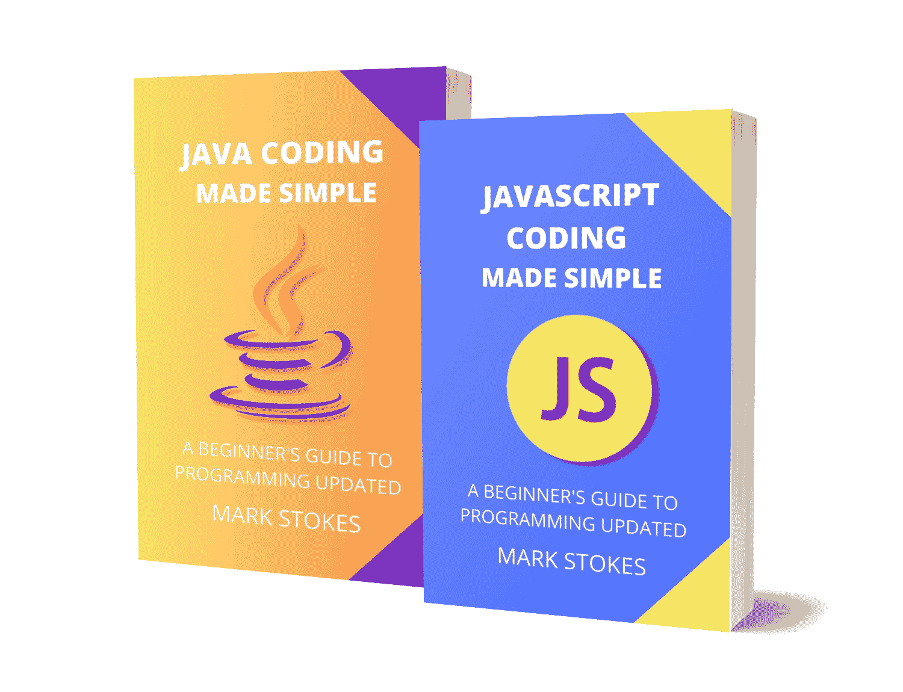

# JavaScript 与 Java 编程简单化：编程初学者指南 - 二本书合一



- 第 1 章：JavaScript 简介
- 第 2 章：JavaScript 语法、运算符与表达式
- 第 3 章：JavaScript 控制流语句
- 第 4 章：JavaScript 函数
- 第 5 章：JavaScript 数组
- 第 6 章：JavaScript 对象
- 第 7 章：JavaScript 事件与事件处理
- 第 8 章：JavaScript AJAX 与 Fetch API
- 第 9 章：高级 JavaScript Concepts
- 第 10 章：JavaScript 模块与模块化开发
- 第 11 章：JavaScript 中的面向对象编程
- 第 13 章：在 JavaScript 中 API
- 第 14 章：JavaScript 框架与库
- 第 15 章：移动应用开发中的 JavaScript
- 第 1 章：Java 编程简介
- 第 2 章：变量与数据类型
- 第 3 章：控制流语句
- 第 4 章：方法
- 第 5 章：数组
- 第 6 章：面向对象编程 (OOP)part0026.xhtml)
- 第 7 章：异常处理与文件 I/O
- 第 9 章：多线程
- 第 10 章：Java 数据库交互
- 第 11 章：使用 Java Web 开发
- 第 12 章：Java 数据库连接
- 第 13 章：用于快速开发的 Java 框架与库
- 第 14 章：Java 测试：框架与方法论
- 第 15 章：Java 调试技术与工具

# 第 1 章：JavaScript 简介

欢迎来到兴奋的 JavaScript 世界！在本章中，我们将开启探索 JavaScript 编程基础的之旅。我们将涵盖 JavaScript 的基本知识、它在 Web 开发中的作用，以及它是如何与 HTML 和 CSS 交互的。

## 1.1 什么是 JavaScript？

JavaScript 是一种高级解释型编程语言，主要用于为网站添加交互性。与关注网页结构和呈现的 HTML 和 CSS 不同，JavaScript 能够实现动态和响应式的行为。它允许你创建交互式元素、处理用户输入、操作页面内容等。

JavaScript 是一种多功能的语言，多年来不断演进，获得了广泛采用，并成为现代 Web 开发不可或缺的一部分。它受到所有主流浏览器的支持，可以用于各种用途，从简单的网站增强到复杂的 Web 应用。

## 1.2 JavaScript 简史

为了更好地理解 JavaScript，让我们简要回顾一下它的历史。JavaScript 由 Brendan Eich 在 1995 年于 Netscape Communications 工作期间创建。它最初被命名为 "LiveScript"，后来更名为 JavaScript 以利用当时 Java 的流行。该语言的设计目的是为网页提供添加交互性的方法，并为浏览器带来编程能力。

多年来，JavaScript 经历了重大的进步。定义语言规范的 ECMAScript 标准已经出了多个版本，每个版本都引入了新功能和改进。现代 JavaScript（也称为 ECMAScript 6 (ES6) 及更高版本）提供了强大的功能，使开发变得更加高效和愉快。

## 1.3 JavaScript 与 Web 开发

JavaScript 在现代 Web 开发中起着至关重要的作用。它主要用于客户端，这意味着它直接运行在 Web 浏览器中。这使得 JavaScript 可以与文档对象模型（DOM，网页结构的表示）进行交互，并实时操作其元素。通过利用 JavaScript，Web 开发人员可以创建响应用户操作的动态交互式网站。

除了客户端脚本之外，JavaScript 的范围已扩展到 Web 开发的其他领域。随着 Node.js 的引入，JavaScript 现在也可以用于服务器端。这允许开发者使用单种编程语言构建全栈应用程序，简化了开发过程并提高了代码的可重用性。

## 1.4 配置你的开发环境

在深入 JavaScript 编码之前，设置一个合适的开发环境至关重要。拥有正确的工具和舒适的设置可以极大提高你作为开发者的效率。让我们来看看设置 JavaScript 开发环境的步骤。

首先，你需要一个文本编辑器来编写代码。有很多选择，从轻量级编辑器到功能丰富的集成开发环境（IDE）。开发者中流行的选择包括 Visual Studio Code、Sublime Text、Atom 和 WebStorm。根据你对功能、易用性和自定义的偏好选择一个。

一旦有了文本编辑器，你需要一个浏览器来运行和测试你的 JavaScript 代码。所有现代浏览器（如 Chrome、Firefox、Safari 和 Edge）都内置了可以执行代码的 JavaScript 引擎。除了编辑器和浏览器，你可能会发现浏览器提供的工具非常有帮助。这些工具提供了调试、检查元素、监控网络请求等多种功能。

最后，你可能想要考虑使用版本控制软件（如 Git）来管理代码并进行协作。Git 允许你跟踪代码库的变化、为功能创建分支并与团队轻松协作。GitHub、GitLab 和 Bitbucket 等平台提供了 Git 仓库托管服务。

## 1.5 运行 JavaScript 代码

环境配置完成后，让我们探索如何运行 `JavaScript` 代码。JavaScript 代码可以通过两种方式执行：内联在 HTML 文件中或在外部 JavaScript 文件。虽然内联 JavaScript 有其用例，但通常建议将 JavaScript 代码放在外部文件中并使用 `<script>` 标签将其链接到 HTML 文件。这种关注点的分离有助于保持代码结构的整洁有序。

要包含外部 JavaScript 文件，你可以在 HTML 文件中使用以下语法：

```html
<!DOCTYPE html>
<html>
<head>
<title>我的 JavaScript 页面</title>
<script src="path/to/your/script.js"></script>
</head>
<body>

<!-- 你的 HTML 内容 -->
</body>
</html>
```

在这个示例中，我们通过使用 `<script>` 标签并指定指向 JavaScript 文件的路径来包含外部 JavaScript 文件。浏览器在遇到此标签时会加载并执行 JavaScript 代码，从而允许你分离 HTML 和 JavaScript 代码以获得更好的组织性和可维护性。

## 1.6 你的第一个 JavaScript 程序

让我们直接开始编码吧！在 JavaScript 中，传统的“Hello, World!”程序可以这样写：

```javascript
console.log("Hello, World!");
```

在这里，我们使用 `console.log()` 函数在浏览器控制台中显示消息“Hello, World!”。控制台是开发过程中调试和打印输出的有用工具。通过使用 `console.log()`，你可以检查变量、跟踪代码流并解决可能出现的任何问题。

控制台不是与 JavaScript 代码交互的唯一方式。你也可以通过操作 DOM 直接在网页本身上显示输出。例如，你可以使用 `document.getElementById()` 函数选择页面上的元素并动态修改其内容。

```html
<!DOCTYPE html>
<html>
<head>
<title>My JavaScript Page</title>
</head>
<body>
<h1 id="output">Hello, World!</h1>
<script>
var outputElement = document.getElementById("output");
outputElement.textContent = "Hello, JavaScript!";
</script>
</body>
</html>
```

在示例中，我们选择了 `id` 属性为 "output" 的 `<h1>` 元素，并使用 `textContent` 属性更新了它的内容。当页面加载时，JavaScript 代码将执行，文本“Hello, JavaScript!”将替换 `<h1>` 元素内初始的“Hello, World!”文本。

## 1.7 变量与数据类型

变量是任何编程语言中的基础构建。它们允许你存储和操作数据。在 JavaScript 中，你可以使用 `var`、`let` 或 `const` 关键字来声明变量。让我们探索这些关键字及其特性。

`var` 关键字在历史上一直用于声明 JavaScript 中的变量。它具有函数级作用域，这意味着用 `var` 声明的变量在定义的函数内部是可以访问的。然而，如果它没有在函数内部显式声明，也可以在函数外部访问。

随着 ES6 的引入，引入了 `let` 和 `const` 关键字来解决 `var` 的某些缺点并提供块级作用域。用 `let` 声明的变量具有块级作用域。它们的作用域限制在定义的块内，例如循环内部或 `if` 语句内部。这有助于变量命名冲突并促进更好的代码组织。

另一方面，用 `const` 关键字声明的变量也是块级作用域的，但有一个额外的特性：它们是常量。一旦给常量赋值了值，就无法重新赋值或修改。当你有在整个代码执行过程中应该保持不变的值时，常量是非常有用的。

在声明变量时，考虑它们将持有的数据类型是非常重要的。JavaScript 有几种内置数据类型，包括：

- 字符串（Strings）：用于表示文本，并包含单引号或双引号中。例如，`"Hello, World!"` 或 `'JavaScript'`。
- 数字（Numbers）：用于表示数值，包括整数和浮点数。例如，`42` 或 `3.14`。
- 布尔值（Booleans）：用于表示逻辑值，即 `true` 或 `false`。布尔值经常用于条件语句和比较。
- 数组（Arrays）：用于在单个变量中存储多个值。数组可以包含任何数据类型的元素，并用方括号表示。例如，`["apple", "banana", "orange"]`。
- 对象（Objects）：用于存储键值对集合。对象用大括号表示，可以包含属性和方法。例如，`{ name: "John", age: 30 }`。

JavaScript 是一种动态类型语言，这意味着在声明变量时不需要显式指定变量的数据类型。变量的类型根据赋值给它的值自动确定。这种灵活性允许你在整个代码中同一个变量中处理不同的数据类型。

你可以对变量执行各种操作，例如数学计算、字符串拼接和逻辑比较。JavaScript 提供了广泛的运算符，包括算术运算符（`+`、`-`、`*`、`/`）、字符串运算符（`+`）、比较运算符（`>`、`<`、`===`）和逻辑运算符（`&&`、`||`、`!`）。

理解变量和数据类型至关重要，因为它们是 JavaScript 编程的基础。有了这些知识，你可以开始编写更复杂的程序，动态操作数据并构建交互式 Web 应用程序。

这里就是《JavaScript 世界：初学者 Web 开发指南》第一章的结束。在本章中，我们提供了 JavaScript、其历史及其在 Web 开发中重要性的概述。我们还设置了开发环境并编写了第一个 JavaScript 程序。最后，我们介绍了变量和数据类型。

在下一章中，我们将深入研究 JavaScript 语法、运算符和表达式。准备好提升你的 JavaScript 能力，向成为精通的 Web 开发者迈出一步！

# 第 2 章：JavaScript 语法、运算符和表达式

在第一章中，我们了解了 JavaScript 的基础，包括它的历史、在 Web 开发中的作用以及如何设置开发环境。现在，让我们深入研究 JavaScript 语法、运算符和表达式。这些基础概念将为编写更复杂、交互性的 JavaScript 代码铺平道路。

## 2.1 JavaScript 语法

语法是指规定编程语言中如何编写代码的规则集。正确的语法确保代码结构正确，并且可以被人类和机器理解。让我们探索 JavaScript 语法的一些基本方面。

### 2.1.1 语句和分号

在 JavaScript 中，语句是代码的构建块。语句是执行特定操作的指令。JavaScript 中的每个语句都以分号（`;`）结束，表示语句的完成。虽然分号在 JavaScript 中并非总是强制，但一致地使用分号被认为是良好的做法，可以避免潜在的问题。

例如，以下语句为变量赋值：

```javascript
var name = "John";
var age = 25;
```

### 2.1.2 注释

注释用于在代码中添加说明。它们会被 JavaScript 引擎忽略，旨在为开发者提供上下文并提高代码的可读性。JavaScript 有两种注释：

- 单行注释：用双斜杠（`//`）表示。`//` 之后的所有内容都被视为注释，不会执行。

```javascript
// 这是一个单行注释
```

- 多行注释：封装在 `/*` 和 `*/` 之间。多行注释可以跨多行，适用于提供较长的解释或注释代码。

```javascript
/*
这是一个多行注释。
它可以跨多行。
*/
```

## 2.2 JavaScript 运算符

JavaScript 中的运算符是对操作数（值或变量）执行操作的符号。它们用于执行数学计算、比较值、赋值等。让我们探索 JavaScript 中常用的运算符。

### 2.2.1 算术运算符

算术运算符用于执行数学计算。JavaScript 包含以下算术运算符：

- 加（`+`）：相加两个数字或拼接两个字符串。
- 减（`-`）：从一个数字减去另一个。
- 乘（`*`）：乘以两个数字。
- 除（`/`）：用一个数字除以另一个数字。
- 取模（`%`）：返回除法的余数。
- 增（`++`）：将值加 1。
- 减（`--`）：将值减 1。

这是一个演示使用算术运算符的示例：

```javascript
var x = 5;
var y = 2;
var sum = x + y;      // 7
var difference = x - y; // 3
var product = x * y;   // 10
var quotient = x / y;   // 2.5
var remainder = x % y;  // 1
x++; // x 现在是 6
y--; // y 现在是 1
```

### 2.2.2 赋值运算符

赋值运算符用于给变量赋值。它们将赋值运算符 `=` 与其他算术或逻辑运算符结合使用。最常见的赋值运算符有：

- `=`: 给变量赋值。
- `+=`: 将变量的当前值加上一个值并将结果赋值。
- `-=`: 从变量的当前值减去一个值并将结果赋值。
- `*=`: 将变量的当前值乘以一个值并将结果赋值。
- `/=`: 将变量的当前值除以一个值并将结果赋值。

这是一个说明赋值运算符使用的示例：

```javascript
var x = 5;
var y = 2;
x += y; // 等于 x = x + y; (x 现在是 7)
y -= 1; // 等于 y = y - 1; (y 现在是 1)
```

### 2.2.3 比较运算符

比较运算符用于比较值并返回布尔值结果（`true` 或 `false`）。它们通常用于条件语句和循环中。以下是 JavaScript 中的一些比较运算符：

- `==`: 检查两个值是否相等。
- `!=`: 检查两个值是否不相等。
- `>`: 检查左侧的值大于右侧的值。
- `<`: 检查左侧的值小于右侧的值。
- `>=`: 检查左侧的值大于或等于右侧的值。
- `<=`: 检查左侧的值小于或等于右侧的值。
- `===`: 检查两个值是否严格相等（值和类型相同）。

这是一个演示比较运算符使用的示例：

```javascript
var x = 5;
var y = 2;
console.log(x == y);    // false
console.log(x > y);      // true
console.log(x <= 5);     // true
console.log(x === "5"); // false
```

## 2.3 JavaScript 表达式

表达式是值、变量和运算符的组合，用于产生结果。它们可以是简单的单个值，也可以是多个运算符和变量的组合。理解表达式对于编写动态和交互的 JavaScript 代码至关重要。

### 2.3.1 算术表达式

算术表达式涉及使用算术运算符进行数学计算。这是一个算术表达式的示例：

```javascript
var x = 5;
var y = 2;
var result = (x + y) * 3;
console.log(result); // 21
```

在这个示例中，表达式 `(x + y) * 3` 执行加法和乘法以产生结果 21。

### 2.3.2 字符串拼接

在 JavaScript 中，`+` 运算符也用于字符串拼接。它允许将两个或多个字符串合并为一个字符串。这是一个示例：

```javascript
var firstName = "John";
var lastName = "Doe";
var fullName = firstName + " " + lastName;
console.log(fullName); // "John Doe"
```

在这种情况下，`+` 运算符拼接了 `firstName`、空格字符和 `lastName` 的值以形成全名。

### 2.3.3 逻辑表达式

逻辑表达式涉及使用逻辑运算符（`&&`、`||`、`!`）执行逻辑操作。它们通常用于条件语句以评估多个条件。这是一个示例：

```javascript
var x = 5;
var y = 10;
var result = (x > 3) && (y < 15);
console.log(result); // true
```

在这个示例中，逻辑表达式 `(x > 3) && (y < 15)` 评估两个条件是否为真并返回 `true`。

## 2.4 结论


在本章中，我们深入探讨了 JavaScript 语法、运算符和表达式。我们学习了语句、分号和注释，这些有助于构建和文档化我们的代码。我们探索了各种类型的运算符，包括算术运算符、赋值运算符和比较运算符，以及它们如何在 JavaScript 代码中使用。最后，我们检查了表达式以及如何使用它们执行数学计算、拼接字符串和评估逻辑条件。

理解 JavaScript 语法、运算符和表达式对于编写有效且有意义的代码至关重要。有了这些基础概念，你将能够应对更复杂的编程任务并构建交互式应用程序。

在下一章中，我们将探索 JavaScript 控制流语句，例如条件语句和循环。这些控制流语句允许我们根据不同的条件做出决策并重复操作。准备好进入控制流的世界，将你的 JavaScript 技能提升到新的水平吧！

# 第 3 章：JavaScript 控制流语句

在第 2 章中，我们学习了 JavaScript 语法、运算符和表达式。现在，让我们探索控制流语句，它允许我们控制代码的执行流。控制流语句允许我们根据特定条件做出决策并重复操作。理解控制流对于创建动态和交互的 JavaScript 程序至关重要。

## 3.1 条件语句

条件语句用于根据特定条件执行不同的代码块。它们允许我们通过决策来控制执行流。JavaScript 提供了几种条件语句，包括 `if` 语句、`if...else` 语句和 `switch` 语句。

### 3.1.1 if 语句

`if` 语句是最简单的条件语句。如果给定条件为真，则执行代码块。以下是 `if` 语句的基本语法：

```javascript
if (condition) {
  // 如果条件为真则执行的代码
}
```

让我们来看一个示例：

```javascript
var age = 18;
if (age >= 18) {
  console.log("You are eligible to vote.");
}
```

在这个示例中，如果变量 `age` 大于或等于 18，将显示消息“You are eligible to vote.”。

### 3.1.2 if...else 语句

`if...else` 允许我们在条件为真时执行一个代码块，在条件为假时执行另一个代码块。其语法如下：

```javascript
if (condition) {
  // 如果条件为真则执行的代码
} else {
  // 如果条件为假则执行的代码
}
```

让我们修改之前的示例以包含一个 `if...else` 语句：

```javascript
var age = 16;
if (age >= 18) {
  console.log("You are eligible to vote.");
} else {
  console.log("You are not eligible to vote yet.");
}
```

在这种情况下，如果变量 `age` 小于 18，将显示消息“You are not eligible to vote yet.”。

### 3.1.3 switch 语句

`switch` 语句用于根据不同的条件执行不同的操作。它评估表达式并执行与表达式值匹配相应的 case。其语法如下：

```javascript
switch (expression) {
  case value1:
    // 如果表达式匹配 value1 则执行的代码
    break;
  case value2:
    // 如果表达式匹配 value2 则执行的代码
    break;
  default:
    // 如果表达式不匹配任何 case 则执行的代码
    break;
}
```

让我们来看一个示例：

```javascript
var day = "Monday";

switch (day) {
case "Monday":
console.log("It's the first day of the week.");
break;
case "Tuesday":
console.log("It's the second day of the week.");
break;
// ... more cases ...
default:
console.log("It's an unknown day.");
break;
}
```

在这个示例中，如果变量 `day` 的值是 "Monday"，将显示消息 "It's the first day of the week."。如果值为 "Tuesday"，则将显示 "It's the second day of the week."。如果该值不匹配任何用例，将显示默认消息 "It's an unknown day."。

## 3.2 循环语句

循环语句允许我们多次重复一段代码块。当我们想要重复执行任务或遍历数据集合时，这些语句非常有用。JavaScript 提供了几种循环语句，包括 `for` 循环、`while` 循环和 `do...while` 循环。

### 3.2.1 for 循环

`for` 循环通常用于提前知道迭代次数。它由三个部分组成：初始化、条件和更新。其语法如下：

```javascript
for (initialization; condition; update) {
// 每次迭代时执行的代码
}
```

让我们来看一个 `for` 循环的示例：

```javascript
for (var i = 1; i <= 5; i++) {
console.log(i);
}
```

在这个示例中，循环将迭代五次，并显示数字 1 到 5。

### 3.2.2 while 循环

`while` 循环用于我们提前知道确切迭代次数的情况。只要指定的条件为真，它就会继续执行代码块。其语法如下：

```javascript
while (condition) {
// 每次迭代时执行的代码
}
```

让我们来看一个 `while` 循环的示例：

```javascript
var i = 1;
while (i <= 5) {
console.log(i);
i++;
}
```

在这个示例中，循环将迭代五次，与之前的 `for` 循环示例类似。

### 3.2.3 do...while 循环

`do...while` 循环与 `while` 循环相似，但它保证在检查条件之前至少执行一次代码块。其语法如下：

```javascript
do {
// 每次迭代时执行的代码
} while (condition);
```

让我们来看一个 `do...while` 循环的示例：

```javascript
var i = 1;
do {
console.log(i);
i++;
} while (i <= 5);
```

在这个示例中，循环将迭代五次，就像之前的示例一样。

## 3.3 总结

在本章中，我们探索了 JavaScript 控制流语句，包括条件语句和循环语句。我们学习了如何使用 `if` 和 `switch` 语句进行决策，以及如何使用 `for`、`while` 和 `do...while` 循环重复代码。理解控制流对于创建动态和交互式的 JavaScript 程序至关重要。

在下一章中，我们将深入研究 JavaScript 函数，它允许我们将代码组织成可重用的块并执行特定任务。准备好学习如何编写高效且模块化的 JavaScript 代码吧！

# 第 4 章：JavaScript 函数

在第 3 章中，我们探索了 JavaScript 中的控制流语句，它们允许我们做出决策并重复代码块。现在，让我们深入研究 JavaScript 函数，它是构建模块化可重用代码的重要部分。

## 4.1 函数简介

JavaScript 中的函数是一个执行特定任务或计算值的代码块。函数允许我们将代码组织成逻辑清晰且可重用的单元。它们有助于提高代码的可读性，促进代码重用，并使我们的程序更易管理。

## 4.2 函数声明

在 JavaScript 中，我们可以使用 `function` 关键字声明函数，后面跟着函数名、参数列表（可选）以及用大括号括起来的代码块。以下是函数声明的基本语法：

```javascript
function functionName(parameter1, parameter2, ...) {
// 要执行的代码
}
```

让我们定义一个计算数字平方的简单函数：

```javascript
function square(number) {
var result = number * number;
return result;
}
```

在这个示例中，我们声明了一个名为 `square` 的函数，它接受一个名为 `number` 的参数。在函数内部，我们通过将 `number` 自乘来计算其平方，并将结果赋值给名为 `result` 的变量。最后，我们使用 `return` 语句返回计算结果。

## 4.3 函数调用

为了执行函数并获得所需的结果，我们需要通过使用函数名后跟括号 `()` 并传递必要的参数（如果有）来调用或触发函数。以下是调用 `square` 函数的示例：

```javascript
var number = 5;
var squaredNumber = square(number);
console.log(squaredNumber); // 输出: 25
```

在这个示例中，我们将值 `5` 赋值给变量 `number`。然后，我们通过传递 `number` 作为参数来调用 `square` 函数。返回的结果 `25` 被赋值给变量 `squaredNumber`，然后我们将其打印到控制台。

## 4.4 函数参数与参数

函数可以接受参数，这些是传递给函数的占位符。参数允许函数具有灵活性并处理不同的值。当我们调用函数时，传递的是参数，它们是替换函数参数的值。让我们修改 `square` 函数以利用参数：

```javascript
function square(number) {
var result = number * number;
return result;
}
var number = 5;
var squaredNumber = square(number);
console.log(squaredNumber); // 输出: 25
```

在这个示例中，函数声明中的 `number` 参数作为调用函数时传递的值（在本例中为 `5`）的占位符。

## 4.5 返回语句

函数中的 `return` 语句用于指定函数返回的值。它标记了函数执行的结束并将指定的值发送给调用者。让我们修改 `square` 函数以包含 `return` 语句：

```javascript
function square(number) {
return number * number;
}
var number = 5;
var squaredNumber = square(number);
console.log(squaredNumber); // 输出: 25
```

在更新的版本中，`return` 语句直接返回计算结果，不再使用中间变量。

## 4.6 函数作用域

JavaScript 中的函数有自己的作用域。在函数内部定义的变量是局部的，意味着只能在函数内部访问。相反，在任何函数外部定义的变量具有全局作用域，可以在代码的任何地方访问。让我们通过示例来检查函数作用域的概念：

```javascript
var globalVariable = "I'm a global variable";
function myFunction() {
var localVariable = "I'm a local variable";
console.log(localVariable); // 输出: I'm a local variable
console.log(globalVariable); // 输出: I'm a global variable
}
myFunction();
console.log(localVariable); // 错误: localVariable is not defined
console.log(globalVariable); // 输出: I'm a global variable
```

在这个示例中，我们有一个名为 `globalVariable` 的全局变量，可以在代码的任何地方访问。在 `myFunction` 函数内部，我们声明了一个名为 `localVariable` 的局部变量，它只在函数内部可见。当我们调用 `myFunction` 时，它会正确地打印 `localVariable` 和 `globalVariable` 的值。然而，如果我们尝试在函数外部访问 `localVariable`，将会发生错误，因为它在全局作用域中没有定义。

## 4.7 函数表达式

除了函数声明外，JavaScript 还支持函数表达式。函数表达式涉及将一个函数赋值给变量，使其成为一个可以传递和调用的对象。这是一个函数表达式的示例：

```javascript
var greet = function(name) {
  console.log("Hello, " + name + "!");
};

greet("John");     // 输出: Hello, John!
```

在这个示例中，我们通过将一个匿名函数赋值给变量 `greet` 来创建一个函数表达式。该函数接收一个 `name` 参数并在控制台中打印一条问候语。然后我们可以通过调用 `greet` 并传递参数来执行该函数。

## 4.8 箭头函数

ES6 引入了箭头函数，它为编写函数提供了简洁的语法。箭头函数特别适用于编写更短且具可读性的代码。这是一个箭头函数的示例：

```javascript
var double = (number) => number * 2;

console.log(double(5));     // 输出: 10
```

在这个示例中，我们定义了一个名为 `double` 的箭头函数，它接收一个 `number` 参数并返回该数字的两倍。箭头函数的语法 `(number) => number * 2` 代表了编写该函数的紧凑方式。

## 4.9 总结

在本章中，我们探索了 JavaScript 函数，它允许我们将代码组织成可重用的块并执行特定任务。我们学习了函数声明、调用、参数、返回语句、函数作用域、函数表达式以及箭头函数。函数是 JavaScript 编程的基础构建模块，使我们能够编写出模块化、可重用且高效的代码。

在下一章中，我们将深入研究 JavaScript 数组，这是一种强大的数据结构允许我们存储和操作元素集合。准备好探索数组的世界并释放它们的全部潜力吧！

# 第 5 章：JavaScript 数组

在第 4 章中，我们探索了 JavaScript 函数，它允许我们将代码组织成可重用的块。现在，让我们进入 JavaScript 数组，这是一种强大的数据结构，使能够存储和操作元素集合。

## 5.1 数组简介

JavaScript 中的数组是一种数据结构，允许我们在单个变量中存储多个值。数组是有序的、索引的集合，每个值都被分配了一个从 `0` 开始的唯一索引。数组可以包含任何数据类型的元素，例如数字、字符串、对象甚至其他数组。它们提供了各种方法和属性，以便高效地对存储的数据进行操作。

## 5.2 创建数组

在 JavaScript 中创建数组有两种常用方法：使用数组字面量和 `Array` 构造函数。

### 5.2.1 数组字面量

数组字面量是创建数组最简单且常用的方法。它们涉及在方括号 `[]` 内包含逗号分隔的值列表。这是一个示例：

```javascript
var fruits = ['apple', 'banana', 'orange'];
```

在这个示例中，我们创建了一个名为 `fruits` 的数组，包含三个元素：`'apple'`、`'banana'` 和 `'orange'`。

### 5.2.2 使用 Array 构造函数

JavaScript 还提供了 `Array` 构造函数来创建数组。我们可以使用 `new` 关键字后跟 `Array()` 来创建一个空数组，或者在括号内传递值来初始化带有特定元素的数组。这里是一些示例：

```javascript
var emptyArray = new Array();
var numbers = new Array(1, 2, 3, 4, 5);
```

在第一个示例中，我们创建了一个名为 `emptyArray` 的空数组。在第二个示例中，我们创建了一个名为 `numbers` 的数组，包含五个元素：`1`、`2`、`3`、`4` 和 `5`。

## 5.3 访问数组元素

我们可以通过索引访问数组中的单个元素。第一个元素的索引从 `0` 开始，每个后续元素增加 `1`。我们使用方括号 `[]` 并在其中指定索引。这是一个示例：

```javascript
var fruits = ['apple', 'banana', 'orange'];

console.log(fruits[0]);   // 输出: 'apple'
console.log(fruits[1]);   // 输出: 'banana'
console.log(fruits[2]);   // 输出: 'orange'
```

在这个示例中，我们通过各自的索引访问并打印 `fruits` 数组的元素。

## 5.4 修改数组元素

JavaScript 中的数组是可变的，这意味着可以在创建后修改它们的元素。我们可以使用赋值运算符 `=` 为特定索引分配新值。这是一个示例：

```javascript
var fruits = ['apple', 'banana', 'orange'];

fruits[1] = 'grape';

console.log(fruits);  // 输出: ['apple', 'grape', 'orange']
```

在这个示例中，我们修改了 `fruits` 数组索引为 `1` 的元素，将其从 `'banana'` 改为 `'grape'`。

## 5.5 数组长度

数组的 `length` 属性允许我们确定它包含的元素数量。我们可以使用点符号（`array.length`）访问此属性。这是一个示例：


```javascript
var fruits = ['apple', 'banana', 'orange'];

console.log(fruits.length); // 输出: 3
```

在这个示例中，我们获取并打印了`fruits`数组的长度，结果为`3`。

## 5.6 Array 方法

JavaScript 提供了系列数组方法，允许我们对数组进行各种操作。让我们探索常用的数组方法：

### 5.6.1 `push()` 和 `pop()`

`push()`方法向数组末尾添加一个或多个元素，而`pop()`方法从数组末尾移除元素并返回它。这是一个示例：

```javascript
var fruits = ['apple', 'banana', 'orange'];

fruits.push('grape');
console.log(fruits);       // 输出: ['apple', 'banana', 'orange', 'grape']

var removedFruit = fruits.pop();
console.log(fruits);       // 输出: ['apple', 'banana', 'orange']
console.log(removedFruit); // 输出: 'grape'
```

在这个示例中，我们使用`push()`向`fruits`数组末尾添加`'grape'`。然后我们使用`pop()`移除最后一个元素`'grape'`并将其赋值给变量`removedFruit`。

### 5.6.2 `shift()` 和 `unshift()`

`shift()`方法从数组开头移除元素并返回它，而`unshift()`方法向数组开头添加一个或多个元素。这是一个示例：

```javascript
var fruits = ['apple', 'banana', 'orange'];

fruits.shift();
console.log(fruits);      // 输出: ['banana', 'orange']

fruits.unshift('grape', 'kiwi');

console.log(fruits);      // 输出: ['grape', 'kiwi', 'banana', 'orange']
```

在这个示例中，我们使用`shift()`从`fruits`数组中移除第一个元素`'apple'`。然后我们使用`unshift()`将`'grape'`和`'kiwi'`添加到数组开头。

### 5.6.3 `slice()`

`slice()`方法提取数组的一部分并返回一个包含所选元素的新数组。它接收两个参数：起始索引（包含）和结束索引（不包含）。这是一个示例：

```javascript
var fruits = ['apple', 'banana', 'orange', 'grape', 'kiwi'];

var slicedFruits = fruits.slice(1, 4);

console.log(slicedFruits);  // 输出: ['banana', 'orange', 'grape']
```

在这个示例中，我们使用`slice(1, 4)`从`fruits`数组中提取从索引`1`（包含）到`4`（不包含）的元素。

### 5.6.4 `concat()`

`concat()`方法合并两个或多个数组并返回一个新数组。它不会修改原始数组。

```javascript
var fruits = ['apple', 'banana'];
var moreFruits = ['orange', 'grape', 'kiwi'];
var combinedFruits = fruits.concat(moreFruits);
console.log(combinedFruits);  // Output: ['apple', 'banana', 'orange', 'grape', 'kiwi']
```

在这个示例中，我们使用`concat()`将`fruits`数组与`moreFruits`数组合并，并将结果存储在`combinedFruits`变量中。

## 5.7 结论

在本章中，我们探索了 JavaScript 数组，这是一种强大的数据结构，允许我们存储和操作元素集合。我们学习了如何使用数组字面量和`Array`构造函数创建数组、访问和修改数组元素、获取数组长度，以及使用如`push()`、`pop`和`slice()`等各种数组方法。数组为 JavaScript 中处理数据集合提供了一种灵活且高效的方法。

在下一章中，我们将深入研究 JavaScript 对象，这是该语言中的另一个重要概念。对象允许我们表示复杂的数据结构，并将相关数据组织成键值对。准备好探索 JavaScript 对象的世界并释放它们的全部潜力吧！

# 第 6 章：JavaScript 对象

在第 5 章中，我们探索了 JavaScript 数组，它允许我们存储和操作元素集合。现在，让我们深入研究 JavaScript 对象，这是该语言的另一个基础概念。对象允许我们表示复杂的数据结构并将相关数据组织成键值对。

## 6.1 对象简介

在 JavaScript 中，对象是一种复合数据类型，允许我们以结构化的方式存储和操作数据。对象是属性的集合，每个属性由一个键（key）和一个值（value）组成。键作为访问相应值的标识。对象通常用于表示现实世界的实体，例如人物、汽车或书籍。

## 6.2 创建对象

在 JavaScript 中有多种创建对象的方法。常用方法是使用对象字面量，我们在大括号`{}`中定义属性及其值。这里有一个示例：

```javascript
var person = {
name: "John Doe",
age: 30,
profession: "Web Developer"
};
```

在这个示例中，我们创建了一个名为`person`的对象，包含三个属性：`name`、`age`和`profession`。属性名被指定为键，后跟着冒号`:`，以及它们对应的值。

另一种创建对象的方法是使用`new`关键字和`Object()`构造函数。这里有一个示例：

```javascript
var car = new Object();
car.make = "Toyota";
car.model = "Camry";
car.year = 2022;
```

在这个示例中，我们使用`Object()`构造函数创建了一个名为`car`的对象，并使用点表示法为其分配属性。

## 6.3 访问对象属性

我们可以使用点表示法或括号表示法访问对象的属性。点表示法涉及使用对象名后一个点`.`和属性名。这里有一个示例：

```javascript
console.log(person.name);     // Output: "John Doe"
console.log(car.make);         // Output: "Toyota"
```

在这个示例中，我们使用点表示法访问了`person`对象的`name`属性和`car`对象的`make`属性。

括号表示法涉及使用方括号`[]`并字符串指定属性名。这里有一个示例：

```javascript
console.log(person['age']);    // Output: 30
console.log(car['year']);       // Output: 2022
```

在这个示例中，我们使用括号表示法访问了`person`对象的`age`属性和`car`对象的`year`属性。

## 6.4 修改对象属性

JavaScript 中的对象是可变的，这意味着我们可以在创建创建后修改它们的属性。我们可以使用点表示法或括号表示法重新分配属性的值。这里有一个示例：

```javascript
person.age = 35;
car['year'] = 2023;
```

在这个示例中，我们修改了`person`对象的`age`属性和`car`对象的`year`属性。

## 6.5 添加和删除对象属性

我们可以通过简单给之前不存在的属性赋值来向对象添加新属性。同样，我们可以使用`delete`关键字删除属性。这里有一个示例：

```javascript
person.gender = "Male";
delete car.model;
```

在这个示例中，我们向`person`对象添加了`gender`属性，并从`car`对象中删除了`model`属性。

## 6.6 对象方法

除了属性之外，JavaScript 对象还可以包含方法。方法是与对象相关的函数，可以使用点表示法进行调用。

JavaScript 中的方法是与对象相关的函数，可以使用对象的属性执行操作或计算。让我们来看一个示例：

```javascript
var calculator = {
add: function (a, b) {
return a + b;
},
subtract: function (a, b) {
return a - b;
}
};
console.log(calculator.add(5, 3));      // Output: 8
console.log(calculator.subtract(10, 4)); // Output: 6
```

在这个示例中，我们创建了一个名为`calculator`的对象，包含两个方法：`add`和`subtract`。这些方法可以使用点表示法后跟括号`()`调用，传入所需的参数。

## 6.7 对象迭代

我们可以使用多种技术来遍历对象的属性。一种常用方法是使用`for...in`循环，它允许我们遍历对象的枚举属性。这里有一个示例：

```javascript
for (var key in person) {
console.log(key + ": " + person[key]);
}
```

在这个示例中，我们遍历了`person`对象的属性，并记录了属性名（`key`）及其对应的值（`person[key]`）。

## 6.8 对象原型与继承

JavaScript 是一种基于原型的语言，这意味着对象可以从其他对象继承属性和方法。这种概念被称为继承。对象可以有一个原型对象，该对象作为其所继承的属性和方法的蓝图。

在 JavaScript 中，继承是通过原型链实现的。对象有一个内部的`[[Prototype]]`属性，引用了它们的原型对象。如果在对象中没有找到某个属性或方法，JavaScript 将会在该对象的原型中查找。这种链会一直持续，直到找到该属性或方法，或者到达原型链的末尾。

## 6.9 总结

在本章中，我们探索了 JavaScript 对象，这是该语言中的一个核心概念。对象允许我们表示复杂的数据结构，使用键值对组织相关数据，并定义在数据上执行操作的方法。我们学习了如何使用对象字面量和`Object()`构造函数创建对象，如何使用点符号和中括号符号访问和修改对象属性，添加和删除属性，定义对象方法，以及使用`for...in`循环遍历对象属性。

在下一章中，我们将深入学习 JavaScript 事件和事件处理的世界，理解如何响应用户交互并创建动态交互的 Web 应用程序。准备好增强你的 JavaScript 程序的交互性吧！

# 第 7 章：JavaScript 事件与事件处理

在第 6 章中，我们探索了 JavaScript 对象及其属性和方法。现在，让我们进入 JavaScript 事件和事件处理的精彩世界。事件允许我们响应用户交互，并创建动态交互的 Web 应用程序。

## 7.1 事件简介

在 Web 开发中，事件是浏览器中发生的动作或情况。这些事件可以由用户交互触发，例如点击按钮、悬停在元素上或提交表单。JavaScript 提供了一种强大的机制，用于捕获和处理这些事件。

## 7.2 事件处理器

事件处理器是在响应特定事件执行的函数。我们可以将事件处理器绑定到 HTML 元素上，以定义事件发生时应该发生什么。这里有一个示例：

```javascript
var button = document.getElementById("myButton");

button.onclick = function() {

  alert("Button clicked!");

};
```

在这个示例中，我们使用`document.getElementById()`选择了一个 id 为 "myButton" 的 HTML 按钮元素。然后，我们将一个匿名函数赋值给按钮的`onclick`事件处理器。当按钮被点击时，该函数会被执行，并显示“Button clicked!”的警告消息。

## 7.3 事件监听器

除了事件处理器，我们还可以使用事件监听器来处理事件。事件监听器提供了一种更灵活的方式，为元素附加多个事件处理器。这里有一个示例：

```javascript
var button = document.getElementById("myButton");

button.addEventListener("click", function() {

  alert("Button clicked!");

});
```

在这个示例中，我们使用`addEventListener()`方法为按钮元素附加一个 "click" 事件监听器。监听器被定义为一个匿名函数，当按钮被点击时，它会显示警告消息。

## 7.4 事件对象

当事件发生时，JavaScript 会创建一个包含事件信息的事件对象。可以在事件处理器或监听器函数内部访问此对象，根据事件细节执行特定操作。这里有一个示例：

```javascript
var button = document.getElementById("myButton");

button.addEventListener("click", function(event) {

  console.log("Button clicked at coordinates:", event.clientX, event.clientY);

});
```

在这个示例中，我们访问事件对象的`clientX`和`clientY`属性，以记录在按钮上点击鼠标的坐标。

## 7.5 事件传播

事件传播是指当嵌套元素上发生事件时，处理事件的顺序。事件传播有两种类型：冒泡和捕获。

在冒泡中，事件首先由最内层的元素处理，然后沿着 DOM 树向上传播到它的父元素。这是大多数事件的默认行为。

在捕获中，事件首先由最外层的祖先处理，然后沿着 DOM 树向下到最内层的元素。

## 7.6 事件委托

事件委托是一种技术，我们在父元素上附加单个事件处理器，并处理其子元素的事件。这在动态添加或删除子元素时非常有用，因为我们不需要为每个元素单独绑定事件处理器。事件从子元素传播到父元素，我们可以使用事件委托识别事件的特定目标。

## 7.7 总结

在本章中，我们探索了 JavaScript 事件和事件处理，这允许我们创建动态交互的 Web 应用程序。我们学习了事件处理器和事件监听器，如何将它们绑定到 HTML 元素，以及如何响应特定事件。我们还发现了事件对象，它提供了有关事件的信息。此外，我们讨论了事件传播（包括冒泡和捕获）以及事件委托的概念。

# 第 8 章：JavaScript AJAX 与 Fetch API

在第 7 章中，我们深入了 JavaScript 事件和事件处理，这使我们能够创建动态交互的 Web 应用程序。现在，让我们探索 AJAX（异步 JavaScript 和 XML）和 Fetch API，这些强大的工具允许我们与服务器通信并检索数据，而无需刷新整个网页。

## 8.1 AJAX 简介

AJAX 是一种允许 Web 应用程序在后台异步发送和接收的技术。通过 AJAX，我们可以在不需要刷新整个网页的情况下更新网页的一部分，从而获得更流畅、响应迅速的用户体验。AJAX 允许我们使用 JavaScript 与服务器交互并检索数据。

## 8.2 XMLHttpRequest 对象

`XMLHttpRequest`对象是 AJAX 的组件。它提供了向服务器发送 HTTP 请求并处理服务器响应的方法和属性。让我们来看一个示例：

```javascript
var xhr = new XMLHttpRequest();

xhr.open("GET", "https://api.example.com/data", true);

xhr.onreadystatechange = function() {

  if (xhr.readyState === 4 && xhr.status === 200) {

    var response = JSON.parse(xhr.responseText);

    console.log(response);

  }

};

xhr.send();
```

在这个示例中，我们使用`new XMLHttpRequest()`构造函数创建了一个`XMLHttpRequest`对象。然后使用`open()`方法指定 HTTP 方法（在本例中为 "GET"）和我们要获取数据的服务器 URL。第三个参数 (`true`) 表示请求是异步的。

我们将一个匿名函数赋值给`onreadystatechange`事件处理器。该函数会在状态改变时执行。在函数内部，我们检查`readyState`属性是否等于`4`（表示请求完成）以及`status`属性是否等于`200`（表示响应成功）。如果满足条件，我们将`responseText`解析为 JSON 并打印到控制台。

最后，我们调用`send()`方法向服务器发送请求。

## 8.3 Fetch API

`Fetch` API 是`XMLHttpRequest`对象的现代替代方案。它提供了一个更简洁、更直观的接口来发送和处理请求。这里有一个示例：

```javascript
```


`fetch("https://api.example.com/data")`

```javascript
.then(function(response) {
  if (response.ok) {
    return response.json();
  } else {
    throw new Error("Error: " + response.status);
  }
})
.then(function(data) {
  console.log(data);
})
.catch(function(error) {
  console.log(error);
});
```

在这个示例中，我们使用 `fetch()` 函数向指定的 URL 发送 GET 请求。`fetch()` 函数返回一个 `Promise`，该 Promise 将解析为服务器返回的响应。

我们使用 `then()` 方法对 Promise 进行链式调用。在第一个 `then()` 回调函数中，我们检查响应是否成功（`response.ok`）。如果成功，我们调用响应对象上的 `json()` 方法将响应数据解析为 JSON。如果发生错误，我们将抛出一个带有相应状态码的新 `Error` 对象。

在第二个 `then()` 回调函数中，我们接收解析后的数据并将其打印到控制台。

`catch()` 方法用于处理在 Promise 链过程中可能发生的任何错误。

## 8.4 处理响应数据

一旦我们从服务器获取了数据，就可以在 JavaScript 代码中对其进行处理。这可能涉及操作数据、更新网页或根据检索到的信息执行其他操作。

## 8.5 跨域资源共享 (CORS)

在向不同域发送 AJAX 请求时，可能会遇到 CORS 限制。

跨域资源共享（CORS）是浏览器实现的一种安全机制，用于限制从一个域向另一个域的 AJAX 请求。默认情况下，浏览器执行同源策略，阻止 JavaScript 代码向不同域发送请求。CORS 允许服务器指定哪些域可以访问其资源。

要启用 CORS，服务器需要在其 HTTP 响应中返回适当的 CORS 头部。这些头部包含了允许的源、允许的方法和允许的头部等信息。

如果你在发送 AJAX 请求时遇到 CORS 限制，有几种可能的解决方案：

1. **服务器端的 CORS 配置**：如果你对服务器有控制权，可以配置它在响应中包含必要的 CORS 头部。这允许特定的域访问服务器的资源。
2. **代理服务器**：你可以在你的域名上设置一个代理服务器，作为 JavaScript 代码和远程服务器之间的中介。代理服务器可以代表你的代码发送请求，从而绕过 CORS 限制。
3. **JSONP（带填充的 JSON）**：JSONP 是一种利用从不同域包含脚本的能力来实现跨域请求的技术。它涉及将响应数据封装在函数调用中，并作为脚本加载到浏览器中。

需要注意的是，CORS 限制是由浏览器强制的，其目的是保护用户的安全和隐私。通常建议配置服务器以允许必要的 CORS 请求，而不是依赖代理或 JSONP 等变通方案。

## 8.6 处理 AJAX 错误

在发送 AJAX 请求时，妥善处理错误以提供流畅的用户体验至关重要。错误可能由于各种原因引起，例如网络问题、服务器错误或无效请求。

要处理 AJAX 错误，你可以利用 `XMLHttpRequest` 对象或 Fetch API 的错误处理功能。例如，使用 `XMLHttpRequest` 对象，你可以监听 `onerror` 事件并在相应的事件处理器中处理错误。

这里是一个使用 Fetch API 的示例：

```javascript
fetch("https://api.example.com/data")
.then(function(response) {
  if (response.ok) {
    return response.json();
  } else {
    throw new Error("Error: " + response.status);
  }
})
.then(function(data) {
  console.log(data);
})
.catch(function(error) {
  console.log("An error occurred:", error);
});
```

在这个示例中，`catch()` 方法用于捕获 Promise 链过程中发生的任何错误。错误对象将被打印到控制台以供调试使用。

通过妥善处理 AJAX 错误，你可以为用户提供反馈，并优雅地处理数据检索过程中可能出现的任何问题。

## 8.7 总结

在本章中，我们探索了 AJAX（异步 JavaScript 和 XML）和 Fetch API，它们都是与服务器通信和异步检索数据的强大工具。我们学习了 `XMLHttpRequest` 对象及其用于发送 HTTP 请求的方法和属性。我们还探索了 Fetch API，它提供了一种更现代、更流线的方法处理 AJAX 请求。此外，我们还讨论了 CORS（跨域资源共享）以及处理 AJAX 错误的各种技术。

通过 AJAX 和 Fetch API，你可以创建动态且交互式的 Web 应用程序，在后台从服务器检索数据，从而提供无缝的用户体验。在下一章中，我们将深入探讨 JavaScript 的高级概念，包括 Promises、`async/await` 和错误处理技术。

# 第 9 章：高级 JavaScript 概念

在之前的章节中，我们涵盖了 JavaScript 的基础，包括变量、数据类型、函数、对象、事件和 AJAX。现在，是时候探索将你的技能提升到新水平的高级 JavaScript 概念了。在本章中，我们将深入研究 Promises、`async/await`、错误处理技术等内容。

## 9.1 Promises

Promises 是 JavaScript 中处理异步操作的强大工具。与回调（callbacks）相比，它们提供了一种更简洁、更直观的方式来管理异步代码。一个 Promise 代表异步操作的最终完成或失败，并允许我们将多个异步操作链联起来。

Promise 的基本结构如下：

```javascript
const myPromise = new Promise((resolve, reject) => {
  // 异步操作
  // 如果成功，调用 resolve(value)
  // 如果发生错误，调用 reject(error)
});

myPromise
.then((value) => {
  // 处理解析后的值
})
.catch((error) => {
  // 处理错误
});
```

在这个示例中，我们使用 `new Promise()` 构造函数创建了一个新的 Promise，并传递一个带有 `resolve` 和 `reject` 参数的回调函数。在回调函数内部，我们执行异步操作。如果操作成功，我们调用 `resolve(value)` 并传入所需的值。如果发生错误，我们调用 `reject(error)` 并传入相应的错误。

我们可以链用 `then()` 方法来处理解析后的值，并使用 `catch()` 方法处理 Promise 链过程中发生的任何错误。

## 9.2 Async/Await

Async/await 是 JavaScript 较新引入的特性，它是 Promise 之上的语法糖。它允许我们以更同步、更具可读性的方式编写异步代码。Async/await 让处理 Promise 更加直观，并减少了对显式 Promise 链的需求。

要使用 async/await，我们需要用 `async` 关键字声明函数。在函数内部，我们可以使用 `await` 关键字暂停执行并等待 Promise 的解析或拒绝。这里是一个示例：

```javascript
async function fetchData() {
  try {
    const response = await fetch('https://api.example.com/data');
    const data = await response.json();
    console.log(data);
  } catch (error) {
    console.log(error);
  }
}

fetchData();
```

在本示例中，`fetchData()` 函数使用 `async` 关键字声明。在函数内部，我们使用 `await` 关键字来暂停执行，并等待 `fetch()` Promise 解析完成。一旦 Promise 解析完成，我们将响应赋值给 `response` 变量。

然后，我们再次使用 `await` 暂停执行，等待 `response.json()` Promise 解析完成。一旦 Promise 解析完成，我们将解析后的数据赋值给 `data` 变量并将其打印到控制台。

如果在 Promise 链过程中发生任何错误，它将在 `catch` 块中被捕获。

## 9.3 错误处理

适当的错误处理对于任何 JavaScript 应用程序都是至关重要的。在处理异步代码时，有效地处理错误至关重要，以确保流畅的用户体验并提供有意义的反馈。

在之前示例所示的 `try/catch` 块，我们还可以使用 Promises 的 `catch()` 方法或通过抛出自定义错误来处理错误。这是一个示例：

```javascript
fetch('https://api.example.com/data')
  .then((response) => {
    if (!response.ok) {
      throw new Error('Error: ' + response.status);
    }
    return response.json();
  })
  .then((data) => {
    console.log(data);
  });
```

在上一个示例中，我们演示了如何在 Promise 链中使用 `catch()` 方法进行错误处理。在发送 `fetch()` 请求后，我们检查响应是否正常（`!response.ok`）。如果不是，我们抛出一个带有包含响应状态的自定义错误消息的新 `Error` 对象。

在 Promise 链中抛出错误允许我们在随后的 `catch()` 块中处理该错误。这样，我们可以优雅地处理错误并向用户提供适当的反馈。

此外，你还可以使用 `throw` 语句抛出自定义错误。例如：

```javascript
function divide(a, b) {
  if (b === 0) {
    throw new Error('Division by zero is not allowed');
  }
  return a / b;
}

try {
  const result = divide(10, 0);
  console.log('Result:', result);
} catch (error) {
  console.log('An error occurred:', error.message);
}
```

在此示例中，`divide()` 函数检查除数 `b` 是否等于零。如果是，我们抛出一个带有自定义错误消息的新 `Error` 对象。该错误会在 `catch` 块中被捕获，错误消息会被打印到控制台。

通过利用适当的错误处理技术，你可以确保你的 JavaScript 代码能够优雅地处理错误并在出现问题时向用户提供有意义的反馈。

## 9.4 生成器 (Generators)

生成器是 ECMAScript 2015 (ES6) 引入的一种独特特性，允许函数暂停并恢复执行。它们使用 `function*` 语法定义，并使用 `yield` 关键字暂停执行并返回值。

处理迭代算法或涉及复杂控制流的异步操作时，生成器特别有用。它们为编写涉及迭代或异步任务的代码提供了一种更灵活、表现力的方式。

这是一个简单的示例，用于演示生成器的基本用法：

```javascript
function* countUpTo(n) {
  for (let i = 0; i <= n; i++) {
    yield i;
  }
}

const generator = countUpTo(5);

console.log(generator.next().value); // 输出: 0
console.log(generator.next().value); // 输出: 1
console.log(generator.next().value); // 输出: 2
console.log(generator.next().value); // 输出: 3
console.log(generator.next().value); // 输出: 4
console.log(generator.next().value); // 输出: 5
```

在此示例中，我们定义了 `countUpTo()` 生成器函数，它生成从 0 到 `n` 的数字。在函数内部，我们使用 `yield` 关键字暂停执行并返回 `i` 的当前值。

我们使用 `countUpTo(5)` 创建生成器的实例。通过对生成器调用 `next()` 方法，我们可以恢复执行并获取序列中的下一个值。

生成器提供了一种控制执行流的强大机制，可以用于各种场景以简化复杂逻辑。

## 9.5 总结

在本章中，我们探索了增强你编程技能的高级 JavaScript 概念。我们学习了 Promises 以及它们如何提供一种更简洁、更直观的方式来处理异步操作。我们深入研究了 `async/await`，这是一种简化 Promises 操作并使异步代码更具可读性的现代方法。

此外，我们讨论了错误处理技术，以确保流畅的错误恢复和有效的用户反馈。我们提到了抛出自定义错误、在 Promise 链中捕获错误以及使用 `try/catch` 块。

最后，我们引入了生成器，这是一个允许函数暂停和恢复执行的强大功能。生成器为处理迭代算法和异步任务提供了一种灵活且表现力的方式。

在下一章中，我们将探索更多高级的 JavaScript 主题，包括模块、类和面向对象原则。这些概念将进一步扩展你作为 JavaScript 开发人员的能力，让你能够构建更具扩展性和维护性的应用程序。准备好深入 JavaScript 的世界吧！

注意：在本章提供的示例旨在说明概念，可能没有涵盖所有的用例或最佳实践。建议咨询官方文档和其他资源，以更全面地理解这些高级 JavaScript 概念。

# 第 10 章：JavaScript 模块与模块化开发

在本章中，我们将探索 JavaScript 模块和模块化开发。模块允许我们将代码组织成可重用和封装的单元，使代码库更具维护性和可扩展性。我们将涵盖模块的基础知识、模块语法、导出与导入，以及模块化开发的一些最佳实践。

## 10.1 JavaScript 模块简介

JavaScript 模块是自包含的代码单元，可以导出并导入到应用程序的其他部分进行使用。它们提供了一种封装相关功能、变量和类的方法，防止它们污染全局命名空间并促进代码的重用。

在 JavaScript 引入原生模块之前，开发者使用各种模块系统（如 CommonJS 和 AMD）来实现模块化开发。然而，随着 ECMAScript 2015 (ES6) 的发布，引入了对模块的原生支持，使得无需第三方库或框架即可更轻松地处理模块。

## 10.2 模块语法：导出与导入

在 ES6 模块中，我们使用 `export` 和 `import` 关键字来定义模块的哪些部分可以在模块外部访问，并将这些实体导入到其他模块中。

要从模块中导出实体，我们使用 `export` 关键字。我们可以导出变量、函数、类，甚至是默认导出。这是一个示例：

```javascript
// module.js

export const PI = 3.14;

export function double(number) {
  return number * 2;
}

export default function greet(name) {
  return `Hello, ${name}!`;
}
```

在此示例中，我们导出了常量 `PI`、函数 `double()` 以及默认导出函数 `greet()`。默认导出通过使用 `export default` 语法表示。

要从模块导入实体，我们使用 `import` 关键字。我们可以导入特定的实体、将所有实体作为命名空间或默认导出。以下是从 `module.js` 导入实体的方法：

```javascript
// main.js

import { PI, double } from './module.js';

console.log(PI); // 输出: 3.14
console.log(double(5)); // 输出: 10
```


在此示例中，我们从`module.js`模块导入了`PI`常量和`double()`函数。然后我们可以在`main.js`模块中使用这些导入的实体。

## 10.3 模块最佳实践

在处理 JavaScript 模块时，遵循一些最佳实践以确保代码整洁且可维护是至关重要的：

- 保持模块聚焦：每个模块应该具有单一职责或专注于某个特定功能。这有助于保持代码库的整洁，并使其更容易理解和维护。
- 使用显式导出：建议不要依赖默认导出（default export），而是显式导出你想要从模块中暴露的实体。这可以清楚地表明哪些实体旨在供其他模块使用。
- 谨慎使用默认导出：默认导出在某些场景下有用，但应该节节使用。使用命名导出（named exports）可以更容易理解从模块导入了什么内容。
- 最小化模块依赖：避免创建对其他模块有过度依赖的模块。这可以减少循环依赖的风险，并简化重构或移除模块的过程。
- 注意模块大小：虽然模块促进了代码组织，但保持平衡并避免创建过大的模块也很重要。如果一个模块变得过大或复杂，请考虑将其重构为更小、更聚焦的模块。

通过遵循这些最佳实践，你可以确保你的模块化 JavaScript 代码是可维护、可重用且易于理解的。

## 10.4 模块环境与工具

JavaScript 模块可以在不同的环境中使用，例如 Web 浏览器和 Node.js。然而，具体的模块语法和功能可能取决于环境。

在 Web 浏览器中，现代浏览器支持原生模块系统。但是，如果你需要支持旧版浏览器或有更复杂的需求，可能需要使用如`webpack`或`Rollup`这样的打包工具将你的模块转换并打包成兼容旧浏览器的单个 JavaScript 文件。

在 Node.js 中，传统上使用 CommonJS 模块系统。但从 Node.js 版本 12 开始，增加了对 ECMAScript 模块 (ESM) 的支持，允许你在 Node.js 应用中使用原生模块语法。

在处理模块时，还有各种可用的工具和框架提供了额外的功能和优化。一些流行的工具包括`TypeScript`、`Babel`和`Parcel`。这些工具可以增强你的工作流，并允许你利用高级模块功能。

## 10.5 结论

JavaScript 模块在现代 JavaScript 开发中起着至关重要的作用。它们允许我们编写模块化、可重用的代码并防止全局命名空间污染。通过利用`export`和`import`关键字，我们可以定义模块中应供其他模块访问的部分，并根据需要轻松地导入它们。

在本章中，我们涵盖了 JavaScript 模块的基础，包括模块语法、实体的导出与导入以及模块化开发的最佳实践。我们还讨论了模块环境以及在不同场景下支持模块开发的可用工具。

通过采用模块化开发实践并利用 JavaScript 模块的力量，你可以创建更具维护性、可扩展性且组织良好的代码库。在下一章中，我们将深入探讨 JavaScript 中的类和面向对象编程，将我们的代码组织和重用性提升一个高度。

# 第 11 章：JavaScript 中的面向对象编程

在本章中，我们将探索 JavaScript 中的面向对象编程 (OOP)。面向对象编程是一种强大的范式，允许我们将现实世界的实体建模为对象，在对象内部封装数据和行为，并在它们之间进行交互。JavaScript 通过基于原型的继承系统支持 OOP 原则。

## 11.1 面向对象编程简介

面向对象编程是以“对象”概念为核心的编程范式。对象是类的实例，类作为蓝图定义了属于该类对象的属性和行为。

面向对象编程的核心原则是：

- 封装：封装允许我们将相关的数据（属性）和功能（方法）封装在对象内部，防止外部直接访问，并通过定义的接口提供受控的访问。
- 继承：继承允许对象从其他对象继承属性和方法。它促进了代码的复用以及类之间的层级关系。
- 多态：多态允许不同类的对象被视为共同父类的对象。它允许根据它们共享的行为对对象进行灵活且可交换的使用。

## 11.2 在 JavaScript 中创建对象

在 JavaScript 中，可以使用对象字面量或构造函数来创建对象。

对象字面量是一种通过直接定义属性和方法来创建对象的方便方法。这是一个示例：

```javascript
const person = {
  name: 'John',
  age: 30,
  greet() {
    console.log(`Hello, my name is ${this.name} and I'm ${this.age} years old.`);
  }
};

person.greet(); // 输出: Hello, my name is John and I'm 30 years old.
```

构造函数提供了一种使用`new`关键字根据蓝图（类）创建对象的方法。这是一个示例：

```javascript
function Person(name, age) {
  this.name = name;
  this.age = age;
}

Person.prototype.greet = function() {
  console.log(`Hello, my name is ${this.name} and I'm ${this.age} years old.`);
};

const person = new Person('John', 30);
person.greet(); // 输出: Hello, my name is John and I'm 30 years old.
```

在这个示例中，我们定义了一个`Person`构造函数，它接受`name`和`age`作为参数。我们使用`this`关键字将这些值赋值给对象。`greet()`方法被添加到`Person`构造函数的原型上，以便所有实例之间共享该功能。

## 11.3 JavaScript 中的继承与原型

JavaScript 使用原型继承来实现对象之间的继承。每个对象都有一个名为`[[Prototype]]`的内部属性，指向它的原型对象。原型用于从其他对象继承属性和方法。

我们可以使用`Object.create()`方法或 ECMAScript 2015 (ES6) 引入的`class`语法在对象之间创建继承关系。

这是一个使用`Object.create()`的示例：

```javascript
const personPrototype = {
  greet() {
    console.log(`Hello, my name is ${this.name} and I'm ${this.age} years old.`);
  }
};

const person = Object.create(personPrototype);
person.name = 'John';
person.age = 30;

person.greet(); // 输出: Hello, my name is John and I'm 30 years old.
```

在这个示例中，我们创建了一个`personPrototype`对象作为作为`person`对象的原型。`person`对象从`personPrototype`对象继承了`greet()`方法。

另一种，我们可以使用`class`语法来定义类并创建继承关系。这是一个示例：

```javascript
class Person {
  constructor(name, age) {
    this.name = name;
    this.age = age;
  }

  greet() {
    console.log(`Hello, my name is ${this.name} and I'm ${this.age} years old.`);
  }
}

class Student extends Person {
  constructor(name, age, grade) {
    super(name, age);
    this.grade = grade;
  }

  study() {
    console.log(`${this.name} is studying hard for the ${this.grade} grade.`);
  }
}

const student = new Student('John', 15, 9);
student.greet(); // 输出: Hello, my name is John and I'm 15 years old.
student.study(); // 输出: John is studying hard for the 9th grade.
```

在这个示例中，我们定义了一个`Person`类，它包含一个构造函数（constructor）和一个一个`greet()`方法。然后，我们使用`extends`关键字创建了一个继承`Person`类的`Student`类。`Student`类有自己的构造函数，该函数通过调用`super()`方法来执行父类的构造函数。它还有一个学生特有的`study()`方法。

通过利用继承，我们可以创建一个对象的层次级，这些对象共享共同的属性和行为，同时也可以根据特定目的对其进行扩展和定制。

## 11.4 JavaScript 中的多态

多态允许不同类的对象被视为同一个公共父类的对象。在 JavaScript 中，多态可以通过在不同的类中定义相同的方法来实现。

这里是一个示例：

```javascript
class Shape {
  constructor() {
    this.name = 'Shape';
  }

  draw() {
    console.log('Drawing a shape.');
  }
}

class Circle extends Shape {
  constructor() {
    super();
    this.name = 'Circle';
  }

  draw() {
    console.log('Drawing a circle.');
  }
}

class Square extends Shape {
  constructor() {
    super();
    this.name = 'Square';
  }

  draw() {
    console.log('Drawing a square.');
  }
}

const shape = new Shape();
const circle = new Circle();
const square = new Square();

shape.draw(); // Output: Drawing a shape.
circle.draw(); // Output: Drawing a circle.
square.draw(); // Output: Drawing a square.
```

在这个示例中，我们定义了一个带有`draw()`方法的`Shape`类。然后我们创建了继承`Shape`类的`Circle`和`Square`类，并用自己的实现覆盖了`draw()`方法。尽管调用了相同的方法名，每个对象根据其特定的类具有不同的行为。

多态允许我们编写可以相互处理不同类对象的代码，提高了灵活性和扩展性。

## 11.5 总结

JavaScript 中的面向对象编程通过利用对象、封装、继承和多态，提供了一种强大的结构化和组织代码的方式。通过理解 OOP 的原则和技术，我们可以创建更模块化、可重用且易于维护的 JavaScript 应用程序。

在本章中，我们探索了 JavaScript 面向对象编程的基础，包括创建对象、继承和多态。我们还讨论了如何使用 ES6 引入的构造函数和`class`语法。

在下一章中，我们将深入 JavaScript 编程另一个另一个领域：错误处理和调试技术。理解如何处理错误以及有效地调试代码将极大增强我们的开发过程，并帮助我们构建健壮的 JavaScript 应用程序。

# 第 12 章：JavaScript 中的错误处理与调试

在本章中，我们将探索 JavaScript 中的错误处理和调试技术。作为开发者，遇到错误和 bug 是开发过程中的常见部分。有效地处理错误和调试代码对于构建健壮可靠的 JavaScript 应用程序至关重要。

## 12.1 理解 JavaScript 中的错误

JavaScript 中的错误可能由于多种原因引起，例如语法错误、逻辑错误或运行时异常。当代码执行过程中发生错误时，可能会中断正常流程并可能导致应用程序崩溃。

JavaScript 提供了内置的错误对象，如`SyntaxError`、`TypeError`和`ReferenceError`来表示不同类型的错误。这些错误对象包含了有用信息，包括错误消息和有助于识别错误来源的堆栈跟踪（stack trace）。

### 2.2 使用 try...catch 处理错误

`try...catch`语句用于处理 JavaScript 中的错误。它允许我们将一段代码封装在`try`块中，并指定一个`catch`块，如果在`try`块内发生错误，则执行该块代码。

这里是一个示例：

```javascript
try {
  // 可能抛出错误的代码
  const result = someFunction();
  console.log(result);
} catch (error) {
  // 处理错误的代码
  console.log('发生错误:', error.message);
}
```

在这个示例中，`try`块包含了可能抛出错误的代码。如果发生错误，它将被`catch`块捕获，我们可以对其进行相应的处理。`catch`块中的`error`参数代表错误对象。

通过使用`try...catch`，我们可以优雅地处理错误并防止它们应用程序崩溃。我们还可以提供备用方案或向用户显示有意义的错误消息。

## 12.3 抛出自定义错误

除了内置错误对象，JavaScript 还允许我们使用`throw`语句创建自定义错误对象。自定义错误可以提供有关错误性质的更具体的信息，并有助于调试。

这里有一个抛出自定义错误的示例：

```javascript
function divide(a, b) {
  if (b === 0) {
    throw new Error('不允许除以零.');
  }
  return a / b;
}

try {
  const result = divide(10, 0);
  console.log(result);
} catch (error) {
  console.log('发生错误:', error.message);
}
```

在这个示例中，`divide`函数检查除数 (`b`) 是否为 0。如果是，则会抛出一个带有描述性错误消息的自定义`Error`对象。随后该错误在`catch`块中被捕获并处理。

通过抛出自定义错误，我们可以为异常情况提供更有意义的信息，并引导调试过程。

## 12.4 调试技术

调试是识别和修复代码中 bug 的过程。JavaScript 提供了多种工具和技术来辅助调试。常用技术包括：

- `console.log`：在代码的策略位置放置`console.log`语句，允许我们在运行时输出值或消息进行检查。
- 断点（Breakpoints）：现代浏览器提供了内置调试器。通过在特定代码行设置断点，我们可以暂停执行并检查变量状态、单步执行以及分析执行流。
- 调试工具：开发者工具还提供了一系列调试功能，如检查调用栈、监控网络请求、分析内存使用以及性能分析。
- 错误消息：关注控制台中的错误消息可以为错误原因提供价值的见解。错误消息通常包含错误类型、发生错误的特定代码行以及有助于定位问题的额外细节。
- 代码审查（Code Review）：请求同事或同评审评审我们的代码可以提供新的视角，并识别我们可能忽略的问题。
- 橡鸭调试（Rubber Duck Debugging）：向无生命物体（如橡鸭子）解释我们的代码和试图解决的问题可以帮助我们发现逻辑错误或找到替代方案。口述问题的过程往往带来新的见解和发现。

通过利用这些调试技术，我们可以有效地识别并解决 JavaScript 代码中的 bug，从而构建更可靠稳定的应用程序。

## 12.5 处理异步错误

JavaScript 经常涉及异步操作，例如发起网络请求或从数据库访问数据。处理异步代码中的错误需要不同的方法。

一种常见方法是使用 Promise 及其`catch`方法来处理错误：

```javascript
async function fetchData() {
  try {
    const response = await fetch('https://api.example.com/data');
    const data = await response.json();
    // 处理数据
  } catch (error) {
    console.log('发生错误:', error.message);
  }
}

fetchData();
```


# 第 14 章：JavaScript 框架与库

在现代 Web 开发领域，JavaScript 框架和库是构建复杂且可扩展应用的重要工具。这些工具提供了结构化的模式、预构建的组件以及强大的 API，从而简化了开发流程。

## 14.1 什么是框架和库？

虽然这两个术语经常被互换使用，但框架和库之间存在根本性的区别。**库**（library）是可供你调用以执行特定任务的辅助函数集合。你掌控执行流程，自行决定何时使用库。例如 `jQuery` 和 `Lodash`。

相比之下，**框架**（framework）为构建应用提供了基础。它规定了应用的架构和流程，指导你将代码放在何处以及如何组织代码。流行的框架包括 `React`、`Angular` 和 `Vue`。

## 14.2 流行的 JavaScript 框架

市面上有许多 JavaScript 框架和库，它们各有其优势和设计理念。

- **React**：一个用于构建用户界面的库，特别采用基于组件的架构和虚拟 DOM 来实现高效渲染。
- **Angular**：由 Google 维护的全功能框架，提供了包括数据绑定、路由和表单验证在内的一系列工具。
- **Vue.js**：一个渐进式框架，以其易学性和构建交互式界面的灵活性而闻名。

## 14.3 现代框架中的核心概念

大多数现代框架都共享几个核心概念：

- **组件**（Components）：独立、可复用的 UI 片段，拥有自身的逻辑和样式。
- **状态管理**（State Management）：处理应用在任意时刻追踪的数据。当状态变化时，UI 会自动更新。
- **属性**（Props）：将数据从父组件传递给子组件的机制。
- **路由**（Routing）：允许在不重新加载整个页面的情况下，在不同视图之间进行导航的机制。

## 14.4 构建一个简单的组件

让我们来看一个 React 中组件的简单示例：

```javascript
import React, { useState } from 'react';

function Counter() {
  const [count, setCount] = useState(0);

  return (
    <div>
      <p>You clicked {count} times</p>
      <button onClick={() => setCount(count + 1)}>
        Click me
      </button>
    </div>
  );
}
```


In this example, `useState` is a hook that manages the component's state. When the button is clicked, `setCount` updates the value, and React re-renders the component.

## 14.5 Choosing the Right Tool

Choosing the right framework depends on your project requirements, your team's expertise, and personal preference.

- Choose `React` if you want flexibility and a massive ecosystem.
- Choose `Angular` if you need a fully-featured, opinionated framework for large-scale enterprise apps.
- Choose `Vue` if you want a gentle learning curve and a lightweight approach.

## 14.6 Conclusion

JavaScript frameworks and libraries have transformed how we build web applications. By leveraging these tools, developers can create more dynamic, maintainable, and perform user experiences efficiently.

在 Web 开发领域，JavaScript 框架和库彻底改变了我们构建动态和交互式应用程序的方式。这些强大的工具提供了基础以及的一套预定义结构和功能，简化并加速了开发过程。在本章中，我们将探索一些流行的 JavaScript 框架和库，并讨论它们的优势和使用场景。

## 14.1 JavaScript 框架和库导言

JavaScript 框架和库是预先编写的代码集合，为开发者为构建应用程序提供了一种结构化的方法。它们提供了一系列功能，包括 DOM 操作、数据绑定、路由、状态管理等。这些工具抽象化了许多低级细节，让开发者能够专注于构建应用程序逻辑和用户界面。

## 14.2 React.js

`React.js` 是一个由 Facebook 开发的广受欢迎的 JavaScript 库。它用于构建用户界面，特别是单页应用程序。`React.js` 引入了可重用 UI 组件的概念，允许开发者创建模块化且易于维护的代码。`React` 使用 `virtual DOM`（文档对象模型）来高效地更新和渲染 UI 组件，从而获得最佳性能。

`React.js` 的核心特性之一是它的声明式语法。与其手动操作 DOM，不如 `React` 允许开发者定义每个状态下 UI 应该什么样，并高效地处理更新。`React` 通常与其他库和工具配合使用，例如用于路由的 `React Router` 和管理应用状态的 `Redux`。

## 14.3 Angular

`Angular` 是一个由 Google 开发并维护的全面 JavaScript 框架。它为构建大型 Web 应用提供了完整的解决方案。`Angular` 遵循模型-视图-控制器（MVC）架构模式并强调关注点分离。

`Angular` 提供了强大的功能集，包括双向数据绑定、依赖注入和健壮的模板系统。它还提供了构建表单、处理路由、执行 HTTP 请求以及通过 `Angular` 内置的名为 `RxJS` 的状态管理系统管理状态的工具。

通过 `Angular`，开发者轻松构建复杂的应用程序，这得益于其丰富的文档、强大的社区支持以及丰富的第三方库生态系统。

## 14.4 Vue.js

`Vue.js` 是一个专注于构建用户界面的渐进式 JavaScript 框架。它以简单易于与现有项目集成而闻名。`Vue.js` 允许开发者按需增量采用其功能并扩展其应用程序。

`Vue.js` 提供了类似于 `React` 的 `virtual DOM`、响应式系统和基于组件的架构。它还提供了如计算属性、指令以及无缝结合 HTML 和 JavaScript 的灵活模板语法等功能。`Vue.js` 具有平缓的学习曲线，使得不同水平的开发者都能轻松上手。

凭借其多功能性和灵活性，`Vue.js` 是构建现代、交互和高性能 Web 应用的极佳选择。

## 14.5 jQuery

`jQuery` 是一个轻量级的 JavaScript 库，简化了 DOM 操作和事件处理。多年来它被广泛使用，对 Web 开发的发展做出了巨大贡献。

`jQuery` 为选择和操作 DOM 中的元素提供了简洁且直观的语法，使得执行常见任务（如遍历 DOM、处理事件和发送 AJAX 请求）变得更加容易。它还提供了广泛的插件来扩展其功能。

虽然像 `React`、`Angular` 和 `Vue.js` 这样较新的框架已经获得了流行，但 `jQuery` 对于小型项目、遗留代码库或简单性和兼容性至关重要的场景仍然具有适用性。

## 14.6 其他框架和库

除了上述的框架和库外，还有许多其他 JavaScript 工具可以满足特定的用例和领域。其中一些著名的包括：

- `Ember.js`：一个用于构建宏大 Web 应用的框架，强调“约定优于配置”。
- `D3.js`：一个使用 HTML、CSS 和 SVG 创建数据可视化的强大库。`D3.js` 提供了广泛的数据可视化技术，并允许自定义。
- `Express.js`：一个用于 Node.js 的极简灵活的 Web 框架。它通过提供一组功能和中间件简化了应用程序的构建。
- `Redux`：JavaScript 应用的状态容器。`Redux` 以集中方式管理应用状态。
- `Lodash`：一个工具库，提供了处理数组、对象的有用函数，方便进行迭代、过滤和排序。
- `Axios`：一个流行的从 JavaScript 发送请求的库。它是 `fetch` 函数的一种方便替代方案。

## 14.7 选择合适的框架或库

为项目选择 JavaScript 框架或库时，需要考虑多个因素。包括项目需求、学习曲线、社区支持、性能考量以及与其他工具和库的兼容性。

考虑应用程序的复杂度、团队规模以及该框架或库提供的特定功能。

值得注意的是，框架和库会随时间演进，因此关注最新版本、最佳实践和社区趋势至关重要。

## 14.8 总结

JavaScript 框架和库改变了我们开发 Web 应用的方式，为构建交互用户界面、管理状态、发送 HTTP 请求和处理应用逻辑提供了高效且结构化的方法。

在本章中，我们探索了一些流行的 JavaScript 框架和库，包括 `React.js`、`Angular`、`Vue.js` 和 `jQuery`。我们还提到了其他重要工具如 `Ember.js`、`D3.js`、`Express.js`、`Redux`、`Lodash` 和 `Axios`。

记住，框架或库的选择取决于你的项目需求、团队经验以及应用程序的具体需求。通过利用正确的工具，你可以提高生产力，维护代码质量并交付健壮且引人入胜的 Web 应用。

# 第 15 章：JavaScript 在移动应用开发中的

随着移动设备继续主导数字领域，移动应用开发变得越来越重要。JavaScript 凭借其多功能性和广泛采用，已成为构建跨平台移动应用程序的强大语言。在本章中，我们将探索 JavaScript 在移动应用开发中的作用，并讨论各种基于 JavaScript 的移动应用开发框架和工具。

## 15.1 JavaScript 移动应用开发简介

基于 JavaScript 的移动应用开发允许开发者利用现有的 JavaScript 技能构建可以在 iOS 和 Android 等多个平台上运行的移动应用程序。这种方法避免了学习 `Swift` 或 `Java` 等平台特定语言，使得 Web 开发者更容易进入移动应用开发领域。

## 15.2 React Native

React Native 由 Facebook 开发，是一个用于使用 `JavaScript` 构建原生移动应用程序的流行框架。它允许开发者使用 `JavaScript` 编写代码，并在 iOS 和 Android 平台上创建具有原生外观和交互体验的移动应用。

React Native 通过在 `JavaScript` 和每个平台的原生组件之间提供一个桥梁来实现这一点。开发者可以使用单一代码库来构建移动应用，从而实现更快的开发周期和跨平台的代码复用。React Native 还提供了对原生 API 和设备功能的访问，允许开发者构建功能丰富的移动应用。

## 15.3 Flutter

Flutter 由 Google 开发，是另一个利用 `JavaScript` 的跨平台移动应用开发框架。Flutter 使用 `Dart`（一种可以被编译为 `JavaScript` 的语言）来构建具有原生性能的移动应用。

通过 `Flutter`，开发者可以编写在 iOS 和 Android 平台上均运行的代码，它提供了一系列丰富的预设计控件和组件，用于创建惊艳的用户界面。Flutter 应用被编译为原生代码，从而具有卓越的性能和快速的执行速度。

## 15.4 Ionic

Ionic 是一个使用 `JavaScript`、`HTML` 和 `CSS` 构建混合移动应用的流行框架。它利用 Web 技术并将其封装在类似原生的容器中，允许应用运行在多个平台上。

Ionic 提供了一个预构建的 UI 组件库，以及一套用于构建和部署移动应用的稳健工具和及。它还提供与 `Angular` 和 `React` 等流行 JavaScript 框架的无缝集成，使开发者能够充分利用他们现有的知识。

## 15.5 NativeScript

NativeScript 是一个使用 `JavaScript`、`TypeScript` 或 `Angular` 构建原生移动应用的开源框架。它提供了一个原生运行时，允许 `JavaScript` 代码直接访问原生 API 和 UI 组件。

通过 `NativeScript`，开发者可以构建高性能的原生移动应用，这些应用可以访问特定平台的特性和功能。NativeScript 支持 iOS 和 Android 平台，并提供了丰富的插件和扩展生态系统来增强应用开发。

### 15.6 Capacitor

Capacitor 是一个基于 `JavaScript` 的运行时和桥梁，允许开发者使用 `HTML`、`CSS` 和 `JavaScript` 等 Web 技术构建移动应用。它使开发者能够创建在 iOS、Android 和网页上原生运行的应用。

Capacitor 提供了跨平台的一致 API，使其易于访问原生特性和插件。它还提供了应用打包、部署和应用商店分发的工具。

### 15.7 选择正确的框架

在选择用于移动应用开发的 JavaScript 框架时，应该考虑几个因素。这些包括项目需求、所需的平台支持、性能要求、开发者对框架的熟悉程度，以及社区支持和资源的可用性。

本章提到的每个框架都有其自身的优势和考虑因素，因此根据你的特定需求和偏好对它们进行评估是非常重要的。

### 15.8 结论

JavaScript 已成为移动应用开发的强大语言，使开发者能够轻松构建跨平台移动应用程序。在本章中，我们探索了几个框架和工具，包括 `React Native`、`Flutter`、`Ionic`、`NativeScript` 和 `Capacitor`，它们促进了基于 JavaScript 的移动应用开发。

我们讨论了 `React Native`，这是一个允许开发者使用 `JavaScript` 构建原生移动应用并在 `JavaScript` 和原生组件之间提供桥梁的框架。React Native 提供了代码复用的特定功能的访问。

`Flutter` 是另一个跨平台移动应用开发框架，它通过将 `Dart` 代码编译为 `JavaScript` 来利用 `JavaScript`。Flutter 提供了一系列丰富的预设计控件并交付类原生的性能。

`Ionic` 是一个流行的框架，能够使用 `JavaScript`、`HTML` 和 `CSS` 创建混合移动应用。它利用 Web 技术并提供了一个预构建 UI 组件库，以及与 `Angular` 和 `React` 的集成。

`NativeScript` 是一个开源框架，允许开发者使用 `JavaScript`、`TypeScript` 或 `Angular` 构建原生移动应用。它提供了对原生 API 和 UI 组件的访问，允许进行高性能应用开发。

`Capacitor` 是一个基于 `JavaScript` 的运行时和桥梁，促进了使用 Web 技术进行移动应用开发。它提供了跨平台的一致 API 并提供了应用打包和分发的工具。

在选择用于移动应用开发的框架时，考虑项目需求、平台支持、性能需求、开发者熟悉度和可用社区支持等因素是关重要的。每个框架都有其独特的优势和考虑因素，因此根据特定需求进行评估至关重要。

基于 JavaScript 的移动应用开发赋予了开发者利用其现有 JavaScript 技能高效创建跨平台应用的能力。通过本章讨论的框架，开发者可以构建在多个平台上无缝运行的类原生移动应用，提供极佳的用户体验并最大化代码复用性。

随着移动应用格局的不断演变，基于 JavaScript 的框架将在简化和加速移动应用开发方面发挥重要作用，让更广泛的开发者能够触及。通过利用 JavaScript 的力量，开发者可以释放创造力，构建创新且成功的移动应用。

# JAVA 编码

简单易学（MADE SIMPLE）

编程入门指南（更新版）

MARK STOKES

# JAVA

## 书籍介绍

欢迎阅读《Java 编程入门》（Java Coding Made Easy）。这本书旨在为有志的程序员提供对 `Java` 的全面介绍，`Java` 是世界上最流行、功能最强大的编程语言之一。

无论你是编程的新手，还是对其他语言有一些先验经验，这本书将引导你学习 `Java` 的基础知识，并帮助你在软件开发中建立坚实的基础。`Java` 以其可读性、简单性和广泛的应用而闻名，是初学者的理想语言。

在书中，你将开启一段循序渐进的旅行，从 Java 语法的基础开始，逐渐过渡到更高级的话。每一章都经过精心设计，以确保流畅的学习体验，概念将以易于理解的方式呈现，避免了晦涩的技术术语。

# 第一章：Java 编程简介

在本章中，我们将开启 `Java` 编程世界的精彩之旅。我们将探索 `Java` 的基础、历史以及它在当今技术驱动的世界中的重要性。无论你是编程新手还是已有经验，本章都将为你的 `Java` 学习之旅奠定坚实的基础。

## 1.1 什么是 Java?

`Java` 是一种强大的通用编程语言，由 James Gosling 及其 Sun Microsystems 于 20 世纪中期开发。它的设计目标是创建一种简单、平台无关且功能强大到可以构建各种应用的语言。

`Java` 脱颖而出的关键特性之一是它的“一次编写，随运行”原则。这意味着一旦你编写了 `Java` 程序，它就可以在任何安装了 Java 虚拟机（`JVM`）的设备或操作系统上运行。这种平台性使得 Java 成为开发范围从桌面软件到 Web 和移动应用的流行选择。

### 1.2 为什么要学习 Java?

学习 `Java` 有几个非常有吸引力的理由，特别是对于初学者来说：

### 1.2.1 广泛的应用

Java 应用于许多领域，包括 Web 开发、移动应用开发（Android）、企业级软件开发、科学研究等。通过学习 Java，你将获得处理各种项目的灵活性，并为不同行业开启职业机会。

### 1.2.2 就业机会

Java 一直以来都是就业市场上需求最大的编程语言之一。许多公司依赖 Java 来满足其软件开发需求，熟练的 Java 开发者非常受青。学习 Java 可以增强你的职业前景，并为令人兴奋的工作机会开启大门。

### 1.2.3 面向对象编程 (OOP)

Java 是一种面向对象的语言，这意味着它强调使用对象来表示现实世界的实体和交互。理解面向对象的编程概念对于现代软件开发至关重要，而 Java 为学习 OOP 原则提供了坚实的基础。

### 1.2.4 丰富的生态系统

Java 拥有庞大的库、框架和工具生态系统，这些可以简化并加速开发过程。从 `Spring` 和 `Hibernate` 这样强大的框架，到 `IntelliJ IDEA` 和 `Eclipse` 等全面的开发环境，Java 提供了丰富的资源来提高你的工作效率。

## 1.3 开始学习 Java

要开启 Java 之之旅，你需要搭建开发环境。以下是基本步骤：

### 1.3.1 安装 Java 开发工具包 (JDK)

`JDK` 是一个软件包，包含了编译、运行和调试 Java 程序所需的工具。访问 Oracle 官方网站，并下载与你的操作系统兼容的最新版本 `JDK`。按照提供的安装说明完成设置。

### 1.3.2 选择集成开发环境 (IDE)

IDE 是一种软件应用程序，它提供了一套全面的工具，用于编写、调试和测试你的 Java 代码。流行的 Java IDE 包括 `IntelliJ IDEA`、`Eclipse` 和 `NetBeans`。选择一个适合你偏好的并安装在你的系统上。

### 1.3.3 编写你的第一个 Java 程序

环境搭建好后，你就可以编写你的第一个 Java 程序了。使用你选择的 IDE，创建一个新项目和一个新的 Java `class`。在类文件中，编写一个简单的 "Hello, World!" 程序，这是初者的传统起点。编译并运行程序以查看输出。

恭喜你！你已经迈向成为 Java 程序员的第一步。在下一章节中，我们将更详细地探索 Java 的语法和结构，深入研究变量、数据类型和控制流语句。准备好扩展你的知识并释放 Java 的全部潜力。

## 1.4 Java 语法与结构

在本节中，我们将深入探讨 Java 程序的语法和结构。理解这些基础元素对于编写清晰、可读且无错误的代码至关重要。

### 1.4.1 注释

注释用于在代码中添加解释性说明，编译器不会执行这些内容。它们有助于其他程序员更好地理解你的代码，并作为对你自己的提醒。在 Java 中，有两种类型的注释：

- 单行注释：用两个正斜杠 (`//`) 表示。同一行中 `//` 之后的任何内容都被视为注释。

示例：

```java
// 这是一个单行注释
int count = 10; // 声明并初始化变量 count
```


// 这是一个单行注释

- 多行注释：包含在`/*`和`*/`之间。它们可以跨多行。

示例：

```java
/*

这是一个

多行

注释

*/
```

### 1.4.2 变量与数据类型

变量用于在 Java 程序中存储和操作数据。在使用变量之前，你必须声明它的数据类型。Java 支持多种数据类型，包括：

- 基本数据类型：`int`、`float`、`double`、`boolean`、`char` 等。
- 引用数据类型：`String`、数组、`objects` 等。

示例：

```java
int age = 25;
float price = 9.99f;
String name = "John";
```

### 1.4.3 控制流语句

控制流语句允许你控制程序的执行流。它们包括：

- 条件语句：`if-else` 和 `switch-case`。
- 循环语句：`for`、`while` 和 `do-while`。

示例 (if-else)：

```java
int age = 18;
if (age >= 18) {
    System.out.println("You are an adult.");
} else {
    System.out.println("You are a minor.");
}
```

示例 (for 循环)：

```java
for (int i = 1; i <= 5; i++) {
    System.out.println(i);
}
```

### 1.4.4 类与对象

Java 是一种面向对象的语言，这意味着它围绕类和对象的概念展开。`class` 是创建对象的蓝图，而 `object` 是 `class` 的实例。`Classes` 定义了对象的属性（字段）和行为（方法）。

示例（类定义）：

```java
public class Car {
    String brand;
    String color;
    void startEngine() {
        System.out.println("Engine started.");
    }
}
```

示例（对象实例化与方法调用）：

```java
Car myCar = new Car();
myCar.brand = "Toyota";
myCar.color = "Red";
myCar.startEngine();
```

### 1.4.5 包与导入语句

Java 将类组织成 `packages` 以避免命名冲突。`packages` 提供了一种分类相关类的方法，并使它们易于复用。要使用其他包中的类，你需要使用 `import` 语句导入它们。

示例（导入包）：

```java
import java.util.Scanner;
```

## 1.5 总结

在本章中，我们探索了 Java 编程的基础。我们学习了 Java 的重要性、其广泛的应用以及搭建开发环境的步骤，并编写了我们的第一个 Java 程序。此外，我们深入研究了 Java 程序的语法结构，涵盖了注释、变量、数据类型、控制流语句、类、对象、包和导入语句。这些概念构成了你成为精练开发者之路的基础。

在下一章节中，我们将继续探索，重点详细介绍变量和数据类型。准备好深入学习。

# 2. 变量与数据类型

在第 1 章中，我们介绍了 Java 编程的基础并探索了 Java 的重要性。在本章中，我们将深入研究变量和数据类型。理解变量及其相关的数据类型对于在程序中存储、处理和操作各种信息至关重要。

### 2.1 什么是变量？

在 Java 中，变量是一个存储了值的命名存储位置。它作为执行过程中可以修改的数据的容器。变量允许你对其赋值、获取值并对其进行操作。

在使用变量之前，你必须通过指定其数据类型并命名来声明它。这告诉编译器变量可以包含的数据类型，并为其预留内存。

### 2.2 基本数据类型

Java 提供了几种表示基本类型的原始数据类型。这些数据类型是语言内置的并具有预定义的特性。

以下是 Java 中常用的基本数据类型：

- `byte`：用于存储 -128 到 127 之间的小型整数。
- `short`：用于存储范围从 -32,768 到 32,767 的整数。
- `int`：用于存储范围从 -2,147,483,648 到 2,147,483,647 的整数。
- `long`：用于存储超出 `int` 范围的较大整数。
- `float`：用于存储单精度小数。
- `double`：用于存储双精度小数（比 `float` 精度更高）。
- `boolean`：用于存储 `true` 或 `false` 值。
- `char`：用于存储单个字符或 ASCII 值。

```java
int age = 25;
double price = 9.99;
boolean isStudent = true;
char grade = 'A';
```

### 2.3 引用类型

除了基本数据类型外，Java 还支持引用数据类型，引用类型更复杂，表示对象而不是简单的值。引用类型包括类、数组和接口。

- `String`：用于存储字符序列（文本）。虽然 `String` 是一个引用类型，但由于其广泛的使用，它通常被视为基本类型。

示例：

```java
String name = "John";
```

### 2.4 类型推断 (var)

从 Java 10 开始，`var` 关键字允许类型推断。你不再需要显式地声明数据类型，而是可以使用 `var` 并让编译器根据赋值的值对其进行推断。

示例：

```java
var age = 25; // 编译器推断数据类型为 int
var price = 9.99; // 编译器推断数据类型为 double
```

### 2.5 变量命名

在命名变量时，遵循某些命名规范对于提高代码的可读性非常重要。变量名应该是有意义且具描述性的，并以小写字母开头。对于多个单词的名称，使用驼峰命名法（camel case）。

示例：

```java
int studentAge;
double averageGrade;
```

### 2.6 总结

在本章中，我们探索了 Java 中的变量和数据类型。我们学习了变量是存储值的命名存储位置，允许我们在程序中处理数据。我们讨论了基本数据类型，如 `int`、`double`、`boolean` 和 `char`，它们代表基础类型的数据。我们还引入了 `String` 类作为一种存储文本信息的引用数据类型。

此外，我们讨论了 Java 10 中引入的使用 `var` 关键字的类型推断概念。我们在章节结束时强调了变量命名的重要性。

# 第 3 章：流程语句

在之前的章节中，我们探索了 Java 编程的基础知识，包括变量和数据类型。现在，在第 3 章中，我们将深入研究流程语句，它允许我们控制程序的执行流。这些语句使我们能够决策、重复操作并创建更具动态性和交互性的程序。

## 3.1 条件语句：if-else

条件语句允许我们根据某些条件执行特定的代码块。条件语句最基本的形式是 if-else 语句。

if-else 语句的语法如下：

```java
if (condition) {
    // 如果条件为真，则执行代码
} else {
    // 如果条件为假，则执行代码
}
```

示例：

```java
int age = 18;
if (age >= 18) {
    System.out.println("You are eligible to vote.");
} else {
    System.out.println("You are not eligible to vote yet.");
}
```

在上面的示例中，如果条件 `age >= 18` 为真，将显示消息 "You are eligible to vote."。如果条件为假，将显示消息 "You are not eligible to vote yet."。

## 3.2 switch 语句

switch 语句提供了根据表达式的值执行多次条件检查的替代方法。它允许你为表达式的不同可能值指定不同的操作。

switch 语句的语法如下：

```java
switch (expression) {
    case value1:
        // 如果表达式等于 value1，则执行代码
        break;
    case value2:
        // 如果表达式等于 value2，则执行代码
        break;
    // 更多 case 语句...
    default:
        // 如果没有 case 匹配表达式，则执行代码
}
```

示例：

```java
int dayOfWeek = 3;
switch (dayOfWeek) {
    case 1:
        System.out.println("Today is Monday.");
        break;
    case 2:
        System.out.println("Today is Tuesday.");
        break;
    case 3:
        System.out.println("Today is Wednesday.");
        break;
    // 更多 cases...
    default:
        System.out.println("Invalid day of the week.");
}
```

在上面的示例中，如果 `dayOfWeek` 的值为 3，将显示消息 "Today is Wednesday."。如果没有任何 case 匹配表达式，将执行默认 case，并显示消息 "Invalid day of the week."。

## 3.3 循环语句：for, while 和 do-while

循环语句允许我们多次执行一个代码块。Java 提供了三种循环语句：`for`、`while` 和 `do-while`。

### 3.3.1 for 循环

`for` 循环用于提前知道迭代次数的情况。它由三部分组成：初始化、条件和增/减。

for 循环的语法如下：

```java
for (initialization; condition; increment/decrement) {
    // 需要重复的代码
}
```

示例：

```java
for (int i = 1; i <= 5; i++) {
    System.out.println("Count: " + i);
}
```

在上面的示例中，循环将执行五次，打印从 1 到 5 的计数。

### 3.3.2 while 循环

`while` 循环用于不知道迭代次数的情况。只要指定的条件为真，它就会继续执行代码块。

while 循环的语法如下：

```java
while (condition) {
    // 需要重复的代码
}
```

示例：

```java
int i = 1;
while (i <= 5) {
    System.out.println("Count: " + i);
    i++;
}
```

在上面的示例中，循环将执行五次，打印从 1 到 5 的计数。

### 3.3.3 do-while 循环

`do-while` 循环用于无论条件如何都至少执行一次代码块的情况。

do-while 循环的语法如下：

```java
do {
    // 需要重复的代码
} while (condition);
```

示例：

```java
int i = 1;
do {
    System.out.println("Count: " + i);
    i++;
} while (i <= 5);
```

在上面的示例中，循环将执行五次，打印从 1 到 5 的计数。

### 3.4 总结

在本章中，我们探索了 Java 中的流程语句，它们允许我们控制程序的执行流。我们讨论了用于决策的条件语句，如 if-else 和 switch。我们还涵盖了用于重复操作的循环语句——`for`、`while` 和 `do-while`。

方法签名包含以下元素：

- **返回类型**：指定方法返回的值的类型。如果方法不返回任何值，请使用关键字 `void`。
- **方法名称**：方法的唯一标识符。
- **参数**：方法的输入。它们是可选的，并封装在括号内。多个参数之间用逗号分隔。
- **访问修饰符**：决定方法的可见性（例如 `public`、`private`、`protected`）。

方法声明的语法如下：

```java
accessModifier returnType methodName(parameters) {
    // method body
}
```

示例：

```java
public void greetUser(String name) {
    System.out.println("Hello, " + name + "!");
}
```

在上面的示例中，我们有一个名为 `greetUser` 的方法，返回类型为 `void`（无返回值）。它接受一个类型为 `String` 的单个参数 `name`。方法体包含一个打印问候消息的语句。

### 4.3 调用方法

要执行方法内部的代码，我们需要调用或触发该方法。方法调用允许我们在程序的特定点使用该方法提供的功能。

要调用方法，我们使用以下语法：

```java
methodName(arguments);
```

示例：

```java
greetUser("John");
```

在上面的示例中，使用参数 `"John"` 调用了 `greetUser` 方法。这将执行方法代码并在控制台上打印消息 "Hello, John!"。

### 4.4 方法重载

方法重载允许我们定义多个同名但参数列表不同的方法。它使我们能够创建执行相似任务但接受不同类型或数量参数的方法。

Java 根据方法调用期间传递的参数来决定执行哪个方法。该决定是在编译时做的，考虑了参数的数量、类型和顺序。

示例：

```java
public int sum(int a, int b) {
    return a + b;
}

public double sum(double a, double b) {
    return a + b;
}
```

在上面的示例中，我们有两个 `sum` 方法——一个接受两个 `int` 参数，另一个接受两个 `double` 参数。Java 将根据方法调用期间提供的参数类型调用相应的方法。

### 4.5 从方法返回返回值

方法可以使用 `return` 语句返回值。方法签名中指定的返回类型指示了方法应该返回值的类型。

要从方法返回值，使用以下语法：

```java
return expression;
```

示例：

```java
public int square(int num) {
    return num * num;
}
```

在上面的示例中，`square` 方法接受一个 `int` 参数，并通过将该数与其相乘返回该数的平方。

### 4.6 总结

在本章中，我们探索了 Java 方法的概念。我们学习了方法是可重用的代码块，执行特定任务并提供代码的模块化和重用性。一个方法由方法签名（包括返回类型、方法名称、参数和访问修饰符）和方法体（包含定义方法功能的语句）组成。

我们讨论了如何通过方法名后跟括号并传递所需的参数来调用或触发方法。我们还探索了方法重载，它允许我们定义多个同名但参数列表不同的方法，增加了方法使用的灵活性。

此外，我们还学习了如何使用 `return` 语句从方法返回结果。方法签名中指定的返回类型决定了方法应该返回值的类型。通过返回结果，方法可以为程序的其他部分提供有用的输出结果。

方法在构建程序和促进代码重用方面起着至关重要的作用。它们有助于将复杂问题分解为更小、更容易管理的任务，并增强代码的可读性、维护性和组织性。

在下一章中，我们将深入研究数组，数组是允许存储和操作元素集合的基础数据结构。准备好探索 Java 中数组的多功能和威力吧。

# 第 5 章：数组

在第 4 章中，我们探索了方法的概念以及它们如何允许我们组织和重用代码。现在，在第 5 章，我们将进入数组的世界。数组是 Java 中的基础数据结构，允许我们存储和操作元素集合。它们提供了一种处理同类型多个值的强大方式。

## 5.1 数组简介

数组是一个容器对象，持有一个固定数量的相同类型的值。数组中的每个值被称为元素，每个元素通过其索引进行访问。数组提供了一种在单个变量中存储和访问多个相关值的方便方法。

## 5.2 数组的声明与初始化

要使用数组，我们需要对它进行声明和初始化。声明指定了数组将包含的元素类型，而初始化则将实际值分配给数组元素。

声明数组的语法如下：

```java
type[] arrayName;
```

示例：

```java
int[] numbers;
```

在上面的示例中，我们声明了一个名为 `numbers` 的数组，它将持有 `int` 类型的元素。然而，此时数组是未初始化的，不包含任何值。

要初始化数组，我们可以使用以下方法之一：

### 5.2.1 内联初始化

我们可以在声明时直接使用大括号 `{}` 使用值来初始化数组。

```java
type[] arrayName = {value1, value2, value3, ...};
```

示例：

```java
int[] numbers = {1, 2, 3, 4, 5};
```

在上面的示例中，我们使用值 1, 2, 3, 4, 5 初始化了数组 `numbers`。

### 5.2.2 使用 new 关键字初始化

我们还可以使用 `new` 关键字来初始化数组。这种方法允许我们指定数组的大小。

```java
type[] arrayName = new type[size];
```

示例：

```java
int[] numbers = new int[5];
```

在上面的示例中，我们创建了一个大小为 5 的 `int` 数组。数组元素默认初始化为 0（对于数值类型），`false`（对于 `boolean` 类型），或 `null`（对于引用类型）。


`type[] arrayName = new type[size];`

示例：

```java
int[] numbers = new int[5];
```

在上面的示例中，我们声明了一个大小为 5 的数组。数组初始填充为默认值（0）。

## 5.3 访问数组元素

可以通过索引访问数组元素，索引从 0 开始到 `length - 1`，其中 `length` 代表元素的数量。

访问数组元素的语法如下：

```java
arrayName[index]
```

示例：

```java
int[] numbers = {10, 20, 30};

int firstElement = numbers[0]; // 访问第一个元素 (10)

int secondElement = numbers[1]; // 访问第二个元素 (20)
```

在上面的示例中，我们通过相应的索引访问了 `numbers` 的第一个和第二个元素。

### 5.4 数组长度

数组的 `length` 属性返回它可以包含的数量。它是一个最终变量，因此不能修改。

获取数组长度的语法如下：

```java
arrayName.length
```

示例：

```java
int[] numbers = {1, 2, 3, 4, 5};

int arrayLength = numbers.length; // 数组长度 (5)
```

在上面的示例中，我们获取了 `numbers` 的长度并将其存储在变量 `arrayLength` 中。

### 5.5 修改数组元素

可以通过索引和赋值运算符（`=`）为数组元素分配新值来修改它们。

```java
int[] numbers = {1, 2, 3, 4, 5};

numbers[2] = 10; // 将第三个元素修改为 10
```

在上面的示例中，我们通过为其分配新值 10 修改了 `numbers` 数组的第三个元素。

在上面的示例中，我们使用一个 `for` 循环来遍历 `numbers` 数组的每个元素。循环从索引 0 开始，到 `numbers.length - 1`，并将每个元素打印到控制台。

### 5.7 多维数组

在 Java 中，我们也可以拥有多维数组，即数组的数组。它们允许我们以矩阵状的结构存储元素。

示例：

```java
int[][] matrix = {
  {1, 2, 3},
  {4, 5, 6},
  {7, 8, 9}
};
```

在上面的示例中，我们声明并初始化了一个名为 `matrix` 的二维数组。它包含三行三列。

要访问多维数组中的元素，我们使用嵌套循环。

示例：

```java
for (int i = 0; i < matrix.length; i++) {
  for (int j = 0; j < matrix[i].length; j++) {
    System.out.print(matrix[i][j] + " ");
  }
  System.out.println();
}
```

在上面的示例中，我们使用嵌套的 `for` 循环来遍历 `matrix` 数组的每个元素并逐行打印它们。

### 5.8 总结

在本章中，我们探索了 Java 中数组的概念。数组是强大的数据结构，允许我们存储和操作元素集合。我们学习了如何声明和初始化数组、访问和修改数组元素、获取数组长度，以及使用循环遍历数组。我们还简要提到了多维数组。

数组为处理相同类型的多个值提供了一种方便的方法，并在组织和处理数据方面提供了灵活性。它们被广泛应用于各种编程场景，例如存储数字列表、管理对象集或表示矩阵。

在下一章中，我们将深入探索面向对象编程（OOP）世界，探索类和对象，它们是 OOP 的基础。准备好学习封装、抽象和面向对象的设计原则。

# 第 6 章：面向对象编程（OOP）

在之前的章节中，我们涵盖了 Java 编程的基础知识，包括变量、控制流、方法和数组。现在，在第 6 章中，我们将深入探索面向对象编程（OOP）世界。面向对象编程是一种编程范式，侧重于对程序中的真实世界对象及其交互进行建模。

## 6.1 面向对象编程简介

面向对象编程（OOP）是一种将代码组织成对象的编程范式，对象是类的实例。它强调封装、继承、多态和抽象的概念。OOP 通过将真实世界的实体表示为具有属性（字段）和行为（方法）的对象，允许我们创建模块化、可重用且可维护的代码。

## 6.2 类和对象

在 OOP 中，类是一个蓝图或模板，定义了对象的结构和行为。它描述了该类的对象将拥有的属性和方法。而对象，是类的实例。它们代表特定的实体，并可以相互交互。

要创建一个类，我们使用以下语法：

```java
public class ClassName {
  // 类成员（字段、构造函数、方法）
}
```

示例：

```java
public class Car {
  // 类成员
}
```

在上面的示例中，我们定义了一个名为 `Car` 的类。它用作创建汽车对象的蓝图。

要创建一个类的对象（实例），我们使用 `new` 关键字：

```java
ClassName objectName = new ClassName();
```

示例：

```java
Car myCar = new Car();
```

在上面的示例中，我们创建了 `Car` 类的对象 `myCar`。

### 6.3 类成员：字段和方法

类由两种成员组成：字段（变量）和方法。

字段代表对象的属性或特性。它们存储与对象相关的状态或数据。字段可以是不同类型，例如 `int`、`double`、`String` 甚至是其他对象。

而方法则定义了对象可以执行的行为或动作。它们封装了与对象相关的操作或功能。方法可以有参数并可能返回值。

示例：

```java
public class Car {
  // 字段
  String brand;
  String color;
  int year;

  // 方法
  public void startEngine() {
    System.out.println("Engine started!");
  }

  public void drive(int distance) {
    System.out.println("Driving " + distance + " kilometers.");
  }
}
```

在上面的示例中，`Car` 类拥有字段 `brand`、`color` 和 `year`，代表汽车的属性。它还有方法 `startEngine()` 和 `drive(int distance)`，定义了汽车的行为。

## 6.4 封装和访问修饰符

封装是 OOP 中的一个重要概念，将数据（字段）和方法封装在类中并控制它们的访问。它有助于隐藏类的内部实现细节，并提供数据保护和安全。

Java 提供访问修饰符来控制类成员的可见性和可访问性。四个访问修饰符是：

- `public`：成员可以从任何地方访问。
- `private`：成员仅在同一个类内可访问。
- `protected`：成员在同一个类及子类中可访问。
- 默认（无修饰符）：成员在同一个包内可访问。

默认情况下，字段应声明为 `private`，并通过方法（getter 和 setter）提供访问以维护数据完整性。

示例：

```java
public class Car {
  // 私有字段
  private String brand;
  private String color;
  private int year;

  // getter 和 setter
  public String getBrand() {
    return brand;
  }

  public void setBrand(String brand) {
    this.brand = brand;
  }

  public String getColor() {
    return color;
  }

  public void setColor(String color) {
    this.color = color;
  }

  public int getYear() {
    return year;
  }

  public void setYear(int year) {
    this.year = year;
  }

  // 方法
  public void startEngine() {
    System.out.println("Engine started!");
  }

  public void drive(int distance) {
    System.out.println("Driving " + distance + " kilometers.");
  }
}
```

在上面的示例中，我们通过将字段设为 `private` 封装了 `Car` 类。我们提供了公共的 getter 和 setter 方法来访问和修改这些字段。这样，我们可以控制 `Car` 对象的内部状态。

### 6.5 构造函数

构造函数是一种用于初始化类对象的特殊方法。它在使用 `new` 关键字创建对象时被调用。构造函数的名称与类名相同，且没有返回类型。

示例：

```java
public class Car {
  private String brand;
  private String color;
  private int year;

  // 默认构造函数
  public Car() {
    brand = "Unknown";
    color = "Unknown";
    year = 0;
  }

  // 参数化构造函数
  public Car(String brand, String color, int year) {
    this.brand = brand;
    this.color = color;
    this.year = year;
  }

  // ...
}
```

在上面的示例中，我们为 `Car` 类增加了两个构造函数。默认构造函数将字段的初始设置为默认值。参数化构造函数接收参数以特定值初始化字段。

## 6.6 继承

继承是 OOP 中的一种机制，允许类（子类）继承另一个类（父类）的属性和行为。子类扩展父类，继承其字段、方法和构造函数。它促进了代码重用并支持类之间层次关系的概念。

要创建一个子类，我们使用 `extends` 关键字：

```java
public class SubclassName extends SuperclassName {
  // 子类成员
}
```

示例：

```java
public class SportsCar extends Car {
  // 适用于 SportsCar 的成员和方法
  // ...
}
```

在上面的示例中，我们定义了一个继承自 `Car` 类的 `SportsCar` 类。`SportsCar` 类继承了 `Car` 的字段和方法，还可以定义特定跑车的额外成员和方法。

## 6.7 多态

多态是面向对象编程（OOP）中的另一个重要概念，它允许不同类的对象被视为公共父类的对象。它允许在子类中重写方法，从而在保留公共接口的同时提供不同的实现。

示例：

```java
public class Car {
    // ...
    public void drive() {
        System.out.println("Driving a car.");
    }
}

public class SportsCar extends Car {
    // ...
    @Override
    public void drive() {
        System.out.println("Driving a sports car at high speed!");
    }
}

public class SedanCar extends Car {
    // ...
    @Override
    public void drive() {
        System.out.println("Driving a sedan car smoothly.");
    }
}
```

在上面的示例中，`SportsCar` 和 `SedanCar` 类都继承了 `Car` 类，并用它们特定的实现重写了 `drive()` 方法。当我们调用这些类对象的 `drive()` 方法时，将根据实际对象类型执行相应的实现。

```java
Car car1 = new Car();
car1.drive();              // 输出: "Driving a car."

Car car2 = new SportsCar();
car2.drive();              // 输出: "Driving a sports car at high speed!"

Car car3 = new SedanCar();
car3.drive();              // 输出: "Driving a sedan car smoothly."
```

在上面的示例中，`drive()` 方法根据实际对象类型表现出不同的行为，这展示了多态。

## 6.8 抽象

抽象通过仅表示基本细节并隐藏不必要的复杂性来简化系统的过程。在 Java 中，抽象是通过抽象类和接口实现的。

抽象类是一种无法实例化的类，旨在供子类扩展。它可能包含抽象方法（没有实现的方法）和具体方法（具有实现的方法）。

示例：

```java
public abstract class Vehicle {
    // 抽象方法
    public abstract void start();

    // 具体方法
    public void stop() {
        System.out.println("Vehicle stopped.");
    }
}
```

在上面的示例中，`Vehicle` 类被声明为抽象类，并包含一个必须由子类实现的抽象方法 `start()`。它还有一个具有默认实现的具体方法 `stop()`。

另一方面，接口定义了实现类必须遵守的方法契约。接口可以拥有常量字段和抽象方法，但不能有实例字段或具体方法。

示例：

```java
public interface Driveable {
    // 常量字段
    public static final int MAX_SPEED = 100;

    // 抽象方法
    public void drive();
}
```

在上面的示例中，`Driveable` 接口定义了一个常量字段 `MAX_SPEED` 和一个抽象方法 `drive()`。

类可以实现多个接口，但只能扩展一个类。通过使用抽象，我们可以定义共同的行为并在代码中强制执行一致的结构。

## 6.9 总结

在本章中，我们探索了面向对象编程（OOP）的概念。我们学习了类和对象、封装、访问修饰符、构造函数、继承、多态和抽象。OOP 允许我们通过将现实世界的实体建模为具有属性和行为的对象，创建模块化、可重用且可维护的代码。

通过使用 OOP 原则，我们可以设计出更容易理解、扩展和维护的程序。类和对象提供了组织和构建代码的方法，而封装和访问修饰符确保了数据保护和控制。继承和多态促进了代码重用并提供了灵活性，而抽象有助于简化复杂系统。

在下一章中，我们将探索 Java 的更多高级主题，包括异常处理、文件 I/O 和泛型。这些概念将进一步增强你对 Java 编程语言的理解并扩展你的编程能力。

# 第 7 章：异常处理与文件 I/O

之前的章节涵盖了 Java 编程的基础，包括变量、控制流、方法、数组、面向对象编程（OOP）等。现在，在第 7 章中，我们将探索两个重要主题：异常处理和文件输入/输出（I/O）。

## 7.1 异常处理简介

异常处理是 Java 中的一种机制，允许我们处理程序执行过程中可能发生的运行时错误或异常情况。这些异常可能由各种因素引起，例如无效输入、除以零错误、找不到文件等。

通过处理异常，我们可以优雅地从错误中恢复，向用户提供有意义的错误信息，并防止程序崩溃。Java 提供了使用 `try-catch-finally` 块的内置异常处理机制。

## 7.2 try-catch-finally 块

`try-catch-finally` 块用于处理 Java 中的异常。`try` 块包含可能抛出异常的代码。`catch` 块用于捕获并处理异常，提供替代方案。`finally` 块是可选的，用于执行无论是否发生异常都应该运行的代码。

语法：

```java
try {
    // 可能抛出异常的代码
} catch (ExceptionType1 exception1) {
    // 对 ExceptionType1 的异常处理
} catch (ExceptionType2 exception2) {
    // 对 ExceptionType2 的异常处理
} finally {
    // 始终运行的代码
}
```

示例：

```java
try {
    // 可能抛出异常的代码
    int result = divide(10, 0); // 除以零错误
} catch (ArithmeticException ex) {
    // 对 ArithmeticException 的异常处理
    System.out.println("An arithmetic exception occurred: " + ex.getMessage());
} finally {
    // 始终运行的代码
}
```


`System.out.println("Inside the finally block.");`

}

```

在上面的示例中，`try` 块尝试将 10 除以 0，这将抛出 `ArithmeticException`。`catch` 块捕获并处理异常。`finally` 块无论是否发生异常都会执行。

## 7.3 检查异常与未检查异常

在 Java 中，异常分为两类：检查异常和未检查异常。

检查异常是必须在方法签名中使用 `throws` 关键字声明，或使用 `try-catch` 块处理的异常。检查异常包括 `IOException`、`SQLException` 和 `ClassNotFoundException`。

未检查异常（称为运行时异常）不需要显式声明或捕获。它们是 `RuntimeException` 类的子类。未检查异常包括 `ArithmeticException`、`NullPointerException` 和 `ArrayIndexOutOfBoundsException`。

处理或声明检查异常对于确保错误处理和维护代码健壮性是重要的。另一方面，未检查异常是可以可选处理的。

## 7.4 文件输入/输出 (I/O)

文件输入/输出（I/O）是计算机系统中读取文件和写入文件的过程。Java 提供了许多执行文件 I/O 操作的类和方法，允许我们创建、读取、写入和操作文件。

涉及文件 I/O 操作的关键类包括 `File`、`FileReader`、`FileWriter`、`BufferedReader`、`BufferedWriter`、`InputStream`、`OutputStream` 等。

从文件中读取数据，通常遵循以下步骤：

1. 创建表示文件的 `File` 对象。
2. 创建 `FileReader` 对象，并将 `File` 对象作为参数。
3. 将 `FileReader` 对象封装在 `BufferedReader` 对象中以进行高效读取。
4. 使用 `BufferedReader` 的 `readLine()` 方法来逐行读取文件内容。

示例：

```java
import java.io.BufferedReader;
import java.io.File;
import java.io.FileReader;
import java.io.IOException;

public class FileReadingExample {
    public static void main(String[] args) {
        File file = new File("example.txt"); // 将 "example.txt" 替换为实际的文件路径
        try (FileReader fileReader = new FileReader(file);
             BufferedReader bufferedReader = new BufferedReader(fileReader)) {
            String line;
            while ((line = bufferedReader.readLine()) != null) {
                System.out.println(line);
            }
        } catch (IOException e) {
            System.out.println("读取文件时发生错误: " + e.getMessage());
        }
    }
}
```

在上面的示例中，我们创建了一个代表 "example.txt" 文件的 `File` 对象。我们使用 `FileReader` 对象读取文件，并将其封装在 `BufferedReader` 中以便高效读取。然后，我们使用 `while` 循环通过 `readLine()` 方法读取文件的每一行，直到它返回 `null`（表示文件结束）。每行内容都会打印到控制台。

要向文件写入数据，我们遵循类似的步骤：

1. 创建一个代表该文件的 `File` 对象。
2. 创建一个 `FileWriter` 对象，并将 `File` 对象作为参数传递。
3. 将 `FileWriter` 对象封装在 `BufferedWriter` 对象中以便高效写入。
4. 使用 `BufferedWriter` 的 `write()` 方法将数据写入文件。

示例：

```java
import java.io.BufferedWriter;
import java.io.File;
import java.io.FileWriter;
import java.io.IOException;

public class FileWritingExample {
    public static void main(String[] args) {
        File file = new File("example.txt"); // 将 "example.txt" 替换为实际的文件路径
        try (FileWriter fileWriter = new FileWriter(file);
             BufferedWriter bufferedWriter = new BufferedWriter(fileWriter)) {
            String data = "Hello, World!";
            bufferedWriter.write(data);
        } catch (IOException e) {
            System.out.println("写入文件时发生错误: " + e.getMessage());
        }
    }
}
```

在上面的示例中，我们创建了一个代表 "example.txt" 文件的 `File` 对象。我们使用 `FileWriter` 对象向文件写入数据，并将其封装在 `BufferedWriter` 中以便高效写入。我们使用 `BufferedWriter` 的 `write()` 方法将字符串 "Hello, World!" 写入文件。

通过对文件 I/O 操作使用适当类和方法，我们可以在 Java 中对文件进行读写数据、操作其内容并执行各种文件相关任务。

在下一章中，我们将深入另一个重要主题：泛型（Generics）。泛型允许我们创建可以处理不同数据类型的复用代码，提供类型安全并消除对类型转换的需要。

# 第 8 章：泛型

在之前的章节中，我们涵盖了 Java 编程的各个方面，包括变量、控制流、方法、面向对象编程 (OOP)、异常处理和文件 I/O。现在，在第 8 章，我们将探索 Java 中的泛型概念。

## 8.1 泛型简介

泛型提供了一种创建处理不同数据类型的复用代码的方法。它允许我们对类型、类和方法进行参数化，提供类型安全并消除对显式类型转换的需要。

在 Java 中使用泛型的主要优势是：

1. **类型安全**：泛型确保在编译时使用正确的类型，防止运行时出现类型错误。
2. **代码复用性**：通过泛型，我们可以编写可用于多种数据类型的代码，提高代码的复用性并减少冗余。
3. **编译时类型检查**：编译器对泛型代码进行类型检查，在代码执行之前检测出类型相关的错误。

## 8.2 泛型类的语法

要定义泛型类，我们在类名后使用角括号（`<>`）来指定类型参数。类型参数可以是任何有效的标识符，通常用单个大写字母表示。

语法：

```java
public class ClassName<T> {
    // 类成员和方法
}
```

示例：

```java
public class Box<T> {
    private T item;

    public void setItem(T item) {
        this.item = item;
    }

    public T getItem() {
        return item;
    }
}
```

在上面的示例中，我们定义了一个带有类型参数 `T` 的泛型类 `Box`。`Box` 类有一个类型为 `T` 的私有成员变量 `item`。我们提供了 getter 和 setter 方法来操作 `item` 变量。

## 8.3 在方法中使用泛型

我们可以在方法中使用泛型来创建处理不同数据类型的参数化方法。

语法：

```java
public <T> void methodName(T parameter) {
    // 方法体
}
```

示例：

```java
public <T> void printArray(T[] array) {
    for (T element : array) {
        System.out.println(element);
    }
}
```

在上面的示例中，我们定义了一个泛型方法 `printArray`，它接受类型为 `T` 的数组作为参数。该方法遍历数组元素并将每个元素打印到控制台。

## 8.4 边界类型参数

我们可以通过使用边界类型参数来进一步限制使用的类型。边界类型参数允许我们指定类型必须是某个类的子类或实现某个接口。

语法：

```java
public class ClassName<T extends BoundType> {
    // 类成员和方法
}
```

示例：

```java
public class Box<T extends Number> {
    private T item;

    public void setItem(T item) {
        this.item = item;
    }

    public T getItem() {
        return item;
    }
}
```

在上面的示例中，我们定义了一个带有类型参数 `T` 的泛型类 `Box`，该参数必须是 `Number` 的子类。

## 8.5 泛型中的通配符

通配符允许我们表示未知类型或类型范围。Java 泛型中的两种通配符类型是 `?` 通配符（无边界通配符）和 `? extends Type` 通配符（边界通配符）。

语法：

```java
public void methodName(List<?> list) {
    // 方法体
}
```

示例：

```java
import java.util.List;

public void processList(List<?> list) {
    for (Object element : list) {
        System.out.println(element);
    }
}
```

在上面的示例中，我们定义了一个方法 `processList`，它接受带有无边界通配符 `?` 的列表。该方法可以接受任何类型的列表。

## 8.6 泛型的类型推断

在 Java 7 及更高版本中，编译器可以根据方法参数推断泛型方法调用的类型参数。这种特性被称为类型推断。

示例：

```java
List<String> stringList = new ArrayList<>();
stringList.add("Hello");
stringList.add("World");
printList(stringList); // 类型推断生效

public static void printList(List<?> list) {
    for (Object element : list) {
        System.out.println(element);
    }
}
```

在上面的示例中，我们创建一个 `String` 对象的 `List`。当我们使用 `stringList` 参数调用 `printList` 方法时，编译器根据参数类型自动推出类型参数 `String`。

## 8.7 擦除与边界

Java 使用类型擦除实现泛型，这意味着类型参数在运行时会被擦除。编译器会将类型参数替换为它们的边界类型，或者在未指定边界时替换为 `Object` 类型。

示例：

```java
public class Box<T extends Number> {
    private T item;

    public void setItem(T item) {
        this.item = item;
    }

    public T getItem() {
        return item;
    }
}
```

在上面的示例中，尽管我们使用了类型参数 `T`，但在运行时，实际类型会被擦除为它的边界类型 `Number`。这使得编译器在确保类型安全的同时，依然保持灵活性。

## 8.8 泛型使用指南

在使用泛型时，请考虑以下准则：

- 当你需要创建可以处理不同数据类型的可重用代码时，请使用泛型。
- 使用边界类型参数来限制可以作为类型参数的类型。
- 利用类型推断来避免显式指定类型参数。
- 注意类型擦除（type erasure），并理解类型参数在运行时会被擦除。
- 当你需要表示一个未知类型或类型范围时，请使用通配符（wildcards）。

通过有效理解和应用泛型，你可以在 Java 中编写出更具活性、类型安全且可重用的代码。

在下一章中，我们将深入探讨另一个重要主题：多线程。多线程允许程序并发执行多个任务，从而提高效率和响应能力。

# 第 9 章：多线程

在之前的章节中，我们涵盖了广泛的 Java 主题，包括变量、控制流、面向对象编程（OOP）、异常处理、文件 I/O 和泛型。现在，在第 9 章，我们将探索 Java 多线程中这一迷人的世界。

## 9.1 多线程简介

多线程是程序并发执行多个线程的能力。线程是一个轻量级的执行单元，代表程序内部的一条独立执行路径。多线程允许程序同时执行多个任务，使其更加高效且响应更迅速。

## 9.2 创建线程

在 Java 中，创建线程有两种方式：通过 `Thread` 类或实现 `Runnable` 接口。

### 9.2.1 扩展 Thread 类

要通过扩展 `Thread` 类创建线程，我们需要重写 `run()` 方法，该方法是线程执行的入口。`run()` 方法包含了将在独立线程中执行的代码。

示例：

```java
public class MyThread extends Thread {
    @Override
    public void run() {
        // 在线程中执行的代码
    }
}
```

要启动线程，我们创建 `MyThread` 类的实例并调用 `start()` 方法。

示例：

```java
MyThread thread = new MyThread();
thread.start();
```

### 9.2.2 实现 Runnable 接口

创建线程的另一种方式是实现 `Runnable` 接口。`Runnable` 接口表示一个可以并发执行的任务。

示例：

```java
public class MyRunnable implements Runnable {
    @Override
    public void run() {
        // 在线程中执行的代码
    }
}
```

要启动线程，我们创建 `MyRunnable` 类的实例，并将其作为参数传递给 `Thread` 对象。然后我们在 `Thread` 对象上调用 `start()` 方法。

示例：

```java
MyRunnable runnable = new MyRunnable();
Thread thread = new Thread(runnable);
thread.start();
```


## 9.3 线程同步

在多线程环境中，经常会遇到多个线程同时访问共享资源的情况。这会导致数据不一致和竞态条件。线程同步允许我们控制对共享资源的访问，并确保一次只有一个线程可以访问它们。

在 Java 中，我们可以使用`synchronized`关键字或使用来自`java.util.concurrent.locks`包的锁来实现线程同步。

## 9.4 线程通信

当线程之间需要协作或交换信息时，线程通信至关重要。Java 提供了几种线程通信方法，例如`wait()`、`notify()`和`notifyAll()`，这些方法在`Object`类中可用。

通过使用这些方法，线程可以进行通信并协调它们的活动，防止死锁并提高多线程程序的整体效率。

## 9.5 线程安全

线程安全是多线程编程的一个关键方面。它指的是程序或代码在被多个线程同时访问时确保行为正确的属性。线程安全的代码消除了竞态条件，并保证结果的一致性和预测性。

为了实现线程安全，可以使用同步、原子操作和不可变对象等技术。

## 9.6 线程池

在多线程程序中为每个任务创建一个新线程可能是昂贵且低效的。线程池通过从预先创建的线程池中重用线程提供了解决方案，减少了线程创建的开销。

Java 提供了`ExecutorService`框架，允许我们创建和管理线程池。通过利用线程池，我们可以提高多线程应用的性能和扩展性。

## 9.7 线程干扰与内存一致性

在多线程编程中，当两个或多个线程并发访问共享数据时，可能会发生线程干扰，导致意外和错误的结果。为了防止线程干扰，我们需要确保对共享数据进行适当的同步和访问。

此外，内存一致性是多线程环境中的一个重要考虑因素。Java 内存模型 (JMM) 定义了线程与内存交互的规则和保证。理解 JMM 及其内存一致性效应对于编写正确且可靠的多线程代码至关重要。

## 9.8 线程优先级与线程状态

Java 提供了线程优先级来为线程分配不同程度的重要性。线程优先级的范围从 1 到 10，1 是最低优先级，10 是最高优先级。然而，使用线程优先级时应谨慎，因为它们取决于平台，并且在不同的操作系统之间可能没有一致的行为。

Java 中的线程可以处于不同的状态，例如`NEW`、`RUNNABLE`、`BLOCKED`、`WAITING`、`TIMED_WAITING`和`TERMINATED`。理解这些线程状态对于管理和控制线程的执行至关重要。

## 9.9 线程死锁与避免死锁

当两个或多个线程无限期等待对方释放它们持有的资源时，就会发生死锁。死锁会导致程序崩溃或无响应。避免死锁需要对线程进行仔细的设计和同步，以防止循环依赖和资源冲突。

为了防止死锁，遵循最佳实践至关重要，例如按一致顺序获取锁以及使用超时。

## 9.10 GUI 应用中的线程安全

在图形用户界面 (GUI) 应用中，多线程在提供响应且交互式的用户体验方面起着至关重要的作用。然而，从多个线程更新 GUI 会导致同步问题和不可预测的行为。

为了确保 GUI 应用的线程安全，Java 提供了事件分发线程 (EDT)，它负责处理 UI 事件。所有的 UI 更新都应该在 EDT 上执行，以避免并发问题并保持应用的响应性。

## 9.11 Java 并发工具

Java 在`java.util.concurrent`包中提供了一套全面的并发工具，简化了并发和多线程应用的开发。这些工具包括线程池、并发集合、锁、屏障器、信号量和原子变量。

通过利用 Java 并发工具，我们可以编写高效、可扩展且线程安全的代码，减少与多线程编程相关的复杂性。

在本章中，我们探索了 Java 多线程的基础知识。我们学习了如何创建线程、同步对共享资源的访问、线程间进行通信、确保线程安全以及管理线程执行。理解并有效利用多线程概念对于开发健壮且高性能的 Java 应用至关重要。

在下一章中，我们将深入数据库的世界，并探索如何使用 Java 与数据库进行交互。

# 第 10 章：Java 数据库交互

在当今世界，数据是大多数应用程序的关键组件。无论是存储用户信息、管理产品库存还是分析客户行为，数据库在处理和组织数据方面都起着至关重要的作用。在本章中，我们将探索如何使用 Java 与数据库进行交互。

## 10.1 数据库简介

数据库是数据的结构化集合，其组织和存储方式允许对数据进行高效的检索、管理和处理。数据库为应用程序存储和检索提供了可靠的集中存储解决方案。

常见的数据库类型包括关系型数据库（如`MySQL`、`Oracle`和`PostgreSQL`）、NoSQL 数据库（如`MongoDB`和`Cassandra`）以及内存数据库（如`Redis`）。

## 10.2 Java 数据库连接 (JDBC)

Java Database Connectivity (JDBC) 是一种提供与数据库交互标准方法的 Java API。JDBC 允许 Java 应用连接到数据库、执行 SQL 查询并执行各种数据库操作。

使用 JDBC，我们需要遵循以下步骤：

1. 加载 JDBC 驱动：我们需要为要连接的数据库加载适当的 JDBC 驱动。
2. 建立连接：通过提供必要的连接参数（如数据库 URL、用户名和密码）建立与数据库的连接。
3. 创建语句：创建`Statement`或`PreparedStatement`实例以执行 SQL 查询。
4. 执行查询：使用`executeQuery()`方法检索数据，或使用`executeUpdate()`方法修改数据来执行 SQL 查询。
5. 处理结果：处理查询结果并检索数据库返回的数据。
6. 关闭连接：完成数据库操作后，关闭数据库连接以释放资源。

示例：

```java
import java.sql.*;

public class DatabaseExample {

    public static void main(String[] args) {

        try {

            // 加载 JDBC 驱动

            Class.forName("com.mysql.jdbc.Driver");

            // 建立连接

            String url = "jdbc:mysql://localhost:3306/mydatabase";

            String username = "root";

            String password = "password";

            Connection connection = DriverManager.getConnection(url, username, password);

            // 创建语句

            Statement statement = connection.createStatement();

            // 执行查询

            String sql = "SELECT * FROM users";

            ResultSet resultSet = statement.executeQuery(sql);

            // 处理结果

            while (resultSet.next()) {

                int id = resultSet.getInt("id");

                String name = resultSet.getString("name");

                System.out.println("ID: " + id + ", Name: " + name);

            }

            // 关闭连接

            resultSet.close();

            statement.close();

            connection.close();

        } catch (Exception e) {

            e.printStackTrace();

        }

    }

}
```

## 10.3 对象关系映射 (ORM)

对象关系映射（ORM）框架，例如`Hibernate`、`JPA`（Java 持久 API）和`MyBatis`，为 Java 中的数据库交互提供了更高层次的抽象。ORM 框架将 Java 对象映射到数据库表，抽象了 SQL 查询和特定于数据库的操作的复杂性。

ORM 框架提供了自动映射、查询生成、缓存和事务管理等功能，简化了数据库驱动应用程序的开发。

使用 Hibernate 的示例：

```java
@Entity

@Table(name = "users")

public class User {

    @Id

    @GeneratedValue(strategy = GenerationType.IDENTITY)

    private Long id;

    @Column(name = "name")

    private String name;

    // Getters and setters

}

// 使用方法

Session session = HibernateUtil.getSessionFactory().openSession();

Transaction transaction = session.beginTransaction();

User user = new User();

user.setName("John Doe");

session.save(user);

transaction.commit();

session.close();
```

在这个示例中，我们定义了一个带有 Hibernate 注解的`User`实体类。我们创建了`User`的新实例，设置了它的属性，并使用 Hibernate 的 session API 将保存到数据库中。

ORM 框架提供了一种方便且面向对象的交互方式，抽象了 JDBC 和 SQL 的底层细节。

## 10.4 事务管理

事务管理是数据库交互的一个至关重要的方面。事务是一个逻辑工作单元，由多个数据库操作组成，如插入、更新和删除。事务通过组合相关的数据库操作并强制 ACID（原子性、一致性、隔离性、持久性）属性来确保数据的完整性和一致性。

在 Java 中，我们可以使用 JDBC 的`Connection`接口或借助`Hibernate`等提供高级事务管理的 ORM 框架来管理事务。

使用 JDBC 的示例：

```java
Connection connection = DriverManager.getConnection(url, username, password);

connection.setAutoCommit(false);

try {

    // 执行数据库操作

    // ...

    // 提交事务

    connection.commit();

} catch (SQLException e) {

    // 发生错误时回滚事务

    connection.rollback();

    e.printStackTrace();

} finally {

    // 关闭连接

    connection.close();

}
```

在这个示例中，我们禁用了自动提交模式并手动管理事务。如果在执行数据库操作期间发生异常，我们将回滚事务以撤销任何更改并确保数据一致性。

## 10.5 数据访问模式

在与数据库交互时，遵循良好的数据访问模式对于优化性能和维护代码的可维护性至关重要。一些常见的数据访问模式包括：

- 数据访问对象 (DAO)：DAO 模式将数据访问逻辑与应用程序的业务逻辑分离。它为执行特定实体的 CRUD（增、改、、删）操作提供了一致的接口。
- 仓库 (Repository)：Repository 模式抽象了特定领域实体的数据存储和检索操作。它提供了一个更高层次的 API 用于查询和操作数据，而不暴露底层数据库细节。
- 查询构建器 (Query Builder)：查询构建器模式提供了一种流式且编程的方式来构建 SQL 查询。它允许根据运行时条件动态生成查询，并有助于代码重用。

通过遵循这些模式，我们可以编写更整洁、更易维护的数据库代码。

在本章中，我们探索了使用 Java 与数据库交互的基础知识。我们学习了`JDBC`，它提供了数据库访问的底层 API，以及`Hibernate`等提供高级抽象的 ORM 框架。我们还讨论了事务管理和常见的数据访问模式。

在下一章中，我们将深入研究 Java Web 开发，探索如何使用流行的框架和技术构建 Web 应用程序。

# 第 11 章：Java Web 开发

在当今数字时代，Web 开发是构建交互性和动态应用程序的关键技能。Java 为 Web 开发提供了健壮的生态系统，提供了各种简化流程的框架和技术。在本章中，我们将探索 Java Web 开发的世界。

## 11.1 Web 开发简介

Web 开发指的是运行在浏览器中并与用户交互的 Web 应用程序的构建。它涉及设计、构建和维护网站以及基于 Web 的系统。Web 开发涵盖了 Web 应用程序的客户端（前端）和服务端（后端）。

客户端技术包括`HTML`、`CSS`和`JavaScript`，它们决定了应用程序的用户界面和交互性。服务端技术处理 Web 应用程序的处理、逻辑和数据管理。

## 11.2 Java Web 技术

Java 为 Web 开发提供了多种技术和框架。让我们探索一些关键组件：

### 11.2.1 Java Servlets

Java Servlets 提供了一种在 Java 中构建 Web 应用程序的平台无关的方法。Servlet 是扩展`javax.servlet.HttpServlet`类并处理 HTTP 请求和响应的 Java 类。它们是 Java 服务端 Web 开发的基础。

Servlet 接收请求、执行业务逻辑并生成发送回客户端的动态内容。它们可以处理各种 HTTP 方法，如`GET`、`POST`、`PUT`和`DELETE`，使其在构建 RESTful API 时非常灵活。

示例 Servlet：

```java
@WebServlet("/hello")

public class HelloServlet extends HttpServlet {

    protected void doGet(HttpServletRequest request, HttpServletResponse response) throws ServletException, IOException {

        response.setContentType("text/html");

        PrintWriter out = response.getWriter();

        out.println("<html><body>");

        out.println("<h2>Hello, Servlet!</h2>");

        out.println("</body></html>");

        out.close();

    }

}
```

在这个示例中，我们创建了一个简单的 Servlet，返回一个显示“Hello, Servlet!”消息的 HTML 页面。

### 11.2.2 JavaServer Pages (JSP)

JavaServer Pages (JSP) 是一种允许结合 HTML 和 Java 代码创建动态 Web 页面的技术。JSP 页面被编译为 servlet 并在服务器上执行，生成发送到客户端的动态内容。

JSP 提供了一种方便的方法将表示层（HTML）与业务逻辑（Java 代码）分离。它允许在 HTML 模板中嵌入 Java 代码，从而轻松生成动态内容。

示例 JSP：

```jsp
<html>

<body>

    <h2>Hello, JSP!</h2>

    <p>今天是 <%= new java.util.Date() %></p>

</body>

</html>
```


在本示例中，我们使用 JSP 来显示“Hello, JSP!”消息以及当前日期。

### 11.2.3 JavaServer Faces (JSF)

JavaServer Faces (JSF) 是一个基于组件的 Web 框架，简化了 Java Web 应用程序用户界面的开发。JSF 提供了一系列可重用的 UI 组件、事件处理和表单处理功能。

JSF 遵循模型-视图-控制器（MVC）架构模式，实现了清晰的关注点分离。它提供了数据绑定、验证和国际化等功能，使其成为企业级 Web 应用程序的热门选择。

### 11.2.4 Spring MVC

Spring MVC 是基于 Spring 框架之上的强大 Web 框架。它遵循 MVC 模式，为构建 Web 应用程序提供了稳健且灵活的架构。

Spring MVC 提供了路由、请求处理、视图解析和数据绑定等功能。它与其他 Spring 模块（如 Spring Data 和 Spring Security）无缝集成，为企业级 Web 开发提供了全面的解决方案。

### 11.3 RESTful Web Services

表述状态转移（REST）是一种用于构建轻量级、可扩展且无状态的 Web 服务的架构风格。RESTful Web 服务提供了 API，允许客户端使用标准的 HTTP 方法如 `GET`、`POST`、`PUT` 和 `DELETE` 来与服务器资源进行交互。

Java 提供了多个用于构建 RESTful Web 服务的框架，包括：

#### 11.3.1 JAX-RS (RESTful 服务的 Java API)

JAX-RS 是一个简化 RESTful Web 服务开发的 Java API。它提供了注解和类，用于定义资源、处理 HTTP 请求和响应，以及将 Java 对象映射到 JSON 或 XML 表示。

JAX-RS 资源示例：

```java
@Path("/books")
public class BookResource {

    @GET
    @Produces(MediaType.APPLICATION_JSON)
    public List<Book> getAllBooks() {
        // 获取并返回所有书籍
    }

    @POST
    @Consumes(MediaType.APPLICATION_JSON)
    public Response createBook(Book book) {
        // 创建新书籍
        // 返回带有书籍位置信息的响应
    }

    // 用于获取、更新和删除书籍的额外方法
}
```

在此示例中，我们定义了一个用于管理书籍的 JAX-RS 资源。`@Path` 注解指定了资源的基 URI，而 HTTP 方法（`@GET`、`@POST` 等）定义了可以在资源上执行的操作。

#### 11.3.2 Spring Boot

Spring Boot 是一个构建基于 Java 的 Web 应用程序（包括 RESTful 服务）的流行框架。它提供了约定优于配置的方法，使得通过最少的配置即可设置和部署 Web 应用程序。

Spring Boot 与 Spring MVC 无缝集成，并提供了构建 RESTful API 的额外功能，例如自动 JSON 序列化/反序列化、错误处理和 API 文档生成。

Spring Boot Controller 示例：

```java
@RestController
@RequestMapping("/books")
public class BookController {

    @Autowired
    private BookService bookService;

    @GetMapping
    public List<Book> getAllBooks() {
        // 获取并返回所有书籍
    }

    @PostMapping
    public ResponseEntity<Book> createBook(@RequestBody Book book) {
        // 创建新书籍
        // 返回包含已创建书籍和 HTTP 状态的响应实体
    }

    // 用于获取、更新和删除书籍的额外方法
}
```

在本示例中，我们创建了一个 Spring Boot 控制器来处理与书籍的操作。`@RestController` 注解结合了 `@Controller` 和 `@ResponseBody` 注解，表示控制器方法直接返回响应体。`@RequestMapping` 注解指定了控制器的基础 URI。

## 11.4 Web 安全

Web 安全是 Web 开发的一个关键方面。Java 提供了多种保护 Web 应用程序的机制，包括：

### 11.4.1 Java 认证与授权服务 (JAAS)

JAAS 是一个 Java 框架，提供了在 Java 中对用户进行认证和授权的标准方法。它允许使用可插认证模块，并支持如用户名/密码、证书和 LDAP 等各种认证机制。

### 11.4.2 Spring Security

Spring Security 是一个用于 Java Web 应用程序的强大且高度可定制的安全框架。它提供了全面的安全功能，包括认证、授权、会话管理以及针对常见 Web 漏洞的防护。

Spring Security 与 `Spring MVC` 无缝集成，并提供了声明式和基于配置的方法来保护 Web 应用程序。

## 11.5 部署 Java Web 应用程序

一旦我们开发了 Java Web 应用程序，就需要将其部署到 Web 服务器或云平台，以便用户可以访问。Java Web 应用程序可以部署到：

- 如 `Apache Tomcat`、`Jetty` 或 `GlassFish` 等 Servlet 容器。
- 如 `JBoss` 等 Java EE 应用服务器。

## 11.5 部署 Java Web 应用程序（继续）

除了 Servlet 容器和 Java EE 应用服务器，Java Web 应用程序还有其他部署选项：

### 11.5.1 云平台

云平台为部署和扩展 Java Web 应用程序提供了方便的方法。`Amazon Web Services` (`AWS`)、`Microsoft Azure` 和 `Google Cloud Platform` (`GCP`) 等供应商提供了专门为托管和管理 Web 应用程序设计的服务。

这些云平台提供了自动伸缩、负载均衡、数据库服务以及与其他云资源轻松集成等功能。在云平台上部署 Java Web 应用程序提供了灵活性、扩展性和可靠性。

### 11.5.2 容器化

容器化在部署 Web 应用程序变得日益流行。容器提供了一个轻量且隔离的运行时环境，封装了应用程序及其依赖项。`Docker` 是一个流行的容器化平台，允许开发者将应用程序打包并部署为容器。

通过容器化，Java Web 应用程序可以轻松部署在任何支持 `Docker` 的平台上。容器提供了跨环境的一致性，并简化了部署过程，确保应用程序无论底层基础设施如何都能可靠地运行。

### 11.5.3 持续集成与部署 (CI/CD)

持续集成与部署 (`CI/CD`) 实践简化了构建、测试和部署应用程序的过程。`CI/CD` 流水线自动化了从开发环境交付到生产环境所需的步骤。

`Jenkins`、`Travis CI` 和 `GitLab CI/CD` 等工具可用于 Java Web 应用程序设置 `CI/CD` 流水线。这些工具与版本控制系统、构建工具和部署平台集成，实现了高效自动的应用程序部署。

通过采用 `CI/CD` 实践，开发者可以确保发布更快、更可靠，减少错误风险并增强整个开发流程。

## 11.6 总结

使用 Java 进行 Web 开发为创建强大且可扩展的 Web 应用程序提供了广泛的可能性。无论你选择使用 servlets、`JavaServer Pages` (`JSP`)、`JavaServer Faces` (`JSF`)，还是 `Spring MVC` 和 `JAX-RS` 等框架，Java 都提供了构建健壮 Web 解决方案所需的工具和库。在本章中，我们探索了 Java 生态系统中的各种 Web 开发技术，包括 servlets、`JSP`、`JSF`、`Spring MVC`、`JAX-RS` 以及 `JAAS` 和 `Spring Security` 等安全框架。我们还讨论了不同的部署选项，例如 servlet 容器、应用服务器、云平台、容器化和 `CI/CD` 实践。

通过精通 Java Web 开发，你可以创建满足现代用户需求的动态交互 Web 应用程序。在下一章中，我们将深入数据库的世界，学习 Java 在数据存储和检索方面的能力。

# 第 12 章：Java 数据库连接

在当今数据驱动的世界中，存储、检索和操作数据的能力对于构建健壮且可扩展的应用程序至关重要。Java 提供了用于处理数据库的强大功能和库，允许开发者创建高效可靠的数据驱动应用程序。在本章中，我们将探索使用 Java 进行数据库连接的世界。

## 12.1 数据库简介

数据库是结构化的数据集合，经过组织和管理以便于访问、存储和检索。数据库通过提供集中且高效的数据存储和管理方式，在应用程序中起着至关重要的作用。

有不同类型的数据库，包括关系型数据库（如 `MySQL`、`PostgreSQL` 和 `Oracle`）、NoSQL 数据库（如 `MongoDB` 和 `Cassandra`）以及内存数据库（如 `Redis` 和 `Apache Ignite`）。每种类型都有自己的优势和适用场景。

## 12.2 JDBC: Java 数据库连接

Java Database Connectivity (`JDBC`) 是连接 Java 应用程序到数据库的标准 API。它提供了一系列类和接口，允许开发者使用 `SQL` 查询与数据库进行交互。

`JDBC` 允许 Java 应用程序执行基本的数据库操作，如建立连接、执行查询、处理结果集和管理事务。它充当 Java 应用程序与数据库之间的桥梁，提供了访问和操作数据的标准化方法。

## 12.3 连接到数据库

使用 `JDBC` 连接到数据库涉及几个步骤：

### 12.3.1 加载 JDBC 驱动

在建立连接之前，必须加载特定数据库的 `JDBC` 驱动程序。驱动程序提供了连接数据库和执行查询的功能。

在加载 `MySQL` 的 `JDBC` 驱动：

```java
Class.forName("com.mysql.jdbc.Driver");
```

### 12.3.2 建立连接

加载 `JDBC` 驱动后，需要与数据库服务器建立连接。连接需要 `URL`、`用户名` 和 `密码` 来访问数据库。

连接到 `MySQL` 数据库的示例：

```java
String url = "jdbc:mysql://localhost:3306/mydatabase";
String username = "root";
String password = "password";

Connection connection = DriverManager.getConnection(url, username, password);
```

### 12.3.3 执行 SQL 语句

一旦建立连接，就可以对数据库执行 `SQL` 语句。语句可以是不同类型，如 `SELECT`、`INSERT`、`UPDATE` 和 `DELETE`。

执行 `SELECT` 查询的示例：

```java
Statement statement = connection.createStatement();
ResultSet resultSet = statement.executeQuery("SELECT * FROM users");

while (resultSet.next()) {
    String username = resultSet.getString("username");
    String email = resultSet.getString("email");
    // 处理检索到的数据
}
```

### 12.3.4 处理事务

`JDBC` 允许管理事务，事务确保了数据的完整性和一致性。事务将多个数据库操作组合成单个逻辑单元，要么全部成功，要么全部失败。

管理事务的示例：

```java
connection.setAutoCommit(false);

try {
    // 执行多个数据库操作
    connection.commit(); // 如果所有操作成功，则提交更改
} catch (SQLException e) {
    connection.rollback(); // 如果任何操作失败，则回滚更改
} finally {
    connection.setAutoCommit(true);
}
```

## 12.4 对象关系映射 (ORM)

对象关系映射（ORM）框架（如 `Hibernate` 和 `JPA` (Java Persistence API））为数据库访问提供了更高层次的抽象。它们允许开发者直接处理 Java 对象，从而抽象化了底层的 `JDBC` 代码。

ORM 框架将 Java 对象映射到数据库表，并提供查询、插入、更新和删除数据的机制。它们处理了对象关系之间的阻抗配问题（impedance mismatch），并简化了 Java 应用中的数据库操作。

使用 `Hibernate` 进行对象关系映射的示例：

```java
@Entity
@Table(name = "users")
public class User {

    @Id
    @GeneratedValue(strategy = GenerationType.IDENTITY)
    private Long id;

    @Column(name = "username")
    private String username;

    @Column(name = "email")
    private String email;

    // Getters and setters
}

// 代码中的用法
Session session = HibernateUtil.getSessionFactory().getCurrentSession();
Transaction transaction = session.beginTransaction();

User user = new User();
user.setUsername("john_doe");
user.setEmail("john@example.com");

session.save(user); // 将用户对象持久化到数据库
transaction.commit(); // 提交事务
```

在本示例中，我们使用 Hibernate 注解定义了一个名为 `User` 的实体。`@Entity` 注解将该类标记为持久化实体，`@Table` 注解指定了表名。`@Id` 注解将 `id` 字段标记为主键，`@GeneratedValue` 注解配置了主键值的自动生成。

然后，我们创建一个新的 `User` 对象，设置其属性，并使用 `session.save()` 方法将对象持久化到数据库。最后，我们提交事务以使更改永久生效。

Hibernate 等 ORM 框架通过抽象底层的 `JDBC` 代码并提供更符合面向对象的数据库处理方法，简化了数据库操作。

## 12.5 结论

数据库连接是构建健壮且数据驱动应用程序的关键方面。在本章中，我们探索了 Java 数据库连接 (`JDBC`)，它为连接 Java 应用程序到数据库提供了一个标准 API。我们学习了如何使用 `JDBC` 建立连接、执行 SQL 语句以及管理事务。

我们还简要地提到了像 Hibernate 这样的对象关系映射（ORM）框架，它们为数据库访问提供了提供了更高层次的抽象，并简化了 Java 应用程序中处理数据库的过程。

通过理解并利用 Java 的数据库连接功能，你可以有效地与数据库交互，存储和检索数据，并构建利用持久化数据存储力量的应用程序。在下一章中，我们将深入研究 Java 框架和库的领域，这些工具有助于快速开发并提高生产力。

# 第 13 章：用于快速开发的 Java 框架和库

从零开始开发应用程序是一项耗时且具有挑战性的任务。幸运的是，Java 提供了大量的框架和库，可以显著加速开发并提高生产力。在本章中，我们将探索一些能够实现快速开发的流行 Java 框架和库。

## 13.1 Java 框架简介

Java 框架为构建应用程序提供了结构化且可重用的基础。它们提供了预构建的组件、模块和工具，简化了常见任务，促进了最佳实践，并组织代码和实现特定功能提供了框架。

框架通常遵循“约定优于配置”的原则，这意味着它们提供了默认配置和预定义结构，减少了开发者需要编写的模板代码。这使得开发者能够更多地关注业务逻辑的实现，而不是处理底层细节。

## 13.2 Spring 框架

Spring 框架是企业级应用开发中最广泛使用的 Java 框架之一。它为构建 Java 应用程序提供了全面的编程和配置模型。Spring 框架的关键特征包括：

### 13.2.1 依赖注入 (DI)

Spring 通过其依赖注入机制促进了松耦合和更容易的测试。通过 `DI`，对象将获得其依赖，而不是在内部创建它们。这改进了模块化、灵活性和可测试性。

### 13.2.2 控制反转 (IoC)

Spring 实现了控制反转原则，由框架管理对象的生命周期和依赖。`IoC` 使开发者能够专注于定义业务逻辑，而不是管理对象的创建和依赖。

### 13.2.3 Spring MVC

Spring MVC 是 Spring 生态系统中一个 Web 框架，有助于 Web 应用程序的开发。它遵循模型-视图-控制器（MVC）架构模式，允许开发者分离关注点并实现整洁易于维护的代码库。

### 13.2.4 Spring Boot


Spring Boot 是一个构建在 Spring 框架之上的约定优于配置的框架。它简化了基于 Spring 的应用程序的设置和配置，减少了所需的模板代码量。Spring Boot 开箱提供了嵌入式服务器、自动配置和生产就绪的功能。

## 13.3 Hibernate

Hibernate 是一个对象关系映射（ORM）框架，简化了 Java 应用程序中的数据库访问。它将 Java 对象映射到数据库表，允许开发者使用对象而不是直接编写 SQL 查询。Hibernate 的关键特征包括：

### 13.3.1 对象关系映射 (ORM)

Hibernate 抽象了底层的`JDBC`代码，并为数据库操作提供了更高层次的 API。它处理 Java 对象与数据库表之间的映射，使得持久化和检索数据变得更容易。

### 13.3.2 缓存

Hibernate 整合缓存机制，通过减少数据库查询次数来提高应用程序性能。它支持多种缓存策略，例如一级缓存（会话缓存）和二级缓存（共享缓存）。

### 13.3.3 事务管理

Hibernate 与事务管理框架，允许开发者声明式地定义和管理事务。这确保了数据库操作期间数据的一性和完整性。

## 13.4 Apache Maven

Apache Maven 是 Java 项目强大的构建自动化和依赖管理工具。它提供了一种声明式的方法来管理项目依赖、编译源码、运行测试以及打包应用程序。Apache Maven 的关键特征包括：

### 13.4.1 项目结构和约定

Maven 遵循标准的项目结构并提供了一 set 预定义的约定。这促进了跨项目的一致性，并让开发者更容易理解和导航代码库。

### 13.4.2 依赖管理

Maven 通过集中管理外部库和框架简化了依赖管理。它允许开发者在配置文件（`pom.xml`）中指定依赖，并自动从远程仓库下载所需的依赖。

### 13.4.3 构建生命周期和插件

Maven 定义了构建生命周期，包括`compile`、`test`、`package`和`deploy`等阶段。每个阶段代表构建过程中的一个特定步骤。插件作为 Maven 的扩展，为每个阶段提供额外的功能。开发者可以通过利用插件来配置和自定义构建过程。

## 13.5 Apache Tomcat

Apache Tomcat 是一个流行的开源 Web 服务器和 Servlet 容器。它为部署 Java Web 应用程序提供了一个健壮高效的平台。Apache Tomcat 的关键特征包括：

### 13.5.1 Servlet 容器

Tomcat 实现了 Servlet 和 JavaServer Pages（`JSP`）规范，允许开发者构建动态 Web 应用。

### 13.5.2 Web 应用程序部署

Tomcat 通过提供基于目录的模型简化了 Web 应用程序的部署。开发者可以将应用程序打包为`WAR`（Web Archive）文件并部署到 Tomcat。服务器会自动部署并管理 Web 应用程序。

### 13.5.3 可扩展性

Tomcat 设计用于处理大量流量，通过允许多个`Tomcat`实例协同工作提供了可扩展性。

## 13.6 Apache Kafka

Apache Kafka 是一个分布式流平台，提供了高度可扩展和容错的实时数据处理。它广泛用于构建事件驱动架构和处理高吞吐量。

### 13.6.1 发布-订阅模型

Kafka 遵循发布-订阅模型，`生产者`将消息发布到主题，`消费者`订阅主题。

### 13.6.2 容错

Kafka 提供了容错的数据复制。每个发布到主题的消息会在多个分区之间复制，确保数据的持久性。

### 13.6.3 可扩展性与高吞吐量

Kafka 设计用于处理海量数据并支持水平扩展。

## 13.7 结论

Java 框架和库在加速开发和提高生产力方面起着至关重要的作用。在本章中，我们探索了`Spring`、`Hibernate`、`Apache Maven`、`Apache Tomcat`和`Apache Kafka`等流行的框架和库。这些工具提供了强大的抽象、预定义的结构和功能，开发者可以更高效地构建应用程序。

# 第 14 章：Java 测试：框架与方法

测试是软件开发的一个关键方面，确保应用程序的质量和可靠性。在 Java 中，有多种框架和方法可用于执行各种类型的测试。在本章中，我们将探索：

## 14.1 单元测试

单元测试是对软件应用程序的单个单元或组件进行测试，以确保其功能正常。单元测试通常由开发者编写并在隔离环境中执行以验证特定方法或类的行为。

### 14.1.1 JUnit

`JUnit`是 Java 中最广泛使用的单元测试框架之一。它提供了断言和测试运行器，简化了编写和执行单元测试的过程。

### 14.1.2 Mockito

`Mockito`是一个流行的 Java Mock 框架，允许开发者在单元测试期间创建 mock 对象并存根（stub）其行为。

## 14.2 集成测试

集成测试专注于测试不同组件或模块之间的交互，以确保它们按预期工作。这涉及测试应用程序的集成点、通信通道和数据流。

### 14.2.1 TestNG

`TestNG`是一个支持单元测试和集成测试的测试框架。它提供了测试套件、数据驱动测试和并行执行，利用注解来定义测试和配置。

### 14.2.2 Spring Testing

Spring 框架为集成测试提供了健壮的支持。Spring 测试功能包括上下文管理、依赖注入和事务测试。

## 14.3 功能测试

功能测试从终端用户的角度对应用程序的功能进行测试。它确保系统行为正确并符合指定要求。功能测试通常以场景或用户故事的形式编写并模拟真实的用户交互。

### 14.3.1 Selenium WebDriver

`Selenium WebDriver`是一个用于 Web 应用程序功能测试流行的工具。它提供了与 Web 元素交互的编程接口，执行点击按钮和填写表单等操作并验证预期结果。`Selenium`支持包括 Java 在内的多种编程语言。

### 14.3.2 Cucumber

`Cucumber`是一个行为驱动开发（BDD）框架，允许开发者和利益相关者以人类可读的格式协作定义应用程序行为。`Cucumber`使用名为`Gherkin`的纯文本规范语言来描述功能和场景，它可以与 Java 集以执行自动化功能测试。

## 14.4 性能测试

性能测试评估应用程序在各种负载下的性能和可扩展性。它有助于识别性能瓶颈、测量响应时间并确保系统满足性能需求。

### 14.4.1 Apache JMeter

`Apache JMeter`是广泛使用的开源性能测试工具。它允许开发者模拟负载场景、向 Web 服务器发送请求、测量响应时间并分析性能指标。`JMeter`支持脚本和配置创建复杂的测试场景。

### 14.4.2 Gatling

`Gatling`是一个基于`Scala`构建的高性能负载测试工具。它提供了一种领域语言（DSL），以可读且表现力的方式定义性能测试。`Gatling`支持异步和基于事件的架构，并模拟数千个并发用户。

## 14.5 结论

测试是软件开发的关键方面，Java 生态系统提供了丰富的框架和方法来辅助不同类型的测试。`JUnit`、`Mockito`、`TestNG`、`Spring Testing`、`Selenium WebDriver`、`Cucumber`、`Apache JMeter`和`Gatling`允许开发者执行单元测试、集成测试、功能测试和性能测试。通过利用这些框架和方法，开发者可以构建健壮且可维护的应用程序。

# 第 15 章：Java 调试技术与工具

调试是开发者识别和修复软件缺陷的必备技能。在 Java 中，有各种调试技术和工具可以协助开发者排除故障。

## 15.1 日志

日志记录是用于调试和监控应用程序的基础技术。开发者可以使用`Log4j`、`SLF4J`或`java.util.logging`等日志框架在不同级别生成日志消息。这些日志消息提供了关于应用程序执行、变量和潜在错误的价值信息。通过在代码中策略性地放置日志语句，开发者可以追踪执行路径并识别问题的根源。

## 15.2 断点

断点是一种调试功能，允许开发者在程序的特定行处暂停执行。通过在集成开发环境（IDE）如`Eclipse`或`IntelliJ IDEA`设置断点，开发者可以检查变量的状态，逐行执行代码并识别任何异常行为。断点提供了检查程序执行的强大手段。

## 15.3 调试工具

Java 提供了一系列调试工具帮助开发者诊断问题。一些流行的调试工具有：

### 15.3.1 Java 调试器（`jdb`）

`jdb`是 Java 开发工具包（`JDK`）提供的命令行调试器。它允许开发者交互式地调试 Java 应用，设置断点并检查变量。`jdb`适用于没有 IDE 的环境进行调试。

### 15.3.2 Eclipse 调试器

`Eclipse`是一个流行的 IDE，为调试提供了健壮的环境。它支持断点、单步执行和线程监控。`Eclipse`调试器可以与应用程序无缝集成。

### 15.3.3 IntelliJ IDEA 调试器

`IntelliJ IDEA`是另一个广泛使用的 IDE，提供了强大的调试工具集。它支持断点、监视、表达式求值和高级调试技术。`IntelliJ IDEA`调试器提供了用户友好的界面。

## 15.4 远程调试

远程调试允许开发者调试在服务器或设备上运行的应用程序。它允许他们从本地机器连接调试器到远程应用程序并像本地运行一样执行调试操作。远程调试在生产环境出现问题或调试在远程服务器上的应用程序时特别有用。通过远程连接调试器，开发者可以获取应用程序行为的洞察，检查变量，而无需直接访问服务器。

## 15.5 分析工具

分析工具通过识别性能瓶颈、内存泄漏和优化领域，帮助开发者分析 Java 应用程序的性能。分析程序收集运行时的详细信息，包括方法耗时、内存分配和线程利用。`Java VisualVM`、`YourKit`和`JProfiler`等工具提供了性能指标的可视化表示，允许开发者定位需要改进的地方。分析有助于优化应用程序性能、增强资源利用并消除性能问题。

## 15.6 结论

调试是软件开发的一个重要方面，Java 提供了各种技术和工具来协助开发者排除故障。日志记录、断点以及`jdb`、`Eclipse 调试器`和`IntelliJ IDEA 调试器`等调试工具使开发者能够高效地识别和解决问题。通过精通这些调试技术并利用相应的工具，开发者可以交付高质量的软件。
