# JavaScript：从初学者到专家的 JavaScript 编程

*Nick Goddard*

# 第1章

## JavaScript 语言简介

欢迎来到 JavaScript 世界，它由 Brendan Eich 创建，仍然是目前最常用的解释型、跨平台开源脚本语言。在本教程系列中，我们将通过实际示例学习 JavaScript。在开始之前，让我们先回顾一些基础知识。

JavaScript 是一种主要用于 Web 编程的 OOP 脚本语言。它负责让网页交互；简单来说，“它告诉网页该做什么”。就像 HTML 定义网页内容、CSS 定义布局一样，JavaScript 则让网页正常工作。JavaScript 程序是按照编写的顺序执行的指令集，因此在编码时，我们需要注意逻辑顺序。不要混淆 Java 和 JavaScript，它们在设计上是两种不同的语言，但它们的标准库和语法是相似的。

现在，让我们学习如何在计算机上安装这种神奇语言并编写我们的第一个 JavaScript 程序。

# 第2章

## 开发 IDE 设置

我们在整个教程中使用 Eclipse 作为开发 IDE 来实际解释程序示例。以下是安装 Eclipse 和设置 JavaScript 开发环境的步骤：

- 从下方链接下载 Eclipse。选择最新的稳定版 Eclipse，如果你的机器是 64 位的，请选择 64 位的 Eclipse。本教程使用的是 Mars.1 版本。

  https://eclipse.org/downloads

- 点击 `eclipse.exe` 打开 Eclipse，它将要求如下所示选择一个本地目录作为工作空间。

- 在任何可用驱动器上选择或创建一个目录，点击 OK 按钮启动 Eclipse。

  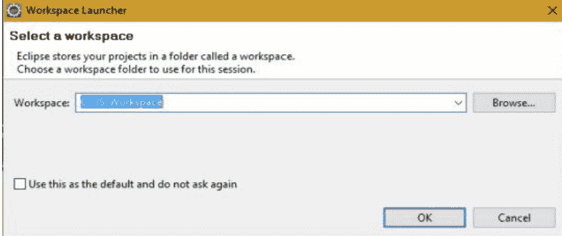

- 在 Eclipse 中导航到 `File -> New -> Static Web Project`。点击下方链接。

- 会弹出一个对话框要求输入项目名称。请输入项目名称并点击下方的“Finish”按钮。

  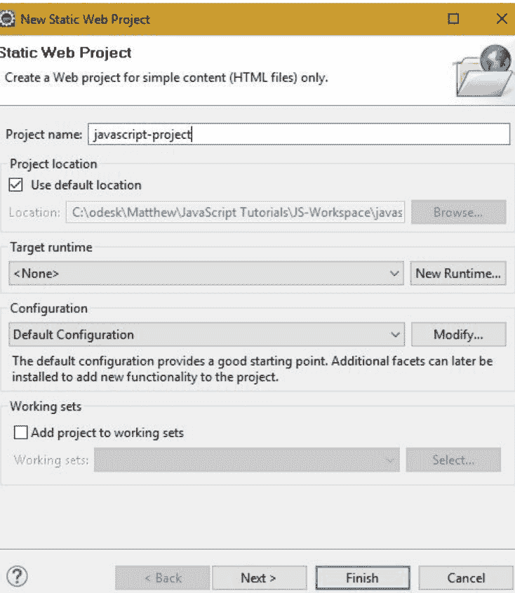

- 在 Eclipse 的左侧（项目资源管理器），展开项目目录，并右键点击“WebContent”文件夹。要在当前项目中添加 HTML 文件，如下所示导航到 `New -> HTML File`。

  会弹出一个对话框要求输入文件名。请输入文件名并点击下方的“Finish”按钮。这将一个 HTML 文件添加到当前的静态 Web 项目中。

  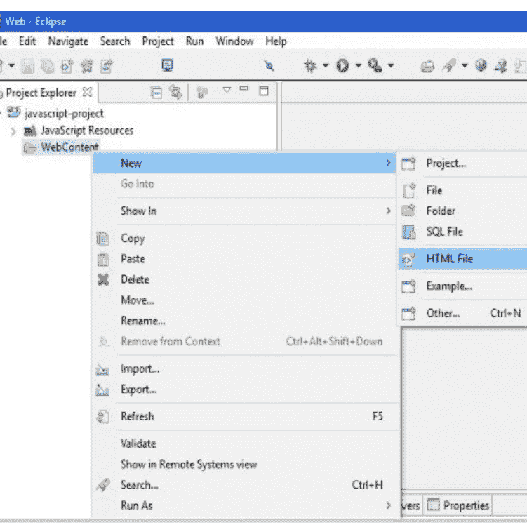

  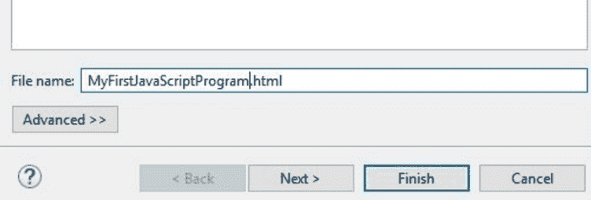

此时，你已成功完成 JavaScript 编程的开发设置。在下一章，我们将使用此设置开发第一个 JavaScript 程序。

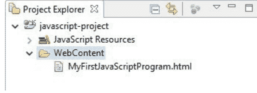

# 第3章

## 我的第一个 JavaScript 程序

JavaScript 是一种脚本语言，可以注入网页中任何位置的 `<script>...</script>` HTML 标签之间，但始终建议将其放置在 `<head> ...</head>` 标签区域。

在解析网页上的标记文本（HTML）时，当浏览器遇到 `<script>` 标签，它开始解释这些标签（直到 `</script>`）之间的所有文本。标签接受以下两个属性：

- **Language**：该属性指定我们使用的脚本类型。对于 JavaScript，值为“javascript”。在最新的 HTML 版本中，该属性已废弃。
- **Type**：该属性指示正在使用的脚本类型，对于 JavaScript，值设置为“text/javascript”。

## 我的第一个 JavaScript 程序

在上一章中，我们创建了一个 HTML 文件（`MyJavaScriptProgram.html`）。让我们用它来编写第一个 JavaScript 程序，如下所示：

```html
<!DOCTYPE html>
<html>
<head>
<meta charset="ISO-8859-1">
<title>My First JavaScript Program</title>
</head>
<body>
<script language="javascript" type="text/javascript">
document.write("Welcome to JavaScript First Program");
</script>
</body>
</html>
```

## JavaScript 代码解释 `<body> ...`

在这里，我们将 JavaScript 代码注入到 HTML 的 `<body> ... </body>` 标签之间。在 JavaScript 代码/脚本中，我们首先声明了之前讨论过的两个属性，然后通过 `document` 对象在网页上写入“Welcome to JavaScript First Program”消息。

### 输出

当我们执行上述 HTML 程序时，将得到以下输出：


### 空格与换行

我们可以在 JavaScript 程序中自由使用空格、制表符和换行符，因为浏览器解析器在解析 JavaScript 代码时会忽略这些内容。此外，我们可以自由地格式化和缩进 JavaScript 程序，使其非常易于维护、阅读和理解。

### 可选分号

通常，所有的 JavaScript 语句都以分号结尾。但当每个 JavaScript 语句都放置在单独的一行时，这些分号是可选的。在每个 JavaScript 语句的末尾使用分号被认为良好的编程习惯。

## 大小写敏感

JavaScript 语言是一种大小写敏感的语言。这意味着，关键字、变量、函数名、标识符等应该使用一致的大小写字母。例如，从 JavaScript 语言的角度来看，标识符 `learn` 和 `LEARN` 是不同的。

## JavaScript 中的注释

以下是 JavaScript 语言支持的注释样式。

- 单行注释声明为 `//`（双斜杠）。
- 多行注释声明为 `/* 多行中的 JavaScript 语句 */`。它也适用于单行注释。
- 它还能识别 HTML 注释（起始序列）`<!--`。JavaScript 将其视为单行注释，就像处理 `//` 注释一样。
- HTML 的结束序列 `-->` 不被 JavaScript 识别，因此应该写成 `//->`。

以下是一个涵盖各种 JavaScript 注释的示例。

```html
<!DOCTYPE html>
<html>
<head>
<meta charset="ISO-8859-1">
<title>JavaScript Comments</title>
</head>
<body>
  <script type="text/javascript">
<!-- 起始序列单行注释。 
  结束序列 HTML 注释//-->
  // 这是一个单行注释。
  /*
  * 这是 JavaScript 中的一个多行注释
  */
</script>
</body>
</html>
```

### 输出

当我们执行上述 HTML 程序时，输出将是以下内容（空白），因为 JavaScript 解释器忽略了所有的注释。

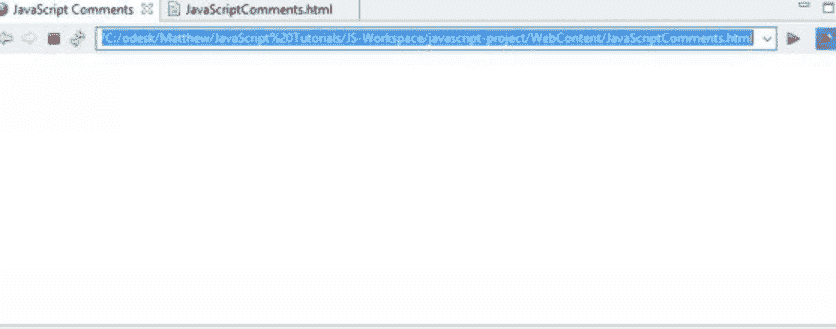

## JavaScript 语法

和其他任何编程语言一样，JavaScript 语法有一套特定的规则来构建它们。

## JavaScript 中的程序

JavaScript 程序是一系列由浏览器程序解析并执行的指令序列。这些程序指令序列被称为语句。

JavaScript 是一种基于对象的编程语言。

JavaScript 语句通常用分号分隔，然而在语句末尾放置分号是可选的。

```html
<!DOCTYPE html>
<html>
<head>
<meta charset="ISO-8859-1">
<title>JavaScript Syntax</title>
<script type="text/javascript">
var a = 101;
var b = 300;
var sum = a + b;
</script>
</head>
<body>
<script type="text/javascript">
document.write("sum of a + b = "+sum);
</script>
</body>
</html>
```

### 输出

当我们执行上述 HTML 程序时，输出将是以下内容。

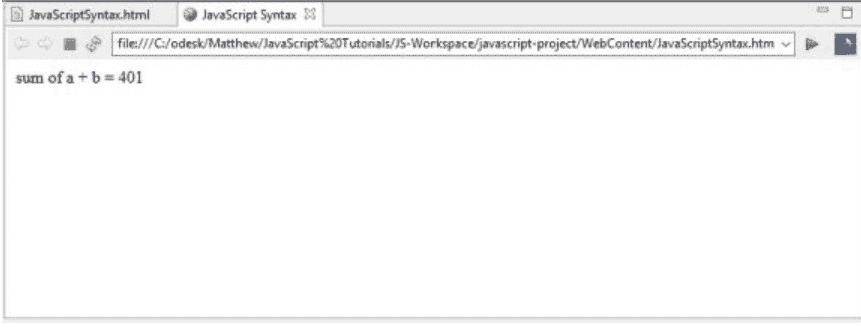

## JavaScript 中的语句

JavaScript 编程语言中的语句由以下部分组成。

- 值
- 运算符
- 表达式
- 关键字，以及
- 注释。

## JavaScript 中的值

以下是 JavaScript 中的两种类型的值。

- 固定值，以及
- 变量值。

字面量是固定值，而变量值被称为变量。

## JavaScript 中的字面量

以下是在 JavaScript 中编写字面量或固定值的规则。

- 数字可以带小数也可以不带小数定义。
- 字符串是写在单引号或双引号内的文本。

### JavaScript 中的变量

以下是用于在 JavaScript 中存储数据的变量值的编写规则。

JavaScript 语言使用 `var` 关键字来声明变量。

变量的值通过等号赋值。

## JavaScript 中的运算符

以下是 JavaScript 语言中使用的运算符。

- **赋值运算符 (`=`)** 用于给变量赋值。
- **算术运算符 (`+`、`-`、`*`、`/`)** 用于加法、减法、乘法和除法等算术运算。

## JavaScript 中的表达式

JavaScript 语言中的任何表达式都是值、变量和运算符的组合。它们共同进行计算。这种计算被称为求值。

表达式也可以包含变量值，例如数字和字符串。例如，“Java” + “Script”将拼接为“JavaScript”。

让我们通过以下示例理解这一点。

```html
<!DOCTYPE html>
<html>
<head>
<meta charset="ISO-8859-1">
<title>JS Expressions</title>
<script type="text/javascript">
  var a = 101; //变量，赋值运算符和数字字面量。
  var b = 300;
  var addition = a + b;
  var str1 = "Java"; //变量，赋值运算符和字符串字面量。
  var str2 = "Script";
  var str3 = str1 + str2;
</script>
</head>
<body>
<script type="text/javascript">
  document.write("Addition of a + b = "+addition);
  document.write("<br>Concat of str1 + str2 = "+str3);
</script>
</body>
</html>
```

### 输出

当我们执行上述 HTML 程序时，输出将是以下内容。输出显示了加法和拼接操作。

## JavaScript 中的关键字

JavaScript 语言中的关键字用于标识需要执行的操作。`var` 关键字引导浏览器创建一个作为 JavaScript 标识符的新变量。在 JavaScript 语言中，标识符用于命名变量（以及关键字、函数和标签）。

在 JavaScript 语言中，第一个字符必须是字母、下划线 (`_`) 或美元符号 (`$`)。随后的字符可以是字母、数字、下划线或美元符号。

## 驼峰命名法与 JavaScript

以下是将多个单词组合为一个变量名的三种方法。

- 连字符 — 例如，`first-address`，`second-address`，`visa-passport`，`city-name` 等。
- 下划线 — 例如，`first_address`，`second_address`，`visa_passport`，`city_name` 等。
- 驼峰命名法 — 例如，`FirstAddress`，`SecondAddress`，`VisaPassport`，`InterName` 等。在 JavaScript 编程语言中，驼峰命名法以小写字母开始，例如 `firstName`，`secondAddress`，`visaPassport`，`cityName` 等。

## JavaScript 中的字符集

JavaScript 语言使用 Unicode 字符集，它涵盖了所有的字符、标点和符号。

# 第 5 章

## JavaScript 的启用与禁用

Internet Explorer、Mozilla Firefox、Google Chrome、Opera 等网络浏览器都内置了 JavaScript 支持。我们可以手动启用或禁用它。在本章中，我们将讨论在这些浏览器中启用和禁用 JavaScript 的过程。

### 在 Internet Explorer 中启用 JavaScript

以下是在 Internet Explorer 中开启或启用 JavaScript 支持的步骤。

- 从菜单导航到“Internet 选项”。
- 从对话框中选择“安全”选项卡。
- 点击“自定义”按钮。
- 向下滚动菜单找到“脚本”选项。
- 选择活动脚本标题下的“启用脚本”单选框。
- 最后，点击“确定”按钮以启用浏览器的 JavaScript。

### 在 Internet Explorer 中禁用 JavaScript

要关闭或禁用 Internet Explorer 中的 JavaScript 支持，请遵循上述步骤并选择活动脚本标题下的“禁用”单选框。

### 在 Mozilla Firefox 中启用 JavaScript

以下是在 Mozilla Firefox 中开启或启用 JavaScript 支持的步骤。

打开新标签页并在地址栏中输入 `about:config`。

在那里我们将发现如下警告对话框，选择并点击按钮“我会小心的，我保证！”所示。

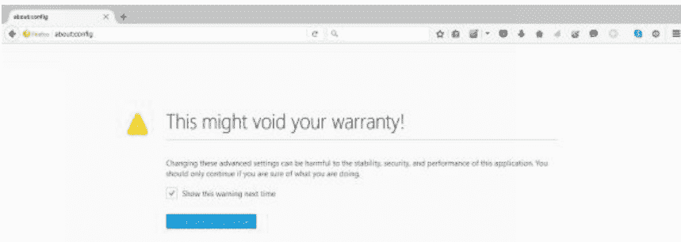

在这里，我们将观察浏览器中的配置选项列表。在搜索框中输入 `javascript.enabled` 所示。

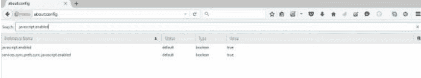

在这里，我们可以通过右键点击选项的值来切换启用或禁用 JavaScript。

点击切换后，如果 `javascript.enabled` 为 `true`，它将转换为 `false`。这将禁用 Mozilla Firefox 浏览器的 JavaScript 支持。

### 在 Mozilla Firefox 中禁用 JavaScript

以下是关闭或禁用 Mozilla Firefox 中 JavaScript 支持的步骤。如果 JavaScript 已禁用，可以按照之前说明的类似步骤点击切换来启用。

### 在 Google Chrome 中启用或禁用 JavaScript 支持

以下是在 Google Chrome 中启用或禁用 JavaScript 支持的步骤。

- 点击 Chrome 右角的 Chrome 菜单。

  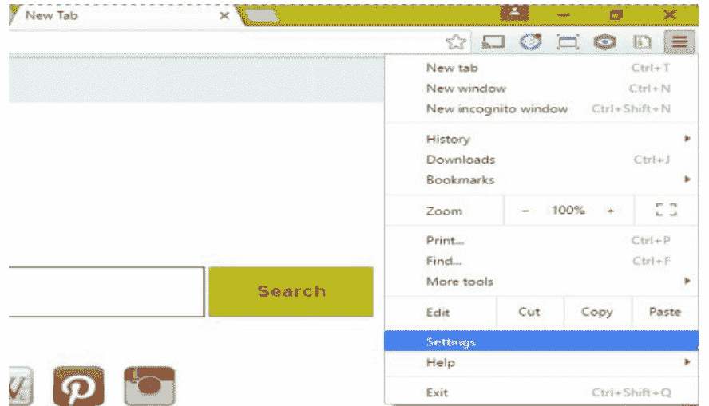

- 选择“设置”（Settings），然后点击页面底部的“显示高级设置”（Show advanced settings）。

  

- 在“隐私”（Privacy）部分下，点击所示的“内容设置”（Content settings）按钮。

  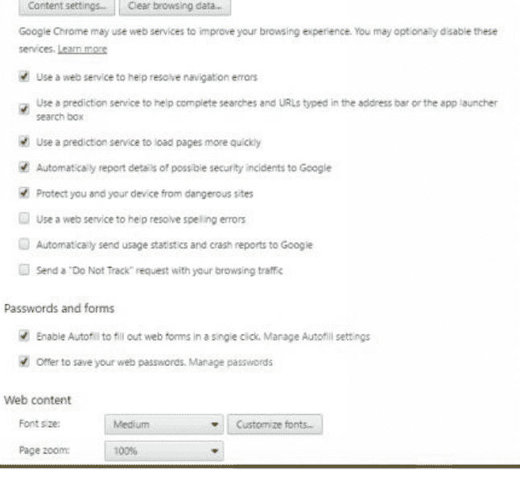

- 在内容设置中的“Javascript”部分，选择“不允许网站运行 JavaScript”或“允许所有网站运行 JavaScript（推荐）”，分别禁用或启用 Chrome 浏览器的 JavaScript 支持。内容设置页面所示。

  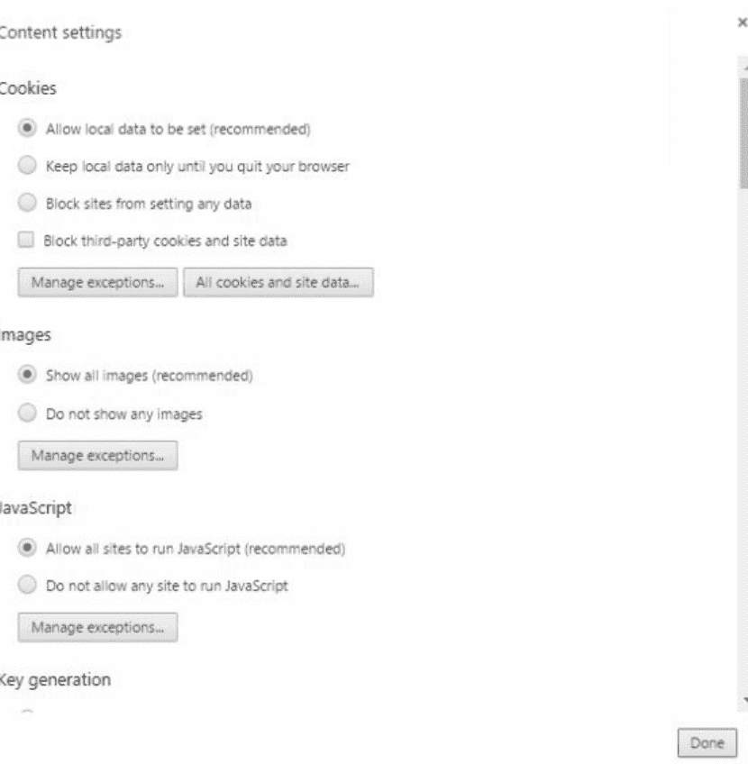

### 在 Opera 中启用或禁用 JavaScript 支持

以下是在 Opera 中启用或禁用 JavaScript 支持的步骤。

- 打开 Opera 浏览器，并从菜单进入**工具**（Tools）> **偏好设置**（Preferences）。
- 然后，从对话框中选择**高级选项**（Advanced option）。
- 接下来，从列出的项目中选择内容（Content）。
- 从那里，选择**启用 JavaScript**（Enable JavaScript）复选框。
- 最后，点击 OK 按钮启用 Opera 浏览器的 JavaScript 支持。

同样，要禁用 Opera 浏览器的 JavaScript 支持，我们不应勾选**启用 JavaScript**复选框并点击 OK 按钮。

### 非 JavaScript 浏览器的警告

当我们需要使用 JavaScript 执行非常重要的操作时，可以使用 `<noscript>` 标签向用户显示警告消息。我们可以像下面所示在脚本块之后添加一个 noscript 块。


```html
<!DOCTYPE html>
<html>
<head>
<meta charset="ISO-8859-1">
<title>No Script tag</title>
</head>
<body>
<script type="text/javascript">
document.write("JavaScript Support is enabled on your browser!");
</script>
<noscript>
Please enable JavaScript support on your browser.
</noscript>
</body>
</html>
```

如果上述任何浏览器不支持 JavaScript 或 JavaScript 支持被禁用，则 `<noscript></noscript>` 标签之间的消息将显示在屏幕上。

# 第 6 章

## JavaScript 的放置位置

JavaScript 代码在 HTML 文档中的放置非常灵活，可以以以下方式放置。

**在 `<head>...</head>` 部分中放置 JavaScript** —— 这是在 HTML 文档的头部部分包含 JavaScript 代码的最优选方式。我们可以将 JavaScript 代码或函数放置在头部部分，并可以在网页元素事件上访问这些函数，如下所示。

```html
<!DOCTYPE html>
<html>
<head>
<meta charset="ISO-8859-1">
<title>JS in head section</title>
<script type="text/javascript">
  function showAlert(){
    alert("This is an alert from Head section!");
  }
</script>
</head>
<body>
  <input type="button" onclick="showAlert();" value="Call JavaScript"/>
</body>
</html>
```

### 输出

当我们执行上述 HTML 程序时，将会有如下输出。在输出中，当我们点击网页上的按钮时，我们可以看到带有“This is an alert from Head section”消息的警报框。

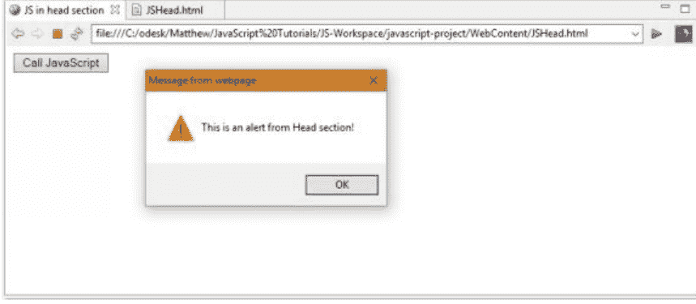

**在 `<body>...</body>` 部分中放置 JavaScript** —— 我们也可以将 JavaScript 代码放置在 HTML 代码的 body 部分，但这种方法并不被首选的，因为我们从 body 部分调用的 JavaScript 函数，而这些函数最好定义在 HTML 文档的 head 部分。

```html
<!DOCTYPE html>
<html>
<head>
<meta charset="ISO-8859-1">
<title>JS Body</title>
</head>
<body>
<script type="text/javascript">
document.write("Welcome to JavaScript Tutorials!")
</script>
<p>Body section of the HTML document.</p>
</body>
</html>
```

### 输出

当我们执行上述 HTML 程序时，将会有如下输出。在输出中，我们可以看到通过 JavaScript 写入 HTML 页面并在 body 部分的文本“Welcome to JavaScript Tutorials!”。

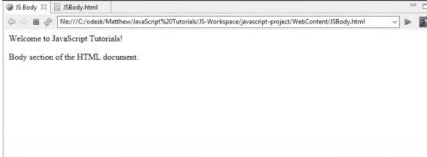

**在 `<body>...</body>` 和 `<head>...</head>` 部分中放置 JavaScript** —— 在这种方法中，JavaScript 代码放置在 HTML 文档的头部和 body 部分，如下例所示。

```html
<!DOCTYPE html>
<html>
<head>
<meta charset="ISO-8859-1">
<title>JS Head and Body</title>
<script type="text/javascript">
function showAlert() {
alert("This is an alert from Head section!");
}
</script>
</head>
<body>
<script type="text/javascript">
  document.write("Welcome to JavaScript Tutorials!");
</script>
<p>Body section of the HTML document.</p>
<input type="button" onclick="showAlert();" value="Call JavaScript"/>
</body>
</html>
```

### 输出

当我们执行上述 HTML 程序时，将会有如下输出。在输出中，我们可以看到通过 JavaScript 写入 HTML 页面并在 body 部分的文本“Welcome to JavaScript Tutorials!”。同时，当我们点击按钮时，它将显示警报消息“This is an alert from Head section”。这是在按钮点击事件上调用的、在头部部分定义的 JavaScript 函数。

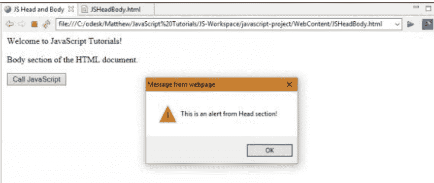

## 外部文件和 `<head>...</head>` 部分中的 JavaScript

在这种方法中，JavaScript 代码放置在 HTML 文档的头部和 body 部分，如下例所示。在下面的示例中，我们在名为 `demo.js` 的文件中定义了 `showAlert()` 函数，并可以在 HTML 文档的 body 部分调用这些网页元素。

```javascript
function showAlert(){
    alert("This is an alert from Head section!");
}
```

我们将此外部文件包含在 HTML 文档的头部部分，如下。

```html
<!DOCTYPE html>
<html>
<head>
<meta charset="ISO-8859-1">
<title>JS External File</title>
<script type="text/javascript" src="js/demo.js"></script>
</head>
<body>
  <input type="button" onclick="showAlert()" value="Call JavaScript"/>
</body>
</html>
```

### 输出

当我们执行上述 HTML 程序时，将会有如下输出。在输出中，我们可以看到带有“This is an alert from Head section”消息的警报框，这是在按钮点击事件上调用的、定义在头部部分的 JavaScript 函数。这与我们将 JavaScript 代码包含在 HTML 文档的头部部分的方式相同。

# 第 7 章

## JavaScript 变量

JavaScript 数据类型是每个编程语言对数据类型集合的操作支持。这些是在任何编程语言中定义和处理的实际值。与其他编程语言一样，JavaScript 语言允许我们处理以下原始数据类型：

- 数字（Numbers），例如 `1`、`23`、`10.50`、`23.8990` 等。
- 字符串（Strings）或文本数据，例如 `"JavaScript"`、`"This is my language"` 等。
- 布尔（Boolean），可以是 `true` 或 `false`。

除了这三种原始数据类型，JavaScript 语言还定义了以下两个平凡类型。每个类型只定义了一个值：

- 空（Null）。
- 未定义（Undefined）。

此外，JavaScript 语言支持一种名为对象（object）的复合数据类型。JavaScript 对象将在本教程的后续详细介绍。

需要注意的是，JavaScript 语言不区分整数值和浮点值。JavaScript 将所有数字都视为浮点值。

### JavaScript 中的变量

正如之前讨论的，JavaScript 语言具有变量数据容器，我们可以将数据放入这些容器中，然后通过命名容器来引用这些数据。如下所示使用 `var` 关键字声明 JavaScript 变量。

```html
<!DOCTYPE html>
<html>
<head>
<meta charset="ISO-8859-1">
<title>JavaScript Variables</title>
<script type="text/javascript">
  var name = "Appy";
  var age = 21;
  var salary = 10000, expenses = 12000;

  alert ("Name: "+name+" Age: "+age+"\nSalary: "+salary+" Expenses: "+expenses);
</script>
</head>
<body>
</body>
</html>
```

### JavaScript 代码说明

将一个值存储在变量中被称为变量初始化。我们可以在变量创建期间的任何时间或在需要该变量时进行变量初始化。

例如，我们在上面的代码中创建了四个变量，并为这些变量每一个赋值了值。例如 `name = "Appy"`，`salary = 10000` 等。

### 输出

当我们执行上述 HTML 程序时，将会有如下输出。在输出中，我们通过 `alert` 显示赋值给数据容器的值。

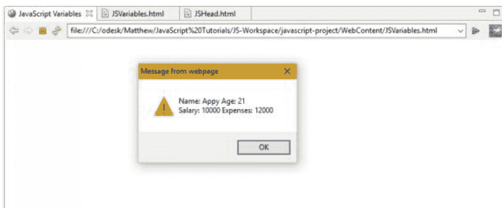

需要注意的是，`var` 关键字仅用于声明或初始化，在 HTML 文档中变量名的生命周期内使用一次。我们不应该多次声明同一个变量。在 JavaScript 中，由于它是无类型语言，变量可以持有任何数据类型的值（数字、字符串等）。与强类型语言（如 C++、JAVA 等）不同，我们不需要在变量声明期间告诉 JavaScript 编译器变量将持有什么类型的值。此外，变量的值在程序执行过程中可以改变，JavaScript 解析器会自动处理。

## JavaScript 中的作用域

变量的作用域定义为定义的程序区域。JavaScript 变量可以具有两种作用域：

**全局变量作用域** – 全局作用域意味着它可以在 JavaScript 代码的任何地方定义并在当前 HTML 文档处可见。

**局部变量作用域** – 局部变量仅在定义的函数内部可见。函数参数始终是函数的局部变量。

需要注意的是，在函数体内，如果定义了同名的局部和全局变量，则局部变量优先级始终高于全局变量。让我们通过以下示例以最好的方式理解这个概念。

```html
<!DOCTYPE html>
<head>
<meta charset="ISO-8859-1">
<title>Variable Scope</title>
</head>
<script type="text/javascript">
var demoVar = "global scope"; // 一个全局变量
function checkVariableScope() {
var demoVar = "local scope"; // 一个局部变量
document.write(demoVar);
}
</script>
<body onload = checkVariableScope();>
</body>
</html>
```

### 输出

当我们执行上述 HTML 程序时，将会有如下输出。在输出中，我们可以观察到值为“local scope”，因为如果两个变量以相同的名称定义，局部变量的优先级高于全局变量。

## JavaScript 中的变量名

在 JavaScript 语言中命名变量时必须遵守遵守规则。

- 不能使用保留关键字作为变量名。这些关键字在本章的最后一节中提到。例如 `finally`、`goto` 等变量名是无效的。
- JavaScript 语言中的变量名不能以数字（0-9）开头。然而，它们可以是字母或下划线字符开头。例如，`10name` 是无效的变量，但 `_10name` 是合法的名称。
- JavaScript 中的变量名是区分大小写的。例如，`Address` 和 `address` 在 JavaScript 语言中被视为两个不同的变量。

## JavaScript 中的保留字

以下是 JavaScript 语言中所有保留字的列表。这些保留字不能作为 JavaScript 变量、循环标签、函数或任何对象名称。

| abstract | debugger | final | instanceof | Public |
| boolean | default | finally | int | Return |
| break | delete | float | interface | Short |
| byte | do | for | long | Static |
| case | double | function | native | Super |
| catch | else | Goto | new | Switch |
| char | Enum | If | null | synchronized |
| class | Export | implements | package | This |
| const | extends | import | private | Throw |
| continue | FALSE | In | protected | Throws |

# 第 8 章

## JavaScript 运算符

当我们加或减两个值时，例如将 5 加 6（即 `5 + 6`），这里的 `'+'` 被称为运算符，`(5 + 6)` 被称为表达式。JavaScript 语言支持以下类型的运算符。

### 算术运算符

以下是 JavaScript 语言支持的算术运算符。

| 序号 | 算术运算符 | 说明 | 示例 |
|---|---|---|---|
| 1. | `+` (加法) | 用于加两个操作数。 | `X + Y` |
| 2. | `-` (减法) | 用于从第一个操作数中减去第二个操作数。 | `X - Y` |
| 3. | `*` (乘法) | 用于乘两个操作数。 | `X * Y` |
| 4. | `/` (除法) | 用于除两个操作数，即被除数除以除数。 | `X / Y` |
| 5. | `%` (模) | 该运算符输出整数除法的余数。 | `X % Y` |
| 6. | `++` (自增) | 通过 `X++` 将整数值加1。 | |
| 7. | `--` (自减) | 通过 `Y--` 将整数值减1。 | |

### 比较运算符

以下是 JavaScript 语言支持的比较运算符。

| 序号 | 比较运算符 | 说明 | 示例 |
|---|---|---|---|
| 1 | `==` (等于) | 该运算符用于检查两个操作数的值是否相等，如果两个值都为真，则条件变为真。 | 例: `(X == Y)` |
| 2 | `!=` (不等于) | 该运算符用于检查两个操作数的值是否相等，如果值不相等，则条件变为真。 | 例: `(X != Y)` |
| 3 | `>` (大于) | 该运算符用于检查左操作数的值是否大于右操作数的值，如果是这样，则条件变为真。 | 例: `(X > Y)` |
| 4 | `<` (小于) | 该运算符用于检查左操作数的值是否小于右操作数的值。 | 例: `(X < Y)` |
| 5 | `>=` (大于或等于) | 该运算符用于检查左操作数的值是否大于或等于右操作数的值。 | 例: `(X >= Y)` |
| 6 | `<=` (小于或等于) | 该运算符用于检查左操作数的值是否小于或等于右操作数。 | 例: `(X <= Y)` |

### 逻辑（或关系）运算符

以下是 JavaScript 语言支持的逻辑或关系运算符。

| 序号 | 逻辑运算符 | 说明 | 示例 |
|---|---|---|---|
| 1 | `&&` (逻辑与) | 如果两个操作数都非零，则该运算符使条件变为真。 | 例: `(X && Y)` 为真。 |
| 2 | `||` (逻辑或) | 如果两个操作数中的任意一个非零，则该运算符为真。 | 例: `(X || Y)` |

### `!` (逻辑非)

该运算符反转其操作数的逻辑状态。如果条件为真，则逻辑非运算符将使其为假，反之亦然。

### 赋值运算符

以下是 JavaScript 语言支持的赋值运算符。

| 序号 | 赋值运算符 | 说明 | 示例 |
|---|---|---|---|
| 1. | `=` (简单赋值) | 该运算符用于将右侧操作数的值赋值给左侧操作数。 | 例: `Z = X - Y` 将赋值给变量 `Z` |
| 2. | `+=` (加赋值) | 该运算符用于将右操作数加到左侧操作数上，并将结果赋值给左操作数。 | 例: `Z += X` |
| 3. | `-=` (减赋值) | 该运算符用于从左侧操作数中减去右操作数，并将结果赋值给左操作数。 | 例: `Z -= X` |
| 4. | `*=` (乘赋值) | 该运算符用于将右操作数乘以左侧的操作数，并将结果赋值给左操作数。 | 例: `Z *= X` |
| 5. | `/=` (除法并赋值) | 此运算符用于除法。例如：`Z /= X` 等同于 `Z = Z / X`。 | 例: `Z /= X` |
| 6. | `%=` (取模并赋值) | 此运算符用于取模。例如：`Z %= X` 等同于 `Z = Z % X`。 | 例: `Z %= X` |

### 条件运算符（或三元运算符）

以下是 JavaScript 语言支持的条件运算符或三元运算符。


| 序号 | 条件运算符 | 描述 | 示例 |
|---|---|---|---|
| 1. | `? :` (条件运算符) | 如果条件为真？例如：`(X > Y)` 值为 X：否则值为 Y。 | `"是" : "否"` |

### 位运算运算符

以下是 JavaScript 语言支持的位运算运算符。

| 序号 | 位运算运算符 | 描述 | 示例 |
|---|---|---|---|
| 1. | `&` (位与) | 此运算符用于对其每个整数参数的每个位执行布尔与操作。 | 例如：`(X & Y)` |
| 2. | `|` (位或) | 此运算符用于对其每个整数参数的每个位执行布尔或操作。 | 例如：`(X | Y)` |
| 3. | `^` (位异或) | 此运算符用于对其每个整数参数的每个位执行布尔异或操作。异或意味着操作数为真或操作二为真，但不同时都为真。 | 例如：`(X ^ Y)` |
| 4. | `~` (位取反) | 位取反是一个一元运算符 `~`，通过反转操作数中的所有位来操作。 | 例如：`(~B)` 是 -4 |
| 5. | `<<` (左移) | 此运算符用于将其第一个操作数的所有位向第二个操作数指定的位数向左移动。 | 例如：`(X << Y)` 是 4 |
| | | 新位用零填充。将值向左移动一位等同于乘以 2，移动二位等同于乘以 4，依此类推。 | |
| 6. | `>>` (右移) | 在二进制右移运算符中，例如：`(X >> 1)` 是 1。根据右操作数指定的位数向右移动。 | |
| 7. | `>>>` (零右移) | 此运算符类似于 `>>`。例如：`(X >>> 1)` 结果是 1。 | |

# 第 9 章

## JavaScript 决策

在编写程序时，我们大多数时候都会面临必须做决策的情况。决策是对程序执行过程中可能发生的条件的预测，并需要根据这些条件指定某些操作。

在决策结构中，有一个条件，可以是单个表达式也可以是多个表达式。该条件在求值时产生 `TRUE` 或 `FALSE` 结果。根据结果，我们需要确定要采取什么操作以及执行哪些语句。请参考下图以清晰理解。

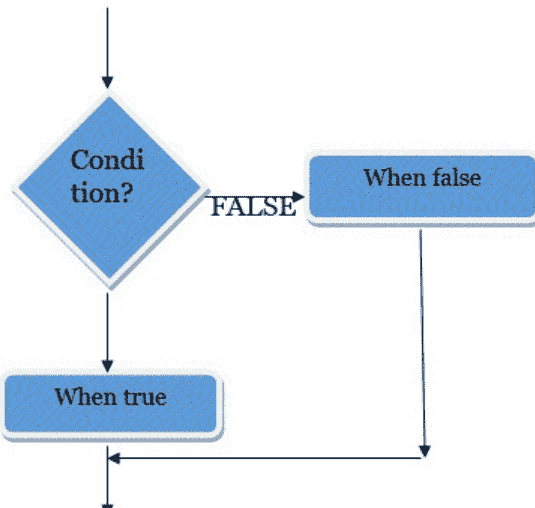

与其他任何编程语言一样，JavaScript 语言支持条件语句，用于根据不同的条件执行不同的操作。以下是 JavaScript 语言支持的条件语句。

- `if` 语句。
- `if...else` 语句。
- `if...else if...` 语句。
- `Switch case` 语句。

让我们通过 JavaScript 程序来理解这些语句。

### if 语句

`if` 语句是一种基础控制语句，允许 JavaScript 代码根据所需的条件做出决策并执行语句。以下是其语法。

#### 语法与示例

```html
<!DOCTYPE html>
<html>
<head>
<meta charset="ISO-8859-1">
<title>基础 IF 语句</title>
</head>
<body>
<script type="text/javascript">
var salary = 10000;
var expenses = 12000;
if (expenses > salary) {
document.write("<b>请开始增加收入或减少开支!</b>");
}
</script>
<p>我们处于 body 区域内部...</p>
</body>
</html>
```

#### 输出

当我们执行上述 HTML 程序时，输出将是如下所示。由于 `if` 语句中的条件为真，因此它会在 HTML 页面上写入给文本。

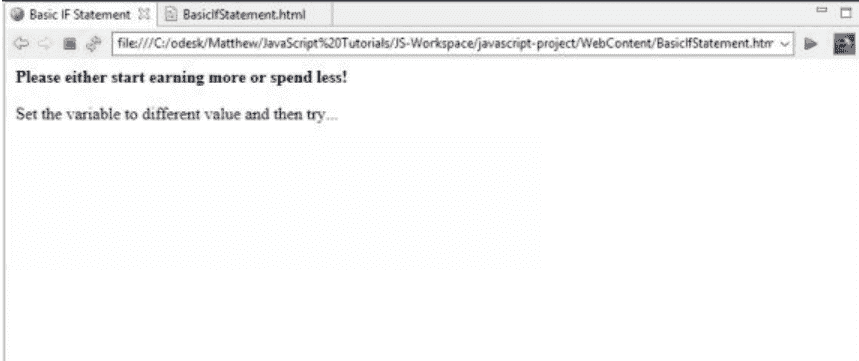

### if...else 语句

`if...else` 语句是控制语句的另一种形式，允许 JavaScript 代码以更受控的方式执行语句。以下是语法和示例。

#### 语法与示例

```html
<!DOCTYPE html>
<html>
<head>
<meta charset="ISO-8859-1">
<title>If Else 语句</title>
</head>
<body>
  <script type="text/javascript">
    var salary = 12000;
    var expenses = 10000;
    if (expenses > salary) {
      document.write("<b>请开始增加收入或减少开支!</b>");
    } else {
      document.write("<b>你有足够的钱花了!</b>");
    }
  </script>
  <p>我们处于 body 区域内部...</p>
</body>
</html>
```

#### 输出

当我们执行上述 HTML 程序时，输出将是如下所示。由于 `if` 语句中的条件为假，因此它进入了 `else` 块并在 HTML 页面上写入了给定的文本。

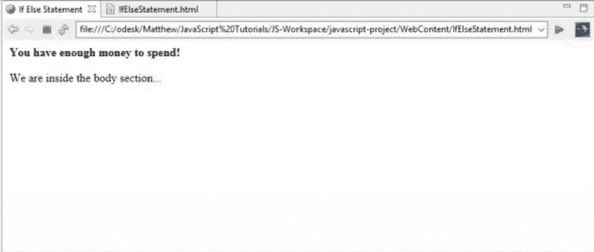

### if...else if... 语句

`if...else if...` 语句是 `if...else` 代码的另一种高级形式，允许 JavaScript 代码在定义的多个条件中做出正确的决策。它有一系列的 `if` 语句，其中每个 `if` 语句都是上一个语句 `else` 子句的一部分。这些语句根据真条件执行，如果发现没有任何条件为真，则将执行 `else` 块中的代码。以下是语法示例。

```html
<!DOCTYPE html>
<html>
<head>
<meta charset="ISO-8859-1">
<title>If Else 语句</title>
</head>
<body>
<script type="text/javascript">
var salary = 12000;
var expenses = 10000;
if (expenses > salary) {
document.write("<b>请开始增加收入或减少开支!</b>");
}
else if (salary > 13000){
document.write("<b>你有足够的钱花了!</b>");
}
else {
  document.write("<b>你有足够的钱花了但需要小心!</b>");
}
</script>
<p>我们处于 body 区域内部...</p>
</body>
</html>
```

#### 输出

当我们执行上述 HTML 程序时，输出将是如下所示。由于 `if` 语句中的条件为假，因此它进入了 `else` 块，且条件恰好为假。它在 HTML 页面上写入了文本。

### Switch case 语句

从 JavaScript 1.2 版本开始，它开始支持 `switch` 语句，处理与重复 `if...else` 语句相同的情况。

`switch` 语句用于根据表达式的值提供不同的语句。JavaScript 解释器会检查每个 `case` 是否匹配表达式的值，直到找到匹配。如果没有找到匹配，则使用 `default` 条件。

此外，在 `case` 代码语句末尾存在 `break` 语句。如果在这里没有声明 `break`，解释器将继续执行后续 `case` 中的语句。

以下是 `switch case` 语句的语法示例。

```html
<!DOCTYPE html>
<html>
<head>
<meta charset="ISO-8859-1">
<title>Switch Case 语句</title>
</head>
<body>
<script type="text/javascript">
  var expensecode='X';
document.write("进入 switch块<br />");
switch(expensecode)
{
case 'X': document.write("<b>请开始增加收入或减少开支!</b>");
break;
case 'Y': document.write("<b>你有足够的钱花了!</b>");
break;
case 'Z': document.write("<b>虽然你有足够的钱但需要小心!</b>");
break;
default: document.write("未找到匹配!<br/>");
}
document.write("<br>退出 switch块<br/>");
</script>
<p>我们处于 body 区域内部...</p>
</body>
</html>
```

#### 输出

当我们执行上述 HTML 程序时，输出将是如下所示。程序在 HTML 页面上写入了 `case` 字符 (`'X'`) 匹配的文本。

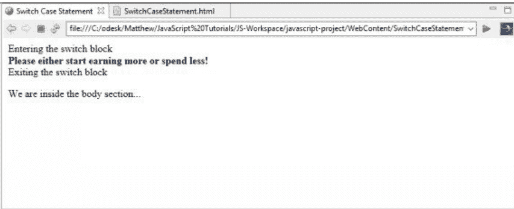

# 第 10 章

## JavaScript 循环

当任何程序执行时，它都是按顺序运行的。出现在序列中第一条语句首先执行，然后是下一条语句，依此类推，直到程序的最后一条语句。很多时候，需要在程序中多次运行相同的代码块，这时就产生了被称为“循环”的控制结构的需求。

循环使代码块中的某条语句或一组语句在条件为真时执行多次，并在条件变为假时退出循环。下图展示了这种循环的插图。

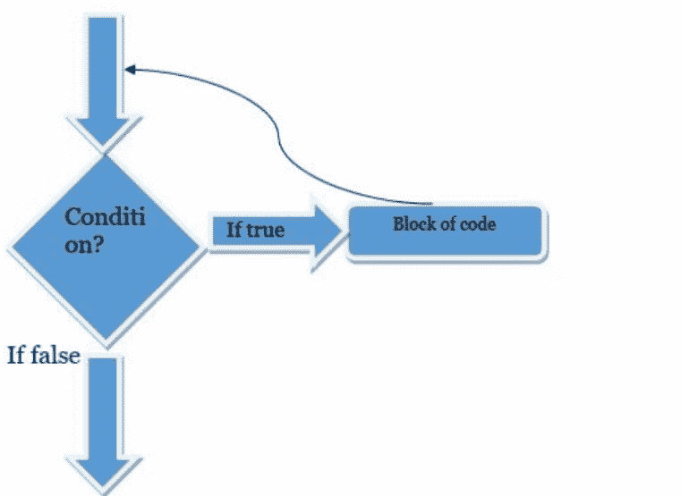

与任何其他编程语言一样，JavaScript 也支持循环，以及以下类型的循环和循环控制语句。

- `While` 循环
- `Do...while` 循环
- `For` 循环
- `for...in` 循环

### 循环控制语句

### While 循环语句

`While` 循环是 JavaScript 语言中最基础的循环。只要表达式保持为真，该循环就会重复执行一条语句或代码块。一旦表达式为假，循环就会终止。以下是 `while` 循环语句的语法和示例。

```html
<!DOCTYPE html>
<html>
<head>
<meta charset="ISO-8859-1">
<title>While Loop</title>
</head>
<body>
<script type="text/javascript">
var counter = 0;
document.write("Entering while Loop!");
while (counter < 5) {
document.write("Current Counter is : " + counter + "<br />");
counter++;
}
document.write("Exiting while Loop!");
</script>
<p>We are inside body section...</p>
</body>
</html>
```

#### 输出

当我们执行上述 HTML 程序时，输出将如下所示。计数器会在 HTML 页面上写入 5 次，因为它的条件保持了 5 次真。

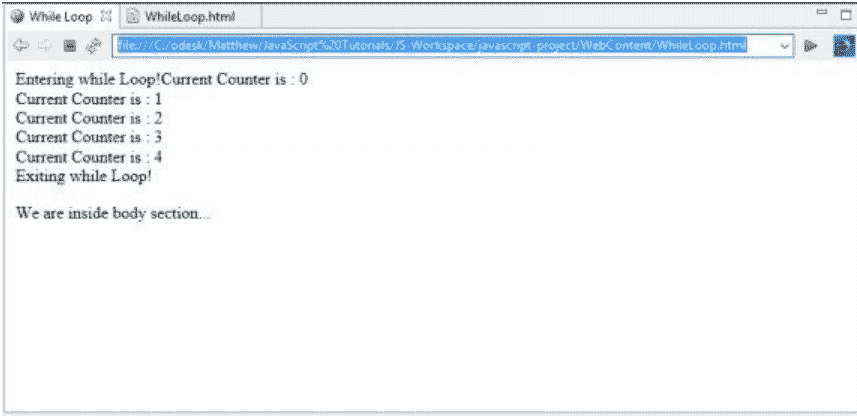

### Do...while 循环语句

`do...while` 循环与 `while` 循环相似，不同在于 `do...while` 循环中的条件检查发生在循环的末尾。这意味着即使条件为假，循环内部的代码块也至少会被执行一次。以下是 `do...while` 循环语句的语法和示例。

```html
<!DOCTYPE html>
<html>
<head>
<meta charset="ISO-8859-1">
<title>Do While Loop</title>
</head>
<body>
<script type="text/javascript">
var counter = 0;
document.write("Entering while Loop!");
do {
  document.write("Current Counter is : " + counter + "<br/>");
  counter++;
}
while (counter < 5);
document.write("Exiting while Loop!");
</script>
<p>We are inside body section...</p>
</body>
</html>
```

#### 输出

当我们执行上述 HTML 程序时，输出将如下所示。计数器会在 HTML 页面上写入 5 次，包括第一次没有检查条件，它的条件保持了 5 次真。

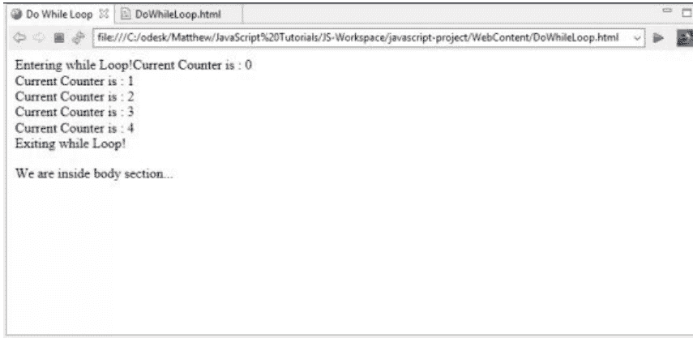

### For 循环语句

`for` 循环是 JavaScript 编程中非常重要且常用的循环语句。该命令包含以下三个重要部分：

- **循环初始化** — 这是我们初始化计数器值为一个起始值的地方。该语句在循环开始之前执行。
- **测试语句** — 它包含实际的条件，该条件会被评估为真或假。如果该条件评估为真，则将执行循环内部的代码块；否则，如果为假，控制流将退出循环。
- **迭代语句** — 这是我们增加或减少在第一条语句中初始化的计数器值的地方。

循环的好处是，我们可以将这三个语句部分放在同一行中，并用分号分隔。以下是语法和示例。

```html
<!DOCTYPE html>
<html>
<head>
<meta charset="ISO-8859-1">
<title>For Loop</title>
</head>
<body>
<script type="text/javascript">
document.write("Entering while Loop!");
for(counter = 0; counter < 5; counter++) {
document.write("Current Counter is : " + counter + "<br />");
}
document.write("Exiting while Loop!");
</script>
<p>We are inside body section...</p>
</body>
</html>
```

#### 输出

当我们执行上述 HTML 程序时，输出将如下所示。计数器会在 HTML 页面上写入 5 次，因为它在循环结束前其条件保持了 5 次真。

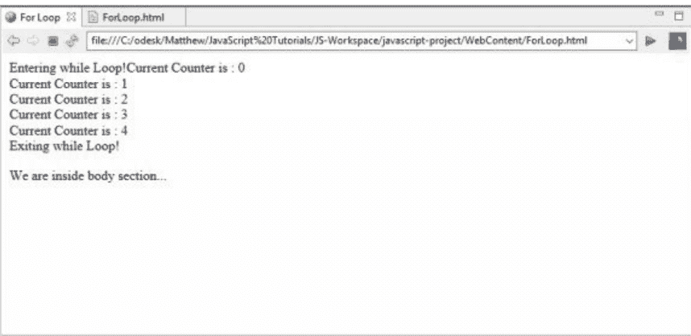

### for...in 循环

`for...in` 循环用于遍历对象的属性。以下是 `for...in` 循环的语法和示例。

```html
<!DOCTYPE html>
<html>
<head>
<meta charset="ISO-8859-1">
<title>For Loop</title>
</head>
<body>
<script type="text/javascript">
document.write("Entering while Loop!");
for (prop in document) {
document.write(prop);
}
document.write("Exiting while Loop!");
</script>
<p>We are inside body section...</p>
</body>
</html>
```

#### 输出

当我们执行上述 HTML 程序时，输出将如下所示。计数器会在 HTML 页面上写入 5 次，因为它的条件保持了 5 次真。


```javascript
function sayHelloToJavaScript() {
  alert("Welcome to the world of JavaScript!");
}
</script>
</head>
<body>
</body>
</html>
```

## 调用函数

我们可以在脚本的后部分或在 HTML 网页元素的事件中调用 JavaScript 函数，我们只需要像下面的代码所示编写该函数的名称。

```html
<!DOCTYPE html>
<html>
<head>
<meta charset="ISO-8859-1">
<title>函数定义</title>
<script type="text/javascript">
function sayHelloToJavaScript() {
  alert("Welcome to the world of JavaScript!");
}
</script>
</head>
<body>
</body>
</html>
```

### 输出

当我们执行上述 HTML 程序时，将输出以下内容。在这里，我们在按钮的点击事件上调用了 JavaScript 函数，显示一个带有消息的警告框，消息是从定义 JavaScript 函数的 HTML 头部部分（head section）中获取的。

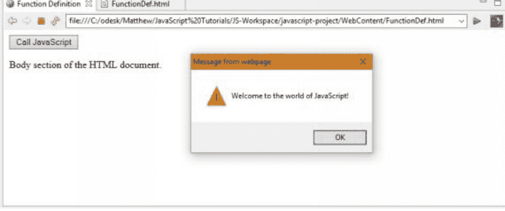

## 函数参数

到为止，我们使用的是没有输入参数的函数。在 JavaScript 函数中，我们可以在调用时传递不同的参数。传递的参数值可以在函数内部使用，我们可以对这些参数进行操作。一个函数可以接受零到多个参数。函数中的多个参数之间用逗号分隔。以下是参数化函数的语法和示例。


```html
<!DOCTYPE html>
<html>
<head>
<meta charset="ISO-8859-1">
<title>参数化函数</title>
<script type="text/javascript">
function sayHelloToJavaScript(message,entity,lang) {

  alert(message+" to "+entity+" world of "+lang+"!");
}
</script>
</head>
<body>

  <input type="button" onclick="sayHelloToJavaScript('Welcome','World','JavaScript');" value="Call JavaScript"/>
  <p>HTML 文档的 body 部分。</p>
</body>
</html>
```

### 输出

当我们执行上述 HTML 程序时，将输出以下内容。在这里，我们在按钮的点击事件上调用了参数化的 JavaScript 函数，显示一个带有消息的警告框，消息是从定义 JavaScript 函数的 HTML 头部部分中获取的。在这里，我们在函数中传递了三个参数，并在此显示警告消息。

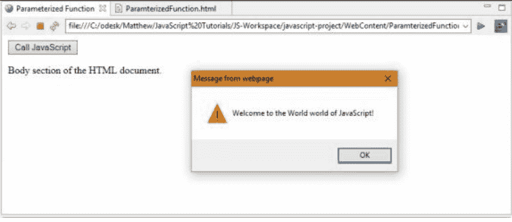

## return 语句

JavaScript 函数可以返回一个值，这个 `return` 语句是可选的。当我们想要从函数返回一个值时使用 `return` 语句。它应该总是 JavaScript 函数中的最后一个语句。让我们通过下面的示例来理解 `return` 函数的使用。

```html
<!DOCTYPE html>
<html>
<head>
<meta charset="ISO-8859-1">
<title>返回函数</title>
<script type="text/javascript">
function concatString(message,entity,lang) {
  var str = message+entity+lang;
  return str;
}
function writeToDoc(message,entity,lang) {
  concatStr = concatString(message,entity,lang);
  document.write(concatStr);
}
</script>
</head>
<body>
  <input type="button" onclick="writeToDoc('Welcome to the 'World of '','JavaScript!');" value="Call JavaScript"/>
  <p>HTML 文档的 body 部分。</p>
</body>
</html>
```

### 输出

当我们执行上述 HTML 程序时，将输出以下内容。在这里，我们在按钮的点击事件上调用 JavaScript 函数，在 HTML 页面上显示消息，消息是从定义 JavaScript 函数的 HTML 头部部分获取的。在这里，我们在 “writeToDoc” 函数中传递了三个字符串作为参数，该函数调用了 “concatString” 函数，后者返回拼接后的字符串并写在文档上。

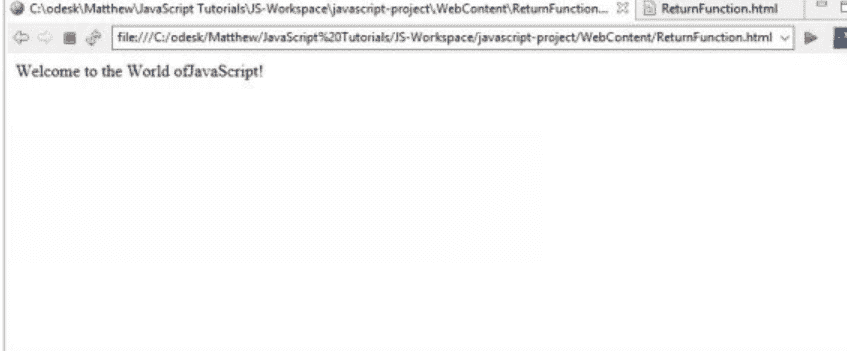

# 第 12 章

## JavaScript 事件

JavaScript 事件是 JavaScript 与 HTML 文档交互的手段。当用户或浏览器对 HTML 页面上的任何值进行操作时，这些事件就会被触发。例如，当我们加载一个 HTML 页面时，这被称为一个事件。同样，当我们点击页面上的按钮时，这也是一个事件。我们可以考虑其他事件的示例，例如按下任何键、通过按钮提交表单、更改窗口大小等。

程序员可以使用这些 JavaScript 事件来触发并执行 JavaScript 代码编写的响应。这些响应包括点击按钮时关闭窗口、向用户显示警告消息、验证数据等。JavaScript 事件是对象模型 (DOM) 的一部分。能够触发 JavaScript 代码。

### onclick 事件

```html
<!DOCTYPE html>
<html>
<head>
<meta charset="ISO-8859-1">
<title>点击事件</title>
<script type="text/javascript">
function showAlert() {
  alert("Welcome to the world of JavaScript!");
}
</script>
</head>
<body>
  <input type="button" onclick="showAlert();" value="Call JavaScript"/>
</body>
</html>
```

### 输出

执行上述 HTML 程序时，将输出。在这里，我们在按钮的点击事件上调用了 JavaScript 函数，显示一个警告框。

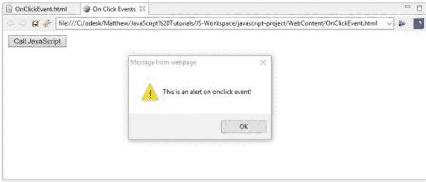

### onsubmit 事件

当我们在提交表单时，这种事件类型进入。我们也可以在此事件类型进行验证。

```html
<!DOCTYPE html>
<html>
<head>
<meta charset="ISO-8859-1">
<title>提交事件</title>
<script type="text/javascript">
function validation() {
  if(form1.textbox1.value != "") {
    alert('验证通过');
    return true;
  }
  else{
    alert('文本框不能为空!');
    return false;
  }
}
</script>
</head>
<body>
<form name="form1" method="GET" action="onClickEvent.html" onsubmit="return validation()">
<input type="text" name="textbox1"/>
<input type="submit" value="Submit" />
</form>
</body>
</html>
```

### 输出

当我们执行上述 HTML 程序时，将输出。在这里，我们在验证文本框，如果没有输入值并点击提交按钮，它将向表单返回 false 并显示“文本框不能为空！”的警告消息。

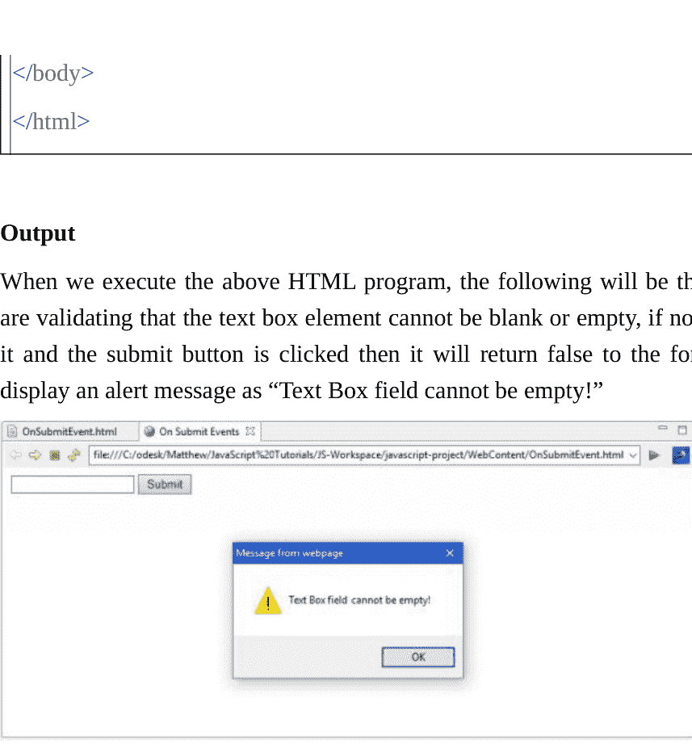

### onmouseover 和 onmouseout 事件类型

这两种是流行的鼠标事件类型，帮助我们为图像或文本创建良好的效果。当我们将鼠标悬停在 HTML 页面上的任何元素上时，`onmouseover` 事件会被触发；当我们将鼠标移出该元素时，`onmouseout` 事件会被触发。下面的示例演示了这些。

```html
<!DOCTYPE html>
<html>
<head>
<meta charset="ISO-8859-1">
<title>鼠标悬入和移出</title>
<script type="text/javascript">
function hoverMouse() {
  alert("鼠标悬入了");
}
function hoverMouseOut() {
  alert("鼠标移出了");
}
</script>
</head>
<body>
<div onmouseover="hoverMouse();"
onmouseout="hoverMouseOut();">
<h1> 将鼠标悬停在这里查看变化 </h1>
</div>
</body>
</html>
```

### 输出

当我们执行上述 HTML 程序时，将输出以下。在这里，当我们将鼠标悬停在标题 div 上时，可以看到警告消息被调用。同样，当我们将鼠标移出该区域时，我们会看到另一个关于移出标题 div 的警告。

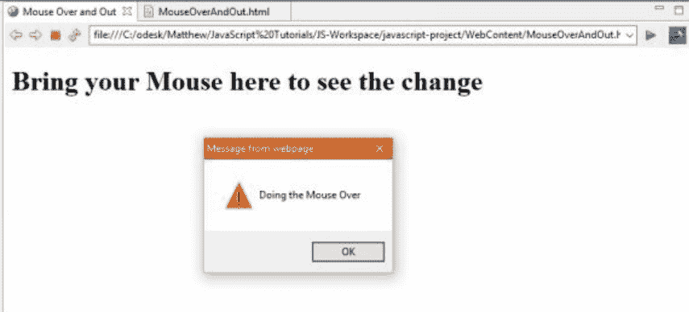

### HTML 5 中存在的标准事件

以下是标准的 HTML 5 事件属性。所有这些属性的值均为脚本，表示在触发事件时要调用并执行的 JavaScript 函数。

| 事件属性 | 值 | 描述 |
| --- | --- | --- |
| onoffline | script | 此属性在文档离线时触发。 |
| onabort | script | 此属性在发生中止事件时触发。 |
| onnafterprint | script | 此属性在文档打印后触发。 |
| onbeforeonload | script | 此属性在文档加载前触发。 |
| onbeforeprint | script | 此属性在文档打印前触发。 |
| onblur | script | 此属性在窗口失去焦点时触发。 |
| oncanplay | script | 此属性在媒体可以开始播放时触发，但可能因为缓冲而必须停止。 |
| oncanplaythrough | script | 此属性在媒体可以顺畅播放到结束且无需因缓冲而停止时触发。 |
| onchange | script | 此属性在元素发生变化时触发。 |
| onclick | script | 此属性在鼠标点击时触发。 |
| oncontextmenu | script | 此属性在触发上下文菜单时触发。 |
| ondblclick | script | 此属性在鼠标双击时触发。 |
| onondrag | script | 此属性在元素被拖动时触发。 |
| ondragend | script | 此属性在拖拽操作结束时触发。 |
| ondragenter | script | 此属性在元素被拖拽到有效的放置目标时触发。 |
| ondragleave | script | 此属性在元素正被拖过有效的放置目标时触发。 |
| ondragover | script | 此属性在拖拽操作开始时触发。 |
| ondragstart | script | 此属性在拖拽操作开始时触发。 |
| ondrop | script | 此属性在拖拽元素被释放时触发。 |
| ondurationchange | script | 此属性在媒体长度改变时触发。 |
| onemptied | script | 此属性在媒体资源元素突然变空时触发。 |
| onended | script | 此属性在媒体到达结束时触发。 |
| onerror | script | 此属性在发生错误时触发。 |
| onfocus | script | 此属性在窗口获得焦点时触发。 |
| onformchange | script | 此属性在表单改变时触发。 |
| onformin | script | 此属性在表单获取用户输入时触发。 |
| onhaschange | script | 此属性在文档发生变化时触发。 |
| oninput | script | 此属性在元素获取用户输入时触发。 |
| oninvalid | script | 此属性在元素无效时触发。 |
| onkeydown | script | 此属性在按下按键时触发。 |
| onkeypress | script | 此属性在按下按键时。 |
| onkeyup | script | 此属性在释放按键时触发。 |
| onload | script | 此属性在文档加载时触发。 |
| onloadeddata | script | 此属性在媒体数据加载时触发。 |
| onloadedmetadata | script | 此属性在媒体元素的持续时间和和其他媒体数据加载时触发。 |
| onloadstart | script | 此属性在浏览器开始加载媒体数据时触发。 |
| onmessage | script | 此属性在消息触发时触发。 |
| onmousedown | script | 此属性在按下鼠标按钮时触发。 |
| onmousemove | script | 此属性在鼠标指针移动时触发。 |
| onmouseout | script | 此属性在鼠标指针移出元素时触发。 |
| onmouseover | script | 此属性在鼠标指针移入元素上方时触发。 |
| onmouse | script | 此属性在释放鼠标按钮时触发。 |
| onmousewheel | script | 此属性在旋转鼠标轮时触发。 |
| onoline | script | 此属性在文档离线时触发。 |
| onine | script | 此属性在文档上线时触发。 |
| ononline | script | 此属性在文档上线时触发。 |
| onpagehide | script | 此属性在窗口被隐藏时触发。 |
| onpageshow | script | 此属性在窗口变得可见时触发。 |
| onpause | script | 此属性在媒体数据被暂停时触发。 |
| onplay | script | 此属性在媒体数据准备开始播放时触发。 |
| onplaying | script | 此属性在媒体数据开始播放时触发。 |
| onpopstate | script | 此属性在窗口历史记录改变时触发。 |
| onprogress | script | 此属性在浏览器正在获取媒体数据时触发。 |
| onratechange | script | 此属性在媒体播放速率改变时触发。 |
| onreadystate | script | 此属性在 readystate 改变时触发。 |
| onredo | script | 此属性在文档执行重做时触发。 |
| onresize | script | 此属性在窗口调整大小时触发。 |
| onscroll | script | 此属性在元素的滚动条被滚动时触发。 |
| onseeked | script | 此属性在媒体元素的寻求属性不再为真 且寻求结束时触发。 |
| onseeking | script | 此属性在媒体元素的寻求属性为真 且寻求已开始时触发。 |
| onselect | script | 此属性在元素被选中时触发。 |
| onstalled | script | 此属性在获取媒体数据时发生错误时触发。 |
| onstorage | script | 此属性在文档加载时触发。 |
| onsubmit | script | 此属性在表单提交时触发。 |
| onsuspend | script | 此属性在浏览器一直在获取媒体数据但在整个媒体文件获取完成之前已停止时触发。 |
| ontimeupdate | script | 此属性在媒体改变其播放位置时触发。 |
| onundo | script | 此属性在文档执行撤销时触发。 |
| onunload | script | 此属性在用户离开文档时触发。 |
| onvolumechange | script | 此属性在媒体改变音量时，当音量被设置为“静音”时触发。 |
| onwaiting | script | 此属性在媒体停止播放但预计恢复时触发。 |

# 第 13 章

## JavaScript 对话框

对话框在 JavaScript 中用于使用 alert 弹出警告、请求确认或接受用户输入。为了支持这些功能，JavaScript 有以下三种类型的对话框：

- 警告对话框 (Alert Dialogue Box)
- 确认对话框 (Confirmation Dialogue Box)
- 提示对话框 (Prompt Dialogue Box)

### 警告对话框

当我们想要在对话框中向用户显示警告消息时，我们使用警告对话框。例如，当我们使用提交事件验证表单时，不接受用户输入，只需显示警告消息，在这种情况下我们使用警告框。警告框只有一个“OK”按钮可以继续。

```html
<!DOCTYPE html>
<html>
<head>
<meta charset="ISO-8859-1">
<title>提交事件</title>
<script type="text/javascript">
function validation() {
if(document.form1.textbox1.value != "") {
alert('验证通过');
return false;
}
else{
    alert("文本框不能为空!");
    return false;
}
</script>
</head>
<body>
<form name="form1" method="GET" action="onClick.html" onSubmit="return validation()">
<input type="text" name="textbox1"/>
<input type="submit" value="提交" />
</form>
</body>
</html>
```

### 输出

当我们执行上面的 HTML 程序时，将得到下面的输出。在这里，我们看到了警告对话框。


### 确认对话框

在 JavaScript 语言中，当我们需要对任何选项获取意见时使用确认对话框。它显示一个有两个按钮的对话框：OK 按钮和取消按钮。

当用户点击 OK 按钮时，窗口方法 `confirm()` 将返回一个真值。否则，如果用户点击取消按钮，`confirm()` 方法将返回一个假值。以下是确认对话框的示例。


```html
<!DOCTYPE html>
<html>
<head>
<meta charset="ISO-8859-1">
<title>确认框</title>
<script type="text/javascript">
function showAlert() {
confirm("这是一个确认对话框示例!");
}
</script>
</head>
<body>
<p>确认框演示示例。</p>
<input type="button" onclick="showAlert();" value="调用 JavaScript"/>
</body>
</html>
```

### 输出

当我们执行上述 HTML 程序时，将输出以下内容。在这里，我们看到了一个确认对话框。

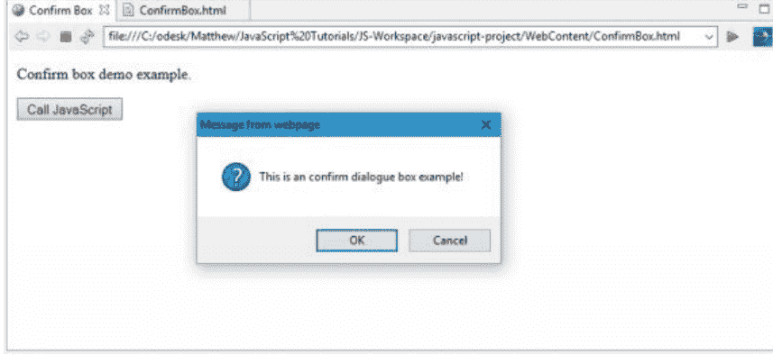

### 提示对话框

在 JavaScript 语言中，当我们想要弹出一个接受用户输入的文本框时，就会使用提示对话框（prompt dialog box）。因此，它允许系统与用户进行交互。用户需要在一个字段中输入所需的数据，然后点击 OK 按钮。

此类对话框通过名为 `prompt()` 的方法显示。它接受以下两个参数：

- 我们想在文本框中显示的标签。
- 一个显示在文本框中的默认字符串。

提示对话框有两个按钮：

- OK 按钮。
- 取消（Cancel）按钮。

当用户点击 OK 按钮时，窗口方法 `prompt()` 将返回用户在文本框中输入的值。否则，如果用户点击取消按钮，窗口方法 `prompt()` 将返回一个 `null` 值。

以下是一个关于提示对话框的示例。

```html
<!DOCTYPE html>
<html>
<head>
<meta charset="ISO-8859-1">
<title>Prompt Box</title>
<script type="text/javascript">
function showAlert(){
prompt("This is an prompt dialogue box example!");
}
</script>
</head>
<body>
<p>Prompt dialogue box demo example.</p>
<input type="button" onclick="showAlert();" value="Call JavaScript"/>
</body>
</html>
```

### 输出

当我们执行上述 HTML 程序时，将输出以下内容。在这里，我们看到了一个提示对话框。

Prompt dialogue box demo example.

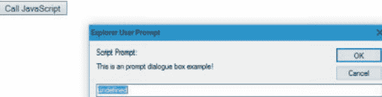

# 第 14 章

## JavaScript void 关键字

在 JavaScript 语言中，`void` 关键字可以用作一元运算符，出现在它的单个操作数之前，且操作数可以是任何类型。这个一元运算符指定了一个表达式，该表达式需要被求值但不产生返回值。

以下是 `void` 关键字的语法和示例。

```html
<!DOCTYPE html>
<html>
<head>
<meta charset="ISO-8859-1">
<title>Void Keyword Example 1</title>
</head>
<body>
  <p>Click here to invoke an alert!</p>
  <a href="javascript:void(alert('Here is the Void Keyword demo'))">Click Here!</a>
</body>
</html>
```

### 输出

当我们执行上述 HTML 程序时，将输出以下内容。在这里，我们看到了点击响应式超链接（“Click Here!”）时弹出的告警对话框。另一方面，如果 `void` 参数为空，则在第二个超链接（“No response link!”）的情况下将没有响应，因为表达式“0”在 JavaScript 中没有作用。当“0”被求值时，它不会重新加载到当前文档中。

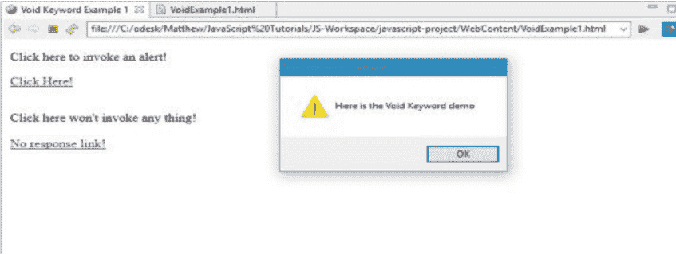

或者，JavaScript 中的 `void` 关键字也用于生成 `undefined` 值，如下例所示。

```html
<!DOCTYPE html>
<html>
<head>
<meta charset="ISO-8859-1">
<title>Void Example 2</title>
<script type="text/javascript">
function getVoidDemo(){
var x,y,z;
x = void ( y = 50, z = 700);
document.write('x = ' + x + ' y = ' + y + ' z = ' + z );
}
</script>
</head>
<body>
<p>Click to get the Result...</p>
<form>
<input type="button" value="Get Result" onclick="getVoidDemo();" />
</form>
</body>
</html>
```

### 输出

当我们执行上述 HTML 程序时，将输出以下内容。在这里，变量‘x’ 的值是 `undefined`，但变量‘y’和‘z’ 的值分别为‘50’和‘700’。

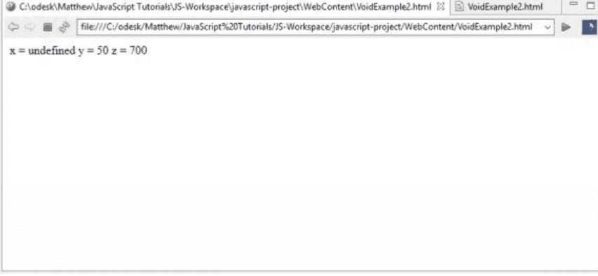

# 第 15 章

## JavaScript 对象

JavaScript 语言是一种基于面向对象编程（OOP）的语言，为程序员提供了以下 OOP 语言特性：

- 封装（Encapsulation）——将所有相关信息（包括数据和方法）共同存储在对象中的概念。
- 聚合（Aggregation）——允许将一个对象存储在另一个对象中的概念。
- 继承（Inheritance）——允许一个类继承或重用另一个类（或多个类）的属性和方法的概念。也称为父类。
- 多态（Polymorphism）——允许程序员编写一个函数/方法，它以不同的方式执行不同的任务，但具有相同的名称定义。也称为方法重载。
- 对象（Objects）——由属性组成。属性可以是一个函数也可以是一个属性。函数被认为是对象的方法。

### JavaScript 中的对象属性

JavaScript 中的对象属性可以是三种原始数据类型（Number、String 和 Boolean）中的任意一种，也可以是抽象类型（如对象）。对象属性可以通过赋值操作来定义。对象属性可以通过点运算符来访问。以下是对象的语法和示例。

```html
<!DOCTYPE html>
<html>
<head>
<meta charset="ISO-8859-1">
<title>Objects</title>
<script type="text/javascript">
var objectName = new Object();
objectName.property = "value";
document.write(objectName.property);
</script>
</head>
<body>
</body>
</html>
```

### JavaScript 中的对象方法

对象方法是附加到对象的函数。在 JavaScript 中，函数是独立的单元，而方法是对象的属性。方法可以对对象进行复杂的操作。在教程中，我们使用了 `write` 方法来显示内容。

```html
<!DOCTYPE html>
<html>
<head>
<meta charset="ISO-8859-1">
<title>Object Method</title>
<script type="text/javascript">
document.write("Welcome to JavaScript!");
</script>
</head>
<body>
</body>
</html>
```

### JavaScript 中的自定义对象

在 JavaScript 语言中，所有的自定义对象以及内置对象继承自 `Object`。

### JavaScript 中的 new 运算符

`new` 运算符用于创建对象的实例。在 JavaScript 中创建一个对象，需要使用 `new` 运算符，后面跟着构造方法如下所示。这里的构造函数有 `Object()`、`Array()` 和 `Date()`。这些构造函数是内置函数。

```html
<!DOCTYPE html>
<html>
<head>
<meta charset="ISO-8859-1">
<title>The New Operator</title>
<script type="text/javascript">
var student = new Object();

var languages = new Array("JavaScript", "Pascal", "Python");

var day = new Date("August 24, 1989");

alert(day);

</script>
</head>
<body>

</body>
</html>
```

### 输出

当我们执行上述 HTML 程序时，将输出以下内容。在这里，我们在告警对话框中显示了 `Date` 对象的属性。

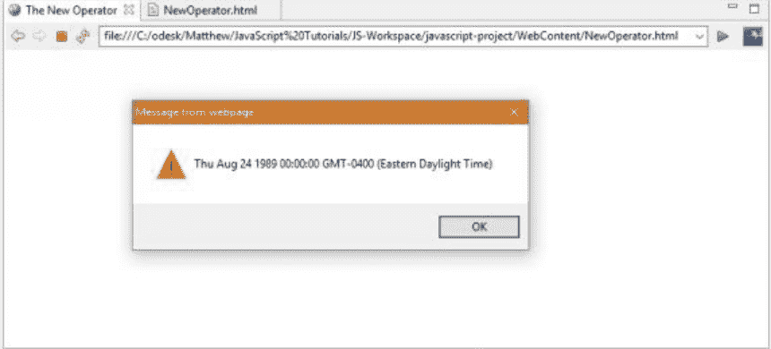

### “Object ()”构造函数

正如之前提到的，构造函数是创建并初始化 JavaScript 对象的函数。特殊的构造函数 `Object` 用于构建 JavaScript 对象。构造函数返回的值被赋值给一个对象引用变量。以下示例演示了 JavaScript 中对象的创建。

```html
<!DOCTYPE html>
<html>
<head>
<meta charset="ISO-8859-1">
<title>Object Creation</title>
<script type="text/javascript">
var student = new Object();
student.name = "Appy";
student.age = "21";
student.course = "JavaScript";
function showDetails() {
 alert("Name: "+student.name + " Age: "+student.age+" Course: "+student.course);
}
</script>
</head>
<body>
<input type="button" onclick="showDetails();" value="Get Student details!" />
</body>
</html>
```

需要注意的是，对象的属性变量并不是使用 `var` 关键字定义的。

### 输出

当我们执行上述 HTML 程序时，将得到如下所示输出。

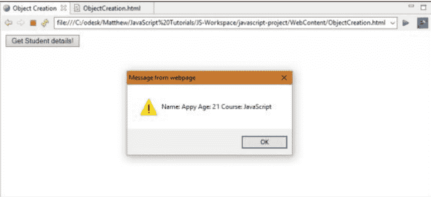

### 在 JavaScript 中为对象定义方法

在上一个示例中，我们演示了如何使用构造函数创建对象并分配属性。在接下来的示例中，我们将演示如何在 JavaScript 中为对象定义方法。

```html
<!DOCTYPE html>
<html>
<head>
<meta charset="ISO-8859-1">
<title>Object Methods</title>
<script type="text/javascript">

function student(name, course){

this.name = name;

this.course = course;

}
</script>

</head>

<body>

  <script type="text/javascript">

    var record = new student("Appy", "JavaScript");

    alert("name is : " + record.name + "Course is " + record.course );

  </script>

</body>

</html>
```

### 输出

我们执行上述 HTML 程序时，将得到如下所示输出。在这里，我们为对象添加了一个函数。

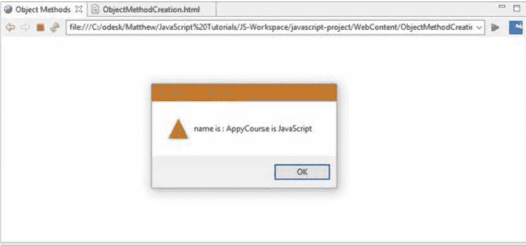

### JavaScript 中的 ‘with’ 关键字

在 JavaScript 中，‘with’ 关键字用作引用对象属性和方法的简写。

在这里，作为 `with` 参数指定的对象在随后的代码块期间成为默认对象。在这种情况下，无需指定对象名称即可使用该对象的属性和方法。以下是语法和示例。

```html
<!DOCTYPE html>
<html>
<head>
<meta charset="ISO-8859-1">
<title>With Keyword</title>
<script type="text/javascript">

// 一个作为方法工作的函数
function addAge(years) {
  with(this) {
    age = years;
  }
}

function student(name, course) {
  this.name = name;
  this.course = course;
  this.age = 0;
  this.addAge = addAge; // 作为方法的属性。
}

</script>
</head>

<body>
<script type="text/javascript">
var record = new student("Appy", "JavaScript");
record.addAge(21);
alert("Name is : " + record.name + " Course is : " + record.course + "\nAge is : " + record.age);
</script>
</body>
</html>
```

### 输出

当我们执行上述 HTML 程序时，将得到如下所示输出。在这里，我们使用了 ‘with’ 关键字，通过将方法分配为属性来后续添加年龄。

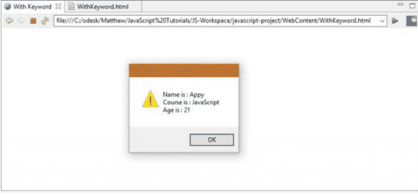

### JavaScript 中的原生对象

JavaScript 语言有许多内置或原生对象。这些原生对象可以在程序的任何地方访问，并且在运行任何类型操作系统的任何浏览器上都会以相同的方式工作。以下是重要的 JavaScript 原生对象：

- JavaScript Array Object（数组对象）
- JavaScript Boolean Object（布尔对象）
- JavaScript Date Object（日期对象）
- JavaScript Math Object（数学对象）
- JavaScript Number Object（数字对象）
- JavaScript RegExp Object（正则表达式对象）
- JavaScript String Object（字符串对象）

## 结论

再次感谢下载本书！

希望这本书能够帮助你学习 JavaScript

下一步是将这些实践付诸工作中。感谢并祝你好运！

# Python 编程预览

## 第一章 Python 编程语言简介

你知道 YouTube 和 Dropbox 等网站在源码中使用了 Python 吗？Python 是一种易于理解和应用的语言。你可以使用 Python 开发任何内容。除了 Windows 之外，大多数操作系统（Mac, Linux, UNIX 等）默认安装了 Python。它是一种开源且免费的语言。在本电子书中，我们将学习这种很强大的代码语言并将其应用于各种示例中。Python 中没有方法、参数、函数或变量的类型声明（像其他语言那样），这使得它的代码简洁简单。正如前面提到的，这种语言可以用于任何地方，无论你想构建网站、游戏还是搜索引擎。使用 Python 的主要优势是你不需要显式地运行编译器，它是一种像 Perl 或 Shell 一样的纯解释型语言。

Python 源文件使用的扩展名为 `.py`，它是一种区分大小写的语言，因此“P”和“p”被视为两个不同的变量。此外，Python 会自动确定变量类型，例如，如果你设置 `x=4` 和 `y='Python'`，它将认为 `x` 为整数，`y` 为字符串。我们将在后面的章节中详细学习所有这些基础知识。在继续之前，有几点重要的内容需要记住：

1. 赋值使用 `=`，比较使用 `==`。例如，`x=4, y=8, x==y`。
2. 使用 `print` 来打印结果。
3. 所有的数学运算如 `+`, `-`, `*`, `/` 都用于数字。
4. 给变量赋值值时会创建变量。例如，`a=5` 将创建一个名为 `a` 的变量，其值为整数 5。不需要提前定义它。
5. `+` 也可以用于连接两个字符串。例如，`z="Hi"`, `z= z + "Python"`。
6. 逻辑操作使用 `and`、`or`、`not` 代替符号。

有三种基本数据类型：整数（数字的默认类型）、浮点数（`a=3.125`）和

或访问：http://amzn.to/2auRjNy
