# JavaScript 编程入门指南

**Nick Godard**

## 第一章

### JavaScript 语言简介

欢迎来到 JavaScript 的世界。它由 Brendan Eich 于 1995 年发明，直到今天仍然是全球最常用的脚本语言。它是一种高级、解释型、跨平台的开源编程语言。在这一系列教程中，我们将通过实际示例来学习 JavaScript。在开始之前，让我们先回顾一些基础知识。

JavaScript 是一种面向对象（OOP）脚本语言，主要用于 Web 编程。它负责让网页具有交互性；简单来说，“它告诉网页执行什么操作”。就像 HTML 定义了网页的内容，CSS 定义了布局，JavaScript 让该网页能够正常工作。JavaScript 程序是按照编写顺序执行的指令集，因此在编码时，我们应该注意逻辑顺序。不要将 Java 和 JavaScript 混淆，它们在设计方面技术上是两种不同的语言，但它们的标准库和语法是相同的。

现在，让我们学习如何在你的计算机上安装这种神奇的语言，并编写我们的第一个 JavaScript 程序。

## 第二章

### 开发 IDE 环境搭建

在整个教程中，我们将使用 `eclipse` 作为开发 IDE，以实际演示解释 JavaScript 程序示例。以下是安装 `eclipse` 并为 JavaScript 配置开发环境的步骤。

请遵循以下步骤：

1. 从下方链接下载 `eclipse`。选择最新的稳定版本 `eclipse`，并确保如果你的机器是 64 位的，则选择 64 位的 `eclipse`。在本教程中使用 `eclipse MARS.1` 版本。

   https://eclipse.org/downloads

2. 点击 `eclipse.exe` 打开 `eclipse`，它会提示你选择一个本地目录作为其工作空间（`workspace`），如下方的截图所示。

3. 在任何可用驱动器上选择或创建一个目录，点击 `OK` 按钮启动 `eclipse`。

   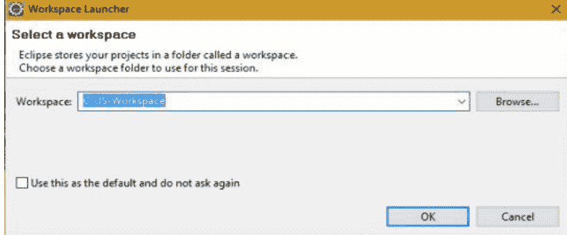

4. 在 `eclipse` 中，导航至 `File`（文件）-> `New`（新建）-> `Static Web Project`（静态 Web 项目）。点击下方显示的链接。

5. 将打开一个对话框，要求你输入项目名称。请输入项目名称并点击下方的 `Finish`（完成）按钮。

   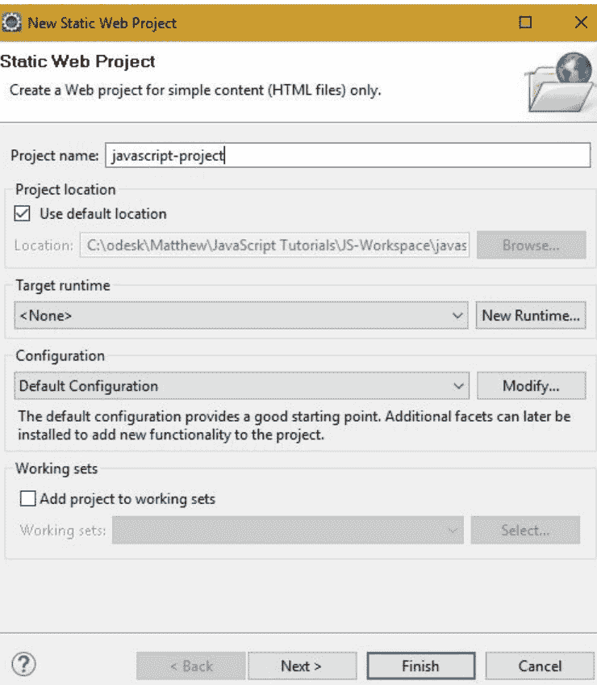

6. 在 Eclipse 的左侧（项目资源管理器），展开项目目录并右键点击 `WebContent` 文件夹。若要在当前项目中添加 HTML 文件，导航至 `New`（新建）-> `HTML File`（HTML 文件），如下所示。

   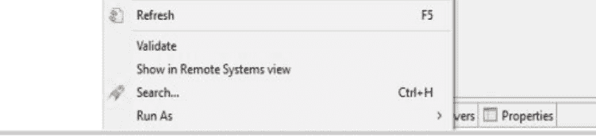

7. 将打开一个对话框，要求你输入项目名称。请输入项目名称并点击下方的 `Finish`（完成）按钮。这将向项目中添加一个 HTML 文件。

   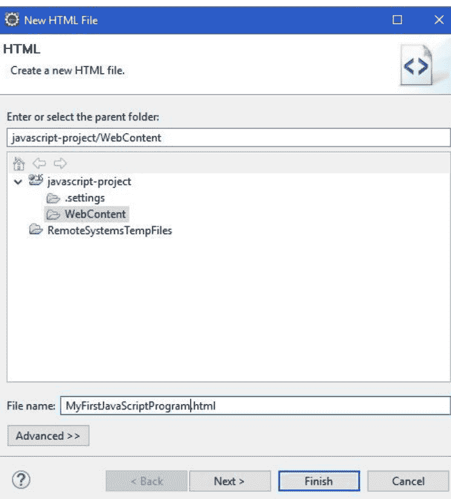

到此，你已完成 JavaScript 的开发工作。在下一章中，我们将使用此设置开发我们的第一个 JavaScript 程序。

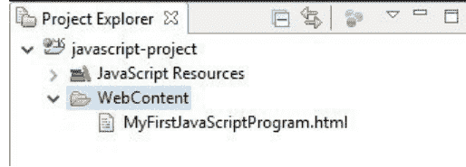

## 第三章

### 我的第一个 JavaScript 程序

JavaScript 是一种脚本语言，可以注入到网页的任何位置 `<script>...</script>` 标签中，但通常建议放在 `<head> ... </head>` 标签区域。

在解析网页上的标记文本（HTML）时，当浏览器程序遇到 `<script>` 标签，它开始解释这些标签之间（直到 `</script>`）的所有文本。`<script>` 标签接受以下属性：

- **Language（语言）**：指定我们正在使用的脚本语言类型。其值为 `javascript`，用于 JavaScript 语言。在最新版本的 HTML 中，该属性已被废弃。
- **Type（类型）**：指示所包含的脚本语言类型，其值将设置为 `text/javascript`，用于 JavaScript 语言。

### 我的第一个 JavaScript 程序

在上一章中，我们创建了一个 html 文件 (`MyFirstJavaScriptProgram.html`)。让我们使用它来编写我们的第一个 JavaScript 程序，如下所示。

```html
<!DOCTYPE html>
<html>
<head>
<meta charset="ISO-8859-1">
<title>My First JavaScript Program</title>
</head>
<body>
<script language="javascript" type="text/javascript">
document.write("Welcome to JavaScript First Program");
</script>
</body>
</html>
```

### JavaScript 代码 `<body> ... </body>` 标签的解释

在这里，我们将 JavaScript 代码注入到 HTML 的 `<body> ... </body>` 标签之间。在 JavaScript 代码/脚本中，我们首先按照讨论声明了两个属性，然后通过 `document` 对象的帮助，在网页上写入 “Welcome to JavaScript First Program” 消息。

### 输出

当我们执行上述 HTML 程序时，将得到以下输出。

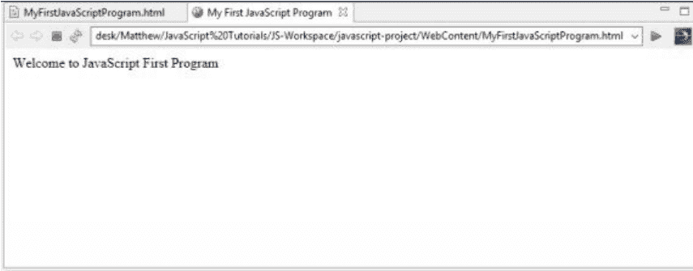

### 空格与换行

我们可以在 JavaScript 程序中自由使用空格、制表符和换行，因为浏览器解析程序在解析 JavaScript 代码时会忽略这些内容。此外，我们可以自由地对 JavaScript 程序进行格式化和缩进，使脚本非常易于维护、阅读和理解。

### 可选的分号

通常，所有的 JavaScript 语句都以分号结束。但当每个 JavaScript 语句都放置在单独的一行时，这些分号是可选的。在每个 JavaScript 语句末尾使用分号被认为是一种良好的编程习惯。

### 大小写敏感

JavaScript 语言是一种大小写敏感的语言。这意味着关键字、变量、函数名、标识符等在使用时字母的大小保持一致。例如，从 JavaScript 语言的角度来看，标识符 `learn` 和 `LEARN` 是不同的。

### JavaScript 中的注释

以下是 JavaScript 语言支持的注释样式。

- 单行注释声明为 `//`（双斜杠）。
- 多行注释声明为 `/* 位于多行的 JavaScript 语句 */`。它也适用于单行注释。
- 它还能识别 HTML 注释（起始序列）`<!--`。JavaScript 将其视为单行注释，就像处理 `//` 注释一样。
- HTML 的结束序列 `-->` 不被 JavaScript 识别，因此应写成 `//-->`。

以下是一个涵盖各种 JavaScript 注释的示例。

```html
<!DOCTYPE html>
<html>
<head>
<meta charset="ISO-8859-1">
<title>JavaScript Comments</title>
</head>
<body>
<script type="text/javascript">
<!-- 起始序列单行注释。
  结束序列 HTML 注释//-->

// 这是一个单行注释。

/*
 * 这是 JavaScript 中的一个多行注释
*/
</script>
</body>
</html>
```

### 输出

当我们执行上述 HTML 程序时，输出将是如下所示的（空白），因为 JavaScript 解释器忽略了所有注释。

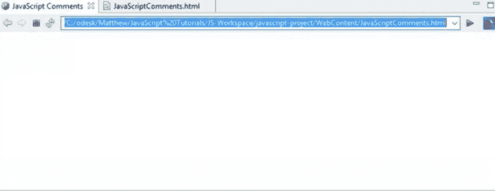

## JavaScript 语法

与任何其他编程语言一样，JavaScript 语法是由一组特定的规则构建的。

### JavaScript 程序

JavaScript 程序是一系列由浏览器解析并执行的指令。这些指令序列被称为语句。

JavaScript 是一种基于对象的编程语言。

JavaScript 语句通常用分号隔开，但在末尾放置分号是可选的。

```html
<!DOCTYPE html>
<html>
<head>
<meta charset="ISO-8859-1">
<title>JavaScript Syntax</title>
<script type="text/javascript">
  var a = 101;
  var b = 300;
  var sum = a + b;
</script>
</head>
<body>
<script type="text/javascript">
  document.write("sum of a + b = " + sum);
</script>
</body>
</html>
```

### 输出

执行上述 HTML 程序时，输出如下所示。

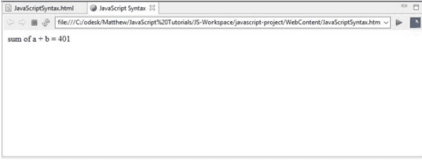

### JavaScript 中的语句

JavaScript 语言语句由以下部分组成：

- 值
- 运算符
- 表达式
- 关键字
- 注释

### JavaScript 中的值

JavaScript 中的值有两种类型：

- 固定值
- 变量值

字面量（`Literals`）是固定值，变量值被称为变量。

### JavaScript 中的字面量

在 JavaScript 中编写字面量或固定值的规则如下：

- 数字（带或不带小数）
- 字符串（写在单引号或双引号内）

### JavaScript 中的变量

JavaScript 语言使用 `var` 关键字来声明变量。

变量的值通过等号进行赋值。

### JavaScript 中的运算符

JavaScript 语言使用的运算符如下：

- **赋值运算符 (`=`)**：用于给变量赋值。
- **算术运算符 (`+`, `-`, `*`, `/`)**：用于加、减、乘、除运算。

### JavaScript 中的表达式

JavaScript 语言中的任何表达式都是值、变量和运算符的组合。这些共同进行计算。

表达式也可以包含变量值，如数字和字符串。例如 `"Java" + "Script"` 将拼接为 `"JavaScript"`。通过以下示例理解这一点：

```html
<!DOCTYPE html>
<html>
<head>
<meta charset="ISO-8859-1">
<title>JS Expressions</title>
<script type="text/javascript">
  var a = 101; // 变量，赋值运算符和数字字面量。
  var b = 300;
  var addition = a + b;
  var str1 = "Java"; // 变量，赋值运算符和字符串字面量。
  var str2 = "Script";
  var str3 = str1 + str2;
</script>
</head>
<body>
<script type="text/javascript">
  document.write("Addition of a + b = " + addition);
  document.write("<br>Concat of str1 + str2 = " + str3);
</script>
</body>
</html>
```

### 输出

执行上述 HTML 程序时，输出如下。输出显示了加法。

### JavaScript 中的关键字

JavaScript 中的关键字是用于标识操作保留字。在 JavaScript 中，标识符用于命名。

### 驼峰法与 JavaScript

将单词合并为一个字的三种方法：

- 连字符 — 例如，`first-address`, `second-address`。
- 下划线 — 例如，`first_address`, `second_address`。
- 驼峰法 — 例如，`FirstAddress`, `SecondAddress`。

### JavaScript 中的字符集

JavaScript 语言使用 Unicode 字符集，它涵盖了所有字符和标点。

### JavaScript 的启用与禁用

Internet Explorer、Mozilla Firefox、Google Chrome 等网络浏览器都内置了 JavaScript 支持。我们可以手动启用或禁用该支持。在本章中，我们将讨论在这些浏览器中启用和禁用 JavaScript 的步骤。

#### 在 Internet Explorer 中启用 JavaScript 支持

以下是在 Internet Explorer 中开启或启用 JavaScript 支持的步骤：

- 从菜单选项导航到 `工具 (Tools)` -> `Internet 选项 (Internet Options)`。
- 从对话框选择 `安全 (Security)` 选项卡。
- 点击 `自定义级别 (Custom Level)` 按钮。
- 向滚动菜单找到 `脚本 (Scripting)` 选项。
- 选中 `活动脚本 (Active scripting)` 下的单选按钮。
- 最后，点击 `确定 (OK)` 按钮以启用 IE 的 JavaScript 支持。

#### 在 Internet Explorer 中禁用 JavaScript 支持

要关闭或禁用 Internet Explorer 中的 JavaScript 支持，请遵循上述步骤并禁用 `活动脚本 (Active scripting)` 下的单选按钮。

#### 在 Mozilla Firefox 中启用 JavaScript 支持

以下是在 Mozilla Firefox 中开启或启用 JavaScript 支持的步骤：

1. 打开新标签页，并在地址栏输入 `about:config`。
2. 在那里我们将看到下面的警告对话框，点击如下所示的 `我会小心的，我保证！(I’ll be careful, I promise!)` 按钮。

   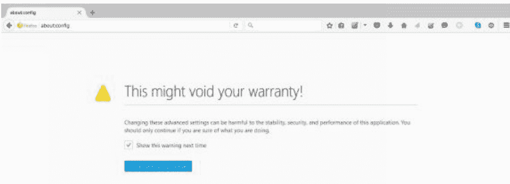

3. 在这里，我们将观察浏览器中的配置列表。在搜索栏中，输入所示所示 `javascript.enabled`。

   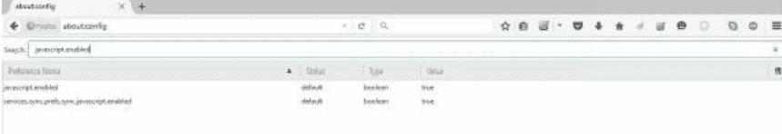

4. 在这里，我们可以通过右键点击该选项的值并选择切换来启用或禁用 JavaScript。
5. 点击切换后，如果 `javascript.enabled` 为 `true`，它将转换为 `false`。这将禁用 Mozilla Firefox 浏览器的 JavaScript 支持。

#### 在 Mozilla Firefox 中禁用 JavaScript 支持

以下是关闭或禁用 Mozilla Firefox 中 JavaScript 支持的步骤。如果 JavaScript 已禁用，可以按照之前的类似步骤点击切换来启用。

#### 在 Google Chrome 中启用或禁用 JavaScript 支持

以下是在 Google Chrome 中启用或禁用 JavaScript 支持的步骤：

1. 点击 Chrome 右角的 Chrome 菜单。

   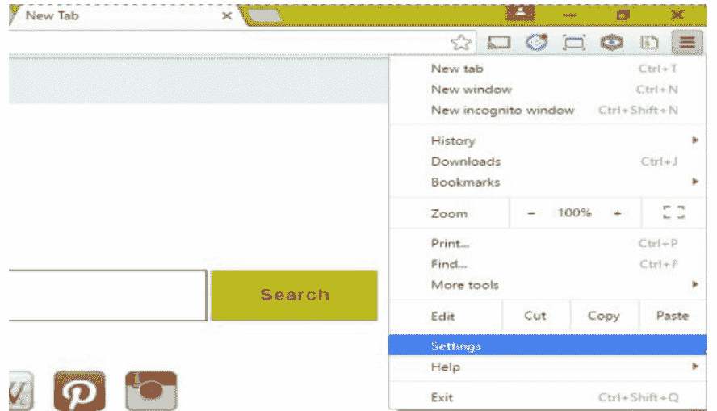

2. 选择 `设置`，然后点击页面底部的 `高级设置`。

   

3. 在 `隐私` 部分下，点击下方所示的 `内容设置` 按钮。

   在内容设置的 `Javascript` 部分，选择 `不允许任何网站运行 JavaScript` 或 `允许所有网站运行 JavaScript（推荐）` 来分别禁用和启用 Chrome 浏览器上的 JavaScript 页面。

#### 在 Opera 中启用或禁用 JavaScript 支持

以下是在 Opera 中启用或禁用 JavaScript 支持的步骤。

1. 打开 Opera 浏览器，并从菜单进入 `工具` -> `偏好`。
2. 然后，从对话框中选择 `高级` 选项。
3. 接下来，从列出的项目中选择 `内容`。
4. 从那里，勾选 `启用 JavaScript` 复选框。
5. 最后，点击 `确定` 按钮启用 Opera 浏览器的 JavaScript 支持。

同样，要禁用 Opera 浏览器的 JavaScript 支持，我们不应该勾选 `启用 JavaScript` 复选框并点击 `确定` 按钮。

### 非 JavaScript 浏览器的警告

当我们需要使用 JavaScript 执行非常重要的操作时，我们可以使用 `<noscript>` 标签向用户显示警告消息。我们可以像下面所示在脚本块之后添加一个 `<noscript>` 块。


# 第6章

## JavaScript 的放置

JavaScript 代码在 HTML 文档中的放置非常灵活，可以按照以下方式放置。

### 在 `<head>...</head>` 部分中放置 JavaScript

这是在 HTML 文档的 head 部分包含 JavaScript 代码的最优选方式。我们可以在 head 部分放置 JavaScript 代码或函数，并在网页元素事件上访问这些函数，如下所示。

```html
<!DOCTYPE html>
<html>
<head>
<meta charset="ISO-8859-1">
<title>JS in head section</title>
<script type="text/javascript">
  function showAlert() {
    alert("This is an alert from Head section!");
  }
</script>
</head>
<body>
  <input type="button" onclick="showAlert();" value="Call JavaScript"/>
</body>
</html>
```

#### 输出

当我们执行上述 HTML 程序时，将得到如下输出。在输出中，当我们点击网页上的按钮时，可以看到带有消息为“This is an alert from Head section”的警报框。

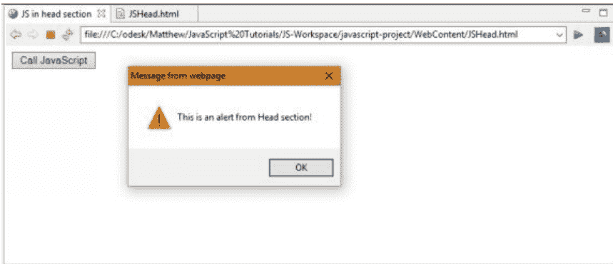

### 在 `<body>...</body>` 部分中放置 JavaScript

我们也可以将 JavaScript 代码放置在 HTML 的 body 部分，但这种方法并不受推崇，因为我们从 body 部分调用 JavaScript 函数，而这些函数最好是定义在文档的 head 部分。

```html
<!DOCTYPE html>
<html>
<head>
<meta charset="ISO-8859-1">
<title>JS Body</title>
</head>
<body>
<script type="text/javascript">
document.write("Welcome to Tutorials!");
</script>
<p>Body section of the HTML document.</p>
</body>
</html>
```

#### 输出

当我们执行上述 HTML 程序时，将得到如下输出。在输出中，我们可以看到通过 JavaScript 在位于其 body 部分页面上编写的“Welcome to Tutorials!”文本。

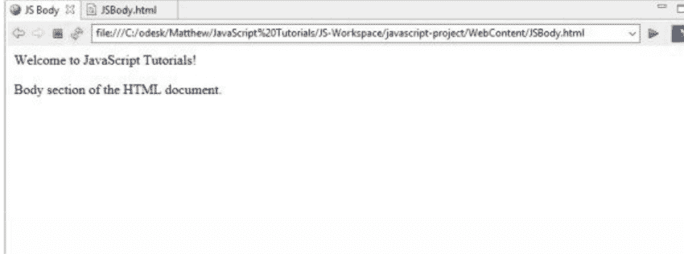

### 在 `<body>` 和 `<head>` 部分中放置 JavaScript

在这种方法中，JavaScript 代码被同时放置在 HTML 文档的 head 和 body 部分，如下例所示。

```html
<!DOCTYPE html>
<html>
<head>
<meta charset="ISO-8859-1">
<title>JS Head and Body</title>
<script type="text/javascript">
function showAlert() {
    alert("This is an alert from Head section!");
}
</script>
</head>
<body>
<script type="text/javascript">
document.write("Welcome to Tutorials!");
</script>
<p>Body section of the HTML document.</p>
<input type="button" onclick="showAlert();" value="Call JavaScript"/>
</body>
</html>
```

#### 输出

当我们执行上述 HTML 程序时，将得到如下输出。在输出中，我们可以看到通过 JavaScript 在位于其 body 部分页面上编写的“Welcome to Tutorials!”文本。当点击按钮时，可以看到带有消息为“This is an alert from Head section”的警报框。

### 在外部文件中放置 JavaScript 并在 `<head>` 部分引用

JavaScript 放置在外部文件并在 `<head>` 部分的方式如下。

```javascript
function showAlert() {
    alert("This is an alert from Head section!");
}
```

我们将此外部文件包含在 HTML 的 head 部分，如下所示。

```html
<!DOCTYPE html>
<html>
<head>
<meta charset="ISO-8859-1">
<title>Output</title>
<script src="external.js"></script>
</head>
<body>
<input type="button" onclick="showAlert();" value="Call JavaScript"/>
</body>
</html>
```

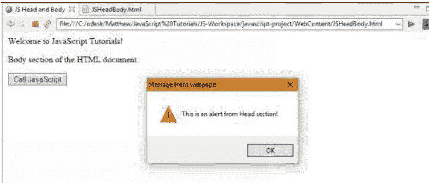

## JavaScript 变量

正如之前讨论的，JavaScript 语言具有数据容器的变量，我们可以将数据放入这些容器，然后通过简单命名容器来引用这些数据。我们使用 `var` 关键字声明 JavaScript 变量，如下所示。


```html
<!DOCTYPE html>
<html>
<head>
<meta charset="ISO-8859-1">
<title>JavaScript Variables</title>
<script type="text/javascript">
  var name = "Appy";
  var age = 21;
  var salary = 10000, expenses = 12000;
  alert("Name: " + name + " Age: " + age + "\nSalary: " + salary + " Expenses: " + expenses);
</script>
</head>
<body>
</body>
</html>
```

### JavaScript 代码说明

在变量中存储值被称为**变量初始化**。我们可以在变量创建期间的任何时间，或者在需要该变量时进行变量初始化。

例如，我们在上面的代码中创建了四个变量，并为每个变量分配了值。例如 `name = "Appy"`，`salary = 10000` 等。

#### 输出

当我们执行上述 HTML 程序时，将输出以下内容。在输出中，我们通过 `alert` 显示了赋值给数据容器的值。

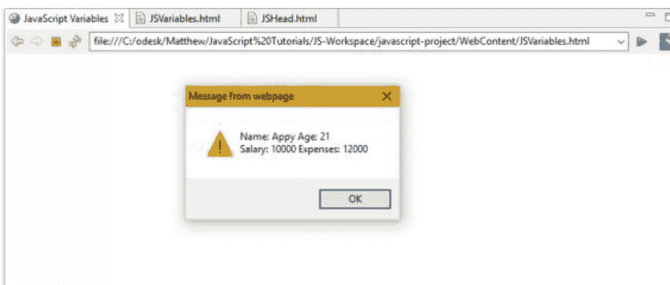

需要注意的是，`var` 关键字仅用于声明或初始化，HTML 文档中任何变量名的生命周期内使用一次。我们不应多次声明同一个变量。在 JavaScript 中，变量可以持有任何数据类型的值。与其他类型语言（例如 C++、JAVA 等）不同，我们不需要在变量声明期间告诉 JavaScript 编译器变量将持有什么类型的值。此外，变量的值类型在程序执行过程中可以改变，JavaScript 解析器会自动处理。

### JavaScript 中的变量作用域

变量的作用域定义为定义程序的区域。JavaScript 变量可以具有两种作用域：

- **全局变量作用域** – 全局作用域意味着可以在 JavaScript 代码的任何地方定义，并在当前 HTML 文档中随处可见。
- **局部变量作用域** – 局部变量仅在其定义的函数内部可见。函数参数始终是函数的局部的。

需要注意的是，在函数体内，如果定义的局部变量和全局变量名称相同，则局部变量的优先级始终高于全局变量。让我们通过以下示例最好地理解这个概念。

```html
<!DOCTYPE html>
<html>
<head>
<meta charset="ISO-8859-1">
<title>Variable Scope</title>
</head>
<script type="text/javascript">
var demoVar = "global scope"; // 一个全局变量
function checkVariableScope() {
    var demoVar = "local scope"; // 一个局部变量
    document.write(demoVar);
}
</script>
<body onload="checkVariableScope();">
</body>
</html>
```

#### 输出

当我们执行上述 HTML 程序时，将输出以下内容。在输出中，我们可以观察到值为“local scope”，因为如果两个变量以相同的名称定义，局部变量的优先级高于全局变量。

### JavaScript 中的变量名

在 JavaScript 语言中命名变量时必须遵守以下规则：

- 不使用保留关键字作为变量名。这些关键字在本章的最后一节提到。例如，`finally`、`goto` 等变量名是无效的。
- JavaScript 语言中的变量名不能以数字（0-9）开头。然而，它们可以字母或下划线字符开头。例如，`10name` 是无效的变量，而 `_10name` 是有效的名称。
- JavaScript 中的变量名是区分大小写的。例如，`Address` 和 `address` 在 JavaScript 语言中被视为两个不同的变量。

### JavaScript 中的保留字

以下是 JavaScript 语言中所有保留字的列表。这些保留字不能用作 JavaScript 变量、循环标签、函数或任何对象名。

| abstract | debugger | final | instanceof | public |
|---|---|---|---|---|
| boolean | default | finally | int | return |
| break | delete | float | interface | short |
| byte | do | for | long | static |
| case | double | function | new | switch |
| catch | else | goto | null | synchronized |
| char | enum | export | package | throw |
| class | extends | import | private | protected |
| const | false | implements | super | throws |
| continue | get | in | this | void |
| default | if | return | var | with |
| delete | | | | |

# 第8章

## 赋值运算符

以下是 JavaScript 语言支持的赋值运算符。

| 序号 | 赋值运算符 | 描述 | 示例 |
|---|---|---|---|
| 1 | `=` (简单赋值) | 此运算符用于将右侧操作数的值赋值给左侧的变量。 | `Z = X` |
| 2 | `+=` (加并赋值) | 此运算符将右侧操作数加到左侧操作数上，并将结果分配给左侧操作数。 | `Z += X` |
| 3 | `-=` (减并赋值) | 此运算符从左侧操作数减去右侧操作数，并将结果分配给左侧操作数。 | `Z -= X` |
| 4 | `*=` (乘并赋值) | 此运算符将右侧操作数与左侧操作数相乘，并将结果分配给左侧操作数。 | `Z *= X` |
| 5 | `/=` (除并赋值) | 此运算符用于除法，将左侧操作数除以右侧操作数，并将结果分配给左侧操作数。 | `Z /= X` |
| 6 | `%=` (取模并赋值) | 此运算符用于取模，将左侧操作数对右侧操作数取模，并将结果分配给左侧操作数。 | `Z %= X` |

## 条件运算符（或三元运算符）

以下是 JavaScript 语言支持的条件运算符或三元运算符。

| 序号 | 条件运算符 | 描述 | 示例 |
| --- | --- | --- | --- |
| 1. | `? :` (条件) | 如果条件为真则返回第一个值，否则返回第二个值。 | `(X > Y) ? "yes" : "No"` |

## 位运算符

以下是 JavaScript 语言支持的位运算符。

| 序号 | 位运算符 | 描述 | 示例 |
|--- | --- | --- | --- |
| 1. | `&` (位与) | 此运算符用于对其每个整数参数的每一位执行布尔与操作。 | `(X & Y)` 等于 2 |
| 2. | `\|` (位或) | 此运算符用于对其每个整数参数的每一位执行布尔或操作。 | `(X \| Y)` 等于 3 |
| 3. | `^` (位异或) | 此运算符用于对其每个整数参数的每一位执行布尔异或操作。异或意味着操作数一为真或操作数二为真，但不同时为真。 | `(X ^ Y)` |
| 4. | `~` (位非) | 位非是一个一元运算符，通过反转操作数中的所有位来操作。 | `(~B)` 等于 -4 |
| 5. | `<<` (左移) | 此运算符用于将其第一个操作数的所有位向左移动第二个操作数中指定的位数。 | `(X << Y)` 等于 4 |
| 6. | `>>` (右移) | 在二进制右移运算符中，向右移动由右操作数指定的位数。 | `(X >> Y)` 等于 1 |
| 7. | `>>>` (零右移) | 此运算符类似于 `>>`，但左侧移入的位始终为 0。 | `(X >>> Y)` 等于 1 |

# 第9章

## JavaScript 决策

在编写程序时，我们大多数时候会面临必须做决策的情况。决策是对程序执行期间可能出现的情况的预测，并需要根据这些情况指定某些操作。

在决策结构中，有一个条件，可以是单个表达式或多个表达式。该条件在求值时会产生 TRUE（真）或 FALSE（假）的结果。根据结果，我们需要确定采取何种操作以及执行哪些语句。请参考下图以清晰理解。

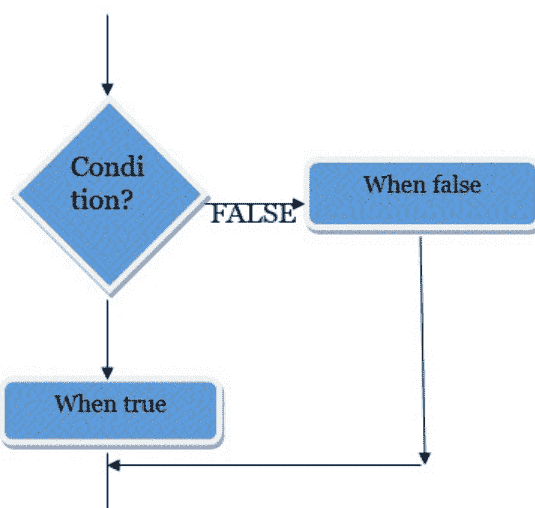

与其他任何编程语言一样，JavaScript 语言支持条件语句，用于根据不同的条件执行不同的操作。以下是 JavaScript 语言支持的条件语句。

- `if` 语句
- `if...else` 语句
- `if...else if...` 语句
- `Switch case` 语句

让我们通过一个 JavaScript 程序来理解这些语句。

### `if` 语句

`if` 语句是一种基础控制语句，允许 JavaScript 代码根据所需的条件做出决策并执行语句。以下是语法。

#### 语法与示例

```html
<!DOCTYPE html>
<html>
<head>
<meta charset="ISO-8859-1">
<title>基础 IF 语句</title>
</head>
<body>
<script type="text/javascript">
var salary = 10000;
var expenses = 12000;
if (expenses > salary) {
    document.write("<b>请开始增加收入或减少开支！</b>");
}
</script>
<p>我们处于 body 部分内部...</p>
</body>
</html>
```

#### 输出

当我们执行上面的 HTML 程序时，将输出如下内容。由于 “if” 语句中的条件为真，因此它将在 HTML 页面上写入给定的文本。

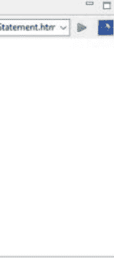

### `if...else` 语句

‘if...else’ 语句是控制语句的另一种形式，允许 JavaScript 代码以更有控制的方式执行语句。以下是语法和示例。

#### 语法与示例

```html
<!DOCTYPE html>
<html>
<head>
<meta charset="ISO-8859-1">
<title>If Else 语句</title>
</head>
<body>
<script type="text/javascript">
var salary = 12000;
var expenses = 10000;
if(expenses > salary) {
    document.write("<b>请开始增加收入或减少开支！</b>");
}
else {
    document.write("<b>你有足够的钱花了！</b>");
}
</script>
<p>我们处于 body 部分内部...</p>
</body>
</html>
```


### 输出

当我们执行上面的 HTML 程序时，将输出如下内容。由于 `if` 语句中的条件为假，因此它进入了 `else` 块，并在 HTML 页面上写入了给定的文本。

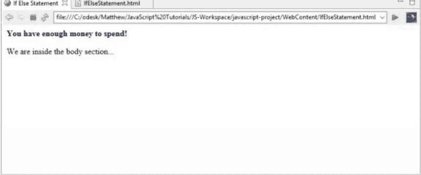

### if...else if... 语句

`if...else if...` 语句是 `if...else` 的另一种高级形式，允许 JavaScript 代码从定义的条件中做出正确的决策。它有一系列语句，其中每个语句都是最后一条语句的 `else` 子句的一部分。根据真条件执行语句，如果没有任何条件为真，则将执行 `else` 块中的代码。以下是语法示例。

### 语法与示例

```html
<!DOCTYPE html>
<html>
<head>
<meta charset="ISO-8859-1">
<title>If Else If 语句</title>
</head>
<body>
<script type="text/javascript">
var salary = 12000;
var expenses = 10000;
if (expenses > salary) {
    document.write("<b>请开始增加收入或减少开支！</b>");
} else if (salary > 13000) {
    document.write("<b>你有足够的钱花了！</b>");
} else {
    document.write("<b>虽然你有足够的钱，但你需要小心！</b>");
}
</script>
<p>我们处于 body 部分内部...</p>
</body>
</html>
```

### 输出

当我们执行上面的 HTML 程序时，将输出如下内容。由于 `if` 语句中的条件为假，因此它进入了 `else if` 块，该块中另一个条件恰好为假。因此，它在 HTML 页面上写入了最后一个块中的给定文本。

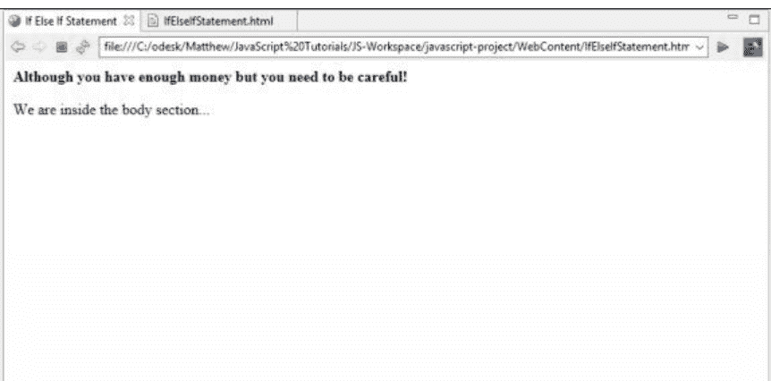

### Switch case 语句

从 JavaScript 1.2 版本开始，开始支持 `switch` 语句来处理与重复的 `else if` 语句相同的情况。

`switch` 语句用于根据表达式的值提供多个不同的语句。JavaScript 解释器会检查每个 `case` 是否匹配表达式，直到找到匹配项。如果没有找到匹配，则使用 `default` 条件。

此外，在 `case` 代码语句末尾有一个 `break` 语句。如果在这里没有声明 `break`，解释器将继续执行后续 `case` 中的语句。

以下是 `switch case` 语句的语法和示例。

```html
<!DOCTYPE html>
<html>
<head>
<meta charset="ISO-8859-1">
<title>Switch Case 语句</title>
</head>
<body>
<script type="text/javascript">
var expensecode = 'X';
document.write("进入 switch 块<br />");
switch (expensecode) {
    case 'X':
        document.write("<b>请开始增加收入或减少开支！</b>");
        break;
    case 'Y':
        document.write("<b>你有足够的钱花了！</b>");
        break;
    case 'Z':
        document.write("<b>虽然你有足够的钱，但你需要小心！</b>");
        break;
    default:
        document.write("无匹配!<br/>")
}
document.write("<br>退出 switch 块<br/>");
</script>
<p>我们处于 body 部分内部...</p>
</body>
</html>
```

### 输出

当我们执行上面的 HTML 程序时，将输出如下内容。程序在 HTML 页面上写入了匹配 `case` 字符 (`'X'`) 的文本。

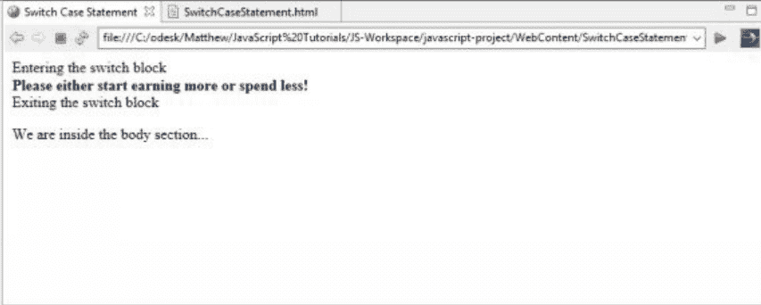

## 第 10 章：JavaScript 循环

当任何程序执行时，它都是按顺序运行的。出现在序列中的第一个语句首先执行，然后是下一条语句，依此类推，直到程序的最后一条语句。很多时候，程序需要在程序中多次运行相同的代码块，这时就产生了对称为循环的控制结构的需求。

循环使得代码块中的一个语句或一组语句在条件为真时执行多次，并在条件变为假时退出循环。下图展示了这种循环。

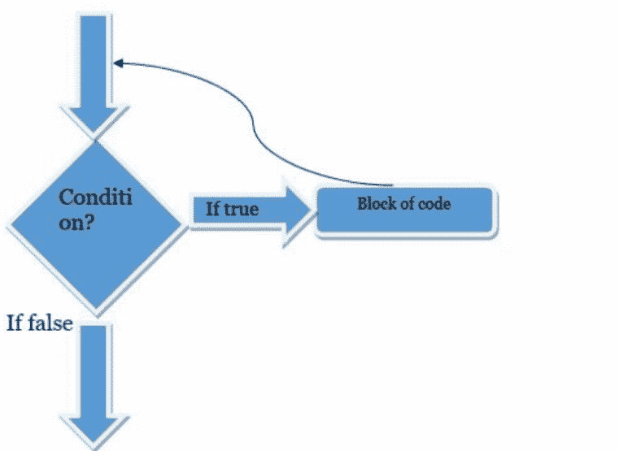

与任何其他编程语言一样，JavaScript 也支持循环，并支持以下类型的循环和循环控制语句。

- While 循环
- Do...while 循环
- For 循环
- for...in 循环

### 循环控制语句

### while 语句

`while` 循环是 JavaScript 语言中最基础的循环。只要表达式为真，该循环就会反复执行一个语句或代码块。一旦表达式为假，循环就会终止。以下是 `while` 语句的语法和示例。

```html
<!DOCTYPE html>
<html>
<head>
<meta charset="ISO-8859-1">
<title>While Loop</title>
</head>
<body>
<script type="text/javascript">
var counter = 0;
document.write("Entering while Loop!");
while (counter < 5) {
    document.write("Current Counter is " + counter + "<br />");
    counter++;
}
document.write("Exiting while Loop!");
</script>
<p>We are inside body section...</p>
</body>
</html>
```

### 输出

当我们执行上述 HTML 程序时，输出将如下所示。计数器将在 HTML 页面上写入 5 次，因为它的条件保持了 5 次真。

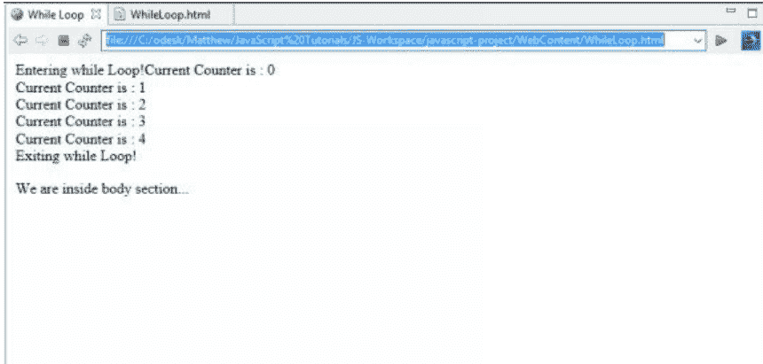

### do...while 循环语句

`do...while` 循环与 `while` 循环相似，不同在于 `do...while` 循环中的条件检查发生在循环结束时。这意味着即使条件为假，循环内部的代码块也始终至少执行一次。以下是 `do...while` 语句的语法和示例（注：原文此处误写为 while loop statement）。

```html
<!DOCTYPE html>
<html>
<head>
<meta charset="ISO-8859-1">
<title>Do While Loop</title>
</head>
<body>
<script type="text/javascript">
var counter = 0;
document.write("Entering while Loop!");
do {
    document.write("Current Counter is : " + counter + "<br/>");
    counter++;
} while (counter < 5);
document.write("Exiting while Loop!");
</script>
<p>We are inside body section...</p>
</body>
</html>
```

### 输出

当我们执行上述 HTML 程序时，输出将如下所示。计数器将在 HTML 页面上写入 5 次，包括第一次没有检查条件外，它的条件保持了 5 次真。


### for 循环语句

`for` 循环是 JavaScript 编程中非常且常用的循环语句。该命令包含以下三个重要部分。

- **循环初始化** —— 在此处我们将计数器值初始化为一个起始值。该语句在循环开始之前执行。
- **测试语句** —— 它包含实际的条件，该条件会被求值为真或为假。如果该条件求值为真，则将执行循环内部的代码块；否则，控制流将退出循环。
- **迭代语句** —— 在此处我们增加或减少在第一条语句中初始化的计数器值。

`for` 循环的优点在于，我们可以将这三个语句部分放在同一行中，并用分号隔开。以下是语法和示例。

```html
<!DOCTYPE html>
<html>
<head>
<meta charset="ISO-8859-1">
<title>For Loop</title>
</head>
<body>
<script type="text/javascript">
document.write("Entering while Loop!");
for (counter = 0; counter < 5; counter++) {
    document.write("Current Counter is " + counter + "<br/>");
}
document.write("Exiting while Loop!");
</script>
<p>We are inside body section...</p>
</body>
</html>
```

### 输出

当我们执行上述 HTML 程序时，输出将如下所示。计数器将在 HTML 页面上写入 5 次，直到计数器值变为 5，期间其条件保持了 5 次真。

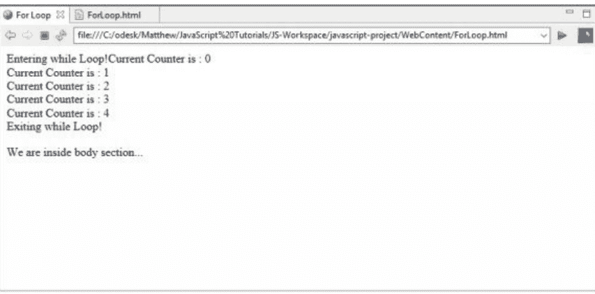

### for...in 循环语句

`for...in` 循环用于需要遍历对象属性的特殊情况。以下是 `for...in` 循环的语法和示例。

```html
<!DOCTYPE html>
<html>
<head>
<meta charset="ISO-8859-1">
<title>For In Statement</title>
</head>
<body>
<script type="text/javascript">
var prop;
document.write("Object Properties of Navigator <br /> ");
document.write("Entering the loop!");
for (prop in navigator) {
    document.write(prop);
    document.write("<br/>");
}
document.write("Exiting the loop!");
</script>
<p>We are inside body section...</p>
</body>
</html>
```

### 输出

当我们执行上述 HTML 程序时，输出将如下所示。在输出中，我们遍历了 `navigator` 对象并显示了网络浏览器的所有属性。


### JavaScript 循环总结

| 循环类型 | 描述 |
|---|---|
| while 循环 | while 循环类型，在给定条件为真时重复执行语句或一组语句。它在每次执行循环体时都会测试条件，并在条件变为假时退出循环。 |
| for 循环 | for 循环类型，在条件为真时重复执行语句或一组语句。 |
| do...while 循环 | do...while 循环类型，在执行循环体后测试条件。 |
| for...in 循环 | for...in 循环类型，用于遍历对象的属性。 |


### 输出

当我们执行上述 HTML 程序时，输出将如下所示。在输出中，我们遍历了`navigator`对象并显示了网络浏览器的所有属性。


### JavaScript 循环总结

| 循环类型 | 描述 |
|---|---|
| while 循环 | while 循环类型，在给定条件为真时重复执行语句或一组语句。它在每次执行循环体时都会测试条件，并在条件变为假时退出循环。 |
| for 循环 | for 循环类型，在条件为真时重复执行语句或一组语句。 |
| do...while 循环 | do...while 循环类型，在执行循环体后测试条件。 |
| for...in 循环 | for...in 循环类型，用于遍历对象的属性。 |

#### 循环控制语句

在 JavaScript 语言中，循环控制语句用于改变执行流。

| 控制语句 | 描述 |
|---|---|
| break 语句 | break 语句用于终止循环。 |
| continue 语句 | continue 语句用于跳过当前循环的剩余部分，直接进入下一次迭代。 |

我们可以通过以下示例更好地理解循环控制语句。

```html
<!DOCTYPE html>
<html>
<head>
<meta charset="ISO-8859-1">
<title>Loop Control Statement</title>
</head>
<body>
<script type="text/javascript">
(注：此处缺少 break 和 continue 语句的示例代码，由于原文未提供完整代码，此处仅保留ISO-8859-1 结构)
</script>
<p>We are inside body section...</p>
</body>
</html>
```


## 第 11 章：JavaScript 函数

函数可以被定义为一个组织良好且可多次复用的代码块，用于执行程序中需要高度模块化和复用性的操作。通过函数的概念，程序员可以将一个大程序拆分成许多较小的函数。

与任何其他编程语言一样，JavaScript 语言也支持使用函数编写模块化代码的功能。从本教程开始，我们就使用了 `alert()` 和 `write()` 函数，这让我们对函数的操作有了一些提示。这些都是内置 JavaScript 函数。在 JavaScript 语言中，我们可以像任何其他编程语言一样编写自己的函数。

### 函数定义

函数可以在代码的任何地方使用，但只需要定义一次。在 JavaScript 中，我们通过 `function` 关键字定义函数，其后跟一个唯一的函数名称、参数列表（为空）以及用大括号围起来语句块。以下是 JavaScript 函数的语法和示例。

```html
<!DOCTYPE html>
<html>
<head>
<meta charset="ISO-8859-1">
<title>Function Definition</title>
</head>
<body>
<script type="text/javascript">

function sayHelloJavaScript() {
  alert("Welcome to the world of JavaScript!");
}

</script>
</body>
</html>
```

### 调用函数

我们可以在脚本的后半部分或在 HTML 网页元素的事件中调用 JavaScript 函数，只需像下面的代码所示编写函数名称。

```html
<!DOCTYPE html>
<html>
<head>
<meta charset="ISO-8859-1">
<title>Function Definition</title>
<script type="text/javascript">
function sayHelloJavaScript() {
  alert("Welcome to the world of JavaScript!");
}
</script>
</head>
<body>
</body>
</html>
```

### 输出

当我们执行上述 HTML 程序时，将输出以下内容。在这里，我们在按钮的点击事件上调用了 JavaScript 函数，显示带有消息的警框，该消息获取自 HTML 头部部分，即 JavaScript 函数定义的地方。

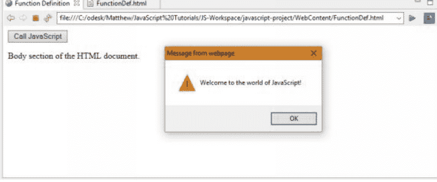

### 函数参数

到此为止，我们使用的函数都没有输入参数。在 JavaScript 函数中，我们可以在调用时传递不同的参数。传递的参数值可以在函数内部使用，我们可以对这些参数进行操作。函数可以接受零个或多个参数。函数中的多个参数用逗号分隔。以下是带参数函数的语法和示例。

```html
<!DOCTYPE html>
<html>
<head>
<meta charset="ISO-8859-1">
<title>Parameterized Function</title>
<script type="text/javascript">
function sayHelloToJavaScript(message,entity,lang) {
  alert(message+" to "+entity+" world of "+lang+"!");
}
</script>
</head>
<body>
  <input type="button" onclick="sayHelloToJavaScript('Welcome','World','JavaScript');" value="Call JavaScript"/>
  <p>Body section of the HTML document.</p>
</body>
</html>
```

### 输出

当我们执行上述 HTML 程序时，将输出以下内容。在这里，我们在按钮的点击事件上调用了带参数的 JavaScript 函数，显示带有消息的警框，该消息获取自 HTML 头部部分，即 JavaScript 函数定义的地方。在这里，我们向函数传递了三个参数，用于显示警框消息。

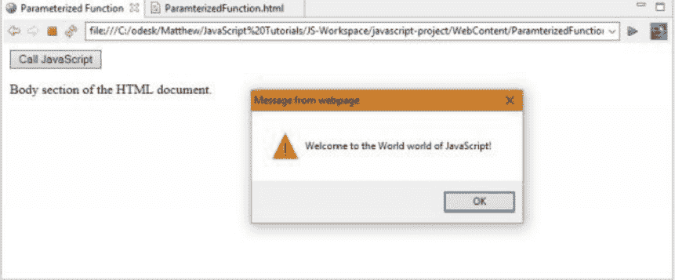

### return 语句

JavaScript 函数可以返回一个值，这个 `return` 语句是可选的。当我们想要从函数返回一个值时，就会使用 `return` 语句。它应该总是 JavaScript 函数中的最后一个语句。让我们通过以下示例来理解 `return` 函数的作用。

```html
<!DOCTYPE html>
<html>
<head>
<meta charset="ISO-8859-1">
<title>Return Function</title>
<script type="text/javascript">
function concatString(message,entity,lang) {
  var str = message+entity+lang;
  return str;
}

function writeToDoc(message,entity,lang) {
  concatStr = concatString(message,entity,lang);
  document.write(concatStr);
}
</script>
</head>
<body>
<input type="button" onclick="writeToDoc('Welcome to the ‘World of’','JavaScript!');" value="Call JavaScript"/>
<p>Body section of the HTML document.</p>
</body>
</html>
```

### 输出

当我们执行上述 HTML 程序时，将输出以下内容。在这里，我们在按钮的点击事件上调用了 JavaScript 函数，在 HTML 页面上显示消息，该消息获取自 HTML 头部部分，即 JavaScript 函数定义的地方。在这里，我们在`writeToDoc`函数中传递了三个字符串作为参数，该参数调用`concatString`函数，后者返回拼接后的字符串并写入文档中。

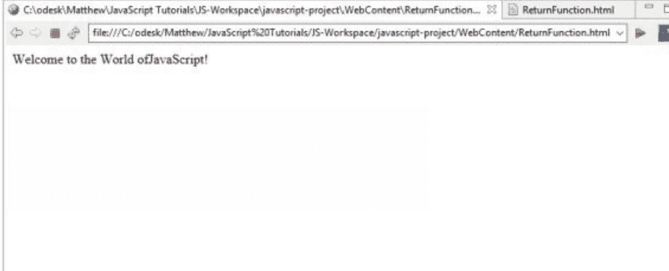

## 第 12 章：JavaScript 事件

JavaScript 事件是 JavaScript 与 HTML 文档交互的手段。当 HTML 页面上的任何值被用户或浏览器操作时，这些事件就会被触发。例如，当我们加载一个 HTML 页面时，这被称为一个事件。同样，当我们点击页面上的按钮时，这也是一个事件。我们可以考虑其他事件的例子，如按下任何键、通过按钮提交表单、更改窗口大小等。

程序员可以使用这些 JavaScript 事件来触发并执行 JavaScript 代码编写的响应。这些响应包括点击按钮时关闭窗口、向用户显示警框消息、验证表单数据等。

JavaScript 事件是文档对象模型（DOM）3 级的一部分。所有 HTML 网页元素都包含一组能够触发 JavaScript 函数代码的事件。

以下是理解事件与调用之间关系的几个示例。

### onclick 事件

它是最经常使用的事件。下面的示例演示了这一点：

```html
<!DOCTYPE html>
<html>
<head>
<meta charset="ISO-8859-1">
<title>On Click Events</title>
<script type="text/javascript">
function showAlert() {
  alert("Welcome to the world of JavaScript!");
}
</script>
</head>
<body>
<input type="button" onclick="showAlert();" value="Call JavaScript"/>
</body>
</html>
```

### 输出

当我们执行上述 HTML 程序时，将输出以下内容。在这里，我们在按钮的点击事件上调用了 JavaScript 函数，显示带有消息的警框。

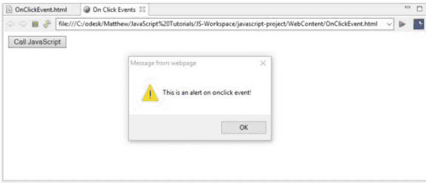

### onsubmit 事件类型

这是我们在提交表单时的一种事件类型。下面的示例演示了这一点：

```html
<!DOCTYPE html>
<html>
<head>
<meta charset="ISO-8859-1">
<title>On Submit Events</title>
<script type="text/javascript">
function validation() {
if(form1.textbox1.value != "") {
  alert('Validation Passed');
  return true;
}
else{
  alert('Text Box cannot be empty!');
  return false;
}
}
</script>
</head>
<body>
<form name="form1" method="GET" action="onClickEvent.html" onsubmit="return validation()">
<input type="text" name="textbox1"/>
<input type="submit" value="Submit" />
</form>
</body>
</html>
```

### 输出

当我们执行上述 HTML 程序时，将输出以下内容。在这里，我们在验证文本框为空，如果没有输入值并点击提交按钮，它将向表单返回 `false` 并显示警框消息“Text Box cannot be empty!”

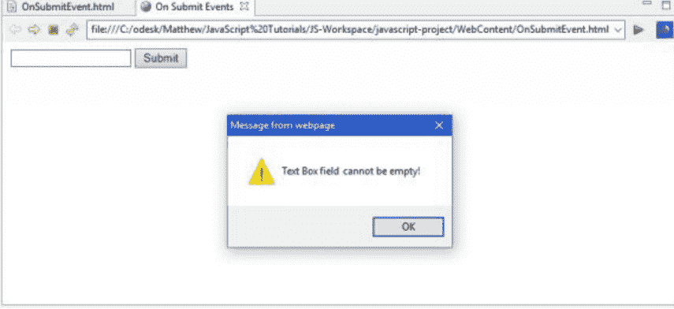

### onmouseover 和 onmouseout 事件

这两种是流行的鼠标类型，可以帮助我们为图像或文本创建效果。当我们将鼠标悬放在 HTML 页面上的任何网页元素上时，触发 `mouseover` 事件；当我们将鼠标移出该网页元素时，会触发 `onmouseout` 事件。下面的示例演示了这些：

```html
<!DOCTYPE html>
<html>
<head>
<meta charset="ISO-8859-1">
<title>Mouse Over and Out</title>
<script type="text/javascript">
function hoverMouse() {
alert("Doing the Mouse Over");
}

function hoverMouseOut() {
  alert("Taking the Mouse Out");
}
</script>
</head>
<body>
<div onmouseover="hoverMouse();"
onmouseout="hoverMouseOut();">
<h1> Bring your Mouse here to see the change </h1>
</div>
</body>
</html>
```


### 输出

当我们执行上述 HTML 程序时，将输出以下内容。在这里，当我们将鼠标悬停在标题区域上时，我们可以看到警框消息被调用。同样，当我们将鼠标移出该区域时，我们会看到另一个关于移出标题区域的警框。

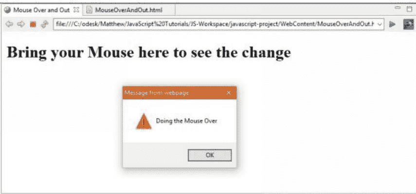

### HTML 5 中存在的标准事件

以下是标准的 HTML 5 事件属性。所有这些属性的值均为脚本，表示在触发事件时将调用并执行的 JavaScript 函数。

| 事件属性 | 值 | 描述 |
| --- | --- | --- |
| Offline | script | 此属性在文档离线时触发。 |
| Onabort | script | 此属性在中止事件时触发。 |
| Onafterprint | script | 此属性在文档打印后触发。 |
| onbeforeonload | script | 此属性在文档加载完成前触发。 |
| Onbeforeprint | script | 此属性在文档打印前触发。 |
| Onblur | script | 此属性在窗口失去焦点时触发。 |
| Oncanplay | script | 此属性在媒体可以开始播放时触发，但可能会为了缓冲而停止。 |
| Oncanplaythrough | script | 此属性在媒体可以播放到结束而无需停止缓冲时触发。 |
| Onchange | script | 此属性在元素值发生变化时触发。 |
| onclick | script | 此属性在鼠标点击时触发。 |
| oncontextmenu | script | 此属性在触发上下文菜单时触发。 |
| Ondblclick | script | 此属性在鼠标双击时触发。 |
| Ondrag | script | 此属性在元素被拖动时触发。 |
| Ondragend | script | 此属性在拖拽操作结束时触发。 |
| Ondragenter | script | 此属性在元素被拖动到有效投放目标时触发。 |
| Ondragleave | script | 此属性在元素拖过有效投放目标时触发。 |
| Ondragover | script | 此属性在拖拽操作开始时触发。 |
| Ondragstart | script | 此属性在拖拽操作开始时触发。 |
| Ondrop | script | 此属性在被拖动的元素被释放时触发。 |
| Ondurationchange | script | 此属性在媒体长度改变时触发。 |
| Onemptied | script | 此属性在媒体资源元素突然变为空时触发。 |
| Onended | script | 此属性在媒体播放结束时触发。 |
| Onerror | script | 此属性在发生错误时触发。 |
| Onfocus | script | 此属性在窗口获得焦点时触发。 |
| Onformchange | script | 此属性在表单改变时触发。 |
| Onforminput | script | 此属性在表单获取用户输入时触发。 |
| Onhaschange | script | 此属性在文档发生变化时触发。 |
| Oninput | script | 此属性在元素获取用户输入时触发。 |
| Oninvalid | script | 此属性在元素无效时触发。 |
| Onkeydown | script | 此属性在按下按键时触发。 |
| Onkeypress | script | 此属性在按下按键时 | |
| Onkeyup | script | 此属性在释放按键时触发。 |
| onload | script | 此属性在文档加载时触发。 |
| Onloadeddata | script | 此属性在媒体数据加载时触发。 |
| onloadmetadata | script | 此属性在媒体元素的时长和其他媒体数据加载完成时触发。 |
| Onload | script | 此属性在浏览器开始加载媒体数据时触发。 |
| Onmessage | script | 此属性在消息触发时触发。 |
| onmousedown | script | 此属性在按下鼠标按钮时触发。 |
| onmousemove | script | 此属性在鼠标指针移动时触发。 |
| Onmouseout | script | 此属性在鼠标指针移出元素时触发。 |
| Onmouseover | script | 此属性在鼠标指针移过元素时触发。 |
| Onmouse | script | 此属性在释放鼠标按钮时触发。 |
| onmousewheel | script | 此属性在滚动鼠标轮时触发。 |
| Online | script | 此属性在文档离线时触发。 |
| Online | script | 此属性在文档上线时触发。 |
| Ononline | script | 此属性在文档恢复上线时触发。 |
| Onpagehide | script | 此属性在窗口被隐藏时触发。 |
| Onpageshow | script | 此属性在窗口变为可见时触发。 |
| Onpause | script | 此属性在媒体数据暂停时触发。 |
| Onplay | script | 此属性在媒体数据即将开始播放时触发。 |
| Onplaying | script | 此属性在媒体数据已开始播放时触发。 |
| Onpopstate | script | 此属性在窗口历史记录改变时触发。 |
| onprogress | script | 此属性在浏览器正在获取媒体数据时触发。 |
| Onratechange | script | 此属性在媒体数据的播放速率改变时触发。 |
| onreadystatechange | script | 此属性在就绪状态改变时触发。 |
| Onredo | script | 此属性在文档执行重做操作时触发。 |
| Onresize | script | 此属性在窗口大小发生变化时触发。 |
| Onscroll | script | 此属性在元素的滚动条正在滚动时触发。 |
| Onseeked | script | 此属性在媒体元素的 seeking 属性不再为 true 且寻道结束时触发。 |
| Onseeking | script | 此属性在媒体元素的 seeking 属性为 true 且开始寻道时触发。 |
| Onselect | script | 此属性在元素被选中时触发。 |
| Onstalled | script | 此属性在获取媒体数据发生错误时触发。 |
| Onstorage | script | 此属性在文档加载时触发。 |
| Onsubmit | script | 此属性在表单提交时触发。 |
| Onsuspend | script | 此属性在浏览器获取媒体数据但在文件完全获取前停止时触发。 |
| Ontimeupdate | script | 此属性改变播放位置。 |
| Onundo | script | 此属性在文档执行撤销操作时触发。 |
| Onload | script | 此属性在用户离开文档时触发。 |
| Onvolumechange | script | 此属性在音量改变或音量设置为“静音”时触发。 |
| Onwaiting | script | 此属性在媒体停止播放但预计恢复时触发。 |

## 第 13 章：JavaScript 对话框

对话框在 JavaScript 中用于通过 alert 弹出警告、请求确认或接受用户输入。为了支持这些功能，JavaScript 有以下三种类型的对话框：

- 警告对话框
- 确认对话框
- 提示对话框

### 警告对话框

当我们想在对话框中向用户显示警告消息时，使用警告对话框。例如，当使用 `onSubmit` 事件验证表单时，我们不需要接受用户输入，只需要显示警告消息，此时我们使用警告框来显示此类警告消息。警告框只有一个“OK”按钮用于点击并继续。

```html
<!DOCTYPE html>
<html>
<head>
<meta charset="ISO-8859-1">
<title>提交事件</title>
</head>
<script type="text/javascript">
function validation() {
if(document.form1.textbox1.value != "") {
alert('验证通过');
return false;
}
else{
    alert("文本框字段不能为空!");
    return false;
}
</script>
</head>
<body>
<form name="form1" method="GET" action="onClickEvent.html" \onsubmit="return validation()">
<input type="text" name="textbox1"/>
<input type="submit" value="提交" />
</form>
</body>
</html>
```

### 输出

当我们执行上述 HTML 程序时，将得到如下输出。在这里，我们看到了一个警告对话框。


### 确认对话框

在 JavaScript 语言中，当我们需要对任何选项获取用户的意见时，就会使用确认对话框。它显示一个包含两个按钮的对话框：确定按钮和取消按钮。

当用户点击确定按钮时，窗口方法 `confirm()` 将返回一个 `true` 值。否则，如果用户点击取消按钮，则 `confirm()` 方法将返回一个 `false` 值。以下是确认对话框的示例。

```html
<!DOCTYPE html>
<html>
<head>
<meta charset="ISO-8859-1">
<title>Confirm Box</title>
<script type="text/javascript">
function showAlert() {
confirm("This is an confirm dialogue box example!");
}
</script>
</head>
<body>
<p>Confirm box demo example.</p>
<input type="button" onclick="showAlert();" value="Call JavaScript"/>
</body>
</html>
```

### 输出

当我们执行上述 HTML 程序时，将产生如下输出。在这里，我们看到了一个确认对话框。

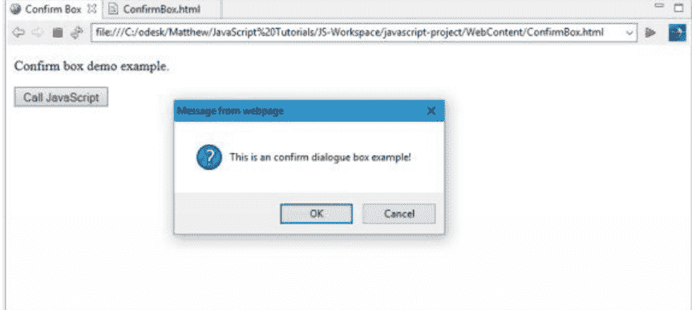

### 提示对话框

在 JavaScript 语言中，当我们想要弹出一个可以接受用户输入的文本框时，就会使用提示对话框。因此，它允许系统与用户进行交互。用户必须在字段中输入所需的数据，然后点击确定按钮。

这种对话框是通过使用名为 `prompt()` 的方法显示的。它接受以下两个参数：

- 我们想要在文本框中显示的标签。
- 一个在文本框中显示的默认字符串。

提示对话框有两个按钮：

- 确定按钮。
- 取消按钮。

当用户点击确定按钮时，窗口方法 `prompt()` 将返回用户在文本框中输入的值。否则，如果用户点击取消按钮，则窗口方法 `prompt()` 将返回一个 `null` 值。

以下是提示对话框的示例。

```html
<!DOCTYPE html>
<html>
<head>
<meta charset="ISO-8859-1">
<title>Prompt Box</title>
<script type="text/javascript">
function showAlert(){
  prompt("This is an prompt dialogue box example!");
}
</script>
</head>
<body>
<p>Prompt dialogue box demo example.</p>
<input type="button" onclick="showAlert();" value="Call JavaScript"/>
</body>
</html>
```

### 输出

当我们执行上述 HTML 程序时，将产生如下输出。在这里，我们看到了一个提示对话框。

Prompt dialogue box demo example.

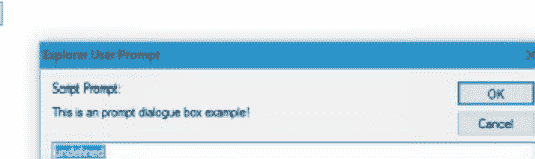

## 第 14 章：JavaScript void 关键字

在 JavaScript 语言中，`void` 关键字可以作为一元运算符使用，出现在单个操作数之前，该操作数可以是任何类型。该一元运算符指定了一个需要求值但没有返回值的表达式。

以下是 `void` 关键字的语法和示例。

```html
<!DOCTYPE html>
<html>
<head>
<meta charset="ISO-8859-1">
<title>Void Keyword Example 1</title>
</head>
<body>
  <p>Click here to invoke alert!</p>
  <a href="javascript:void(alert('Here is the Void Keyword demo'))">Click Here!</a>
</body>
</html>
```

### 输出

当我们执行上述 HTML 程序时，将产生如下输出。在这里，我们看到了点击响应式超链接（“Click Here!”）时弹出的警告对话框。另一方面，如果 `void` 参数为空，则第二个超链接（“No response link!”）情况下将没有响应，因为表达式“0”在 JavaScript 中没有效果。当“0”被求值时，它不会重新加载到当前文档中。

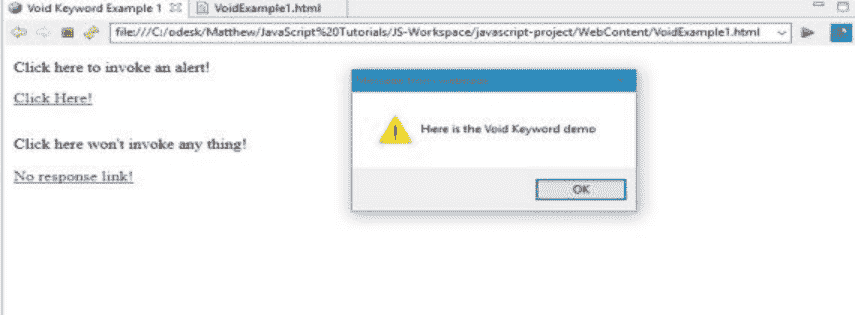

或者，JavaScript 中的 `void` 关键字也用于生成 `undefined` 值，如下例所示。

```html
<!DOCTYPE html>
<html>
<head>
<meta charset="ISO-8859-1">
<title>Void Example 2</title>
<script type="text/javascript">
function getVoidDemo(){
var x,y,z;
x = void ( y = 50, z = 700 );
document.write('x = ' + x + ' y = ' + y + ' z = ' + z);
}
</script>
</head>
<body>
<p>Click to get the Result...</p>
<form>
<input type="button" value="Get Result" onclick="getVoidDemo();" />
</form>
</body>
</html>
```

### 输出

当我们执行上述 HTML 程序时，将产生如下输出。在这里，变量 `x` 的值为 `undefined`，但变量 `y` 和 `z` 的值分别为 `50` 和 `700`。


## 第 15 章：JavaScript 对象

JavaScript 语言是一种基于面向对象 (OOP) 的语言，提供了以下功能：

- **封装**：将数据和方法存储在对象中。
- **聚合**：将一个对象存储在对象内部。
- **继承**：允许类继承其他类的属性。
- **多态**：允许以不同的方式执行任务，但也称为基类。

### JavaScript 对象属性

JavaScript 属性可以是任何原始类型（`Number`、`String`）或抽象类型（如 `Object`）。

以下是语法和示例：

```html
<!DOCTYPE html>
<html>
<head>
<meta charset="ISO-8859-1">
<title>Objects</title>
<script type="text/javascript">
objectName = propertyValue;
var str = document;
</script>
</head>
<body>
</body>
</html>
```

### JavaScript 对象方法

对象方法是用于操作函数。在 JavaScript 中，函数是独立的单元，而方法是附加在对象上的。

方法可以显示对象的内容。例如，在教程中，我们使用了 `document` 的 `write` 方法，我们传递了：

```html
<!DOCTYPE html>
<html>
<head>
<meta charset="ISO-8859-1">
<title>Object Method</title>
<script type="text/javascript">
document.write("Welcome to JavaScript!");
</script>
```


### JavaScript 中的自定义对象 (User-Defined Objects in JavaScript)

在 JavaScript 语言中，所有的自定义对象以及内置对象都是扩展（类似于 Java 语言）。

### JavaScript 中的 new 运算符 (The new Operator in JavaScript)

`new` 运算符用于创建对象的实例。为了在 JavaScript 中创建对象，语句带有 `new` 运算符，后面跟着所示的构造方法。在这里，构造方法是 `Object()`、`Array()` 和 `Date()`。这些构造方法是内置 JavaScript 函数。

```html
<!DOCTYPE html>
<html>
<head>
<meta charset="ISO-8859-1">
<title>The New Operator</title>
<script type="text/javascript">
var student = new Object();
var languages = new Array("JavaScript", "Pascal", "Python");
var day = new Date("August 24, 1989");
alert(day);
</script>
</head>
<body>
</body>
</html>
```

### 输出 (Output)

当我们执行上述 HTML 程序时，将产生如下输出。在这里，我们在警告对话框上显示了 Date 对象的属性。

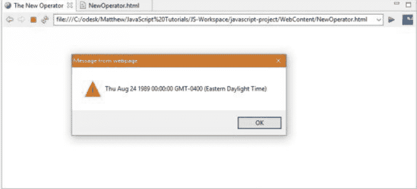

### “Object ()” 构造函数 (The “Object ()” Constructor)

正如之前讨论过的，构造函数（constructor）是一个创建和初始化 JavaScript 对象的函数。一种名为 "Object O" 的特殊构造函数被用于在 JavaScript 中构建对象。"Object O" 构造函数返回的值被赋值给一个名为对象引用变量的。下面的示例演示了如何在 JavaScript 中创建对象。

```html
<!DOCTYPE html>
<html>
<head>
<meta charset="ISO-8859-1">
<title>Object Creation</title>
<script type="text/javascript">
var student = new Object();
student.name = "Appy";
student.age = "21";
student.course = "JavaScript";
function showDetails() {
 alert("Name: "+student.name + " Age: "+student.age+"Course: "+student.course);
}
</script>
</head>
<body>
<input type="button" onclick="showDetails();" value="Get Student details!" />
</body>
</html>
```

需要注意的是，对象的属性变量并没有使用 `var` 关键字来定义。

### 输出

当我们执行上述 HTML 程序时，输出结果将如下所示。

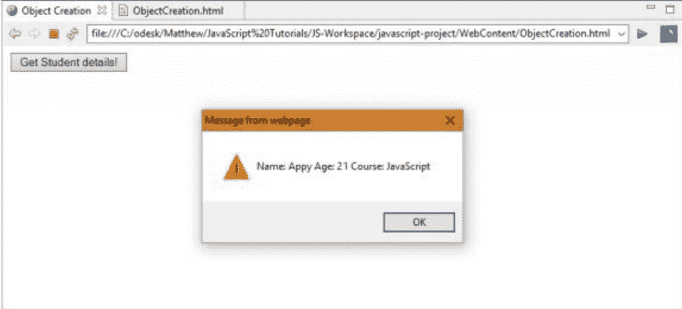

### 在 JavaScript 中为对象定义方法

在上一个示例中，我们演示了如何使用构造函数创建对象并分配属性。在接下来的示例中，我们将演示如何为 JavaScript 中的对象定义方法。

```html
<!DOCTYPE html>
<html>
<head>
<meta charset="ISO-8859-1">
<title>Object Methods</title>
<script type="text/javascript">
function student(name, course){
  this.name = name;
  this.course = course;
}
</script>
</head>
<body>
<script type="text/javascript">
  var record = new student("Appy", "JavaScript");
  alert("name is : " + record.name + "Course is " + record.course );
</script>
</body>
</html>
```

### 输出

我们执行上述 HTML 程序，输出结果将如下所示。在这里，我们为对象的同时添加了一个函数。

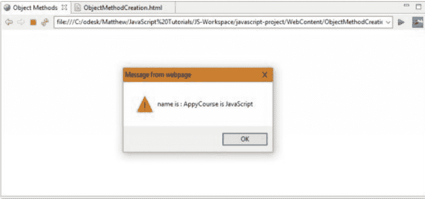

### JavaScript 中的 ‘with’ 关键字

在 JavaScript 中，`with` 关键字被用作引用对象属性和方法的简写。

在这里，作为 `with` 参数指定的对象在随后的块范围内成为默认对象。在这种情况下，无需命名对象即可使用对象的属性和方法。以下是语法和示例。

```html
<!DOCTYPE html>
<html>
<head>
<meta charset="ISO-8859-1">
<title>With Keyword</title>
<script type="text/javascript">
// 一个将作为方法工作的函数
function addAge(years){
  with(this){
    age = years;
  }
}
function student(name, course){
  this.name = name;
  this.course = course;
  this.age = 0;
  this.addAge = addAge; // 这是一个方法的属性。
}
</script>
</head>
<body>
<script type="text/javascript">
var record = new student("Appy", "JavaScript");
record.addAge(21);
alert("Name is : " + record.name + "\nCourse is : " + record.course + "\nAge is : " + record.age );
</script>
</body>
</html>
```

### 输出

当我们执行上述 HTML 程序时，输出结果将如下所示。在这里，我们使用了 `with` 关键字通过将方法赋值为属性来后续添加年龄。

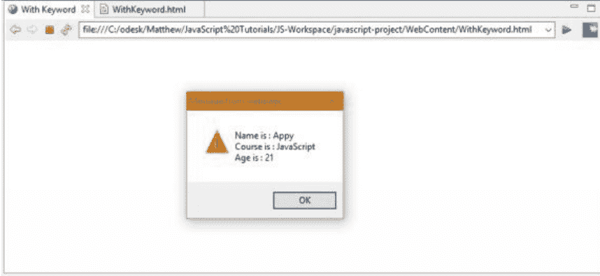

### JavaScript 中的原生对象

JavaScript 语言有很多内置或原生对象。这些原生对象可以在程序的任何地方访问，并且在运行任何操作系统的任何浏览器上都能以相同的方式工作。以下是重要的 JavaScript Native 对象：

- JavaScript Array Object（数组对象）
- JavaScript Boolean Object（布尔对象）
- JavaScript Date Object（日期对象）
- JavaScript Math Object（数学对象）
- JavaScript Number Object（数字对象）
- JavaScript RegExp Object（正则表达式对象）
- JavaScript String Object（字符串对象）

## 结论

再次感谢下载本书！

希望这本书能够帮助你学习 JavaScript。

下一步是让这些实践付诸实际。

感谢并祝你好运！

## Python 编程预览

## 第 1 章
### Python 编程语言简介

你知道 YouTube 和 Dropbox 等网站在源代码中使用了 Python 吗？Python 是一门易于理解和应用的巨大语言。下一步是让这些实践付诸实际。感谢并祝你好运！
