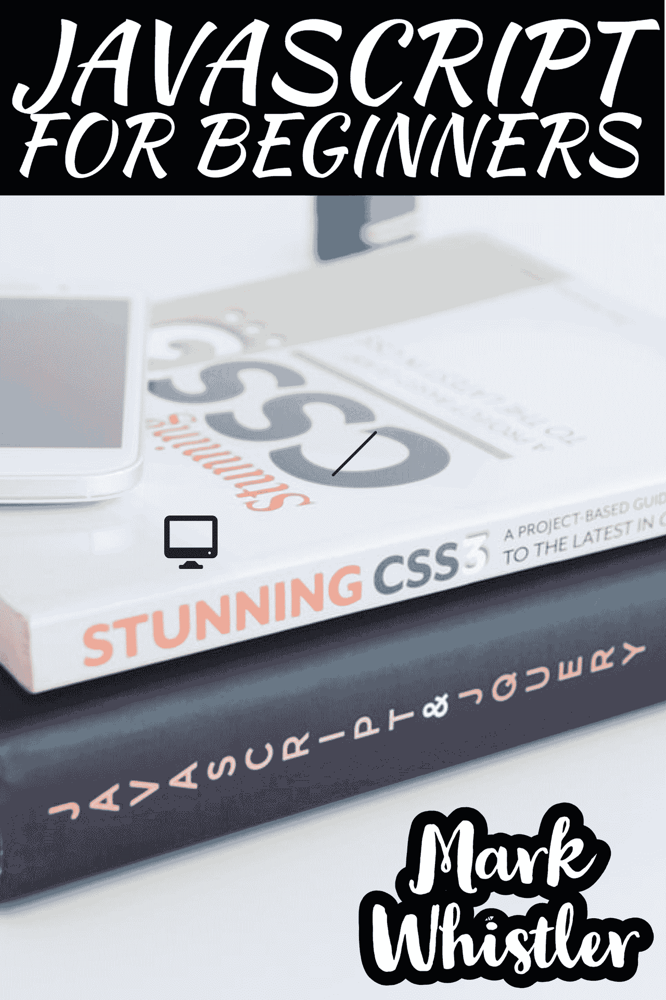

# JavaScript 初学者指南：学习 JavaScript、Python、SQL 和 Java 基础的完整初学者指南



## 介绍

HTML 并不智能。它主要让人们查看文本和图像，并允许他们到其他页面执行更多相同的操作。为网页增加智能的是 JavaScript。它通过让页面在访问者与内容交互时做出响应，使网站更具吸引力、更高效且实用。

本书假设我们已经知道如何使用 HTML 来指定网页结构和内容。如果我们熟悉如何使用 CSS 对页面进行样式设计（独立于网页结构），将更有益。如果是这样，我们就准备好使用 JavaScript 为页面添加一些行为，使其更具动态感和交互性。否则，没有 HTML 和 CSS，JavaScript 对我们没有大用处。它们被视为网页的三大支柱：结构、表现和行为。

## 第一章：什么是 JavaScript？

JavaScript 是 Web 的脚本语言，其唯一目的是为我们的页面添加交互性。除了交互性外，现代版本的 JavaScript 还用于从外部源甚至网站用户加载并解析信息。JavaScript 本质上是嵌入网页 HTML 结构中的一段程序代码。当浏览器读取这段代码时，它会激活内置的解释器，该解释器理解如何解码这种语言并处理其命令。

虽然编码过程中涉及编程，但 JavaScript 并不是一种编译语言。在传统的 Web 编程语言（如 Java 或 .NET）中，代码在执行之前必须编译。编译意味着代码必须先发送到运行在服务器上的特殊程序。该程序也称为应用服务器软件，它翻译代码、创建请求的页面和/或功能并将其作为 HTML 返回。像 JavaScript 这样的脚本语言是不编译的，而是即时解释的。这意味着不需要任何特殊软件，因为用户自己的浏览器会在遇到代码时运行并执行它。

**注意：** JavaScript 创建于 Java 是一种非常流行的语言的时代。除此外，这些语言之间没有关系，除了基本的编程逻辑外几乎没有任何共同点。

### 实现 JavaScript

现在我们对 JavaScript 是什么有了大致了解，可以开始使用这种语言。由于 JavaScript 代码是 HTML 文档的一部分，我们需要知道如何告诉浏览器运行我们的脚本。当我们想在 Web 文中包含 JavaScript 时，有两种常用选项。两种情况下我们都会使用 `<script>` 元素。`<script>`标签用于告诉浏览器 JavaScript 代码的开始和结束。此标签可以包含在页面的 `head` 或 `body` 中。第一个选项是将代码内联在文档中。实现这一点，我们将打开 `<script>` 标签，输入 JavaScript 代码，然后用 `</script>` 标签结束。理论上，我们可以这样留下文档，因为所有浏览器默认认为 `<script>` 标签之间的脚本语言是 JavaScript。然而，为了最大的兼容性，我们将使用 `type` 属性和 `text/javascript` 值来扩展此标签，以指示浏览器如何精确解释代码。

```html
<script type="text/javascript">JavaScript 注释</script>
```

第二个选项是从外部文件将 JavaScript 代码加载到我们的 HTML 文档。为了这个目的，我们可以再次使用 `<script>` 元素，但这次除了 `type` 属性，我们还在 `<script>` 元素的 `src` 属性中包含外部文件的 URL。外部文件必须是带有 `.js` 扩展名的纯文本文件，包含 JavaScript 代码而不包含任何 HTML 元素或 CSS 规则。例如，将 `script.js` 文件调用到浏览器，我们将使用：

```html
<script src="script.js" type="text/javascript"></script>
```

当我们想在整个站点共享功能时，我们将 JavaScript 放在外部文件中并包含在网页中。否则，如果我们只需要添加本地行为，我们将代码嵌入页面中。

**注意：** 脚本文件按照它们在 HTML 代码中的放置顺序进行加载。

## 第二章：JavaScript 基础概念

通常，当我们听到“编程”一词时，我们会立即想到其他人和难以理解的字母和数字字符串。编程看起来像是凡人之外的魔法。然而，编程概念并不难掌握，因为它们总有实际应用。JavaScript 虽然不像 HTML 或 CSS 那么简单，但并不是一种过于复杂的语言。与其他语言不同，它的“语法”较具描述性且直观，使其非常适合作为第一门编程语言。基本上，学习 JavaScript 就像学习一种新语言，但是一种类似于英语的新语言。一旦我们学会了新单词，并理解了如何将它们组合成“句子”，我们了。

### 语法

每种语言都有自己的一组字符和单词，并有一套如何将这些字符和单词排列成完整句子的规则。这些规则被称为语言语法，它将语言结合并赋予其意义。

在开始一些 JavaScript 示例之前，让我们先为 JavaScript 准备环境。如之前所述，JavaScript 代码始终 HTML 代码的一部分。因此，为了使用 JavaScript，我们首先需要创建一个 HTML 文档。为了开始，让我们打开文本编辑器（如记事本）并输入基础网页的 HTML 代码。除了基础 HTML 标签外，我们在 `<head>` 部分包含一个 `<script>` 元素，我们将开始放置 JavaScript 代码。

```html
<!doctype html>
<head>
<title>JavaScript 初步</title>
<script type="text/javascript"></script>
</head>
<body>

</body>
</html>
```

我们将此文档另存为 `firststeps.html`。如果我们使用记事本，必须记住将“保存类型”更改为“所有文件”。

### 语句

为了用日常语言表达我们，我们使用句子作为通信的基本形式。同样，在 JavaScript 中，我们也形成句子来表达我们的意图，这些正式地被称为语句。JavaScript 句子是通信的基本单元，通常代表程序中的单个步骤。就像我们组合句子来表达观点一样，我们将语句组合在一起创建一个程序。

让我们看一个简单的 JavaScript 语句并看看它的作用。在 html 文档的打开和关闭 `<script>` 标签之间放置了以下文本：

```javascript
alert("JavaScript 开始变得有点意义了。");
```

在后续示例中，除非必要，否则不会显示完整的 HTML 代码，但对于初始参考，您的文档应该是：

```html
<!doctype html>
<head>
<title>JavaScript 初步</title>
<script type="text/javascript">alert("JavaScript 开始变得有点意义了。");</script>
</head>
<body>

</body>
</html>
```

我们可以保存 `firststeps.html` 文并在浏览器中打开它。一旦页面打开，我们将得到一个带有消息“JavaScript 开始变得有点意义了”的警报窗口。

现在我们知道了效果是什么，让我们回到 JavaScript 语句并将其翻译成普通语言，使其更有意义。

```javascript
alert("JavaScript 开始变得有点意义了。");
```

JavaScript 语句是 Web 浏览器执行的指令。语句以关键字呈现的命令开始。关键字标识了需要执行的操作。在这种情况下，关键字 `alert` 让 Web 浏览器打开对话框并显示消息。如果我们只有 `alert()` 语句，对话框将是空的，然而在我们的情况下，语句由一个特定输入，即实际的消息文本，也称为参数。最后，就像每个句子都以句号结束，JavaScript 句子以分号结束。分号明确语句已结束，一旦解释器执行了它，就应该移动到下一个项目。

现在我们准备好翻译 JavaScript 语句了。它的普通英语解释是：“打开一个对话框并显示文本。”

**注意：** 在传递文本参数时，我们可以使用双引号（`""`）或单引号（`''`）。

在继续之前，让我们看另一个语句。在 `<script>` 元素中将之前的代码替换为以下并在浏览器中预览结果：

```javascript
document.write("<p>JavaScript 开始变得有点意义了。</p>");
```

从结果中我们可以看到之前的空内容现在有一段文本。根据之前对 JavaScript 如何运作的解释，我们可以正确地假设 `document.write` 命令让浏览器直接写入打开和关闭括号之间的任何内容。

### 变量

JavaScript 以及任何通用编程语言的一个基本方面是变量的概念。变量是一种声明和存储可以使用信息的方法。这些信息可以随情况而变化，因此有了名称。让我们看看下面的语句：

```javascript
var name = "Martin";
```

在普通语言中这等同于说“我的名字是 Martin”。关键字 `var` 表示“创建一个变量”，或者在编程中中“声明一个变量”。后面是变量的名称，可以是任何具有特定限制的内容。使用 `=` 符号为变量赋值，这并不是立即需要的，因为这以后可以发生。我们可以在一个语句中声明未定义的变量并为其赋值。例如：

```javascript
var name;
name = "Martin";
```

正如之前提到的，变量名可以包含字母、数字、美元符号（`$`）或下划线（`_`），不允许其他特殊字符。此外，变量名不能以数字开头，任何其他值都是接受的。最后，变量名对大小写敏感，这意味着解释器区分大写和小字母。

**注意：** 虽然我们可以使用任何内容作为变量名，但使用有意义的名称是明智的，这将帮助我们和其他程序员更好地理解。

### 变量类型

根据数据类型，变量有不同的种类。三个基本的类型是数字、字符串和布尔。

数字变量由数字表示。该变量可以接受整数、负整数和分数整数。数字经常用于计算，因此我们的数字变量经常包含数学运算中。下面的语句声明了一个名为 `age` 的变量并赋值为 35。

```javascript
var age = 35;
```

字符串变量用于表示任何字母序列，如单词或句子。字符串表示为引号内的字符序列，引号指示解释器后面是一个字符串。JavaScript 允许我们使用双引号（`"`）或单引号（`'`），但必须注意使用相同类型的引号。

```javascript
var location = "California";
```

布尔变量非常简单，因为它只接受两个值之一：`true` 或 `false`。该变量用于我们想要智能地响应用户操作的程序中。

### 用户变量

如果 JavaScript 不允许我们分享想法并直接创建或更改变量，将不再有趣。提供输入的最简单方法之一是使用 `prompt()` 命令。

```javascript
var name = prompt("你的名字是什么?", "");
document.write(name);
```

`prompt()` 命令的结果是一个对话框。与仅仅显示消息的 alert 对话框不同，提示对话框也可以接收答案。因此，在提示对话框的语法中，需要在逗号分隔提供两个参数。第一个参数是显示在框中的提示文本，而第二个参数是文本框的默认值，因此是变量。

在上面的示例中，框中显示的提示文本是“你的名字是什么？”，默认值将为空，因为引号之间明显没有内容。一旦我们在框中输入内容并点击确定或按回键，变量就会接收字段的值。因此，名字将显示在网页上。否则，如果我们点击取消、按 Esc 键或关闭提示框，返回的值将为空，屏幕上没有文本。

**注意：** 除了 `prompt()`，我们还可以使用更正式的 `window.prompt` 命令。

### 运算符

在变量中存储信息是第一步，编程的魅力在于以许多创造性的方式处理这些信息。为此此，JavaScript 提供了不同的运算符允许我们修改数据。运算符由符号或单词表示，是可以将一个或多个值更改其他东西的东西。可用运算符的类型根据数据类型不同。

### 数学运算符

基本的数学运算符如加（`+`）、减（`-`）、乘（`*`）和除（`/`）在 JavaScript 中很容易可用。它们可以在独立语句中使用或在声明变量时使用。例如，通过操作变量 `currentYear` 和 `yearOfBirth`，我们可以确定变量 `age` 的值。

```javascript
var currentYear = 2015;
var yearOfBirth = 1979;
var age = currentYear - yearOfBirth;
document.write(age);
```

**注意：** 调用变量并在网页显示是简单的。只需使用 `document.write()` 命令。

数学运算符，特别是加运算符，可以组合两个或多个字符串。这种组合字符串的过程被称为拼接。在下面的示例中：

```javascript
var firstName = "Martwan";
var lastName = "Jenkins";
var fullName = firstName + lastName;
document.write(fullName);
```

（注：由于原文后续存在大量重复段落，此处已仅翻译唯一核心内容）

| 年份 | 名称 | 更改 |
| :--- | :--- | :--- |
| 1997 | ECMAScript 1 | 第一版 |
| 1998 | ECMAScript 2 | 仅包含编辑修订 |
| 1999 | ECMAScript 3 | 添加了正则表达式和 try/catch |
| 2009 | ECMAScript 5 | 添加了“严格模式”和 JSON 支持 |
| 2011 | ECMAScript 5.1 | 编辑修订 |
| 2015 | ECMAScript 6 | 添加了类和和模块 |
| 2016 | ECMAScript 7 | 添加了指数运算符 (`**`) 和 `array.prototype.includes` |

还有许多基于 JavaScript 语言开发的流行框架。下面是其中最流行的几个，并附带每个代码的简短示例。

#### Angular

AngularJS 是一个用于创建动态 Web 应用程序的结构框架。HTML 可以作为模板语言，而 AngularJS 允许你扩展 HTML 语法来清晰地表达应用程序组件。AngularJS 支持数据绑定和依赖注入，这消除了自己编写代码来执行这些任务的需求。

示例 5：以下程序用于展示一个简单的 AngularJS 程序。

```html
<!DOCTYPE html><html><script src="https://ajax.googleapis.com/ajax/libs/angularjs/1.6.4/angular.min.js"></script><body><div ng-app=""><p>Hello World</p></div></body></html>
```

#### Node.JS

Node.JS 是一个开源、跨平台的 JavaScript 运行时，用于在服务器端执行 JavaScript 代码。通常 JavaScript 被用客户端语言，但 Node.JS 通过实现可以在服务器端框架上使用的 JavaScript 改变了这一点。

示例 6：以下程序用于展示一个简单的 Node JS 程序。

```javascript
var http = require('http');http.createServer(function (req, res) {res.writeHead(200, {'Content-Type': 'text/plain'});res.end('Hello World!');}).listen(8080);
```

#### React

ReactJS 是一个用于构建用户界面的开源 JavaScript 库。它由 Facebook、Instagram 以及个人开发者和公司社区维护。

示例 7：以下程序用于展示一个简单的 React JS 程序。

```javascript
var App = React.createClass({render: function() {return <div>Hello World</div>}});React.render(<App />, document.body);
```

#### JQuery

JQuery 是一个快速、轻量且功能丰富的 JavaScript 库。它通过一个易于使用且适用于多种浏览器的 API，让 HTML 文档遍历与操作、事件处理、动画和 Ajax 等操作变得简单多倍。

示例 8：以下程序用于展示一个简单的 JQuery 程序。

```html
<!DOCTYPE html><html><script>$(document).ready(function(){$("p").click(function(){$(this).hide();});});</script><body></body></html>
```

### JavaScript 的特性

JavaScript 拥有一系列特性。我将在下面介绍其中一些：

#### 使用对象

JavaScript 中的数据以对象的形式表示，这使得处理 JavaScript 中各种形式的数据变得更加容易且更具扩展性。下面是一个使用变量定义对象的 JavaScript 程序简单示例。

示例 9：以下程序用于展示一个简单的 JavaScript 对象。

```html
<!DOCTYPE html><html><body><h1>javascript Example</h1><p id="demo"></p><script>var value="Hello World";document.getElementById("demo").innerHTML = value;</script></body></html>
```

#### 数据类型

JavaScript 的工作基于它是一种动态类型语言。变量可以设置为数字，稍后设置为字符串。下面是一个处理数据类型的 JavaScript 程序简单示例。


示例 10：以下程序用于展示一个关于数据类型的简单 JavaScript 程序。

```html
<!DOCTYPE html><html><body><h1>javascript Example</h1><p id="demo"></p><script>var value=1;value="Hello World";document.getElementById("demo").innerHTML = value;</script></body></html>
```

### 3.3 结构化语言

JavaScript 遵循结构化编程语法，你可以使用“while 循环”和“if 语句”等普通循环语句。下面是一个处理决策和循环的 JavaScript 程序简单示例。

示例 11：以下程序用于展示一个关于循环语句的简单 JavaScript 程序。

```html
<!DOCTYPE html><html><body><h1>javascript Example</h1><p id="demo"></p><script>var txt="";var i = 0;do {txt += "<br>The value is " + i;i++;}while (i < 10);   document.getElementById("demo").innerHTML = txt;</script></body></html>
```

### 3.4 面向对象

JavaScript 几乎是一门完全面向对象的语言，能够为变量对象定义属性。下面是一个处理对象的 JavaScript 程序简单示例。

示例 12：以下程序用于展示一个带有对象的简单 JavaScript 程序。

```html
<!DOCTYPE html><html><body><h1>javascript Example</h1><p id="Name"></p><p id="chapter"></p><script>var Tutorial={Name:"Javacript",chapter:"Features"}document.getElementById("Name").innerHTML = Tutorial;document.getElementById("chapter").innerHTML = Tutorial;</script></body></html>
```

### 3.5 定义函数

JavaScript 能够通过函数将代码拆分为模块。下面是一个在 JavaScript 程序中使用函数的简单示例。

示例 13：以下程序用于展示一个关于类的简单 JavaScript 程序。

```html
<!DOCTYPE html><html><body><h1>javascript Example</h1><p id="Name"></p><p id="chapter"></p><script>function myFunction() {return "Hello World";}document.getElementById("Name").innerHTML = myFunction();</script></body></html>
```

### 3.6 事件处理

事件也可以在 JavaScript 中处理。如果你想在点击按钮时运行代码是可以实现的。可以使用函数来定义在事件触发时运行的代码。下面是一个处理事件处理的 JavaScript 程序简单示例。

示例 14：以下程序用于展示一个处理事件处理的简单 JavaScript 程序。

```html
<!DOCTYPE html><html><body><h1>javascript Example</h1><p id="Name"></p><p id="chapter"></p><script>function myFunction() {document.getElementById("Name").innerHTML = "Hello World";}</script><button onclick="myFunction()">Click Me</button></body></html>
```

### 3.7 使用 HTML DOM

最重要的特性之一是通过 DOM 修改元素。这使得 JavaScript 成为一种流行的脚本语言。下面是一个处理 HTML DOM 的 JavaScript 程序简单示例。

示例 15：以下程序用于展示一个处理 HTML DOM 的简单 JavaScript 程序。

```html
<!DOCTYPE html><html><body><h1>javascript Example</h1><p id="Name"></p><script>document.getElementById("Name").innerHTML = "Hello World";</script></body></html>
```

### 3.8 使用浏览器

JavaScript 还设计用于与许多浏览器协作，并具有获取其所在的浏览器窗口信息的能力。

示例 16：以下程序展示了一个可以与浏览器窗口工作的简单 JavaScript 程序。

```html
<!DOCTYPE html><html><body><h1>Javascript Example</h1><p1 id="demo"></p1><script>document.getElementById("demo").innerHTML = screen.width;</script></body></html>
```

### 3.9 变量的作用域

JavaScript 中的变量涉及全局与局部作用域的概念。变量的作用域在其定义的块中。下面的示例展示了一个局部作用域的变量。

示例 17：以下程序展示了一个使用局部作用域变量的简单 JavaScript 程序。

```html
<!DOCTYPE html><html><body><h1>Javascript Example</h1><p1 id="demo"></p1><script>function demo() {var val=1;// 变量 val 仅在此处使用}</script></body></html>
```

### 3.10 内置函数

JavaScript 能够使用一些可以在你的代码中使用的内置函数。下面的示例展示了某个内置数学函数的用法。

示例 18：以下程序展示了一个使用内置函数的简单 JavaScript 程序。

```html
<!DOCTYPE html>
<html>
<body>
<h1>Javascript Example</h1>
<p id="demo"></p>
<script>document.getElementById("demo").innerHTML = Math.PI;</script>
</body>
</html>
```

### 3.11 数组操作

JavaScript 能够以数组的形式处理元素。这有助于程序员员像如下所示，处理一组连续的元素。

示例 19：以下程序用于展示一个使用数组的简单 JavaScript 程序。

```html
<!DOCTYPE html>
<html>
<body>
<h1>Javascript Example</h1>
<p id="demo"></p>
<script>var val = ["1", "2", "3"];document.getElementById("demo").innerHTML = val[0];</script>
</body>
</html>
```

### 3.12 错误处理

JavaScript 还可以通过使用 `try` 和 `catch` 块来处理程序中生成的错误。下面的示例展示了一个使用 `try` 和 `catch` 块的简单程序。

示例 20：以下程序展示了一个使用错误处理的简单 JavaScript 程序。

```html
<!DOCTYPE html>
<html>
<body>
<p id="demo"></p>
<script>try {funcA("Hello World");}catch(err) {document.getElementById("demo").innerHTML = err.message;}</script>
</body>
</html>
```

### 3.13 JSON 处理能力

JSON 被称为 JavaScript 对象表示，被用作类似 XML 的中间语言。JavaScript 也可以像下面的示例所示处理 JSON 对象。

示例 21：以下程序展示了一个处理 JSON 的简单 JavaScript 程序。

```html
<!DOCTYPE html>
<html>
<body>
<h2>JavaScript Example</h2>
<p id="demo"></p>
<script>var text = '{"Names":[' +'{"firstName":"John","lastName":"Doe" },' +'{"firstName":"Peter","lastName":"Smith" }]}';obj = JSON.parse(text);document.getElementById("demo").innerHTML =obj.Names[1].firstName + " " + obj.Names[1].lastName;</script>
</body>
</html>
```

# 第 4 章：CSS3 基础

级联样式表（Cascading Style Sheets，简称 CSS）提供了网页闻名的呈现效果。尽管 HTML 能够为网页提供基础结构，但 CSS 为开发者提供了大量的设计选择。此外，它快速且高效，这使其成为越来越受欢迎的设计工具。众， CSS 演自 SGML（标准化泛化标记语言）。这一方向的努力目标是标准化网页外观的方式。该技术的最新版本是 `CSS3`，它是由 50 个模块组成的集合。

CSS 最强大的特性是它的级联能力。简单来说，它允许网页从多个样式表中获取样式，使得后续读取的表中的样式更改将覆盖已从一个或多个之前的表中所实现的样式。

## 如何定义和应用样式

样式的定义和应用涉及两个方面或部分：选择器（selector）和声明（declaration）。选择器决定了网页中需要样化的区域，而声明块描述了必须实施的样式规范。为了说明它是如何工作的，让我们考虑以下示例：

```css
body {color: white;}
```

在这个示例中，选择器选择了网页的 `body`，声明块定义了字体颜色应更改为白色。这是一个简单的示例，声明可以比这复杂得多。

## 如何添加注释

可以使用以下格式在样式表中添加注释：

```css
/*编写注释*/
```

## 如何创建内联样式

每个元素都有一个关联的全局属性 `style`。可以在标签内对该全局属性进行操作，以修改该元素的外观。这种类型的样式不需要你指定选择器。只需要声明块。以下是这种操作的示例：

```html
<body style='color: white;'></body>
```

此 `HTML` 标签执行的功能与前一节中指定的 CSS 代码相同。使用这种方法的优势是，通过这种方式给出的样式信息将覆盖任何其他样式。因此，如果你需要为其中一个元素使用不同的样式，而文档的其他部分遵循不同的样式，你可以为文档使用样式表并在标签中为该元素指定样式。

## 如何使用嵌入样式

实现与内联样式相同结果的另一种方法是在相关元素内部使用 `<style>` 元素来定义其样式规范。方法如下：

```html
<!DOCTYPE html>
<html xmlns='http://www.w3.org/1999/xhtml'>
<head>
<title></title>
<style>body {color: white;}</style>
</head>
<body></body>
</html>
```

## 如何创建外部样式表

对于希望对整个网页或多个网页使用相同样式的情况，最佳方法是使用外部样式表。该外部样式表可以通过以下方式链接到 HTML 页面：

```html
<!DOCTYPE html>
<html xmlns='http://www.w3.org/1999/xhtml'>
<head>
<title></title>
<link rel='stylesheet' type='text/css' href='Content/main.css' />
</head>
<body></body>
</html>
```

你必须在 `Content` 文件夹中创建一个名为 `main.css` 的文件，并将指定的指定的规则放入其中：

```css
body {color: white;}
```

## 定义媒体

需要注意的是，样式表可以包含你任意数量的样式规则。此外，你还可以为不同的媒体链接不同的 CSS 文件。不同的媒体类型如下：

* `all`

* `embossed`

* `braille`

* `print`

* `handheld`

* `speech`

* `screen`

* `tv`

* `tty`

使用的媒体可以用以下方式定义：

```html
<link rel='stylesheet' type='text/css' href='Content/all.css' media='all'/>
```

## 定义字符编码

你也可以使用以下格式定义使用的字符编码：

样式表：

在样式表的样式规则上方放置此行。

```css
@charset 'UTF-8';
```

HTML 页面：

你必须将此行放在 link 元素上方。

```html
<meta http-equiv='Content-Type' content='text/html;charset=UTF-8'>
```

## 导入样式表

随着网页变得复杂，使用的样式表复杂性也会增加。因此，你可能需要使用许多样式表。你可以通过以下方式将一个样式表的样式规则导入另一个样式表：

```css
@import url('/Content/header.css');
```

在这里，`header.css` 被导入，`url` 提供了要导入样式表的相对地址。

## 导入字体

可以使用以下格式导入字体：

```css
@font-face {font-family: newFont;src: url('New_Font.ttf'),url('New_Font.eot'); /* IE9 */
```

## 选择器、特殊性与级联

选择器有三种类型：类选择器、ID 选择器元素选择器。元素选择器类型是最简单的，要求你只需命名需要使用的元素。例如，如果你想更改 `body` 的背景颜色，那么使用的选择器就是 `body`。

在声明任何元素时，你可以使用 `id` 属性为其分配一个 ID。你可以使用带有 `#` 前缀的 ID 作为选择器。例如，如果你有一个 ID 为 `btnID` 的按钮，那么该 ID 选择器为 `#btnID`。同样，你可以使用 `class` 属性为元素分配类名。类名可以使用点 (`.`) 前缀，例如 `.className`。然而，如果你想选择网页的所有元素，可以使用星号 `*`。

## 后代和子选择器

你可能希望对选择器的后代应用特定样式。这可以通过指定完整选择器来实现：

```css
li a {text-color: black;}
```

另一方面，你可能只想对选择器的直接子元素应用样式。这可以通过指定父元素和子元素之间使用大于 (`>`) 符号来实现：

```css
li > a {color: white;}
```

## 伪元素和伪类选择器

现在你已经知道如何对特定元素应用样式，让我们继续根据名称、内容或是否 DOM 树的一部分来使用伪类对元素分类。可用的伪类包括：

* `:visited`

* `:link`

* `:hover`

* `:active`

* `:checked`

* `:focus`

* `:nth-last-child(n)`

* `:not`

* `:only-child`

* `:nth-child(formula)`

* `:lang(language)`

* `:first-of-type`

* `:only-of-type`

如果你想访问 DOM 树的信息，可以使用伪元素。伪元素包括：

* `::first-letter`

* `::first-line`

* `::after`

* `::before`

## 分组选择器

多个选择器用于样式规则。这些选择器必须用逗号分隔。

```css
body, button {color: white;}
```

## 使用相邻选择器

如果你想对 `div` 中的第一个标题设置样式，选择器使用两个选择器之间的加号 (`+`) 构建。

```css
div + h1 {color: white;}
```

## 兄弟选择器

兄弟选择器与相邻选择器类似，不同在于它们样式所有匹配的元素。选择器使用两个选择器之间的 `~` 符号构建。

```css
div ~ h1 {color: white;}
```

## 使用属性选择器

此选择器选择存在指定属性元素。选择器写如下形式：

```css
a[title]
```

此选择器选择所有指定了 `title` 属性的链接。此外，这种选择器类型可以通过指定属性值修改属性值选择器：

```css
a[title = value]
```

## 浏览器内置样式

每个浏览器都有一个内置样式表，应用于使用该浏览器打开的所有网页。事实上，该样式表在任何其他样式表之前应用。你可以可以使用自定义样式表。然而，如果你打开不同的浏览器，你定义的样式表可能无效。如果你希望用户定义的样式表覆盖 HTML 页面指定的任何其他样式，可以使用 `important` 修饰符。该修饰符为指定的样式设置最高优先级。

```css
body {color: white !important;}
```

## 样式级联

样式的优先级根据以下参数决定：

* 重要性 (Importance)

* 特殊性 (Specificity)

* 文本顺序 (Textual Order)

## 使用 CSS 属性


现在你已经熟悉选择器的使用，下一步是查看 CSS 属性。

## 颜色

网页中最关键属性之一是`color`，可以使用 ARGB、RGB 和颜色名称定义。RGB 值通常使用 0-255 之间的数字定义。

* 白色 `#ffffff`
* 红色 `#ff0000`
* 黑色 `#000000`
* 绿色 `#008000`

可以使用颜色值代替颜色名称。使用示例如下：

```css
body {color: #ffffff;}
```

指定颜色的另一种方法是使用`rgb`函数，它使用 0-255 之间的数字或百分比指定参数值。这种类型的声明示例如下：

```css
h1 { color: rgb(255,0,0); }
```

指定颜色的其他方法是`RGBA`（接受 4 个值）和`HSL`（定义色调、饱和度和亮度的值）。

## 透明度

透明度（opacity）由 0.0（不可见）到 1.0（不透明）之间的值定义。

## 文本

对于文本，可以指定`font-face`和`font-size`。这些属性可以用以下方式定义：

```css
h1 { font-family: arial, verdana, sans-serif; }
h1 { font-size: 12px; }
```

## CSS Box 模型

CSS Box 模型假设网页可以认为是由盒子组成的。盒子之间的间距由外边距（margins）和内边距（padding）设置给出。这些属性可以用以下方式赋值：

```css
margin: 15px;
padding: 25px;
border: 10px;
```

## 定位元素

用于创建布局的元素`<div>`。虽然 HTML5 建议使用语义化标记代替`<div>`元素，但仍然用于无法样式化的内容。`<div>`元素可以被想象成矩形块，并如下所示声明：

```html
<div>other elements</div>
```

用于定义`<div>`位置的属性包括：

* `top`
* `bottom`
* `left`
* `right`
* `static`
* `relative`
* `float`
* `clear`
* `box-sizing`

## 居中内容

如果你使用`fixed`，`div`元素可以使用`margin-left`和`margin-right`中。如果你将`width`设置为`auto`，额外的空间将被平均。可以通过以下方式完成：

```css
#container {width:850px;margin-left: auto;margin-right: auto;}
```

# 第 5 章：缓慢思考与保持谦逊

当你知道自己在做什么时，快速编写代码可能会导致出错，这在你对 JavaScript 有非常有经验时尤其如此。你可能还会发现，当你更擅长编写代码时，保持自信并不是件坏事，但它可能会导致你漏掉一些内容。为了确保你对代码做了最好的工作，即使在练习时，也应该尽可能慢地思考。

## 慢下来

在你思考编写的代码时，确保你尽可能慢。起初可能需要更多时间，但在回顾你所做的代码时，这将为你节省大量时间。通过慢速，你不太可能产生错误。当你回顾并逐行查看代码时，慢慢地阅读每个字母和符号，这样你就能知道是否漏掉了什么。这就像你在高中或大学写论文时一样。慢下来检查你写的代码，这种慢速将帮助你发现任何错误。

## 休息

从工作中休息一直是有益的。连续查看几小时代码，你的眼睛不仅会疲劳，大脑也会开始疲倦。休息可以帮助你刷新正在做的工作，并让你带着空白的大脑重新开始。编写代码时大脑清醒有很多好处。通常，每工作一小时，你应该花 5-10 分钟离开电脑，站起来走走做不涉及 JavaScript 的事情。建议这段时间出去呼吸新鲜空气，或者简单地走走。这两项活动有助于血液流动，并在决定回去重新编写代码时为大脑提供氧气。

警告：在离开屏幕休息期间，尝试不要玩手机。虽然手机屏幕小得多，但它发出的蓝光和电脑一样有害。工作时留出特定时间使用手机，这样你就不用用休息时间和朋友聊天或检查非工作邮件。休息时，将手机放在手够不到的地方是好习惯。

## 逐一处理

一旦写了你想写的代码，你需要确保你正在逐一处理它。像编写过程一样缓慢地这样做，这样你就能发现犯过的任何错误。你应该在写完最后一行代码之后、在有机会通过测试对其进行检查之前这样做。缓慢地查看每一行代码总是个好主意。

确保你查看了所写代码的每一个字符的一种方法是大声读出来。对自己说出每个字母、数字和字符，这样就不会漏掉。大声读出来会显示你实际写了什么，比在脑子里阅读花费的时间更多。

# 第 6 章：运算符

## 什么是运算符？

运算符基本上是作为函数的符号，尽管在语法上与函数不同。它们接受输入（操作数）并根据操作数产生特定的输出。例如在`5+2`中，`5`和`2`是操作数（输入），`+`符号是运算符，结果为`7`。

## 运算符分类

运算符通常根据它们执行的操作类型分类。`typeof`、`instanceof`等运算符是独特的，因此不能归类到以下类别中。

## 算术运算符

提示，这些是执行算术任务的运算符。

* 加法（`+`）：如果两个操作数都是数字，该运算符执行加法操作；如果两个操作数都是字符串类型，该运算符连接两个操作数。

```
4 + 2 // 结果 6
'example' + 5 // 结果 "example5"
'thisIs' + 'Example' // 结果 "thisIsExample"
```

* 减法（`-`）：该运算符对两个操作数执行减法操作。

```
4-2 // 结果 2
```

* 除法（`/`）：该运算符对两个操作数执行除法操作。

```
15/3 // 结果 3
```

* 乘法（`*`）：该运算符对两个操作数执行乘法操作。

```
4*2 // 结果 8
```

* 取模（`%`）：也称为取余运算符，该运算符在两个操作数被除时得到余数。

```
5%2 // 结果 1
5%3 // 结果 2
```

* 递增（`++`）：将数字操作数的值增加 1。该运算符的位置取决于它是放在操作数之前还是之后。如果放在操作数之前，称为前缀（`++x`）；如果放在操作数之后，称为后置（`x++`）。

```
console.log(++x); // 输出 6
console.log(y++); // 输出 5
```

* 递减（`--`）：将数字操作数的值减少 1。类似于递增运算符，后置和前缀规则适用于此处。

```
console.log(--x); // 输出 4
console.log(y--); // 输出 5
```

* 幂（`**`）：该运算符通过第一个操作数相对于第二个操作数的幂得到结果。

```
2**3 // 结果 8
```

## 赋值运算符

这些运算符用于向变量赋值。根据右操作数给左操作数赋值。

* 等号（`=`）：该运算符将右操作数赋值给左操作数。

```
x=5
```

* 加赋值（`+=`）：该运算符将左操作数与右操作数相加赋值给左操作数。

```
x+=3 // 结果 8
```

* 减赋值（`-=`）：该运算符从左操作数中减去右操作数赋值给左操作数。

```
x-=3 // 结果 5
```

* 乘赋值（`*=`）：该运算符将左操作数与右操作数相乘赋值给左操作数。

```
x*=2 // 结果 10
```

* 除赋值（`/=`）：该运算符将左操作数除以右操作数赋值给左操作数。

```
x/=2 // 结果 5
```

* 取模赋值（`%=`）：该运算符将左操作数除以右操作数并将余数赋值给左操作数。

```
x%=2 // 结果 1
```

* 幂赋值（`**=`）：该运算符将左操作数相对于右操作数的幂并将结果赋值给左操作数。

```
x**=3 // 结果 8
```

## 其他运算符

这些无法归类的上述类型的运算符。

* `typeof`：该运算符以字符串格式返回操作数的类型。

```js
typeof 2 // 结果为 "number"
typeof 1.23 // 结果为 "number"
typeof "2" // 结果为 "string"
typeof 'hi' // 结果为 "string"
typeof true // 结果为 "boolean"
typeof false // 结果为 "boolean"
typeof {ob:1} // 结果为 "object"
typeof new Date() // 结果为 "object"
typeof Math.cos // 结果为 "function"
typeof function(){} // 结果为 "function"
```

* `instanceof`：该运算符检查第一个操作数（应该是一个对象）是否为特定类型，要检查的类型由第二个操作数指定。根据对象类型是否匹配返回 true 或 false。

```js
new String("A") instanceof String // 结果为 true
["this","is","array"] instanceof Array // 结果为 true
new String("A") instanceof Array // 结果为 false
["this","is","array"] instanceof String // 结果为 false
```

* `delete`：该运算符从对象中删除属性。

```js
var myObject = {prop1:"test",prop2:"test"};
delete myObject.prop1 // 删除对象 myObject 的 prop1 属性
```

* `in`：该运算符检查指定的属性（第一个操作数）是否在指定的对象（第二个操作数）中。根据属性是否在对象中返回 true 或 false。

```js
var myObject = {prop1:"test",prop2:"test"};
"prop1" in myObject // 结果为 true
"prop45" in myObject // 结果为 false
```

这一章解释了 JavaScript 中的运算符。希望你发现它有用。
