# 儿童的 JavaScript：有趣的编程入门指南

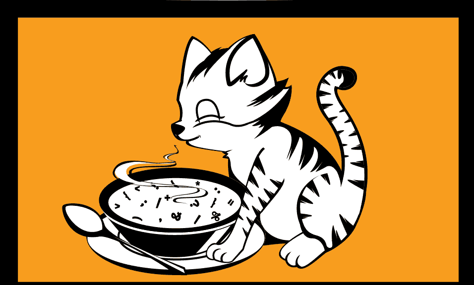


献给 Philly

（以及 Pancake）

# 关于作者

Nick Morgan 是 Twitter 的一名前端工程师。他喜欢所有的编程语言，但对 JavaScript 特别青睐。Nick 住在旧金山（多雾地区），和他的未婚妻以及他们毛茸茸的小 Pancake。他在 skillidrick.co.uk 写博客。

# 关于插画师

Miran Lipovača 是《Learn You a Haskell for Great Good!》的作者。他喜欢拳击、弹贝斯，当然还有绘画。他对跳舞的骨架和数字 71 非常痴迷，当他走过自动门时，会假装是用用意念开启它们的。

# 关于技术审查员

Angus Croll 是《If Hemingway Wrote JavaScript》的作者，他同样痴迷于 JavaScript 和文学。他在 Twitter 的 UI 框架团队工作，共同编写了 Flight 框架。他撰写了具有影响力的 JavaScript 博客，并在全球各大会议上演讲。他的 Twitter 账号为 @angustweets。

## 1 什么是 JavaScript

- 认识 JavaScript
- 为什么要学习 JavaScript？
- 编写一些 JavaScript
- JavaScript 程序的结构
  - 语法
  - 注释
- 你学了什么

## 2 数据类型与变量

- 数字与运算符
- 变量
  - 变量命名
  - 使用 Math 创建新变量
  - 自增与自减
  - `+=`（加法赋值）和 `-=`（减法赋值）
- 字符串
  - 合并字符串
  - 获取字符串长度
  - 从字符串中获取单个字符
  - 切割字符串
  - 将字符串转换为全大写或全小写
- 布尔值
  - 逻辑运算符
  - 用布尔值比较数字
- `undefined` `null`
- 你学了什么

## 3 数组

- 为什么你应该关注数组？
- 创建数组
- 访问数组元素
- 设置或更改数组中的元素
- 在数组中混合数据类型
- 使用数组
- 获取数组长度
- 向数组添加元素
- 从数组中删除元素
- 合并数组
- 查找数组元素的索引
- 将数组转换为字符串
- 数组的有用操作
- 寻找家的路
- 决策者
- 创建随机侮辱生成器
- 你学了什么
- 编程挑战
  - #1: 新侮辱
  - #2: 更复杂的侮辱
  - #3: 使用 `+` 还是 `join`?
  - #4: 合并成员

## 4 对象

- 创建对象
- 无引号的键
- 访问对象的值
- 为对象添加值
- 使用点符号
- 数组与对象的结合
- 朋友列表
- 控制台中的对象
- 对象的有用操作
- 追踪债务
- 存储电影信息
- 你学了什么
- 编程挑战
  - #1: 记分员
  - #2: 深入研究对象与数组

## 5 HTML 基础

- 编辑器
- 我们的第一个 HTML 文档
- 标签与元素
- 标题元素
- `p` 元素
- HTML 中的空格与块级元素
- 内联元素


- 完整的 HTML 文档
- HTML 层级结构
- 为你的 HTML 添加链接
- 链接属性
- Title 属性
- 你学了什么

## 6 条件判断与 JavaScript

- 在 HTML 中嵌入 JavaScript
- 条件语句
- if 语句
- if...else 语句
- 链式 if...else 语句
- 循环
- while 循环
- for 循环
- 你学了什么
- 编程挑战
- #1: 酷酷动物
- #2: 随机字符串生成器
- #3: h4ck3r sp34ck

## 7 创建猜字游戏

- 与玩家交互
- 创建提示框 (Prompt)
- 使用 confirm 提问是非
- 使用 alert 给玩家提供信息
- 为什么用 alert 而不是 console.log?
- 设计你的游戏
- 使用伪代码设计游戏
- 跟踪单词的状态
- 设计游戏循环
- 编写游戏
- 选择一个随机单词
- 创建答案数组
- 编写游戏循环
- 结束游戏
- 游戏代码
- 你学到了什么
- 编程挑战
- #1: 更多单词
- #2: 大写字母
- #3: 限制猜测次数
- #4: 修复一个 Bug

# 8 函数

- 函数的基础结构
- 创建一个简单的函数
- 调用函数
- 向函数传递参数
- 打印猫的脸
- 向函数传递多个参数
- 从函数返回值
- 将函数调用作为值
- 使用函数选择随机单词
- 选择随机单词的函数
- 随机辱骂生成器
- 将随机辱骂生成器变为函数
- 使用 return 提前退出游戏
- 多次使用 return 代替...else 语句
- 你学到了什么
- 编程挑战
- #1: 使用函数进行算术运算
- #2: 这些数组相同吗？
- #3: 猜字游戏，使用函数

# 第二部分：高级 JAVASCRIPT

# 9 DOM 和 JQUERY

- 选择 DOM 元素
- 使用 id 识别元素
- 使用 getElementById 选择元素
- 使用 DOM 替换标题文本
- 使用 jQuery 处理 DOM 树
- 在 HTML 页面上加载 jQuery
- 使用 jQuery 替换标题文本
- 使用 jQuery 创建新元素
- 使用 jQuery 制作动画
- 链式 | 动画
- 你学到了什么
- 编程挑战
- #1: 使用 jQuery 列出你的朋友 (并让它们闻起来！)
- #2: 制作闪闪灯
- #3: 延迟动画
- #4: 使用 fadeTo

# 10 交互式编程

- 使用 setTimeout 延迟代码
- 取消超时
- 使用 setInterval 多次调用代码
- 使用 setInterval 为元素制作动画
- 响应用户
- 响应点击
- 鼠标事件
- 你学到了什么
- 编程挑战
- #1: 跟随点击
- #2: 创建你自己的动画
- #3: 取消动画
- #4: 制作一个“点击标题”的游戏

# 1 寻找隐藏的宝藏！

- 设计游戏
- 使用 HTML 创建页面


- 选择宝藏位置 .................................................. 70
- 选择数字 ...................................................... 70
- 设置坐标 ........................................................
- 点击处理器 ....................................................
- 点击次数 .....................................................
- 计算宝藏之间的距离 ........................................
- 使用勾股定理 ................................................
- 告诉玩家有多近 ..............................................
- 检查玩家是否获胜 ..........................................
- 整合在一起 ..................................................
- 你学到了什么 .............................................. 78
- 编程挑战 .................................................... 79
  - #1: 扩大游戏区域 .......................................... 79
  - #2: 添加消息 .............................................. 79
  - #3: 限制点击 .............................................. 79
  - #4: 显示剩余点击次数 .................................... 79

# 12 面向对象编程 181

- 一个简单的对象 ............................................ 182
- 给对象添加方法 ............................................ 182
- 使用 `this` 关键字 ........................................ 183
- 多个对象共享一个方法 ...................................... 183
- 使用构造函数创建对象 ...................................... 185
- 构造函数的结构 ............................................ 185
- 创建汽车构造函数 .......................................... 186
- 绘制汽车 .................................................. 188
- 测试 `draw` 函数 .......................................... 189
- 使用原型自定义对象 ........................................ 190
- 在原型上添加 `draw` 方法 .................................. 191
- 添加 `moveRight` 方法 ..................................... 192
- 添加左、上、下移动对象 .................................... 193
- 你学到了什么 .............................................. 195
- 编程挑战 .................................................. 195
  - #1: 在汽车构造函数中绘图 ................................ 195
  - #2: 添加速度属性 ........................................ 196
  - #3: 赛车 ................................................ 196

# 第三部分：画布 (Canvas)

## 13 画布元素 ................................................ 199

- 创建基础画布 .............................................. 200
- 在画布上绘画 .............................................. 200
- 选择和保存画布元素 ........................................ 201
- 获取绘图上下文 ............................................ 201
- 绘制正方形 ................................................ 201
- 绘制多个正方形 ............................................ 202
- 更改绘图颜色 .............................................. 203
- 绘制矩形轮廓 .............................................. 205
- 绘制线条或路径 ............................................ 206
- 填充路径 .................................................. 207
- 绘制弧和圆 ................................................ 209
- 绘制四分之一圆或弧 ........................................ 210
- 绘制半圆 .................................................. 211
- 绘制整圆 .................................................. 211
- 使用函数绘制大量圆 ........................................ 212
- 你所学到的知识 ............................................ 214
- 编程挑战 .................................................. 214
  - #1: 绘制雪人的函数 ...................................... 214
  - #2: 绘制点数组 .......................................... 215
  - #3: 用鼠标绘画 .......................................... 215
  - #4: 绘制吊挂游戏中的人 ................................ 215

## 14 让物体在画布上动起来 .................................. 217

- 跨页面移动 ................................................ 218
- 清空画布 .................................................. 219
- 绘制矩形 .................................................. 219
- 更改位置 .................................................. 219
- 在浏览器中查看动画 ........................................ 219
- 制作正方形大小动画 ........................................ 220


- 一只彩虹蜂 ................................................................................................................................................................................................................................................................................... 221
- 一个新的圆函数 ...................................................................................................................................................................................................................................... 222
- 绘制蜜蜂 ................................................................................................................................................................................................................................................................................... 222
- 更新蜜蜂的位置 ................................................................................................................................................................................................................ 224
- 制作我们那嗡嗡叫的蜜蜂 ................................................................................................................................................................................. 225
- 让球弹起来！............................................................................................................................................................................................................................................................... 227
- 球的构造函数 ................................................................................................................................................................................................................................................. 227
- 绘制球 ............................................................................................................................................................................................................................................................ 228
- 移动球 .......................................................................................................................................................................................................................................................... 229
- 让球跳动 .......................................................................................................................................................................................................................................................... 229
- 制作球动画 .......................................................................................................................................................................................................................................................... 231
- 你所学到的 .......................................................................................................................................................................................................................................................... 232
- 编程挑战 .......................................................................................................................................................................................................................................................... 233
  - #1: 在更大的画布上跳动 .......................................................................................................................................................................................................................................................... 233
  - #2: 随机化 `this.xSpeed` 和 `this.ySpeed` .......................................................................................................................................................................................................................................................... 233
  - #3: 为更多球制作动画 .......................................................................................................................................................................................................................................................... 234
  - #4: 让球变得彩色 .......................................................................................................................................................................................................................................................... 234

## 15 使用键盘控制动画 235

- 键盘事件 .......................................................................................................................................................................................................................................................... 236
- 设置 HTML 文件 .......................................................................................................................................................................................................................................................... 236
- 添加 `keydown` 事件处理器 .......................................................................................................................................................................................................................................................... 237
- 使用对象将键码转换为名称 .......................................................................................................................................................................................................................................................... 238
- 使用键盘移动球 .......................................................................................................................................................................................................................................................... 239
- 设置画布 .......................................................................................................................................................................................................................................................... 240
- 定义 `circle` 函数 .......................................................................................................................................................................................................................................................... 240
- 创建球的构造函数 .......................................................................................................................................................................................................................................................... 240
- 定义 `move` 方法 .......................................................................................................................................................................................................................................................... 241
- 定义 `draw` 方法 .......................................................................................................................................................................................................................................................... 242
- 创建 `setDirection` 方法 .......................................................................................................................................................................................................................................................... 243
- 响应键盘 .......................................................................................................................................................................................................................................................... 244
- 制作球的动画 .......................................................................................................................................................................................................................................................... 245
- 将所有内容整合在一起 .......................................................................................................................................................................................................................................................... 246
- 运行代码 .......................................................................................................................................................................................................................................................... 248
- 你所学到的 .......................................................................................................................................................................................................................................................... 249
- 编程挑战 .......................................................................................................................................................................................................................................................... 249
  - #1: 墙壁反弹 .......................................................................................................................................................................................................................................................... 249
  - #2: 控制速度 .......................................................................................................................................................................................................................................................... 249
  - #3: 灵活控制 .......................................................................................................................................................................................................................................................... 249

## 16 制作贪蛇游戏：第一部分 251

- 游戏玩法 .......................................................................................................................................................................................................................................................... 252
- 游戏的结构 .......................................................................................................................................................................................................................................................... 253
- 使用 `setInterval` 制作游戏动画 .......................................................................................................................................................................................................................................................... 254
- 创建游戏对象 .......................................................................................................................................................................................................................................................... 254
- 设置键盘控制 .......................................................................................................................................................................................................................................................... 255
- 游戏设置 .......................................................................................................................................................................................................................................................... 255
- 创建 HTML .......................................................................................................................................................................................................................................................... 255
- 定义 `canvas`、`ctx`、`width` 和 `height` 变量 .......................................................................................................................................................................................................................................................... 256
  - 将画布划分为区块 .......................................................................................................................................................................................................................................................... 256
- 定义 `score` 变量 .......................................................................................................................................................................................................................................................... 258
- 绘制边界框 .......................................................................................................................................................................................................................................................... 258
- 显示分数 .......................................................................................................................................................................................................................................................... 260
- 设置文本基准线 .......................................................................................................................................................................................................................................................... 261
- 设置大小和字体 .......................................................................................................................................................................................................................................................... 262
- 编写 `drawScore` 函数 .......................................................................................................................................................................................................................................................... 263
- 结束游戏 .......................................................................................................................................................................................................................................................... 264
- 你所学到的 .......................................................................................................................................................................................................................................................... 265
- 编程挑战 .......................................................................................................................................................................................................................................................... 266
  - #1: 将其整合在一起 .......................................................................................................................................................................................................................................................... 266
  - #2: 为分数制作动画 .......................................................................................................................................................................................................................................................... 266
  - #3: 为吊字游戏添加文本 .......................................................................................................................................................................................................................................................... 266

## 17 制作贪蛇游戏：第二部分 267

- 构建区块构造函数 .......................................................................................................................................................................................................................................................... 268
- 添加 `drawSquare` 方法 .......................................................................................................................................................................................................................................................... 269
- 添加 `drawCircle` 方法 .......................................................................................................................................................................................................................................................... 270
- 添加 `equal` 方法 .......................................................................................................................................................................................................................................................... 272
- 创建蛇 .......................................................................................................................................................................................................................................................... 273
- 编写蛇的构造函数 .......................................................................................................................................................................................................................................................... 273
- 绘制蛇 .......................................................................................................................................................................................................................................................... 274
- 移动蛇 .......................................................................................................................................................................................................................................................... 275
- 添加 `move` 方法 .......................................................................................................................................................................................................................................................... 275
- 添加 `checkCollision` 方法 .......................................................................................................................................................................................................................................................... 279
- 使用键盘设置蛇的方向 .......................................................................................................................................................................................................................................................... 281
- 添加 `keydown` 事件处理器 .......................................................................................................................................................................................................................................................... 281
- 添加 `setDirection` 方法 .......................................................................................................................................................................................................................................................... 282
- 创建苹果 .......................................................................................................................................................................................................................................................... 283
- 编写苹果的构造函数 .......................................................................................................................................................................................................................................................... 283
- 绘制苹果 .......................................................................................................................................................................................................................................................... 283
- 移动苹果 .......................................................................................................................................................................................................................................................... 284
- 将所有内容整合在一起 .......................................................................................................................................................................................................................................................... 285
- 你所学到的 .......................................................................................................................................................................................................................................................... 291
- 编程挑战 .......................................................................................................................................................................................................................................................... 291
  - #1: 让画布变大 .......................................................................................................................................................................................................................................................... 291
  - #2: 给蛇上色 .......................................................................................................................................................................................................................................................... 291
  - #3: 让游戏加速 .......................................................................................................................................................................................................................................................... 292
  - #4: 修复 `apple.move` 方法 .......................................................................................................................................................................................................................................................... 292

## 后记

### 接下来可以去哪里 293

- 更多 JavaScript .......................................................................................................................................................................................................................................................... 294
- Web 编程 .......................................................................................................................................................................................................................................................... 294
- HTML .......................................................................................................................................................................................................................................................... 294
- CSS .......................................................................................................................................................................................................................................................... 294
- 使用 Node.js 进行服务器端编程 .......................................................................................................................................................................................................................................................... 295
- 图形编程 .......................................................................................................................................................................................................................................................... 295
  - canvas .......................................................................................................................................................................................................................................................... 295
  - 使用 SVG .......................................................................................................................................................................................................................................................... 295
  - 3D 编程 .......................................................................................................................................................................................................................................................... 296
- 机器人编程 .......................................................................................................................................................................................................................................................... 296
- 音频编程 .......................................................................................................................................................................................................................................................... 297
- 游戏编程 .......................................................................................................................................................................................................................................................... 297
- 使用 Fiddle 分享代码 .......................................................................................................................................................................................................................................................... 297

## 致谢

非常感谢我优秀的妻子 Philly，在过去的 18 个月里给予我的鼓励和支持。没有她，我无法完成这一切。还要感谢我们的狗狗 Pancake，慷慨地允许出现在代码示例中。

感谢 Angus，没有他，我不会在旧金山写这本书。Angus 在 2011 年向我推荐了 Twitter，接着在 2013 年向 Bill Pollock 建议我可能对写这本书感兴趣。最棒的是，他同意担任技术评审，指出了许多 JavaScript 错误。

特别感谢 Bill Pollock、Seph Kramer、Riley Hoffman、Tyler Ortman 以及 Starch Press 的所有人，他们耐心地指导我完成了写作过程。特别感谢 Bill 和 Seph 将我的文字润色成现在的样子。

感谢早期 PDF 的读者 River Bradley、Damien Champ 和 Alex Chu，他们提供了非常好的反馈。

最后，感谢 Miran Lipovaca。我一直是 Miran 的粉丝多年了——他的《Learn You a Haskell for Great Good》是我最喜欢的编程书籍之一，书中的插画非常棒。得知他将为我的书画画简直就像梦想成真。他为这本书画的画比我想象的还要好，能和他合作我深感荣幸。

# 引言

欢迎学习《少儿 JavaScript》！在这本书中，你将学习使用 JavaScript 进行编程，这是一门 Web 语言。但不仅如此，你将成为一名程序员——一个不仅*使用*计算机，而且*控制*它们的人。一旦学会了编程，你就可以让计算机听从你的意愿，让它们执行你想做的任何事情！

JavaScript 是一门非常棒的入门编程语言，因为它无处不在。Chrome、Firefox 和 Internet Explorer 等网页浏览器都使用了 JavaScript。凭借 JavaScript 的力量，网页程序员可以将网页从简单的文档转变为功能强大的交互式应用程序和游戏。

但你并不仅限于构建网页。JavaScript 可以运行在 Web 服务器上来创建网站，甚至可以用于控制机器人和其他硬件！

## 谁应该读这本书？

这本书适合任何想要学习 JavaScript 或初次尝试编程的人。本书的设计非常对儿童友好，但它也可以作为各年龄段初学者的第一本编程书。

通过这本书，你将逐步建立对 JavaScript 的认知，从 JavaScript 的简单数据类型开始，逐渐过渡到复杂类型、控制结构和函数。之后，你将学习如何编写在用户移动鼠标或按下键盘键时做出反应的代码。最后，你将学习 `canvas` 元素，它让你可以使用 JavaScript 绘制并制作任何你想画的动画！

在这一过程中，你将创建几个游戏来锻炼你的编程技能，并将所学知识付诸实践。

## 如何阅读这本书

首先，请按顺序阅读！这听起来可能像句废话，但很多人想直接跳到有趣的内容，比如制作游戏。每一章都旨在建立在之前章节的基础上，所以如果你从头开始，在学到游戏时会轻松得多。

编程语言就像口语：你必须学习语法和词汇，这需要时间。提高能力的唯一方法就是编写（以及阅读）大量的代码。随着你写的 JavaScript 越来越多，你会发现语言的某些部分变得像本能，最终你将成为一名熟练的 JavaScript 编写者。

在阅读时，我鼓励你输入并测试书中的代码示例。如果你不完全理解发生了什么，请尝试进行微小的更改，看看会产生什么效果。如果更改没有达到你的预期，看看能否找到原因。

最重要的是，一定要完成“试一试”（Try It Out）和“编程挑战”（Programming Challenges）部分。输入书中出现的代码是良好的第一步，当你开始编写自己的代码时，你会在更深层次上理解编程。如果你发现某个挑战很有趣，请坚持下去！提出你自己的挑战，在你编写的程序基础上构建更多功能。

你可以在 `http://nostarch/javascriptforkids/` 找到编程挑战的示例答案（以及游戏和其他示例的代码文件）。在解决挑战后查看答案，可以将你的方法与我的进行对比。或者，如果你卡住了，可以查看答案获取提示。请记住，这些只是示例答案。在 JavaScript 中实现同一个目标有许多许多不同的方法，所以如果你得出的解决方案和我完全不同，也不要担心！

如果你遇到不认识意思的单词，请查看书末的词汇表。词汇表包含了你在书中遇到的许多编程术语的定义。

## 这本书里有什么？

- 第 1 章带你快速了解 JavaScript，并让你在 Google Chrome 中开始编写 JavaScript。
- 第 2 章介绍了变量和 JavaScript 使用的基本数据类型：数字、字符串和布尔值。
- 第 3 章完全关于数组，它用于存储数据列表。
- 第 4 章关于对象，它包含键值对（`key-value pairs`）。
- 第 5 章介绍了 HTML，这是用于创建网页的语言。


- 第 6 章向你展示如何使用 `if` 语句、`for` 循环和其他控制结构对代码进行更多控制。
- 第 7 章整合你目前所学的所有知识，创建一个简单的猜单词游戏（Hangman）。
- 第 8 章向你展示如何编写自己的函数，以便分组并复用代码块。
- 第 9 章介绍了 jQuery，这是一个让你能够使用 JavaScript 轻松控制网页的工具。
- 第 10 章向你展示如何使用超时（`timeouts`）、间隔（`intervals`）和事件处理器让你的代码更具交互性。
- 第 12 章教了一种名为面向对象编程的编程风格。
- 第 13 章介绍了 `canvas` 元素，它允许你使用 JavaScript 在网页上绘制图形。
- 第 14 章基于你在第 10 章中学到的动画技术，让你可以使用 `canvas` 创建动画等。
- 第 15 章向你展示如何使用键盘控制那些 `canvas` 动画。
- 在第 16 和第 17 章中，你将利用前 15 章中学到的所有知识编写一个完整的贪吃蛇游戏！
- 后记为你提供关于如何学习更多编程内容的建议。
- 词汇表包含了你将遇到的许多新单词的定义。

## 玩得开心！

记住一点：要开心！编程可以是一项趣味且创造的活动，就像绘画或玩游戏一样（事实上，在书中你会经常用 JavaScript 绘画和玩游戏）。一旦你掌握了编码技巧，唯一的限制就是你的想象力。欢迎来到编程世界——希望你玩得尽！

# 第一部分 基础

## 1 什么是 JavaScript？

计算机是极其强大的机器，能够完成惊人的成就，如下象棋、提供成千上万的网页或在几秒钟完成数百万次计算。但实际上计算机其实非常笨。计算机只能执行人类让它们做的事。我们使用计算机程序告诉计算机如何运行，程序只是计算机遵循的指令集。没有程序，计算机什么也做不了！

## 认识 JavaScript

糟糕的是，计算机无法理解英语或任何口语。计算机程序是用 JavaScript 这样的语言编写的。你可能没听说过 JavaScript，但你一定用过它。JavaScript 语言用于编写运行在网页中的程序。JavaScript 可以控制网页的外观，或者在观众点击按钮或移动鼠标时让页面做出响应。

Gmail、Facebook 和 Twitter 等网站使用 JavaScript 让发送邮件、发布评论或浏览网站变得更容易。例如，当你在 Twitter 上阅读推文并向下滚动页面看到更多推文时，那就是 JavaScript 在起作用。

你只需要访问几个网站就能看到 JavaScript 有多么神奇。

- JavaScript 让你可以播放音乐并创建惊人的视觉效果。例如，你可以穿过为 Ellie Goulding 的歌曲《Lights》制作的交互音乐视频（http://lights.helloenjoy.com/），如图 1-1 所示。
- JavaScript 让你可以为他人构建创作艺术的工具。Patatap（http://www.patatap.com/）是一种虚拟的“鼓机”，可以产生各种声音——以及伴随声音的动画——如图 1-2 所示。
- JavaScript 让你玩有趣的游戏。CubeSlam (https://www.cubeslam.com/) 是经典游戏乒乓（Pong）的 3D 重现，看起来有点像冰球运动。你可以和你的朋友之一或电脑生成的熊对战，如图 1-3 所示。

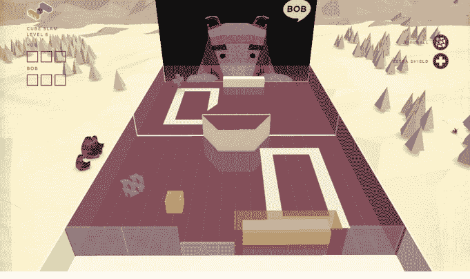

图 1-3：CubeSlam 游戏完全是用 JavaScript 编写的！

# 为什么要学习 JavaScript？

JavaScript 并不是唯一的编程语言——事实上，世界上有成百上千种编程语言。但有许多学习 JavaScript 的理由。首先，学习它比学习其他编程语言容易得多（而且更有趣）。但最棒的可能是，为了运行和编写 JavaScript 程序，你只需要像 Internet Explorer、Mozilla Firefox 或 Google Chrome 这样的网络浏览器。每个网络浏览器都带有一个 JavaScript 解释器，它能理解如何读取 JavaScript 程序。

一旦你写了一个 JavaScript 程序，你就可以把链接发给别人，他们也可以在自己电脑的网页浏览器中运行它！（参见第 297 页的“使用 JSFiddle 分享代码”）

# 编写一些 JavaScript

让我们在 Google Chrome (http://www.google.com/chrome/) 中写一点简单的 JavaScript。在你的电脑上安装 Chrome（如果尚未安装），然后打开它并在地址栏中输入 `about:blank`。现在按回车键，你会看到一个空白页面，就像图 1-4 所示。

我们将在 Chrome 的 JavaScript 控制台中开始编码，这是程序员测试 JavaScript 程序的一种秘密方式。在 Microsoft Windows 或 Linux 上，按住 `CTRL` 和 `SHIFT` 键并按 `J`。在 Mac OS 上，按住 `COMMAND` 和 `OPTION` 键并按 `J`。

如果你操作得完全正确，你应该能看到一个空白网页，在下方，右括号 (`>`) 旁边有一个闪烁的光标 (`|`)，如图 1-4 所示。那里就是你编写 JavaScript 的地方！

> 控制台会为你的代码文本着色；例如，你输入的文本将是蓝色的，输出将根据其类型着色。在本书中，每当我们使用控制台时，都会为代码文本使用类似的颜色。

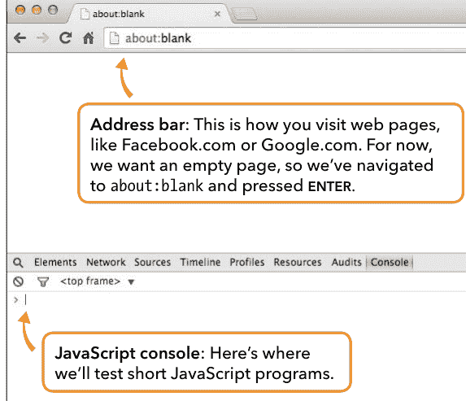

图 1-4：Google Chrome 的 JavaScript 控制台

你在光标处输入代码并按回车键时，JavaScript 应该运行或执行你的代码，并在下一行显示结果（如果有的话）。例如，在控制台中输入以下内容：

```
3 + 4;
```

现在按回车键。JavaScript 应该在下一行输出这个简单加法运算的答案 (7)：

```
3 + 4;
```

嗯，这足够简单。但 JavaScript 不仅仅是一个高级的计算器吗？让我们尝试些别的。

# JavaScript 程序的结构

让我们写一个更幽默一点的——一个 JavaScript 程序，打印出一系列像这样的猫脸：

```
=^^==
```

与我们的加法程序不同，这个 JavaScript 程序将包含多行。为了在控制台中输入程序，你必须在每行末尾按 `SHIFT-ENTER` 来添加换行。（如果你只按 `ENTER`，Chrome 将尝试执行你写的内容，程序将无法按预期工作。我警告过电脑是很笨的！）

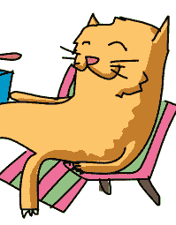

在你的浏览器控制台中输入以下内容：

```javascript
// Draw many cats as you want!
drawCats = function (howManyTimes) {
  for (var i = 0; i < howManyTimes; i++) {
    console.log(i + "^^=");
  }
}
```

```
drawCats(10); // 你可以用任何数字代替 10。
```

在最最后，按回车键而不是 `SHIFT-ENTER`。当你这样做时，你应该能看到以下输出：

```
0^^=
1^^=
2^^=
3^^=
4^^=
5^^=
6^^=
7^^=
8^^=
9^^=
```

如果你写了任何错别字，你的输出可能非常不同，或者你可能会得到错误。这就是我说的电脑很笨的原因——即使是一段简单的代码也必须完美无缺，计算机才能理解你想做什么！

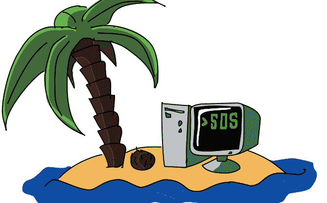

现在不会详细介绍这段代码是如何运作的（我们将在第 8 章回到这里），但让我们来看看这个程序以及普通 JavaScript 程序的某些特征。

# 语法

我们的程序包含了许多符号，包括括号 `()`、大括号 `{}`、加号 `+` 以及一些看起来很神秘的符号（如 `var` 和 `console.log`）。这些都是语法的一部分——即 JavaScript 如何组合符号和单词以创建运行程序的规则。当你学习新语言时，最困难的部分之一就是习惯编写不同类型指令的规则。当你刚开始时，很容易忘记编写不同类型指令的规则。

## 注释

JavaScript 支持两种类型的注释。单行注释以 `//` 开头，后面的内容不会被 JavaScript 执行。多行注释则用 `/*` 和 `*/` 包围，中间的所有内容都不会被执行。

```javascript
// 这是一个单行注释
/* 这是一个这是
   多行
   注释 */
```

## 变量

在 JavaScript 中，变量是用来存储数据的容器。你可以使用 `var` 关键字来声明变量。

```javascript
var message = "Hello, world!";
console.log(message);
```

一旦变量被赋值，你就可以更改它的值。

```javascript
var count = 5;
count = 10;
console.log(count); // 输出 10
```

变量名必须遵循某些规则：不能以数字开头，只能包含字母、数字、下划线（`_`）或美元符号（`$`）。你不能使用 JavaScript 的保留关键字。

```javascript
var _name = "Alice"; // 正确
var $age = 25;      // 正确
var user123 = "Bob"; // 正确
var 123user = "Charlie"; // 错误：以数字开头
```

## 数据类型

JavaScript 有多种数据类型。最常见的是字符串（`String`）、数字（`Number`）和布尔值（`Boolean`）。

字符串是带引号的文本。

```javascript
var name = "JavaScript";
```

数字可以是整数或小数。

```javascript
var age = 42;
```

布尔值只有两个值：`true` 或 `false`。

```javascript
var isCoding = true;
```

## Undefined 和 Null

当你声明一个变量但没有给它赋值时，它的值将是 `undefined`（未定义）。

```javascript
var x;
console.log(x); // 输出 undefined
```

`null` 表示一个空值或不存在的值。

```javascript
var y = null;
console.log(y); // 输出 null
```

## 数字与运算符

JavaScript 允许你执行基础数学运算，如加法、减法、乘法和除法。为了进行这些计算，我们使用符号 `+`、`-`、`*` 和 `/`，它们被称为运算符。

你可以像使用计算器一样使用 JavaScript 控制台。我们已经见过一个例子，即将 3 和 4 相加。让我们尝试一些难题——12,345 加上 56,789 是多少？

```
12345 + 56789;
69134
```

这在脑子里计算并不容易，但 JavaScript 瞬间就算好了。你可以使用多个加号加上多个数字：

```
22 + 33 + 44;
99
```

JavaScript 还可以做减法……

```
1000 - 17;
983
```

以及使用星号 `*` 进行乘法……

```
123 * 456;
56088
```

以及使用正斜杠 `/` 进行除法……

```
12345 / 250;
49.38
```

你还可以组合这些简单操作来创建更复杂的内容，如下：

```
1234 + 57 * 3 - 31 / 4;
1397.25
```

这里变得有点棘手了，因为这个计算的结果（答案）将取决于 JavaScript 执行每项操作的顺序。在数学中，规则是乘法和除法始终在加法和减法之前，JavaScript 也遵循这一规则。

图 2-1 显示了 JavaScript 遵循的顺序。首先，JavaScript 乘以 57 * 3 得到 171（红色显示）。然后它除以 31 / 4 得到 7.75（蓝色显示）。接下来它相加 1234 + 171 得到 1405（绿色显示）。最后它减去 1405 - 7.75 得到 1397.25，这就是最终结果。

```
1234 + 57 * 3 - 31 / 4
1234 + 171 - 31 / 4
1234 + 171 - 7.75
1405 - 7.75
1397.25
```

图 2-1：运算顺序：乘法、除法、加法、减法

如果你想在乘法和除法之前先做加法怎么办？例如，假设你有 1 个兄弟、3 个姐姐和 8 块糖果，你想把糖果平均分给你的 4 个兄弟姐妹？（你已经拿走了自己的一份！）你必须将 8 除以你的兄弟人数。这里是尝试尝试：

```
8 / 1 + 3;
11
```

这不对吧！你只有 8 块糖，不能给每个兄弟姐妹 11 块糖！问题在于 JavaScript 在加法之前先执行除法，所以它先用 8 除以 1（等于 8），然后加上 3，得到 11。为了修复这个问题并让 JavaScript 先执行加法，我们可以使用括号：

```
8 / (1 + 3);
2
```


这样就对了！每个兄弟姐妹 2 块糖。括号强制 JavaScript 在将 8 除以 4 之前先将 1 加 3。

## 动手尝试

假设你的朋友正尝试用 JavaScript 计算需要买多少气球。她要举办派对，希望每个人都有 2 个气球。原本有 15 个人来，但后来她又邀请了 9 人。她尝试了以下代码：

```
15 + 9 * 2;
```

但这看起来不对。问题是乘法发生在加法之前。你该如何添加括号来确保 JavaScript 先执行加法呢？你的朋友到底需要多少个气球？

## 变量

JavaScript 允许你给值命名。你可以把变量想象成一个可以放入一个东西的盒子。如果你放入了其他东西，第一个东西就会消失。要创建一个新变量，使用关键字 `var`，后面跟着变量名。关键字是 JavaScript 中具有特殊含义的单词。例如，这里是如何创建一个名为 `nick` 的变量：

```
var nick;
undefined
```

我们创建了一个名为 `nick` 的新变量。控制台输出 `undefined`。这不是错误！这只是 JavaScript 在命令没有返回值时所做的操作。嗯，例如，当你输入 `12345 + 56789;` 时，控制台返回了值 `69134`。要给变量赋值，使用等号：

```
var age = 12;
undefined
```

设置值被称为赋值（我们正在将值 12 赋值给变量 `age`）。再次打印出 `undefined` 是因为我们没有在创建新变量。（在我接后的示例中，我不会显示变量已存在时的输出。）变量 `age` 现在被设置为值 12。这意味着如果你单独输入 `age`，解释器将向你显示它的值：

```
age;
12
```

酷的！变量的值是 12。


# 数据类型与变量

酷的！变量的值是 12。设置值被称为赋值（我们正在将值 12 赋值给变量）。再次打印出 `undefined` 是因为我们没有在创建新变量。（在我后续的示例中，我不会显示变量已存在时的输出。）变量 `age` 现在被设置为值 12。这意味着如果你单独输入 `age`，解释器将向你显示它的值：

```
age;
12
```

## 变量命名

在命名变量时要小心大小写。如果你拼写错误，JavaScript 将无法识别该变量。例如，如果你使用了未定义的变量，它会报错。

一种常见的命名方法是使用驼峰命名法（camel case），除了第一个单词外，每个单词的首字母都大写。在本书中我将遵循这一约定，但你可以自由使用其他命名方式。

```javascript
var myVariableName = 10;
```

## 以秒计算年龄

现在你已经知道了有一年有多少秒，你可以轻松地计算出你的年龄（秒数，精确到最接近的）。例如，在我写这段文字时，我 29 岁：

```javascript
var age = 29;
age * secondsInAYear;
914544000
```

要计算你的秒数年龄，输入相同的代码，但将 `age` 的值改为你的年龄。或者直接省去变量，直接用数字表示你的年龄，例如：

```javascript
29 * secondsInAYear;
914544000
```

我的年龄已经超过 9 亿秒了！你几岁了？

## 递增与递减

作为一名程序员，你经常需要增加或减少包含数字的变量的值加 1。例如，你可能有一个变量来统计你今天收到了多少次击掌。每当有人击掌时，你都想让该变量加 1。

加 1 称为递增（incrementing），减 1 称为递减（decrementing）。你使用运算符 `++` 和 `--` 来递增和递减。

```javascript
var highFives = 0;
++highFives;
++highFives;
--highFives;
```

当我们使用 `++` 运算符时，`highFives` 的值加 1；当我们使用 `--` 运算符时，它会减 1。你也可以将这些运算符放在变量后面。这样做的效果相同，但返回的值是递增或递减之前的值。

```javascript
highFives = 0;
highFives++;
0
highFives++;
1
highFives;
2
```

在这个示例中，我们再次将 `highFives` 设置为 0。当我们调用 `highFives++` 时，变量递增了，但打印出来的是递增发生之前的值。你可以在最后（两次递增之后）看到，如果我们询问 `highFives` 的值，得到的是 2。

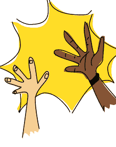

## += (加赋值) 和 -= (减赋值)

要增加变量的特定值，你可以使用以下代码：

```javascript
var x = 10;
x = x + 5;
x;
15
```

在这里，我们从变量 `x` 开始，将其设置为 10。然后将 `x + 5` 赋值给 `x`。因为 `x` 是 10，所以 `x + 5` 将是 15。我们在这里做的是使用 `x` 的旧值来计算 `x` 的新值。因此，`x = x + 5` 实际上意味着“给 x 加 5”。

JavaScript 提供了一种简单增加或减少变量特定值的方法，即使用 `+=` 和 `-=` 运算符。例如，如果我们有一个变量 `x`，那么 `x += 5` 等同于 `x = x + 5`。`-=` 运算符的工作原理相同，所以 `x -= 9` 等同于 `x = x - 9`（从 x 中减去 9）。这里有一个使用这两个运算符来跟踪视频游戏分数的示例：

```javascript
var score = 10;
score += 7;
17
score -= 3;
14
```

在这个示例中，我们通过将值 10 赋值给变量 `score`，从 10 分开始。然后我们打败了一个怪物，使用 `+=` 运算符将分数增加了 7 分（`score += 7` 等同于 `score = score + 7`）。在打败怪物之前，`score` 是 10，10 + 7 是 17，所以这次操作将 `score` 设置为 17。

在击败怪物后，我们撞上了一颗陨石，`score` 减少了 3。同样，`score -= 3` 等同于 `score - 3`。因为此时 `score` 是 17，`score - 3` 是 14，该值被重新赋值给 `score`。

### 试试看！

还有一些与 `+=` 和 `-=` 类似的运算符。例如，`*=` 和 `/=`。你认为它们的作用是什么？尝试一下：

```javascript
var balloons = 100;
balloons *= 2;
???
```

`balloons *= 2` 是什么意思？现在尝试这个：

```javascript
var balloons = 100;
balloons /= 4;
??=
```

`balloons /= 4` 是什么意思？

## 字符串

到目前为止，我们一直在处理数字。现在让我们来看另一种数据类型：字符串（strings）。JavaScript 中的字符串（与大多数编程语言一样）只是字符序列，可以包括字母、引号、标点符号和空格。我们将字符串放在引号之间，JavaScript 就会知道它们从哪里开始结束。例如，这是一个经典的：

```javascript
"Hello world!"
"Hello world!"
```

要输入字符串，只需输入一个双引号（""），后面跟着你想在字符串中的文本，然后用另一个双引号结束字符串。你也可以使用单引号（''），但为了保持简单，我们在书中将一直使用双引号。你可以像保存数字一样将字符串保存到变量中：

```javascript
var myAwesomeString = "Something REALLY awesome!!!";
```

也没有什么能阻止将一个字符串赋值给之前包含数字的变量：

如果在引号之间放入一个数字会怎样？它是字符串还是数字？在 JavaScript 中，字符串就是字符串（即使它恰好包含一些数字字符）。例如：

```javascript
var numberNine = 9;
var stringNine = "9";
```

`numberNine` 是数字，而 `stringNine` 是一个字符串。为了看到它们的不同，让我们尝试将它们相加：

```javascript
numberNine + numberNine;
18
stringNine + stringNine;
"99"
```

当我们加上数字值 9 和 9 时，我们得到 18。但当我们对 "9" 和 "9" 使用 `+` 运算符时，字符串被简单地连接在一起形成 "99"。

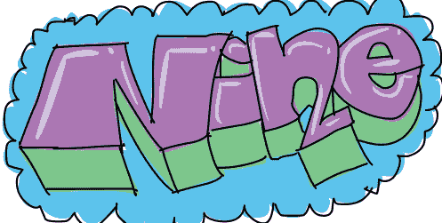

### 拼接字符串

正如你看到的，你可以对字符串使用 `+` 运算符。要拼接字符串，你可以使用 `+` 运算符。例如：

```javascript
var greeting = "Hello ";
var name = "World";
var fullGreeting = greeting + name;
fullGreeting;
"Hello World"
```

当你把字符串相加时，它们连接在一起。这被称为拼接（concatenation）。你也可以使用模板字符串字面量来连接字符串：

```javascript
var greeting = "Hello";
var name = "World";
var fullGreeting = `${greeting} ${name}`;
fullGreeting;
"Hello World"
```

### 字符串的长度

要查找字符串的长度，使用 `.length` 属性。它返回字符串中的字符数，包括空格。

```javascript
var str = "Hello";
str.length;
5
```

```javascript
var str = "Hello World";
str.length;
11
```

### 切分字符串

要“切下”大字符串的一部分，你可以使用 `slice`。例如，你可能想获取长评论的第一部分作为网站的预告。要使用 `slice`，在字符串（或包含字符串的变量）后面加上点，然后是 `slice` 单词以及括号。在括号内，输入你想切取的字符串的起始和结束位置，用逗号隔开。图 2-2 显示了如何使用 slice。

这两个数字表示切片的起始和结束。

```javascript
"a string".slice(1, 5)
```

图 2-2: 如何使用 slice 获取字符串中的字符

例如：

```javascript
var longString = "My long string is long";
longString.slice(3, 14);
"long strin"
```

### 从字符串获取单个字符

有时你想从字符串中获取单个字符。例如，你可能有一个加密代码，信息由第二个字符组成。你需要能够获取字符。要从字符串的特定位置获取字符，使用方括号 `[ ]`。例如，要获取 `myName` 的第一个字符，使用 `myName[0]`，如下所示：

注意不是 1。因为 JavaScript（与许多其他语言一样）从 0 开始计数。这意味着当你想要字符串的第一个字符时，使用 0；当你想要第二个时，使用 1；以此类推。

让我们尝试一下我们的加密代码，我们在一些单词中隐藏了信息。这里是在一个系列单词中找到秘密信息的方法：

```javascript
var codeword1 = "are";
var codeword2 = "tubas";
var codeword3 = "unsafe";
var codeword4 = "!?";
codeword1[1] + codeword2[1] + codeword3[1] + codeword4[1];
"run"
```

再次，注意当获取每个字符串的第二个字符时，使用 1。

切片中最后一个字符之后的字符。图 2-3 显示了提取哪些字符，其中起始值（3）和停止值（14）用蓝色高亮。

| My | l o n g | s t r i n g | is | l o n g |
| :--- | :--- | :--- | :--- | :--- |
| 0 1 2 | 3 4 5 6 7 | 8 9 10 11 12 13 | 14 15 16 17 18 19 20 21 |

图 2-3：在上面的示例中，切取灰色框中显示的字符。

在这里基本上是在告诉 JavaScript：“从这个字符串中切出一个从位置 3 开始的切片，一直持续到遇到 14 为止。”

如果你在 slice 后的括号中只包含一个数字，它切取的字符串将从该数字开始一直到字符串的末尾，例如：

```javascript
var longString = "My long string is long";
longString.slice(3);
"long string is long"
```

### 将字符串转换为全大写或全小写

如果你只想“大喊”某些文本，可以使用 `toUpperCase` 将其转换为全大写字母。

```javascript
"Hello there, how are you doing?".toUpperCase();
"HELLO THERE, HOW ARE YOU DOING?"
```

当对一个字符串使用 `.toUpperCase()` 时，它会创建一个新字符串，其中所有的字母都变成了大写字母。

你也可以相反操作：

```javascript
"hLLO THERE, hOW ARE you doINg?".toLowerCase();
"hello there, how are you doing?"
```

顾名思义，`.toLowerCase()` 将所有字符转换为小写。但句子开头不是应该总是以大写字母开头吗？我们如何获取一个字符串并让第一个字母大写，同时将其余部分转换为小写呢？

### 注意事项

尝试看看你是否可以使用刚刚学到的工具将 "hEllo THERE, hOW ARE you doing" 转换为 "Hello there, how are you doing?"。如果你卡住了，请回顾关于获取单个字符和使用 slice 的章节。完成后，回来看看你是如何做的。

这里有一种方法：

- `var sillyString = "hEllo THERE, hOW ARE you doNG?"`
- `var lowerString = sillyString.toLowerCase();`
- `var firstCharacter = lowerString[0];`
- `var firstCharacterUpper = firstCharacter.toUpperCase();`
- `var restOfString = lowerString.slice(1);`
- `firstCharacterUpper + restOfString;`
  `"Hello there, how are you doing?"`

让我们逐行分析。在 ①

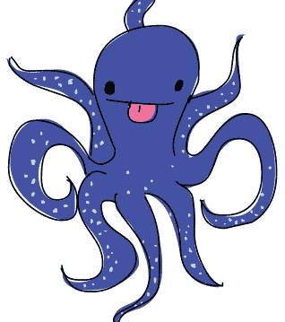

数据类型与变量 29

因为值和变量可以相互替换，我们可以将这几行合并为一行，如下：

```javascript
var sillyString = "hEllo THERE, hOW ARE yOu doING";
sillyString[0].toUpperCase() + sillyString.slice(1).toLowerCase();
"Hello there, how are you doing?"
```

尽管如此，跟进这样编写的代码可能会困惑，因此对于像这样复杂的任务，为每一步使用变量是一个好主意——至少在你更习惯阅读这种复杂代码之前是。

## 布尔值

现在来谈谈布尔值。布尔值简单来说就是 true 或 false 的值。例如，这里有一个简单的布尔表达式。

```javascript
var javascriptIsCool = true;
javascriptIsCool;
true
```

在这个示例中，我们创建了一个名为 `javascriptIsCool` 的新变量，并给它赋值了布尔值 `true`。在第二行中，我们获取了 `javascriptIsCool` 的值，它当然是 `true`！

## 逻辑运算符

就像你可以用数学运算符（`+`、`-`、`*`、`/` 等）组合数字一样，你也可以用布尔运算符来组合布尔值。当你将布尔值与运算符组合时，结果将始终是另一个布尔值（`true` 或 `false` 之一）。

JavaScript 中的三个主要的布尔运算符是 `&&`、`||` 和 `!`。它们看起来可能有点奇怪，但只要稍微练习，它们并不难使用。让我们试试它们。

### && (与 AND)

`&&` 意味着“与”。在朗读时，人们称它为 "and"、"and-or" 或 "ampersand-ampersand"。（Ampersand 是字符 `&` 的名称）。对两个布尔值使用 `&&` 运算符来检查它们是否都为真。

例如，在你去学校之前，你想确保自己已经洗了澡并且带了背包。如果两者都为真，你就可以去学校，但如果其中一个或两个都为假，你就不能离开。

```javascript
var hadShower = true;
var hasBackpack = false;
hadShower && hasBackpack;
false
```

在这里我们将变量 `hasBackpack` 设置为 `false`。当我们进入 `hadShower && hasBackpack` 时，我们基本上是在问 JavaScript：“这两个值都为真吗？”由于它们并不都为真（你没带背包），所以 JavaScript 返回 `false`（你还没准备好上学）。

让我们再次尝试一下，将两个值都设置为 `true`：

```javascript
var hadShower = true;
var hasBackpack = true;
hadShower && hasBackpack;
true
```

### || (或 OR)

`||` 运算符意味着“或”。它可以被读作 "or" 或 "pipe-pipe"。对两个布尔值使用 `||` 运算符来检查它们是否至少有一个为真。例如，说你可以去学校的条件是如果你洗了澡或者带了背包。只要其中一个为真，你就可以去学校。

```javascript
var hadShower = true;
var hasBackpack = false;
hadShower || hasBackpack;
true
```

在这种情况下，由于 `hadShower` 为真，所以结果为真。如果两个都为假，结果将为假。

### ! (非 NOT)

`!` 意味着“非”。也被称为 "bang"。使用 `!` 运算符来反转布尔值。例如，如果一个值为 `true`，`!value` 将为 `false`。

```javascript
var isWeekend = true;
!isWeekend;
false
```

在这个示例中，`!isWeekend` 的结果是 `false`。


## 组合逻辑运算符

当你开始组合运算符时，它们变得有趣起来。例如，说如果不是周末且洗了澡并且（你有苹果或橙子），你就去学校。我们可以这样用 JavaScript 检查这一切：

```javascript
var isWeekend = false;
var hadShower = true;
var hasApple = false;
var hasOrange = true;
var shouldGoSchool = !isWeekend && hadShower && (hasApple || hasOrange);
shouldGoSchool;
```

在这种情况下，不是周末，洗了澡，而且你有橙子——所以你应该去学校。

## 用布尔值比较数字

布尔值可以用于回答关于数字的是非问题。例如，想象你正在经营一个游乐园，其中一个项目有身高限制：游客必须至少有 60 英寸，否则可能会掉出来！当有人想玩这个项目并告诉你他们的身高时，你需要知道它是否大于这个身高限制。

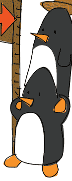

### 大于

我们可以使用大于运算符（`>`）来查看一个数字是否大于另一个。例如，为了查看游客的身高（65 英寸）是否大于身高限制（60 英寸），我们可以将变量 `height` 设置为 65，将变量 `heightRestriction` 设置为 60，然后使用 `>` 来比较两者：

```javascript
var height = 65;
var heightRestriction = 60;
height > heightRestriction;
```

通过 `height > heightRestriction`，我们是在询问 JavaScript 第一个值是否大于第二个值。在这种情况下，该游客身高达标了！

但是如果骑者的身高正好是 60 英寸呢？

```javascript
var height = 60;
var heightRestriction = 60;
height > heightRestriction;
false
```

噢，不！骑者的身高还不够！但如果身高限制是 60 英寸，那么正好 60 英寸的人不应该被允许进入吗？我们需要修复这个问题。幸运的是，JavaScript 还有另一个运算符 `>=`，意思是“大于或等于”：

```javascript
var height = 60;
var heightRestriction = 60;
height >= heightRestriction;
true
```

好了，这样好多了——60 大于或等于 60。

### 小于

大于运算符（`>`）的反面是小于运算符（`<`）。这个运算符对于专为小儿童设计的设施可能会派上用场。例如，假设骑者的身高是 60 英寸，但骑者身高不能超过 48 英寸：

```javascript
var height = 60;
var heightRestriction = 48;
height < heightRestriction;
false
```

我们想知道骑者的身高是否小于限制，所以我们使用 `<`。因为 60 不小于 48，所以我们得到 `false`（身高 60 英寸的人对于这个设施太高了）。

而且，正如你可能猜的那样，我们还可以使用运算符 `<=`，意思是“小于或等于”：

```javascript
var height = 48;
var heightRestriction = 48;
height <= heightRestriction;
true
```

身高 48 英寸的人仍然被允许进入设施。

### 等于

要判断两个数字是否完全相同，请使用三等号（`===`），它的意思是“等于”。但要注意不要将 `===` 与单等号（`=`）混淆，因为 `===` 是问“这两个数字相等吗”，而 `=` 的意思是“将右侧的值保存到左侧的变量中”。换句话说，`===` 在提问，而 `=` 在给变量赋值。

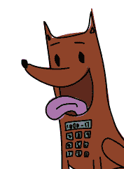

当你使用 `=` 时，变量名必须在左侧，值在右侧。另一方面，`===` 仅用于比较两个值以判断它们是否相同，所以哪个值在哪个边并不重要。

例如，假设你和朋友 Chico、Harpo 和 Groucho 玩游戏，看谁能猜中你的秘密数字，数字 5。你为了方便朋友猜，说这个数字在 1 到 9 之间，他们开始了猜。如果你将 `mySecretNumber` 设置为 5。你的第一个朋友 Chico 猜是 3（`chicoGuess`）。让我们看看发生了什么：

```javascript
var mySecretNumber = 5;
var chicoGuess = 3;
mySecretNumber === chicoGuess;
false
var harpoGuess = 7;
mySecretNumber === harpoGuess;
false
var grouchoGuess = 5;
mySecretNumber === grouchoGuess;
true
```

变量 `mySecretNumber` 存储你的秘密数字。变量 `chicoGuess`、`harpoGuess` 和 `grouchoGuess` 代表你朋友的猜测，我们使用 `===` 来检查每个猜测是否与你的秘密数字相同。你的第三个朋友 Groucho 通过猜中 5 赢了。

当你用 `===` 比较两个数字时，只有当两个数字相同时才会返回真。因为 `grouchoGuess` 是 5 且 `mySecretNumber` 是 5，所以 `mySecretNumber === grouchoGuess` 返回 `true`。其他的猜测不匹配 `mySecretNumber`，所以它们返回 `false`。

你也可以用 `===` 比较两个字符串或布尔值。如果你用 `===` 比较两个不同类型——例如，一个字符串和一个数字——它将始终返回 `false`。

### 双等号

现在事情变得有点复杂：JavaScript 还有另一个运算符（双等号 `==`），意思是“大致相等”。使用它来检查两个值是否相同，即使一个是字符串而另一个是数字。所有值都有某种类型。数字 5 和字符串 `"5"` 基本上看起来是一样的，如果你使用 `===` 比较数字 5 和字符串，如果你使用 `==` 比较它们，它会告诉你它们相同的：

```javascript
var stringNumber = "5";
var actualNumber = 5;
stringNumber === actualNumber;
false
stringNumber == actualNumber;
true
```

此时，你可能会想：“嗯，用双等号似乎比三等号更容易！”但你必须非常小心，因为双等号可能会引起困惑。例如，如果你认为 0 等于 `false` 呢？字符串 `"false"` 呢？当你使用双等号时，0 等于 `false`，但字符串 `"false"` 不是：

```javascript
0 === false;
false
"false" == false;
false
```

这是因为 JavaScript 使用双等号比较两个值时，首先尝试将它们转换为相同的类型。在这种情况下，它会将布尔值转换为数字，`false` 变成 0，`true` 变成 1。所以当你输入 `0 == false` 时会得到 `true`！

由于这种特性，现在安全的办法可能是坚持使用 `===`。

## 试试看！

电影院经理要求你为一个新系统实现一些 JavaScript，以判断是否可以看 PG-13 电影。规则是：如果 13 岁或以上，就可以进入。如果未满 13 岁但有成人陪同，也可以进入。否则，他们不能看电影。

```javascript
var age = 12;
var accompanied = true;
???
```

使用 `age` 和 `accompanied` 变量完成这个示例，判断 12 岁的人是否可以。尝试更改值（例如将 `age` 设置为 13，`accompanied` 设置为 `false`），看看你的代码是否能得到正确答案。


## undefined 和 null

最后，我们有两个没有特定类型的值。它们被称为 `undefined` 和 `null`。它们都表示“无”，但方式略不同。

`undefined` 是 JavaScript 在没有某物的值时使用的值。例如，当你创建一个新变量如果没有使用 `=` 运算符设置它的任何值，它的值将被设置为 `undefined`：

```javascript
var myVariable;
myVariable;
undefined
```

`null` 值通常用于你想明确表示“这是空的”时。

```javascript
var myVariable = null;
myVariable;
null
```

此时，你不会经常遇到 `undefined` 或 `null`。如果你创建一个变量且不设置它的值，你会看到 `undefined`，因为当 JavaScript 没有某物的值时，它总是给你 `undefined`。将某物设置为 `undefined` 并不常见；如果你觉得需要将变量设置为“无”，你应该使用 `null`。

`null` 只在你实际上想表示某物不存在时才用。例如，假设你使用一个变量来跟踪你最喜欢的蔬菜。如果你有很多蔬菜但没有喜欢的，你可以将 `favorite` 设置为 `null`。

## 你学到了什么

现在你了解 JavaScript 中所有的基本类型——数字、字符串和布尔值——以及特殊值 `null` 和 `undefined`。数字用于数学，字符串用于文本，布尔值用于是非问题。在接下来的章节中，我们将查看数组和对象，它们都是连接基本类型以创建更多值集合的方法。

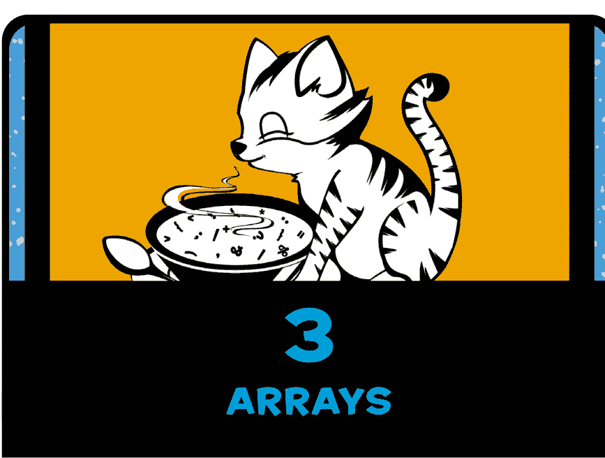

到为止，我们学习了数字和字符串，这些可以在程序中存储和使用的数据类型。但数字和字符串有点无趣。单靠一个字符串做不了什么。JavaScript 允许你通过数组以更有趣的方式创建和分组数据。数组仅仅是其他 JavaScript 值的列表。

例如，如果你的朋友问你最喜欢哪些恐龙，你可以按顺序创建一个包含恐龙名字的数组：

```javascript
var myThreeDinosaurs = ["T-Rex", "Velociraptor", "Stegosaurus"];
```

与其给朋友三个独立的字符串，你只需要使用单个数组 `myThreeDinosaurs`。

## 为什么要关心数组？

让我们再次看看恐龙。假设你想用程序来跟踪许多种恐龙，你可以为每种恐龙创建一个变量，如下：

```javascript
var dinosaur1 = "T-Rex";
var dinosaur2 = "Velociraptor";
var dinosaur3 = "Stegosaurus";
var dinosaur4 = "Triceratops";
var dinosaur5 = "Brachiosaurus";
var dinosaur6 = "Pteranodon";
var dinosaur7 = "Apatosaurus";
var dinosaur8 = "Diplodocus";
var dinosaur9 = "Compsognathus";
```

这个列表用起来很笨拙，因为你有九个不同的变量，而你只需要一个。想象如果你在跟踪 1000 种恐龙呢！你需要创建 1000 个独立的变量，这几乎是无法实现的。

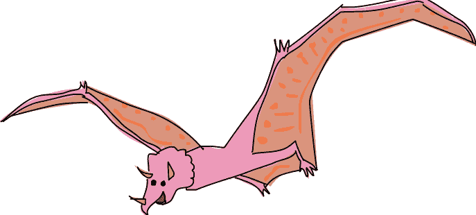

这就好比你有一份购物清单，但每件物品都写在不同的纸上。你会有一张纸上写着“鸡蛋”，另一张写着“面包”，另一张写着“橙子”。大多数人会将想买的所有物品完整地写在一张纸上。如果能把所有九只恐龙都放在同一个地方，不是简单得多吗？你可以做到，这正是数组大显身场。

## 创建数组

要创建一个数组，你只需要使用方括号 `[]`。事实上，一个空数组仅仅是一对方括号，如下：

```javascript
[];
```

但是谁会在乎空数组呢？让我们用恐龙来填充它吧！

要创建一个包含值的数组，在方括号之间输入这些值，并用逗号分隔。我们可以将数组中的单独值称为项（items）或元素（elements）。在这个示例中，我们的元素将是字符串（我们喜欢的恐龙的名字），因此我们将用引号将它们括起来。我们将数组存储在一个名为 `dinosaurs` 的变量中：

```javascript
var dinosaurs = ["T-Rex", "Velociraptor", "Stegosaurus", "Triceratops", "Brachiosaurus", "Pteranodon", "Apatosaurus", "Diplodocus", "Compsognathus"];
```

由于这是一本书，页面宽度有限，我们实际上无法将整个数组放在同一行。这里的换行符是为了显示由于页面太窄，我们将代码存放在了额外的一行上。当你把这些内容输入到电脑时，你可以把它们全部写在一行。

长列表在一行内很难阅读，但幸运的是，这不是格式化（或布局）数组的唯一方法。你也可以按照以下格式化数组：第一行是一个左方括号，数组中的每项各占新的一行，最后是一个右方括号，如下：

```javascript
var dinosaurs = [
  "T-Rex",
  "Velociraptor",
  "Stegosaurus",
  "Triceratops",
  "Brachiosaurus",
  "Pteranodon",
  "Apatosaurus",
  "Diplodocus",
  "Compsognathus"
];
```

如果你想在浏览器控制台中输入这些内容，在每换行按 ENTER 键时需要按住 SHIFT 键。否则，JavaScript 解析器将尝试执行当前不完全的行。当我们在解释器中工作时，将数组写在一行会更方便。无论你选择将数组项写在一行还是分行写，对 JavaScript 来说都是一样的。JavaScript 只看到一个数组——在这个示例中，是一个包含九个字符串的数组。

## 访问数组元素

当需要访问数组中的元素时，你使用方括号配合你想要元素的索引，如下例所示：

```javascript
dinosaurs[0];
"T-Rex"
dinosaurs[3];
"Triceratops"
```

索引是一个对应于（或匹配）数组中存储值的位置的数字。就像字符串一样，数组中的第一个元素索引为 0，第二个是 1，第三个是 2，以此类推。这就是为什么请求 `dinosaurs` 数组的索引 0 会返回 `"T-Rex"`（列表中的第一个），而索引 3 返回 `"Triceratops"`（列表中的第四个）。

能够从数组中访问单个元素是非常有用的。例如，如果你只想向某人展示你最喜欢的恐龙，你就不需要整个 `dinosaurs` 数组了。你只需要第一个元素：

```javascript
dinosaurs[0];
"T-Rex"
```

e5791ceef5f489e724ff12c45401333.png

## 设置或更改数组中的元素

你可以使用方括号中的索引来设置、更改甚至向数组添加元素。例如，将 `dinosaurs` 数组中的第一个元素 (`"T-Rex"`) 替换为 `"Tyrannosaurus Rex"`，你可以这样做：

```javascript
dinosaurs[0] = "Tyrannosaurus Rex";
```

完成后，`dinosaurs` 数组看起来像这样：

```javascript
["Tyrannosaurus Rex", "Velociraptor", "Stegosaurus", "Triceratops", "Brachiosaurus", "Pteranodon", "Apatosaurus", "Diplodocus", "Compsognathus"]
```

你还可以使用带索引的方括号向数组添加新元素。例如，你可以通过单独设置每个元素来创建 `dinosaurs` 数组：

```javascript
var dinosaurs = [];
dinosaurs[0] = "T-Rex";
dinosaurs[1] = "Velociraptor";
dinosaurs[2] = "Stegosaurus";
dinosaurs[3] = "Triceratops";
dinosaurs[4] = "Brachiosaurus";
dinosaurs[5] = "Pteranodon";
dinosaurs[6] = "Apatosaurus";
dinosaurs[7] = "Diplodocus";
dinosaurs[8] = "Compsognathus";
dinosaurs;
```

```javascript
["T-Rex", "Velociraptor", "Stegosaurus", "Triceratops", "Brachiosaurus", "Pteranodon", "Apatosaurus", "Diplodocus", "Compsognathus"]
```

要向数组开头添加一个元素，你可以使用 `.unshift(element)`，如下：

```javascript
animals;
["Cat", "Dog", "Llama"]
animals[0];
"Cat"
animals.unshift("Monkey");
animals;
["Monkey", "Cat", "Dog", "Llama"]
animals.unshift("Polar Bear");
animals;
["Polar Bear", "Monkey", "Cat", "Dog", "Llama"]
animals[0];
"Polar Bear"
animals[2];
"Cat"
```


在这里我们从一直使用的数组 `["Cat", "Dog", "Llama"]` 开始。当我们使用 `unshift` 在数组开头添加元素 "Monkey" 和 "Polar Bear" 时，旧值每次都会后移动一个索引。因此，位于索引 0 的 "Cat" 现在位于索引 2。同样，`unshift` 在每次调用时都会返回数组的新长度，就像 `push` 一样。

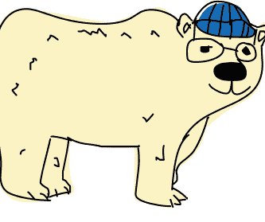

## 从数组中删除元素

要从数组中删除最后一个元素，可以通过在数组名后添加 `.pop()` 将其弹出。`pop` 方法特别方便，因为它做了两件事：它移除最后一个元素，并将该最后一个元素作为值返回。例如，我们从动物数组 `animals` 开始：`["Polar Bear", "Monkey", "Dog", "Llama"]`。我们将创建一个名为 `lastAnimal` 的新变量，并通过调用 `animals.pop()` 将最后一个动物保存其中。

```
animals;
["Polar Bear", "Monkey", "Cat", "Dog", "Llama"]

var lastAnimal = animals.pop();
lastAnimal;
"Llama"
animals;
["Polar Bear", "Monkey", "Cat", "Dog"]
animals.pop();
"Dog"
animals;
["Polar Bear", "Monkey", "Cat"]

animals.unshift(lastAnimal);
animals;
["Llama", "Polar Bear", "Monkey", "Cat"]
```

当我们在 ① 处调用 `animals.pop()` 时，`animals` 数组中的最后一项 "Llama" 被返回并从数组中移除，剩下四只动物。当我们在 ② 处再次调用 `animals.pop()` 时，"Dog" 从数组中移除并返回，数组中只剩下三只动物。

当我们对 "Dog" 使用 `animals.pop()` 时，我们没有再保存它了。另一方面，“Llama" 被保存到了变量 `lastAnimal`，所以我们可以在需要时再次使用它。在 ③ 处，我们使用 `unshift(lastAnimal)` 将 "Llama" 加回数组开头。这给了我们最终数组 `["Llama", "Polar Bear", "Monkey", "Cat"]`。

当你只关心数组的末尾时，推送（`push`）和弹出（`pop`）是一对组合。你可以将新项推入数组，并在使用时将其弹出。我们将在本章稍后的部分查看使用推送和弹出的方法。

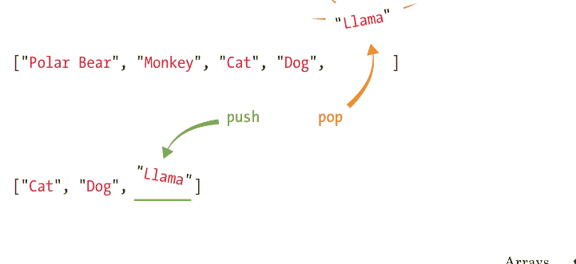

要移除并返回数组的第一个元素，使用 `.shift()`：

```
animals;
["Llama", "Polar Bear", "Monkey", "Cat"]
var firstAnimal = animals.shift();
firstAnimal;
"Llama"
animals;
["Polar Bear", "Monkey", "Cat"]
```

`animals.shift()` 的作用与 `animals.pop()` 相同，但元素是从开头移除的。在示例开始时，`animals` 是 `["Llama", "Polar Bear", "Monkey", "Cat"]`。当我们对数组调用 `.shift()` 时，第一个元素 "Llama" 被返回并保存到 `firstAnimal` 中。因为 `.shift()` 在返回元素的同时也移除了它，最后 `animals` 只有 `["Polar Bear", "Monkey", "Cat"]`。

你可以使用 `unshift` 在数组开头添加和移除项，就像你使用 `push` 和 `pop` 在数组结尾添加和移除项一样。

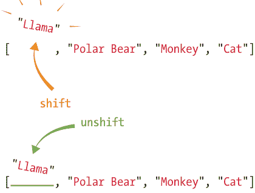

## 合并数组

要将两个数组合并为一个单一数组，你可以使用 `firstArray.concat(otherArray)`。`concat` 是 `concatenate`（连接）的缩写，这是一个用于合并两个值的计算机科学术语。`concat` 方法将将两个数组合并为一个新数组，其中 `firstArray` 的值位于 `otherArray` 的值之前。

例如，我们有一组鳞片毛茸动物列表和另一组鳞片动物列表，我们想要合并它们。如果我们把所有毛茸动物放入名为 `furryAnimals` 的数组中，把所有鳞片动物放入名为 `scalyAnimals` 的数组中，那么 `furryAnimals.concat(scalyAnimals)` 将创建一个新数组，其中第一个数组的值在开头，第二个数组的值在末尾。

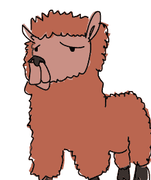

被要求以字符串形式给出你的全名。使用 `join` 并以单个空格作为分隔符，你可以将所有的名字合并成一个字符串：

```javascript
var myNames = ["Nicholas", "Andrew", "Maxwell", "Morgan"];
myNames.join(" ");
"Nicholas Andrew Maxwell Morgan"
```

如果你没有使用 `join`，你就得像下面这样操作，这写起来会非常麻烦：

```javascript
myNames[0] + " " + myNames[1] + " " + myNames[2] + " " + myNames[3];
"Nicholas Andrew Maxwell Morgan"
```

此外，这段代码只有在你恰好有两个中间名时才起作用。如果你有一个或三个中间名，你就必须修改代码。使用 `join`，你不需要更改任何内容——无论数组有多长，它都会打印出一个包含数组中所有元素的字符串。

如果数组中的值不是字符串，JavaScript 会合并它们之前将它们转换为字符串：

```javascript
var ages = [11, 14, 79];
ages.join(" ");
"11 14 79"
```

# 数组的实用操作

现在你已经知道了创建数组以及操作数组的不同方法。但你实际上可以用这些属性和方法做些什么呢？在本节中，我们将编写几个短程序，展示一些对数组的有用操作。

# 寻找回家的路

想象一下：你的朋友来你家里了。现在她想带你看看她的家。唯一的问题是，你从未去过她那里，之后你得自己找到回去的路。

幸运的是，你有一个聪明的主意来解决这个问题：在去朋友家的路上，你会记录下你看到的所有地标。在回家的路上，你会查看这个列表。

## 使用 PUSH 构建数组

让我们写一些完全执行这些操作的代码。我们首先创建一个空数组。数组初始是空的，因为在你实际上开始向朋友家走之前，你不知道会看到哪些地标。然后，我们将地标的描述 `push` 到数组的末尾。等到了该回家的时候，我们将从数组中 `pop` 出每一个地标。

```javascript
var landmarks = [];
landmarks.push("My house");
landmarks.push("Front path");
landmarks.push("Flickering streetlamp");
landmarks.push("Leaky fire hydrant");
landmarks.push("Fire station");
landmarks.push("Cat rescue center");
landmarks.push("My old school");
landmarks.push("My friend's house");
```

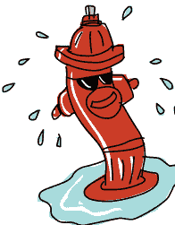

在这里我们创建了一个名为 `landmarks` 的数组，然后使用 `push` 存储你在去朋友路上经过的所有地标。

## 使用 POP 反向进行

一旦到达朋友家，你就可以检查你的地标数组。果然，第一项是 "My house"，接着是 "Front path"，以此类推直到数组末尾，最后一个项是 "My friend's house"。等到了回家的时候，你只需要一个一个 `pop` 出这些项，就知道下一步该去哪里了。

```javascript
landmarks.pop();
"My friend's house"
landmarks.pop();
"My old school"
landmarks.pop();
"Cat rescue center"
landmarks.pop();
"Fire station"
landmarks.pop();
"Leaky fire hydrant"
```

```javascript
landmarks.pop();
"Flickering streetlamp"
landmarks.pop();
"Front path"
landmarks.pop();
"My house"
```

呼，你做到了！你有没有注意到你放入数组的第一个地标也是你最后取出的那个吗？而你最后放进去的地标又是第一个取出来的？你可能认为你总是希望放入的第一个项是第一个取出的项，但你可以看到，反向遍历数组有时是有用的。

在较大的程序中，使用这种过程非常常见，这就是为什么 JavaScript 让 `push` 和 `pop` 变得如此简单。

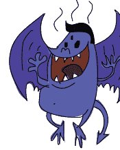

## 注意

这种技术在计算机术语中被称为**栈**（stack）。把它想象成一叠煎饼。每当你煎好一个新的煎饼时，它都会放在顶部（就像 `push`），每当你吃掉一个时，它都会从顶部取下（就像 `pop`）。弹出栈就像回到过去：你最后 `pop` 出的项就是你第一个 `push` 进去的项。煎饼也是如此：你最后吃到的煎饼是第一个被煎好的。在编程术语中，这也称为**后进先出**（LIFO，Last In, First Out）。LIFO 的替代方案是**先进先出**（FIFO，First In, First Out）。这也被称为队列（queue），因为它就像人们排队一样。第一个加入队列的人是第一个获得服务的。

## 决策者

我们可以使用 JavaScript 中的数组来构建一个为我们做决策的程序（比如魔球）。不过，我们需要找到如何获取随机数。

## 使用 MATH.RANDOM

我们可以使用一个名为 `Math.random()` 的特殊方法来产生随机数，它每次调用时都会返回 0 到 1 之间的随机数。这是一个例子：

```javascript
Math.random();
0.89454094576649
Math.random();
0.36975431954816
Math.random();
0.483149801380923
```

重要的是 `Math.random()` 总是返回小于 1 的数字，永远不会返回 1。如果你想要更大的数字，只需乘以 `Math.random()` 的结果。例如，如果你想要 0 到 10 之间的数字，你会将 `Math.random()` 乘以 10：

```javascript
Math.random() * 10;
7.6480273270565
Math.random() * 10;
9.75695045342186
Math.random() * 10;
0.214834297893345
```

## 使用 MATH.FLOOR 向下取整

我们不能使用这些数字作为索引，因为索引必须是整数。为了解决这个问题，我们需要另一个名为 `Math.floor()` 的方法。它接收一个数字并向下取整为整数（基本上是去掉小数点）。

```javascript
Math.floor(3.746346);
3
Math.floor(9.9999);
9
Math.floor(0.7934231963);
0
```

我们可以结合这两种技术创建一个随机索引。我们需要做的只是将 `Math.random()` 乘以数组的长度，然后对该值调用 `Math.floor()`。例如，如果数组长度为 4，我们会这样做：

```javascript
Math.floor(Math.random() * 4);
// 可能是 0, 1, 2 或 3
```

每次你调用上面的代码，它都会返回一个 0 到 3 的随机数（包括 0 和 3）。因为 `Math.random()` 总是返回小于 1 的值，`Math.random() * 4` 永远不会返回 4 或更大的数字。现在如果我们使用随机数作为索引，就可以从数组中选择一个随机元素：

```javascript
var randomWords = ["Explosion", "Cave", "Princess", "Pen"];
var randomIndex = Math.floor(Math.random() * 4);
randomWords[randomIndex];
// Cave
```

在这里我们使用 `Math.floor(Math.random() * 4)` 从 0 到 3 随机数。一旦该随机数保存到变量 `randomIndex` 中，我们就使用它作为索引来获取字符串。事实上，我们可以省略 `randomIndex` 变量，直接说：

```javascript
randomWords[Math.floor(Math.random() * 4)];
// "Princess"
```

## 完整的决策者

现在让我们创建一个短语数组，并使用这段代码来随机选择其中一个。这就是我们的决策者！我正在使用注释来显示一些你可能想问电脑的问题。

```javascript
var phrases = [
  "That sounds good",
  "Yes, you should definitely do that",
  "I'm not sure that's a great idea",
  "Maybe not today?",
  "Computer says no."
];
```

```javascript
// 我应该再来杯奶昔吗？
phrases[Math.floor(Math.random() * 5)];
// "I'm not sure that's a great idea"
// 我应该做作业吗？
phrases[Math.floor(Math.random() * 5)];
// "Maybe not today"
```

在这里我们创建名为 `phrases` 的数组来存储不同的建议。现在，每当我们有问题，就可以从 `phrases` 数组中请求一个随机值，它将帮助我们做决定！

注意，因为我们的决策数组有五个项，我们将 `Math.random()` 乘以 5。这始终会返回五个索引之一：0, 1, 2, 3 或 4。

## 创建随机侮辱生成器

我们可以扩展决策者的示例，创建一个每次运行都会生成一个随机侮辱的程序！

```javascript
var randomBodyParts = ["Face", "Nose", "Hair"];
var randomAdjectives = ["Smelly", "Boring", "Stupid"];
var randomWords = ["Fly", "Marmot", "Stick", "Monkey", "Rat"];
```

```javascript
// 从 randomBodyParts 数组中选择一个随机部位：
var randomBodyPart = randomBodyParts[Math.floor(Math.random() * 3)];
// 从 randomAdjectives 数组中选择一个随机形容词：
var randomAdjective = randomAdjectives[Math.floor(Math.random() * 3)];
// 从 randomWords 数组中选择一个随机单词：
var randomWord = randomWords[Math.floor(Math.random() * 5)];
// 将所有的随机字符串连接成句子：
var randomInsult = "Your " + randomBodyPart + " is like a " +
randomAdjective + " " + randomWord + " !!!";
randomInsult;
// Your Nose is a Stupid Marmot!!!
```

在这里有三个数组，在第 ①、② 和 ③ 行中，我们使用三个索引从每个数组中提取一个随机单词。然后，我们将它们全部合并到变量 `randomInsult` 中，以创建一个完整的侮辱。在 ① 和 ② 中我们乘以 3，是因为 `randomAdjectives` 和 `randomBodyParts` 都包含三个元素。同样，我们在 ③ 处乘以 5，是因为 `randomWords` 是五个字符长。注意，我们在 `randomAdjective` 和 `randomWord` 之间添加了一个带有单个空格的字符串。尝试运行几次代码——你每次都会得到一个不同的随机侮辱！

## 试一试！

如果你想表现得更聪明，可以将第 3 行替换为以下内容：


```
var randomWord = randomWords[Math.floor(Math.random() * 
randomWords.length)];
```

我们知道总是需要将 `Math.random()` 乘以数组的长度，使用 `randomWords.length` 意味着如果数组长度变化，我们就不需要修改代码。

```
var randomInsult = ["Your", randomBodyPart, "is", "like", "a", 
randomAdjective, randomWord + "!!!"].join(" \nYour Hair is like a Smelly Fly!!!");
```

在这个示例中，句子的每个单词都是数组中的一个独立字符串，我们用空格字符将它们连接起来。只有一个地方我们不想要空格，那就是 `randomWord` 和 `"!!!"` 之间。在这种情况下，我们使用 `+` 运算符来连接两个不带空格的字符串。

# 你学到了什么

正如你所看到的，JavaScript 数组是存储值列表的一种方式。现在你知道如何创建和操作数组，并且你有许多访问它们元素的方法。

数组是 JavaScript 提供的将多个值汇到一处的方法之一。在下一章中，我们将查看对象（objects），它是另一种将多个值存储为单个单元的方法。对象使用字符串键（keys）来访问元素，而不是数字索引。

# 编程挑战

尝试这些挑战来练习你在本章中学到的技能。

### #1：新的随机侮辱

用你自己的词汇集创建一个你自己的随机侮辱生成器。

### #2：更复杂的侮辱

扩展随机侮辱生成器，让它生成诸如“Your [body part] is more [adjective] than a [animal]'s [animal body part].”之类的侮辱。（提示：你需要创建另一个数组。）

### #3：使用 + 还是 JOIN？

制作两个版本的随机侮辱生成器：一个版本使用 `+` 运算符创建字符串，另一个版本创建一个数组并用 `" "` 将其连接。你更倾向于哪种？为什么？

### #4：连接数字

你如何使用 `join` 方法将数组 `[3, 2, 1]` 转换为字符串 `"3 is bigger than 2 is bigger than 1"`？

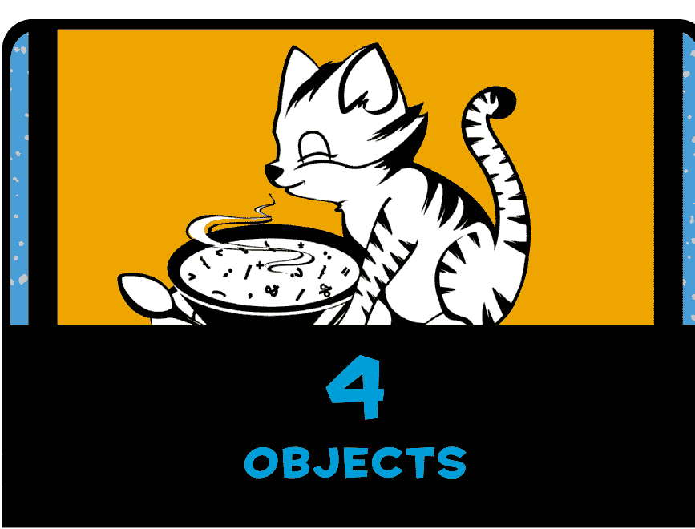

# 4 对象

JavaScript 中的对象与数组非常相似，但对象使用字符串而不是数字来访问不同的元素。这些字符串被称为键（keys）或属性（properties），它们指向的元素被称为值（values）。这些信息的组合被称为键值对（key-value pairs）。数组主要用于表示多个事列表，而对象通常用于表示具有多个特征或属性的单个实体。例如，在第 3 章中，我们创建了几个列出不同动物名称的数组。如果我们想存储关于一种动物的不同信息呢？

## 创建对象

我们可以通过创建一个 JavaScript 对象来存储关于单个动物的大量信息。这是一个存储关于名为 Harmony 的三条猫信息的对象。

```
var cat = {
  "legs": 3,
  "name": "Harmony",
  "color": "Tortoiseshell"
};
```

在这里，我们创建了一个名为 `cat` 的变量，并为其赋值了一个包含三个键值对的对象。要创建一个对象，我们使用大括号 `{}`，而不是我们用于数组时使用的方括号 `[]`。在大括号之间，我们输入键值对。大括号及其内部的所有内容被称为对象字面量（object literal）。对象字面量是一种一次性写出整个对象来创建对象的方法。


因为 JavaScript 不以任何特定顺序存储对象及其键。

数组显然具有特定的顺序：索引 0 在索引 1 之前，索引 3 在索引 2 之后。但对于对象来说，没有办法对每个项目进行排序。color 应该放在 legs 之前还是之后？这个问题没有“正确”的答案，对象简单地存储键，而不为它们分配任何特定的顺序，结果是不同的浏览器会以不同的顺序打印键。由于这个原因，你永远不要编写依赖于对象键具有精确顺序的程序。

## 使用点符号法添加键

在添加新键时，你也可以使用点符号法。让我们尝试之前的示例，我们从一个空对象开始并向其添加键，但这次我们使用使用点符号法：

```
var cat = {};
cat.legs = 3;
cat.name = "Harmony";
cat.color = "Tortoiseshell";
```

> 如果你请求一个 JavaScript 不知的属性，它会返回特殊值 `undefined`。`undefined` 仅仅意味着“这里什么都没有！”例如：

```
var dog = {
  name: "Pancake",
  legs: 4,
  isAwesome: true
};
dog.isBrown = undefined
```

这里我们为 dog 定义了三个属性：name、legs 和 isAwesome。

我们没有定义 isBrown，所以 `dog.isBrown` 返回 `undefined`。

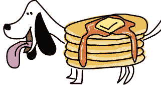

## 组合数组和对象

到目前为止，我们只查看了包含数字和字符串等简单类型的数组和对象。但没有什么阻止你将另一个数组或对象作为数组或对象中的值。

例如，一个包含恐龙对象的数组可能像这样：

```
var dinosaurs = [
  { name: "Tyrannosaurus Rex", period: "Late Cretaceous" },
  { name: "Stegosaurus", period: "Late Jurassic" },
  { name: "Plateosaurus", period: "Triassic" }
];
```

现在要获取第一只恐龙的所有信息，可以使用我们之前使用的相同技巧，在方括号中输入索引：

```
dinosaurs[0];
{ name: "Tyrannosaurus Rex", period: "Late Cretaceous" }
```

如果你只想获取第一只恐龙的名字，只需要在数组索引后的方括号中添加对象键：

```
dinosaurs[0]["name"];
"Tyrannosaurus Rex"
```

或者，你可以使用点符号法，如下：

```
dinosaurs[1].period;
"Late Jurassic"
```

你只能对对象使用点符号法，而不能用于数组。

## 朋友数组

现在让我们来看一个更复杂的示例。我们将创建一个朋友对象的数组，其中每个对象也包含一个数组。首先，我们创建对象，然后将它们全部放入数组中：

```
var anna = { name: "Anna", age: 11, luckyNumbers: [2, 4, 8, 16] };
var dave = { name: "Dave", age: 5, luckyNumbers: [3, 9, 40] };
var kate = { name: "Kate", age: 9, luckyNumbers: [1, 2, 3] };
```

首先，我们创建了三个对象并将它们保存到名为 anna、dave 和 kate 的变量中。每个对象都有三个键：name、age 和 luckyNumbers。每个键都分配了一个字符串值，每个 age 都分配了一个单独数字值，每个 luckyNumbers 都分配了一个数组，其中包含几个不同的数字。

接下来我们为我们的朋友创建一个数组：

```
var friends = [anna, dave, kate];
```

现在我们有一个保存到变量 `friends` 的数组，其中包含三个元素：anna、dave 和 kate（它们分别引用对象）。你可以使用它们在数组中的索引来检索其中一个对象：

```
friends[1];
{ name: "Dave", age: 5, luckyNumbers: Array[3] }
```

这获取了数组中的第二个对象 dave（索引为 1）。Chrome 为 `luckyNumbers` 数组打印出 `Array[3]`，这只是它表达的方式：“这是一个包含三个元素的数组。（你可以使用 Chrome 查看该数组中包含的内容；请参考第 71 页的《在控制台中探索对象》）。我们也可以通过在方括号中输入对象的索引，后跟上我们想要的键，来获取对象内部的值：

```
friends[2].name
"Kate"
```

这段代码请求索引为 2 的元素，即名为 Kate 的变量，然后请求该对象中键为 "name" 的属性，即 "Kate"。我们甚至可以从 `friends` 数组内部某个对象中的数组中获取值，如下所示：

```
friends[0].luckyNumbers[1];
4
```

图 4-2 显示每个索引。`friends[0]` 是 `friends` 数组中索引为 0 的元素，即对象 anna。`friends[0].luckyNumbers` 是来自对象 anna 的数组 `[2, 4, 8, 16]`。最后，`friends[0].luckyNumbers[1]` 是该数组中的索引 1，即数值值 4。

## 在控制台中探索对象

Chrome 允许你深入研究在控制台中打印的对象。例如，如果你输入 . . .

```
friends[1];
```

Chrome 将显示如图 4-3 所示的输出。

```
friends[1];
Object {name: "Dave", age: 5, LuckyNumbers: Array[3]}
```

图 4-3：对象在 Chrome 解析器中的显示方式

左侧的三角形意味着该对象可以展开。点击对象将其展开，你将看到如图 4-4 所示的内容。

```
friends[1];
Object {name: "Dave", age: 5, LuckyNumbers: Array[3]}
age: 5
luckyNumbers: Array[3]
name: "Dave"
proto : Object
```

图 4-4：展开对象

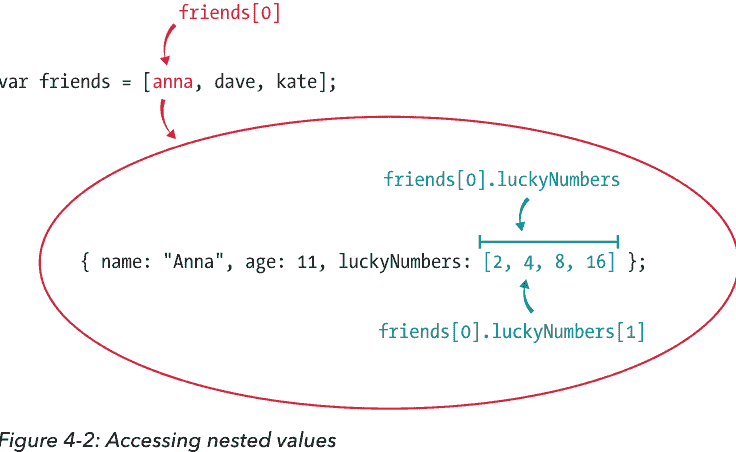

你也可以展开 `luckyNumbers`。

现在，当你想要获取电影信息时，可以很容易找到：

在这里，我们将关于《海底总动员尼莫》的电影信息保存到名为 `findingNemo` 的变量中。我们之后可以通过此对象的属性（如时长和格式）来获取有关电影的信息。

你也可以轻松地向集合中添加新电影：

```
var cars = {
  releaseDate: 2006,
  duration: 117,
  actors: ["Owen Wilson", "Bonnie Hunt", "Paul Newman"],
  format: "Blu-ray"
};
movies["Cars"] = cars;
```

在这里，我们创建了一个关于《汽车总动员》电影信息的新对象。将其插入到 `movies` 对象中，键 "Cars" 下。

现在你正在建立你的集合，你可能会发现一种简单的方法来列出所有电影的名字。这就是 `Object.keys` 大显用场的地方：

```
Object.keys(movies);
```

["Finding Nemo", "Star Wars: Episode VI - Return of the Jedi", "Harry Potter and the Gob of Fire", "Cars"];

# 你学了什么

你已经看到了对象在 JavaScript 中是如何工作的。它们与数组非常相似，因为你可以使用它们将许多信息组合在一个单元中。一个主要的区别是，你使用字符串来访问对象的元素，而使用数字来访问数组的元素。由于这个原因，数组是有序的，而对象不是。

在后面的章节中，我们将对对象进行更多操作，我们已经学习了更多关于 JavaScript 的特性。在下一章中，我们将学习条件语句和循环，这两种都是为我们的程序添加结构以使其更强大的方法。

# 编程挑战

尝试这些挑战来练习对象的操作。

### #1：计分器

想象你正在和一些朋友一起玩游戏，并且你想记录分数。创建一个名为 `scores` 的对象。键将是你朋友的名字，值将是分数（全部从 0 开始）。随着玩家得分，你必须增加他们的分数。你该如何在 `scores` 对象中增加玩家的分数呢？

### #2：深入研究对象和数组

假设你有以下这个对象：

```
var myCrazyObject = {
  "name": "A Ridiculous object",
  "some array": [7, 9, { purpose: "confusion", number: 123, 3.3}],
  "random animal": "Banana Shark"
};
```

你如何使用一行 JavaScript 从这个对象中提取数字 123？在控制台中尝试一下，看看你的做法是否正确。

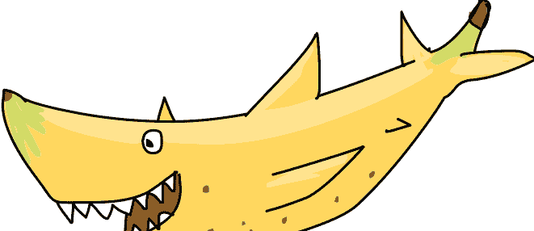

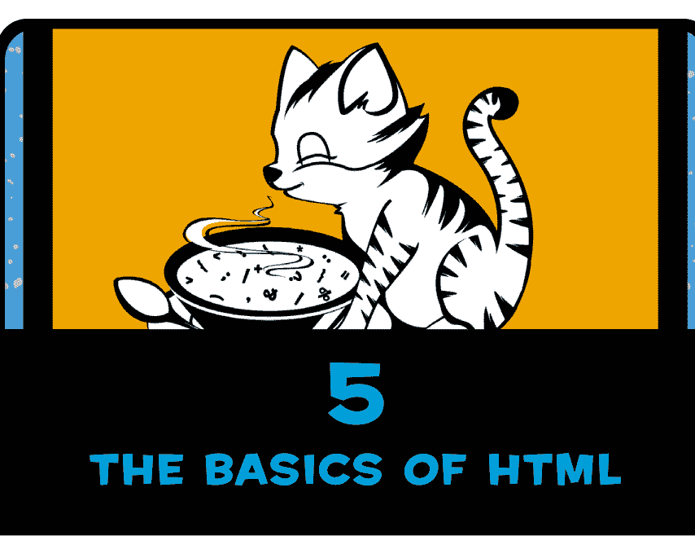

# 5 HTML 基础

我们到为止一直使用的浏览器的 JavaScript 控制台对于尝试短代码片段非常有用，但为了创建实际程序，我们需要更灵活的东西，比如一个带有一些 JavaScript 的网页。在这一章中，我们将学习如何创建一个基础的 HTML 网页。

HTML（超文本标记语言）是用于制作网页的语言。HyperText（超文本）指的是通过超链接连接的文本，即网页上的链接。标记语言用于注释文档，使其不再是纯文本。标记告诉软件（如网页浏览器）如何显示文本以及对它做什么。

在本章中，我将向你展示如何在文本编辑器中编写 HTML 文档，文本编辑器是一个用于编写纯文本文件的简单程序，没有你在字处理处理器 Microsoft Word 中找到的格式。字处理文档包含格式格式的文本（带有不同的字体、颜色、字体大小等），字处理处理器的设计是为了方便更改文本格式。字处理处理器通常允许你插入图像和图形。

纯文本文件包含任何文本，没有任何关于字体、颜色、大小等任何信息。除非你用文字画——例如这只猫——否则你不能在文本文件中放入图像。

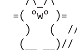

## 文本编辑器

我们将在跨平台（兼容 Windows、Mac OS 和 Linux）的 Sublime Text 编辑器中编写 HTML。你可以免费下载并使用 Sublime Text，但过一段时间后你会被要求支付许可费用。如果你不喜欢这个主意，我在下面列了一些完全免费的替代方案。本章中的指令针对 Sublime Text 设计，但由于文本编辑器相对简单，这些指令对于任何编辑器都应该基本适用。

- Gedit 是来自 GNOME 项目的跨平台文本编辑器（https://wiki.gnome.org/Apps/Gedit/）。

- 对于 Microsoft Windows，Notepad++ (http://notepad-plus-plus.org/) 是另一个很好的替代方案。

- 在 Mac OS 上，TextWrangler (http://www.barebones.com/products/textwrangler/) 是一个很好的选择。

要安装 Sublime Text，请访问 http://www.sublimetext.com/。每个操作系统的安装说明不同。

## 语法高亮

Sublime Text 使用语法高亮使代码更容易读。例如，字符串可能是绿色的，而变量可能是橙色的。有很多不同的主题可以自定义编辑器的外观。

## 我们的第一个文档

HTML 文档由元素组成。一个元素从标签开始，以结束标签结束。例如，h1 意味着“这是一个标题”。p 元素意味着段落。

让我们创建第一个 HTML 页面。将以下内容添加到你的 file.html 中：

```html
<h1>Hello world!</h1>
<p>My first web page.</p>
```

图 5-1 显示了页面的样子。

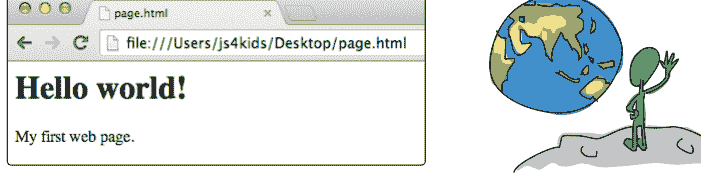

图 5-1：你的 HTML

## 标题元素

每个元素都有特殊的含义。有六级标题：h1, h2, h3, h4, h5 和 h6。它们看起来像这样：

```html
<h1>First-level heading</h1>
<h2>Second-level heading</h2>
<h3>Third-level heading</h3>
<h4>Fourth-level heading</h4>
<h5>Fifth-level heading</h5>
<h6>Sixth-level heading</h6>
```

图 5-2 显示了标题在浏览器中的样子。

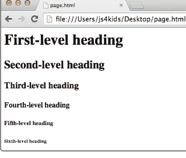

图 5-2：不同的标题

## p 元素

p 元素用于定义独立的文本段落。你放在 p 标签之间的任何文本将显示在独立的段落中，段落上下留有一些空间。让我们尝试创建多个 p 元素。将此新行添加到你的 page.html 文档中：

```html
<h1>Hello world!</h1>
<p>My first web page.</p>
<p>let's add another paragraph.</p>
```

图 5-3 显示了带有新段落的网页。

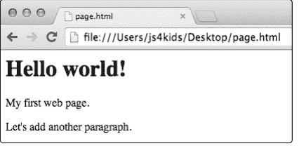

图 5-3：带有额外段落的页面

## HTML 中的空格和块级元素

如果没有标签，我们的页面会变成什么样？让我们来看看：

Hello world!


# My first web page.

Let's add another paragraph.

图 5-4 显示了我们没有任何标签的页面。

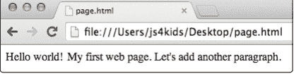

图 5-4：没有 HTML 标签的相同页面

噢，不！我们不仅丢失了格式，所有的内容都变成了一行长长的文本！这是因为在 HTML 中，所有的空白字符都会合并成单个空格。空白字符是指任何在页面上产生空白区域的字符——例如，空格字符、制表符和换行符（当你按下 `ENTER` 或 `RETURN` 键时插入的字符）。在 HTML 文档中，两段文本之间插入的任何空行都会被合并成单个空格。

`<p>` 和 `<h1>` 元素被称为块级元素，因为它们在独立的块中显示内容，从新的一行开始，并且其随后的任何内容都会另起新行显示。

## 内联元素

让我们为文档添加另外两个元素，`<em>` 和 `<strong>`：

```html
<h1>Hello world</h1>
<p>My <em>first</em> <strong>web page</strong>.</p>
<p>Let's add another <strong><em>paragraph</em></strong>.</p>
```

图 5-5 显示了使用新标签后页面的样子。

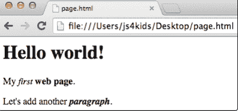

图 5-5：em 和 strong 元素

`<em>` 元素使其内容变为斜体。`<strong>` 元素使其内容变为粗体。`<em>` 和 `<strong>` 元素都是内联元素，这意味着它们不会像块级元素那样将内容置于新的一行上。

要使内容加粗并将其放在两个标签内部。注意在上一个例子中，加粗斜体文本的标签顺序为：`<strong><em>...</em></strong>`。正确地嵌套元素至关重要。嵌套意味着如果一个元素位于另一个元素内部，那么它的起始标签和结束标签都应该在父元素内部。例如，这种写法是不允许的：

```html
<strong><em>...</em>
</strong>
```

在这种情况下，闭合的 `<strong>` 标签在于闭合的 `<em>` 标签之前。浏览器通常不会在你犯此类错误时提示你，但这种错误可能会导致你的页面以奇怪的方式崩溃。

## 完整的 HTML 文档

我们目前为止所看到的只是 HTML 的片段。一个完整的 HTML 文档需要一些额外的元素。让我们来看完整 HTML 文档的示例以及每个部分的含义。用这些新元素更新你的 `page.html` 文件：

```html
<!DOCTYPE html>
<html>
<head>
<title>My first proper HTML page</title>
</head>
<body>
<h1>Hello world!</h1>
<p>My <em>first</em> <strong>web page</strong>.</p>
<p>Let's add another <strong><em>paragraph</em></strong>.</p>
</body>
</html>
```

注意：

Sublime Text 会自动为你缩进行，如此示例所示。它实际上是根据标签（如 `<html>`、`<h1>` 等）识别行，并根据它们的嵌套关系进行缩进。虽然 Sublime Text 不缩进 `<head>` 和 `<body>` 标签，但某些编辑器会。

图 5-6 显示了完整的 HTML 文档。

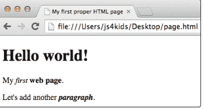

图 5-6：完整的 HTML 文档

让我们浏览一下 `page.html` 文件中的元素。`<!DOCTYPE html>` 标签只是一个声明。它简单表示：“这是一个 HTML 文档。”接下来是起始标签 `<html>`（闭合标签 `</html>` 位于最末尾）。所有的 HTML 文档必须有一个 `html` 元素作为最外层元素。`html` 元素内部有两个元素：`head` 和 `body`。`<head>` 元素包含了关于你的 HTML 文档的某些信息，例如 `<title>` 元素，它包含了文档的标题。例如，注意图 5-6，浏览器标签页中的标题——“My first proper HTML page”与我们在 `<title>` 元素中输入的内容匹配。`<title>` 元素位于 `<head>` 元素内，而 `<head>` 又位于 `<html>` 元素内。`<body>` 元素包含了将在浏览器中显示的内容。在这里，我们只是复制了章节之前的 HTML。

## HTML 层次结构

HTML 元素具有清晰的层次结构（或顺序），可以被视为一种倒置的树。你可以在图 5-7 中看到我们的文档作为树的样子。

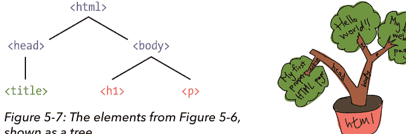

图 5-7：以树形式显示的图 5-6 中的元素

顶部元素是 `html` 元素。它包含了 `head` 和 `body` 元素。`head` 包含 `title` 元素，`body` 包含 `<h1>` 和 `<p>` 元素。浏览器根据这个层次结构解析你的 HTML。我们将在第 9 章查看如何更改文档结构。图 5-8 显示了另一种可视化 HTML 层次结构的方法，即一组嵌套框。

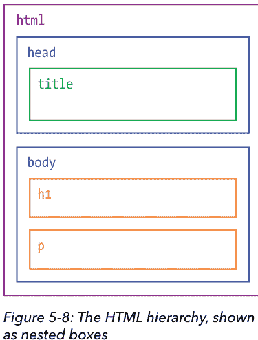

图 5-8：一组嵌套框

## 在 HTML 中添加链接

在本书的本章节前面的部分，我们了解到 HTML 代表 HyperText（超文本），这是“网页”的一种形象说法。HTML 文档可以包含超链接（链接），带你到其他页面。要创建一个链接，我们使用 `<a>` 元素。修改你的 HTML 以匹配以下内容：

```html
<!DOCTYPE html>
<html>
<head>
<title>My first proper HTML page</title>
</head>
<body>
<h1>Hello world!</h1>
<p>My <em>first</em> <strong>web page</strong>.</p>
<p>Let's add another <strong><em>paragraph</em></strong>.</p>
<a href="http://google.com">Click here</a>
</body>
</html>
```

## 链接属性

在这种情况下，属性名是 `href`，属性值是 `"http://google.com"`。HTML 中的属性类似于键值对。每个属性都有一个名称和一个值。这里是我们创建的链接：

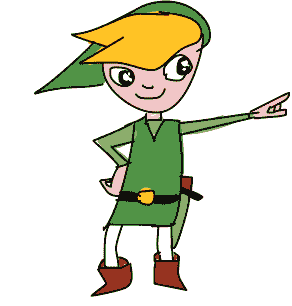

```html
<a href="http://google.com">Click here</a>
```

## 属性

我们添加到链接的另一个属性是 `title` 属性。该属性设置了鼠标悬停在链接上时看到的文本。例如，修改起始 `<a>` 标签使其看起来如下：

```html
<a href="http://google.com" title="xkcd: Land of geeky comics!">Click here</a>
```

现在刷新页面。当你将光标悬停在链接上，你将在页面上方看到“xkcd: Land of geeky comics!”，如图 5-11 所示。

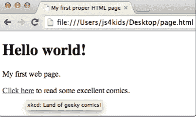

图 5-11：一个指向 http://xkcd.com/ 且带有标题属性的网页

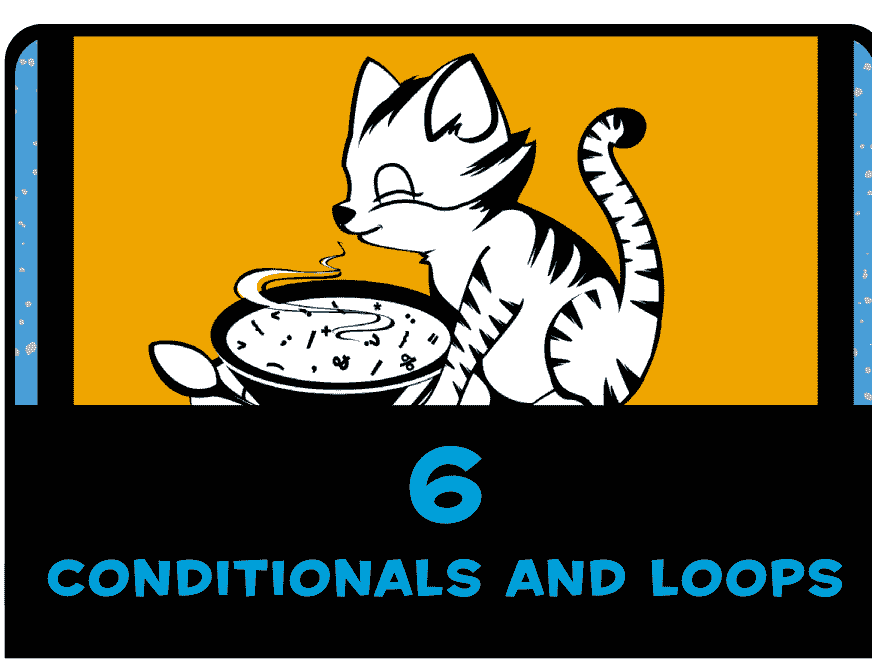

# 6 条件判断与循环

条件判断和循环是 JavaScript 中最重要的概念之一。条件判断表示：“如果某事为真，执行此操作。否则，执行那个。”例如，如果你完成了作业，就可以吃冰淇淋，但如果你没有完成作业，你就吃不到冰淇淋。循环表示：“只要某事为真，就一直这样做。”例如，只要你口渴，就一直喝水。

条件判断和循环是强大的概念，是任何复杂程序的关键。它们被称为控制结构，因为它们允许你根据你定义的某些条件，控制代码的哪些部分在何时以及如何被执行。

我们首先需要了解如何将 JavaScript 嵌入到 HTML 文件中，这样我们就可以编写比目前看到的更长的程序了。

## 在 HTML 中嵌入 JavaScript

这是我们在第 5 章中创建的 HTML 文件，新增的内容用颜色标记，现有的文本为灰色。（为了让这个示例更简单，我还删除了指向 xkcd 的链接。）

```html
<!DOCTYPE html>
<html>
<head>
  <title>My first proper HTML page</title>
</head>
<body>
  <h1>Hello world!</h1>
  <p>My first web page.</p>
  <script>
    var message = "Hello world";
    console.log(message);
  </script>
</body>
</html>
```

我们添加了一个名为 `script` 的新元素。这是 HTML 中的一个特殊元素。对于大多数 HTML 元素，开始标签和结束标签之间的内容会显示在页面上。而对于 `script`，标签之间的所有内容都被视为 JavaScript，并由 JavaScript 解释器运行。

现在来看 `script` 元素内部的代码：

```javascript
var message = "Hello world!";
console.log(message);
```

在 HTML 文件中运行 JavaScript 与在控制台（`console`）中运行非常不同。当你使用 JavaScript 控制台时，你输入的每一行在按下回车键后立即执行，该行的值会打印到控制台中。在网页中，JavaScript 会从上到下一次性全部运行，除非我们告诉浏览器否则没有任何内容会自动打印到控制台中。我们可以使用 `console.log` 来打印内容，这使得我们在运行程序时更容易看到发生了什么。`console.log` 方法接收任何值并将其打印或*记录*（logs）到控制台中。例如，如果你在打开 JavaScript 控制台的情况下从本节开始加载该 HTML 文件，你会看到：

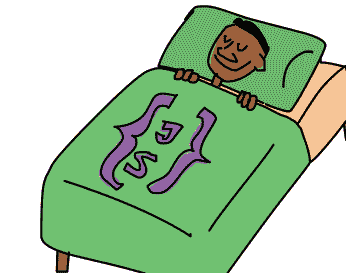

Hello world!

在 ① 调用 `console.log(message)` 导致字符串 `"Hello world!"` 被打印到控制台上。

现在你知道如何用 JavaScript 编写长程序了，可以开始学习条件判断了。

## 条件判断

JavaScript 中有两种形式的条件语句：`if`语句...`else`语句。`if` 语句用于在某事为真时执行一段代码。例如，如果你表现良好，你就能得到一个奖励。`if...else` 语句在某事为真时执行一段代码，在不为真时执行另一段。例如，如果你表现良好，你就得到一个奖励；*否则*，你会被禁足。

## IF 语句

`if` 语句是 JavaScript 控制结构中最简单的。它用于仅在条件为真时运行代码。回到你的 HTML 文件，将 `script` 元素内部的两行替换为：

```javascript
var name = "Nicholas";
console.log("Hello " + name);
if (name.length > 7) {
  console.log("Wow, you have a REALLY long name!");
}
```

首先，在 ① 我们创建了一个名为 `name` 的变量，并将其值设置为字符串 `"Nicholas"`。然后我们在 ② 使用 `console.log` 记录字符串 `"Hello Nicholas"`。

在 ③ 我们使用一个 `if` 语句来检查 `name` 的长度是否大于 7。如果是，控制台将通过 ④ 处的 `console.log` 显示 `"Wow, you have a REALLY long name!"`。

如图 6-1 所示，`if` 语句有两个主要部分：条件（condition）和体体（body）。条件应该是一个布尔值。体体是一或多行 JavaScript 代码，如果条件为真，则执行这些代码。


# 条件判断与循环

## IF 语句

`if` 语句是 JavaScript 控制结构中最简单的。它用于仅在条件为真时运行代码。

```
The if statement checks whether this is true.
↓
if (condition) {
  console.log("Do something");
}
// Some code to run if the condition is true, called the body

Figure 6-1: if 语句的通用结构
```

如图 6-1 所示，`if` 语句有两个主要部分：条件和体。条件应该是一个布尔值。体是一或多行 JavaScript 代码，如果条件为真，则执行这些代码。

在 HTML 文件中，将 `script` 元素内部的代码替换为：

```javascript
var name = "Nicholas";
console.log("Hello " + name);
if (name.length > 7) {
  console.log("Wow, you have a REALLY long name!");
}
```

当你加载包含此 JavaScript 的 HTML 页面时，你应该会在控制台中看到以下内容：

```text
Hello Nicholas
Wow, you have a REALLY long name!
```

因为名字 Nicholas 有八个字符，`name.length` 返回 8。因此，条件 `name.length > 7` 为真，导致 `if` 语句的体执行，从而记录了这条令人惊讶的消息。

为了避免触发 `if` 条件，请将名字 Nicholas 改为 Nick（保持其他代码不变）：

```javascript
var name = "Nick";
```

现在保存文件并重新加载页面。这次，条件 `name.length > 7` 为假，因此 `if` 语句的体不执行。

## IF...ELSE 语句

如果你想在条件为假时做其他事情，你就需要使用 `else` 语句。`if...else` 语句在某事为真时执行一段代码，在不为真时执行另一段。例如，如果你表现良好，你就得到一个奖励；否则，你会被禁足。

## 链式 IF...ELSE 语句

通常我们需要检查一系列条件，并在其中一个为真时执行某些操作。例如，假设你在点餐：

```javascript
var lemonChicken = false;
var beefWithBean = true;
var sweetAndPork = true;

if (lemonChicken) {
  console.log("Great! I'm having chicken!");
} else if (beefWithBean) {
  console.log("I'm having beef.");
} else if (sweetAndPork) {
  console.log("OK, I'm having pork.");
} else {
  console.log("Well, I guess I'll have rice.");
}
```

还有另一点需要注意：你并不一定得包含最后的 `else`。尽管如此，如果你没有包含它，并且没有任何条件为真，那么 `if...else` 链中的任何代码都不会被执行。

```javascript
var lemonChicken = false;
var beefWithBlackBean = false;
var sweetAndSourPork = false;

if (lemonChicken) {
  console.log("Great! I'm having lemon chicken!");
} else if (beefWithBlackBean) {
  console.log("I'm having the beef.");
} else if (sweetAndSourPork) {
  console.log("OK, I'll have the pork.");
}
```

在这个例子中，我们省略了最后的 `else` 部分。因为你喜欢的食物一个都没有，所以什么都没有打印出来（看起来你也没东西吃了！）。

## 尝试一下！

编写一个带有 `name` 变量的程序。如果 `name` 是你的名字，打印出 `Hello me!`；否则，打印 `Hello stranger!`。（提示：使用 `===` 来比较 `name` 和你的名字）。接下来，重写该程序，如果 `name` 被设置为你父亲的名字，则对你父亲说；如果 `name` 是你妈妈的名字，则对你妈妈说。如果两个都都不是，则像以前一样说 `Hello stranger!`。

# 循环

正如我们所见，条件判断允许你在条件为真时运行一段代码。另一方面，循环允许你根据条件是否保持为真来多次运行一段代码。例如，只要盘子里还有食物，你就应该一直吃；或者，只要你脸上还有脏东西，你就应该一直洗。

## WHILE 循环

最简单的循环是 `while` 循环。循环会重复执行其循环体，直到特定条件不再为真。通过编写一个 `while` 循环，你是在说：“只要这个条件为真，就一直这样做。当条件变为假时停止。”

如图 6-4 所示，`while` 循环以 `while` 关键字开头，后面跟着括号里的一个条件，然后检查循环体。这个条件会在每次循环重复时被检查。

```
while (condition) {
  console.log("Do something");
  i++;
}
```

只要条件为真，就会运行并重复某些代码（这里的某些内容应该改变状态，以便条件最终变为假）

图 6-4：while 循环的通用结构

与 `if` 语句一样，如果条件为真，就会执行 `while` 循环的循环体。与 `if` 语句不同，在执行循环体后会再次检查条件，如果它仍然为真，循环体会再次运行。这个循环一直持续到条件为假。

### 使用 WHILE 循环数羊

你入睡困难，想数数羊。但你是个程序员，为什么不写个程序帮你数数羊呢？

```javascript
var sheepCounted = 0;
while (sheepCounted < 10) {
  console.log("I have counted " + sheepCounted + " sheep!");
  sheepCounted++;
}
console.log("Zzzzzzzzz");
```

我们创建了一个名为 `sheepCounted` 的变量并将其值设置为 0。当我们到达 `while` 循环时，我们检查 `sheepCounted` 是否小于 10。因为 0 小于 10，大括号内的代码（循环体）运行，并将 `"I have counted " + sheepCounted + " sheep!"` 记录为 `"I have counted 0 sheep!"`。接下来，`sheepCounted` 在值的基础上加 1，我们回到循环的开头，周而复始：

```text
I have counted 0 sheep!
I have counted 1 sheep!
I have counted 2 sheep!
I have counted 3 sheep!
I have counted 4 sheep!
I have counted 5 sheep!
I have counted 6 sheep!
I have counted 7 sheep!
I have counted 8 sheep!
I have counted 9 sheep!
Zzzzzzzzzz
```

这种过程会重复，直到 `sheepCounted` 变成 10，此时条件变为假（10 不小于 10），程序将移动到循环之后的任何内容上。在本例中，它会打印出 `Zzzzzzzzzz`。

### 防止死循环

在使用循环时请记住这一点：如果你设置的条件永远不会变为假，你的循环将无限循环下去（或者至少直到你关闭浏览器）。例如，如果你漏掉了 `sheepCounted++` 这一行，那么 `sheepCounted` 将保持为 0，输出将如下：

```text
I have counted 0 sheep!
I have counted 0 sheep!
I have counted 0 sheep!
I have counted 0 sheep!
...
```

因为没有任何东西停止它，程序将永远一直这样做！这被称为死循环。

## FOR 循环

`for` 循环使得编写此类循环变得更容易：创建一个变量，直到条件为真，并在每次循环结束时更新该变量。在设置循环时，你创建一个变量，指定条件，并说明该变量在每个周期后应该如何变化——这一切在你进入循环之前就完成了。

```javascript
var sheepCount = 0;
while (sheepCount < 10) {
  console.log("I have counted " + sheepCount + " sheep!");
  sheepCount++;
}
```

我们将 x 设为 2，并使用 `x = x * 2` 增加 x 的值；这意味着循环每次运行时，x 的值都会翻倍。结果增长非常快，正如你看到的：

```text
2
4
8
16
32
64
128
256
512
1024
2048
4096
8192
```

搞定！这个简短的 for 循环打印了 10,000 以下所有的 2 的幂。

## 来尝试一试！

> 写一个循环来打印 10,000 以下的 3 的幂（它应该打印 3, 9, 27 等）。
>
> 使用 while 循环重写这个循环。（提示：在循环开始之前提供设置代码。）

## 你学到了什么

在本章中，你学习了条件判断和循环。条件判断用于仅在特定条件为真时运行代码。循环用于多次运行代码，并在特定条件为真时保持代码运行。你可以使用条件判断来确保在正确的时间运行正确的代码，并使用循环让你的程序根据需要持续运行。拥有这些操作的能力开启了编程的无限可能世界。

在下一章中，我们将利用条件判断和循环的力量来制作我们的第一个真正的游戏！

# 编程挑战

尝试这些挑战来练习使用条件判断和循环。

## #1: 酷炫的动物

写一个循环来修改动物数组：

```javascript
var animals = ["Cat", "Fish", "Lemur", "Komodo Dragon"];
```

然后，在你运行循环后，它看起来应该像这样：

提示：你需要为数组的每个索引重新赋值。这仅仅意味着在数组的现有位置上分配一个新值。例如，为了让第一只动物变得酷炫，你可以说：

```javascript
animals[0] = "Awesome " + animals[0];
```

## #2: 随机字符串生成器

制作随机字符串生成器。你需要从字母表中的所有字母开始：

```javascript
var alphabet = "abcdefghijklmnopqrstuvwxyz";
```

要从这个字符串中随机选取一个字母，你可以更新我们在第 3 章 `Math` 中用于随机侮辱生成器的代码：`Math.floor(Math.random()) * alphabet.length`。这将为字符串创建一个随机索引。你可以使用方括号来获取该索引处的字符。

要创建一个随机字符串，从一个空字符串开始（`var randomString = ""`）。然后创建一个 while 循环，只要字符串长度小于 6（或你选择任何长度），就不断向此字符串添加新的随机字母。你可以使用 `+=` 运算符向字符串末尾添加新字母。循环完成后，将其打印到控制台以创建你的作品！

## #3: 黑客语言

将文本转换为黑客语言（h4ckr sp34k）！互联网上很多人喜欢将某些字母替换为像这些字母的数字。有些数字看起来像字母：4 代表 A，3 代表 E，1 代表 I，0 代表 O。虽然这些数字看起来像大写字母，我们将替换这些字母的小写版本。要将普通文本转换为黑客语言，我们需要一个输入字符串和一个新的空字符串：

```javascript
var input = "javascript is awesome";
var output = "";
```

你需要使用循环来遍历输入字符串中的所有字母。如果字母是 "a"，在输出字符串中添加一个 "4"。如果是 "e"，添加一个 "3"。如果是 "i"，添加一个 "1"，如果是 "o"，添加一个 "0"。否则，将原始字母添加到新字符串中。和之前一样，你可以使用 `+=` 将每个新字母添加到输出字符串中。

循环后，将输出字符串打印到控制台。如果运行正常，你应该能看到它打印了 `"j4v4script 1s 4w3s0m3"`。

# 创建一个吊挂游戏

在本章中，我们将构建一个吊索游戏！我们将学习如何使用对话框（dialogs）让游戏具有交互性，并从玩家那里获取输入。

吊索是一个猜词游戏。一个玩家选择一个秘密单词，另一个玩家尝试猜它。

例如，如果单词是 TEACHER，第一个玩家会写：

猜词玩家尝试猜单词中的字母。每当他们猜对一个字母，第一个玩家就会为该字母出现的每个位置填入空格。例如，如果猜词玩家猜了字母 E，第一个玩家将像这样填满 TEACHER 中的 E：

当猜词玩家猜一个单词中没有的字母时，他们失去一分，第一个玩家每猜错一次就会画一个柴人的一部分。如果第一个玩家完成了猜词玩家猜的单词，他们就输了。

## 使用 ALERT 给玩家提供信息

如果你只是想给玩家提供一些信息，可以使用 alert 对话框显示一个带有“确定”按钮的消息。例如，如果你认为 JavaScript 非常棒，你可以使用这个 `alert` 函数：

```javascript
alert("JavaScript is awesome!");
```

图 7-3 显示了这个简单的 alert 对话框的样式。

alert 对话框仅显示消息并等待用户点击“确定”。

## 为什么使用 ALERT 而不是 CONSOLE.LOG？

为什么在游戏中使用 alert 对话框而不是使用 `console.log`？首先，如果你只是想告诉玩家某些事情，使用 alert 意味着玩家不需要中断游戏去打开控制台来查看状态消息。其次，调用 `alert`（以及 `confirm`）会暂停 JavaScript 解释器，直到用户点击“确定”（在 prompt 和 confirm 的情况下为“取消”）。这意味着玩家有时间阅读 alert。相反，当你使用 `console.log` 时，文本会立即显示，解释器会移动到程序的下一行。

## 设计你的游戏

在我们开始编写挂字单词游戏之前，让我们思考一下它的结构。我们需要程序执行以下几件事：

1. 随机选取一个单词。
2. 获取玩家的猜测。
3. 如果玩家想要，则退出游戏。
4. 检查玩家的猜测是否为有效字母。
5. 跟踪玩家已猜测的字母。
6. 向玩家展示进度。
7. 当玩家猜中游戏时结束。

除了第一项和最后一个任务（为玩家选取要猜的单词和结束游戏）之外，这些步骤都需要多次执行，而且我们不知道需要执行多少次（取决于玩家猜得有多好）。当你需要多次执行相同的操作时，你就知道你需要一个循环。

单凭这个简单的任务列表并不能让我们对需要发生什么产生太具体的灵感。为了更好地理解代码的结构，我们可以使用伪代码（pseudocode）。

## 使用伪代码设计游戏

伪代码是程序员经常用来设计程序的方便工具。它的意思是“假代码”，是描述程序将如何工作的一种方式，看起来像书面英语和代码的混合体。伪代码包含循环和条件判断，但除此之外，一切都是纯英语。让我们来看看我们游戏的伪代码版本以获得一个直观感受：

随机选取一个单词

```
当单词未被猜中时 {
  向玩家展示当前的进度
  从玩家那里获取一个猜测
  如果玩家想退出游戏 {
    退出游戏
  }
  否则如果猜测不是单个字母 {
    告诉玩家选择单个字母
  }
  否则 {
    如果猜测在单词中 {
      用该猜测更新玩家的进度
    }
  }
}
```


# 祝贺玩家猜中了真正的代码，没有任何计算机能做到这一点

如你所见，这些都不是真实的代码。但它让我们对程序将如何构建有了一个概念，这在我们真正开始编写代码并处理那些杂乱细节之前（例如我们将如何随机选取一个单词）。

## 跟踪单词的状态

在之前的伪代码中，前几行之一是“显示他们当前的进度”。对于挂字单词游戏，这意味着填入玩家猜对的字母，并显示秘密单词中哪些字母仍然为空。我们该如何做到这一点？我们可以通过类似于传统挂字游戏的方式来跟踪玩家的进度：维护一个空白位集合，并在玩家猜对正确字母时填充它们。

在我们的游戏中，我们将为单词中的每个字母使用一个空白数组。我们将其称为“答案数组”（`answerArray`），并在玩家做出正确猜测时填充它。我们用字符串 `"_"` 来表示每个空白。

`answerArray` 最初将由一组这些空条目组成，数量与秘密单词的字母相等。例如，如果秘密单词是 `fish`，数组看起来如下：

```
[ __, __, __, __]
```

如果玩家正确猜中了字母 `i`，我们将第二个空白改为 `i`：

```
[ __, i, __, __]
```

一旦玩家猜中了所有正确字母，完成后的数组将如下所示：

```
["f", "i", "s", "h"]
```

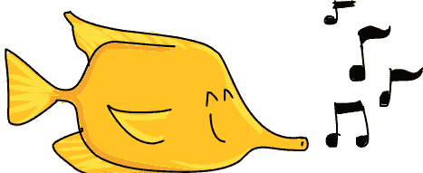

接下来的章节将解释构成游戏循环体的代码。

## 显示玩家的进度

在游戏循环内部我们需要做的第一件事是向玩家显示当前的进度：

```
alert(answerArray.join(" "));
```

我们通过将 `answerArray` 中的元素连接成一个字符串（使用空格字符作为分隔符），然后使用 `alert` 将该字符串显示给玩家。例如，假设单词是 "monkey"，玩家目前已经猜了 m、o 和 e。答案数组看起来像这样：`["m", "o", "_", "_", "e", "_"]`，而 `answerArray.join(" ")` 的结果是 `"m o _ _ e _"`。`alert` 对话框如图 7-4 所示。

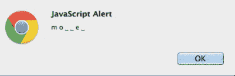

图 7-4：使用 `alert` 显示玩家的进度

## 处理玩家输入

现在我们必须获取玩家的猜测，并确保它是单个字符。

```javascript
var guess = prompt("Guess a letter, or click Cancel to stop playing.");
if (guess === null) {
  break;
} else if (guess.length != 1) {
  alert("Please enter a single letter.");
} else {
  // Update the game state with the guess
}
```

在 ① 处，`prompt` 获取玩家的猜测并将其保存到变量 `guess` 中。此时会发生四种情况。

首先，如果玩家点击“取消”按钮，则 `guess` 将为 `null`。我们通过 ② (`if (guess === null)`) 来检查此条件。如果该条件成立，我们使用 `break` 退出循环。

> **注意**
>
> 你可以在任何循环中使用 `break` 关键字来立即停止循环，无论程序处于循环的哪个位置，无论 `while` 条件当前是否真。

在 ③ ⑥ 处，我们使用 `else if (word[j] === guess)` 来检查我们正在查看的当前字母是否匹配玩家的猜测。如果是，我们使用 `answerArray[j] = guess` 用当前的猜测更新 `answerArray`。对于单词中每个匹配 `guess` 的字母，我们都会更新对应位置的 `answerArray`。这之所以行得通，是因为循环变量 `j` 可以用作 `answerArray` 的索引，就像它可以用作 `word` 的索引一样，如图 7-5 所示。

### 索引 (j)

```
0 1 2 3 4 5 6
word p a n c a k e
answerArray ["", "", "", "", "", "", ""]
```

图 7-5：同一个索引可以用于 `word` 和 `answerArray`。

例如，假设我们刚刚开始游戏并到达 ① 处的 `for` 循环。假设 `word` 是 "pancake"，`guess` 是 "a"，且 `answerArray` 目前看起来如下：

```
["", "", "", "", "", "", ""]
```

在 ② 处的第一次循环时，`j` 为 0，所以 `word[j]` 是 "p"。我们的猜测是 "a"，所以我们跳过了 ③ 处的 `if` 语句（因为 "p" == "a" 为假）。第二次循环时，`j` 为 1，所以 `word[j]` 是 "a"。它与 `guess` 相等，我们进入语句的 `if` 部分。行 `answerArray[j] = guess;` 将 `answerArray` 索引为 1（第二个元素）的元素设置为 `guess`，因此 `answerArray` 现在看起来如下：

```
["", "a", "", "", "", "", ""]
```

接下来的两次循环中，`word[j]` 分别为 "n" 和 "c"，它们都不匹配 `guess`。然而，当 `j` 达到 4 时，`word[j]` 再次变为 "a"。我们再次更新 `answerArray`，这会将索引为 4（第五个元素）的元素设置为 `guess`。现在 `answerArray` 看起来如下：

```
["", "a", "", "", "a", "", ""]
```

剩余字母不匹配 "a"，所以在最后两次循环中没有发生任何变化。在循环结束时，`answerArray` 已包含了单词中所有出现的 `guess`。

对于每一个正确的猜测，除了更新 `answerArray` 之外，我们还需要减少 `remainingLetters`。我们通过 ③ 实现这一点：每当 `guess` 匹配单词中的字母时，`remainingLetters` 就会减 1。一旦玩家猜对了所有字母，`remainingLetters` 将变为 0。

# 结束游戏

正如我们所看到的，主游戏循环的条件是 `remainingLetters > 0`，所以只要还有字母需要猜，循环就会继续。一旦 `remainingLetters` 达到 0，我们就离开循环执行以下代码：

```javascript
alert(answerArray.join(" "));
alert("Good job! The answer was " + word);
```

第一行使用 `alert` 最后显示数组。第二行再次使用 `alert` 祝贺玩家。

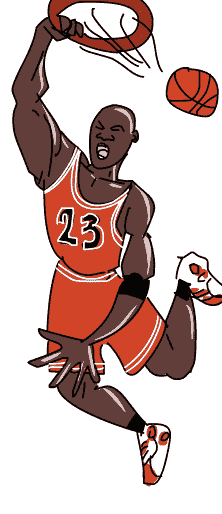

## 完整代码

现在我们看到了所有的代码，只需要将其整合。以下是游戏的完整列表。我在全程添加了注释，以便你查看每一步发生了什么。这比我们目前写的任何代码都要长一些，创建一个名为 `hangman.html` 的文件并输入以下内容：

```html
<!DOCTYPE html>
<html>
<head>
<title>Hangman!</title>
</head>
<body>
<h1>Hangman!</h1>

<script>
// Create an array of words
var words = [
  "javascript",
  "monkey",
  "amazing",
  "pancake"
];

// Pick a random word
var word = words[Math.floor(Math.random() * words.length)];

// Set up the answer array
var answerArray = [];
for (var i = 0; i < word.length; i++) {
  answerArray[i] = "_";
}

var remainingLetters = word.length;

// The game loop
while (remainingLetters > 0) {
  // Show the player their progress
  alert(answerArray.join(" "));

  // Get a guess from the player
  var guess = prompt("Guess a letter, or click Cancel to stop playing.");
  if (guess === null) {
    break;
  } else if (guess.length != 1) {
    alert("Please enter a single letter.");
  } else {
    // Update the game state with the guess
    for (var j = 0; j < word.length; j++) {
      if (word[j] === guess) {
        answerArray[j] = guess;
        remainingLetters--;
      }
    }
  }
}

// The end of game loop
alert(answerArray.join(" "));
alert("Good job! The answer was " + word);
</script>
</body>
</html>
```

如果你犯了错误，JavaScript 控制台可以帮助你找到它。例如，如果你拼错了变量，如果你点击 `hangman.html:30`，你会看到错误所在的行。在这种情况下，它显示我们在 `while` 循环开始处拼错了 `remainingLetters`。

图 7-6：Chrome 控制台中的 JavaScript 错误

```
Uncaught ReferenceError: remainingletter is not defined
```

尝试玩几次游戏。运行运行符合你的预期吗？你能想象你在后台编写的代码吗？

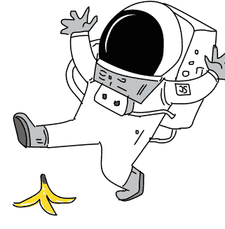

# 你学到了什么

短短几页之内，你就创建了自己的 JavaScript 游戏！正如你所看到的，循环和条件对于创建游戏或任何交互式程序至关重要。没有这些控制结构，程序只会开始和结束。

在第 8 章，我们将使用函数对代码进行封装，以便你可以从程序的不同部分运行它。

# 编程挑战

这里是一些挑战，用于构建和改进你在本章中创建的猜单词游戏。

### #1：更多单词

在 `words` 数组中添加你自己的单词。记得输入全小写的单词。

### #2：大写字母

如果玩家猜大写字母，它将无法匹配单词中的小写字母。为了解决这个潜在问题，将玩家的猜测转换为小写。（提示：你可以使用 `toLowerCase()` 方法将字符串转换为小写。）

### #3：限制猜测次数

我们的猜单词游戏允许无限猜测。添加一个变量来跟踪猜测次数，并在玩家次数用尽时结束游戏。（提示：在检查 `remainingLetters > 0` 的同一个 `while` 循环中检查此变量。正如我们在第 2 章所做的，你可以使用 `&&` 来检查两个布尔条件是否为真。）

### #4：修复 Bug

游戏中有一个 Bug：如果你一直猜同一个正确的字母，`remainingLetters` 将不断减少。你能修复它吗？（提示：你可以添加另一个条件来检查 `answerArray` 中的值是否仍为下划线。如果不是下划线，那么该字母已经被猜过了。）

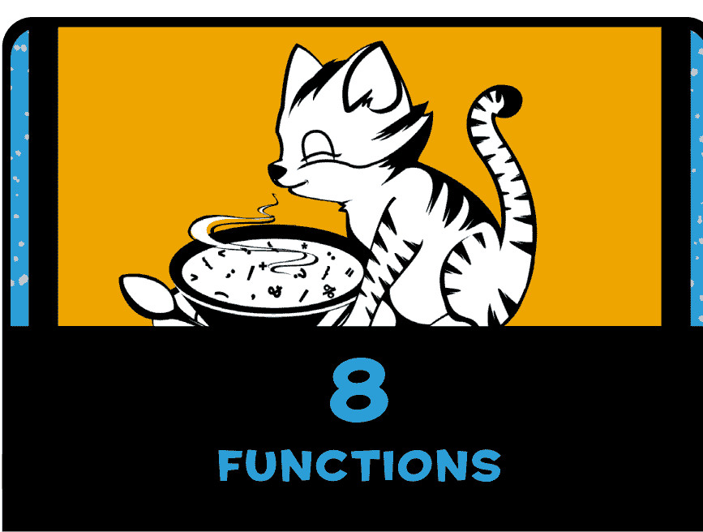

# 8 函数

函数是一种封装代码的方式，以便可以重复使用。函数允许我们从程序的多个地方运行同一段代码，而不需要反复复制和粘贴代码。此外，通过将长段代码隐藏在函数中并赋予它一个易于理解的名称，你能够更好地规划代码，因为你可以专注于组织函数，而不是关注组成函数的那些细微代码细节。

将你的代码拆分为更小、更易于管理的部分，可以让你洞察大局，并从更高层次上思考程序的结构。

当你需要在整个程序中反复执行某个计算或操作时，你会发现函数非常有用。在书的前面，你使用过各种函数，如 `Math.random()`、`Math.floor()`、`alert()`、`prompt()` 和 `confirm()`。在本章中，你将学习如何创建自己的函数。

## 函数的基本结构

图 8-1 显示了函数是如何构建的。大括号之间的代码被称为函数体，就像循环中大括号之间的代码被称为循环体一样。

```javascript
function () {
  console.log("Do something");
}
```

> 函数体位于大括号之间。

图 8-1: 创建函数的语法

## 创建简单的函数

让我们创建一个打印 "Hello world!" 的简单函数。在浏览器控制台中输入以下代码。使用 `SHIFT-ENTER` 开启新行而不执行代码。

```javascript
var ourFirstFunction = function () {
  console.log("Hello world!");
}
```

这段代码创建了一个新函数并将其保存在变量 `ourFirstFunction` 中。

## 调用函数

要运行函数内部的代码（函数体），我们需要调用该函数。要调用函数，你输入它的名称后跟一对括号，如下所示。

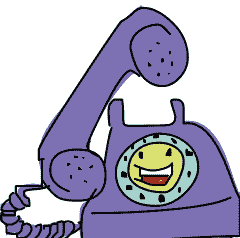

```javascript
ourFirstFunction();
Hello world!
```

调用 `ourFirstFunction()` 会执行函数体，即 `console.log("Hello world!");`，我们请求打印的文本将会在下一行显示：Hello world。

但如果你在浏览器中调用此函数，你会注意到有第三行，带有一个向左的小箭头，如图 8-2 所示。这是函数的返回值。

> ourFirstFunction();
>
> Hello, world!
>
> undefined

**图 8-2:** *调用一个具有未返回值的函数*

返回值是函数输出的值，它可以在你代码的其它地方使用。在这种情况下，返回值是 `undefined`，因为我们没有在函数体中告诉函数返回任何特定值。我们所做的只是让它向控制台打印一条消息，这并不等同于返回一个值。函数总是返回 `undefined`，除非函数体中有内容告诉它返回一个不同的值。（我们将在第 129 页的“从函数返回值”中查看如何指定返回值。）

> **注意** 在 Chrome 控制台以及本书中的所有代码列表中，返回值始终根据数据类型进行颜色编码，而用 `console.log()` 打印的文本始终是纯黑色的。

## 向函数传递参数

`ourFirstFunction` 每次你调用时都只打印同一行文本，你可能希望你的函数比这更灵活。函数参数允许我们将值传递到函数中，以便在调用函数时更改它的行为。无论是在创建函数还是调用函数时，参数始终位于函数括号之间。

下面的 `sayHelloTo` 函数使用一个参数（`name`）向你指定的人打招呼。

```javascript
var sayHelloTo = function (name) {
  console.log("Hello " + name + "!");
};
```

在第一行创建函数并将其赋值给变量 `sayHelloTo`。当函数被调用时，它会记录字符串 "Hello " + name + "!"，并将 `name` 替换为你作为参数传递给函数的任何值。

图 8-3 显示了带有一个参数的语法。

参数名

```javascript
function ( argument ) {
  console.log("My argument was: " + argument);
}
```

此函数体可以使用该参数。

图 8-3: 创建带有一个参数函数的语法

要调用接受参数的函数，请将你想用于参数的值放在函数名后的括号之间。例如，要向 Nick 打招呼，你可以写道：

```javascript
sayHelloTo("Nick");
Hello Nick!
```

或者，向 Lyra 打招呼，写道：

```javascript
sayHelloTo("Lyra");
Hello Lyra!
```

每次我们调用函数时，我们传递的参数 `name` 都会包含在函数打印的字符串中。所以当我们传入 "Nick" 时，控制台打印 "Hello Nick!"；当我们传入 "Lyra" 时，它打印 "Hello Lyra!"。

## 打印猫脸！

向函数传递参数的原因之一可能是告诉它执行某项操作的次数。例如，打印如下的猫脸：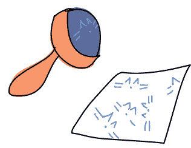

```javascript
var drawCats = function (howManyTimes) {
  for (var i = 0; i < howManyTimes; i++) {
    console.log(i + " :)");
  }
};
```

`drawCats` 函数根据你指定的 `howManyTimes` 参数打印 `i + " :)"`。结果如下：

```javascript
drawCats(5);
0 :)
1 :)
2 :)
3 :)
4 :)
```

## 向函数传递多个参数

你可以使用多个参数向函数传递多个值。要添加另一个参数，请将参数输入括号之间并将它们隔开。图 8-4 显示了两个参数的语法。每个参数名用逗号分隔。


```javascript
function (argument1, argument2) {
  console.log("first argument was: " + argument1);
  console.log("second argument was: " + argument2);
}
```

函数体可以使用这两个参数。

图 8-4: 创建带两个参数函数的语法

下面的函数 `printMultipleTimes` 类似于 `drawCats` 但有一个名为 `whatDraw` 的第二个参数。

```javascript
var printMultipleTimes = function (howManyTimes, whatDraw) {
  for (var i = 0; i < howManyTimes; i++) {
    console.log(i + " " + whatDraw);
  }
};
```

`printMultipleTimes` 函数根据你指定的 `howManyTimes` 参数打印你输入的 `whatDraw` 字符串。结果如下：
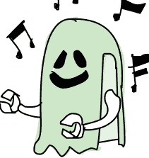

例如，使用这个新的 `printMultipleTimes` 函数打印脸，你可以这样调用：

```javascript
printMultipleTimes(5, "^.");
0 ^.
1 ^.
2 ^.
3 ^.
4 ^.
```

要让 `printMultipleTimes` 打印四个笑脸，可以这样做：

```javascript
printMultipleTimes(4, "^_^");
0 ^_^
1 ^_^
2 ^_^
3 ^_^
```

要画两次字符 `(_>)`，你可以写：

```javascript
printMultipleTimes(2, "(>_<");
0 (>_<)
1 (>_<)
```

## 从函数返回值

到目前为止看到的函数都是使用 `console.log` 向控制台打印文本。这是让 JavaScript 显示值的一种简单且有效的方法，但当我们把值打印到控制台时，我们无法在程序的后续部分使用该值。如果你希望你的函数输出该值，以便你在代码的其他部分继续使用它？

正如本章前面提到的，函数的输出被称为**返回值**。当你调用一个返回值的函数时，你可以在代码的其他部分使用该值（你可以将返回值保存在变量中、将其传递给另一个函数，或者简单地将其与其他代码结合）。例如，以下行代码将 `Math.floor(1.2345)` 的返回值加了 5：


```
5 + Math.floor(1.2345);
```

`Math.floor` 是一个函数，它会返回你传递给它的数字，并将其向下取整到最近的整数。当你看到诸如 `Math.floor(1.2345)` 这样的函数调用时，想象将其替换为该函数的返回值，即数字 1。

让我们创建一个返回返回值的函数。`double` 函数接收参数 `number` 并返回 `number * 2` 的结果。换句话说，该函数返回的值是所提供参数的二倍。

```javascript
var double = function(number) {
  return number * 2;
};
```

要从函数返回一个值，使用 `return` 关键字，后跟你想要返回的值。在这里，我们使用 `return` 关键字从 `double` 函数返回 `number * 2`。现在我们可以调用我们的 `double` 函数来让数字翻倍：

```
double(3);
```

在这里，返回值 (6) 显示在第二行。尽管函数可以接受多个参数，但它们只能返回一个值。如果你不告诉函数返回任何内容，它将返回 `undefined`。

## 将函数调用作为值

当你在一段较大的代码内部调用函数时，函数的返回值将在该调用所在的地方使用。例如，让我们使用 `double` 函数来确定两个数字翻倍的结果，然后将这些结果相加：

```
double(5) + double(6);
22
```

在这个示例中，我们调用了两次 `double` 函数并将两个返回值相加。你可以将 `double(5)` 的调用视为值 10，将 `double(6)` 的调用视为值 12。

你还可以将函数作为参数传递给另一个函数，函数调用将被替换为它的返回值。在下一个示例中，我们调用了 `double`，并将调用 `double(3)` 的结果作为参数。我们将 `double(3)` 替换为 6，以便 `double(double(3))` 简化为 `double(6)`，然后简化为 12。

```
double(double(3));
12
```

这是 JavaScript 计算此过程的：

```
double(double(3));
```

- 1 double(3 * 2)
- 2 double(6)
- 3 6 * 2

`double` 函数体返回 `number * 2`，因此 ① 我们将 `double(3)` 替换为 `3 * 2`。② 我们将 `3 * 2` 替换为 6。然后在 ③，我们执行同样的操作，将 `double(6)` 替换为 `6 * 2`。最后，在 ④，我们将 `6 * 2` 替换为 12。

## 使用函数简化代码

在第 3 章中，我们使用了 `Math.random` 和 `Math.floor` 方法从数组中挑选随机单词并生成随机的侮辱。在本节中，我们将通过创建函数来重新创建侮辱生成器并简化它。

### 选择随机单词的函数

这是我们在第 3 章中用于从数组中选择随机单词的代码：

```
randomWords[Math.floor(Math.random() * randomWords.length)];
```

如果我们将这段代码转换为一个函数，就可以复用它从数组中挑选随机单词，而无需每次都输入相同的代码。例如，这里是我们可以定义 `pickRandomWord` 函数的方式。

```javascript
var pickRandomWord = function (words) {
  return words[Math.floor(Math.random() * words.length)];
};
```

我们所做的是将之前的代码封装在一个函数中。现在，我们可以创建这个 `randomWords` 数组……

```javascript
var randomWords = ["Planet", "Worm", "Flower", "Computer"];
```

并使用 `pickRandomWord` 函数从该数组中挑选随机单词，如下：

```
pickRandomWord(randomWords);
"Flower"
```

我们可以在任何数组上使用同一个函数。例如，这里是我们要从名字数组中挑选一个随机名字：

```
pickRandomWord(["Charlie", "Raj", "Nicole", "Kate", "Sandy"]);
"Raj"
```

### 随机侮辱生成器

现在，让我们尝试使用挑选随机单词的函数重新创建我们的随机侮辱生成器。首先，回顾一下第 3 章的代码看起来如下：

```javascript
var randomBodyParts = ["Face", "Nose", "Hair"];
var randomAdjectives = ["Smelly", "Boring", "Stupid"];
var randomWords = ["Fly", "Marmot", "Stick", "Rat"];

// 从 randomBodyParts 数组中挑选一个身体部位；
var randomBodyPart = randomBodyParts[Math.floor(Math.random() * 3)];
// 从 randomAdjectives 数组中挑选一个形容词；
var randomAdjective = randomAdjectives[Math.floor(Math.random() * 3)];
// 从 randomWords 数组中挑选一个单词；
var randomWord = randomWords[Math.floor(Math.random() * 4)];
// 将字符串组合成句子：
var randomString = "Your " + randomBodyPart + " is " + randomAdjective + " " + randomWord + "!!!";
```

Nicholas，其中包含字母 o。让我们尝试用一个更短的名字再次调用它：

```
fifthLetter("Nick"); // undefined
```

当我们用名字 Nick 运行 `fifthLetter` 时，函数知道该名字的长度不够，因此它会在 ❶ 处通过第一个 `return` 语句提前退出。因为在 ➁ 处的 `return` 之后没有指定值，所以函数返回了 `undefined`。

### 使用多次 RETURN 代替 IF...ELSE 语句

我们可以在不同的 `if` 语句中使用多个 `return` 关键字，以便函数根据输入返回不同的值。例如，假设你正在编写一个根据分数颁发奖牌的游戏。3 分及以下是铜牌，3 到 7 分之间是银牌，7 分以上均是金牌。你可以使用一个像 `medalForScore` 这样的函数来评估分数并返回正确的奖牌类型，所示：

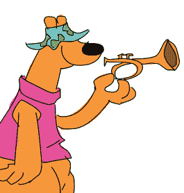

```javascript
var medalForScore = function (score) {
  if (score < 3) {
    return "Bronze";
  }
  if (score < 7) {
    return "Silver";
  }
  return "Gold";
};
```

❶ 如果分数小于 3，我们返回 "Bronze" 并退出函数。如果我们到达了 ➁，我们就知道分数至少是 3，因为如果它小于 3，我们早已经返回了（也就是说，当我们到达第一个测试的 `return` 关键字时，我们已经退出函数了）。最后，如果我们到达了 ③，我们就知道分数至少是 7，所以没有其他需要检查的了，我们可以直接返回 "Gold"。

尽管我们在检查多个条件，但我们不需要链式使用 `if...else` 语句。我们使用 `if...else` 语句是为了确保只有一种选项被执行。当每个选项都有它自己的 `return` 语句时，这也确保了只有一个选项会被执行（因为函数只能返回一次）。

### 创建函数的简写形式

编写函数有长写法（longhand）和简写形式（shorthand）两种方式。我正在使用长写法，因为它更清楚地展示了函数是如何存储在变量中的。尽管如此，你应该知道简写形式是什么样的，因为很多 JavaScript 代码都使用了它。一旦你习惯了函数的工作方式，你可能也想使用简写版本。这是一个长写函数的示例：

```javascript
var double = function(number) {
  return number * 2;
}
```

简写版本看起来如下：

```javascript
function double(number) {
  return number * 2;
}
```

如你所示，在长写法中，我们显式地创建一个变量名并将函数赋值给该变量，因此 `double` 现在 `function` 关键字之前。相比之下，`function` 关键字在简写版本中首先，然后是函数名。在这个版本中，变量 `double` 是 JavaScript 在后台创建的。

从技术术语来说，长写法被称为函数表达式（function expression）。简写形式被称为函数声明（function declaration）。

## 你学到了什么

函数允许我们重用代码块。它们可以根据传递给它们的参数来产生不同的结果，并将值返回到调用函数的代码位置。函数还让我们能够为代码起一个有意义的名字。例如，函数 `pickRandom` 的名字清楚地表明该函数与随机挑选单词有关。

在下一章中，我们将学习如何编写可以操作 HTML 文档的 JavaScript。

## 编程挑战

这里有一些挑战，供你练习使用函数。

### #1：使用函数进行运算

创建两个函数：`add` 和 `multiply`。每个函数都接受两个参数。`add` 函数应该求其参数的和并返回结果，`multiply` 函数应该将其参数相乘。

仅使用这两个函数，解决这个简单的数学题：

```
3625 * 9824 + 777
```

### #2：这些数组相同吗？

编写一个名为 `areSame` 的函数，接收两个数字数组作为参数。如果两个数组相同（即它们以相同的顺序拥有相同的数字），则返回 `true`；如果不同则返回 `false`。尝试运行以下代码以确保你的函数运行正常：

```javascript
areSame([1, 2, 3], [4, 5, 6]); // false
areSame([1, 2, 3], [1, 2, 3]); // true
areSame([1, 2, 3], [1, 2, 3, 4]); // false
```

提示 1：你需要使用 `for` 循环来遍历第一个数组中的每个值，以检查它们在第二个数组中是否相同。如果你发现了一个不相等的值，可以在 `for` 循环中返回 `false`。

提示 2：如果数组的长度不同，你可以提前退出函数并跳过整个 `for` 循环。

### #3：猜字游戏，使用函数

回到你在第 7 章完成的猜字游戏。我们将使用函数来重写它。
我在这里重写了最后的猜字游戏代码，但将代码的某些部分替换为了函数调用。你只需要编写你的函数即可。

```javascript
// 这是文中提到的猜字游戏代码逻辑的占位符
```

## 使用 ID 标识元素

HTML 的 `id` 属性允许你为 HTML 元素分配一个唯一的名称或标识符。例如，这个 `h1` 元素就有一个 `id` 属性：

```html
<h1 id="main-heading">Hello world!</h1>
```

在这个示例中，"main-heading" 的 `id` 将允许我们识别并最终更改这个标题，而不会影响其他元素甚至其他的 `h1` 标题。

## 使用 GETELEMENTELEMENTBYID 选择元素

在通过 `id` 唯一地标识一个元素后（每个 `id` 必须有一个唯一的值），我们就可以使用 DOM 方法 `document.getElementById` 来返回 "main-heading" 元素：

```javascript
var headingElement = document.getElementById("main-heading");
```

通过调用 `document.getElementById("main-heading")`，我们告诉浏览器寻找 `id` 为 "main-heading" 的元素。这会返回一个与 `id` 对应的 DOM 对象，我们将此 DOM 对象保存到变量 `headingElement` 中。

一旦选择了元素，我们就可以使用 JavaScript 对其进行操作。例如，我们可以使用 `innerHTML` 属性来获取并替换所选元素内部的文本：

```javascript
headingElement.innerHTML;
```

这段代码返回 `headingElement` 的 HTML 内容——即我们使用 `getElementById` 选择的元素。在这种情况下，该元素的内容是我们在 `<h1>` 标签之间输入的文本 Hello world!。

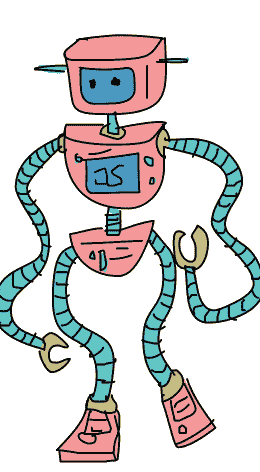

DOM 与 jQuery 145

## 使用 DOM 替换标题文本

这里有一个使用 DOM 替换标题文本的示例。首先，我们创建一个名为 `dom.html` 的新 HTML 文档，包含以下代码：

```html
<!DOCTYPE html>
<html>
<head>
  <title>Playing with the DOM</title>
</head>
<body>
  <h1 id="main-heading">Hello world!</h1>
<script>
  var headingElement = document.getElementById("main-heading");
  console.log(headingElement.innerHTML);
  var newHeadingText = prompt("Please provide a new heading;");
  headingElement.innerHTML = newHeadingText;
</script>
</body>
</html>
```


① 我们使用 `document.getElementById` 获取 id 为 "main-heading" 的 h1 元素，并将其保存到变量 `headingElement` 中。在 ② 我们打印 `headingElement.innerHTML` 返回的字符串，这会在控制台中打印 Hello world!。在 ③ 我们使用 `prompt` 对话框向用户询问新标题，并将用户输入的文本保存到变量 `newHeadingText` 中。最后，在 ④ 将 `headingElement` 的 `innerHTML` 属性设置为保存在 `newHeadingText` 中的文本。

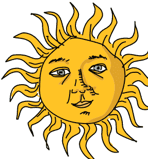

当你加载此页面时，你应该看到看到类似于图 9-2 所示的对话框。

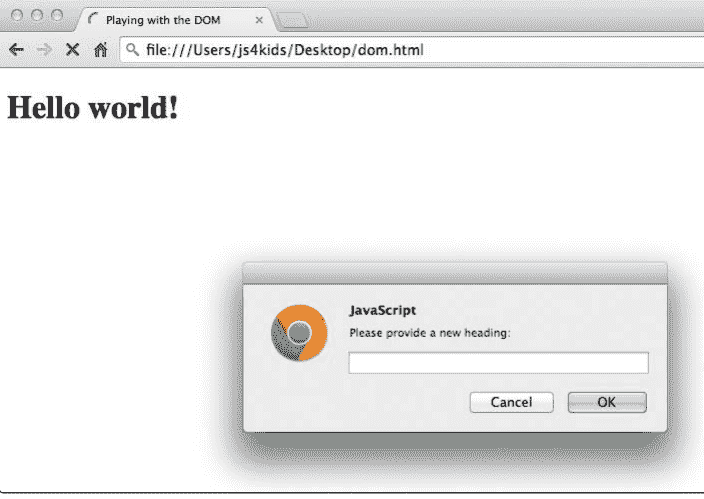

图 9-2：打开对话框的页面

在对话框中输入文本 JAVASCRIPT IS AWESOME 并点击 OK。标题应该立即更新为新文本，如图 9-3 所示。

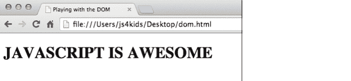

图 9-3：标题更改后的页面

使用 `innerHTML` 属性，我们可以使用 JavaScript 更改任何 DOM 元素的内容。

## 使用 jQuery 操作 DOM 树

内置的 DOM 方法非常棒，但它们并不容易使用。正因如此，许多开发者使用一组名为 jQuery 的工具来访问和操作 DOM 树。jQuery 是一个 JavaScript 库——一组相关工具（主要是函数）的集合，在这种情况下，它为我们提供了处理 DOM 元素的更简单的方法。一旦我们将库加载到页面上，除了 JavaScript 内置的方法和浏览器提供之外，还可以使用它的函数和方法。

## 在你的 HTML 页面加载 jQuery

要使用 jQuery 库，我们首先通过这行 HTML 代码告诉浏览器加载它：

```html
<script src="https://code.jquery.com/jquery-2.1.0.js"></script>
```

注意，`<script>` 标签没有内容，它有一个 `src` 属性。

`src` 属性允许我们通过包含其 URL（网址）将 JavaScript 文件插入我们的页面。在这种情况下，`https://code.jquery.com/jquery-2.1.0.js` 是 jQuery 网站上特定版本（2.1.0 版本）jQuery 的 URL。

要查看 jQuery 库，请访问该 URL；你会看到添加此 `<script>` 标签时将加载的 JavaScript。不过，整个库包含 9000 行复杂的 JavaScript，不要指望现在就能理解全部！

## 使用 jQuery 替换标题文本

在第 146 页的“使用 DOM 替换标题文本”中，你学习了如何使用内置 DOM 方法替换文本。在本节中，我们将更新代码，使用 jQuery 来替换标题文本。在本节中，我们将更新代码以显示：

```html
<!DOCTYPE html>
<html>
<head>
  <title>Playing with the DOM</title>
</head>
<body>
  <h1 id="main-heading">Hello world!</h1>
<script>
  var headingElement = document.getElementById("main-heading");
  console.log(headingElement.innerHTML);
  var newHeadingText = prompt("Please provide a new heading;");
  headingElement.innerHTML = newHeadingText;
</script>
</body>
</html>
```

## 使用 jQuery 创建新元素

除了使用 jQuery 操作元素外，我们还可以使用 `append` 创建新元素。要这样做，我们在 jQuery 对象上使用 `append`。例如，要在 body 中添加一个新的段落，我们可以使用：

```javascript
$(body).append("<p>This is a new paragraph</p>");
```

`append` 方法获取一个字符串，将其转换为元素，并将其添加到 body 的末尾。我们也可以使用这样的循环：

```javascript
for (var i = 0; i < 3; i++) {
  var hobby = prompt("Tell me one of your hobbies!");
  $(body).append("<p>" + hobby + "</p>");
}
```

这将循环三次。每次循环都会弹出一个提示框，要求用户输入爱好。每个爱好随后被放在 `<p>` 标签中并传递给 `append` 方法，将其添加到 body 的末尾。

## 使用 jQuery 制作动画

许多网站使用动画来显示和隐藏内容。例如，如果你正在向页面添加新的段落文本，你可能希望它缓慢淡入，这样它就不会突然出现。

jQuery 让制作动画变得简单。例如，要让元素淡出，我们可以使用 `fadeOut` 方法。要测试此方法，将 `dom.html` 中第二个 `<script>` 元素的内容替换为：

```javascript
$("h1").fadeOut(3000);
```

我们使用 `$` 函数选择所有 h1 元素。由于 `dom.html` 只有一个 h1 元素（包含文本 world! 的标题），该标题被选择为 jQuery 对象。通过在该 jQuery 对象上调用 `.fadeOut(3000)`，我们让标题淡出直到消失，持续时间为 3 秒。（淡出的参数是毫秒，即秒的千分之一，因此输入 3000 使动画持续 3 秒。）

一旦你加载带有此代码的页面，h1 元素应该开始淡出。

## 链式调用 jQuery 动画

当你对 jQuery 对象调用一个方法时，该方法通常会返回调用它的原始对象。例如，`$("h1")` 返回一个代表所有 h1 元素的 jQuery 对象，而 `$("h1").fadeOut(3000)` 返回代表 h1 元素的相同 jQuery 对象，并将其淡出。要更改文本，你可以：

```javascript
$("h1").text("This will fade out").fadeOut(3000);
```

这种连续调用多个方法的方法被称为链式调用（chaining）。
我们可以在同一个元素上链式调用多个动画。例如，这里是如何链式调用 `fadeOut` 和 `fadeIn` 方法，让一个元素淡出然后立即淡入：

```javascript
$("h1").fadeOut(3000).fadeIn(2000);
```

`fadeIn` 让一个不可见的元素淡入显示。jQuery 足够智能，它知道当你像这样连续链式调用两个动画时，你可能希望它们按顺序发生。这段代码会在 3 秒内让 h1 元素淡出，然后在 2 秒内将其重新淡入。

jQuery 还提供了两个与 `fadeOut` 和 `fadeIn` 类似的动画方法，称为 `slideUp` 和 `slideDown`。`slideUp` 方法通过向上滑动让元素消失，而 `slideDown` 则通过向下滑动让它们重新出现。将 `dom.html` 文中的第二个 script 元素替换为以下内容，并刷新页面进行尝试：

```javascript
$("h1").slideUp(1000).slideDown(1000);
```

我们选择了 h1 元素，让它在 1 秒内向上滑动，然后在 1 秒内向下滑动，直到它重新出现。

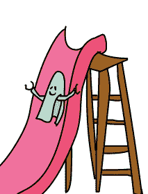

## 尝试一下！

我们使用 `fadeIn` 让不可见的元素可见。但如果你对一个已经可见的元素或位于正在动画的元素之后的元素调用 `fadeIn` 会发生什么呢？
例如，假设你在 `dom.html` 文档的标题之后添加了一个新的 `p` 元素。尝试使用 `slideUp` 和 `slideDown` 来隐藏和显示 h1 元素，看看 `p` 元素发生了什么。如果你使用 `fadeOut` 和 `fadeIn` 呢？如果你在不链式调用的情况下对同一个元素调用 `fadeOut` 和 `fadeIn` 会发生什么？例如：

```javascript
$("h1").fadeOut(1000);
$("h1").fadeIn(1000);
```

尝试将前面的代码放在一个运行五次的 for 循环中。发生了发生了什么？
你认为 jQuery 的 `show` 和 `hide` 方法是做什么的？尝试一下它们看看你的判断是否正确。如何让一个已经可见的元素隐藏后再通过 `fadeIn`？

## 你学到了什么

在本章中，你学习了如何通过操作 DOM 元素使用 JavaScript 更新 HTML 页面。正如你所看到的，jQuery 为我们提供了更强大的方法来选择元素并更改甚至让它们动画。你还学习了一个新的 HTML 属性，允许你为元素指定一个唯一的标识符。
在下一章中，你将学习如何控制 JavaScript 的运行时间——例如，在计时器运行后或点击按钮时。我们还将查看如何在带有延迟的情况下多次运行同一段代码——例如每秒更新一次时钟。

## 编程挑战

尝试这些挑战来练习更多可以使用 jQuery 和 DOM 元素实现的功能。

### #1：使用 jQuery 列出你的朋友（并让他们闻起来有味道！）

创建一个包含几个朋友名字的数组。使用 for 循环为你的每个朋友创建一个 `p` 元素，并使用 jQuery 的 `append` 方法将其添加到 `body` 元素的末尾。使用 jQuery 更改 h1 元素，使其显示 "My" 而不是 "hello world!"。通过 `fadeIn` 方法使用 `hide` 方法，在提供每个名称时将其淡入。

现在，修改你创建的 `p` 元素，在每个朋友后面添加文本 "smells"。提示：如果你使用 `$("p")` 选择 `p` 元素，`append` 方法将应用于所有的 `p` 元素。

### #2：让标题闪烁

你如何使用 `fadeOut` 和 `fadeIn` 让标题闪烁五次，每秒一次？你如何通过 for 循环实现这一点？尝试修改你的循环，让它第一次淡出和淡入花费 1 秒，第二次花费 2 秒，第三次花费 3 秒，以此类推。

### #3：延迟动画

`delay` 方法可以用于延迟动画。使用 `delay`、`fadeOut` 和 `fadeIn`，让你页面上的一个元素淡出并在 5 秒后再次淡入。

### #4：使用 FADETO

尝试使用 `fadeIn` 方法。它的第一个参数是毫秒数，就像所有其他动画方法一样。它的第二个参数是 0 到 1 之间的数字。当你运行以下代码时会发生什么？

```javascript
$("h1").fadeIn(2000, 0.5);
```

你认为第二个参数是什么意思？尝试使用 0 到 1 之间的不同值来弄清楚第二个参数的用途。


## 10 交互式编程

到目前为止，我们网页上的 JavaScript 代码在页面加载后立即运行，只有在包含像 `alert` 或 `confirm` 的函数调用时才会暂停。但我们并不总是希望所有代码在页面加载时立即运行——万如果我们希望某些代码在延迟后运行或响应用户的操作时运行呢？

在本章中，我们将查看修改代码运行的不同方式。这种编程方式被称为交互式编程。这将让我们能够创建随时间变化并响应用户操作的交互式网页。

## 使用 SETTIMEOUT 延迟代码

与其让 JavaScript 立即执行函数，不如你可以告诉它在一段时间后执行函数。像这样延迟函数被称为设置超时（timeout）。在 JavaScript 中设置超时，我们使用 `setTimeout` 函数。该函数接受两个参数（如图 10-1 所示）：在时间通过后要调用的函数以及等待的时间（毫秒）。

在经过指定的毫秒后调用的函数

```
setTimeout(func, timeout)
```

在调用函数之前等待的毫秒数

图 10-1：setTimeout 的参数

下面的列表显示了我们如何使用 `setTimeout` 来播放 alert 对话框。

- var timeUp = function () {
  alert("Time's up!");
};

- setTimeout(timeUp, 3000);

我们创建了函数 `timeUp`，它打开一个显示“Time's up!”文本的 alert 对话框。我们带两个参数调用 `setTimeout`：我们想要调用的函数 (`timeUp`) 和在调用该函数之前等待的毫秒数 (3000)。我们本质上是在说，“等待 3 秒然后调用 timeUp。”第一次调用 `setTimeout(timeUp, 3000)` 时，什么都没有发生，但 3 秒后 `timeUp` 被调用，alert 对话框就会弹出。

注意调用 `setTimeout` 返回 1。这个返回值被称为超时 ID（timeout ID）。超时 ID 是一个用于识别此超时的数字。返回的数字可以是任意，因为它只是一个标识符。再次调用 `setTimeout`，它应该返回一个不同的超时 ID，如下：

```javascript
setTimeout(timeoutUp, 5000);
```

你可以使用这个超时 ID 通过 `clearTimeout` 函数取消该超时。我们将接下来讨论。

## 取消超时

一旦你调用 `setTimeout` 设置了延迟函数调用，你可能会发现你实际上并不想执行该函数。例如，如果你设置了一个闹钟提醒你做作业，如果你提前完成了作业，你就会取消它。要取消该闹钟，请对 `setTimeout` 返回的超时 ID 使用 `clearTimeout`。例如，假设我们创建了一个“做作业”闹钟：


```javascript
var doHomeworkAlarm = function () {
  alert("Hey! You need to do your homework!");
};
```

- var timeoutID = setTimeout(doHomeworkAlarm, 60000);

函数 `doHomeworkAlarm` 弹出一个 alert 对话框提醒你做作业。当我们调用 `setTimeout(doHomeworkAlarm, 60000)` 时，我们是在告诉 JavaScript 在 60,000 毫秒（或 60 秒）后执行该函数。在 ① 我们进行此调用并将超时 ID 保存在新变量 `timeoutID` 中。

```javascript
clearTimeout(timeoutID);
```

现在 `setTimeout` 不再会调用 `doHomeworkAlarm` 函数了。

## 使用 SETINTERVAL 多次调用代码

`setInterval` 函数类似于 `setTimeout`，不同在于它会在固定的停顿（或间隔）后反复调用提供的函数。例如，如果你想使用 JavaScript 更新时钟显示，可以使用 `setInterval` 每秒调用一次更新。你调用 `setInterval` 时需要两个参数：你想要调用的函数以及间隔长度（单位为毫秒），如图 10-2 所示。


图 10-2：setInterval 的参数

以下是我们如何每秒向控制台写入一条消息：

```javascript
var counter = 1;

var printMessage = function () {
  console.log("You have been staring at your console for " + counter + " seconds");
  counter++;
}

var intervalId = setInterval(printMessage, 1000);
```

You have been staring at your console for 1 seconds
You have been staring at your console for 2 seconds
You have been staring at your console for 3 seconds
You have been staring at your console for 4 seconds
You have been staring at your console for 5 seconds
You have been staring at your console for 6 seconds

```javascript
clearInterval(intervalId);
```


我们创建了一个名为 `counter` 的新变量并设置为 1。我们将使用这个变量来跟踪你查看控制台的秒数。我们创建了一个名为 `printMessage` 的函数。这个函数做了两件事：首先，它打印一条消息，告诉你你盯着控制台多久了；然后，它递增 `counter` 变量。

接下来，我们调用 `setInterval`，传入 `printMessage` 函数和数字 `1000`。调用 `setInterval` 意味着“每 1000 毫秒调用一次 `printMessage`”。就像 `setTimeout` 返回超时 ID一样，`setInterval` 返回一个间隔 ID，我们将其保存在变量 `intervalId` 中。我们可以使用这个间隔 ID 告诉 JavaScript 停止执行 `printMessage` 函数。这就是我们所做的，使用 `clearInterval` 函数。


## 动手尝试！

修改前面的示例，使其每五秒打印一次消息而不是每秒一次。

## 使用 SETINTERVAL 制作动画

事实证明，我们可以使用 `setInterval` 在浏览器中制作元素动画。基本上，我们需要创建一个微量移动元素的函数，然后将该函数带有简短的间隔时间传递给 `setInterval`。如果我们让移动足够小且间隔足够短，动画看起来就会非常流畅。

让我们通过在浏览器窗口中水平移动文本来制作 HTML 文档中的文本位置。创建一个名为 `interactive.html` 的文档并用以下 HTML 填充它：

```html
<!DOCTYPE html>
<html>
<head>
  <title>Interactive programming</title>
</head>
<body>
  <h1 id="heading">Hello world!</h1>
  <script src="https://code.jquery.com/jquery-2.1.0.js"></script>
  <script>
    // 我们将在接下来填充这里
  </script>
</body>
</html>
```

现在来看 JavaScript 部分。一如既往，将你的代码放在 HTML 文档的 `<script>` 标签中。

```javascript
var leftOffset = 0;

var moveHeading = function () {
  $("#heading").offset({ left: leftOffset });
  leftOffset++;
  if (leftOffset > 200) {
    leftOffset = 0;
  }
}

setInterval(moveHeading, 30);
```

当你打开此页面时，你应该看到标题元素横跨屏幕，直到移动了 200 像素；在那个点，它将跳回开头并重新开始。让我们看看它是如何工作的。

当我们创建变量 `leftOffset` 时，我们稍后将用它来定位我们的 Hello world!。它的初始值为 0，这意味着标题将从页面的最左侧开始。

接下来，`offset` 方法接收一个对象，该对象可以包含一个 `left` 属性（设置元素的左侧偏移量）或一个 `top` 属性（设置元素的顶部偏移量）。在例例中，我们使用 `left` 属性并将其赋值为我们的 `leftOffset` 变量。如果我们想要一个静态偏移（即不改变的偏移），可以将该属性设置为数值。例如，调用 `$("#heading").offset({left: 100})` 将标题元素放置在页面左侧 100 像素处。

在 `moveHeading` 函数内部，我们将偏移量增加 1。为了不让标题移动得太远，我们检查偏移量是否大于 200，如果是，我们将其重置为 0。最后，调用 `setInterval`，并为参数传入函数 `moveHeading` 和数字 `30`（代表 30 毫秒）。

这段代码每 30 毫秒调用一次 `moveHeading` 函数，或者每秒大约 33 次。每次调用 `moveHeading` 时，`leftOffset` 变量都会递增，并且该变量的值被用于设置标题元素的位置。因为函数被不断调用，且 `leftOffset` 每次都增加 1，所以标题就移动了。

## 动手尝试！

你可以通过缩短时间来加快动画。你看到了什么？

## 响应用户操作

正如你所看到的，控制事件发生的一种方法是使用 `setInterval`。另一种方法是监听用户做了什么。在浏览器中，用户每点击一次，就会触发一个事件。事件是一个对象，保存有有关点击的信息，例如点击的位置。

## 响应点击

当用户点击元素时，jQuery 让我们轻松地添加处理器。打开 `interactive.html`，用以下代码替换其 `<script>` 元素：

```javascript
var handler = function (event) {
  console.log("Click! " + event.pageX + " " + event.pageY);
}

$("h1").click(handler);
```

我们创建了一个带有单个参数 `event` 的函数。当此函数被调用时，`event` 参数将包含点击信息的对象。在处理器函数内部，我们使用 `console.log` 输出对象中的 `pageX` 和 `pageY` 属性。这些属性告诉我们事件的 x 和 y 坐标——换句话说，告诉我们点击发生在页面的位置。

刷新页面

在浏览器中重新加载修改后的页面并点击标题元素。每次你点击标题，控制台都应该输出新的一行，如下所示。每行显示两个数字：点击位置的 x 和 y 坐标。

```
Click! 88 43
Click! 63 53
Click! 24 53
Click! 121 46
Click! 93 55
Click! 103 48
```

## 浏览器坐标

在网络浏览器以及大多数编程和图形环境中，x 和 y 坐标的 0 位置是屏幕的左上角。随着 x 坐标的增加，你向右移动；随着 y 坐标的增加，你向下移动（见图 10-3）。


图 10-3：浏览器中的坐标，显示在坐标 (3, 2) 处的点击

## MOUSEMOVE 事件

mousemove 事件在每次鼠标移动时都会被触发。要尝试一下它，请创建一个名为 `mousemove.html` 的文件并输入以下代码：

```html
<!DOCTYPE html>
<html>
<head>
  <title>Mousemove</title>
</head>
<body>
  <h1 id="heading">Hello world!</h1>
  <script src="https://code.jquery.com/jquery-2.1.0.js"></script>
  <script>
    $("html").mousemove(function (event) {
      $("#heading").offset({
        left: event.pageX,
        top: event.pageY
      });
    });
  </script>
</body>
</html>
```

我们使用 `$("html").mousemove(handler)` 为 mousemove 事件添加了一个处理器（handler）。在这种情况下，处理器是出现在 `mousemove` 之后、`<script>` 标签之前的整个函数。我们使用 `html` 元素是为了让该处理器能够由页面上任何位置发生的鼠标移动而触发。我们传递到 `mousemove` 括号中的函数将在用户每次移动鼠标时被调用。

在这个示例中，我们没有单独创建事件处理器并将函数名传递给 `mousemove` 方法（就像我们之前处理点击处理器函数时做的那样），而是直接将处理器函数传递给 `mousemove` 方法。

这是编写事件处理的一种非常常见的方式，因此熟悉这种语法是有好处。

在事件处理器函数内部，我们选择了标题元素并在其上调用了 `offset` 方法。正如我之前提到的，传递给 `offset` 的对象可以包含 `left` 和 `top` 属性。


在这种情况下，我们将 `left` 属性设置为 `event.pageX`，将 `top` 属性设置为 `event.pageY`。现在，每当鼠标移动时，标题就会移动到那个位置。换句话说，无论你把鼠标移动到哪里，标题都会随之移动！

# 你学到了什么

在本章中，你学习了如何编写只在你需要运行时运行的 JavaScript 代码。`setTimeout` 和 `setInterval` 函数非常适合用于在延迟后或特定间隔运行定时代码。如果你想在用户在浏览器中执行某些操作时运行代码，可以使用像 `click` 和 `mousemove` 这样的事件，还有许多其他事件。

在下一章中，我们将把所学的知识用来制作一个游戏！


## #3：点击取消动画

在挑战 #2 的基础上，为移动的 h1 元素添加一个点击处理器，以取消动画。提示：你可以使用 `clearInterval` 函数取消间隔器。

## #4：制作一个“点击标题”的游戏！

修改挑战 #3，使得当玩家每次点击标题时，标题不是停止，而是加速，这使得点击变得越来越困难。跟踪标题被点击的次数，并更新标题文本以显示该数字。当玩家达到 10 次点击时，停止动画并将标题文本改为“You Win（你赢了）”。提示：要加速，你必须取消当前的间隔器，然后启动一个间隔更短的新间隔器。


# 寻找埋藏的宝藏！

让我们充分利用目前所学的知识创建一个游戏吧！这个游戏的目标是寻找隐藏的宝藏。在游戏中，网页将显示一张宝藏地图。在地图内部，程序将选择一个像素位置，代表宝藏埋藏的地方。玩家每次点击地图时，网页都会告诉他们离宝藏有多远。当他们点击宝藏所在地（或非常接近那里）时，游戏将祝贺他们找到宝藏，并说明花了多少次点击找到。图 11-1 显示了玩家点击地图后游戏的样子。


# 埋藏的宝藏！

图 11-1：寻宝游戏

# 设计游戏

在开始编写代码之前，让我们分解游戏的整体结构。以下是设置游戏需要采取的步骤，以便在玩家点击宝藏地图时做出响应。

1. 创建一个包含图像（宝藏地图）和向玩家显示消息区域的网页。
2. 在地图图片上随机选择一个点来隐藏宝藏。
3. 创建一个点击处理器。当玩家每次点击地图时，点击处理器将执行以下操作：
   a. 点击计数器加 1。
   b. 计算点击位置与宝藏位置的距离。
   c. 在网页上显示消息，告诉玩家他们是接近（hot）还是很远（cold）。
   d. 如果玩家点击的位置非常接近宝藏，则祝贺玩家，并说明找到它花了多少次点击。

这个点击处理函数需要完成大量工作：它必须增加点击计数器、计算每次点击距离宝藏有多远，并显示消息。在我们填充点击处理函数的代码之前，将将先定义一些变量并创建一些其他函数，以帮助执行所有这些步骤。

## 计数点击

我们的点击处理器需要做的第一件事是跟踪总点击数。为了设置这一点，我们在程序开始处（点击处理器之外）创建一个名为 `clicks` 的变量，并将其初始化为零：

```javascript
var clicks = 0;
```

在点击处理器内部，我们将包含 `clicks++`，这样每次玩家点击地图时，`clicks` 都会加1。

## 计算点击与宝藏之间的距离

为了判断玩家是“热”还是“冷”（靠近宝藏还是远离它），我们需要测量玩家点击位置与隐藏宝藏位置之间的距离。为此，我们将编写一个名为 `getDistance` 的函数，如下：

```javascript
var getDistance = function (event, target) {
  var diffX = event.offsetX - target.x;
  var diffY = event.offsetY - target.y;
  return Math.sqrt((diffX * diffX) + (diffY * diffY));
};
```

`getDistance` 函数接收两个对象作为参数：`event` 和 `target`。`event` 对象是传递给点击处理器的对象，包含了关于玩家点击的内置信息。特别是，它包含两个名为 `offsetX` 和 `offsetY` 的属性，告诉我们点击的 x 和 y 坐标，这正是我们需要的信息。

在函数内部，变量 `diffX` 存储了点击位置与目标之间的水平距离，我们通过从 `event.offsetX`（点击的 x 坐标）减去 `target.x`（目标的 x 坐标）来计算它。我们以同样的方式计算点之间的垂直距离，并将结果存储为 `diffY`。图 11-2 显示了我们如何为两个点计算 `diffX` 和 `diffY`。


## 使用勾股定理

接下来，`getDistance` 函数使用勾股定理来计算两点之间的距离。勾股定理指出，对于直角三角形，$a$ 和 $b$ 代表边界直角的两条边，$c$ 代表对角线边（斜边）的长度，$a^2 + b^2 = c^2$。给定 $a$ 和 $b$ 长度的情况下，我们可以通过计算 $a^2 + b^2$ 的平方根来计算斜边的长度。

为了计算 `event` 和 `target` 之间的距离，我们将这两个点看作直角三角形的一部分，如图 11-3 所示。在 `getDistance` 函数中，`diffX` 是三角形水平边的长度，而 `diffY` 是垂直边的长度。

为了计算点击与宝藏之间的距离，我们需要根据 `diffX` 和 `diffY` 的长度来计算斜边的长度。图 11-3 显示了一个示例计算。


图 11-3：计算斜边以找到 event 和 target 之间的距离

为了得到斜边的长度，我们首先必须对 `diffX` 和 `diffY` 进行平方。然后我们将这些平方值相加，并使用 JavaScript 函数 `Math.sqrt` 获取平方根。因此，我们计算点击与目标之间距离的完整公式看起来像：

```javascript
Math.sqrt((diffX * diffX) + (diffY * diffY))
```

`getDistance` 函数计算此值并返回结果。

## 告诉玩家他们离有多近

一旦我们知道了玩家点击与宝藏之间的距离，我们就想显示一个提示，告诉玩家他们离宝藏有多近，而不直接告诉他们宝藏具体有多远。为此，我们使用这里显示的 `getDistanceHint` 函数：

```javascript
var getDistanceHint = function (distance) {
  if (distance < 10) {
    return "Boiling hot!";
  } else if (distance < 20) {
    return "Really hot";
  } else if (distance < 40) {
    return "Hot";
  } else if (distance < 80) {
    return "Warm";
  } else if (distance < 160) {
    return "Cold";
  } else if (distance < 320) {
    return "Really cold";
  } else {
    return "Freezing!";
  }
};
```


该函数根据与宝藏的计算距离返回不同的字符串。如果距离小于 10，函数返回字符串 "Boiling hot!"。如果距离在 10 到 20 之间，函数返回 "Really hot"。随着距离的增加，字符串变得冷，直到我们

## 检查玩家是否胜利

最后，我们的点击处理器需要检查玩家是否获胜。因为像素很小，我们不会让玩家精确点击宝藏的位置，而是让他们在点击 8 像素范围内时即可获胜。

## 整合在一起

现在我们已经有了所有的部分，让我们把它们组合成一个脚本。

```javascript
// 获取从 0 到 size 的随机数
var getRandomNumber = function (size) {
  return Math.floor(Math.random() * size);
};

// 计算 event 和 target 之间的距离
var getDistance = function (event, target) {
  var diffX = event.offsetX - target.x;
  var diffY = event.offsetY - target.y;
  return Math.sqrt((diffX * diffX) + (diffY * diffY));
};

// 获取表示距离的字符串
var getDistanceHint = function (distance) {
  if (distance < 10) {
    return "Boiling hot!";
  } else if (distance < 20) {
    return "Really hot";
```


```javascript
} else if (distance < 40) {
    return "Hot";
} else if (distance < 80) {
    return "Warm";
} else if (distance < 160) {
    return "Cold";
} else if (distance < 320) {
    return "Really cold";
} else {
    return "Freezing!";
}
};

// 设置我们的变量
var width = 400;
var height = 400;
var clicks = 0;

// 创建随机目标位置
var target = {
    x: getRandomNumber(width),
    y: getRandomNumber(height)
};

// 为 img 元素添加点击处理器
$("#map").click(function (event) {
    clicks++;
    // 获取点击事件和目标之间的距离
    var distance = getDistance(event, target);
    // 将距离转换为提示
    var distanceHint = getDistanceHint(distance);
    // 更新 #distance 元素的新提示
    $("#distance").text(distanceHint);
    // 如果点击足够近，告诉他们他们胜了
    if (distance < 8) {
        alert("Found the treasure in " + clicks + " clicks!");
    }
});
```

首先，我们有了三个函数 `getRandomNumber`、`getDistance` 和 `getDistanceHint`，我们已经看过了它们。然后，我们设置我们需要的变量：宽度（`width`）、高度（`height`）、点击次数（`clicks`）。之后，在 2 处我们为宝藏创建一个随机位置。

在 3 处，我们在地图元素上创建一个点击处理器。它的第一件事是将 `clicks` 变量加 1。然后，在 4 处，它计算事件（点击位置）与目标（宝藏位置）之间的距离。在 5 处，我们使用 `getDistanceHint` 函数将此距离转换为表示距离的字符串（如“冷”、“暖”等）。我们在 6 处更新显示，让用户看到他们离目标还有多远。最后，在 7 处我们检查距离是否小于 8，如果是，我们就告诉玩家赢了，以及花了多少次点击。

这就是我们游戏的全部 JavaScript 代码。如果你将其添加到 `treasure.html` 中的第二个 `<script>` 标签中，你就可以在浏览器中运行它了！你花了多少次点击找到宝藏？

## 你学到了什么

在本章中，你利用新的事件处理技能创建了一个游戏。你还学习了 `` 元素，它可以用于向网页中添加图像。最后，你学习了如何使用 JavaScript 测量两点之间的距离。

在下一章中，我们将学习面向对象编程，它将为我们提供更多工具来组织代码。

## 编程挑战

这里是你可以修改游戏并添加更多功能的几种方法。

### #1：增大游戏区域

你可以通过增加游戏区域的大小让游戏变得更难。你会如何让它宽 800 像素、高 800 像素呢？

### #2：添加更多消息

尝试向玩家添加一些额外的显示消息（例如“真的非常冷！”），并根据自己的喜好修改距离判断标准。

### #3：添加点击限制

为点击次数添加限制，如果玩家超过此限制，则显示“GAME OVER”（游戏结束）。

### #4：显示剩余点击次数

在距离显示之后额外显示一段剩余点击次数的文本，让玩家知道他们即将输了。


## 12 面向对象编程

第 4 章讨论了 JavaScript 对象——键值对的集合。在本章中，将在探索面向对象编程的过程中，学习创建和使用对象的方法。面向对象编程是一种设计和编写程序的方法，使得程序的所有重要部分都由对象表示。例如，在构建赛车游戏时，你可以使用面向对象编程技术将每辆汽车表示为一个对象，然后创建多个共享相同属性和功能的汽车对象。

### 简单对象

在第 4 章中，你学习了对象由属性组成，属性简单来说键值对。例如，下面的代码对象表示了一个具有 `name`（名字）、`legs`（腿）和 `isAwesome`（酷）属性的狗：

```javascript
var dog = {
  name: "Pancake",
  legs: 4,
  isAwesome: true
};
```

一旦创建了对象，我们就可以使用点符号法访问其属性（在第 66 页的“访问对象值”中讨论过）。例如，这里是访问狗对象 `name` 属性的方法：

```javascript
dog.name;
// "Pancake"
```

我们还可以使用点符号法向 JavaScript 对象添加属性，如下所示：

```javascript
dog.age = 6;
```

这为对象添加了一个新的键值对（`age: 6`），如下所示：

```javascript
dog;
// Object {name: "Pancake", legs: 4, isAwesome: true, age: 6}
```

#### 为对象添加方法

在之前的示例中，我们创建了几个保存了不同类型值的属性：一个字符串（`"Pancake"`）、数字（`4` 和 `6`）以及一个布尔值（`true`）。除了字符串、数字和布尔值外，你还可以将函数保存为对象内部的属性。当你将函数保存为对象的某个属性时，该属性被称为方法。事实上，我们已经使用过几个内置的 JavaScript 方法，例如数组的 `join` 方法和字符串的 `toUpperCase` 方法。

现在让我们看看如何创建自己的方法。向对象添加方法的一种方法是使用点符号法。例如，我们可以这样给 `dog` 对象添加一个 `bark` 方法：

```javascript
dog.bark = function () {
  console.log("Woof woof! My name is " + this.name + "!");
};

dog.bark();
// Woof! My name is Pancake
```

> 我们在 `dog` 对象中添加了一个名为 `bark` 的属性，并为其分配了一个函数。在函数内部，我们使用 `console.log` 打印“Woof! My name is Pancake!”。注意该函数使用了 `this.name`，它获取存储在对象 `name` 属性中的值。让我们仔细看看这个关键字是如何工作的。

#### 使用 `this` 关键字

你可以在方法内部使用 `this` 关键字来引用当前调用方法的对象。例如，当你在 `dog` 对象上调用 `bark` 方法时，`this` 就指向 `dog`。

#### 在多个对象之间共享方法

让我们创建一个可以使用的新函数：

```javascript
var speak = function () {
  console.log(this.sound + " " + this.name + "!");
};
```

现在，我们将此函数赋值给我们的对象：

```javascript
var cat = {
  sound: "Miaow",
  name: "Mittens",
  speak: speak
};

var pig = {
  sound: "Oink",
  name: "Charlie",
  speak: speak
};

var horse = {
  sound: "Neigh",
  name: "Marie",
  speak: speak
};
```

现在，我们可以在每个对象上调用方法：

```javascript
cat.speak();
// Miaow! Mittens!

pig.speak();
// Oink! Charlie!

horse.speak();
// Neigh! Marie!
```

> 等等，`this` 指向当前调用方法的对象。

### 使用构造函数创建对象

JavaScript 构造函数是一个创建对象并赋予它们一组内置属性和方法的函数。将其想象成创建对象的特殊机器，就像一个可以生产大量相同物品的工厂。一旦你设置了构造函数，就可以使用它来制作任意数量的相同对象。为了尝试一下，我们将构建赛车游戏的开端，使用 `Car` 构造函数来创建一个具有转向和加速基础属性方法的车队。

#### 构造函数的结构分析

每当你调用构造函数时，它都会创建一个对象并赋予新对象内置属性。要调用普通函数，你输入函数名后跟一对括号。要调用构造函数，你输入 `new` 关键字（这告诉 JavaScript 你想将你的函数作为构造函数使用），随后是构造函数名和括号。图 12-1 显示了调用构造函数的语法。

```javascript
var car = new Car(100, 200);
// 新对象被保存到此变量中  传递给构造函数的参数  构造函数的名称
```

图 12-1：调用带有两个参数的 Car 构造函数的语法

> **注意**  
> 大多数 JavaScript 程序员以大写字母开头构造函数名称，这样一眼就能看出它们与其他函数不同。

#### 创建汽车构造函数

现在，让我们创建一个 `Car` 构造函数，它将为所创建的每个对象添加 `x` 和 `y` 属性。这些属性将用于在我们绘制汽车时设置每辆汽车在屏幕上的位置。

#### 创建 HTML 文档

在构建构造函数之前，我们需要创建一个新的 HTML 文档。创建一个名为 `cars.html` 的新文件并将 HTML 内容输入其中：

```html
<!DOCTYPE html>
<html>
<head>
  <title>Cars</title>
</head>
<body>
  <script src="https://code.jquery.com/jquery-2.1.0.js"></script>
  <script>
    // 代码写在这里
  </script>
</body>
</html>
```

#### 汽车构造函数函数

现在将此代码添加到 `cars.html` 中空的 `<script>` 标签中（替换注释 `// Code goes here`），以创建 `Car` 构造函数，为每辆汽车提供一组坐标。

```javascript
var Car = function (x, y) {
  this.x = x;
  this.y = y;
};
```

我们新的构造函数 `Car` 接收参数 `x` 和 `y`。我们在新对象中添加了传递给 `Car` 的属性 `this.x` 和 `this.y` 的值。这样，每当我们像构造函数一样调用 `Car` 时，就会被创建一个新对象，其 `x` 和 `y` 属性将被设置为我们指定的参数。

#### 调用汽车构造函数

正如我之前提到的，`new` 关键字告诉 JavaScript 我们正在调用一个构造函数来创建一个新对象。例如，要创建一个名为 `tesla` 的汽车对象，请在浏览器中打开 `cars.html`，然后在 Chrome JavaScript 控制台中输入以下代码：

```javascript
tesla = new Car(10, 20);
tesla;
// Car {x: 10, y: 20}
```

`Car(10, 20)` 告诉 JavaScript 使用 `Car` 作为构造函数创建一个对象，并将参数 10 和 20 传递给它的 `x` 和 `y` 属性，然后返回该对象。我们使用 `var tesla` 将返回的对象赋值给变量 `tesla`。

然后当我们输入 `tesla` 时，Chrome 控制台会返回构造函数的名称及其 `x` 和 `y` 的值：`Car {x: 10, y: 20}`。


#### 绘制汽车

为了显示由 `Car` 构造函数创建的对象，我们将创建一个名为 `drawCar` 的函数，将汽车图像放置在浏览器窗口中每个汽车对象的 (x, y) 位置。一旦我们看到此函数起作用，我们将在“在 Car 原型上添加 draw 方法”中以一种更面向对象的方式重新重写它。在 `car.html` 的 `<script>` 标签之间添加此代码：

```javascript
var Car = function (x, y) {
  this.x = x;
  this.y = y;
};

function drawCar(car) {
  var carHtml = '';
  var carElement = $(carHtml);
  carElement.css({
    position: "absolute",
    left: car.x,
    top: car.y
  });
  $("body").append(carElement);
}
```

正如我们创建一个包含 HTML 的字符串，该字符串指向汽车图像。（使用单引号来创建此字符串允许我们在 HTML 中使用双引号。）当我们将 `carHtml` 传递给 `$` 函数时，它将其从字符串转换为 jQuery 元素。这意味着 `carElement` 变量现在持有一个带有 `` 标签信息的 jQuery 元素，我们可以在将其添加到页面之前对该元素进行调整。

在 `carElement` 上使用 `css` 方法来设置汽车图像的位置。这段代码将图像的左侧位置设置为汽车对象的 `x` 值，将顶部位置设置为 `y` 值。换句话说，图像的左边缘将距离浏览器窗口左边缘 `x` 像素，图像的顶部边缘将距离窗口顶部 `y` 像素。

在这个例子中，`css` 方法的作用原理与第 10 章中用于移动页面上元素的 `offset` 方法类似。遗憾的是，`offset` 在处理多个元素时效果并不好，由于我们要绘制多辆汽车，因此我们在这里使用了 `css`。


最后，当我们使用 jQuery 将 `carElement` 添加到网页的 `body` 元素时。这最后一步使得 `carElement` 出现在页面上。（有关 `append` 如何工作的提醒，请参见第 150 页的“使用 jQuery 创建新元素”）。

#### 测试 drawCar 函数

让我们测试 `drawCar` 函数以确保它工作正常。将此代码添加到你的 `cars.html` 文件中（其他 JavaScript 代码之后）以创建两辆汽车。

```javascript
var tesla = new Car(20, 20);
var nissan = new Car(100, 200);
drawCar(tesla);
drawCar(nissan);
```

在这里，我们使用构造函数创建了两辆汽车。现在当我们打开 `cars.html` 时，结果应该看起来像图 12-2。

### 使用原型自定义对象

更面向对象的绘制方式是给每个对象提供一个方法。JavaScript 原型使得在对象之间共享功能变得简单。

#### 在 Car 原型上添加 draw 方法

让我们为 `Car.prototype` 添加一个 `draw` 方法，以便由 `Car` 创建的所有对象都拥有它。通过另存为，将你的 `cars.html` 保存为 `car2.html` 并带有此代码：

```javascript
var Car = function (x, y) {
  this.x = x;
  this.y = y;
};

Car.prototype.draw = function () {
  var carHtml = '';
  this.carElement = $(carHtml);
  this.carElement.css({
    position: "absolute",
    left: this.x,
    top: this.y
  });
  $("body").append(this.carElement);
};

var tesla = new Car(20, 20);
var nissan = new Car(100, 200);
tesla.draw();
nissan.draw();
```

在 ❶ 处创建构造函数后，我们在 ❷ 处为 `Car.prototype` 添加了一个名为 `draw` 的新方法。这使得 `draw` 方法成为由 `Car` 创建的所有对象的一部分。

`draw` 方法的内容是我们函数的修改版本。首先，我们创建一个 HTML 字符串并将其保存为 `carHtml`。⓷ 处创建一个表示此 HTML 的 jQuery 元素，但通过赋值给 `this.carElement` 将其保存为对象的属性。然后在 ❹ 处我们使用 `this.x` 和 `this.y` 设置汽车图像左上角的坐标。（在构造函数内部，`this` 指向正在创建的对象）。

#### 添加向右方法

现在让我们添加一些方法来移动汽车，首先添加一个 `moveRight` 方法，将汽车向其当前位置右移动 5 像素。在定义 `Car.prototype.draw` 之后添加以下代码：

```javascript
Car.prototype.moveRight = function () {
  this.x += 5;
  this.carElement.css({
    left: this.x,
    top: this.y
  });
};
```


我们将 `moveRight` 方法保存在 `Car.prototype` 中，以便与所有由 `Car` 构造函数创建的对象共享。通过 `this.x += 5`，我们将汽车的 x 值增加 5，这使汽车向右移动 5 像素。然后，我们使用 `this.element` 的 `css` 方法来更新浏览器中的汽车位置。

在浏览器控制台中尝试 `moveRight` 方法。首先，刷新 `cars2.html`，然后打开控制台并输入这些行：

```
tesla.moveRight();
tesla.moveRight();
tesla.moveRight();
```

每次你输入 `tesla.moveRight`，顶部的汽车就应该向右移动 5 像素。你可以在赛车游戏中使用这个方法来显示汽车在赛道上移动。

# 试试看！

尝试让 `nissan` 向右移动。你需要对 `nissan` 调用多少次 `moveRight` 才能让它与 `tesla` 对齐？
使用 `setInterval` 和 `moveRight` 让 `nissan` 动起来，使其横穿整个浏览器窗口。

# 添加左、上、下移动方法

现在我们将向代码添加剩余的方向，以便我们可以在屏幕上向任何方向移动汽车。这些方法基本上与 `moveRight` 相同，所以我们将一次性写完。

在 `cars2.html` 中 `moveRight` 的代码之后添加以下方法：

```
Car.prototype.moveRight = function () {
  this.x += 5;
  this.element.css({
    left: this.x,
    top: this.y
  });
};
```

```
Car.prototype.moveLeft = function () {
  this.x -= 5;
  this.carElement.css({
    left: this.x,
    top: this.y
  });
};
```

```
Car.prototype.moveUp = function () {
  this.y -= 5;
  this.carElement.css({
    left: this.x,
    top: this.y
  });
};
```

```
Car.prototype.moveDown = function () {
  this.y += 5;
  this.carElement.css({
    left: this.x,
    top: this.y
  });
};
```

这些方法都通过向每辆汽车的 x 或 y 值加或减 5，在指定的方向上移动汽车 5 像素。


# 你学到了什么

在本章中，你学习了 JavaScript 面向对象编程的基础，包括如何创建构造函数来构建新对象，以及如何修改这些构造函数的原型属性以在对象之间共享方法。

在面向对象的程序中，大多数函数都被写成方法。例如，为了画汽车，我们调用汽车的 `draw` 方法；为了让汽车向右移动，我们调用 `move` 方法。构造函数和原型是 JavaScript 允许你创建共享相同方法对象的内置方式，但编写面向对象 JavaScript 的方法有很多种。（关于面向对象 JavaScript 的更多信息，请参见 Nicholas C. Zakas 的《Principles of Object-Oriented JavaScript》[No Starch Press, 2014]）

以面向对象的方式编写 JavaScript 可以帮助你组织代码。结构良好的代码意味着当你回来进行修改时，即使你不记得了，也更容易理解程序是如何运行的（这对于大型程序或当你开始与其他可能需要访问你代码的程序员合作时尤为重要）。例如，在书的最后一个项目中，我们将构建一个需要大量代码的贪蛇游戏，并将使用对象和方法来组织游戏并处理许多重要功能。

在下一章中，我们将介绍如何使用 `canvas` 元素在网页上绘制和动画线条及形状。

# 编程挑战

尝试这些挑战来练习对象和原型的使用。

## #1：在汽车构造函数中画图

在汽车构造函数内部添加对 `draw` 方法的调用，以便汽车对象在你创建它们时就能自动出现在浏览器中。

（续）

## #2：添加速度属性

修改 `Car` 构造函数，为构造的对象添加一个值为 5 的新 `speed` 属性。然后在移动方法内部用该属性代替值 5。

现在尝试不同的 `speed` 值，让汽车移动得更快或更慢。

## #3：赛车比赛

修改 `moveLeft`、`moveRight`、`moveUp` 和 `moveDown` 方法，让它们接收单个距离参数（要移动的像素数），而不是总是移动 5 像素。例如，要让 `nissan` 向右移动 10 像素，你需要调用 `nissan.moveRight(10)`。

现在，使用 `setInterval` 每 30 毫秒让两辆汽车（`nissan` 和 `tesla`）向右移动，距离为 0 到 5 之间的随机距离。你应该看到两辆汽车在屏幕上移动，以不同的速度跳跃。你能猜到哪辆汽车会先到达窗口边缘吗？

# 第三部分 CANVAS


# #13 CANVAS 元素

JavaScript 不仅仅关于文本和数字。你还可以使用 JavaScript 通过 HTML 元素绘制图片，你可以将该元素想象成一块画布或一张纸。你可以在画布上绘制几乎任何东西。

在本章中，你将学习在画布上绘制的基础知识。在接下来的章节中，我们将使用画布构建一个游戏。

## 创建基础画布

首先，使用 canvas 创建一个新的 HTML 文档，如下：

```html
<!DOCTYPE html>
<html>
<head>
  <title>Canvas</title>
</head>
<body>
  <canvas id="canvas" width="200" height="200"></canvas>
  <script>
    // 在这里编写代码
  </script>
</body>
</html>
```

正如你所看到的，我们设置了画布的宽度和高度。

## 在画布上绘制

现在，让我们使用 JavaScript 在画布上绘制图形。

```javascript
var canvas = document.getElementById("canvas");
var ctx = canvas.getContext("2d");
```

`ctx` 变量是画布的 2D 上下文，可以使用它来绘制：

```javascript
ctx.fillRect(0, 0, 50, 50);
```

上面的 `fillRect` 方法在坐标 (0,0) 处绘制了一个宽 50 像素、高 50 像素的实心矩形。

## 获取上下文

为了在画布上绘图，我们需要获取上下文。

```javascript
var canvas = document.getElementById("canvas");
var ctx = canvas.getContext("2d");
```

`ctx` 变量是画布的 2D 上下文，可以使用它来绘制：

```javascript
ctx.fillRect(0, 0, 50, 50);
```

上面的 `fillRect` 方法在坐标 (0,0) 处绘制了一个宽 50 像素、高 50 像素的实心矩形。

## 选择元素

为了在画布上绘图，我们需要选择画布元素。

```javascript
var canvas = document.getElementById("canvas");
var ctx = canvas.getContext("2d");
```

`ctx` 变量是画布的 2D 上下文，可以使用它来绘制：

```javascript
ctx.fillRect(0, 0, 50, 50);
```

上面的 `fillRect` 方法在坐标 (0,0) 处绘制了一个宽 50 像素、高 50 像素的实心矩形。

## 绘制线条

在画布上绘制线条，我们需要先定义路径。

```javascript
ctx.beginPath();
ctx.moveTo(0, 0);
ctx.lineTo(100, 100);
ctx.stroke();
```

`moveTo` 方法指定路径的起点，`lineTo` 方法指定路径的终点。最后，使用 `stroke` 方法画出这些线条。

## 绘制圆形

在画布上绘制圆形，我们需要使用 `arc` 方法。

```javascript
ctx.beginPath();
ctx.arc(95, 50, 40, 0, 2 * Math.PI);
ctx.stroke();
```

`arc` 方法接收五个参数：圆心的 x、y 坐标、半径、起始角度和结束角度（弧）。`Math.PI * 2` 表示一个完整的圆。

## 绘制文本

在画布上绘制文本，我们需要使用 `fillText` 方法。

```javascript
ctx.font = "30px Arial";
ctx.fillText("Hello World", 10, 50);
```

`font` 属性设置字体样式，`fillText` 在指定位置绘制文本。

## 绘制图像

在画布上绘制图像，我们需要使用 `Image` 对象。

```javascript
var img = new Image();
img.src = "image.png";
img.onload = function() {
  ctx.drawImage(img, 10, 20);
};
```

我们创建一个 `Image` 对象，设置其源，并在图像加载完成后使用 `drawImage` 将其绘制。

但正方形的大小仍然是 10 像素乘以 10 像素（因为我们没有更改宽度高度参数）。这是图 13-2 中下面的第二个正方形。

由于 `i` 在每次循环中增加 1，`x` 和 `y` 坐标每次循环都会增加 10 像素，但正方形的宽度和高度保持为 10。剩余的六个正将在循环的剩余六次中绘制。

## 尝试一下！

现在你已经学会了如何在画布上绘制正方形和矩形，请尝试使用 `fillRect` 方法绘制这个小机器人。提示：你需要绘制六个独立的矩形。我用一个 50 像素乘以 50 像素的矩形画了头部。脖子、手臂和腿宽均为 10 像素。


## 改变绘制颜色

默认情况下，当你调用 `fillRect` 时，JavaScript 会绘制一个黑色矩形。要使用不同的颜色，你可以更改绘图上下文的 `fillStyle` 属性。当你将 `fillStyle` 设置为新颜色时，绘制的所有内容都将以该颜色绘制，直到再次更改 `fillStyle` 为止。

设置 `fillStyle` 颜色的简单方法是给它一个字符串颜色名称。例如：

```
var canvas = document.getElementById("canvas");
var ctx = canvas.getContext("2d");
ctx.fillStyle = "Red";
ctx.fillRect(0, 0, 100, 100);
```

我们告诉绘图上下文，从现在开始绘制的所有内容都应该是红色。运行这段代码应该会在屏幕上画一个亮红色的正方形，如图 13-3 所示。


JavaScript 理解超过 100 种颜色名称，包括 Green（绿）、Blue（蓝）、Orange（橙）、Red（红）、Yellow（黄）、Purple（紫）、White（白）、Black（黑）、Pink（粉）、Turquoise（青松绿）、Violet（紫罗兰）、SkyBlue（天蓝）、PaleGreen（浅绿）、Lime（石绿）、Fuchsia（洋红）、DeepPink（深粉）、Cyan（青）和 Chocolate（巧克力）。你可以在 CSS-Tricks 网站找到完整列表：http://css-tricks.com/snippets/css/named-colors-and-hex-equivalents/


> 尝试一下！
> 查看 CSS-Tricks 网站（http://css-tricks.com/snippets/css/named-colors-and-hex-equivalents/）并选择你喜欢的颜色。使用这些颜色绘制三个矩形。每个矩形应该是 50 像素宽、100 像素高。它们之间不要留任何空格。你最终应该得到像这样的效果：
>
> ……尽管我确定你可以找到比红、绿、蓝更有趣的颜色！

## 绘制矩形轮廓

正如我们看到的，`fillRect` 方法绘制一个填充的矩形。如果你需要这样，那没问题，但有时你可能只想绘制轮廓，就像用笔或铅笔一样。要只绘制矩形的轮廓，我们使用 `strokeRect` 方法。（`stroke` 一词是轮廓的另一个表达方式。）例如，运行这段代码会绘制一个小矩形的轮廓，如图 13-4 所示：

```
var canvas = document.getElementById("canvas");
var ctx = canvas.getContext("2d");
ctx.strokeRect(10, 10, 100, 20);
```


图 13-4：使用 strokeRect 绘制矩形轮廓

`strokeRect` 方法所接受的参数与 `fillRect` 相同：首先是左上角的 `x` 和 `y` 坐标，然后是矩形的宽度和高度。在这个示例中，我们看到矩形是从画布左上角 10 像素处开始绘制的，宽度为 100 像素，高度为 20 像素。

使用 `strokeStyle` 属性更改矩形轮廓的颜色。要更改线条的粗细，使用 `lineWidth` 属性。例如：

```
var canvas = document.getElementById("canvas");
var ctx = canvas.getContext("2d");
ctx.strokeStyle = "DeepPink";
ctx.lineWidth = 4;
ctx.strokeRect(10, 10, 100, 20);
```

在这里，我们在 ① 处将线条颜色设置为 DeepPink，在 ② 处将线宽设置为 4 像素。图 13-5 显示了结果矩形。


## 绘制线条或路径

画布上的线条被称为*路径*（paths）。使用画布绘制路径，你使用 `x` 和 `y` 坐标来设置每条线的起点和终点。通过仔细组合起始坐标和停止坐标，你可以在画布上绘制特定的形状。例如，这里是你可能如何绘制图 13-6 中的青松绿 X：

```
var canvas = document.getElementById("canvas");
var ctx = canvas.getContext("2d");
ctx.strokeStyle = "Turquoise";
ctx.lineWidth = 4;
ctx.beginPath();
ctx.moveTo(10, 10);
ctx.lineTo(60, 60);
ctx.moveTo(60, 10);
ctx.lineTo(10, 60);
ctx.stroke();
```


在 ① 和 ② 我们设置线条的颜色和宽度。在 ③ 我们在绘图上下文调用 `beginPath` 方法，告诉画布我们要开始一条新路径。在 ④ 我们调用带有两个参数的 `moveTo` 方法：`moveTo` 会将虚拟笔离开画布并移动到这些坐标而不绘制线条。为了开始绘制线条，我们在 `x` 和 `y` 坐标处调用 `lineTo` 方法，将虚拟笔放回画布并追踪到这些新坐标。在这里，我们从 (10, 10) 点画到 (60, 60) 点——从画布左上到右下的斜线，形成了 X 的第一条线。我们再次调用 `moveTo`，设置一个新的绘制位置。我们再次调用 `lineTo`，从 (60, 10) 到 (10, 60)——从画布右上到左下的斜线，完成了 X 形状。但我们还没有完成！为止我们只告诉了画布画什么，并没有实际绘制任何东西。所以调用 `stroke` 方法，线条终于出现在屏幕上。


## 尝试一下！

> 使用 `beginPath`、`moveTo` 和 `stroke` 方法绘制这个火人。使用 `beginPath`、`lineTo` 和 `stroke` 方法绘制这个火人。你可以使用 `strokeRect` 方法绘制头部。头部是一个 20 像素乘以20 像素的正方形，线宽为 4 像素。

## 填充路径

为止，我们查看了绘制矩形轮廓的 `strokeRect`、用于填充矩形的 `fillRect` 以及用于路径轮廓的 `stroke`。路径的 `fillRect` 等效物是 `fill`。要填充一个闭合路径而不是仅仅绘制轮廓，可以使用 `fill` 方法代替 `stroke`。例如，你可以使用这段代码绘制图 13-7 中的蓝色房子。

```
var canvas = document.getElementById("canvas");
var ctx = canvas.getContext("2d");
```

```
ctx.fillStyle = "SkyBlue";
```


```javascript
ctx.beginPath();
ctx.moveTo(100, 100);
ctx.lineTo(100, 60);
ctx.lineTo(130, 30);
ctx.lineTo(160, 60);
ctx.lineTo(160, 100);
ctx.lineTo(100, 100);
ctx.fill();
```


图 13-7：用路径绘制并用 fill 方法填充的浅蓝色房子

这是这段代码的工作原理。在将绘制颜色设置为 SkyBlue 后，我们使用 `beginPath()` 开始路径，并使用 `moveTo()` 移动到起点 (100, 100)。接下来，我们为房子的每个角调用了五次 `lineTo()`，使用五组坐标。最后一次调用 `lineTo()` 通过返回起点 (100, 100) 完成路径。

图 13-8 显示了同一个房子，但每个坐标都标记了标签。


图 13-8：带有坐标标记的图 13-7 中的房子

最后，我们调用 `fill()` 方法，用选定的填充颜色 SkyBlue 填充我们的路径。

## 绘制弧和圆

除了在画布上绘制直线外，你还可以使用 `arc()` 方法绘制弧和圆。要绘制圆，你设置圆的中心坐标和半径（圆心到边缘的距离），并通过提供起始角度和结束角度作为参数告诉 JavaScript 要绘制圆的几部分。你可以绘制一个完整的圆，也可以只绘制圆的一部分来创建一个弧。

起始和结束角度以弧度为单位。用弧度测量时，一个完整的圆从 0（圆的右侧）开始到 π × 2 弧度。要绘制完整的圆，你告诉 `arc()` 从 0 弧度到 π × 2 弧度。图 13-9 显示了一个标记有弧度及其等效度的圆。360° 和 π × 2 弧度意味着一个完整的圆。


图 13-9：角度和弧度，从圆的右侧开始并顺时针移动

例如，接下来的代码将创建一个四分之一圆、一个半圆和一个完整圆，如图 13-10 所示。

```javascript
ctx.lineWidth = 2;
ctx.strokeStyle = "Green";
ctx.beginPath();
ctx.arc(50, 50, 20, 0, Math.PI / 2, false);
ctx.stroke();
```

```javascript
ctx.beginPath();
ctx.arc(100, 50, 20, 0, Math.PI, false);
ctx.stroke();
ctx.beginPath();
ctx.arc(150, 50, 20, 0, Math.PI * 2, false);
ctx.stroke();
```


我们将在接下来的章节中介绍这三种形状。

### 绘制四分之一圆或弧

第一块代码绘制了一个四分之一圆。在 `arc()` 中，调用 `beginPath()` 之后，我们调用了 `arc()` 方法。我们将圆心设置在 (50, 50) 点，半径设置为 20 像素。起始角度为 0（这意味着从圆的右侧开始绘制弧），结束角度为 `Math.PI / 2`。`Math.PI` 是 JavaScript 数字 π（pi）的方式。因为一个完整的圆是 π × 2 弧度，π 弧度意味着半圆，而 π ÷ 2 弧度（我们在这个第一个弧中使用的）则给了我们四分之一圆。图 13-11 显示了起始和结束角度。


为最后一个参数传递了 `false`，这告诉 `arc()` 按顺时针方向绘制。如果你想按逆时针绘制，请为最后一个参数传递 `true`。

### 绘制半圆

接下来我们绘制一个半圆。圆圆位于 (100, 50)，这使其位于第一个弧 (50, 50) 的右侧 50 像素处。半径同样是 20 像素。我们再次从 0 弧度开始，但这次结束于 `Math.PI`，绘制出一个半圆。图 13-12 显示了起始和结束角度。


图 13-12：半圆的起始角度（0 弧度，或 0°）和结束角度（π 弧度，或 180°）

### 绘制整圆

在 `arc()` 中绘制了一个整圆。圆心在 (150, 50)，半径为 20 像素。对于这个圆，我们从 0 弧度开始，并在 `Math.PI * 2` 弧度结束，绘制了一个整圆。图 13-13 显示了起始和结束角度。


图 13-13：整圆的起始角度（0 弧度，或 0°）和结束角度（π × 2 弧度，或 360°）

### 使用函数绘制多个圆

如果你只想绘制圆，`arc()` 方法就有点复杂了。对于圆，你总是从 0 开始并在 π × 2 结束，且方向（顺时针或逆时针）并不重要。此外，为了实际绘制圆，你始终需要在 `arc()` 方法之前之后调用 `ctx.beginPath()` 和 `ctx.stroke()`。我们可以创建一个绘制圆的函数，忽略这些细节，这样我们只需要提供 x、y 和半径参数了。我们现在就来这样做。

```javascript
var circle = function (x, y, radius) {
    ctx.beginPath();
    ctx.arc(x, y, radius, Math.PI * 2, false);
    ctx.stroke();
};
```

与 `arc()` 方法一样，在这个函数内部，我们要做的第一件事是调用 `ctx.beginPath()` 告诉画布我们要画一条路径。然后，我们调用 `ctx.arc()`，传递函数参数中的 `x`、`y` 和 `radius` 变量。和之前，我们使用 0 作为起始角度，`Math.PI * 2` 作为结束角度，使用 `false` 顺时针绘制圆。

现在我们有了这个函数，就可以通过简单填充中心坐标和半径作为参数来绘制很多圆。例如，这段代码将绘制一些同心圆：

```javascript
ctx.lineWidth = 4;
ctx.strokeStyle = "Red";
circle(100, 100, 10);
ctx.strokeStyle = "Orange";
circle(100, 100, 20);
ctx.strokeStyle = "Yellow";
circle(100, 100, 30);
ctx.strokeStyle = "Green";
circle(100, 100, 40);
ctx.strokeStyle = "Blue";
circle(100, 100, 50);
ctx.strokeStyle = "Purple";
circle(100, 100, 60);
```


图 13-14：使用我们的 `circle()` 函数绘制的彩色同心圆。首先我们在相同位置绘制一个半径为 20 像素的橙色圆；接着在相同位置绘制一个半径为 30 像素的黄色圆。最后的圆也在相同位置，但半径逐渐增大，颜色分别为绿色、蓝色和紫色。

## 动手尝试！

你会如何修改我们的 `circle()` 函数使其填充圆而不是描边？添加第四个布尔值参数，表示圆是否应该填充。传递 `true` 表示你想填充圆。使用修改后的函数绘制这个小人。

# 你学到了什么

在本章中，你学习了一个名为 `canvas` 的新 HTML 元素。通过画布的上下文，我们可以轻松地绘制矩形、线条和圆，并对位置、线宽等进行控制。在下一章节，我们将学习如何使用所学的技术让我们的绘制动起来。


# 编程挑战

尝试这些挑战来练习在画布绘制。

## #1：小人绘制函数

基于你绘制小人的代码，编写一个函数在指定位置绘制一个小人，使得调用：

```javascript
drawSnowman(50, 50);
```

会在 (50, 50) 处绘制一个小人。

## #2：绘制点数组

编写一个接收如下点数组的函数：

```javascript
var points = [[50, 50], [50, 100], [100, 100], [100, 50], [50, 50]];
drawPoints(points);
```

并连接这些点。在这个示例中，函数将从 (50, 50) 到 (50, 100) 再到 (100, 100)，最后到 (100, 50) 并返回 (50, 50)。现在使用这个函数绘制：

```javascript
var mysteryPoints = [[50, 50], [50, 100], [25, 120], [100, 50], [100, 90], [70, 120]];
drawPoints(mysteryPoints);
```

提示：你可以使用 `points[0][0]` 获取第一个 x 坐标，使用 `points[0][1]` 获取第一个 y 坐标。

## #3：用鼠标绘画

使用 jQuery 和鼠标事件，每当鼠标移动过画布时，绘制半径为 3 像素的填充圆。因为这个事件是由鼠标的每次移动触发的，当你移动鼠标时，这些圆将连接成一条线。

提示：参考第 10 章关于如何响应 mouse 事件。

## #4：绘制吊字游戏中的人

在第 7 章中我们创建了自己的吊字游戏版本。现在你可以通过在玩家猜错字母时绘制身体的一部分来更接近真实游戏。

提示：跟踪玩家猜错误的次数。编写一个接收该数字作为参数的函数，根据传入的数字绘制身体的不同部分。


在 JavaScript 中创建画布动画就像制作帧动画。你绘制一个形状，暂停，擦除形状，然后在新位置重新绘制它。这听起来步骤很多，但 JavaScript 可以非常快速地更新形状的位置创建流畅的动画。在第 10 章中，我们学习了如何动画 DOM 元素。在本章中，我们将动画画布绘制。

# 跨页面移动

让我们使用 `canvas` 和 `setInterval()` 绘制一个正方形并让它跨页面移动。创建一个名为 `canvasanimation.html` 的新文件并添加以下 HTML：

```html
<!DOCTYPE html>
<html>
<head>
    <title>Canvas Animation</title>
</head>
<body>
    <canvas id="canvas" width="200" height="200"></canvas>
    <script>
        // 我们接下来将填充这里
    </script>
</body>
</html>
```

现在在 `script` 元素中添加以下 JavaScript：

```javascript
var canvas = document.getElementById("canvas");
var ctx = canvas.getContext("2d");
var position = 0;
setInterval(function () {
    ctx.clearRect(0, 0, 200, 200);
    ctx.fillRect(position, 0, 20, 20);
    position++;
    if (position > 200) {
        position = 0;
    }
}, 30);
```

## 清除画布

在我们传递给 `setInterval()` 的函数中，我们在 `0` 处调用了 `clearRect()`，这会清除画布上的矩形区域。`clearRect()` 方法接受四个参数，用于设置要清除矩形的位置和大小。与 `fillRect()` 类似，前两个参数代表矩形左上角的 `x` 和 `y` 坐标，后两个参数代表宽度和高度。调用 `ctx.clearRect(0, 0, 200, 200)` 会从画布的最左上角开始擦除一个 200x200 像素的矩形。由于我们的画布恰好是 200x200 像素，这将清除整个画布。


## 绘制矩形

一旦我们清除了画布，我们就使用 `ctx.fillRect(position, 0, 20, 20)` 在 `(position)` 处绘制一个 20 像素的正方形。当程序开始时，正方形将绘制在 `(0, 0)` 处，因为 `position` 初始化为 0。

## 改变位置

接下来，我们使用 `position++` 将 `position` 增加 1。然后通过 `if (position > 200)` 确保位置不会超过 200。如果是，我们就将其重置为 0。

# 在浏览器中查看动画

当你在浏览器中加载此页面时，`setInterval()` 每 30 毫秒调用一次提供的函数，每秒大约 33 次（此间隔由 `setInterval()` 的第二个参数设置）。每次调用该函数时，它都会清除画布，在 `(position, 0)` 处绘制正方形并增加变量 `position`。结果是正方形逐渐横跨画布。当正方形到达画布边缘（右侧 200 像素）时，它的 `position` 被重置为 0。

图 14-1 显示了动画的前四步，放大了画布的左上角。

图 14-1：画布左上角的动画的前四步。在每一步中，`position` 增加 1，正方形向右移动 1 像素。

# 正方形的尺寸动画

通过对上一节中的代码进行三处修改，我们可以创建一个变大而不是移动的正方形。代码如下：

```javascript
var canvas = document.getElementById("canvas");
var ctx = canvas.getContext("2d");
var size = 0;
setInterval(function () {
    ctx.clearRect(0, 0, 200, 200);
    ctx.fillRect(0, 0, size, size);
    size++;
    if (size > 200) {
        size = 0;
    }
}, 30);
```

你可以看到，我们做了两件事：首先，我们没有使用 `position` 变量，而是使用名为 `size` 的变量，它将控制正方形的尺寸。其次，我们没有使用这个变量来设置正方形的水平位置，而是使用代码 `ctx.fillRect(0, 0, size, size)` 来设置正方形的宽度和高度。将在画布的左上角绘制一个正方形，宽度和高度都匹配 `size`。由于 `size` 从 0 开始，正方形最初是不可见的。下次调用函数时，`size` 将变为 1，因此正方形的宽和高均为 1 像素。每次绘制正方形时，它都会变宽 1 像素、变高 1 像素。运行此代码时，你应该看到画布左上角有一个正方形不断生长，直到填充整个画布。一旦它填满了整个画布——即 `size > 200` 时——正方形将消失并从左上角重新生长。

图 14-2 显示了画布左上角的动画的前四步。


图 14-2：在动画的每一步中，`size` 增加 1，正方形的宽度和高度增加 1 像素。

# 随机蜜蜂

现在我们知道了如何在屏幕上移动和放大对象，让我们尝试一些更有趣的。我们来制作一只在画布上随机飞行的蜜蜂吧！我们将使用若干圆来绘制蜜蜂，如下：


动画的工作原理与移动正方形动画非常相似：我们会设置一个位置，然后在动画的每一步中，都会清除画布、在该位置绘制蜜蜂并修改位置。区别在于，为了让蜜蜂随机移动，我们需要比用于正方形动画时更复杂的逻辑来更新蜜蜂的位置。我们将在接下来几节中构建此动画的代码。

## 圆形函数

我们将使用几个圆来绘制蜜蜂，所以首先我们要创建一个圆函数，用于填充或描边圆轮廓：

```javascript
var circle = function (x, y, radius, fillCircle) {
    ctx.beginPath();
    ctx.arc(x, y, radius, 0, Math.PI * 2, false);
    if (fillCircle) {
        ctx.fill();
    } else {
        ctx.stroke();
    }
};
```

该函数接受四个参数：`x`、`y`、`radius` 和 `fillCircle`。我们在第 13 章中使用过相似的圆形函数，但在这里我们添加了 `fillCircle` 作为额外参数。当我们调用此函数时，应将此参数设置为 `true` 或 `false`，它决定了函数是绘制填充圆还是轮廓圆。

在函数内部，我们使用 `arc()` 方法创建一个中心在 `(x, y)` 位置且半径为 `radius` 的圆。之后，我们检查 `fillCircle` 是否为 `true`。如果是，则进行填充；否则，进行描边。

## 绘制蜜蜂

接下来，我们创建一个 `drawBee()` 函数，在 `(x, y)` 坐标处绘制蜜蜂。它如下：


```javascript
var drawBee = function (x, y) {
  ctx.beginPath();
  ctx.arc(x, y, 20, 0, Math.PI * 2, false);
  ctx.fillStyle = "yellow";
  ctx.fill();
  ctx.beginPath();
  ctx.arc(x - 10, y - 10, 5, 0, Math.PI * 2, false);
  ctx.fillStyle = "black";
  ctx.fill();
  ctx.beginPath();
  ctx.arc(x + 10, y - 10, 5, 0, Math.PI * 2, false);
  ctx.fillStyle = "black";
  ctx.fill();
};
```

（注：由于提供的 OCR 文本中关于 `drawBee` 函数的部分是碎片化的，我根据上下文逻辑重构了完整的代码结构。）

# 更新蜜蜂的位置

我们将创建一个 `update` 函数来随机改变 `x` 和 `y` 坐标，以便蜜蜂看起来像在画布上嗡嗡飞飞。`update` 函数接收单个坐标；我们每次更新一次 `x` 和 `y` 坐标，这样蜜蜂就能随机地左右和上下移动。`update` 函数看起来如下：

```javascript
var update = function(coordinate) {
  var offset = Math.random() * 4 - 2;
  coordinate += offset;
  if (coordinate > 200) {
    coordinate = 200;
  }
  if (coordinate < 0) {
    coordinate = 0;
  }
  return coordinate;
}
```

# 使用偏移值改变坐标

在 ❶，我们创建了一个名为 `offset` 的变量，它将决定改变当前坐标的程度。我们通过计算 `Math.random() * 4 - 2` 生成偏移值。这将带给我们一个 -2 到 2 之间的随机数。方法如下：单独调用 `Math.random()` 会得到一个 0 到 1 之间的随机数，因此 `Math.random() * 4` 产生 0 到 4 之间的随机数。我们减去 2 得到一个 -2 到 2 之间的随机数。

在 ② 处，我们使用 `coordinate += offset` 来根据这个偏移量修改我们的坐标。如果 `offset` 是正数，`coordinate` 将增加；如果是负数，`coordinate` 将减少。例如，如果 `coordinate` 设置为 100 且 `offset` 为 1，那么在运行 ③ 处的代码后，`coordinate` 将变为 101。然而，如果 `coordinate` 为 100 且 `offset` 为 -1，这将使 `coordinate` 变为 99。

# 检查蜜蜂是否到达坐标

在 ③ 和 ④ 处，我们通过确保 `coordinate` 永远不会超过 200 或小于 0 来防止蜜蜂离开画布。如果 `coordinate` 大于 200，我们将其设回 200；如果它小于 0，我们将其重置为 0。

# 返回更新后的坐标

最后，在 ⑤ 处我们返回 `coordinate`。返回 `coordinate` 的新值允许我们在代码的其他部分使用该值。稍后，我们将使用来自 `update` 方法的返回值来如下修改 `x` 和 `y` 值：

```javascript
x = update(x);
y = update(y);
```

# 制作我们的嗡嗡蜜蜂

现在我们有了 `circle`、`drawBee` 和 `update` 函数，我们为嗡嗡响的蜜蜂编写动画代码。

```javascript
var canvas = document.getElementById("canvas");
var ctx = canvas.getContext("2d");
var x = 100;
var y = 100;
setInterval(function () {
  ctx.clearRect(0, 0, 200, 200);
  drawBee(x, y);
  x = update(x);
  y = update(y);
  ctx.strokeRect(0, 0, 200, 200);
}, 30);
```

和往常一样，我们从 `var canvas` 和 `var ctx` 行开始获取绘图上下文。接下来，我们创建变量 `x` 和 `y` 并将它们都设置为 100。这把蜜蜂的起始位置设置在 (100, 100) 点，它位于画布的中间，如图 14-3 所示。

接下来，我们调用 `setInterval`，传递一个每 30 毫秒调用一次的函数。在这个函数内部，我们做的第一件事是调用 `clearRect()` 清空画布。接下来，在 @ 处，我们在 (x, y) 点画蜜蜂。函数第一次被调用时，蜜蜂被画在 (100, 100) 点，之后每次调用该函数时，它都会在新的更新后的 (x, y) 位置画蜜蜂。`update` 函数接收一个随机数，加上一个 -2 到 2 之间的随机数，并返回该更新后的数字。因此，代码 `x = update(x)` 基本上意味着“通过一个小的随机量来改变 x”。

最后，我们调用 `strokeRect()` 在画布边缘画一条线。这让我们能够观察到蜜蜂何时接近边缘。如果没有这个边框，画布的边缘是不可见的。

当你运行这段代码时，你应该能看到黄色的蜜蜂在画布上随机嗡嗡飞舞。图 14-4 显示了我们动画的几帧。


# 让球跳起来！

现在让我们制作一个在画布上跳动的球。每当球撞击任何一个墙时，它都会像橡胶球一样以角度反弹。

首先，我们将使用 `Ball` 构造函数创建一个 JavaScript 对象来表示我们的球。这个对象将使用两个属性 `xspeed` 和 `yspeed` 来存储球的速度和方向。水平速度将由 `xspeed` 控制，垂直速度将由 `yspeed` 控制。

将在新文件中制作此动画。创建一个新的 HTML 文件 `ball.html`，并添加以下 HTML：

```html
<!DOCTYPE html>
<head>
  <title>A Bouncing Ball</title>
</head>
<body>
  <canvas id="canvas" width="200" height="200"></canvas>
  <script>
    // 我们将在接下来填充这里
  </script>
</body>
</html>
```

# Ball 构造函数

首先我们创建 `Ball` 构造函数，我们将用它来创建跳动的球。在 `ball.html` 的 `<script>` 标签中输入以下代码。

```javascript
var Ball = function () {
  this.x = 100;
  this.y = 100;
  this.xspeed = -2;
  this.yspeed = 3;
};
```

我们的构造函数非常直接：它只是设置了球的起始位置（`this.x` 和 `this.y`）、球的水平速度（`this.xspeed`）以及它的垂直速度（`this.yspeed`）。我们将起始位置设置为 (100, 100) 点，这是 200x200 像素画布的中心。`this.xSpeed` 被设置为 -2。这将使球向左移动 2 像素。`this.yspeed` 被设置为 3。这将使球在每一步动画中向下移动 3 像素。


## 绘制球

接下来我们在 `Ball` 原型上添加一个 `draw` 方法。这允许我们画出球。

```javascript
Ball.prototype.draw = function (ctx, radius) {
  ctx.beginPath();
  ctx.arc(this.x, this.y, radius, 0, Math.PI * 2);
  ctx.fill();
};
```

# 移动球

为了移动球，我们需要根据速度更新它的 x 和 y 位置。

```javascript
Ball.prototype.move = function () {
  this.x += this.xSpeed;
  this.y += this.ySpeed;
};
```

在动画的每一帧中，我们都会调用这些方法。为了处理与墙的碰撞，我们添加了一个 `checkCollision` 方法：

```javascript
Ball.prototype.checkCollision = function () {
  if (this.x < 0 || this.x > 200) {
    this.xSpeed = -this.xSpeed;
  }
  if (this.y < 0 || this.y > 200) {
    this.ySpeed = -this.ySpeed;
  }
};
```

最后，我们将使用 `setInterval` 在每一帧中调用这些方法：

```javascript
setInterval(function () {
  ctx.clearRect(0, 0, 200, 200);
  ball.draw(ctx, 10);
  ball.move();
  ball.checkCollision();
}, 30);
```

第 1 步
第 2 步
第 3 步
第 4 步
第 5 步

( 3, 50)
-2 +3
( 1, 53)
-2 +3
(-1, 56)
+2 +3
( 1, 59)
+2 +3
( 3, 62)


图 14-7：与左墙碰撞后此 `xSpeed` 如何变化

如图 14-7 所示，在这种情况下，球中心在第 3 步与墙碰撞时离开了画布边缘。在这一步中，球的一部分会消失，但由于发生得非常快，在动画运行时几乎察觉不到。

# 制作球体动画

现在我们可以编写让动画运行的代码了。这段代码设置了代表球的对象，并使用 `setInterval` 来每一步调用绘制和更新球的方法。

```javascript
var canvas = document.getElementById("canvas");
var ctx = canvas.getContext("2d");
var ball = new Ball();
setInterval(function () {
  ctx.clearRect(0, 0, 200, 200);
  ball.draw(ctx, 10);
  ball.move();
  ball.checkCollision();
  ctx.strokeRect(0, 0, 200, 200);
}, 30);
```

我们在前两行像往常一样获取画布和绘图上下文。然后我们在 ❶ 处使用 `new Ball()` 创建一个球对象并保存在变量 `ball` 中。接下来，我们在 ② 处调用 `setInterval`，并在 ③ 处传递一个函数和数字 30。正如你之前看到的，“每 30 毫秒调用此函数”。


我们传递给 `setInterval` 的函数做了几件事。首先，它在 ③ 处使用 `ctx.clearRect(0, 0, 200, 200)` 清除画布。之后，它调用了球对象上的 `draw`、`move` 和 `checkCollision` 方法。`draw` 方法在球当前的 x 和 y 坐标处绘制球。`move` 方法根据 `xspeed` 和 `yspeed` 属性更新球的位置。最后，`checkCollision` 方法在球撞击墙时更新球的方向。

我们在传递给 `setInterval` 的函数中执行的最后一件事是在 ⑤ 处执行 `ctx.strokeRect(0, 0, 200, 200)` 在画布边缘周围画一条线，这样我们就能看到球碰撞的墙了。

当你运行这段代码时，球应该立即开始向左下方移动。它应该先撞击底部墙，然后向左上方反弹。只要你保持浏览器窗口打开，它就会一直在画布上弹跳。

# 你学到的知识

在本章中，我们将第 11 章的动画知识与 `canvas` 元素的知识结合，创建了各种基于画布的动画。我们从简单的在画布上移动和缩放正方形开始。接下来，我们让一只蜜蜂在屏幕上随机移动，最后以一个弹跳球动画结束。

所有这些动画的工作原理基本上相同：我们在特定位置绘制一个特定大小的形状，然后更新该大小或位置，接着清除画布并再次绘制该形状。对于在 2D 画布上移动的元素，我们通常需要跟踪元素的 x 和 y 坐标。对于蜜蜂动画，我们在 x 和 y 坐标上加上或减去一个随机数。对于弹跳球，我们将当前的 `xspeed` 和 `yspeed` 加到 x 和 y 坐标上。在下一章中，我们将为画布添加交互性，这让我们允许我们使用键盘来控制绘制到画布上的内容。

# 编程挑战

以下是你可以在本章弹跳球动画的基础上进行扩展的一些方法。

## #1：在更大的画布上弹跳球

我们 200x200 像素的画布有点小。如果你想将画布大小增加到 400x400 像素或其他任意大小怎么办？

与其在整个程序中手动输入画布的宽度和高度，不如创建宽度和高度变量并使用 `canvas` 对象设置这些变量。使用以下代码：

```javascript
var width = canvas.width;
var height = canvas.height;
```

现在，如果你在程序中使用这些变量，只需在尝试新大小时更改 HTML 中 `canvas` 元素的属性。尝试将画布大小更改为 500 像素乘以 300 像素。你的程序还能运行吗？

## #2：随机化 this.xspeed 和 this.yspeed

为了让动画更有趣，在 `Ball` 构造函数中将 `this.xspeed` 和 `this.yspeed` 设置为不同的随机数（-5 到 5 之间）。

（持续）

## #3：动画球

不要只创建一个球，创建一个空球数组，并使用 `for` 循环将球添加到数组中。使用 `for` 循环添加球。

## #4：让球色彩丰富

让它们变成有彩色的如何？在 `Ball` 构造函数中设置一个名为 `color` 的新属性：

```javascript
var colors = ["Red", "Orange", "Yellow", "Green", "Purple"];
```


## 尝试一下！

按下不同的键来查看它们的键码（keycodes）。上、下、左、右方向键的键码是什么？SHIFT 和 ENTER 呢？数字键和字母键也有各自的键码。

# 使用对象将键码转换为名称

为了方便处理按键，我们将使用一个对象将键码转换为名称，这样按键操作将更容易识别。在接下来的示例中，我们创建了一个名为 `keyNames` 的对象，其中对象的键是键码，而值是这些键的名称。删除 `keyboard.html` 中的 JavaScript 代码并将其替换为：

```javascript
var keyNames = {
  32: "space",
  37: "left",
  38: "up",
  39: "right",
  40: "down"
};
```

```javascript
$(body).keydown(function (event) {
  console.log(keyNames[event.keyCode]);
});
```

首先，我们创建了 `keyNames` 对象并向其填充了键码 32、37、38、39 和 40。`keyNames` 对象使用键值对来将键码（如 32、37）与相应的标签（如空格键的 "space" 和左方向键的 "left"）相匹配。

然后，我们可以使用此对象根据键码来查找按键的名称。例如，要查找键码 32，输入 `keyNames[32]`。它将返回字符串 "space"。

在此处，我们在 `keydown` 事件处理程序中使用 `keyNames` 对象来获取刚刚按下的按键的名称。如果事件代码 `event.keyCode` 与 `keyNames` 对象中的某个键匹配，该函数将记录下该按键的名称。如果没有匹配的按键，此代码将记录下 `undefined`。

在浏览器中加载 `keyboard.html`。打开控制台，点击浏览器主窗口，并尝试按下几个键。如果你按了 `keyName` 对象中的五个键之一（方向键或空格键），程序应该会打印出该按键的名称。否则，它将打印 `undefined`。

## 尝试一下！

向 `keyNames` 对象中添加更多键值对，使其能够将更多键转换为名称。插入 SHIFT、ENTER/RETURN 和 ALT/OPTION 的键码和名称。

# 使用键盘移动小球

现在我们可以确定按下的是哪个键，可以编写一个程序使用键盘来控制球的移动。我们的程序将绘制一个球并让它向右移动。按下方向键会改变球的方向，按下空格键将停止它的移动。如果球离开了画布的边缘，它将环绕到另一侧。例如，如果球离开了画布的右边缘，它将再次从左边缘出现，同时继续向相同方向移动，如图 15-1 所示。


图 15-1：如果球移出画布右侧，它将从左侧重新出现。


## 设置画布


首先需要设置画布和上下文（`context`）对象。打开 `keyboard.html`，将第二组 `<script>` 标签之间的 JavaScript 代码替换为这段代码：

```javascript
var canvas = document.getElementById("canvas");
var ctx = canvas.getContext("2d");
var width = canvas.width;
var height = canvas.height;
```

在第一行，我们使用 `document.getElementById` 选择画布元素。在第二行，我们在画布上调用 `getContext` 来获取上下文对象。然后，在宽度和高度行中，我们将画布元素的宽度和高度存储在变量 `width` 和 `height` 中。这样一来，当我们需要画布的尺寸时，就可以使用这些变量，而不需要手动输入数字。现在，如果我们选择更改画布的大小，只需要编辑 HTML，JavaScript 代码仍然可以正常工作。

## 定义圆函数

接下来，我们为球定义一个在第 14 章中使用的相同的圆函数。在上一节代码之后添加此函数：

```javascript
var circle = function (x, y, radius, fillCircle) {
  ctx.beginPath();
  ctx.arc(x, y, radius, 0, Math.PI * 2, false);
  if (fillCircle) {
    ctx.fill();
  } else {
    ctx.stroke();
  }
}
```

## 创建球的构造函数

现在我们将创建一个 `Ball` 构造函数。我们将使用这个构造函数来创建移动球的对象。我们将使用与第 14 章中相同的技术来移动这个球——使用 `xSpeed` 和 `ySpeed` 属性来控制球的水平和垂直速度。在 `circle` 函数之后添加此代码：

```javascript
var Ball = function () {
  this.x = width / 2;
  this.y = height / 2;
};
```

我们将把 `this.x` 和 `this.y` 设置为 `width / 2` 和 `height / 2`，这样球将从画布的中心开始。

## 定义 move 方法

在本节中，我们将定义 `move` 方法。在 `Ball` 构造函数之后添加 `move` 方法以更新球的位置：

```javascript
Ball.prototype.move = function () {
  this.x += this.xSpeed;
  this.y += this.ySpeed;

  if (this.x < 0) {
    this.x = width;
  } else if (this.x > width) {
    this.x = 0;
  }

  if (this.y < 0) {
    this.y = height;
  } else if (this.y > height) {
    this.y = 0;
  }
};
```

我们将使用 `setInterval` 来不断更新球的位置，并在新位置上重新绘制它：

```javascript
setInterval(function () {
  ball.move();
  circle(ball.x, ball.y, 20, true);
}, 20);
```

## 定义 setDirection 方法

我们需要创建一个 `setDirection` 方法来设置球的方向。在 `Ball` 构造函数之后添加此方法：

```javascript
Ball.prototype.setDirection = function (direction) {
  if (direction === "up") {
    this.xSpeed = 0;
    this.ySpeed = -5;
  } else if (direction === "down") {
    this.xSpeed = 0;
    this.ySpeed = 5;
  } else if (direction === "left") {
    this.xSpeed = -5;
    this.ySpeed = 0;
  } else if (direction === "right") {
    this.xSpeed = 5;
    this.ySpeed = 0;
  }
};
```

## 响应键盘

接这段代码使用 `Ball` 构造函数创建一个球对象，并监听 `keydown` 事件以设置球的方向。在 `draw()` 方法之后添加此代码：

```javascript
var ball = new Ball();

var keyActions = {
  32: "stop",
  37: "left",
  38: "up",
  39: "right",
  40: "down"
};

$(body).keydown(function (event) {
  var direction = keyActions[event.keyCode];
  ball.setDirection(direction);
});
```

最后，我们在球对象上调用了 `Direction` 方法，并传入方向字符串。正如你之前看到的，`Direction` 会根据新方向更新球的 `xSpeed` 和 `ySpeed` 属性。

## 制作球动画

现在我们唯一要做就是让球动起来。下面的代码看起来很熟悉，因为它与我们在第 14 章中使用的非常相似。它使用了我们在前几章的动画代码中见过的 `setInterval` 函数，来每隔固定间隔更新球的位置。请将此代码添加到上一个节代码之后：

```javascript
setInterval(function () {
  ctx.clearRect(0, 0, width, height);

  ball.draw();
  ball.move();

  ctx.strokeRect(0, 0, width, height);
}, 30);
```

我们使用 `setInterval` 每 30 毫秒调用一次我们的动画函数。该函数首先使用 `clearRect` 清空整个画布，然后调用球的 `draw` 和 `move` 方法。正如我们所看到的，`draw` 方法在球的当前位置画一个圆，而 `move` 方法根据其 `xSpeed` 和 `ySpeed` 属性更新球的位置。最后，它使用 `strokeRect` 画一个边框，以便我们可以看到画布的边缘。


## 整合代码

现在我们已经过所有的代码，为了方便起见，这里是完整的列表。

```javascript
var canvas = document.getElementById("canvas");
var ctx = canvas.getContext("2d");
var width = canvas.width;
var height = canvas.height;

var circle = function (x, y, radius, fillCircle) {
  ctx.beginPath();
  ctx.arc(x, y, radius, 0, Math.PI * 2, false);
  if (fillCircle) {
    ctx.fill();
  } else {
    ctx.stroke();
  }
}

// Ball 构造函数
var Ball = function () {
  this.x = width / 2;
  this.y = height / 2;
  this.xSpeed = 5;
  this.ySpeed = 0;
};

// 根据速度更新球的位置
Ball.prototype.move = function () {
  this.x += this.xSpeed;
  this.y += this.ySpeed;

  if (this.x < 0) {
    this.x = width;
  } else if (this.x > width) {
    this.x = 0;
  } else if (this.y < 0) {
    this.y = height;
  } else if (this.y > height) {
    this.y = 0;
  }
};

// 在当前位置画球
Ball.prototype.draw = function () {
  circle(this.x, this.y, 10, true);
};
```

```javascript
// 根据字符串设置球的方向
Ball.prototype.setDirection = function (direction) {
if (direction === "up") {
  this.xSpeed = 0;
  this.ySpeed = -5;
} else if (direction === "down") {
  this.xSpeed = 0;
  this.ySpeed = 5;
} else if (direction === "left") {
  this.xSpeed = -5;
  this.ySpeed = 0;
} else if (direction === "right") {
  this.xSpeed = 5;
  this.ySpeed = 0;
} else if (direction === "stop") {
  this.xSpeed = 0;
  this.ySpeed = 0;
}
};

// 创建球对象
var ball = new Ball();

// 将按键码转换为动作名称的对象
var keyActions = {
  32: "stop",
  37: "left",
  38: "up",
  39: "right",
  40: "down"
};

// 每当按键时都会调用的键盘处理器
$(body).keydown(function (event) {
  var direction = keyActions[event.keyCode];
  ball.setDirection(direction);
});

// 每 30 毫秒调用一次的动画函数
setInterval(function () {
  ctx.clearRect(0, 0, width, height);
  ball.draw();
  ball.move();

  ctx.strokeRect(0, 0, width, height);
}, 30);
```

## 运行代码

现在我们的程序已经完成了。当你运行该程序时，你应该能看到一个黑球在画布上向右移动，如图 15-3 所示。当它到达画布的右侧时，它应该绕回到左侧并继续向右移动。当你按下方向键时，球应该改变方向，按下空格键应该会让球停止。


图 15-3：移动球动画的截图

## 注意

如果动画没有按预期响应按，请点击页面以确保程序可以访问你的按键。


## 使用 SETINTERVAL 制作动画

正如你在伪代码中所看到的，每隔 100 毫秒，我们需要调用一系列函数和方法，来更新并绘制游戏画板上的所有内容。就像我们在第 14 章和第 15 章中所做样，我们将使用 `setInterval` 通过定期调用这些函数来制作游戏动画。这是我们在最终程序中的调用：

```javascript
var intervalId = setInterval(function () {
  ctx.clearRect(0, 0, width, height);
  drawScore();
  snake.move();
  snake.draw();
  apple.draw();
  drawBorder();
}, 100);
```

在传递给 `setInterval` 的函数中，第一行使用 `clearRect` 清空画布，以便我们可以绘制动画的下一步。接下来我们看到了几个函数和方法调用。注意，这些调用与前一页伪代码列表中的步骤大致对应。

同样注意，我们将间隔 ID 保存在变量 `intervalId` 中。当游戏结束且我们需要停止动画时，需要该间隔 ID（参见第 264 页的“结束游戏”）。

## 创建游戏对象

对于这个程序，我们将使用在第 12 章中学的面向对象编程风格来表示游戏的两个主要对象：蛇和苹果。我们将为这些对象中的每一个创建一个构造函数（称为 `Snake` 和 `Apple`），并在这些构造函数的原型上添加方法（如 `move` 和 `draw`）。

我们将游戏画板划分为网格，并创建一个名为 `Block` 的构造函数，用它来创建表示网格单元格的对象。我们将使用这些块对象来表示蛇节的位置，并使用单个块对象来存储苹果的当前位置。这些块还将拥有方法，让我们绘制蛇节和苹果。

## 设置键盘控制

在早期的伪代码中，有一部分专门用于响应用户的按键按下。为了允许玩家控制键盘上的方向键，我们将像第 15 章中那样使用 jQuery 来响应按键按下。我们将通过查找键码来识别被按下的键，然后相应地设置蛇的方向。


## 游戏设置

现在我们已经概述了程序将如何工作，让我们开始编写代码吧！在本章中，我们将从开始设置 HTML、画布（`canvas`）以及整个程序所需的某些变量。然后，我们将处理几个我们需要的简单函数：一个用于绘制画板周围的边框，一个用于在屏幕上绘制分数，以及一个用于结束游戏。在下一章中，我们将为蛇和苹果创建构造函数和方法，为方向键按键创建一个事件处理器，并将它们全部整合在一起以完成游戏。

## 创建 HTML

要开始编写我们的游戏，请在你的文本编辑器中输入以下内容并将其保存为 `snake.html`。

```html
<!DOCTYPE html>
<html>
<head>
<title>Snake!</title>
</head>
<body>
<canvas id="canvas" width="400" height="400"></canvas>
<script src="https://code.jquery.com/jquery-2.1.0.js"></script>
<script>
// 我们接下来将在这里填充内容
</script>
</body>
</html>
```

我们创建了一个 400 × 400 像素的 `canvas` 元素。这是我们绘制游戏所有内容的地方。我们在此处引入了 jQuery 库，随后是另一对 `<script>` 标签，我们在其中添加控制游戏的 JavaScript 代码。让我们现在开始编写这些 JavaScript。

## 定义 CANVAS、CTX、WIDTH 和 HEIGHT 变量

首先，我们将定义变量 `canvas` 和 `ctx`，它们将允许我们在画布上进行绘制，以及变量 `width` 和 `height`，用于获取画布元素的宽度和高度。

```javascript
var canvas = document.getElementById("canvas");
var ctx = canvas.getContext("2d");
```

HTML 中的代码已将宽度和高度设置为 400 像素；如果你在 HTML 中更改了这些尺寸，`width` 和 `height` 将匹配新的尺寸。

## 将画布划分为块

接下来，我们将创建变量来帮助我们将画布看作由 10x10 像素的块组成的网格，如图 16-2 所示。尽管网格是不可见的（也就是说，游戏实际上并不会显示它），但游戏中的所有内容都将与之对齐并绘制。


蛇和苹果的宽度和高度都将为一个块，这样它们就能适应这个网格。在动画的每一步中，蛇都会沿着其当前方向精确移动一个块。

我们将使用这些变量：

- `var blockSize = 10;`
- `var widthBlocks = width / blockSize;`
- `var heightBlocks = height / blockSize;`

我们创建变量 `widthBlocks` 和 `heightBlocks`，告诉我们画布的宽度和高度有多少块。我们将使用这些变量将蛇和苹果的坐标映射到网格上。

## 定义分数变量

最后，我们定义 `score` 变量。

```javascript
var score = 0;
```

我们将使用 `score` 变量来跟踪玩家分数。每当蛇吃到苹果时，就会增加这个变量。


## 绘制边框

接下来，我们将创建一个 `drawBorder` 函数在画布周围绘制边框。它的厚度为 10 像素。

```javascript
function drawBorder() {
  ctx.fillStyle = "black";
  ctx.fillRect(0, 0, width, 10);
  ctx.fillRect(0, height - 10, width, 10);
  ctx.fillRect(0, 0, 10, height);
  ctx.fillRect(width - 10, 0, 10, height);
}
```


首先将 `fillStyle` 设置为黑色，因为我们希望边框是黑色的。然后，❶ 处绘制顶部边缘。它在画布顶部厚度为 10 像素。接下来，➁ 处绘制底部。它在画布底部厚度为 10 像素。然后，❸ 处绘制左边缘。它在画布左侧厚度为 10 像素。最后，➮ 处绘制右边缘。它在画布右侧厚度为 10 像素。

图 16-3 显示了边框的样子。


## 显示分数

现在让我们写一个 `drawScore` 函数，在画布左上角显示分数，如第 252 页图 16-1 所示。该函数将使用 `fillText` 上下方法在画布上添加文本。`fillText` 方法接收文本字符串以及你想显示该文本的 x 和 y 坐标。例如，

```javascript
ctx.fillText("Hello world!", 50, 50);
```

将在画布的坐标 (50, 50) 处写入字符串 "Hello world!"。图 16-5 显示了那样的效果。


### 设置文本基准线

决定文本出现位置的位置称为基准线（baseline）。默认情况下，文本的左下角与基准线对齐，因此文本出现在该点的上方和右侧。

要更改文本相对于基准线的出现位置，我们可以更改 `textBaseline` 属性。该属性的默认值是 "bottom"（底部），你也可以将 `textBaseline` 属性设置为 "top"（顶部）或 "middle"（中间）。图 16-6 显示了这些选项中文本相对于传递给 `fillText` 的基准线点（显示为红点）的对齐方式。

| bottom | middle | top |
|---|---|---|

图 16-6：更改 `textBaseline` 的效果

例如，要让文本运行在基准线下方，请输入：

```javascript
ctx.textBaseline = "top";
ctx.fillText("Hello world!", 50, 50);
```

现在，当调用 `fillText` 时，文本将位于点 (50, 50) 的下方，如图 16-7 所示。


图 16-7：设置 `textBaseline` 为 "top" 的字符串 Hello world!

同样，要更改文本相对于基准线点的水平位置，你可以将 `textAlign` 属性设置为 "left"（左对）、"center"（居中）或 "right"（右对）。图 16-8 显示了结果。

| left | center | right |
|---|---|---|

图 16-8：更改 `textAlign` 的效果

### 设置大小和字体

我们可以通过设置绘制上下文的 `font` 属性来更改绘制文本的大小和字体。此列表显示了我们可以使用不同字体示例：

- `ctx.font = "20px Courier";`
  `ctx.fillText("Courier", 50, 50);`
- `ctx.font = "24px Comic Sans MS";`
  `ctx.fillText("Comic Sans", 50, 100);`
- `ctx.font = "18px Arial";`
  `ctx.fillText("Arial", 50, 150);`

`font` 属性接收一个字符串，其中包含你使用的字体的大小和名称。例如，在 ① 处我们将 `font` 属性设置为 "20px Courier"，这意味着文本将以 20 像素的大小和 Courier 字体进行绘制。图 16-9 显示了这些不同字体在画布上绘制时的外观。


图 16-9：20px Courier, 24px Comic Sans 和 18px Arial

### 编写 drawScore 函数

我们现在可以编写 `drawScore` 函数了，它在画布上绘制一个显示当前分数的字符串。

```javascript
var drawScore = function () {
  ctx.font = "20px Courier";
  ctx.fillStyle = "Black";
  ctx.textAlign = "left";
  ctx.textBaseline = "top";
  ctx.fillText("Score: " + score, blockSize, blockSize);
}
```

此函数将字体设置为 20 像素 Courier (20px Courier)，将颜色设置为黑色，通过 `textAlign` 属性将文本左对齐，然后将 `textBaseline` 属性设置为 "top"（顶部）。

接下来，我们调用 `fillText` 并传入字符串 `"Score: " + score`。

`score` 变量以数字形式持有玩家的当前分数。

我们在游戏开始时将初始分数设为 0（在第 258 页的“定义变量 `score`”中），因此起初它将显示 "Score: 0"。

当我们调用 `fillText` 时，它将 x 坐标和 y 坐标设置为 `blockSize`。由于我们将 `blockSize` 设置为 10，这会将分数的基准线点设置为 (10, 10)，这正位于边框左上角的内部。由于我们将 `textBaseline` 设置为 "top"（顶部），文本将出现在该基准线点的正下方，如图 16-10 所示。

制作蛇类游戏：部分 1 263


### 结束游戏

当蛇撞到墙或撞到自己时，我们将调用 `gameOver` 函数来结束游戏。`gameOver` 函数使用 `clearInterval` 停止游戏并在画布上写入文本 "Game Over"。以下是 `gameOver` 函数的样式：

```javascript
var gameOver = function () {
  clearInterval(interval);
  ctx.font = "60px Courier";
  ctx.fillStyle = "Black";
  ctx.textAlign = "center";
  ctx.textBaseline = "middle";
  ctx.fillText("Game Over", width / 2, height / 2);
}
```

首先，我们通过调用 `clearInterval` 并传入变量 `interval` 来启动游戏。这取消了我们在第 254 页“使用 setInterval 制作动画”中创建的 `setInterval` 动画函数。

接下来，我们将字体设置为 60px Courier，文本居中，并将 `textBaseline` 设置为 "middle"（中间）。我们调用 `fillText` 传入字符串 "Game Over"，x 坐标为 `width / 2`，y 坐标为 `height / 2`，如图 16-11 所示。


图 16-11：“Game Over”屏幕

## 你学到的内容

在本章中，我们查看了蛇类游戏的概述以及如何设置画布。你学习了绘制文本并自定义其大小和字体。在下一章中，我们将完成蛇和苹果的代码。


## 编程挑战

在完成游戏之前，你可以尝试一些练习。

### 1：整合代码

虽然我们还没有显示所有代码，但你可以使用第 255 页的 HTML 文件来运行游戏。

### 2：分数动画

编写你自己的 `setInterval`，每 100 毫秒增加一次分数并绘制。

### 3：为单词游戏添加文本

为了增加挑战性，将错误的猜测画出来，如图所示。


这里是 `Block` 构造函数的代码：

```javascript
var Block = function (col, row) {
  this.col = col;
  this.row = row;
}
```

列和行值作为参数传递给 `Block` 构造函数，并保存在新对象的 `col` 和 `row` 属性中。

现在，我们可以使用这个构造函数创建一个表示游戏网格上特定方块的对象。例如，这里我们创建一个表示第 5 列第 5 行方块的对象：

```javascript
var sampleBlock = new Block(5, 5);
```

## 添加绘制正方形方法

到为止，这个方块允许我们表示网格上的一个位置，但要实际上在该位置显示某些东西，我们需要在画布（canvas）上绘制它。我们将添加两个方法：`drawSquare` 和 `drawCircle`，它们将允许分别在网格上的特定方块上绘制正方形或圆形。首先，这里是 `drawSquare` 方法：

```javascript
Block.prototype.drawSquare = function (color) {
  var x = this.col * blockSize;
  var y = this.row * blockSize;
  ctx.fillStyle = color;
  ctx.fillRect(x, y, blockSize, blockSize);
}
```

在第 12 章中我们学习过，如果你将方法附加到构造函数的原型（`prototype`）属性上，这些方法对于任何该构造函数创建的对象都可用。因此，通过向 `Block.prototype` 添加 `drawSquare` 方法，我们任何方块对象可以使用该方法。


该方法根据方块的 `col` 和 `row` 属性给的位置绘制一个正方形。它接受一个参数 `color`，用于确定正方形的颜色。要使用画布绘制正方形，我们需要提供正方形左上角的 x 位置和 y 位置。在步骤 1 和 2 中，我们通过将 `col` 和 `row` 属性乘以 `blockSize` 来计算当前方块的这些 x 和 y 值。然后，我们将绘图上下文的 `fillStyle` 属性设置为方法的颜色。

最后，我们调用 `ctx.fillRect`，传递我们计算出的 x 和 y 值，以及作为正方形宽度和高度 `blockSize`。以下是我们在第 3 列第 4 行创建一个方块并绘制它的方法：

```javascript
var sampleBlock = new Block(3, 4);
sampleBlock.drawSquare("LightBlue");
```

图 17-2 显示了画布上的这个正方形以及正方形测量值是如何计算的。

### 列


图 17-2：计算绘制正方形的值

## 添加绘制圆形方法

现在是 `drawCircle` 方法。它与 `drawSquare` 方法非常相似，但是在正方形内部绘制一个填充的圆形。

```javascript
Block.prototype.drawCircle = function (color) {
  var centerX = this.col * blockSize + blockSize / 2;
  var centerY = this.row * blockSize + blockSize / 2;
  ctx.fillStyle = color;
  circle(centerX, centerY, blockSize / 2, true);
};
```

首先，我们通过创建两个新变量 `centerX` 和 `centerY` 来计算圆心的位置。和之前一样，我们将 `col` 和 `row` 属性乘以 `blockSize`，但这次我们还要加上 `blockSize / 2`，因为我们需要圆心的像素坐标，而圆心位于方块的中间（如图 17-3 所示）。

我们将上下文的 `fillStyle` 设置为参数 `color`，就像 `drawSquare` 一样，然后调用我们可靠的 `circle` 函数，传递 `centerX` 和 `centerY` 作为 x 和 y 坐标，传递 `blockSize / 2` 作为半径，并传递 `true` 告诉函数填充圆形。这是我们在第 14 章中定义的同一个 `circle` 函数，因此我们必须在程序中再次包含该函数的定义（如你看到的最终代码列表所示）。

以下是我们在第 4 列第 3 行绘制一个圆的方法：

```javascript
var sampleCircle = new Block(4, 3);
sampleCircle.drawCircle("LightGreen");
```

图 17-3 显示了圆形以及中心点和半径的计算方法。


图 17-3：计算绘制圆形的值

## 添加 equal 方法

在我们的游戏中，我们需要知道两个方块是否位于同一个位置。例如，如果苹果和蛇头位于同一个位置，就意味着蛇吃掉了苹果。

另一方面，如果蛇的头和尾位于同一个位置，那么说明蛇与自己碰撞了。

为了方便比较方块的位置，我们将在 `Block` 构造函数原型上添加一个 `equal` 方法。当我们在一个方块对象上调用 `equal` 并传递另一个对象作为参数时，如果它们位于同一个位置，它将返回 `true`（否则返回 `false`）。以下是代码：

```javascript
Block.prototype.equal = function(otherBlock) {
  return this.col === otherBlock.col && this.row === otherBlock.row;
};
```

这个方法非常直观：如果两个方块（`this` 和 `otherBlock`）具有相同的 `col` 和 `row` 属性（即 `this.col` 等于 `otherBlock.col` 且 `this.row` 等于 `otherBlock.row`），那么它们就在同一个地方，该方法返回 `true`。例如，让我们创建两个名为 `apple` 和 `head` 的新方块看看它们是否在同一个位置：

```javascript
var apple = new Block(2, 5);
var head = new Block(3, 5);
head.equal(apple)
// false
```

尽管 `apple` 和 `head` 具有相同的 `row` 属性 (5)，但它们的 `col` 属性不同。如果我们将 `head` 设置为左侧一列的新对象，现在方法将告诉我们对象位于同一个位置：

```javascript
head = new Block(2, 5);
head.equal(apple)
// true
```

注意，无论我们写 `head.equal(apple)` 还是 `apple.equal(head)`，两种情况下我们都在检查蛇是否吃了苹果或与自己碰撞。

## 创建蛇

现在我们将创建蛇。我们将蛇的位置存储在一个名为 `segments` 的数组中，它包含一系列方块对象。为了移动蛇，我们在 `segments` 数组的开头添加一个新方块，并在末尾移除方块。`segments` 数组的第一个元素将代表蛇的头。


### 编写蛇构造函数

首先我们需要一个构造函数来创建蛇：

```javascript
var Snake = function () {
  this.segments = [
    new Block(7, 5),
    new Block(6, 5),
    new Block(5, 5)
  ];
  this.direction = "right";
  this.nextDirection = "right";
}
```

### 定义蛇片段

`segments` 属性是一个方块对象数组，每个对象代表蛇的一个片段。当我们开始游戏时，这个数组将包含 (7, 5)、(6, 5) 和 (5, 5) 这三个方块。图 17-4 显示了蛇的这些初始片段。

### 列


图 17-4：构成蛇的初始方块

### 设置移动方向

`direction` 属性存储蛇的当前方向。我们的构造函数还添加了 `nextDirection` 属性，它存储蛇在下一步移动的方向。当玩家按下箭头键时，我们的事件处理器会更新此属性（见第 281 页的“添加 keyDown Handler”）。目前构造函数将这两个属性都设置为 "right"，因此游戏开始时蛇向右移动。

### 绘制蛇

要绘制蛇，我们只需要遍历 `segments` 数组中的每个方块，并在方块上调用我们之前创建的 `drawSquare` 方法。这将为蛇的每个片段绘制一个正方形。

```javascript
Snake.prototype.draw = function () {
  for (var i = 0; i < this.segments.length; i++) {
    this.segments[i].drawSquare("Blue");
  }
}
```

`draw` 方法使用 `for` 循环处理 `segments` 数组中的每个方块对象。循环每次执行，代码都会获取当前片段 `this.segments[i]` 并对其调用 `drawSquare("Blue")`，在相应的方块中绘制一个蓝色正方形。

如果你想测试 `draw` 方法，可以运行以下代码，它使用 `Snake` 构造函数创建一个新对象并调用它的 `draw` 方法：

```javascript
var snake = new Snake();
snake.draw();
```

### 移动蛇


我们将创建一个 `move` 方法来按照当前方向移动蛇。为了移动蛇，我们在 `segments` 数组的开头添加一个新的头部（通过添加一个新的方块对象），然后从数组末尾移除尾片段。

`move` 方法还会调用 `checkCollision` 方法，检查新头部是否与蛇的其他部分或墙碰撞，以及新头部是否吃了苹果。如果新头部与身体或墙碰撞，我们将调用在第16 章中创建的 `gameOver` 函数来结束游戏。如果蛇吃了苹果，我们会增加分数并将苹果移动到一个新位置。


## 添加移动方法

`move` 方法如下：

```javascript
Snake.prototype.move = function () {
  var head = this.segments[0];
  var newHead;
  this.direction = this.nextDirection;
  if (this.direction === "right") {
    newHead = new Block(head.col + 1, head.row);
  } else if (this.direction === "down") {
    newHead = new Block(head.col, head.row + 1);
  } else if (this.direction === "left") {
    newHead = new Block(head.col - 1, head.row);
  } else if (this.direction === "up") {
    newHead = new Block(head.col, head.row - 1);
  }

  if (this.checkCollision(newHead)) {
    gameOver();
    return;
  }

  this.segments.unshift(newHead);
  if (newHead.equal(apple.position)) {
    score++;
    apple.move();
  } else {
    this.segments.pop();
  }
};
```

让我们逐行分析这个方法。

## 创建一个新头部

① 我们将 `this.segments` 数组的第一个元素保存到变量 `head` 中。在这个方法中，我们会多次引用蛇的这第一个片段，因此使用这个变量会让代码更易于读。现在，我们不再需要重复输入 `this.segments[0]`，只需要输入 `head` 即可。

② 我们创建变量 `newHead`，用它来存储代表蛇的新头部的区块（即我们即将添加的头部）。

③ 我们将 `this.direction` 设置为 `this.nextDirection`，这会将蛇的移动方向更新为匹配最近按下的箭头键。（当我们之后查看 `keydown` 事件处理器时，会更详细看到它是如何工作的。）


## 方向与下一个方向

由于 `move` 方法在每个动画步骤中调用一次，因此蛇的 `direction` 属性在每个步骤中恰好会更新一次。另一方面，`nextDirection` 属性会在玩家按下箭头键时随时更新（因此，如果他们按键非常快，该属性理论上在每个动画步骤中可能会改变多次）。通过保持这两个属性分离，我们确保如果玩家在动画的两个步骤之间快速按了两个键，蛇也不会向自己折回。

从 0 开始，我们使用一系列 `if...else` 语句链来确定蛇的方向。在每种情况下，我们都为蛇创建一个新头部并将其保存到变量 `newHead` 中。根据移动方向，我们在现有头部的行或列上加或减 1，以便将这个新头部直接放置在旧头部旁边（取决于蛇的移动方向，即右、左、上或下）。例如，图 17-5 显示了当 `this.nextDirection` 设置为 "down" 时，新头部是如何添加到蛇身上的。

| 列 | 0 | 1 | 2 | 3 | 4 | 5 | 6 | 7 | 8 |
|---|---|---|---|---|---|---|---|---|---|
| 0 | | | | | | | | | |
| 1 | | | | | | | | | |
| 2 | | | | | | | | | |
| 3 | | | | | | | | | |
| 4 | | | | | | | (7, 5) | | |
| 5 | | | | | | head | | | |
| 6 | | | | | | newHead | | | |
| 7 | | | | | | (7, 6) | | | |
| 8 | newHead = new Block(head.col, head.row + 1); | | | | | | | | |

图 17-5：当 `this.nextDirection` 为 "down" 时创建 `newHead`

## 检查碰撞并添加头部

我们调用 `checkCollision` 方法来确定蛇是否与墙壁或自身碰撞。稍后我们将查看该方法的代码，但正如你可能猜到的，如果蛇碰撞了某些东西，该方法将返回 `true`。如果发生这种情况，`if` 语句体会调用 `gameOver` 函数来结束游戏并在画布上打印 "Game Over"。

调用 `gameOver` 后的 `return` 关键字会退出 `move` 方法，跳过其后的任何代码。只有当 `checkCollision` 返回 `true` 时才会到达 `return` 关键字，所以如果蛇没有碰撞到任何东西，我们就执行方法的剩余部分。

由于蛇没有碰撞到任何东西，我们使用 `unshift` 将 `newHead` 添加到蛇的前部。`unshift` 方法作用于数组，更多信息请参阅第 47 页的“向数组添加元素”。

## 吃苹果

我们使用 `equal` 方法比较 `newHead` 和 `apple`。如果这两个区块位于相同位置，`equal` 方法将返回 `true`，这意味着蛇吃了苹果。

如果蛇吃了苹果，我们会增加分数，然后调用 `apple` 的 `move` 方法将其移动到新位置。如果蛇没有吃苹果，我们对 `this.segments` 调用 `pop`。这在保持蛇的大小不变的同时移除蛇的尾部（因为 `move` 已经向蛇头部添加了一个片段）。当蛇吃苹果时，它会增长一个片段，因为我们在头部添加了片段而没有移除尾部。


我们还没有定义 `apple`，所以这个方法在当前格式无法完全工作。如果你想测试它，可以删除 ? 处的整个 `if...else` 语句并将其替换为此行：

```javascript
this.segments.pop();
```

然后你需要做的就是定义 `checkCollision` 方法，我们下一步介绍。

## 添加 CHECKCOLLISION 方法

每当我们为蛇设置新位置时，都必须检查碰撞。碰撞检测是一个非常常见的步骤，也是游戏较复杂的方面之一。为了确定蛇是否碰撞了某些东西，我们关注两种碰撞：墙壁和自身。这里是 `checkCollision` 方法：

```javascript
Snake.prototype.checkCollision = function (head) {
  var leftCollision = (head.col === 0);
  var topCollision = (head.row === 0);
  var rightCollision = (head.col === width - 1);
  var bottomCollision = (head.row === height - 1);

  var selfCollision = false;
  for (var i = 0; i < this.segments.length; i++) {
    if (head.equal(this.segments[i])) {
      selfCollision = true;
    }
  }
  return leftCollision || topCollision || rightCollision || bottomCollision || selfCollision;
};
```

## 使用键盘设置蛇的方向

接下来我们将编写代码，让玩家使用键盘设置蛇的方向。我们将添加一个 `keydown` 事件处理器来检测箭头键何时被按下，并设置蛇的方向以匹配该按键。

```javascript
var directions = {
  37: "left",
  38: "up",
  39: "right",
  40: "down"
};

$(body).keydown(function (event) {
  var newDirection = directions[event.keyCode];
  if (newDirection != undefined) {
    snake.setDirection(newDirection);
  }
});
```

## 添加 setDirection 方法

`setDirection` 方法从之前过的键盘处理程序获取新方向，并用它来更新蛇的方向。该方法还可以防止玩家做出会导致蛇撞到自己的转向。例如，如果蛇正在向右移动，然后它突然向左转而没有向上或向下移动避让，它就会与自己碰撞。我们将这些称为“非法转向”，因为我们不希望玩家进行这些操作。例如，图 17-6 显示了当蛇向右移动时的有效方向和唯一的那个非法方向。


图 17-6：基于当前方向的有效新方向

`setDirection` 方法检查玩家是否尝试进行非法转向。如果是，该方法将使用 `return` 提前结束；否则，它会更新蛇对象上的 `nextDirection` 属性。

以下是 `setDirection` 方法的代码。

```javascript
Snake.prototype.setDirection = function(newDirection) {
  if (this.direction === "up" && newDirection === "down") {
    return;
  } else if (this.direction === "right" && newDirection === "left") {
    return;
  } else if (this.direction === "down" && newDirection === "up") {
    return;
  } else if (this.direction === "left" && newDirection === "right") {
    return;
  }
  this.nextDirection = newDirection;
};
```

`if...else` 语句 ① 有四个部分，用于处理我们想要防止的四种非法转向。第一部分说，如果蛇正在向上移动（方向为 "up"）且玩家按下向下箭头（方向为 "down"），我们应该通过 `return` 提前退出方法。该语句的其他部分以相同的方式处理其他非法转向。

如果 `newDirection` 是一个有效方向，`setDirection` 方法将到达最后一行；否则，其中一个 `return` 语句将停止方法。

如果 `newDirection` 是允许的，我们在 ② 处将其设置为蛇的 `nextDirection` 属性。

## 创建苹果

在这个游戏中，我们将苹果表示为一个包含三个组件的对象：一个 `position` 属性，它存储了作为块对象的苹果位置；一个 `draw` 方法，我们将用它来绘制苹果；以及一个 `move` 方法，我们将在苹果被蛇吃到后给它一个新位置。

## 编写苹果构造函数

构造函数简单地将苹果的 `position` 属性设置为一个新的块对象。

```javascript
var Apple = function () {
  this.position = new Block(10, 10);
};
```


这在第 10 列第 10 行创建一个新的块对象，并将其赋值给苹果的 `position` 属性。我们将使用这个构造函数在游戏开始创建一个苹果对象。

## 绘制苹果

我们将使用这个 `draw` 方法来绘制苹果：

```javascript
Apple.prototype.draw = function () {
  this.position.drawCircle("LimeGreen");
};
```

苹果的 `draw` 方法非常简单，因为所有的脏工作都是由 `drawCircle` 方法完成的（在第 270 页“添加 drawCircle 方法”中创建）。要绘制苹果，我们只需要在苹果的 `position` 属性上调用 `drawCircle` 方法，传递颜色 "LimeGreen"，告诉它在块中画一个绿色圆。

要测试绘制苹果，运行以下代码：

```javascript
var apple = new Apple();
apple.draw();
```

## 移动苹果

`move` 方法将苹果移动到游戏区域内的随机新位置（即画布上除边界外的任何块）。每当蛇吃到苹果并重新出现时，我们都会调用此方法。

```javascript
Apple.prototype.move = function () {
  var randomCol = Math.floor(Math.random() * (widthInBlocks - 2)) + 1;
  var randomRow = Math.floor(Math.random()) * (heightInBlocks - 2)) + 1;
  this.position = new Block(randomCol, randomRow);
};
```

我们创建了变量 `randomCol` 和 `randomRow`。这些变量将被设置为游戏区域内的随机列和行值。正如你在图 17-1 中看到的，可玩区域的列和行范围从 1 到 38，因此我们需要在该范围内选取两个随机数。

为了生成这些随机数，我们可以调用 `Math.floor(Math.random() * 38)`，这会产生一个 0 到 37 的随机数，然后对结果加 1 以得到 1 到 38 之间的数字（有关关于 `Math.floor` 和 `Math.random` 如何工作的更多信息，请参见第 56 页的“决策者”）。

这正是我们创建随机列值所做的，但我们没有写 38，而是写 `(widthInBlocks - 2)`。这意味着如果我们改变游戏尺寸，就不需要更改这段代码。我们使用相同的方法获取随机行值，使用 `Math.floor(Math.random()) * (heightInBlocks - 2)) + 1`。

最后，我们使用随机列行值创建一个新的块对象，并将此块保存到 `this.position` 中。

## 整合

在编写了 200 行 JavaScript 后，我们的游戏完整代码如下：

```javascript
var canvas = document.getElementById("canvas");
var ctx = canvas.getContext("2d");

// 设置画布
var width = canvas.width;
var height = canvas.height;

// 获取宽度和高度
var widthInBlocks = width / 20;
var heightInBlocks = height / 20;

// 绘制边界
ctx.strokeRect(0, 0, width, height);

// 分数：
var score = 0;

// 绘制苹果
var apple = new Apple();
apple.draw();

// 绘制蛇
var snake = new Snake();
snake.draw();

// 游戏循环
while (true) {
  snake.move();
  apple.move();
  snake.draw();
  apple.draw();
  
  // 与苹果碰撞检测
  if (snake.segments[0].equal(apple.position)) {
    score++;
    apple.move();
  }

  // 与墙壁碰撞检测
  if (snake.segments[0].col < 0 || snake.segments[0].col >= widthInBlocks ||
      snake.segments[0].row < 0 || snake.segments[0].row >= heightInBlocks) {
    gameOver();
    break;
  }

  // 与自己碰撞检测
  for (var i = 1; i < snake.segments.length; i++) {
    if (snake.segments[0].equal(snake.segments[i])) {
      gameOver();
      break;
    }
  }
}

function gameOver() {
  alert("游戏结束! 你的得分是: " + score);
}
```

```javascript
} else {
    this.segments.pop();
}
```

```javascript
// 检查蛇的新头部是否与墙或自身碰撞
Snake.prototype.checkCollision = function (head) {
    var leftCollision = (head.col === 0);
    var topCollision = (head.row === 0);
    var rightCollision = (head.col === widthBlocks - 1);
    var bottomCollision = (head.row === heightBlocks - 1);
```

```javascript
var wallCollision = leftCollision || topCollision ||
    rightCollision || bottomCollision;
```

```javascript
var selfCollision = false;
for (var i = 0; i < this.segments.length; i++) {
    if (head.equal(this.segments[i])) {
        selfCollision = true;
    }
}
```

```javascript
return wallCollision || selfCollision;
```

```javascript
// 根据键盘设置蛇的下一个方向
Snake.prototype.setDirection = function (newDirection) {
if (this.direction === "up" && newDirection === "down") {
    return;
} else if (this.direction === "right" && newDirection === "left") {
    return;
} else if (this.direction === "down" && newDirection === "up") {
    return;
} else if (this.direction === "left" && newDirection === "right") {
    return;
}
```

```javascript
this.nextDirection = newDirection;
```

```javascript
// Apple 构造函数 () {
var Apple = function () {
    this.position = new Block(10, 10);
}
```

```javascript
// 在苹果的位置画一个圆
Apple.prototype.draw = function () {
  this.position.drawCircle("LimeGreen");
};
```

```javascript
// 将苹果移动到新的随机位置
Apple.prototype.move = function () {
  var randomCol = Math.floor(Math.random() * (widthBlocks - 2)) + 1;
  var randomRow = Math.floor(Math.random() * (heightBlocks - 2)) + 1;
  this.position = new Block(randomCol, randomRow);
};
```

```javascript
// 创建蛇和苹果对象
var snake = new Snake();
var apple = new Apple();
```

```javascript
// 将动画函数传递给 setInterval
var intervalId = setInterval(function () {
  ctx.clearRect(0, width, height);
  drawScore();
  snake.move();
  snake.draw();
  apple.draw();
  drawBorder();
}, 100);
```

```javascript
// 将键码转换为方向
var directions = {
37: "left",
38: "up",
39: "right",
40: "down"
}
```

```javascript
// 处理方向键按下的 keyDown 句处理器
$(body).keydown(function (event) {
  var newDirection = directions[event.keyCode];
  if (newDirection != undefined) {
    snake.setDirection(newDirection);
  }
});
```

这由多个部分组成。第一部分 ① 是设置游戏所有变量的地方，包括画布（`canvas`）、上下文（`context`）、宽度和高度（我们在第 16 章中看过这些内容）。接下来是 ②，所有的独立函数：`drawBorder`、`drawScore`、`gameOver` 和 `circle`。

在 ③ 部分是 `Block` 构造函数的代码，随后是它的 `drawSquare`、`drawCircle` 和 `equal` 方法。然后，在 ④，我们有 `Snake` 构造函数及其所有方法。之后，在 ⑤，是 `Apple` 构造函数以及 `draw` 和 `move` 方法。

最后，在 ⑥，你可以看到启动游戏并保持其运行的代码。首先，我们创建了蛇和苹果对象。然后我们使用 `setInterval` 让游戏动画运行起来。注意，当我们调用 `setInterval` 时，我们将间隔 ID 保存在变量 `intervalId` 中，以便稍后在 `gameOver` 函数中取消它。

传递给 `setInterval` 的函数会在游戏的每一步中被调用。它负责在画布上绘制所有内容并更新游戏状态。它清空画布并绘制分数、蛇、苹果和边界。它还调用了蛇的 `move` 方法，正如你之前看到的，该方法会让蛇沿当前方向移动一步。在调用 `setInterval` 之后，在 ⑦，我们以监听键盘事件和设置蛇的方向的代码结束结束。


一如既往，你需要将所有这些代码输入 HTML 文档中的 `<script>` 标签内。要玩游戏，只需在浏览器中加载 `snake.html` 并使用箭头键控制蛇的方向。如果箭头键不起，你可能需要点击浏览器窗口内部以确保它能接收到按键事件。

如果游戏运行异常，可能是 JavaScript 错误。任何错误都将输出在控制台中，因此请寻找任何帮助信息。如果你无法确定为什么不起作用，请仔细对照前面的代码列表逐行检查每一行。

现在游戏已经运行起来了，你觉得怎么样？你能得到多少高分？

# 你学到了什么

在本章中，我们使用 `canvas` 元素制作了一个完整的游戏。这个游戏结合了你在这本书中学到的许多数据类型、概念和技术：数字、字符串、布尔值、数组、对象、控制结构、函数、面向对象编程、事件处理器、`setInterval` 以及使用画布进行绘图。

现在你已经编写了这款贪吃蛇游戏，还有很多其他简单的二维游戏可以用 JavaScript 编写。你可以制作经典游戏的自己的版本，如《打砖》（Breakout）、《小行星》（Asteroids）、《太空入侵者》（Space Invaders）或《俄罗斯俄罗斯》。或者你可以编写自己的游戏！

当然，你可以用 JavaScript 编写游戏以外的程序。现在已经使用 JavaScript 进行了一些复杂的数学计算，可以用它来帮助完成数学作业。或者可能你想创建一个网站向世界展示你的编程技能。可能性是无限的！

# 编程挑战

这里是你可以改进和为游戏添加功能的方法。

- #1：让游戏变大

将游戏尺寸更改为 500 像素的正方形。你需要修改哪些代码来让它在 500 像素下运行？

- #2：给蛇上色

我们的蛇有点无聊：身体的每个部分都是蓝色的。如果交替使用颜色创建条纹，它看起来可能会更像真实的蛇。例如，将头部设为绿色，然后在身体其余部分在蓝色和黄色之间交替，或者选择你自己的颜色。

（继续）

- #3：让游戏在玩的过程中加速

修改游戏，使得每当蛇吃到苹果时，游戏就会加速。要做到这一点，你必须更改代码使用 `setTimeout` 代替 `setInterval`，因为 `setInterval` 会以固定间隔不断调用函数，该间隔无法更改。相反，你可以反复调用带有 `setTimeout` 的函数并在调用时更改超时延迟：

```javascript
var animationTime = 100;
var gameLoop = function () {
  // 绘制和更新游戏的代码应该放在这里
  setTimeout(gameLoop, animationTime);
};

gameLoop();
```

而不是使用 `setInterval` 来调用 `setTimeout(gameLoop, animationTime)`，这意味着“在 animationTime 毫秒后再次调用 gameloop”。像 `setInterval` 一样，这是一种反复调用函数的方法，每次之间有短暂停。区别在于，你可以从代码中的任何地方轻松修改 `animationTime`，程序将使用该值。

- #4：修复苹果方法

每当你移动苹果时，它会移动到一个新的随机位置，但目前代码没有阻止它移动到蛇已经占据的位置。为了防止这种情况，请修改 `move` 方法以考虑蛇的当前位置。（提示：使用 `while` 循环直到它选到一个未被占据的位置。）


现在你已经学习了 JavaScript 的基础，准备好进入广大的编程世界了。你可以学习另一种编程语言，也可以继续深化对 JavaScript 的知识，将技能提升到新的水平。下一步去哪里完全取决于你，但这里有一些建议。

# 更多 JavaScript

我们在书中已经看了很多 JavaScript，但关于该语言还有很多可以学习的内容。这里有一些帮助你学习更多细节的书和网站：

- 《JavaScript: The Good Parts》，Douglas Crockford (O'Reilly Media, 2008)

- 《Eloquent JavaScript》第2版，Marijn Haverbeke (No Starch Press, 2014)

- 《JavaScript: The Definitive Guide》第4版，David Flanagan (O'Reilly Media, 2001)

- Mozilla Developer Network 的 JavaScript 资源：https://developer.mozilla.org/en-US/docs/Web/JavaScript/

- Codecademy JavaScript 课程：http://www.codeacademy.com/en/tracks/javascript/

# Web 编程

要创建网站，你需要使用 HTML、CSS 以及 JavaScript。

# HTML

HTML 是用于创建网页的标记语言。我们在第 5 章学习了一些基础 HTML，但还有更多内容可以学习。这里是一些你可以学习 HTML 的地方：

- Mozilla Developer Network 的 HTML 简介：https://developer.mozilla.org/en-US/docs/Web/Guide/HTML/Introduction/

- Codecademy HTML & CSS 课程：http://www.codeacademy.com/tracks/web/

- Mozilla Webmaker：https://webmaker.org/

# CSS

CSS（层叠样式表的缩写）是用于控制网页外观的语言。欲了解更多关于 CSS 的信息：

- Mozilla 开发者网络 CSS 入门：https://developer.mozilla.org/en-US/docs/Web/Guide/CSS/Getting_started/

- Codecademy HTML & CSS 课程：http://www.codeacademy.com/tracks/web/

# 使用 NODE.JS 服务端代码


网页运行在 Web 服务器上。服务器存储网页所有的 HTML、CSS 和 JavaScript，并允许人们从互联网访问该页面。你还可以为服务器编写程序（称为服务器端代码），让服务器每次加载页面时生成新的 HTML 文件。例如，当你访问 `http://twitter.com/` 时，服务器上会运行一个程序，为你寻找最新的推文，生成一个包含这些推文的 HTML 文件，并将该文件发送到你的浏览器。

Node.js 让你使用 JavaScript 编写服务器端代码。通过这些链接了解更多关于 Node.js 信息：

- Node.js 文档：`http://nodejs.org/`
- Node 初学者书籍：`http://www.nodebeginner.org/`

# 图形编程

如果你想在 JavaScript 中制作交互式图形，你有两个主要选择：`canvas` 元素和 SVG。

# Canvas

我们在本书中学习了 `canvas` 元素的基础知识，你还可以用它做更多事情。这里是一些你可以用来学习更多知识的教程和游戏：

- Mozilla 开发者网络 Canvas 教程：`https://developer.mozilla.org/en-US/docs/Web/API/Canvas_API/Tutorial/`
- Crunchzilla 的 Code Monster：`http://www.crunchzilla.com/code-monster/`

# 使用 Raphael 使用 SVG

SVG 是一种图像格式，允许你绘制形状并对其添加动画，而无需为每个动画步骤从头开始重绘。SVG 编程可能很难掌握，但如果你使用名为 Raphael 的 JavaScript 库，就会简单得多。这里是学习 Raphael 的资源：

- Raphael 网站：`http://raphaeljs.com/`
- Raphael JS 库简介：`http://code.tutsplus.com/tutorials/an-introduction-to-the-raphael-js-library--net-7186/`

# 3D 编程

记得在第 13 章中，我们如何通过调用 `canvas.getContext("2d")` 告诉 canvas 我们想创建一个 2D 绘图上下文吗？使用 canvas 进行 3D 图形也是可能的。这是另一个使用库更简单的领域，因此我建议使用 three.js 库。这里是学习 three.js 的资源：

- three.js 手册：`http://threejs.org/docs/index.html#Manual`
- three.js 初学者指南：`http://blog.teamtreehouse.com/the-beginners-guide-to-three-js/`

# 机器人

你可以使用 JavaScript 控制机器人！例如，Parrot AR.Drone 是一种小型飞行直升机，你可以使用 Node.js 控制它。或者你可以查看 Johnny-Five，这是一个 JavaScript 库，允许你使用 Node.js 控制如 Arduino 等设备（一种用于许多自制电子和机器人项目的流行微控制器）。这里是学习如何使用 JavaScript 控制机器人和其他设备的资源：

- node-ar-drone：`https://github.com/felixge/node-ar-drone/`
- NodeCopter：`http://nodecopter.com/`
- NodeBots：`http://nodebots.io/`
- Johnny-Five：`https://github.com/rwaldron/johnny-five/`

# 音频编程

JavaScript 还允许你在 Web 浏览器中使用 Web Audio API（应用程序编程接口的缩写）进行高级音频编程。你可以使用 Web Audio API 制作音效，甚至创建自己的音乐！这里是学习更多关于 Web Audio API 的资源：

- Mozilla 开发者网络 Web Audio API：`https://developer.mozilla.org/en-US/docs/Web/API/Web_Audio_API/`
- HTML5 Rocks：Web Audio API 入门：`http://www.html5rocks.com/en/tutorials/webaudio/intro/`

# 游戏编程

如果你想在 JavaScript 中进行更多游戏编程，你可能会尝试使用游戏引擎。游戏引擎是处理游戏许多低级关注点的代码集合（例如键盘和鼠标输入），让你专注于让你的游戏与众不同的部分。这里是可以查看以了解更多游戏编程和游戏引擎的资源：

- Crafty 游戏引擎：`http://craftyjs.com/`
- Pixi 渲染器：`https://github.com/GoodBoyDigital/pixi.js`
- HTML5 游戏引擎：`http://html5gameengine.com/`
- Udacity HTML5 游戏开发：`https://www.udacity.com/course/cs255`
- Chris Storm 著《儿童 3D 游戏编程》（Pragmatic Programmers, 2013）

# 使用 JSFiddle 分享你的代码

如果你想向世界分享你编写的所有优秀 JavaScript？有很多方法可以实现。最简单的方法之一是 JSFiddle (`http://jsfiddle.net/`)。只需在 JavaScript 框中输入你的 JavaScript，在 HTML 框中添加任何你 HTML，然后点击 Run 运行你的程序。要分享，点击 Save，这将给你一个你可以分享的 URL。

# 术语表

术语表提供了书中使用的许多术语的定义。

- **argument**（参数）：传入函数的值。
- **array**（数组）：一个值列表。数组中，每个元素都有一个索引。
- **Boolean**（布尔值）：真或假的值。
- **call**（调用）：执行函数。调用函数时，输入名称并跟括号。
- **camelCase**（驼峰命名法）：一种常见的变量命名方式，每个单词的首字母大写。
- **comment**（注释）：程序中不执行的文本。
- **conditional statement**（条件语句）：检查条件的执行语句。如果条件为真，语句将执行；如果为假，它将停止。
- **constructor**（构造函数）：一种用于创建对象的函数。
- **control structure**（控制结构）：控制代码运行的方式。包括条件语句和循环。
- **data**（数据）：我们在程序中存储和处理的信息。
- **decrement**（递减）：减少变量的值（通常减 1）。
- **dialog**（对话框）：一个小窗口。你可以使用 JavaScript 打开不同的对话框，如 `alert`（显示消息）或 `prompt`（提问并接收输入）。
- **document object model (DOM)**（文档对象模型）：浏览器组织跟踪 HTML 元素的方式。元素按树结构组织。
- **element**（元素）：HTML 页面的一部分，例如标题、段落或主体。元素由起始和结束标签（决定元素类型）标记，并包含之间的所有内容。
- **event**（事件）：浏览器中发生的动作，例如鼠标点击或用户按下。我们可以使用事件处理器来检测并响应这些事件。
- **event handler**（事件处理器）：当 HTML 元素发生事件时被调用的函数。例如，在第 11 章的“寻找宝藏！”游戏中，我们创建了一个在点击地图图像时被调用的事件处理器函数。
- **execute**（执行）：运行一段代码，例如程序或函数。
- **function**（函数）：将多个语句封装在一起以便它们一起执行。函数使得在程序的不同部分重复某些操作变得容易。函数可以接受参数作为输入，并输出一个返回值。
- **increment**（递增）：增加变量的值（通常加 1）。
- **index**（索引）：数组中值的位置的数字。可以使用索引访问数组中的特定值。
- **infinite loop**（死循环）：永不停重复的循环（通常会导致解释器崩溃）。这种错误发生在循环设置错误时。
- **interpreter**（解释器）：读取并运行代码的软件。浏览器包含 JavaScript 解释器，我们在书中中使用它。
- **jQuery**：一个 JavaScript 库，提供了许多用于修改和操作网页上 DOM 元素的有用方法。
- **键值对**（key-value pair）：由一个字符串（称为键）和一个与之匹配特定值（可以是任何类型的值）组成。键值对存储在 JavaScript 对象内部，用于定义对象的属性和方法。
- **关键字**（keyword）：JavaScript 中具有特殊含义的单词（例如 `for`、`return` 或 `function`）。关键字不能用作变量名。
- **库**（library）：我们加载到网页中的 JavaScript 代码集合，用于提供额外的函数和方法。在本书中我们使用了 jQuery 库，它提供了更易处理 DOM 的函数和方法。
- **循环**（loop）：多次执行某段代码的方式。
- **方法**（method）：作为对象属性的函数。
- **null**：一个特殊值，用于表示变量故意为空。
- **对象**（object）：一组键值对的集合。每个键都是字符串，可以与任何 JavaScript 值配对。你可以使用键来获取对象中与之配对的内容。
- **面向对象编程**（object-oriented programming）：利用对象和方法来组织代码并表示程序最重要的特征的编程风格。
- **编程语言**（programming language）：程序员用来告诉计算机做什么的语言。JavaScript 是编程语言之一，但还有许多其他语言。
- **属性**（property）：对象中键值对的名称。
- **原型**（prototype）：构造函数的属性。任何添加到构造函数原型上的方法都将对由该构造函数创建的所有对象可用。
- **返回**（return）：离开函数并回到调用函数代码的行为。函数在到达体末尾或遇到 `return` 关键字（用于提前离开函数）时返回。当函数返回时，它会输出一个返回值（如果没有指定特定的返回值，则直接返回空值 `undefined`）。
- **选择器字符串**（selector string）：代表一个或多个 HTML 元素的字符串。我们可以将此字符串传递给 jQuery 的 `$` 函数来选择这些元素。
- **字符串**（string）：由引号的字符列表，用于表示计算机程序中的文本。
- **语法**（syntax）：关键字、标点符号和其他字符组合 JavaScript 程序的方式。
- **标签**（tag）：用于创建 HTML 元素的标记。所有元素从起始标签开始，以结束标签结束。这些标签决定了创建元素的类型，起始标签可以包含元素的属性。
- **文本编辑器**（text editor）：用于编写和编辑纯文本的计算机程序，不带字体样式或颜色等特殊格式。良好的文本编辑器对于编写纯文本编写的程序很有帮助。
- **undefined**：当属性或变量等内容没有被分配任何特定值时，JavaScript 使用的值。
- **变量**（variable）：给 JavaScript 值命名的方式。在为变量赋值后，稍后可以使用变量名来获取该值。
- **空白符**（whitespace）：不见字符，如空格、换行和制表符。

# 索引

# 符号

- `&&` (与), 30–31, 33
- `*` (乘法), 15–17
- `*=` (乘并赋值), 23, 104
- `:` (冒号), 65
- `,` (逗号), 128
- `{` (大括号), 64, 67
- `$` (jQuery 函数), 149. 参见 jQuery
- `"` (双引号), 23–24, 65
- `*=` (赋值), 18
- `==` (双等), 36
- `===` (全等), 35–36, 96
- `!` (非), 3
- `/` (除法), 15
- `/=` (除并赋值), 23
- `>` (大于), 33–34
- `#` (选择器字符串中的 id), 49
- `-` (减法), 15–16
- `-` (减一), 21
- `--` (减并赋值), 22
- `<` (小于), 34
- `()` (括号), 16–17, 27, 125
- `.` (点). 参见点符号表示法
- `||` (或), 31–32, 33
- `+` (加法), 15–17
- `+` 与字符串相加, 25, 61, 108
- `++` (增一), 21
- `+=` (加并赋值), 72, 73
- `;` (分号), 14, 99
- `'` (单引号), 24
- `[]` (方括号) 从字符串中访问字符, 26
- 使用...访问对象中的值, 66
- 使用...向数组添加元素, 43–44
- 使用...创建数组, 41
- 遍历...的元素, 100–101
- 修改, 43–44
- 视图, 67–68
- 从...中移除元素, 48–50

# A

- 加并赋值 (`+=`) 运算符, 22, 73
- 加法, 15–17
- 与字符串的加法, 25, 61, 108
- 与 (`&&`) 运算符, 30–31, 33
- canvas 弹跳球动画, 227–232
- 改变大小, 220–221
- 水平移动, 218–221
- 随机蜂, 221–226
- 使用 `setInterval` 的 `append` jQuery 方法, 159–161
- 150, 188
- `arc` 方法, 209–212
- 参数, for 函数, 126, 300
- 数组, 39–44, 54–60, 300
- 访问, 42–43
- 添加元素到, 47, 50
- 组合, 50–52
- 与对象组合, 69–71
- 转换为字符串, 53
- 创建, 41–42
- 数据类型, 45
- 元素中的索引, 52–53
- 长度, 46
- `beginPath` 方法, 206–210
- 块级 HTML 元素, 81–82
- 的控制结构, 92–95, 97, 99
- 条件语句, 91–96
- for-or-no, 108–109
- 括号, 大括号, 64, 67
- 调用函数, 125, 126, 300
- 驼峰命名法, 19, 300
- canvas, 199
- 动画, 217–218
- 弹跳球, 227–232
- 改变大小, 220–221
- 水平移动, 218–221
- 随机蜂, 222–226
- 圆形和弧, 209–213
- 清除, 203–204
- 绘制, 206–207
- 线条和路径, 201–203
- 填充, 207–209
- 矩形和方形, 201–203
- 轮廓, 205–206
- 资源, 295

# C

- 级样式表 (CSS), 295
- `if...else` 语句, 94–96
- 链动画, 152
- Chrome 浏览器, 7
- `clearInterval` 函数, 158–159
- `clearRect` 环境方法, 218–219
- `setTimeout` 函数, 157
- 点击事件, 162
- 强制转换, 229–231
- 碰撞检测, 278–280
- 冒号 (`:`), 65
- 逗号, 10–11, 118, 300
- `concat` 方法, 50–52
- 条件（一个结构）, 99
- `if...else` 语句中, 95
- `if` 语句中, 92
- `while` 循环中, 97
- 条件, 89, 300
- `if...else` 语句, 91, 93–96, 136–137
- `confirm` 函数, 108
- 在构造函数中, 18
- 在对象中, 71–72
- 使用...查找错误, 120
- 记录值, 91
- 从键盘事件查看输出, 237
- `console.log` 方法, 91, 125
- 与 `alert`, 109–110
- 构造函数, 185–186
- 控制结构, 30, 300
- 坐标, 163
- CSS (级样式表), 295
- `css` jQuery 方法, 188–189
- 大括号, 64, 67
- 数据, 14, 300
- 减一, 21, 300
- 对话框, 106–110
- 除并赋值 (`/=`) 运算符, 23
- 除法, 15–16
- 文档对象模型 (DOM), 143–147, 301
- `document.getElementById` DOM 方法, 145–146, 200–201
- DOM (文档对象模型), 143–147, 301
- DOM 树, 144
- 点符号表示法, 66
- 使用...访问对象键, 69
- 使用...向对象添加键, 182–183
- 向对象添加属性, 82
- 双等 (`==`) 运算符, 36
- 双引号 (`"`), 23–24, 65
- 绘制环境（for canvas）, 201

# E

- 元素, HTML, 80, 301
- `element` 关键字, 95
- 基于元素的, 82–
- 结束标签, HTML, 80, 303
- 等于 (`===`) 运算符, 35–36, 96
- 错误, 162, 169, 171, 301
- 事件处理器, 162
- 事件对象, 162–163
- 全等 (`===`) 运算符, 35–96

# F

- `fadeIn` jQuery 方法, 152
- `fadeOut` jQuery 方法, 151
- `fadeOut` jQuery 方法, 154
- `false` (布尔值), 14, 30. 另见布尔值
- `fill` 方法, 207, 222
- `fillRect` 环境方法, 207, 222
- `fillText` 方法, 207, 218, 219, 223, 258, 269
- `fillStyle` 属性, 203
- 隐藏宝藏！游戏, 167–169
- 计算距离, 172–174
- 点击处理器, 175
- 显示提示, 176
- 绘制, 206–207
- 填充, 207–209
- 矩形和方形, 201–203
- 轮廓, 205–206
- 资源, 295

# L

- 数组的 `length` 属性，46, 60, 72


# 索引

## 符号

- 字符串的 `length`，25–26
- 小于 (`c`) 运算符，34
- 库，148, 302
- `lineTo` 方法，206–208
- `linewidth` 环境上下文，205–206, 223
- 链接，78, 85–86
- 字面量，64–65
- 日志 `logs`，91
- 循环，89, 302
- `for` 循环，99–102
- `while` 循环，97

## M

- 数学运算符，15–17
- `Math.floor`，57, 103
- `Math.PI`，210–212
- `Math.random`，57
- `Math.sqrt`，174
- 方法，402
- 向对象添加内容，182–183
- 调用，47
- 对象间的共享以及 `this`，183–185
- `mousemove` 事件，164–165, 215
- `moveTo` 方法，206–208
- 乘法 15–17 以及赋值 (`=`) 运算符，23, 104
- 音乐编程，4, 297

## N

- 新键盘，185–187, 189
- `Node.js`，25
- 非 (`!`) 运算符，32
- 数字，14–23, 42, 66
- `null` 值，37–38, 102

## O

- `Object.keys` 方法，67, 75
- 面向对象编程，181–192
- 对象，63, 72–302
- 访问值，66–67
- 向其添加键，68
- 向其添加方法，182–185
- 向其添加值，67–68
- 与数组结合，69–71
- 创建，64, 182
- 使用构造函数，185–186
- 使用 `...` 自定义

## P

- `pageX` 和 `pageY` 属性，162, 164–165
- 括号 `)`，16–17, 27, 125
- `p` 元素，80–81 (.)。参见点表示法
- pi (π)，210–212
- 文本 `plaint`，78
- `pop` 方法，48–59
- `prompt` 方法，106–148
- 属性，42, 302
- `_proto_` 属性，72
- 类型原型 `prototype`，190, 228
- 类型，72, 190–196, 228
- 伪代码，110–111, 253
- `push` 方法，47, 55
- 毕哥哥，173

## Q

- 队列（数据结构），56
- 引号，23–24, 65

## R

- 弧度，209–211
- 随机数生成，配合 `Math.random`，57
- 从函数返回值，125, 129–131, 302
- `return` 关键字，130, 102

## S

- `script` 元素，90, 148
- 选择器字符串，149, 303
- 分号，14, 99
- `setInterval`，158–159
- 弹跳球，231–232
- 使用 `canvas`，218–221
- 使用键盘，245
- 移动文本 159–161 以及 蜜蜂，225–226 以及 贪吃蛇游戏，254, 285–290
- `setTimeout` 函数，156–157
- `shift` 方法，50
- `show` jQuery 方法，153
- 单引号，24
- `slice` 方法，27
- `slideDown` jQuery，152
- `keyup` jQuery 方法，152
- 贪吃蛇游戏
  - 创建苹果，283–284
  - 移动，284–285
  - 代码，290
  - 碰撞检测，272, 279–281
  - 设计，253–255
  - 显示文本，260–264
  - 绘制圆，270–271
  - 正方形，269–270
  - 结束游戏，264–265, 272
  - `stroke` 方法，206–210, 222
  - `strokeRect` 方法，205, 231
  - `strokeStyle` 环境上下文，205–206, 223

## V

- 值（在对象中），63, 65, 182
- 游戏网格添加边界，258–280
- 访问，66–67
- 创建 `Block`，268–269
- 设置，252–258
- 数据类型 `of`，65
- 游戏播放，252, 255–256
- 变量，17–23, 303
- 与数组对比，40
- 使用 `math` 创建蛇，273–275
- 移动，275–277
- 设置方向，281–283
- 减法赋值 (`=`)，15–16
- 值 `of`，21–23
- 命名，19
- 方括号 `[]`
- `SVG`，296
- `undefined` 和 `null` for，37–38
- 从字符串中访问字符
- 语法，10, 303
- 语法高亮，597
- `var` 关键字，17, 18, 19
- 使用，266

## T

- 标签，HTML，803
- 网页浏览器，5–7
- 使用元素
- `textAlign` 属性，42–43, 45
- `while` 循环，97–99
- 空格，81, 82, 303
- `baseline` 属性，261
- 访问值，269–264
- 向数组添加元素，43–44
- 编辑器，78–79
- 方法，176
- `this` 关键字，183, 187
- `timeout` ID，157
- `src` 属性，148, 170
- `title` 属性，87–88
- `start` 标签，80, 303
- 语句，14
- 字符串，14–24
- `true` (Boolean 值)，14
- 访问单个字符，37–38
- 查找长度，25–26
- 遍历每个，101, 116
- 对象键，63, 55, 66
- 将数组转换为，53–54
- 错误以及其他信息

## W

- 访问 `http://www.nostarch.com/javascript` 获取更新。

---

309 索引

## 更多好奇孩子的智能书籍

- **PYTHON FOR KIDS**：JASON R. BRIGGS 编写，趣味编程入门，2012年，344 页，$34.95 ISBN 978-1-59327-407 全彩 
- **RUBY WIZARD**：ERIC WEINSTEIN 编写，儿童编程入门，2014年，360 页，$29.95 ISBN 978-1-59327-566-7 全彩 
- **LAUREN IPSUM**：CARLOS BUENO 编写，关于计算机科学和其他奇事的故事，2014年，192 页，$16.95 ISBN 978-1-59327-574-7 全彩 
- **SURVIVE! INSIDE THE HUMAN BODY, VOL. I**：GOMORI CO 和 HYUN-DONG HAN 编写，消化系统，2013年，184 页，$17.95 ISBN 978-1-59327-471-9 全彩 
- **ELOQUENT JAVASCRIPT 2ND EDITION**：MARIN HAVVERBECK 编写，现代编程入门，2014年，400 页，$39.95 ISBN 978-1-59327-584-6 全彩 
- **THE MANGA GUIDE TO DATABASES**：MANA TAKAHASHI, SHOKO AZUMA 以及 TREND-PRO CO., LTD. 编写，2009年，224 页，$19.95 ISBN 978-1-59327-190-9

# 真正的编程。真正的简单。

MIRAN LIPOVAČ 插图

JavaScript 是互联网的编程语言，是让 Web 奇妙、让你喜爱的网站具有交互性以及在线游戏变得有趣的秘密配方！

《JavaScript for Kids》是一本轻松的介绍，通过耐心、循序渐进的示例配合幽默插图来教授编程核心知识。你将从基础开始，处理字符串、数组和循环，然后进入更高级的主题，例如使用 jQuery 构建交互，以及使用 Canvas 绘制图形。

通过弹跳球、动画蜜蜂和赛车等视觉示例，你可以真正看到你正在编写的内容。每一章都建立在上一章的基础上，每章末尾的编程挑战将扩展你的大脑并激发你的程序。现在就用 JavaScript 做些酷的东西吧！

# 关于作者

Nick Morgan 是 Twitter 的前端工程师。他喜欢所有的编程语言，但对 JavaScript 有独钟。Nick 住在金山（雾很大的地方），和未婚妻以及毛茸茸的狗 Pancake 生活在一起。他的博客是 `skillrick.com`。

在此过程中，你将编写如寻找宝藏、猜字游戏和贪吃蛇等游戏。你还将学习：

- 创建函数以组织和重用代码
- 编写和修改 HTML 创建动态网页
- 使用 DOM 和 jQuery 让网页对用户输入做出响应
- 使用 Canvas 元素绘制和制作动画
- 编写具有碰撞检测和评分功能的真实用户游戏


