# JavaScript：从新手到忍者：JavaScript 终极初学者指南

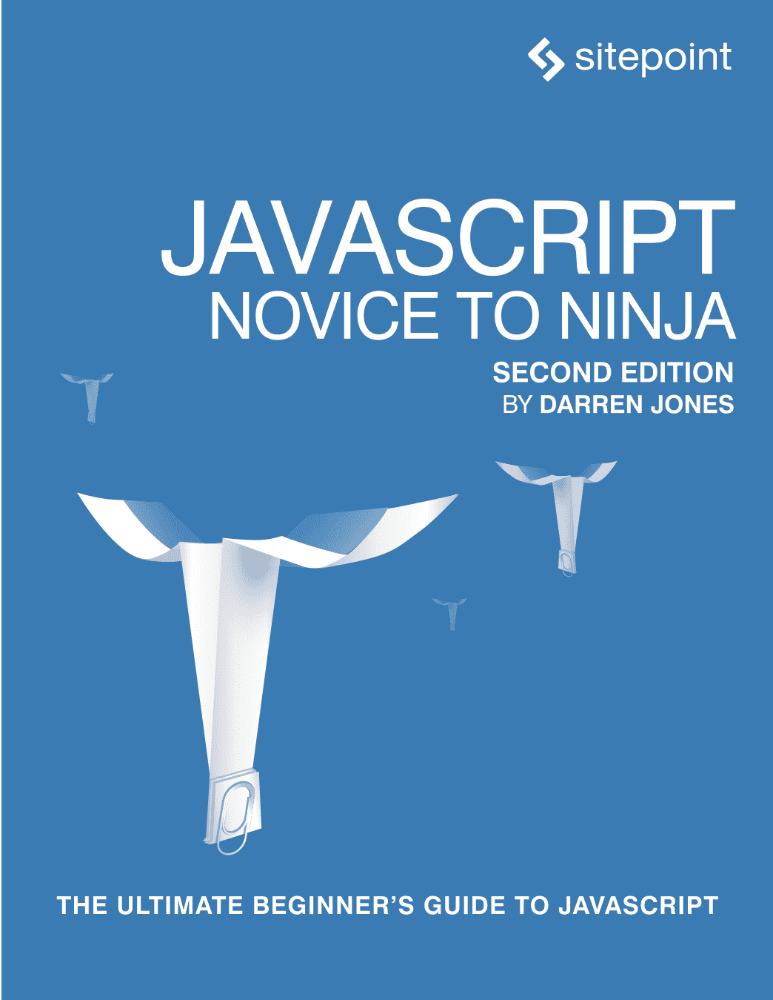


# 关于 Darren Jones

Darren 从千禧之初就开始编程和构建网站。他在 2013 年写了书籍《Jump Start Sinatra》，并为 SitePoint Premium 制作了《Getting Started With Ruby》视频教程。他还为 SitePoint 网站写过许多文章。

在 Node.js 发布后，他开始更频繁地使用 JavaScript。他热爱这种语言的力量和灵活性，以及围绕它成长的惊人生态系统。目前，他正在使用 React 和 Redux 开发一个交互式的在线数学测验。

他出生于曼彻斯特，目前仍居住在那里，在那里教授数学并喜欢打水球。

# 关于 SitePoint

SitePoint 专注于为 Web 专业人士出版有趣、实用且易懂的内容。访问 `http://www.sitepoint.com/` 访问我们的博客、书籍、时事通讯、文章和社区论坛。你将在那里找到关于 JavaScript、PHP、Ruby、移动开发、设计等信息。

致 Helen - 感谢你一直支持我。

# 目录

# 第 1 章 你好，JavaScript ................................................. 1

# 第 2 章 编程基础 ................................................ 31

# 第 3 章 变量与数据类型 .............................................. 65

# 第 4 章 函数 ....................................................... 132

# 第 5 章 对象 .......................................................... 166

# 第 6 章 文档对象模型 (DOM) ........................................ 216

# 第 7 章 事件 .................................................................. 258

# 第 8 章 表单 ............................................................ 285

# 第 9 章 Window 对象 .......................................................... 323

# 第 10 章 测试与调试 ................................................. 353

# 第 11 章 进阶函数 .............................................. 388

# 第 12 章 JavaScript 中的面向对象编程 ................................................................................ 441

# 第 13 章 Ajax ............................................................................... 509

# 第 14 章 HTML5 APIs ................................................................ 538

# 第 15 章 现代 JavaScript 开发 ................................................................ 574

# 第 16 章 下一步展望 ................................................................ 633

# 前言

在本书的第一版序言中，我谈到了 JavaScript 的无处不在及其指数级增长。随着第二版的出版，这种趋势没有任何放缓的迹象。事实上，出现了一种名为“JavaScript 疲劳”的新现象，用以描述不断涌现的 JavaScript 工具和方法论。在我看来，这不应该被视为负面影响，它只是说明不断扩张的 JavaScript 领域是一片肥沃的土地，这意味着将有一份不断增长的新工具和库列表。其中大多数工具都有助于语言向前发展并使其变得更好，最终它们会进入官方语言。现在，JavaScript 计划每年发布一个新版本。随着每个版本的更新，这种语言变得越来越强大和成熟，能够构建复杂的应用程序。它仍然并不完美，但它一直在变得更好。

本书从基础知识开始，假设读者没有任何编程或 JavaScript 知识，但会迅速进入正题，深入涵盖所有主要主题，例如函数、对象和 DOM 操作。

在介绍完基础知识后，将介绍更高级的主题，如错误处理和测试、函数式编程和面向对象编程（OOP）。在过去的几年里，JavaScript 世界出现了一些令人兴奋的进展，例如 Ajax、HTML5 API 和任务运行器，这些内容将在书的最后部分介绍。书中还包含一个实用的项目，即构建一个测验应用程序，该项目将贯穿本书并在每个章节末尾开发。我在编写时针对的是现代浏览器，因此我始终尝试在示例中使用最新的方法。尽管如此，我也会尝试指出某些内容在旧版浏览器中可能无法工作，或者是否需要通用的解决方案。

这是一段漫长的道路——准确地说，有 16 个章节。但请记住，每一个忍者的旅程都从一页开始（或者类似的话）。所以，翻开页，让我们开始吧！

## 谁应该读这本书

这本书适合初级 Web 设计师和开发者。假设读者具备一些 HTML 和 CSS 知识，但不需要之前的编程经验。

## 使用的约定

你会注意到我们在书中使用了某些排版和布局样式来表示不同类型的信息。请关注以下项目。

### 代码示例

书中的代码使用等宽字体显示，如下：

```
<h1>A Perfect Summer's Day</h1>
<p>这是一个在公园里散步的好日子。鸟儿在歌唱。</p>
```

某些代码行应该在一行输入，但由于页面限制，我们不得不对它们进行换行。`\` 表示仅出于格式目的而存在的换行符，应该被忽略：

```
URL.open("http://www.sitepoint.com/responsive-web-design-real-user-testing/?response=1");
```

### 提示、注释和警告

> 嘿，你！
>
> **提示** 提供有用的小技巧。

> 呵，打扰一下……
>
> **注释** 是当前主题相关但并非至关重要的补充说明。将它们视为额外的信息即可。

> 注意！
>
> **警告** 强调在过程中可能会让你绊倒的任何陷阱。

### 补充材料

- `https://github.com/spbooks/jsninja2` 包含了书籍的代码存档。

- `https://www.sitepoint.com/community/` 是 SitePoint 论坛，用于在使用任何棘手的 Web 问题寻求帮助。

- `books@sitepoint.com` 是我们的电子邮件地址，如果您需要联系我们报告问题或出于其他原因。

# 第 1 章 你好，JavaScript

在本章中，我们将介绍 JavaScript 语言，并搭建编程环境。我们还将开始一些编程，并编写几个 JavaScript 程序！

以下是本章涵盖的内容：

- 什么是编程？
- JavaScript 的历史
- 使用 JavaScript 编程所需的工具
- 安装 Node.js
- 控制台中的 JavaScript
- Hello, world！你的第一个 JavaScript 程序
- Web 浏览器中的 JavaScript
- 优雅降级与渐进式增强
- 一个复杂的 JavaScript 程序
- 项目 - 我们将开始一个测验项目，该项目将贯穿本书开发

## 编程

**编程** 是关于让计算机执行你想要的操作。计算机程序基本上是一系列指令，告诉你的计算机如何执行任务。遗憾的是，计算机使用的语言与我们不同——它们只使用 1 和 0。第一批计算机使用打孔卡进行编程，有孔代表 1，无孔代表 0。

第一批计算机程序是用**机器码** 和**汇编语言** 编写的。这些是与计算机硬件密切相关的**低级编程语言**。这意味着使用这些语言可能很困难，因为它们涉及编写与计算机架构紧密相关的抽象代码。然而，如果速度非常重要，那么使用机器码或汇编语言编写可能是最佳选择。

另一方面，**高级编程语言** 允许使用抽象，这使得代码更容易被人类阅读和编写。程序是用 C、C++ 或 Java 等语言编写的，然后编译成机器码并执行。使用这些语言编写的程序非常快，使得高级语言适合编写对速度至关重要的游戏和专业业务软件。大多数原生应用也是用高级语言编写的。

**脚本语言** 也是高级语言，但它们是解释执行的，这意味着它们在运行时被翻译成机器码。这通常会让它们比编译型语言慢，尽管解释器正变得越来越复杂，并越来越模糊编译型和解释型语言之间的界限。

## JavaScript

我们在书中学习的语言是 JavaScript，它通常被称为 Web 语言。

几乎所有的 Web 浏览器都能运行 JavaScript，使其成为世界上最流行的编程语言之一。它的入门门槛很低——用 JavaScript 编程只需要一个文本编辑器和一个 Web 浏览器。虽然很容易上手，但 JavaScript 是一门难以掌握的语言，它具有一些独特的特性和有趣的偏差。一旦你掌握了它，你会发现它是一种非常灵活且富有表现力的语言，可以创建强大的应用程序。

JavaScript 是一种在运行时进行解释和编译的高级脚本语言。这意味着它需要一个负责解释和运行程序的引擎。最常见的 JavaScript 引擎位于浏览器中，如 Firefox、Chrome 或 Safari。许多现代 JavaScript 引擎使用即时编译（JIT）过程，这大大加快了执行速度。JavaScript 还是一种动态语言，所以程序的元素可以在运行时更改，它可以在后台做很多事情（例如类型检查），这些是 C++ 等语言在编译时才会做的事情。

## JavaScript 的历史

万维网最初是由通过超链接的页面组成的。用户很快就对这些页面有了交互需求，因此 Netscape（早期的浏览器供应商）要求其员工 Brendan Eich 开发一种新语言。由于当时 Netscape 和微软之间的激烈竞争，这必须快速完成。

Eich 成功在 10 天内创建了一个原型脚本语言。为了做到这一点，他从其他语言借鉴了各种元素，包括 AWK、Java、Perl、Scheme、HyperTalk 和 Self。这是一项令人惊讶的成就，但为了抢先市场，语言中出现了一些从未解决过的缺陷和 Bug。

这种语言最初被称为 Mocha，后改为 LiveScript，最后匆忙重命名为 JavaScript，以便利用当时 Sun 的 Java 语言所吸引的关注。这经常导致一些混淆，JavaScript 经常被认为是 Java 的轻量版。然而，这两种语言是无关的——尽管 JavaScript 在语法上与 Java 有相似之处。

JavaScript 在 1995 年在 Netscape 浏览器的第 2 版本中亮相。次年，微软逆向工程 JavaScript 创建了自己的版本，并称为 JScript 以避免与拥有 Java 商标的 Sun 公司产生版权问题。JScript 随着 Internet Explorer 第 3 版本发布，与 JavaScript 几乎相同——它包含了所有的缺陷和 Bug——但它增加了一些 Internet Explorer 特有的功能。微软同时为 Internet Explorer 提供了另一种名为 VBScript 的脚本语言。

JavaScript（以及 JScript）立即变得流行。它的入门门槛低，而且相对容易学习，这意味着它在使网页动态化和交互化方面爆炸式增长。遗憾的是，它的低门槛也是一种诅咒——许多人在不了解自己在做什么的情况下编写代码。代码现在可以很容易地复制粘贴，并且经常被错误使用，导致网上出现很多糟糕的示例。

JavaScript 还经常被用于创建弹出广告，以及浏览器嗅探（检测正在使用哪个浏览器查看网页的过程）。它开始获得负面声誉。

## 浏览器大战

当 Netscape Navigator 4 和 Internet Explorer 4 发布时，JavaScript 已经变得非常流行。微软开始对动态 HTML（简称 DHTML）这一术语进行大量炒作，用来指代 JavaScript 是一种让 HTML 变得更加交互和动态的语言。为了利用这种流行性，Netscape 和微软尝试添加新的专有功能，这导致了不同语法的出现。这种不断添加新功能的军备竞赛被称为“浏览器大战”。遗憾的后果是，程序员们必须为每个浏览器编写两个版本的代码以实现相同的效果。专业程序员经常将 JavaScript 视为一种“玩具”语言，不适用于任何严肃的编程，但这种批评是不公平的——语言本身没有问题，问题在于它的使用方式。

最终，微软赢得了浏览器大战，Internet Explorer 脱颖而出成为主导浏览器。对标准的支持也随之增加，这在很大程度上归功于网络标准项目（WaSP）的努力。开发者和浏览器厂商开始合作，并拥抱由万维网联盟（W3C）和 ECMA 制定的标准。

开源浏览器 Firefox 于 2002 年发布，苹果于 2003 年发布了 Safari 浏览器。两者都对标准有强大的支持，这意味着开发者能够使用 JavaScript 开发出在不同浏览器中表现一致的优秀 Web 应用程序。

## Web 2.0

在 2005 年，Google Maps、Flickr 和 Gmail 等网站开始出现，证明了 JavaScript 能够创建看起来和运行都像原生桌面应用程序的互联网应用。几乎同时，Jesse James Garrett 创造了 Ajax（异步 JavaScript 和 XML）这一术语。这描述了一种技术：在后台从服务器获取数据并在无需重新加载整个网页的情况下更新网页的相关部分，使用户可以继续与页面的其他部分交互。这为用户创造了更无缝的体验，并广泛应用于许多 Web 2.0 应用中。结果，专业程序员开始关注 JavaScript，它开始被视为一种强大且灵活的语言，能够生成高质量的 Web 应用程序。

## 标准


随着 JavaScript 被用于更复杂的应用程序，以及浏览器标准的提高，JavaScript 的格局发生了变化。一场新的浏览器大战开始了，但这次是关于哪个浏览器能够最符合标准。此外，还有提高不同浏览器内置 JavaScript 引擎速度的竞争。这始于 2008 年，当时 Google 的工程师开发了运行在 Chrome 浏览器中的 `V8` 引擎。它比之前的 JavaScript 引擎快得多，标志着另一场军备竞赛，浏览器厂商也通过提高自己引擎的速度来做出回应。JavaScript 在现代浏览器中的运行速度明显加快，而且改进速度没有放缓的迹象。

## HTML5

`HTML5` 是最新的 `HTML` 规范，尽管它实际上更是一个涵盖 Web 上所有最新技术的总术语。这包含了 `HTML`、`CSS3` 以及许多使用 JavaScript 与网页交互的 `API`。这些将在[第 10 章]中进行详细介绍。

`HTML5` 已于 2014 年定稿，下一个版本 5.1 的建议于 2016 年初提出¹。它已迅速成为 Web 开发的主导标准。JavaScript 是其某些更有趣方面工作方式的关键特性。

## Node.js

2009 年，Ryan Dahl 开发了 `Node.js`（通常称为 `Node`），它允许使用 JavaScript 编写服务器端应用程序。`Node` 基于 Google 的 `V8` 引擎，允许创建完全用 JavaScript 编写的快速、强大的实时 Web 应用程序。它还导致了许多完全不需要浏览器的应用程序和 JavaScript 库。`Node.js` 被证明非常受欢迎，且其使用量持续增长。这增加了

> ¹ https://www.w3.org/TR/html/

由于 JavaScript 开始出现在许多 Web 之外的环境中，人们对它的兴趣和使用也增加了。

`Node` 的普及导致了一项被称为“同构 JavaScript”（Isomorphic JavaScript）的有趣发展。这涉及到相同的 JavaScript 代码可以在客户端或服务器端运行：如果浏览器无法运行该代码，则可以在服务器上运行并下载；或者，如果服务器不可用，代码可以在客户端运行。

## JavaScript 版本

1996 年，Netscape 和太阳微系统决定在欧洲计算机厂商协会（ECMA）的帮助下对该语言进行标准化，该协会将托管该标准。这种标准化的语言被称为 `ECMAScript`，以避免侵犯太阳微系统的 `Java` 商标。这导致了更多的困惑，最终 `ECMAScript` 被指代规范，而 `JavaScript`（过去和现在）是指代语言本身。

在理想的世界里，`ECMAScript` 标准应该意味着所有引擎都以相同的方式解释程序。但规范在某些地方可能很难解释，因此 `JavaScript` 的实现在不同引擎之间存在差异。这就是为什么某些浏览器在运行 `JavaScript` 程序时表现不同。`JavaScript` 也是 `ECMAScript` 的超集，因为它通常包含额外的非标准功能，例如 `alert()` 函数。

负责维护 `ECMAScript` 的工作组被称为技术委员会 39 号，或 `TC-39`。它由苹果、Google、微软和 Mozilla 等所有主要浏览器厂商的代表组成，以及来自对 Web 开发感兴趣的其他公司的邀请专家和代表。他们定期举行会议，决定语言将如何发展。

当 `JavaScript` 在 1997 年被 `TC-39` 标准化时，规范被称为 `ECMAScript` 第 1 版。第 2 版一年后发布，但没有对语言做出任何重大更改。1999 年，`ECMAScript` 第 3 版于 1999 年 12 月发布，添加了各种新功能。

## JavaScript 从新手到忍者，第 2 版

`ECMAScript` 第 4 版的发展因 `TC-39` 对语言发展方向的分歧而陷入僵局。一些成员认为语言需要大量的重大变化来变得健壮，而另一些人则认为需要微小变化。许多新功能被提出，但通常被认为过于野心或难以实现。在多年没有进展后，第 4 版最终被放弃，工作小组跳过了这个版本直接开发第 5 版。他们同意需要一个可以实现的精简规范，并最终于 2009 年 12 月发布。`ECMAScript` 第 5 版为语言增加了许多新功能，但远没有那个失败的第 4 版那么有野心。尽管如此，这些功能中的某些花了很长时间才被 `JavaScript` 引擎完全支持。

在 `ES5` 发布后，开始开发代号为“Harmony”的新标准。`Harmony` 的理念是概述 `JavaScript` 下几个版本的理想特性。这又花了六年的时间，最终这些功能中的大部分变成了 `ECMAScript` 第 6 版，尽管其中一些被推到了第 7 版或更晚。

2015 年，`TC-39` 决定采用新方法，开始每年发布一次新规范，版本号根据发布年份年份命名。这意味着只有经过批准的功能才能进入当年的规范。结果是，`ECMAScript` 第 6 版在 2015 年 6 月发布时被更名为 `ECMAScript 2015`，并为语言添加了一些新功能。计划是每年 6 月发布一个新版本，让语言在添加新功能时以缓慢的方式演进；而不是每隔几年进行一次激进的补充。这意味着 `ES2015` 可能是最后一个拥有如此大量新功能并对语言做出重大变化的 `JavaScript` 版本。事实上，第 7 版（即 `ECMAScript 2016`）已于 2016 年 6 月发布，为之前的版本增加了两个新功能。

# JavaScript 的未来

`JavaScript` 正处于一个令人振奋的时代，因为它的应用已经远远超了仅仅是让网页具有交互性。单页应用程序（`SPA`）的使用量大幅增加，它们运行在浏览器中并高度依赖于 `JavaScript`。这些技术的下一次迭代是渐进式 Web 应用（`PWA`），它们使用 Web 技术创建在移动设备上行为类似于原生应用的程序，但无需从应用商店安装。广泛使用 `JavaScript` 的 `HTML5` 游戏也变得越来越流行，尤其是随着浏览器图形能力的不断提升。

`JavaScript` 和 `HTML5` 技术可以用于开发浏览器扩展、`Windows` 桌面小部件和 `Chrome OS` 应用程序。许多与网络相关的应用程序也使用 `JavaScript` 作为它们的脚本语言。它可以被用于为 `PDF` 文档添加交互性、与数据库交互，甚至控制家用电器！

`JavaScript` 看起来确实有光光的前途。目前有许多令人兴奋的新功能正在讨论，希望这些功能能进入 `JavaScript` 的未来版本，帮助它成为一种更强大、表现力的语言。随着 Web 平台的不断演进和成熟，其使用范围扩展到浏览器之外，`JavaScript` 将继续是未来技术发展的核心部分。

# 忍者编程环境

如果你打算成为一名 `JavaScript` 程序员，你就需要一些工具。虽然仅用浏览器编写和运行 `JavaScript` 程序是可能的，但为了充分利用这本书的价值，你将一个文本编辑器来编写和编辑你的程序，以及一个 `JavaScript` 引擎来运行它们。这意味着你需要一个现代的、更新过的浏览器，以及安装了最新版本的 `Node`。

- 你可以在 `http://kangax.github.io/compat-table/es2016plus/` 查看一张图表，它显示了不同浏览器实现了哪些功能。

# JavaScript：从新手到忍者（第 2 版）

在我们开始介绍 `JavaScript` 基础知识时就建议在书的开头安装 `Node`，我曾有些顾虑。经过深思考虑，我认为这是最好的做法，原因如下：

- 1. 许多在线教程要求你安装了 `Node`。我不认为让你在没有安装 `Node` 的情况下无法遵循这些教程是帮到你上什么忙。

- 2. `Node` 允许你使用该语言的大部分最新功能，而其中某些功能在浏览器中无法运行。

- 3. 你将能够 `npm`（`Node` 软件包管理器）安装各种工具和代码库，它是目前全球最大的代码仓库。

- 4. `Node` 可以用于安装 `Babel`³，这是一种转换器，可以将用最新版本的 `JavaScript` 编写的代码转换为可以在大多数浏览器中运行的代码。

如果你现在没有安装 `Node`（或者由于某种原因无法安装），那么运行书中的大多数代码示例仍然是可能的。也有许多在线选项让你使用该版本的 `JavaScript`。

# 安装 Node

安装 `Node` 有两种选择：安装程序或 `Node` 版本管理器。

## Node 安装程序

如果你使用 `Windows` 或 `Mac OS`，可以使用 `Node` 安装程序⁴ 为你完成所有的安装工作——你只需要下载它并按照说明操作即可。

## Node 版本管理器

另一个选项是使用 `Node` 版本管理器 (`nvm`)。使用 `nvm` 的优势是它允许你安装多个版本的 `Node`，并轻松地将安装更新到最新版本。`nvm` 不支持 `Windows`，但可以安装在 `Mac` 或 `Linux` 上。下载并安装 `nvm`，只需按照概述的两个步骤操作：

> 3. https://babel.io

> 4. https://nodejs.org/en/download/

## 你好，JavaScript 11


## 命令行

如果你不熟悉从命令行运行应用和工具，那么不要担心，这并不困难。起初可能看起来奇怪，但过了一段时间，你很快就会疑惑在没有它的情况下是怎么过的！

你可以在 `Mac OS` 的“应用程序” -> “实用工具” -> “终端”中找到它，或者使用 `Spotlight` 搜索“终端”。在这个窗口中输入命令并按回车键。

在 `Windows` 上，你通过在开始菜单输入 `cmd` 来访问它。

如果你使用的是 `Linux`，我假设你已经熟悉打开和使用命令行了！

## 第 1 步：安装构建工具

如果你有一台 `Mac`，你需要运行以下命令安装 `Xcode` 命令行工具：

```
xcode-select --install
```

如果你正在使用 `Linux`，你需要安装“build-essential”包。这可以在基于 `Debian` 的发行版上通过运行以下命令完成（其他发行版请使用你选择包管理器）：

```
sudo apt-get update
sudo apt-get install build-essential
```

## 第 2 步：安装 nvm

要安装 `nvm`，只需运行以下命令：

# JavaScript：从新手到忍者（第 2 版）

```
curl -o 
https://raw.githubusercontent.com/creationix/nvm/v0.31.0/
install.sh
| bash
```

现在 `nvm` 已安装，在安装 `Node` 之前，你需要重新加载你的 shell。在 `Mac Os` 中可以使用以下命令完成：

```
~/.bash_profile
```

或者在 `Linux` 中：

```bash
~/.bashrc
```

现在你可以使用以下命令安装 `Node`：

```
nvm install
```

```
nvm use
```

你可以通过输入以下命令检查 `Node` 版本：

```
node -v
```

你可以通过输入以下命令列出已安装的 `Node` 版本：

```bash
nvm list
```

你可以通过输入以下命令在 `Node` 版本之间切换：

```bash
nvm use <version>
```

你可以通过输入以下命令删除一个 `Node` 版本：

```bash
nvm uninstall <version>
```

你可以通过输入以下命令查看帮助菜单：

```bash
nvm help
```

你可以通过输入以下命令检查当前的 `Node` 版本：

```bash
nvm current
```

你可以通过输入以下命令查看最新版本的 `Node`：

```bash
nvm latest
```

你可以通过输入以下命令设置 `Node` 的默认版本：

```bash
nvm alias default <version>
```

你可以为一个 `Node` 版本创建一个别名：

```
nvm alias <name> <version>
```

你可以列出别名：

```bash
nvm alias
```

你可以通过输入以下命令查看可用的 `Node` 版本：

```
nvm ls-remote
```

你可以使用某个版本的 `Node`：

```
nvm use <version>
```

你可以安装一个版本的 `Node`：

```
nvm install <version>
```

你可以卸载一个版本的 `Node`：

```
nvm uninstall <version>
```

你可以更新一个版本的 `Node`：

```
nvm install <version>
```

你可以查看所有安装的版本：

```bash
nvm list
```

你可以检查当前的 `Node` 版本：

```bash
nvm current
```

你可以查看最新版本的 `Node`：

```bash
nvm latest
```

你可以设置 `Node` 的默认版本：

```bash
nvm alias default <version>
```

你可以为一个 `Node` 版本创建一个别名：

```
nvm alias <name> <version>
```

你可以列出别名：

```bash
nvm alias
```

你可以通过输入以下命令查看可用的 `Node` 版本：

```
nvm ls-remote
```

你可以通过输入以下命令查看帮助菜单：

```bash
nvm help
```

# 你好，JavaScript 15


## 在控制台中

控制台是一个用于实验和测试的有用工具。它允许你输入 `JavaScript` 查看结果。这与包含许多行的完整程序不同。控制台可以让你看到每一行输入的输出。有三个选项可以使用：

- 如果你安装了 `Node`，可以使用 `REPL`，即读取-评估-打印循环（Read Eval Loop）。要启动 `REPL`，只需打开终端并输入 `node`。这应该显示类似下方的提示符：


- 另一个选项是使用浏览器自带的控制台。你可以通过打开浏览器并按下 `F12`（`Mac` 上为 `Command + Option + I`）打开开发者工具，然后点击“控制台”标签。它看起来应该像下面的截图：


- 最后选项是使用 `ES6 Console` 网站。这允许你直接在浏览器中输入 `JavaScript` 命令并查看结果。它还让你编写 `ES6` 并查看转换为 `ES5` 后的样子。

> 6. http://es6console.com

## 文本编辑器

使用 `JavaScript` 编程的优点之一是不需要任何花哨昂贵的程序——只需要一个简单的文本编辑器。

操作系统自带的默认文本编辑器（如 `Windows` 记事本）可以正常工作，尽管你可能想升级到面向编程的文本编辑器。这些编辑器提供了代码高亮、代码补全和文件浏览等额外功能，而不会占用过多的系统资源。有很多免费选项，包括 `Atom`⁷ 和 `Brackets`⁸（它实际上是用 `JavaScript` 构建的！）。

另一个选项是使用集成开发环境 (`IDE`)。它们的功能通常比文本编辑器更多，但对于小项目来说可能大材没用。

- 7- https://atom.io/

- 8. http://brackets.io/

对于小项目来说大材小用。`Microsoft Visual Studio` 的社区版是一个免费使用的良好选择。

### 在线选项

`CodePen`、`JSFiddle` 和 `JS Bin` 都是在线服务，允许你输入 `HTML`、`CSS` 和 `JavaScript` 代码并查看结果。它们甚至允许你对 `JavaScript` 和 `CSS` 使用预处理器。这意味着你可以使用最新版本的 `JavaScript` 和 `CSS` 编写代码。即使你的浏览器不支持这些特性，代码仍然可以正常运行。它们还允许你将所有作品保存到云端。

书中的许多示例已保存在 `CodePen` 上，因此你可以查看代码，也可以保存自己的副本进行尝试练习。

## 你的第一个 JavaScript 程序

关于 `JavaScript` 的话说够了！让我们来编写你的第一个程序。

在学习编程语言时，从一个“Hello world!”程序开始是一个传统。这是一个简单的程序，通过输出“Hello world!”短语来向编程世界宣告你的到来。我们将遵循这一传统，用 `JavaScript` 编写一个“Hello world”程序。它将是一个单条语句，向控制台打印“Hello world!”短语。

要开始之前，你需要打开你偏好的控制台（`Node REPL`、浏览器控制台或网页上的 `ES6 Console`）。在控制台打开的状态下，你只需要输入以下代码：

```javascript
console.log('Hello world!');
```

9. https://www.visualstudio.com

10. http://codepen.io

11. https://jsfiddle.net/

12. https://jsbin.com

13. http://es6console.com

然后按回车键。如果一切进展顺利，你应该能看到显示 'Hello world!' 的输出；类似于下方的截图。

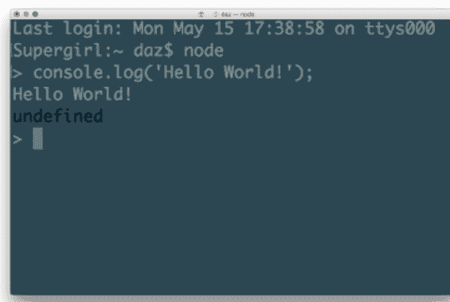

1-4. "Hello, world!"

恭喜，你刚刚编写了你的第一个 `JavaScript` 程序！它看起来可能没什么特别，但一位智者曾说过，每一位忍者程序员的旅程都是从一行代码开始的（或者类似如此）。

## 浏览器中的 JavaScript

`JavaScript` 是一种解释型语言，需要宿主机环境来运行。由于其起源，`JavaScript` 运行的主要环境是浏览器，尽管它也可以在其他环境中运行；例如，我们刚刚写的第一个程序就运行在 `Node REPL` 中。`Node` 也可以用于在服务器上运行 `JavaScript`。到目前为止，`JavaScript` 最常见的用途仍然是让网页具有交互性。因此，在继续之前，我们应该查看一下网页的组成部分。

## 网页的三层结构


# 几乎所有的网页由三个关键元素组成

几乎所有的网页由三个关键元素组成：`HTML`、`CSS` 和 `JavaScript`。`HTML` 用于标记内容。`CSS` 是表现层，而 `JavaScript` 增加了交互性。

每一层都构建在上一层的基础上。一个网页 —— 事实上，许多网站会庆祝“裸日”¹⁴，即他们从网站中移除 `CSS` 层。使用 `HTML` 层的网站将处于最纯粹的形式，看起来非常老旧，但应该仍然完整的功能。

## 保持这些层分离

> 将每一层的关注点分离被广泛认为最佳实践，以便每层只负责一件事。将它们放在一起会导致页面非常复杂，所有代码混合在一个文件中，导致“标签汤”（tag soup）或“代码面条（code spaghetti）”。这曾是制作网站的标准方法，网络上有许多此类示例。

## 非侵入式 JavaScript

当 `JavaScript` 最初被使用时，它被设计为直接插入到 `HTML` 代码中，如下例所示，点击按钮时会显示消息：

```html
<button id='button' href='#' onclick='alert("World")'>Click Me</button>
```

这使得很难看出发生了什么，因为 `JavaScript` 代码与 `HTML` 混合在了一起。这意味着代码与 `HTML` 紧密耦合，因此 `HTML` 的任何更改都要求修改 `JavaScript` 代码以防止其损坏。

14. https://css-naked-day.github.io/

## Hello, JavaScript 19

通过将 `JavaScript` 代码放置在自己的 `<script>` 标签中，可以将其与 `HTML` 其他部分分开。以下代码将实现与上述相同的结果：

```javascript
<script>
const btn = document.getElementById('link')
btn.addEventListener('click', function() {
  alert('Hello World!');
};
</script>
```

这种方式更好，因为所有的 `JavaScript` 都在一个地方（两个 script 标签之间），而不是与 `HTML` 标签混合。

我们可以更进一步，将 `JavaScript` 代码放在一个单独的文件中，使其与 `HTML` 和 `CSS` 完全分离。可以使用 script 标签中的 `src` 属性进行链接，以指定要链接的文件：

```html
<script src='main.js'></script>
```

然后 `JavaScript` 代码将放在与 `HTML` 文档相同目录下的名为 `main.js` 的文件中。这种将 `JavaScript` 代码完全分离的理念是非侵入式 `JavaScript`¹⁵ 的核心原则之一。

同样，`CSS` 也应该保持在单独的文件中，这样网页中唯一的代码就是带有 `CSS` 和 `JavaScript` 文件链接的实际 `HTML`。这通常被认为是最佳实践，也是我们书中将使用的方法。

+   15. https://en.wikipedia.org/wiki/Unobtrusive_JavaScript

### 自闭合标签

如果你使用过 `XML` 或 `XHTML`，你可能遇到过如下的自闭合标签：

```html
<script src='main.js' />
```

这在 `HTML5` 中无法工作，因此应该避免使用。

你可能会看到一些使用 `language` 属性的旧代码：

```html
<script src='main.js' language='javascript'></script>
```

这在 `HTML5` 中是不必要的。

### 优雅降级与渐进式增强

**优雅降级**（Graceful degradation）是构建网站的过程，使其在高清设备上运行得最好，然后确保对于那些没有最新最先进浏览器的用户，体验会逐渐下降。一个例子可能是电话公司，他们提供基础通话服务，但如果你的电话支持，则提供拨叫和来电显示 ID 等额外服务。

**渐进式增强**（Progressive enhancement）是从零开始构建网页，带有基础功能，然后在可用时添加增强功能。每当你向网页添加 `JavaScript` 时，都应该始终考虑你想采取的方法。你是想从许多突破边界的惊奇特效开始，然后确保体验优雅地下降？还是想从开始构建一个适用于大多数浏览器的功能性网站，然后使用 `JavaScript` 增强体验？这两种方法相似但有细微区别。

## 你的第二个 JavaScript 程序

我们将用在浏览器中运行的第二个 `JavaScript` 程序来结束本章。这个示例比上一个复杂，包含了许多在后续章节中深入讨论的概念，所以如果你现在不理解一切，不要担心！这个想法是向你展示 `JavaScript` 的能力，并介绍一些后续章节将涵盖的重要概念。

我们将遵循之前提到的非侵入式 `JavaScript` 实践，将 `JavaScript` 代码放在单独的文件中。首先创建一个名为 `rainbow` 的文件夹。在文件夹内部创建一个名为 `rainbow.html` 文件和另一个名为 `main.js` 文件。

让我们从 `HTML` 开始。打开 `rainbow.html` 并输入以下代码：

```html
<head>
<meta charset='utf-8'>
<title>I Can Click A Rainbow</title>
</head>
<body>
<button id='button'>click me</button>
<script src='main.js'></script>
</body>
</html>
```

该文件是一个相当标准的 `HTML5` 页面，包含一个 ID 为 `button` 的按钮。`ID` 属性对于 `JavaScript` 用作钩子访问页面的不同元素非常有用。底部是一个指向我们 `JavaScript` 文件的脚本标签。

> 16. http://www.sitepoint.com/progressive-enhancement-graceful-degradation-choice/可能会帮助你决定采取哪种方法。

现在来看 `JavaScript` 部分。打开 `main.js` 并输入以下代码：

```javascript
const btn = document.getElementById('button');

const rainbow =
['red','orange','yellow','green','blue','rebeccapurple','violet'];

function change() {
  document.body.style.background =
  rainbow[Math.floor(7*Math.random())];
}
btn.addEventListener('click', change);
```

我们在 `JavaScript` 代码中的第一个任务是创建一个名为 `btn` 的变量（我们将在第 2 章中介绍变量）。

我们使用 `document.getElementById` 函数来找到找到 ID 为 `btn` 的 `HTML` 元素（查找 `HTML` 元素将在第 6 章中介绍）。这个元素被赋值给 `btn` 变量。

我们现在创建了另一个名为 `rainbow` 的变量。一个包含不同颜色字符串列表的数组被赋值给 `rainbow` 变量（我们在第 2 章中介绍了字符串和变量，在第 3 章中介绍了数组）。

然后我们创建了一个函数 `change`（我们将在第 4 章中介绍函数）。该函数将按钮元素的背景颜色设置为彩虹色中的一种（更改页面的样式将在第 6 章介绍）。这涉及到使用内置的 `Math`（在第 5 章介绍）选择一个随机数，并从 `rainbow` 数组中选择相应的颜色。

最后，我们创建了一个事件处理器，它会检查按钮何时被点击。当此情况发生时，它会调用我们定义的 `change` 函数（事件处理器将在第 7 章中介绍）。

在浏览器中打开 `rainbow.html` 并尝试点击几次按钮。如果一切运行正常，背景应该会变为彩虹的每种颜色，如下所示所示。

## 你好，JavaScript 23

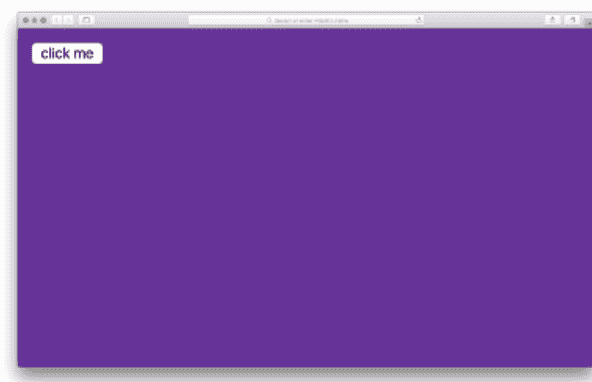

1-5. 我可以点击彩虹

如果你想快速尝试一下，可以去 CodePen¹¹⁷ 查看那上的代码。不过，为了进行一些练习，我建议你也花时间创建这些文件，手写代码，并尝试在浏览器中运行它们。¹⁸

## 不要破坏网页

`JavaScript` 语言开发中的一个重要概念是它必须具有向后兼容性。也就是说，所有旧代码在运行新规范的引擎解释时，工作方式必须保持相同（这有点就像 `PlayStation 4` 必须能够运行为 `PlayStation 1`、`2` 和 `3` 创建的游戏一样）。这是为了防止 `JavaScript` 通过剧烈变化来“破坏网页”，否则会导致某些网站上的遗留代码在现代浏览器中无法按预期方式运行。

- 17. http://codepen.io/daz4126/pen/VPRdGa

- 18. `rebecapurple` 是十六进制代码为 `#663399` 的颜色官方名称。它以网页设计师 `Eric Meyer` 的女儿命名，她不幸地去世了，当时年仅六岁。这是她最喜欢的颜色，为了对她的纪念，它被添加到了 `CSS` 颜色的官方列表中。

因此，新版本的 `JavaScript` 不能执行任何在之前的版本中无法实现的功能。改变的只是实现特定功能时使用的符号，使其编写变得更容易。这被称为“语法糖”（syntactic sugar），因为它允许用更漂亮、更简洁的方式来编写有趣的代码。

所有版本的 `JavaScript` 都是向后兼容的这一事实意味着我们可以使用转译器将代码从一个 `JavaScript` 版本转换为另一个版本。例如，你可以使用最新版本的 `JavaScript` 编写代码，然后将其转译为版本 5 代码，这种代码可以在任何浏览器中运行。

由于 `ECMAScript` 每年发布一个新版本，浏览器在实现最新功能方面可能会一直落后（它们在这方面变得越来越了）。

# Hello, JavaScript 29

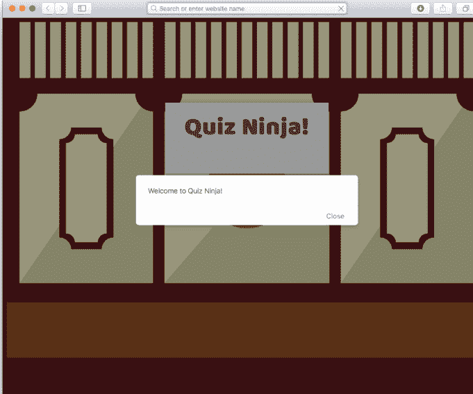

## 1-6. "Hello, world!"

你可以在 CodePen⁴ 上看到实时示例。

这为我们的项目提供了一个良好的坚实基础，随着我们 `JavaScript` 知识的提高，我们可以在此基础上不断构建。

## 章节总结

- `JavaScript` 是由 `Netscape` 员工 `Brendan Eich` 在 1995 年创建的。

- 它迅速流行，并很快被认为是 Web 语言。

24. https://codepen.io/daz4126/pen/YNgvdG

# JavaScript 从新手到忍者，第二版

- 浏览器给 `JavaScript` 带来了许多问题，导致了大量难以维护的碎片化代码。

- `Ajax` 的出现以及它在 Web 2.0 应用（如 `Gmail` 和 `Maps`）中的应用，促进了 `JavaScript` 的复兴。

- `JavaScript` 的主要环境是浏览器，也可以用于其他环境。

- 编写 `JavaScript` 只需要浏览器，但建议使用良好的文本编辑器、`IDE` 或安装 `Node`。

- 优雅降级和渐进增强是确保用户在缺乏某些要求时也能获得良好体验的过程。

- 非侵入式 `JavaScript` 是将 `JavaScript` 功能与 `HTML` 内容和 `CSS` 样式分离的 `JavaScript`。

- `JavaScript` 的每个新版本都必须与旧版本兼容。

- 译器可以用于将代码从一个 `JavaScript` 版本转换为另一个版本。它们通常被用于将语言的最新版本转换为可以在大多数浏览器运行的旧版本。

在下一章中，我们将开始学习一些编程基础知识——让我们开始吧，忍者！

# 第 2 章

## 编程基础

在上一章中，我们介绍了 `JavaScript`，然后搭建了编程环境。我们甚至亲自动手编写了几个 `JavaScript` 程序。在本章中，我们将进一步深入 `JavaScript` 是如何工作的，并编写一些程序。

本章将涵盖以下主题：

- 良好注释代码的重要性

- `JavaScript` 语法 — 表达式、语句、分号和空格

- 基本数据类型

- 字符串 — 字符串字面量、字符串属性和方法

# 32 JavaScript 从新手到忍者，第二版

- 声明和赋值常量与变量

- 数字 — 十进制、十六进制、八进制、二进制和指数形式，以及 `NaN`

- 算术运算如 `+`、`-`、`/`、和 `%`

- `Undefined` 和 `null`

- 布尔值 — 真值和假值

- 逻辑运算符 — `AND`（与）、`OR`（或）和 `NOT`（非）

- 我们的项目 — 我们设置一些问答变量并使用弹框显示它们

## 注释

我们在成为 `JavaScript` 忍者之路上的首要任务是学习如何在 `JavaScript` 中编写注释。这看起来可能是一个奇怪的开始，因为在编程中，注释是语言忽略的代码片段——它不会执行任何操作。尽管如此，注释极其重要：注释良好的代码是忍者程序员的标志。它让任何阅读你代码的人更容易理解发生了什么，包括你你自己！相信我，你很快会的。

注释有两种类型：

- 以 `//` 开头的单行注释：

```javascript
// this is a single line comment
```

- 以 `/*` 开头并以 `*/` 结束的多行注释：

```javascript
/* this is a multi-line comment
这里的任何都将被忽略 */
```

## JavaScript 语法

`JavaScript` 的语法被称为 `C`。以下是一些语法的示例：

```javascript
const x = 5;
```

`JavaScript` 有一个名为 `typeof` 的特殊运算符用于查找值的类型。以下是不同类型的示例：

```javascript
typeof 'hello' // "string"
typeof 10 // "number"
typeof true // "boolean"
typeof { ninja: 'turtle' } // "object"
```

### 保留字

以下单词被语言保留，不能作为变量使用：

`abstract`、`await`、`boolean`、`break`、`case`、`catch`、`char`、`class`、`continue`、`debugger`、`delete`、`do`、`else`、`enum`、`export`、`extends`、`false`、`finally`、`float`、`for`、`function`、`goto`、`if`、`implements`、`import`、`in`、`instanceof`、`int`、`interface`、`let`、`long`、`native`、`null`、`package`、`private`、`protected`、`public`、`return`、`short`、`static`、`super`、`switch`、`synchronized`、`this`、`throws`、`transient`、`true`、`try`、`typeof`、`var`、`void`、`while`、`with`、`yield`。

然而，某些保留字并没有被语言使用；人们只能假设它们计划在某个时候使用，但从未使用过。还有几个没有被保留但本应该保留的：

`undefined`、`NaN`、`Infinity`

## 数据类型

`JavaScript` 有七种不同的数据类型。其中六种是基本数据类型，列举如下：

- `String`

- `Symbol`

- `Number`

- `Boolean`

- `Undefined`

- `Null`

> 4. `Symbol` 基本数据类型是在 `ES6` 中才引入的。

还有一种需要三个操作数的三元运算符，将在下一章介绍。

## 变量

变量在编程语言中用于引用存储在内存中的值。

## 声明与赋值

在使用在使用必须声明。从 `ES6` 开始， `JavaScript` 使用 `const` 和 `let` 关键字来声明变量。当变量不会被重新赋值另一个值时，使用关键字 `const`；如果变量在程序后期可能会重新赋值，则使用 `let`。

要给常量或变量赋值，我们使用 `=` 运算符。

此示例展示了如何声明一个名为 `name` 的变量并将字符串字面量 `'Alexa'` 赋值给它：

```javascript
const name = 'Alexa'; // 这不会被赋值给其他字符串
```

此示例展示了如何声明变量 `score` 并为其赋值数字字面量 `0` 的值：

```javascript
let score = 0; // 这个值在程序过程中可能会改变
```

要查看变量的值，只需在控制台中输入它并按回车即可。

```javascript
name
<< 'Alexa'
```

# 38 JavaScript 从新手到忍者，第二版

常量 `name` 现在具有字符串字面量 `Alexa` 的值，因此它的行为将完全相同。对 `name` 的任何引用都将像你输入字符串字面量一样：

```javascript
typeof name;
<< 'string'
```

这是处理长字符串或表达式的有用方法，因为它避免了我们反复输入它们。

如果你用逗号分隔它们，你甚至可以同时声明并赋值多个变量：

```javascript
let x = 3, y = 4, z = 5;
```

使用 `let` 关键字声明的变量可以在程序后续某个点重新赋值为另一个值。这是通过简单地放置等号和新值来实现的。例如我们将更新 `score` 变量使其值为 `5`，如下：

```javascript
score = 5;
```

相比之下，使用 `const` 意味着你不能将变量重新赋值为另一个值。这意味着如果一个变量被赋值为原始数据类型，那么该值就无法更改，如果你尝试以下操作，将导致错误：

```javascript
const name = 'Alexa';
name = 'Siri';
<< TypeError: Assignment to constant variable.
```

如果变量引用的是非原始数据类型（例如数组、函数或对象），则使用 `const` 不会使其变为不可变。这意味着对象内部的基础数据可以更改（称为修改对象）。我们可以在下面的示例中看到这一点：

```javascript
const name = { value: 'Alexa' }; // 一个对象
name.value = 'Siri'; // 修改值
<< 'Siri'
```


如果你不是完全理解此示例中使用的符号，请担心。我们将在第 5 章介绍它。需要注意的是，由变量 `name` 引用的对象的 `value` 属性已从 Alexa 更改为 Siri。

这强调了一个重要的点。即使你使用 `const` 来声明变量，非原始数据类型在程序后期仍然可以被修改。

使用 `const` 可以防止你将变量重新赋值给另一个对象，因为它会产生错误，如下所示：

```javascript
// 声明对象
const name = { value: 'Alexa' };

// 尝试重新赋值给另一个对象
name = { value: 'Siri' }
<< TypeError: Assignment to constant variable.
```

使用 `const` 看起来像是一种限制，但如果变量的赋值不能改变，它实际上会让你的程序更具可预测性。出于这个原因，你应该尝试使用 `const` 来声明更多变量。这有助于避免任何由赋值意外更改引起的错误。

# JavaScript 从新手到忍者，第二版

## var 发生什么了？

在 ES6 之前的 JavaScript 版本中，变量使用 `var` 关键字声明。以下代码显示了如何声明一个名为 `number` 的变量并将其赋值为 2：

```javascript
var number = 2;
```

这与 `let` 的工作方式非常相似。`let` 和 `const` 声明的变量具有块作用域，这在下面详细讨论。它们还可以防止覆盖内置方法。

那么为什么在 ES6 中引入新的 `let`？为什么不直接更改 `var` 的行为？

记住，JavaScript 语言的一个核心原则是向后兼容。这意味着 `var` 的行为必须保持一致，因此不能在 ES6 中更改它。出于这个原因，引入了新的 `let`。

你应该了解 `var`，因为你会在旧代码中经常看到它用于声明。

## 作用域

使用 `const` 和 `let` 声明变量意味着它们是块作用域，因此它们的值只存在于定义的块内部。

作用域是编程中的一个重要概念。它指的是常量或变量在程序中可访问的地方。程序中通常提到的两种作用域是全局作用域和局部作用域。

### 全局作用域

任何在块之外声明的变量都具有全局作用域。这意味着它在程序的任何地方都是的。虽然起初看起来是个好主意，但不被认为是良好的做法。忍者程序员会将全局变量的数量减少到最少，因为任何相同的变量都会冲突并可能相互覆盖值。这似乎不太可能，但在大型程序中很常见，你会忘记使用了哪些变量。还有在不同情况下使用相同变量名的约定。当你团队编写代码或者使用的代码库与你的代码使用相同的变量名时，也会出现问题。

### 局部作用域

在 ES6 中可以使用块来创建局部作用域。这意味着在块内部使用 `let` 或 `const` 定义的任何变量只在该块内部可用，而无法在块外部访问。这被称为具有局部作用域，因为变量只在块的局部范围内可见。

如果不使用 `let` 或 `const`，变量将具有全局作用域，并在块外部可用。可以通过下面的示例进行演示，其中变量 `a` 的值取决于它是在块内部还是块外部定义的：

```javascript
const a = 1;

{ const a = 3; a; }
<< 3
```

现在检查块外部 `a` 的值：

```javascript
a;
<< 1
```

在示例中，`a` 最初在块外部全局定义并被赋值为 1。这意味着它在块外部可用。块内部的变量 `a` 是另一个变量，它遮蔽了全局变量。

```javascript
firstName
last_name
address_line1
```

## 变量命名

以下划线开头的变量通常指的是私有属性和方法，因此在你自己的变量命名中最好不要遵循这一约定。

`$` 字符也用于流行的 jQuery 库，因此在变量名中使用它也可能会导致问题。

常量和变量名是大小敏感的，因为 `ANSWER` 与 `Answer` 和 `answer` 不同。

在常量和变量名中使用多个单词时有两种约定：

- 驼峰命名法（Camel case）以小写字母开头，每个新单词字母大写：

```
firstNameAndLastName
```

- 下划线命名法（Underscore）用下划线分隔每个新单词：

```
first_name_and_last_name
```

JavaScript 的内置函数使用驼峰命名法，在命名代码中的常量和变量时，这可能是最好的遵循约定。最重要的一点是保持一致。

## 直接赋值和引用赋值

当你将原始值赋值给变量时，你所做的任何更改都会直接应用于该值：

```javascript
const a = 1;
let b = a; // a = 1, b = 1

b = 2; // a = 1, b = 2
```

在上面的示例中，`a` 引用原始数字 1。我们将 `b` 赋值为与 `a` 相同的值。此时 `a` 和 `b` 都具有相同的值 1。然后我们将 2 重新赋值给 `b`，但 `a` 的仍然是 1。

但如果你给变量赋值非原始值，它是通过引用完成的，因此随后的任何更改都会影响对该对象的所有引用：

```javascript
const c = { value: 1 };
let d = c; // c.value = 1, d.value = 1
d.value = 2; // c.value = 2, d.value = 2
```

在上面的示例中，对 `d` 的 `value` 属性的更改导致 `c` 的 `value` 属性发生变化。这是因为变量 `c` 和 `d` 都引用同一个对象，因此对其中一个的任何更改都会影响另一个。

## 字符串

字符串是字符的集合，例如字母和符号。我们可以通过在引号内编写一组字符来创建字符串字面量：

```javascript
'hello'
```

以下划线开头的变量通常指的是私有属性和方法，因此在你自己的变量命名中最好不要遵循这一约定。

`$` 字符也用于流行的 jQuery 库，因此在变量名中使用它也可能会导致问题。

## JavaScript：从入门到忍者，第 2 版

## 使用构造函数

你也可以使用以下构造函数创建一个字符串对象：

```javascript
new String("hello")
// [String: 'hello']
```

这将创建一个与字符串字面量 `hello` 相同的新字符串，尽管它会被归类为对象而不是原始数据类型。因此，最好使用字符串字面量表示法，更不用说使用字面量所需的输入量也更少！

可以使用单引号创建相同的字符串字面量：

```javascript
'hello'
```

如果你想在字符串字面量内部使用双引号，你需要使用单引号包裹字符串。如果你想在字符串中使用单引号（撇号），你需要使用双引号来包裹字符串，否则单引号将终止字符串并导致错误：

```javascript
'It's me' // 导致错误
"It's me" // 这有效
```

另一个选项是转义引号。在单引号之前放置一个反斜杠，使其在字符串内部显示为单引号，而不是终止字符串：

```javascript
'It\s me'
```

## 编程基础 47

## 反斜杠

反斜杠用于转义字符串中的特殊字符，例如：

- 单引号 `'`
- 双引号 `"`
- 换行符 `\n`
- 回车符 `\r`
- 制表符 `\t`

如果你想实际写入反斜杠，需要用另一个反斜杠来转义它：

```javascript
"This is a backslash \\"
// "This is a backslash \""
```

## 字符串属性和方法

原始类型和对象具有属性和方法。属性是关于对象或值的信息，而方法是对对象或值执行的操作——要么更改它，要么告诉关于它的信息。

## 包装对象

从技术上说，只有对象具有属性和方法。JavaScript 通过为原始数据类型创建包装对象解决了这个问题。这一切都在后台进行，因此从任何角度来看，原始数据类型似乎具有属性和方法。

我们可以使用点符号法访问字符串的属性。这涉及在点后面加上我们感兴趣的属性。例如，每个字符串都有一个 `length` 属性，告诉我们字符串中有多少个字符：

```javascript
const name = 'Alexa'; // 声明并赋值变量
// 'Alexa'
```

```javascript
name.length; // 获取变量 name 的 length 属性
// 5
```

你可以看到，这告诉我们存储在 `name` 常中的字符串中有五个字符。

## 良好的习惯

你注意到我们在上面使用了 `const` 关键字来声明变量。我们还在每行末尾都加上了分号。严格来说，对于这些短示例这并不是强制要求的，但这是一个良好的习惯。

52 JavaScript：从入门到大师，第2版

```
回车符也会被移除
<< 'JavaScript Ninja!'
```

ES6 还引入了 `repeat()` 方法，它可以按照指定的次数重复字符串：

```
'Hello'.repeat(2);
<< 'HelloHello'
```

## 模板字符串字量 (Template Literals)

模板字符串字量是 ES6 中引入的一种特殊字符串类型。

模板字符串字量使用反引号 `` ` `` 来分隔字符串，如下例所示：

```javascript
`Hello!`;
```

这种方式的优点是可以在字符串内部同时使用两种类型的引号：

```javascript
`She said, "It's Me!"`
```

它们还允许对 JavaScript 代码进行插值。这意味着可以将 JavaScript 表达式插入到字符串中并显示结果，下面的示例所示：

```javascript
const name = `Siri`;

`Hello ${ name }!`;
// 'Hello Siri!'

const age = 39;

`I will be ${ age + 1 } next year`;
// 'I will be 40 next year'
```

JavaScript 表达式被放置在带有 `$` 符号的大括号内。然后它会被求，结果在字符串输出中返回。

模板字符串字量还可以包含换行符，所有的都会被转换为换行符 (`\n`)：

```javascript
`This is the start ...

.... and this is the end`
// 'This is the start ...\n\n.... and this is the\n end'
```

如果你想在模板字符串内部放置反引号，则需要按照通常的方法使用反斜杠进行转义：

```javascript
`This character, \` , is a backtick`
// 'This character, `, is a backtick'
```


## 增强型字符串 (Super-Powered Strings)

模板字符串字量可以被认为是增强型字符串，因为的行为与普通字符串字面量相同，但拥有字符串插值的额外能力。由于原因，在 ES6 代码中看到使用反引号创建*所有*字符串并不罕见。

## 符号 (Symbols)

符号在 ES6 中作为一种新的原始值被引入。它们可以用来创建唯一值，这有助于避免任何命名冲突。

554 JavaScript：从入门到大师，第2版

符号是唯一没有字面量形式的原始值。创建它们的唯一方法是使用 `Symbol()` 函数：

```javascript
const uniqueID = Symbol();
```

建议在括号内添加符号的描述：

```javascript
const uniqueID = Symbol('this is a unique ID');
```

由于符号是原始值，`typeof` 运算符应该返回类型 `symbol`：

```javascript
typeof uniqueID;
// 'symbol'
```

描述充当符号的字符串表示形式，并用于在控制台中记录符号，这对于调试目的非常有用：

```javascript
console.log(uniqueID);
// Symbol(this is a unique ID)
```

你可以使用 `String()` 函数手动访问描述：

```javascript
String(uniqueID)
// 'Symbol(this is a unique ID)'
```

如果在创建符号时使用了 `for()` 方法，则两个变量可能会指向同一个符号：

```javascript
const A = Symbol.for('shared symbol');
const B = Symbol.for('shared symbol');
```

变量 A 和 B 现在都指向内存中的同一个符号。在这种情况下，描述 `shared symbol` 也充当该符号的共享标识符。

符号的主要用例是对象属性键，这将在第5章中介绍。符号的唯一性意味着，如果属性是符号，那么任何属性名称之间都不可能冲突。⁵

## 数字 (Numbers)

数字可以是整数（全数，例如 3）也可以是浮点数（通常称为“小数”或“浮点”，例如 3.14159）。这里是数字字面量的几个例子：

```javascript
typeof 42; // integer
// 'number'

typeof 3.14159; // 浮点小数
// 'number'
```

如上例示例所示，JavaScript 不区分整数和浮点小数——它们被赋予 `number` 类型，这与其他编程语言的方法有所不同。这种行为在 ECMAScript 规范中有所规定，但 ES6 提供了一个名为 `Number.isInteger()` 的方法，可以检查一个数字是否为整数：

```javascript
Number.isInteger(42);
// true

Number.isInteger(3.142);
// false
```

## 数字的构造函数 (Constructor Function for Numbers)

就像字符串一样，数字也有构造函数：

```javascript
new Number(42);
// 42
```

如果变量已经赋值了一个数值值，可以使用以下操作来增加它的值：

```javascript
let points = 0; // 初始化分数为零
// 0

points = points + 10;
// 10
```

这将使 `points` 变量中的值增加 10。

执行此操作的快捷方法是使用**复合赋值运算符** `+=`：

```javascript
points += 10;
// 20
```

对于上一节中的所有运算符，都有对应的复合赋值运算符：

```javascript
points -= 5; // points 减少 5
// 15

points *= 2; // points 翻倍
// 30

points /= 3; // 将 points 的值除以 3
// 10

points %= 7; // 将 points 的值改为余数
// 3
```

## 增加值的值

如果你只想将一个值的值加 1，可以使用 `++` 运算符。它可以直接放在变量的之前或之后：

```javascript
let points = 5;
points++;
// 6
```

# 62 JavaScript：从初学者到忍者，第 2 版

将 `++` 运算符放在变量之前或之后有什么区别呢？主要的区别在于操作返回的值。两种操作都会将 `points` 变量的值增加 1，但 `points++` 会返回原始值，而 `++points` 会返回新值：

```javascript
points++; // 返回原始值，然后将其加 1
++points; // 先将 points 增加 1，然后返回新值
```

还有一个工作方式相似的 `--` 运算符：

```javascript
points--; // 返回原始值，然后将其减 1
--points; // 将 points 减少 1，然后返回该值
```

等一下，JavaScript 能够处理的最大数字是：

```javascript
Number.MAX_VALUE; // 1.7976931348623157e+308
Number.MAX_VALUE * 2; // Infinity
```

## Infinity (无穷大)

Infinity 是 JavaScript 中的一个特殊值，用于表示语言无法处理的任何数字。通过除以零也可以得到 `Infinity` 的值：

```javascript
1/0; // Infinity
```

## 编程基础

还有一个值 `-Infinity`，用于表示低于 `-Number.MAX_VALUE` 的负数：

```javascript
-1/0; // -Infinity
```

## NaN (不是数字)

NaN 是一个错误值，代表“Not a Number”（不是数字）。当尝试执行某种操作但结果不是数值时使用，例如你尝试将一个字符串乘以一个数字：

```javascript
'hello' * 5; // NaN
```

然而，`typeof` 返回的结果是很讽刺的：

```javascript
typeof NaN; // "number"
```


## 检查值是否为数字

你可以使用 `Number.isFinite()` 方法来检查一个值是否为数字。如果该值不是 `Infinity`、`-Infinity` 或 `NaN` 的数字，它将返回 `true`：

```javascript
Number.isFinite(1/0); // false
Number.isFinite(-Infinity); // false
Number.isFinite(NaN); // false
Number.isFinite(42); // true
```

## 类型转换

当运算符的操作数类型不同时，发生类型转换。在这种情况下，JavaScript 会尝试将一个操作数转换为另一种类型的值。例如，如果你尝试将字符串和数字相乘，JavaScript 会尝试将字符串转换为数字：

```javascript
'2' * 8; // 16
```

这似乎很有用，但这个过程并不总是符合逻辑或一致的，并且会导致很多混乱。例如，如果你尝试将字符串和数字相加，JavaScript 将数字转换为字符串，然后拼接这两个字符串：

```javascript
'2' + 8; // "28"
```

这可能让你很难发现代码中的类型错误。最好的方法是对对于你正在处理的值的类型保持非常明确。如果你需要更改类型，请手动进行，而不是依赖类型转换来为你完成。

## JavaScript 是弱类型语言

JavaScript 以弱类型或松散类型语言而闻名。这意味着你在声明变量时不需要显式指定变量是什么数据类型。这可能导致代码中出现意外之外的行为和难以发现的错误，特别是当在后台发生类型转换时。

像 Java 或 Swift 这样的强类型语言在声明变量时需要指定类型。尝试使用错误的数据类型将导致错误。

TypeScript 是由微软维护的 JavaScript 的开源超集。它提供了在声明变量时显式指定变量类型的选项，实际上使其成为 JavaScript 的强类型版本。它还添加了一些额外功能，并旨在让在 JavaScript 中构建大型应用程序变得更容易。程序用 TypeScript 编写，然后编译成 JavaScript。

我们可以使用多种方法将数字转换为字符串，反之亦然。

<http://www.typescriptlang.org>

## 将字符串转换为数字

将字符串更改数字的最佳方法是使用 `Number` 方法。它会将数字的字符串转换为实际数字：

```javascript
Number('23'); // 23
```

这是将字符串转换为数字的首选方法，因为它避免了后台的类型转换。这种转换也是显式的，并且清楚地显示了正在做什么。

如果字符串无法转换为数字，则返回 `NaN`：

```javascript
Number('hello'); // NaN
```

还有一些技巧也可以通过类型转换将字符串转换为数字。例如，我们可以将数字字符串乘以 1，这将转换为数字：

```javascript
const answer = '5' * 1; // 5
typeof answer; // "number"
```

另一个技巧是简单地在它前面加上 `+` 运算符：

```javascript
const answer = +'5'; // 5
typeof answer; // "number"
```

将数字转换为字符串的首选方法是使用 `String` 方法：

```javascript
String(3); // "3"
```

另一个选项是加上空字符串：

```javascript
3 + ''; // "3"
```

你也可以使用 `toString()` 方法：

```javascript
10.toString(); // "10"
```

如果你想以不同的进制表示数字，可以指定：

```javascript
10.toString(2); // "1010"
```

## 解析数字

还有一个名为 `parseInt()` 的有用函数，可以将值的字符串表示转换回数字。你可以指定尝试转换的数字进制，例如：

```javascript
parseInt('1010', 2); // 10
```

如果字符串以数字开头，`parseInt` 函数将使用该数字并忽略后面的任何字母：

```javascript
const address = '221B Baker Street';
parseInt(address, 10); // 221
```

这与 `Number` 函数不同，后者会返回 `NaN`：

而且如果你在 `parseInt` 中使用小数，它将删除小数点之后的所有内容：

```javascript
parseInt('2.4', 10); // 2
```

不要认为这是在将数字四舍五入到最近的整数；它只是删除了小数点之后的部分，如此示例所示：

```javascript
parseInt('2.9', 10); // 2
```

还有一个类似的函数 `parseFloat()`，它可以将字符串转换为浮点数：

```javascript
parseFloat('2.9', 10); // 2.9
```

```javascript
10 + null; // null 的行为类似于零
// << 10

10 + undefined; // undefined 不是数字
// << NaN
```

null 被强制转换为 0，从而使得加法可能；而 undefined 被强制转换为 NaN，导致加法无法执行。

通常情况下，值会被 JavaScript 设置为 undefined，而值通常由程序员手动设置为 null。

## 布尔值

只有两个布尔值：`true`（真）和 `false`（假）。它们以乔治·布尔（George Boole）的名字命名，他是一位工作在代数逻辑领域的英国数学家。布尔值是组成计算机程序的逻辑语句的基础。JavaScript 中的每一个值都有一个对应的布尔值，且其中大多数值都是 `true`（这些被称为真值，truthy values）。

要获取某个值的布尔值，你可以像这样使用 `Boolean` 函数：

```javascript
Boolean('hello');
// << true

Boolean(42);
// << true

Boolean(0);
// << false
```

只有 9 个值始终为 false，这些被称为假值（falsy values）：

- `""` // 双引号空字符串字面量
- `''` // 单引号空字符串字面量
- `` `` // 空模板字面量
- `0`
- `-0` // JavaScript 认为它与 0 不同
- `false`
- `null`
- `undefined`

## 真值(Truthy)？假值(Falsy)？

空字符串和零被视为假值的事实有时会导致问题，尤其是因为大多数其他编程语言的行为并不相同。由于如此，忍者程序员在处理可能为 0 的数字或空字符串时需要格外小心。

## 逻辑运算符

逻辑运算符可以用于任何原始值或对象。其结果取决于这些值被视为真值还是假值。

### ! (逻辑非)

在值前面放置 `!` 运算符将将其转换为布尔值并返回相反的值。因此，真值会返回 `false`，而假值将返回 `true`。这被称为否定：

```javascript
!true; // 对 true 取反，返回 false
// << false

!0; // 0 是假值，所以对它取反返回 true
// << true
```

9. 有关真值和假值的更多信息，请参阅 <http://www.sitepoint.com/javascript-truthy-falsy/>

你可以使用双重否定（`!!`）来判断一个值是真值还是假值（这是使用我们之前采用 `Boolean` 函数的快捷方法，因为你实际上是在对否定进行否定）：

```javascript
!!'';
// << false

!!"hello"
// << true

!!3;
// << true

!!NaN;
// << false

!!"false"
// << true

!!'0';
// << true
```

### && (逻辑与)

想象一家夜店，只有当人们穿着鞋且年龄超过 18 岁时才允许进入。这是一个逻辑与（AND）条件的示例：进入俱乐部的人在被允许进入之前必须满足这两个条件。

逻辑与运算符作用于两个或多个值（操作数），只有当所有操作数都是真值时，结果才为 `true`。如果所有操作数都为真，则返回最后一个真值；如果至少有一个操作数为假，则返回第一个假值：

```javascript
'shoes' && 18; // 两个值都是真值
// << 18

'shoes' && 0; // 返回 0，因为它是假值
```

### || (逻辑或)

现在想象这家夜店放宽了规则，如果人们穿着鞋或年龄超过 18 岁就允许进入。这意味着他们只需要满足其中一条规则即可进入。这是一个逻辑或（OR）条件的示例。

逻辑或运算符也作用于两个或多个操作数，但只要任何一个操作数为真，结果就为 `true`，因此只有当两个操作数都是假值时，结果才为 `false`。如果其中任何一个真，则返回*第一个*真值；如果所有均为假，则返回*最后一个*假值：

```javascript
'shoes' || 0;
// << 'shoes'

NaN || undefined; // NaN 和 undefined 都是假值，所以
// ↳ 返回 undefined
// << undefined
```

## 惰性求值 (Lazy Evaluation)

记得去夜店的人必须穿鞋*且*满 21 岁的规则吗？如果保镖发现某人没穿鞋，就没有必要要求他们检查身份证年龄了——因为他们不会被允许进入。

惰性求值是一种策略，将表达式的求值延迟到其值被实际需要。在逻辑运算符的情况下，如果 AND 的第一个操作数是假值，第二个操作数甚至不会被计算，因为结果保证为假。同样，如果 OR 的第一个操作数是真值，第二个操作数也不会被计算。这可以节省处理时间，特别是当第二个操作数是一个复杂的函数调用时。

## 位运算符

位运算符用于对数字的二进制表示进行操作。它们作用于操作数的每一个位（bit）。

| 运算符 | 名称 | 描述 |
| :--- | :--- | :--- |
| `&` | 位与 | 如果两个位都为 1，则将该位置为 1 |
| `\|` | 位或 | 如果两个位中有一个为 1，则将该位置为 1 |
| `^` | 位异或 | 如果仅其中一个位为 1，则将该位置为 1 |
| `~` | 位非 | 反转所有位 |
| `<<` | 左移 | 向右侧推入 0 来将位左移 |
| `>>` | 右移 | 向左侧推入符号位的副本来将位右移 |

位与的示例：

```javascript
5 & 1; // 0101 & 0001 = 0001
// << 1
```

位或的示例：

```javascript
5 | 1; // 0101 | 0001 = 0101
// << 5
```

位异或的示例：

```javascript
5 ^ 1; // 0101 ^ 0001 = 0100
// << 4
```

## 不要使用 ^ 表示指数

`^` 字符经常被用作指数的非正式表示法，因此在 JavaScript 中编程时要注意不要误用它。例如 `2^3` 将返回 8。有一个专门的 Math 方法来实现此操作，它将在第 5 章介绍，而且 ES2017 引入了指数运算符 `**`，它允许你写为 `2**3`。

当使用非整数值时，如果任一操作数为真（truthy），则结果为 1；如果两个操作数均为真或均为假，则结果为 0：

```javascript
1 ^ 0; // 第一个操作数为真
// << 1

true ^ true; // 如果两个操作数都真则结果为 false
// << 0
```

## 位移运算符

位移运算符 `<<` 和 `>>` 将数字的二进制表示向右或向左移动位数，这实际上是将数字乘以或除以 2 的幂：

```javascript
3 << 1; // 乘以 2
// << 6

16 >> 1; // 除以 2
// << 8

5 << 3; // 乘以 2 的立方 (8)
// << 40
```

关于位运算符的更多信息，可以在 Mozilla 开发者网络（Mozilla Developer Network）上找到。[^10]

## 比较

我们在编程时经常需要比较值。JavaScript 有几种方法可以比较两个值。

### 等于

记得之前吗，当我们给变量赋值时？我们使用了 `=` 运算符来执行此操作，这本应该是测试两个值是否相等的逻辑选择。

遗憾的是，我们不能使用它，因为它用于给变量赋值。例如，假设我们有一个变量 `answer`，并且想检查它是否等于 5，我们可能会尝试这样：

```javascript
const answer = 5;
// << 5
```

我们实际上做的是将值 5 赋值给变量 `answer`，这实际上覆盖了之前的值！

检查相等的正确方法是使用双等号运算符 `==`（被称为“软相等”）或三等号运算符 `===`（被称为“硬相等”）。

### 软相等

我们可以像这样使用软相等或宽松相等运算符 `==` 来检查 `answer` 是否实际上等于 5：

```javascript
answer == 5;
// true
```

这看起来工作得很好，但遗憾的是，在使用软相等时存在一些细微的问题：

```javascript
answer == "5";
// true
```

如你所见，当我们检查变量 `answer` 是否等于字符串 `"5"` 时，JavaScript 返回了 `true`，而实际上 `answer` 等于数字 5。这是一个重要的区别，但当使用软不相等时，JavaScript 不考虑数据类型，而会在比较时尝试将两个值强制转换为相同类型。这可能会导致一些非常奇怪的结果：

```javascript
"" == 0;
// true

"" == "0";
// false

false == "0";
// true

"1" == true;
// true

"2" == true;
// false

"true" == true;
// false

null == undefined;
// true
```

如你所见，某些实际上并不相等的值在使用软相等运算符时，倾向于被报告为相等。

### 硬相等

硬的、严格的相等运算符 `===` 测试相等性，但当且仅当它们的数据类型相同时才返回 `true`：

```javascript
answer === 5;
// true

answer === '5';
// false

null === undefined;
// false
```

如你所见，硬相等报告变量 `answer` 是数字 5，而不是字符串 `"5"`。它还正确报告了 `null` 和 `undefined` 是两个不同的值。

#### 硬相等的一个特性

硬相等产生的唯一奇怪结果是：

```javascript
NaN === NaN;
// false
```

`NaN` 是 JavaScript 中唯一不等于自身的值！为了处理这个问题，有一个特殊的方法 `Number.isNaN()` 来测试它：

```javascript
Number.isNaN(NaN);
// true

Number.isNaN(5);
// false
```

`Number.isNaN()` 方法是 ES6 新引入的，取代了全局的 `isNaN` 方法。这个旧方法有一个不幸的属性，会将字符串也报告为 NaN，以及 NaN 本身，如示例所示：

```javascript
isNaN('hello');
// true
```

这是由于我们老年的宿敌——类型转换！该函数首先尝试将字符串转换为数字，而非数字字符串会被转换为 `NaN`：

```javascript
Number('hello');
// NaN
```

正因如此，应该始终使用新的 `Number.isNaN()` 方法来检查一个值是否为 `NaN`。

JavaScript 忍者在测试两个值是否相等时应该始终使用硬相等。这将避免由 JavaScript 类型转换引起的问题。

如果你想检查由字符串表示的数字是否等于一个数字，你应该自己显式地将其转换为数字，而不是依赖后台发生的类型转换：

> # 82 JavaScript 从初学者到忍者，第2版

```javascript
Number('5') === 5
// true
```

当你在检查表单中输入的值时，这非常有用，因为这些值通常总是以字符串形式提交的。

### 不相等

我们可以使用不相等运算符来检查两个值是否不等。有软不相等 `!=` 和硬不相等 `!==`。它们的工作方式与相等相似：

```javascript
16 != '16';
// false

16 !== '16';
// true
```

如你所见，类型转换意味着字符串可以与数字混淆。为了避免这种情况，使用硬不相等，这样会得到更可靠的结果。

### 大于、大于等于

我们可以使用 `>` 运算符检查一个值是否大于另一个：

```javascript
8 > 4;
// true

8 > 8;
// false
```

如果你想检查一个值是否大于等于另一个，可以使用 `>=`：

```javascript
8 >= 4;
// true

8 >= 8;
// true
```

如你所见，类型转换意味着字符串可以与数字混淆：

```javascript
8 >= '4';
// true

8 >= '8';
// true
```

### 小于、小于等于

我们可以使用 `<` 运算符检查一个值是否小于另一个：

```javascript
8 < 4;
// false

8 < 8;
// false
```

如果你想检查一个值是否小于等于另一个，可以使用 `<=`：

```javascript
8 <= 4;
// false

8 <= 8;
// true
```

如你所见，类型转换意味着字符串可以与数字混淆：

```javascript
8 <= '4';
// false

8 <= '8';
// true
```

## Quiz Ninja 项目

现在我们已经来到了本章的末尾，是时候将所学知识应用到我们的 Quiz Ninja 项目中了。

由于我们在这一章中一直在学习 JavaScript，我们将在 `main.js` 文件中添加一些代码。打开该文件并添加以下行：

[^10]: <https://developer.mozilla.org/en/docs/Web/JavaScript/Reference/Operators/Bitwise_Operators>


const question = "What is Superman's real name?";

const answer = prompt(question);

alert(`You answered ${answer}`);

现在让我们逐行检查这段代码看看发生了什么：

```javascript
const question="What is Superman's real name?";
```

这声明了一个名为 `question` 的变量，并将字符串 What is Superman's real name? 赋值给它。

接下来，我们需要使用提示对话框询问存储在 `question` 变量中的问题：

```javascript
const answer = prompt(question);
```

提示对话框允许玩家输入响应，然后将其存储在赋值它的变量中，在这种情况下是 `answer`。

最后，我们使用弹窗对话框显示玩家的答案，使用字符串模板将 `answer` 的值插入到模板字面量中：

```javascript
alert(`You answered ${answer}`);
```

这显示了玩家提供的答案。在下一章中，我们将检查它是否正确。

通过在浏览器中打开 `index.html` 文件来尝试玩这个测验。它看起来应该像下面的截图一样。

# JavaScript：从入门到忍者，第2版

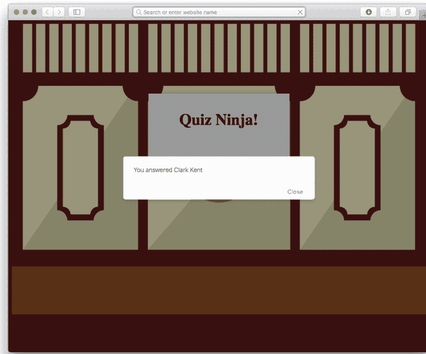

## 2-1. 让我们玩玩“测验忍者”吧！

你也可以在 CodePen¹¹ 上查看实时示例。

这是一个使用 `prompt` 和 `alert` 对话框，结合变量存储响应来与用户创建交互的良好示例。

## 章节总结

- 注释会被程序忽略，但可以让你的程序更易阅读和理解。
- 数据类型是所有 JavaScript 程序的各种构建模块。
- 有六种原始数据类型：字符串、符号、数字、布尔值、undefined 和 null。
- 非原始数据类型（如数组、函数和对象）的类型都是 object。
- 变量指向存储在内存中的值，并使用 `const` 或 `let` 关键字声明。
- 使用 `=` 运算符将值赋值给变量。
- 字符串和数字有各种属性和方法，提供有关它们的信息。
- 符号（Symbols）是唯一的、不可变的值。
- 布尔值只有 `true` 或 `false`。
- JavaScript 中只有七个值为 `false`，这些值被称为假值（falsy values）。
- 数据类型可以转换为其他数据类型。
- 类型强制转换（Type coercion）是 JavaScript 为了执行操作而尝试将一个值转换为另一种数据类型。
- 逻辑运算符可用于检查复合语句是真是假。
- 可以对值进行比较，查看它们是否与其他值相等、大于或小于值。

在下一章中，我们将学习数据结构、逻辑和循环。

# 第 3 章

# 数组、逻辑与循环

在本章中，我们将查看 JavaScript 中用于存储值列表的一些数据结构。这些被称为数组（arrays）、集合（sets）和映射（maps）。我们还将查看允许控制程序流的逻辑语句，以及允许我们重复执行代码块的循环。

本章将涵盖以下主题：

- 数组字面量
- 从数组中添加和删除值
- 数组方法
- 集合
- 映射
- if 和 else 语句
- switch 语句
- while 循环
- do ... while 循环
- for 循环
- 遍历集合
- 项目 —— 我们将使用数组、循环和逻辑在测验中提出多个问题

## 数组

数组是一个按顺序排列的值列表。要创建一个数组字面量，只需写一对方括号即可：

```javascript
const myArray = [];
```

你也可以使用数组构造函数：

```javascript
const myArray = new Array();
```

这二者都会产生一个空数组对象，但由于多种原因¹，更倾向于使用数组字面量，而且它们需要的输入更少！

数组不是原始值，而是一种特殊的内置对象，正如我们使用 `typeof` 运算符时看到的的：

> 1. http://stackoverflow.com/questions/885156/whats-wrong-with-var-x-new-array

```javascript
typeof []
'object'
```

你可以在 SitePoint 2 上阅读更多关于创建和操作数组的知识。

## 初始化数组

我们可以通过以下代码创建一个名为 `heroes` 的空数组字面量：

```javascript
const heroes = [];
```

我们可以通过以下代码获取 `heroes` 数组中索引为 0 的元素的值：

```javascript
heroes[0]
undefined
```

要访问数组中的特定值，我们在方括号中写入它在数组中的位置（这被称为它的索引）。如果数组中的某个元素为空，则返回 `undefined`。

## 向数组添加值

为了将字符串 'Superman' 放在 `heroes` 数组的第一个元素中，我们可以将其赋值给元素 0，如下：

```javascript
heroes[0] = 'Superman';
```

数组中的每项都可以被更改。例如，我们可以将第一个项的值改为：

> 2. https://www.sitepoint.com/quick-tip-manipulate-arrays-in-javascript/

```javascript
heroes[0] = 'Batman';
```

我们可以通过使用索引向数组添加值：

```javascript
heroes[1] = 'Wonder Woman';
```

我们可以找到 `heroes` 数组中索引为 2 的元素的值：

```javascript
heroes[2]
'Flash'
```

我们可以更改某一项的值：

```javascript
heroes[3] = 'Thor';
```

我们可以通过使用索引向数组添加更多值：

```javascript
heroes[4] = 'Aquaman';
```

## 创建数组字面量

```javascript
const Avengers = ['Captain America', 'Iron Man', 'Thor', 'Hulk', 'Hawkeye', 'Black Widow'];
```

要找到数组的长度，可以使用 `length` 属性：

```javascript
avengers.length;
6
```

`length` 属性可以作为索引的一部分来找到数组中的最后一项：

```javascript
avengers[avengers.length - 1];
'Black Widow'
```

`length` 属性是可变的，这意味着你可以手动更改它：

```javascript
avengers.length = 8;
```

正如你看到的，如果你让数组变长，额外的空位将用 `undefined` 填充：

```javascript
avengers.length = 3
<< 3
avengers
<< ['Captain America', 'Iron Man', 'Thor']
```

如果你让数组变得比现在的长度短，所有多余的元素将被完全移除。

## 从数组中删除值

`delete` 运算符将从数组中删除一项：

```javascript
delete avengers[3];
```

如果我们查看 `avengers` 数组，会发现第四项（'Hulk'）被删除了，但它所占据的空间仍然存在并包含 `undefined`：

```javascript
avengers;
```

## 解构数组

解构数组是从数组中提取值并将其作为单独的值呈现。

```javascript
const [x,y] = [1,2];
```

虽然赋值是通过数组进行的，但每个变量都是独立的。我们可以通过检查每个变量的值来看这一点：

```javascript
x
1
y
2
```

解构还为我们提供了交换两个变量值的方法：

```javascript
[x,y] = [y,x];
x
2
y
1
```

在 ES6 之前，必须使用临时变量来实现相同的效果：

```javascript
const temp = x;
x = y;
y = temp;
```

你可以在 SitePoint 上阅读更多关于解构的内容。

+ 3. https://www.sitepoint.com/preparing-ecmascript-6-destructuring-assignment/

## 数组属性和方法

数组是 JavaScript 忍者工具中的强大武器，并有一些实用的方法。为了演示这一点，我们将使用下面的 `avengers` 数组，它与我们之前产生的相似。你需要通过向控制台输入以下来创建引用：

```javascript
const avengers = ['Captain America', 'Iron Man', 'Thor', 'Hulk', 'Hawkeye', 'Black Widow'];
```

要找到数组的长度，可以使用 `length` 属性：

```javascript
avengers.length;
6
```

`length` 属性可以作为索引的一部分来找到数组中的最后一项：

## Pop, Push, Shift, and Unshift

要从数组删除最后一个项，我们可以使用 `pop()` 方法：

```javascript
avengers.pop();
<< 'Thor'
```

该方法返回数组的最后一个项，但数组不再包含该项。如果我们查看 `avengers` 数组，会发现它不再包含字符串 "Thor" 了：

```javascript
avengers
<< ['Captain America', 'Iron Man']
```

`shift()` 方法的工作方式与 `pop()` 方法类似，但它删除的是数组中的第一个项：

```javascript
avengers.shift();
<< 'Captain America'
```

`push()` 方法将新值附加到数组的末尾：

```javascript
avengers.push('Thor');
<< 2
```

返回值是数组的新长度：

`unshift()` 方法与 `push()` 方法类似，但它在数组的*开头*添加一个新项：

```javascript
avengers.unshift('Captain America');
<< 3
```

## Merging Arrays

`concat()` 方法可以将一个数组与一个或多个数组合并：

```javascript
avengers.concat(['Hulk', 'Hawkeye', 'Black Widow']);
<< ['Captain America', 'Iron Man', 'Thor', 'Hulk',
  'Hawkeye', 'Black Widow']
```

注意，这不会改变 `avengers` 数组，它只是创建了另一个结合这两个数组的新数组。你可以使用赋值将 `avengers` 数组更新为这个新数组：

```javascript
avengers = avengers.concat(['Hulk', 'Hawkeye', 'Black
  Widow']);
<< ['Captain America', 'Iron Man', 'Thor', 'Hulk',
  'Hawkeye', 'Black Widow']
```

现在如果我们检查 `avengers` 数组的值，可以看到它包含了字符串 "Hulk", "Hawkeye" 和 "Black Widow"：

```javascript
<< ['Captain America', 'Iron Man', 'Thor', 'Hulk',
  'Hawkeye', 'Black Widow']
```

另一种方法是使用 ES6 中添加的新扩展展开运算符（spread operator）。展开运算符是三个点 `...`，它们放在数组前面，效果是展开该数组的元素。它可以用于展开两个数组的元素并将它们放在一个新的数组中，如下所示：

```javascript
avengers = [ ...avengers, ...['Hulk','Hawkeye', 'Black
  Widow'] ];
<< ['Captain America', 'Iron Man', 'Thor', 'Hulk',
  'Hawkeye', 'Black Widow']
```

在上面的示例中，展开运算符既用于 `avengers` 数组，也用于新的数组字面量。它的效果是展开每个数组中的所有值，允许它们被放置在一个新数组中。

## The join() Method

`join()` 方法可以将数组转换为字符串，该字符串由数组中的所有项组成，并用逗号分隔：

```javascript
avengers.join();
<< 'Captain America, Iron Man, Thor, Hulk, Hawkeye,
  Black Widow'
```

你可以通过在括号内放置逗号以外的分隔符来选择其他分隔符。让我们尝试使用安培符 `&`：

```javascript
avengers.join(' & & ');
<< 'Captain America & Iron Man & Thor & 
```

## Slicing and Splicing

> 'Hulk & Hawkeye & Black Widow'

`slice()` 方法创建一个子数组；实际上是从原始数组中切出一段，从一个位置开始到另一个位置结束。例如，如果我们想找到数组中的第 3 个和第 4 个项，我们将使用以下代码：

```javascript
avengers.slice(2,4) // 从第三个项开始（索引为 2）
// 在第四个项结束（索引为 4 的项不被
  包含在内）
<< ['Thor', 'Hulk']
```

注意，此操作是非破坏性的——实际上没有从数组中移除任何项，正如我们查看 `avengers` 数组时所示：

```javascript
avengers
<< ['Captain America', 'Iron Man', 'Thor', 'Hulk',
  'Hawkeye', 'Black Widow']
```

`splice()` 方法从数组中删除项，然后在原有位置插入新项。例如，以下代码删除了字符串 "Hulk" 并将其替换为 "Scarlet Witch"。

```javascript
avengers.splice(3, 1, 'Scarlet Witch');
<< ['Hulk']
```

这是一个破坏性操作，因为它改变了数组的值，如下所示：

```javascript
avengers
<< ['Captain America', 'Iron Man', 'Thor', 'Scarlet
  Witch', 'Hawkeye', 'Black Widow']
```

括号中的第一个数字告诉我们开始 `splice` 的索引。在这个示例中，第二个数字是要移除的项数，随后的参数是要需要插入的项。

`splice()` 方法非常通用，因为它它可以从数组中删除元素，也可以用于插入或替换元素。

```javascript
avengers.splice(3, 1, 'Scarlet Witch', 'Hawkeye', 'Black Widow');
```

```javascript
coordinates[1][1]; // 第二个数组的第二个值
<< 2
```

我们之前遇到的扩展运算符可以用于展平多维数组。扁平化数组涉及移除所有嵌套的数组，使得所有值都处于数组的同一层级。你可以在下面看到一个扁平化数组的示例：

```javascript
const summer = ['Jun', 'Jul', 'Aug'];
const winter = ['Dec', 'Jan', 'Feb'];
const nested = [ summer, winter ];
<< [ 'Jun', 'Jul', 'Aug' ], ['Dec', 'Jan', 'Feb'] ]
```

```javascript
const flat = [...summer, ...winter];
<< [ 'Jun', 'Jul', 'Aug', 'Dec', 'Jan', 'Feb' ]
```

关于创建和操作数组的总结可以在 SitePoint⁴ 上找到。

## Sets (集合)

Sets 是 ES6 中引入规范的。Set 是一种表示唯一值集合的数据结构，因此它不能包含任何重复值。它们在概念上与数学集合⁵ 相似，虽然（至少目前）它们不包含并集、交集和积集等数学运算。

Sets 提供了一种实用的数据跟踪方式，无需检查任何值是否重复。检查特定值是否在集合中也是快速且方便的，而如果使用数组，这种操作可能会很慢。

⁵. https://en.wikipedia.org/wiki/Set%28mathematics%29

## Creating Sets (创建集合)

使用 `new` 运算符和 `Set()` 构造函数创建一个空集合：

```javascript
const list = new Set();
```

在编写时，目前还没有创建集合的字面量表示法。

## Adding Values to Sets (向集合添加值)

可以使用 `add` 方法将值放入集合中：

```javascript
list.add(1);
Set { 1 }
```

通过重复 `add()` 方法可以向集合添加多个项：

```javascript
list.add(2).add(3).add(4);
```


# Sets（集合）

```javascript
Set { 1, 2, 3, 4 }
```

如果你尝试添加一个已包含在集合中的值，则该操作将被简单忽略：

```javascript
list.add(1);
Set { 1, 2, 3, 4 }
```

可以通过将多个值放在作为参数提供的数组中来一次性地添加到集合中：

```javascript
const numbers = new Set([1,2,3]);
```

要查看集合的内容，只需输入引用它的变量名即可：

```javascript
numbers
<< Set { 1, 2, 3 }
```

如果数组中有任何重复值，那么它们在集合中只会出现一次：

```javascript
const moreNumbers = new Set([7,7,7,7,7,8,8,8,9,9]);
moreNumbers
<< Set {7,8,9}
```

这提供了一种方便的方法，可以通过单次操作消除数组中的任何重复值。

如果使用字符串作为参数，则每个字符将作为单独的元素添加，重复的字符将被忽略：

```javascript
const letters = new Set('hello');
letters
<< Set { 'h', 'e', 'l', 'o' }
```

如果你想添加单独的值，需要使用 `add()` 方法：

```javascript
const words = new Set().add('the').add('quick').add('brown').add('fox');
words
<< Set { 'the', 'quick', 'brown', 'fox' }
```

所有非原始值（如数组和对象）都被视为唯一值，即使它们包含相同的值。从表面上看，这似乎允许集合中存在重复值：

```javascript
const arrays = new Set().add([1]).add([1]);
arrays
<< Set { [ 1 ], [ 1 ] }
```

这两个数组看起来相同，但它们被认为是不同的对象。可以通过以下严格相等测试看到这一点：

```javascript
[1] === [1];
<< false
```

在将值添加到集合时，不会使用类型转换，字符串 `"2"` 将作为一个新条目添加，即使数字 `2` 已经是集合中的一个元素：

```javascript
const mixedTypes = new Set().add(2).add('2');
mixedTypes
<< Set { 2, '2' }
```

## Set Methods（集合方法）

可以使用 `size` 属性找到集合中值的数量：

```javascript
const jla = new Set().add('Superman').add('Batman').add('Wonder Woman');
jla
<< Set { 'Superman', 'Batman', 'Wonder Woman' }
jla.size
<< 3
```

可以使用 `has()` 方法检查一个值是否在集合中。它返回一个 `true` 或 `false` 的布尔值：

```javascript
jla.has('Superman');
<< true
jla.has('Flash');
<< false
```

`Set` 使用的 `has()` 方法是一种非常高效的操作，比使用 `includes()` 或 `indexOf()` 方法检查值是否在数组中快得多。

`Set` 没有用于索引表示法来检查单个条目，因此你无法这样找到集合中第一个元素的值：

```javascript
jla[0]
<< undefined
```

## Removing Values From Sets（从集合中移除值）

可以使用 `delete()` 方法从集合中移除一个值。如果值从集合中删除，则返回 `true`；如果值不在集合中且无法删除，则返回 `false`：

```javascript
jla.delete('Superman');
<< true
jla.delete('Flash');
<< false
```

可以使用 `clear()` 方法移除集合中的所有值：

```javascript
jla.clear();
jla
<< Set {}
jla.size
<< 0
```

## Converting Sets to Arrays（将集合转换为数组）

可以通过将集合连同扩展运算符直接放在数组字面量内部来将集合转换为数组。

为了演示这一点，我们先创建一个包含三个项的集合：

```javascript
const shoppingSet = new Set().add('Apples').add('Bananas').add('Beans');
shoppingSet
<< { 'Apples', 'Bananas', 'Beans' }
```

然后将其转换为数组：

```javascript
const shoppingArray = [...shoppingSet];
shoppingArray
<< [ 'Apples', 'Bananas', 'Beans' ]
```

也可以使用 `Array.from()` 将集合转换为数组。以下代码将实现相同的结果：

```javascript
const shoppingSet = new Set().add('Apples').add('Bananas').add('Beans');
const shoppingArray = Array.from(shoppingSet);
shoppingArray
<< [ 'Apples', 'Bananas', 'Beans' ]
```

## Weak Sets（弱集合）

在下一个示例中，我们可以看到如果向弱集合添加一个数组会发生什么：

```javascript
const array = [1,2,3];
const weak = new WeakSet();
weak.add(array);
<< WeakSet {}
```

由于弱映射对对象使用弱引用，它们无法访问其所包含的值列表。这使得示例中的返回值看起来弱集合是空的，但实际上它并不是。

我们可以通过使用 `has()` 方法来确认它确实包含了该数组：

```javascript
weak.has(array);
<< true
```

我们可以使用 `delete()` 方法从弱集合中删除该数组：

```javascript
weak.delete(array);
<< true
```

然后再次使用 `has()` 方法检查它是否已被移除：

```javascript
weak.has(array);
<< false
```

# Maps（映射）

`Map` 是在 ES6 规范中引入的另一种数据结构。它们是存储键值对列表的方便方式，类似于其他编程语言中的“哈希”、“哈希表”或“字典”。

乍看之下，`Map` 看起来与 JavaScript 对象（在第 5 章介绍）相似，但它们有一些明显的区别：

- 对象的键被限制为字符串，而 `Map` 可以使用任何数据类型作为键。
- 没有高效的方法可以找到对象包含多少个键值对，而在 `Map` 中通过 `size` 属性可以轻松地做到。
- 对象拥有可以调用的方法（见第 5 章）和可以用于创建继承链的原型（见第 12 章），而 `Map` 仅专注于键值对的存储和检索。
- 对象属性的值可以直接访问，而 `Map` 则限制你必须使用 `get()` 方法来检索任何值。

## Creating Maps（创建映射）

可以使用 `new Map()` 构造函数创建一个空的 `Map` 对象：

```javascript
const romanNumerals = new Map();
```

在编写本文时，还没有创建 `Map` 的字面量表示法。

## Adding Entries To Maps（向映射添加条目）

可以使用 `set()` 方法向 `Map` 添加键值对。第一个值是键，第二个值是值：

```javascript
romanNumerals.set(1, 'I');
<< Map { 1 => 'I' }
```

返回值显示了映射关系，键通过“箭头”符号 (`=>`) 连接到值。

可以通过连续多次调用 `set()` 方法一次性添加多个项：

```javascript
romanNumerals.set(2,'II').set(3,'III').set(4,'IV').set(5,'V');
<< Map { 1 => 'I', 2 => 'II', 3 => 'III', 4 => 'IV', 5 => 'V' }
```

## Map Methods（映射方法）

`Map` 有点像字典，你可以根据键查找值。要查找一个值，我们可以使用 `get()` 方法：

```javascript
romanNumerals.get(4);
<< 'IV'
```

可以使用 `has()` 方法检查特定键是否在 `Map` 中。它返回一个 `true` 或 `false` 的布尔值：

```javascript
romanNumerals.has(5);
<< true
romanNumerals.has(10);
<< false
```

可以使用嵌套数组作为参数来创建一个包含多个值的 `Map`：

```javascript
const heroes = new Map([
  ['Clark Kent', 'Superman'],
  ['Bruce Wayne', 'Batman']
]);
```

可以通过查询 `size` 属性找到 `Map` 中键值对的数量：

```javascript
heroes.size
<< 2
```

## Removing Entries From Maps（从映射中删除条目）

可以使用 `delete()` 方法从 `Map` 中删除键值对。如果值被移除，则返回 `true`；如果不在 `Map` 中，则返回 `false`。要删除特定的值，你需要指定键。

`clear()` 方法将删除 `Map` 中的所有键值对：

```javascript
heroes.clear();
```

## Converting Maps to Arrays（将映射转换为数组）

`Map` 通过扩展运算符转换为数组：

```javascript
[...romanNumerals];
```

## Weak Maps（弱映射）

`WeakMap` 的工作方式与 `WeakSet` 相同，它们的键不是原始类型，并且会被垃圾回收。

要创建一个弱映射，可以使用 `WeakMap()` 构造函数：

```javascript
const weak = new WeakMap();
```

# Logic（逻辑）

在本节中，我们将学习如何使用条件控制程序的流程。

## if Statements（if 语句）

`if` 语句用于在条件为真时执行代码块。它看起来如下：

```javascript
if (condition) {
  // 条件为真时执行的代码
}
```

`else` 关键字用于在条件为假时添加备用代码块：

```javascript
if (condition) {
  // 条件为真时执行的代码
} else {
  // 条件为假时执行的代码
}
```

作为一个示例，我们可以使用上一节学过的 `%` 运算符来测试数字是奇是偶：

```javascript
const n = 12;
if (n % 2 === 0) {
  console.log('n 是偶数');
} else {
  console.log('n 是奇数');
}
```

## Ternary Operator（三元运算符）

编写 `if...else` 语句的简便方法是使用三元运算符，它按照以下格式接受三个操作数：

```javascript
条件 ? (为真执行的代码) : (为假执行的代码)
```

这里是测试变量 `n` 为奇偶数的示例，使用三元运算符重写：

```javascript
const n = 5;
n % 2 === 0 ? console.log('n 是偶数') : console.log('n 是奇数');
```

我们可以通过将三元运算符放在模板字符串中使示例更短：

```javascript
console.log(`n 是 ${(n % 2 === 0) ? '偶' : '奇'} 数`);
```

## Switch Statements（switch 语句）

你实际上可以将许多 `if` 和 `else` 语句组合在一起以创建一个逻辑决策树：

```javascript
if (number === 4) {
  console.log('你掷出了 4');
} else if (number === 5) {
  console.log('你掷出了 5');
} else if (number === 6) {
  console.log('你掷出了 6');
} else {
  console.log('你掷出了小于 4 的数字');
}
```

当有很多条件需要测试时，可以使用 `switch` 语句使代码更容易读。上面的示例可以使用 `switch` 语句重写：

```javascript
switch (number) {
  case 4:
    console.log('你掷出了 4');
    break;
  case 5:
    console.log('你掷出了 5');
    break;
  case 6:
    console.log('你掷出了 6');
    break;
  default:
    console.log('你掷出了小于 4 的数字');
}
```

你正在比较的值放在 `switch` 运算符后的括号中。随后使用 `case` 关键字对应每个可能出现的值（在上面的示例中为 4、5 和 6）。在每个 `case` 语句之后是当该情况发生时需要运行的代码。

使用 `break` 关键字结束每个 `case` 块是非常重要的，因为这会停止执行任何其他的 `case` 块。如果没有 `break` 语句，程序将发生“穿透”（fall through）并继续评估后续的 `case` 块。这有时是刻意为之，但这是一种权宜之计，可能会引起混淆。因此，应该避免这样做——忍者程序员总是用 `break` 结束一个 `case` 块！

`default` 关键字用于最后，当没有任何 `case` 为真时需要运行任何代码。

# Loops（循环）

循环将根据某些条件重复执行某段代码。

## While 循环

我们将开始 `while` 循环。它会在特定条件为真时重复运行代码块，并采用以下结构：

```javascript
while (condition) {
  // do something
}
```

这是一个示例，它将从 10 开始倒数，每次记录一首著名歌曲中的行词：

```javascript
let bottles = 10;
while (bottles > 0) {
  console.log(`There were ${bottles} green bottles, hanging on
   wall. And if one green bottle should accidentally fall,
  there'd be ${bottles - 1} green bottles hanging on the wall`);
  bottles--;
}
```

我们首先声明一个名为 `bottles` 的变量。循环中使用的任何变量必须在循环运行之前初始化，否则在提到它们时将会出错。

循环从 `while` 关键字开始，后面跟着一个条件和一个代码块。示例中的条件是 `bottles` 变量大于零。这基本上意味着“重复执行代码块”。

代码块使用 `console.log` 函数显示关于 `bottles` 数量的消息。

下面是编写相同循环的更简洁的写法，它将递减操作移到了条件中：

```javascript
let bottles = 11;
while (--bottles) {
  console.log(`There were ${bottles} green bottles, hanging on
  wall. And if one green bottle should accidentally fall,
  there'd be ${bottles - 1} green bottles hanging on the`);
}
```

这段代码之所以有效，是因为 `bottles` 变量为真时循环将继续，在每次循环之前，`bottles` 变量的值减 1。当 `bottles` 变量达到 0 时，它不再为真（记住 0 是假值），因此循环将停止。注意，你必须从 11 开始，因为它在运行第一个代码块之前就会减一。

## 死循环

`while` 循环中的条件在某一点必须满足，否则你的代码将陷入可能导致程序崩溃的死循环。考虑以下循环：

```javascript
let n = 1;
while (n > 0) {
  console.log('Hello');
  n++;
}
```


这个循环将一直运行，因为变量 `n` 始终大于零。大多数浏览器会在这种情况时警告你脚本运行缓慢，并提供停止选项。你可以关闭标签页或重启浏览器来杀死它。显然，你想避免这种情况。

## do ... while 循环

`do ... while` 循环与 `while` 循环相似。区别在于条件位于代码块之后：

```javascript
do {
  something
} while(condition)
```

这意味着无论条件是否为真，代码块至少运行一次。

这里是之前看到的相同示例重写为 `do ... while` 循环：

```javascript
bottles = 10;

do {
  console.log(`There are ${bottles} green bottles, hanging on
  wall. And if one green bottle should accidentally fall,
  there'd be ${bottles-1} green bottles hanging on the wall`);
  bottles--;
} while (bottles > 0)
```

## For 循环

`For` 循环可能是 JavaScript 中常用的循环类型，形式如下：

```javascript
(initialization ; condition ; after) { do something }
```

初始化代码在循环开始前运行，通常用于初始化循环中使用的任何变量。必须满足条件循环才能继续。`after` 代码是循环每次迭代后要的操作，通常用于递增计数器。

## 数组、逻辑与循环 (Arrays, Logic, and Loops)

这里是用 `for` 循环编写的绿瓶示例：

```javascript
for (let bottles = 10 ; bottles > 0 ; bottles--) {
  console.log(`There ${bottles} green bottles, hanging on
  wall. And if one green bottle should accidentally fall,
  there'd be ${bottles-1} green bottles hanging on the wall`);
}
```

循环的每个部分都是可选的，所以可以写成：

```javascript
let bottles = 10;

for ( ; bottles > 0 ; bottles--) { // 初始化移动到这里
  console.log(`There ${bottles} green bottles, hanging on
  wall. And if one green bottle should accidentally fall,
  there'd be ${bottles-1} green bottles hanging on the wall`);
}
```

## 嵌套循环 (Nested Loops)

你可以将一个循环放在另一个循环内部创建嵌套循环。这是一个到 12 的乘法表示例：

```javascript
for(let i = 1; i <= 12; i++){
  for(let j = 1; j <= 12; j++){
    console.log(`${i} by ${j} is ${i*j}`);
  }
}
```

## 遍历数组 (Looping over Arrays)

循环可以遍历数组中的每个值。如果我们取出之前的数组示例，可以使用下面的循环创建一个在控制台中输出每个项的 `for` 循环：

```javascript
for(let i=0, max=avengers.length; i < max; i++) {
  console.log(avengers[i]);
}
```

此示例中有点：数组索引从零开始，所以确保 `for` 循环中的初始计数器值也从零开始。我们希望循环持续到达到数组长度；这可以设置为循环初始化部分的变量 `max`，然后条件为 `i < max`。这比使用 `i < avengers.length` 更好，因为后者每次通过循环都会重新计算 `avengers` 数组的长度。这听起来可能不重要，但对于大数组，程序速度会有巨大影响。

ES6 引入了一种改进的数组迭代器，称为 `for-of` 循环，它使用了略不同的语法：

```javascript
for(const value of avengers){
  console.log(value);
}
```

这用一个变量（上述示例中的 `value`）替换了 'for' 循环的所有设置，代表数组中每个元素的值。注意该变量需要使用 `const` 声明。

## 遍历集合 (Sets)

集合（Sets）是可枚举的，这意味着它们拥有允许你遍历集合中每个值的方法。循环将按照值添加到集合的顺序对每个值进行迭代。为了演示这一点，我们将使用之前创建的字母集合。

```javascript
const letters = new Set('hello');
```

我们可以使用 `for-of` 循环来遍历集合中的每个值，如下：

```javascript
for(const letter of letters) {
  console.log(letter);
}
// helo
```

注意，弱集合（weak sets）是不可枚举的，因此无法通过这种方式遍历它们。

## 遍历映射 (Maps)

映射（Maps）也是可枚举的，因此也可以以类似于集合的方式遍历映射。循环将按照键值对被添加到映射的顺序对每个键值对进行迭代。例如，让我们使用之前创建的罗马数字映射 `romanNumerals`：

```javascript
const romanNumerals = new Map();

romanNumerals.set(1,'I').set(2,'II').set(3,'III').set(4,'IV');
romanNumerals.set(5,'V');

romanNumerals
// Map { 1 => 'I', 2 => 'II', 3 => 'III', 4 => 'IV', 5 => 'V' }
```

每个映射对象都有一个 `keys()` 方法，允许我们使用以下 `for-of` 循环遍历每个键：

```javascript
for(const key of romanNumerals.keys()) {
  console.log(key);
}
// 1
// 2
// 3
// 4
// 5
```

还有一个 `values()` 方法，允许我们以类似的方式遍历值：

```javascript
for(const value of romanNumerals.values()) {
  console.log(value);
}
// I
// II
// III
// IV
// V
```

如果你想同时访问键和值，可以使用 `entries()` 方法：

```javascript
for(const [key,value] of romanNumerals.entries()) {
  console.log(`${key} in Roman numerals is ${value}`);
}
// 1 in Roman numerals is I
// 2 in Roman numerals is II
// 3 in Roman numerals is III
// 4 in Roman numerals is IV
// 5 in Roman numerals is V
```

注意，弱映射（weak maps）也是不可枚举的，因此无法使用上述任何方法来遍历它们。

## Quiz Ninja 项目

我们已经到达本章的末尾，是时候使用所学的知识为我们的 Quiz Ninja 项目添加一些功能了。

我们将开始创建一个名为 `quiz` 的数组，包含所有的问题和答案。`quiz` 中的每个元素都将是一个嵌套数组，其中第一个元素是问题，第二个元素是答案。打开 `main.js` 并在顶部添加以下代码：

```javascript
const quiz = [
  ["What is Superman's real name?", "Clark Kent"],
  ["What is Wonder Woman's real name?", "Diana Prince"],
  ["What is Batman's real name?", "Bruce Wayne"]
];
```

接下来，我们将创建并初始化名为 `score` 的变量，用于跟踪玩家给出了多少正确答案：

```javascript
let score = 0 // 初始化分数
```

然后，我们将使用 `for-of` 循环遍历数组，将变量 `question` 和 `answer` 赋值给映射中的每个键和值。

循环首先通过 `prompt` 对话框提出问题，允许玩家输入答案并将其存储在名为 `response` 的变量中。然后我们可以将其与存储在 `answer` 中的实际答案进行比较：

```javascript
for(const [question,answer] of quiz){
  const response = prompt(question);
  if(response === answer){
    alert('Correct!');
    score++;
  } else {
    alert(`Wrong! The correct answer was ${answer}`);
  }
}
```

使用 `if ... else` 块来检查答案是否正确。如果正确，会弹出一个 `alert` 对话框显示是正确的，并使用 `score++` 将分数加 1。否则，如果答案错误，`alert` 对话框会告知玩家并让他们知道正确答案。

当循环完成数组中每个问题的迭代后，它将跳出块并通过显示另一个 `alert` 对话框告知玩家游戏结束，并告诉他们答对了多少个问题。这里使用了模板字符串（template literal）来显示分数：

```javascript
// 游戏结束时，报告玩家的分
alert(`Game Over, you scored ${score} point${score != 1 ? 's' : ''}`);
```

在这个模板字符串的末尾，我们使用三元运算符来检查分数是否不等于 1。如果是，则在单词 "point" 的末尾附加字母 "s" 以变为复数。这是一个巧妙的技巧，即使在专业网站上有时也会被忽略。

通过打开 `index.html` 文件，在浏览器中尝试玩问答。它看起来应该像下面的截图。

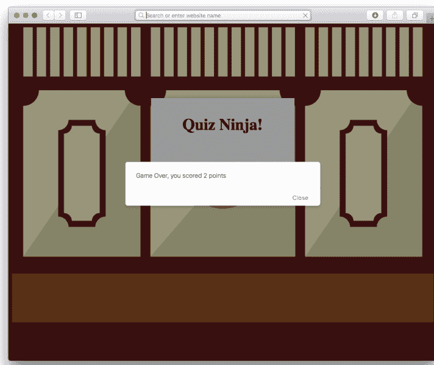

3-1. Quiz Ninja 得分

你也可以在 CodePen⁶ 上看到实时示例。

我们的问答现在感觉更像一个真实的程序了，并展示了我们在本章中学到的数组、逻辑和循环等概念的力量。

## 本章总结

- 数组是值的有序列表
- 多维数组是包含其他数组的数组
- 数组有许多方法可以用于操作数组中的项
- 集合（Sets）是 ES6 新引入的特性，是不重复值的有序列表
- 映射（Maps）是 ES6 新引入的特性，是键值对的有序列表
- 我们可以使用 `if` 和 `else` 语句控制代码流
- `switch` 语句可以代替多个 `if` 和 `else` 语句
- `while` 循环和 `do ... while` 循环可以在条件仍为真时重复代码块
- `for` 循环的工作方式与 `while` 循环类似，但语法不同
- `for-of` 循环可以用于遍历数组
- 集合和映射是枚举的，因此也可以使用 `for-of` 循环进行遍历

在下一章中，我们将学习关于函数的所有知识，这是 JavaScript 语言的一个基础组成部分。

> ⁶. http://codepen.io/daz4126/pen/XRyMje

# 第 4 章

# 函数

函数是一段可以通过名称引用的代码块，几乎就像一个小小的、自包含的微程序。函数可以帮助减少重复并使代码更易读。

在本章中，我们将涵盖以下主题：

- 定义函数——函数声明、函数表达式、`Function()` 构造函数和新的箭头语法
- 调用函数
- 返回值
- 参数和实参
- 提升（Hoisting）——变量和函数
- 回调函数（Callbacks）——作为参数的函数
- 项目——我们将使用函数让 Quiz Ninja 代码更易读

在 JavaScript 中，函数被视为第一类对象。这意味着它们的行为与语言中的所有其他原始数据类型和对象相同。它们可以被赋值给变量，存储在数组中，甚至可以从另一个函数返回。这使得函数成为 JavaScript 语言中非常重要且强大的部分，它的许多功能都依赖于此。完全理解函数是 JavaScript 忍者的一项技能。

## 定义函数

在 JavaScript 中有多种定义函数的方法。下面涵盖了最常用的三种。ES6 引入了定义函数的新方法，使用所谓的“箭头”（arrow）符号。这将在本章稍后部分介绍。

### 函数声明

要定义函数字面量，可以使用函数声明：

```javascript
function hello(){
  console.log('Hello World!');
}
```

它以 `function` 关键字开头，后面是函数的名称（在本例中为 'hello'），然后是括号。随后是一个包含函数代码的块。

这被称为命名函数，因为函数有一个名称：'hello'。

### 函数表达式

另一种定义函数字面量的方法是创建函数表达式。这会将匿名函数赋值给变量：

```javascript
const goodbye = function(){
  console.log('Goodbye World!');
};
```

示例中的函数被称为匿名函数，因为它没有名称；它只是被创建并赋值给变量 `goodbye`。或者，我们可以创建一个命名的函数表达式：

```javascript
const goodbye = function bye(){
  console.log('Goodbye World!');
};
```

这个函数的名称是 `bye`，它已被赋值给变量 `goodbye`。

注意示例也以分号结束。这完成了赋值语句，而普通的函数声明以块结束（块的末尾不需要分号）。

### 每个函数都有一个名称

所有函数都有一个只读属性 `name`，可以通过如下方式访问它：

```javascript
hello.name
// 'hello'
```

`name` 属性实际上并不是 ECMAScript 标准的一部分，尽管 JavaScript 引擎支持它并在内部使用它。

在大多数浏览器中，匿名函数的 `name` 属性为空字符串，但某些版本的 Internet Explorer 使用 `undefined`。

在调试代码时，`name` 属性可能非常有用；函数 `Function()` 的名称将用于指示是哪些函数导致了问题。

### Function() 构造函数

函数也可以使用构造函数 `Function()` 来声明。函数体以字符串的形式传入，如例所示：

```javascript
const hi = new Function("console.log(\"Hi World!\")");
```

不建议以这种方式声明函数，因为将函数放在字符串内部会带来很多问题。即使在这个简单的示例中，我们也必须为 `console.log` 方法使用不同的引号，以区分定义函数本身使用的引号。通过这种方式创建的函数也是在全局作用范围内创建的，无论它们实际在何声明。这可能会导致一些奇怪且意想不到的行为。

忍者程序员应该始终使用函数字面量、函数声明或函数表达式来声明函数。这两种创建函数的方法是相似的，尽管在本章稍后会介绍一些细微的区别。有些人偏于使用函数声明，因为它们类似于其他语言中声明函数的方式。另一些人偏于使用函数表达式，因为这很明显函数只是赋值给变量的另一个值，而不是语言的特殊特性。使用函数声明还是函数表达式通常取决于个人喜好，无论你选择哪种，请保持一致！

## 调用函数

调用函数是运行函数体内部的代码。要调用函数，只需输入其名称并后跟圆括号即可。这就是我们调用 `hello` 函数的方式：

```javascript
hello();
// 'Hello world!'
```

只需通过输入其名称后跟圆括号就可以反复调用该函数。这是使用函数的优势之一——不需要编写重复的块代码。另一个优势是所有功能都保留在一个地方。如果你想更改部分内容，只需要更新函数声明中的那部分代码即可。这被称为 DRY 原则，意为“不要重复”（Don't Repeat Yourself）。

### 保持代码 DRY

> 不要重复（Don't Repeat Yourself，简称 DRY）是一项编程原则，它规定程序的每个部分应该只编写一次。这避免了重复，意味着不再需要维护和同步多份相同的代码。

如果你已将函数赋值给一个变量，你需要在变量后加上圆括号以将其作为函数调用：

```javascript
goodbye();
// 'Goodbye World!'
```

¹ http://en.wikipedia.org/wiki/Don't_repeat_yourself

记住：你需要圆括号来调用函数——无论是通过名称，还是通过对其赋值所在变量的引用。如果你跳过圆括号，你只是在引用函数本身，而不是调用它，如这里所示：

```javascript
goodbye;
// [Function: goodbye]
```

返回的所有内容变量 `goodbye` 指向的函数定义，而不是运行代码。如果你想将函数赋值给另一个变量，这非常有用，例如：

```javascript
seeya = goodbye;
// [Function: goodbye]
```

现在变量 `seeya` 也指向名为 `bye` 的函数，并可以使用它来执行调用：

```javascript
seeya();
// 'Goodbye World!'
```


## 返回值

所有函数都会返回一个值，可以使用 `return` 语句指定，该语句跟在 `return` 关键字之后。不显式返回任何内容的函数（如我们目前为止的所有示例）将默认返回 `undefined`。

此示例中的函数将返回字符串 'Howdy World'：

```javascript
function howdy(){
  return 'Howdy World!';
}
```

这意味着我们现在可以将函数调用赋值给变量，该变量的值将是函数的返回值：

```javascript
const message = howdy();
// 'Howdy World!'
```

`message` 现在指向 `howdy()` 函数的返回值，即 'Howdy World!'。这在这种情况下似乎微不足道，但在复杂场景下有用。

## 参数与实参

参数和实参经常通用，但它们是有区别的。参数是在函数定义中列出的变量，而实参是在调用函数时传递的实际值。

```javascript
function square(x){
  return x * x;
}

square(5); // 25
```

我们也可以拥有接受多个参数的函数：

```javascript
function mean(a, b, c){
  return (a + b + c) / 3;
}

mean(1, 2, 3); // 2
```

如果我们不知道会输入多少参数，可以使用 `arguments` 对象或剩余参数（rest parameter）：

```javascript
function sum(){
  let total = 0;
  for (let i = 0; i < arguments.length; i++) {
    total += arguments[i];
  }
  return total;
}

sum(1, 2, 3, 4); // 10
```

## 精度误差

你可能注意到某些除法的答案略不准确。这是由于计算机使用二进制，因此难以精确表示某些分数。

```javascript
1 / 3; // 0.3333333333333333
```

这是编程中的一个常见问题，在处理精确数值计算时需要注意。

## 可变数量的参数

正如上面的示例所示，可以向函数输入任意数量的参数，即使只使用了其中一部分。某些情况下，我们不知道会输入多少参数。例如，我们可以改进 `mean()` 函数，允许用户计算任意数量值的平均值，而不是将其限制在仅 3 个。

```javascript
function mean(...args){
  let total = 0;
  for (let arg of args) {
    total += arg;
  }
  return total / args.length;
}

mean(1, 2, 3, 4, 5); // 3
```

```javascript
{ '0': 1, '1': 2, '2': 3, '3': 4, '4': 5 }
```

如你所见，返回的 `arguments` 对象包含了每一个输入的值。像处理数组一样使用索引表示法来访问它们，因此第一个参数可以通过 `arguments[0]` 访问。

问题在于 `arguments` 并不是数组。它具有 `length` 属性，你可以使用索引表示法读取和写入每个元素，但它不具备 `slice()`、`join()` 和 `forEach()` 等数组方法。虽然有从数组“借用”方法的方法，但这非常笨拙且没有必要。

更好的选择是使用**剩余参数（rest operator）**。它是在 ES6 中引入的，可以通过在函数体内部创建一个参数数组，来处理多个参数。

要使用剩余参数，只需在函数声明的最后一个参数前放置三个点（`...`）。这会将所有输入的参数收集到一个数组中。例如，下面的函数将能够访问包含所有参数的数组：

```javascript
function rest(...args){
  return args;
}
```

`args` 参数是一个真正的数组，可以使用相同的方法。例如，我们可以使用 `for-of` 循环来遍历作为参数提供的每个值：

```javascript
function rest(...args){
  for(arg of args) {
    console.log(arg);
  }
}

rest(2,4,6,8);
```

## 改进后的平均值函数

我们可以使用剩余参数来改进 `mean()` 函数，使其接受任意数量的值：

```javascript
function mean(...values) {
  let total = 0;
  for(const value of values) {
    total += value;
  }
  return total/values.length;
}
```

这会将所有输入的参数收集到一个名为 `values` 的数组中。我们可以遍历这个数组并累加所有值。变量 `total` 用于记录总和，`+=` 运算符用于将下一个值加到总和上。在函数结束时，我们将 `total` 除以输入的参数数量（通过调用 `values` 数组的 `length` 属性获得）。让我们看看是否有效：

```javascript
mean(2,8,13,11,4,2);
// << 6.666666666666667
```

## 默认参数

ES6 引入了一种为函数指定默认参数的便捷方法。如果是在调用函数时没有提供参数，函数将使用这些值。若要指定默认参数，只需在函数定义中为它分配默认值即可：

```javascript
function hello(name='World') {
  console.log(`Hello ${name}`);
}
```

现在，如果我们不带任何参数调用此函数，它将使用 `World` 作为 `name` 参数：

```javascript
hello();
// << 'Hello World!'
```

我们可以通过指定自己的参数来覆盖默认值：

```javascript
hello('Universe');
// << 'Hello Universe!'
```


### ES6 之前

在 ES6 之前，分配默认值的方法是在函数体中使用类似下面的代码行：

```javascript
name = name || "World";
```

这使用逻辑或（`||`）运算符检查 `name` 参数是否具有真值。如果是，则说明为函数提供了参数，`name` 将保持该值。如果没有提供参数，`name` 的值将是 `undefined`，它是假值，因此它将取 `World` 的值。这种方法仍然经常被使用，但存在一个陷阱：它依赖于 `undefined` 的假值特性。然而，这并不是唯一的假值。如果 `name` 参数本意是想传入一个假值（例如 `0`），那么它将不会被使用，该值仍然会被设置为默认值 `World`。出于这个原因，你应该坚持使用 ES6 声明默认参数的方法。

## 提升

```javascript
console.log(name); // 赋值后将返回 'Alexa'
```

提升可能会导致一些困惑，并且依赖于 `var` 来声明变量。如果你尝试在使用 `const` 和 `let` 声明变量之前引用它，将抛出错误。更好的做法是在块的开始使用 `const` 和 `let` 声明任何变量，这样就不需要提升了。

函数表达式（将匿名函数赋值给变量）的提升方式与变量类似。因此，如果使用 `var` 声明它，那么声明会被提升，但实际函数本身不会。这意味着在函数出现在代码中之前，是无法调用它的：

```javascript
// 变量 helloExpression 的值为 undefined，所以
// 无法调用该函数
helloExpression(); // 抛出错误

// 函数声明可以在声明之前调用
helloDeclaration(); // 返回 'hello'

// 将函数表达式赋值给变量
var helloExpression = function() {
  console.log('hello')
}

// 声明函数声明
function helloDeclaration() {
  console.log('hello')
}

// 函数表达式只能在赋值后才能调用
helloExpression(); // 返回 'hello'
```

这是定义函数字面量的两种方式之间的主要区别，可能会影响你关于使用哪种方法的决定。有些人喜欢使用函数表达式，这意味着你必须在使用它们之前定义所有函数并将它们赋值给变量。

提升起初是一个难以理解的概念——你可以在 SitePoint 上阅读更多相关内容。

## 回调函数

还记得在本章开始时，我们说 JavaScript 中的函数是一等对象，因此它们的行为与其他任何对象都相同吗？这意味着函数也可以作为参数传递给另一个函数。作为参数传递给另一个函数被称为回调函数。

这是一个名为 `sing()` 函数的基本示例，它接受歌曲名称：

```javascript
function sing(song) {
  console.log(`I'm singing along to ${song}`);
}

sing('Let It Go')
// 'I'm singing along to Let It Go'
```

我们可以通过添加回调参数来让 `sing(song)` 函数更加灵活：

```javascript
function sing(song, callback) {
  console.log(`I'm singing along to ${song}.`);
  callback();
}
```

回调函数作为参数提供，然后在函数体内部被调用。

- [参考链接](https://www.sitepoint.com/back-to-basics-javascript-hoisting/)

### 如果函数没有作为参数提供怎么办？

实际上并没有什么专门用于定义某个参数为回调，所以如果函数没有作为参数提供，那么这段代码将无法工作。可以使用以下代码检查参数是否为函数：

```javascript
if(typeof(callback) === 'function'){
  callback();
}
```

只有当回调是一个函数时，才会尝试调用它。

现在我们可以创建另一个名为 `dance()` 的函数，可以作为回调：

```javascript
function dance() {
  console.log("I'm moving my body to the groove.");
}

// 在这些示例中，我们只是向控制台打印了一条简单的消息，但在实际意义上，这些函数
// 用于任何操作。
```

现在我们可以调用 `sing` 函数，但我们也可以边跳边唱：

```javascript
sing('Let It Go', dance);
// 'I'm singing along to Let It Go.'
// 'I'm moving my body to the groove.'
```

注意，回调 `dance` 是不带括号作为参数传递的。这是因为参数仅仅是函数的引用。实际的回调是在函数体内被调用的，那里使用了括号。

好了，在这些示例中，`dance()` 函数并没有真正做任何事，除了向控制台打印另一条消息，但希望你可以根据回调的不同通过 `sing()` 函数展示出非常不同的效果。

一个作为参数提供的函数，使得函数变得更加灵活。

函数还可以接受匿名函数作为回调。例如，假设我们想调用 `sing()` 函数，同时又想倒立着唱歌，但我们没有 `standOnHead()` 函数。我们可以改写一个匿名函数来代替它：

```javascript
sing('Let It Go', () => {console.log("*I'm standing on my\nhead.")});
// 'I'm singing to Let It Go.'
// 'I'm standing on my head.'
```

这只对一次性任务有用。通常情况下，将函数分开并命名是更好的主意，这样它们就可以被重用。使用这种方法进行长函数定义也是一个坏主意，因为很难分清回调从哪里开始，到哪里结束。具名函数也更容易识别代码中错误的来源。在这种情况下，我们只需要单行的匿名函数，这一事实使其成为箭头函数表示法的良好选择。

回调函数在许多 JavaScript 函数中被广泛使用，我们将在书的后部分看到更多。事实上，这里有一个实用的示例，解决了我们在上一章中遇到的问题：

### 使用回调排序数组

在上一章中，我们看到数组有一个 `sort()` 方法，可以对数组中的项进行排序。对于字符串这没问题，但你可能需要排序数字。以下是如何使用回调来排序数组：

```javascript
const numbers = [40, 100, 1, 5, 25, 10];

numbers.sort(function(a, b) {
  if (a < b) {
    return -1;
  } else if (a > b) {
    return 1;
  } else {
    return 0;
  }
});

// [1, 5, 10, 25, 40, 100]
```

`sort()` 方法接收一个回调，用于比较数组中的两个值。回调应该返回：

- 如果第一个参数在第二个参数之前，返回负值
- 如果第一个和第二个参数相等，返回零
- 如果第一个参数在第二个参数之后，返回正值

这是你如何排序字符串数组：

```javascript
const fruits = ['banana', 'apple', 'cherry'];

fruits.sort((a, b) => {
  if (a < b) {
    return -1;
  } else if (a > b) {
    return 1;
  } else {
    return 0;
  }
});

// ['apple', 'banana', 'cherry']
```

使用箭头函数，代码变得更加简洁：

```javascript
fruits.sort((a, b) => a < b ? -1 : a > b ? 1 : 0);
// ['apple', 'banana', 'cherry']
```

## 数组迭代器

数组有很多方法利用回调来使其变得灵活。

### 箭头函数的使用

你会注意到在这些示例中频繁用于声明回调。因为它们很短，通常只有一行，使其成为箭头表示法的良好选择。

### forEach()

在上一章中，我们看到 `for` 循环可以遍历数组中的每个值：

```javascript
const colors = ['Red', 'Green', 'Blue']

for(let i = 0, max = colors.length; i < max; i++) {
    console.log(`Color at position ${colors[i]}`);
}
```

另一种方案是使用 `forEach()` 方法。它将遍历数组并将每个值作为参数调用回调函数。回调函数接受三个参数：第一个表示数组中的值，第二个表示当前索引，第三个表示调用回调的数组。上面的示例可以写成：

```javascript
colors.forEach((color, index) =>
  console.log(`Color at position ${index} is ${color}`)
);
```

### map()

`map()` 方法与 `forEach()` 方法非常相似。它也遍历数组，并接收一个回调函数作为参数，该回调会在数组的每个项上执行。这通常用于处理从数据库返回的数据，例如为纯文本添加 HTML 标签。区别在于它返回一个新数组，并将每个值替换为回调函数的返回值。例如，我们可以使用之前编写的 `square` 函数作为 `map()` 方法的回调，对数组中的每个数字进行平方运算：

```javascript
[1,2,3].map(square)
// [1, 4, 9]
```

匿名函数也可以用作回调。这个示例将数组中的所有数字翻倍：

```javascript
[1,2,3].map(x => 2 * x);
// << [2,4,6]
```

下一个示例获取数组中的每个项，并将其转换为大写后放在 `<p>` HTML 标签中：

```javascript
['red','green','blue'].map(color => `<p>${color.toUpperCase()}</p>`);
// << ['<p>RED</p>', '<p>GREEN</p>', '<p>BLUE</p>']
```

## 溢出错误

在某些情况下，如果数组包含很大的数字可能会发生溢出错误，JavaScript 能够处理它。如果是这种情况，以下函数有效：

```javascript
const largeNumbers = [1e08, 1e09, 1e07];

largeNumbers.sort((a, b) => {
  if (a < b) {
    return -1;
  } else if (a > b) {
    return 1;
  } else {
    return 0;
  }
});

// [1e07, 1e08, Infinity]
```


注意，在上一个示例中，匿名函数接收一个参数 `color`，它指向数组中的项。这个回调函数也可以接受两个参数——第二个参数指向数组中的索引数字，第三个参数指向数组本身。回调函数只使用第一个参数 `index` 的情况非常常见，但下一个示例展示了所有三个参数的使用：

```javascript
['red','green','blue'].map((color, index, array) =>
  `Element ${index} is ${color}. There are ${array.length} items in total.`
);
<< [ 'Element 0 is red. There are 3 items in total.',
   'Element 1 is green. There are 3 items in total.',
   'Element 2 is blue. There are 3 items in total.' ]
```

## Reduce()

`reduce()` 方法是另一种遍历数组中每个值的方法，但它会累积组合每个结果，以只返回单个值。回调函数用于描述如何将数组的每个值与运行总和合并。这通常用于从存储在数组中的数据计算平均值等统计数据。它通常接受两个参数。第一个参数代表到目前所有计算的累加值，第二个参数代表数组中的当前值。下面的示例展示了如何对数字数组求和：

```javascript
[1,2,3,4,5].reduce((acc, val) => acc + val);
<< 15
```

在上面的示例中，值 `acc` 从 1（数组中的第一项）开始，然后跟踪累积总和。数组中的下一个项会被添加到这个运行总和中，依此类推，直到数组中的每个项都相加并返回结果。

`reduce()` 方法在回调函数之后还接受第二个参数，它是累加器 `acc` 的初始值。例如，我们可以从 10 而不是 0 开始对数组中的数字求和：

```javascript
[1,2,3,4,5].reduce((acc, val) => acc + val, 10); // <---- 这里是第二个参数 10
<< 25
```

另一个示例可以是计算句子中的平均单词长度：

```javascript
const sentence = 'The quick brown fox jumped over the lazy dog';
<< 'The quick brown fox jumped over the lazy dog'
```

可以使用 `split()` 方法将句子转换为数组：

```javascript
sentence.split(' ');
<< ['The', 'quick', 'brown', 'fox', 'jumped', 'over', 'the', 'lazy', 'dog']
```

现在我们使用 `reduce()` 函数来计算句子中的字母总数，从 0 开始计数，并在每一步中加上每个单词的长度：

```javascript
const words = sentence.split(' ');
const total = words.reduce((acc, word) => acc + word.length, 0);
<< 36
```

一个简单的除法和就能告诉我们平均单词长度：

```javascript
const average = total / words.length;
<< 4
```

## Filter()

`filter()` 方法返回一个新数组，其中只包含原始数组中传递给回调时返回 `true` 的项。例如，我们可以使用以下代码从数字数组中过滤出偶数：

```javascript
const numbers = [2, 7, 6, 5, 11, 23, 12];
numbers.filter(x => x % 2 === 0); // 如果数字是偶数则返回 true
<< [2, 6, 12]
```

`filter()` 方法提供了一种从数组中查找所有真值的方法：

```javascript
const array = [0, 1, '0', false, true, 'hello'];
array.filter(Boolean);
<< [1, '0', true, 'hello']
```

这利用了 `Boolean()` 函数会返回值的布尔表示的特性，因此只有真值会返回 `true` 并被 `filter()` 方法返回。

要找到所有假值，可以使用以下过滤器：

```javascript
array.filter(x => !x);
<< [0, false]
```

这使用了非运算符 `!` 来返回一个值的布尔表示的补数。这意味着任何假值都会返回 `true` 并被 `filter` 返回。

还有其他使用回调的数组方法值得研究，例如 `reduceRight()`、`every()`、`find()` 和 `some()`。关于这些方法的更多信息可以在 Mozilla 开发者网络上找到。

## 链式迭代器

各种迭代器函数可以组合使用，对存储在数组中的数据创建强大的转换。这是通过一个被称为方法链的过程实现的。

链式之所以有效是因为迭代器函数返回一个数组，这意味着另一个迭代器函数可以链在末尾，并将结果应用于该新数组。

例如，我们可以计算句子中的平均单词长度：

## 改进 mean()

在本章前面，我们创建了一个 `mean` 函数，它可以计算任何数字的平均值。我们可以通过使用回调函数来求和数字来改进它。

## Quiz Ninja 项目

现在我们对函数有了良好的理解，我们将尝试重构 Quiz Ninja 项目的代码，使其使用函数来描述程序的主要部分。重构是在不改变其行为的情况下改进代码结构和可维护性的过程。

```javascript
if (response === answer) {
  alert('Correct!');
  score++;
} else {
  alert(`Wrong! The correct answer was ${answer}`);
}
```

```javascript
function gameOver() {
  alert(`Game Over, you scored ${score} point${score !== 1 ? 's' : ''}`);
}

start(quiz);
```

这段代码的第一部分保持不变——我们创建了一个问答映射，并将其存储在 `quiz` 变量中。

接下来我们创建一个名为 `play()` 的函数。这是游戏的主函数，包含了玩游戏的所有步骤。该函数还包含了若干帮助描述游戏运行方式的函数。它首先初始化一个名为 `score` 的变量为 0。

之后，它遍历 `quiz` 数组，并为每个问题调用 `ask()` 函数。然后，我们调用 `check()` 函数来检查玩家的回答是否正确。当我们遍历完 `quiz` 数组中的每个问题后，游戏结束，因此调用了 `gameOver()` 函数。

这展示了如何通过将代码抽象为具有描述性的独立函数来简化代码。另一个好处是，它允许我们在以后更改函数的内容。如果我们决定更改检查问题的方式（例如），我们只需要编辑 `check()` 函数即可。

`ask()`、`check()` 和 `gameOver()` 函数定义在 `play()` 函数的末尾。它们需要作为嵌套函数放在 `play()` 函数内部，这样它们就可以访问 `play()` 函数作用域内定义的任何变量。由于它们是使用函数声明定义的，因此它们会被提升，所以可以在被调用之后再定义。

## 函数

`ask()` 函数接收一个 `question` 参数。这种函数名和参数名的组合使得代码非常具有描述性——它读起来几乎像一个英语句子：“提问”。它使用 `prompt` 对话框并返回玩家输入的文本，该文本被保存在变量 `answer` 中。

`check()` 函数写在 `ask()` 函数之后，并有两个参数：`response` 和 `answer`。这种函数名和参数名的组合再次让代码读起来更像一个英语句子。像这样命名函数意味着我们不需要使用注释来解释代码的作用——它是自解释的。

该函数使用了我们在上一章中使用的逻辑，来检查玩家输入的答案是否与存储在映射中的答案相同。如果是，我们将得分加 1；如果不是，我们就会显示一个警告对话框告诉他们正确答案是什么。

当所有问题都已提问且所有答案都检查完毕后，循环结束并调用 `gameOver()` 函数。这使用警告对话框提供关于回答正确了多少问题的反馈，并使用了我们在上一章中使用的代码。

文件末尾有一行重要的代码：

```javascript
start(quiz);
```

这调用了 `start()` 函数，并将 `quiz` 变量作为参数传递进去。这是真正启动问答所需的！

一旦你完成了这些更改，尝试在浏览器中打开 `index.html` 文件来玩这个问答。

在你玩的时候，你可能会注意到问答的功能没有变化。这是代码重构的一个示例——应用程序的功能保持不变，但底层代码变得更加灵活、更容易维护，并且由于使用了函数，变得更具可读性和描述性。我们将许多内部游戏逻辑抽象到了独立的函数，这意味着我们可以通过更新相关函数来改变问答不同方面的机制。

## 4-1. 答忍者

你可以在 [CodePen](https://codepen.io/daz4126/pen/QgmVKE) 上查看示例。

我希望这有助于展示具有描述性的函数如何让你的代码变得灵活、可维护、可复用且易读。

## 章节总结

- 函数是类等对象，行为与其他值相同。
- 函数字面量可以使用函数声明定义，也可以通过将匿名函数赋值给变量来创建函数表达式。
- 所有函数都会返回一个值。如果没有显式说明，函数将返回 `undefined`。
- 参数是写在函数声明括号中的值，可以在函数体内部像变量一样使用。
- 参数是在函数被调用时提供的值。
- `arguments` 变量是一个类数组对象，允许使用索引法访问提供给函数的每个参数。
- 剩余运算符可以用于数组的形式访问多个参数。
- 可以通过将默认值赋值给参数来为函数提供默认参数。
- 箭头函数是 ES6 中用于编写匿名函数的新简写符号。
- 函数声明可以在定义之前被调用，因为它们被提升到了作用域的顶部，但函数表达式在定义之前无法被调用。
- `callback`（回调）是作为参数提供给另一个函数的函数。
- JavaScript 中所有不是原始数据类型的内容都是对象——这是我们下一章的主题。

# 第5章

## 对象

JavaScript 中的所有内容要么是六种原始类型之一（字符串、数字、布尔、符号、undefined 和 null），要么是一个对象。在本章中，我们将学习：

- 对象字面量
- 为对象添加属性
- 对象方法
- JSON
- Math 对象
- Date 对象
- RegExp 对象
- JavaScript 方法（等等，这些很可能是内置对象）

## 创建对象

要创建一个对象字面量，只需输入一对大括号即可。下面的示例创建了一个空对象并将其赋值给变量 `spiderman`：

```javascript
const spiderman = {};
```

也可以使用构造函数来创建对象。这个示例也会创建一个空对象：

```javascript
const spiderman = new Object();
```

然而，不推荐这种方法，对象字面量符号是创建对象的首选方式。显而易见的原因是它需要的输入更少，并且提供了一种在一条语句中初始化对象及其属性的简洁方法。

ES6 提供了一种创建对象的简写方法，当属性键与赋值给属性值的变量名相同时：

```javascript
const name = 'Iron Man';
const realName = 'Tony Stark';
// 长写法
const ironMan = { name: name, realName: realName };
// ES6 简写写法
const ironMan = { name, realName };
```

## 访问属性

你可以使用之前章节中见过的点符号来访问对象的属性。这将返回该属性的值，如下例所示：

```javascript
superman.name;
// 'Superman'
```

你也可以使用中括号符号来访问对象的属性——属性由方括号内的字符串表示，因此需要放置在单引号或双引号中：

```javascript
superman['name'];
// 'Superman'
```

点符号要常见得多，但中括号符号有几个优势：它是访问不符合变量命名规则的非标准属性和方法的唯一方法。它还允许你评估一个表达式并将其作为属性键：

```javascript
superman["real" + "name"]; // 属性是通过字符串拼接构建的
// "Clark Kent"
```

如果你尝试访问一个不存在的属性，将返回 `undefined`：

```javascript
superman.city;
// undefined
```

## 计算属性

ES6 引入了使用计算属性键创建对象的能力。这意味着 JavaScript 代码可以被放在方括号内，属性键将是代码的返回值。在下面的示例中可以看到这一点，其中使用了 `+` 运算符来拼接字符串 `catch` 和 `Phrase`：

```javascript
const hulk = { name: 'Hulk', ['catch' + 'Phrase']: 'Hulk Smash!' };
```

如果我们观察 `hulk` 对象，可以看到属性键的名为 `catchPhrase`：

```javascript
// { name: 'Hulk', catchPhrase: 'Hulk Smash!' }
```

属性的值一直被允许为 JavaScript 表达式。在下面的示例中，使用三元运算符根据 `bewitched` 变量的值为 `hero` 属性返回 `true` 或 `false` 值：

```javascript
const bewitched = true;
const captainBritain = { name: 'Captain Britain', hero: bewitched ? false : true };
// { name: 'Captain Britain', hero: false }
```

新的 `Symbol` 数据类型也可以作为计算属性键：

```javascript
const name = Symbol('name');
const supergirl = { [name]: 'Supergirl' };
```

你可以使用中括号符号访问属性：

```javascript
supergirl[name];
// 'Supergirl'
```

如果使用中括号符号，可以使用符号作为键向对象中添加新属性：

```javascript
const realName = Symbol('real name');
supergirl[realName] = 'Kara Danvers';
// 'Kara Danvers'
```

用于属性键的符号并不限于仅供一个对象使用——它们可以被任何其他对象重复：

```javascript
const daredevil = { [name]: 'Daredevil', [realName]: 'Matt Murder' };
```

每个符号都有独特的值，这意味着将它们作为属性键可以避免在你不小心为两个不同的属性键使用相同值时发生任何命名冲突。在目前看到的示例中这看起来可能不太明显，但如果你正在处理具有大量属性的对象，或者其他开发者也在编写该代码，这可能会成为问题。

## 调用方法

我们也可以使用点符号或中括号符号调用对象的方法。调用方法等于调用函数，因此在方法名后需要加上括号：

```javascript
superman.fly();
// 'Up, up and away!'
```

```javascript
superman['fly']();
// 'Up, up and away!'
```

## 检查属性或方法是否存在

`in` 运算符可以检查对象是否具有特定属性。例如，我们可以使用此代码检查 `superman` 对象是否具有名为 `city` 的属性：

```javascript
'city' in superman;
// false
```

或者，你也可以检查属性或方法是否没有返回 `undefined`：

```javascript
superman.city !== undefined;
// false
```

另一种方法是使用 `hasOwnProperty()` 方法。如前所述，对象可以从其他对象继承属性，因此所有对象都有名为 `hasOwnProperty()` 的方法。它可以用于检查一个对象是否具有它自身的属性，而不是从其他对象继承的属性：

```javascript
superman.hasOwnProperty('city');
// false
superman.hasOwnProperty('name');
// true
```


此方法将只返回属于它的属性。

## 查找对象的所有属性

我们可以使用 `for...in` 循环遍历所有属性。例如，为了记录所有属性，可以使用：

```javascript
for(const key in superman) {
  console.log(key + ": " + superman[key]);
}
```

```javascript
// name: Superman
// real name: Clark Kent
// height: 75
// weight: 235
// hero: true
// villain: false
// allies: ['Supergirl','Superboy']
// fly: [Function: fly]
```

为了确保只返回自身的属性，可以在之前实现一个快速检查：

```javascript
for(const key in superman) {
  if(superman.hasOwnProperty(key)) {
    console.log(key + ": " + superman[key]);
  }
}
```

`Object.keys()` 方法将返回作为参数的键数组。我们可以遍历这个数组：

```javascript
for(const key of Object.keys(superman)) {
  console.log(key);
}
```

```javascript
// name
// real name
// height
// weight
// hero
// villain
// allies
// fly
```

ES2017 还增加了 `Object.values()`，它的工作方式相同，但返回的是值的数组：

```javascript
for(const value of Object.values(superman)) {
  console.log(value);
}
```

```javascript
// Superman
// Clark Kent
// 75
// 235
// true
// false
// ['Supergirl','Superboy']
// [Function: fly]
```

`Object.entries()` 也是 ES2017 的一部分，返回键值对数组。这些键值对以数组的形式返回，但可以使用以下符号进行解构并单独访问：

```javascript
for(const [key,value] of Object.entries(superman)) {
  console.log(`${key}: ${value}`);
}
```

```javascript
// name: Superman
// real name: Clark Kent
// height: 75
// weight: 235
// hero: true
// villain: false
// allies: ['Supergirl','Superboy']
// fly: [Function: fly]
```

## 添加属性

可以在程序的任何时候向对象添加新属性和方法。这是通过简单为新属性赋值来实现的。例如，如果我们想向 `superman` 对象添加一个新的 `city` 属性，我们可以这样做：

```javascript
superman.city = 'Metropolis';
// 'Metropolis'
```

现在如果我们观察 `superman` 对象，可以看到它有一个 `city` 属性：

```javascript
superman
// { name: 'Superman',
//   real name: 'Clark Kent',
//   height: 75,
//   weight: 235,
//   hero: true,
//   villain: false,
//   allies: [ 'Batman', 'Supergirl', 'Superboy' ],
//   fly: [Function: fly],
//   city: 'Metropolis' }
```

# 对象 177

需要注意的是，属性并不总是按照它们输入的顺序出现的。对象不是像数组、集合（set）或映射（map）那样的有序列表，因此你不永远应该依赖属性的特定顺序。

## 修改属性

你可以使用赋值操作随时更改对象的属性值。例如，我们可以这样更改“real name”（真实名）属性的值：

```javascript
superman['real name'] = 'Kal-El';
// 'Kal-El'
```

我们可以通过查看该对象来检查更新是否已经发生：

```javascript
superman
// ['allies': ['Batman', 'Supergirl', 'Superboy'],
//   'city': 'Metropolis', 'fly': function() {
//     console.log('Up, up and away!');
// }, 'height': 75, 'hero': true, 'name': 'Superman', real
//   name: 'Kal-El', 'villain': false, 'weight': 235}
```

## 删除属性

可以使用 `delete` 运算符从对象中删除任何属性。例如，如果我们想从 `superman` 对象中删除 `fly` 方法，我们将输入以下内容：

```javascript
delete superman.fly
// true
```

现在，如果我们查看 `superman` 对象，可以看到“钢铁侠”已经失去了他的飞行能力：

```javascript
superman
// "allies": ['Batman', 'Supergirl', 'Superboy'],
//   'city': 'Metropolis', 'real name': 'Kal-El', 'villain': false,
//   'weight': 235
```

## 嵌套对象

对象甚至包含其他对象。这些被称为嵌套对象。这里有一个包含其他对象对象的示例，它被赋值给变量 `jla`：

```javascript
const jla = {
  superman: {realName: 'Clark Kent' },
  batman: {realName: 'Bruce Wayne' },
  wonderWoman: {realName: 'Diana Prince' },
  flash: {realName: 'Barry Allen' },
  aquaman: {realName: 'Arthur Curry' }
}
```

可以通过顺序使用点符号或括号表示法引用每个属性名来访问嵌套对象中的值：

你甚至可以混合不同的表示法：

```javascript
jla.aquaman['realName']
// "Arthur Curry"
```

## 对象通过引用拷贝

需要理解的一个重要概念是对象是通过引用赋值的。这意味着如果将一个变量赋值给已经存在的对象，它将仅仅指向内存中完全相同的空间。因此，使用任何一个引用所做的更改都会影响同一个对象。

在下面的示例中，我们创建了一个名为 `thor` 的新对象来代表强大的索神，并创建了它的副本名为 `cloneThor`：

```javascript
const thor = { name: 'Thor'
// 此处更多属性
};

const cloneThor = thor;
```

变量 `cloneThor` 现在拥有与 `thor` 对象相同的所有属性。问题是，我们并没有创建一个作为 `thor` 副本的新对象；变量 `cloneThor` 和 `thor` 引用的是完全同一个对象！

如果我们对 `cloneThor` 的 `name` 属性进行修改，我们就可以看到这一点：

```javascript
cloneThor.name = 'Clor'
```

现在如果我们检查 `thor` 对象的 `name` 属性值，我们会发现一个问题：

```javascript
thor.name
// 'Clor'
```

更改 `cloneThor` 的 `name` 属性导致 `thor` 的 `name` 属性也发生了变化。这是因为变量 `thor` 和 `cloneThor` 都指向内存中的同一个对象。对任一变量所做的任何更改都会影响另一个。

当使用原始值而不是对象时，不会发生这种情况，如下例所示：

```javascript
a = 1;
b = a;
```

此时，`a` 和 `b` 都将相同的值。

## 对象作为参数

一种非常有用的技巧是可以使用对象字面量作为函数的参数。这允许在调用函数时以任何顺序提供参数，而不需要记住顺序。

```javascript
function greet({greeting = 'Hello', age = 20}) {
  return `${greeting}! My name is ${age}.`;
}

greet({age: 25, greeting: 'Hi' });
// "Hi! My name is 25."

greet({greeting: 'Hello', age: 30 });
// "Hello! My name is 30."
```

## 命名空间

当同一作用域内的代码为了用途使用相同的变量或函数名时，就会发生命名冲突。这看起来可能不太，但如果你有大量时间创建的代码，你可能会在在经意的情况下重用某个名称。如果你使用其他开发者的代码库或在团队中工作，问题就会变得更有可能，因为你可能与团队其他成员选择了相同的函数名称。

解决此问题的方案是使用对象字面量模式为相关函数创建命名空间。这是通过创建一个作为命名空间的对象字面量，然后将任何值作为该对象的属性，并将任何函数作为方法来实现的。

例如，在上一节中我们创建了一些用于平方和计算平均值的函数。使用的函数之一是 `square()`。这是一个非常通用的名称，想象可能存在一个使用 Canvas API 绘制正方形的 `square()` 函数（这在第14章中介绍）。为了防止这种情况发生，我们可以将所有函数放在一个对象内部，从而为它们创建一个命名空间。在下面的示例中，命名空间是 `myMaths`，它是赋值给函数的对象的变量名：

```javascript
const myMaths = {
  square(x) {
    return x * x;
  },
  mean(array,callback) {
    if (callback) {
      array.map(callback);
    }
    const total = array.reduce((a, b) => a + b);
    return total/array.length;
  }
};
```

现在这些函数需要由命名空间引导才能调用：

```javascript
myMaths.square(3)
// 9

myMaths.mean([1,2,3])
// 2
```

这可以避免与任何调用 `square()` 的函数发生冲突，因为它们被定义在自己的命名空间中。例如，使用画布 API 绘制正方形的函数可能是 `myCanvas.square()`。

## 内置对象

我们已经见过 JavaScript 中包含的两个主要内置对象：数组和函数。JavaScript 还有许多其他内置全局对象，可以从程序的任何地方访问。它们提供了许多实用的属性和方法，我们将在本节中介绍。

## JSON

JavaScript 对象表示法（JavaScript Object Notation，简称 JSON¹）由 Douglas Crockford 于 2001 年发明。它是一种非常流行的轻量级数据存储格式，被许多服务用于数据序列化和配置。它经常用于网络服务之间的信息交换，并在 Twitter、Facebook 和 Trello 等网站中用于共享信息。JSON 的美之处在于它成功地平衡了人类可读性和机器可读性点。

JSON 是我们刚刚看到的对象字面量表示法的字符串表示。然而，有几点关键区别：

1. 属性名必须使用双引号
2. 允许的值是双引号字符串、数字、true、false、null、数组和对象
3. 函数是不允许的值

下面展示了“蝙蝠侠”的 JSON 字符串表示：

```javascript
const batman = '{"name":"Batman","real name":"Bruce Wayne","height":74,"weight":210,"hero":true,"villain":"false","allies":["Robin","Batgirl","Superman"]}'
```

> 1. http://www.json.org

## 对象

JSON 作为数据存储格式变得越来越流行，许多编程语言现在都有专门的库来解析和生成它。自 ECMAScript 5 以来，有一个全局 `JSON` 对象，其方法允许在 JavaScript 中完成操作。

`parse()` 方法接收 JSON 格式的数据字符串并返回一个 JavaScript 对象：

```javascript
JSON.parse(batman);
// { name: 'Batman',
// 'real name': 'Bruce Wayne',
// height: 74,
// weight: 210,
// hero: true,
// villain: false,
// allies: [ 'Robin', 'Batgirl', 'Superman' ] }
```

`stringify` 方法相反，它接收一个 JavaScript 对象并返回一个 JSON 数据字符串，例所示：

```javascript
const wonderWoman = {
  name: 'Wonder Woman',
  'real name': 'Diana Prince',
  height: 72,
  weight: 165,
  hero: true,
  villain: false,
  allies: [ 'Wonder Girl', 'Donna Troy','Superman'],
  lasso: function(){
    console.log('You will tell the truth!');
  }
}
```

```javascript
JSON.stringify(wonderWoman);
// '"name":"Wonder Woman","real name":"Diana Prince","height":72,"weight":165,"hero":true,"villain":false,"allies":["Wonder Girl","Donna Troy", "Superman"]}}'
```

注意，`lasso` 方法被 `stringify()` 方法直接忽略。

你还可以添加一个空间参数，它会在每个键值对之间添加换行，这在浏览器中显示结果时非常有用：

```javascript
JSON.stringify(wonderWoman, null, " ");
// {'name': "Wonder Woman", "real name": "Diana\n Prince",n "height": 72,\n "weight": 165,\n "hero": true,\n "villain": false,\n "allies": ["Wonder Girl",n "Donna\n Troy",n "Superman"]}
```

这些方法在用 Ajax 向网络服务器发送数据和接收数据时（见第 13 章），或者使用 `localStorage` 在用户机器上存储数据时（见第 14 章）特别有用。JSON 数据在不同服务之间很容易交换，因为大多数语言和协议都能将数据解释为文本字符串——它们只需要存储为基础文本文件。

## Math 对象

`Math` 对象是一个内置对象，具有几个表示数学常数的属性，以及执行许多常用数学操作的方法。

`Math` 对象的所有属性和方法都是不可变的，且无法更改。

## 数学常数

`Math` 对象有八个属性代表了常用数学常数的混合。注意，它们都使用大写字母，符合常量值的惯例：

```javascript
Math.PI // 圆周与与直径的比
// 3.141592653589793
```

```javascript
Math.SQRT2 // 2 的平方根
// 1.41421362730951
```

```javascript
Math.SQRT1_2 // 2 的平方根的倒数
// 0.7071067811865476
```

```javascript
Math.E // 欧拉常数
// 2.71828182459405
```

```javascript
Math.LN2 // 2 的自然对数
// 0.6931471805599453
```

```javascript
Math.LN10 // 10 的自然对数
// 2.30258509299404
```

```javascript
Math.LOG2E // 欧拉常数的以 2 为底的对数
// 1.44269504088963
```

```javascript
Math.LOG10 // 欧拉常数的以 10 为底的对数
// 0.4342944819031
```

## 数学方法

`Math` 对象具有多个方法可以执行各种数学操作。

### 绝对值

`Math.abs()` 方法返回数字的绝对值。如果数字是正数，它保持不变；如果是负数，它将变为正数：

```javascript
Math.abs(-3); // 3
// 3
// 3
```

### 取整

`Math.ceil()` 方法将数字向上取整到最近的整数，如果数字已经是整数，则保持不变：

```javascript
Math.ceil(4.2); // 5
// 5
// 55
```

`Math.floor()` 方法将数字向下取整到最近的整数，如果数字已经是整数，则保持不变：

```javascript
Math.floor(4.9); // 4
// 4
// 4
```


`Math.round()` 方法将数字四舍五入到最近的整数：

```javascript
Math.round(4.5); // 5
<< 5
<< 55
```

ES6 引入了 `Math.trunc()` 方法，它返回数字的整数部分：

```javascript
Math.trunc(4.9); // 4
<< 4
<< 4
```

## 幂与根

`Math.exp()` 方法将数字提升为欧拉常数的幂：

```javascript
Math.exp(1); // e 的 1 次
<< 2.71828182459405
```

`Math.pow()` 方法将第一个参数（数字）提升为第二个参数的幂：

```javascript
Math.pow(3, 2); // 3 的 2 次
<< 9
<< 9
```

`Math.sqrt()` 方法返回数字的正平方根：

```javascript
Math.sqrt(121); // 11
<< 11
Math.sqrt(2); // Math.SQRT2
<< 1.41421362730951
```

`Math.cbrt()` 方法在 ES6 引入，返回数字的立方根：

```javascript
Math.cbrt(8); // 2
<< 2
Math.cbrt(-1000); // -10
<< -10
```

`Math.hypot()` 方法也是在 ES6 引入的。它返回所有参数平方和的平方根。这可以计算直角三角形的斜边：

```javascript
Math.hypot(3, 4); // 返回 3 平 + 4 平的平方根
<< 5
Math.hypot(2, 3, 6); // 可以使用多于参数
<< 7
```

## 对数方法

`Math.log()` 方法返回数字的自然对数：

```javascript
Math.log(Math.E); // 自然对数的底是欧拉常数
<< 1
Math.log(1); // 1 的对数为 0
<< 0
Math.log(0); // 不能对 0 取对数
<< -Infinity
Math.log(-2); // 不能对负数取对数
<< NaN
```

以 2 和 10 为底的对数在 ES6 中新增：

```javascript
Math.log2(8); // 8 是 2 的 3 次方
<< 3
Math.log10(1000000); // 100万是 10 的 6 次方
<< 6
```

## 最大值与最小值方法

`Math.max()` 方法返回参数中的最大值：

```javascript
Math.max(1, 2, 3);
<< 3
Math.max(Math.PI, Math.SQRT2, Math.E);
<< 3.141592653589793
```

而 `Math.min()` 方法惊人地返回给定参数中的最小值：

```javascript
Math.min(1, 2, 3);
<< 1
Math.min(Math.PI, Math.SQRT2, Math.E);
<< 1.41421362730951
```

### 三角函数

`Math` 对象还具有标准的三角函数，这些函数在处理几何对象时非常有用。这些函数中的角度均以弧度测量。

## 舍入误差

如果你需要这些计算的精确答案，请务必小心，因为后台的舍入误差意味着返回的值通常是不准确的。

在处理浮点小数时，预计会出现此类数量的误差。计算机在处理小数分数时非常困难（因为它们以二进制运行），而且答案在不同平台之间可能会有所不同。

另一个问题是 `Math.PI` 的值仅精确到 16 位有效数字，这会影响整体准确性。

这些问题还取决于实现，这意味着它们依赖于运行它们的 JavaScript 引擎和操作系统，而不是语言本身。因此，在同一操作系统上使用不同的浏览器，或在不同的操作系统上使用相同的浏览器，你可能会得到略不同的答案！

这些舍入误差对于大多数 Web 应用来说并不是问题。每当你进行计算时，确保你的程序不要依赖于精确答案，而是具有某种程度的容差。

如果你需要更高的精度，可以考虑使用 `decimal.js` 库²。

`Math.sin()` 返回角的正弦：

```javascript
Math.sin(Math.PI / 6); // 此计算包含舍入误差，它应该是 0.5
<< 0.4999999999999994
```

`Math.cos()` 返回角的余弦：

```javascript
Math.cos(Math.PI / 6);
<< 0.8660254037844387
```

`Math.tan()` 返回角的正切：

> ² https://github.com/MikeMcl/decimal.js/

# JavaScript 入门到忍者，第二版

```javascript
Math.tan(Math.PI / 4); // 另一个舍入误差，这应该是 1
<< 0.9999999999999999
```

```javascript
Math.tan(Math.PI / 2); // 这应该是 NaN 或无穷大
<< 1633177827833844
```

`Math.asin()` 返回一个数的反正正弦。结果是一个角度：

```javascript
Math.asin(1);
<< 1.570796326794896
```

`Math.acos()` 返回一个数的反余弦。结果是一个角度：

```javascript
Math.acos(0.5);
<< 1.0471975511969576
```

`Math.atan()` 返回一个数的反正正切。结果是一个角度：

```javascript
Math.atan(Math.sqrt(3)); // 等于 Math.PI/3
<< 1.0471975511969576
```

双曲函数³ `sinh()`、`cosh()` 和 `tanh()` 方法在 ES6 中被添加，以及它们的反函数：

```javascript
Math.sinh(1);
<< 1.1752011936438014
```

```javascript
Math.asinh(1.1752011936438014);
<< 1
```

```javascript
Math.cosh(0);
<< 1
Math.acosh(1);
<< 0
Math.tanh(10);
<< 0.9999999995876927
Math.atanh(0.9999999995876927); // 此处有入误差
<< 9.99999995520374
```

## 随机数

`Math.random()` 方法用于创建随机数，这在编写程序时非常有用。调用该方法将生成一个 0（包含）到 1（不包含）之间的数字，如下：

```javascript
Math.random();
<< 0.788197085134265
```

要生成 0 到另一个数字之间的随机数，我们可以将该值乘以该数字。以下代码生成一个 0 到 6 之间的随机数：

```javascript
6 * Math.random();
<< 4.58098124035413
```

如果我们想生成一个随机整数，可以使用之前见过的 `Math.floor()` 方法来移除返回值的整数部分。以下代码生成一个 0 到 5 之间的随机整数（它永远不会是 6，因为总是向下取整）：

```javascript
Math.floor(6 * Math.random());
<< 4
```

## Date 对象

Date 对象包含关于日期和时间的信息。每个对象代表时间中的一个时刻。

### 构造函数

使用 `new` 运算符通过构造函数来创建一个新日期：变量 `today` 指向一个 Date 对象。要查看日期，我们使用所有对象都拥有的 `toString()` 方法：

```javascript
const today = new Date();
<< Tue Feb 14 2017 16:35:18 GMT
```

如果不提供参数，日期将默认为当前日期和时间。可以通过提供参数来为任何日期创建 Date 对象。这可以写成多种形式的字符串：

```javascript
const christmas = new Date('2017-12-25');
<< Mon Dec 25 2017 00:00:00 GMT
```

```javascript
const chanukah = new Date('2017-12-12');
<< Tue Dec 12 2017 00:00:00 GMT

const eid = new Date('2017-06-25');
<< Sun Jun 25 2017 00:00:00 GMT
```

### 时间戳

时间戳是 1970 年 1 月 1 日。它是用于测量时间的基准。`getTime()` 方法返回自该时间以来的毫秒数。

### Getter 方法

Date 对象的属性无法直接查看或更改。相反，它们拥有许多 Getter 方法，可以返回日期对象的信息，例如月份和年份。大多数方法有两个版本——一个返回本地时间，另一个使用协调世界时 (UTC)。`getTime()`、`getTimezoneOffset()` 和 `getYear()` 方法没有对应的 UTC 版本。

### UTC

UTC 是世界调节时钟的主要标准。它在 1960 年制定，与格林尼治时间 (GMT) 非常相似。主要区别是 UTC 是科学界定义的，而不是 GMT。`getDay()` 和 `getUTDay()` 方法用于查找日期对象所在的星期。它返回一个数字，从周日 0 到周六 6。

```javascript
today.getDay(); // 是周四
<< 4
```

`getDate()` 和 `getUTCDate()` 方法返回日期的日期（注意这些值从 1 开始计数，而不是 0，所以它们返回实际日期）：

```javascript
today.getDate(); // 是 19 号
<< 19
```

`getMonth()` 和 `getUTCMon()` 方法用于查找日期的月份。它返回一个整数，但记住从 0 开始计数；所以一月是 0，二月是 1，依此类推，直到十二月是 11：

```javascript
today.getMonth(); // 在 10 月
<< 9
```

`getFullYear()` 和 `getUTCFullYear()` 方法返回日期的年份。还有一个 `getYear()` 方法，但它不符合 Y2K 标准，不应使用：

```javascript
today.getYear(); // 2000 年后的年份失效
<< 117
today.getFullYear(); // 使用这个
<< 2017
```

还有 `getHours()`、`getUTCHours()`、`getMinutes()`、`getUTCMinutes()`、`getSeconds()`、`getUTC()`、`getMilliseconds()` 和 `getUTCMiseconds()` 方法，它们将返回自午夜起的小、分、秒和毫秒。

`getTime()` 方法返回一个代表自时间戳以来毫秒数的时间戳：

```javascript
diwali.getTime();
<< 1508367600000
```

这对于按设定时间量增加日期非常有用。例如，一天可以用 `1000 * 60 * 60 * 24` 毫秒来表示：

```javascript
const christmasEve = new Date(christmas.getTime() -
  1000 * 60 * 60 * 24); // 圣诞节的前一天
christmasEve.toString();
<< Fri Dec 26 2014 00:00:00 GMT+0000 (GMT)
```

`getTimezoneOffset()` 方法返回计算机本地时间与 UTC 之间的差异（分钟）。例如，我的时区目前与 UTC 相同，它返回 0：

```javascript
new Date().getTimezoneOffset();
<< 0
```

### Setter 方法

上一节中涵盖的大多数获取（getter）方法都有对应的 setter 方法。这些方法用于更改 Date 对象中持有的日期值。每个方法都接受一个参数，表示要更新的日期的值。这些方法返回更新后日期对象的时间戳。

例如，我们可以更改 `diwali` 变量存储的日期值，使其包含 2018 年排灯节的日期，即 2018 年 11 月 7 日星期三：

```javascript
diwali.setDate(7);
<< 1507338000000
```

```javascript
diwali.setMonth(10); // 11 月是月份 10
<< 151012800000
diwali.setFullYear(2018);
<< 154154880000
```

注意，这些函数返回的值是代表自 Epoch 以来毫秒数的时间戳。要查看实际日期，我们需要使用 `toString()` 方法：

```javascript
diwali.toString();
<< 'Wed Nov 07 2018 00:00:00 GMT+0000 (GMT)'
```

还有 `setHours()`、`setUTCHours()`、`setMinutes()`、`setUTCMinutes()`、`setSeconds()`、`UTCSeconds()`、`setMilliseconds()` 和 `setUTCMilliseconds()` 方法，可用于编辑 Date 对象的时间部分。

或者，如果你知道日期的时间戳，可以使用 `setTime()` 方法：

```javascript
diwali.setTime(1447200000000);
<< 1541548800000
```


### 复杂的时区

处理日期和时间可能会很棘手。moment.js ⁴提供了许多方法，让你能够更容易处理日期，并支持多种本地语言。

## 正则表达式对象

正则表达式（或简称 `RegExp`）是一种模式，用于在字符串中搜索与模式匹配的内容。一种常见的用途是“查找并替换”类型的操作。

> ⁴ https://momentjs.com

# JavaScript 从新手到忍者，第二版

例如，假设你正在寻找任何以“ing”结尾的单词，你可以使用正则表达式 `/[a-zA-Z]+ing$/`。

如果这个例子看起来有点困惑，那么在我们学习这一节时，它会变得清晰。正则表达式看起来可能很奇怪；事实上，它们像是一门黑艺术，很容易填满一整本书！不过，它们在处理文本字符串时确实非常有用，因此我们在这里介绍一些基础知识，并建议你在读完这本书后进行进一步阅读。

这里是给好奇者的几个资源：

- 在线正则表达式测试器⁵
- Regular Expressions 101⁶
- Jeffrey Fried 著《Mastering Regular Expressions》⁷
- Regular Expressions Info⁸

## 创建正则表达式

创建正则表达式有两种方法。第一种也是推荐的方法是使用字面量符号，将正则表达式写在斜杠之间，我们已经见过：

```javascript
const pattern = /[a-zA-Z]+ing$/
```

或者，你可以使用 `new` 运算符和构造函数来创建 `RegExp` 对象的新实例：

```javascript
const pattern = new RegExp('[a-zA-Z]+ing');
```

> ⁵. http://www.regextester.com
> 6. https://regex101.com
> ⁷. http://www.amazon.com/Mastering-Regular-Expressions-Jeffrey-Friedl/dp/0596528124/
> ⁸. http://www.regular-expressions.info/

## 对象 203

注意在最后一个例子中，反斜杠字符需要使用两次。

```javascript
const language = 'JavaScript';
const pattern = new RegExp(language);
```

## 正则表达式方法

一旦你创建了正则表达式对象，就可以使用 `test()` 方法来检查字符串（作为参数传递给方法）是否匹配正则表达式模式。如果模式在字符串中，则返回 `true`，否则返回 `false`。

下面展示了 `test()` 方法的使用示例，使用了我们之前创建的相同模式，用于测试单词是否以“ing”结尾：

```javascript
pattern.test('joke');
<< false
pattern.test('joking');
<< true
pattern.test('jokingly');
<< false
```

`exec()` 方法的工作方式与 `test()` 方法相同，但它不是返回 `true` 或 `false`，而是返回找到匹配项的数组；如果没有找到匹配，则返回 `null`：

## 基础正则表达式

```javascript
pattern.exec('joke');
<< null
pattern.exec('joking');
<< ['joking', index: 0]
```

在最基础的层面，正则表达式就是一个字符串，所以它将匹配 "JavaScript"：

```javascript
const pattern = /JavaScript/;
<< /JavaScript/
```


## 字符组 (Character Groups)

一组字符可以放在括号内。此字符组代表括号内的任意一个字符。例如，以下正则表达式匹配任何元音：

```javascript
const vowels = /[aeiou]/
<< /[aeiou]/
```

（注：由于原文中存在大量 OCR 重复，此处已根据逻辑结构进行清理翻译）

字符序列可以通过在第一个和最后一个字符之间放置连字符 `-` 来表示；例如，以下正则表达式匹配非大写字母：

```javascript
/[A-Z]/
```

数字 0-9 可以表示为：

```javascript
/[0-9]/
```

如果在开头放置一个 `^`，它会取反该序列，因此以下正则表达式表示任何非大写字母：

```javascript
/[^A-Z]/
```

```javascript
pattern.test('jive');
<< true

pattern.test('hello');
<< false
```

## 正则表达式属性 (Regular Expression Properties)

正则表达式是对象，具有以下属性：

- `global` 属性使模式返回所有匹配项。默认情况下，模式只查找第一次。
- `ignoreCase` 属性使模式不区分大小写。默认情况下，它们是区分大小写的。
- `multiline` 属性使模式多行。默认情况下，模式会在行尾停止。

以下标志可以放在正则表达式字面量之后以更改默认属性：

- `g` 设置 `global` 属性为 true
- `i` 设置 `ignoreCase` 属性为 true
- `m` 设置 `multiline` 属性为 true

例如，以下正则表达式将匹配 "JavaScript" 或 "Javascript"，因为 `ignoreCase` 属性被设置为 true：

```javascript
pattern = /java/i
<< /java/i

pattern.test('JavaScript');
<< true
```

可以使用点符号法检查这些属性，但一旦正则表达式创建，就无法更新，正如示例所示：

```javascript
pattern = /java/i
pattern.ignoreCase // 检查结果为 true
<< true

pattern.ignoreCase = false // 这无效
<< false

pattern.ignoreCase // 改变了吗？没有！
<< true
```

将 `ignoreCase` 属性更改为 false 的唯一方法是重新定义正则表达式：

```javascript
pattern = /java/
<< /java/
```

## 特殊字符 (Special Characters)

在正则表达式中，许多字符具有特殊含义，被称为元字符：

- `.` 匹配除换行符外的任意字符
- `\w` 匹配任何单词字符，等于 `[A-Za-z0-9_]`
- `\W` 匹配任何非单词字符，等于 `[^A-Za-z0-9_]`
- `\d` 匹配任何数字字符，等于 `[0-9]`
- `\D` 匹配任何非数字字符，等于 `[^0-9]`
- `\s` 匹配任何空白字符，等于 `[\t\r\nf]`
- `\S` 匹配任何非空白字符，等于 `[^\t\r\nf]`

## 修饰符 (Modifiers)

修饰符可以放在标记之后以处理标记的多次出现：

- `?` 匹配正则表达式中的前面的标记，可选的
- `*` 匹配前面的标记零次或多次
- `+` 匹配前面的标记一次或多次
- `{n}` 匹配前面的标记的 n 次
- `{n,}` 匹配模式至少 n 次
- `{n,m}` 匹配前一个标记至少 n 次且最多 m 次
- `^` 标记字符串中第一个字符之前的起始位置
- `$` 标记字符串中最后一个字符之后的结束位置

任何特殊字符或修饰符都可以使用反斜杠 `\` 进行转义。因此，如果你想匹配一个问号 `?`，你将需要使用正则表达式 `\?`。

例如，下面的正则表达式将匹配任何以 `J` 开头，后紧跟一个或多个元音，然后是任何字母或数字，并以特定内容结尾的字符串：

```
pattern = /J[aeiou]+\w+$/
<< /J[aeiou]+\w+/
```

正如我们所见，它现在可以匹配单词 'Joking' 和 'Jeering'：

```
pattern.test('Joking');
<< true

pattern.test('Jeering');
<< true
```

## 贪婪与懒修饰符

上述所有的修饰符都是贪婪的，这意味着它们将匹配尽可能长的字符串。通过在修饰符后添加一个额外的 `?`，可以将它们变为懒惰修饰符，从而匹配最短的字符串。

例如，考虑字符串 `abracabra`：

```javascript
const word = 'abracabra';
```

贪婪模式 `/a.+/` 将返回整个字符串，因为它是匹配以 `a` 开头、后跟大量字符并以 `a` 结尾的最长字符串：

```javascript
const greedyPattern = /a.+a/
greedyPattern.exec(word);
<< ['abracabra', index: 0, input: 'abracabra' ]
```

懒惰模式 `/a.+?/` 将修饰符更改为 `+?`。这将仅返回字符串 'abra'，因为它是匹配 `a` 后跟某些字符并以 `a` 结尾的最短字符串：

```javascript
const lazyPattern = /a.+?/
lazyPattern.exec(word);
<< ['abra', index: 0, input: 'abracabra' ]
```

## 实际示例

如果我们正在寻找 PDF 文件并有一个文件名列表，可以使用此正则表达式来查找它们（假设它们具有 .pdf 扩展名）：

```javascript
const pdf = /\.pdf$/;
```

这查找零或多个任意字符，后跟一个转义的点，以及必须位于字符串末尾的 `pdf` 字母：

```javascript
pdf.test('chapter5.pdf');
<< true
```

```javascript
pdf.test('report.doc');
<< false
```

## 字符串方法

有很多接受正则表达式作为参数的字符串方法。

我们在第 2 章中看到的 `split()` 方法也可以接受正则表达式，用于将字符串拆分为数组的独立元素。下面的示例使用正则表达式，每当出现一个或多个空白字符时分割字符串：

```javascript
'Hello World!'.split(/\s+/)
<< ['Hello', 'World!']
```

`match()` 方法返回所有匹配项的数组。默认情况下，只返回第一个：

```javascript
'JavaScript'.match(/[aeiou]/); // 返回第一个元音
<< ['a']
```

我们可以使用 `g` 标志来返回所有匹配项：

```javascript
'JavaScript'.match(/[aeiou]/g); // 返回所有元音的数组
<< ['a', 'a', 'i']
```

`search()` 方法返回第一个匹配项的位置：

```javascript
"I'm learning JavaScript".search(/java/i);
<< 13
```

如果没有匹配项，它返回 -1：

```javascript
"I'm learning JavaScript".search(/ruby/i);
<< -1
```

`replace()` 方法将任何匹配项替换为另一个字符串。下面的示例将所有元音替换为星号 `*`：

```javascript
'JavaScript'.replace(/[aeiou]/ig,'*');
<< 'J*v*Scr*pt'
```

## 匹配组

可以通过在正则表达式内部使用括号来创建子模式。这些被称为**捕获组**（capturing groups）。对这些组的任何匹配将存储在匹配数组中。

每个捕获组根据它们在模式中出现的顺序进行编号。例如，第一个捕获组编号为 1，第二个为 2，依此类推。匹配项还将存储在特殊的预定义变量 `$1`、`$2` 等。

为了演示这一点，这里有一个示例，它搜索字符串并将任何 HTML 锚点标签替换为 Markdown 符号：

```javascript
const link = "<a href='https://www.sitepoint.com' title='Oh Yeah!'>Awesome Web Resources</a>";
const mdLink = link.replace(/<a href='.*?)'.*?(.*?)<\/a>/g, "[$2]($1)");

mdLink
[Awesome Web Resources](https://www.sitepoint.com)
```

该示例有两个捕获组——第一个捕获 `href` 属性内的任何文本并将其存储在变量 `$1` 中，第二个捕获锚点标签内的文本并存储在变量 `$2` 中。这些匹配项随后可以使用 Markdown 创建链接。

## Quiz Ninja 项目

现在是时候再次查看我们的测验忍者项目了。我们将问题以对象的形式存储在数组中。

```javascript
const quiz = [
  {name: "Superman", realName: "Clark Kent"},
  {name: "Wonder Woman", realName: "Diana Prince"},
  {name: "Batman", realName: "Bruce Wayne"}
];

const game = {
  score: 0,
  start(quiz){
    for(const question of quiz){
      this.question = question;
      this.ask();
    }
    this.gameOver();
  },
  ask(){
    const response = prompt(`What is the real name of ${this.question.name}?`);
    this.check(response);
  },
  check(response){
    const answer = this.question.realName;
    if(response === answer) {
      alert('Correct!');
      this.score++;
    } else {
      alert(`Wrong! The correct answer was ${answer}`);
    }
  },
  gameOver(){
    alert(`Game Over, you scored ${this.score} point${this.score !== 1 ? 's' : ''}`);
  }
};

game.start(quiz);
```

保存这些更改，然后尝试再次玩游戏。虽然我们还没有添加任何实际功能，但通过将所有函数放在一个对象内部，我们的代码变得更有组织。这将有助于在后面的章节中更容易扩展功能。

# 第 6 章

## 文档对象模型

文档对象模型 (DOM) 允许你访问网页页的元素，并通过添加和删除元素、更改元素的顺序、内容和属性，甚至改变它们的样式来实现与页面的交互。

在本章中，我们将涵盖以下主题：

- DOM 简介
- 获取元素——`getById`, `getElementsByClassName`, `getElementsByTagName`, `querySelector` 和 `querySelectorAll`
- 遍历 DOM
- 获取和设置元素的属性
- 通过创建动态标记更新 DOM
- 更改元素的 CSS
- 我们的项目 ——我们将每个问题动态插入到 HTML 中

## 什么是 DOM？

文档对象模型（简称为 DOM）将 HTML 文档表示为由连接的节点组成的网络，这些节点形成了一个树形结构。

DOM 将网页上的所有内容都视为节点。HTML 标签、这些标签内部的文本，甚至是标签的属性都是节点。HTML 标签是根节点，文档的其他所有部分都是它的子节点。

以以下 HTML 代码为例：

```
<p class='warning'>Something has gone
  <em>very</em> <em>wrong</em>!</p>
```

这可以表示为所示的树图。

## p.warning

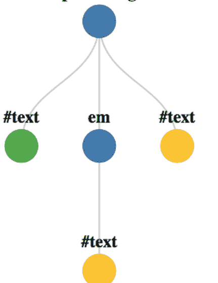

6-1. DOM 树

DOM 实际上并不是 JavaScript 的一部分，因为它是语言无关的（尽管 JavaScript 是目前与它配合最常用的语言）。这意味着它可以在任何编程语言中使用，而不仅仅是 JavaScript。我们可以使用 JavaScript 通过一个名为 `document` 的特殊内置对象来访问和修改网页的不同部分。

## DOM 的历史

在 Web 早期，Netscape 和微软等浏览器供应商开发了各自独特的方法来访问和更改网页部分。起初，他们倾向于关注常见的页面元素，如图像、链接和表单——这被称为动态 HTML (DHTML)。这些方法被称为 DOM 0 级或遗留 DOM。一些更常用的方法，例如用于选择图像和表单的方法，在当前的 DOM 中仍然可以使用。

万维网联盟 (W3C) 开始标准化这一过程，并于 1998 年创建了 DOM 1 级。这为网页引入了一个完整的模型，允许对它们的每个部分进行导航。

DOM 2 级规范于 2000 年发布，并引入了流行的 `getElementById` 方法，这使得访问网页上的特定元素变得简单得多。DOM 3 级规范于 2004 年发布，从那时起 W3C 就放弃了旧版用法。DOM 规范是作为一项活标准进行开发的。

尽管有了标准化过程，浏览器并不总是能以一致的方式实现 DOM，因此在过去进行编程一直很困难。幸运的是，自从 Internet Explorer 8 以来，DOM 的支持已经更加一致，现代浏览器现在都实现了当前的 DOM 3 级。它们还随着每次更新实现更多新的 DOM 4 级功能。

## 示例网页

为了说明本章中涵盖的 DOM 概念，我们将使用一个包含标题和段落元素的简单页面。将以下代码保存到 `doctype html` 文件中：

```html
<!doctype html>
<html lang="en">
<head>
  <meta charset="utf-8">
  <title>Justice League</title>
</head>
<body>
  <header>
    <h1 id='title'>Justice League</h1>
  </header>
  <ul id='roster' class='roster'>
    <ul>
      <li class='hero'>Superman</li>
      <li class='vigilante hero' id='bats'>Batman</li>
      <li class='hero'>Wonder Woman</li>
    </ul>
  </ul>
</body>
</html>
```

- (注意：下面是类类为 `roster` 的 `<ul>` 元素的节点树图：

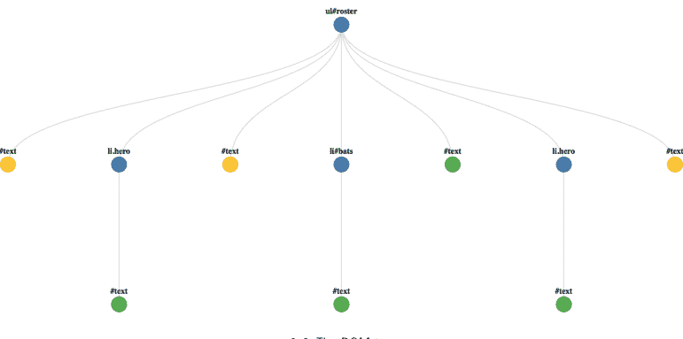

## 为什么会有额外的文本节点？

此图中似乎有一些额外的 `#text` 节点，即使在没有文本的地方也是如此。这是因为 DOM 还会将 HTML 文档中的任何空白字符存储为文本节点。

由于我们正在使用浏览器，跟随本章示例的最好方法是使用 Web 浏览器内置的控制台（我们在第 1 章中讨论过如何使用它）。这将允许你输入与网页上元素交互的命令并查看结果。下面的截图显示了打开了控制台的页面。

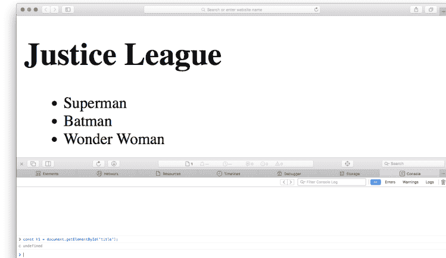

6-3. 使用控制台

## 控制台快捷键

这里有一些实用的快捷键，可以帮助在使用控制台时提高速度：

- 按 `TAB` 键将自动完成任何方法并向你显示可能的方法列表
- 按 `向上`箭头键将选择上一个输入的命令。

## 获取元素

DOM 提供了几种方法，允许我们访问页面上的任何元素。这些方法将返回一个节点对象或节点列表（node list），后者是一个数组。

我们可以使用 JavaScript 通过名为 `document` 的特殊内置对象来访问和修改网页的不同部分。DOM 实际上并不是 JavaScript 的一部分，因为它是语言无关的（尽管 JavaScript 是目前与它配合最常用的语言）。这意味着它可以在任何编程语言中使用，而不仅仅是 JavaScript。

6-1. DOM 树


## 按 ID 获取

`getElementById` 方法正如其名，允许根据提供的 ID 获取网页上的唯一元素。例如，我们可以通过在控制台中输入 ID 为 `title` 的 `<h1>` 元素：

```javascript
const h1 = document.getElementById('title');
```

## 按标签名获取

`getElementsByTagName()` 将返回一个包含所有指定标签名元素的动态节点列表。例如，我们可以使用以下代码获取文档中的所有列表项（`<li>` 标签）：

```javascript
const listItems = document.getElementsByTagName('li');
```


由于这是一个节点列表，我们可以使用索引法来查找列表中的每一项：

```javascript
listItems[0];
// <li class='hero'>Superman</li>

listItems[1];
// <li class='vigilante hero' id='bats'>Batman</li>

listItems[2];
// <li class='hero'>Wonder Woman</li>
```

## 并不是数组

节点列表是类对象，但它们不是数组。它们还有一个 `length` 属性，可以使用它来遍历每个元素，如下：

```javascript
for (let i = 0; i < document.images.length; i++) {
  // 对 images[i] 进行操作
}
```

节点列表没有任何数组方法，如 `slice`、`splice` 和 `join`。然而，ES6 可以轻松地将节点列表转换为数组。你可以使用 `Array.from` 方法：

```javascript
const imageArray = Array.from(document.images);
```

或者你可以使用展开运算符：

```javascript
const imageArray = [...document.images];
```

一旦节点列表被转换为数组，你就可以对它使用所有的数组方法。

¹ https://www.w3.org/TR/dom/

# JavaScript 从新手到忍者，第2版

如果文档中没有具有给定标签名的元素，将返回一个空节点列表。

## 通过类名获取元素

`getElementsByClassName()` 将返回一个包含所有具有所提供参数的类名的元素的**实性节点列表**（live node list）。例如，我们可以使用以下代码返回所有类名为 `hero` 的元素集合：

```javascript
const heroes = document.getElementsByClassName('hero');
```

注意，在这种情况下，返回的集合与我们之前找到所有列表项时返回的集合完全相同。

页面上有三个类名为 `hero` 的元素，我们可以通过查询 `length` 属性来测试：

```javascript
heroes.length;
// << 3
```

注意，如果没有具有给定类名的元素，仍然会返回一个 HTML 集合，但其 `length` 为 0：

```javascript
document.getElementsByClassName('villain').length;
// << 0
```

`document.getElementsByClassName` 在所有现代浏览器中都受支持，仅在 Internet Explorer 9 及更高版本中支持。

## 选择器

`document.querySelector` 方法允许你使用 CSS 选择器语法来查找文档中第一个匹配作为参数提供的 CSS 选择器的元素。如果没有匹配的元素，它将返回 `null`。

`document.querySelectorAll` 方法也使用 CSS 语法，但它返回的是文档中所有匹配 CSS 查询的元素的节点列表。如果没有匹配的元素，它将返回一个空列表。

这两个都是非常强大的方法，它们可以模拟所讨论的所有方法，并允许对返回的元素节点进行更细粒度的控制。


> 选择器
>
> 你必须了解一点 CSS 查询选择器才能使用此方法！如果你不知道，或者只是需要提醒，你可能想查看一下 SitePoint。

例如，以下代码可以代替 `document.getElementById()`：

```javascript
document.querySelector('#bats');
// << <li class="vigilante hero" id="bats">Batman</li>
```

这个可以代替 `document.getElementsByClassName`：

```javascript
document.querySelectorAll('.hero');
// << NodeList [<li class="hero", <li id="bats", <li class="hero">...>]
```

- 2- [http://www.sitepoint.com/web-foundations/css-selectors/]

# JavaScript 从新手到忍者，第2版

注意，这不是一个实性节点列表。请参本章稍后的部分了解有关实性节点列表的详情。

CSS 选择器是指定页面上非常精确项的强大方法。例如，CSS 伪选择器也可以用于定位特定的元素。例如，以下代码将仅返回文档中的最后一个项：

```javascript
const wonderWoman = document.querySelector('li:last-child');
```

`querySelector()` 方法可以在任何元素上进行调用，而不仅仅是 `document`。例如，我们可以使用以下代码获取 `<ul>` 元素的引用：

```javascript
const ul = document.querySelector('ul#roster');
```

现在我们可以在该元素上使用 `querySelector()` 方法来查找 id 为 'bats' 的 `<li>` 元素：

```javascript
const batman = ul.querySelector('li#bats');
```

所有现代浏览器都支持这些方法，Internet Explorer 从第 8 版本开始支持它们。Internet Explorer 8 版本仅理解 CSS 2.1 选择器（因为这是它支持的最高级别 CSS），因此复杂的 CSS 选择器将无法工作。

注意，这不是一个实性节点列表。请参本章稍后的部分了解有关实性节点列表的详情。

CSS 选择器是指定页面上非常精确项的强大方法。例如，CSS 伪选择器也可以用于定位特定的元素。例如，以下代码将仅返回文档中的最后一个项：

```javascript
const wonderWoman = document.querySelector('li:last-child');
```

`querySelector()` 方法可以在任何元素上进行调用，而不仅仅是 `document`。例如，我们可以使用以下代码获取 `<ul>` 元素的引用：

```javascript
const ul = document.querySelector('ul#roster');
```

现在我们可以在该元素上使用 `querySelector()` 方法来查找 id 为 'bats' 的 `<li>` 元素：

```javascript
const batman = ul.querySelector('li#bats');
```

所有现代浏览器都支持这些方法，Internet Explorer 从第 8 版本开始支持它们。Internet Explorer 8 版本仅理解 CSS 2.1 选择器（因为这是它支持的最高级别 CSS），因此复杂的 CSS 选择器将无法工作。

```javascript
wonderWoman.setAttribute('class', 'villain');
// << undefined
```

```javascript
wonderWoman.getAttribute('class');
// << "villain"
```

如果一个元素没有某个属性，可以使用 `setAttribute` 方法向该元素添加。例如，我们可以为 `wonderWoman` 元素添加一个 `id` 为 amazon 的：

```javascript
wonderWoman.setAttribute('id', 'amazon');

wonderWoman.getAttribute('id');
// << 'amazon'
```

## 点符号法 (Dot Notation)

传统的 DOM 允许使用点符号法访问属性，如下：

```javascript
wonderWoman.id;
// << 'amazon'
```

现在我们来看一下 `wonderWoman` 变量，可以看到更改已经完成，因为这是对该元素的实时引用：

```javascript
wonderWoman
// << <li class="villain" id="amazon">Wonder Woman</li>
```

这种表示法仍然被支持，尽管某些属性名称（如 `class` 和 `for`）是 JavaScript 中的关键字，因此我们需要使用 `className` 和 `htmlFor` 来代替它们。

## 元素的类 (Classes Of Element)

### className 属性

正如我们所见，我们可以使用 `setAttribute()` 方法修改元素的类名。还有一个 `className` 属性，允许直接设置元素的类。此外，它还可以用于查找 `class` 属性的值：

```javascript
wonderWoman.className;
// << "villain"
```

我们可以通过以下代码将类改回 hero：

```javascript
wonderWoman.className = 'hero'
// << "hero"
```

> **更新 className 时要小心**
>
> 通过赋值更改元素的 `className` 属性将覆盖元素上已设置的所有其他类。
>
> 通过使用 `classList` 属性可以避免这个问题。

### classList 属性

`classList` 属性是元素所拥有的所有类的列表。它包含许多方法，可以更方便地修改元素的类。它在所有现代浏览器以及 10 及以上版本的 Internet Explorer 中都受支持。

`add` 方法可向元素添加一个类，而不会覆盖任何已存在的类。例如，我们可以为 `wonderWoman` 元素添加 `warrior` 类：

```javascript
wonderWoman.classList.add('warrior');
```

现在我们可以检查它是否已添加：

```javascript
wonderWoman.className;
// << "hero warrior"
```

`remove` 方法将从元素中移除特定的类。例如，我们可以通过以下代码移除 `warrior` 类：

```javascript
wonderWoman.classList.remove('warrior');
```

`toggle` 方法是一个特别实用的方法，如果元素还没有该类，它会添加它；如果已经有了该类，它会将其移除。如果类被添加则返回 true，如果类被移除则返回 false。例如：

```javascript
wonderWoman.classList.toggle('hero'); // 将移除 'hero' 类
// << false
```

```javascript
wonderWoman.classList.toggle('sport'); // 将重新添加 'hero' 类
// << true
```

`contains` 方法将检查元素是否包含某个特定的类：

```javascript
wonderWoman.classList.contains('hero');
// << true
```

```javascript
wonderWoman.classList.contains('villain');
// << false
```

# 文档对象模型 (The Document Object Model) 237

## classList 与旧版本的 IE

遗憾的是，`classList` 属性仅适用于 Internet Explorer 10 及以上版本。如果你想支持旧版本的 Internet Explorer，可以创建一个函数来为元素添加额外的类，而不是仅仅替换当前的类。`addClass` 函数接收元素和新类名作为添加参数。它使用一个简单的 `if` 块来检查元素 `className` 属性的值是否为真。如果是，它将把新类附加到当前类的末尾；否则，它将直接将新类设置为元素的类：

```javascript
function addClass(element, newClass) {
  if (element.className) {
    element.className = element.className + ' ' + newClass;
  } else {
    element.className = newClass;
  }
  return element.className;
}
```

让我们在已经有 `hero` 类的 `wonderWoman` 上测试一下：

```javascript
addClass(wonderWoman, 'warrior');
// << "hero warrior"
```

## 创建动态标记 (Creating Dynamic Markup)

到为止，我们查看了如何访问网页的不同元素并查找有关它们的信息。我们还查看了如何更改元素的属性。在本节中，我们将学习如何创建新元素并添加到页面中，以及编辑已存在的元素并移除任何不需要的元素。

## 创建元素 (Creating An Element)

`document` 对象有一个 `createElement()` 方法，它接受标签名称作为参数并返回元素。例如，我们可以通过在控制台中编写以下代码，在内存中作为 DOM 片段创建一个新的列表项：

```javascript
const flash = document.createElement('li');
```

目前，这个元素是空的。为了添加一些内容，我们需要创建一个文本节点。

## 创建文本节点 (Creating a Text Node)

可以使用 `document.createTextNode()` 方法创建文本节点。它接受一个参数，即一个包含放入节点中文本的字符串。让我们为我们的新元素创建文本：

```javascript
const flashText = document.createTextNode('Flash');
```

现在我们有一个元素和一个文本节点，但它们之间还没有关联——我们需要将文本节点附加到元素。

## 附加节点 (Appending Nodes)

每个节点都有一个 `appendChild()` 方法，可以将另一个节点（作为参数）作为子节点。我们希望新创建的文本节点成为元素的子节点。这意味着由该元素调用该方法，并将 `flashText` 作为参数：

```javascript
flash.appendChild(flashText);
```

现在我们有一个包含文本的 `<li>`。所以每次你想创建一个元素时，流程如下：

- 创建元素
- 创建文本节点
- 将文本节点附加到元素

可以使用每个元素拥有的 `textContent` 属性使其变得简单。这将元素添加文本而无需附加，因此上面的代码可以写成：

```javascript
const flash = document.createElement('li');
flash.textContent = 'Flash';
```

### 一个函数 (A Function)

当我们创建列表项元素时，指定的只是标签类型和内部文本。这些将成为函数的参数。函数随后将执行我们创建元素的步骤并返回该元素：

```javascript
function createElement(tag, text) {
  const el = document.createElement(tag);
  el.textContent = text;
  return el;
}
```

让我们尝试创建另一个列表项：

```javascript
const aquaman = createElement('li', 'Aquaman');
```

现在我们可以一行代码创建元素，而不是三行。现在是将这些新元素添加到示例页面中。

## 向页面添加元素 (Adding Elements to the Page)

我们已经见过 `appendChild()` 方法。可以在节点上调用它来添加新的子节点。新节点始终会被添加到任何现有子节点的最后。下面的示例将上面创建的 `flash` 元素添加到 `<ul>` 元素的末尾，如下：

```javascript
heroes.appendChild(flash);
```

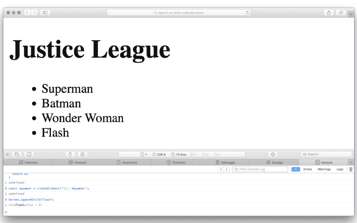

## 6-6. 添加子 (Append child)

`appendChild` 方法非常有用，因为通常你想将新元素添加到列表底部。但如果你想将新元素放在两个现有元素之间呢？

`insertBefore()` 方法会将新元素放在另一个元素之前。需要注意的是，该方法是在父节点上调用的。它接受两个参数：第一个是要添加的新节点，第二个是你希望它在之前的节点（认为参数的顺序即为它们在标记中的出现顺序很有帮助）。例如，我们可以使用以下代码将我们之前创建的 `aquaman` 元素放置在 `wonderWoman` 元素之前：

```javascript
heroes.insertBefore(aquaman, wonderWoman);
```


这将产生如下所示的输出。

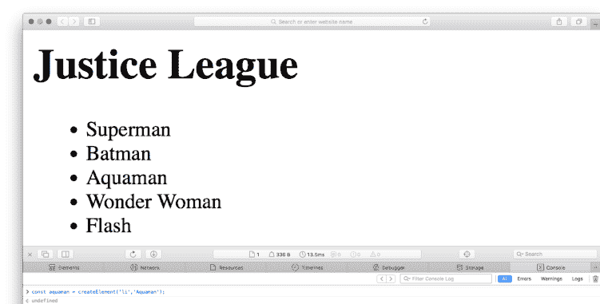

## 6-7. 在之前插入

`append()` 和 `insertBefore()` 方法也可以用于标记已经存在于 DOM 中的元素。这是因为单个 DOM 元素的引用在页面上只能存在一次，所以如果你使用多次 `insert` 和 `end`，只有最后一次会生效。如果需要在文档的多个地方使用某个元素，则必须在每次插入之前对其进行克隆（clone）。

通过对 `wonderWoman` 元素使用 `append()` 方法可以看到这一点。由于它已经存在，它只是移动了位置，出现在 `<ul>` 元素的末尾，如下所示：

```javascript
heroes.appendChild(wonderWoman);
```

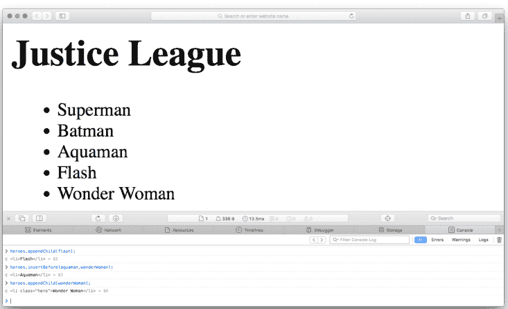

## 6-8. 移动已有的节点

有些恼人的是，并没有 `insertAfter()` 方法，因此你需要确保访问正确的元素，以便将元素精确地放置在你想要的位置。

## 从页面中移除元素

可以使用 `removeChild()` 方法从页面中移除元素。该方法在父节点上调用，并带有一个参数，即要被移除的节点。它返回被移除节点的引用。例如，如果我们想移除 `aquaman` 元素，将使用以下代码：

```javascript
heroes.removeChild(aquaman);
```

```html
<li>Aquaman</li>
```

如你所示，它已经被移除了。

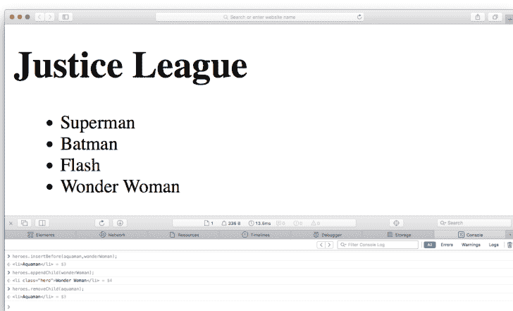

## 6-9. 子节点

因为我们拥有该元素的引用，如果需要，我们可以轻松地将其放回文档：

```javascript
heroes.appendChild(aquaman);
```

## 在页面上替换元素

可以使用 `replaceChild()` 方法用一个节点替换另一个节点。它在父节点上调用，并有两个参数：新节点和要被替换的节点。例如，如果我们想更改制作页面标题的 `<h1>` 标签的内容，我们可以用一个新的文本节点替换文本节点，如下：

```javascript
const h1 = document.getElementById('title');
const oldText = h1.firstChild;
const newText = document.createTextNode('Justice League of America');
h1.replaceChild(newText, oldText);
```

下图显示文本现在已更改为 'Justice League of America'。

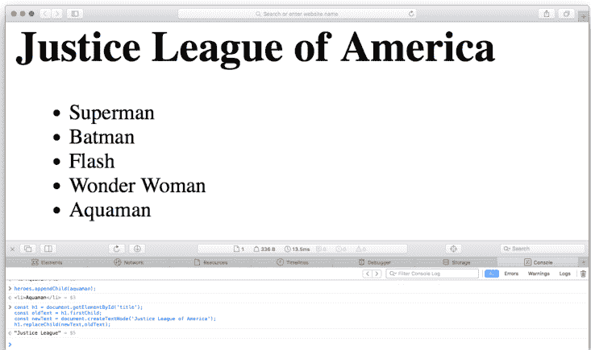

## 6-10. 替换元素

### innerHTML

`innerHTML` 属性作为 HTML5 的一部分被标准化，尽管所有主流浏览器都已支持它。它将元素的所有子元素作为 HTML 字符串返回。如果一个元素包含许多其他元素，则返回所有原始 HTML。在这个示例中，我们可以看到 id 为 `roster` 的 `<ul>` 元素内部的所有 HTML：

```javascript
heroes.innerHTML = `
  <li class="hero">Superman</li>
  <li class="vigilante hero"></li>
  <li id="bats">Batman</li>
`;
```

```html
<li class="Wonder Woman"></li>
```

`innerHTML` 属性也是可写的，可以用于将一段 HTML 放入元素内部。这将该节点的所有子节点替换为字符串中包含的原始 HTML。这避免了你手动创建新的文本节点，因为系统会自动完成创建并插入 DOM。它也比使用标准的 DOM 方法要快得多。例如，我们之前更改的标题文本一行代码即可完成：

```javascript
h1.innerHTML = 'Suicide Squad';
```

如果你想向文档插入大量的 HTML，`innerHTML` 属性的威力会变得更加明显。你不需要逐个创建元素和文本节点，只需以字符串形式输入原始 HTML 即可。相关的节点会自动添加到 DOM 树中。例如，我们可以更改 `<ul>` 元素包含的所有内容：

```javascript
heroes.innerHTML = '<li>Harley Quinn</li><li>Deadshot</li><li>Killer Croc</li><li>Enchantress</li><li>Captain Boomerang</li><li>Katana</li><li>Slipknot</li></li>';
```

现在这将移除 `<ul>` 元素的所有子元素，并将其替换为提供的 HTML 字符串，如下所示。

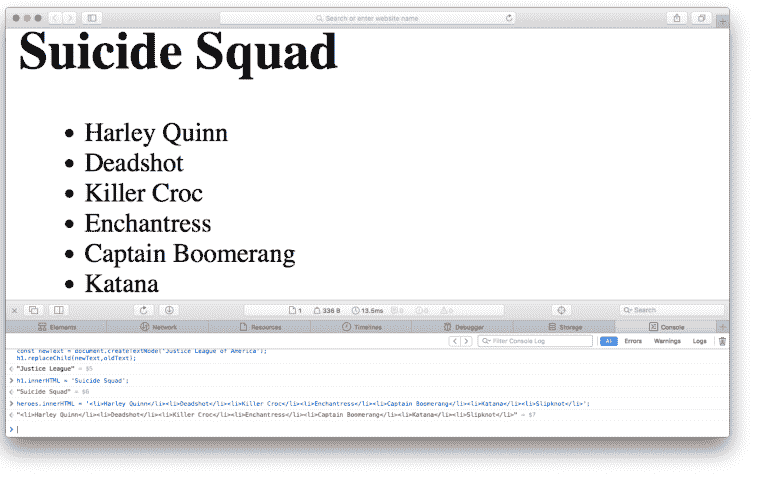

### 11. 使用 innerHTML

`innerHTML` 属性作为 HTML5 的一部分被标准化，尽管所有主流浏览器都已支持它。它将元素的所有子元素作为 HTML 字符串返回。如果元素包含许多其他元素，则返回所有原始 HTML。在这个示例中，我们可以看到 id 为 `roster` 的 `<ul>` 元素内部的所有 HTML：

```javascript
heroes.innerHTML = `
  <li class="hero">Superman</li>
  <li class="vigilante hero"></li>
  <li id="bats">Batman</li>
`;
```

`innerHTML` 属性也是可写的，可以用于将一段 HTML 放入元素内部。这将该节点的所有子节点替换为字符串中包含的原始 HTML。这避免了你手动创建新的文本节点，因为系统会自动完成创建并插入 DOM。它也比使用标准的 DOM 方法要快得多。例如，我们之前更改的标题文本一行代码即可完成：

```javascript
h1.innerHTML = 'Suicide Squad';
```

如果你想向文档插入大量的 HTML，`innerHTML` 属性的威力会变得更加明显。你不需要逐个创建元素和文本节点，只需以字符串形式输入原始 HTML 即可。相关的节点会自动添加到 DOM 树中。例如，我们可以更改 `<ul>` 元素包含的所有内容：

```javascript
heroes.innerHTML = '<li>Harley Quinn</li><li>Deadshot</li><li>Killer Croc</li><li>Enchantress</li><li>Captain Boomerang</li><li>Katana</li><li>Slipknot</li></li>';
```

这将移除 `<ul>` 元素的所有子元素，并将其替换为提供的 HTML 字符串，如下所示。

## 获取计算样式

例如，如果你想要应用到 `superman` 元素的所有样式，可以使用以下代码：

```javascript
getComputedStyle(superman);
```

```
<< CSSDeclaration {0: "alt", 1:
  "animation-delay", 2: "animation-direction", 3:
  "animation-duration", 4: "animation-fill-mode", 5:
  "animation-iteration-count", 6: "animation-name", 7:
  "animation-play-state", 8: "animation-timing-function", 9:
  "background-attachment", ...}
```

如你所见，它返回了一个对象（更具体地说是一个 `CSSStyleDeclaration` 对象），其中包含了应用到目标元素的所有 CSS 样式的属性值对列表。在这个例子中，有 200 多个。`CSSStyleDeclaration` 对象具有一些内置方法来帮助提取信息。例如，如果我想查找元素的颜色属性，可以在控制台中使用此代码：

```javascript
getComputedStyle(superman).getPropertyCSSValue('color').text; // "rgb(0, 0, 0, 0)"
```

这告诉我们文本颜色是 `rgb(0, 0, 0)`，即黑色。

你可以在 Mozilla 开发者网络（MDN）上阅读更多关于 `getComputedStyle()` 函数³ 和 `CSSStyleDeclaration`⁴ 对象。

> **这在某些浏览器中会导致错误**
> 某些浏览器（如 Chrome）不允许访问 `CSSStyleDeclaration` 字体的方法，例如 `getPropertyCSSValue()`，因此尝试使用它们会导致错误。
>
> 3. https://developer.mozilla.org/en/docs/Web/API/window.getComputedStyle
> 4. https://developer.mozilla.org/en-US/docs/Web/API/CSSStyleDeclaration

## 请谨慎使用

虽然能够动态编辑元素的样式看起来很有用，但更好的做法是动态地更改元素的类（class），并将每个类的相关样式保留在单独的样式表中。

例如，如果你想在 `superman` 元素周围添加一个红色边框（为了某种原因高亮它），你可以像我们之前看到的那样这样做：

```javascript
superman.style.border = 'red 2px solid';
```

更好的替代方案是添加一个 `highlighted` 类：

```javascript
superman.classList.add('highlighted');
```

然后在另一个单独的样式表中添加以下 CSS：

```css
.highlighted {
  border: red 2px solid;
}
```

如果以后决定更改高亮元素的外观，这将提供更大的灵活性。它只需要在 CSS 层级进行更改，而不需要在 JavaScript 代码中到处寻找。然而，在某些你可能无法访问样式表或其类的情况下，在这种情况下，你必须使用 JavaScript 动态更改 CSS。

## 测验忍者 项目

现在我们已经学习了文档对象模型，可以开始添加一些动态标记来显示我们的测验问题。这意味着我们不需要那么多 `alert` 对话框了。

要做的第一工作是通过更新 `index.html` 为以下内容向 HTML 中添加一些空的 `<div>` 元素：

```html
<!doctype html>
<html lang='en'>
<head>
  <meta charset='utf-8'>
  <meta name='description' content='A JavaScript Quiz'>
  <title>Quiz Ninja!</title>
  <link rel='stylesheet' href='styles.css'>
</head>
<body>
  <section class='dojo'>
    <div class='quiz-body'>
      <header>
        <div id='score'>Score:
          <strong>0</strong>
          <h1>Quiz Ninja!</h1>
        </header>
        <div id='question'></div>
        <div id='result'></div>
        <div id='info'></div>
      </div>
    </section>
    <script src='main.js'></script>
  </body>
</html>
```

我们添加了四个 `<div>` 元素，这些元素将用于显示问题，并就用户是否正确回答了问题提供反馈。我们还向 `<header>` 内部添加了一个 `<div>` 元素，可以用于在游戏进行期间显示分数。

这些元素的 `ID` 属性将作为钩子，允许我们使用 `document.getElementById()` 方法轻松地访问该元素。它们将被包含在一个名为 `view` 的对象中（命名空间），因为它们都与视图有关。在 `main.js` 文件的开头，问题数组之后添加以下代码：

```javascript
// 视图对象
const view = {
  score: document.querySelector('#score strong'),
  question: document.getElementById('question'),
  result: document.getElementById('result'),
  info: document.getElementById('info'),
  render(target, content, attributes) {
    for (const key in attributes) {
      target.setAttribute(key, attributes[key]);
    }
    target.innerHTML = content;
  }
};
```

这使用了 `document.querySelector()` 方法来访问我们需要的元素并将它们赋值给变量。因此，在 JavaScript 代码中，可以使用 `question` 访问 `id` 为 `question` 的 `div`。

我们还添加了一个辅助函数 `render()`，它可以用于更新页面上某个元素的内容。该函数有三个参数：第一个是显示内容的元素，第二个是要更新的内容，最后一个是任何可以添加到元素中的 HTML 属性的对象。

该函数遍历作为第三个参数提供的任何属性，并使用 `setAttribute()` 方法将它们更新为提供的值。然后它使用 `innerHTML` 属性使用提供的内容来更新 HTML。

现在，我们需要更新 `game` 对象内部的一些函数来更新 HTML。

在目前，我们仍然需要继续使用对话框，因为没有了它们，JavaScript 将停止运行，游戏将无法进行。不过不用担心，我们很快再也不需要它们了。

我们会在显示信息的同时更新 HTML。这意味着以下方法需要更新：

```javascript
ask() {
  const question = `What is ${this.question.name}'s real name?`;
  view.render(view.question, question);
  const response = prompt(question);
  this.check(response);
}

check(response) {
  const answer = this.question.realName;
  if (response == answer) {
    view.render(view.result, 'Correct!', {'class': 'correct'});
    alert('Correct!');
    this.score++;
    view.render(view.score, this.score);
  } else {
    view.render(view.result, `Wrong! The answer was ${answer}`, {'class': 'wrong'});
    alert(`Wrong! The answer was ${answer}`);
  }
}

gameOver() {
  view.render(view.info, `Game Over, you scored ${this.score}`);
}
```


如果你在浏览器中打开 `index.html` 进行测验，在所有对话框结束之前你不会发现太大区别。你会注意到 HTML 正在后台更新，如下所示：

# JavaScript: Novice to Ninja, 2nd Edition


目前的测验

这确实看起来好多了，尽管如果在整个游戏过程中看到 HTML 更新的结果就更好。不用担心这个，因为我们很快再也不需要提示了。

## 章节总结

- 文档对象模型是将 HTML 页面表示节点树的方法。
- `document.getElementById()`、`document.getElementsByClassName()`、`document.getElementsByTagName()` 和 `document.querySelector()` 可访问页面上的元素。
- `parentNode`、`previousSibling`、`nextSibling`、`childNodes` 和 `children` 方法用于导航 DOM 树。
- 元素的属性可以使用 `getAttribute()` 方法访问，使用 `setAttribute()` 方法更新。
- `createElement()` 和 `createTextNode()` 方法可用于创建动态标记。
- 可以使用 `appendChild()` 和 `insertBefore()` 方法将标记添加到页面。
- 可以使用 `replaceChild()` 方法替换元素，使用 `removeChild()` 方法删除元素。
- `innerHTML` 属性可直接向 DOM 插入原始 HTML。
- 可以通过访问 `style` 属性更改元素的 CSS 属性。

现在我们已经学习了如何导航和动态更新页面标记，是时候开始与之交互了。在下一章中，我们将涵盖 JavaScript 语言的一个基础部分：事件。

# 第 7 章

## 事件

在上一章中，我们了解了 DOM 是一个允许你使用 JavaScript 与网页进行交互的接口。事件是 DOM 的另一个部分，它们提供了网页与用户交互之间的桥梁。每当用户与网页进行交互时（例如点击链接、按下按键或移动鼠标），就会发生一个事件，我们的程序可以检测并对此做出响应。

在本章中，我们将涵盖以下主题：

- 事件初介绍
- 添加事件监听器
- 事件对象
- 鼠标、键盘和触控事件
- 移除事件监听器
- 停止默认行为
- 事件传播
- 项目 – 我们添加一个可以点击的启动按钮来开始游戏

## 事件监听器

想象你正在等待一封非常重要的邮件，一旦到达你就需要立即采取行动，但你手里还有一些 JavaScript 编程任务要完成。你可以每隔几分钟检查一次邮件，看看消息是否到达，但这会频繁打断你创建下一个“杀手级应用”的进度。更不用说，你可能在消息到达的瞬间无法检查邮件，因此采取行动可能已经太晚了。显而易见的答案是设置一个通知，一旦邮件到达就会弹出。这样你就可以愉快地编程，而不受频繁检查邮件的干扰，并在邮件到达的那一刻就能收到一个满意的提示音。

JavaScript 中的事件监听器工作方式非常相似。它们就像设置一个通知，当某些情况发生时提醒你。程序不需要不断检查事件是否已经发生，事件监听器会在事件发生时通知你，然后程序可以做出相应的响应。这允许程序在等待事件发生的同时继续执行其他任务。

例如，假设在你的程序中，你希望用户点击页面时发生某些事情。检查用户是否已点击的代码可能如下例所示（JavaScript 的实际工作原理并非如此，所以这段代码无法运行，尽管这是许多编程语言的方式）：

```javascript
if (click) {
  doSomething();
} else {
  // 继续执行程序的其余部分
}
```

这种方法的问题是，程序必须不断返回这个 `if` 块来检查是否发生了点击。这有点每隔几分钟就要检查一次邮件。这被称为编程的**阻塞方法**，因为检查点击阻塞了程序其余部分的运行。

另一方面，JavaScript 使用**非阻塞方法**，通过事件监听器来监听页面上的所有点击。每当页面被点击时，就会调用一个回调函数。因此，程序可以在等待点击事件发生的同时继续处理其余的代码。

以下代码可以用于为文档附加一个事件监听器，该监听器会在用户点击页面任何位置时触发：

```javascript
document.body.addEventListener("click", doSomething);
```

事件监听器被添加到页面元素上，它们是我们在上一章遇到过的 DOM 部分。在示例中，事件监听器被添加到了文档的 `body` 元素。当页面任何部分被点击时，它将调用函数 `doSomething()`。在这种情况发生之前，程序将继续运行其余的代码。

> **点击事件**
> 当用户用鼠标点击、按下 Enter 键或触摸屏幕时，就会发生点击事件，使其成为一个非常有用的全能事件，涵盖了许多类型的交互。

## 内联事件处理器

在浏览器中处理事件的原始方法是使用直接添加到标记语言中的内联属性。这里有一个向段落元素（p标签）添加 `onclick` 事件处理器的示例：

```html
<p onclick="console.log('You Clicked Me!')">点击我</p>
```

引号内的 JavaScript 代码将在用户点击段落时运行。这种方法在现代浏览器中仍然有效，但由于许多原因，并不建议这样做：

- JavaScript 代码与 HTML 标记混合在一起，破坏了**非侵入式 JavaScript**的理念，该理念主张 JavaScript 代码应该保持在 HTML 之外。
- 对于每个类型的事件，只能为元素附加一个事件处理器。
- 事件处理器的代码隐藏在标记中，使得难以找到这些事件是在哪里声明的。
- JavaScript 代码必须以字符串形式输入，因此在使用单引号和双引号时需要格外小心。

出于这些原因，最好避免使用内联事件处理器，将其包含在此处是为了完整性，并以防你在某些在线代码示例中看到它们。

## 旧版事件处理器

另一种方法是使用所有节点对象都具有事件处理器属性。这些属性可以赋值给一个函数，该函数会在事件发生时被调用。以下示例将在页面被点击时向控制台打印一条消息：

```javascript
document.onclick = function () { console.log('You clicked on the page!'); }
```

这种方法是对内联事件处理器的改进，因为它将 JavaScript 保持在 HTML 标记之外。它也得到了良好的支持，可以在几乎所有浏览器中运行。遗憾的是，它仍然有一个限制，即每个事件只能使用一个函数。

## 使用事件监听器

处理事件的推荐方法也是目前的标准是使用事件监听器。这些在 DOM Level 2 中进行了概述，允许将多个函数独立地附加到不同的事件上。它们在所有现代浏览器中都得到了支持，尽管仅从 Internet Explorer 9 版本开始支持。

`addEventListener()` 方法在节点对象上调用，该节点是应用事件监听器的对象。例如，这段代码将为文档的 body 附加一个事件监听器：

```javascript
document.body.addEventListener('click', doSomething);
```

`addEventListener()` 方法也可以没有节点的情况下调用，此时它应用于全局对象（通常是浏览器窗口）。

它的第一个参数是事件类型，第二个参数是事件发生时调用的回调函数。我们将在后面介绍第三个参数。

在下一个示例中，我们为整个页面添加了点击监听器（因为调用 `addEventListener` 时没有节点引用），并使用匿名函数作为回调：

```javascript
addEventListener('click', () => alert('You Clicked!'));
```

或者，可以声明命名函数并在事件监听器中引用它：

```javascript
function doSomething() {
  alert('You Clicked!');
}

addEventListener('click', doSomething);
```

注意，当函数作为事件监听器的参数时，后面不要加括号；否则函数将在设置事件监听器时实际调用，而不是在事件发生时！

## 旧版 IE 支持

所有现代浏览器都支持这些事件监听器。遗憾的是，情况并非一直如此，旧版本的 Internet Explorer（8 及以下版本）使用不同的语法。如果你需要支持这些浏览器（如果是这样，我为你感到情！），John Resig 提供了一个简单的解决方案来创建跨浏览器的添加和移除函数。

> 1. https://johnresig.com/blog/flexible-javascript-events/

---

## 示例：事件演示

```html
<!DOCTYPE html>
<html lang="en">
<head>
  <meta charset="UTF-8">
  <title>Events Demo</title>
  <style>
    .highlight {
      background-color: red;
    }
  </style>
</head>
<body>
  <p id='click'>点击我</p>
  <p id='dblclick'>双击我</p>
  <p id='mouse'>悬停在我上方</p>
  <script src='main.js'></script>
</body>
</html>
```

现在，将以下代码添加到一个名为 `main.js` 的文件中，该文件应与 `events.html` 储存在同一个文件夹中：

```javascript
function doSomething() {
  console.log('Something Happened!');
}

addEventListener('click', doSomething);
```

现在，尝试在浏览器中打开 `events.html` 并点击页面上的任何地方。你应该会在控制台中看到这条消息：

> Something Happened!

## 事件对象

当事件处理器由某个事件触发时，回调函数会被调用。该函数会自动接收一个事件对象作为参数，该对象包含了有关该事件的信息。

要查看此示例，请将 `main.js` 文件中的 `doSomething()` 函数更改为如下：

```javascript
function doSomething(event) {
  console.log(event.type);
}
```

现在在浏览器中刷新 `events.html` 页面并尝试再次点击。每次点击时，你应该会在控制台中看到以下内容：

```
click
```


### 参数命名

> 参数不必命名为 `event`。它可以是任何合法的变量名，尽管将其命名为 `event` 可以让代码更易读。许多开发者经常将其缩写为 `e`。

### 事件类型

`type` 属性返回发生的事件类型，例如上一个示例中的 `click`。不同类型的事件将在下一节中讨论。

### 事件目标

`target` 属性返回触发事件的节点的引用。如果你将 `doSomething()` 函数更改为以下内容，它将在控制台中显示一条消息，告诉我们被点击的节点：

```javascript
function doSomething(event) {
  console.log(event.target);
}
```

例如，如果你点击其中一个段落，你应该会在控制台中看到类似下面的内容：

```
<p id='click'>点击我</p>
```

### 事件坐标

有多种方法可以找到鼠标事件发生的位置。

- `screenX` 和 `screenY` 属性显示事件发生时距离屏幕左侧和顶部的像素数。
- `clientX` 和 `clientY` 属性显示距离客户端（通常是浏览器窗口）左侧和顶部的像素数。
- `pageX` 和 `pageY` 属性分别显示事件在文档中发生距离左侧和顶部的像素数。该属性考虑了页面是否经过了滚动。

所有这些事件属性都很相似，但又细微的区别。它们对于查找点击发生的位置或鼠标光标的位置很有用。要查看这些属性返回的坐标，请将 `doSomething()` 函数更改为如下内容：

```javascript
function doSomething(event) {
  console.log(`screen: ${event.screenX},${event.screenY},
  page: ${event.pageX},${event.pageY}, client:
  ${event.clientX},${event.clientY}`);
}
```

## 事件类型

有多种类型的事件，范围从视频播放完成到资源下载完成。你可以在 Mozilla 开发者网络（MDN）的事件部分查看完整列表。

> 2. https://developer.mozilla.org/en-US/docs/Web/Events

在本节中，我们将关注使用鼠标、键盘和触摸时发生的一些更常见的事件。

### 鼠标事件

我们已经见过点击鼠标按钮时触发的 `click` 事件。还有 `mousedown` 和 `mouseup` 事件。这两者都在 `click` 事件触发之前发生。

要查看其运行效果，请删除 `main.js` 中的所有代码并替换为以下内容：

```javascript
const clickParagraph = document.getElementById('click');

clickParagraph.addEventListener('click', () => console.log('click'));
clickParagraph.addEventListener('mousedown', () => console.log('down'));
clickParagraph.addEventListener('mouseup', () => console.log('up'));
```

尝试点击页面上的任何地方，你应该看到所有三个事件按以下顺序触发：

```
mousedown
mouseup
click
```

还有 `dblclick` 事件，它在用户双击绑定了事件监听器的元素时发生。要查看此示例，我们将为示例中的第二个段落（其 ID 为 `dblclick`）绑定一个事件监听器。在 `main.js` 中添加以下代码：

```javascript
const dblclickParagraph = document.getElementById('dblclick');

dblclickParagraph.addEventListener('dblclick', highlight);

function highlight(event) {
  event.target.classList.toggle('highlight');
}
```

> **使用同一个元素**
> 参数不必命名为 `event`。它可以是任何合法的变量名，尽管将其命名为 `event` 可以让代码更易读。许多开发者经常将其缩写为 `e`。

`mouseover` 事件在鼠标指针悬停在元素上方时发生。这对于创建菜单或提示框很有用。`mouseout` 事件在指针离开元素时发生。

```javascript
const mouseParagraph = document.getElementById('mouse');

mouseParagraph.addEventListener('mouseover', event => {
  event.target.classList.add('highlight');
});

mouseParagraph.addEventListener('mouseout', event => {
  event.target.classList.remove('highlight');
});
```

`mousemove` 事件在鼠标移动时发生。它可以用于跟踪跨页的光标位置。

```javascript
window.addEventListener('mousemove', () => {
  console.log('Mouse moved');
});
```

### 键盘事件

用户按下键时会发生三个事件：`keydown`、`keypress` 和 `keyup`。它们按此顺序发生。

1. `keydown` 事件在按下按键时发生，如果按住会持续触发。
2. `keypress` 事件发生在 `keydown` 之后、`keyup` 之前。`keypress` 事件仅对产生字符输入的按键触发。
3. `keyup` 事件在释放按键时发生。

为了理解这些事件的区别，区分键盘上的物理按键和屏幕上显示的字符非常重要。`keydown` 事件是按下按键的动作，而 `keypress` 事件是输入字符的动作。

要查看此示例，向 `main.js` 添加以下内容：

```javascript
addEventListener('keydown', highlight);
```


现在刷新页面并尝试按下一个键。这应该会导致整个文档颜色改变，因为事件监听器被应用于整个文档。

要查看 `keyup` 事件生效，添加以下使用匿名箭头函数在控制台中显示按键时间的代码：

```javascript
addEventListener('keyup', (event) => console.log(`
stopped pressing the key on ${new Date()}`));
```

每一个这些键盘事件都有一个 `key` 属性，它可以返回被按下按键的打印表示（如果有的话）。

要查看其运行效果，在 `main.js` 中添加以下代码：

```javascript
addEventListener('keypress', (event) => console.log(`
pressed the ${event.key} character`);
```

现在当你按下一个键时，你应该会在控制台中看到类似下面的消息：

> You pressed the j character


# 修饰键

按下 Shift、Ctrl、Alt 和 meta（Mac 上的 Cmd）修饰键会触发 `keydown` 和 `keyup` 事件，但不会触发 `keypress` 事件，因为它们不会在屏幕上产生任何字符。

`key` 属性仍然会返回修饰键名称。要查看此内容，请修改我们刚刚用于监听 `keydown` 事件的事件监听器：

```javascript
addEventListener('keydown', (event) => console.log(`你按了字符 ${event.key}`));
```

现在尝试按下一个修饰键：

> "你按了 Control 字符"

所有事件对象还包含关于在按键事件发生时是否按下了修饰键的信息。`shiftKey`、`ctrlKey`、`altKey` 和 `metaKey` 都是事件对象的属性，如果相应的键被按下，它们将返回 `true`。例如，以下代码将检查用户在按住 Ctrl 键的同时是否按了 C 键：

```javascript
addEventListener('keydown', (event) => {
  if (event.key === 'c' && event.ctrlKey) {
    console.log('操作取消!');
  }
});
```

以下代码检查在点击鼠标时是否按下了 Shift 键：

```javascript
addEventListener('click', (event) => {
  if (event.shiftKey) {
    console.log('带 Shift 的点击!');
  }
});
```

## 修改默认行为

修饰键通常在浏览器或操作系统中已经分配了用途。虽然可以阻止浏览器的默认行为（见本章后部分），但这并不被认为是最佳实践。

## 触摸事件

许多现代设备支持触摸事件。这些事件用于智能手机、触控板和平板，以及触摸屏显示器、卫星导航器和键盘。触摸事件通常通过手指完成，也可以通过手写笔或身体的其他部分完成。有许多触摸事件涵盖了许多类型的触摸交互。

同时支持鼠标事件和触摸事件是非常重要的，这样非触摸设备也能得到支持。由于如今有这么多不同的设备，你不能依赖用户仅使用触摸或鼠标。事实上，某些设备（如触控屏笔记本电脑）同时支持鼠标和触摸交互。

`touchstart` 事件发生在用户最初触摸表面时。

# 使用 touchstart 事件

使用 `touchstart` 事件时要小心，因为它会在用户触摸屏幕时触发。他们可能触摸屏幕是因为想要放大或滑动，而 `touchstart` 事件监听器可能会阻止他们执行这些操作。

`click` 事件通常是一个更安全的选项，因为它在屏幕被触摸时仍然触发，但有 300ms 的轻微延迟，允许用户有时间对设备执行另一个操作。在触摸事件的上下文中，`click` 事件可以被视为“轻点 (tap)”。

`touchend` 事件发生在用户停止触摸表面时：

```javascript
addEventListener('touchend', () => console.log('触摸停止'));
```

`touchmove` 事件发生在用户触摸屏幕后移动且未离开时。只要用户仍在触摸屏幕，它就会持续发生，即使他们离开了绑定了事件监听器的元素。

`touchenter` 事件发生在用户已经开始触摸表面，但经过了绑定了事件监听器的元素时。

`touchleave` 事件发生在用户仍在触摸表面，但离开了绑定了事件监听器的元素时。

`touchcancel` 事件发生在触摸事件被中断时，例如用户的手指移动到窗口外，或者一次性使用了太多的手指。弹出对话框也会取消触摸事件。


## 滑动怎么办？

没有所谓的“滑动 (swipe)”事件。这些需要通过组合 `touchstart`、`touchmove` 和 `touchleave` 事件来创建，通过监控触摸事件从开始到结束的移动距离和方向。

曾经有关于未来可能支持的手势事件的提案，但它们似乎没有计划在短期内纳入规范。

如果你需要实现手势，使用如 HammerJS⁵ 或 zingtouch⁶ 等库是一个好主意，这些库让滑动、缩放和旋转等事件变得容易实现。

# 触摸事件属性

由于可能同时多次触摸表面，触摸事件对象有一个名为 `touches` 的属性。这是一个触摸对象列表，代表了该设备上所有的触摸位置。它有一个 `length` 属性，可以告诉你表面上有多少触摸点（通常是用户的手指，但也可能是手写笔）。列表中的每个触摸对象都可以使用索引法访问。例如，如果用户用两个手指触摸屏幕，`events.touches.length` 返回 2。第一个触摸对象可以通过 `events.touches[0]` 访问，第二个可以通过 `events.touches[1]` 访问。

每个触摸对象都有许多属性，其中许多与事件对象相似，例如 `touch.screenX` 和 `touch.screenY` 用于查找触摸点的坐标。它们还有其他属性，如 `touch.radiusX` 和 `touch.radiusY`，它们提供触摸时施加的压力（0 到 1 之间的值）。每个触摸对象都有一个 `touch.identifier`，这是一个唯一的 ID，可以确保你处理的是同一个触摸。

> 使用触摸事件 触摸事件复杂且难以实现。上述许多属性在浏览器中仍被标记为实验性。

- 5. http://hammerjs.github.io/
- 6. https://zingchart.github.io/zingtouch/

# 274 JavaScript: Novice to Ninja, 2nd Edition

## 移除监听器

事件监听器可以使用 `removeEventListener()` 移除。要查看示例，请在 events.html 中添加此行：

```html
<p id='once'>一段时间...</p>
```

现在在 main.js 中添加以下代码：

```javascript
const onceParagraph = document.getElementById('once');

onceParagraph.addEventListener('click', remove);

function remove(event) {
  console.log('享受这段时光！');
  onceParagraph.style.backgroundColor = 'pink';
  onceParagraph.removeEventListener('click', remove);
}
```

这为段落添加了点击监听器，但再次点击时什么都不会。

## 使用匿名函数

如果你以后想移除它，不要将匿名函数作为 `addEventListener()` 的参数。因为需要对该函数的引用。

## 停止默认行为

某些元素与特定事件有关默认行为。例如，当用户点击链接时，浏览器会重定向到 href 属性中的地址，表单会提交。

`preventDefault()` 是事件对象的一个方法，可以在回调函数内部阻止默认行为发生。要查看示例，请将以下行引入 events.html 文件：

```html
<p>
  <a id='broken' href='https://sitepoint.com'>失效链接</a>
</p>
```

然后在 main.js 文件中添加以下事件监听器：

```javascript
const brokenLink = document.getElementById('broken');

brokenLink.addEventListener('click', (event) => {
  event.preventDefault();
  console.log('失效链接!');
});
```

这将阻止页面重定向到 href 中指定的页面，转而在控制台中显示消息。

# 慎用 preventDefault()

在使用 `preventDefault()` 修改默认行为之前，请务必深思。用户会期望某些行为，阻止它们可能会困惑。

某些事件不允许阻止默认行为。这因浏览器而异，但每个事件对象都有 `cancellable` 属性，如果无法阻止则返回 `false`。

你也可以通过检查 `defaultPrevented` 属性查看默认行为是否已被阻止。

## 事件传播

当你点击一个元素时，你实际上点击了它嵌套内部的所有元素。为了说明这一点，将以下 HTML 段添加到 events.html 文件中：

```html
<ul id='list'>
  <li>一</li>
  <li>二</li>
  <li>三</li>
</ul>
```

如果你点击其中一个 `<li>` 元素，你也点击了 `<ul>`、`<body>` 和 `<html>` 元素。事件在元素与元素之间移动时被称为传播。

事件传播是事件在每个元素上触发的顺序。事件传播有两种形式：冒泡和捕获。

冒泡（Bubbling）是指事件首先在点击的元素上触发，然后沿着文档树向上冒泡，在每个父元素上触发事件，直到到达根节点。

捕获（Capturing）从根元素开始触发，然后向下传播，在每个子元素上触发事件，直到到达被点击的目标元素。

## 捕获 vs 冒泡

> 捕获模型最初由 Netscape（网景）实现，而冒泡模型在早期的浏览器大战时代是在微软浏览器中实现的。W3C 明智地采取了中间方案，允许开发者决定他们倾向于使用哪种方法。

## 冒泡

默认行为是冒泡，如果我们在 main.js 中添加以下代码，就可以看到它的发生了：

```javascript
ulElement = document.getElementById('list');
liElement = document.querySelector('#list li');

ulElement.addEventListener('click', (event) =>
  console.log('Clicked on ul'));

liElement.addEventListener('click', (event) =>
  console.log('Clicked on li'));
```

现在点击列表中的第一个 `<li>` 元素。控制台中应该有一条显示“Clicked on li”的消息，因为这是目标元素。该事件会冒泡到父元素 `<ul>` 元素，并在控制台中显示一条“Clicked on ul”的消息。该事件将一直冒泡到根 HTML 元素，但什么都不会发生，因为其他元素上都没有绑定事件监听器。

如果你点击列表中的第二个或第三个 `<li>` 元素，你只会看到“Clicked on ul”的消息。这是因为，尽管这些元素本身没有绑定事件监听器，点击事件仍然会冒泡并被*确实*绑定了事件监听器的 `<ul>` 元素捕获。

## 捕获

`addEventListener` 方法有第三个参数，这是一个布尔值，用于指定是否使用捕获。它的默认值为 `false`，这就是为什么默认发生的是冒泡。在某些情况下，你可能更倾向于捕获事件；例如，你可能希望外层元素的事件在实际被点击的元素的事件之前触发。

要实现捕获，请将代码更改为如下：

```javascript
ulElement.addEventListener('click', (event) =>
  console.log('Clicked on ul'), true);

liElement.addEventListener('click', (event) =>
  console.log('Clicked on li'), true);
```

现在，如果你点击第一个列表项，“Clicked on ul”会先记录到控制台。然后事件向下传播到子元素 `<li>`，接下来在控制台中记录“Clicked on li”。

如果你想同时进行捕获和冒泡，你必须为这两种情况都设置单独的事件处理器，如下：

```javascript
// 捕获
ulElement.addEventListener('click', (event) =>
  console.log('Clicked on ul'), true);

liElement.addEventListener('click', (event) =>
  console.log('Clicked on li'), true);

// 冒泡
ulElement.addEventListener('click', (event) =>
  console.log('Clicked on ul'), false);

liElement.addEventListener('click', (event) =>
  console.log('Clicked on li'), false);
```

## 停止冒泡阶段

可以通过在回调函数中添加 `event.stopPropagation()` 方法来阻止冒泡阶段的发生。在下面的示例中，事件无法传播，是因为第三个参数为 `false`（这停止了捕获），并且调用了 `event.stopPropagation()` 方法（这停止了冒泡）：

```javascript
liElement.addEventListener('click', (event) => {
  console.log('clicked on li');
  event.stopPropagation();
}, false);
```

现在点击第一个 `<li>` 元素只会记录一条消息，因为点击事件不会传播到 `<ul>` 元素。

> 注意不要停止其他事件监听器的触发
> 要非常谨慎使用 `stopPropagation()` 方法来阻止冒泡阶段的发生。链中更上元素可能绑定了其他事件监听器，结果它们将不会被触发。

你可以在 SitePoint 上阅读更多关于事件传播的知识。

7. https://www.sitepoint.com/event-bubbling-javascript/

## 事件委托

事件委托可以用于在父元素上附加事件监听器，以便捕获由子元素触发的事件。

让我们看看示例中的列表项：

```html
<ul id='list'>
  <li>one</li>
  <li>two</li>
  <li>three</li>
</ul>
```

如果我们想为所有的 `<li>` 标签附加事件监听器，以便它们在被点击时高亮，那么就需要更多的代码来为每个元素添加单独的事件监听器。在这种情况下，差别不大，但想象一下如果你有一个包含 100 个元素的列表！

更好的方法是将事件监听器附加到父元素 `<ul>` 元素，然后使用 `target` 属性来识别被点击的元素。在 main.js 中添加以下内容来查看此操作（记住 `highlight()` 函数使用了 `target` 属性）：

```javascript
ul.addEventListener('click', highlight);
```

现在，点击任何列表项都会高亮该列表项，就像它是点击事件的目标一样。

如果你正在动态地向 DOM 中添加额外的列表元素，这是一个非常有用的方法。任何作为 `<ul>` 子元素的新列表元素将自动继承此事件。

## 测验项目

现在我们已经到了本章的最后，是时候为我们的测验项目（Quiz Project）添加一些事件了。首先，我们需要添加一个可以启动游戏的按钮。请在 `index.html` 的 `<body>` 标签之前添加这行代码：

```html
<button id='start'>Click to Start</button>
```

现在我们需要在 `main.js` 中获取它的引用。在 `view` 对象中添加：

```javascript
start: document.getElementById('start'),
```

现在我们需要为按钮添加一个 'click' 事件监听器来启动游戏。在 `main.js` 的底部添加以下代码：

```javascript
view.start.addEventListener('click', () =>
  game.start()), false);
```

我们还会添加两个显示和隐藏元素的工具函数。也放在 `view` 对象中，因为它们只关心视图：

```javascript
show(element) {
  element.style.display = 'block';
}

hide(element) {
  element.style.display = 'none';
}
```

这些函数通过简单更改 `style.display` 属性来起作用。我们可以使用它们在游戏进行期间隐藏启动按钮，并在游戏结束后再次显示它。在 `game.start()` 方法中添加以下行代码：

```javascript
view.hide(view.start);
```


然后在 `game.gameOver()` 方法中添加以下这行代码：

```javascript
view.show(view.start);
```

搞定——希望你发现添加一个带有绑定事件监听器的按钮并没有那么难；特别是因为调用的函数已经写好了。打开 `index.html` 并尝试玩一下游戏。它看起来应该如下。

# 事件 283


7-1. 我们的按钮

你可以在 CodePen 上看到示例。

## 章节总结

- 事件在用户与网页交互时发生。
- 事件监听器附加到元素上，并在事件发生时调用回调函数。
- 事件对象作为参数传递给回调函数，包含了许多与事件相关的属性和方法。
- 有许多类型的事件，包括鼠标事件、键盘事件和触摸事件。
- 你可以使用 `removeEventListener` 方法移除事件。
- 元素的默认行为可以使用 `preventDefault()` 函数来阻止。
- 事件传播是事件在每个元素上触发的顺序。
- 事件委托是在父元素上添加事件监听器，以捕获在其子元素上发生的事件。

https://codepen.io/daz4126/pen/LLdJww

# 第 8 章

## 表单 (Forms)

表单是与页面交互的一种非常常见的方法。表单是 Google 首页的主要组件，我们每天都会使用表单登录我们网站。在本章中，我们将查看如何使用 JavaScript 与表单进行交互。

在本章中，我们将涵盖以下主题：

- 表单控件
- 获取表单元素
- 表单属性和方法
- 表单事件
- 提交表单
- 从表单中获取值
- 表单验证
- 用于回答问题的表单

## 表单

表单由一个 `<form>` 元素组成，其中包含输入字段、选择菜单和按钮等表单控件。这些输入字段可以在表单提交后填充信息。传统上，当表单提交时，它会被发送到 PHP 或 Ruby 等后端语言的服务器进行处理。现在变得越来越常见的是在发送到服务器之前，使用 JavaScript 处理这些信息。

每个表单控件都有可以在 HTML 代码中指定的初始值。用户可以通过输入信息或与表单交互来更改该值，也可以使用 JavaScript 动态更改。


> **表单 UX**
> 关于表单，有很多可用性和可访问性考虑需要注意，例如使用正确的标记、使表单可访问以及使用 WAI-ARIA 标签。这些超出了本书的范围，如果你想了解更多如何使用 JavaScript 与表单交互以增强用户体验，《Designing UX: Forms》作者 Jessica Enders 值得一读。
> ¹ https://www.sitepoint.com/premium/designing-forms

## 搜索示例

我们将从一个简单的表单示例开始，该表单包含一个输入字段和一个用于提交查询的按钮。这个示例没有使用任何样式；你只需要创建一个名为 `search.html` 的文件并包含以下代码：

```html
<!doctype html>
<html lang='en'>
<head>
<meta charset='utf-8'>
<title>Search</title>
</head>
<body>
<form name='search' action='/search'>
<input name='searchInput'>
<button type='submit'>Search</button>
</form>
<script src='main.js'></script>
</body>
</html>
```

此表单具有 `name="search"` 属性，并包含两个控件：用户可以输入短语的输入字段和一个提交表单的按钮。表单也可以通过按下 Enter 键提交。`action` 属性是表单提交到的 URL，以便在服务器端进行处理。输入字段也有 `name="searchInput"` 属性，用于访问其内部的信息。你也应该创建一个名为 `main.js` 的文件将 JavaScript 放在其中。

## 获取表单元素

旧版 DOM 有一个非常有用的属性 `document.forms`，它返回文档中按顺序出现的所有表单的 HTML 集合。即使示例中只有一个表单，仍然返回一个集合，因此我们使用索引符号来返回第一个（也是唯一的）表单对象，如下：

```javascript
const form = document.forms[0];
```

这相当于第 6 章中学到的以下方法：

```javascript
const form = document.getElementsByTagName('form')[0];
```

与其使用数字索引，可以使用 `name` 属性来识别表单：

```javascript
const form = document.forms.search;
```

然而，以这种方式引用元素时要小心。如果表单的名称与 `document.forms` 对象的任何属性或方法相同（例如 `submit`），则引用的将是属性而不是 `<form>` 元素。这种情况不太发生，因为 `document.forms` 对象没有很多属性或方法，但仍然需要注意。为了避免这种情况，可以使用方括号符号（如果表单名称包含空格或空格等无效字符）：

```javascript
const form = document.forms['search'];
```

表单对象还有一个名为 `elements` 的属性，返回表单中包含的所有元素的 HTML 集合。在这种情况下，表单包含两个控件：一个输入元素和一个按钮元素：

```javascript
const [input, button] = form.elements;
```

## 属性和方法

我们也可以通过 `name` 属性访问表单控件，就像它是表单对象的属性一样。例如，输入字段具有 `name="searchInput"` 属性，可以使用以下代码访问：

```javascript
const input = form.searchInput;
```

同样可以使用方括号符号，特别是当属性和方法发生命名冲突时：

```javascript
const input = form['searchInput'];
```

表单对象有很多属性和方法可以与表单交互。`submit()` 方法将提交表单。`reset()` 方法将所有控件重置为 HTML 中指定的值。

可以使用 `action` 属性来设置表单的 `action` 属性，将其发送到不同的 URL：

```javascript
form.action = '/other/url';
```

## 表单事件

表单触发的事件与上一章讨论的类似。其中某些事件是表单专有的。

`focus` 事件在元素获得焦点时发生。对于 `<input>` 元素，当光标放在元素内部时（通过点击、触摸它或使用键盘导航到它）。要查看示例，请在 `main.js` 中添加以下代码：

```javascript
const input = form.elements.searchInput;
input.addEventListener('focus', () => alert('focused'), false);
```

在浏览器中打开 `search.html` 并将光标放在输入字段中。你应该看到与下方截图类似的提示框。

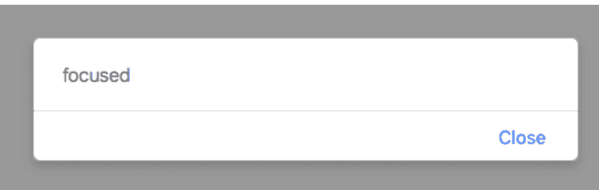

`blur` 事件在用户将焦点移出表单元素时发生。将以下内容添加到 `main.js` 中，刷新页面，然后将光标移开搜索框：

```javascript
input.addEventListener('blur', () => alert('blurred'), false);
```

`change` 事件在用户更改表单元素后移动焦点时发生。因此，如果用户点击输入字段并更改，然后点击其他地方，`change` 事件不会触发，但 `blur` 事件会触发。

将以下代码添加到 `main.js` 并刷新页面。你会发现，只有当你实际上更改了搜索框内的值并移开光标时，才会出现提示消息：

```javascript
input.addEventListener('change', () => alert('changed'), false);
```

## 提交表单

可能最重要的表单事件是 `submit` 事件，它在表单提交时发生。通常这会将表单的内容发送到服务器以被处理，但我们可以通过添加一个 `submit` 事件监听器在表单发送之前对其进行拦截。将以下代码添加到 `main.js` 文件中：

```javascript
const form = document.forms['search'];
form.addEventListener('submit', search, false);

function search() {
  alert('Form Submitted');
}
```

现在重新加载页面并点击提交按钮。你应该看到显示 *Form Submitted* 的警报框。在你点击确定后，浏览器会尝试加载一个不存在的页面（URL 应该以类似于 `.../search?searchInput=hello` 的内容结尾）。这是因为当事件触发时，我们的 `search()` 函数被调用并显示了警报框。然后表单被提交到 `action` 属性中提供的 URL 进行处理，但在这种情况下，该 URL 不是一个真实的 URL，所以它不会去往任何地方。书中没有涵盖后端处理，因此我们将将其保留为一个占位符 URL，并专注于使用 JavaScript 来处理信息。

实际上，我们可以使用上一章节中见过的 `preventDefault()` 方法来完全阻止表单提交到 URL。在 `search` 函数中添加以下行：

```javascript
function search(event) {
  alert('Form Submitted');
  event.preventDefault();
}
```

现在重新加载 `search.html` 并尝试提交表单。你会发现警报框仍然出现，但在你点击确定后，表单不会尝试提交到占位符 URL。

## 从表单获取和更改值

文本输入元素对象具有一个 `value` 属性，可以使用它来获取字段内的文本。

我们可以利用此来报告用户搜索了什么。将 `search()` 函数修改为如下：

```javascript
function search(event) {
  alert(`You Searched for: ${input.value}`);
  event.preventDefault();
}
```

注意，在此例中，`input` 是我们在 `main.js` 文件开头定义的变量，它指向表单中的输入元素，但它也可以命名为任何名称。

现在刷新页面，在搜索框中输入一些文本，你应该能看到与下方截图类似的界面：

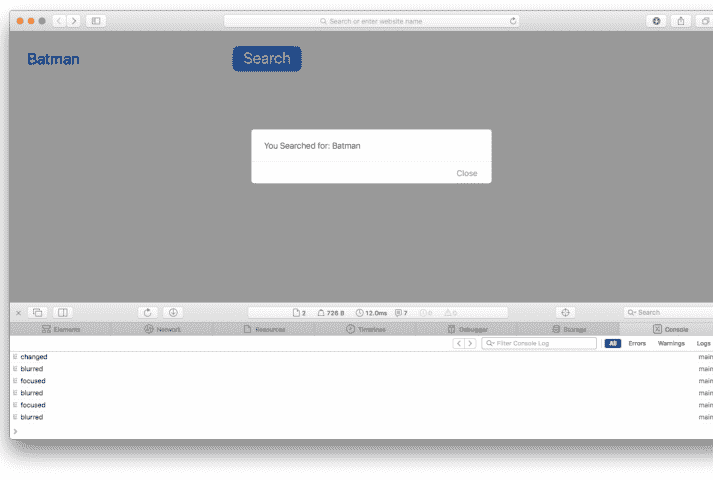

8-2. 报告用户搜索的内容

同样，可以使用 JavaScript 设置该值。在 `main.js` 文件中添加以下代码：

```javascript
input.value = 'Search Here';
```

现在刷新页面，你应该能看到输入字段中显示了字符串 "Search Here"。

这样做的问题在于，当用户点击该字段内部时，文本仍然留在字段中，因此在用户输入自己的文本之前必须将其删除。使用 `focus`（聚焦）和 `blur`（模糊）事件处理器可以轻松解决这个问题。在 `main.js` 中添加以下内容：

```javascript
input.addEventListener('focus', function() {
  if (input.value === '') {
  }
}, false);

input.addEventListener('blur', function() {
  if (input.value === '') {
    input.value = 'Search Here';
  }
}, false);
```

现在，当用户点击输入字段内部时，默认文本消失（`focus` 事件），如果用户留空并点击其他处，它就会重新出现（`blur` 事件）。

## placeholder 属性

现代浏览器可以使用 HTML 标记中的 `placeholder` 属性产生类似的功能。只需将 `search.html` 中的输入字段更改为以下内容：

```html
<input type='text' name='search-box' placeholder='Search Here'>
```

它的行为略有不同，因为 `placeholder` 文本实际上并不是输入字段的 `value`，所以如果用户未填写，它将不会作为字段的值被提交。

## 表单控件

在之前的示例中，我们只使用了 `input` 和 `button` 控件。但还有其他控件可以帮助我们的网页更具交互性。

一些常见的表单控件类型有：

- `<input>` 字段，包括文本、密码、复选框、单选按钮和文件上传
- 用于选项列表的 `<select>` 菜单
- 用于长输入的 `<textarea>` 元素
- 用于提交和重置表单的 `<button>` 元素

为了演示所有的 HTML 表单控件，我们将创建一个包含所有这些元素的表单。在第 5 章中，我们创建了一个具有许多与钢铁侠相关联属性的 `superman` 对象。我们将设计一个允许用户在浏览器中输入所有细节的表单，因此我们将创建一个描述超级英雄（或反派）的 `hero` 对象。

创建一个新的项目文件夹，并在名为 `hero.html` 的文件中包含以下代码：

```html
<!doctype html>
<html lang='en'>
<head>
<meta charset='utf-8'>
<title>Hero Form</title>
</head>
<body>
<form id='hero'>
<label for='herName'>herName:
<input type='text' id='herName' name='herName' 
  autofocus placeholder='Your Super Hero Name' maxlength=32>
</label>
<button type='submit'>Submit</button>
</form>
<script src='main.js'></script>
</body>
</html>
```

我们将从一个与搜索示例相当相似的基础表单开始，包含一个文本输入和一个按钮。

## HTML5 中的新属性

`input` 元素包含了 HTML5 引入的一些新属性。`autofocus` 属性在页面加载时赋予该元素焦点。`placeholder` 属性将插入关于如何填充提示。`maxLength` 属性将限制在字段中输入的字符数量。有许多新属性可以使表单更加友好。

我们还需要一个名为 `main.js` 的文件，保存在与 `hero.html` 相同的文件夹中。在该文件中，让我们先将表单赋值给变量，然后为表单提交添加事件监听器：

```javascript
const form = document.forms['hero'];
form.addEventListener('submit', makeHero, false);
```

```javascript
function makeHero(event) {
  event.preventDefault(); // 防止表单提交
  const hero = {}; // 创建一个空对象
  hero.name = form.herName.value; // 根据字段的值创建一个属性
  alert(JSON.stringify(hero)); // 将对象转换为 JSON 并在警报框中显示
  return hero;
}
```

此函数使用 `event.preventDefault()` 阻止表单提交。然后我们创建一个局部变量 `hero` 并将其赋值为空对象。我们将根据表单属性增强此对象，尽管目前只有 `name` 属性。

一旦创建了 `hero` 对象，在程序的其余部分会被返回。由于这只是为了演示，我们使用 `JSON.stringify()` 方法将 `hero` 对象转换为 JSON 字符串并在警报框中显示。

# 298 JavaScript: Novice to Ninja, 2nd Edition

在浏览器中打开 `hero.html` 并输入一个超级英雄的名字，你应该能看到类似下方的截图。

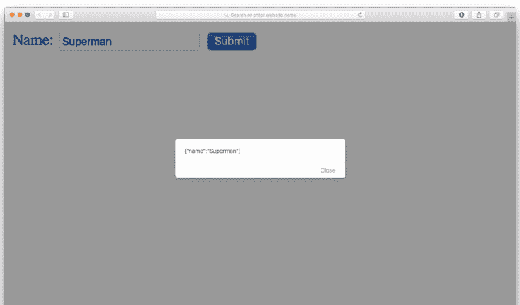

8-3. 输入我们的英雄名字

现在我们知道代码运行正常，让我们看看一些其他类型的表单控件。

## 输入字段

`input` 字段是最常见的表单控件类型，但你很快就会看到几类输入字段：

## 文本输入字段

输入字段的默认类型是 `text`，用于输入短文本，例如用户名。在我们的示例中，我们使用文本输入字段来输入英雄的名字。`type='text'` 属性并不是必须的（我们在搜索示例中没有使用它，因为文本是默认值），但建议使用它，因为它显式地表达了字段的意图，有助于维护、可读性和向前扩展。

此字段的初始值可以在 HTML 中通过 `value` 属性进行设置。例如，你可以像这样在慈善页面上预填推荐的捐赠金额：

```html
<label for='donation-amount'>捐赠金额：
<input type='text' id='donation-amount'
  name='donationAmount' value='10'>
</label>
```


## 密码输入字段

`type='password'` 用于输入密码或秘密信息。它的工作方式与 `type='text'` 的输入字段相同，不同之处是字符在输入时会被隐藏，因此无法在屏幕上被读取到。

为了演示这一效果，我们将为我们的 `hero` 对象添加一个 `realName` 属性。显然，超级英雄的真实姓名是秘密信息，因此在输入时需要隐藏起来以防窥探的目光。在 `hero.html` 的表单中添加以下行（位于提交按钮之前）：

```html
<label for='realName'>真实姓名：
<input type='password' name='realName' id='realName'></label>
```

为了处理这些信息，我们在 `main.js` 的 `makeHero()` 函数中添加以下行：

```javascript
hero.realName = form.realName.value;
```

如你所见，从密码输入字段获取值的方式与使用 `value` 属性访问文本输入字段的方式完全相同。

## 复选框输入字段

复选框使用 `type='checkbox'` 的输入字段创建。它们用于选择不同的可勾选（true）或取消勾选（false）选项。用户可以从列表中选择多个复选框。

我们将使用复选框来添加超级英雄可能拥有的能力列表。在 `hero.html` 的表单中添加以下代码行：

```html
<p>超能力</p>
<label for='flight'>飞行：
<input type='checkbox' id='flight' value='Flight' name='powers'>
</label>
<label for='strength'>超力量：
<input type='checkbox' id='strength' value='Strength' name='powers'>
</label>
<label for='speed'>超速：
<input type='checkbox' id='speed' value='Super Speed' name='powers'>
</label>
<label for='energy'>能量冲击：
<input type='checkbox' id='energy' value='Energy Blasts' name='powers'>
</label>
<label for='telekinesis'>念力移动：
<input type='checkbox' id='telekinesis' value='Telekinesis' name='powers'>
</label>
```

注意，所有复选框元素具有相同的 `name` 属性 `'powers'`。这意味着可以像这样作为 HTML 集合来访问它们：

```javascript
form.powers;
```

## 表单 301

然后我们可以使用 `for` 循环遍历此集合，检查每个复选框是否被勾选。复选框对象有一个 `checked` 属性，告诉我们它是否被勾选。这是一个布尔属性，因此只能有 `true` 或 `false` 值。`value` 属性用于设置如果复选框被勾选时使用的能力名称。在 `main.js` 的 `makeHero()` 函数中添加以下代码：

```javascript
hero.powers = [];
for (let i=0; i < form.powers.length; i++) {
  if (form.powers[i].checked) {
    hero.powers.push(form.powers[i].value);
  }
}
```

这为我们的 `hero` 对象创建了一个 `powers` 属性，初始值为空数组。然后我们遍历每个复选框，查看它在表单中是否被勾选。如果是，使用 `push` 方法将复选框的 `value` 属性添加到 `powers` 数组中。

我们可以使用第 4 章中看到的数组迭代器将其重构得更加简洁。以下代码将实现相同的结果：

```javascript
hero.powers = [...form.powers].filter(box => box.checked).map(box => box.value);
```

这使用了展开运算符 `...` 将节点列表转换为数组。这允许我们使用 `filter()` 方法，该方法返回一个仅包含已勾选复选框的数组（因为它们的 `checked` 属性为真）。我们在末尾链式 `map()` 方法，将数组中的每个复选框替换为其 `value` 属性。返回的数组被存储在 `hero.powers` 变量中。

注意，可以通过 JavaScript 将 `checked` 属性设置为 `true` 来设置复选框。例如，我们可以通过这行代码让能力列表中的第一个复选框显示为勾选状态：

```javascript
document.forms.hero.powers[0].checked = true;
```

复选框也可以在 HTML 中使用 `checked` 属性进行初始勾选：

```html
<input type='checkbox' value='Flight' name='powers' checked>
```

## 单选按钮输入字段

单选按钮使用 `type='radio'` 的输入字段创建。与复选框一样，它们允许用户将某个选项勾选为 `true`，但它们提供了互斥的选项选择，因此只能选择一个选项。

这种互斥的选项可以是超级英雄是英雄还是反派……甚至是反英雄（你懂的，那些无法决定做好人还是坏人的人！）。在 `hero.html` 的表单中添加此行代码：

```html
<p>你是哪种类型的英雄？</p>
<label for='hero'>英雄：
<input type='radio' name='category' value='Hero' id='hero'>
</label>
<label for='villain'>反派：
<input type='radio' name='category' value='Villain' id='villain'>
</label>
<label for='anti-hero'>反英雄：
<input type='radio' name='category' value='Antihero' id='anti-hero'>
</label>
```

这些单选按钮通过相同的 `name` 属性进行分组。这意味着我们可以像这样访问该类别的单选按钮的 HTML 集合：

```javascript
form.category;
```

如果在表单提交后检查此集合，它看起来如下：

```javascript
[input, input, input: "Antihero"]
```

被选中的单选按钮的值存储在 `form.category` 中。通过在 `main.js` 的 `makeHero()` 函数中添加以下代码，为我们的对象分配类别属性：

```javascript
hero.category = form.category;
```

每个单选按钮都有 `checked` 属性，返回布尔值 `true` 或 `false`，取决于它是否被选中。可以使用 JavaScript 将 `checked` 属性设置为 `true`，但由于一次只能勾选一个单选按钮，具有相同 `name` 属性的其他按钮将变为 `false`。因此，以下代码将勾选反英雄按钮，但英雄和反派按钮将取消勾选：

```javascript
form.type[2].checked = true;
```

单选按钮也可以在 HTML 中使用 `checked` 属性进行初始勾选：

```html
<input type='radio' name='type' value='Villain' checked>
```

## 隐藏输入字段

隐藏字段可以使用 `type='hidden'` 的输入字段创建。这些字段不会被浏览器显示，但有一个 `value` 属性，可以包含随表单提交的信息。它们通常用于发送设置或用户已经提供的信息。注意，这些字段中的信息并不是秘密，因为它们在 HTML 中是可见的，所以不应用于敏感数据。隐藏字段的值可以像任何其他输入字段一样使用 JavaScript 修改。

## 文件输入字段

文件输入字段可以使用 `type='file'` 的输入字段创建。它们用于上传文件，大多数浏览器会提供浏览按钮或类似的功能，让用户从系统中选择文件。

## 其他输入类型

HTML5 包含了许多新的输入类型，如 `number`、`tel` 和 `color`。随着浏览器开始支持这些类型，它们将根据输入类型实现不同的用户界面元素。因此，数字字段可能会使用滑块，而日期字段将显示日历。它们还会自动进行验证，因此如果没有有效的地址地址，邮箱输入字段将显示错误消息。

让我们在表单中添加一个 `number` 类型的输入，以便输入超级英雄的年龄。在 `hero.html` 中添加以下内容：

```html
<label for='age'>年龄：
<input type='number' id='age' name='age' min=0 step=1></label>
```

## 表单 305

数字输入字段还有可选的 `min` 和 `max` 属性，可用于限制给定的输入。`step` 属性用于指定每次点击时数值的变化量。大多数现代浏览器都允许在输入字段侧边显示控件，以便增加或减少数值，如下所示。

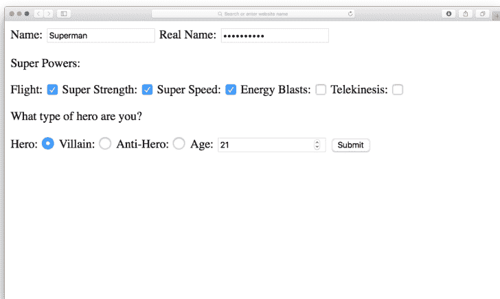

## 8-4. 使用数字输入字段指定我们英雄的年龄

我们还需要一些 JavaScript 来处理年龄信息。请在 `main.js` 的 `makeHero()` 函数中添加以下行：

```javascript
hero.age = form.age.value;
```

这些新的输入类型尚未获得支持，但好消息是你可以现在就可以开始使用它们了，因为它们仍然有效；如果浏览器不支持某个特定类型，它将显示一个普通的文本输入字段。

## 选择下拉列表

选择下拉列表可用于从值列表中选择一个或多个选项。如果需要选择多个选项，则需要 `multiple` 属性。我们将在示例中使用它来选择英雄运营的城市。在 `hero.html` 的表单中添加以下代码。

```html
<label for='City'>总部所在地：
<select name='city' id='city'>
<option value='' selected>选择城市</option>
<option value='Metropolis'>大都市</option>
<option value='Gotham City'>哥市</option>
<option value='Keystone City'>基石市</option>
<option value='Coast City'>海岸市</option>
<option value='Star City'>星市</option>
</select>
</label>
```

注意，`selected` 属性可以设置 HTML 中的初始值。在这个示例中，空白选项具有此属性，提供了提示性信息“选择城市”，因此在页面加载时会显示它。

`select` 元素的 `name` 属性用于在 JavaScript 中作为表单对象的访问它：

```javascript
form.city;
```

如果只选择了一个项目，这将返回该选择的引用；否则，将返回一个包含每个选择的集合。

每个选择都有一个 `value` 属性，它等于被选中的 `<option>` 标签的 `value` 属性。在 `makeHero()` 函数中添加以下代码来设置 `city` 属性：

```javascript
hero.city = form.city.value;
```

还可以使用 `selectedIndex` 属性来查找所选选项的索引。例如，如果用户从菜单选择了“Gotham City”，`form.city.selectedIndex` 将返回 2，因为它是列表中的第三个选项。然后可以使用它来访问所选选项包含的实际文本：

```javascript
form.city.options[form.city.selectedIndex].text
```

从上面的示例中可以显而易见，你可以使用索引法访问任何选项的文本。例如，以下代码返回了第一个选项的文本：

```javascript
form.city.options[0].text
// "选择城市"
```

## 文本区域 (Text Areas)

`<textarea>` 元素用于输入多行的长文本，如评论或博客文章。它们主要通过 `name` 属性工作，并使用 `value` 属性查看输入了哪些文本。

例如，我们可以为表单添加一个文本区域，以便输入超级英雄的起源故事。在 `hero.html` 的表单中添加以下代码行：

```html
<label for='origin'>起源故事：
<textarea id='origin' name='origin' rows='20' cols='60'></textarea>
</label>
```

现在，可以将此文本区域中输入的文本作为属性添加。通过在 `main.js` 中添加以下行，可以将该区域的内容添加：

```javascript
hero.origin = form.origin.value;
```

还可以通过 HTML 更改文本区域的值：

```javascript
form.origin = '';
```

文本区域的初始值可以通过在标签和闭合标签之间设置：

```html
<textarea name='origin' rows='20' cols='60'>出生于星球...</textarea>
```

## 按钮 (Buttons)

我们已经使用了按钮来提交表单，这种类型是 `submit`，它会提交表单的数据。另一种类型是 `reset`，它会重置表单。在 `hero.html` 中添加以下代码来查看一个示例：

```html
<button type='submit'>提交</button>
```

如果没有指定 `type` 属性，按钮默认类型是 `submit`。

`reset` 按钮可以重置表单的所有字段。在 `main.js` 中添加以下代码：

```javascript
form.reset();
```

还可以使用 `button` 元素并通过 `onclick` 属性执行 JavaScript。在 `hero.html` 中添加以下代码：

```html
<button type='button' onclick="alert('Hello World!')">点击我</button>
```

也可以使用 JavaScript 为按钮添加点击事件。在 `main.js` 中添加以下代码：

```javascript
const btn = document.querySelector('button');
btn.addEventListener('click', function() {
  alert('Hello World!');
});
```

## JavaScript：从入门到精通，第2版

如果你刷新页面并在名称字段中输入以“X”开头的名称，然后尝试提交表单，你应该会收到如下屏所示的错误警告对话框。

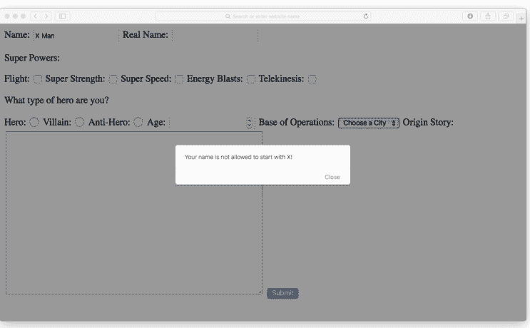

## 8-6. 验证错误警告对话框

我们可以通过提供即时反馈而不是等待表单提交来进一步提高表单的可用性。这可以通过直接向输入字段添加事件监听器来实现，该监听器会在用户按下按键时触发（使用 `keyup` 事件）。可以将反馈插入到输入字段的 `label` 元素中，并使用 `error` 类来提供更直接的反馈。将以下代码添加到 main.js 中：

```javascript
const label = form.querySelector('label');
const error = document.createElement('div');
error.classList.add('error');
error.textContent = '! Your name is not allowed to start with X.';
label.append(error);

function validateName() {
  const heroName = this.value.toUpperCase();
  if(heroName.startsWith('X')) {
    error.style.display = 'block';
  } else {
    error.style.display = 'none';
  }
}
```


为了让这种技术生效，我们实际上在 JavaScript 文件中向 HTML 添加了错误消息，无论是否发生了错误。这是在上面的五行代码中实现的，使用 DOM 创建了一个包含错误消息并具有 `error` 类的 `<div>` 元素。然后，使用 `append()` 方法将其添加到 `<label>` 元素中。这里的技巧是，该元素在开始带有 `display: none;` 样式声明之前是不可见的；这将会通过 `keyup` 的触发进行动态更新。

每当事件触发时，都会调用 `validateInline()` 函数。我们首先将 `heroName` 赋值为输入字段中输入的值，但我们也对它应用了 `toUpperCase()` 方法。这将允许我们检查它是否以“x”或“X”开头，而无需分别检查两者。

我们使用 `if-else` 块通过 `startsWith()` 方法检查是否发生了错误，该方法将返回字符串的首字母。如果它以“X”开头，我们将错误元素的样式更改为 `display: block`，这会使其变得可见。

如果没有错误，则运行 `else` 块中的代码，因此我们将错误元素的样式重置为 `display: none`，使错误消失。

为了让这种技术正常工作，我们需要为错误元素添加一些自定义样式，以确保它最初是可见的，并让消息脱颖。在 `hero.html` 的 `<head>` 部分添加以下 `<style>` 块：

```html
<style>
  .error {
    background: #f99;
    border: #900 1px solid;
    display: none;
  }
</style>
```

## 为了简单起见，我们没有使用外部 CSS 文件

将任何样式放在外部 CSS 文件中更好，但为了本例的目的，直接将其放入 HTML 文件中更方便。

现在，如果你刷新页面并尝试输入以“X”开头的名称，每当你尝试移动到另一个字段时，就应该在输入字段上方看到错误消息。下方的截图所示。

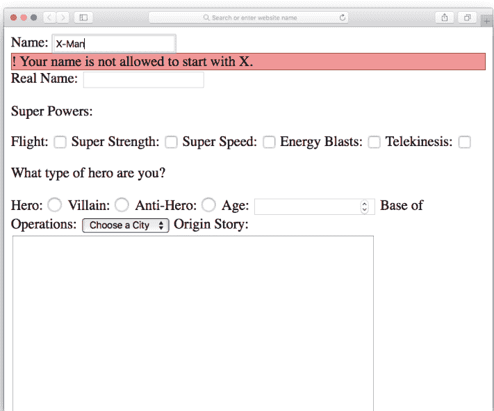

## 8-7. 显示内联错误消息

## 这是一个特定且可能不实际的示例

这是一个非常具体的内联验证示例——检查输入字段是否以字母“X”开头，而且它只应用于一个元素。

在实际应用中，你可能需要根据各种规则对许多元素进行验证。如果是这样，那么编写一些通用的 `onError()` 和 `removeError()` 函数是有意义的，以处理你可能应用于表单中各种元素的不同类型的验证。

## 禁用提交按钮

另一个有助于可用性的有用技术是，如果表单上有错误，则禁用提交按钮。如果提交按钮被禁用，点击时将不会执行任何操作。大多数浏览器还会用较浅的颜色显示它，表示无法点击。这防止了用户提交包含任何错误的表单。

通过向 `<input>` 元素添加 `disabled` 属性可以禁用提交按钮：

```html
<button type='submit' id='submit' disabled>Submit</button>
```

可以使用 `<button>` 元素的 `disabled` 属性通过程序进行更改。以下函数将在输入字段为空时禁用按钮。

```javascript
function disableSubmit(event) {
  if(event.target.value === '') {
    document.getElementById('submit').disabled = true;
  } else {
    document.getElementById('submit').disabled = false;
  }
}
```

## 316 JavaScript：从入门到精通，第2版

我们可以通过添加以下事件处理程序应用于 `heroName` 字段，该处理程序会在每次按下按键时触发：

```javascript
form.heroName.addEventListener('keyup', disableSubmit, false);
```

## 测验项目

现在我们使用表单来回答。我们的第一个任务是添加一个 ID 为 `response` 的表单。这位于 `index.html` 中：

```html
<form id='response'>
  <input type='text' name='answer'>
  <button type='submit'>Submit</button>
</form>
```

接下来，我们需要一个在表单提交时触发的事件处理器。将以下行代码添加到 `main.js` 的底部：

```javascript
view.response.addEventListener('submit', (event) =>
  game.check(event), false);
view.hide(view.response);
```

这将调用 `game.check()` 方法，该方法用于检查玩家提供的答案是否正确。我们需要更新此方法，使其接收事件对象作为参数。然后我们可以使用 `event.preventDefault()` 方法阻止表单的实际提交：

```javascript
check(event) {
  event.preventDefault();
  const response = view.response.answer.value;
  const answer = this.question.realName;
  if(response === answer) {
    view.render(view.result, 'Correct!', {'class': 'correct'});
    this.score++;
    view.render(view.score, this.score);
  } else {
    view.render(view.result, 'Wrong! The correct answer was ${answer}', {'class': 'wrong'});
  }
  this.ask();
}
```

我们可以通过查询 `view.response.answer.value` 获取提交的答案，这是存储在 `<input>` 字段中的值。然后将其赋值给变量 `response`，并使用之前相同的代码来处理玩家答案对错的结果。

我们还需要在方法结束时调用 `game.ask()` 函数，以便在当前问题被回答和检查后提出下一个问题。

玩家现在可以使用表单而不是提示对话框来输入答案，但许多元素在不需要时也显示了。例如，当页面加载时，表单就被显示了，尽管此时没有问题要回答。为了解决这个问题，我们可以创建几个辅助函数，在游戏开始和结束时更新视图。

第一个辅助函数是 `view.setup()`，它将用于在游戏开始时设置视图。

```javascript
setup() {
  this.show(this.question);
  this.show(this.response);
  this.show(this.result);
  this.hide(this.start);
  this.render(this.score, game.score);
  this.render(this.result, '');
  this.render(this.info, '');
  this.resetForm();
}
```

此函数使用了我们在上一个章节中创建的 `view.show()` 和 `view.hide()` 方法，使问题、响应和结果 `<div>` 元素可见，并隐藏开始按钮。它还使用 `view.render()` 方法将 `result` 和 `info` 元素中的任何 HTML 内容重置为空字符串。这将停止它们显示来自上一个游戏的任何消息。此外，它还调用了 `view.resetForm()` 方法。此方法需要添加到 `view` 对象中：

```javascript
resetForm() {
  this.response.answer.value = '';
  this.response.answer.focus();
}
```

该方法将输入字段重置为空字段并赋予焦点，这提高了易用性，因为这意味着玩家只需集中在回答下一个问题上。

在每个问题之后执行这将非常有用，因此在 `game.check()` 方法的末尾添加对此方法的调用：

```javascript
check(event) {
  event.preventDefault();
  const response = view.response.answer.value;
  const answer = this.question.realName;
  if(response === answer) {
    view.render(view.result, 'Correct!', {'class': 'correct'});
    this.score++;
    view.render(view.score, this.score);
  } else {
    view.render(view.result, 'Wrong! The correct answer was ${answer}', {'class': 'wrong'});
  }
  view.resetForm();
  this.ask();
}
```

`view.setup()` 方法需要在每个游戏开始时调用，因此需要将其添加到 `game.start()` 方法中：

```javascript
start(quiz) {
  this.score = 0;
  this.questions = [...quiz];
  view.setup();
  this.ask();
}
```

另一个辅助方法是 `view.teardown()`。它在游戏结束时调用，负责隐藏不需要的元素并重新让开始按钮可见。向 `view` 对象添加以下方法：

```javascript
teardown() {
  this.hide(this.question);
  this.hide(this.response);
  this.show(this.start);
}
```

该方法在游戏结束时需要调用，因此我们需要将其放在 `game.gameOver()` 方法中：

```javascript
gameOver() {
  view.render(view.info, `Game Over, you scored ${this.score} point${this.score !== 1 ? 's' : ''}`);
  view.teardown();
}
```

这应该让游戏看起来更加精美，因为只有作为游戏一部分所需的元素会在相关时间显示。让我们打开 `index.html` 并尝试一下看看效果如何。如果一切都按计划进行，它看起来应该和下面的截图相似。


## 8-8. 玩 Quiz ninja-skills

你可以在 CodePen³ 查看实时示例。

我们的测验现在正进展得不错，去掉了所有的警告和提示对话框后，看起来专业得多了。

## 章节总结

- 表单（Forms）是向浏览器输入数据的主要方法。
- 表单有多种控件，用于输入不同类型的信息。
- HTML5 拥有许多新的输入类型，这些类型在现代浏览器中开始实现。
- `document.forms` 将返回所有表单的 HTML 集合。

## Window 对象

`window.alert()` 方法会暂停程序的执行，并在对话框中显示消息。该消息作为参数传递给方法，并且始终返回 `undefined`：

```javascript
window.alert('Hello');
// << undefined
```

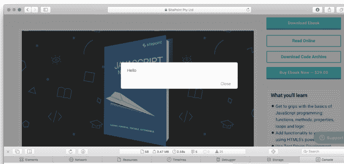

## SitePoint

分享我们对构建精彩网络事物的热情

```javascript
window.alert('Hello');
```

## 9-1. Alert 框

`window.confirm()` 方法会停止程序的执行并显示一个确认对话框，该框显示作为参数传递的消息，并提供“确定”或“取消”选项。如果用户点击“确定”，返回布尔值 `true`；如果点击“取消”，则返回 `false`：

```javascript
window.confirm('Do you wish to continue?');
// << undefined
```

## 9-2. Confirm 框

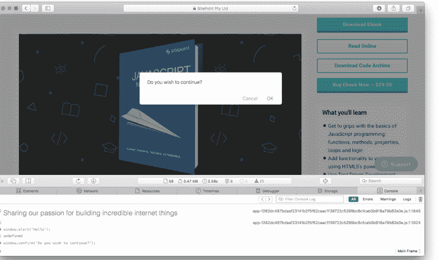

`window.prompt()` 方法会停止程序的执行。它会显示一个对话框，其中包含参数传递的消息以及一个允许用户输入文本的输入字段。当用户点击“确定”时，该文本将作为字符串返回。如果用户点击“取消”，则返回 `null`：

```javascript
window.prompt('Please enter your name:');
```

## Window 对象

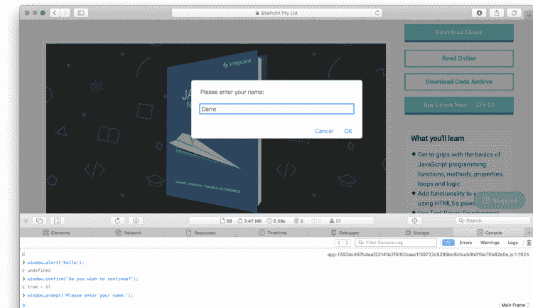

## 9-3. Prompt 框

## 注意使用

值得再次强调，这些方法会直接中断程序的执行。这意味着在调用方法的时间点，所有操作都将停止处理，直到用户点击“确定”或“取消”。如果程序需要同时处理其他内容，或者程序正在等待回调函数，这可能会导致问题。

在某些情况下，这种功能可以作为一种优势，例如，`window.confirm()` 对话框可以作为最后的检查，以查看用户是否想要删除资源。这可以防止程序在用户决定如何操作之前继续进行并删除资源。

同样值得记住，大多数浏览器允许用户禁用对话框的反复出现，这意味着它们不是可以依赖的功能。

## 浏览器信息

`window` 对象具有许多属性和方法，可以提供有关用户浏览器的信息。

## 是什么浏览器？

`window` 对象有一个 `navigator` 属性，返回 `Navigator` 对象的引用。`Navigator` 对象包含了正在使用的浏览器的信息。它的 `userAgent` 属性返回关于使用的浏览器和操作系统的信息。例如，如果我运行以下行代码，将显示我正在 Mac OS 上使用 Safari 版本 10：

```javascript
window.navigator.userAgent
// << "Mozilla/5.0 (Macintosh; Intel Mac OS X 10_12_3)
// ↪ AppleWebKit/602.4.8 (KHTML, like Gecko) Version/10.0.3
// ↪ Safari/602.4.8"
```

但不要依赖这些信息，因为它可以被用户修改以伪装成不同的浏览器。要修改返回的字符串也很困难，因为所有浏览器在某种程度上都伪装成其他浏览器。例如，出于兼容旧版 Netscape 的原因，每个浏览器都会在其 `userAgent` 属性中包含 "Mozilla"。`userAgent` 属性已在官方规范中弃用，但在所有浏览器中仍得到良好支持。

## 位置、位置、位置

`window.location` 属性是一个对象，其中包含有关当前页面 URL 的信息。它包含许多提供 URL 不同片段信息的属性。

`href` 属性返回作为字符串形式的完整 URL：

```javascript
window.location.href
// << "https://www.sitepoint.com/premium/books/javascript-novice-to-ninja"
```

该属性（以及本节中的其他属性）是一个读写属性，这意味着它也可以通过赋值来更改。如果这样做，页面将使用新属性重新加载。例如，在浏览器控制台中输入以下行，将页面重定向到 SitePoint JavaScript 频道：

```javascript
window.location.href = 'https://www.sitepoint.com/javascript/';
// << "https://www.sitepoint.com/javascript/"
```

`protocol` 属性返回一个描述所用协议（如 http, https, pop2, ftp 等）的字符串。注意末尾有一个冒号（:）：

```javascript
window.location.protocol
// << "https:"
```

`host` 属性返回一个描述当前 URL 域名和端口号的字符串（如果使用默认端口 80，则通常会省略）：

```javascript
window.location.host
// << "www.sitepoint.com"
```

`hostname` 属性返回一个描述当前 URL 域名的字符串：

```javascript
window.location.hostname
// << "www.sitepoint.com"
```

`port` 属性返回一个描述端口号的字符串，尽管如果 URL 中没有显式指定端口，它将返回一个空字符串：

```javascript
window.location.port
// << ""
```

`pathname` 属性返回域名之后路径的字符串：

```javascript
window.location.pathname
// << "premium/books/javascript-novice-to-ninja"
```

`search` 属性返回一个以 '?' 开头并后跟查询字符串参数的字符串。如果没有查询字符串参数，则返回一个空字符串。这就是我在 SitePoint 上搜索 'JavaScript' 时得到的结果：

```javascript
window.location.search
// << "?q=javascript&limit=24&offset=0&page=1&"
```


# Window 对象

## Location 对象

`hash` 属性返回一个以 `#` 开头并后跟片段标识符的字符串。如果没有片段标识符，则返回一个空字符串：

```javascript
window.location.hash
// << ""
```

`origin` 属性返回一个以当前页面来源协议和域名开头的字符串。该属性是只读的，因此无法更改：

```javascript
window.location.origin
// << "https://www.sitepoint.com"
```

`window.location` 对象还有以下方法：

- `reload()` 方法可以用于强制刷新当前页面。如果给定参数 `true`，它将强制浏览器从服务器加载，而不是使用缓存页面。
- `assign()` 方法可以从参数提供的 URL 加载另一个资源，例如：

```javascript
window.location.assign('https://www.sitepoint.com/');
```

- `replace()` 方法与 `assign()` 方法几乎相同，当前页面不会存储在会话历史中，因此用户无法返回。
- `toString()` 方法返回一个包含完整 URL 的字符串：

```javascript
window.location.toString();
// << "https://www.sitepoint.com/javascript/"
```

## 浏览器历史

`window.history` 属性可以访问当前浏览器会话中的任何访问页面。避免与新的 HTML5 History 混淆¹

`window.history.length` 属性显示到达当前页面之前访问了多少页面。

`window.history.go()` 方法可以跳转到特定页面，其中零是当前页面：

```javascript
window.history.go(1); // 前进一级
window.history.go(0); // 刷新当前页面
window.history.go(-1); // 后退一级
```

> ¹. 详情请参见 http://www.sitepoint.com/javascript-history-pushstate/ 文章。

还有 `window.history.forward()` 和 `window.history.back()` 方法，可以分别向前或后退页面，就像使用浏览器的前进后按钮一样。

## 控制窗口

可以使用 `window.open()` 方法打开新窗口。它将要打开的 URL 作为第一个参数，窗口标题作为第二个参数，并将属性列表作为第三个参数。这也可以赋值给变量，以便稍后在代码中引用该窗口：

```javascript
const popup = window.open('https://sitepoint.com','SitePoint','width=400,height=400,resizable=yes');
```


### 弹出窗口

可以使用 `close()` 方法关闭窗口，假设你拥有它的引用：

```javascript
popup.close();
```

可以使用 `window.moveTo()` 方法来移动窗口。它接受两个参数，分别是窗口要移动到的屏幕的 X 和 Y 坐标：

```javascript
window.moveTo(0,0); // 将窗口移动到屏幕的左上角
```

你可以使用 `window.resizeTo()` 方法调整窗口大小。它接受两个参数，用于指定调整大小后窗口的宽度和高度：

```javascript
window.resizeTo(600,400);
```


> ### 烦人的弹窗
> 这些方法在很大程度上导致了 JavaScript 臭名昭彰，因为它们被用来创建烦人的弹窗，而这些弹窗通常包含侵入性广告。从可用性的角度来看，调整或移动用户的窗口也不是一个好主意。
> 许多浏览器会阻止弹窗，并在某些情况下不允许调用这些方法中的某些。例如，如果打开了多个标签页，你就无法调整窗口大小。你无法移动或调整一个不是通过 `window.open()` 创建的窗口。
> 使用任何这些方法的情况通常都是不明智的，因此在使用它们之前请仔细考虑。总会有更好的替代方案，而忍者程序员会努力找到它。

## 屏幕信息

`window.screen` 对象包含了浏览器显示器屏幕的信息。你可以分别使用 `height` 和 `width` 属性获取以像素为单位的屏幕高度和宽度：

```javascript
window.screen.height
// << 1024
```

```javascript
window.screen.width
// << 1280
```

`availHeight` 和 `availWidth` 可用于找到排除任何操作系统菜单的屏幕高度和宽度：

```javascript
window.screen.availWidth
// << 1280

window.screen.availHeight
// << 995
```

`colorDepth` 属性可用于查找用户显示器的颜色位深，尽管除了收集用户统计外，这几乎没有其他用例：

```javascript
window.screen.colorDepth;
// << 24
```


### 在移动端更有用

Screen 对象在移动设备上有更多用途。它还允许执行诸如关闭设备屏幕、检测方向变化或将其锁定在特定方向等操作。


### 谨慎使用

上一节介绍的许多方法和属性在过去被滥用于可疑活动，例如用户代理嗅探（user-agent sniffing），或通过检测屏幕尺寸来决定是否显示某些元素。这些做法（感谢地）现在已经被更好的实践所取代，例如媒体查询和功能检测，将在下一章中介绍。

## 文档对象

每个窗口对象都包含一个文档对象。该对象拥有处理加载到窗口中的页面的属性和方法。在第 6 章中，我们涵盖了文档对象模型（DOM）以及用于操作页面上项目的属性和方法。文档对象还包含几个值得查看的方法。

### document.write()

`write()` 方法简单地向页面写入一段文本字符串。如果页面已经加载，它将完全替换当前文档：

```javascript
document.write('Hello, world!');
```

这将用字符串 `'Hello, world!'` 替换整个文档。你可以在字符串中包含 HTML，这将会成为 DOM 树的一部分。例如，以下代码段将创建一个 `<h1>` 节点和一个子文本节点：

```javascript
document.write('<h1>Hello, world!</h1>');
```

`document.write()` 方法也可以用于在 `<script>` 标签内的文档内部的文档中，以将一个字符串注入到标记语言（markup）中。这不会覆盖页面上的其余 HTML 内容。以下示例会将文本 "Hello, world!" 放置在 `<h1>` 标签内部，页面的其余部分将正常显示：

```html
<h1>
<script>document.write("Hello, world!")</script>
</h1>
```

`document.write()` 的使用是受到强烈反对的，因为在现实中，它只能通过在 HTML 文档中混合 JavaScript 来使用。虽然它还有一些极其合法的用途，但忍者程序员几乎不需要使用它。

## Cookies

Cookies 是保存在用户计算机本地上的小文件。它们由 Netscape 发明，用作解决 HTTP 作为一个无状态协议的方法。这意味着浏览器不会从一个请求记住另一个请求的任何内容。因此，每当用户访问页面时，关于之前访问的任何内容都不会被记住。Cookies 可以通过存储可以在请求之间检索的信息来规避这个问题。

Cookies 的一个限制是，它们只能由设置它们的域的 Web 页面读取。这是为了防止网站访问用户访问过的其他网站的类型信息。Cookies 还被限制为存储最多 4KB 的数据，尽管每个网域允许存储 20 个 Cookie，这可以累积成大量数据。

Cookies 可用于个性化用户的浏览体验、存储用户偏好、跟踪用户选择（如购物车）、身份验证和跟踪。Cookies 用于数据存储正在被 HTML5 API 取代，但仍用于保留状态（例如用户登录状态），因为它们在每次 HTTP 请求之间传递。

Cookies 的形式为分号分隔的键值对列表。例如，一个 Cookie 文件可能包含以下信息：

```
"name=Superman; hero=true; city=Metropolis"
```

### EU 指令

EU Cookie 指令是一项立法，要求位于欧盟国家的网站在设置任何 Cookie 之前获得许可。然而，未来这种要求可能是全局浏览器设置，而不是每个单独网站的责任。

### 创建 Cookies

要创建 Cookie，你需要将其赋值给 JavaScript 的“cookie 子”，使用 `document.cookie` 属性，如下：

```javascript
document.cookie = 'name=Superman';
// << "name=Superman"
```

`document.cookie` 属性类似于一种特殊的字符串。向它赋值另一个 Cookie 不会覆盖整个属性，它只会将其附加到字符串的末尾。因此我们可以通过赋值 `document.cookie` 添加更多 Cookie：

```javascript
document.cookie = 'hero=true';
// << "hero=true"

document.cookie = 'city=Metropolis';
// << "city=Metropolis"
```

### 修改 Cookie 值

可以通过使用相同的名称和不同的值重新赋值 `document.cookie` 来更改 Cookie 值。以下代码将更新我们在上一节中设置的 Cookie 值：

```javascript
document.cookie = 'name=Batman'
// << "name=Batman"

document.cookie = 'city=Gotham'
// << "city=Gotham"
```

### 读取 Cookies

要查看 Cookie 的当前内容，只需输入 `document.cookie`：

```javascript
document.cookie;
// << "name=Batman; hero=true; city=Gotham"
```

我们可以使用 `split` 方法将字符串拆分为包含每个键值对的数组，然后使用 `for of` 循环遍历数组：

```javascript
const cookies = document.cookie.split("; ");

for (crumb of cookies) {
  const [key, value] = crumb.split("=");
  console.log(`The value of ${key} is ${value}`);
}

// The value of name is Batman
// The value of city is Gotham
```

### Cookie 过期日期

Cookie 默认是会话 Cookie。这意味着它们在浏览器会话结束（用户关闭标签页或窗口）时会被删除。通过在设置 Cookie 时末尾添加 `"expires=date"`，可以使其变为持久化——即在浏览器会话之后有效，其中 date 是 UTC 字符串格式的日期值（Day, DD-Mon-YYYY HH:MM:SS GMT）。以下示例设置 Cookie 在一天后过期：

```javascript
const expiryDate = new Date();
const tomorrow = expiryDate.getTime() + 1000 * 60 * 60 * 24;
expiryDate.setTime(tomorrow);
document.cookie = `name=Batman; expires=${expiryDate.toUTCString()}`;
```

另一种方法是设置 `max-age` 值。它接受以秒为单位的值，但在 Internet Explorer 10 之前不支持它：

```javascript
document.cookie = 'name=Batman; max-age=86400' // 86400 secs = 1 day
```


包含敏感信息的应用程序不应依赖通过这些方法使 cookie 过期。当在崩溃后使用“会话恢复”功能时，浏览器有时会保留存储在 cookie 中的信息，这些本应该过期。

### Cookie 的路径和域

默认情况下，cookie 只能由设置该文件的相同目录和域内的页面读取。出于安全考虑，对 cookie 的访问是限制的。

可以更改路径，以便根目录下的任何路径都可以读取 cookie。这是通过在设置 cookie 时末尾添加字符串 `; path=/` 实现的：

```javascript
document.cookie = 'name=Batman; path=/'
```

也可以通过在 cookie 末尾添加 `" domain=domainName"` 来设置域：

```javascript
document.cookie = 'name=Batman; domain=sitepoint.com';
```

无论如何，cookie 只能由创建它的域读取，但这样做将允许 `sitepoint.com` 的所有子域（例如 `javascript.sitepoint.com` 和 `books.sitepoint.com`）读取它。

### 安全 Cookie

在 cookie 末尾添加字符串 `secure` 将确保它只通过安全的 HTTPS 网络传输：

```javascript
document.cookie = 'name=Batman; secure';
```

### 删除 Cookie

要删除 cookie，您需要将其设置为在过去的某个时间过期：

```javascript
document.cookie = 'name=Batman; expires=Thu, 01 Jan 1970 00:00:01 GMT';
```

如果 cookie 是会话 cookie，它将在标签页或窗口关闭时过期。


> 繁琐的 Cookie：JavaScript 的 cookie 处理非常基础，而且可能非常繁琐。许多开发者使用如 Cookies.js 或 jsCookie 这样的库。你甚至可以尝试开发自己的函数让处理 cookie 变得更容易。

#### 相关库

- https://github.com/ScottHamper/Cookies
- https://github.com/js-cookie/js-cookie

## 定时器

`window` 对象提供了一些实用的方法来调度函数的执行，以及每隔一段时间重复执行函数。

### setTimeout()

`window.setTimeout()` 方法接受一个函数回调作为第一个参数，并将毫秒数数字作为第二个参数。尝试在控制台中输入此示例。它应该在三秒后显示一个警报对话框（那是 3000 毫秒）：

```javascript
window.setTimeout( () => alert("Time's Up!"), 3000);
```

注意该方法返回一个整数。这是一个用于引用该特定超时的 ID。也可以使用 `window.clearTimeout()` 方法来取消超时。尝试再次调用代码并记下返回的数字：

```javascript
window.setTimeout( () => alert("Time's Up!"), 3000);
```

现在在警报弹出之前快速输入以下代码，确保你输入的是之前返回的数字（在你的情况下，它可能不是 5）：

```javascript
window.clearTimeout(5);
```

如果你足够快，并且使用了正确的 ID，则警报就不会发生。

### setInterval()

`window.setInterval()` 方法的工作方式与 `window.setTimeout()` 类似，不同在于它会在每隔给定的毫秒数后重复调用回调函数。

上一个示例使用了匿名函数，但也可以像这样使用具名函数：

```javascript
function chant() { console.log('Beetjuice'); }
```

我们现在可以设置间隔并将其赋值给变量：

```javascript
const summon = window.setInterval(chant, 1000);
```

这应该每秒（1,000 毫秒）在控制台中显示消息 'Beetjuice'。

要停止操作，我们可以使用 `window.clearInterval()` 方法并将变量 `summon` 作为参数（这是因为 `window.setInterval()` 方法返回它的 ID，所以这将赋值给变量 `summon`）：

```javascript
window.clearInterval(summon);
```


## 使用 `this` 关键字

在使用这些定时方法中的任何一个使用 `this` 关键字的方法时，请小心。`this` 的绑定被设置为 `window` 对象，而不是方法的对象，因此可能会得到一些意外的结果：

```javascript
const person = {
  name: 'Superman',
  introduce() {
    console.log(`Hi, ${this.name}`);
  }
};
```

## Window 对象（续）

## `setTimeout()`

`window` 对象提供了一些实用的方法来调度函数的执行，以及每隔重复执行函数。

`window.setTimeout()` 方法接受一个函数回调作为第一个参数，并将毫秒数数字作为第二个参数。尝试在控制台中输入此示例。它应该在三秒后显示一个警报对话框（那是 3000 毫秒）：

```javascript
window.setTimeout(() => alert("Time's Up!"), 3000);
```

注意该方法返回一个整数。这是一个用于引用该特定超时的 ID。也可以使用 `window.clearTimeout()` 方法来取消超时。尝试再次调用代码并记下返回的数字：

```javascript
window.setTimeout(() => alert("Time's Up!"), 3000);
```

现在在警报弹出之前快速输入以下代码，确保你输入的是之前返回的数字（在你的情况下，它可能不是 5）：

```javascript
window.clearTimeout(5);
```

如果你足够快，并且使用了正确的 ID，则警报就不会发生。

## `setInterval()`

`window.setInterval()` 方法的工作方式与 `window.setTimeout()` 类似，不同在于它会在每隔给定的毫秒数后重复调用回调函数。

上一个示例使用了匿名函数，但也可以像这样使用具名函数：

```javascript
function chant() { console.log('Beetjuice'); }
```

我们现在可以设置间隔并将其赋值给变量：

```javascript
const summon = window.setInterval(chant, 1000);
```

这应该每秒（1,000 毫秒）在控制台中显示消息 'Beetjuice'。

要停止操作，我们可以使用 `window.clearInterval()` 方法并将变量 `summon` 作为参数（这是因为 `window.setInterval()` 方法返回它的 ID，所以这将赋值给变量 `summon`）：

```javascript
window.clearInterval(summon);
```

## 使用 `this` 关键字

在使用这些定时方法中的任何一个使用 `this` 关键字的方法时，请小心。`this` 的绑定被设置为 `window` 对象，而不是方法的对象，因此可能会得到一些意外的结果：

```javascript
const person = {
  name: 'Superman',
  introduce() {
    console.log(`Hi, ${this.name}`);
  }
};
```

## 动画示例

`setTimeout()` 和 `setInterval()` 方法可以用于动画元素。作为一个示例，让我们创建一个显示旋转正方形的网页。创建一个文件夹 `animation` 包含 `index.html`。在 `index.html` 中放置以下代码：

```html
<!doctype html>
<html lang="en">
<head>
  <meta charset="utf-8">
  <title>Animation</title>
  <link rel="stylesheet" href="styles.css">
</head>
<body>
  <div id="square"></div>
  <script src="main.js"></script>
</body>
</html>
```

接下来，添加 `styles.css`：

```css
#square {
  margin: 100px;
  width: 100px;
  height: 100px;
  background: #d16;
}
```

现在为 `main.js` 添加以下代码：

```javascript
const squareElement = document.getElementById('square');
let angle = 0;
setInterval(() => {
  angle = (angle + 2) % 360;
  squareElement.style.transform = `rotate(${angle}deg)`;
}, 1000);
```

这段代码接收 square div 的引用，然后将名为 `angle` 的变量设置为 0。我们使用 `setInterval` 方法将 `angle` 的值增加 2（我们使用 `%` 运算符以便它在 360 时重置），然后设置 `transform` CSS 属性旋转该数数。第二个参数是 1000/60，这相当于每秒 60 帧的帧。

在浏览器中打开 `animation.html`，你应该看到一个旋转的正方形，尽管它可能很慢且不平滑。这是使用 JavaScript 实现动画的唯一方法，直到 `window.requestAnimationFrame()` 方法被开发。

## `requestAnimationFrame`

该 `window` 对象的方法工作方式与 `window.setInterval()` 方法相似，但它有许多优化性能的改进。这些包括充分利用浏览器的图形处理能力，以及在标签页活动时不运行动画，从而获得更流畅的性能。它支持所有主流浏览器，包括 Internet Explorer 10 及版本。将 `main.js` 中的代码更改为：

```javascript
const squareElement = document.getElementById('square');
let angle = 0;
function rotate() {
  angle = (angle + 2) % 360;
  squareElement.style.transform = `rotate(${angle}deg)`;
  window.requestAnimationFrame(rotate);
}
const id = requestAnimationFrame(rotate);
```

要启动动画，我们需要调用 `requestAnimationFrame()` 方法，并将 `rotate()` 函数作为参数。这将返回一个唯一的 ID，可以利用 `window.cancelAnimationFrame()` 方法来停止动画：

```javascript
cancelAnimationFrame(id);
```

刷新 `animation.html` 页面，你会发现动画比之前快得多且流畅得多，如下所示。

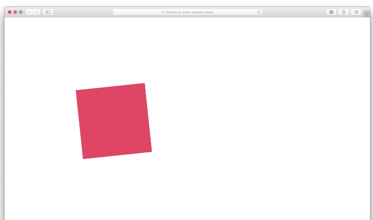

## 考虑使用 CSS 代替

旋转动画示例演示了如何使用 JavaScript 在浏览器中执行动画。也可以通过在 `styles.css` 中使用以下样式规则纯 CSS 动画来实现：

```css
#square {
  margin: 100px;
  width: 100px;
  height: 100px;
  background: #cc0;
  animation: spin 4s linear infinite;
}
@keyframes spin {
  from { transform: rotate(0deg); }
  to { transform: rotate(360deg); }
}
```

通常情况下，对于任何动画效果使用 CSS 会更好，尽管在某些情况下 JavaScript 可能是更好的解决方案。

## Quiz Ninja 项目

我们现在正在添加一个计时器，为我们的测验增加一个“与时间赛跑”的元素。我们将使用 `window` 对象的 `setInterval()` 方法来添加时间限制。首先，我们将在 HTML 中添加一个用于计时器的元素。更新 `index.html` 内部的 `<header>`，以包含一个 id 为 `timer` 的额外 `<div>` 元素：

```html
<header>
  <h1>Quiz Ninja!</h1>
  <div id='timer'>Time:
    <strong>20</strong></div>
  <div id='score'>Score:
    <strong>0</strong></div>
</header>
```

我们将使用此 ID 在 `main.js` 文件的 `view` 对象属性中添加对该元素的引用：

```javascript
timer: document.querySelector('#timer strong');
```

接下来，我们需要将以下代码添加到 `game.start()` 方法中：

```javascript
this.secondsRemaining = 20;
this.timer = setInterval(this.countdown, 1000);
```

这初始化了 `game` 对象的一个名为 `secondsRemaining` 的属性，将其设置为 20。它用于以秒为单位测量游戏将持续多久。下一行设置了一个间隔，每秒（1,000 毫秒）调用一次 `countdown()` 方法。该方法需要添加到 `game` 对象中：

```javascript
countdown() {
  game.secondsRemaining--;
  view.render(view.timer, game.secondsRemaining);
  if (game.secondsRemaining < 0) {
    game.gameOver();
  }
}
```

该函数使用 `--` 运算符将我们之前初始化的 `secondsRemaining` 变量减 1，调用 `view.render()` 方法来在页头中显示剩余秒数。最后，我们检查时间是否已经低于零，如果是，则调用 `gameOver()` 函数因为时间已经耗尽！

最后，我们必须在 `game.gameOver()` 方法的末尾添加一行代码，在游戏结束后移除计时器，否则它将继续向过零向下倒计时！为了防止这种情况发生，我们将以下代码放置在 `gameOver()` 函数内部的任何位置：

```javascript
gameOver() {
  view.render(view.info, `Game Over, scored ${this.score} point${this.score !== 1 ? 's' : ''}`);
  view.teardown();
  clearInterval(this.timer);
}
```

现在在浏览器中打开 `index.html` 尝试游戏，看看在增加的与时间竞争压力下你表现如何。

你可以在 CodePen⁴ 上看到实时示例。

## 章节总结

- `window` 对象是浏览器中的全局对象。
- 在浏览器环境中，全局变量实际上是 `window` 对象的属性。
- `alert`、`confirm()` 和 `prompt()` 都是 `window` 对象的方法，它们会打开停止程序执行的对话框。
- `window.navigator` 对象提供有关用户浏览器和操作系统的信息，尽管它可能不可靠。
- `window.location` 对象提供有关当前页面 URL 的信息。
- `window.history` 对象保留会话中访问过的页面信息。

## 警告

如果代码中出现错误，但不足以导致程序崩溃，就会出现警告。这意味着程序在出现警告后会继续运行。这听起来可能是好事，但可能会导致问题，产生警告的问题可能会导致程序继续错误地运行。

可能导致警告的错误示例是给未声明的变量赋值：

```javascript
pi = 3.142;
// JavaScript Warning: assignment to undeclared variable
```

注意，并非所有浏览器都会对上述示例代码显示警告，因此如果你尝试运行，可能看不到警告。

警告和异常在不同环境中的呈现方式不同。某些浏览器会在浏览器窗口的角上显示一个小图标，表示发生了异常或警告。另一些浏览器则需要打开控制台才能看到任何警告或异常。

当浏览器中发生运行时错误时，HTML 仍然会出现，但 JavaScript 代码将在后台停止工作，这在最初并不显而易见的。如果发生警告，JavaScript 将继续运行（尽管可能是错误的）。

## 测试与调试的重要性

JavaScript 在处理错误方面是一门相当宽容的语言；直到所有的 ECMAScript 3 版本之前，它都没有实现异常机制。它并没有向用户提示程序中的错误，而是在后台静默失败，有时情况仍然如此。这看起来可能是一个好主意，但错误可能会导致无人察觉的意外或错误的结果，或者在后台潜伏很长时间才导致程序发生惨烈的崩溃。静默失败使得错误难以发现，且追踪溯源的时间更长。

因此，一个忍者程序员应该确保他们在开发时编写的代码能够“大声”地报错，以便任何错误都能被快速识别和修复。在生产环境中，忍者程序员应该尝试让代码优雅地失败（尽管不是完全静默——我们仍然需要知道有错误），以便在可能的情况下不影响用户体验。这通过确保异常被捕获和处理，并对代码进行严格测试来实现。

## 严格模式

ECMAScript 5 引入了严格模式，该模式会对使用过时特性产生更多的异常和警告。这是由于严格模式将以前被接受为“风格不佳”的编码实践视为实际错误。

增加错误的概率起初看起来可能是个坏主意，但尽早发现错误比在以后让它们引起问题要好得多。在严格模式下编写代码还可以帮助提高其清晰度和速度，因为它遵循约定，并在使用任何粗略的代码实践时会抛出异常。

不使用严格模式通常被称为“粗放模式”，因为它对粗略的编程实践非常宽容。严格模式鼓励编写符合忍者程序员身份的更高质量的 JavaScript 代码，因此建议使用它。

严格模式只需要在 JavaScript 文件的第一行添加以下字符串：

```javascript
'use strict';
```

任何使用严格模式的 JavaScript 引擎都会识别到此字符串。如果引擎不支持严格模式，该字符串将被简单忽略。

要查看其效果，如果你在严格模式下尝试给未声明的变量赋值，你将得到一个异常而不是警告：

```javascript
'use strict';
e = 2.718;
// ReferenceError: e is not defined
```

你可以通过在函数内部添加该行来按函数使用严格模式。此时严格模式将仅应用于该函数内部的任何内容：

```javascript
function strictly() {
  'use strict';
  // 函数代码放在这里
}
```

事实上，调用严格模式推荐的方法是将所有代码放入一个自执行函数中（第 12 章将更详细的介绍），如下所示：

```javascript
(function() {
  'use strict';
  // 你的所有代码将放在这个函数内部
})();
```


在文件开头放置 `'use strict'` 将对文件中所有的 JavaScript 强制严格模式。如果你在使用任何人的代码，无法保证他们是在严格模式下编写的。这种技术将确保只有你的代码被强制使用严格模式。

## 模块与 `'use strict'`

ES6 引入了 JavaScript 模块（第15章将介绍）。这些是独立的代码片段，默认处于严格模式，不需要 `'use strict'` 声明。

## 测试与调试

### 代码检查工具

代码检查工具用于分析代码中的错误、缺陷、样式错误和可疑的结构。它们还可以帮助强制执行编码标准。JavaScript 最流行的代码检查工具是 `ESLint`、`JSHint` 和 `CodeLint`。

代码检查工具可以帮助你在运行代码之前发现错误。例如，它们可以检测语法错误、未定义变量和逻辑错误。它们还可以帮助你在整个项目中保持一致的编码风格。

### JavaScript 中的特性检测

JavaScript 编程可能是一个不断变化的目标，因为它使用的 API 处于不断流动状态。而且一直有新的 API 在开发中。更重要的是，某些浏览器支持某些特性，而另一些则不支持。

判断浏览器支持的方法是使用特性检测。这是通过 `if` 语句检查对象是否存在来实现。例如，假设我们要使用新的 `holoDeck` API（据我所知，它实际上），我们将任何方法调用封装在以下 `if` 块中：

```javascript
if (window.holoDeck) {
  virtualReality.activate();
}
```

这确保了如果浏览器不支持该方法，就不会发生错误，因为引用不存在的对象如 `window.virtualReality` 将返回 `undefined`。由于它是假值，`if` 块不会运行，但在 `if` 块之外调用方法 `virtualReality.activate()` 将导致异常。特性检测保证只有在方法实际存在时才调用它，并在不存在时优雅地失败。

`Modernizr` 是一个提供实现特性检测方便方式的库，`Can I Use` 是另一个检查不同浏览器支持特性的有用资源。

### 在浏览器中调试

调试是在代码中寻找 bug 发生位置并处理它们的过程。在许多情况下，错误发生的地方并不是无论源自何，你都需要运行程序以查看在不同执行阶段发生了什么。在执行此操作时，创建“断点”非常有用，它们会停止代码的运行，并允许我们查看程序中该点不同变量的值。在浏览器中调试 JavaScript 代码有许多选项。

#### 可靠的 Alert

最基础的调试形式是使用 `alert()` 方法在代码的某些点显示对话框。由于 `alert()` 会停止程序运行，直到点击“确定（OK）”，因此它允许我们有效地在代码中设置断点，让我们检查该点变量的值，以查看它们是否符合预期。参考以下示例来检查人的年龄是否合适：

```javascript
function amIOldEnough(age) {
  if (age = 12) {
    alert(age);
    return 'No, sorry.';
  } else if (age < 18) {
    return 'Only if you are accompanied by an adult.';
  } else {
    return 'Yep, come on in!';
  }
}
```

`if` 块内部的 `alert` 方法允许我们看到该点 `age` 变量的值。一旦点击“确定”，我们就可以检查函数返回返回正确的消息。

如果你尝试上面的示例，你会发现代码中存在一个 bug：

```javascript
amIOldEnough(21)
// 'No, sorry.'
```

传入参数 21 应该返回字符串 `"Yep, come on in!"`，但它却返回了 `"No, sorry."`。如果你尝试运行该示例，你会看到 alert 消息显示变量 `age` 的值为 12，尽管传递给函数的参数是 21。仔细检查后发现，这里犯了一个经典的错误。我们并没有在检查 `age` 的值是否等于 12，而是无意中赋值了值 12！要检查等值性，我们应该使用 `===` 而不是 `=`（后者是给变量赋值的，即使在 `if` 块内部也是如此）。

事实上，如果我们希望对所有小于 12 的 `age` 值返回 `"No, sorry."`，我们可以将代码更新为：

```javascript
function amIoldEnough(age) {
  if (age < 12) {
    alert(age);
    return 'No, sorry.';
  } else if (age < 18) {
    return 'Only if you are accompanied by an adult.';
  } else {
    return 'Yep, come on in!';
  }
}
```

再次尝试，它就能按预期工作了：

```javascript
amIoldEnough(21)
// 'Yep, come on in!'
```

过去使用 alerts 进行调试是唯一的选择，但自那时以后 JavaScript 开发有了很大进步，现在不再建议将其用于调试。

#### 使用控制台

大多数现代 JavaScript 环境都有一个 `console` 对象，它提供了许多用于记录信息和调试的方法。它不是 ECMAScript 规范正式的一部分，但在所有主流浏览器和 Node.js 中都得到了良好支持。

我们已经见过并使用过 `console.log()` 方法。它可以用于记录程序不同阶段的变量值，尽管它不会像 `alert()` 那样实际停止程序的执行。例如，我们可以在 `amIOldEnough()` 函数中添加一些 `console.log()` 语句，记录函数中的位置以及 `age` 变量：

```javascript
function amIOldEnough(age) {
  console.log(age);
  if (age < 12) {
    console.log(`In the if with ${age}`);
    return 'No, sorry.';
  } else if (age < 18) {
    console.log(`In the else-if with ${age}`);
    return 'Only if you are accompanied by an adult.';
  } else {
    console.log(`In the else with ${age}`);
    return 'Yep, come on in!';
  }
}
```

`console.trace()` 方法会在控制台中记录一个交互式的堆栈跟踪轨迹。这将显示在代码运行期间发生异常之前被调用的函数。

#### 调试工具

大多数现代浏览器还拥有调试工具，允许你在代码中设置断点，使代码在某些点暂停。然后你可以查看这些点所有变量的值并修改它们。这在尝试追踪 bug 时非常有用。以下是每个主流浏览器的调试文档链接：

- Firefox
- Edge
- Chrome
- Safari

最有用的命令之一是 `debugger` 关键字。它会在你的代码中创建一个断点，暂停代码执行并让你看到程序当前运行到哪里了。你也可以悬停在任何变量上以查看它们在当前点的值。点击播放按钮可以重启程序。

下面的示例展示了如何在 `amIOldEnough()` 函数中使用 `debugger` 命令。如果你尝试将下面的代码输入浏览器的控制台，然后调用 `amIOldEnough()` 函数，调试工具会自动启动，你将通过悬停在 `age` 变量上看到它的值：

```javascript
function amIOldEnough(age){
  debugger;
  if (age < 12) {
    return 'No, sorry.';
  } else if (age < 18) {
    return 'Only if you are accompanied by an adult.';
  } else {
    return 'Yep, come on in!';
  }
}
```

#### 发布前移除调试代码

记住在发布任何代码之前移除对 `debugger` 的任何引用，否则程序看起来像像死了一样。

### 错误对象

错误对象可以在发生异常时由主机环境创建，也可以在代码中使用构造函数创建，如下：

```javascript
const error = new Error();
```

该构造函数接受一个参数作为错误消息：

```javascript
const error = new Error('Oops, something went wrong');
```

还有几个用于特定错误的错误对象：

- `EvalError` 不在当前的 ECMAScript 规范中使用，仅为了向后兼容而保留。它曾用于识别全局 `eval()` 函数的错误。
- `RangeError` 在数字超出允许的值范围时抛出。
- `ReferenceError` 在引用不存在的项时抛出。例如，调用一个未定义的函数。
- `SyntaxError` 在代码语法出现错误时抛出。
- `TypeError` 在值的类型出现错误时抛出；例如，在期望数字的地方使用了字符串。
- `URIError` 在编码或解码 URL 出现问题时抛出。
- `InternalError` 是当 JavaScript 引擎发生错误时抛出的非标准错误。一个常见原因是过度递归。

这些错误对象也可以作为构造函数来创建自定义错误对象：

```javascript
const error = new TypeError('You need to use numbers in this function');
```

所有错误对象都有许多属性，但它们在不同浏览器之间的使用并不一致。通常安全使用的属性有：

- `name` 属性返回错误构造函数的名称（字符串形式），如 `"Error"` 或 `"ReferenceError"`。
- `message` 属性返回错误的描述，并应作为错误构造函数的参数提供。
- `stack` 属性将返回该错误的堆栈跟踪。这是一个非标准属性，建议不要在生产环境中安全使用。

### 抛出异常

到目前为止，我们已经看到了 JavaScript 引擎在发生错误时自动抛出的错误。你也可以使用 `throw` 语句抛出你自己的异常。这将允许代码中的任何问题被突出标记并进行处理，而不是静静地潜伏在后台。

`throw` 语句可以抛出任何 JavaScript 表达式，导致程序执行停止。例如，以下所有行代码都会导致程序停止：

```javascript
throw 2;
throw 'Up';
throw { toys: 'out of pram' };
```

然而，最佳实践是在 `catch` 块中捕获它，这将在本章稍后部分介绍：

```javascript
throw new Error('Something has gone badly wrong!');
```

作为一个示例，让我们写一个函数 `squareRoot()` 来计算数字的平方根。这可以使用 `Math.sqrt()` 方法实现，但它对负数参数会返回 `NaN`。这在严格意义上是不正确的（答案应该是虚数，但 JavaScript 不支持虚数）。当用户尝试使用负数参数时，我们的函数将抛出一个错误：

```javascript
function squareRoot(number) {
  'use strict';
  if (number < 0) {
    throw new RangeError('You can\'t find the square root of negative numbers')
  }
  return Math.sqrt(number);
}
```

让我们测试一下：

```javascript
squareRoot(121);
// 11

squareRoot(-1);
// RangeError: You can't find the square root of negative numbers
```

## 异常处理

当发生异常时，程序将带有错误消息终止。这在开发阶段是理想的，因为它允许我们识别并修复错误。但在生产环境中，它看起来像是程序崩溃了，这对于一个忍者程序员来说并不体面。

通过捕获错误，可以优雅地处理异常。任何错误都可以对用户隐藏，但仍然可以识别出来。我们可以妥善地处理错误——甚至可以忽略它——并保持程序运行。

### try, catch, and finally

如果我们怀疑某段代码会发生异常，可以将其封装在 `try` 块中。这会正常地运行块内的代码，但如果发生异常，它将把抛出的错误对象传递到 `catch` 块。这里有一个使用我们之前 `squareRoot()` 函数的简单示例：

```javascript
function imaginarySquareRoot(number) {
  'use strict';
  try {
    return String(squareRoot(number));
  } catch(error) {
    return squareRoot(-number)+'i';
  }
}
```

只有当 `try` 块内部抛出异常时，`catch` 块中的代码才会运行。错误对象会自动作为参数传递给 `catch` 块。这允许我们查询错误的 `name`、`message` 和 `stack` 属性，并妥善地处理。在这种情况下，我们实际上返回了一个虚数的字符串表示：

```javascript
imaginarySquareRoot(-49) // 不显示错误消息
// '7i'
```

可以在 `catch` 块之后添加一个 `finally` 块。无论是否发生异常，它都会在 `try` 或 `catch` 块之后执行。如果你想在两种情况下都编写代码，它是非常有用的。我们可以借此修改 `imaginarySquareRoot()` 函数，使其在返回答案之前向答案添加 "+" 或 "-"：

```javascript
function imaginarySquareRoot(number) {
  'use strict';
  try {
    answer = String(squareRoot(number));
  } catch (error) {
    answer = squareRoot(-number)+"i";
  } finally {
    return `+ or - ${answer}`
  }
}
```

## 测试

测试是编程中重要的一部分，但经常被忽视。编写良好的测试意味着你的代码在开发过程中不会那么脆弱，任何错误都会被尽早识别。

测试可以仅仅是一个函数，用于测试一段代码是否按预期方式运行。例如，我们可以通过以下函数测试之前编写的 `squareRoot()` 函数是否返回正确答案：

```javascript
function itSquareRoots4() {
  return squareRoot(4) === 2;
}
```


在这里，我们把 `squareRoot(4)` 的结果与数字 `2` 进行比较。

```javascript
itSquareRoots4();
// true
```

# 测试驱动开发

测试驱动开发 (TDD) 是编写实际代码之前编写测试的过程。这通常被称为“红-绿-重构”循环：

1. 编写测试（起初会失败）
2. 编写代码通过测试
3. 重构代码

测试驱动开发被认为是最佳实践，因为有测试比没有测试要好。重要的是，这些根结底只是函数，所以它们的行为与其他任何函数完全相同。即使对于经验丰富的开发者来说，TDD 思维也可能很难。

## 测试框架

测试框架提供了编写和运行测试的结构。JavaScript 有许多框架可用，但我们将重点关注：

### Jest

Jest 是由 Facebook 创建的 TDD 框架，最近非常受欢迎。它通过提供常用断言的辅助方法，让创建和运行测试变得简单。

要使用 Jest，我们首先需要使用 npm 安装。在终端输入以下命令：

```bash
npm install -g jest
```

这应该全局安装 Jest。要检查是否运行正常，请尝试运行以下命令来检查版本号：

```bash
jest -v
```

接下来我们将创建一个示例测试来查看它是否工作。让我们写一个测试来检查之前的 `squareRoot()` 函数是否有效。创建一个名为 `squareRoot.test.js` 的文件并添加以下代码：

```javascript
function squareRoot(number) {
  'use strict';
  if (number < 0) {
    throw new Error("You can't find the square root of negative numbers")
  }
  return Math.sqrt(number);
}
```

```javascript
test('square root of 4 is 2', () => {
  expect(squareRoot(4)).toBe(2);
});
```

在 JavaScript 中。这意味着任何有效的 JavaScript 代码都可以在测试函数内部运行。

运行此测试，只需导航到包含 `squareRoot.test.js` 文件的文件夹并输入以下命令：

```bash
jest -c {}
```

这将运行该文件夹内所有以 "test.js" 结尾的文件。`-c {}` 标志是 "configuration"（配置）的缩写。我们不需要任何额外配置，因此简单地传递它一个空对象。

如果一切运行正常，它应该产生以下输出：

```
<< PASS ./squareRoot.test.js
✓ square root of 4 is 2 (2ms)
Test Suites: 1 passed, 1 total
Tests: 1 passed, 1 total
Snapshots: 0 total
Time: 2.996s
```

太棒了！这告诉我们有 1 个测试，而且它仅用了 2ms 就通过了！

## 计算数字

为了演示 TDD 过程，我们将尝试创建一个名为 "Number Cruncher" 的小型库，其中将包含一些对数字进行操作的函数。我们将尝试实现的第一个函数将命名为 `factorsOf()`。它将接受一个数字作为参数，并以数组的形式返回该数字的所有因子。

12. 数字的因子（约数）是能够完全整除该数字而没有余数的整数。例如，6 的因子是 1、2、3 和 6。

由于我们正在进行 TDD，我们需要先从编写测试开始，创建一个名为 `numberCruncher.test.js` 的文件，并添加以下代码：

```javascript
test('factors of 12', () => {
  expect(factorsOf(12)).toEqual([1,2,3,4,6,12]);
});
```

### toEqual() 的使用

我们在此测试中使用了 `toEqual()` 匹配器。这是因为我们正在测试的是一个数组。

此测试表示，当提供 12 作为参数时，我们的 `factorsOf()` 函数应该返回一个按顺序包含 12 所有因子的数组。如果我们运行此测试，可以看到它惨惨地失败了：

```
jest -c {}
<< FAIL ./numberCruncher.test.js
• factors of 12
ReferenceError: factorsOf is not defined
at Object.<anonymous>.test
  ↳ (numberCruncher.test.js:2:10)
at process._tickCallback
  ↳ (internal/process/next_tick.js:103:7)
✕ factors of 12 (6ms)
Test Suites: 1 failed, 1 total
Tests: 1 failed, 1 total
Snapshots: 0 total
Time: 1.424s
```

额，你预料的是什么呢？我们还没有编写任何代码！让我们尝试编写 `factorsOf()` 函数。在 `numberCruncher.test.js` 顶部添加以下内容：

```javascript
'use strict';
function factorsOf(n) {
  const factors = [];
  for (let i=1; i < n; i++) {
    if (n/i === Math.floor(n/i)) {
      factors.push(i);
    }
  }
  return factors;
}
```

此函数创建了一个名为 `factors` 的局部变量并将其初始化为空数组。然后它遍历从 1 到 `n`（作为参数给的数字）的每一个整数值，如果是因子，则使用 `push()` 方法将其添加到因子数组中。我们通过查看 `n` 除以整数 1 的结果是否得到一个没有余数的整数（因子的定义）来测试它是否为因子。

> **注意**：为了让这个示例更简单，我们将代码和测试放在同一个文件中，但实际上，你通常会将它们放在不同的文件中。

尝试再次运行测试：

```
jest -c {}
<< FAIL  ./numberCruncher.test.js
* factors of 12
expect(received).toBe(expected)
Expected value to be using (===):
[1, 2, 3, 4, 6, 12]
Received:
[1, 2, 3, 4, 6]
Difference:
- Expected
+ Received
@@ -2,7 +2,6 @@
 1,
 2,
 3,
 4,
 6,
- 12,
]
at Object.<anonymous>.test
↳ (numberCruncher.test.js:14:25)
at process._tickCallback
↳ (internal/process/next_tick.js:103:7)
× factors of 12 (12ms)
Test Suites: 1 failed, 1 total
Tests: 1 failed, 1 total
Snapshots: 0 total
Time: 0.801s, estimated 1s
Ran all test suites.
```

噢亲，它仍然失败了。这次的失败信息具体了一些。它说期望数组 `[1,2,3,4,6,12]` 但收到了数组 `[1,2,3,4,6]`——最后一个数字 12 缺失了。查看我们的代码，这是因为循环在 `i < n` 时继续。我们需要 `i` 一直到并包含 `n`，这需要对我们的代码进行一点微调：

```javascript
function factorsOf(n) {
  const factors = [];
  for (let i=1; i <= n; i++) {
    if (n/i === Math.floor(n/i)) {
      factors.push(i);
    }
  }
  return factors;
}
```

现在如果再次运行测试，你应该得到一个不错的结果：

```
jest -c {}
<< PASS ./numberCruncher.test.js
✓ factors of 12 (7ms)
Test Suites: 1 passed, 1 total
Tests: 1 passed, 1 total
Snapshots: 0 total
Time: 3.012s
Ran all test suites.
```

测试通过了，并不意味着我们可以停止。TDD 循环还有最后一步：重构。有几个地方可以清理代码。首先，我们应该只测试到数字的平方根，因为如果 `i` 是因子，`n/i` 将等于一个整数。例如，如果你尝试寻找 36 的因子，我们看到它能被 6 整除。这意味着 `2` 是一个因子，但我们需要找到在平方根之内的因子对，另一个在平方根之上。（注：此处原文逻辑表述略显混乱，如 36 和 2 的例子用，翻译时已按原意保留）

其次，测试 `i` 是否为因子的可以更简洁地使用 `%` 运算符。如果 `i` 是因子，`n%i` 等于 0。我们还需要在函数末尾对数组进行排序，因为因子不是按顺序添加的。我们可以使用 `sort()` 方法来实现。重构我们的 `numberCruncher.test.js` 如下：

```javascript
function factorsOf(n) {
  const factors = [];
  for (let i=1, max = Math.sqrt(n); i <= max; i++) {
    if (n%i === 0) {
      factors.push(i);
    }
  }
  return factors.sort((a,b) => a - b);
}
```

现在再次运行测试确认它仍然通过：

```
jest -c {}
<< PASS numberCruncher.test.js
✓ factors of 12 (8ms)
Test Suites: 1 passed, 1 total
Tests: 1 passed, 1 total
Snapshots: 0 total
Time: 1.615s
Ran all test suites.
```

现在我们的测试通过了，代码已经重构，是时候添加功能了。让我们添加另一个名为 `isPrime()` 的函数，如果是质数则返回 `true`，否则返回 `false`。让我们在 `numberCruncher.test.js` 的末尾为此编写几个新测试：

```javascript
test('2 is prime', () => {
  expect(isPrime(2)).toBe(true);
});
test('10 is not prime', () => {
  expect(isPrime(10)).not.toBe(true);
});
```

第一个测试检查当提供质数（2）时是否返回 `true`，另一个检查当提供非质数（10）时是否不返回 `true`。注意 `not` 匹配器的否定用法（尽管我们应该检查它为 `false`，因为这个测试会通过任何值）。

### 更多匹配方法

你可以在官方网站看到 Jest 匹配方法的完整列表[^1]。

如果你再次运行测试，你会看到我们的新测试失败了，而因子测试仍然通过：

```
jest -c {}
<< FAIL  ./numberCruncher.test.js
• 2 is prime
ReferenceError: isPrime is not defined
at Object.<anonymous>.test
  ↳ (numberCruncher.test.js:18:10)
at process._tickCallback
  ↳ (internal/process/next_tick.js:103:7)
• 10 is not prime
ReferenceError: isPrime is not defined
at Object.<anonymous>.test
  ↳ (numberCruncher.test.js:22:10)
at process._tickCallback
  ↳ (internal/process/next_tick.js:103:7)
+   - factors of 12 (4ms)
- 2 is prime (1ms)
- 10 is not prime (1ms)
Test Suites: 1 failed, 1 total
Tests: 2 failed, 1 passed, 3 total
Snapshots: 0 total
Time: 0.812s, estimated 1s
Ran all test suites.
```

这是预料中的，我们还没有为它们编写任何代码。

我们最好编写 `isPrime()` 函数。它将使用 `factorsOf()` 函数并检查 `factorsOf()` 返回的数组中的因子数量是否为 2。这是因为所有质数正好有两个因子。在 `numberCruncher.test.js` 文件的底部添加以下代码：

```javascript
function isPrime(n) {
  return factorsOf(n).length === 2;
}
```

现在如果再次运行测试，我们可以看到我们三个测试都通过了：

```
jest -c {}
<< PASS ./squareRoot.test.js
✓ factors of 12 (6ms)
✓ 2 is prime (1ms)
✓ 10 is not prime (1ms)
Test Suites: 1 passed, 1 total
Tests: 3 passed, 3 total
Snapshots: 0 total
Time: 2.853s
Ran all test suites.
```

我们的函数库正在不断增长！下一步是再次对代码进行重构。目前这有点棘手，因为这两个函数都接受负数和非整数值，而这两者都不是质数。它们还允许提供非数值参数。结果显示，如果传入了这些值，`factorsOf()` 函数都会静默失败并返回空数组。最好抛出一个异常来表示使用了错误的参数。让我们创建一些测试来检查这种情况发生。将以下测试添加到 `numberCruncher.test.js` 文件中：

```javascript
it('should throw an exception for non-numerical data', () => {
  expect(factorsOf('twelve')).toThrow();
});
it('should throw an exception for negative numbers', () => {
  expect(() => factorsOf(-2)).toThrow();
});
it('should throw an exception for non-integer numbers', () => {
  expect(() => factorsOf(3.14159)).toThrow();
});
```

这些测试使用所有的 `toThrow()` 方法来检查在输入错误数据作为参数时是否抛出了异常。

顺便，我们可以为 `isPrime()` 函数添加一些额外的测试，以确保它也能处理任何错误的参数。这些情况下不需要抛出异常；非数值数据、负数和非整数不是质数，所以函数应该直接返回 `false`。将以下代码添加到 `numberCruncher.test.js` 文件的末尾：

```javascript
test('non-numerical data returns not prime', () => {
  expect(isPrime('two')).toBe(false);
});
test('non-integer numbers return not prime', () => {
  expect(isPrime(1.2)).toBe(false);
});
test('negative numbers return not prime', () => {
  expect(isPrime(-1)).toBe(false);
});
```

如果你再次运行测试，你会发现 `factorsOf()` 函数的新测试如预期般失败了，但 `isPrime()` 函数的新测试实际上通过了。这是一个意外的收获，因为 `factorsOf()` 函数返回的是一个空数组，而它的长度恰好不是 2，所以函数最终还是返回了 `false`。

让我们尝试通过在 `factorsOf()` 函数中抛出异常来让所有测试通过，修改 `numberCruncher.test.js` 中的以下内容：

```javascript
function factorsOf(n) {
  if (Number.isNaN(Number(n))) {
    throw new RangeError('Argument Error: Value must be an integer');
  }
  if (n < 0) {
    throw new RangeError('Argument Error: Number must be positive');
  }
  if (!Number.isInteger(n)) {
    throw new RangeError('Argument Error: Number must be an integer');
  }
  const factors = [];
```

[^1]: http://facebook.github.io/jest/docs/expect.html


```javascript
for (let i = 1, max = Math.sqrt(n); i <= max; i++) {
  if (n % i === 0) {
    factors.push(i, n / i);
  }
}
return factors.sort((a, b) => a - b);
```

现在，函数会检查是否提供了负数或非整数作为参数，并在两种情况下都会抛出异常。让我们再次运行测试：

```bash
+ jest -c{}

<< FAIL ./numberCruncher.test.js

* non-numerical data returns not prime

RangeError: Argument Error: Value must be an integer

at factorsOf(numberCruncher.test.js:5:11)

at isPrime(numberCruncher.test.js:23:10)

at Object.<anonymous>.test (numberCruncher.test.js:57:10)

* non-integer numbers return not prime

RangeError: Argument Error: Number must be an integer

at factorsOf(numberCruncher.test.js:11:11)

at isPrime(numberCruncher.test.js:23:10)

at Object.<anonymous>.test (numberCruncher.test.js:57:10)

* negative numbers return not prime

RangeError: Argument Error: Number must be positive

at factorsOf(numberCruncher.test.js:8:11)

at isPrime(numberCruncher.test.js:23:10)

at Object.<anonymous>.test (numberCruncher.test.js:57:10)
```

# 第 11 章

## 进阶函数

我们在第 4 章介绍过函数，但那时仅仅是触及一角。在 JavaScript 中，函数是一等对象，这意味着它们可以像其他任何值一样被到处传递。它们可以拥有自己的属性和方法，还可以接收其他函数作为参数，并被其他函数返回。这使得它们在 JavaScript 中成为一种非常灵活的工具，并且有许多技术和模式可以使代码更加整洁。

在本章中，我们将涵盖以下主题：

- 函数的属性和方法
- 立即调用函数表达式 (IIFE)
- 自定义函数
- 递归函数
- 回调函数 (Callbacks)
- Promise (Promises)
- 异步函数 (Async functions)
- 返回函数的函数
- 闭包 (Closures)
- 函数式编程简介
- 柯里化 (Currying)
- 项目 — 使用本章的技术改进某些函数

## 函数属性和方法

函数是一等对象这一事实意味着它们本身可以拥有属性和方法。例如，所有函数都有 `length` 属性，返回函数拥有的参数个数。

让我们用在第 4 章编写的 `square()` 函数作为例子：

```javascript
function square(x) {
  return x * x;
}
```

如果查询 `length` 属性，我们可以看到它接受一个参数：

```javascript
square.length
// 1
```

## call 和 apply 方法

`call()` 方法可以将函数内部的 `this` 值设置为作为第一个参数提供的对象。

在接下来的示例中，`sayHello()` 函数引用了一个未指定的对象，该对象有一个 `name` 属性：

```javascript
function sayHello() {
  return `Hello, my name is ${this.name}`;
}
```

我们可以创建一些具有 `name` 属性的对象，然后使用 `call()` 方法调用 `sayHello()` 函数，并将每个对象作为参数传递。这将获取函数中 `this` 的值：

```javascript
const clark = { name: 'Clark' };
const bruce = { name: 'Bruce' };

sayHello.call(clark);
// 'Hello, my name is Clark'

sayHello.call(bruce);
// 'Hello, my name is Bruce'
```

如果被调用的函数需要任何参数，则这些参数需要作为第一个参数之后的参数提供，第一个参数始终是 `this` 的值。例如，让我们更新 `sayHello()` 函数以提供作为一个参数的更通用的问候：

```javascript
function sayHello(greeting = 'Hello') {
  return `${greeting}, my name is ${this.name}`;
}

sayHello.call(clark, 'How do you do');
// 'How do you do, my name is Clark'

sayHello.call(bruce);
// 'Hello, my name is Bruce'
```

如果函数在函数体内没有通过 `this` 引用对象，它仍然可以使用 `call()` 方法调用，但你需要提供 `null` 作为其第一个参数。例如，我们可以使用 `call()` 方法调用 `square()` 函数，如下：

```javascript
square.call(null, 4)
// 16
```

`apply()` 方法的工作方式相同，不同之处在于参数是以数组形式提供的，即使只有一个参数：

```javascript
square.apply(null, [4])
// 16
```

如果你用作参数的数据已经是数组形式，那么这会非常有用，尽管在 ES6 中这并不真正需要，因为可以使用扩展运算符（spread operator）将值数组拆分为单独的参数。

这两个强大的方法，它们允许编写通用的函数，这些函数不会因为是该对象的方法而与特定对象绑定。这为函数的使用提供了灵活性。

## 自定义属性

没有什么阻止你像向对象添加属性一样向函数添加你自己的属性。在 JavaScript 中，你可以向函数添加任何你描述的属性。例如，我们可以给函数添加一个 `description` 属性：

```javascript
square.description = 'Squares a number'
```

## 记忆化 (Memoization)

一个实用的功能是它提供了缓存，或者**记忆化**。

如果一个函数的计算耗时很长，可以使用缓存来存储结果，而不是每次都计算。例如，如果一个函数被多次调用相同的参数，可以使用缓存来存储返回结果：

```javascript
function square(n) {
  if (cache[n]) {
    return cache[n];
  }
  let result = n * n;
  cache[n] = result;
  return result;
}
```

为了避免这种情况，使用严格模式的推荐方法是将所有代码放在一个 IIFE（立即执行函数）中，如下所示：

```javascript
(function() {
  'use strict';
  // 所有的代码将放在此函数内部
})();
```

这确保了只有 IIFE 内部的代码会被强制使用严格模式。

# 创建自包含的代码块

IIFE 可将一个代码块封装在自己的私有作用域内，这样它就不会与程序的其他部分发生干扰。这样使用 IIFE 意味着可以独立添加或删除代码。示例展示了两个代码块 A 和 B，它们能够独立运行代码：

```javascript
(function() {
  // 块 A
  const name = 'Block A';
  console.log(`Hello from ${name}`);
  (function() {
    // 块 B
    const name = 'Block B';
    console.log(`Hello from ${name}`);
  })();
})();
// Hello from Block A
// Hello from Block B
```

注意两个代码块都包含一个名为 `name` 的变量，但这些模块之间不会相互干扰。这是将程序部分划分为离散部分的有用方法，特别是用于测试目的。

再次，这在 ES6 中可以通过将不同的代码部分放入块中简单实现。ES6 还支持一种更强大的模块模式，那将在第 15 章中介绍。

# 定义并重写自身的函数

JavaScript 的动态特性意味着函数可以不仅不调用自己，还可以定义自己，甚至重写自己。这是通过将一个匿名函数赋值给一个与函数同名的变量来实现。

考虑以下函数：

```javascript
function party() {
  console.log('Wow this is amazing!');
  party = function() {
    console.log('Been there, got the T-Shirt');
  }
}
```

这会在控制台中打印一条消息，然后重写自身以在控制台中打印一条不同的消息。当函数被调用一次后，它看起来就像是定义如下所示：

```javascript
function party() {
  console.log('Been there, got the T-Shirt');
}
```

在第一次调用之后，每次调用该函数，它都会打印消息“Been there, got the T-Shirt”：

```javascript
party();
// 'Wow this is amazing!'

party();
// 'Been there, got the T-Shirt'

party();
// 'Been there, got the T-Shirt'
```

如果该函数也赋值给另一个变量，该变量将保持原始函数定义而不会被重写。这是因为原始函数被赋值给一个变量，然后在函数内部，一个与函数同名的变量被赋值了一个不同的函数。你可以看到一个示例，假设我们创建了一个名为 `beachParty` 的变量，并在 `party()` 函数被第一次调用和重写之前将其赋值给它：

```javascript
function party() {
  console.log('Wow this is amazing!');
  party = function() {
    console.log('Been there, got the T-Shirt');
  }
}

const beachParty = party; // 注意 party 函数
// 还没有被调用

beachParty(); // party() 函数现在被
// 重写了，尽管它没有被显式调用
// 'Wow this is amazing!'

party();
// 'Been there, got the T-Shirt'

beachParty(); // 但这个函数还没有被重写
// 'Wow this is amazing!'

beachParty(); // 无论调用多少次，它
// 都将保持不变
// 'Wow this is amazing!'
```

# 丢失属性

如果之前在函数上设置了任何属性，这些属性在函数重写自身时将会丢失。在上一个示例中，我们可以设置一个 `music` 属性，并看到函数被调用和重写后，它不再存在了：

```javascript
function party() {
  console.log('Wow this is amazing!');
  party = function() {
    console.log('Been there, got the T-Shirt');
  }
}

party.music = 'Classical Jazz'; // 设置函数的
// 属性

party();
// "Wow this is amazing!"

party.music; // 函数已被重写，所以
// 属性不存在
// undefined
```

这被称为“懒性定义模式”（Lazy Definition Pattern），通常用于第一次调用时需要某些初始化代码的情况。这意味着可以在第一次调用时完成初始化，然后可以将函数重写为你希望在后续每次调用中它呈现的样子。

# 初始化时分支（Init-Time Branching）

这种技术可以与上一节讨论的特性检测结合使用，创建能够重写自身的函数，这被称为“初始化时分支”。这使得函数在浏览器中运行更高效，并避免每次调用时都检查特性。

让我们以虚构的独角兽对象为例，它尚未在所有浏览器中得到完全支持。在上一节中，我们查看了如何使用特性检测来检查是否支持。现在我们可以更进一步：根据某些方法是否支持来定义函数。这意味着我们只需要在第一次调用时检查支持性即可：

```javascript
function ride() {
  if (window.unicorn) {
    ride = function() {
      // 使用全新的闪闪发光的独角兽
      // 方法
      return 'Riding on a unicorn is the best!';
    };
  } else {
    ride = function() {
      // 使用旧的马的方法
      return 'Riding on a pony is still good';
    };
  }
  return ride();
}
```

在我们检查 `window.unicorn` 对象是否存在（检查它是否为真）之后，根据结果重写了 `ride()` 函数。最后我们再次调用它，这样重写后的函数现在被调用，并返回相应的值。需要注意的是，第一次调用时函数被调用两次，尽管随后的每次调用都会变得更高效。来看看它是如何工作的：

```javascript
ride(); // 函数重写自己，然后调用自己
// 'Riding on a pony is still good'
```

一旦函数被调用，它就会根据浏览器的能力被重写。我们可以通过在不调用函数的情况下检查这一点：

```javascript
ride
// function ride() {
//   return 'Riding on a pony is still good';
// }
```

## 递归函数

递归函数是指调用自身的函数。在涉及迭代过程中，这是一个非常有用的工具。一个常见的例子是阶乘：

```javascript
function factorial(n) {
  if (n === 0) {
    return 1;
  } else {
    return n * factorial(n - 1);
  }
}
```

该函数将一直调用自己直到达到基本情况，在本例中当 `n` 等于 0 时。基本情况很重要，因为它防止了函数无限调用，从而导致栈溢出。

让我们看看当调用 `factorial(3)` 时发生了什么：

```javascript
factorial(3);
// 6
```

计算过程如下：
`factorial(3) = 3 * factorial(2)`
`factorial(2) = 2 * factorial(1)`
`factorial(1) = 1 * factorial(0)`
`factorial(0) = 1`
所以，`factorial(3) = 3 * 2 * 1 * 1 = 6`。

这是一个接受回调函数的 `wait()` 函数示例。为了模拟一个需要时间才能完成的操作，我们可以使用 `setTimeout()` 函数在指定的秒数后调用回调函数：

```javascript
function wait(message, callback, seconds) {
  setTimeout(callback, seconds * 1000);
  console.log(message);
}
```

现在，让我们创建一个供调用的回调函数：

```javascript
function selfDestruct() {
  console.log('B000OM!');
}
```


如果我们调用 `wait()` 函数并向控制台打印一条消息，就可以看到 JavaScript 是如何异步工作的：

> `wait('This tape will self-destruct in five seconds ... ', selfDestruct, 5);`
> `console.log('Hmm, should I accept this mission or not ... ?');`
> 'This tape will self-destruct in five seconds ... '
> 'Hmm, should I accept this mission or not ... ? '
> 'B000OM! '

当 `wait()` 函数被调用时，其内部的任何代码都会执行，因此会显示消息 "This tape will self-destroy in five seconds ..."。`setTimeout()` 函数是异步的，这意味着作为参数提供的回调函数被放置在栈顶，栈会在程序其余部分运行完毕后清空。这意味着控制权交还给了程序，并执行程序中的下一行，从而显示消息 "Hmm, should I accept this mission or not ... ?"。然后，五秒后，回调函数从栈中取出并执行。这证明了 `setTimeout()` 函数并没有阻塞程序的程序的运行。这就是 JavaScript 的事件循环。

但请记住，JavaScript 仍然是单线程的，因此一次只能发生一个任务。如果一个事件需要一点时间发生，它仍然必须等待程序的其他部分执行完毕后才能调用回调函数。例如，让我们看看如果将等待时间设置为零会发生什么：

```javascript
wait('This tape will self-destruct immediately ... ', selfDestruct, 0);

console.log('Hmm, should I accept this mission or not ... ?');

'This tape will self-destruct immediately ... ' 

'Hmm, should I accept this mission or not ... ??'

'BOOOOM!'
```

注意 `wait()` 函数中的回调被设置为0秒。我们本应期望回调被立即调用，但回调在被调用之前总是必须等待当前执行栈完成。在这种情况下，当前的执行栈是剩余的函数和已经进入控制台的代码。一旦这些代码执行完毕，回调就会会在将控制权交还给主程序之前被调用。

# 回调地狱 (Callback Hell)

JavaScript 中异步编程使用的增加，意味着越来越多的回调函数正在被使用。这可能导致混乱且难以理解的“面条式代码”。当在同一个函数中使用多个回调函数时，就会产生大量难以理解的嵌套块。

回调地狱是用来描述这种纠缠在一起的代码混乱的术语。为了说明这一点，假设我们写了一个需要完成以下任务的游戏：

- 用户登录并返回一个用户对象
- 使用用户 ID 从服务器获取玩家信息
- 根据玩家信息加载游戏

所有这些操作都是异步的，因此它们可以被写成函数，并在每个任务完成后调用回调函数。

代码看起来可能像下面这段所示：

```javascript
login(userName)
```

你可能已经注意到，上面的示例中并没有多少实际代码。该示例只展示了从一个函数到另一个函数的流程，但由于大量的嵌套 `if-else` 语句，它看起来仍然极其复杂。在实际上，会有很多代码来实现 `login()`、`getPlayerInfo()` 和 `loadGame()` 函数的实际功能。


## 错误优先回调 (Error-first Callbacks)

代码示例使用了由 Node.js 普及的错误优先回调样式。在这种编码模式中，回调函数有两个参数。第一个是错误参数，如果在完成操作时发生错误，将提供一个错误对象。第二个参数是操作返回的任何数据，可以在回调函数体中使用。

# Promises (承诺)

Promise 代表了异步操作的未来结果。Promise 并不能实现任何使用回调函数就能实现的功能，但它们有助于简化过程，并避免由多个回调导致的复杂代码。

# Promise 的生命周期 (The Promise Life Cycle)

当一个 Promise 被创建时，它会调用一个异步操作，然后处于 *等待中 (pending)*。在操作进行期间，它保持这种状态。在此阶段，Promise 被称为 *未决定的 (unsettled)*。一旦操作完成，Promise 就被认为 *已决定的 (settled)*。一个已决定的 Promise 可以导致两种不同的结果：

- *已解析 (Resolved)* —— 异步操作成功完成。
- *已拒绝 (Rejected)* —— 异步操作未按预期运行、未成功完成或导致了错误。

这两个结果都会返回任何相关数据，你可以根据结果采取适当的。

## 一个 Promise

想象这样一个场景：你订购了一个汉堡。你没有立即得到汉堡，而是得到了一个振动器。这个振动器就是一个 Promise。当厨房在准备你的食物时，Promise 处于 *等待中 (pending)* 状态。一旦汉堡准备好，振动器就会响起来，Promise 就 *已解析 (resolved)*，你就得到了食物。如果他们用光了食材，Promise 就会 *被拒绝 (rejected)*，你会收到通知。

## 创建 Promise

Promise 是使用构造函数创建的。它接收一个名为执行器（executor）的函数作为参数。它接受两个函数作为参数：成功时调用 `resolve()` 函数，失败时调用 `reject()` 函数。Promise 的通用布局如下：

```javascript
const promise = new Promise((resolve, reject) => {

  // 初始化代码在此处

  if (success) {

    resolve(value);

  } else {

    reject(error);

  }

});
```

## 骰子示例 (Dicey Example)

让我们来看一个使用我们在第5章创建的骰子对象的 Promise 示例：

```javascript
const dice = {

  sides: 6,

  roll() {

    return Math.floor(this.sides * Math.random()) + 1;

  }

}
```

现在让我们创建一个使用 `dice.roll()` 方法作为异步操作的 Promise，并将掷出1视为失败，将任何其他数字视为成功：

```javascript
const promise = new Promise((resolve, reject) => {

  const n = dice.roll();

  setTimeout(() => {

    (n > 1) ? resolve(n) : reject(n);

  }, 1000);

});
```

这创建了一个名为 `promise` 的变量，它持有该 Promise 的引用。Promise 调用 `roll()` 方法并将返回值存储在变量 `n` 中。接下来，我们使用 `if-else` 块指定成功（掷出大于1的数字）和失败（掷出1）的条件。我们在第9章见过的 `setTimeout()` 方法被用于在掷出数字之前添加简短的延迟。

注意 `resolve()` 和 `reject()` 函数都返回变量 `n` 的值。这可以在处理 Promise 决定的后的结果时使用。

# JavaScript 从新手到忍者，第2版

## 处理已完成的 Promise

一旦 Promise 处于完成状态（settled），可以使用 `then()` 方法来处理结果。该方法接受两个参数。第一个是成功函数（fulfillment function），在 Promise 被解析（resolved）时调用。`resolve()` 函数返回的任何数据都将传递给该函数。第二个参数是拒绝函数（rejection function），在 Promise 被拒绝（rejected）时调用。与成功函数类似，拒绝函数也会接收来自 `reject()` 函数的任何数据。

在我们的骰子示例中，两个函数都将接收掷出的数字值。让我们来看看如何处理它：

```javascript
promise.then( result => console.log(`Yes! I rolled a
  ↳ ${result}`), result => console.log(`Drat! ... I rolled a
  ↳ ${result}`));
```

第一个参数仅仅是一个向控制台打印庆祝消息的函数，说明了掷出的点数（该数字作为变量 `result` 传递给 `then()` 方法）。第二个参数则打印一条恼恼的消息，并再次说明掷出的点数。

或者，可以使用 `catch()` 方法来指定操作失败时的做法：

```javascript
promise.catch( result => console.log(`Drat! ... I rolled
  a ${result}`));
```

`then()` 和 `catch()` 方法可以链在一起，形成对如何处理 Promise 结果的简洁描述：

```javascript
promise.then( result => console.log(`I rolled a
  ↳ ${result}`)
  .catch( result => console.log(`Drat! ... I rolled a
  ↳ ${result}`));
```

要尝试此代码，请将以下代码粘贴到浏览器控制台中，或使用启用 ES6/Babel 的 JS Bin⁴：

```javascript
const dice = {

  sides: 6
```

```javascript
console.log('After the roll');
```

当你点击“Run”按钮时，你应该会在控制台中中看到以下输出：

```
before promise
promise pending...
after promise
```

- 4. https://jsbin.com/lesaxafiya/edit?js.console

然后应该有一段暂停，等待 Promise 被解析，随后会显示结果消息：

```
Drat! ... I rolled a 1
```

控制台中的消息也让我们洞察了 JavaScript 的异步本质。注意，最后一条消息“after promise”是在已完成 Promise 的结果*之前*显示的。这表明在解析 Promise 期间，语言会继续处理剩余的代码，然后再回来处理 Promise 的结果。

## 链式多个 Promise

当需要按顺序执行多个异步任务时，Promise 的优势就显现出来了。如果每个函数在执行异步操作后返回一个 Promise，我们就可以将 `then()` 方法链起来，形成一段易于阅读的顺序代码。每个 Promise 只有在在上一个 Promise 完成后才会开始。

例如，之前产生“回调地狱”的玩家游戏登录功能，可以使用 Promise 以一种更优雅的方式重写：

```javascript
login(userName)
.then(user => getPlayerInfo(user.id))
.then(info => loadGame(info))
.catch(error => throw error)
```

语言的许多新特性都返回 Promise，你将在书的后部分看到更多它们的使用示例。

## 异步函数 (Async Functions)

异步函数被添加到 ES2017 规范中。这些函数以前带有 `async` 关键字，允许你像编写同步代码一样编写异步代码。这是通过在异步函数之前使用 `await` 操作符实现的。这会将函数的返回值封装在一个 Promise 中，然后可以将其赋值给变量。在 Promise 解析之前，下一行代码将不会执行。

下面的示例展示了如何将 `loadGame()` 函数写成一个异步函数：

```javascript
async function loadGame(userName) {

  try {

    const user = await login(userName);

    const info = await getPlayerInfo(user.id);

    // 使用返回的信息加载游戏

  } catch (error) {

    throw error;

  }

}
```

在示例中，`loadGame` 函数前面带有 `async` 关键字，这意味着该函数将以异步方式运行。我们将过程的每一步封装在 `try` 块中，以便捕获任何错误。在这个块内部，我们可以按照处理顺序编写每一步，因此我们首先将变量 `user` 赋值为 `login()` 函数的返回值。`await` 操作符将确保在 `login()` 函数返回用户对象之前不会执行下一行代码。`getPlayerInfo()` 函数前面也有 `await` 操作符。一旦该函数返回结果，它会被赋值给变量 `info`，并可以使用它来加载实际的游戏。使用 `catch` 块来处理可能发生的任何错误。

## 通用函数 (Generalized Functions)

回调可以构建更通用的函数。与其编写许多特定的函数，不如编写一个接受回调的函数。例如，让我们创建一个函数，返回两个提供的两个参数 `a` 和 `b` 之间的随机整数；或者如果只提供了一个参数，它将返回一个 1 到所提供参数之间的随机整数：

```javascript
function random(a,b=1) {

  // 如果只提供 1 参数，它将返回一个 1 到所提供参数之间的随机整数

}
```

*(注：由于原文中包含大量 OCR 识别错误和重复，以上翻译已根据逻辑流进行了清理和整合。)*

# 418 JavaScript：从新手到忍者，第 2 版

这是因为内部的变量只有在函数激活期间才会保持“存活”状态。一旦函数被调用，对其作用域内变量的任何引用都会移除。

然而，事实证明我们可以在访问创建该函数的外部的变量，并在函数被调用后继续访问它们。

闭包（Closure）是指对另一个函数作用域内创建的变量的引用，但该变量在程序的其他部分仍保留并使用。

创建闭包的关键原理之一，“内部”函数（声明在另一个函数内部）具有完全访问其所在声明的函数（即“外层”函数）作用域内声明的所有变量的能力。可以通过下面的示例看到：

```javascript
function outer() {

  const outside = 'Outside!';

  function inner() {

    const inside = 'Inside!';

    console.log(outside);

    console.log(inside);

  }

  console.log(outside);

  inner();

}
```

`outer()` 函数只能访问在其作用域内声明的变量 `outside`。然而，`inner()` 函数既可以访问在其自身作用域内声明的变量 `inside`，也可以访问声明在其作用域之外、但在 `outer()` 函数内部的变量 `outside`。

当我们调用 `outer()` 函数时，可以看到这一点：

```javascript
outer()

// Outside!

Inside!
```

## 进一步函数

Outside!

这意味着每当在另一个函数内部定义函数时，内部函数都可以访问在外层函数作用域内声明的任何变量。

## 返回函数

正如我们在上面的示例中看到的，从另一个函数内部声明的函数可以访问在外层函数作用域内声明的任何变量。

当内部函数被外层函数返回时，就会形成闭包，保持对闭包函数内部声明的任何变量的访问。

```javascript
function outer() {

  const outside = 'Outside!';

  function inner() {

    const inside = 'Inside!';

    console.log(outside);

    console.log(inside);

  }

  return inner;

}
```

现在我们可以将 `outer()` 函数的返回值赋值给变量：

```javascript
const closure = outer();
```

变量 `closure` 现在指向 `outer()` 函数返回的 `inner()` 函数。

之所以这被称为闭包，是因为它现在可以访问在 `outer()` 和 `inner()` 函数内部创建的变量，正如我们在调用它时所看到的：

```javascript
closure();

// Outside!

Inside!
```

这是重要的，因为变量 `outside` 应该只在 `outer()` 函数运行时存在。然而，尽管 `outer()` 已经被调用，闭包仍然保持了对该变量的访问。

闭包不仅可以访问变量的值，还可以在最初声明它的函数被调用很久之后仍然更改变量的值。

## 实际示例

当一个函数返回另一个函数，而该函数随后保持对原始函数作用域内创建的任何变量的访问时，就会形成闭包。在下面的示例中，`closure()` 函数的作用域内创建了变量 `a` 和 `b`。然后它返回一个匿名箭头函数，该函数在 `closure()` 函数调用后保持对变量 `a` 和 `b` 的访问：

```javascript
function closure() {

  const a = 1.8;

  const b = 32;

  return c => c * a + b;

}
```


现在我们可以通过调用 `closure()` 函数并将返回值赋值给名为 `Fahrenheit` 的变量来创建一个新函数：

```javascript
const Fahrenheit = closure();
```

然后可以使用它自己的参数调用这个新函数，但来自原始函数的变量 `a` 和 `b` 的值仍然保持“存活”状态：

## 计数器示例

闭包不仅可以访问父函数作用域内声明的变量，还可以更改这些变量的值。这允许我们执行诸如下面示例中的 `counter()` 函数的操作：

```javascript
function counter(start) {
  let i = start;
  return function() {
    return i++;
  };
}
```

该函数使用变量 `i` 开始计数。然后它返回一个使用闭包的函数，该闭包捕获并保持对 `i` 值的访问。该函数具有更改 `i` 值的能力，因此它每次被调用时都会将 `i` 增 1。在原始函数中定义的变量 `i` 的引用通过闭包在新函数中保持。

我们可以通过将 `counter()` 函数的返回值赋值给变量来创建一个计数器：

```javascript
const count = counter(1);
```

变量 `count` 现在指向一个函数，该函数具有完全访问在 `counter()` 函数作用域内创建的变量的能力。每当我们调用 `count()` 函数，它都会返回 `i` 的值然后将其增 1：

```javascript
count();
// 1
```

```javascript
count();
// 2
```

## 生成器 (Generators)

ES6 引入了对生成器的支持。这些是用于产生保持值状态迭代器的特殊函数。

要定义生成器函数，需要在函数声明后放置星号 (`*`)，如下：

```javascript
function* exampleGenerator() {
  // 生成器的代码放在在这里
}
```

调用生成器函数实际上不会运行函数中的任何代码；它返回一个生成器对象，该对象可以创建一个实现 `next()` 方法的迭代器，该方法在每次调用 `next()` 时都会返回一个值。

例如，我们可以创建一个生成器来产生斐波那契风格的数列：

```javascript
function* fibonacci(a, b) {
  let [prev, current] = [a, b];
  while (true) {
    yield current;
    [prev, current] = [current, prev + current];
  }
}
```

```javascript
const sequence = fibonacci(1, 1);
sequence.next().value; // 1
sequence.next().value; // 2
sequence.next().value; // 3
sequence.next().value; // 5
sequence.next().value; // 8
sequence.next().value; // 13
```

# 纯函数

函数式编程的一个关键方面是使用纯函数。纯函数是遵循以下规则的函数：

1. 纯函数的返回值应该只依赖于作为参数提供的值。它不依赖于程序其他地方的值。
2. 没有副作用。纯函数不会改变程序其他地方任何值或数据。它只进行非破坏的数据转换并返回新值，而不是修改任何底层数据。
3. 引用透明性。在给定相同参数时，纯函数始终返回相同的结果。

为了遵循这些规则，任何纯函数必须具备：

- 至少一个参数；否则返回值将依赖于函数参数以外的内容，从而违反了第一条规则。
- 一个返回值；否则该函数就没有意义了（除非它改变了程序的其他地方——在这种情况下，它就违反了“无副作用”的规则）。

纯函数有助于函数式编程比其他编程风格更加简洁且可预测性。引用透明性使得纯函数易于测试，因为在提供参数时可以信任它们返回相同的值。另一个好处是任何返回值都可以被缓存，因为它们总是相同的（参见上文的“记忆化”章节）。副作用的消除往往减少了侵入代码的 Bug，因为没有意外的依赖，它们只依赖于作为参数提供的任何值。

下面的示例展示了一个纯函数，它可以将作为参数提供的字符串反转：

```javascript
function reverse(string) {
  return string.split('').reverse().join('');
}
```

该函数没有改变参数的实际值，它只是返回另一个恰好是参数反后的字符串：

```javascript
const message = 'Hello JavaScript';
reverse(message);
// 'tpircSavaJ olleH'
```

这是一个非破坏性数据转换的示例，因为变量 `message` 中存储的值在作为参数传递函数后保持不变。

需要注意的是，使用 `const` 声明变量有助于避免破坏性的数据转换。这是因为任何使用 `const` 赋值原始值的变量都是无法更改的（尽管使用 `const` 赋值非原始对象的变量仍然可以被修改，所以这并不是完整的解决方案）。

让我们来看如何不写纯函数。下一个示例展示了一个不纯的函数，它返回两个值相加的结果：

```javascript
let number = 42;
let result = 0;
function impureAdd(x) {
  result = number + x;
}
impureAdd(10);
result;
// 52
```

`impureAdd()` 函数是一个不纯函数，它违反了上述概述的规则。它需要在函数外部定义的值 `number`，它具有改变 `result` 值的副作用，如果变量 `number` 的值不同，它就会返回不同的值。

这里是一个实现相同结果纯函数示例：

```javascript
const number = 42;
function pureAdd(x, y) {
  return x + y;
}
result = pureAdd(number, 10);
// 52
```

这个函数需要它正在相加的两个参数，变量 `number` 必须作为参数传递给它。这个函数没有副作用，它只是返回两个数字相加的结果。然后这个返回值被赋值给变量 `result`，而不是由函数更新变量的值。该函数在输入相同的情况下也会返回相同的值。

函数式编程将纯函数作为程序的构建模块。函数在不改变任何数据状态的情况下执行一系列操作。每个函数都执行一个应该执行单一任务的抽象，同时将其实现细节封装在函数体内部。这意味着程序变成了一系列基于纯函数返回值的表达式序列。重点放在使用函数组合将纯函数组合在一起，以完成更复杂的任务。

通过执行单一任务，纯函数更加灵活，因为它们可以被用作许多情况的构建模块，而不是与某一个情况紧密耦合。

我们现在可以使用这个通用的 `multiplier()` 函数来创建更具体的函数，如下例所示：

```javascript
doubler = multiplier(2);
```

这创建了一个名为 `doubler()` 的新函数，它会将参数乘以 2。

`multiplier()` 函数是一个高阶函数，因为它接收一个参数并返回一个函数。在上面的例子中，它接收一个数字 `2` 并返回一个将参数乘以 2 的函数。

```javascript
function multiplier(n) {
  return function(x) {
    return x * n;
  };
}
doubler = multiplier(2);
doubler(5); // 返回 10
```

我们可以通过这种方式创建更多特定的函数，例如创建一个 `tripler()`：

```javascript
function multiplier(n) {
  return function(x) {
    return x * n;
  };
}
tripler = multiplier(3);
tripler(10); // 返回 30
```

这是函数式编程的核心原则之一：允许使用高阶函数根据特定的参数返回更具体的函数。这里是另一个例子，我们创建一个高阶函数 `power()`，它返回一个包计算给定参数幂值的函数。为了实现这种计算，第二个函数使用闭包来维护 `power()` 函数提供的初始参数：

```javascript
function power(n) {
  return function(x) {
    return Math.pow(x, n);
  };
}
square = power(2);
square(5); // 返回 25
```

我们现在可以使用这个高阶函数来创建一些更具体的函数，使用不同的参数来构建。例如，我们可以实现一个 `twoExp()` 函数，它返回参数的 2次方：

```javascript
function power(n) {
  return function(x) {
    return Math.pow(x, n);
  };
}
twoExp = power(2);
twoExp(5); // 返回 32
```

我们还可以创建另一个名为 `tenExp()` 的函数，它返回 10 次次方：

```javascript
function power(n) {
  return function(x) {
    return Math.pow(x, n);
  };
}
tenExp = power(10);
tenExp(6); // 返回 1000000
```

当一个高阶函数返回另一个函数时，我们可以使用一个巧妙的技巧来创建一个匿名函数并使用括号立即调用它。下面的示例将计算参数的 3次方：

```javascript
function power(n) {
  return function(x) {
    return Math.pow(x, n);
  };
}
power(3)(5); // 243
```

## 柯里化 (Currying)

柯里化是将接收多个参数的函数转换为一系列接收单个参数函数的过程。它是以逻辑学家 Haskell Curry 命名的——就像编程语言 Haskell 一样。

柯里化涉及函数的部分应用。当一个高阶函数返回另一个函数时，它被称为柯里化的。只有当所有参数都已提供时，该函数才会返回最终结果。

柯里化存在于能够返回函数的高阶函数中。所有的高阶函数都是这样的。上面的 `power()` 函数就是一个高阶函数的例子，它期望两个参数，但如果只提供一个参数，它将返回另一个柯里化的函数。

柯里化允许你将单个函数转换为一系列函数。如果你发现经常使用相同的参数调用函数，这非常有用。例如，通用的 `multiplier()` 函数返回两个数字的乘积：

```javascript
function multiplier(x, y) {
  return x * y;
}
```

该函数的基本用法是使用 0.22 和 400 作为参数来计算 22% 的税：

> - http://en.wikipedia.org/wiki/Haskell_Curry

```javascript
const tax = multiplier(0.22)(400); // 88
```

我们可以通过在开头添加一些代码让这个函数更有用，允许它在只提供一个参数时被柯里化：

```javascript
function multiplier(x, y) {
  if (y === undefined) {
    return function(z) {
      return x * z;
    };
  } else {
    return x * y;
  }
}
```

现在，如果你发现自己经常使用 22% 的率计算税，你可以通过提供 0.22 作为参数创建一个新的柯里化函数：

```javascript
calcTax = multiplier(0.22);
calcTax(400); // 88
```

这个新函数随后可以用来计算税，而不需要要求 0.22 作为参数：

```javascript
calcTax(400); // 88
```

通过柯里化更通用的 `multiplier()` 函数，我们创建了一个新的特定的函数 `calcTax()`，它更容易使用。

## 通用柯里化函数

在上一个例子中，我们硬编码了 `multiplier()` 函数以便它可以被柯里化。可以使用 `curry()` 函数来获取任何函数并允许其进行部分应用。柯里函数如下：

```javascript
function curry(func, ...oldArgs) {
  return function(...newArgs) {
    const allArgs = [...oldArgs, ...newArgs];
    return func(...allArgs);
  };
}
```

该函数接受一个函数作为第一个参数，存储为 `func`。使用剩余运算符（rest operator）收集所有其他参数作为 `...oldArgs`。这些是作为第一个参数函数的参数。它随后返回一个接受存储在变量 `...newArgs` 中的新参数的函数。这些使用扩展运算符与 `...oldArgs` 合并为 `...allArgs`。该函数的返回值通过调用原始函数获得，该函数通过对 `func` 的闭包进行访问并传递合并后的参数 `...allArgs`。

现在，让我们创建一个通用的 `divider()` 函数，返回其两个参数相除的结果：

```javascript
const divider = (x, y) => x / y;
```

如果我们测试一下这个，我们可以看到它确实返回了两个参数的商 8：

> 8. 两个数的商是一个数除以另一个数所得到的结果。

```javascript
divider(10, 5); // 2
```

我们现在可以使用我们的 `curry()` 函数来创建一个更特定的函数来寻找数字的倒数：

```javascript
const reciprocal = curry(divider, 1);
```

如果我们测试一下，可以看到它确实找到了参数的倒数：

```javascript
reciprocal(2); // 0.5
```

这个示例展示了柯里化如何使用通用函数作为构建块来创建特定的函数。

## 函数式编程

函数式编程的拥护者对其优势非常自信。即使只采用它的原则，如尽可能保持函数纯净、减少状态变化，也会提高你的编程水平。

通过查看发表的文章可以了解更多。

> ⁹ 一个数的倒数是一个数除以另一个数所得到的结果。如果你将一个数乘以它的倒数，答案总是1。

## 测验忍者项目 (Quiz Ninja)

我们的测验进展得不错，但总是按照顺序回答问题变得有点无聊。让我们使用在本章中创建的 `random()` 函数来打破局面。我们将通过打乱我们选择问题时的数组来实现这一点。因为 `pop()` 方法始终移除数组中的最后一个元素，这意味着所选的始终是随机的。

我们的第一个任务是在 `main.js` 顶部添加 `random()` 函数：

```javascript
function random(a, b = 1) {
  // 如果提供了一个参数，我们需要交换 a 和 b 的值
  if (b === 1) {
    [a, b] = [b, a];
  }
  return Math.floor((b + 1) * Math.random()) + a;
}
```

现在我们需要创建一个 `shuffle()` 函数。它接受一个数组并改变每个元素的位置。在 `random()` 函数下方添加以下函数声明：

```javascript
function shuffle(array) {
  for (let i = array.length; i--; ) {
    let j = random(i - 1);
    [array[i - 1], array[j]] = [array[j], array[i - 1]];
  }
}
```

该函数使用 `for` 循环反向遍历数组，选择一个随机元素与每个元素进行交换。这确保了数组被完全打乱。

我们现在已经有了函数，并可以使用它们来随机选择问题。我们需要更新 `game.ask()` 方法，增加一行代码，在使用 `pop()` 方法选择问题之前，调用对 `game.questions` 数组的 `shuffle()` 函数。这可以通过将 `game.ask()` 函数更新为以下内容来实现：

```javascript
ask(name) {
  console.log('ask() invoked');
  if (this.questions.length > 0) {
    shuffle(this.questions);
    this.question = `${this.questions.pop().name}'s real name?`;
    view.render(view.question, this.question);
  }
}
```


在浏览器中打开 `index.html` 来玩玩这个游戏。由于问题现在以随机顺序出现，`random()` 和 `shuffle()` 函数让游戏变得更有趣了：


你可以在 CodePen 上看到在线示例¹¹。

## 章节总结

- 函数具有内置属性（如 `length`），但可以添加自定义属性。
- 所有函数都拥有 `call()` 和 `apply()` 方法，它们可以调用函数并将 `this` 的值绑定到作为参数提供的对象。

11. https://codepen.io/daz4126/pen/PjRrGBG

# JavaScript 从新手到忍者，第 2 版

- 立即调用函数表达式（IIFE）或后面紧跟双括号，使其被调用。它们对于变量命名空间和设置默认值非常有用。
- 函数能够在函数体内根据某些条件动态地重新定义自己。
- 递归函数会不断调用自己，直到满足特定条件。
- 回调函数（callback）是作为参数传递另一个函数的函数。
- 回调函数经常用于异步编程中，作为事件循环的一部分。这意味着程序可以在等待另一个任务完成的同时继续在单线程中运行。
- 承诺（Promises）被取代回调函数来按顺序处理多个异步操作。它们还提供了一种更好的错误处理机制。
- 返回其他函数的被称为高阶函数。
- 闭包（closure）是在保留原始定义函数作用域之外的变量引用的过程。
- 生成器（generator）通过在函数关键字后放置星号（*）创建。
- 生成器将返回一个迭代器对象，该对象提供一个 `next()` 方法，该方法返回生成器函数中定义的序列中的下一个值。
- 函数式编程涉及将过程分解为可以作为一系列函数执行的步骤。
- 纯函数（Pure functions）是不依赖于调用处代码的状态、没有副作用、并且在给定相同参数时总是给出相同结果的（引用透明性）。
- 柯里化（Currying）或部分应用（partial application）是每次向函数应用一个参数的过程。在所有参数都被使用之前，都会返回一个新函数。

# 第 12 章

## JavaScript 中的面向对象编程

面向对象编程（简称 OOP）是一种编程风格，它涉及将代码分离为具有属性和方法的对象。这种方法的优点是将相关的代码片段封装在对象中，这些对象在整个程序生命周期内维护状态。对象还可以根据需要被重用或轻松修改。JavaScript 显然支持对象（正如我们在第 5 章看到的），因此它也支持面向对象的编程风格。在本章中，我们将介绍什么是面向对象编程以及如何在 JavaScript 中实现它。

在本章中，我们将涵盖以下主题：

- OOP 简介
- 构造函数
- 在 JavaScript 中使用类
- 原型链（Prototypes）
- 公有方法和私有方法
- 继承
- 从对象创建对象
- 为内置对象添加方法
- 混入（Mixins）
- 链式调用函数
- this 和 that
- 从原型借用方法
- 项目 — 以 OOP 的方式创建问题

## 面向对象编程

面向对象编程通常用于模拟现实世界中的对象。OOP 有三个主要概念：封装、多态和继承。我将使用我的榨汁机来说明这些概念如何应用于编程环境；榨汁机可以被视为一个对象。它是一台很棒的机器，每天早上为制作新鲜果汁。在许多方面，我的榨汁机可以被认为是一个对象，因为它具有速度和容量等属性，并且具有它可以执行的方法或动作，例如榨汁、开启和关闭。

## 封装

当我使用榨汁机时，我将水果放入机器，按下“开启”按钮，果汁就流了出来。我完全不知道它是做到的——只知道它发出了很大的噪音！这演示了封装的概念：内部运作被隐藏在对象内部，只向最终用户暴露核心功能，例如“开启”按钮。在 OOP 中，这涉及到将所有的逻辑封装在对象内部，并提供可用的方法，而不需要外部知道如何实现。

## 多态

我的榨汁机不是唯一拥有“开启”按钮的电器，尽管每个电器的工作方式略有不同。这些示例演示了多态的概念：不同的对象可以共享同一个方法，但有自己的实现。

## 继承

我非常想要榨汁机的升级型号，它可以处理更多类型的水果。尽管它具有这些额外功能，但我确定内部使用了许多相同的部分。这演示了继承的概念：对已有的对象添加新功能。

## 类

许多面向对象的语言（如 Java 和 Ruby）被称为类的语言。这是因为它们使用类作为对象的蓝图。对象随后作为类的实例创建，并继承所有的属性和方法。在我的榨汁机示例中，榨汁机类代表榨汁机的设计，而生产线上出的每个榨汁机都是该类的实例。

JavaScript 在 ES6 之前没有类，而是使用实际对象作为创建对象的蓝图。这被称为基于原型的语言。在榨汁机示例中，这可能涉及构建一个实际的榨汁机，以此作为制作其他榨汁机的基础。基于原型的榨汁机能够执行原型可以做的一切，某些甚至做得更多。即使 ES6 支持类，它底层仍然使用这种原型继承模型。

## 构造函数

在书的前部对象章节中，我们看到可以使用对象字面量符号创建新对象。在章节结束处我们创建了一个骰子对象：

```javascript
const dice = {
  sides: 6,
  roll() {
    return Math.floor(this.sides * Math.random()) + 1
  }
}
```

创建对象的另一种方法是使用构造函数。这是一种定义对象属性和方法的函数。这里是骰子示例重写的构造函数：

```javascript
const Dice = function(sides=6){
  this.sides = sides;
  this.roll = function() {
    return Math.floor(this.sides * Math.random()) + 1
  }
}
```

关键字 `this` 用于表示由构造函数返回的对象。在以前的示例中，我们使用它来设置 `sides` 属性。它是传递给构造函数的参数，或者在未提供参数时默认为 6。它还添加了一个名为 `roll()` 的方法，该方法返回一个从 1 到骰子面数的随机数。

我们可以使用 `new` 运算符创建 `Dice` 构造函数的实例：

```
const redDice = new Dice();
<< Dice { sides: 6, roll: [Function] }
```

### 什么时候不需要括号

当使用构造函数实例化新对象时，是不需要括号的。以下代码实现相同的结果：

```
const redDice = new Dice;
```

然而，如果需要提供任何默认参数，则是需要括号的。例如，如果我们想创建一个四个侧面的 `Dice` 对象，我们必须将 `4` 作为参数添加，如下所示：

```
const whiteDice = new Dice(4);
```

这返回一个被赋值给变量 `redDice` 的对象，它被称为 `Dice` 构造函数的实例。我们可以使用 `instanceof` 运算符来确认这一点：

```
redDice instanceof Dice
<< true
```

使用此函数创建的每个新对象都将继承在函数中定义的属性和方法。这意味着 `redDice` 将拥有一个 `sides` 属性和 `roll()` 方法：

```
redDice.sides
<< 6
```

```
redDice.roll()
<< 4
```

## 内置构造函数

JavaScript 包含了许多内置构造函数，如 `Object`、`Array` 和 `Function`，它们可以用来创建对象、数组和函数，而不是使用字面量。

创建新对象最简单的方法是使用字面量语法：

```
const literalObject = {};
{}
```

也可以使用 `Object` 构造函数：

```
constructedObject = new Object();
{}
```

字面量仍然被视为 `Object` 构造函数的实例：

```
literalObject instanceof Object;
<< true
```

同样，创建数组最简单的方法是使用字面量语法，如下：

```
const literalArray = [1,2,3];
<< [1, 2, 3]
```

但另一种方法是使用 `Array` 构造函数：

```
constructedArray = new Array(1,2,3);
<< [1, 2, 3]
```

然而，数组构造函数在处理提供的参数时表现出一些奇怪的行为。如果只给出一个参数，它不会像你预期的那样创建一个以该参数作为第一个元素的数组。它会设置数组的 `length` 属性，并返回一个全是 `undefined` 的数组！

```
new Array(5); // 你可能预期 [5]
<< [undefined, undefined, undefined, undefined, undefined]
```


如果提供浮点数作为参数，将抛出错误，因为数组的长度必须是整数：

```
new Array(2.5);
<< RangeError: Invalid array length
```

这种行为是建议始终使用字面量来创建数组的另一个原因。

## ES6 类声明

在 ES6 之前，构造函数是 JavaScript 中实现类类行为的唯一方法。

ES6 引入了新的类声明语法，它的功能与构造函数完全相同，但看起来非常像在基于类的编程语言中编写类。这里是再次使用类声明的骰子示例：

```javascript
class Dice {
  constructor(sides=6) {
    this.sides = sides;
  }

  roll() {
    return Math.floor(this.sides * Math.random() + 1);
  }
}
```

### 构造函数的字母大写

按照惯例，构造函数或类声明的名称首字母大写，这是基于类的编程语言中类的惯例。

要创建 `Dice` 类的实例，再次使用了 `new` 运算符：

```
const blueDice = new Dice(20);
<< Dice { sides: 20 }
```

变量 `blueDice` 现在包含一个 `Dice` 类的实例，并且其行为与 `redDice` 对象完全相同：

```
blueDice instanceof Dice
<< true

blueDice.sides
<< 20

blueDice.roll()
<< 13
```

类声明语法的运行方式与构造语法完全相同，因为它实际上只是在后台以相同方式实现的语法糖。

ES6 类声明优于构造函数语法，因为它们更简洁、更易读，而且类定义中的所有代码隐式处于严格模式下，因此不需要 `'use strict'` 语句。使用 ES6 类声明还避免了与构造函数相关的许多陷阱。例如，尝试在不使用 `new` 运算符的情况下调用类构造函数时会抛出错误，而使用构造函数执行相同的操作会导致许多难以追踪的问题：

```javascript
// 使用构造函数 - noDice 只是被设置为 undefined 且没有任何警告
const noDice = Dice();
noDice
<< undefined

// 使用类 - 抛出一个错误
const noDice = Dice();
<< TypeError: Class constructor Dice cannot be invoked
```

## 属性

在创建类时，你通常会向类声明中添加任何默认属性和方法。但如果你想在类创建后用额外的方法和属性来增强它呢？事实证明你仍然可以使用类的 `prototype`（原型）属性来实现。如果你没有类声明的权限，但仍然想向类添加属性和方法，这会特别有用。

所有类和构造函数都有一个 `prototype` 属性，该属性返回一个对象。`Turtle` 类的所有实例共享其原型的所有属性和方法。这意味着它们可以调用原型的任何方法并访问其任何属性。由于原型只是一个对象，我们可以通过赋值来添加新属性：

```
Turtle.prototype.weapon = 'Hands';
<< 'Hands'
```

我们还可以以类似的方式向原型添加方法：

```
Turtle.prototype.attack = function(){
  return 'Feel the power of ${this.weapon}!';
}
<< [Function]
```

## 静态方法

`static` 关键字可用于类声明以创建静态方法。这些方法在其他语言中有时被称为类方法。它们直接从类调用，而不是从实例调用。

例如，类可以拥有：

```javascript
class Dice {
    constructor(sides=6) {
        this.sides = sides;
    }

    roll() {
        return Math.floor(this.sides * Math.random() + 1);
    }

    static description() {
        return 'A choosing numbers'
    }
}
```

该方法从类直接调用：

```
Dice.description()
<< 'A choosing numbers'
```

静态方法对类的实例不可用。因此，在示例中，`Dice` 的实例无法调用：

```
redDice.description
<< TypeError: redDice is not a function
```

## 原型继承

JavaScript 使用原型继承模型。这意味着每个类都有一个被实例共享的原型。因此类的任何属性都可以被实例访问。

为了看到它是如何工作的，让我们创建一个创建乌龟的类：

```javascript
class Turtle {
  constructor(name) {
    this.name = name;
    this.weapon = 'hands';
  }
  sayHi() {
    return `dude, my name is ${this.name}`;
  }
  attack() {
    return `Feel the power of ${this.weapon}!`;
  }
}
```

然后可以用来创建一个新实例：

```
const leo = new Turtle('Leonardo');
<< Turtle { name: 'Leonardo' }
```

变量 `leo` 指向 `Turtle` 类的实例。它有一个 `name` 属性和一个引用 `name` 属性的 `sayHi()` 方法：

```
leo.name
<< 'Leonardo'
leo.sayHi()
<< 'Hi dude, my name is Leonardo'
```

现在，如果我们创建一个新的 `Turtle` 实例，可以看到来自 `Turtle.prototype` 对象的 `weapon` 属性和 `attack()` 方法，以及从类声明中接收的 `name` 属性和 `sayHi()` 方法：

```
const raph = new Turtle('Raphael');

raph.name
<< 'Raphael'

raph.sayHi()
<< 'Hi dude, my name is Raphael'

raph.weapon
<< 'Hands'

raph.attack()
<< 'Feel the power of my Hands!'
```

注意，在原型 `attack()` 方法中有一个对 `this.weapon` 的引用，当实例调用 `attack()` 方法时，它使用的是实例的 `weapon` 属性。这是因为原型中的 `this` 始终指向实际上调用该方法的实例。

## 查找原型

有多种方法可以找到对象的原型。一种方法是通过构造函数函数的 `prototype` 属性访问：

```
raph.constructor.prototype;
<< Turtle { attack: [Function], weapon: 'Hands' }
```

另一种方法是使用 `Object.getPrototypeOf()` 方法，它接受对象作为参数：

```
Object.getPrototypeOf(raph);
<< Turtle { attack: [Function], weapon: 'Hands' }
```

许多 JavaScript 引擎还支持非标准的 `__proto__` 属性，被称为 `dunder proto`，它是 "double underscore proto" 的缩写：

```
raph.__proto__
<< Turtle { attack: [Function], weapon: 'Hands' }
```

`__proto__` 属性在 ES6 中被正式化，因为它已经在大多数浏览器中实现，并且许多 JavaScript 库已经在使用它。它不被视为官方规范的一部分，建议代用 `getPrototypeOf()`。

`__proto__` 属性也可以通过赋值来设置对象的原型，但它的用法已被弃用，取而代之的是 `setPrototypeOf()` 方法。

每个对象还有一个 `isPrototypeOf()` 方法，返回一个布尔值以检查它是否是某个实例的原型：

```
Turtle.prototype.isPrototypeOf(raph)
<< true
```

## 自身属性与原型属性


在之前的示例中，对象图有一个继承自类声明的 `name` 属性，以及一个继承自原型属性的 `weapon` 属性。对象图可以访问这两个属性，但 `name` 属性被认为是其自身的属性，而 `weapon` 属性是继承自原型的。每个对象都有 `hasOwnProperty()` 方法，可以检查一个方法是其自身的属性，还是继承自原型的：

```
raph.hasOwnProperty('name');
<< true

raph.hasOwnProperty('weapon');
<< false
```

那么，对象的自身属性和原型属性之间的区别是什么？原型属性被 `Turtle` 类的每个实例共享。这意味着它们都有一个 `weapon` 属性，且该值始终是相同的。如果我们创建 `Turtle` 类的另一个实例，我们将看到它也继承了具有相同值 "Hands" 的 `weapon` 属性：

```
const don = new Turtle('Donatello');
<< Turtle { name: 'Donatello' }

don.weapon;
<< 'Hands'
```

每当 `Turtle` 类的实例查询 `weapon` 属性时，它都会返回 "Hands"。这个值对于所有实例都是相同的，并且只存在于一个地方——作为原型的一个属性。这意味着它在内存中只存在一次，比每个实例都拥有自己的值效率更高。这对于任何相同的属性都特别有用。

## 原型是活的！

原型对象是活的，因此如果向原型上添加了新的属性或方法，该类的任何实例将自动继承这些新属性和方法，即使该实例已经创建。例如，`raph` 对象拥有继承自 `Turtle.prototype` 的 `weapon` 属性和 `attack()` 方法。但在我们将这些属性添加到原型之前就已经创建的 `leo` 对象也能访问它们：

```
leo.weapon;
<< 'Hands'
```

```
leo.attack();
<< 'Feel the power of my Hands!'
```

```
Turtle.prototype.weapon = 'Feet';
<< 'Feet'

leo.attack();
<< 'Feel the power of my Feet'

raph.attack();
<< 'Feel the power of my Feet'

don.attack();
<< 'Feel the power of my Feet!'
```

## 覆盖原型

如果使用了类声明，则无法通过赋值一个新的对象字面量来覆盖原型：

```
Turtle.prototype = {};
<< {}
```

尽管看起来原型已被重新赋值为一个空对象字面量，但我们可以看到它实际上并没有改变：

```
Turtle { attack: [Function], weapon: 'Feet' }
```

如果使用构造函数，是可以做到到的，但如果不小心重新定义了原型，可能会带来很多麻烦。这是因为已经创建的实例将保留旧原型的属性和方法，但不会接收随后添加到重新定义的原型中的任何新属性和新方法。

这就是为什么建议使用类声明而不是构造函数的另一个原因。


# JavaScript 中的面向对象编程 461

## 公有与私有方法

默认情况下，JavaScript 中对象的方法是公开的。方法和属性被认为是公开的，因为它们可以直接查询和通过赋值进行访问。该语言的动态特性意味着对象在创建后可以更改其属性和方法。

在我们的忍者龟（Ninja Turtle）示例中，`name` 和 `weapon` 属性是公开的，通过查询它们的值可以看到这一点：

```
raph.weapon
<< 'Sai'
```

这意味着也可以使用赋值操作将它们更改为任何值：

```
raph.weapon = 3;
<< 3
```

如果你的对象是面向用户的，这种情况下你可能希望避免这样做——给用户或外部服务提供过多的属性和方法访问权限可能会导致灾难性的后果！

幸运的是，我们可以利用变量作用域的概念在类声明内部将某些属性和方法设为私有。这可以防止它们被访问或更改。相反，我们将提供一个 getter 方法（get器）来返回任何私有属性的值。

在接下来的示例中，`Turtle()` 类被修改为包含一个私有的 `_color` 属性（为了清晰起见，其他一些属性和方法也被删除了）：

```javascript
class Turtle {
  constructor(name,color) {
    this.name = name;
    let _color = color;
    this.setColor = color => return _color = color;
    this.getColor = () => _color;
  }
}
```

`_color` 属性是在类声明内部构造函数的作用域内作为变量创建的。这使得在这一作用域之外无法访问它。`getColor()` 和 `setColor()` 方法被称为 getter 和 setter 方法（存器），它们对该变量形成了闭包，并提供了对该属性的受控访问：

```
raph = new Turtle('Raphael','Red');
<< Turtle(name: 'Raphael', setColor: [Function],
↳ getColor: [Function] }

raph.getColor();
<< 'Red'
raph.setColor(4);
```

在这个示例中，运行方式与之前没有太大区别，不同的是现在使用函数来访问和更改私有属性。然而，巨大的变化是我们现在对 getter 和 setter 方法拥有完全控制权。这意味着任何私有属性只能通过受控的方式进行更改，因此我们在对私有属性进行任何更改之前，通过筛选数据来阻止某些赋值的发生。例如，我们可以强制颜色属性为：

```javascript
this.setColor = (color) => {
  if(typeof color === 'string') {
    return _color = color;
  } else {
    throw new Error('Color must be a string');
  }
}

raph.setColor(4);
<< Error: Color must be a string
```

## 继承

我们目前看到的示例都演示了通过从原型继承属性和方法来实现继承。但原型只是另一个对象，所以它也有自己的原型，而原型又有自己的原型……以此此类推，形成了继承链。

## 原型链

我们可以通过使用 `Object.getPrototypeOf()` 方法查看上一节创建的 `Turtle` 类的 `raph` 实例的原型，看到原型链的示例：

我们可以通过递归调用 `Object.getPrototypeOf()` 进一步查看原型链。这告诉我们，原型的原型看起来像是一个空的字面量，尽管它实际上是内置 `Object()` 构造函数的实例（关于此点的更多信息请见下一节）：

```
Object.getPrototypeOf(Object.getPrototypeOf(raph))
<< { }
```

如果我们找到下一个原型，将收到 `null`：

```
Object.getPrototypeOf(Object.getPrototypeOf(Object.getPrototypeOf(raph)))
<< null
```

这就是我们的 `Turtle` 实例原型链的终点，它表明所有的原型链都结束于 `Object()` 构造函数。可以在下面的图中看到：

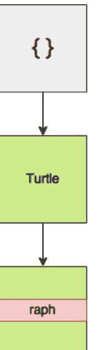

12-1. 原型链

## Object 构造函数

正如我们在上一个示例中看到的，所有对象最终继承自 `Object()` 构造函数的原型。

当对象调用方法时，JavaScript 引擎会检查该对象是否具有该方法。如果没有，它将检查对象的原型是否具有该方法。如果还没有，它将检查原型的原型是否具有该方法。这一过程一直持续到原型链，直到到达 `Object()` 构造函数的原型，JavaScript 中的所有对象都继承自它。如果 `Object()` 的原型没有该方法，则将返回一个错误，说明对象不存在：

```
raph.makePizza();
<< TypeError: raph.makePizza is not a function
```

但在原型示例中，`Object.prototype` 被显示为一个空对象，所以它没有方法——对吧？呃，实际上情况并非如此。

`Object` 构造函数的原型拥有许多所有对象都继承的方法。原型之所以看起来是一个空对象字面量，是因为它的所有方法都不是可枚举的（non-enumerable）。

## 可枚举属性

JavaScript 中对象的属性被分为可枚举（enumerable）或不可枚举（non-enumerable）。如果它们不是可枚举的，意味着当使用 `for-in` 循环遍历对象的属性和方法时，它们不会显示。

有一个名为 `propertyIsEnumerable()` 的方法，每个对象都拥有（因为它是 `Object.prototype` 的方法），可以用来检查属性是否是可枚举的。我们从下面的示例中看到，之前创建的 `eat()` 方法是枚举的：

```
Turtle.prototype.propertyIsEnumerable('eat')
<< true
```

所有对象从 `Object.prototype` 继承 `toString()` 方法，但它是不可枚举的，所以它不会显示：

```
Object.prototype.propertyIsEnumerable('toString')
<< false
```

良好的实践是让所有内置方法变为不可枚举，而让用户定义的方法变为可枚举。这样它们就不会出现在 `for-in` 循环中。

## 使用 extends 进行继承

类可以在类声明中使用 `extends` 关键字来继承另一个类。例如，假设我们再次从 `Turtle` 类开始：

```javascript
class Turtle {
  constructor(name) {
    this.name = name;
  }
  sayHi() {
    return `Hi dude, my name is ${this.name}`;
  }

  swim() {
    return `${this.name} paddles in the water`;
  }
}
```

这个类声明与之前相似，定义了普通龟的属性和方法。在我们之前的示例中，我们开始添加一些普通龟并不需要的属性，它们适用于忍者龟。为了不污染 `Turtle` 类，一个主意是为 `Turtle` 类创建一个名为 `NinjaTurtle` 的子类或后类：

```javascript
class NinjaTurtle extends Turtle {
  constructor(name) {
    super(name);
    this.weapon = 'hands';
  }
  attack() { return `Feel the power of my ${this.weapon}! }
}
```

在类声明内部，`super` 关键字指向父类，并用于访问父类的任何属性和调用任何方法。在上面的示例中，我们使用它来调用 `Turtle` 构造函数。

## 多态

多态的概念意味着不同的对象可以具有相同的方法，但以不同的方式实现。`Object.prototype` 对象拥有一个所有对象共享的 `toString()` 方法。这意味着在 JavaScript 中创建的每个都具有 `toString()` 方法。多态意味着对象能够重写此方法以提供更具体的实现。因此，尽管每个对象都有 `toString()` 方法，不同对象之间的实现方式也可以有所不同。例如，在数组对象上调用它将返回用逗号分隔的值字符串：

```
[1,2,3].toString()
<< '1,2,3'
```

在原始数字上调用它将返回包含该数字的字符串：

```
2..toString(); // 记得整数使用两个点运算符！
<< '2'
```

468 JavaScript：从入门到忍者，第 2 版

# 数字、字符串与布尔值

我们在第 2 章中遇到的数字、字符串和布尔值原始类型分别有它们对应的构造函数：`Number`、`String` 和 `Boolean`。

但非常奇怪的是，这些构造函数并不产生原始值：

```
new Number(2); //返回值看起来像是一个原始值
<< 2;
typeof Number(2); // 但它实际上是一个对象！
<< "object"
```

同样，原始值并不是这些构造函数的实例：

```
2 instanceof Number;
<< false
```

事实上，这两者并不严格相等：

```
Number(2) === 2;
<< false
```

原始值实际上并不带自己的方法。原始值包装对象 `Number`、`String` 和 `Boolean` 在后台被用于为原始值提供方法。当在原始值上调用方法时，JavaScript 会为该原始值创建一个包装对象，将其转换为对象，然后在对象上调用该方法。这意味着我们在第 2 章中看到的，，可以在原始值上调用方法：

```
2..toFixed();
<< '2e0'
```

在后台，发生着类似的操作：

```
new Number(2).toFixed();
<< '2e0'
```

即使是自定义对象，例如我们之前创建的 `Turtle` 对象，也有 `toString()` 方法：


# JavaScript 中的面向对象编程 469

```
raph.toString();
<< ['object Object']
```

它可能传递的信息很少，但它确实返回了对象的字符串表示。

`toString()` 方法在后台被许多内置函数使用。你可以使用它而不用担心引起错误，因为每个对象都从 `Object.prototype` 继承了这个方法。

使用 `toString()` 方法的一个例子是 `console.log()` 方法。如果传递给方法的参数不是字符串，它会在后台对该对象调用 `toString()` 并在控制台中显示其返回值。对于以下代码：

```
console.log([1,2,3]);
<< [ 1, 2, 3 ]
```

使用原型链来重写 `toString()` 方法通常是一个很有用的练习，这样就可以显示更有意义的内容。例如，我们可以修改 `Turtle` 类的声明，使其包含一个更具描述性的 `toString()` 方法：

```javascript
class Turtle {
  // 此处其他 turtle 方法

  toString() {
    return `A turtle called ${this.name}`;
  }
}
```

```
raph.toString();
<< 'A turtle called Raphael'
```

`toString()` 方法是多态性的良好演示，因为不同的对象拥有相同的方法但实现方式不同。这种方法的优点是高层函数可以调用同一个方法，尽管该方法可能有多种实现方式。

# 为内置对象添加方法

向 JavaScript 内置对象（如 `Number`、`String` 和 `Array`）的原型添加方法以增加更多功能可能的。这种做法被称为“猴子补丁”（monkey-patching），尽管这是一种极其强大的技术，但在 JavaScript 社区中通常是不受欢迎的²。

作为一个例子，我们可以向 `Number` 包装对象的原型添加 `isOdd()` 和 `isEven()` 方法。这些方法将对数字原始值可用。

```javascript
Number.prototype.isEven = function() {
  return this % 2 === 0;
}

Number.prototype.isOdd = function() {
  return this % 2 === 1;
}
```

我们可以再尝试几个例子来检查它们是否有效：

```
42.isEven();
<< true

765234.isOdd();
<< false
```

> ² 相比之下，Ruby 编程社区通常接受猴子补丁，因此这在 Ruby 代码中非常常见。

# JavaScript 中的面向对象编程 47

数组是强大的对象，但 JavaScript 似乎缺少一些其他语言中才的基础方法。我们可以添加 `first()` 和 `last()` 方法来返回数组的第一个和最后一个元素：

```javascript
Array.prototype.first = function() {
  return this[0];
}

Array.prototype.last = function() {
  return this[this.length - 1];
}
```

再次，我们可以通过几个例子来检查它们是否工作：

```javascript
const turtles = ['Leonardo', 'Donatello', 'Michaelangelo', 'Raphael'];

turtles.first();
<< 'Leonardo'

turtles.last();
<< 'Raphael'
```

数组缺失的另一个有用方法是 `delete()` 方法。我们在第 3 章中使用了 `delete` 操作符，但它的工作方式并不直观，因为它会在被删除元素的位置留一个 `null`。在该章中，我们看到可以使用 `splice()` 方法从数组中完全删除元素。可以使用它创建一个名为 `delete()` 的新方法，从指定的索引处删除元素：


```javascript
Array.prototype.delete = function(i) {
  return self.splice(i, 1);
}
```

# JavaScript：从入门到忍者，第 2 版

猴子补丁的一个有用示例是对规范包含但在某些浏览器中原生不支持的方法添加支持。例如 `trim()` 方法，它是 `String.prototype` 的方法，因此所有字符串都应该继承它。它移除字符串首尾的所有空白，遗憾的是，该方法在 Internet Explorer 8 及以下版本中没有实现。可以使用以下补丁（polyfill）来纠正，如果 `String.prototype.trim` 存在则使用它，如果不存在，则用提供的函数对 `String` 原型进行猴子补丁（这是由于使用 `||` 运算符时的惰性求值）：

```javascript
String.prototype.trim = String.prototype.trim || function() {
  return this.replace(/^\s+|\s+$/g, '');
}

' hello '.trim();
<< 'hello'
```

虽然为内置对象添加额外功能似乎是一个好方法，但它也会引入意外的行为。JS 社区目前的共识是不应该这样做，因此你应该避免对任何内置对象进行猴子补丁，除非你有非常充分的理由。

（相当乐观地）作为 21。无法通过这种方式设置可写（writable）、可枚举（enumerable）和可配置（configurable）属性。这些属性在赋值时将被设置为 true。请注意，这些与这些属性的默认值完全相反。

# 获取和设置属性描述符

`Object()` 构造函数有许多方法可以获取和定义属性描述符。我们可以使用 `Object.getOwnPropertyDescriptor()` 方法来查看这些值：

```
Object.getOwnPropertyDescriptor(me, 'name');
<< { value: 'DAZ',
  writable: true,
  enumerable: true,
  configurable: true }
```

与其使用赋值，我们不如使用 `Object.defineProperty()` 方法向对象添加属性。这在添加新属性时提供了更细粒度的控制，因为它允许设置每个属性。第一个参数是您想要向其添加属性的对象，紧接着是包含您想要设置的属性的属性描述符。任何遗留的属性将采用默认值：

```
Object.defineProperty(me, 'eyeColor', { value: 'blue',
  writable: false, enumerable: true });
<< { name: 'DAZ', age: 21, eyeColor: 'blue' }
```

如您所见，返回的对象带有新的新属性。上面的示例创建了一个名为 `eyeColor` 的属性，该属性实际上是只读的（因为 `writable` 属性被设置为 false）。如果我们尝试通过赋值来更改它，看起来似乎已经改变了：

```
me.age = 21;
me.retirementAge = 65;

Object.defineProperty(me, 'yearsToRetirement',{
get() {
if(this.age > this.retirementAge) { return 0; }
else return this.retirementAge - this.age;
},
set(value) {
this.age = this.retirementAge - value;
return value;
}
));
```

# JavaScript 中的面向对象编程 477

getter 将 `yearsToRetirement` 属性基于 `age` 和 `retirementAge` 属性，因此在查询时会返回相关值：

```
me.yearsToRetirement
<< 44
```

setter 也允许通过设置 `yearsToRetirement` 属性来更改 `age`：

```
me.yearsToRetirement = 10;
<< 10
me.age
<< 55
```

这些 getter 和 setter 方法允许对赋值的工作方式进行更细粒度的控制。这也意味着我们可以更改赋值的工作方式，并使用 `get()` 方法返回我们喜欢的任何内容，无论使用赋值设置了什么值。例如，为了保持永远年轻，我们可以将属性更改为如下：

```
Object.defineProperty(me, 'age', {
  get() {
    return 21;
  },
  set(value) {
    return value;
  }
});
```

如果我们测试一下，可以发现查询该属性始终返回 21，尽管它似乎被赋值了不同的值：

```
me.age = 30;
<< 30

me.age
<< 21
```

get 和 set 属性描述符对于控制类中属性的获取和设置特别有用。

下一个示例显示了我们如何创建一个 `Dice` 类，该类使用一个 get 函数来返回面数的描述（而不仅仅是实际数字），以及一个 set 函数来禁止设置非正面数：

```javascript
class Dice {
  constructor(sides=6) {
    Object.defineProperty(this, 'sides', {
      get() {
        return `This dice has ${sides} sides`
      },
      set(value) {
        if(value > 0) {
          sides = value;
          return sides;
        } else {
          throw new Error('The number of sides must be positive');
        }
      }
    });
  }

  roll() {
    return Math.floor(Math.random() * sides) + 1;
  }
}
```

# JavaScript 中的面向对象编程 479

通过原型链操作属性的方式现在看起来相同，但行为有所不同：

```javascript
const dice = new Dice();

dice.sides
<< "This dice has 6 sides"

dice.sides = 10;
<< 10

dice.sides
<< "This dice has 10 sides"

dice.sides = 0;
<< Error: The number of sides must be positive
```

这些 getter 和 setter 方法对于控制属性的获取和设置提供了强大的功能。这意味着，我们可以改变赋值的工作方式，并使用 `get()` 方法返回我们喜欢的任何内容，无论使用赋值设置了什么值。例如，为了保持永远年轻，我们可以将属性更改为如下：

```javascript
Object.defineProperty(dice, 'age', {
  get() {
    return 21;
  },
  set(value) {
    return value;
  }
});
```

如果我们测试一下，可以发现查询该属性始终返回 21，尽管它似乎被赋值了不同的值：

```javascript
dice.age = 30;
<< 30

dice.age
<< 21
```

get 和 set 属性描述符对于控制类中属性的获取和设置特别有用。

下一个示例显示了我们如何创建一个 `Dice` 类，该类使用一个 get 函数来返回面数的描述（而不仅仅是实际数字），以及一个 set 函数来禁止设置非正面数：

```javascript
class Dice {
  constructor(sides=6) {
    Object.defineProperty(this, 'sides', {
      get() {
        return `This dice has ${sides} sides`
      },
      set(value) {
        if(value > 0) {
          sides = value;
          return sides;
        } else {
          throw new Error('The number of sides must be positive');
        }
      }
    });
  }

  roll() {
    return Math.floor(Math.random() * sides) + 1;
  }
}
```

# JavaScript 中的面向对象编程 480

通过原型链操作属性的方式现在看起来相同，但行为有所不同。

# 从原型创建对象

可以完全避免使用类，而是使用对象字面量创建对象：

```javascript
const Human = {
  name: 'Lois',
  age: 21,
  walk() {
    console.log(`I am ${this.name} and I am ${this.age} years old.`);
  }
};

const clark = Object.create(Human);
clark.name = 'Clark';
clark.age = 30;

clark.walk // I am Clark and I am 30 years old.
```

`Object.create()` 方法允许创建一个以另一个对象为原型的对象。

```javascript
const lois = Object.create(Human);
lois.name = 'Lois';
lois.age = 21;

lois.walk // I am Lois and I am 21 years old.
```

`Object.create()` 还可以接收第二个参数，用于定义新对象的属性描述符：

```javascript
const jimmy = Object.create(Human, {
  name: { value: 'Jimmy', enumerable: true },
  job: { value: 'Photographer', enumerable: true }
});

jimmy.walk // I am Jimmy and I am 21 years old.
```

## 原型继承

Human 对象也可以像超类一样，成为另一个名为 `Superhuman` 的对象的原型。它拥有 Human 对象的所有属性和方法，但增加了一些额外的方法：

```javascript
const Human = {
  name: 'Lois',
  age: 21,
  walk() {
    console.log(`I am ${this.name} and I am ${this.age} years old.`);
  }
};

const Superhuman = Object.create(Human);

Superhuman.change = function() {
  return `${this.realName} goes into a phone box and comes out
as ${this.name}!`;
};

const superman = Object.create(Superhuman);
superman.name = 'Superman';
superman.realName = 'Clark Kent';

superman.change(); // Clark Kent goes into a phone box and comes out as Superman!
superman.walk(); // I am Superman and I am 30 years old.

const clark = Object.create(Superhuman);
clark.name = 'Clark';
clark.age = 30;
clark.change(); // Clark Kent!
clark.walk(); // I am Clark and I am 30 years old.
```

## JavaScript 中的面向对象编程

使用构造函数添加自定义属性的方法比较冗长，其中初始值作为参数传递给构造函数。这可以通过在 `Superhuman` 对象上添加一个接收初始化属性的 `init()` 方法来解决：

```
Superhuman.init = function(name,realName){
this.name = name;
this.realName = realName;
this.init = undefined; // 这一行删除了 init 
↳ 句柄，因此该方法只能被调用一次
return this;
}
```

可以轻松地创建并初始化一个新对象：

```
const batman = Object.create(Superhuman);
batman.init('Batman', 'Bruce Wayne');
batman.change();
<< 'Bruce Wayne 走进一个电话亭，出来时变成了
↳ Batman!'
```

也可以通过在创建对象的行末尾添加 `init()` 方法的调用，在一行代码内创建并初始化新对象。这是链式调用（chaining）的一个示例（该技术将在本章稍后的部分进行详细解释）：

```
const aquaman = Object.create(Superhuman).init('Aquaman',
↳ 'Arthur Curry');
aquaman.change();
<< 'Arthur Curry 走进一个电话亭，出来时变成了
↳ Aquaman!'
```

# 对象原型链

从对象创建对象将创建一个原型链。

每当使用 `Object.create()` 方法创建一个新对象时，新对象都会继承父对象的所有属性和方法，而父对象就成为了新对象的原型。例如，通过此代码看到 `superman` 对象的原型是 `Superhuman` 对象：

```
Superhuman.isPrototypeOf(superman);
<< true
```

我们还可以看到 `Superhuman` 对象的原型是 `Human` 对象：

```
Human.isPrototypeOf(Superman);
<< true
```

此外，我们可以验证 `Superhuman` 对象是使用它创建的任何其他对象的原型：

```
Superhuman.isPrototypeOf(batman);
<< true
```

> `instanceof` 操作符在这里不起作用

当对象以这种方式创建创建时，`instanceof` 操作符将不起作用。它只在使用构造函数创建对象时有效。

这产生了下图中所示的继承链：

# JavaScript 中的面向对象编程 485

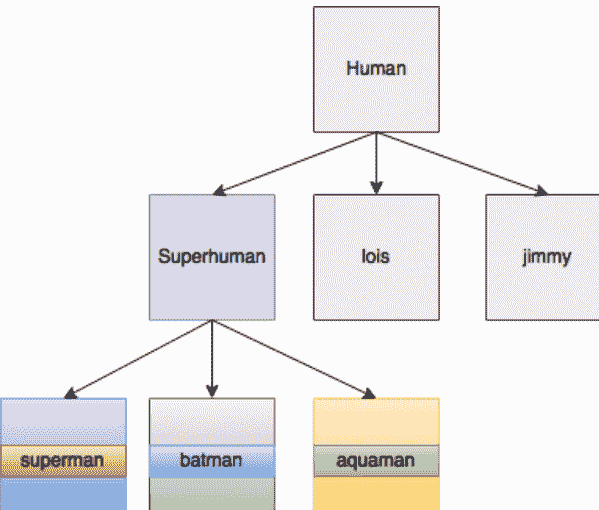

12-2. 原型链

由于这条链的存在，`superman` 对象拥有 `Human` 和 `Superhuman` 对象的所有属性和方法：

```
superman.walk();
<< Walking

superman.change();
<< 'Clark Kent 走进一个电话亭，出来时变成了 Superman!'
```

# 混合 (Mixins)

混合（Mixin）是一种在不使用继承的情况下，将某些对象的属性和方法添加到另一个对象的方法。它允许通过“混合”基础对象来创建复杂的对象。

# 486 JavaScript: 从新手到忍者，第2版

基础的混合功能由 `Object.assign()` 方法提供。它会将作为后续参数提供的任何对象的所有属性，都赋值给作为第一个参数提供的对象：

```javascript
const a = {};

const b = { name: 'JavaScript' };

Object.assign(a,b);
<< { name: 'JavaScript' }

a.name
<< 'JavaScript'
```

然而，这种方法存在一个问题。如果被混合的属性中有任何数组或嵌套对象，则只会进行浅拷贝，这可能会导致各种问题（见注释）。

## JavaScript 中的面向对象编程

# 按引用复制

当对象通过赋值进行复制时，它们仅通过引用进行复制。这意味着内存中并没有实际创建另一个对象；新引用将指向旧对象。对其中任何一个对象所做的更改都会影响所有对象。数组和函数都是对象，因此每当它们通过赋值进行复制时，它们将指向同一个对象。当其中一个发生变化时，所有的都会发生变化。这被称为对对象的浅拷贝（shallow copy）。深拷贝或硬拷贝则会创建一个完全的新对象，该对象具有与旧对象相同的所有属性。区别在于，当硬拷贝被修改时，原始对象保持不变。但当浅拷贝被修改时，原始对象也会随之改变。

当我们尝试复制一个为数组或对象的属性时，这会影响我们的混合函数，如下所示：

```javascript
const a = {};const b = { numbers: [1,2,3] };

Object.assign(a,b);
<< numbers: [1,2,3] }
```

`a` 现在拥有指向 `b` 对象中 `numbers` 属性的引用，而不是自己的副本。对其中任何一个对象所做的更改都会影响它们：

```javascript
b.numbers.push(4);
<< 4
nb.numbers
<< [1,2,4]
a.numbers // 这也发生了变化
<< [1,2,3]
```

为了避免只进行浅拷贝，我们将创建自己的 `mixin()` 函数，该函数将对象的所有属性作为深拷贝赋值给另一个对象。


这意味着每个对象都将继承此方法，并可以使用它来通过其他对象的属性和方法增强自身。

```javascript
function mixin(target,...objects) {
  for (const object of objects) {
    if(typeof object === 'object') {
      for (const key of Object.keys(object)) {
        if (typeof object[key] === 'object') {
          target[key] = Array.isArray(object[key]) ? [] : {};
          mixin(target[key],object[key]);
        } else {
          target[key] = object[key];
        }
      }
    }
  }
}
```

这意味着每个对象都将继承此方法，并能够使用它来通过其他对象的属性和方法增强自身。

这段代码看起来很复杂，让我们深入研究一下：

```javascript
function mixin(target,...objects) {
  for (const object of objects) {
    if(typeof object === 'object') {
      for (const key of Object.keys(object)) {
        if (typeof object[key] === 'object') {
          target[key] = Array.isArray(object[key]) ? [] : {};
          mixin(target[key],object[key]);
        } else {
          target[key] = object[key];
        }
      }
    }
  }
  return target;
}
```

让我们看看它发生了什么。第一个参数是我们要应用 `mixin` 的对象。第二个参数使用剩余参数 `...objects` 允许一次混合多个对象。我们使用 `for...of` 循环来遍历数组中的每个对象。我们使用 `typeof` 运算符检查属性是否为数组或对象。如果是数组，我们需要创建一个新数组；如果是对象，则创建一个新对象。通过 `Array.isArray()` 方法判断它是否为数组。如果是数组，我们使用三元运算符来执行不同的操作。

## JavaScript 中的面向对象编程

然后我们递归地应用 `mixin` 方法将每个属性逐添加到创建的对象中，而不是简单的赋值。最后，`else` 语句表示 `Object.assign()` 用于处理非数组或对象的属性。让我们测试这是否能实现深拷贝：

```javascript
const a = {}, b = { foo: 'bar' }, c = { numbers: [1,2,3] };

mixin(a,b,c);
// << { foo: 'bar', numbers: [1, 2, 3] }

c.numbers.push(4);
// << 4

a.numbers
// << [1, 2, 3 ]

c.numbers
// << [1, 2, 4 ]
```

结果符合预期——`b` 和 `c` 对象的所有属性都混合到了对象 `a` 中，且数组 `numbers` 没有通过引用——混合函数是处理对象的一种非常强大的方法，并且有很多用途。

### `copy` 函数

`copy` 函数还接收一个名为 `target` 的参数，它是要被复制的对象。我们所做的的第一件事是根据正在复制的对象的原型创建一个新对象。

`mixin()` 函数用于将该对象的所有属性和方法添加到这个新对象中，从而有效地实现该对象的精确拷贝。

我们现在可以使用此函数来创建对象的精确拷贝，如下所示，通过 `superman` 对象的克隆进行演示：

```
const bizarre = copy(superman);

bizarro.name = 'Bizarro';
// << 'Bizarro';

bizarro.realName = 'Subject B-0';
// << 'Subject B-0'

bizarro.change()
// << 'Subject B-0 goes into a phone box and comes out
// → Bizarro!'
```

注意，这是深拷贝，而不是通过引用复制，因此后续对 `superman` 或 `bizarro` 对象的任何更改都不会影响另一个对象。

## 工厂函数

我们的 `copy()` 函数现在可以用于为超级英雄创建一个工厂函数。工厂函数是一个可以用于返回对象的函数。

我们的工厂函数将基于 `Superhuman` 对象：

```
function createSuperhuman(...mixins) {
const object = copy(Superhuman);
return mixin(object,...mixins);
}
```

这使用了我们的 `copy()` 函数来制作 `Superhuman` 对象的拷贝，然后使用 `mixin()` 函数来增强作为参数提供的任何对象的属性和方法。这些属性和方法会覆盖 `Superhuman` 对象的任何默认属性。这允许我们提供一个初始化对象字面量作为参数：

```
const hulk = createSuperhuman({name: 'Hulk', realName:
  'Bruce Banner'});

hulk.change()
// << 'Bruce Banner goes into a phone box and comes out
//   as Hulk!',
```

`createSuperhuman()` 函数是一个工厂函数的示例，现在可以用来根据需要创建任意数量的超级对象。

## 使用 Mixin 函数添加模块化功能

继承允许我们通过从其他对象继承属性和方法来向对象添加功能。虽然这很有用，但创建继承链可能是不如人意的——有时我们只想添加属性和方法，而不必将两个对象链接在一起。`mixin()` 函数让我们在对象中封装属性和方法，并将它们添加到其他对象中，而不会创建继承链的开销。

思考原型继承与从 mixin 对象继承区别的一种方法，是考虑一个对象是“某种东西”还是“拥有某种东西”。例如，坦克是一辆汽车，所以它可能继承自 `Vehicle` 原型。坦克还拥有一支枪，因此可以使用一个 `gun` mixin 对象来添加此功能。这赋予了我们额外的灵活性，因为其他对象也可能使用手枪，但不是汽车，例如士兵对象。士兵对象可能继承自 `Human` 原型，并拥有 `gun` mixin。

我们可以使用这个主意为之前使用的超级英雄对象添加超能力。所有的超级英雄都是超人类，他们从 `Superhuman` 原型继承了任何共同特征。但他们也拥有超能力，而且每个超级英雄的技能组合都不同。这是 mixin 对象的完美用用例：我们可以创建一些超能力 mixin 对象，然后根据需要将它们添加到我们的任何超级英雄对象中。

这里是一些 mixin 对象的示例：

```
const flight = {
fly() {
  console.log(`Up, up and away! ${this.name} soars through the
air!`);
  return this;
}

const superSpeed = {
move() {
  console.log(`${this.name} can move faster than a speeding
bullet!`);
  return this;
}

const xRayVision = {
xray() {
  console.log(`${this.name} can see right through you!`);
  return this;
}
}
```

### 返回 this

> 上述每个 mixin 都有一个返回值 `this` ——你将在本章稍后后的部分看到为什么！

现在我们可以使用 `mixin()` 函数以模块化的方式为每个对象添加相关的超能力：

```
mixin(superman,flight,superSpeed,xRayVision);

mixin(wonderwoman,flight,superSpeed);
```

现在我们可以看到它们获得了一些额外的方法：

```
superman.xray();
// << 'Superman can see right through you!'

WonderWoman.fly();
// << 'Up, up and away! Wonder Woman soars through the
// air!'
```

我们还可以将 mixins 作为参数传递给我们之前创建的 `createSuperhuman()` 工厂函数，以便从一开始就创建一个具有所有相关方法的超级英雄对象：

```
const flash = createSuperhuman({ name: 'Flash', realName:
-> 'Barry Allen' }, superSpeed);
```

在一个作业中，我们创建了一个超级英雄对象，它继承了 `Superhuman` 对象的所有默认属性，具有正确的名称细节以及任何相关的能力：

```
flash.change()
// << 'Barry Allen goes into a phone box and comes out as
// -> Flash!'

flash.move()
// << Flash can move faster than a speeding bullet!
```

## 方法链式调用

如果一个方法返回 `this`，它的方法就可以链在一起，形成一个一个一个调用的方法调用序列。例如，`superman` 可以链式调用：

```
'Bruce Banner goes into a phone box and comes out
as Hulk!',

'Up, up and away! Wonder Woman soars through the
air!'

'Superman can see right through you!'

superman.fly();
// << Up, up and away! Wonder Woman soars through the
// air!'

superman.move();
// << Superman can move faster than a speeding bullet!

superman.xray();
// << Superman can see right through you!
```

这是一个常用的技术，特别是当 `this` 指向全局对象（其值值为 `undefined`）时。我们之前看到过将 `this` 绑定到特定对象。

## 使用 bind(this)

`bind()` 方法是所有函数的方法，用于设置函数中 `this` 的值。如果 `this` 在作用域内作为参数传递给 `bind()`，则嵌套函数内部对 `this` 的引用将绑定到调用原始方法的对象：

```
superman.findFriends = function() {
  this.friends.forEach(function(friend) {
    console.log(`${friend.name} is friends with ${this.name}`);
  }).bind(this));
}

superman.findFriends();
// << Aquaman is friends with Superman
// Wonder Woman is friends with Superman
// Aquaman is friends with Superman
```

## 使用 for-of 代替 Each()

ES6 引入了数组的 `for-of` 语法，这不需要嵌套函数，因此 `this` 仍然绑定到 `superman` 对象：

```
superman.findFriends = function() {
for(const friend of this.friends) {
    console.log(`${friend.name} is friends with ${this.name}`);
  }
}

superman.findFriends();
// << Batman is friends with Superman
```

例如，`batman` 对象并不具备 `superman` 对象拥有的任何超能力方法，但我们可以为它们创建一个引用，然后供另一个对象使用。例如，我们可以通过引用 `superman` 对象的 `fly` 方法创建一个 `fly()` 函数：

```javascript
const fly = superman.fly;
```

现在可以使用所有函数都拥有的 `call` 方法在另一个对象上调用此方法，该方法我们在第 11 章中学习过：

```javascript
fly.call(batman); // 起飞，起飞，飞吧！蝙蝠侠在空中翱翔！
```

## 借用数组方法

借用方法最常见的用途之一是从 ES5 的数组中借用方法。JavaScript 中有很多类数组对象，例如函数中可用的 `arguments` 对象，以及 DOM 方法返回的节点列表（node lists）。这些对象的行为类似于数组，但缺少许多数组拥有的方法——如果它们拥有这些方法，将会非常方便。

例如，通过赋值一个指向 `arguments` 对象的变量，可以使用 `Array` 构造函数原型原型上的 `slice()` 方法：

```javascript
const slice = Array.prototype.slice;
```

然后可以使用 `call()` 方法在 `arguments` 对象上调用该方法：

```javascript
slice.call(arguments, 1, 3);
```

`call()` 方法将函数要应用的对象作为其第一个参数，随后是常规的参数。

也可以直接从数组字面量借用方法，如下：

```javascript
[].slice.call(arguments, 1, 3)
```

使用不带参数的 `slice()` 方法可以有效地将类数组对象转换为数组：

```javascript
const argumentsArray =
Array.prototype.slice.call(arguments);
```

这将把 `arguments` 对象作为数组返回（因为 `slice()` 方法返回一个数组）。

从 ES6 开始，这些技术大部分都不再需要了，因为可以使用 `Array.from()` 方法将类数组对象转换为数组：

```javascript
const argumentsArray = Array.from(arguments);
```

或者，可以使用扩展运算符（spread operator）轻松地将类数组对象转换为数组，如下：

```javascript
const argumentsArray = [...arguments];
```

在实际开发中，你仍然会看到很多“数组方法借用”技术，而且转译器也会使用这些技术来模拟 ES6 的功能。

## 组合优于继承

面向对象编程有很多优点，但继承也带来了一些问题。

在章节早些时候，我们创建了一个 `Turtle` 类，然后扩展该类来创建一个名为 `ninjaTurtle` 的子类。但 `ninjaTurtle` 类应该是 `Turtle` 类的子类，还是 `Ninja` 类的子类？某些语言使用多重继承（尽管 JavaScript 不是其中），但这引起的问题比它解决的更多。

“大猩猩香蕉”（Gorilla Banana）问题出现在当你需要一个对象的某个方法时，你继承了该对象。这个名字源于 Erlang 语言创建者 Joe Armstrong 的名言：

> “你想要一根香蕉，但得到的却是一只拿着香蕉和整个丛林的大猩猩。”

他描述的问题是，如果一个对象需要属于 `Gorilla` 类的 `banana()` 方法，你必须继承整个类才能访问该方法。但除了你想要的方法外，该对象还继承了许多不需要的其他属性和方法，导致它变得异常臃肿。

一种寻求解决这些问题的模式是使用“组合优于继承”（composition over inheritance）或行为。这种方法主张创建描述单个任务或行为的小型对象，并将它们作为构建更复杂对象的构建组件。这与我们在上一章中讨论的纯函数思想相似。这些单任务对象更容易维护，并且可以使用混合函数（mixin function）将它们组合在一起，以创建更复杂的对象。组合优于继承将对象视为组合在一起形成其他对象的构建块，而不是层层堆叠的单体结构类。

如果你决定使用类，建议让它们保持“苗条化”（skinny）——意味着它们不要有过多的属性和方法。创建类时的另一个良好实践是保持继承链尽可能短。如果你有很长的继承链，链末端的对象通常会因为包含许多它们不需要的属性和方法而变得臃肿。如果链中的任何对象需要更改也会导致问题，这些更改也会影响链中的其他对象。一个好的原则是只继承一次，将继承链保持在两个对象，这将使解决任何问题变得简单得多。

如果你想使用类中的某个特定方法，但它包含许多你不需要的属性和方法，那么最好直接借用该方法，正如我们在上一节中看到的那样。所以，从 `Gorilla` 类中借用 `banana` 方法，而不是继承整个 `Gorilla`！

```javascript
banana = Gorilla.prototype.banana;
```

一种更好的方法是将 `banana()` 方法移动到单独的对象中，然后作为混合函数添加到 `Gorilla` 类中，正如我们在上一节中看到的。

## 测验项目 (Quiz Project)


我们将对测验的用户界面进行重大更改。不再使用文本输入来回答，而是提供一组选项。

首先，我们需要检查 `quiz.questions.length` 是否大于 2 而 0，因为我们需要三个选项。然后我们打乱数组并选择问题，正如之前一样。由于我们打乱了数组，每次选择问题时前两个元素都是不同的。这些选项现在需要显示，因此我们需要使用 `view.buttons()` 方法来创建 HTML。在 `view` 对象中添加以下代码：

```javascript
buttons(array){
  return array.map(value =>
    `<button>${value}</button>`).join('');
}
```

该方法接收数组作为参数，然后使用 `map()` 方法将数组中的每个值包裹在 `<button>` 标签中。它将数组的元素连接成一个 HTML 字符串。例如，如果提供了 `['Clark Kent', 'Bruce Wayne', 'Diana Prince']` 数组作为函数的参数，它将返回以下 HTML 字符串：

```html
<button>Clark Kent</button> <button>Bruce Wayne</button> <button>Diana Prince</button>
```

这可以作为 `view.render()` 方法的参数，在 `response<div>` 中显示按钮列表。

当玩家点击这些按钮之一时，答案将被提交。这意味着我们需要将事件监听器更改为触发点击事件而不是提交事件。将 `main.js` 中的代码更改为：

```javascript
view.response.addEventListener('click', (event) =>
  game.check(event), false);
```

接下来，我们需要将 `ask()` 函数更新为：

```javascript
ask(name){
  console.log('ask() invoked');
  if(this.questions.length > 2) {
    shuffle(this.questions);
    this.question = this.questions.pop();
    const options = [this.questions[0], this.questions[1], this.name];
    const question = `What is ${this.question}?`;
    view.render(view.question, question);
    view.render(view.response, buttons(options));
  } else {
    this.gameOver();
  }
}
```

# JavaScript 面向对象编程 505

它仍然会调用 `game.check()` 方法，但仅当玩家点击 'response' `<div>` 内部的按钮时才会调用。

我们还需要更新 `game.check()` 方法，以考虑到玩家的响应是通过点击按钮而不是提交表单得到的。更新函数定义使其看起来像下面所示：

```javascript
check(event){
  console.log('check(event) invoked');
  const response = event.target.textContent;
  const answer = this.question.realName;
  if(response === answer){
    view.render(view.result, 'Correct!',{'class':'correct'});
    this.score++;
    view.render(view.score,this.score);
  } else {
    view.render(view.result, 'Wrong! The correct answer was ${answer}',{'class':'wrong'});
  }
  this.ask();
}
```

我们删除了 `event.preventDefault()` 这一行代码，因为我们不再使用表单提交答案，所以这行代码不再需要了。我们还需要在方法的末尾删除对 `view.resetForm()` 的调用。由于我们没有使用表单，因此不需要重置它。`response` 变量需要更新为指向按钮元素内部的文本，它存储在 `event.target.textContent` 中。我们可以用它将玩家的响应与实际答案进行比较。

最后，我们可能应该更新包含问题的 `quiz` 对象，让它包含更多问题，因为只有三个问题的话，我们在游戏结束之前只能问一轮：

```javascript
const quiz = [
  { name: "Superman",realName: "Clark Kent" },
  { name: "Wonder Woman",realName: "Diana Prince" },
  { name: "Batman",realName: "Bruce Wayne" },
  { name: "The Hulk",realName: "Bruce Banner" },
  { name: "Spider-man",realName: "Peter Parker" },
  { name: "Cyclops",realName: "Scott Summers" }
];
```

你可能喜欢添加一些你自己的额外问题，因为拥有有三个以上的选项会让游戏变得更有趣！

尝试在浏览器中打开 `index.html` 来玩这个测验。提供玩家可以选择的选项可以让游戏变得容易得多，因为不需要任何打字：


### 测验中的多选题

你可以在 CodePen 上查看实时示例：

5. https://codepen.io/daz4126/pen/qoig

# JavaScript 面向对象编程 507

## 章节总结

- 面向对象编程（OOP）是一种编程方式，它使用对象来封装它们自己的属性和方法。
- OOP 的核心概念是封装、多态和继承。
- 构造函数可以用于创建对象的实例。
- ES6 引入了使用 `class` 关键字的类声明。这些类可以用来替代构造函数。
- 在构造函数或类声明内部，`this` 关键字指向函数返回的对象。
- 类或构造函数的所有实例都继承其原型（prototype）的所有属性和方法。
- 原型是动态的（live），因此可以向现有实例中添加新的属性和方法。
- 原型链用于查找可用的方法。如果一个对象缺少某个方法，JavaScript 将检查其原型是否具有该方法，直到到达 `Object` 原型。
- 通过在构造函数内部定义变量可以创建私有属性和方法。可以使用 getter 和 setter 函数将它们设为公有。
- 猴补丁（Monkey-patching）是通过增强它们的原型来向内置对象添加方法的过程。这应该谨慎进行，因为可能会导致意外的行为。
- 混合（Mixin）是一种通过增强原型来向内置对象添加方法的方法。这应该谨慎进行，因为可能会导致意外的行为。
- 组合优于继承（Composition over inheritance）是一种设计模式，它通过组合对象来构建功能，而不是通过 `class` 继承。
- 多态（Polymorphism）允许类以不同的方式实现相同的接口，这可以通过 `bind(this)` 实现。

# JavaScript 面向对象编程

## 第13 章

## Ajax

Ajax 是一种允许页面在不刷新的情况下与服务器进行通信的技术，它允许在后台更新网页页面，这使得 JavaScript 能够像桌面应用程序一样运行网页页面的一部分。

使用 Ajax 允许在后台发送数据。Ajax 改变了网页的使用方式，并开启了一个新时代。网页页面不再是静态的。在本章中，我们将涵盖以下主题：

- 客户端与服务器
- Ajax 的简要历史
- 与服务器通信
- 使用 Fetch 接收数据
- 使用 Ajax 发送数据
- 表单

## 客户端与服务器

互联网的 Web 可以分为两个部分：客户端和服务器。客户端（如网页浏览器）会请求资源，服务器会处理请求并返回响应。

JavaScript 最初被设计为客户端脚本语言，意味着它在后台异步发送数据。Ajax 允许从服务器请求资源，通常是 JSON 数据或 HTML 片段。

因此，使用 Ajax 通常需要一个后端语言，例如 PHP、Ruby、Node.js 或 .NET 来提供数据。为了练习 Ajax，你可以在本地设置服务器，尽管如果你想进行大量的开发，这值得考虑。

同源策略（same-origin policy）会阻止来自不同域名的请求。这种策略由所有现代浏览器强制执行。问题在于，许多网站的 API 依赖于跨域传输数据。

跨源资源共享（CORS）¹ 是该问题的解决方案，因为它允许从另一个网站请求资源。CORS 标准通过使用 HTTP 头部来指示哪些域名可以接收数据。网站可以在其头部中包含必要的信息，允许外部站点访问其 API 数据。大多数现代浏览器都支持这种方法并尊重头部中指定的限制。

## Ajax 的简要历史

当万维网开始时，网页包含静态内容。页面内容的任何更改都需要重新加载整个页面，通常会导致加载新页面时屏幕变白。记住，这是在 1990 年，当时拨号调制器是主流。

1999 年，微软在 Internet Explorer 5 中实现了 `XMLHttpRequest` 控制。它最初是为 Outlook 客户端开发的，允许 JavaScript 在后台异步发送数据。其他浏览器也实现了这种技术，尽管它仍然是一项不为人知的特性，并且很少使用。

当 Google 在 2004 年和 2005 年分别推出 Gmail 和 Google Maps 时，异步加载技术开始受到关注。这些 Web 应用使用异步加载技术在不刷新页面的情况下更改页面部分来增强用户体验。这让它们感觉更像是一个桌面应用程序。

“Ajax” 术词是由 Jesse James Garrett 在 2005 年的文章《Ajax: A New Approach to Web Applications》² 中提出的，他在文中指的是 Google 最近在 Web 应用中使用的技术。Ajax 是一个非常巧妙的缩写，它指的是该过程中使用的不同部分：异步 JavaScript 和 XML（Ajax）：

¹ http://en.wikipedia.org/wiki/Cross-origin_resource_sharing
² https://web.archive.org/web/2008070202075113/http://www.adaptivepath.com/ideas/essays/archives/00385.php

### 异步（Asynchronous）

当发送数据请求请求时，程序不需要停止并等待响应。它可以继续运行，并在接收到响应时等待事件触发。通过使用回调（callbacks）来管理这种操作，程序能够高效地运行，避免数据往回传输时产生延迟。

### JavaScript

JavaScript 一直被认为是一种前端语言，不用于与服务器通信。Ajax 使 JavaScript 能够发送请求并从服务器接收响应，从而实时更新内容。

### XML

在最初提出 Ajax 术语时，通常使用 XML 文档来返回数据。可以发送许多不同类型的数据，但现在 Ajax 中最常用的是 JSON，它比 XML 更轻量、更易解析。（尽管 JSON 并没有真正取代 XML，但 Ajax 术语有时仍用来描述这种技术。）JSON 的另一个优势是被 JavaScript 原生支持，因此你可以直接处理 JavaScript 对象，而无需使用 DOM 方法解析 XML 文件。

在 Garrett 的文章发表后，Ajax 的使用真正开始兴起。现在用户无需刷新页面即可在网页上看到新内容。购物篮可以在后台更新，部分页面内容可以无缝加载，相册可以动态加载图像。

今天，在需要部分网页更新时，不使用 Ajax 已不寻常。公共 API 的爆炸式增长意味着 Ajax 比以往任何时候都更多用于在网站之间传输数据。

## APIs

应用程序编程接口（API）是方法的集合，允许外部访问另一个程序或服务。许多网站允许通过公共 API 受控访问其数据。这意味着开发者能够与数据交互并创建第三方服务的组合（mashups）。例如，天气服务可能有一个 API，提供某个特定位置的天气信息，如温度、风力等。这可以被用于在网页上显示本地天气数据。API 返回的信息通常被序列化为 JSON。由于数据是由外部服务提供的，必须启用 CORS（跨源资源共享）才能访问 API 的信息。某些服务可能还需要验证才能访问其 API。

## Fetch API

我们将首先查看 Fetch API 如何工作以及它使用的不同接口。之后，我们将构建一个页面来演示我们所看到的这些概念。

## 基础用法

Fetch API 提供了一个全局 `fetch()` 方法，它仅有一个强制性参数，即你想要获取的资源的 URL。一个非常基础的示例看起来像下面的代码：

```javascript
fetch('https://example.com/data')
.then(// // 处理响应的代码 )
.catch( // 如果服务器返回错误则运行的代码 )
```

如你所见，`fetch()` 方法返回一个 promise，该 promise 将解析（resolve）为从参数提供的 URL 返回的响应。在上面的示例中，当从 URL https://example.com/data 接收到响应时，promise 将解析。由于它是 promise，我们还可以在末尾使用 `catch` 语句来处理可能发生的任何错误。

## 响应接口（Response Interface）

Fetch API 引入了 Response 接口，用于处理 promise 履行（fulfilled）时返回的对象。Response 对象具有许多属性和方法，允许我们有效地处理响应。

例如，每个响应对象都都有一个 `ok` 属性，用于检查响应是否成功。这是基于 HTTP 状态码³，可以通过状态码访问。

³ 此处原文重复，已按语义整理


# 512 JavaScript：从入门到精通，第 2 版

## 异步（Asynchronous）

当发送数据请求时，程序不需要停止并等待响应。它可以继续运行，并在接收到响应时等待事件触发。通过使用回调（`callbacks`）来管理这种操作，程序能够高效地运行，避免数据往回传输时产生延迟。

## JavaScript

JavaScript 一直被认为是一种前端语言，不用于与服务器通信。Ajax 使 JavaScript 能够发送请求并从服务器接收响应，从而实时更新内容。

## XML

在最初提出 Ajax 术语时，通常使用 XML 文档来返回数据。可以发送许多不同类型的数据，但现在 Ajax 中最常用的是 JSON，它比 XML 更轻量、更易解析。（尽管 JSON 并没有真正取代 XML，但 Ajax 术语有时仍用来描述这种技术。）JSON 的另一个优势是被 JavaScript 原生支持，因此你可以直接处理 JavaScript 对象，而无需使用 DOM 方法解析 XML 文件。

在 Garrett 的文章发表后，Ajax 的使用真正开始兴起。现在用户无需刷新页面即可在网页上看到新内容。购物篮可以在后台更新，部分页面内容可以无缝加载，相册可以动态加载图像。

今天，在需要部分网页更新时，不使用 Ajax 已不寻常。公共 API 的爆炸式增长意味着 Ajax 比以往任何时候都更多用于在网站之间传输数据。

> 2- https://web.archive.org/web/2008070202075113/http://www.adaptivepath.com/ideas/essays/archives/00385.php

## APIs

应用程序编程接口（API）是方法的集合，允许外部访问另一个程序或服务。许多网站允许通过公共 API 受控访问其数据。这意味着开发者能够与数据交互并创建第三方服务的组合（mashups）。例如，天气服务可能有一个 API，提供某个特定位置的天气信息，如温度、风力等。这可以被用于在网页上显示本地天气数据。API 返回的信息通常被序列化为 JSON。由于数据是由外部服务提供的，必须启用 CORS（跨源资源共享）才能访问 API 的信息。某些服务可能还需要验证才能访问其 API。

## Fetch API

我们将首先查看 Fetch API 如何工作以及它使用的不同接口。之后，我们将构建一个页面来演示我们所看到的这些概念。

## 基础用法

Fetch API 提供了一个全局 `fetch()` 方法，它仅有一个强制性参数，即你想要获取的资源的 URL。一个非常基础的示例看起来像下面的代码：

```javascript
fetch('https://example.com/data')
  .then(// 处理响应的代码 )
  .catch( // 如果服务器返回错误则运行的代码 )
```

如你所见，`fetch()` 方法返回一个 promise，该 promise 将解析（resolve）为从参数提供的 URL 返回的响应。在上面的示例中，当从 URL `https://example.com/data` 接收到响应时，promise 将解析。由于它是 promise，我们还可以在末尾使用 `catch` 语句来处理可能发生的任何错误。

## 响应接口（Response Interface）

Fetch API 引入了 Response 接口，用于处理 promise 履行（fulfilled）时返回的对象。Response 对象具有许多属性和方法，允许我们有效地处理响应。

例如，每个响应对象都有一个 `ok` 属性，用于检查响应是否成功。这是基于 HTTP 状态码³，可以通过状态码访问。

## 重定向（Redirects）

`redirect()` 方法用于跟随重定向。一旦它被重定向，它将返回一个解析为字符串的 promise。这里是重定向 promise 解析的示例：

```javascript
fetch(url)
  .then(response => response.text()) // 将响应转换为字符串
  .then(text => console.log(text))
```

## 创建响应对象

尽管大多数情况下你处理的是从请求返回的响应对象，但你也可以使用构造函数创建自己的响应对象：

```javascript
const response = new Response('Hello!', {
  ok: true,
  status: 200,
  statusText: 'OK',
  type: 'cors',
  url: '/api'
});
```

第一个参数是待返回的数据（例如文本流、文件或 JSON 数据）。第二个参数是一个对象，可以为上面列出的任何属性提供值。

如果你正在创建一个需要发送响应的 API，或者需要为了测试目的发送一个伪响应，那么这些方法将非常有用。

## Request 接口

通过提供 `Request` 对象作为参数，我们可以对发出的请求进行更细粒度的控制。这允许对请求设置许多选项。

`Request` 对象使用 `Request()` 构造函数创建，并包含以下属性：

- **url** – 请求的资源的 URL（唯一必需属性）。
- **method** – 指定请求应使用何种 HTTP 方法的字符串。默认是 GET。
- **headers** – 这是一个 `Headers` 对象（见后文节），提供请求头的详细信息。
- **mode** – 允许你指定是否使用 CORS。默认启用 CORS。
- **cache** – 允许你指定请求如何使用浏览器缓存。例如，你可以强制它请求资源并用结果更新缓存，或者强制它只在缓存中查找资源。
- **credentials** – 允许你指定是否在请求中允许 cookie。
- **redirect** – 指定当响应返回重定向时做什么。有三个值可选："follow"（跟随重定向）、"error"（抛出错误）或 "manual"（手动处理重定向）。

# 超文本传输协议

Web 构建在超文本传输协议（HTTP）之上。当客户端向服务器发送请求时，包含了关于使用何种 HTTP 方法的信息。HTTP 方法（称为动词）用于告诉服务器请求的类型，从而决定服务器将如何处理该请求。

在处理资源时最常用的五个 HTTP 方法是：

- GET 用于检索资源
- POST 用于创建资源，但也可以执行任何任务
- PUT 用于插入资源或完全更新资源
- PATCH 用于对资源进行部分更新
- DELETE 用于删除资源

默认情况下，网页中的表单提交 GET 请求，但它们通常使用 POST 请求。如果你对这些方法感兴趣，Rob Miller 的一篇优秀博客深入解释了这些方法。

使用构造函数来创建新的 `Request` 对象。示例所示：

```javascript
const request = new Request('https://example.com/data', {
  method: 'GET',
  mode: 'cors',
  redirect: 'follow',
  cache: 'no-cache'
});
```

> 4. https://developer.mozilla.org/en-US/docs/Web/HTTP/Methods
> 5. https://rob.me.uk/web-development/2013/09/http-verbs.html

`url` 是第一个参数，必需的。第二个参数是由上面列出的任何属性组成的对象。

一旦将 `Request` 对象赋值给变量，就可以作为 `fetch()` 方法的参数使用。

```javascript
fetch(request)
  .then( // 处理响应 )
  .catch( // 处理任何错误)
```

或者，你可以直接将 URL 和对象作为 `fetch()` 方法的参数，而无需创建 `Request` 对象：

```javascript
fetch('https://example.com/data', {
  method: 'GET',
  mode: 'cors',
  redirect: 'follow',
  cache: 'no-cache'
})
  .then( // 处理响应 )
  .catch( // 处理任何错误)
```

## Headers 接口

Headers 用于传递请求信息。Fetch API 引入了 `Headers` 用于创建 `Headers` 对象。`Headers` 对象包含以下方法：

- `has()` – 用于检查 headers 是否包含。
- `get()` – 返回 headers 的值。
- `set()` – 用于设置 headers。
- `append()` – 向 headers 添加新的 header。
- `delete()` – 删除 headers。
- `keys()` – 用于遍历键的迭代器。
- `values()` – 用于遍历值的迭代器。
- `entries()` – 用于遍历键值对的迭代器

## 整合

在调用 `fetch()` 方法之前，我们可以使用 `Headers`、`Request` 和 `Response` 对象组合出一个典型的示例：

```javascript
const url = 'https://example.com/data';
const headers = new Headers({
  'Content-Type': 'text/plain'
});

const request = new Request(url, headers);
```

`url` 是第一个参数，必需的。第二个参数是由上面列出的任何属性组成的对象。

一旦将 `Request` 对象赋值给变量，就可以作为 `fetch()` 方法的参数使用。

```javascript
fetch(request)
  .then(function(response) {
    if(response.ok) {
      return response;
    }
    throw Error(response.statusText);
  })
  .then(response => // 处理 response )
  .catch(error => console.log('There was an error!'))
```

## 接收信息

为了演示如何使用 Ajax 更新网页，我们需要设置页面。创建一个名为 `ajax.html` 的文件，包含以下代码：

```html
<!doctype html>
<html lang='en'>
<head>
<meta charset='utf-8'>
<title>Ajax Example</title>
</head>
<body>
<button id='number'>Number Fact</button>
<button id='chuck'>Chuck Norris Fact</button>
<div id='output'>Ajax response will appear here</div>
<script src='main.js'></script>
</body>
</html>
```

这是一个标准的 HTML5 网页，包含两个按钮和一个 `<div>` 元素。每个按钮将用于发出不同类型的 Ajax 请求。一个将请求纯文本，另一个将从外部 API 请求 JSON 字符串。id 为 `output` 的 `div` 将是我们插入从 Ajax 请求接收到的响应的地方。

现在我们需要一个 JavaScript 文件。它应该是 `main.js`，并保存到与其他文件相同的目录中。添加以下代码开始：

```javascript
const textBox = document.getElementById('number');
const apiButton = document.getElementById('chuck');
const outputDiv = document.getElementById('output');
```

对于 Ajax 请求，我们将使用几个在线 API。第一个是 NumbersAPI⁶，它以文本字符串的形式返回关于数字的知识。第二个是 chucknorris.io⁷，它返回一个 JSON 字符串，包含关于大家喜爱的硬汉查克·诺里斯的随机讽刺性事实。

## 并非所有这些“事实”都是工作场所安全的

> chucknorris.io 返回的某些“事实”可能轻微的冒犯性并使用不当语言，请谨慎操作！

# Ajax 525

这将 HTML 文件中的每个按钮都分配给变量，以便我们稍后在文件中引用它们。

接下来，我们将一些 URL 赋值给变量：

```javascript
const textURL = 'http://numbersapi.com/random';
const apiURL = 'https://api.chucknorris.io/jokes/random';
```

最后，我们将为每个按钮分配一个事件处理器。让我们从“数字事实”（Number Fact）按钮开始：

```javascript
textButton.addEventListener('click', () => {
  fetch(textURL)
    .then(response => {
      outputDiv.innerHTML = 'Waiting for response...';
      if(response.ok) {
        return response;
      }
      throw Error(response.statusText);
    })
    .then(response => response.text())
    .then(text => outputDiv.innerText = text)
    .catch(error => console.log('There was an error:', error))
}, false);
```

这使用了我们之前看到的格式来构建 `fetch` 请求。它返回一个解析为字符串的 promise。然后我们可以通过赋值其 `innerHTML` 属性，将该字符串放入 id 为 `output` 的 `<div>` 中。

# JavaScript: 从新手到忍者，第2版

现在是“查克·诺里斯事实”（Chuck Norris Fact）按钮：

```javascript
apiButton.addEventListener('click', () => {
  fetch(apiURL)
    .then(response => {
      outputDiv.innerHTML = 'Waiting for response...';
      if(response.ok) {
        return response;
      }
      throw Error(response.statusText);
    })
    .then(response => response.json())
    .then(data => outputDiv.innerText = data.value)
    .catch(error => console.log('There was an error:', error))
}, false);
```


这与数字示例几乎相同，不同之处响应返回的是 JSON，因此我们使用 `json()` 方法来返回一个解析为 JavaScript 对象的 promise。该对象有一个 `value` 属性，其中包含了查克·诺里斯事实，所以我们再次使用 `innerText` 将其插入 id 为 `output` 的 `<div>` 中。

这个示例展示了从服务器请求数据并将其插入网页是多么简单，尽管根据返回的数据类型会有一些细微的差异。

## 加载动画 (Spinners)

在上一个示例中，我们显示了一条消息表示我们正在等待响应。网站通常使用加载动画（以前是蛋计时器！）来指示网站正在等待某些事情发生。Ajax Load.info 和 Preloaders.net 都是为你的网站创建加载图形的良好资源。

运行它。在浏览器中打开 `ajax.html` 并尝试点击每个按钮。你应该能看到下方截图类似的灯光：

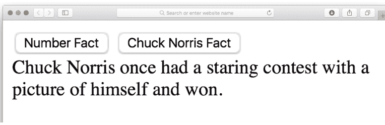

13-2. 一个查克·诺里斯“事实”

- 8. http://www.ajaxload.info/
- 9. http://preloaders.net/

## 发送信息

我们也可以使用 Ajax 发送信息。这可以是多种格式，但通常是 JSON 字符串。

为了说明这一点，我们将创建一个非常简单的 Todo 列表应用程序，它以 JSON 格式将任务信息发送到服务器，然后接收响应以确认任务已保存在服务器上。

遗憾的是，我们没有数据库来保存任务，因此我们将不得不使用虚拟网站 `JSONPlaceholder`。它模拟了向服务器发送 JSON 数据并接收 JSON 数据作为响应的过程。它有许多假的 API 可用于创建帖子、评论、专辑、todo 和用户的示例。我们将使用这个假 API。

开始之前，创建一个名为 `todo.html` 的 HTML 文档，包含以下内容：

```html
<!DOCTYPE html>
<html lang="en">
<head>
  <meta charset="utf-8">
  <title>To Do List</title>
</head>
<body>
  <form id="todo" action="https://jsonplaceholder.typicode.com/todos" method="POST">
    <input type="text" name="task" placeholder="Add Task" autofocus>
    <button type="submit">Add Task</button>
  </form>
  <script src="main.js"></script>
</body>
</html>
```

- 10. https://jsonplaceholder.typicode.com

### 一个简单的 Todo 列表

这是一个简单的 HTML 页面，包含一个带有用于添加任务的文本输入的表单以及一个提交按钮。

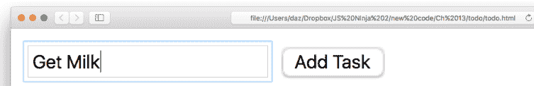

13-3. 一个简单的 Todo 列表

接下来，我们需要创建一个名为 `main.js` 的 JavaScript 文件并添加以下代码：

```javascript
const form = document.forms['todo'];
form.addEventListener('submit', addTask, false);

function addTask(event) {
  event.preventDefault();
  const taskValue = form.task.value;
  const task = {
    userId: 1,
    title: taskValue,
    completed: false
  };
  const data = JSON.stringify(task);
  const url = 'https://jsonplaceholder.typicode.com/todos';

  const headers = new Headers({
    'Accept': 'application/json',
    'Content-Type': 'application/json'
  });

  const request = new Request(url, {
    method: 'POST',
    headers: headers,
    body: data
  });

  fetch(request)
    .then(response => response.json())
    .then(data => console.log(`Task saved with an id of ${data.id}`))
    .catch(error => console.log('There was an error:', error));
}
```

```
Task saved with an id of 201
```

这模拟了任务已保存到数据库并返回了相关数据的实例。实际上，数据并没有被保存，`id` 属性只是为了演示而随机生成的。


### 不完全真实的示例

如果这是一个保存到实际数据库的真实网站，你可能期望返回比只有 id 更多的数据，包括关于任务本身更多的信息，例如创建任务的时间戳。

大多数表单将有一个 `action` 属性，指定了在不使用 Ajax 的情况下发送表单时使用的 URL。它还会有一个 `method` 属性，指定了要使用的 HTTP 动词。这些方法作为表单对象的属性可用，我们可以使用这些属性来创建一个更通用的请求对象，如下：

```javascript
const request = new Request(form.action, {
  method: form.method,
  headers: headers,
  body: data
});
```

### FormData

Fetch API 包含了 `FormData` 接口，这使得使用 Ajax 提交表单信息变得简单得多。

使用构造函数创建 `FormData` 实例：

```javascript
const data = new FormData();
```

如果将表单作为参数传递给构造函数，表单数据实例将自动序列化以便通过 Ajax 发送。在最后一个示例中，我们根据表单提供的数据手动创建了任务。`FormData` 接口有助于减少提交表单时所需的代码。

我们可以通过将其更改为以下内容来减少 `main.js` 中的代码：

```javascript
const form = document.forms['todo'];

form.addEventListener('submit', addTask, false);

function addTask(event) {
  event.preventDefault();
  const task = new FormData(form);
  const url = `http://echo.jsontest.com/id/1/title/${task.value}`;
  const headers = new Headers({
    'Accept': 'application/json',
    'Content-Type': 'application/json'
  });
  const request = new Request(url, {
    method: 'POST',
    mode: 'cors',
    headers: headers,
    body: JSON.stringify(task)
  });

  fetch(request)
    .then(response => response.json())
    .then(data => console.log(`${data.title} saved with an id of ${data.id}`))
    .catch(error => console.log('There was an error:', error));
}
```

在这个函数中，我们使用 `FormData()` 构造函数创建一个新的 `FormData` 实例，并将表单作为参数。这为我们完成了创建任务对象的所有繁琐工作。

也可以使用 `append()` 方法以键值对的形式向表单数据实例添加数据：

```javascript
data = new FormData(); // 未提供表单参数，创建一个空的表单实例
data.append('height', 75);
```

当表单包含要上传的文件时，`FormData` 接口才真正显现出它的价值。这在过去是一项臭名昭著的困难任务，通常需要使用 Flash 或其他第三方浏览器插件来处理上传过程。如果表单中有任何文件上传，`FormData` 实例将自动创建所需的设置，并处理所有的繁琐工作。

### 持续标准 (A Living Standard)

在编写本文时，Fetch API 属于所谓的“持续标准”，这意味着规范正在实际开发中进行。这意味着，尽管它已经可以使用，但随着开发者、浏览器供应商和终端用户对其工作方式提供反馈，它可能会发生变化。它是一项实验性技术，未来可能会添加新功能，或者某些属性和方法的语法和行为可能会改变。不要让这望而却步——持续标准保持相对稳定，特别是一旦它们在浏览器引擎中实现后。大多数浏览器的最新版本已经支持它（无论如何除了 Internet Explorer），但在生产环境中使用它之前，你应该检查支持程度。通过使用它，你正在帮助开发未来的标准。只需确保关注当前的规范即可。

如果你不想冒险，可以考虑使用库来处理 Ajax 请求。这种方法的优势是，该库会在后台处理任何实现细节——如果支持，它将使用最新的方法（如 Fetch API），如果需要，它将回退到旧方法。

jQuery 库是对此很好的选择——它有一个通用的 `ajax()` 方法，其用法与 `fetch()` 方法非常相似。例如，如果你想从数字 API 获取数据，可以使用以下代码：

```javascript
ajax('http://numbersapi.com/random')
done(text => outputDiv.innerHTML = text);
```

## 测验忍者项目 (Quiz Ninja Project)

我们可以使用 Ajax 从服务器获取问题，而不是将它们保存在 JavaScript 文件内部的一个对象中。首先，我们需要删除 `main.js` 文件中存储在 `quiz` 变量中的对象数组，并将信息转移到单独的文件中。这些信息已 JSON 格式保存在 SitePoint 的 S3 账户中，可以在以下 URL 找到（它包含比我们目前为止使用的三个问题更多）：

http://spbooks.github.io/questions.json

要访问此 JSON 数据，请使用 Fetch API。将以下代码添加到文件顶部：

```javascript
const url = 'http://spbooks.github.io/questions.json';

fetch(url)
.then(res => res.json())
.then(quiz => {
  view.start.addEventListener('click', () =>
    game.start(quiz.questions), false);
});

view.response.addEventListener('click', (event) => {
  game.check(event), false);
});
```

首先，我们创建了一个名为 `url` 的变量来存储对 URL 的引用。然后我们使用 Fetch API，它返回一个 promise。如果执行成功，我们就使用 `json()` 方法，它将数据作为 JavaScript 对象返回。如果再次执行成功，我们就注册了最初位于文件末尾的两个事件处理程序（这些需要从文件末尾删除）。这意味着在数据加载完成之前，开始按钮将无法工作。

文件中的其他所有内容保持不变。将测验数据保存在单独的文件并使用 Ajax 加载它是有益的，因为它将问题数据与实际应用程序逻辑分离开来。这意味着在一个地方编辑所有内容要容易得多。它意味着我们可能创建许多不同的 JSON 测验文件并进行链接，从而允许许多不同的测验。

```javascript
const superman = document.getElementById('hero');
const powers = superman.dataset.powers;
// flightSuperSpeed
```

注意 `data-` 前缀会被删除。要访问该属性，可以使用 `powers` 就像它是 `dataset` 对象的一个属性一样。如果 data 属性的名称包含连字符，它们会被替换为驼峰命名法（camelCase），因此 `data-max-length` 通过 `dataset.maxLength` 进行访问。


### 浏览器支持

现代浏览器对 data 属性的支持通常非常好。即使是 Internet Explorer 8 也具有部分支持！然而，某些旧浏览器无法理解 `dataset` 属性，但可以使用标准的 `getAttribute` 方法找到任何 data 属性。如果你仍然需要支持旧浏览器，可以将之前的代码替换为以下代码：

```javascript
const powers = superman.getAttribute('data-powers');
```

只能使用字符串值的限制可以通过将任何 JavaScript 对象或值编码为 JSON 字符串来克服，稍后根据需要进行类型转换。例如，`data-max-length` 的值将返回字符串，但可以使用以下代码轻松转换为数字：

```javascript
const maxLength = Number(element.dataset.maxLength);
```

Data 属性提供了一种直接向 HTML 标记中添加数据的方便方法，实现了更丰富的用户体验。

## HTML5 APIs

HTML5 规范包含许多有助于访问硬件的 API，如摄像头、电池、地理定位和显卡。

硬件演进迅速，经常引入新的 API 以让开发者能够访问并控制最新设备中出现的新功能。

在本节中，我们将查看一些大多数现代浏览器都已支持的最流行的 API。然而，由于大多数 API 是不断变化的特性，在运行任何 API 方法之前，使用特性检测（feature detection）仍然是最佳实践。

### HTML5 Web Storage

Web Storage API 在客户端计算机上提供了一个键值存储器，类似于使用 cookies，但限制更少、存储容量更大，且通常更容易使用。这使得它非常适合存储用户信息，以及存储可以在未来会话中使用的特定信息。

Web Storage API 与 cookies 之间存在一些关键区别：

- 存储的信息*不会*在每次请求时与服务器共享。
- 信息在浏览器的多个窗口中可用（但仅当域名相同时）。
- 存储容量限制远大于 cookies 的 4KB 限制^4。
- 存储的任何数据都不会像 cookies 那样自动过期。这可能使得 cookies 更适合像每天显示一次弹出窗口之类的场景。

> ^4 规范中没有实际限制，但大多数浏览器对每个域设置了 5GB 的限制。

这里是一个存储信息的简单示例。要将值保存到本地，请使用：

```javascript
localStorage.setItem('name', 'Walter White');
```

为了向你说明它已被保存到本地，请尝试完全关闭浏览器，重新打开，并在控制台中输入以下代码：

```javascript
localStorage.getItem('name');
// "Walter White"
```

与其使用 `getItem()` 和 `setItem()` 方法，不如使用赋值。在下一个示例中，我们简单地引用 `localStorage.name` 就像它是一个变量一样来更改它的值：

```javascript
localStorage.name = 'Heisenberg';
console.log(localStorage.name);
// "Heisenberg"
```

要从本地存储中删除条目，请使用 `removeItem` 方法：

```javascript
localStorage.removeItem('name');
```

或者，可以使用 `delete` 运算符来实现：

```javascript
delete localStorage.name;
```

要完全删除本地存储中存储的所有内容，请使用 `clear()` 方法：

```javascript
localStorage.clear();
```

每当一个值保存到本地存储时，就会触发一个存储事件。注意，该事件仅会在同一域的其他窗口或标签页中触发，并且仅当被保存条目的值发生变化时才会触发。事件监听器发送到回调函数的事件对象具有多个属性，提供了有关更新项目的信息：


- `key` 告诉我们发生变化的项目的键
- `newValue` 告诉我们它更改后的新值
- `oldValue` 告诉我们更改之前的旧值
- `storageArea` 告诉我们它是存储在本地存储还是会话存储中。

以下代码将添加一个事件监听器，记录有关 Web Storage 任何更改的信息（注意，此示例在本地无法运行，因为它需要在服务器上运行）：

```javascript
addEventListener('storage', (event) => {
  console.log(`${event.key} 已从 ${event.oldValue} 更新为 ${event.newValue} 并保存到 ${event.storageArea}`, false);
});
```

只能保存字符串的事实起初看起来像是一个限制，但使用 JSON，我们可以存储任何 JavaScript 对象：

```javascript
localStorage.setItem('user', JSON.stringify({name: 'Alice', age: 25}));
const user = JSON.parse(localStorage.getItem('user'));
```

要检索数据，使用以下代码：

```javascript
const data = localStorage.getItem('user');
```

访问后的对象的属性：

```javascript
const user = JSON.parse(data);
console.log(user.name);
// "Alice"
```

# 地理定位

Geolocation API 用于查找设备的地理位置。由于隐私考虑，使用它需要由用户授权。如果 geolocation 可用，它将是 `navigator` 的一个属性：

```javascript
if (navigator.geolocation) {
  // ...
}
```

该属性有一个 `getCurrentPosition()` 方法，会将位置对象传递给指定的回调函数：

```javascript
navigator.geolocation.getCurrentPosition(youAreHere);
```

传递给 `youAreHere()` 函数的位置对象有一个 `coords` 属性，其中 `latitude` 和 `longitude` 属性提供了设备的坐标。这些坐标可以与其他应用程序或网络服务（如地图服务）结合使用获取用户的位置。在本示例中，我们简单地显示一个显示坐标的警告：

```javascript
function youAreHere(position) {
  alert(`纬度: ${position.coords.latitude}, 经度: ${position.coords.longitude}`);
}
```

# 546 JavaScript 从新手到忍者，第 2 版

位置对象还有几个可以获取设备位置和移动信息的属性：

- `speed` 属性以每秒返回地面速度。
- `altitude` 属性返回设备相对于 WGS84 椭球体的高度估计值（米），该椭球体是地球的标准测量模型。
- `heading` 属性返回设备移动的方向。这是以北为顺时针方向的角度度量。
- `timestamp` 属性返回记录位置信息的时间。

位置对象还有计算测量精度的属性。这些属性非常有用，因为有时你只需要知道用户所在的城市或城镇，而有时你可能需要他们的精确位置。`accuracy` 属性返回纬度和经度属性的精度（单位为米）。返回的值越小，测量越准确，位置属性也是如此。`altitudeAccuracy` 属性返回 `altitude` 属性的精度（单位为米）。

此外，`geolocation` 对象还有一个 `watchPosition()` 方法，每当设备位置更新时，它都会调用回调函数。该方法返回一个 ID，可以用于引用被监视的位置：

```javascript
const id = navigator.geolocation.watchPosition(youAreHere);
```

可以使用 `clearWatch()` 方法停止回调调用，并将监听的 ID 作为其参数：

```javascript
navigator.geolocation.clearWatch(id);
```

Geolocation API 为网站或应用程序添加基于位置的信息提供了一个实用接口。

# Web Workers（工作线程）

我们在前面的章节中已经看到，JavaScript 是一种单线程语言，这意味着一次只能有一个进程运行。Web workers 允许在后台运行进程，为 JavaScript 增加了并发支持。其核心思想是让任何耗时较长的进程都在后台执行，这样网站就可以继续运行，而无需担心当脚本运行时间过长时出现可怕的“脚本无响应”消息（如下所示）。

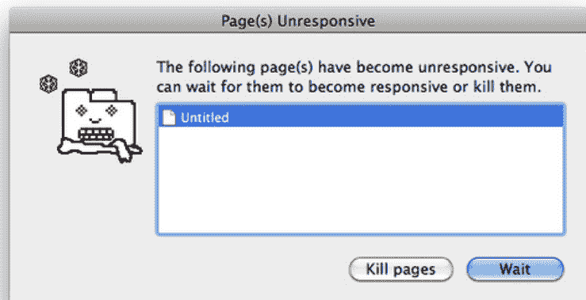

14-1. 无响应的脚本

要开始使用，请使用 `Worker()` 构造函数创建一个新的 worker：

```javascript
const worker = new Worker('task.js');
```

## Chrome 支持

> 在编写本文时，Chrome 浏览器不允许你像这样从本地文件运行 workers。解决办法是使用 `--allow-file-access-from-files` 标志启动 Chrome，或者简单地为此示例使用不同的浏览器。

> 如果你决定使用 `--allow-file-access-from-files` 标志，请确保仅在开发中使用它，而不是用于日常浏览。

此函数接受另一个 JavaScript 文件名作为参数。在示例中，这是一个名为 `task.js` 的文件。如果该文件存在，它将被异步下载。只有当文件完全下载完成后，worker 才会启动。如果文件不存在，则会抛出错误。

赋值给构造函数的变量（在示例中为 `worker`）现在可以用于引用主程序中的 worker。在 worker 脚本（`task.js`）中，使用关键字 `self` 来指代 worker。

Web workers 使用消息的概念在主脚本和 worker 脚本之间进行通信。`postMessage()` 方法可用于发送消息并启动 worker 工作。该方法的参数可以将任何数据发送到 web worker。要向 worker 发送消息，请在主脚本中使用以下代码：

```javascript
worker.postMessage('Hello');
```

要从 worker 发送消息，在 worker 脚本中使用以下代码：

```javascript
self.postMessage('Finished');
```

当发送消息时，会触发消息事件，因此可以使用事件监听器进行处理。随消息发送的数据存储在传递给回调函数的事件对象的 `data` 属性中。以下示例将把 worker 返回的数据打印到控制台：

```javascript
worker.addEventListener('message', (event) => {
  console.log(event.data);
});
```

当 worker 完成任务后，可以使用主脚本中的 `terminate()` 方法停止它：

```javascript
worker.terminate();
```

或者在 worker 内部使用 `close()` 方法：

```javascript
self.close();
```

# 一个因数分解示例

在第 10 章中，我们创建了一个寻找给定数字因数的函数。它运行良好，但寻找大数字的因数可能需要很长时间。如果在网站中使用，它会停止其他代码的运行。为了演示这一点，请将以下代码保存为名为 `factors.html` 文件：

```html
<!doctype html>
<html lang='en'>
<head>
  <meta charset='utf-8'>
  <title>因数分解器</title>
</head>
<body>
  <button id='rainbow'>改变颜色</button>
  <form>
    <label for='number'>输入一个数字进行因数分解：</label>
    <input id='number' type='number' name='number' min='1' value='20'>
    <button type='submit'>提交</button>
  </form>
  <div id='output'></div>
  <script src='main.js'></script>
</body>
</html>
```

此网页有一个可以更改页面背景颜色的按钮，以及可以输入数字的输入字段。因数将显示在 `output` div 内部。要使此工作，请在 `factors.html` 相同的目录下创建一个包含以下代码的 `main.js` 文件：

```javascript
const btn = document.getElementById('rainbow');
const rainbow = ['red','orange','green','blue','purple','violet'];

function change() {
  document.body.style.background = rainbow[Math.floor(Math.random() * rainbow.length)];
}
btn.addEventListener('click', change);
```

这段第一段代码在第 10 章中介绍过，它使用事件监听器在点击按钮时更改背景颜色。我们还需要对表单输入的数字进行因数分解，因此在 `main.js` 的末尾添加此代码：

```javascript
function factorize(event) {
  // 防止表单被提交
  event.preventDefault();
  const number = Number(form.number.value);
  document.getElementById('output').innerText = factorsOf(number);
}

function factorsOf(n) {
  if (isNaN(n)) {
    throw new RangeError('参数错误：值必须是整数');
  }
  if (n < 0) {
    throw new RangeError('参数错误：数字必须为正数');
  }
  if (!Number.isInteger(n)) {
    throw new RangeError('参数错误：数字必须为整数');
  }
  const factors = [];
  for (let i=1, max = Math.sqrt(n); i <= max; i++) {
    if (n%i === 0) {
      factors.push(i, n/i);
    }
  }
  return factors.sort((a,b) => a - b);
}

const form = document.forms[0];
form.addEventListener('submit', factorize, false);
```

这段代码使用了第 10 章相同的 `factorsOf` 函数并为表单添加了提交监听器。当提交表单时，它将找到输入字段数字的因数，并将结果放入 `output` div 中。对于某些大数字运行良好，如下截图所示。

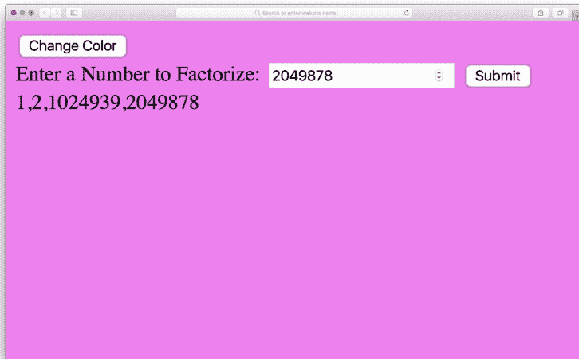

14-2. 我们的因数分解器

但如果你输入较大的数字（18-20 位），处理答案需要很长时间，浏览器会显示警告。

更糟糕的是，在计算因数期间无法点击更改颜色按钮——整个程序会被锁定直到操作完成。（如果你鲁莽地尝试了一个巨大的数字并现在面对无响应的网页，你可以简单地关闭标签并重新打开。）

好消息是我们可以使用 web workers 来解决这个问题。

# 运行此示例

包含 worker 代码的文件预期托管在服务器上。这是最佳选择，但如果你想在本地运行示例，需要在浏览器中关闭同源策略⁶。

> 6: https://developer.mozilla.org/en-US/docs/Same-origin-policy

首先，我们创建一个新文件 `factors.js` 并将其保存在与 `main.js` 相同的文件夹中。然后从 `main.js` 文件中移除 `factorsOf()` 函数并将其添加到我们新的 `factors.js` 文件中。稍后我们会向该文件添加更多内容，首先我们需要编辑 `main.js` 文件中的 `factorize()` 函数，使其看起来如下：

```javascript
function factorize(event) {
  // 防止表单被提交
  event.preventDefault();
  const number = Number(form.number.value);
  document.getElementById('output').innerHTML = '<p>这可能需要一些时间 ...</p>';
}

if(window.Worker) {
  const worker = new Worker('factors.js');
  worker.postMessage(number);
  worker.addEventListener('message', (event) => {
    document.getElementById('output').innerHTML = event.data;
  }, false);
}
```

```javascript
self.addEventListener('message', (event) => {
  const factors = String(factorsOf(Number(event.data)));
  self.postMessage(factors);
  self.close();
}, false);
```

当 worker 接收到消息时会触发此代码，通常发生在表单提交时要分解的数字存储在 `event.data` 属性中。我们使用 `factorsOf()` 函数来查找数字的因数，将其转换为字符串并发送一条包含答案的消息。然后，我们使用 `close()` 方法终止 worker，因为它的工作已经完成。

现在如果我们测试这段代码，分解一个长数字仍然需要很长时间，但页面不会冻结。你可以在后台计算因数的同时继续更改背景颜色。

## 共享 Web Workers (Shared Web Workers)

我们目前为止看到的示例被称为专用 Web Workers（dedicated web workers）。它们与加载 worker 的脚本相关联，无法被另一个脚本使用。你还可以创建共享 Web Workers（shared web workers），它们允许相同域下的许多不同脚本访问同一个 worker 对象。

Web Workers 允许在单独线程中执行计算密集型操作，这意味着程序的流不会受到中断，应用程序也不会冻结或挂起。它们是一个非常有用的功能，有助于在执行复杂操作时保持网站的响应能力。

## Service Workers

Service Worker API 允许 worker 脚本在后台运行，其额外优点是能够拦截网络请求。这允许你在网络离线时采取备选操作，并有效地创建类似应用的离线体验。Service workers 还允许访问推送通知和后台同步。Service workers 需要在 HTTPS 上的安全网络上运行，以避免任何恶意代码劫持网络请求。

在 Mozilla 维护的《The Service Worker Cookbook》中，有大量使用 Service Worker API 的不同示例。

## Websockets

正如我们在上一章中看到的，Web 上的主要通信方式一直是 HTTP 协议。它使用请求和响应系统来回发送数据。这种通信方式的一个问题是，只有在发送请求时才能收到响应。但如果响应稍后到达呢？例如，想象一个聊天应用程序。你向某人发送消息并等待回复，但除非你发送另一个请求，否则你无法获得回复……只有当他们在你发送请求时发送响应，你才能收到回复。你要等多久才发送下一个请求呢？这部分通过 Ajax 和一种称为“轮询”（polling）的方法得到了解决，即定期发送请求以查看是否有响应。

Websocket 是一种新协议，允许与服务器进行双向通信——也称为推送消息（push messaging）。这意味着连接保持开启状态，一旦收到响应，就会将其“推”给客户端。

为了看到其实效果，我们将创建一个微型消息应用程序，它使用 websocket 协议与 Echo 服务器通信。该服务器会发送一个与收到的消息完全相同的响应。

创建一个名为 `websocket.html` 的文件并添加以下 HTML 代码：

```html
<!doctype html>
<html lang='en'>
<head>
<meta charset='utf-8'>
<title>Websocket Example</title>
</head>
<body>
<form>
  <label for='message'>Enter a Message:</label>
  <input type='text' name='message'>
  <button type='submit'>Submit</button>
</form>
<div id='output'></div>
<script src='main.js'></script>
</body>
</html>
```

> 7: https://serviceworker.rs

除了普通的标准 HTML 元素外，它包含一个用于输入和提交短消息的表单以及一个空的输出 `<div>` 元素，消息和响应将显示在这里。


接下来，我们需要将 JavaScript 代码放在名为 `main.js` 的文件中：

```javascript
const URL = 'wss://echo.websocket.org/';
const outputDiv = document.getElementById('output');
const form = document.forms[0];
const connection = new WebSocket(URL);
```

这设置了一些变量来存储信息。第一个是 `URL`，即我们将用于连接 websocket 的 URL。注意它以 `wss://` 开头而不是 `https://`。这是 websockets 使用的安全协议，而不是 HTTP。该站点是托管在 `websocket.org` 的 Echo 服务器。它接受消息然后返回相同的消息（就像回声一样）。

下一个变量是 `outputDiv`，它用于存储指向显示消息的 `<div>` 元素的引用。`form` 变量也用于存储表单元素的引用。

最后，我们创建了一个 `connection` 变量，指向我们的 websocket 对象。它是使用构造函数创建的，并以 URL 作为参数。我们将在整个程序中使用 `connection` 变量来引用 websocket 连接。

当代码 `new WebSocket(URL)` 运行时，它会创建一个 WebSocket 对象的实例并尝试连接到该 URL。当成功时，它会触发名为“open”的事件。这是 WebSocket 对象可以发射的多个事件之一。要执行此操作，我们可以向 `main.js` 中添加一个事件处理器：

```javascript
connection.addEventListener('open', () => {
  output('CONNECTED');
}, false);
```

它的工作方式与我们之前看到的事件处理器相同，并且在连接对象上被调用。在这种情况下，我们调用了带有字符串“CONNECTED”的 `output()` 函数。

```javascript
function output(message) {
  const para = document.createElement('p');
  para.innerHTML = message;
  outputDiv.appendChild(para);
}
```

```javascript
form.addEventListener('submit', (event) => {
  event.preventDefault();
  const text = form.message.value;
  output(`SENT: ${text}`);
  connection.send(text);
});
```

```javascript
connection.addEventListener('message', (event) => {
  output(`RESPONSE: ${event.data}`);
}, false);
```

# HTML5 APIs 559

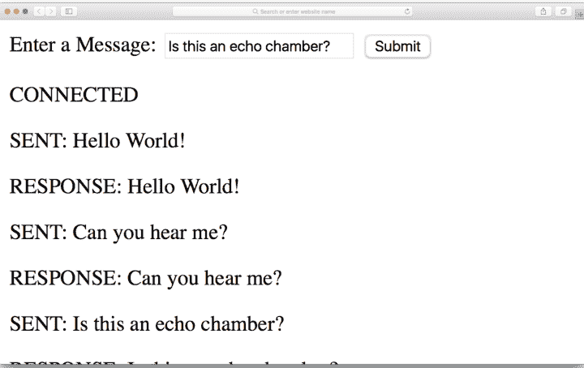

14-3. Websocket 消息

连接对象响应的几个值得知道的事件：`close` 事件在连接关闭时发生，可以使用 `close()` 方法实现。`error` 事件在连接发生任何类型的错误时触发。关于错误的信息可以通过事件对象的 `data` 属性进行访问。

这些事件的典型事件监听器可能如下：

```javascript
connection.addEventListener('close', () => {
  output('DISCONNECTED');
}, false);

connection.addEventListener('error', (event) => {
  output(`<span style='color: red;'>ERROR: ${event.data}</span>`);
}, false);
```

Websockets 是一项令人兴奋的技术，你可以看到许多关于如何使用它们的示例，并在 websocket.org^8 了解更多关于它的信息。

## 通知 (Notifications)

Notification API 允许你使用系统通知显示消息。这通常是屏幕角落的一个弹窗，但它会根据操作系统的不同而变化。使用系统通知的一个优势是，即使调用它们的网页不是当前标签页，它们仍然会显示。

在发送通知之前，你可以获取用户授予的权限。这可以通过 `Notification` 全局对象的 `requestPermission()` 方法来实现。若要进行尝试，请在浏览器中访问任何网站（例如 `https://sitepoint.com`），并在控制台中输入以下代码：

```javascript
if (window.Notification) {
  Notification.requestPermission();
}
```

这将请求权限，类似于下方的截图：


14-4. 通知权限

这会返回一个 promise，其中包含 `Notification` 对象的 `permission` 属性，可以将其设置为 "granted"（允许）或 "denied"（拒绝）。如果是 granted，你可以使用构造函数创建一个新通知，如下：

8. https://www.websocket.org/demos.html

## HTML5 APIs 561

```javascript
if (window.Notification) {
  Notification.requestPermission()
    .then((permission) => {
      if (Notification.permission === 'granted') {
        new Notification('Hello JavaScript!');
      }
    });
}
```

这将产生一个标题为 "Hello JavaScript!" 的系统通知。

构造函数的第一个参数是通知标题，是必选的。该函数还接受第二个参数，这是一个选项对象。这些包括 `body`（用于指定你想在标题下方显示的任何文本）和 `icon`（你可以在其中指定图像的链接，该图像将作为通知的一部分显示）：

```javascript
const notification = new Notification('JavaScript: Novice to Ninja', {
  body: 'The new book from SitePoint',
  icon: 'sitepointlogo.png'
});
```

根据你的浏览器和操作系统系统，某些通知会在短时间后自动关闭，而某些将一直留在屏幕上，直到用户点击它们。你可以使用 `close()` 方法通过程序方式关闭通知：

```javascript
notification.close();
```

通知实例有许多它可以响应的事件，包括 `click`（当用户点击它时）、`show`（当通知出现时）和 `close`（当通知关闭时）。

例如，你可以使用以下代码在用户点击通知时打开一个新窗口：

```javascript
notification.addEventListener('click', () => {
  window.open('https://sitepoint.com')
}, false);
```

## 多媒体 (Multimedia)

在 HTML5 之前，在浏览器中显示音频和视频是众所周知的困难的，通常必须使用如 Flash 之类的插件。HTML5 引入了 `<audio>` 和 `<video>` 标签向网页中插入音频和视频片段。它还引入了 Media API 用于使用 JavaScript 控制片段的播放。

可以使用 `<audio>` 标签将音频片段插入页面，并使用 `src` 属性指向音频文件：

```html
<audio src='song.mp3' controls>
  您的浏览器不支持音频元素。
</audio>
```

可以使用 `<video>` 标签插入视频片段，并使用 `src` 属性指向视频文件：

```html
<video src='http://movie.mp4' controls>
  您的浏览器不支持视频元素。
</video>
```

`<audio>` 或 `<video>` 标签内部的任何内容只有在浏览器不支持它们时才会显示；因此，它可以用于向不支持这些特性的旧浏览器用户显示消息。可以添加 `controls` 属性（不带任何值），它将显示浏览器的原生控件，如播放、暂停和音量控制，如下方的截图所示。


可以使用我们在第 6 章中看到的 DOM 方法之一通过变量来引用音频或视频元素：

```javascript
const video = document.getElementsByTagName('video')[0];
```

音频和视频元素有许多属性和方法来控制片段的播放。

`play()` 方法将从片段的当前位置开始播放：

```javascript
video.play();
```

`pause()` 方法将片段在当前位置暂停：

```javascript
video.pause();
```

`volume` 属性是一个数字，可以设置音频音量：

```javascript
video.volume = 0.9;
```

`muted` 属性是一个布尔值，可以对音频静音：

```javascript
video.muted = true;
```

`currentTime` 属性是一个数值，可以跳转到片段的另一个部分：

```javascript
video.currentTime += 10; // 向后跳转10秒
```

`playbackRate` 属性用于通过更改其值来快进或后退片段。值为 1 时按正常速度播放：

```javascript
video.playbackRate = 2; // 快进
```

`loop` 属性是一个布尔值，可以设置为 true 以循环：

```javascript
video.loop = true;
```

`duration` 属性是一个数字，可以查看片段有多长：

```javascript
video.duration;
```

## 检查属性可用 (Checking Properties Are Available)

某些属性只有在浏览器接收到所有元数据后可用。因此，为了确保获取返回值，你应该使用事件监听器，如下：

```javascript
video.addEventListener('loadedmetadata', () => {
  console.log(video.duration);
});
```

音频和视频元素有许多在发生时触发的事件，包括：

- `play` 事件：片段开始播放时触发。
- `pause` 事件：暂停时触发。
- `volumechange` 事件：音量改变时触发。
- `loadedmetadata` 事件：元数据加载完成时触发。

这些事件允许你响应用户与视频的任何交互。例如，可以添加以下监听器来检查视频是否暂停：

```javascript
video.addEventListener('pause', () => {
  console.log('暂停');
});
```

音频和视频元素为浏览器带来了原生多媒体支持，API 让开发者完全控制音频轨道和视频。

W3C 有所有可用属性、方法和事件的完整列表：

9. https://www.w3.org/2010/05/mediaevents.html

## 其他 APIs

API 列表不断增长，包括访问设备摄像头、上传文件、电池状态、处理推送通知、构建拖放功能、使用 WebGL 创建 3D 效果等！可以在 Mozilla 开发者网络找到完整的 HTML5 API 列表。

## 隐私担忧 (Privacy Concerns)

在考虑 HTML5 API 时，需要考虑一些安全和隐私问题——特别是那些使用时间不长的前沿 API。例如，人们担心环境光 API 可能导致窃取数据，且电池 API 已由于用户分析的担忧被 Apple 和 Mozilla 放弃。

## 使用 Canvas 绘图

canvas 元素的引入是为了允许使用 JavaScript 在网页上实时绘制图形。canvas 元素是网页上的一个矩形元素。它的坐标系从左上角的 (0,0) 开始。要在页面上添加 canvas 元素，使用 `<canvas>` 标签并指定高度和宽度。放在标签内的任何内容仅在不支持 canvas 元素时才会显示。

```html
<canvas id='canvas' width='400' height='400'>
  对不起，您的浏览器不支持 canvas 元素。
</canvas>
```

10. https://developer.mozilla.org/en-US/docs/WebAPI
11. https://www.theregister.co.uk/2017/04/20/ambient_light_sensors_can_steal_data_says_security_researcher/
12. http://www.theregister.co.uk/2016/11/07/apple_mozilla_kill_api_to_battery_snitching/

# HTML5 APIs 567

现在可以使用 `document.getElementById(id)` 方法在 JavaScript 程序中访问此 canvas 了：

```javascript
const canvasElement = document.getElementById('canvas');
```

下一步是访问 canvas 的上下文（context）。这是一个包含所有用于在 canvas 上绘图的方法的对象。我们将使用 2-D 上下文，但也可以使用 WebGL 渲染 3-D 内容。

使用 `getContext()` 方法来访问上下文：

```javascript
const context = canvasElement.getContext('2d');
```

现在我们拥有了上下文的引用，可以访问它的方法并在 canvas 上进行绘图。通过分别为 `fillStyle` 和 `strokeStyle` 属性分配 CSS 颜色，可以更改填充颜色和描边颜色：

```javascript
context.fillStyle = "#000cc"; // 蓝色填充颜色
context.strokeStyle = "#ccc"; // 灰色描边颜色
```

在更改它们之前，这些颜色将被用于在 canvas 上绘制的所有内容。

`lineWidth` 属性可以设置在 canvas 上绘制的任何线条描边的宽度。它的默认值为一个像素，并在更改之前保持不变：

```javascript
context.lineWidth = 4;
```

`fillRect()` 方法可以绘制一个填充的矩形。前两个参数是左上角的坐标，第三个参数是宽度，最后一个参数是高度。以下代码会在 canvas 的左上角坐标 (10,10) 处创建一个宽为 100 像素、高为 50 像素的填充矩形：

```javascript
context.fillRect(10, 10, 100, 50);
```

`strokeRect()` 方法的工作方式相同，但产生的是一个不填充的矩形。这会在上一个矩形下方绘制一个矩形的轮廓：

```javascript
context.strokeRect(10, 100, 100, 50);
```

可以使用 `moveTo()` 和 `lineTo()` 方法绘制直线。这些方法可以结合使用来生成路径。在调用 `stroke()` 方法之前，实际上并不会在 canvas 上绘制任何内容。接下来的示例将通过移动到坐标 (130,50)，绘制一条长度为 30 像素的水平线，最后移动到该线的中间并绘制一条长度为 40 像素的垂直线，从而在 canvas 上绘制一个粗的红色 T 形：

```javascript
context.beginPath();
context.moveTo(130, 50);
context.lineTo(180, 50);
context.moveTo(155, 50);
context.lineTo(155, 90);
context.strokeStyle = '#c00';
context.lineWidth = 15;
context.stroke();
```


`arc()` 方法可以从特定点绘制给定半径的弧。前两个参数是弧的中心坐标；下一个参数是半径，接着是起始角度，然后是结束角度（注意这些是以弧度衡量的）。最后一个参数是一个布尔值，表示是否应该逆时针绘制弧。接下来的示例将在中心 (200,200) 绘制一个半径为 30 像素的黄色圆，因为 `Math.PI * 2` 代表一周：

```javascript
context.beginPath();
context.arc(200, 200, 30, 0, Math.PI * 2, false);
context.strokeStyle = '#ff00';
context.lineWidth = 4;
context.stroke();
```

`fillText()` 方法用于在 canvas 上写入文本。第一个参数是要显示的的文本，接下来的两个参数分别是 x 和 y 坐标。`font` 属性可以设置所使用的字体样式，否则样式将继承自 canvas 元素的 CSS 设置（注意，在使用 `fillText()` 方法绘制文本之前需要对其进行更改）。接下来的示例将在坐标 (20,50) 处用绿色绘制“Hello”，如下所示：

```javascript
context.fillStyle = '#0c0'; // 蓝色/绿色填充颜色
context.font = 'bold 26px sans-serif';
context.fillText('Hello', 20, 200);
```

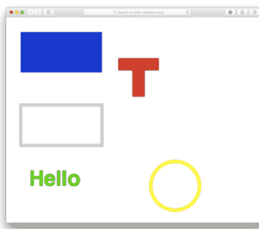

## 14-6. 在 canvas 上绘图

13. https://github.com/Modernizr/Modernizr/wiki/HTML5-Cross-Browser-Polyfills

# Quiz Ninja 项目

我们将使用 Web Storage API 来存储游戏的高分。即使在浏览器关闭后，它也会存储在本地，因此玩家可以保留他们的最佳尝试记录并尝试超越它。为了实现这一点，我们首先在页头中添加一个额外的 `<div>` 元素来存储高分。将 `index.html` 中的 `<header>` 元素更改为如下：

```html
<header>
  <div id="timer">Time: 0</div>
  <div id="highScore">High Score: 0</div>
  <h1>Quiz Ninja!</h1>
</header>
```

```javascript
function highScore() {
  let highScore = localStorage.getItem('highScore') || 0;
  if (score > highScore) {
    localStorage.setItem('highScore', score);
    document.getElementById('highScore').innerHTML = score;
  }
}
```

现在我们拥有了上下文的引用，可以访问它的方法并在 canvas 上进行绘图。通过分别为 `fillStyle` 和 `strokeStyle` 属性分配 CSS 颜色，可以更改填充颜色和描边颜色：

```javascript
context.fillStyle = "#000cc"; // 蓝色填充颜色
context.strokeStyle = "#ccc"; // 灰色描边颜色
```

在更改它们之前，这些颜色将被用于在 canvas 上绘制的所有内容。

`lineWidth` 属性可以设置在 canvas 上绘制的任何线条描边的宽度。它的默认值为一个像素，并在更改之前保持不变：

```javascript
context.lineWidth = 4;
```

`fillRect()` 方法可以绘制一个填充的矩形。前两个参数是左上角的坐标，第三个参数是宽度，最后一个参数是高度。以下代码会在 canvas 的左上角坐标 (10,10) 处创建一个宽为 100 像素、高为 50 像素的填充矩形：

```javascript
context.fillRect(10,10,100,50);
```

`strokeRect()` 方法的工作方式相同，但产生的是一个不填充的矩形。这会在上一个矩形下方绘制一个矩形的轮廓：

```javascript
context.strokeRect(10,100,100,50);
```

可以使用 `moveTo()` 和 `lineTo()` 方法绘制直线。这些方法可以结合使用来生成路径。在调用 `stroke()` 方法之前，实际上并不会在 canvas 上绘制任何内容。接下来的示例将通过移动到坐标 (150,50)，绘制一条长度为 30 像素的水平线，最后移动到该线的中间并绘制一条长度为 40 像素的垂直线，从而在 canvas 上绘制一个粗的红色 T 形：

```javascript
context.beginPath();
context.moveTo(130, 50);
context.lineTo(180, 50);
context.moveTo(155, 50);
context.lineTo(155, 90);
context.strokeStyle = '#c00';
context.lineWidth = 15;
context.stroke();
```

`arc()` 方法可以从特定点绘制给定半径的弧。前两个参数是弧的中心坐标；下一个参数是半径，接着是起始角度，然后是结束角度（注意这些是以弧度衡量的）。最后一个参数是一个布尔值，表示是否应该逆时针绘制弧。接下来的示例将在中心 (200,200) 绘制一个半径为 30 像素的黄色圆，因为 `Math.PI * 2` 代表一周：

```javascript
context.beginPath();
context.arc(200, 200, 30, 0, Math.PI * 2, false);
context.strokeStyle = '#ff00';
context.lineWidth = 4;
context.stroke();
```

`fillText()` 方法用于在 canvas 上写入文本。第一个参数是要显示的文本，接下来的两个参数分别是 x 和 y 坐标。`font` 属性可以设置所使用的字体样式，否则样式将继承自 canvas 元素的 CSS 设置（注意，在使用 `fillText()` 方法绘制文本之前需要对其进行更改）。接下来的示例将在坐标 (20,50) 处用绿色绘制“Hello”，如下所示：

```javascript
context.fillStyle = '#0c0'; // 蓝色/绿色填充颜色
context.font = 'bold 26px sans-serif';
context.fillText('Hello', 20, 200);
```


## 14-6. 在 canvas 上绘图

13. https://github.com/Modernizr/Modernizr/wiki/HTML5-Cross-Browser-Polyfills

# HTML5 APIs 57

HTML5 是超标记语言的最新版本。它涵盖了多种技术，包括可以使用 JavaScript 访问的多个 API。

- data 属性有助于将自定义数据嵌入网页中，然后可以使用 JavaScript 增强用户体验。
- Web Storage API 允许以类似于 Cookie 的方式将键值对存储在用户的设备上，但没有相同的限制。
- Geolocation API 允许你在用户给予许可的情况下访问用户设备的地理坐标。
- Web Worker API 可用于在后台执行计算密集型任务，这有助于避免网站变得无响应。
- Websockets 是一种用于在互联网上通信的新型协议，实现实时双向通信。
- Notification API 允许你在用户的系统上显示通知。
- `<audio>` 和 `<video>` 元素可以用于在网页中嵌入音频轨道和视频片段。它们还拥有 Media API，可以帮助 JavaScript 控制播放。
- canvas 元素可以用于 JavaScript 实时在网页上动态绘制几何形状、文本和图像。
- shim 或 polyfill（垫丁）是为旧浏览器添加缺失功能支持的代码。

## 章节总结

14. https://codepen.io/daz41/pen/Zyxd

# 第 15 章

## 现代 JavaScript 开发

随着你构建越来越复杂的 JavaScript 项目，你会发现你使用的代码量增加到几百甚至几千行。如果没有某种组织方式，这可能会变得非常困难。第一步是将代码拆分成单独的文件，但这引入了自己的新问题，例如如何在网页中包含所有文件，以及将哪些代码放在哪些文件中。事实上，你如何确保一个文件可以访问另一个文件中的代码？

正如现实中的忍者有很多许多巧的武器，如双节和手里镖星，JavaScript 忍者也可以使用许多酷的工具来帮助组织代码并使其运行得更高效。在本章中，我们将查看用于改进代码质量的各种框架和工具。反过来，这将使代码更有组织、更容易维护，并促进重用。我们还将查看如何让你的应用程序准备好投入生产。

在本章中，我们将涵盖以下主题：

- 库（Libraries）
- 模块化 JavaScript
- MVC 框架
- 包管理器
- 通过代码压缩优化您的代码
- 使用 Webpack 的构建流程

我们的项目——我们将把代码拆分为模块化架构，并为部署做好准备。

## 库

JavaScript 库是一段代码，提供了几个方法，可以更轻松地完成常见任务。JavaScript 是一种极其灵活的语言，可以完成大多数编程任务——但并非所有的任务都像想象中那么简单。库会将功能抽象为更易使用的函数和方法。然后可以使用这些方法来完成常见任务，而无需编写大量的重复代码。

## DOM 操作示例

库如何能够节省时间的一个很好的例子是 DOM 操作。DOM API 提供了操作 DOM 所需的所有工具，但某些操作非常冗长，实现最基础的任务可能也需要几行代码。

例如，如果我们想为由变量 `para` 引用的段落元素添加一个类，然后在末尾添加另一个段落，我们可以使用以下代码：

```javascript
para.classList.add('important');
const newPara = document.createElement('p');
newPara.textContent = 'Another Paragraph';
para.appendChild(newPara);
```

然而，通过使用 jQuery 库，我们只需要一行代码就能实现同样：

```javascript
$($para).addClass('important').append('<p>Another Paragraph</p>');
```

这显示了使用库如何减少你需要编写的代码量，同时也让常见任务变得更容易实现。像 jQuery 这样流行的库通常经过了良好的测试，并帮助解决旧浏览器中的边缘情况和 Bug，而这些问题用你自己的代码是很难处理的。它们还统一了在不同浏览器中实现相同功能的写法。例如，添加事件监听器在某些旧版浏览器中使用了不同的语法，但你可以使用 jQuery 中的单个方法，它会根据浏览器选择相应的实现。

## jQuery

jQuery 是目前最流行的 JavaScript 库。它被用于大量的商业网站，并有一个插件系统，可以方便地扩展和构建常见的网页元素，例如灯箱效果或轮播图组件。

jQuery 发布于 2006 年，最初是一个 DOM 操作库。从那以后它变得庞得多，现在提供了数百种方法用于选择节点、遍历 DOM、动画效果、Ajax 和事件。它还有属于自己的测试库：Unit。

使用 jQuery 的一大优势是它对旧浏览器的支持，特别是 Internet Explorer。如果你发现自己必须支持这些浏览器，那么 jQuery 就能为你节省大量的时间和烦恼。例如，

- 1. qunitjs.com/

## 现代 JavaScript 开发

`classList` 在旧版本的 Internet Explorer 中不受支持，因此你必须编写自己的 polyfill 代码来修复它。如果你使用 jQuery，只需要使用 `addClass()` 方法，它就能确保代码在大多数浏览器中运行。

jQuery 是一个非常强大且完善的库，提供了大量的实用方法。它已经变得让许多在线教程都假设你正在使用 jQuery 而不仅仅是 JavaScript。你可以通过阅读 Earle Castleland 和 Craig Sharkie 编写的优秀书籍《jQuery: Novice to Ninja: New Kicks and Tricks》来了解更多关于 jQuery 的知识。


> $`符号
> jQuery 库使用 `$` 作为全局 jQuery 对象的方便别名，该对象包含了所有的 jQuery 方法。这防止了全局作用域被 jQuery 的任何方法污染。`$` 符号已经成为 jQuery 的代义词，你可以放心地认为任何提到它的地方都暗示着使用了 jQuery。

## Underscore & Lodash

Underscore³ 和 Lodash⁴ 是非常相似的函数库，为语言提供了额外的功能。它们都通过使用 `_` 命名空间提供了大量的工具函数（这正是这些库名称的由来——`_` 字符通常被称为 underscore 或 lodash）。许多 JavaScript 库都将其中之一列为核心依赖。

在你的项目中使用这些库之一是值得考虑的，因为这将使你能够访问大量经过良好测试的工具函数，这些函数在项目中通常是需要的，而且专门针对第 11 章中讨论的函数式编程风格。虽然其中一些函数已添加到最近的 ECMAScript 版本中，但仍有大量函数可以帮助你节省编写自己实现和有效重复造轮子的时间。通过查看一些作用于数组的函数可以来看很好的例子。这些函数提供了一些非常实用的功能，某些人可能会认为这些功能在语言本身是严重缺失的：

```javascript
// 扁平化数组
_.flatten([1, 2, [3], [4]], 5]);
// << [1, 2, [3, [4]], 5]

// 返回数组的最后一个元素
_.last([1, 2, 3]);
// << 3

// 随机洗牌数组
_.shuffle([1, 2, 3]);
// << [2, 3, 1]
```


这两个库非常相似。事实上，Lodash 最初是作为 Underscore 的分支（fork）开始运行的。从那以后，它们分化了，但仍有许多相似之处。Lodash 可以被视为 Underscore 的“超集”，因为它不仅做了它做的事，还添加了额外的功能。

- 2. https://www.sitepoint.com/premium/books/jquery-novice-to-ninja-new-kicks-and-tricks
- 3. http://underscore.org/
- 4. https://lodash.com

## 库的优缺点

利用库的一个大优势是它会被许多人使用。使用库意味着你可以确信它经过了彻底的测试。此外，还有在线文档和强大的社区在你遇到困难时准备提供帮助。

然而，使用库也有一些缺点。你需要包含库的代码以及你自己的代码。这增加了网站需要下载的代码量，在某些情况下可能会导致性能问题。坦率地说，一旦进行了服务器端优化（如 `gzip` 压缩），大多数现代库都相对较小，最大限度地减少了延迟问题。库的另一个问题是，它们可能无法按照你精确想要来实现功能。这可能不是一个问题，但有时你必须亲自动手，编写自己的函数来实现你寻找的功能。

使用库可能会让代码比使用原生 JavaScript（`vanilla JavaScript`）慢。这是因为库中抽象函数的代码行数通常比只用 JavaScript 编写直接实现要多，而后者通俗来说更“接近硬件”。这些差异几乎无法察觉，尽管在某些情况下，某些操作使用库是一个糟糕的选择。使用原生 JavaScript 可以比库快得多⁵。

关于是否使用库的争论是一个宏大的问题，可以追溯到编程之初，并且经久不衰。事实上，近年来出现了使用原生 JavaScript 的趋势。此外，`Vanilla JS`⁶ 像展示库一样展示原生 JavaScript，突显了许多任务可以用相似的代码量完成，且性能更好。自从 ES6 以来这现在是事实，因为某些库解决的问题已经在原生 JavaScript 中得到了修复。ES6 的快速接受和采用意味着对于某些功能使用库的理由减少了。尽管如此，某些函数和 API 的原生实现可能很且难以使用，并且缺乏对旧浏览器的支持。这意味着开发者将继续使用库作为提高生产力和一致性的工具。

你只需要查看任何专业制作的网站就能看到它使用了某种库。库通常是可以在合理的时间范围内完成项目的务实选择，特别是在大团队中工作时。它们在支持旧浏览器和解决特定器的 Bug 或特性，或者当性能不是最重要因素时（例如制作网站原型时）也非常有用。

## 何时使用库

使用库可能很有帮助，但你理应该质疑这是否值得付出额外的工作。你必须学习该库的符号，这可能与标准 JavaScript 相似，也可能完全不同。你使用的每个库都会增加下载的总文件大小，因此你需要评估这些额外开销是否值得。尽管如此，浏览器在第一次下载后会对其进行缓存，如果你使用 CDN，那么很有可能它已经存在浏览器的缓存中了。

此外，还应该考虑特定库的流行程度可能今天是云，明天是雨。过去最受欢迎的库中，有些已经失去了宠爱，甚至在几乎一夜之间停止了维护。如果你在大多数项目中都依赖于某个特定的库，这可能会导致问题。

许多库已经变得庞大，拥有试图尝试任何事情的大量方法。`jQuery` 就是一个例子。虽然它包含了大量有用的方法，但它提供了许多通常是不需要的特性。`jQuery` 的模块化结构意味着你可以模块仅包含你需要的部分。但如果你发现自己没有使用库提供的许多方法，那么你应该考虑使用更轻量级的替代方案，该方案只专注于解决一个问题（下文给出了一些建议）。如果你只使用少数方法，请完全避免使用库，而是直接使用原生 JavaScript。你可以将创建的有用函数封装在一个模块中，将其作为你个人的库。

## 寻找库

考虑使用库来让某些常见任务变得更容易确实是值得的。维基百科上的这个列表中有大量的 JavaScript 库，而 `MicroJS`⁸ 是一个高质量的小 JavaScript 库仓库，专注于特定任务，而 `just`⁹ 是一个不依赖任何其他函数或库、只执行一个任务的函数库。

- 7. https://en.wikipedia.org/wiki/List_of_JavaScript_libraries
- 8. http://microjs.com/
- 9. http://anguscroll.com/just/

## 现代 JavaScript 开发

注意不要依赖某个库而发现自己正在学习如何使用该库的方法，而不是语言本身。使用库不应该因为对 JavaScript 缺乏了解。相反，应该使用库通过更方便地完成常见任务来加速 JavaScript 开发。使用库有时会使你的代码变得更加草率。例如，很容易写出看起来简洁但效率极低的简短 `jQuery` 表达式。即使你使用了库，也要记住忍者对事物的运作原理应该保持好奇。事实上，阅读库的源代码是学习一些强大的 JavaScript 编程技巧极极方法。

## 模块化 JavaScript

模块是一个自包含的代码片段，提供了可以在其他文件和其他模块中使用的函数和方法。这有助于将代码组织在单独的、可重用的文件中，从而提高代码的可维护性。模块中的代码应该具有单一目的，并将具有不同功能的函数组合在一起。例如，你可能将任何用于 Ajax 的函数保留在它们自己的模块中。这可以用于任何需要 Ajax 的项目。保持代码的模块化有助于实现松散耦合和可交换性，这意味着你可以轻松地更换一个模块而不影响项目的其他部分。事实上，小型单目的模块与大型单体式库恰恰相反，因为它们允许开发者只使用需要的模块，避免任何代码浪费。模块还允许暴露公共 API，同时将实现细节隐藏在模块内部。

## 耦合

代码的耦合指的是代码元素或模块之间相互依赖的程度。如果一段代码依赖于另一代码才能运行，则称这两段代码是紧耦合的。这通常在一段代码对另一段代码进行硬编码引用并要求使用它时发生。这通常意味着对一段代码的更改将导致另一段代码的更改。相反，如果一段代码可以很容易地替换而不影响最终结果，则两段代码是松散耦合的。这通常通过引用替代模块的方法来实现。例如，你可能有两个模块可以简化连接到 `websocket` 的过程。这两个模块可能都会实现一个 `connect()` 方法，因此你的代码可以简单地引用 `connect()`，而不是显式地依赖于特定模块。这将允许你在两个模块之间切换，而无需更改任何底层代码。将代码保持尽可能的松散耦合被认为是一种良好的设计，因为它为代码系统的开发提供了最大的灵活性，因为不同的模块可以独立地用于各种不同的应用程序，而不是被限制在单个用例中。

### ES6 模块

在很一段时间内，JavaScript 不支持模块，但 ES6 终于添加了对模块的原生支持。它们允许你将代码部分保留在自包含文件中。

关于模块有几点重要的内容需要记住：

- 模块中的所有代码始终处于严格模式，不需要使用 `'use strict'`，并且没有方法退出这种模式。
- 模块有自己的全局作用域，因此在模块顶层创建的任何变量只能在该模块内部被访问。
- 模块顶层 `this` 的值是 `undefined`，而不是全局对象。
- 你不能在模块中使用 HTML 风格的注释（尽管这在现在的任何 JavaScript 程序中都不常见）。

一个 ES6 模块文件只是一个普通的 JavaScript 文件，但使用 `export` 关键字来指定要从模块提供的任何值或函数。

例如，一个简单的 Pi 模块将以下代码保存在 `pi.js` 中：

```javascript
export const PI = 3.1415926;
```

通过以下代码将其导入你的 JavaScript 文件：

```javascript
import { PI } from './pi.js';
```

这将允许你在 `main.js` 中使用变量 `PI`。

函数也可以从模块中导出。例如，我们可以为之前使用的统计函数创建一个库：

```javascript
function square(x) {
  return x * x;
}

function sum(array, callback) {
  if (callback) {
    array = array.map(callback);
  }
  return array.reduce((a, b) => a + b);
}
```

```javascript
function variance(array) {
  return sum(array, square) / array.length - square(mean(array));
}

function mean(array) {
  return sum(array) / array.length;
}

export {
  variance,
  mean
}
```

注意，在定义函数时使用 `export` 的替代方法是在函数定义后添加导出指令，如上面示例中 `variance()` 函数所示。

要将这些函数导入 `main.js` 文件，你需要添加此行代码：

```javascript
import { mean, variance } from './stats.js';
```

`mean()` 和 `variance()` 函数可以在 `main.js` 文件中使用。注意，`square()` 和 `sum()` 函数不可用，因为它们没有在模块中导出。这在实际上使它们成为了 `stats` 模块的私有函数。

你可以对从模块中导入的值或函数进行选择性导入。例如，如果你只想想要 `mean()` 函数，你可以使用以下行代码：

```javascript
import { mean } from './stats.js';
```

如果有很多值和函数需要导入，可以使用通配符符号 `*` 配合用于导入的值和函数的命名空间来导入模块中的所有内容，使用以下语法：

```javascript
import * as stats from './stats.js';
```

这将导入 `stats.js` 模块中的所有函数，并赋予它们一个名为 `stats` 的命名空间。因此，`mean` 函数可以这样使用：

```javascript
stats.mean([2, 6, 10]);
```

### 默认导出

**默认导出**指的是模块中的单个变量、函数或类，导入时不需要显式指定名称。默认导出的语法刻意设计得更易读，因为模块的设计初衷就是为了这样使用。

以下示例演示了如何对变量进行导出：

```javascript
const PI = 3.145926;
export default PI;
```

下一个示例演示了导出单个默认函数：

```javascript
function square(x) {
  return x * x;
}
export default square;
```

最后一个示例展示了如何将一个对象作为默认值导出：

```javascript
const stats = {
  square(x) {
    return x * x;
  },
  sum(array, callback) {
    if (callback) {
      array = array.map(callback);
    }
    return array.reduce((a, b) => a + b);
  },
  mean(array) {
    return this.sum(array) / array.length;
  },
  variance(array) {
    return this.sum(array, this.square) / array.length - this.square(this.mean(array));
  }
};
export default stats;
```

### 不要使用多一个默认导出

拥有多个默认导出会导致语法错误。

要导入这些默认导出，你可以使用以下代码：

```javascript
import PI from './pi.js';
import square from './square.js';
import stats from './stats.js';
```

默认导出与其他导出的区别在于，你不需要使用大括号，也不需要提及正在导入的值，这使得语句读起来更加优雅。

### 别名

赋予导入模块的别名不需要与其在实际模块中的名称一致。例如，你可以通过以下方式导入 `square` 函数：

```javascript
import sq from './square.js';
```

该函数将使用 `sq()` 而不是 `square()` 来调用：

```javascript
sq(8);
// 64
```

### Node.js 模块

Node.js 在 ES6 引入之前就已经实现了模块，并使用一种略有不同的符号，称为 Common JS 模块¹⁰。在编写时，要以一种优雅的方式合并这两种符号似乎很困难，尽管预计 Node.js 未来将以某种方式支持 ES6 模块。尽管如此，我预计在很长一段时间内，Node.js 教程将继续使用 Common JS 模式。

Common JS 模块在单独的文件创建，并使用 `module.exports` 方法使任何函数对其他文件可用，这类似于 ES6 模块。例如，我们可以在名为 `squareFunction.js` 的文件中使用以下代码创建一个用于平方数的模块：

```javascript
module.exports = x => x * x;
```

这仅仅是我们在章节较早看到的 `square()` 函数，它被写成匿名函数并赋值给 `module.exports`，就像赋值给变量一样。

- 10. http://wiki.commons.org/wiki/Modules/1.1

要使用该模块，需要在另一个 JS 文件中（或 Node REPL 中）对其进行引用。这是通过使用 `require()` 方法实现的。它接受包含模块的文件作为参数，并返回导出的函数：

```javascript
const square = require('./squareFunction');
```

模块中导出的函数现在赋值给变量 `square`，然后用通常的方式调用该函数：

```javascript
square(6);
// 36
```

## MVC 框架

模型-视图-控制器（MVC）是一种在服务端语言中使用了已久的设计模式。它是一种设计软件的常用方法，被 Ruby On Rails 和 Django 等服务端框架所使用。在最近几年中，它被用于 JavaScript 代码中，以便更容易组织大型 Web 应用程序。

MVC 将应用程序分为三个截然且独立的组件，这些组件相互相互作用：

- **模型（Models）**是实现创建、读取、更新和删除（称为 CRUD 任务）应用程序中特定信息功能的对象，以及处理任何其他相关逻辑和行为的逻辑。例如，在一个待办事项应用程序中，会有一个任务模型，提供访问所有任务信息（如名称、日期和已完成的任务）的方法。这些数据将存储在数据库或其他容器中。
- **视图（Views）**提供模型的视觉表示，显示所有相关信息。在 Web 应用程序中，这将是显示在网页上的 HTML。视图还提供了用户与应用程序交互的方法，通常通过表单。在一个待办事项应用程序中，视图将以 HTML 列表的形式显示任务，并带有复选框，用户可以点击复选框表示任务已完成。
- **控制器（Controllers）**通过在它们之间通信将模型和视图连接起来。它们响应事件（这些通常是用户的输入，例如向表单中输入某些数据），处理事件并更新视图。

### 快速示例

首先，创建一个名为 `MVC` 的文件夹，并将以下内容保存为 `index.html`：

```html
<!doctype html>
<html lang="en">
<head>
  <meta charset="utf-8">
  <title>MVC List</title>
</head>
<body>
  <form id="input">
    <label for="name">Name:</label>
    <input type="text" name="name" autofocus>
    <button type="submit">Submit</button>
  </form>
  <ul id="list"></ul>
  <script src="main.js"></script>
</body>
</html>
```

这是一个基础 HTML 页面，包含一个带有单个输入字段的表单。它还包含一个空的 `<ul>` 元素，用于放置列表项。现在我们需要创建 JavaScript 文件。在同一文件夹中创建一个名为 `main.js` 的文件。

在 JavaScript 中，模型通常由类表示。在这个示例中，我们将创建一个 `Item` 类，并使用构造函数来实例化一个带有 `name` 属性作为参数的对象。将此代码添加到 `main.js`：

```javascript
'use strict'
const form = document.forms[0];

class Item {
  constructor(name) {
    this.name = name;
  }
}
```

每个创建的新列表项都将是 `Item` 类的实例。

接下来创建一个控制器对象。它将负责为表单添加事件监听器，以便在用户添加项目时，创建一个新的模型实例并渲染更新后的视图。将以下代码添加到 `main.js`：


const controller = {

  watch(form) {

    form.addEventListener('submit', (event) => {

      event.preventDefault(); // 防止表单提交

      this.add(form.name.value);

    }, false);

  },

  add(name) {

    const item = new Item(name);

    view.render(item);

  }

};

```

之后，我们创建一个视图对象，包含一个 `render()` 方法。它用于产生显示实例名称（存储在模型中的名称）的 HTML 片段。使用 DOM API 方法动态插入列表。将以下代码添加到 `main.js` 文件：

```javascript

const view = {

  render(item) {

    const list = document.getElementById('list');

    const li = document.createElement('li');

    li.innerHTML = item.name;

    list.appendChild(li);

    // 重置输入字段

    form.name.value = '';

  }

};

// 初始化控制器

controller.watch(form);

```

最后，我们必须调用控制器的 `watch()` 方法。这会监控表单并检查它何时被提交。在 `main.js` 文件的末尾添加以下行：

```
controller.watch(form);
```

在浏览器中打开 `list.html`，并尝试向列表添加一些项目。它看起来应该像下面的截图所示。

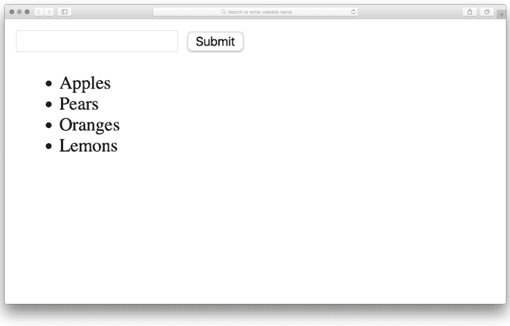

这只是 MVC 模式的一个微小且简单的示例，让你直观理解工作原理。在现实中，模型将包含更多的属性和方法。控制器也将包含更多用于编辑和删除模型实例的方法。可能还有更多的视图来显示模型的不同状态，并且需要使用健壮的代码，以便控制器能够监控视图中可能发生的变化。大多数 MVC 实现往往在在实现上更具通用性，并避免硬编码页面上更新哪些元素（例如示例中对列表 id 的引用）。尽管如此，我希望这个示例演示了如何将代码分离到 MVC 的三个独立组件中。

## 持久化

大多数 Web 应用程序需要某种形式的持久化来保存模型中持有的信息以维持状态。这可以使用我们在上一节中过的 Web Storage API 来完成。现实应用中使用的另一种选项是每当模型更改时，通过 Ajax 将模型的 JSON 表示发送到后端数据库。

## MV* 框架

实现 MVC 架构可能需要大量代码，已经涌出了许多框架，它们可以为你处理大部分的设置代码。MVC 框架的主要特性之一是数据绑定，它是将模型和视图连接在一起的过程。因此，由于框架在后台为你处理了这些工作，就不需要大量的样板控制器代码。单向数据绑定是指模型的变化会自动导致视图更新。而双向数据绑定是指视图的变化会自动更新模型。

视图只是用 HTML 编写的 Web 页面，尽管通常会使用模板语言以便将动态数据插入到页面中（关于这些内容的将在后续章节中进行详细介绍）：

- Aurelia11 是一个使用 ES6 的现代框架，侧重于让你编写动态 Web 应用程序，同时将实现细节保留在后台。
- Angular12 是 Google 开发的一个强大框架，使创建动态应用程序变得更容易。这是通过使用自定义的 ng-attributes 扩展 HTML 语言来实现。
- Ember¹³ 是一个旨在让构建大型 Web 应用程序更容易的框架。它通过使用通用约定来避免大量的设置代码，但如果你不遵循这些约定，可能会变得更加困难。

## 模板

许多 MVC 框架使用模板语言将动态数据插入页面。模板可以用 HTML 或另一种语言（如 markdown）编写，这些语言可以编译成 HTML。它们可以是整个 Web 页面，但通常只是部分——页面的片段。这意味着应用程序可以更新页面的一部分而无需向服务器发送请求，从而节省了一个 HTTP 请求。这通常通过动态将 HTML 片段插入到 DOM 中来实现。

模板语言允许 HTML 与 JavaScript 程序分离，使得维护变得更容易，因为它们不再是紧密耦合的。模板通常存储在单独的文件或它们自己的 script 标签中，因此如果需要进行更改，可以在一个地方进行复用和快速编辑。这也意味着避免了在文档中插入大型 HTML 字符串（这会对性能产生不利影响）。只需要指向包含模板的相关文件的引用即可。

模板语言通常有一种向 HTML 插入动态数据的机制。这些机制倾向于分为两派：将动态代码放在大括号内（“胡须”符号），或放在由 Embedded Ruby（ERB）流行的特殊的 `<% %>` 标签内部。

例如，Mustache、Pug 和 Handlebars 将使用此将变量名的值插入到标题标签中：

```
<h1>Hello {{ name }}</h1>
```

另一方面，EJS 将使用以下内容来实现相同的结果：

```
<h1>Hello <%= name %></h1>
```

模板语言还允许你向视图插入基本的编程逻辑，允许你根据条件显示不同的消息，或使用循环显示多段简单的代码。

例如，假设我们想要显示以下待办对象数组：

```javascript

const tasks = [

  { name: 'Get Milk' },

  { name: 'Go for a run' },

  { name: 'Finishing writing last chapter' },

  { name: 'Phone bank' },

  { name: 'Email Craig' }

]

```

Mustache 实现了无逻辑模板，不需要在 JavaScript 中显式地编写任何逻辑行；相反，它是从上下文中推断出来的。这就是它是这样遍历任务数组以显示任务列表的：

```html

<ul>

  {{#tasks}}

    <li>{{name}}</li>

  {{/tasks}}

</ul>

```

EJS 使用更显式的 JavaScript 编码来实现相同的结果。每行 JavaScript 代码都放在特殊的 `<% %>` 标签中。如果需要评估任何值，将它们放在里面：

```html

<ul>

  <% tasks.forEach(function(task) { %>

    <li><%= task.name %></li>

  <% }); %>

</ul>

```

有很多流行的模板可以选择，下面显示了其中一些最流行的选择：

- Handlebars
- Pug
- EJS
- Mustache
- Nunjucks

## Web Components

W3C 正在开发一种名为 Web Components¹⁹ 的标准，旨在扩展 HTML 并引入新功能，如标签、导入片段的能力和 shadow DOM。其想法是使用它来开发可以在应用程序中复用的模块化且自包含的组件。该提案目前是一个活动标准。Polymer Project 是一个尝试实现 Web 组件的 JavaScript 库。

> 13. http://emberjs.com/
> 14. http://handlebarsjs.com/
> 15. https://github.com/pug/pug
> 16. http://www.embeddedjs.com/
> 17. https://github.com/janl/mustache.js
> 18. http://mozilla.github.io/nunjucks/
> 19. https://www.webcomponents.org/introduction

它们还使用了组件的概念来表示视觉元素。这意味着你可以创建多个组件，这些组件不仅可以在其他项目中被重用，还可以组合成更大的组件。每个组件都是完全自包含的，所有的 HTML、CSS 和 JavaScript 均定义在组件内部。

React 和 Vue.js 之间的主要区别在于它们各自的实现方式。React 使用了一种名为 JSX 的自定义语言。这允许 HTML 和 JavaScript 以一种优雅且简洁的方式混合在一起。结果会被 JavaScript，然后用这些 JavaScript 来生成 HTML 视图。Vue.js 则使用类 HTML 模板，这些模板可以包含逻辑和指令，以及用于存储任何数据的 JavaScript 对象。

像 React 和 Vue.js 这样的视图库在 HTML 和 JavaScript 混合以及在 HTML 文件中使用内联 JS 和 CSS 方面引发了某种程度的争议。这直接违背了第 1 章中讨论过的“Web 三层”关注点分离原则，该原则在长期以来一直是开发的金标准标准和最佳实践。许多人现在开始觉得，这是一种过时的观念，它对于那些仅仅使用 JavaScript 为顶部添加功能的文档类网页是有效的。而 React 和 Vue.js 的设计初衷主要是构建动态 Web 应用，在这些应用中，表示与逻辑之间的界限变得模糊得多，因为你处理的是交互元素。许多 React 和 Vue.js 开发者采取立场是，与其交互组件相关的所有内容都应该封装在组件中：表示、标记和逻辑。不过，这个争论似乎还会持续很长时间！

React 和 Vue.js 并不是唯一的可用视图库。还有许多替代方案，目标都是管理视图层并保持数据同步，但方法略有不同。有些方案侧重于提高渲染速度，而另一些则使用不同的表示法。

如果你的用户界面开始变得复杂，或者对数据变化做出快速响应，视图库是值得考虑的。它们还可以更容易通过可重用的组件构建更模块化的用户界面，这些组件可以以不同的方式组合。有很多可用选择，值得尝试其中几个，以找到适合你需求的。

## 包管理器

随着模块在 JavaScript 中被更广泛的使用，需要工具来管理它们。包管理器允许开发者从中央仓库下载模块。一个包只是包含一个或多个代码文件的目录，以及一个 `package.json` 文件，该文件包含了关于包中代码的信息。开发者还可以通过将他们创建的任何模块上传到中央仓库供他人使用。包管理器可以轻松地安装、升级和删除项目中使用的任何包。它们还允许你管理不同版本的包。

当你开始使用更多模块时，你会发现某些模块依赖其他模块才能工作。这些被称为依赖。依赖管理是确保模块所需的所有依赖都满足的过程。一旦项目变得很大，手动执行可能会非常困难，因此包管理器也可以帮助管理依赖。

## npm

Node Package Manager（npm）在 Node.js 引入后不久开发，旨在允许开发者共享 JavaScript 代码。从那以后，它已成为最大的代码库仓库。

npm 允许你将 JavaScript 包安装到机器上。某些包依赖于其他包，因此 npm 充当了依赖管理器。例如，如果你使用 npm 安装一个包，它还将安装该包所依赖的所有包。

如果你按照第 1 章的说明安装了 Node.js，那么你已经安装了 npm。如果你没有安装，如果你想遵循本节的示例，你需要回过头去完成这一操作再继续。

## 搜索包

npm 仓库非常巨大——它包含了五十万个不同的包，从流行的库（如 jQuery 和 Lodash）到字面上仅只有一行代码的微型模块。

要找到一个包，你可以使用搜索命令。例如，如果你想找一个用于测试的包，可以使用命令 `npm search test`。这将返回包列表，包括描述、作者和最后更新日期。

你也可以在 npm 网站² 上搜索包。

```bash
npm init
```

`npm init` 命令在启动项目时使用。它会引导你创建一个 `package.json` 文件。该文件以 JSON 格式包含关于 JavaScript 项目的信息。这包括元数据，如名称和版本号。它还包含了项目拥有的任何依赖的信息，并可用于指定如何运行测试。

要尝试一下，请创建一个名为 `project-x` 的新目录并在终端中进入该目录。然后输入以下命令：

```bash
npm init
```

你将通过一系列关于项目的问题引导。输入“project-x”作为名称，然后只需通过按 ENTER 键即可接受所有其他问题的默认建议。这应该会在目录根目录下生成一个名为 `package.json` 的文件，内容类似于所示：

```json
{
  "name": "project-x",
  "version": "1.0.0",
  "description": "",
  "main": "index.js",
  "scripts": {
    "test": "echo \"Error: no test specified\" && exit 1"
  },
  "author": "",
  "license": "ISC"
}
```

> 23. https://www.npmjs.com

当你使用该文件安装包时，npm 会更新此文件，因此它可以跟踪它拥有的任何依赖。

## 在本地安装包

默认情况下，npm 安装的任何包仅安装在当前目录。它们保存在根目录的 `node_modules` 文件夹中。这里的任何文件都可以导入到你的 JavaScript 文件并使用。

要在本地安装包，使用 `install` 命令。添加 `--save` 将确保 `package.json` 文件更新该包的信息。

例如，如果我们想安装第 11 章遇到的 Lodash 库，我们在项目目录内部使用以下命令：

```bash
npm install --save lodash
```

现在，如果你查看 `package.json` 文件，你会看到增加了以下属性：

```json
"dependencies": {
  "lodash": "^4.17.4"
}
```

这表明 lodash 包现在是该项目的依赖。`^4.17.4` 值指的是安装的 Lodash 版本。这使用了语义化版本，第一个数字代表主版本号，第二个是次版本号，第三个数字用于补丁。脱字符符号（^）意味着当 npm 安装包时，安装匹配主版本号的最新版本。

你也可以通过在包名后添加 `@` 符号并指定所需的版本来安装特定版本的包。例如，你可以使用以下命令安装 18.1.0 版本的 Jest：

```
npm install --save-dev jest@18.1.0
```


# 哪个版本？

通常情况下，安装包的最新版本是最好的，尽管某些时候你可能需要安装特定版本的包，以便与其他包兼容。

## package.json 文件

`package.json` 文件用于管理本地安装的包。它记录了安装了哪些包，以及依赖依赖于哪些包。它还允许你指定使用的特定版本。

所有 `package.json` 都要求包含以下信息：

- "name" – 必须全部为小写，且不包含空格。
- "version" – 使用 `major.minor.patch` 格式的语义化版本。

你可以通过运行 `npm init` 命令在目录内创建一个 `package.json` 文件。这将向你提出一些问题，并用于填充文件。如果你不想经历回答所有问题的过程，可以使用 `--` 或 `-y` 标志来跳过问题并使用默认选项：

```
npm install --yes
```

你也可以使用 `npm set` 命令设置大多数默认选项：

```
npm set init.author.email "daz@sitepoint.com"
npm set init.author.name "DAZ"
npm set init.license "MIT"
```

## README

大多数项目会在根目录下有一个名为 `README` 的文件。该文件作为应用程序的文档，包含了关于它的信息。如果你留空描述（description）字段，npm 将使用 `README` 文件的第一行作为描述。

`package.json` 文件最强大的功能是它包含了关于项目依赖的所有信息。如果你克隆了某个人的项目，其所需包的所有信息都包含在 `package.json` 文件中。npm 只需要让你从项目根目录下简单输入以下命令，就可以非常方便地安装运行应用程序所需的所有包：

```
npm install
```


这将下载并安装所有必要的包以及任何依赖项。

npm 版本 5 引入了 `package-lock.json` 文件，当对 `node_modules` 目录或 `package.json` 文件进行任何更改时，该文件会自动创建。它是项目在任何时间点所用包的快照，有助于避免包更新时与其某些依赖的最新版本发生冲突而导致的问题。

## 全局安装

也可以全局安装包，以便在机器上的任何目录下都能使用。虽然这初看起来听起来是个好主意，但通常不建议这样做，因为包文件没有随项目一起保存（它们被安装在机器的系统文件夹中），并且 `package.json` 文件中不会有该包作为依赖的引用。

然而，在某些情况下，全局安装包是有意义的。通常当该包需要在系统范围内使用，而不仅仅是为了特定项目时。

某些情况下，同时进行全局安装和本地安装也是有意义的。Lodash 就是一个很好的例子。你可能希望它在你的系统中可用，以便在 Node REPL 中快速访问该库，但你可能也希望将其作为你正在使用的 Web 应用代码中的特定依赖项。如果你没有在本地安装它，这意味着代码在你的机器上运行良好（因为你有全局安装），但在没有全局安装 Lodash 的机器上将无法运行。解决此问题的简单方法是同时全局和本地安装该包。这并没有问题，只是意味着文件存在于机器上的两个（或更多）不同地方。

## 权限

> 在全局安装包时，需要小心权限问题（https://docs.npmjs.com/cli/global-install）。当你本地安装时，你将包安装到当前用户拥有并有权更改的目录中。当你全局安装时，有时会被要求将包安装到你没有权限访问的系统目录。这意味着你通常需要以“超级用户”（super user）身份登录进行安装。这样做存在一些安全问题，如果包尝试修改或写入任何文件，也可能出现权限问题。
> npm 网站上解释了解决此问题的三种方法。
> - https://docs.npmjs.com/getting-started/fixing-npm-permissions

# 列出已安装的包

你可以使用 `list` 命令列出本地安装的所有包：

```
npm list
```

这通常产生的列表比预期的要长得多，因为它还列出了作为依赖项安装的包。列表以树的形式呈现，显示了依赖层级结构。

如果你只想查看直接安装的包，可以使用 `depth` 标志并将值设为 0：

```
npm list --depth=0
```

这将仅列出应用程序的直接依赖（包括 `devDependencies`）。

你可以通过添加 `-global` 或 `-g` 标志来查看哪些包被全局安装了：

```
npm list --global
```

## 更新包

你可以运行以下命令来检查你安装的任何包是否已更新：

```
npm outdated
```

这将显示 `package.json` 中列出的任何可用版本比当前安装版本更新的包的列表。

# 现代 JavaScript 开发

偶尔使用此命令检查是否有可用更新是有益的，因为保持包的最新状态通常是有益的。

npm 通过使用 `update` 命令轻松地将包更新到最新版本。例如，你可以使用以下命令将 Jest 更新到最新版本：

```
npm update jest
```

你只需输入以下命令，即可更新目录中的所有包：

```
npm update
```

要检查任何全局安装的包是否过时，请运行以下命令：

```
npm outdated -g
```

如果任何全局包需要更新，可以使用 `update` 命令进行更新，但你需要添加 `--global` 或 `-g` 标志：

```
npm update --global
```

## 卸载包

你可以使用 `uninstall` 命令使用 npm 卸载包：

```
npm uninstall lodash
```

这将把包从 `node_modules` 目录中移除。

# 现代 JavaScript 开发

...安装包，以及与 npm 允许包在安装时运行相关的某些安全担忧。

由于 Yarn 会缓存包，Yarn 安装包的速度通常比 npm 快得多。它有一组略有不同的命令，但其工作原理通常与 npm 相同。

## 内容分发网络

**内容分发网络（CDN）**是分布式服务器系统，可以根据用户的地理位置向其交付网络资源，例如 JavaScript、CSS 或图像文件。这意味着它们能够以高可用性快速、高效地交付内容。这些资源也会在用户的机器上进行缓存，这意味着下载资源时所需的请求会更少。这在对 CDN 使用像 jQuery 这样的流行库时特别有益。这是因为一旦用户从某个网站下载了文件，它就会被缓存，然后就可以供其他网站使用，而无需再次请求网络。

unpkg（https://unpkg.com）是一个全局内容分发网络（或 CDN），它允许你在 Web 中引入 npm 的任何包，而无需在机器上安装它。使用像 unpkg 这样的 CDN 是快速向你的项目添加 npm 包的好方法，特别是当你只是想测试一下它时。但使用这种方法也有缺点。某些库（如 React）在代码转译时，给浏览器的负担要比代码转译时大得多。这在实验时没有问题，但在生产环境中，这将给浏览器带来过大的负担，并导致用户体验欠佳。由于这个原因，你最终需要考虑使用如 Webpack 这样的构建工具来管理你使用的任何外部库，由于某些原因，这将在本书的后续部分介绍。

- https://github.com/yarnpkg/yarn
- https://unpkg.com

## 部署 JavaScript

当涉及到部署你的 JavaScript 程序时，是时候考虑优化代码了。如果你使用了多个外部库和大量的模块，你可能会有很多文件需要包含在你的 HTML 文件中。实现此点的一种方法是为每个 JavaScript 文件简单包含一个 `<script>` 标签。然而，由于许多原因，这并不是最优的：

- 脚本必须按照正确的顺序包含。
- 每个文件都代表对服务器的一次单独立请求。
- 文件体积将很大。

解决方案是将所有脚本合并成一个经过混淆和压缩的文件。此文件通常命名为 `bundle.min.js`，表示它是多个文件打包在一起的，并且经过了混淆。一旦你将所有文件合并成一个文件，并对其进行混淆和压缩，下一步就是将其添加到 HTML 文件中。`<script>` 标签的最佳位置是页面的末尾，就在闭合的 `</body>` 标签之前，我们在所有的示例中都使用了：

```html
<!doctype html>
<html lang='en'>
<head>
  <meta charset='utf-8'>
  <title>Ninja JavaScript</title>
</head>
<body>
  ...
  <script src='bundle.min.js'></script>
</body>
</html>
```

这将确保页面在处理 JavaScript 代码之前已完成加载。

## 代码转译

代码转译器（Code transpilers）获取 JavaScript 并将其转换为 JavaScript 代码！这听起来可能很奇怪，但这完全与浏览器难以跟上 ECMAScript 版本快速迭代这一事实有关。代码转译器允许你使用最新版本的 ECMAScript 编写代码，使用所有最新功能，并将其转换为与大多数浏览器兼容的旧版 JavaScript。

最近转译器最常用的用途是允许开发者编写 ES6 代码，然后将其转译为 ECMAScript 5，后者被大多数浏览器广泛支持。这有助于促进 ES6 代码的快速采用，并意味着它可以在生产环境中使用。

## 混淆

混淆（Minification）是移除代码中不必要的字符以减小文件体积的过程。这包括移除注释、空白字符。许多工具可以实现这一点，被称为混淆器（minifiers）。一些流行的选择包括：

- Babel（https://babeljs.io）
- Closure（https://developers.google.com/closure/compiler/）
- UglifyJS（https://github.com/mishoo/UglifyJS）

这些工具还可以将变量和函数名更改为单字母，这使得代码更难以阅读。例如，这里是我们在本章开始时创建的 `Maths` 对象：

```javascript
var Maths={
  add:function(a,b){
    return a+b;
  },
  subtract:function(a,b){
    return a-b;
  }
};
```

你可以看到，它要小得多，但更难以阅读。对于浏览器来说下载和运行得更快。在生产环境中使用混淆和压缩对 JavaScript 文件的大小会产生显著影响。

## 目录结构

随着你的应用变大，你将需要考虑使用结构化的方法来组织文件。你可以以任何你的方式组织文件，但有一些目录命名约定是值得知道的。

在任何目录结构的根目录下，你会找到一个名为 `index.html` 的文件。传统上这是浏览器默认加载的页面，尽管可以通过编程服务器响应请求来指示它加载任何文件。

对于小型项目（例如书中的大多数示例），将所有 JavaScript 根目录下的单个文件中通常是可以接受的。随着项目变大，你会发现将不同功能分离到不同的模块是有帮助的，并将此文件作为加载模块的入口。你可能还想将所有的 JavaScript 移动到一个独立的文件夹中，名为 `js`、`scripts` 等。

类似的，习惯是在根目录下有一个单个 CSS 文件，或将多个 CSS 文件保存在名为 `CSS`、`stylesheets` 的文件夹中。

`src` 文件夹内部可能有许多不同的文件，而编译的结果意味着 `dist` 文件夹内部通常只有一个 JavaScript 文件，通常称为 `bundle.js`，如果经过了压缩，则称为 `bundle.min.js`。

## lib 文件夹

模块通常存储在名为 `lib`（library 的缩写）的文件夹中，该文件夹通常位于 `src` 文件夹内部。第三方库通常放在名为 `vendor` 的文件夹中，尽管它们有时也会放在 `lib` 文件夹中。

## 第三方代码


> 使用 npm 安装的任何第三方代码将安装到名为 `node_modules` 的目录中。可以配置为使用不同的文件夹名称，但为了保持一致性，最好遵循这一约定。

如果你只使用少量的模块，可以将它们保留在 `lib` 目录的根目录下，但随着应用程序规模的增长，你可能需要开始考虑如何将模块组织到单独的文件夹。

## 按类型组织

这种结构为项目中使用的不同类型文件设置了文件夹，如 JavaScript、CSS、图像和测试。所有所有的 JavaScript 文件都进入 `JS` 文件夹，所有的样式表文件进入 `CSS` 文件夹，所有的 HTML 文件进入 `views` 文件夹，以此类推。

基于类型的典型文件夹结构如下：

- src
  - CSS
  - JS
  - views
  - tests
- dist
  - index.html
  - bundle.min.js
- package.json
- node_modules
- README

## 模块化组织

这种结构按功能而非类型对文件分组。因此，我们不是将所有的 JavaScript 文件放在一个地方（基于类型），而是将与特定功能相关的所有文件放在同一个文件夹中。例如，与功能 X 相关的所有 JavaScript 文件、样式表、视图和测试都将放在 `featureX` 文件夹中。

这种方法有许多优点，特别是在大型项目中：

- 它将所有与特定功能相关的代码保持在一个地方，便于查找。
- 它具有可扩展性——模块可以根据需要增长以包含自己的文件结构和子目录。
- 它允许开发者在不影响另一个功能的情况下处理特定功能。这在团队工作时特别有用。
- 这种方法的模块化本质使得切换一个功能到另一个功能变得容易，而不影响项目的其他部分。
- 每个模块都是自包含的，便于测试。

典型的模块化文件夹结构如下：

- src
  - index.html
  - lib
    - app
      - app.js
      - app.css
      - app.test.js
      - moduleA.html
      - moduleA.js
      - moduleA.css
      - moduleA.test.js
    - moduleB
      - moduleB.html
      - moduleB.js
      - moduleB.css
      - moduleB.test.js
- dist
  - index.html
  - bundle.min.js
- package.json
- node_modules
- README

注意 `app` 文件夹用于主应用程序本身使用的共享资源。

同样注意，在每个模块的目录内部，如果模块本身变得很大，你可能会开始为 JavaScript、CSS 和测试设置子目录，而不是单个文件。

## 从小开始

我个人建议你在启动任何项目时，仅使用根文件：`index.html`、`main.js` 和 `main.css`。

随着项目的开始增长，你可以通过使用 `app` 文件夹来放置应用程序特定的 JavaScript 和 CSS 代码，以及任何测试和 HTML 视图。

如果你开始编译代码，你应该考虑将原始代码保留在 `src` 目录中，并将代码编译到 `dist` 目录。

如果项目进一步增长，你可能开始将代码分离到不同的模块，这些模块需要自己的文件夹，特别是当项目是由开发团队进行运行时。

选择目录结构时，重要的是它是要对你有效并保持一致。还请记住，你的代码结构必须适应你选择使用的任何第三方工具。大多数工具都允许你配置目录结构以满足你的需求，尽管有时遵循它们使用的约定会更简单。

## Webpack

Webpack 是一个模块打包器，它将你项目中使用的所有 JavaScript 文件并将它们全部打包成一个文件。

Webpack 还使用了“加载器”（loaders）的概念，它允许你执行如下任务，例如：

- 编译代码
- 压缩代码
- 检查代码 (Linting)
- 测试代码
- 编译 CSS 预处理器文件（如 Sass、Less 或 Stylus）为标准 CSS 文件。

Webpack 的加载器还允许将多个 CSS 和图像文件编译到目标文件夹。也可以编写自己的加载器文件来自动化特定任务。

Webpack 是管理现代 JavaScript 项目和为部署做准备的重要工具。我们将查看如何安装 Webpack，以及如何使用它的几个示例。在这些示例中，我们只关注 JavaScript 文件的打包，但你可以通过这些示例看到如何操作。

## Webpack 示例

要开始工作，我们需要创建一个名为 `webpack` 的文件夹，然后导航到该文件夹并创建一个 `package.json` 文件：

```
npm init -y
```

接下来，我们使用 npm 安装 Webpack。由于它仅用于开发，我们使用 `--save-dev` 标志：

```
npm install webpack --save-dev
```

现在我们需要安装 Lodash。如果你之前没有安装它，现在安装：

```
npm install lodash --save
```

接下来创建一个名为 `webpack.html` 的 HTML 文件，包含以下代码：

```html
<!DOCTYPE html>
<html lang="en">
<head>
<meta charset="utf-8">
<title>Webpack Example</title>
</head>
<body>
<script src="bundle.js"></script>
</body>
</html>
```

接下来创建一个名为 `main.js` 的 JavaScript 文件，包含以下内容：

```javascript
import _ from 'lodash';
console.log(_.now());
```

这使用 ES6 模块语法导入 Lodash 库，并将其赋值给变量 `_` 作为库的命名空间（你可以将其赋值给任何变量，但 `_` 是一种约定）。我们随后调用 Lodash 的 `now()` 并使用 `console.log()` 在控制台中显示结果。`now()` 方法简单返回自 Epoch 以来的秒数。

单独运行此代码不起作用，但我们可以使用 Webpack 来从 `node_modules` 目录导入 Lodash 库。为了实现这一点，我们只需要在终端运行以下命令：

```
./node_modules/.bin/webpack main.js bundle.js
```

第一个参数是包含代码的文件（`main.js`），第二个参数是我们希望输出到的文件（`bundle.js`）。

运行此代码后，你应该注意到创建了一个 `bundle.js` 文件。现在，如果你打开 `webpack.html` 并打开控制台，它将显示一个代表自 Epoch 以来的秒数（在编写时，大约是 1,500,000,000）。这意味着 Lodash 库已成功导入到我们的 `main.js` 文件中并现在可以使用。

为了简单起见，以后我们可以创建一个名为 `webpack.config.js` 的 Webpack 配置文件。这实际上是一个标准的 JavaScript 文件，应该保存在根目录下，并包含以下代码：

```javascript
module.exports = {
  entry: './main.js',
  output: {
```


filename: `bundle.js`,

path: `__dirname`

}
;

```

你可以在终端中使用以下代码来运行它：

```bash
./node_modules/.bin/webpack
```

我们可以使用 npm 来简化这一操作。将你的 `package.json` 文件中的 "scripts" 属性更新为以下内容：

```json
"scripts": {
  "test": "echo \"Error: no test specified\" && exit 1",
  "build": "webpack"
}
```

你现在可以使用以下命令运行 Webpack 了：

```bash
npm run build
```

## 运行其他进程

上面的技术可以用于运行其他进程，将它们作为 `scripts` 对象的属性。然后可以使用 `npm run` 命令来运行指定的代码。

`build` 属性名是任意的（尽管这是一种惯例），它可以命名为任何名称……甚至是 `webpack`。

## Quiz Ninja 项目

现在我们将把在本章中学到一些思想应用到我们的测验项目中。首先，我们将代码移动到单独的模块中。我们将为 `view` 对象创建一个模块，为 `game` 对象创建一个模块，再为我们的工具函数 `random()` 和 `shuffle()` 创建一个模块。我们将更新文件结构，将所有源文件保留在 `src` 文件夹中，然后使用 Webpack 将它们编译到 `dist` 文件夹中。

开始开始，创建一个名为 `quiz`（或类似名称）的文件夹，在终端中进入该文件夹并输入以下代码：

```bash
npm init
```

回答所有问题以创建一个与下面相似的 `package.json` 文件。

```json
{
  "name": "quiz-ninja",
  "version": "1.0.0",
  "description": "A JavaScript quiz.",
  "main": "main.js",
  "scripts": {
    "test": "echo \"Error: no test specified\" && exit 1"
  },
  "keywords": [
    "quiz",
    "ninja",
    "javascript"
  ],
  "author": "DAZ",
  "license": "MIT"
}
```

### 目录结构

我们现在需要创建目录结构。在目录根目录下创建一个名为 `dist` 的文件夹，并将 `index.html` 和 `styles.css` 文件复制到其中。


#### 模拟示例

`dist` 目录通常用于从 `src` 目录编译的文件。在实际上，你可能会使用某种预处理器来创建你的 HTML 和 CSS 文件。在这个示例中，我们只是假装这种情况发生了，并且 `index.html` 和 `styles.css` 已经编译到 `dist` 目录。

我们需要对 `index.html` 文件进行一个小更新，以便它加载 `dist` 目录中名为 `bundle.min.js` 的 JavaScript 文件，这是 Webpack 将构建的文件：

```html
<!doctype html>
<html lang='en'>
<head>
<meta charset='utf-8'>
<meta name='description' content='A JavaScript Quiz Game />
<title>Quiz Ninja</title>
<link rel='stylesheet' href='styles.css'>
</head>
<body>
<section class='dojo'>
<div class='quiz-body'>
<header>
<div id='timer'>Time: <strong>20</strong></div>
<div id='score'>Score: <strong>0</strong></div>
<div id='hiScore'>High Score: <strong></strong></div>
<h1>Quiz Ninja!</h1>
</header>
<div id='question'></div>
<div id='response'></div>
<div id='result'></div>
<div id='info'></div>
<button id='start'>Click to Start</button>
</div>
</section>
<script src='bundle.min.js'></script>
</body>
</html>
```

现在我们将在 `src` 目录中创建我们的 JavaScript 模块。在根目录下创建 `src` 文件夹，并将以下内容保存到名为 `utilities.js` 的文件中：

```javascript
function random(a,b=1) {
  // 如果只提供了 1 个参数，我们需要交换 a 和 b 的值
  if (b === 1) {
    [a,b] = [b,a];
  }
  return Math.floor((b-a) * Math.random()) + a;
}

function shuffle(array) {
  for (let i = array.length; i--) {
    let j = random(i-1);
    array[i-1], array[j] = [array[j], array[i-1]];
  }
}

export { random, shuffle }
```

我们将使用我们的工具函数 `random()` 和 `shuffle()`。将它们分离到单独的模块中是一个很好的举措，因为这将使得在未来的项目中更容易进行更新和使用。下一个模块将包含测验本身的代码。将以下代码保存到 `quiz.js` 中：

```javascript
import { random, shuffle } from './utilities.js';

const view = {
  score: document.querySelector('#score'),
  question: document.querySelector('#question'),
  result: document.querySelector('#result'),
  info: document.querySelector('#info'),
  start: document.querySelector('#start'),
  response: document.querySelector('#response'),
  timer: document.querySelector('#timer'),
  hiScore: document.querySelector('#hiScore'),
  render(target,attributes) {
    for (const key in attributes) {
      target.setAttribute(key, attributes[key]);
    }
    target.innerHTML = content;
  },
  show(element) {
    element.style.display = 'block';
  },
  hide(element) {
    element.style.display = 'none';
  },
  setup() {
    view.show(this.question);
    view.show(this.response);
    view.show(this.result);
    view.hide(this.start);
    view.render(this.score,this.score);
    view.render(this.result,'');
    view.render(this.info,'');
    view.render(this.hiScore, game.hiScore);
  },
  teardown() {
    view.hide(this.question);
    view.hide(this.response);
    view.show(this.start);
  },
  buttons(array){
    return array.map(array);
  }
};

const game = {
  score: 0,
  hiScore: 0,
  start(questions) {
    this.questions = questions;
    this.score = 0;
    this.hiScore = this.hiScore();
    view.setup();
    this.ask();
  },
  ask() {
    if (this.questions.length > 0) {
      const name = this.questions.pop();
      view.question = `What is ${name}'s real name?`;
      view.show(view.question);
      view.hide(view.response);
    } else {
      this.gameOver();
    }
  },
  check(event) {
    const response = event.target.textContent;
    const answer = view.question;
    if (response === answer) {
      console.log('correct');
      view.render(view.result, 'Correct!',{'class':'correct'});
      this.score++;
      view.render(view.score,this.score);
    } else {
      console.log('wrong');
      view.render(view.result, `Wrong! The correct answer was ${answer}`,{'class': 'wrong'});
    }
    this.ask();
  },
  gameOver() {
    console.log('gameOver()');
    view.render(view.info, `Game Over, you scored ${this.score} ${this.score == 1 ? 's' : ''}`);
    view.teardown();
    clearInterval(view.timer);
  },
  hiScore() {
    const hi = localStorage.getItem('highScore') || 0;
    if (this.score > hi || hi === 0) {
      localStorage.setItem('highScore',this.score);
    }
    return localStorage.getItem('highScore');
  }
};

export {
  view,
  game
}
```

这是我们之前在 `main.js` 中使用的 `view` 和 `game` 对象代码，但通过底部的 `export` 声明变成了模块。我们还在开头导入了 `utilities.js` 模块，这允许我们在该模块中使用 `random()` 和 `shuffle()` 函数。

现在我们已经准备好了模块，需要更新 `main.js` 来导入它们：

```javascript
import { view, game } from './quiz.js';

const url = 'http://spbooks.github.io/questions.json';

fetch(url)
.then(res => res.json())
.then(query => {
  view.start.addEventListener('click', () =>
    game.start(query.questions), false);
  view.response.addEventListener('click', (event) =>
    game.check(event), false);
});
```

### Webpack 配置

我们使用 `--save-dev` 标记来安装这些模块，因为它们都只在开发阶段使用。

接下来，我们需要配置 WebPack。在根目录下创建一个名为 `webpack.config.js` 的文件并添加以下代码：

```javascript
const webpack = require('webpack');
const BabiliPlugin = require("babili-webpack-plugin");

module.exports = {
  context: dirname + '/src',
  entry: './main.js',
  output: {
    path: __dirname + '/dist',
    filename: 'bundle.min.js'
  },
  module: {
    rules: [
      {
        test: /\.js$/,
        exclude: /node_modules/,
        use: {
          loader: 'babel-loader',
          options: {
            presets: ['env']
          }
        }
      }
    ]
  },
  plugins: [
    new BabiliPlugin(),
    new webpack.DefinePlugin({
      'process.env': {
        'NODE_ENV': JSON.stringify('production')
      }
    })
  ]
};
```

`context` 和 `entry` 属性告诉 WebPack 获取位于 `/src/main.js` 的代码，而 `output` 属性告诉它将转换后的代码放置在 `/dist/bundle.min.js` 中。`rules` 属性包含了从最新版本的 ECMAScript 转换为 ES5 代码的标准规则。我们还在 `plugins` 属性中添加了 Babili 插件的引用，它将对输出进行压缩。

要将其作为构建脚本运行，请在 `package.json` 文件的 "scripts" 属性中添加以下行：

```json
"build": "webpack --progress --colors --profile"
```

#### 标记

在 webpack 命令中使用的标记在转换 JavaScript 时非常常见。`--progress` 会显示 WebPack 执行时正在发生什么，而 `--colors` 将以各种不同的颜色显示它。`--profile` 标记会让 WebPack 显示构建的每个部分所需的时间，这对于识别构建过程中的任何瓶颈非常有帮助。

我们的最后一个工作是运行构建脚本：

```bash
npm run build
```


这应该会在 `dist` 目录内创建一个名为 `bundle.min.js` 的文件。它包含了 JavaScript 应用所需的所有内容，且仅需一个压缩后的文件，无需在运行时加载任何外部库。

尝试在浏览器中加载 `index.html` 来玩玩游戏：

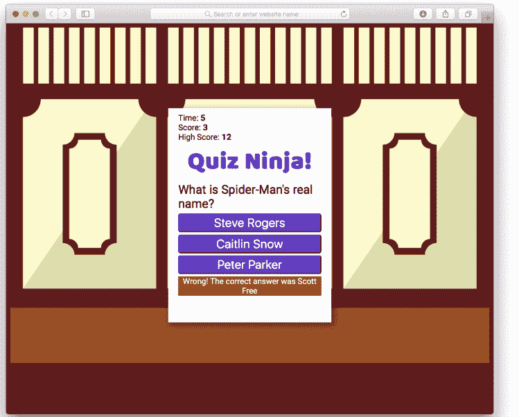

## 15-2. 忍者测试

虽然在本章中我们没有更改测验游戏的功能，但我们创建了模块化结构，并将源文件与部署的文件分离。如果此项目要公开发布，那么只有 `dist` 目录中的文件会被分发。`src` 目录中的文件将仅用于开发。

这使得代码在未来更容易维护，同时确保分发的代码使用了最优的文件大小，并能够在大量浏览器中运行。在编写将部署到服务器的 JavaScript 时，这两个都是需要考虑的任务。

# 总结

- JavaScript 库提供了方法，可以更轻松地实现常见任务。
- 库可以让编程变得容易得多，但你应该仔细考虑自己是否需要库，以及哪一个最适合你的需求。
- jQuery 和 Lodash 是两个流行的库，提供了许多有用且经过测试的函数。
- npm 或 Yarn 是包管理器，可以安装 JavaScript 包以及它们所需的任何依赖项。
- 模块是一个自包含的代码段，提供函数和方法，这些方法随后可以在其他文件和其他模块中使用。
- ES6 增加了对模块的支持，允许将代码抽象为不同的部分（各自自包含的文件），并导入到另一个文件中。
- MVC 模式用于将代码组织成不同的部分，每个部分负责应用程序的不同元素。
- 模板文件可用于将视图代码与 JavaScript 分离；它们还允许使用动态代码和编程逻辑来生成标记。
- React 和 Vue.js 是流行的 JavaScript 库，用于渲染组件并跟踪它们的状态。
- 压缩（Minification）是移除代码中冗余字符以减小文件大小的过程。
- 可以使用 gzip 压缩工具在服务器上对文件进行压缩。
- Webpack 可以将多个文件打包成单个包，并自动执行转换、压缩代码和运行测试等常见任务。
- 在代码部署之前，它应该被合并成单个文件、进行压缩和压缩。`<script>` 标签应该放置在 `</body>` 结束标签之前，以确保页面上的所有元素在脚本运行之前已加载。
- 在下一章中，我们将查看 JavaScript 下版本的一些特性，以及关于使用 JavaScript 可以构建内容的想法。

# 第 16 章

## 下一步

我们正接近成为 JavaScript 忍者的终点。但随着一段旅程的结束，一段新的旅程开始了。现在是时候提升你的 JavaScript 技能了。在最后一个章节中，我们将看看 JavaScript 的未来。我们还将研究如何成为一名更好的程序员，并提供一些关于你的……的想法。

在本章中，我们将涵盖：
- JavaScript 的未来
- 如何提升技能
- 项目想法

## 接下来做什么？

我们正接近成为 JavaScript 忍者的终点。但随着一段旅程的结束，一段新的旅程开始了。现在是时候提升你的 JavaScript 技能了。在最后一个章节中，我们将看看 JavaScript 的未来。我们还将研究如何成为一名更好的程序员，并提供一些关于你的……的想法。

这是 JavaScript 令人兴奋的时代。它正在以快速速度发展。这意味着：
- 允许动态导入
- 新功能
- 支持展开运算符
- 全局对象
- 大量的改进

## WebAssembly

**WebAssembly** 是一种新兴标准，提供了将 C 或 C++ 等低级语言编译为可在浏览器中运行的代码。

WebAssembly 不是 JavaScript 的替代品。相反，它是一项互补技术。JavaScript 将仍用于大多数应用程序，但 WebAssembly 将提供更强大的应用。它特别适用于

## JavaScript 疲劳

JavaScript 疲劳是几年提出的术语，用于描述 JavaScript 库、工具的爆炸式增长以及它们过时的速度。跟上 JavaScript 的趋势是非常困难且疲惫的，尤其是有很多工作要做！

许多人，特别是初学者，可能会为了制作一个简单的应用而需要学习的大量技术感到不知所措。阅读一个充满技术术语和缩写的在线教程并不罕见，如 `ES6`、`jQuery`、`React`、`Redux`、`WebPack`、`Babel`、`TDD`、`Jest`、`Git`、`async`、`OOP`、函数式风格、`npm`、`Node.js`、`Yarn`、`SQL`、`NoSQL`、图形数据库……人们对这些感到感到困惑也不奇怪！

如果你总是被最新的、闪眼的 JavaScript 框架所吸引，那么你永远没有时间去精通任何东西。

前进的最佳方式是避免“分析瘫痪”并开始编码！你写的代码越多，就越能开始意识到某些工具可能有助于改进你的工作流。随着你经验的丰富，你很快就会知道何时是时候向项目中引入新工具了。如果你当前的配置运行良好，那么就没有必要更改它。“如果没坏，就不要修它”这句老话依然适用！

关于这个问题，你可以在以下文章中找到一些有趣的见解：

## 忍者技能

在书的这个阶段，你应该已经在成为精通的 JavaScript 程序员的道路上稳步前进了。但随着 JavaScript 的成熟，它周围已经建立了一个完整的生态系统，这意味着一名忍者程序员需要的不仅仅是了解语言的基础。你需要开发更高级的技能，让你与普通程序员区分开来。本节概述了几项非常值得掌握的关键技能，帮助你的编程水平提升到下一个境界。

## 版本控制

版本控制软件允许你跟踪对代码进行的所有更改，因为代码的版本被保存了，并且可以随时回溯。许多人使用一种原始的版本控制形式，通过用不同的文件名保存代码的不同版本，例如“projectV1.js”、“projectV2.js”、“projectV3.js”等。这是一种合理的方法，但容易出错。如果你用过这种方法，有多少次在保存前忘记更改名称了？它无法提供使用源码控制管理工具所带来的收益。

最流行的源码控制管理工具之一是 `Git`¹，它由 Linux 的创始人 Linus Torvalds 编写。`Git` 允许你回滚到代码的之前的版本。你还可以对代码进行分支以测试新功能，而不会更改当前的稳定代码库。`Git` 是一个分布式源码控制系统，这意味着许多人可以分叉一段代码，独立地开发，并将任何更改合并回主代码库。

`Git` 使用命令行来发布命令，但也可以安装大量的 GUI 前端来提供代码的可视化表示。

如果你在团队中工作，源码控制是无价之宝，这意味着不同的开发者可以处理同一段代码，而不必担心会导致主代码库出现错误。如果任何错误不小心进入主代码库，可以通过回滚到上一个稳定版本来轻松纠正。它还能防止你覆盖他人的代码。

许多在线服务可以托管 `Git` 仓库，包括 `GitHub`²、`Bitbucket`³ 和 `Codeplane`⁴。它们可以用于托管在线 `Git` 仓库，然后供其他开发者进行分叉，这对于团队项目特别有用。这些服务中的一些会将所有代码公开，因此它们通常被开源项目用于托管源代码；另一些则保持代码私密，用于托管个人或业务项目。

作为一名忍者 JavaScript 开发者，将 `Git` 集成到你的日常工作流会让你的生活变得轻松得多。你可以在 Shaamik Daitary⁵ 写的《Jump Start Git》中了解更多关于 `Git` 信息。

## 保持你的知识更新

JavaScript 世界变化迅速，而且每年都变得更快。你需要确保自己跟上最新的进展和最佳实践。以下是一些关于如何保持知识更新的建议：

- 订阅博客，例如 SitePoint 的 JavaScript 频道。
- 写你自己的博客。
- 在 Twitter 上关注其他 JavaScript 开发者。
- 参加会议或本地聚会。
- 阅读杂志文章。
- 为开源项目贡献代码。
- 加入本地或在线用户组。
- 听播客。

1. http://git-scm.com/
2. https://github.com/
3. https://bitbucket.org/
4. https://codeplane.com/
5. https://www.sitepoint.com/premium/books/jump-start-git

## 使用常用的 JavaScript 编码模式

模式是一种解决常见问题并代表最佳实践的代码。在 JavaScript 存在的期间，已经出现了一些被证明有效的、用于编写可维护代码的模式。

- 维护项目的公告板
- 为项目提供非官方支持。

如果你对自己能做的事情有一些想法，可以看看 [Contributor Ninja¹⁰](https://contributor.ninja/js/)，它提供了一个需要修复的问题列表。

# JavaScript 开发创意

现在你已经学习了如何使用 JavaScript 编程，你可能在想：“下一步是什么？”你需要一个项目！在这一部分，我们将看看你新学到的编程技能可以做些什么。

JavaScript 在过去几年发生了巨大的变化。它不再被仅仅认为是一种用于为网页添加下拉菜单和一些效果的简单脚本语言（尽管用它来做这些完全没问题）。

以下想法旨在激发你的创造力，我相信它们能激发你对某个项目的灵感。这绝不是你用 JavaScript 可以做的事情的完整列表——可能性是无限的，仅限于你的想象力。

# HTML5 游戏开发

HTML5 的出现预示着使用 JavaScript 和其他 HTML5 技术编写的在线游戏将巨大增长。以前，大多数在线游戏是用 Flash 编写的，因为 JavaScript 被认为太慢了。Canvas 的采用速度与现在快的 JavaScript 引擎一样快，这意味着 HTML5 游戏可以与原生应用竞争。WebGL 和浏览器 GPU 的开发意味着在浏览器中运行快速的渲染 3D 游戏现在已成为可能。

现代在线经典之如 [HexGL¹¹](http://hexgl.bkcore.com) 和 [Swooop¹²](http://swoop.playcanvas.com) 展示了仅使用 HTML5 技术可以实现什么。

10. https://contributor.ninja/js/
11. http://hexgl.bkcore.com
12. http://swoop.playcanvas.com

有很多可以帮助编写 HTML5 游戏代码的库。两个优秀的例子是 Jaws¹³ 和 Phaser¹⁴。

# 单页 Web 应用

**单页 Web 应用**是一种顾如其义、在浏览器的单个网页上运行的应用程序。它们的目标是让用户在应用程序中导航时创建一个无缝体验，避免从一个页面移动到另一个面的感觉。这通常通过在后台预加载存储在后端数据库中的数据并以 JSON Ajax 的形式检索数据来实现。或者，可以使用我们在第 14 章遇到过的 Local Storage API 将数据存储在本地。将使用 MVC 框架来确保界面快速更新。许多应用程序现在都在使用单页 Web 模型，几个很好的例子是 Strike-to-do list app¹⁵ 和 Stack Edit Markdown¹⁶。

# 渐式 Web 应用

**渐式 Web 应用 (PWAs)** 是 Google 开发的单页 Web 应用的演进。其理念是通过预缓存关键资源使 Web 应用程序变得更加可靠和响应迅速。这会让它们加载更快，使用起来更流畅，而不需要持续的网络连接。PWAs 通过各种现代 Web API 实现这一目标，使 Web 应用程序感觉更像原生应用，从而为用户带来更好的应用体验。

# 移动应用开发

Android 和 iOS 不将 JavaScript 作为原生编程语言。然而，仍然可以使用 HTML5 技术和 JavaScript 构建应用程序，然后使用像 CocoonJS¹⁷ 这样的转换工具。这些会将 HTML5 应用转换为可以在 Android 和 iOS 平台上运行的原生代码。因此你可以仅使用 HTML5 技术和 JavaScript 进行构建，然后部署到多个设备上。

13. http://jawsjs.com/
14. http://phaser.io/
15. http://www.strikeapp.com/
16. https://stackedit.io
17. https://www.ludei.com/cocoonjs/
18. https://electronjs.org/

# Node.js 开发

JavaScript 传统上被认为是前端语言。在 Node.js 发布后，情况发生了变化。JavaScript 越来越多地用于服务器端，如 PayPal、Groupon 和 Yahoo 等公司。由于 JavaScript 的异步特性，它非常适合实时应用程序。

如果你想了解更多关于 Node.js 的知识，可以通过阅读《Node.js 8 the Right Way》来。

# 还有更多！

而且不仅如此——JavaScript 正在成为物联网 (IoT) 的主流语言，这意味着它可以用于编程各种设备，从手表到家庭自动化甚至机器人。

## 章节总结

- ECMAScript 的新版本每年继续发布。每个版本都将帮助语言更具表现力且更容易使用。这种快速的发布周期意味着新功能将在浏览器中实现。
- WebAssembly 是一种低级语言，允许浏览器在 Web 上运行编译代码。这使得在 Web 上运行处理器密集型应用程序成为可能。
- JavaScript 忍者应该使用 Git 等版本控制工具管理他们的项目。
- JavaScript 忍者的知识可以通过订阅邮件列表、听播客、参加讲座和会议、在 Twitter 上关注开发者以及阅读书籍和博客文章来保持更新。
- JavaScript 忍者应该使用被证明为最佳实践的常用 JavaScript 编码模式。这使得关于代码的变得更容易。
- JavaScript 忍者应该编写大量的代码并构建东西！
