# JavaScript：初学者指南！

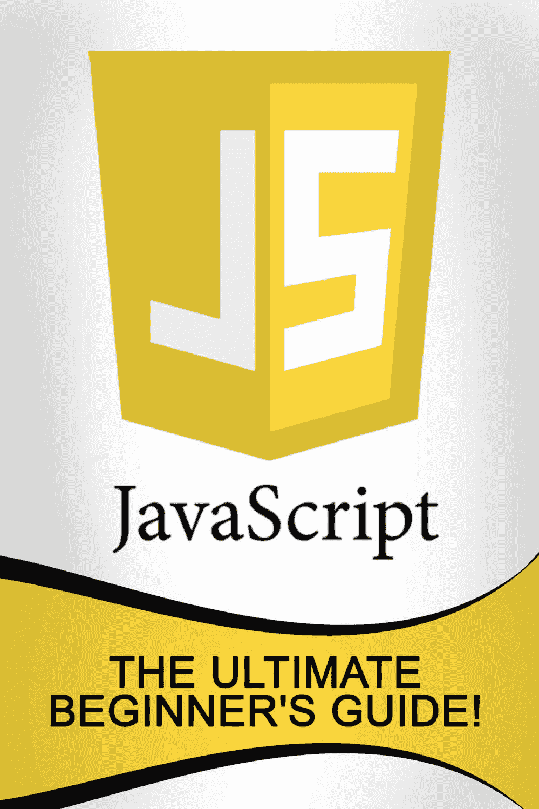

## 引言

我想感谢你的购买，并祝贺你获得了我的书书……

《JavaScript：终极学者指南！”

这本书将帮助你成为一名高效的 JavaScript 用户。如果你想快速、轻松地学习 JavaScript 语言的基础知识，那么你现在必须拥有这本书。

这本书将解释有关 JavaScript 语言的重要事实。它不包含任何无关信息。每一页都包含了宝贵的课程、指令和示例。在读完这本书后，你将熟悉对象、函数、变量、语句和其他 JavaScript 元素。

再次感谢购买本书，希望你喜欢它！

## 第一章：通用信息

`JavaScript` 是一种面向对象的脚本语言，你可以在不同的平台上使用它。在主机环境（例如网络浏览器）中，你可以使用 `JavaScript` 来对对象的程序化控制。

这种脚本语言带有一个丰富的标准库。该库包含了对象（例如 `Math`、`Date`、`Array` 等）和核心语言元素（例如语句、运算符、控制结构等）。截至目前，程序员们通过添加额外的对象来扩展 `JavaScript` 的基本功能。他们这样做是为了提高该语言在完成某些任务时的效率。

以下是 `JavaScript` 最流行的两种变体：

- **服务端 JavaScript** – 这种变体旨在帮助程序员在网络服务器上运行 `JavaScript`。例如，服务端扩展可以帮助应用程序与数据库交互、进行文件更改并提供连续的信息流。

- **客户端 JavaScript** – 这种形式的 `JavaScript` 是为浏览器及其相应的 `DOM`（即文档对象模型）创建的。例如，客户端 `JavaScript` 帮助应用程序将元素保存到 `HTML` 文档中并响应用户操作（例如表单输入、鼠标点击、页面导航等）。

### JavaScript 与 Java 语言

`Java` 和 `JavaScript` 是两种不同的编程语言。`JavaScript` 与 `Java` 有一些相似之处（例如命名规范、表达式语法、控制流结构等）。但不具备 Java 的两个显著特征：强大的类型检查和静态类型。

根据许多人的说法，这些语言完全没有关系。Netscape（开发 `JavaScript` 的公司）将语言名称从 `LiveScript` 改为 `JavaScript` 以利用 `Java` 的流行；因此，这些语言名称之间的相似性是因为营销考虑而产生的。

现在，让我们讨论这些编程语言之间的主要区别。这些信息将帮助你提高对 `JavaScript` 和通用编程的了解。

- **JavaScript**: 这是一种灵活的计算机语言。在使用 `JavaScript` 时，你不需要声明所有的方法、类和变量。你不需要担心你将使用的方法类型（即它们是私有的、公有的还是受保护的）。此外，你不需要为 `JavaScript` 实现任何接口。

- **Java**: 这种基于类的计算机语言是为了类型安全和快速实现而创建的。这意味着必须使用类及其相应的方法来创建你的程序。`Java` 的数据类型和类继承需要严格的对象层次结构。简单来说，`Java` 语言比 `JavaScript` 更复杂。

### 如何开始？

为了使用 `JavaScript`，你不需要下载文件或向你的计算机安装程序。你只需要访问你喜欢的网络浏览器来创建你自己的 `JavaScript`。如今，`Firefox` 是 JavaScript 编程最好的网络浏览器之一。因此，如果你的电脑没有 `Firefox`，建议你访问此网站：`https://www.mozilla.org`。这个浏览器免费且易用；因此，你可以轻松掌握 `JavaScript` 的基础而无需花费任何钱。

一旦你下载了 `Firefox`，就会看到两个专门为 JavaScript 编程创建的工具。这些工具是：

#### 1. Web 控制台

该工具显示有关已加载的网页的信息。它还有一个命令行功能，你可以用它在加载的页面上运行 `JavaScript` 语句。

要访问 `Web Console`，你只需启动 `Firefox`，点击 `Tools`（工具），并在 `Developer`（开发者）菜单中选择 `Web Console`。激活 `Web Console` 后，你会在屏幕底部看到命令行。你可以向该命令行输入 `JavaScript` 表达式，然后屏幕中间的面板将向你显示输入表达式的结果。

此功能会立即显示结果——你会很快知道自己是否输入了错误代码。

这是 Web Console 工具的截图：

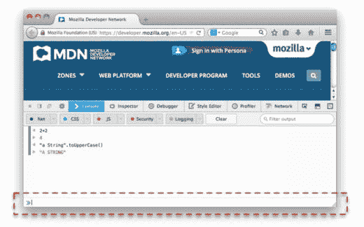

#### 2. Scratchpad

`Firefox` 的 `Web Console` 非常适合运行单个 `JavaScript` 表达式。虽然你可以用它运行多行，但你会发现这样做非常不方便。此外，你无法使用该工具保存你的代码片段。幸运的是，`Firefox` 还有另一个工具解决了上述问题。这个工具被称为 `Scratchpad`。

要访问此工具，你需要执行：

1. 启动 `Firefox`。
2. 点击 `Tools`。
3. 找到 `Developer` 部分并选择 `Scratchpad`。

此工具是一个独立的 Firefox 窗口，作用类似于文本编辑器。你可以用它在浏览器中编写和运行 JavaScript 代码。此外，你还可以使用 Scratchpad 保存新代码或加载现有的代码。

下方的截图显示了 Scratchpad 工具界面：

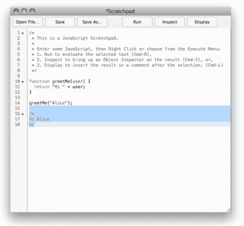

## 你的第一个 JavaScript 应用程序

在本节中，你将使用 JavaScript 编写你的第一个应用程序。这个简单的活动将让你体验 JavaScript 的特性和编程环境。

启动 Scratchpad 并输入以下代码：

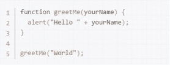

高亮 JavaScript 代码并按 `Ctrl+R` 以在屏幕上查看结果。

下一章将讨论 JavaScript 的语法和特性；因此，你将能够创建比上面示例更复杂的应用程序。

### 第 2 章：JavaScript 语言的基础元素

在本章中，你将学习 JavaScript 的语法、变量、数据类型以及常量/字面量。

#### 通用信息

该编程语言的语法与 Awk、Perl、Java 和 Python 相似。此外，它是区分大小写的，并使用了 Unicode 字符。

在使用 JavaScript 时，程序员将计算机指令称为“语句”。你应该使用分号来分隔语句。JavaScript 还支持空白字符（例如制表符、空格和换行符）。这意味着你可以使用这些字符来提高 JavaScript 语句的可读性。

JavaScript 编译器会从左到右扫描源代码，并将其转换为一组输入对象（即：注释、空白字符、标记、行终止符和控制字符）。

#### 注释

JavaScript 编写注释的语法与大多数编程语言相似。你必须使用两个斜杠（即 `//`）来创建单行注释。然而，要创建一个跨越多行的注释，你必须在注释的开头和结尾分别使用 `/*` 和 `*/`。下方的截图将向你展示如何在编写代码时使用这些字符：

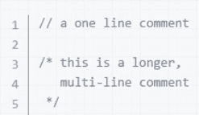

**注意：** JavaScript 不支持嵌套注释（即放置在另一个内部内部注释）。

#### JavaScript 中的声明

JavaScript 编程语言支持三种类型的声明。这些是：

- `var` – 使用此声明创建一个新变量。在声明期间，你可以给变量赋值。
- `let` – 这种声明允许你创建一个局部变量。你可能在声明阶段给变量赋值。
- `const` – 使用此声明创建一个常量。常量是只读的：在声明后你无法更改它的值。

让我们详细讨论这些声明：

##### “var”声明

该声明的语法为：

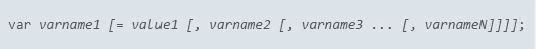

你可以将 `varname1` 替换为任何有效的标识符。JavaScript 有保留关键字——即不能用于命名变量、常量、对象等的词汇。你将在稍后学习这些关键字。

在此语法中，`value1` 代表变量的值。你可以将其替换为任何有效的 JavaScript 表达式。

###### 它是如何工作的？

JavaScript 解释器对变量声明的优先级高于任何类型的代码。通过 `var` 声明的变量作用域是其活跃的执行上下文（即局部或全局）。

如果你给一个尚未声明的变量赋值，你将得到一个全局变量（即可以在程序的任何部分访问的变量）。以下是声明变量和未声明变量之间的主要区别：

- 声明的变量限于声明它的函数。这意味着函数无法访问在其他函数内部创建的声明变量。相反，未声明的变量 100% 的情况下都是全局的。
- JavaScript 解释器会在运行任何代码之前创建声明变量。然而，未声明的变量只有在解释器运行了必要的代码后才能存在。
- 声明的变量是其相应函数的不可更改的属性。因此，函数不能编辑或删除它包含的声明变量。相反，未声明的变量允许修改。这意味着你可以根据需要编辑或删除它们。

由于上述差异，如果你未能正确声明变量，你的程序可能会产生意料之外或不符合预期的结果。因此，无论作用域如何，声明变量都是一种良好的编程习惯。

##### “let”声明

这是该声明的语法：

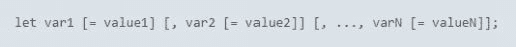

你可以将 `var1` 替换为你想要用于变量的名称。

如果你想给这个新变量赋值，只需将 `value1` 替换为相应的数据即可。

###### 它是如何工作的？

这种声明允许你创建变量，其作用域被限制在使用它的表达式、块或语句中。

如果你使用 `let`，你得到的变量将考虑其容器视为其作用域。在这方面，`let` 与 `var` 相似。主要的区别是 `var` 变量的作用域是包含它的整个函数。

##### “const”声明

通过此声明，你可以为任何值创建一个只读引用。基本上，你仍然可以在需要时编辑这些引用。只是在声明阶段后你无法对其进行转移或重新赋值。该声明的语法为：

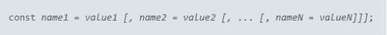

###### 它是如何工作的？

通过此声明，你可以生成一个常量（也称为“字面量”），它可以是局部的也可以是全局的。这种声明需要一个初始化。常量是块作用域的。在这方面，它与 `let` 声明的变量相似。

**注意：** 你不能通过重新赋值来更改常量的值。

#### JavaScript 变量

变量是程序所需的符号标识符。在命名变量时，你必须记住这些规则：

- 使用字母、美元符号（即 `$`）或下划线（即 `_`）开头命名。你可以在名称中包含数字。但是，你不能用数字开头。例如 `javascript1` 是有效的，但 `1javascript` 不是。
- JavaScript 语言是区分大小写的。这意味着在命名变量时必须保持大小写一致。例如，JavaScript 将 `LETTER`、`Letter` 和 `letter` 视为三个不同的变量。

如果你评估一个持有“null”的变量，在数值（Numeric）上下文中使用时将得到“0”，在布尔（Boolean）上下文中使用时将得到“false”。查看下面的示例：

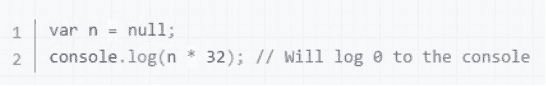

#### 变量的作用域

如果你在函数外部声明变量，将获得全局变量。这意味着你可以在 JavaScript 程序的任何部分利用这些变量。如果你在函数内部声明变量，将获得局部变量。你只能通过包含这些变量的函数来使用它们。

##### 变量提升 (Hoisting)

JavaScript 允许程序员引用尚未声明的变量。这种技术被称为变量提升：系统会将变量提升（即移动到顶部）到语句或函数的顶部区域。然而，提升后的变量其值为值为“undefined”。这意味着即使在对一个提升的变量进行声明和初始化之后，你仍然会从该提升变量中得到“undefined”。查看下面的代码：

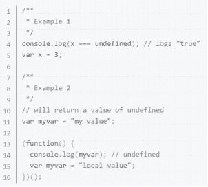

变量提升可能会让你的代码变得混乱的一团糟。为了提高代码的可读性和功能性，你必须将 `var` 语句放在函数的顶部。

##### 全局变量

实际上，全局变量是编程环境全局对象的一个属性。在网页中，“window”充当全局对象。这意味着你可以通过这种语法创建并访问全局变量：`window.variable`。

JavaScript 允许你即使在不同的窗口中，也可以访问在其中一个窗口中声明的变量。你只需要指定包含你想要访问的变量的窗口名称即可。

#### JavaScript 常量

如上所述，你可能可以使用 `const` 在你的 JavaScript 程序中生成一个只读常量。涉及变量命名的规则也适用于常量。你可以使用字母、数字、下划线和美元符号。然而，你不能使用数字作为常量名的第一个字符。

这里有一个示例：

```
const example = “69”;
```

你不能通过重新赋值或重新声明常量来改变它的值。这意味着在声明常量时，你必须 100% 确定要赋值给常量的数据。

此外，你不能在同一作用域内创建一个与变量或函数相同标识符常量。

### 数据类型和结构

在本书的这一部分，你将学习 JavaScript 支持的不同数据类型和数据结构。请仔细学习这些材料，因为它们将为你提供有关此编程语言的重要信息。

#### JavaScript 中不同的数据类型

目前，JavaScript 支持七种数据类型。这些是：

- `null` – 这是一个表示空值的关键字。由于这种计算机语言对大小写敏感，`null` 与 `NULL`、`Null` 以及该词的其他版本不同。
- `Number` – 69 或 999.99。
- `Boolean` – 这种数据类型有两个可能的值：true 和 false。
- `String` – 这种类型的数据涉及字母。例如：Hello。
- `undefined` – 这种数据类型被认为是任何程序的顶层属性。
- `Symbol` – 这种类型涉及独特且不可变的实例。
- `Object` – 程序员使用这种数据类型来存储与处理和使用数据相关的信息和指令。

尽管数量很少，但这些数据类型允许你在 JavaScript 程序中运行酷且实用的函数。函数和对象是这种语言最基本的两个元素。你可以将对象视为可以存储信息的容器，将函数视为你的程序可以执行的过程。

#### 将一种数据类型转换为另一种

JavaScript 语言是动态类型类型；因此，你可以在不指定它们可以持有的数据类型的情况下声明变量。此外，JavaScript 会在代码执行期间根据需要自动转换数据类型。这意味着你可以以这种方式声明变量：

```
var apple = 5;
```

之后，你可以返回同一个变量并给它一个新值。例如：

```
apple = “This is delicious.”;
```

通过上述代码，你创建了一个名为 `apple` 的变量，并给它一个“5”（即数字数据类型）作为初始值，然后你用字符串替换了数字（即“This is delicious.”）。由于 JavaScript 是动态类型的，值的重新赋值不会给你带来错误信息。

对于涉及字符串和数值值且包含 `+`（即 JavaScript 运算符之一）的表达式，该语言会将数字转换为字符串。下面的代码将帮助你理解这个概念：

```
A = “My age is ” + 18 // “My age is 18”
B = 18 + “ is my age” // “18 is my age”
```

JavaScript 在涉及其他运算符（例如 -、`*`、+/ 等）的表达式中不会将数字转换为字符串。例如：

```
“69” – 9 // 60
“69” + 9 // “699”
```

##### 字符串到数字的转换

如果你使用字符串值来表示数字，可以使用以下函数转换数据类型：

- `parseFloat()`
- `parseInt()`

`parseInt()` 函数返回整数。这意味着你可以用它来简化小数。此外，在使用 `parseInt()` 的时候，包含“进制”（radix，即 `parseInt()` 函数的参数）是一个良好的编程习惯。基本上，进制允许你指定你必须使用的数值计数系统。

#### JavaScript 中的字面量 (Literals)

在 JavaScript 语言中，你使用字面量来表示一个值。我们在这里讨论的值是固定的。除了变量外，你还可以在你的 JavaScript 代码中添加固定值。在本节中，你将学习以下类型的字面量：

- 整数
- 数组字面量
- 对象字面量
- 布尔字面量
- 字符串字面量
- 浮点

##### 整数

在 JavaScript 中，你可以以二进制、十进制或十六进制表示整数。

- 十进制字面量不接受零作为第一个字符。
- 八进制整数使用零作为其第一个字符。根据规则，这种类型的整数字面量只能使用数字 0-7。
- 十六进制整数以 `0X` 或 `0x` 开头。它们可以是数字（0-9）和字母（a-f）。
- 二进制整数始终以 `0b` 或 `0B` 开头。它们只能使用数字：1 和 0。

这里是整数字面量的示例：

- 十进制 – 1, 223 和 -360
- 八进制 – 022, 004 和 -045
- 十六进制 – 0x223, 0x9911 和 -0xF24
- 二进制 – 0b23, 0b1100 和 -0b10

##### 数组字面量

这种字面量由零或多个表达式组成。每个表达式表示一个数组对象，放在一对括号（即 `[ ]`）中。如果你通过数组字面量生成数组，系统将用你指定的值初始化它。数组的长度等于你指定的参数数量。

下面的代码创建一个名为 `Countries` 的数组，包含四个元素且长度为四个：

```
var Countries = [Bulgaria”, “Colombia”, “Philippines”, “United States of America”];
```

如果你在顶层语句内部通过字面量创建数组，JavaScript 每次检查持有数组字面量的表达式时都会解释该数组。此外，如果你为函数使用字面量，系统每当调用该函数时都会创建字面量。

##### 数组内部额外的逗号

在 JavaScript 中，你不需要指示数组中的所有元素。如果你连续放置两个逗号，系统将创建数组并为未指定的对象分配“undefined”。下面的代码创建一个名为 `Cars` 的数组：

```
var Cars = [“BMW” , , “Toyota”];
```


“Cars”有三个元素：`BMW`、`undefined` 和 `Toyota`。

JavaScript 忽略位于数组末尾的逗号。这意味着你不能在数组的最后部分添加一个 `undefined` 对象。

**重要备注：** 随逗号（即放置在数组或语句末尾的逗号）可能会在浏览器中产生错误。因此，你应该移除 JavaScript 代码中所有的尾随逗号。

# 对象字面量 (Object Literals)

对象字面量是对象属性名及其赋值值的列表。一对大括号（即 `{}`）包围了这些元素。在 JavaScript 中，你不能在代码的开头放置对象字面量。这种操作可能会导致错误和/或对你的 JavaScript 程序产生不利的影响。

对象的属性名可以是任何字符串（即使是空字符串）。如果你使用无效的数字或标识符，必须用引号将其括起来。要访问涉及无效标识符的属性名，请使用方括号（即 `[ ]`）。

# 布尔字面量 (Boolean Literals)

这种类型涉及两个值：(1) `true` 和 (2) `false`。

请记住，布尔字面量与布尔数据类型（上文讨论过）不同。通常，布尔对象作为布尔数据类型的包装器。

# 字符串字面量 (String Literals)

字符串字面量由置于一对引号（即单引号或双引号）内部的零或多个字符组成。以下是一些示例：

*   “water”
*   ‘car’
*   “3.14”
*   “我想使用 `\t` 来添加一个制表符”
*   “Peter Pan”

你可以对字符串字面量调用字符串对象的任何方法——JavaScript 会自动将字符串字面量转换为字符串对象，调用你所需的方法，并丢弃创建的字符串对象。

**重要备注：** 除非你的代码需要字符串对象，否则编写 JavaScript 语句时必须使用字符串字面量。

## 如何在字符串中使用特殊字符

JavaScript 允许你在字符串中包含特殊字符。这里是一个例子：

“第一行 \n 第二行”

下表了 JavaScript 支持的特殊字符：

| 特殊字符 | 用途 |
| :--- | :--- |
| `\0` | 该字符向你的代码中添加一个空字节。 |
| `\b` | 使用此特殊字符就像按下键盘上的退格键一样。 |
| `\f` | 使用此字符，你可以在 JavaScript 语句中添加一个分页符。 |
| `\n` | 如果你想在代码中添加换行符，请使用此字符。输入此特殊字符就像按下键盘上的回车键。 |
| `\r` | 该字符允许你在代码中应用回车。 |
| `\t` | 此特殊字符向代码中添加一个制表符（即按下键盘上的 Tab 键后获得的字符）。 |
| `\v` | 使用此字符，你可以快速地在语句中添加一个垂直制表符。 |
| `\\'` | 使用此字符在语句中添加一个单写号或单引号。 |
| `\\"` | 如果你想在代码中添加一个双引号，请使用此字符。 |
| `\\` | 该字符允许你在 JavaScript 语句中包含一个反斜杠字符。 |
| `\xxx` | 你可以使用此字符向代码中添加一个 Latin-1 符号。此特殊字符需要该范围内的八进制数字：`0- 377\.`。例如，`\251` 将向你的语句中添加“©”（即版权符号）。 |
| `\xXX` | 这与上一个类似。你可以使用此字符向代码中添加 Latin-1 符号。唯一的区别是此特定字符需要范围 `00-FF` 内的两个十六进制值。例如，`\xA9` 会向你的 JavaScript 代码中添加 ©。 |
| `\uXXXX` | 该字符向代码中添加 Unicode 符号。它需要四个十六进制值。例如，`\u00A9` 向你的代码中添加 ©。 |

## 如何转义字符

在 JavaScript 中，引号用于开始和结束字符串。然而，在某些情况下，你必须在代码中包含引号——也就是说，你想要一个普通的引号（而不是 JavaScript 符号）。在这种情况下，你必须使用反斜杠（即 `\`）引入引号。这种技术被称为“字符转义”。在特殊符号之前输入反斜杠会将该符号转变为普通的符号。

**重要备注：** 有时，你必须在语句中添加一个普通的反斜杠。嗯，你可以快速轻松地做到这一点。你只需要输入两个反斜杠（即 `\\`）。此操作会“转义”反斜杠字符本身。

# 浮点字面量 (Floating-Point Literals)

浮点字面量具有以下部分：

*   一个小数整数
*   一个指数
*   一个分数
*   一个小数点

你必须使用 “E” 或 “e” 来表示浮点字面量的指数部分。在标明指数后，你应该放置整数（其前面可以有 "-" 或 “+”）。通常，浮点字面量应该至少有一个数字，并且要么有一个指数要么有一个小数点。

以下是浮点字面量的语法：

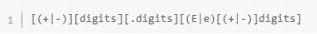

以下是一些浮点字面量的示例：

*   `.2e-34`
*   `3.15`
*   `-.145`
*   `-4.6E+69`

# JavaScript 关键字

本书的这一部分将向你展示 JavaScript 中所有的关键字。这些词在 JavaScript 编程语言中都有特殊用途；因此，你不能在命名变量、函数、对象时使用其中任何一个。

| `switch` | `abstract` | `Instanceof` | `else` |
| `int` | `enum` | `synchronized` | `boolean` |
| `this` | `break` | `interface` | `export` |
| `long` | `byte` | `throw` | `extends` |
| `throws` | `class` | `native` | `catch` |
| `true` | `transient` | `package` | `char` |
| `function` | `const` | `typeof` | `for` |
| `private` | `var` | `protected` | `void` |
| `return` | `default` | `volatile` | `if` |
| `implements` | `while` | `delete` | `short` |
| `do` | `with` | `static` | `import` |

# 第 3 章：JavaScript 的控制语句

该语言提供了一组你可以添加的紧凑控制语句。通常，控制语句增强了程序的功能和交互性。本书重点关注控制语句。

## 块语句 (Block Statement)

程序员认为这是 JavaScript 中最基本的语句。使用它来分组你的语句。在编写程序时，使用一对大括号包围块语句。

下图显示了块语句的语法：

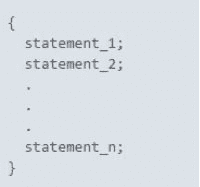

通常，程序员将块语句用于控制语句（例如 `for`、`if` 等）。这里有一个示例：

```javascript
while (y > 69) {
    123;
}
```

在上面的代码段中，`123;` 就是块语句。

## 条件语句 (Conditional Statements)

条件语句是在赋值条件为真时执行的命令集。JavaScript 语言提供了两种条件语句：(1) `if... else` 和 (2) `switch`。

让我们详细讨论这些条件语句：

### “if... else”语句

通过此语句，只要赋值条件为真，就可以运行命令。它包含一个 `else` 子句（可选）。`else` 子句包含在赋值条件为假时运行的语句。`if... else` 语句的语法如下：

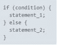

由于你的条件必须得到“true”或“false”，因此编写条件语句时必须使用布尔表达式。如果条件为真，执行第一个语句；否则，执行第二个。

JavaScript 允许你在条件语句中设置多个条件。你只需要在条件语句中组合多个 `if` 和 `else` 子句即可。这是你必须使用的语法：

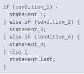

如果可能，请避免在条件表达式中使用简单赋值。这是因为在检查 JavaScript 代码时，简单赋值经常会被与等性判断运算符混淆。例如，你绝不能将以下代码添加到你的陈述中：

```javascript
if (a = b) {
    /* sample_statement */
}
```

如果你确实需要在条件表达式中使用简单赋值，请将其放在一对括号之间。这里有一个示例：

```javascript
if ((x = y)) {
    /* sample_statement */
}
```

## 假值 (The Falsy Values)

“假值”（falsy value）是指评估结果为 `false` 的值。以下是你在使用 JavaScript 时会遇到的假值：

- `0`
- `null`
- `false`
- `undefined`
- `NaN`
- `""`（即空字符串）

未列在上述列表中的值在条件语句中的求值结果均为 `true`。

## “Switch”语句

这种语句允许应用程序检查一个表达式并将其与预定义的一组情况（cases）进行比较。如果匹配成功，应用程序将运行指定的命令。以下是基础 `switch` 语句的语法：

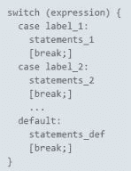

首先，应用程序将搜索标签与表达式值匹配的 `case`。然后，它会将控制流传递到该特定语句，执行指定的语句。如果没有找到匹配项，应用程序将检查 `default` 子句（可选）并将控制流传递到该子句，运行指定的语句。如果语句没有 `default` 子句，应用程序将直接运行 `switch` 语句之后的语句。通常，`switch` 语句的最后一个子句作为 `default` 子句，但并不是强制性的。

你还可以在 `switch` 中添加 `break` 语句。`break` 语句可以确保一旦找到匹配项，应用程序就会退出 `switch` 语句。当应用程序退出 `switch` 时，系统将运行 `switch` 语句之后的语句。如果你的代码中没有 `break`，应用程序将直接运行你 `switch` 语句中的所有命令。

## 如何处理异常

JavaScript 允许你抛出并管理异常。要完成这些操作，你必须使用以下语句：

- `throw` 语句
- `try…catch` 语句

## 异常的类型类型

在 JavaScript 中，你可以抛出任何类型的对象。然而，抛出的对象可能具有不同的特征。虽然通常抛出字符串和/或数字作为错误消息，但利用专为此目的设计的异常类型通常会更有利。以下是 JavaScript 中两种最受欢迎的异常：

- `DOMError` – 这种异常表示一个命名的错误对象。
- `DOMException` - 这种异常表示在使用属性或方法时发生的异常情况。要使用此异常，你必须在代码中添加 `DOMError()`。

## “throw”语句

显显然，该语句允许你抛出异常。在抛出异常时，你必须指定持有要抛出数据的表达式。以下是语法：

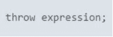

上述语法可以抛出任何类型的表达式。以下列表显示了一些示例：

- `throw "Error1"; // 字符串类型异常`
- `throw 1; // 数字类型异常`
- `throw false; // 布尔类型异常`

重要提示：你可以在抛出异常时指定对象。然后，你可以在语句的 `catch` 部分指定该对象/对象的属性。

## “try… catch”语句

该语句寻找你可以尝试的语句块。它还指定了在抛出异常时使用的响应。`try…catch` 语句捕获抛出的异常。

`try…catch` 语句有三个部分，分别是：

1. **`try` 部分** – 它包含一个或多个 JavaScript 语句。这部分是强制性的。
2. **`catch` 部分** –这部分完全可选（见下文）。它包含了指示程序在抛出异常时必须执行的语句。这意味着如果 `try` 部分执行失败，程序控制将转到 `catch` 部分。如果 `try` 部分内部的语句抛出异常，程序控制将立即转到 `catch` 部分。然而，如果没有发生异常，系统将跳过语句的 `catch` 部分。

在 JavaScript 中，你可以使用 `catch` 部分来管理 `try` 部分可能抛出的所有异常。以下是你应该使用的语法：

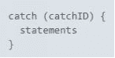

在上述语法中，`catchID` 代表包含你在 `throw` 语句中赋值的值的标识符。你可以使用此标识符来获取有关抛出的异常的数据。每当执行 `catch` 部分时，JavaScript 都会生成此标识符。该标识符仅在 `catch` 部分活动期间有效。这意味着一旦 `catch` 部分执行完毕，该标识符将不再存在。

例如，下面的代码生成了一个异常。一旦抛出异常，程序控制将转到 `catch` 部分。

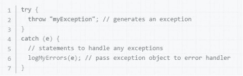

3. **`finally` 部分** – 它包含在执行完之前的部分后运行的语句。无论程序是否遇到异常，放置在 `finally` 部分的语句都会运行。此外，即使语句没有 `catch` 部分，此部分内的语句仍然会运行。

通常，程序员使用此部分在发生异常时为他们的项目设置优雅的退出。例如，他们可能需要释放受问题脚本影响的一些资源。下面的图片将帮助你理解该部分是如何工作的。

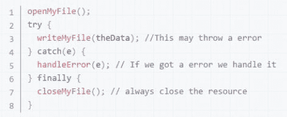

## 如何利用错误对象

在某些情况下，你可以通过检查属性（即 `name` 和 `message`）来获取有关错误的更多信息。如果你的代码 catch 部分无法指示错误是由用户还是系统生成的，这种功能将非常有用。要利用错误对象，你必须使用名为 `Error Constructor` 的 JavaScript 工具。这里有一个示例：


## JavaScript Promise

JavaScript 语言现在支持 `promises`（一种允许程序员管理延迟和异步过程的对象）。Promise 会经历以下状态：

- `Pending` – 这是 promise 的初始状态。在此状态下，promise 可能被拒绝或完成。
- `Fulfilled` – 如果系统成功完成了所有分配的任务，promise 将变为“已完成”。
- `Settled` – 一个已定的 promise 可以被拒绝或完成。
- `Rejected` – 在拒绝的 promise 中，系统未能完成分配的任务。

# 第四章：JavaScript 中不同类型的循环

循环允许你快速方便地重复代码段。本章将关注 JavaScript 提供的不同循环。

## 通用信息

在编写自己的代码时，你会发现一些需要反复使用相同代码的情况。这种任务既无聊又耗时。然而，你不能跳过它，因为如果没有正确的代码，你的应用程序无法正常工作。

循环的设计用于重复代码。它们具有不同的机制，可以通过调整这些机制来提高复制代码的效率。此外，每种循环类型都有独特的特性，这使得它们在某些情况下非常有用且方便。以下是你在 JavaScript 中可以找到循环语句：

* `for`
* `while`
* `do… while`
* `label`
* `break`
* `for… of`
* `for… in`
* `continue`

## `for` 循环

基本上，`for` 循环会重复执行语句，直到指定的条件变为假。JavaScript `for` 循环的语法与 C 和 Java 相似。以下是语法：

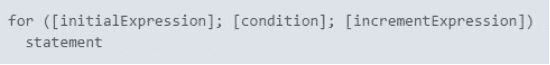

当 `for` 循环运行时，都会发生以下情况：

1. 循环的初始化表达式（在上述语法中用 `initialExpression` 表示）执行其功能。通常情况下，初始化表达式会触发多个循环计数器。这意味着上述语法接受不同复杂程度的内容。你也可以使用此表达式来声明变量。

   **注意**：初始化表达式是可选的；因此，你可以在不使用任何初始化表达式的情况下创建 `for` 循环。

2. 系统评估条件表达式。如果评估结果为真，则运行循环包含的语句。然而，如果评估结果为假，整个循环将停止。

   **注意**：条件表达式是可选的。如果你不在 `for` 循环中添加条件表达式，系统将假设评估结果为真。

3. 执行语句。如果你想运行多条语句，必须将它们分组成一个块（即通过用大括号将它们括起来）。

4. 最终表达式（在语法中用 `incrementExpression` 表示）更新整个循环，然后控制流将回到第二个步骤（见上文）。

## `while` 循环

`while` 循环在指定的条件为“真”时执行其语句。以下是 `while` 循环的语法：

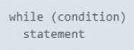

一旦条件结果为“假”，循环将停止执行分配给它的赋值，然后控制流将跳转到 `while` 循环之后的语句。

系统在运行循环本身之前会先评估条件。如果条件为真，循环内部的语句将执行，系统将再次检查条件。如果条件为假，循环将停止，控制流将移动到下一条语句。

**注意**：由于条件测试首先发生，`while` 循环可能永远不会运行。这意味着在 JavaScript 程序中创建 `while` 循环时必须格外小心。

JavaScript 允许你使用一对大括号封装多个语句。如果你想在 `while` 循环中包含各种语句，请使用此选项。

## `do… while` 循环

这种循环执行其语句，直到指定的条件变为假。创建 `do… while` 循环时，你必须使用以下语法：

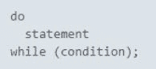

在这里，系统在检查指定条件之前执行一次语句。如果条件为真，系统将再次执行这些语句。这个过程将持续到条件变为假。一旦条件评估为假，控制流将跳转到 `do… while` 循环之后的语句。

在这种类型的循环中，即使条件为假，语句也能保证至少运行一次。

## `label` 语句

这种语句允许你对语句进行“标记”（即分配一个标识符）。通过标记你的 JavaScript 语句，你可以轻松地在应用程序的任何部分重复它们。例如，你可以标记某个循环，并利用其他语句来继续或中断它的执行。

以下是 `label` 语句的语法：

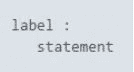

创建标记时，你可以使用任何不是 JavaScript 关键字的标识符。你可以对任何语句使用上述语法。

## `break` 语句

程序员使用此语句来结束循环或 `switch` 语句。在使用 `break` 语句时，必须记住以下规则：


如果你的`break`语句没有标记，它将终止最内层的循环/switch 并将控制流传递到下一个语句。

如果你的`break`语句有标记，它将终止被标记的语句。

`break`语句的语法为：

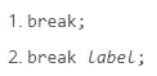

如果你不需要指定标记，请使用语法的第一个变体。这将终止内部循环/switch。如果你想终止特定的循环/switch，请使用第二变体。只需输入该特定循环或 switch 的标记即可。使用第二变体时，只有指定的循环/switch 将终止。

## `for… of`语句

该语句是 JavaScript 语言最近添加的内容。它创建了一个可以重复“可迭代对象”（例如 maps、sets、arrays、arguments 等）的循环。它还调用了一个迭代钩子，该钩会在对象的每个不同属性上运行。JavaScript 允许你自定义任何`for… of`语句的迭代钩子。你必须使用的语法如下：

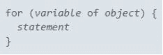

## `for… in`语句

`for… in`语句在对象的任何属性上重复指定的语句。JavaScript 将为每个属性执行指定的语句。`for… in`语句的语法为：

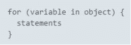

## `continue`语句

你可以使用此语句重启其他语句（例如 for、while、do while 和 label）。在使用`continue`语句时需要记住以下规则：

* 如果你的`continue`语句没有标记，它将终止当前的循环并继续下一个。与`break`语句不同，`continue`语句不会终止整个循环。如果用于`while`循环，控制流将返回条件。另一方面，如果用于`for`循环，控制流将回到递增表达式。

* 如果你在`continue`语句中包含标记，它将仅影响被标记的语句。

## 第 5 章：JavaScript 函数

通常情况下，函数是用于调用的“子程序”。每种函数类似于完整的程序，函数有一组被称为“函数体”的语句。JavaScript 允许你向函数传递值。此外，函数还可以返回值。

## 什么是函数

在 JavaScript 中，每个函数都被视为一个唯一的对象。此外，函数与过程不同。函数在 100% 的情况下都会返回值，而某些过程不会。

如果你想让函数返回结果，必须在函数中添加`return`语句。`return`语句指定了返回的值。没有返回语句的函数会给出默认值。大多数情况下，函数的默认值为“undefined”。

函数的参数是在调用时使用的参数。JavaScript 使用值传递参数。如果函数修改了参数的值，该修改不会在全局范围内生效。然而，对象引用也是值（而且是特殊的值）——如果函数更改了所引用对象的属性，更改将会生效。

## 如何定义函数

在 JavaScript 中，你可以通过多种方式定义函数。让我们详细讨论每种方法：

* 使用函数语句 —— JavaScript 提供了一种特殊的语法，你可以用它声明函数。语法如下：

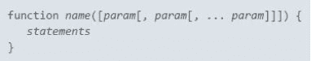

该语法包含三个不同的部分，分别是：

* `name` – 这是函数的名称。你可以将其替换为任何有效的标识符。

    * `param` – 这是你想要传递给函数的参数/形参。JavaScript 允许你在每个函数中包含最多 255 个参数。

    * `statements` – 这一部分包含函数的语句（即函数体）。

* 通过函数表达式 – 这种方法与之前的方法相似。事实上，它使用了以下语法（见下文）：

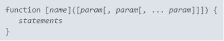

* 使用 JavaScript 的“函数构造函数” – JavaScript 允许你使用`new`（即一个 JavaScript 运算符）来生成函数。以下是你必须使用的语法：


上述给出的语法包含以下部分：

* `arg1, arg2, … argN` – 这一部分包含你想要作为形式参数的名称。

    * `functionBody` – 这是一个包含 JavaScript 语句的字符串（即函数体）。

## 如何调用函数

在定义函数时，你只是在为该函数命名，并指定当函数被触发/调用时要执行的操作。如果你想让它执行分配的操作，请调用该函数。例如，如果你定义了“square”（平方）函数，你可以使用以下代码调用它：

```
square(2);
```

上述代码调用了`square`函数并将 2 指定为参数。该函数运行其语句并返回 4 作为结果值。

当你调用函数时，函数必须在适当的作用域内。不过，你可以对函数声明进行**变量提升**（即将其提升到顶部）。这里有一个例子：

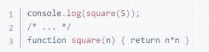

函数的参数可以包含不同的编程元素（即不仅仅是数字和字符串）。JavaScript 允许你将整个对象赋值给你的函数。例如，`show_props()`（即一个内置函数）接受对象作为参数。

### 函数的作用域

如果你在函数内部定义了一个变量，你将无法从外部访问该变量。这是因为你是在函数的作用域内定义它的。简单来说，全局函数可以访问全局变量。嵌套函数（即放在另一个函数内部的函数）可以访问母函数内部创建的变量。

### 函数参数

JavaScript 将参数视为数组对象。在函数内部，你可以使用以下语法访问它们：

```
arguments[n]
```

在此语法中，`n`代表参数的序数，从零开始。这意味着函数的初始参数是`arguments[0]`。如果你使用`arguments`对象，你可以调用持有比代码中声明的更多参数的函数。要确定函数内部对象的数量，你可以使用`arguments.length`。然后，你可以使用`arguments`对象来访问参数。

#### 函数参数（Parameters）

目前，JavaScript 支持两种类型的参数：默认参数和剩余参数（rest）。

#### 默认参数

在 JavaScript 语言中，任何函数的默认参数都是`undefined`。然而，在大多数情况下，更改此值是有益的。以前，设置默认值的常用方法是在函数体内部检查参数值，如果系统显示为`undefined`则分配一个新值。使用默认参数，你可以直接将数字或字符串作为函数的默认值。

#### 剩余参数

这种参数允许你将任意数量的参数表示为一个数组。在下面的代码中，你将使用剩余参数来获取第二、第三和第四参数。然后你可以使用第一个参数将它们相乘。

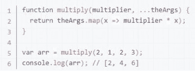

## 第 6 章：事件

### 事件 – 基础

每当用户或浏览器控制时，就会发生事件。JavaScript 允许你对这些事件做出响应。例如，当用户点击按钮、移动鼠标或按下键盘时，JavaScript 可以执行相应的操作。这些操作被称为事件处理器（event handlers）。

每当用户或浏览器控制时，就会发生事件。JavaScript 允许你对这些事件做出响应。例如，当用户点击按钮、移动鼠标或按下键盘时，JavaScript 可以执行相应的操作。这些操作被称为事件处理器（event handlers）。

每当用户或浏览器控制时，就会发生事件。JavaScript 允许你对这些事件做出响应。例如，`onclick`是最触发的事件。

### 点击事件

当用户点击鼠标左键时，会触发此事件。这里有一个例子：

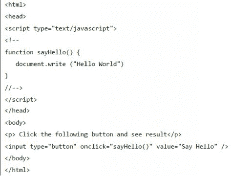

如果你运行该代码，你将看到以下输出：

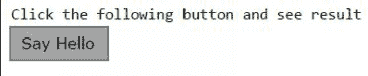

### 提交事件

当用户提交表单时，会触发此事件。通常，程序员会将表单链接到事件。

### 鼠标移出和鼠标移入事件

这两类事件可以帮助你添加酷炫的效果（如文本、图像）到 HTML 中。基本上，`onmouseout`在鼠标离开元素时运行。另一方面，`onmouseover`在鼠标悬停在元素上时运行。

### HTML 标准事件

下表显示了标准事件。

| 属性 | 解释 |
| :--- | :--- |
| `onblur` | 当窗口失去焦点时发生。 |
| `offline` | 当文件离线时发生。 |
| `oncanplay` | 当媒体可以播放时发生。媒体可能因为缓冲而停止。 |
| `onabort` | 在中止期间发生。 |
| `onbeforeprint` | 在系统打印 HTML 文档之前。 |
| `onafterprint` | 系统打印 HTML 文档后发生。 |
| `onclick` | 用户点击鼠标左键时发生。 |
| `ondblclick` | 当用户双击鼠标左键时发生。 |
| `ondrag` | 当用户拖拽 HTML 元素时发生。 |
| `onchange` | 当 HTML 元素发生变化时发生。 |
| `ondragend` | 当用户停止拖拽 HTML 元素时发生。 |
| `onmouseup` | 当用户释放鼠标按钮时发生。 |
| `onmousewheel` | 当用户滚动鼠标轮时发生。 |
| `onpagehide` | 当用户隐藏页面时发生。 |
| `onredo` | 当用户对 HTML 文档执行重做时发生。 |
| `onstorage` | 每当 HTML 文件加载时发生。 |
| `onmessage` | 当用户触发分配的消息时发生。 |
| `onmousedown` | 当用户按下鼠标按钮时发生。 |
| `ononline` | 当文件变为在线时发生。 |

## 第 7 章：JavaScript 与 Cookie

### 什么是 Cookie？

Web 服务器和浏览器利用 HTTP 进行通信。然而，HTTP 协议是无状态的（即它将请求视为独立的事务）。这意味着系统不会记住之前的任何事务。这对于商业网站来说是一个巨大的问题，因为它们需要在不同的网页之间共享用户信息。

在大多数情况下，Cookie 帮助网站跟踪和记住事务；因此，Cookie 可以帮助你提高网站的用户友好性和整体流量。

## Cookie 是如何工作的？

Web 服务器将信息以 Cookie 的形式发送给用户的浏览器。如果浏览器接受了该 Cookie，该信息将在用户的硬盘中被转换为明文。一旦用户再次访问了你网站上的另一个网页，他的浏览器将向 Web 服务器发送相同的 Cookie 以进行数据检索。一旦检索到数据，你的 Web 服务器就会知道之前发生了什么。

基本上，Cookie 是一个包含 5 个字段（长度可变）的明文数据记录。这些字段是：

- `Domain`: 这是你网站的域名。
- `Secure`: 如果此字段被标记为“secure”，则只有安全的 Web 服务器可以检索 Cookie。但是，如果它是空的，任何 Web 服务器都可以访问该 Cookie。
- `Expires`: 此字段指定了 Cookie 过期的日期。如果此字段为空，Cookie 将在用户关闭网络浏览器时过期。
- `Path`: 这是创建 Cookie 的网页或目录的路径。如果你想从任何页面或目录检索 Cookie，可以留此字段为空。
- `Name=Value`: 每个 Cookie 都是以键值对的形式进行设置和检索的。

Cookie 的创建是为了 CGI（即通用网关接口）编程。存储在 Cookie 中的信息会在 Web 服务器和用户的浏览器之间自动传输。这意味着编写在 Web 服务器上的 CGI 脚本可以读取和编辑存储在用户硬盘上的 Cookie 信息。

JavaScript 允许你使用`Document`对象的`cookie`属性管理 Cookie。JavaScript 语言可以创建、读取、修改和删除应用于活动网页的 Cookie。

## 如何创建 Cookie？

生成 Cookie 最简单的方法是向名为`document.cookie`的对象放置一个字符串值。你应该使用的语法是：

```
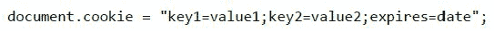
```

在此语法中，`expires`是完全可选的。如果你在该字段中输入有效的时间或日期，Cookie 将在该特定时间或日期过期。你将无法访问过期 Cookie 中存储的值。

**重要说明**：你不能在 Cookie 中保存空格、逗号或分号。因此，在将它们保存到 Cookie 之前，你必须使用`escape()`函数对这些字符进行编码。如果你用这样编码了字符，还应该使用`unescape()`让系统读取你存储的值。

## 如何读取 Cookie

你可以轻松地读取 Cookie。这是因为 Cookie 是存储在名为`document.cookie`的对象上的值。这意味着你可以随时使用该字符串来访问 Cookie。基本上，`document.cookie`包含一组由分号分隔的`name=value`节点。这里，`name`是 Cookie 的名称，`value`是 Cookie 的字符串值。

## 如何设置 Cookie 的过期日期

在某些情况下，你必须将 Cookie 的寿命延长到当前浏览会话之外。这样做，你可以完成长时间的过程而无需重新输入任何信息。JavaScript 允许你设置偏好的过期日期并将该信息保存在 Cookie 自身内部。你可以通过自定义 Cookie 的“expires”属性来实现这一点。

下面的图片显示了如何设置 Cookie 的过期日期。它将当前的过期日期延长了一个月。

```
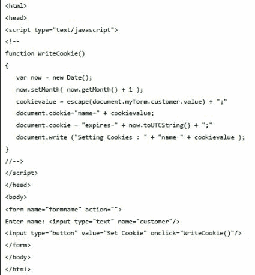
```

## 如何删除 Cookie

在大多数情况下，在使用 Cookie 后必须删除它们。这确保了 Web 服务器不会从必要的 Cookie 中获取任何信息。删除 Cookie 非常简单直接。你只需要将过期日期设置为过去的时间。

## 第 8 章：页面重定向

## 页面重定向 – 基础

你可能尝试过访问某个网页，但被重定向到了另一个。该事件的发生是因为页面重定向。不要将其与页面刷新（将在下文中讨论）混淆。

有很多理由需要你从某个页面重定向用户。以下是最常见的原因：

- 你正在将你的网站迁移到新域名。在这种情况下，你需要将所有的网站流量重定向到新域名。你不需要删除旧网站。你可以保留它并使用页面重定向来获取所有网络流量。这种方法可以帮助你留住之前的客户，他们可能并不知道你的新网站。

- 你根据某些标准（例如浏览器类型、客户名称、客户所在的国家等）创建了网页。与其通过服务器端机制重定向访问者，你可能采用客户端重定向将访问者引导到正确的网页。

- 即使你已经切换到新网站，你仍想保留来自旧 SEO 活动的流量。如果你使用页面重定向来获取非法网络流量，搜索引擎可能会从搜索结果页面中封禁你的网站。

## 页面刷新

在 JavaScript 中，你可以使用`location.reload`方法刷新网页。你可以自动调用此方法，也可以在用户点击某个链接时调用它。如果你喜欢根据鼠标点击刷新网页，应该使用下面的代码：

```
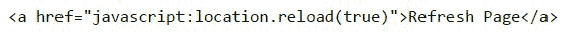
```

### 自动刷新

JavaScript 允许你在一段时间后刷新网页。你只需要使用`setTimeout()`（即一个预装的 JavaScript 函数）在预定的时间间隔后运行另一个函数。

## 页面重定向是如何运作的？

程序员以不同的方式实现页面重定向。以下是一些示例：

1. 你可能使用 JavaScript 实现客户端页面重定向。为了将你的网站访问者引导到新网页，你只需要在 HTML 文档中添加一行。例如：

```

```

2. 你可以在引导访问者之前显示消息。这种方法涉及延迟：网页需要加载你想显示的消息。下面的代码将显示如何使用它：

```
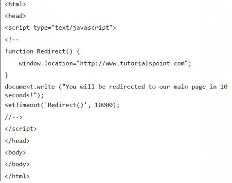
```

3. 你可以根据用户使用的浏览器重定向用户。以下示例将显示如何实现：

```

```

## 第 9 章：对话框

JavaScript 语言支持三种对话框。你可以使用这些对话框来发出警告、确认输入或要求用户输入某些信息。本章将详细讨论每种对话框。

## 警告框 (Alert Box)

使用此框为你的网站访问者显示警告消息。例如，如果用户在必填字段没有输入任何内容，你可以使用警告对话框来提醒该用户。程序员认为这种对话框是用户验证的重要部分。

**重要说明**：你也可以使用警告框显示友好的消息。此外，警告框只有一个按钮（即“确定”按钮）。用户需要点击该按钮后才能继续。

## 确认框 (Confirmation Box)

通常，你会使用此对话框来请求用户的同意。此对话框有两个按钮：确定和退出（或取消）。网站开发者使用此对话框来确认访问者继续操作的意图。

## 提示框 (Prompt Box)

如果你需要显示一个可以接受用户输入的文本框，这个对话框非常有用。这意味着你可以使用提示框与你的网站访问者进行交互。你的访问者必须输入所需的信息并点击确定按钮。

要在网页上显示提示对话框，你必须使用`prompt()`方法。该方法接受两个参数：(1) 你想在对话框中显示的标签，(2) 你想在对话框中显示的文本字符串。

与确认框类似，提示框包含一个 OK 按钮和一个退出/取消按钮。如果网站访问者点击 OK，`prompt()`方法将提交在文本框中输入的数据。另一方面，如果访问者点击退出/取消，`prompt()`方法将向 Web 服务器提交`null`。

## 第 10 章：如何使用 void 关键字

`void`关键字在 JavaScript 语言中起着重要作用。你可以将`void`作为一元运算符（即作用于单个操作数的运算符）用于任何类型的操作数。基本上，`void`的作用是识别要检查的表达式，但不返回任何值。

## 语法

该关键字的语法有两种形式：

1. 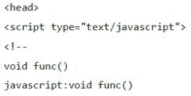

2. 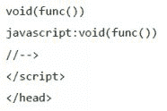

为了帮助你理解这个关键字，让我们来分析两个实际示例：

* 程序员经常在 JavaScript 的客户端表单中使用此关键字。例如，他们可以在 URL 上使用`void`来获取表达式的副作用，而不会在网页浏览器中显示结果。

* 分析下面的代码。它包含的链接不会产生任何作用，因为表达式“0”在 JavaScript 语言中是没有意义的。JavaScript 会评估“0”，但不会将表达式加载到 HTML 文档中。

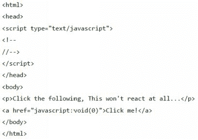

## 第 11 章：调试


程序员也是人——他们偶尔会犯错。脚本或程序中的错误被称为“bug”（故障）。

查找并解决错误的行为被称为“调试”（debugging）。程序员认为调试是开发过程中的一个重要环节。本章将讨论你可以执行调试任务的工具和方法。

## Internet Explorer 中的错误信息

查找错误的简单方法是激活 Web 浏览器的“错误信息”选项。例如，当网页发生错误时，Internet Explorer 都会在其状态栏中显示一个图标。这是一个截图：

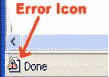

如果你双击该图标，Internet Explorer 将显示一个包含其所遇错误详细信息的对话框。

由于你可能会忽略此图标，Internet Explorer 允许你设置系统，以便每次发生错误时都显示错误对话框。要开启该选项，只需点击“工具”并点击“Internet 选项”。点击名为“高级”的选项卡，勾选“显示有关每个脚本错误的通知”框框。

这是一个截图：

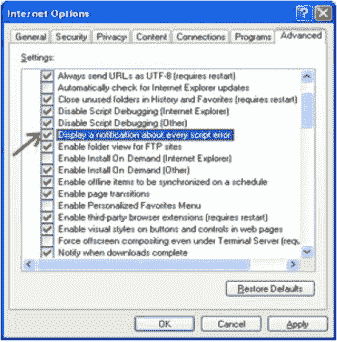

## Netscape 和 Firefox 中的错误信息

Netscape 和 Firefox 将错误详细发送到名为“错误控制台”或“JavaScript 控制台”的窗口。你可以通过点击“工具”并选择“错误控制台”查看此窗口。

然而，由于这两个浏览器没有错误图标，你在执行 JavaScript 代码时必须保持错误控制台打开。

## 错误通知

你在浏览器（如 Internet Explorer、Netscape、Firefox 等）上看到的错误通知是由运行时语法错误引起的。这些通知包含了有关错误的详细信息（例如行号）。这意味着你可以利用这些错误通知快速找到并解决错误。

如果你正在使用 Mozilla Firefox，可以点击控制台中列出的错误来检查导致问题的确切行。

## 调试你的脚本

JavaScript 为调试脚本提供了一种强大的方法：

* 使用验证器——在 JavaScript 中，你可以使用验证器来确保你的代码符合该语言的语法规则。验证器（也称为通过检查器）通常随高级 JavaScript 和 HTML 编辑器一起。

* 由 Douglas Crockford 开发的 JavaScript Lint 是目前领先的验证器之一。你可以在这里免费使用：[`www.jslint.com/`](http://www.jslint.com/)

只需访问该网页，将 JavaScript 代码粘贴到编辑区域，然后点击“JSLint” 按钮。此计算机程序将分析你的代码，确保其每个部分都符合正确的语法。

# 结

感谢阅读本书！

希望这本书能够教会你 JavaScript 的基础知识。

下一步是使用 JavaScript 编程语言编写你自己的网页和应用程序。

能帮我个忙吗？

最后，如果你喜欢这本书，请花时间分享你的想法并在 Amazon 上发表好评。我将不胜感激！

感谢，并祝你好运！
