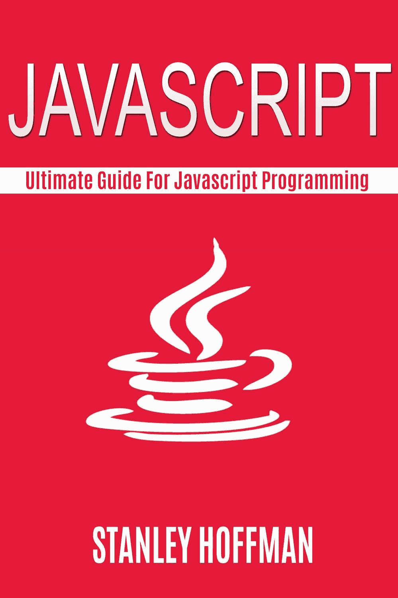
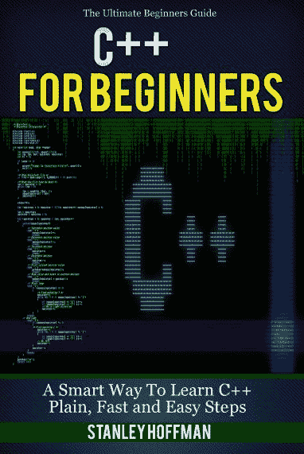
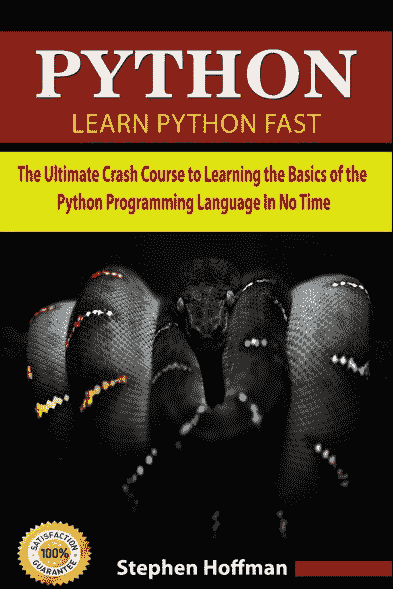
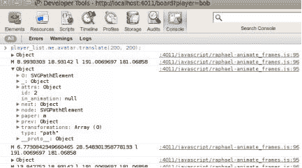
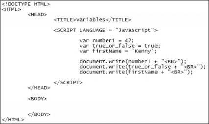

# JavaScript：JavaScript 编程终极指南（JavaScript 初学者指南、如何编程、软件开发、基础 JavaScript、浏览器... 编码、CSS、Java、PHP）（第 7 卷）



我认为接下来的书对你可能感兴趣。

[C++](http://www.amazon.com/Beginners-Simple-programming-coding-Developers-ebook/dp/B014MT5ME8/ref=sr_1_fkmr0_1?s=digital-text&ie=UTF8&qid=1442833820&sr=1-1-fkmr0&keywords=C%2B%2B%3A+C%2B%2B+for+Beginners%2C+C%2B%2B+in+24+Hours%2C+Learn+C%2B%2B+fast%21+A+smart+w)



[Python](http://www.amazon.com/Python-Ultimate-Learning-Programming-Hands--ebook/dp/B014MV238Y/ref=sr_1_1?s=digital-text&ie=UTF8&qid=1442836729&sr=1-1&keywords=Python%3A+Learn+Python+FAST+-+The+Ultimate+Crash+Course+to+Learning+the+Basics+of+the+Python+Programming+)



[计算机黑客](http://www.amazon.com/dp/B010965F36)


[入门黑客教程](http://www.amazon.com/Computer-Hacking-beginners-computer-security-ebook/dp/B015T8FZYI/ref=sr_1_1?s=digital-text&ie=UTF8&qid=1446193044&sr=1-1&keywords=hacking+for+dummies+matt+benton)


# 引言

在这一代，计算机似乎不再令人生畏了。它们现在正成为我们日常工具之一——让我们事情变得更简单、更高效。虽然今天最新的计算机操作对用户友好，但仍然有许多隐藏的复杂性。大多数人会发现它们难以理解。因此，这本书是写给那些想要以最简单的方法发现计算机最大潜能的人的。

为了实现这一点，你必须记住通信是计算机处理过程中至关重要的部分。这不是计算机之间的过程，而是键盘后的用户与运行的机器之间的过程。基础元素当然是语言。学习像`C`这样的语言将允许你以你想要的方式和按照你想要的方式命令机器。

在书中，你将学习计算机最重要的语言之一——`JavaScript`。

## 编程简介

在继续学习`JavaScript`之前，理解什么是编程至关重要。

计算机程序可以是任何东西。你用来阅读本电子书的软件是一个程序。你使用的网络浏览器是一个程序。播放你音乐文件的应用程序是一个程序。你玩的游戏是一个程序。换句话说，你在计算机中看到和使用的一切都是程序。这一切都是一个被称为编程的单一过程的产物。


编程是一门艺术。程序员输入一段文本，命令计算机执行特定操作。让我们以人体作为类比。

如果你被给你一个数学题来解决，你的大脑必须处理它。根据方程的规模，你可能会发现自己在数手指或在纸上求解公式。简而言之，有几种身体功能在工作。

从编程的角度来看，所有这些身体功能都是程序，你的整个身体就是机器。你大脑的机械对应物是机器的内存。方程是我们想要处理的数据。

我们首要目标是处理数据。在上面的场景中，就是数学题的正确答案。为了让我们的身体能够做到，你的眼睛需要看到问题并将其传递给大脑。对于机器，你需要一个程序将该信号传递给计算机内存。

回到人体，你的眼睛需要看到问题并将其传递给大脑。对于机器，你需要一个程序将该信号传递给计算机内存。

## 介绍 JavaScript


在其他事情之前，你可能已经熟悉另一种名为`Java`的语言。记住`JavaScript`和`Java`之间几乎没有任何关系。

`JavaScript`最初被命名`Mocha`，于 1995 年创建。它是当时在`Netscape`工作的`Brendan Eich`十天努力工作的成果。`Mocha`这个名字是由 Netscape 创始人`Marc Andreessen`选定的。

在同年的 9 月，语言的名字改为`LiveScript`。在同年 12 月，在获得`Sun`的商标许可后再次改为`JavaScript`。显然，这是一个营销手段，因为当时`Java`语言正在被大力推广并变得流行。

今天，`JavaScript`是每个初学者都能轻松学习的编程语言之一。它是网页开发者除`CSS`和`HTML`之外必学的语言。网页开发者使用`HTML`定义内容。使用`CSS`指定布局。最后，他们使用`JavaScript`设计网站的行为。因此，`JavaScript`被认为是网页编程语言。

尽管`JavaScript`的理念为初学者提供更简单的编程领域，但该语言提供的灵活性对资深程序员也有巨大的优势。它为你提供了许多在更严格的编程语言中无法实现的技巧空间。稍后我们会看到更多技巧。所以，如果你不是编程新手，只是开始学习`JavaScript`，如果它通常以不同的方式解释你的代码，请讨厌它。你只需要耐心和开放，因为`JavaScript`不仅有趣，还会带你进入一个全新的编程世界。

## 你在书中能找到什么？

这本书是《简单学 JavaScript》系列的第一部分。该系列包含 3 章。第一章将为你介绍值以及如何在`JavaScript`语言中处理这些值。你将学习如何使用运算符、比较符以及创建字符串。第二章讨论变量。在这一章中，你将学习如何为变量赋值。你还将学习通过组合多个变量来创建灵活的消息。最后一章讨论`JavaScript`源文件的创建。在这一章中，你将学习如何正确源文件中编写`JavaScript`代码。此外，你将学习如何在`HTML`文件中执行该文件。

《通俗易懂的 JavaScript》书籍系列分为几个部分，帮助你掌握这门编程语言而不会不知所措。许多初学者放弃了，因为他们认为 JavaScript 太难处理。整个系列旨在以最简单的方法带你进入 JavaScript 的核心。

# 第 1 章 – 认识数字、运算符和字符串

仅仅浏览互联网就能让你接触数百万行的 JavaScript 代码。当你启动你喜爱的浏览器（例如 Google Chrome、Mozilla Firefox 和 Internet Explorer）并开始访问某个网站时，你已经在使用 JavaScript 语言进行通信了。

在本章中，我们将讨论 JavaScript 语言的基础构建模块。这将帮助你在之后转向`jQuery`等高级框架时建立坚实的基础。

你将学习更多关于数字、运算符和字符串的知识。本章还将涵盖使用运算符操作值的不同过程，以及如何将这些值存储在变量中。最后，你学习如何在 HTML 代码中创建、运行和查找 JavaScript 代码。

## 控制台 (Console)

在进行任何操作之前，访问浏览器控制台对你非常重要。浏览器控制台是开发者工具之一，它记录与当前网页相关的信息。这些信息包括 CSS、安全错误和 JavaScript。控制台还允许你通过断言 JavaScript 表达式来与网页交互。

我们将在这里执行书中的示例 JavaScript 代码。你可以通过按下键盘上的`F12`键访问它。寻找`Console`（控制台）标签页，现在你可以开始了。



## 基础数字与提示符 (Prompt)

在开始学习 JavaScript 时，有两个符号你需要熟悉：

- `>`：大于符号；以及，

- `→`：箭头符号

`>`符号代表 JavaScript 提示符。我们所有想要输入到控制台的代码都将写在这个符号之后。`→`符号指的是我们输入的代码所产生的结果。

在 JavaScript 语言中，数字会被自动识别。在提示符后输入数字并按下键盘上的回车键，将得到相同的值作为结果。尝试在控制台中输入数字`13`，它将返回相同的值。

```
> 13
→ 13
```

带有小数数值的数字也是如此。

```
> 13.29
→ 13.29
```

## 运算符

在 JavaScript 中，数学运算也是允许的。JavaScript 语法中常用的运算如下：

- 加法

- 减法

- 乘法

- 除法

- 取模

加法通过`+`号表示。

```
> 1 + 3
→ 4
```

减法通过`–`号表示。

```
> 10 – 5
→ 5
```

乘法通过`*`号表示。

```
> 2 * 9
→ 18
```

除法通过`/`号表示。

```
> 25 / 5
→ 5
```

另一方面，取模（Modulus）是 JavaScript 语言中的一种特殊运算。它通过`%`号表示。你得到的结果是两个数字相除后的余数。

```
> 23 % 2
→ 1
```

在在上面的取模示例中，控制台将`23`除以`2`。即使在数字`23`中可以除 11 次，控制台也只显示余数作为结果，即`1`。

### PEMDAS 顺序

JavaScript 编程遵循流行的数学运算顺序：PEMDAS。这个缩写代表：

- **P**: 括号 (Parentheses)

- **E**: 指数 (Exponents)

- **M**: 乘法 (Multiplication)

- **D**: 除法 (Division)

- **A**: 加法 (Addition)

- **S**: 减法 (Subtraction)

让我们以以下表达式为例。

```
> (10 + 5) * 3
```

按下回车后，控制台将给你这个答案。

```
→ 45
```

括号内的运算首先求解。在我们的案例中是`10 + 5`，得到`15`。之后，将总和乘以`3`。因此，控制台给了你`45`。

让我们尝试一个较长的表达式。

```
> (7 * 2) + 5 – 10 / 2
```

按照 PEMDAS 顺序，表达式将如下如下求解：

1. `7 * 2` = `14`

2. `10 / 2` = `5`

3. `14 + 5` = `19`

4. `19 – 5` = `14`

因此，控制台将给你这个答案。

```
→ 14
```

### 比较运算符 (Comparators)

除了运算符，JavaScript 语言还识别逻辑运算符，我们称其为比较运算符。JavaScript 中常用的比较运算符通过以下方式表示：

- `>`：大于

- `<`：小于

- `==`：等于

- `!=`：不等于

- `>=`：大于等于

- `<=`：小于等于

使用这些比较运算符在 JavaScript 中发送表达式，就像向控制台提一个逻辑问题一样。你从控制台得到的答案可能是`true`（真）或`false`（假）。这些答案被称为布尔值（Boolean values）。

让我们尝试向控制台发送以下表达式。

```
> 10 != 9
```

这个表达式就像是在问控制台：在 JavaScript 语言中，`10`是否**不等于**`9`。因此，控制台将给你`true`作为答案，因为`10`在数值上不等于`9`。

在字符串内部添加引号也需要使用反斜杠。

`\"`告诉控制台后面的引号不是字符串的开始或结束。

以下是在字符串内部断言引号时，你的字符串行的样式，以及你将获得的输出。

```
> "Nicknames:\t\"The Geek\" \"Com Wiz\" \"Backslasher\""
→ "Nicknames:     \"The Geek\" \"Com Wiz\" \"Backslasher\""
```

如果你想在字符串输出中断言反斜杠符号，适用于相同的规则。

`\\`告诉控制台在输出中原样添加后面的反斜杠。

编写此命令时，字符串和输出应所示。

```
> "Target Folder:\t\"C:\\Program Files\\Directory 1\\Directory 2\""
→ "Target Folder:     \"C:\Program Files\Directory 1\Directory 2\""
```

你也可以通过在反斜杠后添加字母“n”来命令控制台将值放在新行。

`\n`告诉控制台在新行中断言后续的值。

这是你的代码和输出的样子。

```
> "Member 1:\tFebz\nMember 2:\tDonz\nMember 3:\tTaz"
→ "Member 1:     Febz
→ Member 2:     Donz
→ Member 3:     Taz"
```

## 比较运算符与字符串

除了数字外，比较运算符也可以用于比较字符串以获取布尔值作为输出。让我们尝试使用等号比较运算符。

```
> "Obi-Wan Kenobi" == "Obi-Wan Kenobi"
→ true
```

基于上面的示例，我们得到了布尔值“true”，因为第一个字符串与第二个字符串完全相同。让我们尝试修改其中一个字符串。

```
> "Obi-Wan Kenobi" == "Obi-Wan Kinobi"
→ false
```

请记住，JavaScript 语言是区分大小大小的。因此，如果第一个字符串用大写字母写，而第二个字符串完全用小写字母写；那么控制台将它们视为为不相等。

```
> "Obi-Wan Kenobi" == "obi-wan kenobi"
→ false
```

## 计算字符串长度

在 JavaScript 语言中，你可以轻松地访问字符串的长度。这样做将命令控制台计算引号之间的所有字符，包括空格和非字母字符。我们通过在字符串后直接添加以下属性来实现。

`.length`命令让控制台计算其后字符串内的字符。

这是我们的编写方式以及我们将得到什么种的输出。

```
> "Pneumonoultramicroscopicsilicovolcanoconiosis".length
→ 45
```

现在让我们尝试使用一个带有空格和非字母字符的字符串。

```
> "Pink, Blue, Black, Red, Purple, White, and Green".length
→ 48
```

# 第 2 章 – 发现变量

现在你已经知道如何在 JavaScript 语言中编写、格式化和处理数据，现在是时候学习变量了。在本章中，你将学习如何使用变量存储值。如果你不学习如何编写变量，将无法做到这一点。话话不多说，让我们开始变量世界的之旅。



### 值的存储

为了在 JavaScript 语言中管理数据，你需要将它们存储在变量中。让我向你展示一个名为“Learn Easy”的变量的基本赋值语法。

```
> var learnEasy = 6
```

这里的代码`var`指的是变量关键字。它命令浏览器为此变量预留特定的空间。下一个是`learnEasy`指的是变量名。这是我们将分配给这个示例变量语法的名称。这里的等号充当赋值操作符。注意我们这里只使用单等号，不同于我们之前用于比较的双双等号。最后，这里的数字`6`是我们要存储在名为`learnEasy`的变量中的值。

现在我们已经已经在变量中存储了一个值，现在我们可以仅使用变量名来调用它。在控制台中断言变量名`learnEasy`将带我们赋值的值作为其输出。

```
> learnEasy
→ 6
```

在为变量分配名称时，JavaScript 语言中有一些我们需要遵循的规则。这些规则如下：

1. 变量名中不能有空格。（例如：`var learn easy`, `var sweet java`）

2. 变量名开头不能是数字。（例如：`var 4life`, `var 1piece`）

你可以在变量名中使用一些特殊字符。但最好使用简单的名称以使 JavaScript 语言不那么复杂。

1. 你可以在变量名中使用下划线 (`_`)。（例如：`var learn_easy`）

2. 你可以在变量名中使用美元符号 (`$`)。（例如：`var learnEa$y`）

3. 你可以同时使用下划线和美元符号。（例如：`var learn_ea$y`）

一个良好的变量名应该是这样的。它被称为“驼峰命名法”（Camel Case），它以小写字母开头，后续单词的首字母大写。

```
> var simpleAndClean
```

如果你喜欢重用一个变量名来存储不同的值，那么你可以在末尾添加一个数字来简化一切。

```
> var AndClean
```

### 修改变量中的赋值值

让我们回到示例`learnEasy`。目前我们为它分配了数值 3。假设你想更改这个值。你可以通过输入变量名、赋值操作符，然后是你想要分配的值来轻松实现。

```
> learnEasy = 13
```

注意这里不再使用变量关键字。这是因为控制台记得该值是存在的。一旦你调用这个变量，你现在将获得值。

```
> learnEasy
→ 13
```

你也可以使用它自己的名称更改现有变量的值。格式应该是变量名后跟操作符。它应该是这样的。

```
> learnEasy = learnEasy + 16
```

这会将我们的值变为 29，因为该表达式调用了当前值。

还有另一种方法这样做。我们将使用不同的语法更改存储的值。它是这样的。

```
> learnEasy += 2
```

这里的`+=`操作符命令控制台将变量的当前值加上 2。然后它命令控制台将新值存储到同一个变量中。由于我们的当前值是 29，我们现在将在`learnEasy`中得到 31。

### 在变量中存储字符串


除了数值，你还可以将字符串存储在变量中。语法使用相同的格式。让我们创建一个变量来欢迎客人们。

```
var hello = "Welcome to my website!"
```

将字符串存储在变量中，你不再需要输入长字符串。只需调用变量名，控制台就会给你存储的字符串。它应该是这样的。

```
hello → "Welcome to my website!"
```

你也可以使用变量名使用长度属性。你将获得的输出值与在字符串后添加长度属性是相同的。让我们假设有一个名为`fox`的变量，它包含字符串“The quick brown fox jumped over the lazy dog”。我们只需在变量名后添加`.length`，我们的控制台中就会出现以下行：

```
fox.length → 44
```

## 在字符串中查找字符

JavaScript 语言有自己的方式来索引字符串中的每个字符。让我们以变量`hello`为例。

“Welcome to my website!”

0 1 2 3 4 5 6 7 8 9 10 11 12 13 14 15 16 17 18 19 20 21

在索引时，JavaScript 使用数值`0`来索引第一个字符。这与`.length`属性不同，因为 JavaScript 使用数值`1`来计数第一个字符。换句话说，最后一个索引值总是比长度值小 1。

使用存储在变量`hello`中的字符串，其`length`属性的值为`22`，最后一个索引数字为`21`。现在，你可能会问，为什么我们需要索引值呢？

我们使用它来查找字符串中的特定字符。这是通过`charAt()`方法实现的，我们像使用`.length`属性一样将它放在变量之后。例如，我们想知道变量`hello`中索引数字为`20`的对应字符是什么。我们只需要输入以下内容：

```
hello.charAt(20) → “e”
```

## 使用变量创建消息

现在你已经知道如何在变量中存储值了，让我们使用变量来创建消息吧。让我们再创建一个变量，与我们现有的变量`hello`结合。

```
var enjoy = "Please enjoy your visit!"
```

现在我们已经有了第二个变量，让我们将它们结合并创建一个新变量，作为我们的欢迎消息。

```
var welcome = hello + enjoy
```

每当我们调用变量`welcome`时，都会得到以下输出。

```
welcome → "Welcome to my website! Please enjoy your visit!"
```

# 第 3 章 – 构建与运行 JavaScript

学习变量很有趣，不是吗？然而，没有人想在控制台中编写 JavaScript 语言。在本章中，你将学习如何构建 JavaScript 文件。你还将学习如何在 HTML 内部运行这些文件。让我们开始吧。


## 创建源文件

仅在控制台中编写 JavaScript 代码无法向用户的浏览器传达我们想要表达的内容。因此，我们需要找到一种方法将想要的内容呈现给用户。为了实现这一点，我们需要创建 JavaScript 源并在 HTML 文件中运行这些文件。这里是最常见的 HTML 文件`index.html`的示例。

```html
<html><head><script src="greetings.js"></script></head><body><h1>WELCOME TO JAVASCRIPT!</h1>…</body></html>
```

如你所见，我们在这个文件中使用了`<script>`标签。该标签命令此 HTML 文件加载特定的 JavaScript 源文件，这样访问者的浏览器就能以你想要的方式看到你的网站。注意我们在`<script>`标签内部有`src`关键字。这是给 HTML 文件的命令，指示它去加载 JavaScript 源文件。

在这个示例中，我们正命令`index.html`文件加载保存在`greetings.js`内部的所有变量和值。

为了创建此`.js`文件，你只需要打开任何文本编辑器（如记事本或文本编辑）。在其中编写所有的 JavaScript 代码，并将文件保存为`.js`格式。在该文件中，我们断言希望访问者在进入网站时立即执行的所有 JavaScript 代码。

## 将源文件放在哪里？

在浏览网站的文件管理器时，你绝不会漏掉一个名为`root/`的文件夹。这是我们找到网站内一切内容的地方。这也是你网站`index.html`的默认位置。

基于上面的`index.html`文件，我们指示它在同一文件夹内查找 JavaScript 源文件——即`root/`文件夹。因此，我们应该将`greetings.js`放在同一个位置。

```
+ root/
  - index.html
  - greetings.js
```

然而，有些网站会将所有的 JavaScript 源文件放在子文件夹中。它们源文件最常见的目录是`scripts/`文件夹下。以下是它们在你网站目录中的样子。

```
+ root/
  - index.html
  + scripts/
    - greetings.js
```

如果你想这样组织源文件，那么我们需要修改示例`index.html`中的`<script>`标签。你的 HTML 代码看起来应该是这样的。

```html
<html><head><script src="scripts/greetings.js"></script></head><body><h1>WELCOME TO JAVASCRIPT!</h1>…</body></html>
```

注意，在这段代码中，我们正在指示`index.html`从`scripts/`子文件夹中加载`greetings.js`。

## 在源文件中编写代码

在`greetings.js`中直接编写控制台风格的表达式会导致错误。让我们尝试在源文件中编写以下几行作为例如。

```
var hello = "Welcome to my website! "
var enjoy = "Please enjoy your visit!"
hello + enjoy
```

一旦我们打开`index.html`并进入浏览器控制台，我们将看到错误之外什么也看不到。这是因为网络浏览器对你真正想要显示的内容感到困惑。错误来自我们的 JavaScript 源文件。与控制台不同，我们需要在源文件中以不同的方式断言 JavaScript 代码。我们通过在每个语句后添加分号（`;`）来实现。因此，我们应该这样写我们的 JavaScript 代码。

```
var hello = "Welcome to my website! ";
var enjoy = "Please enjoy your visit!";
hello + enjoy;
```

使用分号编写代码后，当你尝试访问控制台时将不再看到错误。然而，你会在控制台中看不到任何内容。这意味着我们的代码尚未传递到控制台。JavaScript 代码的执行仅发生在源文件中。为了解决这个问题，我们需要使用`console.log()`方法。

我们在这里想要做的是显示由`hello`和`enjoy`拼接而字符串。

```
var hello = "Welcome to my website! ";
var enjoy = "Please enjoy your visit!";
console.log(hello + enjoy);
```

通过使用`console.log()`方法，你现在可以在控制台中看到字符串了。换句话说，我们现在有一个由`index.html`运行的 JavaScript 程序。

## 总结

此时，你已经知道如何在 JavaScript 语言中编写值。你刚刚学习了 JavaScript 如何解释数字和纯文本，以及如何将文本转换为字符串值。你还学习了如何使用运算符和比较符将这些值转换为表达式和语句。

在第二章中，你被引入了变量。你学习了如何在变量中存储值，以及通过拼接方法如何以变量的形式快速处理值。我们还介绍了一些方法，例如`charAt()`方法和`.length`属性——这些都是帮助你高效分析值的工具。

在第三章中，你学习了如何创建自己的 JavaScript 源文件。注意，与控制台相比，需要在源文件中以不同的方式断言 JavaScript 代码。你还了解`console.log()`方法，它允许你在浏览器控制台中打印值。

感谢阅读。希望你喜欢。请你提供诚恳的反馈。
