# JavaServer Faces 2.0：开发者必备指南

## 关于作者

Deepak Vohra 是一位顾问，也是 NuBean.com 软件公司的首席成员。Deepak 是 Sun 认证 Java 程序员和 Web 组件开发者，在 XML、Java 编程和 Java EE 领域工作了五年多年。Deepak 是 Apress 出版 *Pro XML Development with Java Technology* 的合著者，也是 O'Reilly 出版 *WebLogic: The Definitive Guide* 的技术审查员。Deepak 还是 Course Technology PTR 出版 *Ruby Programming for the Absolute Beginner* 的技术审查员。Deepak 编写了 Packt Publishing 的书籍：*JDBC 4.0*、*Oracle Developer for J2EE Development*、*Processing XML Documents with Oracle Developer 11g*、*EJB 3.0 Database Persistence with Oracle Fusion Middleware 11g* 以及 *Java EE Development with Eclipse*。

## 引言

JavaServer® Faces (JSF) 是一种用于为 Java EE 开发基于组件的用户界面的 Java® 规范。JSF 建立了构建服务器端用户界面的标准。JSF 是最常用的 Web 框架之一，甚至可以说是最常用的。根据[2012年开发者生产力报告](http://zerotaround.com/rebellabs/developer-productivity-report-2012-java-tools-tech-devs-and-data/)，JSF 在 10 个 Web 框架中排名第二。本书基于最新的主要版本 JSF 2.0 编写。与之前的版本相比的主要区别之一是，Facelets 是 JSF 2.0 的默认视图定义语言，而不是 JSP。

JSF 2.0 引入了多项新功能，包括：

- 新的作用域
- 简化的、基于注解的配置
- 状态保存
- 增强的异常处理
- 增强的资源处理
- 新系统事件
- Facelets
- Ajax
- 组合组件
- 增强的导航
- 增强的验证
- 用于 GET 请求的视图参数
- 客户端行为

本书将通过 Oracle® Developer 和集成的 Oracle® WebLogic Server 示例讨论 JSF 2.0 的新功能。

本书旨在讨论 Java EE 开发者如何使用 JSF 2.0 开发 Web 应用程序。本书涵盖了应用开发的所有方面，包括：

- 设置应用程序环境
- 使用 JDeveloper 向导和组件调板
- 运行示例应用程序

## 本书涵盖的内容

**第 1 章“JSF 2.0 的新特性”** 介绍了 JSF 2.0 的新功能以及它们与之前版本的区别。

**第 2 章“使用 Facelets 进行模板化”** 讨论了 JSF 2.0 的默认视图定义语言 (VDL) Facelets。我们将演示如何在 JDeveloper 开发并在集成的 WebLogic Server 上运行的 Web 应用程序中使用 Facelets 进行模板化。集成的 WebLogic Server 配置也将用于后续章节。

**第 3 章“Ajax”** 讨论了 JSF 2.0 组件库中 `f:ajax` 标签对 Ajax 的支持。还讨论了部分渲染和组件分组。

**第 4 章“创建组合组件”** 引入了组合组件。组合组件是多个 UI 组件的组合（集成），简化了可重用组件集的添加。例如，如果一个应用程序在多个 JSF 页面中使用相同的页眉、JSF 数据表、输入字段和提交命令按钮，你可以从这些组件组创建一个单一组合组件，并将其作为单个组件添加到 JSF 页面中。

**第 5 章“增强的导航”** 讨论了 JSF 2.0 提供的增强导航，包括隐式导航、条件导航和抢占导航。

**第 6 章“增强的验证”** 讨论了 JSF 2.0 对增强验证的支持。讨论了用于验证约束的注解、新的验证器 `f:validateRequired` 和 `f:validateRegex`、与 Bean 验证（bean validation）的集成，以及对空字段验证的支持。

**第 7 章“视图参数”** 讨论了通过视图参数对 GET 请求中参数的支持。它引入了通过视图参数实现的抢占导航和 JSF 页面的书签功能。我们还讨论了如何结合组件参数和重定向使用视图参数。

**第 8 章“客户端行为”** 讨论了客户端行为。在本章，我们将使用 JDeveloper 和集成的 WebLogic Server 开发一个 Web 应用程序来演示客户端行为。

**第 9 章“作用域”** 讨论了 JSF 2.0 中的新作用域：视图作用域（view scope）、闪作用域（flash scope）和自定义作用域。还讨论了通过注解简化配置。演示如何在 Web 应用程序中使用新的作用域。

**第 10 章“资源处理”** 引入了 JSF 2.0 中新的资源处理功能。讨论了作为 CSS 样式和图像的资源是如何打包和渲染的。还讨论了应用程序配置资源的顺序。

**第 11 章“事件处理与异常处理”** 讨论了 JSF 2.0 中新的事件处理和异常处理功能。讨论了对系统事件的支持、`f:ajax` 中的事件处理以及自定义异常处理器。

## 本书所需的准备

你可以使用任何支持 JSF 2.0 的 Web 服务器或应用程序服务器运行 JSF 2.0。在书中，你将使用 Oracle JDeveloper 12c。

默认情况下，JSF 2.0 使用部分状态保存（partial state saving）。通过 `javax.faces.PARTIAL_STATE_SAVING` 上下文参数可以开启关闭部分状态保存。你可以使用 `PARTIAL_STATE_SAVING_PARAM_NAME` 参数更改部分状态保存参数。

为了实现状态保存，JSF 2.0 引入了树访问（tree visiting）。在 JSF 1.2 中，使用 `UIComponent.invokeComponent()` 方法在单次树遍历中只能调用一个组件。如果必须调用多个组件（例如在 Ajax 请求或状态保存时），必须应用多次树遍历。通过访问（visiting）机制，你可以在单次树遍历中调用多个组件。使用 `visitTree(VisitContext context, VisitCallback callback)` 方法实现树访问。`VisitContext` 是一个持有组件树访问状态的上下文对象。`VisitCallback` 是一个接口，用于在树访问中访问指定的 `UIComponent`。

## Facelets

JSF 1.2 使用的是 JSP 视图技术。JSF 2.0 使用 Facelets 视图定义语言（VDL）作为默认渲染技术。Facelets 是 JavaServer Faces 的扩展，并使用 XHTML 语法定义 JSP 页面。Facelets 默认是扩展名为 `.xhtml` 的 XHTML 页面。默认的 Facelets 后缀由 `DEFAULT_FACLETS_SUFFIX` 上下文参数指定。JSF 1.2 中的 Facelets 视图处理器必须在 `faces-config.xml` 中通过以下配置指定：

```
<application>
  <view-handler>com.sun.faclets.FaceletHandler</view-handler>
</application>
</faces-config>
```

在 JSF 2.0 中，不需要配置视图处理器，使用的是默认视图处理器 `javax.faces.application.ViewHandler`。JSF 2.0 中 Facelets 的默认 `faces-config.xml` 是一个空文件。`ViewHandler` 视图处理器中的 `DEFAULT_FACLETS_SUFFIX` 常为 `.xhtml`。其他的 Facelets 后缀可以使用 `javax.faces.FACLETS_VIEW_MAPPINGS` 上下文参数指定。

```
<context-param>
  <param-name>javax.faces.FACLETS_VIEW_MAPPINGS</param-name>
  <param-value>jsf:.jsp</param-value>
</context-param>
```

# 第 1 章 JSF 2.0 的新特性

## 导航

JSF 1.2 中的导航是通过 `faces-config.xml` 中基于视图 ID 结果（outcome）的导航规则配置的。例如，如果 `input.jsp` 的结果为“success”则导航到 `output.jsp`，如果结果为“error”则导航到 `error.jsp`，在 `faces-config.xml` 中指定以下导航规则：

```
<navigation-rule>
  <from-view-id>/input.jsp</from-view-id>
  <navigation-case>
    <from-outcome>success</from-outcome>
    <to-view-id>output.jsp</to-view-id>
  </navigation-case>
  <navigation-case>
    <from-outcome>error</from-outcome>
    <to-view-id>error.jsp</to-view-id>
  </navigation-case>
</navigation-rule>
```

JSF 2.0 通过引入隐式导航（implicit navigation）简化了导航。在隐式导航中，导航基于结果（outcome）。隐式地，JSF 应用将导航到与结果同名的视图。例如，如果结果是“output”，如果提供了该文件，导航处理器将导航到 `output.xhtml`。

JSF 2.0 还引入了条件导航（conditional navigation），导航处理器会根据 `faces-config.xml` 中的条件 EL 表达式导航到视图 ID。JSF 2.0 还引入了 `ConfigurableNavigation` 类用于通过程序配置导航。抢占式导航（Preemptive navigation）是另一个新特性，用于根据结果确定目标 URL。新组件 `h:button` 和 `h:link` 支持抢占式导航。

## 验证

在 JSF 1.2 中，验证使用内置验证器实现：

- `f:validateDoubleRange`。用于具有可选范围的双精度浮点值。
- `f:validateLongRange`。用于具有可选范围的长整型值。
- `f:validateLength`。用于具有最小和最大字符限制的字符串值。

JSF 1.2 还支持使用 `f:validator` 自定义验证器。

JSF 2.0 包含的新的验证器：

- `f:validateRegex`。用于正则表达式。
- `f:validateRequired`。用于必填字段。
- `f:validateBean`。用于 Bean Validation。

## 范围与配置

JSF 2.0 引入了新的作用域：视图作用域（view scope）、闪作用域（flash scope）和自定义作用域。还通过注解简化了配置。


# JSF 验证器

## JSF 1.2 内置验证器

- `f:validateRequired`。用于必填字段。
- `f:validateBean`。用于 Bean Validation。

JSF 1.2 还支持使用 `f:validator` 自定义验证器。

## JSF 2.0 新增验证器

JSF 2.0 包含的新的验证器用于 Bean Validation：

- `f:validateRegex`。用于正则表达式。
- `f:validateRequired`。用于必填字段。
- `f:validateBean`。用于 Bean Validation。

JSF 1.2 还支持使用 `f:validator` 自定义验证器。

# AJAX

JSF 1.2 未提供对 Ajax 的支持，或者必须通过 `XMLHttpRequest` 对象来实现 Ajax。JSF 2.0 通过 `f:ajax` 标签添加了对 Ajax 的支持。

在 Ajax 请求中，事件处理时，`f:ajax` 标签包含一个 `onevent` 属性。

# 资源处理

资源是 JSF 应用所需的文件。资源可能包括 CSS、JavaScript 或图像文件。JSF 2.0 添加了基于路径的 `ResourceHandler` API。JSF 2.0 还增加了用于资源处理的新标签：`h:head`、`h:body`、`h:outputScript` 和 `h:outputStylesheet`。一些新的处理特性包括资源定位以及多个 `faces-config.xml` 的排序。

# 组合组件

JSF 2.0 引入了用于创建组合组件的库。组合组件是其他组件的组合。组合组件由一个库（利用新的处理特性）、一个定义页面和一个使用页面组成。定义页面和使用页面基于 Facelets。定义页面定义组合组件，使用页面使用组合组件。

# 第 2 章 使用 Facelets 进行模板处理

在 JSF 2.0 中，Facelets 是默认的视图声明语言（VDL），而非 JSP。因此，你不需要像在 JSF 1.2 中那样配置视图处理器（view handler）。Facelets 是一种以 Java 服务器为中心的视图技术。

Facelets 基于组合（compositions）。一个组合在 Facelets 页面中定义了 JSF 用户界面（UI）组件结构。一个 Facelets 应用程序可以由定义在不同 Facelets 页面中的组合组成，并作为一个应用程序运行。

Facelets 是一个类似于 Tiles 的模板框架。Facelets 优于 Tiles 的优势在于 JSF 组件已与 Facelets 预集成，且 Facelets 不需要像 Tiles 那样需要一个 Tiles 配置文件。

JSF 验证器和转换器可以被添加到 Facelets 中。Facelets 提供了完整的表达式语言和 Java 页面标签库（JSTL）支持。在 Web 应用程序中使用 Facelets 的优势包括模板化、可重用性和易于开发等。

在本章中，你将使用 Oracle Developer 12c 开发一个 Facelets Web 应用程序，并将其部署到 Oracle WebLogic 12c。在应用程序中，你将向输入 Facelets 页面添加一个输入文本组件。通过 JSF 导航，输入 Facelets 页面将导航到另一个 Facelets 页面，该页面将显示从输入 Facelets 页面指定的 SQL 查询生成的 JSF 数据。你将使用 Oracle Database 11g XE 作为数据源。模板化通过在输入和输出中包含页眉和页脚的图形来演示；这些图形只需在模板中指定一次。

## Facelets 概述

在开发应用程序之前，让我们复习 Facelets 技术。Facelets 在 `http://java.sun.com/jsf/faclets` 命名空间提供了一系列 XML 标签。Facelets 标签与 JSF Core 和 JSF HTML 标签库配合使用，用于开发 JSF Facelets 应用程序。表 2.1 列出了部分 Facelets 标签。

### 表 2.1 部分 Facelets 标签

| 标签 | 说明 |
| :--- | :--- |
| `ui:insert` | 在模板中使用，用于定义 Facelets 页面的布局，并使用模板定义 UIComponents。模板客户端通过相应的 `ui:define` 标签将 UIComponents 添加到 Facelets 页面。如果 Facelets 页面指定了模板但没有指定对应 `ui:insert` 标签的 `ui:define` 标签，则 Facelets 页面中使用默认的 `ui:insert` 标签。<br>**name**：此属性在 Facelets 页面的 `ui:define` 标签中有一个对应的 name 属性，用于匹配模板与 Facelets 页面。 |
| `ui:param` | **name**：此必需属性指定变量名。<br>**value**：此必需属性作为 EL 表达式或字面量指定变量的值。 |

Facelets 命名空间标签可以用于 XHTML 文件。一个 Facelets 应用程序由以下配置和模板文件组成：

- 一个 Facelets 模板页面，这是一个 XHTML 页面
- Facelets 页眉和页脚 XHTML 页面
- 配置文件 `faces-config.xml`
- 一个 Facelets 组合页面，也是一个 XHTML 页面

模板文件定义了 Facelets 应用程序的布局。模板文件由 `<ui:insert>` 标签组成，用于指定使用模板定义 UI 组件的 Facelets 应用程序结构。JSF 配置文件是唯一需要的配置文件；不需要 Facelets 配置文件。Facelets 页面是包含 Facelets 命名空间标签的 XHTML 页面。在下一节中，你将在 JDeveloper 12c、WebLogic Server 12c 和 Oracle Database 11 XE 中创建一个 Facelets 应用程序。

## 设置环境

第一步，下载以下软件：

- Oracle JDeveloper 12c (12.1.2.0) (www.oracle.com/network/developer-tools/jdev/downloads/index.html)
- Oracle WebLogic Server 12c（包含在 JDeveloper 12c 中）
- Oracle Database Express Edition (XE) 11g (www.oracle.com/technetwork/database)

要生成 JSF，你需要一个数据源。要在 Oracle Database 11g 中创建数据库表，请使用列表 2.1 中的脚本。

### 列表 2.1 创建表的 SQL 脚本

```sql
CREATE USER OE IDENTIFIED BY OE;
GRANT CONNECT, RESOURCE TO OE;
CREATE TABLE OE.Catalog (
CatalogId INTEGER PRIMARY KEY,
Journal VARCHAR(25),
Publisher VARCHAR(25),
Edition VARCHAR(25),
Title VARCHAR(45),
Author VARCHAR(25)
);
INSERT INTO OE.Catalog VALUES ('1', 'Oracle Magazine', 'Nov-Dec 2004', 'Database Resource', 'Kimberly Floss');
INSERT INTO OE.Catalog VALUES ('2', 'Oracle Magazine', 'Nov-Dec 2004', 'From ADF UI to JSF', 'Jonas Jacobi');
INSERT INTO OE.Catalog VALUES ('3', 'Oracle Magazine', 'March-April 2005', 'Starting with Oracle ', 'Steve Munchen');
COMMIT;
```

## 配置 IntegratedWebLogic Server

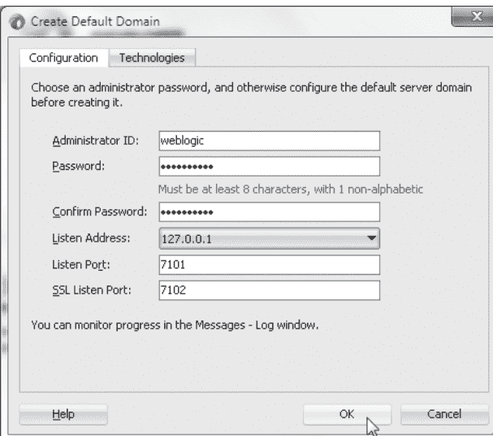

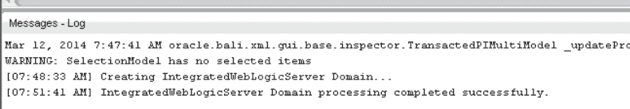

4. 在应用部署到 IntegratedWebLogicServer 并在运行之前，你必须启动服务器。要执行此操作，右键点击 IntegratedWebLogicServer 节点并选择“启动服务器实例 (Start Server Instance)”，如图 2.7 所示。IntegratedWebLogicServer 启动，如图 2.8 所示。

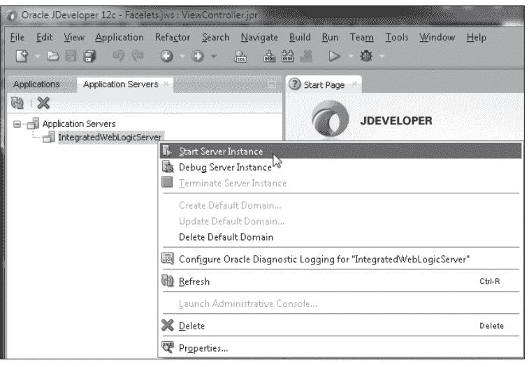

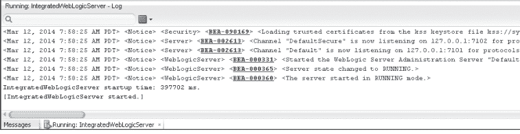

## 创建 FACELETS 项目

在本节中，你将在 JDeveloper 12c 中创建一个 Java EE Web 应用。按照以下步骤操作：

1. 选择文件 > 新建。
2. 在“新建”对话框中，在“类别”面板中，点击“常规”，然后点击“应用程序”。
3. 在“项目”面板中，点击“Java EE Web Application”。然后点击“确定”，如图 2.9 所示。

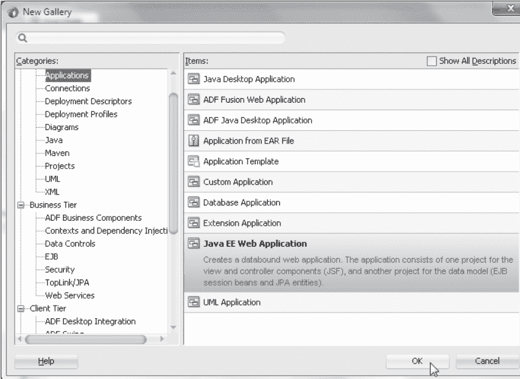

4. 在“应用程序名称”字段中，输入 Facelets。然后在“目录”字段中选择默认目录或通过点击“浏览”按钮选择目录。完成后，点击“下一步”，如图 2.10 所示。

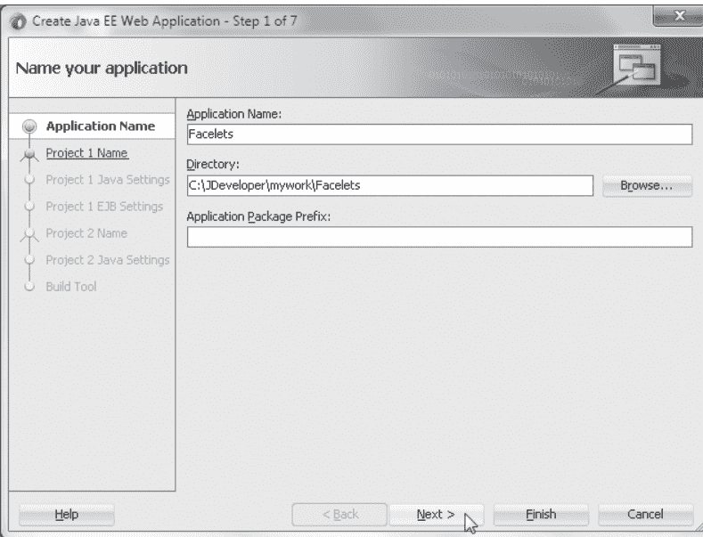

5. JDeveloper 中的 Java EE 应用由两个项目组成：模型项目 和控制器项目。为模型项目名称（Project 1）选择默认设置并点击“下一步”。
6. 选择模型项目的默认 Java 设置并点击“下一步”。
7. 选择模型项目的默认 EJB 设置并点击“下一步”。
8. 选择默认的 Project 2 名称 (ViewController)。然后，在“项目特性”面板中，选择 JavaServer Faces (JSF)。然后，点击“下一步”，如图 2.11 所示。

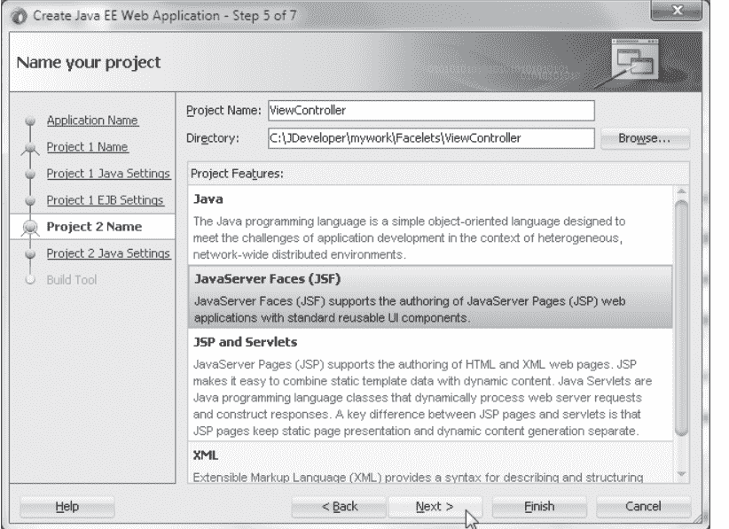

9. 选择控制器项目的默认 Java 设置并点击“下一步”，如图 2.12 所示。

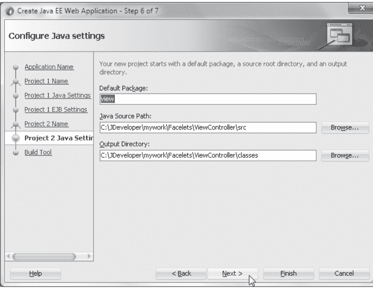

10. 在“选择构建环境”屏幕上，选择“使用 JDeveloper 默认构建工具”选项按钮并点击“完成”，如图 2.13 所示。

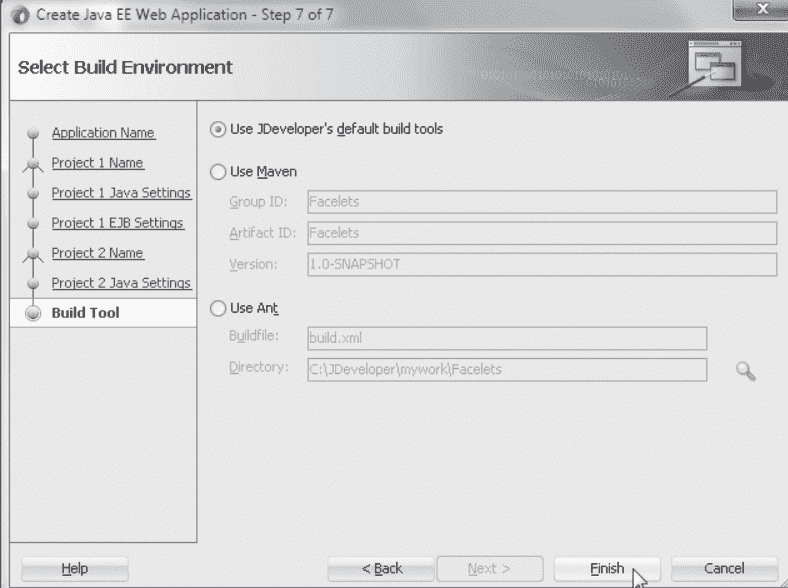

11. 创建了一个包含模型项目和控制器项目的 JDeveloper 应用。在 JDeveloper 应用程序选项卡中右键点击控制器项目，并选择“项目属性”，如图 2.14 所示。

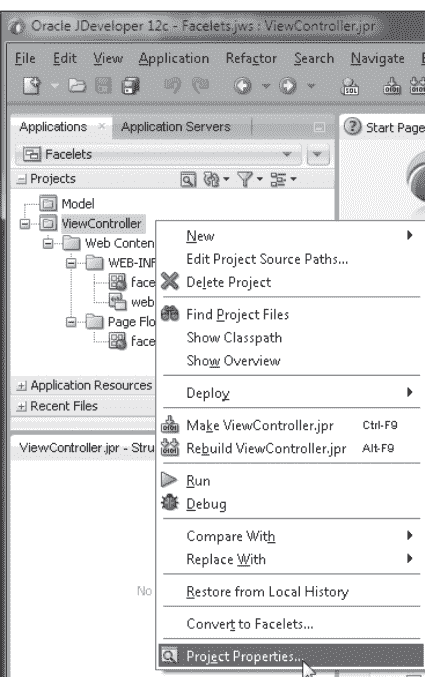

12. 在左侧面板中选择“库”。右侧显示 JavaServer Faces (JSF) 库。点击“确定”，如图 2.15 所示。

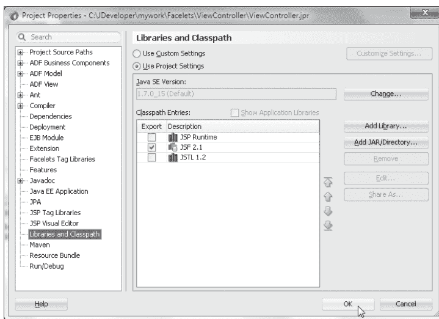

由于在第 8 步选择了 JSF，`Faces Servlet` 被配置在 `web.xml` 中。`web.xml` 描述符如图 2.16 所示。

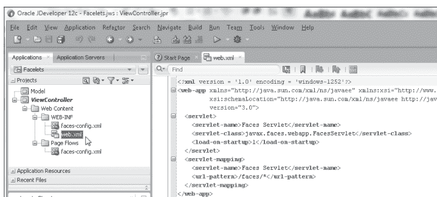

`web.xml` 描述符见列表 2.2。

## 创建受管理豆

JSF 页面通过受管理豆 连接到服务端组件。受管理 bean 是一个简单的 Java 对象 (POJO)。在 JSF 1.2 中，受管理 bean 需要在 `faces-config.xml` 中声明。在 JSF 2.0 中，可以使用 `ManagedBean` 注解进行声明。

要创建受管理 bean，请按照以下步骤操作：

1. 右键点击 `faces-config` 描述符，如图 2.17 所示。

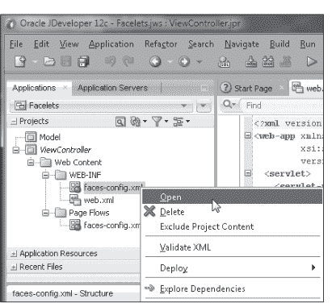

2. 点击“受管理豆”选项卡并添加一个 bean，如图 2.18 所示。

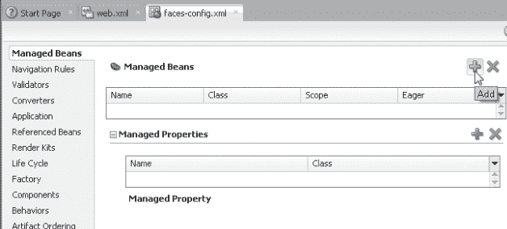

3. 在受管理豆对话框中，在“名称”字段中输入 catalog；在“作用域”字段中输入 request（默认是 session）。最后，点击“确定”，如图 2.19 所示。

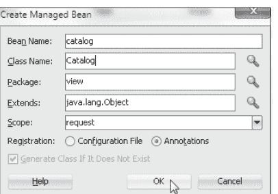

### 列表 2.3 Catalog.java Managed Bean 类


```java
package view;

import javax.faces.component.html.HtmlInputText;
import java.sql.*;
import javax.faces.bean.ManagedBean;
import javax.faces.component.html.HtmlButton;
import javax.faces.component.html.HtmlLabel;
import javax.faces.component.html.HtmlOutputLabel;

@ManagedBean(name = "catalog")
@RequestScoped
public class Catalog {
    private HtmlOutputLabel outputLabel;
    private HtmlButton commandButton1;
    private HtmlInputText inputText1;
    private Statement stmt;
    private Connection connection;
    private ResultSet resultSet;

    public void setTextInput1(HtmlInputText inputText1) {
        this.inputText1 = inputText1;
    }
    public HtmlInputText getText1() {
        return inputText1;
    }
    public void setOutputLabel1(HtmlOutputLabel outputLabel) {
        this.outputLabel = outputLabel;
    }
    public HtmlOutputLabel getOutputLabel() {
        return outputLabel;
    }
    public void setCommandButton1(HtmlButton commandButton1) {
        this.commandButton1 = commandButton1;
    }
    public HtmlButton getCommandButton1() {
        return commandButton1;
    }
    public void setResultSet(ResultSet resultSet) {
        this.resultSet = resultSet;
    }
    public ResultSet getResultSet() {
        return resultSet;
    }
}
```

```java
public String commandButton_action() {
  try {
    Class.forName("oracle.jdbc.OracleDriver");
    String url = "jdbc:oracle:thin@localhost:1521:XE";
    connection = DriverManager.getConnection(url, "OE", "OE");
    stmt = connection.prepareStatement(ResultSet.TYPE_SCROLL_INSENSITIVE, 
        ResultSet.CONCUR_READ_ONLY);
    resultSet = stmt.executeQuery((String)inputText1.getValue());
    if (resultSet != null) {
      this.setResultSet(resultSet);
    }
  } catch (SQLException e) {
    System.out.println(e.getMessage());
    return "error";
  } catch (ClassNotFoundException e) {
    System.out.println(e.getMessage());
    return "error";
  } catch (Exception e) {
    System.out.println(e.getMessage());
    return "error";
  } finally {
    return "output";
  }
}
```

## 创建 Facelets 模板

Facelets 模板作为 Facelets 页面的模板，并为 Facelets 页面提供公共内容。首先，在 `WEB-INF` 目录下创建一个 `templates` 目录。接下来，向 `templates` 目录中添加一个用于 Facelets 模板文件的 XHTML 页面。请按照以下步骤操作：

1. 选择 **File（文件）** > **New（新建）**。
2. 在 **New Gallery** 对话框中，在 **Categories（类别）** 窗格中点击 **Web Tier**，然后点击 **HTML**。
3. 在 **Items（项目）** 窗格中选择 **HTML Page**，并点击 **OK**，如图 2.21 所示。

### 图 2.21

选择 HTML Page。

来源：Oracle Corporation。

4. 在 **Create HTML File** 对话框中，在 **File Name** 字段中输入 `BasicTemplate.xhtml`。
5. 点击 **Browse（浏览）**，定位并选择 `templates` 目录。
6. 勾选 **Create as XML File (*.xhtml)** 复选框。点击 **OK**，如图 2.22 所示。`BasicTemplate.xhtml` 文件被添加到 `WEB-INF/templates` 目录。

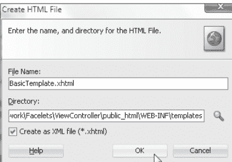

### 图 2.22

创建 HTML 文件。

来源：Oracle Corporation。

同样，将 `header.xhtml` 和 `footer.xhtml` 添加到 `templates` 目录。将 `input.xhtml` 页面添加到 Web Content 根目录（即 `public_html` 目录）。对于输出 Facelets 页面，将 `output.xhtml` 页面添加到 `public_html` 目录。同样向 `public_html` 目录添加 `error.xhtml` 页面。将 header 和 footer 的 JPEG 文件——在此情况下，为源码 ZIP 文件包含的 `FaceletsHeader.jpg` 和 `FaceletsFooter.jpg` 文件——拷贝到 ViewController 项目的根目录，该目录包含组合页面 `input.xhtml` 和 `output.xhtml`。可能还会使用其他 JPEG。Facelets 程序的目录结构如图 2.23 所示。

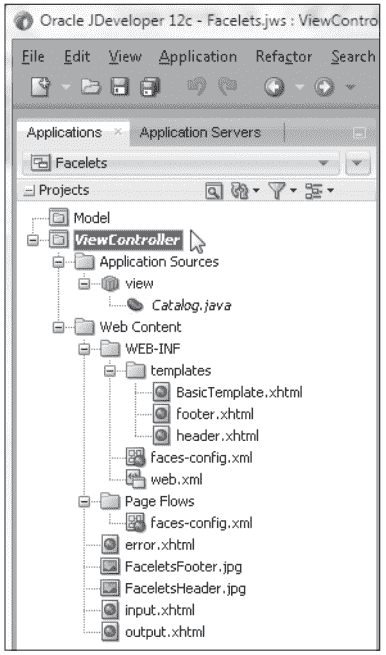

### 图 2.23

Facelets 程序的目录结构。

来源：Oracle Corporation。

`BasicTemplate.xhtml` 模板包含 header、content 和 footer。模板的根元素是 HTML，它包含了 Facelets 命名空间和 XHTML 命名空间的声明。在模板中，向 `<div/>` 标签内添加用于 Facelets 组合的不同部分：标题（title）、页头（header）、内容部分（content section）和页脚（footer）。使用 `ui:include` 标签的 Facelets 页面指定 `header.xhtml` 和 `footer.xhtml` 的相对路径。

## 第2章 使用 Facelets 模板

在模板中，添加包含在 `<div/>` 标签内的 `ui:insert` 标签，用于 Facelets 组合的不同部分：标题、页头、内容部分和页脚。BasicTemplate 的代码出现在列表 2.4。

### 列表 2.4 BasicTemplate.xhtml

```xml
<?xml version="1.0" encoding="windows-1252"?>
<html xmlns="http://www.w3.org/1999/xhtml" xmlns:ui="http://java.sun.com/js/facelets">
<head>
<title><ui:insert name="title">JSF Facelets</ui:insert></title>
</head>
<body>
<div id="header">
<ui:insert name="header">
<ui:include src="/WEB-INF/templates/header.xhtml" />
</ui:insert>
</div>
<div id="content">
<ui:insert name="content">
<!-- 包含你的内容或在此目录创建 content.xhtml -->
<!-- <div> -->
<!-- <ui:include src="content.xhtml" />
<!-- </div> -->
</ui:insert>
</div>
<div id="footer">
<ui:include src="/WEB-INF/templates/footer.xhtml" />
</ui:insert>
</div>
</body>
</html>
```

## 开发 Facelets 组合页面

与 `BasicTemplate.xhtml` 类似，你添加了 `header.xhtml` 和 `footer.xhtml` 的 XHTML 页面、输入 Facelets 页面（`input.xhtml`）和输出 Facelets 页面（`output.xhtml`）。在 `header.xhtml` 页中，使用 `h:graphicImage` 标签为 header 指定 JPEG。`header.xhtml` 页的代码出现在列表 2.5。

### 列表 2.5 header.xhtml

```xml
<?xml version="1.0" encoding="windows-1252"?>
<html xmlns="http://www.w3.org/1999/xhtml"
  xmlns:ui="http://java.sun.com/js/facelets"
  xmlns:h="http://java.sun.com/js/html"
  xmlns:f="http://java.sun.com/js/core">
<f:view>
  <h:form>
    <h:panelGrid columns="1">
      <h:graphicImage value="FaceletsHeader.jpg" />
    </h:panelGrid>
  </h:form>
</f:view>
</html>
```

在 `footer.xhtml` 页中，使用在 `h:panelGrid` 标签内的 `h:graphicImage` 标签为 footer 指定 JPEG。`footer.xhtml` 页的代码出现在列表 2.6。

### 列表 2.6 footer.xhtml

```xml
<?xml version="1.0" encoding="windows-1252"?>
<html xmlns="http://www.w3.org/1999/xhtml"
  xmlns:ui="http://java.sun.com/js/facelets"
  xmlns:h="http://java.sun.com/js/html"
  xmlns:f="http://java.sun.com/js/core">
<f:view>
  <h:form>
    <h:panelGrid columns="1">
      <h:graphicImage value="FaceletsFooter.jpg" />
    </h:panelGrid>
  </h:form>
</f:view>
</html>
```

接下来，定义 `input.xhtml` Facelets 组合页面，它有一个用于输入的输入字段（`h:inputText` 组件）和一个用于在 content 部分提交输入的 `h:commandButton`。`h:commandButton` 绑定到 managed bean `catalog` 中的 `commandButton` 属性。按钮的 `action` 属性设置为 managed bean 中的 `commandButton_action`。`input.xhtml` Facelets 页包含用于定义 Facelets 页面组合的 `ui:composition` 标签，以及 `ui:composition` 内部用于定义 Facelets 组合不同部分（header、content 和 footer）的 `ui:define` 标签。你在 `ui:composition` 标签属性中指定模板名称。`ui:define` 标签对应于 `ui:insert` 标签。如果没有指定对应 `ui:insert` 标签的 `ui:define` 标签，则在 Facelets 组合页面中使用 `BasicTemplate.xhtml` 中的默认 `ui:insert` 标签。`input.xhtml` 中仅定义了内容的 `ui:define` 标签。在 `header.xhtml` 和 `output.xhtml` 中指定的 header 和 footer JPEG 在 `BasicTemplate.xhtml` 中通过 `ui:insert`/`ui:include` 标签包含，用于 header 和 footer 部分。`input.xhtml` 文件出现在列表 2.7。

### 列表 2.7 input.xhtml

```xml
<?xml version="1.0" encoding="windows-1252"?>
<html xmlns="http://www.w3.org/1999/xhtml" xmlns:ui="http://java.sun.com/js/facelets"
xmlns:h="http://java.sun.com/js/html" xmlns:f="http://java.sun.com/js/core">
<ui:composition template="WEB-INF/templates/BasicTemplate.xhtml">
  <ui:define name="content">
    <h:body>
      <h:panelGrid columns="2">
        <h:outputText binding="#{catalog.outputLabel}" value="SQL" />
        <h:inputText binding="#{catalog.inputText1}"/>
        <h:commandButton value="Submit" binding="#{catalog.commandButton}" action="#{catalog.commandButton_action}"/>
      </h:panelGrid>
    </h:body>
  </ui:define>
</ui:composition>
```

查询：/

`output.xhtml` Facelets 页面在 content 部分包含一个 `h:dataTable` UI 组件，用于输出 `input.xhtml` 组合页面中 SQL 查询的 JSF 数据。`h:dataTable` 的 `value` 绑定到 managed bean 中的 `resultSet` 属性。迭代变量是 `resultset`，它代表结果集中的一行。`output.xhtml` `h:column` 组件的代码 `value` 绑定到结果集的列。Facelets 组合页面出现在列表 2.8。

### 列表 2.8 output.xhtml

```xml
<?xml version="1.0" encoding="windows-1252"?>
<html xmlns="http://www.w3.org/1999/xhtml" xmlns:ui="http://java.sun.com/js/facelets"
xmlns:h="http://java.sun.com/js/html" xmlns:f="http://java.sun.com/js/core">
<ui:composition template="WEB-INF/templates/BasicTemplate.xhtml">
  <ui:define name="content">
    <h:body>
      <h:dataTable value="#{catalog.resultSet}" var="resultset">
        <h:column value="#{resultset.columnName}" />
        <h:column value="#{resultset.value}" />
      </h:dataTable>
    </h:body>
  </ui:define>
</ui:composition>
```


```xml
<ui:define name="content">
  <h:dataTable value="#{catalog.resultSet}" var="resultset" border="1" rows="4">
    <h:column>
      <f:facet name="header">
        <h:outputText value="Catalog Id" />
      </f:facet>
      <h:outputText value="#{resultset.catalogid}" />
    </h:column>
    <h:column>
      <f:facet name="header">
        <h:outputText value="Journal" />
      </f:facet>
      <h:outputText value="#{resultset.journal}" />
    </h:column>
    <h:column>
      <f:facet name="header">
        <h:outputText value="Publisher" />
      </f:facet>
      <h:outputText value="#{resultset.publisher}" />
    </h:column>
    <h:column>
      <f:facet name="header">
        <h:outputText value="Edition" />
      </f:facet>
      <h:outputText value="#{resultset.edition}" />
    </h:column>
    <h:column>
      <f:facet name="header">
        <h:outputText value="Title" />
      </f:facet>
      <h:outputText value="#{resultset.title}" />
    </h:column>
    <h:column>
      <f:facet name="header">
        <h:outputText value="Author" />
      </f:facet>
      <h:outputText value="#{resultset.author}" />
    </h:column>
  </h:dataTable>
</ui:define>
</ui:composition>
```

## 创建导航

接下来，你将为 Facelets 添加导航。导航部分比使用 JSF 1.2 时短得多。在 JSF 1.2 中，你必须向 `faces-config.xml` 文件中添加导航规则。JSF 2.0 提供了在结果 String 值与任何与该值同名的 XHTML 页面之间的默认导航。在托管豆（managed bean）中，如果没有生成错误，你添加了名为 "output" 的结果值：

```
return "output";
```

如果生成了错误，你添加了名为 "error" 的结果：

```
return "error";
```

如果没有生成错误，应用程序将导航到 `output.xhtml`。JSF 2.0 使用 `@ManagedBean` 注解简化了托管豆的配置。由于默认导航，这简化了导航规则的配置。列表 2.9 显示了没有任何托管豆配置且不包含任何导航规则的 `faces-config.xml` 配置文件。

### 列表 2.9 JavaServer Faces 配置文件 (faces-config.xml)

```xml
<?xml version="1.0" encoding="windows-1252"?>
<faces-config
  xmlns="http://java.sun.com/xml/ns/javaee"
  version="2.1">
</faces-config>
```

## 部署 Facelets 应用程序

你的下一个任务是为 Facelets 应用程序创建一个部署配置文件。按照以下步骤操作：

1. 在“新建画廊”（New Gallery）对话框中，在“类别”（Categories）窗格中，点击“常规”（General）并选择“部署配置文件”（Deployment Profiles）。
2. 在“项目”（Items）窗格中，选择“WAR 文件”（WAR File），并点击“确定”，如图 2.24 所示。

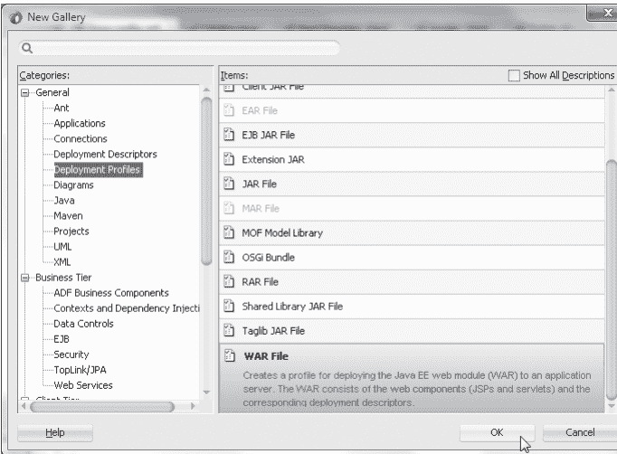

3. 在“部署配置文件名称”（Deployment Profile Name）字段中，输入 `webapp1`。然后点击“确定”，如图 2.25 所示。

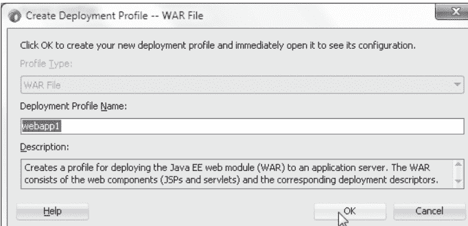

4. 在“编辑 WAR 部署配置文件属性”对话框中，选择“指定 Java EE Web 上下根”（Specify Java EE Web Context Root）按钮，并在相应的字段中输入 `webapp1`，如图 2.26 所示。然后点击“确定”。`webapp1` 模块已添加到部署中，如图 2.27 所示。点击“确定”。

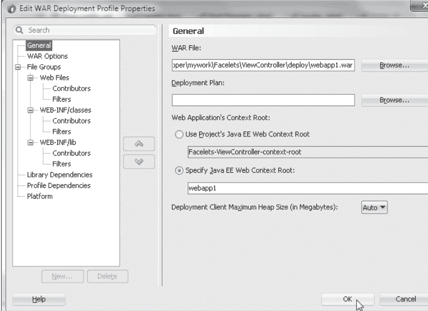

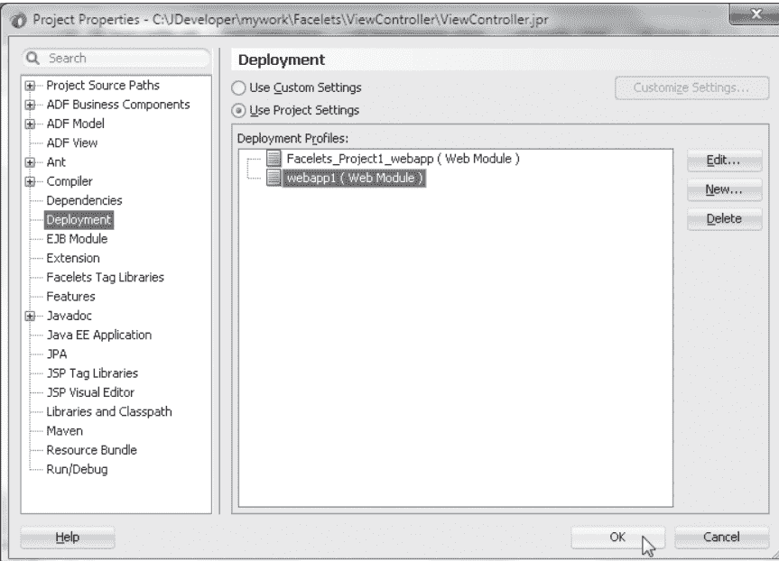

5. 如果尚未启动，请按照“配置集成 WebLogic Server”章节中所述的方法启动 WebLogic Server。
6. 要运行 Facelets 应用程序，右键点击 `ViewController` 并选择 `Deploy > webapp1`，如图 2.28 所示。

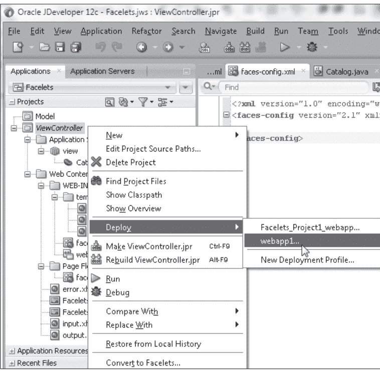

7. “部署 webapp1”对话框打开。在“操作”（Action）中，选择“部署到应用程序”（Deploy to Application），并点击“下一步”，如图 2.29 所示。

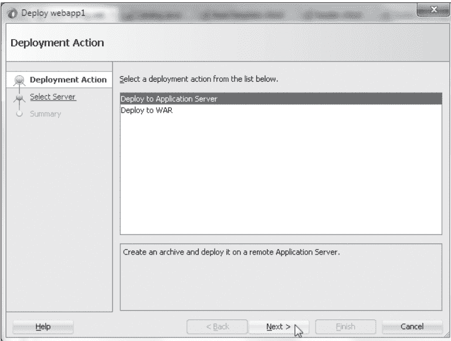

8. 在“服务器”（Server）屏幕中，选择之前配置的集成 WebLogic Server。然后点击“下一步”，如图 2.30 所示。

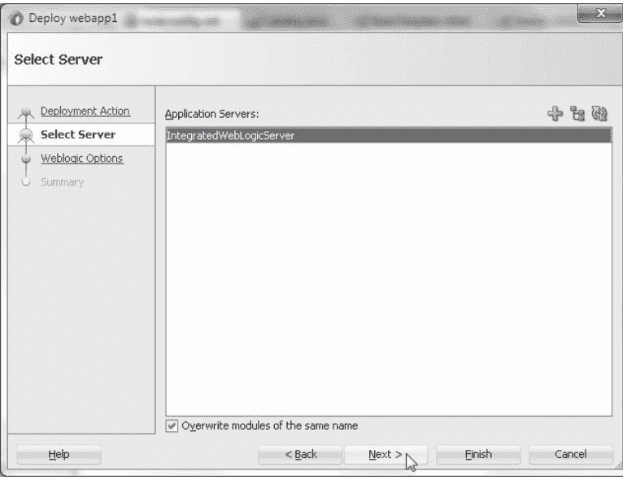

9. 在“选项”（Options）屏幕上，选择“部署到域”（Deploy to Domain）或“部署到所有集群”（Deploy to All Clusters）等按钮。注意 WebLogic Server 已列出。

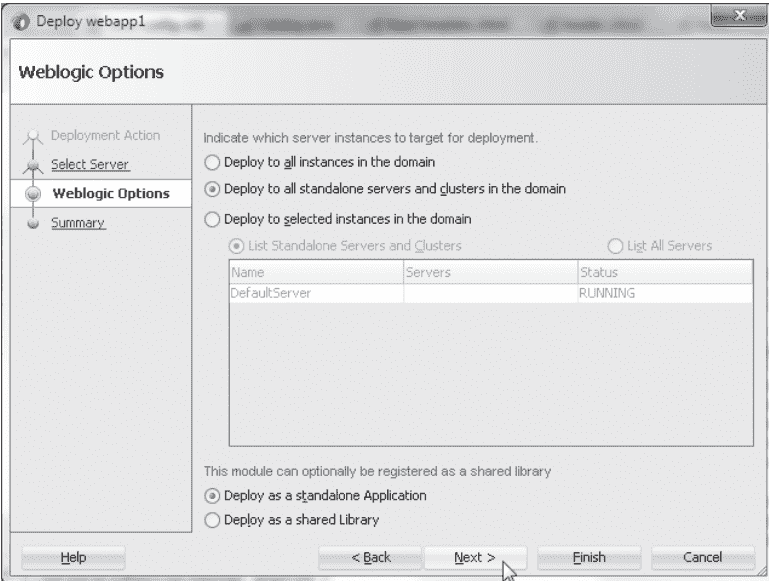

10. 点击“部署为独立模式”（Deploy as Standalone）按钮，如图 2.32 所示。

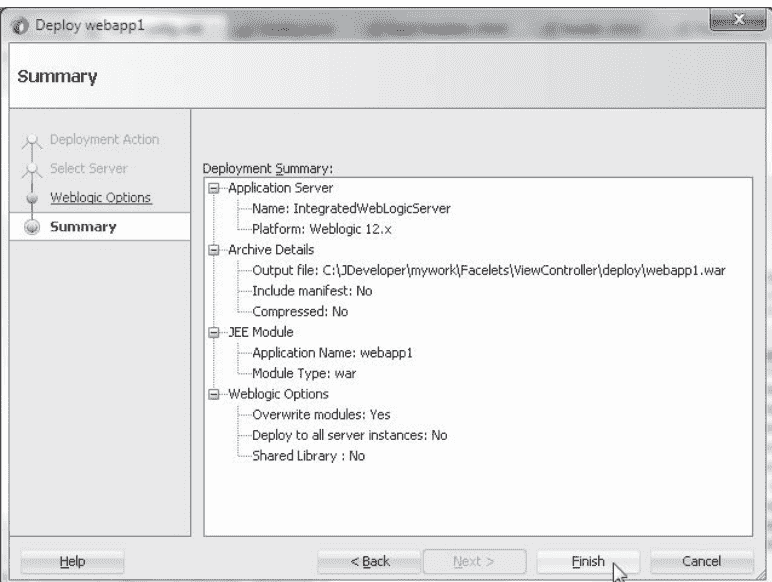

11. 在“部署摘要”（Deployment Summary）屏幕中，点击“完成”，如图 2.33 所示。`webapp1` WAR 文件已创建。

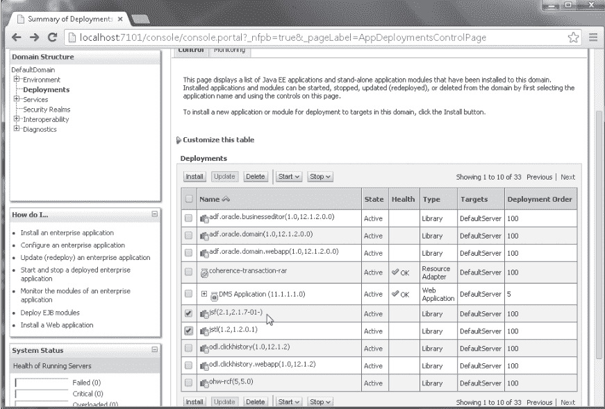

12. 在 WebLogic 控制台中，访问 `http://localhost:7101` 并查看“部署”（Deploy）。JSF 2.1 库和 JSTL 1.2 库已默认部署，如图 2.34 所示。`webapp1` 应用程序也列出。

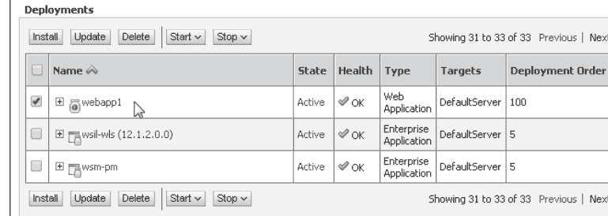

13. `webapp1` 应用程序已列出，如图 2.35 所示。

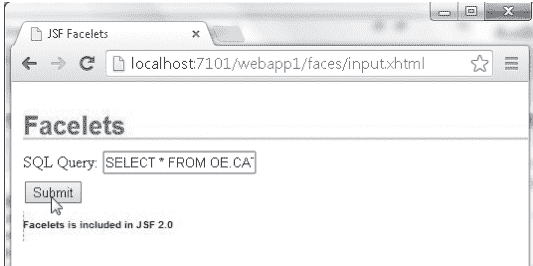

## 运行 Facelets 应用程序

在 WebLogic Server 上运行 `input.xhtml` 组合页面，URL 为 `http://localhost:7101/webapp1/faces/input.xhtml`。input Facelets 页面的三个部分是头部、内容和页脚，如图 2.36 所示。input Facelets 组合的不同部分对应于 `input.xhtml` 中不同的 `ui:define` 标签。`header.xhtml` 和 `footer.xhtml` 文件来自 `BasicTemplate.xhtml` 模板并包含在组合中（见图 2.36）。

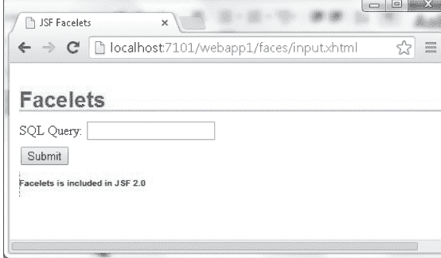

### 运行 Facelets

指定 SQL 查询 `SELECT * FROM OE.CATALOG` 并点击“提交”（Submit），如图 2.37 所示。`output.xhtml` Facelets 组合页面将显示为 SQL 查询生成的 JSF 数据表。通过在组合页面中包含相同的 `header.xhtml` 和 `footer.xhtml` 来演示模板化；相同的头部和页脚部分将显示，如图 2.38 所示。

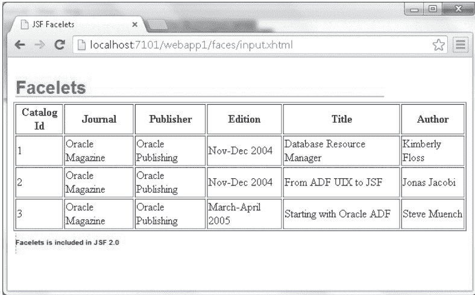

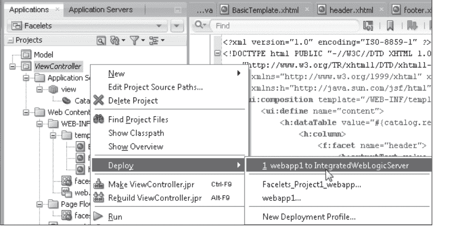

在应用程序部署到 IntegratedWebLogicServer 后，当从 JDeveloper 导航器中通过右键点击 > Deploy 部署应用程序时，它会出现在列表中，如图 2.39 所示。


## 总结

在本章中，你开发了一个 Facelets 应用，该应用包含 Facelets 模板页面、Facelets 页头和页脚页面、`faces-config.xml` 配置文件以及一个 Facelets 组合页面。你将 Facelets 应用部署到 WebLogic 服务器并运行了应用程序以根据 SQL 查询生成数据表。下一章将讨论添加到 JSF 2.0 中的 Ajax 功能。

# 第 3 章 AJAX

第 2 章“使用 Facelets 进行模板处理”讨论了 Facelets，它是 JSF 2.0 中的默认视图定义语言。本章将讨论 JSF 2.0 的另一个新特性：对 UI 组件的 Ajax 支持。

JSF 2.0 引入了为任何 JSF 组件添加 Ajax 功能的机制。Ajax 提供了客户端与服务器之间数据的异步传输。JSF 2.0 中的 Ajax 特性包括对部分页面渲染、部分处理和组件分组的支持。你可以通过 `f:ajax` 标签在 JSF 2.0 中添加 Ajax 支持。在本章中，你为 JSF 2.0 数据表添加 Ajax 支持。

## 设置环境

作为第一步，如果你还没有这样做，请下载并安装以下软件：

- Oracle JDeveloper 12c (12.1.2.0.0) (www.oracle.com/technetwork/developer-tools/jdev/downloads/index.html)
- Oracle WebLogic Server 12c (包含在 JDeveloper 12c 中)
- Oracle Database Express Edition (XE) 11g (www.oracle.com/technetwork/database/database-technologies/express-edition/downloads/index.html)

要生成 JSF 数据表，如果你还没有这样做，你需要一个数据源以便在 Oracle Database 11g XE 中创建数据库表。请查看列表 3.1 中的 SQL 脚本以指定一个。

### 列表 3.1 创建数据库表的 SQL 脚本

```sql
CREATE USER OE IDENTIFIED BY OE;
GRANT CONNECT, RESOURCE TO OE;
CREATE TABLE OE.Catalog (CatalogId INTEGER PRIMARY KEY, JOURNAL VARCHAR(25), Publisher VARCHAR(25), EDITION VARCHAR(25), Title Varchar(45), Author Varchar(25));
INSERT INTO OE.Catalog VALUES('1', 'Oracle Magazine', 'Oracle Publishing', 'Nov-Dec 2004', 'Database Resource Manager', 'Kimberly Floss');
INSERT INTO OE.Catalog VALUES('2', 'Oracle Magazine', 'Oracle Publishing', 'Nov-Dec 2004', 'From ADF UI to JSF', 'Jonas Jacobi');
INSERT INTO OE.Catalog VALUES('3', 'Oracle Magazine', 'Oracle Publishing', 'March-April 2005', 'Starting with Oracle ADF', 'Steve Munch');
COMMIT;
```

在 SQL Command Line 中运行 SQL 脚本，如图 3.1 所示。

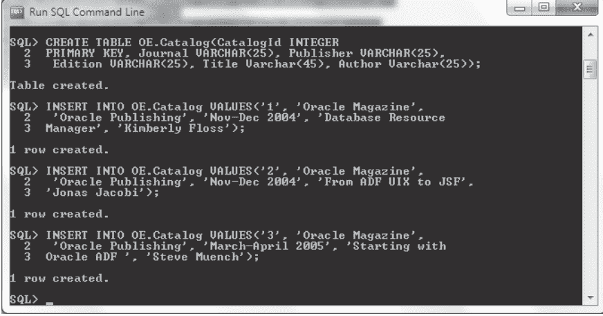

最后，按照第 2 章的解释配置并启动 IntegratedWebLogicServer。

接下来，你创建一个 JDeveloper 应用程序。遵循以下步骤：

1. 选择 `File > New > From Gallery`。
2. 在 New Gallery 对话框中，选择 Categories 面板中的 Applications。然后在 Items 面板中选择 Java EE Application。
3. 在 Create Java EE Application 向导中，在 Application Name 字段输入 `AjaxJSF2.0` 并点击 Next，如图 3.2 所示。

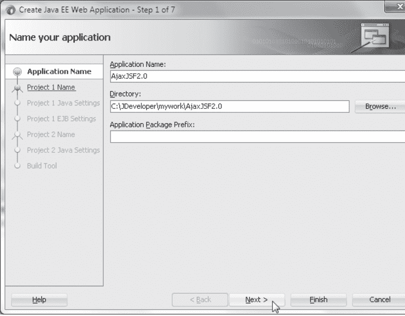

4. Project 1 是 Model 项目。对于 Project 1，选择默认的 Name 和 Directory 设置并点击 Next。
5. 为 Project 1 选择默认的 Java 设置并点击 Next。
6. 为 Project 1 选择默认的 EJB 设置并点击 Next。
7. 对于 Project 2 即 ViewController，在 Project Features 列表中选择 Java (JSF) 并点击 Next，如图 3.3 所示。

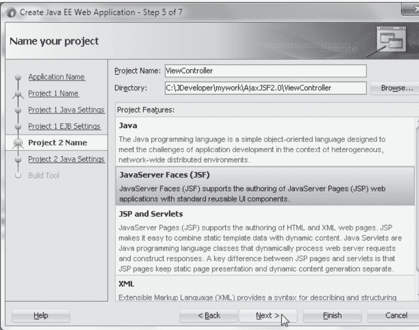

8. 选择项目的默认 Java 设置并点击 Next。
9. 选择项目的默认 Environment 设置并点击 Finish。创建一个包含 Model 项目的 JDeveloper 应用程序，如图 3.4 所示。

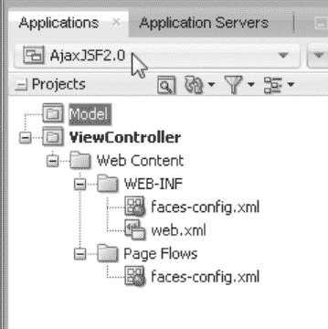

10. 右键点击 `ViewController` 项目并选择 Properties。
11. 在左侧面板中选择 Libraries。在 Entries 中选择 `JSF 2.0` 库。JSTL 库也会被选中。


## 12. 右键点击 ViewController 项目并选择 Deployment

`web.xml` 文件包含映射，如图 3.5 所示。

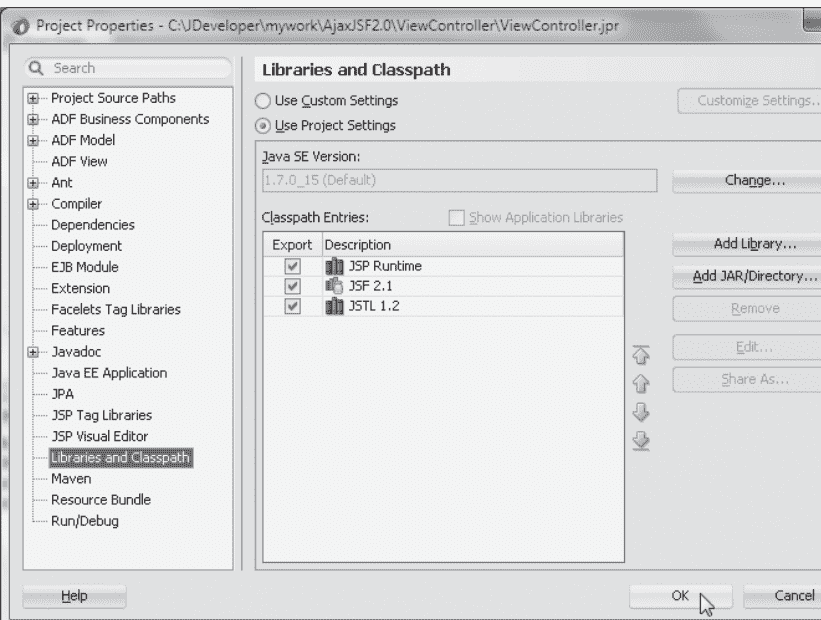

**图 3.5** 所需的库。

## 13. 在 web.xml 文件中，servlet 元素包含映射，如图 3.6 所示。

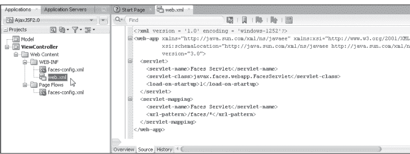

**图 3.6** web.xml 部署。

# 第 3 章 Ajax

`.xhtml` 扩展名指定了 JSF 页面。`web.xml` 显示在列表 3.2。

### 列表 3.2 web.xml

```xml
<?xml version="1.0" encoding="UTF-8"?>
<web-app xmlns="http://java.sun.com/xml/ns/javaee" xmlns:xsi="http://www.w3.org/2001/XMLSchema-instance" xsi:schemaLocation="http://java.sun.com/xml/ns/javaee http://java.sun.com/xml/ns/javaee/web-app_3_0.xsd" version="3.0">
  <servlet>
    <servlet-name>Faces Servlet</servlet-name>
    <servlet-class>javax.faces.webapp.FacesServlet</servlet-class>
    <load-on-startup>1</load-on-startup>
  </servlet>
  <servlet-mapping>
    <servlet-name>Faces Servlet</servlet-name>
    <url-pattern>/faces/*</url-pattern>
  </servlet-mapping>
</web-app>
```

## 创建托管型 Bean

对于 JSF 页面，你必须创建一个 managed bean，它就是一个 POJO 类。遵循以下步骤：

1. 在 Applications 导航器中，右键点击 `faces-config.xml` 并选择 Open，如图 3.7 所示。

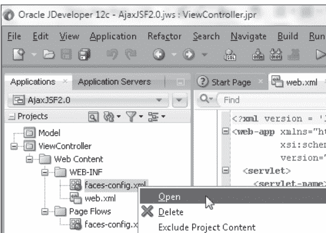

**图 3.7** 右键点击 `faces-config.xml` 并 Open。

来源：Oracle 公司。

2. 点击 Overview 标签页和 Managed Beans 节点。然后点击 Add 按钮添加一个新的 managed bean，如图 3.8 所示。

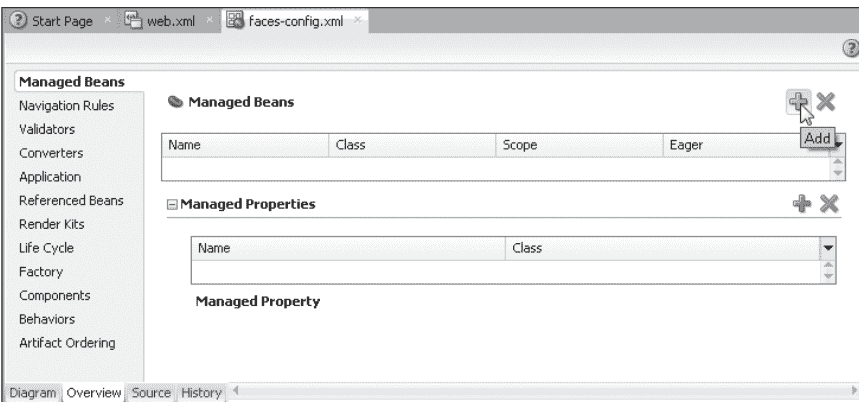

**图 3.8** 添加一个新的 managed bean。

来源：Oracle 公司。

3. 在 Create Managed Bean 对话框中，在 Bean Name 字段输入 `catalog`，在 Class Name 字段输入 `Catalog`，在 Package 字段输入 `view`，并在 Scope 字段选择一个选项（默认是 request）。最后，选择 Annotations 选项并点击 OK，如图 3.9 所示。

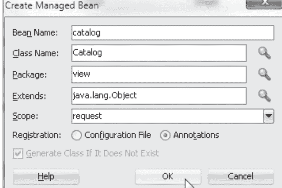

**图 3.9** 配置一个 managed bean。

来源：Oracle 公司。

创建带有 `@ManagedBean` 注解的 `Catalog` Java 类，用表示这是一个 managed bean。默认范围是 `@Scoped`。使用 `@ManagedBean` 和 `@RequestScoped` 注解的简化配置是 JSF 2.0 的新特性。（参见列表 3.3。）

### 列表 3.3 Managed Bean 注解

```java
@ManagedBean(name="catalog")
@RequestScoped
public class Catalog {
    public Catalog() {
}
```

在 managed bean 中，指定属性 `inputText`、`cancelButton` 和 `resultSet`。为 managed bean 属性添加访问器方法。添加值变更监听器方法 `InputListener`。这里从输入文本中获取指定的 SQL 查询并在 Oracle 数据库中运行以生成结果集，然后将其值设置在 `resultSet` managed bean 属性上。

从 `f:ajax` 标签发起的请求。Ajax 监听方法接受一个 `AjaxBehavior` 对象作为参数，该对象代表要进行 Ajax 的组件行为：

```java
public void inputTextListener(AjaxBehavior event) {
}
```

托管 Bean 类 `Catalog.java` 见于列表 3.4。

### 列表 3.4 Catalog.java 托管 Bean 类

```java
package view;
import javax.faces.component.html.HtmlInput;
import javax.faces.event.AjaxBehaviorEvent;
import javax.java.sql.*;
import javax.faces.bean.ManagedBean;
import javax.faces.bean.RequestScoped;
import javax.faces.bean.SessionScoped;
import javax.faces.component.html.HtmlButton;
@ManagedBean(name="catalog")
@RequestScoped
public class Catalog {
    private HtmlInput inputText1;
    private HtmlButton commandButton1;
    private Statement stmt;
    private Connection connection;
    private ResultSet resultSet;
    public void setInputText1(HtmlInput inputText1) {
        this.inputText1 = inputText1;
    }
    public HtmlInput getInputText1() {
        return inputText1;
    }
    public void setCommandButton1(HtmlButton commandButton1) {
        this.commandButton1 = commandButton1;
    }
    public HtmlButton getCommandButton1() {
        return commandButton1;
    }
    public void setResultSet(ResultSet resultSet) {
        this.resultSet = resultSet;
    }
    public ResultSet getResultSet() {
        return resultSet;
    }
```

## 创建托管 Bean

```java
public void inputTextListener(AjaxBehaviorEvent event) {
    try (
        Class.forName("oracle.jdbc.OracleDriver");
        String url = "jdbc:oracle:thin@localhost:1521:XE";
        connection = DriverManager.getConnection(url, "OE", "OE");
        stmt = connection.createStatement(ResultSet.TYPE_SCROLL_INSENSITIVE,
            ResultSet.CONCUR_READ_ONLY);
        resultSet = stmt.executeQuery((String)inputText1.getValue());
        if (resultSet != null) {
            this.setResultSet(resultSet);
        }
    } catch (SQLException e) {
        System.out.println(e.getMessage());
    } catch (ClassNotFoundException e) {
        System.out.println(e.getMessage());
    } catch (Exception e) {
        System.out.println(e.getMessage());
    } finally {
    }
}
```

`Catalog.java` 托管 Bean 如图 3.10 所示。

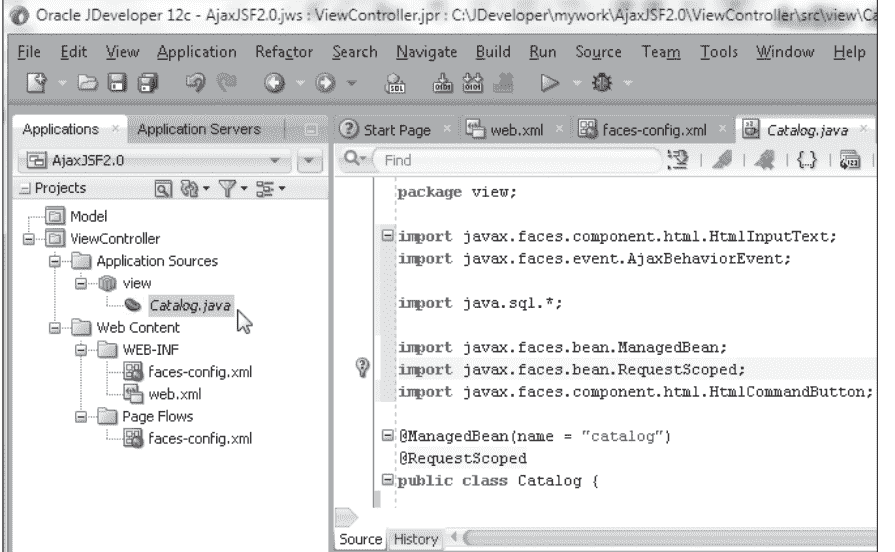

**图 3.10** 托管 Bean 类 Catalog.java。

来源：Oracle 公司。

如果你使用的是 JSF 1.2，你将会在 `faces-config.xml` 中配置托管 Bean。但由于你使用了 JSF 2.0 中新引入的 `@ManagedBean` 注解来指定托管 Bean，因此 `faces-config.xml` 是一个空文件。

## 创建 JSF 页面

由于我们使用了 JSF 2.0 的默认视图定义语言 Facelets，你将为 JSF 页面创建 XHTML 页面。按照以下步骤：

- 在“新建”（New Gallery）对话框中，选择 `Web Tier > HTML and Items > HTML Page`。

- 在“文件名”（File Name）字段中输入 `catalog.xhtml`，勾选“作为 XML 文件创建”复选框并点击确定，如图 3.11 所示。

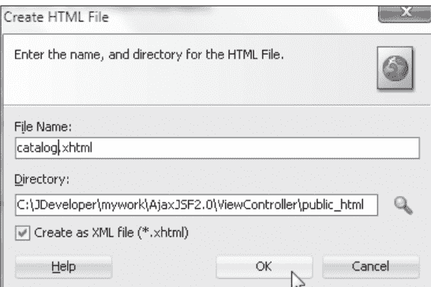

**图 3.11** 创建 JSF (XHTML) 页面。

来源：Oracle 公司。

- 添加另一个 XHTML 页面 `catalog2.xhtml`，以演示 JSF 2.0 中 Ajax 支持的不同功能。AjaxJSF2.0 应用程序的目录结构如图 3.12 所示。

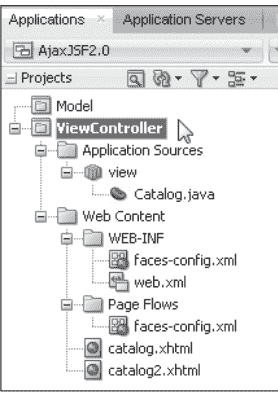

**图 3.12** AjaxJSF2.0 应用程序的目录结构。

来源：Oracle 公司。

## 添加 AJAX

接下来，你将在 `catalog.xhtml` 中的 JSF 数据表中添加 Ajax 功能。JSF 页面需要 `h:head` 标签才能运行：

```xml
<h:head>
    <title></title>
</h:head>
```

对于 JSF 组件，为数据表添加六列，并为每列添加一个表头和 `h:outputText` 标签。在 `h:outputText` 中将 `ResultSet` 的值指定为值表达式（value expressions）。例如，为第一列指定“Catalog Id”作为表头，并将 `h:outputText` 的值指定为 `ResultSet` 中的 `CatalogId`。

要查看实际效果，请按照以下步骤操作：

- 在 `catalog.xhtml` 中添加一个 JSF 数据表。

- 将你将在托管 Bean 中获取的 JDBC `ResultSet` 指定为 `value` 属性，并使用 `var` 属性指定迭代，如下：

```xml
<h:dataTable id="dataTable1" value="#{catalog.resultSet}" var="resultSet" border="1">
    <h:column>
        <f:facet name="header">
            <h:outputText value="Catalog Id"/>
        </f:facet>
        <h:outputText value="#{resultSet.id}"/>
    </h:column>
```


# 第3章 Ajax

从 `f:ajax` 标签发起的请求。Ajax 监听方法接受一个 `AjaxBehaviorEvent` 对象作为参数，该对象代表要进行 Ajax 的组件行为：

```java
public void inputTextListener(AjaxBehaviorEvent event) {
}
```

托管 Bean 类 `Catalog.java` 见于列表 3.4。

### 列表 3.4 Catalog.java 托管 Bean 类

```java
package view;
import javax.faces.component.html.HtmlInput;
import javax.faces.event.AjaxBehaviorEvent;
import javax.java.sql.*;
import javax.faces.bean.ManagedBean;
import javax.faces.bean.RequestScoped;
import javax.faces.bean.SessionScoped;
import javax.faces.component.html.HtmlButton;
@ManagedBean(name="catalog")
@RequestScoped
public class Catalog {
    private HtmlInput inputText1;
    private HtmlButton commandButton1;
    private Statement stmt;
    private Connection connection;
    private ResultSet resultSet;
    public void setInputText1(HtmlInput inputText1) {
        this.inputText1 = inputText1;
    }
    public HtmlInput getInputText1() {
        return inputText1;
    }
    public void setCommandButton1(HtmlButton commandButton1) {
        this.commandButton1 = commandButton1;
    }
    public HtmlButton getCommandButton1() {
        return commandButton1;
    }
    public void setResultSet(ResultSet resultSet) {
        this.resultSet = resultSet;
    }
    public ResultSet getResultSet() {
        return resultSet;
    }
}
```

## 创建托管 Bean

```java
public void inputTextListener(AjaxBehaviorEvent event) {
    try (
        Class.forName("oracle.jdbc.OracleDriver");
        String url = "jdbc:oracle:thin@localhost:1521:XE";
        connection = DriverManager.getConnection(url, "OE", "OE");
        stmt = connection.createStatement(ResultSet.TYPE_SCROLL_INSENSITIVE,
            ResultSet.CONCUR_READ_ONLY);
        resultSet = stmt.executeQuery((String)inputText1.getValue());
        if (resultSet != null) {
            this.setResultSet(resultSet);
        }
    } catch (SQLException e) {
        System.out.println(e.getMessage());
    } catch (ClassNotFoundException e) {
        System.out.println(e.getMessage());
    } catch (Exception e) {
        System.out.println(e.getMessage());
    } finally {
    }
}
```

`Catalog.java` 托管 Bean 如图 3.10 所示。


图 3.10

托管 Bean 类 Catalog.java。

来源：Oracle 公司。

如果你使用的是 JSF 1.2，你将会在 `faces-config.xml` 中配置托管 Bean。但由于你使用了 JSF 2.0 中新引入的 `@ManagedBean` 注解来指定托管 Bean，因此 `faces-config.xml` 是一个空文件。

## 创建 JSF 页面

由于我们使用了 JSF 2.0 的默认视图定义语言 Facelets，你将为 JSF 页面创建 XHTML 页面。按照以下步骤：

- 在“新建”（New Gallery）对话框中，选择 `Web Tier > HTML and Items > HTML Page`。

- 在“文件名”（File Name）字段中输入 `catalog.xhtml`，勾选“作为 XML 文件创建”复选框并点击确定，如图 3.11 所示。


**图 3.11** 创建 JSF (XHTML) 页面。

来源：Oracle 公司。

- 添加另一个 XHTML 页面 `catalog2.xhtml`，以演示 JSF 2.0 中 Ajax 支持的不同功能。AjaxJSF2.0 应用程序的目录结构如图 3.12 所示。


**图 3.12** AjaxJSF2.0 应用程序的目录结构。

来源：Oracle 公司。

## 添加 AJAX

接下来，你将在 `catalog.xhtml` 中的 JSF 数据表中添加 Ajax 功能。JSF 页面需要 `h:head` 标签才能运行：

```xml
<h:head>
    <title></title>
</h:head>
```

对于 JSF 组件，为数据表添加六列，并为每列添加一个表头和 `h:outputText` 标签。在 `h:outputText` 中将 `ResultSet` 的值指定为值表达式。例如，为第一列指定“Catalog Id”作为表头，并将 `h:outputText` 的值指定为 `ResultSet` 中的 `CatalogId`。

要查看实际效果，请按照以下步骤操作：

- 在 `catalog.xhtml` 中添加一个 JSF 数据表。

- 将你将在托管 Bean 中获取的 JDBC `ResultSet` 指定为 `value` 属性，并使用 `var` 属性指定迭代，如下：

```xml
<h:dataTable id="dataTable1" value="#{catalog.resultSet}" var="resultSet" border="1">
    <h:column>
        <f:facet name="header">
            <h:outputText value="Catalog Id"/>
        </f:facet>
        <h:outputText value="#{resultSet.id}"/>
    </h:column>
</h:dataTable>
```

# 64 第3章 Ajax

### 表 3.1 execute 属性值

| execute 属性值 | 说明 |
|---|---|
| @this | 此组件。默认值。 |
| @all | 所有组件。 |
| @form | 表单组件 |
| @none | 无组件 |
| clientId | 指定组件。通过其 ID 识别组件——例如使用 `form1:dataTable` 来指定表单中的 data1。如果指定的组件与指定 f:ajax 标签的组件处于同一层级，则可以省略前面的组件 ID。 |

`event` 属性指定了哪种文档对象模型 (DOM) 事件触发 Ajax 请求。`event` 属性值可以是以下内容之一：

- 组件支持的 DOM 事件，如 `click`、`change`、`dblclick`；省略了 `on` 前缀。
- 可以指定 `action` 事件，它是命令按钮或命令链接等 Faces ActionSource 组件的默认值。
- 可以指定 `valueChangeEvent` 事件，它是 Faces Editable ValueHolder 组件（即可编辑组件，如输入文本组件）的默认值。

指定的事件应该被该组件支持。例如，命令按钮不支持 `value` 事件。我们指定了 `keyup` 事件，表示在输入文本框中触发 `keyup` 事件时发送 Ajax 请求。`render` 属性指定了在请求响应阶段渲染的组件。由于 `dataTable` 组件与 `inputText` 处于相同的层级，因此省略了 `form1:` 前缀；在 `render` 属性中仅指定了 `dataTable`。可以指定与 `execute` 属性相同的值，但默认值是 `@none`。`listener` 属性指定了在广播 `AjaxChangeEvent` 时调用的方法。我们使用方法表达式指定了监听器为 `listener=#{catalog.inputTextListener}`，它会调用托管豆 中的 `inputTextListener(AjaxBehaviorEvent)` 方法。

## 添加 Ajax

## 注意事项

在 `f:ajax` 标签中可以指定的不同属性定义在 `f:ajax` 参考文档中，可以在此处查看：http://download.oracle.com/javaee6/javascriptfaces/2.1/docs/vldocs/facets/f/ajax.html。

`catalog.xhtml` 包含两个 JSF 数据表：Table 和 dataTable2。在第一次运行中，XHTML 页面带有一个数据表运行；在第二次运行中，有两个数据表运行，以演示多个组件的渲染。对于第一次运行，请注释掉数据表的数据，并在第二次运行时取消 `dataTable2` 的注释。（参见列表 3.5）

### 列表 3.5 catalog.xhtml 页面

```xml
<!DOCTYPE html PUBLIC "-//W3C//DTD HTML 1.0 Transitional//EN"
 "http://www.w3.org/TR/html41/DTD/html4-transitional.dtd">
<html xmlns="http://www.w3.org/1999/xhtml"
xmlns:ui="http://java.sun.com/jsf"
xmlns:f="http://java.sun.com/jsf/core">
<f:view>
<head>
<title></title>
</head>
<body>
<h:form id="form1">
<h2>JSF Data Table</h2>
<h:input binding="#{catalog.inputText1}" required="true">
<f:ajax execute="#{form}" event="keyup" render="dataTable1"
listener="#{catalog.inputTextListener}"/>
</h:input>
</h:form>
<h:dataTable id="dataTable" value="#{catalog.resultSet}" var="resultset"
border="1" rows="4">
<h:column id="column1">
<f:facet name="header">
<h:outputText value="Catalog ID"/>
</f:facet>
<h:outputText id="outputText1" value="#{resultset.catalogid}"/>
</h:column>
<h:column id="column2">
<f:facet name="header">
<h:outputText value="Journal"/>
</f:facet>
<h:outputText id="outputText2" value="#{resultset.journal}"/>
</h:column>
</h:dataTable>
</f:view>
</html>
```


```xml
<h:column id="column3">
  <f:facet name="header">
    <h:outputText value="Publisher"/>
  </f:facet>
  <h:outputText id="outputText3" value="#{resultset.publisher}"/>
</h:column>
<h:column id="column4">
  <f:facet name="header">
    <h:outputText value="Edition"/>
  </f:facet>
  <h:outputText id="outputText4" value="#{resultset.edition}"/>
</h:column>
<h:column id="column5">
  <f:facet name="header">
    <h:outputText value="Title"/>
  </f:facet>
  <h:outputText id="outputText5" value="#{resultset.title}"/>
</h:column>
<h:column id="column6">
  <f:facet name="header">
    <h:outputText value="Author"/>
  </f:facet>
  <h:outputText id="outputText6" value="#{resultset.author}"/>
</h:column>
</h:dataTable>
<!-- <h:dataTable id="dataTable2" value="#{catalog.resultSet" var="resultset" border="1" rows="4">
<h:column id="column4">
  <f:facet name="header">
    <h:outputText value="Edition"/>
  </f:facet>
  <h:outputText id="outputText4" value="#{resultset.edition}"/>
</h:column>
<h:column id="column5">
  <f:facet name="header">
    <h:outputText value="Title"/>
  </f:facet>
  <h:outputText id="outputText5" value="#{resultset.title}"/>
</h:column>
```

## 部署并运行 JSF 2.0

要检查 `webapp1` 是否已部署并运行 `catalog.xhtml`，请按照以下步骤：

1. 使用以下 URL 登录 `DefaultServer` 的管理控制台：`http://localhost:7101/console`。
2. 选择 **Deployments**（部署）。如你所见，`webapp1` 在列表中。
3. 如果 `IntegratedWebServer` 未启动，请启动它。
4. 使用以下 URL 运行 `catalog.xhtml` 页面：`http://localhost:7101/webapp1/faces/catalog.xhtml`。`catalog.xhtml` 已经渲染，如图 3.21 所示。
5. 你可以修改 SQL 查询——例如，通过指定 `WHERE` 子句（`SELECT * FROM OE.CATALOG WHERE CATALOGID=1`）来获取修改后的结果集，如图 3.24 所示。

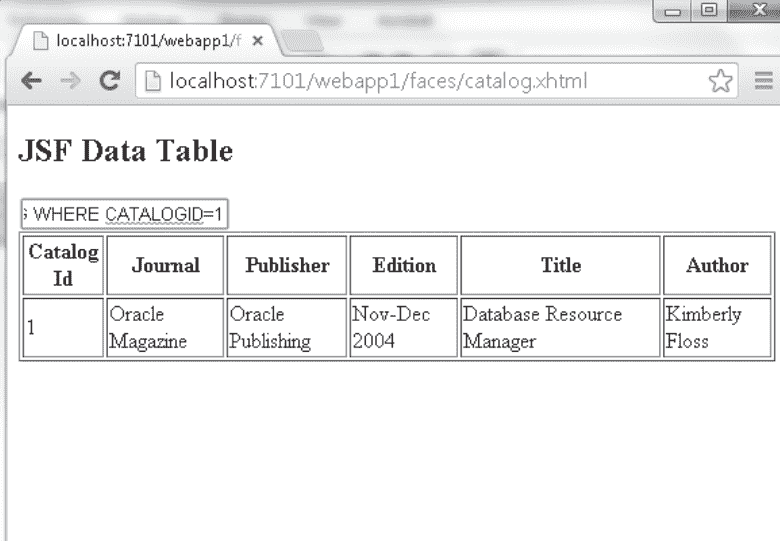

**图 3.24** 针对过滤 SQL 查询的 Ajax 请求生成的 JSF 数据表。

Google 和 Google 标志是 Google Inc. 的注册商标，经许可使用。

6. 作为过滤后的 SQL 查询的另一个示例，指定 `SELECT * FROM OE.CATALOG WHERE EDITION='Nov-Dec 2004'`，如图 3.25 所示。

## 局部页面渲染：渲染

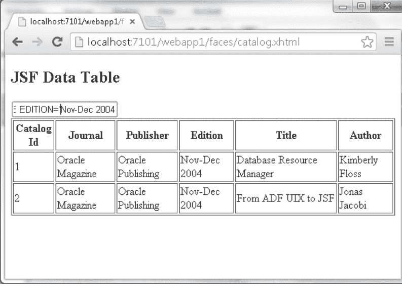

**图 3.25** 过滤后的 SQL 查询的另一个示例。

你可以在 `f:ajax` 标签的 `render` 属性中指定多个组件，以便同时渲染多个组件。要如何操作，请遵循以下步骤：

1. 通过取消注释 id 为 `dataTable` 的 `h:dataTable`，将第二个数据表添加到 `catalog.xhtml` 中。
2. 如果要渲染两个表，将 `render` 属性指定为 `render="dataTable dataTable2"`。如果仅渲染数据表中的 `dataTable`（例如），则指定 `render="dataTable"`。

## 局部页面渲染：渲染（续）

3. 通过设置 `render="dataTable1"` 来探索局部页面渲染。首先，重新部署并运行 `catalog.xhtml` 页面。显示两个数据表的表头，如图 3.26 所示。

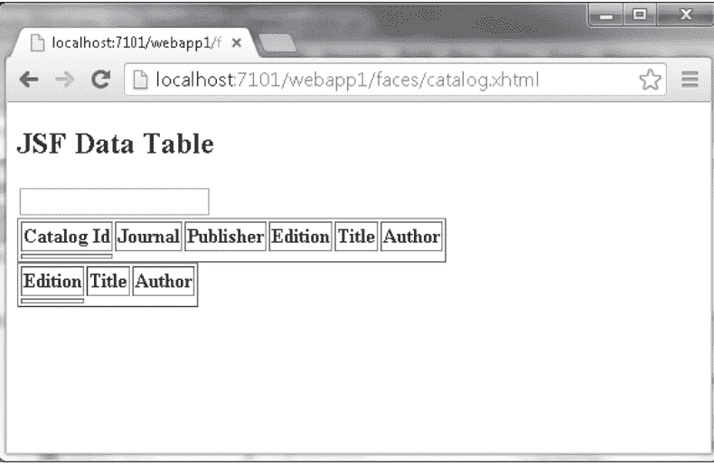

**图 3.26** 两个 JSF 数据表的表头。

Google 和 Google 标志是 Google Inc. 的注册商标，经许可使用。

4. 指定一个 SQL 查询。因为 `render` 属性中只指定了其中一个数据表，所以只渲染了一个数据表。这演示了局部页面渲染。（见图 3.27。）

## 局部页面渲染：渲染 75

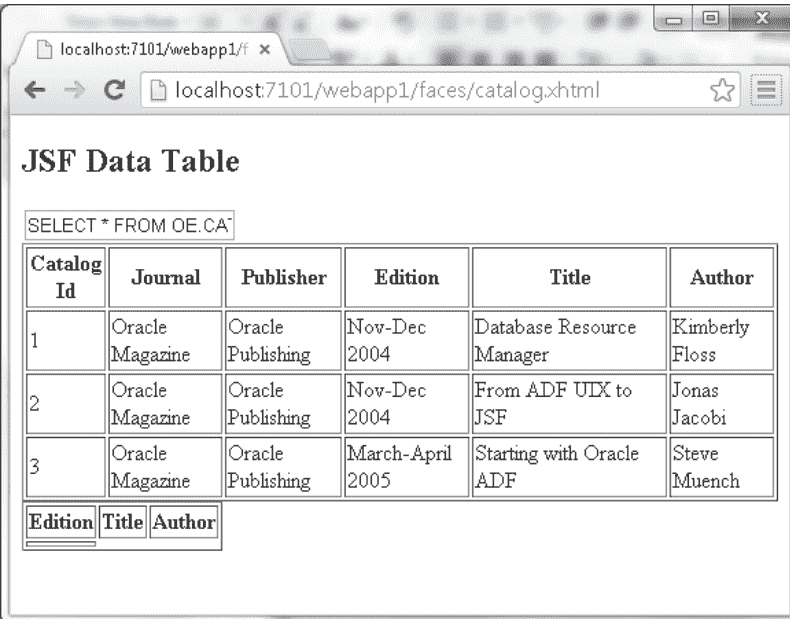

**图 3.27** 局部页面渲染。

Google 和 Google 标志是 Google Inc. 的注册商标，经许可使用。

1. 你可以通过指定 `render="dataTable1 dataTable2"` 来渲染两个数据表，如图 3.28 所示。

# 第 3 章 Ajax

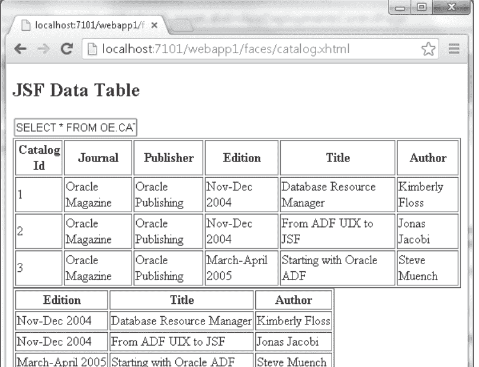

**图 3.28** 渲染 JSF 数据表。

Google 和 Google 标志是 Google Inc. 的注册商标，经许可使用。

## 组件分组

在本节中，你将在 `f:ajax` 标签内对组件进行分组。当为任何组件触发指定的/默认事件时，组件分组会调用一次 Ajax 请求。如果在外层的 `f:ajax` 标签中指定了事件，它将适用于标签内的所有组件（假设组件支持该事件）。你可以使用另一个 `f:ajax` 标签为外层内的特定组件指定额外的事件。在 `catalog2.xhtml` 中，添加一个 `f:ajax` 标签来封装两个组件：

```
<f:ajax execute="@form" event="valueChange" render="form1:dataTable form1:dataTable2" listener="#{catalog.inputListener}">
```

```
<h:inputBinding binding="#{catalog}">
```

```
<h:inputBinding binding="#{catalog}">
```

```xml
">
<f:ajax>
```

`h` 不支持 `valueChange` 事件。你为该按钮添加了点击事件。当 `catalog2.xhtml` 运行时，`valueChange` 事件会被添加到输入组件中，如图 3.29 所示。

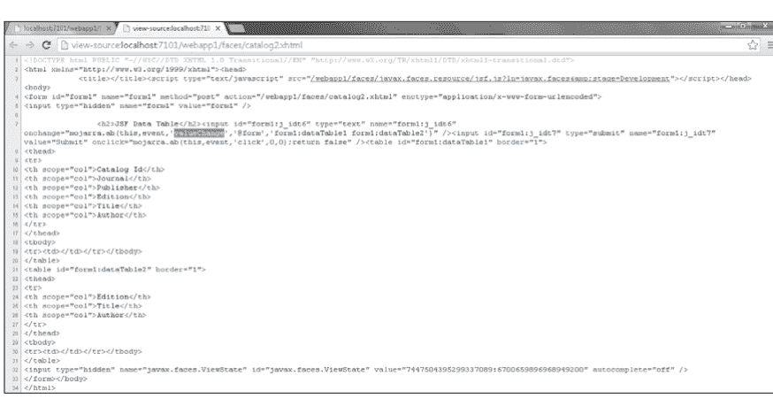

**图 3.29** `valueChange` 事件。

Google 和 Google 标志是 Google Inc. 的注册商标，经许可使用。

在以下组件分组中：

`render="dataTable1 dataTable2"`：

```
<h:inputBinding binding="#{catalog}">
```

```
<h:inputBinding binding="#{catalog}">
```

```xml
">
<f:ajax>
```

`valueChange` 事件会被添加到输入组件中，如图 3.30 所示。

## 第 3 章（续）


**图 3.30** `valueChange` 事件。

Google 和 Google 标志是 Google Inc. 的注册商标，经许可使用。

在以下组件分组中：

# 摘要

本章讨论了在 JSF 2.0 中使用 `f:ajax` 标签和 Ajax JSF JavaScript 库支持 Ajax。还讨论了部分页面渲染，演示了如何渲染一个或多个组件。并讨论了如何通过组合组件为多个组件添加 Ajax 支持。下一章将讨论复合组件。

# 第 4 章 创建复合组件

## 创建复合组件

JSF 2.0 引入了一项新功能：复合组件。这些是可以使用一组 JSF UI 组件开发的可复用 JSF 组件。复合组件不需要任何 Java 代码或 XML 配置文件。一个复合组件由一个顶层 `UIComponent` 以及该组件内部的 `UIComponent` 树（层次结构）组成。

复合组件是使用 JSF 2.0 中的另外两个新功能构建的：Facelets 和资源。复合组件是一个 Facelet 标记文件，它可能包含来自资源库中 Facelets 模板标签库的模板标签。复合组件的元数据使用复合标签库（`http://docs.oracle.com/javaee/javaserferaces/2.1/docs/vldocs/facelets/tld-summary.html`）定义。`composite:interface` 和 `composite:implementation` 标签是定义复合组件元数据所需的标签。

复合组件应用由以下构件组成：

- **定义页面**。该 Facelets 标记页面包含复合组件的声明和定义。复合组件声明在 `composite:interface` 标签内指定，复合组件定义在 `composite:implementation` 标签内。每个定义页面定义一个复合组件。
- **复合组件库**。该资源库包含库中不同复合组件的定义页面。
- **使用页面**。这是一个视图定义语言（VDL）页面，即 Facelets XHTML 页面，在其中通过复合组件标签使用复合组件。`HTML_BASIC` 渲染器包含一个名为 `javax.faces.Composite` 的新渲染器，专门用于复合组件。

在本章中，你将在两个不同的资源库创建两个复合组件（分别用于 JSF 数据表格），并在使用页面中使用这些复合组件。每个复合组件由以下 JSF UI 组件组成：

- 用于输入文本字段的输出标签
- 用于 SQL 查询的输入文本字段，根据该查询将创建数据表格
- 一个提交按钮
- 用户提交 SQL 查询时创建的数据表格

## 设置环境

第一步，下载并安装以下软件：

- Oracle JDeveloper 12c (12.1.2.0) (`www.oracle.com/technwork/developer-tools/jdev/downloads/index.html`)
- Oracle WebLogic Server 12c（包含在 JDeveloper 12c 中）
- Oracle Database Express Edition (XE) 11g (`www.oracle.com/technwork/database-technologies/express-edition/downloads/index.html`)

为了生成 JSF 数据表格，你需要一个数据源以便在 Oracle Database 11g XE 中创建数据库表。使用列表 4.1 中的 SQL 脚本来指定它。（该数据库表与上一章使用的相同。如果你已经创建了它，则无需再次创建。）

### 列表 4.1 创建 Oracle 数据库表的 SQL 脚本

```sql
CREATE USER OE IDENTIFIED BY OE;
GRANT CONNECT, RESOURCE TO OE;
CREATE TABLE OE.Catalog(Catalog INTEGER PRIMARY KEY, JOURNAL VARCHAR(25), Publisher VARCHAR(25), Edition VARCHAR(25), Title Varchar(45), Author Varchar(25));
INSERT OE.Catalog VALUES('1', 'Oracle Magazine', 'Oracle Publishing', 'Nov-Dec 2004', 'Database Resource Manager', 'Kimberly Foss');
INSERT INTO OE.Catalog VALUES('2', 'Oracle Magazine', 'Oracle Publishing', 'Nov-Dec 2004', 'From ADF UIX to JSF', 'Jonas Jacobi');
INSERT INTO Catalog VALUES('3', 'Oracle Magazine', 'Oracle Publishing', 'March-April 2005', 'Starting with Oracle ADF ', 'Steve Munchen');
```

在 SQL 命令行中运行脚本以创建数据库表 `OE.CATALOG`。与上一章一样，配置并启动 `IntegratedWebLogicServer`。

## 创建 Java EE Web 应用

首先，你需要创建一个用于开发复合组件的 Java EE 应用，遵循以下步骤：

1. 选择 **File > New > From Gallery**。
2. 在 **New Gallery** 对话框中，在 **Categories** 栏中选择 **General > Applications**，并在 **Items** 栏中选择 **Java EE Web Application**。然后点击 **OK**。
3. 启动 **Create Java EE Web application** 向导。在 **Application Name** 字段中输入 `Composite` 并点击 **Next**。
4. 为 **Model** 项目名称选择默认设置并点击 **Next**。
5. 为 **Model** 项目选择默认 Java 设置并点击 **Next**。
6. 为 **Model** 项目选择默认的 EJB 设置并点击 **Next**。
7. 在 **ViewController Project features** 屏幕上，选择 **JavaServer Faces** 并点击 **Next**。
8. 为 **ViewController** 项目选择默认 Java 设置并点击 **Next**。
9. 选择默认的 Java Build 环境设置并点击 **Finish**。创建一个 Java EE Web 应用，如图 4.1 所示。


**图 4.1** 一个 Java EE Web 应用。

## 创建使用页面

使用页面是一个视图定义语言（VDL）页面，即 Facelets XHTML 页面，在其中使用复合组件。要创建使用页面，遵循以下步骤：

1. 选择 **File > New > From Gallery**。
2. 在 **New Gallery** 对话框中，在 **Categories** 栏中选择 **Web Tier > JSF/Facelets**，并在 **Items** 栏中选择 **Facelets Page**。然后点击 **OK**。
3. 在 **Create Facelets Page** 对话框中，勾选 **Create** 复选框，在 **File Name** 中输入 `catalog.xhtml`，如图 4.3 所示。


**图 4.3** 创建 HTML 文件。

4. 在使用页面中，声明 `dt1` 和 `dt2` 的命名空间。前缀的选择是任意的。

```xml
xmlns:dt1="http://java.sun.com/jsf/composite/dataTable1"
xmlns:dt2="http://java.sun.com/jsf/composite/dataTable2"
```

5. 将 `dataTable` 中的复合组件添加到页面。`dataTable` 库定义了一个复合组件，`dataTable2` 库定义了一个复合组件。这两个复合组件的复合组件属性是相同的。


# 第 4 章 创建组合组件

`dt1:compositeDataTable` 和 `dt2:compositeDataTable` 是复合组件标签。它们引用定义页面中定义的复合组件（稍后讨论）。复合组件标签包含表 4.1 中讨论的属性，用于指定绑定到数据表格中实际 `h` 元素的 EL 表达式。

## 表 4.1 复合组件标签属性

| 属性 | 说明 |
| :--- | :--- |
| `bindingSQLQuery` | 用于复合组件中 `h:inputText` 元素的绑定属性的 EL 表达式 |
| `bindingCommandButton` | 用于复合组件中 `h:commandButton` 元素的绑定属性的 EL 表达式 |
| `valueDataTable` | 用于复合组件中 `h:dataTable` 元素的 `value` 属性的值表达式 |
| `submitAction` | 用于复合组件中 `h:commandButton` 元素的 `action` 属性的 EL 表达式 |

## 创建托管 Bean

```xml
<dt2:compositeData2 bindingSQLQuery="#{catalog.inputText1}"
    bindingCommandButton="#{catalog.commandButton1}"
    dataTable="#{catalog.resultSet}"
    submitAction="#{catalog.commandButton_action}"
    sqlQueryLabel="SQL Query:"/>
</form>
</body>
</f:view>
</html>
```

图 4.4 显示了 JDeveloper 中的使用页面。


**图 4.4** catalog.xhtml 使用页面。

我们尚未添加资源库 `dataType1` 和 `dataType2`，它们由 `compositeDataTable1.xhtml` 和 `compositeDataTable2.xhtml` 定义页面组成。这些内容将在随后的章节中讨论。

## 创建托管 Bean (Managed Bean)

在本节中，你将为组合组件创建托管 Bean。按照以下步骤操作：

1.  在“应用程序导航器”（Applications navigator）中，右键点击 `faces-config.xml` 并选择“打开”（Open），如图 4.5 所示。

    

    **图 4.5** 右键点击 `faces-config.xml` 并选择“打开”。

    来源：Oracle Corporation。

2.  点击“概述”（Overview）标签页和“托管 Bean”（Managed Beans）节点。然后点击“添加”（Add）按钮添加一个新的托管 Bean，如图 4.6 所示。

    

    **图 4.6** 添加新的托管 Bean。

    来源：Oracle Corporation。

3.  在“创建托管 Bean”（Create Managed Bean）对话框中，在“Bean 名称”（Bean Name）字段中输入 `catalog`，在“类名”（Class Name）字段中输入 `Catalog`，在“包名”（Package）字段中输入 `view`，并从“作用范围”（Scope）下拉列表中选择一个选项（默认值是 request）。最后，选择“注解”（Annotations）选项按钮并点击“确定”（OK），如图 4.7 所示。

    

    **图 4.7** 创建托管 Bean。

    来源：Oracle Corporation。

一个托管 Bean 已添加到组合应用程序中。托管 Bean 类 `Catalog` 被 `@ManagedBean` 注解标记。

```java
@ManagedBean(name = "catalog")
public class Catalog {
}
```

4.  为输入文本字段、命令按钮和 SQL 结果集指定属性：

    ```java
    private HtmlInputText inputText1;
    private SqlCommand commandButton1;
    private ResultSet resultSet;
    ```

5.  为 Bean 属性添加访问器方法（getter 和 setter）。

6.  添加 `commandButton_action()` 方法，以便在点击组合组件中的“提交”（Submit）按钮时调用：

    ```java
    private void commandButton_action() {
    }
    ```

7.  在 `action` 方法中，获取与 Oracle Database 11g XE 的连接：

    ```java
    Class.forName("oracle.jdbc.OracleDriver");
    String url = "jdbc:oracle:thin@localhost:1521:XE";
    connection = DriverManager.getConnection(url, "OE", "OE");
    ```

8.  创建 `Statement` 对象并运行输入文本字段中指定的 SQL 查询：

    ```java
    stmt = connection.createStatement(ResultSet.TYPE_SCROLL_INSENSITIVE,
    ResultSet.CONCUR_READ_ONLY);
    resultSet = stmt.executeQuery((String)inputText1.getValue());
    ```

如果结果集不为空，则将 Bean 属性 `resultSet` 设置为返回的结果集。

```java
if (resultSet != null) {
    this.setResultSet(resultSet);
}
```

通过这种方式，`resultSet` 属性绑定到组合组件中 `h:dataTable` 元素的值表达式上。托管 Bean 类 `Catalog.java` 如列表 4.3 所示。

### 列表 4.3 托管 Bean 类 Catalog.java

```java
package view;

import javax.faces.component.html.inputText;
import java.sql.*;
import javax.faces.bean.ManagedBean;
import javax.faces.bean.RequestScoped;
import javax.faces.component.html.HtmlButton;

@ManagedBean(name="catalog")
@RequestScoped
public class Catalog {
    public Catalog() {}

    private InputText inputText1;
    private HtmlButton commandButton1;
    private Statement stmt;
    private Connection connection;
    private ResultSet resultSet;

    public void setInputText1(HtmlText inputText1) {
        this.inputText = inputText1;
    }

    public Text getInput1() {
        return inputText1;
    }

    public void setCommandButton1(HtmlButton commandButton1) {
        this.commandButton1 = commandButton1;
    }

    public HtmlButton getCommandButton1() {
        return commandButton1;
    }

    public void setResultSet(ResultSet resultSet) {
        this.resultSet = resultSet;
    }

    public ResultSet getResultSet() {
        return resultSet;
    }

    public void commandButton_action() {
        try {
            Class.forName("oracle.jdbc.OracleDriver");
            String url = "jdbc:oracle:thin@localhost:1521:XE";
            connection = DriverManager.getConnection(url, "OE", "OE");
            stmt = connection.createStatement(ResultSet.TYPE_SCROLL_INSENSITIVE,
            ResultSet.CONCUR_READ_ONLY);
            resultSet = stmt.executeQuery((String)inputText1.getValue());
            if (resultSet != null) {
                this.setResultSet(resultSet);
            }
        } catch (SQLException e) {
            e.printStackTrace();
        } catch (Exception e) {
            e.printStackTrace();
        }
    }
}
```

## 创建复合组件

11. `h:commandButton` 的 `action` 属性需要一个方法表达式。`<cc:attribute>` 标签的 `method-signature` 属性指定了属性值必须是具有指定方法签名的 `MethodExpression`。提交按钮 (`h:commandButton`) 的 `action` 属性需要一个 `MethodExpression`。

    ```xml
    <cc:attribute name="submitAction" method-signature="void f()" required="true"/>
    ```

12. 使用 `<cc:facet>` 标签为头部和页脚添加切面。

13. 因为我们在复合组件在使用 `h:inputText` 元素，请在 `<cc:interface>` 标签内添加 `<cc:editableValueHolder>` 标签，以指定类型为 `editableValueHolder` 的 `UIComponent`。`HtmlInput` 将页面实现的 UI 组件绑定到受托管 bean 中的 UI 组件属性。`<cc:editableValueHolder>` 标签的 `targets` 属性指定了由空格分隔的 ID，这些 ID 相对于 `<cc:implementation>` 标签内目标元素的 ID。

    ```xml
    <cc:editableValueHolder name="sqlquery1" targets="sqlquery1"/>
    ```

14. 对于复合组件中的 `h:commandButton` 标签，在 `<cc:interface>` 标签中添加 `<cc:actionSource>` 标签，以指定类型为 `ActionSource2` 的 `UIComponent`。`SqlCommandButton` 实现了该接口。`targets` 属性指定了 `<cc:implementation>` 标签内目标元素的空格分隔的 ID。

    ```xml
    <cc:actionSource name="submit1" targets="submit1"/>
    ```

15. 在 `<cc:implementation>` 标签中为复合组件指定实现。然后使用 `renderFacet` 标签渲染头部和页脚切面。

    ```xml
    <cc:renderFacet name="header"/>
    ```

16. 为输出标签添加 `<h:outputLabel>` 元素。`for` 属性指定了创建标签的 UI 组件的客户端 ID。`h:outputLabel` 的值表达式使用 `cc:attrs` 映射指定，该映射提供了组件属性的封装。

    ```xml
    <h:outputLabel for="#{cc.clientId}:sqlquery1" value="#{cc.attrs.sqlQueryLabel}"/>
    ```

17. 值表达式 `"#{cc.attrs.sqlQueryLabel}"` 映射到 `<cc:interface>` 标签中声明的 `sqlLabel` 属性。用户在使用页面组件声明标签中指定的属性值，将传递给 `h:outputText` UI 组件标签。在 `<cc:implementation>` 标签中，指定一个 `h:inputText` UI 组件标签。

    ```xml
    <h:inputText id="sqlquery1" binding="#{cc.attrs.bindingSQLQuery}"/>
    ```

18. 用于绑定的 EL 表达式映射到 `bindingSQLQuery` 属性，这意味着在使用页面组件声明标签中指定的 `bindingSQLQuery` 属性值将应用到 `h:inputText` UI 标签的 `binding` 属性。添加一个 `<h:commandButton>` UI 组件作为提交按钮。提交按钮的 ID 与 `<cc:interface>` 标签内 `<cc:actionSource>` 的 `targets` 属性指定的客户端 ID 匹配。`h:commandButton` 的值表达式映射到在使用页面复合组件标签中指定的 `valueCommandBuffer` 属性，并应用于 `h:commandButton` 的 `value` 属性。同样，`binding` 属性的 EL 表达式映射到 `bindingComboBox` 属性，而 `action` 属性的 EL 表达式映射到 `<cc:interface>` 标签中的 `submitAction`。

    ```xml
    <h:commandButton id="submit1" value="#{cc.attrs.valueCommandBuffer}"
    binding="#{cc.attrs.bindingComboBox}"
    action="#{cc.attrs.submitAction}"/>
    ```

19. 用于 JSF 数据表格的 `<h:dataTable>` UI 组件。数据表格的值表达式映射到 `valueDataTable` 属性。在使用页面组件标签中指定的组件属性值将应用到 `h:dataTable` UI 组件的 `value` 属性。

    ```xml
    <h:dataTable id="dataTable" value="#{cc.attrs.valueDataTable}"
    var="resultset" border="1" rows="5">
    ```

复合组件 `DataTable1.xml` 的定义页面如列表 4.4 所示。

### 列表 4.4 复合组件 DataTable1.xml 的定义页面


# 第 4 章 创建复合组件

## 复合组件 DataTable.xhtml 定义页面

```xml
<!DOCTYPE html PUBLIC "-//W3C//DTD HTML 1.0 Transitional//EN"
"http://www.w3.org/TR/xhtml1/DTD/xhtml-transitional.dtd">
<html xmlns="http://www.w3.org/1999/xhtml"
xmlns:h="http://java.sun.com/jsf/html"
xmlns:f="http://java.sun.com/jsf/core"
xmlns:ui="http://java.sun.com/jsf/facelets"
xmlns:cc="http://java.sun.com/jsf/composite">
<head>
<title>Composite DataTable</title>
</head>
<body>
<cc:interface>
<!-- start top level attributes bindingSqlQuery -- -->
<cc:attribute name="bindingSqlQuery" required="true"/>
<cc:attribute name="bindingCommandButton"/>
<cc:attribute name="valueCommandButton" default="Submit"/>
<cc:attribute name="valueDataTable" required="true"/>
<cc:attribute name="submitaction" method-signature="void f()" required="true"/>
<cc:attribute name="executeQueryLabel" />
<!-- end top level attributes --
<cc:facet name="header" />
<cc:facet name="footer" />
<!-- end facets --
<!-- start attached objects --
<cc:editableValueHolder name="sqlquery1" targets="sqlquery1"/>
<cc:actionSource name="submit1" targets="submit1"/>
</cc:interface>
<cc:implementation>
<cc:renderFacet name="header"/>
<p>
<h:outputLabel for="#{cc.clientId}:sqlquery1" value="#{cc.attrs.sqlQueryLabel}"/>
<h:inputText id="sqlquery1" binding="#{cc.attrs.bindingSQLQuery}"/>
</p>
<p>
<h:commandButton id="submit1" value="#{cc.attrs.valueCommandBuffer}"
binding="#{cc.attrs.bindingComboBox}"
action="#{cc.attrs.submitAction}"/>
</p>
<h:dataTable id="dataTable" value="#{cc.attrs.valueDataTable}"
var="resultset" border="1" rows="5">
<cc:facet name="header">
<h:outputText value="Catalog"/>
</cc:facet>
<cc:facet name="header">
<h:outputText value="Journal"/>
</cc:facet>
<cc:facet name="header">
<h:outputText value="Publisher"/>
</cc:facet>
<cc:facet name="header">
<h:outputText value="Title"/>
</cc:facet>
<cc:facet name="header">
<h:outputText value="Author"/>
</cc:facet>
</h:dataTable>
<cc:renderFacet name="footer"/>
</cc:implementation>
</body></html>
```

## 复合组件 DataTable2.xhtml 定义页面

20. 为资源库 dataTable2 添加复合组件 `DataTable2.xhtml` 的定义页面。该定义页面与第一个页面相同，只是 UI 组件的 ID 不同。（见列表 4.5。）

列表 4.5 复合 `DataTable2.xhtml` 的定义页面

```xml
<!DOCTYPE html PUBLIC "-//W3C//DTD XHTML 1.0 Transitional//EN"
"http://www.w3.org/TR/xhtml1/DTD/xhtml-transitional.dtd">
<html xmlns="http://www.w3.org/1999/xhtml"
xmlns:h="http://java.sun.com/jsf/html"
xmlns:f="http://java.sun.com/jsf/core"
xmlns:ui="http://java.sun.com/jsf/facelets"
xmlns:cc="http://java.sun.com/jsf/composite">
<head>
<title>CompositeDataTable</title>
</head>
<body>
<cc:interface>
<!-- start top level attributes -->
<cc:attribute name="sqlquery"/>
<cc:attribute name="bindingSqlQuery" required="true"/>
<cc:attribute name="bindingCommandButton"/>
<cc:attribute name="valueCommandButton" default="Submit"/>
<cc:attribute name="dataTable" required="true"/>
<cc:attribute name="submitAction" method="search" void f()
required="true"/>
<cc:attribute name="SqlQueryLabel"/>
<!-- end top level attributes -->
<!-- start facets -->
<cc:facet name="header"/>
<cc:facet name="footer"/>
<!-- end facets -->
<!-- start attached objects -->
<cc:editableValueHolder name="sqlquery" targets="sqlquery"/>
<cc:actionSource name="submit" targets="submit"/>
<!-- end attached objects -->
</cc:interface>
<cc:implementation>
<cc:renderFacet name="header"/>
<p>
<h:outputLabel for="#{cc.clientId}:sqlquery2"
value="#{cc.attrs.sqlQuery}"/>
<h:inputText id="sqlquery2" binding="#{cc.attrs.bindingSqlQuery}"/>
</p>
<p>
<h:commandButton id="submit2" value="#{cc.attrs.valueCommandButton}"
binding="#{cc.attrs.bindingCommandButton}"
action="#{cc.attrs.submitAction}"/>
</p>
<h:dataTable id="dataTable" value="#{cc.attrs.valueDataTable}"
var="resultset" border="1" rows="5">
<cc:facet name="header">
<h:outputText value="Catalog"/>
</cc:facet>
<cc:facet name="header">
<h:outputText value="Journal"/>
</cc:facet>
<cc:facet name="header">
<h:outputText value="Publisher"/>
</cc:facet>
<cc:facet name="header">
<h:outputText value="Title"/>
</cc:facet>
<cc:facet name="header">
<h:outputText value="Author"/>
</cc:facet>
</h:dataTable>
<cc:renderFacet name="footer"/>
</cc:implementation>
</body></html>
```

## 复合组件实现片段

```html
<p>
<h:dataTable id="dataTable2" value="#{cc.attrs.valueDataTable}" var="resultset"
border="1" rows="5">
<h:column>
  <f:facet name="header">
    <h:outputText value="Catalog Id"/>
  </f:facet>
  <h:outputText value="#{resultset.catalogid}"/>
</h:column>
<h:column>
  <f:facet name="header">
    <h:outputText value="Edition"/>
  </f:facet>
  <h:outputText value="#{resultset.edition}"/>
</h:column>
<h:column>
  <f:facet name="header">
    <h:outputText value="Title"/>
  </f:facet>
  <h:outputText value="#{resultset.title}"/>
</h:column>
<h:column>
  <f:facet name="header">
    <h:outputText value="Author"/>
  </f:facet>
  <h:outputText value="#{resultset.author}"/>
</h:column>
</h:dataTable>
</p>
<cc:renderFacet name="footer"/>
</cc:implementation>
</body>
</html>
```

## 运行复合组件应用程序

接下来，你将部署并运行复合组件应用程序。按照以下步骤操作：

1. 为 `ViewController` 项目创建一个部署配置。首先，选择 **文件** > **新建** > **从库**。
2. 在新建库对话框中，选择 **常规** > **部署配置**。
3. 在项目窗格中选择 **WAR File** 并点击 **确定**。
4. 在创建部署配置向导程序中，选择默认的部署配置名称设置 (`webapp1`) 并点击 **确定**。
5. 在编辑 WAR 部署配置属性屏幕上，选择 **Java EE Web Context Root** 单选按钮，指定为 `webapp1`，并点击 **确定**。此时将创建一个 `webapp1` 部署配置。
6. 在 **项目属性** 中点击 **确定**。这将 `webapp1` 部署配置添加到 **部署** 节点下。
7. 如果 `IntegratedWebLogicServer` 尚未启动，请启动它。
8. 右键点击 `ViewController` 项目并选择 **部署** > `webapp1`，如图 4.12 所示。


9. 在 **部署操作** 屏幕上，选择 **部署到应用程序服务器** 并点击 **下一步**。
10. 在 **选择服务器** 屏幕上，选择 `IntegratedWebLogicServer` 并点击 **下一步**。
11. 在 **WebLogic** 屏幕上，选择 `DefaultServer`（其状态应为 RUNNING 状态）进行部署并点击 **下一步**。
12. 在 **摘要** 屏幕上，点击 **完成**。复合组件应用程序已部署到 `IntegratedWebLogicServer`，如图 4.13 所示。

```
Deployment-Log
[08:43:35 AM] --- Deployment started.
[08:43:36 AM] Target platform is (WebLogic 12.x).
[08:43:37 AM] Running existing application analysis...
[08:43:39 AM] -- Building...
[08:43:43 AM] Deploying profile.
[08:43:43 AM] -- Web Application Module to C:\Developer\work\Composite\ViewController\deploy\webapp1.war
[08:43:46 AM] Redploying Application.
[08:43:49 AM] (Deployment:1629) "operation" on application "webapp1" is in progress on "DefaultServer".
[08:43:51 AM] (Deployment:1629) "operation" on application "webapp1" has succeeded on "DefaultServer".
[08:43:52 AM] The following URL context root(s) were defined and can be used as a starting point to test your application:
[08:43:52 AM] -- http://localhost:7101/
[08:43:52 AM] -- Elapsed time for deployment: 17 seconds
[08:43:52 AM] -- Deployment finished.
```


13. 使用以下 URL 运行 `catalog.xhtml`：`http://localhost:7101/webapp1/faces/catalog.xhtml`。将显示两个复合组件，如图 4.14 所示。


每个复合组件包含一个数据表格。由于你在两个数据表格的 UI 组件标签中使用了相同的 EL 表达式，因此数据表格绑定到相同的托管豆类属性。在由两个复合组件组成的复合视图中，输入文本字段和提交按钮只渲染一次，并且与复合视图关联。当运行 `catalog.xhtml` 时，该定义包含了该复合视图。例如，如图 4.15 所示。


指定一个 SQL 查询，如图 4.16 所示。


每个复合组件包含一个数据表格。由于你在两个数据表格的 UI 组件标签中使用了相同的 EL 表达式，因此数据表格绑定到相同的托管豆类属性。在由两个复合组件组成的复合视图中，输入文本字段和提交按钮只渲染一次，并且与复合视图关联。当运行 `catalog.xhtml` 时，该定义包含了该复合视图。例如，如图 4.17 所示。


图 4.17 来自两个组件的数据表格。

## 将复合组件绑定到托管豆类属性

### 将复合组件绑定到唯一的托管豆类属性

在上一节的用法示例中，你为组件属性指定了相同的 EL 表达式。结果是输入字段和命令按钮只渲染一次。你可以修改 `catalog.xhtml` 页面，为组件属性指定唯一的 `bindingSqlQuery` 和 `bindingCommandButton` 表达式。修改后的 `catalog.xhtml` 页面见列表 4.6。

列表 4.6 使用 `Page.xhtml`

```html
（此处代码省略）
```

修改托管豆类 `Catalog.java`，为两个输入文本字段、两个命令按钮、两个结果集以及两个动作方法添加托管属性，而不是每个一个。修改后的托管豆类见列表 4.7。

列表 4.7 修改后的 `Managed Bean.java`

```java
package view;
import javax.faces.component.html.HtmlInputText;
import javax.sql.*;
import javax.faces.bean.ManagedBean;
import javax.faces.bean.RequestScoped;
import javax.faces.component.html.SqlCommandButton;
@ManagedBean(name = "catalog")
@RequestScoped
public class Catalog {
    public Catalog() {
}
    private HtmlInputText inputText1;
    private HtmlInputText inputText2;
    private SqlCommandButton commandButton1;
    private SqlCommandButton commandButton2;
    private Statement stmt1;
    private Connection connection1;
    private Statement stmt2;
    private Connection connection2;
    private ResultSet resultSet1;
    private ResultSet resultSet2;
    public void setInputText1(HtmlInputText inputText1) {
        this.inputText1 = inputText1;
    }
    public HtmlInputText getInput1() {
        return inputText1;
    }
    public void setInputText2(HtmlInputText inputText2) {
        this.inputText2 = inputText2;
    }
    public HtmlInputText getInput2() {
        return inputText2;
    }
    public void setCommandButton1(SqlCommandButton commandButton1) {
        this.commandButton1 = commandButton1;
    }
    public SqlCommandButton getCommandButton1() {
        return commandButton1;
    }
    public void setCommandButton2(SqlCommandButton commandButton2) {
        this.commandButton2 = commandButton2;
    }
}
```

### 将复合组件绑定到唯一的 Managed Bean 属性

```java
public HtmlCommandButton getCommandButton2() {
    return commandButton2;
}
public void setResultSet1(ResultSet result1) {
    this.resultSet1 = result1;
}
public ResultSet getResultSet1() {
    return result1;
}
public void setResultSet2(ResultSet result2) {
    this.resultSet2 = result2;
}
public ResultSet getResultSet2() {
    return result2;
}
public void commandButton_action1() {
try {
        Class.forName("oracle.jdbc.OracleDriver");
        String url = "jdbc:oracle:thin:localhost:1521:XE";
        connection1 = DriverManager.getConnection(url, "OE", "OE");
        connection1.createStatement(ResultSet.TYPE_SCROLL_INSENSITIVE,
            ResultSet.CONCUR_READ_ONLY);
        result1 = stmt1.executeQuery((String)inputText1.getValue());
        if (result1 == null) {
            this.setResultSet1(result1);
        }
} catch (SQLException e) {
    System.out.println("SQLException" + e.getMessage());
} catch (ClassNotFoundException e) {
    System.out.println("ClassNotFoundException" + e.getMessage());
} catch (Exception e) {
    e.printStackTrace();
} finally {
}
public void commandButton_action2() {
try {
        Class.forName("oracle.jdbc.OracleDriver");
        String url = "jdbc:oracle:thin:localhost:1521:XE";
        connection2 = DriverManager.getConnection(url, "OE", "OE");
        stmt2 = connection2.createStatement(ResultSet.TYPE_SCROLL_INSENSITIVE,
            ResultSet.CONCUR_READ_ONLY);
```

```java
resultSet2 = stmt2.executeQuery((String)inputText2.getValue());
if (resultSet2 != null) {
    this.resultSet2(resultSet2);
}
} catch (SQLException e) {
    System.out.println("SQLException" + e.getMessage());
} catch (ClassNotFoundException e) {
    System.out.println("ClassNotFoundException" + e.getMessage());
} catch (Exception e) {
    e.printStackTrace();
} finally {
}
}
```

资源库以及定义资源库内复合组件的定义页面是相同的。你刚刚将它们绑定到唯一的托管 bean 属性上，以便在使用页面渲染的复合视图中生成唯一的面标识符（facet identifiers）。

在 Applications 导航器中右键点击 ViewController 项目，并选择 Deploy 以重新部署 ViewController 项目。如果应用程序之前已部署到 `IntegratedWebLogicServer`，它将列为部署选项之一，如图 4.18 所示。


图 4.18 重新部署到 `IntegratedWebLogicServer`。

来源：Oracle Corporation。

使用相同的 URL (`http://localhost:7101/webapp1/faces/catalog.xhtml`) 重新运行 `catalog.xhtml`。由于 UI 组件标签绑定到唯一的托管 bean 属性，渲染了两个输入框和两个提交按钮，如图 4.19 所示。


图 4.19 两个具有独立输入文本框和命令按钮的组件。

Google 和 Google 标志是 Google Inc. 的注册商标，经许可使用。

UIComponent 层级结构显示了输入文本框和命令按钮的唯一 ID，这是因为 UI 组件标签绑定到了不同的托管 bean 属性。


图 4.20 UI 组件层级结构。

Google 标志是 Google Inc. 的注册商标。

在输入文本框中指定 `SQL * FROM` 并点击提交，如图 4.21 所示。为指定的 SQL 生成了表格，见图 4.22。


图 4.21 提交 SQL 查询。

Google 标志是 Google Inc. 的注册商标。


图 4.22 渲染表格。

Google 标志是 Google Inc. 的注册商标。

### 将复合组件绑定到唯一的 Managed Bean 属性

在第二个输入文本框中指定 `SQL FROM` 并点击提交，如图 4.23 所示。在提交第二个查询后，页面再次渲染。一次生成一个数据表。


图 4.23 提交第二个 SQL 查询。

Google 标志是 Google Inc. 的注册商标。


图 4.24 渲染第二个数据表。

Google 标志是 Google Inc. 的注册商标。

## 总结

在本章中，你使用复合组件开发了一个 JSF 2.0 应用。首先，你在定义页面中定义了复合组件。你从复合组件创建了复合库。随后，你在使用页面中这些复合组件。本章还讨论了将复合组件绑定到唯一的托管 bean 属性。下一章将讨论增强导航。

# 第 5 章 增强导航

导航是 JSF 的一个重要方面。1.2 版本限于 `faces-config.xml` 文件中指定的导航规则。然而，JSF 2.0 提供了促进导航的功能，在本章中讨论。新的导航功能如下：

- 隐式导航。如果没有为 JSF 页面的动作或结果指定导航规则或导航例，则实现隐式导航。
- 条件导航。在 `faces-config.xml` 中使用评估布尔值的 EL 表达式指定条件导航。
- 预防导航。JSF 2.0 引入了一种新的导航处理器，称为可配置导航处理器。使用它可以编程地检索和修改从-view-id 的导航例。

## 设置环境

作为第一步，下载并安装以下软件：

- Oracle Developer 12c (12.1.2.0) (www.oracle.com/technetwork/developer-tools/jde/downloads/index.html)
- Oracle WebLogic Server 12c (包含在 JDeveloper 12c 中)
- Oracle Database Express Edition (XE) 11g (www.oracle.com/technetwork/database/database-technologies/express-edition/downloads/index.html)

要生成 JSF 数据表，你需要一个数据源以便在 Oracle Database 11g XE 中创建数据库表。请使用列表 5.1 中的 SQL 脚本来指定该数据源。（数据库表与上一章节中的表相同。如果你已经创建了它，则无需再次创建。）

### 列表 5.1 创建 Oracle 数据库表的 SQL 脚本

```sql
CREATE USER OE IDENTIFIED BY OE;
GRANT CONNECT, RESOURCE TO OE;
CREATE TABLE OE.Catalog(CatalogId INTEGER
PRIMARY KEY, Journal VARCHAR(25), Publisher VARCHAR(25),
Edition VARCHAR(25), Title VARCHAR(45), Author VARCHAR(25));
INSERT INTO OE.Catalog VALUES('1', 'Oracle Magazine',
'Oracle Publishing', 'Nov-Dec 2004', 'Database Manager',
'Kimberly Flows');
INSERT INTO OE.Catalog VALUES('2', 'Oracle Magazine',
'Oracle Publishing', 'Nov-Dec 2004', 'From ADF UIX to JSF',
'Jonas Jacobi');
INSERT INTO OE.Catalog VALUES('3', 'Oracle Magazine',
'Oracle Publishing', 'March-April 2005', 'Starting with
Oracle ADF ', 'Steve Muench');
```

在 SQL Command Line 中运行该 sql 脚本创建数据库表 `OE.CATALOG`。与上一章节一样，配置并启动 `IntegratedWebLogicServer`。

## 创建 Java EE Web 应用程序

为了演示 JSF 2.0 中的新导航功能，请创建一个包含 `input.xhtml` 页面和 `output.xhtml` 页面的 Java EE Web 应用程序。`input.xhtml` 页面包含一个用于 SQL 查询的输入字段和一个用于提交 SQL 查询的提交按钮。`output.xhtml` 的 Facets（部分）由从 `input.xhtml` 中指定的 SQL 查询生成的 JSF 数据表组成。还包含一个 `error.xhtml` 页面，以便在生成错误时导航过去。

按照以下步骤创建 JDeveloper 应用程序：

1. 选择 `File > New > From Gallery`。在 Categories（类别）窗格中选择 `General > Applications`，在 Items（项目）窗格中选择 `Java EE Web Application`。然后点击 Next。
2. 在 Application Name（应用程序名称）字段中输入 `Navigation` 并点击 Next。
3. 为 Model 项目名称和目录选择默认设置并点击 Next。
4. 为 Model 项目选择默认 Java 设置并点击 Next。
5. 为 Model 项目选择默认 EJB 设置并点击 Next。
6. 对于 ViewController 项目，在 Project Features（项目功能）中选择 `JavaServer Faces` 并点击 Next。
7. 为 ViewController 项目选择默认 Java 设置并点击 Next。
8. 选择默认 Build Java Environment 设置并点击 Finish。创建一个名为“Navigation”的 Java EE 应用程序，它由 Model 和 ViewController 项目组成（图 5.1）。你将只使用 ViewController 项目。


图 5.1 一个名为“Navigation”的 Java EE Web 应用程序。

来源：Oracle Corporation。

9. 由于你使用了 JSF 2.0 中默认视图语言 Facelets，你将为 JSF 页面创建 XHTML 页面。首先，在 Application navigator（应用程序导航）中选择 ViewController 项目。
10. 选择 `File > New > From Gallery`。
11. 在 New Gallery 对话框中，在 Categories 窗格中选择 `Web Tier > HTML`，在 Items 窗格中选择 `HTML Page`。


## 创建 Java EE Web 应用程序

12. 在 Create HTML 对话框中，勾选 Create as XML File，在 Name 字段中输入 `input.xhtml`，并点击 OK。

13. 同样，添加 `output.xhtml` 和 `error.xhtml` JSF 页面。如图 5.2 所示的 XHTML 页面。


图 5.2 XHTML 页面。来源：Oracle Corporation。

14. 接下来，你创建一个托管 bean（managed bean），它只是一个 POJO。右键点击 `faces-config.xml` 并选择 Open，如图 5.3 所示。


图 5.3 选择 `faces-config.xml` > Open。来源：Oracle Corporation。

15. 点击 Overview 标签页和 Managed Beans 节点。然后点击 Add 添加一个新的托管 bean，如图 5.4 所示。


图 5.4 点击 Add 添加一个托管 bean。来源：Oracle Corporation。

16. 在 Create Managed Bean 对话框中，在 Bean Name 字段输入 `catalog`，在 Class Name 字段输入 `Catalog`，在 Package 字段输入 `view`，从 Scope 下拉列表中选择 `request`，并选择 Annotations 选项。然后点击 OK。（参见图 5.5。）Navigation 应用程序中添加了一个托管 bean 类 `Catalog.java`。Navigation 应用程序的目录结构如图 5.6 所示。

图 5.5 创建托管 bean。来源：Oracle Corporation。

图 5.6 托管 bean 类 `Catalog.java`。来源：Oracle Corporation。

### 列表 5.4 `input.xhtml`

```xml
<f:view>
<head>
<title></title>
</head>
<body>
<form id="form1">
<h2>数据表格</h2>
<h:dataTable id="dataTable1" value="#{catalog.resultSet}" var="resultset" border="1" rows="4">
<h:column id="column1">
<f:facet name="header">
<h:outputText value="目录 ID"/>
</f:facet>
<h:outputText id="outputText1" value="#{resultset.catalogid}"/>
</h:column>
<h:column id="column2">
<f:facet name="header">
<h:outputText value="期刊名称"/>
</f:facet>
<h:outputText id="outputText2" value="#{resultset.journal}"/>
</h:column>
<h:column id="column3">
<f:facet name="header">
<h:outputText value="出版社"/>
</f:facet>
<h:outputText id="outputText3" value="#{resultset.publisher}"/>
</h:column>
<h:column id="column4">
<f:facet name="header">
<h:outputText value="版本"/>
</f:facet>
<h:outputText id="outputText4" value="#{resultset.edition}"/>
</h:column>
<h:column id="column5">
<f:facet name="header">
<h:outputText value="标题"/>
</f:facet>
<h:outputText id="outputText5" value="#{resultset.title}"/>
</h:column>
<h:column id="column6">
<f:facet name="header">
<h:outputText value="作者"/>
</f:facet>
<h:outputText id="outputText6" value="#{resultset.author}"/>
</h:column>
</h:dataTable>
</form>
</body>
</f:view>
</html>
```

`error.xhtml` 页面包含一条错误信息，如列表 5.5 所示。

### 列表 5.5 `error.xhtml`

```xml
<!DOCTYPE type PUBLIC "-//W3C//DTD HTML 1.0 Transitional//EN"
"http://www.w3.org/TR/html/DTD/xhtml1-transitional.dtd">
<html xmlns="http://www.w3.org/1999/xhtml"
xmlns:ui="http://java.sun.com/js/facelets"
xmlns:h="http://java.sun.com/js/html"
xmlns:f="http://java.sun.com/js/core">

<f:view>
<h:head>
<title>错误</title>
</h:head>
<h:body>错误页面</h:body>
</f:view>
</html>
```

托管 Bean（Managed Bean）是一个 POJO，它执行以下操作：

1. 指定属性 `inputText1`、`commandButton1` 和 `resultSet`。
2. 为托管 Bean 属性添加访问器方法（accessor methods）。
3. 添加一个动作方法 `commandButtonAction()`，该方法与 `input.xhtml` 中的提交按钮有动作绑定。

在动作方法中，获取输入框中指定的 SQL 查询并在 Oracle 数据库中运行以生成 ResultSet，将其值设置在 `ResultSet` 托管 Bean 属性上。该动作方法的返回值为 `"output"`，或者如果产生错误则返回 `"error"`。我们将讨论使用返回值（结果）实现的隐式导航。`Catalog.java` 如列表 5.6 所示。

### 列表 5.6 托管 Bean `Catalog.java`

```java
package view;

import javax.faces.bean.ManagedBean;
import javax.faces.bean.RequestScoped;
import javax.faces.component.html.HtmlInput;
import java.sql.*;
import javax.faces.component.html.HtmlCommandButton;

@ManagedBean(name = "catalog")
@RequestScoped
public class Catalog {
    public Catalog() {
    }
    private HtmlInput inputText1;
    private HtmlCommandButton commandButton1;
    private Statement stmt;
    private Connection connection;
    private ResultSet resultSet;
    private boolean navigate;

    public void setInputText(HtmlInput inputText1) {
        this.inputText1 = inputText1;
    }

    public HtmlInput getInput1() {
        return inputText1;
    }

    public void navigate(boolean navigate) {
        this.navigate = navigate;
    }

    public boolean getNavigate() {
        return navigate;
    }

    public void setCommandButton1(HtmlCommandButton commandButton1) {
        this.commandButton1 = commandButton1;
    }

    public HtmlCommandButton getCommandButton1() {
        return commandButton1;
    }

    public void setResultSet(ResultSet resultSet) {
        this.resultSet = resultSet;
    }

    public ResultSet getResultSet() {
        return resultSet;
    }

    public String commandButtonAction() {
        try {
            Class.forName("oracle.jdbc.OracleDriver");
            String url = "jdbc:oracle:thin:@localhost:1521:XE";
            Connection connection = DriverManager.getConnection(url, "OE", "OE");
            Statement stmt = connection.createStatement(ResultSet.TYPE_SCROLL_INSENSITIVE, ResultSet.CONCUR_READ_ONLY);
            ResultSet result = stmt.executeQuery(inputText1);
            if (result != null) {
                this.setResultSet(result);
            }
        } catch (SQLException e) {
            return "error";
        } catch (ClassNotFoundException e) {
            return "error";
        } catch (Exception e) {
            return "error";
        }
        return "output";
    }
}
```

## 隐式导航

隐式导航是指未在 `faces-config.xml` 中指定的导航。对于结果 `"output"`，JSF 应用程序将导航到 `output.xhtml`。如果返回了错误，JSF 应用程序将导航到 `error.xhtml`。

## 条件导航


## JSF 数据表格

| 目录 ID | 杂志 | 出版商 | 版本 | 标题 | 作者 |
|---|---|---|---|---|---|
| 1 | Oracle Magazine | Oracle Publishing | 2004年11-12 | Database Resource Manager | Kimberly Floss |
| 2 | Oracle Magazine | Oracle Publishing | 2004年11-12 | From ADF UI to JSF | Jonas Jacobi |
| 3 | Oracle Magazine | Oracle Publishing | 2005年3-4 | Starting with Oracle ADF | Steve Munch |

图 5.12 到 `output.xhtml` 的隐式导航。Google 是 Google Inc. 的注册商标，经许可使用。

对于到 `output.xhtml` 的隐式导航，动作方法的结果可以指定为 `"output"`、`"output.xhtml"` 或 `"output.xhtml"`。如果 `output.xhtml` 位于 `/output` 文件夹中，结果可以指定为 `"/output/output.xhtml"`。隐式导航通过以下结果值实现：

- 动作方法的返回值。
- 对应 `h:commandButton` 和 `h:commandLink` 的 UIComponent 组件的 `action` 属性。
- 作为 `h:link` 或 `h:button` 的 UILayoutTarget 组件的 `outcome` 属性。
- `NavigationHandler` API 的 `handleNavigation()` 方法。

## 条件导航

JSF 2.0 引入了一种新类型的导航：条件导航。你可以在 `faces-config.xml` 的 `<navigation-case>` 标签中通过 `<f:if>` 标签来实现条件导航。`<f:if>` 中指定的单个连续 EL 值表达式必须求为真，其定义的导航案例才能被匹配。使用现有的匹配准则（动作方法和结果），只有当 `<f:if>` 中的 EL 表达式求为真时，才会执行导航。

JSF 2.0 导航的另一个新功能是提供了匹配空结果的功能。对于空结果，`NavigationHandler` 将匹配或尝试匹配未指定 `<from-outcome>` 且包含带有 `<if>` 标签条件表达式的导航案例。如果没有一个导航案例包含非空条件表达式，则重新显示相同的视图 ID。如果指定了非空结果且条件表达式求为假，则执行隐式导航。这在上一节中已经讨论过。

为了更好地理解条件导航，请遵循以下步骤：

1. 在托管 Bean 类 `Catalog.java` 中添加一个类型为 `boolean` 名为 `navigate` 的托管属性，并按照后续示例中的讨论设置其值。
2. 要查看条件导航的作用，请参见 navigate to false，并将动作方法的结果设置为 `"output"`。这些设置替换了动作方法中的返回 `"output"` 值，如图 5.13 所示。

```
navigate=false;
return "output";
```


图 5.13 设置布尔值确定条件导航。来源：Oracle Corporation。

3. 在 `faces-config.xml` 中指定以下导航规则。由于 `navigate` 被设置为 `false`，条件表达式将求为假。带有条件表达式的 `faces-config.xml` 如图 5.14 所示。

```xml
<navigation-rule>
  <from-view-id>/input.xhtml</from-view-id>
  <navigation-case>
    <from-outcome>output</from-outcome>
    <if>#{catalog.navigate}</if>
    <to-view-id>error.xhtml</to-view-id>
  </navigation-case>
</navigation-rule>
```


图 5.14 带有条件表达式的 `faces-config.xml`。来源：Oracle Corporation。

4. 右键点击 ViewController 项目并选择 Deploy > webapp1 to IntegratedWebLogicServer，如图 5.15 所示。JSF 2.0 已部署。


图 5.15 将 webapp1 部署到 IntegratedWebLogicServer。来源：Oracle Corporation。

5. 使用以下 URL 运行 `input.xhtml`：`http://localhost:7101/webapp1/faces/input.xhtml`。

6. 在 `input.xhtml` 的 Facets 页面中指定 SQL 查询，如图 5.16 所示。由于条件表达式求为假，应用程序不会导航到条件表达式后的 to-view `error.xhtml`。结果是执行了隐式导航。应用程序导航到 `output.xhtml` 并渲染了隐式 JSF 数据表格，如图 5.17 所示。


图 5.16 提交 SQL 查询。

## JSF 数据表格

| 目录 ID | 杂志 | 出版商 | 版本 | 标题 | 作者 |
|---|---|---|---|---|---|


| 1 | Oracle Magazine | Oracle Publishing | 2004年11-12 | Database Resource Manager | Kimberly Floss |
| 2 | Oracle Magazine | Oracle Publishing | 2004年11-12 | From ADF UI to JSF | Jonas Jacobi |
| 3 | Oracle Magazine | Oracle Publishing | 2005年3-4 | Starting with Oracle ADF | Steve Munch |

图 5.17 条件导航。

Google 是 Google Inc. 的注册商标，经许可使用。

## 第5章 增强导航

对于非空结果，首先 `from-outcome` 必须匹配结果。例如，如果 `navigate` 属性和结果指定如下：

```
navigate=true;
return "output";
```

并且导航规则指定如下：

```
<navigation-rule>
  <from-view-id>input.xhtml</from-view-id>
  <navigation-case>
    <from-outcome>output</from-outcome>
    <if>#{catalog.navigate}</if>
    <to-view-id>error.xhtml</to-view-id>
  </navigation-case>
</navigation-rule>
```

那么导航案例中的 `from-outcome` 与结果（outcome）不匹配。其结果是实现了隐式导航，应用程序将导航到 `output.xhtml`。如果 outcome 为 null，且导航案例中未指定 `from-outcome`，并且指定了 `<if/>` 条件评估为真，则将匹配该导航案例，应用程序将导航到 `to-view-id`。例如，指定以下 `following-outcome` 和布尔属性：

```
navigate = true;
return null;
```

图 5.20 显示了操作方法带有 null 返回值（null outcome）的托管类 `Catalog.java`。


图 5.20 指定 null outcome。

来源：甲骨文公司（Oracle Corporation）。

要查看示例，请按照以下步骤操作：

1. 在 `faces-config.xml` 中指定以下导航规则和导航案例，该案例不包含 `from-outcome` 并包含一个 `<if/>` 条件：

```
<navigation-rule>
  <from-view-id>/input.xhtml</from-view-id>
  <navigation-case>
    <if>#{catalog.navigate}</if>
    <to-view-id>output2.xhtml</to-view-id>
  </navigation-case>
</navigation-rule>
```

2. 添加 `output2.xhtml` JSF 页面，它是 `output.xhtml` 的副本，如图 5.21 所示。


图 5.21 添加 `output2.xhtml` 的目录结构。

来源：甲骨文公司（Oracle Corporation）。

3. 重新部署应用程序。

4. 运行 `input.xhtml` JSF 页面，在 `input.xhtml` 中指定 SQL 查询并点击提交。即使结果为 null outcome，由于导航案例不包含 `from-outcome` 但包含一个评估为真的 if 条件，它会被匹配，并渲染 `to-view-id output2.xhtml`，如图 5.22 所示。

## JSF 数据表格

| Catalog Id | Journal | Publisher | Nov-Dec | Title | Author |
| --- | --- | --- | --- | --- | --- |
| 1 | Oracle Magazine | Oracle Publishing | 2004 | Database Resource Manager | Kimberly Floss |
| 2 | Oracle Magazine | Oracle Publishing | Nov-Dec 2004 | From ADF UI to JSF | Jonas Jacobi |
| 3 | Oracle Magazine | Oracle Publishing | March-April 2005 | Starting with Oracle ADF | Steve Muench |

图 5.22 带有 null outcome 的导航。

Google 和 Google 徽标是 Google Inc. 的注册商标，经许可使用。

## 抢占式导航与 ConfigurableNavigationHandler

抢占式导航（Preemptive navigation）是在 `h:link` 或 `h:button` 被激活或选择之前就确定其目标 URL。`h:link` 和 `h:button` 组件是 JSF 2.0 中的新组件。通过 JSF 2.0 中新的导航处理器，抢占式导航是可行的。对书签和基于 GET 的导航的支持是基于抢占式导航的。

在 JSF 2.0 之前，`NavigationHandler` 仅根据 `faces-config.xml` 的规定，在调用应用阶段后使用 `handleNavigation()` 实现 Faces 请求的导航，以便在 POST 请求中导航到下一个视图。调用应用阶段（invoke application phase）是根组件广播事件以调用监听器和操作方法的阶段。JSF 2.0 之前的 JSF 的主要局限性如下：

- 导航规则仅在处理 POST 的 invoke application 阶段被处理。
- 导航目标仅在 invoke application 阶段可用。

JSF 2.0 引入了 `UIOutcomeTarget` 组件，它关联有一个 outcome。`UIOutcomeTarget` 的两个子类是 `HtmlOutcomeButton` 和 `HtmlOutcomeTargetLink`。对应的 `UIComponent` 标签是 `h:link` 和 `h:button`。使用抢占式导航，`h:link` 和 `h:button` 的目标 URL 在响应渲染（render response）期间被预先确定，并在用户激活组件时进行导航。抢占式导航案例（包括目标 URL 和目标视图 ID）在用户激活组件之前的响应渲染期间进行评估/解析，这为可加书签的非 Faces 请求提供了支持。抢占式/预定的导航在用户激活超链接并渲染响应时实现，并获取目标 URL。相比之下，JSF 2.0 之前的 `UICommand` 在调用阶段后同时解析并实现导航。

`ConfigurableNavigationHandler` 是 JSF 2.0 中的一个新类，提供了在渲染视图之前在托管 bean 的操作方法中修改导航规则的功能。`ConfigurableNavigationHandler` 是 `NavigationHandler` 的子类，具有探测导航规则和导航案例并抢占式获取目标视图 ID 和 URL 的功能。通过获取导航规则，在响应渲染阶段，可以实现与 `faces-config.xml` 中配置不同的导航。可以使用 `ConfigurableNavigationHandler` API 动态修改导航规则。提供了两个新方法来动态获取导航规则，这些在表 5.1 中进行了讨论。

| 表 5.1 ConfigurableNavigationHandler 方法 | 返回值 |
| --- | --- |
| `getNavigationCases()` | `java.util.Map<java.lang.String,java.util.Set<NavigationCase>>` |

`javax.faces.application.NavigationCase` 是 JSF 2.0 中的一个新类，它表示一个导航案例。`NavigationCase` 的主要方法如表 5.2 所示。

| 表 5.2 NavigationCase 方法 | 描述 |
| --- | --- |
| `getAction()` | 返回导航案例的 action |
| `getBookmarkableURL()` | 返回可书签的 URL |
| `hasCondition()` | 返回 `<if/>` 的布尔值 |
| `getFromAction()` | 返回字符串 `<action>` |
| `getFromOutcome()` | 返回字符串 `<outcome>` |
| `getFromViewId()` | 返回字符串 `<from-view-id>` |

## 条件导航

接下来，我们将讨论使用 `ConfigurableNavigationHandler` API 在托管 bean 中获取或修改与其关联的导航案例。遵循以下步骤：

1. 在 `faces-config.xml` 中指定以下导航规则和导航案例，该案例不包含 `from-outcome` 并包含一个 `<if/>` 条件：

```
<navigation-rule>
  <from-view-id>/input.xhtml</from-view-id>
</navigation-rule>
```

2. 我们在 `Catalog.java` 托管类中保持导航规则为空，以演示使用 `ConfigurableNavigationHandler` 添加导航案例。首先，创建一个 `ConfigurableNavigationHandler` 对象：

```java
ConfigurableNavigationHandler navigationHandler =
    (ConfigurableNavigationHandler) FacesContext.getCurrentInstance().getApplication().getNavigationHandler();
```

3. 使用导航处理器获取与 `from-view-id` 关联的导航案例：

```java
String fromViewId = "/input.xhtml";
Set<NavigationCase> navigationCases =
    navigationHandler.getNavigationCases().get(fromViewId);
```

4. 创建一个新的 `NavigationCase`：

```java
NavigationCase nc = new NavigationCase(fromViewId, null, "output", null,
    "output2.xhtml", null, false);
```

5. 如果导航案例为空，则为 `NavigationCase` 创建一个新的 `LinkedHashSet`，并将 `LinkedHashSet` 放入与 `from-view-id` 关联的导航中：

```java
if (navigationCases == null) {
    navigationCases = new LinkedHashSet<NavigationCase>();
    navigationHandler.getNavigationCases().put(fromViewId, navigationCases);
}
```

6. 将新的导航案例添加到与 `from-view-id` 关联的导航案例集中：

```java
navigationCases.add(nc);
```


```java
@ManagedBean(name = "catalog")
@RequestScoped
public class Catalog {

    private HtmlInputText inputText;
    private HtmlCommandButton commandButton;
    private Statement stmt;
    private Connection connection;
    private ResultSet resultSet;
    private boolean navigate;

    public void setInputText(HtmlInputText inputText) {
        this.inputText = inputText;
    }

    public HtmlInputText getInputText() {
        return inputText;
    }

    public void setNavigate(boolean navigate) {
        this.navigate = navigate;
    }

    public boolean getNavigate() {
        return navigate;
    }

    public void setCommandButton(HtmlCommandButton commandButton) {
        this.commandButton = commandButton;
    }

    public HtmlCommandButton getButton1() {
        return commandButton;
    }

    public void setResultSet(ResultSet resultSet) {
        this.resultSet = resultSet;
    }

    public ResultSet getResultSet() {
        return resultSet;
    }

    public String commandButton_action() {
        try {
            Class.forName("oracle.jdbc.OracleDriver");
            String url = "jdbc:oracle:thin:@localhost:1521:XE";
            connection = DriverManager.getConnection(url, "OE", "OE");
            stmt = connection.createStatement(ResultSet.TYPE_SCROLL_INSENSITIVE, ResultSet.CONCUR_READ_ONLY);
            resultSet = stmt.executeQuery((String)inputText.getValue());

            if (resultSet != null) {
                this.setResultSet(resultSet);
            }
            ConfigurableNavigationHandler navigationHandler = 
                (ConfigurableNavigationHandler) FacesContext.getCurrentInstance().getApplication()
                .getNavigationHandler();
            String fromViewId = "input.xhtml";
            Set<NavigationCase> navigationCases = 
                navigationHandler.getNavigationCases().get(fromViewId);
            
            NavigationCase ncAdd = 
                new NavigationCase(fromViewId, null, "output", null, "/output2.xhtml", null, false, false);
            
            if (navigationCases == null) {
                navigationCases = new LinkedHashSet<NavigationCase>();
                navigationHandler.getNavigationCases().put(fromViewId, navigationCases);
            }
            
            // Logic to handle existing cases if necessary
            NavigationCase ncRemove = new NavigationCase(fromViewId, null, "output", null, "/error.xhtml", null, false, false);
            if (navigationCases.contains(ncRemove)) {
                navigationCases.remove(ncRemove);
            }
            
            navigationCases.add(ncAdd);
        } catch (SQLException e) {
            System.out.println(e.getMessage());
            return "error";
        } catch (ClassNotFoundException e) {
            System.out.println(e.getMessage());
            return "error";
        } catch (Exception e) {
            System.out.println(e.getMessage());
            return "error";
        } finally {
            navigate = true;
            return "output";
        }
    }
}
```

8. 重新部署应用程序并使用以下 URL 运行：`http://localhost:7101/webapp1/faces/input.xhtml`。

9. 指定一个 SQL 查询并点击提交，如图 5.23 所示。`input.xhtml` 在 `faces-config.xml` 中没有关联任何导航规则。你添加了一个导航规则，当结果为 "output" 时导航到 `output2.xhtml`。当提交 SQL 查询时，托管豆 配置了新的导航规则并渲染了 `output2.xhtml`，如图 5.24 所示。


**图 5.23** 提交 SQL 查询。

Google 和 Google 徽标是 Google Inc. 的注册商标，经许可使用。


**图 5.24** 由 `ConfigurableNavigationHandler` 渲染的 `output2.xhtml`。

Google 和 Google 徽标是 Google Inc. 的注册商标，经许可使用。

## 抢占导航与 ConfigurableNavigationHandler

10. 在 `ConfigurableNavigationHandler` 的变体中，在 `faces-config.xml` 中添加与 `input.xhtml` 视图关联的导航规则：

```xml
<navigation-rule>
  <from-view-id>input.xhtml</from-view-id>
  <navigation-case>
    <from-outcome>output</from-outcome>
    <to-view-id>error.xhtml</to-view-id>
  </navigation-case>
</navigation-rule>
```

11. 如果你通过程序添加另一个与 view-id `input.xhtml` 结果 "output" 关联的导航规则，该新导航规则将不会被添加。因为已经定义了与 `input.xhtml` 结果 "output" 关联的导航规则。你需要先移除 to-id `/error.xhtml` 并添加另一个 to-view-id。与之前，创建一个 `ConfigurableNavigationHandler` 对象。获取与 view ID 关联的 `NavigationCases` 集合。然后为 `error.xhtml` 视图对象创建一个 `NavigationCase` 对象：

```java
NavigationCase ncRemove = 
  new NavigationCase(viewId, null, "output", null, "/error.xhtml");
```

12. 使用 `remove` 方法删除 `NavigationCase`：

`navigationCases.remove(ncRemove);`

13. 移除与 `input.xhtml` 关联的导航规则后，如之前所述添加一个新的导航规则。使用 `ConfigurableNavigationHandler` 修改导航规则的 `Catalog.java` 托管豆类见列表 5.8。

列表 5.8 `Catalog.java`，包含使用 `ConfigurableNavigationHandler` 修改的导航规则

14. 重新部署，运行 `input2.xhtml` 并提交 SQL 查询。导航处理程序将像以前一样将 Facelets 导航到 `output2.xhtml`，并渲染一个 JSF 数据表。区别在于，你必须移除已关联的导航用例并添加另一个。

## 总结

本章讨论了 JSF 2.0 中新的导航功能。JSF 2.0 增加了对内隐式导航的支持，这意味着在 `faces-config.xml` 中缺少导航规则的情况下，将使用结果值来确定要导航到的视图 ID（view ID）。增加了条件导航，以便根据布尔表达式的求值结果进行导航。抢占式导航（在第 7 章“视图参数”中进行了详细讨论）用于在选择超链接或按钮之前确定 URL。增加了 `ConfigurableNavigationHandler` API 以便通过编程配置导航处理程序。下一章将讨论 JSF 2.0 提供的增强验证。

# 第 6 章

## 增强验证

验证是使用验证约束对输入组件（`EditableValueHolder`）的值进行校验的过程。JSF 2.0 引入了若干新的验证功能，包括：

- 空字段验证
- 与 Bean 验证（bean validation）的集成
- 用于正则表达式的 `validator` 标签
- 用于必填值的 `validator` 标签
- 使用带有自定义验证器的 Bean 验证

本章将讨论这些中的每一个新功能。

## 设置环境

第一步，下载并安装以下软件：

- Oracle JDeveloper 12c (12.1.2.0) (www.oracle.com/technetwork/developer-tools/jdev/downloads/index.html)
- Oracle WebLogic Server 12c（包含在 JDeveloper 12c 中）
- Oracle Database Express Edition (XE) 11g (www.oracle.com/technetwork/database-technologies/express-edition/downloads/index.html)
- Bean validation API JAR (`validation-api-1.0.0.GA`) (http://mvnrepository.com/artifact/javax.validation/validation-api/1.0.0.GA)
- Hibernate 的 Bean 引用实现 (`hibernate-validator-4.0.0.GA.jar`) (http://mvnrepository.com/artifact/org.hibernate/hibernate-validator/4.0.0.GA)
- Simple Logging Facade for Java (`slf4j-1.7.6.zip`) (www.slf4j.org/download.html)

要生成 JS 表格，你需要一个数据源在 Oracle Database 11 XE 中创建一个数据库表。使用列表 6.1 中的 SQL 脚本来指定。（该数据库表与之前章节使用的相同。如果你已经创建了它，无需再次创建。）

### 列表 6.1 创建 Oracle 数据库表的 SQL 脚本

```sql
CREATE USER OE IDENTIFIED BY OE;
GRANT CONNECT, RESOURCE TO OE;
CREATE TABLE OE.Catalog(Catalog INTEGER
PRIMARY KEY, Journal VARCHAR(25), Publisher VARCHAR(25),
Edition VARCHAR(25), Title Varchar(45), Author Varchar(25));
INSERT OE.Catalog VALUES('1', 'Oracle Magazine',
'Oracle Publishing', 'Nov-Dec 2004', 'Database Resource
Manager', 'Kimberly Flow');
INSERT OE.Catalog VALUES('2', 'Oracle Magazine',
'Oracle Publishing', 'Nov-Dec 2004', 'From ADF UIX to JSF',
Jonas Jacobi');
INSERT OE.Catalog VALUES('3', 'Oracle Magazine',
'Oracle Publishing', 'March-April 2005', 'Starting with
Oracle ADF ', 'Steve Muench');
```

在命令行中运行 SQL 脚本创建数据库表 `OE.CATALOG`。将 Hibernate 验证器、API 和 Simple Logging Facade for Java 的 JAR 文件添加到 `\DefaultDomain\bin\startWebLogic` 脚本的 `CLASSPATH` 中：

```
set CLASSPATH=$SAVE_CLASSPATHC:\JSF2.0\validation-api-1.0.0.GA.JAR;C:\JSF2.0\slf4j-1.7.6\slf4j-api-1.7.6.jar;C:\JSF2.0\slf4j-1.7.6\slf4j-log4j12-1.7.6.jar;C:\JSF2.0\slf4j-1.7.6\slf4j-simple-1.7.6.jar
```

与第 2 章“使用 Facelets 模板”一样，配置并启动 `IntegratedWebLogicServer`。

## 创建 Java EE 应用

为了掌握 JSF 2.0 中的新验证功能，你将创建一个包含 `input.xhtml` 页面和 `output.xhtml` 页面的 Java 应用。`input.xhtml` 页面有一个用于 SQL 查询的输入框和一个用于提交查询的提交按钮。

## 创建 Java EE 应用

`output.xhtml` 页面由从 `input.xhtml` 中指定的 SQL 查询生成的 JSF 数据表组成。当你添加不同的标签来探索不同的验证功能时，`input.xhtml` 将需要修改。按照以下步骤操作：

- 添加 `input2.xhtml` 文件（`input.xhtml` 的副本），作为可修改的输入 JSF 页面。
- 添加 `error.xhtml` 文件，如果生成了错误则渲染该文件。
- 在 JDeveloper 中创建 Java EE Web 应用。操作方法是选择 `File > New > From Gallery`。
- 在 New Gallery 对话框中，在 Categories 窗格选择 `General > Applications`，并在 Items 窗格中选择 `Java EE Web Application`。然后点击 OK。
- 在 Name Your Application 屏幕的 Application Name 字段中，输入如图 6.1 所示的 `Validations` 并点击 Next。


**图 6.1** 创建名为 "Validations" 的 Java EE Web 应用。

源：Oracle Corporation。

6. 为 Model 项目名称选择默认设置并点击 Next。
7. 为 Model 项目选择默认的 Java 设置并点击 Next。
8. 为 Model 项目选择默认的 EJB 设置并点击 Next。


- 9. 对于 ViewController 项目，选择默认名称，在 Project Features 下选择 JSF，并点击 Next。
- 10. 为 ViewController 项目选择默认的 Java 设置并点击 Next。
- 11. 在 Build Environment 中选择默认设置并点击 Finish。创建一个由 Model 和 ViewController 项目组成的 Java 应用，如图 6.2 所示。


**图 6.2** Java 应用。

- 12. 右键点击 ViewController 项目并选择 Properties。
- 13. 点击 Add 添加 Validations JAR。


**图 6.3** 构建路径。

- 14. 对于 JSP 页面，右键点击 `faces-config.xml` 并选择 Open。
- 15. 点击 Overview 标签和 Managed Beans 节点。
- 16. 点击 Add 按钮添加 managed bean。
- 17. 在 Managed Bean 对话框中，在 Bean Name 字段输入 `catalog`，在 Class Name 字段输入 `Catalog`，在 Scope 下拉菜单中选择 view（默认是 request），并选择 Annotations 选项。然后点击 OK。创建一个 managed bean 和类 `Catalog.java`。
- 18. 由于你使用 JSF 2.0 的默认视图语言 Facelets，将为 JSF 页面创建 XHTML 页面。首先，在 Application navigator 中选择 ViewController 项目。然后，在 New Gallery 对话框中，在 Categories 中选择 `Web Tier > HTML`，并在 Items 中选择 `HTML Page`。然后点击 OK。
- 19. 在 Create HTML File 对话框中，选择 Create as XML File，在 File Name 字段输入 `input.xhtml` 并点击 OK，如图 6.5 所示。


**图 6.5** JSF 页面，input.xhtml。

源：Oracle Corporation。

- 20. 同样，添加 `input2.xhtml` 作为输入 JSF 页面，以及 `output.xhtml` 和 `error.xhtml` JSF 页面。Validations 应用的目录结构如图 6.6 所示。


**图 6.6** Validations 应用的目录结构。

源：Oracle Corporation。

`web.xml` 文件包含 FacesServlet，因为你选择了 JSF 项目技术。`web.xml` 文件见列表 6.2。

**列表 6.2 web.xml 文件**

```xml
<?xml version='1.0' encoding='windows-1252'>
<web-app xmlns="http://java.sun.com/xml/javaee"
xmlns:xsi="http://www.w3.org/2001/XMLSchema-instance"
xsi:schemaLocation="http://java.sun.com/xml/ns/javaee/web-app-3_0.xsd"
version="3.0">
<servlet>
<servlet-name>Faces Servlet</servlet-name>
<servlet-class>javax.faces.webapp.FacesServlet</servlet-class>
<load-on-startup>1</load-on-startup>
</servlet>
<servlet-mapping>
    <servlet-name>Faces Servlet</servlet-name>
    <url-pattern>/faces/*</url-pattern>
</servlet-mapping>
</web-app>
```

由于你利用了 JSF 2.0 的隐式导航以及由 `@ManagedBean` 和托管豆 (`@RequestScoped`) 管理的注解配置，`faces-config.xml` 是一个空文件：

```xml
<?xml version="1.0" encoding="windows-1252"?>
<faces-config version="2.1" xmlns="http://www.java.com/xml/ns/javaee">
</faces-config>
```

input.xhtml JSF 页面包含一个用于输入字段标签的 `h:outputLabel`、一个指定 SQL 查询的输入文本字段 `h:inputText`，以及一个提交 SQL 查询的 `h:commandButton`。`h:inputText` 标签绑定到托管豆属性 `inputText`。添加一个 `h:message` 元素来输出验证错误信息，如下：

`<h:message for="inputText" style="color:red" />`

`h:commandButton` 标签绑定到托管豆属性 `commandButton1`，并将 action 绑定到托管豆方法 `commandButton_action`。input.xhtml 页面显示在列表 6.3 中。

### 列表 6.3 input.xhtml 页面

```html
<!DOCTYPE html PUBLIC "-//W3C//DTD HTML 1.0 Transitional//EN" "http://www.w3.org/TR/xhtml/xhtml-transitional.dtd">
<html xmlns="http://www.w3.org/1999/xhtml"
xmlns:ui="http://www.sun.com/js/facelets"
xmlns:h="http://www.sun.com/js/html"
xmlns:f="http://www.java.com/js/core">
<f:view>
<head>
<title></title>
</head>
<body>
<h:form id="form1">
<h2>JSF Data Table</h2>
<h:panelGrid columns="3">
<h:outputLabel for="inputText" value="SQL Query :" />
<h:inputText id="inputText1" binding="#{catalog.inputText1}"
value="#{catalog.sqlQuery}" required="true">
</h:inputText>
<h:message for="inputText1" style="color:red" />
<h:commandButton binding="#{catalog.commandButton1}"
action="#{catalog.commandButtonAction}" value="Submit">
</h:panelGrid>
</h:form>
</body>
</f:view>
</html>
```

output.xhtml 页面包含一个 `h:dataTable` 元素，其值绑定到托管豆属性 `resultSet`。这是在输入字段中指定并使用 Submit 按钮提交的 SQL 查询的 JDBC ResultSet。`h:dataTable` 的 `var` 属性指定用于迭代数据模型的变量。它被设置为 "resultSet"。`h:dataTable` 内部的 `h:column` 元素使用 `var` 属性中指定的迭代变量值绑定到 ResultSet 的列。output.xhtml JSF 页面显示在列表 6.4 中。

### 列表 6.4 output.xhtml 页面

```html
<!DOCTYPE PUBLIC "-//W3C//DTD HTML 1.0 Transitional//EN"
"http://www.w3.org/TR/html1/DTD/xhtml1-transitional.dtd">
<html xmlns="http://www.w3.org/1999/xhtml"
xmlns:ui="http://java.sun.com/jsf/facets"
xmlns:h="http://java.sun.com/jsf/html"
xmlns:f="http://java.sun.com/jsf/core">
<f:view>
<head>
<title></title>
</head>
<body>
<h:form id="form1">
<h2>JSF Data Table</h2>
<h:dataTable id="dataTable1" value="#{catalog.resultSet}" var="resultSet"
border="1" rows="4">
<h:column id="column1">
<f:facet name="header">
<h:outputText value="Catalog Id"/>
</f:facet>
<h:outputText id="outputText1" value="#{resultSet.catalogid}"/>
</h:column>
<h:column id="column2">
  <f:facet name="header">
    <h:outputText value="Journal"/>
  </f:facet>
  <h:outputText id="outputText2" value="#{resultSet.journal}"/>
</h:column>
<h:column id="column3">
  <f:facet name="header">
    <h:outputText value="Publisher"/>
  </f:facet>
  <h:outputText id="outputText3" value="#{resultSet.publisher}"/>
</h:column>
<h:column id="column4">
  <f:facet name="header">
    <h:outputText value="Edition"/>
  </f:facet>
  <h:outputText id="outputText4" value="#{resultSet.edition}"/>
</h:column>
<h:column id="column5">
  <f:facet name="header">
    <h:outputText value="Title"/>
  </f:facet>
  <h:outputText id="outputText5" value="#{resultSet.title}"/>
</h:column>
<h:column id="column6">
  <f:facet name="header">
    <h:outputText value="Author"/>
  </f:facet>
  <h:outputText id="outputText6" value="#{resultSet.author}"/>
</h:column>
</h:dataTable>
</h:form>
</body>
</f:view>
</html>
```

error.xhtml 页面包含一个错误信息。它显示在列表 6.5 中。

### 列表 6.5 error.xhtml 页面

```html
<!DOCTYPE html PUBLIC "-//W3C//DTD HTML 1.0 Transitional//EN"
"http://www.w3.org/TR/xhtml1/DTD/xhtml1-transitional.dtd">
<html xmlns="http://www.w3.org/1999/xhtml"
xmlns:ui="http://java.sun.com/js/facelets"
xmlns:h="http://java.sun.com/js/html"
xmlns:f="http://java.sun.com/js/core">
<f:view>
<head>
<title></title>
</head>
<body>
<h:form id="form1">
    <h:message />
</h:form>
</body>
</f:view>
</html>
```

```java
} catch (ClassNotFoundException e) {
    System.out.println(e.getMessage());
    return "error";
} catch (Exception e) {
    System.out.println(e.getMessage());
    return "error";
} finally {
    return "output";
}
```

## 校验约束注解

在 JSF 1.2 中，校验约束只能通过 JSF 页面上输入组件的验证器标签（validator tags）来应用。JSF 2.0 引入了校验约束，你可以使用注解来应用。注解是在 J2SE 5.0 中引入的，应用于绑定到 JSF 页面上输入组件的托管豆（managed bean）属性上。校验约束定义在 `javax.validation.constraints` 包中。表 6.1 描述了一些校验约束。

| 表 6.1 校验约束 |
|---|---|
| 校验注解 | 描述 |
| @AssertFalse | 此断言被注解的元素必须为假（false）。 |
| @AssertTrue | 此断言被注解的元素必须为真（true）。 |
| @DecimalMax | 此校验被注解的元素是一个数字，其值小于或等于指定的最大值。 |
| @DecimalMin | 此校验被注解的元素是一个数字，其值大于或等于指定的最小值。 |
| @Digits | 此校验被注解的元素是指定范围内的数字。 |
| @Future | 此校验被注解的元素是未来的日期。 |
| @Max | 此校验被注解的元素是一个数字，其值小于或等于指定的最大值。 |
| @Min | 此校验被注解的元素是一个数字，其值大于或等于指定的最小值。 |
| @NotNull | 此校验被注解的元素不能为空（null）。 |
| @Null | 此校验被注解的元素必须为空（null）。 |
| @Past | 此校验被注解的元素是过去的日期。 |
| @Pattern | 此校验校验被注解的字符串匹配正则表达式。 |
| @Size | 此校验被注解的元素在指定的最小和最大约束范围内，包含边界值。 |

本节讨论了这些约束中的某些。然而，首先，它涵盖了一个来自 JSF 1.2 的系列校验示例。`h:inputText` 组件的 `required` 属性用于校验为输入字段文本已指定的值。在 `input.xhtml` 中，你指定了如下：带有 `required="true"` 属性的 `h:inputText` ：

```xml
<h:inputText id="inputText1" binding="#{catalog.inputText1}" required="true"/></h:inputText>
```

按照以下步骤操作：

- 1. 为 ViewController 项目创建一个部署配置 `webapp1`。
- 2. 如果 `IntegratedWebLogicServer` 尚未运行，请启动它。
- 3. 右键点击 ViewController 配置并选择 Deploy > webapp1，将部署配置部署到 `IntegratedWebLogicServer`。
- 4. 使用以下 URL 运行 `input.xhtml` 页面：http://localhost:7101/webapp1/faces/input.xhtml。
- 5. 不在输入字段中指定值，但点击 Submit（提交）。应用程序输出一条指示需要值的校验消息，如图 6.7 所示。

# 第 6 章 增强校验


**图 6.7** 必填值校验消息。

Google 和 Google 标志是 Google Inc. 的注册商标，经许可使用。

接下来，我们将讨论一个使用 `@Size` 注解的校验约束示例。`@Size` 约束校验被注解的元素是否在指定的尺寸范围内，包括边界值。`@Size` 约束可以用于表 6.2 中讨论的类型。

| 表 6.2 @Size 支持的类型 |
|---|---|
| 类型 | 评估参数 |
| String | 字符串长度 |
| Collection | 集合大小 |
| Map | Map 大小 |
| Array | 数组长度 |

你可以使用 `@Size` 注解来注解空元素。在 `Catalog.java` 托管豆中，为 `sqlQuery` 属性添加 `@Size` 注解。为 SQL 查询的字符串长度指定 `min` 和 `max` 值，并指定消息以输出生成的校验错误。

## 校验约束注解

```java
@Size(min=15, max=10000, message="SQL Query 长度至少为 15 个字符，最多为 10000 个字符。")
```


```java
private String sqlQuery;
public String getSqlQuery() {
    return sqlQuery;
}
public void setSqlQuery(String sqlQuery) {
    this.sqlQuery = sqlQuery;
}
```

`h:inputText` 元素与 `sqlQuery` 属性有值绑定。

```xml
<h:inputText id="inputText1" binding="#{catalog.inputText1}" value="#{catalog.sqlQuery}"/>
```

对于讨论的每个示例，你可能需要取消托管豆和 `input.xhtml` 中相应的代码部分，或者使用 `input2.xhtml` JSF 页面，并在每组修改后重新部署应用程序。

使用以下 URL 运行 `input.xhtml` Facets 页面：http://localhost:7101/webapp1/faces/input.xhtml。指定一个长度少于 15 个字符的不完整 SQL 查询，并点击 Submit。应用程序输出一个校验错误，指示 SQL 查询的大小必须在 15 到 10,000 个字符之间，如图 6.8 所示。


图 6.8 @Size 约束的校验错误。

Google 和 Google 标志是 Google Inc. 的注册商标，经许可使用。

# 第 6 章 增强校验

在 JSF 2.0 中，默认会校验空字段。尝试移除 `h:inputText` 组件的 `required` 属性并在空 SQL 查询时点击 Submit。即使输入字段为空，也会显示 @Size 的校验错误，如图 6.9 所示。


图 6.9 即使输入字段为空也会校验 @Size 约束。

Google 标志是注册商标。

## 校验注解

要防止校验空字段，JSF 2.0 提供了 `javax.faces.VALIDATE_FIELDS` 上下文参数，应在 `web.xml` 中将其设置为 `false`。为了演示上下文参数的使用，请设置上下文参数：

```xml
<context-param>
<param-name>javax.faces.VALIDATE_FIELDS</param-name>
<param-value>false</param-value>
</context-param>
```

重新部署应用程序并运行 `input.xhtml` JSF 页面。在不指定 SQL 查询的情况下点击提交按钮，如图 6.10 所示。


图 6.10 提交空 SQL 查询。

Google 和 Google 标志是 Google Inc. 的注册商标，经许可使用。

不会显示校验消息。相反，托管豆中生成了错误 `SQLException`。错误结果渲染了 `error.xhtml` JSF 页面，如图 6.11 所示。


图 6.11 错误消息而非校验消息。

Google 和 Google 标志是 Google Inc. 的注册商标，经许可使用。

接下来，我们将讨论一个使用 `@Min` 和 `@Max` 校验约束的示例。按照以下步骤操作：

1. 在 `Catalog.java` 中为 `catalogId` 变量声明添加 `@Min` 和 `@Max` 注解，指定目录 ID 可能的最小值和最大值：

```java
@Min(value=1)
@Max(value=10)
private int catalogId;
public int getCatalogId() {
    return catalogId;
}
public void setCatalogId(int catalogId) {
    this.catalogId = catalogId;
}
```

2. 修改 `input2.xhtml`，输入字段与 `catalogId` 托管豆属性进行值绑定。

```xml
<h:inputText id="inputText" binding="#{catalog.inputText}" value="#{catalog.catalogId}"/>
```

3. 重新部署 ViewController 项目。

4. 使用以下 URL 运行 `input2.xhtml` JSF 页面：http://localhost:7101/webapp1/faces/input2.xhtml。

5. 在 SQL 查询字段中指定目录 ID 为 0 并点击 Submit。应用程序输出一条校验错误消息，“必须大于或等于 1”，如图 6.12 所示。


图 6.12 当输入值小于 @Min 约束值的验证消息。

Google 及 Google 标志是 Google Inc. 的注册商标，经许可使用。

6. 在 SQL Query 字段中指定目录 ID 值为 11，并点击提交。将显示验证错误消息“必须小于或等于 10”，如图 6.13 所示。


图 6.13 当输入值大于 @Max 约束值的验证消息。

Google 及 Google 标志是 Google Inc. 的注册商标，经许可使用。

## 验证约束注解

接下来，我们将讨论 `@Pattern` 注解，它使用正则表达式对字符串进行验证。按照以下步骤操作：

1. 在 `sqlQuery` 字符串上添加 `@Pattern` 注解，包括匹配验证错误消息的正则表达式：

```java
@Pattern(regexp="SELECT[\s]+[a-zA-Z]+\,]+[\s]+[a-zA-Z]+\,]+[\s]+[a-zA-Z]+\,]+[\s]+[a-zA-Z]+\,]+[\s]+[a-zA-Z]+\,]+[\s]+FROM[\s]+[a-zA-Z]+\,+")
private String sqlQuery;
public String getSqlQuery() {
    return sqlQuery;
}
public void setSqlQuery(String sqlQuery) {
    this.sqlQuery = sqlQuery;
}
```

2. 在 `input.xhtml` JSF 页面中，将 `h:inputText` 字段的值绑定到 `sqlQuery` 托管属性：

```xml
<h:inputText id="inputText1" binding="#{catalog.inputText1}" value="#{catalog.sqlQuery}"/>
```

3. 重新部署 ViewController 并使用 URL http://localhost:7101/webapp1/faces/input.xhtml 运行 `input.xhtml` JSF 页面。

4. 指定一个与正则表达式的 SQL 查询。例如，输入 `SELECT * FROM CATALOG` 并点击提交。验证错误消息指示 SQL 查询不匹配 `@Pattern` 注解中指定的正则表达式，如图 6.14 所示。


图 6.14 针对 @Pattern 约束的验证错误消息。

Google 及 Google 标志是 Google Inc. 的注册商标，经许可使用。

5. 指定匹配正则表达式的 SQL 查询。例如，输入 `SELECT CATALOGID, JOURNAL, PUBLISHER, EDITION, TITLE, AUTHOR FROM CATALOG` 并点击提交，如图 6.15 所示。渲染出一个数据表，如图 6.16 所示。


图 6.15 指定有效的 SQL 查询。

Google 及 Google 标志是 Google Inc. 的注册商标，经许可使用。


图 6.16 渲染 JSF 数据表。

Google 及 Google 标志是 Google Inc. 的注册商标，经许可使用。

## 新验证器

JSF 2.0 引入了新的验证器：`f:validateRequired` 和 `f:validateRegex`。`f:validateRequired` 类似于输入 UIComponent 中的 `required` 属性。如果为 UIComponent 指定了该属性，且 `disabled` 属性未设置为 `false`，则输入组件需要一个值。

要探索 `f:validateRequired` 的用法，请按照以下步骤操作：

1. 在 `input2.xhtml` 页面中，在 `h:inputText` 标签内添加 `f:validateRequired` 标签：

```xml
<h:inputText id="inputText1" binding="#{catalog.inputText}" value="#{catalog.sqlquery}">
<f:validateRequired />
</h:inputText>
```

2. 在测试 `f:validateRequired` 标签之前，你必须在 `web.xml` 中注释掉 `javax.faces.VALIDATE_EMPTY_FIELDS` 设置为 `true`：

```xml
<context-param>
  <param-name>javax.faces.VALIDATE_EMPTY_FIELDS</param-name>
  <param-value>false</param-value>
</context-param>
```

3. 重新部署应用并运行 `input2.xhtml` JSF 页面。

4. 不指定 SQL 查询直接点击提交。应用程序显示验证错误消息“Value is required”，如图 6.17 所示。


图 6.17 针对 f:validateRequired 的验证错误消息。

Google 及 Google 标志是 Google Inc. 的注册商标，经许可使用。

`f:validateRegex` 使用正则表达式对 String 进行验证，这是一个必需属性。要探索 `f:validateRegex` 的用法，请按照以下步骤操作：

1. 在 `input2.xhtml` 页面中，在 `h:inputText` 标签内添加 `f:validateRegex` 标签：

```xml
<h:inputText id="inputText1" binding="#{catalog.inputText}" value="#{catalog.sqlquery}">
<f:validateRegex />
</h:inputText>
```

2. 在测试 `f:validateRegex` 标签之前，你必须在 `web.xml` 中注释掉 `javax.faces.VALIDATE_EMPTY_FIELDS` 设置为 `true`：

```xml
<context-param>
  <param-name>javax.faces.VALIDATE_EMPTY_FIELDS</param-name>
  <param-value>false</param-value>
</context-param>
```

3. 重新部署应用并运行 `input2.xhtml` JSF 页面。

4. 指定一个与正则表达式不匹配的 SQL 查询。例如，输入 `SELECT * FROM CATALOG` 并点击提交。验证错误消息指示 SQL 查询符合 `@Pattern` 注解中指定的正则表达式，如图 6.14 所示。（等待，逻辑遵循后续步骤）。

5. 指定匹配正则表达式的 SQL 查询。例如，输入 `SELECT CATALOGID, JOURNAL, PUBLISHER, EDITION, TITLE, AUTHOR FROM CATALOG` 并点击提交，如图 6.15 所示。渲染出一个数据表，如图 6.16 所示。


图 6.18 针对 f:validateRegex 的验证错误消息。

Google 及 Google 标志是 Google Inc. 的注册商标，经许可使用。

5. 移除 OE 前缀并点击提交，如图 6.19 所示。因为 SQL 查询匹配正则表达式，所以会渲染一个数据表。


图 6.19 提交 SQL 查询。

Google 及 Google 标志是 Google Inc. 的注册商标，经许可使用。


图 6.20 渲染 JSF 数据表。

Google 及 Google 标志是 Google Inc. 的注册商标，经许可使用。

## Bean 验证集成

JSR 303 规范定义了数据模型和 API——默认数据源为注解——可用于在应用程序层中指定验证约束。应用程序开发者不需要为每个输入组件指定验证器，但 Bean 验证器会自动应用到所有字段，并由 Bean 验证器应用验证约束。

Bean 验证约束定义在 `javax.validation.constraints` 包中，也可以定义自定义约束。在本章之前的“验证约束注解”部分，你使用了一些验证约束。

可以使用 `f:validateBean` 标签来自定义 Bean 验证。例如，可以使用 `disabled` 属性关闭验证验证：

```xml
<f:validateBean disabled="true" />
```

你还可以通过以下方式关闭 Bean 验证：

- 在 `faces-config.xml` 中添加以下标签：

```xml
<application>
  <default-validators/>
</application>
```

- 在 `web.xml` 中设置 `javax.faces.validator.DISABLE_DEFAULT_BEAN_VALIDATOR` 上下文参数：

```xml
<context-param>
  <param-name>javax.faces.validator.DISABLE_DEFAULT_BEAN_VALIDATOR</param-name>
  <param-value>true</param-value>
</context-param>
```

如果通过上述方法关闭了 Bean 验证，且在 JSF 页面使用了 `f:validateBean`，则 `f:validateBean` 将覆盖 `web.xml` 和 `faces-config.xml` 的设置。例如，如果从 `web.xml` 或 `faces-config.xml` 中关闭了 Bean 验证，但在 JSF 页面组件中包含了 `<f:validateBean/>` 标签，则会因为 `f:validateBean` 标签而激活 Bean 验证。你可以在输入组件标签内指定 `f:validateBean`；或者，你可以在 `f:validateBean` 内部指定一个或多个输入组件。

在接下来的示例中，`input2.xhtml` 中的 `h:inputText` 组件中指定了 `f:validateBean` 标签。

```xml
<h:inputText id="inputText" binding="#{catalog.inputText}" value="#{catalog.sqlQuery}">
    <f:validateBean/>
</h:inputText>
```

在托管豆中，`sqlQuery` 托管豆属性带有 `@Size` 约束注解，其创建方式如下：

```java
@Size(min=15, max=100)
private String sqlQuery;
public String getSqlQuery() {
    return sqlQuery;
}
public void setSqlQuery(String sqlQuery) {
    this.sqlQuery = sqlQuery;
}
```

要查看这些操作的效果，请遵循以下步骤：

1. 重新部署 ViewController 项目并使用以下 URL 运行 `input2.xhtml` 页面：http://localhost:7101/webapp1/faces/input2.xhtml。

2. 指定一个包含少于 15 个字符的 SQL 查询并点击提交，如图 6.21 所示。应用程序显示验证消息“size 必须在 15 到 100 之间”，如图 6.22 所示。


图 6.21 提交一个 SQL 查询以使用 @Size 约束进行验证。

Google 和 Google Logo 是 Google Inc. 的注册商标，经许可使用。


图 6.22


针对 `@Size` 约束的验证错误消息。

Google 和 Google Logo 是 Google Inc. 的注册商标，经许可使用。

你不需要为验证手动指定 `f:validateBean` 标签，因为默认情况下会使用 Bean 验证。你可以使用 `f:validateBean` 标签通过 `validationGroups` 属性为输入组件或一组输入组件指定验证组（这些组只是完全限定的类名）。验证组与托管豆中的验证约束关联，并限制了将应用于输入组件或一组输入组件的验证约束。默认验证组是 `javax.validation.groups.Default`。

要查看此操作的效果，请遵循以下步骤：

1. 创建一个空的 `input2.xhtml.CustomValidationGroup`。

2. 修改 `input2.xhtml` JSF 页面，在 `f:inputText` 组件中使用 `validationGroups` 属性指定验证组 `view.CustomValidationGroup`：

```xml
<h:inputText id="inputText1" binding="#{catalog.inputText1}"
      value="#{catalog.sqlQuery}">
      <f:validateBean validationGroups="view.CustomValidationGroup"/>
</h:inputText>
```

## 180 第 6 章 增强验证

3. 在 `Catalog.java` 托管豆类中，在注解 `sqlQuery` 属性的 `@Size` 约束注解上使用 `groups` 属性指定 `view.CustomValidationGroup.class` 验证组：

```java
@Size(min=15, max=100, groups = { view.CustomValidationGroup.class })
    private String sqlQuery;
    public String getSqlQuery() {
    }
    public void setSqlQuery(String sqlQuery) {
        this.sqlQuery = sqlQuery;
    }
```

4. 应用其他验证约束，例如之前在 `sqlQuery` 属性中的 `@Pattern` 约束。

5. 重新部署并运行 `input2.html` JSP 页面。`@Size` 验证约束被应用于文本组件。任何其他注解 `sqlQuery` 托管豆属性的验证约束都不会被应用。`Default` 组代表所有验证约束，并且默认进行验证。当指定特定的组进行验证时，`Default` 组默认不再进行验证，在上一个示例中，`@Size` 验证约束已经过验证。若要验证 `Default` 组中的验证约束，必须将 `Default` 类添加到验证组列表中：

```xml
<inputText id="inputText" binding="#{catalog.InputText}" value="#{catalog.sqlQuery}">
    <f:validateBean validationGroups="view.CustomValidationGroup, javax.validation.groups.Default"/>
</inputText>
```

如果在托管豆中指定了多个验证约束，并使用 `h:message` 标签输出验证错误消息，则验证消息仅针对其中一个验证约束。例如，如果将以下验证约束应用于 `sqlQuery` 属性：

```java
@Size(min=15, max=100)
@Pattern(regexp="*SELECT[\s]+[a-zA-Z]+,[\s]+[a-zA-Z]+,[\s]+[a-zA-Z]+,[\s]+[a-zA-Z]+,FROM[\s]+[a-zA-Z]+\+\+")
```

## 自定义验证器以及空值和空值

仅输出 `@Size` 验证约束消息或 `@Pattern` 验证约束消息。要输出两个验证约束的验证消息，请使用 `h:messages` 标签代替 `h:message` 标签：

```xml
<h:messages for="inputText1" style="color:red" />
```

所有约束的验证错误消息都会被输出，如图 6.23 所示。


图 6.23

多个约束的验证消息。

### 自定义验证器 NULL 和空值

通过实现 `javax.validator.Validator` 接口创建自定义验证器。然而，空字段的支持是 JSF 2.0 的新功能。在本节中，你将创建一个自定义验证器来验证输入组件。遵循以下步骤：

1. 创建实现 `Validator` 的 JavaBean 类。

2. 使用 `@Validator` 注解注解类，如图 6.24 所示。

3. 在常量中指定正则表达式：

```java
private static final String SQLQUERY_REGEXP = "SELECT+...";
```

4. 在 `validate` 方法中编译正则表达式并匹配：

```java
String sqlquery = (String)val;
Pattern mask = Pattern.compile(SQLQUERY_REGEXP);
Matcher matcher = mask.matcher(sqlquery);
```

5. 如果 SQL 查询不匹配正则表达式，抛出一个包含 `FacesMessage` 的 `ValidatorException`：

```java
if (!matcher.matches()) {
    FacesMessage message = new FacesMessage();
    message.setDetail("Please enter a valid SQL");
    message.setSummary("SQL not valid");
    message.setSeverity(FacesMessage.SEVERITY_ERROR);
    throw new ValidatorException(message);
}
```

6. 使用 `f:validator` 标签在输入组件上指定自定义验证器：

```xml
<f:validator validatorId="view.Validator"/>
```

7. 如果你愿意，可以在 `faces-config.xml` 中配置验证器而不是使用 `@Validator` 注解，如 JSF 1.2 所示：

```xml
<?xml version="1.0" encoding="UTF-8"?>
<faces-config version="2.1" xmlns="http://java.sun.com/xml/ns/javaee">
  <validator>
    <validator-id>model.Validator</validator-id>
    <validator-class>view.Validator</validator-class>
  </validator>
</faces-config>
```

8. 在 `input2.xhtml` JSF 页面上的 `h:inputText` 标签中包含用于验证的自定义验证器和 Bean 验证：

```xml
<h:inputText id="inputText1" binding="#{catalog.inputText1}"
      value="#{catalog.sqlQuery}">
  <f:validator validatorId="view.Validator"/>
  <f:validateBean
    validationGroups="javax.validation.groups.Default"/>
</h:inputText>
```

9. 重新部署应用程序并运行 `input2.xhtml` JSF 页面。

10. 指定一个不匹配自定义验证器正则表达式的 SQL 查询并点击提交。应用程序输出自定义验证器消息。如果使用了 `h:messages`，也会输出其他验证错误消息，如图 6.25 所示。


图 6.24

自定义验证器类。


图 6.25

针对自定义验证器和其他验证约束的验证错误消息。

A. JSF 2.0 中自定义验证器的一个新功能是在验证方法中支持空/空字符串值。要查看此效果，请将 SQL 查询字段留空并点击提交（Submit）。应用程序仍然会输出自定义异常消息，如图 6.26 所示。


图 6.26

验证空字段。

Google 和 Google 标志是 Google Inc. 的注册商标，经许可使用。

## 带有 BEAN 验证的自定义验证器

正如前文讨论的那样，JSF 2.0 为 JSR 303 验证约束提供了集成支持。我们讨论了 `javax.validation.constraints` 包中的一些验证约束。在本节中，你将创建一个自定义验证约束，并将其与 bean 验证一起使用。请按照以下步骤操作：

1. 首先，你需要为验证约束定义一个注解。在这种情况下，创建一个名为 `SQLQuery` 的注解。开始时，选择 `File > New > From Gallery`。

2. 在 `New Gallery` 对话框中，在 `Categories` 格中选择 `General > Java`，在 `Items` 格中选择 `Annotation`，然后点击 `OK`，如图 6.27 所示。


图 6.27

在 `New Gallery` 对话框中选择 Annotation。

来源：Oracle Corporation。

3. 在 `Create Annotation` 对话框中，在 `Name` 字段中输入 `SQLQuery`，在 `Package` 字段中输入 `view`，并点击 `OK`，如图 6.28 所示。


图 6.28

创建一个注解。

来源：Oracle Corporation。

4. 添加 `SQLQuery` 注解：

```java
public @interface SQLQuery {
}
```

5. 添加 `@Constraint` 注解，它指定了实现验证器的验证类：

```java
@Constraint(validatedBy = SQLQueryValidator.class)
```

6. 指定默认错误消息：

```java
String message() default "SQL Query not valid";
```

`SQLQuery` 注解类型出现在代码列表 6.8 中。

### 代码列表 6.8 注解类型 SQLQuery

```java
package view;

import java.lang.annotation.Documented;
import java.lang.annotation.ElementType;
import java.lang.annotation.Retention;
import java.lang.annotation.RetentionPolicy;
import java.lang.annotation.Target;

import javax.validation.Constraint;
import javax.validation.Payload;

@Target({ ElementType.METHOD, ElementType.FIELD, ElementType.ANNOTATION_TYPE })
@Retention(RetentionPolicy.RUNTIME)
@Constraint(validatedBy = SQLQueryValidator.class)
@Documented
public @interface SQLQuery {
    String message() default "SQL Query is not a valid SQL Query";
    Class<?>[] groups() default {};
    Class<? extends Payload> payload() default {};
}
```

7. 创建实现该注解的验证类。该验证类需要实现 `ConstraintValidator` 接口，该接口接收参数：注解和输入值的类型。开始时，创建一个实现 `javax.validation.ConstraintValidator` 接口的 Java 类 `SQLQueryValidator`，如图 6.29 所示。


图 6.29

创建一个实现注解类型的类。

来源：Oracle Corporation。

8. `ConstraintValidator<A extends java.lang.annotation.Annotation,T>` 是一个泛型，你将使用泛化类型 `ConstraintValidator<SQLQuery, String>`：

```java
public class SQLQueryValidator implements ConstraintValidator<SQLQuery, String> {
```

9. 在 `isValid` 方法中，为 SQL 查询编译正则表达式，并将 SQL 查询输入与正则表达式进行匹配。如果 SQL 查询匹配正则表达式，则返回 `true`。如果不匹配，则返回 `false`。

```java
Pattern mask=Pattern.compile("SELECT[\\s]+[*]+[\\s]+FROM[\\s]+[a-zA-Z]+\*");
Matcher matcher = mask.matcher(value);
if (!matcher.matches()) {
    return false;
}
return true;
```

验证类 `SQLQueryValidator` 出现在代码列表 6.9 中。

### 代码列表 6.9 SQLQueryValidator.java

```java
package view;

import javax.validation.ConstraintValidator;
import javax.validation.ConstraintValidatorContext;
import javax.faces.validator.*;

import java.util.regex.*;
import javax.faces.component.UIComponent;
import javax.faces.context.FacesContext;
import javax.faces.validator.FacesValidator;
@FacesValidator("view.SQLQueryValidator")
public class SQLQueryValidator implements ConstraintValidator<SQLQuery, String> {

    @Override
    public void initialize(SQLQuery constraintAnnotation) {
    }

    public boolean isValid(String value, ConstraintValidatorContext context) {
        Pattern mask = Pattern.compile("SELECT[\\s]+[*]+[\\s]+FROM[\\s]+[a-zA-Z]+\*");

        Matcher matcher = mask.matcher(value);
        if (!matcher.matches()) {
            return false;
        }
        return true;
    }
}
```

10. 带有 bean 验证的自定义注解，使用 `@SQLQuery` 注解来标记 bean，并添加 `Size` 约束：

```java
@Size(min = 5)
```

11. 点击提交（Submit），重新部署项目。SQL 查询验证，如图 6.31 所示。


图 6.31

验证一个空字段。

Google 和 Google 标志是 Google Inc. 的注册商标，经许可使用。

## 总结

本章讨论了 JSF 2.0 的新功能，包括自定义验证器、bean 验证以及视图参数。

# 第 7 章 视图参数

JSF 2.0 提供了视图参数的支持。本章讨论了如何使用和设置视图参数。

Manager', 'Kimberly Floss');


## 创建 Java EE Web 应用程序

为了掌握 JSF 2.0 中的视图参数功能，你将创建一个由 `input.xhtml` 页面和 `output.xhtml` 页面组成的 Java EE Web 应用。`input.xhtml` 页面包含一个用于 SQL 查询的输入字段和一个提交 SQL 查询的提交按钮。`output.xhtml` 页面由根据 `input.xhtml` 中指定的 SQL 查询生成的 JSF 数据表组成。还包含一个 `error.xhtml` 页面以防生成错误。按照以下步骤操作：

1. 选择 **File > New > Gallery**。
2. 在 **New Gallery** 对话框中，在常规侧窗格的 **Categories** 中选择 **Applications**，在 **Items** 窗格中选择 **Java EE Web application**。然后点击 **OK**。
3. 在 **Name Application** 屏幕上，在 **Application** 字段中输入 `ViewParams` 并点击 **Next**，如图 7.1 所示。

   

   图 7.1 创建一个名为 "ViewParams" 的 Java EE 应用程序。来源：Oracle Corporation。

4. 为 **Model** 项目名称选择默认设置并点击 **Next**。
5. 为 **Model** 项目选择默认的 Java 设置并点击 **Next**。
6. 选择默认的 EJB 设置并点击 **Next**。
7. 在 **ViewController** 项目中，选择 **JavaServer Faces project feature** 并点击 **Next**。
8. 为 **ViewController** 项目选择默认的 Java 设置并点击 **Next**。
9. 选择默认的 **Select Build Environment** 并点击 **Finish**。创建一个由 **Model** 和 **ViewController** 项目组成的 Java EE 应用程序 **ViewParams**。（见图 7.2。）

   

   图 7.2 名为 "ViewParams" 的 Java EE Web 应用程序。来源：Oracle Corporation。

10. 右键点击 **ViewController** 项目并选择 **Project Properties**。
11. 在左侧窗格中选择 **Libraries and Classpath**。
12. 点击右窗格中的 `Validation-api-1.0.0.GA.jar` 项，如图 7.3 所示。

    

    图 7.3 向 Java Build Path 中添加 Validation API。来源：Oracle Corporation。

13. 对于 JSF 页面，创建一个托管 bean。首先，右键点击 `faces-config.xml` 并选择 **Open**。
14. 点击 **Overview** 标签页和 **Managed Beans** 节点。
15. 点击 **Add** 按钮添加一个新的托管 bean。
16. 在 **Created Managed Bean** 对话框中，在 **Bean Name** 字段中输入 `catalog`，在 **Class Name** 字段中输入 `Catalog.java`，在 **Package** 字段中输入 `view`。然后从 **Scope** 下拉列表中选择所需的选项（默认是 request）并选择 **Annotations** 选项按钮。最后，点击 **OK**。创建了一个新 bean 并添加了托管 bean 类 `Catalog.java`。
17. 在托管 bean 中，指定 `catalogId` 作为目录 ID，`inputText1` 作为输入文本字段，`commandButton` 作为命令按钮，`sqlQuery` 作为 SQL 查询，以及 `resultSet` 作为 JDBC 结果集。
18. 为托管 bean 属性添加访问器方法。
19. 添加一个动作方法 `commandButton_action`，它与 `input.xhtml` 中的提交按钮有动作绑定。在动作方法中，获取输入字段中指定的 SQL 查询并在 Oracle Database 中运行，以生成 `ResultSet` 托管 bean。该方法的返回值为 `"output"`，如果生成错误则返回值为 `"error"`。隐式导航使用返回值（outcome）实现。`Catalog.java` 所示列表 7.2 所示。

### 列表 7.2 托管 bean Catalog.java

```java
import javax.faces.component.html.inputText;
import javax.validation.constraints.*;
import javax.sql.*;
import javax.faces.application.FacesMessage;
import javax.faces.bean.ManagedBean;
import javax.faces.bean.RequestScoped;
import javax.faces.component.UIComponent;
import javax.faces.component.html.SqlCommand;
import javax.faces.context.FacesContext;
import javax.faces.validator.ValidatorException;

@ManagedBean(name = "catalog")
@RequestScoped
public class Catalog {
    public Catalog() {
    }
    private SqlCommand commandButton;
    private Statement stmt;
    private Connection connection;
    private ResultSet resultSet;
    private HtmlText inputText1;
    private String sqlQuery;

    public String getSqlQuery() {
        return sqlQuery;
    }

    public void setSqlQuery(String sqlQuery) {
        this.sqlQuery = sqlQuery;
    }

    private int catalogId;
    public int getCatalogId() {
        return catalogId;
    }

    public void setCatalogId(int catalogId) {
        this.catalogId = catalogId;
    }

    public HtmlText getInputText1() {
        return inputText1;
    }

    public void setInputText1(HtmlText inputText1) {
        this.inputText1 = inputText1;
    }

    public SqlCommand getCommandButton() {
        return commandButton;
    }

    public void setCommandButton(SqlCommand commandButton) {
        this.commandButton = commandButton;
    }

    public ResultSet getResultSet() {
        return resultSet;
    }

    public void setResultSet(ResultSet resultSet) {
        this.resultSet = resultSet;
    }
}
```

```java
public ResultSet getResultSet() {
  return resultSet;
}

public String commandButton_action() {
  try {
    Class.forName("oracle.jdbc.OracleDriver");
    String url = "jdbc:oracle:thin:localhost:1521:XE";
    connection = DriverManager.getConnection(url, "OE", "OE");
    stmt = connection.prepareStatement(ResultSet.TYPE_SCROLL_INSENSITIVE,
        ResultSet.CONCUR_READ_ONLY);
    catalogId = (Integer) inputText1.getValue());
    String sqlQuery = "SELECT * FROM OE.CATALOG WHERE CATALOGID=" + catalogId;
    resultSet = stmt.executeQuery(sqlQuery);
    if (resultSet != null) {
      this.setResultSet(resultSet);
    }
} catch (SQLException e) {
  System.out.println(e.getMessage());
  return "error";
} catch (ClassNotFoundException e) {
  System.out.println(e.getMessage());
  return "error";
} catch (Exception e) {
  System.out.println(e.getMessage());
  return "error";
} finally {
  return "output";
}
```

20. 按照第 2 章的说明创建六 JSF 页面（X 页面）：`input.xhtml`、`input2.xhtml`、`input3.xhtml`、`input4.xhtml`、`output.xhtml` 和 `error.xhtml`。ViewParams 应用程序的目录结构如图 7.4 所示。

    

    图 7.4 ViewParams 应用程序的目录结构。来源：Oracle Corporation。

`web.xml` 页面包含 Faces servlet，因为你选择了 JSF 项目技术。`web.xml` 页面如列表 7.3 所示。

### 列表 7.3 web.xml 页面

```xml
<?xml version='1.0' encoding='windows-1252'>
<web-app xmlns='http://java.sun.com/xml/ns/javaee'
xmlns:xsi='http://www.w3.org/2001/XMLSchema-instance'
xsi:schemaLocation='http://java.sun.com/xml/ns/javaee/web-app_3_0.xsd'
version='3.0'>
  <servlet>
  <servlet-name>Faces Servlet</servlet-name>
  <servlet-class>javax.faces.webapp.FacesServlet</servlet-class>
  <load-on-startup>1</load-on-startup>
</servlet>
<servlet-mapping>
  <servlet-name>FacesServlet</servlet-name>
  <url-pattern>/faces/*</url-pattern>
</servlet-mapping>
</web-app>
```

由于你使用隐式导航和 XML 注解来配置范围和托管 bean，`faces-config.xml` 是空文件：

```xml
<?xml version="1.0" encoding="windows-1252"?>
<faces-config version="2.1" xmlns="http://java.sun.com/xml/ns/javaee">
</faces-config>
```

`input.xhtml` 页面包含用于输入字段标签的 `h:outputLabel`、用于指定 SQL 查询的输入字段 `h:inputText` 以及用于提交 SQL 查询的 `h:commandButton`。`h:inputText` 字段绑定到托管属性 `inputText1`。添加 `h:message` 元素以更新验证错误消息。`h:commandButton` 绑定到托管属性 `commandButton1` 并具有到托管 bean `commandButtonAction` 的绑定。`input.xhtml` 页面如列表 7.4 所示。

### 列表 7.4 input.xhtml

```html
<!DOCTYPE html PUBLIC "-W3C//DTD XHTML 1.0 Transitional//EN"
"http://www.w3.org/TR/xhtml1/DTD/xhtml1-transitional.dtd">
<html xmlns:ui="http://www.w3.org/1999/xhtml/facelets"
xmlns:f="http://java.sun.com/jsf/facelets"
xmlns:h="http://java.sun.com/jsf/core">
<f:view>
<h:body>
  <h:messages />
  <h:form id="form1">
    <h2>JSF Data Table</h2>
    <h:panelGrid columns="3">
      <h:outputLabel for="inputText1"
        value="SQL Query Catalog ID:" />
      <h:inputText id="inputText1" binding="#{catalog.inputText1}"
        value="#{catalog.catalogId}" />
      <h:message="inputText" style="color:red" />
      <h:commandButton binding="#{catalog.commandButton1"
        action="#{catalog.commandButton_action}" value="Create DataTable"/>
    </h:panelGrid>
  </h:form>
</h:body>
</f:view>
</html>
```

`output.xhtml` 页面包含一个 `h:dataTable` 元素，该元素绑定到托管 bean 属性 `resultSet`，该属性是输入字段中指定并点击提交按钮提交的 SQL 查询的 JDBC `ResultSet`。`h:dataTable` 的 `var` 属性指定了用于迭代数据模型的迭代值，并设置为 `"resultSet"`。`h:dataTable` 内部的 `h:column` 元素使用 `var` 属性中指定的迭代值绑定到 `ResultSet` 列。`output.xhtml` 页面如列表 7.5 所示。

### 列表 7.5 output.xhtml


```xml
<!DOCTYPE PUBLIC "%W3C//DTD HTML 1.0 Transitional//EN"
"http://www.w3.org/TR/xhtml/xhtml1-transitional.dtd">
<html xmlns="http://www.w3.org/1999/xhtml"
xmlns:ui="http://java.sun.com/jsf/facets"
xmlns:h="http://java.sun.com/jsf/html"
xmlns:f="http://java.sun.com/jsf/core">
<head>
<title></title>
</head>
<body>
<form id="form1">
<h2>JSF Data Table</h2>
<!-- <h:outputText value="SQL Query: #{catalog.sqlQuery}" /> -->
<h:dataTable id="dataTable1" value="#{catalog.resultSet}" var="resultset"
border="1" rows="4">
<h:column id="column1">
<f:facet name="header">
<h:outputText value="Catalog Id"/>
</f:facet>
<h:outputText id="outputText1" value="#{resultSet.catalogid}" />
</h:column>
```

```xml
<h:column id="column2">
  <f:facet name="header">
    <h:outputText value="Journal"/>
  </f:facet>
  <h:outputText id="outputText2" value="#{resultset.journal}" />
</h:column>
<h:column id="column3">
  <f:facet name="header">
    <h:outputText value="Publisher"/>
  </f:facet>
  <h:outputText id="outputText3" value="#{resultset.publisher}" />
</h:column>
<h:column id="column4">
  <f:facet name="header">
    <h:outputText value="Edition"/>
  </f:facet>
  <h:outputText id="outputText4" value="#{resultset.edition}" />
</h:column>
<h:column id="column5">
  <f:facet name="header">
    <h:outputText value="Title"/>
  </f:facet>
  <h:outputText id="outputText5" value="#{resultset.title}" />
</h:column>
<h:column id="column6">
  <f:facet name="header">
    <h:outputText value="Author"/>
  </f:facet>
  <h:outputText id="outputText6" value="#{resultset.author}" />
</h:column>
</h:table>
</h:form>
</h:data>
</body>
</f:view>
</html>
```

`error.xhtml` 页面包含一条错误消息。它如列表 7.6 所示。

### 列表 7.6 error.xhtml 页面

```xml
<!DOCTYPE html PUBLIC "-//W3C//DTD HTML 1.0 Transitional//EN"
  "http://www.w3.org/TR/xhtml1/DTD/xhtml1-transitional.dtd">
<html xmlns="http://www.w3.org/1999/xhtml"
  xmlns:ui="http://java.sun.com/jsf/facelets"
  xmlns:h="http://java.sun.com/jsf/html"
  xmlns:f="http://java.sun.com/jsf/core">

<f:view>
<head>
  <title></title>
</head>
<body>Error Page</body>
</f:view>
</html>
```

## JSF 1.2 中的 POST 请求参数

在 JSF 1.2 中，你可以通过 POST 请求将请求参数发送到托管 bean。你可以在 `faces-config.xml` 中将请求参数 `catalogId` 映射到托管 bean 属性，如下所示：

```xml
<managed-bean>
  <managed-bean-name>catalog</managed-bean-name>
  <managed-bean-class>model.Catalog</managed-bean-class>
  <managed-bean-scope>request</managed-bean-scope>
  <managed-property>
    <property-name>catalogId</property-name>
    <value>${param['catalogId']}</value>
  </managed-property>
</managed-bean>
```

在托管 bean 中，`catalogId` 属性和访问方法指定如下：

```java
public class Catalog {
  private int catalogId;
  public int getCatalogId() {
    return catalogId;
  }
  public void setCatalogId(int catalogId) {
    this.catalogId = catalogId;
  }
}
```

当 JSF 页面中包含 `h:inputText` 时，`catalogId` 属性通过以下方式指定：

```xml
<h:inputText value="#{param.catalogId}" />
```

## JSF 2.0 中的视图参数

在 JSF 2.0 中，你可以通过 POST 请求将请求参数发送到托管 bean。你可以在 `faces-config.xml` 中将请求参数 `catalogId` 映射到托管 bean 属性，如下所示：

```xml
<f:view>
  <f:param name="catalogId" value="#{param.catalogId}" />
</f:view>
```

`f:param` 标签用于 `f:view` 内部的视图参数，如列表 7.7 所示。由于 `catalogId` 属性是通过视图参数（view parameters）指定的，你不需要在托管 bean 中手动获取 `catalogId` 属性。以下代码在方法中可以被注释掉：

`//catalogId = ((Integer)(inputText1.getValue()));`

为了查看所有效果，请按照以下步骤操作：

1. 为 ViewController 项目创建一个部署配置 `webapp1`，并将 Java EE 根设置为 `webapp1`。

2. 如果要在 WebLogic Server 上运行 Web 应用程序，请先启动 `IntegratedWebLogicServer`。

3. 右键点击 ViewController 项目并启动 `Deploy > webapp1` 将部署配置部署到 `IntegratedWebLogicServer`。

4. 使用以下 URL 运行 `input.xhtml` JSF 页面：`http://localhost:7101/webapp1/input.xhtml?catalogId=2`。这包含一个请求参数。Catalog ID填充在 CatalogId 类型中。

5. 点击 Create DataTable，如列表 7.5 所示。托管 bean 的 `commandButton_action` 方法作为结果 "output" 被调用，这导致应用程序导航到 `output.xhtml`。在回传（提交页面）时，`output.xhtml` 在浏览器中渲染，但浏览器中的 URL 仍然是 `input.xhtml`，因为 JSF 控制器在导航期间默认执行服务器转发。浏览器渲染 `output.xhtml` JSF 页面并为 Catalog ID 2 生成数据表，如列表 7.6 所示。

## 在 JSF 2.0 中查看视图参数

如所述，视图参数（view parameters）保存在 UI 树中。当 JSF 页面提交时，在组件树回回（postback）期间不需要重新指定它的值。在上一个示例中，包含了 `h:inputText` 字段，但它并不是必须的。列表 7.8 中的 `input.xhtml` JSF 页面仅包含一个命令按钮。

**列表 7.8** 不包含 `h:inputText` 的 `input.xhtml`

```xml
<!DOCTYPE html PUBLIC "-////W3C//DTD HTML 1.0 Transitional//EN"
"http://www.w3.org/TR/html4/transitional/html4-transitional.dtd">
<html xmlns:x="http://www.w3.org/1999/xhtml/xml"
xmlns:ui="http://java.sun.com/jsf/facets"
xmlns:h="http://java.sun.com/jsf/html"
xmlns:f="http://java.sun.com/jsf/core">
<f:metadata>
  <f:viewParam id="catalogId" name="catalogId" value="#{catalog.catalogId}" />
</f:metadata>
<f:view>
  <h:inputText value="Catalog: #{catalog.catalogId}" />
  <h:body>
    <h:form id="form1">
      <h2>JSF Data Table</h2>
      <h:panelGrid columns="3">
        <h:commandButton binding="#{catalog.commandButton1}"
          action="#{catalog.commandButtonAction}" value="Create DataTable"/>
      </h:panelGrid>
    </h:form>
  </h:body>
</f:view>
</html>
```

6. 重新部署并使用以下 URL 运行修改后的 `input.xhtml` JSF 页面：`http://localhost:7101/webapp1/faces/input.xhtml?catalogId=2`。视图参数 `catalogId` 在“更新模型”阶段（update model phase）更新模型。组件树在渲染阶段（render phase）创建，响应也是如此。`catalogId` 视图参数的值通过 `h:outputText` 标签输出，该标签对 `catalogId` 属性有值绑定，如图 7.7 所示。当 JSF 页面渲染完成后，视图参数值被保存在组件树中。当提交表单时，视图参数值会被应用到托管豆（managed bean）对象上。在回期间，渲染 `output.xhtml` JSF 页面并生成 JSF 数据表，如图 7.8 所示。


**图 7.7**

使用视图参数提交表单，没有输入文本字段。

Google 和 Google 标志是 Google Inc. 的注册商标，经许可使用。


**图 7.8**

使用视图参数渲染 JSF 数据表。

Google 和 Google 标志是 Google Inc. 的注册商标，经许可使用。

## 使用视图参数添加验证

如所述，通过 `f:viewParam` 标签指定的视图参数只是一个可编辑值持有者（EditableatablevalueHolder）UI 组件。你可以像配置任何其他 EditableValueHolder 一样为视图参数配置验证器和转换器。在下面的示例中，通过 `f:viewParam` 标签配置了 `f:validateLength` 验证器，并使用 `f:viewParam` 标签的 `validatorMessage` 属性输出验证消息。要输出验证消息，请添加 `h:messages` 标签：

```xml
<metadata>
  <f:viewParam id="catalogId" name="catalogId" value="#{catalog.catalogId}"
    validatorMessage="Text must be 1 chars long">
    <f:validateLength maximum="1"/>
  </f:viewParam>
</metadata>
<h:messages />
```

带有验证器的 `input.xhtml` JSF 页面出现在列表 7.9 中。验证器验证 `h:inputText` 字段的长度最大为 1。

**列表 7.9** 包含验证器

```xml
<!DOCTYPE html PUBLIC "-//W3C//DTD HTML 1.0 Transitional//EN"
"http://www.w3.org/TR/html4/transitional/html4-transitional.dtd">
<html xmlns:x="http://www.w3.org/1999/xhtml/xml"
xmlns:ui="http://java.sun.com/jsf/facets"
xmlns:h="http://java.sun.com/jsf/html"
xmlns:f="http://java.sun.com/jsf/core">
<f:metadata>
  <f:viewParam id="catalogId" name="catalogId" value="#{catalog.catalogId}"
    validatorMessage="Text must be 1 chars long">
    <f:validateLength maximum="1"/>
  </f:viewParam>
</f:metadata>
<f:view>
  <h:messages />
  <h:outputText value="CatalogId: #{catalog.catalogId}" />
  <h:outputText value="SQL Query: #{catalog.sqlQuery}" />
  <h:body>
    <h:form id="form1">
      <h:panelGrid columns="3">
        <h:commandButton binding="#{catalog.commandButton1}"
          action="#{catalog.commandButtonAction}" value="Create DataTable"/>
      </h:panelGrid>
    </h:form>
  </h:body>
</f:view>
</html>
```

重新部署项目并使用以下 URL 运行 JSF 页面：`http://localhost:7101/webapp1/faces/input.xhtml?catalogId=12`。它包含值为 12 的请求参数 `catalogId`。由于 `catalogId` 的值大于 1，应用程序输出了验证消息，如图 7.9 所示。(0) 为 `catalogId` 的默认值被设置为 0。


**图 7.9**

结合视图参数使用验证。

Google 和 Google 标志是 Google Inc. 的注册商标，经许可使用。

你可以向 `output.xhtml` 添加一个 `h:outputText` 标签来输出 SQL 查询。重新部署并运行 JSF 页面，但将 `catalogId` 设置为 2，使用以下 URL：`http://localhost:7101/webapp1/faces/input.xhtml?catalogId=2`。这是一个有效的视图参数值。然后点击按钮，如图 7.10 所示。


**图 7.10**

使用视图参数值提交表单。

Google 是 Google Inc. 的注册商标，经许可使用。

在回期间，`output.xhtml` JSF 页面被渲染并显示，如图 7.11 所示。


**图 7.11**

使用视图参数值渲染 JSF 表格。

Google 和 标志是 Google Inc. 的注册商标，经许可使用。

## PreRenderView 事件处理


# JSF 2.0 PreRenderView 事件与视图参数

## PreRenderView 事件

JSF 2.0 提供了一个新的系统事件 `PreRenderView`，它在视图参数处理后、视图渲染之前触发。通过 `f:event` 标签注册事件监听器，将其 `type` 属性设置为 `preRenderView`，并将 `listener` 设置为托管豆中的 `createSQLQuery`。例如：

```xml
<f:metadata>
  <f:viewParam id="catalogId" name="catalogId" value="#{catalog.catalogId}"
    validatorMessage="Text must be 1 chars long">
    <f:validateLength maximum="1"/>
  </f:viewParam>
  <f:event type="preRenderView" listener="#{catalog.createSQLQuery}" />
</f:metadata>
```

带有 PreRenderView 事件的 `input.xhtml` 页面如下：

```xml
<!DOCTYPE html PUBLIC "-//W3C//DTD XHTML 1.0 Transitional//EN"
"http://www.w3.org/TR/xhtml1/DTD/xhtml1-transitional.dtd">
<html xmlns="http://www.w3.org/1999/xhtml"
xmlns:ui="http://java.sun.com/jsf/facelets"
xmlns:f="http://java.sun.com/jsf/core">
<f:metadata>
  <f:viewParam id="catalogId" name="catalogId" value="#{catalog.catalogId}"
    validatorMessage="Text must be 1 chars long">
    <f:validateLength maximum="1"/>
  </f:viewParam>
  <f:event type="preRenderView" listener="#{catalog.createSQLQuery}" />
</f:metadata>
<f:view>
  <h:messages/>
  <h:outputText value="SQL Query: #{catalog.sqlQuery}" />
</f:view>
<body>
</body>
</f:view>
</html>
```

**列表 7.10** 带有 PreRenderView 事件的 input.xhtml

PreRenderView 事件的一些应用如下：

- 在渲染视图之前加载应用程序数据
- 在渲染视图之前设置应用程序上下文
- 导航到不同的视图（而不是触发事件之前的那个视图）

在之前使用视图参数验证的示例中，你渲染了一个带有命令按钮的视图，通过该按钮调用了托管豆动作来生成 JSF 数据表。然而，你不需要使用命令按钮调用托管豆动作。你可以为 `f:event` 标签添加监听器方法，并创建一个 SQL 查询来生成用于创建表格的结果。`createSQLQuery` 方法与命令按钮动作相同，不同在于你使用了 `NavigationHandler` 导航到不同的视图 `output.xhtml`。你还添加了验证测试，只有在验证未失败时，JSF 应用程序才会使用隐式导航到 `output.xhtml`。PreRenderView 事件的 `createSQLQuery` 监听方法如下：

```java
} catch (Exception e) {
    System.out.println(e.getMessage());
    return "error";
} finally {
    FacesContext ctx = FacesContext.getCurrentInstance();
    if (ctx.isValidationFailed()) {
        ctx.getApplication().getNavigationHandler().handleNavigation(ctx, null, "output");
        return "error";
    }
}
```

使用以下 URL 重新部署并渲染 JSF 页面：`http://localhost:7101/webapp1/faces/input2.xhtml?catalogId=2`。由于你设置了 preRender 事件并导航到 `output.xhtml`，`output.xhtml` 会被渲染（参见图 7.12）。你不需要填写输入表单或点击命令按钮。


图 7.12 使用监听器方法代替动作方法渲染数据表格。

Google 和 Google 标志是 Google Inc. 的注册商标，经许可使用。

## 抢占式导航与书签

JSF 2.0 引入了两个新组件：`h:link` 和 `h:button`。它们分别渲染超链接和按钮，并在点击时生成 GET 请求。抢占式导航是 JSF 2.0 的一项特性，其中 `h:link` 或 `h:button` 组件中指定的 outcome（结果）被用于在预渲染阶段由导航处理程序确定目标视图 ID，从而构建目标 URL。生成的目标 URL 是可以收藏书签的。你可以使用 `includeViewParams` 属性在生成的 URL 中包含视图参数。例如，`h:link` 根据输出结果（`input2.html`）和视图参数构建目标 URL：

```xml
<h:link outcome="input2.html" includeViewParams="true" value="Create DataTable">
```

你也可以使用 `parametername=parameter` 格式将视图参数添加到目标 URL 中。`includeViewParams` 也可以直接在 outcome 中指定：

```xml
<h:link outcome="input2.html?includeViewParams=true" value="Create DataTable">
```

按照以下步骤在 `input3.xhtml` JSF 页面中添加 `h:link`：

1. 在 JS > HTML Components 面板中选择“Outcome Target Hyperlink”（结果目标超链接），如图 7.13 所示。


图 7.13 在组件调板中选择结果目标超链接。

来源：Oracle Corporation。

2. 在“Insert Outcome Target Hyperlink”（插入结果目标超链接）对话框中，在 Value 字段中输入你想要的链接标签并点击 OK，如图 7.14 所示。


图 7.14 添加结果目标超链接。

来源：Oracle Corporation。

3. 点击 `h:link` 标签并在属性列表中选择 `outcome` 属性，如图 7.15 所示。


图 7.15 为 `h:link` 添加 `outcome` 属性。

来源：Oracle Corporation。

4. 同样，为 `h:link` 标签添加 `includeViewParams` 属性，如图 7.16 所示。


图 7.16 为 `h:link` 添加 `includeViewParams` 属性。

来源：Oracle Corporation。

带有可书签 `h:link` 的 `input3.xhtml` JSF 页面如代码列表 7.12 所示。`includeViewParams` 属性被设置为 `true`，这意味着 `catalogId` 参数包含在 `h:link` 的目标 URL 中。

**代码列表 7.12** 带有可书签 `h:link` 的 `input3.xhtml` 页面

```xml
<!DOCTYPE html PUBLIC "-//W3C//DTD HTML 1.0 Transitional//EN"
"http://www.w3.org/TR/xhtml1/DTD/xhtml1-transitional.dtd">

<html xmlns="http://www.w3.org/1999/xhtml"
     xmlns:ui="http://java.sun.com/jsf/facelets"
     xmlns:h="http://java.sun.com/jsf/html"
     xmlns:f="http://java.sun.com/jsf/core">
<f:metadata>
    <f:viewParam id="Id" name="catalogId" value="#{catalog.catalogId}"></f:viewParam>
</f:metadata>
<h:body>
    <h:messages/>
    <h:outputText value="CatalogId:#{catalog.catalogId}"/>
    <h:link outcome="input2.html" includeViewParams="true" value="Create DataTable"/>
</h:body>
</html>
```

5. 使用以下 URL 重新部署并渲染 JSF 页面：`http://localhost:7101/webapp1/faces/input2.xhtml?catalogId=2`。由于你设置了 preRender 事件并导航到 `output.xhtml`，`output.xhtml` 会被渲染（参见图 7.12）。


图 7.17 演示书签链接。

Google 和 Google 标志是 Google Inc. 的注册商标，经许可使用。

6. 将光标悬停在链接上。目标 URL 请求参数 `catalogId` 为 1，这是组件参数中的值。

7. 点击 Create DataTable 链接调用 `input2.xhtml` 页面，该页面配置了 `preRenderView` 事件导航到 `output.xhtml` 的监听器。

## 带有视图参数的组件参数

如果组件参数与视图参数同名，则组件将覆盖视图参数。

优先级顺序：
1. 组件参数
2. 导航案例
3. 视图参数


图 7.18 JSF 数据表格

| Catalog Id | Publisher | Edition | Author |
| :--- | :--- | :--- | :--- |
| 2 | Oracle Magazine | Nov-Dec 2004 | From ADF UI |

## 重定向中的视图参数

在 JSF 重定向（redirect）中，JSF servlet 会重定向到另一个 URL 并在浏览器中显示重定向后的 URL。这与转发（forward）不同，在转发中，JSF servlet 在内部将请求转发到另一个资源，而浏览器中的 URL 与发起转发的初始 URL 保持相同。

为了了解其工作原理，你将使用 `input4.xhtml`、`input3.xhtml` 和 `input2.xhtml` JSF 页面。在 `input4.xhtml` 中，定义了 `catalogId` 和 `sqlQuery` 的视图参数，并指定了一个由 `h:outputLabel`、一个 `h:inputText` 和一个 `h:commandButton` 组成的面板网格（panel grid）。`input4.xhtml` 页面见列表 7.13。

**列表 7.13** `input4.xhtml` 页面

```xml
<!DOCTYPE html PUBLIC "-//W3C//DTD HTML 1.0 Transitional//EN"
  "http://www.w3.org/TR/xhtml1/DTD/xhtml1-transitional.dtd">
<html xmlns="http://www.w3.org/1999/xhtml"
  xmlns:ui="http://java.sun.com/jsf/facelets"
  xmlns:f="http://java.sun.com/jsf/core"
  xmlns:metadata="metadata">
  <f:metadata>
    <f:viewParam id="catalogId" name="catalogId"
    value="#{catalog.catalogId}"/>
    <f:viewParam id="Id" name="sqlQuery" value="#{catalog.sqlQuery}"/>
  </f:metadata>
  <f:view>
  <body>
    <h:messages/>
    <h:outputText value="CatalogId: #{catalog.catalogId}" />
    <h:form id="form1">
      <h2>JSF Data Table</h2>
      <h:panelGrid columns="3">
        <h:outputLabel for="inputText1" value="SQL Query ID:"/>
        <h:inputText id="inputText1" binding="#{catalog.inputText1}"></h:inputText>
        <h:message for="inputText1" style="color:red"/>
        <h:commandButton binding="#{catalog.commandButton_action}" value="Create DataTable"/></h:commandButton>
      </h:panelGrid>
    </h:form>
  </body>
  </f:view>
</html>
```

在 `input3.xhtml` 中，指定了 `catalogId` 和 `sqlQuery` 的视图参数。此外，还指定了一个 `includeViewParams` 设置为 `true` 的 `h:link` 以及一个 `f:param` 组件参数。

```xml
<metadata>
  <f:viewParam id="catalogId" name="catalogId"
    value="#{catalog.catalogId}"></f:viewParam>
  <f:viewParam id="sqlQuery" name="sqlQuery"
    value="#{catalog.sqlQuery}"></f:viewParam>
</metadata>
```

在 `input2.xhtml` 中，指定了一个带有验证器的 `f:viewParam`。还指定了另一个 `sqlQuery` 的视图参数。此外，指定了一个类型为 `preRenderView` 的 `f:event` 标签。监听器方法创建一个 JDBC 结果并导航到 `output.xhtml`，如列表 7.14 所示。

### 列表 7.14 带有 `f:event` 的 `input2.xhtml` 页面

```xml
<!DOCTYPE html PUBLIC "-//W3C//DTD HTML 1.0 Transitional//EN"
"http://www.w3.org/TR/xhtml1/DTD/xhtml1-transitional.dtd">
<html xmlns="http://www.w3.org/1999/xhtml"
xmlns:ui="http://java.sun.com/jsf/facelets"
xmlns:h="http://java.sun.com/jsf/html"
xmlns:f="http://java.sun.com/jsf/core">
  <f:metadata>
    <f:viewParam id="catalogId" name="catalogId"
      value="#{catalog.catalogId}"
      validatorMessage="Text must be 1 chars long">
      <f:validateLength maximum="1"/>
    </f:viewParam>
    <f:viewParam id="sqlQuery" name="sqlQuery"
      value="#{catalog.sqlQuery}">
    </f:viewParam>
  </f:metadata>
  <f:view>
    <body>
      <f:event type="preRenderView"
        listener="#{catalog.createSQLQuery}"/>
      <h:messages/>
      <h:outputText value="CatalogId: #{catalog.catalogId}"/>
      <br/>
    </body>
  </f:view>
</html>
```


```html
<h:outputText value="SQL Query: #{catalog.sqlQuery}"/>
<!-- <h:form id="form1">-->
<h2>JSF Data Table</h2>
<h:panelGrid columns="3">
<h:commandButton binding="#{catalog.commandButton1}"
  action="#{catalog.commandButton_action}" value="Create DataTable"/>
</h:panelGrid>
</h:form>-->
<body>

</f:view>
</html>
```

## 不带视图参数的重定向

首先，让我们介绍不包含视图参数的重定向。请按照以下步骤操作：

1. 在 `faces-config.xml` 中，指定一个从 `input4.xhtml` 重定向到 `input3.xhtml` 的导航规则：

```xml
<navigation-rule>
  <from-view-id>input4.xhtml</from-view-id>
  <navigation-case>
    <from-outcome>input3</from-outcome>
    <to-view-id>input3.xhtml</to-view-id>
    <redirect/>
  </navigation-case>
</navigation-rule>
```

2. 在托管豆中，指定 `commandButton_action` 的返回值为 "input3"：

`return "input3"`

3. 部署并运行 `input4.xhtml`，URL 为：`http://localhost:7101/webappapp1/faces/input4.xhtml?catalogId=3`。

4. 点击 DataTable 按钮，如图 7.21 所示。应用程序导航到 `input3.xhtml` 但未包含 `input4.xhtml` 的视图参数。结果是，`catalogId` 的值为 0（这是 `int` 的默认值），如图 7.22 所示。在书签链接中，目标 URL 为 `catalogId=-1`，因为组件参数覆盖了视图参数。

## 第 7 章 视图参数

```xml
<to-view-id>/input3.xhtml</to-view-id>
  <redirect include-view-params="true">
    <view-param>
      <name>viewparam1</name>
      <value>1</value>
    </view-param>
    <view-param>
      <name>viewparam2</name>
      <value>2</value>
    </view-param>
  </redirect>
</navigation-case>
</navigation-rule>
```

如所述，你可以在 JSF 页面中使用 `f:viewParam` 标签添加视图参数。`input4.xhtml` 有两个 `f:viewParam` 标签：

```xml
<f:viewParam id="catalogId" name="catalogId" value="#{catalog.catalogId}"/>
<f:viewParam id="id" name="sqlQuery" value="#{catalog.sqlQuery}"/>></f:viewParam>
```

- 2. 将 `commandButton_action` 方法的返回值设置为 "input3"：

  `return "input3";`

- 3. 使用以下 URL 重新部署并运行 `input4.xhtml`：`http://localhost:7101/webapp1/faces/input4.xhtml?catalogId=3&sqlQuery=null`。该 URL 包含了请求参数 `catalogId` 和 `sqlQuery`，它们的映射在 `f:metadata` 标签中定义。

- 4. 点击创建数据表（Create DataTable）表格，如图 7.27 所示。导航使用以下 URL 重定向到 `input3.xhtml`，该 URL 包含了请求参数 `viewparam1`、`viewparam2`、`catalogId` 和 `sqlQuery`：`http://localhost:7001/webapp1/input3.xhtml?viewparam1=1&viewparam2=2&sqlQuery=SELECT+* FROM+OE.CATALOG+WHERE+CATALOGID=3`。重定向中的第一个视图参数是被指定的；`f:viewParam` 标签中的视图参数在它们之后被指定。

## 重定向中的视图参数


图 7.27

提交表单以演示在 `<redirect/>` 和 `<f:viewParam/>` 中如何包含视图参数。Google 和 Google 标志是 Google Inc. 的注册商标，经许可使用。

- 5. 点击超链接，这是一个带有以下目标 URL 的书签链接：`http://localhost:7001/webapp1/faces/input2.html?catalogId=2&sqlQuery=SELECT+*FROM+OE.CATALOG+WHERE+CATALOGID%3D`。（见图 7.28。）由于在 `input2.html` 中配置了 `preRender` 事件，应用程序导航到 `output.html` 并生成了数据表。（见图 7.29。）


图 7.28

目标 URL，包含视图参数。

Google 和 Google 标志是 Google Inc. 的注册商标，经许可使用。

## JSF 数据表

SQL 查询：`SELECT * FROM OE CATALOG WHERE CATALOGID=2`

| 目录 ID | 期刊 | 出版社 | 版本 | 标题 | 作者 |
|---|---|---|---|---|---|
| 2 | Oracle Magazine | Oracle Publishing | 2004年11-12月 | From ADF UI to JSF | Jonas Jacobi |

图 7.29

使用目录 ID 和 SQL 查询的视图参数渲染 JSF 数据表。

Google 和标志是 Google, Inc. 的注册商标，经许可使用。

## 在 f:viewParam 中覆盖视图参数

你可以在重定向标签中使用相同名称的视图参数来覆盖 `f:viewParam` 标签中的视图参数。要查看此效果，请按照以下步骤操作：

- 1. 在 `faces-config.xml` 的重定向标签中为 `catalogId` 视图参数指定值：

```xml
<navigation-rule>
<from-view-id>/input4.xhtml</from-view-id>
<navigation-case>
<from-output>input3</from-output>
<to-view-id>input3.xhtml</to-view-id>
<view-param>
<name>catalogId</name>
<value>2</value>
</view-param>
</redirect>
</navigation-case>
</navigation-rule>
```

- 2. 将 `commandButton_action` 方法的返回值设置为 "input3"：

```java
return "input3";
```

## 重定向中的视图参数

- 3. 使用 `faces-config.xml` 重定向标签中指定的不同 `catalogId` 请求参数值调用 `input4.xhtml` 页面——例如：`http://localhost:7101/webapp1/faces/input4.xhtml?catalogId=3`。

- 4. 点击创建数据表按钮，如图 7.30 所示。调用 `input3.xhtml` 页面时的 `catalogId` 值为 2，是在重定向标签的 `view-param` 标签中指定的。重定向中的 `view-param` 值覆盖了 GET 请求 URL 中的 `catalogId` 值。书签链接的 `catalogId` 值为 1，因为 `h:link` 中的 `f:param` 覆盖了 `catalogId` 的值 2。


图 7.30

提交表单以演示在 `<redirect/>` 和 `<f:viewParam/>` 中如何包含视图参数。Google 和 Google 标志是 Google Inc. 的注册商标，经许可使用。

- 5. 点击超链接，如图 7.31 所示。由于 `preRender` 事件被触发，`output.html` 生成了数据表。


图 7.31

使用视图参数的 JSF 数据表。

Google 和标志是 Google Inc. 的注册商标，经许可使用。


图 7.32

使用视图参数渲染 JSF 数据表。

Google 和标志是 Google Inc. 的注册商标，经许可使用。

## 总结

本章讨论了使用视图参数发送 GET 请求。视图参数在 `f:metadata` 标签中被映射。本章还讨论了 `preRender` 事件。视图参数在重定向中被使用。你学习了如何使用 `f:viewParam` 标签在 JSF 页面中添加视图参数。你还学会了如何在重定向中覆盖视图参数。下一章将讨论客户端行为。

# 第 8 章 客户端行为

## 客户端行为

行为是附加到用户界面组件以增强组件功能的对象。JSF 2.0 定义了以 `Behavior` 为根的组件行为模型。客户端行为是 `ClientBehavior` 的实现。它们是将产生脚本的行为附加到 `ClientBehaviorHolder` 组件暴露的事件。

> **注意**：第 3 章“Ajax”讨论了 `f:ajax` 标签，它生成了 `AjaxEvent` 并广播给注册的监听器。`AjaxBehavior` 是 `ClientBehavior` 的实现。

客户端行为 API 的基本要求是客户端行为和组件之间应该是松耦合的。它们不依赖于对方的具体实现。

在本章中，你将为命令按钮（`h:commandButton`）添加客户端行为，以便在提交 SQL 查询时显示对话框。

## 行为 API 概述

表 8.1 列出了 `javax.faces.component.behavior` 包中行为 API 的某些类、接口和注解。

| 表 8.1 javax.faces.component.behavior 包中的行为 API 的类和接口 |
| :--- |
| **类/接口** | **描述** | **部分方法** |
| `Behavior` | 组件行为模型的根接口 | `broadcast(BehaviorEvent)`: 广播给所有注册的监听器 |
| `ClientBehavior` | 附加到 `ClientBehaviorHolder` 组件暴露的客户端事件的行为的基接口 | `getScript`: 返回与客户端行为相关的 JavaScript |
| `AjaxBehavior` | 生成 Ajax 请求的 `ClientBehavior` 实现 | `addAjaxBehaviorListener(AjaxBehaviorListener)`: 添加监听器以接收来自 `AjaxBehavior` 的事件通知 |
| `BehaviorBase` | 提供 `Behavior` 默认实现的基类 | `addBehaviorListener`, `broadcast` |
| `ClientBehaviorBase` | `ClientBehavior` 的基类 | `decode`, `getRenderer` |
| `ClientBehaviorHolder` | 所有要求支持 `ClientBehavior` 定义的客户端行为的 `UIComponent` 必须实现的接口 | `addClientBehavior`: 为指定的事件向组件添加客户端行为 |
| `ClientBehaviorContext` | 提供上下文信息，这些信息可能被 `Behavior` 实现类中的 `getScript` 方法使用 | `getComponent`: 返回请求 Behavior 脚本的组件<br>`getEventName`: 返回请求 Behavior 脚本时对应的行为事件名称<br>`getClientBehaviors`: 返回所有附加到组件的客户端行为<br>`getDefaultEventName`: 返回实现 `ClientBehaviorHolder` 接口的组件的默认事件名称（如果未指定事件，将使用由 `ClientBehaviorHolder` 提供的默认事件名称。默认组件为 "action"，可编辑值持有器组件为 "valueChange"）<br>`getEventNames`: 返回组件支持的事件名称集合 |
| `@FacesBehavior` | 带有此注解标记的类会在运行时将该类注册为一种行为 | N/A |

表 8.2 讨论了未包含在 `javax.faces.component.behavior` 包中的某些 Behavior 相关的 API。

| 表 8.2 不在 javax.faces.component.behavior 包中的 Behavior API |
| :--- |
| **类或接口** | **描述** | **部分方法** |
| `javax.faces.view.facelets.BehaviorConfig` | 返回在 Facelets 页面中声明的行为的 ID | `getBehaviorId` |
| `javax.faces.view.facelets.BehaviorHandler` | 指定与类型为 `ClientBehavior` 的附加对象对应的 `BehaviorHandler`。当前规范仅对此类的附加对象定义了一个 Facelet 标签：`ajax` | `getBehaviorId`, `getEventHandler` |
| `javax.faces.view.BehaviorHolderAttachedObject` | 代表在视图定义语言 (VDL) 页面中作为 Holder 的附加对象 | `getElementName()`: 返回行为所应用的客户端事件名称 |
| `javax.faces.view.BehaviorHolderAttachedTarget` | 代表在视图定义语言 (VDL) 页面中附加的 Behavior 目标 | `isDefaultEvent()`: 返回一个布尔值，指示是否为默认事件 |
| `javax.faces.event.BehaviorEvent` | 由 Behavior 组件可以生成的事件 | `getBehavior`: 返回发送者的行为 |
| `javax.faces.event.EventListener` | 用于 `BehaviorEvents` 事件监听器的基接口 | N/A |

## 设置环境

作为第一步，下载并安装以下软件：

- Oracle Developer 12c (12.1.2.0) (www.oracle.com/technetwork/developer-tools/developer/downloads/index.html)
- Oracle WebLogic Server 12c (包含在 JDeveloper 12c 中)
- Oracle Database Express Edition (11g) (www.oracle.com/technetwork/database-technologies/express-edition/downloads/index.html)

## 创建 Java EE Web

要生成 JSF 数据表，你需要数据源在 Oracle Database 11g XE 中创建数据库表。请使用列表 8.1 中的 SQL 脚本。（数据库表与之前章节使用的相同。如果你已经创建了它，则无需创建。）

### 列表 8.1 创建 Oracle 数据库表的 SQL 脚本


```sql
CREATE USER OE IDENTIFIED BY OE;
GRANT CONNECT, RESOURCE TO OE;
CREATE TABLE OE.Catalog(
    CatalogId INTEGER PRIMARY KEY,
    Journal VARCHAR(25),
    Publisher VARCHAR(25),
    Edition VARCHAR(25),
    Title VARCHAR(45),
    Author VARCHAR(25)
);
INSERT INTO OE.Catalog VALUES('1', 'Oracle Magazine', 'Oracle Publishing', 'Nov-Dec 2004', 'Database Resource Manager', 'Kimberly Floss');
INSERT INTO OE.Catalog VALUES('2', 'Oracle Magazine', 'Oracle Publishing', 'Nov-Dec 2004', 'From UIX to JSF', 'Jonas Jacobi');
INSERT INTO OE.Catalog VALUES('3', 'Oracle Magazine', 'Oracle Publishing', 'March-April 2005', 'Starting with Oracle ADF', 'Steve Muench');
COMMIT;
```

在 SQL Command Line 中运行 SQL 脚本以创建数据库表 `OE.CATALOG`。与第 2 章“使用 Facelets 模板”一样，配置并启动集成 `WebLogicServer`。

# 创建 Java EE Web 应用

为了掌握 JSF 2.0 中新的客户端行为特性，你将创建一个由 `input.xhtml` 页面和 `output.xhtml` 页面组成的 Java 应用。`input.xhtml` 页面包含一个用于 SQL 查询的输入字段和一个提交 SQL 查询的提交按钮。`output.xhtml` 页面由 `input.xhtml` 中指定的 SQL 查询生成的 JSF 数据表组成。还包含一个 `error.xhtml` 页面，以防生成错误。按照以下步骤操作：

1. 选择 `File > New > From Gallery`。
2. 在 `Categories` 格中选择 `General > Applications`，在 `Items` 格中选择 `Java EE Web Application`。然后点击 `OK`。
3. 在 `Application Name` 字段中，输入 `ClientBehaviors`。然后点击 `Next`，如图 8.1 所示。Java EE Web Application 模板创建两个项目：Model 项目和 ViewController 项目。ViewController 项目是你将用于开发客户端行为应用的项目。


**图 8.1** 创建一个名为 "ClientBehaviors" 的 Java EE Web 应用。来源：Oracle Corporation。

4. 对于项目 1，选择默认的 `Project Name` 设置、Model 并点击 `Next`。
5. 为 Model 项目选择默认的 Java 设置并点击 `Next`。
6. 选择默认的 EJB 设置。
7. 对于项目 2，选择默认的 `Project Name` 设置、ViewController。
8. 选择默认目录。
9. 在项目格中选择 `JavaServer (JSF)` 并点击 `Next`，如图 8.2 所示。


**图 8.2** JavaServer (JSF)。

10. 选择默认的 Facelets 设置并点击 `Next`。
11. 在 Build 界面中选择默认设置。由 Model 和 ViewController 项目组成的 Java Web 应用，如图 8.3 所示。


**图 8.3** JSF 页面应用。

12. 下一步，你将为 JSF 页面创建 XHTML。在导航中选择 ViewController。
13. 选择 `File > New > From Gallery`。
14. 在 `Categories` 格中选择 `Web > HTML`，在 `Items` 格中选择 `HTML`。
15. 在 Create 对话框中，在 `Name` 字段输入 `input`。
16. 同样添加 `output.xhtml` 和 `error.xhtml` JSF 页面。（见图 8.4。）


**图 8.4** HTML。

17. 你需要为 JSF 页面创建一个 bean。右键点击 `faces-config.xml` 并打开。
18. 选择 `Overview` 标签并选择 `Managed` 节点。
19. 点击一个新的 bean，如图 8.5 所示。


**图 8.5** 添加一个新的 bean。

20. 在 Created 对话框中，在 `Bean Name` 字段输入 `catalog`，在 `Class Name` 字段输入 `Catalog`，在 `Package` 字段输入 `view`，从 `Scope` 下拉列表中选择 `request`。然后选择 `Annotations` 选项并点击 `OK`。`Catalog.java` 管理类被添加到 Behaviors 应用中，如图 8.6 所示。


**图 8.6** Catalog.java 管理类。

Managed bean 和 scope 在 `faces-config.xml` 中配置（JSF 1.2），但在 JSF 2.0 中，通过 `@ManagedBean` 注解将 POJO 配置为 bean，通过 `@RequestScoped` 注解将类范围配置为 request。`faces-config` 是一个空文件：

```xml
<?xml version="1.0" encoding="windows-1252"?>
<faces-config version="2.1" xmlns="http://java.sun.com/ns/javaee">
</faces-config>
```

`input.xhtml` 页面由用于输入字段的 `h:outputLabel`、用于指定 SQL 查询的 `h:inputText` 以及提交 SQL 查询的 `h:commandButton` 组成。`h:inputText` 绑定到 bean 属性 `inputText`。`h:commandButton` 绑定到 bean 属性 `commandButton1`，并将 action 绑定到 bean 方法 `commandButton_action`。`input.xhtml` 页面出现在列表 8.2。

## 列表 8.2 input.xhtml 页面

```html
<!DOCTYPE html PUBLIC "//W3C//DTD HTML 1.0 Transitional//EN"
 "http://www.w3.org/TR/html4/DTD/html41-transitional.dtd">
<html xmlns="http://www.w3.org/1999/xhtml"
      xmlns:ui="http://java.sun.com/js/facelets"
      xmlns:h="http://java.sun.com/js/html"
      xmlns:f="http://java.sun.com/js/core">
<f:view>
<head>
<title></title>
</head>
<body>
<h:form id="form1">
<h2>JSF Data Table</h2>
<h:panelGrid columns="2">
<h:outputLabel for="inputText1" value="SQL Query:" />
<h:inputText id="inputText1" binding="#{catalog.inputText}" required="true" />
<h:commandButton binding="#{catalog.commandButton1}" action="#{catalog.commandButton_action}" value="Submit" />
</h:panelGrid>
</h:form>
</body>
</f:view>
</html>
```

`output.xhtml` 页面中的 `pageTable` 元素值绑定到托管 bean 的属性 `ResultSet`，该 `ResultSet` 是输入字段指定并由 Submit 按钮提交的 SQL 查询的结果集。`h:dataTable` 的 `var` 属性指定了用于迭代数据模型的迭代变量，并设置为 "resultset"。`h:dataTable` 内部的 `h:column` 元素值绑定到 `ResultSet` 列，并使用 `var` 属性中指定的迭代变量进行访问。`output.xhtml` 页面显示在列表 8.3 中。

## 列表 8.3 output.xhtml 页面

```html
<!DOCTYPE html PUBLIC "//W3C//DTD HTML 1.0 Transitional//EN"
"http://www.w3.org/TR/xhtml1/DTD/xhtml1-transitional.dtd">
<html xmlns="http://www.w3.org/1999/xhtml"
      xmlns:ui="http://java.sun.com/js/facelets"
      xmlns:h="http://java.sun.com/js/html"
      xmlns:f="http://java.sun.com/js/core">
<f:view>
<head>
 <title></title>
</head>
<body>
<form id="form1">
 <h2>JSF Data Table</h2>
<h:dataTable id="dataTable1" value="#{catalog.resultSet}" var="resultset" border="1" rows="4">
 <h:column id="column1">
  <facet name="header">
   <h:outputText value="Catalog Id"/>
  </facet>
 <h:outputText id="outputText1" value="#{resultset.catalogid}"/>
 </h:column>
 <h:column id="column2">
  <facet name="header">
   <h:outputText value="Journal"/>
  </facet>
 <h:outputText id="outputText2" value="#{resultset.journal}"/>
 </h:column>
 <h:column id="column3">
  <facet name="header">
   <h:outputText value="Publisher"/>
  </facet>
 <h:outputText id="outputText3" value="#{resultset.publisher}"/>
 </h:column>
 <h:column id="column4">
  <f:facet name="header">
    <h:outputText value="Edition"/>
  </f:facet>
  <h:outputText id="outputText4" value="#{resultset.edition}"/>
 </h:column>
 <h:column id="column5">
  <f:facet name="header">
    <h:outputText value="Title"/>
  </f:facet>
  <h:outputText id="outputText5" value="#{resultset.title}"/>
 </h:column>
 <h:column id="column6">
  <f:facet name="header">
    <h:outputText value="Author"/>
  </f:facet>
  <h:outputText id="outputText6" value="#{resultset.author}"/>
 </h:column>
</h:dataTable>
</form>
</body></f:view>
</html>
```

`error.xhtml` 页面包含一条错误消息，显示在列表 8.4 中。

## 列表 8.4 error.xhtml 页面

```html
<!DOCTYPE html PUBLIC "//W3C//DTD HTML 1.0 Transitional//EN"
"http://www.w3.org/TR/xhtml1/DTD/xhtml1-transitional.dtd">
<html xmlns="http://www.w3.org/1999/xhtml"
      xmlns:ui="http://java.sun.com/js/facelets"
      xmlns:h="http://java.sun.com/js/html"
      xmlns:f="http://java.sun.com/js/core">
<f:view>
<head>
<title></title>
</head>
<body>Error Page</body>
</f:view>
</html>
```

# 创建托管 Bean

在托管 bean（这是一个 POJO）中，执行以下操作：

1. 指定属性 `inputText`、`commandButton1` 和 `ResultSet`。
2. 为托管 bean 添加访问器方法。
3. 添加一个 `commandButton_action` 动作方法，该方法动作绑定到 `input.xhtml` 中的 Submit 按钮。

在动作方法中，获取输入文本字段中指定的 SQL 查询并在 Oracle 数据库中运行以生成 `ResultSet`，其值被设置在 `ResultSet` 托管 bean 属性上。动作方法返回值为 "output"，或者在产生错误时返回值为 "error"。我们将讨论使用它所实现的隐式导航。`Catalog.java` 显示在列表 8.5 中。

## 列表 8.5 托管 bean Catalog.java

```java
package view;
import javax.faces.component.html.HtmlText;
import java.sql.*;
import javax.faces.bean.ManagedBean;
import javax.faces.bean.RequestScoped;
import javax.faces.component.html.HtmlCommandButton;

@ManagedBean(name = "catalog")
@RequestScoped
public class Catalog {
    public Catalog() {
    }
    private HtmlCommandButton commandButton1;
    private Statement stmt;
    private Connection connection;
    private ResultSet resultSet;
    private HtmlInputText inputText1;
    private HtmlInputText inputText2;
    private String sqlQuery;

    public String getSqlQuery() {
        return sqlQuery;
    }
    public void setSqlQuery(String sqlQuery) {
        this.sqlQuery = sqlQuery;
    }
    private int catalogId;
    public int getCatalogId() {
```


```java
return catalogId;
}
public void setCatalogId(int catalogId) {
    this.catalogId = catalogId;
}
public void setInput2(HtmlInput inputText2) {
    this.inputText2 = inputText2;
}
public HtmlInput getInput2() {
    return inputText2;
}
public void setTextInput1(HtmlInput inputText1) {
    this.inputText1 = inputText1;
}
public HtmlInput getInput1() {
    return inputText1;
}
public void setCommandButton(HtmlSqlCommand commandButton) {
    this.commandButton = commandButton;
}
public HtmlSqlCommand getCommandButton() {
    return commandButton;
}
public void setResultSet(ResultSet result) {
    this.result = result;
}
public ResultSet getResultSet() {
    return result;
}
public String commandButton_action() {
    try {
        Class.forName("oracle.jdbc.OracleDriver");
        String url = "jdbc:oracle:thin:localhost:1521";
        connection = DriverManager.getConnection(url, "user");
        stmt = connection.createStatement(ResultSet.TYPE_SCENSITIVE, ResultSet.CONCUR_READ_ONLY);
        String sqlQuery = (String)(inputText1.getValue());
        result = stmt.executeQuery(sqlQuery);
        if (result != null) {
            this.resultSet(result);
        }
    } catch (SQLException e) {
        return "error";
    } catch (ClassNotFoundException e) {
        return "error";
    } catch (Exception e) {
        return "error";
    } finally {
        return "output";
    }
}
```

# 创建 Facelets Taglib

客户端行为是 Facelets 页面中包含在标签内的标签。为了在提交 SQL 查询时显示确认框，需要创建 Facelets 库。步骤如下：

1. 选择导航器中的 `WEB-INF` 文件夹。
2. 选择 `File > New`。
3. 在 New 对话框中，选择 General 分类中的 `XML`，如图 8.7 所示。


**图 8.7** 创建 XML 文档。

在 File Name 框中输入 `facetlet.taglib.xml` 并点击 OK，如图 8.8 所示。`facetlet.taglib.xml` Facelets 标签库被添加到 `WEB-INF` 目录。


**图 8.8** facetlet.taglib.xml。

> **注意**
>
> Facelets 标签库文件名必须以 `.taglib.xml` 结尾。

5. Facets 标签库的根元素是 `facet-taglib`。`namespace` 标签指定 Facelets 页面中使用的标签库命名空间。使用 `<tag>` 元素添加一个或多个标签。
6. `tag-name` 标签指定标签的名称。添加一个值为 `confirm` 的 `tag-name` 标签。
7. `behavior` 标签用于添加 JSF 2.0 行为。使用 `behavior-id` 标签指定行为 ID，它是 `behavior` 标签的必要标签。
8. 可选，可以使用 `handler-class` 标签为行为添加处理类，并使用 `behavior-extension` 标签添加一个或多个行为扩展。行为扩展包含特定实现的内容。

Facelets 标签库标签定义在 `web-facettliblibrary_2_0.xsd` 架构中。`facet.taglib.xml` 文件显示在列表 8.6 中。

## 列表 8.6 facet.taglib.xml 文件

```xml
<?xml version="1.0" encoding="UTF-8"?>
<facet-taglib xmlns="http://java.sun.com/xml/ns/javaee" version="2.0">
<namespace>http://example.org/datatable</namespace>
<tag>
  <tag-name>confirm</tag-name>
  <behavior>
    <behavior-id>view.behavior.Confirm</behavior-id>
  </behavior>
  <attribute>
    <name>event</name>
    <required>true</required>
    <type>String</type>
  </attribute>
</tag>
</facet-taglib>
```

9. 将 Facelets 标签库列表复制到 ClientBehaviors 应用程序的 `facet.taglib.xml` 文件中，如图 8.9 所示。

# 第8章

## 客户端行为


**图 8.9** Facets taglib 列表。

来源：Oracle 公司。

10. 为了让 Facelets 页面找到 Facelet，你需要在 `web.xml` 文件中指定 taglib。添加 `javax.faces.FACET_LIBRARIES` 上下文参数，并将其值指定为 `facetlet.taglib.xml` 文件的相对路径（相对于 Web 应用程序的文档根）。要指定多个 taglib，请用分号 (`;`) 将它们隔开。

```xml
<context-param>
<param-name>javax.faces.FACET_LIBRARIES</param-name>
<param-value>/WEB-INF/facetlet.taglib.xml</param-value>
</context-param>
```

`web.xml` 页面包含 Faces servlet 列表，因为你选择了 JSF 项目技术。`web.xml` 页面出现在列表 8.7 中。

## 列表 8.7 web.xml 页面

```xml
<?xml version='1.0' encoding ='UTF-8'?>
<web-app xmlns='http://java.sun.com/xml/ns/javaee' xmlns:xsi='http://www.w3.org/2001/XMLSchema-instance' xsi:instance='instance' xsi:schemaLocation="http://java.sun.com/xml/ns/javaee http://java.sun.com/xml/ns/javaee/web-app_3_0.xsd"
version="3.0">
<context-param>
<param-name>javax.faces.FACET_LIBRARIES</param-name>
<param-value>WEB-INF/facetlet.taglib.xml</param-value>
</context-param>
<servlet>
<servlet-name>Faces Servlet</servlet-name>
<servlet-class>javax.faces.webapp.FacesServlet</servlet-class>
<load-on-startup>1</load-on-startup>
</servlet>
<servlet-mapping>
  <servlet-name>Faces Servlet</servlet-name>
  <url-pattern>/faces/*</url-pattern>
</servlet-mapping>
</web-app>
```

# 配置客户端行为

在 Faces 页面中使用客户端行为之前，你需要在 `faces-config.xml` 文件中配置该行为。按照以下步骤操作：

1. 将光标置于 `faces-config.xml` 中，从 JSF 配置元素调色板中选择 Behavior（行为），如图 8.10 所示。


**图 8.10** 添加行为。

来源：Oracle 公司。

2. 在“插入行为”（Insert Behavior）对话框中，在 ID 字段中输入 `view.behavior.Confirm`，在 Class（类）字段中输入 `view.behavior.ConfirmBehavior`，并点击确定（OK），如图 8.11 所示。如图 8.12 所示，`faces-config.xml` 文件中添加了一个 `behavior` 标签。`behavior` 标签代表唯一的行为实现类。


**图 8.11** 指定行为 ID 和类。

来源：Oracle 公司。


```xml
<?xml version="1.0" encoding="UTF-8"?>
<faces-config version="2.1" xmlns="http://java.sun.com/xml/ns/java">
<behavior>
  <behavior-id>view.behavior.Confirm</behavior-id>
  <behavior-class>view.behavior.ConfirmBehavior</behavior-class>
</behavior>
</faces-config>
```

**图 8.12** faces-config.xml 中的 behavior 标签。

来源：Oracle 公司。

> **注意**
>
> ID 和 class 是定义行为的唯一两个必需元素。行为 ID 在 Web 应用程序中必须是唯一的。行为类代表行为实现类的完全限定类名。

## 列表 8.8 faces-config.xml 页面

```xml
<?xml version="1.0" encoding="UTF-8"?>
<faces-config version="2.1" xmlns="http://java.sun.com/xml/ns/javaee">
<behavior>
  <behavior-id>view.behavior.Confirm</behavior-id>
  <behavior-class>view.behavior.ConfirmBehavior</behavior-class>
</behavior>
</faces-config>
```


# `behavior` 标签设计时功能

`behavior` 标签通过属性和属性标签提供了两个可选的设计时功能。你可以在 `behavior` 标签中指定一个或多个属性，以配置 UI 组件上的属性，从而影响行为的操作。注意，这些标签在运行时没有任何作用；它们仅用于设计工具。同样，你可以添加一个或多个属性标签来识别行为实现类的属性，这些属性可以被配置以影响行为的操作。属性仅用于设计。

# 使用客户端行为

在本节中，你将在 JSF 页面中使用客户端行为标签。按照以下步骤操作：

1. 修改 `input.xhtml` 以为 `h:commandButton` 配置 view 标签。首先，添加 `dataTable` 命名空间，这是创建的 Facelets 标签库的命名空间。

   `xmlns:dataTable="http://example.org/dataTable"`

   ```xml
   <xml xmlns="http://www.w3.org/1999/xhtml"
       xmlns:ui="http://java.sun.com/jsf/facelets"
       xmlns:h="http://java.sun.com/jsf/html"
       xmlns:f="http://java.sun.com/jsf/core"
       xmlns:dataTable="http://example.org/dataTable">
   ```

2. 为 `h:commandButton` 标签添加一个 `datatable:confirm` 标签，将 `<h:commandButton/>` 标签替换为 `<h:commandButton> </h:commandButton>`，如图 8.18 所示。

   

   **图 8.18** h:commandButton 标签。

   来源：Oracle Corporation。

3. 将光标置于 `<h:commandButton> </h:commandButton>` 标签之间，并添加小于号（`<`）。然后，从出现的下拉列表中选择 `datatable:`，如图 8.19 所示。

   

   **图 8.19** 选择 datatable:。

   来源：Oracle Corporation。

4. 行为通过事件属性关联，该属性指定了调用关联行为脚本的事件。为 `datatable:confirm` 标签添加一个值为 `click` 的事件属性，如图 8.20 所示。

   

   **图 8.20** 带有事件属性的 datatable:confirm 标签。

   来源：Oracle Corporation。

如果为某个行为注册了多个脚本，这些脚本将链在一起，并按照它们在页面上出现的顺序进行调用。如果任何顺序脚本返回 `false`，则后续脚本将不会被调用。`confirm` 标签脚本运行在客户端，但客户端行为可能会向服务器发送请求或向服务器提交数据。从 ajax Bean 的 `listener` 属性（参见第 3 章）广播的 `AjaxBehavior` 是跨越应用程序多个层级的客户端行为处理的一个示例。`input.xhtml` 页面位于代码列表 8.10 中。

## 代码列表 8.10 input.xhtml 页面

```xml
<!DOCTYPE html PUBLIC "//W3C//DTD XHTML 1.0 Transitional//EN"
"http://www.w3.org/TR/xhtml1/xhtml1-transitional.dtd">
<html xmlns="http://www.w3.org/1999/xhtml"
xmlns:ui="http://java.sun.com/jsf/facelets"
xmlns:h="http://java.sun.com/jsf/html"
xmlns:f="http://java.sun.com/jsf/core"
xmlns:datatable="http://example.org/datatable">
  <f:view>
    <h:head>
      <title></title>
    </h:head>
    <body>
      <h:form id="form1">
        <h2>JSF Data Table</h2>
        <h:panelGrid columns="2">
          <h:outputLabel for="inputText1" value="SQL Query:" />
          <h:inputText id="inputText1"
              binding="#{catalog.inputText1}" required="true"/>
          <h:commandButton binding="#{catalog.commandButton1}"
              action="#{catalog.commandButton_action}"
              value="Submit">
            <h:datatable:confirm event="click"/>
          </h:commandButton>
        </h:panelGrid>
      </h:form>
    </body>
  </f:view>
</html>
```

# 测试客户端行为

在本节中，你将在 IntegratedWebLogic-Server 上运行 ClientBehaviors 应用程序。按照以下步骤操作：

1. 为 ViewController 项目创建一个部署配置 `webapp1`，如第 2 章介绍的那样。

2. 右键点击 ViewController 项目并选择 **Deploy**（部署）> **webapp1**，将 `webapp1` 部署配置部署到前面的章节讨论过的 IntegratedWebLogicServer 服务器上。

3. 使用以下 URL 运行 `input.xhtml`：`http://localhost:7101/webapp1/faces/input.xhtml`。

4. 指定一个 SQL 查询 `SELECT * FROM OE.CATALOG` 并点击 **Submit**（提交），如图 8.21 所示。

   

   **图 8.21** 通过提交 SQL 查询测试客户端行为。

   Google 和 Google 标志是 Google Inc. 的注册商标，经许可使用。

5. 因为命令按钮配置了显示确认对话框的客户端行为，所以会显示确认对话框，如图 8.22 所示。点击 **OK**。将生成一个数据表，如图 8.23 所示。

   

   **图 8.22** 确认对话框。

   Google 和 Google 标志是 Google Inc. 的注册商标，经许可使用。

   

   **图 8.23** JSF 数据表。

   Google 和 Google 标志是 Google Inc. 的注册商标，经许可使用。

## 总结

本章讨论了客户端行为。在本节中，我们学习了如何使用客户端行为。在下一章中，我们将讨论作用域。

# 表 9.1 新注解（续）


| 注解 | 说明 |
| --- | --- |
| `@FacesRenderer` | 指定一个渲染器 |
| `@FacesConverter` | 指定一个转换器 |
| `@FacesValidator` | 指定一个验证器 |
| `@FacesBehavior` | 指定一个行为 |

JSF 2.0 引入了一个名为“项目阶段”（project stage）的新配置选项，它为 JSF 实现提供了一个关于应用程序状态和部署角色的提示。项目阶段由 `javax.faces.application.ProjectStage` 枚举表示，并可以使用 `Application.getProjectStage()` 方法获取。你可以使用 `javax.faces.PROJECT_STAGE` 上下文参数或 `java:comp/env/jsf/ProjectStage` JNDI 名称来设置项目阶段。`ProjectStage` 枚举常量在表 9.2 中进行了讨论。

## 表 9.2 ProjectStage 枚举常量

| ProjectStage 值 | 说明 |
| --- | --- |
| Development | 用于应用程序开发期间。特性包括详尽输出。 |
| Production | 用于生产环境。这是默认值。 |
| SystemTest | 表示系统测试。 |
| UnitTest | 表示单元测试。 |
| Extension | 用于指定自定义阶段。 |

如果指定，则使用 `javax.faces.PROJECT_STAGE` 上下文参数值。你可以按照如下方式在 `web.xml` 中通过 `context-param` 指定项目阶段值：

```
<context-param>
  <param-name>javax.faces.PROJECT_STAGE</param-name>
  <param-value>Development</param-value>
</context-param>
```

如果指定，则使用 JNDI 中的 `java:comp/env/jsf/ProjectStage`。你可以如下所示在 `web.xml` 中使用 `env-entry` 指定项目阶段：

```
<env-entry>
  <env-entry-name>jsf/ProjectStage</env-entry-name>
  <env-entry-value>Development</env-entry-value>
  <env-entry-type>java.lang.String</env-entry-type>
</env-entry>
```

默认使用 Production 的值。

## 设置环境

作为第一步，下载并安装软件：

- Oracle JDeveloper 12c (12.1.2.0) (www.oracle.com/technetwork/developer-tools/jdev/downloads/index.html)
- Oracle WebLogic Server 12c (包含在 JDeveloper 12c 中)
- Oracle Database Express Edition (XE) 11g (www.oracle.com/technetwork/database/database-technologies/expression-edition/downloads/index.html)

要生成 JSF 表，你需要一个数据源以便在 Oracle Database 11g XE 中创建数据库表。请使用列表 9.1 中的 SQL 脚本。数据库表与之前章节使用的相同。如果你已经创建了它，则无需创建。

### 列表 9.1 创建 Oracle 数据库表的 SQL 脚本

```sql
CREATE USER OE IDENTIFIED BY OE;
GRANT CONNECT, RESOURCE TO OE;
CREATE TABLE OE.Catalog(
  CatalogId INTEGER PRIMARY KEY,
  Name VARCHAR(25),
  Publisher VARCHAR(25),
  Edition VARCHAR(25),
  Title VARCHAR(45),
  Author VARCHAR(25)
);
INSERT INTO OE.Catalog VALUES('1', 'Oracle Magazine', 'Oracle Publishing', 'Nov-Dec 2004', 'Database Resource Manager', 'Kimberly Floss');
INSERT INTO OE.Catalog VALUES('2', 'Oracle Magazine', 'Oracle Publishing', 'Nov-Dec 2004', 'From ADF UI to JSF', 'Jonas Jacobi');
INSERT INTO OE.Catalog VALUES('3', 'Oracle Magazine', 'Oracle Publishing', 'March-April 2005', 'Starting we Oracle ADF ', 'Steve Muench');
COMMIT;
```

在 SQL Command Line 中运行 SQL 脚本以创建数据库表 `OE.CATALOG`。如第 2 章“使用 Facelets 模板”所示，配置并启动 `IntegratedWebLogicServer`。

## 创建 Java EE Web 应用程序

为了掌握 JSF 2.0 中新的范围功能，你将创建一个由 `input.xhtml` 页面和 `output.xhtml` 页面组成的 Java EE Web 应用程序。`input.xhtml` 页面有一个用于 SQL 查询的输入字段和一个用于提交 SQL 查询的提交按钮。`output.xhtml` 页面由从 `input.xhtml` 中指定的 SQL 查询生成的 JSF 数据表组成。为了演示视图范围（view scope），你将使用 `output2.xhtml`。还包含一个 `error.xhtml` 页面以防生成错误。遵循以下步骤：

1. 选择 **File > New > From Gallery**。
2. 在 **New Gallery** 对话框中，在 **Categories** 栏中选择 **General > Applications**，并在 **Items** 中选择 **Java EE Web Application**。然后点击 **OK**。
3. 在 **Name Application** 屏幕中，在 **Application name** 字段中输入 `Scopes` 并点击 **Next**，如图 9.1 所示。


**图 9.1** 创建一个名为“Scopes”的 Java EE Web 应用程序。

来源：Oracle Corporation。

4. 为 Model 项目名称选择默认设置并点击 **Next**。
5. 为 Model 项目选择默认的 Java 设置并点击 **Next**。
6. 为 Model 项目选择默认的 EJB 设置并点击 **Next**。
7. 对于 ViewController 项目，在 **Project** 栏中选择 **JavaFaces** 并点击 **Next**，如图 9.2 所示。


**图 9.2** 选择 JavaFaces 功能。

来源：Oracle Corporation。

8. 为 ViewController 项目选择默认的 Java 设置并点击 **Next**。
9. 在 **Build Environment** 屏幕中选择默认设置并完成。创建了一个由 Model 项目和 ViewController 项目组成的名为“Scopes”的 Java EE 应用程序，如图 9.3 所示。


**图 9.3** 名为"Scopes"的 Java EE 应用程序。

来源：Oracle Corporation。

10. 接下来为 JSF 页面创建 XHTML。使用之前章节的方法添加 `input.xhtml`、`output.xhtml`（视图范围）、`output2.xhtml`（会话范围和自定义范围）以及 `error.xhtml` 页面。
11. 为 JSF 页面托管托管 Bean。开始，右键点击 `faces-config.xml` 并选择 **Open**。
12. 选择 **Overview** 标签和 **Managed Beans** 节点。
13. 点击 **Add** 添加新的托管 Bean。
14. 在 **Create Managed Bean** 框中，在 **Bean Name** 中输入 `catalogBean`，在 **Class Name** 中输入 `Catalog`，在 **Package** 字段中输入 `view`，从 **Scope** 列表中选择 **view**。选择 **Annotations** 按钮并点击 **OK**。（见图 9.4。）`catalogBean` 已添加到 Scopes 应用程序中。


**图 9.4** 为托管 Bean 选择范围。

来源：Oracle Corporation。

15. 添加另一个托管 Bean `catalog2`，对应的 Java 类 `Catalog2`。如图 9.5 所示，将 `catalog2` 的 **Scope** 设置为 **none**。我们将使用 `catalog2` 托管 Bean 演示自定义范围和会话范围。Scopes 应用程序的目录结构如图 9.6 所示。


**图 9.5** 为托管 Bean 选择 none 范围。

来源：Oracle Corporation。


**图 9.6** Scopes 应用程序的目录结构。

来源：Oracle Corporation。

16. `web.xml` 文件包含 `FacesServlet`，因为你选择了 JSF 项目。`context-param javax.faces.PROJECT_STAGE` 定义项目状态。`web.xml` 页面出现在列表 9.2 中。

### 列表 9.2 web.xml 页面

```xml
<?xml version='1.0' encoding='windows-1252'?>
<web-app xmlns="http://java.sun.com/xml/ns/javaee"
     xmlns:xsi="http://www.w3.org/2001/XMLSchema-instance"
     xsi:schemaLocation="http://java.sun.com/xml/ns/javaee
     http://java.sun.com/xml/ns/javaee/web-app_3_0.xsd"
     version="3.0">
  <context-param>
    <param-name>javax.faces.PROJECT_STAGE</param-name>
    <param-value>Development</param-value>
  </context-param>
  <servlet>
    <servlet-name>Faces Servlet</servlet-name>
    <servlet-class>javax.faces.webapp.FacesServlet</servlet-class>
    <load-on-startup>1</load-on-startup>
  </servlet>
  <servlet-mapping>
    <servlet-name>Faces Servlet</servlet-name>
    <url-pattern>/faces/*</url-pattern>
  </servlet-mapping>
</web-app>
```

`input.xhtml` 页面绑定到 `catalog2` 托管 Bean 属性。`input.xhtml` 页面包含一个用于 `h:inputText` 标签的 `h:outputLabel` 和一个用于提交 SQL 查询的 `h:commandButton`。`h:inputText` 字段绑定到托管 Bean 属性 `inputText1`。`h:inputText` 与验证器 `f:validateRegex` 关联。不要为验证错误指定 `h:messages` 标签。你将看到开发项目阶段的影响，如果不存在 `h:messages`，它会自动添加 `h:messages` 以输出验证错误消息。`h:commandButton` 绑定到托管 Bean 属性 `commandButton1`，并有对托管 Bean `commandAction` 的动作绑定。`input.xhtml` 页面出现在列表 9.3 中。

### 列表 9.3 input.xhtml

```xml
<!DOCTYPE html PUBLIC "-//W3C//DTD HTML 1.0 Transitional//EN"
"http://www.w3.org/TR/DTD/xhtml1-transitional.dtd">
<html xmlns="http://www.w3.org/1999/xhtml"
      xmlns:ui="http://java.sun.com/jsf/facelets"
      xmlns:h="http://java.sun.com/jsf/html"
      xmlns:f="http://java.sun.com/jsf/core">
  <f:view>
    <h:head>
      <title></title>
    </h:head>
    <h:body>
      <h:form id="form1">
        <h2>JSF Data Table</h2>
        <h:panelGrid columns="2">
          <h:outputLabel for="inputText1" value="SQL Query: "/>
          <h:inputText id="inputText1" binding="#{catalog2.inputText}" value="#{catalog2.sqlQuery}"/>
        </h:panelGrid>
      </h:form>
    </h:body>
  </f:view>
</html>
```

`output.xhtml` 页面包含一个 `h:dataTable` 元素，其 `value` 绑定到托管 Bean 的属性 `resultSet`，该属性是输入字段中指定并使用 Submit 按钮提交的 SQL 查询的 JDBC `ResultSet`。`h:dataTable` 的 `var` 属性指定了用于数据模型的迭代变量，并设置为 `"resultset"`。`h:dataTable` 内部的 `h:column` 元素的 `value` 绑定到使用 `var` 属性指定的迭代变量所访问的 `ResultSet` 列。`output.xhtml` JSF 页面如列表 9.4 所示。

### 列表 9.4 output.xhtml 页面


```xml
<!DOCTYPE html PUBLIC "-//W3C//DTD HTML 1.0 Transitional//EN"
"http://www.w3.org/TR/DTD/xhtml1-transitional.dtd">
<html xmlns="http://www.w3.org/1999/xhtml"
xmlns:ui="http://java.sun.com/js/faceslets"
xmlns:h="http://java.sun.com/js/html"
xmlns:f="http://java.sun.com/js/core">
<f:view>
<head>
<title></title>
</head>
<body>
<h:form id="form1">
<h2>JSF Data Table</h2>
<h:dataTable id="dataTable1" value="#{catalogBean.resultSet}" var="row"
  border="1" rows="4">
  <h:column id="column1">
    <f:facet name="header">
      <h:outputText value="Catalog Id"/>
    </f:facet>
    <h:outputText id="outputText1" value="#{row.catalog__id}"/>
  </h:column>
  <h:column id="column2">
    <f:facet name="header">
      <h:outputText value="Journal"/>
    </f:facet>
    <h:outputText id="outputText2" value="#{row.journal}"/>
  </h:column>
  <h:column id="column3">
    <f:facet name="header">
      <h:outputText value="Publisher"/>
    </f:facet>
    <h:outputText id="outputText3" value="#{row.publisher}"/>
  </h:column>
  <h:column id="column4">
    <f:facet name="header">
      <h:outputText value="Edition"/>
    </f:facet>
    <h:outputText id="outputText4" value="#{row.edition}"/>
  </h:column>
  <h:column id="column5">
    <f:facet name="header">
      <h:outputText value="Title"/>
    </f:facet>
    <h:outputText id="outputText5" value="#{row.title}"/>
  </h:column>
  <h:column id="column6">
    <f:facet name="header">
      <h:outputText value="Author"/>
    </f:facet>
    <h:outputText id="outputText6" value="#{row.author}"/>
  </h:column>
  <h:column>
    <h:commandLink action="#{catalogBean.deleteRow}" value="Delete"
    reRender="dataTable1"/>
  </h:column>
</h:dataTable>
</h:form>
</body>
</f:view>
</html>
```

# 第 9 章 作用域

`output2.xhtml` 页面（用于 flash 示例和自定义作用域示例）包含一个 `h:dataTable` 元素，其 `value` 绑定到托管 Bean 的属性 `resultSet`，该属性是输入字段中指定并使用 Submit 按钮提交的 SQL 查询的 JDBC `ResultSet`。`h:dataTable` 的 `var` 属性指定了用于数据模型的迭代变量，并设置为 "resultset"。`h:dataTable` 内部的 `h:column` 元素的 `value` 绑定到使用 `var` 属性指定的迭代变量所访问的 `ResultSet` 列。`output2.xhtml` JSF 页面如示例 9.5 所示。

## 9.5 output2.xhtml 页面

```xml
<!DOCTYPE html PUBLIC "-//W3C//DTD XHTML 1.0 Transitional//EN">
<html xmlns="http://www.w3.org/TR/xhtml1/DTD/xhtml-transitional.dtd"
xmlns:ui="http://java.sun.com/jsf/facelets"
xmlns:h="http://java.sun.com/jsf/html"
xmlns:f="http://www.w3.org/jsf/core">
<f:view>
<head>
<title></title>
</head>
<body>
<form id="form1">
<h2>JSF Data Table</h2>
<h:dataTable id="dataTable" value="#{flash.catalog2.resultSet}" 
  var="resultset" border="1" rows="4">
  <h:column id="column1">
    <f:facet name="header">
      <h:outputText value="Catalog ID"/>
    </f:facet>
    <h:outputText id="outputText1" value="#{row.catalog__id}"/>
  </h:column>
  <h:column id="column2">
    <f:facet name="header">
      <h:outputText value="Journal"/>
    </f:facet>
    <h:outputText id="outputText2" value="#{row.journal}"/>
  </h:column>
  <h:column id="column3">
    <f:facet name="header">
      <h:outputText value="Publisher"/>
    </f:facet>
    <h:outputText id="outputText3" value="#{row.publisher}"/>
  </h:column>
  <h:column id="column4">
    <f:facet name="header">
      <h:outputText value="Edition"/>
    </f:facet>
    <h:outputText id="outputText4" value="#{row.edition}"/>
  </h:column>
  <h:column id="column5">
    <f:facet name="header">
      <h:outputText value="Title"/>
    </f:facet>
    <h:outputText id="outputText5" value="#{row.title}"/>
  </h:column>
  <h:column id="column6">
    <f:facet name="header">
      <h:outputText value="Author"/>
    </f:facet>
    <h:outputText id="outputText6" value="#{row.author}"/>
  </h:column>
</h:dataTable>
</form>
</body>
</f:view>
</html>
```

```java
try {
    resultSet.moveToRow();
    resultSet.deleteRow();
} catch (SQLException e) {
    System.out.println(e.getMessage());
}
return null;
}
```

在托管 bean `catalog2`（它也是一个 POJO）中，执行以下操作：

1. 为 `catalogId`、`inputText1`、`sqlQuery`、`commandButton1` 和 `resultSet` 指定属性。
2. 为托管 bean 添加访问器方法（accessor methods）。
3. 添加动作方法 `commandButton_action`，该方法对 `input.xhtml` 中的 Submit 按钮有 action 绑定。

在动作方法中，获取输入文本框中的查询，并在 Oracle 数据库中运行以生成 `ResultSet`，将其值设置在 `ResultSet` 托管 bean 上。该动作方法的返回值为 "output"，如果生成了错误，则返回 "error"。隐式导航通过返回值（outcome）实现。我们将使用 `Catalog2.java` 来讨论闪存作用域（flash scope）和自定义作用域（custom scope）。

我们添加了另一个托管 bean 类 `Catalog.java`，用于讨论代码中将使用的闪存作用域和自定义作用域部分，在测试相关作用域时可以取消这些注释。`Catalog2.java` 见列表 9.8。

# 列表 9.8 托管 bean Catalog2.java

```java
package view;
import javax.faces.component.html.InputText;
import java.sql.*;
import javax.faces.bean.CustomScoped;
import javax.faces.bean.ManagedBean;
import javax.faces.bean.ManagedProperty;
import javax.faces.component.html.HtmlCommandButton;
import javax.faces.context.FacesContext;
import javax.faces.context.Flash;
@ManagedBean(name = "catalog2")
//@Scoped(value="#{customScope}")
public class Catalog2 {
    public Catalog2() {
    }
    private HtmlCommandButton commandButton;
    private Statement stmt;
    private Connection connection;
    private ResultSet resultSet;
    private HtmlInputText inputText;
    @ManagedProperty(value=
        "SELECT CATALOGID, JOURNAL, PUBLISHER, EDITION, TITLE, AUTHOR FROM CATALOG")
    private String sqlQuery;
    public String getSqlQuery() {
        return sqlQuery;
    }
    public void setSqlQuery(String sqlQuery) {
        this.sqlQuery = sqlQuery;
    }
    private int catalogId;
    public int getCatalogId() {
        return catalogId;
    }
    public void setCatalogId(int catalogId) {
        this.catalogId = catalogId;
    }
    public void setInputText(HtmlInputText inputText) {
        this.inputText = inputText;
    }
    public HtmlInputText getInputText() {
        return inputText;
    }
    public void setCommandButton(HtmlCommandButton commandButton) {
        this.commandButton = commandButton;
    }
    public HtmlCommandButton getCommandButton() {
        return commandButton;
    }
    public void setResultSet(ResultSet resultSet) {
        this.resultSet = resultSet;
    }
    public ResultSet getResultSet() {
        return resultSet;
    }
}
```

```java
public String commandButton_action() {
    try {
        Class.forName("oracle.jdbc.OracleDriver");
        String url = "jdbc:oracle:thin@localhost:1521:XE";
        Connection connection = DriverManager.getConnection(url, "OE", "OE");
        ResultSet stmt = connection.createStatement(ResultSet.TYPE_SCROLL_INSENSITIVE, ResultSet.CONCUR_READ_ONLY);
        String sqlQuery = (String)(inputText1.getValue());
        ResultSet resultSet = stmt.executeQuery(sqlQuery);
        if (resultSet != null) {
            return this.setResultSet(resultSet);
        }
    } catch (SQLException e) {
        System.out.println("SQLException: "+e.getMessage());
        return "error";
    } catch (ClassNotFoundException e) {
        System.out.println("ClassNotFoundException: "+e.getMessage());
        return "error";
    } catch (Exception e) {
        System.out.println("Exception: "+e.getMessage());
        return "error";
    } finally {
        // Flash flash =
        // FacesContext.getCurrentInstance().getExternalContext().getFlash();
        // flash.put("catalog2", this);
        // return "output2?faces-redirect=true";
        return "output2";
    }
}
```

## 简化配置

本节讨论了用于简化配置的一些新功能。在 JSF 1.2 中，你需要在 `faces-config.xml` 中配置托管 bean。在 JSF 2.0 中，你仍然可以在 `faces-config.xml` 中配置，但提供了 `@ManagedBean` 注解来配置标记了 `@ManagedBean` 注解的托管 bean。

标记了 `@ManagedBean` 注解以将它们配置为托管 bean。

```java
@ManagedBean(name = "catalogBean")
public class Catalog {
}
@ManagedBean(name = "catalog2")
public class Catalog2 {
}
```

你可以使用 `@ManagedProperty` 注解来指定属性。为 `searchQuery` 属性添加 `@ManagedProperty` 注解，并在 `value` 元素中指定 SQL 查询的初始值：

```java
@ManagedProperty(value = "SELECT CATALOGID, JOURNAL, PUBLISHER, EDITION, TITLE, AUTHOR FROM")
private String sqlQuery;
public String getSqlQuery() {
  return sqlQuery;
}
public void setSqlQuery(String sqlQuery) {
  this.sqlQuery = sqlQuery;
}
```


# javax.faces.ProjectStage

`javax.faces.ProjectStage` 在 JSF 2.0 中引入。常量见表 9.2。要演示使用 ProjectStage，请遵循以下步骤：

1. 创建托管 bean。
2. 如果尚未启动，请启动服务器。
3. 使用以下 URL 运行应用程序：`http://localhost:8080/faces/input.xhtml`。
4. 输入不匹配正则表达式的查询。如图 9.7 所示，省略了 `f:validate` 标签。
5. 点击 Submit。如图 9.9 所示，显示了错误。因为你将项目阶段设置为 Development，即使在 `input.xhtml` 中没有指定 `h:messages` 标签，也会显示错误。

```xml
<context-param>
  <param-name>faces.projectStage</param-name>
  <param-value>Development</param-value>
</context-param>
```


**图 9.7** input.xhtml 中的默认 SQL 查询。


**图 9.8** 提交不匹配正则表达式的查询。


**图 9.9** 错误。

## 视图作用域 (SAME VIEW SCOPE)

视图从对视图页面的 GET 请求开始，在导航离开视图或刷新时结束。我们将使用 `output.xml` 和 `catalog` 托管 bean 来演示视图作用域，在数据表中添加删除链接以删除行。`h:commandLink` 调用视图范围托管 bean 中的 `deleteRow` 方法。bean 存储在视图状态中。在删除操作后恢复视图时，请求参数保留在当前页面：

```xml
<h:column>
  <h:commandLink action="#{catalogBean.deleteRow()}" value="Delete"
        render="dataTable">
  </h:commandLink>
</h:column>
```

接下来，你使用 `output.xhtml` 中的删除链接来删除数据表中的行。`Catalog.java` POJO 用于视图范围托管 bean。`Catalog.java` 托管 bean 类标记了 `@ViewScoped` 注解以指定视图范围 bean：

```java
@ManagedBean(name = "catalogBean")
@ViewScoped
public class Catalog {
}
```

因为你没有提交 SQL 查询来调用托管 bean 中的命令方法，请使用 `@PostConstruct` 注解标记用于初始化 `resultSet` 属性的方法：

```java
@PostConstruct
public void createResultSet() {
}

public String deleteRow() {
  try {
    resultSet.moveToCurrentRow();
    resultSet.deleteRow();
  } catch (SQLException e) {
```

`Catalog.java` 托管 bean 类有一个 `deleteRow` 方法，用于在数据表中选择删除链接时删除行。

```java
    System.out.println(e.getMessage());
  }
  return null;
}
```

托管 bean POJO `Catalog.java` 在前面的章节中列出。重新部署并使用以下 URL 运行 `output.xhtml` 页面：`http://localhost:7101/webapp1/faces/output.xhtml`。显示了一个数据表格。最后一列有一个删除（Delete）链接。如图 9.10 所示，点击删除链接。


**图 9.10** 点击删除链接。

Google 和 Google Logo 是 Google Inc. 的注册商标，经许可使用。

调用 `deleteRow` 方法删除当前行。视图在回回（postback）中恢复，并重用了视图范围（view scope）。渲染出删除了一行的数据表格，如图 9.11 所示。


**图 9.11** 删除了一行的数据表格。

Google 和 Google Logo 是 Google Inc. 的注册商标，经许可使用。

## 第 9 章 范围 (Scopes)

## 使用 FLASH SCOPE 进行重定向

建议表单提交使用 POST/REDIRECT/GET (PRG) 模式以防止 POST 请求被重复提交。但在 JSF 应用的重定向中使用 PRG 模式，会对重定向 URL 生成一个新的请求，且上请求的请求范围对象（request-scoped objects）在新请求中不可用。要演示带有隐式导航的 JSF 重定向，请遵循以下步骤：

1. 修改请求范围托管 bean `Catalog2.java` 中 `catalog2` 类中动作方法 `commandButton_action()` 的返回值。具体而言，将：

`return "output2";`

修改为：

`return "output2?faces-redirect=true";`

2. 重新部署应用并使用以下 URL 运行 `input.xhtml` 页面：`http://localhost:7101/webapp1/faces/input.xhtml`。指定 SQL 查询并点击提交，如图 9.12 所示。


**图 9.12** 提交 SQL 查询。

Google 和 Google Logo 是 Google Inc. 的注册商标，经许可使用。

3. 因为你使用了 `faces-redirect`，请求将发送到重定向 URL `http://localhost:7001/webapp1/faces/output2.xhtml`。从 `input.xhtml` 提交的请求中生成的请求范围 `resultSet` 对象在新请求中不可用。生成的数据表格为空，如图 9.13 所示。


**图 9.13** 空的数据表格。

Google 和 Google Logo 是 Google Inc. 的注册商标，经许可使用。

4. Flash 范围通过让放在 flash 范围中的对象在重定向 URL（新请求）中可用，使得 PRG 模式在 JSF 应用中可行。在动作方法中，使用 `ExternalContext` 的 `getFlash()` 方法创建一个 flash 对象。
5. 使用 `put` 方法将 `catalog2` bean 添加到 flash 对象。
6. 在隐式导航中添加 `faces-redirect`。

```java
Flash flash = FacesContext.getCurrentInstance().getFlash();
flash.put("catalog2", this);
return "output2?faces-redirect=true";
```

7. 在 `output2` 中使用隐式 flash 获取 `catalog2` bean 并访问 `resultSet` 属性。将：

```xml
<h:dataTable id="dataTable" value="#{catalog2.resultSet}" var="resultset"
border="1" rows="4">
```

替换为：

```xml
<h:dataTable id="dataTable" value="#{flash.catalog2.resultSet}" var="resultset"
border="1" rows="4">
```

8. 重新部署应用并使用以下 URL 运行 `input.xhtml`：`http://localhost:7101/webapp1/faces/input.xhtml`。
9. 如图 9.14 所示提交 SQL 查询。如图 9.15 所示渲染 JSF 数据表格。由于使用了带有 flash 范围的 `faces-redirect`，位于 flash 范围中的 `catalog2` bean 在重定向 URL 中通过隐式 flash 可用。


## 创建自定义范围托管 bean (CUSTOM SCOPED MANAGED BEAN)

自定义范围需要以下配置：

- 一个指定 `Map<String,Object>` 对象的 EL 表达式用于自定义范围。
- `faces-config.xml` 中自定义范围的 EL 表达式。
- 一个用于解析自定义范围和 map 中对象的 EL 解析器（`ELResolver`）。
- `faces-config.xml` 中注册 EL 解析器。

将使用 EL 表达式 `#{customScope}` 来指定自定义范围的 map。在 `Catalog2.java` 类上使用 `@CustomScoped` 注解配置自定义范围：

```java
@ManagedBean(name="catalog2")
@CustomScoped(value="#{customScope}")
public class Catalog2 {
}
```

自定义范围中的托管 bean 如图 9.16 所示。


**图 9.16** 自定义范围中的托管 bean。

Oracle Corporation.

创建自定义范围 bean (Custom Scoped Bean)

你也可以在 `faces-config.xml` 中使用 EL 表达式配置自定义范围：

```xml
<managed-bean>
  <bean-name>catalog2</bean-name>
  <bean-class>view.Catalog2</bean-class>
  <bean-scope>#{customScope}</bean-scope>
</managed-bean>
```

此外，你可以在 `catalog2` bean 的动作方法中指定范围。在 `Catalog2.java` 中注释掉以下用于 flash 范围示例的部分：

```java
Flash flash = FacesContext.getCurrentInstance().getExternalContext().getFlash();
flash.put("catalog2", this);
```

```java
return "output2?faces-redirect=true";
```

修改 `output2.xhtml`，使用范围 bean 而非隐式对象来访问 `resultSet`：

```xml
<h:dataTable id="dataTable" value="#{catalog2.resultSet}" var="resultset"
border="1" rows="4">
```

在 `view` 包中创建一个继承 `javax.el.ELResolver` 类的 EL 解析器 Java 类（`CustomScopeResolver`），如图 9.17 所示。


**图 9.17** EL 解析器类。

Oracle Corporation.

Oracle Corporation.

重写 `ELResolver` 的方法。`getValue` 方法用于解析自定义范围 EL 表达式的值。`getScope` 方法返回自定义范围（一个 `ConcurrentHashMap` 对象）。EL 解析器出现在代码段 9.9 中。

### 代码段 9.9 CustomScopeResolver 类

```java
package view;
import javax.el.ELResolver;
import javax.el.ELContext;
import javax.el.PropertyNotFoundException;
import javax.faces.context.FacesContext;
import javax.faces.application.Application;
import javax.faces.event.ScopeContext;
import javax.faces.event.PostConstructScopeEvent;
import javax.faces.event.PreDestroyScopeEvent;
import java.util.Iterator;
```

### 创建自定义范围 bean

```java
import java.util.Map;
import java.util.Collections;
import java.util.concurrent.ConcurrentHashMap;
import java.beans.FeatureDescriptor;

public class CustomScopeResolver extends ELResolver {
    private static final String SCOPE_NAME = "customScope";
    // 从 ELResolver 重写的方法
    public Object getValue(ELContext elContext, Object base, Object property) {
        if (property == null) {
            throw new PropertyNotFoundException();
        }
        if (base == null && SCOPE_NAME.equals(property.toString())) {
            // 显式范围查找请求
            CustomScope customScope = getScope(elContext);
            elContext.setResolvedProperty(true);
            return customScope;
        } else if (base != null && base instanceof CustomScope) {
            // 我们正在处理被表达式显式引用的自定义范围
            // 'property' 是范围内某个实体的名称
            return lookup(elContext, (CustomScope) base, property.toString());
        } else if (base == null) {
            // bean 可能已经创建并处于范围中
            // 检查 bean 是否存在
            return lookup(elContext, getScope(elContext), property.toString());
        }
        return null;
    }
    public Class<?> getType(ELContext elContext, Object base, Object property) {
        return Object.class;
    }
    public void setValue(ELContext elContext, Object base, Object property, Object value) {
        // 此范围在严格来说是不可写的，所以什么都不做。
    }
    public boolean isReadOnly(ELContext elContext, Object base, Object property) {
        return true;
    }
    public Iterator<FeatureDescriptor> getFeatureDescriptors(ELContext elContext, Object base) {
        return Collections.<FeatureDescriptor>emptyList().iterator();
    }
}
```


```java
public Class<?> getCustomPropertyType(ELContext elContext, Object base) {
    if (base != null) {
        return null;
    }
    return String.class;
}
// 获取作用范围、移除作用范围和查找作用范围的方法
public static void destroyScope(FacesContext ctx) {
    Map<String, Object> sessionMap = ctx.getExternalContext().getSessionMap();
    CustomScope customScope = (CustomScope) sessionMap.remove(SCOPE_NAME);
}
private CustomScope getScope(ELContext elContext) {
    FacesContext ctx = (FacesContext) elContext.getContext(FacesContext.class);
    Map<String, Object> sessionMap = ctx.getExternalContext().getSessionMap();
    CustomScope customScope = (CustomScope) sessionMap.get(SCOPE_NAME);
    if (customScope == null) {
        customScope = new CustomScope(ctx.getApplication());
        sessionMap.put(SCOPE_NAME, customScope);
    }
    return customScope;
}
private Object lookup(ELContext elContext,
    CustomScope scope,
    String key) {
    Object value = scope.get(key);
    elContext.setPropertyResolved(value != null);
    return value;
}
private static class CustomScope extends ConcurrentHashMap<String, Object> {
    private Application application;
    private CustomScope(Application application) {
        this.application = application;
    }
}
```

# 创建自定义作用域托管 Bean

接下来，在 `faces-config.xml` 中使用 `el-resolver` 标签注册 EL 解析器：

```xml
<?xml version="1.0" encoding="windows-1252"?>
<faces-config version="2.0" xmlns="http://java.sun.com/ns/javaee">
<application>
  <el-resolver>view.CustomScopeELResolver</el-resolver>
</application>
</faces-config>
```

配置了 EL 解析器的 `faces-config.xml` 文件和 Scopes 应用程序的目录结构如图 9.18 所示。


**图 9.18** 配置了 EL 解析器的 `faces-config.xml` 文件。

> 来源：Oracle。

必须注册 EL 解析器。如果没有它，自定义作用域将评估为 null，且自定义作用域托管 Bean 将不会添加到自定义作用域中。重新部署应用并使用以下 URL `input.xhtml`：`http://localhost:7101/webapp1/faces/input.xhtml`。提交一个 SQL 查询，如图 9.19 所示。渲染出一个数据表格，如图 9.20 所示。

# 300 第 9 章 作用域


**图 9.19** 提交 SQL 查询以演示自定义作用域。

> Google 和 Google 标志是 Google Inc. 的注册商标，经许可使用。


**图 9.20** 使用自定义作用域渲染的数据表格。

> Google 和 Google 标志是 Google Inc. 的注册商标，经许可使用。

## 总结

你也可以在 PRG 模式中使用自定义作用域。修改操作方法的输出以包含 `faces-redirect`：

```java
return "output2?faces-redirect=true";
```

重新部署并重新运行 `input.xhtml`。提交一个 SQL 查询。即使使用了 `faces-redirect`，也会生成数据表格，如图 9.21 所示。你不需要使用闪存作用域（flash scope）。因为视图被重定向到 `output2.xhtml`，所以浏览器中显示的是 `output2.xhtml`，而不是没有重定向时的 `input.xhtml`。


**图 9.21** 带重定向的自定义作用域。

> Google 和 Google 标志是 Google Inc. 的注册商标，经许可使用。

视图（view）和闪存作用域的作用范围大于请求（request），但小于会话（session）。

## 总结

本章引入了三个新的作用域：view、custom 和 flash。还讨论了 `@Scoped` 和 `@CustomScoped` 注解。通过示例讨论了每种新作用域的使用。还讨论了名为 `project-stage` 的新配置选项。下一章将讨论 JSF 2.0 中引入的资源处理功能。

本页特意留白。

# 第 10 章

## 资源处理

Web 应用程序通常需要资源来运行——关联文件，如 JavaScript、CSS、图像或其他 Facelets 页面。JSF 2.0 引入了 `ResourceHandler` API 来提供资源。`ResourceHandler` 为资源定义了基于路径的打包规范。在 `ViewHandler` 渲染视图且浏览器请求的资源包含在完全渲染的页面之后，浏览器对资源的请求将包含在页面中。`Faces servlet` 调用 `ResourceHandler.isResourceRequest()` 方法来判断请求是否针对资源。如果该方法返回 true，`Faces servlet` 就会调用 `ResourceHandler.handleResourceRequest()` 方法来处理资源请求。资源由 `Resource` 类表示。

# RESOURCE HANDLER API 概述

JSF 标签库引入了用于处理资源的标签。

304 第 10 章 资源处理

| 表 10.1 注解 | 描述 |
| :--- | :--- |
| `h:head` | 渲染 `<head>` 元素 |
| `h:body` | 渲染 `<body>` 元素 |
| `h:outputScript` | 渲染 `<script>` 元素 |
| `h:outputStylesheet` | 渲染 `<link>` 元素 |

本章讨论了这些标签的编码方法。`ResourceHandler` 为资源定义了基于路径的打包规范。在 `ViewHandler` 渲染视图且浏览器请求的资源包含在完全渲染的页面之后，浏览器对资源的请求将包含在页面中。`Faces servlet` 调用 `ResourceHandler.isResourceRequest()` 方法来判断请求是否针对资源。如果该方法返回 true，`Faces servlet` 就会调用 `ResourceHandler.handleResourceRequest()` 方法来处理资源请求。资源由 `Resource` 类表示。

渲染资源处理涉及以下步骤：

1. 获取 `UIViewRoot` 实例。
2. 使用 `"head"` 作为参数调用 `UIViewRoot.getResources()` 以获取 head 资源列表。
3. 遍历并渲染列表中的资源。

`h:body` 标签与 `h:head` 标签的处理类似，唯一的不同是调用 `UIViewRoot.getResources()` 时使用 `"body"` 作为参数。

`h:outputScript` 标签的编码如下：

1. 如果组件属性映射包含 `target` 属性，则调用 `addComponentResource` 方法将组件作为资源。
2. 使用 `ResourceHandler.createResource()` 方法创建一个 `Resource` 对象，如下：

```java
resource = Application.getResourceHandler().createResource(name, library);
```

`name` 和 `library` 从属性映射中获取，可能为 null。

```java
String src = resource.getResourcePath();
```

3. 获取类型属性值如下：

```java
String type = resource.getContentType();
```

4. 在指定目标渲染 `<script>` 元素。

`h:outputStylesheet` 标签始终作为 `<link>` 元素渲染在 `<head>` 中。其编码过程如下：

1. 调用 `addComponentResource(FacesContext, UIComponent, target)` 方法，并将 `"head"` 作为最后一个参数。
2. 使用 `ResourceHandler.createResource()` 方法创建一个 `Resource` 对象，如下：

```java
resource = Application.getResourceHandler().createResource(name, library);
```

`name` 和 `library` 从属性映射中获取，可能为 null。

3. `<link>` 元素需要 `href` 属性、`type` 属性和 `media` 属性。从资源获取 `href` 属性值：

```java
String href = resource.getResourcePath();
```

4. 获取类型属性值如下：

```java
String type = resource.getContentType();
```

在 `rel` 属性中指定 `stylesheet` 值，在 `media` 属性中指定 `screen` 值。

5. `<link>` 属性在 `<head>` 元素中渲染。

要生成 JSF 数据表，你需要一个数据源并在 Oracle Database 11g 中创建表。使用列表 10.1 中的脚本。（数据库表与之前章节使用的相同。如果你已经创建了，则无需再次创建。）

# 10.1 创建 Oracle 数据库表的脚本

```sql
CREATE USER OE IDENTIFIED BY OE;
GRANT CONNECT, RESOURCE TO OE;
CREATE TABLE OE.Catalog(
    CatalogId INTEGER PRIMARY KEY,
    Journal VARCHAR(25),
    Publisher VARCHAR(25),
    Edition VARCHAR(25),
    Title VARCHAR(45),
    Author VARCHAR(25)
);
INSERT INTO OE.Catalog VALUES('1', 'Oracle Magazine', 'Oracle Publishing', 'Nov-Dec 2004', 'Database Manager', 'Kimberly Flows');
INSERT INTO OE.Catalog VALUES('2', 'Oracle Magazine', 'Oracle Publishing', 'Nov-Dec 2004', 'From UI to JSF', 'Jonas Jacobi');
INSERT INTO OE.Catalog VALUES('3', 'Oracle Magazine', 'Oracle Publishing', 'March-April 2005', 'Starting with Oracle ', 'Steve Munchen');
COMMIT;
```

如果 `OE.Catalog` 表已经在之前的章节中创建，则可以重用。如果没有，请在 SQL 命令行运行脚本创建数据库表 CATALOG。

## 创建 JAVA EE WEB 应用

为了掌握 JSF 2.0 中的资源处理，将使用之前章节中的示例。你创建一个包含 `input.xhtml` 页面和 `output.xhtml` 页面的 Java EE 应用。`input.xhtml` 页面有一个用于 SQL 查询的输入字段和一个提交按钮。`output.xhtml` JSF 页面由 `input.xhtml` 指定的 SQL 查询生成 JSF 数据表。按照以下步骤操作：

1. 选择 `File > New > From Gallery`。
2. 在 `New Gallery` 对话框中，选择 Categories 格中的 `Applications`，然后在 Items 格中选择 `Java EE Web Application`。
3. 在 `Name Your Application` 屏幕中，在 `Application Name` 字段中输入 `ResourceHandling` 并点击 `Next`，如图 10.1 所示。


**图 10.1** 创建名为“ResourceHandling”的 Java EE Web 应用。

> 来源：Oracle Corporation

4. 为 Model 项目选择默认设置并点击 `Next`。
5. 为 Model 项目选择默认 Java EE 设置并点击 `Next`。
6. 为 Model 项目选择默认 EJB 设置并点击 `Next`。
7. 对于 ViewController 项目，在 `Project Features` 下选择 `JavaServer Faces` 并点击 `Next`，如图 10.2 所示。


**图 10.2** 在 Project Features 下选择 JavaServer Faces。

> 来源：Oracle Corporation

8. 为 ViewController 项目选择默认设置并点击 `Next`。
9. 在 `Select Build Environment` 屏幕中，选择默认设置并点击 `Finish`。`ResourceHandling` 应用添加到 Applications 导航器中，如图 10.3 所示。


**图 10.3** ResourceHandling Java EE Web 应用已创建。

> 来源：Oracle Corporation

10. 该应用包含 Model 项目和 ViewController 项目；你将只使用 ViewController 项目。由于你使用 JSF 2.0 的默认视图语言 Facelets，你将为 JSF 页面创建 XHTML 页面。如之前的章节（如第 2 章）所示，添加一个名为 `input.xhtml` 的 XHTML 页面（我们将使用相同的 `input.xhtml` 文件以及不同的代码示例来演示资源处理）。
11. 添加托管 bean `Catalog.java`，如第 2 章所示。`ResourceHandling` 应用的目录结构如图 10.4 所示。


**图 10.4** ResourceHandling 应用的目录结构。

> 来源：Oracle Corporation

12. 在此作为 POJO 的托管 bean 中，指定属性 `inputText` 和 `resultSet`。
13. 为 `commandButton` 添加访问器方法。
14. 添加动作方法 `commandButtonAction`。（注意，此动作方法的名称与之前的章节相同，但也可以不同。）使用按钮来调用该方法。在动作方法中，获取输入字段中指定的 SQL 查询并在 Oracle Database 中运行，以生成 `ResultSet`，其值设置在 `resultSet` bean 属性上。`resultSet` 属性与 `input.xhtml` 中的数据表有值绑定。`Catalog.java` 出现在列表 10.2。

# 列表 10.2 Catalog.java


```java
package view;

import java.sql.Connection;
import java.sql.ResultSet;
import java.sql.Statement;
import java.sql.DriverManager;
import javax.faces.bean.ManagedBean;
import javax.faces.bean.RequestScoped;
import javax.faces.component.html.UIButton;
import javax.faces.component.html.UIInput;

@ManagedBean
@RequestScoped
public class Catalog {
    private String inputText;
    private ResultSet resultSet;

    public String getInputText() {
        return inputText;
    }

    public void setInputText(String inputText) {
        this.inputText = inputText;
    }

    public ResultSet getResultSet() {
        return resultSet;
    }

    public void setResultSet(ResultSet resultSet) {
        this.resultSet = resultSet;
    }

    public void commandButtonAction() {
        try {
            Class.forName("oracle.jdbc.OracleDriver");
            String url = "jdbc:oracle:thin:localhost:1521:XE";
            connection = DriverManager.getConnection(url, "OE");
            stmt = connection.createStatement(ResultSet.TYPE_SCROLL_INSENSITIVE, ResultSet.CONCUR_READ_ONLY);
            String sqlQuery = (String)inputText.getValue();
            resultSet = stmt.executeQuery(sqlQuery);
            if (resultSet != null) {
                this.setResultSet(resultSet);
            }
        } catch (SQLException e) {
            System.out.println(e.getMessage());
        } catch (ClassNotFoundException e) {
            System.out.println(e.getMessage());
        } catch (Exception e) {
            System.out.println(e.getMessage());
        }
    }

    private Connection connection;
    private Statement stmt;
}
```

如果 `OE.Catalog` 表已经在之前的章节中创建，则可以重用。如果没有，请在 SQL 命令行运行脚本创建数据库表 `CATALOG`。如第 2 章，“Templating with Facelets，”配置并启动 `WebLogicServer`。

# 资源的打包与渲染

`elementSet` 将值绑定到受托管 bean 的属性 `resultSet`，它是对输入字段中指定的 SQL 查询的 JDBC `ResultSet`。`h:dataTable` 的 `var` 属性指定了对数据模型进行迭代的迭代变量，并设置为 `"resultset"`。`h:dataTable` 内部的 `h:column` 元素将值绑定到使用 `var` 属性中的迭代变量访问的 `ResultSet` 列。

`ResourceHandler` API 使用了基于路径的打包规范，并使用默认实现将资源打包在 Web 应用程序根目录下的 `resources/<resourceIdentifier>` 资源路径中。使用 `ResourceHandler` 支持从 Web 应用根目录下的 `resources` 文件夹中提供资源。

要查看此效果，请按照以下步骤操作：

1. 在 `ResourceHandling` 程序的 Web 应用根目录下创建一个 `resources` 文件夹，它位于 `public_html` 文件夹中。
2. 在 `resources` 文件夹中创建一个 `images` 文件夹。`images` 文件夹表示一个资源库。
3. 将一张图像——本章使用了 `logo.jpg`——拷贝到 `images` 文件夹中。
4. 选择 **视图 > 刷新** 刷新 JDeveloper 中的目录结构。
5. 在 `input.xml` 中添加一个 `h:graphicImage` 标签：

```xml
<h:graphicImage library="images" name="logo.jpg"></h:graphicImage>
```

用于演示图形图像使用的 `input.xhtml` 变体出现在列表 10.4。

**列表 10** 带有 `h:graphicImage` 的 `input.xhtml` 页面

```html
<!DOCTYPE html PUBLIC "//W3C//DTD XHTML 1.0 Transitional//EN"
"http://www.w3.org/TR/xhtml1/xhtml-transitional.dtd">
<html xmlns:vi="http://java.sun.com/js/facelets"
xmlns:h="http://java.sun.com/js/html"
xmlns:f="http://java.sun.com/jsf/core">
<f:view>
<head>
<title></title>
</head>
<body>
<h:graphicImage library="images" name="logo.jpg"></h:graphicImage>
<h:form id="form1">
```

## JSF 数据表格

```html
<h:Grid columns="2">
<h:outputLabel for="inputText1" value="SQL Query: />
<h:inputText id="inputText1" binding="#{catalog.inputText}" required="true"/>
<h:commandButton binding="#{catalog.commandButton}" action="#{catalog.commandAction}" value="Submit"/>
</h:Grid>
</h:form>
</body>
</f:view>
</html>
```

在 `h:graphicImage` 标签中，`library` 属性指定了你创建的库。带有图形图像的 JSF 应用程序的目录结构如图 10.5 所示。


### 图 10.5

带有图像资源的目录结构。

源：Oracle Corporation。

6. 如果尚未启动，请启动 `IntegratedWebLogicServer`。
7. 为第 2 章解释的 ViewController 项目创建一个 WAR 部署配置 `webapp1`。
8. 右键点击 ViewController 项目并选择 **部署 > webapp1**，如图 10.6 所示。


图 10.6 

将 `webapp1` 部署到 `IntegratedWebGeocoder`。

源：Oracle Corporation。

9. 使用 `Deploy webapp1` 向导将 `webapp1` 应用程序部署到 `IntegratedWebGeocoder`，如第 2 章所述。Java EE Web 应用程序已部署到 `IntegratedWebGeocoder`。
10. 使用以下 URL `http://localhost:7101/webapp1/faces/input.xhtml` 运行 `input.xhtml` JSF 页面。`h:imageGraphic` 中的 JPEG 图像被渲染，如图 10.7 所示。


图 10.7

从资源库中渲染图形。

Google 和 Google Logo 是 Google Inc. 的注册商标，经许可使用。

## 第 10 章 资源处理

还提供了另一种将资源打包到类路径（`classpath`）的方法。由 `ResourceHandler` 提供的资源必须打包成 JAR 文件，并将 JAR 文件添加到运行时类路径中。JAR 文件中的资源必须使用 `META-INF/resources/<resourceidentifier>` 路径下的基于路径的规范进行打包。要使用此方法，请按照以下步骤操作：

1. 在 `ResourceHandling` 应用程序外部创建一个目录结构，如图 10.8 所示。


**图 10.8** 为打包资源创建目录结构。

源：Oracle Corporation。

2. 将 `logo.jpg` 文件拷贝到上述文件夹。
3. 在命令行中，切换目录到 `META-INF` 文件夹之前的目录。
4. 使用以下命令创建 JAR 文件：

```
jar cf resources.jar META-INF
```

5. 将 `resources.jar` 文件添加到 `CLASSP` 变量中。
6. 重启 `IntegratedLogicServer`。`resources.jar` 文件已添加到 `IntegratedLogicServer` 的运行时类路径并对应用程序可用。

接下来，讨论多个库的使用。你可以在 `resources` 文件夹中为其他类型（如 CSS、JavaScript 文件 XHTML 页面）创建多个库。作为示例，请按照以下步骤操作：

1. 在 `resources` 文件夹中创建一个 `css` 文件夹。
2. 将以下内容拷贝到 `css` 文件夹中名为 `style.css` 的文件中。带有 `images`, `css` 的目录结构如图 10.9 所示。

```css
body {
  font-family: Helvetica, Arial, Times New Roman, serif;
  color: purple;
}
```


图 10.9

`resources` 文件夹。

3. 在 `input.xhtml` 中添加一个 `h:outputStylesheet` 标签，如图 10.10 所示。
4. 将 `library` 属性设置为 `"css"`，并将 `name` 属性设置为 `"style.css"`。
5. 使用资源表达式 `#{resource['...']}` 添加 `h:graphicImage` 标签：
6. 图像的表达式也可以用于其他元素，如图 10.11 所示。


图 10.10

添加属性。

```xml
value="#{resultset.publisher}"/>
  <h:column>
    <h:facet id="column4" facetname="header">
      <h:outputText value="Edition"/>
    </h:facet>
    <h:outputText id="outputText4"
    value="#{resultset.edition}"/>
  </h:column>
  <h:column id="column5">
    <h:facet facetname="header">
      <h:outputText value="Title"/>
    </h:facet>
    <h:outputText id="outputText5"
    value="#{resultset.title}"/>
  </h:column>
  <h:column id="column6">
    <h:facet facetname="header">
      <h:outputText value="Author"/>
    </h:facet>
    <h:outputText id="outputText6"
    value="#{resultset.author}"/>
  </h:column>
  <h:command binding="#{catalog.commandButton1"
    action="#{catalog.commandButton_action}"
    value="Submit"/>
</h:dataTable>
</h:form>
</body>
</f:view>
</html>
```

- 右键点击 ViewController 并选择 **Deploy > webapp1** 部署到之前集成的 `IntegratedWebLogicServer`，如图 10.13 所示。由于你之前已将 `webapp1` 应用部署到 `IntegratedWebLogicServer`，因此该集成服务器列为 Deploy 子菜单中的一个选项。

# 资源的打包与渲染


```html
<!DOCTYPE html PUBLIC "-//W3C//DTD HTML 1.0//EN"
"http://www.w3.org/1999/xhtml/html-loose.dtd">
<link href="http://www.w3.org/1999/xhtml/html-loose.dtd">
<html>
<head>
  <title>title</title>
</head>
<body>
  
  <webapp1toIntegratedWebServer>
    ResourceHandling_Project1_webapp...
    webapp1...
  </webapp1toIntegratedWebServer>
  New DeploymentProfile...
```

图 10.13

将 `webapp1` 部署到 `IntegratedWebServer`。

来源：Oracle Corporation。

7. 使用以下 URL 运行 `input.xhtml` 页面：`http://localhost:7101/webapp1/faces/input.xhtml`。图形图像和 `style.css` 被渲染。
8. 指定一个 SQL 查询（`SELECT * FROM OE.CATALOG`）并点击 Submit，如图 10.14 所示。渲染出一个数据表格，如图 10.15 所示。Logo 链接在 `input.xhtml` 中也被渲染。


图 10.14

提交 SQL 查询。

Google 和 Google 标志是 Google Inc. 的注册商标，经许可使用。

# 第 322 页 第10 章 资源处理


### 10.15

渲染 JSF 数据表格。

Google 和 Google 标志是 Google Inc. 的注册商标，经许可使用。

9. 点击 Logo 链接，如图 10.16 所示。渲染了 `logo.jpg` 图像，如图 10.17 所示。


### 10.16

点击 Logo 链接。

Google 和 Google 标志是 Google Inc. 的注册商标，经许可使用。

# 资源的重定位 323


**图 10.17**

渲染图像。

Google 和 Google 标志是 Google Inc. 的注册商标，经许可使用。

你仅使用了 `resources` 文件夹中最简单的资源形式：一个库和资源标识符。资源标识符可能包含其他组件；然而，资源标识符的完整格式可以包含区域前缀、库版本和资源版本。

```
[localePrefix][libraryName][libraryVersion]/resourceName
```

`resourceName` 是资源标识符的唯一必需组件。本地化、版本控制和库分组是通过使用 `ResourceHandler` 实现的。自定义组件和渲染器可能需要 JSF 页面中不可用的资源。


# 资源的打包与渲染

你仅使用了 `resources` 文件夹中最简单的资源形式：一个库和资源标识符。资源标识符可能包含其他组件；然而，资源标识符的完整格式可以包含区域前缀、库版本和资源版本。

```
[localePrefix][libraryName][libraryVersion]/resourceName
```

`resourceName` 是资源标识符的唯一必需组件。本地化、版本控制和库分组是通过使用 `ResourceHandler` 实现的。自定义组件和渲染器可能需要 JSF 页面中不可用的资源。

右键点击 `ViewController` 并选择 `Deploy > webapp1` 部署到之前集成的 `IntegratedWebLogicServer`，如图 10.13 所示。由于你之前已将 `webapp1` 应用部署到 `IntegratedWebLogicServer`，因此该集成服务器列为 `Deploy` 子菜单中的一个选项。


```html
<!DOCTYPE html PUBLIC "-//W3C//DTD HTML 1.0//EN"
"http://www.w3.org/TR/html1/loose.dtd">
<link href="http://www.w3.org/1999/xhtml/html-loose.dtd">
<html>
<head>
  <title>title</title>
</head>
<body>
  
  <webapp1toIntegratedWebServer>
    ResourceHandling_Project1_webapp...
    webapp1...
  </webapp1toIntegratedWebServer>
  New DeploymentProfile...
```

图 10.13 将 `webapp1` 部署到 `IntegratedWebServer`。

来源：Oracle Corporation。

- 7. 使用以下 URL 运行 `input.xhtml` 页面：`http://localhost:7101/webapp1/faces/input.xhtml`。图形图像和 `style.css` 被渲染。
- 8. 指定一个 SQL 查询（`SELECT * FROM OE.CATALOG`）并点击 Submit，如图 10.14 所示。渲染出一个数据表格，如图 10.15 所示。Logo 链接在 `input.xhtml` 中也被渲染。


图 10.14 提交 SQL 查询。

Google 和 Google 标志是 Google Inc. 的注册商标，经许可使用。

### 图 10.15 渲染 JSF 数据表格。

Google 和 Google 标志是 Google Inc. 的注册商标，经许可使用。

- 9. 点击 Logo 链接，如图 10.16 所示。渲染了 `logo.jpg` 图像，如图 10.17 所示。


### 图 10.16 点击 Logo 链接。

Google 和 Google 标志是 Google Inc. 的注册商标，经许可使用。

# 资源的重定位


**图 10.17** 渲染图像。

Google 和 Google 标志是 Google Inc. 的注册商标，经许可使用。

# 应用配置资源的排序


### 图 10.20 添加 `faces-config.xml` 文件。

来源：Oracle Corporation。

6. 在“Create JSF Configuration File”对话框中，在 File Name 字段中输入 `faces-config.xml` 并点击 OK，如图 10.21 所示。


### 图 10.21 创建 JSF 配置文件。

来源：Oracle Corporation。

7. 在 `faces-config.xml` 中，包含一个 `<name>B</name>` 元素和一个阶段监听器类 `view.PhaseListenerB`：

```xml
<?xml version="1.0" encoding="windows-1252"?>
<faces-config version="2.1" xmlns="http://java.sun.com/xml/ns/javaee">
  <name>B</name>
  <lifecycle>
    <phase-listener>view.PhaseListenerB</phase-listener>
  </lifecycle>
</faces-config>
```

8. 在 `faces-config.xml` 中，在 `<name/>` 元素之后添加 `<ordering/>` 元素。
9. 输入小于符号 (`<`)。可能出现的元素区域会显示代码辅助。从列表中选择 `ordering` 元素，如图 10.22 所示。


**图 10.22** 添加 `<ordering>` 元素。

来源：Oracle Corporation。

10. 使用代码辅助选择要在 `<ordering/>` 元素内添加的 `after` 元素，如图 10.23 所示。


**图 10.23** 添加 `<after>` 元素。

来源：Oracle Corporation。

11. 使用代码辅助选择要添加到 `<after/>` 元素中的子名称，如图 10.24 所示。


**图 10.24** 添加 `<name/>` 元素。

来源：Oracle Corporation。

12. 将名称添加 `C`。`faces-config.xml` 有一个 `<after/>` 元素，用于将 `faces-config.xml` 配置文件在命名资源 `C` 之后排序。`faces-config.xml` 文件出现在列表 10.7 中。

**列表 10.7** `faces-config.xml` 文件

```xml
<?xml version="1.0" encoding="windows-1252"?>
<faces-config version="2.0" xmlns="http://java.sun.com/xml/ns/javaee">
<name>B</name>
<ordering><after><name>C</name></after></ordering>
<lifecycle>
  <phase-listener>view.PhaseListenerB</phase-listener>
</lifecycle>
</faces-config>
```

13. 创建 `PhaseListenerB` 类。`PhaseListenerB` 类出现在列表 10.8 中。

**列表 10.8** `PhaseListenerB` 类

```java
package view;
import javax.faces.event.PhaseEvent;
import javax.faces.event.PhaseId;
import javax.faces.event.PhaseListener;
public class PhaseListenerB implements PhaseListener {
  public PhaseListenerB() {
    super();
  }
  public void afterPhase(PhaseEvent event) {
    System.out.println("After PhaseListener B*");
  }
  public void beforePhase(PhaseEvent event) {
    System.out.println("Before PhaseListener B*");
  }
  public PhaseId getPhaseId() {
    return PhaseId.ANY_PHASE;
  }
}
```

`faces-config.xml` 文件所示图 10.25。


### 图 10.25 `faces-config.xml` 文件。

来源：Oracle Corporation。

14. 使用 `<absolute-ordering/>` 元素向 `faces-config2.xml` 添加绝对排序。首先，添加一个小于符号 (`<`)。可能出现的同级元素会显示代码辅助。选择 `absolute-ordering`，如图 10.26 所示。


### 图 10.26 添加 `<absolute-ordering/>` 元素。

来源：Oracle Corporation。

15. 使用代码辅助在 `<absolute-ordering/>` 元素内使用 `<name/>` 元素添加命名资源。你也可以向 `<absolute-ordering/>` 元素添加 `<others/>` 元素，如图 10.27 所示。


### 图 10.27 添加 `<others/>` 元素。

来源：Oracle Corporation。

`<absolute-ordering/>` 元素列出了命名资源 `B`、`C`、`D`。`faces-config2.xml` 文件出现在列表 10.9 中。

**列表 10.9** `faces-config2.xml` 文件


```xml
<?xml version="1.0" encoding="windows-1252"?>
<faces-config version="2.0" xmlns="http://java.sun.com/xml/ns/javaee">
<name>B</name>
<absolute-ordering>
<name>B</name>
<name>C</name>
<name>D</name>
</absolute-ordering>
<lifecycle>
<phase-listener>view.PhaseListenerC</phase-listener>
</lifecycle>
</faces-config>
```

16. 在 `faces-config2.xml` 中添加 `PhaseListenerC` 类。（见列表 10.10）。

## 列表 10.10 PhaseListenerC 类

```java
package view;
import javax.faces.event.PhaseEvent;
import javax.faces.event.PhaseId;
import javax.faces.event.PhaseListener;
public class PhaseListenerC implements PhaseListener {
    public PhaseListenerC() {
        super();
    }
    public void afterPhase(PhaseEvent event) {
        System.out.println("After PhaseListener C*");
    }
    public void beforePhase(PhaseEvent event) {
        System.out.println("Before PhaseListener C*");
    }
    public PhaseId getPhaseId() {
        return PhaseId.ANY_PHASE;
    }
}
```

## 应用配置资源的排序

17. 在 `faces-config3.xml` 中添加一个带有 `<before/>` 子元素的 `<ordering>` 元素，以指定 D 在 `<others>` 之前。`faces-config3.xml` 文件配置了 `PhaseListenerD`。（见列表 10.11）。

## 列表 10.11 faces-config3.xml 文件

```xml
<?xml version="1.0" encoding="windows-1252"?>
<faces-config version="2.0" xmlns="http://java.sun.com/xml/ns/javaee">
<name>D</name>
<ordering><before><others /></before></ordering>
<lifecycle>
  <phase-listener>view.PhaseListenerD</phase-listener>
</lifecycle>
</faces-config>
```

18. 添加 `PhaseListenerD` 类。（见列表 10.12）。

## 列表 10.12 PhaseListenerD 类

```java
package javax.faces.event;
import javax.faces.event.PhaseId;
import javax.faces.event.PhaseListener;
public class PhaseListenerD implements PhaseListener {
  public PhaseListenerD() {
    super();
  }
  public void afterPhase(PhaseEvent event) {
    System.out.println("After PhaseListener D");
  }
  public void beforePhase(PhaseEvent event) {
    System.out.println("Before PhaseListener D");
  }
  public PhaseId getPhaseId() {
    return PhaseId.ANY_PHASE;
  }
}
```

不同的 `faces-config.xml` 文件和阶段监听器类所示图 10.28。

## 第 10 章 资源处理


**图 10.28** 多个 `faces-config.xml` 文件。

来源：Oracle Corporation。

19. 为了处理阶段监听器，重新部署 `ResourceHandling` 应用并运行 `input.xhtml`。`IntegratedWebLogicServer` 输出显示了阶段监听器的处理顺序：D、C、B、A。（见图 10.29。）

```
Running: IntegratedWebLogicServer - Log
Mar 17 2014 10:16:20 AM PDT <Warning>
find component with ID inputText1 in view
Before PhaseListener D
Before PhaseListener C
Before PhaseListener B
Before PhaseListener A
After PhaseListener D
After PhaseListener B
After PhaseListener C
After PhaseListener A
Before PhaseListener D
Before PhaseListener C
Before PhaseListener B
Before PhaseListener A
After PhaseListener D
After PhaseListener B
After PhaseListener C
After PhaseListener A
```

**图 10.29** 阶段监听器的处理顺序。

来源：Oracle Corporation。

## 应用配置资源的排序

A 是 `faces-config.xml`，它始终是一个有序列表。D 排在最前面，是因为通过 `<before/>` 和 `<others/>` 元素指定了 D 在其他元素之前排序。C 排在 B 之后，是因为你从 `faces-config1.xml` (B) 中指定了一个 `<after/>` 元素，将 B 排在 C 之后。B、C、D 的绝对排序被相对排序所覆盖。首先实现相对排序。任何不确定的排序都使用绝对排序实现。

20. 作为另一个示例，注释掉 `faces-config1.xml` 中的 `<ordering/>` 元素，如图 10.30 所示。


**图 10.30** 注释 `<ordering>` 元素。

来源：Oracle Corporation。

21. 重新部署并运行应用程序。阶段监听器的顺序指示了 `faces-config.xml` 文件的顺序，为 D、B、C、A，如图 10.31 所示。

## 336 第10章 资源处理

```
Running: Integrated/WebLogicServer - Log
Before PhaseListener D
Before PhaseListener B
Before PhaseListener C
Before PhaseListener A
After PhaseListener A
After PhaseListener C
After PhaseListener B
After PhaseListener D
Before PhaseListener D
Before PhaseListener B
Before PhaseListener C
Before PhaseListener A
After PhaseListener A
After PhaseListener C
After PhaseListener B
After PhaseListener D
```

**图 10.31** 为 B 和 C 实现绝对排序。

来源：Oracle 公司。

22. 从 `faces-config.xml` 中移除 D 的相对排序。然后重新部署并运行 `input.xhtml`。在没有相对排序的情况下，实现了 B、C、D 的绝对排序，如图 10.32 所示。A (即 `faces-config.xml` ) 总是排在最后。

```
Running: Integrated/WebLogicServer - Log
Before PhaseListener B
Before PhaseListener C
Before PhaseListener D
Before PhaseListener A
After PhaseListener A
After PhaseListener D
After PhaseListener C
After PhaseListener B
Before PhaseListener B
Before PhaseListener C
Before PhaseListener D
Before PhaseListener A
After PhaseListener A
After PhaseListener D
After PhaseListener C
After PhaseListener B
```

**图 10.32** 为 B、C 和 D 实现绝对排序。

来源：Oracle 公司。

## 总结

本章引入了 `ResourceHandler` API 以及 JSF 2.0 中用于资源处理的新标签。讨论了如何使用 `ResourceHandler` 对资源进行封装和渲染，示例包含一个 JSF 页面，用于通过 SQL 查询创建数据表。对于资源，你使用了一个 JPEG 和一个 CSS 样式表。本章还讨论了使用阶段监听器对应用程序配置资源进行排序。下一章将讨论 JSF 2.0 中引入的异常处理功能。

# 第11章

## 事件处理与异常处理

事件由 JSF 组件、Java 请求生命周期的不同阶段以及应用程序广播，并由注册的事件监听器接收。JSF 1.2 提供了阶段事件（phase events，在每个阶段之前和之后广播）以及由 JSF 组件生成的应用程序事件。

JSF 2.0 中的阶段事件与 JSF 1.2 相同。唯一区别是 `UIViewRoot` 中新增了一个新方法 `getPhaseListeners()`。它返回一个 `List<PhaseListener>`。JSF 1.2 提供了两个应用程序事件：`ValueChangeEvent` 和 `ActionEvent`。JSF 2.0 添加了两个行为事件：`BehaviorEvent` 和 `AjaxChangeEvent`。这些事件为组件增加了行为功能，并在第 8 章“客户端行为”中进行过讨论。JSF 2.0 还增加了一种新类型的事件——系统事件（system events），它们是非应用程序特定的事件，可以由任意对象广播。

## 系统事件

系统事件代表 JSF 应用程序中特定的时间阶段。阶段事件也代表 JSF 程序的特定时间阶段，但系统事件的粒度更精确。系统事件由 `javax.faces.event.SystemEvent` 类表示，该类提供了表 11.1 中讨论的两个方法。

### 表 11.1 SystemEvent 类方法

| 方法 | 说明 |
| --- | --- |
| `isAppropriateListener(FacesListener listener)` | 返回一个布尔值，表示 `FacesListener` 是否是该事件的适当监听器 |
| `processListener(FacesListener listener)` | 向 `FacesListener` 广播事件 |

提供了两种类型的系统事件：应用程序系统事件和组件系统事件。表 11.2 讨论了作用范围内的系统事件。

### 表 11.2 应用程序作用范围内的系统事件

| 事件 | 说明 |
| --- | --- |
| `ExceptionQueuedEvent` | 代表通过调用 `Application().publishEvent(ExceptionQueuedEvent.class, eventContext)` 队列的异常实例。`eventContext` 是一个 `ExceptionQueuedContext` 对象。 |
| `PostConstructApplicationEvent` | 运行时在所有配置资源被解析和处理后广播的事件。需要执行配置后处理的监听器可以注册该事件。 |
| `PostConstructCustomScopeEvent` | 在自定义作用域开始后由自定义作用域广播。 |
| `PreDestroyApplicationEvent` | 运行时在与应用程序相关的工厂释放之前广播的事件。需要执行自定义关机处理的监听器可以注册该事件。 |
| `PreDestroyCustomScopeEvent` | 在作用域结束前由自定义作用域广播。 |

正如 JSF 1.2 中的 `FacesEvent`（`ActionEvent` 和 `ValueChangeEvent`）广播到 `FacesListener`（`ActionListener` 和 `ValueChangeListener`）以及 `PhaseEvent` 广播到 `FacesListener` 一样，JSF 2.0 为 `SystemEventListener`（扩展了 `FacesListener` 接口）提供了 `SystemEventListener`。需要监听系统事件的监听器类必须实现该接口。`SystemEventListener` 类提供了表 11.3 中讨论的方法。

### 表 11.3 SystemEventListener 类方法

| 方法 | 说明 |
| --- | --- |
| `isListenerSource(java.lang.Object source)` | 返回一个布尔值，表示监听器是否为指定源的监听器 |
| `processEvent(SystemEvent event)` | 处理指定的系统事件 |

系统事件提供发布/订阅模型来广播和监听事件。对于应用程序作用范围内的系统事件，发布/订阅的顺序如下：

1. 应用程序向系统事件注册由 `SystemEventListener` 类表示的监听器。
2. 应用程序广播由 `SystemEventListener` 类表示的系统事件。
3. 调用注册了系统事件的监听器，并执行 `SystemEventListener` 的 `processEvent` 方法。

你可以使用 `javax.faces.application.Application` 类中讨论的方法生成系统事件、应用程序作用范围事件和组件系统事件。

### 表 11.4 Application 类生成事件的方法

| 方法 | 说明 |
| --- | --- |
| `publishEvent(FacesContext context, Class<? extends SystemEvent> systemEventClass, Object source)` | 广播类型为 `systemEventClass` 的系统事件并包含源。订阅 `systemEventClass` 类型的监听器会被调用 |
| `publishEvent(FacesContext context, Class<? extends SystemEvent> systemEventClass, Class<?> sourceBaseType)` | 与另一种变体相同，但包含了用于查找监听器的类 |

## 事件与异常处理

应用程序作用范围内的系统事件监听器可以使用表 11.5 中讨论的 `javax.faces.application.Application` 方法对系统事件进行订阅（注册）和取消订阅（注销）。

### 表 11.5 注册/注销监听器的方法

| 方法 | 说明 |
| --- | --- |
| `subscribeToEvent(Class<? extends SystemEvent> systemEventClass, SystemEventListener listener)` | 将监听器注册到事件类型 `systemEventClass`。当生成 `systemEventClass` 时，会通知监听器并调用监听器的 `processEvent` 方法。 |
| `subscribeToEvent(Class<? extends SystemEvent> systemEventClass, Class<?> sourceClass, SystemEventListener listener)` | 将监听器注册到源自类型 `sourceClass` 的类型 `systemEventClass` 事件。 |
| `unsubscribeFrom(Class<? extends SystemEvent> systemEventClass, SystemEventListener listener)` | 从类型 `systemEventClass` 的事件中注销监听器。 |
| `unsubscribeFrom(Class<? extends SystemEvent> systemEventClass, Class<?> sourceClass, SystemEventListener listener)` | 从源自类型 `sourceClass` 的类型 `systemEventClass` 事件中注销监听器。 |


# SystemHolder 接口与组件系统事件

`SystemHolder` 接口供实现类为每种生成的 `SystemEvent` 类型维护 `SystemEventListener` 实例列表。`UIComponent` 和 `ExceptionQueuedEvent` 类实现了 `SystemEventListenerHolder` 接口。`SystemEventListenerHolder` 提供表 11.6 中讨论的方法。

## 表 11.6 SystemEventListenerHolder 方法

| 方法 | 说明 |
| --- | --- |
| `getListenersForClass(java.lang.Class<? extends SystemEvent> facesEventClass)` | 返回与实现接口的类注册的 `SystemEventListener` 实例列表 |

组件系统事件（Component system events）是特定于 `UIComponent` 的事件，用 `ComponentSystemEvent` 类表示。表 11.7 讨论了不同类型的组件系统事件。

## 表 11.7 ComponentSystemEvent 类方法

| 事件 | 说明 |
| --- | --- |
| `AddToViewEvent` | 当 `UIComponent` 实例或包含它的 `UIComponent` 实例被添加到视图时广播的事件 |
| `PostConstructViewMapEvent` | 当首次渲染视图映射时由 `UIView` 广播的事件 |
| `PostRestoreStateEvent` | 由处于状态刚刚恢复的组件树中的 `UIComponent` 实例广播的事件 |
| `PostValidateEvent` | 由一个刚刚完成验证的 `UIComponent` 广播的事件 |
| `PreDestroyViewMapEvent` | 在清空视图映射之前由 `UIView` 广播的事件 |
| `PreRemoveViewEvent` | 由一个即将从视图中移除的 `UIComponent` 广播的事件 |
| `PreRenderComponentEvent` | 由一个即将被渲染的 `UIComponent` 广播的事件 |
| `PreRenderViewEvent` | 由一个即将被渲染的 `UIView` 实例广播的事件 |
| `PreValidateEvent` | 由一个即将进行验证的 `UIComponent` 广播的事件 |

必须监听 `ComponentSystemEvents` 的监听器必须实现 `ComponentSystemEventListener` 接口，该接口提供了表 11.8 中讨论的方法。

## 表 11.8 ComponentSystemEventListener 方法

| 方法 | 说明 |
| --- | --- |
| `processEvent(ComponentSystemEvent event)` | 处理 `ComponentSystemEvent`，该事件始终与一个 `UIComponent` 关联 |

未提供 `ListenerFor()` 方法，它是隐式的，因为 `ComponentSystemEventListener` 监听器是特定于 `UIComponent` 的。`ComponentSystemEvent` 的发布/订阅模型与应用范围的系统事件类似。

对于应用范围的系统事件，发布/订阅的序列如下：

1. `UIComponent` 实例注册 `ComponentSystemEventListener` 监听器以监听 `ComponentSystemEvent` 系统事件。
2. 使用 `javax.faces.application.Application` 的 `publishEvent` 方法广播 `ComponentSystemEvent` 系统事件，该方法在表 11.4 中讨论过。
3. 调用注册了该 `ComponentSystemEvent` 系统事件广播的监听器，并执行 `ComponentSystemEventListener` 的 `processEvent` 方法。

`UIComponent` 类提供了表 11.9 中讨论的方法用于订阅和取消订阅系统事件。

## 表 11.9 UIComponent 订阅方法

| 方法 | 说明 |
| --- | --- |
| `subscribeToEvent(Class<? extends SystemEvent> eventClass, ComponentSystemEventListener componentListener)` | 为类型为 eventClass 的事件注册组件系统事件监听器 |
| `unsubscribeFromEvent(Class<? extends SystemEvent> eventClass, ComponentSystemEventListener componentListener)` | 取消对类型为 eventClass 的事件的组件系统事件监听器的注册 |

# 设置环境

第一步，下载并安装软件。

- Oracle Developer 12c (12.1.2.0) (www.oracle.com/technetwork/developer-tools/jdev/downloads/index.html)
- Oracle WebLogic Server 12c (包含在 JDeveloper 12c 中)
- Oracle Database Express Edition (XE) 11g (www.oracle.com/technetwork/database-technologies/express-edition/downloads/index.html)
- Bean validations API JAR (validation-api-1.0.0.GA.jar) (http://mvnrepository.com/artifact/javax.validation/validation-api/1.0.0.GA)
- Hibernate 的 bean validation 实现 (hibernate-validator-4.0.0.GA.jar) (http://mvnrepository.com/artifact/org.hibernate/hibernate-validator/4.0.0.GA)
- Simple Logging Facade for Java (slf4j-1.7.6.zip) (http://www.slf4j.org/download.html)

要生成 JSF 数据表，你需要一个数据源以便在 Oracle Database 11g XE 中创建数据库表。使用列表 11.1 中的 SQL 脚本（该数据库表与之前章节使用的相同。如果你已经创建了，则无需再次创建）。

## 列表 11.1 创建 Oracle 数据库表的 SQL 脚本

```sql
CREATE USER OE IDENTIFIED BY OE;
GRANT CONNECT, RESOURCE TO OE;
CREATE TABLE OE.Catalog(CatalogId INTEGER PRIMARY KEY, Journal VARCHAR(25), Publisher VARCHAR(25), Edition VARCHAR(25), Title VARCHAR(45), Author VARCHAR(25));
INSERT INTO OE.Catalog VALUES(1, 'Oracle Magazine', 'Oracle Publishing', 'Nov-Dec 2004', 'Database Resource', 'Kimberly');
INSERT INTO OE.Catalog VALUES(2, 'Oracle Magazine', 'Oracle Publishing', 'Nov-Dec 2004', 'From ADF to JSF', 'Jonas');
INSERT INTO OE.Catalog VALUES(3, 'Oracle Magazine', 'Oracle Publishing', 'March-April 2005', 'Starting with Oracle ADF', 'Steve');
COMMIT;
```

在 SQL Command Line 中运行 SQL 脚本创建数据库表 `OE.CATALOG`。然后将 hibernate validator、validation API 和 slf4j-1.7.6 文件添加到 `\DefaultDomain\bin\startLogic` 的 `CLSPATH` 变量中，如下：

```bash
set CLSPATH=%CLASSPATH%;C:\JSF2.0\hibernate-validator-4.0.0.GA.jar;C:\JSF2.0\validation-api-1.0.0.GA.jar;C:\JSF2.0\slf4j-1.7.6.jar;C:\JSF2.0\slf4j-log4j-1.7.6.jar
```

# 使用 Facets 模板化

## 配置并启动 IntegratedLogic

# 创建 Java EE 应用

为了演示 JSF 2.0 的新功能，你将创建一个包含视图的应用程序。`input.xhtml` 页面包含一个 SQL 查询字段和一个用于提交 SQL 查询的按钮。

# 事件处理与异常

遵循以下步骤：

1. 选择 `File > New`。
2. 在 New 对话框中，选择 General 窗格下的 Applications，然后在 Items 窗格中选择 Java EE。
3. 在 Application Name 字段中输入 EventHandling 并点击 Next，如图 11.1 所示。

![img/982f5d3f6476eb8a3e1299f348e_358.png]  
图 11.1 创建名为 "EventHandling" 的 Java EE 应用

4. 为 Model 项目选择默认设置。
5. 对于 ViewController 项目，选择 Faces 项目并点击 Finish。一个包含 Model 和 ViewController 项目的 Java EE 应用被创建了，如图 11.2 所示。

![img/982f5d3f6476eb8a3e1299f348e_359_0.png]  
图 11.2 Event 应用

6. 右键点击 ViewController 项目并选择 Project Properties。
7. 选择左侧窗格中的 Libraries and Classpath。
8. 点击 Add/Directory 按钮添加 validation API 文件，如图 11.3 所示。

![img/982f5d3f6476eb8a3e1299f348e_359_1.png]  
图 11.3 将 validation JAR 添加到 Java 构建路径

9. 对于 JSF 页面，创建一个托管 bean、catalog 以及托管 bean 类 `Catalog.java`，如第 2 章所示。
10. 添加所有 JSF 页面：`input.xhtml`、`input2.xhtml`（Ajax 事件处理示例）、`output.xhtml`（来自 input.xhtml 的输出）以及 `error.xhtml`。EventHandling 应用的目录结构如图 11.4 所示。

![img/982f5d3f6476eb8a3e1299f348e_360_0.png]  
图 11.4 应用的目录结构

`web.xml` 页面包含 Faces servlet，因为我们选择了 JSF 项目技术。`web.xml` 页面位于列表 11.2。

## 列表 11.2 web.xml 页面

```xml
<?xml version='1.0' encoding='windows-1252'?>
<web-app xmlns="http://java.sun.com/xml/ns/javaee"
xmlns:xsi="http://www.w3.org/2001/XMLSchema-instance"
xsi:schemaSchemaLocation="http://java.sun.com/xml/ns/javaee/web-app_3_0.xsd"
version="3.0">
<servlet>
  <servlet-name>Faces Servlet</servlet-name>
  <servlet-class>javax.faces.webapp.FacesServlet</servlet-class>
  <load-on-startup>1</load-on-startup>
</servlet>
<servlet-mapping>
<servlet-name>Faces Servlet</servlet-name>
<url-pattern>/faces/*</url-pattern>
</servlet-mapping>
</web-app>
```

由于你正在使用 JSF 2.0 注解来配置托管豆（managed bean）和请求作用域，并且使用了隐式导航，`faces-config.xml` 是一个空文件。

```xml
<?xml version="1.0" encoding="windows-1252"?>
<faces-config version="2.1" xmlns="http://java.sun.com/xml/ns/javaee">
</faces-config>
```


- 11. `input.xhtml` JSF 页面包含一个用于标签字段的 `h:outputLabel`、一个用于指定 SQL 查询的输入文本字段 `h:inputText` 以及一个用于提交 SQL 查询的 `h:commandButton`。`h:inputText` 字段绑定到托管属性 `inputText`。添加一个 `h:message` 元素以输出验证错误消息。`h:commandButton` 绑定到托管属性 `commandButton1`，并具有到托管方法 `commandButton_action` 的动作绑定。`input.xhtml` 页面见列表 11.3。

# 列表 11.3 input.xhtml 页面

```html
<!DOCTYPE html PUBLIC "//W3C//DTD XHTML 1.0 Transitional//EN"
"http://www.w3.org/TR/xhtml1/DTD/xhtml1-transitional.dtd">
<html xmlns:ui="http://www.w3.org/1999/xhtml"
xmlns:f="http://java.sun.com/js/facelets"
xmlns:f="http://java.sun.com/js/core">
<f:view>
<head>
<title></title>
</head>
<body>
<h:form id="form1">
<h2>JSF Data Table</h2>
<h:panelGrid columns="3">
<h:outputLabel for="inputText1" value="SQL Query: />
```

```html
<h:inputText id="inputText1"
binding="#{catalog.inputText1}"
    validatorMessage="SELECT Query not valid"
    <!-- <h:inputText id="inputText1">---->
    <f:validateRegex
      pattern="SELECT[\s]*[*][\s]*+[a-zA-Z]+"/>
    <f:event type="postValidation"
      listener="#{catalog.inputTextEvent}"/>
  </h:inputText>
  <h:message for="inputText1" style="color:red"/>
  <h:commandButton binding="#{catalog.commandButton}"
    action="" />
  <h:panelGrid
    value="Submit"/>
</h:form>
</body>
</f:view>
</html>
```

`output.xhtml` 页面包含一个 `h:dataTable` 元素，其值绑定到托管属性 `resultSet`，该属性是输入字段中指定并通过 Submit 按钮提交的 SQL 查询的 JDBC `ResultSet`。`h:dataTable` 的 `var` 属性指定了用于迭代数据模型的变量，并设置为 `"resultSet"`。`h:dataTable` 内部的 `h:column` 元素的值绑定到使用 `var` 属性指定的迭代变量访问的 `ResultSet` 列。`output.xhtml` 页面见列表 11.4。

# 列表 11.4 output.xhtml 页面

```html
<!DOCTYPE html PUBLIC "//W3C//DTD XHTML 1.0 Transitional//EN"
"http://www.w3.org/TR/xhtml1/DTD/xhtml1-transitional.dtd">
<html xmlns="http://www.w3.org/1999/xhtml"
xmlns:ui="http://java.sun.com/js/f/facelets"
xmlns:h="http://java.sun.com/js/html"
xmlns:f="http://java.sun.com/js/core">
<f:view>
<h:head>
<title></title>
</h:head>
<h:body>
<h:form id="form1">
```

# JSF Data Table

```html
<h:dataTable id="dataTable1" value="#{catalog.resultSet}" var="resultSet"
  border="1" rows="4">
  <h:column id="column1">
    <f:facet name="header">
      <h:outputText value="Catalog Id"/>
    </f:facet>
    <h:outputText id="outputText1" value="#{resultset.catalogid}"/>
  </h:column>
  <h:column id="column2">
    <f:facet name="header">
      <h:outputText value="Journal"/>
    </f:facet>
    <h:outputText id="outputText2" value="#{resultset.journal}"/>
  </h:column>
  <h:column id="column3">
    <f:facet name="header">
      <h:outputText value="Publisher"/>
    </f:facet>
    <h:outputText id="outputText3" value="#{resultset.publisher}"/>
  </h:column>
  <h:column id="column4">
    <f:facet name="header">
      <h:outputText value="Edition"/>
    </f:facet>
    <h:outputText id="outputText4" value="#{resultset.edition}"/>
  </h:column>
  <h:column id="column5">
    <f:facet name="header">
      <h:outputText value="Title"/>
    </f:facet>
    <h:outputText id="outputText5" value="#{resultset.title}"/>
  </h:column>
  <h:column id="column6">
    <f:facet name="header">
      <h:outputText value="Author"/>
    </f:facet>
    <h:outputText id="outputText6" value="#{resultset.author}"/>
  </h:column>
</h:dataTable>
```

# 创建 Java EE Web 应用程序

```java
resultSet = stmt.executeQuery((String)inputText1.getValue());
if (resultSet != null) {
    this.setResultSet(resultSet);
} catch (SQLException e) {
    System.out.println(e.getMessage());
} catch (ClassNotFoundException e) {
    System.out.println(e.getMessage());
} catch (Exception e) {
    System.out.println(e.getMessage());
} finally {
}
/*
public void setInputText1(Html inputText1) {
    this.inputText1 = inputText1;
}
public Html inputTextText1() {
    return inputText1;
}
public void setCommandButton1(HtmlCommandButton commandButton) {
    this.commandButton1 = commandButton;
}
public HtmlCommandButton getCommandButton() {
    return commandButton;
}
public void setResultSet(ResultSet result) {
    this.resultSet = result;
}
public ResultSet getResultSet() {
    return result;
}
/**
public void postValidationEvent(javax.faces.event.ComponentSystem componentEvent) {
    System.out.println("PostValidateEvent event");
    FacesContext ctx = FacesContext.getCurrentInstance();
    System.out.println("Component System Event generated by: " + componentSystemEvent.getSource().getClass().getName());
    System.out.println("Component Client Id: " + componentSystemEvent.getComponent().getClientId());
}
*/
*/
```

# 第 11 章 事件处理与异常处理

```java
public String commandButton_action() {
    try {
        Class.forName("oracle.jdbc.OracleDriver");
        String url = "jdbc:oracle:thin:localhost:1521:XE";
        connection = DriverManager.getConnection(url, "OE", "OE");
        stmt = connection.createStatement(ResultSet.TYPE_SCROLL_INSENSITIVE,
            ResultSet.CONCUR_READ_ONLY);
        result = stmt.executeQuery((String)inputText1.getValue());
        if (result == null) {
            this.setResult(result);
        }
    } catch (SQLException e) {
        System.out.println(e.getMessage());
        return "error";
    } catch (ClassNotFoundException e) {
        System.out.println(e.getMessage());
        return "error";
    } catch (Exception e) {
        System.out.println(e.getMessage());
        return "error";
    } finally {
    }
    return "output";
}
```

# 注册应用程序范围的系统事件监听器

`SystemEventListener` 接口是用于应用程序范围系统事件的监听器。在本节中，你将创建一个应用程序范围的监听器类。你将在 `faces-config.xml` 中注册该监听器类，以监听某些应用程序范围的事件。随后，你将在 IntegratedWebGeocoder 中运行 JSF 应用程序以生成应用程序范围的事件，并演示监听器如何接收事件通知。首先，你需要为 `SystemEventListener` 创建一个实现类。按照以下步骤操作：

- 选择 **文件（File）** > **新建（New）**。

- 在 **新建（New）** 对话框中，在 **类别（Categories）** 面板中选择 **常规（General）** > **Java**，并在 **项目（Items）** 面板中选择 **类（Class）**。然后点击 **确定**。

# 注册应用程序范围的系统事件监听器

3. 在 **创建 Java 类（Create Java Class）** 对话框中，在 **名称（Name）** 字段中输入 `ApplicationConfigurationListener`。然后点击 **添加接口（Add Interface）** 按钮来添加接口，如图 11.5 所示。


图 11.5

在 `ApplicationConfigurationListener` 类中添加接口。

来源：Oracle Corporation。

4. 在 **类浏览器（Class Browser）** 对话框中，选择 `javax.faces.event.SystemEventListener` 接口并点击 **确定**，如图 11.6 所示。

# 第 11 章


图 11.6

添加 `SystemEventListener` 接口。

来源：Oracle Corporation。

5. 如图 11.7 所示，`SystemEventListener` 被添加到 **实现（Implements）** 字段中。点击 **确定**。这将创建一个实现 `SystemEventListener` 接口的类。该类实现了 `processEvent(SystemEvent)` 方法，该方法会抛出 `AbortProcessingException`，这是 JSF 2.0 中的一种新异常。`SystemEventListener` 实现类如图 11.8 所示。

# 注册应用程序范围的系统事件监听器


图 11.7

创建 `ApplicationConfigurationListener` 类。

来源：Oracle Corporation。


图 11.8

JDeveloper 中的 `ApplicationConfigurationListener` 类。

来源：Oracle Corporation。

# 第 11 章 事件处理与异常处理

6. 注册监听器类以监听 `PostConstructApplicationEvent` 和 `PreDestroyApplicationEvent` 范围的系统事件。在实现类的 `processEvent` 方法中，判断 `SystemEvent` 是否是这些系统事件的实例，并输出指示消息：

```java
if(systemEvent instanceof PostConstructApplicationEvent) {
    System.out.println("PostConstructApplicationEvent");
}
```

7. 覆盖 `isListener(Object)` 方法，如果源是 `Application` 的实例，则返回 `true`。实现类见代码 11.7。

# 代码 11.7 ApplicationConfigurationListener

```java
package view;

import javax.faces.application.Application;
import javax.faces.event.AbortProcessingException;
import javax.faces.event.PostConstructApplicationEvent;
import javax.faces.event.PreDestroyApplicationEvent;
import javax.faces.event.SystemEvent;

public class ApplicationConfigurationListener implements SystemEventListener {

    public ApplicationConfigurationListener() {
    }

    @Override
    public void processEvent(SystemEvent systemEvent) throws AbortProcessingException {
        if(systemEvent instanceof PostConstructApplicationEvent) {
            System.out.println("PostConstructApplicationEvent");
        }
        if(systemEvent instanceof PreDestroyApplicationEvent) {
            System.out.println("PreDestroyApplicationEvent");
        }
    }
}
```

# 应用程序范围的系统事件监听器


# 第11章 事件处理与异常处理

## 8. 注册系统事件监听器

接下来，你将注册监听器以处理 `PostConstructApplicationEvent` 和 `PreDestroyApplicationEvent` 范围的系统事件。在 `faces-config.xml` 中，添加 `<application>` 标签。在 `<application>` 标签内选择 `<system-listener>` 元素，如图 11.9 所示。


**图 11.9** 选择 `<system-listener>` 标签。

来源：Oracle Corporation。

## 9. 添加监听器类

在添加的 `<system-listener>` 标签中添加 `<system-listener-class>` 标签，如图 11.10 所示。


**图 11.10** 选择 `<system-listener-class>` 标签。

来源：Oracle Corporation。

## 10. 配置监听器类

添加另一个 `<system-listener>` 标签。然后，在两个 `<system-listener-class>` 标签中添加 `view.ApplicationConfigurationListener` 类。

## 11. 指定系统事件

在 `<system-listener-class>` 标签中，添加 `javax.faces.event.PostConstructApplicationEvent` 类和 `javax.faces.event.PreDestroyApplicationEvent` 类。`faces-config.xml` 文件见代码 11.8。

**代码 11.8** `faces-config.xml`

```xml
<?xml version="1.0" encoding="windows-152"?>
<faces-config version="2.0" xmlns="http://java.sun.com/xml/ns/javaee">
  <application>
    <system-listener>
      <system-listener-class>view.ApplicationConfigurationListener</system-listener-class>
      <system-event>javax.faces.event.PostConstructApplicationEvent</system-event>
    </system-listener>
    <system-listener>
      <system-listener-class>view.ApplicationConfigurationListener</system-listener-class>
      <system-event>javax.faces.event.PreDestroyApplicationEvent</system-event>
    </system-listener>
  </application>
</faces-config>
```

## 12. 部署应用程序

如果 `Catalog` 类中的 `postValidationError` 方法被注释了，请取消注释。为 `ViewController` 项目创建一个部署配置文件 `webapp1`。首先，选择 `IntegratedWebLogicServer`。然后，右键点击 `ViewController` 项目并选择部署 > `webapp1`，将部署配置文件部署到 `IntegratedWebLogicServer`，如图 11.12 所示。


**图 11.12** 将应用程序部署到 `IntegratedWebLogicServer`。

来源：Oracle Corporation。

应用程序启动后，会生成 `PostConstructApplicationEvent` 并广播给已注册的监听器，监听器输出一条指示事件发生的消息。（见图 11.13）。


**图 11.13** `PostConstructApplicationEvent`。

来源：Oracle Corporation。

当服务器关闭或重新部署应用程序时，会生成 `javax.faces.event.PreDestroyApplicationEvent` 事件，监听器会收到该通知，并输出一条表示事件已生成的消息，如图 11.14 所示。


**图 11.14** `PreDestroyApplicationEvent` 事件。

来源：Oracle Corporation。

`faces-config.xml` 可用于注册应用程序作用范围事件的监听器。在下一节中，你将学习如何注册组件系统事件监听器。

## 注册组件系统事件监听器

`ComponentSystemEventListener` 接口表示组件系统事件的监听器。要查看其效果，请按照以下步骤操作：

1. 创建一个 Java 类。首先，选择 File > New。
2. 在 New Gallery 对话框中，在 Categories 窗格选择 General > Java，并在 Items 窗格中选择 Class。然后点击 OK。
3. 在 Create Java Class 对话框中，在 Name 字段中输入 `InputComponentEventListener` 并点击 Add Interface 按钮，如图 11.15 所示。


**图 11.15** 为 `InputComponentListener` 添加接口。

来源：Oracle Corporation。

4. 在 Class Browser 对话框中选择 `javax.faces.event.ComponentSystemEventListener` 接口，如图 11.16 所示。点击 OK。


**图 11.16** 选择 `ComponentSystemEventListener` 接口。

来源：Oracle Corporation。

5. `ComponentSystemEventListener` 接口被添加到实现类的 Implements 字段中。点击 OK 关闭 Create Java Class 对话框。（见图 11.17）。


**图 11.17** 创建 `InputTextEventListener` 类。

来源：Oracle Corporation。

该实现类实现了 `ComponentSystemEventListener` 接口，如下：

```java
public class InputTextComponentListener implements ComponentSystemEventListener {}
```

6. 重写 `processEvent` 方法以处理为监听器注册的事件。你将为 `PostAddToViewEvent` 注册监听器。
7. 在 `processEvent` 方法中，判断系统事件是否为 `PostAddToViewEvent` 实例，并输出一条指示组件系统事件源类名的消息。`ComponentSystemEventListener` 实现类出现在代码列表 11.9 中。

**Listing 11.9** `InputComponentListener.java`

```java
package view;
import javax.faces.event.AbortProcessingException;
import javax.faces.event.ComponentSystemEvent;
import javax.faces.event.ComponentSystemEventListener;
import javax.faces.event.PostAddToViewEvent;

public class InputComponentListener implements ComponentSystemEventListener {
    public InputComponentListener() {
        super();
    }

    @Override
    public void processEvent(ComponentSystemEvent systemEvent) throws AbortProcessingException {
        if (systemEvent instanceof PostAddToViewEvent) {
            System.out.println("PostAddToViewEvent created");
            System.out.println("System Event generated by:" + systemEvent.getSource().getClass().getName());
        }
    }
}
```

8. 创建组件事件监听器后，你需要将监听器注册到 `UIComponent` 中。`input.xhtml` 页面包含一个 `h:inputText` 字段和一个命令按钮。你将监听器注册到 `h:inputText` 组件，该组件绑定到托管 Bean 类中的 `inputText`。在 `Catalog.java` 中添加一个 `@PostConstruct` 方法，该方法在托管 Bean 构建后被调用，用于注册监听器。
9. 使用 `@PostConstruct` 注解标记方法。
10. 获取 `FacesContext` 实例。
11. 使用 `createComponent` 方法创建类型 `javax.faces.HtmlInput` 的 `UIComponent`。
12. 从 `FacesContext` 获取 `UIViewRoot` 实例。
13. 将监听器注册到 `h:inputText` 组件，该组件绑定到托管 Bean 类中的 `inputText`。
14. 使用 `listener` 属性注册监听器。为此，取消 `input.xhtml` 页面中的部分注释：

```xml
<h:inputText id="inputText1" binding="#{catalog.inputText}"
    validatorMessage="SELECT Query not valid">
    <f:validateRegex
        pattern="SELECT[\s]+\*[\s]+FROM[\s]+[a-zA-Z]*/" />
    <f:event type="postValidate"
        listener="#{catalog.processEvent}" />
</h:inputText>
```

15. 右键点击项目并选择 Deploy。
16. 使用以下 URL 运行 `input.xhtml`：`http://localhost:7001/webapp/input.html`。

## 通过 f:event 标签声明式注册 ComponentSystemEventListener

JSF 2.0 提供了使用 `f:event` 标签声明式注册 `ComponentEventListener`。第7章“视图参数”演示了配合 `PreRenderView` 调用视图。在本节中，你将在配置了使用正则表达式验证 SQL 查询的 `h:inputText` 组件上声明式注册 `ComponentEventListener`。

1. 使用 `listener` 属性注册监听器。为此，取消 `input.xhtml` 页面中的部分注释。
2. 注释掉 `@PostConstruct` 方法。
3. 在托管 Bean 类中添加监听方法 `postValidationEvent(javax.faces.event.ComponentSystemEvent systemEvent)`。该监听方法以 `ComponentSystemEvent` 为参数。
4. 在监听方法中输出一条指示已生成 `PostValidateEvent` 的消息。同时，输出使用 `getSource` 方法获取的源类名，以及使用 `getComponent().getClientId()` 方法获取的生成事件的客户端 ID。托管 Bean 中的 `postValidationEvent` 方法如代码列表 11.11 所示。

**Listing 11.11** The `postValidationEvent` Method

```java
public void postValidationEvent(javax.faces.event.ComponentSystemEvent systemEvent) {
    System.out.println("PostValidateEvent");
    System.out.println("Component System Event generated by:" + 
        systemEvent.getSource().getClass().getName());
    System.out.println("Component Client ID: " + 
        systemEvent.getComponent().getClientId());
}
```

5. 重新部署 JSF 并运行 `input.xhtml` 页面。
6. 指定一个不符合验证器中正则表达式的 SQL 查询并点击提交，如图 11.19 所示。


输出一条验证错误消息，表示 SQL 查询不符合验证器中的正则表达式。（见图 11.20.）


此外，使用 `f:event` 标签声明式注册的监听器方法被调用，服务器上输出一条消息表示已生成 `PostValidationEvent`，如图 11.21 所示。输出生成事件的 `UIComponent` 以及组件的客户端 ID。

```
PostValidationEvent
Component System Event generated by: javax.faces.component.htmlInput
Component Client Id: for:inputText

Messages Extensions | Running: IntegratedWebLogicServer | Feedback | Deployment
```

**图 11.21** `PostValidationEvent`。

来源：Oracle Corporation。

JSF 2.0 拥有 `@NamedEvent` 注解，用于创建自定义的 `ComponentSystemEvent`，该事件可以使用 `f:event` 进行注册。例如，如下所示创建了一个自定义事件：

```java
@NamedEvent(name="userLogin")
public class UserEvent extends ComponentSystemEvent {
}
```

你可以如下使用 `f:event` 标签声明式地注册带有自定义事件的监听器：

```xml
<f:event type="userLogin" listener="#{catalog.UserEventListener}"/>
```

## 使用 @EventListener 注解注册系统监听器

你可以通过以下方式之一为 `UIComponent` 注册监听器：

- 在前面的节中讨论过的使用 `UIComponent` 中的 `subscribeEvent` 方法进行编程注册
- 在上一个节中讨论过的使用 `f:event` 标签进行声明式注册
- 本节将讨论的使用 `@EventListener` 注解进行注解

要使用 `@EventListener` 注解注册监听器，请遵循以下步骤：

1. 使用 `@FacesComponent` 注解创建一个自定义组件。
2. 创建一个扩展 `HtmlInputText` 的 Java 类 `UIComponent`，并在其上标记 `@FacesComponent` 注解。同时为该类标记 `@EventListener` 注解，这将该类注册为 `systemEventClass` 元素中指定的系统事件的监听器。
3. 将 `systemEventClass` 指定为 `PostRestoreEvent`。`HtmlTextInput` 实现了 `ComponentSystemEventListener` 接口。
4. 重写 `processEvent` 方法，并在方法中判断系统事件是否为 `PostRestoreEvent` 的实例。如果是，则输出一条消息指示此。同时也输出源类名。`UIInputComponent` 见于列表 11.12。

**列表 11.12** `UIInputComponent` 类


```java
package view;

import javax.faces.component.FacesComponent;
import javax.faces.component.HtmlInputText;
import javax.faces.event.AbortProcessingException;
import javax.faces.event.ComponentSystemEvent;
import javax.faces.event.EventListenerFor;
import javax.faces.event.PostRestoreStateEvent;

@FacesComponent("UIInputComponent")
@EventListenerFor(systemEventClass = PostRestoreStateEvent.class)
public class UIInputComponent extends HtmlInputText {
    @Override
    public void processEvent(ComponentSystemEvent systemEvent) throws AbortProcessingException {
        if (systemEvent instanceof PostRestoreStateEvent) {
            System.out.println("PostRestoreStateEvent event");
            System.out.println("System event generated by:" + systemEvent.getSource().getClass().getName());
        }
        super.processEvent(systemEvent);
    }
}
```

- 5. 你已经为组件系统事件注册了一个监听器。接下来，你将创建一个 `UIInputComponent` 实例并将其添加到 `UIViewRoot`。在带有 `@PostConstruct` 注解的方法 `subscribe` 中，创建一个 `UIViewRoot` 实例，创建一个 `UIInputComponent` 实例，并将组件添加到视图根节点。你不需要订阅事件，因为 `UIInputComponent` 已注册为 `PostRestoreStateEvent` 的监听器。`subscribe` 方法见于列表 11.13。

## 列表 11.13 @PostConstruct 方法 subscribe()

```java
@PostConstruct
public void subscribe() {
    FacesContext ctx = FacesContext.getCurrentInstance();
    UIView viewRoot = ctx.getView();
    inputText1 = new UIInputComponent();
    viewRoot.getChildren().add(inputText1);
}
```

- 6. 使用以下 URL 重新部署并运行 `input.xhtml`：`http://localhost:7101/webapp1/faces/input.xhtml`。然后指定一个 SQL 查询并点击提交，如图 11.22 所示。生成了一个数据表格。


图 11.22

提交 SQL 查询。

Google 标志是 Google Inc. 的商标。


图 11.23

渲染数据表格。

Google 标志是 Google Inc. 的商标。

## 为 Ajax 请求创建事件处理器

在回传（postback）中，会生成 `PostRestoreEvent` 并调用注册的监听器。输出一条消息表示已生成 `PostValidationEvent` 并标识了生成的组件。

| PostValidationEvent | System Event generated by: javax.faces.component.htmlInput |
| :--- | :--- |

| Messages | Running: IntegratedWebLogicServer | Feedback | Deployment |

图 11.24

PostValidationEvent.

来源：Oracle Corporation。

你可以使用 `@EventListener` 注解来标记实现了 `ComponentSystemEventListener`（用于系统事件）或 `SystemEventListener`（用于应用范围事件）的类。此外，你可以使用 `@ListenersFor` 注解（注意有“s”）来为多个事件注册监听器。在关于注册应用范围监听器的节中，你在 `faces-config.xml` 中注册了监听器。或者，你可以如下为 `PostConstructApplicationEvent` 和 `PreDestroyApplicationEvent` 注册监听器：

```java
@ListenersFor({
    @EventListener(systemEventClass = PostConstructApplicationEvent.class),
    @EventListener(systemEventClass = PreDestroyApplicationEvent.class)
})
public class ApplicationConfigurationListener implements SystemEventListener {
}
```

## AJAX 请求

我们讨论过使用 `f:ajax` 标签向服务器发送 Ajax 请求。你还可以使用 `onevent` 属性注册回调函数。回调方法会在 Ajax 事件时调用。Ajax 请求会产生表 11.10 中讨论的事件。

### 表 11.10 Ajax 请求事件

| 事件 | 说明 |
| :--- | :--- |
| begin | 在发送 Ajax 请求之前生成。 |
| complete | 请求完成后立即生成。对于成功的请求在调用 `javax.faces.response` 之前生成；对于失败的请求，在调用错误处理器回调之前生成。 |
| success | 在 `jsf.ajax.response` 完成后生成。 |

要查看此效果，请遵循以下步骤：

1. 在 `input2.xhtml` 中，为 `inputText` 添加 `f:ajax` 标签，并为 `f:ajax` 标签添加 `onevent` 属性。将根据 `h:inputText` 中指定的 SQL 查询生成数据表格并输出 Ajax 事件。
2. 要添加事件属性，点击 `f:ajax` 内部并在出现的列表中选择 `event`，如图 11.25 所示。


图 11.25

为 `f:ajax` 添加 `event` 属性。

来源：Oracle Corporation。

3. 将事件指定为 `valueChange` 并从列表中选择 `listener` 属性，如图 11.26 所示。


图 11.26

在 `f:ajax` 中添加 `listener` 属性。

来源：Oracle Corporation。

4. 将监听器指定为 `#{catalog.inputTextListener}` 并从列表中选择 `onevent` 属性，如图 11.27 所示。


图 11.27

在 `f:ajax` 中添加 `onevent` 属性。

来源：Oracle Corporation。

5. 将 `onevent` 属性的值指定为 `handleEvent`，这是一个回调 JavaScript 函数。包含 `onevent` 属性的带有 `f:ajax` 标签的 `h:inputText` 组件如下：

```xml
<h:inputText binding="#{catalog.inputText1}" required="true">
    <f:ajax execute="@form" event="valueChange"
        render="form1:Data Table"
        onevent="handleEvent"
        listener="#{catalog.inputTextListener}"/>
</h:inputText>
```

6. 创建一个回调函数 `handleEvent`，并将 `eventData` 作为参数：

```javascript
function handleEvent(eventData) {
}
```

事件数据由表 11.11 中讨论的属性组成。

### 表 11.11 事件数据属性

| 属性 | 说明 |
| :--- | :--- |
| type | 类型为 "event" |
| status | 上一个表中讨论的事件之一 |
| source | 生成事件的 DOM 元素 |
| responseCode | Ajax 对象 `XMLHttpRequest.status` |
| responseXML | XML 响应 `XMLHttpRequest.responseXML` |
| responseText | 响应 `XMLHttpRequest.responseText` |

> begin 事件不包含 `responseCode`、`responseXML` 和 `response` 属性。

7. 要监控 Ajax 请求，请添加 `<div/>` 元素并在其中输出事件数据的不同属性。

```xml
<div id="type"></div>
<div id="status"></div>
<div id="source"></div>
<div id="responseCode"></div>
<div id="responseXML"></div>
<div id="responseText"></div>
```

8. 在 `handleEvent` 函数中，获取事件数据的元素并将 `innerHTML` 设置为 `handleEvent(eventData)` 属性：

```javascript
function handleEvent(eventData) {
    var type = document.getElementById("type");
    type.innerHTML = "Type: " + eventData.type;
    var status = document.getElementById("status");
    status.innerHTML = "Status: " + eventData.status;
    var source = document.getElementById("source");
    source.innerHTML = "Source: " + eventData.source;
    var responseCode = document.getElementById("responseCode");
    responseCode.innerHTML = "Response Code: " + eventData.responseCode;
    var xmlMessage = eventData.XML;
    var textMessage = eventData.responseText;
    var responseText = document.getElementById("responseText");
    responseText.innerHTML = "Response Text: " + textMessage;
}
```

9. 在托管 bean 中为 Ajax 请求添加监听器方法。该监听器方法有一个 `AjaxBehaviorEvent`，这在第 3 章“Ajax”中讨论过。

```java
public void inputTestListener(AjaxBehaviorEvent event) {
    try {
        Class.forName("oracle.jdbc.OracleDriver");
        String url = "jdbc:oracle:thin@localhost:1521:XE";
        connection = DriverManager.getConnection(url, "OE", "OE");
        smt = connection.createStatement(ResultSet.TYPE_SCROLL_INSENSITIVE,
                ResultSet.CONCUR_READ_ONLY);
        resultSet = smt.executeQuery((String) inputText1.getValue());
        if (resultSet != null) {
            this.resultSet(resultSet);
        }
    } catch (SQLException e) {
        System.out.println(e.getMessage());
    } catch (ClassNotFoundException e) {
        System.out.println(e.getMessage());
    } catch (Exception e) {
        System.out.println(e.getMessage());
    } finally {
    }
}
```

`input2.xhtml` 页面包含一个用于 SQL 查询的 `inputText` 以及一个从 SQL 查询生成的数据表格 `h:dataTable`，如列表 11.14 所示。还包含一个错误处理回调函数 `handleError`，我们将在稍后的章节中讨论它。

## 列表 11.14 input2.xhtml 页面


```xml
<!DOCTYPE html PUBLIC "//W3C//DTD XHTML 1.0 Transitional//EN"
  "http://www.w3.org/TR/xhtml1/DTD/xhtml1-transitional.dtd">
<html xmlns="http://www.w3.org/1999/xhtml"
  xmlns:ui="http://java.sun.com/js/faceslets"
  xmlns:h="http://java.sun.com/js/html"
  xmlns:f="http://java.sun.com/js/faces">
<head>
<title>为 Ajax 请求创建事件处理程序</title>
<script type="text/javascript">
    function handleEvent(eventData) {
      var type = document.getElementById("type");
      type.innerHTML = "Type: " + eventData.type;
      var status = document.getElementById("status");
      status.innerHTML = "Status: " + eventData.status;
      var source = document.getElementById("source");
      source.innerHTML = "Source: " + eventData.source;
      var responseCode = document.getElementById("responseCode");
      responseCode.innerHTML = "Response Code: " + 
eventData.responseCode;
      var xmlMessage = eventData.XML;
      var textMessage = eventData.responseText;
      var responseText = document.getElementById("responseText");
      responseText.innerHTML = "Response Text: " + textMessage;
    }

    function handleError(eventData) {
      // 错误处理
    }
</script>
</head>
<body>
<h:form id="form1">
<h2>JSF Data Table</h2>
<h:inputText binding="#{catalog.inputText1}" required="true">
<f:ajax execute="@form" event="valueChange"
  render="form1:DataTable"
onevent="handleEvent"
  listener="#{catalog.inputTextListener}"/>
</h:inputText>
<h:dataTable id="DataTable" value="#{catalog.resultset}" var="resultset" rows="4">
  <h:column id="column1">
    <f:facet name="header">
      <h:outputText value="Catalog" />
    </f:facet>
    <h:outputText id="outputText1" value="#{resultset.catalog}" />
  </h:column>
  <h:column id="column2">
    <f:facet name="header">
      <h:outputText value="Journal" />
    </f:facet>
    <h:outputText id="outputText2" value="#{resultset.journal}" />
  </h:column>
  <h:column id="column3">
    <f:facet name="header">
      <h:outputText value="Publisher"/>
    </f:facet>
    <h:outputText id="outputText3" value="#{resultset.publisher}"/>
  </h:column>
  <h:column id="column4">
    <f:facet name="header">
      <h:outputText value="Edition"/>
    </f:facet>
    <h:outputText id="outputText4" value="#{resultset.edition}"/>
  </h:column>
  <h:column id="column5">
    <f:facet name="header">
      <h:outputText value="Title"/>
    </f:facet>
    <h:outputText id="outputText5" value="#{resultset.title}"/>
  </h:column>
  <h:column id="column6">
    <f:facet name="header">
      <h:outputText value="Author"/>
    </f:facet>
    <h:outputText id="outputText6" value="#{resultset.author}"/>
  </h:column>
</h:dataTable>
</h:form>
<div id="type"></</div>
<div id="status"></</div>
<div id="source"></</div>
<div id="responseCode"></</div>
<div id="responseXML"></</div>
<div id="responseText"></</div>
</body>
</f:view>
</html>
```

## 为 Ajax 请求创建事件处理程序 383


图 11.28

使用 Ajax 提交 SQL 查询。

Google 和 Google 标志是 Google Inc. 的注册商标，经许可使用。

会生成一个 `onChange` 事件并发送 Ajax 请求。回调函数 `handleEvent` 监控 Ajax 事件并输出类型、状态、源和响应代码属性。在 Ajax 请求发送之前，类型为 event，状态为 begin，源为 `HtmlInputElement`，响应代码为 undefined。当响应完成后，会生成一个数据表。类型为 event，状态为 success，源为 `HtmlInputElement`，响应代码为 200，如图 11.29 所示。

# 384 第 11 章 事件处理与异常处理


图 11.29

使用 Ajax 生成 JSF 数据表。

Google 和 Google 标志是 Google Inc. 的注册商标，经许可使用。

## 创建自定义异常处理程序

JSF 2.0 引入了一种新机制来处理在 Faces 生命周期期间发生的意外异常。`ExceptionHandler` 不会通知应用程序启动或关闭期间可能发生的任何异常。异常通过以下两种方法之一发送到 `ExceptionHandler`：

- 不捕获异常，或者捕获并重新抛出异常

- 通过广播 `ExceptionQueuedEvent`，该事件使用系统事件机制封装了异常：

```java
catch (Exception e) {
    FacesContext facesContext = FacesContext.getCurrentInstance();
    ExceptionQueuedEvent eventContext = new ExceptionQueuedEvent(facesContext, e);
    facesContext.getApplication().publishEvent(ExceptionQueuedEvent.class, eventContext);
}
```

`ExceptionQueuedEvent` 代表通过调用 `Application.publishEvent(ExceptionQueuedEvent.class, eventContext)` 调用的实例。在 Faces 周期结束结束时，任何 `ExceptionQueuedEvent` 广播都将使用 `handle()` 方法进行处理。`ExceptionHandler` 提供了表 11.12 中的方法。

## 表 11.12 ExceptionHandler 方法

| 方法 | 描述 |
| --- | --- |
| `getHandExceptionQueuedEvent()` | 返回异常处理程序处理的第一个 `ExceptionQueuedEvent` |
| `getHandExceptionQueuedEvents()` | 返回异常处理程序处理的所有 `ExceptionQueuedEvent` 的可迭代对象 |
| `getRootCause(java.lang.Throwable)` | 返回可抛异常的根源 |
| `getUnhandledExceptionQueuedEvents()` | 返回异常处理程序尚未处理的所有 `ExceptionQueuedEvent` 的可迭代对象 |
| `handle()` | 处理队列中的 `ExceptionQueuedEvents` |
| `isListenerSource(java.lang.Object source)` | 返回布尔值，指示监听器实例是否为该源的监听器 |
| `processEvent(SystemEvent exceptionQueuedEvent)` | 处理一个 `SystemEvent` |

`ExceptionWrapper` 类是 `ExceptionHandler` 的简单实现。`getWrapped` 方法返回由 `ExceptionHandlerWrapper` 封装的 `ExceptionHandler`。`ExceptionHandlerFactory` 是一个返回新 `ExceptionHandler` 对象的工厂。JSF 2.0 在 `FactoryFinder` 中引入了一个新属性 `EXCEPTION_HANDLER_FACTORY` 来返回 `ExceptionHandlerFactory`：

```java
ExceptionHandlerFactory factory = (ExceptionHandlerFactory) FactoryFinder.getFactory(FactoryFinder.EXCEPTION_HANDLER_FACTORY);
```

如下从工厂获取 `ExceptionHandler`：

```java
ExceptionHandler exceptionHandler = factory.getExceptionHandler();
```

# 386 第 11 章 事件处理与异常处理

本节讨论了处理意外异常的步骤，例如 `javax.servlet.ViewExpiredException`，该异常发生在视图超时时——例如，在 `web.xml` 中这样将 `session-timeout` 设置为 1 分钟：

```xml
<session-config>
  <session-timeout>1</session-timeout>
</session-config>
```

如果 JSF 正在运行且会话超时，就会生成 `ViewExpiredException`，如图 11.30 所示。


```
javax.faces.application.ViewExpiredException: ViewId=index.html - View.html could not be restored.
at com.sun.faces.lifecycle.RestoreViewPhase.execute(RestoreViewPhase.java:205)
at com.sun.faces.lifecycle.Phase.doPhase(Phase.java:101)
at com.sun.faces.lifecycle.LifecyclePhase.execute(LifecyclePhase.java:116)
at com.sun.faces.lifecycle.LifecycleImpl.execute(LifecycleImpl.java:118)
at javax.faces.webpage.FacesService.service(FacesService.java:1053)
at weblogic.servlet.internal.ServiceAction.run(StubSecurityHelper.java:280)
at weblogic.servlet.internal.StubSecurityHelper.execute(StubSecurityHelper.java:254)
at weblogic.servlet.internal.FilterFilterChain.doFilter(FilterFilterChain.java:136)
at weblogic.servlet.internal.SubServletFilterImpl.execute(SubServletFilterImpl.java:341)
at weblogic.servlet.internal.SubServletFilterImpl.execute(SubServletFilterImpl.java:341)
```

要处理 `ViewExpiredException`（以及其他异常），请遵循以下步骤：

- 在 `web.xml` 中为每种异常创建一个错误页面：

```xml
<error-page>
  <exception-type>javax.faces.application.ViewExpiredException</exception-type>
</error-page>
```

- 添加三个错误页面——`viewExpired.xhtml`、`abort.xhtml` 和 `undeclaredThrowable.xhtml`，如图 11.31 所示。


图 11.31

用于处理异常的 JSF 页面结构。

Source: Oracle Corporation.

例如，`viewExpired.xhtml` 位于 11.15。

```xml
<html xmlns="http://www.w3.org/1999/xhtml">
<head>
  <meta http-equiv="Content-Type" content="text/html; charset=windows-1252"/>
</head>
<body>javax.faces.application.ViewExpiredException:viewId=/input.html -
View/input.html could not be restored.</body>
</html>
```

- 3. 创建自定义异常工厂 `ExceptionHandlerFactory`，它继承 `ExceptionHandlerFactory`，如图 11.32 所示。


图 11.32 创建 `ExceptionHandlerFactory` 类。

Source: Oracle Corporation.

- 4. 重写 `getExceptionHandler` 方法以返回新的 `CustomExceptionHandler`，你将在后面的节中定义它。`CustomExceptionHandlerFactory` 位于 11.16。

## 11.16 CustomExceptionHandlerFactory 类


```java
package view;

import javax.faces.context.ExceptionHandler;
import javax.faces.context.ExceptionHandlerFactory;

public class CustomExceptionHandlerFactory extends ExceptionHandlerFactory {
    private ExceptionHandlerFactory factory;

    public CustomExceptionHandlerFactory(ExceptionHandlerFactory factory) {
        this.factory = factory;
    }

    @Override
    public ExceptionHandler getExceptionHandler() {
        ExceptionHandler result = factory.getExceptionHandler();
        result = new CustomExceptionHandler(result);
        return result;
    }
}
```

5. 在 `faces-config.xml` 中使用以下标签注册 `CustomExceptionHandlerFactory`：

```xml
<factory>
    <exception-handler-factory>view.CustomExceptionHandlerFactory</exception-handler-factory>
</factory>
```

6. 创建 `CustomExceptionHandler` 类，它继承 `ExceptionHandlerWrapper` 类，如图 11.33 所示。


**图 11.33** 创建 `CustomExceptionHandler` 类。来源：Oracle Corporation。

7. 重写 `CustomExceptionHandler` 类中的 `handle` 方法。使用 `getUnhandledExceptionQueuedEvents().iterator()` 方法覆盖未处理的 `ExceptionQueuedEvents` 迭代器。然后，使用循环遍历未处理的 `ExceptionQueuedEvents`：

```java
for (Iterator<ExceptionQueuedEvent> iter = getUnhandledExceptionQueuedEvents().iterator(); iter.hasNext(); ) { 
}
```

8. 使用 `next()` 方法获取一个 `ExceptionQueuedEvent`：

`ExceptionQueuedEvent event = iter.next();`

9. 使用 `getSource()` 方法从 `ExceptionQueuedEvent` 中获取 `ExceptionQueuedEventContext`，并使用 `getException` 方法从 `ExceptionQueuedEventContext` 中获取 `Throwable`：

```java
ExceptionQueuedEventContext context = (ExceptionQueuedEventContext) event.getSource();
Throwable throwable = context.getException();
```

10. `Throwable` 是需要处理的异常。首先，确定 `Throwable` 是否是 `web.xml` 中配置的意外异常的实例。例如，按照如下方式确定 `Throwable` 是否为 `ViewExpiredException` 实例：

```java
if (throwable instanceof ViewExpiredException) {
}
```

11. 如果 `Throwable` 是其中一个意外异常的实例，则输出该 `Throwable` 的根原因：

```java
System.out.println("Root Cause:" + this.getRootCause(throwable));
```

12. 将 `Throwable` 强制转换为其所属类型。例如，如果 `Throwable` 是 `ViewExpiredException` 的实例，则将 `Throwable` 强制转换为 `ViewExpiredException`：

```java
ViewExpiredException viewExpiredException = (ViewExpiredException) throwable;
```

13. 处理异常。例如，使用 `NavigationHandler` 实例导航到 `web.xml` 中 `error-page` 元素配置的视图。按如下方式获取 `NavigationHandler`：

```java
FacesContext facesContext = FacesContext.getCurrentInstance();
NavigationHandler navigationHandler = facesContext.getApplication().getNavigationHandler();
navigationHandler.handleNavigation(facesContext, null, "expired");
```

14. 从迭代器中移除 `ExceptionQueuedEvent`：

```java
iter.remove();
```

15. 同样地处理其他意外异常：

```java
else if (throwable instanceof AbortProcessingException) {}
else if (throwable instanceof UndeclaredThrowableException) {
```

`CustomExceptionHandler` 类出现在列表 11.17 中。

### 列表 11.17 `CustomExceptionHandler` 类

```java
package view;

import java.lang.reflect.UndeclaredThrowableException;
import java.util.Iterator;
import java.util.Map;
import javax.faces.application.FacesException;
import javax.faces.application.NavigationHandler;
import javax.faces.application.ViewExpiredException;
import javax.faces.component.UIRoot;
import javax.faces.context.ExceptionHandler;
import javax.faces.context.ExceptionHandlerWrapper;
import javax.faces.context.FacesContext;
import javax.faces.event.AbortProcessingException;
import javax.faces.event.QueuedEvent;
import javax.faces.event.QueuedEventContext;

public class CustomExceptionHandler extends ExceptionHandlerWrapper {
    private ExceptionHandler wrapped;

    public CustomExceptionHandler(ExceptionHandler wrapped) {
        this.wrapped = wrapped;
    }

    @Override
    public ExceptionHandler getWrapped() {
        return this.wrapped;
    }

    @Override
    public void handle(FacesException exception) {
        for (Iterator<QueuedEvent> iter = getUnhandledExceptionQueuedEvents().iterator(); iter.hasNext(); ) {
            QueuedEvent event = iter.next();
            QueuedEventContext context = (QueuedEventContext) event.getSource();
            Throwable throwable = context.getException();

            if (throwable instanceof ViewExpiredException) {
                System.out.println("*Root Cause:" + this.getRootCause(throwable));
                ViewExpiredException viewExpired = (ViewExpiredException) throwable;
                FacesContext facesContext = FacesContext.getCurrentInstance();
                NavigationHandler navigationHandler = facesContext.getApplication().getNavigationHandler();
                try {
                    navigationHandler.handleNavigation(facesContext, null, "expired");
                    facesContext.renderResponse();
                } finally {
                    iter.remove();
                }
            } else if (throwable instanceof AbortProcessingException) {
                System.out.println("*Root Cause:" + this.getRootCause(throwable));
                System.out.println(this.getRootCause(throwable));

                AbortProcessingException abortProcessingException = (AbortProcessingException) throwable;
                FacesContext facesContext = FacesContext.getCurrentInstance();
                NavigationHandler navigationHandler = facesContext.getApplication().getNavigationHandler();
                try {
                    navigationHandler.handleNavigation(facesContext, null, "abortProcess");
                    facesContext.renderResponse();
                } finally {
                    iter.remove();
                }
            } else if (throwable instanceof UndeclaredThrowableException) {
                System.out.println("Root Cause:" + this.getRootCause(throwable));
                UndeclaredThrowableException undeclaredException = (UndeclaredThrowableException) throwable;
                FacesContext facesContext = FacesContext.getCurrentInstance();
                NavigationHandler navigationHandler = facesContext.getApplication().getNavigationHandler();
                try {
                    navigationHandler.handleNavigation(facesContext, null, "abortProcess");
                    facesContext.renderResponse();
                } finally {
                    iter.remove();
                }
            }
        }
        getWrapped();
    }

    public Throwable getRootCause(Throwable t) {
        return t.getCause();
    }
}
```


**图 11.34** EventHandling 的目录结构。来源：Oracle Corporation。

16. 将 ViewHandler 项目重新部署到 `IntegratedLogicServer`。

17. 使用以下 URL 运行 `input.xhtml`：`http://localhost:7101/webapp1/faces/input.xhtml`。

18. 在 `web.xml` 中指定的会话超时（1 分钟）后，再次运行 `input.xhtml`。生成 `ViewExpiredException` 并渲染错误页面 `viewExpired.xhtml`，如图 11.35 所示。


**图 11.35** 渲染 `viewExpired.xhtml`。Google 和 Google 标志是 Google Inc. 的注册商标，经许可使用。

# 396 第11章 事件处理与异常处理

Ajax 请求可能生成的错误类型在表 11.13 中进行了讨论。

### 表 11.13 Ajax 请求错误类型

| 错误 | 说明 |
| --- | --- |
| httpError | `request.status` 为以下值之一：`null` `undefined` `<200` `>=300` |
| serverError | Ajax 响应包含一个 `error` 元素。 |
| malformedXML | Ajax 响应不符合正确的格式。 |
| emptyResponse | Ajax 响应为空或没有 Ajax 响应。 |

`errorData` 包含表 11.14 中讨论的属性。

### 表 11.14 Ajax 请求错误 `errorData` 属性

| 属性 | 说明 |
| --- | --- |
| type | `"error"` |
| status | 上一个表格中讨论的类型之一 |
| description | 错误的描述 |
| source | 生成 Ajax 请求的 DOM 元素 |
| responseCode | Ajax 请求对象的状态 `XMLHttpRequest.status` |
| responseXML | 响应 XML `XMLHttpRequest.responseXML` |
| responseText | 响应文本 `XMLHttpRequest.responseTxt` |
| errorName | 在 `"error"` 元素内指定的错误名称。 |
| errorMessage | 在 `"error"` message 内指定的错误消息。 |

4. 为了监控并输出错误数据，在 `input2.xhtml` 中添加 `<div></div>` 元素：

```xml
<div id="errorType"></div>
<div id="errorStatus"></div>
<div id="errorSource"></div>
```

5. 在 `handleError` 函数中，获取错误数据的元素并将它们的 `innerHTML` 设置为 `errorData` 属性。`handleError` 函数出现在列表 11.18 中。

### 列表 11.18 `handleError` 函数


```javascript
function handleError(errorData) {
  var type = document.getElementById("eventType");
  type.innerHTML = "Error Type: " + errorData.type;
  var status = document.getElementById("errorStatus");
  status.innerHTML = "Status: " + errorData.status;
  var source = document.getElementById("errorSource");
  source.innerHTML = "Source: " + errorData.source;
  var responseCode = document.getElementById("errorCode");
  responseCode = "Response Code: " + errorData.responseCode;
  var errorName = document.getElementById("errorName");
  errorName.innerHTML = "Error Name: " + errorData.error;
  var errorMessage = document.getElementById("errorMessage");
  errorMessage.innerHTML = "Error Message: " + errorData.message;
  var xmlMessage = errorData.responseXML;
  var textMessage = errorData.responseText;
}
```

# 注释掉的 JSF

在 JSF 2.0 XML 之前，可以在表单中使用 `<!-- -->` 来注释 JSF 代码段。这里有一个示例：

```html
<!-- <h:commandButton action="#{catalogBean.deleteRow}" value="delete"/>-->
```

在 JSF 2.0 及更高版本中，JSF 会解析被注释的 EL 表达式，之前的被注释的 UI 组件将产生如下错误：

类 `view.Catalog` 不具有属性 `deleteRow`。

# 398 第11章 事件处理与异常处理

在 JSF 2.0 中，有多种方法可以注释 JSF 代码段。这些包括：

- 在 `web.xml` 中添加 `javax.faces.FACELETS_SKIP_COMMENTS` 或 `facelets.SKIP_COMMENTS` 上下文参数，如下：

```xml
<context-param>
  <param-name>javax.faces.FACELETS_SKIP_COMMENTS</param-name>
  <param-value>true</param-value>
</context-param>
```

- 在 `ui:remove` 内部添加 JSF 代码段，如下：

```xml
<ui:remove>
<h:commandButton action="#{catalogBean.deleteRow}" value="Delete"/>
</ui:remove>
```

- 在 EL 表达式中添加 `-` 字符，如下：

```html
<!-- <h:commandButton action="#{catalogBean.deleteRow}" value="Delete"/>-->
```

## 总结

本章讨论了 JSF 2.0 中新的事件处理和异常处理功能。涵盖了系统事件监听器和组件事件监听器，以及如何将它们注册到应用程序中。还讨论了结合 Ajax 的事件处理。最后，涵盖了创建自定义异常处理器。

# 索引

# A

- AbortProcessingException, 358
- absolute ordering, 336
- `<absolute-ordering/>` element, adding, 331
- accessing flash scopes, 266
- ActionController:Flash module, 266
- action event, 64
- action method, 25, 161
- actions, deployment, 39
- adding
  - `<absolute-ordering/>` element, 331
  - `<after>` functionality, 60–67
  - attributes (Code Assist), 318
  - behaviors, 253
  - comments, 324, 335
  - event attribute, 62, 376
  - execute attribute, 62, 64
  - facets, 97
  - `h:link` tag, 217, 218
  - `h:outputStylesheet` tag, 317
  - `h:outputText` tag, 212
  - hyperlinks, 218
  - includeViewParams attribute, 219
  - interfaces, 357
  - Java classes, 256
  - less-than (`<`) symbol, 331
  - listener attribute, 63
  - listener methods, 215
  - managed beans, 23, 54, 90, 119, 243
  - `<name/>` element, 329
  - navigation case, 147
  - `<ordering>` elements, 328
  - `<others/>` element, 331
  - outcome attribute, 218
  - render attribute, 61
  - resources, 318
  - `<system-event-listener>`, 361, 382
  - tags, 161
  - validation, 347
- APIs, 197
- view parameters, 210–233
- validators, 211
- view parameters, 217, 228
- `<after>` element, 329
- Ajax, 5, 47
- applications, deployment, 67–73
- classpaths, 52
- components, rendering, 76–81
- directories, 59
- environment configuration, 47–48
- Facelets, 49–53
- formatting, 58–59
- functionality, adding, 60–67
- libraries, 52
- managed beans, formatting, 53–58
- Ajax (Continued)
  - Developer, formatting, 116–126
  - loading, 215
  - naming, 49
  - Navigation Web, 129
  - resource configuration, 325–336
  - ResourceHandling, 307–312
  - Scopes, 270
  - system events, 340
  - ViewParams, 196
  - partial page rendering, 73–76
  - requests, 71
  - error handlers for, 395–397
  - formatting events for, 375–384
- `@ApplicationScoped` annotation, 267
- application-scoped event listeners, 355–365
- Application Servers, 11
- client behaviors, 259–262
- listener methods, 216
- ManagedBean annotation, 248–285
- AjaxBehavior class, 236
- AjaxBehaviorEvent, 235
- JSF2.0 Java Java application, 51
- annotations, constraints, validation, 164–173
- formatting, 186
- implementation, 188
- `@ListenerFor`, 372–375
- `@ManagedBean`, 244
- `@Pattern`, 172
- managed beans, 55
- ResourceHandler, API, 304
- scopes, 267
- `@Size`, 166
- SQL (Structured Query Language) queries, 415
- APIs (application programming interfaces)
  - Behavior API, 236–238
  - packaging/rendering, 312–323
  - ResourceHandler, 303–305
  - validation, adding, 197
- attributes Code Assist, adding, 318
- definition pages, 96
- event, adding, 62, 376
- events, 378
- execute, adding, 62
- includeViewParams, adding, 219
- library, 314
- name, 314
- event, 375
- outcome, 218
- render, adding, 61
- tags, composite components, 88
- templates, 332
- ApplicationConfiguration class, 357, 359
- Ajax, deployment, 67–73
- JSF2.0 Java EE Web, 51
- ClientBehaviors, 240, 242
- configuration, 215
- EventHandling, 346, 348
- events, generating, 341
- Facelets, deployment, 34–44
- Java EE Web, formatting, 15, 21
- naming, 16
- beans, managed, 22–27
- NavigationHandler, 147
- managed beans, 56, 92
- adding, 253
- classes, specifying, 253
- clients, 235–236
- applying, 259–262
- Behavior API, 236–238
- configuration, 253–259
- environments, 238–239
- ComponentSystemEvent, 343
- ComponentEventListener, 343, 365, 366, 370–372
- ConfigurableNavigationHandler, 140–150
- CustomExceptionHandler, 390, 391–393
- CustomExceptionHandlerFactory, 388, 389
- CustomScopeELResolver, 296
- Facelets taglibs, 249–253
- ExceptionHandler, 385
- `@FacesBehavior`, 237
- Java EE Web applications, 239–249
- testing, 262–264
- defining, 254
- ID, identifying, 253
- InputComponentListener, 366
- Java, adding, 256
- `jax.faces.application.ViewHandler`, 53
- PhaseListenerA, 326
- PhaseListenerB, 330
- PhaseListenerC, 332–333
- behavior tag, 254
- binding, composite components, 107–114
- EL expressions, 98
- SystemEvent, 340
- SystemEventListener, 341
- SystemEventListenerHolder, 342
- UIComponent, 343
- UIInputComponent, 373
- UIParameter, 206
- bookmarking, component parameters, 222
- view parameters, 216

# C

- cascading style sheets. CSSs
- case, adding navigation, 147
- Catalog log, 24, 55
- classpaths, Ajax, 52
- validation, 155
- ConfigurableNavigationHandler, 147
- managed beans, 56, 92
- catalogID, 205
- ClientBehaviorBase class, 236, 257, 258
- ClientBehavior class, 236
- ClientBehaviorContext class, 237
- ClientBehaviorHolder interface, 235, 236–237
- client behaviors, 6, 235–236
- attribute tag, 96
- Class Browser dialog, 257, 355
- classes, applying, 259–262

## 402 索引

- 代码辅助（Code Assist），添加属性，318
- 集合, 6. 另需参见复合命令 `commandButton_action()` 方法，25, 91, 207, 215
- 命令（commands），SQL，10
- 注释，397–998
  - 添加，324, 335
  - `<ordering>` 元素，335
- 组件
  - Ajax, 渲染，76–81
  - 复合，6, 事件（events），注册，265–369
  - 层次级结构，参数，221–222
- ComponentSystemEventClass 类，343
- ComponentSystemEventEventListener 类，343, 365, 370–372
- 复合组件（composite components），6. 另需参见组件
  - 应用程序，运行，102–106
  - 定义页面属性，96
  - 环境配置，84–85
  - 格式化，83–94, 102
  - Java EE Web 应用程序，85
  - 托管豆（managed beans）绑定到唯一属性，107–114
  - 格式化，89–93
  - 标签，属性，88
- 客户端行为（client behaviors），253–259
  - 环境，238–239
  - Facelets 标签库，249–253
  - Java EE Web 应用程序，239–249
- 复合组件，83–84, 94–102
  - 环境，84–85
  - Java EE Web 应用程序，85
  - 托管豆，89–93
  - 使用页面，86–89
- 转换器（converters），210
- EL 解析器类（EL resolver classes），296
- 增强导航，条件导航，131–140
- 自定义，环境，115–116
- 隐式导航，126–131
- Java EE Web 应用程序，116–126
- 预判导航，140–150
- 增强验证
  - 豆验证（bean validation），177–181
  - 环境，151–152
  - Java EE Web 应用程序，152–164
  - 新校验器，174–176
  - 验证约束注解注解，164–173
- 事件，344–345
  - Java EE Web 应用程序，345–356
- Facelets, 9
- 使用页面，86–89
- 复合页面，格式化 Facelets，30–33
- 条件导航，131–140
- 组合页面（composition pages），30–33
- 环境，9–10
- 托管豆，22–27
- 导航，34
- 项目，15–22
- 模板，270–372
- 文件，格式化，327
- 文件 `web.xml`，121
- 集成 WebLogic 服务器，Facelets，11–14
- 托管豆，55
- 输出，135
- 渲染，137
- ConfigurableNavigationHandler 类，140–150
  - 方法，141
  - 渲染，146
- 配置（configuration），5
  - Ajax，47–48
  - 环境，托管豆，53–58
  - 应用程序，215, 325–336
  - Boolean，132
  - 作用域（scopes），267–269, 284–287
  - 环境，269–270
  - Java EE Web 应用程序，270–284
  - 托管豆，294–302
  - 重定向，290–293
  - 与 view scope 具有相同视图，280–290

## 403 索引

- CustomExceptionHandlerFactory 类，388
- 校验器（validators），210

### 自定义

- 视图参数（view parameters）
  - 豆验证，177
  - 添加验证，210–213
  - 增强导航，181–191
  - 书签签（bookmarking），216–221
  - 异常处理器（exception handlers），384–395
  - 组件参数，221–222
  - 作用域，267
  - 环境，194–195
  - 托管豆，294–302
  - GET 请求，208
  - 重定向，301
  - Java EE Web 应用程序，195–206
  - 验证类，191
  - 在 JSF 2.0 中，206–210
  - WebLogic 服务器，68
  - POST 请求，205–206
- `@CustomScope` 注解，267
- 预判导航，216–221
- CustomScopeResolver 类，296


- `preRenderView` 事件，214–216

## D

- 重定向，223–234
- 数据库（databases），格式化，48
- 确认对话框，263
- 数据表格（datatable），260
- 确认 标签（confirm tag），261
- 数据表（data tables）
    - 常量，`ProjectStage` 枚举，268
    - 复合组件，106
- 约束（constraints）
    - 注解验证，164–173
    - 空，291
    - 豆验证，177
    - 生成，10, 72
    - `@Max`，170
    - 分组，81
    - `@Min`，170
    - 表头，74
    - 错误，181
    - 渲染，112, 173, 216
    - 转换器，配置，210
    - SQL 查询，45
    - 创建、读取、更新和删除
    - 视图参数，渲染，208, 213
- 创建 注释框，186
- 创建 DataTable，225
- 默认值（defaults），13

## 404 索引

- 部署（deployment）（续
    - `faces-config.xml` 部署描述符，23
    - 隐式导航，128
    - 集成 WebLogic 服务器，40
    - 配置文件，命名，35
    - `web.xml`，42
    - 部署 web 框，38
    - 部署 web 向导，128
- 创建 确认，63
- 创建 默认，12
- 创建 HTML 文件，28, 94
- 创建 Java 类，256, 58
- 创建 JSF 配置，327
- 创建 托管豆，23, 55, 120
- 创建 XML 文件，250
- 目标（Target），215
- 文档模型（Document Object）。另需 DOM
- DOM（文档模型），64
    - 格式化，11
    - 参数，13
- `EditableValueHolder`，206, 210
- 编辑 Deployment 属性，36
- 元素
    - `<absolute-ordering/>`，331
    - `<after/>`，329
    - `DataTable`，88
    - `<name/>`，329
    - `<ordering/>`，325
    - `<ordering/>`，335
    - `<others/>`，331
- 空数据表，291
- 空字段，181–185
- 空值，118
- 增强验证。另需参见验证
- 条件导航，131–140
- 自定义，181–191
- 环境配置，115–116
- 隐式导航，126–131
- Java EE Web 应用程序，格式化，116–126
- 预判验证，140–150
- 豆验证集成，177–181
- 环境配置，151–182
- Java EE Web 应用程序，格式化，152–164
- 托管豆，161
- 新校验器，174–176
- 验证约束注解，163–187
- 枚举，`ProjectStage`，268, 285
- 目录
    - Ajax，59
    - 定义页面，95
    - EventHandling 应用程序，348, 394
    - 异常处理器，387
    - 图像资源库，314
    - ResourceHandling 应用程序，309
    - 作用域，274
    - 验证，157, 190
    - 视图参数，201
    - Web 内容根，29
    - WEB-INF，250
- 禁用验证，168

## 405 索引

- `AbortProcessingException`，358
- Ajax 配置，47–48
- 注释，397–398
- 构建，19
- 客户端行为，238–239
- 处理器，自定义，384–395
- 处理，6
- 配置
    - 复合组件，84–85
    - `execute` 属性，添加，62, 64
- 表达式
    - 增强导航，渲染，137
    - 增强验证，115–152
    - 事件，344–345
    - EL，87, 98, 294–301
    - 普通规，287, 371
- Facelets，9–10
- 继承 `ClientBehaviorBase`，257
- 视图参数，194–195
- 资源处理，305–306
- 错误
    - 条件导航，渲染，137
    - Facelets，3, 7
    - Ajax 请求处理器，395–369
    - Ajax，格式化，49–53
- 应用程序
    - 消息，167, 287, 371
    - 部署，34–44
    - 运行，44–46
    - 多个约束，181
- 组合页面，格式化，30–33
- 配置，9
- `error.xml` 页面，124
- 环境，10
- 集成 WebLogic 服务器，11–14
- `event` 属性，添加，62, 376
- 托管豆，22–27
- 格式化
    - EventHandling，渲染，344, 384
- 事件
    - 导航，34
    - 项目，15–22
    - 模板，27
- 输出，135
- 渲染，137
- `ConfigurableNavigationHandler` 类，140–150
- 方法，141
- 渲染，146
- 配置，5
- Ajax，47–48
- 环境，托管豆，53–58
- 应用程序，215, 325–336
- Boolean，132
- 作用域，267–269, 284–287
- 环境，269–270
- Java EE Web 应用程序，270–284
- 托管豆，294–302
- 重定向，290–293

# 索引 407

表单

- `h:body` tag, 304
- 重定向,提交, 226, 227
- `h:button`, 216
- 视图参数,提交, 210, 213
- `h:commandButton` tag, 260
- 功能性,处理 Ajax, 60–67
- `h:dataTable`元素, 88
- 函数, `handleError`, 397
- 头部, 45, 74
- `f:validateLength`验证器, 211
- `<head>` tag, 304
- `f:validateRegex`验证器, 174–176
- `h:head` tag, 304
- `f:validateRequired`验证器, 174–376
- 层级,组件, 2, 105
- `f:viewParam` tag, 206, 229
- `h:link` tag, 216, 218

# G

生成

- `h:outputLabel` tag, 312
- 数据表, 10, 72
- `h:outputScript` tag, 304
- 事件, 341
- `h:outputStylesheet` tag, 304, 317
- `getFlash()`方法, 266
- `h:outputText` tag, 212
- GET 请求, 6
- HTML (超文本标记语言), 28
- 请求参数,提交, 206
- 文件,格式, 87
- 视图参数, 208
- 页面, 86
- `getScript()`方法, 235
- 超链接. 另见书签
    - 添加, 218
- getter/setter 方法, 161
- 创建 DataTable 链接, 227
- 图形,渲染, 315
- 删除链接, 289
- 渲染, 216
- 分组
    - 数据表, 81

# |

验证, 179

图像

- 渲染, 323
- 资源库, 314

实现

- 绝对排序, 336
- 解解, 188
- 隐式导航, 126–131
- `handleError`, 函数, 397
- `includeViewParams` 属性, 299

处理器

输入

- Ajax 请求的错误, 395–397
- 按钮,渲染, 111
- 事件,Ajax 格式化, 375–388
- 值, 171
- 异常,自定义, 384–395
- `InputTextComponentListener`, 366

处理

- 插入 Insert Behavior 对话框, 253
- 事件, 6. 另见事件
- Insert Outcome Target 链接目标
- 异常, 5, 303
- 框, 217, 218
- 环境, 305–306

集成 WebLogic 服务器

- Java EE Web 应用程序, 306–312
- 部署, 40
- 应用程序配置排序, 325–336
- Facelets, 配置, 11–14
- 打包/渲染, 312–323
- 迁移, 323–324
- 渲染, 304
- 重新部署, 110
- `ResourceHandler` API, 303–305

# 408 索引

- 集成, bean 验证, 177–181
- 接口, 1. 另见 UI
- 小于 (`<`) 符号, 229, 260, 331
- 库
    - `ClientBehaviorHolder`, 235
    - `InputTextComponentListener` 类, 366
    - `PartialStateHolder`, 2
    - Ajax, 52
    - Facelets 标签库,客户端行为, 249–255
    - 图形,渲染, 315
    - 图像, 314
    - JSTL (Java 页面标准标签库), 7
    - 资源, 115

# J

Java

- 类,添加, 256
- 默认设置, 18

Java EE Web 应用程序

- 验证, 155
- 库属性, 314
- 链接, 322. 另见超链接
- 监听器属性, 添加, 63
- `@Listener` 注解, 372–395
- 格式化, 15, 21, 85
- 增强导航, 116–126
- 增强验证, 152–164
- 处理资源, 306–312
- 命名, 16
- 范围, 270–284
- 视图参数, 195–205

方法

- 添加, 215
- 应用, 216
- 注册, 342
- 作用域事件, 356–365
- 事件, 372–375

- List Ports, 12
- 列表,Project Feature, 50
- 加载应用程序, 215
- 位置,移动资源, 323–324
- Logo, 322

- JavaServer Faces. 参见 JSF
- JavaServer 页面标准标签库.
- `javax.faces.application.ViewHandler` 类, 53

# M

- `ManagedBean` 注解, 284–285
- `@ManagedBean` 注解, 121, 244, 267
- managed beans
    - `ApplicationConfigurationListener` 类, 359
    - 应用程序, 格式化, 116–126
    - 添加, 23, 54, 90, 119
    - Ajax, 53–58
    - 注解, 55
    - Catalog 类, 56, 92
    - 客户端行为, 243, 247
    - 组件层级, 111
    - 格式化, 89–99
    - 配置, 55

- JSF (JavaServer Faces), 1, 58–59
- JSTL (Java 页面标准标签库), 7
- HTML (超文本标记语言), 28
- VDL (视图语言), 37

# L

- 标签, `outputLabel` tag, 312
- Facelets, 配置, 22–27
- 移动资源, 323–324
- 多个约束, 错误, 181
- 多个库, 316
- `name` 属性, 314
- 管理, 应用程序配置, 325–336
- 映射, 请求参数,
    - Java EE Web 应用程序, 36
- 例, 添加, 147
- 动作, 25, 91, 207, 215
- `ConfigurableNavigationHandler`, 141
- 新功能, 1–6
    - `deleteRow`, 289
    - Ajax, 5
    - 复合组件, 6
    - `getFlash()`, 266
    - `getScript()`, 235
    - 事件处理, 6
    - getter/setter, 161
    - 异常处理, 385
    - 添加, 215
    - `h:button`, 216
    - `h:link`, 216
    - 注销, 342
    - `Navigation` 对象, 142
    - `preRenderView` 事件, 214–216
    - `PartialStateHolder` 接口, 22
    - 资源处理, 5
    - `@PostConstruct`, 369, 374
    - 状态保存, 2–3
    - `postValidationError`, 370–372
    - `processEvent`, 367
    - 验证, 4–5
    - `SystemEvent` 类, 340
    - 验证器, 174–176
    - `SystemEventListener` 类, 341
    - 视图参数, 6
    - 多个约束, 170
- New Gallery 对话框, 15, 34, 49
- 模块, `ActionController::Flash`, 266

# 409 索引

- 事件, 352
- Facelets, 配置, 22–27
- 多个约束, 错误, 181
- 多个库, 316
- `name` 属性, 314
- 管理, 应用程序配置, 325–336
- 映射, 参数,
    - Java EE Web 应用程序, 36
- 例, 添加, 147
- 动作, 25, 91, 207, 215
- `ConfigurableNavigationHandler`, 141
- 新功能, 1–6
    - `deleteRow`, 289
    - Ajax, 5
    - 复合组件, 6
    - `getFlash()`, 266
    - `getScript()`, 235
    - 事件处理, 6
    - getter/setter, 161
    - 异常处理, 385
    - 添加, 215
    - `h:button`, 216
    - `h:link`, 216
    - 注销, 342
    - `Navigation` 对象, 142
    - `preRenderView` 事件, 214–216
    - `PartialStateHolder` 接口, 22
    - 资源处理, 5
    - `@PostConstruct`, 369, 374
    - 状态保存, 2–3
    - `postValidationError`, 370–372
    - `processEvent`, 367
    - 验证, 4–5
    - `SystemEvent` 类, 340
    - 验证器, 174–176
    - `SystemEventListener` 类, 341
    - 视图参数, 6
    - 多个约束, 170
- New Gallery 对话框, 15, 34, 49
- 模块, `ActionController::Flash`, 266

# 410 索引

- 无范围, 273
- 空结果, 指定, 138
- 空值, 181–185
- `@Pattern` 注解, 172
- 模式, POST/REDIRECT/GET(PRG), 290
- 性能, 状态, 2
- `PhaseListenerA` 类, 326
- `PhaseListenerB` 类, 330
- `PhaseListenerC` 类, 332–333
- 阶段监听器, 处理, 334
- POJOs(纯 Java 对象), 22, 24
- 端口, List Ports, 12
- `PostAddToViewEvent`, 367, 369
- `PostConstructApplicationEvent`, 367, 374
- POST/REDIRECT/GET(PRG) 模式, 290
- POST 请求, 6, 205–206
- `PostRestoreStateEvent`, 375
- `postValidationEvent`, 370–372
- `preDestroyApplicationEvent`, 365
- 抢先导航, 140–150, 216–221
- `preLayerView` 事件, 214–216
- `processEvent` 方法, 367

# O

- 对象, `NavigationCase`, 192
- `onevent` 属性, 375
- 选项, WebLogic 服务器, 68
- Oracle Database Express Edition (XE), 22, *另见数据库*
- Oracle Developer 12c, 9
- Oracle WebLogic Server 12c, 9
- 绝对,实现, 336
- 应用程序配置资源, 325–336
- `<ordering>` tag, 325, 335
- `<others>` 元素, 添加, 331
- `outcome` 属性, 218
- 结果结果, 空, 238
- 输出
    - 条件导航, 239
    - 隐式导航, 231
- 覆盖
    - 参数, 221
    - 视图参数, 226, 234

# P

- 打包资源处理, 312–323
- 页面
    - `error.xhtml`, 124
    - HTML (超文本标记语言), 86
    - Jdeveloper, facing, 89
    - JSF (Java Faces), 格式化, 58–59
    - XHTML, 118
- 调色板, 233
- 参数
    - 组件, 221–222
    - 域, 13
    - 覆盖, 221
    - 视图, 6. *另见*视图参数, Ajax, 73–76
- 部分分页渲染, 231
- `PartialStateHolder` 接口, 2
- 单词, 格式化, 12
- 部署, 命名, 35
- WAR 部署, 35
- Project Feature 列表, 50
- 项目
    - Facelets, 格式化, 15–22
    - 命名, 50
    - 属性, 20
    - 选择, 241
    - ViewControl, 17
- `ProjectStage` enum, 268, 285
- 命名, 50
- 属性, 20
- 选择, 241
- ViewControl, 17
- `ProjectStage` enum, 268, 285

# Q

- SQL (结构化语言), 89

# R

- 过滤, 73
- 处理资源, 311
- 正则表达式, 371
- 提交, 226, 227

## 412 索引

- 范围 (scopes), 5, 265
    - 自定义, 267
    - 目录, 274
    - 环境配置, 269–270
    - flash, 266
    - flash, 重定向, 290–293
    - Java EE Web 应用, 270–284
    - 托管豆 (managed beans), 280, 294–302
    - ne, 273
    - 重定向, 自定义, 301


## 索引

### 请求 (requests)
- 265

### 视图范围（view scope）
- 288–290

### 会话 (sessions)
- 265

### 简化配置
- 267–269, 284

### 视图 (views)
- 265–266, 273

### 自定义范围
- 300

### 过滤 (filtering)
- 73

### 处理资源
- 321

### 正则表达式
- 371

### 范围的简化配置
- 286

### 提交 (submitting)
- 1–6, 130, 134, 271

### 测试客户端行为
- 263

### 脚本
- 10

### qlQuery 属性
- 166

### 开始 (starting)
- 条件导航, 132
- 集成 WebLogic 服务器, 144

### 状态 (state)
- 恢复, 2
- 保存, 2–3

### 脚本, SQL
- 10

### 选择 (selection)
- 可数据化的 (datable), 260
- 项目, 241

### `<system-event-listener>` 标签
- 361, 362

### `<ordering/>` 标签子元素
- 325

### 提交 (submitting)
- 表单 (forms)
- 重定向, 226, 227
- 视图参数, 210, 213

### SQL 查询
- 1–6, 130, 291

### 部署摘要 (summaries, deployment)
- 42

### 符号，小于号 (`<`)
- 229, 260, 331

### SystemEvent 类
- 340

### SystemEventListener 类
- 351

### SystemEventListenerHolder 类
- 342

### 系统事件 (system events)
- 6, 339–344, 340
- 另参见 events

### 服务器 (servers)
- 应用程序服务, 11
- 部署 (deployment)
- DefaultServer, 129
- 集成 WebLogic 服务器, 40, 110

### WebLogic 服务器
- 配置 (configuration), 11–14
- 选项, 68

### 服务器端 UI
- 1
- 另参见 UIs

### 会话范围
- 265

### `@Scoped` 注解
- 267

### 简化配置
- 267–269, 284

### `@Size` 注解
- 166

### 源视图组件层次结构
- 105

### 指定 (specifying)
- 行为类/ID, 253
- 空轮廓 (null outlines), 138

### SQL (结构化查询语言)
- 数据库（参见 databases）
- 查询, 45
- Ajax 请求, 71
- 符号, 187

## T

### 表格，数据 (tables, data)
- 生成, 10
- SQL 查询, 45

### 标签 (tags)
- 添加, 161
- 属性，复合组件, 88
- 行为, 254
- `<:attribute>`, 96
- 确认, 261
- Facelets, 8–9, 249–253
- `ajax`, 76, 375
- `f:event`, 370–372
- `f:viewParam`, 206, 229
- `h:body`, 304
- `h:commandButton`, 260
- `<head>`, 304
- `h:head`, 304
- `h:outputLabel`, 312
- `h:outputScript`, 304
- `h:outputStyleSheet`, 304, 317
- `h:outputText`, 212
- JSTL (Java 页面标准标签库), 9
- 命名空间, 9
- `<ordering/>`, 325
- 属性 (property), 255
- 重定向 (redirect), 226
- `<redirect/>`, 229
- `<system-event-listener>`, 361, 362
- 验证器 (validator), 164
- XML (可扩展标记语言), 8

### 模板
- 7

### 属性
- 32
- Facelets, 9, 27–30

### 测试 (testing)
- 客户端行为, 262–264
- 隐式导航, 127

### 文本，添加注释
- 329

### 类型 (types)
- Ajax 请求错误, 396
- 注解实现, 188
- `@Size` 注解, 166

## U

### UIComponent 类
- 2, 344

### UIInputComponent 类
- 373

### UI (用户界面)
- 1

### UIView 类
- 206

### 取消注册监听器
- 342

### 用户界面
- 另参见 UIs

### 使用页面，格式化复合元素
- 86–89

## V

### 验证 (validation)
- 4–5
- 另参见增强验证
- 添加, 347
- APIs (应用程序编程接口), 197
- 应用, 212
- 托管豆, 185–191
- 类, 188
- 类路径, 155
- 约束注解, 164–173
- 目录, 157, 190
- 禁用, 168
- 空字段, 185
- 错误消息, 167, 287
- 错误, 161
- 分组, 179
- 库, 155
- 托管豆, 156
- 消息, 171
- 视图参数, 210

### 验证器 (validators)
- 添加, 211
- 配置, 164
- 标签

### 值改变事件
- 64, 77

### 值 (values)
- 空, 181–185
- 输入, 171
- 空, 181–185

### 验证消息
- 166

### VDL (视图标记语言)
- 7, 84

### ViewController 项目
- 17

### 视图标记语言
- 另参见 V

### ViewExpiredException
- 386

### 视图页面，JDeveloper
- 89

### 视图参数
- 6, 193–194
- 添加, 217
- 签签, 261–222
- 组件参数, 221–282
- 数据表格渲染, 213
- 目录, 201
- 环境配置, 194–195
- 表单提交, 210

### 视图参数（续）
- GET 请求, 208
- Java EE 应用, 195–205
- 在 JSF 2.0 中, 206–210
- 覆盖, 226, 232–234
- POST 请求, 205–206
- 预导航, 216–221
- `preRenderView` 事件, 214–216
- 重定向, 223–234
- 渲染, 214–216
- 添加验证, 210–213

### 视图
- 托管豆, 273
- 导航, 215
- 范围, 265–266
- 源, 组件层次结构, 105
- `@Scoped` 注解, 226

### Web 内容根目录
- 29

### 指定 Web 根目录
- 36

### WEB-INF 目录
- 250

### WebLogic 服务器
- 配置, 11–14
- 部署, 40
- 选项, 68
- 重部署, 110

### web.xml 部署描述符
- 21, 22

### 向导
- 创建部署配置, 103
- 创建 Java EE Web 应用, 89
- 部署 webapp1, 128

## W

### WAR 部署配置
- 35

### webapp1
- 134

## X

### XHTML (可扩展 HTML)
- 118

### XML (可扩展标记语言)
- 文档，格式化, 250
- 标签, 8
