# 《Sams 自学手册：Java 24小时学会（涵盖Java 8）》第7版

## 关于本电子书

ePUB 是一种开放的、行业标准的电子书格式。然而，不同阅读设备和应用程序对 ePUB 及其众多功能的支持程度各不相同。请使用您的设备或应用程序设置来自定义呈现方式。您可以自定义的设置通常包括字体、字体大小、单栏或双栏、横向或纵向模式，以及可点击或轻触以放大的图片。有关您的阅读设备或应用程序的设置和功能的更多信息，请访问设备制造商的网站。

许多书名包含编程代码或配置示例。为优化这些元素的呈现，请在单栏、横向模式下查看电子书，并将字体大小调整到最小设置。除了以可重排文本格式呈现代码和配置外，我们还包含了模拟印刷书籍呈现方式的代码图片；因此，在可重排格式可能影响代码清单呈现的地方，您会看到一个“点击此处查看代码图片”链接。点击该链接可查看高保真度的代码图片。要返回到之前查看的页面，请点击设备或应用程序上的“后退”按钮。

# 面向对象编程的工作原理

## 实践中的对象

## 对象是什么

## 理解继承

## 构建继承层次结构

## 转换对象和简单变量

## 创建对象

# 第 11 课：描述你的对象特征

## 创建变量

## 创建类变量

## 使用方法定义行为

## 将一个类置于另一个类中

## 使用 `this` 关键字

## 使用类方法和类变量

# 第 12 课：充分利用现有对象

## 继承的威力

## 建立继承关系

## 使用现有对象

## 在数组列表中存储同一类的对象

## 创建子类

# 第四部分：图形用户界面编程

# 第 13 课：构建简单的用户界面

## Swing 与抽象窗口工具包

## 使用组件

# 第 14 课：布局用户界面

## 使用布局管理器

## 应用程序布局

# 第 15 课：响应用户输入

## 让你的程序学会倾听

## 设置组件以接收事件

## 处理用户事件

## 完成图形应用程序

# 第 16 课：构建复杂的用户界面

## 滑块

## 变更监听器

## 使用图像图标和工具栏

## 表格

# 第五部分：迈向高级主题

# 第 17 课：在数据结构中存储对象

## 数组列表

## 哈希映射

# 第 18 课：处理程序中的错误

## 异常

## 抛出异常

## 抛出和捕获异常

# 第 19 课：创建多线程程序

## 线程

## 使用线程

## 构造方法

## 设置 URL 时捕获错误

## 启动线程

## 处理鼠标点击

## 显示循环链接

# 第 20 课：使用内部类和闭包

## 内部类

## 闭包

# 第六部分：编写互联网应用程序

# 第 21 课：读写文件

## 流

## 向流中写入数据

## 读写配置属性

# 第 22 课：使用 JAX-WS 创建 Web 服务

## 定义服务端点接口

## 创建服务实现 Bean

## 发布 Web 服务

## 使用 Web 服务定义语言文件

## 创建 Web 服务客户端

# 第 23 课：创建 Java2D 图形

## 使用 `Font` 类

## 使用 `Color` 类

## 创建自定义颜色

## 绘制线条和形状

## 制作饼状图

# 第 24 课：编写 Android 应用程序

## Android 简介

## 创建 Android 应用程序

## 运行应用程序

## 设计真实应用程序

# 附录

## 附录 A：使用 NetBeans 集成开发环境

## 附录 B：下一步去哪里：Java 资源

# 附录 C：本书的网站

## 附录 D：设置 Android 开发环境

# 索引

## 关于作者

**罗杰斯·卡登海德** 是一位作家、计算机程序员和网络开发者，著有关于互联网主题的 20 多本书，包括《*Sams Teach Yourself Java in 21 Days.*》。他管理着 Drudge Retort 等网站，这些网站每年访问量超过 2000 万次。本书的官方网站是 [www.java24hours.com](http://www.java24hours.com)。

## 献词

*我 13 岁时开始在 Timex Sinclair 1000 上编程，这是一台处理器为 3.25 MHz、内存仅 2KB、使用电视作为显示器的计算机。我谨将本书献给那位买了这台电脑、并且在我立刻将它“据为己有”后从未抱怨过的人——我的父亲，老罗杰·卡登海德。谢谢您，爸爸！这让我走到了今天。*

## 致谢

感谢 Sams 和 Pearson 的各位同仁——特别是马克·泰伯、托尼娅·辛普森、塞思·克尼、芭芭拉·哈查和鲍里斯·明金。没有哪位作者能独自完成这样一本书。他们的出色工作将给我留下许多可以日后邀功的东西。

感谢我的妻子玛丽，以及我的儿子马克斯、伊莱和萨姆。

## 我们期待您的反馈！

作为本书的读者，*您*是最重要的评论者和评判者。我们重视您的意见，想知道我们哪些做得好，哪些可以改进，希望我们出版哪些方面的书籍，以及您愿意分享的任何其他真知灼见。

我们欢迎您的评论。您可以通过电子邮件或写信告诉我们您对本书喜欢或不喜欢的地方——以及我们如何才能把书写得更好。

*请注意，我们无法提供与本书主题相关的技术问题帮助。*

来信时，请务必注明本书的书名和作者，以及您的姓名和电子邮件地址。我们将仔细审阅您的评论，并与参与本书工作的作者和编辑分享。

电子邮件：feedback@samspublishing.com

邮件：读者反馈

Sams Publishing

800 East 96th Street

Indianapolis, IN 46240 USA

## 读者服务

访问我们的网站，并在 [informit.com/register](http://informit.com/register) 注册本书，以便便捷获取本书可能的更新、下载或勘误信息。

## 引言

作为计算机书籍的作者，我花了很多时间在书店的计算机区域“潜伏”，假装阅读《*In Touch Weekly*》杂志的最新一期，同时观察读者们的行为。

通过我的研究，我了解到，如果你拿起这本书并翻到引言部分，我只剩下 13 秒钟的时间，然后你就会把它放下，走向咖啡吧，点一杯双倍去咖啡因无奶泡加两泵香草的拿铁。

# 第一部分：入门

## 第 1 小时：成为程序员

我就长话短说吧：Java 计算机编程比看起来要简单。本来我不该告诉你这个事实，因为成千上万的程序员已经凭借他们的 Java 技能在软件开发、Web 应用程序编程和移动应用开发领域获得了高薪工作。程序员最不想让老板知道的就是，只要有毅力和一点空闲时间，任何人都能学会这门世界上最流行的编程语言。通过学习《Sams Teach Yourself Java in 24 Hours》中每一小时的教程，你将能够快速掌握 Java 编程。

任何人都能学会编写计算机程序——即使你连 DVR 都不会设置。Java 是最好的编程语言之一，值得学习，因为它是一种实用、强大、现代化的技术，被世界各地的程序员所采用。

本书面向非程序员、曾经厌恶学习编程的新程序员，以及希望快速掌握 Java 的资深程序员。它使用 Java 8，这门语言的最新版本。

Java 是一种极其流行的编程语言，因为它能实现许多功能。你可以创建具有图形用户界面的程序，设计充分利用互联网的软件，连接 Web 服务，开发可以在 Android 手机或平板电脑上运行的应用程序，等等。

本书从零开始教授 Java 编程。它用英语而非专业术语介绍概念，并通过一步一步的示例展示你将要编写的可运行程序。与本书共度 24 小时，你将能够编写自己的 Java 程序，并对自己使用这门语言及进一步学习的能力充满信心。你还将掌握日益重要的技能，例如网络计算、图形用户界面设计和面向对象编程。

这些术语现在对你来说可能没什么意义。事实上，它们可能是让编程显得令人生畏和困难的那种东西。然而，如果你能使用电脑在 Facebook 上创建相册、申报纳税或操作 Excel 电子表格，那么通过阅读《Sams Teach Yourself Java in 24 Hours》，你也能学会编写计算机程序。

**注意**

此时此刻，如果你更想喝咖啡而不是 Java，请将本书封面朝外放回书店人流密集处的端架上。

### 本小时待办事项：

- 找出学习 Java 的理由。
- 探索程序是如何工作的。
- 选择一个 Java 开发工具。
- 准备编写你的第一个程序。

你可能听说过计算机编程极其困难。它需要计算机科学学位，价值数千美元的计算机硬件和软件，敏锐的分析头脑，约伯般的耐心，以及对含咖啡因饮料的强烈喜好。

除了咖啡因那部分，你听说的不对。编程比你想象的要容易，尽管程序员多年来一直这样告诉别人，以便让我们更容易获得高薪工作。

现在是学习编程的好时机。无数编程工具正作为免费下载提供在网络上，成千上万的程序员将其作品作为开源软件分发，以便其他人可以查看软件是如何编写的，修正错误并贡献改进。即使在经济困难时期，许多公司仍在招聘程序员。

现在是学习 Java 的好时机，因为这门语言无处不在。数十亿移动设备使用 Android 操作系统，其所有应用都是用 Java 编写的。如果你有一部 Android 手机，每次你查阅电影、用网络电台听音乐，或者向建造拙劣的猪堡投掷愤怒小鸟时，你都在享受 Java 程序员的工作成果。

本书旨在向三类人教授 Java 编程：

1. 从未尝试过编程的紧张新手。
2. 曾尝试编程但像伏地魔憎恨英国孤儿学生一样憎恨它的痛苦初学者。
3. 已知其他编程语言并希望快速掌握 Java 的急躁知识分子。

为实现此目标，本书尽可能使用英语而非技术术语或晦涩缩写。所有新的编程术语在引入时都会被彻底解释。

如果我成功了，你读完本书时将拥有足够的编程技能，足以对自己和他人构成“危险”。你将能够编写程序，更自信地投身于编程课程和书籍的学习，并更轻松地学习新的编程语言。（我说的是编程语言。本书不会帮助你掌握西班牙语、世界语或克林贡语。）

你还将掌握 Java 这门地球上使用最广泛的编程语言的技能。

本书的第一个小时提供了编程简介以及如何设置计算机的指南，以便你用它来编写和运行 Java 程序。

### 选择语言

如果你对计算机足够熟悉，能够制作一份漂亮的简历、平衡支票簿或在 Facebook 上分享假期照片，那么你就能创建计算机软件。

学习编程的关键是从正确的语言开始。你选择的编程语言通常取决于你想要完成的任务。每种语言都有其长处和短处。在我那个年代，年轻人学习编程使用的是某种形式的 BASIC 语言，因为它是为初学者设计的。

**注意**

BASIC 语言的发明初衷是让学生易于学习（BASIC 中的 B 代表“初学者”）。使用某种形式的 BASIC 的缺点在于，很容易养成该语言特有的草率编程习惯。

当今最受欢迎的使用 BASIC 思想的语言是 Visual Basic.NET，这是微软提供的一种编程语言和开发套件，早已超越了其起源。也称为 VB.NET，它旨在为运行 Windows 操作系统的计算机和移动设备创建程序。另一种流行的语言是 PHP，一种用于创建网站的脚本语言。其他你可能听说过的广泛使用的语言包括 C++、C#、Ruby 和 Python。

这些语言都有各自的拥护者，但在高中和大学级别的计算机科学课程中，教授最广泛的是 Java。

Java 编程语言由 Oracle 提供，比 VB.NET 和 PHP 等某些语言更难学习，但它是几个原因下的良好起点。学习 Java 的一个优势是你可以在各种操作系统和计算环境中使用它。Java 程序可以是 Windows、Mac、Linux 和其他操作系统上的桌面软件、Web 应用程序、互联网服务器、Android 应用等等。这种多功能性体现在早期 Java 雄心勃勃的口号中：“一次编写，到处运行。”

**注意**

早期的 Java 批评者有一个不那么恭维的口号：“一次编写，到处调试。”自 1996 年第一个版本发布以来，这门语言已经取得了长足的进步，宝贝。

另一个重要优势是 Java 要求高度结构化的方法来使程序运行。你必须对如何编写程序以及它们如何存储和修改数据一丝不苟。

当你开始编写 Java 程序时，你可能不会将语言这种挑剔的行为视为优势。你可能会厌倦编写一个程序，在它能够运行之前就需要修复几个错误。这种额外努力的好处在于，你创建的软件更可靠、有用且无差错。

在接下来的几个小时里，你将学习 Java 的所有规则以及需要避免的陷阱。

# Java：一种更好的编程方式

Java 由加拿大计算机科学家詹姆斯·高斯林发明，旨在为创建计算机程序提供一种更好的方式。1991 年在太阳微系统公司工作期间，高斯林对当时 C++ 编程语言在一个项目上的表现感到不满，因此他创建了一种能更好地完成这项工作的新语言。当然，Java 是否优于其他编程语言仍是一个存在争议的话题，但该语言的成功证明了其初始设计的强大。全球有三十亿台设备运行 Java，这个数字令人惊叹，我打算再说一遍：三十亿台！自推出以来，已有超过 1000 本关于该语言的书籍出版。（这是我的第十八本。）

**注意**

C++ 在本章中被多次提及，因此你可能会对这个术语感到困惑，想知道它的含义以及如何发音。C++ 的发音是“C-Plus-Plus”，它是由丹麦计算机科学家本贾尼·斯特劳斯特鲁普在贝尔实验室开发的一种编程语言。C++ 是 C 编程语言的增强版，因此名称中带有“Plus-Plus”部分。为什么不直接叫它 C+？“Plus-Plus”部分是一个计算机编程笑话，你将在本书后面理解它。

无论 Java 是否是最佳语言，它绝对是一门值得学习的伟大语言。你将在第 2 小时，“编写你的第一个程序”中首次尝试使用 Java。

学习一门编程语言会使学习后续语言变得容易得多。许多语言彼此相似，因此当你深入学习一门新语言时，并不是从零开始。例如，许多 C++ 和 Smalltalk 程序员认为学习 Java 相当容易，因为 Java 借鉴了那些早期语言的思想。同样，C# 也采纳了许多来自 Java 的思想，因此对于 Java 程序员来说更容易上手。

### 告诉计算机要做什么

计算机程序（也称为软件）是一种告诉计算机执行任务的方式。计算机从启动到关闭所做的一切，都是由程序完成的。Mac OS X 是一个程序；Minecraft 是一个程序；控制打印机的驱动软件是一个程序；甚至 Windows PC 蓝屏死机那个可怕的界面也是一个程序。

计算机程序由一系列命令组成，计算机在程序运行时按照特定的顺序处理这些命令。每条命令称为一条语句。

如果你的房子有自己的管家，并且你是一个具有 A 型人格的控制狂，你可以给你的仆人一套详细的指令，让他每天遵循，就像这样：

亲爱的 Jeeves 先生，

请在我外出向国会请求救助期间，为我处理以下事务：

第一项：吸尘客厅。

第二项：去商店。

第三项：买酱油、山葵，以及尽可能多的加州寿司卷。

第四项：回家。

此致，

你的主人，

Bertie Wooster

如果你告诉一个人类管家要做什么，如何满足你的请求会有一定的自由裁量空间。如果加州卷没有，Jeeves 可能会带波士顿卷回家。

计算机没有自由裁量空间。它们严格按照指令执行。你编写的程序会被精确地遵循，一次一条指令。

以下是一个用 BASIC 编写的三行计算机程序示例。看看它，但不用担心每行应该意味着什么。

点击此处查看代码图片

```basic
1 PRINT "Hey Tom, it's Bob from the office down the hall."
2 PRINT "It's good to see you buddy, how've you been?"
3 INPUT A$
```

翻译成英语，这个程序等同于给计算机以下待办事项：

亲爱的个人电脑，

第一项：显示消息，“嘿 Tom，我是走廊那头办公室的 Bob。”

第二项：询问问题，“很高兴见到你，哥们，你最近怎么样？”

第三项：给用户一个回答问题的机会。

此致，

你的主人，

Ima Coder

计算机程序中的每一行都称为一条语句。计算机按照特定顺序处理程序中的每条语句，就像厨师遵循食谱或管家 Jeeves 遵循 Bertie Wooster 的命令一样。在 BASIC 中，行号用于将语句按正确顺序排列。其他语言如 Java 不使用行号，而是使用不同的方式告诉计算机如何运行程序。

图 1.1 显示了这个三行 BASIC 程序在 ReadyBASIC 中的样子，ReadyBASIC 是一个在 [www.readybasic.com](http://www.readybasic.com) 网站上提供的 BASIC 解释器。

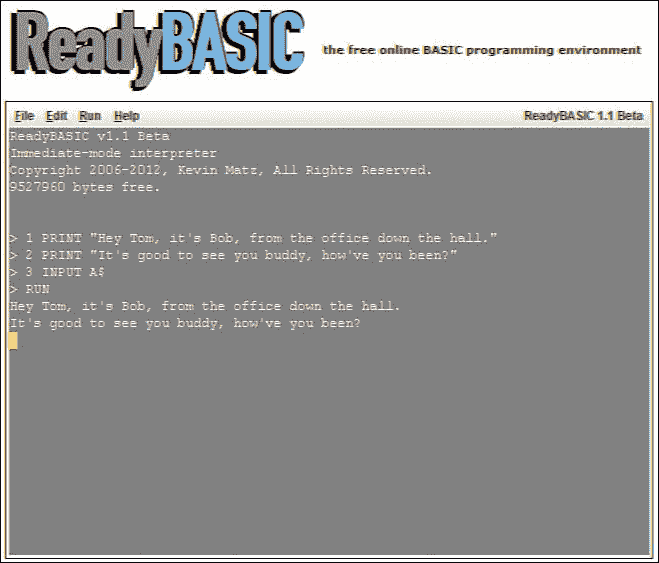

**图 1.1** 一个 BASIC 程序示例。

**注意**

ReadyBASIC 解释器是用 Java 语言创建的。开发者 Kevin Matz 创建了一个 Java 小程序（一种运行在网页内的 Java 程序）来解释 BASIC 代码语句。

你的浏览器必须能够运行 Java 程序，ReadyBASIC 才能工作。如果你遇到问题，请访问 Oracle 的 Java 站点 [www.java.com](http://www.java.com) 测试你的浏览器是否具有 Java —— 并在必要时安装 Java 插件。

你可能还需要调整你的 Java 安全设置以允许程序运行。在 Windows 上，运行控制面板，单击 Java，然后单击“安全”选项卡将其置于前台。你可以更改安全级别或允许特定网站运行 Java 小程序。

由于程序的运行方式，当你的程序在运行过程中出现问题时，你不能责怪计算机。计算机正是按照你告诉它的方式在做事情，因此错误的责任通常在于程序员。

这是坏消息。好消息是你不会造成任何永久性伤害。在你学习用 Java 编程的过程中，不会有计算机受到伤害。

### 程序如何工作

构成计算机程序的语句集合称为其源代码。


大多数计算机程序的编写方式与你写电子邮件相同——将每条语句键入文本窗口。一些编程工具自带源代码编辑器，而另一些可以与任何文本编辑软件一起使用。

当你完成计算机程序的编写后，需要将文件保存到磁盘。计算机程序通常有其自己的文件扩展名来表明文件类型。Java 程序必须具有扩展名`.java`，例如`Calculator.java`。

要运行你已保存为文件的程序，你需要一些帮助。所需帮助的类型取决于你使用的编程语言。有些语言需要解释器来运行其程序。解释器检查计算机程序的每一行并执行该行，然后继续下一行。许多版本的 BASIC 是解释型语言。

> **注意**
>
> 如果你最喜欢的文本编辑器是一个具有粗体文本、字体大小和其他样式化功能的文字处理程序，在编写计算机程序时，请选择另一个编辑器或不要使用这些功能。程序应作为纯文本文件准备，不要使用特殊格式。Windows 附带的文本编辑器 Notepad 会将所有文件保存为未格式化文本。你也可以在 Mac 上使用 TextEdit，或在 Linux 系统上使用 vi 编辑器或 emacs 来创建无格式的文本文件。

解释型语言最大的优点是测试更快。当你编写 BASIC 程序时，可以立即尝试运行，修复错误，然后再次尝试。主要缺点是解释型语言比其他程序运行得慢。每一行都必须转换为计算机可以运行的指令，一次一行。

其他编程语言需要编译器。编译器接受一个程序并将其转换为计算机可以理解的形式。它还使程序尽可能高效地运行。编译后的程序可以直接运行，无需解释器。

# 编译型程序运行速度更快，但测试所需时间更长。你必须编写程序并编译整个程序，然后才能尝试运行。如果发现错误并修复，必须重新编译程序。

Java 的独特之处在于它同时需要编译器和解释器。编译器将构成程序的语句转换为字节码，这些字节码可由名为 Java 虚拟机的解释器运行。

Java 虚拟机，也称为 JVM，使得相同的 Java 程序无需修改即可在不同操作系统和不同类型的计算设备上运行成为可能。虚拟机将字节码转换为设备操作系统可执行的指令。

## 当程序无法运行时

许多新程序员在开始测试程序时会感到沮丧。错误无处不在。其中一些是语法错误，计算机在查看程序时会因语句书写方式而感到困惑，从而识别出这些错误。其他错误是逻辑错误，只有在测试程序时才会被程序员发现（或者可能被完全忽略）。逻辑错误常常导致程序执行非预期的操作。

> **注意**
>
> 最早的计算机错误之一是在 1947 年由一个团队发现的，其中包括美国计算机科学家格蕾丝·霍珀。当时霍珀正在测试哈佛大学的一台计算机，一个继电器发生了故障。结果发现原因不是软件问题，而是一只真正的虫子。她通过移除一只死蛾来调试计算机，这只死蛾被粘在日志本上，并附有说明：“发现虫子的首个实际案例。”这只虫子和日志本页面可在[www.doncio.navy.mil/CHIPS/ArticleDetails.aspx?id=3489](http://www.doncio.navy.mil/CHIPS/ArticleDetails.aspx?id=3489)查看。

当你开始编写自己的程序时，你会对错误非常熟悉。它们是编程过程中的自然组成部分。编程错误被称为 bug，这个术语可以追溯到一个世纪或更久以前，用于描述技术设备中的错误。

修复错误的过程也有其专有术语：调试。

有如此多的术语来描述错误，这并非巧合。在学习编程的过程中，你会获得大量的调试经验——无论你是否愿意。

## 选择 Java 编程工具

要开始编写 Java 程序，你必须拥有一个 Java 编程工具。Java 有多种此类程序可用，包括简单的 Java 开发工具包以及更复杂的`Eclipse`、`IntelliJ IDEA`和`NetBeans`。后三种工具都是集成开发环境（IDE），是专业程序员用于完成工作的强大工具。

每当 Oracle 发布新版本的 Java 时，第一个支持它的工具就是`Java Development Kit`（JDK）。

> **注意**
>
> 在本书中，你不必使用`NetBeans`。如果你能使用`JDK`或其他工具来创建、编译和运行程序，这就足以满足大多数项目的要求。之所以涵盖`NetBeans`，是因为对于过去版本的读者来说，它已被证明比`JDK`更容易上手。我所有的`Java`编程都使用`NetBeans`。

要创建本书中的程序，你必须使用`JDK`版本 8 或在其基础上工作的编程工具。`JDK`是一套用于创建`Java`软件的免费命令行工具。它没有图形用户界面，因此如果你从未在`Windows`命令提示符或`Linux`命令行界面等非图形化环境中工作过，你会发现使用`JDK`颇具挑战性。

同样由 Oracle 免费提供的`NetBeans IDE`是一种比`JDK`简单得多的方式来编写和测试`Java`代码。`NetBeans`提供图形用户界面、源代码编辑器、用户界面设计器和项目管理器。它与`JDK`互补，在后台运行，因此当你开始开发`Java`程序时，必须同时拥有这两个工具。

本书中的程序是使用`NetBeans`创建的，你可以从`JDK`网站单独下载并安装它。只要支持`JDK 8`，你可以使用其他`Java`工具。

## 安装 Java 开发工具

本书每一小时的内容都以一个`Java`编程项目结束，你可以在学习主题知识的同时进行实践，让知识在大脑中充分消化吸收。

如果你的计算机上没有`Java`编程工具，这些编程活动都无法进行。

如果你已经安装了支持`Java`的工具，你可以用它来开发接下来 23 小时中的教程程序。然而，你应该已经对如何使用该工具有一定的熟悉程度。同时学习`Java`和一个复杂的`IDE`可能会令人望而生畏。

在阅读本书时进行编程，推荐的选择是`NetBeans 8.0`，可从 Oracle 网站[`netbeans.org`](http://netbeans.org)免费获取。虽然`NetBeans`有一些需要时间学习的高级功能，但它使得创建和运行简单的`Java`应用程序变得非常容易。

要了解如何下载和安装`NetBeans`，请阅读附录 A，“使用`NetBeans`集成开发环境”。

## 总结

在这一小时中，你了解了为计算机编程的概念——给它一组称为语句的指令来告诉它该做什么。你还明白了为什么选择自学`Java`而不是其他编程语言是一个明智的决定。

你可能已经下载并安装了一个`Java`开发工具，用于在接下来的小时里创建程序。

问 10 个程序员什么是最好的编程语言，你可能会得到 10 个答案，其中夹杂着“我的语言能打败你的语言”的嘲弄和“你的源代码太臃肿了”的玩笑。`Java`在这类争论中得分很高，因为它被广泛采用、极其通用且设计巧妙。你可以用这门语言完成很多事情，并且它让学习其他语言变得稍微容易一些。

如果你仍然对程序、编程语言或`Java`整体感到困惑，不要惊慌。一切将在下一小时“编写你的第一个程序”中开始变得清晰，该部分将逐步引导你完成创建`Java`程序的过程。

## 研讨会

### 问与答

**问.** `BASIC`？`C++`？`Smalltalk`？`Java`？这些语言的名称有什么含义？

**答.** `BASIC`的名字来自一个首字母缩略词：初学者通用符号指令代码。`C++`是一种编程语言，旨在改进`C`语言，而`C`语言本身是对`B`编程语言的改进。`Smalltalk`是 20 世纪 70 年代开发的一种创新的面向对象语言，其许多理念被`Java`采用。

`Java`打破了使用首字母缩略词或其他有意义术语命名的传统。它只是`Java`开发者最喜欢的名称，在竞争中胜过了`WebRunner`、`Silk`、`Ruby`等。（当时的`Ruby`编程语言尚不存在。）

当我创造自己的编程语言时，我会将其命名为`Salsa`。每个人都喜欢莎莎舞（Salsa）。

**问.** 为什么解释型语言比编译型语言慢？

**答.** 它们较慢的原因与同声传译员比笔译员慢的原因类似。同声传译员必须在讲话进行时即时思考每一个语句，而笔译员可以处理整个演讲稿并采取捷径以加快过程。编译型语言可以比解释型语言快得多，因为它们会采取措施使程序运行更高效。

**问.** 你只回答关于`Java`的问题吗？

**答.** 完全不是。随便问我什么都可以。

**问.** 好的，那么《与星共舞》节目历史上给出的最低分数是多少？

## 第 2 小时：编写你的第一个程序

**本小时待办事项：**

- 在文本编辑器中输入一个 Java 程序。
- 使用花括号组织程序结构。
- 将信息存储在变量中。
- 显示存储在变量中的信息。
- 保存、编译和运行程序。

正如你在第 1 小时“成为程序员”中学到的，计算机程序是一组告诉计算机执行操作的指令。这些指令通过编程语言传递给计算机。

在本小时中，你将通过在文本编辑器中输入来创建你的第一个 Java 程序。完成后，你将保存程序、编译并测试它。然后，你可能会故意弄坏它，再修复它，纯粹是为了炫技。

### 编写程序所需工具

如第 1 小时所述，要创建 Java 程序，你必须拥有支持 Java 开发工具包（`JDK`）的编程工具，例如 `NetBeans` 集成开发环境（`IDE`）。你需要一个可以编译和运行 Java 程序的工具，以及一个用于编写这些程序的文本编辑器。

对于大多数编程语言，计算机程序都是通过在文本编辑器（也称为源代码编辑器）中输入文本来编写的。有些编程语言自带其编辑器。`NetBeans` 包含一个用于编写 Java 程序的编辑器。

Java 程序是纯文本文件，没有任何特殊格式，如居中文本或加粗文本。`NetBeans` 源代码编辑器的功能类似于一个简单的文本编辑器，但为程序员提供了一些极其有用的增强功能。在输入时，文本会变成不同的颜色，以识别语言的不同元素。`NetBeans` 还会适当地缩进行，并在编辑器内提供有用的编程文档。

因为 Java 程序是文本文件，所以你可以使用任何文本编辑器打开和编辑它们。你可以使用 `NetBeans` 编写一个 Java 程序，然后在 Windows 记事本中打开它进行修改，之后再次在 `NetBeans` 中打开，不会有任何问题。

### 创建 `Saluton` 程序

你创建的第一个 Java 程序将显示来自计算机科学界的传统问候语：“Saluton mondo!”

为在 `NetBeans` 中开始第一个编程项目，如果你还没有这样做，请按照以下步骤创建一个名为 `Java24` 的新项目：

1. 选择菜单命令 File, New Project。打开“新建项目”对话框。
2. 选择项目类别 `Java` 和项目类型 `Java Application`，然后点击 Next。
3. 输入 `Java24` 作为项目名称。（如果你之前创建过同名项目，会看到错误消息“Project folder already exists and is not empty”。）
4. 取消选中 Create Main Class 复选框。
5. 点击 Finish。

`Java24` 项目已在其自己的文件夹中创建。你可以将此项目用于你在学习本书过程中编写的 Java 程序。

### 开始程序

`NetBeans` 将相关程序分组到一个项目中。如果你没有打开 `Java24` 项目，可以按照以下步骤检索它：

1. 选择 File, Open Project。出现文件对话框。
2. 找到并选择 `NetBeansProjects` 文件夹（如果需要）。
3. 选择 `Java24` 并点击 Open Project。

`Java24` 项目出现在“项目”窗格中，旁边有一个咖啡杯图标和一个可展开的 + 号，展开后可以看到项目包含的文件和文件夹。

要向当前打开的项目添加新的 Java 程序，请选择 File, New File。打开“新建文件向导”，如图 2.1 所示。

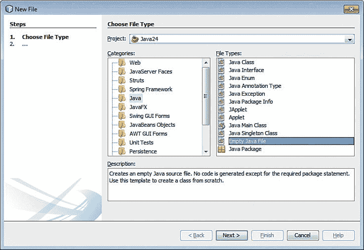

**图 2.1** 新建文件向导。

“类别”窗格列出了你可以创建的不同类型的 Java 程序。在此窗格中点击 Java 文件夹，查看属于此类别的文件类型。对于第一个项目，选择 Empty Java File 类型，然后点击 Next。

打开“新建空 Java 文件”对话框。按照以下步骤开始编写程序：

1. 在 Class Name 字段中，输入 `Saluton`。
2. 在 Package 字段中，输入 `com.java24hours`。
3. 点击 Finish。

为了让你可以立即开始编写程序，一个名为 `Saluton.java` 的空文件在源代码编辑器中打开。使用编辑器，通过输入代码清单 2.1 中的每一行来开启你的 Java 编程生涯。这些语句称为程序的源代码。

**注意：** 不要输入每行开头的行号和冒号——这些在本书中用于引用特定行号。

**代码清单 2.1** `Saluton` 程序

点击此处查看代码图片

```java
package com.java24hours;

class Saluton {
```

**A.** ABC 热门节目中名人选手表演的最糟糕舞蹈，是说唱歌手 Master P 在 2006 年第二季中表演的。他与专业舞者 Ashly DelGrosso 的探戈舞获得了有史以来最低的 8 分。评委 Len Goodman 和 Bruno Tonioli 给了他 2 分，评委 Carrie Ann Inaba 给了 4 分。

Tonioli 的评价：“那是一场噩梦……看起来像商场里一个找不到妈妈的孩子。”

Goodman：“我知道观众认为让他们回来是善意。其实不是。那是残忍——对 Ashly，对评委们都是如此。”

Inaba：“我其实觉得那是你跳得最好的一次。”

Master P 在节目期间仅训练了 20 小时，而当时该季的其他选手训练了 130 小时。他还拒绝穿舞蹈鞋，而是穿着篮球鞋表演。这段舞蹈是他被投票淘汰前的最后一次表演。

这段舞蹈可以在 YouTube 上看到，其中一条评论写道：“如果你只是为了看那个 2 分的垫步才点的赞，那就点个赞吧。”

### 测验

通过回答以下问题，测试你对本小时涵盖内容的掌握程度。

**1.** 以下哪一项 **不是** 人们认为计算机编程极其困难的原因？

**A.** 程序员散布这个谣言以改善我们的就业前景。

**B.** 行话和首字母缩略词随处可见。

**C.** 觉得编程太难的人有资格获得政府救助。

**2.** 哪种工具通过逐行解析来运行计算机程序？

**A.** 一个缓慢的工具

**B.** 解释器

**C.** 编译器

**3.** 为什么 James Gosling 会躲在办公室里创建 Java？

**A.** 他对当时在一个项目中使用的语言感到不满。

**B.** 他的摇滚乐队找不到演出机会。

**C.** 上班时无法访问 YouTube，互联网就太无趣了。

### 答案

**1. C.** 计算机书籍作者也没有获得救助。

**2. B.** 解释器逐行解释。编译器事先解析指令，因此程序可以运行得更快。

**3. A.** 他对 C++ 感到沮丧。回到 1991 年他创建 Java 时，YouTube 还是存放“YouToothpaste”的地方。

### 活动

如果你想更好地了解 Java 和计算机编程的主题，请完成以下活动：

- 要听取程序员为何选择这门语言的意见，请访问 Stack Overflow 问答网站 [www.stackoverflow.com/questions/209555](http://www.stackoverflow.com/questions/209555)，阅读人们如何回答“你为什么选择 Java 编程语言而不是其他语言？”这个问题。
- 用英语句子编写一组指令，将温度从摄氏度转换为华氏度。将这些指令分解成尽可能多的短小单行句子。

要查看每小时末尾活动的解答，请访问本书网站 [www.java24hours.com](http://www.java24hours.com)。

### `class` 语句

程序的第一行是：

```java
package com.java24hours;
```

包（package）是一种将 Java 程序组织在一起的方式。这行代码告诉计算机将`com.java24hours`设置为该程序的包名。

空行之后，第三行是：

```java
class Saluton {
```

翻译成英语，它的意思是：“计算机，请将我的 Java 程序命名为`Saluton`。”

正如你在第 1 小时中可能回忆到的，你给计算机的每条指令都称为一个语句（statement）。`class`语句就是你给计算机程序命名的方式。它也用于确定程序的其他方面，正如你稍后将看到的。`class`这个术语很重要，因为 Java 程序也被称为类（class）。

在这个例子中，程序名`Saluton`与文档的文件名`Saluton.java`相匹配。Java 程序的名称必须与其文件名的第一部分匹配，并且大小写也应相同。

如果程序名与文件名不匹配，在你尝试编译某些 Java 程序时会得到一个错误，这取决于`class`语句如何被用于配置程序。

#### `main`语句的作用

程序的下一行是：

```java
public static void main(String[] arguments) {
```

这行代码告诉计算机：“程序的主要部分从这里开始。”Java 程序被组织成不同的部分，因此需要一种方法来标识程序运行时首先执行的部分。

`main`语句是大多数 Java 程序的入口点。例外情况包括 applet（在网页上由 web 浏览器运行的程序）、servlet（由 web 服务器运行的程序）以及 app（在移动设备上运行的程序）。

你在接下来的时间里编写的大多数程序都将使用`main`作为起点。这是因为它们直接在你的计算机上运行。而 Applet、app 和 servlet 则是由另一个程序或设备间接运行的。

为了将它们与其他类型区分开，你直接运行的程序被称为应用程序（applications）。

#### 花括号标记

在`Saluton`程序中，第 3、4、6 和 7 行包含某种类型的花括号——要么是`{`要么是`}`。这些括号是将程序行分组的一种方式（就像括号在句子中用于分组单词一样）。在开括号`{`和闭括号`}`之间的所有内容都属于同一组。


这些分组称为块（blocks）。在清单 2.1 中，第 3 行的开括号与第 7 行的闭括号相关联，这使得你的整个程序成为一个块。你以这种方式使用括号来表示程序的开始和结束。

块可以位于其他块内部（就像在这个句子中使用了括号（并且这里使用了第二组括号）一样）。`Saluton` 程序在第 4 行和第 6 行有括号，它们定义了另一个块。这个块以 `main` 语句开始。`main` 语句块内的行将在程序开始时运行。

> **提示**
>
> NetBeans 可以帮助你找出一个块的开始和结束位置。点击 `Saluton` 程序源代码中的一个括号。你点击的括号会变黄，并与它对应的括号一起变黄。两个黄色括号所包围的 Java 语句就是一个块。这个提示对于像 `Saluton` 这样的短程序来说用处不大，但随着你编写更长的程序，它可以帮助你避免看起来像一个“呆头”（blockhead，双关语，意指不懂块结构）。

块内唯一包含的语句是：

```
// My first Java program goes here
```

这一行是一个占位符。行首的 `//` 告诉计算机忽略此行，因为它在程序中仅仅是为了方便查看源代码的人。服务于此目的的行称为注释（comments）。

现在，你已经编写了一个完整的 Java 程序。它可以被编译，但如果你运行它，什么都不会发生。原因是你还没有告诉计算机做任何事情。`main` 语句块只包含一个注释，而注释会被计算机忽略。你必须在 `main` 块的开括号和闭括号内添加一些语句。

### 在变量中存储信息

在你编写的程序中，你需要一个地方来临时存储信息。你可以通过使用变量（variable）来实现这一点，变量是一个存储位置，可以容纳整数、浮点数、布尔值、字符和文本行等信息。存储在变量中的信息可以改变，这就是它被命名为“变量”的原因。

在 `Saluton.java` 文件中，用下面的内容替换第 5 行：

```
String greeting = "Saluton mondo!";
```

这个语句告诉计算机将文本“Saluton mondo!”存储在一个名为 `greeting` 的变量中。

在 Java 程序中，你必须告诉计算机变量将容纳什么类型的信息。在这个程序中，`greeting` 是一个字符串（string）——一行可以包含字母、数字、标点符号和其他字符的文本。在语句中放置 `String` 是为了将该变量设置为容纳字符串值。

当你将这个语句输入程序时，行末必须包含一个分号。分号用于结束 Java 程序中的每个语句。它们就像句子末尾的句号。计算机用它们来确定一个语句何时结束以及下一个语句何时开始。

每行只放一条语句可以使程序更容易理解（对我们人类而言）。

#### 显示变量的内容

如果你此时运行该程序，看起来仍然什么都没有发生。将文本存储在 `greeting` 变量中的命令在后台执行。要让计算机显示它正在做些什么，你可以显示该变量的内容。

在 `Saluton` 程序中，在 `String greeting = "Saluton mondo!"` 语句之后插入另一个空行。使用该空格输入以下语句：

```
System.out.println(greeting);
```

这个语句告诉计算机显示存储在 `greeting` 变量中的值。`System.out.println` 语句使计算机在系统输出设备（你的显示器）上显示信息。

现在，你开始取得进展了。

### 保存最终产品

你的程序现在应该类似于清单 2.2，尽管你可能在第 5-6 行使用了稍有不同的间距。进行任何必要的更正并保存文件（选择“文件，保存”）。

**清单 2.2** `Saluton` 程序的最终版本

```
package com.java24hours;

class Saluton {
    public static void main(String[] arguments) {
        String greeting = "Saluton mondo!";
        System.out.println(greeting);
    }
}
```

### 运行程序

当计算机运行此程序时，它会执行第 5 行和第 6 行 `main` 语句块中的每条语句。代码清单 2.3 展示了该程序用英语（而非 Java）编写时的样子。

**代码清单 2.3** `Saluton` 程序的逐行解析

点击此处查看代码图片

---

1：将此程序置于 `com.java24hours` 包中。

2：

3：`Saluton` 程序从这里开始：

4：    程序的主体部分从这里开始：

5：        将文本 "Saluton mondo!" 存入名为 `greeting` 的 `String` 变量中

6：        显示变量 `greeting` 的内容

7：    程序的主体部分在此结束。

8：`Saluton` 程序在此结束。

---

代码清单 2.4 展示了该程序用克林贡语（《星际迷航》中战士种族的语言）编写时的样子。

**代码清单 2.4** 用克林贡语编写的 `Saluton` 程序

点击此处查看代码图片

---

1：此程序属于 `com.java2hours` 家族！

2：

3：知道什么对你有好处，就在此开始 `Saluton` 程序吧！

4：    程序的主体部分荣耀地从这里开始！

5：        将这串胡言乱语 "Saluton mondo!" 存入名为 `greeting` 的 `String` 变量！

6：        显示这来自劣等种族的语言所书写的胡言乱语！

7：    在此结束程序的主体部分，以免触怒我！

8：现在结束 `Saluton` 程序，并感谢我饶你一命吧！

---

### 将程序编译为类文件

在运行 Java 程序之前，必须先编译它。当编译程序时，程序中提供给计算机的指令会被转换为计算机能更好理解的形式。

`NetBeans` 会在程序保存时自动编译它们。如果你严格按照代码清单 2.2 所示输入所有内容，程序将成功编译。

程序的编译版本——一个名为 `Saluton.class` 的新文件——会被创建。所有 Java 程序都会被编译成类文件，其文件扩展名为 `.class`。一个 Java 程序可以由多个协同工作的类组成，但在像 `Saluton` 这样的简单程序中，只需要一个类。

编译器将 Java 源代码转换为字节码，这是一种可以由 Java 虚拟机（`JVM`）运行的形式。

### 修复错误

当你在 `NetBeans` 源代码编辑器中编写程序时，错误会在编辑器窗格左侧用红色警报图标标出，如图 2.2 所示。

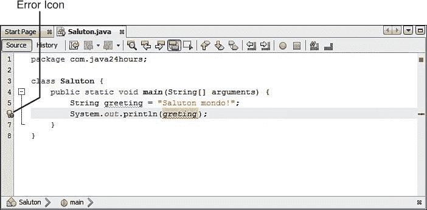

**图 2.2** 在源代码编辑器中定位错误。

---

注意

Java 编译器只在遇到错误时才会发声。如果程序编译成功且没有任何错误，则不会产生任何响应。这有些令人失望。当我刚成为 Java 程序员时，我曾希望成功的编译能伴随着一阵盛大的庆祝号角声。

---

该图标会出现在触发错误的行上。你可以单击此图标显示一条错误消息，该消息包含以下细节来解释编译器错误：

 Java 程序的名称

 错误类型

 发现错误的行

以下是在编译 `Saluton` 程序时可能看到的错误消息示例：

```
cannot find symbol.
symbol  : variable greting
location: class Saluton
```

错误在消息的第一行："cannot find symbol."。这些消息对新手程序员来说常常令人困惑。如果错误消息对你来说难以理解，不要花太多时间试图弄明白它。相反，看看错误发生的行，并寻找最明显的原因。

例如，你能确定以下语句有什么问题吗？

`System.out.println(greting);`

---

提示

本书的官方网站 [www.java24hours.com](http://www.java24hours.com) 包含了你创建的所有程序的源文件。如果你在 `Saluton` 程序中找不到任何拼写错误或其他导致错误的原因，但仍然有错误，请访问本书网站，从第 2 小时页面下载 `Saluton.java`。尝试运行那个文件。

---

错误是变量名中的一个拼写错误，应该是 `greeting` 而不是 `greting`。（可以在 `NetBeans` 中故意添加这个拼写错误来看看会发生什么。）

如果你在创建 `Saluton` 程序时得到错误消息，请仔细检查你的程序是否与代码清单 2.2 相符，并更正你发现的任何差异。确保所有内容都正确地使用了大写字母，并且包含了所有标点符号，如 `{`、`}` 和 `;`。

通常，仔细查看错误消息所指的行，就足以揭示需要修复的错误（或多个错误）。

### 运行 Java 程序

要看 `Saluton` 程序是否按预期运行，请使用运行所有 Java 代码的解释器——Java 虚拟机——来运行该类。在 `NetBeans` 中，选择菜单命令 `运行`、`运行文件`。一个输出窗格会在源代码编辑器下方打开。在此窗格中，如果没有错误，程序将显示输出，如图 2.3 所示。

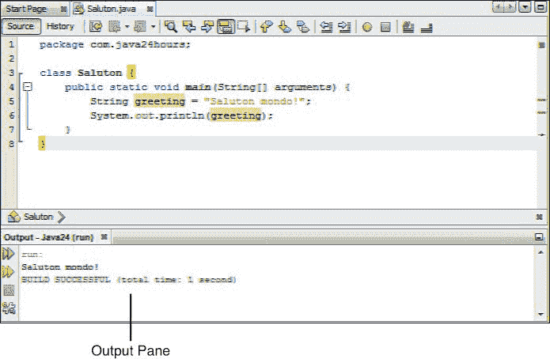

**图 2.3** 运行你的第一个 Java 程序。

如果你看到文本 "Saluton Mondo!"，那么你刚刚编写了你的第一个可工作的 Java 程序！你的计算机刚刚向世界问候了——这是计算机编程领域的传统，对我们许多人来说，它就像咖啡因、短袖正装衬衫和*使命召唤*一样重要。

---

注意

Oracle 在其网站上提供了 Java 语言的全面文档。你不需要它来使用本书，因为每个主题在引入时都会得到充分讨论，但当你想要扩展知识并编写自己的程序时，这份参考文献会派上用场。

文档可以下载，但根据需要在 Oracle 网站上浏览更为方便。最新的 Java 文档可在 [`download.java.net/jdk8/docs/api`](http://download.java.net/jdk8/docs/api) 获取。

---

你可能会问自己为什么 "Saluton mondo!" 是一个传统的问候语。这个短语在世界语中意思是 "Hello world!"，世界语是由路德维希·柴门霍夫于 1887 年创造的一种人造语言，旨在促进国际交流。它之所以是一个传统问候语，仅仅是因为我试图开创这个传统。

### 总结

在这一小时里，你首次有机会创建一个 Java 程序。你了解到，要开发一个 Java 程序，你需要完成以下四个基本步骤：

1.  使用文本编辑器或像 `NetBeans` 这样的工具编写程序。

2.  将程序编译成类文件。

3.  告诉 Java 虚拟机运行该类。

4.  打电话给你妈妈。

在此过程中，你接触到了一些基本的计算机编程概念，如编译器、解释器、块、语句和变量。这些概念在后续的小时中会变得更清晰。只要你让 `Saluton` 程序在本小时内运行起来，你就准备好继续了。

（第四步与 Java 编程无关。这只是我母亲建议我放进书里的。）

### 研讨会

#### 问答

**问：** 在 Java 程序的一行中放置正确数量的空格有多重要？

**答：** 对计算机来说这完全不重要。空格纯粹是为了让看程序的人更舒服——Java 编译器根本不在乎。你本可以不用空格来编写 `Saluton` 程序，或者用 `Tab` 键来缩进代码行，它仍然能成功编译。

## Java 编程风格与常见问题

尽管行前的空格数量并不重要，但你应该在 Java 程序中使用一致的间距和缩进。为什么？因为间距能让你更容易看清程序的组织结构，以及一条语句属于哪个编程块。

你编写的程序必须让其他程序员能够理解，包括你自己在数周或数月后查看代码以修复错误或进行增强时。一致的间距和缩进是所谓的编程风格的一部分。好的程序员会采用一种风格并在所有工作中实践它。

**问：** Java 程序被描述为一个类，也是一组类。到底是哪一个？

**答：** 两者都是。你在接下来几个小时里创建的简单 Java 程序会被编译成一个扩展名为 `.class` 的单个文件。你可以使用 Java 虚拟机（`Java Virtual Machine`）运行这些文件。Java 程序也可以由一组协同工作的类组成。这个主题将在 第 10 小时 “创建你的第一个对象” 中深入探讨。

**问：** 如果每条语句末尾都需要分号，为什么注释行 `// My first Java program goes here` 末尾没有分号？

**答：** 注释会被编译器完全忽略。如果你在程序的某一行放置了 `//`，这会告诉 Java 编译器忽略该行 `//` 右侧的所有内容。下面的例子展示了与语句在同一行的注释：

```
System.out.println(greeting); // hello, world!
```

**问：** 我在编译器指出错误的那行找不到任何错误。我该怎么办？

**答：** 错误消息中显示的行号并不总是需要修复错误的地方。请仔细检查错误消息正上方的语句，看看是否能发现任何拼写错误或其他错误。错误通常就在同一个编程块内。

**问：** 我如何才能去南极洲旅游？

**答：** 如果你不愿意成为科研人员或支持人员（如厨师、电工或医生），你可以成为每年 10,000 名以游客身份访问这片冰封大陆的人之一。

可以从澳大利亚、新西兰和南美提供飞越南极的航班，费用约为每人 1,000 美元。

有几艘游轮提供为期 10 天到三周的旅行，其中最贵的大约是 25,000 美元。一些游轮提供了在企鹅群中划皮艇或徒步、参观冰山甚至露营过夜的机会。

`Polar Cruises` 网站（[www.polarcruises.com](http://www.polarcruises.com)）为潜在的南极游客提供了更多信息。

英国南极调查局为游客提供了一条建议：“除非经过适当训练，否则不要走上冰川或大片雪地。”

#### 测验

通过回答以下问题，测试你对本小时涵盖内容的理解。

**1.** 当你编译一个 Java 程序时，你在做什么？

**A.** 将其保存到磁盘

**B.** 将其转换成计算机能更好地理解的形式

**C.** 将其添加到你的程序集合中

**2.** 什么是变量？

**A.** 会摇晃但不会倒下的东西

**B.** 编译器在程序中忽略的文本

**C.** 程序中存储信息的地方

**3.** 修复错误的过程叫什么？

**A.** 除霜

**B.** 调试

**C.** 分解

#### 答案

**1. B.** 编译程序会将一个 `.java` 文件转换成一个或一组 `.class` 文件。

**2. C.** 变量是存储信息的一种地方；稍后你会了解其他地方，比如数组和常量。`Weebles` 会摇晃但不会倒下，而注释是编译器在程序中忽略的文本。

**3. B.** 因为计算机程序中的错误被称为 `bugs`，所以修复这些错误被称为调试。一些编程工具附带了一个叫做调试器（`debugger`）的工具，可以帮助你修复错误。`NetBeans` 就拥有其中一个最棒的调试器。

#### 活动

如果你想更全面地探索本小时涵盖的主题，请尝试以下活动：

 你可以使用谷歌翻译器（[`translate.google.com`](http://translate.google.com)）将英文短语 “Hello world!” 翻译成其他语言。编写一个程序，让你的计算机能用法语、意大利语或葡萄牙语等语言向世界问好。

 返回 `Saluton` 程序并添加一两个错误。例如，去掉行末的分号，或将一行中的文本 `println` 改为 `print1n`（用数字 1 代替字母 L）。保存程序并尝试编译它；然后比较你看到的错误消息和你造成的错误。

要查看这些活动的解决方案，请访问本书网站 [www.java24hours.com](http://www.java24hours.com)。

## 第 3 小时：Java 之旅

本小时待办事项：

 发现 Java 的历史。

 学习使用这门语言的好处。

 查看 Java 应用的实例。

在你进一步深入 Java 编程之前，值得更多地了解这门语言，并看看程序员们今天用它在做什么。尽管 Java 早已超越了作为专注于网页浏览器程序语言的起源，但你仍然可以在网上找到一些关于 Java 如何被使用的有趣例子。

在本小时中，我们将看看展示 Java 程序的网站，并讨论这门语言的历史和发展。

要进行这次旅行，你需要一个已设置好可以运行 Java 程序的网页浏览器。

加载你选择的浏览器，穿上你最好的蜡染衬衫，准备好开始一次旅行。你不会离开你的房子，也不会体验到旅游的简单乐趣，比如异国情调的风景、当地人、美食、有食物的当地人等等。

不过，往好处想：没有旅行支票的麻烦，没有护照，也没有蒙特祖马的复仇。

### 第一站：Oracle

Java 之旅从 [www.java.com](http://www.java.com) 开始，这是一个由 Oracle（控制 Java 语言的公司）发布的网站。

作为网页的一部分运行的 Java 程序被称为小程序（`applet`）。小程序像页面的其他元素（如照片和文本）一样被放置在页面上。标记语言 `HTML` 定义了程序应该显示在哪里、它有多大以及运行时做什么。Java 还通过另外两种方式增强 Web：用 Java 编写的桌面程序可以从网页浏览器启动，而 Java 服务器小程序（`Java servlets`）由 Web 服务器运行以提供 Web 应用程序。

图 3.1 展示了 RuneScape，一款由 Java 支持的大型多人在线游戏。你可以使用任何网页浏览器访问 [www.runescape.com](http://www.runescape.com) 免费玩这款游戏。当你访问该网站时，它会邀请你运行并在主页上玩游戏。这个程序是用 Java 语言实现的。

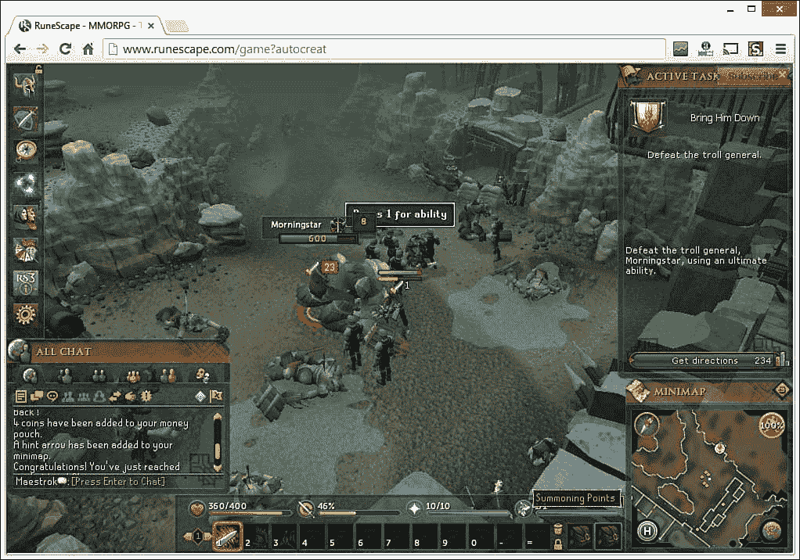


**图 3.1** Java 驱动的在线游戏 RuneScape。

当你运行它时，游戏在几秒钟内加载，你就可以开始创建角色并探索一个奇幻世界。

Oracle 的 Java 部门领导着 Java 语言的开发。*Java Magazine* 是 Oracle 在 [Java.com](http://Java.com) 提供的免费在线杂志，展示了 Java 如何在网站、Android 手机和其他平台上被使用。数十亿台设备运行着用 Java 编写的程序。

[Java.com](http://Java.com) 网站帮助人们安装能够运行小程序的浏览器增强插件。它还描述了这门语言目前在互联网上被使用的一些方式。

Oracle 还为 Java 程序员提供了一个更具技术导向的网站：[www.oracle.com/technetwork/java](http://www.oracle.com/technetwork/java)。在此网站上，您可以找到最新发布的 NetBeans 版本、Java 开发工具包以及其他编程资源。

***

**提示**

Oracle 将 Java 插件与 `JDK` 及其他产品捆绑提供，因此它可能已安装在您的计算机上。如果您不确定 Java 是否已安装，请访问 [www.java.com](http://www.java.com) 网站。“我有 Java 吗？”链接可以检测 Java 的存在。如果未找到，您将有机会下载它。

***

### Java 简史

Bill Joy，Sun Microsystems 公司创建 Java 时的高管之一，将该语言称为“历时 15 年工作、旨在创造一种更好、更可靠的计算机编程方式的最终成果”。Java 的诞生过程则比这更复杂一些。

Java 于 1990 年由 James Gosling 开发，最初是作为智能电器（交互式电视、全知烤箱、时光旅行终结者、奴役人类的天网军用卫星等）的“大脑”而设计的语言。Gosling 对使用一种名为 `C++` 的编程语言编写程序的结果感到不满。在灵感迸发下，他将自己关在办公室里，编写了一种更能满足其需求的新语言。

***

**注意**

您可能听说过 Java 是 “Just Another Vague Acronym” 的首字母缩写。也可能听说过它得名于 Gosling 对咖啡的喜爱。

Java 命名背后的故事不包含任何秘密信息或对液体的热爱宣言。选择 Java 作为名称的原因与喜剧演员 Jerry Seinfeld 喜欢说 *salsa*（莎莎）这个词一样：听起来就是很酷。

***

Gosling 将他的新语言命名为 Oak，以一棵他能从办公室窗口看到的树命名。该语言是他公司计划在交互式电视成为价值数百万美元的行业时大赚一笔的战略的一部分。这在今天仍未实现（尽管 Netflix、Hulu 等公司正在努力尝试），但 Gosling 的新语言却发生了完全不同的事情。就在 Oak 即将被废弃时，网络普及了。

在一次偶然的情况下，许多使 Gosling 的语言在其电器项目上表现出色的特性，也使其适合移植到网络上。他的团队设计了一种让程序从网页安全运行的方法，并为语言的新用途选择了一个朗朗上口的新名字：Java。

尽管 Java 可用于许多其他方面，但它最初的成功展示是借助网络，吸引了全球软件开发者的注意力。当这门语言声名鹊起时，除非你被单独监禁或执行长期轨道任务，否则很难不听说它。

Java 语言共有九个主要版本，每个版本都引入了一些重要的新特性。以下是前八个版本：

 **Java 1.0** —— 原始版本（1995 年）

 **Java 1.1** —— Java 数据库连接（JDBC），改进的图形用户界面（1997 年）

 **Java 2 版本 1.2** —— 内部类、用于网络浏览器的 Java 插件以及数据结构（1998 年）

 **Java 2 版本 1.3** —— 增强的多媒体功能（2000 年）

 **Java 2 版本 1.4** —— 改进的互联网支持、XML 处理和断言（2002 年）

 **Java 5** —— 泛型、新的 for 循环、注解以及自动数据类型转换（2005 年）

 **Java 6** —— 内置的 Derby 数据库和 Web 服务（2006 年）

 **Java 7** —— 内存和资源管理的改进以及 Nimbus 图形用户界面（2011 年）

***

**注意**

您是否好奇为什么 Java 的版本号如此奇怪，从 2 跳到 6，将第七版称为 Java 6，并且在某些版本中同时包含整数和小数？我也是！

幸运的是，自 2006 年以来，版本编号方案变得更加合理，每个新版本都是比上一个版本高一个的整数。

***

当前版本 `Java 8` 于 2014 年 3 月发布。这个版本历时三年开发，引入了闭包，这是高级 Java 编程中备受期待的功能，您将在第 20 小时 “使用内部类和闭包” 中学习到。此外，它还提供了更好的处理日期和时间的方法，以及一些有用的新集合和注解。

如果您不知道所有这些东西是什么——比如内部类、泛型或 XML——请不要惊慌。您将在接下来的 21 小时内学习它们。

***

**警告**

当您访问此网站运行小程序时，您可能会在 Windows 上收到“应用程序已被阻止”的安全警告。在本书付印前不久，Oracle 更改了 Java 插件处理不包含验证其作者身份的数字签名的小程序的方式。现在小程序会出错并显示警告，而不是询问用户是否要运行它们。

您可以编辑 Java 安全设置，以允许特定网页的小程序运行。打开控制面板，单击 Java，然后单击“安全”选项卡。单击“编辑站点列表”按钮添加网页并允许其小程序（或多个小程序）加载。

***

### 使用 Java 上学

网络包含大量供教育工作者和学童使用的资源。由于 Java 程序可以提供比标准网页更丰富的交互体验，一些程序员已使用这门语言编写面向互联网的学习程序。

作为一个例子，请访问 [www.cs.ubc.ca/~van/sssjava](http://www.cs.ubc.ca/~van/sssjava)，体验由不列颠哥伦比亚大学计算机科学教授 Michiel van de Panne 创建的跳台滑雪模拟器。该程序使用 Java 来演示基于物理的动画，滑雪者尝试不同的坡度和跳台。滑雪者的运动通过将鼠标向八个方向之一移动来控制，每个方向都会影响跳跃的成功率。图 3.2 显示了我的虚拟滑雪者在遭遇悲惨结局之前的一次程序运行。

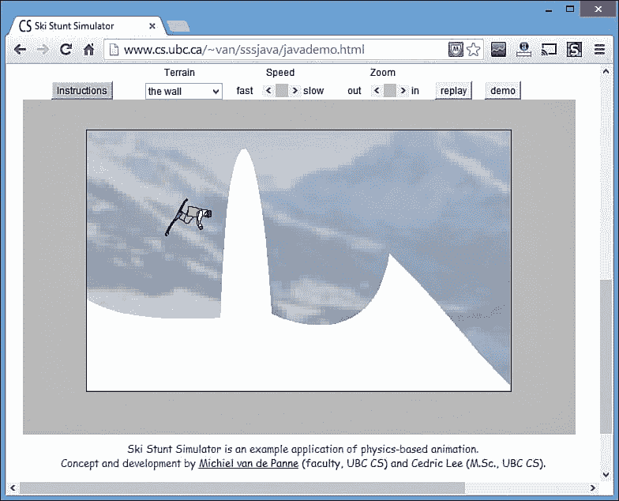

**图 3.2** 可以使用 Java 程序在 Web 上交互式体验跳台滑雪模拟器。

众多教育程序可用于许多操作系统，但该程序脱颖而出的一个特点是其可用性。模拟器直接从网页运行。无需特殊安装，而且与大多数桌面软件不同，它不受限于特定操作系统。您可以在任何拥有 Java 虚拟机（`JVM`）的计算机上运行 Java 程序。

浏览器加载的 `JVM` 与您在第 2 小时 “编写您的第一个程序” 中用来运行 `Saluton` 程序的 `JVM` 是同一个。浏览器的 `JVM` 只能运行为在网页上运行而设置的 Java 程序，无法处理为在其他地方（例如在桌面计算机上）运行而设置的程序。

首批支持 Java 的浏览器包含内置的 `JVM`。如今，浏览器通过依赖 Oracle 的 Java 插件（一个作为浏览器增强功能的 `JVM`）来支持 Java。

像跳台滑雪模拟器这样的 Java 程序，不必为特定操作系统编写。由于像 Windows 这样的操作系统也被称为平台，这个优势被称为平台独立性。Java 的创建就是为了在多个系统上工作。Java 的开发者认为它需要是多平台的，因为它将被用于各种电器和其他电子设备。

用户可以在各种系统上运行您用 Java 编写的程序，而无需您进行任何额外工作。在适当的情况下，Java 可以消除为不同操作系统和设备创建特定版本程序的需求。

### 在 JavaWorld 共进午餐

### 培训

在经过紧张的培训后，可能会感到有些疲惫，此时可以稍作休息。您或许可以考虑阅读《JavaWorld》，这是一个面向 Java 程序员的在线杂志。请访问 [www.javaworld.com](http://www.javaworld.com)。

`JavaWorld` 提供有关 Java 开发热点领域的操作指南、新闻报道和研究资料。该出版物网络格式的一个优势是，它可以在文章中展示功能性的 Java 程序。Figure 3.3 展示了一个与解释其编写过程的教程一同出现的 Java 诗歌磁贴板。

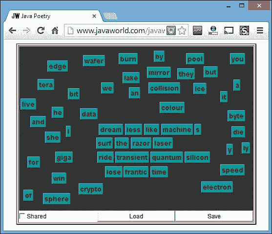

**FIGURE 3.3** 一篇关于如何创建诗歌磁贴板的 `JavaWorld` 操作指南文章，其中包含该程序的可运行示例。

* * *

注意

`JavaWorld` 偶尔会调整内容位置，但您可以直接访问诗歌磁贴板教程：[www.cadenhead.org/poetry](http://www.cadenhead.org/poetry)。

* * *

`JavaWorld` 发表关于该语言及其发展的文章和评论。自 Java 引入以来，一个一直被激烈辩论的问题是该语言是否安全。

安全性之所以重要，是因为 Java 程序在网页上运行的方式。您在本节中尝试的 Java 程序会被下载到您的计算机上。当程序下载完成后，它会在您的计算机上运行。

除非您认识非常多的人，否则您访问的大多数网页都是由陌生人发布的。从安全角度来看，运行他们的程序与让公众来借用您的计算机没有太大区别。如果 Java 语言没有防止滥用的安全措施，其程序可能会向您的系统引入病毒、删除文件、播放威廉·沙特纳的口头歌曲表演，以及其他难以言说的事情。

Java 包含多种安全措施，以确保其程序在网页上运行时是安全的。主要的安全性由针对在 Web 上运行的 Java 小程序（applets）的限制提供：

 任何小程序都不能在用户的计算机上打开、读取、写入或删除文件或系统属性。

 任何小程序都不能在用户的计算机上运行其他程序。

 由小程序创建的所有窗口都必须明确标识为 Java 窗口。

 小程序不能连接到托管它们以外的其他网站。

 所有小程序都经过验证，以确保在编译后没有任何内容被修改。

该语言通常被认为足够安全，可以在 Web 上使用，但近年来出现的安全漏洞促使一些安全专家建议用户在浏览器中完全禁用 Java。为了解决这些顾虑，Oracle 提供了与 Java 插件一起的 Java 更新工具，以确保在发现漏洞时可以升级语言来阻止它们。

Java 语言还为在浏览器中运行的程序提供了更灵活的安全策略。您可以将某些公司和程序员指定为受信任的开发者，这使得他们的 Java 小程序可以在您的浏览器中运行，而无需通常存在的限制。

这种信任体系是通过使用具有数字签名的签名小程序建立的，数字签名是清晰地标识 Java 程序作者的文件。这些签名是与独立的验证组（如 `VeriSign`）合作创建的。

如果您曾经授权某个程序在 `Internet Explorer` 或 `Google Chrome` 等浏览器中运行，那么您已经使用了类似的信任和身份验证系统。

如今小程序仍然可以发挥作用，但多年来，其他技术（如 `Flash`、`Silverlight` 和 `HTML5`）已被用于基于网页的程序。Java 更常见地出现在移动应用、服务器程序和桌面软件中。

### 在 NASA 观察天空

Java 之旅的第一个下午停留点是前往 NASA，这是一个广泛使用 Java 的美国政府机构。一个著名的例子是 `SkyWatch`，它是一个帮助观星者留意轨道卫星的小程序。通过访问 [www.cadenhead.org/nasa](http://www.cadenhead.org/nasa) 在您的浏览器中加载它；您将自动被重定向到 NASA 的 `SkyWatch` 网站。

`SkyWatch` 将卫星的当前位置和路径（您可以添加或从视图中删除）叠加在地球模型上。Figure 3.4 中运行的小程序显示了 `Galaxy Evolution Explorer` 卫星（`GALEX`）在早上 6 点前约三分钟内穿过水瓶座的路径。

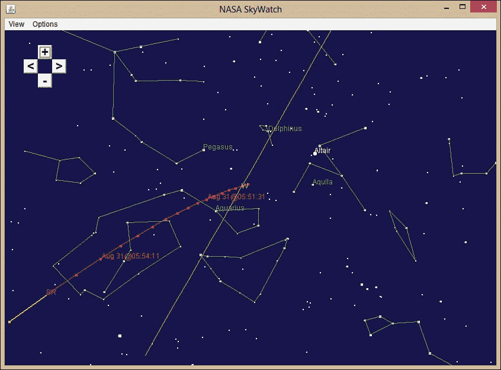

**FIGURE 3.4** NASA 的 `SkyWatch` 小程序监控轨道卫星的位置和路径，是观星爱好者的福音。

该小程序在运行时会重新绘制每个被跟踪卫星的位置。这种实时更新之所以可能，是因为 Java 语言是多线程的。多线程是计算机同时处理多件事情的一种方式。程序的一部分负责一项任务，另一部分负责不同的任务，这两部分可以互不干扰。在这个例子中，程序的每一部分被称为一个线程。

在像 `SkyWatch` 这样的程序中，每颗卫星都可以在自己的线程中运行。如果您使用像 `Windows 8` 这样的操作系统，当您同时运行多个程序时，您就在使用这种行为的一种类型。如果您在工作中在一个窗口玩 `Desktop Tower Defense`，同时在另一个窗口运行公司销售报告，并且给朋友打长途电话，那么恭喜您——您正在进行多线程处理！

### 投入商业应用

在您旅途中的这个阶段，您可能会留下这样的印象：Java 主要对太空爱好者、糟糕的诗人和糟糕的滑雪者有用。我们旅途中的下一站将展示 Java 投入商业应用的例子。

将您的网络浏览器引导到 `QuoteMedia` 网站：[www.quotemedia.com](http://www.quotemedia.com)。该公司提供一个 Java 小程序，用于在其他网站上显示股票报价。Figure 3.5 展示了其滚动股票行情的一个演示。（要亲自查看，请访问 [www.cadenhead.org/stocks](http://www.cadenhead.org/stocks) 重定向到该页面。）


**FIGURE 3.5** 来自 `QuoteMedia` 的 Java 程序报告股票市场价格。

与那些需要为每位需要访问权限的员工在其计算机上安装软件的其他股票分析程序不同，使用 Java 使 `QuoteMedia` 的客户能够向任何拥有网络浏览器的人提供这些程序。所有员工需要做的就是访问公司的网站。

您可以从多个角度思考像这个股票行情小程序这样的程序。一种是将程序视为一个对象——存在于世界上、占据空间并具有某些功能的东西。面向对象编程（`OOP`）是创建计算机程序作为一组对象的一种方式，您将在 Hour 10，“创建您的第一个对象”中发现 Java 使用了它。每个对象处理一个特定的工作，并知道如何与其他对象通信。例如，一个股票行情程序可以设置为以下对象组：

 一个报价对象，代表单个股票报价。

 一个投资组合对象，持有特定股票的一组报价。

 一个行情对象，显示一个投资组合。

 一个互联网对象、一个用户对象以及许多其他对象。

在这种模型下，股票行情软件是完成工作所需的所有对象的集合。

# OOP 与 Java 编程

面向对象编程（OOP）是一种强大的编程方式，它使你编写的程序更加有用。以股票软件为例，如果程序员希望将该程序的报价功能与其他软件一起使用，那么报价对象就可以在新的程序中被复用，无需任何更改。

使用对象创建的程序更易于维护，因为它们组织得更好。对象包含了完成其工作所需的数据和代码。对象也使得程序更具可扩展性。一个新对象可以以现有对象为模板进行设计，并添加新的功能来增强它。

### 造访 SourceForge 以获取指引

这次 Java 程序世界之旅是由一位深谙网络旅行风险和亮点的专业人士带领的。你很快也将开始自己的旅行，因此，了解一个对程序员极具价值的网站——SourceForge 的布局是非常值得的。SourceForge 是寻找完整的 Java（或其他语言）程序示例的最佳场所之一。你可以在 [www.sourceforge.net](http://www.sourceforge.net) 找到它。

SourceForge 是一个专注于协作编程项目的庞大网站。如果你有兴趣与他人合作开发一个程序，你可以在 SourceForge 上启动一个项目，共享其所有文件，招募其他人，并与他们沟通。该网站上 30 多万个项目全部是开源的，这意味着程序员们共享了所有的源代码。如果你不熟悉这个术语，“源代码”是用于创建计算机程序的文本文件的另一个名称。你在第 2 小时中开发的 `Saluton.java` 文件就是一个源代码的例子。

如果你使用 SourceForge 主页顶部的搜索框来搜索 Java applets，你将在这个网站的项目目录中找到超过 7,000 个结果。

SourceForge 上的一个项目是 Aleksey Udovydchenko 的 Absolute，这是一款街机风格的太空电子游戏，在游戏中你可以控制一艘飞船，在小行星带中杀出一条血路（见图 3.6）。该游戏具有滚动动画、图形界面、键盘控制和声音效果。要了解更多信息，请访问 [www.cadenhead.org/absolute](http://www.cadenhead.org/absolute) 来玩这个游戏，并访问 [www.sourceforge.net/projects/absolutejava](http://www.sourceforge.net/projects/absolutejava) 来下载源代码。

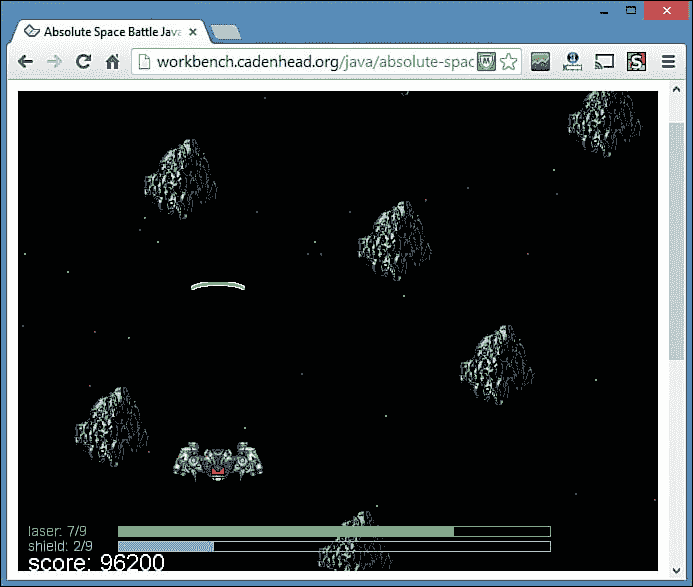


**图 3.6** 诸如 Aleksey Udovydchenko 的太空射击游戏 Absolute 这样的 Java 程序的源代码可以在 SourceForge 上找到。

整个 Absolute 程序仅用 700 多行代码编写而成。考虑到程序的所有功能，这是一个极小的数字。原因之一是 Java 包含了一个庞大的类库，你可以在自己的程序中使用这些类。Udovydchenko 使用了库中的`Image`类来显示小行星等图形，并使用`AudioClip`类来播放激光射击和爆炸声效。

众多程序用 Java 编写的原因之一——无论是在 SourceForge 上还是其他地方——是因为这种语言在拥有强大功能的同时，被设计得更易于学习。

该语言最初的设计目标是使其比 C++（高斯林在 1990 年代处理智能设备项目时倍感挫折的语言）更快地掌握。Java 的很多部分基于 C++，因此已经学会使用 C++ 的程序员会发现学习 Java 更容易。然而，C++ 中一些最难学习和正确使用的元素在 Java 中并不存在。

对于第一次学习编程的人来说，Java 比 C++ 更容易学。有些语言是为让经验丰富的程序员更轻松地利用计算机能力而设计的。这些语言包含编程老手容易理解的快捷方式和其他特性。

Java 并不使用其中的一些特性，而是倾向于使这种语言尽可能地简单，就像一种面向对象编程语言所能达到的那样。Java 被创建得易于学习、易于调试且易于使用。Java 包含众多增强功能，使其成为其他语言的有力竞争者。

### 在你的手机上运行 Java

这次 Java 之旅的最后一站是你最近的谷歌 Android 手机。在 Android 上运行的每一个程序都是用 Java 编程的。这些扩展了手机功能的移动程序被称为应用程序（apps）。最受欢迎的应用程序之一就是《愤怒的小鸟》，如图 3.7 所示。


**图 3.7** 《愤怒的小鸟》和所有其他的 Android 应用程序都是用 Java 语言创建的。

如果你还不熟悉这款游戏，可以通过访问[www.angrybirds.com](http://www.angrybirds.com)来了解更多信息。（但别这么做！这游戏会摧毁你在今天、这周甚至这个月剩余时间里保持高效的任何希望——取决于你有多讨厌武装过的猪。）

Android 是这次 Java 之旅的终点，因为它正在成为这种语言使用的一个令人难以置信的热门平台。在你学会 Java 之后，你可以运用你的技能，使用 Android 软件开发工具包（SDK）来开发自己的应用程序，这是一个免费的编程工具包，可在 Windows、Mac OS 和 Linux 上运行。

已有超过 25 万款应用程序为 Android 手机及其他运行该移动操作系统的设备而创建。你将在第 24 小时“编写 Android 应用程序”中了解更多关于如何创建它们的信息。

### 总结

现在，一小时的假期结束了，是时候收拾行李，准备回归真正的 Java 编程了。

在接下来的 21 个小时里，你将掌握 Java 语言的基本构建块，学习如何创建自己的对象以在面向对象编程中完成任务，设计图形用户界面等等。

除非你为了玩《愤怒的小鸟》而放下了这本书。

### 研讨会

#### 问答

**问：** 为什么 Java applets 不再流行了？

**答：** 当 Java 语言在 1990 年代中期推出时，大多数人学习该语言是为了编写 applets。Java 是创建在网页浏览器中运行的交互式程序的唯一方式。多年来，替代方案出现了。Macromedia Flash、Microsoft Silverlight 和新的网页发布标准 HTML5 都提供了将程序置于网页上的方法。

Applets 受到加载时间差和浏览器开发者对新版 Java 支持缓慢的阻碍。Java 插件被引入以在浏览器中运行当前版本的 Java，但到那时，Java 已经超越了其起源，成为一种复杂的通用编程语言。

**问：** Java SE（Java 标准版）和 Java EE（Java 企业版）之间有什么区别？Java EE 需要花钱吗？

**答：** Java 企业版是 Java 标准版的扩展，包含了支持高级技术的包，例如企业 JavaBeans、XML 处理和 servlet 的开发——servlet 是运行在 Web 服务器上的 Java 程序。Java EE 还包括一个应用服务器，这是一个复杂的执行 Java 软件的环境，专为有繁重计算需求的企业和其他大型组织量身定制。Java EE 开发工具包可以从 Oracle 免费下载，地址是[www.oracle.com/technetwork/java/javaee](http://www.oracle.com/technetwork/java/javaee)。

**问：** 什么是 Chris Steak House，为什么 Ruth 有一个？

**答：** Ruth's Chris Steak House 是一家拥有超过 120 家高档牛排餐厅的连锁店，遍布美国和其他少数国家。它这个奇特的双名组合揭示了其卑微的起源和创始人的固执性格。

### 一家餐馆的起源

该连锁餐厅创立于 1965 年，最初是露丝·费特尔（Ruth Fertel）经营的一家位于新奥尔良的独立餐厅。费特尔是一位有两个儿子的单身母亲。她看到一则出售餐厅的分类广告，并通过办理一笔`$22,000`的房屋抵押贷款将其买下（相当于今天的约`$150,000`）。

她与原老板克里斯·马图利奇（Chris Matulich）达成协议，保留了“克里斯牛排馆”这一名称，但后来因厨房失火不得不重新选址。

费特尔的合同不允许她在原址以外的地方使用“克里斯牛排馆”的名称，因此她将其更名为“露丝的克里斯牛排馆”。尽管她没有餐饮或烹饪方面的专业知识，但生意异常成功，以至于在 12 年内她就开始以特许经营的方式提供加盟。多年来，她无视了多次将餐厅更名以扩大吸引力的建议。

“我一直讨厌这个名字，”她曾告诉《财富》杂志的一名记者，“但我们总能想办法应对。”

费特尔于 2002 年去世，生于 1927 年 2 月 5 日——这一天正是马图利奇开设第一家牛排馆的日子。

### 小测验

如果读到这里你的思绪还没有走神，不妨通过以下问题测试一下你对本小时内容的掌握程度。

**1.** 面向对象编程是如何得名的？

**A.** 程序被认为是一组协同工作的对象。

**B.** 人们经常反对，因为它很难掌握。

**C.** 它的父母给它起的名字。

**2.** 以下哪项不是 Java 安全机制的一部分？

**A.** 网页程序无法在用户的计算机上运行其他程序。

**B.** 程序作者的身份总是经过验证的。

**C.** Java 窗口被标记为 Java 窗口。

**3.** 计算机或设备需要什么才能运行 Java 程序？

**A.** Java 编译器

**B.** Java 虚拟机

**C.** 两者都需要

### 答案

**1. A.** 它也常被缩写为 OOP。

**2. B.** 在 Java 中，程序员可以使用数字签名和像 VeriSign 这样的身份验证公司，但这并不是强制要求的。

**3. B.** Java 虚拟机（JVM）是一个解释器，它将 Java 字节码转换为计算机或设备可以执行的指令。创建 Java 程序需要编译器，但运行程序则不需要。

### 活动

在收拾行李之前，你可以通过以下活动更充分地探索本小时涉及的主题：

 使用 [www.sourceforge.net](http://www.sourceforge.net) 上的 SourceForge，了解使用 Java 语言开发了哪些纸牌游戏。

 访问 Oracle 的 Java 用户网站 [www.java.com](http://www.java.com)，然后点击“Do I Have Java?”链接。按照说明查看你的计算机上是否安装了 Java。如果提示，请下载并安装最新版本。

本书中活动的解答已发布在本书的网站 [www.java24hours.com](http://www.java24hours.com) 上。

## 第 4 小时. 理解 Java 程序如何工作

本小时待办事项清单：

 了解应用程序如何工作。

 构建一个应用程序。

 向应用程序发送参数。

 了解 Java 程序的组织结构。

 使用 Java 类库。

 在应用程序中创建对象。

在 Java 编程中，一个重要的区别是你的程序应该在哪里运行。有些程序被设计为在你自己的计算机上工作。其他程序则被设计为作为网页的一部分运行。

在你本地计算机上运行的 Java 程序称为应用程序。在网页上运行的程序称为小程序，由网页服务器运行的程序称为 Servlet，而在移动设备上运行的程序称为应用。

在本小时中，你将创建一个应用程序并在你的计算机上运行它。

### 创建一个应用程序

你在第 2 小时“编写你的第一个程序”中编写的`Saluton`程序就是 Java 应用程序的一个例子。你将要创建的下一个应用程序将计算一个数的平方根并显示其值。

在 NetBeans 中打开 Java24 项目后，开始创建一个新的应用程序：

**1.** 选择“文件”，“新建文件”。将打开新建文件向导。

**2.** 选择类别`Java`和文件类型`空 Java 文件`，然后点击下一步。

**3.** 输入类名`Root`。

**4.** 输入包名`com.java24hours`。

**5.** 点击完成。

NetBeans 会创建`Root.java`并在源代码编辑器中打开这个空文件，以便你开始编辑。输入清单 4.1 中的所有内容，注意不要输入清单左侧的行号和冒号。这些数字是为了在书中更方便地描述程序的某些部分。完成后，点击工具栏上的“全部保存”按钮来保存文件。

#### 清单 4.1 `Root.java`的完整文本

点击此处查看代码图片

```java
package com.java24hours;

class Root {
    public static void main(String[] arguments) {
        int number = 225;
        System.out.println("The square root of "
            + number
            + " is "
            + Math.sqrt(number)
        );
    }
}
```

`Root`应用程序完成了以下任务：

 第 1 行——该应用程序被置于`com.java24hours`包中。

 第 5 行——一个整数值 225 被存储在一个名为`number`的变量中。

 第 6-10 行——显示这个整数及其平方根。第 9 行的`Math.sqrt(number)`语句显示平方根。

如果你输入清单 4.1 时没有任何拼写错误，包括所有标点符号和如所示的大写，你可以通过在 NetBeans 中选择“运行”，“运行文件”来运行该文件。程序的输出将出现在“输出”窗格中，如图 4.1 所示。

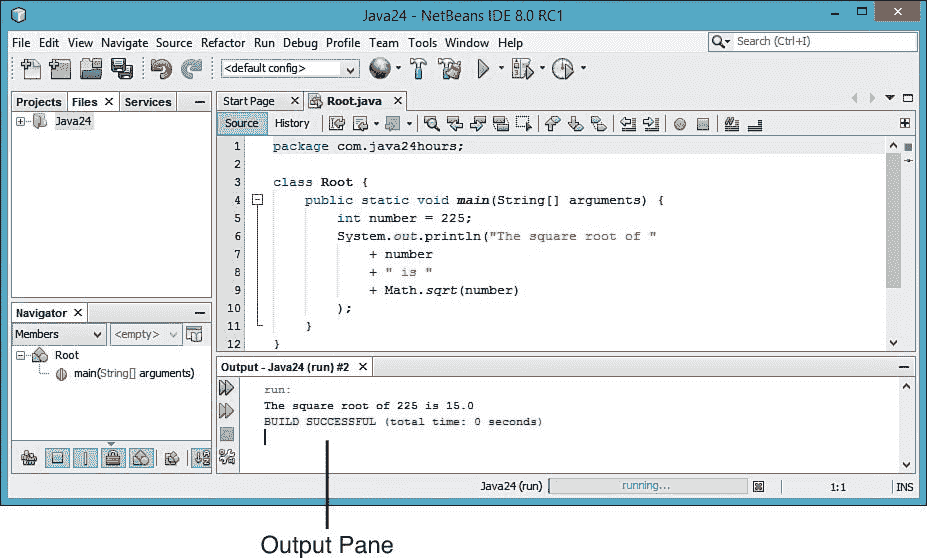

**图 4.1** `Root`应用程序的输出。

当你运行一个 Java 应用程序时，Java 虚拟机（JVM）会寻找一个`main()`块，并开始处理该块中的 Java 语句。如果你的程序没有`main()`块，JVM 会返回一个错误。

第 9 行的语句`Math.sqrt(number)`展示了 Java 语言的一个内置功能——确定一个数的平方根的能力。有一个名为`Math`的 Java 程序，其中有一个名为`sqrt()`的方法用于求指定数的平方根。

`Math`程序是 Java 类库的一部分，你将在本小时稍后探索它。

### 向应用程序发送参数

你可以从命令行使用`java`（一个调用 JVM 的程序）来运行 Java 应用程序。当你在 NetBeans 中运行程序时，它会在后台使用这个程序。当 Java 程序作为命令运行时，JVM 会加载该应用程序。命令可以包含额外的信息项，如下例所示：

点击此处查看代码图片

```shell
java TextDisplayer readme.txt /p
```

发送给程序的任何额外信息都称为参数。第一个参数（如果有的话）是在应用程序名称后隔一个空格提供的。每个附加参数也用一个空格分隔。在前面的例子中，参数是`readme.txt`和`/p`。

如果你想在参数内部包含一个空格，必须用引号将其括起来，如下所示：

点击此处查看代码图片

```shell
java TextDisplayer readme.txt /p "Page Title"
```

本示例使用三个参数运行 `TextDisplayer` 程序：`readme.txt`、`/p` 和 `"Page Title"`。引号可防止 `Page` 和 `Title` 被当作单独的参数处理。

你可以向 Java 应用程序发送任意数量的参数（在合理范围内）。要使用这些参数，必须在应用程序中编写相应的处理语句。

为了了解参数在应用程序中的工作原理，请在 Java24 项目中创建一个新的类：

**1.** 选择 File，New File。

**2.** 在 New File 向导中，选择类别 `Java` 和文件类型 `Empty Java File`。

**3.** 将类命名为 `BlankFiller`，包名为 `com.java24hours`，然后点击 Finish。

在源代码编辑器中输入 清单 4.2 的文本，并在完成后保存。编译程序时，请根据编辑器在您输入时标记的错误进行修正。

**清单 4.2** `BlankFiller.java` 的完整文本

点击此处查看代码图片

* * *

```
 1: package com.java24hours;
 2: 
 3: class BlankFiller {
 4:     public static void main(String[] arguments) {
 5:         System.out.println("The " + arguments[0]
 6:             + " " + arguments[1] + " fox "
 7:             + "jumped over the "
 8:             + arguments[2] + " dog."
 9:         );
10:     }
11: }
```

* * *

此应用程序可以成功编译并运行，但如果您尝试使用菜单命令 Run，Run File 来运行它，将会得到一个看起来复杂的错误：

**输出**

点击此处查看代码图片

```
Exception in thread "main" java.lang.ArrayIndexOutOfBoundsException: 0
    at BlankFiller.main(BlankFiller.java:5)
```

此错误发生的原因是程序在运行时期望接收三个参数。您可以通过在 NetBeans 中自定义项目来指定参数：

**1.** 选择菜单命令 Run，Set Project Configuration，Customize。这会打开 Project Properties 对话框。

**2.** 在 Main Class 文本字段中输入 `com.java24hours.BlankFiller`。

**3.** 在 Arguments 字段中，输入 `retromingent purple lactose-intolerant` 并点击 OK。

因为您已经自定义了项目，所以必须以不同的方式运行它。选择菜单命令 Run，Run Main Project。应用程序会将您指定的参数作为形容词来填充句子，如 图 4.2 所示。

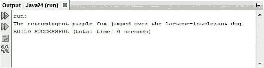

**图 4.2** `BlankFiller` 应用程序的输出。

返回 Project Properties 对话框，并指定三个您自己选择的形容词作为参数，确保始终包含至少三个参数。

参数是自定义程序行为的简单方法。参数存储在一种称为数组的变量类型中。您将在 第 9 小时，"使用数组存储信息" 中学习数组。

### Java 类库

本书将解释如何使用 Java 语言从头开始创建自己的程序。您将学习构成语言的所有关键字和运算符，然后将它们用于编写语句，使计算机执行有趣且有用的任务。

尽管这种方法是学习 Java 的最佳方式，但它有点像通过让某人先从头制造汽车的每个部件来教她如何组装汽车。

作为 Java 程序员，已经有很多工作为你准备好了，前提是你知道去哪里寻找它。

Java 随附一个庞大的代码集合，称为 Java 类库，你可以在自己的程序中使用。这个库包含数千个类，其中许多都可以用于你编写的程序。

* * *

注意

还有许多其他公司和组织提供的类库。Apache 项目（Apache 网页服务器的创建者）有十多个 Java 开源项目。其中一个是 HttpComponents，这是一组用于在 Java 中创建 Web 服务器、客户端和爬虫的类。

有关该项目的更多信息，请访问 [`hc.apache.org`](http://hc.apache.org)。要查看所有 Apache 的 Java 项目，请访问 [`projects.apache.org`](http://projects.apache.org)。

* * *

这些类可以在你的程序中使用，方式与使用变量有些相似。


一个类用于创建一个对象，对象类似于变量但更加复杂。对象可以像变量一样保存数据，也可以像程序一样执行任务。

Oracle 在网页 [`download.java.net/jdk8/docs/api`](http://download.java.net/jdk8/docs/api) 上为 Java 类库提供了全面的文档。该页面如 图 4.3 所示。

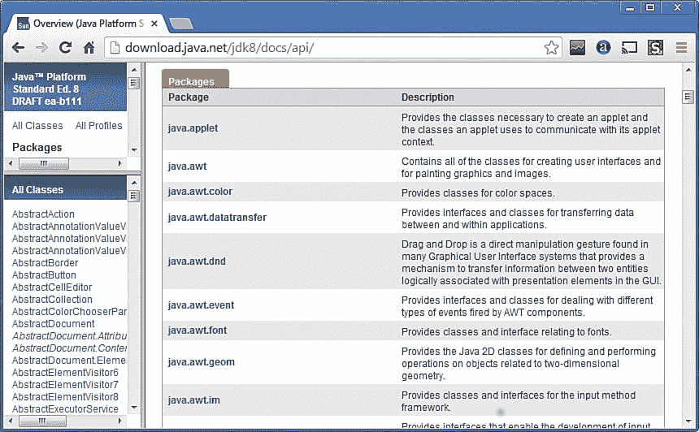

**图 4.3** Java 类库文档。

Java 类被组织成包，其功能类似于计算机上的文件夹。到目前为止，您创建的程序属于`com.java24hours`包。

文档主页分为多个框架。最大的框架列出了组成 Java 类库的所有包，以及每个包的描述。

包的名称有助于描述其用途。例如，`java.io`是用于磁盘驱动器、互联网服务器和其他数据源输入输出的类集合；`java.time`包含与时间相关的类；`java.util`收集了有用的实用程序类。

在文档主页上，最大的框架列出了包及其简短描述。点击包的名称以了解更多信息。此时会加载一个页面，列出该包中的类。

Java 类库中的每个类在此参考站点上都有自己的文档页面，该站点包含超过 26,000 页。（您不必现在或永远阅读所有页面。）

对于本小时的最后一个项目，您将在库中探索，并使用一个现有的 Java 类来为您做一些工作。

`Dice`程序使用了`java.util`包中的`Random`类，该类可用于创建随机数。

在程序中使用此类所做的第一件事是使用以下语句导入其包：

```
import java.util.*;
```

这使得无需使用其全名`java.util.Random`就可以引用`Random`类。相反，您可以简单地将其称为`Random`。星号（`*`）使得可以通过较短的名称引用包中的所有类。

`Random`类是一个模板，可用于创建`Random`对象。要创建一个对象，请使用`new`关键字，后跟类名和圆括号：

点击此处查看代码图片

```
Random generator = new Random();
```

这将创建一个名为`generator`的变量，其中保存着一个新的`Random`对象。该对象是一个随机数生成器，可以产生一个或多个随机数。

对于这个程序，将使用该对象的`nextInt()`方法来生成一个随机整数值：

点击此处查看代码图片

```
int value = generator.nextInt();
```

Java 中的整数范围是从 –2,147,483,648 到 2,147,483,647。生成器随机选择其中一个数字，并将其分配给`value`变量。

如果没有来自 Java 类库的`Random`类，您必须自己编写程序来产生随机数，这是一项非常复杂的任务。随机数在游戏、教育程序和其他必须随机执行某些操作的程序中非常有用。

在 NetBeans 中创建一个新的空 Java 文件，将其命名为`Dice`，并将其放在`com.java24hours`包中。当源代码编辑器打开时，将 清单 4.3 的文本输入到该窗口中，然后单击 Save 按钮（或选择菜单命令 File，Save）。

**清单 4.3** `Dice.java`的完整文本

点击此处查看代码图片

* * *

```
 1: package com.java24hours;
 2: 
 3: import java.util.*;
 4: 
 5: class Dice {
 6:     public static void main(String[] arguments) {
```

# 第 4 小时：在程序中存储和更改信息

## 第 4 小时待办事项：

- 创建一个变量。
- 使用不同类型的变量。
- 将值存储在变量中。
- 在数学表达式中使用变量。
- 将一个变量的值存储在另一个变量中。
- 增加和减少变量的值。

```java
 7:         Random generator = new Random();
 8:         int value = generator.nextInt();
 9:         System.out.println("The random number is "
10:             + value);
11:     }
12: }
```

---

通过选择“Run”，“Run File”来运行程序。输出结果如图 4.4 所示，尽管你得到的数字会不同。（实际上，有四十亿分之一的概率会得到相同的数字，这甚至比彩票中奖的几率还要低。）

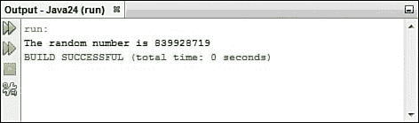

**图 4.4** `Die`程序的输出。

你现在拥有了一个随机选择的属于你的整数。请好好保管它。

`Random`类，就像 Java 类库中的所有类一样，在 Oracle 网站上有详尽的文档可供阅读。它描述了该类的用途、所属包、如何创建该类的对象，以及可以调用哪些方法来使其执行操作。

请按照以下步骤查看此文档：

**1.** 在你的网络浏览器中，加载页面 [`download.java.net/jdk8/docs/api`](http://download.java.net/jdk8/docs/api)。

**2.** 在主框架中，向下滚动直到看到`java.util`包的链接。点击此链接。将显示该包的文档。

**3.** 在主框架中，向下滚动并点击`Random`链接。

作为一名经验稍显不足（不到四小时）的 Java 程序员，你很可能会觉得这些文档晦涩难懂。不要惊慌。它是为经验丰富的程序员编写的。

但当你阅读本书并对 Java 内置类的使用方式产生兴趣时，查看某个类的官方文档可能会对你有所启发。一种使用方法是查看该类中的方法，每个方法都执行一项特定任务。

在`Random`的文档中，你可以向下滚动到`nextInt()`方法的说明，该方法在清单 4.3 的第 8 行被使用。图 4.5 显示了该页面的这一部分。

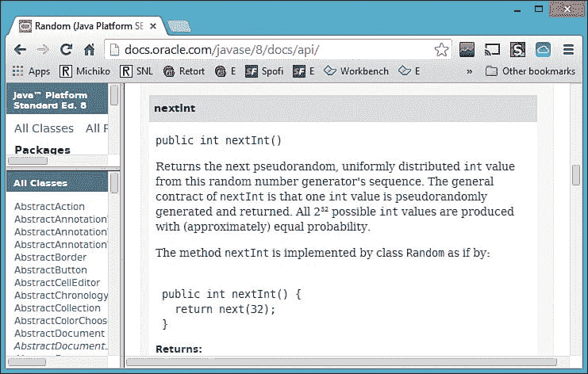

**图 4.5** Oracle 对`Random`类的文档。

---

### 注意

本书涵盖的所有 Java 类都在书中有描述，因此在学习这 24 小时并成为一名 Java 程序员的过程中，在线文档并非必需品。由于本书使用的类有许多超出入门书籍所能涵盖的额外功能，Java 类库的文档可以补充你的学习。

---

### 总结

在本小时中，你有机会创建一个 Java 程序、向程序传递参数，并利用 Java 类库中的现有程序。

接下来的几个小时将继续聚焦于应用程序，因为你作为 Java 程序员的经验将变得更加丰富。应用程序测试起来更快，因为它们不需要你做任何额外的工作来运行，不像其他类型的程序。

本小时是讨论如何在 Java 程序中使用对象的几个小时中的第一个。你将在第 10 小时“创建你的第一个对象”中再次回到这个主题。

### 研讨会

#### 问与答

**问：** 所有发送到 Java 应用程序的参数都必须是字符串吗？

**答：** Java 在运行应用程序时将所有参数存储为字符串。当你想将其中一个参数用作整数或其他非字符串类型时，必须转换该值。你将在第 11 小时“描述你的对象是什么样子”中学习如何做到这一点。

**问：** 如果小应用程序在网页上运行，应用程序在所有其他地方运行，那么由 Java Web Start 启动的 Java 程序是什么？

**答：** Java Web Start 是一种从网络浏览器启动 Java 应用程序的方式。用户点击网页上的链接来运行程序，这比下载它、运行安装向导并像启动其他任何桌面软件一样启动它更容易。

尽管它们是从浏览器运行的，但 Java Web Start 程序是应用程序而不是小应用程序。该应用程序始终是最新的，因为每次运行时都通过网络从程序提供者那里检索。

Google Web Toolkit (GWT)，一套用于 Web 编程的开源工具集，可以将 Java 程序转换为 JavaScript，使其在网页浏览器中运行得更快、更可靠，而根本不需要 Java 虚拟机。

**问：** 英国王位的继承线是否会在某个时候耗尽？

**答：** 根据自 1701 年起实施的议会法律，英国君主必须是汉诺威的索菲亚公主（一位德国公主，该法律通过时她是王位的女继承人）的新教后裔。

索菲亚的后裔人数是有限的，所以总会有排在王室继承线最后的人。英国政府只列出了前 38 位，因此系谱学家们试图自行填补名单的其余部分。

继承顺序的最后一位是卡琳·沃格尔，一位三十多岁的德国疼痛治疗师。系谱学家们经过耗时多年的详尽搜索后确定，截至 2001 年，她排在第 4973 位。所以，如果排在她前面的所有人都退出竞争（比如，花更多时间学习 Java 编程），沃格尔将接管白金汉宫的抵押贷款，并成为卡琳一世女王陛下。

沃格尔是索菲亚的曾曾曾曾曾曾曾曾孙女。她告诉《华尔街日报》，成为君主“压力太大了”。

随着威廉王子和凯特王妃的儿子乔治（更正式的称号是剑桥的乔治·亚历山大·路易斯王子殿下）的出生，沃格尔降至第 4974 位。

#### 测验

通过回答以下问题，测试你对本小时所涵盖内容的理解。

**1.** 哪种类型的 Java 程序可以由浏览器运行？

**A.** 小应用程序（Applets）

**B.** 应用程序（Applications）

**C.** 都不是

**2.** JVM 代表什么？

**A.** Journal of Vacation Marketing

**B.** Jacksonville Veterans Memorial

**C.** Java Virtual Machine

**3.** 如果你因为向 Java 应用程序传递信息的方式而与某人发生争执，你在做什么？

**A.** 为字符串而挣扎（Struggling over strings）

**B.** 为参数而争论（Arguing about arguments）

**C.** 为功能而争吵（Feudin’ for functionality）

#### 答案

**1. A.** 小应用程序作为网页的一部分运行，而应用程序在所有其他地方运行。

**2. A.**, **B.**, 或 **C.** 脑筋急转弯！首字母缩写代表所有三样东西，尽管 Java Virtual Machine 是你在接下来的 20 小时中需要记住的那个。

**3. B.** 应用程序以参数的形式接收信息。我们难道就不能好好相处吗？

#### 活动

如果你想应用你对应用程序的敏锐理解，建议进行以下活动：

 以`Root`应用程序为指导，创建一个名为`NewRoot`的应用程序，该程序可以显示 625 的平方根。

 以`Root`应用程序为指导，创建一个名为`NewRoot`的应用程序，该程序可以显示作为参数提交的数字的平方根。

本书中活动的解决方案可在书中的网站 [www.java24hours.com](http://www.java24hours.com) 上找到。

# 第二部分：学习编程基础

## 第 5 小时：在程序中存储和更改信息

本小时待办事项：

 创建一个变量。

 使用不同类型的变量。

 将值存储在变量中。

 在数学表达式中使用变量。

 将一个变量的值存储在另一个变量中。

 增加和减少变量的值。

# 第 2 小时：编写第一个程序

在第 2 小时“编写你的第一个程序”中，你使用了一个变量——一个专门设计来存放信息的特殊存储位置。变量中存储的信息可以在程序运行时改变。你的第一个程序在一个变量中存储了一段文本字符串。字符串只是可以存储在变量中的信息类型之一。变量还可以存储字符、整数、浮点数和对象。

在本小时中，你将学习更多关于在 Java 程序中使用变量的知识。

## 语句和表达式

计算机程序是一系列告诉计算机做什么的指令。每条指令被称为一个语句。以下来自 Java 程序的示例是一条语句：

```java
int highScore = 450000;
```

在 Java 程序中，你可以使用花括号将一组语句组合在一起。这些组合被称为块语句。考虑以下程序片段：

```java
1: public static void main(String[] arguments) {
2:    int a = 3;
3:    int b = 4;
4:    int c = 8 * 5;
5: }
```

此示例中的第 2-4 行是一个块语句。第 1 行的左花括号表示块的开始，第 5 行的右花括号表示块的结束。

有些语句被称为表达式，因为它们涉及一个数学表达式并产生一个结果。前面示例中的第 4 行是一个表达式，因为它将变量`c`的值设置为 8 乘以 5。你将在本小时中使用表达式。

## 赋值变量类型

变量是计算机在运行程序时记住某些信息的主要方式。在第 2 小时中的`Saluton`程序使用了`greeting`变量来保存"Saluton mondo!"。计算机需要记住那段文本，以便稍后能够显示该消息。

在 Java 程序中，变量是通过一条语句创建的，该语句必须包含两件事：

- 变量的名称
- 变量将存储的信息类型

变量还可以包含被存储信息的值。

为了查看不同类型的变量以及它们是如何创建的，启动 NetBeans 并创建一个新的空 Java 文件，类名为`Variable`。

开始编写程序，输入以下几行：

```java
package com.java24hours;

class Variable {
    public static void main(String[] arguments) {
        // 即将到来：变量
    }
}
```

在进行任何更改之前，先保存这几行。

### 整数和浮点数

目前，`Variable`程序只有一个包含一条语句的`main()`块——注释`// 即将到来：变量`。删除该注释并输入以下语句来代替：

```java
int tops;
```

这条语句创建了一个名为`tops`的变量。它没有为`tops`指定一个值，所以目前这个变量是一个空的存储空间。语句开头的`int`文本将`tops`指定为一个用于存储整数的变量。你可以使用`int`类型来存储计算机程序中需要的大多数非十进制数字。它可以容纳从约-21.4 亿到 21.4 亿的任何整数。

在`int tops`语句之后添加一个空行，并输入以下语句：

```java
float gradePointAverage;
```

这条语句创建了一个名为`gradePointAverage`的变量。`float`文本代表浮点数。浮点变量用于存储可能包含小数点的数字。

`float`变量类型可容纳最多 38 位数字的十进制数。更大的`double`类型可容纳最多 300 位数字的十进制数。

> **注意**

> 你可以使用浮点变量来存储平均绩点，例如 2.25（以我自己在北德克萨斯大学的成绩为例——你好，韦尔斯教授！）。你也可以用它存储像 0 这样的数字，这是我的平均绩点进入一所好研究生院的百分比概率，这就是为什么在 1996 年这家出版商寻找计算机书籍作者时，我有空。

### 字符和字符串

因为你目前处理的变量都是数字类型的，你可能认为所有变量都是用来存储数字的。再想想。你也可以用变量来存储文本。两种类型的文本可以存储为变量：字符和字符串。字符是一个字母、数字、标点符号或符号。字符串是一组字符。

你创建`Variable`程序的下一步是创建一个`char`变量和一个`String`变量。在`float gradePointAverage`行之后添加这两条语句：

```java
char key = 'C';
String productName = "Larvets";
```

在程序中使用字符值时，必须在分配给变量的字符值两边加上单引号。对于字符串值，必须用双引号括起来。

引号可以防止字符或字符串与变量名或语句的其他部分混淆。看看下面这条语句：

```java
String productName = Larvets;
```

这条语句看起来像是告诉计算机创建一个名为`productName`的字符串变量，其文本值为`Larvets`。然而，由于单词`Larvets`周围没有引号，计算机被告知将`productName`的值设置为与名为`Larvets`的变量相同的值。（如果没有名为`Larvets`的变量，程序将因错误而无法编译。）

在添加`char`和`String`语句之后，你的程序类似于清单 5.1。进行任何必要的更改并确保保存文件。

**清单 5.1 `Variable`程序**

```java
 1: package com.java24hours;
 2:
 3: class Variable {
 4:    public static void main(String[] arguments) {
 5:       int tops;
 6:       float gradePointAverage;
 7:       char key = 'C';
 8:       String productName = "Larvets";
 9:    }
10: }
```

> **注意**

> 尽管其他变量类型都是小写字母（`int`、`float`和`char`），但在创建字符串变量时，`String`这个词中的大写字母是必需的。Java 程序中的字符串与你在变量语句中使用的其他类型的信息是不同的。你将在第 6 小时“使用字符串进行通信”中了解这种区别。

`Variable`程序中的最后两个变量使用了`=`符号在创建变量时分配一个初始值。你可以在 Java 程序中为任何创建的变量使用这个选项，正如你在本小时稍后将发现的那样。

这个程序可以运行但不会产生任何输出。

### 其他数字变量类型


到目前为止介绍的变量类型是你在大多数 Java 编程中使用的主要类型。在特殊情况下，你可以使用几种其他类型的变量。

你可以使用第一个`byte`，用于范围从 -128 到 127 的整数。以下语句创建了一个名为`escapeKey`的变量，初始值为 27：

```java
byte escapeKey = 27;
```

第二个`short`，可用于比`int`类型小的整数。`short`整数范围可以从 -32,768 到 32,767，如以下示例所示：

```java
short roomNumber = 222;
```

数字变量类型的最后一个`long`，通常用于`int`类型无法容纳的过大整数。`long`整数范围可以从 -9.22 quintillion 到 9.22 quintillion，这是一个足够大的数字，可以涵盖除政府支出以外的所有内容。

> **注意**

> ...（原文在此处截断）

## 数字中下划线的使用

如果 NetBeans 源代码编辑器已设置为使用较旧版本的 Java，那么在其中使用下划线的数字将被标记为错误。为确保情况并非如此，请在“项目”窗格中，右键单击当前项目的名称（很可能是`Java24`）并选择“属性”。此时将打开“项目属性”对话框，其中“类别”窗格中已选中“源”。检查“源/二进制格式”下拉菜单，确保其为当前版本的 Java。

## 处理大数字

在 Java 中处理大数字时，可能很难一目了然地看出数字的值，例如下面这条语句：

```java
long salary = 264400000;
```

除非你去数零的个数，否则你很可能看不出这是 2.644 亿。Java 允许使用下划线（“_”）字符来组织大数字。示例如下：

```java
long salary = 264_400_000;
```

下划线会被忽略，因此变量的值仍然相同。它们只是使数字更易于人类阅读的一种方式。

## `boolean` 变量类型

Java 有一种称为`boolean`的变量类型，只能用于存储`true`值或`false`值。乍一看，`boolean`变量似乎并非特别有用，除非你打算编写大量是非题测验。然而，`boolean`变量在你的程序中会用于各种情况。以下是一些可以使用`boolean`变量来回答的问题示例：

 用户是否按下了某个键？

 游戏是否结束？

 我的银行账户是否已透支？

 这条裤子是不是让我的臀部看起来很肥？

 兔子能不能吃 Trix 麦片？

> **注意**

> 布尔数以乔治·布尔（1815–1864）的名字命名。布尔是一位在成年前主要靠自学的数学家，他发明了布尔代数，这已成为计算机编程、数字电子学和逻辑学的基础部分。可以想象，他小时候做是非题测试时表现得相当不错。

布尔类型用于存储是/否和真/假问题的答案。

以下语句创建了一个名为`gameOver`的`boolean`变量：

```java
boolean gameOver = false;
```

此变量的初始值为`false`，因此类似这样的语句可以在游戏程序中表示游戏尚未结束。稍后，当发生某些事件导致游戏结束时，可以将`gameOver`变量设置为`true`。

虽然这两个可能的布尔值在程序中看起来像字符串，但你不应该将它们用引号括起来。第 7 小时“使用条件测试做决策”将更全面地描述`boolean`变量。

## 命名你的变量

Java 中的变量名可以以字母、下划线字符（`_`）或美元符号（`$`）开头。名称的其余部分可以是任何字母或数字。你可以给变量起几乎任何你喜欢的名字，但应该保持命名的一致性。本节概述了变量的一般推荐命名方法。

Java 在变量名方面区分大小写，因此你必须始终以相同的方式书写变量名。例如，如果在程序中的某处将`gameOver`变量称为`GameOver`，那么编译器会报错，阻止程序编译。

> **注意**

> 变量名并非 Java 中唯一区分大小写的方面。程序中其他所有可以命名的内容，包括类、包和方法，都必须使用一致的大小写来引用。

变量名应以某种方式描述其用途。第一个字母应小写，如果变量名包含多个单词，则每个后续单词的首字母应大写。例如，如果你想创建一个整数变量来存储游戏程序中的历史最高分，可以使用以下语句：

```java
int allTimeHighScore;
```

变量名中不能使用标点符号或空格，因此以下两种写法都不起作用：

```java
int all-TimeHigh Score;

int all Time High Score;
```

如果你在程序中尝试使用这些变量名，NetBeans 会通过在源代码编辑器中该行旁边显示红色警报图标来标记错误。

语言保留字，例如`public`、`class`、`true`和`false`，不能用作变量名。

## 在变量中存储信息

在 Java 程序中，你可以在创建变量的同时在其中存储一个值。你也可以在程序中的任何后续时间将值放入变量中。

要在创建变量时设置初始值，请使用等号（`=`）。以下是创建一个名为`pi`且初始值为 3.14 的双精度浮点型变量的示例：

```java
double pi = 3.14;
```

所有存储数字的变量都可以类似地设置。如果你设置的是字符或字符串变量，则必须按照本小时前面描述的那样将值用引号括起来。

你也可以将一个变量设置为等于另一个变量的值，前提是它们具有相同的类型。考虑以下示例：

```java
int mileage = 300;

int totalMileage = mileage;
```

首先，创建一个名为`mileage`的整数变量，其初始值为 300。接下来，创建一个名为`totalMileage`的整数变量，其值与`mileage`相同。两个变量的初始值都是 300。在后续的课程中，你将学习如何将一个变量的值转换为另一个变量的类型。

> **警告**

> 如果你不给变量一个初始值，那么在使用它之前必须给它赋值。否则，当你的程序编译时，你可能会得到一个错误，指出该变量“可能尚未初始化”。

正如你所了解的，Java 有类似但存储不同大小值的数值变量。`int`和`long`都存储整数，但`long`存储的可能值范围更大。`float`和`double`都存储浮点数，但`double`更大。

你可以在数值后附加一个字母来指示值的类型，如下面的语句：

```java
float pi = 3.14F;
```

值 3.14 后面的“F”表示它是一个`float`值。如果省略该字母，Java 会将 3.14 假定为一个`double`值。

字母“L”用于`long`整数，“D”用于`double`浮点值。

Java 中的另一个命名约定是：将值永不改变的变量名中的每个字母大写。这些变量称为常量。以下创建了三个常量：

```java
final int TOUCHDOWN = 6;

final int FIELDGOAL = 3;

final int PAT = 1;
```

因为常量的值永远不会改变，你可能想知道为什么还要使用它们——你完全可以使用赋予常量的值。使用常量的一个优点是它们使程序更容易理解。

在前面的三个语句中，常量的名称被大写了。这在 Java 中不是必需的，但在程序员中已成为区分常量和其他变量的标准惯例。

## 关于操作符的所有知识

语句可以通过使用操作符`+`、`-`、`*`、`/`和`%`来使用数学表达式。你在整个 Java 程序中使用这些操作符来处理数字。

Java 中的加法表达式使用`+`操作符，如下面的语句所示：

```java
double weight = 205;

weight = weight + 10;
```

第二条语句使用`+`操作符将`weight`变量设置为它的当前值加上 10。减法表达式使用`-`操作符：

```java
weight = weight - 15;
```

此表达式将`weight`变量设置为它的当前值减去 15。

除法表达式使用`/`符号：

```java
weight = weight / 3;
```

这将`weight`变量设置为它的当前值除以 3。

## 寻找余数

要找出除法表达式的余数，请使用`%`运算符（也称为取模运算符）。以下语句找出 245 除以 3 的余数：

```java
int remainder = 245 % 3;
```

## 乘法表达式

乘法表达式使用`*`符号。这里有一个在更复杂的语句中使用了乘法表达式的例子：

```java
int total = 500 + (score * 12);
```

表达式中的`score * 12`部分将`score`乘以 12。完整的语句是将`score`乘以 12，然后在结果上加上 500。如果`score`等于 20，表达式的结果是`total`等于 740：`500 + (20 * 12)`。

### 递增和递减变量

程序中一个常见的任务是将变量的值改变一。你可以将值增加一，这称为递增变量；或者将值减少一，这称为递减变量。有相应的运算符来完成这两个任务。

要递增变量的值，使用`++`运算符，如以下语句所示：

```java
power++;
```

该语句将`power`变量中存储的值加一。

要递减变量的值，使用`--`运算符：

```java
rating--;
```

该语句将`rating`减少一。

* * *

**注意**

感到困惑了吗？如果你回想一下小学时学过的前缀知识，这比听起来要简单。就像前缀“sub-”或“un-”放在像 suburban 或 unexpected 这样的单词开头一样，前缀运算符放在变量名的开头。后缀运算符则放在末尾。

* * *

你也可以将递增和递减运算符放在变量名的前面，如以下语句所示：

```java
++power;
--rating;
```

将运算符放在变量名前面称为前缀，放在名称后面称为后缀。

前缀和后缀运算符的区别在你在表达式中使用递增和递减运算符时变得重要。

考虑以下语句：

```java
int x = 3;
int answer = x++ * 10;
```

这些语句处理后`answer`变量等于什么？你可能期望它等于 40——如果 3 先递增 1 变为 4，然后 4 乘以 10，这确实是正确的。

然而，`answer`最终的值是 30，因为这里使用的是后缀运算符而不是前缀运算符。

当变量在表达式中使用了后缀运算符时，变量的值在表达式被完全求值之前不会改变。语句`int answer = x++ * 10`做的事情与以下两个语句顺序相同：

```java
int answer = x * 10;
x++;
```

前缀运算符的情况则相反。如果在表达式中使用了前缀运算符，变量的值会在表达式求值之前改变。

考虑以下语句：

```java
int x = 3;
int answer = ++x * 10;
```

这确实导致`answer`变量等于 40。前缀运算符导致`x`变量的值在表达式求值之前被改变。语句`int answer = ++x * 10`做的事情与以下语句顺序相同：

```java
x++;
int answer = x * 10;
```

你很容易对`++`和`--`运算符感到恼火，因为它们不像你在本书中遇到的许多其他概念那样直观。

我不确定自己是否违反了 Java 程序员之间某种不成文的准则，但我得告诉你，你在自己的程序中不需要使用递增和递减运算符。你可以通过使用`+`和`-`运算符来达到相同的效果，像这样：

```java
x = x + 1;
y = y - 1;
```

* * *

**注意**

回想一下 Hour 1，“成为一名程序员”中对 C++ 编程语言名称的描述，那是一个你后来才会理解的笑话。既然你已经认识了递增运算符`++`，你就拥有了弄明白为什么 C++ 的名字有两个加号而不是一个的所有信息。因为 C++ 为 C 编程语言增加了新的特性和功能，它被认为是 C 的增量增加——因此得名 C++。

在你学完本书的全部 24 小时后，你也能够讲这种对世界上超过 99% 的人口来说难以理解的笑话了。

* * *

递增和递减是很有用的快捷方式，但在表达式中使用更长的写法也是完全可以的。

### 运算符优先级

当你使用包含多个运算符的表达式时，你需要知道计算机在计算表达式时使用的顺序。考虑以下语句：

```java
int y = 10;
x = y * 3 + 5;
```

除非你知道计算机在计算这些语句中的数学运算时使用的顺序，否则你无法确定`x`变量会被设置成什么值。它可能是 35 或 80，这取决于`y * 3`先被计算还是`3 + 5`先被计算。

计算表达式时使用以下顺序：

**1.** 递增和递减首先执行。

**2.** 接着是乘法、除法和取模运算。

**3.** 然后是加法和减法。

**4.** 接下来是比较运算。

**5.** 等号（`=`）用于设置变量的值。

因为乘法在加法之前进行，所以你可以回顾之前的例子并得出答案：`y`首先乘以 3，得到 30，然后加上 5。`x`变量被设置为 35。

比较运算在 Hour 7 中讨论。本小时已经描述了其他内容，所以你应该能够算出以下语句的结果：

```java
int x = 5;
int number = x++ * 6 + 4 * 10 / 2;
```

这些语句将`number`变量设置为 50。

计算机是如何得出这个总数的？首先，处理递增运算符，`x++`将`x`变量的值设置为`6`。但请注意，`++`运算符在表达式中是作为`x`的后缀。这意味着表达式在求值时使用的是`x`的原始值。

因为在变量递增之前使用了`x`的原始值，所以表达式变为：

```java
int number = 5 * 6 + 4 * 10 / 2;
```

现在，乘法和除法从左到右进行。首先，5 乘以 6，4 乘以 10，然后结果除以 2（`4 * 10 / 2`）。表达式变为：

```java
int number = 30 + 20;
```

这个表达式导致`number`变量被设置为 50。

如果你想以不同的顺序计算表达式，可以使用圆括号来将应该首先处理的部分分组。例如，表达式`x = 5 * 3 + 2;`通常会导致`x`等于 17，因为乘法在加法之前处理。但是，看这个表达式的修改形式：

```java
x = 5 * (3 + 2);
```

在这种情况下，括号内的表达式首先被处理，所以结果等于 25。你可以在语句中根据需要多次使用圆括号。

### 使用表达式

当你在学校里处理一个特别讨厌的数学问题时，你是否曾向更高力量抱怨过，抗议你在生活中永远不会用到这些知识？很遗憾地告诉你，你的老师是对的——你的数学技能在计算机编程中派上了用场。这是坏消息。

好消息是，计算机会处理你要求它做的任何数学运算。表达式在你的计算机程序中经常被用来完成诸如以下任务：

- 更改变量的值

- 计算程序中某事发生的次数

- 在程序中使用数学公式

## 基本表达式

编写计算机程序时，你会发现自己在使用表达式时会用到以前的数学课程知识。表达式可以使用加法、减法、乘法、除法和取模运算。

为了看看表达式的实际效果，请返回到 NetBeans 并创建一个新的 Java 文件，类名为`PlanetWeight`。这个程序跟踪一个人在太阳系其他天体间旅行时的体重增减。在源代码编辑器中输入清单 5.2 的全部内容。程序的各个部分将依次讨论。

**清单 5.2 `PlanetWeight` 程序**

点击此处查看代码图片

---

```java
1: package com.java24hours;
2:
3: class PlanetWeight {
4:     public static void main(String[] arguments) {
5:         System.out.print("Your weight on Earth is ");
6:         double weight = 178;
7:         System.out.println(weight);
8:
9:         System.out.print("Your weight on Mercury is ");
10:         double mercury = weight * .378;
11:         System.out.println(mercury);
12:
13:         System.out.print("Your weight on the Moon is ");
14:         double moon = weight * .166;
15:         System.out.println(moon);
16:
17:         System.out.print("Your weight on Jupiter is ");
18:         double jupiter = weight * 2.364;
19:         System.out.println(jupiter);
20:     }
21: }
```

---

完成后，保存文件，它应该会自动编译。使用菜单命令`Run`, `Run File`运行程序。输出如图 5.1 所示。

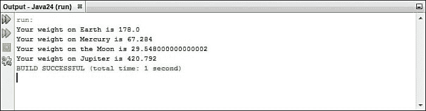

**图 5.1** `PlanetWeight`程序的输出。

与你创建的其他程序一样，`PlanetWeight`程序使用一个`main()`块语句来完成所有工作。这个语句可以分解为以下四个部分：

**1.** 第 5–7 行：将人的初始体重设置为 178。

**2.** 第 9–11 行：计算在水星上的体重减轻。

**3.** 第 13–15 行：确定在月球上的体重减轻。

**4.** 第 17–19 行：计算在木星上的体重增加。

---

**注意**


在这个示例值中，`PlanetWeight` 应用程序使用了 178 磅的体重，这根据 BMC Health Study 刚好是北美人的平均体重。相比之下，大洋洲人平均为 164 磅，欧洲人 156 磅，拉丁美洲人 150 磅，非洲人 134 磅，亚洲人 127 磅。

所以，如果你在北美读到这里，有人问你，“需要来一份苹果派吗？”对这个问题的正确回答是“不”。

---

第 6 行创建了 `weight` 变量，并将其指定为一个大的浮点变量 `double`。该变量被赋予初始值 178，并在整个程序中用于监控该人的体重。

下一行与程序中的其他几个语句类似：

`System.out.println(weight);`

`System.out.println()` 命令显示包含在其括号内的一个字符串。在第 5 行，`System.out.print()` 命令显示了文本 "Your weight on Earth is"。程序中有多个 `System.out.print()` 和 `System.out.println()` 语句。

它们的区别在于 `print()` 在显示文本后不开始新行，而 `println()` 会。

### 总结

既然你已经了解了变量和表达式，你就可以在程序中给计算机下达各种指令。

凭借你在这个小时所培养的技能，你可以编写程序来完成与计算器许多相同的任务，轻松处理复杂的数学方程。

你也会了解到，去月球旅行是一个特别有效的减肥计划。

数字只是可以在变量中存储的一种东西。你还可以存储字符、字符字符串，以及称为 `boolean` 变量的特殊 `true` 或 `false` 值。下一个小时将扩展你对 `String` 变量的知识，以及它们的存储和使用方式。

### 实践

#### 问答

**问：** Java 程序中的一行与一个语句是同一回事吗？

**答：** 不是。本书中创建的程序将每个语句放在一行上，以使程序更容易理解；但这并不是必需的。

Java 编译器在编译程序时不考虑行、空格或其他格式问题。编译器只希望看到每个语句末尾的分号。下面这行在 Java 中可以正常工作：

`int x = 12; x = x + 1;`

将多个语句放在一行会使程序在阅读其源代码时对人类更难理解。因此，不推荐这样做。

**问：** 为什么变量名的第一个字母应该是小写，比如 `gameOver`？

**答：** 这是一个命名约定，它从两个方面帮助你的编程。首先，它使变量在 Java 程序的其他元素中更容易被发现。其次，通过遵循一致的变量命名风格，你可以消除在程序多处使用变量时可能发生的错误。本书中使用的大小写风格是多年来大多数 Java 程序员采用的风格。

**问：** 我能在 Java 中指定二进制值的整数吗？

**答：** 可以，这是在最近版本的 Java 中引入的一个特性。在数字前加上字符 "0b"，并在其后跟上值的位。由于 1101 是数字 13 的二进制形式，以下语句将一个整数设置为 13：

`int z = 0b0000_1101;`

下划线只是为了使数字更具可读性。Java 编译器会忽略它。

十六进制值可以用以 "0x" 开头的数字表示，就像超级碗 0x30（西雅图海鹰队以 0x2B 比 0x8 击败了丹佛野马队）一样。

**问：** Larvets 到底是什么？

**答：** Larvets 是本节提到的一种零食，由可食用的蠕虫制成，这些蠕虫被杀死、烘干，并与多力多滋薯片一样美味的调味料混合而成。你可以从邮购零售商 HotLix 的网站 [www.hotlix.com](http://www.hotlix.com) 或致电 1-800-EAT-WORM 订购三种口味的 Larvets——烧烤味、切达奶酪味和墨西哥香料味。

#### 测验

通过回答以下问题来测试你对变量、表达式以及本节其余信息的了解。

**1.** 一组包含在开括号和闭括号内的语句叫什么？

**A.** 块语句

**B.** 群件

**C.** 带括号的语句

**2.** `boolean` 变量用于存储 `true` 或 `false` 值。

**A.** 正确

**B.** 错误

**C.** 不，谢谢。我已经吃过了。

**3.** 什么字符不能用于变量名的开头？

**A.** 美元符号

**B.** 两个前斜杠 (`//`)

**C.** 一个字母

#### 答案

**1. A.** 这些分组的语句称为块语句或块。

**2. A.** `true` 和 `false` 是 `boolean` 变量可以存储的唯一答案。

**3. B.** 变量可以以字母、美元符号 (`$`) 或下划线字符 (`_`) 开头。如果变量名以两个斜杠开头，该行的其余部分将被忽略，因为斜杠用于开始注释行。

#### 活动

你可以通过以下活动更充分地回顾本节的主题：

 扩展 `PlanetWeight` 程序，以跟踪一个人在金星上的体重（地球体重的 90.7%）和他在天王星上的体重（地球体重的 88.9%）——别因为我提到了天王星就偷笑。

 创建一个简短的 Java 程序，使用一个 `x` 整数和一个 `y` 整数，并显示 `x` 的平方加上 `y` 的平方的结果。

如需查看实现这些活动的 Java 程序，请访问本书网站 [www.java24hours.com](http://www.java24hours.com)。

## 第 6 课：使用字符串进行通信

本课待办事项：

 使用字符串存储文本。

 在程序中显示字符串。

 在字符串中包含特殊字符。

 将两个字符串拼接在一起。

 在字符串中包含变量。

 比较两个字符串。

 确定字符串的长度。

你的计算机程序能够默默地执行工作，从不停下来聊天。

Java 程序使用字符串作为与用户沟通的主要方式。*字符串*是文本的集合——字母、数字、标点符号和其他字符。在本课中，你将学习关于处理字符串的所有知识。

### 在字符串中存储文本

字符串存储文本并将其呈现给用户。字符串最基本的元素是字符。字符是单个字母、数字、标点符号或其他符号。

在 Java 程序中，字符是可以存储在变量中的一种信息类型。字符变量使用 `char` 类型创建，语句如下所示：

```java
char keyPressed;
```

这条语句创建了一个名为 `keyPressed` 的变量，可以存储一个字符。创建字符变量时，可以为其设置初始值，如下所示：

```java
char quitKey = '@';
```

字符的值必须用单引号括起来。

字符串是字符的集合。你可以通过在 `String` 后跟变量名来设置一个变量来保存字符串值，如以下语句所示：

```java
String fullName = "Fin Shepard";
```

这条语句创建了一个名为 `fullName` 的字符串变量，其中包含文本“Fin Shepard”，这是 2013 年电影杰作 *鲨卷风* 中的主角。在 Java 语句中，字符串用双引号括起来表示。这些引号本身并不包含在字符串中。

与你使用过的其他类型的变量——`int`、`float`、`char`、`boolean` 等不同——`String` 类型的名称首字母大写。

字符串是一种称为对象的特殊信息，Java 中所有对象的类型名称首字母都大写。你将在第 10 课“创建你的第一个对象”中学习对象。在本课中需要注意的重要一点是，字符串与其他变量类型不同，由于这种差异，`String` 首字母大写。

### 在程序中显示字符串

在 Java 程序中显示字符串最基本的方法是使用 `System.out.println()` 语句。此语句接受括号内的字符串和其他变量，并将它们的值显示在系统输出设备（即计算机的显示器）上。以下是一个例子：

```java
System.out.println("We can't just wait here for sharks to rain down on us.");
```

此语句会导致以下文本被显示：

```
We can't just wait here for sharks to rain down on us.
```

在屏幕上显示文本通常被称为打印，这就是 `println()` 的含义——打印行。你可以使用 `System.out.println()` 语句来显示双引号内的文本，也可以显示变量，正如你稍后会看到的。将所有你想要显示的内容放在括号内。

显示文本的另一种方法是调用 `System.out.print()`。此语句显示括号内的字符串和其他变量，但与 `System.out.println()` 不同，它允许后续语句在同一行显示文本。

你可以连续多次使用 `System.out.print()` 在同一行上显示多个内容，如下例所示：

```java
System.out.print("There's ");
System.out.print("a ");
System.out.print("shark ");
System.out.print("in ");
System.out.print("your ");
System.out.println("pool.");
```

这些语句会导致以下文本被显示：

```
There's a shark in your pool.
```

### 在字符串中使用特殊字符

当创建或显示字符串时，其文本必须用双引号括起来。这些引号本身不会显示，这就引出了一个好问题：如果你想显示双引号怎么办？

为了显示双引号，Java 创建了一个可以放入字符串中的特殊代码：`\"`。每当在字符串中遇到此代码时，它会被替换为一个双引号。例如，看看以下代码：

```java
System.out.println("Anthony Ferrante directed \"Sharknado\" in 2013.");
```

此代码显示如下：

```
Anthony Ferrante directed "Sharknado" in 2013.
```

你可以用这种方式在字符串中插入多个特殊字符。以下列表显示了这些特殊字符；注意每个前面都有一个反斜杠 (`\`)。

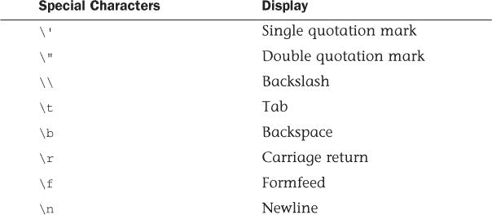

换行符会使换行符之后的文本在下一行的开头显示。看这个例子：

```java
System.out.println("Script by\nThunder Levin");
```

此语句将显示为：

```
Script by
Thunder Levin
```

### 将字符串拼接在一起

当你使用 `System.out.println()` 并以其他方式处理字符串时，可以使用 `+` 将两个字符串拼接在一起，这个运算符与用于数字加法的那个相同。

* * *

注意

随着你构建编程技能，你可能会在其他书中看到术语“连接”，因此值得了解。然而，当一个字符串与另一个字符串连接在一起时，这里使用的术语是“拼接”。“拼接”听起来很有趣。“连接”听起来像是在明火附近绝不应该做的事情。

* * *

`+` 运算符对于字符串具有不同的含义。它不是执行某种数学运算，而是将两个字符串拼接在一起。此操作可以导致字符串一起显示，或者将两个较小的字符串组合成一个大字符串。

“连接”是用来描述此操作的词汇，因为它意味着将两个东西链接在一起。

以下语句使用 `+` 运算符来显示一个长字符串：

```java
System.out.println("\"\'Sharknado\' is an hour and a half of your "
    + "life that you'll never get back.\nAnd you won't want to.\"\n"
    + "\t-- David Hinckley, New York Daily News");
```

你没有将整个字符串放在单行上（这会使你在稍后查看程序时更难理解），而是使用 `+` 运算符将文本拆分到程序的 Java 文本文件的两行上。当此语句显示时，它将呈现如下：

```
"'Sharknado' is an hour and a half of your life that you'll never get
back. And you won't want to."
    -- David Hinckley, New York Daily News
```

字符串中使用了多个特殊字符：`\"`、`\'`、`\n` 和 `\t`。为了更好地熟悉这些字符，请将输出与产生它的 `System.out.println()` 语句进行比较。

### 在字符串中使用其他变量

虽然你可以使用 `+` 运算符将两个字符串拼接在一起，但你更常使用它来链接字符串和变量。看看以下例子：

```java
int length = 86;
char rating = 'R';
System.out.println("Running time: " + length + " minutes");
System.out.println("Rated " + rating);
```

此代码将显示为以下内容：

```
Running time: 86 minutes
Rated R
```

此示例展示了 `+` 运算符与字符串结合使用时的一个独特特性。当显示非字符串变量时，该运算符可使其被当作字符串处理。变量 `length` 是一个整数，被赋值为 86。它在字符串 `Running time:` 和 `minutes` 之间被显示。`System.out.println()` 语句被要求显示一个字符串加一个整数，再加另一个字符串。此语句能够正常工作，是因为这组表达式中至少有一个部分是字符串。Java 语言提供此功能，以使信息的显示更加便捷。

你可能想对字符串做的一件事是，将某些内容多次追加到其末尾，如以下示例所示：

```java
String searchKeywords = "";

searchKeywords = searchKeywords + "shark ";

searchKeywords = searchKeywords + "hurricane ";

searchKeywords = searchKeywords + "danger";
```

此代码将导致 `searchKeywords` 变量被设置为“shark hurricane danger”。第一行创建了 `searchKeywords` 变量，并将其设置为空字符串，因为双引号之间没有任何内容。第二行将 `searchKeywords` 变量设置为其当前字符串加上字符串“shark”追加到末尾的结果。接下来的两行以同样的方式添加了“hurricane”和“danger”。

如你所见，当你要将更多文本追加到变量末尾时，该变量的名称必须列出两次。Java 提供了一个快捷方式来简化此过程：`+=` 运算符。`+=` 运算符结合了 `=` 和 `+` 运算符的功能。对于字符串，它用于将某些内容添加到现有字符串的末尾。使用 `+=` 可以缩短 `searchKeywords` 示例，如下所示：

```java
String searchKeywords = "";

searchKeywords += "shark ";

searchKeywords += "hurricane ";

searchKeywords += "danger";
```

此代码产生相同的结果：`searchKeywords` 被设置为“shark hurricane danger”。

## 高级字符串处理

你还可以使用其他几种方法来检查字符串变量并更改其值。这些高级特性之所以可能，是因为字符串在 Java 语言中是对象。处理字符串所培养的技能，你稍后将用于处理其他对象。

### 比较两个字符串

你在程序中经常测试的一件事是一个字符串是否等于另一个字符串。你可以通过在包含两个字符串的语句中使用 `equals()` 方法来实现，如下例所示：

```java
String favorite = "chainsaw";

String guess = "pool cue";

System.out.println("Is Fin's favorite weapon a " + guess + "?");

System.out.println("Answer: " + favorite.equals(guess));
```

此示例使用了两个不同的字符串变量。一个变量 `favorite` 存储了 Fin 最喜欢的捕鲨工具名称：电锯。另一个变量 `guess` 存储了关于他可能喜欢什么的猜测。猜测是 Fin 更喜欢台球杆。

第三行显示文本“Is Fin's favorite weapon a”，后跟 `guess` 变量的值，然后是一个问号。第四行显示文本“Answer:”，然后包含一些新内容：

`favorite.equals(guess)`

语句的这一部分被称为**方法**。方法是在 Java 程序中完成某项任务的一种方式。此方法的任务是确定一个字符串是否与另一个字符串具有相同的值。如果两个字符串变量具有相同的值，则显示文本 `true`。否则，显示文本 `false`。以下是此示例的输出：

**输出**

```
Is Fin's favorite weapon a pool cue?
Answer: false
```

### 确定字符串的长度

确定字符串的字符长度也可能很有用。你可以使用 `length()` 方法来实现。此方法的工作方式与 `equals()` 方法相同，只是只涉及一个字符串变量。请看以下示例：


```java
String cinematographer = "Ben Demaree";

int nameLength = cinematographer.length();
```

此示例将整型变量`nameLength`设置为等于 11。`cinematographer.length()`方法计算名为`cinematographer`的字符串变量中的字符数，并将此计数存储在整型变量`nameLength`中。

### 更改字符串的大小写

因为计算机完全按照字面意思处理内容，所以很容易让它们产生混淆。虽然人类会识别出文本“Ian Ziering”和文本“IAN ZIERING”指的是同一件事物，但大多数计算机可能不这么认为。本节前面讨论的`equals()`方法会权威地指出“Ian Ziering”不等于“IAN ZIERING”。

为了克服其中一些障碍，Java 提供了将字符串变量显示为全大写字母或全小写字母的方法，分别是`toUpperCase()`和`toLowerCase()`。以下示例展示了`toUpperCase()`方法的实际应用：

```java
String fin = "Ian Ziering";

String change = fin.toUpperCase();
```

此代码将字符串变量`change`设置为等于`fin`字符串变量转换成全大写字母的结果——“IAN ZIERING”。`toLowerCase()`方法以相同方式工作，但返回全小写的字符串值。

> **注意**
>
> 克服此特定障碍的另一种方法是调用`equalsIgnoreCase()`方法，该方法在比较两个字符串时不区分大小写。调用此方法比较字符串“Tara Reid”和“TARA REID”将返回值`true`以表示它们匹配。

请注意，`toUpperCase()`方法不会更改调用它的字符串变量的大小写。在前面的例子中，`fin`变量仍然等于“Ian Ziering”。

### 查找字符串

处理字符串时的另一个常见任务是查看一个字符串是否可以在另一个字符串内部找到。要查找字符串内部的内容，请使用其`indexOf()`方法。将要查找的字符串放在括号内。如果未找到该字符串，`indexOf()`返回值-1。如果找到该字符串，`indexOf()`返回一个整数，表示该字符串开始的位置。字符串中的位置从 0 开始向上编号，以字符串中的第一个字符为起始。在字符串“Sharknado”中，文本“nado”从位置 5 开始。

> **注意**
>
> `indexOf()`和`contains()`方法区分大小写，这意味着它们只查找与搜索字符串完全相同大小写的文本。如果字符串包含相同但大小写不同的文本，`indexOf()`将返回值-1，`contains()`将返回`false`。

`indexOf()`方法的一个可能用途是，在整个《Sharknado》剧本中搜索英雄们驾驶直升机进入龙卷风并投掷炸弹的场景，Nova 说：“We‘re gonna need a bigger chopper.”（“我们需要一架更大的直升机。”）

如果整个《Sharknado》的剧本存储在一个名为`script`的字符串中，你可以使用以下语句搜索该引文的一部分。

```java
int position = script.indexOf("We're gonna need a bigger chopper");
```

如果可以在`script`字符串中找到该文本，则`position`等于文本“We‘re gonna need a bigger chopper”开始的位置。否则，它将等于-1。

如果你要在一个字符串中查找另一个字符串，但不在乎其位置，那么字符串的`contains()`方法返回一个布尔值。如果找到要查找的字符串，则为`true`；否则为`false`。这是一个例子：

```java
if (script.contains("There's a shark in your pool")) {

    int stars = 4;

}
```

## 呈现片头字幕

接下来，为了巩固已涵盖的字符串处理特性，你将编写一个 Java 程序来显示一部故事片的片头字幕。你可能能猜出是哪部电影。

返回 NetBeans 中的`Java24`项目，并在`com.java24hours`包中创建一个名为`Credits`的新空 Java 文件。将清单 6.1 的文本输入源代码编辑器，完成后保存文件。

**清单 6.1** `Credits`程序

点击此处查看代码图像

```java
package com.java24hours;

class Credits {
    public static void main(String[] arguments) {
        // set up film information
        String title = "Sharknado";
        int year = 2013;
        String director = "Anthony Ferrante";
        String role1 = "Fin";
        String actor1 = "Ian Ziering";
        String role2 = "April";
        String actor2 = "Tara Reid";
        String role3 = "George";
        String actor3 = "John Heard";
        String role4 = "Nova";
        String actor4 = "Cassie Scerbo";
        // display information
        System.out.println(title + " (" + year + ")\n" +
            "A " + director + " film.\n\n" +
            role1 + "\t" + actor1 + "\n" +
            role2 + "\t" + actor2 + "\n" +
            role3 + "\t" + actor3 + "\n" +
            role4 + "\t" + actor4);
    }
}
```

请仔细查看程序，看看你能否理解它在每个阶段的作用。以下是其运作过程的分解：

 第 3 行为 Java 程序命名为`Credits`。

 第 4 行开始`main()`块语句，程序的所有工作都在此完成。

 第 6 至 16 行设置变量以保存有关影片、导演和主演的信息。其中一个变量`year`是整数，其余都是字符串变量。

 第 18 至 23 行是一条很长的`System.out.println()`语句。从第 18 行的第一个左括号到第 23 行的最后一个右括号之间的所有内容都会显示在屏幕上。换行符（`\n`）使其后的文本显示在新行的开头。制表符（`\t`）在输出中插入制表间距。其余部分是要显示的文本或字符串变量。

 第 24 行结束`main()`块语句。

 第 25 行结束程序。

如果遇到错误信息，请纠正你的`Credits`程序版本中的任何拼写错误并再次保存。NetBeans 会自动编译程序。运行程序时，你会看到如图 6.1 输出面板所示的输出窗口。

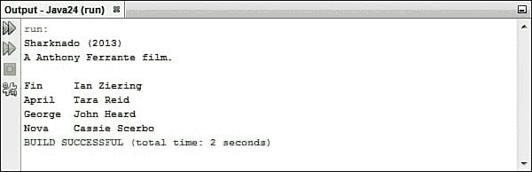

**图 6.1** `Credits`程序的输出。

## 总结

当你的`Credits`版本看起来像图 6.1 时，值得给自己一些肯定。阅读本书六小时后，你已经能编写更长的 Java 程序并处理更复杂的问题了。每次坐下来编写程序时，你都会用到字符串。你将以多种方式使用字符串与用户进行通信。

## 互动环节

### 问与答

**问：** 如何将字符串变量的值设置为空？

**答：** 使用空字符串，即一对不包含任何文本的双引号。以下代码创建了一个名为`georgeSays`的新字符串变量，并将其设置为空：`String georgeSays = "";`

**问：** 似乎无法让`toUpperCase()`方法将字符串全部改为大写字母。我哪里做错了？

**答：** 当你调用一个`String`对象的`toUpperCase()`方法时，它实际上并不会改变被调用的`String`对象。相反，它会创建一个全新的字符串，并全部设置为大写字母。请看以下语句：

点击此处查看代码图像

```java
String firstName = "Baz";
String changeName = firstName.toUpperCase();
System.out.println("First Name: " + firstName);
```

这些语句显示文本“First Name: Baz”，因为`firstName`包含的是原始字符串。如果将最后一条语句改为显示`changeName`变量，它将输出“First Name: BAZ”。在 Java 中，字符串一旦创建，其值就不会改变。

**问：** Java 中的所有方法都像`equals()`方法处理字符串那样，以相同方式显示`true`或`false`吗？

**答：** 方法在使用后产生响应的方式各不相同。当一个方法像`equals()`方法那样发回一个值时，这被称为返回一个值。`equals()`方法被设置为返回一个布尔值。其他方法可能返回字符串、整数、其他类型的变量，或者根本不返回任何内容——这由`void`表示。

**问：** 为什么学校用字母 A、B、C、D 和 F 来分配成绩，而没有 E？

**答：** 字母等级 E 早前已被用于另一种评分系统。直到 20 世纪中叶，在美国最受欢迎的评分系统是：E 代表优秀，S 代表满意，N 代表需要改进，U 代表令人畏惧的不及格。所以当 ABCD 系统出现时，给一个不及格的学生 E 被认为并非如此明智的做法。ESNU 评分在小学中仍被广泛使用。

### 测验

以下问题测试你对字符串处理和特性的了解。

**1.** 我的朋友进行“连接”。我应该向当局举报他吗？

**A.** 不应该。这只在冬季月份是非法的。

**B.** 应该，但要等我先把故事卖给[TMZ.com](http://TMZ.com)。

**C.** 不应该。他所做的只是在程序中粘贴两个字符串。

**2.** 为什么单词`String`首字母大写，而`int`等却没有？

**A.** `String`是一个完整的单词，而`int`不是。

**B.** 与所有作为 Java 标准部分的对象一样，`String`的名称首字母大写。

**C.** Oracle 的品控太差。

**3.** 以下哪个字符可以在字符串中插入单引号？

**A.** `<quote>`

**B.** `\'`

**C.** `'`

### 答案

**1. C。** 连接只是粘贴、连接、融合或其他方式将两个字符串拼接在一起的另一个说法。它使用`+`和`+=`运算符。

**2. B。** Java 中可用的对象类型名称首字母都是大写的，这也是变量名首字母使用小写的主要原因。这样可以降低将其与对象混淆的可能性。

**3. B。** 单反斜杠是插入到字符串中的特殊字符之一的起始标记。

### 活动

你可以通过以下活动更全面地复习本小时的主题：

 编写一个名为`Favorite`的短 Java 程序，将本小时“比较两个字符串”部分的代码放入`main()`块语句中。测试它以确保其工作正常，并显示 Fin 最喜欢的鲨鱼击杀武器不是台球杆。完成后，将`guess`变量的初始值从“pool cue”更改为“chainsaw”。看看会发生什么。

 修改`Credits`程序，使导演和所有表演者的名字全部以大写字母显示。

要查看实现了这些活动的 Java 程序，请访问本书网站 [www.java24hours.com](http://www.java24hours.com)。

# 第 7 小时。使用条件测试进行决策

本小时待办事项：

 使用`if`语句进行基本条件测试。

 测试一个值是否大于或小于另一个值。

 测试两个值是相等还是不相等。

 使用`else`语句作为`if`语句的反向操作。

 将多个条件测试链接在一起。

 对于复杂的条件测试，使用`switch`语句。

 使用三元运算符创建测试。

当你编写计算机程序时，你会向计算机提供一系列称为语句的指令，并且这些指令会被一字不差地执行。你可以告诉计算机去计算一些复杂的数学公式，它就会照做。告诉它显示一些信息，它就会忠实地响应。

有时你需要计算机在做什么事情上更具选择性。例如，如果你编写了一个平衡支票簿的程序，你可能希望计算机在你的账户透支时显示警告信息。计算机应该只在你的账户透支时才显示此消息。如果没透支，这条信息就不准确，并且会令人感到不快。

在 Java 程序中实现此任务的方法是使用条件语句，即只有在满足特定条件时才会在程序中执行某些操作的语句。在本节中，你将学习如何使用条件语句`if`、`else`和`switch`。

当 Java 程序做出决策时，它通过使用条件语句来实现。在本节中，你将使用条件关键字`if`、`else`、`switch`、`case`和`break`，以及条件运算符`==`、`!=`、`<`、`>`、`<=`、`>=`和`?`，来检查你 Java 程序中多个事物的条件，同时使用`boolean`变量。

### if 语句

在 Java 中测试条件最基本的方法是使用`if`语句。`if`语句测试一个条件是真还是假，并且只在条件为真时采取行动。

你使用`if`加上要测试的条件，就像下面的语句一样：

单击此处查看代码图片

```java
long account = -17_000_000_000_000L;

if (account < 0) {
    System.out.println("Account overdrawn; you need a bailout");
}
```

`if`语句使用小于运算符`<`检查`account`变量是否小于 0。如果是，则执行`if`语句内的代码块，显示文本。

该代码块仅在条件为真时运行。在前面的例子中，如果`account`变量的值为 0 或更高，则`println`语句将被忽略。请注意，你测试的条件必须用括号括起来，例如`(account < 0)`。

小于运算符`<`是你可以与条件语句一起使用的几种运算符之一。

#### 小于和大于比较

在上一节中，`<`运算符的使用方式与数学课上相同：作为小于号。还有一个大于条件运算符`>`，用在以下语句中：

单击此处查看代码图片

```java
int elephantWeight = 900;
int elephantTotal = 13;
int cleaningExpense = 200;

if (elephantWeight > 780) {
    System.out.println("Elephant too big for tightrope act");
}

if (elephantTotal > 12) {
    cleaningExpense = cleaningExpense + 150;
}
```

第一个`if`语句测试`elephantWeight`变量的值是否大于 780。第二个`if`语句测试`elephantTotal`变量是否大于 12。

如果在一个`elephantWeight`等于 600 且`elephantTotal`等于 10 的程序中使用前面两条语句，则每个`if`块内的语句都将被忽略。

你可以使用`<=`运算符来确定某个东西是否小于或等于另一个东西。例如：

单击此处查看代码图片

```java
if (account <= 0) {
    System.out.println("You are flat broke");
}
```

还有一个`>=`运算符用于大于或等于测试。

#### 等于和不等于比较

程序中要检查的另一个条件是相等性。一个变量是否等于特定值？一个变量是否等于另一个变量的值？这些问题可以使用`==`运算符来回答，如下面的语句所示：

单击此处查看代码图片

```java
if (answer == rightAnswer) {
    studentGrade = studentGrade + 10;
}

if (studentGrade == 100) {
    System.out.println("Show off!");
}
```

你也可以使用`!=`运算符来测试不等性，即某个东西是否不等于另一个东西，如下所示：

单击此处查看代码图片

```java
if (answer != rightAnswer) {
    score = score - 5;
}
```

> **注意**
>
> 用于进行相等性测试的运算符有两个等号：`==`。很容易将这个运算符与用于给变量赋值的`=`运算符混淆。在条件语句中务必使用两个等号。


你可以对除了字符串之外的每种类型的变量使用`==`和`!=`运算符，因为字符串是对象。

## 使用代码块语句组织程序

到目前为止，本节中的`if`语句都伴随着一个包含在`{`和`}`括号内的代码块。（我认为这些字符的技术术语是“大括号”。）

之前，你已经看到如何使用代码块语句来标记 Java 程序`main()`块的开始和结束。`main()`块中的每条语句在程序运行时都会被处理。

`if`语句并不一定需要代码块语句。它可以只占一行，如下面的例子：

```
if (account <= 0) System.out.println("No more money");
```

`if`条件后的语句仅在条件为真时执行。

清单 7.1 是一个使用代码块语句表示`main()`块的 Java 程序示例。代码块语句从第 3 行的开始大括号`{`开始，到第 15 行的结束大括号`}`结束。在 NetBeans 的`com.java24hours`包中创建一个名为`Game`的新空 Java 文件，并输入清单 7.1 中的文本。

**清单 7.1** `Game`程序

```
1: package com.java24hours;
2: 
3: class Game {
4:     public static void main(String[] arguments) {
5:         int total = 0;
6:         int score = 7;
7:         if (score == 7) {
8:             System.out.println("You score a touchdown!");
9:         }
10:         if (score == 3) {
11:             System.out.println("You kick a field goal!");
12:         }
13:         total = total + score;
14:         System.out.println("Total score: " + total);
15:     }
16: }
```

运行程序时，输出应类似于图 7.1。

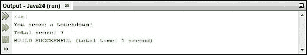

**图 7.1** `Game`程序的输出。

你可以在`if`语句中使用代码块语句，使计算机在条件为真时执行多项操作。下面是一个包含代码块语句的`if`语句示例：

```
int playerScore = 12000;
int playerLives = 3;
int difficultyLevel = 10;

if (playerScore > 9999) {
    playerLives++;
    System.out.println("Extra life!");
    difficultyLevel = difficultyLevel + 5;
}
```

大括号用于将所有属于`if`语句的语句分组。如果变量`playerScore`大于 9,999，则会发生三件事：

- `playerLives`变量的值增加 1（因为使用了递增运算符`++`）。
- 显示文本“Extra life!”。
- `difficultyLevel`变量的值增加 5。

如果变量`playerScore`不大于 9,999，则什么都不会发生。`if`语句块内的所有三条语句都将被忽略。

## if-else 语句

有时，你想在条件为真时执行某些操作，在条件为假时执行另一些操作。这可以通过在`if`语句的基础上使用`else`语句来实现，如下例所示：

```
int answer = 17;
int correctAnswer = 13;

if (answer == correctAnswer) {
    score += 10;
    System.out.println("That's right. You get 10 points");
} else {
    score -= 5;
    System.out.println("Sorry, that's wrong. You lose 5 points");
}
```

与`if`语句不同，`else`语句本身不列出条件。`else`语句与其前面紧邻的`if`语句配对。你还可以使用`else`将多个`if`语句链接在一起，如下例所示：

```
if (grade == 'A') {
    System.out.println("You got an A. Awesome!");
} else if (grade == 'B') {
    System.out.println("You got a B. Beautiful!");
} else if (grade == 'C') {
    System.out.println("You got a C. Concerning!");
} else {
    System.out.println("You got an F. You'll do well in Congress!");
}
```

通过将多个`if`和`else`语句以这种方式组合，你可以处理多种条件。前面的例子向 A 等生、B 等生、C 等生以及未来的议员们发送了特定的消息。

## switch 语句

`if`和`else`语句适用于有两种可能条件的情况，但有时你会遇到超过两种条件的情况。

在前面的成绩示例中，你看到了`if`和`else`语句可以链接起来处理多个不同的条件。

另一种方法是使用`switch`语句，它可以测试多种不同的条件并做出相应反应。在下面的代码中，成绩示例已使用`switch`语句重写：

```
switch (grade) {
    case 'A':
        System.out.println("You got an A. Awesome!");
        break;
    case 'B':
        System.out.println("You got a B. Beautiful!");
        break;
    case 'C':
        System.out.println("You got a C. Concerning!");
        break;
    default:
        System.out.println("You got an F. You'll do well in Congress!");
}
```

`switch`语句的第一行指定了被测试的变量——在本例中是`grade`。然后，`switch`语句使用`{`和`}`花括号形成一个块语句。

每个`case`语句将`switch`语句中的测试变量与一个特定值进行比较。`case`语句中使用的值可以是字符、整数或字符串。在前面的例子中，有针对字符 A、B 和 C 的`case`语句。每个`case`语句后面都有一条或多条语句。当某个`case`语句的值与`switch`中的变量匹配时，计算机将处理`case`语句之后的语句，直到遇到`break`语句。

例如，如果`grade`变量的值为 B，则会显示文本“You got a B. Good work!”。下一条语句是`break`，因此`switch`语句中的其他内容都不会执行。`break`语句告诉计算机跳出`switch`语句。

忘记在`switch`语句中使用`break`语句会导致不期望的结果。如果这个成绩示例中没有`break`语句，那么无论`grade`变量等于‘A’、‘B’还是‘C’，前三个“You got a”消息都会被显示。

`default`语句用作所有前面的`case`语句都不为真时的默认处理。在这个例子中，如果`grade`变量不等于 A、B 或 C，则会执行`default`语句。你不必在每个`switch`块语句中都使用`default`语句。如果省略了它，当没有`case`语句匹配时，什么都不会发生。

清单 7.2 中的`Commodity`类使用`switch`来购买或出售某种未指定的商品。该商品在购买时花费 20 美元，出售时获利 15 美元。

一个`switch`-`case`语句测试一个名为`command`的字符串的值，如果它等于“BUY”则运行一个代码块，如果它等于“SELL”则运行另一个代码块。

**清单 7.2** `Commodity`程序

```
 1: package com.java24hours;
 2:
 3: class Commodity {
 4:     public static void main(String[] arguments) {
 5:         String command = "BUY";
 6:         int balance = 550;
 7:         int quantity = 42;
 8:
 9:         switch (command) {
10:             case "BUY":
11:                 quantity += 5;
12:                 balance -= 20;
13:                 break;
14:             case "SELL":
15:                 quantity -= 5;
16:                 balance += 15;
17:         }
18:         System.out.println("Balance: " + balance + "\n"
19:             + "Quantity: " + quantity);
20:     }
21: }
```

此应用程序在第 5 行将`command`字符串设置为“BUY”。当`switch`被测试时，第 11-13 行的`case`块被执行。商品数量增加 5，余额减少 20 美元。

运行`Commodity`程序时，会产生如图 7.2 所示的输出。

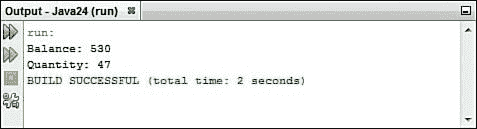

**图 7.2** `Commodity`程序的输出。

## 三元运算符

Java 中最复杂的条件语句是三元运算符`?`。

当你想根据条件赋值或显示一个值时，可以使用三元运算符。例如，考虑一个视频游戏，它根据`skillLevel`变量是否大于 5 来设置`numberOfEnemies`变量。一种方法是使用`if`-`else`语句：

```
if (skillLevel > 5) {
    numberOfEnemies = 20;
} else {
    numberOfEnemies = 10;
}
```

一种更短的方法是使用三元运算符。一个三元表达式由五部分组成：

- 用括号括起来的待测条件，例如`(skillLevel > 5)`
- 一个问号 (?) 
- 条件为真时使用的值
- 一个冒号 (:)
- 条件为假时使用的值

要使用三元运算符根据`skillLevel`设置`numberOfEnemies`，你可以使用以下语句：

```
int numberOfEnemies = (skillLevel > 5) ? 20 : 10;
```

你也可以使用三元运算符来决定显示什么信息。考虑一个程序的例子，它根据`gender`变量的值显示文本“Mr.”或“Ms.”。下面是一条完成此操作的语句：

```
System.out.print( (gender.equals("male")) ? "Mr." : "Ms." );
```

三元运算符可能很有用，但它也是 Java 中最难理解的条件语句。在学习 Java 的过程中，你不会遇到必须使用三元运算符而不是`if`-`else`语句的情况。

## 观察时钟

本小时的最后一个项目让你再次审视程序中可以使用的每种条件测试。在这个项目中，你将使用 Java 内置的时间跟踪功能，该功能可以跟踪当前的日期和时间，并以句子形式呈现这些信息。

启动 NetBeans 或您正在使用的其他开发工具，为新建文档命名`Clock.java`，包名设置为`com.java24hours`。

此程序较长，但大部分由多行条件语句组成。请在编辑器中完整输入清单 7.3 的内容，完成后将文件保存为`Clock.java`。

**清单 7.3** `Clock`程序


```java
package com.java24hours;

import java.time.*;
import java.time.temporal.*;

class Clock {
    public static void main(String[] arguments) {
        // get current time and date
        LocalDateTime now = LocalDateTime.now();
        int hour = now.get(ChronoField.HOUR_OF_DAY);
        int minute = now.get(ChronoField.MINUTE_OF_HOUR);
        int month = now.get(ChronoField.MONTH_OF_YEAR);
        int day = now.get(ChronoField.DAY_OF_MONTH);
        int year = now.get(ChronoField.YEAR);

        // display greeting
        if (hour < 12) {
            System.out.println("Good morning.\n");
        } else if (hour < 17) {
            System.out.println("Good afternoon.\n");
        } else {
            System.out.println("Good evening.\n");
        }

        // begin time message by showing the minutes
        System.out.print("It's");
        if (minute != 0) {
            System.out.print(" " + minute + " ");
            System.out.print( (minute != 1) ? "minutes" :
                "minute");
            System.out.print(" past");
        }

        // display the hour
        System.out.print(" ");
        System.out.print( (hour > 12) ? (hour - 12) : hour );
        System.out.print(" o'clock on ");

        // display the name of the month
        switch (month) {
            case 1:
                System.out.print("January");
                break;
            case 2:
                System.out.print("February");
                break;
            case 3:
                System.out.print("March");
                break;
            case 4:
                System.out.print("April");
                break;
            case 5:
                System.out.print("May");
                break;
            case 6:
                System.out.print("June");
                break;
            case 7:
                System.out.print("July");
                break;
            case 8:
                System.out.print("August");
                break;
            case 9:
                System.out.print("September");
                break;
            case 10:
                System.out.print("October");
                break;
            case 11:
                System.out.print("November");
                break;
            case 12:
                System.out.print("December");
        }

        // display the date and year
        System.out.println(" " + day + ", " + year + ".");
    }
}
```

### 注意

由于此程序使用了 Java 8 的新特性，如果当前 NetBeans 项目设置为使用更早版本的 Java 语言，它将无法编译。要确保已选择正确的设置，请选择 "File"，然后选择 "Project Properties"。在 "Project Properties" 对话框中，找到 "Source/Binary Format" 值。它应该是 `JDK 8`。

保存程序后，请仔细检查，以很好地了解条件测试是如何使用的。

除了第 3-4 行和第 8-14 行之外，`Clock` 程序包含的内容都是至此已经涵盖的内容。在设置了一系列变量来保存当前日期和时间后，使用一系列 `if` 或 `switch` 条件语句来确定应显示哪些信息。

此程序多次使用了 `System.out.println()` 和 `System.out.print()` 来显示字符串。

第 8-14 行引用了一个名为 `now` 的 `LocalDateTime` 变量。`LocalDateTime` 变量类型首字母大写，因为 `LocalDateTime` 是一个对象。

您将在第 10 小时，“创建您的第一个对象”中学习如何创建和使用对象。对于本小时，请关注这些行中发生的事情，而不是它是如何发生的。

`Clock` 程序由以下几个部分组成：

 第 3 行使您的程序能够使用一个用于跟踪当前日期和时间的类：`java.time.LocalDateTime`。

 第 4 行使程序能够使用 `java.time.temporalfield.ChronoField` 类，这个类名听起来像是时间旅行电影里的东西。

 第 6-7 行开始了 `Clock` 程序及其 `main()` 语句块。

 第 9 行创建了一个名为 `now` 的 `LocalDateTime` 对象，其中包含您系统的当前日期和时间。每次运行此程序时，`now` 对象都会改变。（除非宇宙的物理定律改变，时间停止。）

 第 10-14 行创建变量来保存 `小时`、`分钟`、`月份`、`日期` 和 `年份`。这些变量的值是从 `LocalDateTime` 对象中提取的，该对象是所有这些信息的存储库。括号内的信息，例如 `ChronoField.DAY_OF_MONTH`，指示要提取日期和时间的哪个部分。

 第 17-23 行显示三种可能的问候语之一：“早上好。”、“下午好。”或“晚上好。”。要显示的问候语是根据 `hour` 变量的值选择的。

 第 26-32 行显示当前分钟以及一些伴随文本。首先，第 26 行显示文本 "It's"。如果 `minute` 的值等于 0，由于第 27 行的 `if` 语句，第 28-31 行将被忽略。这个语句是必要的，因为程序告诉某人现在是 "0 点过去" 是没有意义的。第 28 行显示 `minute` 变量的当前值。第 29-30 行使用三元运算符根据 `minute` 是否等于 1 来显示文本 "minutes" 或 "minute"。最后，在第 31 行显示文本 "past"。

 第 35-37 行使用另一个三元运算符显示当前小时。第 36 行中的这个三元条件语句使得当小时大于 12 时，显示方式不同，这避免了计算机显示像 "15 o'clock" 这样的时间。

 第 40-76 行，几乎占程序一半，是一个很长的 `switch` 语句，它根据存储在 `month` 变量中的整数值显示不同的月份名称。

### 备注

`Clock` 应用程序使用了 Java 8 引入的新版 Date/Time API。早期版本的 Java 使用了另一组类来处理日期和时间。您可能还记得第 4 小时，“理解 Java 程序如何工作”中提到的，Java 类库包含成千上万个执行有用任务的类。本程序使用的 `java.time` 和 `java.time.temporal` 包是 Date/Time API 的一部分。

 第 79 行通过显示当前日期和年份来完成显示。

 第 80-81 行结束了 `main()` 语句块，然后结束了整个 `Clock` 程序。

运行此程序时，输出应显示一个基于当前日期和时间的句子。应用程序的输出显示在图 7.3 的“输出”窗格中。

### 时钟程序输出

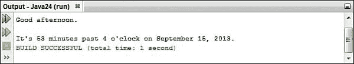

**图 7.3** `Clock`程序的输出。

多次运行该程序，观察它如何与时钟保持同步。

### 小结

现在你能使用条件语句了，你的 Java 程序的整体智能性得到了极大的提升。你的程序可以评估信息，并根据不同的情况做出不同的反应，即使信息在程序运行时发生变化。它们可以基于特定条件在两个或多个选项中进行选择。

编程计算机迫使你将任务分解为一系列逻辑步骤来执行，并做出必须做出的决定。在编程中使用`if`语句和其他条件语句，也能促进一种逻辑思维，这种思维可以为你生活的其他方面带来好处：

 “`如果`那位候选人在 11 月当选总统，我就去谋求一个内阁职位，`否则`我就搬到加拿大去。”

 “`如果`我的相亲对象喜欢我，我就请她去一家昂贵的餐厅吃晚餐，`否则`我们就去必胜客。”

 “`如果`我违反了缓刑规定，唯一会选我的球队就是奥克兰突袭者队。”

### 动手实践

#### 问答

**问.** `if`语句看起来是最有用的。是否可能只在程序中使用`if`语句，而从不使用其他语句？

**答.** 没有`else`或`switch`是可行的，许多程序员从不使用三元运算符`?`。然而，在程序中使用`else`和`switch`通常是有益的，因为它们使程序更容易理解。一连串链接在一起的`if`语句可能变得难以处理。

**问.** 在本小时中，当`if`语句只与一条语句一起使用时，有时不使用开括号`{`和闭括号`}`。使用括号不是强制性的吗？

**答.** 不是。括号可以作为任何`if`语句的一部分，用来包围程序中依赖于条件测试的部分。使用括号是一个值得养成的好习惯，因为它可以防止在修改程序时可能出现的常见错误。如果你在`if`条件后添加第二条语句而没有添加括号，当程序运行时会发生意外错误。

**问.** 在`switch`语句块中，是否必须在每个`case`后的语句段中使用`break`？

**答.** 你不一定必须使用`break`。如果你在语句组的末尾不使用它，switch 语句块内的所有剩余语句都会被执行，无论它们对应的`case`值是什么。

然而，在大多数情况下，你很可能希望在每组语句的末尾使用`break`语句。

**问.** 汤普森三重唱乐队为什么叫这个名字？他们是三人组合，彼此之间没有血缘关系，而且没有一个人的名字叫汤普森。

**答.** 乐队成员汤姆·贝利、阿拉娜·库里和乔·李维自称汤普森双胞胎，以向比利时漫画书《丁丁历险记》中的一对笨手笨脚的侦探汤姆森和汤普森致敬。

这对戴圆顶礼帽的侦探在外形上几乎无法区分，除了他们的胡子形状有细微差别。尽管工作能力糟糕，他们却被莫名其妙地分配去执行重要且敏感的任务。他们经常追捕丁丁，指控他犯下他并未犯下的罪行。

正如他们的名字所示，这两位侦探之间也没有血缘关系。

#### 小测验

以下问题考察你在学习了 Java 中的条件语句后处于什么状态。

**1.** 条件测试会产生`true`或`false`值。这让你想起哪种变量类型？

**A.** 都没有。别拿这些没完没了的问题烦我了。

**B.** `long`变量类型。

**C.** `boolean`类型。

**2.** 在`switch`语句块中，哪个语句被用作“兜底”的类别？

**A.** `default`

**B.** `otherwise`

**C.** `onTheOtherHand`

**3.** 什么是条件语句？

**A.** 洗发后用来修复乱糟糟的分叉和打结的护发素。

**B.** 程序中用来测试条件是真还是假的东西。

**C.** 向宗教权威人士忏悔罪过的地方。

#### 答案

**1. C.** `boolean`变量类型只能等于`true`或`false`，这使其类似于条件测试。如果你选择了 A，我很抱歉，但我们只剩下 17 个小时了，还有很多内容要讲。Java 可不会自己教自己。

**2. A.** 如果没有其他`case`语句匹配`switch`变量，`default`语句将被执行。

**3. B.** 其他答案描述的是护发素和忏悔室。

#### 动手实践

为了提高你在 Java 条件语句方面的“条件”水平，请通过以下活动复习本小时的主题：

 在`Clock`程序中的一条`break`语句前加上`//`使其成为注释；然后编译它，看看运行时会发生什么。尝试再移除几个`break`语句。

 创建一个简短的程序，在一个名为`grade`的整型变量中存储一个你选择的 1 到 100 之间的值。使用这个`grade`变量和条件语句，为所有 A、B、C、D 和 F 等级的学生显示不同的消息。首先尝试用`if`语句实现，然后再尝试用`switch`语句实现。

要查看实现这些活动的 Java 程序，请访问本书网站 [www.java24hours.com](http://www.java24hours.com)。

## 第 8 小时：用循环重复动作

本小时学习目标：

 使用`for`循环。

 使用`while`循环。

 使用`do`-`while`循环。

 过早退出循环。

 为循环命名。

对小学生来说，更烦人的惩罚之一是让他们在黑板上一遍又一遍地写东西。在《辛普森一家》中，巴特·辛普森在他频繁去黑板“受罚”时，不得不写了几十遍“器官移植最好留给专业人士”。这种惩罚对孩子可能有效，但对计算机则完全没用。计算机程序可以轻松地重复执行任务。

程序非常适合一遍又一遍地做同样的事情，这得益于循环。循环是程序中重复执行的一条语句或一个语句块。有些循环运行固定的次数。其他的则无限期地运行。

Java 中有三种循环语句：`for`、`do`和`while`。每种都可以像其他语句一样工作，但了解所有三种的工作方式是有益的。通过选择合适的语句，你通常可以简化程序中的循环部分。

### for 循环

在你的编程中，你会发现很多情况使用循环很有用。你可以用它们来重复做某件事多次，比如防病毒程序在每封新邮件到达时打开它以查找病毒。你也可以用循环让计算机在短时间内什么都不做，比如每分钟显示一次当前时间的动画时钟。

循环语句使计算机程序多次返回到同一位置，就像特技飞机完成一个特技筋斗一样。

Java 中最复杂的循环语句是`for`。`for`循环将程序的一部分重复执行固定次数。以下是一个示例：

点击查看代码图片

```
for (int dex = 0; dex < 1000; dex++) {
    if (dex % 12 == 0) {
        System.out.println("#: " + dex);
    }
}
```

这个循环显示从 0 到 999 中每个能被 12 整除的数字。

每个 `for` 循环都有一个变量，用于决定循环何时开始和结束。这个变量被称为**计数器**（或索引）。前面循环中的计数器是变量 `dex`。

这个示例说明了 `for` 语句的三个部分：

 初始化部分——在第一部分中，变量 `dex` 被赋予初始值 0。


## 条件部分

在第二部分中，有一个类似 `if` 语句中使用的条件测试：`dex < 1000`。

## 变化部分

第三部分是更改 `dex` 变量值的语句，在此示例中使用了自增运算符。

在初始化部分，你设置计数器变量。你可以在 `for` 语句中创建变量，就像前面示例中使用整数变量 `dex` 那样。你也可以在程序的其他地方创建变量。无论哪种情况，你都应该在 `for` 语句的这个部分为变量赋予起始值。当循环开始时，变量具有这个值。

条件部分包含一个测试，为了使循环继续循环，该测试必须保持为 `true`。当测试为 `false` 时，循环结束。在这个示例中，当 `dex` 变量等于或大于 1,000 时，循环结束。

`for` 语句的最后一部分包含一个更改计数器变量值的语句。每次循环执行时都会处理这个语句。计数器变量必须以某种方式更改，否则循环永远不会结束。在示例中，`dex` 在变化部分递增了 1。如果 `dex` 没有改变，它将保持其原始值 0，并且条件 `dex < 1000` 将始终为 `true`。

`for` 语句的代码块在每次循环过程中执行。

> **注意**：你可能听到的一个与循环相关的不寻常术语是**迭代**。迭代是循环的一次单次运行。用于控制循环的计数器变量称为**迭代器**。

前面的示例在 `for` 代码块内包含以下语句：

```java
if (dex % 12 == 0) {
    System.out.println("#: " + dex);
}
```

这些语句执行了 1,000 次。循环通过将 `dex` 变量设置为 0 开始。每次循环执行时，它将 `dex` 加 1。当 `dex` 不再小于 1,000 时，循环停止循环。

正如你在 `if` 语句中看到的那样，如果 `for` 循环只包含单个语句，则不需要括号。以下示例展示了这一点：

```java
for (int p = 0; p < 500; p++)
    System.out.println("I will not sell miracle cures");
```

此循环显示文本“I will not sell miracle cures” 500 次。虽然循环内单个语句周围不需要括号，但你可以使用它们使代码块更容易识别，如下所示：

```java
for (int p = 0; p < 500; p++) {
    System.out.println("I will not sell miracle cures");
}
```

你在此时段创建的第一个程序将显示前 200 个 9 的倍数：9, 18, 27，依此类推，直到 1,800（9 × 200）。在 NetBeans 中，创建一个名为 `Nines` 的新空 Java 文件，并输入清单 8.1 中的文本。保存文件时，它会存储为 `Nines.java`。

**清单 8.1** `Nines.java` 的完整文本

```java
1: package com.java24hours;
2:
3: class Nines {
4:     public static void main(String[] arguments) {
5:         for (int dex = 1; dex <= 200; dex++) {
6:             int multiple = 9 * dex;
7:             System.out.print(multiple + " ");
8:         }
9:         System.out.println();
10:     }
11: }
```

`Nines` 程序在第 5 行包含一个 `for` 语句。该语句有三个部分：

- **初始化部分**——`int dex = 1`，创建了一个名为 `dex` 的整数变量，并赋予其初始值 1。
- **条件部分**——`dex <= 200`，在每次循环过程中必须为真。当它不为真时，循环结束。
- **变化部分**——`dex++`，在每次循环过程中将 `dex` 变量递增 1。

通过选择 NetBeans 中的“运行”->“运行文件”来运行该程序。程序产生如图 8.1 所示的输出。

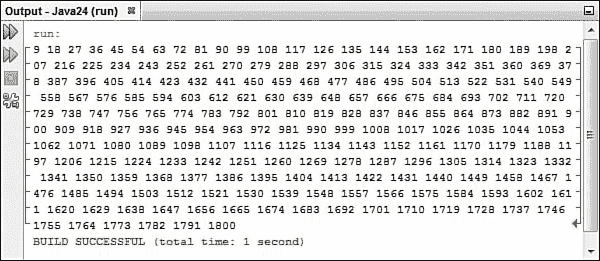

**图 8.1** `Nines` 程序的输出。

NetBeans 中的输出窗口不会自动换行，因此所有数字都出现在一行上。要使文本换行，请右键单击输出窗格，然后从弹出菜单中选择“自动换行”。

## `while` 循环

`while` 循环没有像 `for` 循环那么多不同的部分。它只需要一个条件测试，该测试与 `while` 语句一起使用。以下是 `while` 循环的一个示例：

```java
while (gameLives > 0) {
    // 循环内部的语句放在这里
}
```

此循环会持续重复，直到 `gameLives` 变量不再大于 0。

`while` 语句在循环开始前测试条件，然后再处理循环中的任何语句。如果程序首次遇到 `while` 语句时测试的条件为 `false`，则循环内的语句将被忽略。

如果 `while` 条件为 `true`，循环将运行一次，然后再次测试 `while` 条件。如果在循环内部测试的条件从未改变，循环将永远持续下去。

以下语句导致 `while` 循环多次显示同一行文本：

```java
int limit = 5;
int count = 1;
while (count < limit) {
    System.out.println("Pork is not a verb");
    count++;
}
```

`while` 循环使用在循环语句之前设置的一个或多个变量。在此示例中，创建了两个整数变量：`limit`，其值为 5，以及 `count`，其值为 1。

`while` 循环显示文本“Pork is not a verb”四次。如果你将 `count` 变量的初始值设为 6 而不是 1，则文本永远不会显示。

## `do-while` 循环

`do-while` 循环类似于 `while` 循环，但条件测试位于不同的位置。以下是 `do-while` 循环的一个示例：

```java
do {
    // 循环内部的语句放在这里
} while (gameLives > 0);
```

像 `while` 循环一样，此循环持续循环，直到 `gameLives` 变量不再大于 0。`do-while` 循环的不同之处在于，条件测试是在循环内部语句之后进行的，而不是之前。

当程序第一次运行到达 `do` 循环时，`do` 和 `while` 之间的语句会自动处理，然后测试 `while` 条件以确定是否应重复循环。如果 `while` 条件为 `true`，循环将再运行一次。如果条件为 `false`，循环结束。`do` 和 `while` 语句内部必须发生一些事情来改变用 `while` 测试的条件，否则循环将无限期继续。`do-while` 循环中的语句至少会执行一次。

以下语句导致 `do-while` 循环多次显示同一行文本：

```java
int limit = 5;
int count = 1;
do {
    System.out.println("I am not allergic to long division");
    count++;
} while (count < limit);
```

像 `while` 循环一样，`do-while` 循环使用在循环语句之前设置的一个或多个变量。

循环会将文本 "I am not allergic to long division" 显示四次。如果你将 `count` 变量的初始值设为 6 而不是 1，那么该文本将只会显示一次，即使 `count` 从未小于 `limit`。

在 `do`-`while` 循环中，即使循环条件第一次就为 `false`，循环体内的语句也至少会执行一次。

### 退出循环

退出循环的正常方式是让测试条件变为 `false`。Java 中所有三种类型的循环都是如此。有时你可能希望即使测试条件仍为 `true`，循环也能立即结束。你可以使用 `break` 语句来实现这一点，如以下代码所示：

```java
int index = 0;

while (index <= 1000) {

    index = index + 5;

    if (index == 400) {

        break;

    }

}
```

`break` 语句会终止包含它的循环。

在此示例中，`while` 循环会一直执行，直到 `index` 变量大于 1,000。然而，一个特殊情况导致循环提前结束：如果 `index` 等于 400，则执行 `break` 语句，立即终止循环。

你可以在循环内使用的另一种特殊语句是 `continue`。`continue` 语句会使循环退出当前迭代，并重新开始执行循环的第一条语句。考虑以下循环：

```java
int index = 0;

while (index <= 1000) {

    index = index + 5;

    if (index == 400) {

        continue;

    }

    System.out.println("The index is " + index);

}
```

在此循环中，除非 `index` 的值等于 400，否则语句会正常处理。在这种情况下，`continue` 语句会导致循环跳转回 `while` 语句，而不是正常执行到 `System.out.println()` 语句。由于 `continue` 语句的存在，循环永远不会显示以下文本：

```
The index is 400
```

你可以在所有三种循环中使用 `break` 和 `continue` 语句。

`break` 语句使得在程序中创建无限循环成为可能，如本示例所示：

```java
while (true) {

    if (quitKeyPressed == true) {

        break;

    }

}
```

### 为循环命名

与 Java 程序中的其他语句一样，循环也可以放置在其他循环内部。下面的示例展示了一个嵌套在 `while` 循环内的 `for` 循环：

```java
int points = 0;

int target = 100;

while (target <= 100) {

    for (int i = 0; i < target; i++) {

        if (points > 50) {

            break;

        }

        points = points + i;

    }

}
```

在此示例中，如果 `points` 变量大于 50，`break` 语句会导致 `for` 循环结束。然而，`while` 循环永远不会结束，因为 `target` 从未大于 100。

在某些情况下，你可能希望同时跳出两个循环。为了实现这一点，你必须为外层循环（在本例中是 `while` 语句）命名。要为循环命名，请在循环开始前一行放置名称，后跟一个冒号（`:`）。

当循环有名称时，在 `break` 或 `continue` 语句后使用该名称来指定该语句所适用的循环。下面的示例重复了前一个示例，但有一点不同：如果 `points` 变量大于 50，两个循环都会结束。

```java
int points = 0;

int target = 100;

targetLoop:

while (target <= 100) {

    for (int i = 0; i < target; i++) {

        if (points > 50) {

            break targetLoop;

        }

        points = points + i;

    }

}
```

当在 `break` 或 `continue` 语句中使用循环名称时，名称不包含冒号。

#### 复杂的 `for` 循环

`for` 循环可以更复杂，在其初始化、条件和更新部分包含多个变量。`for` 循环的每个部分用分号（`;`）与其他部分隔开。`for` 循环可以在初始化部分设置多个变量，并在更新部分包含多个语句，如下代码所示：

```java
int i, j;

for (i = 0, j = 0; i * j < 1000; i++, j += 2) {

    System.out.println(i + " * " + j + " = " + (i * j));

}
```

在 `for` 循环的每个部分中，使用逗号分隔变量，例如 `i = 0, j = 0`。示例循环显示了一个方程列表，其中 `i` 和 `j` 变量相乘。每次循环迭代中，`i` 变量增加 1，`j` 变量增加 2。当 `i` 乘以 `j` 等于或大于 1,000 时，循环结束。

`for` 循环的部分也可以为空。这种情况的一个例子是，循环计数变量已经在程序的其他部分以初始值创建，如下所示：

```java
int displayCount = 1;

int endValue = 13;

for ( ; displayCount < endValue; displayCount++) {

    // 循环语句将在此处

}
```

### 测试你的电脑速度

本小时的下一个项目是一个执行基准测试的 Java 程序，基准测试是一种衡量计算机硬件或软件运行速度的测试。`Benchmark` 程序使用循环语句反复执行以下数学表达式：

```java
double x = Math.sqrt(index);
```

此语句调用 `Math.sqrt()` 方法来计算一个数的平方根。你将在第 11 小时“描述你的对象是什么样子”中学习方法的工作原理。

你正在创建的基准测试将看看一个 Java 程序在一分钟内可以计算多少次平方根。

使用 NetBeans 创建一个名为 `Benchmark` 的新空 Java 文件。输入代码清单 8.2 的文本，完成后保存程序。

**代码清单 8.2** `Benchmark.java` 的完整源代码

```java
package com.java24hours;

class Benchmark {

    public static void main(String[] arguments) {

        long startTime = System.currentTimeMillis();

        long endTime = startTime + 60000;

        long index = 0;

        while (true) {

            double x = Math.sqrt(index);

            long now = System.currentTimeMillis();

            if (now > endTime) {

                break;

            }

            index++;

        }

        System.out.println(index + " loops in one minute.");

    }

}
```

程序中发生了以下事项：

- 第 3-4 行 — 声明了 `Benchmark` 类，程序的 `main()` 块开始。
- 第 5 行 — `startTime` 变量被创建，其值为当前时间（以毫秒为单位），通过调用 Java `System` 类的 `currentTimeMillis()` 方法测量。
- 第 6 行 — `endTime` 变量被创建，其值比 `startTime` 高 60,000。由于一分钟等于 60,000 毫秒，这设置了比 `startTime` 晚一分钟的变量。
- 第 7 行 — 创建了一个名为 `index` 的 `long` 类型变量，初始值为 0。
- 第 8 行 — `while` 语句开始一个循环，使用 `true` 作为条件，这导致循环永远继续（换句话说，直到其他东西停止它）。
- 第 9 行 — 计算 `index` 的平方根并将其存储在 `x` 变量中。
- 第 10 行 — 使用 `currentTimeMillis()`，`now` 变量被创建，其值为当前时间。

# 第三部分：以全新方式处理信息

## 第 9 小时：用数组存储信息

本小时待办清单：

- 创建一个数组。
- 设置数组的大小。
- 为数组元素赋值。
- 更改数组中的信息。
- 创建多维数组。
- 对数组排序。

计算机的发展没有谁比圣诞老人受益更多。几个世纪以来，人类给他施加了收集和处理信息的沉重负担。这位圣诞老人必须跟踪以下事项：

- 调皮的孩子
- 乖巧的孩子
- 礼物请求
- 烟囱无法通行的家庭
- 想从圣诞老人那里得到更多礼物但圣诞夫人不允许的女性


 先击落不明飞行器再提问的国家

计算机对北极来说是巨大的福音。它们非常适合存储、分类和研究信息。

计算机程序存储信息的最基本方式是将其放入变量。到目前为止，你使用过的所有变量都是单个信息项，例如浮点数或字符串。

圣诞老人乖孩子名单就是一个包含大量类似信息集合的例子。要跟踪这类列表，你可以使用数组。

数组是一组共享相同类型的变量。任何可以作为变量存储的信息类型都可以成为存储在数组中的项。数组可用于跟踪比单个变量更复杂类型的信息，但创建和操作起来几乎同样简单。

## 创建数组

数组是在一个共同名称下分组的变量。数组这个术语你应该很熟悉——想想一位销售人员展示她的系列产品，或者一个游戏节目上令人眼花缭乱的奖品阵列。与变量一样，数组通过声明被组织成数组的变量类型和数组的名称来创建。类型后面跟着一对方括号（`[]`），以区别于变量。

你可以为任何可以作为变量存储的信息类型创建数组。例如，以下语句创建了一个字符串变量的数组：

```java
String[] naughtyChild;
```

再看两个例子：

```java
int[] reindeerWeight;

boolean[] hostileAirTravelNations;
```

* * *

注意

## 小结

循环是大多数编程语言的基本组成部分。通过连续显示多个图形来创建动画，这是没有循环你就无法在 Java 或任何其他编程语言中完成的众多任务之一。

辛普森一家中的巴特·辛普森在黑板上受罚写下的每一句话都已被记录在网站上。访问[www.snpp.com/guides/chalkboard.openings.html](http://www.snpp.com/guides/chalkboard.openings.html)查看列表。

该页面还包含一个由唐·德尔·格兰德制作的 Java 小程序，它会在绿色黑板上随机画出巴特的一句话。小程序的源代码也可以获取，因此你可以了解动画是如何实现的。

## 练习

### 问与答

**问：** “初始化”这个术语在多处使用过。它是什么意思？

**答：** 它的意思是给某物一个初始值并设置好它。当你创建一个变量并为其分配一个起始值时，你就是在初始化这个变量。

**问：** 如果一个循环永远不结束，程序如何停止运行？

**答：** 通常在一个循环不结束的程序中，程序的其他部分会以某种方式设置来停止执行。例如，游戏程序中的一个循环在玩家还有生命值剩余时可能会无限期地持续。

一个在你编写程序时常出现的错误是无限循环，即由于编程错误而永不停止的循环。如果你运行的某个 Java 程序陷入了无限循环，请按“输出”窗格左侧的红色警告图标。

**问：** 我如何购买绿湾包装工队的股票？

**答：** 除非这支公有的 NFL 球队决定再次发行股票，否则成为股东的唯一途径就是通过遗嘱继承股份。

包装工队在 1923 年、1935 年、1950 年、1997 年和 2011 年出售过股票。大约有 36.4 万人拥有该队的 500 万股股份，尽管与股票相关的权利非常有限。

股东不获得股息，也无法从他们的股份中获利。他们只能将股份卖回给球队，并在交易中赔钱。任何个人不能拥有超过 200,000 股。

他们确实会收到独家球队商品优惠，并可以参加年度会议，选举管理球队的七人董事会。

在 1923 年形成该特许经营权的股票发行中，1000 名球迷以每股 5 美元的价格购买了股份。2011 年的出售为球队球场兰堡球场的升级筹集了 6700 万美元。

更多关于股票的信息可以在网站[www.packers.com/community/shareholders.html](http://www.packers.com/community/shareholders.html)上找到。

### 小测验

以下问题测试你对循环知识的掌握。本着本主题的精神，重复这些问题直到你答对为止。

**1.** `for`语句的每个部分之间必须使用什么分隔？

**A.** 逗号

**B.** 分号

**C.** 休息中的警察

**2.** 哪个语句会使程序返回到开始循环的语句，然后从那里继续执行？

**A.** `continue`

**B.** `next`

**C.** `skip`

**3.** Java 中的哪个循环语句总是至少运行一次？

**A.** `for`

**B.** `while`

**C.** `do`-`while`

### 答案

**1. B.** 逗号用于分隔部分内部的事物，而分号用于分隔各个部分。

**2. A.** `break`语句完全结束循环，而`continue`跳到循环的下一次迭代。

**3. C.** `do`-`while`条件直到第一次循环执行后才会被求值。

### 实践活动

如果所有这些循环还没有让你头晕目眩，请通过以下活动回顾本小时的主题：

 修改`Benchmark`程序以测试简单数学计算（如乘法或除法）的执行。

 编写一个使用循环的简短程序，找出前 400 个是 13 的倍数的数字。

要查看实现这些活动的 Java 程序，请访问本书网站[www.java24hours.com](http://www.java24hours.com)。

## 基准程序输出

第 11-13 行——如果`now`大于`endTime`，这表示循环已经运行了一分钟，`break`结束`while`循环。否则，它继续循环。

 第 14 行——`index`变量在每次循环中递增 1。

 第 16 行——在循环外部，程序显示其执行平方根计算的次数。

应用程序的输出显示在图 8.2 的输出窗格中。

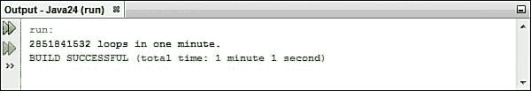

**图 8.2** `Benchmark`程序的输出。

`Benchmark`程序是查看你的计算机是否比我的计算机更快的好方法。在测试此程序期间，我的笔记本电脑执行了大约 29 亿次计算。如果你的计算机结果更好，别只是给我发慰问信。多买几本我的书，这样我就能升级了。

```
if (condVar > someVal) {console.log("xxx")}
```

Java 对于数组声明时方括号的放置位置相当灵活。你可以将它们放在变量名之后，而不是变量类型之后，如下所示：

`String niceChild[];`

为了让数组在程序中更易于识别，你应该保持一种风格，而不是来回切换。本书中使用数组的程序总是将方括号放在变量或对象类型之后。

***

前面的例子创建了数组，但没有在其中存储任何值。为此，你可以使用`new`关键字配合变量类型，或在`{`和`}`标记内直接存储值。使用`new`时，你必须指定数组中存储多少个不同的项目。数组中的每个项目称为一个元素。以下语句创建了一个数组并为其预留了存储空间：

点击此处查看代码图片

`int[] elfSeniority = new int[250];`

此示例创建了一个名为`elfSeniority`的整数数组。该数组有 250 个元素，可以存储圣诞老人的每个小矮人在北极工作了多长时间。（如果圣诞老人经营的是一个工会企业，这些信息就非常重要，需要跟踪。）

当你使用`new`语句创建数组时，必须指定元素数量。数组的每个元素都有一个初始值，该值取决于数组的类型。所有数值数组的初始值为`0`，`char`数组的初始值为`'\0'`，`boolean`数组的初始值为`false`。`String`数组和所有其他对象的初始值为`null`。

对于不是特别大的数组，你可以在创建时同时设置它们的初始值。以下示例创建了一个字符串数组并为其赋予初始值：

点击此处查看代码图片

`String[] reindeerNames = { "Dasher", "Dancer", "Prancer", "Vixen", "Comet", "Cupid", "Donder", "Blitzen" };`

应存储在数组元素中的信息被放置在`{`和`}`括号内，每个元素用逗号分隔。数组中的元素数量被设置为逗号分隔列表中的元素数量。

数组元素是编号的，第一个元素从`0`开始。可以通过在`[`和`]`括号内引用这个数字来访问特定的元素。前面的语句与以下代码完成相同的事情：

点击此处查看代码图片

```java
String[] reindeerNames = new String[8];
reindeerNames[0] = "Dasher";
reindeerNames[1] = "Dancer";
reindeerNames[2] = "Prancer";
reindeerNames[3] = "Vixen";
reindeerNames[4] = "Comet";
reindeerNames[5] = "Cupid";
reindeerNames[6] = "Donder";
reindeerNames[7] = "Blitzen";
```

数组的每个元素必须是相同的类型。这里，使用字符串来保存每个驯鹿的名字。

数组创建后，你就无法为更多元素腾出空间。即使你回想起了最著名的驯鹿，也无法将“Rudolph”作为`reindeerNames`数组的第九个元素添加进去。Java 编译器不会让可怜的 Rudolph 加入任何`reindeerNames`。

## 使用数组

在程序中使用数组与使用任何变量一样，但有一个区别：必须在数组名旁边的方括号内提供数组项目的元素编号。你可以在任何可以使用变量的地方使用数组元素。以下所有语句都使用了在本小时示例中已定义的数组：

点击此处查看代码图片

```java
elfSeniority[193] += 1;
niceChild[9428] = "Eli";
currentNation = 413;
if (hostileAirTravelNations[currentNation] == true) {
    sendGiftByMail();
}
```

因为数组的第一个元素编号是`0`而不是`1`，这意味着最高编号比你预期的要小一。考虑以下语句：

点击此处查看代码图片

`String[] topGifts = new String[10];`

此语句创建了一个字符串变量数组，编号从`0`到`9`。如果你在程序的某个地方引用了`topGifts[10]`，你会得到一条引用`ArrayIndexOutOfBoundsException`的错误消息。

异常是 Java 程序中表示错误的另一个词。这个异常是“数组索引越界”错误，意味着程序试图使用在其定义边界之外不存在的数组元素。你将在第 18 小时“处理程序中的错误”中了解更多关于异常的信息。

如果你想检查数组的上限以避免超出该限制，每个创建的数组都关联一个名为`length`的变量。`length`变量是一个整数，包含数组持有的元素数量。以下示例创建了一个数组，然后报告其长度：

点击此处查看代码图片

```java
String[] reindeerNames = { "Dasher", "Dancer", "Prancer", "Vixen", "Comet", "Cupid", "Donder", "Blitzen", "Rudolph" };
System.out.println("There are " + reindeerNames.length + " reindeer.");
```

在此示例中，`reindeerNames.length`的值为`9`，这意味着你可以指定的最高元素编号是`8`。

在 Java 中，你可以将文本作为字符串或字符数组来处理。当你处理字符串时，一个有用的技术是将字符串中的每个字符放入字符数组各自的元素中。为此，请调用字符串的`toCharArray()`方法，该方法生成一个`char`数组，其元素数量与字符串长度相同。

本小时的第一个项目使用了本节介绍的两种技术。`SpaceRemover`程序显示一个字符串，其中所有空格字符都被替换为句点（`.`）。

要开始，请在 NetBeans 中打开 Java24 项目，选择“文件”、“新建文件”，并创建一个名为`SpaceRemover`的新空 Java 文件。在源代码编辑器中输入清单 9.1，完成后保存。

**清单 9.1** `SpaceRemover.java`的完整文本

点击此处查看代码图片

***

```java
package com.java24hours;

class SpaceRemover {
    public static void main(String[] arguments) {
        String mostFamous = "Rudolph the Red-Nosed Reindeer";
        char[] mfl = mostFamous.toCharArray();
        for (int dex = 0; dex < mfl.length; dex++) {
            char current = mfl[dex];
            if (current != ' ') {
                System.out.print(current);
            } else {
                System.out.print('.');
            }
        }
        System.out.println();
    }
}
```

***

使用命令“运行”、“运行文件”运行程序，可以看到如图 9.1 所示的输出。

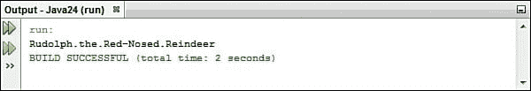

**图 9.1** `SpaceRemover`程序的输出。

`SpaceRemover`应用程序将文本“Rudolph the Red-Nosed Reindeer”存储在两个地方：一个名为`mostFamous`的字符串和一个名为`mfl`的`char`数组。数组在第 6 行通过调用`mostFamous`的`toCharArray()`方法创建，该方法用文本中的每个字符填充数组的一个元素。字符“R”放入元素`0`，“u”放入元素`1`，依此类推，直到元素`29`中的“r”。

第 7-14 行的`for`循环检查`mfl`数组中的每个字符。如果字符不是空格，则显示它。如果是空格，则显示“.”字符代替。

## 多维数组

到目前为止，本小时讨论的数组都是一维的，因此你可以使用单个数字检索元素。某些类型的信息需要更多维度才能作为数组充分存储，例如（x，y）坐标系中的点。数组的一个维度可以存储 x 坐标，另一个维度可以存储 y 坐标。

要创建一个具有两个维度的数组，在创建和使用该数组时必须使用额外的一组方括号，如下列语句所示：

```java
boolean[][] selectedPoint = new boolean[50][50];

selectedPoint[4][13] = true;

selectedPoint[7][6] = true;

selectedPoint[11][22] = true;
```

这个示例创建了一个名为`selectedPoint`的布尔值数组。该数组在第一维有 50 个元素，在第二维也有 50 个元素，因此总共有 2500 个独立的数组元素（50 乘以 50）。当数组被创建时，每个元素都被赋予默认值`false`。三个元素被赋予了`true`值：一个位于`(x,y)`位置`4,13`的点，一个位于`7,6`的点，以及一个位于`11,22`的点。

数组可以拥有你需要的任意多维度，但要记住，如果它们非常大，会占用大量内存。创建这个 50×50 的`selectedPoint`数组等同于创建了 2500 个独立的变量。

## 数组排序

当你将一堆相似的项目分组到一个数组中后，你可以做的一件事就是重新排列这些项目。以下语句交换一个名为`numbers`的整数数组中两个元素的值：

```java
int temporary = numbers[5];

numbers[5] = numbers[6];

numbers[6] = temporary;
```

这些语句的结果是`numbers[5]`和`numbers[6]`彼此交换了值。名为`temporary`的整数变量用作交换其中一个值的临时存储位置。排序是将一组相关项目按特定顺序排列的过程，例如将一个数字列表从最低到最高排序。

圣诞老人可以使用排序来按姓氏安排礼物接收者的顺序，这样 Willie Aames 和 Hank Aaron 就能比字母顺序不幸的 Dweezil Zappa 和 Jim Zorn 更早地获得他们的圣诞礼物。

在 Java 中对数组进行排序很容易，因为`Arrays`类完成了所有工作。`Arrays`是`java.util`类组的一部分，可以重新排列所有变量类型的数组。

要在程序中使用`Arrays`类，请遵循以下步骤：

1. 使用`import java.util.*`语句，使所有`java.util`类在程序中可用。

2. 创建数组。

3. 使用`Arrays`类的`sort()`方法来重新排列数组。

由`Arrays`类排序的变量数组会被重新排列成升序的数值顺序。字符和字符串则按字母顺序排列。

为了实际看到这一点，创建一个名为`NameSorter`的新空白 Java 文件，并在源代码编辑器中输入清单 9.2 的内容。

清单 9.2 `NameSorter.java`的完整源代码


```java
package com.java24hours;

import java.util.*;

class NameSorter {
    public static void main(String[] arguments) {
        String names[] = { "Glimmer", "Marvel", "Rue", "Clove",
            "Thresh", "Foxface", "Cato", "Peeta", "Katniss" };
        System.out.println("The original order:");
        for (int i = 0; i < names.length; i++) {
            System.out.println(i + ": " + names[i]);
        }
        System.out.println();
        Arrays.sort(names);
        System.out.println("The new order:");
        for (int i = 0; i < names.length; i++) {
            System.out.println(i + ": " + names[i]);
        }
        System.out.println();
    }
}
```

当你运行这个 Java 程序时，它会先按原始顺序显示九个名字的列表，对名字进行排序，然后重新显示列表。图 9.2 展示了输出结果。

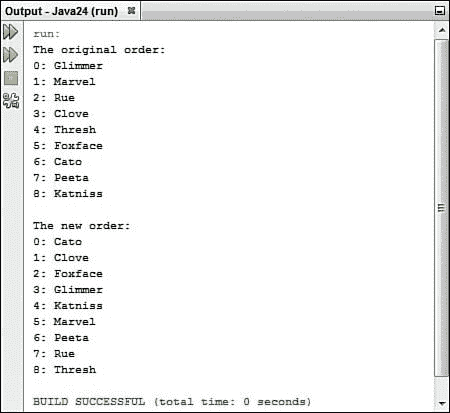

**图 9.2** `NameSorter`程序的输出。

当你使用字符串和基本类型变量（如整数和浮点数）时，只能使用`Arrays`类按升序对它们进行排序。如果你在排序时想要元素的不同排列，或者想要比`Arrays`类提供的更高效率，你可以自己手写排序代码。

## 统计字符串中的字符

英语中最常出现的字母是 E、R、S、T、L、N、C、D、M 和 O，顺序如上。如果你碰巧参加联播游戏节目《幸运轮盘》（*Wheel of Fortune*），这是一个值得了解的事实。

> **注意**
> 如果你不熟悉这个节目，《幸运轮盘》是一个游戏，三位参赛者猜测一个短语、名称或引语的字母。如果他们猜对一个字母，并且它是辅音，他们就能赢得大转盘上转出的金额。要重现这种体验，可以在演播室观众面前和朋友玩猜词游戏，当有人猜对字母时分发随机金额的钱，并给获胜者一台新的 Amana 炉灶。

你的下一个 Java 程序会统计你输入的尽可能多的不同短语和表达式中的字母频率。一个数组被用来统计每个字母出现的次数。完成后，程序会呈现每个字母在这些短语中出现的次数。

在 NetBeans 中创建一个新的空白 Java 文件`Wheel.java`，填充清单 9.3 的内容，完成后保存文件。你可以随意在第 17 行和第 18 行之间添加额外的短语，格式与第 17 行完全一致。

**清单 9.3** `Wheel.java`的完整源代码

```java
package com.java24hours;

class Wheel {
    public static void main(String[] arguments) {
        String phrase[] = {
            "A STITCH IN TIME SAVES NINE",
            "DON'T EAT YELLOW SNOW",
            "JUST DO IT",
            "EVERY GOOD BOY DOES FINE",
            "I WANT MY MTV",
            "I LIKE IKE",
            "PLAY IT AGAIN, SAM",
            "FROSTY THE SNOWMAN",
            "ONE MORE FOR THE ROAD",
            "HOME FIELD ADVANTAGE",
            "VALENTINE'S DAY MASSACRE",
            "GROVER CLEVELAND OHIO",
            "SPAGHETTI WESTERN",
            "AQUA TEEN HUNGER FORCE",
            "IT'S A WONDERFUL LIFE"
        };
        int[] letterCount = new int[26];
        for (int count = 0; count < phrase.length; count++) {
            String current = phrase[count];
            char[] letters = current.toCharArray();
            for (int count2 = 0;  count2 < letters.length; count2++) {
                char lett = letters[count2];
                if ( (lett >= 'A') & (lett <= 'Z') ) {
                    letterCount[lett - 'A']++;
                }
            }
        }
        for (char count = 'A'; count <= 'Z'; count++) {
            System.out.print(count + ": " +
                letterCount[count - 'A'] +
                " ");
            if (count == 'M') {
                System.out.println();
            }
        }
        System.out.println();
    }
}
```

如果你在没有添加自己短语的情况下运行该程序，输出应类似于图 9.3。

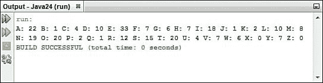

**图 9.3** `Wheel`程序的输出。

`Wheel`程序中发生的主要事情如下：

- 第 5–21 行——短语存储在一个名为`phrase`的字符串数组中。
- 第 22 行——创建了一个名为`letterCount`的整数数组，包含 26 个元素。这个数组用于存储每个字母出现的次数。元素的顺序是从‘A’到‘Z’。`letterCount[0]`存储字母‘A’的计数，`letterCount[1]`存储‘B’的计数，依此类推，直到`letterCount[25]`存储‘Z’的计数。
- 第 23 行——一个`for`循环遍历存储在`phrase`数组中的短语。`phrase.length`变量用于在遍历到最后一个短语后结束循环。
- 第 24 行——一个名为`current`的字符串变量被赋值为`phrase`数组当前元素的值。
- 第 25 行——创建一个字符数组，用于存储当前短语中的所有字符。
- 第 26 行——一个`for`循环遍历当前短语的字母。`letters.length`变量用于在遍历到最后一个字母后结束循环。
- 第 27 行——创建一个名为`lett`的字符变量，其值为当前字母。除了文本值之外，字符还有其对应的数值。由于数组元素是编号的，因此使用每个字符的数值来确定其在数组中的元素编号。
- 第 28-30 行——一个`if`语句过滤掉所有不属于字母表的字符，如标点符号和空格。根据存储在`lett`中的当前字符的数值，`letterCount`数组的某个元素会增加 1。字母表对应的数值范围是从 'A' 的 65 到 'Z' 的 90。由于`letterCount`数组从 0 开始到 25 结束，因此从`lett`中减去 65（'A'的值）来确定要增加的数组元素索引。
- 第 33 行——一个`for`循环遍历从 'A' 到 'Z' 的整个字母表。
- 第 34-40 行——显示当前字母，后跟一个分号和该字母在`phrase`数组存储的短语中出现的次数。当当前字母是 'M' 时，会显示一个换行符，以便输出分布在两行上。

> **注意**
> 每个从 'A' 到 'Z' 字符所关联的数值，是 ASCII 字符集所使用的值。ASCII 字符集是 Unicode 的一部分，而 Unicode 是 Java 语言支持的完整字符集。Unicode 包含了对世界上 60,000 多种不同书面语言字符的支持。ASCII 则仅限于 256 个。

本项目展示了如何使用两个嵌套的`for`循环来逐个字母地遍历一组短语。Java 为每个字符附加一个数值；这个数值比在数组中直接使用字符本身更便于操作。

## 总结

数组使得在程序中存储复杂类型的信息并对其进行操作成为可能。它们非常适合于任何可以排列成列表的信息，并且可以使用你在第 8 小时“使用循环重复操作”中学到的循环语句轻松地进行访问。

说实话，圣诞老人的信息处理需求可能已经超出了数组的能力范围。每年被“制造”出来的孩子都在增加，他们想要的礼物在复杂性和成本上也日益增长。

你的程序很可能会使用数组来存储那些用变量处理起来很笨重的信息，即使你并没有制作任何列表或者检查两遍。

## 练习场

### 问答

**问。** 字母表的数值范围，从 'A' 的 65 到 'Z' 的 90，是 Java 语言的基础部分吗？如果是，1 到 64 的数值是保留给什么的？

**答。** 数字 1 到 64 包括数字、标点符号和一些不可打印的字符，如换行符、回车符和退格符。Java 程序中每个可打印的字符以及一些不可打印的字符都关联着一个数值。Java 使用 Unicode 编号系统。前 127 个字符来自 ASCII 字符集，你可能在其他编程语言中使用过它。

**问。** 为什么错误被称为异常？

**答。** 这个术语的意义在于，程序通常可以毫无问题地运行，而异常（exception）则表示一种需要处理的特殊情况。异常是从 Java 程序内部发出的警告消息。在 Java 语言中，术语“错误”有时被限定用于描述在运行程序的解释器内部发生的错误情况。你将在第 18 小时了解更多关于错误和异常的知识。

**问。** 在多维数组中，是否可以使用`length`变量来测量第一维以外的其他维度？

**答。** 你可以测试数组的任何维度。对于第一维，使用数组名后跟`length`，例如`x.length`。后续维度可以通过使用该维度的`[0]`元素后跟`length`来测量。考虑一个名为`data`的数组，它由以下语句创建：

```java
int[][][] data = new int[12][13][14];
```

这个数组的维度可以通过`data.length`变量测量第一维，`data[0].length`测量第二维，`data[0][0].length`测量第三维。

**问。** 为什么新英格兰爱国者队的主教练比尔·贝利奇克总是在场边穿那件荒唐的连帽衫？

**答。** 当你在一个十年内的胜场数高于 NFL 历史上任何其他教练时（2003 年至 2012 年的 140 场），你的老板会允许你自定着装规范。体育作家认为，贝利奇克开始穿剪掉袖子的连帽衫，是为了回应 NFL 与锐步（Reebok）的一项协议，该协议要求所有教练穿着授权的球队服装。

“他决定，如果他们要强迫他穿球队服装，那么他会从选项中筛选，然后穿上他能找到的最丑的东西，”雅虎体育的丹·韦策尔解释道。“他选了一件灰色的运动衫，通常还戴着兜帽。”

贝利奇克这种消极抵抗的时尚宣言，已经使这件连帽衫成为了球队最畅销的商品之一。

### 测验

如果你的脑子是一个数组，你可以通过回答以下每个关于数组的问题来测试它的`length`。

**1.** 数组最适合存储哪类信息？

**A.** 列表

**B.** 相关信息的配对

**C.** 琐事

**2.** 你可以使用哪个变量来检查数组的上边界？

**A.** `top`

**B.** `length`

**C.** `limit`

**3.** 圣诞老人有多少只驯鹿，包括红鼻子鲁道夫？

**A.** 8 只

**B.** 9 只

**C.** 10 只

### 答案

**1. A.** 仅包含相同类型信息（字符串、数字等）的列表非常适合存储在数组中。

**2. B.** `length`变量包含数组中元素数量的计数。

**3. B.** 根据克莱门特·克拉克·摩尔的《圣尼古拉斯的来访》，圣诞老人有“八只小驯鹿”，所以加上鲁道夫一共是九只。

### 活动

为了给自己积累一组可供日后借鉴的经验，你可以通过以下活动来扩展对本小时主题的了解：

- 创建一个使用二维数组存储学生成绩的程序。第一维应该是每个学生的编号，第二维应该是每个学生的各科成绩。显示每个学生所有成绩的平均分以及所有学生的总平均分。
- 编写一个程序，将前 400 个 13 的倍数存储在一个数组中。

要查看实现这些活动的 Java 程序，请访问本书网站 [www.java24hours.com](http://www.java24hours.com)。

# 第 10 小时. 创建你的第一个对象

本小时任务清单：

- 创建一个对象。
- 用属性描述一个对象。
- 确定对象的行为。
- 组合对象。
- 从其他对象继承。

# 将对象及其他类型的信息进行转换

- 将对象及其他类型的信息进行转换。

你在这些日子里遇到的更令人生畏的术语之一就是面向对象编程（OOP）。这个复杂的术语以一种优雅的方式描述了计算机程序是什么以及它如何工作。

在 OOP 之前，计算机程序通常被描述为你在本书中学到的最简单定义：一组列在文件中的指令，并以某种可靠的顺序执行。

通过将程序视为对象的集合，你可以找出程序必须完成的任务，并将任务分配给最适合的对象。

## 面向对象编程如何工作

你可以将你创建的 Java 程序视为对象，就像现实世界中存在的物理对象一样。对象独立于其他对象存在，以特定的方式交互，并且可以与其他对象结合形成更大的东西。如果你将计算机程序视为一组相互交互的对象，你就可以设计出更可靠、更易于理解且可在其他项目中重用的程序。

在第 23 小时“创建 Java2D 图形”中，你创建了一个显示饼图的 Java 程序——带有不同颜色馅饼切片的圆圈来表示数据（见图 10.1）。饼图是一个由较小对象组成的对象——代表不同颜色的独立切片、标识每个切片含义的图例以及一个标题。

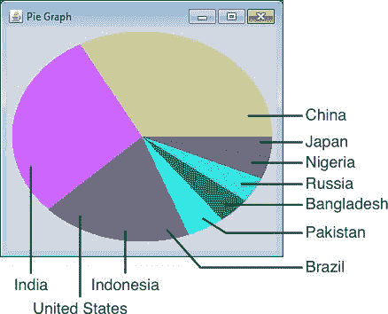

**图 10.1** 一个显示饼图的 Java 程序。

每个对象都有使其与其他对象不同的东西。饼图是圆形的，而条形图则将数据表示为一系列矩形。如果你以分解饼图的方式来分解计算机程序，你就是在进行 OOP。

在 OOP 中，一个对象包含两样东西：属性和行为。属性是描述对象并显示其与其他对象不同之处的东西。行为是对象执行的操作。

你在 Java 中通过使用类作为模板来创建对象。类是对象的主副本，决定了对象应该具有的属性和行为。术语“类”你应该很熟悉，因为 Java 程序被称为类。你用 Java 创建的每个程序都是一个类，你可以将其用作创建新对象的模板。例如，任何使用字符串的 Java 程序都在使用从`String`类创建的对象。这个类包含决定`String`对象是什么的属性，以及控制`String`对象能做什么的行为。

通过 OOP，计算机程序是一组协同工作以完成某项任务的对象。一些简单的程序可能看起来只由一个对象组成：类文件。然而，即使是那些程序也在使用其他对象来完成工作。

### 对象在行动

考虑显示饼图的程序。一个`PieChart`对象可以由以下内容组成：

- 计算每个饼图切片大小的行为
- 绘制图表的行为
- 存储图表标题的属性

> **注意**
> 自动拨号器是一种使用称为调制解调器的设备按顺序拨打一系列电话号码的软件。此类程序的目的是找到应答电话的其他计算机，以便你可以稍后调用它们以查看它们是什么。
>
> 年龄小于 30 岁的读者可能很难相信计算机过去曾通过电话相互连接。你必须知道计算机的电话号码才能连接到它，并且如果它已经在与另一台计算机通话，你会听到忙音。
>
> 现在我可能需要解释什么是忙音。
>
> 引用诗人 T.S. Eliot 的话，“我变老了……我变老了。”


要求`PieChart`对象自己绘制自己可能看起来很奇怪，因为在现实世界中，图表不会自己绘制。OOP 中的对象会尽可能为自己工作。这个特性使它们更容易被合并到其他程序中。例如，如果一个`PieChart`对象不知道如何绘制自己，那么每次你在另一个程序中使用该`PieChart`对象时，你都必须创建绘制它的行为。

作为 OOP 的另一个例子，考虑 Matthew Broderick 的角色在经典黑客电影《战争游戏》中使用的自动拨号程序，用于寻找他可以入侵的计算机。

在今天使用自动拨号器会引起你当地电话公司和执法部门的注意。在 1980 年代，这是一种不出门就能反叛的好方法。David Lightman（由 Broderick 扮演的角色）使用他的自动拨号器寻找一家视频游戏公司的私有计算机系统——他想在游戏发布前玩公司的新游戏。相反，Lightman 发现了一个秘密的政府计算机，它可以玩从国际象棋到全球热核战争的一切游戏。

自动拨号器，就像任何计算机程序一样，可以被视为一组协同工作的对象。它可以分解为以下内容：

 一个`Modem`对象，它知道其属性（如连接速度）并具有行为——例如，它可以命令调制解调器拨号并检测另一个计算机系统是否已应答呼叫。

 一个`Monitor`对象，它跟踪哪些号码被呼叫以及哪些呼叫成功。

每个对象都独立于另一个对象存在。

设计一个完全独立的`Modem`对象的一个优势是，它可以被需要调制解调器功能的其他程序使用。

使用自包含对象的另一个原因是它们更容易调试。计算机程序的大小很快会变得难以控制。如果你正在调试像`Modem`这样的对象，并且你知道它不依赖于其他任何东西，你就可以专注于确保`Modem`对象执行它应该执行的任务并保存其执行任务所需的信息。

将 Java 这样的面向对象语言作为你的第一门编程语言学习可能很有利，因为你不需要摒弃其他编程风格的习惯。

### 什么是对象

对象是通过使用一个类作为模板来创建的。以下语句创建了一个类：

```java
public class Modem {

}
```

从这个类创建的对象不能做任何事情，因为它没有任何属性或行为。你需要添加这些才能使类有用，如以下语句所示：

```java
public class Modem {

    int speed;

    public void displaySpeed() {

        System.out.println("Speed: " + speed);

    }

}
```

`Modem`类现在应该开始看起来像你在第 1 小时到第 9 小时编写的程序了。`Modem`类以一个`class`语句开始，只不过它包含了`public`这个词。这意味着该类可供公众使用——换句话说，可供任何想要使用`Modem`对象的程序使用。

`Modem`类的第一部分创建了一个名为`speed`的整型变量。这个变量是对象的一个属性。

`Modem`类的第二部分是一个名为`displaySpeed()`的方法。这个方法是对象行为的一部分。它包含一个语句`System.out.println()`，它显示调制解调器的`speed`值。

对象的变量称为实例变量或成员变量。

如果你想在程序中使用`Modem`对象，你可以使用以下语句创建该对象：

```java
Modem device = new Modem();
```

此语句创建一个名为`device`的`Modem`对象。在创建对象之后，你可以设置它的变量并调用它的方法。以下是设置`device`对象的`speed`变量值的方法：

```java
device.speed = 28800;
```

## 调用`displaySpeed()`方法

要让这个调制解调器通过调用`displaySpeed()`方法来显示其速度，你需要这样调用该方法：

```java
device.displaySpeed();
```

名为`device`的`Modem`对象会通过显示文本“Speed: 28800.”来响应此语句。

### 理解继承

面向对象编程的一大优势是继承，它使得一个对象能够从另一个对象继承行为和属性。

当你开始创建对象时，你有时会发现新对象与你已有的一个对象非常相似。

如果大卫·莱特曼想要一个能够处理纠错和其他先进调制解调器功能的对象（这些功能在 1983 年《战争游戏》上映时还不存在），该怎么办？莱特曼可以复制`Modem`对象的语句并进行修改，从而创建一个新的`ErrorCorrectionModem`对象。然而，如果`ErrorCorrectionModem`的大部分行为和属性与`Modem`相同，这将是一项大量不必要的工作。这也意味着，如果以后需要更改某些内容，莱特曼将需要更新两个独立的程序。

通过继承，程序员可以通过定义新对象与现有对象的不同之处来创建一个新的对象类。莱特曼可以让`ErrorCorrectionModem`继承自`Modem`，这样他需要编写的就只是那些使纠错调制解调器区别于普通调制解调器的内容。

一个类通过使用`extends`语句从另一个类继承。以下是`ErrorCorrectionModem`类的骨架，它继承自`Modem`类：

```java
public class ErrorCorrectionModem extends Modem {

    // 程序放在这里

}
```

### 构建继承层次结构

继承使得无需重复工作即可开发各种相关类，从而使代码可以从一个类传递给另一个类，再传递给另一个类。这种类的组合称为类层次结构，你可以在 Java 程序中使用的所有标准类都是这个层次结构的一部分。

要理解层次结构，最好先理解子类和超类。继承自另一个类的类称为子类。被继承的类称为超类。

在前面的《战争游戏》示例中，`Modem`类是`ErrorCorrectionModem`类的超类。`ErrorCorrectionModem`是`Modem`的子类。

在一个层次结构中，一个类可以有多个继承自它的类——`Modem`的另一个子类可以是`ISDNModem`，因为 ISDN 调制解调器具有使其区别于纠错调制解调器的行为和属性。如果存在一个`ErrorCorrectionModem`的子类，如`InternalErrorCorrectionModem`，它将继承层次结构中其上方所有类的行为——既包括`ErrorCorrectionModem`，也包括`Modem`。这些继承关系如图 10.2 所示。

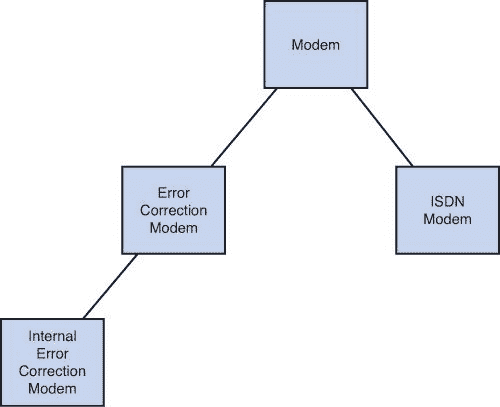

**图 10.2** 一个类层次结构示例。

构成标准 Java 语言的类充分利用了继承，因此理解它是必不可少的。你将在第 12 小时“充分利用现有对象”中学习更多关于继承的内容。

### 转换对象和简单变量

在 Java 中，你需要完成的最常见任务之一是将信息从一种形式转换为另一种形式。你可以进行的几种转换类型包括：

 将一个对象转换为另一个对象

 将一个简单变量转换为另一种类型的变量

 使用一个对象来创建一个简单变量

 使用一个简单变量来创建一个对象

简单变量是你在第 5 小时“在程序中存储和更改信息”中学习的基本数据类型。其中一些类型是`int`、`float`、`char`、`long`、`double`、`byte`和`short`。

> **注意**

> 当一个方法（例如`System.out.println()`）需要一个字符串参数时，你可以使用`+`运算符将几种不同类型的信息组合在该参数中。只要被组合的项中有一个是字符串，组合后的参数就会被转换为一个字符串。

在使用程序中的方法或表达式时，你必须使用这些方法和表达式所期望的正确类型的信息。例如，一个期望`Calendar`对象的方法必须接收一个`Calendar`对象。如果你使用了一个需要单个整数参数的方法，却向它发送了一个浮点数，那么在尝试编译程序时就会发生错误。

将信息转换为新形式的过程称为类型转换。类型转换会产生一个新值，这个值是与源不同类型的新变量或对象。实际上，你并不是在改变值本身，而是根据需要创建了一个新格式的变量或对象。

在讨论类型转换的概念时，术语“源”和“目标”很有用。源是某种以其原始形式存在的信息——无论是变量还是对象。目标是源在新格式中的转换版本。

#### 类型转换简单变量

对于简单变量，类型转换最常见于数字变量之间，例如整数和浮点数。布尔值是一种不能用于任何类型转换的变量。

要将信息转换为新格式，请在它前面加上用括号括起来的新格式。例如，如果你想将某个值转换为`long`变量，请在它前面加上`(long)`。以下语句将`float`值转换为`int`：

```java
float source = 7.06F;
int destination = (int) source;
```

在目标变量比源变量能存储更大值的变量转换中，值很容易转换，例如将`byte`转换为`int`。`byte`存储的值范围是 -128 到 127，而`int`存储的值范围是 -21 亿 到 21 亿。无论`byte`变量持有何种值，新的`int`变量都有足够的空间容纳它。

有时，你可以在不进行类型转换的情况下以不同的格式使用变量。例如，你可以像使用`int`变量一样使用`char`变量。同样，你可以像使用`long`变量一样使用`int`变量，并且任何类型都可以用作`double`。

在大多数情况下，由于目标提供了比源更大的空间，信息在转换时不会改变其值。主要的例外情况是当`int`或`long`变量转换为`float`时，或者当`long`转换为`double`时。

当你将信息从较大的变量类型转换为较小的类型时，必须显式地进行类型转换，如以下语句所示：

```java
int xNum = 103;
byte val = (byte) xNum;
```

这里，类型转换将一个名为`xNum`的整数值转换为一个名为`val`的`byte`变量。这是一个目标变量比源变量存储的值范围小的例子。`byte`存储的整数值范围是 -128 到 127，而`int`存储的整数值范围要大得多。

当类型转换操作中的源变量具有目标变量中不支持的值时，Java 会更改该值以使类型转换成功完成。如果你没有预料到这种更改，这可能会产生意想不到的结果。

#### 类型转换对象

当源和目标通过继承相关联时，你可以将对象类型转换为其他对象。其中一个类必须是另一个类的子类。

有些对象根本不需要类型转换。你可以在任何需要其超类的地方使用该对象。Java 中的所有对象都是`Object`类的子类，因此当需要`Object`时，你可以使用任何对象作为参数。

当需要使用子类对象时，你也可以传入其父类对象。但由于子类通常比其父类包含更多信息，你可能会丢失部分数据。若对象缺少子类应有的某个方法，而程序中又调用了该方法，就会引发错误。

若要使用对象来替代其子类，必须进行显式转型，语句示例如下：

```java
public void paintComponent(Graphics comp) {
    Graphics2D comp2D = (Graphics2D) comp;
}
```

此处将名为`comp`的`Graphics`对象转型为`Graphics2D`对象。这种转型不会丢失信息，反而能获取子类定义的所有方法和变量。

## 将基本变量与对象相互转换

你无法将对象直接转换为基本变量，也无法将基本变量直接转换为对象。Java 为每种基本变量类型都提供了对应的包装类，包括`Boolean`、`Byte`、`Character`、`Double`、`Float`、`Integer`、`Long`和`Short`。这些类名首字母大写，因为它们代表对象而非基本类型。

通过使用这些类中定义的方法，你可以将变量值作为参数来创建对象。以下语句创建了一个值为 5309 的`Integer`对象：

```java
Integer suffix = new Integer(5309);
```

创建此类对象后，你可以像使用其他对象一样使用它。若想再次将其作为基本变量使用，这些类提供了相应的转换方法。要从前面的`suffix`对象获取`int`值，可以使用以下语句：

```java
int newSuffix = suffix.intValue();
```

此语句会使`newSuffix`变量获得值 5309，并以`int`类型表示。从对象到变量的常见转型是将字符串用于数值表达式。当字符串值可转换为整数时，可使用`Integer`类的`parseInt()`方法实现，如下例所示：

```java
String count = "25";
int myCount = Integer.parseInt(count);
```

这会将文本"25"的字符串转换为值 25 的整数。若字符串值不是有效整数，转换将失败。

你接下来要创建的项目是一个将命令行参数中的字符串值转换为数值的应用程序——这是从命令行获取用户输入时的常用技巧。

返回 NetBeans 中的`Java24`项目，选择“文件”>“新建文件”，创建一个名为`NewRoot`的空 Java 文件。在源代码编辑器中输入清单 10.1 的内容，并记得保存文件。

**清单 10.1 `NewRoot.java`完整内容**

```java
package com.java24hours;

class NewRoot {
    public static void main(String[] arguments) {
        int number = 100;
        if (arguments.length > 0) {
            number = Integer.parseInt(arguments[0]);
        }
        System.out.println("The square root of "
            + number
            + " is "
            + Math.sqrt(number)
        );
    }
}
```

运行程序前，必须配置 NetBeans 以传递命令行参数。选择菜单命令“运行”>“设置项目配置”>“自定义”。项目属性窗口将打开。在“主类”字段输入`com.java24hours.NewRoot`，在“参数”字段输入`9025`。点击“确定”关闭对话框。

要运行程序，请选择“运行”>“运行主项目”（而非“运行”>“运行文件”）。程序将显示该数字及其平方根，如图 10.3 所示。

`NewRoot`应用扩展了第 4 小时“理解 Java 程序工作原理”中的早期教程——该教程曾显示整数 225 的平方根。

如果该程序能接收用户提交的数字并显示其平方根，其实用性会更强。这需要实现字符串到整数的转换。所有命令行参数都存储在`String`数组中，因此必须先将其转换为数字，才能用于数学表达式。

要根据字符串内容创建整数值，需将字符串作为唯一参数调用`Integer.parseInt()`方法，如第 7 行所示：

```java
number = Integer.parseInt(arguments[0]);
```

数组元素`arguments[0]`保存应用程序运行时提交的第一个命令行参数。当使用"9025"作为参数运行程序时，字符串"9025"会被转换为`int`值 9025。

## 自动装箱与拆箱

Java 中每种基本数据类型都有对应的包装类：`boolean`（`Boolean`类）、`byte`（`Byte`）、`char`（`Character`）、`double`（`Double`）、`float`（`Float`）、`int`（`Integer`）、`long`（`Long`）和`short`（`Short`）。

这些配对中的值具有相同意义。它们唯一的区别在于值的表示形式。例如数值 413 既可表示为`int`，也可表示为`Integer`类的对象。

Java 的自动装箱与拆箱功能使得基本数据类型和对象形式的值可以互换使用。

*   **自动装箱**：将基本变量值转换为对应的包装类对象。

*   **拆箱**：将包装类对象转换为对应的基本数据类型。

这些功能在后台自动工作，确保当你需要`float`这样的基本类型时，对象会自动转换为相同值的匹配数据类型；当你需要`Float`这样的对象时，数据类型也会按需转换为对象。

以下语句展示了自动装箱与拆箱的便利之处：

```java
Float total = new 1.3F;
float sum = total / 5;
```

在早期 Java 版本中，这段代码会因两个错误而失败。第一条语句试图将字面量`float`值 1.3 赋给`Float`对象（不允许），第二条语句试图将`Float`对象除以 5 并赋值给`float`类型（不允许）。但在当前 Java 版本中能完美运行，因为第一条语句会自动将字面量装箱为对象，第二条语句会将对象拆箱为基本类型。Java 自动处理这些语句，最终使`sum`等于 0.26。

本小时早些时候，你已见过创建`Integer`对象的示例：

```java
Integer suffix = new Integer(5309);
```

由于自动装箱与拆箱，以下语句也能实现相同效果：

```java
Integer suffix = 5309;
```

Java 识别出需要将`int`值 5309 存储在`Integer`对象中，因此会自动完成转换。

## 创建对象

为观察本小时下一个项目中的类与继承实例，你需要创建代表两类对象的类：实现为`CableModem`类的电缆调制解调器，以及实现为`DslModem`类的 DSL 调制解调器。实验将聚焦于这些对象的简单属性和行为：

*   每个对象应能显示其运行速度。

*   每个对象应能连接到互联网。


## 第十章 继承

有线电缆调制解调器和 DSL 调制解调器的共同点在于它们都具有速度特性。由于这是它们共享的特性，可以将其放入一个作为 `CableModem` 和 `DslModem` 类超类的类中。将该类命名为 `Modem`。在 NetBeans 中，创建一个新的空 Java 类，命名为 `Modem`。在源代码编辑器中输入清单 10.2 并保存文件。

**清单 10.2 `Modem.java` 的完整文本**

点击此处查看代码图片

```
1: package com.java24hours;
2:
3: public class Modem {
4:     int speed;
5:
6:     public void displaySpeed() {
7:         System.out.println("Speed: " + speed);
8:     }
9: }
```

此文件会自动编译为 `Modem.class`。你不能直接运行此程序，但可以在其他类中使用它。`Modem` 类可以处理 `CableModem` 和 `DslModem` 类共享的部分功能之一。通过在创建 `CableModem` 和 `DslModem` 类时使用 `extends` 语句，你可以使它们每个都成为 `Modem` 的子类。

在 NetBeans 中启动一个新的空 Java 文件，类名为 `CableModem`。输入清单 10.3 并保存文件。

**清单 10.3 `CableModem.java` 的完整文本**

点击此处查看代码图片

```
 1: package com.java24hours;
 2:
 3: public class CableModem extends Modem {
 4:     String method = "cable connection";
 5:
 6:     public void connect() {
 7:         System.out.println("Connecting to the Internet ...");
 8:         System.out.println("Using a " + method);
 9:     }
10: }
```

在 NetBeans 中创建第三个文件，命名为 `DslModem`。输入清单 10.4 并保存文件。

**清单 10.4 `DslModem.java` 的完整文本**

点击此处查看代码图片

```
 1: package com.java24hours;
 2:
 3: public class DslModem extends Modem {
 4:     String method = "DSL phone connection";
 5:
 6:     public void connect() {
 7:         System.out.println("Connecting to the Internet ...");
 8:         System.out.println("Using a " + method);
 9:     }
10: }
```

如果没有错误，你现在有三个类文件：`Modem.class`、`CableModem.class` 和 `DslModem.class`。但是，你无法运行这些类文件中的任何一个，因为它们没有像你之前创建的程序那样的 `main()` 块。你需要创建一个简短的应用程序来测试刚刚构建的类层次结构。

返回 NetBeans 并创建一个新的空 Java 文件，类名为 `ModemTester`。在源代码编辑器中输入清单 10.5 并保存文件。

**清单 10.5 `ModemTester.java` 的完整文本**

点击此处查看代码图片

```
 1: package com.java24hours;
 2:
 3: public class ModemTester {
 4:     public static void main(String[] arguments) {
 5:         CableModem surfBoard = new CableModem();
 6:         DslModem gateway = new DslModem();
 7:         surfBoard.speed = 500000;
 8:         gateway.speed = 400000;
 9:         System.out.println("Trying the cable modem:");
10:         surfBoard.displaySpeed();
11:         surfBoard.connect();
12:         System.out.println("Trying the DSL modem:");
13:         gateway.displaySpeed();
14:         gateway.connect();
15:     }
16: }
```

当你运行程序时，你应该看到与图 10.4 匹配的输出。

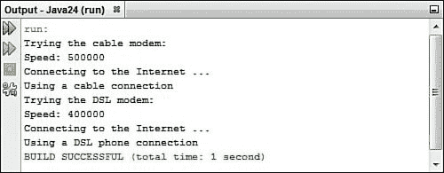

**图 10.4** `ModemTester` 程序的输出。

清单 10.5 中发生了以下事情：

 第 5-6 行——创建了两个新对象：一个名为 `surfBoard` 的 `CableModem` 对象和一个名为 `gateway` 的 `DslModem` 对象。

 第 7 行——名为 `surfBoard` 的 `CableModem` 对象的 `speed` 变量被设置为 500000。

 第 8 行——名为 `gateway` 的 `DslModem` 对象的 `speed` 变量被设置为 400000。

 第 10 行——调用了 `surfBoard` 对象的 `displaySpeed()` 方法。此方法继承自 `Modem`——即使它在 `CableModem` 类中不存在，你也可以调用它。

 第 11 行——调用了 `surfBoard` 对象的 `connect()` 方法。

 第 12 行——调用了 `gateway` 对象的 `displaySpeed()` 方法。

 第 13 行——调用了 `gateway` 对象的 `connect()` 方法。

### 总结

在创建了你的第一个对象类并将多个类排列成层次结构后，你应该对“面向对象编程”这个术语感到更熟悉了。在接下来的两小时里，随着你开始创建更复杂的对象，你将学到更多关于对象行为和属性的知识。

随着你对这种开发风格的经验增加，诸如程序、类和对象这样的术语会变得更加清晰。OOP 是一个需要一些时间才能适应的概念。当你掌握了它，你会发现它是设计、开发和调试计算机程序的有效方式。

### 研讨会

#### 问与答

**问：** 类可以从多个类继承吗？

**答：** 这在某些编程语言（如 C++）中是可能的，但在 Java 中不行。多重继承是一个强大的特性，但它也使 OOP 更难学习和使用。Java 的开发者决定将任何类的继承限制为一个超类，尽管一个类可以有多个子类。补偿此限制的一种方法是从一种称为接口的特殊类型类中继承方法。你将在第 19 小时“创建线程程序”中了解更多关于接口的知识。

**问：** 什么时候你想要创建一个不是 `public` 的方法？

**答：** 你不希望一个方法可供其他程序使用的主要情况是，当该方法严格用于你正在编写的一个程序时。如果你正在创建一个游戏程序，并且你的 `shootRayGun()` 方法高度特定于你正在编写的游戏，它可以是一个私有方法。要阻止一个方法成为 `public`，只需在方法名前省略 `public` 语句。

**问：** 为什么可以将 `char` 值当作 `int` 值来使用？

**答：** 字符可以用作 `int` 变量，因为每个字符都有一个对应的数字代码，表示其在字符集中的位置。如果你有一个名为 `k` 的变量，其值为 67，那么转换 `(char) k` 会产生字符值 ‘C’，因为根据 ASCII 字符集，与大写 C 关联的数字代码是 67。ASCII 字符集是 Java 语言采用的 Unicode 字符标准的一部分。

**问：** Tabasco 辣酱会变质吗？

**答：** 不会，尽管如果你把一瓶打开的酱料放上几年，它的颜色会改变。醋、红辣椒和盐的成分对细菌生长来说是极其不利的环境。

Tabasco 的制造商 McIlhenny 公司表示，原味品牌的保质期为五年。其他版本的保质期从 18 个月到三年不等。

作为该产品的忠实粉丝，我很难相信有人会把一瓶 Tabasco 放那么久以至于提出这个问题。

#### 测验

以下问题测试你对对象及其使用程序的了解。

**1.** 使用什么语句来使一个类能够从另一个类继承？

**A.** `inherits`

**B.** `extends`

**C.** `handItOverAndNobodyGetsHurt`

**2.** 为什么编译后的 Java 程序以 `.class` 文件扩展名保存？

**A.** Java 的开发者认为它是一门优雅的语言。

**B.** 这是对全世界教师的微妙致敬。

**C.** 每个 Java 程序都是一个类。

**3.** 一个对象由哪两个部分构成？

**A.** 属性和行为

**B.** 命令和数据文件

**C.** 唾液和醋

#### 答案

**1. B.** 使用 `extends` 语句是因为子类是超类以及类层次结构中任何更高层超类的属性和行为的扩展。

**2. C.** 你的程序总是至少由一个主类和任何其他所需的类构成。

**3. A.** 某种程度上，B 选项也是正确的，因为命令类似于行为，数据文件类似于属性。

#### 活动

如果你不介意，可以通过以下活动来 `extend`（扩展）你对本小时主题的理解：

 创建一个 `AcousticModem` 类，其速度为 300，并包含其自己的 `connect()` 方法。

 向 `Modem` 项目中的一个类添加一个 `disconnect()` 方法，并决定将其放置在何处以支持电缆、DSL 和声学调制解调器的断开连接。

要查看实现这些活动的 Java 程序，请访问本书网站 [www.java24hours.com](http://www.java24hours.com)。

## 第 11 小时 描述你的对象是什么样的

本小时待办事项列表：

 为对象或类创建变量。

 对对象和类使用方法。

 调用方法并返回值。

 创建构造函数。

 向方法发送参数。

 使用 `this` 引用对象。

 创建新对象。

正如你在上一小时面向对象编程（OOP）介绍中所学到的，对象是一种组织程序的方式，使其拥有完成任务所需的一切。对象由属性和行为组成。

属性是存储在对象内部的信息。它们可以是整型、字符型和布尔值等变量，也可以是 `String` 和 `Calendar` 等对象。行为是用于处理对象内特定任务的语句组。这些语句组中的每一组都称为一个方法。

到目前为止，你一直在不知不觉地使用对象的方法和变量。任何时候，只要你的语句中包含一个不是小数点或字符串部分的句点，就涉及到一个对象。

### 创建变量

在本小时，你将研究一个名为 `Virus` 的示例对象类，它在生活中的唯一目的就是尽可能多地繁殖——有点像我在大学认识的一些人。`Virus` 需要完成几项不同的工作，这些工作作为类的行为来实现。方法所需的信息则存储为属性。

对象的属性代表对象运行所需的变量。这些变量可以是整型、字符型和浮点型等简单数据类型，也可以是数组或 `String` 或 `Calendar` 等类的对象。你可以在对象的整个类中，在对象包含的任何方法中使用其变量。按照惯例，你在创建类的 `class` 语句之后、任何方法之前立即创建变量。

`Virus` 对象需要的其中一件事是一种表明文件已被感染的方法。一些计算机会改变存储文件最后修改时间的字段；例如，病毒可能将时间从 7:41:20 改为 7:41:61。因为没有正常文件会被保存在一分钟的第 61 秒，这个时间就表示该文件被感染了。

`Virus` 对象使用一个名为 `newSeconds` 的整型变量来表示不可能的秒数值 86。以下语句开始一个名为 `Virus` 的类，该类有一个名为 `newSeconds` 的属性和另外两个属性：

```java
public class Virus {
    public int newSeconds = 86;
    public String author = "Sam Snett";
    int maxFileSize = 30000;
}
```

所有三个变量都是该类的属性：`newSeconds`、`maxFileSize` 和 `author`。

在变量声明语句中放入 `public` 这样的语句被称为访问控制，因为它决定了使用 `Virus` 对象的其他程序是否可以使用该变量。

将变量设为 `public` 使得从使用 `Virus` 对象的另一个程序修改该变量成为可能。

例如，如果另一个程序将数字 92 附加了特殊意义，它可以将 `newSeconds` 更改为该值。以下语句创建一个名为 `influenza` 的 `Virus` 对象并设置其 `newSeconds` 变量：

```java
Virus influenza = new Virus();
influenza.newSeconds = 92;
```

在 `Virus` 类中，`author` 变量也是 `public`，因此可以被其他程序自由更改。而另一个变量 `maxFileSize` 只能在类内部使用。

当你将类中的一个变量设为 `public` 时，该类就失去了对该变量如何被其他程序使用的控制。在许多情况下，这可能不是问题。例如，`author` 变量可以更改为标识病毒作者的任何名称或化名。如果作者被起诉，这个名字最终可能会出现在法庭文件中，所以你不想选一个愚蠢的。*The State of Ohio v. LoveHandles* 听起来可不如 *Ohio v. MafiaBoy* 响亮。

限制对变量的访问可以防止其他程序错误地设置变量值时发生错误。对于 `Virus` 类，如果 `newSeconds` 被设置为 60 或更小的值，作为一种识别文件被感染的方法，它就不可靠了。无论病毒如何，一些文件可能都以该秒数保存。如果 `Virus` 对象类需要防范此问题，你需要做以下两件事：

 将变量从 `public` 切换为 `protected` 或 `private`，这两个是提供更严格访问控制的语句。

 添加行为来更改变量的值并向其他程序报告变量的值。

`protected` 变量只能在同一类、该类的任何子类或同一包中的类中使用。包是一组服务于共同目的的相关类。例如 `java.util` 包，它包含提供日期和时间编程以及文件归档等实用工具的类。当你在 Java 程序中使用带星号的 `import` 语句，如 `import java.util.*` 时，你正在使程序更容易引用该包的类。

`private` 变量比 `protected` 变量更受限制——你只能在同一类中使用它。除非你知道一个变量可以更改为任何值而不影响其类的功能，否则你应该将变量设为 `private` 或 `protected`。

以下语句使 `newSeconds` 成为 `private` 变量：

```java
private int newSeconds = 86;
```

如果你想让其他程序以某种方式使用 `newSeconds` 变量，你必须创建使其成为可能的行为。这个任务将在本小时的后面部分介绍。

还有另一种访问控制类型：在创建变量时没有任何 `public`、`private` 或 `protected` 语句。

在本小时之前你开发的大多数程序中，你没有指定任何访问控制。当没有设置访问控制时，变量仅对同一包中的类可用。这被称为默认访问或包访问。

### 创建类变量

当你创建一个对象时，该对象会拥有其所属类所有变量的独立版本。从 `Virus` 类创建的每个对象都有自己版本的 `newSeconds`、`maxFileSize` 和 `author` 变量。如果你修改其中一个对象中的某个变量，它不会影响另一个 `Virus` 对象中的相同变量。

有时，某个属性应该描述整个类的对象，而不是特定的对象本身。这类变量被称为类变量。如果你想追踪程序中使用了多少个 `Virus` 对象，可以使用一个类变量来存储此信息。整个类只存在该变量的一个副本。到目前为止你为对象创建的变量可以称为对象变量，因为它们与特定对象相关联。

两种类型的变量以相同的方式创建和使用，但 `static` 是创建类变量的语句的一部分。下面的语句为 `Virus` 示例创建了一个类变量：

```
static int virusCount = 0;
```

更改类变量的值与更改对象变量的值没有区别。如果你有一个名为 `tuberculosis` 的 `Virus` 对象，你可以使用以下语句更改类变量 `virusCount`：


`tuberculosis.virusCount++;`

因为类变量适用于整个类，所以你也可以直接使用类名：

```
Virus.virusCount++;
```

两种语句实现的功能相同，但在使用类变量时使用类名的一个优点是，它立即表明`virusCount`是一个类变量，而不是对象变量。如果你在使用类变量时总是使用对象名称，那么除非仔细查看源代码，否则无法判断它们是类变量还是对象变量。

**注意**

尽管类变量很有用，但你必须小心不要过度使用它们。这些变量在类运行期间一直存在。如果将大量对象数组存储在类变量中，它将占用相当大的内存空间，并且永远不会释放。

类变量也被称为静态变量。

## 使用方法创建行为

属性是用于跟踪类对象信息的方式，但要让一个类执行其创建的目的，你必须创建行为。行为描述了类中执行特定任务的每个部分。这些部分中的每一个都称为方法。

**提示**

`System.out.println()`方法可能看起来令人困惑，因为它包含两个句点而不是一个。这是因为该语句涉及两个类：`System`类和`PrintStream`类。`System`类有一个名为`out`的变量，它是一个`PrintStream`对象。`println()`是`PrintStream`类的一个方法。`System.out.println()`语句实际上意味着：“使用`System`类的`out`实例变量的`println()`方法。”你可以以这种方式链接引用。

到目前为止，你一直在程序中使用方法，只是没有意识到，尤其是`println()`方法。该方法在屏幕上显示文本。与变量一样，方法与对象或类一起使用。对象或类的名称后跟一个句点和方法的名称，如`object2.move()`或`Integer.parseInt()`。

### 声明方法

你使用类似于开始一个类的语句来创建方法。两者都可以在名称后的括号中接受参数，并且都在开头和结尾使用`{`和`}`标记。区别在于方法在处理后可以返回一个值。该值可以是整数或布尔值等简单类型，也可以是对象类。

以下是`Virus`类可以用来感染文件的一个方法示例：

```
public boolean infectFile(String filename) {

    boolean success = false;

    // 文件感染语句放在这里

    return success;

}
```

此方法接受一个参数：一个名为`filename`的字符串变量，它代表要攻击的文件。如果感染成功，`success`变量将被设置为`true`。

在开始方法的语句中，`boolean`位于方法名`infectFile`之前。此语句表示在方法处理后会返回一个布尔值。`return`语句是实际返回值的语句。在此方法中，返回的是`success`的值。

如果一个方法不应该返回值，请使用关键字`void`。

当方法返回值时，你可以在表达式的任何位置使用该方法。例如，如果你创建了一个名为`malaria`的`Virus`对象，你可以使用如下语句：

```
if (malaria.infectFile(currentFile)) {

    System.out.println(currentFile + " has been infected!");

} else {

    System.out.println("Curses! Foiled again!");

}
```

你可以在程序中任何可以使用变量的地方使用返回值的方法。

早些时候，你将`newSeconds`变量设为`private`，以防止它被其他程序读取或修改。

当实例变量是私有的时候，仍然有办法让`newSeconds`在其他地方使用：在`Virus`类中创建`public`方法来获取`newSeconds`的值和设置`newSeconds`的新值。这些新方法应该是`public`的，与`newSeconds`变量本身不同，这样它们才能在其他程序中被调用。

考虑以下两个方法：

```
public int getSeconds() {

    return newSeconds;

}

public void setSeconds(int newValue) {

    if (newValue > 60) {

        newSeconds = newValue;

    }

}
```

这些方法被称为访问器方法，因为它们使其他对象能够访问`newSeconds`变量。

`getSeconds()`方法用于检索`newSeconds`的当前值。`getSeconds()`方法没有任何参数，但其方法名后仍必须有括号。`setSeconds()`方法接受一个参数，一个名为`newValue`的整数。此参数是`newSeconds`的新值。如果`newValue`大于 60，更改将会生效。

在此示例中，`Virus`类控制其他类如何使用`newSeconds`变量。这个过程被称为封装，它是面向对象编程的基本概念。你的对象自我保护能力越强，当你将它们用于其他程序时，它们就越有用。

尽管`newSeconds`是私有的，但新方法`getSeconds()`和`setSeconds()`之所以能够与`newSeconds`一起工作，是因为它们在同一个类中。

### 具有不同参数的类似方法

正如你在`setSeconds()`方法中看到的，你可以向方法传递参数来影响其功能。一个类中的不同方法可以有不同的名称，但如果方法具有不同的参数，它们也可以具有相同的名称。

如果两个方法具有不同数量的参数或参数属于不同的变量类型，它们可以具有相同的名称。例如，`Virus`类对象拥有两个`tauntUser()`方法可能很有用。一个可以没有参数，并提供一个通用的嘲讽。另一个可以将嘲讽指定为字符串参数。以下语句实现了这些方法：

```
void tauntUser() {

    System.out.println("That has gotta hurt!");

}

void tauntUser(String taunt) {

    System.out.println(taunt);

}
```

## 方法签名

方法可以同名，但参数不同：一个没有参数，另一个有一个`String`参数。方法的参数被称为方法的签名。一个类可以有多个同名的方法，只要每个方法的签名不同即可。

## 构造函数方法

当你要在程序中创建一个对象时，需要使用`new`语句，如下例所示：

```java
Virus typhoid = new Virus();
```

此语句创建了一个名为`typhoid`的新`Virus`对象。当你使用`new`语句时，该对象类的一个特殊方法会被调用。这个方法被称为构造函数，因为它处理创建对象所需的工作。构造函数的目的是设置任何必要的变量，并调用使对象正常工作所必须的方法。

构造函数的定义与其他方法类似，只是它们不能返回值。以下是`Virus`类对象的两个构造函数：

```java
public Virus() {
    author = "Ignoto"; // author 是一个字符串
    maxFileSize = 30000; // maxFileSize 是一个整数
}

public Virus(String name, int size) {
    author = name;
    maxFileSize = size;
}
```

与其他方法一样，构造函数可以利用传入的参数，在同一个类中定义多个构造函数。在本例中，当使用如下所示的`new`语句时，将调用第一个构造函数：

```java
Virus mumps = new Virus();
```

而另一个构造函数只有在`new`语句中传递一个字符串和一个整数作为参数时才能被调用，如下例所示：

```java
Virus rubella = new Virus("April Mayhem", 60000);
```

如果你不在类中定义任何构造函数，它将从其超类继承一个无参数的构造函数。根据所使用的超类，它还可能继承其他构造函数。

**注意**

如果你的子类定义了一个带有一个或多个参数的构造函数，该类将不再从其超类继承无参数的构造函数。因此，当你的类有其他构造函数时，你必须总是定义一个无参构造函数。

在任何类中，必须有一个构造函数，其参数的数量和类型与用于创建该类对象的`new`语句相同。在`Virus`类的例子中，它有`Virus()`和`Virus(String name, int size)`构造函数，你只能使用两种不同类型的`new`语句来创建`Virus`对象：一种不带参数，另一种带一个字符串和一个整数作为仅有的两个参数。

## 类方法

与类变量类似，类方法是提供与整个类而非特定对象相关联的功能的一种方式。当一个方法不影响类的任何特定对象时，可以使用类方法。在上一小时的“创建你的第一个对象”中，你使用了`Integer`类的`parseInt()`方法将字符串转换为`int`类型的变量：

```java
int fontSize = Integer.parseInt(fontText);
```

这是一个类方法。要使一个方法成为类方法，请在方法名前使用`static`，如以下代码所示：

```java
static void showVirusCount() {
    System.out.println("There are " + virusCount + " viruses");
}
```

`virusCount`类变量之前被用来跟踪程序创建了多少个`Virus`对象。`showVirusCount()`方法是一个显示此总数的类方法，你可以使用如下语句调用它：

```java
Virus.showVirusCount();
```

## 方法内的变量作用域

当你在类中的方法内部创建一个变量或对象时，它只能在该方法内部使用。原因是变量作用域的概念。作用域是程序中变量存在的代码块。如果你超出了程序由作用域定义的部分，你就不能再使用该变量。

程序中的花括号`{`和`}`定义了变量作用域的边界。在这些标记内创建的任何变量都不能在它们之外使用。例如，考虑以下语句：

```java
if (numFiles < 1) {
    String warning = "No files remaining.";
}
System.out.println(warning);
```

这段代码无法工作——在 NetBeans 中也无法编译——因为`warning`变量是在`if`代码块的花括号内创建的。这些花括号定义了该变量的作用域。`warning`变量在花括号外不存在，因此`System.out.println()`方法无法将其用作参数。

当你在一组花括号内使用另一组花括号时，需要注意嵌套变量的作用域。看下面的例子：

```java
if (infectedFiles < 5) {
    int status = 1;
    if (infectedFiles < 1) {
        boolean firstVirus = true;
        status = 0;
    } else {
        firstVirus = false;
    }
}
```

发现问题了吗？在这个例子中，`status`变量可以在任何地方使用，但将值`false`赋给`firstVirus`变量的语句会导致编译器错误。因为`firstVirus`是在`if (infectedFiles < 1)`语句的作用域内创建的，它在紧随其后的`else`语句的作用域内不存在。

要解决这个问题，`firstVirus`必须在这两个代码块之外创建，这样它的作用域才能包含它们两者。一个解决方案是在`status`创建之后的一行创建`firstVirus`。

强制执行作用域规则使程序更容易调试，因为作用域限制了你可以使用变量的区域。这减少了编程中最常出现的错误之一：在程序的不同部分以两种不同的方式使用同一个变量。

作用域的概念也适用于方法，因为它们是由一个左花括号和右花括号定义的。在方法内部创建的变量不能在其他方法中使用。只有在变量是作为对象变量或类变量创建时，你才能在多个方法中使用它。

## 将一个类放入另一个类中

虽然一个 Java 程序被称为一个类，但许多时候程序需要多个类来完成其工作。这些程序由一个主类和任何所需的辅助类组成。

当你将程序划分为多个类时，有两种方式来定义辅助类。一种方式是将每个类单独定义，如下例所示：

```java
public class Wrecker {
    String author = "Ignoto";

    public void infectFile() {
        VirusCode vic = new VirusCode(1024);
    }
}

class VirusCode {
    int vSize;

    VirusCode(int size) {
        vSize = size;
    }
}
```

在这个例子中，`VirusCode`类是`Wrecker`类的辅助类。辅助类通常与其辅助的类定义在同一个源代码文件中。当源文件被编译时，会生成多个类文件。前面的示例在编译后会生成文件`Wrecker.class`和`VirusCode.class`。

**注意**

如果在同一个源文件中定义了多个类，那么只能有一个类是`public`的。其他类不应该在其类声明中包含`public`。源代码文件的名称必须与其定义的`public`类相匹配。

在创建主类和辅助类时，你也可以将辅助类放在主类内部。这样做时，辅助类被称为内部类。

你将内部类放置在另一个类的左花括号和右花括号内。

## 使用内部类

```java
public class Wrecker {
    String author = "Ignoto";
    
    public void infectFile() {
        VirusCode vic = new VirusCode(1024);
    }
    
    class VirusCode {
        int vSize;
        
        VirusCode(int size) {
            vSize = size;
        }
    }
}
```

你可以像使用其他任何类型的辅助类一样使用内部类。主要的区别——除了它的位置——在于编译器处理这些类之后会发生什么。内部类不会获得其`class`语句中指示的名称。相反，编译器会给它们一个包含主类名称的名称。

**注意**

内部类支持一些复杂的 Java 编程技巧，这些技巧在你对这门语言有更多经验后会更有意义。准确地说，是再多九个小时。本书将在第 20 小时“使用内部类和闭包”中再次讨论这个主题。

在上面的例子中，编译器生成了`Wrecker.class`和`Wrecker$VirusCode.class`文件。

### 使用 this 关键字

因为你可以引用其他类中的变量和方法，也可以引用自己类中的变量和方法，所以在某些情况下你引用的变量可能会变得混淆。让事情更清楚的一种方式是使用`this`语句——这是一种在程序中引用程序自身对象的方式。

当你使用对象的方法或变量时，你在方法或变量名前面放上对象的名称，并用句点分隔。考虑以下示例：

```java
Virus chickenpox = new Virus();
chickenpox.author = "LoveHandles";
chickenpox.setSeconds(75);
```

这些语句创建了一个名为`chickenpox`的新`Virus`对象，设置了`chickenpox`的`name`变量，然后调用了`chickenpox`的`setSeconds()`方法。

在程序中，有时你需要引用当前对象——换句话说，就是程序本身所代表的对象。例如，在`Virus`类内部，你可能有一个方法，该方法有自己的名为`author`的变量：

```java
public void checkAuthor() {
    String author = null;
}
```

在这个例子中，一个名为`author`的变量存在于`checkAuthor()`方法的作用域内，但它与对象变量`author`不是同一个变量。如果你想引用当前对象的`author`变量，必须使用`this`语句，如下所示：

```java
System.out.println(this.author);
```

通过使用`this`，你可以明确你指的是哪个变量或方法。你可以在类中任何你会通过名称引用对象的地方使用`this`。例如，如果你想将当前对象作为参数传递给某个方法，可以使用如下语句：

```java
verifyData(this);
```

在许多情况下，`this`语句并非必须，你仍然可以清楚地表明你引用的是对象的变量和方法。然而，任何时候只要你想要确保引用了正确的东西，使用`this`都没有坏处。

`this`关键字在设置对象实例变量的值时，在构造函数中非常有用。考虑一个具有`author`和`maxFileSize`变量的`Virus`对象。这个构造函数会设置它们：

```java
public Virus(String author, int maxFileSize) {
    this.author = author;
    this.maxFileSize = maxFileSize;
}
```

### 使用类方法和变量

在我们律师的坚持下，本小时的第一个项目不是创建一个可工作的病毒。相反，你将创建一个简单的`Virus`对象，它可以统计程序创建的`Virus`对象的数量并报告总数。

你知道流程：在 NetBeans 中选择文件（File）-> 新建文件（New File），创建一个新的名为`Virus`的空 Java 文件。在源代码编辑器中输入清单 11.1 的内容。点击保存（Save）。


**清单 11.1 `Virus.java`的完整文本**

点击此处查看代码图片

```java
package com.java24hours;

public class Virus {
    static int virusCount = 0;
    
    public Virus() {
        virusCount++;
    }
    
    static int getVirusCount() {
        return virusCount;
    }
}
```

保存文件，NetBeans 会自动编译它。这个类缺少一个`main()`方法，因此不能直接运行。要测试这个新的`Virus`类，你需要创建第二个类来创建`Virus`对象。

`VirusLab`类是一个简单的应用程序，它创建`Virus`对象，然后使用`Virus`类的`getVirusCount()`类方法统计已创建的对象数量。

用 NetBeans 打开一个新文件，输入清单 11.2。完成后，将文件保存为`VirusLab.java`。

**清单 11.2 `VirusLab.java`的完整文本**

点击此处查看代码图片

```java
package com.java24hours;

public class VirusLab {
    public static void main(String[] arguments) {
        int numViruses = Integer.parseInt(arguments[0]);
        if (numViruses > 0) {
            Virus[] virii = new Virus[numViruses];
            for (int i = 0; i < numViruses; i++) {
                virii[i] = new Virus();
            }
            System.out.println("There are " + Virus.getVirusCount()
                + " viruses.");
        }
    }
}
```

`VirusLab`类是一个应用程序，当在命令行运行它时需要一个参数：要创建的`Virus`对象的数量。要在 NetBeans 中指定命令行参数，请执行以下操作：

**1.** 选择运行（Run）-> 设置项目配置（Set Project Configuration）-> 自定义（Customize）。将打开“项目属性（Project Properties）”对话框。

**2.** 在“主类（Main Class）”字段中输入`VirusLab`，在“参数（Arguments）”字段中输入你希望程序创建的`Virus`对象数量。

**3.** 点击确定（OK）关闭对话框。

要运行以这种方式配置的程序，在 NetBeans 中选择运行（Run）-> 运行主项目（Run Main Project）。

参数使用发送给`main()`方法的字符串数组来读入应用程序。在`VirusLab`类中，这发生在第 4 行。

要将参数作为整数处理，必须将参数从`String`对象转换为整数。这需要使用`Integer`类的`parseInt()`类方法。在第 5 行，一个名为`numViruses`的`int`变量是从命令行发送给程序的第一个参数创建的。

如果`numViruses`变量大于 0，以下事情将在`VirusLab`应用程序中发生：

 第 7 行——使用`numViruses`变量确定数组中的对象数量，创建一个`Virus`对象数组。

 第 8-10 行——使用一个`for`循环来调用数组中每个`Virus`对象的构造函数。

 第 11-13 行——在所有`Virus`对象构造完成后，使用`Virus`类的`getVirusCount()`类方法来统计其已创建对象的数量。这应该与你运行`VirusLab`应用程序时设置的参数相匹配。

如果`numViruses`变量不大于 0，`VirusLab`应用程序中不会发生任何事情。

`VirusLab.java`文件编译后，可以用任何你喜欢的命令行参数进行测试。可以创建的`Virus`对象数量取决于你运行`VirusLab`应用程序时系统上可用的内存。在作者的系统上，创建超过 1.28 亿个病毒会导致程序在显示`OutOfMemoryError`消息后崩溃。

如果你指定的 `Virus` 对象数量没有超出系统的处理能力，输出结果应该类似于 图 11.1。

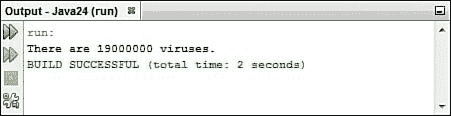

**图 11.1** `VirusLab` 程序的输出。

### 小结

至此，你已经完成了本书中面向对象概念三个小时学习内容的三分之二。你学会了如何创建对象，如何为对象及其类赋予行为和属性，以及如何通过使用转型将对象和变量转换为其他形式。

用对象的方式思考是 Java 编程语言中较难的挑战之一。然而，一旦你开始理解它，你就会意识到整个语言都在利用对象和类。

在下一小时，你将学习如何为对象指定父类和子类。

### 讲解

#### 问答

**问：** 使用类变量或方法时，是否必须创建一个对象？

**答：** 不需要。因为类变量和方法不与特定对象关联，所以你不需要仅仅为了使用它们而创建对象。使用 `Integer.parseInt()` 方法就是一个例子，因为你不必创建一个新的 `Integer` 对象，就能将字符串转换为 `int` 值。

**问：** 有没有一份包含 Java 支持的所有内置方法的清单？

**答：** Oracle 在网上提供了 Java 语言所有类的完整文档，包括你可以使用的所有公共方法，网址为 [`download.java.net/jdk8/docs/api`](http://download.java.net/jdk8/docs/api)。

**问：** 有什么方法可以控制 Java 程序使用的内存量吗？

**答：** Java 虚拟机在运行应用程序时可用的内存由两件事控制：计算机上可用的总物理内存，以及 JVM 配置使用的内存量。默认内存分配是 256MB。可以使用 `-Xmx` 命令行参数设置不同的内存量。

要在 NetBeans 中设置此项，请选择 "运行"，"设置项目配置"，"自定义"。项目属性对话框将打开，显示 "运行" 设置。在 VM 选项字段中，输入 `-Xmx1024M` 为 JVM 分配 1024MB 内存。修改该数字以调整内存大小。同时填写主类和参数字段，然后选择 "运行"，"运行项目" 来启动程序。

**问：** 要想在男子网球界获得排名，我需要做些什么？

**答：** 目前 ATP 世界巡回赛网球排名中有 2,136 名男子网球运动员。如果你的目标是至少与排名最低的选手一样好，你必须在 ITF 未来赛中进入 16 强。

在撰写本文时，Zach Itzstein 在男子单打选手中排名第 2,136 位。Itzstein 通过在过去的 52 周内参加的 15 项赛事中仅获得一分而取得了这一成绩。其他数百名选手也获得了一分，但他们是在更少的比赛中取得的。

Itzstein，这位 25 岁的澳大利亚选手，参加了 2013 年 3 月的越南 F1 未来赛。比赛有 32 名选手参加预选赛和 32 名正赛选手。Itzstein 以两盘战胜了加拿大的 Kelsey Stevenson。他在第二轮对阵英格兰的 Joshua Ward-Hibbert 时两盘失利。他当年的奖金总额为 3,448 美元（这包括他的双打收入，他在双打中排名第 625 位）。

你附近可能就有一项未来赛。全球每年举办超过 500 场这样的比赛。请访问 [www.itftennis.com](http://www.itftennis.com) 获取日历和报名信息。

祝你好运！如果你进入温网决赛，我想在球员包厢里得到一个座位。

#### 小测验

以下问题用于检验你是否具备理解 OOP 技术的属性和行为。

**1.** 在 Java 类中，方法是哪种概念的例子？

**A.** 属性

**B.** 语句

**C.** 行为

**2.** 如果你想将一个变量设为类变量，在创建时必须使用什么语句？

**A.** `new`

**B.** `public`

**C.** `static`

**3.** 程序中变量存在范围的那部分叫什么？

**A.** 它的巢穴

**B.** 作用域

**C.** 变量谷

#### 答案

**1. C.** 方法由语句组成，但它是行为的例子。

**2. C.** 如果省略了 `static` 语句，变量将成为对象变量，而不是类变量。

**3. B.** 当变量在其作用域外被使用时，编译器会报错。

#### 练习

如果关于病毒的所有讨论没有让你感到不适，你可以通过以下练习增加对本小时主题的了解：

 向 `Virus` 类添加一个 `private` 变量，用于存储一个名为 `newSeconds` 的整数。创建方法以返回 `newSeconds` 的值，并且仅在新值介于 `60` 和 `100` 之间时才更改 `newSeconds` 的值。

 编写一个 Java 应用程序，它接收一个字符串参数，将其转换为 float 变量，再转换为 `Float` 对象，最后将其转换为 `int` 变量。使用不同的参数运行几次，观察结果如何变化。

要查看实现这些活动的 Java 程序，请访问本书网站 [www.java24hours.com](http://www.java24hours.com)。

## 第 12 小时。充分利用现有对象

本小时待办事项清单：

 设计超类和子类。

 形成继承层次结构。

 覆盖方法。

Java 对象非常适合用于繁衍后代。当你创建一个对象——一套属性和行为时，你设计的东西就准备好将这些特性传递给后代了。这些子对象继承了父对象的许多相同属性和行为。它们也可以做一些与父对象不同的事情。

这个系统被称为继承，这是每个超类（父类）都会传递给其子类的东西。继承是面向对象编程（OOP）最有用的方面之一，你将在本小时学习它。

OOP 的另一个有用方面是能够创建一个可以在不同程序中使用的对象。可重用性使得开发无错误、可靠的程序变得更加容易。

### 继承的力量

每次使用标准 Java 类（如 `String` 或 `Integer`）时，你都在使用继承。Java 类被组织成一个金字塔形的类层次结构，所有类都派生自 `Object` 类。

一个类的对象从位于其上方的所有超类继承。为了实际了解这是如何运作的，我们来看看 `JApplet` 类。这个类是所有小程序（使用名为 Swing 的图形用户界面框架的基于浏览器的 Java 程序）的超类。`JApplet` 类是 `Applet` 的子类。

`JApplet` 的部分家谱如图 图 12.1 所示。每个方框代表一个类，线条将超类与其下方的任何子类连接起来。

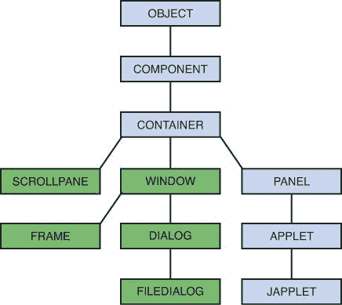

**图 12.1** `JApplet` 类的家谱。

顶部是 `Object` 类。`JApplet` 在层次结构上方有五个超类：`Applet`、`Panel`、`Container`、`Component` 和 `Object`。

`JApplet` 类从这些类中的每一个都继承了属性和行为，因为每个类都直接位于其超类层次结构中。`JApplet` 没有从 图 12.1 中的五个绿色类（包括 `Dialog` 和 `Frame`）继承任何东西，因为它们在层次结构中不位于其上方。

# 面向对象编程的继承与重用

如果这看起来令人困惑，可以把这个层级结构想象成一个家族树。`JApplet` 继承自它的父类，父类的父类，以此类推。它甚至可能从它高祖父辈的 `Object` 类继承一些东西。然而，`JApplet` 类不会从它的兄弟姐妹或堂表亲那里继承。

创建一个新类归结为以下任务：你只需定义它与现有类的不同之处。其余的工作会自动完成。

## 继承行为与属性

一个类的行为和属性是两部分的组合：它自身的行为和属性，以及它从超类继承的所有行为和属性。

以下是 `JApplet` 的一些行为和属性：

 `equals()` 方法用于判断一个 `JApplet` 对象是否与另一个对象具有相同的值。

 `setBackground()` 方法用于设置小程序窗口的背景色。

 `add()` 方法用于向小程序添加用户界面组件，如按钮和文本字段。

 `setLayout()` 方法用于定义小程序的图形用户界面如何组织。

`JApplet` 类可以使用所有这些方法，即使 `setLayout()` 是唯一一个它没有从其他类继承的方法。`equals()` 方法定义在 `Object` 类中，`setBackground()` 来自 `Component` 类，而 `add()` 来自 `Container` 类。

### 方法重写

在 `JApplet` 类中定义的某些方法，也在其某个超类中有定义。例如，`update()` 方法既是 `JApplet` 类的一部分，也是 `Component` 类的一部分。当一个方法同时在子类和其超类中定义时，会使用子类的方法。这使得子类能够更改、替换或完全消除其超类的一些行为或属性。就 `update()` 而言，其目的是消除超类中存在的某些行为。

在子类中创建一个新方法来更改从超类继承的行为，称为重写该方法。每当继承的行为产生不期望的结果时，你都需要重写该方法。

## 建立继承关系

一个类使用 `extends` 语句定义为另一个类的子类，如下所示：

```java
class AnimatedLogo extends JApplet {

    // 行为和属性放在这里

}
```

`extends` 语句将 `AnimatedLogo` 类对象建立为 `JApplet` 的子类。所有 Swing 小程序都必须是 `JApplet` 的子类。它们需要该类提供的功能，以便在网页上呈现时运行。

`AnimatedLogo` 必须重写的一个方法是 `paint()` 方法，它用于绘制程序窗口内的所有内容。`paint()` 方法由 `Component` 类实现，一路传递到 `AnimatedLogo`。然而，`paint()` 方法本身不做任何事。它的存在是为了让 `Component` 的子类在需要显示某些内容时有一个可用的方法。

要重写一个方法，你必须以与其在从中继承的超类中声明的相同方式声明该方法。一个 `public` 方法必须保持为 public，方法返回的值必须相同，并且方法的参数数量和类型不得更改。

`Component` 类的 `paint()` 方法开头如下：

```java
public void paint(Graphics g) {
```

当 `AnimatedLogo` 重写此方法时，它必须以类似这样的语句开头：

```java
public void paint(Graphics screen) {
```

唯一的区别在于 `Graphics` 对象的名称，而这在确定方法是否以相同方式创建时并不重要。这两个语句匹配是因为以下几点匹配：

 两个 `paint()` 方法都是 `public` 的。

 两个方法都不返回值，由使用 `void` 语句声明。

 两者都接受一个 `Graphics` 对象作为其唯一参数。

### 在子类中使用 `this` 和 `super`

两个在子类中极其有用的关键字是 `this` 和 `super`。

正如你在前一个小时所学，`this` 关键字用于引用当前对象。当你在创建一个类并需要引用由该类创建的特定对象时，可以使用 `this`，如以下语句所示：

```java
this.title = "Cagney";
```

此语句将对象的 `title` 变量设置为文本“Cagney”。

`super` 关键字具有类似的用途：它引用对象的直接超类。你可以用几种不同的方式使用 `super`：

 引用超类的构造方法，例如 `super("Adam", 12);`

 引用超类的变量，例如 `super.hawaii = 50`

 引用超类的方法，例如 `super.dragnet();`

使用 `super` 关键字的一种方式是在子类的构造函数中。因为子类继承了其超类的行为和属性，所以你必须将该子类的每个构造函数与其超类的构造函数关联起来。否则，一些行为和属性可能无法正确设置，子类将无法正常工作。

为了关联构造函数，子类构造函数的第一条语句必须是调用超类构造函数的语句。这需要 `super` 关键字，如以下语句所示：

```java
public DataReader(String name, int length) {

    super(name, length);

}
```

此示例是一个子类的构造函数，它使用语句 `super(name, length)` 来调用其超类中的一个可比构造函数。

如果你不使用 `super()` 来调用超类中的构造函数，Java 会在子类构造函数开始时自动调用无参的 `super()`。如果此超类构造函数不存在或提供意外的行为，将会导致错误，因此最好自己调用超类构造函数。


# 使用现有对象

OOP 鼓励重用。如果你为一个 Java 编程项目开发了一个对象，那么应该可以将其合并到另一个项目中而无需修改。

如果一个 Java 类设计良好，那么可以将其用于其他程序。你的程序中可供使用的对象越多，在创建自己的软件时你需要做的工作就越少。如果有一个优秀的、适合你需求的拼写检查对象，你可以使用它而不是自己编写。理想情况下，你甚至可以给你的老板造成一种错觉，让他以为你在项目中添加拼写检查功能花费了很长时间，并利用这些额外时间在办公室打私人长途电话。

**注意**

本书作者，与他许多同行一样，是自由职业者，并在家中工作。在评估他关于如何在工作场所行事的建议时，请牢记这一点。

当 Java 首次推出时，共享对象的系统在很大程度上是不正式的。程序员开发他们的对象，使其尽可能独立，并通过使用私有变量以及读写这些变量的公共方法来防止它们被误用。

当存在一种开发可重用对象的标准方法时，共享对象变得更加强大。

标准的好处包括：

 无需太多文档来解释对象的工作原理，因为任何了解该标准的人已经对其运作方式了解甚多。

# 在数组列表中存储相同类的对象

编写计算机程序时，一个重要的决策是数据存储的位置。在本书的前半部分，你已经发现了三种存储信息的实用位置：

- 基本数据类型，如 `int` 和 `char`
- 数组
- `String` 对象

存储信息的方式远不止这些，因为任何 Java 类都可以持有数据。其中最实用的之一是 `ArrayList`，一种持有相同类对象的数据结构。顾名思义，数组列表类似于数组，后者也持有相关数据的元素，但它们可以在任何时候改变大小。

`ArrayList` 类属于 `java.util` 包中的类，这是 Java 类库中最实用的包之一。使用 `import` 语句使其在你的程序中可用：

```java
import java.util.ArrayList;
```

一个数组列表持有属于同一类或共享同一超类的对象。它们通过引用两个类来创建：`ArrayList` 类和列表所持有的类。列表所持有的类名被放置在 `<` 和 `>` 字符之间，如以下语句所示：

```java
ArrayList<String> structure = new ArrayList<String>();
```

前面的语句创建了一个持有字符串的列表。通过这种方式识别列表的类利用了**泛型**，这是一种指明数组列表等数据结构所持有对象类型的方法。如果你使用的是旧版本的 Java，你会编写如下构造函数：

```java
ArrayList structure = new ArrayList();
```

尽管你仍然可以这样做，但泛型使你的代码更可靠，因为它们为编译器提供了一种防止更多错误的方法。在这里，它们防止你通过将错误类的对象放入数组列表中而误用它。如果你试图将一个 `Integer` 对象放入本应持有 `String` 对象的列表中，编译器会报错。

与数组不同，数组列表不是以固定元素数量创建的。列表创建时默认有 10 个元素。如果你知道要存储的对象数量远超于此，可以在构造函数中指定一个大小作为参数。以下是创建一个可容纳 300 个元素的列表的语句：

```java
ArrayList<String> structure = new ArrayList<String>(300);
```

你可以通过调用列表的 `add()` 方法并传入对象作为唯一参数来向列表添加对象：

```java
structure.add("Vance");
structure.add("Vernon");
structure.add("Velma");
```

你按照顺序添加对象，因此如果这是添加到 `structure` 的前三个对象，元素 0 是“Vance”，元素 1 是“Vernon”，元素 2 是“Velma”。

你可以通过调用列表的 `get()` 方法并传入元素的索引号作为参数来检索元素：

```java
String name = structure.get(1);
```

这条语句将“Vernon”存储在 `name` 字符串中。

要查看列表的元素中是否包含某个对象，可以调用其 `contains()` 方法并传入该对象作为参数：

```java
if (structure.contains("Velma")) {
    System.out.println("Velma found");
}
```

你可以使用对象本身或其索引号从列表中移除对象：

```java
structure.remove(0);
structure.remove("Vernon");
```

这两条语句会留下“Velma”作为列表中唯一的字符串。

## 遍历数组列表

Java 包含一个特殊的 `for` 循环，可以方便地遍历数组列表并依次检查其每个元素。这个循环只有两部分，比你在第 8 小时，“使用循环重复操作”中学到的 `for` 循环少一部分。

第一部分是初始化部分：一个用于保存从列表中检索到的每个对象的变量的类名和变量名。该对象应与持有列表的类属于同一类。第二部分指明列表。

以下是遍历 `structure` 列表并将每个名称显示到屏幕上的代码：

```java
for (String name : structure) {
    System.out.println(name);
}
```

本节的第一个项目将尝试使用数组列表和特殊的 `for` 循环，按字母顺序显示一个字符串列表。该列表来源于一个数组和命令行参数。在 NetBeans 中打开你的 Java24 项目，选择“文件”、“新建文件”，然后创建一个名为 `StringLister` 的新空 Java 文件。在源代码编辑器中输入清单 12.1 的内容并保存文件。

**清单 12.1 `StringLister.java` 完整文本**

```java
package com.java24hours;

import java.util.*;

public class StringLister {
    String[] names = { "Spanky", "Alfalfa", "Buckwheat", "Daria",
        "Stymie", "Marianne", "Scotty", "Tommy", "Chubby" };

    public StringLister(String[] moreNames) {
        ArrayList<String> list = new ArrayList<String>();
        for (int i = 0; i < names.length; i++) {
            list.add(names[i]);
        }
        for (int i = 0; i < moreNames.length; i++) {
            list.add(moreNames[i]);
        }
        Collections.sort(list);
        for (String name : list) {
            System.out.println(name);
        }
    }

    public static void main(String[] arguments) {
        StringLister lister = new StringLister(arguments);
    }
}
```

在运行应用程序之前，你应该使用“运行”、“设置项目配置”、“自定义”命令将主类设置为 `StringLister`，并将参数设置为一个或多个以空格分隔的名字，例如 `Jackie Mickey Farina Woim`。然后选择“运行”、“运行项目”以查看结果。

命令行中指定的名字被添加到第 6-7 行数组中存储的名字。因为直到程序运行才知道名字的总数，所以数组列表比数组更适合作为这些字符串的存储位置。列表中的字符串使用 `Collections` 类的一个方法按字母顺序排序：

```java
Collections.sort(list);
```

这个类与 `ArrayList` 一样，属于 `java.util` 包。数组列表和其他有用的数据结构在 Java 中被称为**集合**。

运行程序时，输出应该是一个按字母顺序排列的名字列表（参见图 12.2）。数组列表灵活的大小使得你添加的额外名字可以被添加到数据结构中，并与其他名字一起排序。

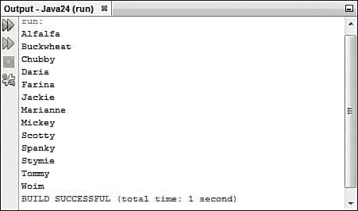

**图 12.2** `StringLister` 程序的输出。

# 创建子类

为了了解继承的实际工作方式，在下一个项目中，你将创建一个名为 `Point3D` 的类，它表示三维空间中的一个点。你可以用 (x,y) 坐标表示一个二维点。三维空间增加了第三个坐标，可以称为 z。

`Point3D` 类的对象可以做三件事：

- 跟踪对象的 (x,y,z) 坐标
- 将对象移动到一个新的 (x,y,z) 坐标
- 将对象移动指定数量的 x、y 和 z 值

Java 已经有一个表示二维点的标准类，名为 `Point`。

## Point3D 类的介绍与代码示例

`Point3D` 类继承自 `Point` 类，并添加了三维坐标的 `z` 值。它有两个整型变量 `x` 和 `y`，用于存储 `Point` 对象的 (x,y) 位置。它还包含一个 `move()` 方法，用于将点放置在指定位置，以及一个 `translate()` 方法，用于通过 x 和 y 值的增量移动对象。

在 NetBeans 的 Java24 项目中，创建一个名为 `Point3D` 的新空 Java 文件，并将 清单 12.2 中的文本输入到文件中。完成后保存。

### 清单 12.2 `Point3D.java` 的完整文本

点击此处查看代码图片

```java
package com.java24hours;

import java.awt.*;

public class Point3D extends Point {
    public int z;

    public Point3D(int x, int y, int z) {
        super(x,y);
        this.z = z;
    }

    public void move(int x, int y, int z) {
        this.z = z;
        super.move(x, y);
    }

    public void translate(int x, int y, int z) {
        this.z += z;
        super.translate(x, y);
    }
}
```

`Point3D` 类没有 `main()` 方法，因此不能作为应用程序运行，但可以在任何需要三维点的 Java 程序中使用它。

`Point3D` 类只需要完成其超类 `Point` 未完成的工作。这主要涉及跟踪整型变量 `z`，并将其作为参数传递给 `move()` 方法、`translate()` 方法和 `Point3D()` 构造函数。

所有方法都使用了关键字 `super` 和 `this`。`this` 语句用于引用当前的 `Point3D` 对象，因此第 10 行的 `this.z = z` 将对象变量 `z` 设置为在第 8 行作为参数传递给方法的 `z` 值。

`super` 语句引用当前对象的超类 `Point`。它用于设置由 `Point3D` 继承的变量和调用方法。第 9 行的 `super(x,y)` 语句调用超类中的 `Point(x,y)` 构造函数，然后设置 `Point3D` 对象的 (x,y) 坐标。因为 `Point` 已经能够处理 x 和 y 轴，所以 `Point3D` 类的对象再做同样的事情是多余的。

要测试新的 `Point3D` 类，可以创建一个使用 `Point` 和 `Point3D` 对象并移动它们的程序。在 NetBeans 中创建一个名为 `PointTester` 的新文件，并将 清单 12.3 输入到其中。文件保存时会自动编译。

### 清单 12.3 `PointTester.java` 的完整文本

点击此处查看代码图片

```java
package com.java24hours;

import java.awt.*;

class PointTester {
    public static void main(String[] arguments) {
        Point location1 = new Point(11,22);
        Point3D location2 = new Point3D(7,6,64);

        System.out.println("The 2D point is at (" + location1.x
            + ", " + location1.y + ")");
        System.out.println("It's being moved to (4, 13)");
        location1.move(4,13);
        System.out.println("The 2D point is now at (" + location1.x
            + ", " + location1.y + ")");
        System.out.println("It's being moved -10 units on both the x "
            + "and y axes");
        location1.translate(-10,-10);
        System.out.println("The 2D point ends up at (" + location1.x
            + ", " + location1.y + ")\n");

        System.out.println("The 3D point is at (" + location2.x
            + ", " + location2.y + ", " + location2.z + ")");
        System.out.println("It's being moved to (10, 22, 71)");
        location2.move(10,22,71);
        System.out.println("The 3D point is now at (" + location2.x
            + ", " + location2.y + ", " + location2.z + ")");
        System.out.println("It's being moved -20 units on the x, y "
            + "and z axes");
        location2.translate(-20,-20,-20);
        System.out.println("The 3D point ends up at (" + location2.x
            + ", " + location2.y + ", " + location2.z + ")");
    }
}
```

通过选择“运行，运行文件”来运行文件，如果程序编译正确，您将看到 图 12.3 中所示的输出。如果没有，请查找源代码编辑器旁边的红色警报图标，该图标指示触发错误的行。

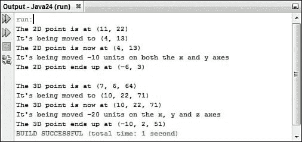

**图 12.3** `PointTester` 程序的输出。

# 总结

当人们谈论出生的奇迹时，他们可能指的不是 Java 中超类可以派生子类的方式，或者类层次结构中行为和属性被继承的方式。

如果现实世界像面向对象编程一样运作，那么莫扎特的每个后代都可以选择成为一名杰出的作曲家。马克·吐温的所有后代都可以对密西西比河上的汽船生活充满诗意。你祖先努力获得的每一项技能都会毫无费力地传承给你。

就奇迹的尺度而言，继承性并不完全与物种的延续或棒球比赛中连续投出无安打比赛相提并论。然而，它是一种以最少重复工作来设计软件的有效方式。

# Workshop

## Q&A

**问：** 到目前为止创建的大多数 Java 程序都没有使用 `extends` 来继承超类。这是否意味着它们存在于类层次结构之外？

**答：** 你在 Java 中创建的所有类都是层次结构的一部分，因为当你不使用 `extends` 关键字时，你编写的程序的默认超类是 `Object`。所有类的 `equals()` 和 `toString()` 方法都是自动从 `Object` 继承的行为的一部分。

**问：** 为什么当人们发现某些东西时会喊“eureka！”？

**答：** “Eureka”借自古希腊语，意为“我找到了！”据说希腊学者阿基米德在踏入浴盆时喊出了这句话。

希腊人在浴缸里发现了什么？上升的水位，这使他理解了排开水的体积必须等于他身体部位的体积。

关于阿基米德的故事是在两个世纪后由维特鲁威在他的多卷本《建筑十书》中传播开来的，这是一本关于建筑的书。

“Eureka”自 1849 年以来一直出现在加利福尼亚州的州徽上，指的是早一年在 Sutter’s Mill 附近发现黄金。

## Quiz

为了确定你在过去一小时的工作中继承了什么样的知识，请回答以下问题。

**1.** 如果一个超类以你不希望在子类中使用的方式处理一个方法，你可以做什么？

**A.** 在超类中删除该方法。

**B.** 在子类中重写该方法。

**C.** 给《圣何塞水星报》的编辑写一封措辞激烈的信，希望 Java 的开发者能看到。

**2.** 你可以使用什么方法来检索存储在数组列表中的元素？

**A.** `get()`

**B.** `read()`

**C.** `elementAt()`

**3.** 你可以使用什么语句来引用当前对象的方法和变量？


**A.** `this`

**B.** `that`

**C.** `theOther`

### Answers

**1. B.** 因为你可以重写该方法，所以不必更改超类的任何方面或其工作方式。

**2. A.** `get()` 方法有一个参数——元素的索引号。

**3. A.** `this` 关键字引用它出现的对象。

### Activities

如果丰富的想象力在你心中催生了进一步学习的欲望，你可以通过以下活动衍生出更多关于继承的知识：

 创建一个 `Point4D` 类，在 `Point3D` 类创建的 (x,y,z) 坐标系基础上增加一个 `t` 坐标。`t` 坐标代表时间，因此你需要确保它永远不会被设置为负值。

 考虑一支橄榄球队的进攻组成员：线锋、外接手、近端锋、跑卫和四分卫。设计一个类层次结构来代表这些球员的技能，将共同的技能置于层次结构的更高级别。例如，阻挡可能是线锋和近端锋类应该继承的行为，而速度则是外接手和跑卫应该继承的特质。

要查看实现这些活动的 Java 程序，请访问本书网站：[www.java24hours.com](http://www.java24hours.com)。

# 第四部分：编写图形用户界面程序

## 第 13 小时。构建简单的用户界面

本小时任务清单：

 创建用户界面组件，例如按钮。

 创建标签、文本框和其他组件。

 将组件分组。

 将组件放入其他组件内部。

 水平和垂直滚动组件。

 打开和关闭窗口。

这一小时将会变得相当“黏糊”。在使用 Java 创建你的第一个图形用户界面（GUI）时，你将会制造一个巨大的“烂摊子”。

计算机用户已经习惯于他们的软件拥有 GUI，能够通过鼠标接收用户输入，并像其他程序一样工作。尽管一些用户仍然在 MS-DOS 或 Linux shell 这样的命令行环境中工作，但大多数用户会对不提供像 Microsoft Windows 或 Mac OS 那样的点击式、拖放式图形界面的软件感到困惑。

Java 通过 Swing 来支持这类软件，Swing 是一组 Java 类的集合，代表了所有可以作为 GUI 一部分的按钮、文本框、滑块和其他组件，以及从这些组件接收用户输入所需的类。

在这一小时和下一个小时，你将学习如何在 Java 中创建和组织 GUI。之后在第 15 小时的“响应用户输入”中，你将使这些界面能够接收鼠标点击和其他用户输入。

### Swing 与抽象窗口工具包

因为 Java 是一种跨平台语言，能够让你为多种操作系统编写程序，所以它的图形用户界面软件必须具有灵活性。它不能只迎合 Windows 风格或 Mac 版本，而必须同时处理两者以及其他平台。

在 Java 中，程序用户界面的开发基于 Swing 和一个早期称为抽象窗口工具包（Abstract Windowing Toolkit）的类集。这些类使你能够创建 GUI 并从用户那里接收输入。

***

**注意**

Swing 包含数十种组件，它们的自定义方式远比本书所能记录的要多得多。本书涵盖了最常见的组件及其最有用的方法。在接下来的四个小时里探索它们时，你可以在 Oracle 官方的 Java 类库文档中了解每个组件的更多信息并发现新方法。阅读地址：[`download.java.net/jdk8/docs/api`](http://download.java.net/jdk8/docs/api)。该文档提供了关于 Java 8 中每个类和接口的额外参考文档。

***

Swing 包含了编写使用 GUI 的程序所需的一切。借助 Java 的用户界面类，你可以创建一个包含以下所有内容以及更多内容的 GUI：

 按钮、复选框、标签和其他简单组件

 文本框、滑块和其他更复杂的组件

 下拉菜单和弹出菜单

 窗口、框架、对话框、面板和小程序窗口

### 使用组件

在 Java 中，GUI 的每个部分都由 Swing 包中的一个类表示。有用于按钮的 `JButton` 类，用于窗口的 `JWindow` 类，用于文本框的 `JTextField` 类，等等。

要创建和显示一个界面，你需要创建对象，设置它们的变量，并调用它们的方法。这些技术与你之前三小时在学习面向对象编程（OOP）时所使用的技术相同。

当你组装 GUI 时，你会使用两种对象：组件和容器。组件是用户界面中的单个元素，例如按钮或滑块。容器是一种你可以用来容纳其他组件的组件。

创建界面的第一步是创建一个可以容纳组件的容器。在应用程序中，这个容器通常是一个窗口或一个框架。

#### 窗口和框架

窗口和框架是可以在用户界面中显示并容纳其他组件的容器。窗口是简单的容器，没有标题栏，也没有通常沿着 GUI 顶部边缘的其他按钮。框架是包含所有常见窗口特性的窗口，这些特性是用户在运行软件时期望看到的——例如关闭、展开和缩小窗口的按钮。

你可以使用 Swing 的 `JWindow` 和 `JFrame` 类来创建这些容器。要在 Java 程序中引用 Swing 类而不使用其完整的包名和类名，请使用以下语句：

```java
import javax.swing.*;
```

这只导入了 `javax.swing` 包中的类名。你还会在 Swing 中用到其他包。

在 Java 应用程序中使用框架的一种方法是使该应用程序成为 `JFrame` 的子类。你的程序继承了作为框架运行所需的行为。以下语句创建了一个 `JFrame` 的子类：

```java
import javax.swing.*;

public class MainFrame extends JFrame {

    public MainFrame() {

        // 设置框架

    }

}
```

这个类创建了一个框架，但没有完全设置它。在框架的构造函数中，创建框架时你必须做几件事：

 调用超类 `JFrame` 的一个构造函数。

 设置框架的标题。

 设置框架的大小。

 设置框架的外观和感觉。

 定义当用户关闭框架时发生的情况。

你还必须使框架可见，除非有原因要求它在应用程序开始运行时不应显示。

大多数这些事情都可以在框架的构造函数中处理。该方法必须包含的第一件事是使用 `super` 语句调用 `JFrame` 的一个构造函数。这里有一个例子：

`super();`

前面的语句调用了没有参数的 `JFrame` 构造函数。你也可以使用框架的标题作为参数来调用它：

`super("Main Frame");`

这将框架标题栏（位于顶部边缘）中的标题设置为指定的字符串。在这个例子中，显示文本“Main Frame”。

如果未以这种方式设置标题，你可以使用标题作为参数调用框架的 `setTitle(String)` 方法：

`setTitle("Main Frame");`

可以通过使用两个参数（宽度和高度）调用其 `setSize(int, int)` 方法来设置框架的大小。以下语句设置了一个宽 350 像素、高 125 像素的框架：

`setSize(350, 125);`

设置框架大小的另一种方法是用组件填充它，然后使用无参数调用框架的 `pack()` 方法：

`pack();`

# 框架简介

`pack()` 方法会调整框架大小，使其刚好能够容纳框架内每个组件的首选尺寸（但不会更大）。每个界面组件都有首选尺寸，尽管根据界面中组件的排列方式，有时会忽略这一点。在调用 `pack()` 之前，你不需要显式设置框架的尺寸——该方法会在框架显示之前将其设置为一个合适的尺寸。

每个框架显示时，其标题栏上都有一个可用于关闭框架的按钮。在 Windows 系统中，此按钮表现为框架右上角的一个 `X`。要定义点击此按钮时发生什么，请使用四个 `JFrame` 类变量之一作为参数来调用框架的 `setDefaultCloseOperation(int)` 方法：

- `EXIT_ON_CLOSE` — 点击按钮时退出程序。

- `DISPOSE_ON_CLOSE` — 关闭框架并继续运行应用程序。

- `DO_NOTHING_ON_CLOSE` — 保持框架打开并继续运行。

- `HIDE_ON_CLOSE` — 关闭框架并继续运行。

此方法调用是最常见的，因为当图形用户界面关闭时，意味着应用程序应完成其工作并关闭：

```java
setDefaultCloseOperation(JFrame.EXIT_ON_CLOSE);
```

使用 Swing 创建的图形用户界面可以通过外观和感觉来定制其外观，这是一种控制按钮和其他组件外观及行为的可视主题。

## 设置外观和感觉

Java 包含一种名为 Nimbus 的增强外观和感觉，但必须在类中启用才能使用。设置外观和感觉是通过在主 Swing 包中调用 `UIManager` 类的 `setLookAndFeel()` 方法来完成的。

该方法接受一个参数：外观和感觉类的完整名称。

以下语句将 Nimbus 设置为外观和感觉：

```java
UIManager.setLookAndFeel(
    "com.sun.java.swing.plaf.nimbus.NimbusLookAndFeel"
);
```

最后一件事是使框架可见。使用 `true` 作为参数调用其 `setVisible()` 方法：

```java
setVisible(true);
```

这将打开一个具有指定宽度和高度的框架。你也可以使用 `false` 调用它来停止显示框架。

## 示例：SalutonFrame

代码清单 13.1 包含了本节描述的源代码。在一个名为 `SalutonFrame` 的 Java 文件中，输入以下语句。

**代码清单 13.1** `SalutonFrame.java` 的完整内容

```java
package com.java24hours;

import javax.swing.*;

public class SalutonFrame extends JFrame {
    public SalutonFrame() {
        super("Saluton mondo!");
        setLookAndFeel();
        setSize(350, 100);
        setDefaultCloseOperation(JFrame.EXIT_ON_CLOSE);
        setVisible(true);
    }

    private void setLookAndFeel() {
        try {
            UIManager.setLookAndFeel(
                "com.sun.java.swing.plaf.nimbus.NimbusLookAndFeel"
            );
        } catch (Exception exc) {
            // 忽略错误
        }
    }

    public static void main(String[] arguments) {
        SalutonFrame frame = new SalutonFrame();
    }
}
```

代码清单 13.1 的第 24–26 行包含一个 `main()` 方法，它将此框架类转换为一个应用程序。当你运行此类时，你会看到 图 13.1 所示的框架。


`SalutonFrame` 只显示一个标题：传统的程序员问候语“Saluton mondo!”。该框架是一个空窗口，因为它尚未包含任何其他组件。

要向框架添加组件，你必须创建该组件并将其添加到容器中。每个容器都有一个 `add()` 方法，它接受一个参数：要显示的组件。

`SalutonFrame` 类包含一个 `setLookAndFeel()` 方法，该方法指定 Nimbus 作为框架的外观和感觉。这是通过在第 16–18 行调用 `UIManager` 类的 `setLookAndFeel()` 方法来完成的。

对此方法的调用放在一个 `try`-`catch` 块中，这使得可以处理可能发生的错误。`try` 和 `catch` 语句是新的，因为它们尚未介绍过。使用这些语句处理错误在 第 18 小时 “处理程序中的错误” 中讲解。

此时，你需要知道的是，调用 `UIManager.setLookAndFeel()` 可以设置 GUI 的外观和感觉。任何因此可能导致的错误只会导致程序保留默认的外观和感觉，而不是 Nimbus。

> **提示：**

> 在 代码清单 13.1 中，有些东西你可能以前没见过。仔细看看第 16–18 行。它们是一条语句，分布在三行上。该语句可以放在一行，但为了人类的可读性而被拆开了——Java 编译器并不关心额外的空格。只要语句包含正确的内容并以分号结尾，它可以跨多行书写。

# 向框架添加组件

## 按钮

你可以添加到容器中的一个简单组件是 `JButton` 对象。`JButton` 与你本节中使用的其他组件一样，是 `java.awt.swing` 包的一部分。`JButton` 对象是一个可点击的按钮，带有一个描述点击该按钮所执行操作的标签。此标签可以是文本、图形或两者兼有。以下语句创建一个名为 `okButton` 的 `JButton`，并为其指定文本标签 `OK`：

```java
JButton okButton = new JButton("OK");
```

在创建像 `JButton` 这样的组件后，应通过调用其 `add()` 方法将其添加到容器中：

```java
add(okButton);
```

当向容器添加组件时，你不需要指定组件在容器中的显示位置。组件的排列由称为布局管理器的对象决定。其中最简单的是 `FlowLayout` 类，它是 `java.awt` 包的一部分。

要使容器使用特定的布局管理器，你必须首先创建该布局管理器类的一个对象。你可以通过调用其无参构造函数来创建一个 `FlowLayout` 对象：

```java
FlowLayout flo = new FlowLayout();
```

创建布局管理器后，你调用容器的 `setLayout` 方法，将指定的管理器与该容器关联起来：

```java
setLayout(flo);
```

此语句将 `flo` 对象指定为布局管理器。

## 示例：Playback

你将创建的下一个应用程序，一个名为 `Playback` 的类，是一个 Java 应用程序，它显示一个带有三个按钮的框架。在新的 Java 文件中输入 代码清单 13.2 的内容并保存文件。

**代码清单 13.2** `Playback.java` 的完整内容

```java
package com.java24hours;

import javax.swing.*;
import java.awt.*;

public class Playback extends JFrame {
    public Playback() {
        super("Playback");
        setLookAndFeel();
        setSize(225, 80);
        setDefaultCloseOperation(JFrame.EXIT_ON_CLOSE);
        FlowLayout flo = new FlowLayout();
        setLayout(flo);
        JButton play = new JButton("Play");
        JButton stop = new JButton("Stop");
        JButton pause = new JButton("Pause");
        add(play);
        add(stop);
        add(pause);
        setVisible(true);
    }

    private void setLookAndFeel() {
        try {
            UIManager.setLookAndFeel(
                "com.sun.java.swing.plaf.nimbus.NimbusLookAndFeel"
            );
        } catch (Exception exc) {
            // 忽略错误
        }
    }

    public static void main(String[] arguments) {
        Playback frame = new Playback();
    }
}
```

# 总结

在本节中，你学习了如何在 Java Swing 中创建和自定义框架，包括设置它们的大小、外观和关闭时的行为。你还学习了如何向框架添加简单的组件（如按钮），以及如何使用布局管理器来排列它们。

# UI 编程组件


```java
UIManager.setLookAndFeel(
    "com.sun.java.swing.plaf.nimbus.NimbusLookAndFeel"
);
} catch (Exception exc) {
    // ignore error
}
}

public static void main(String[] arguments) {
    Playback frame = new Playback();
}
}
```

`Playback`程序在第 12 行创建了一个`FlowLayout`布局管理器，并在第 13 行设置框架使用该布局。当三个按钮在第 17-19 行添加到框架时，它们将由这个布局管理器排列。

**注意**

由于本小时介绍了许多不同的用户界面组件，此处并未列出创建每个图表的全部源代码。您可以在本书网站[www.java24hours.com](http://www.java24hours.com)的第 13 小时页面找到每个程序的完整版本。

当您运行应用程序时，您的输出应类似于图 13.2。虽然您可以点击按钮，但程序中没有包含接收和响应用户输入的方法，因此不会发生任何响应。这部分内容将在第 15 小时中介绍。


**图 13.2** 显示了 GUI 上的按钮。

您可以以这种方式向容器添加许多`Swing`用户组件。

## 标签和文本字段

`JLabel`组件显示用户无法修改的信息。这些信息可以是文本、图形或两者兼有。这些组件通常用于在界面中标记其他组件，因此得名。它们经常用来标识文本字段。

`JTextField`组件是一个允许用户输入单行文本的区域。创建文本字段时，可以设置其宽度。

以下语句创建一个`JLabel`组件和一个`JTextField`组件，并将它们添加到容器中：

```java
JLabel pageLabel = new JLabel("Web page address: ", JLabel.RIGHT);
JTextField pageAddress = new JTextField(20);
FlowLayout flo = new FlowLayout();
setLayout(flo);
add(pageLabel);
add(pageAddress);
```

图 13.3 显示了并排显示的标签和文本字段。此示例中的两个语句都使用参数来配置组件的外观。


**图 13.3** 显示标签和文本字段。

`pageLabel`标签设置为文本“Web page address:”和一个`JLabel.RIGHT`参数。后一个值表示标签应靠右对齐。`JLabel.LEFT`使标签文本靠左对齐，`JLabel.CENTER`使其居中。用于`JTextField`的参数表示文本字段应约为 20 个字符宽。您也可以使用如下语句指定出现在文本字段中的默认文本：

```java
JTextField country = new JTextField("Togolese Republic", 29);
```

此语句将创建一个宽 20 个字符、且文本字段中包含文本“Togolese Republic”的`JTextField`对象。

您可以使用`getText()`方法检索对象内包含的文本，该方法返回一个字符串：

```java
String countryChoice = country.getText();
```

正如您可能猜到的，您也可以使用相应的方法设置文本：

```java
country.setText("Separate Customs Territory of Taiwan, Penghu, Kinmen, and Matsu");
```

这将设置文本为中华台北的官方名称，这是世界上最长的国家名称，略胜第二名：大不列颠及北爱尔兰联合王国。

## 复选框

`JCheckBox`组件是一个方框，旁边有一行文本，用户可以勾选或取消勾选。以下语句创建一个`JCheckBox`对象并将其添加到容器中：

```java
JCheckBox jumboSize = new JCheckBox("Jumbo Size");
FlowLayout flo = new FlowLayout();
setLayout(flo);
add(jumboSize);
```

`JCheckBox()`构造函数的参数指定要与方框一起显示的文本。如果您希望方框被选中，请改用以下语句：

```java
JCheckBox jumboSize = new JCheckBox("Jumbo Size", true);
```

您可以单独呈现`JCheckBox`，也可以将其作为组的一部分。在一组复选框中，一次只能选中一个。要使`JCheckBox`对象成为组的一部分，您必须创建一个`ButtonGroup`对象。请考虑以下内容：

```java
JCheckBox frogLegs = new JCheckBox("Frog Leg Grande", true);
JCheckBox fishTacos = new JCheckBox("Fish Taco Platter", false);
JCheckBox emuNuggets = new JCheckBox("Emu Nuggets", false);
FlowLayout flo = new FlowLayout();
ButtonGroup meals = new ButtonGroup();
meals.add(frogLegs);
meals.add(fishTacos);
meals.add(emuNuggets);
setLayout(flo);
add(jumboSize);
add(frogLegs);
add(fishTacos);
add(emuNuggets);
```

这将创建三个复选框，它们都分组在名为`meals`的`ButtonGroup`对象下。青蛙腿大餐（Frog Leg Grande）复选框最初被选中，但如果用户选中其他餐点复选框之一，青蛙腿大餐旁边的选中标记将自动消失。图 13.4 显示了本节中不同的复选框。


**图 13.4** 显示复选框组件。

## 组合框

`JComboBox`组件是一个弹出式选择列表，也可以设置为接收文本输入。当两种选项都启用时，您可以使用鼠标选择一项，也可以使用键盘输入文本。组合框的作用类似于一组复选框，不同之处在于，除非弹出列表正在显示，否则只有一项选择是可见的。

要创建一个`JComboBox`对象，您必须在创建对象后添加每个选择，如下例所示：

```java
JComboBox profession = new JComboBox();
FlowLayout flo = new FlowLayout();
profession.addItem("Butcher");
profession.addItem("Baker");
profession.addItem("Candlestick maker");
profession.addItem("Fletcher");
profession.addItem("Fighter");
profession.addItem("Technical writer");
setLayout(flo);
add(profession);
```

此示例创建一个`JComboBox`组件，提供六种用户可选择的选择。选择一个项目后，它会出现在组件的显示区域。图 13.5 显示了当选择列表的弹出菜单正在显示时的示例。

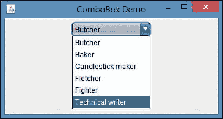

**图 13.5** 显示组合框组件。

要使`JComboBox`组件能够接收文本输入，必须使用参数`true`调用其`setEditable(boolean)`方法：

```java
profession.setEditable(true);
```

必须在将组件添加到容器之前调用此方法。

## 文本区域

`JTextArea`组件是一个允许用户输入多行文本的文本字段。您可以指定组件的宽度和高度。以下语句创建一个宽度为 40 个字符、高度为 8 行的`JTextArea`组件，并将其添加到容器中：

```java
JTextArea comments = new JTextArea(8, 40);
FlowLayout flo = new FlowLayout();
setLayout(flo);
add(comments);
```

图 13.6 显示了在框架中的此示例。

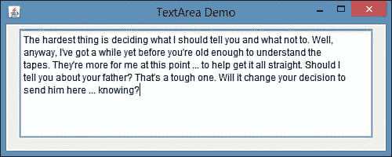

**图 13.6** 显示文本区域组件。

您可以在`JTextArea()`构造函数中指定要在文本区域中显示的字符串，使用换行符`\n`将文本发送到下一行，如以下所示：

## 使用 JTextArea 和 JScrollPane

```java
JTextArea comments = new JTextArea("I should have been a pair\n"
    + "of ragged claws.", 10, 25);
```

文本区域有两个方法可以用来指定当用户输入的文本超过一行右边缘时组件的行为。调用 `setLineWrap(boolean)` 方法，并传入 `true` 参数，可使文本自动换行到下一行：

```java
comments.setLineWrap(true);
```

要确定文本如何换行到下一行，请使用 `setWrapStyleWord(boolean)` 方法。传入 `true` 参数表示根据单词边界换行，传入 `false` 表示根据字符换行。

如果未调用这些方法，文本将不会自动换行。用户可以在同一行持续输入文本，直到按下 Enter 键或超过区域的右边缘。

文本区域组件的行为可能出乎你的意料——当用户到达区域底部时，它们会扩大尺寸，并且不会在右侧或底部边缘包含滚动条。为了使其表现更符合预期，你必须将文本区域放入一个称为滚动窗格的容器中。

GUI 中的组件通常大于可用于显示它们的区域。为了使组件能够从一个部分移动到另一个部分，你需要使用垂直和水平滚动条。

在 Swing 中，通过将组件添加到滚动窗格（由 `JScrollPane` 类表示）来支持滚动。

你可以使用以下构造函数创建滚动窗格：

- `JScrollPane()`——创建一个根据需要显示水平和垂直滚动条的滚动窗格。
- `JScrollPane(int, int)`——创建一个带有指定垂直和水平滚动条的滚动窗格。
- `JScrollPane(Component)`——创建一个包含指定用户界面组件的滚动窗格。
- `JScrollPane(Component, int, int)`——创建一个带有指定组件、垂直滚动条和水平滚动条的滚动窗格。

这些构造函数的整数参数决定窗格中滚动条的使用方式。请使用以下类变量作为这些参数：

- `JScrollPane.VERTICAL_SCROLLBAR_AS_NEEDED` 或 `JScrollPane.HORIZONTAL_SCROLLBAR_AS_NEEDED`
- `JScrollPane.VERTICAL_SCROLLBAR_NEVER` 或 `JScrollPane.HORIZONTAL_SCROLLBAR_NEVER`
- `JScrollPane.VERTICAL_SCROLLBAR_ALWAYS` 或 `JScrollPane.HORIZONTAL_SCROLLBAR_ALWAYS`

如果你创建了一个没有包含组件的滚动窗格，可以使用窗格的 `add(Component)` 方法来添加组件。完成滚动窗格的设置后，应该将其添加到容器中以代替原来的组件。

以下是前一个示例的改写版，将文本区域放入滚动窗格中：

```java
FlowLayout flo = new FlowLayout();
setLayout(flo);
JTextArea comments = new JTextArea(8, 40);
comments.setLineWrap(true);
comments.setWrapStyleWord(true);
JScrollPane scroll = new JScrollPane(comments,
    JScrollPane.VERTICAL_SCROLLBAR_ALWAYS,
    JScrollPane.HORIZONTAL_SCROLLBAR_NEVER);
add(scroll);
```

图 13.7 展示了这个示例在框架中的效果。

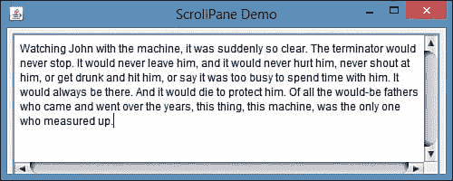

**图 13.7** 在滚动窗格容器中显示文本区域组件。

## 面板 (Panels)

在本小时中你将学习创建的最后一个组件是面板，在 Swing 中使用 `JPanel` 类创建。`JPanel` 对象是图形用户界面中最简单的容器。`JPanel` 对象的目的是将显示区域细分为不同的组件组。当显示区域被划分为多个部分时，你可以在每个部分使用不同的布局管理器。

以下语句创建一个 `JPanel` 对象并为其分配一个布局管理器：

```java
JPanel topRow = new JPanel();
FlowLayout flo = new FlowLayout();
topRow.setLayout(flo);
add(topRow);
```

在安排界面中的组件时经常使用面板，如你在 第 14 小时, “布局用户界面” 中所见。

通过调用面板的 `add()` 方法来添加组件。通过调用面板的 `setLayout()` 方法可以直接为面板分配布局管理器。

当你需要界面中有一个区域来绘制某些内容（例如来自图形文件的图像）时，也可以使用面板。

`JPanel` 的另一个便捷用途是创建你自己的组件，这些组件可以添加到其他类中。这将在本小时的最终项目中进行演示。

## 创建你自己的组件

面向对象编程（OOP）的一个优势是能够在不同项目中重用类。在下一个项目中，你将创建一个特殊的面板组件，该组件可以在其他 Java 程序中重用。组件 `FreeSpacePanel` 报告运行应用程序的计算机上可用的磁盘空间。该面板显示可用空间量、总空间量以及可用空间的百分比。

创建自己的用户界面组件的第一步是决定从哪个现有组件继承。你的新组件将拥有该现有组件的所有属性和行为，除非你对其进行修改或添加任何新内容。

`FreeSpacePanel` 组件是 清单 13.3 中定义的 `JPanel` 的子类。将 清单 13.3 中的文本输入到一个新的空 Java 文件中并保存该文件。

### 清单 13.3 `FreeSpacePanel.java` 的完整文本

* * *


```java
package com.java24hours;

import java.io.IOException;
import java.nio.file.*;
import javax.swing.*;

public class FreeSpacePanel extends JPanel {
    JLabel spaceLabel = new JLabel("Disk space: ");
    JLabel space = new JLabel();

    public FreeSpacePanel() {
        super();
        add(spaceLabel);
        add(space);
        try {
            setValue();
        } catch (IOException ioe) {
            space.setText("Error");
        }
    }

    private final void setValue() throws IOException {
        // get the current file storage pool
        Path current = Paths.get("");
        FileStore store = Files.getFileStore(current);
        // find the free storage space
        long totalSpace = store.getTotalSpace();
        long freeSpace = store.getUsableSpace();
        // get this as a percentage (with two digits)
        double percent = (double)freeSpace / (double)totalSpace * 100;
        percent = (int)(percent * 100) / (double)100;
        // set the label's text
        space.setText(freeSpace + " free out of " + totalSpace + " ("
            + percent + "%)");
    }
}
```

---

这个类是一个组件，当你想显示有关可用磁盘空间的信息时，可以将其添加到任何图形用户界面中。它不能作为应用程序独立运行。

`FreeSpacePanel` 中的 `setValue()` 方法设置显示磁盘空间信息的标签文本。此方法在第 22 行声明时包含关键字 `final`：

```java
private final void setValue() {
    // ...
}
```

在方法声明中包含 `final` 关键字可以防止该方法在子类中被重写。`FreeSpacePanel` 要成为 GUI 组件，这是必需的。

该面板是在第 11-20 行的构造函数中创建的。以下情况正在发生：

- 第 12 行——`super()` 方法调用 `JPanel` 类的构造方法，确保其被正确初始化。
- 第 13 行——新标签 `spaceLabel`，其文本为“Disk space:”并在第 8 行被创建为实例变量，通过调用 `add(Component)` 方法（将标签作为参数）被添加到面板中。
- 第 14 行——第 9 行创建的无文本实例变量 `space` 标签也被添加到面板中。
- 第 16 行——调用 `setValue()` 方法，该方法设置 `space` 标签的文本。

第 16 行对 `setValue()` 的调用被包含在另一个 `try`-`catch` 块中，类似于设置外观时所使用的结构。你将在第 18 小时学习更多关于错误处理的内容，但这里有个简要说明：`try`-`catch` 使得处理 Java 程序中可能发生的一个或多个错误成为可能。

---

**注意**

“TLDR”是“too long; didn’t read”（太长不读）的首字母缩写，当人们在互联网上为不想阅读完整长文的读者提供极简要的摘要时使用它。

我希望这本书对你而言不是 TLDR。我们努力让它成为 JRLRWTANIRJP（just-right length; read whole thing and now I’m rich Java programmer，意为“长度刚刚好；读完整本，我现在是富有的 Java 程序员”）。

---

这是必要的，因为调用 `setValue()` 在访问计算机文件系统以查看剩余空间时可能会导致错误。Java 中有其自己的错误类 `IOException`，代表输入/输出错误。

`try` 块包含可能导致错误的代码。`catch` 块在括号内指定错误类型，以及发生该错误时要执行的代码。

如果在应用运行时遇到此类错误，第 18 行会将 `space` 标签的文本设置为“Error”，以告知用户出现了问题。

要让自定义组件执行有趣的功能，需要快速了解 Java 文件处理，该主题将在第 21 小时“读写文件”中详细介绍。

要计算计算机磁盘的可用空间，你需要使用 `java.nio.file` 包中的四个类，该包用于访问计算机的文件系统。

`Path` 对象表示文件或文件夹的位置。`Paths` 类有一个 `get(String)` 方法，它将字符串转换为匹配该字符串的路径。当用“”（空字符串）调用时，它返回 Java 应用程序运行所在的当前文件夹的路径：

```java
Path current = Paths.get("");
```

磁盘的存储信息在 Java 中由 `FileStore` 对象表示，它是一个文件存储池。获得路径后，你可以使用 `Files` 类中的一个方法获取该路径所在的文件存储。调用 `Files` 的 `getFileStore(Path)` 方法来检索该文件存储池：

```java
FileStore store = Files.getFileStore(current);
```

有了这个存储池，你现在可以调用它的 `getTotalSpace()` 和 `getUsableSpace()` 方法来查明当前磁盘上有多少可用空间：

```java
long totalSpace = store.getTotalSpace();
long freeSpace = store.getUsableSpace();
double percent = (double)freeSpace / (double)totalSpace * 100;
```

---

**警告**

计算百分比的表达式包含许多对 `double` 的引用，这可能看起来很奇怪。后两个转换在 `freeSpace` 和 `totalSpace` 变量在表达式中使用前，将它们转换为 `double` 值。这对于防止表达式产生整数值而非所需的浮点数是必要的。Java 根据表达式中的类型来确定表达式结果的数据类型。一个 `long` 除以一个 `long` 再乘以整数 100 将产生一个 `long`，而不是所需的百分比。

---

最后一条语句计算出的百分比可能具有小数点后极长的数字，例如 64.8675309。

以下表达式将 `double` 百分比转换为最多两位小数：

```java
percent = (int)(percent * 100) / (double)100;
```

表达式的前半部分将百分比乘以 100——将小数点向右移动两位——然后将其转换为整数，因此 64.8675309 变成 6487。

第二部分将其除以 100——将小数点向左移动两位——以恢复百分比的近似值。这将 6486 变为 64.86。

百分比被限制在两位小数后，就可以设置标签的文本来报告可用和已用磁盘空间：

```java
space.setText(freeSpace + " free out of " + totalSpace + " ("
    + percent + "%)");
```

除非添加到图形用户界面中，否则无法看到你刚刚创建的面板。要试用 `FreeSpacePanel`，请按照清单 13.4 创建 `FreeSpaceFrame` 应用程序。为一个名为 `FreeSpaceFrame` 的类输入新的文本文件。

**清单 13.4 `FreeSpaceFrame.java` 的完整代码**

```java
package com.java24hours;

import java.awt.*;
import javax.swing.*;

public class FreeSpaceFrame extends JFrame {
    public FreeSpaceFrame() {
        super("Disk Free Space");
        setLookAndFeel();
        setSize(500, 100);
        setDefaultCloseOperation(JFrame.EXIT_ON_CLOSE);
        FlowLayout flo = new FlowLayout();
        setLayout(flo);
        FreeSpacePanel freePanel = new FreeSpacePanel();
        add(freePanel);
        setVisible(true);
    }

    private void setLookAndFeel() {
        try {
            UIManager.setLookAndFeel(
                "com.sun.java.swing.plaf.nimbus.NimbusLookAndFeel"
            );
        } catch (Exception exc) {
            // ignore error
        }
    }

    public static void main(String[] arguments) {
        FreeSpaceFrame frame = new FreeSpaceFrame();
    }
}
```

此应用程序在第 14 行创建 `FreeSpacePanel` 组件，并在第 15 行将其添加到其框架中。

运行该应用程序时，应类似于图 13.8，显示来自你自己计算机的值。

**图 13.8** 显示自定义磁盘空间组件。

### 总结

用户已经期待他们运行的程序提供点击式、可视化的环境。这种期望使得创建软件更具挑战性，但 Java 通过 Swing 将这些能力交到你手中，无论你使用何种设置运行 Java 程序，Swing 都提供了构建一个可用、实用的图形用户界面所需的所有类。

使用 Swing 开发图形化 Java 应用程序是实践面向对象编程的好方法。每个组件、容器和布局管理器都由其自己的对象类表示。其中许多类从相同的超类继承其公共行为。例如，本小时介绍的所有用户界面组件都是 `javax.swing.JComponent` 的子类。

在下一个小时，你将学习更多关于图形用户界面设计的内容，届时你将使用新的布局管理器，这些管理器可以以比 `FlowLayout` 更复杂的方式指定组件在容器中的位置。

### 研讨会

#### 问答

**问：** 如果我不给容器分配布局管理器，组件将如何排列？

**答：** 在像面板这样的简单容器中，默认使用 `FlowLayout` 来排列组件。每个组件的添加方式类似于英文在页面上的显示方式：从左到右，当没有剩余空间时，就移到下一行。框架、窗口和小程序使用下一节你将学习到的 `BorderLayout` 默认布局样式。

**问：** 为什么很多图形用户界面类的名称都以“J”开头，比如 `JFrame` 和 `JLabel`？

**答：** 这些类是 Swing 框架的一部分，这是 Java 类库中第二次尝试构建图形用户界面类。第一次是抽象窗口工具包（AWT），它的类名更简单，比如 `Frame` 和 `Label`。

AWT 类属于 `java.awt` 包及相关包，而 Swing 类属于 `javax.swing` 等包，因此它们可能具有相同的类名。使用“J”开头的名称可以避免将这些类相互混淆。

Swing 类也被称为 Java 基础类（JFC）。

**问：** 在哪里可以买到一整版未裁切的 1 美元纸币？

**答：** 美国雕刻和印刷局在其网站 [www.moneyfactorystore.gov](http://www.moneyfactorystore.gov) 上出售真实的 1 美元、10 美元、20 美元和 50 美元纸币整版。

一版包含 32 张 1 美元纸币，售价 61 美元；16 张 10 美元纸币，售价 249 美元；16 张 20 美元纸币，售价 409 美元；16 张 50 美元纸币，售价 900 美元。因为这些钱是真实货币，所以如果你算上这些纸币的面值，这些购买实际上更便宜。购买 1 美元纸币你额外支付了 29 美元，10 美元的是 89 美元，20 美元的也是 89 美元，50 美元的则是 100 美元。

还有一个五磅重的袋子，里面装有价值 10,000 美元的碎纸币，售价 45 美元。

该局是唯一承认自己在“挥霍金钱”的美国政府机构。

### 小测验

如果经过这一小时的学习，你的大脑还没有变成一团图形用户界面的浆糊，那就通过回答以下问题来测试一下你的技能。

**1.** 哪个用户组件被用作容器来容纳其他组件？

- A. TupperWare
- B. `JPanel`
- C. Choice

**2.** 在容器内部，必须首先完成以下哪项操作？

- A. 建立布局管理器
- B. 添加组件
- C. 没关系

**3.** 哪个方法决定了组件在容器内的排列方式？

- A. `setLayout()`
- B. `setLayoutManager()`
- C. `setVisible()`

### 答案

**1. B.** `JPanel`。你可以将组件添加到面板，然后再将面板添加到另一个容器（如框架）中。

**2. A.** 你必须在添加组件之前指定布局管理器，这样才能以正确的方式添加它们。

**3. A.** `setLayout()` 方法接受一个参数：负责决定组件显示位置的布局管理器对象。

### 实践活动

为了进一步了解 GUI 设计主题，请进行以下活动：

- 修改 `SalutonFrame` 应用程序，使其在框架的主区域显示 “Saluton Mondo!”，而不是在标题栏中。
- 增强 `FreeSpacePanel` 组件，在磁盘大小数字中每隔三位显示一个逗号。一种实现方式是使用 `StringBuilder` 对象、`String` 类的 `charAt(int)` 方法以及 `for` 循环来遍历字符串。

要查看实现这些活动的 Java 程序，请访问本书网站 [www.java24hours.com](http://www.java24hours.com)。

# 第 14 小时：布局用户界面

本小时待办事项清单：

- 创建布局管理器。
- 为容器分配布局管理器。
- 使用面板在界面中组织组件。
- 处理特殊布局。
- 为 Java 应用程序创建原型。

当你开始为 Java 程序设计图形用户界面（GUI）时，你会遇到一个障碍，那就是你的组件可能会移动。每当容器改变大小时——例如当用户调整框架大小时——它所容纳的组件可能会重新排列自身以适应新的尺寸。

这种流动性对你有利，因为它考虑到了界面组件在不同操作系统上显示方式的差异。一个可点击按钮在 Windows 上的外观可能与在 Linux 或 Mac OS 上不同。

界面中的组件是通过使用一组称为布局管理器的类来组织的。这些类定义了组件在容器内的显示方式。界面中的每个容器都可以有自己的布局管理器。

### 使用布局管理器

在 Java 中，组件在容器内的放置取决于组件的大小、其他组件的大小以及容器的高度和宽度。按钮、文本字段和其他组件的布局可能受以下因素影响：

- 容器的大小
- 其他组件和容器的大小
- 正在使用的布局管理器

你可以使用几种布局管理器来影响组件的显示方式。面板的默认管理器是 `java.awt` 包中的 `FlowLayout` 类，上一小时我们已经使用过它。

在 `FlowLayout` 下，组件被放置到区域的方式与单词在英文页面上排列的方式相同——从左到右，当没有空间时，移到下一行。

以下示例可用于框架，以便在添加组件时使用流式布局：

```java
FlowLayout topLayout = new FlowLayout();
setLayout(topLayout);
```

你也可以为特定容器（如 `JPanel` 对象）设置布局管理器。可以通过使用该容器对象的 `setLayout()` 方法来完成。


`Crisis` 应用程序有一个包含五个按钮的 GUI。为名为 `Crisis` 的类创建一个新的 Java 文件。将清单 14.1 中的文本输入到文件中并保存。

**清单 14.1** `Crisis.java` 的完整代码

点击此处查看代码图片

```java
package com.java24hours;

import java.awt.*;
import javax.swing.*;

public class Crisis extends JFrame {
    JButton panicButton;
    JButton dontPanicButton;
    JButton blameButton;
    JButton mediaButton;
    JButton saveButton;

    public Crisis() {
        super("Crisis");
        setLookAndFeel();
        setSize(348, 128);
        setDefaultCloseOperation(JFrame.EXIT_ON_CLOSE);
        FlowLayout flo = new FlowLayout();
        setLayout(flo);
        panicButton = new JButton("Panic");
        dontPanicButton = new JButton("Don't Panic");
        blameButton = new JButton("Blame Others");
        mediaButton = new JButton("Notify the Media");
        saveButton = new JButton("Save Yourself");
        add(panicButton);
        add(dontPanicButton);
        add(blameButton);
        add(mediaButton);
        add(saveButton);
        setVisible(true);
    }

    private void setLookAndFeel() {
        try {
            UIManager.setLookAndFeel(
                "com.sun.java.swing.plaf.nimbus.NimbusLookAndFeel"
            );
        } catch (Exception exc) {
            // ignore error
        }
    }

    public static void main(String[] arguments) {
        Crisis frame = new Crisis();
    }
}
```

图 14.1 展示了运行中的应用程序。


**图 14.1** 使用流式布局排列组件。

`FlowLayout` 类使用其容器的尺寸作为布局组件的唯一准则。调整应用程序窗口大小，可以看到组件是如何立即重新排列的。将窗口宽度加倍，你会看到所有的 `JButton` 组件现在都显示在了同一行。

## 网格布局（`GridLayout`）管理器

`java.awt` 包中的 `GridLayout` 类将容器中的所有组件组织成指定数量的行和列。所有组件在显示区域中被分配相同大小的空间，因此，如果你指定一个三列三行的网格，容器将被划分为九个大小相等的区域。

`GridLayout` 会将所有添加进来的组件放置在网格上的一个位置。组件从左到右依次添加，直到一行填满，然后开始填充下一网格的最左列。

以下语句创建了一个容器，并将其设置为使用两行三列的网格布局：

点击此处查看代码图片

```java
GridLayout grid = new GridLayout(2, 3);

setLayout(grid);
```

图 14.2 展示了如果 `Crisis` 应用程序使用网格布局会是什么样子。


**图 14.2** 使用网格布局排列组件。

图 14.2 中的一个标签显示的文本被缩短了。如果文本宽度超过了组件可用区域的宽度，标签文本会使用省略号（...）进行截断。

***

**注意**

本书网站包含了 `Crisis` 应用程序的修改版本，用于演示本节介绍的每种布局管理器，首先是 `CrisisGridDemo.java` 来展示网格布局。要查看其源代码，请访问 [www.java24hours.com](http://www.java24hours.com)，点击你书籍的封面，并导航到第 14 小时页面。

***

## 边界布局（`BorderLayout`）管理器

同样位于 `java.awt` 包中的 `BorderLayout` 类，将组件排列在容器内的特定位置，这些位置由五个方向之一标识：北、南、东、西或中。

`BorderLayout` 管理器将组件排列到五个区域：四个由罗盘方向表示，一个用于中心区域。当你在此布局下添加组件时，`add()` 方法包含第二个参数来指定组件应放置的位置。此参数应为 `BorderLayout` 类的五个类变量之一：此参数使用 `NORTH`、`SOUTH`、`EAST`、`WEST` 和 `CENTER`。

与 `GridLayout` 类一样，`BorderLayout` 将所有可用空间分配给组件。放置在中心的组件会获得未被四个边界组件占用的所有空间，因此它通常是最大的。

以下语句创建了一个使用边界布局的容器：

点击此处查看代码图片

```java
BorderLayout crisisLayout = new BorderLayout();

setLayout(crisisLayout);

add(panicButton, BorderLayout.NORTH);

add(dontPanicButton, BorderLayout.SOUTH);

add(blameButton, BorderLayout.EAST);

add(mediaButton, BorderLayout.WEST);

add(saveButton, BorderLayout.CENTER);
```

图 14.3 展示了这在 `Crisis` 应用程序中的样子。

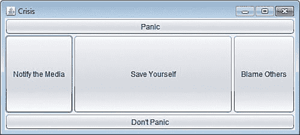

**图 14.3** 使用边界布局排列组件。

## 箱式布局（`BoxLayout`）管理器

另一个便捷的布局管理器，`javax.swing` 包中的 `BoxLayout`，使得在单行中水平或垂直堆叠组件成为可能。

要使用此布局，首先创建一个用于容纳组件的面板，然后使用两个参数创建一个布局管理器：

- 使用箱式布局组织的组件

- 值 `BoxLayout.Y_AXIS` 用于垂直对齐，`BoxLayout.X_AXIS` 用于水平对齐

以下是堆叠 `Crisis` 组件的代码：

点击此处查看代码图片

```java
JPanel pane = new JPanel();

BoxLayout box = new BoxLayout(pane, BoxLayout.Y_AXIS);

pane.setLayout(box);

pane.add(panicButton);

pane.add(dontPanicButton);

pane.add(blameButton);

pane.add(mediaButton);

pane.add(saveButton);

add(pane);
```

图 14.4 展示了最终结果。

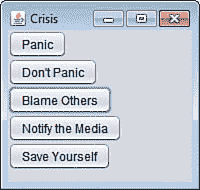

**图 14.4** 使用箱式布局堆叠组件。

### 使用内边距（`Insets`）分隔组件

在容器内排列组件时，你可以使用 `Insets` 将组件从容器边缘移开，`Insets` 是一个表示容器边框区域的对象。

`Insets` 类是 `java.awt` 包的一部分，它有一个构造函数接受四个参数：在容器 `top`、`left`、`bottom` 和 `right` 方向要留出的空间。每个参数都使用像素指定，这与定义框架大小时使用的度量单位相同。

以下语句创建了一个 `Insets` 对象：

点击此处查看代码图片

```java
Insets around = new Insets(10, 6, 10, 3);
```

`around` 对象表示一个容器边框，其顶部边缘内缩 10 像素，左侧内缩 6 像素，底部内缩 10 像素，右侧内缩 3 像素。

要在容器中使用 `Insets` 对象，你必须重写容器的 `getInsets()` 方法。此方法没有参数并返回一个 `Insets` 对象，如下例所示：

点击此处查看代码图片

```java
public Insets getInsets() {

    Insets squeeze = new Insets(50, 15, 10, 15);

    return squeeze;

}
```

图 14.5 展示了这将如何改变图 14.1 中展示的由 `FlowLayout` 管理的界面。


**图 14.5** 使用内边距在组件周围添加空间。

图 14.5 中显示的容器有一个空白边框，其左侧边缘内缩 15 像素，底部边缘内缩 10 像素，右侧边缘内缩 15 像素，顶部边缘内缩 50 像素。

***

**注意**

`JFrame` 容器有一个内置内边距，以便为框架的标题栏留出空间。当你重写 `getInsets()` 并设置自己的值时，过小的内边距值会导致容器在标题栏下方显示组件。

***

### 为应用程序进行布局

到目前为止，你看到的布局管理器都应用于整个框架；使用了框架的 `setLayout()` 方法，所有组件都遵循相同的规则。这种设置对于某些程序可能是合适的，但当你尝试使用 Swing 开发 GUI 时，经常会发现没有任何一种布局管理器完全适合。

解决这个问题的一种方法是使用一组 `JPanel` 对象作为容器，来容纳 GUI 的不同部分。你可以通过使用每个 `JPanel` 的 `setLayout()` 方法为这些部分设置不同的布局规则。在这些面板包含了它们需要包含的所有组件之后，你可以将这些面板直接添加到框架中。

下一个项目将为下一小时编写的程序开发一个完整的界面。该程序是一个彩票号码分析器，它评估用户在一生中赢得百万美元级彩票大奖的机会。这个机会是通过反复运行随机六号码彩票抽奖，直到用户的号码作为大奖得主出现来确定的。图 14.6 展示了你正在为该应用程序开发的 GUI。

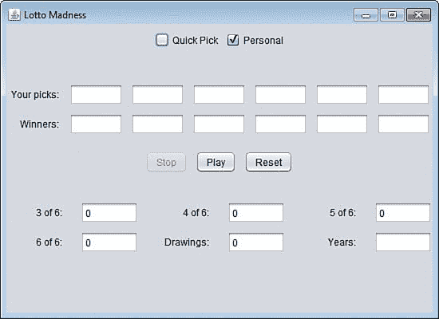

**图 14.6** 显示 `LottoMadness` 应用程序的 GUI。

创建一个名为 `LottoMadness` 的新 Java 文件，将清单 14.2 中的文本输入到源代码编辑器中，并保存该文件。

**清单 14.2** `LottoMadness.java` 的完整文本

点击此处查看代码图片

```java
  1: package com.java24hours;

  2:

  3: import java.awt.*;
```

# `LottoMadness` 代码示例


```java
import javax.swing.*;

public class LottoMadness extends JFrame {

    // 设置第一行
    JPanel row1 = new JPanel();
    ButtonGroup option = new ButtonGroup();
    JCheckBox quickpick = new JCheckBox("Quick Pick", false);
    JCheckBox personal = new JCheckBox("Personal", true);
    // 设置第二行
    JPanel row2 = new JPanel();
    JLabel numbersLabel = new JLabel("Your picks: ", JLabel.RIGHT);
    JTextField[] numbers = new JTextField[6];
    JLabel winnersLabel = new JLabel("Winners: ", JLabel.RIGHT);
    JTextField[] winners = new JTextField[6];
    // 设置第三行
    JPanel row3 = new JPanel();
    JButton stop = new JButton("Stop");
    JButton play = new JButton("Play");
    JButton reset = new JButton("Reset");
    // 设置第四行
    JPanel row4 = new JPanel();
    JLabel got3Label = new JLabel("3 of 6: ", JLabel.RIGHT);
    JTextField got3 = new JTextField("0");
    JLabel got4Label = new JLabel("4 of 6: ", JLabel.RIGHT);
    JTextField got4 = new JTextField("0");
    JLabel got5Label = new JLabel("5 of 6: ", JLabel.RIGHT);
    JTextField got5 = new JTextField("0");
    JLabel got6Label = new JLabel("6 of 6: ", JLabel.RIGHT);
    JTextField got6 = new JTextField("0", 10);
    JLabel drawingsLabel = new JLabel("Drawings: ", JLabel.RIGHT);
    JTextField drawings = new JTextField("0");
    JLabel yearsLabel = new JLabel("Years: ", JLabel.RIGHT);
    JTextField years = new JTextField();

    public LottoMadness() {
        super("Lotto Madness");

        setSize(550, 400);
        setDefaultCloseOperation(JFrame.EXIT_ON_CLOSE);
        GridLayout layout = new GridLayout(5, 1, 10, 10);
        setLayout(layout);

        FlowLayout layout1 = new FlowLayout(FlowLayout.CENTER,
            10, 10);
        option.add(quickpick);
        option.add(personal);
        row1.setLayout(layout1);
        row1.add(quickpick);
        row1.add(personal);
        add(row1);

        GridLayout layout2 = new GridLayout(2, 7, 10, 10);
        row2.setLayout(layout2);
        row2.add(numbersLabel);
        for (int i = 0; i < 6; i++) {
            numbers[i] = new JTextField();
            row2.add(numbers[i]);
        }
        row2.add(winnersLabel);
        for (int i = 0; i < 6; i++) {
            winners[i] = new JTextField();
            winners[i].setEditable(false);
            row2.add(winners[i]);
        }
        add(row2);

        FlowLayout layout3 = new FlowLayout(FlowLayout.CENTER,
            10, 10);
        row3.setLayout(layout3);
        stop.setEnabled(false);
        row3.add(stop);
        row3.add(play);
        row3.add(reset);
        add(row3);

        GridLayout layout4 = new GridLayout(2, 3, 20, 10);
        row4.setLayout(layout4);
        row4.add(got3Label);
        got3.setEditable(false);
        row4.add(got3);
        row4.add(got4Label);
        got4.setEditable(false);
        row4.add(got4);
        row4.add(got5Label);
        got5.setEditable(false);
        row4.add(got5);
        row4.add(got6Label);
        got6.setEditable(false);
        row4.add(got6);
        row4.add(drawingsLabel);
        drawings.setEditable(false);
        row4.add(drawings);
        row4.add(yearsLabel);
        years.setEditable(false);
        row4.add(years);
        add(row4);

        setVisible(true);
    }

    private static void setLookAndFeel() {
        try {
            UIManager.setLookAndFeel(
                "com.sun.java.swing.plaf.nimbus.NimbusLookAndFeel"
            );
        } catch (Exception exc) {
            // 忽略错误
        }
    }

    public static void main(String[] arguments) {
        LottoMadness.setLookAndFeel();
        LottoMadness frame = new LottoMadness();
    }
}
```

---

尽管你还没有添加任何让程序真正运行起来的语句，但你可以运行该应用程序，以确保图形界面组织正确，并且收集了你需要的信息。

该应用程序使用了多个布局管理器。为了更清楚地了解应用程序的用户界面是如何布局的，请查看图 14.7。界面被分为五个水平行，图中用黑色水平线分隔。每一行都是一个`JPanel`对象，应用程序的总体布局管理器将这些行组织成一个五行一列的`GridLayout`。

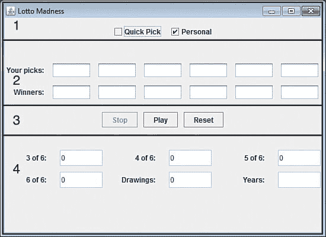

## 图 14.7

将`LottoMadness`应用程序划分为面板。

在各行内部，使用了不同的布局管理器来确定组件应如何显示。第 1 行和第 3 行使用`FlowLayout`对象。程序的第 47–48 行展示了如何创建它们：

```java
FlowLayout layout1 = new FlowLayout(FlowLayout.CENTER,
    10, 10);
```

`FlowLayout()`构造函数使用了三个参数。第一个参数`FlowLayout.CENTER`表示组件应在其容器（即放置它们的水平`JPanel`）中居中。最后两个参数指定了每个组件应与其他组件保持的宽度和高度距离。设置宽度 10 像素、高度 10 像素会在组件之间留出少量额外间距。

界面的第 2 行被布局为一个两行七列的网格。`GridLayout()`构造函数还指定了组件在每个方向上应与其他组件间隔 10 像素。第 56–57 行设置了这个网格：

```java
GridLayout layout2 = new GridLayout(2, 7, 10, 10);
row2.setLayout(layout2);
```

第 4 行使用`GridLayout`将组件排列成一个两行三列的网格。

`LottoMadness`应用程序使用了本小时介绍的多个组件。第 9–37 行用于设置构成界面的所有组件的对象。语句按行组织。首先，为该行创建一个`JPanel`对象，然后设置该行的每个组件。这段代码创建了所有组件和容器，除非使用`add()`方法将它们添加到应用程序的主框架中，否则它们不会显示。

在第 47–100 行中，组件被添加进去。第 47–54 行展示了整个`LottoMadness()`构造函数的特点：

```java
FlowLayout layout1 = new FlowLayout(FlowLayout.CENTER,
    10, 10);
option.add(quickpick);
option.add(personal);
row1.setLayout(layout1);
row1.add(quickpick);
row1.add(personal);
add(row1);
```

创建布局管理器对象后，将其与行`JPanel`对象（本例中为`row1`）的`setLayout()`方法一起使用。指定布局后，通过使用其`add()`方法将组件添加到`JPanel`。所有组件放置完毕后，通过调用其自身的`add()`方法将整个`row1`对象添加到框架中。

`LottoMadness`应用程序设置图形用户界面外观风格的方式与之前的 Swing 应用程序不同。`setLookAndFeel()`方法被创建为类方法——注意第 105 行的`static`关键字——并在第 116 行的`main()`方法中被调用。

之前的示例将`setLookAndFeel()`设为对象方法，并在对象的构造函数中调用它。之所以在`LottoMadness`中没有这样做，是因为外观和感觉必须在任何实例变量被创建和赋值之前选定。

## 总结

当你第一次为 Java 程序设计图形用户界面（GUI）时，你可能难以相信组件能够自由移动是一种优势。布局管理器提供了一种方法，可以开发出足够灵活的 GUI，以处理显示上的差异，并且界面美观。

在接下来的一个小时里，你将更深入地了解 GUI 的功能。你将有机会看到`LottoMadness`界面在运行，看着它处理彩票抽奖并统计中奖者。

## 研讨会

### 问答

**问.** 为什么`LottoMadness`应用程序中的一些文本字段显示为灰色，而另一些则是白色的？

**答.** 灰色字段使用了`setEditable()`方法，使其不可编辑。文本字段的默认行为是允许用户通过在其边框内点击并输入任何想要的更改来改变文本字段的值。然而，有些字段旨在显示信息，而不是接收用户的输入。`setEditable()`方法可以防止用户更改他们不应修改的字段。

**问.** 在*《威利·旺卡与巧克力工厂》*中，真的有一位金票得主米兰达·派克（Miranda Piker）的死因过于恐怖而被删除了吗？

**答.** 米兰达·派克的命运是如此可怕，以至于她被从罗尔德·达尔的原著小说*《查理和巧克力工厂》*的最终稿中删除了，该小说启发了 1971 年的电影及其 2005 年的翻拍版。派克是一个自以为是的孩子，认为孩子永远不该玩耍，应该一直上学。她的父亲是一位小学校长。

派克和旺卡工厂的其他孩子们被介绍给了一种名为“雀斑粉”（Spotty Powder）的糖果，这种糖果会导致食用者身上起红斑，这样他们就可以假装生病逃学。派克和她的父亲感到非常愤怒，并决定摧毁制造它的机器。

当隔壁房间传来他们的尖叫声时，旺卡解释说，他们已经进入了将糖果原料研磨成粉末的地方。“这是配方的一部分，”他告诉米兰达的母亲。“我们偶尔必须使用一两个校长，否则它就不奏效。”

奥帕-伦帕人（Oompa-Loompas）用歌声庆祝她的灭亡：“哦，米兰达·玛丽·派克，/怎么会有人喜欢她，/这样一个自命不凡又令人讨厌的小孩。/所以我们说，‘何不把她放进/雀斑粉搅拌机，/那样我们肯定会比以前更喜欢她。’/很快这个如此恶毒的孩子/就会变得相当美味，/她的同学们肯定会明白，/他们不再说，‘米兰达！/哦，那个野兽！我们受不了她！’/他们会说，‘哦，她多么有用，多么好！’”

### 测验

为了测试你的脑细胞是否排列得当，请通过回答以下问题来检验你的 Java 布局管理技巧。

**1.** 当将界面细分为不同的布局管理器时，通常使用哪种容器？

**A.** `JWindow`

**B.** `JPanel`

**C.** `Container`

**2.** 面板的默认布局管理器是什么？

**A.** `FlowLayout`

**B.** `GridLayout`

**C.** 无默认值

**3.** `BorderLayout`类的名称来源于哪里？

**A.** 每个组件的边框

**B.** 组件沿着容器边框组织的方式

**C.** Java 开发者的任性而为

### 答案

**1. B.** `JPanel`，它是容器中最简单的。

**2. A.** 面板使用流式布局，但框架和窗口的默认管理器是边界布局。

**3. B.** 你必须在将组件添加到容器时，使用方向变量（如`BorderLayout.WEST`和`BorderLayout.EAST`）来指定组件的边框位置。

### 活动

如果你想继续探索流式布局（以及网格布局和边界布局），请完成以下活动：

 创建一个修改版的`Crisis`应用程序，其中`panic`和`dontPanic`对象组织在一个布局管理器下，其余三个按钮组织在另一个布局管理器下。

 复制`LottoMadness.java`文件并将其重命名为`NewMadness.java`。修改此程序，使快速选择或个人选择成为一个组合框，而开始、停止和重置按钮成为复选框。

要查看实现这些活动的 Java 程序，请访问本书网站 [www.java24hours.com](http://www.java24hours.com)。

# 第 15 小时：响应用户输入

本小时待办事项：

 让你的程序感知事件。

 设置一个组件使其能触发事件。

 忽略某些组件。

 弄清楚事件在程序中的最终去向。

 在界面中存储信息。

 转换存储在文本字段中的值。

你在过去两小时内开发的图形用户界面（GUI）可以独立运行。用户可以点击按钮、在文本字段中填写文本以及调整窗口大小。迟早，即使是最不挑剔的用户也会希望获得更多功能。程序提供的 GUI 必须在发生鼠标点击或键盘输入时引发相应的操作。

当你的 Java 程序能够响应用户事件时，这些操作就变得可能。这被称为事件处理，也是本小时的主要内容。

## 让你的程序学会倾听

Java 中的*用户事件*是指用户使用鼠标、键盘或其他输入设备执行操作时发生的事情。

在接收事件之前，你必须先学习如何让一个对象进行监听。响应用户事件需要使用一个或多个`EventListener`接口。接口是 Java 面向对象编程的一个特性，它使一个类能够继承它本无法使用的行为。它们就像与其他类签订的合同协议，保证该类将包含特定的方法。

一个`EventListener`接口包含接收特定类型用户输入的方法。

添加`EventListener`接口需要两件事。首先，由于监听类是`java.awt.event`包的一部分，你必须通过以下语句使它们可用：

```java
import java.awt.event.*;
```

其次，该类必须使用`implements`关键字来声明它支持一个或多个监听接口。以下语句创建了一个使用`ActionListener`接口（用于响应按钮和菜单点击）的类：


```java
public class Graph implements ActionListener {
```

`EventListener`接口使 GUI 的组件能够生成用户事件。如果没有设置相应的监听器，组件就无法被程序的其他部分感知到任何操作。程序必须为其监听的每种组件类型包含一个监听接口。要让程序响应按钮上的鼠标点击或文本字段中的回车键按下，你必须包含`ActionListener`接口。要响应选择列表或复选框的使用，你需要`ItemListener`接口。

当你在同一个类中需要多个接口时，在`implements`关键字后用逗号分隔它们的名称，如下代码所示：

```java
public class Graph3D implements ActionListener, MouseListener {

    // ...

}
```

## 设置组件使其可被感知

实现特定组件所需的接口后，你必须让该组件生成用户事件。`ActionListener`接口用于监听操作事件，例如按钮点击或按下回车键。

> **注意**：`this`关键字初次介绍时可能会让很多读者感到困惑。`this`指的是该关键字所在的对象。因此，如果你创建了一个`LottoMadness`类并在该类的语句中使用`this`，它指的是执行该代码的`LottoMadness`对象。

要让`JButton`对象生成事件，请使用`addActionListener()`方法，如下所示：

```java
JButton fireTorpedos = new JButton("Fire torpedos");
fireTorpedos.addActionListener(this);
```

此代码创建了`fireTorpedos`按钮，并调用了该按钮的`addActionListener()`方法。作为`addActionListener()`方法参数使用的`this`关键字表示当前对象接收用户事件并根据需要进行处理。

### 处理用户事件

当具有监听器的组件生成用户事件时，系统会自动调用一个方法。该方法必须在将监听器附加到组件时指定的类中找到。

每个监听器都有不同的方法来接收其事件。`ActionListener`接口将事件发送到名为`actionPerformed()`的方法。以下是`actionPerformed()`方法的一个简短示例：

```java
public void actionPerformed(ActionEvent event) {
    // 方法放在这里
}
```

程序中发送的所有操作事件都会进入此方法。如果程序中只有一个组件可能发送操作事件，你可以将语句放在该方法中来处理事件。如果有多个组件可以发送这些事件，你需要检查发送给该方法的对象。

一个`ActionEvent`对象会被发送到`actionPerformed()`方法。有多个类的对象可以代表程序中可以发送的用户事件。这些类具有确定是哪个组件导致事件发生的方法。在`actionPerformed()`方法中，如果`ActionEvent`对象命名为`event`，你可以使用以下语句识别该组件：

```java
String cmd = event.getActionCommand();
```

`getActionCommand()`方法返回一个字符串。如果组件是按钮，则该字符串是按钮上的标签。如果是文本字段，则该字符串是字段中输入的文本。`getSource()`方法返回导致该事件的对象。

你可以使用以下`actionPerformed()`方法来接收来自三个组件的事件：一个名为`start`的`JButton`对象、一个名为`speed`的`JTextField`和另一个名为`viscosity`的`JTextField`：

```java
public void actionPerformed(ActionEvent event) {
    Object source = event.getSource();
    if (source == speed) {
        // speed 字段导致事件
    } else if (source == viscosity) {
        // viscosity 导致事件
    } else {
        // start 导致事件
    }
}
```

你可以对所有用户事件调用`getSource()`方法来识别导致事件的特定对象。

#### 复选框和组合框事件

组合框和复选框需要`ItemListener`接口。调用组件的`addItemListener()`方法使其生成这些事件。以下语句创建了一个名为`superSize`的复选框，该复选框在选中或取消选中时发送用户事件：

```java
JCheckBox superSize = new JCheckBox("Super Size", true);
superSize.addItemListener(this);
```

这些事件由`itemStateChanged()`方法接收，该方法以一个`ItemEvent`对象作为参数。要查看哪个对象导致了事件，可以调用事件对象的`getItem()`方法。

要确定复选框是选中还是取消选中，可将`getStateChange()`方法返回的值与常量`ItemEvent.SELECTED`和`ItemEvent.DESELECTED`进行比较。以下代码是一个名为`item`的`ItemEvent`对象的示例：

```java
public void itemStateChanged(ItemEvent item) {
    int status = item.getStateChange();
    if (status == ItemEvent.SELECTED) {
        // 项目被选中
    }
}
```

要确定`JComboBox`对象中选定的值，请使用`getItem()`并将该值转换为字符串，如下所示：

```java
Object which = item.getItem();
String answer = which.toString();
```

#### 键盘事件

当程序必须在按下按键时立即做出反应时，它会使用键盘事件和`KeyListener`接口。

第一步是通过调用其`addKeyListener()`方法来注册接收按键的组件。该方法的参数应该是实现`KeyListener`接口的对象。如果就是当前类，则使用`this`作为参数。

处理键盘事件的对象必须实现三个方法：

- `void keyPressed(KeyEvent)`—按键被按下的瞬间调用的方法
- `void keyReleased(KeyEvent)`—按键被释放的瞬间调用的方法
- `void keyTyped(KeyEvent)`—按键被按下并释放之后调用的方法

每个方法都有一个`KeyEvent`对象作为参数，该对象具有可调用的方法以获取关于事件的更多信息。调用`getKeyChar()`方法可找出按下了哪个键。该键作为`char`值返回，只能用于字母、数字和标点符号。

要监视键盘上的任何按键，包括回车键、主页键、向上翻页键和向下翻页键，可以调用`getKeyCode()`方法。此方法返回一个表示该按键的整数值。然后你可以使用该整数作为参数调用`getKeyText()`，以接收包含按键名称（例如 Home、F1 等）的`String`对象。

`清单 15.1`包含一个 Java 应用程序，它使用`getKeyChar()`方法在标签中绘制最近按下的键。该应用程序实现了`KeyListener`接口，因此类中有`keyTyped()`、`keyPressed()`和`keyReleased()`方法。这些方法中唯一起作用的是第 24–27 行的`keyTyped()`。创建一个名为`KeyViewer`的新 Java 文件，在 NetBeans 的源代码编辑器中输入清单内容，并保存该文件。

**清单 15.1 `KeyViewer.java`的完整文本**

```java
 1: package com.java24hours;
 2: 
 3: import javax.swing.*;
 4: import java.awt.event.*;
 5: import java.awt.*;
 6: 
 7: public class KeyViewer extends JFrame implements KeyListener {
 8:     JTextField keyText = new JTextField(80);
 9:     JLabel keyLabel = new JLabel("Press any key in the text field.");
10: 
11:     public KeyViewer() {
12:         super("KeyViewer");
13:         setLookAndFeel();
14:         setSize(350, 100);
15:         setDefaultCloseOperation(JFrame.EXIT_ON_CLOSE);
16:         keyText.addKeyListener(this);
17:         BorderLayout bord = new BorderLayout();
18:         setLayout(bord);
19:         add(keyLabel, BorderLayout.NORTH);
20:         add(keyText, BorderLayout.CENTER);
21:         setVisible(true);
22:     }
23: 
24:     public void keyTyped(KeyEvent input) {
25:         char key = input.getKeyChar();
26:         keyLabel.setText("You pressed " + key);
27:     }
28: 
29:     public void keyPressed(KeyEvent txt) {
30:         // do nothing
31:     }
32: 
33:     public void keyReleased(KeyEvent txt) {
34:         // do nothing
35:     }
36: 
37:     private void setLookAndFeel() {
38:         try {
39:             UIManager.setLookAndFeel(
40:                 "com.sun.java.swing.plaf.nimbus.NimbusLookAndFeel"
41:             );
42:         } catch (Exception exc) {
43:             // 忽略错误
44:         }
45:     }
46: 
47:     public static void main(String[] arguments) {
48:         KeyViewer frame = new KeyViewer();
49:     }
50: }
```

当你运行该应用程序时，它应类似于 图 15.1。

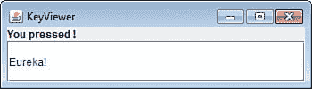

**图 15.1** 在程序中处理键盘事件。

#### 启用和禁用组件

你可能在程序中见过某个组件呈现为灰色阴影而非其正常外观。阴影表示用户无法对该组件执行任何操作，因为它已被禁用。禁用和启用组件是通过组件的`setEnabled()`方法完成的。该方法接受一个布尔值作为参数，因此`setEnabled(true)`启用组件以供使用，而`setEnabled(false)`则禁用它。

以下语句创建了标有“上一步”、“下一步”和“完成”的按钮，并禁用了第一个按钮：

```java
JButton previousButton = new JButton("Previous");
JButton nextButton = new JButton("Next");
JButton finishButton = new JButton("Finish");
previousButton.setEnabled(false);
```

此方法是防止组件在不应发送用户事件时发送事件的有效方式。例如，如果你正在编写一个使用文本字段收集用户地址的 Java 应用程序，你可以禁用“保存地址”按钮，直到用户提供了街道地址、城市、州和邮政编码。

### 完成图形应用程序

为了了解 Swing 的事件处理类在 Java 程序中的工作方式，你将完成`LottoMadness`，这是一个在 第 14 小时“布局用户界面”中开始的彩票模拟程序。

此时，`LottoMadness`只是一个图形用户界面（GUI）。你可以点击按钮并在文本框中输入文本，但没有任何响应。在这个练习中，你将创建`LottoEvent`，这是一个新的类，用于接收用户输入、进行彩票抽奖并跟踪中奖次数。当该类完成后，你将向`LottoMadness`添加几行代码，以便使用`LottoEvent`。通常将 Swing 项目这样划分是方便的，即 GUI 在一个类中，事件处理方法在另一个类中。

此应用程序的目的是评估用户在一生中赢得六号码彩票抽奖的机会。图 15.2 显示了程序运行时的屏幕截图。

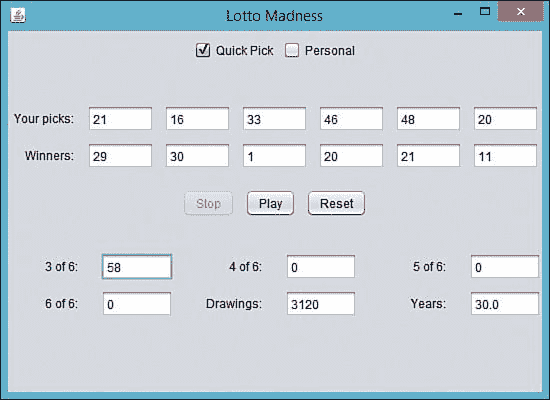

**图 15.2** 运行`LottoMadness`应用程序。

计算机不使用概率来解决这个问题，而是快速连续地进行抽奖，直到有中奖者为止。由于“6 中 6”的中奖概率极低，程序还会报告任何三个、四个或五个中奖号码的组合。

该界面包括 12 个用于彩票号码的文本字段和两个分别标有“快速选择”和“手动选择”的复选框。六个禁用输入的文本字段用于显示每次抽奖的中奖号码。另外六个文本字段供用户选择号码。选择“快速选择”复选框会为用户随机选择六个号码。选择“手动选择”则允许用户选择所需的号码。

三个按钮控制程序的活动：停止、开始和重置。按下“开始”按钮时，程序会启动一个名为`playing`的线程并开始生成彩票抽奖。

按下“停止”按钮会停止线程，按下“重置”会清空所有字段，以便用户可以重新开始。你将在 第 19 小时“创建线程程序”中学习关于线程的内容。

`LottoEvent`类实现了三个接口：`ActionListener`、`ItemListener`和`Runnable`。`Runnable`接口与线程相关，在 第 19 小时 中介绍。监听器用于监听应用程序按钮和复选框生成的用户事件。程序不需要监听与文本字段相关的任何事件，因为它们严格用于存储用户选择的号码。用户界面会自动处理此存储。

该类需要使用主要的 Swing 包`javax.swing`和 Java 的事件处理包`java.awt.event`。

该类有两个实例变量：

- `gui`，一个`LottoMadness`对象
- `playing`，一个`Thread`对象，用于进行持续的彩票抽奖

`gui`变量用于与包含程序 GUI 的`LottoMadness`对象进行通信。当你需要对界面进行更改或从其某个文本字段检索值时，你会使用`gui`对象的实例变量。

例如，`LottoMadness`的`play`实例变量代表“开始”按钮。要在`LottoEvent`中禁用此按钮，你可以使用以下语句：

```java
gui.play.setEnabled(false);
```

你可以使用以下语句检索`JTextField`对象`got3`的值：

```java
String got3value = gui.got3.getText();
```

`清单 15.2`包含`LottoEvent`类的完整文本。请在 NetBeans 中创建一个名为`LottoEvent`的新 Java 文件以保存源代码。

**清单 15.2** `LottoEvent.java`的完整文本


# `LottoEvent` 类说明

## 类代码

```java
package com.java24hours;

import javax.swing.*;
import java.awt.event.*;

public class LottoEvent implements ItemListener, ActionListener,
    Runnable {

    LottoMadness gui;
    Thread playing;

    public LottoEvent(LottoMadness in) {
        gui = in;
    }

    public void actionPerformed(ActionEvent event) {
        String command = event.getActionCommand();
        if (command.equals("Play")) {
            startPlaying();
        }
        if (command.equals("Stop")) {
            stopPlaying();
        }
        if (command.equals("Reset")) {
            clearAllFields();
        }
    }

    void startPlaying() {
        playing = new Thread(this);
        playing.start();
        gui.play.setEnabled(false);
        gui.stop.setEnabled(true);
        gui.reset.setEnabled(false);
        gui.quickpick.setEnabled(false);
        gui.personal.setEnabled(false);
    }

    void stopPlaying() {
        gui.stop.setEnabled(false);
        gui.play.setEnabled(true);
        gui.reset.setEnabled(true);
        gui.quickpick.setEnabled(true);
        gui.personal.setEnabled(true);
        playing = null;
    }

    void clearAllFields() {
        for (int i = 0; i < 6; i++) {
            gui.numbers[i].setText(null);
            gui.winners[i].setText(null);
        }
        gui.got3.setText("0");
        gui.got4.setText("0");
        gui.got5.setText("0");
        gui.got6.setText("0");
        gui.drawings.setText("0");
        gui.years.setText("0");
    }

    public void itemStateChanged(ItemEvent event) {
        Object item = event.getItem();
        if (item == gui.quickpick) {
            for (int i = 0; i < 6; i++) {
                int pick;
                do {
                    pick = (int) Math.floor(Math.random() * 50 + 1);
                } while (numberGone(pick, gui.numbers, i));
                gui.numbers[i].setText("" + pick);
            }
        } else {
            for (int i = 0; i < 6; i++) {
                gui.numbers[i].setText(null);
            }
        }
    }

    void addOneToField(JTextField field) {
        int num = Integer.parseInt("0" + field.getText());
        num++;
        field.setText("" + num);
    }

    boolean numberGone(int num, JTextField[] pastNums, int count) {
        for (int i = 0; i < count; i++) {
            if (Integer.parseInt(pastNums[i].getText()) == num) {
                return true;
            }
        }
        return false;
    }

    boolean matchedOne(JTextField win, JTextField[] allPicks) {
        for (int i = 0; i < 6; i++) {
            String winText = win.getText();
            if ( winText.equals( allPicks[i].getText() ) ) {
                return true;
            }
        }
        return false;
    }

    public void run() {
        Thread thisThread = Thread.currentThread();
        while (playing == thisThread) {
            addOneToField(gui.drawings);
            int draw = Integer.parseInt(gui.drawings.getText());
            float numYears = (float)draw / 104;
            gui.years.setText("" + numYears);

            int matches = 0;
            for (int i = 0; i < 6; i++) {
                int ball;
                do {
                    ball = (int) Math.floor(Math.random() * 50 + 1);
                } while (numberGone(ball, gui.winners, i));
                gui.winners[i].setText("" + ball);
                if (matchedOne(gui.winners[i], gui.numbers)) {
                    matches++;
                }
            }
            switch (matches) {
                case 3:
                    addOneToField(gui.got3);
                    break;
                case 4:
                    addOneToField(gui.got4);
                    break;
                case 5:
                    addOneToField(gui.got5);
                    break;
                case 6:
                    addOneToField(gui.got6);
                    gui.stop.setEnabled(false);
                    gui.play.setEnabled(true);
                    playing = null;
            }
            try {
                Thread.sleep(100);
            } catch (InterruptedException e) {
                // do nothing
            }
        }
    }
}
```

## 类构造函数

`LottoEvent`类有一个构造函数：`LottoEvent(LottoMadness)`。作为参数指定的`LottoMadness`对象标识了依赖`LottoEvent`处理用户事件和进行抽奖的对象。

## 主要方法说明

 `clearAllFields()`方法会清空应用程序中的所有文本字段。当用户点击重置按钮时，将处理此方法。

 `addOneToField()`方法将一个文本字段转换为整数，将其加一，然后转换回文本字段。因为所有文本字段都存储为字符串，所以必须采取特殊步骤才能在表达式中使用它们。

 `numberGone()`方法接受三个参数：来自彩票抽奖的一个数字、一个包含多个`JTextField`对象的数组和一个`count`整数。此方法确保抽奖中的每个数字在同一次抽奖中尚未被选中。

 `matchedOne()`方法接受两个参数：一个`JTextField`对象和一个包含六个`JTextField`对象的数组。此方法检查用户号码中的一个是否与当前彩票抽奖号码匹配。

## 事件处理机制

应用程序的`actionPerformed()`方法在用户点击按钮时接收动作事件。`getActionCommand()`方法检索按钮的标签以确定哪个组件被点击。

点击播放按钮会调用`startPlaying()`方法。此方法禁用四个组件。点击停止按钮会调用`stopPlaying()`方法，该方法启用除停止按钮之外的每个组件。

`itemStateChanged()`方法接收由选择快速选择或个人复选框触发的用户事件。`getItem()`方法返回一个`Object`，表示被点击的复选框。如果是快速选择复选框，则将 1 到 50 之间的六个随机数字分配给用户的彩票号码。否则，清除保存用户号码的文本字段。

## 核心逻辑与扩展说明

`LottoEvent`类为彩票抽奖中的每个球使用 1 到 50 之间的数字。这在第 115 行确定，该行将`Math.random()`方法乘以 50，将总和加 1，并将此作为`Math.floor()`方法的参数。最终结果是一个 1 到 50 之间的随机整数。如果您在此处以及第 67 行将 50 替换为不同的数字，则可以使用`LottoMadness`进行生成更宽或更小值范围的彩票竞赛。

`LottoMadness`项目缺少用于跟踪抽奖次数、中奖计数和彩票号码文本字段等信息的变量。相反，界面会自动存储和显示这些值。

## 完成项目集成

要完成项目，请在 NetBeans 中重新打开`LottoMadness.java`。您只需添加六行代码即可使其与`LottoEvent`类工作。

首先，添加一个新的实例变量来保存`LottoEvent`对象：

```java
LottoEvent lotto = new LottoEvent(this);
```

接下来，在`LottoMadness()`构造函数中，为每个可以接收用户输入的界面组件调用`addItemListener()`和`addActionListener()`方法：

```java
// Add listeners
quickpick.addItemListener(lotto);
personal.addItemListener(lotto);
stop.addActionListener(lotto);
play.addActionListener(lotto);
reset.addActionListener(lotto);
```

这些语句应添加在构造函数的末尾，就在使界面可见的`setVisible(true)`调用之前。

Listing 15.3 包含了您进行更改后`LottoMadness.java`的完整文本。您添加的行带有底纹——其余部分与上一个小时相比没有变化。

### LISTING 15.3 `LottoMadness.java`的完整文本

```java
  1: package com.java24hours;

  2:

  3: import java.awt.*;

  4: import javax.swing.*;

  5:

  6: public class LottoMadness extends JFrame {

  7:     LottoEvent lotto = new LottoEvent(this);

  8:

  9:     // set up row 1

 10:     JPanel row1 = new JPanel();

 11:     ButtonGroup option = new ButtonGroup();

 12:     JCheckBox quickpick = new JCheckBox("Quick Pick", false);

 13:     JCheckBox personal = new JCheckBox("Personal", true);

 14:     // set up row 2

 15:     JPanel row2 = new JPanel();

 16:     JLabel numbersLabel = new JLabel("Your picks: ", JLabel.RIGHT);

 17:     JTextField[] numbers = new JTextField[6];

 18:     JLabel winnersLabel = new JLabel("Winners: ", JLabel.RIGHT);

 19:     JTextField[] winners = new JTextField[6];

 20:     // set up row 3

 21:     JPanel row3 = new JPanel();

 22:     JButton stop = new JButton("Stop");

 23:     JButton play = new JButton("Play");

 24:     JButton reset = new JButton("Reset");

 25:     // set up row 4

 26:     JPanel row4 = new JPanel();

 27:     JLabel got3Label = new JLabel("3 of 6: ", JLabel.RIGHT);

 28:     JTextField got3 = new JTextField("0");

 29:     JLabel got4Label = new JLabel("4 of 6: ", JLabel.RIGHT);

 30:     JTextField got4 = new JTextField("0");

 31:     JLabel got5Label = new JLabel("5 of 6: ", JLabel.RIGHT);
```

### 构造函数与界面初始化


```java
32:     JTextField got5 = new JTextField("0");
33:     JLabel got6Label = new JLabel("6 of 6: ", JLabel.RIGHT);
34:     JTextField got6 = new JTextField("0", 10);
35:     JLabel drawingsLabel = new JLabel("Drawings: ", JLabel.RIGHT);
36:     JTextField drawings = new JTextField("0");
37:     JLabel yearsLabel = new JLabel("Years: ", JLabel.RIGHT);
38:     JTextField years = new JTextField("0");
39:
40:     public LottoMadness() {
41:         super("Lotto Madness");
42:         setSize(550, 400);
43:         setDefaultCloseOperation(JFrame.EXIT_ON_CLOSE);
44:         GridLayout layout = new GridLayout(5, 1, 10, 10);
45:         setLayout(layout);
46:
47:         // 添加监听器
48:         quickpick.addItemListener(lotto);
49:         personal.addItemListener(lotto);
50:         stop.addActionListener(lotto);
51:         play.addActionListener(lotto);
52:         reset.addActionListener(lotto);
53:
54:         FlowLayout layout1 = new FlowLayout(FlowLayout.CENTER, 10, 10);
55:         option.add(quickpick);
56:         option.add(personal);
57:         row1.setLayout(layout1);
58:         row1.add(quickpick);
59:         row1.add(personal);
60:         add(row1);
61:
62:         GridLayout layout2 = new GridLayout(2, 7, 10, 10);
63:         row2.setLayout(layout2);
64:         row2.add(numbersLabel);
65:         for (int i = 0; i < 6; i++) {
66:             numbers[i] = new JTextField();
67:             row2.add(numbers[i]);
68:         }
69:         row2.add(winnersLabel);
70:         for (int i = 0; i < 6; i++) {
71:             winners[i] = new JTextField();
72:             winners[i].setEditable(false);
73:             row2.add(winners[i]);
74:         }
75:         add(row2);
76:
77:         FlowLayout layout3 = new FlowLayout(FlowLayout.CENTER, 10, 10);
78:         row3.setLayout(layout3);
79:         stop.setEnabled(false);
80:         row3.add(stop);
81:         row3.add(play);
82:         row3.add(reset);
83:         add(row3);
84:
85:         GridLayout layout4 = new GridLayout(2, 3, 20, 10);
86:         row4.setLayout(layout4);
87:         row4.add(got3Label);
88:         got3.setEditable(false);
89:         row4.add(got3);
90:         row4.add(got4Label);
91:         got4.setEditable(false);
92:         row4.add(got4);
93:         row4.add(got5Label);
94:         got5.setEditable(false);
95:         row4.add(got5);
96:         row4.add(got6Label);
97:         got6.setEditable(false);
98:         row4.add(got6);
99:         row4.add(drawingsLabel);
100:         drawings.setEditable(false);
101:         row4.add(drawings);
102:         row4.add(yearsLabel);
103:         years.setEditable(false);
104:         row4.add(years);
105:         add(row4);
106:
107:         setVisible(true);
108:     }
```

```java
109:     private static void setLookAndFeel() {
110:         try {
111:             UIManager.setLookAndFeel(
112:                 "com.sun.java.swing.plaf.nimbus.NimbusLookAndFeel"
113:             );
114:         } catch (Exception exc) {
115:             // 忽略错误
116:         }
117:     }
```

```java
118:     public static void main(String[] arguments) {
119:         LottoMadness.setLookAndFeel();
120:         LottoMadness frame = new LottoMadness();
121:     }
122: }
```

---

本书网站 [www.java24hours.com](http://www.java24hours.com) 提供了 `LottoMadness` 程序的小程序版本链接。该小程序已经运行了 410,732,244 次抽奖，相当于每周抽奖两次持续 390 万年。共有 6,364,880 个“6 中 3”的获奖者，337,285 个“6 中 4”的获奖者，6,476 个“6 中 5”的获奖者，以及 51 个“6 中 6”的获奖者（大约每 800 万次抽奖一次）。第一位赢得这个虚构彩票的人是 Bill Teer。他的号码是 3、7、1、15、34 和 43，他只用了 241,225 次抽奖（2319.47 年）就赢了。

添加阴影部分的代码行后，你就可以运行这个应用程序了。它可以测试你的乐透技巧数千年之久。正如你可能预料的那样，这些彩票是徒劳的练习。即使你像圣经人物一样长寿，一生中赢得“6 中 6”乐透抽奖的机会也极其渺茫。

### 总结

通过使用 Swing，你可以用少量的编程创建出专业外观的程序。尽管 `LottoMadness` 应用程序比你在过去 14 小时中完成的许多示例都要长，但其中一半的程序都是用于构建界面的语句。

如果你花些时间运行这个应用程序，你会对那些赢得这些六数字彩票的人的好运感到更加苦涩和嫉妒。

我最近一次运行该程序的结果表明，我可能会花费 27,000 美元和我生命中最宝贵的 266 年来购买彩票，最终只赢得了一些“6 中 4”和“6 中 3”的奖项。相比之下，让你的 Java 编程技能获得回报的机会几乎是十拿九稳的。

### 讲座

#### 问答

**问：** 你需要对 `paint()` 方法或 `repaint()` 方法做些什么来表明一个文本字段已经被更改了吗？

**答：** 在使用文本组件的 `setText()` 方法更改其值之后，你不需要做任何其他事情。Swing 会处理必要的更新以显示新值。

**问：** 为什么你经常导入一个类以及它的一个子类，就像在 清单 15.1 中导入 `java.awt.*` 和 `java.awt.event.*` 一样？第一个语句能否包含第二个？

**答：** 虽然 `java.awt` 和 `java.awt.event` 包的名称看起来它们是相关的，但在 Java 中包并没有继承关系。一个包不能是另一个包的子包。

当你在 `import` 语句中使用星号时，你是在让一个包中的所有类在程序中可用。星号只对类有效，对包无效。单个 `import` 语句最多只能加载一个包中的所有类。

**问：** 为什么演员 Michael J. Fox 的名字中要包含他的中间名首字母？

**答：** 因为美国演员工会中已经有一个叫 Michael Fox 的演员，迫使这位未来的《家庭纽带》和《回到未来》的明星为他的专业工作选择另一个名字。他的真名是 Michael Andrew Fox，但他不喜欢 Andrew 或 Andy Fox 这个名字——而且自称 Michael A. Fox 听起来像是在欣赏自己的英俊外貌。

他选择了 Michael J. Fox 作为对演员 Michael J. Pollard 的致敬。

另一位 Michael Fox 是一位演员，他出演了《佩里·梅森》、《伯克的法律》等多部电视剧和电影，直到 1996 年去世。

#### 测验

在 `LottoMadness` 程序让你对博彩失去兴趣之后，通过回答以下问题来玩一个技巧游戏。

**1.** 为什么动作事件要这样命名？

**A.** 它们是对其他事情的反应。

**B.** 它们表明应该采取某种行动作为回应。

**C.** 它们是为了纪念电影冒险家 Action Jackson。

**2.** 作为 `addActionListener()` 方法的参数时，`this` 意味着什么？

**A.** 当事件发生时，应使用`this`监听器。

**B.** `this`事件优先于其他事件。

**C.** `this`对象处理这些事件。

**3.** 哪个文本组件以整数形式存储用户输入？

**A.** `JTextField`

**B.** `JTextArea`

**C.** 既不是 A 也不是 B

#### 答案

**1. B.** 动作事件包括按钮的点击和从下拉菜单中选择一个项目。

**2. C.** `this`关键字指的是当前对象。如果使用对象的名称代替`this`语句作为参数，则该对象将接收事件并负责处理它们。

**3. C.** `JTextField`和`JTextArea`组件将它们的值存储为文本，因此在将它们用作整数、浮点数或其他非文本值之前，必须先转换这些值。

#### 活动

如果本小时的主要事件没有提供足够的操作供你实践，请与以下活动进行交互：

 向`LottoMadness`应用程序中添加一个文本字段，该字段与`LottoEvent`类中的`Thread.sleep()`语句协同工作，以减慢抽奖的速度。

 修改`LottoMadness`项目，使其从 1 到 90 中抽取五个数字。

要查看实现这些活动的 Java 程序，请访问本书网站 [www.java24hours.com](http://www.java24hours.com)。

## 第 16 小时. 构建复杂用户界面

本小时待办事项：

 使用滑块接受数值范围输入。

 监控滑块上的用户输入。

 创建图像图标和工具栏。

 在行列单元格的表格中呈现数据。

使用 Swing 创建图形用户界面（GUI）不仅需要学习如何使用不同的界面组件、布局管理器和事件处理方法，还需要熟悉 Swing 提供的所有功能。

超过 400 个不同的类使得 Swing 成为 Java 中最庞大的类库之一。其中许多类可以使用你在前三个小时中学习到的技术来实现——Swing 容器和组件彼此共享超类，这赋予了它们共同的行为。

在本小时中，你将学习可以在 Swing 程序中使用的几种其他组件。

### 滑块

从用户那里收集数值输入的最简单方法是使用滑块，这是一种可以左右或上下拖动的组件。滑块在 Swing 中由`JSlider`类表示。

滑块允许在最小值和最大值之间选择一个数字。这些值可以显示在标签上，标签包括最小值、最大值和中间值。你在本小时后面创建的示例如图 16.1 所示。

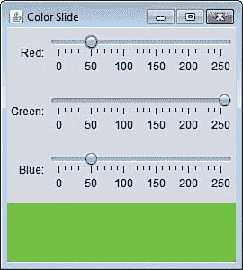

**图 16.1** 使用三个滑块组件选择颜色。

你可以使用以下任一构造方法创建一个水平滑块：

 `JSlider()`—创建一个最小值为 0、最大值为 100、起始值为 50 的滑块。

 `JSlider(int, int)`—创建一个具有指定最小值和最大值的滑块。

 `JSlider(int, int, int)`—创建一个具有指定最小值、最大值和起始值的滑块。

要创建垂直滑块，请使用一个带有额外第一个参数的构造方法：滑块的方向。该参数应该是类变量`JSlider.VERTICAL`或`JSlider.HORIZONTAL`。

以下语句创建一个垂直滑块，用于选择 1 到 1,000 之间的数字：

```java
JSlider guess = new JSlider(JSlider.VERTICAL, 1, 1000, 500);
```

此滑块的*游标*（组件中选择数字的部分）起始于 500 位置。

要为滑块显示标签，你必须设置标签将包含的信息。调用滑块的`setMajorTickSpacing(int)`和`setMinorTickSpacing(int)`方法来确定标签上刻度线显示的频率。主刻度显示为比次刻度更粗的线条。

设置好刻度线出现的频率后，调用滑块的`setPaintTicks(boolean)`方法，并将`true`作为参数。你也可以通过调用滑块的`setPaintLabels(boolean)`方法并将`true`作为参数，来显示每个主刻度的数值。

### 更改监听器

要监控滑块输入，你必须有一个实现`javax.swing.event`包中`ChangeListener`接口的类。此接口仅包含一个方法：

```java
public void stateChanged(ChangeEvent event); {
    // 处理事件的语句
}
```

要将一个对象注册为更改监听器，请调用持有滑块的容器的`addChangeListener(Object)`方法。当滑块移动时，监听对象的`stateChanged()`方法会被调用。

此方法接收一个`ChangeEvent`对象作为参数，该对象可以识别值发生更改的滑块组件。调用该对象的`getSource()`方法，并将对象强制转换为`JSlider`，如以下语句所示：

```java
JSlider changedSlider = (JSlider) event.getSource();
```

在此示例中，`event`是作为`stateChanged()`方法参数的`ChangeEvent`对象。

更改事件会在滑块移动过程中持续发生。它们从滑块首次被移动时开始，直到滑块被释放才会停止发生。因此，在滑块停止移动之前，你可能不想在`stateChanged()`方法中执行任何操作。

要查看滑块当前是否正在被移动，请调用其`getValueIsAdjusting()`方法。此方法在移动发生期间返回`true`，否则返回`false`。

此技术将在你的下一个项目中演示，这是一个使用三个滑块选择颜色的 Java 应用程序。在 Java 中，颜色通过使用`java.awt`包中的`Color`类来创建。

创建`Color`对象的一种方法是指定颜色中红、绿、蓝的含量。每种颜色分量可以是 0 到 255 之间的整数，其中 255 代表该颜色的最大量。

以下语句创建一个代表奶油糖果色的`Color`对象：

```java
Color butterscotch = new Color(255, 204, 128);
```

用于创建此`Color`对象的红色值为 255，因此它包含最大量的红色。它还包含大量的绿色和一些蓝色。


清单 16.1 包含`ColorSliders`应用程序，该程序有三个滑块、滑块的三个标签以及一个显示颜色的面板。创建一个名为`ColorSliders`的新的空白 Java 文件，在源代码编辑器中输入清单的文本，然后保存文件。

## 清单 16.1 `ColorSliders.java`的完整文本

点击此处查看代码图像

```java
package com.java24hours;

import javax.swing.*;
import javax.swing.event.*;
import java.awt.*;

public class ColorSliders extends JFrame implements ChangeListener {
    ColorPanel canvas;
    JSlider red;
    JSlider green;
    JSlider blue;

    public ColorSliders() {
        super("Color Slide");
        setLookAndFeel();
        setSize(270, 300);
        setDefaultCloseOperation(JFrame.EXIT_ON_CLOSE);
        setVisible(true);

        canvas = new ColorPanel();
        red = new JSlider(0, 255, 255);
        green = new JSlider(0, 255, 0);
        blue = new JSlider(0, 255, 0);

        red.setMajorTickSpacing(50);
        red.setMinorTickSpacing(10);
        red.setPaintTicks(true);
        red.setPaintLabels(true);
        red.addChangeListener(this);

        green.setMajorTickSpacing(50);
        green.setMinorTickSpacing(10);
        green.setPaintTicks(true);
        green.setPaintLabels(true);
        green.addChangeListener(this);

        blue.setMajorTickSpacing(50);
        blue.setMinorTickSpacing(10);
        blue.setPaintTicks(true);
        blue.setPaintLabels(true);
        blue.addChangeListener(this);

        JLabel redLabel = new JLabel("Red: ");
        JLabel greenLabel = new JLabel("Green: ");
        JLabel blueLabel = new JLabel("Blue: ");
        GridLayout grid = new GridLayout(4, 1);
        FlowLayout right = new FlowLayout(FlowLayout.RIGHT);
        setLayout(grid);

        JPanel redPanel = new JPanel();
        redPanel.setLayout(right);
        redPanel.add(redLabel);
        redPanel.add(red);
        add(redPanel);

        JPanel greenPanel = new JPanel();
        greenPanel.setLayout(right);
        greenPanel.add(greenLabel);
        greenPanel.add(green);
        add(greenPanel);

        JPanel bluePanel = new JPanel();
        bluePanel.setLayout(right);
        bluePanel.add(blueLabel);
        bluePanel.add(blue);
        add(bluePanel);
        add(canvas);

        setVisible(true);
    }

    public void stateChanged(ChangeEvent event) {
        JSlider source = (JSlider) event.getSource();
        if (source.getValueIsAdjusting() != true) {
            Color current = new Color(red.getValue(), green.getValue(),
                blue.getValue());
            canvas.changeColor(current);
            canvas.repaint();
        }
    }

    private void setLookAndFeel() {
        try {
            UIManager.setLookAndFeel(
                "com.sun.java.swing.plaf.nimbus.NimbusLookAndFeel"
            );
        } catch (Exception exc) {
            // ignore error
        }
    }

    public static void main(String[] arguments) {
        ColorSliders cs = new ColorSliders();
    }
}

class ColorPanel extends JPanel {
    Color background;

    ColorPanel() {
        background = Color.red;
    }

    public void paintComponent(Graphics comp) {
        Graphics2D comp2D = (Graphics2D) comp;
        comp2D.setColor(background);
        comp2D.fillRect(0, 0, getSize().width, getSize().height);
    }

    void changeColor(Color newBackground) {
        background = newBackground;
    }
}
```

**注意**

在图 16.1 中，该应用程序被用于创建北德州大学校队的颜色：绿色（红 50，绿 250，蓝 50）。这种色调足以让北德州大学的校友们在体育赛事中兴奋地跳起，并做出凶猛的鹰爪手势，同时让客队的颜色看起来像是黄色（红 255，绿 255，蓝 0）。

当您运行应用程序时，如前面的图 16.1 所示，一个框架窗口包含了三个滑块，它们代表了框架底部面板中红色、绿色和蓝色的分量值。

您可以调整每个滑块的值以更改显示的颜色。

## 使用图像图标和工具栏

改善图形用户界面视觉吸引力的最简单方法之一是使用图标。这些小图像用于标识按钮和界面的其他部分。

通过使用`javax.swing`包中的`ImageIcon`类，您可以为许多 Swing 类库中的组件设置图像标签，而不是文本标签。

您可以通过调用`ImageIcon(String)`构造方法从计算机上的文件创建`ImageIcon`。该方法的参数是文件的名称或路径和名称，如以下示例所示：

点击查看代码图像

```java
ImageIcon stopSign = new ImageIcon("stopsign.gif");
ImageIcon saveFile = new ImageIcon("images/savefile.gif");
```

用于创建图像图标的图形文件必须是 GIF、JPEG 或 PNG 格式。大多数情况下使用的是 GIF 格式，它非常适合显示颜色数量有限的小型图形。

**注意**

尽管某些操作系统使用`\`字符分隔文件夹和文件名，但`ImageIcon`构造方法要求使用`/`字符作为分隔符。

`ImageIcon`构造方法会立即从文件中加载整个图像。

您可以通过使用`JLabel(ImageIcon)`和`JButton(ImageIcon)`构造方法将图像图标用作标签和按钮，如以下示例所示：

点击查看代码图像

```java
ImageIcon siteLogo = new ImageIcon("siteLogo.gif");
JLabel logoLabel = new JLabel(siteLogo);

ImageIcon searchWeb = new ImageIcon("searchGraphic.gif");
JButton search = new JButton(searchWeb);
```

多个组件可以同时拥有图标和文本标签。以下语句创建了一个同时包含两者的按钮：

点击查看代码图像

```java
JButton refresh = new JButton("Refresh",
    "images/refreshIcon.gif");
```

图像图标通常用于工具栏中，工具栏是将几个组件组合成一行或一列的容器。

通过使用`JToolBar`类创建的工具栏可以设计成允许用户将其从图形用户界面的一个部分移动到另一个部分。此过程称为停靠（docking），这些组件也称为可停靠工具栏。

您可以通过以下构造方法之一创建工具栏：

- `JToolBar()` — 创建一个将组件水平排列的工具栏。
- `JToolBar(int)` — 创建一个将组件按指定方向排列的工具栏，方向为`SwingConstants.HORIZONTAL`或`SwingConstants.VERTICAL`。

组件添加到工具栏的方式与添加到其他容器的方式相同——通过调用`add(Component)`方法并传入要添加的组件。

要使工具栏可停靠，它必须放置在使用`BorderLayout`作为其布局管理器的容器中。此布局将容器划分为北、南、东、西和中心区域。然而，当您使用可停靠工具栏时，容器只应使用其中两个：中心和一个方向区域。

工具栏应添加到方向区域。以下语句创建了一个垂直的、可停靠的工具栏，其中包含三个图标按钮：

点击查看代码图像

```java
JPanel pane = new JPanel();
BorderLayout border = new BorderLayout();
pane.setLayout(border);

JToolBar bar = new JToolBar(SwingConstants.VERTICAL);
ImageIcon play = new ImageIcon("play.gif");
JButton playButton = new JButton(play);
ImageIcon stop = new ImageIcon("stop.gif");
JButton stopButton = new JButton(stop);
ImageIcon pause = new ImageIcon("pause.gif");
JButton pauseButton = new JButton(pause);

bar.add(playButton);
bar.add(stopButton);
bar.add(pauseButton);

add(bar, BorderLayout.WEST);
```

您在接下来这个小时进行的项目是`Tool`，一个包含图像图标和可停靠工具栏的 Java 应用程序。创建一个名为`Tool`的 Java 文件，在文件中输入清单 16.2，然后保存该文件。

## 清单 16.2 `Tool.java`的完整文本

点击查看代码图像

```java
package com.java24hours;

import java.awt.*;
import javax.swing.*;

public class Tool extends JFrame {
    public Tool() {
        super("Tool");
        setLookAndFeel();
        setSize(370, 200);
        setDefaultCloseOperation(JFrame.EXIT_ON_CLOSE);

        // build toolbar buttons
        ImageIcon image1 = new ImageIcon("newfile.gif");
        JButton button1 = new JButton(image1);
        ImageIcon image2 = new ImageIcon("openfile.gif");
        JButton button2 = new JButton(image2);
        ImageIcon image3 = new ImageIcon("savefile.gif");
        JButton button3 = new JButton(image3);

        // build toolbar
        JToolBar bar = new JToolBar();
        bar.add(button1);
        bar.add(button2);
        bar.add(button3);

        // build text area
        JTextArea edit = new JTextArea();
        JScrollPane scrollPane = new JScrollPane(edit);

        // add components to frame
        add(bar, BorderLayout.NORTH);
        add(scrollPane, BorderLayout.CENTER);

        setVisible(true);
    }

    private void setLookAndFeel() {
        try {
            UIManager.setLookAndFeel(
                "com.sun.java.swing.plaf.nimbus.NimbusLookAndFeel"
            );
        } catch (Exception exc) {
            // ignore error
        }
    }

    public static void main(String[] arguments) {
        Tool frame = new Tool();
    }
}
```


```java
17:         JButton button2 = new JButton(image2);
18:         ImageIcon image3 = new ImageIcon("savefile.gif");
19:         JButton button3 = new JButton(image3);
20:
21:         // build toolbar
22:         JToolBar bar = new JToolBar();
23:         bar.add(button1);
24:         bar.add(button2);
25:         bar.add(button3);
26:
27:         // build text area
28:         JTextArea edit = new JTextArea(8, 40);
29:         JScrollPane scroll = new JScrollPane(edit);
30:
31:         // create frame
32:         BorderLayout border = new BorderLayout();
33:         setLayout(border);
34:         add("North", bar);
35:         add("Center", scroll);
36:         setVisible(true);
37:     }
38:
39:       private void setLookAndFeel() {
40:         try {
41:             UIManager.setLookAndFeel(
42:                 "com.sun.java.swing.plaf.nimbus.NimbusLookAndFeel"
43:             );
44:         } catch (Exception exc) {
45:             // ignore error
46:         }
47:     }
48:
49:     public static void main(String[] arguments) {
50:         Tool frame = new Tool();
51:     }
52: }
```

## 工具栏和图形文件

`Tool` 应用程序需要三个图形文件来创建工具栏上的图标：`newfile.gif`、`openfile.gif` 和 `savefile.gif`。请从本书网站 [www.java24hours.com](http://www.java24hours.com) 的第 16 小时页面下载这些文件，并将它们保存在 `Java24` 项目文件夹（或你在 NetBeans 中为 Java 项目指定的文件夹）中。

将这些文件导入项目的一种方法是使用拖放操作：

**1.** 在“项目”窗格中，单击“文件”选项卡使其显示在前面。

**2.** 将这三个图形文件（一次一个或作为一组）拖放到 `Java24` 文件夹中。

**3.** NetBeans 会将这些文件导入到项目的顶层文件夹中。

> **注意**
>
> 找不到 NetBeans 项目文件夹？在 NetBeans 中开始一个新项目：选择“文件”->“新建项目”，类别选“Java”，项目类型选“Java 应用程序”，然后单击“下一步”。“项目位置”文本字段应包含应保存这些图标的文件夹位置。

图 16.2 和图 16.3 显示了该应用程序运行时的两个不同截图。工具栏已从其原始位置（图 16.2）移动到了界面的另一个边缘（图 16.3）。

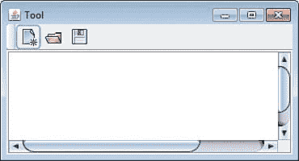

**图 16.2** 使用带有工具栏的应用程序。

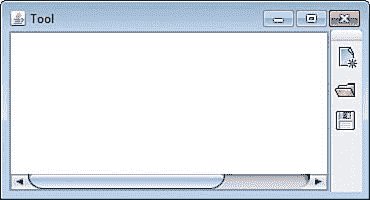

**图 16.3** 将工具栏停靠在新位置。

> **注意**
>
> 你也可以将可停靠的工具栏完全拖离界面。这会导致打开一个包含该工具栏的新窗口。

运行应用程序并通过移动工具栏来尝试使用。你可以通过单击其控制柄并将工具栏拖动到文本区域的不同边缘来移动工具栏。释放工具栏后，它会沿着该边缘放置，文本区域会移动以为其腾出空间。

## 表格

本小时介绍的最后一个用户界面组件是最复杂的。`JTable` 类表示一个以行和列形式呈现的表格信息。表格单元格中的信息可以被编辑，列可以重新排列，并且列可以调整大小以变宽或变窄。这听起来工作量很大，但所有这些都由类自动完成。该功能内置于属于 `javax.swing` 包的该类中。

图 16.4 展示了一个 `JTable` 组件的示例。你将在本小时的最后一个项目中创建此表格。

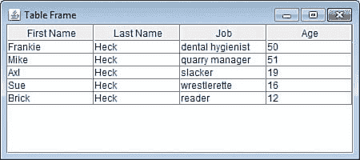

**图 16.4** 一个包含五行四列个人信息的表格。

使用表格最简单的方法是将数据直接存储在表格中。

采用此技术的第一步是创建一个包含每列名称的字符串数组，如以下代码所示：

```java
String[] columnLabels = { "First Name", "Last Name",
    "Job", "Age" };
```

表格的单元格可以具有不同的数据类型甚至对象。但是，每一列必须包含相同类型的内容。在你将要创建的项目中，每一行都有三个字符串（名、姓和职位）和一个表示年龄的整数。因此，从左到右，每一行应该有三个字符串和一个整数。

> **注意**
>
> 你是否想知道像 50 或 16 这样的数字如何用于创建对象数组中的元素？此代码利用了 Java 执行装箱（boxing）和拆箱（unboxing）以在对象和相同值的原始数据类型之间自动转换的特性。整数字面量被装箱成代表相同值的 `Integer` 对象。

填充表格的下一步是创建一个二维对象数组，用于存储要放入其中的数据。完成此操作的代码看起来像你在第 9 小时，“使用数组存储信息”中使用的用于声明数组并赋予其由字面量定义的初始值的方式。`columnLabels` 数组就是以这种方式创建的。

以下是在 `Object[][]` 数组中创建表格数据的代码：

```java
Object[][] tableData = {
    {
        "Frankie", "Heck", "dental hygienist", 50
    },
    {
        "Mike", "Heck", "quarry manager", 51
    },
    {
        "Axl", "Heck", "slacker", 19
    },
    {
        "Sue", "Heck", "wrestlerette", 16
    },
    {
        "Brick", "Heck", "reader", 12
    }
};
```

在一个跨多行的语句中，此代码创建了一个组织成四列五行的二维对象数组。每一行定义了关于特定人员的信息：字符串存储名、姓和职位，后面跟着该人年龄的整数。

代码中有很多空格和标点符号，因此请注意 `}` 闭合括号、`{` 开始括号和逗号放置的位置。空格无关紧要，但标点符号必须严格按照所示方式使用。

数组的每一行被赋值为由逗号分隔的列表，并由开始和结束括号包围。以下是格式稍有不同的单行数据：

```java
{ "Sue", "Heck", "wrestlerette", 16 }
```

为了让你更清楚地理解这定义了什么，它可用于创建一个一维对象数组的语句：

```java
Object[] row1 = { "Sue", "Heck", "wrestlerette", 16 };
```

对于二维数组，定义每一行的块由逗号分隔。因此有一个 `Frankie` 的块，后面跟着一个逗号和 `Mike` 的块，然后是逗号和 `Axl` 的块，逗号和 `Sue` 的块，以及逗号和 `Brick` 的块。与 Java 代码中的任何逗号分隔列表一样，最后一项后面不需要逗号。

现在你有了一个包含列名的字符串数组和一个包含表格数据的对象数组，可以使用数据和列名作为构造方法的参数来创建 `JTable` 对象：

```java
JTable table = new JTable(tableData, columnLabels);
```

表格通常包含的信息多于图形用户界面中可以显示的内容，因此它们应该放在支持滚动的滚动窗格内。

也可以通过以 `true` 作为参数调用表格的 `setFillsViewportHeight(boolean)` 方法，将它们设置为在界面内占据所有可用高度：

```java
table.setFillsViewportHeight(true);
```

你接下来创建的 `TableFrame` 应用将把所有这些内容整合起来。在 NetBeans 中新建一个空 Java 文件，并填入清单 16.3 中的内容。

**清单 16.3** `TableFrame.java` 的完整代码

点击此处查看代码图片

```java
1: package com.java24hours;
2:
3: import javax.swing.JFrame;
4: import javax.swing.JScrollPane;
5: import javax.swing.JTable;
6:
7: public class TableFrame extends JFrame {
8:     public TableFrame() {
9:         super("Table Frame");
10:         String[] columnLabels = { "First Name", "Last Name",
11:             "Job", "Age" };
12:         Object[][] tableData = {
13:             { // 第 1 行
14:                 "Frankie", "Heck", "dental hygienist", 50
15:             },
16:             { // 第 2 行
17:                 "Mike", "Heck", "quarry manager", 51
18:             },
19:             { // 第 3 行
20:                 "Axl", "Heck", "slacker", 19
21:             },
22:             { // 第 4 行
23:                 "Sue", "Heck", "wrestlerette", 16
24:             },
25:             { // 第 5 行
26:                 "Brick", "Heck", "reader", 12
27:             }
28:         };
29:         JTable table = new JTable(tableData, columnLabels);
30:         JScrollPane scrollPane = new JScrollPane(table);
31:         table.setFillsViewportHeight(true);
32:         add(scrollPane);
33:         setSize(450, 200);
34:         setDefaultCloseOperation(JFrame.EXIT_ON_CLOSE);
35:         setVisible(true);
36:     }
37:
38:     public static void main(String[] arguments) {
39:         TableFrame frame = new TableFrame();
40:     }
41: }
```

运行该应用，即可看到如前文图 16.4 所示的表格。你应该通过执行以下三件事来测试表格的内置功能：

**1.** 双击表格中的某个单元格。光标将出现在该单元格中，允许你通过输入新值来替换现有值。

**2.** 单击一个列标题，将其向左或向右拖动，然后释放。列顺序将重新排列，但单元格的值会保持不变。

**3.** 将鼠标悬停在分隔两个列标题的线上。光标会变为左右箭头。通过将该线拖动到新位置来更改这两列的宽度。

**注意：** 使用数组将数据放入 `JTable` 组件的一个缺点是，它将每个单元格都视为字符串，并允许用户编辑所有单元格，并用任何字符串替换其值。`TableTest` 应用程序中有一行使用了整数。这些整数可能会被更改为非整数和非数字值。为了更精确地控制哪些值可以放入表格单元格，并禁止编辑某些行，你可以使用 `javax.swing.table` 包中的 `TableModel` 接口。表格模型是一个提供表格内容及其修改方式信息的对象。

## 小结

这是专门讲解 Swing（Java 语言中支持图形用户界面软件的部分）的四个小时的最后一个部分。尽管 Swing 是 Java 类库中最大的部分，但大多数类的使用方式都是相似的。一旦你知道了如何创建组件、将组件添加到容器、为容器应用布局管理器以及响应用户输入，你就可以在探索该语言的过程中使用许多新的 Swing 类了。

## 实战练习

### 问答

**问：** 我如何了解 Java 类库中其余的 Swing 类？

**答：** 在 Oracle 的官方 Java 网站上，Java 类库的完整文档发布在 [`docs.oracle.com/javase/8/docs/api`](http://docs.oracle.com/javase/8/docs/api)。你可以看到 `javax.swing`、`java.awt` 和 `java.awt.event` 这些包中包含的类，它们是前四个小时所涵盖的内容。所有的 Swing 类和接口都有文档记录，包括它们的构造方法、类变量和实例变量。

**问：** 为什么一款关于一只扔桶、绑架公主的大猩猩和一名意大利水管工的电子游戏叫《大金刚》？

**答：** 《大金刚》是由宫本茂命名的，他在 1981 年为任天堂创造了这款投币式街机游戏。宫本茂错误地认为“donkey”在英语中意为“愚蠢”，但等到任天堂美国部门得知时，这个名字已经确定下来了。宫本茂的大猩猩/公主/水管工三角恋灵感来源于任天堂尝试为电子游戏授权《大力水手》失败的经历。后来的电子游戏确定了最初的“大金刚”已经变成了“疯狂大猩猩”，一只年长、脾气暴躁的猿猴，它认为与它辉煌的 8 位机时代相比，现在游戏占用了过多的处理能力。

### 测验

没有面板，就没有收益：通过回答以下关于滚动窗格、图像图标和其他 Swing 功能的问题来锻炼一下你的大脑。

**1.** `ImageIcon` 类支持哪些图形文件格式？

**A.** GIF

**B.** GIF 和 JPEG

**C.** GIF、PNG 和 JPEG

**2.** `JSlider` 对象的 `getValueIsAdjusting()` 方法完成了什么？

**A.** 它确定滑块是否已从其原始值更改。

**B.** 它确定滑块当前是否正在被更改值。

**C.** 没什么大用；这个方法让它的父类感到非常失望。

**3.** Swing 库以 20 世纪 30 年代流行并在 90 年代复兴的一种舞曲爵士风格命名。以下哪一项不是由 Swing 音乐家演奏的真实歌曲标题？

**A.** “Cement Mixer (Put-ti, Put-ti)”

**B.** “Sussudio”

**C.** “Flat Foot Floogie (with the Floy Floy)”

### 答案

**1. C.** `ImageIcon` 中的 PNG 支持是在 Java 1.3 中添加的。

**2. B.** `getValueIsAdjusting()` 方法在滑块被移动时返回 `true`，否则返回 `false`。

**3. B.** “Sussudio”是菲尔·柯林斯 1985 年的热门歌曲，比 Swing 时代晚了五十年。另外两首是斯利姆·盖拉德的 Swing 热门歌曲，他胡言乱语的天赋在歌曲“Boot-Ta-La-Za”、“Ra-Da-Da-Da”、“Bingie-Bingie-Scootie”和“Vout Oreenie”中也显而易见。

### 活动

为了看看你是否掌握了要领，请尝试以下活动：

 为前三个小时中创建的某个 Java 应用程序添加一个工具栏。

 创建一个表格，表示某只股票至少五天的最高价、最低价、成交量和日期。

要查看实现这些活动的 Java 程序，请访问本书网站：[www.java24hours.com](http://www.java24hours.com)。

# 第五部分：进入高级话题

# 第 17 小时：在数据结构中存储对象

本小时待办事项清单：

 创建一个数组列表。

 向列表中添加和删除项。

 使用泛型来提高列表的可靠性。

 在列表中搜索对象。

 遍历列表的内容。

 创建一个键值对的哈希映射。

 向映射中添加和删除项。


 检索映射条目的键。

 检索映射条目的值。

 遍历映射的键和值。

程序员都是“囤积者”。

### 数组列表

在计算机编程中，你花费大量时间收集信息并寻找存储它们的地方。信息可以是原始数据类型的形式，例如`float`，也可以是特定类的对象。它可以从磁盘读取，从互联网服务器获取，由用户输入，或通过其他方式收集。

获得信息后，你必须在程序运行于 Java 虚拟机（JVM）期间，决定将其放置何处。多个通过数据类型或类相互关联的项目可以存储在一个数组中。

这对于许多目的来说已经足够，但随着你的程序变得越来越复杂，作为一个囤积者，你的需求也会增加。

在本小时内，你将学习 Java 中为信息囤积者设计的一些类：数组列表（array lists）和哈希映射（hash maps）。

在第 9 小时“使用数组存储信息”中，你已经了解了数组，这是一种在程序中处理变量和对象组的极其方便的方式。数组对于 Java 至关重要，它们是像整数和字符一样的内置数据类型。数组将相同数据类型或类的元素打包在一起。

尽管数组很有用，但它们受到数组大小不可改变这一事实的限制。创建一个用于容纳 90 个元素的数组后，它不能被修改为容纳更多或更少的元素。大小是固定的。（一种比较专业的说法是称该数组为“不可变”的。）

`java.util`包中有一个类，它能做数组能做的一切，却没有那个限制：`ArrayList`。

数组列表是一种数据结构，用于保存相同类或公共超类的对象。在程序运行时，列表可以根据需要增长或收缩。

创建数组列表最简单的方法是通过调用其无参构造函数：

```java
ArrayList servants = new ArrayList();
```

数组列表可以通过指定初始容量来创建，这为列表可能容纳的元素数量提供了一些指导。容量作为整数参数设置给构造函数：

```java
ArrayList servants = new ArrayList(30);
```

尽管这看起来像是在创建一个数组并确定其精确大小，但容量仅仅是一个提示。如果超过容量，数组列表将相应地进行调整并继续正常工作。（你对容量的估计越准确，程序的效率就越高。）

列表保存属于同一个类或共享一个超类的对象。

创建数组列表时，你知道该列表打算保存哪个类或超类。这可以在构造函数中用`<`和`>`符号指定，这是语言的一种称为泛型（generics）的特性。以下是针对保存`String`对象的列表构造函数的一个改进版本：

```java
ArrayList<String> servants = new ArrayList<String>();
```

注意

如果你有使用早期版本 Java 的经验，你可能听说过向量（vectors），并想知道为什么它们与数组列表如此相似。它们是另一种数据结构，功能与`ArrayList`类几乎完全相同，并且位于同一个`java.util.Vector`包中。两者之间的主要区别在于向量需要同步，因此任何使用向量的类运行速度都会更慢。因此，数组列表通常是首选。

要添加一个对象，请以该对象作为参数调用数组列表的`add(Object)`方法。以下是添加五个字符串的语句：

```java
servants.add("Bates");
servants.add("Anna");
servants.add("Thomas");
servants.add("Mrs. O'Brien");
servants.add("Daisy");
```

每个元素都添加到列表的末尾，因此`servants`中的第一个字符串是“Bates”，最后一个是“Daisy”。

有一个对应的`remove(Object)`方法，用于从列表中移除对象：

```java
servants.remove("Mrs. O'Brien");
```

数组列表的大小是它当前包含的元素数量。通过调用列表的`size()`方法来检索此信息，该方法返回一个整数：

```java
int servantCount = servants.size();
```

当你使用泛型指定列表包含的类时，使用`for`循环遍历列表的每个元素非常简单：

```java
for (String servant : servants) {
    System.out.println(servant);
}
```

`for`的第一个参数是用于存储元素的变量。第二个是数组列表。其他数据结构也可以使用相同的循环。

`add(Object)`方法将对象存储在列表末尾。也可以通过指定对象应在列表中的存储位置来向列表添加对象。这需要`add(int, Object)`方法，其中位置作为第一个参数：

```java
ArrayList<String> aristocrats = new ArrayList<String>();
aristocrats.add(0, "Lord Robert");
aristocrats.add(1, "Lady Mary");
aristocrats.add(2, "Lady Edith");
aristocrats.add(3, "Lady Sybil");
aristocrats.add(0, "Lady Grantham");
```

前面示例中的最后一条语句将“Lady Grantham”添加到列表顶部而不是底部，使她排在“Lord Robert”和其他人之前。

作为第一个参数指定的位置必须不大于列表的`size()`。如果“Lord Robert”添加时位置是 1 而不是 0，程序将因`IndexOutOfBoundsException`而失败。

可以通过将位置作为参数指定给`remove(int)`来从列表中移除一个元素：

```java
aristocrats.remove(4);
```

可以通过调用`get(int)`并传递位置参数来检索列表中指定位置的元素。以下是一个`for`循环，它从列表中提取每个字符串并显示它：

```java
for (int i = 0; i < aristocrats.size(); i++) {
    String aristocrat = aristocrats.get(i);
    System.out.println(aristocrat);
}
```

通常需要查明数组列表是否包含特定对象。这可以通过以该对象作为参数调用列表的`indexOf(Object)`方法来确定。该方法返回对象的位置，如果在列表中找不到则返回 –1：

```java
int hasCarson = servants.indexOf("Carson");
```

本小时的第一个项目将在一个简单的游戏中运用这些技术，该游戏向一个 10x10 网格的 (x,y) 点开火。一些点包含目标，而另一些则没有。

目标由`java.awt`包中的`Point`类表示。通过使用 x 和 y 坐标作为两个参数调用`Point(int, int)`构造函数来创建一个点。

这条语句创建一个位于 (5,9) 的点：

```java
Point p1 = new Point(5,9);
```

这是一个 10x10 的网格，该点用“X”标记，空格用“.”句点字符标记：

**输出**

```
   1  2  3  4  5  6  7  8  9
1  .  .  .  .  .  .  .  .  .
2  .  .  .  .  .  .  .  .  X
3  .  .  .  .  .  .  .  .  .
4  .  .  .  .  .  .  .  .  .
5  .  .  .  .  .  .  .  .  .
6  .  .  .  .  .  .  .  .  .
7  .  .  .  .  .  .  .  .  .
8  .  .  .  .  .  .  .  .  .
9  .  .  .  .  .  .  .  .  .
```

列从左到右，代表 x 坐标。行从上到下，标记 y 坐标。

在这个项目之前，你已经看到数组列表可以保存字符串。它们可以保存`Point`或任何其他类的对象。这条语句创建一个点列表：

```java
ArrayList<Point> shots = new ArrayList<Point>();
```

```java
ArrayList<Point> targets = new ArrayList<Point>();
```

Java 编译器不允许将`Point`或其子类之外的任何类添加到该数组列表中。

在 NetBeans 或其他编程工具中，创建一个名为`Battlepoint`的 Java 文件，并指定`com.java24hours`为其包。将清单 17.1 的文本输入该文件中。

**清单 17.1** `Battlepoint.java`的完整文本

点击此处查看代码图像

***

```java
1: package com.java24hours;
2:
3: import java.awt.*;
4: import java.util.*;
5:
6: public class Battlepoint {
7:     ArrayList<Point> targets = new ArrayList<Point>();
8:
9:     public Battlepoint() {
10:         // create targets to shoot at
11:         createTargets();
12:         // display the game map
13:         showMap();
14:         // shoot at three points
15:         shoot(7,4);
16:         shoot(3,3);
17:         shoot(9,2);
18:         // display the map again
19:         showMap();
20:     }
21:
22:     private void showMap() {
23:         System.out.println("\n   1  2  3  4  5  6  7  8  9");
24:         for (int column = 1; column < 10; column++) {
25:             for (int row = 1; row < 10; row++) {
26:                 if (row == 1) {
27:                     System.out.print(column + " ");
28:                 }
29:                 System.out.print(" ");
30:                 Point cell = new Point(row, column);
31:                 if (targets.indexOf(cell) > -1) {
32:                     // a target is at this position
33:                     System.out.print("X");
34:                 } else {
35:                     // no target is here
36:                     System.out.print(".");
37:                 }
38:                 System.out.print(" ");
39:             }
40:             System.out.println();
41:         }
42:         System.out.println();
43:     }
44:
45:     private void createTargets() {
46:         Point p1 = new Point(5,9);
47:         targets.add(p1);
48:         Point p2 = new Point(4,5);
49:         targets.add(p2);
50:         Point p3 = new Point(9,2);
51:         targets.add(p3);
52:     }
53:
54:     private void shoot(int x, int y) {
55:         Point shot = new Point(x,y);
56:         System.out.print("Firing at (" + x + "," + y + ") ... ");
57:         if (targets.indexOf(shot) > -1) {
58:             System.out.println("you sank my battlepoint!");
59:             // delete the destroyed target
60:             targets.remove(shot);
61:         } else {
62:             System.out.println("miss.");
63:         }
64:     }
65:
66:     public static void main(String[] arguments) {
67:         new Battlepoint();
68:     }
69: }
```

***

`Battlepoint`应用程序中的注释描述了构造函数的每个部分以及程序中重要的条件逻辑。

该应用程序创建三个`Point`对象作为目标，并将它们添加到一个数组中（第 45-52 行）。然后显示一张包含这些目标的地图（第 22-43 行）。

接着，通过调用`shoot(int, int)`方法（第 54-64 行）对三个点进行射击。每次射击后，应用程序都会报告是否击中了某个目标。如果击中，该目标将从数组列表中移除。

最后，再次显示地图，应用程序终止。

输出结果如图 17.1 所示。

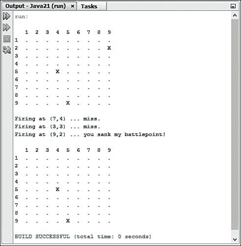

**图 17.1** 将`Point`对象放入数组列表并对其射击。

图 17.1 的上方地图显示了三个目标。一个目标被击中后被移除。输出的下方地图反映了这一变化。

当一个目标被射击击中时，会通过调用`remove(Object)`方法，以该射击的点为参数，将其从`targets`数组列表中移除。

***

**注意**

在`Battlepoint`应用程序的`shoot()`方法中，将从数组列表中移除的`Point`对象是代表射击的点。它与被击中目标的(x,y)坐标相同。

***

### 哈希映射

在编程中，使用一条信息来访问另一条信息的能力很常见。在数据结构中，数组列表是最简单的例子，可以通过索引号从列表中检索一个对象。这里有一个例子，从`aristocrats`数组列表中获取第一个字符串：

点击此处查看代码图像

```java
String first = aristocrats.get(0);
```

数组也使用索引号来检索数组中的每个元素。

哈希映射是 Java 中一种使用一个对象来检索另一个对象的数据结构。第一个对象是键，第二个是值。它们被实现为`java.util`包中的`HashMap`类。

该名称指的是键如何被映射到值。这类结构化数据的一个例子是电话簿。一个人的姓名（字符串）可以用来检索该人的电话号码。

可以通过调用其无参数构造函数来创建一个哈希映射：

点击此处查看代码图像

```java
HashMap phonebook = new HashMap();
```

***

**注意**

就像数组列表有一个名为`Vector`的类以更占用资源的方式做同样的事情一样，哈希映射也有`Hashtable`。哈希表是同步的，而哈希映射不是，因此任何使用哈希表的类运行时间都会更长。通常更推荐使用哈希映射。

***

在新的哈希映射中可以指定两件事来控制其效率：初始容量和负载因子。它们按此顺序用两个参数设置：

点击此处查看代码图像

```java
HashMap phonebook = new HashMap(30, 0.7F);
```

容量是哈希映射值可以存储的桶的数量。负载因子是在容量自动增加之前可以使用的桶的数量。该值是一个从 0（空）到 1.0（满）的浮点数，因此 0.7 意味着当桶被使用了 70%时，容量会增加。默认容量为 16，负载因子为 0.75，这通常已足够。

应使用泛型来指定键和值的类。它们放在`<`和`>`字符内，类名用逗号分隔，如下例所示：

点击此处查看代码图像

```java
HashMap<String, Long> phonebook = new HashMap<>();
```

***

**注意**

这些语句将使用`long`值在哈希映射中存放`Long`对象。在早期 Java 版本中，这将是一个错误，因为基本数据类型（如`long`）不能用于需要对象的地方。

但由于自动装箱和拆箱（Java 的一项特性，可自动在基本类型及其等效对象类之间转换），这不再是一个错误。当 Java 编译器看到像 8002888372 这样的`long`值时，会将其转换为对应值的`Long`对象。

***

这将创建一个名为`phonebook`的哈希映射，其键为字符串，值为`Long`对象。第二组`<`和`>`字符是空的，它假定与该语句中前一组`<`和`>`中的类相同。

对象通过调用哈希映射的`put(Object, Object)`方法并传入两个参数来存储：键和值：

点击此处查看代码图像

```java
phonebook.put("Butterball Turkey Line", 8002888372);
```


这将在映射中存储一个条目，其键为“Butterball Turkey Line”，值为`8002888372`的`Long`对象，即该服务的电话号码。

可以通过调用`get(Object)`并以键作为唯一参数来从映射中检索对象：

```java
int number = phonebook.get("Butterball Turkey Line");
```

`get()`方法在未找到匹配键的值时返回`null`。这会在前面的示例中导致问题，因为`null`不是一个合适的`long`值。

处理这个潜在问题的另一种方法是调用`getOrDefault(Object, Object)`。如果作为第一个参数指定的键未找到，则默认返回第二个参数，如以下语句所示：

```java
int number = phonebook.getOrDefault("Betty Crocker", -1);
```

如果在映射中找到与键“Betty Crocker”匹配的数字，则返回该数字。否则，返回`-1`。

有两种方法可以指示映射中是否存在键或值：`containsKey(Object)`和`containsValue(Object)`。它们返回一个布尔值，为`true`或`false`。

哈希映射与数组列表一样，有一个`size()`方法，用于指示数据结构中的项目数量。

遍历映射可以通过使用条目集（映射中所有条目的集合）来完成。`entrySet()`方法将这些条目作为一个`Set`对象返回（使用`java.util`中的`Set`接口）。

集合中的每一项都由`Map.Entry`表示，这是`java.util`中`Map`类的一个内部类。当你有一个`Entry`对象时，可以调用其`getKey()`方法检索键，调用`getValue()`检索值。

以下`for`循环使用条目集和条目来访问`phonebook`哈希映射中的所有键和值：

```java
for (Map.Entry<String, Font> entry : map.entrySet()) {
    String key = entry.getKey();
    Font value = entry.getValue();
    // ...
}
```

`FontMapper`项目将所有这些组合在一起，使用哈希映射管理字体集合。

`java.awt`包中的`Font`类用于创建字体，并在图形用户界面中使用它们来显示文本。字体包括字体名称、磅数以及它是常规、粗体还是斜体样式。

哈希映射可以包含任何类的对象。在 NetBeans 中，在`com.java24hours`包中创建一个名为`FontMapper`的 Java 文件。将 Listing 17.2 中的内容输入到文件中并保存。

**LISTING 17.2** `FontMapper.java`的完整文本

```java
1: package com.java24hours;
2: 
3: import java.awt.*;
4: import java.util.*;
5: 
6: public class FontMapper {
7:     public FontMapper() {
8:         Font courier = new Font("Courier New", Font.PLAIN, 6);
9:         Font times = new Font("Times New Roman", Font.BOLD, 12);
10:        Font verdana = new Font("Verdana", Font.ITALIC, 25);
11:        HashMap<String, Font> fonts = new HashMap<>();
12:        fonts.put("smallprint", courier);
13:        fonts.put("body", times);
14:        fonts.put("headline", verdana);
15:        for (Map.Entry<String, Font> entry : fonts.entrySet()) {
16:            String key = entry.getKey();
17:            Font value = entry.getValue();
18:            System.out.println(key + ": " + value.getSize() + "-pt "
19:                + value.getFontName());
20:        }
21:    }
22: 
23:    public static void main(String[] arguments) {
24:        new FontMapper();
25:    }
26: }
```

`FontMapper`应用程序在第 8-10 行创建了三个`Font`对象，然后在第 12-14 行将它们添加到名为`fonts`的哈希映射中。它们使用描述字体用途的字符串键存储在映射中：“smallprint”、“body”和“headline”。

第 15-20 行的`for`循环使用条目集和集合中的每个条目遍历哈希映射。

应用程序的输出显示在 Figure 17.2。

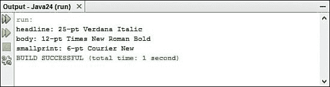

**FIGURE 17.2** 在哈希映射中存储`Font`对象。

## 总结

数组列表和哈希映射是`java.util`包中最有用的两种数据结构。数组列表类扩展了数组的功能，使得克服该数据类型的固定大小限制成为可能。哈希映射允许使用任何类型的对象作为键来检索值。

还有位集（`BitSet`类），用于保存 0 和 1 位值；栈（`Stack`），类似于数组列表的后进先出数据集合；以及属性（`Properties`），一种特殊的哈希映射，用于在文件或其他永久存储位置保存程序的配置属性。

## 练习室

### 问与答

**问：** 当一个类是同步的意味着什么？

**答：** 同步是 Java 虚拟机确保对象的实例变量和方法被对象的其他用户以一致和准确的方式访问的机制。

当你在 Hour 19 “创建线程程序”中学习线程时，这个概念会更有意义。Java 程序可以被设计成同时执行多个任务。每个任务都放在自己的线程中。

当多个线程访问同一个对象时，对象在每个线程中表现相同至关重要。因此，当类的方法需要同步（如向量和哈希表）时，Java 虚拟机必须更努力地工作，并且可能遇到可能导致线程停止运行的错误。

这就是为什么数组列表和哈希映射复制了向量和哈希表的功能。需要不需要同步并且因此运行更高效的数据结构。

**问：** 华盛顿将军队曾经击败过哈林环球旅行者队吗？

**答：** 将军队在几十年间曾七次击败旅行者队，最近一次是在 1971 年。在田纳西州马丁市比赛，将军队以 100-99 获胜，投篮来自球队老板路易斯“红”克洛茨。

尽管将军队今天以输家闻名，但他们于 1921 年作为费城斯法斯队（一个合法的球队）开始，在东部和美国篮球联赛中打球。斯法斯——南费城犹太人协会的缩写——赢得了 10 个冠军。克洛茨是前斯法斯队球员，他买下了球队，并于 1952 年更名为将军队，当时他们成为哈林著名球队的永久巡回伙伴。

1971 年的胜利结束了旅行者队 2495 场的连胜纪录。

### 测验

以下问题测试你对数据结构的知识掌握程度。

**1.** 以下哪项在创建后不能增长或缩小大小？

**A.** 数组列表

**B.** 数组

**C.** 哈希映射

**2.** 用于查找数组列表或哈希映射中有多少个项目的方法的名称是什么？

**A.** `length()`

**B.** `size()`

**C.** `count()`

**3.** 哈希映射中可以用作键的数据类型或类是什么？

**A.** `int`或`Integer`

**B.** `String`

**C.** 任何类的对象

### 答案

**1. B.** 数组的大小在创建时确定且无法更改。数组列表和哈希映射根据需要更改大小。

**2. B.** `size()`方法指示该数据结构中当前的项目数量。

**3. A、B 或 C。** 哈希映射可以使用任何类作为键和任何类作为值。

### 实践活动

你可以通过以下活动应用你良好的结构化编程知识：

 编写一个程序，使用本小时介绍的一种数据结构来管理公司电子邮件地址列表，其中每个电子邮件地址与该人的姓名相关联。

 扩展`FontMapper`程序，将新字体的名称、大小和样式作为命令行参数，并在显示其键和值之前将其添加到哈希映射中。

要查看实现这些活动的 Java 程序，请访问本书网站[www.java24hours.com](http://www.java24hours.com)。

# 第 18 小时 处理程序中的错误

本小时待办事项：

 了解为何错误被称为异常。

 在 Java 程序中响应异常。

 创建忽略异常的方法。

 使用会引发异常的方法。

 创建你自己的异常。

错误——那些阻止程序正确运行的缺陷、疏忽和笔误——是软件开发过程中自然的一部分。“自然”可能是用来描述它们最温和的词语。在我自己的编程经历中，当我找不到一个难以捉摸的错误的原因时，我会使用连副总统乔·拜登听了都会脸红的词语。

有些错误会被编译器标记出来，阻止你创建类。另一些错误则由解释器在发现某个问题导致其无法成功运行时记录下来。Java 将错误分为两类：

 异常（Exceptions）—— 在程序运行时发生的、表示出现了异常情况的事件。

 错误（Errors）—— 表示解释器遇到问题的事件，这些问题可能与你的程序无关。

错误通常不是 Java 程序能够从中恢复的，因此它们不是本小时的重点。你可能在使用 Java 程序时遇到过`OutOfMemoryError`。一旦发生这类错误，在 Java 程序中无法采取任何措施来处理。程序会带着错误退出。

异常通常可以被处理，从而使程序继续正常运行。

## 异常

尽管你现在才开始学习它们，但你可能在前 17 个小时中已经对异常非常熟悉了。当你编写一个编译成功但在运行时遇到问题的 Java 程序时，就会出现这些错误。

例如，一个常见的编程错误是引用数组中不存在的元素，如以下语句所示：

```java
String[] greek = { "Alpha", "Beta", "Gamma" };

System.out.println(greek[3]);
```

`String`数组`greek`有三个元素。因为数组的第一个元素编号为 0 而不是 1，所以第一个元素是`greek[0]`，第二个是`greek[1]`，第三个是`greek[2]`。因此，尝试显示`greek[3]`的语句是错误的。前面的语句编译成功，但当你运行程序时，Java 虚拟机会停止并显示类似以下的消息：

**输出**

```java
Exception in thread "main" java.lang.ArrayIndexOutOfBoundsException: 3

    at SampleProgram.main(SampleProgram.java:4)
```

此消息表明应用程序生成了一个异常，Java 虚拟机通过显示错误消息并停止程序来记录它。

错误消息引用了`java.lang`包中一个名为`ArrayIndexOutOfBoundsException`的类。这个类是一个异常，代表一个在 Java 程序中发生的异常情况。

当 Java 类遇到异常时，它会向该类的使用者发出错误警报。在这个例子中，类的使用者是 Java 虚拟机。

所有异常都是`java.lang`包中`Exception`类的子类。`ArrayIndexOutOfBoundsException`正如你所料——它报告数组元素的访问超出了数组的边界。

Java 中有数百种异常。许多异常，如数组异常，表明可以通过修改编程来修复的问题。这些异常类似于编译器错误——一旦你修正了问题，就无需再担心这些异常了。

> **注意**
> 有两个术语用来描述这个过程：抛出（throw）和捕获（catch）。对象抛出异常以提醒其他对象异常已经发生。这些异常会被其他对象或 Java 虚拟机捕获。

其他异常必须在每次程序运行时通过使用五个新关键字来处理：`try`、`catch`、`finally`、`throw`和`throws`。

### 在 try-catch 块中捕获异常

到目前为止，你处理异常的方法是修复导致它们的问题。有时你无法以这种方式处理异常，必须在 Java 类内部处理该问题。

为了介绍为何这很有用，请在一个名为`Calculator`的新 Java 文件中输入清单 18.1 中的简短 Java 应用程序，并保存该文件。

**清单 18.1** `Calculator.java`的完整内容

```java
 1: package com.java24hours;
 2:
 3: public class Calculator {
 4:     public static void main(String[] arguments) {
 5:         float sum = 0;
 6:         for (String argument : arguments) {
 7:             sum = sum + Float.parseFloat(argument);
 8:         }
 9:         System.out.println("Those numbers add up to " + sum);
10:     }
11: }
```

`Calculator`应用程序接受一个或多个数字作为命令行参数，将它们相加并显示总和。

因为在 Java 应用程序中，所有命令行参数都表示为字符串，所以程序在相加之前必须将它们转换为浮点数。第 7 行的类方法`Float.parseFloat()`负责此操作，将转换后的数字添加到名为`sum`的变量中。

在运行应用程序之前，请使用命令“运行” -> “设置项目配置” -> “自定义”在 NetBeans 中设置以下命令行参数：`7 4 8 1 4 1 4`。选择“运行” -> “运行主项目”来运行应用程序，你应该会看到图 18.1 中的输出。

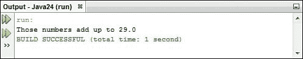

**图 18.1** `Calculator`应用程序的输出。

多次运行程序，使用不同的数字作为参数。它应该能成功处理它们，这可能会让你想知道这个项目与异常有什么关系。

为了看到关联性，将`Calculator`应用程序的命令行参数更改为`1 3 5x`。

第三个参数包含一个笔误——数字 5 后面不应该有`x`。`Calculator`应用程序无法知道这是一个错误，因此它尝试将`5x`与其他数字相加，导致显示以下异常：

**输出**

```java
Exception in thread "main" java.lang.NumberFormatException: For input

string: "5x" at sun.misc.FloatingDecimal.readJavaFormatString

(FloatingDecimal.java:1241)

    at java.lang.Float.parseFloat(Float.java:452)

    at Calculator.main(Calculator.java:7)

Java Result: 1
```

这个消息对程序员来说可能包含信息，但不是你希望用户看到的。最好是隐藏错误消息并在程序内部处理问题。

Java 程序可以使用`try`-`catch`块语句来处理自己的异常，其形式如下：

```java
try {

    // 可能导致异常的语句

} catch (Exception e) {

   // 异常发生时执行的操作

}
```

任何你希望类的方法处理的异常都必须使用`try`-`catch`块。`catch`语句中出现的`Exception`对象应该是以下三种情况之一：

 可能发生的异常的类。

 多种异常的类，用管道符`|`分隔。

 可能发生的几种不同异常的超类。

## 异常处理

`try`-`catch`代码块的`try`部分包含可能抛出异常的语句（或语句集）。在`Calculator`应用程序中，清单 18.1 第 7 行对`Float.parseFloat(String)`方法的调用，只要使用无法转换为浮点值的字符串参数，就会抛出`NumberFormatException`。

为了改进`Calculator`应用程序，使其不会因这类错误而停止运行，你可以使用`try`-`catch`代码块。

创建一个名为`NewCalculator`的新 Java 文件，并输入清单 18.2 的文本。


## 清单 18.2 `NewCalculator.java` 的完整文本

点击此处查看代码图像

```java
 1: package com.java24hours;
 2:
 3: public class NewCalculator {
 4:     public static void main(String[] arguments) {
 5:         float sum = 0;
 6:         for (String argument : arguments) {
 7:             try {
 8:                 sum = sum + Float.parseFloat(argument);
 9:             } catch (NumberFormatException e) {
10:                 System.out.println(argument + " is not a number.");
11:             }
12:         }
13:        System.out.println("Those numbers add up to " + sum);
14:     }
15: }
```

保存应用程序后，自定义项目配置，并使用命令行参数 `1 3 5x` 运行 `com.java24hours.NewCalculator`。你应该会看到 图 18.2 所示的输出。

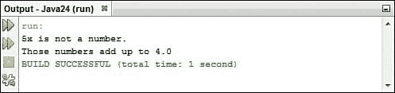

**图 18.2** `NewCalculator` 应用程序的输出。

第 7–11 行的 `try`-`catch` 代码块处理由 `Float.parseFloat()` 抛出的 `NumberFormatException` 错误。这些异常在 `NewCalculator` 类内部被捕获，该类会对任何不是数字的参数显示错误消息。因为异常在类内部得到处理，Java 解释器不会显示错误。你通常可以通过使用 `try`-`catch` 代码块来处理与用户输入和其他意外数据相关的问题。

## 捕获多个不同的异常

`try`-`catch` 代码块可用于处理多种不同类型的异常，即使它们由不同的语句抛出。

处理多个异常类的一种方法是为每个异常类专门设置一个 `catch` 代码块，如以下代码所示：

点击此处查看代码图像

```java
String textValue = "35";

int value;

try {
    value = Integer.parseInt(textValue);
} catch (NumberFormatException exc) {
    // 处理异常的代码
} catch (ArithmeticException exc) {
    // 处理异常的代码
}
```

你也可以在同一个 `catch` 代码块中处理多个异常，只需用管道符 `|` 分隔它们，并在列表末尾为异常变量命名。例如：

点击此处查看代码图像

```java
try {
    value = Integer.parseInt(textValue);
} catch (NumberFormatException | ArithmeticException exc) {
    // 处理异常的代码
}
```

如果捕获到 `NumberFormatException` 或 `ArithmeticException`，它将被赋值给 `exc` 变量。

清单 18.3 包含一个名为 `NumberDivider` 的应用程序，它接受两个整数命令行参数并在除法表达式中使用它们。

此应用程序必须能够处理用户输入中的两个潜在问题：

 非数字参数

 除以零

为 `NumberDivider` 创建一个新的 Java 文件，并将 清单 18.3 的文本输入到源代码编辑器中。

## 清单 18.3 `NumberDivider.java` 的完整文本

点击此处查看代码图像

```java
 1: package com.java24hours;
 2:
 3: public class NumberDivider {
 4:     public static void main(String[] arguments) {
 5:         if (arguments.length == 2) {
 6:             int result = 0;
 7:             try {
 8:                 result = Integer.parseInt(arguments[0]) /
 9:                     Integer.parseInt(arguments[1]);
10:                 System.out.println(arguments[0] + " divided by " +
11:                     arguments[1] + " equals " + result);
12:             } catch (NumberFormatException e) {
13:                 System.out.println("Both arguments must be numbers.");
14:             } catch (ArithmeticException e) {
15:                 System.out.println("You cannot divide by zero.");
16:             }
17:         }
18:     }
19: }
```

使用命令行参数指定两个参数，你可以用整数、浮点数和非数字参数来运行它。

第 5 行的 `if` 语句用于确保向应用程序发送了两个参数。如果没有，程序将退出而不显示任何内容。

`NumberDivider` 应用程序执行整数除法，因此结果是整数。在整数除法中，5 除以 2 等于 2，而不是 2.5。

如果使用浮点数或非数字参数，第 8–9 行会抛出 `NumberFormatException`，并由第 14–15 行捕获。

如果使用整数作为第一个参数，零作为第二个参数，第 8–9 行会抛出 `ArithmeticException`，并由第 14–15 行捕获。

程序成功运行的一些示例输出如 图 18.3 所示。

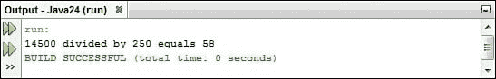

**图 18.3** `NumberDivider` 应用程序的输出。

## 异常处理后执行操作

当你使用 `try` 和 `catch` 处理多个异常时，有时你希望程序无论是否发生异常都在代码块结束时执行一些操作。

你可以通过使用 `try`-`catch`-`finally` 代码块来处理，其形式如下：

点击此处查看代码图像

```java
try {
    // 可能导致异常的语句
} catch (Exception e) {
   // 异常发生时应执行的操作
} finally {
    // 无论如何都要执行的语句
}
```

`finally` 部分中的语句或语句集在代码块中的所有其他内容之后执行，即使发生了异常。

这在一个从磁盘文件读取数据的程序中很有用，你将在 第 21 小时 “读写文件” 中进行。在访问数据时，有几种方式可能发生异常：文件可能不存在、可能发生磁盘错误等等。如果读取磁盘的语句在 `try` 部分，错误在 `catch` 部分处理，那么你可以在 `finally` 部分关闭文件。这确保了无论读取时是否抛出异常，文件都会被关闭。

## 抛出异常

当你调用另一个类的方法时，该类可以通过抛出异常来控制方法的使用方式。

当你使用 Java 类库中的类时，编译器通常会显示如下消息：

**输出**

点击此处查看代码图像

```
NetReader.java:14: unreported exception java.net.MalformedURLException;
must be caught or declared to be thrown
```

每当你看到错误提示某个异常“必须被捕获或声明抛出”时，这表明你正在尝试使用的方法会抛出异常。

任何调用这些方法的类，例如你编写的应用程序，必须执行以下操作之一：

 使用 `try`-`catch` 代码块处理异常

 抛出该异常

 使用 `try`-`catch` 代码块处理异常，然后抛出它

到目前为止，你已经了解了如何处理异常。如果你想在处理后抛出异常，可以使用 `throw` 语句，后跟要抛出的异常对象。

## 抛出和捕获异常

以下语句在 `catch` 块中处理 `NumberFormatException` 错误，然后抛出该异常：

点击此处查看代码图片

```java
float principal;

try {
    principal = Float.parseFloat(loanText) * 1.1F;
} catch (NumberFormatException e) {
    System.out.println(arguments[0] + " is not a number.");
    throw e;
}
```

这段改写后的代码处理了 `try` 块中可能生成的所有异常，并将它们抛出：

点击此处查看代码图片

```java
float principal;

try {
    principal = Float.parseFloat(loanText) * 1.1F;
} catch (Exception e) {
    System.out.println("Error " + e.getMessage());
    throw e;
}
```

`Exception` 是所有异常子类的父类。一个 `catch` 语句会捕获该类以及类层次结构中位于其下的任何子类。

当你使用 `throw` 抛出异常时，通常意味着你尚未完成处理该异常所需的所有工作。

一个可能有用的场景示例：考虑一个名为 `CreditCardChecker` 的假想程序，这是一个验证信用卡购买的应用程序。该应用程序使用一个名为 `CheckDatabase` 的类，该类的工作如下：

1.  连接到信用卡发卡方的计算机。

2.  询问该计算机客户的信用卡号是否有效。

3.  询问该计算机客户是否有足够的信用额度进行购买。

当 `CheckDatabase` 类执行其工作时，如果信用卡发卡方的计算机对任何连接尝试都没有响应，会发生什么？这类错误正是 `try`-`catch` 块旨在处理的类型，并且它被用于 `CheckDatabase` 内部以处理连接错误。

如果 `CheckDatabase` 类自己处理了这个错误，`CreditCardChecker` 应用程序根本不知道发生了异常。这不是一个好主意——应用程序应该知道何时无法建立连接，以便向使用该应用程序的人报告。

通知 `CreditCardChecker` 应用程序的一种方式是让 `CheckDatabase` 在 `catch` 块中捕获异常，然后使用 `throw` 语句再次抛出它。异常在 `CheckDatabase` 中抛出，之后它必须像处理任何其他异常一样处理它。

异常处理是类在发生错误或其他异常情况时相互通信的一种方式。

当你在一个捕获父类（如 `Exception`）的 `catch` 块中使用 `throw` 时，抛出异常会抛出该类。这会丢失一些关于发生何种错误的信息，因为像 `NumberFormatException` 这样的子类比单纯的 `Exception` 类能提供更多关于问题的细节。

Java 提供了一种保留此细节的方法：`catch` 语句中的 `final` 关键字。

点击此处查看代码图片

```java
try {
    principal = Float.parseFloat(loanText) * 1.1F;
} catch (final Exception e) {
    System.out.println("Error " + e.getMessage());
    throw e;
}
```

`catch` 中的这个 `final` 关键字会导致 `throw` 的行为有所不同。被捕捉到的具体类会被抛出。

## 忽略异常

本节涵盖的下一个技术是如何完全忽略异常。类中的方法可以通过使用方法定义中的 `throws` 子句来忽略异常。

以下方法抛出 `MalformedURLException`，这是在 Java 程序中处理网址时可能发生的一个错误：

点击此处查看代码图片

```java
public void loadURL(String address) throws MalformedURLException {
    URL page = new URL(address);
    // 加载网页的代码
}
```

此示例中的第二条语句创建了一个 `URL` 对象，该对象表示网络上的一个地址。`URL` 类的构造方法会抛出 `MalformedURLException`，以指示使用了无效地址，因此无法构造对象。当您尝试打开与该 URL 的连接时，以下语句会导致抛出此类异常之一：

点击此处查看代码图片

```java
URL source = new URL("http:www.java24hours.com");
```

字符串 `http:www.java24hours.com` 不是有效的 URL。它缺少一些标点符号：冒号后的两个斜杠字符（`//`）。

因为 `loadURL()` 方法已被声明为抛出 `MalformedURLException` 错误，所以它不必在方法内部处理它们。捕获此异常的责任落在任何调用 `loadURL()` 方法的方法上。

## 不需要 catch 的异常

虽然本节已经说明异常需要用 `try`-`catch` 捕获或用 `throws` 子句声明为抛出，但有一个例外。

Java 程序中可能发生的一些异常无需以任何方式处理。当编译器检测到异常被忽略时，不会因此停止工作。这些异常被称为非受检异常，而其他则被称为受检异常。

非受检异常是 `java.lang` 包中 `RuntimeException` 的所有子类。一个常见的非受检异常例子是 `IndexOutOfBoundsException`，它指示用于访问数组、字符串或数组列表的索引不在其边界内。如果一个数组有五个元素，而您尝试读取第 10 个元素，就会发生此异常。

另一个是 `NullPointerException`，当使用一个没有值的对象时会发生。对象变量在被赋值之前具有 `null` 值。一些方法在无法返回对象时也会返回 `null`。如果一条语句错误地假设一个对象具有值，就会发生 `NullPointerException`。

这两种错误都是程序员可以在代码中（也应该）防止的事情，而不是需要异常处理的事情。如果你编写了一个访问越界数组元素的程序，修复执行此操作的代码并重新编译它。如果你期望一个对象并且它等于 `null`，在使用对象之前先用 `if` 条件检查一下。

Java 中非受检异常的原理是，它们要么可以通过编写良好的代码来防止，要么可能发生得如此频繁，以至于总是捕获它们会使程序不必要地复杂。`NullPointerException` 可能发生在程序中调用对象方法的每条语句中。

当然，仅仅因为一个异常可以被忽略，并不意味着它应该被忽略。你仍然可以选择对非受检异常使用 `try`、`catch` 和 `throws`。

## 抛出和捕获异常（项目）

在本节的最后一个项目中，你将创建一个类，该类使用异常来告知另一个类所发生的错误。

本项目中的类有 `HomePage`（表示网络上的个人主页的类）和 `PageCatalog`（用于编目这些页面的应用程序）。

在名为 `HomePage` 的新 Java 文件中输入 清单 18.4 的文本。

**清单 18.4** `HomePage.java` 的完整文本

点击此处查看代码图片

```java
package com.java24hours;

import java.net.*;

public class HomePage {
    String owner;
    URL address;
    String category = "none";

    public HomePage(String inOwner, String inAddress)
        throws MalformedURLException {
        owner = inOwner;
        address = new URL(inAddress);
    }

    public HomePage(String inOwner, String inAddress, String inCategory)
        throws MalformedURLException {
        this(inOwner, inAddress);
        category = inCategory;
    }
}
```

你可以在其他程序中使用 `HomePage` 类。该类代表个人网页。它有三个实例变量：`address`，一个表示页面地址的 `URL` 对象；`owner`，页面的所有者；以及 `category`，一个简短描述页面主要主题的注释。

与任何创建 `URL` 对象的类一样，`HomePage` 必须在 `try`-`catch` 块中处理 `MalformedURLException` 错误，或者声明它正在忽略这些错误。


该类采取了后一种方式，如第 10–11 行和第 17–18 行所示。通过在两个构造函数方法中使用 `throws`，`HomePage` 无需以任何方式处理 `MalformedURLException` 错误。

要创建一个使用 `HomePage` 类的应用程序，请返回 NetBeans 并创建一个名为 `PageCatalog` 的 Java 文件，其中包含清单 18.5 的内容。

### 清单 18.5 `PageCatalog.java` 的完整内容

点击此处查看代码图像

```java
package com.java24hours;

import java.net.*;

public class PageCatalog {
    public static void main(String[] arguments) {
        HomePage[] catalog = new HomePage[5];
        try {
            catalog[0] = new HomePage("Mark Evanier",
                "http://www.newsfromme.com", "comic books");
            catalog[1] = new HomePage("Jeff Rients",
                "http://jrients.blogspot.com", "gaming");
            catalog[2] = new HomePage("Rogers Cadenhead",
                "http://workbench.cadenhead.org", "programming");
            catalog[3] = new HomePage("Juan Cole",
                "http://www.juancole.com", "politics");
            catalog[4] = new HomePage("Rafe Colburn",
                "www.rc3.org");
            for (int i = 0; i < catalog.length; i++) {
                System.out.println(catalog[i].owner + ": " +
                    catalog[i].address + " -- " +
                    catalog[i].category);
            }
        } catch (MalformedURLException e) {
            System.out.println("Error: " + e.getMessage());
        }
    }
}
```

当你运行编译后的应用程序时，会显示图 18.4 中所示的输出。


**图 18.4** `PageCatalog` 应用程序的错误输出。

`PageCatalog` 应用程序创建一个 `HomePage` 对象数组，然后显示数组的内容。每个 `HomePage` 对象使用最多三个参数创建：

 页面所有者的姓名

 页面的地址（作为 `String`，而不是 `URL`）

 页面的类别

第三个参数是可选的，在第 17–18 行中未使用。

`HomePage` 类的构造函数方法在接收到无法转换为有效 `URL` 对象的字符串时会抛出 `MalformedURLException` 错误。这些异常在 `PageCatalog` 应用程序中通过 `try`-`catch` 块处理。

要纠正导致“no protocol”错误的问题，请编辑第 18 行，使字符串以 `http://` 开头，就像第 9–16 行中的其他网址一样。当你再次运行该程序时，会看到图 18.5 中所示的输出。


**图 18.5** `PageCatalog` 应用程序修正后的输出。

### 总结

现在你已经实践了 Java 的异常处理技术，关于错误的主题应该比本小时开始时更受欢迎一些。

你可以使用这些技术做很多事情：

 捕获异常并处理它。

 忽略异常，将其留给另一个类或 Java 解释器处理。

 在同一个 `try`-`catch` 块中捕获多个不同的异常。

 抛出你自己的异常。

在 Java 程序中管理异常使它们更可靠、更通用且更易于使用，因为你不会向运行你的软件的人显示任何晦涩难懂的错误信息。

### 研讨室

#### 问与答

**问.** 有可能创建自己的异常吗？

**答.** 你可以通过使它们成为现有异常的子类来轻松创建自己的异常，例如 `Exception`，它是所有异常的超类。在 `Exception` 的子类中，你可能只想重写两个方法：无参数的 `Exception()` 和带有 `String` 参数的 `Exception()`。在后者中，该字符串应该是一个描述所发生错误的消息。

**问.** 为什么本小时没有涵盖如何抛出和捕获错误，除了异常之外？

**答.** Java 将问题分为 `Errors` 和 `Exceptions`，因为它们在严重性上有所不同。异常不那么严重，因此应该使用 `try`-`catch` 或在方法声明中使用 `throws` 在你的程序中处理它们。另一方面，错误更严重，无法在程序中充分处理。

这些错误的两个例子是堆栈溢出和内存不足错误。这些可能导致 Java 解释器崩溃，而且当解释器运行程序时，你无法在自己的程序中修复它们。

**问.** 仍在报纸上连载的最古老的连环画是什么？

**答.** *《吵闹的孩子》*，由鲁道夫·德克斯于 1897 年创作，至今仍由 King Features Syndicate 提供。该漫画仅在第一部连环画 *《黄孩子》* 出现两年后开始，是第一部使用对话气泡的连环画。

德克斯是一位移民美国的德国人，他从祖国的儿童故事中获得灵感，创造了叛逆的孩子汉斯和弗里茨。他于 1912 年因合同纠纷离开了这部漫画，由哈罗德·克纳继任，他一直绘制到 1949 年。此后有五位漫画家参与创作。海·艾斯曼自 1986 年以来一直在绘制。

*Katzenjammer* 这个词在德语中的字面意思是“猫的嚎叫”，但它更常用于描述宿醉。

#### 测验

虽然这一小时确实充满了错误，但看看你是否能在不犯任何错误的情况下回答以下关于它们的问题。

**1.** 一个 `catch` 语句可以处理多少个异常？

**A.** 只有一个。

**B.** 几个不同的异常。

**C.** 此答案有意留空。

**2.** `finally` 部分中的语句何时运行？

**A.** 在 `try`-`catch` 块因异常而结束之后

**B.** 在 `try`-`catch` 块没有异常而结束之后

**C.** 两者都是

**3.** 在讨论了这么多抛出和捕获之后，德州游骑兵队在休赛期需要做什么？

**A.** 获得更多的首发投手

**B.** 签下一位能够打到右外野短距离围墙的左打强棒外野手

**C.** 引进新的中继投手

#### 答案

**1. B.** `catch` 语句中的 `Exception` 对象可以处理其自身类及其所有父类的所有异常。

**2. C.** `finally` 部分中的语句总是在 `try`-`catch` 块的其余部分之后执行，无论是否发生异常。

**3. A.** 每个答案都是正确的，但 A 比其他答案更正确，并且在未来 30 年内可能都是正确的。

#### 活动

为了检验你是否是一位出色的 Java 程序员，请尝试在以下活动中尽可能少地犯错误：

 修改 `NumberDivider` 应用程序，使其抛出捕获到的任何异常，并运行程序观察发生了什么。

 在第 15 小时“响应用户输入”中创建的 `LottoEvent` 类里，有一个 `try`-`catch` 块。你可以以此为指引，创建你自己的 `Sleep` 类，用来处理 `InterruptedException`，这样其他类如 `LottoEvent` 就无需处理它们。

要查看实现这些活动的 Java 程序，请访问本书网站：[www.java24hours.com](http://www.java24hours.com)。

## Hour 19. 创建线程程序

**本小时待办事项：**

 在程序中使用一个接口。

 创建线程。

 启动、停止和暂停线程。

 捕获错误。

一个常被用来描述日常生活忙碌节奏的计算机术语是 `multitasking`（多任务），它意味着一次做多件事——比如坐在办公桌前浏览网页的同时，参加电话会议并做提臀运动。一个支持多任务的计算机能够同时运行多个程序。

Java 语言的一个高级特性是能够编写可以同时处理多个任务的程序，这通过一种称为线程（`Thread`）的对象类实现。

### 线程

在 Java 程序中，计算机同时处理的每个任务称为一个线程（`Thread`），整个过程称为多线程（`multithreading`）。线程在动画和许多其他程序中非常有用。

线程是一种组织程序以同时处理多件事的方式。每个需要同时发生的任务都被放置在自己的线程中，这通常通过将每个任务实现为一个单独的类来完成。

线程由 `Thread` 类和 `Runnable` 接口表示，它们都属于 `java.lang` 类包。因为它们属于这个包，所以你无需使用 `import` 语句就能在程序中使用它们。

`Thread` 类最简单的用途之一是减慢程序执行某项操作的速度。

#### 减慢程序速度

`Thread` 类有一个 `sleep()` 方法，可以在任何需要暂停运行一小段时间的程序中调用。这种技术常用于带有动画的程序中，以防止图像显示速度快于 Java 解释器的处理能力。

要使用 `sleep()` 方法，请调用 `Thread.sleep()` 并传入要暂停的毫秒数，如下语句所示：

`Thread.sleep(5000);`

上一条语句会使 Java 虚拟机暂停 5 秒钟，然后再执行其他操作。如果由于某种原因 JVM 无法暂停那么长时间，`sleep()` 方法会抛出 `InterruptedException`。

因为这个异常可能会被抛出，所以在使用 `sleep()` 方法时必须以某种方式处理它。一种方法是将 `Thread.sleep()` 语句放在一个 `try`-`catch` 块中：

Click here to view code image

```java
try {

    Thread.sleep(5000);

} catch (InterruptedException e) {

    // 提前唤醒

}
```

当你想让 Java 程序同时处理多件事情时，必须将程序组织成线程。你的程序可以拥有任意多的线程，它们可以同时运行而互不影响。

#### 创建线程

一个可以作为线程运行的 Java 类被称为可运行（或线程化）类。虽然你可以使用线程来暂停程序的执行几秒钟，但程序员经常使用它们来达到相反的目的——加快程序速度。如果你将耗时任务放在它们自己的线程中，程序的其余部分会运行得更快。这通常用于防止单个任务降低程序图形用户界面（GUI）的响应速度。

例如，如果你编写了一个从磁盘加载股票市场价格数据并编译统计信息的应用程序，最耗时的任务是加载数据。如果在应用程序中不使用线程，当数据加载时，程序的界面可能会反应迟钝。这对用户来说会非常令人沮丧。

将任务放入自己线程的两种方式包括：

 将任务放在一个实现了 `Runnable` 接口的类中。

 将任务放在一个继承自 `Thread` 的子类中。

为了支持 `Runnable` 接口，在创建类时使用 `implements` 关键字，如下例所示：

Click here to view code image

```java
public class LoadStocks implements Runnable {

    // 类的主体

}
```

当一个类实现一个接口时，它表示该类除了自身的方法外，还包含一些额外的行为。

实现 `Runnable` 接口的类必须包含 `run()` 方法，其结构如下：

```java
public void run() {

   // 方法的主体

}
```

`run()` 方法应该负责处理创建该线程所要完成的任务。在股票分析的例子中，`run()` 方法可以包含从磁盘加载数据并基于该数据编译统计信息的语句。

当一个线程化应用程序运行时，其 `run()` 方法中的语句不会自动执行。在 Java 中线程可以被启动和停止，一个线程在你做两件事之前不会开始运行：

 通过调用 `Thread` 构造函数创建线程类的对象。

 通过调用其 `start()` 方法来启动线程。

`Thread` 构造函数接受一个参数：包含该线程 `run()` 方法的对象。通常，你使用 `this` 关键字作为参数，表示当前类包含 `run()` 方法。

清单 19.1 包含一个 Java 应用程序，它在一个文本区域中显示一系列的质数。在 NetBeans 中，创建一个名为 `PrimeFinder` 的新 Java 文件，将清单中的文本输入到文件中，然后——等等——别忘了保存它。

**清单 19.1 `PrimeFinder.java` 完整代码**

Click here to view code image

```java
package com.java24hours;

import java.awt.*;
import javax.swing.*;
import java.awt.event.*;

public class PrimeFinder extends JFrame implements Runnable, ActionListener {
    Thread go;
    JLabel howManyLabel;
    JTextField howMany;
    JButton display;
    JTextArea primes;

    public PrimeFinder() {
        super("Find Prime Numbers");
        setLookAndFeel();
        setSize(400, 300);
        setDefaultCloseOperation(JFrame.EXIT_ON_CLOSE);
        BorderLayout bord = new BorderLayout();
        setLayout(bord);

        howManyLabel = new JLabel("Quantity: ");
        howMany = new JTextField("400", 10);
        display = new JButton("Display primes");
        primes = new JTextArea(8, 40);

        display.addActionListener(this);
        JPanel topPanel = new JPanel();
        topPanel.add(howManyLabel);
        topPanel.add(howMany);
        topPanel.add(display);
        add(topPanel, BorderLayout.NORTH);

        primes.setLineWrap(true);
        JScrollPane textPane = new JScrollPane(primes);
        add(textPane, BorderLayout.CENTER);

        setVisible(true);
    }

    public void actionPerformed(ActionEvent event) {
        display.setEnabled(false);
        if (go == null) {
            go = new Thread(this);
            go.start();
        }
    }

    public void run() {
        int quantity = Integer.parseInt(howMany.getText());
        int numPrimes = 0;
        // candidate：可能是质数的数
        int candidate = 2;
```

# PrimeFinder 示例

以下是 `PrimeFinder` 应用程序的关键代码片段：


```java
primes.append("First " + quantity + " primes:");

while (numPrimes < quantity) {

    if (isPrime(candidate)) {

        primes.append(candidate + " ");

        numPrimes++;

    }

    candidate++;

}

public static boolean isPrime(int checkNumber) {

    double root = Math.sqrt(checkNumber);

    for (int i = 2; i <= root; i++) {

        if (checkNumber % i == 0) {

            return false;

        }

    }

    return true;

}

private void setLookAndFeel() {

    try {

        UIManager.setLookAndFeel(

            "com.sun.java.swing.plaf.nimbus.NimbusLookAndFeel"

        );

    } catch (Exception exc) {

        // ignore error

    }

}

public static void main(String[] arguments) {

    new PrimeFinder();

}
```

---

`PrimeFinder` 应用程序显示一个文本字段、一个“显示质数”按钮和一个文本区域，如图 19.1 所示。


**图 19.1** 运行 `PrimeFinder` 应用程序。

该应用程序中的大多数语句用于创建 GUI 或显示一系列质数。以下语句用于在该程序中实现线程：

 第 7 行——`Runnable` 接口被应用于 `PrimeFinder` 类。

 第 8 行——创建了一个名为 `go` 的 `Thread` 对象变量，但尚未赋值。

 第 43-46 行——如果 `go` 对象变量的值为 `null`（表示线程尚未创建），则创建一个新的 `Thread` 对象并存储在该变量中。通过调用线程的 `start()` 方法来启动线程，这会导致 `PrimeFinder` 类的 `run()` 方法被调用。

 第 49-62 行——`run()` 方法从 2 开始查找一系列质数，通过调用其 `append()` 方法在 `primes` 文本区域组件中显示每个质数。序列中质数的数量由 `howMany` 文本字段中的值决定。

在应用程序的 `main()` 方法中，当创建一个 `PrimeFinder` 对象以开始程序执行时，有一些不寻常之处。该语句如下：

```java
new PrimeFinder();
```

通常，你会期望该对象被赋给一个变量，就像这样：

```java
PrimeFinder frame = new PrimeFinder();
```

但是，由于没有再次引用该对象的必要，因此无需将其存储在变量中。调用 `new` 创建对象会导致程序运行。

在 Java 中，一个良好的编程实践是仅在需要时才将对象存储在变量中。

## 使用线程

你可以通过调用其 `start()` 方法来启动一个线程，这可能会让你认为也存在一个 `stop()` 方法来使其停止。

---

**警告**

最好留意这个弃用警告。Oracle 已弃用 `stop()` 方法，因为它可能对 Java 解释器中运行的其他线程造成问题。该类的 `resume()` 和 `suspend()` 方法也已弃用。

---

虽然 Java 在 `Thread` 类中包含了一个 `stop()` 方法，但它已被弃用。在 Java 中，弃用元素是已被更好的替代品取代的类、接口、方法或变量。

你接下来的项目将展示如何停止一个线程。你将进行的程序循环显示网站标题和访问它们的地址。

每个页面的标题和网址在连续的循环中显示。用户能够通过点击应用程序图形用户界面中的按钮来访问当前显示的站点。该程序在一段时间内运行，按顺序显示有关每个网站的信息。由于这个时间因素，线程是控制程序的最佳方式。

你不是先进入 NetBeans 源代码编辑器输入这个程序然后再了解它，而是在本节结束时有机会输入 `LinkRotator` 应用程序的完整文本。在此之前，我们将描述程序的每个部分。

### 类声明

在该程序中，你需要做的第一件事是为 `java.awt`、`java.io`、`java.net`、`java.awt.event` 和 `javax.swing` 包中的类使用 `import`。

在使用 `import` 使一些类可用后，你就可以使用以下语句开始应用程序了：

```java
public class LinkRotator extends JFrame

    implements Runnable, ActionListener {
```

该语句将 `LinkRotator` 类创建为 `JFrame` 类的子类，就像你开发的其他具有图形用户界面的程序一样。该语句还表明该类支持两个接口：`Runnable` 和 `ActionListener`。通过实现 `Runnable` 类，你能够在该程序中使用 `run()` 方法使线程开始运行。`ActionListener` 接口使程序能够响应鼠标点击。

### 设置变量

在 `LinkRotator` 中要做的第一件事是创建类的变量和对象。创建一个包含六个 `String` 对象的数组 `pageTitle` 和一个包含六个 `URI` 对象的数组 `pageLink`：

```java
String[] pageTitle = new String[6];
URI[] pageLink = new URI[6];
```

`pageTitle` 数组保存显示的六个网站的标题。`URI` 类对象存储网站地址的值。`URI` 具有跟踪网址所需的所有行为和属性。

最后需要创建的是一个整数变量、一个 `Thread` 对象和一个用户界面标签：

```java
int current = 0;
Thread runner;
JLabel siteLabel = new JLabel();
```

`current` 变量跟踪当前显示的站点，以便你可以循环浏览这些站点。`Thread` 对象 `runner` 代表该程序运行的线程。在启动、停止和暂停程序操作时，你会调用 `runner` 对象的方法。

### 构造函数

当程序运行时，其构造函数会自动执行。此方法用于为数组 `pageTitle` 和 `pageLink` 赋值。它还用于创建一个出现在用户界面上的可点击按钮。该方法包含以下语句：

```java
pageTitle = new String[] {

    "Oracle's Java site",

    "Cafe au Lait",

    "JavaWorld",

    "Java in 24 Hours",

    "Sams Publishing",

    "Workbench"

    };

pageLink[0] = getURI("http://www.oracle.com/technetwork/java");

pageLink[1] = getURI("http://www.ibiblio.org/javafaq");

pageLink[2] = getURI("http://www.javaworld.com");

pageLink[3] = getURI("http://www.java24hours.com");

pageLink[4] = getURI("http://www.samspublishing.com");

pageLink[5] = getURI("http://workbench.cadenhead.org");

Button visitButton = new Button("Visit Site");

goButton.addActionListener(this);

add(visitButton);
```

每个页面的标题存储在 `pageTitle` 数组的六个元素中，该数组使用六个字符串初始化。`pageLink` 数组的元素被赋值为 `getURI()` 方法（尚未创建）的返回值。

`init()` 方法的最后三条语句创建一个标签为“访问站点”的按钮并将其添加到应用程序的框架中。

### 设置 URL 时捕获错误

当你创建一个 `URI` 对象时，必须确保用于设置地址的文本格式正确：[`http://workbench.cadenhead.org`](http://workbench.cadenhead.org) 和 [`http://www.samspublishing.com`](http://www.samspublishing.com) 是有效的，但 `http:www.javaworld.com` 则无效，因为它缺少斜杠（/）。

`getURI(String)` 方法接受一个网址作为参数，并返回一个代表该地址的 `URI` 对象。如果字符串不是有效的地址，该方法将返回 `null`：

```java
URI getURI(String urlText) {
    URI pageURI = null;
    try {
        pageURI = new URI(urlText);
    } catch (URISyntaxException m) {
        // do nothing
    }
    return pageURI;
}
```

`try`-`catch` 代码块用于处理创建 `URI` 对象时可能出现的任何 `URISyntaxLException` 错误。由于抛出此异常时不需要执行任何操作，因此 `catch` 代码块中只包含一个注释。

### 启动线程

在该程序中，`runner` 线程在其 `start()` 方法被调用时启动。

`start()` 方法作为构造函数的最后一条语句被调用。以下是该方法：

```java
public void start() {
    if (runner == null) {
        runner = new Thread(this);
        runner.start();
    }
}
```

如果 `runner` 线程尚未启动，此方法将启动它。

语句 `runner = new Thread(this)` 创建了一个新的 `Thread` 对象，其中一个参数是 `this` 关键字。`this` 关键字指的是程序本身，指定它为在线程内运行的类。

对 `runner.start()` 的调用会导致线程开始运行。当一个线程启动时，会调用该线程的 `run()` 方法。因为 `runner` 线程就是 `LinkRotator` 应用程序本身，所以会调用应用程序的 `run()` 方法。

#### 运行线程

`run()` 方法是线程执行主要工作的地方。在 `LinkRotator` 程序中，以下代码代表 `run()` 方法：

```java
public void run() {
    Thread thisThread = Thread.currentThread();
    while (runner == thisThread) {
        current++;
        if (current > 5) {
            current = 0;
        }
        siteLabel.setText(pageTitle[current]);
        repaint();
        try {
            Thread.sleep(1000);
        } catch (InterruptedException e) {
            // do nothing
        }
    }
}
```

在 `run()` 方法中首先执行的操作是创建一个名为 `thisThread` 的 `Thread` 对象。`Thread` 类的一个类方法 `currentThread()` 为 `thisThread` 对象设定了值。`currentThread()` 方法负责跟踪当前正在运行的线程。

此方法中的所有语句都属于一个 `while` 循环，该循环比较 `runner` 对象和 `thisThread` 对象。两个对象都是线程，只要它们引用同一个对象，`while` 循环就会继续循环。此循环内部没有语句会导致 `runner` 和 `thisThread` 对象具有不同的值，因此它会无限循环，除非循环外部的某个地方改变了其中一个 `Thread` 对象。

`run()` 方法调用了 `repaint()`。接着，`current` 变量的值加一，如果 `current` 超过 5，则重新设置为 0。`current` 变量用于确定要显示哪个网站的信息。它被用作字符串数组 `pageTitle` 的索引，并将标题设置为 `siteLabel` 用户界面组件的文本。

`run()` 方法包含另一个用于处理错误的 `try`-`catch` 代码块。`Thread.sleep(1000)` 语句使线程暂停 1 秒钟，这段时间足够用户阅读网站名称及其地址。`catch` 语句负责处理在 `Thread.sleep()` 语句执行期间可能发生的任何 `InterruptedException` 错误。如果线程在休眠时被中断，就会发生这些错误。

### 处理鼠标点击

`LinkRotator` 程序中最后需要处理的是事件处理。每当用户点击“Visit Site”按钮时，应用程序应该用网页浏览器打开显示的网站。这是通过一个名为 `actionPerformed()` 的方法完成的，每当按钮被点击时都会调用该方法。

以下是 `LinkRotator` 的 `actionPerformed()` 方法：

```java
public void actionPerformed(ActionEvent event) {
    Desktop desktop = Desktop.getDesktop();
    if (pageLink[current] != null) {
        try {
            desktop.browse(pageLink[current]);
            runner = null;
            System.exit(0);
        } catch (IOException exc) {
            // do nothing
        }
    }
}
```

此方法首先执行的操作是创建一个 `Desktop` 对象。`java.awt` 包中的 `Desktop` 类代表运行应用程序的计算机的桌面环境。获得此对象后，你可以使用它来通过“mailto:”链接启动电子邮件客户端、打开文件以使用其他程序进行编辑、打印文件以及让 Java 外部的其他程序执行任务。

这里，`Desktop` 对象用于使用计算机的默认网页浏览器打开一个网页。

`browse(URI)` 方法在浏览器中加载指定的网址。如果 `pageLink[current]` 是一个有效地址，`browse()` 会请求浏览器加载该页面。

### 显示循环链接

现在你已经准备好创建程序并进行测试了。创建一个名为 `LinkRotator` 的新 Java 文件，并输入清单 19.2 中的文本。

清单 19.2 `LinkRotator.java` 的完整文本

---


```java
package com.java24hours;

import java.awt.*;
import java.awt.event.*;
import java.io.*;
import javax.swing.*;
import java.net.*;

public class LinkRotator extends JFrame
    implements Runnable, ActionListener {

    String[] pageTitle = new String[6];
    URI[] pageLink = new URI[6];
    int current = 0;
    Thread runner;
    JLabel siteLabel = new JLabel();

    public LinkRotator() {
        setDefaultCloseOperation(JFrame.EXIT_ON_CLOSE);
        setSize(300, 100);
        FlowLayout flo = new FlowLayout();
        setLayout(flo);
        add(siteLabel);
        pageTitle = new String[] {
            "Oracle's Java site",
            "Cafe au Lait",
            "JavaWorld",
            "Java in 24 Hours",
            "Sams Publishing",
            "Workbench"
        };
        pageLink[0] = getURI("http://www.oracle.com/technetwork/java");
        pageLink[1] = getURI("http://www.ibiblio.org/javafaq");
        pageLink[2] = getURI("http://www.javaworld.com");
        pageLink[3] = getURI("http://www.java24hours.com");
        pageLink[4] = getURI("http://www.samspublishing.com");
        pageLink[5] = getURI("http://workbench.cadenhead.org");
        Button visitButton = new Button("Visit Site");
        visitButton.addActionListener(this);
        add(visitButton);
        setVisible(true);
        start();
    }

    private URI getURI(String urlText) {
        URI pageURI = null;
        try {
            pageURI = new URI(urlText);
        } catch (URISyntaxException ex) {
            // do nothing
        }
        return pageURI;
    }

    public void start() {
        if (runner == null) {
            runner = new Thread(this);
            runner.start();
        }
    }

    public void run() {
        Thread thisThread = Thread.currentThread();
```

### 停止线程

```java
while (runner == thisThread) {
    current++;
    if (current > 5) {
        current = 0;
    }
    siteLabel.setText(pageTitle[current]);
    repaint();
    try {
        Thread.sleep(1000);
    } catch (InterruptedException exc) {
        // 什么都不做
    }
}

public void actionPerformed(ActionEvent event) {
    Desktop desktop = Desktop.getDesktop();
    if (pageLink[current] != null) {
        try {
            desktop.browse(pageLink[current]);
            runner = null;
            System.exit(0);
        } catch (IOException exc) {
            // 什么都不做
        }
    }
}

public static void main(String[] arguments) {
    new LinkRotator();
}
```

* * *

图 19.2 显示了计算机桌面上打开的两个窗口。较小的那个窗口（被圈出）是正在运行的 `LinkRotator` 应用程序。后面较大的那个窗口是该程序可以打开的其中一个链接：本书出版商 Sams 的网页。


**图 19.2** 在应用程序中展示循环链接。

`LinkRotator` 应用程序目前无法停止线程，但其设计方式使得实现这一点变得简单。以下是一个可以用来结束线程执行的方法：

```java
public void stop() {
    if (runner != null) {
        runner = null;
    }
}
```

`if` 语句检查 `runner` 对象是否等于 `null`。如果是，则没有需要停止的活动线程。否则，该语句将 `runner` 设置为 `null`。

将 `runner` 对象设置为 `null` 值会导致它的值与 `thisThread` 对象不同。当这种情况发生时，`run()` 方法内部的 `while` 循环就会停止运行。

## 总结

线程是 Java 中用少量类和接口实现的一个强大概念。通过在你的程序中支持多线程，你可以使它们更具响应性，并能加快执行任务的速度。

即使你在这个小时里没学到其他东西，你现在也有一个新术语来描述你狂热的生活方式了。在几个句子中用用它，看看你是否喜欢：

 “天哪，昨天我们抢劫那几家连锁药店后，我真是‘多线程’运转了一天。”

 “我午饭时一直在‘多线程’，结果搞得我胀气。”

 “今晚不行，亲爱的，我在‘多线程’呢。”

## 实践环节

### 问答

**问.** 有什么理由在 `catch` 语句中什么都不做吗，就像 `LinkRotator` 应用程序所做的那样？

**答.** 这取决于所捕获的错误或异常类型。在 `LinkRotator` 应用程序中，你通过两个 `catch` 语句都知道异常的原因是什么，因此可以确信什么都不做总是合适的。在 `getURI()` 方法中，只有当发送给该方法的 URI 无效时，才会引发 `URISyntaxException`。

**问.** 那个唱过 “My Future’s So Bright, I Gotta Wear Shades” 的乐队后来怎么样了？

**答.** 他们的未来并不光明。Timbuk3 是一个由夫妻 Pat 和 Barbara K. MacDonald 组成的乐队，自从这首歌在 1986 年成为前 20 名单曲后，他们再也没有过热门歌曲。他们在 1986 年至 1995 年间制作了六张专辑，之后乐队解散，两人也离婚了。

帕特·麦克唐纳继续以自己的名字进行表演和发行专辑。他还为雪儿、彼得·弗兰普顿、夜曲巡逻队、史密斯飞船以及其他音乐家创作过歌曲。

芭芭拉·库伊曼以芭芭拉·K 的名字进行表演，并发行了多张专辑，其中一张重新演绎了 Timbuk3 的歌曲。她还成立了旨在捍卫艺术家言论自由的慈善机构“艺术家媒介多样性组织”。

他们最著名的歌曲被广泛理解为对未来传递积极信息，但其本意是讽刺性的。麦克唐纳夫妇曾表示，光明的未来实际上是一场即将到来的核浩劫。

### 测验

放下你的线程（Java 意义上的，而非“裸露”意义上的），回答以下关于 Java 多线程的问题。

**1.** 程序要使用线程，必须实现哪个接口？

**A.** `Runnable`

**B.** `Thread`

**C.** 不需要任何接口

**2.** 如果一个接口包含三个不同的方法，那么实现该接口的类必须包含其中多少个方法？

**A.** 一个都不用。

**B.** 全部都要包含。

**C.** 我知道，但我不说。

**3.** 你正在欣赏另一位程序员的作品，他创建了一个可以同时处理四个任务的程序。你应该对他说什么？

**A.** “我愿意花一块钱买那个。”

**B.** “你是我羽翼下的风。”

**C.** “线程真不错！”

### 答案

**1. A.** `Runnable` 必须与 `implements` 语句一起使用。`Thread` 在多线程程序中使用，但在开始程序的 `class` 语句中并不需要。

**2. B.** 接口是一种保证，即该类包含了接口的所有方法。

**3. C.** 如果这位程序员衣冠楚楚，这个恭维可能会让人困惑，但老实说，这种可能性有多大呢？

### 活动

如果本小时的学习材料没有让你感到精疲力尽（threadbare），那么通过以下活动来拓展你的技能：

 创建 `LinkRotator` 应用程序的一个新版本，其中包含你自己最喜欢的六个网站。

 给 `PrimeFinder` 应用程序添加一个按钮，以便在素数序列仍在计算时可以停止线程。

要查看实现这些活动的 Java 程序，请访问本书网站 [www.java24hours.com](http://www.java24hours.com)。

# 第 20 小时. 使用内部类和闭包

## 本小时任务清单：

 向对象添加内部类。

 探索内部类为何有用。

 创建匿名内部类。

 将适配器类与接口结合使用。

 了解 Java 8 为何引入闭包。

 编写 lambda 表达式。

 用 lambda 表达式替换匿名内部类。

1995 年 Java 编程语言推出时，其应用范围有限且易于掌握。Java 类库中只有大约 250 个类。该语言的设计初衷主要是为了让被称为 `applet` 的交互式程序能够在 Web 浏览器内运行。由于当时没有其他技术能够实现这一点，Java 引起了巨大轰动，并迅速被数十万程序员所接受。

作为该语言设计精良的一个证明，它超越了最初的那个单一焦点，成为一种通用编程语言，足以与当时全球最流行、应用最广泛的 `C++` 语言相媲美。

如今，当 Java 接近 20 岁生日之际，仍有数百万程序员在使用它编写代码。每一次新版本的发布，Java 在支持现有开发者的同时，也扩展了其功能，以支持复杂的新软件开发方法。

Java 8 引入了一种令人兴奋的编码新方式，称为闭包或 lambda 表达式。这些表达式使得一种称为函数式编程的方法成为可能。

在本小时中，在介绍了使用它们的两个先决条件——内部类和匿名内部类——之后，你将学习 lambda 表达式。

### 内部类

# Java 内部类

当您在 Java 中创建一个类时，您需要定义该类的属性和行为。属性是保存数据的类变量和实例变量。行为是使用这些数据执行任务的方法。

一个类还可以包含同时具有属性和行为的东西：内部类。

内部类是包含在封闭类中的辅助类。您可能想知道它们为什么是必要的，因为用尽可能多的新类创建一个程序是很容易的。如果您正在编写一个 `CheckBook` 程序，该程序需要为个人签发的每张支票创建对象，您会创建一个 `Check` 类。如果程序支持周期性的月度支付，则会添加一个 `Autopayment` 类。

内部类不是必需的。但是当您了解了它们能做的所有事情后，您会发现很多情况下它们非常方便。

Java 包含内部类有三个原因：

`1.` 当一个辅助类只被另一个类使用时，将其定义在那个类内部是有意义的。

`2.` 它们使一个辅助类能够访问作为独立类时无法访问的 `private` 方法和变量。

`3.` 它们将辅助类放置在尽可能靠近它在另一个类中使用的位置。

内部类使用 `class` 关键字创建，与任何其他类一样，但它是在包含类内部声明的。通常，这与类变量和实例变量放在一起。

下面是一个在名为 `Simple` 的类内部创建的名为 `InnerSimple` 的内部类的示例：

点击此处查看代码图片

```java
public class Simple {

    class InnerSimple {

        InnerSimple() {

            System.out.println("I am an inner class!");

        }

    }

    public Simple() {

        // empty constructor

    }

    public static void main(String[] arguments) {

        Simple program = new Simple();

        Simple.InnerSimple inner = program.new InnerSimple();

    }

}
```

内部类的结构与任何其他类相同，但放置在封闭类的 { 和 } 括号内。

创建内部类需要一个外部类的对象。在对象上调用 `new` 运算符：

点击此处查看代码图片

```java
Simple.InnerSimple inner = program.new InnerSimple();
```

类的名称包括外部类的名称、一个句点（`.`）字符和内部类的名称。在前面的语句中，`Simple.InnerSimple` 就是其名称。

本小时的第一个项目是改写第 18 小时中的一个应用程序："处理程序中的错误。"那一小时的 `PageCatalog` 应用程序需要一个名为 `HomePage` 的辅助类。清单 20.1 中的 `Catalog` 应用程序对该项目进行了修订，用内部类替换了那个单独的类。

在包 `com.java24hours` 中创建一个新的 Java 文件，名称为 `Catalog`；然后用清单 20.1 中的源代码填充它。

## 清单 20.1 `Catalog.java` 的完整文本

点击此处查看代码图片


`package com.java24hours;`

`import java.net.*;`

`public class Catalog` {
    `class HomePage` {
        `String owner;`
        `URL address;`
        `String category = "none";`

        `public HomePage(String inOwner, String inAddress)`
            `throws MalformedURLException` {

            `owner = inOwner;`
            `address = new URL(inAddress);`
        }

        `public HomePage(String inOwner, String inAddress, String inCategory)`
            `throws MalformedURLException` {

            `this(inOwner, inAddress);`
            `category = inCategory;`
        }
    }

    `public Catalog()` {
        `Catalog.HomePage[] catalog = new Catalog.HomePage[5];`
        `try` {
            `catalog[0] = new HomePage("Mark Evanier",`
                `"http://www.newsfromme.com", "comic books");`
            `catalog[1] = new HomePage("Jeff Rients",`
                `"http://jrients.blogspot.com", "gaming");`
            `catalog[2] = new HomePage("Rogers Cadenhead",`
                `"http://workbench.cadenhead.org", "programming");`
            `catalog[3] = new HomePage("Juan Cole",`
                `"http://www.juancole.com", "politics");`
            `catalog[4] = new HomePage("Rafe Colburn",`
                `"http://www.rc3.org");`
            `for (int i = 0; i < catalog.length; i++)` {
                `System.out.println(catalog[i].owner + ": " +`
                    `catalog[i].address + " -- " +`
                    `catalog[i].category);`
            }
        } `catch (MalformedURLException e)` {
            `System.out.println("Error: " + e.getMessage());`
        }
    }

    `public static void main(String[] arguments)` {
        `new Catalog();`
    }
}

内部类定义在第 6–24 行。它有两个构造方法，一个在第 11 行开始，接受网站所有者和网站 URI，另一个在第 18 行开始，接受网站所有者、URI 和类别。

`Catalog` 类在第 27 行使用了这个内部类，创建了一个 `HomePage` 对象数组。内部类被引用为 `Catalog.HomePage`。

应用程序的输出如图 20.1 所示。


**图 20.1** `Catalog` 应用程序的输出。

## 匿名内部类

在 Java 编程中，您经常需要完成的一个常见任务是创建一个仅使用一次且具有简单目的的类。一种特殊的内部类非常适合这个目的。

匿名内部类是没有名称的类，它同时被声明和创建。

要使用一个匿名内部类，您需要将对象的引用替换为 `new` 关键字、对构造方法的调用以及 `{` 和 `}` 字符内的类定义。

下面是一些不使用匿名内部类的代码：

```java
WorkerClass worker = new WorkerClass();
Thread main = new Thread(worker);
main.start();
```

`worker` 对象很可能实现了 `Runnable` 接口，可以作为线程运行。

如果 `WorkerClass` 中的代码简短且简单，并且该类只需要使用一次，那么将其放入匿名内部类可能是值得的。下面是这样做的新版本：

```java
Thread main = new Thread(new Runnable()  {
    public void run() {
        // thread's work to perform goes here
    }

});
main.start();
```

匿名内部类用以下代码替换了对 `worker` 的引用：

```java
new Runnable()  {
    public void run() {
        // thread's work to perform goes here
    }

}
```

这会创建一个匿名类，它实现了 `Runnable` 接口并覆盖了 `run()` 方法。方法内的语句将执行该类所需的任何工作。

通过一个关于如何编写匿名内部类及其用途的完整示例，这个概念将更容易理解。

再次，您在早些时候创建的一个项目将通过使用内部类得到改进。

在第 15 小时 "响应用户输入" 中，您创建了一个接受键盘输入的 Swing 应用程序。`KeyViewer` 应用程序使用一个实现了 `KeyListener` 接口的对象来监控键盘——也就是应用程序自己的类。

一个实现该接口的类必须实现三个方法：`keyTyped()`、`keyPressed()` 和 `keyReleased()`。下面是它们在该程序中的设计方式：

```java
public void keyTyped(KeyEvent input) {
    char key = input.getKeyChar();
```

## 键盘事件监听的演进

`keyLabel.setText("You pressed " + key);`

}

public void keyPressed(KeyEvent txt) {

    // 不做任何操作

}

public void keyReleased(KeyEvent txt) {

    // 不做任何操作

}

`keyListener` 被设置为使用这个类来监视键盘事件：

`keyText.addKeyListener(this);`

使用`java.awt.event`包中的匿名内部类和`KeyAdapter`类，有一种更好的方式来创建监听器并将其添加到图形用户界面中。

`KeyAdapter`类以空操作方式实现了`KeyListener`接口的所有三个方法。它使得创建键盘事件监听器变得容易，因为你可以创建一个子类，只覆盖真正需要执行操作的方法。

以下是`KeyViewer`应用的一个关键监听器框架：

```java
public class KeyViewerListener extends KeyAdapter {

    public void keyTyped(KeyEvent input) {

        // 待办

    }

}
```

这个监听器可以被创建并设置为监听器：

```java
KeyViewerListener kvl = new KeyViewerListener();

keyText.addKeyListener(kvl);
```

这种方法需要一个单独的帮助类`KeyViewerListener`，以及一个该类的对象被创建并赋值给一个变量。

另一种方式是创建一个匿名内部类作为监听器：

```java
keyText.addKeyListener(new KeyAdapter() {

    public void keyTyped(KeyEvent input) {

        char key = input.getKeyChar();

        keyLabel.setText("You pressed " + key);

    }

});
```

监听器是通过调用`new KeyAdapter()`并跟随类的定义而匿名创建的。该类覆盖了`keyTyped()`方法，这样当按下键时，会通过调用`getKeyChar()`获取该键，并通过设置`keyLabel`的值来显示它，`keyLabel`是一个`JLabel`组件。

**注意**

在`java.awt.event`包中还有其他适配器类，可以方便地实现其他监听器。`MouseAdapter`类提供了三个鼠标监听器接口的空操作方法，`WindowAdapter`实现了三个窗口监听器，`FocusAdapter`实现了`FocusListener`。

匿名内部类做了一件普通帮助类无法做到的事情：访问`keyLabel`实例变量。该变量属于`KeyViewer`类。内部类可以访问其外部类的方法和变量。

在 NetBeans 中，创建一个名为`NewKeyViewer`的新 Java 文件，并设置其包为`com.java24hours`。将清单 20.2 的文本输入文件，完成后保存。

### 清单 20.2 `NewKeyViewer.java` 的完整文本

```java
 1: package com.java24hours;
 2: 
 3: import javax.swing.*;
 4: import java.awt.event.*;
 5: import java.awt.*;
 6: 
 7: public class NewKeyViewer extends JFrame {
 8:     JTextField keyText = new JTextField(80);
 9:     JLabel keyLabel = new JLabel("Press any key in the text field.");
10: 
11:     public NewKeyViewer() {
12:         super("NewKeyViewer");
13:         setLookAndFeel();
14:         setSize(350, 100);
15:         setDefaultCloseOperation(JFrame.EXIT_ON_CLOSE);
16:         keyText.addKeyListener(new KeyAdapter() {
17:             public void keyTyped(KeyEvent input) {
18:                 char key = input.getKeyChar();
19:                 keyLabel.setText("You pressed " + key);
20:             }
21:         });
22:         BorderLayout bord = new BorderLayout();
23:         setLayout(bord);
24:         add(keyLabel, BorderLayout.NORTH);
25:         add(keyText, BorderLayout.CENTER);
26:         setVisible(true);
27:     }
28: 
29:     private void setLookAndFeel() {
30:         try {
31:             UIManager.setLookAndFeel(
32:                 "com.sun.java.swing.plaf.nimbus.NimbusLookAndFeel"
33:             );
34:         } catch (Exception exc) {
35:             // 忽略错误
36:         }
37:     }
38: 
39:     public static void main(String[] arguments) {
40:         new NewKeyViewer();
41:     }
42: }
```

匿名内部类在第 16-21 行被创建并使用。它使用`KeyListener`接口中应用程序所需的唯一方法来监视键盘输入，并通过更新`keyLabel`实例变量来显示该输入。

程序的输出如图 20.2 所示。


**图 20.2** 使用`NewKeyViewer`应用监视键盘输入。

匿名内部类不能定义构造函数，因此它们比非匿名内部类更受限制。

它们是该语言的一个复杂特性，当你检查程序的源代码时更难理解，但它们可以使程序更简洁。有经验的 Java 程序员经常使用它们。

### 闭包

Java 8 新增了多年来最受期待的语言特性：闭包。

闭包（也称为 lambda 表达式）允许仅使用`->`运算符创建一个具有单一方法的对象，只要满足其他条件即可。

以下是一个例子：

```java
Runnable runner = () -> { System.out.println("Run!"); };
```

这一行代码创建了一个实现`Runnable`接口的对象，并使其`run()`方法等同于以下代码：

```java
void run() {

    System.out.println("Run!");

}
```

在 lambda 表达式中，箭头运算符`->`右侧的语句成为实现该接口的方法。

只有当接口有一个需要实现的方法时才能这样做，例如`Runnable`，它只包含`run()`。Java 中只有一个方法的接口现在称为函数式接口。

lambda 表达式在箭头运算符`->`左侧也有一些内容。在第一个例子中，它是一对空的括号，指的是发送到函数式接口方法的参数。由于`Runnable`接口中的`run()`不带任何参数，因此表达式中不需要参数。

这里是第二个 lambda 表达式的例子，确实在那些括号中放置了内容：

```java
ActionListener al = (ActionEvent act) -> {

    System.out.println(act.getSource());

}
```

这等同于在实现`java.awt.event`包中`ActionListener`接口的对象中的以下代码：

```java
public void actionPerformed(ActionEvent act) {

    System.out.println(act.getSource());

}
```

`ActionListener`接口接收动作事件，例如当用户点击按钮时。函数式接口中的唯一方法是`actionPerformed(ActionEvent)`。参数是一个`ActionEvent`对象，描述了触发事件的用户动作。

lambda 表达式的右半部分将`actionPerformed()`方法定义为一条显示有关触发事件的用户界面组件信息的语句。

表达式的左半部分声明一个名为`act`的`ActionEvent`对象是该方法的参数。

这个对象`act`在方法体内使用。左半部分对`act`的引用似乎超出了右半部分方法实现的范围。这是因为闭包允许代码引用其范围之外的另一个方法的变量。

如你所见，lambda 表达式的一个效果是它们缩短了代码。单个表达式创建一个对象并实现一个接口。

Java 的这一新特性通过语言对目标类型的支持，可以使代码更加简洁。

在 lambda 表达式中，可以推断传递给方法的参数的类型。来看最后一个例子。由于`ActionListener`函数式接口只有一个方法，且该方法仅接受一个`ActionEvent`对象作为其唯一参数，因此可以省略该类的名称。

下面是考虑这一点后修订的 lambda 表达式：

```java
ActionListener al = (act) -> {
    System.out.println(act.getSource());
}
```

你接下来创建的两个程序应该更具体地演示 Java 引入闭包所带来的差异。

`ColorFrame`应用程序（如清单 20.3 所示）是一个图形化的 Swing 程序，它显示三个按钮来更改框架的颜色。此版本的应用程序使用匿名内部类（而不是 lambda 表达式）来监视用户对三个按钮的点击。


在 NetBeans 中创建一个新程序，名称为该清单名称，包为`com.java24hours`。输入清单中的文本。

## 清单 20.3 `ColorFrame.java`的完整代码

单击此处查看代码图片

```
 1: package com.java24hours;
 2:
 3: import java.awt.*;
 4: import java.awt.event.*;
 5: import javax.swing.*;
 6:
 7: public class ColorFrame extends JFrame {
 8:     JButton red, green, blue;
 9:
10:     public ColorFrame() {
11:         super("ColorFrame");
12:         setLookAndFeel();
13:         setSize(322, 122);
14:         setDefaultCloseOperation(JFrame.EXIT_ON_CLOSE);
15:         FlowLayout flo = new FlowLayout();
16:         setLayout(flo);
17:         red = new JButton("Red");
18:         add(red);
19:         green = new JButton("Green");
20:         add(green);
21:         blue = new JButton("Blue");
22:         add(blue);
23:         // 开始匿名内部类
24:         ActionListener act = new ActionListener() {
25:             public void actionPerformed(ActionEvent event) {
26:                 if (event.getSource() == red) {
27:                     getContentPane().setBackground(Color.RED);
28:                 }
29:                 if (event.getSource() == green) {
30:                     getContentPane().setBackground(Color.GREEN);
31:                 }
32:                 if (event.getSource() == blue) {
33:                     getContentPane().setBackground(Color.BLUE);
34:                 }
35:             }
36:         };
37:         // 结束匿名内部类
38:         red.addActionListener(act);
39:         green.addActionListener(act);
40:         blue.addActionListener(act);
41:         setVisible(true);
42:     }
43:
44:     private void setLookAndFeel() {
45:         try {
46:             UIManager.setLookAndFeel(
47:                 "com.sun.java.swing.plaf.nimbus.NimbusLookAndFeel"
48:             );
49:         } catch (Exception exc) {
50:             // 忽略错误
51:         }
52:     }
53:
54:     public static void main(String[] arguments) {
55:         new ColorFrame();
56:     }
57: }
```

该程序如图 20.3 所示运行。


**图 20.3** 使用匿名内部类监视操作事件。

应用程序的第 24–36 行使用匿名内部类为`ColorFrame`类创建了一个事件监听器。它是一个没有名称的对象，实现了`ActionListener`接口的唯一方法`actionPerformed(ActionEvent)`。

在该方法内部，通过调用其`getContentPane()`方法检索框架的内容窗格。匿名内部类可以访问其封闭类的方法和实例变量。单独的辅助类则无法做到这一点。

内容窗格的`setBackground(Color)`方法将框架的背景更改为该颜色。三个按钮的颜色不会改变。

现在看看清单 20.4 中的`NewColorFrame`应用程序。在 NetBeans 中创建一个新程序，并输入此清单的文本。

## 清单 20.4 `NewColorFrame.java`的完整代码

单击此处查看代码图片

```
 1: package com.java24hours;
 2:
 3: import java.awt.*;
 4: import java.awt.event.*;
 5: import javax.swing.*;
 6:
 7: public class NewColorFrame extends JFrame {
 8:     JButton red, green, blue;
 9:
10:     public NewColorFrame() {
11:         super("NewColorFrame");
12:         setLookAndFeel();
13:         setSize(322, 122);
14:         setDefaultCloseOperation(JFrame.EXIT_ON_CLOSE);
15:         FlowLayout flo = new FlowLayout();
16:         setLayout(flo);
17:         red = new JButton("Red");
18:         add(red);
19:         green = new JButton("Green");
20:         add(green);
21:         blue = new JButton("Blue");
22:         add(blue);
23:         // 开始 lambda 表达式
24:         ActionListener act = (event) -> {
25:             if (event.getSource() == red) {
26:                 getContentPane().setBackground(Color.RED);
27:             }
28:             if (event.getSource() == green) {
29:                 getContentPane().setBackground(Color.GREEN);
30:             }
31:             if (event.getSource() == blue) {
32:                 getContentPane().setBackground(Color.BLUE);
33:             }
34:         };
35:         // 结束 lambda 表达式
36:         red.addActionListener(act);
37:         green.addActionListener(act);
38:         blue.addActionListener(act);
39:         setVisible(true);
40:     }
41:
42:     private void setLookAndFeel() {
43:         try {
44:             UIManager.setLookAndFeel(
45:                 "com.sun.java.swing.plaf.nimbus.NimbusLookAndFeel"
46:             );
47:         } catch (Exception exc) {
48:             // 忽略错误
49:         }
50:     }
51:
52:     public static void main(String[] arguments) {
53:         new NewColorFrame();
54:     }
55: }
```

`NewColorFrame`应用程序在第 24–34 行实现了操作监听器。你不需要知道`ActionListener`接口中方法的名称就可以在程序中使用它，也不需要指定`ActionEvent`的类。

Lambda 表达式支持函数式编程，这是一种软件设计方法论，直到现在才为 Java 程序员所用。

本节介绍了 lambda 表达式的基本语法以及在程序中使用的两种更常见的方式。

但 Java 中的函数式编程是一个如此强大且具有革命性的话题，以至于它是一些整本书的主题。

此时，你应该能够识别 lambda 表达式，并使用它们来实现任何单方法接口，也称为函数式接口。

## 总结

内部类、匿名内部类和 lambda 表达式是 Java 语言中最复杂的部分之一。它们主要吸引那些已经用该语言编写了一段时间程序的程序员，他们可以利用强大的功能在更少的代码行中完成更多工作。

但即使在你能编写自己的 lambda 表达式之前，你也应该能够从使用内部类和匿名内部类中受益。

非匿名内部类的结构类似于一个单独的辅助类，但它被放置在另一个类内部，与实例变量、类变量、实例方法和类方法并列。与辅助类不同，它可以访问其创建所在的类的私有变量和方法。

匿名内部类消除了仅为使用一次的类分配对象的需要，例如附加到 Swing 中用户界面组件的事件监听器。

Lambda 表达式的外观看似简单，仅需使用新的箭头运算符`->`即可创建，但它们为 Java 程序员带来的功能扩展却极为深远。其他编程语言的使用者多年来一直强烈要求增加这一特性。

## 讲堂

### 问与答

**问：** 匿名内部类令人困惑。我在程序中是否必须使用它们？

**答：** 不必。与 Java 语言的其他复杂特性一样，如果有其他方法能完成任务，你并非必须使用它们。

不过你还是应该了解它们，因为你很可能会在 Java 代码中遇到它们。

当有经验的程序员编写的 Java 程序时，你常会发现内部类和匿名内部类并存。因此，即使你目前还不准备自己创建它们，学习它们是什么以及如何工作也是值得的。

**问：** 哈特菲尔德家族和麦科伊家族还在争吵吗？

**答：** 在这场长达 35 年、臭名昭著的冲突最后一次造成伤亡的 124 年后，西弗吉尼亚州和肯塔基州的这两个家族如今已和睦相处。

1979 年，哈特菲尔德和麦科伊两家人曾一起参加为期一周的电视游戏节目*家庭问答*。舞台上放着一头猪，并将其作为奖品授予获胜的家庭。

2003 年，两家人在肯塔基州派克维尔正式签署了和平协议。

哈特菲尔德-麦科伊小径（Hatfield-McCoy Trails）是一条长 500 英里的越野休闲驾驶路线，于 2000 年在西弗吉尼亚州设立，并在随后的十年中不断扩展。

### 小测验

为了检验你是否掌握了本小时内所学的知识，可以凭此向班级前列走去。请回答以下关于内部类、匿名内部类和 lambda 表达式的问题。

**1.** 是什么使得某些内部类是匿名的？

**A.** 它们实现了一个接口。

**B.** 它们没有被赋予名称。

**C.** 两者都是。

**2.** 只包含一个方法的接口还有另一个名字叫什么？

**A.** 抽象接口

**B.** 类

**C.** 函数式接口

**3.** 当 lambda 表达式推断出方法参数的类时，这称为什么？

**A.** 目标类型

**B.** 类型转换

**C.** 类推断

### 答案

**1. C.** 匿名内部类使用`new`关键字实现一个接口，跳过了为实现该接口的类创建和命名的步骤。

**2. C.** 函数式接口（自 Java 8 起）。在该语言的早期版本中，它们被称为单一抽象方法接口。

**3. A.** 目标类型可以推断任何函数式接口方法参数的类。

### 实践活动

为了以优异的表现结束本小时的学习，请通过以下活动将所学主题付诸实践：

 重写第 16 小时“构建复杂用户界面”中的`LottoEvent`类，使用 lambda 表达式作为事件监听器。

 编写一个 Swing 应用程序，点击按钮时掷五个六面骰子。使用 lambda 表达式作为事件监听器，并使用名为`Dice`的内部类表示骰子。

要查看实现这些活动的 Java 程序，请访问本书网站：[www.java24hours.com](http://www.java24hours.com)。

# 第六部分：编写互联网应用

# 第 21 小时：读写文件

本小时待办事项：

 从文件读取字节到程序中。

 在计算机上创建新文件。

 将字节数组保存到文件中。

 修改文件中存储的数据。

计算机上有多种表示数据的方式。你已经通过创建对象使用了其中一种。对象包含以变量形式存在的数据和对对象的引用。它还包括使用这些数据来完成任务的方法。

要处理其他类型的数据，例如硬盘驱动器上的文件和网络服务器上的文档，你可以使用`java.io`包中的类。其名称中的“io”代表“输入/输出”，这些类用于访问数据源，如硬盘驱动器、DVD 或计算机内存。

你可以通过一种称为流的通信系统将数据带入程序并将数据传出。流是负责将信息从一个地方传输到另一个地方的对象。

## 流

要在 Java 程序中永久保存数据，或稍后检索该数据，你必须至少使用一个流。

流是一个对象，它从一个源获取信息并将其发送到其他地方，其名称源于水流将鱼、船只和工业污染物从一个地方带到另一个地方。

流连接着各种各样的来源，包括计算机程序、硬盘驱动器、互联网服务器、计算机内存和 U 盘。在你学会如何使用流处理一种数据后，你就能以相同的方式处理其他数据。

在本小时中，你将使用流来读写存储在计算机文件中的数据。

流有两种类型：

 输入流：从源读取数据

 输出流：向源写入数据

---

注意

Java 类文件以称为字节码的字节形式存储。Java 虚拟机运行字节码，而字节码实际上不一定非得由 Java 语言生成。它也可以运行其他语言（包括 NetRexx 和 Jython）编译生成的字节码。你也可能听到 JVM 被称为字节码解释器。

---

所有的输入和输出流都由字节组成，字节是值范围在 0 到 255 之间的单个整数。你可以使用这种格式来表示数据，例如可执行程序、文字处理文档和 MP3 音乐文件，但这只是字节能表示的数据的一小部分样本。字节流用于读写这类数据。

一种更专门化的数据处理方式是以字符形式——单个字母、数字、标点符号等。当读写文本源时，你可以使用字符流。

无论你处理的是字节流、字符流还是其他类型的信息，总体过程是相同的：

 创建一个与数据关联的流对象。

 调用流的方法，将信息放入流中或从流中取出信息。

 通过调用对象的`close()`方法来关闭流。

### 文件

在 Java 中，文件由`File`类表示，该类也是`java.io`包的一部分。文件可以从硬盘驱动器、软盘驱动器、CD-ROM 和其他存储设备中读取。

---

注意

此示例在 Windows 系统上工作，该系统使用反斜杠`\\`字符作为路径和文件名中的分隔符。Linux 和其他基于 Unix 的系统则使用正斜杠`/`字符。要编写一个无论操作系统如何都能正确引用文件的 Java 程序，请使用类变量`File.pathSeparator`代替正斜杠或反斜杠，如以下语句所示：

点击查看代码图像

```
File bookName = new File("data" + File.pathSeparator
    + "address.dat");
```

---

`File`对象可以表示已存在的文件或你想要创建的文件。要创建`File`对象，请使用文件名作为构造函数，如以下示例：

点击查看代码图像

```
File bookName = new File("address.dat");
```

这将为当前文件夹中名为`address.dat`的文件创建一个对象。你也可以在文件名中包含路径：

点击查看代码图像

```
File bookName = new File("data\\address.dat");
```

当你有一个 `File` 对象时，你可以对该对象调用几个有用的方法：


`exists()` — 如果文件存在则返回 `true`，否则返回 `false`

`getName()` — 作为 `String` 类型的文件名

`length()` — 作为 `long` 类型的文件大小

`createNewFile()` — 如果同名文件不存在，则创建一个文件

`delete()` — 如果文件存在，则删除它

`renameTo(File)` — 使用作为参数指定的 `File` 对象的名称重命名文件

你也可以使用 `File` 对象来表示系统上的文件夹而不是文件。在 `File` 构造函数中指定文件夹名称，该名称可以是绝对路径（如 `C:\MyDocuments\`）或相对路径（如 `java\database`）。

一旦你有一个代表文件夹的对象，你可以调用它的 `listFiles()` 方法来查看文件夹中的内容。此方法返回一个 `File` 对象数组，代表它包含的每个文件和子文件夹。

## 从流中读取数据

第一个任务是使用输入流从文件中读取数据。你可以使用 `FileInputStream` 类来完成此操作，它表示从文件读取字节的输入流。

你可以通过指定文件名或 `File` 对象作为 `FileInputStream()` 构造函数的参数来创建文件输入流。

读取或写入文件的方法在访问文件出错时可能会抛出 `IOException`。与读取和写入文件相关的许多方法都会生成此异常，因此经常使用 `try`-`catch` 块。

流是 Java 中必须在不再使用时关闭的资源之一。在程序运行时保持流打开会显著消耗 Java 虚拟机的资源。

一种特殊的 `try` 语句称为 `try`-with-resources，它可以轻松确保资源（如文件输入流）在不再需要时被关闭。`try` 语句后面跟着括号。括号内是一个或多个 Java 语句，这些语句声明通过资源读写数据的变量。

以下是一个示例，演示了如何使用名为 `stream` 的文件输入流读取名为 `cookie.web` 的文本文件：

```java
File cookie = new File("cookie.web");

try (FileInputStream stream = new FileInputStream(cookie)) {
    System.out.println("Length of file: " + cookie.length());
} catch (IOException ioe) {
    System.out.println("Could not read file.");
}
```

因为 `stream` 在 `try` 语句中，所以当 `try`-`catch` 块完成时（如果它尚未关闭），流会自动关闭。

文件输入流以字节为单位读取数据。你可以通过调用流的 `read()` 方法（不带参数）来读取单个字节。如果由于已到达文件末尾而在流中没有更多可用字节，则返回字节值 –1。

当你读取输入流时，它从流中的第一个字节开始，例如文件中的第一个字节。你可以通过调用它的 `skip()` 方法并传递一个参数（一个 `int` 表示要跳过的字节数）来跳过流中的某些字节。以下语句跳过名为 `scanData` 的流中的下一个 1,024 字节：

```java
scanData.skip(1024);
```

如果你想一次读取多个字节，请执行以下操作：

- 创建一个大小正好等于要读取的字节数的字节数组。
- 使用该数组作为参数调用流的 `read()` 方法。数组将被从流中读取的字节填充。

你创建了一个从 MP3 音频文件读取 ID3 数据的应用程序。由于 MP3 是如此流行的音乐文件格式，通常会在 ID3 文件末尾添加 128 字节来存储歌曲信息，如标题、艺术家和专辑。

**注意**

在 ASCII 字符集（包含在 Java 支持的 Unicode 标准字符集中）中，这三个数字分别代表大写字母“T”、“A”和“G”。

`ID3Reader` 应用程序使用文件输入流读取 MP3 文件，跳过除最后 128 字节之外的所有内容。然后检查剩余的字节是否包含 ID3 数据。如果包含，前三个字节就是数字 84、65 和 71。

创建一个名为 `ID3Reader` 的新空 Java 文件，并用清单 21.1 中的文本填充它。

**清单 21.1 `ID3Reader.java` 的完整文本**

```java
package com.java24hours;

import java.io.*;

public class ID3Reader {
    public static void main(String[] arguments) {
        File song = new File(arguments[0]);
        try (FileInputStream file = new FileInputStream(song)) {
            int size = (int) song.length();
            file.skip(size - 128);
            byte[] last128 = new byte[128];
            file.read(last128);
            String id3 = new String(last128);
            String tag = id3.substring(0, 3);
            if (tag.equals("TAG")) {
                System.out.println("Title: " + id3.substring(3, 32));
                System.out.println("Artist: " + id3.substring(33, 62));
                System.out.println("Album: " + id3.substring(63, 91));
                System.out.println("Year: " + id3.substring(93, 97));
            } else {
                System.out.println(arguments[0] + " does not contain"
                    + " ID3 info.");
            }
            file.close();
        } catch (IOException ioe) {
            System.out.println("Error -- " + ioe.toString());
        }
    }
}
```

在作为应用程序运行此类之前，你必须指定一个 MP3 文件作为命令行参数（在 NetBeans 中使用“运行”、“设置项目配置”、“配置”）。该程序可以与任何 MP3 一起运行，例如 `Come On and Gettit.mp3`，这是 Marion Black 被不公平遗忘的 1973 年灵魂乐经典。如果你的系统上有歌曲 `Come On and Gettit.mp3`（你确实应该有），图 21.1 显示了 `ID3Reader` 应用程序显示的内容。

**图 21.1** 运行 `ID3Reader` 应用程序。

该应用程序在清单 21.1 的第 11–12 行读取 MP3 的最后 128 字节，将它们存储在一个 `byte` 数组中。此数组在第 13 行用于创建一个 `String` 对象，该对象包含这些字节表示的字符。

**提示**

如果你的计算机上没有 `Come On and Gettit.mp3`（在我看来，这是个大错误），你可以使用知识共享许可在 [`search.creativecommons.org`](http://search.creativecommons.org) 寻找要检查的 MP3 歌曲。

知识共享是一套版权许可，规定了歌曲或书籍等作品如何分发、编辑或重新发布。网站 Rock Proper ([www.rockproper.com](http://www.rockproper.com)) 也提供了一系列根据知识共享许可授权共享的 MP3 专辑。

如果字符串中的前三个字符是“TAG”，则正在检查的 MP3 文件包含应用程序可识别的 ID3 信息格式。

在第 16–19 行，调用字符串的 `substring()` 方法来显示字符串的部分内容。要显示的字符来自 ID3 格式，该格式总是将艺术家、歌曲、标题和年份信息放在 MP3 文件最后 128 字节的相同位置。

一些 MP3 文件要么根本不包含 ID3 信息，要么包含应用程序无法读取的不同格式的 ID3 信息。

# Java 流处理与文件操作

## 读取 MP3 文件中的 ID3 信息

文件 `Come On and Gettit.mp3` 包含可读的 ID3 信息，前提是它源自您购买的 *Eccentric Soul* CD 副本。从音频 CD 创建 MP3 文件的程序会从名为 CDDB 的音乐行业数据库读取歌曲信息。

**注意**

您可能很想在 BitTorrent 等流行的文件共享服务上寻找 `Come On and Gettit.mp3` 的副本。对于“Come On and Gettit”这首歌，我完全理解这种诱惑。然而，根据美国唱片业协会的说法，任何下载您不拥有的音乐 CD 的 MP3 文件的人会立即自燃。*Eccentric Soul* 可从[亚马逊网站](http://Amazon.com)、eBay、Apple iTunes 和其他主要零售商处购买。

在从 MP3 的文件输入流中读取所有与 ID3 信息相关的内容后，该流在第 24 行关闭。完成对流的使用后，应始终关闭它们，以节省 Java 解释器中的资源。

## 缓冲输入流

提高读取输入流的程序性能的方法之一是对输入进行缓冲。缓冲是将数据保存在内存中，以备程序稍后需要时使用的过程。当 Java 程序需要来自缓冲输入流的数据时，它会首先在缓冲区中查找，这比从文件等源读取要快。

要使用缓冲输入流，您需要先创建一个输入流，例如一个 `FileInputStream` 对象，然后使用该对象创建一个缓冲流。以输入流作为唯一参数调用 `BufferedInputStream(InputStream)` 构造函数。数据从输入流读取时会被缓冲。

要从缓冲流读取，请调用其不带参数的 `read()` 方法。返回一个 0 到 255 之间的整数，表示流中的下一个数据字节。如果没有更多可用字节，则返回 -1。

作为缓冲流的示例，您接下来要创建的程序为 Java 添加了一项功能，这是许多程序员怀念其他语言所具有的功能：控制台输入。

控制台输入是在运行应用程序时从控制台（也称为命令行）读取字符的能力。

`System` 类包含了在 `System.out.print()` 和 `System.out.println()` 语句中使用的 `out` 变量，还有一个名为 `in` 的类变量，它表示一个 `InputStream` 对象。此对象从键盘接收输入并将其作为流提供。

您可以像处理任何其他流一样处理此输入流。以下语句创建了一个与 `System.in` 输入流相关联的缓冲输入流：

```java
BufferedInputStream bin = new BufferedInputStream(System.in);
```

下一个项目 `Console` 类包含一个类方法，您可以在任何 Java 应用程序中使用它来接收控制台输入。在一个新的 Java 文件中输入清单 21.2 的文本，文件名为 `Console`。

**清单 21.2** `Console.java` 的完整内容

```java
 1: package com.java24hours;
 2:
 3: import java.io.*;
 4:
 5: public class Console {
 6:     public static String readLine() {
 7:         StringBuilder response = new StringBuilder();
 8:         try {
 9:             BufferedInputStream bin = new
10:                 BufferedInputStream(System.in);
11:             int in = 0;
12:             char inChar;
13:             do {
14:                 in = bin.read();
15:                 inChar = (char) in;
16:                 if (in != -1) {
17:                     response.append(inChar);
18:                 }
19:             } while ((in != -1) & (inChar != '\n'));
20:             bin.close();
21:             return response.toString();
22:         } catch (IOException e) {
23:             System.out.println("Exception: " + e.getMessage());
24:             return null;
25:         }
26:     }
27:
28:     public static void main(String[] arguments) {
29:         System.out.print("You are standing at the end of the road ");
30:         System.out.print("before a small brick building. Around you ");
31:         System.out.print("is a forest. A small stream flows out of ");
32:         System.out.println("the building and down a gully.\n");
33:         System.out.print("> ");
34:         String input = Console.readLine();
35:         System.out.println("That's not a verb I recognize.");
36:     }
37: }
```

`Console` 类包含一个 `main()` 方法，演示了如何使用它。当您运行该应用程序时，输出应类似于图 21.2。

**图 21.2** 运行 `Console` 应用程序。

**注意**

`Console` 类也是世界上最不令人满意的文字冒险游戏。您无法进入建筑物、在溪流中跋涉，甚至无法走开。要玩这个游戏更完整的版本，名为“Adventure”，请访问 Web-Adventures [www.web-adventures.org](http://www.web-adventures.org)。

`Console` 类包含一个类方法 `readLine()`，它从控制台接收字符。当按下回车键时，`readLine()` 返回一个包含所有接收字符的 `String` 对象。

## 向流中写入数据

在 `java.io` 包中，用于处理流的类成对出现。有用于处理字节流的 `FileInputStream` 和 `FileOutputStream` 类，用于处理字符流的 `FileReader` 和 `FileWriter` 类，以及许多用于处理其他类型流数据的类。

要开始写入数据，您首先需要创建一个与输出流关联的 `File` 对象。此文件不必存在于您的系统上。

您可以以两种方式创建 `FileOutputStream`。如果您想将字节追加到现有文件，请使用两个参数调用 `FileOutputStream()` 构造函数：一个表示文件的 `File` 对象和 `boolean` 值 `true`。您写入流的字节会被附加到文件的末尾。

如果您想将字节写入新文件，请使用 `FileOutputStream()` 构造函数，其参数为一个 `File` 对象。

拥有输出流后，您可以调用不同的 `write()` 方法将字节写入其中：

- 以一个字节作为唯一参数调用 `write()` 以将该字节写入流。
- 以一个字节数组作为唯一参数调用 `write()` 以将数组的所有字节写入流。
- 为 `write(byte[], int, int)` 方法指定三个参数：一个字节数组、一个表示要写入流的数组第一个元素的整数，以及要写入的字节数。

以下语句创建一个包含 10 个字节的字节数组，并将最后 5 个字节写入输出流：

```java
byte[] data = new byte[10];
// ... 填充 data 数组 ...
fileOutputStream.write(data, 5, 5);
```


```java
File dat = new File("data.dat");
FileOutputStream datStream = new FileOutputStream(dat);
byte[] data = new byte[] { 5, 12, 4, 13, 3, 15, 2, 17, 1, 18 };
datStream.write(data, 5, 5);
```

向流中写入字节时，您可以通过调用`String`对象的`getBytes()`方法将文本转换为字节数组，如本例所示：

点击此处查看代码图片

```java
String name = "Puddin N. Tane";
byte[] nameBytes = name.getBytes();
```

完成向流写入字节后，通过调用流的`close()`方法来关闭它。

您接下来要编写的是一个简单的应用程序`ConfigWriter`，它通过向文件输出流写字节将几行文本保存到文件中。创建一个同名的 Java 文件，并将清单 21.3 中的文本输入到源代码编辑器中。

**清单 21.3** `ConfigWriter.java` 的完整内容

点击此处查看代码图片

---

# ConfigWriter 示例与属性文件操作

`ConfigWriter` 应用程序演示了如何向文件写入数据。其源代码如下：

```java
package com.java24hours;

import java.io.*;

public class ConfigWriter {
    String newline = System.getProperty("line.separator");

    public ConfigWriter() {
        try {
            File file = new File("program.properties");
            FileOutputStream fileStream = new FileOutputStream(file);
            write(fileStream, "username=max");
            write(fileStream, "score=12550");
            write(fileStream, "level=5");
            fileStream.close();
        } catch (IOException ioe) {
            System.out.println("Could not write file");
        }
    }

    void write(FileOutputStream stream, String output)
        throws IOException {

        output = output + newline;
        byte[] data = output.getBytes();
        stream.write(data, 0, data.length);
    }

    public static void main(String[] arguments) {
        ConfigWriter cw = new ConfigWriter();
    }
}
```

运行此应用程序时，会创建一个名为`program.properties`的文件，其中包含以下三行文本：

**输出**

```
username=max
score=12550
level=5
```

文件在第 10 行创建，并与一个文件输出流关联（第 11 行）。三个属性在第 12–14 行被写入流中。

在 NetBeans 中运行的应用程序会将其创建的文件（或文件）保存在项目的主文件夹中（除非指定了其他文件夹）。要在 NetBeans 中查看`program.properties`文件，请在“Projects”窗格中点击“Files”选项卡将其置于前台。该文件位于顶层的`Java24`文件夹中，如图 21.3 所示。


**图 21.3** 找到`program.properties`文件。

双击文件名可在 NetBeans 源代码编辑器中打开它。

## 读取和写入配置属性

当 Java 程序能够通过命令行参数进行配置时，会变得更加灵活，正如您在前面几个小时创建的几个应用程序中所演示的那样。`java.util`包包含一个名为`Properties`的类，它支持从另一个源（一个文本文件）加载配置设置。

可以像读取其他文件源一样读取该文件：

- 创建一个代表该文件的`File`对象。
- 从该`File`对象创建一个`FileInputStream`对象。
- 调用`load()`从该输入流中检索属性。

属性文件包含一组属性名，后跟一个等号`=`和它们的值。以下是一个示例：

```
username=lepton
lastCommand=open database
windowSize=32
```

每个属性占一行，因此这将设置名为`username`、`lastCommand`和`windowSize`的属性，其值分别为“lepton”、“open database”和“32”。（`ConfigWriter`应用程序也使用了相同的格式。）

以下代码加载一个名为`config.dat`的属性文件：

点击此处查看代码图像

```java
File configFile = new File("config.dat");
FileInputStream inStream = new FileInputStream(configFile);
Properties config = new Properties();
config.load(inStream);
```

配置设置（称为属性）以字符串形式存储在`Properties`对象中。每个属性由一个键标识。`getProperty()`方法使用其键检索属性，如以下语句所示：

点击此处查看代码图像

```java
String username = config.getProperty("username");
```

由于属性以字符串形式存储，因此必须以某种方式将其转换才能用于数值，如以下代码所示：

点击此处查看代码图像

```java
String windowProp = config.getProperty("windowSize");
int windowSize = 24;
try {
    windowSize = Integer.parseInt(windowProp);
} catch (NumberFormatException exception) {
    // do nothing
}
```

可以通过使用两个参数（键和值）调用`setProperty()`方法来存储属性：

点击此处查看代码图像

```java
config.setProperty("username", "max");
```

您可以通过调用`Properties`对象的`list(PrintStream)`方法来显示所有属性。`PrintStream`是`System`类中`out`变量的类，您在本书中一直使用`System.out.println()`语句来显示输出。以下代码调用`list()`来显示所有属性：

```java
config.list(System.out);
```

对属性进行更改后，您可以将它们保存回文件：

- 创建一个代表该文件的`File`对象。
- 从该`File`对象创建一个`FileOutputStream`对象。
- 调用`store(OutputStream, String)`将属性保存到指定的输出流，并使用字符串作为属性文件的描述。

在下一个项目中，您将基于`ConfigWriter`应用程序进行构建，该应用程序将多个程序设置写入文件。`Configurator`应用程序将这些设置读入 Java 属性文件，添加一个名为`runtime`的新属性（包含当前日期和时间），并保存更改后的文件。

创建一个新的 Java 文件来保存`Configurator`类，并输入清单 21.4 中的文本。

### 清单 21.4 `Configurator.java` 的完整文本

点击此处查看代码图像

```java
package com.java24hours;

import java.io.*;
import java.util.*;

public class Configurator {

    public Configurator() {
        try {
            // load the properties file
            File configFile = new File("program.properties");
            FileInputStream inStream = new FileInputStream(configFile);
            Properties config = new Properties();
            config.load(inStream);
            // create a new property
            Date current = new Date();
            config.setProperty("runtime", current.toString());
            // save the properties file
            FileOutputStream outStream = new FileOutputStream(configFile);
            config.store(outStream, "Properties settings");
            inStream.close();
            config.list(System.out);
        } catch (IOException ioe) {
            System.out.println("IO error " + ioe.getMessage());
        }
    }

    public static void main(String[] arguments) {
        Configurator con = new Configurator();
    }
}
```

在此应用程序中，`program.properties`的`File`对象在第 11–12 行创建并与文件输入流关联。文件的内容在第 13–14 行从流加载到`Properties`对象中。

当前日期和时间的新属性在第 16–17 行创建。然后，文件在第 19 行与输出流关联，整个属性文件在第 20 行写入该流。

`Configurator`应用程序的输出如图 21.4 所示。


**图 21.4** 运行`Configurator`应用程序。

`program.properties`文件现在包含以下文本：

**输出**

点击此处查看代码图像

```
#Properties settings
#Sun Dec 22 20:31:07 EDT 2013
runtime=Sun Dec 22 20\:31\:07 EDT 2013
score=12550
level=5
username=max
```

反斜杠字符`\`的格式（与应用程序的输出不同）确保属性文件正确存储。

## 总结

在本小时中，您使用了输入流和输出流来写入字节，这是通过流表示数据最简单的方式。

# Java I/O 与 Web 服务

`java.io`包中还有更多用于以其他方式处理流的类。还有一个名为`java.net`的类包，它支持通过 Internet 连接进行流的读写。

字节流可以适应多种用途，因为您可以轻松地将字节转换为其他数据类型，例如整数、字符和字符串。

本小时的第一个项目`ID3Reader`应用程序，从流中读取字节并将其转换为字符串，以读取诸如 Marion Black 的歌曲《Come On and Gettit》（选自专辑 *Eccentric Soul*）中的 ID3 格式数据。

我提到过你应该买这首歌吗？

## 工作坊

### 问答

**问.** 为什么本小时的一些字节流方法使用整数作为参数？它们应该使用`byte`参数吗？

**答.** 流中的字节与`byte`类表示的字节之间存在差异。Java 中的`byte`的值范围是 -128 到 127，而流中的字节的值范围是 0 到 255。由于这个原因，在处理字节时经常需要使用`int`——它可以保存 128 到 255 的值，而`byte`则不能。

**问.** Mumblety-Peg 是什么？

**答.** 它是一种孩子们在校园里用小折刀玩的游戏。

最简单的形式是，玩家站立并将刀扔向自己的脚。刀落得最近的玩家获胜。其他版本包括将刀扔向对方，迫使对手将脚伸到刀落下的地方。伸得太远而摔倒的玩家输掉。

这个名字来源于一条规则，即获胜者可以用刀将木钉敲入地面三次。输家必须“mumble the peg”，即只用牙齿把它移除。

这个游戏在 20 世纪初失宠了，当时全世界共同意识到孩子们互相扔刀可能不是世界上最好的主意。

### 测验

看看你在本小时的知识之树上是否摘到了足够大的果实，回答以下关于 Java 中流的问题。

**1.** 下列哪种技术可用于将字节数组转换为字符串？

**答.** 调用数组的`toString()`方法。

**答.** 将每个字节转换为一个字符，然后将每个字符分配给`String`数组中的一个元素。

**答.** 使用数组作为参数调用`String()`构造函数。

**2.** 在 Java 程序中，读取文件使用哪种流？

**答.** 输入流

**答.** 输出流

**答.** 两者皆可

**3.** `File`类的哪个方法可用于确定文件的大小？

**答.** `getSize()`

**答.** `read()`

**答.** `length()`

### 答案

**1. C.** 你可以像选项 B 建议的那样单独处理每个字节，但你可以轻松地从其他数据类型创建字符串。

**2. A.** 输入流是从`File`对象创建的，或者通过向输入流的构造函数提供文件名来创建。

**3. C.** 此方法返回一个`long`，表示流中的字节数。

### 活动

要体验穿越另一条流的清新感觉，请尝试以下活动：

 编写一个应用程序，读取文件夹中所有 MP3 文件的 ID3 标签，并使用艺术家、歌曲和专辑信息（如果提供）重命名文件。

 编写一个程序，读取 Java 源文件，然后以新名称将其写回，且不做任何更改。

 购买一张 Marion Black 的歌曲《Come On and Gettit》。

要查看实现这些活动的 Java 程序，请访问本书网站：[www.java24hours.com](http://www.java24hours.com)。

# 第 22 小时：使用 JAX-WS 创建 Web 服务

本小时待办事项清单：

 为 Web 服务定义一个 Java 接口。

 将此接口应用于一个 Java 类。

 在互联网上部署一个 Web 服务。

 查看 Web 服务契约。

 创建一个 Web 服务客户端。

如今互联网无处不在，驱动着数十亿的台式电脑、网络服务器、电话、视频游戏机和其他设备，将它们连接在一起的愿望催生了 Web 服务，这是一种通过 HTTP（Web 协议）与其他软件进行通信的软件。

实现这些连接的一种创新方法是使用 Java XML Web 服务 API（JAX-WS）。JAX-WS 是一组创建客户端和服务端的包和类，客户端向 Web 服务发出请求，服务端则接受这些请求。

JAX-WS 支持使用简单对象访问协议（SOAP）和表述性状态转移（REST）实现的 Web 服务。JAX-WS 大大简化了支持这些协议的任务。作为程序员，你创建 Java 对象并调用方法来使用 Web 服务，其余的工作都由幕后处理。

## 定义服务端点接口

创建 JAX-WS Web 服务的第一步是创建一个服务端点接口，这是一个 Java 接口，定义了客户端在使用 Web 服务时可以调用的方法。

你本小时正在开发的`SquareRootServer` Web 服务是一个可以处理两个简单任务的服务：

 计算一个数字的平方根

 显示当前日期和时间

接口是一组提供名称、参数和返回类型的方法，但不包含实现这些方法的代码。接口作为对象之间的契约：如果一个对象实现了接口，其他对象就知道可以在该对象上调用接口的所有方法。

在第 15 小时“响应用户输入”中，你必须在任何需要在按钮被点击时接收动作事件的 Java 类中实现`ActionListener`接口。


对于这个项目，你正在处理契约的另一方。`SquareRootServer` 接口定义了实现该 Web 服务的类中必须存在的两个方法：`squareRoot(double)` 和 `getTime()`。

以下语句定义了该接口：

```java
public interface SquareRootServer {
    double getSquareRoot(double input);
    String getTime();
}
```

接口中的方法定义后面是分号，而不是围绕块语句的 `{` 和 `}` 字符。接口不定义方法的行为。那是由实现该接口的类来处理的。

因为这些方法可以作为 JAX-WS Web 服务被调用，所以必须在每个方法前添加一个额外的修饰符——注解 `@WebMethod`：

```java
public interface SquareRootServer {
    @WebMethod double getSquareRoot(double input);
    @WebMethod String getTime();
}
```

## 使用注解简化 Java 代码

注解是一种更智能的注释形式，可以被 Java 解释器、编译器和编程工具理解。它们提供了一种定义程序信息的方式，这些信息不是程序本身的一部分，但可以在程序编译或运行时触发操作。

注解以 `@` 符号开头，后跟注解的名称。

最常见的注解之一是 `@Override`，它表示一个方法覆盖了超类的方法。这里有一个例子：

```java
@Override
public void paintComponent(Graphics comp) {
    // method definition here
}
```

## 部署与使用 Web 服务

如果你犯了一个错误，而这个错误没有导致方法覆盖（这会在你使用了错误的类型、错误的方法名或参数数量时发生），编译器能够捕获这个错误。（如果没有注解，编译器将无法检测到这个问题。）

`@WebMethod` 注解表明一个方法可以作为 Web 服务被调用。`SquareRootServer` 接口也使用了 `@WebService` 注解，表明该接口定义了一个服务端点接口。

注解可以接受参数以提供进一步的自定义。`SquareRootServer` 包含最后一个注解：

```java
@SOAPBinding(style = Style.RPC)
```

此注解有助于定义 Web 服务与调用该服务的客户端程序之间的契约。您将在本章后面学习更多相关内容。

现在，是时候开始编写 Web 服务的代码了。在 NetBeans 中创建一个新的 Java 文件，类名为 `SquareRootServer`，包名为 `com.java24hours.ws`。将清单 22.1 的内容输入文件中。

**清单 22.1 `SquareRootServer.java` 的完整内容**

```
 1: package com.java24hours.ws;
 2:
 3: import javax.jws.*;
 4: import javax.jws.soap.*;
 5: import javax.jws.soap.SOAPBinding.*;
 6:
 7: @WebService
 8:
 9: @SOAPBinding(style = Style.RPC)
10:
11: public interface SquareRootServer {
12:     // get the square root of a number
13:     @WebMethod double getSquareRoot(double input);
14:
15:     // get the current time and date as a string
16:     @WebMethod String getTime();
17:
18: }
```

该类已被放置在 `com.java24hours.ws` 包中，这一设计决策使得 Web 服务更容易被部署，以便其他软件通过互联网访问。

现在，您已经完成了接口的定义，准备编写实现其两个方法的代码：`getSquareRoot()` 和 `getTime()`。

### 创建服务实现 Bean

实现服务端点接口的 Java 类称为服务实现 Bean。（学习 JAX-WS 新奇的术语是不可避免的一部分。）

`SquareRootServerImpl` 类实现了 `SquareRootServer` 接口，如类声明所示：

```java
public class SquareRootServerImpl implements SquareRootServer {
```

这意味着您正在创建的类必须包含接口中的所有方法，并且每个方法都具有正确的参数。

`getSquareRoot(double)` 和 `getTime()` 方法使用您之前学过的技术来实现。

该类唯一的新方面是下面这个注解，它出现在 `class` 语句之前：

```java
@WebService(endpointInterface = "com.java24hours.ws.SquareRootServer")
```

此注解表明该类是名为 `com.java24hours.ws.SquareRootServer` 的服务端点接口的服务实现 Bean。您必须使用完整的类名，包括其包名。

请注意，注解后面不跟分号，这与语句不同。

现在开始编写这个类：在包 `com.java24hours.ws` 中创建一个名为 `SquareRootServerImpl` 的新 Java 文件，然后将清单 22.2 的内容填充进去。

> **注意**
>
> 名称服务实现 Bean 指的是 JavaBeans，这是为在 Java 企业版中充当可重用软件组件而设计的特殊 Java 类。然而，在 JAX-WS 中，对 bean 的引用有点名不副实。任何 Java 对象都可以是服务实现 Bean，只要它遵循 Web 服务方法的规则，并使用正确的注解创建。

**清单 22.2 `SquareRootServerImpl.java` 的完整内容**

```
 1: package com.java24hours.ws;
 2:
 3: import java.util.*;
 4: import javax.jws.*;
 5:
 6: @WebService(endpointInterface = "com.java24hours.ws.SquareRootServer")
 7:
 8: public class SquareRootServerImpl implements SquareRootServer {
 9:
10:     public double getSquareRoot(double input) {
11:         return Math.sqrt(input);
12:     }
13:
14:     public String getTime() {
15:         Date now = new Date();
16:         return now.toString();
17:     }
18: }
```

通过您创建的这两个类，您已准备好启动 Web 服务，以便其他软件可以调用它。

### 发布 Web 服务

JAX-WS Web 服务可以由 Java 应用服务器部署，例如 BEA WebLogic、GlassFish、JBoss 和 Jetty。如果您在支持这些服务器的开发环境中创建了 `SquareRootServer` Web 服务，那么此时您已准备好启动它。

您也可以编写自己的 Java 应用来加载 Web 服务，并使其通过互联网可用。

`SquareRootServerPublisher` 应用程序处理此任务，仅需两个步骤：

- 加载实现 Web 服务的类
- 在可从互联网访问的地址上发布该对象

`javax.xml.ws` 包中的 `EndPoint` 类有一个类方法 `publish(String, Object)`，用于部署 Web 服务。

此方法的第一个参数是服务可以被访问的 Web 地址，对于本项目来说是 `http://127.0.0.1:5335/service`。此 Web 地址以主机名 `127.0.0.1` 开头，称为 localhost，因为它是您用于创建和运行 Java 程序的本地计算机。

地址的第二部分是本地主机上等待连接的 Web 服务的端口号。端口 5335 是任意选择的，因为它不太可能被您计算机上的其他支持互联网的程序使用。

地址的最后一部分 `/service` 是路径。每个 Web 服务都必须有一个唯一的路径。如果您在计算机上运行任何其他 Web 服务，它们不能拥有与 `SquareRootServer` 相同的路径。

要部署 Web 服务，请在 `com.java24hours.ws` 包中创建一个名为 `SquareRootServerPublisher` 的 Java 文件。在该文件中输入清单 22.3 的内容。

**清单 22.3 `SquareRootServerPublisher.java` 的完整内容**

```
 1: package com.java24hours.ws;
 2:
 3: import javax.xml.ws.*;
 4:
 5: public class SquareRootServerPublisher {
 6:     public static void main(String[] arguments) {
 7:         SquareRootServerImpl srsi = new SquareRootServerImpl();
 8:         Endpoint.publish(
 9:             "http://127.0.0.1:5335/service",
10:             srsi
11:         );
12:     }
13: }
```

当您运行该应用程序时，它会在您计算机的 5335 端口上等待连接。您可以从任何支持基于 SOAP 或 REST 的 Web 服务的程序调用 Web 服务的方法，无论该程序是用 Java 还是其他语言编写的。只要您的 Web 服务在互联网上，任何其他连接到互联网的软件都可以调用其方法。

### 使用 Web 服务定义语言文件

在尝试此 Web 服务之前，您可以使用任何 Web 浏览器测试 `SquareRootServerPublisher` 应用程序的可用性。

打开浏览器并加载地址 `http://127.0.0.1:5335/service?wsdl`。浏览器将显示清单 22.4 中所示的 XML 文件。此文件由您刚刚创建的应用程序提供。

此文件是使用 Web 服务描述语言 (WSDL) 编写的服务契约，WSDL 是一种 XML 方言，用于精确描述 Web 服务的功能，以便服务器和客户端可以充分利用它。

## WSDL 服务契约

要创建 JAX-WS 服务及访问这些服务的客户端，你无需理解 WSDL。但花点时间粗略浏览其内容，对了解 SOAP 和基于 REST 的 web 服务如何运作是有价值的。

### 清单 22.4 一个 Web 服务描述语言契约

```xml
<?xml version="1.0" encoding="UTF-8"?>
<!-- Published by JAX-WS RI at http://jax-ws.dev.java.net. RI's version
is JAX-WS RI 2.2.2 in JDK 7. -->
<!-- Generated by JAX-WS RI at http://jax-ws.dev.java.net. RI's version
is JAX-WS RI 2.2.2 in JDK 7. -->
<definitions xmlns:soap="http://schemas.xmlsoap.org/wsdl/soap/"
xmlns:tns="http://ws.java24hours.com/"
xmlns:xsd="http://www.w3.org/2001/XMLSchema"
xmlns="http://schemas.xmlsoap.org/wsdl/"
targetNamespace="http://ws.java24hours.com/"
name="SquareRootServerImplService">
<types></types>
<message name="getSquareRoot">
<part name="arg0" type="xsd:double"></part>
</message>
<message name="getSquareRootResponse">
<part name="return" type="xsd:double"></part>
</message>
<message name="getTime"></message>
<message name="getTimeResponse">
<part name="return" type="xsd:string"></part>
</message>
<portType name="SquareRootServer">
<operation name="getSquareRoot" parameterOrder="arg0">
<input message="tns:getSquareRoot"></input>
<output message="tns:getSquareRootResponse"></output>
</operation>
<operation name="getTime" parameterOrder="">
<input message="tns:getTime"></input>
<output message="tns:getTimeResponse"></output>
</operation>
</portType>
<binding name="SquareRootServerImplPortBinding"
type="tns:SquareRootServer">
<soap:binding transport="http://schemas.xmlsoap.org/soap/http"
style="rpc"></soap:binding>
<operation name="getSquareRoot">
<soap:operation soapAction=""></soap:operation>
<input>
<soap:body use="literal"
namespace="http://ws.java24hours.com/"></soap:body>
</input>
<output>
<soap:body use="literal"
namespace="http://ws.java24hours.com/"></soap:body>
</output>
</operation>
<operation name="getTime">
<soap:operation soapAction=""></soap:operation>
<input>
<soap:body use="literal"
namespace="http://ws.java24hours.com/"></soap:body>
</input>
<output>
<soap:body use="literal"
namespace="http://ws.java24hours.com/"></soap:body>
</output>
</operation>
</binding>
<service name="SquareRootServerImplService">
<port name="SquareRootServerImplPort"
binding="tns:SquareRootServerImplPortBinding">
<soap:address location="http://127.0.0.1:5335/service"></soap:address>
</port>
</service>
</definitions>
```

WSDL 文件被称为服务契约，因为它规定了如何访问一个 web 服务、可以与该服务交换哪些消息，以及被传输信息的数据类型。WSDL 契约的第 13 到 22 行定义了 web 服务的方法、这些方法的参数以及响应中返回的数据。仔细查看这些行，看看你是否能确定它在哪里指明 `getSquareRoot()` 方法接受一个 double 参数并返回一个 double 值。契约中引用的数据类型并非 Java 数据类型，而是为任何支持 SOAP 的编程语言通用的数据类型。（Web 服务并没有特别为 Java 量身定制的部分。）

> **注意：** 由于 WSDL 契约如此详细地定义了一个 web 服务，你可以利用它来自动化 web 服务编程的许多过程。Java 开发工具包（JDK）包含一个名为 `wsimport` 的命令行工具，它以 WSDL 文件作为输入，并生成访问该 web 服务的 Java 类。

### 创建 Web 服务客户端

在本节中，你将创建 `SquareRootClient`，一个能够调用你刚创建的 web 服务方法的 Java 应用程序。当然，服务必须正在运行，客户端才能连接到它。因为像 JAX-WS 库这样的 web 服务技术支持 SOAP、REST、HTTP 和 XML 等标准，所以你不必使用 Java 程序来连接这个平方根 web 服务。Perl、Python、Ruby 和其他语言都有支持 web 服务的库。

JAX-WS 库在 `javax.xml.ws` 包中提供了 `Service` 类，这是一个用于创建能够调用 web 服务的对象的工厂。


> **谨慎：** 如前所述，URI 不一定必须是一个有效的网址。虽然`http://ws.java24hours.com`看起来像一个网址，但这里仅用作一个唯一标识符。我拥有域名`java24hours.com`并控制其子域名的使用。因此，当我指定`http://ws.java24hours.com`作为 URI 时，我可以合理地确信没有其他 web 服务提供商会使用该标识。

类方法`Service.create(URL, QName)`创建这个工厂。参数是`java.net`包中的一个`URL`对象和`javax.xml.namespace`包中的一个`QName`。`URL`必须是 web 服务的 WSDL 契约的地址：

```java
URL url = new URL("http://127.0.0.1:5335/service?wsdl");
```

`QName`是一个限定名称，一个与 web 服务提供者关联的 XML 标识符。限定名称由一个命名空间 URI 和一个本地标识符组成。命名空间 URI 类似于 URL，但不一定能作为网址访问。由于平方根 web 服务的包名是`com.java24hours.ws`，按照 Java 惯例，这与 Internet 主机名`ws.java24hours.com`关联，因此该 web 服务的命名空间 URI 是`http://ws.java24hours.com`。web 服务的本地标识符是服务实现 Bean 的名称后跟“Service”一词。以下是创建限定名称的语句：

```java
QName qname = new QName(
    "http://ws.java24hours.com/",
    "SquareRootServerImplService"
);
```

有了 URL 和限定名称，你就可以创建 web 服务客户端工厂：

```java
Service service = Service.create(url, qname);
```

该工厂有一个`getPort(Class)`方法，用于创建指定类的对象。要标识一个 Java 类作为方法参数使用，需使用该名为`class`的类变量。感到困惑吗？当你在 Java 语句中看到它时会更清楚：

```java
SquareRootServer srs = service.getPort(SquareRootServer.class);
```

使用`SquareRootServer.class`作为参数调用`getPort()`会导致工厂创建一个`SquareRootServer`对象。该对象存储在`srs`变量中。像调用 Java 中的任何其他对象一样调用`SquareRootServer`对象的方法：

```java
System.out.println(srs.getTime());
System.out.println(srs.getSquareRoot(625D));
```

JAX-WS 库将这些方法调用打包成 SOAP 消息，通过互联网发送到 web 服务，并传输调用。当服务响应这些调用时，它将响应打包为 SOAP 消息，通过互联网发送回来，然后它们被转换回 Java 数据类型。通过创建一个名为`SquareRootClient`的 Java 文件，并在其中输入清单 22.5 中的文本，将所有这些整合在一起。

## 清单 22.5 `SquareRootClient.java`的完整内容

点击此处查看代码图像

```java
package com.java24hours.ws;

import java.net.*;
import javax.xml.namespace.*;
```

# 第 22 小时。创建和使用 Web 服务

```java
import javax.xml.ws.*;

public class SquareRootClient {
    public static void main(String[] arguments) throws Exception {
        URL url = new URL("http://127.0.0.1:5335/service?wsdl");
        QName qname = new QName(
            "http://ws.java24hours.com/",
            "SquareRootServerImplService"
        );
        Service service = Service.create(url, qname);
        SquareRootServer srs = service.getPort(SquareRootServer.class);

        System.out.println(srs.getTime());
        System.out.println(srs.getSquareRoot(625D));
   }
}
```

当你运行客户端应用程序时，如果`SquareRootPublisher`应用程序正在运行，你会看到如 图 22.1 所示的输出。


**图 22.1** 调用 Web 服务并显示响应。

## 小结

`JAX-WS`包和类集合是基于 XML 的远程过程调用（JAX-RPC）Java API 的后续技术，用于通过互联网从一个 Java 对象向另一个进行远程过程调用。另一个 API `JAX-RS`则支持使用 REST 的 Java Web 服务。

能够调用其他软件，无论其位置和编写所用的编程语言，是成为流行趋势的软件开发基石之一，该趋势在 Web 2.0 名称下得到普及。

Web 2.0 背后的卖点是使软件能够充分利用互联网无处不在的连接性，就像自 Web 在 1990 年代中期流行以来人类所享受的那样。

本小时涵盖了使用`JAX-WS`创建和使用 Web 服务的所有四个步骤。你可以创建服务的接口（服务端点接口）、实现服务（服务实现 Bean）、在互联网上发布服务，以及创建客户端来访问它。

许多编程工具，包括`NetBeans`和`JDK`，使得自动生成代码成为可能，从而简化了创建和访问 Web 服务的任务。

## 研讨会

### 问与答

**问.** `XML-RPC`如何与`SOAP`Web 服务契合？

**答.** `XML-RPC`是一种通过 HTTP（Web 协议）以 XML 格式调用方法和接收数据的协议。`SOAP`也包含所有这些功能，事实上这两种 Web 服务协议共享共同的起源。

`XML-RPC`源自最终成为`SOAP`的协议草案版本。因为`XML-RPC`出现得更早且实现更简单，它发展了自己的追随者并至今仍然流行。Apache`XML-RPC`Java 库，可从[`ws.apache.org/xmlrpc`](http://ws.apache.org/xmlrpc)获取，支持创建使用`XML-RPC`的 Web 服务和客户端。

`SOAP`是一种更复杂的 Web 服务协议，支持更广泛的客户端/服务交互。

**问.** 我不清楚为什么一个名为`com.java24hours.ws`的包与互联网主机[`ws.java24hours.com`](http://ws.java24hours.com)相关联。这是如何工作的？

**答.** Java 包名由开发该包的程序员选择。Oracle 以`java`或`javax`开头命名来自 Java 类库的 Java 包，例如`java.util`和`javax.swing`。当其他程序员创建包时，他们遵循一种惯例，以防止两个实体选择相同的包名而相互混淆。

惯例是选择一个基于实体拥有的东西（域名）的包名，并将其反转，使最后一部分放在前面。作为域名`cadenhead.org`的所有者，我创建了包名以`org.cadenhead`开头的 Java 类，例如`org.cadenhead.web`。拥有`apache.org`的 Apache 软件基金会，将其`XML-RPC`包称为`org.apache.xmlrpc`。

**问.** 互联网上的第一个网站是什么？

**答.** 第一个网站是[`info.cern.ch`](http://info.cern.ch)，它今天仍然在线。蒂姆·伯纳斯-李，一位在欧洲核子研究中心（CERN）工作的英国物理学家，使用该网站来描述他的新发明——万维网。

第一个网页位于[`info.cern.ch/hypertext/WWW/TheProject.html`](http://info.cern.ch/hypertext/WWW/TheProject.html)，并随着 Web 吸引用户、出版者和软件开发者而每日更新。

该网站将 Web 定义为“一个旨在使大量文档获得普遍访问的广域超媒体信息检索计划。”

### 测验

通过回答以下问题，看看你关于 Web 服务的知识填充了多少。

**1.** 什么是服务实现 Bean？

**A.** 一个标识通过 Web 服务可达的方法的接口

**B.** 一个实现 Web 服务的类

**C.** Web 服务与调用该服务的客户端之间的服务契约

**2.** 当文本如`@WebMethod`或`@Override`出现在方法声明中时，它被称为什么？

**A.** 注解

**B.** 断言

**C.** 一种恼怒

**3.** `WSDL`代表什么？

**A.** Web Services Deployment Language

**B.** Web Services Description Language

**C.** Lucy in the Sky with Diamonds

### 答案

**1. B.** 答案 A 指的是服务端点接口。

**2. A.** 尽管我猜答案 C 也可能成立，具体取决于你在本节中遇到了多少麻烦。

**3. B.** 它经常被错误地称为 Web Services Definition Language。

### 活动

为了进一步巩固你对本小时主题的知识，请完成以下活动：

 为平方根 Web 服务添加一个将数字乘以 10 的方法，并修改`SquareRootClient`应用程序以调用该方法。

 创建一个新的 Web 服务，如 第 21 小时 “读取和写入文件” 所述，从属性文件读取一个地点的最高温度、最低温度和天气状况，并将此数据发送给调用该 Web 服务的客户端。

要查看实现这些活动的 Java 程序，请访问本书网站[www.java24hours.com](http://www.java24hours.com)。

# 第 23 小时。创建 Java2D 图形

## 本小时待办事项：

 设置文本的字体和颜色。

 设置容器的背景颜色。

 绘制线条、矩形和其他形状。

 绘制 GIF 和 JPEG 图形。

 绘制填充和未填充的形状。

在本小时中，你将学习如何将 Swing 容器——用于容纳图形用户界面（GUI）组件的纯灰色面板和框架——变成一个艺术画布，在上面可以绘制字体、颜色、形状和图形。

## 使用 Font 类

Java 中的颜色和字体由`java.awt`包中的`Color`和`Font`类表示。通过这些类，你可以用不同的字体和大小呈现文本，并更改文本和图形的颜色。字体使用`Font(String, int, int)`构造方法创建，该方法接受三个参数：

 字体的字体名称，可以是通用名称（“Dialog”、“DialogInput”、“Monospaced”、“SanSerif”或“Serif”）或实际字体名称（“Arial Black”、“Helvetica”或“Courier New”）

 样式，为以下三个类变量之一：`Font.BOLD`、`Font.ITALIC`或`Font.PLAIN`

 字体的大小（以磅为单位）

以下语句创建一个 12 点斜体 Serif 的`Font`对象：

点击此处查看代码图片

```java
Font current = new Font("Serif", Font.ITALIC, 12);
```

如果使用特定字体而非通用字体之一，则必须将其安装在运行程序的用户的计算机上。可以通过组合字体样式，如以下示例所示：

```java
Font headline = new Font("Courier New", Font.BOLD + Font.ITALIC, 72);
```

当您获得字体后，可调用`Graphics2D`组件的`setFont(Font)`方法将其指定为当前字体。所有后续的绘图操作都将使用该字体，直到设置另一个字体为止。以下示例中的语句创建一个 "Comic Sans" 字体对象，并在绘制文本前将其指定为当前字体：

```java
public void paintComponent(Graphics comp) {
    Graphics2D comp2D = (Graphics2D) comp;
    Font font = new Font("Comic Sans", Font.BOLD, 15);
    comp2D.setFont(font);
    comp2D.drawString("Potrzebie!", 5, 50);
}
```

Java 支持抗锯齿功能，可以更平滑地绘制字体和图形，使其外观棱角更少。要启用此功能，必须在 Swing 中设置渲染提示。`Graphics2D`对象有一个`setRenderingHint(int, int)`方法，它接受两个参数：

 渲染提示的键

 要与该键关联的值

这些值是`java.awt`类库中`RenderingHints`类的类变量。要激活抗锯齿，需使用两个参数调用`setRenderingHint()`：

```java
comp2D.setRenderingHint(RenderingHints.KEY_ANTIALIASING,
    RenderingHints.VALUE_ANTIALIAS_ON);
```

此示例中的`comp2D`对象是表示容器绘图环境的`Graphics2D`对象。

### 使用颜色类

Java 中的颜色由`Color`类表示，该类包含以下作为类变量的常量：`black`、`blue`、`cyan`、`darkGray`、`gray`、`green`、`lightGray`、`magenta`、`orange`、`pink`、`red`、`white`和`yellow`。

在容器中，您可以通过调用`setBackground(Color)`方法，使用这些常量设置组件的背景色，如下所示：

```java
setBackground(Color.orange);
```

当前颜色（如同当前字体）必须在使用`setColor(Color)`方法进行绘图之前设置。以下代码包含一条将当前颜色设置为橙色并以该颜色绘制文本的语句：

```java
public void paintComponent(Graphics comp) {
    Graphics2D comp2D = (Graphics2D) comp;
    comp2D.setColor(Color.orange);
    comp2D.drawString("Go, Buccaneers!", 5, 50);
}
```

与您可以直接在容器上调用的`setBackground()`方法不同，您必须在`Graphics2D`对象上调用`setColor()`方法。

### 创建自定义颜色

您可以通过指定其标准红绿蓝 (sRGB) 值在 Java 中创建自定义颜色。sRGB 通过颜色中红、绿、蓝的含量来定义颜色。每个值的范围从 0（无该颜色）到 255（最大值）。

构造函数`Color(int, int, int)`接受代表红、绿、蓝值的参数。以下代码绘制一个面板，在深红色（235 红，50 绿，50 蓝）背景上显示浅橙色文本（230 红，220 绿，0 蓝）：

```java
import java.awt.*;
import javax.swing.*;

public class GoBucs extends JPanel {
    Color lightOrange = new Color(230, 220, 0);
    Color darkRed = new Color(235, 50, 50);
    public void paintComponent(Graphics comp) {
        Graphics2D comp2D = (Graphics2D) comp;
        comp2D.setColor(darkRed);
        comp2D.fillRect(0, 0, 200, 100);
        comp2D.setColor(lightOrange);
        comp2D.drawString("Go, Buccaneers!", 5, 50);
    }
}
```

---

注意

sRGB 值可以创建 1650 万种可能的颜色组合，尽管大多数计算机显示器只能近似呈现其中的大部分。关于炭火午夜蓝是否与中度褪色婴儿绿相配的指导，请阅读《*Sams 在本书店排队时自学色彩感*》。

---


此示例调用`Graphics2D`的`fillRect()`方法，使用当前颜色绘制一个填充矩形。

## 绘制线条和形状

在 Java 程序中绘制线条和矩形等形状与显示文本一样简单。您只需要一个`Graphics2D`对象来定义绘图表面，以及表示要绘制对象的对象。

`Graphics2D`对象具有用于绘制文本的方法，如下所示：

```java
comp2D.drawString("Draw, pardner!", 15, 40);
```

这将在坐标 (15,40) 处绘制文本 "Draw, pardner!"。绘图方法使用与文本相同的 (x,y) 坐标系。 (0,0) 坐标位于容器的左上角，x 值向右递增，y 值向下递增。您可以通过以下语句确定帧或另一个容器中可使用的最大 (x,y) 值：

```java
int maxXValue = getSize().width;
int maxYValue = getSize().height;
```

除了线条，您绘制的形状可以是填充的或非填充的。填充形状使用当前颜色完全填充形状所占的空间。非填充形状使用当前颜色绘制边框。

### 绘制线条

二维对象的绘图被创建出来，并表示正在绘制的形状。

定义形状的对象属于`java.awt.geom`包中的类。

`Line2D.Float`类创建一条连接起点 (x,y) 和终点 (x,y) 的线。以下语句创建一条从点 (40,200) 到点 (70,130) 的线：

```java
Line2D.Float line = new Line2D.Float(40F, 200F, 70F, 130F);
```

参数后跟字母`F`以表示它们是浮点值。如果省略此字母，Java 将把它们视为整数。

> **注意**：`Line2D.Float`的类名中有一个点，这与您之前处理过的大多数类不同。这是因为`Float`是`Line2D`类的一个内部类，这是第 20 小时“使用内部类和闭包”中涵盖的主题。

除了线条之外，所有形状都通过调用`Graphics2D`类的方法来绘制：`draw()`用于轮廓，`fill()`用于填充形状。

以下语句绘制上一示例中创建的`line`对象：

```java
comp2D.draw(line);
```

### 绘制矩形

矩形可以是填充的或非填充的，可以是圆角或直角。它们使用`Rectangle2D.Float(int, int, int, int)`构造函数创建，参数如下：

- 矩形左上角的 x 坐标
- 左上角的 y 坐标
- 矩形的宽度
- 高度

以下语句绘制一个直角的非填充矩形：

```java
Rectangle2D.Float box = new Rectangle2D.Float(245F, 65F, 20F, 10F);
```

此语句创建一个左上角位于 (x,y) 坐标 (245,65) 的矩形，宽度为 20 像素，高度为 10 像素。要绘制此矩形的轮廓，可以使用以下语句：

```java
comp2D.draw(box);
```

如果您想填充矩形，请改用`fill()`方法：

```java
comp.fill(box);
```

您可以使用`RoundRectangle2D.Float`类创建圆角矩形，而不是直角矩形。

该类的构造函数以与`Rectangle2D.Float`类相同的四个参数开头，并添加以下两个参数：

- 从矩形角沿 x 方向移动的像素数。
- 从角沿 y 方向移动的像素数。

这些距离用于确定矩形角圆角开始的位置。

以下语句创建一个圆角矩形：

```java
RoundRectangle2D.Float ro = new RoundRectangle2D.Float(
    10F, 10F,
    100F, 80F,
    15F, 15F);
```

这个矩形的左上角位于坐标(10,10)。第三和第四个参数指定了矩形的宽度和高度。本例中，它应为 100 像素宽，80 像素高。

`drawRoundRect()`的最后两个参数指定了所有四个角都应从距离该角（位于(10,10)）15 像素处开始圆角化。

### 绘制椭圆和圆

你可以使用同一个类`Ellipse2D.Float`来创建椭圆和圆，它接受四个参数：

- 椭圆的 x 坐标
- 椭圆的 y 坐标
- 它的宽度
- 它的高度

(x,y)坐标并不像你可能预期的那样表示椭圆或圆的中心点。相反，(x,y)坐标、宽度和高度描述了一个不可见的矩形，椭圆内接于其中。(x,y)坐标是这个矩形的左上角。如果宽度和高度相同，椭圆就是圆。

以下语句在矩形内创建一个圆，该矩形位于坐标(245,45)，高度和宽度均为 5 像素：

```java
Ellipse2D.Float cir = new Ellipse2D.Float(
    245F, 45F, 5F, 5F);
```

### 绘制圆弧

你可以在 Java 中绘制的另一种圆形形状是圆弧，即椭圆或圆的一部分。圆弧使用`Arc2D.Float`类创建，该类有一个构造方法，其参数与之前有许多相同之处。你通过指定椭圆、椭圆中应该可见的部分（以度为单位）以及圆弧在椭圆上开始的位置来绘制圆弧。

要创建圆弧，请向构造方法指定以下整数参数：

- 椭圆内接于其中的不可见矩形的 x 坐标
- 矩形的 y 坐标
- 矩形的宽度
- 矩形的高度
- 圆弧在椭圆上开始的点（以 0 到 359 度表示）
- 圆弧的大小（也以度为单位）
- 圆弧的类型

圆弧的起点和大小范围是逆时针方向 0 到 359 度，0 度位于 3 点钟方向，如图 23.1 所示。

**图 23.1** 圆弧如何以度数定义。

圆弧的类型使用类变量指定：`PIE`用于饼图切片，如果端点用直线连接则使用`CLOSED`，如果端点不应连接则使用`OPEN`。

以下语句绘制一个开放圆弧，位于(100,50)，长度为 120 度，从 30 度标记处开始，宽度为 65，高度为 75：

```java
Arc2D.Float smile = new Arc2D.Float(100F, 50F, 65F, 75F,
    30F, 120F, Arc2D.Float.OPEN);
```

## 制作饼图

为了结束本章，你将创建`PiePanel`，一个显示饼图的 GUI 组件。这个组件是`JPanel`的子类，`JPanel`是一个简单的 Swing 容器，可作为绘制内容的载体。

创建类的一种方式是定义该类对象的创建方式。使用`PiePanel`类的程序必须执行以下步骤：

1. 使用构造方法`PiePanel(int)`创建一个`PiePanel`对象。作为参数指定的整数是饼图包含的切片数量。
2. 调用对象的`addSlice(Color, float)`方法，为切片指定颜色和值。

`PiePanel`中每个切片的值就是该切片所代表的数量。

例如，表 23.1 显示了根据高等教育办公室数据，美国学生贷款还款计划前 38 年的状态信息。

**表 23.1** 美国学生贷款还款情况

你可以使用`PiePanel`通过以下语句将这些数据显示在饼图中：

```java
PiePanel loans = new PiePanel(4);

loans.addSlice(Color.green, 101F);

loans.addSlice(Color.yellow, 68F);

loans.addSlice(Color.blue, 91F);

loans.addSlice(Color.red, 25F);
```

图 23.2 显示了包含一个组件的应用程序窗口中的结果：一个使用学生贷款数据创建的`PiePanel`。

**图 23.2** 在饼图上显示学生贷款数据。

当创建`PiePanel`对象时，切片数量在构造方法中指定。要绘制每个切片，你还需要知道三件事：

- 切片的颜色，由`Color`对象表示
- 每个切片代表的值
- 所有切片代表的总值

一个新的辅助类`PieSlice`用于表示饼图中的每个切片：

```java
import java.awt.*;

class PieSlice {

    Color color = Color.lightGray;

    float size = 0;

    PieSlice(Color pColor, float pSize) {

        color = pColor;

        size = pSize;

    }

}
```

每个切片通过调用`PieSlice(Color, float)`构造。所有切片的组合值存储为`PiePanel`类的私有实例变量`totalSize`。还有用于面板背景色（`background`）和用于跟踪切片的计数器（`current`）的实例变量：

```java
private int current = 0;

private float totalSize = 0;

private Color background;
```

既然你有了一个`PieSlice`类可以使用，你可以用另一个实例变量创建一个`PieSlice`对象数组：

```java
private PieSlice[] slice;
```

当你创建一个`PiePanel`对象时，没有任何切片被分配颜色或大小。在构造方法中你必须做的唯一事情是定义`slice`数组的大小，并保存面板的背景色：

```java
public PiePanel(int sliceCount) {

    slice = new PieSlice[sliceCount];

    background = getBackground();

}
```

使用`addSlice(Color, float)`方法向面板添加一个饼图切片：

```java
public void addSlice(Color sColor, float sSize) {

    if (current <= slice.length) {

        slice[current] = new PieSlice(sColor, sSize);

        totalSize += sSize;

        current++;

    }

}
```

实例变量`current`用于将每个切片放入`slice`数组的相应元素中。数组的`length`变量包含数组被定义为容纳的元素数量；只要`current`不大于`slice.length`，你就可以继续向面板添加切片。

正如你所预期的，`PiePanel`类在其`paintComponent()`方法中处理所有图形操作。这项任务中最棘手的部分是绘制代表饼图每个切片的圆弧。

这通过以下语句处理：

### 绘制饼图扇形

下面的代码展示了如何计算每个扇形的大小并进行绘制。

```java
float start = 0;

for (int i = 0; i < slice.length; i++) {

    float extent = slice[i].size * 360F / totalSize;

    comp2D.setColor(slice[i].color);

    Arc2D.Float drawSlice = new Arc2D.Float(

        xInset, yInset, width, height, start, extent,

        Arc2D.Float.PIE);

    start += extent;

    comp2D.fill(drawSlice);

}
```

变量`start`用于跟踪绘制弧形的起始位置，而`extent`用于跟踪弧形的大小。如果您知道所有饼图扇形的总大小以及特定扇形的大小，就可以通过将弧形大小乘以 360 再除以所有扇形的总和来计算出`extent`。

所有的弧形都在一个`for`循环中绘制：计算出每个弧形的`extent`后，创建该弧形，然后将`extent`加到`start`上。这使得每个扇形都紧接在上一个扇形之后开始绘制。对`Graphics2D`方法`fill()`的调用完成了弧形的绘制。

### 完整 PiePanel 类代码

为了将所有这些整合起来，创建一个名为`PiePanel`的新空 Java 文件，并输入以下完整的代码。

**清单 23.1** `PiePanel.java`的完整内容


```java
package com.java24hours;

import java.awt.*;
import javax.swing.*;
import java.awt.geom.*;

public class PiePanel extends JPanel {
    private PieSlice[] slice;
    private int current = 0;
    private float totalSize = 0;
    private Color background;

    public PiePanel(int sliceCount) {
        slice = new PieSlice[sliceCount];
        background = getBackground();
    }

    public void addSlice(Color sColor, float sSize) {
        if (current <= slice.length) {
            slice[current] = new PieSlice(sColor, sSize);
            totalSize += sSize;
            current++;
        }
    }

    public void paintComponent(Graphics comp) {
        super.paintComponent(comp);
        Graphics2D comp2D = (Graphics2D) comp;
        int width = getSize().width - 10;
        int height = getSize().height - 15;
        int xInset = 5;
        int yInset = 5;
        if (width < 5) {
            xInset = width;
        }
        if (height < 5) {
            yInset = height;
        }
        comp2D.setColor(background);
        comp2D.fillRect(0, 0, getSize().width, getSize().height);
        comp2D.setColor(Color.lightGray);
        Ellipse2D.Float pie = new Ellipse2D.Float(
            xInset, yInset, width, height);
        comp2D.fill(pie);
        float start = 0;
        for (int i = 0; i < slice.length; i++) {
            float extent = slice[i].size * 360F / totalSize;
            comp2D.setColor(slice[i].color);
            Arc2D.Float drawSlice = new Arc2D.Float(
                xInset, yInset, width, height, start, extent,
                Arc2D.Float.PIE);
            start += extent;
            comp2D.fill(drawSlice);
        }
    }
}

class PieSlice {
    Color color = Color.lightGray;
    float size = 0;

    PieSlice(Color pColor, float pSize) {
        color = pColor;
        size = pSize;
    }
}
```

`清单 23.1`在第 1-56 行定义了`PiePanel`类，在第 58-66 行定义了`PieSlice`辅助类。`PiePanel`类可以在任何 Java 程序的 GUI 中作为组件使用。为了测试`PiePanel`，您需要创建一个使用它的类。

## 完整 PieFrame 类代码

`清单 23.2`包含一个使用这些面板的应用程序`PieFrame`。创建一个新的空 Java 文件，并从该清单中输入这个类的源代码。

### 清单 23.2 `PieFrame.java`的完整内容

```java
package com.java24hours;

import javax.swing.*;
import java.awt.*;

public class PieFrame extends JFrame {
    Color uneasyBeingGreen = new Color(0xCC, 0xCC, 0x99);
    Color zuzusPetals = new Color(0xCC, 0x66, 0xFF);
    Color zootSuit = new Color(0x66, 0x66, 0x99);
    Color sweetHomeAvocado = new Color(0x66, 0x99, 0x66);
    Color shrinkingViolet = new Color(0x66, 0x66, 0x99);
    Color miamiNice = new Color(0x33, 0xFF, 0xFF);
    Color inBetweenGreen = new Color(0x00, 0x99, 0x66);
    Color norwegianBlue = new Color(0x33, 0xCC, 0xCC);
    Color purpleRain = new Color(0x66, 0x33, 0x99);
    Color freckle = new Color(0x99, 0x66, 0x33);

    public PieFrame() {
        super("Pie Graph");
        setLookAndFeel();
        setSize(320, 290);
        setDefaultCloseOperation(JFrame.EXIT_ON_CLOSE);
        setVisible(true);

        PiePanel pie = new PiePanel(10);
        pie.addSlice(uneasyBeingGreen, 1350);
        pie.addSlice(zuzusPetals, 1221);
        pie.addSlice(zootSuit, 316);
        pie.addSlice(sweetHomeAvocado, 251);
        pie.addSlice(shrinkingViolet, 201);
        pie.addSlice(miamiNice, 193);
        pie.addSlice(inBetweenGreen, 173);
        pie.addSlice(norwegianBlue, 164);
        pie.addSlice(purpleRain, 143);
        pie.addSlice(freckle, 127);
        add(pie);
    }

    private void setLookAndFeel() {
        try {
            UIManager.setLookAndFeel(
                "com.sun.java.swing.plaf.nimbus.NimbusLookAndFeel"
            );
        } catch (Exception exc) {
            // ignore error
        }
    }

    public static void main(String[] arguments) {
        PieFrame pf = new PieFrame();
    }
}
```

`PieFrame`类是一个简单的图形用户界面，包含一个组件：在第 25 行创建的`PiePanel`对象。在第 26-35 行，调用了该对象的`addSlice()`方法 10 次，向饼图中添加扇形。

## 程序运行效果

当您运行应用程序时，`PieFrame`会显示一个饼图，展示 10 个人口最多的国家（以百万为单位）的人口数据，数据来源于 2013 年 12 月美国人口普查局国际数据库的报告。按顺序排列，它们是：中国（13.5 亿）、印度（12.21 亿）、美国（3.16 亿）、印度尼西亚（2.51 亿）、巴西（2.01 亿）、巴基斯坦（1.93 亿）、尼日利亚（1.73 亿）、孟加拉国（1.64 亿）、俄罗斯（1.43 亿）和日本（1.27 亿）。

由于`Color`类中定义的颜色较少，这里为此创建了 10 种新颜色并赋予了描述性名称。颜色以十六进制值表示——在 Java 中，十六进制数字以`0x`为前缀——但也可以在每个`Color()`构造函数中指定为十进制值。


**图 23.3** 在饼图中显示人口数据。

> **注意**

> 您可以通过访问 [美国人口普查局世界人口数据](http://www.cadenhead.org/census) 查看最新的数据。

## 总结

通过使用字体、颜色和图形，您可以吸引人们更多地关注程序元素，并使它们对用户更具吸引力。

使用 Java 可用的形状绘制某些内容可能看起来弊大于利。然而，用多边形描绘的图形相比于从图像文件加载的图形有两个优势：

 **速度**——即使是像图标这样的小图形，加载和显示所需的时间也比绘制一系列多边形要长。

## 缩放

你可以简单地通过更改创建多边形图像的值，来改变整个图像的大小。例如，你可以在`Sign`类中添加一个函数，在创建每个形状之前，将其中所有的 (x,y) 坐标点乘以二，这样生成的图像就会放大一倍。多边形图像的缩放速度比图像文件快得多，并且效果也更好。

## 实践篇

### 问与答

**问：** 如何绘制顺时针方向而非逆时针方向的圆弧？

**答：** 你可以通过将圆弧的大小指定为负数来实现。圆弧从同一点开始，但沿椭圆路径的反方向绘制。例如，以下语句在坐标 (35,20) 处绘制一个开放的圆弧，长度为 90 度，从 0 度位置开始，顺时针绘制，高度为 20，宽度为 15：

```java
Arc2D.Float smile = new Arc2D.Float(35F, 20F, 15F, 20F,
    0F, -90F, Arc2D.Float.OPEN);
```

**问：** 椭圆和圆没有角。那么在`Ellipses.Float`构造方法中指定的 (x,y) 坐标代表什么？

**答：** (x,y) 坐标代表椭圆或圆的最小 x 值和最小 y 值。如果你在其周围绘制一个不可见的矩形，矩形的左上角就是用作方法参数的 x 和 y 坐标。

**问：** 如何在 Java 中使用 XRender？

**答：** Java 支持在基于 X11 的环境（通常是 Linux）中使用 XRender 渲染引擎绘制 Java2D 图形。此功能默认是关闭的，必须使用命令行选项开启：`-Dsun.java2d.xrender=true`。XRender 使 Java 程序能够利用现代图形处理单元的能力。

在 NetBeans 中，你可以通过选择“运行” -> “设置项目配置” -> “自定义”来设置这些选项。使用“VM 选项”字段设置此选项，然后点击“确定”。

**问：** 为什么摄影师会让你说“茄子”（cheese）？

**答：** “Cheese”这个词会让你的嘴巴形成微笑，就像“威士忌”（whiskey）、“微风”（breeze）和“金钱”（money）这些词一样。以长音“e”结尾的词通常会让你的嘴角上扬并露出牙齿。

摄影师有时使用的另一个词是“咧嘴笑”（grin）。虽然它不是以“e”结尾，但它会扭曲嘴巴的形状，并且其含义会让人微笑。

### 小测验

通过回答以下问题，测试你的字体和颜色技巧是否出色。

**1.** 以下哪项不是用于选择颜色的常量？

**A.** `Color.cyan`

**B.** `Color.teal`

**C.** `Color.magenta`

**2.** 当你更改某物的颜色并在容器上重新绘制它时，你必须做什么才能使其可见？

**A.** 使用`drawColor()`方法。

**B.** 使用`repaint()`语句。

**C.** 什么都不用做。

**3.** RGB 的首字母缩写代表什么？

**A.** Roy G. Biv

**B.** 红色、绿色、蓝色

**C.** 天空中的露西与钻石

### 答案

**1. B.** 杰克逊维尔美洲虎队的主色调青绿色，在`Color`类中并未表示。

**2. B.** 调用`repaint()`会导致`paintComponent()`方法被手动调用。

**3. B.** 如果 C 是正确答案，那么你只能使用那些在多年后闪回时才能看到的颜色了。

### 实践活动

为了进一步探索在程序中使用字体和颜色的可能性，请完成以下活动：

-  创建一个`PieFrame`类的版本，该版本接受命令行参数作为颜色值和饼图切片值，而不是将它们硬编码在应用程序的源代码中。

-  创建一个应用程序，在面板上使用颜色、形状和字体绘制一个停止标志。

要查看实现了这些活动的 Java 程序，请访问本书网站 [www.java24hours.com](http://www.java24hours.com)。

# 第 24 小时：编写 Android 应用程序

本小时待办事项清单：

-  了解 Android 创立的原因。

-  创建一个 Android 应用程序。

-  了解 Android 应用程序的结构。

-  在模拟器上运行应用程序。

-  在 Android 手机上运行应用程序。

Java 是一种通用编程语言，可以在多种平台上运行。近年来，其中一个平台已经成为激发新 Java 开发的极其成功的催化剂。

Android 操作系统最初运行于手机，现已扩展到各种其他设备，它专门运行用 Java 编写的程序。这些被称为应用程序的程序，建立在一个完全免费的开源移动平台上，供开发者构建使用。任何人都可以编写、部署和销售 Android 应用程序。

在本小时中，你将了解 Android 的起源、它的特殊之处，以及为什么如此多的程序员在这个平台上进行开发。你还将创建一个应用程序，并在 Android 手机（如果你有的话）和模拟器（如果你没有的话）上运行它。

### Android 简介

Android 由 Google 于 2007 年推出，此前两年 Google 收购了这项技术，作为建立全新非专有、开放移动手机平台的全行业努力的一部分，这与驱动 RIM BlackBerry 和 Apple iPhone 的技术不同。一些手机和科技领域的巨头——谷歌、英特尔、摩托罗拉、英伟达、三星等公司——组成了开放手机联盟，以推广这个新平台，实现互惠互利。

Google 发布了 Android 软件开发工具包，这是一套免费的用于开发 Android 应用程序的工具。第一款运行 Android 的手机 T-Mobile G1 于 2008 年 6 月上市。

这项工作起步缓慢，但自 2010 年初以来迅速发展，成为 iPhone 和其他移动平台的真正竞争对手。现在所有主要的手机运营商都提供 Android 手机。平板电脑和电子书阅读器的市场也在不断增长。

在 Android 出现之前，移动应用程序开发需要昂贵的编程工具和开发者计划。手机制造商控制着谁被允许为其创建应用程序，以及这些应用程序是否可以出售给用户。

Android 打破了这堵墙。

Android 的开源和非专有性质意味着任何人都可以开发、发布和销售应用程序。唯一涉及的成本是向 Google 应用市场提交应用程序的象征性费用。其他一切都是免费的。

下载 Android SDK 并了解更多关于为该平台创建程序信息的地方是 Android 开发者网站 [`developer.android.com`](http://developer.android.com)。在编写自己的应用程序时，你会经常查阅它，因为它记录了 Android Java 类库中的每个类，并作为广泛的在线参考。

如果你使用支持 Android SDK 的集成开发环境，编写 Android 应用程序会更容易。Android 编程最受欢迎的 IDE 是 Eclipse，它同样是免费且开源的。Eclipse 的 Android 插件使 SDK 能够在 IDE 内无缝运行。你可以使用 Eclipse 来编写 Android 应用程序，在模拟 Android 手机的模拟器中进行测试，甚至将其部署到实际设备上。

在其存在的大部分时间里，Java 语言被用于编写在三个地方之一运行的程序：桌面计算机、Web 服务器或 Web 浏览器。

Android 将 Java 带到了无处不在的地方。你的程序可以被部署在数百万部手机和其他移动设备上。


这实现了 James Gosling 在 20 世纪 90 年代中期发明 Java 语言时的原始设计目标。他当时的任务是创建一种能够运行在手机、智能卡和家电等各种设备上的语言。

当 Java 语言首先作为运行交互式网页浏览器程序的手段，继而成为通用编程语言而流行起来时，其开发者暂时搁置了那些梦想。

---

> **注意**
>
> 本章是本书中篇幅最长的一章，因为作为一名 Android 应用开发者和未来的百万富翁，你的入门之旅有很多内容需要涵盖。如果我的出版商没有否决备选书名《24 小时自学 Java》，本章内容本可能被分拆到两小时中。

---

据一项行业估计，不到 20 年后的今天，Android 平台在全球范围内托管着多达十亿个 Java 程序。

Android 有可能在未来数年内成为 Java 编程中最普及——也最赚钱——的领域。

### 创建 Android 应用

Android 应用是普通的 Java 程序，它们使用一个应用框架——一组所有应用共有的核心类和文件。该框架体现了一套规则，规定了应用必须如何构建才能在 Android 设备上正常运行。

要开始编写应用，你必须安装并配置 Android SDK、Eclipse IDE 以及 Eclipse 的 Android 插件。

如果这是你第一次接触 Android 编程，你可以在附录 D“设置 Android 开发环境”中了解如何获取和设置这些工具。

请先去完成设置。我会在这里等你，同时去 Facebook 上找几个朋友聊聊。

完成了？很好。

**1.** 运行 Eclipse IDE，它的外观和操作与 NetBeans 非常相似。

**2.** 选择“File”（文件），“New”（新建），“Android Application Project”（Android 应用程序项目）。“New Android Application Wizard”（新建 Android 应用程序向导）会打开，如 图 24.1 所示。


**图 24.1** 在 Eclipse 中创建新的 Android 项目。

**3.** 在“Application Name”（应用程序名称）字段中，输入 `SalutonMondo`。相同的名称会自动填入“Project Name”（项目名称）字段。

**4.** “Package Name”（包名称）字段应包含此应用类所属的 Java 包名。输入 `org.cadenhead.android`。

**5.** 每个 Android 项目都需要一个构建目标。该目标代表可以运行你的应用的最老的 Android 版本。因为每个新版本的 Android 都增强了功能，所以你的目标选择决定了你可以使用哪些功能。

在“Minimum Required SDK”（最低要求的 SDK）和“Target SDK”（目标 SDK）下拉菜单中，选择 API 19。

**6.** 点击“Next”（下一步）。向导会询问更多关于项目的问题。

**7.** 有三个复选框应该已经被选中：“Create Custom Launcher Icon”（创建自定义启动器图标）、“Create Activity”（创建活动）和“Create New Project in Workspace”（在工作区创建新项目）。（如果未选中，请选中它们。）

**8.** 点击“Next”（下一步）。向导会询问关于应用程序图标的问题。

**9.** 你可以接受图标的默认设置，所以点击“Next”（下一步）。然后会询问要创建的活动。

**10.** 选择“Fullscreen Activity”（全屏活动）并点击“Next”（下一步）。

**11.** Activity 是应用可以完成的一项任务。在“Activity Name”（活动名称）字段中输入 `SalutonActivity`。

**12.** 点击“Finish”（完成）。新应用已创建，并且在“Package Explorer”（包资源管理器）窗格中会出现一个 `SalutonMondo` 项目。

#### 探索新的 Android 项目

一个新的 Android 项目包含大约 20 个文件和文件夹，它们在 Android 应用中总是以相同的方式组织。根据应用的功能，你可能会添加更多文件，但这些初始文件和文件夹必须始终存在。

图 24.2 显示了创建新 Android 项目后的 Eclipse Package Explorer。


**图 24.2** 查看 Android 项目的组成部分。

你可以使用这个窗格来探索项目的文件和文件夹结构。新的 `SalutonMondo` 应用开始时包含以下组件：

 `/src` 文件夹——应用 Java 源代码的根文件夹。

 `/src/org.cadenhead.android/SalutonActivity.java`——应用运行时默认启动的活动对应的类。

 `/gen` 文件夹——用于存放自动生成的 Java 源代码的文件夹，你无需手动编辑。

 `/gen/org.cadenhead.android/R.java`——应用的自动生成的资源管理源代码。（永远不要编辑这个文件！）

 `/assets`——用于存放不会被编译到应用中的文件资源的文件夹。

 `/res`——用于存放应用资源（如字符串、数字、布局文件、图形和动画）的文件夹。有用于特定资源类型的子文件夹：`layout`、三个 `values` 文件夹和五个 `drawable` 文件夹。

 `AndroidManifest.xml`——应用的主要配置文件。

 `default.properties`——由 Android 插件生成的一个构建文件，你不应编辑它。

 `project.properties`——项目自动生成的一个配置文件，必须手动编辑。

这些文件和文件夹构成了应用框架。作为 Android 程序员，你的首要任务就是学习如何修改这个框架，以便你能发现每个组件的功能。

还有其他文件会根据特定目的被添加到框架中。

#### 创建应用

虽然你还没有对它做任何事情，但你已经可以成功运行新的 Android 项目。这个框架本身就作为一个可工作的应用在运行。

但这样没什么意思，所以你将自定义 `SalutonMondo` 应用，以提供传统的计算机编程问候语 “Saluton Mondo!”（你好，世界！）。

在第 2 小时“编写你的第一个程序”中，你通过调用 `System.out.println()` 方法以字符串形式显示了 “Saluton Mondo!”。

Android 应用显示的字符串首先存储在名为 `strings.xml` 的资源文件中。你可以在 `/res/values` 文件夹中找到此文件。

使用 Package Explorer 导航到此文件夹。双击 `strings.xml`。一个 Resources 编辑器会打开，如 图 24.3 所示。


**图 24.3** 编辑 Android 应用的字符串资源。

字符串和其他资源就像 Java 中的变量一样，被赋予一个名称和一个值。Resources 元素窗格中列出了三个字符串资源：`app_name`、`dummy_button` 和 `dummy_content`。

资源的命名遵循三条规则：

 必须全部小写。

 不能包含空格。

 只能使用下划线字符 `_` 作为标点符号。

点击 Resources 元素窗格中的一个字符串。会出现名称和值文本字段，以及一些关于如何编辑字符串的指导。

`app_name` 字符串资源是你在运行“新建 Android 项目向导”时选择的。名称应与你之前给定的名称匹配，但你可以随时通过编辑此字符串进行更改。

`dummy_content` 字符串包含应用运行时在其主（也是唯一的）屏幕上显示的文本。点击此字符串的名称以调出进行编辑。

在“Value”（值）字段中，输入 `Saluton Mondo!`。

---

> **注意**
>
> 虽然你可以直接编辑 XML，但不要这样做。在为 Android 应用创建资源时，通常没有必要这样做。例外情况是当 Eclipse 编辑器不支持你想要在定义资源时进行的某些操作。对于字符串，情况并非如此，因此最好坚持使用 Resources 编辑器。直接编辑 XML 文件更容易出错。

---

资源存储在 XML 文件中。Resources 编辑器是一个简单的 XML 编辑器。你也可以直接编辑 XML 本身。点击编辑器底部的 `strings.xml` 选项卡以加载此文件进行直接编辑。（参见 图 24.3，该选项卡已被标出。）

以下是 `strings.xml` 当前的样子：

**输出**

点击此处查看代码图片

```xml
<?xml version="1.0" encoding="utf-8"?>

<resources>

    <string name="app_name">SalutonMondo</string>

    <string name="dummy_button">Dummy Button</string>

    <string name="dummy_content">Saluton Mondo!</string>

</resources>
```

此编辑器允许编辑 XML 文件中的所有内容，甚至包括标记标签。`string` 元素包含一个 `name` 属性，用于标识资源的名称。值被包含在标签内作为字符数据。

要返回资源编辑器，请点击“Resources”标签。点击 Eclipse 工具栏中的“Save”按钮，将更改保存到文件 `strings.xml`。

完成此修改后，您几乎已准备好运行该应用。

### 设置 Android 模拟器

在构建 Android 应用之前，必须设置其调试环境。这可以在 Eclipse 中处理。您必须设置一个 Android 虚拟设备（AVD），该设备可以在您的桌面上作为模拟器运行应用。还必须创建项目的调试配置。完成后，您就可以构建应用并在模拟器中运行它。

要配置 Android 虚拟设备，首先点击 Eclipse 工具栏中的绿色 Android 手机图标，如图 24.4 所示。


**图 24.4** 配置 Android 虚拟设备。

这将启动 Android 虚拟设备管理器，它是 Android SDK 中的工具之一。您创建的模拟器列在左侧。管理器如图 24.5 所示。


**图 24.5** 创建新的 Android 模拟器。

要添加新的模拟器，请点击“New”并按照以下步骤操作：

**1.** 在“AVD Name”字段中，将其命名为 `SimpleAVD`。

**2.** 在“Device”字段中，选择一款手机，例如 `Nexus S`。

**3.** 在“Target”字段中，必须从下拉菜单中选择一个目标 Android 版本。选择 Android 4.4.2 - API Level 19。

**4.** 在“Skin”字段中，选择“No Skin”。

**5.** 在“Memory Options”部分，在“RAM”下输入 `768`。（较大的内存可能会导致模拟器在某些 Windows 计算机上无法加载。）

**6.** 在“SD Card”部分，在“Size”字段中，为假 SD 卡选择一个大小。输入 `1024` 并从关联的下拉菜单中选择 MiB，以创建一个大小为 1024MB 的 SD 卡。您的计算机必须有足够的可用空间，因此如果不想占用太多空间，请选择较小的值。最小尺寸为 9MB。

**7.** 点击“OK”。新的模拟器将被创建，这可能需要一点时间（通常不超过一分钟）。

您可以根据需要创建任意数量的模拟器。它们可以针对不同的 Android 版本和不同类型的显示屏进行自定义。

关闭 Android 虚拟设备管理器以返回 Eclipse 主界面。

### 创建调试配置

启动 `SalutonMondo` 应用之前，最后需要在 Eclipse 中创建一个调试配置。请按照以下步骤操作：

**1.** 选择“Run”，然后“Debug Configurations”。将打开“Debug Configurations”窗口。

**2.** 在左侧面板中，双击“Android Application”项（如图 24.6 所示）。一个名为 `New_configuration` 的新条目将作为其子项创建。右侧面板显示了该新项目的一些配置选项。


**图 24.6** 创建 Android 调试配置。

**3.** 在右侧面板的“Name”字段中，将其更改为 `SalutonDebug`。

**4.** 点击“Browse”按钮。将打开“Project Selection”对话框。

**5.** 选择项目 `SalutonMondo`，然后点击“OK”。

**6.** 点击“Target”标签。

**7.** 在“Deployment Target Selection Mode”下，选择“Automatically Pick Compatible Device”（如果尚未选择）。表格允许您选择一个目标 AVD。

**8.** 在表格中，选中 `SimpleAVD` 模拟器对应的复选框。

**9.** 点击“Apply”保存更改，然后点击“Close”。

### 运行应用

现在您有了一个 Android 模拟器和调试配置，可以运行您的第一个应用了。点击 `SalutonMondo`（Package Explorer 中的顶层项目），然后点击 Eclipse 工具栏中的 bug 图标。

Android 模拟器将在其自己的窗口中加载。这可能需要一分钟或更长时间，因此请耐心等待虚拟手机启动。（模拟器加载如此缓慢，以至于有时间让你思考一句中国谚语：“牛很慢，但土地很有耐心。”）

您安装的应用将显示一个 Android 图标和标签 `SalutonMondo`。点击图标运行应用。

模拟器显示“Saluton Mondo!”作为应用的文本和标题栏，如图 24.7 所示。控件允许像使用电话一样使用模拟器，只是用鼠标代替手指。点击返回按钮关闭应用，看看 Android 设备是如何被模拟的。


**图 24.7** 在 Android 模拟器中运行应用。

模拟器可以完成真实设备的许多功能，包括在计算机有活动连接时连接到互联网。它还可以接收虚拟的电话和短信。

由于它不是功能完全的设备，您开发的应用必须在实际的 Android 手机和平板电脑上进行测试。

如果您可以使用 USB 线将 Android 手机（或其他设备）连接到计算机，并且手机设置为调试模式，您应该能够运行该应用。使用 Android SDK 开发的应用只能在此模式下部署到手机上。

在手机上，通过选择“Home”、“Settings”、“Applications”、“Development”（或“Home”、“Settings”、“Developer Options”）进入此模式。将显示“Development”设置。选择“USB debugging”选项。

接下来，在 Eclipse 中，按照以下步骤操作：

**1.** 选择“Run”，然后“Debug Configurations”。将打开“Debug Configurations”窗口。

**2.** 点击右侧面板中的“Target”标签将其置于前台。

**3.** 将“Deployment Target Selection Mode”更改为“Always Prompt to Pick Device”。

**4.** 点击“Apply”然后“Close”。

使用 USB 线连接您的 Android 手机。手机屏幕顶部栏上应该出现一个 Android bug 图标。如果向下拖动此栏，您应该会看到消息“USB Debugging Connected”。

回到 Eclipse，点击工具栏中的 bug 图标。将打开 Android Device Chooser 对话框（参见图 24.8）。


**图 24.8** 在 Android 手机上部署应用。

如果 Android 手机已被检测到，它将出现在图 24.8 中顶部表格的“Choose a Running Device”选项下。

选择此选项，点击设备，然后点击“OK”。应用将像在模拟器上一样在手机上运行。

就像您在第 2 小时编写的第一个 Java 程序一样，您在 Android 上创建的第一个应用也极其普通。下一个项目将更有野心。

### 设计真实应用

Android 应用可以利用设备的所有功能，例如短信服务、基于位置的服务和触摸输入。在本书的最后一个编程项目中，您将创建一个名为“带我去见你的领导人”的真实应用。

此应用利用 Android 手机的功能拨打电话、访问网站并在 Google Maps 中加载位置。该应用通过电话、网络和地图将您与白宫联系起来。（如果美国总统不是您的领导人，该应用可以自定义。）

要开始，请在 Eclipse 中执行以下步骤创建一个新项目：

**1.** 点击“File”、“New”、“Android Application Project”。将打开“New Android Application”向导。


**2.** 在 `Application Name` 字段中，输入`Leader`。这也将自动输入到`Project Name`字段中。

**3.** 在`Package Name`字段中，输入`org.cadenhead.android`。

**4.** 在`Minimum Required SDK`和`Target SDK`下拉菜单中，选择 API 19，然后点击`Next`查看更多项目选项。

**5.** 确保以下三个复选框被选中：`Create Custom Launcher Icon`、`Create Activity`和`Create Project in Workspace`。

**6.** 点击`Next`以查看关于应用程序图标的问题。

**7.** 点击`Next`接受这些默认设置。

**8.** 选择`Fullscreen Activity`；然后点击`Next`。

**9.** 在`Activity Name`字段中，输入`LeaderActivity`。

**10.** 点击`Finish`。

---

**提示**

本项目涉及内容广泛。在学习过程中，您会发现将浏览器保持在 Android 开发者网站的参考部分（[`developer.android.com/reference`](http://developer.android.com/reference)）会很方便。您可以搜索 Android 类库中的 Java 类以及项目中的文件名以获取更多信息。

---

项目会出现在 Eclipse Package Explorer 中，就像`SalutonMondo`项目一样。为避免混淆，您应该在继续之前关闭`SalutonMondo`。在 Package Explorer 中右键点击`SalutonMondo`；然后从弹出菜单中选择`Close Project`。

### 组织资源

创建 Android 应用需要 Java 编程，但大量工作是在 Eclipse 界面中完成的。当您完全了解 Android SDK 的功能时，无需编写一行 Java 代码即可完成大量工作。

无需编程的一项工作是创建应用将使用的资源。每个新的 Android 项目都从包含多个文件夹的结构开始，用于放置资源。要查看这些文件夹，请在 Package Explorer 中展开`Leader`文件夹，然后展开`/res`文件夹及其所有子文件夹（如 图 24.9 所示）。


**图 24.9** 检查应用的资源文件夹。

资源包括 PNG、JPG 或 GIF 格式的图形；存储在名为`strings.xml`文件中的字符串；XML 格式的用户界面布局文件；以及您可以创建的其他文件。另外两个是用于应用中颜色的`colors.xml`和定义用户界面组件外观的`styles.xml`。

新项目的`/res`文件夹包含名为`drawable-hdpi`、`drawable-ldpi`、`drawable-mdpi`、`drawable-xhpdi`和`drawable-xxhpdi`的文件夹，这些文件夹中有不同版本的`ic_launcher.png`，即应用的图标。图标是用来启动应用的小型图形。

`ic_launcher.png`的多个版本是针对不同分辨率显示屏调整大小的相同图形。您不会使用这些图标，因此可以删除它们：在 Package Explorer 中点击其中一个`ic_launcher.png`文件，然后按`Delete`键。您将被要求确认每次删除。

删除这些文件会导致 Package Explorer 中出现两个红色 X：一个在`AndroidManifest.xml`上，另一个在顶层的`Leader`项目上（在 图 24.10 中标识）。这些 X 表示应用现在存在错误，将无法编译和运行。


**图 24.10** 检测并修复应用中的错误。

错误出现是因为应用现在缺少图标。一个新的图形文件`appicon.png`将被添加到项目中，并在其主配置文件`AndroidManifest.xml`中被指定为应用的图标。

本书网站包含`appicon.png`以及本应用所需的其他四个图形文件：`browser.png`、`maps.png`、`phone.png`和`whitehouse.png`。访问[`www.java24hours.com`](http://www.java24hours.com)并转到本书本版对应的 第 24 小时 页面。下载所有五个文件并将其保存在计算机上的临时文件夹中。

---

**注意**

资源在应用中通过一个由其文件名（不含扩展名）构成的 ID 来标识。`appicon.png`的 ID 是`appicon`，`browser.png`的 ID 是`browser`，依此类推。不能有两个资源具有相同的 ID（相同图形存储在`drawable-*`文件夹的不同分辨率中除外，因为它们算作一个资源）。

如果两个资源具有不含扩展名的相同名称，例如`appicon.png`和`appicon.gif`，Eclipse 将会标记错误，应用将无法编译。

资源名称还必须仅包含小写字母、数字、下划线（`_`）和句点（`.`）。本项目中的文件遵循这些规则。

---

Android 对多种分辨率的支持很方便，但此处并不需要。您将通过执行以下步骤创建一个新的`drawable`文件夹，而不是使用现有的`drawable`文件夹：

**1.** 在 Package Explorer 中点击`/res`文件夹以选择它。

**2.** 选择`File`，`New`，`Folder`。`New Folder`对话框打开。

**3.** 在`Folder Name`字段中输入`drawable`。

**4.** 点击`Finish`。

将在`/res`内创建一个名为`drawable`的新文件夹。应用所需的所有图形都可以存储在此处，无需考虑其分辨率。

文件可以通过拖放添加到资源中。打开包含五个文件的临时文件夹，选择它们，然后将它们拖到 Package Explorer 中的`drawable`文件夹。（可能会被问及是复制文件还是复制链接。选择`Copy Files`选项。）

现在项目有了一个新的图标，您可以将其设置为应用的图标，并消除 Package Explorer 中指出的错误。这将通过编辑`AndroidManifest.xml`来处理。

### 配置应用的清单文件

Android 应用中的主要配置工具是位于主应用文件夹中名为`AndroidManifest.xml`的文件。应用使用的所有 XML 文件都可以手动编辑或使用 Eclipse 中的内置编辑器进行编辑。后者更简单且不易出错。除非您对编辑 XML 非常熟悉，否则在获得更多 Android 编程经验之前，您应该坚持使用编辑器。

要为应用选择合适的图标，请执行以下操作：

**1.** 在 Package Explorer 中双击`AndroidManifest.xml`。该文件使用内置编辑器在 Eclipse 主窗口中打开以进行编辑。

**2.** 编辑器底部边缘有几个选项卡。点击`Application`选项卡以查看与应用相关的设置（参见 图 24.11）。


**图 24.11** 编辑应用的`AndroidManifest.xml`文件。

**3.** `Icon`字段标识应用的图标，当前具有不正确的值`@drawable/ic_launcher`。点击此字段旁边的`Browse`按钮。出现一个`Resource Chooser`对话框，列出了您最近添加到应用中的五个图形资源。

**4.** 选择`appicon`并点击`OK`。`Icon`字段现在具有正确的值。

**5.** 保存文件：在 Eclipse 主工具栏中点击`Save`按钮，或选择`File`，`Save`。

Package Explorer 中的红色 X 消失，表明应用现在已正确指定了图标。

### 设计用户界面

应用的图形用户界面由布局组成，布局是容纳诸如文本字段、按钮、图形以及您自己设计的自定义小部件等部件的容器。向用户显示的每个屏幕可以包含一个布局，或多个相互包含的布局。存在用于垂直或水平堆叠组件、将它们组织在表格中以及其他排列方式的布局。

一个应用可以简单到只有一个屏幕，也可以包含多个屏幕。一个游戏可以组织成这些屏幕：

 显示游戏加载时的启动画面

 带有查看其他屏幕按钮的主菜单画面

 解释如何游玩的帮助画面

 列出最高玩家分数的分数画面

 命名游戏开发人员的制作人员名单画面

 实际游戏的游戏画面

`Leader`应用由一个屏幕组成，该屏幕包含用于联系美国总统或稍后指定的领导人的按钮。

## 应用布局与编辑

所有应用的屏幕都保存在`/res/layout`文件夹中。本项目在此文件夹中有一个名为`activity_leader.xml`的文件，它被指定为应用启动时显示的屏幕。

要开始编辑此屏幕的布局，请在 Package Explorer 中双击`activity_leader.xml`。屏幕将在 Eclipse 主窗口中打开，如 图 24.12 所示。


**FIGURE 24.12** 编辑活动的图形用户界面。

编辑窗口包含一个带有多个可展开文件夹的 **Palette** 窗格。其中 **Form Widgets** 子窗格（很可能默认展开）显示了一些简单的控件。这些控件可以被拖放到右侧的屏幕上。

按照以下步骤向屏幕添加三个图形按钮：

**1.** 删除显示“Dummy Button”文本的文本视图控件。在屏幕上单击此控件，然后按 Delete 键。

**2.** 单击 **Palette** 窗格中的`Layouts`文件夹。子窗格会展开。

**3.** 将`LinearLayout (vertical)`控件从面板拖放到屏幕上。屏幕窗口上方会出现两个新按钮，其中一个处于选中状态：Set Horizontal Orientation。将布局拖放到屏幕上决定了放置其上的用户界面元素将如何排列。

**4.** 单击 **Palette** 窗格中的`Images & Media`文件夹。子窗格会展开。

**5.** 将一个 **ImageButton** 控件从 **Palette** 拖放到屏幕上。会打开一个 **Resource Chooser** 按钮，要求你选择要在按钮上显示的图像。选择`phone`并单击 OK。按钮现在有了一个电话的图形。

**6.** 拖动另一个 **ImageButton** 控件并将其放到电话按钮的右侧。为此按钮选择`browser`资源。添加了一个浏览器按钮。

**7.** 再拖动一个 **ImageButton** 控件并将其放到浏览器按钮的右侧，为其分配`maps`资源。

**8.** **Outline** 窗格列出了屏幕上的控件。选择`imageButton1`项。该按钮的属性将在 **Properties** 窗格中打开（参见 图 24.13）。


**FIGURE 24.13** 自定义控件的属性。

**9.** 向下滚动 **Properties** 窗格，直到看到 **ID** 属性。其当前值设置为`@+id/imageButton1`。将其更改为`@+id/phonebutton`。一个对话框会询问是否要更新所有引用以反映此更改。单击 Yes。

**10.** 在 **On Click** 属性中，输入值`processClicks`。（这将在下一节中解释。）

**11.** 对`imageButton2`重复步骤 8-10，为其设置 ID`@+id/webbutton`和 **On Click** 属性`processClicks`。

**12.** 对`imageButton3`重复步骤 8-10，为其设置 ID`@+id/mapbutton`和 **On Click** 属性`processClicks`。

**13.** 单击 **Outline** 中的 **LinearLayout** 项。屏幕的属性将出现在 **Properties** 窗格中。

**14.** 单击 **Background** 的值；然后单击`...`按钮。 **Reference Chooser** 会打开。

**15.** 展开 **Drawable**，选择`whitehouse`，然后单击 OK。白宫的图形成为屏幕的背景。

**16.** 单击 **Save** 按钮。

完成的屏幕如 图 24.14 所示。


**FIGURE 24.14** 预览应用的图形用户界面。

## 编写 Java 代码

此时，你已经完成了新应用的大部分工作，但还没有编写一行 Java 代码。在尽可能利用 Android SDK 的功能而不求助于编程的情况下，应用开发会更容易。

应用被组织成 **Activities**，它们代表应用可以做的事情。每个 **Activity** 由其自己的 Java 类定义。创建此应用时，你指定应创建一个名为`LeaderActivity`的 **Activity**。与该名称匹配的类在应用加载时自动运行。

`LeaderActivity.java`的源代码可以在 Package Explorer 的`/src/org.cadenhead.android`文件夹中找到。双击此文件进行编辑。

开始时，该类已有大量现有源代码。

与所有 **Activities** 一样，`LeaderActivity`类是`android.app`包中`Activity`的子类，该包包含了显示屏幕、收集用户输入、保存用户偏好设置等必要的行为。

类中定义的`onCreate()`方法在类加载时被调用。

***

**Note**

你可以打开`/res/gen/org.cadenhead.android`文件夹中的`R.java`文件进行查看，以了解更多关于为什么`main`资源被称为`R.layout.main`的信息。`R`类是由 Android SDK 自动生成的，以便能够通过其 ID 引用资源。你自己永远不应该编辑此类。

***

该方法做的第一件事是使用`super()`调用其超类中的相同方法：

```
super.onCreate(savedInstanceState);
```

接下来，它调用`setContentView()`，这是一个选择要显示的屏幕的方法。此方法的参数是一个实例变量`R.layout.activity_leader`，它引用`/res/layout`中的文件`activity_leader.xml`。你可能还记得，资源的 ID 是其不带扩展名的文件名。

之前设计应用的用户界面时，你将每个按钮的 **On Click** 属性设置为`processClicks`。这表示当用户单击屏幕上的控件时，将调用一个名为`processClicks()`的方法。

现在是时候实现该方法了。将以下语句添加到`LeaderActivity`中`onCreate()`方法的上方：

```
public void processClicks(View display) {

    Intent action;

    int id = display.getId();

}
```

此方法使用一个参数进行调用：来自`android.view`包的`View`对象。`View`是应用中某种视觉显示。在这种情况下，它是包含拨号器、浏览器和地图按钮的屏幕。

`View`对象的`getId()`方法返回被单击按钮的 ID：`phonebutton`、`webbutton`或`mapbutton`。

此 ID 存储在`id`变量中，以便可以在`switch`语句中使用，根据点击采取操作：

```
switch (id) {

    case (R.id.phonebutton):

        // ...

        break;

    case (R.id.webbutton):

        // ...

        break;

    case (R.id.mapbutton):

        // ...

        break;

    default:

        break;

}
```

此代码将执行三种操作之一，使用每个 ID 的整数作为`switch`的条件。

`processClicks()`方法中的第一条语句创建一个变量来保存`Intent`对象，`Intent`是 Android 的`android.content`包中的一个类：

```
Intent action;
```

Android 中的 **Intents** 是 **Activities** 告诉另一个 **Activity** 要做什么的方式。它们也是应用与 Android 设备通信的方式。

以下是此方法中使用的三个 **Intents**：


```java
action = new Intent(Intent.ACTION_DIAL, Uri.parse("tel:202-456-1111"));

action = new Intent(Intent.ACTION_VIEW, Uri.parse("http://whitehouse.gov"));

action = new Intent(Intent.ACTION_VIEW, Uri.parse("geo:0,0?q=White House, Washington, DC"));
```

`Intent()` 构造函数接受两个参数：

 要执行的操作，由其一个类变量表示

 与操作关联的数据

这三个 `Intents` 分别告诉 Android 设备设置拨出电话到白宫公共电话线路 (202) 456-1111、访问网站 [`http://whitehouse.gov`](http://whitehouse.gov)，以及加载地址为“White House, Washington, DC”的 Google 地图。

创建 `Intent` 后，以下语句使其执行操作：

```java
startActivity(action);
```

由于您已从活动界面中移除了 Dummy Button，因此必须删除这行代码，它是 `onCreate()` 方法中的最后一行：

点击此处查看代码图像

```java
findViewById(R.id.dummy_button).setOnTouchListener (mDelayHideTouchListener);
```

一个简单的移除方法是在其前面加上 `//`，使其变为编译器会忽略的注释。

为使您添加的代码正常工作，必须将以下 `import` 语句添加到类中：

点击此处查看代码图像

```java
import android.app.Activity;
import android.content.Intent;
import android.net.Uri;
import android.os.Bundle;
import android.view.View;
```

`LeaderActivity` 类中 `processClicks()` 方法的完整代码如清单 24.1 所示。请确保您的代码与该清单一致。

**清单 24.1** `LeaderActivity.java` 的完整代码

点击此处查看代码图像

```java
1:     public void processClicks(View display) {
2:         Intent action;
3:         int id = display.getId();
4:         switch (id) {
5:             case (R.id.phonebutton):
6:                 Log.i(TAG, "Making call");
7:                 action = new Intent(Intent.ACTION_DIAL,
8:                     Uri.parse("tel:202-456-1111"));
9:                 startActivity(action);
10:                 break;
11:             case (R.id.webbutton):
12:                 Log.i(TAG, "Loading browser");
13:                 action = new Intent(Intent.ACTION_VIEW,
14:                     Uri.parse("http://whitehouse.gov"));
15:                 startActivity(action);
16:                 break;
17:             case (R.id.mapbutton):
18:                 Log.i(TAG, "Loading map");
19:                 action = new Intent(Intent.ACTION_VIEW,
20:                     Uri.parse("geo:0,0?q=White House, Washington, DC"));
21:                 startActivity(action);
22:                 break;
23:             default:
24:                 break;
25:         }
26:     }
```

完成后保存文件。它应该能成功编译（Eclipse 通常会自动完成此操作）。如果不能，熟悉的红叉将出现在 Package Explorer 中，标识出项目中有错误的文件。

如果没有错误，您几乎就可以运行该应用了。

首先，必须为项目创建一个新的调试配置：

**1.** 单击主 Eclipse 工具栏中“调试”按钮旁边的箭头；然后选择“调试配置”（Debug Configurations）。“调试配置”对话框将打开。

**2.** 在左侧窗格中双击 `Android Application`。一个名为 `New_configuration (1)` 的新配置将被创建。

**3.** 在“名称”字段中输入 `LeaderDebug`。

**4.** 单击“浏览”按钮，选择项目 `Leader`，然后单击“确定”。

**5.** 单击“目标”（Target）选项卡将其置于前台。

**6.** 当“部署目标选择模式”设置为 `Automatic` 时，选择 `SimpleAVD` Android 虚拟设备。

**7.** 将“部署目标选择模式”更改为“始终提示选择设备”（Always Prompt to Pick Device），单击“应用”（Apply），然后单击“关闭”（Close）。

将创建一个名为 `LeaderDebug` 的新调试配置。

要运行该应用，请单击“调试”按钮旁边的箭头并选择 `LeaderDebug`（如果存在）。如果不存在，请选择“调试配置”（Debug Configurations），选择 `LeaderDebug`，然后单击“调试”（Debug）。Android 设备选择器（Android Device Chooser）将打开。选择“启动新的 Android 虚拟设备”（Launch a New Android Virtual Device），选择 `SimpleAVD`，然后单击“确定”。

模拟器将在接下来的几分钟内加载，然后自动运行该应用。

模拟器不能模拟 Android 设备的所有功能。Leader 应用的拨号器和浏览器按钮应能正常工作，但您可能会遇到地图方面的问题。

如果您有一部已与 Android SDK 配合工作且已设置为调试模式的 Android 手机，也可以在该手机上运行该应用。

单击“调试”旁边的箭头并选择 `LeaderDebug`（这次它肯定应该存在）。选择“选择正在运行的 Android 设备”（Choose a Running Android Device），在列表中选择您的手机，然后单击“确定”。

图 24.15 展示了在我的手机上运行的应用。当手机从纵向模式切换到横向模式时，应用也会相应调整。（该图还显示我有 141 条新语音邮件。我可能应该去查看一下。）


**图 24.15** 带我去见你的领袖！

Leader 应用也已添加到手机的应用列表中，拥有其自己的“Take Me to Your Leader”图标。即使断开 USB 电缆后，它仍会保留在手机上。

恭喜！现在世界上有十亿零一个 Android 应用了。

***

**注意**

正如您可能已经推测到的，Android 编程的内容远比一小时能涵盖的要多。Sams 提供了另一本书，它将您在此学到的 Java 编程知识与另外 24 小时的 Android 特定内容相结合：由 Carmen Delessio、Lauren Darcey 和 Shane Conder 合著的《Sams Teach Yourself Android Application Development》第三版（ISBN 978-0-672-33444-3）。本小时的内容被编写为完全兼容那本书中对 Android 的讲解方式。

***

### 总结

《Sams Teach Yourself Java in 24 Hours》的目标一直是帮助您熟悉编程概念，并相信自己有能力编写自己的应用程序，无论它们是在桌面计算机、网页、Web 服务器还是手机上运行。Java 的方法有时难以掌握。（如果上一句话对真相是严重的误述，请随意划掉“有时”这个词。）

随着您在 Java 方面经验的积累，您正在构建的经验也变得越来越有价值，因为诸如面向对象编程、虚拟机和安全环境等概念正处于软件开发的前沿。

如果您还没有这样做，您应该查看附录以获取更多有用信息。

在本小时结束时，您可以在多个地方探索 Java。程序员正在 [`weblogs.java.net`](http://weblogs.java.net) 上的网络日志中讨论这门语言。诸如 [www.careerbuilder.com](http://www.careerbuilder.com) 等招聘网站的数据库中展示了众多 Java 职位空缺。本书还有一个网站 [www.java24hours.com](http://www.java24hours.com)，您可以在那里向作者发送电子邮件，并阅读对读者问题的解答、对本书的澄清以及（天哪）更正。

继续构建您作为 Java 程序员技能的一种方式是阅读《Sams Teach Yourself Java in 21 Days》。那本书也是我写的，它扩展了这里涵盖的主题并介绍了新内容，例如 JDBC、Java servlets 和网络编程。

还有更多关于 Android 的内容。

如果您没有跳过并且刚刚完成了所有 24 小时，那么恭喜您。请运用您新获得的编程技能去获得一份好工作并重建世界经济。

### 研讨会

#### 问答

**问：** 为什么使用 Eclipse 来创建 Android 应用，而不是 NetBeans？

**答：** 您可以使用 NetBeans 来开发应用，但它对于 Android 编程来说更笨重且支持较少。Eclipse 已被 Google 指定为首选的 Android IDE。Android 开发者网站 [`developer.android.com`](http://developer.android.com) 上的官方文档和教程都使用 Eclipse。

大多数 Android 编程书籍也采用 Eclipse。虽然当您深入 Android 开发时，从 NetBeans 切换到 Eclipse 有一个学习曲线，但一旦您掌握了编写、调试和部署应用的基础知识，您应该会发现 Eclipse 更容易使用，因为它得到了 Android 程序员和技术作者更好的支持。

**问：** 为什么这么多电影里都有完全相同的男人痛苦的尖叫声？

# 附录

## 附录 A. 使用 NetBeans 集成开发环境

尽管仅使用 Java 开发工具包 (JDK) 和文本编辑器也能创建 Java 程序，但使用集成开发环境 (IDE) 的体验会愉快得多。

本书的前 23 小时将使用 NetBeans，这是一款由 Oracle 为 Java 程序员提供的免费 IDE。NetBeans 是一款能使 Java 软件的组织、编写、编译和测试变得更加轻松的程序。它包含项目和文件管理器、图形用户界面设计器以及许多其他工具。其中一个绝佳功能是代码编辑器，它可以在您输入时自动检测 Java 语法错误。

NetBeans 目前版本为 8.0，已成为专业 Java 开发人员的最爱，其功能和性能即使价格提高十倍也物有所值。它也是最容易上手的 Java 初学者 IDE 之一。

在本附录中，您将了解足够多关于 NetBeans 的知识，以安装该软件并在本书中全程使用。

### 安装 NetBeans

尽管起步并不顺利，NetBeans IDE 已发展成为 Java 开发人员的首选编程工具之一。Java 语言的创建者 James Gosling 在其为《NetBeans 现场指南》一书所作的序言中给予了它终极的认可："我所有的 Java 开发都使用 NetBeans。" 我也已成其信徒。

NetBeans 支持该语言三个版本的所有方面——Java 标准版 (`JSE`)、Java 企业版 (`JEE`) 和 Java 移动版 (`JME`)。它还支持 Web 应用程序开发、Web 服务和 JavaBeans。

您可以从 [`netbeans.org`](http://netbeans.org) 下载该软件，适用于 Windows、Mac OS 和 Linux。NetBeans 可以与 `Java Development Kit` 捆绑下载，也可以单独下载。您的计算机上必须安装 NetBeans 和 `JDK`。

如果您想确保下载的 NetBeans 和 `JDK` 版本与本书编写时使用的版本相同，请访问本书网站 [www.java24hours.com](http://www.java24hours.com)。点击本书封面打开本版的网站，然后寻找 "Download `JDK`" 和 "Download NetBeans 8.0" 的链接。您将被引导至正确的网站。

### 创建新项目

`JDK` 和 NetBeans 以安装向导的形式下载，用于在您的系统上设置软件。您可以将软件安装在任何您喜欢的文件夹和菜单组中，但除非有充分的理由，否则最好坚持使用默认设置选项。

首次运行安装后的 NetBeans 时，您会看到一个起始页，显示指向新闻和编程教程的链接（参见图 A.1）。您可以使用 NetBeans 的内置网页浏览器在 IDE 内阅读这些内容。


**图 A.1** NetBeans 用户界面。

NetBeans 项目由一组相关的 Java 类、这些类使用的文件以及 Java 类库组成。每个项目都有自己的文件夹，您可以在 NetBeans 之外使用文本编辑器和其他编程工具探索和修改该文件夹。

要开始一个新项目，请单击图 A.1 中所示的 "New Project"（新建项目）按钮，或选择 File（文件）菜单中的 New Project（新建项目）命令。新建项目向导将打开，如图 A.2 所示。


**图 A.2** 新建项目向导。

NetBeans 可以创建多种类型的 Java 项目，但在本书期间，您可以专注于一种类型：Java 应用程序。

对于您的第一个项目（以及本书中的大多数项目），选择项目类型 "Java Application"（Java 应用程序），然后单击 "Next"（下一步）。向导会要求您为项目选择名称和位置。

"Project Location"（项目位置）文本字段指定了您使用 NetBeans 创建的编程项目的根文件夹。在 Windows 上，这可能是您 "My Documents"（我的文档）或 "Documents"（文档）文件夹中名为 `NetBeansProjects` 的子文件夹。您创建的所有项目都存储在此文件夹内，每个项目都有自己的子文件夹。

在 "Project Name"（项目名称）文本字段中，输入 `Java24`。"Create Main Class"（创建主类）文本框会随输入而变化，建议将 `java24.Java24` 作为项目中主 Java 类的名称。将其更改为 `Spartacus` 并单击 "Finish"（完成），接受所有其他默认值。NetBeans 将创建项目及其第一个类。

### 创建新的 Java 类

当 NetBeans 创建一个新项目时，它会设置所有必要的文件和文件夹并创建主类。图 A.3 显示了您项目中的第一个类 `Spartacus.java`，它已在源代码编辑器中打开。


**图 A.3** NetBeans 源代码编辑器。

`Spartacus.java` 是一个最简单的 Java 类，只包含一个 `main()` 方法。类中所有浅灰色的行都是注释，解释了类的用途和功能。运行类时会忽略注释。

* * *

**注意**

那个声音是威廉尖叫（Wilhelm scream），一种音效，最早出现在 1951 年的电影《遥远的鼓声》（*Distant Drums*）中。它最常出现在某人从高处坠落、被枪击中或被爆炸击退时。两个著名的使用案例是在最初的《星球大战》中，一名帝国冲锋队员被卢克·天行者击中并从平台坠落；以及在动画电影《玩具总动员》中，伍迪警长将巴斯光年推出窗外。

这种声音由电影音效设计师本·伯特（Ben Burtt）推广，他在为《星球大战》开发音效时，在华纳兄弟的音效库中发现了它，并将其包含在他参与制作的每一部史蒂文·斯皮尔伯格和乔治·卢卡斯的电影中。此后，它已成为音效设计师之间的传统，在超过 140 部电影中都可以听到。

尖叫的配音演员据信是谢布·伍利（Sheb Wooley），他是一位演员兼歌手，录制了 1958 年的趣味歌曲“紫色食人怪”（“Purple People Eater”）。

该尖叫声被命名为“威廉”，源自第三次使用该音效的电影。在 1953 年的电影《飞箭河之役》（*The Charge at Feather River*）中，列兵威廉（Wilhelm）在被箭射中时痛苦地大喊。

### 测验

如果您想检验一下刚刚在 Android 开发中学到的知识，请回答以下问题。

**1.** 以下哪家公司不是支持 Android 的开放手持设备联盟（Open Handset Initiative）的成员？

**A.** 谷歌（Google）

**B.** 苹果（Apple）

**C.** 摩托罗拉（Motorola）


**2.** 一个 Activity 用什么对象来告诉另一个 Activity 该做什么？

**A.** `Intent`（意图）

**B.** `Action`（操作）

**C.** `View`（视图）

**3.** 以下哪项任务 Android 模拟器无法执行？

**A.** 接收短信

**B.** 连接到互联网

**C.** 拨打电话

### 答案

**1. B.** 苹果（Apple），因为 Android 的创建部分是作为苹果 iPhone 的开源、非专有替代品。

**2. A.** `Intent`（意图）也是 Activity 与 Android 设备通信的方式。

**3. C.** 模拟器无法做到真实设备能做的所有事情，因此它们只是应用测试过程的一部分。

### 实践活动

为了让您的 Android 知识更加扎实，请进行以下实践活动：

 将 `SalutonMondo` 应用的文本更改为 "Hello, Android"，并在模拟器以及 Android 设备（如果您有的话）上运行该应用。

 为另一个世界领导人创建 `Take Me to Your Leader` 的新版本，自定义电话、网络和地图目的地。

要查看实现这些活动的 Java 程序，请访问本书网站 [www.java24hours.com](http://www.java24hours.com)。

当你输入时，源编辑器会识别你的操作，并弹出与 `System` 类、`out` 实例变量以及 `println()` 方法相关的有用信息。你稍后会喜欢这种便利性，但现在请尽力忽略它。

---

要使新类执行一些操作，请在注释 `// TODO code application logic here` 下方的新行中添加以下代码行：

点击此处查看代码图像

`System.out.println("I am Spartacus!");`

`System.out.println()` 方法显示一段文本，本例中是句子 "I am Spartacus!"。

确保完全按照所示输入此行。在确认您已正确输入该行并以分号结束后，单击"全部保存"工具栏按钮以保存该类。

Java 类必须先编译为可执行的字节码，然后才能运行它们。NetBeans 会尝试自动编译类。你也可以通过两种方式手动编译此类：

 选择菜单命令 `运行`, `编译文件`。

 在"项目"窗格中右键单击 `Spartacus.java` 以打开弹出菜单，然后选择 `编译文件`。

如果 NetBeans 不允许你选择这两个选项中的任何一个，则表示它已经自动编译了该类。

如果类未成功编译，则在"项目"窗格中文件名 `Spartacus.java` 旁边会出现一个红色的感叹号。要修复错误，请将你在文本编辑器中输入的内容与 `Spartacus.java` 的完整源代码（见 清单 A.1）进行比较，然后再次保存文件。清单 A.1 中的行号不应出现在你的程序中——它们在本书描述代码工作方式时使用。（此外，第 8 行将包含你自己的用户名，而不是单词 "User"。）

清单 A.1 Java 类 `Spartacus.java`

点击此处查看代码图像

---

```
/*

 * To change this template, choose Tools | Templates

 * and open the template in the editor.

 */

/**

 *

 * @author User

 */

public class Spartacus {

    /**

     * @param args the command line arguments

     */

    public static void main(String[] args) {

        // TODO code application logic here

        System.out.println("I am Spartacus!");

    }

}
```

---

该类定义在第 10-21 行。第 10 行以上的所有内容是 NetBeans 在你选择 Java Application 作为项目类型时包含在每个新类中的注释。这些注释有助于向阅读源代码的人解释程序相关内容。编译器会忽略它们。

### 运行应用程序

在成功创建并编译 Java 类 `Spartacus.java` 后，你可以通过两种方式在 NetBeans 中运行它：

 从菜单中选择 `运行`, `运行文件`。

 在"项目"窗格中右键单击 `Spartacus.java` 并选择 `运行文件`。

当你运行一个 Java 类时，其 `main()` 方法会被 Java 虚拟机调用。字符串 "I am Spartacus!" 将出现在"输出"窗格中，如 图 A.4 所示。


**图 A.4** Spartacus 应用程序的输出。

一个 Java 类必须具有 `main()` 方法才能运行。如果你尝试运行一个缺少该方法的类，NetBeans 将返回错误。

当你查看完程序的输出后，通过单击窗格选项卡上的 X 关闭"输出"窗格。这使得源编辑器更大，在创建程序时会很方便。

### 修复错误

现在 Spartacus 应用程序已经编写、编译并运行，是时候破坏一些东西，来体验当事情变得极其糟糕时 NetBeans 如何响应了。

像任何程序员一样，你将有大量机会自己把事情搞砸，但这里请注意。

返回到源编辑器中的 `Spartacus.java`，并从调用 `System.out.println()` 的行（清单 A.1 中的第 17 行）末尾去掉分号。甚至在保存文件之前，NetBeans 就会发现错误，并在该行的左侧显示一个红色警报图标（参见 图 A.5）。


**图 A.5** 在源编辑器中标记错误。

将鼠标悬停在警报图标上，可以看到一个对话框，描述了 NetBeans 认为它发现的错误。

NetBeans 源编辑器可以识别你在编写 Java 程序时遇到的大多数常见编程错误和拼写错误。在错误被修复之前，检测到的错误会阻止文件被编译。

将分号放回行尾。警报图标消失，你可以再次保存并运行该类。

这些基本功能是你创建和编译本书中 Java 程序所需的全部功能。

NetBeans 的功能远不止此处描述的基本功能，但在深入研究 IDE 之前，你应该专注于学习 Java。将 NetBeans 仅用作一个简单的编程项目管理器和文本编辑器。编写类，标记错误，并确保你可以成功编译和运行每个项目。

当你准备好了解更多关于 NetBeans 的知识时，开始页面提供了学习如何使用它的资源。Oracle 还在 [`netbeans.org/kb`](http://netbeans.org/kb) 提供培训和文档资源。

## 附录 B. 下一步去哪里：Java 资源

读完本书后，你可能想知道在哪里可以提升你的 Java 编程技能。本附录列出了一些书籍、网站、互联网讨论组和其他资源，你可以用来扩展你的 Java 知识。

### 其他值得考虑的书籍

Sams Publishing 和其他出版商提供了几本关于 Java 编程的实用书籍，包括一些延续本书涵盖内容的书籍。如果书店目前没有你要找的书，可以使用这些 ISBN 号码：

 *Sams Teach Yourself Java in 21 Days*，作者 Rogers Cadenhead（我！我！我！），ISBN：0-672-33710-X。尽管本书前七章中的一些材料有重复，但它更深入地介绍了 Java，并添加了许多高级主题。如果你准备再投入 504 小时学习 Java，这应该是一本合适的书。

 *The Java EE 6 Tutorial: Basic Concepts*，第四版，作者 Eric Jendrock 等人，ISBN 0-13708-185-5。本书介绍了 Java 企业版 (JEE)，这是 Java 类库的一种扩展形式，用于在大规模计算环境中的大型企业中使用。

 *Java Phrasebook*，作者 Timothy R. Fisher，ISBN 0-67232-907-7。一个由专业程序员和 *Java Developer's Journal* 撰稿人创建的、超过 100 个代码片段的集合，可用于你自己的 Java 项目。

 *Agile Java Development with Spring, Hibernate and Eclipse*，作者 Anil Hemrajani，ISBN 0-672-32896-8。一本针对 Java 企业版的书，展示了如何使用 Spring 框架、Hibernate 库和 Eclipse IDE 来降低企业应用编程的复杂性。

 *Android Programming Unleashed*，作者 B.M. Harwani，ISBN 0-13-315175-1。一本针对 Android 版本 4.0.3 (Ice Cream Sandwich) 和 4.1 (Jelly Bean) 的广泛编程教程，本书涵盖了用 Java 编写 Android 应用程序的基础知识、应用设计的构建块、应用部署以及包括动画、使用 Google Maps 以及发送短信和电子邮件在内的高级主题。

# 章节及其他材料

Sams Publishing 出版的众多 Java 书籍的章节及其他材料已在 [www.informit.com](http://www.informit.com) 上免费提供，这是一个与 Sams 合作打造的信息技术专业人士网站。

Sams Publishing 的网站 [www.informit.com/sams](http://www.informit.com/sams) 是了解 Sams Publishing 以及 Pearson Technology Group 旗下其他出版品牌动态的好地方。

## Oracle 官方 Java 站点

Oracle 的 Java 软件部门维护着三个令其语言的程序员和用户感兴趣的网站。

Oracle 面向 Java 开发者的技术网络发布于 [www.oracle.com/technetwork/java](http://www.oracle.com/technetwork/java)，是查找 Java 相关信息的首选。你可以下载新版本的 Java 开发工具包（JDK）以及其他编程资源，以及整个 Java 类库的文档。此外，这里还有一个错误数据库、用户组目录和支持论坛。

Java.net（[www.java.net](http://www.java.net)）是一个庞大的 Java 程序员社区。你可以在这里开始你自己的、专注于该语言的博客，创建新的开源项目并免费托管在该站点上，还可以与其他程序员协作。

Java.com（[www.java.com](http://www.java.com)）向消费者和非程序员推广该语言的优势。你可以从该站点下载 Java 运行时环境，它使用户能够在自己的计算机上运行使用 Java 创建的程序。还有一个画廊，展示了当今 Java 正在应用的示例。

### Java 类文档

Oracle Java 站点上或许最有用的部分是 Java 类库中每个 `class`、`variable` 和 `method` 的文档。数千页内容免费在线提供，向你展示如何在程序中使用这些类。

要访问 Java 8 的类文档，请前往 [`download.java.net/jdk8/docs/api`](http://download.java.net/jdk8/docs/api)。

## 其他 Java 网站

由于 Java 现象在很大程度上最初源于其在网页上的使用，因此有大量网站专注于 Java 和 Java 编程。

### 本书官方网站

本书的官方网站是 [www.java24hours.com](http://www.java24hours.com)，其完整描述见 附录 C，"本书网站"。

### 工作台

我还发布了一个名为"工作台"的博客，内容涵盖 Java、互联网技术、计算机书籍以及类似主题和其他内容。你可以在 [`workbench.cadenhead.org`](http://workbench.cadenhead.org) 找到它。

### Slashdot

技术新闻网站 Slashdot 自 1997 年以来一直是程序员和其他计算机行业专业人士的首选之地。该网站从用户提交的故事中精选最佳内容放在首页，并允许用户对评论进行排名，以便你过滤掉无关信息。要查看其最新的 Java 相关故事，请访问 [www.slashdot.org/tag/java](http://www.slashdot.org/tag/java)。

### 其他 Java 博客

还有数百个其他博客涉及 Java 编程，无论是作为其主要焦点还是作为更广泛主题的一部分。搜索引擎 IceRocket 在 [www.icerocket.com](http://www.icerocket.com) 提供了一个标记列表，索引了最近撰写了关于 Java 内容的博客。

WordPress.com 是数千个博客的宿主，在 [`en.wordpress.com/tag/java`](http://en.wordpress.com/tag/java) 按站点分类展示最新的 Java 相关帖子。

### InformIT

技术参考网站 InformIT 可在 [www.informit.com](http://www.informit.com) 访问，它是本书出版商支持的一个综合性资源。该网站设有十多个与软件开发和互联网相关的主题板块。InformIT 的 Java 部分包括操作指南文章和初学者参考指南。

### Stack Overflow

在线社区 Stack Overflow 是一个程序员可以提问并对其他用户提供的答案进行评分的地方。该网站使用标签系统，你可以将搜索范围缩小到感兴趣的语言或主题。要查看 Java 相关问题，请访问 [`stackoverflow.com/questions/tagged/java`](http://stackoverflow.com/questions/tagged/java)。

### *JavaWorld* 杂志

`JavaWorld` 是一本自该语言诞生之初就存在的杂志，它经常发表教程文章以及 Java 开发新闻和其他专题内容。还有视频和音频播客。访问 [www.javaworld.com](http://www.javaworld.com)。

### Developer.com 的 Java 目录

由于 Java 是一种面向对象的语言，因此在自己的程序中使用其他开发者创建的资源很容易。在开始任何重要的 Java 项目之前，你应该在网上搜索可能在你程序中使用的资源。

一个好的起点是 Developer.com 的 Java 目录。该站点在 [www.developer.com/java](http://www.developer.com/java) 编录 Java 程序、编程资源和其他信息。

### Twitter

若想在一个更具互动性的地方寻求 Java 程序员的指导，可以尝试 Twitter。这个流行的微博客服务被数百万人用来向朋友和关注者发送短消息。

`#java` 标签标识与 Java 相关的消息——尽管有些可能指的是爪哇岛或咖啡，因为标签是非正式且由用户创建的。

要在 Twitter 上搜索关于 Java 的最新消息，请在网页浏览器中加载 [`search.twitter.com`](http://search.twitter.com) 并搜索 `#java`。

## 工作机会

如果你是那些将学习 Java 作为成为行业领袖计划一部分的人之一，本附录中列出的若干资源都设有专门的工作机会板块。查看一些可能获得的 Java 相关职位空缺。

职位搜索引擎 Indeed 设有一个专门针对 Java 工作的板块。访问 [www.indeed.com/q-Java-jobs.html](http://www.indeed.com/q-Java-jobs.html) 查看针对精通该语言的程序员的最新招聘广告。另一个适合 Java 程序员的好工作网站是 Dice，它在 [www.dice.com/job/results/java](http://www.dice.com/job/results/java) 列出 Java 职位信息。

虽然它不是专门的 Java 就业资源，但 CareerBuilder 网站使你能够搜索二十多个求职数据库（包括报纸分类广告和许多其他来源）中的工作分类信息。你可以使用 `Java`、`Internet` 或 `snake charmer` 等关键词搜索超过 100,000 个职位信息。前往 [www.careerbuilder.com](http://www.careerbuilder.com)。

# 附录 C. 本书网站

尽管我愿意不这么想，但在完成本书 24 小时的学习后，你无疑会有一些不清楚的地方。

编程是一个专业性很强的技术领域，它会向你抛出奇怪的概念和术语，例如 `instantiation`（实例化）、`ternary operators`（三元运算符）以及 `big- and little-endian byte order`（大端和小端字节序）。

如果你对本书涵盖的任何主题不清楚，或者我对某个主题阐述不清（唉），请访问本书网站 [www.java24hours.com](http://www.java24hours.com) 寻求帮助。

该网站提供以下内容：


 错误更正和说明——当错误引起我的注意时，它们会在网站上被描述出来，包含更正后的文本以及任何可能有帮助的其他材料。

 读者问题的答案——如果读者有本书问答部分未涉及的问题，许多问题会在网站上展示。

 你在本书 24 小时学习中创建的所有程序所需的源代码、类文件和资源。

 解决方案，包括源代码，用于每小时末尾建议的活动。

 本书中提到的网站链接已更新：如果书中提及的网站地址有变动，并且我了解新链接，我会在网站上提供。

你也可以访问本书网站给我发送邮件。点击“Feedback”链接，你将被带到一个可以直接从网页发送邮件的页面。

请随时表达你的所有意见，无论积极、消极、无所谓、犹豫、愤怒、热情、恼怒、有趣、烦扰、好奇、无聊、着迷、陶醉、幻灭、困惑还是惊讶。

—Rogers Cadenhead

## 附录 D. 搭建 Android 开发环境

尽管 Android 应用是用 Java 编写的，但它们需要的不仅仅是标准的 Java 编程工具。应用需要 Java 开发工具包（JDK）和 Android 软件开发工具包（SDK），一个为 Android 编程量身定制的集成开发环境。它们还需要 Android 设备的驱动程序。

Eclipse 是 Android 最流行且支持最完善的集成开发环境（IDE）。

在本附录中，你将设置所有这些工具，并确保它们能协同工作以运行 Android 应用。每个工具都是免费的，可以从互联网上下载。

### 开始使用

你可以在以下操作系统上进行 Android 编程：

 Windows XP 或更高版本

 Mac OS X 10.5.8 或更高版本

 Linux

你需要大约 600MB 的磁盘空间来安装 Android SDK，以及另外 1.2GB 用于 Eclipse IDE。

此时，你应该已经安装了 Java Development Kit，因为在本书的整个学习过程中，它一直与 NetBeans 一起用于运行 Java 程序。Android 需要 JDK 6 或更高版本。

如果你出于某种原因仍然需要 JDK，可以从 [`jdk8.java.net/download.html`](http://jdk8.java.net/download.html) 下载。

### 安装 Eclipse

尽管其他 IDE（如 NetBeans）也提供 Android 开发支持，但 Eclipse 已成为编写 Android 应用的最流行选择。Android 的开发人员将 Eclipse 指定为首选环境，并在其官方文档和教程中广泛使用。

与 NetBeans 一样，Eclipse 提供了一个用于编写 Java 程序的图形用户界面。你可以用它来创建任何类型的 Java 程序（它也支持其他编程语言）。

Android 需要 Eclipse 3.7.2 或更高版本。使用 Eclipse 创建 Android 应用还需要 Android SDK。

> **注意**
>
> Eclipse 也用于流行的 Android 编程教程，例如由 Carmen Delessio, Lauren Darcey 和 Shane Conder 所著的《Sams Teach Yourself Android Application Development in 24 Hours》第三版（ISBN 0-672-33444-5）。你可以直接从本书过渡到那本书，因为本附录中设置的工具也用在那本书中。我读过那本书，强烈推荐它作为本书的后续。

最简单的设置方法是从 [`developer.android.com/sdk`](http://developer.android.com/sdk) 同时下载 Eclipse 和 SDK。该网站提供两个版本：ADT Bundle（Eclipse 和 SDK 一起）和 SDK Tools Only（不含 Eclipse）。选择适合你操作系统（Windows、Mac OS 或 Linux）的 ADT Bundle 版本。

该软件包以 ZIP 归档文件形式提供，其中包含一个 `eclipse` 文件夹、一个 `android` 文件夹和一个名为 SDK Manager 的程序。没有安装程序来指导你在计算机上设置它。`eclipse` 文件夹包含运行 Eclipse 所需的所有文件。`android` 文件夹包含 Android SDK，SDK Manager 是一个你将用来管理 SDK 和安装新版本的程序。

> **注意**
>
> 要在 Windows 中为安装程序所在的文件夹创建快捷方式，请右键单击 Eclipse 应用程序文件，然后选择“创建快捷方式”。可能会出现一个对话框，询问你是否要将快捷方式放在桌面上。单击“是”。你也可以将快捷方式拖动到桌面。

在存放程序的文件夹内创建一个 Eclipse 子文件夹。在我的 Windows 系统中，我将其放在 `Program Files (x86)` 文件夹中。解压 `eclipse` 和 `android` 文件夹以及 SDK Manager，并将这三项全部放入 `eclipse` 文件夹中。

解压文件后，转到你刚刚创建的 `eclipse` 文件夹，找到可执行的 Eclipse 应用程序。为该应用程序创建一个快捷方式，并将其放入你的菜单或运行程序的其他位置，例如桌面或任务栏。

### 安装用于 Eclipse 的 Android 插件

Eclipse IDE 支持多种编程语言和技术，但并非所有语言和技术都立即得到支持。该 IDE 通过提供所需功能的插件进行增强。

第一次运行 Eclipse 时，它必须设置一个插件以将 IDE 与 Android SDK 集成。该插件向 IDE 界面添加与 Android 相关的菜单命令，并使得创建和管理 Android 应用成为可能。为此，Eclipse 必须在你的计算机上以完全管理权限运行。这在 Windows 7 或 Windows 8 上不是默认设置，因此你不能仅仅通过单击来运行程序。相反，请右键单击其快捷方式并选择“以管理员身份运行”。

Eclipse 将自动设置 Android，并显示一个欢迎屏幕，其中包含一个“New Android Application”按钮和多个链接以了解更多关于 Android 编程的信息。

你应该定期检查 Eclipse 和 Android SDK 的新更新。随着新手机和其他设备进入市场，Android 正在以惊人的速度发展，SDK 必须支持它们。

选择菜单命令 `Help`, `Check for Updates` 以查看 Eclipse 是否已更新。

选择 `Window`, `SDK Manager` 运行 Android SDK Manager，它会查找 SDK 更新。管理器为你需要安装的具体项目呈现复选框，如图 D.1 所示。


**图 D.1** 为 Android SDK 安装新软件包。

有些软件包可能会被自动选中进行更新，这意味着管理器推荐它们。请听从该建议。当你勾选了想要安装的软件包的复选框，并取消勾选不需要的复选框后，单击“Install Packages”。

> **警告**
>
> 如果更新过程因任何错误而失败，特别是下载文件时出现“访问被拒绝”问题，请关闭 Eclipse 并以完全管理权限重新运行它。这通常能解决问题。

SDK 更新安装后，你可能会被要求关闭 SDK Manager 并再次检查 Eclipse 更新。

### 设置你的手机

Android SDK 包含一个模拟器，其行为类似于 Android 手机，可以运行你创建的应用。这在你编写应用时非常方便，因为你可以在测试环境中使其工作；然而，在某个时候，你需要查看它在实际 Android 手机（或其他设备）上的工作方式。

你可以通过计算机的 USB 连接，将使用 SDK 编写的应用部署到 Android 设备上。使用你用来在设备之间传输文件的同一根线缆。

在连接线缆之前，你必须通过以下步骤在手机上启用 USB 调试：

**1.** 在你的手机上运行“Settings”应用，它通常是主屏幕或完整应用程序列表中的应用之一。

**2.** 运行“Settings”应用，选择“Applications”（如有必要），并找到“Development”或“Developer Options”按钮。选择它，然后选中“USB debugging”框。

其他设备可能在设置的其他位置有此选项。它的名称类似于“USB connection mode”、“USB debugging”或类似名称。位于 [`developer.android.com`](http://developer.android.com) 的 Android 网站有关于如何为不同 Android 设备设置此选项的文档。

> **注意**

## 索引

### 数字

**二维图形, 362**

弧线, 364-365, 373

圆, 364

椭圆, 364

直线, 362

PiePanel 应用程序, 365-366

PiePanel.java 源代码, 370

PieSlice 类, 367-368

矩形, 363

### 符号

**$ (美元符号), 64**

**\ (反斜杠), 79**

**{} (花括号), 19-20, 59, 94, 104**

**[ ] (方括号), 122**

**-- (递减运算符), 67**

**/ (除法运算符), 66**

**“ (双引号), 61**

**// (双斜杠), 20**

**== (相等运算符), 93**

**= (等号), 62, 65**

**/ (正斜杠) 字符, 330**

**> (大于运算符), 93**

**!= (不等运算符), 93**

**< (小于运算符), 92-93**

**- (减号), 66-67**

*** (乘法运算符), 67**

**n (换行符), 200**

**% 运算符, 67**

**+= 运算符, 81**

**| (管道符) 字符, 282**

**+ (加号), 66, 80-81**

**? (问号), 98**

**; (分号), 20, 26, 114**

**' (单引号), 61, 79**

**[] (方括号), 122**

**// (两个斜杠字符), 287**

**_ (下划线), 64**

### A

**绝对程序, 40**

**抽象窗口工具包。 *参见* AWT**

**访问控制**

定义, 154

公共方法, 158

变量, 155

**ActionListener 接口, 228, 302**

**actionPerformed() 方法, 229, 239, 305-306**

**add() 方法, 175, 203**

**addActionListener() 方法, 228**

**addChangeListener() 方法, 249**

**add(Component) 方法, 253**

**添加**

模拟器, 382

对象, 264

**addItemListener() 方法, 230-232**

**加法运算符 (+), 66**

**addKeyListener() 方法, 230**

**addOneToField() 方法, 238**

**addSlice() 方法, 368**

**《使用 Spring、Hibernate 和 Eclipse 的敏捷 Java 开发》, 414**

**Android**

应用程序

配置 AVD, 382

创建, 377-381

调试配置, 384

调试, 399

设计, 388-391

界面设计, 392-396

清单文件, 391-392

导航, 379-380

概述, 375-377

运行, 385-387

编写 Java 代码, 396-401

IDE, 421

手机

配置, 424-426

在手机上运行 Java, 41

插件

Eclipse, 376

安装, 423

编程, 421-422

资源, 391

**《Android 编程揭秘》, 414**

**Android 虚拟设备。 *参见* AVDs**

**AndroidManifest.xml 文件, 380, 390**

**《愤怒的小鸟》应用程序, 41**

**注解, 346-348**

**匿名内部类, 316-320**

**Apache 项目, 52**

**撇号 (‘), 61**

**app_name 字符串资源, 381**

**小程序, 29**

定义, 29, 47

事件处理, 227

actionPerformed() 方法, 229

复选框, 230

组合框, 230

事件监听器, 227-228

键盘事件, 232

真实世界示例, 32

Revolve, 301

保存, 8

安全性，数字签名, 35

线程化的, 301

## 应用程序

Android

- 配置 AVD (382)

- 创建 (377-381)

- 调试配置 (384)

- 调试 (399)

- 设计 (388-391)

- 界面设计 (392-396)

- manifest 文件 (391-392)

- 导航 (379-380)

- 概述 (375-377)

- 运行 (385-387)

- 编写代码 (396-401)

- 愤怒的小鸟 (41)

- 参数 (49-51, 57)

- 自动拨号器 (137)

- `BlankFiller.java` 源代码 (50)

- 块语句 (93-95)

- `Clock` (101)

- 颜色 (359)

    - RGB 值 (361)

    - 设置 (361)

- 编译 (22-23, 49)

- `Configurator.java` (342)

- 控制台 (336)

- 构造函数 (302-303)

    - 创建 (47-48)

- `Crisis` (213)

    - 定义 (47)

- 部署 (424)

- 设计 (5)

- 执行 (8-9)

- `Fonts` (359)

- 格式化 (217, 220-222)

- `Game` 源代码 (94)

- 图形 (233-242)

- `ID3Reader` (332)

- `KeyView.java` (232)

- `LeaderActivity` (396-400)

- `LottoMadness` (234)

    - applet 版本 (242)

    - 事件监听器 (234)

    - `LottoEvent.java` 类 (235, 238)

    - 方法 (238-239)

    - 源代码列表 (240-242)

- 多线程 (36)

- `NetBeans`

    - 运行 (410-411)

    - 故障排除 (411-412)

- `NumberDivider` (282-284)

- `PageCatalog` (288-291)

- `PieFrame` (371-372)

- `PiePanel` (365-370)

- `PlanetWeight` (71)

- `ReadConsole` (335)

- `Root`

    - 编译 (49)

    - 源代码 (48)

- 运行 (24-25)

- `Saluton` (16-18)

    - 类 (18-19)

    - 编译 (22-23)

    - `greeting` 变量 (21)

    - 逐行解析 (21)

    - `main()` 块 (19)

    - 保存 (21)

    - 编写 (16-25)

- 保存 (8)。 *另见* `applets` (#part0045.xhtml_index_02)

- `SquareRootClient` (353-355)

- `SquareRootServer` (348)

- 启动 (16-18)

- 线程 (295-299)

- 工具 (254-256)

- 故障排除 (9, 23)

- 变量

    - 字符变量 (61-62)

    - 浮点变量 (61)

    - `int` 语句 (60)

    - 整型变量 (61)

    - 字符串变量 (61-62)

- `Virus` (165)

    - 类构造函数 (160)

    - `getSeconds()` 方法 (158)

    - `setSeconds()` 方法 (158)

    - `showVirusCount()` (161)

    - `tauntUser()` 方法 (159)

- `VirusLook` 源代码 (166)

- 轮盘 (129)

- 编写 (15-16)

## 应用

- 注解 (346-348)

- 数组 (123-125)

- `Color` 类 (360)

- 组件 (190)

- 表达式 (70-72)

- `Font` 类 (359-360)

- 内部类 (313-320)

- 方法 (165-167)

- `NetBeans` (405)

    - 创建新项目 (406-408)

    - 格式化类 (408-410)

    - 安装 (405)

    - 运行 (410-411)

    - 故障排除 (411-412)

- 对象 (177-178)

- 包资源管理器 (380)

- 线程 (301-303)

- 变量 (165-167)

### `Arc2D` 类 (364-365)

### 绘制弧 (364-365, 373)

### 参数 (57)

- 应用 (49-51)


# 数组

- 应用 (123-125)
- 字符 (128-130)
- 声明 (122-123)
- 定义 (121)
- 初始值 (122)
- 列表 (263-268)
- 循环 (180-182)
- 存储对象 (178-180)
- 多维数组 (125-126)
- 排序 (126-127)
- 上限 (124)
- 轮盘应用 (129)

## `ArrayIndexOutOfBoundsException` 类 (278)

## 数组越界错误 (124)

## `ASCII` 字符集 (131)

## `/assets` (380)

**变量赋值，60，65-66**

**星号（`*`），67**

**属性，136-141，153**

**自动装箱，145-146**

**自动拨号器，137**

**`AVD`（Android 虚拟设备），382**

**`AWT`（抽象窗口工具包），189，216-217**

### B

**反斜杠（`\`），79**

**退格符，79**

**`BASIC`（初学者通用符号指令代码），4，12**

**行为。*另见* `方法`**

- 继承，139-141
- 方法，157
- 对象，136

**基准测试，115-117**

**源代码中的空格，26**

**`BlankFiller.java` 应用程序，50**

**块，19-20**

- 花括号（`{}`）表示法，20
- 语句，59，93-95

**书籍，Java 相关，413**

**布尔，乔治，63**

**`布尔` 变量，63-64**

**`边界布局` 管理器，214-216**

**边框，`Insets` 类，216-217**

**`盒子布局` 管理器，215**

**花括号（`{}`），19-20，59，94，104**

**方括号 `[ ]`，122**

**`break` 语句，97，104，112**

**中断循环，112**

**浏览器，Java 插件，33**

**缓冲输入流，334-339**

**错误（bugs），9。*另见* `调试`**

**按钮，创建，195-196**

**字节码，330**

**字节，330，343**

### C

**`C#`，4**

**`C++`，4-5，12**

**卡登海德，罗杰斯，413**

**计算百分比，206**

**调用 Web 服务，355**

**无法解析符号（错误消息），23**

**职业机会，417**

**回车符，79**

**大小写**

- 修改，83，87
- 语句，96
- 变量名，64

**类型转换，141**

- 定义，141
- 目标类型，141
- 对象，143
- 源类型，141
- 变量，142

**`catch` 语句，303，310**

**捕获**

- 错误，303
- 异常，277-278
- 多重异常，282-284，290
- `PageCatalog` 示例应用程序，288-291
- try-catch 块，279-291
- try-catch-finally 块，284

**更改监听器，249-250**

- `ColorSlide` 示例应用程序，252
- 将对象注册为，249

**`ChangeListener` 接口，249**

**`char` 变量，声明，61-62，77**

**字符**

- 定义，61，77
- 特殊字符，转义码，79-80
- 字符串，计数，128-130

**复选框**

- 创建，198-199
- 事件处理，230

**`checkAuthor()` 方法，164**

**选择列表，事件处理，230**

**圆形，绘制，364**

**`.class` 文件扩展名，26**

**类，136**

- 小程序，175
- `Arc2D`，364-365
- `ArrayIndexOutOfBoundsException`，278
- `Color`，361
- `Console`，336
- 声明，301-302
- 文档，415
- `Ellipse2D`，364
- 封装，158
- `ErrorCorrectionModem`，139
- `Exception`，278
- 文件，148，330-331
- `FileInputStream`，336
- `FileOutputStream`，336
- `Graphics2D`，362
  - 弧线，364-365，373
  - 圆形，364
  - 椭圆，364
  - 线条，362
  - 矩形，363
- 层次结构，173，186
- 继承，139-141，150，173-176
- 内部类，162-164
  - 匿名类，316-320
  - 应用，313-316
- `Insets`，216-217
- `JApplet`，173-175
- Java 库，51-54
- `JButton`，195-197
- `JCheckBox`，198-199
- `JComboBox`，199-200
- `JFrame`，191
- `JLabel`，197-198
- `JPanel`，203
- `JScrollPane`，201
- `JSlider`，247
- `JTextArea`，200
- `JTextField`，197-198
- `Line2D`，362
- `LottoEvent`，235，238
- 方法
  - 应用，165-167

# 声明

- 161

# 调制解调器

- 138

# NetBeans

- 408-410

## 对象

- 循环，180-182
- 存储，178-180

## `PieSlice`

- 367-368

## `Point`

- 182

## `Point3D`

- 代码清单，183
- 创建，183-184
- 测试，184

## `private`（私有）

- 150

## `R`

- 397

## `Random`

- 55

## `ReadConsole`

- 335

## `Rectangle2D`

- 363

## 语句

- 18-19，138

## 子类

- 140，148，175-184

## 超类

- 140

## 测试

- 184

## `Thread`（线程）

- 295

## 线程化

- 296-300

## 变量

- 156

## `Virus`

- 153

# `clearAllFields()` 方法

- 238

# 客户端，创建 Web 服务

- 353-355

# 时钟应用程序源代码

- 101

# 时钟

- 99-102

# `close()` 方法

- 337

# 关闭流

- 337

# 闭包

- 321-326

# 代码

## Android 应用程序

- 396-401

## 注解，格式化

- 346-348

# 代码清单

## `Battlepoint.java` 应用程序

- 267

## `Benchmark.java` 应用程序

- 116

## `BlankFiller.java` 应用程序

- 50

## `CableMode.java` 类

- 147

## `Calculator.java` 应用程序

- 279

## `Catalog.java` 应用程序

- 315

## 时钟应用程序

- 99，101

## `ColorFrame.java` 应用程序

- 323

## `ColorSliders.java` 应用程序

- 250

## `Commodity` 程序

- 97

## `Configurator.java` 应用程序

- 341

## `ConfigWriter.java`

- 338

## 控制台应用程序

- 336

## `Console.java` 应用程序

- 335

## `Credits` 应用程序

- 85

## `Crisis` 应用程序

- 213

## `Crisis.java` 应用程序

- 212

## `Dice.java` 应用程序

- 54

## `DslModem` 类

- 148

## `FontMapper.java` 应用程序

- 272

## `FreeSpaceFrame.java` 应用程序

- 207

## 游戏程序

- 94

## `HomePage.java` 应用程序

- 289

## `ID3Reader.java` 应用程序

- 333

## `KeyView.java` 应用程序

- 232

## `KeyViewer.java` 应用程序

- 231

## `LeaderActivity.java` 应用程序

- 399

## `LinkRotator.java` 应用程序

- 306

## `LottoEvent.java` 应用程序

- 235

## `LottoEvent.java` 类

- 235，238

## `LottoMadness` 应用程序

- 220，240-242

## `LottoMadness.java` 应用程序

- 218

## `Modem.java` 类

- 147

## `NameSorter.java` 应用程序

- 127

## `NewCalculator.java` 应用程序

- 281

## `NewColorFrame.java` 应用程序

- 324

## `NewKeyViewer.java` 应用程序

- 319

## `NewRoot.java` 应用程序

- 144

## `Nines` 应用程序

- 109

## `NumberDivider.java` 应用程序

- 283

## `PageCatalog.java` 应用程序

- 290

## `PieFrame` 应用程序

- 370

## `PiePanel.java` 源代码

- 369-370

## `PlanetWeight` 应用程序

- 71

## `Playback.java` 应用程序

- 196

## `Point3D` 类

- 183

## `PointTester.java` 应用程序

- 184

## `PrimeFinder.java` 应用程序

- 298

## `Root` 应用程序

- 48

## `Saluton` 应用程序

- 18，21

## `SalutonFrame.java` 应用程序

- 193

## `SpaceRemover.java` 应用程序

- 125

## `SquareRootClient.java` 应用程序

- 354

## `SquareRootServer.java` 应用程序

- 347

## `SquareRootServerImpl.java` 应用程序

- 349

## `SquareRootServerPublisher.java` 应用程序

- 350

## `StringLister.java` 应用程序

- 181

## `Tableframe.java` 应用程序

- 259

## `TestModems` 类

- 148

## `Tool.java` 应用程序

- 254

## 变量应用程序

- 62

## `Virus.java` 应用程序

- 165

## `VirusLab.java` 应用程序

- 166

## Web 服务描述语言契约

- 351

## `Wheel.java` 应用程序

- 129

# `Color` 类

- 360-361

# 颜色

- 359

## `Color` 类

- 360

## `Font` 类

- 359-360

## RGB 值

- 361

## 设置

- 361

# `ColorSliders` 应用程序

- 252

# com 对象，创建

- 138-139

# 组合框

## 创建

- 199-200

## 事件处理

- 230

# 命令

- 6，49

# 注释

- 20，26

# 比较字符串

- 82

## 相等/不等

- 93

## 小于/大于

- 92-93

# 编译语言，性能

- 12

# 编译器

## 定义

- 8

## `javac`

- 23-24

# 编译

- 22

## 应用程序

- 22，49

## Windows

- 23

# 复杂 for 循环

- 114-115

# 组件

- 190，247

## 布局

- 209

## 按钮，创建

- 195-196

## 更改监听器

- 249-250

## `ColorSliders` 示例应用程序

- 252

## 将对象注册为

- 249

# 复选框

## A

创建，198-199

事件处理，230

### B

组合框，199-200，230

创建，203-208

禁用，233

启用，233

框架，190-191

向其添加组件，195

创建，191，194

调整大小，192

图像图标，252-256

标签，创建，197-198

面板，203

滚动窗格，201

向其添加组件，202

创建，201

滑块，247-248

创建，248

标签，248

表格，256-260

文本区域，创建，200

文本字段

创建，197-198

写保护，223

`TextField`，197

工具栏，252-253

创建，253-255

可停靠工具栏，253

工具示例应用程序，254-256

窗口，190-195

## C

计算机速度，测试，115-117

连接字符串，80

连接运算符 (`+`)，80-81

Conder, Shane，422

条件语句，91

时钟应用程序源代码，101

`if`，92-93，104

代码块，93-95

等于/不等于比较，93

小于/大于比较，92-93

`if-else`，95-96

`switch`，96

三元运算符 (`?`)，98

配置属性，读/写，339-342

`Configurator.java` 应用程序，342

配置

`AVDs`（Android 虚拟设备），382

调试配置，384

手机，424-426

变量，302

控制台应用程序，336

常量，66

构造方法，159-160，302-303

容器，190，203

`continue` 语句，113

契约，WSDL，351

控制访问，155。*另请参见* 访问控制

转换

对象到变量，141-144

变量到对象，144

计数器变量

定义，108

初始化，108

计算字符串长度，128-130

`createNewFile()` 方法，331

知识共享，334

查看鸣谢信息，84-86

危机应用程序，213

`currentThread()` 方法，305

自定义属性，395

## D

Darcey, Lauren，422

数据结构

数组列表，263-268

哈希映射，269-272

数据类型。*另请参见* 类型

`Boolean`，63-64

`byte`，62

`char`，61-62

`long`，63

`short`，62

`String`，20

创建调试配置，384

调试

Android 应用程序，390，399

定义，9

面向对象应用程序，137

手机，425

声明

数组，122-126

类，301-302

`class` 语句，18-19

子类，175-184

方法，157

类，161

构造方法，160

公共方法，158

变量，60

`Boolean`，63-64

`char`，61-62，71

类，156

浮点型，61

整型，61

`long`，63

`short`，62

字符串，61-62，78

递减运算符 (`--`)，67

递减变量，67-69

`default` 语句，97

`default.properties` 文件，380

定义

类，162-164

服务，345

删除文件，331

部署

Android 应用程序，387

应用程序，424

部署目标选择模式，384

设计

应用程序，389-391

界面，392-396

编程语言，5

转换目标（转换），141

检测 Android 应用程序中的错误，390

确定字符串长度，83

Java 发展史，31

开发设置，386

开发工具，4

骰子程序，53

`Dice.java`，54

数字签名，35

禁用组件，233

显示。*参见* 查看

`displaySpeed()` 方法，138-139

### D

`除法运算符 (/)`，66

`Do-while 循环`，111-112

`可停靠工具栏`，253

`停靠工具栏`，256

`文档`，25, 415

- `Java 类库`，52
- `Swing`，261

`美元符号 ($)`，64

`双引号 (“)`，61

`双斜杠 (//)`，20

`draw() 方法`，362

`绘图`

- `圆弧`，364-365, 373
- `圆形`，364
- `椭圆`，364
- `线条`，361-362
- `饼图`，365-366
- `PiePanel.java 源代码`，370
- `PieSlice 类`，367-368
- `矩形`，363
- `形状`，361

`drawRoundRect() 方法`，363-364

`drawString() 方法`，157

### E

`EarthWeb 的 Java 目录`，416

`Eclipse`，9

- `Android 插件`，376。另请参阅 Android
- `安装`，422
- `项目，创建`，388

`编辑`

- `NetBeans`，408-410
- `字符串`，381
- `XML`，382

`教育应用`，32

`元素`，122

`Ellipse2D 类`，364

`椭圆，绘制`，364

`else 语句`，95-96

`就业机会`，417

`模拟器（Android），配置`，382-384

`启用组件`，233

`封装`，158


`无限循环`，118

`EndPoint 类`，349

`端点接口`

- `注解`，346-348

- `创建`，345

`等号 (=)`，62, 65

`相等运算符 (==)`，93

`equals() 方法`，82, 175

`equalsIgnoreCase() 方法`，83

`错误处理`，277

- `无法解析符号消息`，23

- `捕获异常`，277-278

    - `多个异常`，282-284, 290

    - `PageCatalog 示例应用程序`，288-291

    - `try-catch 块`，279-291

    - `try-catch-finally 块`，284

- `创建异常`，292

- `忽略异常`，287

- `内存错误`，292

- `栈溢出`，292

- `抛出异常`，278, 284-286

    - `PageCatalog 示例应用程序`，288-291

    - `throw 语句`，285

- `try-catch 语句`，303

- `try...catch 语句`，303

`ErrorCorrectionModem 类`，139

`错误`。另请参阅 错误处理

- `Android 应用`，390

- `数组越界`，124

- `程序缺陷`，9

- `异常`，124, 132

- `javac 错误消息`，24

- `逻辑错误`，9

- `NetBeans`，411-412

- `语法错误`，9

`转义码`，79-80

`求值表达式`，70

`事件处理`，227

- `actionPerformed() 方法`，229, 305-306

- `复选框`，230

- `组合框`，230

- `事件监听器`，227-228

    - `ActionListener 接口`，228

    - `LottoMadness 应用程序`，234-235, 238

- `键盘事件`，232

`事件监听器`，227-228

- `ActionListener 接口`，228

- `actionPerformed() 方法`，229

- `添加`，227

- `LottoMadness 应用程序`，234-238

`EventListener 接口`，227-228

`Everlong.mp3 文件`，333

`Exception 类`，278

`异常`，124, 132

- `ArrayIndexOutOfBounds Exception`，278

- `捕获`，277-278

    - `多个异常`，282-284, 290

    - `PageCatalog 示例应用程序`，288-291

    - `try-catch 块`，279-291

    - `try-catch-finally 块`，284

- `创建`，292

- `忽略`，287

- `NumberFormatException`，281-282

- `抛出`，278, 284-286

    - `PageCatalog 示例应用程序`，288-291

    - `throw 语句`，285

`执行应用程序`，8-9

`现有对象`，177-178

`exists() 方法`，331

`退出循环`，112

`表达式`，59-60, 70-72。另请参阅 运算符

- `优点`，71

- `Lambda`。参阅 闭包

- `运算符优先级`，69-70

`extends 语句`，147, 175

`扩展名（文件），.class`，26

### F

`File 类`，330-331

`FileInputStream 类`，336

`FileInputStream 对象`，339

`文件输出流类`，336

`File.pathSeparator`，330

`文件`

检查存在性，331

创建，330

删除，331

`File`类，331

文件扩展名，.class，26

查找大小，331

清单文件，391-392

读取流，331-334

重命名，331

写入流，336-337

`fill()`方法，362

`fillRect()`方法，361-363

`fillRoundRect()`方法，363

`在字符串中查找字符串`，84

`Fisher, Timothy R.`，413

`标记错误（NetBeans）`，411

`浮点语句`，61

`声明浮点变量`，61

`流式布局管理器`，196，212

`文件夹`，389。*另见* 文件

`字体类，应用`，359-360

`字体`，272，359

`for 循环`，108-110

复杂 for 循环，114-115

计数器变量，108

空部分，115

退出，112

语法，108-110

`格式化`

注解，346-348

应用程序，47-48，217-222，377-384

方法行为，157

按钮，195-196

复选框，198-199

类

NetBeans，408-410

变量，156

颜色类，360

组合框，199

组件，203-208

字体类，359-360

内部类，313-320

接口

注解，346-348

AWT，189

端点接口，345

标签，197-198

对象，138，146-149

自动装箱/拆箱，145-146

转换，141-142

面板，203

服务实现 Bean，348-349

子类，182-184

表格，256-260

文本

区域，200-202

字段，197-198

线程，296-297

变量，143-144，153-155

Web 服务客户端，353-355

`换页符`，79

`斜杠（/）字符`，330

`框架`，190

向其添加组件，195

创建，191

`SalutonFrame.java`示例，194

调整大小，192

### G

`游戏应用程序源代码`，94

`Gamelan 网站`，416

`游戏，在手机上运行`，41

`getActionCommand() 方法`，229，239

`getId() 方法`，397

`getInsets() 方法`，217

`getKeyChar() 方法`，231

`getKeyCode() 方法`，231

`getKeyText() 方法`，231

`getName() 方法`，331

`getPort() 方法`，354

`getProperty() 方法`，340

`getSeconds() 方法`，158

`getSource() 方法`，230，249

`getSquareRoot() 方法`，348，352

`getStateChange() 方法`，230

`getTime() 方法`，348

`getURL() 方法`，303

`getValueIsAdjusting() 方法`，249

`getVirusCount() 方法`，166

`谷歌`，41。*另见* 安卓

`戈斯林，詹姆斯`，5，31，376，405

`图形`，362

应用程序，233-242

绘制弧线，364-365，373

绘制圆形，364

颜色，359

RGB 值，361

设置，361

绘制椭圆，364

字体，359

图标，252-255

创建，253

`Tool`示例应用程序，254-256

绘制线条，362

`PiePanel`应用程序，365-366

`PiePanel.java`源代码，370

`PieSlice`类，367-368

绘制矩形，363

`Graphics2D 类`，362

弧线，364-365，373

圆形，364

椭圆，364

线条，362

矩形，363

`图表`

创建，365-366

`PiePanel.java`源代码，370

`PieSlice`类，367-368

查看，372

`大于（>）运算符`，93

`greeting 变量，显示内容`，21

`网格布局管理器`，213-214

`GridLayout() 方法`，221

### 图形用户界面（GUI），190，247

`AWT`（抽象窗口工具包），189

按钮，创建，195-196

变更监听器，249-250

`ColorSliders`示例应用，252

将对象注册为，249

复选框

创建，198-199

事件处理，230

组合框

创建，199-200

事件处理，230

启用/禁用组件，233

事件监听器，227-228

`ActionListener`接口，228

`actionPerformed()`方法，229

添加，227

框架，190

向框架添加组件，195

创建，191

调整大小，192

图像图标，252-255

创建，253

`Tool`示例应用，254-256

`Insets`（内边距），216-217

标签，创建，197-198

布局管理器，211-213

应用，217-222

`BorderLayout`（边界布局），214-216

`BoxLayout`（盒式布局），215

`FlowLayout`（流式布局），212

`GridLayout`（网格布局），213-214

面板，创建，203

滚动窗格，201

向滚动窗格添加组件，202

创建，201

滑块，248

`Swing`（轻量级组件框架），189

表格，256-260

文本区域，200

文本框

创建，197-198

写保护，223

工具栏，252-253

创建，253-255

可停靠工具栏，253

`Tool`示例应用，254-256

窗口，190-195

### H

处理错误。*参见*错误处理

Harwani, B.M., 414

哈希映射，269-272

Hemrajani, Anil, 414

层次结构，Java 类，173

Java 历史，31

`HomePage.java`代码清单，288

水平滑块，248

`HttpComponents`，52

连字符（`-`），66

### I

IceRocket，416

图标，252-255

创建，253

`Tool`示例应用，254-256

`ID3Reader`应用，332

集成开发环境（IDE），9，376，405，421

`if-else`语句，95-96

`if`语句，92-93，104

语句块，93-95

相等/不相等比较，93

小于/大于比较，92-93

忽略异常，287

`ImageIcon() 方法`，252-253

实现服务实现 Bean，348-349

递增变量，67-69

`indexOf() 方法`，84

不等运算符（`!=`），93

无限循环，118

InformIT，414，416

继承，139，150，173-175

类，173-176

构造函数，160

层次结构，140-141

`init() 方法`，303

初始化，定义，118

内部类，162-164

匿名，316-320

应用，313-316

输入/输出。*参见*I/O

`Insets`类，216-217

安装

Android 插件，423

Eclipse，422

NetBeans，405

工具，10

`int`语句，61

整数

数组，创建，122

变量类型，61

集成开发环境。*参见*IDE

IntelliJ IDEA，9

`Intent() 方法`，398

接口。*另请参见*图形用户界面（GUI）

`ActionListener`，228，302

`AWT`（抽象窗口工具包），189

按钮，195-196

`ChangeListener`，249

复选框，198

组合框，199-200

组件，190，203-208

定义，227

设计，392-396

端点接口

注解，346-348

创建，345

`EventListener`，227-228

框架，190-194

`ItemListener`，230

`KeyListener`，230-232

标签，197-198

布局管理器，211-213

`BorderLayout`管理器，214-215

`BoxLayout`管理器，215

`GridLayout`管理器，213

分隔组件，216

NetBeans，407

面板，203

`Runnable`，295

`服务实现 Bean`，348-349

`表格`，256-260

`文本域`，200

`文本字段`，197-198

`窗口`，190-194

`解释型语言`，8, 12

`解释器`，33

定义，8

Java Plug-in，33

`I/O (输入/输出)`，329

带缓冲的输入流，334-339

关闭，337

定义，329-330

从其读取数据，331-334

向其写入数据，336-337

`is 语句`，91

`ItemListener 接口`，230

`itemStateChanged() 方法`，230, 239

`迭代`，109。*另请参阅* 循环

### J

`JApplet 类`，173-174

继承，174-175

方法

`add()`，175

`equals()`，175

重写，175

`setBackground()`，175

`setLayout()`，175

`Java`

类，409

文档，415

库，51-54

教育应用，32-33

历史，31

SourceForge，39

`Java 开发工具包`。*请参阅* JDKs

*《Java EE 6 教程：基本概念》*（第四版），413

`Java 企业版`。*请参阅* JEE

`Java 移动版`。*请参阅* JME

`Java 短句集`，413

`Java Plug-in`，33

`Java 标准版`。*请参阅* JSE

`Java 网站`，415

`javac 命令`，49

`javac 编译器`，23-24

`JavaWorld`，34-35, 416

`javax.xml.ws`，349

`JAX-WS 库包`，354

`JButton 对象`，195-197

`JCheckBox 类`，198-199

`JComboBox 类`，199-200

`JDKs (Java 开发工具包)`，10, 353

`JEE (Java 企业版)`，406

`Jendrock，Eric`，413

`JFrame 类`，191

`JLabel 类`，197-198

`JME (Java 移动版)`，406

`工作机会`，417

`Joy，Bill`，31

`JPanel 类`，203

`JScrollPane 类`，201

`JScrollPane() 方法`，201

`JSE (Java 标准版)`，406

`JSlider 类`，247

`JSlider() 方法`，248

`JTable 组件`，260。*另请参阅* 表格

`JTextArea 类`，200

`JTextField 类`，197-198

`JToolBar() 方法`，253

`JVMs (Java 虚拟机)`，33

### K

`键盘`

事件，230-232

输入，监控，320

`KeyListener 接口`，230-232

`KeyView.java 应用程序`，232

### L

`Label() 方法`，197

`标签`

创建，197-198

滑块，248

`lambda 表达式`。*请参阅* 闭包

`语言`

面向对象编程。*请参阅* OOP

Java。*请参阅* Java

选择，4-5

`布局管理器`，211-213

应用，217-222

`BorderLayout`，214-216

`BoxLayout`，215

`FlowLayout`，212

`GridLayout`，213-214

`LeaderActivity 应用程序`，396-400

`长度`

字符串，83

变量，124, 132

`length() 方法`，83, 331

`小于运算符 (<)`，92-93

`库，Java 类`，51-54

`许可，知识共享`，334

`Line2D 类`，362

`线条，绘制`，361-362

`变量与字符串连接`，81-82

`监听器`，227-228

`ActionListener 接口`，228

`actionPerformed() 方法`，229

添加，227

更改监听器，249-250

`ColorSliders 示例应用程序`，252

将对象注册为监听器，249

`LottoMadness 应用程序`，234-238

`listFiles() 方法`，331

`代码清单`。*请参阅* 代码清单

`列表`

数组列表，263-268

循环，180-182

存储对象，178-180

选择列表，230

`load() 方法`，339

`逻辑错误`，9

`Long 对象`，270

`long 变量类型`，63

`循环`

数组列表，180-182

基准测试，115-117

定义，107

`do-while`，111-112

退出，112

`for`，108-110

复杂的 for 循环，114-115

计数器变量，108

空节，115

语法，108-110

无限循环，118

命名，113-114

嵌套，113

`while`，110-111

`LottoEvent.java` 类，235, 238

`LottoMadness` 应用，234

### 小程序版本

242

### 事件监听器

234

### `LottoEvent.java` 类

235-238

### 方法

- `actionPerformed()`

- `addOneToField()`

- `clearAllFields()`


# 索引

## A

### `getActionCommand()`

- `itemStateChanged()`

- `matchedOne()`

- `numberGone()`

### 源代码清单

- 240-242

## `lowercase`, 修改字符串

- 83

# M

## `magazines`, `JavaWorld`

- 34-35

## `main()` 代码块, `Saluton` 程序

- 19

## `main()` 方法

- 408

## `MalformedURLException` 错误

- 287

## 管理器

- *参见* 布局管理器

## 管理

- 应用程序

    - 93-95

- 资源

    - 389-391

## 清单文件, `Android` 应用

- 391-392

## 映射, `hash`

- 269-272

## `matchedOne()` 方法

- 239

## `Matz`, `Kevin`

- 8

## 内存错误

- 292

## 消息

- 错误。 *参见* 错误

- `SOAP`

    - 354

## 方法

- 153, 157

- `actionPerformed()`

    - 229, 239, 305-306

- `add()`

    - 175, 203

- `addActionListener()`

    - 228

- `addChangeListener()`

    - 249

- `add(Component)`

    - 253

- `addItemListener()`

    - 230

- `addKeyListener()`

    - 230

- `addOneToField()`

    - 238

- `addSlice()`

    - 368

- 参数

    - 159

- 行为，通过其创建

    - 157

- `checkAuthor()`

    - 164

- 类

    - 应用

        - 165-167

    - 声明

        - 161

- `clearAllFields()`

    - 238

- `close()`

    - 337

- 构造函数

    - 159

    - 参数

        - 160

    - 声明

        - 160

    - 继承

        - 160

- `createNewFile()`

    - 331

- `currentThread()`

    - 305

- 声明

    - 157

- 定义

    - 82

- `displaySpeed()`

    - 138-139

- `draw()`

    - 362

- `drawRoundRect()`

    - 364

- `drawString()`

    - 157

- `equals()`

    - 82, 175

- `equalsIgnoreCase()`

    - 83

- `exists()`

    - 331

- `fill()`

    - 362

- `fillRect()`

    - 361, 363

- `fillRoundRect()`

    - 363

- `get()`

    - 270

- `getActionCommand()`

    - 229, 239

- `getId()`

    - 397

- `getInsets()`

    - 217

- `getKeyChar()`

    - 231

- `getKeyCode()`

    - 231

- `getKeyText()`

    - 231

- `getName()`

    - 331

- `getPort()`

    - 354

- `getProperty()`

    - 340

- `getSeconds()`

    - 158

- `getSource()`

    - 230, 249

- `getSquareRoot()`

    - 348, 352

- `getStateChange()`

    - 230

- `getTime()`

    - 348

- `getURL()`

    - 303

- `getValueIsAdjusting()`

    - 249

- `getVirusCount()`

    - 166

- `GridLayout()`

    - 221

- `ImageIcon()`

    - 252

- `indexOf()`

    - 84

- `init()`

    - 303

- `Intent()`

    - 398

- `itemStateChanged()`

    - 230, 239

- `JScrollPane()`

    - 201

- `JSlider()`

    - 248

- `JToolBar()`

    - 253

- `Label()`

    - 197

- `length()`

    - 83, 331

- `listFiles()`

    - 331

- `load()`

    - 339

- `LottoMadness()`

    - 221

- `main()` 代码块

    - 19

- `matchedOne()`

    - 239

- `nextInt()`

    - 53

- `numberGone()`

    - 238

- 覆盖

    - 175-176

- `pack()`

    - 192

- `paint()`

    - 176

- `parseInt()`

    - 144, 169

- `println()`

    - 72, 78, 157, 408

- `public`

    - 158

- `readLine()`

    - 336

- `renameTo()`

    - 331

- 返回值

    - 87, 158

- `run()`

    - 297, 304-305

- `setBackground()`

    - 175

- `setContentView()`

    - 397

- `setDefaultCloseOperation()`

    - 192

- `setEditable()`

    - 200, 223

- `setEnabled()`

    - 233

- `setLayout()`

    - 175, 212

- `setLayoutManager()`

    - 195

- `setLookAndFeel()`

    - 194

- `setProperty()`

    - 340

- `setSeconds()`

    - 158

- `setSize()`

    - 192

- `setText()`

    - 244

- `setTitle()`

    - 192

- `setVisible()`

    - 193

- `shoot()`

    - 269

- `showVirusCount()`

    - 161

- `sleep()`

    - 296

- `sort()`

    - 127

- `sqrt()`

    - 48

- `start()`

    - 304

- `stateChanged()`

    - 249

- `stop()`

    - 301

- `substring()`

    - 334

- `System.out.println()`

    - 409

- `tauntUser()`

    - 159

- `TextArea()`

    - 200

`toCharArray()`, 124

`toLowerCase()`, 83

`toUpperCase()`, 83, 87

变量, 作用域, 161-162

`void keyPressed()`, 231

`void keyReleased()`, 231

`void keyTyped()`, 231

`write()`, 337

减号 (`-`), 66-67

`Modem` 类, 137-138

修改字符串, 83

模运算符 (`%`), 67

`Monitor` 对象, 137

监控输入, 320

鼠标点击, 处理, 305-306

多维数组, 125-126

乘法运算符 (`*`), 67

多任务, 295

多线程, 36, 295

# N

## 命名

- 约定

- 循环, 113-114

- 变量, 64, 74

文件扩展名, `.class`, 26

资源, 381

## `NASA`, 36

## 导航

- Android 应用程序, 379-380

- 程序, 8-9

## 嵌套

- 类, 162-164

- 循环, 113

## `NetBeans`, 9

- 应用, 405

- 类, 408-410

- 安装, 10, 405

- 创建项目, 406-408

- 运行, 410-411

- 故障排除, 411-412

*NetBeans 实战指南*, 405

`NetBeansProjects`, 407

## 新建 Android 项目向导, 381

## 新建文件向导, 17

## 新建项目按钮, 406

## 新建项目向导, 407

## `new` 语句, 122, 159

## 换行符 (`n`), 79, 200

## `nextInt()` 方法, 53

## `NumberDivider` 应用程序, 282-284

## `NumberFormatException`, 281, 285

## `numberGone()` 方法, 238

## 数值变量类型, 62-63

# O

## Oak 语言, 31

## 面向对象编程. *参见* OOP

## 对象

- 数组列表, 263-268

- 属性, 136, 153

- 自动装箱/拆箱, 145-146

- 行为, 136

- 类型转换, 143

- 类, 136

- 闭包, 321-326

- 转换, 141-144

- 创建, 138-149

- 现有对象, 177-178

- 哈希映射, 269-272

- 继承, 139-141, 173-175

- `Long`, 270

- 循环, 180-182

- `Modem`, 137

- `Monitor`, 137

- `PieChart`, 136-137

- `Point`, 268

- 运行器, 309

- 共享, 178

- 存储, 178-180

- `this` 语句, 164-165

- 变量

    - 转换, 143-144

    - 声明, 153-155

    - 私有, 155

    - 受保护, 155

## `onCreate()` 方法, 397

## 在线社区, Stack Overflow, 416

## OOP (面向对象编程), 136, 190

- 优点, 136-138

- 应用程序调试, 137

- 封装, 158

- 继承, 139-141, 150, 173-175

- 对象

    - 类型转换, 143

    - 创建, 138-139, 146-149

## 运算符

- `+=`, 81

- 加法 (`+`), 66

- 字符串连接 (`+`), 80-81

- 递减 (`--`), 67

- 除法 (`/`), 66

- 相等 (`==`), 93

- 大于 (`>`), 93

- 不等 (`!=`), 93

- 小于 (`<`), 92-93

- 取模 (`%`), 67

- 乘法 (`*`), 67

- 优先级, 69-70

- 减法 (`-`), 66

- 三元 (`?`), 98

## Oracle, 5, 29

## 面向 Java 开发者的 Oracle 技术网络, 414

## 运算符优先级, 69-70

## 组织资源, 389-391. *另请参见* 管理

## 输出. *参见* I/O

## `@Override` 注解, 347

## 重写方法, 175-176

# P

## `pack()` 方法, 192

## 包资源管理器, 应用, 380

## 包, 155

- 安装 Android SDK, 423

- `javax.xml.ws` 包, 349

- JAX-WS 库, 354

## `PageCatalog` 应用程序, 288-291

## `pageTitle` 数组, 302

## `paint()` 方法, 重写, 176

## 面板, 创建, 203

## `parseInt()` 方法, 144, 169

## 向方法传递参数, 159

## 粘贴字符串, 80-82

## 百分号 (`%`), 67

## 百分比, 计算, 206

## 性能, 解释型语言, 12

## 手机

- Android, 配置, 424-426

- Java, 运行于, 41

## PHP, 5

## 饼图

- 创建, 365-370

- 查看, 372

## `PieChart` 对象, 136-137

## `PieFrame` 应用程序, 371-372

## `PiePanel` 应用程序, 365-370

- `PiePanel.java` 源代码, 370

- `PieSlice` 类, 367-368

## `PieSlice` 类, 367-368

## 管道符 (`|`), 282

## `PlanetWeight` 应用程序, 71

## 平台独立性, 33

## `Playback.java`, 196

## 插件

- Android, 376

- 安装, 423

## 加号 (`+`)

- 加法运算符 (`+`), 66

- 连接运算符, 80-81

- 自增运算符 (`++`), 67

## `Point` 类, 182, 268

## `Point3D` 类

- 创建, 183-184

- 测试, 184

## 后缀, 67

## 优先级, 运算符, 69-70

## 前缀, 67

## 打印字符串, 特殊字符, 79-80

## `println()` 方法, 72, 78, 157, 408

## 私有类, 150

## 私有变量, 155

## 过程, `System.out.println()`, 72

## 程序清单。请参见 代码清单

## 程序员技能, 4-5

## 编程。另请参见 代码；语言

- Android, 421

- 配置手机, 424-426

- Eclipse, 422

- 插件, 423

- OOP。另请参见 面向对象编程

    - 优势, 136-137

    - 概述, 135

- 工具

    - 安装, 10

    - 选择, 9

## 程序。另请参见 应用程序

- 创建, 47-48

- 运行, 24-25

- `Saluton`, 16-25

- 启动, 16-18

- 字符串, 在其中查看, 78

- `TextDisplayer`, 49

- 故障排除, 23

- 编写, 15-16

## “项目位置”文本字段, 407

## “项目选择”对话框, 384

## 项目

- Android 应用程序, 379-380

- 创建, 388

- NetBeans, 406-408

## 属性

- 配置, 读取/写入, 339-342

- 自定义, 395

## `Properties` 对象, 340

## 受保护变量, 155

## 公共方法, 158

## 公共语句, 138

## 发布 Web 服务, 349-350

## Python, 4

# Q

## `QName`, 353

## 问号 (`?`), 98

## 引号

- 双引号 (`"`), 61

- 转义码, 79

- 单引号 (`'`), 61

## `QuoteMedia`, 37-38

# R

## `R` 类, 397

## `Random` 类, 55

## `Read Console` 应用程序, 335

## 读取

- 配置属性, 339-342

- 文件, 331-334

## `readLine()` 方法, 336

## `ReadyBASIC` 解释器, 8

## 真实的 Java 项目

- `JavaWorld` 网站, 34-35

## 推荐阅读, 413

## `Rectangle2D` 类, 363

## 矩形, 绘制, 363

## 红、绿、蓝 (RGB) 颜色系统, 361

## 引用对象, `this` 语句, 164-165

## 将对象注册为更改监听器, 249

## `renameTo()` 方法, 331

## 重命名文件, 331

## 资源

- Android, 391

- 文件夹, 查看, 389

- Java 相关书籍, 413

- 工作机会, 417

- 管理, 389-391

- 命名, 381。另请参见 网站

- 字符串, 编辑, 381

## 限制访问, 155。另请参见 访问控制

## 返回值（方法）, 87, 158

## `Revolve` 小程序, 301

## RGB（红、绿、蓝）颜色系统, 361

## `R.java` 文件, 397

## `Root` 应用程序

- 编译, 49

- 源代码, 48

## 圆角矩形, 绘制, 363

## Ruby, 4

## 运行, 运行主项目, 51


# run() 方法，297，304-305

# RuneScape，30

# Runnable 接口，295

# 运行器对象，309

# 运行

- Android 应用程序，385-387
- Java 在手机上，41
- NetBeans，406-411
- 程序，24-25
- 线程，304-305

## S

# Saluton 应用程序，16-18

- 类，18-19
- 代码代码清单，22

# 编译

22-23

# main()

19 代码块

# 保存

21

# 变量

21

# 编写

16-25

`SalutonFrame.java`

194-195

# *Sams Teach Yourself Java 2 in 21 Days*

413

# *Sams Teach Yourself Java 2 in 24 Hours* 网站

419-420

# *Sams Teach Yourself Java in 24 Hours* 网站

415

# 保存

- 应用程序，8
- Saluton 程序，21

# 作用域（变量）

161-162

# 滚动窗格

201-202

# SDKs（软件开发工具包）

421

# 搜索字符串

84

# 安全

35-36

# 选择

- 语言，4-5
- 工具，9

# 分号（`;`）

20，26，114

# 向应用程序传递参数

49-51

# 服务实现 Bean

348-349

# 服务

- 创建客户端，353-355
- 定义，345
- 发布，349-350
- `SquareRootServer`，345

# `setBackground()` 方法

175

# `setContentView()` 方法

397

# `setDefaultCloseOperation()` 方法

192

# `setEditable()` 方法

200，223

# `setEnabled()` 方法

233

# `setLayout()` 方法

175，212

# `setLayoutManager()` 方法

195

# `setLookAndFeel()` 方法

194

# `setProperty()` 方法

340

# `setSeconds()` 方法

158

# `setSize()` 方法

192

# `setText()` 方法

244

# `setTitle()` 方法

192

# `setVisible()` 方法

193

# 图形

- 圆弧，364-365，373
- 圆，364
- 绘图，361-362
- 椭圆，364
- 线条，362
- `PiePanel` 应用程序，365-366
- `PiePanel.java` 源代码，370
- `PieSlice` 类，367-368
- 矩形，363

# 共享对象

178

# `shoot()` 方法

269

# 短变量类型

62

# `showVirusCount()` 方法

161

# 签名（数字）

35

# 简单变量，转换

141-142

# 单引号（`'`）

79

# 技能，语言

4-5

# SkyWatch

36

# Slashdot

415

# 斜杠（`//`）

20

# `sleep()` 方法

296

# 滑块

247-248

# 减慢线程速度

296

# SOAP 消息

354

# 软件

参见 `应用程序`；`程序`

# 软件开发工具包

参见 `SDKs`

# `sort()` 方法

127

# 数组排序

126-127

# 源代码清单

参见 `代码清单`

# SourceForge

39

# 源（强制转换）

141

# 源代码中的间距

26

# `Spartacus.java` 类

409

# 特殊字符，转义码

79-80

# `sqrt()` 方法

48

# 方括号（`[]`）

122

# `SquareRootClient` 应用程序

353-355

# `SquareRootServer` 应用程序

348

# `SquareRootServer` Web 服务

345

# `SquareRootServerPublisher` 应用程序

349

# sRGB（标准 RGB）

361

# 堆栈溢出

292，416

# 标准 RGB

361

# `start()` 方法

304

# 启动

- 程序，16-18
- 线程，304
- 变量，65

# `stateChanged()` 方法

249

# 语句

59

- 基准测试，115-117
- 代码块，19-20，59
- 花括号（`{}`）表示法，20
- `break`，97，104，112
- `case`，96
- `catch`，310
- `class`，18-19，138
- `continue`，113
- `default`，97
- 定义，6
- 示例，7
- 表达式，60，70-72
- `extends`，147，175
- `float`，61
- `if`，91-92，104
  - 代码块，93-95
  - 相等/不等比较，93
  - 小于/大于比较，92-93
  - `if-else`，95-96
- `int`，61
- 循环
  - 定义，107
  - `do-while`，111-112
  - 退出，112
  - `for`，108-115
  - 无限循环，118
  - 命名，113-114
  - 嵌套，113
  - `while`，110-111
- `new`，122，159
- `public`，138
- `static`，156，161
- `super`，177，183
- `switch`，96

## T

`this`，164-165，176，183

`throw`，285

`try-catch` 块，279-284，290-291，303

`try-catch-finally` 块，284

`void`，157

### S

`static` 语句，156-161

`static` 变量，156

`stop()` 方法，301

停止线程，309

存储

- 数组，121
  - 应用，123-125
  - 声明，122-123
  - 多维数组，125
  - 排序，126-127
- 字体，272
- 对象，178-182
- 数组列表，263-268
- 哈希映射，269-272
- `strings` 中的文本，77-78
- 变量，20，65-66

`streams`，329-330

- 缓冲输入 `streams`，334-339
- `Console` 应用，336
- `ReadConsole` 应用，335
- 关闭，337
- 定义，329-330
- 从中读取数据，331-334
- 写入，336-337

`String` 数据类型，20

`strings`，77-78

- 添加内容，81-82
- 数组，122
- 大小写，修改，83，87
- 字符，计数，128-130
- 比较，82
- 连接，80
- 定义，61，77
- 相等/不等比较，93
- 在其他 `strings` 中查找，84
- 长度，确定，83
- 小于/大于比较，92-93
- 在程序中查看，78
- 资源，编辑，381
- 搜索，84
- 特殊字符，79-80
- 文本，77-78
- 变量，61-62
  - 声明，78
  - 链接，81-82

`strings.xml` 文件，382

Stroustrop, Bjarne，5

`subclasses`，140，148，175-184

`substring()` 方法，334

减法运算符 (`-`)，66

Sun 网站，29-31，414-415

`super` 语句，177，183

`superclasses`，140

`Swing`，189，247

- 按钮，创建，195-196
- 变更监听器，249-250
- `ColorSliders` 示例应用，252
  - 将对象注册为监听器，249
- 复选框
  - 创建，198-199
  - 事件处理，230
- 组合框
  - 创建，199-200
  - 事件处理，230
- 文档，261
- 启用/禁用组件，233
- 事件监听器，227-228
  - `ActionListener` 接口，228
  - `actionPerformed()` 方法，229
  - 添加，227
  - `LottoMadness` 应用，234-238
- 图像图标，252-255
  - 创建，253
  - `Tool` 示例应用，254-256
- 标签，创建，197-198
- 布局管理器，211-213
  - 应用，217-222
  - `BorderLayout`，214-216
  - `BoxLayout`，215
  - `FlowLayout`，212
  - `GridLayout`，213-214
- 面板，创建，203
- 滚动窗格，201
  - 向其中添加组件，202
  - 创建，201
- 滑块，248
  - 创建，248
  - 标签，248
- 文本区，创建，200
- 文本框
  - 创建，197-198
  - 写保护，223
- 工具栏，252-253
  - 创建，253-255
  - 可停靠工具栏，253
  - `Tool` 示例应用，254-256

`switch` 语句，96

语法错误，9

`System.out.println()` 方法，409

`System.out.println()` 过程，72

### T

表格，256-260

制表符，转义码，79

`tauntUser()` 方法，159

三元运算符 (`?`)，98

测试

- 计算机速度，115-117
- `Points3D` 类，184
- `SquareRootServerPublisher` 应用，351

文本。*另见* `strings`

- 区域，200
- `Color` 类，360
- 编辑器，8
- 字段，197-198，223
- `Font` 类，359-360
- 粘贴到 `strings` 中，82
- `strings`
  - 粘贴，81
  - 存储，77-78

`TextArea()` 构造方法，200

`TextDisplayer` 程序，49

该语句，164-165，176，183

`Thread` 类，295

线程，295

- 小程序，301
- 类，296-300
- 创建，296-300
- 多线程，36
- `Runnable` 接口，295
- 运行，304-305
- 减速，296
- 启动，304
- 停止，309
- `Thread` 类，295

throw 语句，285

抛出异常，278，284-286

- `PageCatalog` 示例应用，288-291
- throw 语句，285

时间，显示，410

标题，框架，192

T-Mobile G1s，375

`toCharArray()` 方法，124

`toLowerCase()` 方法，83

`Tool` 应用，254-256

工具栏，252-253

- 创建，253-255
- 停靠，256
- `Tool` 示例应用，254-256

工具

- 开发，4
- 安装，10
- 选择，9

`toUpperCase()` 方法，83，87

故障排除。*另请参见* 错误

- Android 应用，390
- 应用，9，23
- `BlankFiller.java`，50
- 异常，277-279。*另请参见* 异常
- `NetBeans`，411-412

受信任的开发者，35

try-catch 块，279-284，290-291

- `DivideNumbers` 示例应用，290
- `NumberDivider` 示例应用，284
- `SumNumbers` 示例应用，279-281，290-291

try-catch 语句，303

try-catch-finally 块，284

`TryPoints.java` 清单，184

Twitter，417

双斜杠字符 (`//`)，287

类型

- `Boolean`，63-64
- `byte`，62
- `char`，61-62
- `long`，63
- `short`，62
- 流，330

类型值（变量），转换，142

## U

阿列克谢·乌多维德琴科，40

拆箱，145-146

下划线 (`_`)，64

不列颠哥伦比亚大学，32

数组上界，检查，124

大写，修改，83，87

用户事件，227

- `ActionListener` 接口，228
- 组合框，230
- 组件，启用/禁用，233
- 处理，229
- 键盘事件，230-232
- `LottoMadness` 应用，233-239

## V

米希尔·范德潘，32

`Variable` 应用

- `int` 语句，60
- 变量
  - 浮点型，61
  - 整型，61
  - 字符串，61-62

变量

- 访问控制，155
- 应用，165-167
- 数组
  - 应用，123-125
  - 声明，122-123
  - 定义，121
  - 初始值，122
  - 多维，125
  - 排序，126-127
- 转换，142
- 字符，61-62
- 类，156
- 配置，302
- 转换，141-142
- 转换为对象，144
- 计数器变量
  - 定义，108
  - 初始化，108
- 创建，153-155
- 数据类型，20
- 声明，60
- 定义，59
- 显示内容，21
- 初始化，118
- 长度，132
- 命名约定，64，74
- 对象，转换，143-144
- `private`，155
- `protected`，155
- 作用域，161-162
- 存储，20
- 字符串，78
  - 更改大小写，87
  - 比较，82
  - 连接，80
  - 声明，78
  - 确定长度，83
  - 转义码，79
  - 链接，81-82
  - 修改大小写，83
  - 查看，78
- `this` 语句，164-165
- 类型
  - 赋值，60
  - `Boolean`，63-64
  - `char`，61-62，77
  - 浮点型，61
  - 整型，61
  - `long`，63
  - `short`，62
  - 字符串，61-62
- 值
  - 赋值，65-66
  - 递减，67-69
  - 递增，67-69
  - 起始值，65

VB.NET，5

VeriSign 网站，36

版本，Java，31

垂直滑块，创建，248

查看

## Android 项目，379

- 致谢，84-86
- 饼图，372
- 资源，389
- 字符串
  - 在程序中，78
  - 特殊字符，79-80
- 文本区域，200
- Web 服务，355

## Virus 应用程序，165

- 类构造函数，160
- 方法
  - `getSeconds()`，158
  - `setSeconds()`，158
  - `tauntUser()`，159
  - `showVirusCount()`，161

## Virus 类，153

## VirusLook 应用程序源代码，166

## void keyPressed() 方法，231

## void keyReleased() 方法，231

## void keyTyped() 方法，231

## void 语句，157

### W

## Web 服务描述语言，*参见* WSDL

## Web 服务

- 客户端，创建，353-355
- 发布，349-350
- `SquareRootServer`，345

## 网志，416

## `@WebMethod` 注解，347

## 网站

- Gamelan，416
- InformIT，414
- JavaWorld，34-35
- Sams Publishing，414
- *《Sams 24 小时自学 Java 2》*，419-420
- *《Sams 24 小时自学 Java》*，415
- Slashdot，415
- Sun，29，31，414-415
- VeriSign，36
- Workbench，415

## 《幸运之轮》应用程序，129

## while 循环，110-112

## 小部件，自定义，395

## 窗口，190-195，384

## Windows，编译 Java 应用程序，23

## 向导

- 新建 Android 项目向导，381
- 新建文件，17
- 新建项目向导，407

## 文字处理程序，8

## Workbench 网站，415

## `write()` 方法，337

## 文本字段写保护，223

## 编写

- Android 应用，375-377
- 应用程序，15-25，47-48
- 代码，396-401
- `Color` 类，360
- 配置属性，339-342
- `Font` 类，359-360
- 程序，5
- 流，336-337

## WSDL（Web 服务描述语言），351，353

### X


## XML（可扩展标记语言），编辑，382
