# JavaTM 平台企业版 (Java EE) 规范 8.0


- EE.5.18.2 所有资源类型的要求 ................................................................... 134
- EE.6.1 要求的 API ............................................ 157
- EE.6.1.1 Java 兼容 API ................................................ 157
- EE.6.1.2 要求的 Java 技术 ................................... 158
- EE.6.1.3 精简的 Java 技术 ........................................ 161

xiii

## EE.7 互操作性

- EE.7.2.4 数据格式
- EE.8.3.2 EJB 容器类加载要求
- EE.12.2.2 JAX-WS

EE.A.14 J2EE 1.4 客户端 XML Schema ........................................ 268
EE.A.15 J2EE:application-client 1.3 XML DTD ................................................ 271
EE.A.16 J2EE:application-client 1.2 XML DTD ................................................ 272

今天的企业需要扩大业务范围，降低成本，并缩短对客户、员工和供应商服务的响应时间。通常，提供这些服务的应用程序必须将现有的企业信息系统 (EISs) 与向广泛用户提供服务的新业务功能相结合。这些服务需要具备：

- 高可用性，以满足当今全球业务环境的需求。
- 安全性，以保护用户隐私和企业完整性。
- 可靠性和可扩展性，以确保业务交易得到准确且及时的处理。

在大多数情况下，企业服务是以多层应用程序的形式实现的。中间层将现有的 EIS 与新服务的业务功能和数据集成。成熟的 Web 技术用于让第一层用户轻松访问业务复杂性，并消除或大幅减少用户管理和培训。

Java™ 平台企业版 (Java™ EE) 降低了开发多层服务的成本和复杂性。随着企业应对竞争压力，Java EE 应用程序可以快速部署并易于增强。

Java EE 通过定义包含以下元素的标准架构来实现这些优势：

- Java EE 平台 - 用于托管 Java EE 应用程序的标准平台。
- Java EE 兼容性测试套件 - 一组用于验证 Java EE 平台产品符合 Java 平台标准的兼容性测试。
- Java EE 参考实现 - 用于 Java EE 应用程序进行原型设计，并为 Java EE 平台提供操作性定义的参考实现。

本文是 Java EE 平台规范。它规定了 Java EE 平台产品必须满足的要求。

## EE.1.1 初始版本的致谢

本规范是许多人的工作成果。Vlada Matena 编写了初稿以及事务管理... (此处原文存在重复内容，已按要求处理)

无价的帮助：Roberto Chinnici 为许多与依赖注入的问题提供了草案。

## EE.1.5 版本 6 致谢

本规范的第 6 版本是在 Java 社区过程下作为 JSR-316 专家小组创建的，该专家小组成员为 Bill Shannon (Sun Microsystems, Inc.) 和 Roberto Chinnici (Sun Microsystems, Inc.)。专家小组包括以下成员：Florent Beni (Inria), Adam Ben (个人), David Bevins (个人), Bill Burke (Red Hat Middleware LLC), Larry Cable (BEA Systems), Bongiae Chang (Tmax Soft, Inc.), Rejeev Divakaran (个人), Francois Exier (Inria), Jeff Genender (个人), Antonio Goncalves (个人), Jason Greene (Red Hat Middleware LLC), Gang Huang (北京大学), Rod Johnson (SpringSource), Werner Keil (个人), Michael Keith (Oracle), Wonseok Kim (Tmax Soft, Inc.), Jim Knutton (IBM), Elika S. Cohen (个人), Changshin Lee (Ericsson AB), Felipe Leme (个人), Ming Li (TongTech Ltd.), Vladimir Pavlov (SAP AG), Dhanji R. Prasanna (Google), Reza Rahman (个人), Rajiv Shivane (Pramati Technologies), H Suleiman (个人)。

## EE.1.6 版本 7 致谢

本规范的第 7 版本是在 Java 社区过程下作为 JSR-342 创建的。该规范的专家小组工作通过 `http://javaee-spec.java.net` 项目进行，旨在向 Java 社区提供透明度。JSR-342 专家小组的负责人为 Bill Shannon (Oracle) 和 Linda DeMich (Oracle)。专家小组包括以下成员：Deepak Ansari (Pramati Technologies), Anton Arhipov (ZeroTurnaround), Florent Beni (OW2), Adam Ben (个人), David Bevins (个人), Markus Eisele (个人), Jeff Genender (个人), Antonio Goncalves (个人), Jason Greene (Red Hat, Inc.), Alex Beneveld (个人), Minehko Iida (富士), Jevgen Kabanov (个人), Ingy Kang (Tmax Soft, Inc.), Werner Keil (个人), Jim Knutton (IBM), Ming Li (TongTech Ltd.), Peter Muir (Red Hat, Inc.), Minoru Nitta (富士), Reza Rahman (Caucho Technology), Kristoffer Sjogren (Ericsson AB), Kevin Sutter (IBM), Spike Washburn (个人), Kyung Yoo Yoon (TmaxSoft)。

## EE.1.7 版本 8 致谢

本规范的第 8 版本是在 Java 社区过程下作为 JSR-366 创建的。该规范的专家小组工作通过 `http://javaee-spec.java.net` 和 `https://javaee.github.io/javaee-spec` 项目进行，旨在向 Java 社区提供透明度。JSR-366 专家小组的负责人为 Bill Shannon (Oracle) 和 Linda DeMichiel (Oracle)。专家小组包括以下成员：Florent Benoit (OW2), David Blevins (Tomitribe), Jeff Genender (Savoir Technologies), Antonio Goncalves (TmaxSoft), Jason Greene (Red Hat), Werner Keil Sabot-Durand (Red Hat), Kevin Keil (个人), Moon Namkoong (Jelastic, Inc.) Antoine Sutter (Red Hat), Kevin Sutter (IBM), Ruslan Synytsky (Jelastic, Inc.), Markus Winkler (oparco - open architectures & consulting)。Reza Rahman (个人) 以贡献者身份参与。

本章提供了 Java™ 平台版 (Java EE™) 的概述。

Java EE 平台架构元素所需的关系如图 EE.2-1 所示。请注意，此图显示的是元素的逻辑关系；并不意味着将元素物理性地划分到不同的机器、进程、地址空间或虚拟机中。

容器（Containers）由独立的矩形表示，是 Java EE 运行时环境，为矩形上半部分表示的应用组件提供所需的服务。所提供的服务由矩形下半部分的方框表示。例如，客户端容器（Client Container）为应用程序客户端提供 Java 消息服务 (JMS) API，以及所表示的其他服务。所有这些服务在下文中都有解释。请参见 EE.2.7 节“Java EE 标准”。

箭头代表对 Java EE 平台其他部分的访问。应用程序客户端容器（Application Client Container）通过用于连接数据库系统的 Java API 即 JDBC™ API，为应用程序客户端直接访问 Java EE 必需数据库。Web 容器（Web Container）为 JSP 和 servlet 提供类似的数据库访问，EJB 容器（EJB Container）则为企业豆（enterprise beans）提供访问。

如所示，Java™ 平台标准版 (Java SE) 的 API 由针对每类型应用组件的 Java SE 运行时环境支持。

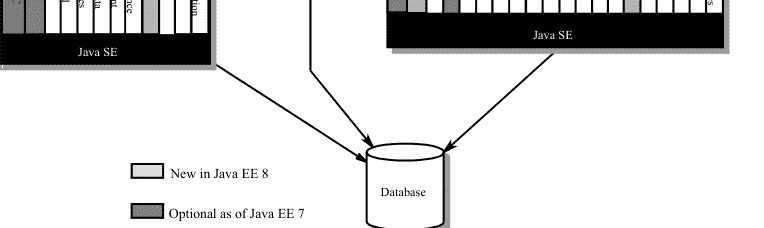

### 图 EE.2-1 Java EE 架构图

后续章节描述了每种 Java EE 平台元素的要求。

Java EE 6 规范引入了构文件的概念（参见第 EE.9 章，“配置文件”）。

配置文件是针对特定类应用程序的 Java EE 平台配置。

配置文件不是新概念，也不是 Java EE 平台所有。Java EE 6 规范引入了“配置文件”的概念（参见第 EE.9 章，“配置文件”）。

（注：原文中存在大量重复的段落，根据指令“不要重复输出原文”，此处仅保留核心含义的翻译并忽略重复部分。）

Java EE™ 技术或 JavaServer™ Faces、Web 过滤器和 Web 事件监听器在本规范中统称为“Web 组件”。Web 应用由 Web 组件和 HTML 页面等数据组成。Web 组件在 Web 容器中执行。Web 服务器包含 Web 容器以及根据 Java EE 规范要求的其他协议支持、安全支持等。

- 企业级 JavaBeans™ (EJB) 组件在支持事务的托管环境中执行。企业级豆通常包含 Java EE 应用程序的业务逻辑。企业级豆直接使用 SOAP/HTTP 协议提供 Web 服务。

Java EE 服务器为符合规范的应用程序组件提供部署、管理和执行支持。根据组件对 Java EE 服务器的依赖关系，应用程序组件可以分为三类：

- 在 Java EE 服务器上部署、管理和执行的组件。这些组件包括 Web 组件和 Enterprise JavaBeans 组件。请参阅这些组件的单独规范。
- 在 Java EE 服务器上部署和管理，但加载到客户端机器执行的组件。这些组件包括 Web 资源，如 HTML 页面和嵌入在 HTML 页面中的 applet。
- 部署和管理未完全由本规范定义的组件。应用程序客户端（Application Clients）属于此类。本规范的未来版本可能会完整定义应用程序客户端的部署和管理。请参阅第 EE.10 章节“应用程序客户端”获取有关应用程序客户端的描述。

容器为 Java EE 应用程序组件提供运行时支持。容器为应用程序组件提供底层 Java EE API 的联邦视图。Java EE 应用程序组件绝不会与其他 Java EE 应用程序组件直接交互。它们使用容器的协议和方法相互交互以及与平台服务进行交互。在应用程序组件和 Java EE 服务之间引入容器，允许容器透明地注入组件所需的的服务，例如声明式事务管理、安全检查、资源池化和状态管理。

典型的 Java EE 产品会为每种应用程序组件类型提供一个容器：应用程序客户端容器、applet 容器、Web 组件容器和企业级豆容器。

本规范要求容器提供由 Java 平台标准版 v8 规范（Java SE）定义的 Java 兼容运行时环境。applet 容器可以使用 Java 插件提供此环境，也可以以原生方式提供。使用提供 JDK™1.1 API 的 applet 容器在本规范的范围之外。

容器工具必须理解用于应用程序组件部署打包的文件格式。

容器由 Java EE 产品提供者实现。请参阅 EE.2.12.1 节“Java EE 产品提供者”中对提供者角色的描述。

本规范定义了每个 Java EE 产品必须支持的一系列标准服务。下文描述了这些标准服务。Java EE 容器提供了应用程序组件访问这些服务的 API。本规范还描述了通过连接器到其他非 Java EE 应用程序系统（如主机系统和 ERP 系统）扩展 Java EE 服务的标准方法。

Java EE 容器底层是其所属的服务器。Java EE 产品通常使用事务处理基础设施结合 Java 平台标准版（Java SE）技术来实现 Java EE 远端功能。Java EE 客户端功能通常基于 Java SE 技术构建。

资源适配器（Resource Adapter）是一种系统级软件组件，通常实现与外部资源管理器的连接性。资源适配器可以通过实现 Java EE 标准 API 之一（例如 JDBC™ 驱动程序），或通过定义并实现连接到外部应用程序系统的连接器适配器来扩展 Java EE 平台的功能。资源适配器还可以提供完全本地的服务，可能与原生资源交互。资源适配器通过 Java EE 服务接口（Java EE SPI）与 Java EE 平台接口。使用 Java EE SPI 挂载到 Java EE 平台的资源适配器能够与所有 Java 产品工作。

Java EE 平台需要一个通过 JDBC API 访问的数据库用于存储业务数据。该数据库可从 Web 组件、企业级豆和应用程序客户端访问。applet 则一定不能访问数据库。Java EE 产品提供者还必须为应用程序提供一个预配置的默认数据源。请参阅第 EE.19 节“默认数据源”。

Java EE 标准服务包括以下内容（在本文后续详细说明）。其中某些标准服务实际上由 Java SE 提供。

HTTP 客户端 API 由 `java.net` 包定义。HTTP 服务端 API 由 servlet、JSP 接口定义，Web 服务是 Java EE 的一部分。

在 SSL 协议上使用 HTTP 协议的支持与 HTTP 具有相同的客户端和服务 API。

Java 事务 API 由两部分组成：

- 容器和应用程序组件用于划分事务边界的应用级接口。
- Java EE 级别用于事务管理器与资源管理器之间的接口。

RMI-IIOP 子系统由 API 组成，允许使用独立于底层协议的 RMI 风格编程，以及支持 Java 原生 RMI 协议（JRMP）和 CORBA IIOP 协议的实现。Java EE 应用可以使用支持 IIOP 协议的 RMI-IIOP 访问符合 RMI 的 CORBA 服务（详情见 RMI-IIOP 规范）。此类 CORBA 服务通常由 Java EE 产品之外的组件定义，通常位于旧系统中。只有 Java EE 应用程序客户端被要求直接使用 RMI-IIOP API 定义自己的 CORBA 服务。通常在访问其他 CORBA 对象时会使用此类回调对象。

Java EE 产品可以使用 IIOP 协议导出企业级豆组件，并使用 IIOP 协议访问企业级豆，如 EJB 规范规定。为了实现 Java EE 产品之间的互操作性，需要使用 IIOP 协议，但 Java EE 产品也可以使用其他协议。在访问企业级豆组件时使用 RMI-IIOP API 的要求已在 EJB 3.0 中放宽。请参见 JavaBeans 规范。

对 CORBA 的支持（包括对 IIOP 和 Java IDL 的使用）在 Java EE 8 中为建议可选。请参阅第 EE.1.3 节“精简 Java 技术”。

Java IDL 允许 Java EE 应用程序组件使用 IIOP 协议调用外部 CORBA 对象。这些 CORBA 对象可以用任何语言编写，并通常位于 Java EE 产品之外。Java EE 应用可以使用 Java IDL 作为客户端，但只有 Java EE 应用程序客户端被要求可以直接使用 Java IDL 提供自身的 CORBA 服务。

JDBC API 是用于连接关系型数据库系统的 API。JDBC API 包含两个部分：用于应用程序组件访问数据库的应用程序级接口，以及用于将 JDBC 驱动程序附加到 Java EE 平台的服务提供接口。Java EE 产品不要求支持该服务接口。相反，JDBC 驱动程序应该被封装为资源适配器（resource adapters），使用 Connector API 的功能与 Java EE 产品建立接口。JDBC API 包含在 Java SE 中，但本规范对 JDBC 设备驱动程序包含了额外要求。

Java Persistence API（Java 持久 API）是用于持久化和对象/关系映射的标准 API。它为应用程序开发者提供了一种对象/关系映射机制，使其可以使用 Java 领域模型来管理关系型数据库。Java EE 要求支持 Java Persistence API。它也可以用于 Java SE 环境。

Java Message Service（Java 消息服务）是一种用于消息传递的标准 API，支持可靠的点对点消息以及发布/订阅模型。本规范要求 JMS 提供者同时实现点对点消息和发布/订阅消息。Java EE 提供者还必须提供一个预配置的


# JNDI API

JNDI API 是用于命名和目录访问的标准 API。JNDI API 包含两个部分：用于应用程序组件访问命名和目录服务的应用程序级接口，以及用于附加命名和目录服务提供者的服务提供接口。JNDI API 包含在 Java SE 中，但本规范定义了额外要求。

# JavaMail API

许多互联网应用程序都需要具备发送电子邮件通知的能力，因此 Java EE 平台包含了 JavaMail API 以及一个 JavaMail 服务提供者，该者允许应用程序组件发送互联网邮件。JavaMail API 包含两个部分：用于应用程序组件发送邮件的应用程序级接口，以及位于 Java EE SPI 级别的服务提供者接口。

# JAF

JAF 提供了一个处理不同 MIME 类型、源自不同格式和位置的数据的框架。JavaMail API 使用了 JAF API。JAF API 包含在 Java SE 中，因此对 Java EE 应用程序可用。

# JAXP 与 StAX

Java™ API for XML Processing (JAXP) 提供对行业标准 XML 和 DOM 解析 XML 文档的支持，以及对 XSLT 引擎的支持。XML 流式 API (StAX) 提供了用于 XML 的拉取解析 API。JAXP 和 StAX API 包含在 Java SE 中，因此对 Java EE 应用程序可用。

# Connector 架构

Connector 架构是一种 Java EE SPI，允许支持访问企业信息系统（EIS）的资源适配器被插入到任何 Java EE 产品中。Connector 架构定义了 Java EE 服务器与资源适配器之间系统级合约的标准。标准合约包括：

- **连接管理合约**：允许 Java EE 服务器池化到底层 EIS 的连接，并允许应用程序组件连接到 EIS。这导致了一个可扩展的应用程序环境，可以支持大量需要访问 EIS 系统的客户端。
- **事务管理合约**：事务管理器与 EIS 之间的事务管理合约，支持对 EIS 资源管理器的事务性访问。该合约允许 Java EE 服务器使用事务管理器跨多个资源管理器的事务。它还支持在 EIS 资源管理器内部管理的事务，而无需涉及外部事务管理器。
- **安全合约**：启用对 EIS 的安全访问。该合约为安全应用程序环境提供支持，减少了 EIS 的安全威胁并保护了 EIS 管理的价值信息资源。
- **线程管理合约**：允许资源适配器将工作委托给其他线程，并允许应用程序服务器管理线程池。资源适配器可以控制工作线程使用的安全上下文和事务上下文。
- **消息传递合约**：允许资源适配器向消息驱动豆（message driven beans）传递消息的合约，取决于用于传递消息的具体消息样式、消息语义和消息基础设施。该合约还作为标准消息提供者可插性合约，允许消息提供者作为资源适配器插入到任何 Java EE 服务器中。
- **事务上下文传播合约**：允许资源适配器将导入的事务上下文传播到 Java EE 服务器的合约，使其与服务器以及任何应用程序组件的交互成为导入事务的一部分。该合约保留了导入事务的 ACID（原子性、一致性、隔离性、持久性）属性。
- **通用命令接口合约**：一个可选的合约，在应用程序程序和资源适配器之间提供通用的命令接口。

# Java EE 安全服务

Java™ Authentication 使服务能够对用户进行身份验证并强制访问控制。它实现了标准可插身份验证模块（PAM）框架的 Java 技术版本，并支持基于用户的授权。容器 Java™ 授权提供者 (JACC) 定义了 Java EE 应用程序服务器与授权提供者之间的合约，允许自定义授权服务提供者插入到任何 Java EE 产品中。容器 Java™ 认证服务接口 (JASPIC) 定义了一个 SPI，通过该 SPI，身份提供者实现的消息认证机制可以集成在客户端或服务器的消息处理容器或运行时。Java EE Security API 利用 JASPIC，但为 Web 应用程序用户的身份验证提供了更易用的 SPI，并定义了用于认证和授权的身份存储 API。

# Web 服务支持

Java 为客户端以及服务端点均提供完全支持。多种 Java 技术共同工作以提供 Web 服务。Java Web Services API (JAX-WS) 和 Java XML RPC API (JAX-RPC) 都支持使用 SOAP/HTTP 协议的服务调用。JAX-WS 包含在 Java SE 中，是 Web 服务的主要 API，是 JAX-RPC 的继任者。JAX-WS 丰富的 Web 服务功能，支持多种绑定/协议。当使用 WS-I Basic Profile 限制的 HTTP 之上的 SOAP 1.1 协议时，JAX-WS 和 JAX-RPC 是完全互操作的。JAX-RPC 在 EE 7 中已变为可选。参见 EE6.1.3，“Pruned Java Technologies”。

JAX-WS 和 XML 绑定架构 (JAXB) 定义了 Java 类与 SOAP 调用中 XML 之间的映射，并支持 100% 的 XML Schema。JAXB 包含在 Java SE 中。带附件的 SOAP API (SAAJ) 也包含在 Java SE 中，提供了对底层 SOAP 消息的支持。Web Services for EE 规范完整定义了 Java EE 中 Web 服务客户端和服务端点的部署，以及使用企业豆实现服务端点。Web Services Metadata 规范定义了 Java 注解，使开发 Web 服务变得更容易。XML 注册 API (JAXR) 提供了对 XML 注册服务器的客户端访问。从 EE 7 开始支持已变为可选。参见 EE6.1.3，“Pruned Java Technologies”。

# JSON 处理与绑定

JSON Processing API (JSON-P) 提供了一种处理 JSON 文本（解析、生成、转换和查询）的便捷方法。JSON 绑定 API (JSON-B) 提供了一种在 JSON 文本和对象之间转换的便捷方法。

# WebSocket

WebSocket Java API (WebSocket) 是创建 WebSocket 应用程序的标准 API。

# JAX-RS

RESTful Web Services API (JAX-RS) 为使用 REST 风格的 Web 服务提供支持。RESTful 服务更符合 Web 的设计风格，并且可以使用各种编程语言轻松访问。JAX-RS 提供了一个编写 Web 服务的简单高级 API，以及一个用于控制 Web 服务交互细节的低级 API。

# Concurrency Utilities for Java EE

Concurrency Utilities for Java EE 是一种标准 API，通过以下类型为 Java EE 应用程序组件提供异步能力：

- 受管理的执行服务
- 受管理的调度执行服务
- 受管理的线程工厂
- 上下文服务

# Java 批处理 API

Java 批处理 API (Batch) 为批处理应用程序提供了一种编程模型以及用于调度和执行作业的运行时。

# 管理与部署规范

Java 2 平台企业版管理规范（Java 2 Platform, Enterprise Edition Management Specification）定义了使用特殊管理 Bean 管理 Java EE 服务器的 API。Java™ 管理扩展（JMX）API 也用于提供某些管理支持。

Java 2 平台企业版部署规范（Java 2 Platform, Enterprise Edition Deployment Specification）定义了部署工具与 Java EE 产品之间的合约。Java EE 产品提供运行在部署工具中的插件组件，并允许部署工具提供这些插件组件所使用的服务。从 Java EE 7 开始，对部署规范的支持已变为可选。参见第 EE.6.1.3 节，“精简的 Java 技术”。

# EE.2.8 互操作性

描述的许多 API 提供了与非 Java EE 平台组件（如外部 Web 服务或 CORBA 服务）的互操作性。

图 EE.2-2 展示了 Java EE 平台的互操作性设施。

（箭头的方向表示组件之间的客户端/服务器关系。）

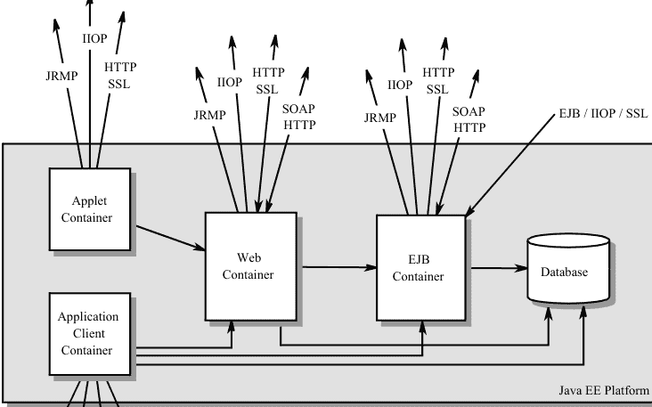

图 EE.2-2 Java EE 互操作性

# EE.2.9 产品需求的灵活性

本规范并不要求 Java EE 产品必须由单个程序、单个服务器甚至单台机器实现。通常情况下，本规范并不描述机器、服务器或进程之间服务或功能的划分。只要满足本规范中的要求，Java EE 产品提供者可以根据其合适情况对功能进行任何划分。Java EE 产品必须能够部署按照本规范描述的 EE 语义执行的应用程序组件。

高级 Java EE 产品将支持在流行浏览器之一中使用 Java 插件的 Applet，支持在各自的 Java 虚拟机中运行应用程序客户端，并提供一个同时支持 Web 组件和企业豆（Enterprise Beans）的单一服务器。高级 EE 产品可能会将服务器组件拆分为多个服务器，每个服务器都可以在一组机器上进行分布式部署和负载均衡。虽然此类机器可能位于企业内部或公有云中，但本规范并不规定或排除任何此类配置。

可能存在多种 Java EE 配置和实现，它们都符合本规范的要求。一个可移植的 Java EE 应用程序在成功部署到这些产品任一中都能正常运行。

本规范不包含对 Java EE 产品封装的要求。Java EE 产品可能通过分发介质提供、通过网络下载、或作为仅在网络上提供的服务（例如）。Java EE 产品必须包含本规范所引的所有 API 的实现。这些实现可能依赖于未包含在 Java EE 产品中的其他软件或服务。客户可能需要产品与其他软件或服务结合或配置，以满足本规范的要求。Java EE 产品的文档必须完整描述所有所需的软件和配置。

例如，Java EE 产品可能依赖于数据库服务器、命名服务、邮件服务和/或消息服务。在定义产品运行的所有配置中，都应包含满足本规范要求的所有软件和服务。

这些服务是否可用（正在运行、网络上可访问、配置正确、运行正常等）可能独立于 Java EE 产品进行控制——它们可能在 Java EE 服务器启动时不可用，也可能在 Java EE 服务器运行期间发生故障。本规范不要求 Java EE 产品确保这些服务的可用性。然而，如果满足本规范的要求需要此类服务，Java EE 产品必须确保该服务已配置好供使用，并在可用时是可用的。

例如，本规范要求应用程序可以使用数据库。如果 Java EE 产品要求单独安装数据库服务器，并要求配置 Java EE 产品使用该数据库，则此类配置必须在应用程序部署之前完成。这确保了应用程序的运行环境包含了所有所需的服务。

本规范描述了所有 Java EE 产品可用的最小设施集。Java EE 配置文件可能包含 EE.9 节“配置文件”中所描述的这些部分或全部内容。大多数 Java EE 产品将提供超出本规范最小要求的设施。特别是，它还包含了本规范未指定的可选功能。Java EE 产品可以自由地以特定实现的方式实现本规范未指定的接口。

可移植的 Java EE 应用程序不会使用任何平台扩展。使用非可移植扩展的应用程序可移植性较低。取决于所使用的设施，可移植性的损失可能是微小的，也可能是巨大的。我们期望 Java EE 产品在质量各个方面（如性能、可扩展性、健壮性、可用性和安全性）产生广泛差异并激烈竞争。在某些情况下，本规范要求最低级别的的服务。

# EE.2.12 角色

本节描述了典型的 Java 平台企业版角色。在实际实例中，组织可能会不同的划分角色功能，以匹配该组织的应用程序开发和部署工作流。本规范的后续章节将更详细地描述角色。

## EE.2.12.1 Java EE 产品提供者

Java EE 产品提供者是 Java EE 产品的实现者和供应商，该产品包含了组件容器、Java EE平台 API 以及本规范定义的其他功能。产品提供者通常是应用服务器厂商、Web 服务器厂商、数据库系统厂商或操作系统厂商。提供者经常基于现有基础设施进行实现。

Java EE 产品提供者必须提供本规范指定的应用程序组件到网络协议的映射。Java EE 产品可以自由地实现本规范未指定的接口。

Java EE 产品提供者必须提供应用程序部署和管理工具。部署工具允许部署者（参见 EE.2.12.4 节，“部署者”）在 Java EE 产品上部署应用程序组件。管理工具允许系统管理员（参见 EE.2.12.5 节，“系统管理员”）管理 Java EE 产品以及部署在 Java EE 产品上的应用程序。这些工具的形式不受规范规定。

## EE.2.12.2 应用程序组件提供者

应用程序组件提供者有多个角色，例如 HTML 文档设计师、程序员和企业豆开发者。这些角色使用工具产生 Java EE 应用程序和组件。

## EE.2.12.3 应用程序装配者

应用程序装配者获取由组件提供者开发的组件，并将其组装完整的 Java EE 应用程序，以企业归档文件 (.ear) 的交付。应用程序装配者通常会使用平台提供者或工具提供者提供的 GUI 工具。应用程序装配者负责提供描述外部依赖的装配指令，部署者在部署过程中需要解析这些依赖。

## EE.2.12.4 部署者

部署器负责将客户端应用程序、Web应用程序以及 Enterprise JavaBeans 组件部署到特定的运行环境中。部署器使用 Java EE 产品提供商提供的工具来执行部署任务。部署通常是一个三阶段的过程：

1. **安装**：部署器将介质移动到服务器，生成额外的特定容器的类和接口（以便容器能够在运行时管理应用程序组件），并将应用程序组件以及额外的类和接口安装到适当的 Java EE 组件中。
2. **配置**：解析由应用程序组件提供者（Application Component Provider）声明的外部依赖，并解析由应用程序装配器（Application Assembler）定义的应用程序组装指令。例如，部署器负责管理由应用程序装配器针对目标环境中存在的用户组和账户定义的安全角色。
3. **执行**：最后，部署器启动新安装并配置的应用程序的执行。

在某些情况下，经过特殊的部署器可以在部署时自定义应用程序组件的业务逻辑。例如，使用 Java EE 产品提供的工具，部署器可以提供简单的应用程序代码来封装企业 Bean 的业务方法，或自定义 JSP 或 JSF 页面的外观。

部署器的输出是针对目标运行环境进行定制并部署在特定 Java EE 容器中的 Web 应用程序、企业 Bean、Applet 和应用程序客户端。

例如，在云部署的情况下，部署器负责配置应用程序运行在云环境中。部署器将把应用程序安装到云环境中，配置其外部依赖，并可能处理其所需资源的供应方面。

## EE.2.12.5 系统管理员

系统管理员负责企业计算和网络基础设施的配置与管理。系统管理员还负责监督已部署 Java EE 应用程序的运行状况。系统管理员通常使用 Java EE 产品提供提供的提供的监控和管理工具来完成这些任务。

例如，在云场景下，系统管理员负责安装、配置、管理和维护云环境，包括提供给环境中运行应用程序的资源。

## EE.2.12.6 工具提供者

工具提供者提供用于开发和打包应用程序组件的工具。预计会有多种工具，对应于 Java EE 平台支持的各种应用程序组件类型。平台无关的工具可以用于从开发到应用程序部署，以及应用程序服务器的管理和监控的所有阶段。

## EE.2.12.7 系统组件提供者

系统组件提供者可能提供各种系统级组件。连接器架构（Connector Architecture）定义了用于提供多种类型资源适配器的主要 API。这些资源适配器可以连接到多种类型的现有企业信息系统，包括数据库和消息系统。另一种类型的系统组件是根据《容器 Java 授权服务提供者合约》（Java Authorization Service Provider Contract for Containers）定义的策略提供者。

# EE.2.13 Java EE 合约

本节描述了实现完整 Java EE 平台的 Java EE 产品提供者必须满足的 Java 平台企业版（Enterprise Edition）合约。Java EE 配置文件可能包含 EE.9 章“配置文件”（Profiles）中描述的部分或全部功能。

## EE.2.13.1 Java EE API

Java EE API 定义了 Java EE 应用程序组件与 Java EE 平台之间的合约。合约规定了运行时和部署接口。

Java EE 产品提供者必须以支持本规范中描述的语义和策略的方式实现 Java EE API。应用程序组件提供者提供符合这些 API 和策略的组件。

## EE.2.13.2 Java EE SPI

Java EE 服务提供者接口 (SPIs) 定义了 Java EE 平台与可能插入 Java EE 产品的服务提供者之间的合约。连接器 API 定义了用于将资源适配器集成到 Java EE 应用程序服务器的服务提供者接口。实现连接器 API 的资源适配器组件被称为连接器（Connectors）。Java EE API 定义了将安全授权机制集成到 Java EE 应用程序服务器的服务提供者接口。

Java EE 产品提供者必须以支持本规范中描述的语义和策略的方式实现 Java EE SPI。服务提供者组件提供者（例如连接器提供者）应该提供符合这些 SPI 和策略的组件。

## EE.2.13.3 网络协议映射

本规范定义了应用程序组件到行业标准网络协议的映射。该映射允许未安装 Java EE 产品技术的系统访问应用程序组件。有关互操作性所需的网络协议支持的详细信息，请参阅 EE7.7 章“互操作性”（Interoperability）。

Java EE 产品提供者被要求在行业标准协议上发布已安装的应用程序组件。本规范定义了 servlet 和 JSP 页面到 HTTP 和 HTTPS 协议的映射，以及 EJB 组件通过 IIOP 和 SOAP 协议的映射。

## EE.2.13.4 部署描述符与注解

部署描述符和 Java 注解用于将应用程序组件的需求告知部署器。部署描述符和类文件注解是应用程序组件提供者或装配器与部署器之间的合约。部署器需要在组件的部署描述符或通过类文件注解指定应用程序组件的外部资源需求、安全需求、环境参数等。Java EE 产品提供者被要求提供一种部署工具，用于解释 Java EE 部署描述符和类注解，并允许将组件的需求映射到特定 Java EE 产品和环境的能力。

# EE.2.14 历史版本变更

## J2EE 1.3

J2EE 1.3 规范通过额外的企业集成功能扩展了 J2EE 平台。连接器 API 支持与外部企业信息系统的集成。现在需要 JMS 提供者。JAXP API 提供处理 XML 文档的支持。JAAS API 为连接器 API 提供安全支持。EJB 规范现在要求支持使用 IIOP 协议的互操作。

EJB 规范发生了重大变化。EJB 规范具有新的容器管理持久化模型、对消息驱动的支持以及对本地企业 Bean 的支持。

其他 J2EE API 也进行了更新。详细信息请参见各个 API 规范。最后，J2EE 1.3 要求支持 J2SE 1.3。


# Java EE 平台演进与安全架构

## J2EE 1.4

J2EE 1.4 的主要重点是支持 Web 服务。`JAX-RPC` 和 `SAAJ` API 提供了基本的 Web 服务互操作支持。Java EE Web 服务规范描述了提供和使用 Web 服务的 Java EE 应用程序的打包和部署要求。`EJB` 规范也为了支持使用无状态 Bean 实现 Web 服务。`JAXR` API 支持访问注册表。

其他多个 API 被添加到 J2EE 1.4 中。Java EE 管理和部署 API 增强了对 Java EE 产品的工具支持。`JMX` API 支持 Java EE 管理 API。Java 容器授权合约为安全提供者提供了一个 SPI。

此 J2EE 平台规范的变更包括支持独立于任何应用程序部署类库，以及将部署描述符 DTD 转换为 XML Schema。

其他 J2EE API 也得到了增强。更多详细信息，请参阅所引用的每个规范。

随着此版本的发布，平台有了新名称——Java 平台企业版（Java Platform, Enterprise Edition），简称为 Java EE。这个新名称消除了令人困惑的“2”，同时在简短的名称中强调了它是一个 Java 平台。之前的版本仍使用旧名称“J2EE”指代。

## Java EE 5

Java EE 5 的重点是易于开发。为了简化开始使用 Java EE 的程序员或开发中小型应用程序程序员的开发过程，Java EE 5 大量使用了 JSE 5.0 引入的 Java 语言注解。在许多情况下，注解减少或消除了处理 Java EE 部署描述符的需求。即使是大型应用程序也能从注解提供的简化中获益。

注解的主要用途之一是指定向 Java EE 组件中注入资源和其他依赖项。注入技术增强了 `JNDI` 查找能力，为应用程序提供了一种新的简化模型，以从运行环境中获取所需的资源。注入还与部署描述符配合，允许部署器自定义或覆盖应用程序源代码中的资源设置。

通过提供更好的默认值，注解的使用更加有效。更好的行为和更好的配置允许应用程序在大多数情况下（通过使用注解或部署描述符）获得它们最想要的行为。当默认值不是应用程序所希望的时，可以使用简单的注解来指定所需的行为或配置。

注解与更好的默认值的结合极大地简化了使用企业级技术的应用程序以及定义或使用 Web 服务的应用程序的开发。企业豆的开发现在变得异常简单。使用由 Web 服务元数据规范定义的注解，Web 服务开发变得更加容易。

Web 服务领域继续以快速的速度演进。为了提供最新的 Web 服务支持，`JAX-RPC` 技术已演进为 `JAX-WS` 技术，它大量利用 `JAXB` 技术将 Java 对象绑定到 XML 数据。`JAX-WS` 和 `JAXB` 对于该版本的平台来说都是新特性。

Java EE 5 的主要新增包括简化 Web 开发的 `JSTL` 和 `JSF` 技术，以及由 `EJB 3.0` 专家组开发的 Java 持久化 API，它极大简化了 Java 对象到数据库的映射。

小型新增包括用于 XML 解析的 `StAX` API。之前版本的大多数 API 都经过了中等的改进。

## Java EE 6

Java EE 6 继续延续 Java EE 5 对“开发便利”的关注。Java EE 6 引入的主要改进之一是上下文与依赖注入（`CDI`）技术，它为“托管豆”的依赖注入和生命周期管理提供了一个统一的框架。

EE 6 托管豆规范定义了一系列 EE 托管对象的共性，范围从基础托管豆扩展到 `EJB` 组件。

此版本引入的 Bean 验证规范为托管对象的验证提供了一种设施。Bean 验证被集成到 Java 持久化 API 中，它为 `JPA` 实体的验证提供了自动化设施。

Java EE 6 将 `JAX-RS` API 作为 Java EE 平台的强制技术。`JAX-RS` 是用于开发根据表述状态转换（`REST`）架构风格构建的 Web API。

Java EE 6 还引入了 Java EE Web 配置文件，这是 Java EE 平台第一个新配置文件。

自成立以来，Java EE 平台一直旨在通过其基于容器的模型和资源访问的抽象，将开发者从常见的基础任务中解放出来。在最近的发布中，平台大幅简化了访问容器服务的 API，同时扩大了服务的范围。在本次发布中，我们继续改进简化的方向，同时扩展 Java EE 平台的范围，以涵盖 Web 领域的新兴技术。

## Java EE 7

Java EE 7 对 Web 标准的最新进展提供了原生支持，包括 `WebSockets` 和 `JSON`，这些技术为 Java EE 中的 `HTML 5` 支持提供了基础。Java EE 7 还增加了由 `JAX-RS 2.0` 定义的现代 HTTP 客户端 API。

Java EE 7 的新特性还包括 `Batch API`，它为批处理应用程序提供了编程模型以及一个用于调度和执行作业的运行时；以及并发工具类，它提供了托管执行器服务、调度执行器和服务线程工厂。

## Java EE 8

Java EE 8 继续关注 Java EE 7 的现代 Web 应用并扩大此类应用的范围。Java EE 8 引入了 JSON 绑定 API（`JSON-B`），用于映射 JSON 文本和 Java 对象，基于 Java EE 7 引入的 JSON 处理 API（`JSON-P`）。处理 API 本身已更新以反映额外的 JSON 标准。`Servlet` 通过增加对 `HTTP/2` 协议的支持而经历了重大增强。`JAX-RS` 增加了对服务器发送事件的支持，并基于 Java 8 增加的并发功能引入了响应式客户端 API。新的 Java EE 安全 API 为 Web 模块的验证和授权提供了增强支持，并引入了访问身份存储的 API。Bean 验证设施已更新以反映 SE 8 中的改进并扩展验证对象的范围。虽然此版本中 `CDI` 的重点是通过引入引导启动 API 将其范围扩展到 Java EE 之外，但 `CDI` 也包含了对事件的处理和对 SE 8 特性的对齐。

## 安全需求

- **机密性或数据隐私**：用于确保信息仅对授权访问该信息的用户可用的手段。
- **不可否认性**：用于证明用户执行了某些操作，且该用户在合理范围内无法否认执行过该操作的手段。
- **审计**：用于捕获防篡改的安全事件记录的手段，目的是评估安全策略和机制的有效性。

本章规定了 Java EE 平台需求如何满足安全需求，并识别了可能由 Java EE 产品提供者满足的需求。最后，EE.3.7 节“未来方向”简要提到了本规范未来版本中考虑的问题。

## 安全行为示例

通过检查具有 Web 客户端、`JSP` 用户界面和企业 Bean 业务逻辑简单应用程序中发生的情况，可以更好地理解 Java EE 环境的安全行为。（该示例并非规定需求）。

在此示例中，Web 客户端依赖 Web 服务器作为其身份验证代理，从客户端收集用户身份验证数据并使用其建立已验证的会话。

### 步骤 1：初始请求

Web 客户端请求主 URL，如图 EE.3-1 所示。

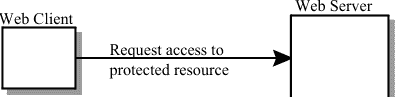

图 EE.3-1 初始请求

由于客户端尚未向应用程序环境进行身份验证，负责交付应用程序 Web 部分服务器（此处称为“Web 服务器”）检测到这一点，并为该资源调用相应的身份验证机制。

### 步骤 2：初始身份验证

Web 服务器返回一个表单，Web 客户端使用该表单从用户处收集身份验证数据（例如用户名和密码）。Web 客户端将身份验证数据转发到 Web 服务器，由 Web 服务器进行验证，如图 EE.3-2 所示。

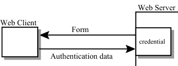

图 EE.3-2 初始身份验证

验证机制可能是服务器本地的，也可能利用底层安全服务。根据验证结果，Web 服务器为用户设置了一个凭据。

### 步骤 3：URL 授权

该凭据用于后续确定用户是否有权访问其可能请求的受限资源。Web 服务器查询与 Web 资源相关的安全策略（源自部署描述），以确定允许访问该资源的安全角色。然后，Web 容器针对每个角色测试用户的凭据，以确定其是否可以将用户映射到该角色。图 EE.3-3 显示了这一过程。

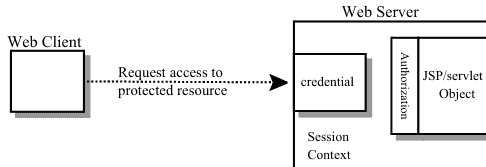

图 EE.3-3 URL 授权

当 Web 服务器能够将用户映射到某个角色时，Web 服务器的评估以“已授权”的结果结束。如果 Web 服务器无法将用户映射到任何允许的角色之一，则达到“未授权”的结果。

### 步骤 4：完成原始请求

如果用户获得授权，Web 服务器将返回原始 URL 请求的结果，如图 EE.3–4 所示。

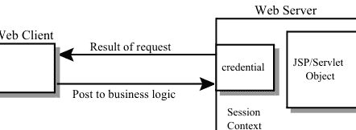

图 EE.3–4 完成原始请求

在我们的示例中，返回了 `JSP` 页面的响应 URL，使用户可以提交由业务逻辑组件处理的表单数据。

### 步骤 5：调用企业 Bean 业务方法

`JSP` 对企业 Bean 执行远程方法调用，使用用户的凭据在 `JSP` 页面和企业 Bean 之间建立安全关联（如图 EE.3-5 所示）。该关联实现为两个相关的安全上下文，一个在 Web 服务器中，另一个在 `EJB` 容器中。

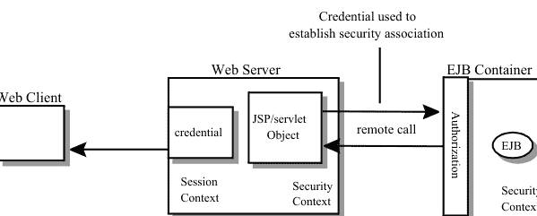

图 EE.3–5 调用企业 Bean 业务方法

`EJB` 容器负责对企业 Bean 方法执行访问控制。它查询与企业 Bean 相关的安全策略（源自部署描述），以确定允许访问方法的安全角色。对于每个角色，`EJB` 容器使用与调用相关的安全上下文来确定其是否可以将调用者映射到该角色。

当容器能够将调用者的凭据映射到某个角色时，容器的评估步骤以“已授权”的结果结束。如果容器无法将调用者映射到任何允许的角色之一，则达到“未授权”的结果。“未授权”的结果会导致容器抛出异常，并传播到调用的 `JSP` 页面。

如果调用“已授权”，容器将控制权交由企业 Bean。Bean 执行调的结果返回给调用的 `JSP` 页面。

## EE.3.3 安全架构

本节描述了本规范所定义的 Java EE 安全架构。

### EE.3.3.1 目标

以下是 Java EE 安全架构的目标：

1. **可移植性**：Java EE 安全架构必须支持“一次编写，随处运行”属性。
2. **透明性**：应用程序开发者无需了解安全即可编写应用程序。
3. **隔离性**：Java EE 平台能够根据系统管理员建立的指令执行身份验证和访问控制。注意，将应用程序与安全责任解耦确保了 Java EE 应用程序的可移植性。
4. **可扩展性**：安全感知应用程序使用平台服务不会损害应用程序的可移植性。本规范提供了与安全信息交互的组件模型。限制在提供的 API 上的应用程序将保留可移植性。
5. **灵活性**：本规范使用的安全机制和声明并不实施特定的安全策略，而是便于实施特定于 Java EE 安装或应用程序的安全策略。
6. **抽象性**：所需的安全行为和部署合约可以使用多种安全技术实现。
7. **兼容性测试**：Java EE 安全需求必须以一种方式表示，以便明确判断实现是否兼容。
8. **安全互操作性**：在 Java EE 产品中执行的应用程序必须能够调用不同供应商的 Java EE 产品提供的服务，无论使用的是相同还是不同的安全策略。这些服务由 Web 组件或企业 Bean 提供。

### EE.3.3.2 非目标

以下不是 Java EE 安全架构的目标：

1. 本规范不规定特定的安全策略。应用程序和企业系统的安全策略出于许多与本规范无关的原因。提供者可以在遵循本规范的同时提供实施管理安全策略的技术。
2. 本规范不强制特定的安全技术，例如 `Kerberos`、`PK`、`NIS+` 或 `NTLM`。
3. 本规范不要求 Java EE 安全行为能够使用任何或所有安全技术实现。
4. 本规范对 Java EE 产品的有效安全性不提供任何保证或保证。


### EE.3.3.3 术语

本节介绍了描述 Java EE 平台安全需求的术语。

#### 主体 (Principal)

主体是在可以在部署在企业的安全服务中通过身份验证协议进行验证的实体。主体标识使用主体名称（principal name）并使用认证数据进行认证。主体名称和认证数据的内容和格式取决于具体的认证协议。

#### 安全策略域

安全策略域（security policy domain），也称为安全域（security domain），是安全服务管理员在其范围内定义并执行通用安全策略的范围。

安全策略域有时也被称为领域（realm）。本规范使用“安全策略域”和“安全域”这两个术语。

#### 安全技术域

安全技术域（security technology domain）是使用同一种安全机制（例如 Kerberos）来执行安全策略的范围。

一个单一的安全技术域可能包含多个安全策略域，例如。

#### 安全属性

每个主体（principal）都关联有一组安全属性。安全属性有许多用途（例如对受保护资源的访问和对用户的审计）。安全属性可以通过认证协议和/或 Java EE 产品提供者（Product Provider）与主体关联。

Java EE 平台未规定与主体关联哪些安全属性。

#### 凭证

凭证（credential）包含或引用用于认证 Java EE 产品服务主体的信息（安全属性）。主体通过认证获取凭证，或从另一个允许其凭证被使用的主体获取凭证（委托）。

本规范未规定凭证的内容或格式。凭证的内容和格式差异很大。

#### EE.3.3.3.4 基于容器的安全

安全组件由其容器提供，以便在 Java EE 环境中实现上述安全目标。容器提供两种安全机制（在接后的节中讨论）：

- 声明式安全（Declarative security）
- 程序化安全（Programmatic security）

#### EE.3.3.4.1 声明式安全

声明式安全是指通过以非程序化的形式表达应用程序的安全结构，包括安全角色、访问控制和认证要求。Java 注解和部署描述符（deployment descriptor）是 Java EE 平台声明式安全的主要方法。

Java 注解和部署描述符是应用程序组件提供者与部署者（Deployer）或应用程序组合（Application Assembler）之间的约定。应用程序程序员可以使用它们表示应用程序安全相关的环境需求。部署描述符可以与组件组关联。

部署者将应用程序安全策略的声明表示映射到针对特定环境的安全结构。部署者使用工具处理注解和部署描述符。

在运行时，容器使用从注解和部署描述符中表达的声明式安全信息、并由部署者配置出的安全策略安全结构来执行授权（参见 EE.3.3.6 节，“授权模型”）。

#### EE.3.3.4.2 程序化安全

程序化安全是指由安全感知应用程序做出的安全决策。当仅靠声明式安全不足以表达应用程序的安全模型时，程序化安全非常有用。程序化安全的 API 由 Java EE Security API Context 的方法、`EJBContext` 方法以及 servlet `HttpServletRequest` 接口的方法组成。Java EE Security API Context 的方法旨在取代 `EJBContext` 和 `HttpServletRequest` 接口的相应方法。

这些方法允许组件根据调用者或远程用户的安全规则做出业务逻辑决策。例如，它们允许组件确定调用者或远程用户的主体名称以用作数据库键。（注意，主体名称的形式和内容在产品和企业之间差异很大，移植组件将不取决于主体名称的实际内容。由于主体映射，同一个逻辑主体在不同的容器中可能具有不同的名称，尽管可以配置单一产品使用一致的主体名称。特别是，如果主体名称被用作数据库表的键，且该数据库表被多个组件、容器或产品访问，则同一个逻辑主体可能映射到数据库中的不同条目。）

#### EE.3.3.5 分布式安全

某些产品提供者可能提供 Java EE 产品，在其中不同组件类型的容器是分布式的。在分布式环境中，Java EE 组件之间的通信可能会受到安全攻击（例如重放攻击）。

此类威胁可以通过使用安全关联（security association）来对抗。安全关联是用于组件间安全通信的安全状态信息。

建立安全关联可能涉及以下步骤：

1. 认证目标主体并认证客户端。
2. 协商保护的质量，例如机密性或完整性。
3. 设置组件之间的安全上下文。

由于 Java EE 提供了安全，访问的安全关联通常由容器建立。Web 的的安全关联在此处规定。访问实体 bean 的关联在 EJB 规范中描述。

产品提供者允许通过注解或部署描述符中的元素指定 Web 访问的需求。

本规范未定义应用程序组件提供者用于与实体 bean 通信的安全关联机制。

#### EE.3.3.6 授权模型

Java EE 授权模型基于安全角色（security roles）的概念。安全角色是由应用程序组件提供者或组合者定义的用户的逻辑分组。部署者将角色映射到环境中的安全身份（例如主体和组）。安全角色既用于声明式安全也用于程序化安全。

声明式授权用于控制对实体 bean 的访问，并在注解或实体 bean 描述符中指定。`RolesAllowed`、`PermitAll` 和 `DenyAll` 注解用于指定权限。实体 bean 方法也可以与描述符中的权限元素关联。权限元素包含安全角色访问的方法。如果调用主体属于允许访问方法的角色之一，则允许执行该方法。相反，如果调用主体不属于这些角色，则调用者不被允许执行该方法。资源的访问以类似的方式受保护。

安全角色用于 `SecurityContext` 方法 `CallerInRole`、`EJBContext` 方法 `CallerInRole` 以及 `HttpServletRequest` 方法 `UserInRole`。如果调用主体处于指定的角色，这些方法返回 `true`。

##### EE.3.3.6.1 角色映射

资源或实体 bean 安全约束的执行（无论是程序化的还是声明式的），取决于与请求关联的主体是否被赋予安全角色。容器根据调用者的安全属性做出此判断。例如：

1. 部署者可能将安全角色映射到环境中的用户组，或者取决于 Java EE 安全规范定义的安全角色到用户组的默认映射。在这种情况下，从属性中获取调用主体的用户组。如果主体的用户组与映射到安全角色的用户组匹配，则主体处于该角色。
2. 部署者可能将安全角色映射到安全策略域中的主体名称。在这种情况下，从属性中获取调用主体的主体名称。如果此主体名称与映射到安全角色的主体名称相同，则调用主体处于该安全角色。

安全属性的来源随 Java EE 平台的实现而异。

#### EE.3.3.7 HTTP 登录网关

EJB 规范解决了不同安全策略域之间企业 Bean 之间的安全互操作问题。此外，组件可以选择通过 HTTP 登录到远程服务器。在使用 HTTP 访问远程资源时，应用程序组件可以配置为使用 SSL 认证以确保安全性。这种方式的应用可以选择使用 XML 或其他结构化格式，而不是 HTML。

我们将通过带有 SSL 认证的 HTTP 访问远程的服务称为 *HTTP 登录网关*。该领域的规定在 EE.3.3.8.1 节“Web 客户端认证”中。

#### EE.3.3.8 用户验证

用户验证是用户向系统证明其身份的过程。经过验证的身份随后被用于对访问 Java EE 组件做出授权决策。终端用户可以验证两种支持的客户端类型之一：

- *Web 客户端*
- *应用程序*

##### EE.3.3.8.1 Web 客户端认证

要求客户端能够使用以下任何机制向 Web 服务器验证用户。由部署程序（Deployer）或系统管理员决定对某个应用程序或一组应用程序采用哪种方法。

- *HTTP 基础认证*

HTTP 基础认证是 HTTP 协议支持的认证机制。该机制基于用户名和密码。Web 服务器请求 Web 客户端验证用户。在请求过程中，Web 服务器会传递用户要进行认证的*域（realm）*。Web 客户端获取用户名和密码并将其传输到 Web 服务器。Web 服务器在指定的域（本文中称为 HTTP 域）中验证用户。

HTTP 基础认证是不安全的。密码以简单的 base64 编码发送。目标服务器未经过认证。可以应用额外的保护措施来克服这些缺陷。可以通过在传输层（例如 HTTPS）或网络层（例如 IPSEC 或 VPN）应用安全保护来保护密码。

尽管存在这些局限性，HTTP 基础认证机制仍包含在本规范中，因为它在基于表单的应用程序中被广泛使用。

- *HTTPS 客户端认证*

使用 HTTPS（基于 SSL 的 HTTP）进行终端认证是一种强身份认证机制。该机制要求用户拥有公钥证书（PKC）。目前，互联网上的用户很少使用 PKC。然而，它对于电子商务应用程序以及来自浏览器的单点登录是有用的。由于这些原因，HTTPS 客户端认证是 Java EE 平台的一项强制功能。

- *基于表单的认证*

使用 Web 浏览器内置的认证机制可以改变登录界面的外观和感受。本规范引入了封装标准 HTML 或基于 servlet/JSP/JSF 的登录表单的能力，允许对用户界面进行自定义。本规范引入的基于表单的认证机制在 Servlet 规范中描述。

HTTP 摘要认证（Digest Authentication）未被 Web 浏览器广泛支持，因此不是强制要求的。

Web 客户端可以使用 Web 服务器作为其认证代理。在这种情况下，客户端的凭据建立在服务器中，服务器可以使用该凭据执行各种用途：执行认证决策、在调用企业 Bean 时充当客户端，或与资源协商安全关联。目前的 Web 浏览器依赖代理认证。

##### EE.3.3.8.2 Web 单点登录

HTTP 是一个无状态协议。然而，许多 Web 应用程序需要会话支持，以便跨客户端的多个请求维持状态。因此，理想的情况是：

1. 将登录机制和策略作为 Web 应用程序部署环境的属性。
2. 能够使用同一个登录会话向用户访问的所有应用程序代表该用户。
3. 仅在跨越安全策略域边界时才要求用户重新认证。

通过 Web 登录过程获取的凭据与会话关联。容器使用这些凭据为会话建立安全上下文。容器使用安全上下文来确定访问 Web 资源的授权，以及与其它组件（包括企业 Bean）建立安全关联。

##### EE.3.3.8.3 登录会话

在 Java EE 平台中，登录会话支持由 Web 容器提供。当用户成功通过 Web 服务器认证时，容器为用户建立登录会话上下文。登录会话包含与用户关联的凭据¹¹

##### EE.3.3.8.4 应用程序客户端认证

应用程序客户端（在第 10 章“应用程序客户端”中详细描述）是直接与企业 Bean 交互的客户端程序（即无需 Web 服务器的帮助）。应用程序客户端与其他 Java EE 客户端类型一样，在托管环境中执行。应用程序客户端预期图形显示和输入设备。应用程序客户端预计访问受保护的资源。

#### EE.3.3.9 延迟认证

认证是有成本的。例如，认证过程可能需要跨网络交换多条消息。因此，理想使用延迟认证，即仅在需要时执行认证。虽然客户端在认证方面是无状态的，但客户端需要服务器充当其代理并维护其登录上下文。如果使用 SSL 认证作为认证协议，客户端可以管理自己的认证上下文，而无需依赖通过 Cookie 或 URL 写入提供的登录状态引用。通过延迟认证，用户在产生访问受保护资源的请求之前不需要进行认证。当第一级客户端（小 应用程序/applets、应用程序客户端）请求访问需要认证的受保护资源时，可以使用延迟认证。在此时，可以要求用户提供适当的认证数据。如果用户成功通过认证，则允许用户访问该资源。

### EE.4 用户验证要求

Java EE 产品提供商必须满足关于用户验证的以下要求。

#### EE.4.1 登录会话

所有 Java Web 服务器为每个 Web 用户维护一个登录会话。登录会话必须能够跨多个应用程序，允许用户登录一次并访问多个应用程序所需的登录会话支持在 Servlet 规范中描述。这种为每个 Web 用户提供会话的要求支持单点登录。

应用程序可以独立于实现安全和维护登录信息的细节。Java EE 产品提供者可以灵活选择独立于受这些机制保护的应用程序的认证机制。

Web 服务器必须支持受保护 Web 资源的延迟认证。需要认证时，可以使用下一节列出的三种登录机制之一。

#### EE.4.2 强制登录机制

所有 Java EE 产品都要求支持三种登录机制：HTTP 基础认证、SSL 双向认证和基于表单的登录。应用程序不要求使用任何这些机制，但要求这些机制对任何应用程序可用。

##### EE.4.2.1 HTTP 基础认证

所有 Java EE 产品都要求支持 HTTP 基础认证（RFC2068）。平台提供商还被支持 SSL 上的基础认证。

Java EE 8, 最终发布

#### EE.3.4.2.2 SSL 双向认证

本规范要求支持 TLS 1.2 以及执行基于证书的双向（客户端和服务器）认证的方法。

所有 Java EE 产品必须支持 TLS 1.1 和 TLS 1.0，以确保与客户端进行相互安全的通信；然而，如果特定部署中不需要，则应禁用 TLS 1.0，如果不需要，则可以禁用 TLS 1.1。

同样，所有 Java EE 产品必须支持以下加密套件，以确保与客户端进行相互安全的通信：

- `TLS_RSA_WITH_AES_128_CBC_SHA`
- `TLS_DHE_RSA_WITH_AES_128_CBC_SHA`
- `TLS_ECDH_RSA_WITH_AES_128_CBC_SHA`
- `TLS_ECDH_ECDSA_WITH_AES_128_CBC_SHA`
- `TLS_ECDHE_RSA_WITH_AES_128_CBC_SHA`
- `TLS_ECDHE_ECDSA_WITH_AES_128_CBC_SHA`

然而，建议使用客户端和服务器之间可以协商的最强加密套件，如果特定部署中不需要，可以禁用上述加密套件以改用更强的加密套件。

注意，本规范的早期版本要求支持 SSL 3.0 以及以下加密套件：

- `TLS_RSA_WITH_RC4_128_MD5`
- `SSL_RSA_WITH_RC4_128_MD5`
- `TLS_DHE_RSA_WITH_3DES_EDE_CBC_SHA`
- `TLS_DHE_RSA_WITH_3DES_EDE_CBC_SHA`
- `TLS_RSA_EXPORT_WITH_RC4_40_MD5`
- `SSL_RSA_EXPORT_WITH_RC4_40_MD5`
- `TLS_DHE_RSA_EXPORT_WITH_DES40_CBC_SHA`
- `TLS_DHE_RSA_EXPORT_WITH_DES40_CBC_SHA`

SSL 3.0 已于 2015 年被 RFC 7568 正式废弃，许多 TLS 实现不支持或禁用了它。上述加密套件目前均不被认为是安全的，并且默认不支持或被禁用。在极端情况下，为了与旧客户端或旧版本的 Java EE 配合，可能需要使用 SSL 3.0 或协商上述任一加密套件。然而，尽可能使用 TLS 1.0 或更高版本，并协商更强的加密套件。如果特定部署中不需要为了操作性，应当禁用 SSL 3.0 以及上述的加密套件。

#### EE.3.4.2.3 基于表单的登录

Web 应用部署符包含一个元素，允许 Java EE 产品将 HTML 表单响应（可能是动态生成的）与 Web 应用关联。如果部署程序（Deployer）选择这种认证形式（而非 HTTP Basic 或 SSL 证书认证），则必须使用此表单作为登录应用程序的用户界面。

基于表单的登录机制和 Web 应用部署符在 Servlet 规范中有描述。

#### EE.3.4.4.3 未认证访问

Web 容器必须允许未通过容器认证的客户端访问 Web 资源。这是互联网上访问 Web 资源的常见模式。

Web 容器通过从 `SecurityContext` 方法 `getCallerPrincipal()` 或 `HttpServlet` 方法 `getUserPrincipal()` 返回 `null` 来报告没有用户通过了身份验证。这与 `EJBContext` 方法 `getCallerPrincipal()` 的结果不同。EJB 规范要求 `EJBContext` 方法 `getCallerPrincipal()` 始终返回一个有效的 `Principal` 对象。它永远不会返回 `null`。`SecurityContext` 方法 `getCallerPrincipal()` 也可以在 EJB 容器中调用，但对匿名用户仍返回 `null`。

在同时包含 Web 容器和 EJB 容器的 Java EE 产品中，运行在 Web 容器中的组件必须能够在未通过 Web 容器认证的情况下调用企业豆。当从 Web 容器中的组件向企业豆发起调用时，Java EE 产品必须为该调用提供一个 Principal。

Java EE 产品可以通过多种方法为未认证的调用者提供 Principal，包括但不限于：

- 始终使用单一的 Principal。
- 为每个服务器、每个会话或每个应用程序使用不同的区分 Principal。
- 允许部署程序或系统管理员通过 Web 和企业容器的 Run As 能力选择要使用的 Principal。

本规范未规定 Java EE 产品应如何选择 Principal 来代表未认证的用户，尽管本规范的未来版本可能会在此领域增加要求。注意，在使用 EJB 互操作协议时，EJB 规范在此领域包含了客户端要求。在 Web 组件可能未认证且需要调用 EJB 组件的情况下，鼓励应用程序使用 Run As 能力。

#### EE.3.4.4 客户端用户认证

客户端容器必须提供应用程序用户的认证，以满足企业豆容器和 Web 容器强制执行的认证和授权限制。使用的技术取决于客户端容器的实现，且不受应用程序控制。客户端容器可以与 Java EE 产品的认证系统集成，以提供单点登录，或者容器可以在应用程序启动时对用户进行认证。容器可以延迟认证，直到出现访问保护资源或企业豆的请求。

容器将提供一个适当的用户界面与用户交互以收集认证数据。此外，客户端容器可以与 Java EE 产品的认证系统集成，以提供单点登录，或者容器可以在应用程序启动时对用户进行认证。容器可以延迟认证，直到出现访问保护资源或企业豆的请求。

#### EE.3.4.5 资源认证要求


# 企业内部资源部署与安全策略

企业内部的资源通常部署在与应用程序不同的安全策略域中。由于用于认证调用者的认证机制存在巨大差异，因此 Java EE 产品必须提供在安全策略域中进行认证的方法。

产品提供者必须支持以下内容：

1. **配置身份**：Java EE 容器必须能够使用开发者在部署时指定的 Principal 和认证数据对资源进行认证。认证不得以任何方式依赖于应用程序组件提供的数据。认证信息的机密存储是产品提供者的责任。

2. **程序化认证**：Java EE 产品必须允许应用程序组件在运行时使用适当的 API 为资源指定 Principal 和认证数据。应用程序可以通过多种机制获取这些数据，包括作为参数传递、从组件环境获取等。

此外，本规范建议但未强制要求以下技术：

3. **Principal 映射**：资源可以拥有根据请求者身份和安全属性映射确定的 Principal 和属性。在这种情况下，资源 Principal 不是基于身份或安全属性的继承，而是通过映射获取。

4. **调用者冒充**：资源 Principal 代表调用者执行操作。代表调用者执行操作需要将调用者的身份和凭据委托给底层资源管理器。在某些场景下，请求 Principal 可以是初始化 Principal 的委托，资源 Principal 则间接地冒充初始化 Principal。对委托的支持通常取决于特定的安全机制。例如，Kerberos 提供了凭据委托的机制。

5. **凭据映射**：当应用服务器和 EIS 支持不同的认证域时，可以使用此技术。例如：

- a. 发起主体可能已经通过了身份验证，并拥有基于公密钥证书的凭据。
- b. 资源管理器的安全环境可能配置了 Kerberos 身份验证服务。

应用程序服务器配置为将与发起主体相关的基于公密钥证书的凭据映射到 Kerberos 凭据。

关于资源认证要求的附加信息，可以在 Connector 规范中找到。

## EE3.5 授权要求

为了支持本章描述的授权模型，对 Java EE 产品实施了以下要求。

### EE3.5.1 代码授权

Java EE 产品可以限制对某些 Java SE 类和方法的使用，以确保系统的正常运行。Java EE 产品被要求授予 Java EE 应用程序的最小权限集定义在 EE6.2 节“Java 平台，标准版 (Java SE) 规范”中。所有 Java EE 产品必须能够部署具有恰好这些权限的应用程序组件。

Java EE 提供者可以选择使用 Java 保护模型对资源进行选择性访问。所使用的机制取决于 Java EE 产品。

`permissions.xml` 描述符（参见 EE6.2.2.6 节“声明应用程序组件所需的权限”）使得表达组件访问时所需的权限成为可能。

### EE3.5.2 调用者授权

Java EE 产品必须执行部署时指定的访问控制规则（参见 EE3.6 节“部署要求”），以及 EJB 和 Servlet 规范中更详细描述的规则。

### EE3.5.3 传播的调用者身份

在包含 EJB 容器的 Java EE 产品中，必须配置 Java EE 产品，以便在所有授权决策中使用传播的调用者身份。在此配置下，对于来自单个 Java EE 产品内单个应用程序对所有企业 bean 的调用，由 `EJBContext` 方法 `getCallerPrincipal()` 或 `SecurityContext` 方法 `CallerPrincipal()` 返回的主体名称必须与调用链中第一个企业 bean 返回的名称相同。如果调用链中的第一个企业 bean 是由 servlet 或 JSP 页面调用的，则主体名称必须与调用 servlet 或 JSP 页面中 `HttpServletRequest` 方法 `getUserPrincipal()` 或 `SecurityContext` 方法 `CallerPrincipal()` 返回的名称相同。然而，如果 `HttpServletRequest` 或 `SecurityContext` 方法 `getCallerPrincipal()` 返回 `null`，则在调用企业 bean 时使用的主体未由本规范规定，但必须能够配置让企业 bean 可被此类组件调用。

注意，这不需要委托，只需要对调用者进行识别。单一主体必须是访问调用链中所有企业 bean 授权决策时使用的的主体。本节中的要求仅当 Java EE 产品已配置为传播调用者身份时适用。

### EE3.5.4 运行身份 (Run As Identities)

Java EE 产品必须支持 `Run As` 能力，允许应用程序组件提供者和部署者指定企业 bean 或 Web 组件运行时的身份。在这种情况下，是 `Run As` 身份被传播到后续的 EJB 组件，而不是原始的调用者身份。

注意，本规范未指定 `Run As` 身份与任何用于访问文件等系统资源的底层操作系统身份之间的关系。然而，“容器授权契约”（Java Authorization Contract for Containers）规范指定了 `Run As` 身份与 Java SE 安全管理器使用的访问控制上下文之间的关系。

## EE3.6 部署要求

所有 Java EE 产品必须实现所有包含的组件规范（如 EJB、JSP 和 Servlet 规范）中描述的访问控制语义；

提供一种方法，将元数据注解或部署描述符中指定的安全角色映射到 Java EE 产品暴露的实际角色；并支持从用户组到 Java EE Security API 规范中定义的角色的默认映射。

大多数 Java EE 产品将允许部署者自定义角色映射和方法分配，但所有 Java EE 产品必须支持使用其元数据注解或部署描述符中确指定的映射和分配来部署应用程序和组件。

正如 EJB 规范和 Servlet 规范所述的，Java EE 产品必须提供一个或多个部署工具，能够将元数据注解或部署描述符中的安全角色分配给在授权时用于确定角色映射的实体。

应用程序开发者将需要指定（在应用程序的元数据注解或部署描述符中）应用程序的安全要求，在这些应用程序中，某些组件可能被未身份验证的用户也可以被已身份验证的用户访问（如上文 EE.3.4 节“未身份验证的用户”所述）。应用程序以安全角色的形式定义安全要求，部署者在部署时将角色映射到用户（主体）。为了支持此类用法，本规范要求能够将应用程序定义的角色映射到所有已通过和未通过验证的用户。

## EE3.7 未来方向

### EE3.7.1 审计

本规范未规定对安全相关事件进行审计的要求，也没有规定应用程序组件生成审计记录的 API。本规范的未来版本可能会包含为选择提供审计的产品此类规范。

### EE3.7.2 基于实例的访问控制

某些应用程序需要根据数据的内容控制对数据的访问，而不仅仅是数据类型。我们将其称为“基于实例的”而非“基于类”的访问控制。我们希望在未来的发布版本中解决这个问题。

### EE3.7.3 用户注册

基于 Web 的互联网应用程序通常需要动态管理一组客户，允许用户注册成为新客户。这一场景在 Servlet 专家组（JSR-53）中被广泛讨论，但我们未能对适当的解决方案达成共识。我们不得不放弃 J2EE 1.3 的这项工作，并未能在 J2EE 1.4 中解决它，但希望在未来的发布中进一步追求。

# EE.4 章 事务管理

本章描述了所需的 Java 平台企业版 (Java EE) 事务管理和运行时环境。

产品提供者必须透明地支持本章描述的涉及单个 Java EE 产品内部多个组件和事务资源的事务。无论 Java EE 产品是实现为单个进程、同一网络节点上的多个进程，还是多个网络节点上的多个进程，都必须满足此要求。

如果 Java EE 产品包含以下组件，它们被视为事务资源并必须按照此处规定的方式运行：

- JDBC 连接
- JMS 会话
- 指定 XA 事务级别的资源适配器连接

## EE.4.1 概述

同时包含 servlet 容器和 EJB 容器的 Java EE 产品必须支持由 Web 应用程序组件在单个事务内访问多个企业 bean 的事务应用程序。如果 Java EE 产品还包含对 Connectors 规范的支持，每个组件还可以获取一个或多个连接以访问一个或多个事务资源管理器。

例如，如图 EE.4-1 所示，调用链从访问多个企业 bean 的 servlet 或 JSP 页面，企业 bean 可能访问其他企业 bean。组件通过连接访问资源管理器。

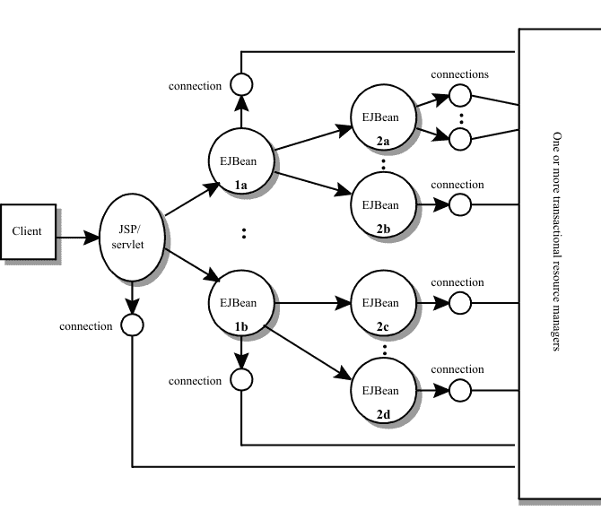

### 图 EE.4-1 访问企业 Bean 的 Servlets/JSP

应用组件提供者通过程序化和声明式事务边界 API 的组合，规定了平台如何代表应用程序管理事务。

例如，应用程序可能要求图 EE.4-1 中的所有组件作为单个事务的一部分来访问资源。平台提供者必须提供事务能力以支持此类场景。

本规范未定义组件和资源在单个 Java EE 产品内部是如何进行分区或分发的。为了实现应用程序所需的事务语义，Java EE 产品提供者可以自由地根据组件规范规范的要求，在同一个 Java 虚拟机（JVM）中执行共享事务的应用程序组件，或者将它们分发到多个虚拟机中。

本章的其余部分详细描述了 Java EE 产品的事务需求。

## EE.4.2 要求

本节定义了产品提供者必须支持的 Java EE 产品的事务支持需求。

### EE.4.2.1 Web 组件

Web 组件可以使用 `javax.transaction.UserTransaction` 接口或 JTA 规范中定义的事务拦截器来界定事务。它们可以在单个事务中访问多个资源管理器并调用多个企业 Bean。指定的事务上下文会自动传播到企业 Bean 和事务资源管理器中。传播的结果可能取决于企业 Bean 的事务属性（例如，Bean 可能被要求使用容器托管事务 CMT）。

Web 应用程序监听器和升级处理器不能使用 `javax.transaction.UserTransaction` 接口或事务拦截器来界定事务。Servlet 过滤器（Servlet filters）可以在其 `doFilter` 方法中使用事务资源，但不应在用于封装请求或响应对象的方法中使用任何事务资源。

#### EE.4.2.1.1 事务要求

Java EE 平台必须满足以下要求：

- Java EE 平台必须向所有 Web 组件提供实现 `javax.transaction.UserTransaction` 接口的对象。平台必须在 Web 组件可用的 Java™ 命名和目录接口（JNDI）命名空间中，通过 `java:comp/UserTransaction` 名称使用 `UserTransaction` 对象。

- Java EE 平台必须提供实现 JTA 规范定义的事务拦截器的类。

- 如果 Web 组件从与 JTA 事务相关的线程调用企业 Bean，Java EE 平台必须在调用企业 Bean 时传播事务上下文。目标企业 Bean 是否会在此事务上下文中被调用，取决于 EJB 规范中定义的规则。

请注意，此事务传播要求仅适用于与调用组件在同一个 Java EE 产品实例中调用企业 Bean 的情况。在另一个 Java EE 产品实例中调用企业 Bean（例如，使用 EJB 互操作性协议）则不需要传播事务上下文。详情请参阅 EJB 规范。

- 如果 Web 组件从 JTA 事务访问事务资源管理器，Java EE 平台必须确保该资源访问包含在 JTA 事务中。

- 如果 Web 组件创建了线程，Java EE 平台必须确保新创建的线程不与任何 JTA 事务关联。

#### EE.4.2.1.2 事务非要求

产品提供者不要求支持从客户端到 Web 组件导入事务上下文。

产品提供者不要求支持通过跨 Web 组件的 HTTP 请求进行事务上下文传播。HTTP 协议不支持此类事务传播。当与事务关联的 Web 组件向另一个 Web 组件发送 HTTP 请求时，事务上下文不会传播到 Servlet 或页面。

然而，当通过 `RequestDispatcher` 接口调用 Web 组件时，任何活跃的事务上下文必须传播到被调用的 Servlet 或 JSP 页面。

### EE.4.2.2 Web 组件生命周期中的事务

事务不能跨越来自网络客户端的 Web 请求。如果 Web 组件在 `service` 或 `doFilter` 方法中启动了事务，则必须在返回之前完成事务。带有活动事务上下文从 `service` 或 `doFilter` 方法返回是错误的。Web 容器被要求检测到此错误并中止事务。

> ¹ 一个产品实例对应于 Java EE 安装。产品实例可能使用多个操作系统进程，或支持多个主机。相反，可能在单台主机或 Java 虚拟机上运行产品实例。事务要求适用于单个产品实例，与使用的 Java 虚拟机、操作系统进程数量无关。

> ² 对于 JSP 页面，此要求适用于其 service 方法。

正如 EE.4.2.1.2 节“事务非要求”所示，在 Web 容器中使用 `RequestDispatcher` 的请求会将事务上下文传播到被调用的类。除非被调用的类提交或中止事务，否则事务在被调用的类返回时必须保持激活。

如果通过 `RequestDispatcher` 调用的 Servlet 启动了事务，容器在 Servlet 从 `service` 方法返回时的行为是不指定的。Web 容器可能会向调用者抛出异常、中止事务并返回调用者，或将事务上下文传回调用者。该 Servlet 在 `service` 方法返回之前完成任何事务。

## EE.4.2.3 事务与线程

事务资源与线程之间存在许多简单和复杂的交互。为了确保正确运行，Web 组件应遵循以下指南，Web 容器必须支持这些用法。

- JTA 事务应该在调用 `service` 方法的线程中启动并完成。出于任何目的创建的其他线程不尝试启动 JTA 事务。

- 事务资源可以在 service 方法之外的线程获取并释放，但不应在线程间共享。

- 事务资源对象（例如 JDBC 连接对象）不应存储在静态字段中。此类对象一次只能关联一个事务。将其存储在静态字段中很容易在不同事务的线程间错误地共享它们。

- 实现 `SingleThreadModel` 的 Web 组件可以在类实例启动启动层事务资源对象。顶层对象直接从容器管理的工厂对象获取（例如，从 `JDBC ConnectionFactory` 获取的 `JDBC Connection`），而不是从这些顶层对象获取的其他对象（例如，从 `JDBC Connection` 获取的 `JDBC Statement`）。Web 容器确保对 SingleThreadModel Servlet 的请求是序列化的，因此在同一时间只有一个线程和一个事务可以使用该对象。

顶层对象将被列入组件启动的任何新事务中。

- 在未实现 `SingleThreadModel` 的 Web 组件中，事务资源对象以及 Java Persistence EntityManager 对象不应存储在类实例字段中，而应该在服务方法的同一次调用中获取并释放。

- 被其他 Web 组件调用的 Web 组件（使用 `forward` 或 `include` 方法）不应将事务资源对象存储在类实例字段中。

- 企业级豆（Enterprise beans）可能从 Web 组件使用的任何线程被调用。事务上下文的传播要求见上文及 EJB 规范。

## EE.4.2.4 Enterprise JavaBeans™ 组件

Java EE 产品提供者必须提供 EJB 规范中定义的事务支持。

## EE.4.2.5 应用程序客户端

Java EE 产品提供者不为应用程序客户端提供事务管理支持。

## EE.4.2.6 Applet 客户端

Java EE 产品提供者不要求为 applet 提供事务管理支持。

## EE.4.2.7 事务型 JDBC™ 技术支持

Java EE 产品必须支持 JDBC 数据库作为事务资源管理器。平台必须允许 Web 组件和企业级豆访问事务型 JDBC API。

在单个事务内，可以从多个应用程序组件访问 JDBC 技术数据库。例如，servlet 可能希望启动事务，访问数据库，调用一个作为同一事务一部分访问相同数据库的企业级豆，最后提交事务。

Java EE 产品必须提供一个事务管理器，能够协调跨多个支持 XA 的 JDBC 数据库的二阶段提交操作。如果 JDBC 驱动程序支持 `javax.transaction` 包中 Java Transaction API 的 XA 接口，则 Java EE 产品将能够使用 JDBC 驱动程序提供的 XA 接口来完成二阶段提交操作。Java EE 产品可以通过特定的方法发现 JDBC 驱动程序的 XA 能力，尽管通常此类 JDBC 驱动程序会作为资源适配器（resource adapters）通过 Connector API 提供。

## EE.4.2.8 事务型 JMS 支持

Java EE 产品必须支持 JMS 提供者作为事务资源管理器。平台必须允许 servlet、JSP 页面和企业级豆访问事务型 JMS。

在单个事务内，必须从多个应用程序组件访问 JMS 提供者。例如，servlet 可能希望启动事务，发送一条 JMS 消息，调用一个作为同一事务一部分也发送 JMS 消息的企业级豆，最后提交事务。

## EE.4.2.9 事务型资源适配器（Connector）支持

Java EE 产品必须支持使用 XA 事务模式的资源适配器作为事务资源管理器。平台必须允许 servlet、JSP 页面和企业级豆对资源适配器进行事务访问。

在单个事务内，必须从多个应用程序组件访问资源适配器。例如，servlet 可能希望启动事务，访问资源适配器，调用一个作为同一事务一部分也访问资源适配器的企业级豆，最后提交事务。

## EE.4.3 事务互操作性

### EE.4.3.1 多 Java EE 平台互操作性

本规范不要求提供者实现任何跨多个 Java EE 产品的事务互操作协议。Java EE 兼容性既不要求来自同一产品提供者的相同 Java EE 产品之间具有互操作性，也不要求来自多个产品提供者的异构 Java EE 产品之间具有互操作性。


我们建议 Java EE 产品提供者使用 OMG 定义并在 OTS 规范中描述的 IIOP 事务传播协议（由 Java Transaction Service 实现），基于 RMI-IIOP 的 EJB 互操作协议进行事务互操作。

## EE.4.3.2 对事务资源管理器的支持

本规范要求所有 Java EE 产品支持 Connector 规范指定的 `javax.transaction.xa.XAResource` 接口。本规范还要求所有 Java EE 产品支持 `javax.transaction.xa.XAResource` 以对 JDBC 驱动执行二阶段提交操作，或支持 JTA X API。本规范不要求 JDBC 驱动或 JMS 使用 `javax.transaction.xa.XAResource` 接口，尽管它们可以使用此接口，且在所有情况下必须满足本章描述的事务资源管理器要求。特别是，必须能够在单个 JTA 事务中组合一个或多个 JDBC 数据库、一个或多个 JMS 会话、一个或多个企业级豆以及多个支持 XTransaction 模式的资源适配器的操作。

## EE.4.4 本地事务优化

### EE.4.4.1 要求

如果事务使用单个资源管理器，可以通过使用资源管理器本地优化来提高性能。本地事务通常比全局事务更高效并提供更好的性能。对于从不同容器导入的事务，不提供本地优化。

容器可以选择提供本地事务优化，但并非强制要求这样做。本地事务优化对于 Java EE 应用程序必须是的。

本节描述了容器实现本地事务优化的一种可能机制。

### EE.4.4.2 一种可能的设计

本节说明了上述要求可能如何实现。

# 连接共享 (CONNECTION SHARING)

当作为事务的一部分建立到资源管理器的连接时，会在连接上启动一个资源管理器特定的本地事务。作为事务的一部分获取的任何后续连接，如果可以共享第一个连接上的本地事务，则允许共享该本地事务。

在满足以下条件下，会延迟启动全局事务：

- 当后续连接无法共享第一个连接上的资源管理器本地事务时，或者它使用了不同的资源管理器。
- 当事务被导出到不同的容器时。

全局事务延迟启动后，获取的任何后续连接都可以共享第一个连接上的本地事务，也可以作为全局事务的一部分，取决于其所访问的资源管理器。当尝试完成事务（提交或回滚）时，有两种可能：

- 如果作为事务的一部分仅访问了单个资源管理器，则使用资源管理器特定的本地事务机制完成事务。
- 如果已启动了全局事务，则通过将资源管理器本地事务视为全局二阶段提交协议中的最后一个资源来完成事务，即使用最后一个资源二阶段提交优化。

## EE.4.5 连接共享

当 Java EE 应用获取的多个连接使用相同的资源管理器时，容器可以选择在同一个事务范围内提供连接共享。共享连接通常会导致资源的高效利用和更好的性能。容器在某些情况下必须提供连接共享；详见 Connector 规范。

Java EE 应用获取的到资源管理器的连接被认为可能是共享的或可共享的。Java EE 应用程序组件意图以不可共享的方式使用连接，必须提供相应的部署信息，以防止连接被容器共享。需要此类操作示例包括更改安全属性、隔离级别、字符设置和本地化配置。容器不得尝试共享标记为不可共享（unshareable）。如果连接未被标记为不可共享，则对于应用程序而言，连接是否实际被共享应该是透明的。

Java EE 应用组件使用 `Resource` 注解中的可选 `shareable` 元素，或部署描述符中的可选 `sharing-scope` 元素，来指示到资源管理器的连接是可共享的还是不可的。如果没有提供部署提示，容器必须假设连接是可共享的。EE10.7 节“Java EE 客户端 XML 架构”、EJB 规范以及 Servlet 规范提供了对部署描述符的描述。

Java EE 应用组件可能会缓存连接对象并在多个事务之间重用它们。提供连接共享的容器必须在分发时（dispatch time）透明地切换缓存的连接对象，以使其指向具有正确事务范围的适当共享连接。有关连接的详细描述请参考 `Connector` 规范。

## EE.4.6 JDBC 和 JMS 部署问题

EE4.2.7 节“事务型技术支持”中的 JDBC 事务要求以及 EE4.2.8 节“事务型 JMS 支持”中的 JMS 事务要求可能会对部署器（Deployer）配置应用程序的 JDBC 和 JMS 资源实施某些限制。Java EE 产品供应商可能会实施本节所述的限制以满足这些要求。

如果部署器在事务中配置了一个不支持 XA 的 JDBC 资源管理器，那么 Java EE 产品提供商可以将该事务内的所有 JDBC 访问限制为不支持 XA 的 JDBC 资源管理器。否则，Java EE 产品提供商必须支持在事务中使用多个支持 XA 的 JDBC 资源管理器。此外，Java EE 产品提供商可能会将事务内所有 JDBC 连接的安全配置限制为单个用户身份。Java EE 产品提供商并不被要求支持使用多个 JDBC 身份的事务。具体而言，这意味着需要使用多个 JDBC 身份（可以通过提供的用户名和密码显式地完成）的事务可能可能不具有可移植性。

Java EE 产品提供商可能会实施上述限制，导致事务被限制为单个 JMS 资源管理器和用户身份。

此外，当同一个事务中同时使用 JDBC 资源管理器和 JMS 资源管理器时，Java EE 产品提供商可能会将两者限制为特定的配对，以允许它们的组合能够交付应用程序所需的完整事务语义，并可能将两者的安全身份限制为身份。为了完全支持此类用法，希望在单个全局事务中包含 JDBC 和 JMS 访问的可移植应用程序不能将相应的事务资源标记为“不可共享”。

尽管这些限制是被允许的，但建议 Java EE 产品供应商提供具有完整两阶段提交功能的 JDBC 和 JMS 资源管理器，从而不实施这些限制。

## EE.4.7 两阶段提交支持

Java EE 产品必须支持在单个事务中使用多个支持 XA 的资源适配器。为了支持这种场景，需要完整的两阶段提交支持。JMS 提供者可以作为支持 XA 的资源适配器提供。在这种情况下，必须将 JMS 操作包含在与其他适配器相同的全局事务中。JDBC 驱动程序不要求支持 XA，JDBC 驱动可以以支持 XA 的资源适配器的形式交付。在这种情况下，必须将 JDBC 操作作为其他支持 XA 的资源适配器包含。另见 EE.4.2.7 节“Transactional JDBC™ 技术支持”。

## EE.4.8 系统管理工具

虽然对系统管理功能没有兼容性要求，但 Java EE 产品供应商通常会包含允许系统管理员执行以下任务的工具：

- 将资源管理器与平台集成。
- 配置平台的事务管理部分。
- 在运行时监控事务。
- 接收异常事务处理状态的通知（例如事务回滚次数异常高）。

## EE.5 资源、命名与注入

本章描述了应用程序如何声明对外部资源和配置参数的依赖，以及这些项目如何在 Java EE 命名系统中表示，以及如何被注入到应用组件中。这些要求是基于 Java 元数据规范中定义的注解以及 Java 命名和目录接口（JNDI）规范中定义的特性。`Resource` 注解在通用注解规范中定义；`EJB` 注解在企业豆 规范中定义；`PersistenceUnit` 和 `PersistenceContext` 注解在持久化规范中定义；`Inject` 注解在 Java 注入规范中定义，其在 Java EE 平台的用法。

## EE.5.1 概述

本章定义的要求解决了以下问题：

- 组装器和部署器能够在不访问应用程序源代码的情况下自定义应用程序的行为。这通常涉及参数值的指定、与外部资源的连接等。部署供应商提供了这种能力。
- 应用程序必须访问其运行环境中的资源和信息，而无需了解这些信息在环境中是如何命名和组织的。JNDI 命名上下文和 Java 语言注解提供了这种能力。

### EE.5.1.1 章节组织

以下节包含上述问题的 Java EE 解决方案：

- EE5.5.2 节“JNDI 命名上下文”定义了 JNDI 命名上下文的使用及其与 Java 语言注解交互的规则。
- EE5.5.3 节“Java EE 角色职责”定义了每个 Java EE 角色（如应用组件提供商、组装器、部署器和 Java EE 提供商）的通用职责。
- EE5.5.4 节“简单环境项”定义了指定和访问组件命名环境的基础接口。该节说明了如何使用命名环境自定义组件业务逻辑。
- EE5.5.5 节“EJB 引用”定义了使用 EJB 引用获取业务接口、无接口视图或本地接口的接口。EJB 引用是组件环境中的特殊项。
- EE5.5.6 节“Web 服务引用”引用了 Web服务的规范。
- EE5.5.7 节“资源管理器连接工厂引用”定义了使用资源管理器连接工厂引用获取连接工厂的接口。资源管理器连接工厂引用是组件环境中的特殊项。
- EE5.5.8 节“资源环境引用”定义了获取与资源环境引用关联的托管对象的接口。资源环境引用是组件环境中的特殊项。
- EE5.5.9 节“消息目标引用”定义了声明和使用消息目标引用的接口。
- EE5.5.10 节“UserTransaction”描述了合格的应用组件使用环境中的 UserTransaction 对象引用来启动、提交和回滚事务。
- EE.5.11 节“TransactionSynchronizationRegistry 引用”描述了合规应用组件对组件环境中 `TransactionSynchronizationRegistry` 对象的引用。
- EE.5.12 节“ORB 引用”描述了合规应用组件对组件环境中 CORBA ORB 对象的引用。
- EE.5.13 节“持久化单元引用”描述了合规应用组件对组件环境中 `EntityManagerFactory` 对象的引用。
- EE.5.14 节“持久化上下文（上下文）引用”描述了合规应用组件对组件环境中 `EntityManager` 对象的引用。
- EE.5.15 节“应用程序名称和模块名称引用”描述了合规应用组件对当前应用程序名称和模块名称的引用。
- EE.5.16 节“应用程序客户端容器属性”描述了合规应用组件对应用程序客户端属性的引用。
- EE.5.17 节“验证器和验证器工厂引用”描述了合规应用组件对组件环境中验证器（validator）和 `ValidatorFactory` 对象的引用。
- EE.5.18 节“资源定义与配置”描述了合规应用组件对可能用于定义组件环境中资源的元数据的使用。
- EE.5.18.3 节“数据源定义”描述了合规应用组件对组件环境中 `DataSource` 资源的引用。
- EE.5.18.4 节“JMS 连接工厂资源定义”描述了合规应用组件对组件环境中 JMS `ConnectionFactory` 资源的引用。
- EE.5.18.5 节“JMS 目标定义”描述了合规应用组件对组件环境中 JMS `Destination` 资源的引用。
- EE.5.18.6 节“邮件会话定义”描述了合规应用组件对组件环境中 `Mail Session` 资源的引用。
- EE.5.18.7 节“连接器连接工厂定义”描述了合规应用组件对组件环境中 Connector 这种工厂资源的引用。
- EE.5.18.8 节“连接器管理对象定义”描述了合规应用组件对组件环境中 Connector 管理对象资源的引用。
- EE.5.19 节“默认数据源”描述了合规应用组件对组件环境中默认 `DataSource` 的引用。
- EE.5.20 节“默认 JMS 连接工厂”描述了合规应用组件对组件环境中默认 JMS `Connection-Factory` 的引用。
- EE.5.21 节“默认并发工具类对象”描述了合规应用组件对组件环境中默认并发工具类对象的引用。
- EE.5.22 节“Managed Bean 引用”描述了合规应用组件对 Managed Beans 的引用。
- EE.5.23 节“Managed Bean 引用”描述了合规应用组件对组件环境中 `BeanManager` 对象的引用。
- EE.5.24 节“对依赖注入的支持”描述了对依赖注入 API（Dependency Injection APIs）的支持。

## EE.5.1.2 对 JNDI 命名环境的强制访问

Java EE 客户端、企业级和 Web 组件被要求访问 JNDI 命名环境¹。这些应用组件类型的容器必须提供此处描述的命名环境支持。

注解和部署描述符是向应用程序组装器（Application Assembler）和部署器（Deployer）传递访问信息的主要工具，关于应用组件对业务逻辑定制化以及访问外部信息的需求。此处描述的注解适用于所有应用组件类型。此处的部署描述符项在每个应用组件类型的部署描述符架构中以相同的形式存在。详情请参见每个应用组件类型的相应规范。

> ¹ 注意：Java EE Managed Bean 需要访问命名环境。

Java EE 8，最终发布

## EE.5.2 命名环境

应用组件的命名环境是一种允许在部署期间对业务逻辑进行定制的机制。应用组件的命名环境是允许在部署期间对应用组件进行定制的机制。

### EE.5.2.1 组件的环境

容器实现组件环境，并将其作为 JNDI 命名上下文提供给组件实例。组件环境的使用如下：

1. 组件的业务方法使用环境中的条目，并通过 JNDI 接口或查找方法访问环境。环境也可以被注入到应用组件的字段或方法中。对于每个环境条目，提供者可以在部署描述符或注解中指定应用组件在运行时所需的环境条目。
2. 容器提供 JNDI 命名上下文的实现，用于存储组件环境。容器还提供工具，允许部署器创建和管理组件的环境。
3. 部署器使用容器提供的工具初始化部署描述符或注解中声明的环境条目。部署器可以设置并修改环境条目的值。作为该过程的一部分，允许部署器覆盖与组件相关的任何信息。
4. 容器根据组件部署描述符或组件类上的注解，将环境条目注入到组件字段或方法中。
5. 容器运行时为组件实例提供环境命名上下文。组件实例可以使用 JNDI 接口或查找方法获取环境条目的值。

### EE.5.2.2 组件环境命名空间

组件的命名环境由四个逻辑命名空间组成，代表不同范围的命名环境。这四个命名空间是：

- `java:comp`：此命名空间是组件级的（例如企业豆）。Web 模块中的组件外，每个组件都有自己的 `java:comp` 命名空间，不与其他组件共享。Web 模块中的组件没有私有的组件命名空间，见下文。
- `java:module`：此命名空间由模块中的所有组件共享（例如单个 EJB 模块中的所有企业豆，或单个 Web 模块中的所有组件）。
- `java:app`：此命名空间由单个应用程序中所有模块中的所有组件共享，“单个应用程序”意味着单个部署单元，例如单个文件、独立部署的单个模块等。例如，同一个文件中的 war 文件和 EJB jar 文件都具有访问 `java:app` 命名空间中资源的权限。
- `java:global`：此命名空间由部署在应用服务器实例中的所有应用程序共享。注意，应用服务器实例的范围取决于产品，但必须确保在多次部署应用程序的环境中（例如云环境中，可能会为多个租户部署同一应用程序的多个实例），每个应用程序实例的命名空间与该应用程序的其他实例的命名空间是不相交的。

# JNDI 命名上下文

由于历史原因，`java:comp` 命名空间由 Web 模块的所有组件共享。为了保持兼容性，本规范没有改变此。在 Web 模块中，`java:comp` 指的是与 `java:module` 相同的命名空间。建议将 Web 模块中意图被多个组件共享的资源声明在 `java:module/env` 命名空间中。

请注意，应用程序是一个仅包含单个组件的模块。另请注意，资源适配器（连接器）模块可能在任何组件名称中定义资源。在资源适配器中可访问的所有 `java:` 命名空间都是调用资源适配器的组件的命名空间（当在组件的上下文中被调用时）。

如果多个应用程序组件在一个共享命名空间中声明了环境条目（environment entry），则该条目的所有属性在声明时必须完全相同。例如，如果多个组件声明了相同 `java:app` 名称的资源引用，则其认证（authentication）和可共享（shareable）属性必须完全一致。

如果共享环境条目的每个声明的属性不完全相同，则必须作为部署错误报告给部署器（Deployer）。部署工具可能允许部署器纠正错误并继续部署。

资源引用和资源定义的默认 JNDI 命名空间必须始终为 `java:comp/env`。请注意，这既适用于未提供名称（使用默认名称选择规则）的情况，也适用于显式提供了名称但该名称未指定 `java:` 命名空间的情况。由于 `java:comp` 命名空间在某些上下文中不可用，在这些上下文中使用该命名空间会导致部署错误。同样，`java:module` 命名空间在某些上下文中无效；在这些上下文中使用该命名空间将导致部署错误。可以通过在名称前显式包含命名空间前缀，在定义的任何命名空间中声明环境条目。

建议但并非要求将环境条目创建在相应命名上下文的 `env` 子上下文中。例如，在模块内部共享的条目应该声明在 `java:module/env` 上下文中。请注意，不在 `env` 子上下文下的名称可能会与本规范的当前或未来版本冲突，可能会与服务器定义的名称（如应用程序或模块的名称）或服务器定义的资源冲突。任何命名空间 `env` 子上下文中的名称必须通过应用程序中的显式声明或管理员的显式操作创建；应用程序服务器不得重新定义任何命名空间 `env` 子上下文中的名称，或任何此类 `env` 上下文中任何子上下文中的名称。

`application.xml` 描述符中的环境条必须在 `java:app` 或 `java:global` 命名空间中指定 JNDI 名称，例如：`java:app/env/myString` 或 `java:global/isValue`。在 `application.xml` 描述符中声明的环境条目的 `java:comp` 或 `java:module` 名称必须作为部署错误报告给部署器。


# EE 产品可能会对共享命名空间中资源的访问施加安全限制

然而，必须能够部署在共享命名空间中定义资源的应用程序，且这些资源在给定范围内可供不同的实体使用。例如，必须能够部署一个应用程序，该程序使用各种形式的元数据声明在 `java:global` 命名空间中定义资源，并可供另一个应用程序使用。

## EE.5.2.3 环境条目的访问性

在任何类型的环境条目中定义的所有对象（无论是通过描述符还是注解）都必须指定为组件可访问的 Java 类型。Java 类的访问性在 EE.8.3 节“类加载要求”中指定。如果对象是 `java.lang.Class` 类型，则该 `Class` 对象必须引用组件可访问的类。请注意，在容器可能返回请求类型的实现子类的情况下，该实现子类可能对组件是可访问的。

## EE.5.2.4 环境条目的共享

每个应用程序组件定义了它们自己的依赖 set，这些依赖必须作为应用程序组件环境中的条目出现。同一容器内、同一应用程序实例中的所有应用程序组件实例共享相同的环境条目。应用程序组件实例不允许在运行时修改环境。

通常情况下，JNDI `java:` 命名空间中的对象查找要求每次都返回请求对象的新实例。对于以下情况允许存在异常：

- 容器知道该对象是不可变的（例如 `java.lang.String` 类型的对象），或者知道应用程序无法更改对象的状态。
- 对象被定义为单例，使得 JVM 中可能只存在该对象的一个实例。
- 用于查找的名称被定义为返回一个可能被共享的对象实例。`java:comp/ORB`、`java:comp/ValidatorFactory` 和 `java:comp/BeanManager` 就是此类名称。

在这些情况下，可能会返回对象的共享实例。在所有其他情况下，每次查找都必须返回请求对象的新实例。请注意，在资源适配器连接对象的情况下，由资源适配器的 `ManagedConnectionFactory` 实现负责满足这一要求。

每个对象的注入（injection）都对应于一次 JNDI 查找。注入请求对象的新实例还是注入共享实例，取决于上述规则。

### EE.5.2.5 注解与注入

如后续章节所述，某些容器管理类的字段或方法必须被注解，以请求从应用程序组件的环境中提取一个条目（entry）并注入到该类中。不同容器的规范规定了哪些类被认为是容器管理类；并非给定类型的所有类都一定由容器管理。

本章描述的任何类型的资源都可以被注入。可以使用部署描述符中的条目请求注入这些资源类型。字段或方法可以是任何访问修饰符（public、private 等）。对于所有类除客户端类，字段或方法必须是静态的。因为应用程序使用相同的生命周期，客户端主类是由容器创建的。为了支持客户端主类的注入，字段或方法必须是静态的。

类的字段可以是注入的目标。字段必须是 `final` 的。默认情况下，字段的名称与类的完全限定名结合并直接作为名称。例如，`com.example` 包中 `MyApp` 类的名为 `myDatabase` 的字段对应于 JNDI 名称 `java:comp/env/com.example.MyApp`。注解也允许显式指定 JNDI 名称。当使用条目指定注入时，JNDI 名称和字段名称都是显式指定的。那样，JNDI 名称相对于 `java:comp/env`。

环境条目可以通过遵循 JavaBean 属性命名约定的方法注入类中。注解应用于属性，该属性是调用以注入环境条目的方法。属性（而不是方法名）被用作 JNDI 名称。例如，`MyApp` 类中名为 `setDatabase` 的方法对应于 JNDI 名称 `java:comp/env/com.example.MyApp/myData`。每个资源只能注入到类中给定名称的单个字段或方法。将 `:comp/env/com.example.MyApp/myData` 资源注入 `setDatabase` 方法和 `myDatabase` 字段是错误的。然而，请注意，字段或方法可以请求注入不同的（非默认）名称。通过显式指定资源的 JNDI 名称，单个资源可以注入到多个类的多个字段或方法中。

各种应用程序组件类型的规范描述了可以用于注入的类，总结如表 EE5-1 所示。

表 EE5-1 中支持级别为“Standard”的组件类均支持 Java EE 资源注入，以及 `@PostConstruct` 和 `@PreDestroy` 回调。此外，如果启用了 CDI（默认启用），这些类还支持 CDI 注入，如 EE.5.24 节“依赖注入支持”所述。仅支持 Java EE 字段注入和 `@PostConstruct` 回调。请注意这些是应用程序客户端主类，字段注入是针对静态字段的。

应用程序组件类型的规范还描述了注入发生在组件生命周期的什么时候。通常，注入发生在类实例化之后，但在调用任何业务方法之前。

# 表 EE.5-1 支持注入的组件类

| 规范 | 支持注入的类 | 支持级别 |
| --- | --- | --- |
| Servlet | servlets | 标准 |
| | servlet filters | 标准 |
| | event listeners | 标准 |
| | HTTP upgrade handlers | 标准 |
| JSP | tag handlers | 标准 |
| | library event listeners | 标准 |
| JSF | managed classesᵇ | 标准 |
| JAX-WS | service endpoints | 标准 |
| | handlers | 标准 |
| JAX-RS | JAX-RS componentsᶜ | 标准 |
| WebSocket | endpoints | 标准 |
| EJB | beans | 标准 |
| Interceptor | interceptors | 标准 |
| Java Persistence | entity listeners | 标准 |
| Managed Beans | managed beans | 标准 |
| CDIᵃ | CDI-style managed beans | 标准 |
| | decoratorsᵈ | 标准 |
| Java EE platform | main class (static) | 有限 |
| | login callback handler | 标准 |

- a. 关于 CDI beans 中资源注入的 get，请参阅 CDI 注入。
- b. 关于这些类的列表，请参阅 JSF 部分“JSF Managed Classes and Java EE Annotations”。
- c. 仅由 CDI 管理的 JAX-RS 组件支持资源和 CDI 注入。
- d. 拦截器不能绑定到其他拦截器。
- e. 我们使用此术语指代根据 CDI 规范规则管理 managed beans 的类，但不使用 ManagedBean 注解声明的 managed beans 以及 EJB session beans，在没有 CDI 的情况下，两者都应该是 managed beans。
- f. 拦截器不能绑定到装饰器。

注解也可以应用于类本身。这些注解声明了应用程序组件环境中的一个条目，但不会导致资源被注入。相反，预期应用程序组件使用 JNDI 或组件上下文查找方法来查找该条目。当注解应用到类上时，必须显式指定 JNDI 名称和环境类型。

资源注解可能会出现在上述列出的任何类上，或者出现在上述任何一个类的任何父类上。继承层次结构中任何类上的资源注解都定义了应用程序组件所需的资源。然而，资源的注入遵循 Java 语言关于字段和方法可见性的重写规则。重写父类方法的类定义定义了要注入该方法的任何资源。即使父类没有请求注入，重写方法也可以请求注入，它可能会请求与父类请求的不同的资源，或者在父类方法请求注入时它可能不请求注入。

此外，子类中不可见或被隐藏（与重写不同）的字段或方法仍可以请求注入。这允许一个私有字段成为注入的目标，并在父类的实现中使用该字段，即使子类对该字段没有可见性，且不知道父类的实现正在使用注入的资源。请注意，在子类中声明与父类中字段同名的字段始终会导致父类中的字段被隐藏。

在某些情况下，类可能需要在资源被注入后执行其自身的初始化。为了支持这一点，其中一个类可以标记为 `PostConstruct` 注解（或等价地，使用部署描述符中的 `post-construct` 条目指定）。该方法将在所有注入发生之后并在类投入使用之前调用。即使该类没有请求注入任何资源，该方法也会被调用。同样，对于由容器管理生命周期的类，`PreDestroy` 注解（或等价地，使用部署描述符中的 `pre-destroy` 条目）可以应用于任何在类停止且不再被容器使用的方法。类层次结构中的每个类都可能有 `PostConstruct` 和 `PreDestroy` 方法。方法调用的顺序与类层次结构的顺序一致，父类方法在子类方法之前被调用。

`PostConstruct` 和 `PreDestroy` 注解由 Common Annotation 规范指定。所有支持注入的类也支持 `PostConstruct` 注解。所有由容器管理对象完整生命期的类也支持 `PreDestroy` 注解。

从 Java EE 7 开始，默认启用 CDI 支持。使用 CDI bean 定义注解和 `beans.xml` 描述符来确定哪些类是 CDI bean 并且符合被注入到其他对象的条件。同样，在 Java EE 8 中，注解元数据和 `beans.xml` 描述符被 CDI 用于确定哪些拦截器符合应用条件。关于确定哪些类是 CDI bean 以及对拦截器处理的规则，请参阅 CDI 规范和拦截器规范。

## EE.5.2.6 注解和部署描述符

可以使用注解声明环境条目，而不需要任何部署描述符条目。环境条目也可以通过部署描述符条目声明。同一个环境条目同时可以使用注解和部署描述符条目声明。在这种情况下，可以使用部署描述符条目中的信息覆盖注解中提供的某些信息。这种方法可以由应用程序汇编器（Application Assembler）或部署器（Deployer）用于覆盖应用程序组件开发者提供的信息。应用程序不应使用部署描述符条目向未为注入设计的字段或方法请求注入资源。

以下列出了部署描述符条目如何覆盖 `Resource` 注解的规则。

- 相关的部署描述符条目位于与注解使用的 JNDI 名称（默认或显式提供）相同的位置。
- 部署描述符中指定的类型必须赋值给字段或属性的类型。
- 描述（如果指定）将覆盖注解的 `description` 元素。
- 注入目标（如果指定）将为源定义额外的注入点。
- `mapped-name` 元素（如果指定）将覆盖注解的 `mappedName` 元素。
- `res-sharing-scope` 元素（如果指定）将覆盖注解的 `shareable` 元素。通常，应用程序汇编器或部署器不应更改此值，因为这样做可能会破坏应用程序。
- `res-auth` 元素（如果指定）将覆盖注解的 `authenticationType` 元素。通常，应用程序汇编器或部署器不应更改此值，因为这样做可能会破坏应用程序。
- `lookup-name` 元素（如果指定）将覆盖注解的 `lookup` 元素。

向同一个目标请求注入两个资源是一个错误。此类应用程序的行为是未定义的。

部署描述符条目覆盖 EJB 注解的规则包含在 EJB 规范中。部署描述符条目覆盖 `webServiceRef` 注解的规则包含在 Java EE Web Services 规范中。

可以使用方法上的 `PostConstruct` 注解或 `post-construct` 部署描述符条目指定 `PostConstruct` 方法。同样，可以使用方法上的 `PreDestroy` 注解或 `pre-destroy` 部署描述符条目指定 `PreDestroy` 方法。

## EE.5.2.7 其他命名上下文条目

除了应用程序组件声明的环境条目外，根据本规范和其他规范，其他项目将出现在命名上下文中。以下是这些条目。这并不是详尽列表，请参阅相应的规范获取详情。

- 应用程序中的所有企业 bean 在共享命名空间中都有条目。详情请参阅 EJB 规范。
- 所有 Web 应用程序在共享命名空间中都有命名。对应 Web 应用程序的完整 URL。详情请参阅 Servlet 规范。
- 代表若干服务的对象在 `java:comp` 命名空间中定义。例如，参见节 EE.5.10“UserTransaction References”、节 EE.5.11“TransactionSynchronizationRegistry References”以及节 EE.5.12“Object References”。
- 提供当前模块名称和应用程序名称的字符串在 `java:comp` 命名空间中定义。参见节 EE.5.15“Application Name and Module Name References”。

## EE.5.3 各 Java EE 角色的责任

本节描述了适用于所有 Java EE 命名上下文使用的 Java EE 角色的责任。后续章节描述了存储在命名上下文中不同类型对象的特定责任。

### EE.5.3.1 应用组件提供者的责任

应用组件提供者可以使用三种技术来访问和管理命名上下文（naming context）。首先，应用组件提供者可以使用 Java 语言注解来请求从命名上下文注入资源，或声明命名上下文中需要的元素。其次，该组件可以使用 JNDI API 访问上下文中的条目。第三，可以使用部署描述符（deployment descriptor）条目来声明命名上下文中的条目，并请求将这些条目注入应用组件中。部署描述符条目还可以用于覆盖注解提供的信息。

作为命名上下文元素声明的一部分，应用组件提供者可以指定要在所声明的命名上下文中查找的资源的 JNDI 名称。该 JNDI 名称可能属于组成组件环境的任何命名空间。

为了确保它能够通过容器访问正确的 `javax.naming.InitialContext` 实现，可移植应用组件不得指定 `java.naming.factory.initial` 属性，不得为 “java” 模式-id 指定 `URLContextFactory`，并且不得调用 `java.naming.spi.NamingManager.setInitialFactoryBean`。

### EE.5.3.2 应用组装者的责任

允许应用组装者修改应用组件提供者设置的命名上下文条目，并允许为应用组件提供者未指定任何值的条目设置值。应用组装者可以使用部署描述符来覆盖应用组件提供者在源代码中使用注解所做的设置。

### EE.5.3.3 部署者的责任

部署者必须确保由应用组件声明的所有条目都已创建并正确初始化。

部署者可以修改之前由应用组件提供者和/或应用组装者设置的条目，并且必须为未指定必需值的条目设置值。如果注解包含 `lookup-name` 元素，部署者应将其绑定到指定为查找目标的条目。如果找不到注解的 `lookup` 元素，或者部署描述符条目中的 `lookup-name` 元素未指定带有显式 `java:` 命名空间的名称，则部署应失败。部署者还可以使用特定资源映射工具、部署描述符、规则或功能将引用条目绑定到目标运行环境中的资源。

应用组件提供者或应用组装者提供的部署描述符元素和注解元素有助于部署者完成此任务。

### EE.5.3.4 Java EE 产品提供者的责任

Java EE 产品提供者具有以下责任：

- 提供一个部署工具，允许部署者设置和修改应用组件命名上下文的条目。
- 实现 `java:comp`、`java:module`、`java:app` 并在运行时将其提供给应用组件实例。命名上下文必须包含应用组件提供者交付的所有条目，其值在部署描述符中提供或由部署者设置。环境命名上下文必须允许部署者在应用组件需要时创建子上下文。命名上下文中的某些条目可能需要与其他条目的值进行初始化，特别是当使用 “lookup” 功能时。在此情况下，如果条目之间存在循环依赖，则存在错误。同样，如果在类型与正在创建的条目不匹配的资源中查找指定的 JNDI 名称，也会出错。部署工具可以允许部署者纠正这两类错误并继续部署。
- 确保在没有应用指定任何属性的情况下，`java.naming.InitialContext` 实现符合本规范描述的要求。
- 根据部署描述符或应用组件类上的注解，将命名环境中的条目注入应用组件中。
- 容器必须确保应用组件实例对命名上下文只有读取访问权限。容器必须从修改环境命名上下文的 `java.naming.Context` 接口的所有方法中抛出 `java.naming.OperationNotSupportedException`。

## EE.5.4 环境条目

环境条目是用于自定义应用组件的配置参数。环境条目的值可以是以下 Java 类型之一：`String`、`Character`、`Byte`、`Short`、`Integer`、`Long`、`Boolean`、`Double`、`Float`、`Class` 以及任何 `Enum` 子类。

### EE.5.4.1 应用组件提供者的责任

本节描述了应用组件提供者的环境，并定义了三个部分：注解、用于环境条目的 API 以及在部署描述符中声明环境条目的语法。

#### EE.5.4.1.1 环境条目的注入

应用组件的字段或方法可以使用 `@Resource` 注解。注意容器会将环境条目解箱为原始类型；环境条目是共享的且不需要认证。

以下示例说明了应用组件使用注解声明环境条目。

```java
// 由部署者配置的免税额
@Resource int maxExemptions;
// 由部署者配置的免税额
@Resource int minExemptions;
```


```java
public void setTaxInfo(int numberOfExemptions, ...)
    throws InvalidExemptionsException {
    ...
    // 使用环境条目自定义业务逻辑
    if (numberOfExemptions > maxExemptions ||
        numberOfExemptions < minExemptions)
        throw new InvalidExemptionsException();
}
```

以下代码示例说明了环境条目如何通过引用另一个命名空间中的条目赋值。

```java
// 从应用级条目获取值
@Resource(lookup="java:app/env") int timeout;
```

# EE.5.4.1.2 访问环境条目的编程接口

除了上述注入方法，应用组件还可以动态访问环境条目。应用组件实例使用 JNDI 实例化命名上下文。实例使用无参构造函数创建 `java.naming.InitialContext` 对象，并通过 `InitialContext` 在 `java:comp/env` 下查找命名环境。应用组件的环境条目直接存储在命名文中，或存储在其直接或间接的子上下。

环境条目具有应用组件提供者在部署描述符中声明的 Java 语言类型。

以下示例说明了应用组件如何访问其环境条目。

```java
public void setTaxInfo(int numberOfOfExemptions, ...)
    throws InvalidNumberOfExemptionsException {
    ...
    // 获取应用组件的环境命名上下文
    Context initCtx = new InitialContext().lookup("java:comp/env");
    Context myEnv = (Context)initCtx.lookup("java:comp/env");

    // 获取由部署者配置的最大免税额
    Integer max = (Integer)myEnv.lookup("maxExemptions");

    // 获取由部署者配置的最小免税额
    Integer min = (Integer)myEnv.lookup("minExemptions");
}
```

```java
// customize business logic.
if (numberOfExemptions > max.intValue() ||
    numberOfExemptions < min.intValue())
    throw new InvalidNumberOfExemptionsException();
```

```java
// Get some environment entries. These environment
// entries are stored in subcontexts.
String val1 = (String)myEnv.lookup("foo/name1");
Boolean val2 = (Boolean)myEnv.lookup("foo/name2");
```

```java
// The application component can also
Integer val3 = (Integer)initCtx.lookup("java:comp/env/name3");
Integer val4 =
    (Integer)initCtx.lookup("java:comp/env/name4");
```

## EE5.4.1.3 简单环境条目的声明

应用组件提供者（Application Component Provider）必须声明从应用组件代码中访问的所有环境条目。环境条目可以使用应用组件代码上的任何注解，或使用部署描述符中的 `env-entry` 元素来声明。`env-entry` 元素包含可选的环境条目描述、环境条目名称（默认相对于 `java:comp/env/context`）、环境条目的预期 Java 编程语言（即 JNDI 查询方法返回的对象的类型）以及可选的环境条目值。

环境的作用范围限于包含 `env-entry` 元素的应用组件。这意味着该环境在运行时无法从其他应用组件访问，且其他组件可以定义具有相同 `env-name` 的 `env-entry` 元素而不会引起名称冲突。

应用组件提供者使用 `env-entry-value` 元素为环境条目提供值，该值稍后可以由应用组装器（Application Assembler）或部署器（Deployer）更改。该值必须是一个对于指定类型的构造函数有效的字符串（该构造函数接受单个 String 参数），或者对于 `Character` 类型，是一个单个字符。

此示例展示了在前一节说明的应用组件代码中使用的环境条目的声明。

```xml
...
<env-entry>
  <description>
    允许设置的最大税收免税数量。
  </description>
  <env-entry-name>maxExemptions</env-entry-name>
  <env-entry-type>java.lang.Integer</env-entry-type>
  <env-entry-value>15</env-entry-value>
</env-entry>
<env-entry>
  <description>
    允许设置的最小税收免税数量。
  </description>
  <env-entry-name>minExemptions</env-entry-name>
  <env-entry-type>java.lang.Integer</env-entry-type>
  <env-entry-value>1</env-entry-value>
</env-entry>
<env-entry>
  <env-entry-name>foo/name1</env-entry-name>
  <env-entry-type>java.lang.String</env-entry-type>
  <env-entry-value>value1</env-entry-value>
</env-entry>
<env-entry>
  <env-entry-name>foo/bar/name2</env-entry-name>
  <env-entry-type>java.lang.Boolean</env-entry-type>
  <env-entry-value>true</env-entry-value>
</env-entry>
<env-entry>
  <description>某些描述。</description>
  <env-entry-name>name3</env-entry-name>
  <env-entry-type>java.lang.Integer</env-entry-type>
</env-entry>
<env-entry>
  <env-entry-name>foo/name4</env-entry-name>
  <env-entry-type>java.lang.Integer</env-entry-type>
  <env-entry-value>10</env-entry-value>
</env-entry>
<env-entry>
  <env-entry-name>helperClass</env-entry-name>
  <env-entry-type>java.lang.Class</env-entry-type>
  <env-entry-value>com.acme.helper.Helper</env-entry-value>
</env-entry>
</env-entry>
```

```xml
<env-entry>
  <env-entry-name>timeUnit</env-entry-name>
<env-entry-type>java.util.concurrent.TimeUnit</env-entry-type>
  <env-entry-value>NANOSECONDS</env-entry-value>
</env-entry>
```

```xml
<env-entry>
  <env-entry-name>bar</env-entry-name>
  <env-entry-type>java.lang.Integer</env-entry-type>
  <lookup-name>java:app/env/bar</lookup-name>
</env-entry>
```

环境条目的注入也可以通过部署描述符指定，而无需 Java 注解。以下示例是与之前的示例对应的环境条目声明。

```xml
...
<env-entry>
  <description>
    允许设置的最大税收免税数量。
  </description>
  <env-entry-name>com.example.PayrollService/maxExemptions</env-entry-name>
  <env-entry-type>java.lang.Integer</env-entry-type>
  <env-entry-value>15</env-entry-value>
  <injection-target>
    <injection-target-class>com.example.PayrollService</injection-target-class>
    <injection-target-name>maxExemptions</injection-target-name>
  </injection-target>
</env-entry>
<env-entry>
  <description>
    允许设置的最小税收免税数量。
  </description>
  <env-entry-name>com.example.PayrollService/minExemptions</env-entry-name>
  <env-entry-type>java.lang.Integer</env-entry-type>
  <env-entry-value>1</env-entry-value>
  <injection-target>
    <injection-target-class>com.example.PayrollService</injection-target-class>
    <injection-target-name>minExemptions</injection-target-name>
  </injection-target>
</env-entry>
```

将字段或方法声明为注入目标通常很方便，并可以在其中指定默认值。

应用组件提供者使用 `env-entry-value` 元素为环境条目提供值，该值稍后可以由应用组装器或部署器更改。该值必须是一个对于指定类型的构造函数有效的字符串（该构造函数接受单个 String 参数），或者对于 `Character` 类型，是一个单个字符。

此示例展示了在前一节说明的应用组件代码中使用的环境条目的声明。

将字段或方法声明为注入目标通常很方便，并可以在其中指定默认值。

应用组件提供者使用 `env-entry-value` 元素为环境条目提供值，该值稍后可以由应用组装器或部署器更改。该值必须是一个对于指定类型的构造函数有效的字符串（该构造函数接受单个 String 参数），或者对于 `Character` 类型，是一个单个字符。

将字段或方法声明为注入目标通常很方便，并可以在其中指定默认值。

应用组件提供者使用 `env-entry-value` 元素为环境条目提供值，该值稍后可以由应用组装器或部署器更改。该值必须是一个对于指定类型的构造函数有效的字符串（该构造函数接受单个 String 参数），或者对于 `Character` 类型，是一个单个字符。

将字段或方法声明为注入目标通常很方便，并可以在其中指定默认值。

应用组件提供者使用 `env-entry-value` 元素为环境条目提供值，该值稍后可以由应用组装器或部署器更改。该值必须是一个对于指定类型的构造函数有效的字符串（该构造函数接受单个 String 参数），或者对于 `Character` 类型，是一个单个字符。

将字段或方法声明为注入目标通常很方便，并可以在其中指定默认值。

应用组件提供者使用 `env-entry-value` 元素为环境条目提供值，该值稍后可以由应用组装器或部署器更改。该值必须是一个对于指定类型的构造函数有效的字符串（该构造函数接受单个 String 参数），或者对于 `Character` 类型，是一个单个字符。

将字段或方法声明为注入目标通常很方便，并可以在其中指定默认值。

```java
// 最大税收免税数量
@Resource int maxExemptions
```

该值稍后可以由应用组装器或部署器更改。该值必须是一个对于指定类型的构造函数有效的字符串（该构造函数接受单个 String 参数），或者对于 `Character` 类型，是一个单个字符。

```xml
  <injection-target>
    <injection-target-class>com.example.PayrollService</injection-target-class>
    <injection-target-name>maxExemptions</injection-target-name>
  </injection-target>
```

将字段或方法声明为注入目标通常很方便，并可以在其中指定默认值。

```java
// 最小税收免税数量
@Resource(defaultValue = "4") 
int minExemptions = 4;
```

将字段或方法声明为注入目标通常很方便，并可以在其中指定默认值。

```xml
  <injection-target>
    <injection-target-class>com.example.PayrollService</injection-target-class>
    <injection-target-name>minExemptions</injection-target-name>
  </injection-target>
```

## EE5.5 Enterprise JavaBeans™ (EJB) References

本节描述了编程和部署描述接口，允许应用组件提供者使用称为“逻辑”的 EJB 引用来引用企业豆的 home 接口。EJB 引用是命名环境中的特殊条目。部署器将 EJB 引用绑定到企业豆的业务接口、无界面视图或 home 接口。

部署描述符还允许应用组装器将应用组件中声明的 EJB 引用链接到同一 Java EE 应用中 `ejb-jar` 文件中的企业豆。该链接是部署器使用的工具到指定企业豆的业务接口、无界面视图或 home 接口的指令。这种链接也可以由应用组件提供者通过代码中的注解指定。

本节的要求适用于包含 EJB 容器的 Java EE 产品。

## EE5.5.1 应用组件提供者的责任

本小节描述了应用组件提供者对 EJB 引用的观点和责任。它分为三个部分进行说明：第一部分描述了用于注入 EJB 引用的注解，第二部分描述了访问 EJB 引用的 API，第三部分描述了在部署描述符中声明 EJB 引用的语法。

## EE5.5.1.1 EJB 条目的注入

应用组件的字段或方法可以使用 `@EJB` 注解。EJB 注解代表对 EJB 会话豆或实体豆的引用。该引用可以是指向会话豆的业务接口、会话豆的无界面视图，或者是会话豆或实体豆的本地或远程 home 接口。

以下示例说明了应用程序组件如何使用 EJB 注解来引用企业 bean（enterprise bean）的实例。被引用的 bean 是一个无状态 bean。该企业 bean 在命名环境中具有名称 `java:comp/env/com.ExampleBean/myCart`，其中 `ExampleBean` 是引用 bean 的类名，`com.acme.example` 是其所在的包名。引用的目标没有命名，必须由部署器（Deployer）解析，除非应用程序中只有一个会话 bean 组件提供了与 EJB 引用匹配的客户端视图类型。

```java
package com.acme.example;
```

```java
@Stateless public class ExampleBean implements Example {
...
  @EJB private ShoppingCart myCart;
}
```

接下来的示例说明了 EJB 注解中几乎所有元素的用法。

```java
@EJB(
  name = "ejb/shopping-cart",
  beanName = "cart1",
  beanInterface = ShoppingCart.class,
  description = "The shopping cart for this application"
)
private ShoppingCart myCart;
```

作为 `beanName` 的替代方案，对 EJB 的引用可以通过 `lookup` 注解元素使用 EJB 的全局 JNDI 名称，或 EJB 规范规定的任何其他名称。接下来的示例使用了在应用程序命名空间中的 JNDI 名称。

```java
@EJB(
  lookup="java:app/cartModule/ShoppingCart",
  description = "The shopping cart for this application"
)
private ShoppingCart myOtherCart;
```

如果将 `ShoppingCart` bean 写为 EJB 2.x 客户端视图，则 EJB 引用将指向该 bean 的本地接口（home interface）。例如：


# Java EE 8, Final Release

# ENTERPRISE JAVABEANS™ (EJB) REFERENCES

```java
@EJB(
    name="ejb/shopping-cart",
    beanInterface=ShoppingCartHome.class,
    beanName="cart1",
    description="The shopping cart for this application"
)
private ShoppingCartHome myCartHome;
```

如果将 `ShoppingCart` bean 改为无接口视图并由 `ShoppingCartBean.class` 类实现，则 EJB 引用的类型将为 `ShoppingCartBean.class`。例如：

```java
@EJB(
    name="ejb/shopping-cart",
    beanInterface=ShoppingCartBean.class,
    beanName="cart1",
    description="The shopping cart for this application"
)
private ShoppingCartBean myCartHome;
```

## EE.5.5.1.2 用于 EJB 引用的编程接口

应用程序组件提供者可以使用 EJB 引用按如下方式定位企业 bean 的业务接口、无接口视图或本地接口。

- 在应用程序组件的环境中为引用分配一个条目。（有关如何在部署描述符中声明 EJB 引用的信息，请参见第 5.5.1.3 节。）
- 本规范建议但并不要求对企业 bean 的引用组织在应用程序组件环境的 `ejb` 子上下文中（即 `java:comp/env/ejb` JNDI 上下文）。注意，通过注解声明的引用默认不会位于任何子上下文中。
- 使用 JNDI 在应用程序组件环境中查找被引用企业 bean 的业务接口、无接口视图或本地接口。

接下来的示例说明了应用程序组件如何使用 EJB 引用来定位企业 bean 的本地接口。

```java
public void changePhoneNumber(...) {
    ...
    // 获取默认的初始 JNDI 上下文。
    Context initCtx = new InitialContext();

    // 在环境中查找 EmployeeRecord
    // 企业 bean 的本地接口。
    Object result = initCtx.lookup("java:comp/ejb/Emp1Record");

    // 将结果转换为正确的类型。
    EmployeeRecordHome employeeRecord = (EmployeeRecordHome)
        rmi.PortableRemoteObject.narrow(result,
        EmployeeRecordHome.class);
}
```

在示例中，应用程序组件提供者分配了环境名称 `ejb/Emp1Record` 来引用企业 bean 的远程本地接口（home interface）。

## EE.5.5.1.3 EJB 引用的声明

尽管 EJB 引用是应用程序组件环境中的条目，但应用程序组件提供者不能使用 `env-entry` 元素来声明它。相反，应用程序组件提供者必须使用应用程序组件代码上的注解或部署描述符中的 `ejb-ref` 或 `ejb-local-ref` 元素来声明所有 EJB 引用。这允许应用程序组件 JAR 文件的消费者（应用程序组装器或部署器）发现应用程序组件所使用的所有 EJB 引用。部署描述符也可用于指定将 EJB 引用注入到组件组件。

每个 `ejb-ref` 或 `ejb-local-ref` 元素描述了引用应用程序组件对被引用企业 bean 的接口要求。`ejb-ref` 元素用于通过远程业务接口和组件接口访问的企业 bean。`ejb-local-ref` 元素用于引用通过本地业务接口、无接口视图、本地 home 和组件接口访问的企业 bean。`ejb-ref` 元素包含一个 `description` 元素以及 `ejb-ref-name`、`ejb-ref-type` 和 `remote` 元素。`ejb-local-ref` 元素包含一个 `description` 元素以及 `ejb-ref-name`、`ejb-ref-type`、`local-home` 和 `local` 元素。

`ejb-ref-name` 指定 EJB 引用。`ejb-ref-type` 指定 EJB 引用的类型。`remote` 元素指定企业 bean 的远程接口。`local-home` 元素指定本地 home 接口。`local` 元素指定本地接口。

```xml
<ejb-ref>
  <description>
    这是一个指向封装员工记录的实体 bean。
  </description>
  <ejb-ref-name>ejb/Emp1Record</ejb-ref-name>
  <ejb-ref-type>Entity</ejb-ref-type>
  <home>com.wombat.EmployeeRecordHome</home>
  <remote>com.wombat.EmployeeRecord</remote>
</ejb-ref>
```

```xml
<ejb-ref>
  <ejb-ref-name>ejb/Payroll</ejb-ref-name>
  <ejb-ref-type>Entity</ejb-ref-type>
  <home>com.aardvard.PayrollHome</home>
  <remote>com.aardvard.Payroll</remote>
</ejb-ref>
```

```xml
<ejb-ref>
  <ejb-ref-name>ejb/PensionPlan</ejb-ref-name>
  <ejb-ref-type>Session</ejb-ref-type>
  <home>com.wombat.empl.PensionPlanHome</home>
  <remote>com.wombat.empl.PensionPlan</remote>
  <lookup-name>java:global/personnel/retirement/PensionPlan</lookup-name>
</ejb-ref>
```

## EE.5.5.2 应用程序组装器的职责

应用程序组装器可以使用部署描述符中的 `ejb-link` 元素将 EJB 引用到目标企业 bean。

应用程序组装器按如下方式指定到企业 bean 的链接：

- 应用程序组装器使用引用组件 `ejb-local-ref` 元素的可选 `ejb-link` 元素。`ejb-link` 的值是由 bean 类上的元数据注解（或默认）或企业 bean 的 `ejb-name` 指定的目标 bean 名称。
- 或者，为了避免在 Java EE 应用程序内部重命名企业 bean 以具有唯一名称，应用程序组装器可以在引用组件的 `ejb-link` 元素中使用以下两种语法之一：
    - 应用程序组装器指定包含引用企业 bean 的 ejb-jar 文件或 war 文件的模块名，并通过 “/” 添加目标名称。模块名是带文件扩展名的包名，除非在部署描述符中另有指定。
    - 应用程序组装器指定包含引用企业 bean 的 ejb-jar 文件的路径，并通过 # 添加目标 bean 的 `ejb-name`。该路径相对于引用应用程序组件 JAR 文件。

除了使用 `ejb-link` 之外，应用程序装器（Application Assembler）可以使用 `lookup-name` 元素通过其 JNDI 名称引用 EJB 组件。在 `ejb-ref` 元素内部出现 `ejb-link` 和 `lookup-name` 都是错误的。

应用程序装器确保目标企业豆（enterprise bean）与声明的 EJB 引用兼容。这意味着，如果存在 `ejb-ref-type` 元素，则目标企业豆必须是该元素指定的类型，并且目标企业豆的业务接口、无接口视图（no-interface view）或本地和远程接口必须与 EJB 引用中声明的类型在 Java 上兼容。

下面的示例说明了在部署描述符中使用 `ejb-link` 元素。该企业豆必须由名为 `EmployeeRecord` 的豆满足。`EmployeeRecord` 企业豆可以打包在创建此引用的组件相同的模块中，也可以打包在与该组件处于同一 Java EE 应用的另一个模块中。

```xml
<ejb-ref>
  <description>
    这是一个对封装访问员工记录的实体豆的引用。
    已链接到此应用程序中名为 EmployeeRecord 的实体豆。
  </description>
  <ejb-ref-name>ejb/Employee</ejb-ref-name>
  <ejb-ref-type>Entity</ejb-ref-type>
  <home>com.wombat.impl.EmployeeRecordHome</home>
  <remote>com.wombat.impl.EmployeeRecord</remote>
  <ejb-link>EmployeeRecord</ejb-link>
</ejb-ref>
```

下面的示例说明了使用 `ejb-link` 元素指示指向 `ProductEJB` 企业豆的引用，该豆位于同一个 Java EE 单元中，但在不同的 `ejb-jar` 文件。

```xml
<ejb-ref>
  <description>
    这是一个对封装访问产品的实体豆的引用。
    已链接到此应用程序中 product.jar 文件中名为 ProductEJB 的实体豆。
  </description>
  <ejb-ref-name>ejb/Product</ejb-ref-name>
  <ejb-ref-type>Entity</ejb-ref-type>
  <home>com.acme.products.ProductHome</home>
  <remote>com.acme.products.Product</remote>
  <ejb-link>../products/product.jar#ProductEJB</ejb-link>
</ejb-ref>
```

下面的示例说明了使用 `ejb-link` 元素指示指向 `ShoppingCart` 豆的企业引用，该豆位于同一个 Java EE 单元中，但在不同的 `ejb-jar` 文件。该引用最初是在应用程序代码中使用注解声明的。装器仅提供指向豆的链接。

```xml
<ejb-ref>
  <ejb-ref-name>ShoppingService/myCart</ejb-ref-name>
  <ejb-link>../products/product.jar#ShoppingCart</ejb-link>
</ejb-ref>
```

可以通过改用 `lookup-name` 元素并为目标豆使用适当 JNDI 名称来实现相同效果。

```xml
<ejb-ref>
  <ejb-ref-name>ShoppingService/myCart</ejb-ref-name>
  <lookup-name>java:app/products/ShoppingCartCart</lookup-name>
</ejb-ref>
```


## EE.5.5.3 部署者的职责

部署者负责以下工作：

- 部署者必须确保所有声明的 EJB 引用都绑定到运行环境中存在的企业豆的业务接口、无接口视图或本地接口。部署者可以使用（例如）JNDI `LinkRef` 机制来创建指向目标企业豆实际 JNDI 名称的符号链接。
- 部署者必须确保目标企业豆与 EJB 引用声明的类型兼容。这意味着目标企业豆必须是通过 EJB 注解指定的 `ejb-ref-type` 元素中声明的类型，并且目标企业豆的业务接口、无接口视图或本地或远程接口与 EJB 引用中声明的类型在 Java 上兼容（如果已指定）。
- 如果 EJB 引用声明包含 `ejb-link` 元素，部署者应将企业豆引用绑定到指定为链接目标的企业豆。如果 EJB 注解中的查找引用声明包含 `lookup-name` 元素，部署者应将豆引用绑定到指定为查找目标的企业豆。EJB 引用声明同时包含 `ejb-link` 和 `lookup-name` 元素是错误的。

下面的示例说明了使用 `lookup-name` 元素将 `ejb-ref` 绑定到运行环境中的目标企业豆。该引用最初是在豆的代码中使用注解声明的。目标企业豆具有 `ejb-name` `ShoppingCart`，并部署在独立模块 `products` 中。

```xml
...<ejb-ref>
  <ejb-ref-name>ShoppingService/myCart</ejb-ref-name>
  <lookup-name>java:global/products/ShoppingCart</lookup-name>
</ejb-ref>
```

## EE.5.5.4 Java EE 产品提供者的职责

Java EE 产品提供者必须提供部署工具，允许部署者执行上一节中描述的任务。Java EE 产品提供者提供的部署工具必须能够处理（此处原文包含大量重复文本，根据上下文过滤为：“提供允许部署者执行上一节中描述的任务的部署工具。”）

## EE.5.6 Web 服务引用

Web 服务引用与企业豆（`EnterpriseBean`）类似，但用于引用 Web 服务。Web 服务引用完全包含在 Web 服务规范中。

## EE.5.7 资源管理器工厂引用

资源管理器工厂是用于创建到数据库管理系统连接的对象。例如，实现 `javax.sql.DataSource` 的对象就是资源管理器工厂。通过资源管理器工厂获取的连接被称为托管资源（例如，这些允许自动加入事务）。

## EE.5.7.1 应用程序组件提供者的职责

本节描述了应用程序组件提供者查找资源的视图，并定义了其职责。

### EE.5.7.1 资源管理器工厂的注入

应用程序组件的字段或方法可以使用 `@Resource` 注解。工厂名称和类型是 `@Resource` 注解的可共享元素，用于控制资源所需的身份类型以及从工厂获取的连接的可共享性，如下节所示。

下面的代码示例说明了应用程序组件如何使用注解声明资源管理器工厂引用。

```java
// 员工数据库。
@Resource javax.sql.DataSource employeeAppDB;

public void change phoneNumber(...) {
  // 调用工厂获取资源。没有给出资源的主体（principal），
  // 因此它将由部署者进行配置。
  java.sql.Connection con = employeeAppDB.getConnection();
}
```

可以在 `@Resource` 注解中指定部分定义的资源将绑定的目的项 JNDI 名称。

```java
// 客户数据库，在应用程序环境中查找。
@Resource(lookup="java:app/env/customerDB")
java.sql.DataSource customerDB;
```

从实际角度考虑，在应用级别声明常用的数据源并在多个组件中通过查找（`lookup`）引用它，可能会简化应用程序的部署任务，因为现在部署器（`Deployer`）仅需对应用级资源执行单次绑定操作，而不是多次操作。使用数据源资源定义可以进一步简化任务，请参见第 EE.5 节“数据源定义”。当然，这并不阻止部署器在需要时分离每个数据源引用。

## EE.5.7.1.2 资源管理器连接工厂引用的编程接口

应用程序组件提供程序（`Application Component Provider`）可以使用以下方式使用资源管理器连接工厂引用来获取对资源的连接：

- 在应用程序组件的命名环境中将条目（`entry`）分配给资源管理器连接工厂引用。（参见第 5.7.1.3 节有关如何在部署描述符中声明资源管理器连接工厂引用的信息）
- 本规范建议（但不要求）将所有资源管理器连接工厂引用组织在应用程序组件环境的子文中，为每种资源管理器类型使用不同的子文。例如，所有的 `JDBCDataSource` 引用都应该声明在 `java:comp/env/jdbc` 子文中，所有的 `JMS` 连接都声明在 `java:comp/env/jms` 子文中，所有的 `JavaMail` 连接都声明在 `java:comp/env/mail` 子文中。注意，通过注解声明的资源管理器连接工厂引用默认情况下不会出现在任何子文中。
- 使用 JNDI 接口在应用程序组件的环境中查找资源管理器连接工厂对象。
- 在资源管理器连接工厂对象上调用适当的方法以获取到资源的连接。工厂方法取决于具体的资源类型。通过多次调用工厂对象可以获取多个连接。

应用程序组件提供程序可以控制从资源管理器连接工厂获取的连接的共享性。默认情况下，连接在应用程序中、在相同事务上下文中使用相同资源的其他应用程序组件之间是可以共享的。应用程序组件提供程序可以通过将 `shareable` 注解元素的值设置为 `false`，或将 `sharing-scope` 部署器元素设置为 `Unshareable`，来指定从资源管理器连接工厂引用获取的连接是不可共享的。对资源管理器连接的共享允许容器优化连接的使用，并允许容器使用本地事务优化。

在处理将主体（`principal`）与资源管理器访问关联时，应用程序组件提供程序有两个选择：

- 允许部署器设置主体映射或资源管理器登录信息。在这种情况下，应用程序组件代码调用一个没有安全相关参数的资源管理器连接工厂方法。
- 从应用程序组件代码对资源进行登录。在这种情况下，应用程序组件调用将登录信息作为方法参数的适当资源管理器连接工厂方法。

应用程序组件提供程序使用 `authenticationType` 元素或 `res-auth` 部署描述符元素来指示使用两种资源认证方法中的一种。

我们预计第一种（让部署器设置资源登录信息）将大多数应用程序组件使用的方法。

下面的代码示例说明了如何获取 JDBC 连接。

```java
public void changePhoneNumber(...) {
  ...
  // 获取初始 JNDI 下
  Context initCtx = new InitialContext();
  // 执行 JNDI 查找以获取资源管理器
  // 连接工厂
  javax.sql.DataSource ds = (javax.sql.DataSource)
  initCtx.lookup("java:comp/env/jdbc/EmployeeAppDB");
  // 调用工厂获取资源。没有给出资源的安全
  //主体，因此
  // 它将由部署器进行配置。
  java.sql.Connection con = ds.getConnection();
  ...
}
```

## EE.5.7.1.3 部署描述符中资源管理器连接工厂引用的声明

虽然资源管理器连接工厂引用是应用程序组件环境中的条目，但应用程序组件提供程序不能使用 `env-entry` 元素来声明它。

相反，应用程序组件提供程序必须使用应用程序组件代码上的注解或在部署描述符中使用 `resource-ref` 元素来声明所有资源管理器连接工厂引用。这允许应用程序组件 JAR 文件的使用者（应用程序组装器或部署器）发现应用程序组件使用的所有资源管理器连接工厂引用。部署描述符也可用于将资源管理器连接引用注入到应用程序组件中。

每个 `res-ref` 元素包含单一的资源管理器连接工厂引用。`res-ref` 元素由描述元素（`description`）、强制性的 `res-name` 元素以及可选的 `res-sharing-scope`、`res-type` 和 `res-auth` 元素组成。`res-name` 元素包含应用程序组件代码使用的环境条目名称。环境条目的名称相对于 `java:comp/env` 上下文（例如，名称可能是 `jdb/EmployeeApp0` 而不是 `java:comp/env/jdb/EmployeeApp0`）。`res-type` 元素包含应用程序组件代码指定的资源管理器连接工厂。如果为此资源指定了注入目标，则 `res-type` 是可选的；在这种情况下，`res-type` 默认为注入目标的类型。`res-auth` 元素指示应用程序组件代码是程序化执行资源登录，还是由容器根据部署器提供的主体映射信息对资源进行登录。应用程序组件提供程序通过将 `res-auth` 元素的值设置为 `Application` 或 `Container` 来指示登录责任。如果未指定，默认值为 `Container`。`res-sharing-scope` 元素指示通过给定的资源管理器连接工厂引用获取的资源管理器连接是否可以共享，或者连接是不可共享的。如果 `res-sharing-scope` 元素为 `Shareable` 或未指定，则假设连接是可以共享的。

资源管理器连接工厂引用的范围限于包含该 `res` 声明的应用程序组件。这意味着资源管理器连接工厂从其他组件不可访问，其他组件可以定义相同的 `res-name` 而不会引起冲突。

类型声明允许部署器识别资源管理器的类型。注意，指示的类型是资源管理器连接工厂的 Java 语言类型，而不是连接的类型。

下面的示例是上一节应用程序组件元素使用的资源引用声明。

```xml
<resource-ref>
  <description>
    EmployeeService 企业 Bean 用于记录
    所有事务日志的数据源。
  </description>
  <res-ref-name>jdbc/EmployeeAppDB</res-ref-name>
  <type>javax.sql.DataSource</type>
  <auth>Container</auth>
  <res-sharing-scope>Shareable</res-sharing-scope>
</resource-ref>
```

下面的示例通过将定义的资源引用链接到另一个引用来修改之前的示例，后者使用已 JNDI 名称。

```xml
<resource-ref>
  <res-ref-name>jdbc/EmployeeAppDB</res-ref-name>
  <type>javax.sql.DataSource</type>
  <auth>Container</auth>
  <res-sharing-scope>Shareable</res-sharing-scope>
  <lookup-name>java:app/env/TheEmployeeDB</lookup-name>
</resource-ref>
```


## EE.5.7.1.4 标准资源管理器连接工厂类型

应用程序组件提供程序必须使用 `javax.sql.DataSource` 资源管理器连接工厂类型来获取 API 连接。

应用程序组件提供程序必须使用 `javax.jms.ConnectionFactory`、`javax.jms.QueueConnectionFactory` 或 `javax.jms.TopicConnectionFactory` 来获取 JMS 连接。

应用程序组件供应商必须使用 `java.mail.Session` 资源管理器连接工厂类型来获取 JavaMail API 连接。

应用程序组件供应商必须使用 `java.net.URL` 资源管理器连接工厂类型来获取 URL 连接。

建议应用程序组件供应商命名 `java:comp/env/jdbc` 子上下文中的 JDBC API 数据源、`java:comp/env/jms` 子上下文中的所有 JMS 连接工厂、`java:comp/env/mail` 子上下文中的所有 JavaMail API 连接工厂，以及 `java:comp/env/url` 子上下文中的所有 URL 连接工厂。请注意，通过注解声明的资源管理器连接工厂引用不会出现在任何上下文中。

Java EE 适配器架构允许应用程序组件使用本节描述的注解或 API 来获取提供访问所有后端系统的资源对象。

## EE.5.7.2 部署者（Deployer）的职责

部署者使用部署工具将资源管理器连接工厂引用绑定到目标运行环境中配置的实际资源工厂上。

部署者必须对部署描述符中声明的每个资源管理器连接工厂引用执行以下任务：

- 将资源管理器连接工厂引用绑定到运行环境中存在的资源管理器连接工厂。部署者可以使用（例如通过 JNDI 查找机制）创建指向资源管理器连接工厂实际 JNDI 名称的符号链接。资源管理器连接工厂类型必须与源代码或 `res-type` 元素中声明的类型兼容。如果资源管理器连接工厂引用包含 `lookup` 注解元素或 `lookup-name` 部署描述符元素，部署者可以选择遵循它并执行相应的查找，或用其选择的绑定来覆盖它。
- 提供资源管理器打开和管理资源所需的任何额外配置信息。配置机制取决于特定的资源管理器，且超出了本规范的范围。
- 如果 `Resource` 注解的 `authenticationType` 元素值为 `AuthenticationType.CONTAINER` 或部署描述符的 `res-auth` 元素为 `Container`，则部署者负责为资源管理器配置登录表单。这种操作是以特定容器和资源管理器的方式进行的；超出了本规范的范围。

例如，如果必须从应用程序组件级使用的安全域（security domain）和主体域（principal realm）映射到资源管理器的安全域和主体域，则必须由部署者或系统管理员定义这种映射。这种映射是以特定容器和资源管理器的方式进行的；超出了本规范的范围。

> ³ 通过不同的资源管理器连接工厂引用从同一个资源管理器连接工厂获取的连接可能是共享的。

虽然本规范没有要求，但我们期望容器将支持某种跨越应用程序服务器和资源管理器的单点登录（SSO）机制。如果应用程序需要，容器将允许部署者设置资源，以便主体（直接或通过主体映射）传播到资源管理器。

虽然本规范没有要求，某些 Java EE 产品将提供以下内容：

- 一个允许系统管理员为 Java EE 服务器添加、删除和配置资源管理器的工具。
- 一个为应用程序组件提供资源池并由容器其他管理资源使用的机制。
- 如果应用程序组件供应商将 `Resource` 注解的 `authenticationType` 元素设置为 `AuthenticationType.APPLICATION` 或将资源引用的 `auth` 设置为 `Application`，容器必须允许应用程序组件在资源管理器 API 上执行显式的程序化签名。
- 如果应用程序组件供应商将 `Resource` 注解的 `sharable` 元素设置为 `false` 或将资源管理器连接工厂引用的 `res-sharing-scope` 设置为 `Unshareable`，容器不能尝试共享从该资源管理器连接工厂引用获取的连接。
- 容器必须提供工具，允许部署者为 `authenticationType` 设置为 `AuthenticationType.CONTAINER` 或 `auth` 元素设置为 `Container` 的资源管理器设置资源签名信息。最低要求是部署者必须为应用程序组件声明的每个资源管理器连接工厂引用指定用户名/密码信息，且容器在调用资源管理器连接工厂获取连接时必须能够使用该用户名/密码组合进行用户身份验证。

## EE.5.8 资源环境引用

本节描述了编程和部署描述符接口，这些接口允许应用程序组件供应商使用称为资源环境引用（resource environment references）的“逻辑”名称来引用与资源相关的管理对象（例如，Connector CCI Interaction 实例）。资源环境引用是应用程序组件环境中的特殊条目。部署者将资源环境引用绑定到目标运行环境中管理对象。

## EE.5.8.1 应用程序组件供应商的职责

本节描述了应用程序组件供应商对资源环境引用的视图和职责。

### EE.5.8.1.1 资源环境引用的注入

应用程序组件的字段或方法可以使用 `Resource` 注解标记以请求注入资源环境引用。资源环境引用的名称和类型如前所述。不得指定 `Resource` 注解的 `authenticationType` 和 `shareable` 元素；资源环境条目不可共享，且不需要身份验证。使用 `Resource` 注解声明资源环境引用与使用 `Resource` 注解声明其他环境引用的区别在于，资源环境引用的类型不是其他引用使用的 Java 语言类型。

### EE.5.8.1.2 资源环境引用编程接口

应用程序组件供应商可以通过以下方式使用资源环境引用定位与资源相关的管理对象：

- 在应用程序环境中分配一个条目。（有关如何在部署描述符中声明资源环境引用的信息，请参见 5.8.1.3 节。）
- 本规范建议但不要求将所有环境引用组织在组件环境中对应资源类型的适当上下文中。请注意，通过注解声明的资源环境引用默认不会出现在任何上下文中。
- 使用 JNDI 在应用程序组件环境中查找管理对象。

### EE.5.8.1.3 在部署描述符中声明资源环境引用

尽管资源环境引用位于应用程序组件环境中，应用程序组件供应商不能使用 `env-entry` 元素来声明它。相反，应用程序组件供应商必须使用应用程序代码上的注解或部署描述符中的 `resource-ref` 元素来声明所有对相关管理对象的引用。这允许应用程序 JAR 包消费者发现应用程序组件使用的所有环境引用。部署描述符条目也可用于指定将资源环境引用注入到应用程序组件中。

每个 `resource-env-ref` 元素描述了引用应用程序组件对被引用管理对象的需求。`resource-env-ref` 元素包含可选的 `description` 和 `resource-env-ref-type` 元素以及强制的 `resource-env-ref-name` 元素。如果为此资源指定了注入目标，则 `resource-env-ref-type` 元素可选的；在这种情况下，`resource-env-ref-type` 默认为注入目标的类型。

`resource-env-ref-name` 元素指定资源环境引用名称。它是应用程序代码中使用的环境名称。资源环境引用名称相对于 `java:comp/env` 上下文。`resource-env-ref-type` 元素指定被引用对象的预期类型。

资源环境引的作用范围限于包含该 `resource-env-ref` 元素的应用程序组件。这意味着资源环境引用在运行时对其他应用程序组件不可见，其他应用程序组件可以定义具有相同 `resource-env-name` 的 `resource-env` 元素而不会引起名称冲突。

资源环境引用可以指定 `lookup-name`，以便通过 JNDI 名称将定义的引用链接到另一个引用。

### EE.5.8.2 部署器的职责

部署器（Deployer）负责以下工作：

- 部署器必须确保所有声明的资源环境引用都存在于运行环境中。部署器可以使用例如 JNDI LinkRef 机制创建指向目标对象实际 JNDI 名称的符号链接。部署器可以覆盖包含 `lookup` 注解元素或 `lookup-name` 部署描述符元素的环境引用的链接偏好。
- 部署器必须确保目标对象的类型与为资源环境引用声明的类型兼容。这意味着获取的对象类型必须是 `Resource` 注解或 `resource-env-ref-type` 元素中指定的类型。

## EE.5.8.3 Java EE 产品提供者的职责

Java EE 产品提供者必须提供部署工具，允许部署器执行上一个小节中描述的任务。Java EE 产品提供者提供的部署工具能够处理在类注解和部署描述符中的 `resource-env-ref` 元素中提供的信息。

至少，这些工具必须能够告知部署器任何未解析的资源环境引用，并允许其通过将其绑定到环境中指定的兼容目标来解析资源环境引用。

## EE.5.9 消息目的引用

本节描述了编程和部署描述符接口，允许应用程序组件提供者（Application Component Provider）通过称为消息目的引用的“逻辑”名称引用消息目的对象。消息目的引用是应用程序组件环境中的特殊条目。部署器将消息目的引用绑定到目标运行环境中的管理消息目的。

本节中的要求仅适用于支持 JMS 的 Java EE 产品。

## EE.5.9.1 应用程序组件提供者的职责

本小节描述了应用程序组件提供者关于消息目的引用的视图和职责。

### EE.5.9.1.1 消息目的引用的注入

应用程序组件的字段或方法可以使用 `Resource` 注解标记以请求注入消息目的引用。资源环境引用的名称和类型在前面已描述。`Resource` 注解的 `authenticationType` 和 `shareable` 元素不能指定；消息目的引用是不可共享的，且不需要身份验证。

注意，当使用 `Resource` 注解声明消息目的引用时，无法将引用链接到指向同一消息目的的其他引用，也无法指定消息目的是用于发送还是接收消息。后文描述的部署描述符条目提供了一种方法，可以将多个消息目的引用与单个消息目的关联，并指定每个消息目的引用是用于发送、接收还是既发送又接收消息，从而可以指定应用程序的整个流。装配器（Application Assembler）可以使用这些消息目的链接将使用 `Resource` 注解声明的消息目的引用连接在一起。假设通过 `Resource` 注解声明的消息目的引用既发送又接收消息；此默认可以使用部署描述符条目进行覆盖。

以下示例说明了应用程序如何使用 `Resource` 注解请求注入消息目的引用。

```java
@Resource javax.jms.Queue stockQueue;
```

以下示例说明了如何通过指定其 JNDI 名称（可能在不同的命名空间中，如 `lookup` 元素）将消息目的引用链接到另一个。

```java
@Resource(lookup="java:comp/OrderQueue") javax.jms.Queue orderQueue;
```

### EE.5.9.1.2 消息目的引用接口

应用程序组件提供者可以使用消息目的引用来定位消息目的，如下：

- 在应用程序组件环境中分配一个条目。（有关如何声明消息目的引目的请参见小节 5.9.1.3）。
- 本规范建议但不要求将所有消息目的引用组织在环境适当的子文中（例如在 `j` 上下文中）。注意，通过注解声明的消息目的引用默认不会出现在任何子文中。
- 使用 JNDI 在环境中查找管理对象。

以下示例说明了应用程序组件如何使用消息目的引用来定位 JMS 目的。

```java
// 获取默认的 JNDI 上下文。
Context initCtx = new InitialContext();

// 在环境中查找 JMSQueue。
Object result = initCtx.lookup("java:comp/jms/StockQueue");
```

在示例中，应用程序组件提供者将环境条目 `jms/StockQueue` 分配为消息目的引用。

### EE.5.9.1.3 在部署描述符中声明消息目的引用

尽管消息目的引用是应用程序组件环境中的条目，但应用程序组件提供者不能使用 `env-entry` 元素来声明它。相反，应用程序组件提供者应该使用代码中的 `Resource` 注解或部署描述符中的 `message-destination-ref` 元素来声明对消息目的引用。这允许应用程序组件的 JAR 文件发现其使用的所有消息目的引用。部署描述符条目也可用于指定将消息目的引用注入应用程序组件。

每个 `message-destination-ref` 元素描述了引用应用程序组件对被引用目的的需求。`message-destination-ref` 元素包含可选的 `description`、`message-destination-type` 和 `message-destination-usage` 元素以及强制的 `message-destination-ref-name` 元素。

源自消息目的、为目的地产生，或两者兼有。如果未指定，则假设消息既被消费又产生。

消息目的引用（message destination reference）的作用范围限于包含其 `message-destination-ref-element` 元素的应用组件。这意味着消息目的引用在运行时对其他应用组件不可见，且其他应用组件可以定义具有相同 `message-destination-ref-name` 的 `message-destination-ref-element`，而不会引起冲突。

下面的示例说明了在部署描述符中声明消息目的引用。

```xml
...
<message-destination-ref>
  <description>
    This is a reference to a JMS queue used in the processing of Stock info
  </description>
  <message-destination-ref-name>
    Jms/StockInfo
  </message-destination-ref-name>
  <message-destination-type>
    Javax.jms.Queue
  </message-destination-type>
  <message-destination-usage>
    Produces
  </message-destination-usage>
</message-destination-ref>
...
```


## EE.5.9.2 应用组装器（Application Assembler）的职责

通过将消息消费者和生产者链接到企业豆（enterprise bean）部署描述符中指定的多个或多个公共逻辑目的，应用组装器可以指定应用程序内部的消息流。应用组装器使用 `message-destination-element`、`message-destination-ref-element` 中的 `message-destination-link` 元素，以及 `ejb-jar-driven` 元素中的 `message-destination-link` 元素，将消息目的引用链接到公共逻辑目的。

应用组装器按如下方式指定消息消费者和生产者之间的链接：

> Java EE 8, 最终发布

应用组装器使用 `message-destination-element` 来指定应用程序内的逻辑目的。`message-destination-element` 定义了 `message-destination-name`，用于链接。

应用组装器使用产生消息的应用组件的 `message-destination-ref` 元素中的 `message-destination-link` 元素将其链接到目标目的。`message-destination-link` 元素的值是目标目的的名称，如 `message-destination-element` 中的 `message-destination-name` 元素定义的那样。`message-destination` 元素可以是 Java EE 应用程序中的任何模块作为引用组件。应用组装器使用 `message-destination-ref` 元素中的 `message-destination-usage` 元素来指示该引用应用组件向被引用目的产生消息。

如果来自公共目的的消息消费者是消息驱动豆（message-driven bean），则应用组装器使用 `message-destination-link` 元素来引用逻辑目的。应用组装器将消息驱动豆链接到其源目的，或者应该使用 `message-destination` 的 `message-destination-type` 元素来指定预期的目的类型。否则，应用组装器使用消费消息的应用组件的 `message-destination-ref` 元素中的 `message-destination-link` 元素链接到公共目的。在后者的情况下，应用组装器使用 `message-destination-ref` 元素中的 `message-destination-usage` 元素指示该应用组件从被引用目的消费消息。

为了避免在整个 EE 应用程序中重命名目的以获得唯一名称，应用组装器可以在引用应用组件的 `message-destination-link` 元素中使用以下语法。应用组装器指定包含引用消息的 JAR 文件的路径，并附加以由 `#` 分隔的目标目的的 `message-destination-name`。该路径相对于引用应用的 JAR 文件。通过这种方式，可以唯一地标识具有相同 `message-destination-name` 的多个目的。

在链接消息目的时，应用组装器必须确保该目的的消费者和生产者需要由消息系统确定的相同或兼容类型的消息目的。

## EE.5.9.3 部署器（Deployer）的职责

部署器负责以下工作：

- 部署器必须确保所有声明的消息目的引用都绑定到操作环境中存在的管理对象（administered objects）。部署器可以使用（例如 JNDI LinkRef 机制）创建指向目标对象实际 JNDI 名称的符号链接。部署器可以覆盖包含 `lookup-name` 元素的消息目的引用的链接偏好。
- 部署器必须确保目标对象与为消息目的引用声明的类型兼容。这意味着目标对象必须是 `message-destination-type` 元素中指示的类型。
- 部署器必须遵守应用组装器指定的消息目的链接。

## EE.5.9.4 Java EE 产品提供者（Java EE Product Provider）的职责

Java EE 产品提供者必须提供部署工具，允许部署器执行在前一节中描述的任务。Java EE 产品提供者提供的部署工具必须能够处理部署描述符中 `message-destination-ref` 元素所提供的信息。

至少，工具必须能够通知部署器任何未解析的消息目的引用，并允许其通过将其绑定到环境中指定的兼容目标对象来解析消息目的引用。

## EE.5.10 用户级事务（UserTransaction）引用

某些 Java EE 应用组件类型允许使用 JTA `UserTransaction` 接口来启动、提交和中止事务。此类应用组件可以通过查找 JNDI 名称 `java:comp/UserTransaction` 或使用 `Resource` 注解请求 `UserTransaction` 对象来找到实现 `UserTransaction` 接口的适当对象。不能指定 `Resource` 注解的 `authenticationType` 和 `shareable` 元素。容器只需为可以有效使用它的组件提供 `java:comp/UserTransaction` 名称，或注入 `UserTransaction` 对象。`UserTransaction` 对象仅在执行查找的组件实例内有效。更多信息请参见各个组件的定义。下面的示例说明了应用组件如何通过注入获取并使用 `UserTransaction` 对象。

```java
@Resource UserTransaction tx;

...

public void updateData(...) {

  // 启动事务。
  tx.begin();

  ...

  // 对数据执行事务操作。
  ...

  // 提交事务。
  tx.commit();

  ...

}
```

下面的示例说明了应用组件如何使用 JNDI 查找获取并使用 `UserTransaction` 对象。

```java
public void updateData(...) {

  // 获取默认 JNDI 上下文。
  Context initCtx = new InitialContext();

  // 查找 UserTransaction 对象。
  UserTransaction tx = (UserTransaction)initCtx.lookup("java:comp/UserTransaction");

  // 启动事务。
  tx.begin();

  ...

  // 对数据执行事务操作。
  ...

  // 提交事务。
  tx.commit();

  ...

}
```

`UserTransaction` 对象引用也可以以与资源相同的方式在部署描述符中声明。此类部署描述符项可用于指定注入 `UserTransaction` 对象。

本节中的要求仅适用于包含 JTA 的 Java EE 产品。

### EE.5.10.1 应用组件提供者（Application Component Provider）的职责

应用组件提供者负责使用 `Resource` 注解请求注入 `UserTransaction` 对象，或使用定义名称查找 `UserTransaction` 对象。

只有某些应用组件类型需要能够访问 `UserTransaction` 对象；详情参见本规范中的表 EE.6-1 和 EJB 规范。

### EE.5.10.2 Java EE 产品提供者（Java EE Product Provider）的职责

Java EE 产品提供者负责根据本规范提供适当的 `UserTransaction` 对象。

## EE.5.11 事务同步注册（TransactionSynchronizationRegistry）引用

JTA `TransactionSynchronizationRegistry` 接口可能被系统级组件作为持久化管理器使用并与 EJB 或 Web 应用组件打包。此类组件可以通过查找 JNDI 名称 `java:comp/TransactionSynchronizationRegistry` 或使用 `Resource` 注解请求注入 `TransactionSynchronizationRegistry` 对象来找到实现 `TransactionSynchronizationRegistry` 接口的适当对象。不能指定 `Resource` 注解的 `authenticationType` 和 `shareable` 元素。容器只需为可以有效使用它的组件提供 `java:comp/TransactionSynchronizationRegistry` 名称，或注入 `TransactionSynchronizationRegistry` 对象。`TransactionSynchronizationRegistry` 对象仅在执行查看的组件实例内有效。更多信息请参见各个组件的定义。

引用。此类部署描述符项可指定 `TransactionSynchronizationRegistry` 对象的注入。

本节中的要求仅适用于支持 JTA 的 Java EE 产品。

## EE.5.11.1 应用组件提供者的责任

应用程序组件提供者负责使用 `Resource` 注解请求注入 `TransactionSynchronizationRegistry` 实例，或使用定义的名称查找 `TransactionSynchronizationRegistry` 对象。

只有某些应用程序组件类型需要能够访问 `TransactionSynchronizationRegistry` 对象；请参见本规范详情中的表 EE.6-1。

## EE.5.11.2 Java EE 产品提供者的责任

Java EE 产品提供者负责根据本规范提供适当的 `TransactionSynchronizationRegistry` 对象。

## EE.5.11.12 ORB

某些 Java EE 需要利用 CORBA ORB 来执行某些操作。此类应用程序可以通过查找 JNDI 名称 `java:comp/ORB` 或请求注入 ORB 对象，来找到实现 ORB 接口的适当对象。容器要求为除 applet 之外的所有组件提供 `java:comp/ORB` 名称。对 ORB 的任何引用仅在执行查找的组件实例内有效。

以下示例说明了应用程序组件如何通过注入获取并使用 ORB 对象。

```java
@Resource ORB orb;

...

// 获取用于创建对象引用的 POA。
POA rootPOA = (POA)orb.resolve_initial_references("RootPOA");

...

}
```

以下示例说明了应用程序组件如何使用 JNDI 查找获取并使用 ORB 对象。

```java
public void method(...) {

    // 获取默认初始 JNDI 上下文。
    Context initCtx = new InitialContext();

    // 查找 ORB 对象。
    ORB orb = (ORB)initCtx.lookup("java:comp/ORB");

    // 获取用于创建 ORB 引用的 POA。
    POA rootPOA = (POA)orb.resolve_initial_references("RootPOA");

}
```

ORB 对象引用也可以以资源连接工厂引用相同的方式声明在部署描述符中。此类部署描述符项可用于指定组件或 ORB 对象的注入。

在 JNDI 名称 `java:comp/ORB` 下可用的 ORB 实例始终共享实例。默认情况下，注入到组件中或通过部署描述符项声明的 ORB 实例也可以是共享实例。然而，应用程序可以将 `Resource` 注解的 `shareable` 元素设置为 `false`，或将部署描述符中的 `res-sharing-scope` 元素设置为 `Unshareable`，以请求非共享的 ORB 实例。

本节的要求仅适用于支持互操作性 CORBA 的 Java EE 产品。

## EE.5.12.1 应用组件提供者的责任

应用程序组件提供者负责请求注入 ORB 对象或使用定义的名称查找 ORB 对象。如果 `Resource` 注解的 `shareable` 元素设置为 `false`，则注入的 ORB 对象将不再是应用程序中其他组件使用的共享实例，而是仅供此组件使用的私有 ORB 实例。

## EE.5.12.2 Java EE 产品提供者的责任

Java EE 产品提供者负责根据本规范提供适当的 ORB 对象。

> Java EE 8, 最终发布版

## EE.5.13 持久化单元引用

本节描述了元数据注解和部署描述符元素，这些元素允许应用程序组件代码通过称为持久化单元引用（persistence unit reference）的逻辑名称来引用持久化单元的实体管理器工厂（entity manager factory）。持久化单元引用是应用程序组件环境中的特殊项。部署器（Deployer）将持久化单元引用绑定到根据 Java 持久化规范描述的、按照持久化单元 `persistence.xml` 规范配置的实体管理器工厂。

本节的要求仅适用于支持 Java Persistence API 的 Java EE 产品。

## EE.5.13.1 应用组件提供者的责任

本节描述了应用程序组件提供者对定位持久化单元实体管理器工厂的观点，并定义了其责任。第一部分描述了用于注入持久化单元实体管理器工厂引用的注解；第二部分描述了使用持久化单元引用访问实体管理器工厂的 API；第三部分描述了在部署描述符中声明持久化单元引用的语法。

### EE.5.13.1.1 持久化单元引用的注入

应用程序组件的字段或方法可以标记 `@PersistenceUnit` 注解。`name` 元素指定了在 JNDI 命名上下文中查找被引持久化单元实体管理器工厂的名称。可选的 `unitName` 元素指定了定义持久化单元的 `persistence.xml` 文件中声明的持久化单元名称。

以下代码示例说明了应用程序组件如何使用注解声明持久化单元引用。

```java
@PersistenceUnit
EntityManagerFactory emf;

@PersistenceUnit(unitName="InventoryManagement")
EntityManagerFactory inventoryEMF;
```

### EE.5.13.1.2 持久化单元引用的编程接口

应用程序组件提供者必须如下使用持久化单元引用来获取实体管理器工厂的引用：

- 将组件环境中的项分配给持久化单元引用。（参见第 5.13.1 节有关如何在部署描述符中声明持久化单元引用的信息）。建议应用程序组件提供者将所有持久化单元引用组织在组件环境的 `java:comp/env/persistence` 子上下文中。
- 使用 JNDI 在应用程序环境中查找持久化单元的实体管理器工厂。
- 在实体管理器工厂上调用适当的方法以获取实体管理器。

以下代码示例说明了获取实体管理器。

```java
@PersistenceUnit(name="persistence/InventoryAppDB")
@Stateless
public class InventoryManagerBean implements InventoryManager {

    EJBContext ejContext;

    public void updateInventory(...) {

        ...

        // 获取初始 JNDI 上下文
        Context initCtx = new InitialContext();

        // 执行 JNDI 查找以实体管理器工厂
        EntityManagerFactory factory = (EntityManagerFactory)
            initCtx.lookup("java:comp/env/persistence/InventoryAppDB");

        // 使用工厂获取应用管理的实体管理器
        EntityManager em = factory.createEntityManager();

        ...

    }

}
```

> Java EE 8, 最终发布版

### EE.5.13.1.3 部署描述符中的持久化单元引用

虽然持久化单元引用是应用程序组件环境中的项，但应用程序组件提供者不得使用 `env-entry` 元素声明它。

相反，如果没有使用元数据注解，应用程序组件提供者必须在部署描述符中使用 `persistence-unit-ref` 元素声明所有的持久化单元引用。这允许组装器（Assembler）或部署器（Deployer）发现应用程序组件使用的所有持久化单元引用。部署描述符项也可用于指定持久化单元引用注入应用程序组件。

每个 `persistence-unit-ref` 描述持久化单元的单个实体管理器引用。`persistence-unit-ref` 元素由可选的 `description` 和 `persistence-unit-name` 元素以及强制的 `persistence-unit-ref-name` 元素组成。

`persistence-unit-ref-name` 元素包含应用程序代码使用的环境项名称。环境项名称相对于 `java:comp/env` 上下文（例如，名称应该是 `persistence/InventoryAppDB` 而不是 `java:comp/env/persistence/InventoryAppDB`）。`persistence-unit-name` 元素是持久化单元 `persistence.xml` 文件中指定的持久化单元名称。

以下示例是上一节所示 InventoryManager 企业 Bean 使用的持久化单元引用声明。

```xml
<persistence-unit-ref>
  <description>
```


## EE.5.13.1 应用程序组件提供者的责任

应用程序组件提供者使用 `PersistenceUnit` 注解或部署描述符中的 `persistence-unit-ref` 元素来声明对持久化单元的引用。

以下代码示例说明了如何在部署描述符中声明持久化单元引用。

```xml
<persistence-unit-ref>
  <description>
    用于库存管理程序的持久化单元。
  </description>
  <persistence-unit-ref-name>
    persistence/InventoryAppDB
  </persistence-unit-ref-name>
  <persistence-unit-name>
    InventoryManagement
  </persistence-unit-name>
</persistence-unit-ref>
```

### EE.5.13.2 应用组装器：职责

应用组装器（Application Assembler）可以使用部署描述符中的 `persistence-unit-name` 元素来消除持久化单元引用的歧义。应用组装器（或应用程序组件提供者）可以在引用应用程序组件的 `persistence-unit-name` 元素中使用以下语法，避免在 Java EE 应用中重命名持久化单元以获得唯一名称。应用组装器指定被引用持久化单元的 `persistence.xml` 文件的根路径名称，并用 `#` 将持久化单元名称与路径分离。该路径相对于引用应用程序组件的 jar 文件。通过这种方式，当应用组装器无法更改持久化单元时，具有相同持久化单元名称的多个持久化单元可以被唯一标识。例如：

```xml
...
<persistence-unit-ref>
  <description>
    Persistence unit for the inventory management application.
  </description>
  <persistence-unit-ref-name>
    persistence/InventoryDB
  </persistence-unit-ref-name>
  <persistence-unit-name>
    ../lib/inventory.jar#InventoryManagement
  </persistence-unit-name>
</persistence-unit-ref>
...
```

应用组装器使用 `persistence-unit-name` 元素将在 `InventoryManagerBean` 中声明的持久化单元名称 `InventoryManagement` 与 `inventory.jar` 中定义的名为 `InventoryManagement` 的持久化单元关联起来。

以下规则适用于部署描述符项覆盖 `PersistenceUnit` 注解的方式：

- 相关的部署描述符项是根据注解使用的 JNDI 名称（无论是默认的还是显式提供的）来定位的。
- `persistence-unit-name` 覆盖注解的 `unitName` 元素。应用组装器或部署者（Deployer）在更改此值（如果指定）时应谨慎，这样做可能会破坏应用程序。
- 如果指定了注入目标，必须与被注解的字段或属性方法完全匹配。

### EE.5.13.3 部署者的职责

部署者（Deployer）使用部署工具将持久化单元引用绑定到目标运行环境中为该持久化单元配置的实际实体管理器工厂。

部署者必须对元数据注解或部署描述符中声明的每个持久化单元引用执行以下任务：

- 将持久化单元引用绑定到存在于运行环境中为该持久化单元配置的实体管理器工厂。部署者可以使用 JNDI Linkref 机制创建指向实体管理器工厂实际 JNDI 名称的符号链接。
- 如果指定了持久化单元名称，部署者应将持久化单元引用绑定到指定为目标的持久化单元的实体管理器工厂。
- 提供实体管理器工厂管理持久化单元所需的任何额外配置信息，如 Java Persistence 规范中所描述的。

## EE.5.13.4 Java EE 产品提供者的职责

Java EE 产品提供者负责以下工作：

- 提供部署工具，允许部署者执行上一小节中描述的任务。
- 为与容器配置的持久化单元提供实体管理器工厂类的实现。实体管理器工厂类的实现可能由容器直接提供，也由容器结合第三方持久化提供者提供，如 Java Persistence 规范所述。

### EE.5.13.5 系统管理员的职责

系统管理员通常负责以下工作：

- 在服务器环境中添加、删除和配置实体管理器工厂。

在某些情况下，这些任务可以由部署者完成。

## EE.5.14 持久化上下文引用

本节描述了元数据注解和部署描述符元素，允许应用程序组件代码使用称为*持久化上下文引用*（persistence context reference）的逻辑名称来引用指定持久化上下文类型的容器托管实体管理器。持久化上下文引用是应用程序组件环境中的特殊项。部署者将持久化上下文引用绑定到指定类型并根据其持久化单元配置的持久化上下文容器托管实体管理器，如 Java Persistence 规范所述。

本节中的要求仅适用于支持 Java Persistence API 的 Java EE 产品。

### EE.5.14.1 应用程序组件提供者的职责

本小节描述了应用程序组件提供者定位容器托管实体管理器的视图，并定义了其职责。第一小节描述了用于注入容器托管实体管理器引用的注解；第二部分描述了访问容器托管实体管理器引用的 API；第三部分描述了在部署描述符中声明这些引用的语法。

#### EE.5.14.1.1 持久化上下文引用的注入

应用程序组件的字段或方法可以使用 `PersistenceContext` 注解。`name` 元素指定了在 JNDI 命名环境中定位被引用持久化单元容器托管实体管理器的名称。可选的 `unitName` 元素指定了定义该持久化单元的 `persistence.xml` 文件中声明的持久化单元名称。可选的 `type` 元素指定是使用事务范围还是扩展的持久化上下文。如果没有指定类型，则将使用事务范围的持久化上下文。带有扩展持久化上下文的容器托管实体管理器引用只能注入到状态会话 bean 中。可选的 `synchronization` 元素指定持久化上下文始终自动与当前事务同步，还是必须显式加入事务。如果没有指定 `synchronization` 元素，持久化上下文将自动同步。可选的 `properties` 元素指定了在创建实体管理器时传递给持久化提供者的配置属性。

下面的代码示例说明了应用程序组件如何使用注解来声明持久化上下文引用。

```java
@PersistenceContext(type=EXTENDED)
EntityManager em;
```

#### EE.5.14.1.2 持久化上下文引用的编程接口

应用程序组件提供者可以使用持久化上下文引用如下获取为持久化单元配置的容器托管实体管理器：

- 将应用程序组件环境中的项分配给持久化上下文引用。（有关如何在部署描述符中声明持久化上下文引用的信息，请参见小节 EE.5.14.1.3）。建议应用程序组件提供者将所有持久化上下文引用组织在组件环境的 `java:comp/env/persistence` 子上下文中。
- 使用 JNDI API 在应用程序组件环境中查找持久化单元的容器托管实体管理器。

下面的代码示例说明了如何获取持久化上下文的实体管理器。

```java
@PersistenceContext(name="persistence/InventoryMgr")
@Stateless
public class InventoryManagerBean implements InventoryManager {
    public void updateInventory(...) {
        // 获取初始 JNDI 上下文
        Context initCtx = new InitialContext();
        // JNDI 查找获取容器托管实体管理器
        EntityManager entityManager = (EntityManager) initCtx.lookup("java:comp/env/persistence/InventoryAppMgr");
        ...
    }
}
```

#### EE.5.14.1.3 在部署描述符中声明持久化上下文引用

尽管持久化上下文引用是应用程序组件环境中的一个条目，但应用组件提供者不能使用 `env-entry` 元素来声明它。

相反，如果使用了元数据注解，应用组件提供者必须在部署描述符中使用声明所有的持久化上下文引用……这允许应用程序组装器（Application Assembler）或部署器（Deployer）发现应用程序组件使用的所有持久化上下文引用。部署描述符也可用于指定将持久化上下文引用注入到 bean 中。

每个 `persistence-context-ref` 元素描述单个容器管理的实体引用。`persistence-context-ref` 元素由可选的 `description`、`persistence-unit-name`、`persistence-context-type`、`persistence-context-synchronization` 和 `persistence-property` 元素，以及强制的 `persistence-context-ref-name` 元素组成。

`persistence-context-ref-name` 元素包含应用程序组件使用的环境条目代码。该环境条目相对于 `java:comp/env` 上下文（例如，名称为 `persistence/InventoryAppMgr` 而不是 `java:comp/env/persistence/InventoryAppMgr`）。`persistence-unit-name` 元素是持久化单元的名称，如持久化单元的 .xml 文件中指定的。`persistence-context-type` 元素指定使用的是事务范围的持久化上下文还是扩展的持久化上下文。其值为 `Transaction` 或 `Extended`。如果未指定持久化上下文类型，将使用事务范围的持久化上下文。可选的 `persistence-context-synchronization` 元素指定持久化上下文是否会自动与当前事务同步。其取值为 `Synchronized` 或 `Unsynchronized`。如果持久化上下文将自动同步，可选的 `persistence-property` 元素指定了在实体被管理时传递给持久化提供者的配置属性。

以下示例是上一小节说明的 `InventoryManager` 企业级 bean 使用的持久化上下文引用的声明。

```xml
<persistence-context-ref>
  <description>
    库存管理应用程序的持久化上下文。
  </description>
  <persistence-context-ref-name>
    persistence/InventoryAppDB
  </persistence-context-ref-name>
  <persistence-unit-name>
    InventoryManagement
  </persistence-unit-name>
</persistence-context-ref>
```

## EE.5.14.2 应用程序组装器的责任

应用程序组装器可以使用部署描述符中的 `persistence-unit-name` 元素，根据第 EE.5.13.2 节“应用程序组装器的责任”中描述的语法指定对持久化单元的引用。通过这种方式，如果持久化单元名称无法更改，具有相同持久化单元名称的多个持久化单元可以被唯一标识。例如：

```xml
<persistence-context-ref>
  <description>
    库存管理应用程序的持久化上下文。
  </description>
  <persistence-context-ref-name>
    persistence/InventoryAppDB
  </persistence-context-ref-name>
  <persistence-unit-name>
    ../lib/inventory.jar#InventoryManagement
  </persistence-unit-name>
</persistence-context-ref>
```

应用程序组装器使用 `persistence-unit-name` 将 `InventoryManagerBean` 中声明的持久化单元名称 `InventoryManagement` 与 `inventory.jar` 中定义的名为 `InventoryManagement` 的持久化单元链接起来。

以下规则适用于部署描述符条目如何覆盖 `PersistenceContext` 注解：

- 相关的部署描述符条目位于注解所使用的 JNDI 名称上（无论是默认的还是显式提供的）。
- `persistence-unit-name` 覆盖注解的 `unitName` 元素。应用程序组装器或部署器在更改此值时（如果已指定）应小心，因为这样做可能会破坏应用程序。
- `persistence-context-type` 如果已指定，将覆盖注解的 `type` 元素。通常情况下，应用程序组装器或部署器不应更改此元素的值，因为这样做可能会破坏应用程序。
- `persistence-context-synchronization` 如果已指定，将覆盖注解的 `synchronization` 元素。通常情况下，应用程序组装器或部署器不应更改此元素的值，因为这样做可能会破坏应用程序。
- 任何 `persistence-property` 元素都会添加到 `PersistenceContext` 注解指定的属性中。如果属性名称与 `PersistenceContext` 注解指定的属性相同，则指定的值将被覆盖。
- 注入目标（injection target）如果已指定，必须精确命名被注解的字段或属性方法。

### EE.5.14.3 部署者的责任

部署者使用部署工具将持久化上下文引用绑定到容器管理的实体管理器，该上下文具有指定的类型，并为目标运行环境中的持久化单元进行了配置。

部署者必须为元数据注解或部署描述符声明的每个持久化上下文引用执行以下任务：

- 将持久化上下文引用绑定到容器管理的实体管理器，该持久化上下文具有指定的类型，并按照运行环境中存在的持久化单元的 `persistence.xml` 文件进行配置。部署者可以使用，例如，`JNDIRef` 机制创建指向实体管理器实际 JNDI 名称的符号链接。
- 如果指定了持久化单元名称，部署者应将持久化上下文引用绑定到指定为目标的持久化单元的实体管理器。
- 提供 Java Persistence 规范中所述的，实体管理器创建和管理持久化单元所需的任何额外配置信息。

## EE.5.14.4 Java EE 产品提供者的责任

Java EE 产品提供者负责以下工作：

- 提供允许部署者执行上一小节任务的部署工具。
- 为容器配置的持久化单元提供实体管理器实现。此实现可能由第三方持久化提供者提供。

## EE.5.14.5 系统管理员的责任

系统管理员通常负责：

- 在环境中添加、删除和配置实体管理器工厂。

在某些场景下，这些任务由部署者完成。

## EE.5.15 应用程序名称和模块名称

组件可以使用定义的 JNDI 名称 `java:app/AppName` 访问当前应用程序。组件可以使用定义的 JNDI 名称 `java:module/ModuleName` 访问当前模块。这两个名称都由 String 对象表示。

### EE.5.15.1 应用组件提供者的责任

应用组件提供者负责通过注解对 String 方法或字段请求应用程序名称或模块名称，或使用定义的名称查找应用程序名称或模块名称。

### EE.5.15.2 Java EE 产品提供者的责任

Java EE 产品提供者负责根据规范提供正确的应用程序名称和模块名称 String 对象。

## EE.5.16 客户端容器属性

应用程序可以使用定义的 JNDI 名称 `java:comp/InClientContainer` 来确定其是否在 Java EE 客户端环境中执行。该属性由 Boolean 对象表示。如果应用程序在 Java EE 客户端容器中运行，该属性值为 true。如果应用程序在 Java EE Web 或 EJB 容器中运行，该属性值为 false。

### EE.5.16.1 应用组件提供者的责任

应用组件提供者负责通过注解对 Boolean 或 boolean 方法或字段请求客户端容器属性，或使用定义的名称查找客户端容器属性。

### EE.5.16.2 Java EE 产品提供者的责任

Java EE 产品提供者负责根据规范提供正确的客户端容器属性。

## EE.5.17 验证器和验证器工厂的引用

本节描述了允许应用程序获取 Bean Validation 验证器和 `ValidatorFactory` 类型实例的注解和部署描述符条目。

需要使用这些接口的应用程序可以通过查找 `java:comp/Validator` 查找 `Validator` 以及 `java:comp/ValidatorFactory` 查找 `ValidatorFactory`，或通过 `Resource` 注解请求注入适当类型的对象。不能指定 `Resource` 注解的 `authenticationType` 和 `shareable` 元素。

```java
@Resource ValidatorFactory validatorFactory;
@Resource Validator validator;
```

对于 `Validator` 对象，将使用默认验证上下文。这意味着所有此类验证器将等同于首先获取一个 `ValidatorFactory`，然后在其上调用无参数的 `getValidator` 方法的结果。

用语言描述，这两个代码段是等价的：

```java
// 直接获取 Validator
Context initCtx = new InitialContext();
Validator validator = (Validator) initCtx.lookup("java:comp/Validator");
```


"java:comp/Validator");

```
Context initCtx = new InitialContext();
Validator validator =
    ((ValidatorFactory) initCtx.lookup(
        "java:comp/ValidatorFactory")
    .getValidator();
```

`Validator` 或 `ValidatorFactory` 对象引用也可以通过与资源引用相同的方式在部署描述符中声明。

为了自定义返回的 `ValidatorFactory`，EJB 或应用程序客户端模块可以指定 Bean XML 部署描述符，如 Bean Validation 规范所述。

验证部署描述符仅影响该模块中的 `ValidatorFactory` 实例。

不存在每个应用程序级别的验证部署描述符。

# EE.5.171.1 应用程序组件提供者的责任

应用程序组件提供者负责使用 `Resource` 注解请求注入 `Validator` 或 `ValidatorFactory`，或使用定义的名称查找 `Validator` 或 `ValidatorFactory` 实例。

应用程序组件提供者可以通过在应用程序特定模块内部包含 Bean Validation 部署描述符来自定义 `ValidatorFactory` 和（间接地）`Validator` 实例。

# EE.5.171.2 Java EE 产品提供者的责任

Java EE 产品提供者必须在 `java:comp/ValidatorFactory` 提供一个默认的 `ValidatorFactory`。如果该模块启用了 CDI，则位于 `java:comp/ValidatorFactory` 的默认 `ValidatorFactory` 必须支持使用 CDI。特别是，`javax.validation.bootstrapConfiguration` 接口指定的所有类必须按照第 EE.5.24 节“依赖注入的支持”所述，使用 CDI 创建为非上下文对象。这些对象必须根据 Bean Validation 规范的引导程序 API 配置默认的 `ValidatorFactory`。

默认 `ValidatorFactory` 是每个模块的单例；每次对 `java:comp/ValidatorFactory` 的查找都返回同一个实例。

默认 `Validator` 由默认的 `ValidatorFactory` 使用 `getValidator` 方法创建。每次对 `java:comp/Validator` 的查找都会返回一个新的 `Validator` 实例。

# EE.5.18 资源定义与配置

除了引用本章定义的资源外，应用程序还可以指定其在运行环境中所需的资源定义和配置。

每个应用程序都有一组其所依赖的“物理”资源和服务（数据库存储、队列、邮件等），这些资源在程序部署时需要是可用的。部署的资源可能是限于应用程序实例的，也可能是可共享的。应用程序可以通过资源定义元数据定义对其环境中的资源的依赖关系。

资源定义元数据的规范提供了可供应用程序部署用于置备和配置所需资源的信息。此外，资源定义允许应用程序以最少的管理配置部署到 Java EE 环境中。

资源可以在第 EE.5.2.2 节“应用程序组件环境命名空间”中描述的任何 JNDI 命名空间中定义。例如，可以定义资源：

Java EE 8，最终发布

- 在 `java:comp` 命名空间，供单个组件使用；
- 在 `java:module` 命名空间，供模块中的所有组件使用；
- 在 `java:app` 命名空间，供应用程序中的所有组件使用；
- 在 `java:global` 命名空间，供所有应用程序使用。

以下注解（以及相应的 XML 部署描述符元素）定义了资源：`DataSourceDefinition`、`JMSConnectionFactoryDefinition`、`JMSDestinationDefinition`、`MailSessionDefinition`、`ConnectionFactoryDefinition` 和 `AdministeredObjectDefinition`。

一旦定义，组件可以使用 `Resource` 注解的 `lookup` 元素或 `resourceref` 元素的 `lookup-name` 元素将应用程序代码中引用的逻辑引用绑定到环境中定义的资源。

应用程序组件提供者提供的资源定义元素的特殊性可能根据应用程序的需求而异。例如：

- 应用程序可能需要一个资源实例，但需求可能是通用的，即它需要一个具有某些属性的资源，但不需要某个特定的资源实例。它可能期望由部署程序或系统管理员为其置备并配置资源。
- 应用程序可能需要一个已经存在的特定资源实例（具有特定的配置属性）。例如，该资源可能之前已由部署程序或系统管理员创建并配置。

在部署应用程序时，必须遵守为必需注解元素（以及相应的 XML 部署描述符元素）指定的值。更改为某些可选元素（例如事务的）指定的值可能会导致应用程序运行异常。更改为与服务质量相关的可选元素（例如池大小、空闲时间等）指定的值可能会影响应用程序的性能。

在 `DataSourceFactoryDefinition`、`JMSDestinationDefinition`、`MailSessionDefinition` 和 `ConnectionFactoryDefinition` 注解使用的以下默认值表示元素值是可选的且未设置：

- 整数值元素：-1
- 字符串值元素：""
- 数组值元素：{}

# EE.5.18.1 指南

在指定资源定义元素的值时，应遵守以下指南。

- 通常情况下，应用程序组件提供者或装配器应该指定那些更改会导致程序崩溃的元素值——例如 JNDI 名称、隔离级别。如果为给定资源指定了多个资源定义，它们必须一致。
- Java EE 产品提供者可以为未指定值的可选元素选择服务器特定的默认值。

# EE.5.18.2 所有资源类型的通用要求

以下要求适用于 5.18.3 节至 5.18.8 节描述的资源定义。

当应用程序组件提供者或应用程序装配器通过资源定义注解或部署描述符指定指向“物理”资源的连接信息时，假设该物理资源存在。实现可以支持资源的自动置备，但不是此项功能。如果不支持资源的自动置备，则由部署程序（可能配合系统管理员）确保为应用程序置备物理资源。

## EE.5.18.2.1 JNDI 名称

部署程序和 Java EE 产品提供者不能更改指定的 JNDI 名称。请求的资源必须在指定的名称下可用。

## EE.5.18.2.2 资源地址

如果应用程序组件提供者或应用程序装配器指定了资源的地址（服务器名称、端口等），位于指定位置的资源应当已经存在。如果不存在，且不支持资源的自动置备，则由部署者（Deployer）有责任（可能与系统管理员协作）确保为应用程序配置好该资源⁴。

如果该资源没有通过其他方式配置，且支持资源的自动置备，则由 Java EE 产品提供者负责配置该资源。如果请求的资源无法可用或创建，则应用程序必须无法部署。

## EE.5.18.2.3 服务质量元素

服务质量元素可以由部署者更改。Java EE 产品提供者允许根据其实现限制和服务质量保证，对服务质量元素施加限制。如果指定的服务质量值不符合这些限制，产品提供者不得拒绝部署（但必须使用适当的值）。

## EE.5.18.2.4 属性

所有资源定义注解和 XML 元素都支持使用属性元素（命名为 "properties" 或 "property" 的元素）。如果 Java EE 产品提供者识别的属性的值是其不支持的，则 Java EE 产品提供者被允许拒绝部署。Java EE 产品提供者不得基于其不识别的属性拒绝部署。

# EE.5.18.3 DataSource 资源定义

应用程序可以定义一个 DataSource 资源。DataSource 资源用于使用 JDBC 驱动访问数据库。

DataSource 资源可以在节 EE.5.2.2.2 “应用程序组件环境命名空间”中描述的任何 JNDI 命名空间中定义。

DataSource 资源可以在 Web 模块、EJB 模块、应用程序客户端模块或应用程序部署符中使用 `source` 元素定义。

例如：

```xml
<data-source>
  <description>Sample DataSource definition</description>
  <name>java:app/MyDataSource</name>
  <class-name>com.example.MyDataSource</class-name>
  <server-name>myserver.com</server-name>
  <port-number>6689</port-number>
  <database-name>myDatabase</database-name>
  <user>user</user>
  <password>secret</password>
  <property>
    <name>Property1</name>
    <value>10</value>
  </property>
  <property>
    <name>Property2</name>
    <value>20</value>
  </property>
  <login-timeout>0</login-timeout>
  <transactional>false</transactional>
  <isolation-level>TRANSACTION_READ_COMMITTED</isolation-level>
  <initial-pool-size>30</initial-pool-size>
  <max-pool-size>30</max-pool-size>
  <min-pool-size>20</min-pool-size>
  <max-idle-time>0</max-idle-time>
  <max-statements>50</max-statements>
</data-source>
```

DataSource 资源也可以通过在容器管理的类（如 servlet 或企业 Bean 类）上使用 `@DataSourceDefinition` 注解定义。

例如：

```java
@DataSourceDefinition(
  name="java:app/MyDataSource",
  className="com.example.MyDataSource",
  portNumber=6689,
  serverName="myserver.com",
  user="lance",
  password="secret"
)
```

（当然，我们不建议在代码中包含生产系统的密码，但在测试时通常很有用。密码或 DataSource 定义的其他部分可以在应用程序部署时通过部署符进行覆盖。）

一旦定义好，组件就可以使用 `resource-ref` 部署符元素或 `@Resource` 注解来引用 DataSource 资源。例如，上述 DataSource 可以如下所示引用：

```java
@Stateless
public class MySessionBean {
    @Resource(lookup = "java:app/MyDataSource")
    DataSource myDB;
}
```

以下 `DataSourceDefinition` 注解元素被视为指定 DataSource 资源的地址：`serverName`, `portNumber`, `databaseName`, `url`。

以下 `DataSourceDefinition` 注解元素被视为服务质量元素：`loginTimeout`, `initialPoolSize`, `maxPoolSize`, `minPoolSize`, `maxIdleTime`, `maxStatements`。

## EE.5.18.3.1 应用程序组件提供者的责任

应用程序组件提供者负责使用 `@DataSourceDefinition` 注解或 `data-source` 部署元素定义 DataSource 资源。

如果数据库之前已经为应用程序配置过（例如，由系统管理员配置），则由应用程序组件负责提供访问数据库的 URL。

## EE.5.18.3.2 部署者的责任

所有资源定义的共同要求在节 EE.5.18.2.3 “服务质量”中描述。额外要求如下：

- 如果指定了用户名，则应使用密码。
- 如果指定了事务性（transactional），则指定隔离级别。

## EE.5.18.3.3 产品提供者的责任

所有资源定义的共同要求在节 EE.5.18.2.3 “服务质量”中描述。额外要求如下：

- 如果指定了类，则必须提供数据源。
- 如果指定了隔离级别，产品提供者必须拒绝部署。

## EE.5.18.3.4 JMS ConnectionFactory 资源定义

应用程序可以定义一个 JMS ConnectionFactory 资源。JMS ConnectionFactory 资源可以在节 EE.5.2.2 “应用程序组件环境命名空间”中描述的任何 JNDI 命名空间中定义。

JMS ConnectionFactory 资源可以在 Web 模块、EJB 模块、应用程序客户端模块或应用程序部署符中使用 `jms-connection-factory` 元素定义。

例如：

```xml
<jms-connection-factory>
  <description>Sample JMS ConnectionFactory definition</description>
  <name>java:app/MyJCF</name>
  <interface-name>javax.jms.QueueConnectionFactory</interface-name>
  <resource-adapter>myJMSRA</resource-adapter>
  <user>scott</user>
  <password>secret</password>
  <client-id>MyId</client-id>
  <property>
    <name>Property1</name>
    <value>10</value>
  </property>
  <property>
    <name>Property2</name>
    <value>20</value>
  </property>
  <transactional>false</transactional>
  <max-pool-size>30</max-pool-size>
  <min-pool-size>20</min-pool-size>
</jms-connection-factory>
```

ConnectionFactory 资源也可以通过在容器管理的类（如 servlet 或实体 Bean 类）上使用 `@JMSConnectionFactoryDefinition` 注解定义。

例如：

```java
@JMSConnectionFactoryDefinition(
  name="java:app/MyJCF",
  interfaceName="javax.jms.QueueConnectionFactory",
  resourceAdapter="myJMSRA"
)
```

与 DataSource 定义一样，我们不建议在代码中包含生产系统的密码，但在测试时通常很有用。密码或 `JMSConnectionFactoryDefinition` 注解的其他部分可以在应用程序部署时通过部署符进行覆盖。

一旦定义好，组件就可以使用 `resource-ref` 部署符元素或 `@Resource` 注解来引用 JMS ConnectionFactory 资源。例如，上述 JMS ConnectionFactory 可以如下所示引用：

```java
@Stateless
public class MySessionBean {
    @Resource(lookup = "java:app/MyJCF")
    ConnectionFactory myCF;
...
}
```


以下 `JMSConnectionFactoryDefinition` 注解元素（以及相应的 XML 部署描述符元素）被视为指定 JMS ConnectionFactory 资源的地址：`resourceAdapter`。

以下 `JMSConnectionFactoryDefinition` 注解元素（以及相应的 XML 部署描述符元素）被视为服务元素：`maxPoolSize`, `minPoolSize`。

## EE.5.18.4.1 应用组件提供者的责任

应用组件提供者负责使用 `JMSConnectionFactoryDefinition` 注解或 `jms-connection-factory` 部署描述符定义 JMS ConnectionFactory。

### EE.5.18.4.2 部署者的责任

所有资源定义类型的通用要求描述在 EE.5.18.2 节“所有资源定义类型的通用要求”中。适用以下额外要求：

- 必须提供指定接口类型的资源（如果未指定，则提供默认接口类型的资源）。
- 如果已指定，应按照指定使用用户名和密码。
- 必须按照指定使用事务规范。
- 如果已指定，应按照指定使用客户端 ID。

## EE.5.18.4.3 Java EE 产品提供者的责任

所有资源定义类型的通用要求描述在 EE.5.18.2 节“所有资源定义类型的通用要求”中。

## EE.5.18.5 JMS 目标定义

应用程序可以定义 JMS 目标资源。JMS 目标资源是一个 JMS 队列（Queue）或主题（Topic）。

JMS 目标资源可以在 EE.5.2.2 节描述的“应用组件环境命名空间”中的 JNDI 命名空间中定义。

JMS 目标资源可以在 Web 模块、EJB 模块、应用程序客户端模块或应用程序部署描述符中使用 `jms-destination` 元素定义。

例如：

```xml
<jms-destination>
  <description>Sample JMS Destination definition</description>
  <name>java:app/MyMSDestination</name>
  <interface-name>javax.jms.Queue</interface-name>
  <resource-adapter>myJMSRA</resource-adapter>
  <destination-name>myQueue1</destination-name>
  <property>
    <name>Property1</name>
    <value>10</value>
  </property>
  <property>
    <name>Property2</name>
    <value>20</value>
  </property>
</jms-destination>
```

JMS 目标资源也可以在容器管理类（如 servlet 或企业 bean 类）上使用 `JMSDestinationDefinition` 注解定义。

例如：

```java
@JMSDestinationDefinition(
  name="java:app/MyJMSQueue",
  interfaceName="javax.jms.Queue",
  destinationName="myQueue1")
```

`JMSDestinationDefinition` 注解在应用程序部署时可以被部署描述符覆盖。一旦定义，组件可以通过 `resource-env-ref` 或 `message-destination-ref` 部署描述符元素或 `Resource` 注解来引用 JMS 目标资源。例如，上述目标可以如下方式引用：

```java
@Stateless
public class MySessionBean {
  @Resource(Lookup = "java:app/MyJMSQueue")
  Queue myQueue;
  ..
}
```

以下 `JMSDestinationDefinition` 注解元素（以及相应的 XML 部署描述符元素）被视为指定 JMS 目标资源的地址：`resourceAdapter`, `destinationName`。

## EE.5.18.5.1 应用组件提供者的责任

应用组件提供者负责使用 `JMSDestinationDefinition` 注解或 `jms-destination` 描述符元素定义 JMS 目标。

### EE.5.18.5.2 部署者的责任

所有资源定义类型的通用要求描述在 EE.5.18.2 节“所有资源定义类型的通用要求”中。适用以下额外要求：

- 必须提供指定接口类型的资源。

## EE.5.18.5.3 Java EE 产品提供者的责任

所有资源定义类型的通用要求描述在 EE.5.18.2 节“所有资源定义类型的通用要求”中。

## EE.5.18.6 Mail 会话定义

应用程序可以定义 Mail Session 资源。

Mail Session 资源可以在 EE.5.22.2 节描述的“应用组件环境命名空间”中的任何 JNDI 命名空间中定义。

Mail Session 资源可以在 Web 模块、EJB 模块、应用程序客户端模块或应用程序部署描述符中使用 `mail-session` 元素定义。

例如：

```xml
<mail-session>
  <description>Sample Mail Session definition</description>
  <name>java:app/mail/MySession</name>
  <store-protocol>imap</store-protocol>
  <transport-protocol>smtp</transport-protocol>
  <host>somewhere.myco.com</host>
  <user>linda</user>
  <password>secret</password>
  <from>some.body@myco.com</from>
  <property>
    <name>smtp.starttls.enable</name>
    <value>true</value>
  </property>
  <property>
    <name>mail.imap.connectiontimeout</name>
    <value>500</value>
  </property>
</mail-session>
```

Mail Session 资源也可以在容器管理类（如 servlet 或企业类）上使用 `MailSessionDefinition` 注解定义。

例如：

```java
@MailSessionDefinition(
  name="java:app/mail/MySession",
  host="somewhere.myco.com",
  from="some.body@myco.com")
```

`MailSessionDefinition` 注解在应用程序部署时可以被部署描述符覆盖。一旦定义，组件通过 `resource-ref` 部署元素引用 Mail Session 资源。例如，上述目标可以如下方式引用：

```java
@Stateless
public class MySessionBean {
  @Resource(Lookup = "java:app/mail/MySession")
  MailSession session;
  ..
}
```

以下 `MailSessionDefinition` 注解元素（以及相应的 XML 部署描述符元素）被视为指定 Mail Session 资源的地址：`host`, `from`。

## EE.5.18.6.1 应用组件提供者的责任

应用组件提供者负责使用 `MailSessionDefinition` 注解或 `mail-session` 描述符元素定义 Mail Session。如果之前已经配置了邮件服务器，则这是应用组件提供者的责任。

### EE.5.18.6.2 部署者的责任

所有资源定义类型的通用要求描述在 EE.5.18.2 节“所有资源定义类型的通用要求”中。适用以下额外要求：

- 必须提供指定接口类型的资源。
- 如果已指定，应按照指定使用用户名和密码。
- 如果已指定，应按照指定使用客户端 ID。

## EE.5.18.6.3 Java EE 产品提供者的责任

所有资源定义类型的通用要求描述在 EE.5.18.2 节“所有资源定义类型的通用要求”。

## EE.5.18.7 连接器工厂定义

应用程序可以定义 Connector factory 资源。Connector factory 资源可以在 EE.5.2.2 节“应用组件环境命名空间”描述的任何 JNDI 命名空间中定义。

Connector factory 资源可以在 Web 模块、EJB 模块或应用程序部署描述符中使用 `connection-factory` 元素定义。

例如：

```xml
<connection-factory>
  <description>Sample Connector resource definition</description>
  <name>java:app/myConnectionFactory</name>
  <interface-name>com.eis.ConnectionFactory</interface-name>
  <resource-adapter>MyEISRA</resource-adapter>
  <max-pool-size>20</max-pool-size>
  <min-pool-size>10</min-pool-size>
  <transaction-support>XATrans</transaction-support>
  <property>
    <name>Property1</name>
    <value>prop1val</value>
  </property>
  <property>
    <name>Property2</name>
    <value>prop2val</value>
  </property>
</connection-factory>
```

Connector factory 资源也可以在容器管理类（如 servlet 或企业 bean 类）上使用 `ConnectionFactoryDefinition` 注解定义。

例如：

```java
@ConnectionFactoryDefinition(
  name="java:app/myConnectionFactory",
  interfaceName="com.eis.ConnectionFactory",
  resourceAdapter="MyESRA")
```

`ConnectionFactoryDefinition` 注解在应用程序部署时可以被部署描述符覆盖。一旦定义，组件可以通过 `resource-ref` 部署元素或 `Resource` 注解来引用 Connector factory 资源。例如，上述连接器工厂可以如下方式引用：

```java
@Stateless
public class MySessionBean {
  @Resource(lookup = "java:app/myConnectionFactory")
  ConnectionFactory myCF;
  ..
}
```

以下 `ConnectionFactoryDefinition` 注解元素（以及相应的 XML 部署描述符元素）被视为指定 Connector factory 资源的地址：`resourceAdapter`, `interfaceName`。

## EE.5.18.7.1 应用组件提供者的责任

应用组件提供者负责使用 `ConnectionFactoryDefinition` 注解或 `connection-factory` 描述符元素定义 Connector factory 资源。

### EE.5.18.7.2 部署者的责任

所有资源定义类型的通用要求描述在 EE.5.18.2 节“所有资源定义类型的通用要求”中。适用以下额外要求：

- 必须提供指定接口类型的资源。
- 必须提供指定类型的资源。

## EE.5.18.7.3 Java EE 产品提供者的责任

适用于所有资源定义类型的通用要求见 EE.5.18.2 节，“所有资源定义类型的通用要求”。

## EE.5.18.8 连接器管理对象定义

应用程序可以定义一个连接器管理对象资源。该管理对象资源可以在 EE.5.2.2 节（“应用程序组件环境命名空间”）中描述的任何 JNDI 命名空间中定义。

可以使用 `administered-object` 元素在 Web 模块、EJB 模块或应用程序部署描述符中定义管理对象资源。用于管理对象配置的属性如连接器（Connector）规范所示。

示例：

```xml
<administered-object>
  <description>Sample Admin Object definition</description>
  <name>java:app/MyAdminObject</name>
  <class-name>com.extraServices.AdminObject</class-name>
  <resource-adapter>myESRA</resource-adapter>
  <property>
    <name>Property1</name>
    <value>10</value>
  </property>
  <property>
    <name>Property2</name>
    <value>20</value>
  </property>
</administered-object>
```

也可以在容器托管类（如 Servlet 或企业级 Bean 类）上使用 `AdministeredObjectDefinition` 注解来定义管理对象资源。

示例：

```java
@AdministeredObjectDefinition(
  name="java:app/MyAdminObject",
  className="com.extraServices.AdminObject",
  resourceAdapter="myESRA")
```

当应用程序部署时，可以通过部署描述符覆盖 `AdministeredObjectDefinition` 注解。一旦定义，组件可以使用 `resource-env-ref` 描述符元素或 `Resource` 注解来引用管理对象资源。例如，上述管理对象资源可以如下引用：

```java
@Stateless
public class MySessionBean {
  @Resource(lookup = "java:app/myAdminObject")
  AdminObject myAdminObject;
  ...
}
```

## EE.5.18.8.1 应用程序组件提供者的责任

应用程序组件提供者负责使用 `AdministeredObjectDefinition` 注解或 `administered-object` 部署描述符元素定义管理对象资源。

### EE.5.18.8.2 部署者的责任

适用于所有资源定义类型的通用要求见 EE.5.18.2 节，“所有资源定义类型的通用要求”。适用以下额外要求：
如果指定了类名，则必须提供指定类（或其子类）的管理对象资源。

## EE.5.18.8.3 Java EE 产品提供者的责任

适用于所有资源定义类型的通用要求见 EE.5.18.2 节，“所有资源定义类型的通用要求”。

## EE.5.19 默认数据源

Java EE 平台要求 Java EE 产品提供者在运行环境中提供数据库（见 EE.2.6 节，“数据库”）。Java EE 产品提供者还必须提供一个预配置的默认数据源，供应用程序访问该数据库。

Java EE 产品提供者必须通过 JNDI 名称 `java:comp/DefaultDataSource` 使应用程序能够访问默认数据源。

应用程序组件提供者或应用程序组装器可以使用 `Resource` 注解的 `lookup` 元素或 `resource-ref` 部署描述符元素的 `lookup-name` 元素显式地将数据源引用绑定到默认数据源。例如：

```java
@Resource(lookup="java:comp/DefaultDataSource")
DataSource myDS;
```

如果没有此类绑定或等效的特定产品绑定，引用的映射将默认为产品的默认数据源。例如，以下内容将映射到该产品默认数据库的预配置数据源：

```java
@Resource
DataSource myDS;
```

## EE.5.19.1 Java EE 产品提供者的责任

Java EE 产品提供者必须在运行环境中提供数据库。Java EE 产品提供者还必须提供一个预配置的默认数据源，供应用程序通过 JNDI 名称 `java:comp/DefaultDataSource` 访问该数据库。

如果应用程序组件提供者、应用程序组装器或部署者未将数据源引用映射到特定的数据源，则必须由 Java EE 产品提供者映射到 Java EE 产品提供者默认数据库的预配置数据源。

## EE.5.20 默认 JMS 连接工厂

Java EE 平台要求 Java EE 产品提供者在运行环境中提供一个 JMS 提供者（见 EE.2.7.8 节，“Java™ Message Service (JMS)”）。Java EE 产品提供者还必须提供一个预配置的 JMS 连接工厂，供应用程序访问该 JMS 提供者。

Java EE 产品提供者必须通过 JNDI 名称 `java:comp/DefaultJMSConnectionFactory` 使应用程序能够访问默认 JMS 连接工厂。

应用程序组件提供者或应用程序组装器可以使用 `Resource` 注解的 `lookup` 元素或 `resource-ref` 部署描述符元素的 `lookup-name` 元素显式地将 JMS 连接工厂引用绑定到默认连接工厂。例如：

```java
@Resource(lookup="java:comp/DefaultJMSConnectionFactory")
ConnectionFactory myCF;
```


@Resource(name="myJMSCF", lookup="java:comp/DefaultJMSConnectionFactory")
ConnectionFactory myJMSCF;

如果没有此类绑定或等效的特定产品绑定，引用的映射将默认为产品的默认数据源（注：此处原文可能笔误，应为工厂）。例如，以下内容将映射到该产品默认数据库的预配置数据源：

```java
@Resource(name="myJMSCF")
ConnectionFactory myJMSCF;
```

## EE.5.20.1 Java EE 产品提供者的责任

Java EE 产品提供者必须在运行环境中提供一个 JMS 提供者。Java EE 产品提供者还必须提供一个预配置的默认数据源，供应用程序通过 JNDI 名称 `java:comp/DefaultJMSConnectionFactory` 访问该提供者。

如果应用程序组件提供者、应用程序组装器或部署者未将数据源引用映射到特定的数据源，则必须由 Java EE 产品提供者映射到 Java EE 产品提供者默认数据库的预配置数据源。

## EE.5.21 默认并发工具对象

Java EE 平台要求 Java EE 产品提供者提供一个预配置的托管执行服务、一个预配置的调度执行服务、一个预配置的托管线程工厂以及一个预配置的上下文服务供应用程序使用。
Java EE 产品提供者必须通过以下 JNDI 名称向应用程序提供默认并发工具：

- `java:comp/DefaultManagedExecutorService`：对应预配置的托管执行服务
- `java:comp/DefaultManagedScheduledExecutorService`：对应预配置的调度执行服务
- `java:comp/DefaultManagedThreadFactory`：对应预配置的托管线程工厂
- `java:comp/DefaultContextService`：对应预配置的上下文服务

应用程序组件提供者或应用程序组装器可以使用 `Resource` 注解的 `lookup` 元素或 `resource-ref` 部署描述符元素的 `lookup-name` 元素显式地将资源绑定到默认并发对象。例如：

```java
@Resource(name="managedExecutorService", lookup="java:comp/DefaultManagedExecutorService")
ManagedExecutorService myManagedExecutorService;
```

如果没有此类绑定或等效的特定产品绑定，引用的映射将默认为产品的默认托管执行服务。例如，以下内容将映射到预配置的托管执行服务：

```java
@Resource(name="managedExecutorService")
ManagedExecutorService myManagedExecutorService;
```

## EE.5.21.1 Java EE 产品提供者的责任

Java EE 产品提供者必须提供：

- 预配置的默认托管执行服务，供应用程序通过 JNDI 名称 `java:comp/DefaultManagedExecutorService` 访问该服务
- 预配置的默认调度执行服务，供应用程序通过 JNDI 名称 `java:comp/DefaultManagedScheduledExecutorService` 访问该服务
- 预配置的默认托管线程工厂，供应用程序通过 JNDI 名称 `java:comp/DefaultManagedThreadFactory` 访问该工厂
- 预配置的默认上下文服务，供应用程序通过 JNDI 名称 `java:comp/DefaultContextService` 访问该服务。

Java EE 8, Final Release

如果并发工具类（Concurrency Utilities）对象环境引用没有被应用程序组件提供者、应用程序组装器或部署器映射到特定的配置对象，则必须由 Java EE 提供者映射到用于 Java EE 产品提供者的预配置并发工具类对象。

## EE.5.22 Managed Bean 引用

本节描述了允许应用程序获取托管 Bean（Managed Bean）实例的元数据注解和部署描述符条目。

可以通过在 JNDI 中查找其名称来获取具名托管 Bean 的实例，使用的命名方案与 EJB 组件使用的方案相同：

```
java:<module-name>/<bean-name>
```

```
java:module/<bean-name>
```

后者仅在声明该 Managed Bean 的模块内有效。每次查找都必须返回一个新实例。
或者，可以使用 `@Resource` 注解根据其类型或名称来请求托管 Bean 的注入。如果使用 `lookup` 元素指定了名称，则资源的类型可以是 Managed Bean 类实现的任何类型，包括其实现的任何接口。如果未指定名称，则该类型必须是 Managed Bean 类本身。（注意，`@Resource` 注解的名称与 `lookup` 元素的作用完全不同，这与规范中 `Resource` 的其他用法一致。）不能指定 `@Resource` 注解的 `authenticationType` 和 `shareable` 元素。

例如，假设在与客户端代码相同的模块中定义了一个名为 "cart" 的 `ShoppingCartBean`，它实现了 `ShoppingCart` 接口，客户端可以使用以下任何方法获取该 bean 类的实例：

```
@Resource ShoppingCartBean cart;
```

```
@Resource(lookup="java:module/cart") ShoppingCart cart;
```

```
ShoppingCart cart = (ShoppingCart) context.lookup("java:module/cart");
```

可以使用 `resource-ref` 元素在部署描述符中声明对托管 bean 的引用。`res-type` 元素必须包含该托管 bean 实现的类型。`lookup-name` 必须存在并按名称引用托管 bean。可以省略 `res-sharing-scope` 和 `res-auth` 元素；如果存在，它们的值必须分别为 `Shareable` 和 `Container`，以便与 `@Resource` 注解对应元素的默认值匹配。

接下来的示例显示了如何使用描述符声明上一个例中购物 bean 的引用，这次使用了描述符。（为了使示例更真实，应该为 `resource-ref` 添加一个 `injection-target` 子元素。）

```xml
<resource-ref>
  <res-ref-name>bean/cart</res-ref-name>
  <ref-type>com.acme.ShoppingCart</ref-type>
  <lookup-name>java:module/cart</lookup-name>
</resource-ref>
```

## EE.5.22.1 应用程序组件提供者的职责

应用程序组件提供者负责请求注入托管 Bean，或使用适当的名称在 JNDI 中查找它。

## EE.5.22.2 Java EE 产品提供者的职责

Java EE 产品提供者负责根据规范提供请求的托管 Bean 类的适当实例。

## EE.5.23 Bean Manager 引用

本节描述了允许应用程序获取 CDI `BeanManager` 类型实例的元数据注解和部署描述符条目。

通常，只有使用 CDI SPI 的可移植扩展需要访问 `BeanManager`。应用程序代码可能会访问该接口；在这种情况下，应用程序应该在 JNDI 中通过名称 `java:comp/BeanManager` 查找 `BeanManager` 实例，或者通过 `@Resource` 注解请求注入 `java.enterprise.inject.spi.BeanManager` 类型的对象。对于后者，不能指定 `@Resource` 注解的 `authenticationType` 和 `shareable` 元素。

Java EE 8，最终发布版

依赖注入支持 153

```
@Resource BeanManager manager;
```

根据 CDI 规范，bean 还可以使用 `@Inject` 注解请求注入 `BeanManager`。

```
@Inject BeanManager manager;
```


`BeanManager` 对象引用也可以以资源环境引用相同的方式在部署描述符中声明。

## EE.5.23.1 应用程序组件提供者的职责

应用程序组件提供者负责使用 `@Resource` 注解请求注入 `BeanManager` 实例，或使用定义的名称在 JNDI 中查找实例。

## EE.5.23.2 Java EE 产品提供者的职责

Java EE 产品提供者负责根据规范提供适当的 `BeanManager` 实例。

## EE.5.24 支持依赖注入

在 Java EE 中，对《Java 依赖注入》规范中指定的依赖注入注解的支持由 CDI 调解。容器必须在 CDI 规定的范围内，支持带有 `javax.inject.Inject` 注解标记的注入点。

根据 CDI 规范，托管 bean 支持依赖注入。目前，类成为托管 bean 有三种方式：

1. 作为 EJB 会话 bean 组件。
2. 被标记为 `@ManagedBean` 注解。
3. 满足 CDI 规范中描述的条件。

满足上述至少一个条件的类将有资格获得 CDI 规范描述的完全依赖注入支持。

表 EE.5–1 中列出的满足上述第三种条件但既不满足第一种也不满足第二种组件类，如果标记了 CDI bean 定义注解或包含了启用了 CDI 的 bean 存档（bean archive），也可以用作 CDI 托管 bean。然而，如果它们被用作 CDI 托管 bean（例如注入到其他托管类中），由 CDI 管理的实例可能不是由 Java EE 容器管理的实例。

因此，为了使所有组件类型的注入更加统一，Java EE 容器被要求支持使用 `javax.inject.Inject` 注解进行字段、方法和构造函数注入，适用于表 EE.1 中列出的具有“Standard”级别支持的所有组件类，以及这些类的拦截器。此类注入必须与带有 `@Resource` 注解的字段和方法的注入在相同的逻辑阶段执行。特别是，依赖注入必须在调用任何带有 `@PostConstruct` 注解的方法之前执行。在支持的注入点，容器必须执行以下步骤（涉及 CDI SPI）。注意，使用这些步骤会导致容器创建一个非上下文实例，该实例并非由 CDI 管理，而是由 Java EE 容器管理。

- 获取 `BeanManager` 实例。
- 为要注入的组件创建 `Annotated` 实例。
- 为注解类型创建 `InjectionTarget` 实例。
- 通过 `BeanManager.createCreationalContext` 创建 `CreationalContext`。
- 调用 `InjectionTarget.produce` 方法实例化组件。
- 调用 `InjectionTarget.inject` 方法对实例进行注入。
- 如果存在 `@PostConstruct` 回调，调用 `InjectionTarget.postConstruct` 方法。

当需要销毁非上下文实例时，容器应该按照以下步骤执行：

- 如果存在 `@PreDestroy` 回调，调用 `InjectionTarget.preDestroy` 方法。
- 调用 `InjectionTarget.dispose` 方法销毁实例。
- 调用 `CreationalContext.release` 方法以销毁该实例的任何依赖对象。

容器可以优化上述步骤，例如避免调用实际的 CDI SPI 而是依赖容器特定的接口，只要结果一致即可。

# 第 EE.6 章 应用程序接口

本章描述了 Java™ 平台企业版（Java EE）的 API 要求。Java EE 要求提供若干 API 供 Java EE 使用，这些从核心 Java API 开始，并包括许多额外的 Java 技术。

## EE.6.1 必要的 API

Java EE 应用组件在由 Java EE 平台提供的容器所提供的运行时执行。完整的 Java EE 平台支持四种容器，对应不同的 Java EE 应用类型：应用程序客户端容器；applet 容器；用于 servlet、JSP 页面、JSF 应用、JAX-RS 应用的 Web 容器；企业 Bean（EJB）容器。Java EE 配置文件可能仅支持这些组件类型的子集，具体由各个 Java EE 配置文件规范定义。

本章中的各技术要求适用于任何包含该技术的 Java EE 产品。请注意，即使 Java EE 配置文件可能不需要对特定技术的支持，但基于该 Java EE 配置文件的 Java EE 产品仍可能包含对该技术的支持。在这种情况下，本章中描述的该技术的要求将适用。

### EE.6.1.1 兼容 Java 的 API

容器为所有应用组件至少提供 Java 平台标准版 v8 (Java SE) API。容器可以提供更高版本的 Java SE 平台，前提是它们满足所有 Java EE 平台的要求。Java SE 平台包含以下企业技术：

- Java IDL
- JDBC
- RMI-IIOP
- JNDI
- JAXP
- StAX
- JAAS
- JMX
- JAX-WS
- JAXB
- JAF
- SAAJ
- 通用注解 (Common Annotations)

特别是，applet 执行环境必须兼容 Java SE 8。由于典型的浏览器尚未提供支持，Java EE 产品可以使用 Java Plugin 来提供所需的 applet 执行环境。不强制使用 Java Plugin，但它是提供 Java SE 8 兼容 applet 执行环境的一种方法。本规范除了 Java SE 规定的规定外，未对 applet 容器增加任何要求。

Java SE 8 中包含的某些技术也可以独立于 Java SE 平台使用，本规范要求如下节所述，使用这些某些技术的较新版本。

Java SE API 的规范可以在 http://docs.oracle.com/javase/8/docs/ 获取。

### EE.6.1.2 必要的 Java SE 技术

完整的 Java EE 平台在本规范定义的每个容器中还提供了许多 Java 技术。表 EE.6-1 列出了这些技术及其所需的版本、哪些容器包含了这些技术，以及该技术是必要的 (REQ)、建议可选的 (POPT) 或可选的 (OPT)。

#### 表 EE.6-1 Java EE 技术（第一部分）

| Java 技术 | 应用程序客户端 | Web | EJB | 状态 |
|---|---|---|---|---|
| EJB 3.2 | Y* | Y | Y | REQ, OPTᵇ, OPTᶜ |
| Servlet 4.0 | N | Y | N | REQ |
| JSP 2.3 | N | Y | N | REQ |
| EL 3.0 | N | Y | N | REQ |
| JMS 2.0 | Y | Y | Y | REQ |
| JTA 1.2 | N | Y | Y | REQ |
| JavaMail 1.6 | Y | Y | Y | REQ |
| Connector 1.7 | N | Y | Y | REQ |
| Web Services 1.4 | Y | Y | Y | REQ |
| JAX-RPC 1.1 | Y | Y | Y | OPT |
| JAX-RS 2.1 | N | Y | N | REQ |
| WebSocket 1.1 | Y | Y | Y | REQ |
| JSON-P 1.1 | Y | Y | Y | REQ |
| JSON-B 1.0 | Y | Y | Y | REQ |
| Java EE 并发工具类 1.0 | N | Y | Y | REQ |
| Batch 1.0 | N | Y | Y | REQ |
| JAXR 1.0 | Y | Y | Y | OPT |
| Java EE Management 1.1 | Y | Y | Y | REQ |
| Java EE Deployment 1.2ᵈ | N | N | N | OPT |
| JACC 1.5 | N | Y | Y | REQ |
| JASPIC 1.1 | N | Y | Y | REQ |
| Java EE Security API 1.0 | N | Y | Y | REQ |

#### 表 EE.6-1 Java EE 技术（第二部分）

| Java 技术 | 应用程序客户端 | Web | EJB | 状态 |
|---|---|---|---|---|
| JSP 调试 1.0 | N | Y | N | REQ |
| JSTL 1.2 | N | Y | N | REQ |
| Web 服务元数据 2.1 | Y | Y | Y | REQ |
| JSF 2.3 | N | Y | N | REQ |
| 通用注解 1.3 | Y | Y | Y | REQ |
| Java 持久 2.2 | Y | Y | Y | REQ |
| Bean 校验 2.0 | Y | Y | Y | REQ |
| Managed Beans 1.0 | Y | Y | Y | REQ |
| 拦截器 1.2 | Y | Y | Y | REQ |
| 上下文与依赖 2.0 | Y | Y | Y | REQ |
| 依赖注入 1.0 | Y | Y | Y | REQ |

- a. 仅客户端。
- b. 仅 EJB。
- c. IIOP 互操作性。
- d. 见第 EE.21 节。

Java EE 规范所需的所有类和接口由 Java EE 连接提供。在某些情况下，Java EE 产品不需要提供由应用服务器实现的接口，这些接口定义必须包含在 Java EE 平台中。

> ¹ 注意，为了适应接口依赖，例如 EJB SessionContext 依赖 `javax.xml.rpc.handler.MessageContext`。

### EE.6.1.3 精简 Java 技术

随着 Java EE 规范的演进，最初包含 Java EE 中的某些技术不再像引入时那样适用。Java EE 专家小组遵循 Java SE 专家小组定义的流程（http://reinold.org/removing-features），小心且有序地从平台中精简技术，以减少对开发者的影响，使平台变得更强大。简而言之，该流程定义了两个步骤：

1. 平台第 N 版本的专家小组（UEG）决定提议移除特定功能。该版本的规范记录该提议。
2. 第 N+1 版本的专家小组决定是从该版本中移除该功能、还是将其作为必要组件保留，或将其留在“建议移除”状态以供下一个专家小组决定。

将此策略应用于功能的结果并不是实际删除该功能，而是将其从平台的必要组件转换为可选组件。规范本身没有实际删除，但供应商可以根据选择从产品中移除该功能。

截至 Java EE 8 已精简的技术在表 EE.6-1 中标记为可选。在未来版本中可能精简的技术在表 EE.6-1 中标记为可选。

## EE.6.2 Java 平台标准版 (Java SE) 要求

### EE.6.2.1 编程限制

Java EE 编程模型在应用组件提供者和 Java EE 产品提供者之间划分了责任：应用组件提供者专注于编写业务逻辑，而 Java EE 产品提供者专注于提供一个可以部署应用组件的托管系统基础设施。

例如，如果允许企业豆（enterprise beans）管理线程，Java EE 平台将无法管理企业豆的生命周期，也无法正确管理事务。

由于我们不想对 Java SE 平台进行子集化，并且希望 Java EE 产品提供者无需修改即可在 Java EE 平台上使用 Java SE 产品，因此我们使用 Java SE 安全权限来对应用程序组件提供者实施编程限制。

在本节中，我们规定了 Java EE 产品提供者必须为每个应用程序组件类型提供的 Java SE 安全权限。这些权限被称为 Java EE 安全权限集。Java EE 安全权限集是 Java EE API 合约的强制组成部分。我们还规定了 Java EE 产品提供者必须能够限制向应用程序组件提供的权限集。此外，我们规定了应用程序组件声明对特定权限需求的方法，以及 Java EE 产品必须如何处理这些声明。

Java SE 安全权限在 http://docs.oracle.com/javase/8/docs/techniques/guides/security/permissions.html 中有详细描述。

### EE.6.2.2 Java EE 安全管理器相关要求

每个 Java EE 产品都必须能够在带有 Java 安全管理器的情况下运行，该管理器强制执行 Java 安全权限，并防止应用程序组件执行其未提供所需权限的操作。

#### EE.6.2.2.1 Java EE 产品提供者的责任

Java EE 产品允许应用程序组件在没有安全管理器的情况下运行，但每个 Java EE 产品都必须能够在带有强制执行安全权限的安全管理器的情况下运行应用程序组件，如下文所示。

特定安装提供给应用程序组件的安全权限集属于本规范范围之外的策略问题，然而，每个 Java EE 产品都必须能够在提供表 EE.6-2 中定义的应用程序类和封装库的配置下运行。

所有 Java EE 产品都必须允许模块中应用程序类的可用权限集是可配置的，为某些模块中的应用程序组件提供与表 EE.6-2 中描述不同的权限。

按照第 EE.6.2.2.6 节“声明组件所需的权限”的定义，组件提供者可以声明模块中封装的应用程序类和库所需的权限。当组件提供者声明了模块的权限后，在模块成功部署时，至少必须将声明的权限授予模块中封装的应用程序类和库。如果声明的安全权限与产品安装的策略冲突，Java EE 产品必须失败应用程序模块的部署。如果应用程序模块未包含所需安全权限的声明且其他情况下成功，Java EE 产品必须根据安装的安全策略授予相应的应用程序类和库。Java EE 产品必须确保安装的系统管理员能够定义安装的安全策略，以包含表 EE.6-2 中的权限。

注意，在某些 Java EE 产品的安装中，安装的安全策略可能导致授予应用程序的权限少于表 EE.6-2 中定义的权限，结果是某些仅声明了表 EE.6-2 中定义权限的应用程序可能无法部署。其他需要相同权限但未声明权限的应用程序可以部署，但在应用程序组件需要缺失的权限时将遇到运行时故障。

每个 Java EE 产品都必须能够在带有 Java 安全管理器的情况下运行，并且能够在不将表 EE.6-3 中描述的权限授予 Web、EJB 和资源适配器组件的安装策略下运行。该环境其他情况下必须完全支持本规范的要求。

#### EE.6.2.2.2 应用程序组件提供者的责任

为了确保只有在所需权限与安装环境的安全策略兼容时应用程序部署才能成功，应用程序组件提供者应该声明其应用程序组件所需的所有 Java 安全权限。

第 EE.6.2.2.6 节“声明组件所需的权限”定义了声明所需权限的机制。

注意，虽然特定资源的 `FilePermissions` 或 `SocketPermissions` 可能会因为应用程序组件将其声明为所需而获得授予，但本地操作系统或网络安全策略可能会限制对请求资源的访问。这可能导致即使应用程序部署成功，访问这些资源时仍发生运行时故障。

#### EE.6.2.2.3 系统管理员的责任

安全策略要求随不同的安装环境而异。系统管理员负责配置应用程序模块可用的权限以满足安装环境的安全策略要求。例如，云环境对应用程序可用系统资源的限制可能比本地安装更严格。请注意，将权限限制在表 EE.6-2 之外可能会防止某些应用程序正常工作。

系统管理员应采取措施，确保预计供应用程序组件可用的资源在运行环境的安全策略中得到适当表示。

#### EE.6.2.2.4 Java EE 安全权限集列表

表 EE.6-2 列出了在适当的本地安装配置下，Java EE 产品可以可靠地授予 Java EE 组件（按类型）的权限。

##### 表 EE.6-2 Java EE 权限集

| 安全权限 | 目标 | 操作 |
|---|---|---|
| **应用程序客户端** | | |
| `java.awt.AWTPermission` | `accessClipboard` | |
| `java.awt.AWTPermission` | `accessEventQueueQueue` | |
| `java.awt.AWTPermission` | `showWindowWithoutBanner` | |
| `java.lang.RuntimePermission` | `exitVM` | |
| `java.lang.RuntimePermission` | `loadLibrary.*` | |
| `java.lang.RuntimePermission` | `queuePrintJob` | |
| `java.net.SocketPermission` | `*` | `connect` |
| `java.net.SocketPermission` | `localhost:1024-` | `accept,listen` |
| `java.io.FilePermission` | `*` | `read,write` |
| `java.util.FilePermission` | `*` | `read` |
| **Applet 客户端** | | |
| `java.net.SocketPermission` | `codebase` | `connect` |
| `java.util.PropertyPermission` | `limited` | `read` |
| **Web、EJB 和资源适配器组件** | | |
| `java.lang.RuntimePermission` | `loadLibrary.*` | |
| `java.lang.RuntimePermission` | `queuePrintJob` | |
| `java.net.SocketPermission` | `*` | `connect` |
| `java.io.FilePermission` | `*` | `read,write` a |
| `java.io.FilePermission` | `file:$[javax.servlet.context.tmpdir]` | `read, write` b |
| `java.util.PropertyPermission` | `*` | `read` |

a. `FilePermission` 特指当前目录下的所有文件。
b. （仅针对 Web 组件。）必须能够通过 `HttpServlet` 授予 Web 组件提供的 `tmpdir` 权限，无论其物理位置何处。此外，必须能够授予 `tmpdir` 的权限而不授予当前目录下所有文件的权限。

#### EE.6.2.2.5 可限制的 Java EE 安全权限

表 EE.6-3 列出了 Java EE 产品在运行 Web 或 EJB 应用程序组件时必须能够限制的权限。

##### 表 EE.6-3 受限制的 Java EE 安全权限

| 安全权限 | 目标 | 动作 |
|---|---|---|
| **Web, EJB 和资源适配器组件** | | |
| `java.security.AllPermission` | | |
| `java.security.SecurityPermission` | | |
| `java.security.UnresolvedPermission` | | |
| `java.awt.AWTPermission` | | |
| `java.io.SerializablePermission` | | |
| `java.lang.reflect.ReflectPermission` | | |
| `java.lang.RuntimePermission` | <除 `library.*` 和 `queuePrintJob` 以外的任意项> | a |
| `java.net.NetPermission` | | |
| `java.sql.SQLPermission` | | |
| `java.util.PropertyPermission` | `<any>` | `write` b |
| `java.util.logging.LoggingPermission` | | |
| `javax.net.ssl.SSLPermission` | | |
| `java.security.auth.AuthPermission` | | |
| `java.security.auth.CredentialPermission` | | |
| `java.security.auth.kerberos.DelegationPermission` | | |
| `java.security.auth.kerberos.ServicePermission` | | |
| `javax.sound.sampled.AudioPermission` | | |

- a. 必须能够部署一个应用模块，该模块中的组件未被授予任何 `java.lang.RuntimePermission` 实例，除非其目标是针对特定库的 `loadLibrary.*` 或目标为 `queuePrintJob`。理想情况下，容器（container）应该能够限制这些权限，但并非强制要求。
- b. 必须能够部署一个应用模块，该模块未被授予任何允许写入任何属性的 `java.util.PropertyPermission` 实例。

#### EE.6.2.2.6 声明应用组件所需的权限

通过本节所述的方式声明应用程序所需的权限，通过开发人员的成功部署，Java EE 产品已向封装在应用模块中的类和库授予了至少所声明的权限。

由于授予成功部署应用的特定权限集是取决于安装的安全策略以及 `permissions.xml` 文件中声明的权限的函数，因此可以确保应用提供商的有效权限集至少包含应用程序中声明的权限。

权限声明必须存储在 EJB、应用客户端或资源适配器归档文件的 `META-INF/permissions.xml` 文件中，以便 Java EE 产品的部署机制定位并随后处理。Java EE 的 `product.xml` 文件指定了封装在应用程序中的权限类。

封装库的权限与模块的权限相同。因此，如果一个库被封装在 `.war` 文件中，它将获得 `.war` 文件的权限。

对于封装在 `.ear` 文件中的应用程序，权限声明必须在 `.ear` 文件级别进行。此权限集适用于封装在 `.ear` 文件内或包含的模块内的所有模块和库。封装模块内的任何 `permissions.xml` 文件都将被忽略，无论是否为 `.ear` 文件本身提供了 `permissions.xml` 文件。

在特定应用程序的上下文中进行这些权限声明这一事实，意味着了应该授予权限的代码库。这简化了所需的语法，只需要权限类名和两个 String 参数。这与语法格式保持一致。

以下是权限声明的示例：

```xml
```


```xml
<permissions>

  <permission class="java.io.FilePermission" target="/tmp" action="read"/>

  <permission class="java.lang.RuntimePermission" target="create"/>

</permissions>
```


# JAVA 平台标准版 (JAVA SE) 要求 171

使用连接器（Connector）架构作为资源适配器编写并封装的 JDBC 4.2 驱动程序。

JDBC 4.2 规范可以在 https://jcp.org/en/jsr/detailid=221 获取。

## EE.6.2.3.3 Java™ XML Web Services API (JAX-WS) 要求

JAX-WS 规范为使用 JAX API 将 XML 数据绑定到 Java 对象的 Web 服务提供了支持。JAX-WS 规范定义了访问 Web 服务的客户端 API 以及实现 Web 端点的技术。Web Services for Java EE 规范描述了基于 JAX-WS 的服务和客户端的部署。EJB 和 Servlet 规范也描述了此类部署的某些方面。必须能够使用任何一种部署模型部署基于 JAX-WS 的应用程序。

JAX-WS 规范描述了对消息处理器（message handlers）的支持，这些处理器可以处理消息请求和响应。通常情况下，这些消息处理器在与其关联的 JAX-WS 客户端或端点组件相同的容器中执行，并具有相同的权限和执行上下文。这些消息处理器与其关联的组件拥有相同的 JNDI `java:comp` 命名空间。如果支持，自定义序列化器和反序列化器将以消息处理器相同的方式处理。

JAX-WS 规范可以在 http://jcp.org/en/jsr/summary?id=224 获取。

## EE.6.2.3.4 Java IDL（建议可选）

本节中的要求仅适用于支持与 CORBA 互操作的 Java 产品。

Java IDL 允许应用程序使用标准 IIOP 协议访问使用任何语言编写的任何 CORBA 对象。Java EE 安全限制通常会防止应用程序客户端以外的所有组件类型创建和导出 CORBA 对象，但所有 Java EE 组件类型都可以是 CORBA 对象。

EE 产品必须支持按照 CORBA 2.3.1 规范第 1-8 章、第 13 章和第 15 章所定义的 Java IDL（该规范可以在 http://www.omg.org/cgi-bin/doc?formal1/99-10-07 获取），以及 IDL 语言映射规范（该规范可以在 http://www.omg.org/cgi-bin/doc?ptc/2000-01-08 获取）。

IIOP 协议支持在单个连接上进行调用多路复用的能力。所有 Java EE 产品必须支持来自客户端的、在 Java IDL 服务器对象或 RMI-IIOP 服务器对象（例如企业豆）连接上的多路复用请求。服务器必须允许按顺序发送响应，以避免由于一个调用等待另一个调用完成而导致死锁。Java EE 客户端不需要进行多路复用，尽管强烈建议提供此类支持。

Java EE 产品必须提供对 CORBA 可移植对象适配器（POA）的支持，以支持 stub、skeleton 和 tie 类。定义或使用除企业豆以外的 CORBA 对象的 Java EE 应用程序必须在应用程序包中包含 stub、skeleton 类和 tie 类。

Java EE 应用程序需要使用 `org.omg.CORBA.ORB` 实例来执行 Java IDL 和 RMI-IIOP 操作。调用 `ORB.init(new String[], null)` 返回的默认 ORB 必须是此类；应用程序需要感知用于 ORB 和 RMI-IIOP 传输的实现类。

此外，出于某些原因，在应用程序的组件之间共享 ORB 实例通常是有益的。为了支持这种用法，所有 Web、企业豆和应用程序客户端容器都要求在 JNDI 命名空间中提供名为 `comp/ORB` 的 ORB 实例。容器允许但并不要求在组件之间共享此实例。容器也可以使用该 ORB 本身。为了支持应用程序之间的隔离，不应在不同应用程序的组件之间共享 ORB 实例。为了允许此 ORB 实例在组件之间安全共享，可移植组件必须限制其某些 ORB API 和功能的使用：

- 不要调用 ORB `shutdown` 方法。
- 不要使用容器使用的 id 调用 `org.omg.CORBA_2_3.ORB` 的 `register_value_factory` 和 `unregister_value_factory` 方法。

Java EE 产品必须提供 CosNaming 服务以支持 EJB 互操作性要求。必须能够使用 Java IDL CosNaming API 访问此 CosNaming 服务。具有适当权限的应用程序必须能够在 CosNaming 服务中查找对象。CosNaming 定义在互操作命名服务（Interoperable Naming Service）规范中，该规范可以在 http://www.omg.org/cgi-bin/doc?formal=2000-06-19 获取。

## EE.6.2.3.5 RMI-JRMP

JRMP 是 Java 特有的远程方法调用（RMI）协议。Java EE 安全限制通常会防止应用程序客户端以外的所有组件类型创建和导出 RMI 对象，但所有 Java EE 组件类型都可以是 RMI 对象的客户端。

## EE.6.2.3.6 RMI-IIOP（建议可选）

本节的要求仅适用于包含 EJB 容器并支持使用 RMI-IIOP 进行互操作的 Java EE 产品。

RMI-IIOP 允许使用 RMI 接口定义的对象通过 IIOP 协议进行访问。可以通过 RMI-IIOP 访问任何远程企业豆。某些 Java EE 产品将允许所有远程企业豆（且仅）通过 RMI-IIOP 访问。

支持 RMI-IIOP 的 Java EE 产品必须能够在 JNDI 命名空间中提供：EJBHome 对象、EJBLocalHome 对象、EJB 业务接口对象、JTA 事务对象、JDBC API DataSource 对象、JMS ConnectionFactory 和 Destination ConnectionFactory 对象、URL 对象、资源管理器对象（如连接器规范所述）、ORB EntityManager 对象，以及 EE.5 章“资源、命名和注入”中描述的其他 Java 语言对象。

Java EE 产品中的 JNDI 实现必须能够支持在单个应用程序组件通过使用无参数的默认构造函数创建 JNDI InitialContext 时提供所有这些对象。应用程序组件可以在该 InitialContext 上执行查找以寻找上述对象。

# Java 平台标准版 (JAVA SE) 要求 175

用于查找对象的 JNDI 名称必须在 JNDI `java:` 命名空间中。详情请参见第 EE.5 节“资源、命名与注入”。

本规范定义了特定的名称，以适用于 Java EE 产品包含相应技术的情况。对于所有访问 JTA UserTransaction 接口的应用程序组件，可以使用名称 `java:comp/UserTransaction` 找到相应的 `UserTransaction` 对象。除 applet 容器以外的所有客户端，应用程序组件都可以使用名称 `java:comp/ORB` 查找 CORBA ORB 实例。对于所有访问 CDI BeanManager 接口的应用程序组件，可以使用名称 `java:comp/BeanManager` 找到相应的 `BeanManager` 对象。对于所有访问 Validation APIs 的应用程序组件，分别可以使用名称 `java:comp/Validator` 和 `java:comp/ValidatorFactory` 找到相应的 `Validator` 和 `ValidatorFactory` 对象。

用于查找特定 Java EE 对象的名称在不同的应用程序组件中可能不同。通常，JNDI 名称无法作为远程调用从一个组件有意义地传递到另一个远程组件（例如，在调用企业 Bean 时）。

JNDI `java:` 命名空间通常实现为指向其他命名系统的符号链接。可能使用不同的底层命名服务来存储不同类型的对象，甚至是对象的不同实例。Java EE 产品必须提供必要的 JNDI 服务提供者，以便访问本规范中定义的各种对象。

本规范要求 Java EE 平台提供执行上述描述的查找操作的能力。不同的 JNDI 服务提供者可能提供不同的功能，例如，某些服务提供者仅提供命名服务中数据的只读访问。

Java EE 产品可能被要求提供 COSNaming 命名服务以满足 EJB 互操作性。在这种情况下，必须通过 Web、EJB 和应用程序客户端容器可用 COSNaming JNDI 服务提供者。它通常在 applet 容器中可用，但并非强制要求。

COSNaming JNDI 服务提供者是 Oracle 的 Java SE 8 SDK 和 JRE 的一部分，它不是 Java SE 规范的强制组件。COSNaming JNDI 服务提供者规范可见：http://docs.oracle.com/javase/8/docs/technotes/jndi/jndi-cos.html。

Java EE 平台的完整命名要求请参见第 EE.5 节“资源、命名与注入”。JNDI 规范可见：http://docs.oracle.com/javase/8/docs/technotes/guides/jndi/index.html。

## EE.6.2.3.8 线程类加载器

本规范要求 Java EE 容器提供一个线程类加载器，用于在动态加载应用程序提供的类时使用系统或库类。EJB 规范要求所有 EJB 客户端容器提供一个每个线程的类加载器，用于动态加载类值。每个线程上下文类加载器通过 Thread 类的 `getClassLoader` 方法使用。

应用程序使用的类通常由类加载器层级结构加载。可能有一个顶层应用程序类加载器、一个扩展类加载器等，一直向下到系统类加载器。顶层应用程序类加载器根据需要委托给低级类加载器。由低级类加载器加载的类（例如可移植的 EJB 系统值类）需要能够发现用于动态加载应用程序类的顶层应用程序类加载器。

本规范要求容器提供一个每个线程的类加载器，用于加载上述顶层应用程序类。有关动态加载类的库建议，请参见 EE.8.2.5“动态类加载”。

## EE.6.2.3.9 Java™ 认证与授权服务 (JAAS) 要求

所有 EJB 容器和所有 Web 容器都必须支持 Connector 规范中指定的 JAAS API 使用。所有应用程序客户端容器必须支持第 EE.10 节“应用程序客户端”中指定的 JAAS API 使用。

JAAS API 的参考指南可见：http://docs.oracle.com/javase/8/docs/technotes/guides/security/jaas/JAASRefGuide.html。

## EE.6.2.3.10 日志 API 要求

Logging API 在 `java.util.logging` 包中提供了类和接口，本规范不要求对日志记录提供任何额外支持。Java 应用程序通常不会具有控制日志配置所需的 `LoggingPermission`，但可以使用日志 API 生成日志记录。本规范的未来版本可能要求 Java EE 容器使用日志 API 记录事件。

Java EE 8，最终发布版

## EE.6.2.3.11 偏好 API (Preferences API) 要求

`java.util.prefs` 包中的 Preferences API 允许应用程序存储和检索用户系统及配置数据。Java EE 不会具有使用 Preferences API 所需的 `RuntimePermission("preferences")`。本规范未定义使用的主体（principal）与 Preferences API 定义的用户偏好之间的任何关系。本规范的未来版本可能定义 Java EE 应用程序对 Preferences API 的使用。

## EE.6.3 Enterprise JavaBeans™ (EJB) 3.2 要求

本规范要求 Java EE 产品按照 EJB 规范支持企业 Bean。EJB 规范可见：http://jcp.com/en/jsr/summary?id=345。

本规范目前未施加任何额外要求。注意，EJB 规范包含了基于 RMI-IIOP 的 EJB 互操作性协议规范。Java EE 8 要求支持 RMI-IIOP。所有支持 EJB 互操作性协议的容器都必须支持企业 Bean。Java EE 产品可能还支持用于调用企业 Bean 的其他协议。但是，当企业 Bean 使用 RMI-IIOP 时，必须能够将 RMI-IIOP 或 Java IDL 对象作为参数传递给此类企业 Bean 的方法。此外，必须能够从此类企业 Bean 返回 RMI-IIOP 或 Java IDL 对象作为返回值。

在包含 EJB 容器和 Web 容器的 Java EE 产品中，两个容器都需要支持访问本地企业 Bean。不支持从应用程序容器或 applet 容器访问本地企业 Bean。

## EE.6.4 Servlet 4.0 要求

Servlet 规范定义了 Web 应用程序的打包部署，无论是独立的还是作为 Java EE 应用程序的一部分。Servlet 还处理了独立以及 Java EE 平台内的安全性。Servlet 规范是 Java EE 平台的要求。

Servlet 规范对 Java EE 产品中的 Web 容器包含额外要求，Java EE 产品必须满足这些要求。

Servlet 规范定义了可发布的 Web 应用程序。为了支持可发布的 Java EE 应用程序，本规范增加了以下要求。

Web 容器必须支持 Java EE 可发布 Web 应用程序将以下类型的对象（取决于 Java EE 产品的支持）放入 `javax.servlet.http.HttpSession` 对象中，并使用 `setAttribute` 或 `putValue` 方法：

- `java.io.Serializable`
- `javax.ejb.EJBObject`
- `javax.ejb.EJBHome`
- `javax.ejb.EJBLocalObject`
- `javax.ejb.EJBLocalHome`
- `javax.transaction.UserTransaction`
- 用于 `java:comp/env` 上下文的 `java.naming.Context` 对象
- 对 EJB 本地或远程业务接口或无接口视图的引用

Web 容器可能也支持其他类型的对象。如果将上述类型之外或容器支持的其他类型传递给对应于 Java EE 可发布会话的 `HttpSession` 对象的 `setAttribute` 或 `putValue` 方法，Web 容器必须抛出 `java.lang.IllegalArgumentException`。此异常向程序员指示 Web 容器不支持在虚拟机之间移动该对象。支持多虚拟机操作的 Web 容器必须确保，当会话从一个虚拟机移动到另一个虚拟机时，所有支持类型的对象都在目标虚拟机上被准确重建。

Servlet 规范将访问本地企业 Bean 定义为可选功能。

Web 容器和 EJB 容器都支持从 Web 容器访问本地企业豆（local enterprise beans）。

Servlet 规范可以在 http://jcp.org/en/jsp/detail?id=369 获取。

## EE.6.5 JavaServer Pages™ (JSP) 2.3 规范

JSP 规范依赖并构建在 servlet 框架之上。Java EE 产品必须支持整个 JSP 规范。

JSP 规范可以在 http://jcp.org/en/jsp/summary?id=245 获取。

## EE.6.6 表达式语言 (EL) 3.0 规范

表达式语言（Expression Language）规范曾是 JavaServer 规范的一部分。它现在已被拆分为一份独立的规范，以便能够独立于 JavaServer Pages 使用。Java EE 产品必须支持表达式语言。

表达式语言规范可以在 http://jcp.org/en/jsr/detail?id=341 获取。

## EE.6.7 Java™ 消息服务 (JMS) 2.0 规范

需要支持 JMS 的 Java EE 产品必须包含一个 Java 消息服务提供者。JMS 实现必须同时支持点对点（point-to-point）和发布/订阅（publish/subscribe）消息，并通过 `ConnectionFactory` 和 `Destination` API 提供这些功能。

JMS 规范定义了多个用于与应用程序服务器集成的接口。Java EE 产品不需要实现这些接口的对象，且的 Java EE 应用程序不得使用以下接口：

- `java.jms.ServerSession`
- `java.jms.ServerPool`
- `java.jms.ConnectionConsumer`
- `java.jms.XA`

以下方法只能由执行在应用程序容器中的应用程序组件使用：

- `java.jms.MessageConsumer.getMessageListener`
- `java.jms.MessageConsumer.setMessageListener`
- `java.jms.JMSConsumer.getMessageListener`
- `java.jms.JMSConsumer.setMessageListener`
- `java.jms.Connection.setExceptionListener`
- `java.jms.Connection.stop`
- `java.jms.Connection.setClientID`
- `java.jms.JMSContext.stop`
- `java.jms.JMSContext.setClientID`
- `java.jms.JMSContext.setExceptionListener`
- `java.jms.JMSContext.createContext`
- `java.jms.MessageProducer.setAsync`
- `java.jms.MessageProducer.send(Message, CompletionListener)`
- `java.jms.MessageProducer.send(Message, int deliveryMode, int priority, long timeLive, CompletionListener)`
- `java.jms.MessageProducer.send(Destination destination, Message message, CompletionListener)`

以下方法只能由执行在客户端容器中的应用程序组件使用。请注意，这些方法提供了普通应用程序并不使用的功能。详情请参 JMS 规范。

- `javax.jms.Session.setMessageListener`
- `javax.jms.Session.getMessageListener`
- `javax.jms.Session.run`
- `javax.jms.Connection.createConnection`
- `javax.jms.Connection.createSharedConnection`
- `javax.jms.Connection.createDurableConnection`
- `javax.jms.Connection.createSharedDurableConnection`

如果应用程序组件违反了上述限制，Java EE 容器可能会抛出 `JMSException`（如果方法允许）或 `RuntimeException`（方法不允许抛出 `JMSException`）。Web 和 EJB 容器中的应用程序组件不得尝试为每个连接创建多个活跃（未关闭）的 `Session` 对象。当该连接已存在活跃的 `Session` 对象时，容器应禁止使用 `Connection` 对象的 `createSession` 方法。如果应用程序组件违反此限制，容器应抛出 `JMSException`。容器应禁止使用 `JMSContext` 对象的 `createContext` 方法。容器应抛出 `RuntimeException`，因为第一个 `JMSContext` 已经包含一个连接和一个会话，该方法将在同一连接上创建第二个会话。应用程序客户端必须支持为每个连接创建多个会话。

JMS 规范对在 EJB 和 Web 容器中使用 JMS 定义了进一步的限制。通常情况下，JMS 提供者在 EJB 容器和 Web 容器中的行为应该是一致的。
JMS 规范可以在 http://jcp.org/en/jsr/detail?id=343 获取。

## EE.6.8 Java™ 事务 API (JTA) 1.2 规范

JTA 定义了 `UserTransaction` 接口，应用程序使用它来启动、提交或放弃事务。应用程序组件通过 JNDI 查找（使用名称 `java:comp/UserTransaction`）或请求 `UserTransaction` 对象来获取 `UserTransaction` 对象。

JTA 还定义了 `TransactionSynchronizationRegistry` 接口，系统级组件可以将其持久化管理器以与事务管理器进行交互。这些组件通过 JNDI 查找（使用名称 `java:comp/TransactionSynchronizationRegistry`）或请求注入 `TransactionSynchronizationRegistry` 对象来获取该对象。

JTA 定义的一系列接口被应用程序服务器用于与事务管理器通信，并用于事务管理器与资源管理器进行交互。这些接口必须按照 Connector（连接器）规范的描述被支持。此外，Java EE 产品可以透明地为应用程序提供其他事务设施的支持。

JTA 规范可以在 http://jcp.org/en/jsr/detail?id=907 获取。

## EE.6.9 JavaMail™ 1.6 规范

JavaMail API 允许访问消息存储（message stores）中的邮件消息，并使用消息传输（message transport）创建和发送邮件消息。包含了对 Internet 标准 MIME 协议的支持。对消息存储和传输的访问是通过支持特定存储和传输协议的协议提供者来实现的。JavaMail API 规范不需要任何特定的协议提供者，但 JavaMail 参考实现包含了 IMAP 消息存储、POP3 消息存储提供者和 SMTP 消息传输提供者。

JavaMail API 的配置通常通过在 `Properties` 对象中设置属性来实现，并使用静态工厂创建 `javax.mail.Session` 对象。为了让 Java EE 平台配置和管理 JavaMail API，使用该 API 的应用程序组件应通过 JNDI 请求 `Session` 对象，并在部署描述符中使用 `<resource-ref>` 元素或使用 `@Resource` 注解列出对 `Session` 对象的需求。Java EE 平台支持作为资源工厂的 `javax.mail.Session` 对象，见节 EE.5.7，“资源引用”。

Java EE 要求提供一种能够处理 `InternetAddress` 类型地址和 `MimeMessage` 类型消息的消息传输（message transport）。默认的消息传输层必须经过正确配置，以便使用 `javax.mail.Transport` 类的 `send` 方法发送此类消息。默认 Authenticator 需要的任何认证，可以通过无需应用程序显式连接传输并提供身份信息的方式来处理。

本规范不要求 Java EE 产品支持任何消息存储协议。

请注意，JavaMail API 创建线程来投递 Store、Folder 和 Transport 事件的通知。这些通知的使用受到各种容器对线程使用限制。例如，在 EJB 容器中，通常无法创建线程。

JavaMail API 使用 JavaBeans Activation 框架来支持各种 MIME 数据类型。JavaMail API 必须包含对应表 EE.6-5 所示 Java 语言类型的 `javax.activation.DataContentHandlers`。

| 类型 | JavaMail API MIME 数据类型到类型的映射 |
| --- | --- |
| text/plain | java.lang.String |
| text/html | java.lang.String |
| text/xml | java.lang.String |
| multipart/* | javax.mail.internet.MimeMultipart |
| message/rfc822 | javax.mail.internet.MimeMessage |

JavaMail API 规范可以在 http://jcp.org/en/jsr/detail?id=919 获取。

## EE.6.10 Java EE 连接器架构 1.7 规范

Java EE 连接器架构定义了应用程序服务器与资源适配器之间的标准契约。资源适配器插入到应用程序服务器中，以提供对企业信息系统（EIS）的连接。连接器架构规范可以在 http://jcp.org/en/jsr/detail?id=322 获取。

## EE.6.11 Java EE 1.4 Web Services 需求

Web Services for Java EE 规范定义了 Java EE 应用服务器在部署 Web 服务的端点时必须支持的能力。它定义了一个完整的部署模型，包括若干个新的部署描述符。所有 Java EE 产品必须支持根据 Web Services for Java EE 规范（JSR-109）指定的 Web 服务的部署和执行。

Web Services for Java EE 规范可以通过以下地址获取：http://jcp.org/en/jsr/detail?id=109。

## EE.6.12 基于 XML 的 Java™ RPC API (JAX-RPC) 1.1 需求（可选）

JAX-RPC 规范定义了用于访问 Web 服务的客户端 API 以及实现 Web 服务的端点的技术。Web Services for Java EE 规范还描述了基于 JAX-RPC 的服务和客户端的部署。EJB 和 Servlet 规范也描述了部署的某些方面。在支持 JAX-RPC 的 Java EE 产品中，必须能够使用任何一种部署模型部署基于 JAX-RPC 的应用程序。

JAX-RPC 规范描述了对能够处理请求和响应的消息处理器的支持。通常情况下，这些消息处理器在与它们关联的 JAX-RPC 客户端或端点组件相同的容器中执行，并具有相同的权限和执行上下文。这些消息处理器与其组件具有相同的 JNDI `java:comp/env` 命名空间。组件序列化器和反序列化器（如果支持）被视为消息处理器。

请注意，JAX-RPC 服务端点和处理器支持 Web 服务注解注入。鼓励新应用程序使用 JAX-WS 以利用这些新功能，这些功能使得编写 Web 服务变得更加容易。

JAX-RPC 规范可以通过以下地址获取：http://jcp.org/en/jsr/detail?id=101。

## EE.6.13 RESTful Web 服务 Java™ API (JAX-RS) 2.1 需求

JAX-RS 定义了用于开发根据表述状态转换（REST）架构风格构建的 Web 服务的 API。

在完整的 Java EE 产品中，所有 Java EE Web 容器都要求支持使用 JAX-RS 技术的应用程序。

该规范描述了将服务作为 servlet 部署的方法。必须能够使用这种部署模型部署基于 JAX-RS 的应用程序，其中 `web.xml` 描述符中的 `servlet-class` 元素指定了应用程序提供的 JAX-RS 类的扩展名。

该规范定义了一系列可选的容器管理设施和资源，旨在在 Java EE 容器中可用——所有功能和资源都必须被提供。

JAX-RS 规范可以通过以下地址获取：http://jcp.org/en/jsr/summary?id=370。

## EE.6.14 WebSocket Java API 1.1 (WebSocket) 需求

Java API for WebSocket (WebSocket) 是用于创建 WebSocket 应用程序的标准 API。在完整的 Java EE 产品中，所有 Java EE Web 容器都要求支持 WebSocket API。

Java API for WebSocket 规范可以在以下地址找到：http://jcp.org/en/jsr/detail?id=356。

## EE.6.15 JSON Processing Java API 1.1 (JSON-P) 需求

JSON（JavaScript 对象表示法）是一种许多 Web 服务使用的轻量级数据交换格式。JSON Processing API (JSON-P) 提供了一种处理 JSON 文本（解析、生成、转换和查询）的便捷方法。在完整的 Java EE 产品中，所有 Java EE 应用客户端容器、Web 容器和 EJB 容器都要求支持 JSON-P API。

JSON Processing API 规范可以在以下地址找到：http://jcp.org/en/jsr/detail?id=374。

## EE.6.16 JSON Binding Java API 1.0 (JSON-B) 需求

JSON Binding API (JSON-B) 提供了一种在 JSON 文本和 Java 对象之间进行映射的便捷方法。

在完整的 Java EE 产品中，所有 Java EE 应用客户端容器、Web 容器和 EJB 容器都要求支持 JSON-B API。

JSON Binding API 规范可以在以下地址找到：http://jcp.org/en/jsr/detail?id=367。

## EE.6.17 Java EE 1.0 并发工具类 (Concurrency Utilities) 需求

Concurrency Utilities for Java EE 是一项标准 API，通过以下类型的对象为 Java EE 应用组件提供异步能力：托管执行器服务、托管调度执行器、托管线程工厂和上下文服务。在完整的 Java EE 产品中，所有 Java EE Web 容器和 EJB 容器都要求支持 Concurrency Utilities API。Java EE 产品提供者必须为要求支持 Concurrency Utilities API 的容器提供预配置的默认托管执行器服务、托管调度执行器、托管线程工厂和上下文服务对象。

Concurrency Utilities for Java EE 规范可以在以下地址找到：http://jcp.org/en/jsr/detail?id=236。

## EE.6.18 Java 平台 1.0 批量应用 (Batch) 需求

Java Platform Batch Applications API (Batch) 提供了一种用于批量应用程序的运行时。

在完整的 Java EE 产品中，所有 Java EE Web 容器都要求支持该 Batch API。

Java Platform Batch Applications 规范可以在以下地址找到：http://jcp.org/en/jsr/detail?id=352。

## EE.6.19 基于 XML 的 Java™ RPC API (JAX-RPC) 1.1 需求（可选）

JAX-RPC 规范定义了用于访问 Web 服务的客户端 API 以及实现 Web 服务端点的技术。Web Services for Java EE 规范还描述了基于 JAX-RPC 的服务和客户端的部署。EJB 和 Servlet 规范也描述了部署的某些方面。在支持 JAX-RPC 的 Java EE 产品中，必须能够使用任何一种部署模型部署基于 JAX-RPC 的应用程序。

JAX-RPC 规范描述了对能够处理请求和响应的消息处理器的支持。通常情况下，这些消息处理器在与它们关联的 JAX-RPC 客户端或端点组件相同的容器中执行，并具有相同的权限和执行上下文。这些消息处理器与其组件具有相同的 JNDI `java:comp/env` 命名空间。组件序列化器和反序列化器（如果支持）被视为消息处理器。

请注意，JAX-RPC 服务端点和处理器支持 Web 服务注解注入。鼓励新应用程序使用 JAX-WS 以利用这些新功能，这些功能使得编写 Web 服务变得更加容易。

JAX-RPC 规范可以通过以下地址获取：http://jcp.org/en/jsr/detail?id=101。

## EE.6.20 Java 平台企业版管理 API 1.1

Java Platform Enterprise Edition Management API 提供了管理工具来查询 Java EE 服务器的状态、已部署的应用程序等。所有 Java EE 产品必须支持此项。

Management API 规范可以通过以下地址获取：http://jcp.org/en/jsr/detail?id=77。

## EE.6.21 Java 平台企业版部署 API 1.2 需求（可选）

Java Platform Enterprise Edition Deployment API 定义了部署工具与插件组件之间的接口。支持该 API 的 Java EE 产品提供插件组件。请注意，Java EE Deployment API 不直接供 Java EE 应用程序使用，而是创建一个作为部署工具的 Java EE 应用程序。

Deployment API 规范可以通过以下地址获取：http://jcp.org/en/jsr/detail?id=88。

## EE.6.22 容器授权合约 (JACC) 1.5 需求

JACC 规范定义了 Java EE 应用服务器与策略提供者之间的合约。在完整的 Java EE 产品中，所有 Web 容器和 EJB 容器都要求支持此合约。

JACC 规范可以在以下地址找到：http://jcp.org/en/jsr/detail?id=115。

## EE.6.23 容器认证服务提供接口 (JASPIC) 1.1 需求

JASPIC 规范定义了一个服务提供接口 (SPI)，通过该接口可以将实现消息认证的认证提供器集成到消息处理容器或运行时。通过此接口集成的认证提供器在由调用容器提供的网络消息上操作。消息的源可能由消息容器认证，消息的接收者可能由消息发送者认证。它们验证传入的消息，并向调用容器返回通过消息认证确立的身份。

在完整的 Java EE 产品中，所有 Java EE Web 容器和 EJB 容器都要求支持 JASPIC 规范定义的基础兼容性要求。在完整的 Java EE 产品中，所有 Web 容器还必须支持 JASPIC 规范定义的 Servlet 配置文件。在包含 Servlet 和 JASPIC 的 Java EE 产品中，所有 Web 容器还必须支持 JASPIC 规范定义的 Servlet 配置文件。不支持 JASPIC SOAP 配置。

JASPIC 规范可以在以下地址找到：http://jcp.org/en/jsr/detail?id=196。

## EE.6.24 Java EE Security API 1.0 需求

Java EE Security API 利用 JASPIC，但为 Web 应用程序认证提供了更易用的 SPI，并定义了用于认证和授权的身份存储。

在完整的 Java EE 产品中，所有 Java EE Web 容器和 EJB 容器都要求支持 Java EE Security API 规范定义的要求。

Java EE Security API 规范可以在以下地址找到：http://jcp.org/en/jsr/detail?id=375。

## EE.6.25 其他语言调试支持 (JSR-45) 需求

JSP 页面通常被翻译成 Java 页面，然后编译生成类文件。其他语言调试支持规范描述了可以包含在类文件中的信息，用于将类文件数据与原始源文件关联。所有 Java EE 产品都要求能够在从 JSP 页面生成的类文件中包含此类信息。
其他语言的调试支持（Debugging Support for Other Languages）规范可以在 http://jcp.org/en/jsr/detail?id=45 查看。

## EE.6.26 JavaServer Pages™ 标准标签库 (JSTL) 1.2 要求

JSTL 定义了一个标准标签库，使得开发 JSP 页面变得更容易。所有 Java EE 产品都要求提供 JSTL 以供所有 JSP 页面使用。
JavaServer Pages 标准标签库（Standard Tag Library for JavaServer Pages）规范可以在 http://jcp.org/en/jsr/detail?id=52 查看。

## EE.6.27 Java™ Platform 2.1 Web 服务元数据

Java Platform Web 服务元数据规范定义了 Java 语言注解，这些注解可以简化 Web 服务的开发。这些注解可以与 JAX-WS Web 服务组件一起使用。
Java Platform Web 服务元数据规范可以在 http://jcp.org/en/jsr/detail?id=181 查看。

## EE.6.28 JavaServer Faces™ 2.3 要求

JavaServer Faces 技术简化了为 JavaServer 应用构建用户界面的过程。不同水平的开发者可以通过以下方式快速构建应用程序：在页面中组装 UI 组件；将这些组件连接到应用程序数据源；并将客户端生成的事件连接到服务器端事件处理程序。在完整的 Java EE 产品中，所有 Java EE 容器都要求支持使用 JavaServer Faces 技术的应用程序。
JavaServer Faces 规范可以在 http://jcp.org/en/jsr/detail?id=372 查看。

## EE.6.29 Java™ Platform 1.3 通用注解

通用注解（Common Annotations）规范定义了若干其他规范（包括本规范）使用的 Java 语言注解。这些规范完整定义了对这些注解的要求。Applet 容器不需要支持这些注解中的任何一个。所有其他容器必须提供所有这些注解的定义，并且必须按照相应规范中描述并在下表中摘要的这些注解的语义。

### 表格 EE.6-6 容器对通用注解的支持

| 注解 | App 客户端 | Web | EJB |
|---|---|---|---|
| Resource | Y | Y | Y |
| Resources | Y | Y | Y |
| PostConstruct | Y | Y | Y |
| PreDestroy | Y | Y | Y |
| Generated | N | N | N |
| RunAs | N | Y | Y |
| DeclareRoles | N | Y | Y |
| RolesAllowed | N | Y | Y |
| DenyAll | N | Y | Y |
| ManagedBean | Y | Y | Y |
| DataSourceDefinition | Y | Y | Y |
| DataSourceDefinitions | Y | Y | Y |
| Priority | Y | Y | Y |

Java Platform 通用注解（Common Annotations for the Java Platform）规范可以在 http://jcp.org/en/jsr/detail?id=250 查看。

## EE.6.30 JavaTM Persistence API 2.2 要求

Java Persistence（持久化）是管理持久化和对象/关系映射的标准 API。Java Persistence 规范为使用 Java 领域模型管理关系型数据库的应用开发者提供了一种对象/关系映射机制。

根据 Java Persistence 规范的要求，在 Java EE 环境中，在持久化单元的实体管理器工厂创建之前，持久化单元的类不应由应用程序类加载器或其任何父类加载器加载。

Java Persistence 规范可以在 http://jcp.org/en/jsr/detail?id=338 查看。

## EE.6.31 Bean Validation 2.0 要求

Bean Validation（验证）规范定义了用于 JavaBean 验证的元数据模型和 API。默认元数据源是注解，并且可以通过 XML 验证描述符覆盖并扩展元数据。

Java EE 平台要求 Web 容器通过将 `ValidatorFactory` 实例存储在名为以下的 servlet 属性中，供 JSF 实现可用：

```
javax.faces.validator.ValidatorFactory
```


javax.faces.validator.beanValidator.`ValidatorFactory`。

Java EE 平台还要求 `ValidatorFactory` 实例作为 map 的属性提供给 JPA 提供者，该 map 是作为 `PersistenceProvider.persistence.validation.factory` 中 `createContainerEntityManagerFactory(PersistenceUnitInfo, Map)` 方法的第二个参数传递的。

Java EE 平台容器的额外要求在 Bean Validation 规范中指定，规范可以在 http://jcp.org/en/jsr/detail?id=380 查看。

# EE.6.32 Managed Beans 1.0 要求

Managed Beans（托管豆）规范定义了一个轻量级组件模型，支持 Java EE 平台存在的基础生命周期模型、资源注入机制和拦截器服务。

Managed Beans 规范可以在 http://jcp.org/en/jsr/detail?id=316 查看。

# EE.6.33 Interceptors 1.2 要求

Interceptors（拦截器）规范使最初作为 EJB 3.0 规范一部分定义的拦截器机制变得更广泛可用。Interceptors 规范可以在 http://jcp.org/en/jsr/detail?id=318 查看。

# EE.6.34 Java EE Platform 2.0 上下文与依赖注入

Contexts and Dependency Injection (CDI) 规范定义了一组由 Java EE 提供的上下文服务。CDI 规范可以在 http://jcp.org/en/jsr/detail?id=365 查看。

# EE.6.35 Java 依赖注入 1.0 要求

Java 依赖注入（Dependency Injection, DI）规范定义了一组用于向组件注入依赖的注解。这些注解可以用于 Java EE 平台中的各种组件。Java 注入规范可以在 http://jcp.org/en/jsr/detail?id=330 查看。

# 第 7 章

## 互操作性

### 7.1 互操作性简介

本章介绍了 Java 平台版（Java EE）的互操作性要求。

Java EE 平台被企业环境用于各种客户端、平台和应用程序。特别是，Java EE 平台可能用于：

- 使用 C++ 等语言编写的应用程序
- 运行在个人电脑或 Unix 工作站上的应用程序
- 独立的 Java 技术应用程序

正是本章中 Java EE 平台的互操作性要求，使得不同的系统能够工作，同时隐藏了连接这些部分的大部分复杂性。

## 7.2 互操作性协议

本规范要求 Java EE 产品支持一组标准的协议和格式，以确保 Java EE 应用程序与其他实现这些协议和格式的应用程序之间的互操作性。规范要求支持以下协议和格式组：

- 互联网和 Web协议
- OMG 协议
- Java 技术协议
- 数据格式

大多数这些协议和格式由 Java SE 以及底层操作系统支持。

### 7.2.1 互联网和 Web 协议

基于标准的协议是平台不同部分通信的手段。Java EE 平台通常支持相应技术规范中定义的互联网协议：

- TCP/IP 协议族——这是互联网通信的核心组件。TCP/IP 和 UDP/IP 是互联网的标准传输协议。TCP/IP 由 Java SE 和底层操作系统支持。

- HTTP 1.1——这是 Web 通信的核心协议。与 TCP/IP 一起，HTTP 1.1 由 Java SE 和底层操作系统支持。Java EE Web 容器必须能够在标准 HTTP 端口（80 端口）上发布其 HTTP 服务。

- HTTP/2——Servlet 规范要求对 HTTP/2 协议提供服务端支持。

- SSL 3.0, TLS 1.2——SSL 3.0（安全套接层）代表 Web 通信的安全层。当使用 https URL 而非 http URL 时，可以间接使用。Java EE 容器能够在标准 HTTPS 端口（端口 443）上发布其 HTTPS 服务。请注意，作为 EJB 互操作性协议的一部分，EJB 要求 SSL 3.0 仅 TLS 1.0。

- SOAP 1.1——SOAP 是一种用于交换 XML 消息的表示层协议。对于在 HTTP 之上的 SOAP，需要如 JAX-RPC 和 JAX-WS 规范所述的支持。

- SOAP 1.2——SOAP 1.2 是通过 W3C 标准化并由 JAX-WS 支持的 SOAP 协议版本。

- WS-I Basic Profile 1.1——WS-I Basic Profile 结合 SOAP 绑定与附件规范（Simple SOAP Binding and Attachment Profile）描述了使用 SOAP 1.1、WSDL 1.1 以及基于 MIME 的带附件 SOAP 的互操作性。JAX-RPC 和 JAX-WS 规范对此要求。

- WebSocket 协议——WebSocket 协议允许在 TCP 之上的双向通信。它允许通过初始 HTTP 握手和升级请求建立的单一连接实现双向通信。WebSocket 协议已由 IETF 在 RFC 6455 中完成标准化。

### 7.2.2 OMG 协议（建议可选）

本规范要求完整的 Java EE 产品支持以下基于对象管理组（OMG）的协议：

- IIOP（Internet-ORB 协议）——Java SE 中的 Java IDL 和 RMI-IIOP 支持该协议。Java IDL 通过公共对象请求代理架构（CORBA）提供基于标准的互操作性和可连接性。CORBA 规定了对象请求代理（ORB），它允许应用程序无论位置如何都能相互通信。这种互操作性通过 IIOP 实现，通常用于内网环境。IIOP 可以使用 RMI-IIOP 技术作为 RMI 协议。IIOP 定义在 CORBA 2.3.1 规范的第 13 章和第 15 章中，可从 http://omg.org/cgi-bin/doc?formal/99-10-07 获取。

- EJB 互操作性协议——EJB 互操作性协议基于 IIOP（GIOP 1.2）和 CSiv2 CORBA 安全互操作性规范。EJB 互操作性协议定义在 EJB 规范中。

- CORBA 可互操作命名服务协议——基于 COSNaming 的 INS 协议是一种基于 IIOP 的命名服务协议。EJB 互操作性协议要求使用 INS 协议通过 JND API 查找 EJB 对象。此外，必须能够 Java IDL COSNaming API 访问命名服务。所有 Java EE 产品都提供符合互操作命名服务规范的命名服务（可从 http://omg.org/cgi-bin/doc?formal/2000-06-19 获取），并作为独立的命名服务器或指向另一个命名服务的网关提供。这两种方法均符合本规范。

### 7.2.3 Java 技术协议

本规范要求 Java EE 平台支持 JRMP 协议，这是 Java 特有的远程方法调用（RMI）协议。JRMP 是 Java SE 的强制组件，也是两个强制 RMI 协议之一（IIOP 是另一个强制性 RMI 协议，见上文）。

JRMP 是 Java 编程语言的分布式对象模型。运行在不同地址空间和不同主机上的分布式系统必须能够相互通信。JRMP 允许不同地址空间中的程序级对象使用 Java 语言对象模型的语义调用远程对象。

关于 JRMP 规范的完整信息可以访问 http://docs.oracle.com/java/8/docs/technotes/guides/rmi。

### 7.2.4 数据格式

除了允许组件间通信的协议外，本规范还要求 Java EE 平台支持多种数据格式。这些格式为组件之间交换的数据提供了定义。

必须支持以下数据格式：

- XML 1.0——XML 格式可用于构建文档、RPC 消息等。JAXP API 提供对 XML 格式数据处理的支持。JAX-RPC API 提供对 XML RPC 消息的支持以及 Java 类与 XML 之间的映射。

- JSON——JSON 是一种语言无关的纯文本格式，通常用于在服务器和 Web 应用程序之间传输结构化数据。JSON-P API 提供对 JSON 文本解析、生成、转换和查询的支持。JSON-B API 提供对 JSON 文本与 Java 对象之间映射的支持。

- HTML 4.01——这代表了最小的浏览器文档格式。虽然除 JSF 外，所有 Java EE API 与浏览器文档格式的版本无关，但 Java EE 客户端能够显示 HTML 4.01 文档。

- 图像格式——Java EE 平台支持 GIF、JPEG 和 PNG 图像。这些格式的支持由 `java.awt.image` API（URL: http://docs.oracle.com/javase/8/docs/api/java/awt/package-summary.html）和 Java EE 客户端提供。

- JAR 文件——JAR（Java Archive）文件是 Java 组件的标准打包格式。JAR 是平台无关的文件，允许将许多文件聚合在一起。关于 JAR 规范的完整信息，请参阅 http://docs.oracle.com/javase/8/docs/technotes/jar。

- 类文件——类文件格式由 Java 虚拟机规定。每个类文件包含一个 Java 语言类型（类或接口），并由 8 位字节组成。关于类文件的完整信息，请参阅 http://docs.oracle.com/javase/specs。

# 第 8 章

## 应用组装与部署

本章规定了组装、部署 Java™ 企业版（Java EE）应用的要求。这些要求的主要目标是提供可扩展和移植的 Java EE 应用部署。

Java EE 应用由一个或多个 Java EE 组件和一个可选的 Java EE 部署符组成。如果部署符存在，则列出了应用的组件。如果不存在部署符，则使用默认命名规则发现应用。Java EE 模块是 Java EE 组件和可选模块部署符的基本单元。Java EE 组件模型的灵活性和扩展性有助于作为单个组件、组件库或 Java EE 应用进行打包。

完整的 Java 产品支持本章描述的所有功能。Java EE 配置可能只支持部分 Java EE 模块类型。对于特定 Java EE 配置不支持的模块类型，应理解为不适用于该产品。

图 EE.8-1 显示了 Java EE 部署单元的组成模型，并在应用程序包中使用替代部署符以保留原始 Java EE 模块签名。替代部署符也可以在包外部提供，如第 EE.8.4.1 节“组装 Java EE 应用”所示。

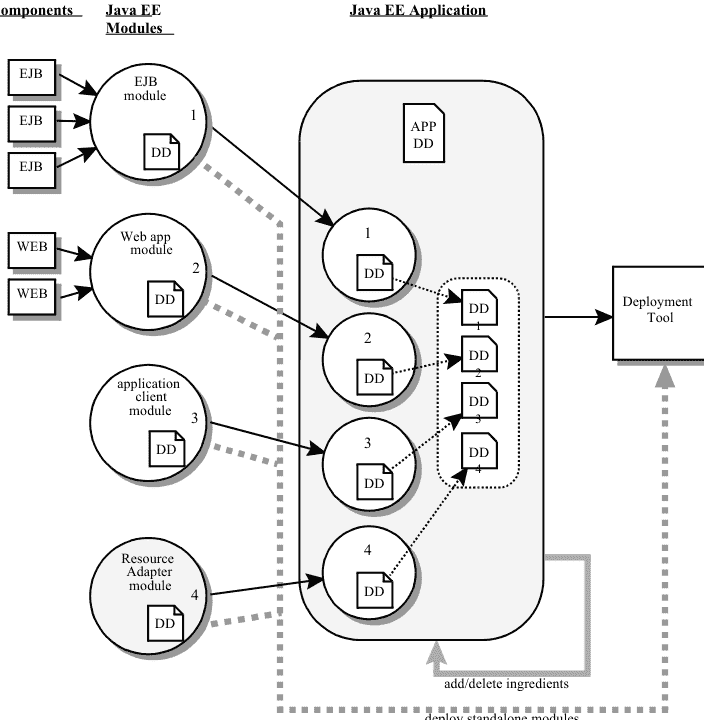

图 EE.8-1 Java EE 部署

### EE.8.1 应用开发生命周期

Java EE 应用的生命周期始于离散 Java EE 组件的。这些组件可以与模块级部署符打包以创建 Java EE 模块。Java EE 模块可以作为独立单元部署，也可以与 Java EE 应用部署符组装并作为 Java EE 应用部署。

图 EE.8-2 显示了 Java EE 应用的生命周期。

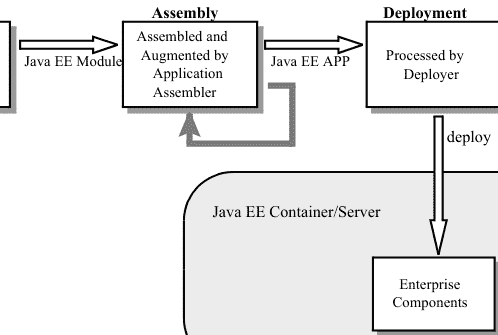

图 EE.8-2 Java EE 应用生命周期

#### EE.8.1.1 组件创建

EJB、servlet、应用客户端和 Connector 规范包含了用于生成 Java EE 模块所需的关联模块级部署描述符的 XML 架构（XML Schema）定义以及组件打包体系。（应用客户端规范见本文的第 EE.10 节。）

一个 Java EE 模块是由一个或多个 Java EE 组件（web、EJB、应用客户端或 Connector）组成的集合，并带有一个可选的该类型模块部署描述符。相同类型的任意数量的组件可以与适用于该容器类型的单个 Java EE 部署描述符打包在一起，以生成一个 Java EE 模块。不同类型的组件不能混合在同一个 Java EE 模块中，但在 web 模块中打包 EJB 组件的除外。

- Java EE 模块代表了 Java EE 应用组合的基本基单元。在某些情况下，一个 Java EE 模块（不一定打包到 Java EE 应用包中）将包含另一个应用。在其他情况下，一个应用将由多个 Java EE 模块组成。
- Java EE 模块的部署描述符包含了部署模块中组件所需的声明式数据。Java EE 模块的部署描述符还包含了描述组件如何组合成应用的组装指令。
- 从 Java EE 平台第 5 版本开始，web 应用模块、企业 Bean 模块或应用客户端模块不需要包含部署描述符。相反，部署信息可以通过模块类文件中的注解来指定。
- 从 Java EE 平台第 5 版本开始，Java EE 企业归档（enterprise archive）不需要包含部署描述符。相反，部署信息可以使用嵌入模块的默认命名规则来确定。
- 独立的 Java EE 模块可以作为独立的 Java EE 模块进行部署，而无需应用级部署描述符，并代表一个有效的 Java EE 应用。
- Java EE 模块可能依赖于下方 EE.8.2 节“库支持”中描述的库。

所有 Java EE 模块都有一个名称。该名称可以在模块的部署描述符中显式设置。如果没有设置，模块的名称为 ear 文件中模块的路径，去掉文件名扩展名（.jar, .war, .rar），且不包含任何目录名。模块名称在应用内必须是唯一的。只有当名称不唯一时（例如，删除不同的文件名扩展名后两个名称相同），部署工具可能会为任何冲突的模块选择新的唯一名称；不冲突的模块名称不得更改。在这种情况下选择唯一名称的算法取决于特定产品。依赖模块名称的应用必须确保其模块名称是唯一的。

例如，一个具有以下结构的应用：

```
myapp.ear
inventory.jar
ui.war
```

其默认应用名为 "myapp"，并定义了两个默认名为 "inventory" 和 "ui" 的模块。

具有以下结构的应用：

```
bigapp.ear
ejbs
inventory.jar
accounts.jar
ui
store.war
admin.war
```


其默认应用名为`"bigapp"`，并定义了四个默认名为`"ejbs/inventory"`、`"ejbs/accounts"`、`"ui/store"`和`"ui/admin"`的模块。

## EE.8.1.2 应用组装

一个 Java EE 应用可能由一个或多个 Java EE 模块组成，并且一个 Java EE 应用部署器使用 Java 归档（JAR）文件格式打包成具有`.ear`（企业归档）文件名扩展名的文件。最小的 Java EE 应用包将仅包含 Java EE 模块，以及可选的部署描述符。Java EE 应用包还可以包含 Java EE 模块引用的库（使用下方 EE.8.2 节“库支持”中描述的`Class-Path`机制）、帮助文件和辅助部署器的文档。

可移植 Java EE 应用的部署应依赖于包中除本规范定义之外可能包含任何实体。可移植 Java EE 应用部署器（如果有）以及 Java EE 模块（及其依赖库）列在其中。

Java EE 部署描述符代表了 Java EE 应用内容的顶层。Java EE 应用部署由 XML 架构或文档类型定义指定（见 EE.8.6 节，“Java EE 应用 XML 架构”）。

在某些情况下，Java EE 应用在部署到企业之前可能需要自定义。可能会向应用添加新的 Java EE 模块。现有模块可能需要创建、更改或替换自定义内容。例如，应用消费者可能需要使用 HTML 编辑器为为 Java EE web 提供的模板登录页面添加图形。

所有 Java EE 应用都有一个名称。该名称可以在应用部署描述符中显式设置。如果没有设置，应用的名称为文件的基名，去掉任何`.ear`扩展名并移除目录名。应用名称在应用实例中必须是唯一的。如果尝试部署一个与已部署应用名称冲突的应用，部署工具可能会为该应用选择一个新的唯一名称。部署工具还允许在部署时指定不同的名称。部署工具可能会使用特定产品的方法来判断部署操作是新应用的部署（在这种情况下，名称必须是唯一的），还是现有应用的重新部署（在这种情况下，名称可以与现有应用匹配）。

同样，当部署独立模块时，模块名称被用作应用名称，并遵循上述描述的相同规则。模块名称可以在模块描述符中显式设置。如果没有设置，模块名称为模块文件的基名，去掉任何扩展名（`.war`、`.jar`、`.rar`）并移除目录名。

## EE.8.2 库支持

Java EE 平台提供了几种机制，允许应用程序使用可选包和共享库（以下称为库）。库可以与应用程序捆绑，也可以单独安装供任何应用程序使用。

Java EE 产品需要根据[扩展机制架构和可选包版本控制](http://docs.oracle.com/java/8/docs/techniques/guides/extensions/)以及[JAR 文件规范](http://docs.oracle.com/java/8/docs/techniques/guides/jar/jar.html)的规定，支持对捆绑和已安装库的使用。通过这种机制，Java JAR 文件可以引用封装在单独的`.jar`文件或目录中的实用类或其他共享类或资源，而这些文件或目录既可以包含在同一个 Java EE 应用程序包中，也可以是预先安装在 Java EE 容器中的。

### EE.8.2.1 捆绑库

与应用程序捆绑的库可以通过以下方式引用：

1. JAR 格式文件（如`.jar`文件、`.war`文件或`.rar`文件）可以通过在引用的 JAR 文件的 Manifest 文件的`Class-Path`Header中命名引用的`.jar`文件或目录，来引用该`.jar`文件或目录。引用的`.jar`文件或目录是相对于引用 JAR 文件的 URL 命名的。Manifest 文件在 JAR 文件中名为`META-INF/MANIFEST.MF`。Manifest 文件中的`Class-Path`条目为：

   ```
   Class-Path: list-of-jar-files-or-directories-separated-by-spaces
   ```

   （有关`Class-Path`头部语法的重要细节和限制，请参阅[JAR 文件规范]。）Java EE 部署工具在处理 Java EE 模块时必须处理所有引用的文件和目录。在处理引用的 JAR 文件时，必须忽略引用的`.jar`文件中的任何部署描述符。部署工具必须以保留文件之间相对引用的方式安装`.jar`文件和目录。通常，这是通过将`.jar`文件安装到与原始应用程序目录结构匹配的目录层级来实现的。所有引用的`.jar`文件或目录在运行时都必须出现在引用 JAR 文件的本地类路径中。

   只有包含可由标准类加载器直接加载的类文件或资源的 JAR 格式文件或目录，才能作为`Class-Path`引用的目标；此类文件始终以`.jar`扩展名命名。部署工具处理的顶层 JAR 文件不应包含`Class-Path`条目；根据定义，此类条目将引用部署单元外部的其他文件。部署工具不要求处理此类外部引用。

2. `.ear`文件可以包含一个包含以 JAR 文件封装的库的目录。`.ear`文件部署描述符中的`library-directory`元素包含该目录的名称。如果检查了`library-directory`元素，或者`.ear`文件不包含部署描述符，则使用名为`lib`的目录。可以使用空`library-directory`元素来指定没有库目录。
   此目录中所有（但不包括子目录）具有`.jar`扩展名的文件都必须对封装在 EAR 文件中的所有组件（包括应用程序客户端）可用。这些库可以使用可以使用本文处描述的任何技术来引用与应用程序捆绑或单独安装的其它库。

3. Web 应用程序可以在`WEB-INF/lib`目录中包含库。详情请参阅[Servlet 规范]。这些库可以使用本文处描述的任何技术来引用与应用程序捆绑或单独安装的其它库。

### EE.8.2.2 已安装库

单独安装的库可以通过以下方式引用：

1. 所有类型的 JAR 格式文件都可以在 Manifest 文件中包含`Extension-List`属性，表示对已安装库的依赖。[JAR 文件规范]定义了供应用程序使用的此类属性的语义；此规范要求所有组件类型和相应的 JAR 格式文件都支持此类属性。可迁移应用程序不应假设任何已安装库对组件可用，除非该组件的 JAR 格式文件或包含它的其中一个 JAR 格式文件使用`Extension-List`及相关属性表示了对该库的依赖。引用的库必须对引用文件中的所有组件可用，包括包含引用文件中其他 JAR 格式文件中的任何组件。例如，如果`.ear`引用了已安装的库，则该库必须对 ear 内部的`.war`文件、EJB`.jar`文件、应用程序`.jar`文件和资源适配器`.rar`文件中的所有组件可用。

   Java EE 产品不要求在部署时或运行时下载库（使用`<extension>-Implementation-URL`头部）。Java EE 产品不要求同时支持多个版本的已安装库。Java EE 产品不要求将对已安装库的访问限制为应用程序已表示依赖的库；应用程序可能会被赋予比其请求更多的已安装库的访问权限。在所有这些情况下，强烈建议支持此类功能，并且可能在该规范的未来版本中被要求。我们建议 Java EE 产品支持已安装库的多个版本，并默认仅允许应用程序访问其已表示依赖的已安装库。

### EE.8.2.3 库冲突

如果应用程序包含了库的捆绑版本，且相同的库作为已安装库存在，则应优先使用与应用程序捆绑的库实例，而不是任何已安装的库版本。这允许应用程序精确地捆绑它所需的库版本，而不受任何已安装库的影响。请注意，如果该库也是应用程序部署所依据 Java EE 平台版本的必需组件，则平台版本可能会（且通常会）具有优先。

### EE.8.2.4 库资源

除了上述允许访问引用类外，引用 JAR 文件中包含的任何资源也必须能够通过`Class`和`ClassLoader`的`getResource`方法访问，这取决于应用程序安全权限的允许。应用程序通常具有访问与应用程序封装的任何 JAR 文件中资源所需的安全权限。

### EE.8.2.5 动态类加载

动态加载类的库必须考虑 Java EE 应用程序的类加载环境。库通常由加载应用程序类的类加载器的父类加载器加载，因此无法直接看到应用程序模块的类。仅需要动态加载由库本身提供的类的库可以安全地使用`Class`方法的`setName`。然而，需要动态加载作为应用程序一部分提供的类的库，需要使用上下文类加载器来加载这些类。请注意，应用程序每个模块的上下文类加载器可能有所不同。访问上下文类加载器需要`RuntimePermission("getClassLoader")`，该权限通常不授予应用程序，但应该授予需要动态加载类的库。

### EE.8.2.6 示例

以下示例说明了捆绑库（bundled library）机制的简单用法，用于引用在两个独立的 ejb-jar 文件的企业豆（enterprise beans）之间共享实用类库。

```
app1.ear:
META-INF/application.xml
ejb1.jar Class-Path: util.jar
ejb2.jar Class-Path: util.jar
util.jar
```

下一个示例说明了`Class-Path`机制更复杂的用法。在此示例中，开发者选择将企业豆客户端类封装在一个单独的 JAR 文件中，并从需要这些类的其他 JAR 文件中引用该 JAR 文件。这些类也被`ejb2.jar`需要（它与`ejb1.jar`包在同一个应用程序中），以及被`ejb3.jar`和`servlet1.jar`（它们封装在不同的应用程序中）需要。`ejb1.jar`本身也需要这些类，因为它们定义了`ejb1.jar`中企业豆的远程接口，开发者选择了 EJB 规范中描述的使这些类可用的引用模型。`ejb1.jar`的部署描述符在`ejb-client-jar`中指定了客户端 JAR 文件。

`app2.ear`中的组件必须使用`Class-Path`来引用与`ejb1.jar`中封装的企业豆对应的客户端 JAR 文件。企业豆通过`ejb3.jar`中的企业豆以及封装在`webapp.war`中的服务器被引用。

```
app2.ear:
META-INF/application.xml
ejb1.jar Class-Path: ejb1_client.jar
deployment descriptor contains:
<ejb-client-jar>ejb1_client.jar</ejb-client-jar>
ejb1.jar
ejb2.jar Class-Path: ejb1_client.jar
```

```
app3.ear:
META-INF/application.xml
ejb1_client.jar
Class-Path: ejb1_client.jar
ejb3.jar Class-Path: ejb1_client.jar
webapp.war Class-Path: ejb1_client.jar
WEB-INF/web.xml
WEB-INF/lib/servlet1.jar
```


以下示例说明了已安装库机制的简单用法，用于引用单独安装的实用类库。

app1.ear:
META-INF/application.xml
ejb1.jar:
META-INF/MANIFEST.MF:
Extension-List: util
util-Extension-Name: com/example/util
util-Specification-Version: 1.4
META-INF/ejb-jar.xml

util.jar:
META-INF/MANIFEST.MF:
Extension-Name: com/example/util
Specification-Title: example.com's util package
Specification-Version: 1.4
Specification-Vendor: example.com
Implementation-Version: build96

## EE.8.3 类加载要求

Java EE 规范刻意没有定义 Java EE 产品必须使用的类加载器的精确类型和排列。相反，规范从“哪些类必须或不能对组件可见”的角度来定义要求。Java EE 产品可以自由使用任何类加载器来满足这些要求。可移植应用程序不能依赖于所使用的类加载器类型或类加载器的层级结构，并且不能依赖于类和资源的加载顺序。如果需要动态加载类，可移植应用程序应使用节 EE.8.2.5 中“动态类加载”描述的技术。

除了下面指定的所需的类外，Java EE 产品必须提供一种方法，允许访问安装在应用程序服务器中的类库，即使它没有对该库的依赖。这支持了不使用未定义依赖机制的旧应用程序和扩展库的使用。

后续章节描述了每种容器类型的要求。在所有情况下，对类的访问都遵循 Java 语言和 Java 虚拟机的规则。在所有情况下，对类和资源的访问都遵循 Java 安全模型的规则。

Java EE 8，最终发布

请注意，虽然必须如下文所述使应用程序类能够访问库，但如果库需要访问封装在应用程序模块中的类，则可能需要使用节 EE.8.2.5 中“动态类加载”描述的技术。

### EE.8.3.1 Web容器类加载要求

Web 容器中的组件必须访问以下类和资源。请注意，在 Java EE 6 中，EJB 组件可以封装在 Web 模块中。此类 EJB 组件与 Web 容器的其他组件具有相同的访问权限。详见 EJB 规范。

- 容器 `WEB-INF/classes` 目录的内容。
- 容器 `WEB-INF/lib` 目录下所有 jar 文件的内容，但不包括子目录。
- jar 文件引用的任何库的传递闭包（如节 EE.8.2，“库支持”所示）。
- war 文件引用的任何库的传递闭包（如节 EE.8.2，“库支持”所示）。
- 容器文件指定或引用的任何库的传递闭包（如节 EE.8.2，“库支持”所示）。
- ear 文件包含的每个资源适配器存档（rar 文件）中所有 jar 文件的内容。
- 单独部署到应用程序服务器的资源适配器存档（rar 文件）中所有 jar 文件的内容，如果该资源适配器被用于满足模块中的任何引用。
- 单独部署到应用程序服务器的资源适配器存档（rar 文件）中所有 jar 文件的内容，如果该 rar 文件中的任何 jar 文件被用于使用扩展机制架构的模块以满足任何引用（如节 EE.8.2，“库支持”所示）。
- 上述 jar 文件引用的任何库的传递闭包（如节 EE.8.2，“库支持”所示）。
- rar 文件本身引用的任何库的传递闭包（如节 EE.8.2，“库支持”所示）。
- 表 EE-6-1 中指定的 Web 容器 Java EE API 类。
- 所有 Java SE 8 API 类。

Web 容器中的组件可以访问以下类和资源。可移植应用程序不能依赖于能够访问这些类或资源。

- 如上所述，同一 ear 包中任何其他 Web 模块可访问的类和资源。
- 同一 ear 包中任何 EJB jar 文件的内容。
- 以上 EJB jar 文件指定的任何客户端 jar 文件的内容。
- 以上 EJB jar 和客户端 jar 文件引用的任何库的传递闭包（如节 EE.8.2，“库支持”所示）。
- 部署到应用程序服务器的任何资源适配器存档（rar 文件）中任何 jar 文件的内容。
- 上述 jar 文件引用的任何库的传递闭包（如节 EE.8.2，“库支持”所示）。
- 上述 jar 文件引用的任何库的传递闭包（如节 EE.8.2，“库支持”所示）。
- 表 EE-6-1 中指定的 Web 容器以外容器的 Java EE API 类。
- 应用程序服务器中可用的任何已安装库。
- 应用程序包中包含的其他类或资源，并通过显式使用本规范未定义的扩展来指定。
- 应用程序服务器实现部分的其他类和资源。

Web 容器中的组件不能访问以下类和资源，除非此类类或资源符合上述规则：

- 应用程序包中的其他类或资源。例如，应用程序不应访问客户端文件。

### EE.8.3.2 EJB容器类加载要求

EJB容器中的组件必须访问以下类和资源。

- EJB jar 文件的内容。
- EJB jar 文件引用的任何库的传递闭包（如节 EE.8.2，“库支持”所示）。
- 该 jar 文件指定或引用的任何库的传递闭包（如节 EE.8.2，“库支持”所示）。
- jar 文件包含的任何资源适配器存档（rar 文件）中所有 jar 文件的内容。
- 单独部署到应用程序服务器的资源适配器存档（rar 文件）中所有 jar 文件的内容，如果该资源适配器被用于满足模块中的任何引用。
- 单独部署到应用程序服务器的资源适配器存档（rar 文件）中所有 jar 文件的内容，如果该 rar 文件中的任何 jar 文件被用于使用扩展机制架构的模块以满足任何引用（如节 EE.8.2，“库支持”所示）。
- 上述 jar 文件引用的任何库的传递闭包（如节 EE.8.2，“库支持”所示）。
- jar 文件本身引用的任何库的传递闭包（如节 EE.8.2，“库支持”所示）。
- 表 EE-6-1 中指定的 EJB 容器 Java EE API 类。
- 所有 Java SE 8 API 类。

EJB容器中的组件可以访问以下类和资源。可移植应用程序不能依赖或无法访问这些类或资源。

- 如节 EE.8.3.1 “Web容器类加载要求”所述，同一 ear 包中任何 Web 模块可访问的内容和资源。
- 同一 ear 包中任何 EJB jar 文件的内容。
- 以上 EJB jar 文件指定的任何客户端 jar 文件的内容。
- 以上 EJB jar 文件和客户端 jar 文件引用的任何库的传递闭包（如节 EE.8.2，“库支持”所示）。
- 部署到应用程序服务器的任何资源适配器存档（rar 文件）中任何 jar 文件的内容。
- 上述 jar 文件引用的任何库的传递闭包（如节 EE.8.2，“库支持”所示）。
- 上述 rar 文件本身引用的任何库的传递闭包（如第 EE.8.2 节“库支持”所示）。
- 表 EE.6-1 中指定的除 EJB 容器之外的容器的 Java EE API 类。
- 应用程序服务器中可用的任何已安装库。
- 应用程序包中包含的其他类或资源，并通过显式使用未由本规范定义的扩展而指定的。
- 属于服务器实现部分的其他类和资源。

EJB 容器中的组件不得访问以下类和资源，除非此类类或资源受上述规则之一的覆盖。

- 应用程序包中的其他类或资源。例如，应用程序不应访问应用程序客户端文件中的类。

## EE.8.3.3 应用程序客户端容器类加载要求

应用程序客户端容器中的组件必须访问以下类和资源。

- 应用程序客户端 jar 文件的内容。
- 上述 jar 文件引用的任何库的传递闭包（如第 EE.8.2 节“库支持”所示）。
- 容器 ear 文件指定或引用的任何库的传递闭包（如第 EE.8.2 节“库支持”所示）。
- 表 EE.6-1 中指定的应用程序客户端容器的 Java EE API 类。
- 所有 Java SE 8 API 类。

应用程序客户端容器中的组件可以访问以下类和资源。可迁移应用程序不得依赖于拥有或访问这些类或资源。

- 表 EE.6-1 中指定的除应用程序客户端容器之外的容器的 Java EE API 类。
- 应用程序服务器中可用的任何已安装库。
- 应用程序包中包含的其他类或资源，并通过显式使用未由本规范定义的扩展而指定的。
- 应用程序服务器实现部分的其他类和资源。

应用程序客户端容器中的组件不得访问以下类和资源，除非此类类或资源受上述规则之一的覆盖。

- 应用程序包中的其他类或资源。例如，应用程序客户端不应访问同一 ear 文件中其他应用程序客户端 jar 中的类，也不同一 ear 文件中 web 应用或 ejb jar 文件中的类。

## EE.8.3.4 Applet 容器类加载要求

applet 容器的要求完全 Java SE 8 规范规定。本规范未为 applet 容器添加任何新要求。

## EE.8.4 应用程序组装

本节规定了组装 Java EE 应用程序时通常遵循的步骤。

### EE.8.4.1 装配 Java EE 应用程序

1. 选择应用程序将使用的 Java EE 模块。
2. 创建应用程序目录结构。

应用程序的目录结构是任意的，但遵循某些简单约定，可能不需要部署符。结构应该根据设计组件的需求进行设计。

3. 协调 Java EE 部署符。
必须编辑 Java EE 模块的部署符，以链接内部满足的依赖关系并消除任何冗余的安全名称。当希望保留原始部署符时，可以使用可选元素 `alt-dd`（在第 EE.8.6 节“Java EE 应用程序 XML Schema”中描述）。`alt-dd` 元素指定了部署时使用的备用部署符。编辑后的部署符文件副本可以保存到由应用程序组装器确定的应用程序目录树中。如果没有 `alt-dd` 元素，部署器必须直接从模块包读取部署符。

a. 为应用程序包含的模块选择唯一名称。如果两个模块在它们的部署符中指定了冲突的名称，则为至少一个模块创建一个备用部署符并更改其名称。如果 ear 文件中同一目录下的两个模块具有相同的基名称（例如 `foo.jar` 和 `foo.war`），则重命名其中一个模块或创建一个备用部署符为其中一个模块指定唯一名称。
b. 链接应用程序包含的每个模块中所有组件的内部满足的依赖关系。对于每个组件，在应用程序范围内必须仅有一个对应的组件满足该依赖关系。
i. 对于每个 `ejb-link`，在整个应用程序范围内只能有一个匹配的 `ejb-name`（参见第 EE.5.5 节“Enterprise Beans™ (EJB) References”）。
ii. 未链接到内部组件的依赖关系必须由部署器作为外部依赖处理，这些依赖必须由之前安装在平台上的资源满足。外部依赖必须在部署期间链接到平台上的资源。
c. 同步整个应用程序的安全角色名称。将具有冗余含义的唯一角色名称重命名为通用名称。将具有通用名称但含义不同的角色名称重命名为唯一名称。应用程序中许多组件使用的角色名称描述可以包含在应用程序级别的部署符中。
d. 为 Java EE 应用程序包含的每个 web 模块分配一个上下文根。上下文根是 web 命名空间中应用程序的相对名称。每个 web 模块的上下文根必须是不同且不重叠的。web 模块在部署时必须在 web 服务器的命名空间中分配完整名称。如果 Java EE 应用程序只有一个 web 模块，上下文根可以为空字符串。如果应用程序包中没有包含部署符，它将使用 web 模块中的 `default-context-path`。否则，它将使用模块名称作为 web 模块的上下文根。有关上下文根命名的详细要求请参见 Servlet 规范。

确保应用程序中的每个组件都正确描述它对其他组件可能有的任何依赖。Java EE 应用程序不应假设应用程序中的所有组件在运行时都在类路径上。每个组件都可能被加载到具有单独命名空间的单独类加载器中。如果 JAR 文件中的类依赖另一个 JAR 文件中的类，则第一个 JAR 文件应使用 `ClassPath` 机制引用第二个 JAR 文件。该规则的一个显著异常是位于 web 应用 `WEB-INF/lib` 目录下的 JAR 文件。所有此类 JAR 文件在运行时都包含在 web 应用的类路径中；不需要使用 `ClassPath` 机制显式引用它们。该规则的另一个异常是位于应用程序包中库目录（通常为 `lib`）下的 JAR 文件。请注意，在共享构件存在声明组件的注解（例如库目录中且通过 `ClassPath` 引用被多个模块使用的库）可能会导致意外和不受人愿的后果，且不建议这样做。

应用程序中每个类只能有一个版本。如果一个组件依赖于库的一个版本而另一个组件依赖于另一个版本，则可能无法部署包含这两个组件的应用程序。除了应用程序客户端外，Java EE 应用程序不应假设每个组件都加载在单独的类加载器并具有单独的命名空间。单个应用程序中的所有组件可能被加载到单个类加载器并共享单个命名空间。但注意，必须能够部署一个其所有组件都在与其他应用程序不同的命名空间（或命名空间）中的应用程序。通常，这就是是部署方法。默认情况下，应用程序客户端被部署到自己的 Java 虚拟机实例中，因此每个应用程序客户端都有自己的命名空间，应用程序客户端的类在其他组件的类命名空间中不可见。

可选为应用程序创建一个 XML 部署符。部署符必须命名为 `application.xml` 并位于应用程序 .ear 文件 `META-INF` 目录的顶层。

部署描述符必须根据 Java EE XML 文档的 XML Schema 是有效的 XML 文档。（或者，部署描述符也可以满足 Java EE 以前版本的要求。）

许多遵循下述约的应用程序不需要为应用程序部署描述符。部署工具将使用一些简单规则确定应用程序的组件。

5. 打包应用程序。
  a. 将 Java EE 模块和部署描述符放在适当的目录下。
  b. 使用 JAR 文件格式将应用程序目录树封装成一个文件。该文件的文件名应带有 .ear 扩展名。

6. （可选）为应用程序创建一个位于包外部的备用部署描述符。

### EE.8.4.2 添加和移除模块

在创建应用程序后，可以在部署之前添加或移除 Java EE 模块。在添加或移除模块时，必须执行以下步骤：

1. 在应用程序包中为新模块确定一个存放的位置。可选地在应用程序包层次结构中创建新目录，以包含任何正在添加到应用程序中的 Java EE 模块。

2. 通过为模块选择合适的默认文件名，或在模块的部署描述符或备用描述符中显式指定模块名称，确保新模块名称不会与任何现有模块冲突。

3. 将新的 Java EE 模块复制到应用程序包中的目标位置。封装的模块直接插入到目标位置；模块不会被解包。

4. 编辑 Java EE 模块的部署描述符，以链接由应用程序包含的 Java EE 模块内部满足的依赖关系。

5. 编辑 Java EE 应用程序部署描述符（如果包含），以满足 Java EE 平台的内容要求以及 Java EE 应用程序 XML DTD 或 schema 的有效性要求。

Java EE 8, 最终发布

## EE.8.5 部署

Java EE 平台支持三种类型的部署单元：

- 独立 Java EE 模块。
- 由一个或多个 Java EE 模块组成的 Java EE 应用程序。
- 根据扩展机制架构封装为 .jar 文件的类库。这些类库随后将进行安装。

任何 Java EE 产品都必须能够接受以 .ear 文件交付的 Java EE 应用程序，或以 .jar、.war 或 .rar 文件（取决于其类型）交付的独立 Java EE 模块，以及该应用程序或独立 Java EE 模块的可选外部部署描述符。如果应用程序是以 .ear 交付、企业 Bean 模块是以 .jar 交付、Web 应用程序是以 .war 交付或客户端是以 .jar 交付，部署工具必须能够部署应用程序，使得应用程序中的 Java 类与其他 Java 应用程序处于不同的命名空间中。通常这需要为每个应用程序使用单独的类加载器。以 .rar 文件交付的独立资源适配器和以 .jar 文件交付并成为安装库的独立类库并不一定出现在任何应用程序的类命名空间中，并且可能出现在 Java EE 产品支持的任何隔离级别的类命名空间中。

如第 EE.2.10 节“Java EE 产品封装”所述，Java EE 产品可能依赖于外部服务以满足本规范的要求。虽然不要求 Java EE 产品确保这些服务的可用性，但要求确保这些服务已配置供使用。如果此类服务未配置使用，应用程序的部署必须失败。

部署可以提供一个选项，用于控制在部署期间是否尝试启动应用程序。如果未提供此类选项，或者指定了启动应用程序的选项且部署成功，则应用程序模块必须按照第 8.5.4 节规定的进行初始化，并启动应用程序。

如果在部署期间尝试启动应用程序，则 Servlet 和 EJB 容器必须在部署期间初始化。此类初始化必须包含 CDI 初始化。如果初始化失败，部署必须失败。

如果在部署期间不尝试启动应用程序，则这些容器在部署期间不得初始化。

所有情况下，Java EE 应用程序的部署和初始化必须在容器将客户端请求交付给应用程序的任何组件之前完成。容器在向企业 Bean 组件交付任何请求之前，必须首先初始化所有启动单例 Bean 组件。容器只有在组件初始化完成后，才能向 Web 组件和资源适配器交付请求。

Java EE 部署 API 描述了独立于产品的部署工具如何接受特定 Java EE 产品的插件，以及这些插件如何协作部署 Java EE 应用程序。本规范中引用部署工具的要求是指任何供应商提供的独立于产品的部署工具与该工具的供应商特定的部署插件的结合，以及与 Java EE 产品一同提供的任何其他供应商特定的部署工具。

通常，部署工具会将已部署的应用程序或模块复制到特定特定的位置，并带有部署者提供的配置设置和自定义设置。在某些情况下，部署工具可能还包含组装功能，允许部署者在部署之前构建、修改或自定义应用程序。尽管如此，必须能够部署一个包含无特定特定部署信息的通用 Java EE 应用程序、模块或库，而无需修改部署者指定部署的原始文件或构件。

Java EE 容器的部署工具必须验证与正在处理的部署描述符对应的 Java EE 描述符 schema 或 DTD。架构 schema 或 DTD 是通过分析部署描述符以确定其声称符合的版本来选择的。验证错误必须向部署者报告错误。部署工具允许部署者纠正错误并继续部署。注意，部署描述符的版本仅指应用程序编写时的 EE 平台版本。

部署描述符是可选的。所需的部署信息由默认规则或类上的注解决定。Java EE 组件规范包括本规范描述了描述符是可选的，并以完整或不完整的形式存在。`metadata-complete` 属性用于描述符中指定描述符是否完整。完整的描述符提供了完整的部署信息；部署工具不得检查类文件以此类部署信息。

如果处理注解（由表 EE.10-1、Servlet 表 8-1 以及 EJB 表 16 和 17 要求），则必须扫描表 EE.5-1 指定的所有类以指定部署信息的注解。如第 8.5.2 节所述，可以选择地扫描应用程序可以使用的所有类以这些注解。（这些是指定等同于描述符中信息的注解。此要求不涉及为其他目的定义的注解的处理。）这些注解可以出现在类、方法和字段上。资源定义注解指定的资源必须创建。所有资源注解必须在相应的命名空间中产生 JNDI 条目。如果声明或取消引用的相应命名空间可用，则产生的结果未定义。本规范后续版本可能会更改此行为。

`metadata-complete` 属性的作用范围是它所属的描述符。由于历史原因，`webservices.xml` 部署描述符没有自己的 `metadata-complete` 属性；相反，它默认为模块描述符中 `metadata-complete` 属性的值。定义了自己的附加部署描述符的规范如果认为有用，应该提供自己的 `metadata-complete` 属性，并具有相应的语义。

Java EE 8, 最终发布

部署

### EE.8.5.1 部署独立 Java EE 模块

本节规定了部署独立 Java EE 模块的要求。

1. 部署工具首先读取 Java EE 模块部署描述符，如果在包外部提供或存在包内。参见组件规范以获取描述符所需的位置和名称。

每种组件类型的脚本。

2. 如果部署描述符不存在，或者存在但为 Java EE 5 或更高版本的描述符，且 `metadata-complete` 属性未设置为 `true`，则部署工具必须检查应用程序包中的所有类文件。任何指定了部署信息的注解都必须在逻辑上与部署描述符（如果存在）中的信息进行合并。注解信息与部署描述符信息之间的对应关系以及覆盖规则，已在本规范及其他 Java EE 规范中描述。此逻辑合并过程的结果提供了后续部署步骤中使用的部署信息。请注意，合并过程并不要求生成新的部署描述符，虽然这可能是一种常见的实现技术。

3. 当部署独立模块时，使用模块名称作为应用程序名称。部署工具必须确保该应用程序名称在应用服务器实例中是唯一的。如果名称不唯一，部署工具可以自动选择一个唯一名称，或允许部署者选择一个唯一名称，但必须导致部署失败。这确保了现有模块是可以部署的。

4. 部署工具必须将 Java EE 模块部署描述符中列出的所有组件，或通过注解标记并按照前述要求发现的组件，根据各自 Java EE 组件规范的部署要求进行部署。如果模块是包含 JAR 格式文件的类型（例如，web 和 Connector 模块），则模块内其他 JAR 文件通过 `Class-Path` 清单文件头引用的其他 JAR 文件中的所有 `.jar` 文件都必须包含在部署中。如果该模块或模块内的任何 JAR 格式文件声明对已安装库的依赖，则必须满足该依赖。

5. 部署工具必须允许部署者配置容器，为每个组件提供所需的资源和配置值。所需的资源和配置参数在部署描述符中指定，或通过在要求 2 中发现的注解指定。

6. 部署工具必须允许部署者多次部署同一个模块，作为多个独立的应用程序，并可能具有不同的配置。例如，`ej-jar` 文件中的企业豆可以在不同的 JNDI 名称和不同的资源配置下被多次部署。

Java EE 8, Final Release

### EE.8.5.2 部署 Java EE 应用程序

本节规定了部署 Java EE 应用程序的要求。

1. 部署工具必须首先从外部提供或从应用程序 .ear 文件（`META-INF/application.xml`）中读取 Java EE 应用程序部署描述符。如果存在部署描述符，它将完整指定应用程序中所包含的模块。如果不存在部署描述符，部署工具使用以下规则来确定应用程序包含的模块：

  aa. 应用程序包中所有扩展名为 .war 的文件都被视为 web 模块。web 模块的上下文根为模块名称（见 EE.8.1.1 节，“组件创建”）。
  b. 应用程序包中所有扩展名为 .rar 的文件都被视为资源适配器。
  c. 命名为 `lib` 的目录被视为库目录，见 EE.8.2.1 节，“捆绑库”。
  d. 对于应用程序包中所有扩展名为 .jar 但未包含在 `lib` 目录中的文件，执行以下操作：

    ni. 如果 .jar 文件包含一个带有 `Main-Class` 属性的 `META-INF/MANIFEST.MF` 文件，或包含一个 `META-INF/application-client.xml` 文件，则将该 .jar 文件视为应用程序客户端模块。
    ii. 如果 .jar 文件包含一个 `META-INF/ejb-jar.xml` 文件，或任何带有 EJB 组件标识注解（如 `Stateless` 等）的类，则将该 .jar 文件视为 EJB 模块。
    iii. 所有其他 .jar 文件均被忽略，除非它们通过清单文件中的 `Class-Path` 头等 JAR 文件引用机制被发现的 JAR 文件引用。

2. 部署工具必须确保应用程序名称在部署服务器中是唯一的。如果名称不唯一，部署工具可以自动选择一个唯一名称，或允许部署者选择一个唯一名称，但不能导致部署失败。这确保了现有应用程序能够继续部署。

3. 部署工具必须打开 Java EE 应用程序部署描述符中的或通过上述规则发现的每个 Java EE 模块，如果包中存在，则读取 Java EE 模块部署描述符。请参阅 Enterprise JavaBeans、servlet、Java EE Connector 和应用程序客户端规范，以获取每种组件类型部署描述符所需的路径和名称。所有模块类型的部署描述符都是可选的（应用程序客户端规范见 EE.10 章，“应用程序客户端”）。

4. 如果模块描述符不存在，或者存在且为 Java EE 5 或更高版本且 `metadata-complete` 属性未设置为 `true`，部署工具必须检查应用程序包中包含在 .ear 文件中且被模块引用的所有类（例如模块自身包含的类文件、通过 `Class-Path` 引用从模块引用的类文件、库目录中的类文件等）。任何指定了部署信息的注解都必须在逻辑上与部署描述符（如果存在）中的信息进行合并。请注意，在共享制品中（如 `lib` 目录中的库以及通过 `Class-Path` 引用被多个处引用的库）存在清除组件的注解可能会导致意外和不受理想的后果。注解形成与部署描述符信息之间的对应关系以及覆盖规则已在本规范及其他 Java EE 规范中描述。此逻辑合并过程的结果提供了后续部署步骤中使用的部署信息。请注意，合并过程并不要求生成新的部署描述符，虽然这可能是一种常见的实现技术。

5. 部署工具必须将每个模块描述符描述的所有组件，或通过注解标记并按照前述要求发现的组件，根据各自 Java EE 组件规范的部署要求安装到相应的容器中。jar 文件中的所有类，或使用 `Class-Path` 清单文件头从其他 JAR 文件引用的目录都应包含在部署中。如果 .ear 文件或 .ear 文件内的任何 JAR 格式文件声明对已安装库的依赖，则必须满足该依赖。

6. 部署工具必须允许部署者配置容器，为每个组件提供所需的资源和配置值。所需的资源和配置参数在部署描述符中指定，或通过在 3 中发现的注解指定。

7. 部署工具必须允许部署者多次部署同一个 Java 应用程序，作为多个独立的应用程序，并可能具有不同的配置。例如，`ejb-jar` 文件中的企业豆可以在不同的 JNDI 名称和不同的资源配置下被多次部署。

Java EE 8, Final Release

8. 在向部署者展示安全角色描述时，部署工具必须使用 Java EE 应用程序描述符中的描述，而不是同名角色在模块描述符中的描述。然而，对于出现在模块描述符但未出现在应用程序描述符中的角色，部署工具必须使用模块描述符中的描述。

通过在应用部署描述符中包含 `<initialize-inorder>true</initialize-inorder>` 元素，可以声明模块必须按照应用部署描述符中列出的顺序进行初始化。如果应用部署描述符指定的模块顺序与任何模块指定的初始化顺序冲突（例如，通过使用 EJB Depends 注解），部署工具必须报告错误。应用程序客户端模块按照自身的调度进行初始化，通常是在端用户调用它们时；因此，它们被排除在任何初始化要求之外。

## EE.8.6 Java EE Application XML Schema

Java EE 应用部署描述符的 XML 语法由 Java EE 架构定义。Java EE 应用部署描述符的根元素是 `application`。Java EE 组装的粒度是模块。Java EE 部署描述符包含应用程序的名称、描述以及应用程序的 URI。XML 元素的内容区分大小写。这意味着，例如 `<name>Manager</name>` 与 `<name>manager</name>` 不同。

所有 Java EE 应用部署描述符必须符合 XML 架构定义，或来自本规范以前版本的 DTD 或架构定义（参见附录 A，“以前版本的描述符”）。部署描述符在 ear 文件中必须命名为 `META-INF/application.xml`。注意此名称是区分大小写的。位于 http://xmlns.jsp.org/xml/ns/javaee/application.xsd 的 XML 架构定义了 Java EE 应用部署描述符的 XML 语法。EE8-3 显示了 Java EE XML 架构结构的图形表示。

图 EE8-3 Java EE 应用 XML 结构


Java EE 8，最终发布

## EE.8.7 Common Java EE XML Schema

位于 http://xmlns.jcp.org/xml/ns/javaee/javaee_8.xsd 的 XML 架构定义了许多 Java EE 部署描述符使用的类型，这些类型存在于本规范和其他规范中。

# 9 章 配置文件

本章描述了所有 Java EE 配置文件共同共同的要求。它没有定义任何具体的配置文件，而是将此任务交给独立的规范。与本规范共同发布的《Java EE Profile规范》定义了 Java EE 配置文件，即 Web Profile。其他配置文件的定义留给未来的规范。

### EE.9.1 引言

Java EE 配置文件（以下简称“配置文件”）代表了适用于特定类应用程序的平台配置。

配置文件可以包含平台中包含的适当子集。通过这种方式，配置文件可以有效地舍弃平台支持但在特定领域内无用的技术。

配置文件可以添加一个或多个平台本身不存在的技术。例如，一个假设的 Java EE Portal 配置文件可能会包含 Portal API。此外，配置文件可以将某些技术标记为可选。在这种情况下，实现该配置文件的产品可能包含也可能不包含涉及的该。自然地，如果它们包含了该技术，则需要遵守配置文件规范强制的所有相关要求。

一个产品可以实现两个或多个 Java EE 配置文件，或者实现整个平台以及一个或多个 Java EE 配置文件，只要它们的组合要求不会产生冲突即可。

### EE.9.2 配置文件定义

配置文件是根据 Java 社区过程程序的规则定义的。通常，创建新配置文件或修订现有配置文件的提议将作为 Java 规范请求（JSR）提交。一旦 JSR 获得批准，将形成一个专家小组并按照流程指示开展工作。配置文件的 JSR 必须提到其所构建的 Java EE 平台版本。此外，如果它是基于现有平台构建的，也必须保持这一事实。

尽管配置文件可以独立于 Java EE 平台进行创建和演进，但在本规范包含的规则限制下，设想是让配置文件与平台本身保持合理的对齐水平，以避免开发空间碎片化为逐渐互不兼容的孤岛。为此，配置文件必须在获得批准时，构建在当时 Java EE 平台的最新版本之上。还建议配置文件专家小组超越这一要求，并在实际可行范围内，确保它们的配置文件在最终定稿时是构建在当时 Java EE 平台的最新版本之上的。

### EE.9.3 配置文件通用规则

配置文件必须包含所有作为 Java EE 平台或其所构建的任何配置的必需组件的技术。这些技术将在配置文件中列为必须的。

配置文件可以将任何作为 Java EE 平台或其所构建的任何配置的可选组件的技术提升为必需状态。

除非配置文件强制规定，任何作为 Java EE 平台或该配置文件所构建的任何配置可选组件的技术，必须是配置文件本身的可选组件。

配置文件可以将 Java EE 平台或其所构建的任何配置之外的任何技术作为必需或可选组件包含进来，只要满足了相应的兼容性要求。

配置文件必须保留 Java EE 平台规范或其所构建的任何配置文件规范中定义的任何要求，只要这些要求的决条件得到满足。通常，前提将涉及包含在配置文件中的一个或多个技术的存在。无条件的要求必须无条件地遵守。

配置文件可以添加任何涉及一个或多个技术的要求，这些技术的包含允许或要求这些要求。此类要求不能与 Java EE 平台或当前配置文件所构建的任何配置文件所设置的要求发生冲突。

单个技术的规范可能允许该技术的功能是可选的。在这种情况下，配置文件可以将这些功能中的一个或多个提升为必需，前提是 Java EE 平台或其构建的任何配置文件尚未这样做。

### EE.9.4 要求的表达

本规范在表达与平台中包含的一个多个技术相关的要求时，使用了以下约定：

- 依赖于特定技术存在的章节或节在最开始标记此类。该条件预计将一直生效到同一逻辑层级的下一个单元（例如，接下来的章节、节等）。
- 除非另有说明，单独段落和句子被认为对其所提到的任何技术具有条件。
- 讨论示例或在其他非规范性的章节或段落不包含任何要求。

### EE.9.5 所有 Java EE 配置文件的要求

Java 平台标准版 8 是任何 Java EE 8 配置文件的必需基础。

以下技术要求存在所有 Java EE 配置文件中：

- 由 Common Annotations 规范定义的资源和组件生命周期注解（`Resource`, `Resources`, `PostConstruct`, `PostDestroy`）

所有 Java EE 配置文件都要求支持以下功能：

- JNDI "java:naming context"（见 EE.5.2 节，“JNDI Naming Context”）
- Java 事务 API (JTA)

## EE.9.6 Java EE 配置文件的可选功能

在 EE.6.1 节“强制 API”中列出且在 EE.9.5 节“所有 Java EE 配置文件的要求”中未指定为强制的技术，被指定为 Java EE 配置文件的可选功能。
以下功能被指定为 Java EE 配置文件的可选：

- RMI/IIOP 互操作性要求（见 EE.7.2.2 节，“OMG Protocols (Optional Specification)”）
- 对 `java:comp/ORB` 的支持（见 EE.5.12 节，“ORB References”）

## EE.9.7 完整 Java EE 产品要求

本节定义了完整 Java EE 平台产品的要求。这些要求对应于之前版本 Java EE 平台规范中的完整要求，并针对此新版本的平台更新了这些要求。
请注意，由于精简过程的影响，未来的 Java EE 规范版本可能会放宽此处的要求，特别是将那些已经过精简且是当前规范强制要求的的技术标记为可选。已变为可选和/或被确定为精简候选的技术集见 EE.6.1.3 节，“精简的 Java 技术”。
以下是相关技术：

- EJB 3.2（EJB 实体豆及相关的 EJB QL 除外，它们已变为可选）
- Servlet 4.0
- JSP 2.3
- EL 3.0
- JMS 2.0
- JTA 1.2
- JavaMail 1.6
- Connector 1.7
- Web Services 1.4
- JAX-RS 2.1
- JSON-P 1.1
- JSON-B 1.0
- Concurrency Utilities 1.0
- Batch 1.0
- Java EE Management 1.1
- JACC 1.5
- JASPIC 1.1
- Java EE Security 1.0
- JSP Debugging 1.0
- JSTL 1.2
- Web Services Metadata 2.1
- JSF 2.3
- Commonations 1.3
- Java Persistence 2.2
- Bean Validation 2.0
- Managed Beans 1.0
- Interceptors 1.2
- Contexts and Dependency Injection for Java EE 2.0
- Dependency Injection for Java 1.0

以下技术是可选的：

- EJB 3.2 及早版本的实体豆及相关的 EJB QL
- JAX-RPC 1.1
- JAXR 1.0
- Java EE Deployment 1.2

## EE.10

### 应用客户端

本章介绍了 Java™ 平台企业版（Java EE）中的应用程序客户端。

完整的 Java EE 产品必须支持本章描述的应用程序客户端容器。Java EE 配置文件可能需要也可能不需要应用程序客户端容器的支持。

### EE.10.1 概述

应用程序客户端是在它们自己的 Java™ 虚拟机中执行的第一级客户端程序。应用程序客户端遵循 Java 技术应用程序的模型：它们在主方法中被调用，并一直运行到虚拟机终止为止。然而，与其他 Java EE 组件一样，应用程序客户端依赖容器来提供系统服务。与其他 Java EE 容器相比，应用程序客户端容器可能非常轻量，仅提供下面描述的安全和部署服务。

### EE.10.2 安全

应用程序客户端的 Java EE 认证要求与其他 Java EE 组件相同，其他 Java EE 应用程序可以使用相同的认证技术。

访问不受保护的 Web 资源时不需要认证。访问受保护的 Web 资源时，可以使用常用的认证方式，即 HTTP Basic 认证、SSL 客户端认证或 HTTP 登录表单认证。可以使用惰性认证。

访问受保护的企业豆时需要进行认证。企业豆的认证机制包括 EJB 规范中为企业豆互操作而要求的机制。可以使用惰性认证。

应用程序客户端利用应用程序客户端容器提供的认证服务来验证其用户。容器的服务可以与原生平台的认证系统集成，以便采用单点登录能力。容器可以在应用程序启动时验证用户，也可以使用惰性认证，在访问受保护的资源时验证用户。本规范未描述用于验证用户的技术，尽管后续版本可能会描述。

如果容器需要与用户交互以收集认证数据，容器必须提供适当的用户界面。此外，应用程序客户端可以提供一个实现 `javax.auth.callback.CallbackHandler` 接口的类，并在其部署描述中指定该类名（详情见 EE.10.7 节“Java EE Application Client XML Schema”）。部署器可能会覆盖应用程序指定的回调处理程序，并转而使用容器的默认用户界面。

如果部署器配置了回调，应用程序客户端容器必须实例化该类的对象，并使用它与用户进行所有的认证交互。应用程序的回调处理程序必须完全支持 `javax.security.auth.callback` 包中指定的 回调 对象。

请注意，当使用 HTTP 登录表单认证时，服务器提供的认证用户界面（以响应 HTTP 请求交付的 HTML 页面形式提供）必须由应用程序客户端显示。

### EE.10.3 事务

应用程序客户端不需要直接访问 Java EE 平台的事务设施。Java EE 产品不需要为应用程序客户端提供 JTA 事务对象。应用程序客户端可以调用启动事务的企业豆，并且它们可以使用 JDBC API 的事务设施。当 Java EE 客户端调用企业豆时，如果 JDBC API 事务处于开启状态，则不要求将事务上下文传播到 EJB 服务器。

### EE.10.4 资源、命名和注入

与 Java EE 组件一样，应用程序客户端使用 JNDI 查找企业豆、获取资源管理器的访问、在部署时引用可配置参数等。应用程序客户端使用 `java:JNDI` 命名空间访问这些项目（详情见 EE.5 节，“资源、命名和注入”）。

注入也支持应用程序客户端主类。由于应用程序客户端容器不会创建应用程序客户端主类的实例，而仅加载类并调用静态主方法，因此注入应用程序客户端类使用的是静态字段和方法，这与其他 Java EE 组件不同。注入发生在主方法被调用之前。

### EE.10.5 应用程序接口

应用程序客户端拥有 Java™ 平台标准版（受安全限制）的所有设施以及各种扩展，如 EE.6 节“应用程序接口”所示。每个应用程序客户端都在自己的 Java 虚拟机中执行。应用程序客户端开始执行应用程序客户端 JAR 文件清单文件中 `Main-Class` 属性中指定的类的主方法（但请注意，应用程序客户端容器通常会在应用程序客户端之前执行，以便准备容器环境、安装安全管理器、初始化命名服务客户端库等）。

### EE.10.6 打包与部署

应用程序客户端以 JAR 格式打包，扩展名为 .jar，并可能包含与 Java EE 组件相似的部署描述符。部署描述符描述了应用程序引用的企业豆、Web 服务和其他类型的外部资源。如果没有包含部署描述符，或者包含但标记为元数据完全完整，应用程序客户端主类上的注解也可以用于描述应用程序所需的资源。与其他 Java EE 应用程序组件、必须在部署时配置资源访问、为企业级豆和资源分配名称等。

下表描述了部署工具必须考虑是否对应用程序客户端主类处理注解的情况。是否处理注解取决于部署描述符的存在及其版本，以及 `metadata-complete` 属性的设置。

## 表格 EE.10-1 部署描述符处理要求

| 部署描述符 | metadata-complete? | 是否处理注解? |
| --- | --- | --- |
| application-client_1_2 | N/A | 否 |
| application-client_1_3 | N/A | 否 |
| application-client_1_4 | N/A | 否 |
| application-client_5 | Yes | 否 |
| application-client_5 | No | 是 |
| application-client_6 | Yes | 否 |
| application-client_6 | No | 是 |
| application-client_7 | Yes | 否 |
| application-client_7 | No | 是 |
| application-client_8 | Yes | 否 |
| none | N/A | 是 |

`metadata-complete` 属性定义了应用程序客户端部署描述符是完整的，或者是否应该检查应用程序客户端模块可用的类文件中是否存在指定部署信息的注解。从这个意义上说，部署信息是指任何可以由应用程序客户端部署描述符为模块指定的任何信息。

如果 `metadata-complete` 属性的值指定为 "true"，则部署工具必须忽略封装在应用程序客户端 jar 包类文件中任何指定此类部署信息的注解。根据第 EE.8.5.2 节“部署 Java EE 应用程序”，处理用于此模块部署的应用程序客户端模块可用类文件时，也必须忽略此类注解。

请注意，`metadata-complete` 属性的 "true" 值不会阻止所有注解的处理，仅针对那些指定部署信息的注解。

`metadata-complete` 属性适用的注解列表目前包含以下：

- `java.annotation.PostConstruct`
- `java.annotation.PreDestroy`
- `java.annotation.Resource`
- `java.annotation.Resources`
- `java.annotation.sql.DataSourceDefinition`
- `java.annotation.sql.DataSourceSourceDefinitions`
- `java.ejb.EJB`
- `java.ejb.EJBFactoryDefinition`
- `java.jms.JMSConnectionFactoryDefinition`
- `java.jms.JMSConnectionFactoryDefinitions`
- `java.jms.JMSDestinationDefinition`
- `java.jms.JMSDestinationDefinitions`
- `java.mail.MailSessionDefinition`
- `java.mail.MailSessionDefinitions`
- `java.persistence.PersistenceUnit`
- `java.persistence.PersistenceUnits`
- `java.resource.AdministeredObjectDefinition`
- `java.resource.AdministeredObjectDefinitions`
- `java.resource.ConnectionFactoryDefinition`
- `java.resource.ConnectionFactoryDefinitions`
- 以下包中的所有注解：
  - `javax.jws`
  - `java.jws.soap`
  - `java.xml.ws`
  - `java.xml.ws.soap`
  - `java.xml.ws.spi`

如果未指定 `metadata-complete` 属性或其值为 "false"，则对于所有此类注解，部署工具必须检查类文件以查找所有注解。

用于将应用程序客户端部署到客户端机器的工具以及用于安装应用程序客户端的机制并未指定。非常先进的 Java EE 产品可能允许应用程序客户端部署在 Java EE 服务器上，并自动供某些（通常是内网的）客户端使用。其他 Java EE 产品可能要求将包含应用程序客户端的 Java EE 包部署并安装在每个客户端机器上。另一种方法是让 Java EE 服务器上的部署工具提供一个安装包，每个客户端可以使用该安装包来安装应用程序客户端。这里有很多可能性，本规范未指定其中一种。它仅定义了应用程序客户端的包格式以及在部署过程中必须实现的内容。

终端用户如何调用应用程序客户端尚未指定。通常，Java EE 产品供应商将提供一个与应用程序客户端机器原生操作系统集成的应用程序启动器，但此类集成的程度未指定。

## EE.10.7 Java EE 应用程序客户端 XML Schema

Java EE 应用程序部署描述符的 XML 语法由 Java EE 应用程序-client 架构定义。应用程序客户端部署描述符的根元素是 `application-client`。XML 元素的内容通常是区分大小写的。这意味着，必须使用 `<res-auth>Container</res-auth>`，而不是 `<res-auth>container</res-auth>`。

所有有效的 `application-client` 部署描述符必须符合 XML Schema 定义，或符合本规范以前版本的 DTD 或架构定义。（参见附录 EE.A，“旧版本部署描述符”）。部署描述符必须是应用程序客户端 .jar 文件中的 `META-INF/application-client.xml`。注意，此名称是区分大小写的。

图 EE.10-1 显示了 Java EE application-client XML Schema 的结构。Java EE application-client XML Schema 位于 http://xmlns.jcp.org/xml/ns/javaee/application_client_8.xsd。

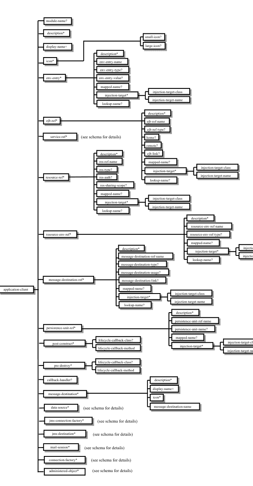
图 EE.10-1 Java EE 应用程序客户端结构

## EE.11 章

### 服务提供者接口

Java™ Platform, Enterprise Edition (Java EE) 包含了多种技术，主要用于扩展 Java EE 容器的能力。此外，某些 Java EE 技术在它们的应用程序编程接口中包含了服务提供者接口。Java EE 配置可能包含部分或全部这些设施，如第 EE.9 节所示。

### EE.11.1 Java™ EE 适配器架构

Connector API 定义了资源适配器如何打包以及与任何 Java EE 产品集成。许多类型的服务提供者可以使用 Connector API 和打包进行提供，包括 JDBC 驱动、JMS 提供者和 JAXR 提供者。所有 Java EE 产品都支持 Connector API，如 Connector 规范所示。

Connector 规范位于 http://jcp.org/en/jsr/detail?id=322.

### EE.11.2 Java EE 容器授权服务提供者合约

JACC 规范定义了 Java EE 容器与授权策略提供者之间的合约。

JACC 规范位于 http://jcp.org/en/jsr/detail?id=115.

### EE.11.3 Java™ 事务 API

Java 事务 API 定义了 `SynchronizationRegistry` 接口，供系统级应用服务器组件（如持久化管理器、资源适配器）以及 EJB 和 Web 应用程序组件使用。它提供了注册特殊排序语义的同步对象、将资源对象与当前事务关联、获取当前事务的持久上下文、获取当前事务状态以及标记当前事务回滚的能力。

JTA 规范位于 http://jcp.org/en/jsr/detail?id=907.

### EE.11.4 Java™ 持久化

Java Persistence 在 `javax.persistence.spi` 包提供了接口，允许持久化提供者插件到 Java Persistence 框架中。

Java Persistence 规范位于 http://jcp.org/en/jsr/detail?id=338.

### EE.11.5 JavaMail™

JavaMail 规范描述了 JavaMail 协议提供者如何打包和分发，以便能够通过 JavaMail API 被发现和使用。这允许 JavaMail API 扩展以支持新的电子邮件协议和邮箱格式。

JavaMail 规范位于 http://jcp.org/en/jsr/detail?id=919.

## EE.12 章

## 兼容性与迁移

本章总结了 Java EE 平台的兼容性与迁移问题。Java EE 包含的每种组件技术的规范也对此更详细地描述了该技术的兼容性与迁移问题。

## EE.12.1 兼容性

“兼容性”一词涵盖了许多不同的概念。如果 Java EE 产品实现了规范要求的 API 和行为，则该产品与 Java EE 规范兼容。如果应用程序仅依赖于某个 Java EE 平台发布版本定义的 API 和行为，则该应用程序与该 Java EE 平台发布版本兼容。如果为 Java EE 平台旧版本编写的所有可移植应用程序在平台的新发布版本上运行，且保持不变并具有相同的行为，则该 Java EE 平台的新发布版本与旧发布版本兼容。

兼容性是 Java EE 平台的核心价值。Java EE 产品被要求支持为平台旧版本编写的可移植应用程序。兼容性和可移植性共同工作，提供了 Java EE 平台“一次编写，随处运行”的价值。Java EE 产品通过提供规范要求的 API 和行为来符合 Java EE 规范。可移植应用程序仅依赖于 Java EE 规范要求的 API 和行为。通常情况下，为平台旧版本编写的可移植应用程序将在当前版本的平台上继续保持不变地工作并具有相同的行为。

## EE.12.2 迁移

迁移是将应用程序转换为使用平台此发布版本引入的新功能的行为。由于此版本的 Java EE 平台版本具有很强的兼容性，迁移在很大程度上是一个可选的操作。尽管如此，通过转换为使用 Java EE 平台的新功能可以改进应用程序（更好的性能、更简单的开发、更灵活性等）。

### EE.12.2.1 Java 持久化

Java Persistence 比 EJB CMP 实体豆提供了丰富得建模能力和对象/关系映射能力，并且易用得多。

Java EE 7 发布版已对 EJB CMP 和 BMP 实体豆的支持改为可选。自 Java EE 5 以来，对 EJB CMP 1.1 实体豆的支持已被弃用。强烈建议使用 EJB 实体豆的应用程序迁移到 Java Persistence API。

## EE.12.2.2 JAX-WS

JAX-WS 一同 JAXB 和 Web 服务元数据规范，比使用 JAX-RPC 技术提供了更简单、更完整的 Web 服务支持。Java EE 7 发布版已将 JAX-RPC 支持改为可选。使用 JAX-RPC 提供 服务的应用程序应考虑迁移到 JAX-WS API。注意，两种技术都支持相同的 Web 服务互操作标准，客户端和服务端可以独立地迁移到新 API。

Java EE 8 最终发布版

## EE.13

## 未来方向 章

此版本的 Java™ 平台企业版 (Java EE) 规范包含了企业级应用程序所需的大功能。然而，总有更多工作要做。本章简要描述了我们对该规范未来版本的计划。请记住，所有内容都可能发生变化。欢迎您的反馈。

接下来的章节描述了我们希望在规范未来版本中包含的额外功能。Java EE 平台包含的许多 API 将继续独立进化，我们将包含每个 API 的最新版本。

## EE.13.1 Java EE SPI

构成 Java EE 平台的许多 API 包含一个 SPI 层，允许服务提供者或其他系统组件进行插拔。本规范没有描述所有服务提供者的执行环境，也没有描述所有服务提供者的打包和部署要求。然而，Java EE 连接器架构定义了某些称为资源适配器的服务提供者的类型，容器授权合约定义了安全服务提供者的要求。本规范的未来版本将更完整地定义 Java EE SPI。

## EE.A 录

## 旧版本部署描述符

本录描述了 Java EE 规范旧版本部署描述符的文档类型定义（DTD）和 XML 架构。所有 Java EE 产品都要求支持这些 DTD 和架构。

图 EE.A-3 Java EE 应用 XML Schema 结构

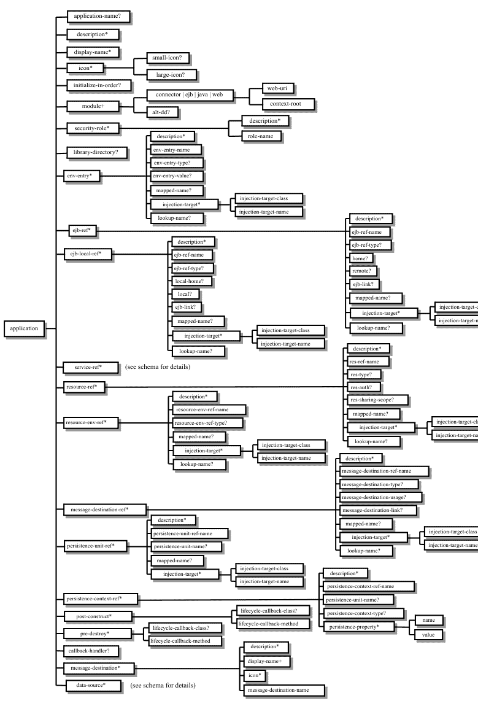

位于 http://java.sun.com/xml/javaee/application_6.xsd 的 XML Schema 定义了 Java EE 应用部署描述符的 XML 语法。

## EE.A.5 备用 Java EE XML Schema 定义

位于 http://java.sun.com/xml/javaee/javaee_6.xsd 的 XML Schema 定义了在本规范及其他规范中被许多其他 Java EE 部署描述符 Schema 选用的类型。

## EE.A.6 Java EE 6 应用客户端 XML Schema

Java EE 应用客户端部署描述符的 XML 语法由用于应用客户端的 Java EE 应用客户端部署描述符 `application-client` 定义。部署描述符的 XML 元素的根元素在通常情况下是区分大小写的。这意味着，例如，必须使用 `<res-auth>Container</res-auth>`，而不是 `<res-auth>container</res-auth>`。

所有有效的应用客户端部署描述符必须符合 XML Schema 定义，或符合本规范以前版本的 DTD 或 schema 定义。部署描述符在应用客户端的 jar 文件中必须命名为 `META-INF/application-client.xml`。注意此名称是区分大小写的。

图 EE.A-4 显示了 Java EE 应用客户端 XML Schema 的结构。Java EE 应用客户端 XML Schema 位于 http://java.sun.com/xml/ns/javaee/application-client_6.xsd。

## 图 EE.A.-4 Java EE 应用客户端 XML Schema 结构

Java EE 8, 最终发布

## EE.A.7 Java EE 5 应用 XML Schema

Java EE 应用部署描述符的 XML 语法由 Java EE 应用架构 定义。Java EE 应用部署描述符的根元素是 `application`。Java EE 应用组装的组合粒度是 Java EE 模块。Java EE 部署描述符包含应用的名称、描述、应用 UI 图标的 URI，以及组成应用的 Java EE 模块列表。XML 元素的内容在通常情况下是区分大小写的。这意味着，例如，`<role-name>Manager</role-name>` 与 `<role-name>role</role-name>` 是不同的角色。

有效的 Java EE 5 部署描述符必须符合 XML Schema 定义。
部署描述符在文件中必须命名为 `META-INF/application.xml`。注意此名称是区分大小写的。

图 EE.A-5 显示了 Java EE 应用 XML Schema 结构的图形表示。

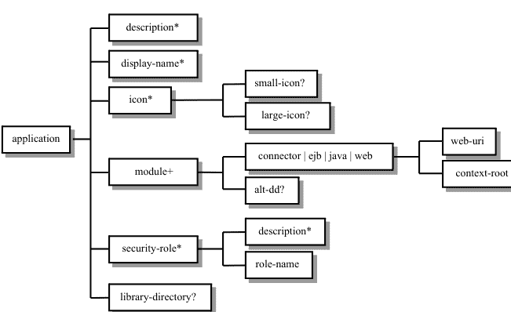

图 EE.A-5 Java EE 应用 XML Schema 结构

位于 http://java.sun.com/ns/javaee/application_5.xsd 的 XML Schema 定义了 Java EE 应用部署描述符的 XML 语法。

## EE.A.8 备用 Java EE 5 XML Schema 定义

位于 http://java.sun.com/xml/ns/javaee/javaee_5.xsd 的 XML Schema 定义了在本规范及其他规范中被许多其他 Java EE 部署描述符 Schema 选用的类型。

## EE.A.9 Java EE 5 应用客户端 XML Schema

Java EE 应用客户端部署描述符的 XML 语法由 Java EE 应用客户端架构 定义。应用客户端部署描述符的根元素是 `application-client`。XML 元素的内容在通常情况下是区分大小写的。这意味着，例如，必须使用 `<res-auth-container>/</res-auth>`，而不是 `<res-auth-container>/</res-auth>`。

所有应用客户端部署描述符必须符合 XML Schema 定义，或符合本规范以前版本的 DTD 或 schema 定义。部署描述符在应用客户端的 .jar 文件中必须命名为 `META-INF/application-client.xml`。注意此是区分大小写的。

EE.A-6 显示了 Java EE 应用客户端 XML Schema 的结构。Java EE 应用客户端 XML Schema 位于 http://java.sun.com/xml/ns/javaee/application-client_5.xsd。

Java EE 8, 最终发布

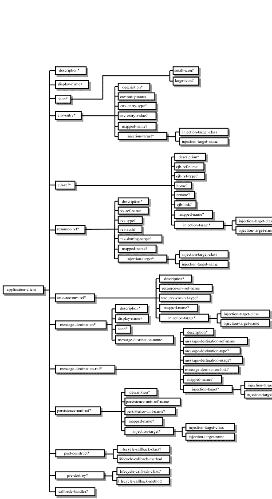

图 EE.A-6 Java EE 应用客户端 XML Schema 结构

## EE.A.10 J2EE 1.4 应用 XML Schema

本节提供了 J2EE 应用部署描述符的 XML Schema。J2EE 应用部署描述符的 XML 语法由 J2EE:application schema 定义。J2EE 应用组装的组合粒度是 J2EE 模块。J2EE:application 部署描述符包含应用的名称、描述、应用 UI 图标的 URI，以及组成应用的 J2EE 模块列表。XML 元素的内容在通常情况下是区分大小写的。这意味着，例如，`<role-name>Manager</role-name>` 与 `<role-name>manager</role-name>` 是不同的角色。

有效的 J2EE 应用部署描述符可能符合下方的 XML Schema 定义。部署描述符在 .ear 文件中必须命名为 `META-INF/application.xml`。注意此名称是区分大小写的。

图 EE.A-7 显示了 J2EE 应用 XML Schema 结构的图形表示。

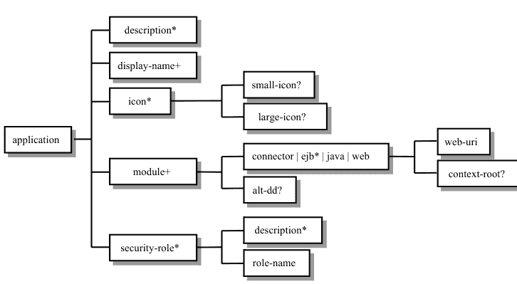

图 EE.A-7 J2EE 应用 XML Schema 结构

定义 J2EE 1.4 应用部署描述符 XML 语法的 XML Schema 位于 http://java.sun.com/xml/ns/j2ee/application_1_4.xsd。

Java EE 8, 最终发布

## EE.A.11 备用 J2EE 1.4 XML Schema 定义

定义在本规范及其他规范中被许多其他 J2EE 1.4 部署描述符 Schema 选用的类型的 XML Schema 位于 http://java.sun.com/ns/j2ee/j2ee_4.xsd。

## EE.A.12 J2EE:application 1.3 DTD

本节提供了 J2EE 1.3 应用描述符的 XML DTD。J2EE 应用部署描述符的 XML 语法由 J2EE:application 文档定义。J2EE 应用组装的组合粒度是 J2EE 模块。J2EE:application 部署描述符包含应用的名称、描述、应用 UI 图标的 URI，以及组成应用的 J2EE 模块。XML 元素的内容在通常情况下是区分大小写的。这意味着，例如，`<role-name>Manager</role-name>` 与 `<role-name>manager</role-name>` 是不同的角色。

有效的 J2EE 1.3 部署描述符可能包含以下 DOCTYPE 声明：

```
<!DOCTYPE application PUBLIC "-//Sun Microsystems, Inc.//DTD J2EE Application 1.3//EN" "http://java.sun.com/dtd/application_1_3.dtd">
```


# EE.A.13 J2EE:application 1.2 DTD

本节提供了 J2EE 1.2 版本应用描述符的 XML DTD。J2EE 1.2 应用部署描述符可能包含以下 DOCTYPE 声明：

```xml
<!DOCTYPE application "-//Sun Microsystems, Inc.//DTD J2EE Application 1.2//EN" "http://java.sun.com/j2ee/dtd/application_1_2">
```

图 EE.A-9 显示了 J2EE:application DTD 结构的图形表示。

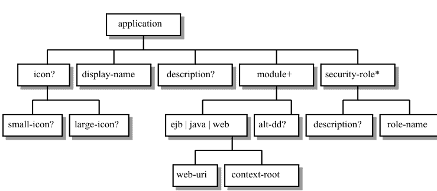

图 EE.A-9 J2EE:application DTD 结构

应用程序客户端的描述符为 `application-client`。XML 元素的内容通常是区分大小写的。这意味着，例如，必须使用 `<res-auth>Container</res-auth>`，而不是 `<res-auth>container</res-auth>`。

有效的 `application-client` 部署描述符可以符合以下 XML Schema 定义。部署描述符在应用程序客户端的 `.jar` 文件中命名为 `META-INF/application-client.xml`。注意，此名称是区分大小写的。

图 EE.A-10 显示了 J2EE 1.4 `application-client` XML Schema 的结构，该节点可通过 `http://java.sun.com/xml/j2ee/application_client_1_4.xsd`。

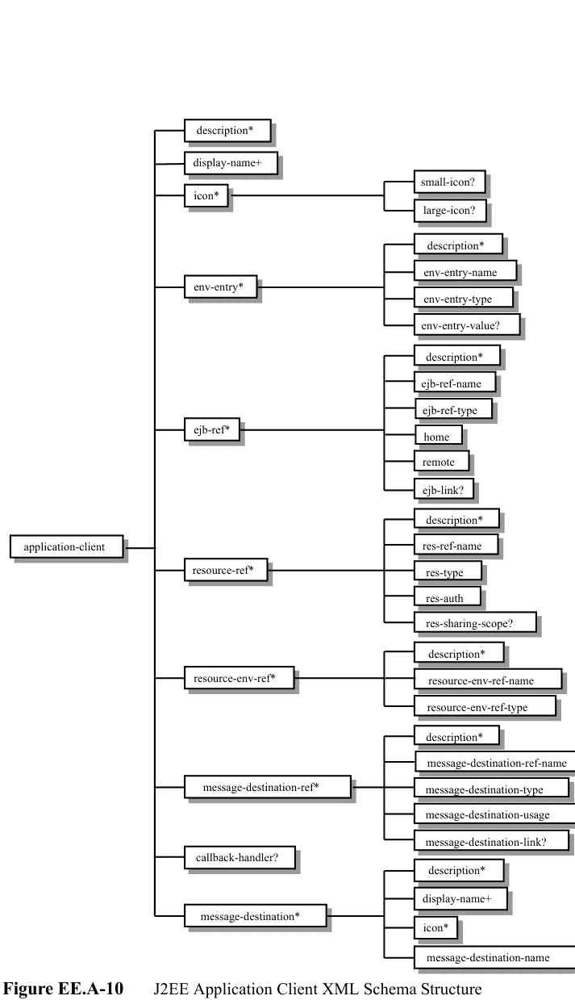

# EE.A.15 J2EE:application-client 1.3 XML DTD

本节描述了 J2EE 1.3 版本应用程序客户端部署描述符的 XML DTD。J2EE 应用程序客户端部署符的 XML 语法由 J2EE:application-client 文档类型定义。应用程序客户端部署描述符的根元素是 `application-client`。XML 元素的内容通常是区分大小写的。这意味着，例如，必须使用 `<res-auth>container</res-auth>`，而不是 `<res-auth>`。

有效的 `application-client` 部署描述符包含以下 DOCTYPE：

```xml
<!DOCTYPE application-client PUBLIC "-//Sun Microsystems, Inc.//DTD J2EE Application Client 1.3/EN" "http://java.sun.com/dtd/application-client_1_3.dtd">
```

部署描述符在应用程序客户端的 `.jar` 文件中命名为 `META-INF/application-client.xml`。EE.A-11 显示了 J2EE:application-client XML DTD 的结构，该节点可通过 `http://java.sun.com/dtd/application-client_1_3.dtd`。

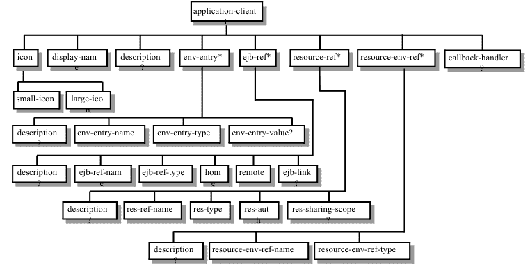

图 EE.A-11 J2EE:application-client XML DTD 结构

# EE.A.16 J2EE:application-client 1.2 XML DTD

本节描述了 J2EE 1.2 版本应用程序客户端部署描述符的 XML DTD。有效的应用程序客户端部署描述符必须包含以下 DOCTYPE 声明：

```xml
<!DOCTYPE application-client PUBLIC "-//Sun Microsystems, Inc.//DTD J2EE Application Client 1.2//EN" "http://java.sun.com/j2ee/dtds/application-client-1_2.dtd">
```

图 EE.A-12 显示了 J2EE:application-client XML DTD 的结构，该节点可通过 `http://java.sun.com/j2ee/dtds/application-client-1_2.dtd`。

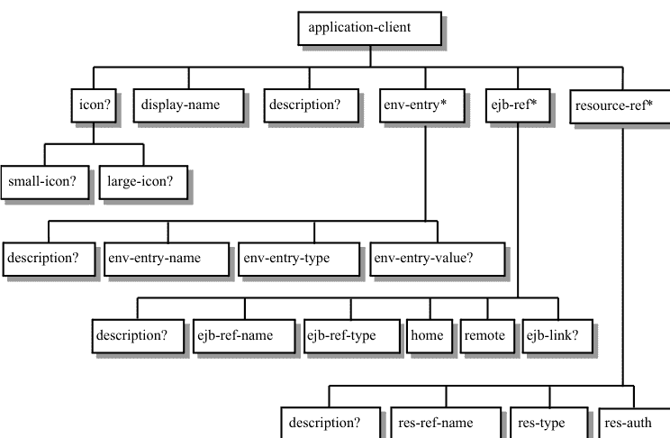

图 EE.A-12 J2EE:application-client XML DTD 结构

# EE.B.2.2 移除的内容

- 从表 EE.5-1 和表 EE.6-1 的强制 API 中删除了 MVC 1.0；从第 6 章删除了“模型-视图-控制器 (MVC) 1.0 需求”章节。

# EE.B.2.3 编辑变更

- 将 Bean Validation 版本从 1.1 更改为 2.0。
- 将 JMS 版本从 2.1 更改为 2.0。
- 从第 EE.13 章删除了 JNLP 的“未来方向”章节。

# EE.B.3 公开评审草案中的更改

## EE.B.3.1 附加需求

- 添加了节 EE.6.24，“Java EE Security API 1.0 需求”。
- 更新了节 EE.8.4.1，“组装 Java EE 应用程序”，以反映 Servlet 上根命名的需求。
- 在节 EE.6.2.3.1，“网络”中将必须支持的 TLS 版本更新为 1.2。
- 在节 EE.7.2.4，“数据格式”中将 Java EE Web 客户端必须显示的 HTML 版本更新为 4.01。

## EE.B.3.2 编辑变更

- 添加了对 Java EE 8 工作的感谢。
- 添加了节 EE.2.19，“Java EE 8 的更改”。
- 更新了表 EE.6-1 和节 9.7 以反映 Java EE API 的需求。
- 将 Web Socket 版本更正为 1.1。
- 从表 EE.6-1 中删除了 JAX-WS 和 JAXB 的引用，因为它们包含在 Java SE 中。
- 从第 EE.6 章删除了 JAXB 章节。
- 将之前关于 JAX-WS 的章节移动到节 6.2.3.3。
- 从第 EE.11 章删除了 JAX-WS 章节。
- 从节 EE.5.17，“验证器和验证器工厂引用”中删除了与 Bean Validation 规范不一致的需求。
- 在节 EE.6.23，“Java™ 容器身份验证提供者接口 (JASPIC) 1.1 需求”中明确了 JSPIC Servlet 配置和 JSPIC SOAP 配置的需求。

# EE.B.4 提议最终草案中的更改

## EE.B.4.1 附加需求

- 更新了第 EE.3 章，“安全”，以反映 Java EE Security API 的需求。

## EE.B.4.2 编辑变更

- 将 Batch 版本更正为 1.0。
- 在“节 EE.7.2.1，互联网和网络协议”中增加了关于 TLS 支持的说明。
- 更新了“相关文档”。
- 添加了对 `https://javaee.github.io/javaee-spec-project` 的引用。

# EE.B.5 最终发布草案中的更改

## EE.B.5.1 附加需求

- 更新了节 EE.3.4.2.2，“SSL 双向认证”，以反映对 TLS 1.2 及相关密码套件的支持。
- 更新了第 EE.3 章，“安全”，以反映 Java EE API 规范支持从用户组到角色的默认映射的需求。

## EE.B.5.2 编辑变更

- 对节 EE.10.6，“打包和部署”中的注解列表和需求进行了说明。

# 附录 EE.C 相关文档

本规范引用了以下文档（在本规范中指代这些文档的术语放在括号内）。

- Java 平台企业版规范版本 8（本规范）。可通过 `http://jcp.org/en/jsr/detail?id=366` 访问。
- Java 平台标准版，版本 8
- JavaBeans 规范，版本 3.2
- Server Pages（服务器页面），版本 2.3
- Expression Language（表达式），版本 3.0
- Java 平台公用注解
- Servlet 规范，版本 4.0
- Java JDBC API, 4.2
- Java 命名和目录接口, 1.2
- Java Message Service, 版本 2.0
- Java Transaction API, 1.2
- Java EE™ 连接器架构 1.7
- Java EE Web Services 1.4
- Java API for XML-based RPC 1.1
- SOAP with Attachments API for Java™ 1.3
- Java API for XML Registries, 1.0
- JAX-RS: The Java™ API for RESTful Web Services 2.1
- Java EE 管理规范 1.1
- Java EE 部署规范 1.2
- Java™ 容器授权提供者 1.5
- Java™ 容器身份验证提供者接口 1.1
- Java™ EE Security API 1.0. 可于 `http://jcp.org/en/jsr/detail?id=375`.
- 其它语言的调试支持 1.0. 可于 `http://jcp.org/en/jsr/detail?id=45`.
- JavaServer 标准标签库 1.2 (JSTL 规范). 可于 `http://jcp.org/en/jsr/detail?id=52`.
- Java 平台 Web 服务元数据 2.1. 可于 `http://jcp.org/en/jsr/detail?id=18`.
- JavaServer Faces 2.3 (JSF 规范). 可于 `http://jcp.org/en/jsr/detail?id=372`.
- Java Persistence 2.2 (Java 持久化规范). 可于 `http://jcp.org/en/jsr/detail?id=338`.
- Bean Validation 2.0 (Bean 验证规范). 可于 `http://jcp.org/en/jsr/detail?id=380`.
- Managed Beans 1.0 (Managed Beans 规范). 可于 `http://jcp.org/en/jsr/detail?id=316`.
- Interceptors 1.2 rev A (拦截器规范). 可于 `http://jcp.org/en/jsr/detail?id=318`.
- Java EE 平台的上下文与依赖注入 2.0 (CDI 规范). 可于 `http://jcp.org/en/jsr/detail?id=365`.
- Java 依赖注入 1.0 (DI 规范). 可于 `http://jcp.org/en/jsr/detail?id=330`.
- Java WebSocket API 1.1 (WebSocket 规范). 可于 `http://jcp.org/en/jsr/detail?id=356`.
- Java JSON 处理 API 1.1 (JSON-P 规范). 可于 `http://jcp.org/en/jsr/detail?id=374`.
- Java JSON 绑定 API 1.0 (JSON-B 规范). 可于 `http://jcp.org/en/jsr/detail?id=367`.
- Java EE 并发工具 1.0 (并发工具). 可于 `http://jcp.org/en/jsr/detail?id=236`.
- Java 平台批处理应用程序 1.0 rev A (批处理规范). 可于 `http://jcp.org/en/jsr/detail?id=352`.
- 扩展机制架构, 可于 `http://docs.oracle.com/javase/8/docs/technotes/guides/extensions/index.html`.
- 可选版本控制, 可于 `http://docs.oracle.com/javase/8/docs/technotes/guides/extensions/index.html`.
- JAR 文件规范, 可于 `http://docs.oracle.com/javase/8/docs/technotes/guides/jar/jar.html`.
- 通用对象请求代理：架构与规范 (CORBA 2.3.1 规范), 可于 `http://www.omg.org/cgibin/doc?formal/99-10-07`.
- CORBA 2.6 - 第 26 章 - 安全互操作性, 可于 `http://www.omg.org/cgibin/doc?formal/01-12-30`.
- IDL Java™ 语言映射规范, 可于 `http://www.omg.org/cgibin/doc?ptc/2000-01-08`.
- Java™ 语言到 IDL 映射规范, 可于 `http://www.omg.org/cgibin/doc?ptc/2000-01-06`.
- 可互操作命名服务, 可于 `http://www.omg.org/cgibin/doc?ptc/00-08-07`.
- 事务服务规范 (OTS 规范), 可于 `http://www.omg.org/cgi-bin/doc?formal/2001-11-03`.
- SSL 协议, 版本 3.0. 可于 `http://tools.iet.org/html/rfc6101`.
- 架构风格与基于网络的软件架构的设计 (REST), R. Fielding, 博士论文, 加州大学欧尔文分校, 2000. 可于 `http://roy.gbib.com/pubs/dissertation/top.htm`.
- Java™ 社区进程SM:2: 流程文档, 版本 2.10 (2016年3月21日). 可于 `http://jcp.org/en/procedures/jcp2`.
