# Java语言程序设计


https://archive.org/details/isbn_9787548745259

主编◎黄承宁 徐新同平

主审◎谢 懿

副主编◎刘瑞杰 刘廷芮 杨天奇

张勇饶 彬王睿

石彦杰

主编 黄承宁 徐新 沈平

图书出现装帧问题，请与经销商调换

# 前言

# foreword

随着大数据、云计算和人工智能的快速发展，Java语言的需求依然巨大，应用也变得越来越广泛。随着 TIOBE 的数据显示，Java语言仍然是最流行的编程语言之一，许多知名公司也一直使用 Java 来开发软件和应用程序。但是很多学生学习总是不得其要，学会了理论没有实践，理论薄弱。从反馈与实践总结，作者团队编写了本书。

本书从零到书，编写团队始终坚持一个原则——帮助Java学习者从入门走向精通。从教学和开发经验来看，这是一个很高的目标，具有一定的挑战性。为了实现这个目标，在本书编写过程中，编写团队加入了教学和开发的实战思考与总结。

## 【教材体系】

在整体体系结构逻辑上，本书将Java基础知识体系分为四个模块：语言入门、面向对象、应用开发、库源与设计模式。本教材内容涵盖知识由浅入深、从理论应用的逻辑，每个模块知识划分和具体内容如下：

模块一：语言入门（第1章~第3章）。此模块介绍了Java语言发展历史、Java编程和运行环境、程序结构、语法基础。此模块为Java语言入门，旨在帮助学生掌握Java语言的使用，一方面能够掌握语言基础、编写单功能程序。

模块二：面向对象（第4章、第5章）。这两章介绍了面向对象的概念、原理和面向对象特征，并从实际应用和代码实现，引导引入到项目驱动，引导学生理解语义应用。通过在三个特征中引入，来实现对应的设计模式。

模块三：应用开发（第6章~第11章）。这一模块，介绍了异常、集合框架应用、输入输出、多线程、数据库 JDBC 和图形界面 GUI 开发等知识应用，每个章节都是在第一模块知识基础上的不同方向应用。

模块四：库源与设计模式。在前面模块知识基础的基础上，融入 Java 生态与社区的应用应用，特别是在相关基础知识上的单例设计模式、工厂设计模式、模块设计模式和设计模式等设计模式的应用介绍。

## 【本书的特点】

本书以 Java 语言教学为目的的初学者，因此特别注重学生入门，围绕这个目标，本书在内容组织、结构安排、教学方式等方面有如下特点：

1. **强化面向对象**。本书版突出了 Java 面向对象开发技术原理。面向对象思想和开发技术一直是 Java 语言的难点，本书一方面增加了理论讲解编译，另一方面增加了原理与实际结合，以代码为引入深入浅出现在的面向对象编程技术。特别地，在理论逻辑形类比例讲解基础上，配合代码直看到运行结果，有利于理解和应用。

2. **优化章节结构**。本书在第一版基础上，结合教学实践经验积累和企业开发工程建议，优化调整了章节内容。从 Java 语言运行到语法基础再到面向对象编程，最后介绍基础编程，条例清晰，模块独立。

3. **支持在线学习**。为了帮助学生更好地掌握知识，用心录制了微视频，针对 Java 基础中的一些知识进行了讲解，为了方便教学，书中提供了所有源代码、教学大纲、PPT 等资源。本书作为计算机应用、本科生的教材，也可以方便网络开发的人。

- 3.3.3 `Vector`类 / 76
- 4.3.1 方法的定义 / 92
- 4.5.2 对象的引用 / 100
- 5.5.3 接口的实现 / 135
- 8.2.2 流类型 / 196

# Java 语言设计

在此同时，“一杯香醇的咖啡”成为了 Java 语言的标志。目前，Java这杯咖啡已经流行遍了世界各地。

## 1.1.2 互联网语言的发展

在当时，Green 完成后 Java 束于高潮。1993 年 Green 加入了 Sun Microsystems 的一个客户 Fortune，并得到了 Sun Warner 的一个电视研究项目遭遇失败，Java 与 3D 的业务生态同样失败，一半成了 Sun 研究的视频服务。

到了 1994 年下半年，当 Green 经历了这些挫折的时代，互联网的快速发展促进了 Java 语言的改进，Micystems 意识到 Java 的技术瓶颈，推出了完全用 Java 编写的运行在 Internet 上的新版本 HotJava，逐渐成为受青睐的编程语言。

1995 年，美国 Microsystems 正式宣布 Java 语言发布，由于 Java 语言具有全球、平台、面向对象、简单、适用于网络等显著特点，当时作为主要的互联网发展，Java 语言的迅速引起了软件程序和开发者的关注。程序员们纷纷尝试用 Java 语言编写应用程序，并利用网络发布到各地。IBM、Oracle、Netscape、Apple、SGI 等都与 Microsystems 签订合同，获得了 Java 的授权。

我们知道，在 PC 下直接运行到 Windows 是可能的，因为程序的最终执行会将程序编译成机器码，专门为各种硬件，除非修改硬件，而 Java 让一次就足够了。在 Java 代表的本地模式和 PC 的分布式系统之间，引入了 Java 语言。Java 语言的特点是编译的，即编译程序和操作系统是不一样的，由于 Sun 开发的 SPARC 操作系统是 Unix 或 Linux，因此相应的程序基本上适用于 COBOL、FORTRAN、C++ 等；Java 语言另一个特点是代码可以通过网络在各种计算机上进行迁移，这就迫切需要一种 Java 的编程语言，使得编写的程序能够在运行。著名杂志 1995 年获得年度产品之一（Java 语言），随之出现的是大量 Java 编写的软件，受到业界赞誉，认为“Java”的发明是年代以来大事件。首席执行官说：“Java 是人类以来最优秀的设计，并定义了一个软件开发的策略，Java 语言是面向对象的时代，而购买 Java 已成趋势，微软和 IBM 公司都计划在市场上销售 Java 来使用。

Soft 公司（是 SUN 下属的一个公司），通过许可办法允许许多公司把 Java 虚拟机和 Java Applets 植入他们开发的操作系统，这样许多开发者就能容易的使用 Java 语言编程，不同的平台就可以脱离浏览器运行 Java 程序，这无疑是很受欢迎的，因为 Java 语言的应用开辟了广阔的前景。另外，Java 只能编译动态的软件，而且编译完整的软件，将会提供更多的帮助。显然，这为 Java的应用提供了有力的支持。

2004 年 9 月，JSE1.5 发布，成为 Java 发展上的里程碑，为了表示该版本的重要性，JSE1.5 更名为 Java SE 5.0。2005 年 6 月，Sun One 大会发布了 Java 6.0。2009 年 4 月，Oracle 以 74 亿美元的价格收购 Sun 公司，随后 Java 社区的运营由 Oracle 管理。2011 年 7 月，Oracle 发布了 Java 7.0，2014 年 3 月，Oracle 发布了 Java 8.0。截至 2020 年各个版本所示（表 1-1）。

## 表 1-1 Java 版本

| 版本 | 名称 | 发布时间 |
| :--- | :--- | :--- |
| 1.0 | Oak(橡树) | 1996 年 1 月 |
| 1.1 | | 1997 年 2 月 |
| 1.2 | Playground(运动场) | 1998 年 12 月 |
| 1.3 | Kestrel(红隼) | 2000 年 5 月 |
| 1.4.0 | Merlin(灰隼) | 2002 年 2 月 |
| Java SE 5.0/1.5 | Tiger(老虎) | 2004 年 9 月 |
| Java SE 6.0/1.6 | Mustang(野马) | 2006 年 4 月 |
| Java SE 7.0/1.7 | Dolphin(海豚) | 2011 年 7 月 |
| Java SE 8.0 (8u202 and earlier) | Spider(蜘蛛) | 2014 年 3 月 |
| Java SE 8.0 (8u211 and later) | Spider(蜘蛛) | 2014 年 9 月 |
| Java SE 9.0 | | 2017 年 9 月 |
| Java SE 10.0 | | 2018 年 3 月 |
| Java SE 11.0 | | 2018 年 8 月 |
| Java SE 12.0 | | 2019 年 2 月 |
| Java SE 13.0 | | 2019 年 9 月 |
| Java SE 14.0 | | 2020 年 3 月 |
| Java SE 15.0 | | 2020 年 9 月 |

有人预言 Java 将是网络上的“世界语”，今后所有用其他语言编写的软件系统都要用 Java 语言来改。工业界也有预言 Java 语言的出现，将会引发一场软件革命，这是因为传统的软件往往需要针对具体的实现环境，换一个环境就需要做一番编译，耗费费力，而 Java 语言在执行（二进制）上兼容的，这使得以前开发的软件就能运行在不同的机器上，只要所要求的机器提供 Java 虚拟机。目前许多大学开始开设 Java 课程，Java 正逐步成为世界上程序员用最多的编程语言。

## Java 编程语言

Java 语言对软件开发产生深刻影响，可以使用代码进行动态活动、可视化的描述、以提供设计更加直观。用户的需求是各异的，无论地区、行业、都可以用 Java 语言描述清楚。

### Java 语言的特点

Java 到底是什么样的语言？

- **软件开发**：由于 Java 语言是面向对象的，完全可以使用 OOP 技术与方法来开发，这是许多最新的的要求。
- **交互**：Java 语言的效果比 GUI 更加逼真，尤其是利用 WWW 提供的巨大资源。
- **软件产品**：用 Java 编写的软件具有可视化、可操作的效果，使得交互更加理想，因为它可以做到“即时、交互与动作”，要它停就继续，这是视频难以做到的。
- **其他**：Java 语言对开发效益具有明显的影响。
- **简单面向对象**：Java 语言的简单性体现在精巧的系统上，用图形化的操作系统来实现程序，封装化和信息隐藏，用户可以用自己建立类。
- **强大**：Java 使用大量的运算符、多重继承、强制转换。
- **自动回收**：垃圾回收机制使得程序员不需要管理内存，程序设计简单，大大小了出错概率。
- **多线程**：程序可以在运行时同时处理不同的任务，多线程环境中，不同的线程互干扰，也不会由于某一事务等待状态而影响它的执行。
- **动态**：在执行过程中动态加载各种类，使得非常适合网络上的连接，同时也利于软件开发，即使更新不需要重新编译。
- **安全**：Java 语言在编译和运行过程中都进行严格检查，防止出错。如果使用非法类型或参数，Java 程序中没有指针，通过索引内存，就可以避免越界的发生。内在自动回收增加了 Java 的安全性。作为应用程序，必须提供足够的安全，Java 在运行程序时严格访问数据的权限，只有允许的操作才能修改本地数据。

### 结构中立并移植

网络上充满了各种机器和操作系统，使用 Java 程序在网络中的任何地方运行，Java 生成了结构无关。任何计算机，只要其处理器和操作系统上有 Java 环境，字节码就可以在该计算机上运行。即使是在单一系统的上，结构中立也是重要的。随着处理器架构的发展，各种版本的程序能够在任何平台上工作。

### 高性能

虽然 Java 是解释执行，它仍然具有很高的性能。在某些特定的 CPU、Java 虚拟机可以快速转换为机器进行执行；字节码的设计是针对机器的实际转换，编译器优化使得代码质量提高。通过 Java 虚拟机的“即时执行（just in time）”技术的出现，使得 Java 执行速度有了提高。

### 解释器

为了现场执行，Java 设计为解释执行，字节码包含了许多信息，使得连接更加简单。多线程程序可以在运行时处理不同的任务。在多线程环境中，不同的线程处理任务互干扰，也不会由于某一事务等待状态而影响它的执行，这样就可以容易在网络上的实时交互。执行过程中动态加载各种类，即使更新不需要重新编译就可以使用。Java 语言是面向对象的分布式的、解释的、健壮的、安全的、中立的、可移植的、性能优异的、多线程的、动态语言。

## 工作原理

### 虚拟机

Java 虚拟机是软件编写的，可以在任何处理器上（无论是在计算机中还是子设备上）安全并且兼容地存在。`class` 文件中的字节码，有时也称为字节码文件。Java 虚拟机的“机器”存在于 `class` 文件，解释器将字节码文件解释为特定的机器进行执行。Java 程序需要通过编译器和执行，过程如图所示。不同的软件平台要考虑处理器的型号，也要考虑操作系统的种类。目前在 SPARC 结构、X86 结构、MIPS 和 PPC 等嵌入式处理器上，在 Unix、Linux、Windows 等操作系统上，都有 Java 虚拟机的实现。

### 内存回收

程序的执行过程中，部分在使用后处于废弃状态。如果不及时进行内存回收，就会导致内存泄漏。在 C++ 语言中是由程序员手动内存，而在 Java 运行环境中，有一个线程专门检测不再使用的对象并进行自动回收，减轻了程序员的工作量。

### 安全检查

Java 语言的出现使得代码加载到本地机器上运行，如何保证 Java 不携带病毒呢？加载需要三个步骤：

- 首先，由类加载器（`class loader`）负责将类加载到 Java 虚拟机中，在此过程中该类符合类规范；
- 其次，字节码校验器（`bytecode verifier`）检查类标识是否存在非法操作；
- 如果通过，由解释器将字节码转换为机器码进行执行。

## 环境

### 平台

Java 平台分成 JEE、JSE、JME 三个平台，针对不同的市场和设备进行定位。字节码和数据限制：Java 虚拟机使用的是“沙箱”模式，即将代码在一定空间内执行，不允许程序访问内存外的数据。

### JDK

JDK 不是编程语言，而是开发平台。Java 技术给开发者提供了许多工具：编译器、解释器、文档生成器和打包工具等。同时，Java 还有一个发布平台，有两种“发布环境”：首先是 Java 运行时环境（Java runtime environment，JRE），包含了完整的类组件；其次，提供了 Java 解释器和运行时环境。

### Java 环境

Java 是解释型高级编程语言，开发 Java 程序通常的是：

- 编写源程序
- 编译程序
- 运行程序

在编写程序前，需要一些基本的开发工具的支持。Oracle 为所有的 Java 程序员提供了一套免费的环境，名为 Java SDK，可以从 `http://www.oracle.com` 下载 `jdk1.8.0_80`。在安装的时候可以选择安装到任意的硬盘驱动器，例如安装到 `C:\Program Files\Java\jdk1.8.0_80` 目录下。通常在 JDK 目录下有 `bin`、`demo`、`lib`、`jre` 等目录，其中 `bin` 保存了 `javac`、`appletviewer` 等命令，`demo` 保存了许多 Java 的例子，`lib` 保存了 Java 的类库，保存的是 Java 的运行环境。Oracle 提供了不同版本的 Java，可以运行在 Solaris SPARC/x86、Linux x86/x64、Microsoft Windows x86/x64 平台。

- 安装 Java SDK：找到下载的安装包 `jdk-u60-windows-x64`，双击该文件执行安装，按提示点击一步直到安装完成。安装成功后，有以下文件夹：

```
C:\Program Files\Java\jdk1.8.0_60\bin
C:\Program Files\Java\jdk1.8.0_60\include
C:\Program Files\Java\jdk1.8.0_60\jre
C:\Program Files\Java\jdk1.8.0_60\lib
```

- 设置运行路径：对于 Windows 7、Windows 8.1 系统：(1) 点击“我的电脑”→“属性”→“高级设置”；(2) 点击“环境变量”→“系统变量”→“新建”，变量名输入 `JAVA_HOME`，变量值输入 `C:\Program Files\Java\jdk1.8.0_80`；(3) 在系统变量列表中选中“PATH”→“编辑”，如图 1-4 所示。点击“新建”后输入 `%JAVA_HOME%\bin`，注意：变量值不能出现空格。

# Java 程序设计

## 构建 Java 程序

Java 程序分为两大类：

- **Java 应用程序（application）**
  - 应用程序分为控制台程序（console application program）和窗口程序（window application program），`java console` 在命令行窗口（即 Dos 窗口）中运行，是字符用户界面（CLI）程序；在本地机器上运行，有 `main()` 方法，它是执行 Java 程序的入口。`java windows application` 使用图形用户界面，在本地机器上运行，如 Windows XP 下的应用程序，有 `main()` 方法、作为程序的入口。
- **小型应用程序（Navigator）**：存放在网络上的服务器上，嵌入到 WWW 页面中，作为程序组成部分下载，在浏览器（IE、Navigator）中使用图形用户界面 GUI，不能存取本地文件，没有 `main()` 方法

### 一个应用程序 HelloWorld

HelloWorld 是一个经典的程序，基本上是所有语言首先接触的一个程序，我们用这个程序作为本书编写的开始。

源代码：

```java
/*
* The HelloWorld class implements an application
* that simply displays "Hello World!" to the standard output.
*/
// HelloWorld.java
import java.io.*;
public class HelloWorld {
    public static void main(String[] args[]) {

    }
}
```


### Java application 顺序编译


# Java 程序设计

## 1.5.1 第一个 Java Application 程序

Java 程序的编辑可以使用任何文本编辑器，例如 Sublime、UltraEdit、EditPlus、Notepad、Word 甚至，只要把编写好的代码保存成纯文本的 `.java` 文件。当然也可以使用集成开发环境，例如 Borderland JBuilder、IBM 的 eclipse、visualage for Java，此外还有 Cafe、kawa 等其他集成开发环境。

### (1) 源程序的编辑

用任何一种文本编辑器或集成环境将上面的代码即可完成源程序的编辑（图1-5）。在用记事本保存文件时，应该在文件名加上后缀，如“HelloWorld.java”，目的是保证后缀是正确的。

- EditPlus - `C:\Users\Administrator\Desktop\JAVA教材\Hello.java`

```java
// The Hello World class implements an application
// That simply displays "Hello World!" to the standard output.
// HelloWorld.java
import java.io.*;
public class HelloWorld {
    public static void main(String[] args) {
        System.out.println("Hello World!");
    }
}
```

**图1-5 EditPlus 编辑 Java 源码**

文件名后缀是 `.java`。如果不注意的话，记得默认的后缀是 `.txt`，即使使用时也是 HelloWorld.java，实际保存的文件名是 HelloWorld.java.txt，`javac` 不能对其编译。

### (2) 程序结构分析

`public class HelloWorld` 用来声明一个 `HelloWorld` 类。

`class` 是关键字，定义一个类。

`public` 是访问修饰符标识符，这里有一个公类，所有的类都可以访问这个类的对象。

`import java.io.*;` 中的 `*` 是将 io 包引入到包中，以便使用这个包中的定义出来，与 C/C++ 使用头文件不同，Java 中没有 `include` 语句。包有很多包，并且它的每一个包中有很多定义的类，且编译成了程序代码，可以直接引用。

每个类都应该应用 `{ }`，表示类中的成员（变量），对对象进行转换。

下一行 `static void main()` 定义了一个方法 `main()`，也是用 `{ }` 开始和结束。

主方法的参数是一个字符串数组，组织在程序内存中是有用的，但是必须列出。

Java 应用程序中可能有很多方法，每个类中也有很多方法，但最后执行的是 `main()` 方法。

`System.out.println("Hello World!");` 是调用方法，调用的是 `println` 的方法，方法输出（屏幕）输出一个字符串对象到标准输出。

`System.out` 是包 `io` 的类的转换。

- 系统类：Java 中最重要的类之一，它提供各种系统类（显示器、键盘）的标准接口。
- 对象类：系统类内部的操作，标准输出设备，其中包含方法 `println()`，在屏幕上显示信息。

## 1.5.2 Application 程序的编译

公司为全世界的 Java 程序员提供了一个免费的 Java 程序开发工具（Java Development Kit, JDK），包括 Java 编译命令 `javac.exe`，以及 Java 执行命令 `java.exe`，还有帮助文档生成命令 `javadoc.exe` 等。这些命令可以在命令行下运行，例如我们要编译 Java 文件 `HelloWorld.java`，如果在 Windows 中开发，就可以在“命令提示符”下进行编译，通过 `cmd` 命令进入 Java 源文件所在的目录，在命令行中输入（图1-6）：

```
javac HelloWorld.java
```
命令编译，生成 `HelloWorld.class` 文件

**图1-6 编译窗口**

## 1.5.3 Java Application 的执行

编译结束后，在 Java 源文件中的每一个类都会相应的类文件，例如图1-6中就会生成 `HelloWorld.class` 文件，而 Java 程序在执行时调用的类文件。Java application 的执行是在命令下，如果是 Windows 系统中，就可以在“命令提示符”下输入：

```
java HelloWorld
```

进行执行，该 `java` 命令会启动 Java 虚拟机，并进入 `HelloWorld.class` 文件。由于程序的运行结果直接在命令行下输出，此时屏幕上显示（图1-7）“Hello World!”

**图1-7 输出窗口**

### 注意事项

1. `main()` 方法要定义为方法，字母的大写是敏感的，`main()` 和 `Main()` 不是同一个方法。
2. Java 中区分大小写。
3. Java 源文件的类名与 `main()` 方法完全一致，包括大小字母。
4. 源文件的后缀只能是 `java`。
5. 执行后解释器后，class 文件的主类，class 后缀跟空格。

Java 中，程序都是以类的方式组织的，Java 源文件保存在 `java` 后缀的 java 文件中，每一个类的程序都是类文件，或者称为字节码文件，保存在 `class` 文件中。作为一个 Java application，类必须包含 `main()` 方法，程序的执行是从 main 方法开始，格式是不变的。

## 1.5.4 第一个 Java Applet 程序 HelloWorldlet

将要介绍的 application（Windows 和 Dos）程序写为 applet（应用程序）。源程序代码：

```java
// HelloWorldlet.java
import java.applet.*;
import java.awt.*;
public class HelloWorldlet extends Applet
{
    public void paint(Graphics g)
    {
        g.drawString("Hello World!",10,50);
    }
}
```

`import` 关键字从 C/C++ 中的 include 功能类似，将 JDK 提供的 `java.awt` 包引入，以便在使用程序中的 `Graphics` 和 `applet`。在类的声明中，`extends Applet` 是从 applet 程序需要的，表示该类 `HelloWorldlet` 是从 `Applet` 产生的（子类），而 `Applet` 是超类（又称父类），派生类的功能（特征、行为）。

### (1) Java Applet 程序的编辑

Applet 程序与应用相同，输入后保存成 `HelloWorldlet.java` 即可。

### (2) Java Applet 程序的编译

Applet 程序也是一种类，与应用相同，用 Java 编译成类文件。

### (3) Java Applet 程序的执行

Applet 运行方式与应用不同，Applet 没有 `main()` 方法，它必须嵌入到 HTML 文中，在浏览器中运行。HTML 是浏览器中的通用语言，Applet 应该嵌入到 HTML 文件中，再编写一个 html 文件如下(1-8)：

```html
<html>
<BODY>
    <APPLET CODE="HelloWorldlet.class" WIDTH="200" HEIGHT="100">
    </APPLET>
</BODY>
</html>
```

```html
<html>
<head><title>Hello</title></head>
<body>
</body>
</html>
```

**图1-8 Applet HTML 文件**

Applet 程序在 Windows 操作系统中，就可以在“命令提示符”下输入：`appletviewer HelloWorldlet`。此时会弹出另一个窗口运行该 Applet 程序，如图1-9。

**图1-9 Applet 运行窗口**

Applet 程序还可以另一种方式运行，那就是直接在浏览器中打开 `HelloWorldlet.html`。在主流浏览器中 IE、Netscape 包含 Java 虚拟机，负责解释 Applet 程序。在浏览器中打开 `HelloWorldlet.html` 文件，可以在 Applet 区域显示“Hello World!”所示。

**图1-10 浏览器运行 Applet**

HTML（Hyper Text Markup Language）是超文本标记语言，不是编程语言，只能在浏览器中运行（如 IE、Navigator 等）。它是纯文本的，可以用文本编辑器编写。HTML 中的内容包括两部分：

一是标记，用尖括号 `<>` 括起来：

```html
<html>
<head><title>...</title></head>
<body></body>
</html>
```

二是正文内容，位于两个标记之间，如标题或内容。

HTML 文件的开始标记为 `<html>`。HTML 文件的结束标记为 `</html>`。

**注意**：Java Applet 的生命周期共有四种状态（初始化、运行、停止、消亡），其分别对应四个方法：`init()`、`start()`、`stop()`、`destroy()`。

1. `init()`：当创建 Applet 且第一次浏览器加载时，就会执行 `init` 方法。在 Applet 生命周期中，该方法只运行一次，进行一些初始化操作，例如变量。
2. `start()`：调用 `init` 方法后，系统将自动调用 `start` 方法。当用户离开页面后再次返回，或者浏览器从状态恢复时，系统都会调用 `start` 方法。和 `init` 方法不同，`start` 是在生命周期中被多次调用。
3. `stop()`：方法起到作用：当用户离开当前时刻，停止消耗资源的工作，这样就可以提高运行速度，且系统调用该方法，并不人为干预。
4. `destroy()`：当用户关闭浏览器时，系统就会调用 `destroy` 方法。应该注意 `stop` 方法和 `destroy` 方法的区别。

## 第2章 Java 程序设计基础

### 2.1 编写简单的程序

首先，我们来看一个计算圆面积的简单问题。该如何编写程序解决这个问题？编写程序涉及如何设计算法以及如何将其翻译成程序代码两部分内容。算法描述的是如果要解决问题，需要执行的动作以及这些动作的顺序。算法可以帮助程序员在使用程序设计语言编写程序之前做一个规划。算法可以用自然语言或者代码（即自然语言和程序设计代码混合在一起）描述。这个程序的算法描述如下：

1. 读入半径
2. 利用的公式计算圆面积：面积 = 半径 × 半径 × π
3. 显示面积。

**【例2-1】** 编写一个 Java 程序，计算圆面积（执行结果如图2-1所示）。

```java
public class ComputeArea {
    public static void main(String[] args) {
        // 定义半径
        double radius;
        // 定义圆面积
        double area;
        // 给定一个半径值
        radius = 20;
        // 计算面积
        area = radius * radius * 3.14159;
        // 输出结果
        System.out.println("The area for the circle of radius=" + radius + "is=" + area);
    }
}
```

**图2-1 程序运行结果**

```
命令行: C:\Windows\System32\cmd.exe
Microsoft Windows [版本 10.0.18363.1316]
(c) 2019 Microsoft Corporation. 保留所有权利。
编译 --> C:\src\src\ssm\javac ComputeArea.java
运行 --> C:\src\src\ssm\java ComputeArea
The area for the circle of radius 20.0 is 1256.637
--> C:\src\src\ssm\>
```

程序中，像 `radius` 和 `area` 这样的变量对应它们在内存中的位置，每个变量都有名字、类型、大小值。第四行声明变量 `area` 可以存储一个 `double` 类型的数值；直到它被赋予一个数字值时，该变量才被定义。第八行将 `radius` 赋值为 20。类似于，声明了变量 `area`，并将结果赋值给它。

加号（`+`）有两种意义：一种用于这种做法，另一种用途是字符串的连接。输出结果中的加号（`+`）表示字符串连接，如果两个操作数都是字符串，字符串连接就会把两个字符串连接起来；如果一个操作数是非字符串（例如一个数字），这个非字符串就会转换成字符串，然后再与另一个字符串相连。所以，输出结果中的加号（`+`）会将几个字符串连接成更长的字符串，然后它将在输出结果中显示出来。

> **警告**：在源代码中，字符串不能直接换行。下面的代码会导致编译错误：

```java
System.out.println("Introduction to Java Programming,")
by fyer Wang;
```

为了修正错误，将该字符串分成几个独立的字符串，后再用连接符（`+`）将它们组合起来：

```java
System.out.println("Introduction to Java Programming, " +
"by fyer Wang");
```

### 2.2 标识符与关键字

Java 的符号采用 Unicode 字符集。Java 符号分为五类：标识符、关键字、字面值、运算符、分隔符。

#### 2.2.1 标识符

标识符是程序元素中的名字，如类、方法和变量。

例如例2-1中看到的，`ComputeArea`、`main`、`radius`、`area` 都是出现在程序元素中的名字，这样的名称为标识符。所有的标识符必须符合以下命名规则：

1. 由字母、数字、下划线（`_`）和美元符号（`$`）构成的字符序列。
2. 必须用字母、下划线（`_`）或美元符号（`$`）开头，不能用数字。
3. 长度没有限制，但不能包含空格，不能是 Java 的关键字。
4. 标识符不能为 `true`、`false` 或 `null`。

例如，`$2`、`ComputeArea`、`radius` 和 `showDialog` 都是合法的标识符，而 `2A` 和 `d4` 都是非法的，因为它们不符合命名规则。Java 编译器检测非法标识符并报错。注意：Java 区分大小写，所以 `Area` 和 `AREA` 是不同的标识符。

> **提示**：
> 1. 标识符是为了命名变量、方法和类，提高程序的可读性。
> 2. 不要用字符 `$` 命名，`$` 用于自动生成的源代码中。

#### 2.2.2 关键字

Java 语言中的关键字，图2-2 列出了所有关键字。注意：
1. 关键字都是小写的。`TRUE`、`FALSE` 和 `NULL` 不是关键字。
2. `true`、`false` 或 `null` 不是关键字，但不能作为标识符。
3. `goto` 和 `const` 是 Java 保留的关键字。如果出现在 Java 程序中，虽然 Java 能够识别它们，会产生错误。

### 2.3 基本类型

Java 有八种基本类型，分为整数类型、浮点类型、字符类型、布尔类型。引用类型是另一类。

### 2.3.2 变量

#### (1) 什么是变量？

所谓变量，是指程序运行期间产生的临时数据，应用程序会将这些数据保存在内存中。变量的格式：`数据类型 标识符 = 数值或表达式`。

**【例2-2】** 编写一个 Demo 使用不同的变量。

```java
class Demo {
    public static void main(String[] args) {
        int a, b, c; // 声明三个整数
        int d = 3, e = 4, f = 5; // 声明三个整数并赋予值
        byte g = 2; // 声明并初始化
        double pi = 3.14159; // 声明双精度浮点
        char x = 'x'; // 变量的值是'x'
        String s = "Java"; // 声明字符串

        byte age = 88;
        System.out.println(age);

        short money1 = 10000;
        System.out.println(money1);

        int money2 = 1000000; // 使用long类型，末尾需要字母L，建议用大写
        long money3 = 100000000000000L;
        System.out.println(money3);

        float money4 = 6.5F;
        System.out.println(money4);

        double money5 = 199999.001;
        System.out.println(money5);
    }
}
```

**图2-4 运行结果**


## (2) 变量的作用域

变量是有作用范围（`scope`）的，即作用域。一旦超出作用域，就无法使用这个变量。在程序中，变量一定会被定义在大括号中，大括号包含的代码块就是变量的作用域。

按作用域来，变量有若干种：局部变量、成员变量、方法参数及形参数。在一个特定的域中，变量名应该是唯一的。局部变量在方法或方法的代码块中声明，它的作用域为所在的代码块（整个方法或方法中的一个块）。成员变量在类中声明，而不是类的方法中声明，它的作用域是整个类。形参数传递形代码，它的作用域就是形部分。

```java
public class myApplication {
    String strVar;// 类变量
    public static void main(String[] args) {
        int nVar;// 方法中的变量
        // 分别在类、方法 main() 定义了三个变量。
        // strVar 在 main() 内部可以使用，nVar不能在 main() 外使用，
        // 编译时出错。
    }
}
```

## (3) 变量的初始值

在 JDK1.1 之后的版本中，声明变量不赋初始值的情况下，每个数据类型的变量都有一个默认值。这些变量也包括基本变量和实例类型。

八种基本数据类型变量的默认值如图2-5所示。

| 类型 | 默认初始值 |
| :--- | :--- |
| boolean | false |
| int | 0 |
| short | 0 |
| float | 0.0 |
| double | 0.0 |
| char | `\u0000` |
| long | 0 |
| byte | 0 |

事实上，编程人员未赋值变量往往产生漏洞，因此只有在赋值后才能使用。

## 2.3.3 常量

Java中的数据分为常量和变量，有些数据在程序过程中不能改变，这些数据是常量。

- 整型常量：
  - 十进制表示方式：正整数，如`23`。
  - 二进制表示方式：以`0b`开头，如`0b1011`。
  - 十六进制表示方式：以`0x`开头，数字为`0~F`，如`0x23A`。
  - 八进制表示方式：以`0`开头，如`071`。
  - 长型常量：末尾加`L`，如`100000000000000L`。
- 浮点常量：
  - 数值后面加`f`，如`2.5f`。
  - 双精度数值后面加`d`或不加。

## 2.3.4 基本类型间的转换

## 2.4.1 算术运算符

算术运算符最常见的操作将参数与数字进行计算常见如图2-7所示。

(1) `+`, `*`, `/`, `%`

【例2-5】算术运算符

```java
public static void main(String[] args) {
    int a=10;
    int b=20;
    int c=25;
    System.out.println("a+b=" + (a+b));
}
```

| 运算符 | 表达式 | 结果 |
| :--- | :--- | :--- |
| 正号 | `+3` | 3 |
| 负号 | `-2+3` | 5 |
| 连接字符串 | `“中” + “国”` | “中国” |
| 赋值号 | `int a=3-a` | -3 |
| 减号 | `3-1` | 2 |
| 乘号 | `2*3` | 6 |
| 除号 | `5/2` | 2 |
| 赋值 | `5/2` | 1 |
| 自增 | `int a=1;a++/++a` | 2 |
| 自减 | `int b=3--/--b` | 2 |

图 2-7 常用运算符

```java
int a = 3;
int b = 4;
int c = a + b;
System.out.println("a+b=" + c);
System.out.println("b%a=" + (b % a));
System.out.println("c%a=" + (c % a));
```

## 前级自增自减法

- `(+a, --b)`: 先进行自增或者自减运算，再进行表达式运算(先算自己，再和别人)。

情况一：单独使用，不参与运算。

情况二：不单独使用，参与运算。

## 2.4.2 逻辑运算符

逻辑运算符是用于布尔值运算的，运算符的最终结果为布尔值 `true` 或 `false`，如图 2-8 所示。

| 运算符 | 结果 |
| :--- | :--- |
| 与 | false |
| 或 | true |
| 异或 | true |
| 逻辑与 | false |
| | true |

### `&&` 与 `&` 的区别

相同：当运算符两边的操作都为 `true` 时，结果才为 `true`。

不同：`&` 不论左边为 `true` `false`，右边的表达式都会进行运算。`&&` 当左边为 `false` 时，右边的表达式不会进行运算。

### `||` 与 `|` 的区别

相同：两边操作，任意一方为 `true`，其结果为 `true`。

不同：不论左边为 `true` 或 `false`，右边的表达式都会计算。`||` 当左边为 `true`，右边的表达式不会进行运算。

### 【例 2-6】 逻辑运算。

```java
public static void main(String [] args) {
    int a=3;
    int b=2;
    if(a>=2 || b++<2) {
        System.out.println("a的值:"+a+" b的值:"+b);
    }
    if(a>2 || b++<2) {
        System.out.println("a的值:"+a+" b的值:"+b);
    }
}
```

运行结果：

```
a的值是:3, b的值:2
a的值是:3, b的值:3
```

## 2.4.3 关系运算符

比较运算符又叫关系运算符，它是用来判断两个数值的大小关系以及是否相等关系的，结果是布尔值。关系成立时为 (`true`)，不成立时为假 (`false`)。如图 2-9 所示。

| 运算符 | 结果 |
| :--- | :--- |
| 等于 | false |
| 不等于 | true |
| 小于 | true |
| 小于等于 | false |

### 【例 2-7】 关系运算符。

```java
public static void main(String[] args) {
    int a=10, b=20;
    System.out.println("a==b"+(a==b));
    System.out.println("a!=b"+(a!=b));
    System.out.println("a>b"+(a>b));
}
```

运行结果：

```
a==b=false
a!=b=true
a>b=false
```

## 2.4.4 位运算

Java 定义了位运算符，应用于整数类型(`int`)、长整型(`long`)、短整型(`short`)、字符型(`char`) 和字节型(`byte`) 等类型。位运算符作用在所有的位上，并且按位运算。如图 2-10 所示。

| 运算符 | 描述 |
| :--- | :--- |
| `&` | 如果对应位相同为1，结果为1，否则结果为0 |
| `|` | 如果对应位相同为0，结果为0，否则结果为1 |
| `^` | 如果对应位相同，结果为0，否则结果为1 |
| `~` | 按照取反运算符将操作数的每一位，0变为1；1变成0 |
| `<<` | 按照左移运算符，左操作数左移右操作数的位数 |
| `>>` | 按照右移运算符，左操作数右移右操作数的位数 |
| `>>>` | 按照无符号右移运算符，左操作数右移右操作数的位数，移动到的高位用零填充 |

【例 2-8】位运算。

```java
c=a+b; /* 49=0011 0001 */
System.out.println("a+b="+c);
```

```java
c=a-b; /* -61=-1100 0011 */
System.out.println("a-b="+c);
c<<2; /* 240=1111 0000 */
System.out.println("a<<2="+c);
```

```java
System.out.println("a>>2="+c);
```

运行结果：

```
a&b=12
a|b=61
a^b=49
~a=-61
a<<2=240
a>>2=15
a>>>2=15
```

## 2.4.5 赋值运算符

常见的赋值运算符如图 2-11 所示。

| 运算符 | 描述 |
| :--- | :--- |
| `=` | 简单的赋值运算符，将右操作数赋值给左操作数 |
| `+=` | 加后赋值运算符，把左操作数和右操作数相加结果赋值给左操作数 |
| `-=` | 减赋值运算符，把左操作数和右操作数相减结果赋值给左操作数 |
| `*=` | 乘赋值运算符，把左操作数和右操作数相乘结果赋值给左操作数 |
| `/=` | 除赋值运算符，把左操作数和右操作数相除结果赋值给左操作数 |

图2-11 常见赋值运算符

【例2-9】赋值运算符。

```java
public static void main(String[] args) {
    int a=10;
    int b=20;
    int c=0;
    c+=b;
    System.out.println("c+=b="+c);
    c+=a;
    System.out.println("c+=a="+c);
    c-=a;
    System.out.println("c-=a="+c);
    c*=a;
    System.out.println("c*=a="+c);
    c/=a;
    System.out.println("c/=a="+c);
}
```

运行结果：

```
c+=b=20
c+=a=30
c-=a=10
c*=a=200
c/=a=10
```

## 2.4.6 运算符优先级

表达式的计算按照优先级从高到低，从左到右进行。

| 优先次 | 运算符 | 优先次 | 运算符 |
| :--- | :--- | :--- | :--- |
| 1 | `[]` | 9 | `&` |
| 2 | `+`, `-` | 10 | `~` |
| 3 | `new (type)` | 11 | `|` |
| 4 | `*`, `%` | 12 | `&&` |
| 5 | `+` | 13 | `||` |
| 6 | `>>`, `>>>`, `<<` | 14 | `?:` |
| 7 | `>`, `<`, `instanceof` | 15 | `+=`, `-=`, `*=`, `/=`, `=` |
| 8 | `==`, `!=` | 16 | `|`, `>=`, `>>>` |

## 2.5 Java规范

完整的Java程序应该包括：

- `import` 语句：可以若干个或者没有，必须在所有的类定义之前。
- `public class Definition`：公共类部分，最多只有一个公共类的，Java语言规定的文件名与类名完全一致。
- `class Definition`：类部分，可以有多个类定义。
- `interface Definition`：接口部分，可以有多个接口定义。

例如，一个Java程序如下，名为 `HelloWorld.java`。

```java
package java; // 告诉编译器程序中所使用的类
import java.awt.*; // 告诉编译器用户定义的包
public class HelloWorld { // 公共类，名字与文件名一致
    class FirstClass { } // 类定义
    interface FirstInterface { } // 定义接口
}
```

## 2.5.2 Java命名

软件开发是一个集体体的过程，程序员之间的代码是经常需要交换阅读的；因此，Java会有一定的命名规则，主要是为了提高Java程序的可读性。

- 包名：是全小写的，例如 `java.awt`
- 类名：首字母大写，通常由多个单词合成一个类名，要求每个单词的首字母也要大写，例如 `HelloWorld`
- 接口名：规则与类名相同，例如 `Interface`
- 方法名：往往由多个单词合成，一个单词通常为动词，首字母小写，中间的单词也要大写，例如 `balance`
- 变量名：全小写，一般为名词，例如 `length`
- 常量：数据类型的常量全大写，由于多个单词构成，可以用下划线隔离，例如 `YEAR_MONTH`

## 2.5.3 Java帮助文档

Java中所有的类都存在帮助文档中；程序员在编程过程中，必须通过帮助文档来理解类的功能、方法、成员变量等。官网：`http://docs.oracle.com/java/`提供了JDK工具，`javadoc`进行了详细描述。

## 2.5.4 注释

- 单行注释：用于方法方面（`//`）
- 多行注释：用于方法方面（`/* */`）
- 文档注释（`/** */`）

## 2.6 键盘输入

Java可以通过`Scanner`类获取输入。`Scanner`属于引用类型。和基础数据类型不同，引用类型的变量定义及赋值有一个相对固定的步骤或格式：

```java
int i=sc.nextInt(); // 用于接收输入的数字
String s=sc.next();  // 用于接收输入的字符串
```

【例2-11】使用`Scanner`类，录入两个整数，并对这两个数据求和，输出其结果：

```java
import java.util.Scanner;

public class Demo {
    public static void main(String[] args) {
        Scanner sc=new Scanner(System.in);//创建键盘对象
        System.out.println("请输入整数:");
        int x=sc.nextInt();//将键盘录入的数据存储在x中
        System.out.println("请输入整数:");
        int y=sc.nextInt();//将键盘录入的数据存储在y中
        int sum=x+y;
        System.out.println(sum);
    }
}
```

运行结果如图 2-13 所示。

```
请输入整数:
1
请输入整数:
2
sum=3
```

## 2.7 分支控制结构

程序的执行过程中，可根据不同的条件选择不同的语句，也可以在两种及以上的分支中选择一个，执行某些语句，跳过另外一些分支的语句。分支结构由`if`结构和`switch`结构组成。其中`if`语句使用布尔表达式或布尔值作为分支来进行分支控制；而`switch`语句用于对多个值进行匹配，从而实现分支控制。

### 2.7.1 if结构

用于执行“二选一”的操作，即满足条件时执行一个分支，不满足条件时执行另一个分支。此外，还有几种特殊用法，如`if`结构的嵌套、省略一个分支等。

格式：

```java
if(relation_expression) {
    statementblock;
}
```

statementblock2;

这是`if`语句最基本的用法，从两个分支中选择一个执行，其功能如图2-14所示。如果布尔表达式`relation_expression`的值为`true`，则执行语句块`statement1`；否则执行语句块`statementblock2`；然后跳转到`if`语句面的语言执行。

两个分支中只能允许执行一个。

`relation_expression`可以是生成`true`或`false`值的关系表达式或逻辑布尔表达式。

`statementblock1`的语句块，可以是一个Java语句或多个Java语句，也可以是`if`语句（称之为虚套）。在只有一个`if`语句时可以不写等符|，加上之后可以让程序更清晰。

`statementblock2`的语句块具体代码与`statementblock1`类似。

以两个数值的最大值为例，可以给出下面的代码：

```java
int num1=45326,num2=54321;
if(num1>num2){
    max=num2;
}
System.out.println("max="+max);
```

格式：

```java
if(relation_expression) {
    statementblock;
}
```

这是简单的`if`语句，其功能如图2-15所示。如果布尔表达式`relation_expression`的值为`true`（真），则执行跟在后面的语句块`statementblock2`；否则跳过这个语句块，执行`if`语句下面的语句。

两个数值的最大值时，也可以改写为下面的代码：

```java
int num1=45326,num2=54321;
max=num1;//先假定最大值为num
if(num2>num1){
```

格式三：

```java
statementblock2;
```

```java
statementblockM-1;
```

```java
else
```

```java
statementblockM;
```

这是一个多选一的`if`语句，其功能如图2-16所示。如果表达式 `relation_expression(i=1~M-1)`成立，则执行语句块`statementblock`，执行`if`语句，其他分支不再被执行；如果表达式 `relation_expression(i=1~M-1)`都不成立，则执行语句块`statementM`后跳出`if`语句。

`statementblock`是多个语句，又称复合语句、组合语句。

### 【例 2-12】根据百分制分数，打印输入的考试等级(A, B, C, D, E)。


```java
import java.util.Scanner;

public static void main(String[] args) {
    System.out.println("输入一个成绩，输入C结束");
    Scanner sc = new Scanner(System.in);
    while (true) {
        String line = sc.nextLine();
        if (line.equals("C")) break;
        int score = Integer.parseInt(line);
        if (score >= 90) {
            System.out.println("A");
        } else if (score >= 80) {
            System.out.println("B");
        } else if (score >= 60) {
            System.out.println("C");
        } else {
            System.out.println("D");
        }
    }
}
```

`java.util.Scanner` 主要功能是简化文本扫描，通过 `new Scanner(System.in)` 创建一个 `Scanner`，控制控制台一直等待输入，直接按回车键结束，将所输入的内容传递给 `Scanner` 对象。如果要获取输入的内容，只需调用 `Scanner` 的 `nextLine()` 方法即可。

## 2.7.2 switch 结构

`switch` 结构是一个多分支结构，实现“多选一”功能（图2-17）。`switch` 结构和格式 `if` 结构类似。在现实应用中，常常会遇到多种可能的情况，如果用格式式的 `if` 语句来处理，大多数时候会显得麻烦，使用 `switch` 语句则简单了。`switch` 语句也称为分支语句，它由一个控制表达式和多个 `case` 标签组成。


与 `if` 语句不同，`switch` 语句后面控制表达式的数据类型只能是 `byte`、`short`、`char`、`int` 四种类型和枚举类型，不能是 `boolean` 类型。Java 7 之后改进了 `switch` 分支语句，Java 7 允许 `switch` 中的控制表达式可以为 `java.lang.String` 类型。

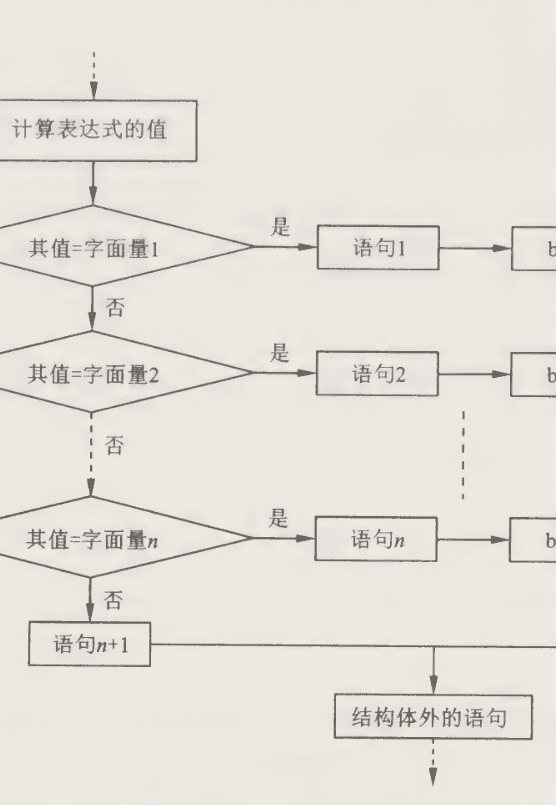

图 2-17 switch 多分支流程

`switch` 语句往往需要在 `case` 标签后紧跟一个代码块，`case` 标签作为这个代码块的标识。`switch` 的语法如下：

```java
switch (expression) {
    case value1:
        statement1;
        break;
    case value2:
        statement2;
        break;
    case valueN:
        statementN;
        break;
    default:
        defaultblock;
        break;
}
```

`expression` 表达式的值可以是任何类型（如整型、字符型）。`switch` 的执行是对 `expression` 求值，然后依次匹配 `condition1`、`condition2` 等，遇到匹配的执行体，`break` 语句用于跳出 `switch` 语句，否则程序继续执行 `case` 分支，这种做法可以引入陷阱。如果把 `break` 句注释掉，程序将会执行每一个 `case` 子句（穿透执行）。

### 示例 2-1：根据考试结果（A、B、C、D）打印分数（使用 switch 语句）

```java
// GradeLevel.java
import java.util.Scanner;

public class GradeLevel {
    public static void main(String[] args) {
        // TODO: Add your implementation.
        System.out.println("Please enter grade:");
        Scanner sc = new Scanner(System.in);

        char grade = sc.next().charAt(0);

        switch (grade) {
            case 'A': // 表示优
                System.out.println(grade + " is 90---100");
                break;
            case 'B': // 表示良
                System.out.println(grade + " is 80---89");
                break;
            case 'C': // 及格
                System.out.println(grade + " is 70---79");
                break;
            case 'D': // 不及格
                System.out.println(grade + " is 60---69");
                break;
            case 'E': // 合格
                break;
            default:
                System.out.println("You");
        }
    }
}
```

运行程序，输入等级 B，显示“is 80—89”。该例中有 `case` 句去掉，并输入字符“A”，显示：

```
is 90—100
is 80—89
is 70—79
is 60—69
You
```

显然不是简单的结果，但是在某些特殊情况下，省略 `break` 句子反而方便编写。下面的例子是 Java 7 扩展 `switch` 功能的实例。

### 示例 2-14：输入季节，输出对应的描述

```java
public static void main(String[] arguments) {
    String season = "春天";
    switch (season) {
        case "春天":
            System.out.println("花开");
            break;
        case "夏天":
            System.out.println("日炎");
            break;
        case "秋天":
            System.out.println("高气爽");
            break;
        case "冬季":
            System.out.println("雪飘");
            break;
    }
}
```

运行程序（如图2-18），结果显示“花开”。注意：在 Java 7 中增加了 `switch` 语句的功能，允许控制表达式是 `java.lang.String` 类型的变量——不能是 `StringBuffer` 或 `StringBuilder` 这两种类型。

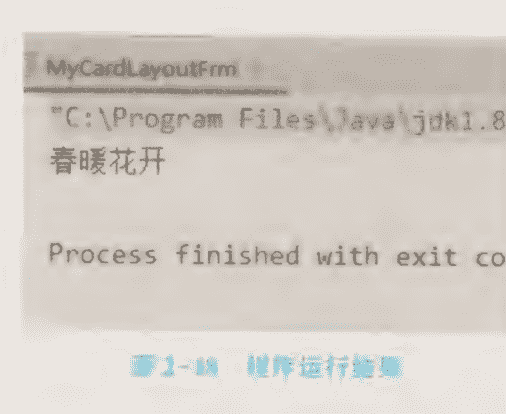

## 2.8 循环结构

循环结构是在指定一个条件下，反复执行某段程序（称循环体），直到条件成立为止。循环结构分为 3 种：`for` 循环、`while` 循环、`do...while` 循环。循环语句通常包括以下 4 部分：

- **初始化语句**（`init_statement`）：一条或多条语句，这些语句用于完成初始化工作，初始化语句在循环开始时执行一次。
- **循环体**（`body_statement`）：这个部分是循环的主体，如果循环体允许，则这个代码块是可以省略的。如果这个代码块只有一行，则重复执行。
- **迭代语句**（`iteration_statement`）：这个部分是在一次循环体执行之后，对循环条件值赋值之前，通常用于控制循环中的变量，使得循环在合适的时候结束。

上面 4 部分只是基础的分类，并不是每个循环都非常频繁地拆出了这 4 部分。

### 2.8.1 for 结构

与 C/C++ 语言相同，是在已知循环次数的条件下使用的循环，即循环的初始值和结束值在循环执行前是确定的。`for` 循环是灵活、方便的一种循环结构。

格式：

```java
for (初始化循环变量，如 i=0; termination; iteration) {
    // 循环体
}
```

- **初始化**：
- **termination**：用于判断循环的结束条件，如 `i<=10`；
- **iteration**：累加（减），如 `i++`。

`for` 循环的执行过程：先初始化循环部分赋值，可以同时给多个变量赋值，中间用逗号分隔。这部分在循环开始执行一次，以后不再使用。接着根据逻辑条件判断。成立时执行循环体，之后更新变量的值（增或减），进入下一循环；不成立，结束循环，跳转到结构下。对于 `for` 循环而言，条件比循环体多一次，因为最后一次执行条件为 `false`，将不再执行循环体。


`for` 循环的执行流程如图 2-19 所示。实际应用时，`for` 循环的三个表达式中的任意一个可以为空。为了避免死循环发生，可以在循环体内增加 `break` 语句结束循环。

如求 5 的阶乘：

```java
long factorial = 1;
for (int i = 5; i <= 10; i++) {
    factorial *= i;
}
System.out.println("5!=" + factorial);
```

常用的 `for` 循环：

- 初始值，如 `m=0`
- 条件判断表达式，如 `m<3`
- 累加表达式，如 `m++`

求 1 到 10 的和：

```java
int sum = 0;
for (int m = 0; m < 10; m++) {
    sum += m;
}
System.out.println("10=" + sum);
```

### 2.8.2 while 结构

`while` 结构主要实现“当”循环，即循环条件成立时，重复执行循环体，否则退出 `while` 结构进行条件判断，然后决定是否执行循环体。

格式：

```java
while (conditionalexpression)
```

条件判断表达式可以是布尔变量，这时，为了避免死循环，可以在循环体内增加 `break` 语句结束循环。`while` 循环的执行流程如图 2-20 所示。如求 1 到 10 的和：

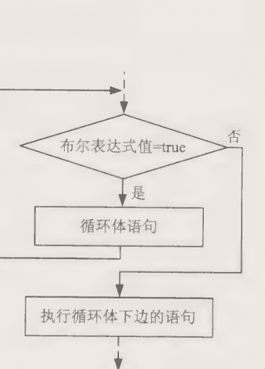

```java
int count = 0;
while (count < 100) count++;
```

对于初学者，使用 `while` 运行时有一个陷阱：`while` 循环体的后面跟着一个分号。下面的程序片段：

```java
int count = 0;
while (count < 100);
```

如果不小心看这段代码，觉得这段代码并没有问题，执行了 `count` 从 0 到 9，但细看一下程序，`while` 循环的表达式后面跟了一个分号。这意味着 `while` 循环体是空语句，不做任何事情的空语句与 `while` 循环没有任何关系。

图 2-20 while 循环流程

### 示例 2-16：输入一个字符，判断每个字符，遇到 Q 时结束

```java
import java.util.Scanner;

public class WhileExample {
    public static void main(String[] args) {
        System.out.println("输入一个字符，输入Q结束");
        Scanner sc = new Scanner(System.in);
        char c = sc.next().charAt(0);
        if (c >= '0' && c <= '9') {
            System.out.println(c + "是一个数字!");
        } else if (c >= 'a' && c <= 'z') {
            System.out.println(c + "是一个小写字母!");
        } else if (c >= 'A' && c <= 'Z') {
            System.out.println(c + "是一个大写字母!");
        } else {
            System.out.println(c + "不是字母!");
        }
    }
}
```

### 2.8.3 do...while 结构

`do...while` 结构是一种“直到型”循环，与 `while` 结构相反，它是先行执行循环，再进行条件判断。当 `while` 中的布尔表达式的值为“真”时，再次执行循环体；为“假”时跳出 `do...while` 结构。与 `while` 循环相同的是，`do...while` 循环的循环条件后必须有一个分号，这个分号表明循环结束。

格式：

```java
do {
    ...
} while (booleanexpression);
```

注意：`while` 后面要加分号。

该循环的执行流程如图 2-21 所示。

计算输出 1~20 之间奇数的平方值的和：

```java
int n = 1;
do {
    System.out.println(n + "x" + n + "=" + n * n);
    n += 2;
} while (n < 20);
```

# Java 程序设计

## 2.9 其他辅助语句

### 2.9.1 break 语句

Java 语言提供了 `goto` 语句控制程序的跳转，这种做法提高了程序流程控制的可读性，但降低了流程控制的灵活性。为了弥补这个不足，Java 提供了 `break` 和 `continue` 来控制循环结构。除此之外，`return` 可以结束整个方法，自然也结束一次循环。

在某些时候，我们需要在循环条件出现时进行终止循环，而不是等到循环条件为 `false` 时退出循环。此时，可以用 `break` 实现这个功能，`break` 跳出当前的循环（提循环），执行循环结构后的语句。

### 示例 2-1：求 a-b 之间的所有素数

分析：判断是否为素数的方法是用分别除 2 到 a-1，如果其中有一个整除，则不是素数。还可以扩展分别除 2 到 a 的平方根，如果其中有一个整除，则不是素数。

```java
// Prime.java
import java.util.Scanner;

class Prime {
    public static void main(String[] args) {
        int a = 0, b = 0; // 定义变量
        int r = 0, line = 0; // 计数器
        String temp = "";
        System.out.print("Please input first integer number:");
        Scanner sc = new Scanner(System.in);
        temp = sc.nextLine();
        a = Integer.parseInt(temp); // 输入的第一个数字字符串转换成整数
        System.out.print("Please input second integer number:");
        temp = sc.nextLine();
        b = Integer.parseInt(temp); // 输入的第二个数字字符串转换成整数
        for (int n = a; n <= b; n++) {
            int m;
            for (m = 2; m <= Math.sqrt(n); m++) {
                if (n % m == 0) break; // 有一个能整除，即余数为 0，则此数不是素数
            }
            if (m > Math.sqrt(n)) {
                System.out.print("*");
                line++; // 打印一个素数，计数器每行打印的个数
                if (line % 10 == 0) // 每 10 个数后，计数器清零，回车换行
                    System.out.println();
            }
        }
    }
}
```


### 2.9.2 break 标记退出多重循环

Java 跳出多重循环可以使用 `label` 标记，在外面一个循环前加上 `label:`，在需要跳出的地方加上 `break label` 即可跳出循环。

### 示例 2-18：控制程序只打印 4 行 "*"

```java
public static void main(String[] args) {
    sign: for (int i = 1; i <= 9; i++) { // 外层循环
        for (int j = 1; j <= i; j++) { // 内层循环
            if (j > 4) // 判断 j 的值是否大于 4
                break sign; // 跳出外层循环
        }
        System.out.print("*"); // 打印
    }
    System.out.println("\n"); // 换行
}
```

### 2.9.3 continue 语句

`continue` 语句在循环中，作用是终止本次循环，执行下一次循环。


### 【例 2-19】1-100 之间的奇数之和

```java
public static void main(String[] args) {
    int sum = 0; // 用于记录和
    for (int i = 1; i <= 100; i++) { // 判断偶数
        if (i % 2 == 0) // i是偶数，不累加
            continue; // 结束本次循环
        sum += i; // 实现 sum 和 i 的累加
    }
    System.out.println("sum=" + sum);
}
```

## 2.10 应用举例

为了适应 Java 编程，这里给出几个 Java 基本输入输出的简单程序，目的是引导读者通过阅读简单的代码，逐步理解 Java 的编程思想，最终能够自动解决简单问题。

### 2.10.1 从控制台读取半径

在例 2-1 中，源代码为了使用不同的半径，必须修改源码后重新编译，很不方便。所以我们可以使用 `Scanner` 类来控制输入。

Java 使用 `System.out` 表示标准输出设备，用 `System.in` 表示标准输入设备。默认情况下，输出设备是显示器，输入设备是键盘。为了完成控制台输入，只需使用 `println` 方法来在控制台显示某值或字符串。Java 并不直接支持控制台输入，但是可以使用 `Scanner` 类创建的对象，以读取来自 `System.in` 的数据。如下：

```java
Scanner input = new Scanner(System.in);
```

`Scanner(System.in)` 表明创建了一个 `Scanner` 类型的对象。语法 `Scanner input` 表明变量是一个 `Scanner` 类型的变量。`new Scanner(System.in)` 创建了一个 `Scanner` 对象，并且它的引用值赋值给变量 `input`。对象可以调用它自己的方法，通过调用对象的方法让这个对象完成某个任务。你可以通过表 2-2 中的方法读取不同类型。

#### 表 2-2 Scanner 输入的方法

| 方法 | 描述 | 方法 | 描述 |
| :--- | :--- | :--- | :--- |
| `nextByte()` | 读取一个 `byte` 类型整数 | `nextFloat()` | 读取一个 `float` 类型 |
| `nextShort()` | 读取一个 `short` 类型整数 | `nextDouble()` | 读取一个 `double` 类型 |
| `nextInt()` | 读取一个 `int` 类型整数 | `next()` | 读取一个字符串，以空格结束 |
| `nextLong()` | 读取一个 `long` 类型整数 | `nextLine()` | 读取一行，以换行结束 |

现在，来看看如何调用 `nextDouble()` 方法来读取带小数的数值。此处给出例 2-20 控制台输入面积。

### 【例 2-20】控制台输入面积

```java
import java.util.Scanner; // Scanner is in java.util package

public class ComputeAreaWithConsole {
    public static void main(String[] args) {
        // Create Scanner object
        Scanner input = new Scanner(System.in);

        // Prompt the user to enter radius
        System.out.print("Enter a number for radius: ");
        double radius = input.nextDouble();

        // Compute area
        double area = radius * 3.14159;

        // Display result
        System.out.println("The area for circle of radius " + radius + " is=" + area);
    }
}
```

程序运行结果：

```text
Enter a number for radius: 2.5
The area for circle of radius 2.5 is=19.63475
```

### 【例 2-21】贷款支付额

这里可以是学生贷款或购车贷款。程序输入利率、年数以及贷款额，输出月支付额。计算支付额的公式如下：

支付额 = $\frac{贷款 \times 月利率}{1 - \frac{1}{(1+月利率)^{年数 \times 12}}}$

程序开发步骤：

1. 提示用户输入利率、年数和贷款额。
2. 利用利率获取月利率。
3. 用前面的公式计算支付额。
4. 计算总额，就是支付额乘以 12。
5. 显示支付额和总额。

```java
import java.util.Scanner;

public class ComputeLoan {
    public static void main(String[] args) {
        // Create a Scanner
        Scanner input = new Scanner(System.in);
        // Enter interest rate
        System.out.print("Enter yearly interest rate, for example 8.25: ");
        double annualInterestRate = input.nextDouble();
        // Obtain monthly interest rate
        double monthlyInterestRate = annualInterestRate / 1200;
        // Enter number of years
        System.out.print("Enter number of years as an integer, for example 5: ");
        int numberOfYears = input.nextInt();
        // Enter loan amount
        System.out.print("Enter loan amount, for example 120000.95: ");
        double loanAmount = input.nextDouble();
        // Calculate payment
        double monthlyPayment = loanAmount * monthlyInterestRate / (1
                - 1 / Math.pow(1 + monthlyInterestRate, numberOfYears * 12));
        double totalPayment = monthlyPayment * numberOfYears * 12;
        // Format to keep two digits after the decimal point
        monthlyPayment = (int) (monthlyPayment * 100) / 100.0;
        totalPayment = (int) (totalPayment * 100) / 100.0;
        // Display results
        System.out.println("The monthly payment is " + monthlyPayment);
        System.out.println("The total payment is " + totalPayment);
    }
}
```

程序运行结果：

```text
Enter yearly interest rate, for example 8.25: 6.75
Enter number of years as an integer, for example 5: 20
Enter loan amount, for example 120000.95: 250000
The monthly payment is 1900.91
The total payment is 456218.4
```

## 2.11 GUI 界面应用程序

从控件获取输入，还有一种可选的方法。那就是通过调用 `JOptionPane.showInputDialog` 方法从对话框中获取输入，如图 2-22 所示。

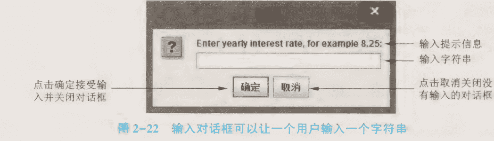

> 图 2-22 输入对话框可以让用户输入字符串

```java
import javax.swing.JOptionPane;

public class ComputeLoanUsingInputDialog {
    public static void main(String[] args) {
        // Enter yearly interest rate
        String annualInterestRateString = JOptionPane.showInputDialog("Yearly interest rate, for example 8.25:");
        // Convert string to double
        double annualInterestRate = Double.parseDouble(annualInterestRateString);
        // Obtain monthly interest rate
        double monthlyInterestRate = annualInterestRate / 1200;
        // Enter number of years
        String numberOfYearsString = JOptionPane.showInputDialog(
                "Enter number of years as an integer,\nfor example 5:");
        // Convert string to int
        int numberOfYears = Integer.parseInt(numberOfYearsString);
        // Enter loan amount
        String loanString = JOptionPane.showInputDialog(
                "Enter loan amount, for example 120000.95:");
        // Convert string to double
        double loanAmount = Double.parseDouble(loanString);
        // Calculate payment
        double monthlyPayment = loanAmount * monthlyInterestRate / (1
                - 1 / Math.pow(1 + monthlyInterestRate, numberOfYears * 12));
        double totalPayment = monthlyPayment * numberOfYears * 12;
        // Format to keep two digits after the decimal point
        monthlyPayment = (int) (monthlyPayment * 100) / 100.0;
        totalPayment = (int) (totalPayment * 100) / 100.0;
        // Display results
        System.out.println("The monthly payment is " + monthlyPayment);
        System.out.println("The total payment is " + totalPayment);
    }
}
```

# 第 3 章 数组与字符串

本章将介绍数组、字符串以及 Java 语言的核心类和实用类。数组和字符串处理是 Java 语言编程中不可或缺的内容。为了简化程序设计过程，Java 系统预先设计并实现了一些常规功能的标准。这些标准根据功能的不同被划分为不同的集合，每个集合称为系统的类。此外，本章还将介绍数组中非常常用的对象——字符串缓冲类（`StringBuilder`）、字符串类（`String`）、数组类、向量类（`Vector`）以及某些算法。

## 3.1 数组

数组是有序数据的集合，是一种简单的复合数据类型。数组中的每个数据被称为元素，每个元素具有相同的数据类型。在实际应用中，经常会遇到相同类型值的处理，例如对 1000 个学生的成绩进行排序处理，单用前面介绍的简单变量是很难完成的，这就需要数组。

数组就是一个命名变量，其内部的变量被标识为数组元素。数组可以存放任意类型的元素，但同一数组存放的元素类型必须一致。一个数组中所有元素共享同一个名称，可以通过统一的数组名和下标来唯一确定。下标是一个 `int` 型整数，数组中第一个元素的下标为 0，第二个元素的下标为 1……以此类推。

### 3.1.1 一维数组

只有一个下标的数组称为一维数组。在 Java 语言中，数组是作为对象处理的，在使用数组之前必须进行初始化。所谓初始化，就是为数组分配内存空间并为每个数组元素赋值。

#### 1. 数组的声明

声明数组的目的是说明数组变量的名称和数组元素的数据类型。

声明格式：

`数据类型[] 数组名`


#### 2. 数组的大小

数组的声明说明了变量名和类型，但存放元素的内存空间此时还不存在，必须为其申请内存空间，即定义数组的大小。申请内存空间就是指定数组的长度（即数组存储元素的个数）。

```java
数据类型[] 数组名 = new 数据类型[数组的长度];
```

代码示例：

```java
public static void main(String[] args) {
    // 数据类型[] 数组名 = new 数据类型[数组的长度];
    int[] arr = new int[5]; // 数组可以存储 int 类型的数据
    // 左边：
    int[]: 类型
    []: 类型标识，几个中括号代表数组类型（后跟随变量）
    // 右边：
    new: 创建实体或对象
    int[]: 数据类型
    [5]: 表示数组的长度（指定多少个空间存储什么内容）
}
```

#### 3. 数组初始化

初始化是指为数组划分连续的内存空间并为每个元素赋初值。一旦数组被定义，系统就会给每个元素赋予一个初始值。有时候，我们希望在声明时使用指定的值对其进行初始化并确定数组大小，这称为**静态初始化**；如果在定义数组以后再给元素赋初值，则称为**动态初始化**。

**(1) 静态初始化**

在声明和定义数组的同时，给元素赋初值。初始化时，由程序员指定每个元素的初值，由系统决定数组长度。

格式：

`数据类型[] 数组名 = new 数据类型[]{元素1, 元素2, 元素3};`

- `int[] intArray = new int[]{1, 2, 3};`

  表示长度为 3，立即执行 `intArray[0]=1`, `intArray[1]=2`, `intArray[2]=3`。

- `String[] stringArray = new String[]{"How", "are", "you"};`

  表示长度为 3，`stringArray[0]="How"`, `stringArray[1]="are"`, `stringArray[2]="you"`。

**(2) 动态初始化**


## 数组初始化

先声明和定义数组，然后再进行初始化。初始化时，程序员指定长度，由系统分配初始值（即默认值）。常见数据类型的默认值见表 3-1 所示。

| 数据类型 | 默认初始化值 |
|---|---|
| `byte`, `short`, `int`, `long` | `0` |
| `float`, `double` | `0.0` |
| `char` | 一个空字符(空格)，即 `'\u0000'` |
| `boolean` | `false` |
| 引用数据类型 | `null`，表示变量不引用任何对象 |

### 代码示例：默认初始化值

```java
class Demo {
    public static void main(String[] args) {
        // 数组类型 数组名=new 数据类型[数组长度];
        int[] arr = new int[5]; // 动态初始化，在内存中开辟连续的 5 块空间
        System.out.println(arr[0]); // 系统给出默认值，数值类型均为 0
        System.out.println(arr); // //@ 0x56bc3aa
        // 默认值是 0.0
        String[] arr2 = new String[2];
        System.out.println(arr2[0]);
        String s = "四"; // String 引用类型，默认值为 null
        String[] arr3 = new String[10];
        System.out.println(arr3[0]);

        // boolean 默认值为 false
        boolean[] arr4 = new boolean[10];
        System.out.println(arr4[0]);

        char[] arr5 = new char[10];
        System.out.println(arr5[0]);
    }
}
```

## 数组重定义

所谓重定义是指在程序中重新定义数组的大小。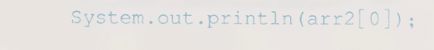

## 数组长度（length 属性）

数组作为对象拥有 `length` 属性来记录个数。一旦获取长度即可遍历元素。数组的最大下标为 `length-1`。

### 代码示例

```java
int[] array = new int[10]; // 定义包含10个元素的数组
```

## 数组引用

数组元素的引用方式为 `arrayName[index]`。下标从 0 开始，直到 `arrayName.length-1`。例如将成绩加到一个数组中计算平均值。

```java
public class Demo {
    public static void main(String[] args) {
        // 初始化
        int[] score = {72, 89, 65, 57, 91, 82, 71, 93, 68};
        // 计算平均值
        float average = 0.0;
        for (int i = 0; i < score.length; i++) {
            average += score[i];
        }
        average /= score.length;
        System.out.println("average=" + average);
    }
}
```

## 数组常见异常

### 1. 索引越界异常

范围为 `0~length-1`。访问时下标超出此范围会报错。

```java
int[] arr = new int[3]; // 定义长度为 3 的数组
// 下标访问数组会报错，报错截图如图 3-1 所示。
Exception in thread "main" java.lang.ArrayIndexOutOfBoundsException: 3
at a.Demo.main(Demo.java:7)
```


**解决方法**：下标不要超过长度-1。

```java
System.out.println(arr[2]);
```

### 2. 空指针异常

引用变量必须指向有效的对象。如果变量为 `null`，通过它访问元素就会出现空指针异常。

```java
public class Demo10 {
    public static void main(String[] args) {
        int[] arr = new int[3];
        arr[0] = 10;

        System.out.println(arr.length);
        arr = null; // 将 arr 置空
        System.out.println(arr); // String 类型的变量也会为空
        String s = null;
    }
}
```

报错截图如图 3-2 所示。

```
Exception in thread "main" java.lang.NullPointerException
at a.Demo10.main(Demo10.java:12)
```

## 数组的常见操作

### 1. 使用 for 循环遍历数组

操作数组时经常需要依次访问每个元素，这种操作称为遍历。见 3-2。

```java
public class Demo {
    public static void main(String[] args) {
        int[] arr = {1, 2, 3, 4, 5}; // 定义数组
        // 使用 for 循环遍历数组元素
        for (int i = 0; i < arr.length; i++) // 通过索引访问
            System.out.println(arr[i]);
    }
}
```

运行结果如图 3-3 所示。

### 2. 数组取最值

操作数组时经常需要获取元素的最值（最大或最小值）。见 3-3。

```java
public class Demo {
    public static void main(String[] args) {
        int[] arr = {4, 1, 6, 3, 9, 8}; // 定义数组
        int max = arr[0]; // 定义变量记录最大值，假设第一个元素为最大值
        // 通过循环遍历元素
        for (int i = 1; i < arr.length; i++) {
            if (arr[i] > max) // 比较值是否大于 max
                max = arr[i]; // 条件成立，赋值给 max
        }
        System.out.println("max=" + max); // 打印最大值
    }
}
```

运行结果如图 3-4 所示。

### 3. 数组排序

冒泡排序：比较相邻元素，如果第一个比第二个大，则交换位置。所有元素重复此步骤，从第一个开始到最后一次，最后一个元素应该是最大的。

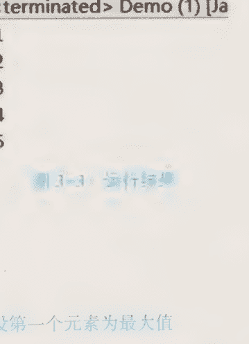
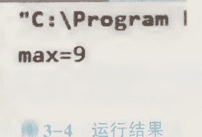

## 二维数组

### 1. 二维数组

带有两个下标的数组称为二维数组。用途广泛，例如矩阵运算。

```java
int[][] arr = new int[3][4]; // 定义一个 3x4 的二维数组
```

上面的代码定义了一个 3x4 的二维数组。下标范围为 `0~length-1`。

# 字符类

在 Java 语言中，字符是一个基础数据类型，而字符串是抽象的数据类型，只能使用对象。字符串对象可以由 `String` 类和 `StringBuilder` 实现。这与 C/C++ 语言不同（后者使用字符数组来实现字符串）。

`String` 用于创建字符串对象，并且创建的字符（对象）是不可变的。也就是说，字符串对象中的字符是不能修改的（如在一个字符串对象中添加、删除或修改字符等），称为字符串常量。

如果要创建一个新的对象来保存新的内容，无论如何，原来的内容保持不变。二是使用 `StringBuffer`（字符缓冲区）创建对象，这个对象的内容是可以改变的。

对字符串对象的常见操作是搜索、比较、取子串。

## String 的构造方法

- `String();` 创建一个字符串对象，对象中不包含任何字符。
- `String(String value);` 创建一个含有内容的字符串对象。
- `String(char[] value);` 使用已有的字符数组的内容初始化字符串对象。

### 【3-6】 创建一个字符串对象，并显示字符串对象中的字符

```java
// Array_string.java
class Array_string {
    public static void main(String[] args[]) {
        // 声明并初始化字符数组
        char c[] = {'j','a','v','a',',',',','s','i','n','g'};
        String s1 = new String(c);
        String s2 = new String(s1); // 创建字符串对象
        System.out.println(s1);
        System.out.println(s2);
    }
}
```

- `String(StringBuilder buffer)` 利用存在的 `StringBuilder` 对象初始化新的字符串对象。

其他函数还有 `String(byte[] value)`、`String(byte[] value, int value)`、`String(byte[] value, int startIndexOf, int numChars)`。

如：`String s;` 或 `String s = new String();` 表示对象 `s` 的值为 `null`。

`String s = "ABC";`

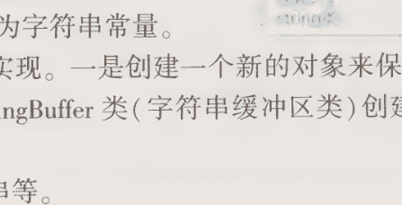

或 `String s = new String(" ABC");`

或 `String s;` `s = "ABC";` 表示对象的内容为 "ABC"

## 字符串处理

对字符串处理时，可以使用 `String` 类提供的几个常用方法：

- `charAt(int index)` 获取指定位置的字符。

  如：

  ```java
  String str = "You are the best";
  char c = str.charAt(0);
  System.out.println(c); // 打印"Y" 最左边的字符位置为0。
  ```

- `length()` 查询字符串长度。

  如 `int n = str.length();`

下面是处理字符串的方法：

- `boolean startsWith(String prefix);` 判断字符串的前缀。
- `boolean endsWith(String suffix);` 判断字符串的后缀。
- `indexOf(char ch);` 从前往查找单个字符第一次出现的位置。
- `indexOf(char ch, int startIndex)` 从指定的位置开始查找。
- `lastIndexOf(char ch)` 从后往前查找字符的位置，即指定字符最后一次的位置。
- `lastIndexOf(char ch, int startIndex)` 从指定的位置开始向前查找。
- `indexOf(String str);` 查找子字符串第一次出现的位置。
- `indexOf(String str, int startIndex)` 从前往查找子字符串的位置，即在子串最后一次出现的位置。
- `lastIndexOf(String str, int startIndex)` 从指定的位置开始向前查找。
- `compareTo(String strCompared);` 比较操作，相同时返回 0，当前字符串（按字母为序）大于参数字符串时返回正整数，当前字符串小于参数字符串时返回负整数。
- `boolean equals(Object obj);` 判断对象的内容是否相同，与关系符 `==` 的语义完全相同。
- `boolean equalsIgnoreCase(String str);` 判断是否相同忽略大小写。

### 【3-7】 比较字符串

```java
// Equals.java
class Equals {
    public static void main(String args[]) {
        String s1 = "Hello";
        String s2 = "Hello";
        String s3 = "good-bye";
        String s4 = "HELLO";
        System.out.println(s4.equals("s4") + " " + s4.equals("s4")); // false
        System.out.println(s4.equalsIgnoreCase("s4") + " " + s4.equalsIgnoreCase("s4")); // true, 忽略大小写
        // s1与s2不是一个对象，所以不相等
    }
}
```

其他还有：

- `concat(String str);` 连接两个字符串。

  如：

  ```java
  String s1 = "Java";
  String s2 = s1.concat("Programming");
  ```

  等于：

  ```java
  String s1 = "Java";
  String s2 = s1 + "Programming";
  ```

- `copyValueOf(char[] value);` 将字符数组转换为字符串。
- `replace(char ch1, char ch2)` 字符串中的字符 `ch1` 用 `ch2` 替换。

  如：

  ```java
  String str1 = "Java OOP";
  String str2 = str1.replace('o', 'a');
  // 结果是："str2="Java AAP""
  ```

- `substring(int beginIndex, int endIndex);` 从指定的位置到结束截取子串。
- `substring(int beginIndex, int endIndex);` 从指定的位置截取子串。
- `char[] toArray(String str);` 将字符串转换为字符数组。
- `toUpperCase();` 全部转换成大写字母。
- `toLowerCase();` 全部转换成小写字母。
- `length();` 求字符串包含的字符个数。
- `trim();` 删除字符串首后的空白。

### 截取字符串到字符数组

将截取的子字符串存到字符数组中，可以使用方法 `void getChars(int startIndex, int endIndex, char[] target, int targetStart)` 从 `startIndex` 到 `endIndex` 的字符存入 `target` 数组。

### 【3-8】 截取字符串

```java
class getChars {
    public static void main(String[] args) {
        String s = "This is a test.";
        int start = 0; // 第一个字符的位置
        int end = 10; // 10个字符
        char buf[] = new char[end];
        s.getChars(start, end, buf, 0);
        System.out.println(buf); // 结果是"This is a "
    }
}
```

## StringBuilder 类

`String` 类的字符串内容是固定的，长度也是固定的。当需要改变字符串时使用 `StringBuilder` 类，它提供了对字符串进行动态操作——添加、插入、替换。`StringBuilder` 对象是变的，容量根据需要增加。

### StringBuilder 构造方法

- `StringBuilder(int length);` 指定长度。
- `StringBuilder(String str);` 用字符串初始化。
- `StringBuilder();` 定义变量。

与 `String` 不同，`StringBuilder` 允许初始化。

### 1. 添加操作

使用 `append()` 方法将字符串追加到缓冲区后面，如果长度超过容量，缓冲区会自动扩充。如下：

```java
StringBuilder sbSource = new StringBuilder("1+2=");
int n = 3;
sbSource.append(n);
// 结果是“1+2=3”。
```


# Java语言程序设计

## 3.2 StringBuilder 类

### 3.2.1 显示内容

注意：使用 `println` 方法显示 `StringBuilder` 类的内容时，可先用 `toString()` 方法转换成字符串；也可直接使用对象，系统会自动调用 `toString()` 方法转换成字符串。

### 3.2.2 追加操作

向缓冲区添加各种类型的数据，`append()` 方法有以下重载形式：

- `append(boolean b)`
- `append(char c)`
- `append(char[] str)`
- `append(double d)`
- `append(float f)`
- `append(int i)`
- `append(long l)`
- `append(Object obj)`
- `append(String str)`
- `append(char[] str, int offset, int len)`

### 3.2.3 插入操作

使用 `StringBuilder` 的 `insert(int offset, String str)` 方法在指定的位置插入指定的字符串。示例如下：

```java
StringBuilder sbSource = new StringBuilder();
sbSource.append(" Hello, Guys!");
sbSource.insert(6, 30); // 结果是“Hello, 30 Guys!”
```

`insert()` 的重载方法如下：

- `insert(int offset, boolean b)`
- `insert(int offset, double b)`
- `insert(int offset, int i)`
- `insert(int offset, long l)`
- `insert(int offset, float f)`
- `insert(int offset, Object obj)`
- `insert(int offset, String str)`

### 3.2.4 删除操作

- `delete(int start, int end)`：删除从 `start` 到 `end` 之间的字符。
- `deleteCharAt(int index)`：删除位置 `index` 处的字符。

### 3.2.5 替换操作

- `replace(int start, int end, String str)`：替换 `start` 到 `end` 之间的字符。

#### 【例 3-9】将“Java programming!”中的字符串“Java”替换成“This is Turbo C”

```java
// Replace.java
class Replace {
    public static void main(String[] args) {
        StringBuilder sb = new StringBuilder("Java programming!");
        sb.replace(0, 4, "This is Turbo C");
        System.out.println("After replace: " + sb.toString());
        // 仍可以使用下面的方法
        sb = sb.replace(0, 4, "This is Turbo C");
        System.out.println("After replace: " + sb);
    }
}
```

结果是“After replace: This is Turbo C programming”。

### 3.2.6 常用方法

`StringBuilder` 类的几个常用方法：

- `toString()`：将缓冲区转换为字符串。
- `charAt(int index)`：取指定位置的字符。
- `getChars(int srcBegin, int srcEnd, char[] dst, int dstBegin)`：取指定位置的字符到字符组中。

示例：

```java
StringBuilder sb = new StringBuilder("You are the best!");
char[] ch = new char[10];
sb.getChars(0, 10, ch, 0);
```

- `length()`：返回长度。
- `capacity()`：返回容量。
- `setCapacity(int minimum)`：设置容量。
- `reverse()`：翻转。

#### 【例 3-10】将字符串翻转

```java
// Reverse.java
class Reverse {
    public static void main(String[] args) {
        StringBuilder sb = new StringBuilder("hello world");
        sb.reverse();
        System.out.println(sb);
    }
}
```

结果是“dlrow olleh”。

## 3.3 StringTokenizer 类

`StringTokenizer`（字符串标记）类用于字符串分析，可将字符串分解成若干令牌（默认分隔符是空格）。

- `countTokens()`：返回令牌的数目。
- `hasMoreTokens()`：检查是否还有令牌。
- `nextToken()`：返回下一个令牌。
- `nextToken(String delim)`：指定分界符。

#### 【例 3-11】将字符串每个取出来

```java
// Token.java
import java.util.StringTokenizer;

public class Token {
    public static void main(String[] args) {
        StringTokenizer st = new StringTokenizer("I am Java developer");
        String[] tokens = new String[st.countTokens()]; // 明确定义数组
        for (int i = 0; st.hasMoreTokens(); i++) { // 每个元素存放
            tokens[i] = st.nextToken(); // 访问
            System.out.println(tokens[i]); // 打印
        }
    }
}
```

结果：

| I    |
| ---- |
| am   |
| a    |
| Java |
| developer |

## 3.4 数据类和向量类

数组是编程时常用的数据结构之一，数组可以包含任何类型，一旦创建便存储数据。向量的长度更强大，它是允许不同类型共存的变数组。

### 3.4.1 数组 Array 类

`Arrays`（数组工具）类提供了对数组运算的功能，如排序、搜索等操作。`Arrays` 类的静态方法：

- `static void sort(dataType[] d)`：对数组进行排序(升序)，`dataType` 是除 `boolean` 之外的基本类型和 `Object` 对象。

#### 使用 Arrays 类对数组排序

```java
import java.util.Arrays;

class ArraysClass {
    public static void main(String[] args) {
        int[] num = new int[10]; // 排序前
        for (int i = 0; i < 10; i++) {
            num[i] = (int) (Math.random() * 10) + 1; // 产生 1-10 随机数
            System.out.print(num[i] + " "); // 打印产生的随机数
        }
        System.out.println("\n 排序后:");
        Arrays.sort(num); // 排序
        for (int i = 0; i < 10; i++) {
            System.out.print(num[i] + " "); // 打印排序后的数
        }
        System.out.println("6的位置是:" + Arrays.binarySearch(num, 6)); // 搜索 6 的位置。
    }
}
```

数据范围不同，其中一组数据如图3-10所示。

```java
static void sort(dataType[] a, int start, int end) // 指定排序的范围从 start 到 end。当 start > end 时，引发 IllegalArgumentException 异常。当超出时，引发 ArrayIndexOutOfBoundsException 异常。
```

```java
static void fill(dataType[] a, dataType value) // 用值设置数组内每个元素的值。
```

```java
static void fill(dataType[] a, int startIndex, int endIndex, dataType value) // 用值设置组从 start 到 end 元素的值。
```

```java
static int binarySearch(dataType[] a, dataType key) // 利用二分搜索(已排序)内的 key。
```

```java
static boolean equals(dataType[] d1, dataType[] d2) // 判断相等否，dataType 可以是基本类型，包括 Object。
```

### 3.4.2 ArrayList

可以将 `ArrayList` 想象成“自动扩充容量的 Array”，和 `Array` 的直观区别可以描述如下：

- **Array (`[]`)**：效率高，但其容量固定且无法动态变化。
- **ArrayList**：容量动态增长，但牺牲了效率。

#### 效率的解释

数组是 `ArrayList` 效率影响较大的一个因素，因为它内部都会使用数组。每当执行 `Add`、`AddRange`、`InsertRange` 等操作如果容量不够，就会将当前容量的两倍重新构建数组，将元素 Copy 到新数组中，然后丢弃旧数组，在这个界点的扩容操作中，扩容是比较影响效率的。

因此，在使用建议如下：基于效率和类型检验，应尽可能使用 Array；无法确定类型的小数组时使用 `ArrayList`。

`ArrayList` 封装了一个对象的数组，从一般的意义来说，它和数组没有本质的差别，甚至 `ArrayList` 的许多方法，如 `Index`、`IndexOf`、`Sort` 等都是在内部数组的基础上直接调用 `Arrays` 的对应方法。

`ArrayList` 在处理对象时抛弃类型信息，所有对象类型都被屏蔽为 `Object`，编译时不检查类型，但是运行时可能会报错。

`Array` 和 `ArrayList` 可以互转换。

#### 【例 3-13】ArrayList 类型的数据转换为 String[]

```java
import java.util.*;

public class ArrayList2Array {
    public static void main(String[] args) {
        List<String> list = new ArrayList<String>();
        list.add("我");
        list.add("爱");
        list.add("中国");
        int size = list.size();
        String[] array = list.toArray(new String[size]);
        for (int i = 0; i < array.length; i++) {
            System.out.println(array[i]);
        }
    }
}
```

#### 【例 3-14】将数组转换为 ArrayList

```java
package ch6;

import java.util.*;

public class Array2ArrayList {
    public static void main(String[] args) {
        String[] array = new String[3];
        array[0] = "我";
        array[1] = "爱";
        array[2] = "中国";

        List<String> list = new ArrayList<String>();
        for (int i = 0; i < array.length; i++) {
            list.add(array[i]);
        }

        for (int i = 0; i < list.size(); i++) {
            System.out.println(list.get(i));
        }
    }
}
```

`Arrays` 对象提供了 `public static <T> List<T> asList(T... a)` 方法实现了 `Arrays` 到 `ArrayList` 的转换，`asList` 返回一个接受指定类型支持的固定大小的列表。因此，上例的代码中值部分可以简写为：

```java
List<String> list = Arrays.asList(array);
```

### 3.4.3 向量类 Vector

Java 语言中，数组只能保存固定数量的元素，内存的申请也是一次完成，不能在创建后追加数组元素，为此引入了向量类 `Vector`。

向量也是一组对象的集合，但它可以添加数组元素的数量，相当于一个变长数组。`Vector` 使用场景有：对象的目的不定、序列中的元素都是对象、组合不同的对象序列、频繁插入或删除序列中的对象等情况。

#### 1. 如何创建 Vector 对象

`Vector` 类的构造函数：

```java
Vector()
Vector(Collection c)
Vector(int initialCapacity)
Vector(int initialCapacity, int capacityIncrement)
```

- 第一种形式，构造函数中没有参数，按照默认值，向量的初始容量为 10，空间动态增长为 0。
- 第二种形式，以 `Collection`（集合）的实例 `c` 为参数，使得向量类默认值为 `Collection` 元素的数量和内容。
- 第三种形式：初始向量的剩余空间为 `initialCapacity`。
- 第四种形式：在提供初始向量空间时，还需要每次添加向量元素的个数。

创建向量对象的一种格式：

`Vector object = new Vector(int initialCapacity, int capacityIncrement);`

如：`Vector myVector = new Vector(100, 50);` 创建元素数量为 100，以后可以以 50 为单位添加元素数量，使用 `myVector` 中元素数目增加 150、200、250 等……元素的类型可以在添加时说明。

#### 2. 几个常用的方法

##### (1) 向向量增加一个元素（不是插入元素）

```java
add(int index, Object element)
add(Object element)
addElement(Object obj)
```

- 增加 `element` 的类型为 `Object` 类型，位置由 `index` 指定；不指定时，添加到向量尾部。
  如：`Vector aVector = new Vector(5)`
  `aVector.add(0, "aString")`
  `Integer aInteger = new Integer(12)`
  `aVector.add(aInteger)` // 在向量 aVector 的位置 0 处加上“aString”。

##### (2) 增加容量

```java
size()
addAll(int index, Collection c)
```

- 增加 `Collection c` 中的元素，位置由 `index` 指定；未指定时，在向量尾部增加。

##### (3) 获取向量的容量

```java
capacity()
```

- 如上例中 `aVector.capacity()`；结果是 3。

##### (4) 指定位置插入元素

```java
insertElementAt(Object obj, int index)
```

- 在指定位置插入元素。

##### (5) 在向量中删除元素、返回向量的数量等

#### 【例 3-15】创建一个向量对象，将其他数字追加到向量中，然后排序

```java
import java.util.*;

class VectorExam {
    public static void main(String[] args) {
        Vector vect = new Vector(); // 创建向量对象
        String str[] = {"三", "四", "五"};

        vect.add(str[0]); // 添加元素到向量
        vect.add(str[1]);
        vect.add(str[2]);
        Collections.sort(vect); // 对向量排序
        for (int j = 0; j < vect.size(); j++) {
            System.out.print(vect.get(j) + " "); // 打印向量对象
        }
    }
}
```

按字符值排序后的结果是“三 四 五”。

## 课后练习

1. 有整型数组 `int[] x = {4, 33, 99, 5, 10}`，用方法 `Arrays.sort(x)` 后，数组中的元素依次是（）。A. 99 33 10 5 4

2. `score` 是一个整型数组，有五个元素，已经初始化并赋值，仔细阅读下面代码，运行的结果是（）。


```java
temp = score[0];
for (int index = 1; index < 5; index++) {
    if (score[index] < temp) {
        temp = score[index];
    }
}
```
A. 最大数组 B. 最小数组 C. 找到数组中最后一个元素 D

3. 要求编写 Java 应用程序：编写一个名为 `Test` 的类，类中只有一个主方法；在主方法中定义一个大小为 50 的整型数组，数组中存放 1, 3,..., 91，输出该数组中的所有元素，每输出一行；在主方法中定义一个大小为 10 的字符串型数组，数组名为 `y`，位置上的是，其余位置上的是，这个数组中的所有元素。6. 输出列表数组中最大的元素和最小的元素：

```java
a[][] = {{3, 2, 6, 8, 2, 10}, {5}, {12, 3}}
```
7. 输出字符串长度 `len1`，字符串 `s1`，字符串长度 `len2`，字符串 `s2`。从向前比较，最短字符串为标准，输出不同的元素的个数。例如：

输入：`s1="1, 3, 5"` `len1=3`

`s2="2, 4, 1, 7, 5"` `len2=5`
8. 一个 5 位数组，判断它不是回文数（如 12321 是回文数，个位与万位相同，十位与千相同）。
9. 输入数组，最大的与第一个元素交换，最小的与最后一个元素交换，输出数组。
10. 简述 `String` 和 `StringBuilder` 的区别。
11. 数组有 `length()` 这个方法吗？`String` 有没有 `length()` 这个方法？举例说明使用方法。

# Java 面向对象编程——类和对象

这一章开始，讲解面向对象设计技术。包括面向对象的基本概念、面向对象的程序设计方法、以及 Java 中的变量、对象、类的成员（数据或变量成员或方法成员）、对象的声明与创建、和面向对象的特性。

## 4.1 面向对象的基本概念

C++ 语言也是面向对象的语言，但是由于从过程和面向对象技术的限制，使得开发的程序分析的程度降低了。Java 同样使用继承、对象这些 OOP 概念，它不像 C++ 那样多重继承。在 Java 中只有单一继承，这是为了保证语言的简单性。面向对象是一种程序设计语言，其基本思想是使用类、封装、消息等概念，从客观世界中存在的物（对象）出发，构建系统，并在系统中利用自然思维来开发为了解决某些问题，其应用领域。

## 4.1.1 对象、类和消息

### 1. 对象

什么是对象？对象是具有属性和操作行为的具体化。对象是系统中用来描述客观事物的一个实体，是构成系统的基础。面向对象的程序是对对象组合而成的，对象之间相互通信、协调与配合，完成任务。对象的概念是 OOP 的核心。

### 2. 类

什么是类？简单来说，类是相同对象的集合。人类在观察世界时常用的思维方式是分类和抽象，对象提供了统一的描述，其中包括属性和动作两个部分。在面向对象的语言中，类是一个独立的单位。

### 3. 消息

对象之间通过消息实现行为。

## 4.1.2 OOP 的特点

### 1. 抽象

抽象是科学研究常用的方法。什么是抽象？是将对象中所心的元素，或不需要考虑的因素，只取对需求直接影响的因素，即实质内容。如圆形来说，确定圆心和半径，就可以在平面上确定一个圆。抽取的数据是圆心和半径。但是，这种抽象仅仅描述了对象的基本要素，并没有涉及行为，还不能称为数据抽象。

什么是数据抽象？数据抽象是指系统中需要处理的数据和操作结合起来。它是 OOP 的基础，抽象是在数据的基础上的方法和技术。如上面提到的，其基本要素是圆心和半径，面积是由半径求取的，求取面积的抽象就是基本方法。

### 2. 对对象的特点

#### (1) 封装

封装是 OOP 的特点之一，是将包装起来，是把对象的属性和功能结合成一个独立的，并可能对内部细节隐藏，也就是一些复杂的处理细节。私有数据封装在类里，只有外部可以使用，更加安全，也不会破坏内部的结构。封装保护了安全性和完整性。封装包含两个含义：对象的全部属性和动作结合在一起，形成一个不可分割的单位；隐藏信息，使得可能对内部数据、形式形成一道边界（或形成屏障），只留有的外部接口与对象发生联系。封装的实现方法是要求封装对对象的外部不允许随意访问内部数据，从而避免了对象之间的交换，使得编译器能够编译，大大减少出错和错误的概率。如一台电视机内部使用了许多不能更改的操作：高压、X 射线屏幕、白显示部分等。用户买电视机关心操作方便、图像清晰、声音好听、外观是否美观，而不关心本身的制造细节，如制造、工作原理、内部的组件由哪个厂家制造，组件的工作原理等。

#### (2) 继承

继承是 OOP 的第二个特点。当一个类拥有另一个类的属性（在 Java 中称为数据）和行为（在 Java 中称为方法）时，这个类就是继承来的类。其中被继承的类称为父类（又基类），而继承来的类称为子类，又称派生类。由于类继承了父类的属性（仅是属性），与类继承父类的属性和行为有所区别。

如电视机，作为电视类，黑白电视和彩色电视都是电视的子类；而投影黑白电视又是黑白电视的子类。意思是类之间可以派生自己的类，存在层次关系的。成为电视类后，它就有了图像、视频、声音。而彩色电视和黑白电视机是从电视机继承来的，同样也有图像，可以选择颜色、声音，所以类继承了父类的属性和动作。

事实上类可以有自己的属性和动作，否则的话，就不必要继承父类的属性和动作，直接使用类就行了。继承的优点：继承实现了代码重用，加速了编程进度，提高了效率，减少了代码冗余。

C++ 多重继承，一个类可以继承多个类，对对象的处理变得异常复杂，通过接口可以实现多重继承。接口的定义更加简单，方便使用，且只限于继承，它使得相似的类具有相同的方法。

### 3) 多态

多态是 OOP 的第三个特征。所有多态，是指在类定义的属性或动作被特定子类覆盖之后，可以具有不同的数据表现出不同的行为。通过同一个属性或动作在泛类以及各个特定子类中具有不同的实现。例如几个几何形状的“画图”方法，在“圆形”类和“多边形”类中同样可以存在，它们都是“圆形”类或“多边形”类的方法在子类中“画”的功能是不不同的。

实现态的方法

① 通过对父类方法的重写实现多态

父类的方法在子类中可以同名，并重写代码。由于子类与父类的方法不能完全一样。

那么，如何区分子类中与父类中的同名方法呢？因不同的方法存在不同的类中，所以只需要在调用时，指定是哪类的类即可。

② 同类中允许方法重载实现多态

在一个类中，可以定义多个同名的方法。这些方法的最终目的是基本或完全相同，只不过根据具体的参数来决定使用哪一个方法。取形状的面积时，可以定义多个方法，圆形的面积、矩形的面积、三角形的面积等，目的都是取面积的。但是我们必须清楚，取某种形状的方法代码是不同的。

如何区分同一类中同名的方法呢？因为是在同一个类里，不能用类来区分。可以采用的方法相同，需要通过参数的列表来区分，即使用的参数个数、数据类型和排列顺序来区分，决定调用哪个方法。例如图形类，可以定义多个 `draw()` 方法，绘制各种形状的图形（圆、矩形、三角形、其他文字信息等）。

```java
// 输出（特殊的），string是输出的字符串
draw(String string)
```

```java
//...
// 画圆,给出圆心和半径
draw(double x, double y, double radius)

// 画椭圆,给出圆心,x轴和y轴
draw(double x, double y, double x-axis, double y-axis)

...

// 画矩形,给出左上角,宽度和高度
draw(int leftx, int lefty, int width, int height)

...

// 画三角形,给出三个点
draw(int x1, int y1, int x2, int y2, int x3, int y3)
...
```

虽然几个方法的名字都是 `draw()`，但是它们的参数类型和个数不一样，因此依靠参数完全区分开来应该调用哪一个方法。

## 4.2 类的定义

类是 Java 中的一种重要的复合数据类型，是组成 Java 程序的基本要素。它封装了一类对象的状态和方法，这是一类对象的原型。一个对象的特征和操作如图 4-3 所示。

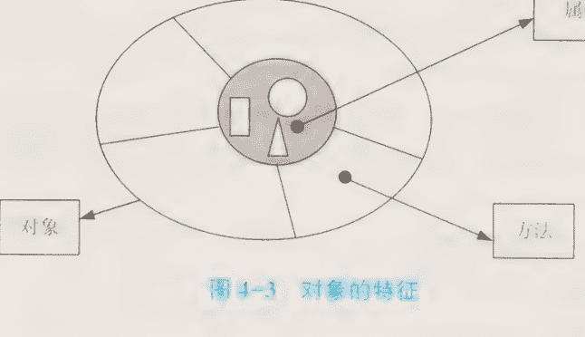

属性（变量）构成对象的核心，方法包含着属性，使得这个对象与其他对象分开。

### 4.2.1 类的层级结构

在 Java 语言中，有一个顶层的类，它是 Java 中所有类的父类（直接父类或间接父类），Java 称为基类。即 Java 中任何类（包括 Java 系统中内置的类和程序中定义的类）都是 `Object` 的类。由于，`Object` 是唯一没有父类的类。

打开 jDoc 文档，可以看到类的层级结构，类的继承关系如图 4-4 所示。

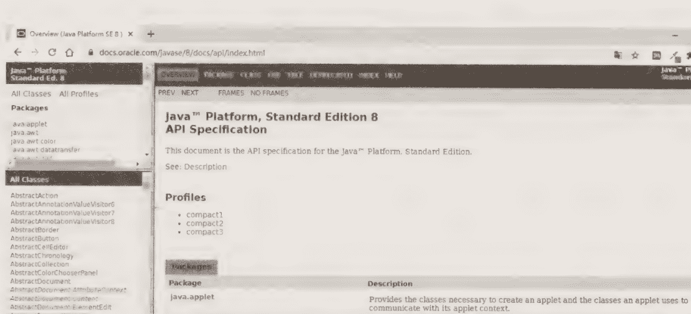

图 4-4 仅展示了 `Object` 类的派生类。其他的任何类（包括用户自定义类）也可以有自己的派生类。读者熟练使用 JDK 文档浏览类的层级关系，就是掌握 Java 编程捷径。

### 4.2.2 访问控制修饰

访问控制修饰限定了类、属性或方法被暴露访问的权限，是否可以其他类访问。

| 类型 | private | protected | public |
|---|---|---|---|
| 同一类 | | | |
| 同一子类 | | | |
| 同一父类 | | | |
| 不同子类 | | | |

### 4.2.3 定义

一个类，应该包含两部分：类名和实现（类）。主体部分是属性和方法的定义。

访问控制修饰限定了类、属性或方法被暴露访问的权限，是否可以其他类访问。

| 类型 | private | protected | public |
|---|---|---|---|
| 同一类 | | | |
| 同一子类 | | | |
| 同一父类 | | | |
| 不同子类 | | | |

### 4.2.4 成员变量

类中大部分是成员变量，成员变量可以是简单类型、数组或对象。成员变量一定要在类内声明，不要放在方法外。

简单格式：

```java
[private] [static] [final] [transient] DataType variableName = initializationValue;
```

其中：

* `DataType` 指定了变量类型；`initializationValue` 为初始值。
* 访问控制符除了这四种之外，还有一种：`public`（公共）或 `friendly`（友类），默认；`protected`（保护）。
* `static`、说明静态变量（类变量），可以声明静态方法。
* `abstract`、说明抽象类不能直接。
* `final`、说明非继承性。`final` 类不能继承。
* `transient`、说明临时变量，指示 Java 虚拟机（JVM）忽略。
* `volatile`、共享变量，在多线程环境中，一个变量可能被多个线程修改，如何保持变量一致性？

字符串变量声明的格式：

```java
[identifier] StringVariableName = [初始值]; // 定义的同时
```

第二种格式：将字符串作为一个类，定义类的对象。对象变量格式：

```java
[identifier] ClassName ObjectVariableName = new ClassName(parameterList);
```

```java
public class FinalVariable {
    final float PI = 3.14f; // 常量 PI
    float radius; // 变量
    static int objCounter = 0; // 对象计数器，静态变量

    public double getArea() { // 方法
        return PI * radius;
    }
    FinalVariable(float radius) { // 构造函数 创建一个对象，计数加 1
        objCounter++;
    }
    public static void main(String[] args) { // 主方法
        FinalVariable aFinalVariable = new FinalVariable(2); // 实例化
        double dArea = aFinalVariable.getArea(); // 访问成员方法，面积
        System.out.print("第一个面积:" + dArea);
        System.out.println("计数器值=" + aFinalVariable.objCounter); // 引用计数器
        System.out.println("计数器值=" + aFinalVariable.objCounter); // 类引用
    }
}
```

## Java 程序设计

在 eclipse 中 `get/set` 方法可以自动生成，在里面点击右键，选择 Source，再在新菜单中勾选 Generate and setters，如图 4-5 所示。

```java
class Base {
    private ArrayList<String> data;
    public String[] getData() {
        return data.toArray(new String[0]);
    }
    public void setData(String[] data) {
        this.data = new ArrayList<>(Arrays.asList(data));
    }
}
```

共享同一个静态变量存储空间，不会为每个对象分配空间存储变量，每创建一个对象，静态变量的值就会自加 1。由于属于整个类，因此静态变量可以直接用类名引用。前面的静态方法可以使用类名引用，具有局限性的。很显然，对于静态方法，不能使用该对象的引用。程序中诸如 `finalVariable.PI = 35;` 将引起赋值操作，原因是 `PI` 是终极变量（常量），除了定义时赋值，其他地方均更改。

## Java 面向对象编程——类和对象 第四章

一个类来描述圆的特征和行为。

```java
public float getArea() {
    // Math.PI 是双精度
    return (float) Math.PI * radius;
}

public static void main(String[] args) {
    // 程序入口
    Circle aCircle = new Circle();
    aCircle.CenterX = 10;
    aCircle.CenterY = 10;
    System.out.println("圆的半径=" + aCircle.getRadius());
    System.out.println("面积=" + aCircle.getArea());
}
```

## Java 静态变量程序

可以看到，静态变量只初始化一次，与 C 中的全局变量相似。多个对象共享同一个静态变量存储空间，不会为每个对象分配空间存储变量，每创建一个对象，静态变量的值就会自加 1。由于属于整个类，因此静态变量可以直接用类名引用。

# Java 面向对象编程——类对象 第 4 章

## 4-3 定义一个“人”类（类名 `Person`），描述“人”的姓名、年龄、身高、体重；个人资料。定义一个方法 `check`，用来检验人体的体重是否在正常范围内；定义一个方法 `out`，用于输出体重指数的计算公式如下：

体重指数 = 体重（公斤）÷ 身高（米）的平方（kg/m²）。

正常体重：体重 = 18~25。

偏瘦：体重 < 18。

偏肥：体重 > 25。

```java
public class Person {
    String name; // 姓名
    int age; // 年龄
    float weight, height; // 体重，单位是 kg; 身高，单位是 m
    String check() { // 计算体重并返回评价，返回类型 String
        double exp = weight / (height * height);
        if (exp < 18) {
            return "偏瘦";
        } else if (exp <= 25) {
            return "正常";
        } else {
            return "偏肥";
        }
    }
    void out() { // 输出个人资料，返回类型 void
        System.out.println("姓名：" + name);
        System.out.println("年龄：" + age);
        System.out.println("身高：" + height + "米");
        System.out.println("体重：" + weight + "公斤");
        System.out.println("体重评价：" + check());
    }
}
```

## 4.3.2 方法的调用

在 Java 中，程序的执行代码都是通过方法来表现的，方法的执行一定是为了对类中的数据进行某些操作。如何调用方法的呢？唯一的可能是通过某种方式调用方法。

Java 语言中执行方法的代码有两种方式：程序调用、系统自动调用。

### 1. 程序调用

程序调用方法的特点是，在类内的某个方法中显式地对对象方法的调用语句。程序流程执行到调用方法的语句时，转到相应的被调用的方法。例如 4-2 `double d = aFinalValue.get();` 执行该语句后，程序的控制权限立即跳转到 `get()`，执行相应的方法体中的语句 `PL * fRadius;`。

#### 2. 系统的自动调用


系统自动调用的特点是，方法定义好以后，不需要在程序里书写调用方法的语句。

事实上，也不可能知道什么类型的方法在何时被执行，完全由系统控制，只有系统本身知道什么时候该调用方法，如单击命令按钮，不可能事先安排好时间顺序。再次，一个图形 Applet 上有多个按钮，用户点击按钮的先后顺序在程序中是无法预先设定好的。不管何时，单单击的按钮应该执行相应的代码，由程序本身决定何时调用方法（只需考虑机会即可）。

### 4.3.3 实参与参数的传递方式

先看一下实参和参数的概念，然后讨论参数传递的方式。

#### 1. 实参和参数

一般我们把调用语句中的参数称为实参（实际参数），实参可以是常量、变量、对象或表达式，并把方法声明中的参数称为形参（形式参数）或虚参（虚拟参数）。

方法调用的过程其实就是将参数的数据传递给方法的形式，以这些数据为基础，执行方法体，所要实现的功能。在实参和参数的结合上必须保持“三一一致”：实参与参数个数一致，对应数据类型一致，对应顺序一致（实参与参数传递顺序一一对应）。

建立了实参和参数的概念后，参数的传递方式相对来说容易理解了。先看一个关于交换两个变量的值的。

```java
【示例4-4】使用不同方法交换两个变量的值。
public class MethodExample {
    int n1, n2; // 定义方法的实际参数值n1, n2
    /* 下定义方法swap_value,该方法的功能是交换变量n1,n2的值 */
    public void swap_value(int n1, int n2) { // 定义方法接收两个形参数
        // 按值传递
        int n0; // 定义方法局部变量n0
        n0 = n1; // 将n1的值赋值给n0
        n1 = n2; // 再将n2的值赋值给n1
        n2 = n0; // 最后将n0的值赋值给n2
    }

    public void swap(MethodExample n) { // 按引用传递
        int n0; // 辅助方法变量n0, 交换成员变量n1,n2的值
        n0 = n.n1;
        n.n1 = n.n2;
        n.n2 = n0;
    }
}
```

`System.out.println("在方法 swap 中:n1=" + n1);` 程序的运行结果如图 4-8 所示。

### 2. 值传递

Java 语言的数据传递方法有所不同。对基础的数据类型，Java 只有一种传递方法，即通过值传递（pass by value），接收的是原值的一份拷贝（副本），方法接收到的参数值，不会改变这些参数的值。

调用 `swap_value` 方法就是一个按值传递的例子（图 4-9）。在 `main` 方法中，调用方法如下：

`numbers.swap_value(n1, n2);`

实参 `n1, n2` 为方法的局部变量，其值分别是 1 和 10。调用方法将这两个值分别传递给 `swap_value` 方法的形式，`n1, n2` 在 `swap_value` 方法体内运算。这种按值传递的方式不会改变原有变量。

### 3. 引用传递

Java 程序语言中，实参数为基本类型时按值传递。一个方法传递一个对象或数组时，则是引用传递。例 4-4 的程序，调用 `swap` 方法就是一个引用传递的例子（图 4-9）。在 `main` 方法中，调用方法：

`numbers.swap(numbers);`

程序的运行结果如下：

圆1=(10,10);半径为5

圆2=(15,15);半径为7

### 4. 构造函数

构造函数（constructor）用于实例化（创建对象），构造函数也是一种方法，它没有返回值，构造函数的任务就是对对象初始化。它的定义与一般的方法相似。格式如下：

(1) 构造函数名与类的名相同，字母的大小写必须一致。

(2) 方法不能返回值，类型为 `void`。

(3) 构造函数的控制权限为 `public`，如果使用缺省访问权限，只能在一个类中创建对象。

(4) 构造方法中不能 `return` 一个值。

### 4.4.1 无参数的构造函数

定义的类使用了无参数构造函数，或者在一个类中没有构造函数（系统会自动创建默认构造函数），则所有的对象都具有相同的状态。【例-5】重新定义 `Circle` 类，使用无参数构造函数：

```java
public class Circle {
    public int nOriginX; // 成员变量
    public int nRadius;
    public Circle() { // 无参数构造函数
        nOriginX = 3; // 初始值
        nRadius = 1;
    }
    public static void main(String[] args) {
        Circle a1 = new Circle(); // 创建对象
        Circle a2 = new Circle();
        System.out.println("圆1=(" + a1.nOriginX + ");半径=" + a1.nRadius);
        System.out.println("圆2=(" + a2.nOriginX + ");半径=" + a2.nRadius);
    }
}
```

运行结果是：

圆1=(3);半径=1

圆2=(3);半径=1

由此可以看出，这两个对象具有相同的初始值。

#### 4.4.2 参数的构造函数

如何在实例化时给对象不同的状态呢？比如要求用户创建不同的对象，使用带参数的构造函数：

```java
public class CircleConstructor {
    public int nOriginX;
    public int nRadius;
    public CircleConstructor(int nOriginX, int nRadius) { // 带参数构造
        this.nOriginX = nOriginX;
        this.nRadius = nRadius;
    }
    public static void main(String[] args) {
        CircleConstructor a1 = new CircleConstructor(10, 5);
        CircleConstructor a2 = new CircleConstructor(15, 7);
        System.out.println("圆1=(" + a1.nOriginX + ");半径=" + a1.nRadius);
        System.out.println("圆2=(" + a2.nOriginX + ");半径=" + a2.nRadius);
    }
}
```

运行结果如下：

圆1=(10);半径=5

圆2=(15);半径=7

## 4.5 对象（实例化）

对象的目的是类，必须通过实例化才能使用。类是对象的模板，一个实例（instance）就是在内存中开辟空间存储对象的属性。对象通过消息传递来进行。指定的方法可以改变其状态或者产生行为。对象也有生命周期，一个对象的生命周期包括三个阶段：生成、使用和清理。

### 4.5.1 对象的生成

创建一个类就是定义了一种新的数据类型，可以使用这种数据类型来描述类的结构。引用只是它的变量，使用这个变量还需要物理上的实例化。因此，对象的生成包括声明、实例化、初始化三个方面。

### 4.5.2 对象的引用

不同的对象各自对应存储空间，对一个对象的状态改变不会影响其他对象。如果使用下面的语句：

```java
Circle obj1 = new Circle();
Circle obj2 = obj1;
```

则 `obj1` 和 `obj2` 将引用相同的对象，`obj2` 并不是 `obj1` 的拷贝，事实上也没有为 `obj2` 分配任何内存。因为它们是一个对象，因此改变 `obj2` 的状态也会改变 `obj1` 的状态。引用是一个地址，指明了变量的对象和方法存储的位置。当把一个对象赋值为其他对象的参数时，可以重命名对象。

1. 对象的声明

格式：

```java
className ObjectName;
```

声明对象后，并不为其分配内存，对象还不能使用。

2. 创建对象

格式：

```java
ObjectName = new ClassName(parameter);
```

可以用一行声明并创建对象。在创建对象时，运行分配内存空间。每调用一次构造方法，返回对对象的一个引用（即该对象在内存中的地址）。

```java
aCircle = new Circle();
anotherCircle = new Circle();
```

这可以把 `aCircle` 和 `anotherCircle` 作为对象的引用（实际上保存实际的内存地址）。

【例4-7】声明并创建4-3 中 `Person` 类的对象并使用，此需要定义一个新的 `PersonTest`：

```java
public class PersonTest {
    public static void main(String[] args) {
        Person p = new Person(); // 创建一个 Person 对象
        p.name = "乔幸运";
        p.age = 35;
        p.out(); // 调用方法
    }
}
```

### 栈与堆内存模型

| 栈 | 堆 |
| --- | --- |
| 内存 | 内存 |
| `new Person()` | |
| `0x30000` | `null` |
| | `age` |
| | `0.0` |
| | `height` |

`p` 初始化地址

| `p` | `0x30000` |

(a)创建栈对象

(b)创建堆对象


#### (2) 创建对象

`p = new Person();`

首先，在堆中为对象分配存储空间，并对成员变量进行初始化，数值类型为 0，布尔类型为 `false`，引用类型为 `null`；取得这个存储空间的首地址（如地址 `0x30000`），将其“交给”引用变量 `p`，此以后对该对象的操作通过 `p` 去控制。此时对象会被获取成员变量的内存地址，以便执行成员方法代码。创建对象以后的对象模型如图 4-14(b) 所示。

一个类可以通过关键字创建多个不同的成员变量，每个对象都拥有自己独立的内存空间，对变量的操作是作用于对象本身的数据。

为了验证创建对象时系统初始化对象的成员变量，我们将通过 4-9 的 `main` 方法中对成员变量进行赋值操作，删除后再重新运行程序。该方法让读者可以学习的技巧。

```java
public static void main(String[] args) {
    Person p = new Person(); // 声明并创建一个 Person 对象
    p.out.println(); // 在调试用方法时会调用调试方法
}
```

## 4.6 静态成员和类成员

在前面讨论类的定义时，类体定义成员变量和方法、成员变量和方法在定义时，可以根据是否使用修饰符（modifier）`static`（静态）分为两种情况：类成员与实例成员。

`static`（静态）的声明被视为类的成员，而不是把它当作实例对象的成员。

对于变量，静态变量是类有的，可以通过类名直接访问；非静态变量只能在实例类中初始化后才能使用。

基于这种事实，也把静态变量声明为类变量，非静态声明为实例变量。相应，静态方法为类方法，实例方法为实例方法。

变量名和方法的访问可以通过类名引用（`类名.变量名`、`类名.方法名()`），也可以像调用实例变量和实例方法一样，通过对象变量名来引用。

实例变量和实例方法只能通过对象变量名来引用。

### 4.6.1 实例成员

定义变量和方法时，没有 `static` 修饰，只有通过类的实例化（对象）才能引用，因此我们称之为实例成员。

创建对象时，JVM 会为每个对象的实例分配独立的内存空间，不同的同一类的实例变量占用的内存空间是不相同的。

【例 4-8】公司员工管理项目。假设申请人通过人事部的层层结构，符合申请资格的录入了候选人，经过面试、测试等一系列筛选，正式成为公司员工。

我们为员工（Clerk）定义一个类，职员号 `C_ClerkNo`、姓名 `C_ClerkName`、工资 `C_Salary`。为了给不同的部门分配不同的职员号，可以增加一个静态的变量 `C_NextClerk`，为以后新员工分配统一的号码。

```java
public class Clerk {
    int C_ClerkNo; // 工号
    String C_ClerkName; // 姓名
    double C_Salary; // 工资
    // 定义一个静态变量（类变量），所有实例共享该变量的内存空间
    static int C_NextClerkNo = 1000;
    Clerk(String name, double salary) { // 构造方法，初始化每个员工
        C_ClerkNo = C_NextClerkNo++; // 产生一个新的职员
        C_ClerkName = name;
        C_Salary = salary;
    }
}
```

再定义一个类，用来实例化 `Clerk` 类，显示两个员工的编号、姓名、工资。

```java
public class InstanceClass {
    public static void main(String[] args) {
        Clerk obj1 = new Clerk("张三", 89.5); // 实例化;生成两个对象
        Clerk obj2 = new Clerk("李四", 95.8);
        System.out.println("姓名:" + obj1.C_ClerkName + " 编号:" + obj1.C_ClerkNo + " 工资:" + obj1.C_Salary);
        System.out.println("姓名:" + obj2.C_ClerkName + " 编号:" + obj2.C_ClerkNo + " 工资:" + obj2.C_Salary);
    }
}
```

实例中的成员变量 `C_ClerkNo`, `C_ClerkName`, `C_Salary` 是实例变量，只有具体的职员（如 `obj1`, `obj2`）才能使用。它们是这样分配内存的，图 15 所示。

| C_ClerkNo | C_NextClerkNo |
| --- | --- |
| obj1 | obj2 |
| C_ClerkName | |
| C_Salary | |

图 15 内存分配：

当创建一个实例时，系统为实例创建了副本，一个实例与另一个实例没有联系，即使改变 `obj1` 属性，每个实例都有数值。如：

`obj2.C_NextClerkNo = 1001;`

| obj1 | obj2 |
| --- | --- |
| C_NextClerkNo | C_NextClerkNo |

### 4.6.2 类成员（静态变量、静态方法）

类成员是指使用 `static` 修饰的变量和方法。定义的变量和方法通过类的实例化来访问，通常通过类名即可，称为类变量和类方法。上面的例子可以看出，静态修饰的是类成员，属于类，不属于具体的对象。类成员的目的将类的固定和变的特征区分开。

#### 实例变量

再来看类成员，静态变量是统一的，每个人都一样。因此定义类属性是：【4-9】在类中添加：

```java
public class Clerk {
    // ...省略的代码...
    static double C_Salary = 0; // 最低工资

    Clerk(String name, double salary) {
    }
}
```

#### 类方法

方法的调用与类方法相似，只能用类名引用（不能对对象引用）。因为它被某个对象专有，所以它不能处理（引用、访问）实例变量。我们知道，不管是类方法还是实例方法，都是以代码的形式存在的，字节码加载到内存后，它们在内存中只有一个地址。但类方法与实例方法不同：

1) 类方法加载到内存后，不会被分配入口地址。该类创建后，类中的实例方法会被分配入口地址，但从类方法可以类创建的任何对象调用，这一个入口地址也是所有对象共享的。

2) 类方法在该类加载到内存后，就分配相应的入口地址。这个地址在整个类中共享，从类方法不仅可以类创建的任何对象调用，也可以直接调用类方法。

无论是类方法还是实例方法，在执行时，方法的局部变量会被分配内存空间，方法执行完毕，变量就从栈中释放内存空间。那么，Java 程序中的类方法为什么要声明为 `static` 呢？因为只有在类加载到内存后，就可以获得该方法的入口地址，从而可以用 Java 虚拟机执行，成为程序运行的入口。如果 `main` 方法声明为实例方法，这个方法无法在类加载到内存时被虚拟机直接调用。

在使用类方法时，注意以下几点：

- 类方法只能直接访问同类中的其他类成员（包括变量和方法），而不能直接访问实例成员。因为对于实例变量和方法，需要创建的实例对象后才能使用，而类方法执行前不需要任何对象。在实例方法中，类变量和实例变量均可以使用。
- 类方法不能以任何形式使用 `this` 关键字（`static` 关键字在后面章节介绍）。

与上面的代码一样，因为 Java 方法在未使用前不会创建任何对象，当 Java 方法被调用时，`this` 引用的对象没有产生。`main` 方法是静态的，因此 Java 虚拟机执行 `main` 方法时不会创建 `main` 方法所属的类，因为它在 `main()` 方法中不能直接访问类中的实例成员，必须创建类的实例对象后，才能通过这个实例对象访问类中的实例成员。

比如下面这段代码不能编译：


```java
class InstanceTest {
    public static void method() {
        Variable variable; // 静态方法只能访问静态变量
    }

    void method2(int variable) {
        variable = variable; // 不能使用 this 或 super
    }
}
```

编译时可能会报如下错误：

`Can't make a static reference to nonstatic field variable in class InstanceTest.`

其原因是在静态方法中访问了实例变量。

# 3. 初始化

初始化器是一段不在方法之外的程序代码，初始化器可以分为静态的和非静态的。区分静态和非静态的是看有没有 `static` 修饰符。

初始化器的作用是在对象创建时初始化变量。

## 静态初始化

静态初始化在类加载时执行，保证了每一个对象都有一个唯一的标识。如：

```java
public class Clerk {
    static int C_NextClerkNo = 1000;
    // 静态初始化
}
```

## 非静态初始化

非静态初始化在对象创建时执行。

```java
public class Clerk {
    int C_ClerkNo;
    String C_ClerkName;
    double C_Salary;
    // 非静态初始化
}
```

## 4.9 项目拓展

查阅资料，将前区、后区的编号格式化为两位，如果是一位数，那么显示为 `01`。在运行程序时遇到，如果随机数是个位数，只显示一位，这对用户体验不是合适的做法，可以使用 `DecimalFormat` 类的 `format()` 方法进行位数的调整。

（此处省略）

## 课后练习

1. 使用面向对象的思想做一个学分绩点转换的小工具（要求课程名，对应的绩点封装到一个类里面）。
   平均学分积分点 = (Hi1 + ... + HkWi) / (W1 + ... + Wk).

2. 采用面向对象思维设计求两点间距离。

3. 采用面向对象思维设计求矩形面积。

4. 猜数字游戏：一个类 `A` 有一个类成员变量 `v`，有一个初值 `100`。定义一个类，对 `A` 类的成员变量 `v` 进行削减。如果数字大了则提示增大，小了则提示缩小，等于则预测成功。

5. 请定义一个交通工具 (`Vehicle`) 的类，其中有属性速度 (`speed`)、体积 (`size`) 等。方法：移动 (`move()`)、设置速度 (`setSpeed(int speed)`)、加速 (`speedUp()`)、减速 (`speedDown()`) 等。最后在测试类 `Vehicle` 中的 `main()` 实例中实例化一个交通工具对象，并通过方法初始化 `speed`、`size` 的值，并打印出来。另外，调用加速、减速的方法对速度进行改变。

# 第 5 章 封装、继承与多态

前一章我们详细介绍了面向对象编程的基本技术、类的定义、对象（类实例）的创建和引用方法、成员变量和实例成员等。至此，我们已经能够编写一些相对简单的 Java 程序。本章将继续介绍面向对象的相关知识，包括面向对象三大特征（封装、继承、多态），各种特殊的使用、抽象类、终结类以及接口的概念。后面的章节将开发 Java 程序打下良好的、面向对象的编程基础。

## 5.1 封装

在面向对象设计方法中，封装指的是一种抽象接口的实现细节封装，隐藏起来的方法。封装可以被视为一个保护屏障，防止类的代码和数据被外部定义的类代码随机访问。要访问该类的代码和数据，必须通过严格的类控制。

封装的主要功能在于我们能够修改已经实现的代码，而不用修改那些调用我们代码的程序段。合适的封装可以让程序更容易理解和维护，也加强了程序的安全性。

### 5.1.1 封装实例

一台电脑是由 CPU、主板、硬盘、内存、电源等组件组成的，我们将这些组件装在一起就是电脑。但是这些组件散落在外面，容易出现不安全的情况，我们使用箱子把这些组件装在里面，在机箱壳上留下一些接口。机箱其实封装了设备的细节，对外提供了接口和通过开关访问内部细节的方式。思考：如果机箱不留下任何接口，会发生什么情况呢？

- **封装原则**
  - 将不需要对外部的内容隐藏起来。
  - 封装实现细节，提供公共方法对其访问。

- **封装好处**
  
  - 提高安全性。

【例 5-1】创建学生类以及使用学生类。

```java
class Student {
    String name;
    int age;
    String gender;
    public void show() {
        System.out.println("年龄是" + age + ",性别是" + gender);
    }
}

class StudentDemo {
    public static void main(String[] args) {
        Student s = new Student();
        s.age = 23;
        s.show();
    }
}
```

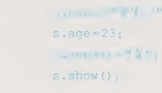

通过上述代码实现，虽然我们用 Java 把类描述清楚了，但有一个严重的问题，就是 `Student` 的属性的行为是可以随意访问和使用的，这明显不符合实际需求。

可是才能不被随意访问呢？这就需要使用 Java 中的关键字，也就是修饰符（私有，权限修饰符）。只要将 `Student` 的属性和行为封装起来，这样就无法直接访问。

### 5.1.2 `private` 关键字的描述和特性

- `private` 关键字特点：是一个权限修饰符。
- 可以修饰变量和方法。
- 被修饰的成员只能在本类中访问。

【例 5-2】`private` 关键字特点。

```java
class Student {
    private String name;
    private int age;
    private String gender;
    public void show() {
        System.out.println("年龄是" + age + ",性别是" + gender);
    }
}

class StudentDemo {
    public static void main(String[] args) {
        Student s = new Student();
        // s.age = 23; // 此处会报错，无法直接访问
    }
}
```

（注：原文此处逻辑较为混乱且重复，已根据高级文档工程师逻辑进行了精简整理，确保描述清晰）

【例 5-3】`set` 或者 `get` 方法来处理属性。

```java
class Student {
    private String name;
    private int age;
    private String gender;

    public void setName(String name) { this.name = name; }
    public String getName() { return name; }
    public void setAge(int age) { this.age = age; }
    public int getAge() { return age; }
    public void setGender(String gender) { this.gender = gender; }
    public String getGender() { return gender; }

    public void show() {
        System.out.println("年龄：" + age + ",性别：" + gender);
    }
}

public class StudentTest {
    public static void main(String[] args) {
        Student s = new Student();
        s.setName("张三");
        s.setAge(23);
        s.setGender("女");
        s.show();
    }
}
```

## 5.2 继承

继承是面向对象编程的主要特征，也是软件复用的手段。使用继承，子类可以继承父类中的属性和方法，并在子类中增加新的属性。继承模拟了现实的关系，通过继承可以有效地组织结构，减少冗余。

正如前面一样，Java 语言中所有的类都继承 `Object`。因此子类不需要重新定义父类已经拥有的属性和方法。在 C++ 中，一个类可以继承多个类（即多重继承），虽然增加了灵活性，但使得程序结构变得复杂。因此 Java 语言不支持多重继承，具有单继承特点，每个子类只有一个父类。

Java 语言中继承的格式：通过 `extends` 关键字来实现类之间的关系。注意的是，子类不能获得父类中 `private` 修饰的属性和方法。

【例 5-4】继承演示代码。

```java
class Person {
    String name;
    int age;
    String sex;
    public void eat() {
        System.out.println("吃饭");
    }
    public void sleep() {
        System.out.println("睡觉");
    }
}

class Student extends Person {
}

class Teacher extends Person {
}

class ExtendsDemo {
    public static void main(String[] args) {
        // 创建对象
        Student s = new Student();
        s.name = "学生";
        System.out.println(s.name);
        s.eat();
        s.sleep();

        // 老师对象
        Teacher t = new Teacher();
        t.age = 40;
        System.out.println(t.age);
        t.eat();
        t.sleep();
    }
}
```

上面的 `Student` 类与 `Teacher` 类只是空类，但 `ExtendsDemo` 创建了 `Student` 对象与 `Teacher` 对象之后，可以访问该对象的 `name`、`age` 成员变量和 `eat()`、`sleep()` 方法，这表明该对象已经有了 `name`、`age` 成员变量和 `eat()`、`sleep()` 方法，这就是继承的作用。

### 5.2.2 继承的注意事项和什么时候继承

- **注意事项**
  1. Java 只支持单继承，不支持多继承。
  2. 子类不能继承父类的私有成员。
  3. 子类不能继承父类的构造方法，但是可以通过 `super` 关键字访问父类。

- **什么时候继承**：继承关系是“is a”，是一种特殊与一般的关系。如果有类 A、B，只有它们符合 A 是 B 的一种，或者 B 是 A 的一种，就可以考虑使用继承。比如，狗是一种动物。关键字 `extends` 表明在构造的新类中派生于一种类。

【例 5-5】继承演示代码：

```java
class A {
    public void show() { }
}

class B {
    public void show1() { }
    public void show3() { }
}

class C extends A {
    public void show3() { }
}
```

这里 `B` 不应该继承 `A`，因为 `B` 本身是没有 `show2()`，所以继承的关系使得 `B` 无故多出一个方法。

### 5.2.3 继承成员变量的关系

- 子类中的成员变量和父类中的成员变量名称不一样，可以直接使用。
- 如果子类变量名与父类成员名一样，遵循就近原则，在子类中查找；如果子类找不到，就到父类。

【例 5-6】继承成员变量的关系：

```java
class Fu {
    int num = 20;
    public void show() {
        System.out.println(num);
    }
}

class Zi extends Fu {
    int num = 40;
    public void show() {
        System.out.println(num); // 输出子类的 num
    }
}

class Ext {
    public static void main(String[] args) {
        Zi z1 = new Zi();
        z1.show(); // 输出 40
        Zi z2 = new Zi();
        z2.show(); // 输出 40
    }
}
```

### 5.2.4 继承构造方法

- 子类中所有的构造方法都会调用父类的无参构造。可以通过 `super` 调用父类的带参构造。
- 通过 `this` 调用本类的构造。

【例 5-7】继承构造方法：

```java
class Fu {
    public Fu() {
        System.out.println("父类的无参构造");
    }
    public Fu(String name) {
        System.out.println("父类的带参构造");
    }
}

class Zi extends Fu {
    public Zi() {
        super();
        System.out.println("子类的无参构造");
    }
    public Zi(String name) {
        super(name);
        System.out.println("子类的带参构造");
    }
}
```

### 5.2.6 方法的重载

方法的重载是实现多态性的重要手段。重载的含义是指在一个类中使用同名的方法，但每个方法有不同的参数，以实现相同的功能。这些同名方法之间所带的参数个数、参数类型、参数顺序的不同来区分。参数的返回类型不能构成重载，如果两个方法的签名相同，即参数的类型和排列顺序都一样，而仅仅是返回值不同时，Java 编译器将提示错误信息。

在 Java 中，方法的名称、类型和格式构成了方法的签名，编译器根据方法的签名来调用方法，签名在重载时必须不同，因为方法可以没有返回值。

在很多情况下使用重载非常方便。例如，在数学方法中使用绝对值函数，按照基本数据类有 `byte`、`short`、`int`、`float`、`double` 六种，在定义方法时，使用六个不同名称来区分它们，在使用中既不好记忆，还比较麻烦。这时使用一个名字 `abs()`，以不同类型的参数来区分它们，简洁又方便。

【例 5-9】定义一个矩形 `MyRect`，重载 `buildRect` 方法描述一个矩形，有多种方法：使用矩形的左上角和右下坐标、使用两个点（系统类的）的对象、也可以使用左上角和矩形的宽度和高度。因此我们定义的矩形可以用多种方式描述矩形。

```java
class MyRect { // 定义矩形
    int x1 = 0; // 左上角初始化
    int y1 = 0;
    int x2 = 0; // 右下角初始化
    int y2 = 0;

    MyRect buildRect(int x1, int y1, int x2, int y2) { // 方法1. 左上角带有
        this.x1 = x1;
        this.y1 = y1;
        this.x2 = x2;
        this.y2 = y2;
        return this;
    }

    MyRect buildRect(Point topLeft, Point bottomRight) { // 方法2. 两个对象，指定左上角和右下角
        x1 = topLeft.x;
        y1 = topLeft.y;
        x2 = bottomRight.x;
        y2 = bottomRight.y;
        return this;
    }

    MyRect buildRect(Point topLeft, int w, int h) { // 方法3. 左上角和宽度与高度
        x1 = topLeft.x;
        y1 = topLeft.y;
        x2 = (x1 + w);
        y2 = (y1 + h);
        return this;
    }

    void printRect() { // 打印坐标
        System.out.print("MyRect:<" + x1);
    }

    public static void main(String[] arguments) { // main() 方法
    }
}
```


# 封装、继承与多态 第五章

## 示例：MyRect 类的方法重载

```java
MyRect rect = new MyRect(); // 创建对象
System.out.println("Calling buildRect with coordinates 25,25,50,50:");
rect.buildRect(25, 25, 50, 50); // 创建形状1, 调用方法1
rect.printRect(); // 打印坐标
System.out.println("***");
System.out.println("Calling buildRect with points (10,10),(20,20):");
rect.buildRect(new Point(10, 10), new Point(20, 20)); // 形状2, 调用方法2
rect.printRect(); // 打印坐标
System.out.println("***");
System.out.println("Calling buildRect with point (10,10), Width(50) and height(50);");
rect.buildRect(new Point(10, 10), 50, 50); // 形状3, 调用方法3
rect.printRect(); // 打印坐标
```

示例中的矩形定义了三个同名方法 `buildRect`，都可以生成矩形，但具体使用哪个方法由实际参数决定。调用 `buildRect` 方法时，如果实际参数是左上角和右下角坐标 `(x, y)`，则自动使用第一个；如果实际参数是左上角点和右下角点，则自动使用第二个；如果实际参数是左上角点、宽度及高度，则自动使用第三个。

## 【示例5-1】定义 Citizen 类与 Student 类

### Citizen.java

```java
// 公民的属性定义和初始化
class Citizen {
    public String StringID = "00000000"; // 身份证号码
    public String name = "无名"; // 姓名
    public String sex = "男"; // 性别
    public String birthday = "1990.1.1"; // 生日

    public void display() { // 定义显示属性的方法
        System.out.println("身份证：" + StringID);
        System.out.println("姓名：" + name);
        System.out.println("性别：" + sex);
        System.out.println("出生：" + birthday);
    }
}
```

### Student.java

```java
// 定义子类 Student
public class Student extends Citizen { // 学生类由公民类派生
    // 学生类的特殊属性定义
    public String studentID; // 声明学号
    public String registerTime; // 声明注册时间
    public int init_result;

    public Student() { // 无参数的构造函数1
        studentID = "000000000";
        name = "";
        sex = "";
        birthday = "";
    }

    public Student(String personID, String name, String sex, String birthday,
                   String studentID, String registerTime, int init_result) { // 带参数的构造函数2
        this.personID = personID;
        this.name = name;
        this.sex = sex;
        this.birthday = birthday;
        this.studentID = studentID;
        this.registerTime = registerTime;
        this.init_result = init_result;
    }

    public void display() { // 执行父类的显示方法
        super.display();
        System.out.println("入学时间：" + registerTime);
        System.out.println("学成绩：" + init_result);
    }
}
```

依照继承的特点，`Student` 继承了 `Citizen` 类的四个成员变量（`StringID`、`name`、`sex`、`birthday`）和一个成员方法（`display`）。同时在 `Student` 类中定义了成员方法 `display()`，与父类的方法同名，这就是方法的覆盖（重写）。下面的演示展示了上述类之间的继承关系。

### StudentTest.java

```java
public class StudentTest {
    public static void main(String[] args) {
        Student obj1 = new Student(); // 创建默认对象
        obj1.display(); // 执行方法，显示默认对象
        Student obj2 = new Student("42170199802102755", "马小帅", "男", "1998.2.1");
        obj2.display(); // 执行方法，显示对象
    }
}
```

按照顺序编译上面的三个类，并运行 `StudentTest`，结果如图 5-1 所示。值得注意的是，重写的方法权限不能低于父类，如果父类的方法是 `public`，子类就不能是 `private`。在本章结束时详细讲解：重写类似，如果在子类中定义了与父类具有同名的变量，将隐藏父类的变量。此时，有了两个同名的变量，一个由子类直接访问，另一个通过 `super` 关键字访问父类的变量。

### `super` 关键字的作用

在子类隐藏了父类的成员后，仍需使用 `super` 访问被隐藏的成员。

1.  **调用父类重写的方法**。一般格式：`super.方法名([参数]);`
2.  **访问父类隐藏的变量**。一般格式：`super.变量名;`
3.  **调用父类的构造方法**。一般格式：`super([参数]);`

在类中访问父类方法，可以使用 `super` 关键字访问隐藏或覆盖的方法。如果类中定义了无参数构造方法，则使用 `super()` 执行父类构造方法。如果类中有多个构造方法，这种格式类似于 `this`（见实例）。如果一个类中定义了多个构造方法，可以使用这种格式的方法。

## 5.2 构造方法的重载

构造方法的重载与一般方法的重载相似，同一个类可以拥有同名的构造方法，同样根据参数类型来区分。下面是重载的示例修改 `MyRect`：

```java
// MyRect.java
import java.awt.Point;

class MyRect {
    // ...省略属性代码
    MyRect(int x1, int y1, int x2, int y2) // 构造方法1，左上角右下角
    // ...省略属性代码
    MyRect(Point topLeft, Point bottomRight) // 构造方法2，指定左上角和右下角
    // ...省略属性代码
    MyRect(Point topLeft, int w, int h) // 构造方法3，指定左上角(Point 对象)、宽度和高度
    // ...省略属性代码

    void printRect() { // 打印左上角坐标
        System.out.println("MyRect:<" + x1);
    }
}
```

### `this` 关键字

`this` 关键字指当前类的对象，表示对当前类的方法或变量引用。如定义一个类时，在第一个构造函数中调用第二个构造函数时，一定要用 `this` 形式：

```java
// 程序片段:
MyCircle(int xPoint, int yPoint) {
    this.x = xPoint;
    this.y = yPoint;
    this.radius = radius;
}
```

## 5.3 抽象类

我们不能实例化所有的实体模型，因为现实世界的某些类太抽象而不能独立存在。我们考虑如下如图 5-2 的几何结构。


图 5-2 几何

我们可以这样描述类，它有直径、周长和面积。矩形、三角形、多边形等具体的图形也是相似。那么，对于几何如何描述？它是抽象的。现实生活中遇到很多抽象类，如汽车、车等。Java 提供了抽象类；当这类结构只有方法声明而不能实现方法时可以将它们定义为抽象类。

### 5.3.1 抽象类定义

抽象类是指只能继承而不能创建具体对象（即实例化）的类。抽象类中可以有一个或多个抽象方法，也可以没有抽象方法。先看这个例子，如图 5-3 所示。抽象类中的抽象方法只有定义，没有方法体。

抽象类的定义格式：

```java
abstract class className {
    // 抽象方法
    abstract returnType methodName(parameterList);
    // 非抽象方法
    returnType methodName(parameterList);
}
```

可以看到，抽象方法只能在抽象类中定义，并且以分号结尾。抽象类就是这样的。

### 5.3.2 抽象方法

抽象方法是在类中定义为“处理数据”，但“不知道如何处理数据”的方法。换句话说，一个抽象方法仅仅为子类定义统一的接口。抽象方法的格式：

```java
abstract datatype AbstractName(parameterList);
```

抽象类不能实例化，它是不能用 `new` 关键字创建的。抽象类只能作为父类使用，派生类必须实现所有的抽象方法才能创建对象。再定义一个子类，重写方法 `getArea()`：

#### (1) 定义一个矩形 Rectangle，并实现抽象方法。

```java
// Rectangle.java
public class Rectangle extends Shape { // 从抽象类继承
    private double length;
    private double height;

    public Rectangle(double length, double height) {
        this.length = length;
        this.height = height;
    }

    public double getArea() { // 实现抽象方法，矩形的面积
        return length * height;
    }
}
```

#### (2) 定义正方形类 Square。

```java
// Square.java
public class Square extends Rectangle { // 继承 Rectangle
    public Square(double length) {
        super(length, length); // 父类的构造函数
    }

    public double getArea() { // 重写方法 getArea，正方形的面积
        double area = super.getArea(); // 调用父类的方法
        return area;
    }
}
```

其中 `super` 关键字表示，派生类中调用了父类的构造函数 `Rectangle()` 和 `getArea()` 方法。如果把 `Rectangle` 类中的 `getArea()` 方法改为 `final`（终极方法，下文介绍），则在 `Square` 类中不能被重写了。事实上，`Rectangle` 的子类 `Square` 应该用相同的方法来确定面积，要在 `Square` 类中重写 `getArea()` 的代码。因此 `Square` 类可以简化如下：

```java
// Square.java
public class Square extends Rectangle {
    public Square(double length) {
        super(length, length); // 父类的构造函数
    }
}
```

#### (3) 定义椭圆类 Ellipse。

```java
// Ellipse.java
public class Ellipse extends Shape {
    private double majorAxis;
    private double minorAxis;

    public Ellipse(double majorAxis, double minorAxis) {
        this.majorAxis = majorAxis;
        this.minorAxis = minorAxis;
    }

    public double getArea() { // 重写 getArea()
        return Math.PI * majorAxis / 2.0 * minorAxis / 2.0; // 椭圆的面积
    }
}
```

`PI` 是 `java.lang.Math` 类的一种 `public static final double` 类型常量。

这样，各种形状面积的方法都是 `getArea()`，对外统一起来，可以计算矩形、正方形、椭圆的面积。为了演示计算矩形、正方形、椭圆的面积，还需要编写一个包含 `main()` 方法的类，作为作业留给学生去完成。

由于 `abstract` 类不是对象，定义 `abstract` 方法体是没有任何意义的。抽象类的子类（非抽象类）则在子类中继承父类的抽象方法并应重写所有的抽象方法。

注意：**抽象类不能创建实例**，见下列代码编译时出错：

```java
// Applicant2.java
abstract class Applicant2 {
    public static void main(String[] args) {
        Applicant2 appObject = new Applicant2();
    }
}
```

编译时显示信息：

```text
Applicant2.java:10: abstract cannot be instantiated
        Applicant2 appObject = new Applicant2();
```

为此，抽象类和抽象方法可以总结如下：

1.  如果一个类中声明了抽象方法，则这个类必须被声明为抽象类。由于抽象类不能直接实例化，所以就不能用 `new` 关键字来创建。抽象类只能作为父类使用，由它派生的子类必须实现所有的抽象方法，才能创建实例。
2.  抽象方法的实现在抽象父类派生的子类中重写抽象方法，增加方法体，使之成为一个非抽象方法；在重写方法时不需要 `abstract` 修饰。这种实现也是可以的，也就是方法只有一对 `{}`，方法中没有分号。
3.  如果子类没有实现父类中所有的抽象方法，则子类也必须成为一个抽象类，也就是说子类也必须使用 `abstract` 修饰。
4.  可以将没有任何抽象方法的类声明为抽象类，但要避免这个类直接创建任何对象。
5.  构造方法、静态方法、私有方法、`final` 方法不能被声明为抽象方法。

## 5.4 终极类

### 5.4.1 终极类

所谓终极类，即不能有子类的类，或者说用 `final` 修饰的类。

如果一个类的定义很完整，不需要再重建该类的子类，这个类称为终极类。在 Java 中，定义为 `final` 类，通常是用来定义某种标准类，具有固定作用的类，如系统中有关网络的 `InetAddress` 类、`Socket` 类输入输出类等。

终极类定义的格式：

```java
final class className [extends className] [implements interfaceList];
```

由于安全的原因或 OOP 的考虑，有希望一些类不能被继承，如 `String` 类对编译器解释器的正常运行非常重要，不能轻易改变，定义为 `final` 类，保证 `String` 类型的唯一。

例如，下列代码编译出错，出错原因是 `Generic` 类继承终极类 `VeryGoodClass`。

```java
// VeryGoodClass.java
final class VeryGoodClass { // 一个终极类
}

// Generic 类代码
class Generic extends VeryGoodClass { // 继承终极类
}
```

子类不能从终极（`final`）父类继承。

### 5.4.2 终极方法

终极方法是指不能被子类重写的方法。

如果某个父类的方法用 `final` 修饰，则子类中不能再出现该方法的定义，只能使用从父类继承来的这个方法的功能。

定义终极方法的目的：防止子类对父方法的修改，保证程序的安全性。

终极方法定义格式：

```java
final datatype methodName(parameterList) {
    // ...
}
```

由于 `final` 类是不能被继承的，因此 `final` 类中的方法是不可能被重写的，故 `final` 类中的方法即使使用了 `final` 修饰，也是终极方法。

需要注意的是，终极方法也可以在非 `final` 类中定义，只是在非 `final` 的类中不能重写终极方法。

### 5.4.3 终极变量

`final` 修饰变量时，变量的值在整个程序中是不能改变的，它就是一个常量。它常与 `static` 一起使用。

用 `final` 修饰变量时，应该给出变量的值，即在定义变量时赋值，不能在后赋值。

关于常量参考本文的介绍。

下面对修饰符 `abstract` 和 `final` 进行总结：

- `abstract` 不能与 `private`、`static`、`final` 同时修饰一个方法。
- `abstract` 类中不能有 `private` 成员。


- `abstract` 方法必须在 `abstract` 类中。
- `abstract` 方法不能处理 `static` 属性。

## 5.5 接口 (interface)

接口是实现类多重继承的结构。接口抽象的概念更深入，我们可以视为特殊的抽象类，接口用来表示一类必须做什么，而不是规定它如何做。因此此类用来指定的协议。

Java 和 C++ 不同，它支持类的多重继承，即使能继承多个直接父类，一个类只能有一个直接父类。Java API 将接口和类分开，由于 Java 的接口中没有具体的实现细节，也就没有存储关联，可以将多个类合并在一起，目的是实现多重继承。

### 5.5.1 接口的基本概念

先看一个现实世界（面向对象）的例子，理解为什么要用接口。如果不使用接口，那么交通工具就会复杂。


因此，汽车、自行车、公交车都是交通工具。每个类只有一个直接父类——这是 Java 的单继承决定的。

### 5.5.2 接口的声明(定义)

接口的结构和类相似，只是定义接口时使用 `interface` 而不是 `class`。在实现之前应该声明：接口声明格式：

```java
[public] interface interfaceName extends interfaceList
{
    //[常量] 数据成员的声明
    [public] dataType variableName = ...
    //以下是抽象方法的声明
    [public] abstract methodName(parametersList) throws exceptionList;
}
```

如果接口本身是 `public`，则接口的方法认为 `public`。下面定义一个 `Shape`：

```java
//Shape.java
interface Shape
{
    double PI=3.14159;//常量
    double getArea(); //抽象方法
    double getGirth();//抽象方法
}
```

### 5.5.3 接口的实现

接口的实现通过类完成，定义类时使用 `implements` 格式。要实现接口规定的功能，需要在类中为接口中的抽象方法写实现，这个过程称为接口的实现。接口和实现类之间的实质是继承的关系，一个类可以实现多个接口，从而实现多态性。比如创建一个 `Circle` 类来实现 `Shape` 接口。

```java
//Circle.java
public class Circle implements Shape {
    public double originX;//圆心
    public double originY;
    public double radius;//半径
    public Circle() {//构造1
        originX=0.0;
        originY=0.0;
        radius=1.0;
    }
    public Circle(double x, double y, double r){//构造函数2
        originX=x;
        originY=y;
        radius=r;
    }
    public double getArea() //接口方法的实现，覆盖，求面积
    {
        return radius * radius * PI;//面积
    }
    //下面编译
    public double getGirth() //接口方法的覆盖，求周长
    {
        return 2.0*radius * PI;
    }
}
```

对于矩形、三角形等几何图形，可以参照 `Circle` 类写代码，请思考。

## Java重写的方法

我们将例中的方法 `public double getGirth()` 注释掉，将会什么样的结果？编译时将会报错：

```
Circle is not abstract and does not override abstract method getGirth() in Shape
```

在一个类中实现多个接口，只要将接口中的方法实现即可。对于确实不需要写具体代码的方法可以使用方法体（即以“{}”起没有代码，否则报错）。由于类（非抽象类）对接口实现的定义中，必须实现接口中的所有方法，这些要求往往太严格。如果类是抽象类，则不需要完全实现接口中的所有方法。

## 5.6 多态

### 5.6.1 多态定义

多态是继承之后，面向对象的特性。多态表现出多种形态，如汽车、自行车、公交车都是交通工具。多态的前提是要有父类关系或者接口关系，否则无法完成多态。多态表现为父类引用指向子类对象。


思考，请查阅JDK目录下的源代码和包。

### 5.6.2 多态定义的格式

- **普通类（继承关系）：**

```java
class Fu {
    public void method() {}
}
class Zi extends Fu {
    public void method() {
        System.out.println("重写方法");
    }
}
```

- **抽象类：**

```java
abstract class Fu {
    abstract void method();
}
class Zi extends Fu {
    public void method() {
        System.out.println("重写方法");
    }
}
```

- **接口：**

```java
interface Fu {
    void method();
}
class Zi implements Fu {
    public void method() {
        System.out.println("重写方法");
    }
}
```

### 5.6.3 多态成员变量的特点

掌握了多态的基本使用后，成员变量：

```java
class Fu {
    int num=4;
}
class Zi extends Fu {
    int num;
}
```

当子类中出现同名的成员变量，多态调用该变量时：

编译时期：参考引用变量所属的类。

运行时期：调用引用变量所属的类。成员变量没有重写，多态调用时应该确定变量的类型，如：此时 `f` 的类型是 `Fu`（父类），只能从 `Fu` 中取值（父类不知道子类中有什么属性，但是子类知道父类的属性）。

```java
Zi f = new Zi();
```

成员方法：多态出现会导致父类中的方法有微弱的变化。如下代码：

```java
class Fu {
    public void showNum() {}
}
class Zi extends Fu {
    public void showNum() {
        System.out.println("Fu show num");
    }
}
```

编译时期：参考引用变量所属的类，如果类中没有调用的方法，编译失败。

运行时期：参考引用变量指向的对象类，并运行对象类的方法。简单：看左边，编写右边（因为方法可以重写）。Java成员方法有重写，多态调用时应该确定变量类型，如：

```java
// 此处 f 类型是 Fu（父类），但实际类型是 Zi
```

## 5.7 (package)

包是一个松散的类的集合，它可以将各种类组织在一起，就像目录的（文件）一样。同一个包的类不需要一定有明确的关系，类完全没有任何关系的类也可以放在同一个包中。但是在实际开发中，我们常常把相关的类放在同一个包中。

就像其他语言中的命名空间类似于 C 语言中的头文件，当一个类需要在多个地方进行时，应该将其放在包中。

在 Java 中包(package)是固有的。调阅 JDK 帮助，会发现 Java 提供的标准包(5-5)，其中最常用的包：

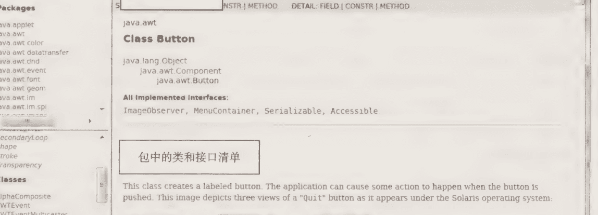

包的类和接口

This class creates a button. The application can cause some action to happen when the button is pressed. This image displays three views of "quit" as it appears under the Solaris operating system.


# Java 类体系设计

- `java.lang`：该包包含了 Java 基础类，如 `Math` 类。这些类在程序中使用不需要 `import` 语句，例如程序中的语句 `System.out.println()`、类转换语句 `Float.parseFloat()` 等。
- `java.swing`：该包包含了支持 Swing 界面的类，它比 awt 相关的组件更灵活、更容易使用。
- `java.sql`：该包包含了支持嵌入式 SQL 语句的类。
- `java.net`：该包包含了支持网络编程的类。

了解一个类中的嵌套结构是很有用的。在面向对象的程序中，程序是由类以及对类的成员组成的，某成员需要使用哪一个类，类中有些成员用何种方式访问它，这些都是重要的。

在此之前的示例中，我们使用对话框输入数据、输出结果，就用了 `javax.swing` 中的 `JOptionPane` 类，`showInputDialog()`、`showMessageDialog()` 可以通过 JDK 文档查找 `java.swing` 包中每个类的变量成员和方法成员。通过查询可以得知，上面的两种方法是静态方法，可以创建类对象直接引用它们。它们有多种方式（参数相同），这些参数的参数含义是什么，掌握了这些，我们就能正确使用它们，从而达到预期的目的。

### 5.7.1 创建包

系统会为每一个 Java 源创建一个无名的包，这个 Java 文件的每个类属于同一个包。这时，包中的类可以相互引用（非私有），由于它是无名的，无法被其他包中的 Java 程序所引用。解决上述的方法是创建一个名字的包。

`package` 是创建包的关键字，利用它对于所有的 Java 文件创建一个。

创建包的格式：

```
package packageName;
// packageName 为要创建的名字（符合标识符的），习惯上，包使用小写字母单词。这个词应该位于 Java 文件的第一个语句处（注释除外）。
```

事实上，创建一个包就是在当前的目录下创建一个子目录，用以存放 Java 的类文件。在 `javac` 编译、创建包文件时，相应的子目录就会被创建。如：

```
package packageName1.packageName2.packageName3;
```

其中“.”代表了目录分隔，注意不要用 "\"

- 第一个 `packageName1` 是当前文件夹下的子文件夹。
- 第二个 `packageName2` 是 `packageName1` 下的子文件夹。
- 第三个 `packageName3` 是 `packageName2` 下的文件夹。

按照习惯，将包放在 JAR (Java Archive)，用 ZIP 压缩，以 `.jar` 为后缀的文件，一个 JAR 往往会包含多个包，用 J2SE 提供的类标准是在 `rt` 包文件中。

【例 5-14】例如，我们将面的公民类 `Citizen` 放入包中，将它的类 `Student` 放入 `Citizen`，只需两个文件的第一个语句处分别添加代码即可。两个文件的修改如下：

```java
// 程序文件 Citizen.java
package Citizen; // 在 Citizen.java 中添加
public class Citizen
{
    //......相同代码省略
}

// 程序文件 Student.java
package Citizen.Student1; // 在 Student.java 中添加
public class Student1 extends Citizen
{
    // ...相同代码省略
}
```

下面定义雇员类 `Employee`，它是 `Citizen1` 的类，将它放入 `Citizen.Employee` 中。

```java
// 雇员类 代码
// Employee.java
package Citizen.Employee; // 定义类名
public class Employee extends Citizen.Citizen
{
    static float minSalary=257f; // 最低工资
    static float maxSalary=200000f; // 最高工资
    // ......构造函数
    int EmpNo; // 工员代码
    float salary=257f; // 工资
    String startDate = "1970.1.1"; // 参加工作时间
    Employee() // 构造函数1
    {
        EmpNo++;
    }
    Employee(String personID, String name, String sex, String birthday, float salary, String startStartDate) // 构造函数2
    {
        // 构造函数2
        this.name=name;
        this.sex=sex;
        // ......其他赋值
        this.salary=salary;
        this.startDate=startStartDate;
        EmpNo++;
    }
}
```

# Java 程序

```java
String empName = "员工号码："+empNo;
System.out.println("员工工资："+salary);
System.out.println("参加工作日期："+startDate);
```

完成三个程序的修改完成后，就可以按照顺序编译它们，生成的三个类文件分别放入相应的包中，请读者练习：

编译方法：

在编译带有 `-d` 的程序时，可以用指定的目录：

```bash
javac -d <DirectoryName>
```

其中 `<DirectoryName>` 表示父目录。

如：

```
javac -d d:\sdk1 Employee.java
```

会在 `d:\sdk1` 生成 `Classes` 子目录。而 `javac -d . Employee.java` 在当前目录下生成以类名为名的子目录。“.” 表示当前目录。

一般来说，当前路径是 CLSPATH 指定的路径，不设置时，就是 Java 文件所在路径。

### 5.7.2 引用包中的类

用包引用的类更加方便在 Java 文件中引用包中的类时，共有四种方式：

- 1. 引用包名，类前缀（直接引用）一个类引用包中的类有两种：一种是被引用的子类，二是被引用的对象或访问它（静态或对象的）属性或调用它的方法。不同类之间引用，可以直接在被用的类名前加上该类的包名（包名.类）。下面的代码是“申请人”类的片段，是一个程序，需要用到“包名.类”原则，可以修改如下：

```java
public class Applicant extends java.awt.Frame
{...相同代码省略
    public void paint(Graphics g)
    {
        Applicant appObj=new Applicant();
        appObj.age=45;
        if(appObj.checkAge()==false){
            // 显示拒绝信息
            g.drawString("Rejected",10,20);
            // 显示信息
            g.drawString("Accepted",10,40);
        }
    }
}
```

可以看出，每次加载包中的类都要包名很繁琐。通常用第二方法：

- 2. import（加载）在当前开头使用 `import` 语句，将需要的包加载到当前程序中，以后使用加载的类时，系统会自动在包中查找，不必包名。

格式一、加载包中的类：`import 包名.类` 例如，上面的片段修改后，写起来方便得多。

```java
import java.applet.Applicant;
import java.awt.Graphics;
public class Applicant4 extends Applicant
{//相同代码省略
    public void paint(Graphics g)
    {
        //……相同代码略
    }
}
```

格式二、加载包中的类：`import 包名.*` 例如，上面的片段修改成以下形式：

```java
import java.applet.*;
import java.awt.*;
public class Applicant5 extends Applicant
{//……相同代码略
    public void paint(Graphics g)
    {
        //……相同代码略
    }
}
```


同一类继承父类的自动导入：例如，5-4 中的 `Demo` 引用了 `Student` 类，而 `Student` 类引用了 `Person` 类，因为三个类都在同一个包中，可以直接引用，不需要包名，也不需要 `import` 语句。Java 会自动导入。使用 `java.lang` 下的类，不需要 `import` 语句，可以直接引用，比如 `System`、`String` 类等。作为本文的结束，再讲一个环境变量 `classpath`；`classpath` 用说明编译者的类文件存放的路径，当一个程序找不到它需要的类文件时，系统会自动从 `classpath` 环境变量所指的路径中查找。对 Windows，将环境变量修改为以下形式：

```
set classpath=C:\jdk1.8.0_40\lib;C:\jdk1.8.0_40
```

设 `c:\jdk1.8.0_40` 为环境变量路径。注意不要遗漏。

## 5.8 项目设计

### 5.8.1 项目目标和任务

#### 1. 项目目标

1. 理解面向对象设计思想
2. 掌握继承的实质含义，方法重载的实现方式与方法覆盖的区别、变量的访问控制，理解接口的定义以及实现。

#### 2. 项目任务

某公司安装了电子门，要设计门禁系统，要求如下：

- 员工需要密码、脸卡或指纹进入公司。
- 计算机根据员工的验证方式对其进行验证。
- 管理员在监控可以通过按钮直接开启电子门。
- 顾客可以按门铃请求进入，由管理员为其放行。
- 管理员可以为新员工设置密码。

#### 1 项目需求说明

根据项目任务描述的项目功能分析对象：

- 门禁系统、电子门、计算机、输入设备。
- 管理员、员工、顾客。
- 验证接口、验证实现。

对象关系（图 5-6）。


用户权限级别（图 5-7）。


#### 2. 重点分析

**(1) 门禁系统类：`ControlSys`**

包含属性：电子门对象、计算机对象、输入设备、门铃、开门信号……

```java
private Door door; // 门禁系统的电子门
private Computer computer; // 门禁系统的计算机
private InputEquip inputEquip; // 门禁系统的输入设备
private int ring; // 门铃，0为安静，1为鸣响
private int openSign; // 开门信号，由管理员按下按钮时产生
```

包含方法：工作方法

```java
public void work()
```

**(2) 门禁系统工作分为三步：**

第一步：检查设备的输入缓存。

如果有输入且输入信息存在。

第二步：维持 s。

第三步：关闭门。

### 习题

**5. 下列选项中正确的是( )**

A. `public abstract class Car`

B. `abstract private move()`

C. `protected private number`

D. `abstract final class HI`

**6. 下列说法中正确的是( )**

A. `final` 可修饰类、属性、方法

B. `abstract` 可修饰类、属性、方法

C. 定义抽象方法时需要有方法的返回值类型、名称、参数列表和方法体

D. `final` 修饰的变量，在程序中可对这个变量的值进行更改

**7. 接口和抽象类的区别?**

**8. Java中的方法覆盖(`overriding`)和方法重载(`overloading`)是什么意思？**

**9. Java中，什么是构造函数？什么是构造函数重载？**

**10. Java实现多态机制是什么？**

**11. 请写出以下程序的输出结果。**

父类：

```java
package test;

public class FatherClass {
    public FatherClass() {
        System.out.println("FatherClass Create");
    }
}
```

子类：

```java
package test.FatherClass;
public class ChildClass extends FatherClass {
    public ChildClass() {
        System.out.println("ChildClass Create");
    }
    public static void main(String[] args) {
        FatherClass fc = new FatherClass();
        ChildClass cc = new ChildClass();
    }
}
```

**12. 下面是 `People` 和 `Child` 类的定义和构造方法，每个构造方法输出编号。在执行 `new Child("mike")` 的时候都有哪些构造方法被顺序调用？请选择输出结果。**

```java
class People {
    String name;
    public People() {
        System.out.println(1);
    }
    public People(String name) {
        System.out.print(2);
        this.name = name;
    }
}

class Child extends People {
    People father;
    public Child(String name) {
        System.out.print(3);
        this.name = name;
        father = new People(name + " E");
    }
    // System.out.print(4);
}
```

A. 312 B. 32 C. 432 D. 132

**13. 从教师类继承，定义一个教师 `Teacher` 类，并添加教师信息代码、教师职业和主讲课程，覆盖类的 `display()` 方法。分别调用父类和类的方法显示教师信息。**

**14. 编写一个应用程序，该程序应该有两个类：`Print` 类和类 `E`。`Print` 类里有一个方法功能是输出变量（时、分）初始化，另一个一个方法功能是输出 100-999 之间的水仙花个数（每个位数字的立方和等于这个三位数本身，如：371=3³+7³+1³），在类 `E` 的方法中测试类 `Print`。**

**15. 编写一个类 `ChongZai`，该类中有三个重载的方法；其次，编写一个主类来测试 `ChongZai` 的功能。**

**16. 编写应用程序，首先，定义一种时钟类 `Clock`，它包括三个整型成员变量，分别表示时、分、秒；通过构造方法对这三个变量进行初始化，另外一个构造方法用于显示时对象的属性。其次，定义一种时类 `TestClass`，在主类中创建多个时类对象，使用这些对象的重写方法来显示时钟。**

**17. 编写一个应用程序，该程序包括三个类：`A`、`B` 和类 `E`。其中 `B` 类是 `A` 类的子类，在 `B` 中重写变量，并且覆盖了类 `A` 的方法。在类 `E` 的方法中，创建 `B` 的对象并转换为 `A`，使用转换来测试上对象的特性。**

**18. 编写一个类，具有不同的属性，具有功能性；定义一个子类 `Aodi` 和 `Bendi`，具有相同的签名；如：定义父类 `A`，在类方法中创建 `Aodi` 和 `Bendi` 对象测试属性的特性。**

**19. 设计一个接口，该接口连接的是学生 `StudentG` 和硕士(`M`) 的公共方法：设置姓名、设置学号，输出所有信息，判断学生是否优秀。在这个接口的基础上实现两个学生 `StudentG` 和 `StudentM`。**

`StudentG`：姓名，是否通过 CET4，学年综合测评成绩。`StudentG` 包含方法：构造方法，是否通过 CET4，学年综合测评，实现接口中定义的所有方法（本科生的标准是 CET4，学年综合测评成绩达到 85 分及以上）。

`StudentM` 属性：姓名，学号，是否过 CET6，已发表文章篇数。`StudentM` 包含方法：构造方法，设置是否过 CET6，设置文章篇数，接口中定义的所有方法(硕士生优秀的标准是过 CET6，已发表文章数大于 1)。

要求：
1. 实现上述的接口和类；
2. 在 `main` 函数内实例化五个对象：三个本科生，两个硕士生(至少各有一个优秀)；
3. 用多态的性质来判断实例化的五个学生是否优秀；
4. 输出优秀学生的所有属性信息。

## 第6章

## 异常处理机制

我们知道，错误(`error`)在编程中是不可避免的，如操作系统发生的错误（系统崩溃、系统死锁等），电源产生的错误等。在 Java 中我们可以将错误分成两种类型：

一类是 `Error`，在 Java 中用 `Error` 表示，意味着发生了 JVM 监测到的严重错误，导致 JVM 无法运行。这种错误是不能处理的，因为程序无法捕捉它，也就无法处理。

另一类在 Java 中称为异常(`exception`)，是可以恢复的。这种错误能够捕捉，因此程序中可以采取适当措施。

## 6.1 异常的处理

面向对象的程序设计中（如 C 语言中），传统的办法是将错误的检查放在相应的程序中。


# 面向对象的程序设计中（如C语言中），传统的办法是将错误的检查放在相应的程序中。

## 6.2 Java的异常机制

什么是异常呢？在Java语言中，产生的错误(error)视为异常(exception)，也称为例外。所有产生异常实际上产生异常对象。这个对象可能由程序本身由JVM产生，取决于产生类型。因此，Java引入了异常和类，异常是类。系统中相应的机制异常，确保程序能够运行。

Java程序中，异常机制会抛出异常、捕获异常。

**抛出异常**：当一个发生错误时抛出时，程序创建异常对象交付运行时系统，异常对象包含了异常类型和出现状态等信息。运行时系统负责查找。

**捕获异常**：在方法抛出异常之后，运行时寻找合适的处理器（exception handler）。潜在的异常处理器是异常发生时依赖于调用链中的方法。当异常处理器的异常类型与方法抛出的异常类型匹配时，即为合适的异常处理器。运行时系统从异常发生的方法开始，依次查找调用链中的方法直到找到合适的处理器并执行。如果运行时追溯调用链中没有找到异常，则运行时将终止。采用异常处理机制的结果，使得异常代码和程序部分隔离。

## 6.3 Java异常类

在 Java 中使用`Exception`类描述异常。`Exception`类及其子类是`Throwable`的一种形式，用来表示Java程序中可能产生的异常，并要求对产生的异常进行合理的处理。`Exception`有继承关系，它的父类是`Throwable`。`Throwable`是Java语言中所有错误或异常的超类。其关系见图6-1所示。`Exception`类的其中一个派生类是`RuntimeException`（子类），该类包含几个常见的异常类，在数据处理中常用。

### 1. ArrayIndexOutOfBoundsException

在访问数组元素时，如果下标超出了范围，就会产生该异常。

【例 6-2】这个程序将产生下标越界异常。

```java
public class Demo {
    public static void main(String[] args) {
```

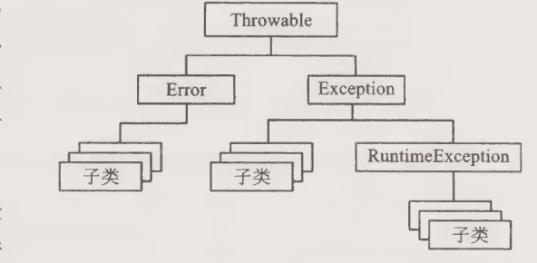

执行结果如图 6-2所示。

```
"C:\Program Files..."
```

## Java 查询程序设计

```java
new ArrayIndexOutOfBoundsException("模拟的错误");
```

```
main(Demo.java: 22)
```

在类 `Demo` 的 `getElement()` 方法中，用 `throw` 语句抛出了用户自定义的异常 `ArrayIndexOutOfBoundsException`。

编译程序时，可以发现用户定义的异常确实发生了：

```
Exception in thread "main" java.lang.ArrayIndexOutOfBoundsException: 错误的下标的: 4
at com.ssm.Demo.getElement(Demo.java: 13)
at com.ssm.Demo.main(Demo.java: 22)
```

语法规则：

`修饰符 返回类型 方法名(参数) throws 异常类型 1，异常类型 2…`

在很多情况下，我们只定义某个会抛出异常的方法，但不想去捕获或处理那个异常，可以使用 `throws` 声明异常。

下面的片段声明运行时异常：

```java
)()
```

方法 `doSomething()` 中声明了运行时异常，这个异常由调用 `doSomething()` 方法程序去捕获，并进行相应的处理。

【例6-6】在方法中使用关键字声明运行时异常。

```java
public void main(String[] args) {
    doSomething();
}

class Demo {
    public void doSomething() throws RuntimeException {
        throw new RuntimeException("运行时异常");
    }
}
```

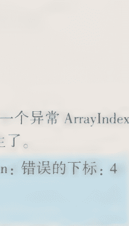

```java
DateFormat df=new SimpleDateFormat("yyyy/MM/dd");
Date date=df.parse("...");
System.out.println(date);
```

运行结果:

```
Exception in thread "main" java.text.ParseException: Unparseable date: "2021-01-28"
at java.text.DateFormat.parse(DateFormat.java: 366)
at com.ssm.Demo.parse(Demo.java: 22)
at com.ssm.Demo.main(Demo.java: 11)
```

## 6.4.2 异常的捕获

为了防止和处理异常，可以将可能发生异常的代码监控起来。对于在方法定义抛出的异常，也要在调用方法处捕获。异常的捕获范围和处理使用 `try-catch` 关键字。

### 1. 单个 `try-catch` 关键字

此关键字的实际含义是，`try{}`结构（语句）用于限定异常的测试范围，即有可能发生异常的代码放到此块中。`catch()`语句用于捕获异常对象，一旦产生异常程序执行行为。

异常测试与捕获的异常段结构:

```java
// 可能出现异常的代码
catch(异常类 变量名) {
    // 异常类：是try中代码可能出现的异常类型
    // 如果try中出现异常，将跳转到此块执行
}
```

【例6-7】异常的捕获和处理示例。

```java
public class Demo {
    public static void main(String[] args) {
        try {
            System.out.println("异常之前的代码");
            System.out.println(args[3]);
            System.out.println("异常之后的代码");
        } catch (ArrayIndexOutOfBoundsException e) {
            System.out.println("异常发生了：" + e.getMessage());
        }
        System.out.println("程序顺序结束");
    }
}
```

运行结果:


异常之前的代码
发生异常了，数组下标越界异常
程序结束

### 2. 多个 `catch` 关键字

实际开发中会遇到以下情况：一段代码可能会产生异常，但无法具体的确定是哪种异常类型。在这种情况下，就应该在程序中捕获多个异常，将多种可能都进行捕获，进行匹配。

一个 `try` 后面可以跟多个 `catch()` 语句，每个 `catch()` 语句可以捕获一种（只能一种）类型的异常。JVM 是通过传递的方式将异常的对象传递给 `catch()` 的代码。

捕获多个异常的语法如下：

```java
try {
    int[] arr = new int[3];
    arr[3] = 1;
} catch (ArrayIndexOutOfBoundsException e) {
    System.out.println(e.getMessage());
} catch (Exception e) {
    System.out.println(e.getMessage());
}
```

处理多个异常的原则：异常捕获的顺序应该是从特殊到一般。

如果倒举例中的三个 `catch` 顺序，按照 Java 异常的继承关系，`Exception` 类是所有异常类的父类，因此任何异常都可以由它所在的 `catch` 捕获，其他异常的永远没有执行的机会，编译时将产生“catch not reached”的错误。

【例 6-8】用多个 `catch` 捕获异常。

```java
try {
    int[] arr = new int[3];
    arr[3] = 1;
} catch (ArrayIndexOutOfBoundsException e) {
    System.out.println("数组异常");
} catch (NullPointerException e) {
    System.out.println("指针异常");
} catch (Exception e) {
    System.out.println("其他异常");
}
```

```java
System.out.println("异常! 空指针!");
} catch (ArrayIndexOutOfBoundsException e) {
    System.out.println("异常! 下标越界!");
} catch (Exception e) {
    System.out.println("未知类型的异常!");
}
```

### 3. `finally` 关键字

`finally` 语句的作用是，不管发生了什么情况（是否抛出异常），都执行。`finally` 中的代码用于统一接口，如读写文件时，不管是否发生异常，都会执行。

`finally` 异常的方法：

```java
try {
    // 可能出现异常的代码
} catch (异常类型 变量名) {
    // 异常处理: try中可能的异常
    // 如果try出现异常，将跳转到此处
} finally {
    // 一定执行的代码
}
```

【例6-9】用 `finally` 处理异常。

```java
public class Demo {
    public static void main(String[] args) {
        int[] arr = new int[1];
        try {
            arr[1] = 1;
        } catch (ArrayIndexOutOfBoundsException e) {
            System.out.println("异常发生了!");
        } finally {
            System.out.println("程序运行结果:");
        }
    }
}
```

运行结果：


异常发生了
程序运行结果

## 6.4.3 `Throwable` 常用方法

在 `Throwable` 类中我们提供了很多操作异常的方法，如图6-5所示。

| 方法 | 描述 |
| :--- | :--- |
| `String getMessage()` | 返回异常的详细字符串 |
| `String toString()` | 返回异常的名称与详细描述 |
| `void printStackTrace()` | 将追踪输出到标准流 |


- `getMessage()` 方法：返回异常的详细字符串，即异常信息
- `toString()` 方法：返回异常的名称与详细字符串
- `printStackTrace()` 方法：在控制台输出异常的名称、详细字符串及异常出现的代码

```java
public class Demo {
    public static void main(String[] args) {
        try {
            String s=null;
            System.out.println(s.length());
        } catch (NullPointerException e) {
            // 返回异常的信息
            String message=e.getMessage();
            System.out.println(message);
            // 返回异常的名称与详细字符串
            String result=e.toString();
            System.out.println(result);
            // 返回异常的名称与详细字符串，异常出现的代码
        }
    }
}
```

运行结果：

```
null
java.lang.NullPointerException
java.lang.NullPointerException
at com.ssm.Demo.main(Demo.java: 8)
```

## 6.4.4 用户定义的异常

前面讲的系统异常主要用来系统可见的异常，Java 定义了 `Exception`。对于某个应用程序特有的错误，需要程序员根据程序的特殊逻辑在程序中自己创建异常类对象。

用户定义的异常类型必须是 `Throwable` 的类（直接或间接），Java推荐以 `Exception` 类作为直接父类来创建异常类：

```java
用户创建异常类的格式：
class 异常 extends Exception { //或继承 RuntimeException
    public 异常() {}
    public 异常(String s) {
    }
}
```

【例 6-11】使用自定义异常。

```java
public class Demo {
    public static void main(String[] args) {
        Student s=new Student();
        s.setAge(210);
    }
}
```

```java
class Student {
    int age;
    public void setAge(int age) {
        if (age<0 || age>150) {
            try {
                throw new AppException("错误年龄");
            } catch (AgeException e) {
                e.printStackTrace();
            }
        }
        this.age=age;
    }
}
```

运行结果：
```
com.ssm.AgeException: 错误年龄
at com.ssm.Student.setAge(Demo.java, 19)
at com.ssm.Student.main(Demo.java, 7)
```

## 6.5 项目学

### 6.5.1 项目目标与项目任务

- 1. 项目目标
  - (1)了解 `Throwable` 类及其子类。
  - (2)了解运行时的异常。
  - (3)掌握如何捕获异常、声明异常并抛出异常。
  - (4)掌握如何自定义异常。
  - (5)正确使用异常处理机制。

- 2. 项目任务
  在虚拟银行取钱过程中，如果取款数大于余额就需要需要异常处理。例如取钱2000元，余额为1500元，就会出现留好的异常处理消息，如图6-6所示。


### 6.5.2 项目分析

(1) 银行类
(2) 异常类
(3) 前端调用

### 6.5.3 项目实现

```java
class Bank {
    double balance;
    Bank(double balance) {
        this.balance = balance;
    }
    public void deposit(double amount) {
        balance += amount;
    }
    public void withdrawal(double amount) throws InsufficientFundsException {
        if (amount > balance) {
            throw new InsufficientFundsException(this, amount);
        }
        balance -= amount;
    }
    public void showBalance() {
        System.out.println("Current balance: " + balance);
    }
}

class InsufficientFundsException extends Exception {
    private Bank bank;
    private double amount;
    InsufficientFundsException(Bank ba, double amount) {
        this.bank = ba;
        this.amount = amount;
    }
}
```


# 异常处理机制 第6章

编译并运行程序，从命令行输入：`n12345ABCDE`，结果如图 6-7 所示。通过这个例子，我们知道在计算三角形面积和周长时，需要提供三个边长的数据。构造一个三角形是有条件的：任意两边之和必须大于第三边，任意两边都必须大于第三边，且长度不能为负数。以此为基础，可以建立如下处理自定义异常的程序：

## 【6-13】给出三角形，计算三角形的面积和周长

我们通过一个测试程序来定义异常的抛出和捕捉。计算三角形的运行程序如下：

```java
// TriangleArea
public class TriangleAreaLength {
    public static void main(String[] args) {
        Triangle t1 = new Triangle(1, 2, 3); // 输出三角形的三个边长
        Triangle t2 = new Triangle(2, 5, 6); // 用Triangle创建不三角形，t2
        try {
            if (t2.isTriangle()) // 边长2,5,6能否构成三角形？
                System.out.println("t2的面积=" + t2.getArea());
                System.out.println("t2的周长=" + t2.getGirth());
            } // 是三角形，就计算
            if (t1.isTriangle()) // 边长...能否构成三角形？
                System.out.println("t1的面积=" + t1.getArea());
                System.out.println("t1的周长=" + t1.getGirth());
            } // 是三角形，就计算，不是不计
        } catch (TriangleException e) // 捕获自定义异常 TriangleException,后面有定义
            System.out.println(e.toString());
        }
    }
}
```

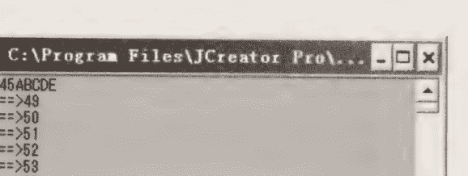

## Java 类程序设计

// 定义三角形类 Triangle；给出三个边长计算面积和周长，并应该检查是否构成三角形。构不成角形时，不可能形成面积和周长。

```java
class Triangle {
    double sideA;
```

```java
throw new TriangleException(); // 不能构成三角形，即出错时，抛出异常
TriangleException. TriangleException 是是自定义的
```

```java
// 方法isTriangle() 结束
```

```java
// 自定义异常TriangleException,一旦发现未构成三角形，给出错误提示信息
class TriangleException extends Exception {
    public TriangleException() {
        super("三角形边长错误");
    }
```

```java
public String toString() {
    return "三角形边长错误!任意两边之和应大于第三边，任意两边之应小于第三边，且边长不能为负值!!!";
}
```

编译 `TriangleAreaLength.java`，运行结果如图 6-8 所示。

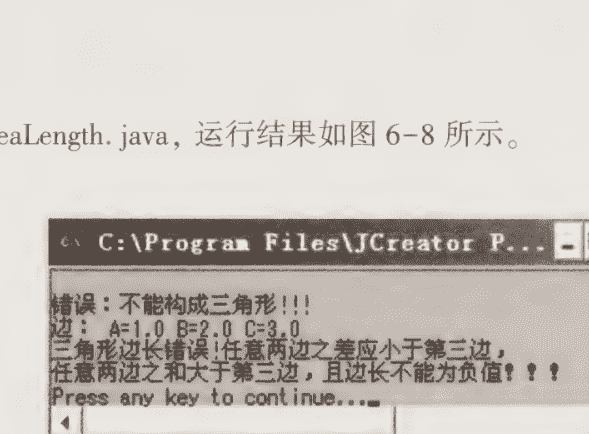

6-8 定义异常 `TriangleException` 及其捕获调试

## 课后习题

1. 参考下面的程序，修改程序捕获异常，使得程序正常运行。（提示：用错误数据测试，即可以得到异常类，运行时方法参数输入 `abc` 测试。）

```java
public class IndexOutOf {
    public static void main(String[] args) {
        // TODO Auto-generated method stub
        System.out.println("字符查找意外引起异常");
        String str = args[0];
        System.out.println("第四个字符为" + str.charAt(3));
        // System.out.println("最后一个字符为" + str.charAt(str.length()-1));
        System.out.println("字符串长度为" + str.length());
    }
}
```

2. 从命令行获得五个整数，放入一个整型数组并打印输出。要求：如果输入数据不是整数，要捕获 `Integer.parseInt()` 产生的异常，显示“输入不是整数”；捕获输入参数不足五个的异常（数组越界），显示“输入至少五个整数”。

3. 写一个方法 `void sanjao(int a, int b, int c)`，判断三个参数是否能够构成三角形。如果不能则抛出异常 `IllegalArgumentException` 并显示信息“a、b、c 不能构成三角形”；可以构成三角形的三边长，在主方法中得到命令行输入的三个整数，调用此方法并捕获异常。

4. 自定义类 `Sanj`，其中有成员 `x, y, z` 作为三边长，构造方法 `Sanj(a, b, c)` 分别赋值 `x, y, z` 值。方法面积 `getArea` 和显示三角形信息（三边长）`showInfo`，这两个方法中当三边不能构成三角形时要抛出自定义异常 `NotSanjaoException`，否则显示正确信息。在另一个类的主方法中构造一个 `Sanj` 对象（三边为命令行输入的三个整数），显示三角形信息和面积，要求捕获异常。

# 第7章 集合和泛型

本章介绍 Java 中非常频繁的集合框架。首先通过实际引入集合框架并介绍它所包含的内容，然后详细讲解 `ArrayList`、`LinkedList` 和 `HashMap` 三种具体的集合类，详细讲解统一的 `Iterator`，最后用泛型改进集合的使用。学习中从整体上把握框架的内容，并在具体学习时注意彼此的不同，通过对比加深理解和记忆。

## 7.1 集合概述

学习了数组，充分体会到了数组的优势，即可以存储同一类型的数据。但是有了动态的需求，看看如何解决？集合框架提供了解决办法。

- **数组的优势**：可以存储同一类型的数据，随机访问快。
- **数组的缺点**：
    - 长度固定，不适应数量的变化。
    - 插入和删除操作效率较低。

集合框架提供了动态的存储结构。主要包含以下核心接口：
- **List** 接口：有序的集合，允许重复元素。
- **Set** 接口：不允许重复元素的集合，通常有序。
- **Map** 接口：存储键值对的映射。

具体的实现类包括：
- `ArrayList`：基于数组实现，适合随机访问。
- `LinkedList`：基于双链表实现，适合插入和删除。
- `HashMap`：基于哈希表实现，提供高效的查找。

通过泛型（Generics），我们可以改进集合的类型安全性，避免显式的类型转换。

```java
list.add(2, stu4); // 标记stu4指定的位置

// 3.输出集合学生的总数

// 4.通过遍历集合显示所有学生的信息
for (int i = 0; i < list.size(); i++) {
    Student student = (Student) list.get(i);
    System.out.println(student.getName() + "\t" + student.getAge());
}
```

运行结果如图-5所示。

注意：接口的定义 `(Object o)` 方法参数类型是 `Object`，即使在调用时参数是 `Student` 类型，但是系统会认为它是 `Object`，在调用 `get(int index)` 方法元素时必须进行强制类型转换 `Student = (Student)`

## 【7-4】使用 remove、contains、indexOf 等方法，应该重写类的 equals 方法。

代码 1：未重写 `equals` 方法的代码
// 省略了学生类的定义

```java
public class Demo {
    public static void main(String[] args) {
        ArrayList list = new ArrayList();
        list.add(new Student("Tom", 11));
        list.add(new Student("Jerry", 22));
        list.add(new Student("Alice", 33));
        System.out.println(list.contains(new Student("Tom", 11)));
        System.out.println(list.indexOf(new Student("Jerry", 22)));
        System.out.println(list.remove(new Student("Alice", 33))); // “成功”“无此项”
    }
}
```

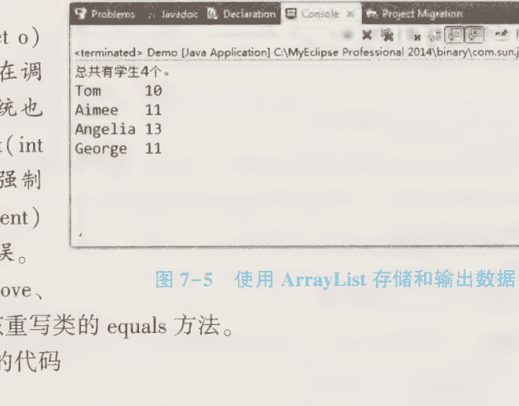

在例子中，我们希望判断 Tom 是否存在，并查找 Jerry，删除 Alice。但是输出的结果却是不存在，找不到，删不掉。这是因为 `List` 集合会调用元素的 `equals` 方法判断对象是否相等，而 `Student` 类没有重写 `equals` 方法，默认是按照地址比较，而每个学生的地址又不同，所以出现这种现象。通过 `Student` 类添加 `equals` 方法可以解决这个问题。

代码 2：重写 `equals` 方法后的学生类

```java
class Student {
    String name;
    int age;

    public Student(String name, int age) {
        this.name = name;
        this.age = age;
    }

    public boolean equals(Object obj) {
        if (obj == null) {
            return false;
        }
        if (!(obj instanceof Student)) {
            return false;
        }
        Student stu = (Student) obj;
        return stu.name.equals(this.name) && stu.age == this.age;
    }
}
```

`ArrayList` 与 `Vector` 的差异：`ArrayList` 与 `Vector` 的内部实现相似，`Vector` 设计为线程安全，`ArrayList` 设计为非线程安全。为了保证安全，`Vector` 在性能上稍逊于 `ArrayList`。目前我们编写的是单线程程序，应该使用 `ArrayList`。

# 7.2.2 LinkedList 集合

引入问题：如何在集合的头部或尾部添加、获取和删除学生？如何在集合的其他任何位置添加、获取和删除学生？

分析：在上面的例子中讲解 `ArrayList` 涉及集合中元素的添加和删除操作，可以通过 `add(Object obj)` 和 `remove(int index)` 实现任意位置元素的删除，当然包括头部和尾部。

但是由于 `ArrayList` 采用了数组相同的存储方式，在内存中分配连续的空间，在添加和删除元素元素会导致所有元素的移动，性能低下。在插入、删除操作频繁时，可以考虑使用 `LinkedList` 来提高效率。

在使用 `LinkedList` 中处理头部和尾部元素的添加和删除操作时，除了使用 `add(0)` 和 `remove(0)` 方法外，还可以使用 `LinkedList` 额外的方法来实现操作：

## 【例7】在集合的头部或尾部添加、获取和删除学生的实现代码如下：

```java
import java.util.ArrayList;
import java.util.LinkedList;

class Student {
    String name;
    int age;

    public String getName() {
        return name;
    }

    public int getAge() {
        return age;
    }

    public Student(String name, int age) {
        this.name = name;
        this.age = age;
    }
}

public class Demo {
    public static void main(String[] args) {
        // 1.创建4个学生
        Student stu1 = new Student("Tom", 10);
        Student stu2 = new Student("Aimee", 11);
        Student stu3 = new Student("George", 11);
        Student stu4 = new Student("Angelia", 13);

        // 2.LinkedList 集合把4个学生放入其中
        LinkedList<Student> list = new LinkedList<>();
        list.add(stu1);
        list.add(stu2);
        list.add(stu3);
        list.add(stu4);

        // 3.删除第一个学生
        Student sFirst = list.getFirst();
        System.out.println("第一个学生信息：" + sFirst.getName() + "\t" + sFirst.getAge());

        // 4.删除最后一个学生
        Student sLast = list.getLast();
        System.out.println("最后一个学生信息：" + sLast.getName() + "\t" + sLast.getAge());

        // 5.删除集合中第一个和最后一个学生
        list.removeFirst();
        list.removeLast();

        // 6.显示剩余学生
        System.out.println("删除后各学生：");
        for (int i = 0; i < list.size(); i++) {
            Student student = list.get(i);
            System.out.println(student.getName() + "\t" + student.getAge());
        }
    }
}
```


运行结果如图-6所示。

下面我们总结一下 `LinkedList` 的各种方法。`LinkedList` 之前列出的各种方法，还包括特殊的方法，如表7-5所示。

学生的基本信息：George 11
最后一个信息：Angelia 13
删除名为 Tom 的学生：10
Aimee 11


## 表 7-5 LinkedList 方法

| 返回类型 | 方法 | 说明 |
| --- | --- | --- |
| void | `addFirst(Object o)` | 在列表的头部添加元素 |
| void | `addLast(Object o)` | 在列表的尾部添加元素 |
| Object | `getFirst()` | 返回列表中的第一个元素 |
| Object | `getLast()` | 返回列表中的最后一个元素 |
| Object | `removeFirst()` | 删除并返回列表中的第一个元素 |
| Object | `removeLast()` | 删除并返回列表中的最后一个元素 |

(1) `ArrayList` 与 `LinkedList` 均为非安全，`ArrayList` 内部使用数组（与 `Vector` 相同），`LinkedList` 采用链表结构。
(2) `ArrayList` 使用数组存储，意味着大量添加元素、空间不足时，仍然通过新建数组、复制数组的方式增加，效率较低；对数据进行插入、删除时会元素移动，效率较低；但查询效率较高。
(3) `LinkedList` 使用链表存储，在添加元素时只需要内存分配，效率较高；进行插入、删除时，对链表相邻元素进行修改，效率也很高；但查询效率较低。
(4) 可以看出 `ArrayList` 在处理数据的新增、删除时效率较低，对数据查询时效率较高；`LinkedList` 相反。一般来说 `ArrayList` 适用于经常查询的操作，`LinkedList` 适用于经常修改的操作。

# Map 接口

引入问题：建立英文名和中文名的键值映射，例如 CN→中华人民共和国，根据“CN”可以找到中华人民共和国，通过键实现对应的删除，应该实现存储和操作。

分析：Java 框架提供了 `Map` 接口，专门处理键值数据的存储。`Map` 可以存储多个元素，每个元素由两个对象组成，一个键对象和一个值对象，可以根据键实现值的映射。

【7-6】实现英文简称中文名之间的键值映射。

```java
import java.util.HashMap;
import java.util.Map;

public class MapDemo {

    public static void main(String[] args) {

        // 1. 使用 HashMap 存储国家简称和中文名的键对
        Map<String, String> countries = new HashMap<>();

        countries.put("CN", "中华人民共和国");
        countries.put("RU", "俄罗斯");
        countries.put("FR", "法兰西共和国");
        countries.put("US", "美国联邦");

        // 2. 显示“CN”对应的中文名
        String country = countries.get("CN");
        System.out.println("对应的国家是：" + country);

        // 3. 二次判断 Map 是否存在“FR”
        System.out.println("Map包含FR吗？" + countries.containsKey("FR"));

        countries.remove("FR");
        System.out.println("Map包含FR吗？" + countries.containsKey("FR"));

        // 5. 分别显示键、值和键值集
        System.out.println(countries.keySet());
        System.out.println(countries.values());
    }
}
```


运行如图-7所示。`Map` 接口存储一组键值对象，提供键（key）到值（value）的映射。`Map` 的 key 要求唯一，不允许重复；值相同没有顺序，允许重复。最常见的 `Map` 实现是 `HashMap`，它的存储方式是哈希表，优势是查询效率高。

下面我们总结一下实例7-6中使用的 `Map` 接口定义的常用方法（也是 `HashMap` 的各种用法），如表7-7所示。

## 表 7-7 Map 接口常用方法

| 返回类型 | 方法 | 说明 |
| --- | --- | --- |
| Object | `put(Object key, Object value)` | 以“键-值对”的方式进行存储。注意：键必须是唯一的，值可以重复。如果添加重复的键，那么后加入的“键-值对”将替换原先的“键-值对” |
| Object | `get(Object key)` | 根据键返回相关的值，如果不存在的键，返回 null |
| Object | `remove(Object key)` | 删除指定的键映射的“键-值对” |
| int | `size()` | 返回个数 |
| Set | `keySet()` | 返回键集合 |
| Collection | `values()` | 返回值集合 |
| boolean | `containsKey(Object key)` | 判断是否存在指定键 |

# 集合和泛型

```java
System.out.println(student.getName() + "\t" + student.getAge());
// 4 使用 Iterator 遍历集合中所有学生的信息
```

```java
System.out.println("所有学生信息如下:");
Iterator<Student> it = students.iterator();
while (it.hasNext()) {
    Student student = it.next();
    System.out.println(student.getName() + "\t" + student.getAge());
}
```

运行结果如图7-9所示。

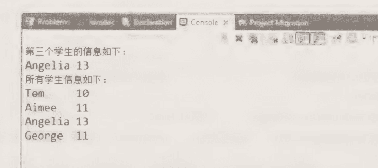

图7-9 对 List 应用泛型

【例7-9】对 `Map` 和 `HashMap` 应用泛型，代码如下：

```java
import java.util.HashMap;
import java.util.Map;

public class MapDemo {

    public static void main(String[] args) {

        // 1. 使用 HashMap 存储多组国家缩写和中文全称的键值对
        Map<String, String> countries = new HashMap<String, String>();

        countries.put("CN", "中华人民共和国");
        countries.put("RU", "俄罗斯联邦");
        countries.put("FR", "法国共和国");
        countries.put("US", "美利坚众国");

        // 2. 显示“CN”对应的国家的中文全称
        String country = countries.get("CN");
        System.out.println("CN 对应的国家是" + country);
    }
}
```

运行结果如图7-10所示。

查阅 JDK 帮助文档中集合的接口和类，如图7-11和图7-12所示，从图中看到我们在上面写法的依据。图中的 `<K,V>` 就是 `List` 和 `Map` 的类型参数，例如例7-8和例7-9中的相应位置的 `<Student>` 和 `<String, String>` 就是类型实参。

```java
java.util
接口 Map<K, V>
类型参数：
K - 此映射值所维护的键的类型
V - 映射值的类型
```

```java
java.util
接口 List<E>
所有父级接口：
Collection<E>, Iterator<E>
```

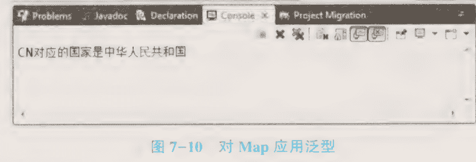


注意：
(1) 静态方法不能使用泛型，因为泛型类中的泛型在创建的对象时会被替换为确定类型。
(2) 在 Java 中没有泛型的变量或参数是不允许直接访问的。
(3) 不要创建泛型的对象，因为泛型类可能是接口或抽象类。
(4) 不能在 `catch` 子句中使用泛型类型。

## 7.6 项目实做

### 7.6.1 项目目标和项目任务

- 1. 项目目标
  (1) 掌握集合框架包含的内容。
  (2) 掌握 `ArrayList` 和 `LinkedList` 的使用。
  (3) 掌握 `HashMap` 的使用。
  (4) 掌握 `Iterator` 的使用。
  (5) 掌握泛型集合的使用。

- 2. 项目任务
  请做一个公司员工薪水管理系统，要求完成如下功能：
  当有新员工入职时，将该新员工加入管理系统。
  (1) 根据员工编号显示该员工的信息。
  (2) 显示所有工资信息。
  (3) 修改工资。
  (4) 当员工离职时，将该员工从系统中删除。

### 7.6.2 工资分析

根据项目的需求，要完成以下几个方面：
(1) 由于员工数量不固定，新人入职也有离职，所以不能用数组，应该用集合。
(2) 根据员工编号找到对象，应该用 `Map`。
(3) 对于工资属性可以使用方法。
(4) 根据员工可以使用 `remove(Object)`。

### 7.6.3 项目实现

- (1) 创建员工类，包含 `show` 方法。

```java
public class Employee {

    private String id;
    private String name;
    private double salary = 2000;

    public Employee(String id, String name) {
        this.id = id;
        this.name = name;
    }

    public void setSalary(double salary) {
        this.salary = salary;
    }

    public double getSalary() {
        return salary;
    }

    public void setId(String id) {
        this.id = id;
    }

    public String getName() {
        return name;
    }

    public void setName(String name) {
        this.name = name;
    }

    public String show() {
        return name + "\t" + salary;
    }
}
```

- (2) 完成添加数据、删除数据、修改数据遍历数据。

```java
import java.util.HashMap;
import java.util.Iterator;
import java.util.Map;

public class SalarySystem {

    public static void main(String[] args) {

        // 1. 创建多个员工
        Employee e1 = new Employee("0001", "张华");
        Employee e2 = new Employee("0002", "王建");
        Employee e3 = new Employee("0003", "李明");
        Employee e4 = new Employee("0004", "李军");

        // 2. 使用 HashMap 存储多个员工号和工资键值
        Map<String, Employee> employees = new HashMap<String, Employee>();

        employees.put("0001", e1);
        employees.put("0002", e2);
        employees.put("0003", e3);
        employees.put("0004", e4);

        // 3. 显示工号为 0004 的信息
        System.out.println(employees.get("0004").show());

        // 4. 显示所有员工
        Iterator<String> it = employees.keySet().iterator();
        while (it.hasNext()) {
            System.out.println(employees.get(it.next()).show());
        }

        // 5. 修改工资为 0002 的
        System.out.println("修改工资:");
        Employee employee = employees.get("0002");
        employee.setSalary(3000);
        System.out.println(employee.show());

        // 6. 删除员工 0003
        employees.remove("0003");
        System.out.println("删除后，剩余员工信息:");
        it = employees.keySet().iterator();
        while (it.hasNext()) {
            System.out.println(employees.get(it.next()).show());
        }
    }
}
```

# 课后习题

- 1. 填空。
  (1) `Collection` 接口的特点是__________。
  (2) `List` 接口的特点是元素（有|无）顺序，（可以|不可以）重复。
  (3) `Set` 接口的特点是元素（有|无）顺序，（可以|不可以）重复。
  (4) `Map` 接口的特点是元素是__________，其中 key 不重复。

- 2. 如下代码：
```java
import java.util.*;

public class TestList {

    public static void main(String args[]) {
        List list = new ArrayList<>();
        int i = 0;
        list.add("Apple");
        list.add("Banana");
        list.add(i);
        list.add("Java");
        printList(list);
    }

    public static void printList(List list) {
        // 1
    }
}
```
要求：
(1) 把 1 处的代码补充完整，输出 list 中所有元素。
(2) 写出程序的结果。
(3) 如果要把实现类 `ArrayList` 替换为 `LinkedList`，应该改哪里？`ArrayList` 和 `LinkedList` 有什么区别？
(4) 如果要把实现 `ArrayList` 改为 `Vector`，应该改哪里？`ArrayList` 和 `Vector` 有什么区别？

- 3. 写下面程序的运行结果：
```java
List<String> list = new ArrayList<>();
list.add("World");
list.add("Hello");
list.add("Java");
list.remove("Hello");
list.remove(0);
```

- 4. 选择正确答案( )。
```java
public class TestList {

    public static void main(String[] args) {
        List<String> list = new ArrayList<>();
        list.add("Learn");
        list.add("Hello");
        list.add("Welcome");
        Set<String> set = new HashSet<>();
        set.addAll(list);
        System.out.println(set.size());
    }
}
```
A. 3
B. 4
C. 2
D. 报错

# Java 语言程序设计

```java
File file3 = new File("sa");
// 如果目标下有文件或者目录，删除会失败
System.out.println(file3.delete());
```


## 3. 重命名功能

- `renameTo(File dest)`：重命名文件或文件夹，若在同一级目录下，则是重命名；在不同目录下，则是剪切操作。移动/重命名成功返回 `true`，失败返回 `false`。

### 代码示例

```java
public static void main(String[] args) {
    File file = new File("2.txt");
    // 若在同一级目录下，则是重命名；在不同目录下，则是剪切操作
    File newfile = new File("bb\\3.txt");
    System.out.println(file.renameTo(newfile));
}
```

## 4. 判断功能

- `exists()`：判断指定的文件或文件夹是否存在。
- `isFile()`：判断是否是一个文件；如果不存在，则为 `false`。
- `isDirectory()`：判断是否是一个文件夹。
- `isHidden()`：判断指定的文件是否是隐藏文件。
- `isAbsolute()`：判断指定的路径是否在绝对路径下。
- `canRead()`：判断指定的文件是否可读。
- `canWrite()`：判断指定的文件是否可写。

### 代码示例

```java
public static void main(String[] args) {
    File file = new File("F:\\a\\a.txt");
    System.out.println("是否文件夹：" + file.isDirectory());

    File file1 = new File("F:\\a\\a.mp4");
    System.out.println("是否文件：" + file1.isFile());
    System.out.println("是否可读：" + file1.canRead());
    System.out.println("是否可写：" + file1.canWrite());
    System.out.println("是否隐藏：" + file1.isHidden());
}
```

## 5. 获取属性功能

- `getName()`：获取文件或文件夹名称。
- `getPath()`：返回的绝对路径，也可以是相对路径，但是要指定目录。
- `getAbsolutePath()`：获取绝对路径。
- `length()`：获取文件的大小（字节为单位）。
- `getParent()`：获取当前文件的父路径。
- `lastModified()`：获取文件最后一次修改的时间。

### 代码示例

```java
public static void main(String[] args) {
    File file = new File("F:\\data\\a.docx");
    System.out.println("绝对路径：" + file.getAbsolutePath());
    System.out.println("文件名：" + file.getName());
    System.out.println("文件长度：" + file.length());
    System.out.println("最后修改时间：" + file.lastModified());

    Date date = new Date();
    date.setTime(file.lastModified());
    DateFormat df = new SimpleDateFormat("yyyy-MM-dd HH:mm:ss");
    String s = df.format(date);
    System.out.println("最后修改时间：" + s);
}
```

## 6. 获取目录功能

### 8-1 获取 F 目录下所有的文件及目录中的文件

```java
public class Demo {
    public static void main(String[] args) throws IOException {
        File file = new File("F:\\");
        String[] list = file.list();
        for (String name : list) {
            System.out.println(name);
        }

        // 获取目录中的文件
        File[] listFiles = file.listFiles();
        for (File file : listFiles) {
            // 使用三元表达式
            System.out.println((file.isDirectory() ? "目录：" : "文件：") + file.getAbsolutePath());
        }
    }
}
```

## 8.2 输入输出流

在 Java 中，应用程序需要的数据和写的数据是通过 I/O 操作实现的。文件、内存等。Java 中的输入输出流分为大类：输入流和输出流。输入流是能够读取的对象，输出流是能够写的对象。

## 8.2.1 流的概念

简单来说，流（stream）是通过固定的路径从源传递到目的。在流式输出中，Java 提供了控制台、文件、内存等多种数据源或目的进行访问。通过过滤器的正确使用，提供了灵活的 I/O 操作，不仅对文件的访问，还提供了随机访问和管理。

## 8.2.2 流类型

按照程序输出的方式有两种基本的：

- **输入流（input stream）**：是将数据从某个源向程序输出
- **输出流（output stream）**：是将数据从程序发送到目的

对于每一种流都具有特殊的功能。例如仅仅在输入流中读取数据，也可以写入数据。因此，一个流（stream）是数据中的一条路径。

- **(1) 字节流（byte stream）**：许多类型的数据都可以用字节的形式表示，包括字节数据、程序、内核等。
- **(2) 字符流（character stream）**：是一种特殊的字节流，它只处理文本的数据。它们不同于字节流，因为 Java 字符支持 Unicode，包含了简单地使用字节来表示字符。任何文本的数据都应该字节流，如文本、网页以及常见的文本类型。通过上面的抽象，完成数据的接收或发送，但是想要完成更的操作，可以使用过滤器。

## 8.3 字节流

Java 中基本的字节流层级结构有两个，一个是基础输入 `InputStream`，另一个是基础输出 `OutputStream`。它们都是抽象类，都是 `Object` 类派生的，同时 `InputStream` 类和 `OutputStream` 类各自出了许多子类。

所有的字节流都是 `InputStream` 抽象类和 `OutputStream` 抽象类的。既然是抽象类，我们不能直接创建这些类，只能通过它们的子类来创建流。

### 8.3.1 字节输入流

`InputStream` 中定义了一系列字节流中所有输入流都需要的方法，来完成从输入流读取数据的操作，并且该类的方法在出错时都会抛出 `IOException` 异常。

#### InputStream 主要方法

```java
void close() {
    // 关闭此输入流与该关联的所有资源。
}

int read() {
    // 从输入流中读取下一个字符。
}

int read(byte[] b) {
    // 从输入流中读取一定数量的字符，并将其存储在缓冲区 b 中。
}

int read(byte[] b, int off, int len) {
    // 从输入流中最多 len 个数据写入 byte b;
}
```

使用 `FileInputStream` 类读取文件内容，文件输入流 `FileInputStream` 是 `InputStream` 的类。

#### FileInputStream 构造方法

```java
FileInputStream(File file) {
    // 打开一个实际文件的连接创建一个 FileInputStream，该文件通过文件系统中的 File 对象来标识。
}

FileInputStream(String name) {
    // 打开一个实际文件的连接创建一个 FileInputStream，该文件通过文件系统中的名称来标识。
}
```

#### 1. 使用 read 方法读取数据代码示例

```java
public static void main(String[] args) throws Exception {
    FileInputStream fis = new FileInputStream("test.txt");
    // 读取数据
    // read()
    System.out.println("读取 1" + fis.read());
    System.out.println("读取 2" + fis.read());
    System.out.println("读取 3" + fis.read());
}
```

#### 2. 使用 read(byte[]) 方法读取数据代码示例

```java
public static void main(String[] args) throws IOException {
    File file = new File("2.txt");
    InputStream is = new FileInputStream(file);
    byte[] b = new byte[3];
    int count = -1;
    while ((count = is.read(b)) != -1) {
        for (int i = 0; i < count; i++) {
            System.out.println(b[i]);
        }
    }
    is.close();
}
```

### 8.3.2 字节输出流

`OutputStream` 抽象类是所有字节输出类，定义了字节输出的基本方法。

#### OutputStream 主要方法

| 方法 | 说明 |
|---|---|
| `close()` | 关闭输出流并释放所有资源 |
| `flush()` | 刷新输出缓冲区并强制写 |
| `write(byte[] b)` | 将指定长度的字节数组写入流 |
| `write(byte[] b, int off, int len)` | 将字节数组中偏移 `off` 开始的 `len` 个字节写入流 |
| `write(int b)` | 将指定的字节写入输出流 |

使用 `FileOutputStream` 向文件写入内容。文件输出流 `FileOutputStream` 是 `OutputStream` 子类。

#### FileOutputStream 构造方法

| 方法 | 说明 |
|---|---|
| `FileOutputStream(File file)` | 创建一个指向特定文件的输出流 |
| `FileOutputStream(File file, boolean append)` | 创建一个指向特定文件的输出流 |
| `FileOutputStream(String name)` | 创建具有指定名称的文件流 |
| `FileOutputStream(String name, boolean append)` | 创建具有指定 name 的文件的输出流 |

#### 1. 使用方法读取数据代码示例

```java
public static void main(String[] args) throws FileNotFoundException {
    // 相对路径
    FileOutputStream out = new FileOutputStream("1.txt");
    // 输出
    out.write(97); // 指定字符
    byte[] bytes = {97, 98, 99, 100, 101}; // 字符数组
    out.write(bytes);
}
```

#### 2. 在文件中续写

如果在后面继续写，可以使用 `FileOutputStream(File file, boolean append)` 方法。

```java
public static void main(String[] args) throws FileNotFoundException {
    // 相对路径
    FileOutputStream out = new FileOutputStream("2.txt", true);
    out.write("你好".getBytes());
    out.write("java".getBytes());
    // 关闭流
}
```

## 8.4 字符流

在 JDK1.1 中新增两个与 `InputStream` 和 `OutputStream` 基本的抽象类 `Reader` 和 `Writer` 类，这两个抽象类主要用于字符数据的输入操作。例如：`Reader` 类定义的 `read()` 方法将从输入流取出一个 `char` 的字符；`read(char[])` 方法从输入流读取若干字符保存到字符数组中；`Writer` 的 `write(String)` 方法将字符串中的所有字符都写入到字符流中；JDK1.0 支持字符流。

事实上学会了如何处理字符流之后，就掌握了处理字符流的大部分。

### 8.4.1 字符输入流

字符输入 `Reader` 对文本内容进行读取，可以从文件中直接读取字符。通过该流可以从关联的类读取一个或一组字符。使用字符流读取，那么我们读取的就是一个字符。只要把这些字符查询对应的编码表，就能与之对应的字符。API 中已经给我们提供了读取字符的功能对象 `Reader`，字符流的抽象类。

#### Reader 常用方法

```java
int read(char[] chuf) // 将字符输入数组
abstract int read(char[] chuf, int off, int len) // 将字符输入数组的一部分
```

使用 `FileReader` 类来读取字符数据，文件输入 `FileReader` 是 `Reader` 子类。

#### FileReader 构造方法

| 构造方法 | 说明 |
|---|---|
| `FileReader(File file)` | 在指定从文件中读取 `File` 的情况下创建一个新的 `FileReader` |
| `FileReader(String fileName)` | 在指定从文件中读取的文件名的情况下创建一个新的 `FileReader` |

#### 使用 read 方法读取包含特定字符的数据代码示例

```java
public static void main(String[] args) throws IOException {
    FileReader fileReader = new FileReader("1.txt");
    int ch = 0;
    while ((ch = fileReader.read()) != -1) {
        // 输出文件中读取的字符
        System.out.println("字符：" + (char) ch);
    }
    fileReader.close();
}
```


# Java 连接程序设计

在关联文件中写入一个或一组字符。`Writer` 方法如图 8-10 所示。

## 方法摘要

| Write | 描述 |
|---|---|
| `append(char c)` | 将指定的字符添加到此 writer。 |
| `void write(char[] cbuf)` | 写入数组。 |
| `abstract void write(char[] cbuf, int off, int len)` | 写入数组的某一部分 |
| `void write(int c)` | 写入单个字符。 |
| `void write(String str)` | 写入字符串。 |
| `void write(String str, int off, int len)` | 写入字符串的某一部分。 |

图 8-10 方法

我们使用 `FileWriter` 向文件写入数据，文件输出 `FileWriter` 是 `Writer` 类。`FileWriter` 类构造方法如图 8-11 所示。

## 构造方法摘要

| FileWriter(File file) | 根据指定的 `File` 对象创建一个 `FileWriter` 对象。 |
|---|---|
| `FileWriter(String fileName)` | 根据指定的文件名构造 `FileWriter` 对象。 |
| `FileWriter(String fileName, boolean append)` | 根据指定的文件名以及指示是否附加写入数据的 `boolean` 值来构造文件及 `FileWriter` 对象。 |

图 8-11 FileWriter 类构造方法

### 1. 使用 `write()` 方法写入字符串数据

代码示例：

```java
public void main(String[] args) throws Exception {
    FileWriter fw = new FileWriter("test.txt");
    // 写入到缓冲区
    fw.write("Hello");
    // 刷新
    fw.flush();
    fw.close();
}
```

### 2. `flush()` 和 `close()` 的区别

两个方法的区别如图 8-12 所示。

## 输入流和文件操作

## 第8章

| abstract | close() |
|---|---|
| `void` | `flush()` |

关闭此流，但要先刷新它。

刷新该流的缓冲。

图 8-12 `flush()` 和 `close()` 的区别

- `flush()`: 将流中的缓冲区数据刷新到新的地方，刷新后流还可以继续使用。
- `close()`: 关闭资源，但在关闭前会将缓冲区中的数据先刷新到新的地方，否则会数据丢失，然后再关闭，流将不可使用。如果写入数据过多，一定要一边写一边刷新，最后一次可以不刷新，完成刷新并关闭。

## 8.5 对象的序列化(serialization)

序列化的目的是为了 Java 的运行环境提供特性，其主要任务是写出对象实例变量的数值。对象的生命周期随着生成该对象的程序的终止而结束。有时候，可能需要将对象的状态保存下来，在需要时再将对象恢复。


我们对对象写出描述其状态的数值记录自己的过程，这个过程叫做对象的**序列化(serialization)**；对对象的这种能够的状态以便将来再生的能力，叫做对对象的**持续性(persistence)**。

在 `java.io` 中，接口 `Serializable` 用于实现对象序列化的工具，只有实现了 `Serializable` 的类才能被序列化。

序列化方法：

```java
public class Student implements Serializable {
    int id; // 学号
    String name; // 姓名
    String department;// 部门
    public Student(int id, String name, int age, String department) {
        this.name = name;
        this.age = age;
        this.department = department;
    }
    // 省略 getter 和 setter 方法
}
```

- (2) 构造对象的输入/输出流。

## Java 课程设计

要序列化一个对象，必须与一个定的对象输入/输出流联系起来，通过对象输出流将对象状态保持不变，再通过对象输入流将对象状态恢复。

```java
java.io包中，提供了 `ObjectInputStream` 和 `ObjectOutputStream` 功能将数据扩展至可写对象。在 `ObjectInputStream` 中用 `readObject()` 方法可以直接读取一个对象；在 `ObjectOutputStream` 中用 `writeObject()` 方法可以直接将对象保存到输出流中。

public static void main (String[] args) throws IOException, ClassNotFoundException {
    Student s = new Student("1","jack",18,"计算机");
    //实例化一个序列化
    ObjectOutputStream outputStream = new ObjectOutputStream (new FileOutputStream fos = new FileOutputStream("1.txt"));
    objectOutputStream.writeObject(s);
    objectOutputStream.close();
    System.out.println("序列化成功");
}
```

//反序列化

```java
ObjectInputStream inputStream = new ObjectInputStream(new FileInputStream("1.txt"));
// 在内存中再产生一个 Student 对象
Object readObject = inputStream.readObject();
Student stu = (Student)readObject;
System.out.println("反序列化:name="+stu.getName()+",age="+stu.getAge());
}
```

在这个例子中，我们首先选取一个 `Student`，实现了 `Serializable` 接口，然后通过对象输出的 `writeObject()` 方法将对象保存到文件 1.txt 中。之后，通过输入流的 `readObject()` 方法从文件 1.txt 中读取出来的对象的相关信息。

# 多线程编程

在任务环境中，线程是最小的执行单位。这意味着一个程序可以同时完成多个任务的功能。

多线程意味着一个程序的多个特定语句可以在同一时间内同时执行。与进程相似的是，线程是一段完成特定功能的代码，是程序中单顺序的运行控制。与进程不同的是，同类的多线程共享同一内存空间和资源，程序本身的数据访问通常带有微弱的寄存器数据，以及一个程序执行时使用的栈。所以系统可以产生一个线程，或者在多个线程之间切换，负载要比进程小多，因此如此，线程被称为轻级进程（light-weight process）。

使用多线程可以编写出最大利用的高效率，因为 CPU 空闲时间最低，这对于 Java 交互的网络环境至关重要。网络的数据传输速率远比计算机的处理能力，本地文件读取速度远比 CPU 处理的速度，在传统的进程程序中，用户必须等待每一个任务的完成以后才能执行下一步，使 CPU 浪费空闲时间。多线程可以使用充分利用这些空闲时间。

## 9.2 进程和线程的关系

我们知道，对于一个完整的应用程序，`main()` 方法是程序执行的初始入口点，然后按照顺序实例化相应的对象并对类定义的成员方法后，直到程序完成功能后结束后或发生异常时，由 JVM 运行环境收回无用的内存。

因此，应用程序应该有一个运行的初始入口点、一个代码执行序列和一个程序出口，并在实时操作系统中，每一个时刻都有一个执行单元在处理 CPU 执行序列。

Java 语言线程的概念与程序的执行过程类似，它也包括一个程序入口、一个出口以及一个代码执行序列。

但是，Java 线程与应用程序的区别是线程是程序执行的一部分，线程不能独立运行，必须由应用程序启动或者终止。

Java 语言的线程并不是程序的多个语句同时执行，也不是多次启动同一个应用程序，而且在同一个程序内部执行多个线程。Java 程序通过线程控制多个任务并发执行，改进了程序的运行状态。

图 9-1 明了进程和线程之间的关系。

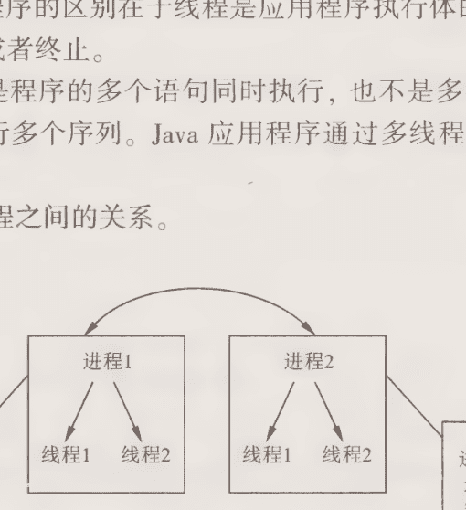

图 9-1 进程与线程

编写程序，可以将每一个线程想象成独立运行，而且有自己的专用 CPU。一些机会

## Java 自动识别 CPU 的时间

我们不需要特意关注这些细节，所以多线程的代码编写是相当复杂的。理解这个概念对以后的学习会有很大帮助。

多线程的应用非常广泛。在某些情况下，程序的一部分特定的事件或资源被挂起了，这样，为了暂时暂停执行，就可以考虑创建一个线程，让它与某个组件或资源关联，并让它独立于主程序运行。一个很好的例子就是“Quitting”或“退出”按钮——我们并不希望在程序的每一段代码中都轮询这个按钮，同时又希望该按钮能够及时地出现（使程序看起来似乎常在轮询中）。事实上，多线程主要的用途就是构建一个响应灵活的用户界面。

作为多线程的起点，你可以考虑这个需要执行某些 CPU 密集型计算的程序由于“CPU 全”会导致用户的输入十分缓慢，几乎没有什么反应。

以下程序一直输出“Thread 类的 run() 方法在执行”。这是因为该程序是一个单线程程序，当调用 Thread 的 run() 方法时遇到死循环，循环会一直执行，由于 Thread 类的打印将永远执行。

- 【 9-1 】单线程程序

```java
public class Demo {
    public static void main(String[] args) {
        Thread myThread=new Thread();
        myThread.run();
        while (true) { // 死循环
            System.out.println("Thread 类的 run() 方法在执行");
        }
    }
}
```

## 9.2 多线程机制

Java 的内部多线程机制，它的所有类都是在多线程定义的。Java 利用多线程使得系统成为异步线程。Java 中的线程由三部分组成：

- 虚拟的 CPU，封装在 `java.lang.Thread` 类中。
- CPU 所执行的代码，传递 `Thread` 类。
- CPU 处理的数据，传递 `Thread` 类。

“线程模型”是一种程序写规范，它在单线程程序里让几个操作同时进行时根据这种机制，CPU 可为每个线程分配自己的部分时间，每个线程“感觉”自己拥有整个CPU，但 CPU 的计算实际上是在所有线程中并行的。

# 多线程机制 第9章

线程机制降低了效率，无论设计、调度都是为了用户的方便，从中获得了巨大的。综合考虑，这种机制是有价值的。当然，如果原本安装了多个CPU，那么操作系统能够决定为不同的CPU分配哪些线程，程序的运行速度会更快（这些都需要操作系统以及程序的支持）。多线程和任务是充分发挥多处理器系统的一种最有效的方法。

## 9.2.1 线程接口和线程类

Java的线程是建立在`Thread`类和`Runnable`接口的基础上的，线程类封装了线程的执行，为了创建一个新的线程，多线程程序必须继承`Thread`或实现`Runnable`接口但不使用继承方法创建线程程序，则要用到`java.lang.Thread`类以及它的方法。

Java提供一个实现`Runnable`接口，当一个程序不是`Thread`以外的派类时，就需要实现接口。

- 1. Runnable 接口

使用接口的原因：线程程序是由JavaApp扩展而来的，因为Java不支持多重继承，我们不能同时从`Thread`和`Runnable`类派生，所以使用接口提供的接口来解决了这个问题。

这个接口有一个方法`run()`，所有实现`Runnable`接口的用户对象都必须实现这个`run()`方法，通过重写方法来定义具体的操作。`Runnable`接口中的这个`run()` 方法是一个特殊的方法，它可以被系统自动识别和执行。也就是说，当程序运行时，`run()`方法就是新线程的操作。一个实现了`Runnable`接口的线程，是多线程的应用。

- 2. Thread 类

Java线程是通过`java.lang.Thread`类实现的线程类包含了线程需要的属性和方法。当我们创建一个`Thread`对象时，一个新的线程产生了。它可以启动线程、终止线程、挂起等。

1) 构造方法

`Thread`类的构造方法有三种，如下：

```java
public Thread()
public Thread(Runnable target) //传递参数
public Thread(String name) //为线程指定名称
```

用构造方法创建新线程之后，这个对象被初始化，进入新建状态。

2) 优先级

`Thread` 类三个优先级，其中`MIN_PRIORITY` 代表最小优先级，通常为1；`MAX_PRIORITY` 代表最高；`NORM_PRIORITY` 代表普通优先级，缺值为5。默认情况下，主线程具有普通优先级可以通过调用 `setPriority` 方法修改自己定义的优先级。

3) 主要方法

`start()` 方法启动线程，从新建状态进入就绪状态并进入队列。`Thread`类的 `run` 方法与 `Runnable`的功能相同，都是系统自动调用的，用户不得使用。`sleep()` 方法线程休眠；低优先级线程，休眠的长短由 `sleep` 方法决定：

```java
sleep(long millis, int nanos) // sleep是以毫秒为单位
```

`stop()` 方法强制终止。`stop()` 方法可以在 `run` 方法中调用，也可以在其他线程的过程中调用，杀死线程。还有一些的方法：

`static int activeCount()` 方法；返回线程组中活动线程的数量。
`static Thread currentThread()` 方法；获取当前线程句柄。

```java
void destroy(); 方法；销毁线程。
String getName(); 方法；获取线程名称。
int getPriority(); 方法；获取当前线程优先级。
void interrupt(); 方法；中断当前线程的执行。
```

`ThreadGroup getGroup()` 方法；获取当前线程所属线程组。
`boolean isDaemon()` 方法；测试线程是否为守护线程。
`boolean isInterrupted()`; 测试线程是否被中断。

```java
void resume(); 方法；恢复线程运行
void setDaemon(boolean on); 方法；设置线程为守护线程。
setName(String name); 方法；设置线程名称。
void setPriority(int priority); 方法；设置线程执行的优先级别。
void suspend(); 方法；将线程运行状态转为挂起。
static void yield(); 方法；退出线程，线程进入队列。
```

# 多线程机制 第章

对用例9-1 进行修改，仍然是死循环，但使用了线程。在计算的过程中，还可以响应其他事件，如关闭窗口（关闭应用程序），点击按钮。

【用例 9-2】使用线程改写9-1.

```java
public class Demo {
    public static void main(String[] args) {
        // 创建线程对象
        MyThread myThread=new MyThread();
        myThread.start();
        while (true) { // 死循环
            System.out.println("Main 方法在运行");
        }
    }
}
```

```java
class MyThread extends Thread {
    // 重写 run 方法，完成线程执行的逻辑
    public void run() {
        while (true) {
            System.out.println("MyThread类的 run() 执行");
        }
    }
}
```

程序运行后，显示相应的信息。两个循环都会同时运行，不会只运行一个的情况。与用例 9-1比较，使用线程的好处一目然。

## 线程的状态(生命周期)

在一个线程的生命周期中，总是处于一种状态。线程的状态表示了线程正在进行的活动，以及在这段时间内线程能够完成的任务。可以将线程的生命周期描述成四种状态，如图 9-2所示。

- 1. 新生线程即创建状态(new thread)。下面的声明创建了一个新的线程，并使其处于创建状态。

```java
MyThread myThread=new MyThread();
```

由于没有启动这一线程，所以当一个线程处于创建状态时，它只是空的线程。

- 2. 可运行状态(runnable)。

一旦启动，线程就进入执行状态。看下面的语句：

```java
Thread myThread=new Thread();
myThread.start();
```


由于此启动，线程就进入了运行状态。线程的所有活动发生在线程体中——`run()`方法被调用。

### 3. 不运行状态

当没有资源时，线程进入不可运行状态：

- 调用了`sleep()`方法
- 调用了`suspend()`方法
- 调用了`wait()`方法
- 输入/O 流中发生阻塞

来看下面代码：

```java
Thread myThread = new Thread();

try {
    myThread.sleep(10000);
} catch (InterruptedException e) {
}
```

在这个例子中，我们可以通过调用`sleep()`方法让`myThread`睡了 10000 ms，此时释放了处理器，但其他线程可以执行。对于上述的情况，线程都有特定的状态：

- (1) 如果线程处于休眠状态，`sleep()`方法中的参数为休息时间，当这个时间过去，线程恢复为运行状态。

# Java 程序处理

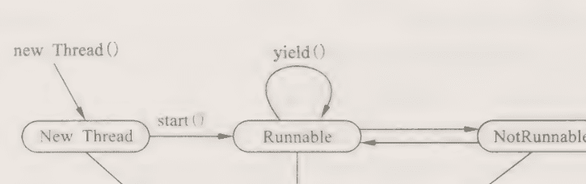

```java
} catch (InterruptedException e) {
}
```

## 9.3 多线程程序设计

从前面讲到的例子可以看出，创建一个线程的程序时，要么继承`Thread`类，要么实现`Runnable`接口，但不管怎么，总是在程序中重载`run()`方法。

### 9.3.1 继承 Thread 类

设计一个多线程程序时，应继承线程类并重写它的`run`方法。这在初始化这个类的实例时，目标类为`null`，表示由这一个实例对象来执行线程类。由于 Java 只支持单继承，用这种方法定义的类不能再继承其他父类。


我们将通过两个例子来说如何构造线程类。我们可以建立一个`Thread`类的类，通过继承`Thread`类并覆盖`run()`方法来构造线程类。

**[例9-4] 编写一个演示两个线程运行情况的程序。**

```java
class TwoThread {
    public static void main(String[] args) {
        new SimpleThread("线程1").start(); // 创建启动程序1
        new SimpleThread("线程2").start(); // 创建启动程序2
    }
}

class SimpleThread extends Thread { // 继承线程类
    public SimpleThread(String str) { // 构造函数
        super(str); // 父类构造函数
    }

    public void run() {
        try {
            for (int i = 0; i < 4; i++) {
                System.out.println(i + "" + getName()); // 显示线程名和i的值
                sleep((int) (Math.random() * 1000)); // 睡眠时间
            }
        } catch (InterruptedException e) {
        }
        System.out.println("DONE!" + getName()); // 显示哪个线程已经结束
    }
}
```

结果如图9-3所示。
在这个例子中，类`TwoThread`的`main`方法中构造了两个`SimpleThread`类的实例，一个称为“线程1”，另一个称为“线程2”，并在构造后马上调用了`start()`方法来启动这两个线程。

#### Java Thread程序设计

`SimpleThread`是`Thread`类的类，它定义了一个构造方法，其中变量为字符串类型，例如上面的“线程2”，它的作用就是设置线程名。第二个方法是`run()`，它覆盖了`Thread`类中的`run()`方法。`run()`方法中有四次循环，每次循环中显示当前运行线程的名字，然后随机产生睡眠时间。通过分析运行结果，发现两个线程是并行运行的，但并不是两个线程是同时运行的。实际上在一台计算机上有一个CPU，在某个时刻有一个线程运行，而 Java 设计时就考虑到了线程调度。对于初学者，在编写时需要注意线程执行时间，主要是为了控制线程睡眠（`sleep()`方法）让线程暂停，然后由其他线程争夺的机会。

### 9.3.2 实现 Runnable

```
D:\Java\bin\java.exe
0 线程1
0 线程2
1 线程2
1 线程1
2 线程1
3 线程2
2 线程1
DONE!
3 线程1
DONE!
3 线程1
Process finished with exit 0
```

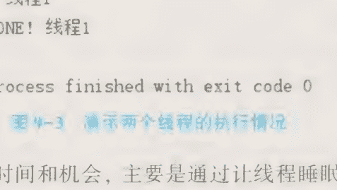

用户程序可以通过`Runnable`接口的方法来定义，新建线程的操作是由`run()`方法来决定。定义`run()`方法之后，当用户需要建立线程时，只需要实现`run()`方法继续下去。【9-5】用`Runnable`接口实现多线程。

```java
import java.awt.*;

public class Runnable extends Applet implements Runnable { // Applet 类
    Label prompt1 = new Label("第一个线程"); // 标签1
    Label prompt2 = new Label("第二个线程"); // 标签2
    TextField threadfirst = new TextField(1); // 文本框1
    TextField threadSecond = new TextField(1); // 文本框2
    Thread thread1, thread2; // 两个线程的对象
    int count1 = 0, count2 = 0; // 两个计数器

    public Runnable() {
        add(prompt1);
        add(threadfirst);
        add(prompt2);
        add(threadSecond);
    }

    public void start() { // 创建线程对象，调用 run 方法并指定线程的名字
        thread1 = new Thread(this, "FirstThread");
        thread2 = new Thread(this, "SecondThread");
        thread1.start(); // 启动线程，进入绪状态
        thread2.start(); // 再次调用 run 方法
    }

    public void stop() { // 若线程对象仍处于活动状态，则停止
        if (thread1.isAlive()) thread1.stop();
        if (thread2.isAlive()) thread2.stop();
    }

    public void run() { // 实现 Runnable 接口的 run 方法，在该线程被启动后自动执行
        String currentRunning;
        while (true) {
            try {
                // 使当前活动线程休眠
                Thread.sleep((int) (Math.random() * 1000));
            } catch (InterruptedException e) {
            }
            // 获取当前运行线程的名字
            currentRunning = Thread.currentThread().getName();
            if (currentRunning.equals("FirstThread")) {
                count1++;
                threadfirst.setText("线程1" + count1 + "被调度");
            } else if (currentRunning.equals("SecondThread")) {
                count2++;
                threadSecond.setText("线程2" + count2 + "被调度");
            }
        } // while 循环结束
    } // run 方法结束
}
```

结果如图9-4所示。`Runnable`中创建了两个线程，都是`Thread`类的对象，这两个对象的构造函数说明了`run()`方法的功能是先睡眠一段时间，然后当前活动（即获得了处理器的）线程被调度次数，并显示在相应的文本中。

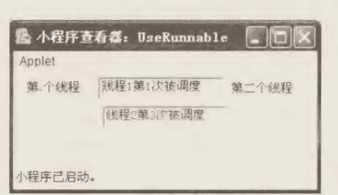

# Java 程序设计

构造线程的方法：

- 1. 使用`Runnable`接口。
- 2. `Thread`类。
- 3. 直接继承`Thread`类。
- 4. 编写简单，可以直接连接`Thread()`。

### 9.4 线程调度

线程调度的目的是对执行状态的线程进行调度，防止多个线程竞争资源导致死机或崩溃。为此，Java 定义了优先级控制，Java 提供一个调度器来监控线程从启动后进入绪状态的所有线程，优先级从低到高优先级（进入运行中），同时线程调度调度分为时间片方式和独占方式。在时间片方式下，线程执行完全之前，如果有其他处于绪状态的相同优先级的线程，系统将会执行权交给其他线程；在若干情况下，当前线程放弃 CPU：

- (1) 线程调用`yield()`
- (2) 由于线程进行 I/O 操作，等待用户输入，导致线程阻塞；等待条件变量，以及线程`wait()`。
- (3) 在抢占体系下，由高优先线程调度；时间片方式下，当前时间片完，由高优先级的线程参与调度。

将线程的优先级分为若干等级，分别用数字 1 到 10 表示，数字越大代表优先级越高。`NORMAL_PRIORITY`和`MAX_PRIORITY`分别为 5 和 10。`getPriority()`方法可以得到线程的优先级。当线程创建后，可以通过`setPriority`调整。创建一个新的线程时，默认优先级是5。多个线程处于绪状态，具有高优先级的线程会在低优先级之前执行。在当前线程运行过程中，如果有较高线程准备绪，较低线程将被挂起；转到较高线程运行。【9-6】通过设置优先级，观察线程运行顺序、不同优先级的线程占用的 CPU 时间。

```java
class PriorityTime implements Runnable {
    int counter = 0; // 计数器
    private boolean flag = true; // 标志
    Thread t; // 声明对象

    public PriorityTime(int p) {
        t = new Thread(this);
        t.setPriority(p); // 设置优先级
    }

    public void run() {
        while (flag) {
            counter++; // 计数加1
        }
    }

    public void stop() {
        flag = false; // 结束线程
    }

    public void start() {
        t.start(); // 启动线程
    }

    public static void main(String args[]) {
        Thread.currentThread().setPriority(Thread.MAX_PRIORITY);
        PriorityTime higher = new PriorityTime(Thread.NORM_PRIORITY + 2); // 高
        PriorityTime lower = new PriorityTime(Thread.NORM_PRIORITY - 2); // 低
        lower.start(); // 启动
        higher.start(); // 启动

        try {
            Thread.sleep(5000); // 睡眠5秒
        } catch (InterruptedException e) {
            System.out.println("Main thread interrupted.");
        }

        higher.stop(); // 终止
        lower.stop(); // 终止

        try {
            lower.join(); // 用于等待线程执行完毕
            higher.join();
        } catch (InterruptedException e) {
            System.out.println("InterruptedException caught");
        }

        System.out.println("Low-priority thread:" + lower.counter);
        System.out.println("High-priority thread:" + higher.counter);
    }
}
```

运行后打印信息：

```
Low-priority thread: 3
High-priority thread: 6
```

可以看到，这些是高优先级的线程。

## 9.5 同步

同步（Synchronization）是解决线程安全的重要手段。在多线程程序中，由于线程共享内存，因此一个线程在使用资源时，另一个线程去修改，将造成混乱。可以使用 Java 提供的`synchronized`关键字像对象的锁，当多个线程访问的对象时，此对象会被锁住，完毕后也会释放供线程使用。

#### 9.5.1 Synchronized 访问

先看一个例子，程序简单，生成三个线程。

```java
class SynchronizedBlock implements Runnable {
    public static void main(String[] args) {
        SynchronizedBlock aObj = new SynchronizedBlock(); // 创建对象
        Thread thread;
        for (int i = 0; i < 3; i++) { // 创建三个线程
            thread = new Thread(aObj);
            thread.setPriority((int) (10 * Math.random()) + 1); // 设置优先级
            thread.start(); // 启动
        }
    }

    public void run() {
        for (int i = 0; i <= 5; i++) {
            try {
                Thread.sleep(5);
            } catch (InterruptedException e) {
            }
            synchronized (this) { // synchronized(this)
                // 输出当前线程的名字，后面跟着线程名
                System.out.println(Thread.currentThread().getName() + Thread.currentThread().getName());
            }
        }
    }
}
```

输出信息：

```
Thread-1+Thread-0 0
Thread-2+Thread-0 0
Thread-0+Thread-2 0
Thread-3+Thread-0 1 0
Thread-1+Thread-1 1
Thread-0+Thread-2 1
Thread-2+Thread-0 2 0
Thread-1+Thread-1 2
Thread-2+Thread-2 2
Thread-2+Thread-0 3 1
Thread-1+Thread-1 3
Thread-0+Thread-2 3
Thread-1+Thread-0 4 0
Thread-2+Thread-2 4
Thread-1+Thread-1 4
Thread-0+Thread-2 5 0
Thread-1+Thread-1 5
Thread-2+Thread-2 5
```

为了保证同一个线程的两个语句一起执行，而不是被其他线程中断，可以使用`synchronized(Object o)`即可实现同步。将代码中注释的符号"//"去掉，即可实现同步。


# 多线程机制 第9章

## 9.5.2 synchronized 方法

在定义类中的方法时，如果要求一次只能使用一个方法...

例如账户存取方法：对同一用户既可以存，也可以取，但存取不能同时进行。一个用户存取的同时，另一个用户也可以存取，与同一个用户之间关系互斥。

在同步中还会调用 `wait()`、`notify()` 方法。概来说，每个共享对象的锁存在两个队列中，一个是锁等待队列，另一个是锁申请队列。锁等待队列中的线程在某些情况下将移入锁申请队列。

`wait()` 和 `notify()` 方法必须在已经持有的锁的情况下调用，所以它们只能出现在 `synchronized` 作用的范围内，也就是出现在 `synchronized` 修饰的方法或类中。`wait()` 的作用是释放已持有的锁，进入等待队列；`notify()` 的作用是唤醒 `wait()` 队列中的第一个线程并将其移入锁申请队列；`notifyAll()` 的作用是唤醒 `wait()` 队列所有的线程并将其移入锁申请队列。

## 9.6.1 项目目标和任务

### 1. 项目目标

(1) 掌握如何使用 `Thread` 类和 `Runnable` 接口编写线程程序。

(2) 理解多线程同步的原理。

(3) 使用线程同步实现线程安全。

### 2. 项目任务

虚拟多人售票系统，多名顾客同时买票会出现什么结果？

## 9.6.2 项目分析

### 1. 完成思路

首先创建一个 `Runnable` 接口的类，在这个类中设置一个 `int` 类型的属性，模拟需要销售的火票 100 张。通过创建四个线程，模拟四个售票窗口，对于这个类的属性进行减 1 操作，观察运行的结果。然后，在线程的方法中加入同步锁，观察运行的结果。要完成此项任务，必须掌握线程和同步的技术。

### 2. 解决的问题

(1) 如何继承 `Thread` 类和 `Runnable` 接口都能实现多线程，那么两种实现线程的方法在应用上有什么区别？哪一个更好？

(2) 如何实现线程共享数据。

## 9.6.3 项目实现

### (1) 通过继承 `Thread` 类的方式来实现

```java
public class ThreadDemo {
    public static void main(String[] args) {
        ThreadTest t = new ThreadTest();
        t.start();
        t.start();
        t.start();
        t.start();
    }
}

class ThreadTest extends Thread {
    private int tickets = 100;
    public void run() {
        while (tickets > 0) {
            System.out.println(Thread.currentThread().getName() + " is selling ticket " + tickets--);
        }
    }
}
```

在上代代码中，我们用 `ThreadTest` 类模拟售票的售票过程，`run()` 方法中的每一次循环都会将总票数减 1，模拟卖出一张车票，并将剩余的票打印出来，直到剩余的票数为 0。在主方法中我们创建了一个线程对象，并启动了四个线程，希望通过这种方式创建四个线程。从运行结果（图-6）看到，只有一个线程在运行，这就说明一个线程对象只能对一个线程，无论调用几次 `start()` 方法，结果只有一个线程在运行。

### (2) 修改上述代码，在 `main` 方法中创建一个 `ThreadTest` 对象

```java
public class ThreadDemo {
    public static void main(String[] args) {
        new ThreadTest().start();
        new ThreadTest().start();
        new ThreadTest().start();
        new ThreadTest().start();
    }
}
```

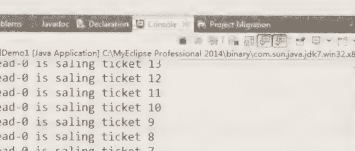

再次观察运行结果（图-7），结果是每个票号都被打印了四遍，即这四个线程各自卖了 100 张，而不是卖了共同的 100 张。这个结果说明，我们的线程没有共享变量。

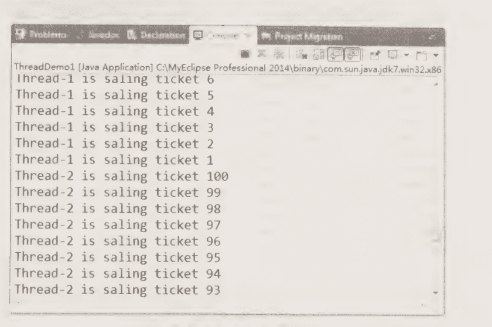

### (3) 通过实现 `Runnable` 接口

```java
public class ThreadDemo {
    public static void main(String[] args) {
        ThreadTest t = new ThreadTest();
        new Thread(t).start();
        new Thread(t).start();
        new Thread(t).start();
        new Thread(t).start();
    }
}

class ThreadTest implements Runnable {
    private int tickets = 100;
    public void run() {
        while (true) {
            if (tickets > 0) {
                System.out.println(Thread.currentThread().getName() + " is selling ticket " + tickets--);
            }
        }
    }
}
```

在上面的程序中，创建了四个线程，每个线程调用的同一个 `ThreadTest` 对象中的 `run()` 方法访问的是同一个对象的变量 `tickets` 的实例，这个程序满足了我们的需求，运行结果如图 9-8 所示。


## 9.7 项目扩展

【例-8】设计多线程程序，显示三张图像，每张图像隐藏和显示。

```java
// WindowThread.java
import java.awt.*;
import java.awt.event.*;
import javax.swing.*;

class WindowThread extends JFrame {
    MyWindow mywindow;
    public WindowThread() {
        Container c = getContentPane();
        c.setLayout(new GridLayout(2, 2, 20, 20));
        mywindow = new MyWindow(); // MyWindow对象
        for (int i = 0; i < 3; i++) {
            c.add(mywindow.panel[i]); // 在窗口中第一个panel容器
        }
        setSize(200, 200);
    }
    public static void main(String[] args[]) {
        WindowThread app = new WindowThread();
        app.addWindowListener(new WindowAdapter() {
            public void windowClosing(WindowEvent e) {
                System.exit(0);
            }
        });

        W w0 = new W(app.mywindow, app.mywindow.panel[0], 100, 0);
        Thread thread1 = new Thread(w0); // 创建类对象thread1, target为w0

        W w1 = new W(app.mywindow, app.mywindow.panel[1], 200, 1);
        Thread thread2 = new Thread(w1); // 创建类对象w1

        W w2 = new W(app.mywindow, app.mywindow.panel[2], 300, 2);
        Thread thread3 = new Thread(w2);

        thread1.start(); // 线程对象thread1启动
        thread2.start();
        thread3.start();
    }
}

class MyWindow {
    JLabel[] label; // 定义JLabel数组
    Icon[] icon; // 定义Icon数组
    JPanel[] panel; // 定义JPanel数组
    MyWindow() {
        label = new JLabel[3]; // 创建label数组
        icon = new Icon[3]; // 创建图标数组
        panel = new JPanel[3]; // 创建面板数组
    }
}

class W implements Runnable {
    MyWindow window;
    int times;
    int i;
    W(MyWindow w, JPanel p, int t, int i) {
        window = w; // 将构造方法中的MyWindow 类赋值一个对象
        times = t;
        this.i = i;
        window.panel[i] = p;
    }

    public void run() {
        while (true) {
            try {
                window.panel[i].setVisible(true); // 使容器可见
                Thread.sleep(times); // 延时times毫秒
                window.panel[i].setVisible(false); // 使容器不可见
                Thread.sleep(times); // 延时times毫秒
            } catch (InterruptedException e) {
            }
        }
    }
}
```


## 课后练习

1. 什么是多线程编程？什么时候使用？

2. `Thread` 和 `Runnable` 有什么不同？

3. 请编写一个名为 `MulThread` 的类，在类中定义了一个字符串参数的构造函数，实现了 `Runnable` 接口，接口中的 `run()` 方法如下：

```java
public class Test {
    public static void main(String[] args) {
        Thread pmi1 = new Thread("one");
        pmi1.run();
        Thread pmi2 = new Thread("two");
        pmi2.run();
    }
}

class Thread implements Runnable {
    String s;
    Thread(String s) {
        // s=s;
    }
    public void run() {
        try {
            Thread.sleep(1000);
            System.out.println(s);
        } catch (InterruptedException e) {
            Thread.yield();
        }
    }
}
```

A. 编译错误

B. 输出 One Two

C. 输出 One Two

D. 输出 One Two

# 数据库操作技术 第10章

## 10.1 JDBC 技术与 ODBC

本章将介绍关系型数据库的概念及常用的关系型数据库，掌握 JDBC 应用程序中的数据源配置。熟悉 `java.sql` 包中与数据库有关的对象和接口，并利用 JDBC 方法访问数据库。数据库是相关信息的集合，数据库管理系统是提供用户的一种机制，用于数据进行检索、添加和修改。对于 Java 应用程序涉及数据库，这些类型的应用依赖于 Client/Server 的多层结构。数据库的访问是重要的功能之一。在客户端上设置数据库管理事务是否有必要？若是否定的，我们不需要用户去设置数据库管理事务的知识；还需要客户端上有界面的应用程序可以使用。

### 10.1.1 JDBC 技术介绍

ODBC (Open Database Connectivity) 是开放数据库连接。应用程序通过 ODBC 提供的各种函数访问数据库，不管客户是在客户端上还是远程服务器上的数据库。通过 ODBC（技术实际上是一个接口）几乎可以访问所有类型的数据，如 Oracle, Sybase, DB2, Informix, dBASE, FoxPro, Excel, Access 和文本文件。ODBC 体系如图 10-1 所示。

ODBC 是在应用程序中使用一个驱动程序来解决不同类型数据库的访问问题的。驱动程序可以将来自应用程序的查询转换为数据库理解的命令。为了达到这个目的，应用程序和 DBMS 必须支持 ODBC，应用程序能够发布 ODBC 命令，而 DBMS 能够应用这些命令。

### 10.1.2 JDBC

在 Java 中有一个程序套件 `java.sql`，为用户提供数据库结构化查询的语言，由于它为数据库开发者提供了一个标准的应用程序接口。通过 JDBC 可以容易地对任何数据库执行 SQL 命令，所执行的语句与数据库的架构无关，不论是 Oracle, SQL Server, Sybase, Informix, MS Access 等，用户设计的程序都是一样的，不同的只是调用的数据库驱动程序。Oracle 的 JDBC 程序套件是服务器端程序设计。

限于篇幅，我们不讨论 SQL Server 或 MySQL 的使用方法。下面是一个学生注册的处理例，先看看学生注册列表（图 10-4）。

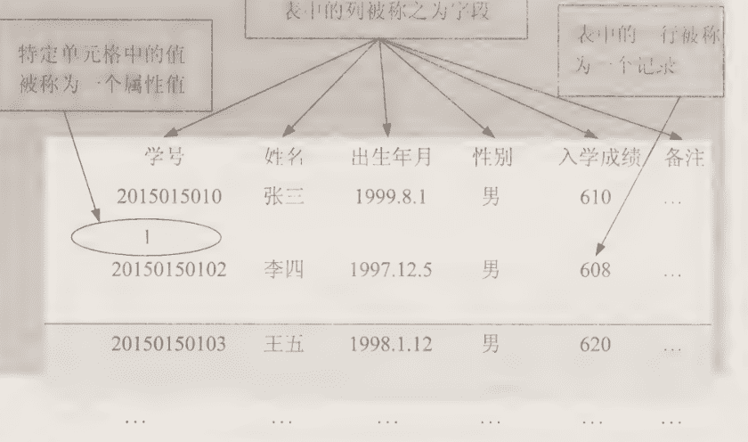

图 10-4 学生注册列表

与日常工作中遇到的各种各样的表格字段是固定的，并且每一列存放数据的数据类型是相同的，根据需要可以在表中添加任意行（记录）。数据的最大列数和限制由所使用的 DBMS 决定。

对于学生注册列表来说，第一列学号是在校学生的唯一标识，可以用字符表示，也可以用数字字符表示；对于姓名、出生年月、性别和备注可以用字符表示，入学成绩可以用 `int` 或 `float` 类型。表中的每一行构成了一个实体，它是许多数据元素的集合，在这里把它称为一个学生记录或学生对象。

结构化查询语言（Structured Query Language, SQL）是国际公认的关系型数据库访问的官方标准，数据库制造商都遵循此标准的规范。这里对图 10-4 所示的学生注册列表的建立、插入、删除、检索等操作相关的语句要概要。

### (1) 建立数据表

在 Student 数据库中建立学生注册表 `student_login`，可以使用的语句如下：

```sql
CREATE TABLE student_login(
    学号 CHAR(11) PRIMARY KEY,
    姓名 CHAR(10),
    出生年月 CHAR(10),
    性别 CHAR(2),
    入学成绩 INT,
    备注 CHAR(254)
);
```

`CHAR(11)` 表示数据类型为定长字符串，长度为 11。其中学号是索引主键，创建记录时不能为空。使用索引主键是为了查找快，是在创建过程中不允许出现重复的学号录入表中。


- (2) 插入记录 `INSERT INTO...VALUES` 子句。可以使用如下格式在表格中插入记录：

```sql
INSERT student_login VALUES ('2015023201', '张三', '1999.1.2', '男', 615);
INSERT student_login(学号, 姓名, 性别, 入学成绩) VALUES ('2015023202', '李四', 623);
```

第一个语句插入所有项，学号的插入顺序必须是指定的顺序；第二个语句插入了指定的四项、指定的字段和值--一致即可。

注意：在一条记录中不记录允许的，指定的顺序任意，都必须包括主键--学号，否则系统可能会出错，插入失败。

- (3) 检索记录 `SELECT...FROM...WHERE` 子句。可以使用如下格式查询学生表中的记录信息：

```sql
SELECT * FROM student_login;
SELECT 学号, 姓名, 入学成绩 FROM student_login;
SELECT * FROM student_login WHERE 入学成绩>630;
```

第一个语句列出表中的所有学生的字段的值；第二个语句列出表中所有符合“学号、姓名和入学成绩>630”条件的学生信息。

- (4) 修改记录 `UPDATE...SET` 子句。可以使用如下格式修改某些学生的记录信息：

```sql
UPDATE student_login SET 性别='男', 入学成绩=625 WHERE 学号='20150232105';
UPDATE student_login SET 出生年月='1999.1.23' WHERE 学号='20150232105';
```

第一个语句将 20150232105 学生的出生年月修改为 1999.1.23；第二个语句将学生的入学成绩修改为 625。

- (5) 删除记录 `DELETE...FROM...WHERE` 子句。要删除表中无用的学生记录可以使用如下格式：

```sql
DELETE FROM student_login WHERE 学号='20150232108';
DELETE FROM student_login WHERE 入学成绩<500;
```

第一个语句删除学生表中 20150232108 的记录；第二个语句删除表中入学成绩小于500 的记录。

在了解数据库操作的基础之后，下面介绍 JDBC 访问相关的类、对象和接口。

## 10.3 JDBC 中的主要对象和接口

JDBC 在系列类的基础上将功能结合起来，能够方便地操作数据库，如图 10-5 所示。这里介绍几个与访问数据库相关的类，它们都位于 `java.sql` 包中。

| 方法 | 功能 | 关系 |
|---|---|---|
| `Class.forName()` | 装入驱动程序 | 与数据库的连接 |
| | Statement | |
| `DriverManager.getConnection()` | 生成 Connection 接口 | ↔ 数据库 |
| | ResultSet | 数据库 |
| | PreparedStatement | |


### 1. Class 类

如果需要的话，可以使用 `forName` 方法加载驱动程序。如：`Class.forName("jdbc.odbc.JdbcDriver")`。

### 2. Driver 类

数据库管理器在用户界面和数据库之间维护连接。可以通过调用 `DriverManager` 对象定义的 `getConnection` 方法获取驱动程序的数据库连接；也可以用 `Class.forName` 方法增加驱动程序。`DriverManager` 对象静态成员方法如下：

- `deregisterDriver()` 删除驱动程序
- `getConnection()` 创建数据库连接
- `getDriver()` 获取指定的驱动程序
- `getDrivers()` 列出所有的驱动程序

### 3. Connection 连接

`Connection` 接口表示程序与数据库之间的会话，支持 SQL 语法，能够执行 SQL 语句。一般情况下使用 `DriverManager.getConnection` 方法获得 Connection 对象：`Connection con = DriverManager.getConnection("jdbc:odbc:DataSource", "sa", "0000")`。常用的方法：

- `commit()` 提交事务
- `createStatement()` 创建 Statement 对象
- `prepareStatement()` 创建 PreparedStatement 对象
- `rollback()` 回滚事务

可用 Connection 对象创建 Statement 或 PreparedStatement 对象。

### 4. Statement 接口

在 JDBC 中，对数据库的操作通过 API 定义了三种形式：`Statement`、`PreparedStatement` 和 `CallableStatement`。

#### (1) Statement 对象

`Statement` 用于执行简单的数据库命令，例如查询、删除等。Statement 对象实例由 Connection 对象创建，并在执行过程中可以使用参数封装 SQL 语句。主要方法：

- 当执行后返回一个 ResultSet 对象时，可以使用 `executeQuery()`
- 当执行后返回多个 ResultSet 对象时，可以使用 `execute()`
- 当执行后结果不是 ResultSet 对象时，可以使用 `executeUpdate()`

```java
import java.sql.Connection;
import java.sql.DriverManager;
import java.sql.Statement;

public class QueryApp {
    public static void main(String[] args) {
        try {
            Class.forName("jdbc.odbc.JdbcDriver");
            Connection conn = DriverManager.getConnection("jdbc:odbc:MyDataSource","sa","0000");
            // 数据源为 MyDataSource 为登录名,0000 为登录密码
            // 这里的用户名和密码可以根据实际情况调整
            Statement stat = conn.createStatement();
            stat.executeQuery("select * from Publishers"); //查询语句
        } catch (Exception e) { //捕捉各种异常
            System.out.println("Error:" + e); //显示异常信息
        }
    }
}
```

在这个例子中，首先使用了 JDBC—ODBC 桥驱动程序；然后用 `getConnection` 方法初始化 Connection 对象；用 `createStatement` 方法创建 Statement 对象；最后，用 Statement 的 `executeQuery()` 方法执行简单的查询。

#### (2) PreparedStatement 对象

`PreparedStatement` 用于执行带参数的 SQL 语句，在程序过程中动态调整执行语句的内容。PreparedStatement 的定义继承自 Statement 对象，并且在 Statement 对象的基础上增强了封装 SQL 语句的功能。PreparedStatement 对象实例包含了经过编译的 SQL 语句，在程序设计过程中创建对象实例后，调用定义的方法获取预编译语句并执行。在执行过程中，PreparedStatement 对象实例可以包含用 `?` 代替的参数，这些参数将在语句提交数据库执行之前，利用 PreparedStatement 对象的方法进行设置。

如：

```java
stat=conn.prepareStatement("Select * from publishers where pub_id?");
stat.setString(1,id.get());
ResultSet result=stat.executeQuery();
```

PreparedStatement 语句是经过编译的，由于其执行速度快于 Statement，另外 PreparedStatement 对象中的 `execute`、`executeQuery` 和 `update` 方法不需要参数，在语句执行中使用方法设置完成后直接提交数据库执行。

#### (3) CallableStatement 对象

在 JDBC 中，存储跨越边界的。即使在数据库中存储本身也是重要的，为了了解，CallableStatement 对象对所有的 DBMS 都提供了一种符合标准格式的调用过程的方法。通过存储过程存储在数据库中。对已存储的调用用 Callable 对象包含。这种调用是用语言编写的，有两种形式：一种形式带有参数，另一种形式不带结果参数。

## 10.4 MySQL 数据库

MySQL 是一个多用户、多线程数据库，由 MySQL AB 公司开发，目前属于 Oracle 公司。MySQL 是最流行的关系型数据库系统，在 Web 应用中 MySQL 是最好的软件之一。它是一种关系型数据库管理系统，关系数据库将数据保存在内存中而不是磁盘中。SQL 语句是用于数据库的最常用语言。由于它的体积小、速度快、资源消耗低，尤其是小型网站，是非常好的选择。

现在在 MySQL 命令行界面使用这些命令。“开始”→程序→MySQL Server 5.0→MySQL Command Line 进入客户端，在命令行中输入 SQL 用户操作数据库。

## 表10-1 MySQL 的基本命令

| 命令 | 格式 | 示例 |
|---|---|---|
| 连接到 MySQL | MySQL -h 主机地址 -u 用户 -p 密码 | MySQL -h127.0.0.1 -uroot -p0000 |
| 退出 MySQL | exit | exit |
| 创建数据库 | create database 数据库 | create database xxxx |
| 指定数据库 | use 数据库 | use xs |
| 创建 | create table 表名(字段列表) | create table xs(id int(6) not null primary key, name char(10) not null, major char(20) not null); |
| 删除数据库 | drop database 数据库 | drop database xxxx |
| 删除表 | drop table 表名 | drop table xs |
| 插入数据 | insert into 表名 values(字段列表) | insert into xs values (150001,'杨帅','通仕伦') |
| 查询记录 | select 字段列表从名 where 条件 | select name from xs where id=100001 |
| 删除记录 | delete from 表名 where 条件 | delete from xs where id=15002 |
| 修改记录 | update 表名 设置字段=值 where 条件 | update xs set name='汤华' where id=15002 |

## Java程序设计

建立学生信息(xsxx)数据库及学生(xs):

```sql
create database xsxx;
use xsxx;
create table xs (
id int(6) NOT NULL primary key,
name char(10) NOT NULL,
major char(20) NOT NULL
);
insert into xs values (150001, '杨丽', '通信工程');
insert into xs values (150003, '赵明', '电子工程');
```

## 10.5 JDBC 编程

在开始编写一个使用后台数据库为 MySQL 的 JDBC 程序之前，需要在当前工程引入 MySQL 的 JDBC 驱动程序方法：右键选择“Build Path→Add External Archives”，出现文件选择对话框，如图 10-13 所示，找到磁盘上的 MySQL 的 JDBC 驱动程序，然后单击“打开”按钮，MySQL 的 JDBC 驱动程序就被加入了当前的工程中。

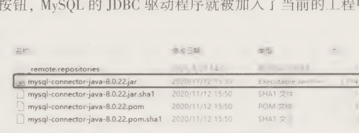

图 10-13 引入 MySQL 的 JDBC 程序

### 【例10-1】编写 JDBC 应用程序，使用了创建的 xsxx 数据库和xs 表：

```java
import java.sql.*;
public class TestJDBC {
    public static void main(String[] args) {
        ResultSet rs=null;
        Statement stmt=null;
        Connection conn=null;
        try {
            /* 加载并注册 MySQL 的 JDBC 驱动 */
            Class.forName("com.mysql.cj.jdbc.Driver");
            /* 创建 MySQL 数据库的连接 */
            conn=DriverManager.getConnection("jdbc:mysql://localhost:3306/xsxx","root","root");
            /* 访问数据库，执行 SQL 语句 */
            stmt=conn.createStatement();
            rs=stmt.executeQuery("select * from xs");
            while (rs.next()) {
                System.out.print(rs.getInt("id"));
                System.out.print(rs.getString("name"));
                System.out.println(rs.getString("major"));
            }
        } catch (ClassNotFoundException e) {
            e.printStackTrace();
        } catch (SQLException e) {
            e.printStackTrace();
        } finally {
            if (rs != null) {
                rs.close(); // 关闭ResultSet 对象
                rs=null;
            }
            if (stmt != null) {
                stmt.close(); // 关闭 Statement 对象
                stmt=null;
            }
            if (conn != null) {
                conn.close(); // 关闭 Connection 对象
                conn=null;
            }
        } catch (SQLException e) {
            e.printStackTrace();
        }
    }
}
```

程序运行结果:

150001 杨丽通信工程

150003 赵明 电子工程

### 【例 10-2】向数据库中的 xs 表中添加记录、修改记录、删除记录。

```java
package org.jdbc;
import java.sql.Connection;
import java.sql.DriverManager;
import java.sql.ResultSet;
import java.sql.SQLException;
import java.sql.Statement;
public class TestDML {
    public static void main(String[] args) {
        ResultSet rs=null;
        Statement stmt=null;
        Connection conn=null;
        try {
            // 加载并注册 MySQL 的 JDBC 驱动 (Class)
            Class.forName("com.mysql.jdbc.Driver");
            // 建立到 MySQL 数据库的连接 *
            conn=DriverManager.getConnection(url);
            // 访问数据库执行 SQL 语句 *
            stmt=conn.createStatement();
            // 添加记录 *
            System.out.println("添加记录后：");
            String sql="insert into xs values (150002, '张小艳', '永利工程')";
            stmt.executeUpdate(sql);
        } catch (Exception e) {
            e.printStackTrace();
        }
    }
}
```


```java
rs = stmt.executeQuery("select * from xs");
while (rs.next()) {
    System.out.print(rs.getInt("id"));
    System.out.print(rs.getString("name"));
    System.out.println(rs.getString("major"));
}
```

```java
// 修改记录 *
String sql2 = "update xs set name='王涛' where id=150002";
stmt.executeUpdate(sql2);
```

```java
while (rs.next()) {
    System.out.print(rs.getInt("id"));
    System.out.print(rs.getString("name"));
    System.out.println(rs.getString("major"));
}
```

```java
// 删除记录 *
System.out.println("删除记录后：");
String sql3 = "delete from xs where id=150002";
stmt.executeQuery(sql3);
```

```java
rs = stmt.executeQuery("select * from xs");
while (rs.next()) {
    System.out.print(rs.getInt("id"));
    System.out.print(rs.getString("name"));
    System.out.println(rs.getString("major"));
}
```

```java
} catch (ClassNotFoundException e) {
    e.printStackTrace();
} catch (SQLException e) {
```

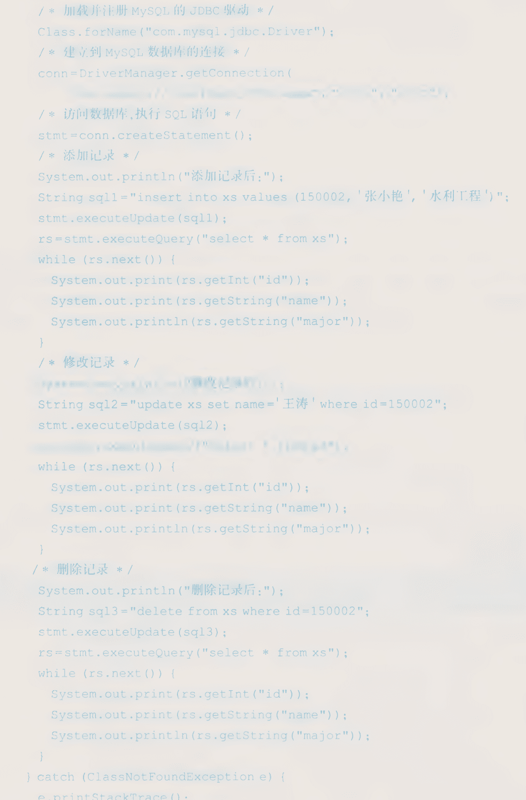

```java
e.printStackTrace();
} finally {
    try {
        if (rs != null) {
            rs.close(); // 关闭 ResultSet 对象
            rs = null;
        }
        if (stmt != null) {
            stmt.close(); // 关闭 Statement 对象
            stmt = null;
        }
        if (conn != null) {
            conn.close(); // 关闭 Connection 对象
            conn = null;
        }
    } catch (SQLException e) {
        e.printStackTrace();
    }
}
```

程序运行结果：

添加记录后：

150001 杨丽通信工程

150002 张小艳 永利工程

150003 赵明电子工程

修改记录后：

150001 杨丽通信工程

150002 王涛 永利工程

150003 赵明电子工程

删除记录后：

150001 杨丽通信工程

150003 赵明电子工程

### 【10-3】使用 `PreparedStatement` 对象向数据库 xs 表添加记录

```java
package org.jdbc;
import java.sql.Connection;
import java.sql.DriverManager;
import java.sql.PreparedStatement;
import java.sql.ResultSet;
import java.sql.SQLException;
import java.sql.Statement;
```

## Selenium自动化测试

```java
public void testElement() {
    WebDriver driver = new ChromeDriver();
    driver.get("http://www.baidu.com");
    WebElement element = driver.findElement(By.id("kw"));
    element.sendKeys("Selenium");
    element.click();
    Thread.sleep(3000);
    element = driver.findElement(By.name("result")); // 获取结果
    Thread.sleep(2000);
    element.sendKeys("Java"); // 修改文本
    Thread.sleep(2000);
    element = driver.findElement(By.id("result"));
    element.clear(); // 清空文本
    element.sendKeys("Python"); // 输入新文本
    element.executeUpdate();
    driver.quit();
}
```

```java
rs.close(); // 关闭 ResultSet
if (pstmt != null) {
    pstmt.close(); // 关闭 PreparedStatement
    pstmt = null;
}
```

```java
conn.close(); // 关闭 Connection
```

程序运行结果:

150001 杨丽通信工程

150003 赵明电子工程

150009 李化学

150010 赵环境

150011 刘工程

## 10.6 批处理

在 `Statement`接口中提供了批量更新的方法：

- `void addBatch(String sql) throws SQLException`: 将 SQL 命令添加到此 `Statement` 对象的命令列表中。
- `int[] executeBatch() throws SQLException`: 将一批命令交给数据库执行，如果全部执行成功，则返回计数数组。返回结果的 int 元素对应批处理中的命令，根据添加到批处理的顺序。

### 【10-4】运用批量更新数据库 xsxx 中的 xs 表添加数据

```java
import java.io.*;
import java.sql.*;
```

## Java 查询设计

```java
public class TestBatch {
    public static void main(String[] args) {
        ResultSet rs = null;
        Connection conn = null;
        Statement stmt = null;
        PreparedStatement pstmt = null;
        try {
            /* 加载 MySQL 的 JDBC 驱动 */
            Class.forName("com.mysql.jdbc.Driver");
            /* 连接到 MySQL 数据库的连接 */
            conn = DriverManager.getConnection(
                    "jdbc:mysql://localhost:3306/xsxx","root","root");
            /* 访问数据库，执行 SQL 语句 */
            pstmt = conn.prepareStatement("insert into xs values(?,?,?)");
            pstmt.setString(1,"张华");
            pstmt.setString(2,"老李");
            pstmt.addBatch();
            pstmt.setInt(1, 150013);
            pstmt.setString(3,"电气工程理论");
            pstmt.addBatch(); // 增加一条 SQL 语句
            pstmt.setInt(1, 150014);
            pstmt.setString(3,"系统工程");
            pstmt.addBatch();
            pstmt.executeBatch(); // 批量更新
            stmt = conn.createStatement();
            rs = stmt.executeQuery("select * from xs");
            while (rs.next()) {
                System.out.print(rs.getString("name"));
                System.out.print(rs.getString("major"));
            }
            System.out.println();
        } catch (ClassNotFoundException e) {
            e.printStackTrace();
        } catch (SQLException e) {
            e.printStackTrace();
        }
    } finally {
        if (rs != null) {
            rs.close();
            rs = null;
        }
        if (pstmt != null) {
            pstmt.close();
            pstmt = null;
        }
        if (stmt != null) {
            stmt.close();
            stmt = null;
        }
        if (conn != null) {
            conn.close();
            conn = null;
        }
    }
}
```


## 10.7 事务

当一个连接被创建时，默认事务被设置为自动提交。这意味着每次执行一条 SQL 语句，如果执行成功，就会自动提交数据库，也就回滚了。为了将多个 SQL 语句作为一个事务执行，可以设置 `Connection` 对象的 `setAutoCommit(false)`。然后在所有的 SQL 语句执行后，显式调用 `Connection` 对象的 `commit()` 方法来提交，或者在执行时用 `Connection` 对象的 `rollback()` 方法来回滚。

### 【10-5】事务处理并使用 JDBC 的批处理

```java
try {
    conn.rollback(); // 回滚事务
    conn.setAutoCommit(true); // 开启自动提交
} catch (SQLException el) {
    el.printStackTrace();
} finally {
    try {
        if (rs != null) {
            rs.close(); // 关闭 ResultSet 对象
            rs = null;
        }
        if (stmt != null) {
            stmt.close(); // 关闭 Statement 对象
        }
        if (conn != null) {
            conn.close(); // 关闭 Connection 对象
            conn = null;
        }
    } catch (SQLException e) {
        e.printStackTrace();
    }
}
```

程序运行结果:

- 150001 杨丽信工程
- 150003 赵磊电子工程
- 150009 李咏化学工艺
- 150010 赵辅环境科学
- 150011 刘元车辆工程
- 150012 齐乐光学
- 150013 星电工程理论
- 150014 王洛系统工程
- 150021 陈阳计算机
- 150022 李璐通信工程
- 150023 张伟临床医学
- 150024 刘天生物化学
- 150025 王云控制工程

# Java语言程序设计

## 10.8 综合实例

在这个综合实例中，使用另一个数据库 `company`。在前面的示例中，所用的数据库 `xxxx` 和 `xs` 表是在 MySQL Command Line Client 命令中输入 SQL 语句创建的。这里在 Java 程序中直接创建数据库和表。综合运用 JDBC 的批处理和事务处理。

```java
package org.jdbcb;

import java.sql.Connection;
import java.sql.DriverManager;
import java.sql.ResultSet;
import java.sql.SQLException;
import java.sql.Statement;
import java.sql.PreparedStatement;

public class UseJDBC {
    public static void main(String[] args) {
        ResultSet rs = null;
        Statement stmt = null;
        Connection conn = null;
        PreparedStatement pstmt = null;

        /* 加载注册 MySQL 的 JDBC 驱动 */
        Class.forName("com.mysql.jdbc.Driver");
        /* 连接到 MySQL 数据库 */
        conn = DriverManager.getConnection("jdbc:...");
        conn.setAutoCommit(false);
        /* 访问数据库，执行 SQL 语句 */
        stmt = conn.createStatement();
        /* 创建数据库 */
        stmt.executeUpdate("create database company"); // 使用公司作为数据库
        /* 创建表 */
        stmt.executeUpdate("create table employee (id int(6) not null, primary key, name char(10) not null, salary float(10))");
        /* 插入命令列表 */
        stmt.addBatch("insert into employee values (201501, '焦明',5000)");
        stmt.addBatch("insert into employee values (201502, '丁明',5200)");
        stmt.addBatch("insert into employee values (201503, '张三',6000)");
        stmt.addBatch("insert into employee values (201504, '王小五',5500)");
        stmt.addBatch("insert into employee values (201505, '李青',4800)");
        stmt.executeBatch(); // 批处理

        conn.commit(); // 提交事务
        rs = stmt.executeQuery("select * from employee");
        while (rs.next()) {
            System.out.print(rs.getString("name"));
            System.out.println(rs.getString("salary"));
        }
    } catch (ClassNotFoundException e) {
        e.printStackTrace();
    } catch (SQLException e) {
        e.printStackTrace();
    }
}
```

# 第1章 图形设计

本章将介绍 Java 语言图形界面 (GUI) 技术。图形界面与命令行界面相比，更加直观、操作更方便。

## 1.1 图形界面构成

图形界面遵循 MVC (Model-View-Controller) 设计模式：

- **Model (模型)**：逻辑表示。
- **View (视图)**：可视化表示。
- **Controller (控制器)**：处理用户操作。

在 Java 中，Swing 库提供了丰富的 GUI 组件，例如：

- `JButton` (按钮)
- `JLabel` (标签)
- `CheckBox` (选框)
- `JMenu` (菜单)
- `JTable` (表格)
- `Tree` (树)

## 1.2 布局管理器

布局管理器负责决定组件的摆放位置。`java.awt` 包包含了多个布局管理器：

### 1.2.1 BorderLayout 类


# BorderLayout

BorderLayout 是一种简单的布局管理器。它将容器简单分成东、南、北、西、中五个区域。如果某个区域没有组件，该区域会被省略。

## FlowLayout 类

`FlowLayout` 是 `Panel`、`Applet` 默认布局，又称流布局。组件加入的顺序从左到右，从上到下。

## 例11-1 使用 BorderLayout 布局

按照上、下、左、右、中五个按钮，单击中间的按钮时关闭窗口。

```java
import java.awt.*;
import java.awt.event.*;

public class UseBorderLayout {
    public static void main(String[] args) {
        BorderLayout frm = new BorderLayoutFram();
    }
}

class BorderLayoutFram extends Frame implements ActionListener {
    Button BtnN, BtnS, BtnW, BtnE, BtnC;

    BorderLayoutFram() {
        super("BorderLayout管理器窗口");
        int hgap = 5, vgap = 5; // 水平间隔，垂直间隔
        setLayout(new BorderLayout(5, 5)); // 组件之间没有间隔
        BtnN = new Button("North");
        BtnS = new Button("South");
        BtnW = new Button("West");
        BtnE = new Button("East");
        BtnC = new Button("Center");
        add("North", BtnN);
        add("South", BtnS);
        add("West", BtnW);
        add("East", BtnE);
        BtnC.addActionListener(this);
    }

    public void actionPerformed(ActionEvent e) {
        if (e.getActionCommand() == "Center") {
            dispose(); // 关闭窗口
            System.exit(0);
        }
    }
}
```

```java
public MyCardLayoutFrm() {
    super("CardLayout 布局");
    Button cardBtn1, cardBtn2, cardBtn3;
    cl = new CardLayout();
    gl1 = new GridLayout(2, 1);
    this.setLayout(gl1); // 框架布局设置为 GridLayout
    p1 = new Panel(); // 两个面板容器，第一行
    p2 = new Panel(); // 第二行
    first = new Button("首页"); // 四个按钮，放到第一行
    next = new Button("下一张");
    previous = new Button("上一张");
    last = new Button("末张");
    cardBtn1 = new Button("第一张卡片"); // 放到三张卡片
    cardBtn2 = new Button("第二张卡片");
    cardBtn3 = new Button("第三张卡片");
    p1.setLayout(new FlowLayout()); // 四个按钮
    p1.add(next);
    p1.add(previous);
    p1.add(last);
    first.addActionListener(this); // 注册
    next.addActionListener(this);
    previous.addActionListener(this);
    last.addActionListener(this);
    p2.setLayout(cl); // 三张卡片
    p2.add("1", cardBtn1); // 注意，不能直接用 p2.add(cardBtn1) 方法，用带
    p2.add("2", cardBtn2); // 应用两个参数的 add() 方法，如果容器是 Frame
    p2.add("3", cardBtn3); // 可用一个参数的 add() 方法
    this.add(p1); // 两个面板放到框架上
    this.add(p2);
    this.setSize(300, 300);
    this.setVisible(true);
}
```

```java
public void actionPerformed(ActionEvent e) {
    String command = e.getActionCommand();
    if (command.equals("首页"))
        cl.first(p2); // 移动 p2 到“第一张”
    if (command.equals("下一张"))
        cl.next(p2);
    if (command.equals("上一张"))
        cl.previous(p2);
}
```

# 第11章


图11-3 CardLayout布局

## GridLayout

在组件定位方面，`GridLayout` 比 `BorderLayout` 和 `FlowLayout` 更精确，它将容器空间分成 n 行 m 列的网格，组件可放置在小方格区域。

使用 `GridLayout` 布局管理器的一般方法是：

- 创建一个 `GridLayout`，指定划分布局的行数和列数。
- 使用容器的 `setLayout()` 方法将容器设置为这个 `GridLayout` 布局；
- 调整容器的 `add()` 方法，将组件加入容器中。

组件放入网格的顺序是从第一行开始，第一列，第二列，……第一行放完后，从第二行第一列开始继续，直到最后一行的最后列为止。

当某个网格中不需要放置组件时，可以使用标签 `add(new Label(""))` 填充，以确保下一个组件正确放置在下一个网格中。

构造函数：

`GridLayout(int rows, int cols, int hgap, int vgap);` 指定两个参数设置网格的列间距和行间隔。

常用方法有：

- `add(Component comp);` 将组件从左到右，从上到顺序放入网格。
- `setRows(int rows);` 设置行数。
- `setCols(int cols);` 设置列数。
- `setHgap(int hgap);` 设置组件垂直间距。
- `setVgap(int vgap);` 设置组件水平间距。

【例11-4】按照图11-4进行 GridLayout 布局。

```java
import java.awt.*;

public class GridLayoutTest extends Frame {
```

# Java 库设计

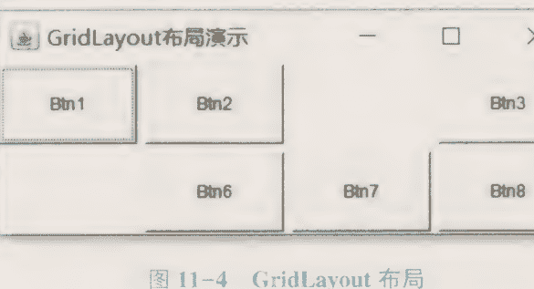

```java
public GridLayoutTest() {
    super("GridLayout布局演示");
    // 设置布局为2行4列，组件横间距为5
    this.setLayout(new GridLayout(2, 4, 5, 5));
    this.add(new Button("Btn1")); // 向框架窗口添加Button
    this.add(new Button("Btn2")); // ...
    this.add(new Label(" ")); // 向框架窗口添加标签用于占位
    this.add(new Button("Btn3")); // 向框架窗口添加Button
    this.add(new Label(" ")); // 向框架窗口添加标签用于占位
    this.add(new Button("Btn6")); // 向框架窗口添加Button
    this.add(new Button("Btn7")); // ...
    this.add(new Button("Btn8")); // ...
    this.pack();
    this.setVisible(true);
}
```

```java
public static void main(String[] args) {
    new GridLayoutTest();
}
```

## GridBagLayout

`GridBagLayout` 是最、功能强大的一种布局，具有一定程度。从 `GridBagLayout` 布局可以看出，其中的网格大小一样，不灵活，也不自然。`GridBagLayout` 可以为每个组件指定其包含的网格个数，组件大可以小。

`GridBagLayout` 必须和 `GridBagConstraints` 类（约束类）共同使用，`GridBagConstraints` 的属性决定 `GridBagLayout` 布局中组件的位置。因此，我们首先介绍约束类。

`GridBagConstraints` 的属性：

- `gridx` 和 `gridy` 指定组件的左上坐标，以网格为单位。
- `gridwidth` 和 `height` 指定占据网格的行数和列数，且 `REMAINDER` 属性将占据该所有的空间。
- `weightx` 和 `weighty` 指定水平方向和垂直方向权重(0 或1)。当分配区域增大时，根据每一行（或列）权重来分配。
- `NONE`: 不改变。
- `HORIZONTAL`: 横向扩展、占满。
- `VERTICAL`: 纵向扩展、占满。
- `BOTH`: 横向扩展、占满。
- `Anchor`: 指定组件在区域中的位置，有九种取值：`CENTER` 分配中心。
- `NORTH`: 北面。
- `SOUTH`: 南面。
- `EAST`: 东面。
- `WEST`: 西面。
- `NORTHEAST`: 东北角。
- `NORTHWEST`: 西北角。
- `SOUTHEAST`: 东南角。
- `SOUTHWEST`: 西南角。

总之，前面这种布局不能随意放置组件，即使能达到位置和大小的要求。实现目的？答案是 null 布局。

【例11-5】使用 null 布局所示所示，模拟管理界面，登录时进行身份验证（用户名和密码）。

```java
import java.awt.*;
import java.awt.event.*;

public class NullLayout extends Frame {
    Label lblUsername = new Label("用户名:");
    TextField txtUsername = new TextField();
    Label lblPasswordField = new Label("用户密码:");
    TextField txtPasswordField = new TextField();
    Button btnLogin = new Button("登录");
    Button btnReset = new Button("重置");

    public NullLayout() { // 设置框架布局为null
        this.setLayout(null); // 每个组件的位置和大小
        lblUsername.setBounds(new Rectangle(5, 36, 67, 34));
        txtUsername.setBounds(new Rectangle(15, 39, 210, 33));
        lblPasswordField.setBounds(new Rectangle(43, 88, 66, 26));
        txtPasswordField.setBounds(new Rectangle(1, 84, 210, 33));
        btnLogin.setBounds(new Rectangle(78, 150, 86, 30));
        btnReset.setBounds(new Rectangle(193, 0, 86, 30));
        this.add(lblUsername); // 把组件添加到框架中
        this.add(txtUsername);
        this.add(lblPasswordField);
        this.add(txtPasswordField);
        this.add(btnReset);
    }

    public static void main(String[] args) {
        NullLayout frmNullLayout = new NullLayout();
        // 设置框架窗口的事件 (关闭窗口事件)
        frmNullLayout.addWindowListener(new WindowAdapter() {
            public void windowClosing(WindowEvent e) {
                System.exit(0);
            }
        });
        frmNullLayout.pack();
        frmNullLayout.show();
    }

    public Dimension getPreferredSize() // 设置框架窗口的大小
        return new Dimension(355, 204);
    }
}
```

所示。改变窗口的大小，你将发现组件的大小和位置不会随窗口的变化而变化，这不符合程序的要求，因此这种布局有很多局限性。总之，在实际中应灵活使用布局，可以将多种布局联合起来，只用一种布局很难满足各种要求的。

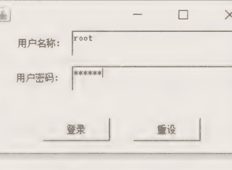

# Swing 容器

## JFrame 容器

`JFrame` 中放置组件时，必须首先获取 `JFrame` 的 `ContentPane` 对象，可以使用 `Container` 类 `getContentPane()` 方法。

获取 `ContentPane` 的样式：

`contentPane = new JFrame().getContentPane();`

也可以用 `JFrame` 的 `setSize(new Dimension(int width, height))` 设置的大小。

`Show()` 和 `hide()` 方法显示或隐藏框架，也可以使用 `setVisible(true|false)` 方法。

`setBounds(int topX, int topY)` 方法指定框架在屏幕上的位置。

`JFrame` 有最大化、最小化和关闭按钮、标题、边框。对于关闭框，`JFrame` 提供了四个常量与 `setDefaultCloseOperation(constant)` 方法来控制：

- `EXIT_ON_CLOSE`; 关闭框架，退出程序。
- `DISPOSE_ON_CLOSE`; 清除对象，但不退出程序。
- `DO_NOTHING_ON_CLOSE`; 不能关闭框架。
- `HIDE_ON_CLOSE`; 继续运行程序。

下面一个例子说明 `JFrame` 和 `JPanel` 在程序中的使用情况。

【例11-6】设计图 11-6 所示的程序界面，要求使用 `JPanel` 的。

```java
JFrame frame = new JFrame("布局演示"); // JFrame显示
contentPane = frame.getContentPane(); // 获取ContentPane的样式
panel1 = new JPanel(); // 1
panel2 = new JPanel(); // 2
panel1.setLayout(new GridLayout(2, 1)); // 布局
panel1.add(new Button("1"));
panel1.add(new Button("2"));
panel2.setLayout(new FlowLayout());
panel2.add(new Label(" "));
contentPane.add(panel1);
contentPane.add(panel2);
frame.setSize(new Dimension(300, 200)); // 设置框架的大小
frame.setDefaultCloseOperation(JFrame.EXIT_ON_CLOSE); // 关闭窗口
frame.setVisible(true);
```

## JScrollPane

`JScrollPane` 用于滚窗口，当窗口内容大于窗口时非常实用，例如浏览的网页。构造函数：

- `JScrollPane();` 建立一个空的 `JScrollPane`。
- `ScrollPane(Component view);` 创建一个 `JScrollPane` 对象，包含组件 `view`。在组件大于窗口时会自动加上滚动条。
- `ScrollPane(Component view, int vsScrollPolicy, int hScrollPolicy);` 设置滚动条出现的时机。滚动条出现的时机由下面的参数设置：
  - `HORIZONTAL_SCROLLBAR_ALWAYS`; 显示滚动条。
  - `HORIZONTAL_SCROLLBAR_AS_NEEDED`; 需要的时候显示滚动条。
  - `HORIZONTAL_SCROLLBAR_NEVER`; 不显示水平滚动条。
  - `VERTICAL_SCROLLBAR_ALWAYS`; 显示垂直滚动条。


- `VERTICAL_SCROLLBAR_AS_NEEDED`：需要的时候显示滚动条。
- `VERTICAL_SCROLLBAR_NEVER`：不显示垂直滚动条。

### 例 11-7：在应用程序中显示大幅图像

```java
import java.awt.*;
import javax.swing.*;
import javax.swing.border.*;

public class MyScrollPane extends JScrollPane {
    public MyScrollPane() {
    }

    public void show() {
        JFrame frame = new JFrame("MyScrollPane");
        Container contentPane = frame.getContentPane();
        JLabel label1 = new JLabel(new ImageIcon("D:\\images\\old\\img\\java\\java_11.png"));
        JPanel panel1 = new JPanel();
        panel1.add(label1);
        JScrollPane scrollPane = new JScrollPane();
        scrollPane.setViewportView(panel1);
        contentPane.add(scrollPane, BorderLayout.CENTER);
        frame.setSize(new Dimension(350, 220)); // 设置框架的大小
        frame.setDefaultCloseOperation(JFrame.EXIT_ON_CLOSE); // 关闭窗口
        frame.setVisible(true);
    }

    public static void main(String[] args) {
        new MyScrollPane().show();
    }
}
```


事实上，Swing 中提供了 `BoxLayout`、`InternalFrame`、`JTabbedPane` 等组件，请读者参考相应的资料。

# 第 11 章 Swing 程序设计

## 11.4 Swing 组件

上节我们介绍了容器，本节将讨论如何使用 Swing 组件，并介绍其最常用的功能。示例都尽可能小，这样就很容易抽出所需代码，应用到自己的程序中。

### 11.4.1 按钮、标签

Swing 提供了许多类型的按钮。Java 中所有的按钮，包括复选框、单选按钮，甚至菜单项，都是从 `AbstractButton` 继承来的。这里介绍基本的按钮。`JButton` 是一个组件，它有自己的样式，作为我们更新过程的一部分会自动被重绘，也就是说，我们不需要自己绘制一个按钮或者其他类型的标签，只要把它们放在容器里，它们可以自己绘制自己。

它的构造方法把标签加入容器中。

`JLabel` 用于显示文字或图像信息，并可以指定信息的位置。`JLabel` 实现了 `SwingConstants` 接口，其中定义了与位置有关的常量，它们有：

- `TOP`：顶部
- `LEFT`：左边
- `RIGHT`：右边
- `BOTTOM`：底部
- `CENTER`：中间
- `NORTH`：北边
- `SOUTH`：南边
- `WEST`：西边
- `EAST`：东边
- `NORTH_EAST`：东北边
- `NORTH_WEST`：西北
- `SOUTH_EAST`：东南
- `SOUTH_WEST`：西南
- `HORIZONTAL`：水平排列
- `VERTICAL`：垂直排列
- `LEADING`：前端
- `TRAILING`：后端

#### 构造函数

`JLabel(Icon image)`：建立一个显示图标的标签。

`JLabel(String text)`：显示文字。

`JLabel(String text, Icon icon, int horizontalAlignment)`：显示文字和图标，默认 4 个像素的间距，最后一个参数指定排列方式。

`JButton` 与图标相关的两个构造函数：

`JButton(Icon icon)`：显示图标。

`JButton(String text, Icon icon)`：显示文字和图标。

### 例 11-8：按钮

```java
import java.awt.FlowLayout;
import javax.swing.JButton;
import javax.swing.JFrame;

public class Button1 extends JFrame {
    private JButton b1, b2;

    public Button1() {
        b1 = new JButton("Button1");
        b2 = new JButton("Button2");
        setLayout(new FlowLayout());
        add(b1);
        add(b2);

        setDefaultCloseOperation(3);
        setVisible(true);
    }
}
```


### 例 11-9：在 JLabel 和 JButton 中显示图标

```java
import java.awt.*;
import java.awt.event.*;
import javax.swing.*;

public class JLabelExample {
    public static void main(String args[]) {
        JFrame frame = new JFrame("JButton 使用"); // 初始化框架
        Container pane = frame.getContentPane();
        JPanel panel = new JPanel(); // 初始化面板
        Icon icon = new ImageIcon("D:/images/old/img/java_logo.png"); // 获取图标
        Icon icon2 = new ImageIcon("D:/images/old/img/ios_logo.png"); // 另一图标
        JLabel label = new JLabel("Hello World!", icon, JLabel.RIGHT);
        JButton button = new JButton("点击这里", icon); // 按钮上对齐图标和文本
        // JButton button = new JButton();
        button.setText("点击这里");
        button.setHorizontalTextPosition(JLabel.CENTER); // 水平中间对齐
        label.setVerticalTextPosition(JLabel.TOP); // 垂直上方对齐
        label.setBackground(Color.red); // 标签颜色
        label.setForeground(Color.green); // 字体颜色
        button.setHorizontalTextPosition(JButton.CENTER); // 水平对齐
        button.setVerticalTextPosition(JButton.BOTTOM); // 垂直对齐
        button.setBackground(Color.yellow); // 设置背景颜色
        button.setForeground(Color.blue); // 设置字体颜色
        pane.add(panel); // 放置面板
        panel.add(label); // 标签和按钮放置到面板
        panel.add(button);
        frame.pack();
        frame.setVisible(true);
        frame.addWindowListener(new WindowAdapter() { // 监听关闭事件
            public void windowClosing(WindowEvent e) {
                System.exit(0);
            }
        });
    }
}
```

效果如图 11-9 所示。在按钮上即鼠标移动到按钮时图标会变化。调用的相应方法：

```java
setRolloverEnabled(boolean enabled)
setIcon(Icon icon)
setRolloverIcon(Icon icon)
```

修改上例，增加如下代码：

```java
Icon icon = new ImageIcon("D:/images/old/1.png");
Icon icon2 = new ImageIcon("D:/images/old/2.png");
button.setRolloverEnabled(true);
button.setRolloverIcon(icon);
button.setPressedIcon(icon2);
```


### 11.4.2 单选框、复选框

### 11.4.3 菜单

#### `JMenuItem` 和 `JMenu`

- `get/setAccelerator()`：获取/设置快捷键的 Ctrl+键。
- `get/setText()`：获取/设置菜单的文本。
- `get/setIcon()`：获取/设置菜单使用的图片。
- `JMenu` 专用：
  - `add()`：添加另一个 `JMenu` 或 `JMenuItem` 到 `JMenu`（创建嵌套菜单）。

### 例 11-12：菜单

```java
import java.awt.event.KeyEvent;
import javax.swing.JCheckBoxMenuItem;
import javax.swing.JFrame;
import javax.swing.JMenu;
import javax.swing.JMenuBar;
import javax.swing.JMenuItem;

public class MenuDemo extends JFrame {
    public MenuDemo() {
        setTitle("菜单实例");
        JMenuBar menuBar = new JMenuBar();
        JMenu fileMenu = new JMenu("文件");
        JMenu editMenu = new JMenu("编辑");
        menuBar.add(fileMenu);
        menuBar.add(editMenu);
        JMenuItem newMenuItem = new JMenuItem("新建");
        fileMenu.add(newMenuItem);
        JCheckBoxMenuItem caseMenuItem = new JCheckBoxMenuItem("区分大小写");
        fileMenu.add(caseMenuItem);
        setJMenuBar(menuBar);
        setSize(350, 250);
        setVisible(true);
        setDefaultCloseOperation(3);
    }

    public static void main(final String args[]) {
        new MenuDemo();
    }
}
```

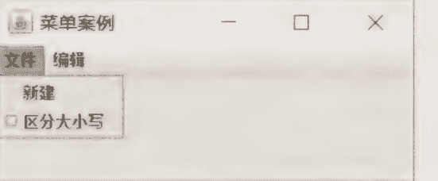

## 11.5 表格

在考虑 `JTable` 时，请想象一个 Excel 工作表，这样就可以对 `JTable` 在 Swing 中的用法有一个清晰的印象。它与列表共享许多特征：单元格、行、列、移动、隐藏等。`JTable` 把 `JList` 的想法进一步扩展了，它不是在单列中显示数据，而是在多列中显示数据。我们以人为例。

`JList` 只能显示一个属性，例如名字或属性。`JTable` 能够显示多个属性，名字、年龄、地址，等等。`JTable` 支持提供数据的许多不同的 Swing 组件。

不幸的是，`JTable` 也是一个复杂的 Swing 组件。许多 UI 开发者为了学习 `JTable` 的每个细节都要头疼。

许多 `JList` 的概念也扩展到了 `JTable`，其中不同的选择间隔的概念。但是 `JList` 的一列的概念变成了 `JTable` 的单元格的概念。这就在 `JTable` 中进行选择时会有不同的方式，或者针对一个单元格。

### 例 11-13：表格

```java
import java.awt.Dimension;
import javax.swing.JFrame;
import javax.swing.JScrollPane;
import javax.swing.JPanel;
import javax.swing.JTable;
import java.awt.Color;
import java.awt.GridLayout;
import javax.swing.TableColumn;
```


```java
public class JTableDemo {
    public static void main(String[] args) {
        JTable example1 = new JTable(); // 注释还没有不存在
        JTable example2 = new JTable(8, 6);
        Object[] columnNames = {"姓名", "性别", "婚姻状况", "家庭地址", "列名最好用"};
        Object[][] rowData = {
            {"ddd", "男", "江苏南京", "1378313210", "03/24/1985", "学生", "未婚", "没"},
            {"eee", "女", "江苏南京", "13645181705", "xx/xx/1985", "教师", "未婚", "未婚", "订婚期"},
            {"fff", "男", "江苏南京", "13585331486", "12/08/1985", "销售员", "不婚", "有"},
            {"ggg", "女", "江苏南京", "8153779", "xx/xx/1986", "服务员", "已知", "有"},
            {"nhh", "男", "江苏南京", "1365145596", "xx/xx/1985", "学生", "离婚", "有"}
        };

        // Java 教程程序
        JTable friends = new JTable(rowData, columnNames);
        friends.setViewportSize(new Dimension(600, 100)); // 设置表格的大小
        friends.setRowHeight(30); // 设置行的高度
        friends.setRowHeight(0, 20); // 设置第一行的高度为20
        friends.setRowMargin(5); // 设置行与单元格的间距
        friends.setSelectionAllowed(true); // 设置允许选择
        friends.setBackground(Color.white); // 设置选行的颜色
        friends.setForeground(Color.red); // 设置选行的字体
        friends.setGridColor(Color.black); // 设置网格颜色
        friends.selectAll(); // 选择所有行
        friends.setSelectionInterval(0, 2); // 设置初始的选择，这里是0到2
        friends.clearSelection(); // 取消选择
        friends.setDragEnabled(false); // 设置不可拖
        friends.setShowHorizontalLines(false); // 是否显示水平格线
        friends.setShowVerticalLines(true); // 是否显示垂直格线
        friends.setValue("tt", 0, 0); // 设置某个单元格的值
        friends.doLayout();
        friends.setBackground(Color.lightGray);

        JScrollPane panel1 = new JScrollPane(example1);
        JScrollPane panel2 = new JScrollPane(example2);
        JScrollPane panel3 = new JScrollPane(friends);
        JPanel panel = new JPanel(new GridLayout(0, 1));
        panel.setPreferredSize(new Dimension(600, 100));
        panel.setBackground(Color.black);
        panel.add(panel1);
        panel.add(panel2);
        panel.add(panel3);
        JFrame frame = new JFrame("JTableDemo");
        frame.setDefaultCloseOperation(JFrame.EXIT_ON_CLOSE);
        frame.setContentPane(panel);
        frame.pack();
        frame.show();
    }
}
```

效果如图 11-13 所示。

## JTableDemo

| 姓名 | 性别 | 家庭地址 | 电话号码 | 工作 | 状态 | 备注 |
|---|---|---|---|---|---|---|
| 张 | 男 | 江苏南京 | 13783132 | 03/24/1985 | 学生 | 留 | 有 |
| 李 | 女 | 江苏南京 | 13585331 | 12/08/1985 | 司机 | 不确定 | 有 |
| 王 | 女 | 江苏南京 | 8153776 | xx/xx/1986 | 服务员 | 认为 | 有 |
| 赵 | 男 | 江苏南京 | 13651546 | xx/xx/1985 | 学生 | 中 | 无 |


## JTree 树

`JTree` 是另一个复杂的组件，它不像 `JTable` 那样简单，也不像 `List` 那样容易。使用 `JTree` 时关注的是数据模型。读者在 Windows 中使用时，可以熟悉这个概念——可以展开和折叠分支，可以选择或取消不同的叶子节点。

有些场景应用程序中使用树结构或列表是有用的。像 `Table` 一样，`JTree` 有一定的入门槛。如果使用 `JTree`，就可以达到要求的水平，但必须学习相关的概念。因此，例如使用过的 `JTree` 可能会遇到困难，如果教程都是中级，都没有涉及这些。

但是，有些时候符合要求的 UI 组件。目录系统就是一个示例（就像在调试器看到的），而且数据采取层级结构的时候，就是采用树的形式，`JTree` 就是最佳示例。

【11-14】树。

```java
import javax.swing.JFrame;
import javax.swing.JTree;
import javax.swing.event.TreeSelectionListener;
import javax.swing.tree.DefaultMutableTreeNode;

public class JTreeDemo extends JFrame {

    public void TreeDemo() {
        // 初始化
        // 创建父节点和子节点，允许许多节点的树，并允许指定的用户对象进行选择
        DefaultMutableTreeNode node = new DefaultMutableTreeNode("软件部门");
        node.add(new DefaultMutableTreeNode(new User("小花")));
        node.add(new DefaultMutableTreeNode(new User("小李")));
        node.add(new DefaultMutableTreeNode(new User("小龙")));
        DefaultMutableTreeNode node2 = new DefaultMutableTreeNode("销售部门");
        node2.add(new DefaultMutableTreeNode(new User("小王")));
        node2.add(new DefaultMutableTreeNode(new User("小实")));
        node2.add(new DefaultMutableTreeNode(new User("小夏")));
        DefaultMutableTreeNode top = new DefaultMutableTreeNode("职能管理");
        top.add(new DefaultMutableTreeNode(new User("总经理")));
        top.add(node);
        top.add(node2);
        final JTree tree = new JTree(top);
        setTitle("JTreeDemo");
        add(tree);
        setSize(300, 300);
    }

    public static void main(String[] args) {
        new JTreeDemo().TreeDemo();
    }
}

class User {
    private String name;

    public User(String n) {
        name = n;
    }

    // 重点在 toString 中显示文本
    public String toString() {
        return name;
    }
}
```

结果如图 1-14 所示。

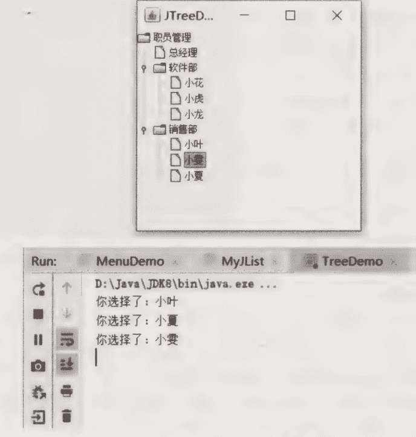

## 项目实现

### 项目目标

1. 了解 AWT 组件的类层次结构和常用组件用法。
2. 学习 AWT 设计界面的方法，尤其是容器、布局管理器等概念。
3. 学习 Swing 与 AWT 组件的对应关系，达到界面美观的目的。

## 项目任务

设计一个中国象棋界面。棋盘由九道直线和十道横线组成，棋盘上有交叉点，棋子在这些点上滑动。象棋中竖直线叫做“界”，交叉点叫做“宫”。从右到左，棋子共有红黑两组，名称如下：

- 红方：车、马、士
- 黑方：车、马、士

具体的棋法，红黑交替移动。象棋规则：

1. **帅**：每允许一步、向前、横在同一直线上移动，但不能出宫。对方帅面对，另一方必须回避。
2. **士**：只能在宫的范围内走斜步。
3. **象**：不能越过界，每走两步，当中心棋子被挡住，称为“相”。
4. **马**：每走直或横，要在对方那边挡住，称为“马”。
5. **兵**：都可以前进、直、横走。卒在没有界的时候，走法和兵一样。过界后，每都可以向前或横走，但不能后退。

吃子规则：

走一步时，如果能够占领对方子的位置（无论是哪一方），称为“吃”。被吃掉的棋子从盘上移除。

## 图形界面设计

死和困：一方的棋子攻击帅，但无法将其吃掉，死；轮到走棋的一方子无可走，困。

根据项目任务描述的功能需求，本项目需要构造一个图形界面，然后交互功能，具体如下：

1. **构造界面**：先构造一个图形界面，在窗体上除了工具栏，还有棋盘、格和 32 个棋子。
2. **实现交互功能**：按按钮注册事件监听。本项目用到了单击事件、鼠标事件和多线程知识。线性部分见第 9 章，本章简单实现。由于中国象棋规则复杂，对于体的写法方法是项目的关键。

   1. **如何解决界面问题**。具体需要解决的问题包括：如何构造矩形的窗体、文本框和按钮等组件？如何在界面按照顺序放置这些组件？
   2. **如何实现交互功能**。具体需要解决的问题包括：如何实现能够按按钮事件的监听？如何完成监听的注册？

### 1.5.3 项目实现

#### (1) 引入项目需要的包

```java
import javax.swing.*;
import java.awt.*;
import java.awt.event.*;
import java.util.*;
import java.io.*;
```

#### (2) 主类，此处运行

```java
public class Chess {
    public static void main(String[] args) {
        new ChessFrame("中国象棋:棋不语，棋无悔");
    }
}
```

#### (3) 在窗体里定义所有的控件和一些参数

```java
class ChessMainFrame extends JFrame implements ActionListener, MouseListener, Runnable {
    // 棋盘
    JLabel play[] = new JLabel[32];
    // 棋子
    JLabel image;
    // 格子
    Container con;
    // 工具栏
    JToolBar jmain;
    // 按钮
    JButton anew;
    // 悔棋
    JButton repent;
    // 退出
    JButton exit;
    // 当前信息
    JLabel text;
    // 保存当前操作
    Vector Var;
    // 侧边悬浮(鼠标悬停方法)
    ChessRule rule;

    /**
     * 单击棋子=true 闪烁棋子 开始线程响应
     * chessManClick=false 吃棋子 停止闪烁并给线程响应
     */
    boolean chessManClick;

    // 控制玩家走棋
    // chessPlayClick=1 黑棋走棋
    // chessPlayClick=2 红棋走棋 默认红棋
    // chessPlayClick=3 双方都不能走棋
    int chessPlayClick = 2;

    // 控制棋子闪烁的线程
    Thread tmain;
    // 把第一次的单击的棋子给线程响应
    static int Man, i;
}
```

#### (4) 构造图形用户界面

```java
ChessMainFrame(String Title) {
    new ChessMainFrame("中国象棋")
}
```

```java
ChessMainFrame(String Title) {
    // 改变系统默认字体
    Font font = new Font("Dialog", Font.PLAIN, 12);
    java.util.Enumeration keys = UIManager.getDefaults().keys();
    while (keys.hasMoreElements()) {
        Object key = keys.nextElement();
        Object value = UIManager.get(key);
        if (value instanceof javax.swing.plaf.FontUIResource) {
            UIManager.put(key, font);
        }
    }

    // 获取容器引用
    con = this.getContentPane();

    // 实例化规则类
    rule = new ChessRule();
    Var = new Vector();

    // 实例化工具栏
    jmain = new JToolBar();
    text = new JLabel("欢迎使用象棋系统");
    text.setToolTip("信息提示");
    anew = new JButton("新局");
    anew.setToolTip("重新开始新的局");
    exit = new JButton("退出");
    exit.setToolTip("退出象棋程序");
    repaint = new JButton("悔棋");
    repaint.setToolTip("返回到上次位置的位置");

    // 把组件添加到工具栏
    jmain.setLayout(new GridLayout(0, 4));
    jmain.add(anew);
    jmain.add(exit);
    jmain.add(repaint);
    jmain.add(text);
    jmain.setBounds(0, 0, 558, 30);
    con.add(jmain);
}
```

#### (5) 添加棋子标签

```java
drawChessMan();
```

#### (6) 注册按钮监听

```java
new ActionListener(this);
repent.addActionListener(this);
exit.addActionListener(this);

// 注册棋子移动监听
for (int i = 0; i < 32; i++) {
    con.add(play[i]);
    play[i].addActionListener(this);
}

// 注册窗口关闭监听
this.addWindowListener(
    new WindowAdapter() {
        public void windowClosing(WindowEvent e) {
            System.exit(0);
        }
    }
);
```

#### (7) 棋盘中一些基本设置


## 图形用户界面程序设计 第11章

### 窗口初始化与设置

```java
Dimension screenSize = Toolkit.getDefaultToolkit().getScreenSize();
Dimension frameSize = this.getSize();

if (frameSize.height > screenSize.height) {
    frameSize.height = screenSize.height;
}
if (frameSize.width > screenSize.width) {
    frameSize.width = screenSize.width;
}

this.setLocation((screenSize.width - frameSize.width) / 2 - 280, (screenSize.height - frameSize.height) / 2 - 350);
this.setIcon(new ImageIcon("棋将.GIF").getImage());
this.setResizable(false);
this.setTitle(Title);
this.show();
```

### (8) 添加棋子方法

```java
public void drawChessMan() {
    // 流程控制
    int i, k;
    // 图标
    // 黑色棋子
    // 车
    in = new ImageIcon("image\\车.GIF");
    for (i = 0; i < 4; i++) {
        play[i] = new JLabel(in);
        play[i].setBounds(k, 56, 55, 55);
        play[i].setName("车1");
    }
    // 马
    in = new ImageIcon("image\\黑马.GIF");
    for (i = 4, k = 81; i < 6; i++, k += 342) {
        play[i] = new JLabel(in);
        play[i].setBounds(k, 56, 55, 55);
        play[i].setName("马1");
    }
    // 象
    in = new ImageIcon("image\\象.GIF");
    for (i = 8, k = 138; i < 10; i++, k += 228) {
        play[i] = new JLabel(in);
        play[i].setBounds(k, 56, 55, 55);
        play[i].setName("象1");
    }
    // 士
    in = new ImageIcon("image\\黑士.GIF");
    for (i = 12, k = 195; i < 14; i++, k += 114) {
        play[i] = new JLabel(in);
        play[i].setBounds(k, 56, 55, 55);
    }

    play[1].setName("l1");

    // 单元
    in = new Icon("image黑草.GIF");
    for (i = 16, k = 24; i < 21; i++, k += 114) {
        play[i] = new JLabel(in);
        play[i].setBounds(k, 227, 55, 55);
        play[i].setName("单元" + i);
    }

    // 框
    in = new Icon("image黑框.GIF");
    for (i = 26, k = 81; i < 28; i++, k += 342) {
        play[i] = new JLabel(in);
        play[i].setBounds(k, 170, 55, 55);
        play[i].setName("框" + i);
    }

    // 将
    in = new Icon("image黑圈.GIF");
    play[30] = new JLabel(in);
    play[30].setName("将");

    // 红色棋子
    in = new Icon("image红车.GIF");
    for (i = 0, k = 24; i < 4; i++, k += 456) {
        play[i] = new JLabel(in);
        play[i].setBounds(k, 569, 55, 55);
        play[i].setName("车2");
    }

    // 马
    in = new Icon("image红马.GIF");
    for (i = 4, k = 81; i < 8; i++, k += 342) {
        play[i] = new JLabel(in);
        play[i].setBounds(k, 569, 55, 55);
        play[i].setName("马2");
    }

    // 象
    in = new ImageIcon("image象.GIF");
    for (i = 10, k = 138; i < 12; i++, k += 228) {
        play[i] = new JLabel(in);
        play[i].setBounds(k, 569, 55, 55);
        play[i].setName("象2");
    }

    // 士
    in = new ImageIcon("image士.GIF");
    for (i = 14, k = 195; i < 16; i++, k += 114) {
        play[i] = new JLabel(in);
        play[i].setBounds(k, 569, 55, 55);
        play[i].setName("士2");
    }

    // 兵
    in = new ImageIcon("image兵.GIF");
    for (i = 16, k = ...; i < 26; i++) {
        play[i] = new JLabel(in);
        play[i].setBounds(k, 398, 55, 55);
        play[i].setName("兵2");
    }

    // 炮
    in = new ImageIcon("image炮.GIF");
    for (i = 28, k = 81; i < 30; i++, k += 342) {
        play[i] = new JLabel(in);
        play[i].setBounds(k, 455, 55, 55);
        play[i].setName("炮2");
    }

    // 帅
    in = new ImageIcon("image帅.GIF");
    play[31] = new JLabel(in);
    play[31].setBounds(252, 569, 55, 55);
    play[31].setName("帅2");
}
```

### (9) 流程控制方法

```java
public void run() {
    while (true) {
        // 单棋子第一步
        if (chessManClick) {
            play[Man].setVisible(false);
            // 时间控制
            try {
                tmain.sleep(200);
            } catch (Exception e) {
                play[Man].setVisible(true);
            }
        }
        // 当点击提示时隐藏棋子
        else {
            text.setVisible(false);
            // 时间控制
            try {
                tmain.sleep(250);
            } catch (Exception e) {
                text.setVisible(true);
            }
        }
        try {
            tmain.sleep(350);
        } catch (Exception e) {
        }
    }
}
```

### (10) 单击棋子方法

```java
public void mouseClicked(MouseEvent me) {
    System.out.println("Mouse");
    // 当前坐标
    int Ex = 0, Ey = 0;

    // 启动线程
    if (tmain == null) {
        tmain = new Thread(this);
        tmain.start();
    }
}
```

### (11) 第一次点击移动棋子

```java
if (me.getSource().equals(image)) {
    // 点击红棋子的时候
    if (chessPlayClick == 2 && play[Man].getName().charAt(1) == '2') {
        Ex = play[Man].getX();
        Ey = play[Man].getY();
        // 移动兵
        if (Man > 15 && Man < 26) {
            rule.armsRule(Man, play[Man], me);
        }
        // 移动炮
        else if (Man > 25 && Man < 30) {
            rule.cannonRule(play[Man], play, me);
        }
        // 移动车
        else if (Man >= 0 && Man < 4) {
            rule.cannonRule(play[Man], play, me);
        }
        // 移动马
        else if (Man > 3 && Man < 8) {
            rule.horseRule(play[Man], play, me);
        }
        // 移动象
        else if (Man > 7 && Man < 12) {
            rule.elephantRule(Man, play[Man], play, me);
        }
        // 移动士
        else if (Man > 11 && Man < 16) {
            rule.chapRule(Man, play[Man], play, me);
        }
        // 移动将
        else if (Man == 30 || Man == 31) {
            rule.willRule(Man, play, me);
        }
    }
}
```

### 吃棋规则处理

```java
else if (Man == 30 || Man == 31) {
    rule.willRule(Man, play[Man], play[i], play);
    play[Man].setVisible(true);
}
```

```java
// 是否走棋错误（是否在原地没有动）
if (Ex == play[Man].getX() && Ey == play[Man].getY()) {
    text.setText("红棋走棋");
    chessPlayClick = 2;
    break;
} else {
    text.setText("黑棋走棋");
    chessPlayClick = i;
    break;
}

// 该黑棋走棋的时候
else if (chessPlayClick == 1 && play[Man].getName().charAt(0) == 'i') {
    Ex = play[Man].getX();
    Ey = play[Man].getY();
}

// 卒吃棋规划
if (Man > 15 && Man < 26) {
    rule.armsRule(play[Man], play[i]);
}

// 炮吃棋规划
else if (Man > 25 && Man < 30) {
    rule.cannonRule(0, play[Man], play[i], play, me);
}

// 车吃棋规划
else if (Man >= 0 && Man < 4) {
    rule.cannonRule(1, play[Man], play[i], play, me);
}

// 马吃棋规划
else if (Man > 3 && Man < 8) {
    rule.horseRule(play[Man], play[i], play, me);
}

// 相象规则
else if (Man > 7 && Man < 12) {
    rule.elephantRule(play[Man], play[i], play);
}

// 仕马规则
else if (Man > 11 && Man < 16) {
    rule.chapRule(Man, play[Man], play[i], play);
}

// 帅吃规则
else if (Man == 30 || Man == 31) {
    rule.king(play[Man], play[i], play);
    play[Man].setVisible(true);
}

// 是否走错(是否在原地没有动)
if (Ex == play[Man].getX() && Ey == play[Man].getY()) {
    text.setText("黑棋错误");
    chessPlayClick = 1;
    break;
} else {
    text.setText("红棋错误");
    chessPlayClick = 2;
}

// else if
rule.willRule(Man, play[i], play);

// for // 是否胜利
if (!play[31].isVisible()) {
    JOptionPane.showConfirmDialog(this, "黑棋胜利", "玩家胜利", JOptionPane.DEFAULT_OPTION, JOptionPane.WARNING_MESSAGE);
    // 双方都不可以再走棋了
    chessPlayClick = 3;
    text.setText("黑棋胜利");
}

// if
else if (!play[30].isVisible()) {
    JOptionPane.showConfirmDialog(null, "黑棋胜利", "红棋胜利", JOptionPane.DEFAULT_OPTION, JOptionPane.WARNING_MESSAGE);
    chessPlayClick = 3;
    text.setText("红棋胜利");
}
```

### 鼠标事件监听器空实现

```java
public void mousePressed(MouseEvent me) {}
public void mouseReleased(MouseEvent me) {}
public void mouseEntered(MouseEvent me) {}
public void mouseExited(MouseEvent me) {}
```

### (13) 定义按钮的响应


```java
public void actionPerformed(ActionEvent ae) {
    // 重新开始按钮
    if (ae.getSource().equals(anew)) {
        int i, k;
        // 重新排列每个棋子的位置
        // 黑色棋子
        // 车
        for (int i=0, k=24; i<2; i++, k+=456) {
            play[i].setBounds(k, 56, 55, 55);
        }
        // 马
        for (int i=4, k=61; i<61; i++, k+=342) {
            play[i].setBounds(k, 56, 55, 55);
        }
        for (int i=6, k=138; i<10; i++, k+=228) {
            play[i].setBounds(k, 56, 55, 55);
        }
        // 二
        for (int i=12, k=195; i<14; i++, k+=114) {
            play[i].setBounds(k, 56, 55, 55);
        }
        // 三
        for (int i=16, k=24; i<21; i++, k+=114) {
            play[i].setBounds(k, 227, 55, 55);
        }
        // 四
        for (int i=26, k=81; i<28; i++, k+=342) {
            play[i].setBounds(k, 170, 55, 55);
        }
        // 五
        for (int i=0, k=24; i<4; i++, k+=456) {
            play[i].setBounds(k, 569, 55, 55);
        }
        // 六
        for (int i=6, k=81; i<8; i++, k+=342) {
            play[i].setBounds(k, 569, 55, 55);
        }
        for (int i=10, k=138; i<12; i++, k+=228) {
            play[i].setBounds(k, 569, 55, 55);
        }
        for (int i=14, k=195; i<16; i++, k+=114) {
            play[i].setBounds(k, 569, 55, 55);
        }
        for (int i=21, k=24; i<26; i++, k+=342) {
            play[i].setBounds(k, 398, 55, 55);
        }
        // 炮
        for (int i=28, k=61; i<30; i++, k+=342) {
            play[i].setBounds(k, 455, 55, 55);
        }
    }
}
```

## Java程序设计

```java
class ChessRule {
    /* 棋子的移动规则 */
    public void armsRule(int Man, JLabel[] play, MouseEvent me) {
        // 向下
        if (Man < 1) {
            // 向移动，得到的兵标合法坐标
            if ((me.getY() - play[Man].getY()) > 27 && (me.getY() - play[Man].getY()) < 86 && (me.getX() - play[Man].getX()) < 55) {
                // 节点开始绘制（用于梅树）
                // ... 逻辑省略
            }
        }
    }
}
```

## Java程序设计

/// 流程结束

(17) 炮、车移动规则。


# 图形用户界面设计 第11章

## 炮规则 `cannonRule`

### 重载方法 1
```java
public void cannonRule(JLabel play, JLabel playQ, MouseEvent me) {
    // 起点和终点之间是否有棋子
    int Count = 0;
    // 上下移动
    if (play.getX() - me.getX() <= 0 || play.getY() - me.getY() >= -55) {
        // 横向Y坐标
        for (int i = 56; i < 571; i++) {
            // 移动的Y坐标是否有指定坐标相连
            if (i - me.getY() >= -27 && i - me.getY() <= 27) {
                // 所有的棋子
                for (int j = 0; j < 53; j++) {
                    // 找出在一条线上的所有棋子并不包括自己
                    if (playQ[j].getX() - play.getX() >= -27 && playQ[j].getX() - play.getX() <= 27 && playQ[j].getName().equals(play.getName()) && !playQ[j].isVisible()) {
                        // 如果是相同的棋子则跳过
                        for (int k = play.getY() + 57; k < i; k += 57) {
                            // 通过坐标判断就可以知道中间是否有棋子
                            if (playQ[j].getY() < i && playQ[j].getY() > play.getY()) {
                                // 中间有一个棋子就无法从这条线越过去
                                Count++;
                                break;
                            }
                        }
                    }
                }
            }
        }

        /// 从起点到终点(从右到左)
        for (int k = 57; k < play.getY(); k += 57) {
            // 寻找起点和终点的棋子
            if (playQ[j].getY() < play.getY() && playQ[j].getY() > i) {
                Count++;
                break;
            }
        }
    }

    /// 起点和终点没有棋子就可以移动了
    if (Count == 0) {
        // 将当前记录添加到集合(用于悔棋)
        Var.add(String.valueOf(play.isVisible()));
        Var.add(String.valueOf(play.getX()));
        Var.add(String.valueOf(play.getY()));
        Var.add(String.valueOf(Man));
        play.setBounds(play.getX(), 1, 55, 55);
    }

    // 移动
    else if (play.getY() - me.getY() >= -27 && play.getY() - me.getY() <= 27) {
        // 指定所有横线X坐标
        for (int i = 24; i < 480; i += 57) {
            // 移动的X坐标是否有坐标相近
            if (i - me.getX() >= -55 && i - me.getX() <= 0) {
                // 所有的棋子
                for (int j = 0; j < 32; j++) {
                    // 移动在一条横线上的棋子、并不包括自己
                    if (playQ[j].getX() - play.getY() >= -27 && playQ[j].getY() - play.getY() <= 27 && playQ[j].isVisible()) {
                        // 从起点、终点的坐标（从上到下)
                        for (int k = play.getX(); k < i; k += 57) {
                            // 大于起点、终点的坐标中间就可以知道是否有棋子
                            if (playQ[j].getX() < i && playQ[j].getX() > play.getX()) {
                                // 中间有一个棋子就不能从这条横线穿过
                                break;
                            }
                        }
                    }
                }
                // 起点到终点（从下到上)
                for (int k = i + 57; k < play.getX(); k += 57) {
                    // 终点和终点的棋子
                    if (playQ[j].getX() < play.getX() && playQ[j].getX() > i) {
                        Count++;
                        break;
                    }
                }
            }
        }
    }

    // 终点和终点没有棋子
    if (Count == 0) {
        Var.add(String.valueOf(play.isVisible()));
        Var.add(String.valueOf(play.getX()));
        Var.add(String.valueOf(play.getY()));
        Var.add(String.valueOf(Man));
        play.setBounds(i, play.getY(), 55, 55);
    }
}
```

### 重载方法 2 (炮、车移动规则)
```java
public void cannonRule(int Chess, JLabel play, JLabel playTake, JLabel playQ[], MouseEvent me) {
    // 起点和终点之间是否有棋子
    int Count = 0;
    // 所有的棋子
    for (int j = 0; j < 32; j++) {
        // 在一条射线上的所有棋子包括自己
        if (playQ[j].getX() - play.getX() >= -27 && playQ[j].getX() - play.getX() < 27 && playQ[j].getName() != play.getName() && playQ[j].isVisible()) {
            // 如果是起点吃掉的终点(从上到下)
            for (int k = play.getY() + 57; k < playTake.getY(); k += 57) {
                // 大于起点，小于终点的坐标就可以是否有棋子
                if (playQ[j].getY() < playTake.getY() && playQ[j].getY() > play.getY()) {
                    Count++;
                    break;
                }
            }
            // 如果是起点被吃掉的终点(从下到上)
            for (int k = playTake.getY(); k < play.getY(); k += 57) {
                // 找到起点和终点的棋子
                if (playQ[j].getY() < playTake.getY() && playQ[j].getY() > play.getY()) {
                    Count++;
                    break;
                }
            }
        }
        // 在一条射线上的棋子包括自己
        else if (playQ[j].getY() - play.getY() >= -27 && playQ[j].getY() - play.getY() < 27 && playQ[j].getName() != play.getName() && playQ[j].isVisible()) {
            // 如果是从起点吃掉的终点(从左到右)
            for (int k = play.getX() + 57; k < playTake.getX(); k += 57) {
                // 大于起点，小于终点的坐标就可以是否有棋子
                if (playQ[j].getX() < playTake.getX() && playQ[j].getX() > play.getX()) {
                    Count++;
                    break;
                }
            }
            // 寻找起点和终点之间的棋子
            for (int k = playTake.getX(); k < play.getX(); k += 57) {
                if (playQ[j].getX() < playTake.getX() && playQ[j].getX() > play.getX()) {
                    Count++;
                    break;
                }
            }
        }
    }

    // 起点和终点之间是否存在一个棋子的规则，不能自己的棋子
    if (Count == 1 && Chess == 0 && playTake.getName().charAt(1) != play.getName()) {
        // 当前记录添加到集合(悔棋)
        Var.add(String.valueOf(play.isVisible()));
        Var.add(String.valueOf(play.getX()));
        Var.add(String.valueOf(play.getY()));
        Var.add(String.valueOf(Man));
        // 记录所有棋子的状态
        Var.add(String.valueOf(playTake.isVisible()));
        Var.add(String.valueOf(playTake.getX()));
        Var.add(String.valueOf(playTake.getY()));
        Var.add(String.valueOf(i));
        playTake.setVisible(false);
        play.setBounds(playTake.getX(), playTake.getY(), 55, 55);
    }
    // 兵子移动
    else if (Count == 1 && Chess == 1 && playTake.getName().charAt(1) != play.getName().charAt(0)) {
        // 当前棋子添加到集合（悔棋）
        Var.add(String.valueOf(play.isVisible()));
        Var.add(String.valueOf(play.getX()));
        Var.add(String.valueOf(play.getY()));
        Var.add(String.valueOf(Man));
        // 前期棋子添加到集合（悔棋）
        Var.add(String.valueOf(playTake.isVisible()));
        Var.add(String.valueOf(playTake.getX()));
        Var.add(String.valueOf(playTake.getY()));
        Var.add(String.valueOf(i));
        playTake.setVisible(false);
        play.setBounds(playTake.getX(), playTake.getY(), 55, 55);
    }
}
```

## 马移动规则 `HorseRule`

```java
public void HorseRule(JLabel play, JLabel playQ[], MouseEvent me) {
    // 保存坐标和位移
    int Ex = 0, Ey = 0, Move = 0;
    // 移动左侧
    if (play.getX() - me.getX() >= 2 && play.getX() - me.getX() <= 57 && play.getY() - me.getY() < 141) {
        // 合法的Y坐标
        for (int i = 56; i < 571; i += 57) {
            // 移动的Y坐标相近的
            if (i - me.getY() >= -27 && i - me.getY() <= 27) {
                break;
            }
        }
    }
    // 合法的X坐标
    for (int i = 24; i <= 480; i += 57) {
        if (i - me.getX() >= -55 && i - me.getX() <= 0) {
            Ex = i;
            break;
        }
    }
    // 正下方是否有棋子
    for (int i = 0; i < 32; i++) {
        if (playQ[i].isVisible() && playQ[i].getY() - play.getY() == 0 && playQ[i].getX() == -57) {
            Move = 1;
            break;
        }
    }
    // 可以移动该棋子
    if (Move == 0) {
        // 当前记录添加到集合（悔棋）
        Var.add(String.valueOf(play.isVisible()));
        Var.add(String.valueOf(play.getX()));
        Var.add(String.valueOf(play.getY()));
        Var.add(String.valueOf(Man));
        play.setBounds(Ex, Ey, 55, 55);
    }
}
```

## 片段代码

```java
// 可以移动后棋子
if (Move == 0) {
    // 当当前记录添加到集合(用于悔棋)
    Var.add(String.valueOf(play.isVisible()));
    Var.add(String.valueOf(play.getX()));
    Var.add(String.valueOf(play.getY()));
    Var.add(String.valueOf(Man));
} // //移动、上边
} else {
    // 右移动、上边
    else if (play.getY() - me.getY() >= 30 && play.getY() - me.getY() <= 87 &&
             getX() - play.getX() <= 141 && me.getX() - play.getX() >= 87) {
        for (int i = 56; i <= 571; i += 57) {
```


# Java程序设计

## 移动逻辑判断

```java
if (i - me.getY() >= -27 && i - me.getY() <= 27) {
    Ey = i;
}
```

```java
// X
for (int i = 24; i <= 480; i += 57) {
    if (i - me.getX() >= -55 && i - me.getX() <= 0) {
        Ex = i;
    }
}
```

```java
// 检查对方是否有别的棋子
if (playQ[i].isVisible() && play.getY() - playQ[i].getY() == 0 && playQ[i].getX() - play.getX() == 57) {
    Move = 1;
    break;
}
```

```java
if (Move == 0) {
    // 当当前记录添加到集合(用于悔棋)
    Var.add(String.valueOf(play.isVisible()));
    Var.add(String.valueOf(play.getX()));
    Var.add(String.valueOf(play.getY()));
    Var.add(String.valueOf(play.getMan()));
    play.setBounds(Ex, Ey, 55, 55);
}
```

## 吃子逻辑判断

```java
else if (me.getY() - play.getY() <= 30 && me.getY() - play.getY() < 87 &&
         me.getX() - play.getX() <= 141 && me.getX() - play.getX() > 87) {
    // Y
    for (int i = 56; i <= 571; i += 57) {
        if (me.getY() > -27 && me.getY() <= 27) {
            // ...
        }
    }
}
```

```java
// X
for (int i = 24; i <= 480; i += 57) {
    if (me.getX() > -55 && me.getX() <= 0) {
        Ex = i;
    }
}
```

```java
// 左右方是否有别的棋子
if (playQ[i].isVisible() && play.getY() - playQ[i].getY() == 0 && playQ[i].getX() - play.getX() == -57) {
    Move = 1;
    break;
}
```

```java
if (Move == 0) {
    // 当前记录加入到集合(用于找棋)
    Var.add(String.valueOf(play.isVisible()));
    Var.add(String.valueOf(play.getX()));
    Var.add(String.valueOf(play.getY()));
    Var.add(String.valueOf(play.getMan()));
    play.setBounds(Ex, Ey, 55, 55);
}
```

## 鼠标点击事件处理

```java
if (play.isVisible() && me.getX() - play.getX() >= -30 && me.getY() - play.getY() <= 87 && play.play()) {
    if (me.getX() - me.getY() >= 87) {
        play.stop();
    }
}
```

```java
// X
for (int i = 0; i < me.getX(); i++) {
    if (me.getX() >= -55 && me.getX() <= 0) {
        Ex = i;
    }
}
```

```java
// 左侧是否有别的按钮
for (int i = 0; i < 32; i++) {
    if (play[i].isVisible() && play[i].getY() == 0 && getX(i - play[i].getX()) == -57) {
        Move = i;
    }
}
```

```java
// 如果没有移动则记录坐标
if (Move == 0) {
    Var.add(String.valueOf(play.getX()));
    Var.add(String.valueOf(play.getY()));
    Var.add(String.valueOf(Man));
    play.setBounds(Ex, Ey, 55, 55);
}
```

# 第11章 图形用户界面设计

## (20) 马吃萨规则

```java
public void horseRule(JLabel play, JLabel playTake, JLabel playQ[], MouseEvent me) {
    // 移动
    int Move = 0;
    boolean Chess = false;

    // 上移、左走
    if (play.getName().charAt(1) != playTake.getName().charAt(1) && play.getY() - me.getY() == 57 && play.getY() - me.getY() == 14) {
        // 正方是否有别的棋子
        for (int i = 0; i < 32; i++) {
            if (playQ[i].isVisible() && play.getX() - playQ[i].getX() == 0 && playQ[i].getY() == 57) {
                Move = 1;
                break;
            }
        }
        Chess = true;
    } // 移动

    // 上移、右吃
    else if (play.getY() - playTake.getY() == 14 && play.getX() - play.getX() == 57) {
        // 正方是否有别的棋子
        for (int i = 0; i < 32; i++) {
            if (playQ[i].isVisible() && play.getX() - playQ[i].getX() == 0 && playQ[i].getY() == 57) {
                Move = 1;
                break;
            }
        }
        Chess = true;
    }
    // 左移、上吃
    else if (play.getY() - playTake.getY() == 57 && play.getX() - play.getX() == 14) {
        // 正方是否有别的棋子
        for (int i = 0; i < 32; i++) {
            if (playQ[i].isVisible() && play.getY() - playQ[i].getY() == 0 && playQ[i].getX() == 57) {
                Move = 1;
                break;
            }
        }
        Chess = true;
    }
    // 左移、下吃
    else if (play.getY() - playTake.getY() == 57 && play.getX() - play.getX() == -14) {
        // 正方是否有别的棋子
        for (int i = 0; i < 32; i++) {
            if (playQ[i].isVisible() && play.getY() - playQ[i].getY() == 0 && playQ[i].getX() == 57) {
                Move = 1;
                break;
            }
        }
        Chess = true;
    }
    // 右移、上吃
    else if (play.getY() - playTake.getY() == 57 && play.getX() - play.getX() == -14) {
        // 正方是否有别的棋子
        for (int i = 0; i < 32; i++) {
            if (playQ[i].isVisible() && play.getY() - playQ[i].getY() == 0 && playQ[i].getX() == 57) {
                Move = 1;
                break;
            }
        }
        Chess = true;
    }
    // 右移、下吃
    else if (play.getY() - playTake.getY() == 57 && play.getX() - play.getX() == -14) {
        // 正方是否有别的棋子
        for (int i = 0; i < 32; i++) {
            if (playQ[i].isVisible() && play.getY() - playQ[i].getY() == 0 && playQ[i].getX() == -57) {
                Move = 1;
                break;
            }
        }
        Chess = true;
    }
    // 下移、左吃
    else if (play.getY() - playTake.getY() == 14 && play.getX() - play.getX() == -14) {
        // 正方是否有别的棋子
        for (int i = 0; i < 32; i++) {
            if (playQ[i].isVisible() && play.getY() - playQ[i].getY() == 0 && playQ[i].getY() == -57) {
                Move = 1;
                break;
            }
        }
        Chess = true;
    }
    // 下移、右吃
    else if (play.getY() - playTake.getY() == 14 && play.getX() - play.getX() == 57) {
        // 正方是否有别的棋子
        for (int i = 0; i < 32; i++) {
            if (playQ[i].isVisible() && play.getY() - playQ[i].getY() == 0 && playQ[i].getY() == -57) {
                Move = 1;
                break;
            }
        }
        Chess = true;
    }

    // 没有编码可以吃,不能吃自己颜色
    if (Chess && Me == 0 && playTake.getName().charAt(1) != play.getName().charAt(1)) {
        // 当前标记添加到集合(用于悔棋)
        Var.add(String.valueOf(play.isVisible()));
        Var.add(String.valueOf(play.getX()));
        Var.add(String.valueOf(play.getY()));
        Var.add(String.valueOf(Man));

        // 当前标记添加到集合(用于悔棋)
        Var.add(String.valueOf(playTake.isVisible()));
        Var.add(String.valueOf(playTake.getX()));
        Var.add(String.valueOf(playTake.getY()));
        Var.add(String.valueOf(i));

        playTake.setVisible(false);
        play.setBounds(playTake.getX(), playTake.getY(), 55, 55);
    }
}
```

```java
play.setBounds(Ex, Ey, 55, 55);
```


```java
// else-if
else if (play.getX() - me.getX() <= 141 && play.getX() - me.getX() > 67 && me.getY() - play.getY() <= 141 && me.getY() - play.getY() >= 87) {
    // 合法的Y坐标
    for (int i = 56; i < 57; i += 57) {
        if (i - me.getY() >= -27 && i - me.getY() <= 27) {
            Ey = i;
            break;
        }
    }

    // 合法的x坐标
    for (int i = 24; i < 480; i += 57) {
        if (i - me.getX() >= -27 && i - me.getX() <= 27) {
            Ex = i;
            break;
        }
    }

    // 左下方是否有棋子
    for (int i = 0; i < 32; i++) {
        if (playQ[i].isVisible() && play.getX() - playQ[i].getX() == 57 && play.getY() - playQ[i].getY() == -57) {
            Move++;
            break;
        }
    }

    // 相关规则
    if (Move == 0 && Ey >= 341 && Man > 9) {
        // 在此处添加处理棋子的代码逻辑
        Var.add(String.valueOf(play.isVisible()));
        Var.add(String.valueOf(play.getX()));
        Var.add(String.valueOf(play.getY()));
        Var.add(String.valueOf(Man));
    }

    play.setBounds(Ex, Ey, 55, 55);

    else if (Move == 0 && Ey <= 204 && Man < 10) {
        // 当前记录落添加到集合(用于悔棋)
        Var.add(String.valueOf(play.isVisible()));
        Var.add(String.valueOf(play.getX()));
        Var.add(String.valueOf(play.getY()));
        Var.add(String.valueOf(Man));

        play.setBounds(Ex, Ey, 55, 55);
    } // else if

    // 下右
    else if (me.getX() - play.getX() >= 87 && me.getX() - play.getX() <= 141 && me.getY() - play.getY() >= 87 && me.getY() - play.getY() <= 141) {
        for (int i = 56; i <= 571; i += 57) {
            if (i - me.getY() >= -27 && i - me.getY() <= 27) {
                Ey = i;
            }
        }

        // X
        for (int i = 24; i <= 480; i += 57) {
            if (i - me.getX() >= -27 && i - me.getX() <= 27) {
                Ex = i;
            }
        }

        // 左方点击检测
        for (int i = 0; i < 32; i++) {
            if (playQ[i].isVisible() && playQ[i].getX() - play.getX() == 57 && playQ[i].getY() - play.getY() == 57) {
                Move = 1;
                break;
            }
        }

        // 像素碰撞
        if (Move == 0 && Ey >= 341 && Man > 9) {
            // 当前记录添加到集合（用于悔棋）
            Var.add(String.valueOf(play.isVisible()));
            Var.add(String.valueOf(play.getX()));
            Var.add(String.valueOf(play.getY()));
            Var.add(String.valueOf(Man));

            play.setBounds(Ex, Ey, 55, 55);
            Var.add(String.valueOf(play.getX()));
            Var.add(String.valueOf(play.getY()));
            Var.add(String.valueOf(Man));
            play.setBounds(Ex, Ey, 55, 55);
        } // else
        // 移动规则
    }
}
```

## (22) 象走、吃规则

```java
public void elephantRule(JLabel play, JLabel playTake, JLabel playQ[]) {

    // 障碍
    int Move = 0;
    boolean Chess = false;

    for (int i = 0; i < 32; i++) {
        if (playQ[i].isVisible() && playQ[i].getX() - play.getX() == 57 && playQ[i].getY() - play.getY() == 57) {
            break;
        }
    }

    Chess = true;

    // 图片: img/341.png

    // 吃上方的棋子
    else if (playTake.getX() - play.getX() >= 87 && playTake.getX() - play.getX() <= 141 && playTake.getY() - play.getY() >= 87 && playTake.getY() - play.getY() < 141) {
        // 检查下方
        for (int i = 0; i < 32; i++) {
            if (playQ[i].isVisible() && playQ[i].getX() - play.getX() == 57 && playQ[i].getY() - play.getY() == 57) {
                Move++;
                break;
            }
        }
        Chess = true;
    } // else

    // 吃下方的棋子
    else if (playTake.getX() - play.getX() >= 87 && playTake.getX() - play.getX() <= 141 && playTake.getY() - play.getY() >= 87 && playTake.getY() - play.getY() < 141) {
        // 检查左侧
        for (int i = 0; i < 32; i++) {
            if (playQ[i].isVisible() && playQ[i].getX() - play.getX() == 57 && playQ[i].getY() - play.getY() == -57) {
                Move++;
                break;
            }
        }
        Chess = true;
    } // else

    // 吃右方的棋子
    else if (playTake.getX() - play.getX() >= 87 && playTake.getX() - play.getX() <= 141 && playTake.getY() - play.getY() >= 87 && playTake.getY() - play.getY() < 141) {
        // 检查右侧
        for (int i = 0; i < 32; i++) {
            if (playQ[i].isVisible() && playQ[i].getX() - play.getX() == 57 && playQ[i].getY() - play.getY() == 57) {
                Move = 1;
                break;
            }
        }
    }
}
```

## JAVA 游戏逻辑：碰撞处理

```java
// 移动不能边界
if (check && Move == 0 && playTake.getName().charAt(i) == play.getName().charAt(i)) {
    // 将坐标添加到集合（碰撞检测）
    Var.add(String.valueOf(play.isVisible()));
    Var.add(String.valueOf(play.getX()));
    Var.add(String.valueOf(play.getY()));
    Var.add(String.valueOf(Man));

    // 将坐标添加到集合（碰撞检测）
    Var.add(String.valueOf(playTake.isVisible()));
    Var.add(String.valueOf(playTake.getX()));
    Var.add(String.valueOf(playTake.getY()));
    Var.add(String.valueOf(i));

    playTake.setVisible(false);
    play.setBounds(playTake.getX(), playTake.getY(), 55, 55);
}
```

## (23) 士、移动规则

```java
public void checkRule(int Man, JLabel label, JLabel labelQ[], MouseEvent me) {
    if (me.play.getX() >= 29 && me.play.getX() <= 114 && play.getY() - me.getY() >= 25 && play.getY() - me.getY() <= 90) {
        // 士超出自己的边界
        if (Man < 14 && (play.getX() + 57) >= 195 && play.getX() + 57 <= 309 && play.getY() - 57 < 123) {
            // 将坐标添加到集合（碰撞检测）
            Var.add(String.valueOf(play.isVisible()));
            Var.add(String.valueOf(play.getX()));
            Var.add(String.valueOf(play.getY()));
            Var.add(String.valueOf(Man));

            play.setBounds(play.getX() + 57, play.getY(), 55, 55);
        } else if (Man < 14 && (play.getX() + 57) >= 195 && play.getX() + 57 <= 309) {
            // 当前记录落添加到集合（用于悔棋）
            Var.add(String.valueOf(play.isVisible()));
            Var.add(String.valueOf(play.getX()));
            Var.add(String.valueOf(play.getY()));
            Var.add(String.valueOf(Man));

            play.setBounds(play.getX() + 57, play.getY(), 55, 55);
        }
    } // else

    else if (play.getY() - me.getY() >= 25 && play.getY() - me.getY() <= 90) {
        // 士移动边界
        if (Man < 14 && (play.getX() + 57) >= 195 && play.getX() + 57 <= 309 && play.getY() - 57 < 123) {
            // ... 逻辑省略
        }
    }
}
```

# Java语言程序设计

```java
Chap:true;
)

// else if
else if ((play.getX() - play.getX()) <= 14.4 && (playTake.getX() - playTake.getX()) >= 25.6 && playTake.getY() - play.getY() >= 2.6 && playTake.getY() - play.getY() <= 87) {
    // 被猴的橘子是香和尚相同
    if (Man < 14 && playTake.getX() >= 195 && playTake.getX() <= 309 && playTake.getY() < 170 && playTake.isVisible()) {
        Chap:true;
    }

    // 被猴的橘子是香和尚相同
    else if (Man > 13 && playTake.getX() >= 195 && playTake.getX() <= 309 && playTake.getY() >= 455 && playTake.isVisible()) {
        Chap:true;
    }
}

// else
else if ((playTake.getX() - play.getX()) >= 28 && (playTake.getX() - play.getX()) <= 144 && playTake.getY() - play.getY() >= 2 && playTake.getY() - play.getY() <= 87) {
    // 被猴的橘子是香和尚相同
    if (Man < 14 && playTake.getX() >= 195 && playTake.getX() <= 309 && playTake.getY() < 170 && playTake.isVisible()) {
        Chap:true;
    }

    // 被猴的橘子是香和尚相同
    else if (Man > 13 && playTake.getX() >= 195 && playTake.getX() <= 309 && playTake.getY() >= 455 && playTake.isVisible()) {
        Chap:true;
    }
}

// else if
// 可移动，并能够自己跑进了笼子里
if (Chap && playTake.getName().charAt(1) != play.getName().charAt(1)) {
    // 当之前还没有检测到香蕉的笼子里
    Var.add(String.valueOf(play.isVisible()));
    Var.add(String.valueOf(play.getX()));
    Var.add(String.valueOf(play.getY()));
    Var.add(String.valueOf(Man));
}
```

## 图形用户界面程序设计 第11章

```java
// 当前记录添加到集合(用于摆棋)
Var.add(String.valueOf(playTake.isVisible()));
Var.add(String.valueOf(playTake.getX()));
```


`Var.add(String.valueOf(playTake.getY()));`

```java
playTake.setVisible(false);

play.setBounds(playTake.getX(), playTake.getY(), 55, 55);
```

// 将士棋规则
(25) 将、移动棋规则。

```java
public void willRule(int Man, JLabel label, JLabel playO[], MouseEvent me) {

    // 向上

    if ((me.getX() - play.getX()) >= 0 && (me.getX() - play.getX()) <= 55 && (play.getY() - me.getY()) >= 2 && play.getY() - me.getY()) <= 87) {

        // 将是否跨越了自己的边界

        if (Man == 30 && me.getX() >= 195 && me.getX() <= 369 && me.getY() < 170) {

            // 当前记录添加到集合(用于摆棋)

            Var.add(String.valueOf(play.isVisible()));

            Var.add(String.valueOf(play.getX()));

            Var.add(String.valueOf(play.getY()));

            Var.add(String.valueOf(Man));

            play.setBounds(play.getX(), play.getY() - 57, 55, 55);

        }

        // 将是否跨越了自己的边界

        else if (Man == 31 && me.getY() >= 455 && me.getX() >= 195 && me.getX() <= 369) {

            // 当前记录添加到集合(用于摆棋)

            Var.add(String.valueOf(play.isVisible()));

            Var.add(String.valueOf(play.getX()));

            Var.add(String.valueOf(play.getY()));

            Var.add(String.valueOf(Man));

            play.setBounds(play.getX(), play.getY() - 57, 55, 55);

        }

    }

    // 向左

    else if (play.getX() - me.getX()) >= 2 && (play.getX() - me.getX()) <= 57 && (play.getY() - me.getY()) <= 27 && play.getY() - me.getY() >= -27) {

        // 将跨越自己的边界

        if (Man == 30 && me.getX() >= 195 && me.getX() <= 359 && me.getY() <= 170) {

            // 当前记录添加到集合(用于摆棋)

            Var.add(String.valueOf(play.isVisible()));

            Var.add(String.valueOf(play.getX()));

            Var.add(String.valueOf(play.getY()));

            Var.add(String.valueOf(Man));

            play.setBounds(play.getX() - 57, 55, 55); // 修正：此处原文逻辑可能有误，但保持翻译结构

        }

        // 将跨越边界

        else if (Man == 31 && me.getY() >= 455 && me.getX() >= 195 && me.getX() <= 359) {

            // 当前记录添加到集合(用于摆棋)

            Var.add(String.valueOf(play.isVisible()));

            Var.add(String.valueOf(play.getX()));

            Var.add(String.valueOf(play.getY()));

            Var.add(String.valueOf(Man));

            play.setBounds(play.getX() - 57, 55, 55);

        }

    }

    else if (me.getX() - play.getX()) > 57 && (me.getX() - play.getX()) <= 112 && (me.getY() - play.getY()) <= 27 && me.getY() - play.getY() >= -27) {

        // 将规则

        if (Man == 30 && me.getX() >= 195 && me.getX() <= 359 && me.getY() <= 170) {

            // 当前记录添加到集合(用于摆棋)

            Var.add(String.valueOf(play.isVisible()));

            Var.add(String.valueOf(play.getX()));

            Var.add(String.valueOf(play.getY()));

            Var.add(String.valueOf(Man));

            play.setBounds(play.getX() + 57, 55, 55);

        }

        // 将跨越边界

        else if (Man == 31 && me.getY() >= 455 && me.getX() >= 195 && me.getX() <= 359) {

            play.setBounds(play.getX() + 57, 55, 55);

        }

    }

    else if (me.getX() - play.getX()) >= 0 && (me.getX() - play.getX()) <= 55 && (me.getY() - play.getY()) <= 87 && me.getY() - play.getY() >= 27) {

        // 帅移动规则

        if (Man == 30 && me.getX() > 195 && me.getX() <= 359 && me.getY() < 170) {

            // 回击并移动

            Var.add(String.valueOf(play.isVisible()));

            Var.add(String.valueOf(play.getX()));

            Var.add(String.valueOf(play.getY()));

            Var.add(String.valueOf(Man));

            play.setBounds(play.getX() + 57, 55, 55);

        }

        else if (Man == 31 && me.getY() >= 455 && me.getX() > 195 && me.getX() <= 359) {

            // 当前添加到集合(悔棋)

            Var.add(String.valueOf(play.isVisible()));

            Var.add(String.valueOf(play.getX()));

            Var.add(String.valueOf(play.getY()));

            Var.add(String.valueOf(Man));

            play.setBounds(play.getX() + 57, 55, 55);

        }

    }

} // 帅移动规则结束

// 将、帅移动规则结束

(26) 将、帅棋规则

public void willRule(int Man, JLabel play, JLabel playTake, JLabel playQ[]) {

    // 当前状态

    boolean will = false;

    // 向上吃

    if ((play.getX() - play.getX()) >= 0 && (play.getX() - play.getX()) <= 55 && (play.getY() - play.getY()) >= 27 && (play.getY() - play.getY()) < 87 && playTake.isVisible()) {

        // 被吃的棋子和对方将相近

        if (Man == 30 && playTake.getX() >= 195 && playTake.getX() <= 309 && playTake.getY() < 170) {

            will = true;

        }

        // 被吃的棋子和对方将相近

        else if (Man == 31 && playTake.getX() >= 455 && playTake.getX() <= 309) {

            will = true;

        }

    }

    // 向左吃

    else if (play.getX() - playTake.getX()) >= 2 && (play.getX() - playTake.getX()) <= 57 && (play.getY() - playTake.getY()) < 27 && (play.getY() - playTake.getY()) >= -27 && playTake.isVisible()) {

        // 被吃的棋子和当前将相近

        if (Man == 30 && playTake.getX() >= 195 && playTake.getX() <= 309 && playTake.getY() < 170) {

            will = true;

        }

        // 被吃的棋子和对方将相近

        else if (Man == 31 && playTake.getX() >= 455 && playTake.getX() <= 309) {

            will = true;

        }

    }

    // 向右吃

    else if (playTake.getX() - play.getX()) >= 0 && (playTake.getX() - play.getX()) <= 57 && (playTake.getY() - play.getY()) < 27 && (playTake.getY() - play.getY()) >= -27 && playTake.isVisible()) {

        // 被吃的棋子和当前将

        if (Man == 30 && playTake.getX() >= 195 && playTake.getX() <= 309 && playTake.getY() < 170) {

            will = true;

        }

        // 被吃的棋子和对方将

        else if (Man == 31 && playTake.getX() >= 455 && playTake.getX() <= 309) {

            will = true;

        }

    }

    // 向下

    else if (play.getY() - playTake.getY()) >= 0 && (play.getY() - playTake.getY()) <= 55 && (play.getY() - playTake.getY()) < 87 && play.getY() - playTake.getY() >= 27) {

        // 帅移动规则

        if (Man == 30 && playTake.getX() > 195 && playTake.getX() <= 359 && playTake.getY() < 170) {

            // 回击并移动

            Var.add(String.valueOf(play.isVisible()));

            Var.add(String.valueOf(play.getX()));

            Var.add(String.valueOf(play.getY()));

            Var.add(String.valueOf(Man));

            play.setBounds(play.getX() + 57, 55, 55);

        }

        else if (Man == 31 && playTake.getY() >= 455 && playTake.getX() > 195 && playTake.getX() <= 359) {

            // 当前添加到集合(悔棋)

            Var.add(String.valueOf(play.isVisible()));

            Var.add(String.valueOf(play.getX()));

            Var.add(String.valueOf(play.getY()));

            Var.add(String.valueOf(Man));

            play.setBounds(play.getX() + 57, 55, 55);

        }

    }

}

} // 规则类 主框架类

# Java 程序设计

## 11.6 项目扩展

【例11-15】改写 `BorderLayout` 布局例1-1，使五个按钮具有不同的边界，如图1-16所示。

```java
import javax.swing.border.*;
import java.awt.*;
import java.awt.event.*;
import javax.swing.*;
import javax.swing.border.*;

public class Main {
    public static void main(String[] args) // 应用程序入口
        BorderLayoutFrame frm = new BorderLayoutFrame(); // 一个框架
    }
}
```


```java
class BorderLayoutFrame extends JFrame implements ActionListener { // 框架的定义
    JButton BtnN, BtnS, BtnE, BtnW, BtnC; // 5 个按钮声明

    public BorderLayoutFrame() {
        super("BorderLayout 布局管理器显示"); // 调用父类构造函数
        int hgap = 5, vgap = 5;
        JPanel jp = new JPanel(); // 初始化面板
        getContentPane().add(jp); // 面板添加到容器
        jp.setLayout(new BorderLayout(hgap, vgap)); // hgap 垂直间隙，vgap 水平间隔，不常设置参数，组件之间有间隔
        BtnN = new JButton("North"); // 创建按钮对象
        BtnW = new JButton("West");
        BtnE = new JButton("East");
        BtnC = new JButton("Center");
        // 以下五行，给5个按钮设置不同的边界
        BtnN.setBorder(BorderFactory.createBorder(Color.blue, 10));
        BtnS.setBorder(BorderFactory.createBevelBorder(BevelBorder.LOWERED)); //
        // 设置边界
        BtnW.setBorder(BorderFactory.createBevelBorder(BevelBorder.RAISED)); //
        BtnE.setBorder(BorderFactory.createMatteBorder(25, 25, 25, 25)); //
        BtnC.setBorder(BorderFactory.createTitledBorder("Center")); //
    }
}
```

# 图形用户界面设计 第11章

```java
createLineBorder(Color.red, 5), "Line Border", itledBorder.CENTER, TitledBorder.TOP0); // 设置边界
jpl.add("North", BtnN); // 按钮添加到框架组件中
jpl.add("South", BtnS);
jpl.add("West", BtnW);
BtnC.addActionListener(this); // 监听中间哪个按钮,对操作作出响应
pack();
setVisible(true);
}

public void actionPerformed(ActionEvent e) // 事件处理
{
    if (e.getActionCommand() == "Center") {
        dispose(); // 关闭窗口,退出程序
        System.exit(0);
    }
}
```

程序中的一个按钮使用了图标 `Icon`。`Icon` 是一个接口，制作 `Icon` 组时可用 Java 中相应的类 `ImageIcon`，其对应的常用构造函数有：

- `ImageIcon(Image image)`：利用 `Image` 对象建立一个 `ImageIcon`。
- `ImageIcon(Image image, String description)`：附加相应的文字。
- `ImageIcon(String filename)`：利用图标建立图标对象。
- `ImageIcon(String filename, String description)`：附加相应的文字描述。
- `ImageIcon(URL location)`：利用网址建立对象。
- `ImageIcon(URL location, String description)`：附加相应的文字。

# 课后习题

- 1. 使用 `FlowLayout` 布局管理器实现如图 11-17 所示的样式。

FlowLayout

| 0 | 1 | 2 | 3 | 4 | 5 |
|---|---|---|---|---|---|
| | 6 | 7 | 8 | 9 | | | |

图 11-17 习题 1

- 2. 使用 `GridLayout` 布局管理器实现如图 11-18 所示的样式。

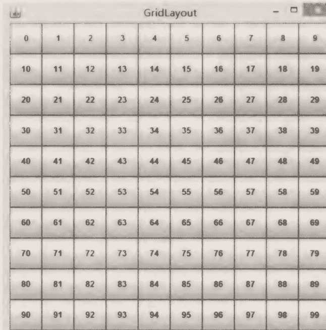

图 11-18 习题 2

- 3. 使用综合布局，设计如图 11-19 所示的计算界面。

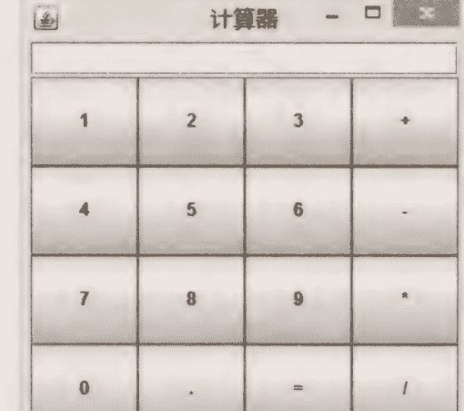

图 11-19 计算器

# 参考文献

- [1] CayS. Horstman. Java 核心技术(卷1)[M]. 11 版.林琪, 苏钰等. 译. 北京: 机械工业出版社, 2019.
- [2] CayS. Horstman. Java 核心技术(卷2)[M]. 11 版.陈奥鹏等. 译. 北京: 机械工业出版社, 2019.
- [3] 黑马程序员. Java 基础程序员[M].22版.北京:清华大学出版社, 2018.
- [4] 王捷飞,孙媛. Java 语言程序设计[M].北京: 华南理工大学出版社, 2015.
- [5] 黄承成,面向需求软件人才培养 Java 程序设计教学改革与实践创新[J]. 课程教育, 2017(14): 252–253.
- [6] 姚咏.从程序基础到 Java 程序设计的教学体系构建研究[J]. 计算机时代, 2021(07): 95–97.
- [7] 单兵,万立军. Java 应用型人才培养课堂模式探索[J]. 计算机教育, 2016(12): 72–76.

# “十四五”创新计算机专业精品课程规划教材

互联网+教育—新形态立体化规划教材

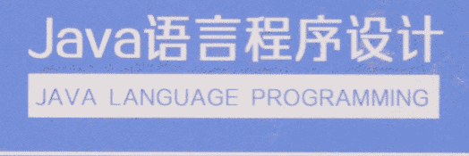

封面设计 深圳市华溢艺术


