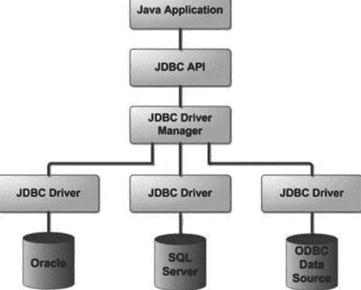
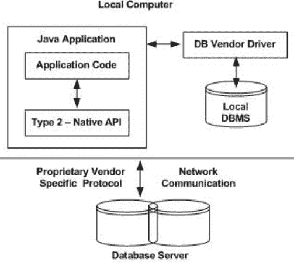

# JDBC：Java 数据库连接

## 关于教程

JDBC API 是一种 Java API，可以访问任何类型的表格化数据，特别是存储在关系型数据库中的数据。JDBC 可以在 Windows、Mac OS 以及各种 UNIX 平台上运行。

## 读者群

本教程面向希望详细了解 JDBC 框架及其实际用法的 Java 程序员。

## 先决条件

在开始本教程之前，你应该对 Java 语言有良好的理解。由于你将处理 RDBMS（关系型数据库管理系统），你应该熟悉 SQL 和数据库概念。

# 1. 引言

## 什么是 JDBC？

JDBC 代表 Java Database Connectivity（Java 数据库连接），它是一种标准的 Java API，用于 Java 编程语言与各种数据库之间独立于数据库的连接。

JDBC 库包含了下面这些通常与数据库使用相关的任务的 API：

- 建立与数据库连接。
- 创建 SQL 或 MySQL 语句。
- 在数据库中执行 SQL 或 MySQL 查询。
- 查看并修改结果记录。

从根本上说，JDBC 是一种规范，它提供了一套完整的接口，允许对底层数据库进行可移植的访问。Java 可编写不同类型的可执行文件，例如：

- Java 应用程序
- Java Applets
- Java Servlets
- Java 页面 (JSP)
- 企业级 JavaBeans (EJBs)

所有这些可执行文件都能使用 JDBC 驱动程序访问数据库并利用存储的数据。

JDBC 提供了与 ODBC 相同的功能，允许 Java 程序包含独立于数据库的代码。

## 先决条件

在继续之前，你需要对以下主题有良好的理解：

- Java 核心编程
- SQL 或 MySQL 数据库

# JDBC 架构

JDBC API 支持数据库访问的双层和三层处理模型，但通常 JDBC 架构由两层组成：

- **JDBC API**：提供应用程序到 JDBC 管理器的连接。
- **JDBC Driver API**：支持 JDBC 管理器到驱动程序的连接。

JDBC API 使用驱动管理器和特定数据库的驱动程序为异构数据库提供透明连接。

JDBC 驱动管理器确保使用正确的驱动程序访问每个数据源。驱动管理器能够支持连接到多个异构数据库的多个并发驱动。

下面是架构图，显示了驱动管理器相对于 JDBC 驱动程序和 Java 应用程序的位置：



## JDBC 组件

JDBC API 提供以下接口和类：

- **DriverManager**：该类管理数据库驱动列表。通过通信子协议匹配 Java 应用程序的连接请求与正确的数据库驱动。第一个识别 JDBC 特定子协议的驱动将用于建立数据库连接。
- **Driver**：该接口处理与数据库服务器的通信。你极少直接与 `Driver` 对象交互。相反，你使用 `DriverManager` 对象，它管理此类类型的对象。它还抽象了与 `Driver` 对象工作相关的细节。
- **Connection**：这是一个包含所有连接数据库方法的接口。连接对象表示通信上下文，即所有与数据库的通信都通过连接对象进行。
- **Statement**：你使用从此接口创建的对象向数据库提交 SQL 语句。某些派生接口在执行存储过程的同时，还接受参数。
- **ResultSet**：这些对象持有在你使用 `Statement` 对象执行 SQL 查询后从数据库中检索出的数据。它充当迭代器，允许你在数据中移动（遍历）其数据。
- **SQLException**：此类处理在数据库应用程序中发生的任何错误。

## JDBC 4.0 包

`java.sql` 和 `javax.sql` 是 JDBC 4.0 的主要包。在编写本教程时，这是最新的 JDBC 版本。它提供了与数据源进行交互的主要类。

这些包中的新特性包括以下领域的更改：

- 自动加载数据库驱动程序。
- 异常处理改进。
- 增强的 BLOB/CLOB 功能。
- 连接和语句接口的增强。
- 国家字符集支持。
- SQL ROWID 访问。
- SQL 2003 XML 数据类型支持。
- 注解。

# 2. SQL 语法

结构查询语言 (SQL) 是一种标准化语言，允许你对数据库执行操作，例如创建条目、读取内容、更新内容和删除条目。

几乎任何你可能使用的数据库都支持 SQL，它允许你独立于底层数据库编写数据库代码。

本章提供了 SQL 的概述，这是理解 JDBC 概念的前提。在学习本章后，你将能够从数据库中创建、读取、更新和删除（通常称为 CRUD 操作）数据。

如需详细了解 SQL，你可以阅读我们的 MySQL 教程。

## 创建数据库

`CREATE DATABASE` 语句用于创建新数据库。其语法如下：

```sql
SQL CREATE DATABASE DATABASE_NAME;
```

### 示例

以下 SQL 语句将创建一个名为 EMP 的数据库：

```sql
SQL CREATE DATABASE EMP;
```

## 删除数据库

`DROP DATABASE` 语句用于删除现有的数据库。其语法如下：

```sql
SQL DROP DATABASE DATABASE_NAME;
```

> **注意**：要创建或删除数据库，你应该拥有数据库服务器的管理员权限。请小心，删除数据库将丢失数据库中存储的所有数据。

## 创建表

`CREATE TABLE` 语句用于创建新表。其语法如下：

```sql
SQL> CREATE TABLE table_name
(
  column_name column_data_type,
  column_name column_data_type,
  column_name column_data_type,
  ...
);
```

### 示例

以下 SQL 语句将创建一个名为 Employees 的表，包含四列：

```sql
SQL> CREATE TABLE Employees
(
  id INT NOT NULL,
  age INT NOT NULL,
  first VARCHAR(255),
  last VARCHAR(255),
  PRIMARY KEY ( id )
);
```

## 删除表

`DROP TABLE` 语句用于删除现有的表。其语法如下：

```sql
SQL> DROP TABLE table_name;
```

### 示例

以下 SQL 语句将删除名为 Employees 的表：

```sql
SQL> DROP TABLE Employees;
```

## 插入数据

`INSERT` 语句的语法类似于下面，其中 `column1`、`column2` 等代表将出现在相应列中的新数据：

```sql
SQL> INSERT INTO table_name VALUES (column1, column2, ...);
```

### 示例

以下 SQL `INSERT` 语句在之前创建的 Employees 数据库中插入新行：

```sql
SQL> INSERT INTO Employees VALUES (100, 18, 'Zara', 'Ali');
```

## 查询数据

`SELECT` 语句用于从数据库检索数据。`SELECT` 的语法为：

```sql
SQL> SELECT column_name, column_name, ...
FROM table_name
WHERE conditions;
```

`WHERE` 子句可以使用比较运算符，如 `=`、`!=`、`<`、`>`、`<=`、`>=`，以及 `BETWEEN` 和 `LIKE` 运算符。

### 示例

以下 SQL 语句从 Employees 表中选择 age、first 和 last 列，其中 `id` 列为 100：

```sql
SQL> SELECT first, last, age
FROM Employees
WHERE id = 100;
```

以下 SQL 语句从 Employees 表中选择 age、first 和 last 列，其中 `first` 列包含 "Zara"：

```sql
SQL> SELECT first, last, age
FROM Employees
WHERE first LIKE '%Zara%';
```

## 更新数据

`UPDATE` 语句用于更新数据。`UPDATE` 的语法为：

```sql
SQL> UPDATE table_name
SET column_name = value, column_name = value, ...
WHERE conditions;
```

`WHERE` 子句可以使用比较运算符，如 `=`、`!=`、`<`、`<=`、`>=`，以及 `BETWEEN` 和 `LIKE` 运算符。

### 示例

以下 SQL `UPDATE` 语句更改 id 为 100 的员工的 `age` 列：

```sql
SQL> UPDATE Employees SET age=20 WHERE id=100;
```

## 删除数据

`DELETE` 语句用于从表中删除数据。`DELETE` 的语法为：

```sql
SQL> DELETE FROM table_name WHERE conditions;
```

`WHERE` 子句可以使用比较运算符，如 `=`、`!=`、`<`、`<=`、`>=`，以及 `BETWEEN` 和 `LIKE` 运算符。

### 示例

以下 SQL `DELETE` 语句删除 id 为 100 的员工的记录：

```sql
SQL> DELETE FROM Employees WHERE id=100;
```

# 3. 环境

要开始使用 JDBC 开发，你应该按照所示步骤设置 JDBC 环境。我们假设你正在 Windows 平台上工作。

## 安装 Java

从 Java 官方网站安装 J2SE Development Kit 5.0 (JDK 5.0)。

确保按照下面的描述设置了以下环境变量：

- `JAVA_HOME`：此环境变量应指向 JDK 安装目录。
- `CLASSPATH`：此环境变量应包含你的库文件路径。
- `PATH`：此环境变量应指向 JDK 的 `bin` 目录。

## 安装数据库

当然，你需要的最重要的东西是一个实际运行的数据库。你有许多选择：

- **MySQL DB**：MySQL 是一个开源数据库。你可以从 MySQL 官方网站下载它。
- **Postgres DB**：Postgres 是一个开源数据库。你可以从 Postgres 官方网站下载它。
- **Oracle DB**：Oracle DB 是 Oracle 销售的商业数据库。我们假设你已经拥有安装它所需的发行介质。

如果你没有足够的权限创建新用户，可以请求你的数据库管理员 (DBA) 为你创建一个用户 ID 和密码。

## 创建数据库

要创建 EMP 数据库，请遵循以下步骤：

### 步骤 1

打开命令提示符并按照如下方式切换到安装目录：

```
C:\
C:\cd Program Files\MySQL\bin
C:\Program Files\MySQL\bin>
```

> **注意**：`mysqld` 的路径可能根据 MySQL 在你系统上的安装位置而异。你也可以查阅有关如何启动和停止数据库服务器的文档。

### 步骤 2

如果数据库服务器尚未运行，请执行以下命令启动它。

```
C:\Program Files\MySQL\bin>mysqld
C:\Program Files\MySQL\bin>
```

### 步骤 3

执行以下命令创建 EMP 数据库：

```
C:\Program Files\MySQL\bin> mysqladmin create EMP -u root -p
Enter password: ********
C:\Program Files\MySQL\bin>
```

## 创建表

要在 EMP 数据库中创建 Employees 表，请遵循以下步骤：

### 步骤 1

打开命令提示符并按照如下方式切换到安装目录：

```
C:\>
C:\>cd Program Files\MySQL\bin
C:\Program Files\MySQL\bin>
```

### 步骤 2

按照如下方式登录数据库：

```
C:\Program Files\MySQL\bin>mysql -u root -p
Enter password: ********
mysql>
```

### 步骤 3

按照如下方式创建 Employee 表：

```
mysql> use EMP;
mysql> create table Employees
-> (
-> id int not null,
-> age int not null,
-> first varchar (255),
-> last varchar (255)
-> );
Query OK, 0 rows affected (0.08 sec)
mysql>
```

## 创建数据记录

最后，在 Employee 表中创建几条记录，如下：

```
mysql> INSERT INTO Employees VALUES (100, 18, 'Zara', 'Ali');
Query OK, 1 row affected (0.05 sec)
mysql> INSERT INTO Employees VALUES (101, 25, 'Mahnaz', 'Fatma');
Query OK, 1 row affected (0.00 sec)
mysql> INSERT INTO Employees VALUES (102, 30, 'Zaid', 'Khan');
Query OK, 1 row affected (0.00 sec)
mysql> INSERT INTO Employees VALUES (103, 28, 'Sumit', 'Mittal');
Query OK, 1 row affected (0.00 sec)
mysql>
```

要全面了解 MySQL 数据库，请学习 MySQL 教程。

现在你已经准备好开始实验 JDBC 了。下一章将为你提供一个 JDBC 编程的示例。

# 4. 示例代码

本章提供了一个如何创建一个简单 JDBC 程序的示例。这将向你展示如何打开数据库连接、执行 SQL 查询并显示结果。

此模板示例中提到的所有步骤都将在本教程的后续章节中解释。

## 创建 JDBC 应用程序

构建 JDBC 应用程序涉及六个步骤：

- 导入包：需要包含数据库编程所需的 JDBC 类的包。通常情况下，使用 `import java.sql.*;` 即可。
- 注册 JDBC 驱动程序：需要初始化驱动程序，以便你与数据库建立通信通道。
- 打开连接：需要使用 `DriverManager.getConnection()` 方法创建 `Connection` 对象，该对象代表与数据库的物理连接。
- 执行查询：需要使用 `Statement` 类型的对象来构建并向数据库提交 SQL 语句。
- 从结果集中提取数据：需要使用相应的 `ResultSet.getXXX()` 方法从结果集中检索数据。
- 清理环境：需要显式关闭所有数据库资源，而不是依赖 JVM 的垃圾回收机制。

## 示例代码

当你未来需要创建自己的 JDBC 应用程序时，此示例可以作为模板。

此示例代码是根据上一章完成的环境和数据库设置编写的。

将以下示例复制并粘贴到 `FirstExample.java` 中，并如下方式编译和运行：

```java
//STEP 1. 导入所需的包
```


```java
import java.sql.*;

public class FirstExample {
    // JDBC驱动程序名称和数据库 URL
    static final String JDBC_DRIVER = "com.mysql.jdbc.Driver";
    static final String DB_URL = "jdbc:mysql://localhost/EMP";

    // 数据库凭据
    static final String USER = "username";
    static final String PASS = "password";

    public static void main(String[] args) {
        Connection conn = null;
        Statement stmt = null;
        try{
            // STEP 2: 注册 JDBC驱动程序
            Class.forName("com.mysql.jdbc.Driver");

            // STEP 3: 打开连接
            System.out.println("Connecting to database...");
            conn = DriverManager.getConnection(DB_URL, USER, PASS);

            // STEP 4: 执行查询
            System.out.println("Creating statement...");
            stmt = conn.createStatement();
            String sql = "SELECT id, first, last, age FROM Employees";
            ResultSet rs = stmt.executeQuery(sql);

            // STEP 5: 从结果集中提取数据
            while(rs.next()){
                // 按列名检索
                int id = rs.getInt("id");
                int age = rs.getInt("age");
                String first = rs.getString("first");
                String last = rs.getString("last");

                // 显示值
                System.out.println("ID: " + id);
                System.out.println("Age: " + age);
                System.out.println("First: " + first);
                System.out.println("Last: " + last);
            }
        } catch (SQLException se) {
            // 处理 异常
            se.printStackTrace();
        } catch (Exception e) {
            // 处理异常
            e.printStackTrace();
        } finally {
            // STEP 6: 清理环境
            if (rs != null) {
                rs.close();
            }
            if (stmt != null) {
                stmt.close();
            }
            if (conn != null) {
                conn.close();
            }
        }
    }
}
```

# 5. 驱动类型

## 什么是 JDBC 驱动？

JDBC 驱动程序实现了 JDBC API 定义的接口。

例如，使用 JDBC 驱动程序可以让你通过发送 SQL 命令和接收结果来打开数据库连接并与其交互。

`java.sql` 包随 JDK 提供了各种类，第三方厂商实现了 `java.sql.Driver` 接口。

## JDBC 驱动类型

JDBC 驱动的实现取决于 Java 运行的各种操作系统和硬件平台。Sun 将实现类型分为四类，类型 1、2、3 和 4，如下：

### 类型 1：JDBC-ODBC 桥接驱动

在类型 1 驱动中，使用 JDBC 桥接来访问安装在每个客户端上的 ODBC 驱动程序。使用 ODBC 需要在你的系统上配置一个代表目标数据库的数据源名称 (DSN)。

当 Java 出现时，这是一个非常有用的驱动，因为大多数数据库只支持 ODBC 访问，但现在这种类型仅建议用于实验或在没有其他替代方案的情况下。


### 类型 2：JDBC Native API

在类型 2 驱动中，JDBC API 调用被转换为原生 C/C++ API 调用，这些调用对于特定数据库是唯一的。这些通常由数据库厂商提供，其使用方式与 JDBC-ODBC 桥接相同。必须在每个客户端上安装厂商特定的驱动。

如果我们更改了数据库，我们就必须更改原生 API，因为它是特定于数据库的并且大多已过时，但你可能会通过类型 2 驱动获得一些速度提升，因为它消除了 ODBC 的开销。



Oracle Call Interface (OCI) 驱动是类型 2 驱动的一个示例。

### 类型 3：JDBC-网络型

在类型 3 驱动中，使用三层架构来访问数据库。JDBC 客户端使用标准网络套接与中间件服务器通信。然后由中间件服务器转换为 DBMS 所需的格式并转发到数据库。

这种驱动非常灵活，因为它在客户端不需要安装代码，且单个驱动实际上可以访问多个数据库。


你可以将中间件服务器视为 JDBC “代理”，它为客户端执行调用。因此，为了有效使用这种驱动，你需要了解中间件服务器的配置。

你的应用程序可能会使用类型 1、2 或 4 驱动与数据库通信，了解这些会有帮助。

### 类型 4：100% Java

在类型 4 驱动中，基于 Java 的驱动通过套接直接与数据库通信。这是性能最高的驱动，且通常由供应商提供。

这种驱动非常灵活，你不需要在客户端或服务器上安装特殊软件。此外，这些驱动可以动态下载。


MySQL 的 Connector/J 驱动是类型 4。由于其网络协议的特性，数据库供应商通常提供类型 4 驱动。

## 应使用哪种驱动？

如果你访问一种数据库，例如 Oracle、Sybase 或 IBM，首选驱动是类型 4。

如果你的 Java 程序同时访问多个类型的数据库，类型 3 是首选驱动。

类型 2 驱动在类型 3 或类型 4 驱动可用的情况下有用。类型 1 驱动不认为是部署级驱动，通常仅用于开发目的。

在安装了适当的驱动后，就可以使用 JDBC 建立数据库连接了。建立 JDBC 连接的编程非常简单。以下是四个步骤：

- **导入包**：在 Java 程序中添加 import 语句导入所需的类。
- **注册 JDBC 驱动**：此步骤使 JVM 将所需的驱动加载到内存中，以满足 JDBC 请求。
- **数据库 URL 配置**：创建一个指向你想要连接的数据库的正确格式地址。
- **创建连接对象**：最后，调用 `DriverManager` 对象的 `getConnection()` 方法建立实际数据库连接。

## 导入 JDBC 包

Import 语句告诉 Java 编译器在哪里找到代码中引用的类，并位于源代码的开头。

为了使用标准的 JDBC 包并在 SQL 表中进行选择、插入、更新和删除，请在源代码中添加以下导入：

```java
import java.sql.*; // 用于标准 JDBC 程序
import java.math.*; // 用于 BigDecimal 和 BigInteger
```

## 注册 JDBC 驱动

在使用驱动之前，你必须在程序中注册它。注册驱动是将驱动类文件加载到内存中的过程，以便作为 JDBC 接口的实现。

你需要在程序中执行此注册。你可以通过两种方法之一注册驱动。

## 方法 I - Class.forName()

注册驱动的最常用方法是使用 Java 的 `Class.forName()` 方法，将驱动类文件动态加载到内存中，这会自动注册它。这种方法更好，因为它允许你让驱动注册变得可配置且可移植。

以下示例使用 `Class.forName()` 注册 Oracle 驱动：

```java
try {
  Class.forName("oracle.jdbc.driver.OracleDriver");
} catch (ClassNotFoundException ex) {
  System.out.println("Error: 无法加载驱动类!");
  System.exit(1);
}
```

你可以使用 `getInstance()` 方法来绕过不符合标准的 JVM，然后你需要为两个额外的异常编写代码：

```java
try {
  Class.forName("oracle.jdbc.driver.OracleDriver").newInstance();
} catch (ClassNotFoundException ex) {
  System.out.println("Error: 无法加载驱动类!");
  System.exit(1);
} catch (IllegalAccessException ex) {
  System.out.println("Error: 加载驱动时出现问题!");
  System.exit(2);
} catch (InstantiationException ex) {
  System.out.println("Error: 无法实例化驱动!");
  System.exit(3);
}
```

## 方法 II - DriverManager.registerDriver()

你可以用于注册驱动的第二方法是使用静态的 `DriverManager.registerDriver()` 方法。

如果你在使用非 JDK 兼容的 JVM（例如微软提供的），则应该使用 `registerDriver()` 方法。

以下示例使用 `registerDriver()` 注册 Oracle 驱动：

```java
try {
  Driver myDriver = new oracle.jdbc.driver.OracleDriver();
  DriverManager.registerDriver(myDriver);
} catch(ClassNotFoundException ex) {
  System.out.println("Error: 无法加载驱动类!");
}
```

## 数据库 URL 配置

在加载驱动后，可以使用 `DriverManager.getConnection()` 方法建立连接。为了方便，这里列出了三种重载的 `getConnection()` 方法：

- `getConnection(String url)`
- `getConnection(String url, Properties prop)`
- `getConnection(String url, String user, String password)`

数据库 URL 是指向你数据库的地址。格式化 URL。下表列出了流行的 JDBC 驱动名称和数据库 URL：

| RDBMS | JDBC 驱动名称 | URL 格式 |
| :--- | :--- | :--- |
| MySQL | com.mysql.jdbc.Driver | jdbc:mysql://hostname/databaseName |
| ORACLE | oracle.jdbc.driver.OracleDriver | jdbc:oracle:thin:@hostname:port:databaseName |
| DB2 | COM.ibm.db2.jdbc.DB2Driver | jdbc:db2:hostname:port |
| Sybase | com.sybase.jdbc.SybDriver | jdbc:sybase:Tds:hostname:port |


格式中的所有高亮部分都是静态的，你只需要根据数据库设置更改其余部分。

## 创建连接对象

我们列出了用于创建连接对象的 `DriverManager.getConnection()` 方法。

## 使用带用户名和密码的数据库 URL

常用的 `getConnection()` 方法要求传递数据库 URL、用户名和密码：

假设你正在使用 Oracle 的 thin 驱动，你需要在 URL 的数据库部分指定主机:端口名。

如果你有一个 TCP/IP 地址为 192.0.0.1、主机名为 amrood 的主机，且 Oracle 监听器配置在端口 1521，数据库名为 EMP，那么完整的数据库 URL 为：

```
jdbc:oracle:thin:amrood:1521:EMP
```

现在你必须带有相应的用户名和密码调用 `getConnection()` 方法来获取连接对象：

```java
String URL = "jdbc:oracle:thin:amrood:1521:EMP";
String USER = "username";
String PASS = "password";
Connection conn = DriverManager.getConnection(URL, USER, PASS);
```

## 仅使用数据库 URL

`DriverManager.getConnection()` 方法的另一种形式只需要数据库 URL：

```
DriverManager.getConnection(String url)
```

然而，在这种情况下，数据库 URL 包含了用户名和密码，其格式如下：

```
jdbc:oracle:driver:username/password@database
```

因此，上述连接可以如下创建：

```java
String URL = "jdbc:oracle:thin:username/password@amrood:1521:EMP";
Connection conn = DriverManager.getConnection(URL);
```

## 使用数据库 URL 和 Properties 对象

`DriverManager.getConnection()` 方法的第三种形式需要一个数据库 URL 和 `Properties` 对象：

```
DriverManager.getConnection(String url, Properties info)
```

`Properties` 对象包含一组键值对。它用于在调用 `getConnection()` 方法期间将驱动属性传递给驱动程序。

要建立与之前示例相同的连接，请使用以下代码：

```java
import java.util.*;

String URL = "jdbc:oracle:thin:amrood:1521:EMP";
Properties info = new Properties();
info.put("user", "username");
info.put("password", "password");

Connection conn = DriverManager.getConnection(URL, info);
```

## 关闭 JDBC 连接

在 JDBC 程序结束时，需要显式地关闭所有到数据库的连接以结束每个数据库会话。然而，如果你忘记了，Java 的垃圾回收器会在清理过时对象时关闭连接。

依赖垃圾回收机制（特别是在数据库编程中）是一种非常糟糕的编程习惯。你应该养成始终使用与连接对象相关的 `close()` 方法关闭连接的习惯。

为了确保连接被关闭，你可以在代码中提供一个 `finally` 块。无论是否发生异常，`finally` 块始终执行。

要关闭上述打开的连接，你应该如下所示调用 `close()` 方法：

```java
conn.close();
```

显式关闭连接可以节省 DBMS 资源，这会让你的数据库管理员感到高兴。


为了更好地理解，我们建议你学习我们的 JDBC 示例代码教程。

# 7. 语句 (STATEMENTS)

一旦获得连接，我们就可以与数据库进行交互。`Statement`、`CallableStatement` 和 `PreparedStatement` 接口定义了允许发送 SQL 或 PL/SQL 命令并从数据库接收数据的方法和属性。

它们还定义了桥接 Java 数据类型与数据库中使用的 SQL 数据类型之间差异的方法。

下表提供了每个接口用途的总结，以便决定使用哪种接口。

| 接口 | 推荐用途 |
|---|---|


| Statement | 使用此接口对数据库进行通用访问。当你在运行时使用静态 SQL 语句时非常有用。`Statement` 接口不接受参数。 |
| PreparedStatement | 当计划多次使用 SQL 语句时使用此接口。`PreparedStatement` 接口在运行时接受输入参数。 |
| CallableStatement | 当你想访问数据库存储过程时使用此接口。`CallableStatement` 接口也可以接受输入参数。 |

## Statement 对象

### 创建 Statement 对象

在使用 `Statement` 对象执行 SQL 语句之前，你需要使用 `Connection` 对象的 `createStatement()` 方法来创建一个，如下例所示：

```java
Statement stmt = null;
try {
  stmt = conn.createStatement();
  ...
}
catch (SQLException e) {
  ...
}
finally {
  ...
}
```

一旦创建了 `Statement` 对象，就可以使用它的三个 `execute` 方法之一来执行 SQL 语句。

- **boolean execute(String SQL):** 如果可以检索到 `ResultSet` 对象则返回布尔值 `true`；否则返回 `false`。使用此方法执行 SQL DDL 语句或当你需要使用动态 SQL 时。
- **int executeUpdate(String SQL):** 返回执行 SQL 语句受影响的行数。使用此方法执行预计会获得影响行数的 SQL 语句——例如 INSERT、UPDATE 或 DELETE 语句。
- **ResultSet executeQuery(String SQL):** 返回一个 `ResultSet` 对象。当你预期获得结果集时（如使用 `SELECT` 语句时），使用此方法。

### 关闭 Statement 对象

正如关闭 `Connection` 对象以节省数据库资源一样，由于相同的原因你也应该关闭 `Statement` 对象。

只需调用 `close()` 方法即可完成。如果你先关闭 `Connection` 对象，它也会关闭 `Statement` 对象。但是，你应该始终显式关闭 `Statement` 对象以确保正确的清理。

```java
Statement stmt = null;
try {
  stmt = conn.createStatement();
  ...
}
catch (SQLException e) {
  ...
}
finally {
  stmt.close();
}
```

## JDBC 示例代码

为了更好地理解，我们建议你学习我们的 JDBC 示例代码教程。

### Statement 对象示例

```java
import java.sql.*;

public class JDBCExample {
    // 数据库驱动
    static final String JDBC_DRIVER = "com.mysql.Driver";
    // 数据库 URL
    static final String DB_URL = "jdbc:oracle:thin:amrood:1521:EMP";

    // 数据库凭据
    static final String USER = "username";
    static final String PASS = "password";

    public static void main(String[] args) {
        Connection conn = null;
        Statement stmt = null;

        try {
            // 步骤 2: 注册 JDBC 驱动
            Class.forName(JDBC_DRIVER);

            // 步骤 3: 打开连接
            System.out.println("Connecting to database...");
            conn = DriverManager.getConnection(DB_URL, USER, PASS);

            // 步骤 4: 执行查询
            System.out.println("Creating statement...");
            stmt = conn.createStatement();
            String sql = "UPDATE Employees set age=30 WHERE id=103";

            // 让我们检查它是否返回 True。
            Boolean ret = stmt.execute(sql);
            System.out.println("Return value is : " + ret.toString());

            // 让我们更新 ID = 103 的记录的年龄
            int rows = stmt.executeUpdate("UPDATE Employees set age=30 WHERE id=103");
            System.out.println("Rows impacted : " + rows);

            // 让我们查询所有记录并显示。
            sql = "SELECT id, first, last, age FROM Employees";
            ResultSet rs = stmt.executeQuery(sql);

            // 步骤 5: 从结果集中提取数据
            while(rs.next()){
                // 通过列名检索
                int id = rs.getInt("id");
                int age = rs.getInt("age");
                String first = rs.getString("first");
                String last = rs.getString("last");

                // 显示值
                System.out.print("ID: " + id);
                System.out.print(", Age: " + age);
                System.out.print(", First: " + first);
                System.out.println(", Last: " + last);
            }

            // 步骤 6: 清理环境
            rs.close();
            stmt.close();
            conn.close();
        } catch(SQLException se) {
            // 处理 JDBC 错误
            se.printStackTrace();
        } catch(Exception e) {
            // 处理 Class.forName 错误
            e.printStackTrace();
        } finally {
            // 使用 finally 块关闭资源
            try {
                if(stmt!=null) {
                    stmt.close();
                }
            } catch(SQLException se2) {
                // 我们无能为力
            }
            try {
                if(conn!=null) {
                    conn.close();
                }
            } catch (SQLException se) {
                se.printStackTrace();
            }
        }
        System.out.println("Goodbye!");
    }
}
```

### 编译与运行

```bash
C:\> javac JDBCExample.java
C:\>
```

当您运行 `JDBCExample` 时，会产生以下结果：

```text
C:\>java JDBCExample
Connecting to database...
Creating statement...
Return value is : false
Rows impacted : 1
ID: 100, Age: 18, First: Zara, Last: Ali
ID: 101, Age: 25, First: Mahnaz, Last: Fatma
ID: 102, Age: 30, First: Zaid, Last: Khan
ID: 103, Age: 30, First: Sumit, Last: Mittal
Goodbye!
C:\>
```

## PreparedStatement 对象

`PreparedStatement` 接口扩展了 `Statement` 接口，这与通用的 `Statement` 对象相比，它为您提供了额外的功能，并具有一些优势。

该语句为您提供了动态提供参数的灵活性。

### 创建 PreparedStatement 对象

```java
PreparedStatement pstmt = null;
try {
  String SQL = "Update Employees SET age = ? WHERE id = ?";
  pstmt = conn.prepareStatement(SQL);
  ...
} catch (SQLException e) {
  ...
}
finally {
  ...
}
```

JDBC 中的所有参数都由 `?` 符号表示，称为参数标记符。在执行 SQL 语句之前，您必须为每个参数提供值。

`setObject()` 方法将值绑定到参数上，其中 XXX 代表您想要绑定到输入参数的值的 Java 数据类型。如果您忘记提供值，将收到一个 `SQLException`。

每个参数标记符通过其序数位置引用。第一个标记符表示位置 1，下一个位置是 2，依此类推。这种方法与 Java 数组索引不同，后者从 0 开始。

`Statement` 对象中所有与数据库交互的方法（(a) `execute()`，(b) `executeQuery()` 和 (c) `executeUpdate()`）也适用于 `PreparedStatement` 对象。然而，这些方法经过了修改，以使用可以输入参数的 SQL 语句。

### 关闭 PreparedStatement 对象

就像关闭 `Statement` 对象一样，出于相同的原因，您也应该关闭 `PreparedStatement` 对象。

调用 `close()` 方法即可完成工作。如果您先关闭 `Connection` 对象，它也会关闭 `PreparedStatement` 对象。然而，您应该始终显式地关闭 `PreparedStatement` 对象以确保适当清理。

```java
PreparedStatement pstmt = null;
try {
  String SQL = "Update Employees SET age = ? WHERE id = ?";
  pstmt = conn.prepareStatement(SQL);
  ...
} catch (SQLException e) {
  ...
}
finally {
  pstmt.close();
}
```

### Prepare - 示例代码

为了更好地理解，让我们学习下面讨论的 Prepare - 示例代码。

以下是示例，它使用了 `PreparedStatement` 以及打开和关闭 statements。

该示例代码是根据前面的章节中完成的环境和数据库设置编写的。

将以下示例复制并粘贴到 `JDBCExample.java` 中，并编译运行：

```java
//STEP 1. 导入所需的包
import java.sql.*;

public class JDBCExample {
    // JDBC 驱动程序和数据库 URL
    static final String JDBC_DRIVER = "com.mysql.jdbc.Driver";
    static final String DB_URL = "jdbc:mysql://localhost/EMP";

    // 数据库凭据
    static final String USER = "username";
    static final String PASS = "password";

    public static void main(String[] args) {
        Connection conn = null;
        PreparedStatement stmt = null;
        try{
            //STEP 2: 注册 JDBC 驱动
            Class.forName("com.mysql.jdbc.Driver");

            //STEP 3: 打开连接
            System.out.println("Connecting to database...");
            conn = DriverManager.getConnection(DB_URL,USER,PASS);

            //STEP 4: 执行查询
            System.out.println("Creating statement...");
            String sql = "UPDATE Employees set age=? WHERE id=?";
            stmt = conn.prepareStatement(sql);

            //将值绑定到参数中。
            stmt.setInt(1, 35); // 这将设置 age
            stmt.setInt(2, 102); // 这将设置 ID

            // 更新 ID = 102 记录的 age；
            int rows = stmt.executeUpdate();
            System.out.println("Rows impacted : " + rows);

            // 查询所有记录。
            sql = "SELECT id, first, last FROM Employees";
            ResultSet rs = stmt.executeQuery(sql);

            //STEP 5: 从结果集中提取数据
            while(rs.next()) {
                // 按列名检索
                int id = rs.getInt("id");
                int age = rs.getInt("age");
                String first = rs.getString("first");
                String last = rs.getString("last");
                // 显示值
                System.out.println("ID: " + id + ", Age: " + age + ", First: " + first + ", Last: " + last);
            }

            //STEP 6: 清理资源
            rs.close();
            stmt.close();
            conn.close();
        } catch (SQLException e) {
            e.printStackTrace();
        }
    }
}
```


} 字符串变量 SQL 表示带有参数占位符的存储过程。

使用 `CallableStatement` 对象与使用 `PreparedStatement` 对象非常相似。在执行语句之前，你必须为所有参数绑定值，否则你将接收到 `SQLException`。

如果你有 IN 参数，只需遵循适用于 `PreparedStatement` 对象的相同规则和技术；使用与你正在绑定的 Java 数据类型对应的 `setXXX()` 方法。

当你使用 OUT 和 INOUT 参数时，必须使用额外的 `CallableStatement` 方法 `registerOutParameter()`。`registerOutParameter()` 方法将 JDBC 数据类型绑定到存储过程预期返回的数据类型。

一旦你调用了存储过程，就可以使用相应的 `getXXX()` 方法从 OUT 参数中检索值。该方法将检索到的 SQL 类型值强制转换为 Java 数据类型。

## 关闭 CallableStatement 对象

就如同关闭其他对象一样，出于相同的原因，你也应该关闭 `CallableStatement` 对象。

只需调用 `close()` 方法即可完成任务。如果你先关闭 `Connection` 对象，`CallableStatement` 对象也会随之关闭。然而，你应该显式地关闭 `CallableStatement` 对象以确保正确的清理。

```java
CallableStatement cstmt = null;

try {
    String SQL = "{call getEmpName(?, ?)}";
    cstmt = conn.prepareCall(SQL);
} catch (SQLException e) {
    ...
} finally {
    cstmt.close();
}
```

为了更好地理解，我建议学习 Callable - 示例代码。

## Callable - 示例代码

以下是一个使用了 `CallableStatement` 并配合以下 `getEmpName()` MySQL 存储过程的示例：

确保你已经在 EMP 数据库中创建了此存储过程。你可以使用 MySQL Query Browser 完成它。

```sql
DELIMITER $$

DROP PROCEDURE IF EXISTS `EMP`.`getEmpName` $$

CREATE PROCEDURE `EMP`.`getEmpName`
(IN EMP_ID INT, OUT EMP_FIRST VARCHAR(255))
BEGIN
    SELECT FIRST INTO EMP_FIRST
    FROM Employees
    WHERE ID = EMP_ID;
END $$$

DELIMITER ;
```

此示例代码是根据前面章节中完成的环境和数据库设置编写的。

将以下示例复制并粘贴到 `JDBCExample.java` 中，并如下方式编译和运行：

```java
//STEP 1. 导入所需的包
import java.sql.*;

public class JDBCExample {
    // JDBC 驱动程序和数据库 URL
    static final String JDBC_DRIVER = "com.mysql.jdbc.Driver";
    static final String DB_URL = "jdbc:mysql://localhost/EMP";

    // 数据库凭据
    static final String USER = "username";
    static final String PASS = "password";

    public static void main(String[] args) {
        Connection conn = null;
        CallableStatement stmt = null;

        try {
            // STEP 2: 注册 JDBC驱动
            Class.forName("com.mysql.jdbc.Driver");

            // STEP 3: 打开连接
            System.out.println("Connecting to database...");
            conn = DriverManager.getConnection(DB_URL, USER, PASS);

            // STEP 4: 执行查询
            System.out.println("Creating statement...");
            String sql = "{call getEmpName(?, ?)}";
            stmt = conn.prepareCall(sql);

            // 先绑定 IN 参数，然后绑定 OUT 参数
            int empID = 102;
            stmt.setInt(1, empID); // 这将设置 ID 为 102

            // 因为第二个参数是 OUT，所以注册它
            stmt.registerOutParameter(2, java.sql.Types.VARCHAR);

            // 使用 execute 方法运行存储过程。
            System.out.println("Executing stored procedure... ");
            stmt.execute();

            // 使用 getXXX 方法检索员工名称
            String empName = stmt.getString(2);
            System.out.println("Emp Name with ID:" + empID + " is " + empName);

            stmt.close();
            conn.close();
        } catch (SQLException se) {
            // 处理 JDBC 错误
            se.printStackTrace();
        } catch (Exception e) {
            // 处理 Class.forName 的错误
            e.printStackTrace();
        } finally {
            // finally 块用于关闭资源
            try {
                if (stmt != null)
                    stmt.close();
            } catch (SQLException se2) {
                // 无能为力
            }
            try {
                if (conn != null)
                    conn.close();
            } catch (SQLException se) {
                se.printStackTrace();
            }
        }
        System.out.println("Goodbye!");
    }
}
```

现在让我们按如下方式编译上述示例：

```
C:\>javac JDBCExample.java
```

当你运行 `java JDBCExample` 时，它会产生以下结果：

```
C:\>java JDBCExample
Connecting to database...
Creating statement...
Executing stored procedure...
Emp Name with ID:102 is Zaid
Goodbye!
```

```
C:\>
```

# 8. 结果集 (RESULT SETS)

从数据库查询读取数据的 SQL 语句以结果集的形式返回数据。`SELECT` 语句是从数据库中选择行并在结果集中查看它们的标准方法。`java.sql.ResultSet` 接口表示数据库查询的结果集。

`ResultSet` 对象维护一个游标，指向结果集中的当前行。“结果集”一词指的是包含在 `ResultSet` 对象中的行和列数据。

`ResultSet` 接口的方法可以分为三类：

- **导航方法**：用于移动游标箭头。
- **Get 方法**：用于查看游标指向的当前行列中的数据。
- **Update 方法**：用于更新当前行列中的数据。这些更新也可以同步到底层数据库中。

游标可以根据 `ResultSet` 的属性移动。这些属性是在创建相应的 `Statement` 生成 `ResultSet` 时指定的。

JDBC 提供了以下连接方法来创建所需的 `ResultSet` 的语句：

- `createStatement(int RSType, int RSConcurrency)`
- `prepareStatement(String SQL, int RSType, int RSConcurrency)`
- `prepareCall(String sql, int RSType, int RSConcurrency)`

第一个参数表示 `ResultSet` 的类型，第二个参数是两个常量之一，指定结果集是只读还是可更新。

## 类型 ResultSet

如果没有更多行，返回 false。

| 类型 | 说明 |
| --- | --- |
| `ResultSet.FORWARD_ONLY` | 游标只能向前移动 |
| `ResultSet.SCROLL_INSENSITIVE` | 游标可以向后滚动，且结果集对创建后的其他更改不敏感。 |
| `ResultSet.SCROLL_SENSITIVE` | 游标可以前后滚动，且结果集对创建后的其他更改敏感。 |

## 并发 ResultSet

可能的 RSConcurrency 如下所示。如果你不指定并发类型，将自动获得 `CONCUR_READ_ONLY`。

| 并发 | 说明 |
| --- | --- |
| `ResultSet.CONCUR_READ_ONLY` | 创建只读结果集。 |
| `ResultSet.CONCUR_UPDATABLE` | 创建可更新的结果集。 |

我们之前所有的示例都可以写如下，初始化一个向前的、只读的 `ResultSet` 对象：

```java
try {
    Statement stmt = conn.createStatement(
        ResultSet.TYPE_FORWARD_ONLY,
        ResultSet.CONCUR_READ_ONLY);
} catch (Exception ex) {
    ...
} finally {
    ...
}
```

## 导航结果集

`ResultSet` 接口中有几个移动游标的方法，包括：

| S.N. | 方法与说明 |
| --- | --- |
| 1 | `public void beforeFirst() throws SQLException` | 将游标移动到第一行之前。 |
| 2 | `public void afterLast() throws SQLException` | 将游标移动到最后一行之后。 |
| 3 | `public boolean first() throws SQLException` | 将游标移动到第一行。 |
| 4 | `public void last() throws SQLException` | 将游标移动到最后一行。 |
| 5 | `public boolean absolute(int row) throws SQLException` | 将游标移动到指定的行。 |
| 6 | `public boolean relative(int row) throws SQLException` | 从当前指向的位置向前或向后移动指定的行数。 |
| 7 | `public boolean previous() throws SQLException` | 将游标移动到上一行。如果上一行不在结果集范围内，则返回 false。 |
| 8 | `public boolean next() throws SQLException` | 将游标移动到下一行。如果结果集中没有更多行，则返回 false。 |
| 9 | `public int getRow() throws SQLException` | 返回游标指向的行号。 |
| 10 | `public void moveToInsertRow() throws SQLException` | 将游标移动到结果集中的特殊行，该行可向数据库插入新行。系统会记录当前的游标位置。 |
| 11 | `public void moveToCurrentRow() throws SQLException` | 如果游标当前位于插入行，则将其移动回当前行；否则，此方法无任何操作。 |

为了更好地理解，让我们学习下文讨论的“导航 - 示例代码”。

## 导航 - 示例代码

以下是一个示例，它使用了结果集（ResultSet）教程中描述的导航方法。

此示例代码是根据前面章节完成的环境和数据库设置编写的。

将以下示例复制并粘贴到 `JDBCExample.java` 中，按照如下方式编译并运行：

```java
// STEP 1. 导入所需的包
import java.sql.*;

public class JDBCExample {
    // JDBC驱动程序名称和数据库 URL
    static final String JDBC_DRIVER = "com.mysql.jdbc.Driver";
    static final String DB_URL = "jdbc:mysql://localhost/EMP";

    // 数据库凭据
    static final String USER = "username";
    static final String PASS = "password";

    public static void main(String[] args) {
        Connection conn = null;
        Statement stmt = null;

        try {
            // STEP 2: 注册 JDBC 驱动
            Class.forName("com.mysql.jdbc.Driver");

            // STEP 3: 打开连接
            System.out.println("Connecting to database...");
            conn = DriverManager.getConnection(DB_URL, USER, PASS);

            // STEP 4: 执行查询以创建语句
            // RS 示例所需的参数
            System.out.println("Creating statement...");
            stmt = conn.createStatement(
                ResultSet.TYPE_SCROLL_INSENSITIVE,
                ResultSet.CONCUR_READ_ONLY);

            String sql;
            sql = "SELECT id, first, last, age FROM Employees";
            ResultSet rs = stmt.executeQuery(sql);

            // 将游标移动到最后一行。
            System.out.println("Moving cursor to the last row...");
            rs.last();

            // STEP 5: 从结果集中提取数据
            System.out.println("Displaying record...");
            // 通过列名检索
            int id = rs.getInt("id");
            int age = rs.getInt("age");
            String first = rs.getString("first");
            String last = rs.getString("last");

            // 显示值
            System.out.print("ID: " + id);
            System.out.print(", Age: " + age);
            System.out.print(", First: " + first);
            System.out.println(", Last: " + last);

            // 将游标移动到第一行。
            System.out.println("Moving cursor to the first row...");
            rs.first();

            // STEP 6: 从结果集中提取数据
            System.out.println("Displaying record...");
            // 通过列名检索
            id = rs.getInt("id");
            age = rs.getInt("age");
            first = rs.getString("first");
            last = rs.getString("last");
        } catch (SQLException se) {
            se.printStackTrace();
        } catch (Exception e) {
            e.printStackTrace();
        } finally {
            try {
                if (stmt != null)
                    stmt.close();
            } catch (SQLException se2) {
            }
            try {
                if (conn != null)
                    conn.close();
            } catch (SQLException se) {
                se.printStackTrace();
            }
        }
        System.out.println("Goodbye!");
    }
}
```


```java
// 显示值
System.out.print("ID: " + id);
System.out.print(", Age: " + age);
System.out.print(", First: " + first);
System.out.println(", Last: " + last);
// 将游标移动到第一行。
```

```java
System.out.println("Moving cursor to the next row...");
rs.next();
```

```java
// STEP 7: 从结果集中提取数据
System.out.println("Displaying record...");
id = rs.getInt("id");
age = rs.getInt("age");
first = rs.getString("first");
last = rs.getString("last");
```

```java
// 显示值
System.out.print(" ID: " + id);
System.out.print(", Age: " + age);
System.out.print(", First: " + first);
System.out.println(", Last: " + last);

// STEP 8: 清理环境
rs.close();
stmt.close();
conn.close();
} catch (SQLException se) {
// 处理 JDBC 错误
se.printStackTrace();
} catch (Exception e) {
// 处理 Class.forName 错误
e.printStackTrace();
} finally {
// finally 块用于关闭资源
try {
    if (stmt != null)
        stmt.close();
} catch (SQLException se2) {
    // 无能为力
}
try {
    if (conn != null)
        conn.close();
} catch (SQLException se) {
    se.printStackTrace();
}
// 结束 finally try
}
System.out.println("Goodbye!");

// 结束 main
// 结束 JDBCExample
```

现在让我们如下方式编译上述示例：

```
C:\>javac JDBCExample.java
C:\>
```

当你运行 `JDBCExample` 时，它会产生以下结果：

```
C:\java JDBCExample
Connecting to database...
Creating statement...
Moving cursor to the last...
Displaying record...
ID: 103, Age: 30, First: Sumit, Last: Mittal
Moving cursor to the first row...
Displaying record...
ID: 100, Age: 18, First: Zara, Last: Eli
Moving cursor to the next row...
Displaying record...
ID: 101, Age: 25, First: Mahnaz, Last: Fatma
Goodbye!
C:\>
```

## 查看 ResultSet

`ResultSet` 接口包含数十种方法，用于获取当前行的数据。

对于每种可能的数据类型都都有一个 `get` 方法，且每个 `get` 方法有两个版本：

- 一个接受列名的版本。
- 一个接受列索引的版本。

例如，如果你感兴趣查看的列包含一个 `int`，你需要使用以下其中之一：

| 方法 | 说明 |
|---|---|
| `public int getInt(String columnName) throws SQLException` | 返回当前行中名为 `columnName` 的 `int`。 |
| `public int getInt(int columnIndex) throws SQLException` | 返回当前行中指定列的 `int`。列索引从 1 开始，依此类推。 |

同样，`ResultSet` 接口中还为每种基本类型提供了 `get` 方法，以及常用类型 `java.lang.String`、`java.lang.Object` 以及 `java.sql.Date`、`java.sql.Timestamp`、`java.sql.Clob` 和 `java.sql.Blob`。查阅文档以获取有关使用这些类型的更多信息。


```java
System.out.print("
```

```java
System.out.print(" ID: " + id);
System.out.print(", Age: " + age);
System.out.print(", First: " + first);
System.out.println(", Last: " + last);
```

```java
// STEP 8: 清理环境
rs.close();
stmt.close();
conn.close();
} catch (SQLException se) {
    // 处理 JDBC 错误
    se.printStackTrace();
} catch (Exception e) {
    // 处理 Class.forName 的错误
    e.printStackTrace();
} finally {
    // finally 块用于关闭资源
    try {
        if (stmt != null)
            stmt.close();
    } catch (SQLException se2) {
        // 无能为力
    }
    try {
        if (conn != null)
            conn.close();
    } catch (SQLException se) {
        se.printStackTrace();
    }
    // end finally try
} // end try
System.out.println("Goodbye!");
// end main
// end JDBCExample
```

现在让我们按照如下方式编译上面的示例：

```
C:\javac JDBCExample.java
C:\>
```

当你运行 `JDBCExample` 时，它会产生以下结果：

```
C:\java JDBCExample
连接到数据库...
创建语句...
移动光标到最后...
显示记录...
ID: 103, Age: 30, First: Sumit, Last: Mittal
移动光标到第一行...
显示记录...
ID: 100, Age: 18, First: Zara, Last: Ali
移动光标到下一行...
显示记录...
ID: 101, Age: 25, First: Mahnaz, Last: Fatma
Goodbye!
C:\>
```

## 更新结果集

`ResultSet` 接口包含一组用于更新结果集数据的方法。

与 `get` 方法一样，每种数据类型都有两个更新方法：

- 一个接收列名。
- 另一个接收列索引。

例如，要更新一个 `String` 列，可以使用以下 `updateString()` 方法之一：

| S.N. | 方法与描述 |
| :--- | :--- |
| 1 | `public void updateString(int columnIndex, String s) throws SQLException` 将指定数据库中的 `String` 更改为 `s` 值。 |
| 2 | `public void updateString(String columnName, String s) throws SQLException` 与上方法类似，不同的是通过名称而非索引来指定列。 |

对于八种原始数据类型，以及 `String`、`Object`、`URL` 和 `java.sql` 包中的 SQL 数据类型，都有相应的更新方法。

更新结果集中的行会更改 `ResultSet` 对象中当前行的列，但不会更改底层数据库。要将你对行所执行的更改更新到数据库中，你需要调用以下方法之一。

| S.N. | 方法与描述 |
| :--- | :--- |
| 1 | `public void updateRow()` 通过更新数据库中对应的行来更新当前行。 |
| 2 | `public void deleteRow()` 从数据库中删除当前行。 |
| 3 | `public void refreshRow()` 刷新结果集中的数据，以反映数据库中的任何最新更改。 |
| 4 | `public void cancelRowUpdates()` 取消对当前行的任何更新。 |
| 5 | `public void insertRow()` 向数据库中插入新行。此方法仅在光标指向插入行时才能被调用。 |

为了更好地理解，让我们学习下面讨论的“更新 - 示例代码”。


## 更新 - 示例代码

以下是使用了 `ResultSet.CONCUR_UPDATABLE` 的示例，并在结果集教程中有描述。`ResultSet.TYPE_SCROLL_INSENSITIVE`，此示例允许对表进行 `INSERT`、`UPDATE` 和 `DELETE` 操作。

需要注意的是，你正在操作的表应该正确设置主键。

此示例代码是根据前面章节完成的环境和数据库设置编写的。

将以下示例复制并粘贴到 `JDBCexample.java` 中，按如下方式编译并运行：

```java
// STEP 1. 导入所需的包
import java.sql.*;

public class JDBCExample {
    // JDBC 驱动程序和数据库 URL
    static final String JDBC_DRIVER = "com.mysql.jdbc.Driver";
    static final String DB_URL = "jdbc:mysql://localhost/EMP";

    // 数据库凭据
    static final String USER = "username";
    static final String PASS = "password";
    public static void main(String[] args) {
        Connection conn = null;
        try {
            // STEP 2: 注册 JDBC 驱动
            Class.forName("com.mysql.jdbc.Driver");

            // STEP 3: 打开连接
            System.out.println("Connecting to database...");
            conn = DriverManager.getConnection(DB_URL, PASS);

            // STEP 4: 执行查询创建语句并
```


```java
// 示例所需的参数。
System.out.println("Creating statement...");
Statement stmt = conn.createStatement(
    ResultSet.TYPE_SCROLL_INSENSITIVE,
    ResultSet.CONCUR_UPDATABLE
);

// STEP 5: 执行查询
String sql = "SELECT id, first, last, age FROM Employees";
ResultSet rs = stmt.executeQuery(sql);

System.out.println("List result set for reference...");
// STEP 6: 遍历结果集
// 移动到第一个位置以便循环正常工作
rs.beforeFirst();
// STEP 7: 从结果集中提取数据
while (rs.next()) {
    // 通过列名取值
    int newAge = rs.getInt("age") + 5;
    rs.updateInt("age", newAge);
    System.out.println("List result set showing new ages...");
    // 向表中插入一条记录。
    // 移动到插入行并添加数据
    rs.moveToInsertRow();
    rs.updateInt("id", 104);
    rs.updateString("first", "John");
    rs.updateString("last", "");
}
```


ID: 104, Age: 40, First: John, Last: Paul

再见！
`C:\>`

JDBC 驱动程序在将数据发送到数据库之前，会将 Java 数据类型转换为相应的 JDBC 类型。它对大多数数据类型使用默认映射。例如，Java 的 `int` 会转换为 SQL INTEGER。下表总结了当您调用 `PreparedStatement`、`CallableStatement` 或 `ResultSet` 的 `setXXX()` 方法时，Java 数据类型转换后的默认 JDBC 类型。

| SQL | JDBC/Java | setXXX | updateXXX |
| :--- | :--- | :--- | :--- |
| VARCHAR | `java.lang.String` | `setString` | `updateString` |
| CHAR | `java.lang.String` | `setString` | `updateString` |
| LONGVARCHAR | `java.lang.String` | `setString` | `updateString` |
| BIT | `boolean` | `setBoolean` | `updateBoolean` |
| NUMERIC | `java.math.BigDecimal` | `setBigDecimal` | `updateBigDecimal` |
| TINYINT | `byte` | `setByte` | `updateByte` |
| SMALLINT | `short` | `setShort` | `updateShort` |
| INTEGER | `int` | `setInt` | `updateInt` |
| BIGINT | `long` | `setLong` | `updateLong` |
| REAL | `float` | `setFloat` | `updateFloat` |
| FLOAT | `float` | `setFloat` | `updateFloat` |
| DOUBLE | `double` | `setDouble` | `updateDouble` |
| VARBINARY | `byte[]` | `setBytes` | `updateBytes` |
| BINARY | `byte[]` | `setBytes` | `updateBytes` |
| DATE | `java.sql.Date` | `setDate` | `getDate` |
| TIME | `java.sql.Time` | `setTime` | `updateTime` |
| TIMESTAMP | `java.sql.Timestamp` | `setTimestamp` | `updateTimestamp` |
| CLOB | `java.sql.Clob` | `setClob` | `updateClob` |
| BLOB | `java.sql.Blob` | `setBlob` | `updateBlob` |
| ARRAY | `java.sql.Array` | `setArray` | `updateArray` |
| REF | `java.sql.Ref` | `setRef` | `updateRef` |
| STRUCT | `java.sql.Struct` | `setStruct` | `updateStruct` |

JDBC 3.0 增强了对 BLOB、CLOB、ARRAY 和 REF 数据类型的支持。`ResultSet` 对象拥有 `updateBLOB()`、`updateCLOB()`、`updateArray()` 和 `updateRef()` 方法，允许您直接操作服务器上的相应数据。`getXXX()` 和 `updateXXX()` 方法允许您将特定的 Java 类型转换为 JDBC 数据类型。`setObject()` 和 `updateObject()` 方法允许您将任何 Java 类型映射到 JDBC 数据类型以检索列值。每种方法都可以配合列名或其序数位置。

| SQL | JDBC/Java | setXXX | updateXXX |
| :--- | :--- | :--- | :--- |
| VARCHAR | `java.lang.String` | `setString` | `updateString` |
| CHAR | `java.lang.String` | `setString` | `updateString` |
| LONGVARCHAR | `java.lang.String` | `setString` | `updateString` |
| BIT | `boolean` | `setBoolean` | `updateBoolean` |
| NUMERIC | `java.math.BigDecimal` | `setBigDecimal` | `updateBigDecimal` |
| TINYINT | `byte` | `setByte` | `updateByte` |
| SMALLINT | `short` | `setShort` | `updateShort` |
| INTEGER | `int` | `setInt` | `updateInt` |
| BIGINT | `long` | `setLong` | `updateLong` |
| REAL | `float` | `setFloat` | `updateFloat` |
| FLOAT | `float` | `setFloat` | `updateFloat` |
| DOUBLE | `double` | `setDouble` | `updateDouble` |
| VARBINARY | `byte[]` | `setBytes` | `updateBytes` |
| BINARY | `byte[]` | `setBytes` | `updateBytes` |
| DATE | `java.sql.Date` | `setDate` | `getDate` |
| TIME | `java.sql.Time` | `setTime` | `updateTime` |
| TIMESTAMP | `java.sql.Timestamp` | `setTimestamp` | `updateTimestamp` |
| CLOB | `java.sql.Clob` | `setClob` | `updateClob` |
| BLOB | `java.sql.Blob` | `setBlob` | `updateBlob` |
| ARRAY | `java.sql.Array` | `setArray` | `updateArray` |
| REF | `java.sql.Ref` | `setRef` | `updateRef` |
| STRUCT | `java.sql.Struct` | `setStruct` | `updateStruct` |

## 日期与时间数据类型

`java.sql.Date` 类映射到 SQL DATE 类型，而 `java.sql.Time` 和 `java.sql.Timestamp` 类分别映射到 SQL TIME 和 SQL TIMESTAMP 类型。

下面的示例展示了 `Date` 和 `Time` 类如何格式化标准的 Java 日期和时间值，以匹配 SQL 数据类型的要求。

```java
import java.sql.Date;
import java.sql.Time;
import java.sql.Timestamp;
import java.util.*;

public class SqlDateTime {

    public static void main(String[] args) {

        //获取标准日期和时间
        java.util.Date jsonData = new java.util.Date();
        long javaTime = jsonData.getTime();
        System.out.println("The Java Date is:" + jsonData.toString());

        // 获取并显示 SQL DATE
        java.sql.Date sqlDate = new java.sql.Date(javaTime);
        System.out.println("The SQL DATE is: " + sqlDate.toString());

        // 获取并显示 SQL TIME
        java.sql.Time sqlTime = new java.sql.Time(javaTime);
        System.out.println("The SQL TIME is: " + sqlTime.toString());

        // 获取并显示 SQL TIMESTAMP
        java.sql.Timestamp sqlTimestamp = new java.sql.Timestamp(javaTime);
        System.out.println("The SQL TIMESTAMP is: " + sqlTimestamp.toString());

    }//end main

} //end SqlDateTime
```

现在让我们按照如下方式编译上述示例：

```bash
javac SqlDateTime.java
```

当运行编译后的程序时，它产生以下输出：

```
The Java Date is:Wed Oct 25 10:00:00 UTC 2023
The SQL DATE is: 2023-10-25
The SQL TIME is: 10:00:00
The SQL TIMESTAMP is: 2023-10-25 10:00:00
```

```java
// 数据库凭
static final String USER = "username";
static final String PASS = "password";

public static void main(String[] args) {
    Connection conn = null;
    Statement stmt = null;
    try{
        //STEP 2: 注册 JDBC 驱动
        Class.forName("com.mysql.jdbc.Driver");

        //STEP 3: 打开连接
        System.out.println("Connecting to database...");
        conn = DriverManager.getConnection(DB_URL, USER, PASS);

        //STEP 4: 设置自动提交为 false
        conn.setAutoCommit(false);

        //STEP 5: 执行查询创建一个带有
        // RS 示例所需参数的语句
        System.out.println("Creating statement...");
        stmt = conn.createStatement(
            ResultSet.TYPE_SCROLL_INSENSITIVE,
            ResultSet.CONCUR_UPDATEABLE
        );

        //STEP 6: 向 Employees 表插入一行
        System.out.println("Inserting one row...");
        String SQL = "INSERT INTO Employees " + 
                     "VALUES (106, 20, 'Rita', 'Tez')";
        stmt.executeUpdate(SQL);

        //STEP 7: 向 Employees 表再插入一行
        SQL = "INSERT INTO Employees " +
              "VALUES (107, 22, 'Sita', 'Singh')";
        stmt.executeUpdate(SQL);

        //STEP 8: 在此处提交数据
        System.out.println("Committing data here....");
        conn.commit();

        //STEP 9: 现在列出所有可用的记录
        String sql = "SELECT id, first, last, age FROM Employees";
        ResultSet rs = stmt.executeQuery(sql);
        System.out.println("List result set for reference....");
        printRs(rs);

        //STEP 10: 清理环境
        rs.close();
        stmt.close();
        conn.close();
    } catch(SQLException errors) {
        // 处理 JDBC 错误
        errors.printStackTrace();
        // 如果发生错误，则回滚更改
        System.out.println("Rolling back data here....");
        try{
            if(conn!=null) {
                conn.rollback();
            }
        } catch(SQLException se2) {
            se2.printStackTrace();
        } //end try
    } catch(Exception e) {
        // 处理 Class.forName 的错误
        e.printStackTrace();
    } finally{
        // finally 块用于关闭资源
        try{
            if(stmt!=null)
                stmt.close();
        } catch(SQLException se2){
            // 无能为力
            try{
                if(conn!=null)
                    conn.close();
            } catch(SQLException se){
                se.printStackTrace();
            }//end try
        }
    } //end try
    System.out.println("Goodbye!");
}
```

```java
public static void printRs(ResultSet rs) throws SQLException {
    //确保我们从第一行开始
    rs.beforeFirst();
    while(rs.next()) {
        //按列名检索
        int id = rs.getInt("id");
        int age = rs.getInt("age");
        String first = rs.getString("first");
        String last = rs.getString("last");
        // 显示值
        System.out.print("ID: " + id);
        System.out.print(", Age: " + age);
        System.out.print(", First: " + first + " ");
        System.out.println(", Last: " + last);
    }
    System.out.println();
} //end printRs()
```

```java
//end JDBCExample
```

现在，让我们如下方式编译上述示例：

```
C:\javac JDBCExample.java
C:\>
```

当你运行 `JDBCExample` 时，它会产生以下结果：

```
C:\java JDBCExample
Connecting to database...
Creating statement...
Inserting one row....
Committing data here....
List result set for reference....
ID: 100, Age: 18, First: Zara, Last: Ali
ID: 101, Age: 25, First: Mahnaz, Last: Fatma
ID: 102, Age: 30, First: Zaid, Last: Khan
ID: 103, Age: 28, First: Sumit, Last: Mittal
ID: 106, Age: 20, First: Rita, Last: Tez
ID: 107, Age: 22, First: Sita, Last: Singh
Goodbye!
C:\>
```


## 使用保存点

新的 JDBC 3.0 `Savepoint` 接口为你提供了额外的事务控制。大多数现代 DBMS 都在其环境中支持保存点，例如 Oracle 的 PL/SQL。

当你设置一个保存点时，你在事务内部定义了一个逻辑回滚点。如果在保存点之后发生错误，你可以使用 `rollback` 方法来撤销所有更改，或者只撤销在保存点之后所做的更改。

`Connection` 对象具有新方法，可以帮助你管理保存点：

- `setSavepoint(String savepointName)`：定义一个新的保存点。它还返回一个 `Savepoint` 对象。
- `releaseSavepoint(Savepoint savepointName)`：删除一个保存点。注意它需要一个 `Savepoint` 对象作为参数。该对象通常是由 `setSavepoint()` 方法生成的保存点。

有一个 `rollback(String savepointName)` 方法，它可以将工作回滚到指定的保存点。

以下示例说明了 `Savepoint` 对象的用法：

```java
try {
    // 假设有一个有效的连接对象 conn
    conn.setAutoCommit(false);
    Statement stmt = conn.createStatement();

    // 设置保存点
    Savepoint point1 = conn.setSavepoint("Savepoint1");

    String SQL = "INSERT INTO Employees " +
                 "VALUES (106, 20, 'Rita', 'Tez')";
    stmt.executeUpdate(SQL);

    // 提交一个错误的 SQL 语句以导致崩溃
    String SQL = "INSERTED IN Employees " +
                 "VALUES (107, 22, 'Sita', 'Singh')";
    stmt.executeUpdate(SQL);

    // 如果发生错误，回滚到保存点
    conn.rollback(point1);
} catch (SQLException se) {
    // 处理错误
    se.printStackTrace();
}
```

```java
catch (SQLException se) {
    // 处理 JDBC 错误
    se.printStackTrace();

    // 如果发生错误，则回滚更改。
    System.out.println("Rolling back data here...");

    try {
        if (conn != null) {
            conn.rollback();
        }
    } catch (SQLException se2) {
        se2.printStackTrace();
    }
} catch (Exception e) {
    // 处理 Class.forName 的错误
    e.printStackTrace();
} finally {
    // finally 块用于关闭资源
    try {
        if (stmt != null) {
            stmt.close();
        }
    } catch (SQLException se2) {
        // 无能为力
    }

    try {
        if (conn != null) {
            conn.close();
        }
    } catch (SQLException se) {
        se.printStackTrace();
    }
}

System.out.println("Goodbye!");

// main
public static void printRs(ResultSet rs) throws SQLException {
    // 确保我们从第一行开始
    rs.beforeFirst();

    while (rs.next()) {
        // 获取列名
        int id = rs.getInt("id");
        int age = rs.getInt("age");
        String first = rs.getString("first");
        String last = rs.getString("last");

        // 显示值
        System.out.print("ID: " + id);
        System.out.print(", Age: " + age);
        System.out.print(", First: " + first);
        System.out.println(", Last: " + last);
    }

    System.out.println();
    // 结束 printRs
    // 结束 JDBCExample
}
```


现在，请按照以下方式编译上述示例：

```bash
C:\>javac JDBCexample.java
C:\>
```

当运行 `JDBCExample` 时，它会产生以下结果：

```text
C:\>java JDBCExample
Connecting to database...
Creating statement...
List result set for reference....
ID: 95, Age: 20, First: Sima, Last: Chug
ID: 100, Age: 18, First: Zara, Last: Ali
ID: 101, Age: 25, First: Mahnaz, Last: Fatma
ID: 102, Age: 30, First: Zaid, Last: Khan
ID: 103, Age: 30, First: Sumit, Last: Mittal
ID: 110, Age: 20, First: Sima, Last: Chug

Deleting row...
Deleting row....
List result set for reference...
ID: 100, Age: 18, First: Zara, Last: Ali
ID: 101, Age: 25, First: Mahnaz, Last: Fatma
ID: 102, Age: 30, First: Zaid, Last: Khan
ID: 103, Age: 30, First: Sumit, Last: Mittal
ID: 110, Age: 20, First: Sima, Last: Chug
Goodbye!
:\>
```

# 11. 异常

异常处理允许你以控制的方式处理异常情况，例如程序定义的错误。

当发生异常情况时，会抛出一个异常。"抛出"意味着当前程序的执行停止，并且控制权被重定向到最近的 `catch` 子句。如果没有适用的 `catch` 子句，程序的执行将结束。

JDBC 异常处理与 Java 异常处理非常相似，但对于 JDBC 而言，你最常处理的异常是 `SQLException`。

## JDBC 异常

`SQLException` 对象包含了以下方法，用于获取异常的相关信息：

| 方法 | 说明 |
| --- | --- |
| `getErrorCode()` | 获取错误代码。 |
| `getMessage()` | 获取异常消息。 |
| `getSQLState()` | 获取 SQL 状态。 |
| `getNextException()` | 获取异常链中的下一个异常。 |
| `printStackTrace()` | 打印堆栈轨迹。 |

## JDBC 示例

通过 `try-catch-finally` 块可以处理异常。这里是其通用的形式：

```java
import java.sql.*;

public class JDBCExample {

    // 驱动程序
    static final String JDBC_DRIVER = "com.mysql.jdbc.Driver";

    // 数据库 URL
    static final String DB_URL = "jdbc://localhost/EMP";

    // 凭据
    static final String USER = "username";
    static final String PASS = "password";

    public static void main(String[] args) {
        Connection conn = null;
        Statement stmt = null;
        ResultSet rs = null;

        try {
            // STEP 1：注册驱动
            Class.forName(JDBC_DRIVER);

            // STEP 3：建立连接
            conn = DriverManager.getConnection(DB_URL, USER, PASS);

            // STEP 4：执行查询
            stmt = conn.createStatement();

            String sql = "SELECT id, first, last FROM Employees";
            rs = stmt.executeQuery(sql);

            // STEP 5：从结果集中提取数据
            while (rs.next()) {
                // 获取列名
                int id = rs.getInt("id");
                int age = rs.getInt("age");
                String first = rs.getString("first");
                String last = rs.getString("last");

                // 显示值
                System.out.print("ID: " + id);
                System.out.print(", Age: " + age);
                System.out.print(", First: " + first);
                System.out.println(", Last: " + last);
            }
        } catch (SQLException se) {
            // 处理 JDBC 错误
            se.printStackTrace();
        } catch (Exception e) {
            // 处理 Class.forName 的错误
            e.printStackTrace();
        } finally {
            // finally 块用于关闭资源
            // STEP 6：清理环境
            if (rs != null) rs.close();
            if (stmt != null) stmt.close();
            if (conn != null) conn.close();
        }

        System.out.println("Goodbye!");
    }

    public static void printRs(ResultSet rs) throws SQLException {
        // 确保我们从第一行开始
        rs.beforeFirst();
        // ... 剩余代码
    }
}
```

学习使用 `try-catch-finally` 块来处理异常。类似于关闭数据库连接。

```java
// Create statement object
Statement stmt = conn.createStatement();
```

```java
// Set auto-commit to false
conn.setAutoCommit(false);
```

```java
// Create SQL statement
String SQL = "INSERT INTO Employees (id, first, last, age) " +
"VALUES(200,'Zia', 'Ali', 30)";
```

```java
// Add above SQL statement in the batch.
stmt.addBatch(SQL);
```

```java
// Create one more SQL statement
String SQL = "INSERT INTO Employees (id, first, last, age) " +
"VALUES(201,'Raj', 'Kumar', 35)";
```

```java
// Add above SQL statement in the batch.
stmt.addBatch(SQL);
```

```java
// Create one more SQL statement
String SQL = "UPDATE Employees SET age = 35 " +
"WHERE id = 100";
```

```java
// Add above SQL statement in the batch.
stmt.addBatch(SQL);
```

```java
// Create an int[] to hold returned values
int[] count = stmt.executeBatch();
```

```java
// Explicitly commit statements to apply changes
conn.commit();
```

为了更好地理解，让我们学习下文讨论的批处理示例代码。

## 批处理 - 示例代码

这里是使用 `Statement` 对象进行批处理的典型步骤序列：

1. 使用任意 `createStatement()` 方法创建 `Statement` 对象。
2. 使用 `setAutoCommit()` 将自动提交设置为 `false`。
3. 使用创建的语句对象上的 `addBatch()` 方法将任意数量的 SQL 语句添加到批次。
4. 使用创建的语句对象上的 `executeBatch()` 方法执行所有 SQL 语句。
5. 最后，使用 `commit()` 所有更改。

此示例代码是根据前面章节完成的环境和数据库设置编写的。

将以下示例复制并粘贴到 `JDBCExample.java` 中，按照如下方式编译并运行：

```java
// Import required packages
import java.sql.*;

public class JDBCExample {

    // JDBC driver name and database URL
    static final String JDBC_DRIVER = "com.mysql.jdbc.Driver";
    static final String DB_URL = "jdbc:mysql://localhost/EMP";

    // Database credentials
    static final String USER = "username";
    static final String PASS = "password";

    public static void main(String[] args) {
        Connection conn = null;
        Statement stmt = null;

        try {
            // Register JDBC driver
            Class.forName("com.mysql.jdbc.Driver");

            // Open a connection
            System.out.println("Connecting to database...");
            conn = DriverManager.getConnection(DB_URL, USER, PASS);

            // Create statement
            System.out.println("Creating statement...");
            stmt = conn.createStatement();

            // Set auto-commit to false
            conn.setAutoCommit(false);

            // First, let us select all the records and display them.
            printRows(stmt);

            // Create SQL statement
            String SQL = "INSERT INTO Employees (id, first, last, age) " +
                         "VALUES(200,'Zia','Ali', 30)";
```


// Add above SQL statement in the batch.

`stmt.addBatch(SQL)`;

// Create one more SQL statement

`SQL = "INSERT INTO Employees (id, first, last, age) " + "VALUES(201,'Raj', 'Kumar', 35)"`;

// Add above SQL statement in the batch.

`stmt.addBatch(SQL)`;

// Create one more SQL statement

`SQL = "UPDATE Employees SET age = 35 " + "WHERE id = 100"`;

// Add above SQL statement in the batch.

`stmt.addBatch(SQL)`;

// Create an int[] to hold returned values

`int[] count = stmt.executeBatch()`;

//Explicitly commit statements to apply changes

`conn.commit()`;

// Clean-up environment

`stmt.close()`;

`conn.close()`;

`}catch(SQLException se) {`

//Handle errors for JDBC

`se.printStackTrace()`;

`}catch(Exception e) {`

//Handle errors for Class.forName

`e.printStackTrace()`;

`}finally {`

//finally block used to close resources

`try {`

    `if(stmt!=null) {`

        `stmt.close();`

`}catch(SQLException se2) {`

    // nothing we can do

`try {`

    `if(conn!=null) {`

        `conn.close();`

`}catch(SQLException se) {`

    `se.printStackTrace()`;

`}//end finally try`

`}//end try`

`}`

`}`

`public static void printRows(Statement stmt) throws SQLException {`

`System.out.println("Displaying available rows...");`

`}`

`}`

```


```java
// Let us select all the records and display them.
String sql = "SELECT id, first, last, age FROM Employees";
ResultSet rs = stmtt.executeQuery(sql);
while(rs.next()){
    //Retrieve by column name
    int id = rs.getInt("id");
    int age = rs.getInt("age");
    String first = rs.getString("first");
    String last = rs.getString("last");
    // Display values
    System.out.print("ID: " + id);
    System.out.print(", Age: " + age);
    System.out.print(", First: " + first);
    System.out.println(", Last: " + last);
}
rs.close();
//end printRows()
```

现在，让我们如下编译编译示例：

```bash
C:\>javac JDBCExample.java
C:\>
```

当运行 `JDBCExample` 时，它会产生以下结果：

```
C:\>java JDBCExample
Connecting to database...
Creating statement...
Displaying available rows...
ID: 95, Age: 20, First: Sima, Last: Chug
ID: 100, Age: 35, First: Zara, Last: Ali
ID: 101, Age: 25, First: Mahnaz, Last: Fatma
ID: 102, Age: 30, First: Zaid, Last: Khan
ID: 103, Age: 30, First: Sumit, Last: Mittal
ID: 110, Age: 20, First: Sima, Last: Chug
ID: 200, Age: 30, First: Zia, Last: Ali
ID: 201, Age: 35, First: Raj, Last: Kumar
```

再见！

## 使用 PrepareStatement 对象进行批处理

这里是使用 `PreparedStatement` 对象进行批处理的典型步骤序列：

1. 创建带有占位符的 SQL 语句。
2. 使用 `prepareStatement()` 方法创建 `PreparedStatement` 对象。
3. 使用 `setAutoCommit()` 将自动提交设置为 `false`。
4. 使用创建的语句对象上的 `addBatch()` 方法将任意数量的 SQL 语句添加到批次。
5. 使用创建的语句对象上的 `executeBatch()` 方法执行所有 SQL 语句。
6. 最后，使用 `commit()` 所有更改。

以下代码片段提供了使用 `PreparedStatement` 对象进行批处理的示例：

```java
// Create SQL statement
String SQL = "INSERT INTO Employees (id, first, last, age) " + "VALUES(?, ?, ?)";
```


```java
// Create PreparedStatement object
PreparedStatement pstmt = conn.prepareStatement(SQL);
//Set auto-commit to false
conn.setAutoCommit(false);
// Set the variables
pstmt.setInt(1, 400);
pstmt.setString(2, "Pappu");
pstmt.setString(3, "Singh");
// Add it to the batch
pstmt.addBatch();
// Set the variables
pstmt.setInt(1, 401);
pstmt.setString(2, "Pawan");
pstmt.setString(3, "Singh");
// Add it to the batch
pstmt.addBatch();
//add more batches
//Create an int[] to hold returned values
int[] count = pstmt.executeBatch();
//Explicitly commit statements to apply changes
conn.commit();
```

```java
try{
    // 注册 JDBC 驱动
    Class.forName("com.mysql.jdbc.Driver");
    // 打开连接
    System.out.println("Connecting to database...");
    Connection conn = DriverManager.getConnection(DB_URL,USER,PASS);
    // 创建 SQL 语句
    String SQL = "INSERT INTO Employees(id,first,last,age) " + "VALUES(?, ?, ?, ?)";
    // 创建预编译语句
    System.out.println("Creating statement...");
    Statement stmt = conn.prepareStatement(SQL);
    // 将自动提交设置为 false
    conn.setAutoCommit(false);
    // 首先，让我们选择所有记录并显示它们
    printRows(stmt);
    // 设置变量
    stmt.setInt(1, 400);
    stmt.setString(2, "Pappu");
    stmt.setString(3, "Singh");
    stmt.setInt(4, 33);
    // 将其添加到批处理
    stmt.addBatch();
    // 设置变量
    stmt.setInt(1, 401);
    stmt.setString(2, "Pawan");
    stmt.setString(3, "Singh");
    stmt.setInt(4, 31);
    // 将其添加到批处理
    stmt.addBatch();
    // 创建一个 int[] 来存储返回的值
    int[] count = stmt.executeBatch();
    // 显式提交语句以应用更改
    conn.commit();
    // 再次，让我们选择所有记录并显示它们
    printRows(stmt);
    // 清理环境
    stmt.close();
    conn.close();
}catch(SQLException se) {
    // 处理 JDBC 错误
    se.printStackTrace();
}catch(Exception e) {
    // 处理 Class.forName 错误
    e.printStackTrace();
}finally{
    // finally 块用于关闭资源
    try {
        if(stmt!=null) {
            stmt.close();
        }
    }catch(SQLException se2){
        // 无能为力
        try{
            if(conn!=null) {
                conn.close();
            }
        }catch(SQLException se){
            se.printStackTrace();
        }
    }
}
///end finally try
//end try
System.out.println("Goodbye!");
///end main
```

```java
public static void printRows(Statement stmt) throws SQLException {
    System.out.println("Displaying available rows...");
    // 让我们选择所有记录并显示它们
    String sql = "SELECT id, first, last, age FROM Employees";
    ResultSet rs = stmt.executeQuery(sql);
    while(rs.next()) {
        // 获取列名
        int id = rs.getInt("id");
        int age = rs.getInt("age");
        String first = rs.getString("first");
        String last = rs.getString("last");
        // 显示值
        System.out.print("ID: " + id);
        System.out.print(", Age: " + age);
        System.out.print(", First: " + first);
        System.out.println(", Last: " + last);
    }
    System.out.println();
    rs.close();
}
///end printRows()
//end JDBCExample
```

现在按照如下方式编译上面的示例：

```
C:\>javac JDBCExample.java
C:\>
```

当你运行 `JDBCExample` 时，它会产生以下结果：


```c
C:\>java JDBCExample
Connecting to database...
Creating statement...
Displaying available rows...
ID: 95, Age: 20, First: Sima, Last: Chug
ID: 100, Age: 35, First: Zara, Last: Ali
ID: 101, Age: 25, First: Mahnaz, Last: Fatma
ID: 102, Age: 30, First: Laid, Last: Khan
ID: 103, Age: 30, First: Sumit, Last: Mittal
ID: 110, Age: 20, First: Sima, Last: Chug
ID: 200, Age: 30, First: Zia, Last: Ali
ID: 201, Age: 35, First: Raj, Last: Kumar
Displaying available rows...
ID: 95, Age: 20, First: Sima, Last: Chug
ID: 100, Age: 35, First: Zara, Last: Ali
ID: 101, Age: 25, First: Mahnaz, Last: Fatma
ID: 102, Age: 30, First: Zaid, Last: Khan
ID: 103, Age: 30, First: Sumit, Last: Mittal
ID: 110, Age: 20, First: Sima, Last: Chug
ID: 200, Age: 30, First: Zia, Last: Ali
ID: 201, Age: 35, First: Raj, Last: Kumar
ID: 400, Age: 33, First: Pappu, Last: Singh
ID: 401, Age: 31, First: Pawan, Last: Singh
Goodbye!
C:\>
```

# 13. 存储过程

我们在讨论 JDBC - Statements 章节时已经学习了如何使用存储过程。本章与其相似，但将为你提供关于 JDBC SQL 语法的额外信息。就像 `Connection` 对象创建 `Statement` 和 `PreparedStatement` 对象一样，它还会创建 `CallableStatement` 对象，它将用于执行对存储过程的调用。

## 创建 CallableStatement

假设你需要执行 Oracle 存储过程：

```sql
CREATE OR REPLACE PROCEDURE getName(
    EMP_ID IN NUMBER,
    OUT EMP_FIRST VARCHAR
) AS
BEGIN
    SELECT first INTO EMP_FIRST
    FROM Employees
    WHERE ID = EMP_ID;
END;
```

注意：上面的存储过程是为 Oracle 编写的，但我们使用 MySQL 数据库，因此让我们编写相同的存储过程来创建它：

```sql
DELIMITER $$
DROP PROCEDURE IF EXISTS `getName` $$
CREATE PROCEDURE `getName`(
    IN EMP_ID INT, 
    OUT EMP_FIRST VARCHAR(255)
)
BEGIN
    SELECT first INTO EMP_FIRST
    FROM Employees
    WHERE ID = EMP_ID;
$$
```

三种类型：`IN`、`OUT` 和 `INOUT`。

| 类型 | 描述 |
| :--- | :--- |
| `IN` | 存储过程的参数。使用 `setXXX()` 方法绑定值。 |
| `OUT` | 存储过程返回的值。使用 `getXXX()` 方法检索。 |


| INOUT | 包含输入和输出的参数。使用 `setXXX()` 方法绑定值。 |

以下代码片段显示了如何使用 `CallableStatement`：

```java
CallableStatement cstmt = null;
try {
    String SQL = "{call getName(?,)}";
    cstmt = conn.prepareCall(SQL);
    // ...
} catch (SQLException e) {
    // ...
} finally {
    if (cstmt != null) {
        cstmt.close();
    }
}
```

## JDBC SQL 转义语法

转义语法允许你使用标准 JDBC 方法无法使用的特定数据库功能。通用的 SQL 转义格式如下：

```
{keyword 'parameters'}
```

在执行 JDBC 编程时，你会发现以下转义序列非常有用：

### d, t, ts 关键字

它们标识日期、时间和时间戳字面量。如你所知，没有两个数据库以相同的方式表示时间和日期。这种转义语法告诉驱动按目标数据库的格式渲染日期或时间。例如：

```
{d 'yyyy-mm-dd'}
```

其中 yyyy = 年，mm = 月；dd = 日。使用这种语法 `{d '2009-09-03'}` 是 2009 年 9 月 3 日。

这是一个向表中插入数据的示例：

```java
// 创建 Statement 对象
stmt = conn.createStatement();
// 向表中插入数据，ID、名、姓、生日
String sql="INSERT INTO STUDENTS VALUES " + 
"(100, 'Zara', 'Ali', {d '2001-12-16'})";
stmt.executeUpdate(sql);
```

同样，你可以使用以下两种语法之一 t 或 ts：

```
{t 'hh:mm:ss'}
```

其中 hh = 小时，mm = 分钟；ss = 秒。使用这种语法 `{t '13:30:29'}` 是下午 1:30:29。

```
{ts 'yyyy-mm-dd hh:mm:ss'}
```

这是上述 'd' 和 't' 两种语法的组合，用于表示时间戳。


### escape 关键字

该关键字用于标识 `LIKE` 子句中使用的转义字符。在使用 SQL 通配符 `%`（匹配零或多个字符）时非常有用。例如：

```java
String sql = "SELECT symbol FROM MathSymbols WHERE symbol LIKE '\%%' {escape '\\'}";
stmt.execute(sql);
```

如果您使用反斜杠字符 (`\`) 作为转义字符，您还必须在 Java 字符串字面量中使用两个反斜杠字符，因为反斜杠也是 Java 的转义字符。

### fn 关键字

该关键字代表 DBMS 中使用的标量函数。例如，您可以使用 SQL 函数 `length` 来获取字符串的长度：

```sql
{fn length('Hello World')}
```

这返回 11，即字符字符串 'Hello World' 的长度。

### call 关键字

该关键字用于调用存储过程。例如，对于需要 IN 参数的存储过程，请使用以下语法：

```sql
{call my_procedure(?)}
```

对于需要 IN 参数并返回 OUT 参数的存储过程，请使用以下语法：

```sql
{? = call my_procedure(?)}
```

### oj 关键字

该关键字用于表示外连接。其语法如下：

```sql
{oj outer-join}
```

其中 `outer-join = table {LEFT|RIGHT|FULL} OUTER JOIN {table | outer-join} on search-condition`。例如：

```java
String sql = "SELECT Employees FROM oj ThisTable RIGHT JOIN TableA on id = '100'";
stmt.execute(sql);
```


# 14. 流式数据

`PreparedStatement` 对象具有使用输入和输出流提供参数数据的能力。这允许您将整个文件放入可以存储大值的数据库列中，例如 `CLOB` 和 `BLOB` 数据类型。

有几种方法可以用于流传输数据：

- `setAsciiStream()`: 此方法用于提供大型 ASCII 值。
- `setCharacterStream()`: 此方法用于提供大型 UNICODE 值。
- `setBinaryStream()`: 此方法用于提供大型二进制值。

`setXXStream()` 方法除了参数占位符外，还需要额外的参数——文件大小。该参数告知驱动程序如何使用流将数据发送到数据库。

## 示例

假设我们想将一个 XML 文件 `XML_Data.xml` 上传到数据库表。以下是该 XML 文件的内容：

```xml
<?xml version="1.0"?>
<Employee>
<id>100</id>
<first>Zara</first>
<last>Ali</last>
<Salary>10000</Salary>
<Dob>18-08-1978</Dob>
</Employee>
```

将此 XML 文件放在运行此示例的相同目录下。

此示例将创建一个数据库表 `XML_Data`，然后会将文件 `XML_Data.xml` 上传到表中。

将以下示例复制并粘贴到 `JDBCExample.java` 中，按照如下方式编译并运行：

```java
// 导入所需的包
import java.sql.*;
import java.io.*;
import java.util.*;

public class JDBCExample {
    // JDBC 驱动名称和数据库 URL
    static final String JDBC_DRIVER = "com.mysql.jdbc.Driver";
    static final String DB_URL = "jdbc:mysql://localhost/EMP";

    // 数据库凭据
    static final String USER = "username";
    static final String PASS = "password";

    public static void main(String[] args) {
        Connection conn = null;
        PreparedStatement pstmt = null;
        Statement stmt = null;
        ResultSet rs = null;
        try {
            // 注册 JDBC 驱动
            Class.forName("com.mysql.jdbc.Driver");

            // 打开连接
            System.out.println("Connecting to database...");
            conn = DriverManager.getConnection(DB_URL, USER, PASS);

            // 创建 Statement 对象并建表
            stmt = conn.createStatement();
            createXMLTable(stmt);

            // 打开文件输入流
            File f = new File("XML_Data.xml");
            long fileLength = f.length();
            InputStream fis = new FileInputStream(f);

            // 创建 PreparedStatement 并流传输数据
            String SQL = "INSERT INTO XML_Data VALUES (?,?)";
            pstmt = conn.prepareStatement(SQL);
            pstmt.setInt(1, 100);
            pstmt.setAsciiStream(2, fis, (int) fileLength);
            pstmt.execute();

            // 关闭输入流
            fis.close();

            // 执行查询获取该行
            SQL = "SELECT Data FROM XML_Data WHERE id=100";
            rs = stmt.executeQuery(SQL);
            // 获取第一行
            if (rs.next()) {
              // 从输入流检索数据
              InputStream xmlInputStream = rs.getAsciiStream(1);
              int c;
              ByteArrayOutputStream bos = new ByteArrayOutputStream();
              while ((c = xmlInputStream.read()) != -1) {
                bos.write(c);
              }
              // 打印结果
              System.out.println(bos.toString());
            }
            // 清理环境
            rs.close();
            stmt.close();
            pstmt.close();
            conn.close();
        } catch (SQLException se) {
          // 处理 JDBC 错误
          se.printStackTrace();
        }
    }
    // ...省略 createXMLTable 方法实现...
    private void createXMLTable(Statement stmt) throws SQLException {
        // 实现细节参考上文
    }
}
```

```java
// JDBC driver name and database URL
static final String JDBC_DRIVER = "com.mysql.jdbc.Driver";
static final String DB_URL = "jdbc:mysql://localhost/";

// Database credentials
static final String USER = "username";
static final String PASS = "password";

public static void main(String[] args) {
    Connection conn = null;
    Statement stmt = null;
    try {
        // STEP 2: Register JDBC driver
        Class.forName("com.mysql.jdbc.Driver");

        // STEP 3: Open a connection
        System.out.println("Connecting to database...");
        conn = DriverManager.getConnection(DB_URL, USER, PASS);

        // STEP 4: Execute a query
        System.out.println("Creating database...");
        stmt = conn.createStatement();

        String sql = "CREATE DATABASE STUDENTS";
        stmt.executeUpdate(sql);
        System.out.println("Database created successfully...");
    } catch (SQLException se) {
        // Handle errors for JDBC
        se.printStackTrace();
    } catch (Exception e) {
        // Handle errors for Class.forName
        e.printStackTrace();
    } finally {
        // finally block used to close resources
        try {
            if (stmt != null)
                stmt.close();
        } catch (SQLException se2) {
            // nothing we can do
            try {
                if (conn == null)
                    conn.close();
            } catch (SQLException se) {
                se.printStackTrace();
            }
        }// end finally try
    } // end try
    System.out.println("Goodbye!");
} // end main
// end JDBCExample
```

现在，让我们如下编译上面的示例：

```
C:\>javac JDBCExample.java
C:\>
```

当你运行 `JDBCExample` 时，它会产生以下结果：

```
C:\>java JDBCExample
Connecting to database...
Creating database...
Database created successfully...
Goodbye!
C:\>
```

# 16. SELECT DATABASE

本章提供了一个如何使用 JDBC 应用程序选择数据库的示例。在执行以下示例之前，请确保您的数据库已经就绪：

- 要执行以下示例，您需要将用户名和密码替换为实际的用户名和密码。
- 我的 MySQL 或您正在使用的任何数据库已启动运行。

## 必要的步骤

使用 JDBC 应用程序创建新数据库需要以下步骤：

- **导入包**：需要包含包含数据库编程所需的 JDBC 类的包。通常使用 `import java.sql.*`。
- **注册驱动程序**：需要初始化驱动程序，以便您与数据库建立通信信道。
- **打开连接**：需要使用 `DriverManager.getConnection()` 来创建一个 `Connection` 对象，该对象代表与所选数据库的物理连接。
- **选择数据库**是在您准备数据库 URL 时完成的。以下示例将与 STUDENTS 数据库连接。
- **清理环境**：需要显式关闭所有数据库资源，而不是依赖 JVM 的垃圾回收。

## 示例代码

将以下示例复制并粘贴到 `JDBCExample.java` 中，按照如下方式编译并运行：


```java
//STEP 1. Import required packages
import java.sql.*;

public class JDBCExample {
    // JDBC driver name
    static final String JDBC_DRIVER = "com.mysql.jdbc.Driver";
    static final String DB_URL = "jdbc:mysql://localhost/STUDENTS";

    // Database credentials
    static final String USER = "username";
    static final String PASS = "password";

    public static void main(String[] args) {
        Connection conn = null;
        try {
            // STEP 2: Register JDBC driver
            Class.forName("com.mysql.jdbc.Driver");

            // STEP 3: Open a connection
            System.out.println("Connecting to a selected database...");
            conn = DriverManager.getConnection(DB_URL, USER, PASS);
            System.out.println("Connected database successfully...");
        } catch (SQLException se) {
            // Handle errors for JDBC
            se.printStackTrace();
        } catch (Exception e) {
            // Handle errors for Class.forName
            e.printStackTrace();
        } finally {
            // finally block used to close resources
            try {
                if (conn != null) {
                    conn.close();
                }
            } catch (SQLException se) {
                se.printStackTrace();
            } // end finally try
        } // end try
        System.out.println("Goodbye!");
    } // end main
} // end JDBCXExample
```

现在，让我们如下编译上面的示例：

```
C:\>javac JDBCXExample.java
C:\>
```

当你运行 `JDBCXExample` 时，它会产生以下结果：

```
C:\>java JDBCXExample
Connecting to a selected database...
Connected database successfully...
Goodbye!
C:\>
```

# 17. DROP DATABASE

本章提供了一个如何使用 JDBC 应用程序删除现有数据库的示例。在执行以下示例之前，请确保以下内容已就绪：

- 要执行以下示例，您需要将用户名和密码替换为实际的用户名和密码。
- 我的 MySQL 或您正在使用的任何数据库已启动运行。

**注意：** 这是一个严肃的操作，您必须做出坚定的决定。

# 18. 创建表

本章提供了一个如何使用 JDBC 应用程序创建表的示例。在执行后续示例之前，请确保已满足以下条件：

- 为了执行后续示例，你可以将用户名和密码替换为你实际的用户名和密码。
- 你的 MySQL 或你正在使用的任何数据库已启动运行。

## 必要的步骤

使用 JDBC 应用程序创建新数据库（表）需要以下步骤：

- **导入包：** 需要包含包含数据库编程所需的 JDBC 类的包。通常情况下，使用 `import java.sql.*` 即可。
- **注册驱动程序：** 需要初始化驱动程序，以便你与数据库建立通信通道。
- **打开连接：** 需要使用 `DriverManager.getConnection()` 来创建一个 `Connection` 对象，该对象代表与数据库服务器的物理连接。
- **执行查询：** 需要使用 `Statement` 类型的对象来构建并提交 SQL 语句，以便在选定的数据库中创建表。
- **清理环境：** 需要显式关闭所有数据库资源，而不是依赖 JVM 的垃圾回收。

## 示例代码

将以下示例复制并粘贴到 `JDBCExample.java` 中，并如下编译运行：

```java
//STEP 1. Import required packages
import java.sql.*;

public class JDBCExample {
    // JDBC driver name and database URL
    static final String JDBC_DRIVER = "com.mysql.jdbc.Driver";
    static final String DB_URL = "jdbc:mysql://localhost/STUDENTS";

    // Database credentials
    static final String USER = "username";
    static final String PASS = "password";

    public static void main(String[] args) {
        Connection conn = null;
        Statement stmt = null;
        try {
            //STEP 2: Register JDBC driver
            Class.forName("com.mysql.jdbc.Driver");

            //STEP 3: Open a connection
            System.out.println("Connecting to a selected database...");
            conn = DriverManager.getConnection(DB_URL, USER, PASS);
            System.out.println("Connected database successfully...");

            //STEP 4: Execute a query
            System.out.println("Creating table in given database...");
            stmt = conn.createStatement();

            String sql = "CREATE TABLE REGISTRATION " +
                         "(id INTEGER NULL, " +
                         " first VARCHAR(255), " +
                         " last VARCHAR(255), " +
                         " age INTEGER, " +
                         " PRIMARY KEY ( id )";

            stmt.executeUpdate(sql);
            System.out.println("Created table in given database...");
        } catch(SQLException e) {
            //Handle errors for JDBC
            e.printStackTrace();
        } catch (Exception e) {
            //Handle errors for Class.forName
            e.printStackTrace();
        } finally {
            //finally block used to close resources
            try {
                if (stmt != null) {
                    stmt.close();
                }
            } catch (SQLException exception) {
                // do nothing
            }
            try {
                if (conn != null) {
                    conn.close();
                }
            } catch (SQLException se) {
                se.printStackTrace();
            } //end finally try
        } //end try
        System.out.println("Goodbye!");
    } //end main
} //end JDBCExample
```

现在，让我们如下所示编译上述示例：

```
C:\>javac JDBCExample.java
C:\>
```

当你运行 `JDBCExample` 时，它会产生以下结果：

```
C:\>java JDBCExample
Connecting to a selected database...
Connected database successfully...
Creating table in given database...
Created table in given database...
Goodbye!
C:\>
```

# 19. 删除表

本章提供了一个如何使用 JDBC 应用程序删除表的示例。在执行后续示例之前，请确保已满足以下条件：

- 为了执行后续示例，你可以将用户名和密码替换为你实际的用户名和密码。
- 你的 MySQL 或你正在使用的任何数据库已启动运行。

**注意：** 这是一个危险的操作，在继续删除表之前你必须做出坚定的决定，因为表中的所有内容都将丢失。

## 必要的步骤

使用 JDBC 应用程序创建新数据库（表）需要以下步骤：

- **导入包：** 需要包含包含数据库编程所需的 JDBC 类的包。通常情况下，`import java.sql.*` 即可。
- **注册驱动程序：** 需要初始化驱动程序，以便你与数据库建立通信通道。
- **打开连接：** 需要使用 `DriverManager.getConnection()` 来创建一个 `Connection` 对象，该对象代表与数据库服务器的物理连接。
- **执行查询：** 需要使用 `Statement` 类型的对象来构建并提交 SQL 语句，以便在选定的数据库中删除表。
- **清理环境：** 需要显式关闭所有数据库资源，而不是依赖 JVM 的垃圾回收。

## 示例代码

将以下示例复制并粘贴到 `JDBCExample.java` 中，并如下编译运行：

（注：此处原文未提供具体代码块，根据指令要求保持格式一致）

```java
static final String DB_URL = "jdbc:mysql://localhost/STUDENTS";

// Database credentials
static final String USER = "username";
static final String PASS = "password";

public static void main(String[] args) {
    Connection conn = null;
    Statement stmt = null;
    try {
        // STEP 2: Register JDBC driver
        Class.forName("com.mysql.jdbc.Driver");

        // STEP 3: Open a connection
        System.out.println("Connecting to a selected database...");
        conn = DriverManager.getConnection(DB_URL, USER, PASS);
        System.out.println("Connected database successfully...");

        // STEP 4: Execute a query
        System.out.println("Inserting records into the table...");
        stmt = conn.createStatement();

        String sql = "INSERT INTO Registration " +
        "VALUES (100, 'Zara', 'Ali', 18)";
        stmt.executeUpdate(sql);

        sql = "INSERT INTO Registration " +
        "VALUES (101, 'Mahnaz', 'Fatma', 25)";
        stmt.executeUpdate(sql);

        sql = "INSERT INTO Registration " +
        "VALUES (102, 'Zaid', 'Khan', 30)";
        stmt.executeUpdate(sql);

        sql = "INSERT INTO Registration " +
        "VALUES (103, 'Sumit', 'Mittal', 28)";
        stmt.executeUpdate(sql);

        System.out.println("Inserted records into the table...");

    } catch (SQLException se) {
        // Handle errors for JDBC
        se.printStackTrace();
    } catch (Exception e) {
        // Handle errors for Class.forName
        e.printStackTrace();
    } finally {
        // finally block used to close resources
        try {
            if (stmt != null)
                stmt.close();
        } catch (SQLException se) {
            // do nothing
        }
        try {
            if (conn != null)
                conn.close();
        } catch (SQLException se) {
            se.printStackTrace();
        }
        // end finally try
    } // end try
    System.out.println("Goodbye!");
} // end main
```

## JDBCExample

现在，让我们按照以下方式编译上面的示例：

```
C:\>javac JDBCExample.java
C:\>
```

当运行 `JDBCExample` 时，它会产生以下结果：

```
C:\>java JDBCExample
Connecting to a selected database...
Connected database successfully...
Inserting records into the table...
Inserted records into the table...
Goodbye!
C:\>
```

# 21. 查询记录

本章提供了一个如何使用 JDBC 应用程序从表中查询/获取记录的示例。在执行以下示例之前，请确保你已经准备好以下内容：

- 要执行此示例，你可以将用户名和密码替换为你的实际用户名和密码。
- 你的 MySQL 或你正在使用的任何数据库已在运行。

## 必要的步骤

使用 JDBC 应用程序创建新数据库需要执行以下步骤：

- **导入包**：需要包含包含数据库编程所需的 JDBC 类的包。大多数情况下，使用 `import java.sql.*` 即可。


- **注册 JDBC 驱动程序**：需要初始化驱动程序，以便你与数据库建立通信信道。

- **打开连接**：需要使用 `DriverManager.getConnection()` 方法创建一个 `Connection` 对象，该对象代表与数据库服务器的物理连接。

- **执行查询**：需要使用 `Statement` 类型的对象来构建并提交 SQL 语句，以从表中选择（即获取）记录。

- **提取数据**：一旦执行 SQL 查询，你就可以从表中获取记录。

- **清理环境**：需要显式关闭所有数据库资源，而不是依赖 JVM 的垃圾收集。

## 示例代码

将以下示例复制并粘贴到 `JDBCExample.java` 中，并如下方式编译和运行：

```java
//STEP 1.导入所需的包
import java.sql.*;

public class JDBCExample {
```


```java
// JDBC驱动程序名称和数据库 URL
static final String JDBC_DRIVER = "com.mysql.jdbc.Driver";
static final String DB_URL = "jdbc:mysql://localhost/STUDENTS";

// Database凭据
static final String USER = "username";
static final String PASS = "password";

public static void main(String[] args) {
    Connection conn = null;
    Statement stmt = null;
    try {
        // STEP 2:注册JDBC驱动程序
        Class.forName("com.mysql.jdbc.Driver");

        // STEP 3:打开连接
        System.out.println("Connecting to a selected database...");
        conn = DriverManager.getConnection(DB_URL, USER, PASS);
        System.out.println("Connected database successfully...");

        // STEP 4:执行查询
        System.out.println("Creating statement...");
        stmt = conn.createStatement();

        String sql = "SELECT id, first, last, age FROM Registration";
        ResultSet rs = stmt.executeQuery(sql);
        // STEP 5:从结果集中提取数据
        while (rs.next()) {
            // 按列名检索
            int id = rs.getInt("id");
            int age = rs.getInt("age");
            String first = rs.getString("first");
            String last = rs.getString("last");

            // 显示值
            System.out.print("ID: " + id);
            System.out.print(" Age: " + age);
            System.out.print(" First: " + first);
            System.out.println(" Last: " + last);
        }
        rs.close();
    } catch (SQLException se) {
        // 处理 JDBC 错误
        se.printStackTrace();
    } catch (Exception e) {
        // 处理 Class.forName 错误
        e.printStackTrace();
    } finally {
        // finally块用于关闭资源
        try {
            if (stmt != null)
                stmt.close();
        } catch (SQLException se) {
            // 什么都不做
        }
        try {
            if (conn != null)
                conn.close();
        } catch (SQLException se) {
            se.printStackTrace();
        }
        // end finally try
    } // end try
    System.out.println("Goodbye!");
} // end main
// end JDBCExample
```

# 22. 更新记录

本章提供如何使用 JDBC 应用程序更新表中记录的示例。在执行以下示例之前，请确保你已经准备好以下内容：

- 要执行此示例，你可以将用户名和密码替换为你的实际用户名和密码。

- 你的 MySQL 或你正在使用的任何数据库已在运行。

## 必要的步骤

使用 JDBC 应用程序创建新数据库需要执行以下步骤：

- **导入包**：需要包含包含数据库编程所需的 JDBC 类的包。大多数情况下，使用 `import java.sql.*` 即可。

- **注册 JDBC 驱动程序**：需要初始化驱动程序，以便你与数据库建立通信信道。

- **打开连接**：需要使用 `DriverManager.getConnection()` 方法创建一个 `Connection` 对象，该对象代表与数据库服务器的物理连接。

- **执行查询**：需要使用 `Statement` 类型的对象来构建并提交 SQL 语句，以更新表中的记录。

- **清理环境**：需要显式关闭所有数据库资源，而不是依赖 JVM 的垃圾收集。

## 示例代码

将以下示例复制并粘贴到 `JDBCExample.java` 中，并如下方式编译和运行：

```java
//STEP 1.导入所需的包
import java.sql.*;

public class JDBCExample {
```

# 23. 删除记录

本章提供了一个使用 JDBC 应用程序从表中删除记录的示例。在执行后续示例之前，请确保你已做好以下准备：为了执行后续示例，你可以将用户名和密码替换为你的真实用户名和密码，或者你正在使用的任何数据库信息。

### 必要步骤

使用 JDBC 应用程序创建新数据库需要以下步骤：

-   导入包：需要包含数据库编程所需的包。通常使用 `java.sql.*`。

-   注册驱动程序：需要初始化驱动程序，以便与数据库建立通信。

-   打开连接：需要使用 `DriverManager.getConnection()` 方法创建一个 `Connection` 对象，该对象代表与数据库服务器的物理连接。

-   执行查询：需要使用 `Statement` 类型的对象来构建并提交删除记录的 SQL 语句。查询利用 `WHERE` 子句来删除记录。

-   清理环境：需要显式关闭所有数据库资源，而不是依赖 JVM 的垃圾回收。

## 示例代码

将以下示例复制并粘贴到 `JDBCExample.java` 中，并按照以下方式编译和运行：

```java
// STEP 1. Import required packages
import java.sql.*;

public class JDBCExample {
    // JDBC driver name and database URL
    static final String JDBC_DRIVER = "com.mysql.jdbc.Driver";
    static final String DB_URL = "jdbc:mysql://localhost/STUDENTS";

    // Database credentials
    static final String USER = "username";
    static final String PASS = "password";

    public static void main(String[] args) {
        Connection conn = null;
        Statement stmt = null;
        try {
            // STEP 2: Register JDBC driver
            Class.forName("com.mysql.jdbc.Driver");

            // STEP 3: Open a connection
            System.out.println("Connecting to a selected database...");
            conn = DriverManager.getConnection(DB_URL, USER, PASS);
            System.out.println("Connected database successfully...");

            // STEP 4: Execute a query
            System.out.println("Creating statement...");
            stmt = conn.createStatement();

            // Delete specific record
            String sql = "DELETE FROM Registration WHERE id = 101";
            stmt.executeUpdate(sql);

            // Now you can extract all the records
            // to see the remaining records
            System.out.println("Fetching remaining records...");
            sql = "SELECT id, first, last, age FROM Registration";
            ResultSet rs = stmt.executeQuery(sql);

            while (rs.next()) {
                // Retrieve by column name
                int id = rs.getInt("id");
                int age = rs.getInt("age");
                String first = rs.getString("first");
                String last = rs.getString("last");

                // Display values
                System.out.print("ID: " + id);
                System.out.print(", Age: " + age);
                System.out.print(", First: " + first);
                System.out.println(", Last: " + last);
            }
            rs.close();
        } catch (SQLException se) {
            // Handle errors for JDBC
            se.printStackTrace();
        } catch (Exception e) {
            // Handle errors for Class.forName
            e.printStackTrace();
        } finally {
            // finally block used to close resources
            try {
                if (stmt != null)
                    conn.close();
            } catch (SQLException se) {
                // do nothing
                try {
                    if (conn != null)
                        conn.close();
                } catch (SQLException se) {
                    se.printStackTrace();
                }
            }
        }
        System.out.println("Goodbye!");
    }
}
```


# 24. WHERE 子句

本章提供了一个使用 JDBC 应用程序从表中选择记录的添加示例。在执行后续示例之前，请确保你已做好以下准备：为了执行后续示例，你可以将用户名和密码替换为你的真实用户名和密码，或者你正在使用的任何数据库信息。

```java
String last = rs.getString("last");

//Display values
System.out.print("ID: " + id);
System.out.print(", Age: " + age);
System.out.print(", First: " + first);
System.out.println(", Last: " + last);
}

// Select all records having ID equal or greater than 101
System.out.println("Fetching records with condition...");
sql = "SELECT id, first, last, age FROM Registration " + 
     " WHERE id >= 101 ";

ResultSet rs = stmt.executeQuery(sql);

while(rs.next()) {
    //Retrieve by column name
    int id = rs.getInt("id");
    int age = rs.getInt("age");
    String first = rs.getString("first");
    String last = rs.getString("last");

    //Display values
    System.out.print("ID: " + id);
    System.out.print(", Age: " + age);
    System.out.print(", First: " + first);
    System.out.println(", Last: " + last);
}
rs.close();
} catch(SQLException se) {
    //Handle errors for JDBC
    se.printStackTrace();
} catch(Exception e) {
    //Handle errors for Class.forName
e.printStackTrace();
}finally{
    // finally block used to close resources
    try{
        if(stmt!=null) 
            conn.close();
    } catch(SQLException exception) {
        // do nothing
        try{
            if(conn!=null) 
                conn.close();
        } catch(SQLException se) {
            se.printStackTrace();
        }//end finally try
    }//end try
    System.out.println("Goodbye!");
}//end main
//end JDBCExample
```

现在，让我们按照如下方式编译上述示例：

```
C:\>javac JDBCExample.java
:\>
```

当你运行 **JDBCExample** 时，它会产生以下结果：


# JDBC LIKE 子句

本章提供了一个如何使用 JDBC 从表中选择记录的示例。这将在从表中选择记录时，使用 `LIKE` 子句添加额外的条件。在执行以下示例之前，请确保已准备好以下：

- 为了执行以下示例，你可以将用户名和密码替换为你实际的用户名和密码。
- 你的 MySQL 或你正在使用的任何数据库已运行。

## 必要的步骤

使用 JDBC 应用程序创建新数据库需要以下步骤：

- **导入包**：需要包含包含数据库编程所需的 JDBC 类的包。通常情况下，使用 `java.sql.*` 就足够了。
- **注册 JDBC 驱动程序**：需要初始化驱动程序，以便你与数据库建立通信。
- **打开连接**：需要使用 `DriverManager.getConnection()` 方法创建一个 `Connection` 对象，该对象代表与数据库服务器的物理连接。
- **执行查询**：需要使用 `Statement` 类型的对象来构建并提交 SQL 语句，以从表中获取符合给定条件的记录。该查询利用 `LIKE` 来选择所有名字以 "za" 开头的学生记录。
- **清理环境**：需要显式关闭所有数据库资源，而不是依赖 JVM 的垃圾回收机制。

## 示例代码

将以下示例复制并粘贴到 `JDBCExample.java` 中，按照如下方式进行编译和运行：

```java
//STEP 1. Import required packages
import java.sql.*;

public class JDBCExample {
    // JDBC driver name and database URL
    static final String JDBC_DRIVER = "com.mysql.jdbc.Driver";
    static final String DB_URL = "jdbc:mysql://localhost/STUDENTS";

    // Database credentials
    static final String USER = "username";
    static final String PASS = "password";

    public static void main(String[] args) {
        Connection conn = null;
        Statement stmt = null;
        try {
            //STEP 2: Register JDBC driver
            Class.forName("com.mysql.jdbc.Driver");

            //STEP 3: Open a connection
            System.out.println("Connecting to a selected database...");
            conn = DriverManager.getConnection(DB_URL, USER, PASS);
            System.out.println("Connected database successfully...");

            //STEP 4: Execute a query
            System.out.println("Creating statement...");
            stmt = conn.createStatement();

            // Extract records without any condition
            System.out.println("Fetching records without condition...");
            String sql = "SELECT id, first, last, age FROM Registration";
            ResultSet rs = stmt.executeQuery(sql);

            while (rs.next()) {
                //Retrieve by column name
                int id = rs.getInt("id");
                int age = rs.getInt("age");
                String first = rs.getString("first");
                String last = rs.getString("last");

                //Display values
                System.out.print("ID: " + id);
                System.out.print(", Age: " + age);
                System.out.print(", First: " + first);
                System.out.println(", Last: " + last);
            }
            rs.close();

            // Select all records having ID equal or greater than 101
            System.out.println("Fetching records with condition...");
            sql = "SELECT id, first, last, age FROM Registration " +
                 " WHERE first LIKE '%za%'";

            rs = stmt.executeQuery(sql);

            while (rs.next()) {
                //Retrieve by column name
                int id = rs.getInt("id");
                int age = rs.getInt("age");
                String first = rs.getString("first");
                String last = rs.getString("last");

                //Display values
                System.out.print("ID: " + id);
                System.out.print(", Age: " + age);
                System.out.print(", First: " + first);
                System.out.println(", Last: " + last);
            }
            rs.close();
        } catch (SQLException se) {
            //Handle errors for JDBC
            se.printStackTrace();
        } catch (Exception e) {
            //Handle errors for Class.forName
            e.printStackTrace();
        } finally {
            // finally block used to close resources
            try {
                if (stmt != null)
                    stmt.close();
            } catch (SQLException se) {
                // do nothing
            }
            try {
                if (conn != null)
                    conn.close();
            } catch (SQLException se) {
                se.printStackTrace();
            }
            System.out.println("Goodbye!");
        }
    }
}
```

## 编译与运行

现在，让我们按照如下编译上面的示例：

```
C:\>javac JDBCExample.java
C:\>
```

当您运行 `JDBCExample` 时，它产生以下结果：

```
C:\>java JDBCExample
Connecting to a selected database...
Connected database successfully...
Creating statement...
Fetching records without condition...
ID: 100, Age: 30, First: Zara, Last: Ali
ID: 102, Age: 30, First: Zaid, Last: Khan
ID: 103, Age: 28, First: Sumit, Last: Mittal
Fetching records with condition...
ID: 102, Age: 30, First: Zaid, Last: Khan
Goodbye!
```
