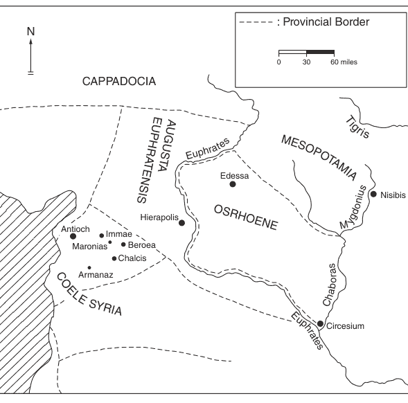

# Jerome, Vita Malchi：维塔：导言、正文、译文与注释（牛津古典丛书）


作者：克里斯塔·格 (CHRISTA GRAY)

# 前言

当我开始研究杰罗姆的《马库丘传》时，我并没有预想到这个简短而生动的故事会长期作为我研究的焦点。作者将其呈现为仅仅是叙事技巧的练习，但对于一个主要接受古典文学训练的学生来说，这段文本可以作为进入晚古古代复杂世界的一个易于上手的介绍。我低估了挑战。当我考虑这篇传记的结构、人物刻画、背景、语言和内在概念时，它变得越来越独特，因此，解释它与其他文学作品的关系变得越来越困难，更不用说与历史现实了。这里有一个修士，他表面上是年轻苦行者的榜范，但他至少最初似乎并不清楚放弃财产和服从上级的普通修道院要求。他作为一名修士的唯一定义性特征是对婚姻的极度厌恶。然而，当他被游牧的撒拉森人俘并奴役时，他适应了——诚然是在迫不得已——与一个女人同居，并在外部压力消除后继续这种安排：也就是说，当他的撒拉森俘虏（一个画得极其夸张的野蛮形象）在两人从罗马帝国边缘一个异域但描写写实的地方惊心动魄逃亡途中被杀死后。因此，《马库丘传》描写了一个意外带有缺陷的主角，他被拥有财产的想法所吸引，并对自己容易受到性诱惑感到担忧。故事的情节一个危机接一个危机，像一部冒险小说；然而，结尾处叙事上的不一致似乎拒绝了传统结局的完全解决。这种阿拉姆语母语口中的拉丁语习语，既回顾了古老的罗马戏剧，又预示了某些成为罗曼斯语言典型的的发展，而且许多对古典“异教”写作的言语回忆不露痕迹地融入了坚定的基督教框架中。通过这种方式，该传为晚古代文化及其职业提供了一个生动且详尽的微观。作为350份中世纪拉丁语手稿中的众多圣徒男女“传记”之一（以及希腊语和叙利亚语的译本），这幅肖像显然在后期的东西方基督教文化中都广受欢迎。

我希望这项研究能对其持续的欣赏做出贡献，并希望我的发现能作为进一步洞察的起点。

本书的大部分研究是在牛津大学进行的，首先在布拉森斯学院（Brasenose College），感谢来自 AHRC 的资助；其次是在教堂学院（Church），我幸运地获得了克里斯托弗·塔奖学金（Christopher Tower scholarship）。我最感谢的是我的博士导师吉姆·亚当斯 (Jim Adams)，感谢他的慷慨指导和耐心。他的严谨审查改进了书的每一段落，甚至是每一句话。克劳迪娅·拉普 (Claudia Rapp) 和托比亚斯·雷恩哈特 (Tobias Reinhardt) 在项目后期提供了建议。Roger Green 担任了顾问。我向所有他们表示诚挚的感谢。

如果没有许多朋友提供的大量精神和实际帮助，这一切将是不可能的。

本书献给我的家人。

除非另有说明，所有日期均为公元（AD）。

《马尔库斯传》（Vita Malchi）的世界

表1. 编辑变体摘要 75

表2. 普林尼《自然史》NH 11.108–10 与 VM 7.2–3之间的平行 251

# 引言

公元386年，苦修者、年长的学者优塞比乌·希罗尼穆·德·斯特里登（Eusebius Hieronymus de Stridon，英语名为杰罗姆）定居在伯利恒。他刚刚花了一年左右游览了“圣地”，即叙利亚、腓尼基和巴勒斯坦等地的圣经事件发生地点；他还访问了埃及某修道院的成员。在这次朝圣中，他由来自贵家族的罗马寡妇保拉（Paula）和她的女儿朱莉娅·尤斯托基（Julia Eustochium）陪伴，杰罗姆两年前曾向她写过著名的关于保护贞洁的名篇《书信22`¹`。杰罗姆和保拉分别于385年从教会和贵族阶层中离开罗马。杰罗姆离开的动力之一是保拉的大女儿布莱西拉（Blesilla）的死亡，这显然是杰罗姆指导下严格苦修生活的结果`²`。杰罗姆和保拉还被怀疑有不当的亲密关系，这种怀疑似乎成了他在离开前面临主教法庭指控的依据`³`。他们的旅行仍在继续，杰罗姆利用保拉剩余的资金在伯利恒建立了一座男女混修的修道院。

+ ¹ Jer. Ep. 108–14.
+ ² 参见 Jer. Ep. 39，关于布莱西拉死亡对保拉的慰藉。
+ ³ Cain (2009: 114–24)。相比之下，Brown (2012: 262–3) 将杰罗姆被教皇西里求修斯（Siricius）驱逐解释为执行杰罗姆的`stabilitas loci`（地点稳定性）原则；他在安提俄克受过圣，被命令返回那里，而不是通过他的辩论骚扰罗马的同事。根据Brown的观点，杰罗姆与贵族女性的关系是一个次要问题，杰罗姆对此强调的程度超过了其本人。Brown的新解释说明了一个基本观点：对于杰罗姆生活的许多事件，我们依赖于他的话语；但杰罗姆对自己生活的描述很少是中立的，需要仔细且知情的阅读才能对事件做出合理的阐释。此书的目标之一是有助于理解杰罗姆的修辞习惯。
+ ⁴ Jer. Ep. 20.
+ ⁵ Hale (2006): 64.
+ ⁶ 见下文。
+ ⁷ 不清楚是指。
+ ⁸ 参见 Athanasius, pp. 15–17.

386–93年在伯利恒生活的早期代表了他作家和学者活动的全新开始，包含了许多新且大胆的项目，其中包括首次将希伯来语和希腊语七十士翻译成拉丁文`⁵`。虽然《马尔库斯传》（VM）可能属于这一时期的后期（391–93）`⁶`，但它的开篇将其呈现为长期沉默后的首部作品`⁷`。在某种意义上，《传记》被构建为一段极高学术和文学产出期的序言。它被宣称为一种练习（`prius exerceri cupio`, VM 1.2），符合杰罗姆在创作当时尝试新体裁的总体背景。

VM在文学上最近的亲属是杰罗姆的两部《圣徒传》：较早的《保罗传》（VP，日期为3770年代初）和同时期的《希拉里奥尼乌斯传》（VH）。尽管它们在形式和目的上有重叠，但这三部作品的叙事结构在许多重要方面有所不同。例如，VP详细叙述了其同名英雄苦修生活的开始和结束，第二部分从安东尼的视角叙述，以证明保罗优于在据归于亚坦那修的的《安东尼传》（Vita Antonii）中备受推崇的“修道之父”`⁸`。相比之下，VH在结构上比VM紧凑的戏剧性动作要长得多，且更加人工化和片段化。此外，VP和VH都是由全知叙述者以第三人称讲述，而VM的大部分由马尔库斯本人以第一人称叙述，作者杰罗姆被呈现为一个同情的听者。进一步的差异体现在VP和VH中出现的但在VM世界中缺失的事件，在VM中，天意的体现方式也可以用自然主义术语来解释，并且

本研究试图从结构、情节和叙事技术的角度对VM进行考察。重点在于文本如何使用各种文学手段来传达马尔库斯的故事，以及这些手段如何反映当时的文化和宗教背景。通过分析VM，我们希望更深入地了解杰罗姆的创作过程以及他在塑造修道文学方面的作用。本研究还将考虑该作品的历史接纳情况以及它对我们理解早期修道运动的影响。

VM分为十一章。它以一段序言开始，解释了马尔库斯生活的背景和作品的目的。第一章描述了马尔库斯的早期生活和进入修道生活。第二章关注他在沙漠期间以及与各种人物的遭遇。第三章详细叙述了他被萨珊人俘以及随后的奴隶生活。第四章追踪了马尔库斯穿越萨珊土地的过程及其面临的挑战。第五章涵盖了他在修道院期间以及与该女性的关系。第六章描述了他回归修道生活以及与内在诱惑的斗争。第七章关注他的精神成长和神圣幻象。第八章详细叙述了他的最后一次沙漠之旅以及最终的考验。第九章涵盖了从洞穴逃脱以及最终的营救。第十章描述了他回到修道院后的和平岁月。第十一章是一个简短的结语，总结了叙事的寓意。

# 引言

但在途中，马尔库斯被萨珊人绑架（第4章）。他与一名女子被分配为沙漠中放羊的奴隶。在被俘五年后，马尔库斯找到了一座修道院（第5章）。在沙漠期间，马尔库斯观察到一个蚁群，充满了回到修道社区的愿望。第6章中，他向女子表达了这种渴望，他们决定逃亡。为了旅程做准备，他宰了两只大羊。这对夫妇利用充气的羊皮过了一了一条河流，希望甩掉追捕者。尽管如此，在第7章中，他们被追赶的主人和一名奴隶发现。在绝望中，他们发现了一个洞穴躲了起来。当奴隶和主人先后追上他们时，一只母狮相继杀死了这两个者，然后带着幼狮离开了洞穴。第8章中，马尔库斯和女子利用萨珊人的驼继续逃亡。十天后，他们到达了一个罗马要塞。他们受到了美索不达米亚军事指挥官萨宾乌斯的接待并获得了自由。故事以马尔库斯的说法结束：得知前院长去世后，再次加入了一个僧团（这不太可能是之前的同一座修道院），并将该女子安置在一个处女院。

第十一章是一个简短的结语，总结了叙事的寓意：修道贞洁在任何情况下都必须坚守。杰罗姆作为记录者，强调了有必要将马尔库斯的故事传给后代以起到教化作用。



地图。Vita Malchi.¹¹⁰ 世界的世界

正如我们所见，罗游斯在伯利恒写了《圣传》（VM）¹¹¹。其之前的终界点（terminus ante quem）可以通过其收录于罗游斯《名人传》（De viris illustris）第135章的个人作品目录来确定，那是一份日期为392年的基督教文学展望。¹¹² 其之后的终界点（terminus post quem）则更难确定。在第一章中，罗游斯声称自己在长时间沉默后开始写作的（`qui tacui`, 1.2），并将这部作品描述为一种擦掉舌头铁锈的练习（`prius exerceri cupio in paruo opere et uuelandi quam rubiginem linguae abstergere`）。¹³ 这种暗示《圣传》代表了他在386年到达伯利恒后的首次写作活动。¹⁴ 但这不可能是。有几件伯利恒时的作品可以证明属于386-87年的这些早期，¹⁵，如果《圣传》被视为这些作品之首，那么它必须是在386年构思的。然而，如此早的日期被《圣传》中的另一个引用所反驳——在我看来是决定性的：在2.1中，罗游斯将他的朋友安提俄的埃瓦格里乌斯称为`papa`（教父/主教）。如果正如极有可能的那样，`papa`在这里指的是`主教`，那么埃瓦格里乌斯在《圣传》完成时就已经被任命了。¹¹⁶ 这一仪式是在388年或之后由一位祝圣者保吕纽斯执行的，他是安提俄两位竞争主教之一（因此违背了需要另外两位主教协助的教会形式规定）。¹⁷ 埃瓦格里乌斯活到公元393/4年左右。¹⁸ 因此，《圣传》的创作时间不早于388年，不晚于392年；对腓利门、加拉太亚、以弗所和提多等保罗书信的注释，以及狄奥多西《论圣灵》的翻译，这些都属于该时期的非常早期阶段，因此必须在《圣传》创作之前，或至少在其创作之前完成。此外，罗游斯似乎从阿米阿努斯的《世事记》（Res Gestae）中获取了关于萨拉人描述的一些细节，¹⁹ 包括该书的最后一卷，其日期可能被定在390/1年。¹⁰ 如果这种联系是有效的（看起来很有可能），那么假设《圣传》是在其之前的终界点之前创作的是合理的，即391/2年。

- ⁰ 这张地图基于《巴林灵顿地图集》中的第3、67和101幅，并带有《早期基督教世界地图集》中15a和15b地图的额外信息，van der Meer和Mohmann编（1958），Rebenich（1992: 90），以及Mouterde等人（1945）前言Poidebard绘制的地图。
- ¹¹⁰ Kelly (1975: 170)。¹¹² Barnes (2010: 173)。
- ¹³ 更多细节见原文`ad loc`。
- ¹⁴ Kelly (1975: 107–16)，参见下文。
- ¹⁵ Kelly (1975: 142) 认为罗游斯翻译了狄奥多西的《论圣灵》，始于罗马，序言中对罗马的情感和敌意抵制是“伤口尚未愈合仍在流血”。同样，对腓利门、加拉太亚、以弗所和提多等保罗书信的注释是在他到达伯利恒后不久写的：Nautin (1979) 展示了如何解释罗游斯在Cuf.1.22（至401）的陈述，即他在此前已写了十八年（Ep. `de ceto et etiam sunt ex quo dictau libros`）。通过考虑到罗游斯的计算错误，Nautin得出了386年的结论。
- ¹¹⁶ 详细论证见原文`ad loc.`。
- ¹¹⁷ Theod. HE 532–4，同Rebenich (1992: 57, 74)。
- ¹¹⁸ PLRE 1286; Reubenich (1992: 74)。
- ¹⁹ 见下文1–2。
- ²⁰ Cameron (2012)。

《圣传》的叙述中有两个主要的时间层。第二章的框架动作发生在罗游斯在370年代初至中在安提俄陪伴埃瓦格里乌斯期间，他在那里住了几年，探索对哈尔齐斯修道生活的适应性。虽然他把自己描写为一个热于接受苦修生活的人，但他很快发现自己与僧侣产生了矛盾并放弃了这一尝试。尽管如此，《圣传》中的浪漫色彩以及罗游斯作为一个热心新者的自我呈现，传达了他最初的热情。

罗游斯与马库斯的相遇在历史上是不可能证明的。马库斯的存在在其他地方均未记载；此外，他们见面到《圣传》创作之间有超过十五年的（动荡的）空白期，这使得准确记忆那次相遇变得困难。进一步的问题在于拉丁语使用者与阿拉伯语使用者之间对话的实际性（`Malchus is Cyrus natione et lingua`, 2）。媒介几乎确定是希腊语；尽管罗游斯后来成为将希腊语翻译成拉丁语的大师，但我们不知道他是何时开始的。他与埃瓦格里乌斯的交往（一位会说希腊语并能够翻译《安东尼传》的人）可能促进了他的进步。最终，罗游斯也获得了阿拉米语的实用知识。对于马库斯来说，他完全可能是叙利亚语和希腊语的双语者，这在四世纪的埃弗所是未常见的。如果罗游斯和马库斯没有共同语言，埃瓦格里乌斯的家庭可能包含了可以为他们翻译的人。

- ²¹ Kelly (1975: 36–8), Rebenich (1992: 76–96),
- ²² 参见Epp. 2, 3, 和14。
- ²³ 见Ep. 17；Kelly (1975: 46–56)。
- ²⁴ 见下文15–16。
- ²⁵ Kelly (1975: 39)。
- ²⁶ 见Commentary on 2.2 Syrus natione et lingua。
- ²⁷ 见Millar (2011)。

插入叙述涵盖了马库斯从成年早期到老年的生活。马库斯在冒险结束提到萨比纽乌斯（`dux Mesopotamiae`, 10.2带注），为这一插入动作提供了内部锚点。从阿米阿努斯得知萨比纽乌斯是东方军事司令（`magister militum per Orientem`）。²⁸ Irfan Shahid得出结论，如果萨比纽乌斯在马库斯到达时尚未担任军事司令，而仅持有较低的`dux`军衔，那么这一情节的戏剧日期必须早于359年。那么马库斯的被捕应定在340年代或350年代初，即君坦丁二世统治时期。

即使马库斯及其叙述是罗游斯部分或完全虚构的，他的故事在许多细节上与可验证的历史情况和习俗有关。因此，对《圣传》进行有根据的阅读，应当询问它以何种方式与其他证据对应、润饰或矛盾。这里贯越大部分文本的主题是叙利亚沙漠的条件（地形、气候和地缘政治）、被称为游牧萨拉人的外貌和习惯，以及过修道生活必须满足的要求。

《圣传》对其物理环境的描述被认为是相当可靠的。³¹ 例如，4.1中商队的路线、8.3中使用皮囊浮具过河，以及10.2中东部边界罗马管理的细节都可以被证明是现实的。²² 基于这些发现，Noel Lens最近将《圣传》的分析纳入了一项详细且广泛的调查，研究晚古时期萨拉人奴隶制度的意义以及他们对肥沃新月带畜牧和农业经济的贡献。³³

- ³²⁸ Amm. 18.5.5, 18.6.8-.
- ²⁰ 关于这些军衔及其阶级，请见Notitia dignitatum Or. VI Seeck pp. 19–22 (`magister militum`) 和 Or. I. 47.XXXVI Seeck pp. 77–9 (`dux Mesopotamiae`)。
- ²³ Shahid (1984b: 285).

伦斯基的外部证据在很大程度上证实了书中马尔库斯（Malchus）被俘的描写。

《马尔库斯传》（VM）一个引人入胜的方面是它倾向于将马尔库斯的不同生活方式定义为修道生活的模式：在第3章中，他加入了一座会院，即一个由院长领导的僧侣社区，其生活方式的特点是禁食、体力劳动、祷和背诵圣经，特别是《诗篇》（VM 3.4和5.4）。在第5章中，作为一名撒拉森人的奴隶，他成功地在完全的内心孤独中作为一名牧羊人建立了一种准无政府的存在，不间断地吃着素食（但纯素食）饮食³⁴，并吟唱着他在第3章提到的那些僧侣那里学的《诗篇》。最后，在第6章中，他选择与一名女性同居，在沙漠中，随后在马尔杰罗姆（Mar Jerome）处声他在第2章（属于较晚时期）曾以这种安排遇到过他们。这种修道生活——属灵婚姻——因此似乎是流动的，从沙漠到马罗尼亚斯（Maronias）一个拥有教堂和邻居的更社会化的村庄生活。马尔库斯修道生活的三个阶段与杰罗姆在《书信》Ep 22.34-6中设定的方案（写于384年）有关：他区分了会院式和隐居式的生活方式（两者都受到推崇），以及第三种被称为 `remuoeth` 的模式。最后这种类型被描述为成对或三一组共同生活且没有上级的苦行者，通常位于城市并从事商业活动；杰罗姆声称这是我们行省的主导模式（Ep. 22.34）。尽管此处杰罗姆在这里指的是谁是不言而喻的，但卡西昂（Cassian）《对比》Conl. 18.8证实这类人（他称为萨拉拜人，sarabaites）在其他省份也占主导，即在埃及之外³⁵ 在《书信》Ep 22.34–5中，杰罗姆谴责 `remuoeth` 类型的僧侣被吞噬（他的……`quasi quibusdam pedibus pestibus`, Ep. 22.35）。他还用最强烈的措辞在《书信》Ep 22.14–2和《书信》Ep 117中谴责另一种“配对”苦行生活的模式：在男性（通常是神职人员）的保护下作为 `subintroductae`（另一个术语是 `agapeatae`）生活的女性处女³⁶

相比之下，在同时代的叙利亚，类似的小型修道主义非常受推崇。这是一类特殊的圣人阶层，在叙利亚语中被称为 `qadishe`（“神圣的”），是过着禁欲生活的已夫妇。他们的地位仅次于处女³⁷ 看起来，在《VM》2.3中，邻居们对这对老夫妇的热情评价他们为 `sanctos et Deo placitos`（圣徒且神所喜爱的），可以被看作叙利亚基督徒谈论他们的圣人、他们的 qadishe 时用语言的反映³⁸ [注释：OCR文本此处有一处破碎的句子/段落]


³⁴ 叙利亚苦行主义中此类区分的意义通过布洛克（Brock，1973:5）的观察得到了说明，施洗约翰的饮食由蝗虫蜜组成（马太福音 3:4, 马可福音 1:6），在二世纪叙利亚宣传家泰提扬（Tatian）的版本中被“修正”了，他用“奶”替换了“蝗虫”，为了使施洗约翰符合

³⁵ Caner (2002: 9)。

《VM》对这种广泛的小型团体和混性修道主义做法显然表示赞同。这种矛盾可能正是文本中一个明显不一致之处的核心：杰罗姆在 VM 2.2 中遇到这对同居的伴侣；但在 1.2 中，马尔库斯在经历冒险后声称：“我自己回到了僧侣那儿；我把那个女人交给了处女们”，这种安排很难被解释为同居。这种矛盾引发的文学问题将在下文进行详细讨论³⁹

为了衡量文本试图留下的印象，通过了解《VM》的预想受众将很有帮助，这包括作品内部呈现的，以及从杰罗姆在其他地方的传播习惯推断出的。作为第一章的作者引言，杰罗姆将年轻的自己呈现为老年马尔库斯故事的听众；在结尾，他将老年的自己呈现为[注释：OCR文本此处脚注与正文有严重重叠]。

³⁶ 追溯至 404–5 年：Hale (2006: 297)。在实践中，这种同居类型很难控制，经常受到攻击：Finn (2009: 86–115) 和 Diem (2005: 95) 认为在《VM》中违背了警告女性危险的修道习惯，因为它为婚姻概念的发展建立了一个程序性的基础（“die programische Basis für das Konzept Ehe”）。

³⁷ C. Brock (1973: 10–11)。关于这种形式的文学描写见《注释书》(2.3, pp. 128–30)。

³⁸ 《VM》2.2 注释, 27, etiam in contuberno, pp. 125–26.

刚刚将马尔库斯的故事讲述给一群更年轻的苦行者，并嘱咐进一步传播。将这一群体指代杰罗姆自己修道院的僧侣似乎是有争议的。[注释：OCR文本碎片化] 他们不可能在一起听；但并没有阻止我们假设该文本是传给波拉（Paula）和她的修女的，且是严格分离的。这种类型的修道生活——似乎是流动的，从沙漠到马罗尼亚斯（Maronias）一个拥有教堂和邻居的更社会化的村庄生活。马尔库斯修道生活的三个阶段与杰罗姆在《书信》Ep 22.34-6 中设定的方案（写于 384 年）有关：他区分了会院式和隐居式的生活方式（两者都受到推崇），以及第三种被称为 `remuoeth` 的模式。最后这种类型被描述为成对或三一组共同生活且没有上级的苦行者，通常位于城市并从事商业活动；杰罗姆声称这是我们行省的主导模式（Ep. 22.34）。尽管此处杰罗姆在这里指的是谁是不言而喻的，但卡西昂（Cassian）《对比》Conl. 18.8 证实这类人（他称为萨拉拜人，sarabaites）在其他省份也占主导，即在埃及之外³⁵ 在《书信》Ep 22.34–5 中，杰罗姆谴责 `remuoeth` 类型的僧侣被吞噬（他的……`quasi quibusdam pedibus pestibus`，Ep. 22.35）。他还用最强烈的措辞在《书信》Ep 22.14–2 和《书信》Ep 117 中谴责另一种“配对”苦行生活的模式：在男性（通常是神职人员）的保护下作为 `subintroductae`（另一个术语是 `agapeatae`）生活的女性处女³⁶

相比之下，在同时代的叙利亚，类似的小型修道主义非常受推崇。这是一类特殊的圣人阶层，在叙利亚语中被称为 `qadishe`（“神圣的”），是过着禁欲生活的已夫妇。他们的地位仅次于处女³⁷ 看起来，在《VM》2.3 中，邻居们对这对老夫妇的热情评价他们为 `sanctos et Deo placitos`（圣徒且神所喜爱的），可以被看作叙利亚基督徒谈论他们的圣人、他们的 qadishe 时用语言的反映³⁸ [注释：OCR文本此处有一处破碎的句子/段落]

³⁴ 叙利亚苦行主义中此类区分的意义通过布洛克（Brock，1973:5）的观察得到了说明，施洗约翰的饮食由蝗虫蜜组成（马太福音 3:4, 马可福音 1:6），在二世纪叙利亚宣传家泰提扬（Tatian）的版本中被“修正”了，他用“奶”替换了“蝗虫”，为了使施洗约翰符合

³⁵ Caner (2002: 9)。

背景和受众的讨论为理解《VM》的目的提供了一些有用的提示。首先，叙述者在文本结尾留给读者的印象是对模仿马尔库斯保持严格贞洁的坚定承诺（第 11 章）。这种劝诫是针对一个苦行者社区的，他们被赋予了将故事留给后世的任务。文本直接的目标是，鼓励那些献身于贞洁生活的人坚持这一目标，无论外部压力如何。这种劝诫中隐含另一个关注：虔诚倾听的苦行者的形象，他们正如

> 43 See above, p. 1.
>
> 44 Nautin (1983: 249).

被马尔库斯（Malchus）作为年轻杰罗姆的经历所打动，并在他们的奉献中得到了证实，这是对杰罗姆自己建立的基会所行的修院生活类型的一种广告。通过共情和想象，读者发现自己置身于杰罗姆追随者之中，促使他们赞叹故事如何强化了僧侣（及女修）对天职的承诺。从这个意义上说，文本增加了杰罗姆社区人数，至少在精神上如此；但在现实生活中，读者或听众对教化性叙事英雄的情感认同，往往会导致他们新地转化为这种类型的修院生活。

除了结语的教化姿态外，在叙事的道德框架中似乎可以发现一个更隐含的作者目的。正如阿达尔特·德·沃盖（Adalbert de Vogué）有力说服力的论证，情节的许多主题可以被读为杰罗姆与寡妇保拉（Paula）接近关系的防御性寓言。关于马尔库斯与那个人的约定、他们共同的旅程以及他们的和平共处——无论是在贞洁同居中（VM 2）还是在单性别修道院中（VM 10）——无疑都可以读作类似于杰罗姆与保拉的关系。通过将这些经历归功于被他们周围认可为 `圣者`（sancti）的不同力量，杰罗姆为这种种姓亲密的关系提供了一个受尊敬的先例，而这种关系曾让他认为自己在主教法庭上被诋低，甚至可能遭受过正式指控。像杰罗姆一样，马尔库斯也有他的缺陷：他脱下僧袍去处理他的遗产（第 3 章），并在第 5 和第 6 章中未能达到殉道；但随后他被救了（第 9 章），并由于保持了处女身份而恢复了平名（第 2 和第 10 章）。那个未具名女性的角色具有重要意义：马尔库斯声称他已“将她交给女修们”（10.3 `hanc trato virginibus`），这同样暗示了尽管她以前婚过，但已成为了一名荣誉处女。文本允许一种可能性：即使在字面意义上的贞洁已经失去，通过禁欲的生活重新获得贞洁的益处。这一信息不仅让杰罗姆本人感到宽慰；也讨好了他们读者中的寡妇们。

45 参见 Berschin (1986–2004: I.144)。 46 De Vogüé (1991–2007: II.79–83)。

47 Cain (2009: 114–24); 与 Braun (2012: 262–3) 相反，见上页注 3。

48 参见 Kelly (1975: 21, 附注 16）关于杰罗姆对失去贞洁的遗憾，这在 Ep. 49.20.2 中是被承认的：`virgitatem autem in caelum, non qua habeo, sed quia miror, quod non habeo`。

但我们可以超越“圣安尼传”（VM）是为了在其创作时期加强杰罗姆在相关网络中地位的观点，并假设一个更雄心勃勃的目标。通过创作一部异域风情、刺激且呈现精美的文学作品（尽管它深受古典文化的影响，但本质上是基督教的）；^49 杰罗姆将自己置于新文学成就的先驱之中：创造一个不仅提供正统教化而且提供乐趣的基督教图书馆。正如在他早期的《圣保罗传》（VP）中一样，他将《圣安尼传》作为参考，但在技巧和审美吸引力上超越了它。事实上，这项事业被证明是成功的，不仅在拉丁语西方（那里现存了约 350 份 VM 手稿，其中至少 94 份可追溯到 13 世纪），50，在希腊语和叙利亚语环境中：丹尼尔·金评价了杰罗姆在叙利亚学者中作为圣徒记者的巨大声誉，并将希腊语和叙利亚语译本视为 VM 的“回归”。^51

+. 49 见下文关于对 VM 文学影响及其风格的讨论。

50 Lambert (1969–72: II.497–514) 给出了 349 份手稿列表；Cherf 在 Oldfather 等人 (1943: 65) 中提到了 94 份 1200 年以前的手稿。

51 King (2009: 217–23)。

本节讨论了杰罗姆在编写 VM 时参考的现有文献。在可能的情况下，我试图识别那些可以证明源自杰罗姆自身阅读的直接影响。这种来源的汇基于杰罗姆对他所知书籍的明确陈述、强烈的结构相似性以及密切的言语援用。从我的分析中可以看出，VM 并没有模仿任何单一作品，也不属于某一特定的体裁。相反，它提炼了广泛的特定文本以及更通用的修辞和表现模式。多样的层次只有在仔细观察时才会显现：在表面，VM 呈现为一个统一的整体，其措辞服务于生动且简洁的故事情节。分离可能影响的尝试说明了史诗、喜剧、小说和传记等不同体裁之间的某些基本联系。杰罗姆对这些材料的征用和整合是高度复杂的。因此，VM 表现为成熟文学形式的有效发展。^52

5 5 参见 Gnik (1984) 关于基督教作者使用古典动物文学的方法论的发展。

53 关于亚坦西修乌的身份存在某种争议：例如 Cameron (2000: 75)，附有更多参考文献。Barnes (2010: 165–70) 合理地解释了 VM 与亚坦西修乌版本之间的差异，假设 VA 是由亚坦西修乌草率编辑的。早期译本是无名作者，另一个是杰罗姆的朋友。54 杰罗姆的僧侣，VM 与 VA 在立场上存在冲突。VP 证明了某种更早且更优越的存在，被圣安尼本人承认，而 VH 叙述了圣安尼的徒生。尽管在广义上，VA 是 VM 的背景，但其影响并不直接。主要的联系点是伊格修，即他对 VM 的译本（8.2）。

54 关于伊格修，参见第 6, 7, 11 页。他的译本由 Bertrand (2005) 编辑，必须。

杰罗姆的圣徒记工作整体无疑受到了亚坦西修乌《圣安尼传》（VA）的启发，^53 该书在 362 年以后出版，并从希腊语翻译了两次。早期译本是无名作者，另一个是杰罗姆的朋友。54 杰罗姆的僧侣，VM 与 VA 在立场上存在冲突。VP 证明了某种更早且更优越的存在，被圣安尼本人承认，而 VH 叙述了圣安尼的徒生。

有些人喜欢这种，另人随心。例如，他们声称有一个住在地下洞穴、头发长到脚的人，他们发明了许多不可信的事，这些是浪费时间。由于他们的观点是赤白的谎言，似乎没有必要反驳。既然圣安尼的记载已用希腊语和拉丁语记录，我决定写一些关于保罗生活的开始和结束，因为由于我的才华，这些被忽视了。^57 (VP 1.3.)

由于 VM 据起源于杰罗姆对叙利亚修院生活的经历，可能受到这些口头传统的影响。最有趣的相似之处是阿蒙的故事，他在 VA 60 中被提到，帕留斯说他生活在贞洁的婚姻中（Hist. Laus. 8）。^58 但正如杰罗姆在 VP 中所做的那样，帕留斯无疑修改了他收集的故事，人们无法

55 Wellhausen (2003: 1)。

56 Reitzstein (1960: 6)。

57 Tr. White (1998: 75)。

58 Ed. Butler (1898–1904: II.26–29); 同样在拉丁语译本中，ed Wellhausen (2003: 510–13)。

# 引言

断然排除了他关于阿蒙的故事可能源于《马尔库传》（VM）的可能性。但叙利亚人对这种安排的特殊偏爱（见上文，第 10 页）无疑涉及关于英雄事迹的故事，这些故事在现实中的模仿可以激发新的传说。

《安东尼传》（Vita Antonii）及随后的著作关注一位与诱惑和恶魔斗争并在此过程中教导门徒的英雄人物，并以此为起点，这提供了某种殉道者文本，以记录君坦丁之前之前的迫害中基督徒遭受世俗当局之手的苦难。早期殉道者文学的形式涵盖从（伪造或模仿的）宫廷礼仪到自传体的《佩波图与费利西的殉道》（Passio Perpetuae et Felicitatis）⁵⁹，再到《里昂与维也纳信》中殉道者反抗权威及其壮烈苦难的叙述性记录。这些的设计是为了在纪念殉道者时朗读的。⁰ VM 通过两个惨烈的殉道故事将其对保罗生活的描述置于迫害基督徒的背景中。以另一种方式，VM 通过包含经典的殉道者告白“我是基督徒”（`Christianus sum` (dicerisque Christianum, 6.2, 附注）承认了殉道行为。马尔库斯（Malchus）还表现出为了保持贞洁而自杀的意图是一种特殊的殉道（`habet et pudicity servata marturium suum`, 6.5, 附注），在这种情剧中他“既是迫害者又是殉道者”（`ipse mihi et persecutor et martyr`, 6.5）。第 9 章中的母狮情节想起了与萨图努斯对峙熊的主题（例如，在竞技场上，动物杀死了一个拒绝攻击萨图努斯的角斗士）以及《佩波图传》中佩波图和费利西与母牛的对峙（Perp. 19–20.¹¹ VM 对殉道者文学的这些借鉴整体上是肤浅的，但它们说明了马尔库斯被判定为圣人的无序性。从结构相似性来看，VM 与伪经《使徒行传》更为接近，这一类别介于殉道者文学和小说之间。这些相似性将在下文讨论小说时涉及。

VM 的词汇表显示出受到早期少数用拉丁语写作的基督教知识分子的影响，包括特土提安的惩罚（`cauterium`, VM 3.8）、战后恢复（`postliminium`, VM 4.3）、未婚夫（`pronubnus`, VM 6.3，均附注）以及拉长森提斯（魔鬼的狡诈 `astutia of the devil`, VM 3.6；战后恢复 VM, 附注）。但与其其他模型相比，杰罗姆对这些作者的债务在 VM 中并不算重。

在当代作者中，杰罗姆对安布鲁塞（Ambrose）的使用引发了讨论。在将古典文学形式和思想转化为基督教目的时，安布鲁塞是第一个效法希腊教父奥里根和巴西榜样的拉丁语作者，他们批准了明智地吸收异教文化中所有有价值的东西。杰罗姆在《以弗所书》序言中是这样说的：如果斯蒂芬正确识别出目标是安布鲁塞（这看起来极有可能），那么安布鲁塞就称是“利用了雕塑般的见证”（`testimoniis scripturarum... eloquence iun-gare saculorum`）。此外，安布鲁塞的《论基督神职人员职责》（De officiii）这篇论文明确模仿了西西同名的著作；他的《六日记》（Exameron）是一系列关于创世六日的布道，它改编了巴西的希腊语《六日记》，并根据杰罗姆的说法，使用了希波吕特斯和奥里根的相关著作，利用自然科学进行基督教教化。这通常用借自维吉尔的语言呈现：在 CSEL 中，卡尔·申克在作品的 65 页（共 258 页）中提到了维吉尔式的的回忆。《Geo. 4》在 Ex. 5.21 尤为突出，涉及蜜。安布鲁塞的方法在 VM 7.2–3 对蚂蚁的道德化描绘中得到了平行体现，它借鉴了维吉尔的蚂蚁（Aen. 4.401–7）以及《Geo. 4》中的蜜，还借鉴了它们包括安布鲁塞在内的后期文本中的接受。67


- 62 Henke (2000: 25, 39); 参考 Davison (2001: 1.20–22)。
- 63 Oberhelman (1991a: 393–8).
- 64 Tr. Oberhelman (1991a: 393).
- 65 Jer. Ep. 84.7:6: nuper Ambrosius sic Exameron illus [sc. Origenis] compilaut, ut mag Hippolyti sentias Basillique sequetur.
- 66 安布鲁塞中的维吉尔暗喻由 Dierlich (1931) 进行了分析；另见 Henke (2000: 124, 165, 175)。

杰罗姆对古典文学无处不在（见下文，第 21–41 页）强烈表明他受到了安布鲁塞实践的鼓励。

但杰罗姆在《以弗所书》 15.4（公元 376–7 年）和《编年史》 CGS 24.1 p. 247（公元 380–1 年）中赞扬了安布鲁塞反对阿里乌派对正统的坚决捍卫，并在《以弗所书》 22.2.3–5（公元 384 年）中赞扬了他关于处女贞的论文（*De virginitate, De uiduis*）。在 385 年被迫离开罗马后，他对安布鲁塞的态度变得敌对。这种变化的时机表明，要么是安布鲁塞在杰罗姆被法利赛人参议院（senatus Phariseorum）失宠的过程中起了作用（Jer. Praef. in Didym.），要么是因为他拒绝帮助杰罗姆度过困境。68 上文引用的《以弗所书》序言（日期为 386/7 年）语气带有贬义，认为安布鲁塞的释经方法肤浅，写作浮夸，与杰罗姆作为注释者的优越方法形成对比。69 后来，他指责安布鲁塞在《论圣灵》序言中（未点名，身份由 鲁法斯 *Ap.* 2.28 提供）抄袭了希腊神学家狄迪马修斯：

> malui alienis opere interpre existere (quam did faciunt) informis miiculis colonis meis coloribus adornare legi duum cuuidam libillos de Spiritu Sanctto; et iuxta commenti Graecis bonus, Latina non bona... certo qui hunc leger, Latinum forta cogit; et conniet riulos, cum poetire hauire de fontibus.

我宁愿将自己呈现为他人作品的翻译者，而不是（像某些人那样）用他人的色彩来装饰自己丑陋的外。最近我读了某本关于圣灵的小册：而且根据希腊语注释很好，拉丁语并不好……显然，谁读这个，就会强行构思拉丁语；并且当他试图从源头创作诗歌时，他会发现那些窃用。70

当然，古代的引用习惯与今天所期待的严谨引用大不同。杰罗姆本人倾向于不经承认使用他人的话。71 考虑到杰罗姆对安布鲁塞提出的具体抄窃指责，VM 那段精彩的开篇是无颜耻地剽窃安布鲁塞的 *De off.* 1.1。尽管对安布鲁塞有新的反感，杰罗姆在合适的情况下并不介意回收他的措辞。**

## 7.2. 圣经引用与典故

VM 7.3 对《箴言》 6:6（*Salomonis ...mittitens*）的引用是另一部文学作品唯一的明确引用。对于杰罗姆来说，这种公开的克制是不常的（见上文，第 14–15 页）。更仔细的观察显示了许多其他圣经的回声，聚集在安布鲁塞 3,5 的演说以及其他虔诚的展示中，例如作者用于辟邪的 *si tamen Dominus uitam*（1.1，附注）。可能甚至马尔库斯的名字也是取自约翰福音 18:10 中大祭司的仆人，并从这一难以捉摸的语文中获得了额外的意义：见 2 *erat senex.*（附注）。

一个构成马尔库斯故事许多方面的底层旧约叙事是《创世记》 37:25–8 中约瑟的故事。约瑟被他的兄弟卖给以玛实，并在埃及担任仆人时受到主人波提发的妻诱惑（《创世记》 39:7–12），这种局面可能——在马尔库斯在 VM 6 的危机中——像马尔库斯一样抵御了诱惑，尽管被公正监禁，最终作为法老的摄政取得了显赫地位。与兄弟的和解导致了他的家人进入埃及，形成一个七十或七十五人的队伍（《创世记》 46:27，《使徒行传》 7:14），这被唤起了

# 引言

对马尔库斯车队的描述（4.1，附注）。⁷⁵ 马尔库斯的叙述中与之呼应的另一个故事是“浪子归的比喻”（路加福音 15:11–32），讲述他在父亲在世时理所应当地索要遗产，挥霍在一种放荡的生活中，随后对自己的不听话感到悔改，并得到了父亲的慷慨宽恕：参见 VM 7.1 *maxime uultum patris mei, qui me erudierat, tenuerat, perditat*，附注。相比其他的文学典故，圣经中的呼应似乎促进了《修道规则》（VM）的道德化倾向，作为克服逆境的美德与悔改的典范。

杰罗姆受过著名语法学家埃利乌斯·多纳图斯（Aelius Donatus）的教育，并经常自诩博览群书。例如，在 *C. Ruf.* 1.16（第 26-31 行）中，他提醒以前的同学他的一些课本：

puto quod puer legis Prisi in Vergilium Sallust commentarios, Vulcatii in orationes Cicerois, Victorius in dialogos eius, et in Terentii cooedias praeceptoris mei Donati, eque aliorum in alius, Plautus uidelicit, Lucretius, Flaccum, Persiumque Lucanum.

我想你小时候读过阿斯佩尔对维吉尔和萨卢斯特的注释，还有瓦尔图提乌斯对西西罗演说的注释，维克多里乌斯对其对话的注释，以及你的老师多纳图斯对特伦斯喜剧的注释，此外对维吉尔的注释，以及其他诸如普劳图斯、卢克莱修斯、霍拉斯、鲁芬斯和卢卡斯的注释。

对古典及世俗文学的熟悉是罗马精英阶层声望的重要来源，杰罗姆也将自己归入这一类，但这种教育所培养的文学故事与基督教简约生活的要求之间产生了张力。¹⁷ 杰罗姆通过

⁷⁵ 参见 de Vogué (1991–2007): II.88 n. 65)。
⁷⁶ 关于该标签的使用参见 Cameron (2011: 23)：“指代古典文学或学术的标准方式是使用‘secular’一词，字面意思是‘世界的学’。”
⁷⁷ 参见例如 Kaster (1988: 70–95)，附有更多参考文献。Brown (2012: 278) 描述了杰罗姆在不稳定的财务状况下写作中对展示的需求：“如果有富有的捐助者寄给他资金，他必须写上充满华丽拉丁语、充满古典作者回响的信件和序言。”这与他的朋友以及后来的对手鲁芬斯的“平庸的简朴”形成了对比，鲁芬斯在极其富有的梅拉尼娅的支持下，“可以负担得起简单”。

他以一种极具个人色彩的方式阐述了这一困境。他全部著作中最著名的段落 *Ep. 22.30* 讲述了一个噩梦般的幻象，在其中他看到自己被一位天堂法官指责不是基督徒，而是一个西西罗派（*Ciceronian es, non Christian*）。他回答道：*Domine, si utquam habuero caelales saeculares, si legero, te negau*（主啊，若我曾见过世俗的学校，若我曾阅读它们，我便背弃了你）。由于这个梦中的誓言，他阅读“神圣”文学的热情比以前阅读“道德”书籍时更加强烈（*et tanto dehinc studio diuis legse, quanto mortalia non legeram*），这一断言并未重复誓言中那种强烈的语气。⁷⁷⁸ 包含这一插曲的 *Ep. 22* 创作于 384 年，也就是说，是在杰罗姆 382 年至 385 年留罗马期间。所叙述的片段最可能发生在杰罗姆在 370 年左右转向一种“比他迄所接受的更为虔诚的基督教生活形式”⁷⁹⁸⁰之后。这一日期逻辑上遵循杰罗姆在 386 年抵达伯利恒后不久的声称，他超过十五年没有读过任何古典作者：

nostim et ipsae, quod plas quincindem anni sunt, ex quo in manuas nonquam Tullius, numquam Maro, numquam gentium litterarum quibillit auctor ascendit; si quod fide deirte loiqum obrepit, quasi antiqui per nebulam sonmii recordabur.

> *(在 Gal. 3 前言中)*

> 你们自己也知道，西西罗、马提或任何其他古典文学作品进入我的手已经超过十五多年了；如果我偶然提到那里的东西，那它们是溜入我脑海的，仿佛我在回想起一个老梦的迷雾。⁷⁸¹

在这一确认十多年后，在 400 年，杰罗姆的前友鲁芬斯指控他违反了誓言（*Ruf. Ap. 2.6–7*）；在重述完梦的故事后，他挑战听众：

relegunt nunc, quaeo, quae scribrit: si una operis eius pagina est, quae non eum inter Ciceronianum pruntunt, ubi non dicat

+ ⁷⁸ 参见 Adkin (2003: 383–5)。⁷⁹ Kelly (1975: 29)。
⁸⁰ 因此，关于这一陈述的 Rebichen，保拉和她的女儿欧霍斯提乌姆（他们作为杰罗姆十五年禁读古典的证人）显然在这段时期的大部分时间里是不为人知的：他们只有在 382 年他来到罗马后才见到他，显然没有立场监督他的阅读。

在这一确认十多年后，在 400 年，杰罗姆的前友鲁芬斯指控他违反了誓言（*Ruf. Ap. 2.6–7*）；在重述完梦的故事后，他挑战听众：

relegunt nunc, quaeo, quae scribrit: si una operis eius pagina est, quae non eum inter Ciceronianum pruntunt, ubi non dicat

图卢斯（Tullius）、弗拉库斯（Flaccus）以及马罗（马尔库斯·维吉尔，Maro）是杰罗姆所展示的世俗文学的典范。在回答中，杰罗姆首先将他对古典文学的使用归咎于记忆力（*si utquam habuero...*），然后诉诸对梦的誓言：

在很多年后，我离开了家乡、父母和亲戚，在十五多年里我没有读过任何古典作品（*cum annos plurimos domo...*），为了进入上帝的王国和精美的食物，我在罗马努力。⁸² 虽然 *Ep. 22* 将这一插曲描述为基督教文学的对立面，但杰罗姆的陈述表明了对古典文学的矛盾态度。

在这种情况下，世俗文学是诱惑的来源，但在某些情况下，它可以非常有益地服务于基督教使命。⁸³⁸⁴ 这种 ⁸, , , , , , , , , , , , , , , , 

我的劳动是有益了基督的家庭，我的通奸增加了外邦奴隶的数量。⁸⁶ 这种感官上的意象表明，世俗语言不仅是一种危险的诱惑来源，如果由一位修剪其欲望内容的作者正确使用，可以用于基督教宣传。通过这种方式，杰罗姆回顾性地证明了长期使用古典文学的习惯，这在《修道规则》（VM）以及任何其他地方同样明显。

杰罗姆在《修道规则》（VM）以及任何其他地方同样证明了这种长期使用古典文学的习惯。

将这些内容放在马尔库斯（Malchus）这个人物身上是非常不寻常的，他本人似乎对古典学问无所知。书中没有任何一位古典作者被点名提到。这种暗示性的用法可能让杰罗姆在受教育程度较低的反古典主义者面前保住了面子，同时也为他受过良好教育的同僚提供了一个有趣的谜题。这种方法的影响是双重的：一方面，《处女传》（VM）的互文本计划具有竞争性：基督教叙事取代了古典叙事法。另一方面，杰罗姆对素材的处理确保了古典风格的美德得以传给后世，即使他们只读基督教文学。以下是根据体裁分类的《处女传》所借鉴的各种文本摘要。

小说元素在《处女传》中非常显著。曼弗雷德·福曼（Manfred Fhmann）在为《处女传》寻找合适的体裁分类时，将其称为对古代浪漫小说的高度缩减的模仿（‘ein stark verkürzter Abklatsch des Liebesroman’）。⁸⁸ 这一观察主要指的是它与五部现存的完整希腊小说在主题和结构上的相似之处：查里同（Chariton）的《凯瑞亚斯与卡里莉俄伊》（Chaereas and Callirhoe）；以弗所的基铁隆（Chiron of Ephesus）的《以弗所的妇女记》（The Ephesiaka）；阿基勒斯·塔提斯（Achilles Tatius）的《克利托福农与留西珀珀》（Clitophon and Leuciipe）；隆戈斯（Longus）的《达夫尼斯与克洛伊》（Daphnis and Chloe）；以及赫利奥多尔（Heliodor）的《埃塞俄比亚记》（Aethiopica）。在雅姆布留斯（Iamblichus）的《巴比伦传奇》（Babyloniaca）中也可以发现一些有趣的相似之处，但该书仅存福提提（Photius）的摘要和少量片段。⁸⁹ 在这些“色情理想主义”⁹⁰浪漫小说中，通常会遇到以下元素：家庭冲突、旅行、被土匪绑架、性诱惑以及在关头逃离必生。这些元素在阿普略留斯（Apuleius）的《变形记》（Metamorphoses）中同样突出，且许多在彼得纽（Petronius）残篇的《讽刺集》（Satyrica）中仍可辨，这两部作品代表了该体裁的“喜剧现实主义”分支。¹¹ 所有这些对《处女传》具有结构上的意义。

⁸⁸ Fuhrmann (1977: 65)。关于色情小说的结构限制及其新喜剧中性伦理的根源见 Lowe (2000: 225)。古代小说与圣传叙事在结构和思想上的相似性已被证明是近年来的研究提供了肥沃的土壤：例如 Cooper (1996), Burrus (2004), Krueger (2004), Johnson (2006)。
⁸⁹ 《处女传》与雅姆布留斯《巴比伦传奇》之间的若干特定接触点由 Zwierlein（1970: 177–84）收集。
⁹⁰ 关于这一标签请见 Holz (1995: 9–11)。
¹¹ Holz (1995: 9–11)。3.1 节中，马尔库斯的父母对他修道职业出于物质动机的反对，与《阿基勒斯·塔提斯》（Ach. Tat.）2.12.1 中克利托福农的父亲在儿子爱上另一个女人时安排婚姻的情况，或与隆戈斯 3.25 节中克洛伊的养母为了给她找一个富有的追求者所做的谨慎计划，以及 3.30.5 节中达夫尼斯的养父希望为达夫尼斯找一个比克洛伊更好的婚妻并不相似。这些家庭冲突通常导致主角离开家，正如马尔库斯的情况一样；《以弗所的西塞》（Xen. Eph.）1.10.2 有一段由人为动机驱动的旅程，目的是在婚礼成功后家庭关系和睦的情况下开启必要的冒险。例如，4.2-3 节中马尔库斯被萨拉森人绑架，对应于查里同 1.9 节中海盗营救并绑架卡里莉俄伊，以及卡里特（Charite）对阿佩尔土匪的慷慨。《变形记》 4.23 节中，对主角贞洁和生命的威胁是维持小说情节张力的常用手段：例如在《阿基勒斯·塔提斯》 6.18 中构思了一个试图诱惑的场景；留西珀（Leucipe）对她的主人瑟尔桑德斯（Thersanders）进攻的抵抗比马尔库斯在《处女传》 6.3 节中被主人强迫与同为奴隶结婚时的反抗更为成功。正如注释 VM 9.10 节中将论证的那样，狮子情节共享了古代小说和“贞洁测试”家族的特征，例如赫利奥多尔 10.7.77–10.9.5。古代小说与《处女传》之间的其他微小接触点也将在注释中注明，特别是在《处女传》 6 节的注释中。

显然，小说的模板符合杰罗姆的目的。特别是小说的“色情现实主义”形式已被证明是群体意识形态的载体：一个内部连贯且情感上满足的叙事控制并强化了特定社会对善恶的观念，这些观念体现在理想上令人向往且理想上正直的主角及其邪恶的对手身上²。这种功能使色情小说成为杰罗姆倡导终身处洁的极佳模板：所需要的只是将“圆满结局”（即小说的中心夫妇完成结合并成为社区中负责任的公民）替换为

> 放弃这种消费的决定。

> ⁹² Cooper (1996: 20–44)，例如 p. 31：对浪漫小说创造共情的独特观点，意味着作者可以依靠读者将一个年轻恋人的故事看作社会秩序状况的寓言——并受到他关于如何延续这种秩序的观点的影响。

> 同样，在伪经的《使徒行传》（Apocryphal Acts of the Apostles）中（例如《托马使徒行传》 Acts of Thomas 11–16 节），将主角限制在保持贞洁状态（而这种贞洁本应在独占的婚姻中完成）的小说情节手段，被转化为了为了上帝而无限期地保持贞洁.³⁹³

关于人物刻画，小说相似性引发的预期在《处女传》中也被削弱了。诚然，萨拉森主人忠实地遵循了小说反派的模式，而年轻的杰罗姆作为一个通过叙事接受教导的天真听者也有其小说的类比；但缺失的是那对美丽且正直的中心主角。马尔库斯是

> 93 关于涉及这种替换的复杂性，见 Cooper (1996: 45–67)，其讨论了伪经《使徒行传》。


> 94 这并不是说所有古代小说都必然包含一致的情节。事实上，值得注意的是，《处女传》框架的不一致性（夫妇生活在一起并结束（夫妇——似乎分离了））代表了《阿基勒斯·塔提斯》中一个更简单模型的反转，在后书中，主角克利托福农（Cliffiphon）在在西多被一个只出现在框架中的叙述者首次遇到（Ach. Tat. 1.1–2）。在这一框架中，克利托福农独自出现并对爱情感到幻灭（Ach. Tat. 1.2.1）；但在他的叙事结尾，他以第一人称说，他与留西珀幸福地结婚了，并计划从君士坦航往拜占庭堡（而非西多）（Ach. Tat. 8.19.3）。正如在《处女传》中那样，没有回到框架场景。H. Morales (2004) 对这种结构提供了清晰的解释；不是年轻美丽，而是老态苍白（6.4 incanescente iampe, with note）；而且虽然贞洁，但至少从基督教的角度来看，表现出严重的道德缺陷，因为他为了声领遗产而选择不从院长（第3节）。对于女性部分，她并不是令人向往的处女：她第一次出现时是老态衰的（2.2），她在遇到马尔库斯之前已经结婚了。在与马尔库斯的关系中，她与其说是小说中的主角，不如说像阿基勒斯·塔提斯中典型的米利特（Melite），她的丈夫假设去世，主角与她几乎完全进入了关系（Ach. Tat. 5.1ff.）。马尔库斯的“妻子”同样被描绘成一个善良的角色，有助于他的营救，尽管她的婚姻状况可能产生不利影响。最后，这一缺陷证明是可以救赎的，正如《处女传》9节中夫妇奇迹般逃离危险所证明的那样。这种女性从恶转变为贞洁典范的轨迹，与小说的绝对主义要求相比，是杰罗姆最大的创新。主题上的相似性使得杰罗姆可能了解小说文本的基本特征，尽管没有直接证据表明他读过现存的希腊小说。杰罗姆可能过阿普略留的《变形记》并非不可能：杰罗姆在《诗篇讲义》Tract. Psalm. 81.8中提到了阿普略留（魔法师而非作者）（CCCL 78 p. 89 line 230），且与《花事》Flor. 17在1.2节有文字上的相似（et ueliadam rubiginen linguae abstergere, with note）。对《变形记》的知识可以从他提到“米特式故事”中推断出来（C. Ruf. 1.17 lines 56–90 quasi non cirroratum tura in scholis figura decagent; In Is.12 praef partes maior est Milesias fabelles reolquent），这些故事似乎想起了阿普略留对《变形记》1.1节的描述：ego sib sermo Milesio uarias fabolas conseram; cf. SHA Clod. Albin. 12.12 Milesias Punicae Apulei sui et litteraria。尽管米特故事也是一种源自色情叙事的独立体裁，作品除一个词外已遗失（Harpok. Δ 23 Keaney）；作者预计生活在公元前二世纪。参考：Plut. Class. 32.6; Ov. Trist. 2.413–14 iunxit Aristides Milesia crimenem, / pulsus Aristides nec tamen urba sua est; 443–4.

杰罗姆（Jerome）很可能接触过阿普列留斯的文学版本。9997

另一种可能的希腊小说材料的传播途径是通过基督教著作，例如《伪使徒行传》（该“浪漫小说”最接近的“兄弟姐妹”类型）\998 和《伪克利门门认同录》。在 `Vir. ill. 7.3` 中，杰罗姆虽然带着蔑视的态度，但提到了《保罗与提克拉的行传》（`et totam baptizati leonis fabulam inter apocryphas scripturas computemus`）。除外，很难确定他对特定小说文本的了解程度，以及因此进行的刻意影用。

小说中一个看似特定的点在于《马尔库斯生传记》（VM）的框架设定：对话式的开篇引向了第一人称自传体叙述，这种叙述在 `At. 1.2`、\999 以及阿普列留斯《变形记》（Apul. Met.）1.5–19 中的亚里士托梅内斯的内部叙述以及（亚里士托梅内斯故事中的）苏格拉底叙述中都可以找到平行。\100 从框架化的第一人称叙述揭示了 VM 的（老）叙述者和（年轻的）主角既是同一个人，同时处于不同的性格，这使得叙述者在评论主角的行为和经历时，形成了一种复杂的共情与疏离的模式。101 此外，内部叙述中的这些感叹词鼓励读者意识到一个事实：马尔库斯的《生平》被构造成一场对话，尽管——正如在 `Ach. Th.` 中，不像 `Apul. Met. 1.20`——对话在故事结束时并未继续。

尽管存在这些相似之处，但仍存在小说对 VM 的影响是间接的，像框架这样的形式上的相似可能是偶然的。小说中发现的这类叙事主题和动机本质上容易以松散的口头形式通过散文流传。这对于 VM 的解释具有意义，因为它与小说具有共同的目标：

> Weingarten (2005: 81–163) 利用这种联系，通过将其与《变形记》对比来解释《女性生平》（VH）；但这些联系的强度被 Adkin (2011) 怀疑，他认为 Weingarten 所引用的任何平行点都没有足够强，足以证明杰罗姆直接依赖于阿普列留的作品。

> 98 Cooper (1996: 24)。

> 99 参见 Subrt (2008)。`Ach. Th.` 本身的框架暗示了 `Phaed. 229–30` (Anderson 1989: 177 n. 6)。

> 100 与 `Apul. Met.` 的另一个显著相似之处是“好奇心”这一主题：见 VM 2.3 `curious` 的注释。

> 101 Fuhrmann (1977: 60–2); 参见注释，例如 3.7 `uae misero mihi!`

即通过一种鼓励读者在遭遇危险和诱惑时与主角产生情感认同的叙事，教授读者关于道德、宗教和身份的知识。

在表面形式上，古代小说这一体裁与史学关系最密切。¹102。VM 同样暗示了历史的尊严性：在第一章中，它声称是教会“大历史”（`historia maior`，1.2；参见上文）；在最后一句（第 11 章）中，叙述被总结为一部“贞洁的历史”（`historia castitatis`）。虽然其短的长度和结构使得 VM 与历史作品非常不同，但它确实借用了来自萨卢斯、李维和和塔西佗的一些短语，以及与阿米亚斯（Amianus）共享的一些细节和短语。这些接触点不应意味着 VM 本身就是史学的一种：对于这来说它太主观了。例如，杰罗姆与阿米亚斯共享的民族志材料在后者那里是以游记的形式呈现，这是史学体裁的典型特征，但在 VM 中，它被描述性地插入到主叙述本身中。

萨卢斯是四世纪在学校研究的作品的两位主要散文作者之一（参见 `Jer. C. Ruf. 1.16` 第 27 行，上文引用），杰罗姆对他推崇备至：在 `Ec. 5.9-10` 中，萨卢斯被称为“我们的历史学家”（`nobis historicus`，CCLS 72 p. 295 line 129）。¹10³ 并且在杰罗姆的作品中被频繁引用。他的衰落理论（`Sall. Cat. 12.1`）被 VM 1.3 `ecclesia - potentiam quid et diutius mag, seuitubibus non fact sit` 呼应（参见注释 `aloc.`）；VM 6.2 `quo fidum sib magis faceret` 似乎呼应了 `Cat. 11:5` 和 14:6；而且 `Sall. Hist. fr. 3.37`（Maurenbrecher）似乎是 VM 8.3 中关于借助膨胀动物过河描述的来源之一。¹10⁴

杰罗姆对李维也评价极高，他在 `Ep. 58:5` 中将李维与萨卢斯列为模范历史学家：`historci [aemulentur]`

> ¹₀² 参见例如 Reardenyn (1899b: 8): “一个显然基于现有史学的结构”；p. 8: “浪漫小说在智力上是不尊严的，但史学作为信息，或许历史的外壳可以使这种小说变得尊严”；Hägg (1983: 111–14); Holzberg (1995: 35–7)。

> ¹₀³ 参见 (1958: 22)。

> ¹₀⁴ 参见 Thucydides, Herodotus, Livius。在 VM 中可以发现与李维相似的短语，尽管在 VM 中这种词汇可能源自阿米亚斯，但很难断言杰罗姆确实取了李维的内容。¹⁰⁵。例如，杰罗姆与阿米亚斯（Amianus）共享的民族志材料，在后者那里是以游记的形式呈现，这是史学体裁的典型特征，但在 VM 中，它被描述性地插入到主叙述本身中。

总体而言，对历史及其语言的程序化征用有助于 VM 对学术严谨性的追求。

33


希腊小说不仅与历史对话，还与史诗对话，另一种具有高文学地位的“严肃”体裁。$^{115}$ 除了《金羊游记》（VM）可能从小说文学形式继承的与史诗叙事的基本结构关系外，它还显著地引用了维吉尔的核心主题。《Aen. Geo.* 4 长期以来被认为：VM 6 中洞穴里的“婚姻”与《埃涅亚纪》1.465–72 中狄多与埃涅阿斯那充满争议的婚礼有关，$^{116}$；而马尔库斯在 VM 7 对蚁穴的观察在细节上呼应了《埃涅亚纪》4.402–7 中的比喻，以及《埃涅亚纪》1.430–6 和《农耕诗》Geo 218 中关于蜂的某些方面。$^{117}$

Harald Hagendahl 指出 VM 中三处维吉尔的语言回响：7.2 `aspio formicarium gremem angusto caule feruere... illae uentae hemiemos` (~ Aen. 4.402ff)，8.1 `inter et metum dubii` (~ Aen. 1.218 `spemque metum dubii`)，以及 9.1 `meis praei saga` (~ Aen. 10.843 `praasa mali mens`)。$^{118}$ 这些短语也被杰罗姆所引用的其他作者所模仿。VM 还有许多其他维吉尔式的短语（均在“此地注释”中讨论），它们在维吉尔以后的文学中更为通用，例如 4.2 `pendebant ex mero`、6.4 `sicatus` 和 7.1 `mecum uoluere`（源自维吉尔式的 `secum uolature`）；另一些较少被重复使用的表达，更有可能是直接借用的：7.2 `sub fasce`；8.2 `inatuadam iter`（是《埃涅亚纪》6.260 中 `tuque inadam` 的一个版本）；8.5 `la uagantum Saracenorum`（改编自《埃涅亚纪》4.42–3 的版本，即 `lateque uagantes / Barcaei`，见注释）；以及 10.2 `rei ordinem pandimus` (`remque ordine pando`, Aen. 379)；`ordinate singula pandit` (Aen. 6.723；见注释)。与杰罗姆早期的观点（VP）相比，

> $^{115}$ Hägg (1983: 110): “小说是史诗的真正继承者——无论从功能、结构，还是从历史和年代的角度来看都是如此。《奥德赛》是希腊小说的原型。” 历史学家也借鉴了史诗：关于塔西佗对维吉尔的使用，可参见 Woodman (2009: 1–7)。
>
> $^{116}$ 关于讨论的总结，特别参见 Wiearten (2005: 171–4)；另 Pease (1935: 205)，以及 Goegi (1991–2007: II.91)。
>
> $^{117}$ 为了完善这一点，Ps.-Quint. `Decl. 13` 作为 VM 的一个独立互文本（见下文第 33–7 页），其描述蜂的语言密切呼应了维吉尔的章节，包括 VM 中用于蚂的短语。
>
> $^{118}$ Hagendahl (1958: 118)。$^{119}$ 见下文第 41 页。

¹123 May (2006: 39): “阿普留比弗龙托和盖留更进一步，他没有将语言古语化作为最终目标，而是利用它来创造自己独特的风格和文学纹理。他将古语化的选择整合到文中，并引用前古典文学作为模型，以表达一个并非……”

在杰罗姆的同代人阿米安斯和奥古斯丁中也能找到这些内容。$^{124}$ 如杰罗姆的阅读清单所示，普劳图斯和提伦斯属于那些借助注释在学校学习的作者（C. Ruf. 1.16 26–31，上文引述，第 21 页）。

普劳图斯与提伦斯的风格以及它们与“实际口语”这一模糊分类之间存在一些重要差异，这些差异对于它们的接收至关重要。传统观念认为普劳图斯“通俗”，而提伦斯更“精炼”。$^{125}$ Philip Sutton 基于 Hagendahl 对引用的调查得出，奥古斯丁认为提伦斯比普劳图斯更通用；$^{126}$ Leo-france Halford-Strevens 指出，普劳图斯反而受到奥卢斯·盖斯的青睐，并被视为拉丁语大师而“喜爱”！$^{127}$ 在过度泛化的风险下，我们或许可以假设：关注中庸的社交作者倾向于提伦斯，而冒险的古语化者则向普劳图斯寻求灵感。因此，普劳图斯的著作集而非提伦斯的作品，才是真正的语言用法。$^{128}$ 普劳图斯与晚期文学拉丁语之间的重叠可能是由于两者在某种程度上都反映了低层社会。$^{129}$ 但普劳图斯存在广泛的语体，在诗歌（cantica）中有完全人工的语言，这意味着“普劳图斯式的”并不等同于“普通的”。

普劳图斯在杰罗姆风格框架中的地位因杰罗姆著名的梦境记载（Ep. 23.30.2）中一个可能的引用而变得复杂。在 CSEL 版本中$^{130}$ 对普劳图斯的偏爱被列为导致杰罗姆在该幻象中受到惩罚的错误之一：`post noctem creubias ieglas, post lacrimas, quam mihi praeteritorum recordatio peccorum ex imis usceribus eruebate`（语言上的）；因此他能够将 Socr. 145 中的普劳图斯 Mil. 4 作为一个例子，而非精选词汇的来源。

+ 124 关于受过教育的作家将喜剧作为口语来源的使用，并不一定是当时的，见 Burton (2007: 56 n. 41)。Burton 对喜剧的许多观察（Aug. Conf. 2007: 35–62）也适用于 VM。

125 Hoffmann (in Ricicotti 2003: 93)。

126 Burton (2007: 39); Hagendahl (1958)。

127 Halford-Strevens (2003: 215)。

128 '[F]für die Forschung des tatsächlichen Sprachgebrauchs', Löftstedt (1911: 12)。

129 见 Adams (2013) 的重要说明。

130 CSEL 54 p. 189, Hilberg (1996)。

`Quamque latentem invidia`，这句话直接引自 Ps.-Quint. `Decll. mai. 13.2`。这段声明被置于一个穷人的口中，他因为富有的邻居毒死了他的蜜蜂而将其告上法庭。这种情况似乎与马尔库苏斯（Malchus）的情况有相似之处：这个穷人有一块小庄园，他将其标记为 `agellus` 和 `possessio`；他希望远离世俗；他的庄园是一个王国（`regna`；在 VM 2.2 中，“马尔库苏斯”的名字被解释为“*Rex”）；他用双手征服了大地（`manuibus subegi et difficultatem labore perdomui`，参见 VM 3.3 `manu et labore uictorem querantis`）；但这一切都是徒用功，因为 `sic quo met latentem invidia` “尽管如此，在我的藏身处仍被嫉妒”（这一切均出自 Ps.-Quint. mai. 13.2）。

显然，杰罗姆注意到《大演说》（Declarations maiores）确实是由昆提列安创作的。VM 中引用的同一行也确实归于在水泉之地的昆提列安。在《希伯来书》序言中：`me uero pro urbibus, foro, litibus, turbis remot, sic quo, ut Quilitianus ait, latentem invidia.`¹¹⁴² 凯瑟琳·施奈奈德（Catherine Schneider）收集了杰罗姆书中对《大演说》的其他引用。¹¹⁴³ 接下来的段落包含了将昆提列安点名作为演说作者的引用：Jer. Ep. ad Praesidium de cero pascholi 1¹¹⁴⁴ `et etuttre signum, to pauper causut dolens inter apum, flores ab impotentissimo diuite uenenatos.`¹¹⁴⁵ Jer. In 8 praef.*：`qui si flumen eloquentiae et cincon declamas desiderant, legant Tullium, Quintilian, Cyprianium, Minutium, Arnobium, et ut ad nostro ueniam, Tertullianum, Cylactamium, Hilarium.`¹¹⁴⁶

杰罗姆本人在学校对演说实践的经历由尼尔·阿德金（Neil Adkin）讨论过，阿德金注意到杰罗姆在 C. Ruf. 1.30（第 36–40 行）中描述了他关于生活中修辞训练的噩梦；`nunc cano recalavo capita saepe mihi uideo in somnis comatus et sumpta tota ante rhetorem controsiersiam declare.`

> ¹⁴² 昆提列安对这句话的作者身份在中世纪通过杰罗姆的权威得到了被接受，正如阿伯拉德（Abelard, 1079–1142）在其自传中所述的：`qui cum cunta potestant in me geist, omnia cooperari mihi on bonum deleent; atque ita iuxta illud Iheronimi. "Procul ad urbibus, foro, litibus, turbis remot, sic quo, ut Quintilian ait, latentem inuenit invidia"` (Historia calamitatum, ed. Monfrin 1967: 94, line 109)。
>
> ¹⁴³ Schneider (2006: 616:10)。
>
> ¹⁴⁴ 这可能追溯到 384 年或更晚：参见 Cavallera (1922: I.101–2)。
>
> ¹⁴⁴ Schneider (2006: 619)。

`cumque experctus fuero, gratulator me dicendi periculo liberatum.`（一旦我经历了这一切，我庆幸从说话的危险中解脱出来。）阿德金将这段话解释为杰罗姆意识到自己无能力产生原创论点的表达。¹¹⁴⁷ 这种推论是否可行尚存疑问：这段话处于杰罗姆与他前校友争论的背景中，这使得杰罗姆不太可能在没有其他动机的情况下承认任何弱点。无论何种情况，这段话都显示杰罗姆对这些体裁的教育经历有着深刻的记忆。

杰罗姆所接受的修辞训练旨在培养法庭专业知识。因此，他对法律术语有了相当程度的熟悉。鉴于 VM 本质上关注婚姻和财产继承的法律概念，帝国法典以及法学家们（如盖厄）的作品可以阐明马尔库苏斯叙述中的某些基础规则。这类文本的意义通过法律术语的显式使用被强调两次。首先，马尔库苏斯与其父母争吵，因为他的修道志阻止了他延续家族，并使其无法家族财产。正是在这种背景下，他称自己为 `stirps generis` (VM 3.1)。这个术语在语境中实际上无法翻译；从法律角度来看，`stirps` 作为有权继承特定遗产的后代“分支”，其意义是一个清晰且简单的概念。其次，马尔库苏斯正确地将他在被萨拉人劫架那一刻的复杂法律地位描述为 `longo postliminio hereditarius possessor` (VM 4.3)。在罗马法中，`postliminium` 指一组规则，规定了被外敌俘后归来后的公民财产恢复；但马尔库苏斯在奴隶化的开始（而非结束）使用该术语是指奴隶化。该术语在语境中的含义及其可能的解释在注释中讨论。该短语后半部分 `hereditarius possessor` 的意义更为直观，但在法律的语言和思想中，它同样恰当（参见注释）。

这些无歧义的法律引用提醒读者注意文中其他更常见的用法的法律含义。这些用法通常出现在物质财产的语境下（例如 3.5 `partem in sumptuum meorum solacia resueraem`，见注释）。在 VM 6 中，罗马叙述似乎是马尔库苏斯对其与其奴隶“婚姻”描述的基础；萨拉人将她“交给”（`traditit`）马尔库苏斯，这是对婚姻交付（traditio）的暗示。这种仪式法律没有严格规定，但它是罗马婚礼仪式的传统部分（参见注释）。该引用之后是 `dextrarum iunctio`（`nesi festinus brachiemere praoccaecsum`, 6.2）、`duum deductio`（`duco in speculancam seriusitam noam coniugem`, 6.3）以及 `proreunda`（`pronubante nobis nobis tristitia`, 6.3），这些都是婚礼的习惯组成部分，在罗马法中被讨论过，尽管未规定。

（注：由于原文中存在大量重复的段落，此处翻译已根据要求提取核心内容并去除了重复部分。）

文中使用了大量的圣经典故。这种显著性可能被负面地解读为，证明了作者在某些方面的道德弱点：尽管他庄重地承诺拥抱圣经及其语言，但在进行创造性表达时，他无法避免使用古典修辞。但这也可以被正面地解读为，一种尝试将异教形式用于基督教内容，并用具有同等文学价值的创作来取代它们。

### 8.1. 《马奇传》的语言及其元素

杰罗姆的语言参考框架是复杂的。那些构成了他修辞教育基础的古典作者（见前节）为他提供了不可忽视的形式标准，这些标准对于受过教育的精英阶层仍然具有约束力。另一方面，受过教育的基督教作家正努力于一种义务，即必须以普通人能够理解的方式表达自己。这并不总是因为需要与非精英阶层直接交流，而是一种简单主义意识的结果，正如我将在文中论证的，这种意识对于证明个人的基督教虔诚是必要的。

普通大众拉丁语与精英拉丁语之间的真实差距，只有在少数书面证据中才能被察觉，包括铭文¹⁵³以及如特伦提亚努斯信件¹⁵⁴等临时文献。在书面散文中，最重要的文献是《埃格里亚游记》（`Itinerarium (Peregrinatio) Egeriae`），它写于381年至384年之间¹⁵⁵，因此比《马奇传》早十年。带着适当的谨慎态度，这本关于富有女性近东圣地朝圣的信日记反映了四世纪口语的重要方面，这种语言正向其罗曼语分支演变¹⁵⁶。

¹⁵³ 参见 Herman (1991)。¹⁵⁴ Adams (1977)。

¹⁵⁵ Maraval (1982: 27–39)。 Väänänen (1987: 8)。

¹⁵⁶ 《埃格里亚游记》不仅是当代口语的文献：它还具有做作的元素和对圣经的模仿。虽然它无疑体现了许多非标准的语言元素，但也表现出对风格正确性的关注（关于这种辩证法，例如Löstedt 1911: 6；Väänänen 1987: 13 指出，《埃格里亚游记》可以被视为其作者在字面修辞教育的基础上，尽可能表现出雄心的尝试；诸如杰罗姆和奥古斯丁的《讲集》，特别是杰罗姆对拉丁语圣经的重新翻译和修订，都是有意识地创造一种更贴近大众使用习惯而非作者风格习惯的习语）。

长期以来，根据口语和写作的实际使用情况，在理论上精确区分“文学性”和“非文学性”语言类型的困难经常被提出¹¹⁵。在语言学术语中，诸如“口语化”（colloquial）之类的标签面临着混淆交流中两个不同类别的危险，“语体”（register）和“社会言”（sociolect），后者是说话者或写作者社会地位引起的功能¹⁵⁸。虽然不可能在“口语化”和“文学化”使用之间建立坚固的边界，但显然，拉丁语作者自己对每种言说体（genus dicendi）都有一套或多系统的特征¹¹⁹。遵循一种追溯到德斐夫拉图修辞论文的方案，区分了适用于修辞、并扩展到更广泛的散文的三种风格：⁶⁰ 高体、中体和低体（例如 Or. 20–1, 76–9, 91–27, Rhet. Her. 4.11; Quint. Inst. 12.10–60）。这三种风格在 Rhet. Her. 4.12–14 中通过不同的段落进行了说明。这三种风格中最低的样本（被各种称为 `figura attenuata` 或 `genus humile`）与《马奇传》具有最大的风格相似性。这种修辞风格最接近未经预先设计的日常语言，同时仍然避免了风格上的刻意瑕疵：`attenuata est, quae demissa est usque utitatisissimi puri sermonis` (Rhet. Her. 4.11)。

对于她自身修养的一系列正面和负面的学术诉求，斯皮策 (Spitzer, 1949) 认为，《埃格里亚游记》的语言不仅是语言环境和作者（有限）教育的结果，也是刻意的体裁和风格选择的结果。虽然这对于分析文本的语用学很重要，但很难认为埃格里亚关注的是高雅句子中的文学效果。瓦宁 (Väänänen, 1987) 总结了这场辩论：在不贬低埃格里亚风格成就的情况下，必须承认她的语言与包括杰罗姆在内的当代作家之间的巨大差异。

¹⁵⁷ 现参见 Dickey and Chahoud (2010: 3–6, 65–8) 中的摘要。

¹⁵⁸ Clackson (2010: 10–11)。¹¹⁹ Ferri and Probert (2010)。

¹⁶⁰ Kroll (1958: 31)。¹¹¹ Leeman (1963: L.13)。

在他的圣经翻译中，杰罗姆有意识地使词汇和风格选择适应那些社会地位较低者的习惯。他的态度在他对以西结 12:40 处使用“错误的”的、阳性的别的 `cubitum`（'ell'）的辩护中体现（CCLS 75 pp. 561–2）：

```
illud autem semen mulesse suffice: nosse me cubitum et cubita neutral
```

> 那个种子应该是阳性的就足够了：我承认 cubitum 和 cubita 是中性的


通常被认为具有优越的文学价值。这一定义并没有规定统一的语体：文学性的拉丁语涵盖了一系列风格水平，而文学作品往往倾向于通过并置不同水平的风格和语体来实现其风格效果。本节关注《武尔盖译圣经》（VM）中明显提升的词汇项。为了研究这些特征，我们必须意识到，一个词、形式或短语出现在通常被认为属于“高雅”文学的作品中，并不足以作为该词本身属于“更高”语体的充分证明。这种困难只能通过细致的统计调查来克服，例如哈里·海恩（Harry Hine）所讨论的：如果在根据其他证据证明是用“高雅”语体创作的文本中某个词被刻意避开而使用同义词，那么被避开的词可能属于较低水平¹166；相反，如果一个比常用词更罕见的同义词在频繁使用的文本中被发现属于“高雅”，我们可以合理地假设这个词属于更高级的词汇类别¹167。

大多数古典作品运行在较高的语体水平上，这种水平受修辞情境、体裁和主题的调节。包括萨卢斯塔、李维和塔西佗在内的历史学家倾向于用比凯撒或演说家更华丽、因此更高级的风格写作，例如使用许多古语和诗意表达¹168。在光谱的另一端，西西罗的《致阿提库信》（写给一位与作者关系非常的社会地位的朋友）平均而言与其演讲和哲学著作相比，文学化程度较低，其生动的特征（感叹、提问、自我修正等）模仿了对话¹169。西西罗在 Fam. 9.21:1 中讨论了不同体裁的适当风格：

> "ueruem taem qui gibi uideo in epistulis? non plebeio sermone egreg tecum; nec enim semper eodem quod; quid enim simile habet epistula aut iudicio contioni? qui etiam iuda non solem omnia tractare uno modo: priuatas causas et ae tenuis agimus sub-tius, capitis aut famae scicilet ornatus. epistulas uero cottidianian uierbis teere solemus."

但现在，你们怎么看待我这个写信的人呢？我不是在用口语¹170风格与你们交流吗？事实是，人的风格必须变化。信件是一回事，法庭或公共会议完全是另一回事。对于法庭，我们不仅有一种风格。在辩护案件中，尤其是无关紧要的案件，我们不加修饰；而涉及身份或声誉的案件自然会使用更复杂的内容。对于信件，我们从日常语言中编织¹171。

在 VM 中，语言中最显而易见的文学特征以及许多口语元素都指向了更早的语言使用层：古拉丁语。现存数量最多的古拉丁语保存在在普劳图斯和特伦纳斯的喜剧剧中¹172。尽管他们的“袍装喜剧”（fabula palliata）表演在古典时期似乎很大程度上被不精精的体裁（如阿提拉式滑剧和哑剧）所取代¹173，但这些文本从尼禄时期起开始成为古语的重要来源¹174。正如许多幽默文学一样，喜剧的语言是华丽夸张与世俗、口语、甚至是排泄物语体的结合，旨在削弱这种夸张。本节包含了 VM 中反映的喜剧语体的“高”端，以及其他仅以碎片形式保留的古文献中的用法，例如恩尼乌斯的作品。喜剧中保留并复兴为人工口语的“低”特征将在后续口语拉丁语章节中介绍。

VM 中发现了以下明显的高风格词汇项。

1. 形容词 `mirabilis` 使用了三次，分别在它在 VH 中也出现了两次；同义词 `mirus` 未在《武尔盖》中使用。但 `mirabilis` 的数量比 `mirus` 多 148:6，这种分布表明 `mirabilis` 是更高级的形式。在杰罗姆的其他著作中，`mirabilis` 出现了 200 多次，而 `mirus` 出现了 150 多次。在杰罗姆自由创作（非注释模式）的语文中倾向于使用 `mirus`，而 `mirabilis` 似乎是紧密模仿圣经语言使用的。
2. 在 6.2 的句子中，将高风格的 `fidelis` 与其较低的同义词（这种关系类似于 `mirus` / `mirabilis`）并置很有趣：`sciebam enim Apostolum praeceipense dominis sic qui De fideliter seruendam—et uolens me rerunerare, quo fidum sib magis faceret eqs`。注释在 `ad loc.` 中对圣经经节的括号内转述，而 `fidelis` 出现在对萨卢斯塔短语的模仿中。不仅仅是变体：模型的风格忠实地反映在改编中。
3. `reputans` 代替平凡的 `cogitans` 使用了两次，分别在 3.6（带注释）和 9.2。`reput` 的现在分词似乎作为古语比该动词的其他形式更常见，特别是在塔西佗那里。
4. 在 3.5 中使用简单的 `solar` 代替了更常见的复合词 `conselor`。
5. 在 2.1 和 9.3 中，使用了过时且奇特的词 `haud` 代替 `non`。
6. 5.4 使用了第三人称复数 `fuere` 代替正常的 `fuerunt`，VM 中有八处 `ere`，这是 VH 中唯一的此类形式；五。
7. 在 3.1 中，将过时且诗意的 `nate` 与 3.8 的 `fili` 同时使用；6.6 的 `sic fatus` 是一个史诗短语。后缀 `-cine`（在 `huccine` 中）最初是口语，但在古典时期几乎消失。它仅作为一种古语特征幸存，因此，矛盾地被吸收到文学话语中。
8. 两个古词 `erus` 的实例（4.3 和 6.2）；该词在其他地方未找到，与表示人类的普通 `dominus` 的十四次使用形成对比。然而，神仅被称为 `Dominus`，而不是 `erus`。

所有这些特征都有一种古雅的风味，薄薄地分布在整个作品中。它们与较低水平的元素并置。在某些，后者也源自文学来源；但许多也受到了同时代语言发展的影响。

¹166 Hine (2005: 221).
¹167 如果一个词的同义词不存在，或者作者因为非风格原因（例如韵律限制）而避开它们，这种方法将无法产生结果。
¹168 见 Oakley (1997: 142–6)。昆西律《学说》10.1.31 将历史描述为“散文诗”（carmen solutum）。
¹169 Hofmann 编辑的 Ricottilli (2003: 94–5).
¹170 字面意思是“平民的”。
¹171 Shackleton Bailey 译 (1988: 309).
¹172 关于喜剧对 VM 的文学影响见上文页 34–6。
¹173 Brown 在 OCD¹ 关于 ‘comedy’, ‘Latin’.
¹174 May (2006: 27–44), Holford-Strevens (2003: 53, 215).
¹175 关于使用“口语”标签评估风格和语体时涉及的一些复杂性，最近在 Dickey 和 Chahoud (2010) 中进行过讨论。
¹176 关于 `erus` 的喜剧背景见上文页 36。
¹177 庞贝壁涂的口语化状态存在争议。

语言的当代发展。由于所有这些原因，很难分析这组特征中任何单一实例所作的精确风格贡献：我们处理的是书面文本中对“口语化”段落的文学模仿，还是被吸收进文本的现代口语语的特征？在这两种情况下，结果都可能是对以文学为主的段落表达上刻意的古雅、多样化或生动；否则口语的关联可能已经退得足够远，以至于所讨论用法变成了一种现在本身已被接受为文学性的选择。我列出了《维吉的游记》（VM）的一些语言特征，这些特征在拉丁语口语语境下的相关文学时期都可以观察到，即在喜剧、西西罗非正式信件中，以及彼特纽斯和阿普纽留斯的通俗段落中，即使它们后来被吸收到三世纪以后的文学话书中。许多特征在晚期拉丁语中变得非常频繁。

1. 指小词：以 `-lus`, `-la`, `-lum` 结尾的名词和形容词通常（尽管并非总是）¹⁷⁸ 可以被视为由后缀扩展的基词，例如 VM 2.1 `uiculus`（来自 `uicus`，为“村庄”）。这种后缀被称为“指小后缀”，是基于传统的解释，即它添加了小的概念（一个 `uiculus` 是一个小村庄）或表达了通常与小相关的情感态度，如虔诚或嘲讽，例如 VM 4.3 `mulicula`（不幸的（小巧）女人）。事实上，指小词并不一定意味着名词的缩小版本（正如在对医学和兽医拉丁语的研究中所示，在那些研究中，“影响”不能作为这种用法的替代动机）⁹。在 VM 中，所有指小词的实例似乎都传达了说话者的一种特定态度，这种态度是它们的非指小等价词所无法表达的：2.1 `uiculus`（微不足道），2.1 和 11 `adulescentulus`（不存在），3.1 `agellus`（谦虚），3.2 `pauxillum`（贫穷），¹180。等一下-等一下，小与此类事物自然联系在一起的事实：瓦罗（LL 97.4）和查里苏斯（Gramm. 1.15, Kays 1857–80: 194.3）认为它是指小词的。¹⁷⁹ Adams (1995a: 54–65), Langelow (2000: 323–36)。另见 OLD² 词条 s.v. `unguuis` 和 `ungula`：`unguuis` 的通常指代对象——手指或脚趾——比 `ungula`（“蹄子”，`unguuis` 的指小词）小。两者都不局限于医学或兽医语境。
2. 用 `coepi` 形成的完成时短语：这种结构出现了五，分别在 3.6, 6.2, 6.4, 7.1 和 7.3。在古典时期，这种用法与低级语体有关：修辞学 `Rhet. Her.` 4.14 中 `mulieri` 类的样本段落包含了 `coepit... defricari` 和 `dicere coepit`。它也成为翻译文学的一个特征；在拉丁语圣经中，`coepi` 常用于翻译马可对冗余 `ἀρχουα` 的偏好用法¹182。
3. 词汇口语：`grandis` supplans `magnus`（对比 5.1 见注释）。这成为晚期拉丁语中不同风格水平的特征；最终 `magnus` 在罗曼语中消失了。同样，`porto` 开始取代 `fero`：3.2, 4.2, 4.3, 7.2, 8.2；但 `fero` 的复合词被多次使用：3.8 `efferet`, 9.4 `illata`, 9.8 `differ`, 11 `retuit`。
4. 生动的搭配 `ecce subito`（VM 4.2, 见注释），在古典拉丁语中仅在 `Cic. Att.` 8.8.2 平行。

“晚期”或“后期”拉丁语的类别自 20 世纪初以来就已经建立。也许比目前为止使用的其他问题标签，它更容易被以一种过度简化的方式使用，其意义悬在年代和质量标准之间，摇不定，并且经常带有无帮助的衰落和低俗内涵。当然，文化的发展伴随着语言的真实变化，这使得根据语言用法对文本进行定成为可能。然而，在某些情况下，“晚期拉丁语”的典型特征在早期就开始了，但从世纪末开始在文学语言中变得明显频繁¹183。在许多细节上，晚期拉丁语的特征与口语拉丁语的特征是相同或连续的；这种趋势是将先前较低语体的适当项目提取出来并重新部署在更高的风格水平上。本节集中于 VM 中典型的晚期拉丁语的特定特征，这些特征在三世纪以前没有或很少证据；在某些情况下，我们还在处理某些前古典用法的复兴。

1. 语法特征：这些包括用于古典 `facio` 的带宾格和不定式的 `facio`，如 1.2 `silere me facit`（见注释）；在 1.3 中支配宾格和不定式的 `dispono`；以及在 9.9 中使用格格来代替宾格和不定式的 `credo`。
2. 词义变化：在 6.2 中 `refuto` 意为“我拒绝”而非古典的“检查”或“反驳”（`refutarem`, 见注释）；在 6.7 中 `spero` 作为 `credo` 的同义词；`serant domini maritim: nimius` 在 10.1 中没有过度的意义（可能是古拉丁语的一个重新复兴的特征）。
3. 助词用法的变化：2.1：`uel` 用于“既……而且……”的意思，而不是“不是……而是”。这并不局限于晚期拉丁语——事实上，它一致地源于 `uel` 的非排他性含义（“和/或），与 `aut` 相比——但它在晚期拉丁语中更为典型。在 9.8 中 `sed` 用于表示“和”的意义¹⁸⁵。在许多地方 `-que` 被冗余地连接在从属标记上，这种现象在古拉丁语中存在但在古典时期被避免了：7.2 `sicque`（见注释），8.3 `cumque`, 9.1。
4. 介词：在整体发展过程中，拉丁语越来越多地用介词结构取代了纯格位。杰罗最早的圣经著作，即大约在公元 200 年之前；另见 Burton (2000: 155)。阿普纽留应被视为一个特殊情况：他对语言的实验性使用预示了许多不那么“晚期”作者所获得的特征。这一语言阶段的年代终点对于本研究并不重要，因为人们广泛认为公元 4 世纪末（因此也是 VM 的创作日期）处于其中：例如见 Löstedt 关于从晚期拉丁语向罗曼语在 600 到 800 年间某处的过渡。在 VM 中的用法在总体上是常规的：他使用了古典拉丁语的完整格位语法。仅在孤立的情况下，他才用纯格取代介词结构，例如 10.1 `ad uesperam`；古典的等价词 `vespere` 仍出现在 8.2。

晚期拉丁语中介词用法的另一个特征是 `de` 的增加，优于 `ex` 和 `ab`。这可能始于口语用法¹187。在 `Rhet. Her.` 4.14 中，`attenuatum` 属（也称为 `genus humile`）的样本段落中，显著包含了一个用于古典 `ex` 的 `de` 实例（`de traverso`）。但到了杰罗的时代，`de` 扩展的范围似乎已经成为文学标准的一部分。对 LLT-A 的单词搜索显示，`de` 的扩展范围似乎已经成为文学标准的一部分。

5. 代表拉丁语发展总体趋势的形态特征：在 7.3 处，使用人称的 `taadeo`（“我累了”）而非无人人称的 `taedet`（“它让我疲累”）；动词 `dormire` 的起始体，通过使用过去完成时 `dormierat` 意义为“他已经睡着了”来表示；在 2.3 处，使用 `adorsus` 而非 `adotus` 作为 `adoridor` 的完成时分词，这种形式首次见于 `Gell. 9.2.10` (TLL i.814.47–52)。

此前认为，说拉丁语的基督徒使用的是一种在词汇、语法和形态上与世俗变体有显著差异的语言，这一假设现在已很大程度上被学者所摒弃。¹194。尽管如此，新宗教带来了许多词汇和语法上的创新，并广泛接受了上述概述的许多口语和晚期拉丁语习惯（取决于体裁和受众），此外还有神学和制度性词汇，这些通常是从希腊语直译或音译的¹195。圣经翻译保留了许多拉丁语用法，以及希伯来语语法和希腊语表达。由于圣经文本在基督教论中具有极其重要的地位，其中许多影响了基督徒的语言，并作为罗马表达生存了下来。¹196。杰罗姆被认为在教皇达马苏一工作期间，对罗马教会官方语言（包括礼仪文本和行政文件）的发展做出了贡献。¹197。VM 并非一篇神学论文，除了第一章中辩护性和教会历史序言外，它对特定的基督教词汇的使用非常节制。这些实例包括单词 `monachus` “修道士”（3.1, 3.4, 3.6, 5.5, 6.4, 7.1, 10.3），这是拉丁语中晚期的新词（见 3.1 注释）；指魔鬼的短语 `antiquus hostis`，其用法可追溯至西普里安对特土土良使用类似的委婉语 `adversarius`：TLL 1.84.36–55；3.4 处苦行主义意义上的 `caro` “肉体”；以及指神的 `Dominus`（1.3, 6.4, 6.5, 9.2, 10.3）。此外，VM 在短语或语法层面没有显示许多（任何）可辨认的基督教希腊语或希伯来语表达；可能的例外是 2.2 的 `eudem loci` 和 3.7 的 `uici pessimam uictoriam`（见相应注释）。

194 现见 Burton (2011: 487–8)。较早的讨论例如 Löstedt (1959: 68–87)、Hofmann and Sanztry (1965: 附录 44*–46*)、Burton (2000: 153–4)，均提到了 Schrijnen（例如 1932）和 Mohmann（例如 1946）。
195 Burton (2011: 48–93)。
196 参见 Burton (2011: 488), Löstedt (1959: 84–8)。
197 Hofmann and Sanztry (1965: 附录 44*)。

所有风格（包括谦逊的 `genus attenuat`）都应该包含适当的装饰：`omne genus orationis, et graue mediocre et attenuat, dignitate adisciunt exornation` (`Rhet. Her.` 4.16)。西西罗《论说》第 20 章规定了适用于这种语体的简练装饰的美德：`alii in eadem ieuniate conciniiores, idem faceti, florentes et leuter ornati`。VM 中最显著的修辞手法及其对作品纹理的精确贡献将在下文中进行分析。更多细节请参阅注释。

VM 中最引人注目的自觉化模式实例可能是使用了三个带有同尾韵的无连词比三排句。院长诉求的第一部分在 3.6 的转述中由马尔库斯引用：`ne se deserunt, me perderem, ne aratum tenens post tergum respicerem`。这三个单元在意义上相似，最后一个分句通过许多分词结构得以延伸，并且前面的每个分句都比前一个长，符合 Otto Behaghel 的“增长法则”（`Gesetz der wachsenden Glieder`¹⁸）。类似的模式也被用于


## 8.2.3 修辞手法：平行结构、交叉修辞与倒装句

### 8.2.3.1 平行结构与 Behaghel 法则

198 “这是一个规则，即[在印欧语言中]较短的短语倾向于放在长短语之前，无论是在散文中还是诗中，这样句子在发展过程中会增加而不是失去重量 (West 2007: 117, 参考 Behaghel 1909)。”West 将“Behaghel 法则”用于解释短语，并可以推广为：见 Bauer (2009: 299)；“根据这一法则，具有相同语法状态的元素……其排列方式使得较长的元素出现在序列的最后。”Hofmann 和 Szanty (1965: 722-3) 注意到动词组最不可能符合这一法则。正在讨论的两个动词示例可能是 West 所说的“增强三元组”的变体，这是 Behaghel 法则的一种特殊应用。“它由由三个名词（偶尔是其他名词）组成的诗句，其中第三个被赋予了形容词或其他限定” (West 2007: 117)。在 VM 3.6 和 4.3 处，三个动词中的最后一个由一个介词短语修饰；4.3 处的情况是令人兴奋且眩晕的变化：三个近义词，严格来说，这种同义反复就足以传达意义了。然而，与混乱和绝望相比，这三个短句更多是总结而非扩张。*Rhet. Her.* 4.26 提供了一个有趣的观点，它声称短的无连词比三排句产生了重复和快速刺击的效果：“它看起来是手臂后缩并挥动剑指向敌人的身体”：199 `in illo genere rem brachii et hoc autem gladius ad corpus`。在 7.1 处，第三个同尾韵比三排句出现在反思性的语境中：马尔库斯的努力是徒劳的。在这里，第三个分句的长度与第一个相等：序列并没有遵循 Behaghel 法则。*Vitae*：在 VM 9.1 处还有另一个实例：`putature dominum, meditari, solem cerrescentem`（带注释）。

199 Tr. Caplan (1954: 297)。

### 8.2.3.2 交叉修辞

200 VP 4.2（两处）：`non ullum uxoris lacrimae, non communio sanguinis, non expectans cum de scere reaucerat and ander, instabat, cruditate quasi pietate utetur; 8.1, instabat, cruditate quasi pietate utetur; 11.2, non expectans, de quasi pietate utetur; 12.1, nonum; 13.1, 13.2, 14.1, 15.1, 16.1, 17.1, 17.2, 17.3, 17.4, 17.5, 17.6, 17.7, 17.8, 17.9, 17.10, 18.1, 18.2, 18.3, 18.4, 18.5, 18.6, 18.7, 18.8, 18.9, 18.10, 19.1, 19.2, 19.3, 19.4, 19.5, 19.6, 19.7, 19.8, 19.9, 19.10, 20.1, 20.2, 20.3, 20.4, 20.5, 20.6, 20.7, 20.8, 20.9, 20.10.

每当这些比三排句伴随着同尾韵时，其效果是特别剧性的。

当整个句子以这种方式并列时，被称为“流行的”的；而单个单词和词组的交叉修辞更为人工。205

交叉修辞在《圣马利亚咏》（VM）中的一个功能是在描述性、扩张性的段落提供结构上的变化。第一个例子出现在第一句广泛的航海比喻中：`flectunt`（动词）`gubernacula`（宾语），`rem`（宾语）`trahunt`（动词）。交叉的工具具格用于描述 3.4 中马尔库斯（Malchus）的修道生活：`manu et labore quaerantis lasciaquame carnis refrenans ieuninis`，而交叉动词形式则用于 4.2 中对萨拉人外貌的描述：`pendbant ex mero phraetae laaxos ubriantes hastilia longa portant`。交叉修辞在 VM 中的第二个功能是在修辞性段落中增加强调，特别是在人物的直接引用中。它可以强调对本质上相同观点的重复，如在 3.8 中院院长的话：`non quaero causas, excusiones non recipio`；同样，交叉修辞可以加强对比，例如在 6.5 中马尔库斯的自杀演说：`6.5 expectamus manum Domini in proprio mucrone confidemur`。对比功能也可以在 1.3 从序言到部分的交叉过渡（transitio）中体现出来：`sed haec alias; nunc quo immin`。总的来说，交叉修辞被用于重复和对比性的语境中，当仅用两个短语就足以推进情节发展或观众理解时，它能增加变化。交叉修辞倾向于出现在扩张性和具有修辞标记的语境中，这表明它被刻意用来提供平衡和秩序。

205 Hofmann and Szantyr (1965: 696)。

## 8.2.4 倒装句（Hyperbaton）：节奏与焦点

VM 中倒装句（hyperbaton）的使用及其风格意义值得更密切的考虑。倒装句（hyperbaton）或不连续性现象，在学者中并没有统一的定义和分类。广义而言，倒装句意味着一个连续短语（通常是一个名词及其修饰语）被一个或多个不属于该短语的成分所中断。但中间插入元素的性质各异，这影响了所感知到的不连续性的严重程度。因此，一个名词短语可以被高阶元素分割（例如在西塞罗《建筑论》18 中：`litteram scripsisset nullam`）：

短语 `litteram...nullam` 是 `scripsisset` 的直接宾语，或者是由与句子其他部分关系最紧密的成分的（例如 VM 10.1 `ad Romana per desertum uenimus`，其中两个介词短语 `ad Romana...castra` 和 `desertum` 补充同一个动词 `uenimus`）。这种模式产生强烈的不连续感。另一种，一个两部分的名词短语在其部分之间可能包含从属元素，例如 VM 2.3 `ad huius temporis faecem`，其中属格 `huius temporis` 修饰 `faecem`。这种导致不连续感较弱的第二种模式通常不被视为倒装句。206 我将其称为“封闭式语序”，并在对 VM 中倒装句的讨论中省略它。

206 参见 Powell (2010: 169–70)。

使用倒装句有两个可能的动机：其一是为了关注某个词或短语。207 我无法对拉丁语中的主题-焦点（topic-focus）语用进行详尽阐述，学者们在各地使用不同的术语对其进行讨论。208 但作为不连续性的动机，“焦点”的概念是有帮助的：中间成分的中断将压力放在第一个元素上，甚至放在被分割的短语的两个元素上，从而使其在读者或听者的脑海中更加突出。

207 Powell (2010: 176)；见下文。

208 参见 Pinkster (1990)。

使用倒装句的另一个理由是为了促进节奏，即产生一种句末或从句末（clausula），产生基于音节长度（格律节奏）或单词重音（重音节奏，也称为 cursus）的特定模式。两种都受到语序变化的影响。209 但对文本节奏属性的确定分析取决于识别一组理想的模式，这种决策可能过于狭窄或过于宽泛：没有一组定义的“可接受”结尾。为了方便起见，我采用了迈克尔·温特鲍（Michael Winterbottom）的分类法对 VM 的节奏属性进行排序。

209 重要的是，节奏永远无法决定性地消除倒装句的存在。如果我们想象一个作者在起草一个句子后对其节奏不满意，改变语序是唯一的补救措施：完全重写句子，例如使用不同的词汇或不同的语法。此外，Scourfield (1993: 241) 显示 Jerome 有时在非节奏性的结尾处倒装句，而不连续的语序本可以是完美的。

210 Winterbottom (2011)。

这涉及扫描四种定义为长-短-长-长（格律节奏）和长-短-长-短（音节）的模式，每种都可能同时产生一种重音模式（cursus planus, respondaicus, tardus 和 uelox），如下：

- 1. - - - x（代表一个短音节 x）：指向 Planus ó o o o（每个都是一个音节）。
- 1a. - - - x：指向 Trispondaic ó o o o o。
- 2. - - - x-：指向 Velox ó o o o o¹ 我将重音 cursus 的常规限制应用于特定的断句模式，再次出于考虑。因此，所有的 cursus 模式必须有一个停顿（caesura）；对于 cursus planus，第二个单词必须由两个或三个音节组成（ooó|oo|ooó），uelox 必须是四音节（ooó|ooó）；而 tardus 在最后一个单词有两个或四个音节（ooó|ooó 或 ó|ooó）。

¹ 此段落直接引用自 Winterbottom (2011)。

格律节奏的一个例子出现在 3.5 `infidelitat mea`，短音 ē 根据位置变为长音，结尾的 -am 是停顿：`-deleitam mea` 是双长音节，Winterbottom 的模式。² 重音节奏可以是 10.5 `corpore perhorroso`（cursus uelox，Janson 的 pp4p：paroparoxy 后接音节）。最后，格律和重音节奏出现在 6.7 `nūĕrit`（短音 i 根据位置变为长音，结尾的 -em 是停顿：整个短语是一个长音节 trochee，Winterbottom 的模式 1；同时它是 cursus planus，Janson 的 pp2p，paroparone 后接两个音节）。

² 参见 Winterbottom (2011: 266)。

³ 为了更清楚地显示节奏模式，我标记了音节数量（在它们的语音语文中），而不是元音数量。

使用这些标准扫描 VM 中所有的 152 处断句（我的文本用句号、问号、冒号或分号标记，忽略 3.3 和 7.3 的两个 `quid multa` 实例以及 9.6 的一个 `quid statis?`），我发现了 43 个节奏实例和 83 个实例，其中 30 个同时具有两种节奏。这意味着绝大多数具有格律节奏的句子结尾也有重音 cursus，但反之并非如此：根据此方案，节奏性结尾的总数为 94 个，即占总数的 62%。这个比例并不惊人，但仍然意味着句子结尾更有可能是节奏的而非非节奏的。必须强调的是，这是一种人为的计数方法。除了限制选项之外，它没有考虑到句内节奏，VM 中有很多此类例子，但更难量化。最后，如果散文节奏的意义在同一作者的不同作品之间可能会变化，那么在更具风格化的段落中，也可能刻意产生偶然的节奏实例，即使它们在统计学上并不显著。一个例子是 Jerome 在 5.4 使用古形式 `fuerunt`：`qui et inpsi decorum quam fūre päästrs` 产生了一种结合 cursus planus 和长音节 trochee 的节奏。正如我将在下面详细讨论的，VM 中的句末倒装几乎总是与节奏模式重合：唯一的例外是 2 Maronias—haus grandis orientēm distāt uiclus。我将 VM 中发现的不连续性实例分为五组：1. 纯倒装句（plain hyperbaton），不连续短语被单一的非构成成分中断；2. 扩展倒装句（extended hyperbaton），插入元素本身被修饰；3. 由 Wackernagel 夹词引起的不连续；4. 连接倒装（coniunctio: Rhet. Her. 438），两个并列的连接成分被一个不连续元素中断；以及 5. “巨型”倒装（‘monster’ hyperbaton），指一种跨越句子大部分或全句的非连续短语。这种方案并不旨在排除不同的分类方法。

就本文讨论而言，“简单倒装”被定义为由两个部分组成的一个短语，即“中心词”和“修饰语”，它们被一个单一的重音²¹⁷成分隔开，且该成分在句法上并未整合到被中断的短语中。这种模式按照“中心词—中断—修饰语”或“修饰语—中断—中心词”的顺序出现。它似乎对应约翰·鲍威尔（Jonathan Powell）的“短距离”倒装，这种倒装在西西罗（Cicero）中“总是一种聚焦手段”。²¹⁸ 鲍威尔进一步认为，如果修饰语在前……通常只有修饰语带有焦点；如果中心词在前，则整个短语都具有焦点。

²¹⁷ 此处原文为“重音”，结合语境应指“重音成分”或“插入成分”。

²¹⁸ Powell (2010: 176)。

为了评估这些修辞手法是否具有节奏功能，我们将观察句末的简单倒装实例。在《维吉尔手册》（VM）中有三个：3. `Satanae notatum cauterio`, 9.5 `nostrum exspectat adventum`, 以及 10.2 `camelorum accepimus pretium`。所有这些句末的简单倒装都是带有重音句²¹⁹ 的结束句：`Satanae cauterio` 和 `camelorum accépimus prétium` 属于 cursus tardus (ooōoo) 类型；`nostrum exspectāt adūventum` 属于 cursus planus (ooōoo)；从格律术语来说，3. `Satanae notīm cautērio` 以一个长音的 molossus（长音节） plutic 结尾，这不属于我分析中的“限定性”节拍（见上文）；但 9.5 `nostrum expāt āduventū` 以一个“标准的”长-短-扬音结尾。²²⁰ 简单倒装完全可能像在 VM 中一样产生节奏，但样本量太小，无法得出确定结论。

²¹⁹ 此处原文为“重音句”，结合语境应指“重音节奏句”或“cursus”。

²²⁰ 参见 Winterbottom (2011)。

此外，简单倒装出现在句内，似乎总是出现在自足的单元中，以动词或分词作为中断元素：3.2 `pauxillimum nescio quod portas uiatatici`（带有 cursus tardus）；5.3 `hoc fruuor solacio`（同上）；10.1 `ad Romana per desertum castra uenimus`（介词短语 `per desertum` 被视为单一成分；无节奏）；10.3 `ad haec delatus loca`（无节奏）。这些实例的出现似乎源于对“偏好词”（preferential word）的使用，这类词包括指示代词（例如 `hoc` et `haec`）和“表示数量或大小的形容词”（例如 `pauxillulum`）。²²¹ 这些词在本质上很可能带有焦点，这似乎预设了它们倾向于使用非连续结构。²²² 这类双重倒装的一个极端例子是 3.1 `quantis pater minis, quantis blanditiis persecuti sunt`（带注）。名词中断形容词-名词短语是非常罕见的，²²³，而且 `pater`（父亲）和 `mater`（母亲）并没有分别被对应的 `quantis... minis` 和 `quantis... blanditiis` 补足：工具格夺格补足了动词 `persecuti sunt`。倒装结构似乎取决于 `quantis` 的“偏好词”状态，但它也在 `mater blanditiis` 处产生了一个 cursus tardus 结束句。证据高度表明，VM 中的简单倒装可能更强烈地聚焦策略的需求，但它们可能额外表现出节奏。

²²¹ Powell (2010: 176)。

²²² 参见 Adams, (1994a: 122–30 和 1994b: 19–24)。

²²³ 参见 Hofmann and Szantyr (1965: 69)。

这种形式与简单版本相似，区别在于被中断的短语本身是由两个或多个连续成分组成的。VM 中的句末实例有：5.4 `peculorum quam pastores`; 6.2 `euaginato me coepit gladio`; 9.9 `ante oculos nostros uersabatur interitus`; 9.11 `illius semper occurum`。所有这些句末都有 cursus（5.4 和 9.11 为 planus；6.2 和 9.9 为 tardus）。此外，5.4 和 9.11 以长-扬音结尾，因此符合上述限制；9.9 `uersabatur interitus` 可以被视为长-短-扬音，将第一个扬音拆分为两个短音。句内出现了一个：8.3 `in alteram exponente ripam`，导致了长音节。总的来说，这些较长的倒装由于结构复杂，似乎具有产生节奏的独特倾向。

### 8.2.4.3 Wackernagel 词


# 8.2.4.4. 联合倒装（Conjunct hyperbaton）

在一些确定的“扩展”倒装中，第一个非连续项是人称代词形式 `esse`，可以被解释为附词²²⁴。雅各·瓦克纳格尔（Jacob Wackernagel）认为附词倾向于占据位置，这种现象最初属于印欧语。²²⁵ 从使用附词的拉丁语到附属代词系统的过渡由迪特·瓦纳（Dieter Wanner）进行了全面分析，他观察到这一过程是缓慢且渐进的。²²⁶ 亥达（Haida）关于附词位置和排序的 Wackernagel 相关规则²²⁷ 表明附词在第四世纪尚未完全形成。从语用学角度来看，在非连续语境中使用附词是聚焦的结果（类似于简单倒装）。布丽吉特·鲍尔（Brigitte Bauer）解释说焦点元素倾向于句首，这使得附词必须进入第二位²²⁸。VM 中有很多这样的第二位，经常拆分短语。例子有：3.4 `eorum magisterio tradidi`（拆分 `eorum magisterio`）；5.5 `delectat captiuas`（拆分 `eorum magisterio`）；6.7 `eorum magisterio`（拆分 `eorum magisterio`）；10.1 `ad Romana per desertum castra uenimus`（介词短语 `per desertum` 被视为单一成分；无节奏）；10.3 `ad haec delatus loca`（无节奏）。这些实例的出现似乎源于对“偏好词”的使用，这类词包括指示代词（例如 `hoc et haec`）和“表示数量或大小的形容词”（例如 `pauxillulum`）。²²¹ 这些词在本质上很可能带有焦点，这似乎预设了它们倾向于使用非连续结构。²²² 这类双重倒装的一个极端例子是 3.1 `quantis pater minis, quantis blanditiis persecuti sunt`（带注）。名词中断形容词-名词短语是非常罕见的，²²³，而且 `pater` 和 `mater` 并没有分别被 `quantis... minis` 和 `quantis... blanditiis` 补足：工具格夺格补足了动词 `persecuti sunt`。倒装结构似乎取决于 `quantis` 的“偏好词”状态，但它也在 `mater blanditiis` 处产生了一个 `cursus tardus` 结束句。证据高度表明，VM 中的简单倒装可能更强烈地聚焦策略的需求，但它们可能额外表现出节奏。

> ²²⁴ 有争议的标签。
>
> ²²⁵ Wackernagel (1892)。
>
> ²²⁷ Bauer (1928: 46)。
>
> ²²⁸ Bauer (2009: 296–7)。

正如前几段所述，瓦克纳格尔附词可以是真正的倒装的一部分。当我们观察联合倒装时，这一观察变得显著，它被定义为在 `et`、`aut` 或同等连词连接的项目插入一个（通常是高阶）词²⁹。在 VM 1.2 `fugientem et clausum` 的案例中，插入的 `me`（属于 `fugientem`）是一个附词，这意味着其插入可以根据瓦克纳格尔现象来解释。²²⁰ 注意的是，这种模式与 7.2 `si quam sub fasce uidissent et onere concidise` 并没有本质区别。在这段文字中，中断元素 `uidissent` 不能归类为附词，句法结构更复杂：`sub fasce...et onere` 补充了 `concidise`，后者又补充了 `uidissent`。然而在两种情况下，插入的主要作用都是强调了两个连接词，即 1.2 中的 `fugientem` 和 `clausum`，以及 7.2 中的 `and` 和 `onere`。因此，这种效应独立于瓦克纳格尔现象。一种更复杂的联合倒装是 1.2 `exerceri cupio in paruo opere et uleti quandam rubiginem linguae abstergere`：`exerceri cupio...et abstergere` 遵循高阶词（`cupio`）插入两个连接元素（`exerceri...et...abstergere`）之间的基本规则，但第一个词 `exerceri` 被介词短语 `in paruo opere` 扩展了，后者有一个宾语 `quandam rubiginem`。再次由于这种安排，两个连接的不定式得到了更多的强调，它们出现在各自句子的开头和结尾。

# 引言

同样情况下，如果在元音（hiatus）中没有省略，`lingua absteregere` 可以被视为产生了一种 `cursus tardus`（迟缓节奏句尾）；然而，即使不使用重音（hyperton），使用 `abster-igere` 也能产生 `cursus tardus`。

很难判断人们应该给连接重音（conjunct hyperton）赋予多大的人工程度。Hofmann 和 Szantyr 注意到 `iustus vir ac bon` 模式出现在所有的文学时期。²³¹ 在西西罗中，它经常被用来产生节奏句尾（rhyth clausulae）；在古典时期之后，它频繁出现在弗卢斯、阿普列留斯和阿米亚斯的作品中，我已经在 VM 中注意到他们风格偏好上的几处重叠。它在维盖提乌斯（似乎是杰罗姆的同期时代）那里也表现得非常显著。²³² Mul. 1.1 `maestius inuitur at pigrus`；1.9 `post hae de generali minution singulorum et aducens`（一个在构建注释的作者不太可能引用自兽医学文献）。Haida 对这种模式的普遍性也提出了类似的观点，他称之为“apo-koinoin 结构”，并将其定义为：两个并列的成分被一个同时属于两者的成分所隔开的情况。他从 Itinger 中举的例子既包括接附系动词（例如 45.3 `i ebriacus non est uanos`），也包括非接附动词（例如 24.12 `et palmi dicuntur et antiphonae`）。²³⁴ Itinger 使用这种模式这一事实并自动使其变得“口语化”或“低语体”：正如我们所看到的，艾格里亚的语言显示出作者文学追求的强烈迹象，这可能是其中之一（pp. 42–3 n. 156）。在《修辞学》中，她将这种现象称为 `conioctio` 的版本是：`cum, interpositione ubi et superiores partes oration comprehenduntur et inferiores, hoc modo: ‘formae dignitas nat morbo deflorescit et utetaste’`。²³⁵ 将其纳入《修辞学》表明，连接重音可能是刻意文学语体的一部分，它与 Wackagel 现象（既属于高语体也属于低语体）的关联，使得很难在该模式的“自然”与“刻意修辞”实例之间划定界限。

> ²³¹ Hofmann (1965: 693)。
>
> ²³² 见上，pp. 40–1 n. 149 关于维盖提乌斯的年代。
>
> ²³³ J. N. Adams (per litteras)。
>
> ²³⁴ Haida (1928: 67)。
>
> ²³⁵ 该定义集中于支配并列表达式的动词位置：`conioctio` 与 `adieunctio` 相对，后者动词位于短语的开头或结尾。

# 引言 67

## 8.2.4.5. 畸形倒装（Monster）

这种类型是扩展倒装（extended hyperbaton）的升级版，与其他词序现象相互作用。唯一的真正实例是 2.1 `Maronis triginta forma milius ab Antiochia unde Syriae haud grandis ab orientem distinct uiculus`：短语 `haud grandis ... uiculus` 的扩展倒装，它是 `Maronis` 的同位语，并再次与其被隔开。类似的结构是 9.11 `leena insidias cauens et uisam esse sentiens apprehensum mordicus catulum matrina effect`：`leena` 在语法上与句子另一端的 `matumina` 一致，但形容词的功能像一个时间副词，这证明了它位于主动词旁的位置（见注释 loc.）。两个并列的词 `cauens` 和 `sientis` 也与 `leena` 一致，但它们的分离是为了程度较低的“封闭式”词序，在这种结构中，名词和词包裹了它们所所属的短语其余部分。同样，`apprehensum mordicus cat` 不能被视为完全倒装，只能是“封闭式词序”（参见上文第 59 页），因为 `mordicus` 修饰 `apprehensum`。

总而言，VM 中的倒装（hyperba）是由对焦点的追求以及节奏考虑决定的，这两者应当被清楚区分。散文节奏与倒装结构的高度契合表明，VM 的散文在重音和韵律节奏方面确实（尽管并非完全）是经过刻意句尾处理的。在拉丁语文学实践中，节奏散文的句尾显然属于较高的文学语体，而任何拉丁语使用者在任何交流中显然都会使用技巧。VM 在这段讨论中呈现为一种具有隐晦实用手段服务于生动叙事的文本，符合 `genus attenuatum`（低体）的目标。它对散文节奏的使用是克制但刻意的。对对仗（chiasmus）的大量使用是一种被视为自然且优雅的手段，符合中级风格的要求。最后，在叙事的策略性节点上，语气被提高，包含了属于 `genus graue`（庄重体）高情感风格的手段，即无连接三比句和诗意感叹词。尽管 VM 讲述的是一个简单人的故事，但其风格的简单性是多技巧且多变的。

## 8.3. 结语

VM 的语言证明是不同时期、模型和语体的语言元素的层次混合。这种系统的复杂性似乎反驳了以下观点：杰罗姆在 VM 中试图吸引低阶层。作品更有可能是为精通古典文学和风格的精英读者编写的，同时也具有基督教的感性，这使他们欣赏其在 `genus humile`（低体）中稳固而灵活的基础。

## 9. 传世状况与注释范围

VM 的文本传统尚未确立。尽管它是二十世纪研究项目的一部分，Oldfather 的杰罗姆《传》手稿集由 Bernard Lambert 扩展，后者列出了 339 个证词。在 1991 年部分发表的论文中，Edgardo Morales 研究了所有列出的 VM 手稿，以审查 Jameson 的发现。Morales 重新确认了那不勒斯版本的重要性，并与若干后期手稿（Vallicellianus 17，11世纪；Berolinensis Lat. 735，12世纪；Cambridge (Mass.)12世纪；Alcobacensis 15，12世纪）结合，形成了一个在任何其他抄本中出现的新组。

标签为 N, 247，尽管他承认该组中共享的错误太少，不足以在谱系图（stemma）中呈现。248。根据 N 的晚期手稿与属于 James 所确定的十二组之一的其他手稿之间的共同变体，Morales 提出了一个新的（尽管是假设的）249 谱系图：N 现在是母组，James 的十二个小组被认为源于此组，并具有各种相互关系。250。

SC 版由 E. M. Morales 贡献了杰罗姆三部《圣传》（Vitae）的文本，其基础是他的博士论文。遗憾的是，对他早期发现的修订未进行任何详细讨论。尽管 Morales 对手稿进行了全面检查，但 SC 版中文本的呈现被发现存在许多问题，Winterbottom 在该版本的评述中将其总结如下：

> “这些版本声称是批判性的，但奇奇的是发现它们建立在什么基础之上……在 V 中，H. C. Jameson 发现了最古老的手稿，一份七世纪的那不勒斯抄本，它是无法分类的。Morales 将这本书（他称为 A）作为他文本的基础（第 107 页）；但年龄并非一切，我们没有没有关于 A 与其他被毫无论证地分配到同一组 N 的其他手稿之间关系的说明。（事实上，我们仍不清楚那些其他手稿是什么：出现在第 106-107 页的四份列表与第 139 页给出的五份列表只有两项共同点。我们也无法自己推导出这种（或任何其他关系），因为看到批判性附注设备（apparatus critic）的（取一个随机例子）这种显而易见的无用处——它在 2.1 处告诉我们 A 读 reads 而 F 为 sunt，这让我们好奇显示在附注上方的符号的其他 17 份手稿读的是什么。（包含一个不属于 N 组的手稿 N 不利于清晰度）。251

该文本还受到拉丁语语法中一些严重错误的缺陷（例如：`quasi camere domino, 9.4`），以及不准确且具有误导性的标点符号（例如：`sciebiam–enem Apostolum, 6.2`）和翻译（例如：9.4 处将 `mutire` 译为 `'reuer muster'`；参见该处注释）。这些中的许多错误被 Rolando Ferri 挑了出来。252。附注是不完整的，有时难以解释：一个无法解释的荒谬事实是，Cantabrigiensis 301 (515)，被 E. M. Morales 命名为“J”并分配到与那不勒斯 VI D 59 相同的组，在附注中偶尔被引用包含两个不同的读法（例如：2.2：均为 `reuera` 和 `utebatur`）。尚未注明其中一个可能是手稿本身的插入或更正；它也可能是附注中的印刷错误。任何希望通过诉诸手稿传统来解决这些错误的人都面临着 Morales 对手稿命名法改变的额外困难。James 的标记基于一个列表，该列表为每个包含一部或多部杰罗姆《圣传》的抄本分配了一个数字。这些数字被分为由大写字母标识的小组。在 E. M. Morales 的 1991 版中，这些抄本由一个（不同的）数字和一个字母的组合指定，例如‘2t’。对于 SC，他使用了一套新的大写字母系统来识别抄本；他还使用大写字母表示小组，而这些小组的内容往往与 Jameson 假设的小组不同。

这项工作的范畴是产生一套用于分类和评估手稿的新系统，从而产生文本的完整且最终的版本。因此，我采取了务实的方法，检查了五份属于 Jameson 认为具有高价值的小组的手稿，²⁵³，并在 100 多处章节上对其进行了校对。以下我的工作文本所用手的描述摘自 Oldfather 等人 (1943)。

- 那不勒斯，维托奥·埃曼纽埃三世国立图书馆，主藏，VI.D. 59, f. 89v–95v (Neapolitanus VI D 59 = Neap.)。[六]世纪或七世纪，303 x 220 mm，139 页，30 行，每行约 35 个字母。F. 89：开头为 `Incipit de monaco captivo`；f. 95v：`Amen`。结尾为 `Explicit de monaco captivo`。现位于那不勒斯国立图书馆。它曾是波比奥图书馆的一部分，但是否是在那里撰写的尚未知。没有尝试进行单词分词，但句子分词是由由一个、二、三个甚至四个垂直排列的点组成的标点符号标出的。缩写仅限于神圣名称缩写（nomina sacra），例如 `q` 后面加一个点表示 `que`，以及一个像水平 S 的符号表示 `m` 或 `n`，放置在字母本应出现的位置，而不是在前一个元音上。这个字母

> ²⁵³ Jameson 见 Oldfather et al. (1943: 511); 上文。

仅出现在行末。在边缘处有几处由晚期字体书写的注疏，其中至少有一些是段落标题。原始手稿也是大写体字。²⁵⁴

> 247 E. M. Morales (1991: 7–20).
>
> 248 E. M. Morales (1991: 75).
>
> 249 E. M. Morales (1991: 75).
>
> 250 E. M. Morales (1991: 77–82).
>
> 251 Winterbottom (2008: 372–3).
>
> 252 Ferri (2008: 101).


# 引言

标签为 N, 247，尽管他承认该组中共享的错误太少，不足以在谱系图（stemma）中呈现。248。根据 N 的晚期手稿与 James 所确定的十二组之一的其他手稿之间的共同变体，Morales 提出了一个新的（尽管是假设的）249 谱系图：N 现在是母组，James 的十二个小组被认为源于此组，并具有各种相互关系。250。

SC 版由 E. M. Morales 贡献了杰罗姆三部《圣传》（Vitae）的文本，其基础是他的博士论文。遗憾的是，对他早期发现的修订未进行任何详细讨论。尽管 Morales 对手稿进行了全面检查，但 SC 版中文本的呈现被发现存在许多问题，Winterbottom 在对该版本的评述中将其总结为：

“这些版本声称是批判性的，但奇奇的是发现它们建立在什么基础之上……在 V 中，H. C. Jameson 发现了最古老的手稿，一份七世纪的那不勒斯抄本，它是无法分类的。Morales 将这本书（他称为 A）作为他文本的基础（第 107 页）；但年龄并非一切，我们没有关于 A 与其他被毫无论证地分配到同一组 N 的其他手稿之间关系的说明。（事实上，我们仍不清楚那些其他手稿是什么：出现在第 106-7 页的四份列表与第 139 页给出的五份列表只有两项共同点。我们也无法自己推导出这种（或任何其他关系），因为看到批判性附注设备（apparatus criticus）的（取一个随机例子）这种显而易见的无用处——它在 2.1 处告诉我们 A 读 `reads` 而 F 为 `sunt`，这让我们好奇显示在附注上方的符号的其他 17 份手稿读的是什么。（包含一个不属于 N 组的手稿 N 不于清晰度）。251

该文本还受到拉丁语语法中一些严重错误的缺陷（例如：`quasi camere domino, 9.4`），以及不准确且具有误导性的标点符号（例如：`sciebiam–enem Apostolum, 6.2`）和翻译（例如：9.4 处将 `mutire` 译为 `'reuer muster'`；参见该处注释）。这些中的许多错误被 Rolando Ferri 挑了出来。252。附注是不完整的，有时难以解释：一个无法解释的荒谬事实是，Cantabrigiensis 301 (515)，被 E. M. Morales 命名为“J”并分配到与那不勒斯 VI D 59 相同的组，在附注中偶尔被引用包含两个不同的读法（例如：2.2：均为 `reuera` 和 `utebatur`）。尚未注明其中一个可能是手稿本身的插入或更正；它也可能是附注中的印刷错误。任何希望通过诉诸手稿传统来解决这些错误的人都面临着 Morales 对手稿命名法改变的额外困难。James 的标记基于一个列表，该列表为每个包含一部或多部杰罗姆《圣传》的抄本分配了一个数字。这些数字被分为由大写字母标识的小组。在 E. M. Morales 的 1991 版中，这些抄本由一个（不同的）数字和一个字母的组合指定，例如‘2t’。对于 SC，他使用了一套新的大写字母系统来识别抄本；他还使用大写字母表示小组，而这些小组的内容往往与 Jameson 假设的小组不同。

这项工作的范畴是产生一套用于分类和评估手稿的新系统，从而产生文本的完整且最终的版本。因此，我采取了务实的方法，检查了五份属于 Jameson 认为具有高价值的小组的手稿，²⁵³，并在 100 多处章节上对其进行了校对。以下我的工作文本所用手的描述摘自 Oldfather 等人 (1943)。

- 那不勒斯，维托奥·埃曼纽三世国立图书馆，主藏，VI.D. 59, f. 89v–95v (Neapolitanus VI D 59 = Neap.)。[六]世纪或七世纪，303 x 220 mm，139 页，30 行，每行约 35 个字母。F. 89：开头为 `Incipit de monaco captivo`；f. 95v：`Amen`。结尾为 `Explicit de monaco captivo`。现位于那不勒斯国立图书馆。它曾是波比奥图书馆的一部分，但是否是在那里撰写的尚未知。没有尝试进行单词分词，但句子分词是由由一个、二、三个甚至四个垂直排列的点组成的标点符号标出的。缩写仅限于神圣名称缩写（nomina sacra），例如 `q` 后面加一个点表示 `que`，以及一个像水平 S 的符号表示 `m` 或 `n`，放置在字母本应出现的位置，而不是在前一个元音上。这个字母仅出现在行末。

> ²⁵³ Jameson 见 Oldfather et al. (1943: 511); 上文。

247 E. M. Morales (1991: 7–20).

248 E. M. Morales (1991: 75).

249 E. M. Morales (1991: 75).

250 E. M. Morales (1991: 77–82).

251 Winterbottom (2008: 372–3).

252 Ferri (2008: 101).

- 慕尼黑，巴伐利亚州立图书馆，Clm 6393, f. 176r–185v (Monacensis 193 = Mon.)九世纪，255 x 122 mm，205 页，27 行，每行约 26 个字母。在边缘处有几处由晚期字体书写的注疏，其中至少有一些是段落标题。正文中出现了几处大写体更正。原始手稿也是大写体。²⁵⁴

- 慕尼黑，巴伐利亚州立图书馆，Bayerische Staatsbibliothek，Clm 17666 (Monacensis 17666 = Mon2.)十一世纪，300 x 225 mm，190 页，27 行，每行约 37 个字母。在 f. 176 处 `Incipit de monaco captivi`；f. 82v：`Explicit beati sanici`。现位于罗马维托奥·埃曼纽埃三世国立图书馆。它曾位于圣日曼学院（St. Germain des Prés），通过克劳迪斯收藏进入国立图书馆。字体是古希体。²⁵⁶

- 罗马，国立图书馆，Sess. 41, f. 76v–82v (Sessorian 300 = Sess.)九世纪，255 x 205 mm。Jameson 见 Oldfather et al. (1943: 479)。此外见 Refferscheid (1865–72: 1.148)。字体是早期分体。²⁵⁷

- 巴黎，法国国立图书馆，Lat. 5324, f. 142r–146v (Parisinus Lat. 245 = Paris.)十世纪，255 x 185 mm，205 页，27 行，每行约 47 个字母。f. 142：`Incipitus monachi capvi`；f. 146：`Explicit beati sanici`。它曾位于圣日曼学院，进入国立图书馆。单词分词良好。更正很少。²⁵⁸

- 佛罗伦斯，美第迪亚·劳伦齐亚图书馆，Laurentianus Plut. 19.16, f. 61v–66v (Laurentianus pl. 16 = Laur.)十一世纪或十二世纪，29 行，每行约 38 个字母。f. 60：`Incipit Hilarion monachi`；f. 66：`Explicit vita captivi monachi`。现位于佛罗伦斯的劳伦齐亚图书馆。出处未明。规则、易读的罗林体字体，可能是法语字体。很少（且普通的）缩写。几处更正，大部分是删除。关于标记，我使用所选抄本的缩写名称，而不是单个字母或数字，以避免 E. M. Morales 和 Oldfather et al. 的不同的命名法导致混淆。在注释中，我将手稿称为‘Neap.’（Neapolitanus VI D 59）；‘Mon.’（Monacensis 6393）；‘Sess.’（Sessorian 41）；‘Paris.’（Parisinus Lat. 5324）；以及‘Laur.’（Laurentianus pl. 19）。

我们所拥有的证据有限，这意味着这些手稿无法系统地用于产生确定的文本。相反，我利用它们来为那些有可能的读法的章节建立某种程度的文献支持，这种读法 `mea hinc (392–4)` 表明范本没有分词。²⁵⁷ Oldfather 见 Oldfather et al. (1943: 137)。此外还见 Gullotta (1955: 210–11)。

²⁵⁹ Steiner (1943: 135).


# D 59

在附注中偶尔被引用包含两个不同的读法（例如：2.2：均为 `reuera` 和 `utebatur`）。尚未注明其中一个可能是手稿本身的插入或更正；它也可能是附注中的印刷错误。任何希望通过诉诸手稿传统来解决这些错误的人都面临着 Morales 对手稿命名法改变的额外困难。James 的标记（此处原文重复单词）的-

(此处省略后续重复内容，翻译已涵盖至慕尼黑、罗马、佛罗伦萨手稿的描述部分)

# 引言

基于 E. M. Morales 和 Mierow 装置的基础.$260$。这五份手稿未被视为构建文本的决定依据，而是证据系统的一部分。

除了这些校对过的手稿版本外，基于杰罗姆（Jerome）没有写过明显语法错误且无法解释的胡话这一基本假设（该假设意味着，例如，6.9 处的 E. M. Morales `fuere` 必须被删除：见 *ad loc.* 注释），可以应用以下标准来解决证据中的冲突。

1.  **杰罗姆在其他地方的使用**：杰罗姆以引用自己的话而闻名，$261$，这意味着较早或较晚的作品为特定的词汇选择提供了证据（例如，4.2 处使用双重动名词不定式 `pugnandum ... praedauntum`）。

2.  **希腊语译本**，$262$，Jameson，$263$ 辩护了该译本对于支持文本决策没有用处。该译本的日期未知，但它可能属于 5 世纪早期到 7 世纪中期之间。这意味着它与《VM》最老的拉丁语手稿年龄相当，如果更老的话。虽然《VM》的希腊语译本非常自由（省略了序言和一些叙述细节，并增加了详尽的阐述），但偶尔仍用于暗示译者在其拉丁文中发现的意义，特别是在意义不太可能受到翻译不同意识形态影响的情况下。这种比较对于评估例如 9.4 处的 `collabor` 很有价值（见 *ad loc.* 注）。还有一个叙亚语版本，当 Van den Ven 显示其取决于《VM》早期的影响范围时，其派生地位意味着它是希腊语.$264$。虽然叙亚语译本对于指示《VM》的范围很重要，

3.  **韵律**：Oberhelman 和 Hall 的统计分析得出，散文韵律在《VM》中出现的频率还不足以被视为文本的一个正式特征，$265$，但尽管如此，文本仍包含大量的韵律句，在某些段落中存在刻意模式化的证据。这意味着 Michael Winterbottom 基于杰罗姆确实旨在《VM》中产生韵律的假设提出的文本建议（例如，“7.2 [t]he 变体 `portonant` 产生了韵律”）应该被重视.¹266$

打印的文本遵循 2007 年 SC 版的章节划分。标点符号已根据盎哥-撒克逊习惯进行了调整，拼写已标准化（例如，用 `eremus` 替换 `heremus`，用 `heres` 替换 `haeres` 等，以此此类推）。在表格中，我列出了我的文本与 Mier (1946) 以及 Leclerc 等人 2007 年中的 Morales 之间的差异（除了更多的拼写变体外）。注释将为这些决策提供理由和阐释。

**表 1.** 编辑变体概览

| Gray | Mierow | Morales |
|---|---|---|
| 1.1 pendente | pendente | pendenti |
| 1.3 creuerit et martyrii | creuerit, martyrii | creuerit, et martyrii |
| 2.1 ferme | ferme | ferme |
| 2.2 senex squidam | senex squidam | senex squidam |
| 2.2 ut rea | ut et rea | ut rea |
| 2.2 usebatur | usebatur | usebatur |
| 2.2 studiosi anim religonis | studiosi anim religonis | studiose anim religonis |
| 3.1 Nisibeni | Maroniati | Nisibeni |
| 3.2 pauxillum | pauxillum | pauxillum |
| 3.4 manu et labor | manuum labor | manu et labor |
| 3.5 aduieret | adhuc | aduieret |
| 3.6 clamar coepet | Ob clamar coepet | Clamar coepet |
| 3.6 reuerti canem | canem reuerti | reuerti canem |
| 3.6 ne atrum | ne atrum | nec atrum |
| 3.7 vae misero | Vae misero | Vae misero |
| 3.8 “video” to, “feli, Satanae” | “Video,” ait, ait, feli, Satanae | Video, ait, ait, Satanae |
| 4.2 irruunt | irruunt | irruunt |
| 4.2 callicas | callicas | callicas |
| 4.2 praedanum | praedanum | praedanum |
| 5.4 mihi habere aliquid | mihi habere aliquid | mihi habere aliquid |
| 5.4 canebam | canebam | canebam |
| 5.4 agebanque | ageben | agebanque |
| 5.4 gratias | grates | gratias |
| 6.2 petere | aptere | petere |
| 6.2 festinus brachio | festinus brachio | festinus brachio |
| 6.2 sanguinem | sanguinem | sanguinem |
| 6.3 alterum | alterum | alterum |
| 6.4 quod ut ne | quod ne | quod ne |
| Gray | Mierow | Morales |
|---|---|---|
| 6.4 quod forte | quod fore | quod forte |
| 6.5 timenda est quam corporis | timenda est quam corporis | timenda est quam corporis |
| 6.6 servatu | servata | servanda |
| 6.7 tenebris micantam | tenebris micantam | tenebris micantam |
| 6.7 "per ego te," "lesum" | Precor, inquit, 'te per | Precor te, inquit, 'te lesum |
| 6.7 tuum. | tuum sanguin | tuum. |
| 6.7 primum | prius | primum |
| 6.7 mucronem | gladium | mucronem |
| 6.7 coniungam | iungamur | coniungam |
| 6.7 redirect | redirect | redierit |
| habeto me er | Habeto me er | Habeto me ergo |
| 6.8 coniuge | coniuem | coniujem |
| tetigi, timens | tetigi, timens | tetigi, feruere timens |
| monachorum quoque | monachorum quoque | monachorum contubaria |
| contubaria | contubaria | |
| 7.1 uultum | vultus | uultum |
| 7.2 uiders | Video | Viders |
| 7.2 portant | portant | deportant |
| 7.2 intranibus | intrantibus | intrantibus |
| 7.3 sollicitudinem | similitudinem | sollicitudinem |
| 7.3 omnia omnium | omnis omnia | omnia omnia |
| 8.2 uesperi | | uesperi |
| 8.2 putantibus dominis nobis | putantibus dominis nos | putantibus dominis nobis |
| partes | | partes |
| 8.3 inflatis casis | inflatis casis | inflatis et casis |
| 8.5 promueorum | promovus | promueorum |
| 8.5 referens, et iam securus | referens; iam securus | referens, et iam securus |
| 9.1 sedentes | sedentes | sedentes |
| 9.2 incurrerem in mortem | incuram mortem | incurrerem in mortem |
| 9.4 collabor | cum labore | cum labore |
| 9.4 clamante | clamante | clamare |
| 9.4 mutire non adeo | non adeo loqui | mutire non adeo |
| 9.7 spectabamus | Expectabamus | Spectabamus |
| 9.8 suscipatus duis | suscipatus duis | suscipatus est duis |
| 9.8 quam nostra laterbas | quam nostra laterbas | quam ad nostra laterbas |
| 9.9 penetraet | praerriet | prerueniet |
| 9.9 fuerat | erat | fuerat |
| 9.9 homininum | hominin | hominis |
| 10.1 praestolabus | praestolabus | praestolabus |
| 9.11 erumpimus | erupimus | erumpimus |
| 9.11 figuramus | figuramus | figuramus |

# 翻译

## [马尔库斯传] 被俘修道士

### 1

1. 那些计划在港口和宁静海面上进行海战的人，首先要操纵舵、拉起桨、准备好铁手和钩，并让甲板上列队、步履蹒跚、脚下不稳的陆军士兵站稳，这样他们在真正的战斗中，就不会畏惧在演习中学到的东西。
2. 同样，我这个沉默已久的人（因为某个认为我说话是一种惩罚的人迫使我保持沉默），希望先从次要的工作中进行训练，并以此擦掉舌头上的某种陈垢。
3. 我打算写的内容（如果主赐予我生命，且我的反对者在我逃亡并被囚禁时不再迫害我）是关于救主降临直到我们时代的记载，即从使徒到当代的残渣，基督教会是如何以及通过谁的代理人诞生并成长的，在迫害中壮大，在殉道中加冕的；以及她在进入基督教皇帝时代后，在权力和财富上变得伟大，但在美德上却变得匮乏。但那是另一个时代的事了。现在让我来说开头的内容……

### 2

1. 马罗尼亚斯是一个较小的定居点，并不大，位于叙利亚城市安提俄东部约三十里处。当我年轻住在叙利亚时，这个村庄在经过许多主人和赞助人后，归到了我的密友埃瓦格里乌斯主教手中，我在此处提到他，是为了说明我是如何得知我即将要写的内容。
2. 那那里有一个名叫马尔库斯的老人，用语中称他为“国王（Rex）”，他出生和语言都是叙利亚人，一个真正的当地人，他在同一个营房中极度虚弱且已临死亡，他热于两种宗教并不断敲击教会之门，就像你会相信他们是福音中的撒迦亚和伊利莎白一样，只不过约翰不在他们中间。
3. 我出于好奇向他们询问邻居，并询问他们之间是什么关系——是婚姻、亲属还是属灵——大家异口同声说他们是神圣且受神喜悦的，并增加了一些非凡的细节。当我在欲望的驱使下靠近这个男人，并更好奇地询问这件事的真相时，我从他那里听到了以下故事。

### 3

1. 他说：“我的儿子，我是尼西比一个小农场的定居者，是我父母唯一的独子。当他们试图以我是谱系代表和家族继承人的理由强迫我结婚时，我回答说我宁愿做一名修道士。面对各种程度的威胁和母亲的甜言利诱，为了表现贞洁，我拒绝了，这通常是离开家和家产的征兆。
2. 而且我无法向东方去，因为有波斯和罗马士兵的守卫，这种由于带着小手帕而导致子宫的意外又是怎样的呢？最终我错误地来到了一个更偏南方的地方。
4. 在那里发现了他，他正在寻找一种抑制肉体的方法。
5. 许多年后，我脑中浮现出回乡的念头，当我打听母亲（因为我已经听说父亲去世了）时，我打算安慰她的寡居，并从我获得的一部分财产中拨出一部分给穷人，用另一部分建造一座修道院——我何其脸承认我的不忠诚，用我的开支来补偿自己。
6. 我的院长开始大声说这是魔鬼的诱惑，是利用敌人之机的古代宿敌的诡计。发现这些的就像狗舔自己的呕吐物。就这样，许多修道士被欺骗了。魔鬼从不公开显露自己。他向我举了许多圣经例子，其中包括从亚当开始，他就用统一的希望瓦解了他和夏娃，当无法说服时，他就放弃了。在那里还能看到他的一个同伴，一个非常枯萎且临近死亡的老妇。这两个人的宗教虔诚磨损了教会的门槛，以至于你会认为他们就是福音中的撒迦亚和伊利莎白，只不过约翰不在他们中间。当我好奇地询问他们的邻居以及他们的关系时——婚姻、亲属还是属灵——所有人异口同声回答他们是神圣且受神喜悦的，并增加了一些非凡的细节。当我在欲望的驱动下靠近那个男人，并更好奇地询问真相时，我从他那里听到了以下故事。

### 3 (重复段落)

1. 他说：“我的儿子，我是尼西比一个小农场的定居者，是我父母唯一的独子。当他们试图以我是谱系代表和家族继承人的理由强迫我结婚时，我回答说我宁愿做一名修道士。面对各种程度的威胁和母亲的甜言利诱，为了表现贞洁，我拒绝了，这通常是离开家和家产的征兆。
2. 而且我无法向东方去，因为有波斯和罗马士兵的守卫，这种由于带着小手帕而导致子宫的意外又是怎样的呢？最终我错误地来到了一个更偏南方的地方。
4. 在那里发现了他，他正在寻找一种抑制肉体的方法。
5. 许多年后，我脑中浮现出回乡的念头，当我打听母亲（因为我已经听说父亲去世了）时，我打算安慰她的寡居，并从我获得的一部分财产中拨出一部分给穷人，用另一部分建造一座修道院——我何其脸承认我的不忠诚，用我的开支来补偿自己。
6. 我的院长开始大声说这是魔鬼的诱惑，是利用敌人之机的古代宿敌的诡计。发现这些的就像狗舔自己的呕吐物。就这样，许多修道士被欺骗了。魔鬼从不公开显露自己。他向我举了许多圣经例子，其中包括从亚当开始，他就用统一的希望瓦解了他和夏娃，当无法说服时，他就放弃了。
8. 他说：我的儿子，我看到修道院的好处，但我不知道魔鬼的路。他说：我的儿子，我看到魔鬼的路处，而我回答说：‘我已经决定留下，我不接受你的借口。’”

# 马尔基传记 83-84

为了迷失自我，而不是在拉犁时回头顾。
7. 对我来说，我这个可怜的生物！我赢得了一次卑劣的胜利，以为他的目标不是我的最大利益，而是他自己的舒适。
8. 因此，他把我逐出修院，就像运送一具尸体，最后说了这些告别的话：“我看到你，我的儿子，被撒旦的烙铁标记了。我不寻找理由，也不接受任何借口。离开羊群的羊会暴露在狼的利爪下。”

### 4

1. “从别利利亚前往埃德莎，有一片沙漠连接着公共道路，撒拉森人的居所在那里四处迁徙。因此，对他们的畏惧使得该地区的旅行者成群结队聚集在一起，通过互相帮助来抵御威胁性的危险。我的随从中有男女、老少、儿童，共七十人。
2. 突然间，一群骑着马和骆驼的伊斯玛仪派人冲了上来，他们留着毛乱的秃头，半裸着身子，拖着斗篷，穿着宽大的靴。肩膀上挂着箭袋；他们挥舞着没弦的弓，带着长矛；你看，他们不是来战斗的，而是来抢掠物的。
3. 我们被抓捕、分散、向各个方向拖拽。这时，我作为一个长期离开后的继承地主，对自己的计划后悔莫及，与另一个俘虏——一个年轻女子——抽签成了同一个主人的奴隶。我们被领着，或者说是被驮在骆驼上穿过宽阔的沙漠，时刻担心掉下来，是抓在上面而不是骑在上面。我们的食物是半生的肉，骆驼奶是我们的饮料。

### 5

1. “在越过一条大河后，我们到达了内陆沙漠，在那里，被命令崇拜主人和孩子，我们弯曲了脖子。
2. 在这里，实际上被关在监狱里，我学会了以改变风格行走，也就是说，极端气候除了遮盖端庄外，什么都不允许。
3. 我被给了羊去放牧，在衡量眼神时，我最不享受的是减少见到主人和同伴的这种慰藉。
4. 我想自己身上有些神圣雅各的特质，我想起了摩西，他们曾也是沙漠中的牧羊人。我吃新鲜奶酪和牛奶；我不断祈祷，唱着我在修院学会的诗篇。
5. 我的俘虏生活令我感到快乐，我感谢上帝的审判，因为我在家乡即将失去的那个道士，在沙漠中找到了。”

### 6

1. “Oh `o nihil unquam tutum apud diabol! o multiplices et inefabiles insidiae! sic quoque lat lat lat latem inuenit inuidia.`
2. 主看到羊群在增长，在我身上没有发现任何东西，害怕那种欺骗，因为使徒曾命令主子们要像对待上帝一样忠诚地服务，并想以此回报来使自己更加忠诚，于是他有时通过协议更安全地将我交给他（留在他身边）。当我拒绝时，我说我是一个基督敌人的妻子，但被抓获后——确实与我们一起被捕获并从恶的统治中被带走——主人在无法言喻的愤怒中开始拔剑；如果他不用手臂迅速抱住那个忧心忡忡女人，那将是一场血腥的惩罚。


# 马尔基传记 85-86

1. “但在魔鬼那里没有什么是安全的！陷阱是如此的多样且难以言喻！嫉妒也找到了用身之地。
2. 主看到羊群在增长，在我身上没有发现任何东西，害怕那种欺骗，因为使徒曾命令主子们要像对待上帝一样忠诚地服务，并想以此回报来使自己更加忠诚，于是他有时通过协议更安全地将我交给他（留在他身边）。当我拒绝时，我说我是一个基督敌人的妻子，但被抓获后——确实与我们一起被捕获并从恶的统治中被带走——主人在无法言喻的愤怒中开始拔剑；如果他不用手臂迅速抱住那个忧心忡忡女人，那将是一场血腥的惩罚。

3. “那时比平时更黑暗，我带着一个成熟的新娘进入一个新的洞穴并开始一段新的婚姻，在她的祝福下，另一个被巨大的悲伤淹没而无言。
4. 随后我真正感受到事情散落在地上，我开始为那个道士哀悼，迷失了自我，说：“从这里开始，这个可怜的奴隶将失去我的头发，让我变成一个白发苍苍的处女吗？如果我这样做是为了不度过那些时刻，那么对于为主的时间，肢体、祖国和家庭还有什么用？除非我忍受这种支撑是因为我渴望这片祖国。
5. 灵魂，生命又是如何？我们在胜利中灭亡吗？我们被上帝的手在自己的尖上击碎吗？诚然，你内在有比身体更可怕的东西。而被保守的端庄有其殉道。让这位基督在荒野中的见证者葬在吧。我将既是迫道者，也是殉道者。”
6. 这样说完后，我面对那个对立面，”我问道，“那个不幸的女人：你是要我作为一个殉道者，还是要我作为一个殉道者，而不是丈夫。”

7. “那时她恐惧着光脚跑出去‘为了我，”她她说，“离开吧，看在这一刻的迫切我请求你，不要流出你的血。或者如果你死去，请先向我转求恩典。这样让我们结合在一起吧。即使一个男人回到我身边，我也会守护俘虏生活教会我的贞洁；或者在我在失去它之前死去。当你死时，你愿意与我结合在一起吗？如果你愿意结合，我愿意死。因此，比起身体，你更想要我作为爱中灵魂的结合吗？”

## 马尔基圣传 87

灵魂比身体更为重要。让那些主人们以为你是你的丈夫，基督会知道你是是我的兄弟。当他们看到我们这种相互的爱时，我们将很容易说服他们我们的婚姻。

8. 我承认我当时目瞪口呆。我惊叹于这个人的美德，对她的爱甚至超过了配偶。但我从未直视过她的裸体，从未触碰过她的肉体：我害怕在和平时期失去在战斗中守护好的东西。
9. 在这种形式的婚姻中，日子一天天过去。这段婚姻增加了主子们对我们的青睐。我们没有逃跑的念头；有时我会离开整一个月，成为沙漠中羊群的忠实牧羊。

7. “在很久以后，当我独自坐在沙漠里，眼中只有天地别无他物时，我开始静静地反思，并在许多事情中回想起僧侣的团体，尤其是我父亲的面容，他教导我、守护我并遗失了我。
2. 当我思考着这些时，我看到一群蚁在狭窄的小路上忙碌着。你可以看到它们的负重比身体还大。有些正用口螯拖着种子。有些正从洞穴运出土壤并用土堤堵住水流。有些考虑到即将到来的寒冬，为了防止潮湿的土地让粮仓变成草地，正在剪掉运进来的种子。有些正以哀悼的队伍运送着尸体。但在这样一个群体中，更为奇的是，任何出去的人都不会挡住进来的人；相反，如果他们看到同伴被重担压倒，他们会用肩膀顶起负担来提供支持。
3. 总之，那天展现在我面前的景象是多么壮丽。因此，回想起所罗门（他指出蚂蚁的灵巧并以此为榜样唤醒懒散的心），我开始厌倦囚禁，向往修道院的禅室，渴望那些蚂蚁那种勤劳的生活方式，在那里，劳动是共同的福祉，由于没有人占有任何财物，一切都属于所有人。

8. “‘当我回到住处时，那个女人遇到了我。我无法通过神情掩盖内心的悲伤。她问我为什么忧心忡忡。她听了我的理由。我敦促她逃跑；她没有拒绝。我请求她保持沉默。她给予了承诺。在不断的低语中，她在希望与恐惧之间挣扎。
2. 我的羊群中有两只体型巨大的羊。我宰了它们并制成皮袋；它们的肉我准备好了，`as nos dominis secreto cubitare inuaidamus iter, utres et partes carnium portantes`（我们在主人的秘密下出发旅行，带着皮袋和肉块）。
3. `cumque peruenissemus ad fluuvium`——因为还有十英里——我们充气皮袋并乘上去，将自己付于水流，用脚慢慢划动，`de paulatim pedibus subremigantes, de deorsum lumine deferente et multo longius quam condemceramus in alteram exponente ripa uestius sequentes perderent`（随着光线的逐渐偏移，我们顺着水流，顺着另一岸的阴影，走得比我们预想的远得多）。
4. `sed haec ied makedactae carnes et ex parte lapsae uix triid cubitum pollicebantur`（但这些切碎的肉和掉落的部分只够支撑三肘）。`bibimus usque at societatem, futurae nos sii praparatenes`（我们一直吃直到聚会，准备我们的未来）。
5. `currimus, post tergum semper aspicimus, et magis noctibus promovem uel propter sidias late vagantium Saracenorum, uel propter quidem solis minimo miser referens, et iam securus toto tamen corpore perhorseca`（我们奔跑，总是回头，夜晚移动得更快是因为远处游荡的萨拉森人，或是因为太阳的微弱带来的可怜，而此时全身已完全安全）。

9. `'post dictum tertium dubio aspect procul respimus duro camelis sedentes unicite.respicimus`（说完第三句话后，我们怀疑地看向远处唯一坐着骆驼的人。我们回头看）。

10. `'o multo grauir expectata quam illa mors!`（哦，那死亡是多么令人沉重的期待啊！）；`rursus collab et timore lingua balbut`（再次倒下，恐惧得语言结结）；`et quasi clamante domino muttire non audeo`（仿佛我不敢对着主低语）。

11. `mittit seruum ut nos de specu protrahat`（他派仆把我们从穴里拉出来）。`i campelos tenet et euaginato gladio nostrum exspectat aduentum`（他守着同伴，拔剑等待我们）。
12. `intera tribus ferme uel quattuor cubitis introcesso famulo nobis ex occulto tergum provisions for the journey`（一个进入约四尺深的仆人从暗处为我们准备了旅途的物资）。

在傍晚时分，当我们的主人们以为我们像往常一样躺在自己的地方时，我们出发了旅程，带着皮袋和肉块。
3. 当我们到达河边（有十英里路），我们充气皮袋并乘上去，将自己付于水流，用脚慢慢划动，`de paulatim pedibus subremigantes, de deorsum lumine deferente et multo longius quam condemceramus in alteram exponente ripa uestius sequentes perderent`（随着光线的逐渐偏移，我们顺着水流，顺着另一岸的阴影，走得比我们预想的远得多）。
4. `sed haec ied makedactae carnes et ex parte lapsae uix triid cubitum polliceur`（但这些切碎的肉和掉落的部分只够支撑三肘）。`bibimus usque at societatem, futurae nos sii praparatenes`（我们一直吃直到聚会，准备我们的未来）。
5. `currimus, post tergum semper aspicimus, et magis noctibus promovem uel propter sidias late vagantium Saracenorum, uel propter quidem solis minimo referens, et iam securus toto tamen perhorseca`（我们奔跑，总是回头，夜晚移动得更快是因为远处游荡的萨拉森人，或是因为太阳的微弱带来的可怜，而此时全身已完全安全）。

## 马尔奇圣传 89

旅途的物资。在傍晚时分，当我们的主人们以为我们像往常一样躺在自己的地方时，我们出发了旅程，带着皮袋和肉块。
3. 当我们到达河边（有十英里路），我们充气皮袋并乘上去，将自己付于水流，用脚慢慢划动，`de paulatim pedibus subremigantes, de deorsum lumine deferente et multo longius quam condemceramus in alteram exponente uestius sequentes perderent`（随着光线的逐渐偏移，我们顺着水流，顺着另一岸的阴影，走得比我们预想的远得多）。
4. `sed haec ied makedactae carnes et ex parte lapsae uix triid cubitum polliceur`（但这些切碎的肉和掉落的部分只够支撑三肘）。`bibimus usque at societatem, futurae nos sii praparatenes`（我们一直吃直到聚会，准备我们的未来）。
5. `currimus, post tergum semper aspicimus, et magis noctibus promovem uel propter sidias late vagantium Saracenorum, uel propter quidem solis minimo referens, et iam securus toto tamen perhorseca`。


- 1. post dictum tertium dubio aspect procul respimus duro camelis sedentes unicite（说完第三句话后，我们怀疑地看向远处唯一坐着骆驼的人）。static plaesaga putam inodari mortem, som cernem nigrescent（我们认为死亡接近了，看到黑暗的景象）。dumque timeost uestiis per aenos nos proditos intelligium offertur ad dexterem saepe longe sub terram penetras（当你害怕被那些人通过眼睛背叛我们时，你会发现他们经常在远处右侧钻入地下）。ijius timentes uenenata animalia—solent quipera, regul, scorpiones, ceteraque huiuscomodi feruorem solis decliantia umbras petere（害怕这些有毒动物——如蛇、蜥蜴、蝎子等这些讨厌阳光的生物——在阳光倾斜时寻找阴处）。intraumimus quidem speluncam（我们进入了洞穴），sed statim inso introitu sinistras nos quaee credimus neaququam progredentes, ne dum mortem tem fugius incurrramus in mortem, illudquque nobiscum reputantes（但在入口处我们决定向左转，认为不再向前走，以免在逃避死亡时掉入死处，并将这一切记在心里）：si iuat Dominus miseros, habemus salutem; si despicit peccatores, habemus sepculum（如果主怜悯可怜者，我们就有拯救；如果他蔑视罪人，我们就有坟墓）。3. quid putas fuisse nobis animi? quid terroris, cum ante specum haud procul starent dominus et conseruos et uestigio iio iam ad leteras peruenissent（你认为我们有怎样的勇气……）。

- 4. 'o multo grauir expectata quam illa mors!（哦，那死亡是多么令人沉重的期待啊！）；rursus collab et timore lingua balbut（再次倒下，恐惧得语言结结）；et quasi clamante domino muttire not audeo（仿佛我不敢对着主低语）。

5. mittit seruum ut nos de specu protrahat（他派仆把我们从穴里拉出来）。i campelos tenet et euaginato gladio nostrum exspectat aduentum（他守着同伴，拔剑等待我们）。6. intera tribus ferme uel quattuor cubitis introcesso famulo nobis ex occulto tergum（一个进入约四尺深的仆人从暗处为我们准备了旅途）。

## 马尔奇圣传 90

uidentibus——因为这些眼睛的本质是在进入阳光后对其他东西视是盲的——uox per antrum sonat: “exite furcifer exite moritur! quid? moratini? exite, dominus uocat.”

# 马尔基传记 91

在我们躲藏的位置，我们可以看到他的背影；因为眼睛的本性是，当人在一片模糊之后进入阴影时，会如此。他的声音在洞穴中回荡：“出来，你们这群混蛋，来送死！你们站在那儿干什么？为什么要犹豫？出来，主子在叫你们了！”

- 7. 当他还在说话时，我们突然透过黑暗看到一只母狮抓住了那个男人并将他拖进内部，他被喉咙勒死，满身鲜血。亲爱的耶稣，我们当时是多么的恐惧，啊！我们眼睁睁看着敌人死去，而主子却完全不知情。8. 当他看到那个奴隶在拖延，以为我们两个人在对那个男人反抗，且他无法抑制怒火时，他持剑走进了洞穴；正他大声斥责奴隶的无礼时，还没等他进入藏身处多远，就被那猛兽抓住了。9. 谁能相信这一切，在我们的眼皮底下，一只野兽竟然在为我们战斗？尽管这个恐惧之源消失了，但另一种惨烈的死亡也近在咫尺——面对狮子的狂怒比面对人的愤怒要安全得多。10. 我们在等待结果时，颤抖得甚至不敢于移动。在这样的危险中，我们唯有贞洁的意识像墙壁一样保护着我们。11. 母狮警惕着陷阱，并意识到自己被发现了，于是第二天早晨她用嘴衔着幼狮，带到避难所来到我们这里。然而，我们没有足够的勇气冲出去，而是等了很长时间；当我们打算离开时，总会幻想着她正与我们相遇。

- 10. 1. “在那样战斗了一天后，我们在夜幕降临时出来。我们看到骆驼（因为速度快被称为‘单峰驼’），它们嘴里翻动着已经吃掉又吞咽后再吐出来的食物。我们骑上它们，在新鲜食物的恢复下，我们终于在第十天穿过沙漠到达了一个罗马营地。2. 呈给百长后，我们讲述了如实发生的故事。从那里我们被转给了美索达米亚的督萨比尼乌，并获得了骆驼的报酬。3. 因为我的大多数亲人已经在主那里睡了，到达这个地区后，我自己回到了僧修士那里；我把那个女人交给处女们，像爱姐妹一样爱她，但并没有像对待姐妹那样托付于她。”

11. haec mihi senex Malchus adulescentulo rettulit; haec ego uobis narraui senex. castis historiam castitatis exposo; uirgines virginita-em custodire exhortor. uos narrate posteris, ut sciant inter gladios, inter deserta et bestias pudicitiam numquam esse captiam, et hominem Christo deditum posse mori, non posse superari.

11. 这是我年轻时，老者马尔基讲述给我的故事；这是我老年时向你们讲述的。为了那些圣洁贞洁的人，我撰写了一部关于贞洁的历史；我告诫处女们要守护她们的贞洁。而你们，请把这个故事传给后代，好让他们知道在剑影、荒漠和野兽之中，贞洁永远不会被俘获，一个奉献基督的人可以死但不能被击败。

# 注释

## 标题

在Oldfather (1943; 见引言第71–3页) 对我所选五个手稿描述引用的开头（incipits）和结尾（explicits）给出了以下标题：尼斯：*incipit/explicit de monacho captiu*；罗马：*incipit Sancti malchi [sic] captiu[us>l]*；结尾：*uita uel captiuas beati malchi*；巴黎本：*incipt [sic incipit] actus monachi captiu*；伦敦本：*incipit uita monachi captiu*；结尾：*uita captiu monachi*；塞尔本：*incipit uita cuiusam monachi captiu.*。

罗杰本人似乎并未将他的作品称为《传记》（Vita）：在Ceresa-Gastaldo (1988) 编辑的《圣》卷书中，罗杰在第135章的作品列表中如下：*haec scribsi: uitam Pauli monachi, . . . de captio monacho, uitam beati Hilarionis*。在注释中记录的其他版本为 *captium monachum (Malchum); captium monachum; monachi, uitam Malci captiuitam Malci, captiu monachi,* 以及 *βί αἰμαλωτου μοναχο*。在这一变化的传统中，*monachus beenius* 显然是代表性最好的元素，而 *uita* 等术语发现并不一致。似乎《马尔基传记》（Vita Malchi）这个标题是较晚才附在文本上的，可能是为了突出它与VP和VH之间的相似性，而这两者在罗杰的目录中被称为《传记》（Vitae）（参见上文）。

## 第一章：前言

罗杰将《马尔基传记》（VM）的写作比作一次海军演习（§1）。在撰写一部详尽的教会史之前，他想通过这一小作品进行练习，以打破强加在他身上的长期沉默（§2）。他简要概述了他打算撰写的教会史，前提是上帝给他时间，他的对手让他保持清静（§3）。在草案之后，他回到了眼下的任务。

### §1. 将VM的写作视为海军演习

海战的形象是罗杰青睐序言式辞藻的变体。海行象征文学创作的通用比喻在古典诗歌中频繁出现，并在晚期进入各种体裁。Janson (1964:146–7) 认为罗杰建立了这种风格的先例，这种风格也出现在Sedilius（Ep. ad Macedonium, CSEL 10.171）、西多尼乌·阿波利尼斯（Ep. 1.1–3–4）和卡西昂（Conl. praef. 3）的作品中。《教训》第12序言2–4非常重要：

```
mox uelu aura solleante proictius, dum tamen nulla et plerisque scriptorium tractata praecipimimus, nem adhuc a dito procure uidebamum et multos circa uelum iedis se uentis creudos habebamus. item cum...
```

这个特别关注陆战队训练的版本，似乎取自于安布鲁修斯的《论战》（Ambr. De off.）1.10.32–3（Harvey 2005: 287）：

```
qui disciplinam bellicum ult adsequi, quotidie exercetur armis ... qui nauem in mari regere gubernaculis studet rem remus, prius in fluvio praeludit. qui canendi suavitatem ... defectant ... uocem excantit. et qui uribis corporis legitimimoque luctandi certamine coranon petut,, triientes patientiam, laborem adscuesent. 33 ... ita ergo qui uolunt discere autem loquendi, quod natura est non neque; quod custodiae est exercant.
```

想要习得战争知识的人，每天都与渴望在海上掌舵或在远海中用桨引导船只的人一起练习；后者首先在河流中练习。渴望以……美妙（sweetness）歌唱的人，首先要训练他们的声音……而那些试图通过在规则适当的正式测试中证明自己的体能来赢得皇冠的人，则通过在训练场上日复一日地练习来增强肢体，并通过适应疲劳体验来建立耐力。33 ... 同样，想要学会谨慎说话的人，绝不能试图否认自然规律，而是他们要在易于细心观察的方面进行练习。

（译自 Davidson 2001: I.135–7）。

在对《论战》的注释中，戴维森（2001: II.478）仅注意到了“先在平静水域练习”的类比点（Ambr. Prius in fluvio praeludit; Jer. ante in portu et in tranquillo mari flectuant eqs.）。但在类比的结构上存在惊人的相似之处：一个概括性的关系从句，随后紧接 *ita*，并与类比的动机紧密结合；在词汇上存在平行关系，包括 *exercerci*（参见 VM 1.2 *prius exerceri cupio*）、*guberniculum* 和 *remus*。看来《论战》的最早时间（terminus post quem）是公元386年春季（Davidson 2001: I.3–5），并且有强有力的理由表明杰罗姆在他于393年的第52信中，许多方面模仿了安布鲁修斯的著作（Davidson 1997），从而得出一个最晚时间（terminus ante quem）393年。虽然《圣马传》（VM）可能写得比“52信”稍早，但这一年代足够接近，足以假设安布鲁修对《VM》的影响具有同样的可能性。

那么，安布鲁修可能提供了海军类比的想法和基本模式；然而，其详述是杰罗姆的。他没有像安布鲁修那样为辞家训练提供不同类型的技能类比（战争、航海、歌唱和摔跤），

## 注释 1.1 99

杰罗姆将前两个例子合并为一个准备海战的单一图像，并通过精确生动的细节，以及在一个低位从属复合句中通过微妙多变的修辞模式对其进行了强化。

海军词汇在维格杰提乌斯的《军事事典要》（Epitoma Rei Militaris）中也有对应（参见引言第40–41页），该书的最后一部分（4.31–46）涉及海战的主题。

- *qui nauali proelio ...*: 对于引导句首的关系从句，参见 Ambr. Of ff.10.33–4（上文）和 Veg. Mil. 4.38.1 *cum exercu armatis classius weuhitur, turbinum signa debente ante praoscere*。

- *nauali proelio*: 这一组合出现在凯撒的（Civ. 2.22.1 *proelio nauali*）和内波的（Hann. 10.5）中，频繁见于李维、苏埃顿尼、格尔留乌斯和奥罗西乌斯，但在塔西佗的作品（Ann. 12.56.1）中仅出现过一次，在杰罗姆的作品中从未出现过。Veg. Mil. 4.42.6 使用了 *proelum nauale* 的顺序，但在类似的组合中，他在短语中总是将形容词在前，例如：*naulis belli* 4.31.1，*naulis pugna* 4.43.2，*nauale certamen* 4.44.1。杰罗姆作品中使用意象的更多示例见 Bartelink（1980: 40）；Harendza（1905: 35–36）。

- *dimicaturi*: 参见 9.9 *bestia no nobis dimicaret*。TLL V.i.1197 的表格显示了 *dimico* 及其同义词 *pugno* 在散文和诗中的用法：在散文作者中，维莱留、内波、老普林尼和维格杰提乌斯的分布几乎相等，而西西罗、凯撒、萨卢斯特、李维和塔西佗更倾向于使用 *pugno*；在诗中，*dimico* 符合格律的形式几乎完全被避开。杰罗姆在信件和论文中使用用 *pugno* 的频率是 *dimico* 的两倍以上（根据 LT–A 语料库搜索约为60:25），但很难说他可能偏好 *pugno* 是因为其在高格调散文和诗歌中的普遍性，换句话说，作为更具“文学性”的变体。另一方面，杰罗姆语料中 *dimico* 的稀缺可能意味着当它实际上被使用时，会更加引人注目。

- *in tranquillo mari*: *tranquillus* 也用于维格杰提乌斯的 Veg. Mil. 4.38.14 *maria quae sponte tranquilla sunt et quieta*；41.1 *de tranquillo deatibus tranquuntur*；43.2 *quia naualis pugna tranquillo committitur*。散文形式 *tranquillum mare*（相对于诗歌形式 *placidum*，用于 Tac. Ann. 14.5.1）记录于 Adams（1970: 128）：Sen. Q. Nat. 1 *sic tranquillum mare dicatur . cum leouter . itaque si legeris leiter, et hoc nec illo impetum capiat* 证明 *tranquill* 作为 *placidum* 的同义词更合适。在 VM 中首次出现 *gubernacula* 和 *remi* 与安布鲁修斯的《论战》10.33 中的类比：对于 *gubernacula*，参见 Veg. Mil. 46.7 *scite gubernacul flectit*。“steering gear”见 Milner 的翻译（1993: 142）。

- *remos intrat*: Casson（1971: 278–80）对希腊水手给了一个总结，包括在浅水区甚至陆地上的练习：波波留 121.1–2 结合 Morrison 和 Coates（1996: 353–4）以及 Morrison 和 Williams（1968: 313–25）关于携带罗马桨的技能。C. Ruf. 11 41–5 *quasi sua aristas pendenti incedens gradu; co alelo (se Ep. 108.24.3 apostolus...super aqua pendulo incisset gradu.*。可能的模型是 Ps.-Quint. Decl. mai. 1.7 *gradu suspenso* ‘op tipto’（参见引言第37–9页杰罗姆对这些声明及其针对西西罗的使用）。

- *firmiter*: 尽管古代语法法学家暗示这种副词形式是标准的（Suet. Diff. ed. Roth 1898: 307 *firmiter et firmis nihil est, firmus et firme dicimus*），但 TLL VI.1819.75 的表格比较了从普劳图到武加大版的一系列作者的形式，只有十个 *firmiter*，对比是二十七个 *firme*；这种偏好的唯一例外是 Rhet. Her.、西西罗和小普林尼。在杰罗姆的 LL-A 语料库中没有找到 *firmiter*，但有两个 *firmiter* 的实例：在 Ep. 3.6.11 (PL XXVI.544 line 4) 和 Tract. Psalm. II 92.4 (CCL 78:432)。


- `ferrea manus`：“钩爪”：设计用于扔敌船的金属爪，用绳子将船拉向自己。普林尼 NH 709 将其发明归功于伯里克，连同 `harpago`（一种钩不是绳子而是棍子）。维格杰提乌斯仅提到 `harpagones`（Veg. Mil. 4.50），而非 `ferrea manus`；但它们可能指的是 2.5.56（关于军团的武器）：`habet ferrea harpagones`（『钩爪』,Milner 1993: 59），`quos locant, et falces ferrea`（『铁钩』,Milner 1993: 59） `confix longissimus contis`。李维和凯撒（参见57.2 `hi manus ferrea atque harpagones prauerant`, 58.4, 2.6）都提供了战斗中使用 `ferrea manus` 的记载：参见 Lammert, RE XIV.399–1000。

- `tabulata`：“登船”，指“船甲板”的标准词（OLD² s.v. `tabulatum`, 1b），例如 Veg. Mil. 36.4 `quo nihil est periculos navigibus`（参见 Veg. Mil. 44.6, Val. Flacc. 8.305, Stat. Theb. 5.389）。

## 注释 1.1 101

- `pente gradu et labente`：E. M. Morales 复制了 Neap. 和 Mon 的拼写，后者的两个分词属格以不同的字母结尾：`pendenti... labente`。巴黎本为 `pendenti... labenti`，劳伦斯为 `pendente... labente`；后者也被 Mierow 印刷。由于这两个短语都因为上下文隐含的让步语气而解释为独立格结构（“……他们教他们坚定练习，尽管脚步不稳且脚滑”），它们应该以 -e 结尾：参见 Leumann（1977: 438），该规则规定现在分词在独立格结构中以 -e 结尾，而形容词现在分词的模态独立格以 -i 结尾。

两个相似的独立格的连结出现在 eo VP 9.3 `suspenso gradu et anhelitu temperatu` 中。

- `pente gradu`：如果步伐被船的运动中断，则一只脚就会斜靠在手部。Nius 定义 `gradus` 为 `pedum gradientissimo` (p. 495 Lindsay)，并引用吉尔曼的《农事歌》3.191-2 作为说明：`gradisque sacer / compositis`。杰罗姆在比喻意义上（谨慎谨慎）重新使用了该短语，见 C. Ioannem 2 23–4：`quasi sua qua et aristas inter theatrales praestigiasis pendenti includere`，以及 C. Ruf. 2.11 41–5：`quasi sua aristas pendenti incedens gradu; co alelo (se Ep. 108.24.3 apostolus...super aqua pendulo incisset gradu.`。可能的模型是 Ps.-Quint. Decl. mai. 1.7 `gradu suspenso` ‘op tipto’（参见引言第37–9页杰罗姆对这些声明及其针对西西罗的使用）。

- `firmiter`：`firmiter` 副词形式与 `stare` 的用法似乎限于后期拉丁，例如 Veg. Mul. 1.26.3 `firmiter animal stare cooperit`；Flor. 140.8 `excepta Rhino, quae pro nobis stetit`（参见 Hagendahl 1958: 102 和 105，关于杰罗姆在374年至385年间对二世纪作家弗洛斯的了解和使用）。

102 马尔基传 (Vita Malchi)

李维两次将形容词作谓语：22.39.18 `adversus famam rumoresque hominin satis status steteris`（面对名誉和流言，此人的状态已经足够），22.61.10。

`ut quod in simulacro pugnae didicerirent, in uero certamine non permescant`（正如他们在演习中学习的那样，在真正的战斗中他们无法应对）：对于这一格言，参考 Veg. Mil. 22.23.13 `namque admodum bene exercatus miles proellum cupit, et forat in indoctus`（经过良好训练的士兵渴望战斗，但他并未受过训练）。同样参考 Tac. Ann. 22.23.2，关于未受过海战训练的恐慌士兵对海洋造成的破坏（`miles… passidus et casum marius ignarus`）。

## §2. 马尔基传作为更详尽教会历史的准备

第二句解释了这个比喻。海军意象消失了，但“为战斗做准备”的概念保留在 `exercerci` 一词和短语 `veluti quam rubiginem lingua abstergere`（舌头去锈）中，这隐含将舌头比作为了战斗而磨亮的剑。De Vogue (1991–2007: II.79) 指出这段序言设定了马尔基的地位：与 VH 1 不同，在杰罗那里是将他的艺术服务于一位修道英雄，而马尔基的冒险其次是杰罗“练习”（`exercatio`）的主题。

`ita et ego, qui di tacui`：同样的短语结构在比喻与解释的平行序列中出现在 Jer. Ep. 66.1.1：`sanato vultu et in cicaticem superinductae cui colore reddere voluerit… plagam doloris instaurat`（面容虽愈合，但留下的疤痕是药物想要恢复的颜色……痛苦再次发作）。`itā et ego, serus consolator, qui impot per bienennium tacui, nem nunc importunius`（我，这位年长的安慰者，在两年中保持沉默，现在变得更加难以扰）。

`diu tacui`：这个短语涉及《马尔基传》的断代问题：它暗示这是杰罗在到达伯利恒几年后长期中断后的第一作品，但事实上他在定居那里之前继续了早于该书的注释和翻译（参见引言第 5–7 页）。Kelly (1975: 170–1) 认为沉默仅指的是《书信集》创作的中断。然而，这将意味着《马尔基传》与信件具有相同的地位，这种分类不太可能。最好遵循 Fanhrmann (1977: 58–9) 的观点，将这句话理解为杰罗克制了仅创作提倡苦行生活的作品（其中 Ep. 22 是于 384 年在罗马创作的，最近的例子）。或者，它可能意味着杰罗对于叙述性历史或传记保持沉默，或者它可能将《马尔基传》确定为杰罗伯利恒时期旨在广泛传播的第一部作品。

`silere quippe fecit me mermo supplicium`：我们不知道杰罗指的是谁。他在罗马及其他地方有许多批评者（参见注释 13.3）。Leclerc 和 Morales 等人 (2007: 18, 185 n. 4) 认为这句话针对教皇西里求斯（Siricius），这一推测没有确切证据。尽管杰罗在 385 年与西里求斯的圈子发生冲突后离开了罗马，但他辩称没有对他下达正式放逐令（C. Ruf. 3.22 lines 25–39）。然而，教皇停止写作的命令可能解释了杰罗信件中的空白（参见姓氏）。此外，参考 Jer. Praef. in Didym. (PL XIII.102–3) 中关于罗马、巴比伦和教会官员的记载，以及 Cain (2006)；参考 Cavallera (1922: II.88), Kelly (1975: 112–15), Cain (2009: 114–24), 以及 Brown (2012: 266–3) 关于杰罗离开的情况说明。

`silere quippe fecit`：通过其句首位置和接尾词 `quippe` 得到了强调，`silere` 变化了前面的 `tacui`。虽然这种变化是人为的，但两者之间存在某些风格上的差异。塔西佗使用 `sileo`，但很少使用 `taceto`（在少数作品外），这表明 `sileo` 是更高级的替代词；相反，在拉丁武语版中，`tacteo` 的次数超过了 `sileo` (134:48)。

`facio` 配合宾格和不定式的结构在古拉丁语中已与 `fac ut` 同时被观察，但在古典时期被大量避免。在圣经翻译的影响下——无论是基于七十士译本旧约的古拉丁语版（Vetus Latina），还是基于希伯来圣经的杰罗拉丁武语版（Vulgate）——不定式的结构非常频繁，带有使役意义（“命令做某事”）。此处祈使意义更为合适。详见 Thielmann (1886: esp. pp. 180–95) 关于发展与解释的细节；另参考 Hofmann 和 Szantyr (1965: 35–5), Kühner 和 Stegmann (1912–14: II,694), TLL VI.i.115.37ff。

`prius exercere cupio`：这个短语使《马尔基传》具有罗马修辞学学校中练习的入门练习（`exercitatio`）地位（参见引言第 37–9 页）。与海军训练的比较……

106 Vita Malchi

# §3. 杰罗姆教会史大纲

在第三句中，杰罗姆勾勒了他打算撰写的“广义历史”的主题。这段历史本将是尤西比乌《教会史》（`Historia Ecclesiae`）的一个新版本。杰罗姆确实从希腊语翻译了尤西比乌的《编年史》（PL XXVII.33–675），并对罗马帝国拉丁语半部分的事件和人物进行了扩充，而尤西比乌对此大部分无所知（PL XXVII.675–702，另见 GCS 47）。在这部合著的序言中，杰罗姆宣布了他撰写一部关于他时代历史的计划。这两个计划都没有实现：其中一个仅仅是一份关于（主要是）基督教作者的注释列表（`De viris illustris`）（Keys 1975: 17–84）；

`disposui`：参见 VP 1 `pauca de Pauli principio et fine scribere disposuis`。`dispondo` 比 `more intent` 语气更强：它暗示了为教会史准备甚至安排材料的过程。在修辞语境下，`dispositio` 是准备演讲的五个步骤中的第二个：`Cic. De. 2.79`：`deinde quinque faciant quasi membra loquentiae: inuire quid datas, inunta disponere, deinde ornare uebis, post memoriae mandare, tum ad extremum saepe ac pronuntiare`；`Rhet. Her. 1.2-3`。`dispositiv` 是一个常见的固定搭配，被安布鲁塞、杰罗姆（包括《武加大译本》，例如以赛亚书 36:5 和 VH 25.3）、阿米亚纽斯、奥古斯丁等人使用（参见 TLL V.i.1428.58ff.）。最终在六世纪作家图尔的格列高里那里，不定式被将来时分词所取代：Hofmann 和 Szantjer (1965: 390)。

`dispo` 支配不定式首次见于四世纪的拉丁语。最早的例子可能是 Arnobius Adatuens 7.16。它成为一种常见的固定搭配，被安布鲁塞、杰罗姆（包括《武加大译本》，例如以赛亚书 36:5 和 VH 25.3）、阿米亚纽斯、奥古斯丁等人使用（参见 TLL V.i.1428.58ff.）。作者图尔的格列高里：Hofmann 和 Szantjer (1965: 390)。

`si tamen Dominus uitam dederit`：在圣经中，上帝是生命的赐予者：例如约书亚书 14:10 `concessit ergo Dominus uitam mihi`，诗篇 20:5 和 132:3，以及马加会书 3:33。这一概念在基督教文学中很常见（这一陈调通常被用来提醒读者，人类对使用上帝赐予的寿命负责）。该主题（`Aug. Conf. 1.7.12`）。这一陈调可能是一种驱邪姿态，通过显眼地顺从他的力量来安抚上帝。

这种公式的变体在杰罗姆的作品中十分见，往往出现在作者宣布其意图在后期著作中扩展某一主题的背景下：例如 Ep. 22.33.1 `si Christus adneruit`，带有 Adkin (2003: 316)；在 In Hier. 2.1.2 `quorum furori respondimus, ut putiamus, si Dominus ititam deit, plenius responsori sumus`；C. Ruf. 2.23 行 4–5 `aduerum quae uolumina, si Dominus itua huius speditium, alis respondere conabor`。Ep. 133.1 `iamquam inissero plenius—si Dominus gratiam dederit—dicturus sim`。在其他作家中，这种用法的平行之处很少，且相当微弱：一个例外是 Ruf. Praef. I Archon... 随文的理由是：不是为了堵住诽谤者的嘴——而是为了那些想要增加对事实认知的人提供材料。Adkin (2003: 316) 注意到提耳朵罗 `Anim. 2` 将其归咎于过度假设：`nam teque palam quae non licit nobis domi ac auditimus pronuntiare`：“quod deus dederit:si uolerit’”。如果 `si tamen` 在此处具有限制性意义“只要……”，那么 `tamen` 是 `quidem` 的同义词。当 `si tamen` 在此处时，在杰罗姆的作品中采用虚拟式。Hofmann 和 Szantyr (1965: 675) 将“限制性” `si tamen` 的第一个实例确定为 Bell. Alex. 63:5 `neque opinanti omnibus—si tamen in omnibus Cassius, nam de huius conscientia dubitabatur, si tamen hoc seclus est`，这在后奥古斯丁时期尤其是法律拉丁语中有更多实例（Hofmann 和 Szantyr 496），但其原意是“只有那些”（`der diejenigen, welche`）；Egeria 使用其较后的、不那么窄的含义“即那些”（`“d.h. diegenen”`）。我们再次只能推测杰罗姆所面对的反对者的身份，Kelly (1975: 68–70) 提到圣经译本书中对其敌人的攻击性引用，属于同一时期，例如 Praef. Sam: `latrantes, qui aduerum me rabido desaeunt`。Kelly 怀疑鲁斐纽斯是杰罗姆的同学，后来成为他的好朋友，但最终在关于希腊神学家奥里根的正统性问题上与杰罗姆对立（参见 Kelly 1975: 195–）。

## 马尔库传 (Vita Malchi)

(Núñez 1982)。很难确定杰罗姆版本的来源。Rohrbacher (2006: 423) 发现其与 `Amm.` 14.6.3–6 具有以下显著的相似之处：“加冕的形象、将权力作为过程中的第五阶段转移给皇帝，以及对权力转移可能性的悲观观点”；但 Cameron (2012: 354–5) 并不认为这些相似之处足够接近以具有决定性。总的来说，这一陈词（topos）的不同版本之间存在显著的重叠（例如，`adolescere` 的形式出现在西西罗、弗洛鲁斯和拉克坦提斯的作品中）；Alonso-Núñez (1982: 11) 合理地建议，这种传记概念可能是修辞学校练习的修辞陈词词库的一部分，因此它在基本特征上是广为人知的，并具有适应不同论证点需求的潜力。

对教会史给出一个半传记式的概述是一个有趣的故事，在这里被总结在一个圣徒传的序言中：许多元素，例如迫害以及唯主义对美德的侵蚀作用，在马尔库故事的发展中是有对应的（参见 Fech 1977: 13）。

`ecclesia... persecutionibus creuerit et martius coronata sit`（教会在迫害中增长并获得殉道）：杰罗姆使用了与 `Ep.` 82.10:1 相同的语句：`ecclesia persecutionibus creuit, martyionis coronata est`。`Ambr.` 4.8.32 使用了相同的词汇和思想（尽管使用了不同的比喻，将教会比作月亮而非人类生命）：`prosciens ecclesia sic luna defectus habet et ortus frequentes, de defectibus creuit et his merit ampliart, dum persecutionibus minuit et confessorum martyris coronatur`（参见 de Vogué 1991–2007: II.80）。关于《马尔库传》与安布鲁塞的《六日讲章》（Exameron，一系列日期为387年的讲道）之间的另一处重叠，参见 VM 7.2（见下文注释）和 Ambr. Ex. 6.4.16；另见我的引言第 18–20 页。

`persecutionibus creuerit`（在迫害中增长）：迫害增加而非减少基督徒人数这一悖论是一个常见的陈词。参见 Tert. Apol. 50.13 `etiam fles effiquur, quotientius metim a uobis: mens semper anguis Christianorum`; Ambr. Ex. 4.8.32（前置注释）。


# 第二章：叙述

在本章中，杰罗姆为从第 3 章开始的自传体叙述铺设背景。他给出了与主角及其朋友埃瓦格里乌斯相会的地点和环境（§1）。最后，他介绍了马尔库本人，以及与马尔库同住的老妇人。这对没有子女的夫妇被刻画为极其虔诚的基督徒（§2）。他们是邻居敬畏的对象。杰罗姆被邻居们的故事吸引，决定从马尔库本人那里了解关于他的真相（§3）。

## 场景设定：地点、时间与见证

*`Maronias triginta femibus at Antiochia urbee haud grandis ad orientem distat`*（这个村庄的位置距离安提俄克城以东 30 英里，并不很大），该村庄也写为 Maroneia 或 Maronia，其位置未知。Opelt (1979: 149 n. 12) 总结了寻找 Maronias 的无定论的学术尝试：尚未发现关于 Maronias 或其修道院 Tchalenko 的考古证据（1953–8: I）。Ptol. Geog. 5.15 提到了一个同名城市，作为哈尔基地区的一部分。Honigmann (RE XIV.ii.19) 认为杰罗姆的 Maronias 与此地相同。关于 VM（马尔库传）与安布鲁塞的《六日讲章》（Exameron，一系列日期为 387 年的讲道）之间的另一处重叠，参见 VM 7.2（见下方注释）和 Ambr. Ex. 6.4.16；参见 de Vogué 1991–2007: II.101；以及我的引言第 18–20 页。

*`persecutionibus creuerit`*（在迫害中增长）：迫害增加而非减少基督徒人数这一悖论是一个陈词。参见 Tert. Apol. 50.13 *iam fles effiquur, quotientius metim a uobis: mens semper anguis Christianorum;* Ambr. Ex. 4.8.32（前置注释）。

*`marty coronata sit`*（获得殉道者的冠冕）：在保罗书信中，基督追随者的生活被比作运动员为了赢得桂冠（`corona`）而进行的赛跑，桂冠是古典希腊最高级别的公民荣誉：例如 2 Tim. 4:7–8：`bonum certamen certau cursum consummau fidem servaui / in reliquo reposita est mihi iustiae corona quam redditet mihi Dominus in die iudex`（主在审判之日将给我的公义之冠）。这种加冕形象与殉道者（或见证者）概念的结合迅速成为基督教文学中的陈词滥调。杰罗姆在 `Ep.` 22 中频繁使用皇冠形象作为激励，鼓励欧斯斯提姆追求他选择的贞女之路：Ep. 22.3.1, 22.5.2, 22.15.2, 22.29.3, 22.39.4, 22.40.4。

*`postquam ad Christianes puenerit`*（在他惩罚基督徒之后）：君士大丁是第一个在 312 年米尔维亚桥之战之前宣布自己是基督徒的罗马皇帝：Barnes (1981: 43)。除了他的侄子“叛教者”朱利安（361–63年皇帝）外，之后所有的皇帝也是基督徒。

*`potentia quidem et diuitiis maior, se dertius minor facita`*（权力因财富而增强，却因自身而衰落）：这是萨卢斯特《西剧》12.1 的一个变体，其中与财富和权力相关的衰落思想通过相同的结构以相同的术语表达：`postquam diuitiae honori esse copere et eas gloria imperium potentia sebesequatur, hebere uirtus, pauper hab, incentno pro malewolentia duci coepit`。关于四世纪教会这些发展的总结，请参见 Rubenich (2002: 3–4)。

*`uerum haec alias, nunc quod imminenplex`*（然而这些其他的，现在由于迫在眉睫）：这两个短句构成了关于拒绝（recusatio）状态的开头章节。历史的主题被抛弃，文本回到了正在处理的“练习”。在两个项目之间的主角被标记之后，它们现在又彼此分开了：`alias` 与 `nunc` 相对，`haec` 与 `quod imminet` 形成一个交叉模式。

在杰罗姆的作品集中有很多类似公式的实例；密切的平行对应如 `Ex In.` 51.13.1 `de hoc alias. nunc quod coepimus exsequamur`，参见 `In Hier.` 3.1.4 `uerum haec alias. nunc in Hier-remiam tertium aggrediar librum`, C. Ruf. 1.5 lines 21–22 `sed haec alias. nunc ad quod coepimus reuerantum`。关于 VP 和 VH 中过渡公式的有趣功能，参见 Kech (1977: 21, 60)。

# 第二章：叙述

在本章中，杰罗姆为从第 3 章开始的自传体叙述铺设背景。他给出了与主角及其朋友埃瓦格里斯相会的地点和环境（§1）。最后，他介绍了马尔库本人，以及与马尔库同住的老妇人。这对没有子女的夫妇被刻画为极其虔诚的基督徒（§2）。他们是邻居敬畏的对象。杰罗姆被邻居们的故事吸引，决定从马尔库本人那里了解关于他的真相（§3）。

## 场景设定：地点、时间与见证

*`Marias triginta femibus at Antiochia urbee haud grandis ad orientem distat`*（这个村庄的位置距离安提俄克城以东 30 英里，并不很大），该村庄也写为 Maroneia 或 Maronia，其位置未知。Opelt (1979: 149 n. 12) 总结了寻找 Maronias 的无定论的学术尝试：尚未发现关于 Maronias 或其修道院 Tchalenko 的考古证据（1953–8: I）。Ptol. Geog. 5.15 提到了一个同名城市，作为哈尔基地区的一部分。Honigmann (RE XIV.ii.19) 认为杰罗姆的 Maronias 与此地相同。关于《马尔库传》与安布鲁塞的《六日讲章》（Exameron，一系列日期为 387 年的讲道）之间的另一处重叠，参见 VM 7.2（见下文注释）和 Ambr. Ex. 6.4.16；参见 de Vogué 1991–2007: II.101；以及我的引言第 18–20 页。

*`persecutionibus creuerit`*（在迫害中增长）：迫害增加而非减少基督徒人数这一悖论是一个常见的陈词。参见 Tert. Apol. 50.13 `iam fles effiquur, quotientius metim a uobis: mens semper anguis Christianorum;` Ambr. Ex. 4.8.32（前置注释）。

*`marty coronata sit`*（获得殉道者的冠冕）：在保罗书信中，基督追随者的生活被比作运动员为了赢得桂冠（`corona`）而进行的赛跑，桂冠是古典希腊最高级别的公民荣誉：例如 2 Tim. 4:7–8：`bonum certamen certau cursum consummau fidem servaui / in reliquo reposita est mihi iustiae corona quam redditet mihi Dominus in die iudex`（主在审判之日将给我的公义之冠）。这种加冕形象与殉道者（或见证者）概念的结合迅速成为基督教文学中的陈词滥调。杰罗姆在 `Ep.` 22 中频繁使用皇冠形象作为激励，鼓励欧斯斯提姆追求他选择的贞女之路：Ep. 22.3.1, 22.5.2, 22.15.2, 22.29.3, 22.39.4, 22.40.4。

*`postquam ad Christianes puenerit`*（在他惩罚基督徒之后）：君士大丁是第一个在 312 年米尔维亚桥之战之前宣布自己是基督徒的罗马皇帝：Barnes (1981: 43)。除了他的侄子“叛教者”朱利安（361–63年皇帝）外，之后所有的皇帝也是基督徒。

*`potentia quidem et diuitiis maior, se dertius minor facita`*（权力因财富而增强，却因自身而衰落）：这是萨卢斯特《西剧》12.1 的一个变体，其中与财富和权力相关的衰落思想通过相同的结构以相同的术语表达：`postquam diuitiae honori esse copere et eas gloria imperium potentia sebesequatur, hebere uirtus, pauper hab, incentno pro malewolentia duci coepit`。关于四世纪教会这些发展的总结，请参见 Rubenich (2002: 3–4)。

*`uerum haec alias, nunc quod imminenplex`*（然而这些其他的，现在由于迫在眉睫）：这两个短句构成了关于拒绝（recusatio）状态的开头章节。历史的主题被抛弃，文本回到了正在处理的“练习”。在两个项目之间的主角被标记之后，它们现在又彼此分开了：`alias` 与 `nunc` 相对，`haec` 与 `quod imminet` 形成一个交叉模式。

# 马尔库的生活（Vita Malchi）

`haud grandis`：该短语在杰罗姆的著作中出现了六次。另外两个用例使用了 `uiculus` 也符合条件，另有两处与 `homunculus` 连用：这意味着在六次出现中，伴有指小词。`haud grandis` 在中世纪之前的拉丁语 LLT-A 中未在其他地方出现过。

`haud` 在拉丁语文学中的分布在 Wackernagel (1926–8: II.256 = Langslow 2009: 720–1) 中讨论过：它在古拉丁语中频繁出现，但被许多古典作者避开或仅限于公式化的用法。它在李维和塔西佗的历史作品中重新恢复了相对重要地位（但未出现在《对话集》`Dialogus` 中）。从语义上讲，`haud` 和 `non` 是同义词，但 `haud` 的分布范围更窄：它主要与形容词和副词结合，且仅与极少数动词结合。在与 `le recherché ferme`（见前注）结合时，`haud` 强化了这一地理开篇的高级语气。

`grandis` 的发生频率和语将在下文 5.1 关于 `grandi` 的注释中讨论。

`post multos vicos duos patronos`：叙利亚村庄保护人的角色在利巴尼乌斯的著作（`Libanius, Or. 47`）中得到了详细讨论。他抱怨说，贵族的传统角色（如利巴尼乌斯和埃瓦格里乌等土地所有者）在维持村庄秩序、提供财政和法律支持、确保水供应方面被驻在附近的士兵指挥官所侵蚀，这些指挥官承担了新一阶层保护人的功能，并获得村民的报酬去攻击帝国征税官、地主和其他村庄其他居民。Brown (1971: 85–91) 强调，庇护制度并非村民软弱的象征，而是权力的象征，他们可能选择了自己的保护人来在官方面前代表他们，并调解他们之间的纠纷。根据这种解释，保护人由于其与上帝的特殊关系，在作为卓越调解者的这一角色上与圣人非常相似（Brown 1971: passim）。这种相似性可能反映在保护人埃瓦格里乌与圣人马尔库斯（Malchus）之间建立的密切关系中：在某种意义上，他们都是马尼亚（Maronias）的“保护人”。

`vel de dominos uel patronos`：这可能是 `uel` 用法弱化的实例，`uel` 在晚期拉丁语中尤其可以承担非离散的含义：根据 Hofmannmann 和 Szantyr (1965: 502) 的观点，`uel` 的意义接近 `et`（和）。这种用法的早期例子包括：`Ter, 53–6` —— `quamquam haec inter nos nuper notitia admodum..., tamen uel virtus mea uel uicinitas fact, ut eq; Plaut. 444–5 sura, pes, statura, tonsus, oculi, nasum uel labra, malae, tempus, barba, collus: totus` (Lofstedt 1911:197–201)；参见 `Prop. 2.8.39` `interior multo cum sum uel metre arme`。后期的请参见 Palladius 的 `Opus Agriculturae`，例如 1.21 `stabula quorum eum bonus`。在本文段中，对 `uel` 的非离散解释减少了对 `dominus` 与 `patronus` 之间可能差异的强调。我理解 `dominus` 是更有限的术语，指一类范围较小的土地所有者，他们对租户拥有某些代表权；而更广泛的术语 `patronus` 包含了所有法律身份的人，只要他们拥有权力，其典型来源是财富和武力（参见 `de Zuleta 1900 passim`）。`de Euagrii... possession deotus est` 表示埃瓦格里乌成为了村庄的所有者，即租户村民们的地主。这使得埃瓦格里乌成为了一个 `dominus`。

`dum ego adolescentus rarer in Syria`：这一情节一定发生在杰罗姆从约373年起在安提俄与埃瓦格里乌共处的期间（Kelly 1975: 37）；Cavallera (1922: II.13) 认为埃瓦格里乌本人直到374/75年才到达安提俄：参见关于 `papae Euagrii necessarii` 的注释（见下文），随后在约374年前往叙利亚沙漠（Kelly 1975: 44; Rubens 1992: 76 n. 331）。用 `dum` 引导的结构表明，村庄移归埃瓦格里乌所有发生在杰罗姆与其同处的期间。


# 杰罗姆的出生日期争议

阿奎丹的普珀（*Chronicon*, PL 576B）给出的是 331 年；另一方面，认为杰罗姆死于 419/20 年（无疑是日期更可靠的事件），时年为 51 岁（PL 592），这推导出出生年份为 330 年。Hamblenne (1969) 调查了杰罗姆在其整个著作中使用的年龄术语，与 Kelly (1975: 337–9) 基本上遵循了普珀的观点，接受了 330 年代的日期。相比之下，现代学者倾向于假设在 340 年代后半叶：Cavallera (1922: IL.10) 根据杰罗姆的 *In Hab. 2.3.14–16* (CCSL 76A p. 645) 提出为 347 年，在书中杰罗姆声称在 363 年皇帝朱利安去世时他仍在 *grammaticae ludo*（语法学校学习）。这一陈述似乎排除了 330 年代的出生日期：男孩通常在 16 岁时离开 *grammaticus* 的学校（参见 *and*，如果杰罗姆在 330/1 年出生，到 363 年时他至少 31 岁了）。Cavallera 的观点得到了 Jay (1973) 的支持，他反对 Hamblenne，后者缓和了 Cavallera“过度的”（Jay 1973: 263）并将杰罗姆的出生日期定在 345 年至 347 年之间，以考虑到教育系统中的不规则性。Jay 被 Baasten 等人 (2007: ii) 遵循；参见 Booth (1979) 和 Benedict (1992)。这种相似性可能反映在保护人埃瓦格里乌与圣人马尔库斯之间建立的密切关系中：在某种意义上，他们都是马尼亚的“保护人”。

## `vel de dominos uel patronos`

这可能是 `uel` 用法弱化的实例，`uel` 在晚期拉丁语中尤其可以承担非离散的含义：根据 Hofmannmann 和 Szantyr (1965: 502) 的观点，`uel` 的意义接近 `et`（和）。这种用法的早期例子包括：

*   *Ter, 53–6* —— *quamquam haec inter nos nuper notitia admodum..., tamen uel virtus mea uel uicinitas fact, ut eq*
*   *Plaut. 444–5 sura, pes, statura, tonsus, oculi, nasum uel labra, malae, tempus, barba, collus: totus* (Lofstedt 1911:197–201)
*   *Prop. 2.8.39* *interior multo cum sum uel metre arme*

后期的请参见 Palladius 的 *Opus Agriculturae*，例如 1.21 *stabula quorum eum bonus*。在本文段中，对 `uel` 的非离散解释减少了对 `dominus` 与 `patronus` 之间可能差异的强调。我理解 `dominus` 是更有限的术语，指一类范围较小的土地所有者，他们对租户拥有某些代表权；而更广泛的术语 `patronus` 包含了所有法律身份的人，只要他们拥有权力，其典型来源是财富和武力（参见 *de Zuleta 1900 passim*）。`de Euagrii... possession deotus est` 表示埃瓦格里乌成为了村庄的所有者，即租户村民们的地主。这使得埃瓦格里乌成为了一个 `dominus`。

## `dum ego adolescentus rarer in Syria`

这一情节一定发生在杰罗姆从约 373 年起在安提俄与埃瓦格里乌共处的期间（Kelly 1975: 37）；Cavallera (1922: II.13) 认为埃瓦格里乌本人直到 374/75 年才到达安提俄：参见关于 `papae Euagrii necessarii` 的注释（见下文），随后在约 374 年前往叙利亚沙漠（Kelly 1975: 44; Rubens 1992: 76 n. 331）。用 `dum` 引导的结构表明，村庄移归埃瓦格里乌所有发生在杰罗姆与其同处的期间。

---

# 118 《马尔库斯传》(Vita Malchi)

公元 370 年代的埃瓦格里乌，在他被祝圣十多年以前。如果这种用法是预期的（proleptic），那么杰罗姆并未明确指出，文中指的是埃瓦格里乌在写作时的状态而非过去的状态；这需要由读者来推断（并证明理由）。尽管存在这一困难，大多数学者都使用这种解释（即 `papa` 的意思是“主教”，指的是写作时的埃瓦格里乌），将埃瓦格里乌于 388/9 年受封确认为 VM 职位的后界（terminus post quem）：参见引言第 6 页。

Grütmacher (1901:8–1.63) 指出，埃瓦格里乌受封的消息首次促使杰罗姆为他创作了《马尔库斯传》。这一主题对于这一目的似乎很合适：在 Jer. Chron. GCS 47 p. 222 中，埃瓦格里乌的一位祖先、军事将庞佩亚努斯·弗兰库斯（Pompeianus Francus）被认为在 272 年战胜了帕勒米拉女王西诺比亚（PLRE 1.286 和 712，参见 Beniche 1992: 52 以及注 192）。VM 与敌对东方族人的互动可能可能是为了对埃瓦格里乌家族成就的微妙暗示。

Bartelink (1980: 28) 注意到，杰罗姆倾向于将 `papa` 作为专有名词（在本例中），而 `episcopus` 偶尔位于其之后（例如 C. Ruf. 3.24 第 1–3 行：关于你与主教安纳塔西乌争论的问题，他无法写信）。

## `ad de possessionem deolutus est`

在法律语境下，这是财产转移的标准术语，特别是（但不限于）通过继承转移。关于这一意义的大多数 TLL 引文（V. i.872.13–31）均来自法律文献。在非技术性文献中，该词从 4 世纪开始以这种意义出现（Ruf. He. 1.6.7, Cass. Conl. 12.6.3）。从最早手稿中的一个错误（Neap. 将 `sum` 误为 `est`）可以清楚看到，`dewoluar` 在 4 世纪到 7 世纪之间被非法律地解释为移动到某个职位（`ad Evagri. . possessionem dewolutus sum`，“我来到了埃瓦格里乌的庄园”，而不是“我进入了埃瓦格里乌的所有”）。这种误解一直持续到希腊语版本（以及紧随希腊语的叙利亚语翻译），以及波兰会 De Buck 在《圣人传》（AASS）中的转述：`duam adolescius mororetur in Syria, ad papae Evagri, necessarii sui, possessionem dewolutus erat eqs.`：Van den Ven (1901: 218–20), Schiwetz (1904–38: III.218)。

# 注释 2.1–2.2

## `quem idcir . . scripturus sum`

埃瓦格里乌充当杰罗姆故事真实性的保证人。这种处理并以此预判读者怀疑的方式在小说中很常见：Leclerc 等人 (2007: 38) 在阿普列留的《变形记》9.30 和 11.23 中发现了这种策略。同样，杰罗姆在 VH 1.5 中提到主教埃庇凡纽斯是他叙述的证人。

## `unde`

泛指：埃瓦格里乌不是杰罗姆知识的直接来源，但他的名字是来源的标记；“从哪里”是该词的恰当翻译。如果应该理解为“从谁”，这种 `unde` 的用法可以追溯到 Cato Agr. 5.3 [uilicus] duas aut tres familias habeat, unde utenda roget et quibus det（“他可以向他们要求……”），并延续到罗曼语中（Väänänen de Limentani 2003: 219）。Löfstedt (1911: 180–1) 认为 `unde` 的扩展用法是口语的；参见 Hofmann 和 Szantyr (1965: 208–9), Svennung (1935: 615 n.)。另见 VM 7.3 “因此”，附注。

## §2. 对马尔库斯的描述及其生活方式

`nomine Malchus, quem nos Latine ‘Regem’ possumus dicire`：马尔库斯（Malchus）可以用拉丁语称为“王”（Regem）。这在叙利亚是一个常见的名字。波斐里出生于 3 世纪上半叶的推尔，那里可能仍在使用腓尼基语（一种与阿拉米语相关的语义语言）（Millar 1993a: 293–4），他揭了他的原名在 Plot 中是 Malchus：Βασλεῖς δὲ τοῦνομο τῷ Πορφυρῷ ἐμοῖ προσήν, κατὰ μὲ πατρίου διάλεκτον Μαλήκου ἐκεκλεμένέν . . τοῦ δὲ Μασίκου ἐμήρηνων ἔχοντος βασιλεις, εἰ τῖς εἷς Ἑρώνα διάλεκτον μεταβαλλων ἐθέλοις（我，波斐里的名字是“王”[Basileus]，正如我在我的母语中称其为“Malkos”……如果想翻译成希腊语，Malkos 就是“王”）。绰号波斐里（Porphyry）源于紫色是王的典型属性这一事实：参见 Butler XXII.i.276。基于根词 mlk（Creason 2004: 391）的相同词被说闪米语的撒珊用来称为他们的部落首领：参见 Caner (2010: 41) 以及 Am. 24.2。`Malchus Podosacis nomen, phylarchus Saracenorum Assitarum, famosos nominis latro`。在关于撒珊俘虏的故事中，这种相似可能并非巧合。杰罗姆对名字的翻译发明了他在其他地方引入外词的做法，例如 VP 6.2 中的 `cisterna uateri quam gentili sermone Syrigbam uocantas`。通常外词通过其拉丁语定义引入，在这里拉丁语解释位于外来引用之后（正如讨论某人时预期的）。`quem` 指的是马尔库斯这个人，因此 `Regem` 被大写。提供读者不熟悉的词汇的注释做法在圣经中很常见，例如 Dan. 5:25-8；Mark 15:34 ut hora nona exclamavit voce dicens Heloi Heloi sabacani quod est dereliquisti; John 19:23 Pilatus…et sedit pro tribunali qui dictitur Lithrostrus hebraeus Gabbatha。注释的主要功能是：cfr. Math. 4:26:51：Vogel (1991–2007: II.82) 注意到圣经马尔库斯，他是大祭司该亚法的俘虏，在 Matt. 26:61 耶稣在客西尼被捕期间，彼得割了俘虏的耳朵。耶稣责备彼得；在 Luke 22:51 中，耶稣治愈了俘虏。圣经中的马尔库斯（扩展意义上，VM 的主角）被 Vogel 解释为通过基督奴役并解放的犹太人的化身。杰罗姆注释的细微差别可以通过将该陈述与 Sen. Ep.108.13 关于哲学家的 `ipse regem esse debate, sed plus quam rehi videatur, cui licet censuram esse regnant` 进行比较。“王”被这样命名是为了提供一个类似的范式：因为他克服了对财产和性的欲望，处于可以统治自己并指导别人的地位。

`Syria nation et lingua`：叙利亚语是阿拉米语的一种方言，从公元 200 年起在幼沙腊和美索不达米亚的基督教人口中使用作为语言：参见 Millar (1971: 7) 和 Creason (2004: 392)。Millar (2010: 63) 注意到杰罗姆在信件中对住在安条期间遇到的语言状况的注释：他描述自己住在叙利亚或“撒珊”领土之间（Letters 95:1; 15:2; 16:2）；并开了两个玩笑：第一个关于需要学习野蛮语或保持沉默（7.2），第二个是邀请他在该地区的教堂用叙利亚语或希腊语讲道（17.2）。目前没有明确声称他学习过叙利亚语；但他可能曾经这样做过，因为在他后对圣经文本解读的讨论中，他不仅提到叙利亚语术语，而且区分叙利亚语与他所说的“迦德语”（例如在但以书或以斯拉记中发现的阿拉米亚语）。Adams 2003:269 讨论了杰罗姆对阿拉米语的精通程度：尽管他很努力熟悉它（在 Dan., praef. PL XXVIII.1290 `multudo subito tempore uix coepit anhelantia strudentique verba resonare`），但他显然从未学会正确说它（PL XXVIII.1292）；`et ut eum fatear, as quae presentem magis possum sermonem Chaldaicum` 当翻译《多比记》时，他雇用了一个人将阿拉米语口译翻译成希伯语：`quia vicina est Chaldeorum lingua sermoni Hebraico, utrius lingua peritissimum loquam reperiens, unius die laborem arripui et quiquid illa mihi Hebraicis verbis expressit, haec ecco accito notorio sermonibus Latinis exposi`（Pro. Tob.）。这种方法在 Millar (2010: 68) 中被讨论，“杰罗姆熟悉圣经中的阿拉米语，但发现与希伯语相比，读起来更难理解，或者由他自己朗读。”关于撒珊人说叙利亚语（Syrus sermo）见 VH 16.1–4，以及 Millar (2010: 75–6）。

`ut reera eidem loc indigenda`：手稿中关于 `eidem` 之前的词存在很大混乱。Leclerc 等人 (2007: 186) Morales 附书中引用的变体有：`ut rebar, utebatur 和 ut fatebar`；E. M. Morales (1991: 38) 的表格给出 `ut rebar, utebatur, ut rebera, et erat, reuera ut, et ut fatebar`。Mierow 了 `ut rebar`（参见下文）和 `erat` 的变体 `theubaston` 和 `theutubaston`（一个地方出现在 VH 20:9：遥远）。

# 122 马尔库斯传

这些变体中的一种可以很好地说明混乱的程度有多严重。根据 Jameson（见 Oldfather 等人，1943），可以摘录以下情况（证据可能是不完整的）：

*   几份手稿为 `tebutur`（Berolinensis Lat. 791，以及 G 和 H 组的大多数成员：第 474, 495 页）
*   一份为 `rebar`（Bruxellensis Lat. II, 1181；第 474 页）
*   许多处为 `rebar`（ADJKR 组，以及 Cameracensis 864 (767), Parisinus Lat. 3784, Parisinus Lat. 5314, Vallicellianus 17: 第 495 页）
*   三处为 `re uea`（Andvegensis 284 (275); Andvegensis 807 (723); Cantabrigius MnIV.28: 第 485 页）
*   一些处为 `re ue`（LT 和 Neap 组：第 495 页）
*   两处为 `erat`（Berolinensis Lat. 782, Cataalaensis 53 (57)：第 489 页）
*   几处为 `fatebatur`（Bruxellensis 4815–18，属于 G 组，以及 Berolinensis Lat. 117, Berolinensis Lat. 780, Bruxellensis Lat. 9398–99, Erlangensis 161, Monacensis 2540, Remansius 1390 以及来自 E 组的 Sangalla 558：第 505 页）
*   它们处为 `confitebatur`（来自 E 组的 Sangalla 579 和 Scaphusianus 104：第 506 页）

Jameson 的表格并不总是清楚这些读法前面是 `it` 还是 `ut`。根据我自己的读法，Neap. 为 `et re uea`；Mon. 为 `ut rebar`；Paris 为 `et ut uea`；Sess. 为 `et ut（删除）bar`；Laur. 为 `ut reera`。


由 Morales 在 Leclerc (2007: 106–8) 中产生的 `ut reera` 似乎产生了最好的读法：`ut reera eiusmod loci indigena` 可以翻译为“像这个地方真正的当地人”，如果我们紧密地将 `ut` 与 `indigena` 比较，而后者进一步被 `uera`（真正地）修饰。Fuhrmann (1977: 60 n. 1) 初步建议 `ut` 等同于 `tamquam`（参考 Hor. Sat. 2.77–9 中 `uelut` 的用法：`miror / proluia rubrica picta au cartoon, uelut si re pugnent`）；但这种类型的模态词在 Hofmann 和 Szantyr 中并未发现。Fuhrmann 期望的含义“仿佛他实际上是一个当地人”——这会正确地暗示马尔库斯作为马罗尼亚的当地人只是一个印象，并不一定真实——无法从这个版本中合法地得出。相比之下，对 `ut` 的因果解释（`inasmasch as`，“鉴于”）在语法上是允许的：参见 Hofmann 和 Szantyr (1965: 635) 特别是 OLD² 的 `ut` 条目 (21)。这种因果功能在 Leclerc 在 Leclerc (2007: 186–9) 中翻译的 Morales 文本中是被接受的：`car était original de mieux lui`；这产生了错误的含义，事实证明，马尔库斯最初并非来自马罗尼亚。采用 `ut` 的哲学困难在于，在 LLT-A 中杰罗姆使用 `ut ueera` 这一搭配没有平行结构。

## 注释 2.2 123

支持和反对替代方案的论点可以总结如下：

- 1. `et re uera` “他事实上是同一个地方的当地人”产生了一个在杰罗姆作品集中频繁出现的平行句的短语（LLT–A 中有四十三处）。它也是最古且最可靠的手稿 Neap 的读法（参见引言第 68–72 页）。但与其在因果意义上的用法一样，打印 `et` 在叙述中产生了一个矛盾：马尔库斯本人声称自己是尼西比马罗尼亚的当地人 (3.1)。如果我们接受 Mierow 版本中将 3.1 处的 `Nisibeni` 改为 `Maroniati`，这种矛盾似乎消失了，但这种更改会产生比解决的问题更大的问题（参见 `ad loc` 注释）。解决这一困难的另一种方法是假设 `locus` 指的不是马罗尼亚之地，而是叙利亚地区：对于 `locus` 指代一个地区或领土的情况，这偶尔有记载，参见 TLL VII.1581.73–4，引用了 Cic.7.3.10：`uenio ad ‘Piraea’, in quo magis reprehendus sum homo Romanus ‘Piraea’ scripserin, non Piraeum..., quam quod adderim <in>; non em hoc updu pra praosui`；但这种用法在我看来是不可信的，因为我们必须指的不是西塞罗例子中的“马罗尼亚周边地区”，而是安提俄克和尼西比之间广阔的领土。其次，将叙利亚作为“同一个地方”的指代将使该短语几乎成为同义反复。马尔库斯已被确定为“出生和语言都是叙利亚人”；如果他实际上不是叙利亚当地人，那将令人惊讶。然而，同义反复不需要被太严厉地谴责；它可以是一种对话修辞。`idem` 并不一定需要指出，正如它有时在指代意义上使用，与 `supraduct`（上述）相比，这种用法与出现的冠词有相似之处：Abel (1971:62)。那么该短语的含义将是“一个种族上的叙利亚人——以及上述的当地人”。从杰罗姆的罗马人的视角来看，叙利亚尽管很大，但由于其省份状态，可以被认为是一个地区：对于偏远领土的缩小，可以对比 Steinberg 1976 年的《世界》地图。这种松散的解释可以容纳 `et 2.` 的读法。

- 2. `(et ut ...)` “正如我想，这个地方的性质”产生了最好的意义，考虑到马尔库斯在下一章变成了尼西比或马罗尼亚的当地人。`ut` 表明杰罗姆仅假设马尔库斯来自马罗尼亚，而正确地暗示了这一假设是错误的。`ut` 打印在 Hurter 的 1885 年版本中（被 Jameson 等人 1943: 449–511 作为对比），并被 E. Morales (1991) 以及 De Vogt (1991–2007: II.25) 接受。它可能由 Virg. Aen690 中 `sic` 的用法支持（参见引言第 33–4 页关于维吉尔作为文学模型的重要性）。首先，它在最好的手稿中没有支持，那里是 `et ut`（删除）。其次，在 LLT–A 中对杰罗姆作品集的搜索没有发现其他第一人称 `reor` 实例，而杰罗姆作品集中有六十处 `uera`。

- 3. `udebiter` 前有冒号、分号；或者在 `appeared to be a native` 之后有句号。这是一种修订，显然由变体 `uteatur` 支持，该变体出现在 Leclerc 等人 (2007: 186) 的 Morales 文本以及 Jameson 等人 (1943: 474, 495) 中。`udebiter` 将让情况保持开放，以便读者提供正确的状态，正如其出现暗示了对其真实性的某种怀疑。在直接上下文中，这个词似乎很直接，难以解释抄写员所经历的混乱。另一方面，它代表了一种风格失误：它与句末的 `useatur` 太像，因此更有可能源于抄写错误。

- 4. 既然所有这些解决方案都不令人满意，可能会选择在文本中设定一个缺失（例如在 `uera` 之后），如果填充，将使 `uera` 指代其他内容并否定“这个地方的当地人”这一短语。但我没有建议词来填充这种假设的缺失以提供所需的含义。`eiusdem loci` 在杰罗姆的其他地方出现过两次：在 Dan. 2.8、约瑟书的翻译中以及 Vir. ill. 35。`anus quoque in eius contubernio`：这方面框架与马尔库斯叙述之间的差异经常被指出（Fuhrmann 1977: 63 n. 1; Berschin 1986–2004: I.141; de Vogué 1991–2007: II.83; Morales 在 Leclerc 等 2007: I. 18 n. 1）。在 10.3，马尔库斯结束了他的自传：`we monachis redo`；这种紧急情况最自然的解释是他们返回时加入了社区（见下文 Van Ven 的不同方案）。杰罗姆在这里说他们住在 `… contubernio` 中，字面意思是“共享帐篷”：`contubernium` 可以表示同居、妾（包括奴隶之间的夫妻关系意义），甚至是罗马公民之间的有效婚姻（TLL IV.792.45ff.）。这种矛盾只能通过假设马尔库斯叙述结束与杰罗姆遇到他们之间的某个未指定点他们在一起来解决：例如 Fuhrmann (1977: 63 n. 1)。De Vogué (1991–2007: II.83) 似乎暗示了他将叙述者对女性年龄的强调解释为他们同居的理由，这可能只发生在他们生活的后期。相比之下，在 Leclerc 等 (2007: 76) 中，de Vogué 建议杰罗姆在写第10章时可能忘记了最初的情景。

## 126 马尔库斯传

应当注意 VM 10.3 的比喻性解释（1901: 254 n. 2）：它暗示拉丁语 `me monachis reddo, hanc trado viruginibus, diligens ac sororem, non tamen et me credens ut sorori` 的含义并非指他们依属于不同的社群，而是指马尔库斯（Malchus）继续作为僧侣生活，而那个女人像处女一样，这一陈述并不排除共同居住：

> “Qu'ils habitent tous les deux sous le même toit, veut dire S. Jérôme, Malchus mène la vie d'un homme et sa compagne de deux vierge. L'image quia abbas..., les verbes reddo et trado au présent, les mots diligens ea..., le portrait des deux vieillards trace au début du récit, cela raconte toute interprétation inadmissible.”

这种建议是消除不一致性的一种经济方法，但它可能不是最明显的解释：古代的读者会这样理解它吗？VM 的希腊语译本（Van den Ven 编辑，1900）完全避开了这个问题：框架中没有提到那个女人，因此读者可以字面上接受马尔库斯关于他们分离的描述。

`ualde decrepita et iam provoca`：对女人老年的强调比对马尔库斯的更为突出。他枯槁的状态是他们结合之纯洁的外在证明（de Vogué 1991–2007: II.83；Leclerc 等人 2007 中的手稿：188）：参见苏埃提《奥提奥传》2.2 `diligere simulatit quam ac saepe decrepita`，这证实了这样一个观点：爱一个近乎衰老的女人是不可能的。`decrepitus` 似乎是一个幽默词（在普劳斯中出现五次，在特伦斯中出现，古典拉丁语中极少出现：参见 Burton 2007: 53）。在本案中，它通常加强关于老年的术语（`senex decrepitus, anus decrepita`）。

`tam studiosi ambo religieux`：这是我选出的五份手稿的读法。E. M. Morales (1991 以及在 Leclerc et al. 2007: 188) 打印为 `studiose`，这在语法上是有问题的。在 2007 年的校文中，他仅引用了一处 `studiose` 的实例（归于 Casensis-14），而在 1991 年的校文中是两份不同的手稿（Cambridge (Mass.) Ms Typ 194H 和 Alcocabacensis 15 (367)）。Mierow 的文本 `tam studiosi ambo et religieux` 是一种具有吸引力的倒装句，具有与西西罗结构平行结构（`Leg. 2.47 pontifices ambo et etiam iuris perissimi`），但在手稿的整体层级中仅有微弱支持（见引言第69页关于 Mierow 文本有限的手稿依据）。此外，Mierow 自己的许多手稿漏掉了某些点，指向了一个读作如下的版本

## 注释 2.2 127

`tam studiosi ambo religionis`，如此处印所示。Jameson 研究的五份手稿（Oldfather 等 1943: 465，她的编号为 46, 47, 50, 51, 79h）中有 `studioso ambo` 以及 `religiosi`。`studioso ambo religioso`（两者都是热诚的教徒）虽不雅但并不严格违反语法；然而，从 Jameson 的标记还不清楚这在这些手稿中是被省略了，还是

`et sic ecclesiae limen terentes`：磨损赞助者的门槛是客人的典型活动（参见马提雅 10.10.1–3 `cum tu... mane statutor limina mina teras / hic ego quid faciam?` 和马提雅 12.29.1）。Morales 在 Leclerc 等人中 (2007: 188) 给出独阿书 6:36 作为圣经类比；`et si uideris sensatum euigila ad illum et gratis stostiorum illius exterat pe tu`（“如果你看到一个有见识的人，清早去找他，让你的脚磨损他门的台阶”）

`ut Zachariah and Elisabeth de Evangelio credere`：以撒利亚和伊利莎莎是路加福音中施洗约翰的父母。当他出生时他们已经非常老了。杰罗的句子模仿了路加福音 1:6–7：`erant autem iusti ambo ante Deum incidens in omnibus mandat et justificationibus Domine querella / et non erat illius eos quod erat Elisabeth sterilis et amico processissent in diebus suis.`

`nisi quo Ioannes medio non erat`：与前述以撒利亚和伊利莎莎的幼稚（这是他们痛苦的根源）相反，马尔库斯和那个老人的幼稚是上帝恩宠的标志，因为它表明了他们的禁欲生活。因此，这个短语暗示了旧约与新约之间价值的剧烈变化：在旧约中，孩子通常被视为上帝给予的主要赐赐之一；从圣保罗开始（受到世界将很快结束预期的影响），婚姻和家庭被视为奉献给上帝的圣洁生活的阻碍。

De Vogué (1991–2007: II.83) 增加了另一个方面，使得对约翰的引用与马尔库斯的性格刻画有关。那位住在沙漠里、以蜜和蝗虫为生的先知被认为是基督僧侣的主要模型。

鉴于这种批评，虚拟手册（VM）至少在部分认可了这种做法似乎令人惊讶，尽管这仅仅是强迫的结果（6.7–8）：参见引言第 9–10 页，并另见 Burrus（2004: 34，见注 55）关于此类关系精神益处的论述。


*omnes uoce consona*：*uox consona* 首次出现在 *Sil. Pun.* 5.199 和 17.443（或许受到了维吉尔《埃涅利亚纪》 5.148–50 的启发，尽管那里的意义有所不同：*tum plausu fremitique urium studiis-que faumentum / consonant omne nemus, uocemus incula uoulant / litor*）。它在《阿普留》（Apul.）中出现了四次，用来表示大量人群的一致声音，无论是一场集会还是崇拜者的聚会（3.2 *cuncti consona voce flagitant ... iudictium tantum theatre redderetur*, 4.16 *consaque ciium ut satis felis beatus Demochare ile saepe celebratus*, 10.16 *clamor exurgit consona cunctorum salute prosequentemente*, 11.13 *religiosi uerantaut tandem expedientem maxim numinis potentiam . clara et phrase consona or voce*）。值得注意的是，等价短语 *consona or* 出于 2.1（在 4.34 重复），与上述引用的第 128 页 *curiositas* 中的段落相同：似乎这很可能是杰罗姆模仿的该段落，无论他是否有意。进一步的实例见于 *Lact. Div. 1.4.1*，在奥古斯丁的作品中出现了 11 次，在杰罗姆的作品中出现了 32 次，意义最接近的对应是 *with VH 27.4 consona omnium uoce cognaut [Hesychius] ubi eset [Hilarion]*。杰罗姆确实在他的圣经注释中使用该词（并与本段落中的 *omnis* 连用），来表达圣经翻译者之间的意见，例如 *Hier. 1.1.5* 关于“转世”：*quod omnes alii uoce consona translulent, LXX posuere ‘ctaptietum’*。另见《历代纪上》 20:21：*statut cantores Domini laudant eum in turmis ... ac uoce consonaerent confitem Domino quoniam in aeterno misericordia eius*。

*sanctos*：村民的回答不仅指的是叙述者已经提到的这对老夫妇非凡怜悯，还暗示了 `copula spiritus` 是杰罗姆问题的正确答案。King（2009: 213）认为，*sancti* 在此被用于叙利亚概念 *qadishe*（神圣的），根据 Brock（1973: 11），作者阿弗拉哈特（Aphrahat，活跃于 337–345 年）用它指代禁洁生活的夫妇，从而达到比处女之后的第二种完美：当然，他[杰罗姆]用 *qadishe*...，或“盟约之子”，属于叙利亚苦行者的第二等级，即共同禁洁生活的夫妇”（King 2009: 213）。这一论点在

## 注释 2.3

在提供更深层次的历史背景方面具有价值，尽管在这种情况下，杰罗姆没有清楚其含义很奇怪的：虽然杰罗姆本人对这种特殊用法有“地方知识”，但这一断言引起了他是否期望读者了解这个问题；对于罗马赞助者来说，这似乎不像（见引言第 10–12 页）。*sanctus* 在基督徒中出现的频率和变化多样性可以从 *Itin.* 中看出，出现了 67 次（väänänen 1987: 108），适用于不同身份的基督徒：见 van Orde（1930: 180–1）。对于短语 *mira nesque qua respondentant*：从邻居那里获得的信息是模糊的。如果其中部分是精确的，其内容并未告知读者，而是通过 *mira nesque qua* 进行了总结。但杰罗姆确认了：马库斯与妇女结合的历史包含一个奇迹元素。对于短语 *nesque qua*，见下文 3.2 *mira* 在 *Apul. Met. 2.1*（上文引用）中对应 *imidus cuposciendi quae rara sunt*：风格似乎比 *mirabilis* 更高级：见引言第 47–53。*nesque qua intellectus*：村庄居民的神秘描述增加了杰罗姆的好奇心（见 *curious*，上文段落）。读者也急于获得此事的完整描述（见 fhmann 1977: 60）。对于短语 *qua cupidate*：这种连接性的指示代词：其功能是指出之前提到的某物。然而，这里没有明确的先行指语。此处的 *cupiditas* 回到杰罗姆最初的提问（即“受同样的欲望驱动”），但最好将其视为源于邻居神秘描述的新动力。一个非常相似的情况 *VM 4.1 solitudo, per quam*。这种指示代词的“关联”用法，其指称未直接表达，但可以从环境中轻松推断出来，在 Lyons（1999: 172–3）中讨论过；*TLL VII. ii47.26* 列出了指示代词的关联用法。句首的 *qua cupidate* 在 *Liv. 12.10* 中对应，当它指向明确表达的胜利要求时：*consul decretum triumphium auduit, ipse quaque triumfiator Romam rediit. qua cupiditate offensis patribus*。在图卢的 *Hist. 39* 中，*...cupiditate* 回到直接言语中的暗示，在本段中似乎是：'si pater tuus],' *inquit*, 'moreretur, recti te amicitia nostra illius redderetur'。对于见 *Apul. Met. 2.1*（上文引用）*cupidoscos quae miras sunt*：阿普留和修辞时期希腊思想者的欲望含义。*sum*：在古典拉丁语中形成完成时主动分词；但 *Bell. 9.2.10* 和随后的基督教作者使用了一种新形式 *TLL.814.47–53*。*curiosius*：接上文。*rerum fidel*：杰罗姆获得“可靠情况”的渴望意味着他的名声也是值得赖的。对于短语见 *VH 29.12*：此短语加上插入的 *inquit* (3.1)，标志着从杰罗姆的框架到马库斯叙事的过渡。杰罗姆仅在最后一段作为叙述者再次出现，以强调从可以推断出的道德信息

## 第 3 章：马库斯的起源、他进入修院以及他的逃离

自传式的叙述，带有出生地的概述、父母的社会地位以及他与他们的关系（§1）。因为他们反对他成为修士的愿望，他逃到了卡尔基斯（Chalcis）的沙漠（§2–3），在那里他与僧侣社区共同生活（§4）。当马库斯决定在父亲去世回到回到安抚母亲并处理遗产时，故事变得紧张起来（§5）。他的计划引起了院长的强烈反对，院长试图劝阻他（§6）。即使当院长哀求他时，马库斯也无动不动：他怀疑院长有自私的（§7）。最后，院长在举行葬礼时陪同他离开修院，并指责他属于魔鬼（§8）。

## 注释 2.3–3.1

§1. 马库斯与其父母之间的冲突

*mi nate*：见下文 3.8 的呼格 *fili*。*nate* 在拉丁语散文中很少见。另一种形式 *gnate* 绝大多数出现在古拉丁语中（*mi gnate* 见于 Plautus. Asin.829,836, Ter. Heaut.1028；关于此类及其他包含该词的呼格短语，见 `TLL VI.753 ff.*`），而 *nate* 在古典和银代拉丁语史诗中频繁出现。关于在高格调诗歌语言中使用 *(nate)*，见 266, 269, 344。该形式在武加大译本中仅出现一次：*2 Macc. 7:28* *peto nate\aspicias in caelum et terram*。在后期的拉丁语诗中可以发现，LLT–A 搜索证实了该形式在爱国主义散文中非常罕见，引用除外：杰罗姆处的另一个实例是在引用维吉尔《埃涅利亚纪》 1.664 中：*Ep. 53.7.3*。一个明显的例外是《圣西福里亚传》中作为高卢女性的使用（公元 305 年）：*nate Synforiane, mentobeto diu*，Adams（2007:303）将其解释为高卢语呼格，与拉丁语 *gnatus* 相关：它不能被视为纯拉丁语古词（见 Mead 1983:1028–99）。马库斯在叙述开头使用这种古语形式可能将他刻画为一个老人。另一种可能是，这种考究的形式预留用来暗示听者的更高地位。从古典拉丁语开始，呼格 *(nate)* 在更散文的上下文被 *fili* 取代：Dickey (2002:326)。*fili* 和 *(g)nate* 中的亲缘观念在普劳提斯时代已经消失了，他拿他们开玩笑（Dickey 2002:127）。与其表示实际关系，不如这两个词都传达了情感并作为礼貌。在基督教拉丁语中，呼格 *fili* 也是这类称呼更为常见的版本。它被祭司使用，可能是由于其在 *de aeate minor- monendis uoc docens* (TLL Vi.757.79 ff.) 中的通用用法，即为了创造一种善意的权威形象。武加大译本中发现 *fili* 是

# 134

# 马奇（Vita Malchi）

频繁出现在《箴言》（24处）和《传道书》（22处）这些“智慧书中”。这两本书都是对后辈的指令汇集：例如《箴言》1:8 *audi fili disciplinam patri tu et nemini legitem magris tuae*。在福音书中，耶稣对 *fili*的使用表达的是怜悯而非教导：马可福音 2:5 *cum uidisset autem Iesus dedi illorum ait paralytic fili, dimitturunt tibi peccata*（参见马太福音 9:2）。在保罗书信和牧书信中，“教导性”元素再次凸显，例如提摩太前书 1:18 *hoc preceptum commando tibi Timothy*；另参见提摩太后书 2:1，希伯来书 12:5。“教导性” *fili* 的常见例子也出现在西普里安的作品，例如 *Ad Quir. obterendam fuit, fil carissime, desiderio tuo*

在我选定的手稿中，Laur. 略去了 *miate*；这是 *inquit Maronati* 之后的第一个词，它与 *mi fate* 共享多个字母，可能因为抄写员将 *mi fate* 误读为 *maroonati* 而取代正确的 Nisibeni：见下文。

Nisibeni：这种形式和误写版本出现在大多数手稿中，包括 Neap. (nisibeni)；它由 E. M. Morales 打印。Mierow 打印了 *Maronati*，在校文中有一处 *Nisibin* 和一处 *nisi bene*。关于 *Maronias* 可能是错误的引用被 VM 内部的 *however* 证实。在第4章中，马奇斯试图从哈尔基斯（Chalcis）回到埃德萨（Edessa），这是从贝罗俄亚（Beroea）到尼西比（Nisibis）旅行者的正常路线（见下文 4.1；参见 Eteria 往安提克的路线，追溯 van der Meer 和 Mohmann 1958 中的地图 32）。此类旅程的目的地不可能是 Maronis，因为那里距离安提克仅30英里（见 2.1 以上），且不在波斯附近（参见 3.2）。形容词 *Nisiben* 见 Amm. 18.10.1 Craugasi Nisibeni cuiusdam uxorem, 18.10.3, 25.8.13, SHA Gallieni 10.3。

尼西比现在是土耳其的努赛宾（Nusaybin）。这一世纪是罗马和波斯领土之间重要的边境城镇；根据六世纪历史学家彼特鲁斯·帕特里修斯（Petrus Patricius，fr. 14, FHG IV.189），在皇帝奥勒留西、加列留与波斯国王纳尔尔斯在加列留战胜波斯之后（297/8: RE XVII.740 Sturm）的条约中，两国之间的交流限制在尼西比：ἰναι δὲ τὸ τόπον τῶν των συναλλαγμάτων Νισσίβην τὴν πόλιν παρακειείμένην τῷ Τíγρίδι（参见 Jones 1964: 827）。在363年朱良被波斯人击败后，那里被归还波斯（Amm. 25.7.9），希腊-罗马居民在约维一世违愿的情况下被撤离（Amm. 25.7.11, 25.9）。同时，在4世纪初，尼西比开始发展成为重要的教会中心，这在叙利亚埃弗拉姆（Ephraim the Syrian，卒373年）的作品中有详尽阐述：Fiey (1977: 16–38）。提到尼西比向读者暗示，行动设定在363年之前。此外，马奇可能在尼西比作为主教座的早期阶段就离开了那里，在它成为波斯土地之前，因为当杰罗在370年代中期遇到他时他已经是个老人了；参见引言第7页。

agelli：证实于 Ter. Adel. 949 *agelli est hic sub urbe paulum quod locitas foras*，它是 *ageli* 的指小形式出现在路加福音 5.136（*indeam atque aliquam culturam disculi agelli tentantam*）、维吉尔《牧歌》9.3（*possessor agelli / directet haec mea suunt; ueteres regime coloni*）；在贺体拉斯中出现得更频繁，例如《艺事》117（*cultor... rentelli*），通常以属格形式出现，依赖于类似于 *colonus* 的词。语境倾向于表达贫穷或谦卑。从后期拉丁语（特别是马提亚和普林尼）开始，这种形式变得更加常见。*agellus* 在杰罗姆（LLT–A）中出现六次，其中三次在 VH（18.6, 25.8, 28.2）。

colonus：“农民”（同义词：agricola）和“居民”：参见维吉尔《牧歌》9.4。有一种偶然的可能性，该词可能指示马奇的法律和社会地位。根据 Kaser (1971–5: II.146–51)，在法律语境下，*colonus* 专指依附农民阶层，他们的活动较少或受到限制。这一观点受到 Eimach (1977: 104–29) 的挑战，他证明了至少存在两个不同的 *coloni* 阶级：一类受束于地主，另一类则不然。马奇在晚年似乎以某种方式与 Maronias 的赞助人埃瓦里乌斯（Evagrius）联系（上文2.1），这使得他在早期存在类似的依附成为可能。另一方面，他在父母去世后管理父母遗产的自由（见下文2.5）表明他并不义务于任何地主；此外，Boudewijk 指四世纪的叙利亚或美索不达米亚没有“受束的” *coloni* 的证据。强调该词的法律内涵无法进一步了解马奇当时的地位；至多，可以赋予一种模糊的色彩。Weingarten (2005: 166 n.3) 指尼西比从塞维鲁时代起就有 *colonia* 的身份（Cassius Dio 75.3.2；见 Isaac 2000: 360）。这意味着任何居民都是 *colonus*。所有实例都出现在后期书中，16.18.3（Gerber 列出）。Wöflinn (1866) 将此描述为希腊语，模仿了 *ω* 的用法，并与已建立的 *tamquam*（参见 Tac. Ann. 14.65）。支配名词表达的 *quasi* 可以与限定动词 *quod* 使用，其平行句为：*senectiam detineret*。带有 *quod* 的动词是虚拟式（detineret），因此它可能不是“因为他留下了”，而是“留下了（因为他认为他留下了）”。主观形式表明该指控未得到塔西斯的认可，而通过 *quasi aduersatum* 达成（参见 Wöflinn 1886: 120）。后期作者在名词短语中使用 *quasi quod*，例如 Apul. Met. 5.30... quasi uiduum testis。在杰罗姆的《Vitae》中，它类似于 VH 10.11：*curatus itake ... uneit ad monasterium, plurima gratiam reddititur, afferens*（由于他想感谢）：未来的段落参见 Tac. 15.10.2 *duet legiones proelio certaturus*，带有 Wöflinn 1886: 120 指向等同的 *ως μαχμπεος* 并解释短语“决定战斗，为了战斗”。

*et* 可能最好理解为释义性的：“该系的代表者，因此是家族的继承者”。

stirpem generis：法律术语。在 *paterfamias* 死亡后，遗产按等比例分配给孩子；如果任何孩子在有孩子后去世，死者的份额将平均分配给他自己的孩子，依此类推。因此，每个每个原始的 *paterfamias* 都代表一个“分支”（stem）：与其计算死者的所有幸存后代并平分遗产，每个“分支”的权利与其成员数量无关而保持不变。Kaser (1971–5: I.695) 引用了盖尤 3.8：*conueniens eum est not quite stirpes hereditatem diudi*（de Zulieta 1946–53: I.154）；参见 Kaser (1971–5: II.511) 和 Justin. Nov. 118.1。马奇家族只有一个 *stirps*，即马奇本人，他既没有兄弟也没有后代。

*heremed familiae*：参见 4.3 传统上的所有者，带有 *ad loc. monomach*：该词在 VM 中首次出现。TLL VIII.1397.45 似乎指示 VA 的翻译包含了 *monachus* 在拉丁语中的首次证实的用法；但实际上，它位于更早的 VA 拉丁语版本之前，例如 praef. 1 (Bartelink de Mohrmann 1974: 5) 和处处可见。


# 使用间接句表明马尔库斯引用了他实际上向父母给出的回答

马尔库斯这句话的措辞，`monachus` 与 `nuptiae`（婚姻）形成相对，意味着父母可能会将 `monach` 理解为“未婚的”，如果其含义不是更强烈的话：在叙利亚语中，与 `monach` 最可能的等价词是 `ihidāy`（意为“孤独的”、“一心一意的”），这是一个对当地叙利亚苦行者的专业术语；参见 Griffith 1993。尽管马尔库斯去往沙漠加入了一群僧侣，但尚不清楚如果他的父母顺从了他拒绝结婚的，他是否还会离开：正如 Judge (1977) 所示，第一个有可靠日期的希腊语 `μωνάχός` 出现在 324 年（p. col. 17），指一个仍是村庄活跃成员的男子，而非隐居的隐士或修道院。Morard (1973) 讨论了异教和基督教语境下 `μωνάχός` 一词的各种含义：它们可以被归类为“隔离”、“独特性”和“统一”这些概念（后者是通过词源推导，即 `μωνάχός` 源自 `movás` 意为“单位”，而非 `móvos`，例如 Id. Orig. 13）。在这三个概念中，杰罗姆（Jerome）的重点往往倾向于“孤独”这一理念，例如 Ep. 14.6。在当前的段落中，禁洁的含义必然是马尔库斯回答的重点，或许是作为孤独的一种特殊形式。

杰罗姆经常将贞洁描绘为基督教生活的顶点，而苦行的其他方面（从肉类和酒开始）都是这一理想的附属品：见下文 3.4 `lasciuciam refrenens`，Jer. C. Helv. 18–22，以及 Adv. Iov., Ep. 49 写给寡居期间的帕马基乌斯，“`monachi hoc est nomen: quia in turba qui solus est`”（僧侣就是这个名字：因为在人群中是孤独的，参见 Ep. 58.5. monach，正如 Judge (1977) 所示，第一个有可靠日期的希腊语 `μωνάχός` 出现在 324 年（p. col. 17=P. Coll. 77），指一个仍是村庄活跃成员的男子，而非隐居的隐士或修道院）。

# 注释 3.1

该从句充满了修辞手法：首语重复（`quantis ... quantis`）、全头韵（`pater, percuti, pudicitiam, proderem; minis, mater`）、同音韵（`quantis, minis, blanditii`）以及一种不寻常的双重倒装：形容词和名词之间被另一个一个并不直接修饰它的名词所隔开（`quantis pater minis, quantis mater blanditii`）。通常，名词和形容词的倒装是通过插入属格或动词产生的；关于此处发现的分离元素类型的数据非常少（Hofmann and Szanter 1965: 691）。请见我的《引言》第 63 页，该书中假设这种结构是由受强调词 `quantis` 驱动的。

关于 `persecuti sunt` 的含义，参见 1.3 `persequi` 和 `persecutionibus`。`cause ut pudicitiam proderem` 强化了马尔库斯对他父母担忧的负面评价：他将他们（可以说是是自然的）希望他结婚并延续后代解读为一种背叛的要求。

但也有另一种选择，即将该从句解释为感叹句，在 `proderem` 之后有更强的断句：“我父亲用什么样的威胁……折磨了我……这足以证明我逃离了家和父母。”这种在间接疑问和感叹句之间存在解释歧义的结构，在拉丁语中通常由属格或动词的插入产生；但此处发现的这种分离元素类型的数据很少（Hofmann and Szanter 1965: 691）。请见我的《引言》第 63 页，该书中假设这种结构是由受强调词 `quantis` 驱动的。

间接疑问和感叹句之间的解释歧义的结构，间接疑问通常使用虚拟式，而在古典拉丁语中虚拟式被认为是标准语气。参见 `quantus` 与直陈式的使用，“看看他们有多大的力量’（间接疑问）或感叹句，‘看看他们有多大的力量！’”。因此，对于 `suntant` 这种形式，不需要考虑后期拉丁语的特殊性。

这种情况从普劳狄斯（Plautus）开始频繁出现；也出现在西塞罗（Cicero）的作品中，尤其是书信集，以及普珀提乌斯（Propertius）和奥维德等作家手中。Löfstedt (1956: II26–3) 观察到，省略宾格分类是一个品味问题，这一发现被 Melo (2006: 17) 证实；Hall 和 Kruszitsch (2010) 则认为，在早期罗马悲剧中，宾格的省略与其说是口语化的标志，不如说是语言内部的一种变化。

`quantis pater minis, quantis mater blanditii percuti sunt ut pudicitiam proderem, hae res sola inditio domum parentes fugi`：Morales et al. (2007: 188) 在 `sunt` 处使用了 `sint`，其他手稿使用的是虚拟式。此处采用的标点符号使得 `quantis ...persecuti sunt` 在形式上成为间接疑问（“我父亲用什么样的威胁……折磨了我……”可以从这一事实看出），而虚拟式在古典拉丁语中被认为是标准语气。

Winterbottom (2008: 373) 指出，Morales et al. (2007: 188) 的校勘中为四份手稿提供了变体 `esse`。在他选的五个手稿中，只有巴黎本被 Winterbottom 认为是语法要求的使用 `me`；但 Hofmann 和 Szanter (1965: 362) 承认，如果可以很容易推断，宾格加不定式中可以省略主格代词。

# Vita Malchi

`minis, mater`), 同音韵（`quantis, minis, blanditii`）以及一种不寻常的双重倒装：形容词和名词之间被另一个一个并不直接修饰它的名词所隔开

`pudicitiam`：VM 中的一个关键词。这个词在异教和罗马社会中都有复杂的含义。Langlands (2006) 在对古典文学中该词的各种用法研究中发现，该概念主要应用于仍处于父权（`paterfamilias`）权力下的女性和儿童。对《拉丁语词典》（TLL）中贞洁的量化调查证实，它与女性的相关性（TLL X.ii.2484.ff. 中的111 行）高于男性（2485.4ff. 中的三十行，其中部分是男性之间）。根据 Langlands (2006: 例如 31），`pudicitia` 象征着女性和儿童面对越界性行为的脆弱性，同时也代表了他们抵抗此类行为的义务。

# 马尔库斯传记 (Vita Malchi)

第一种贞洁是与生的贞洁；第二种是第二次重生的贞洁，即从母乳期开始；这种（第二次贞洁）要么持续于一段经过相互契约纯洁化的婚姻中，要么处于自愿的寡居状态；第三种等级是，在婚姻被中断后保持的一夫一制，此后放弃了性性关系。（5）第一种贞洁是幸福的（贞洁），在于对你之后想要摆脱的事物的完全无知；第二种是美德的贞洁，（在于）对你完全了解其力量的鄙视；剩余的种类，即在死亡导致婚姻解除后不再结婚，除了美德的荣耀外，同样也是节制的（荣耀）。（译：Thewall, ANF 4 p. 50, 节选。）

3世纪的诺瓦提安（Novatian）在《论贞洁的美》（`De bono pudinitiae`，记录在传给西普里里扬的抄文中）借鉴了这一观点，并将这些等级应用于贞洁上：`Pudic. 4.1 pudicitiae primum in unribibus tent, secundum in continent, tertium in matrimonii`（贞洁在处女中地位最高，在婚姻中位居第三）；参见：Embr. Epist. coll. 14.40 关于贞洁的报赏，“`sur virginitas praemia, sunt merita uduidatis, est etiam coniugali pudicitiae locus`”（Aug. Civ. 15.26 “`in infimo habet pudicitiae coniugalis, supra uidualitatis atque hac superior`”；参见：Jer. Adv. Lov. 1.41 “`docebo virgitatem tenuisse pudicitiae principatum`”（我将证明贞女拥有贞洁的地位）。

基督教版本的“贞洁”（`pudicitiae`）明确适用于男女，以及他们跨越整个社会阶层与伴侣的关系（例如：Tert. Cult. fem. 2.1 `ea salus, nec feminarum modo, sed etiam uorum praecipie pudicitiae statut est` ——“这种救赎不仅属于女性，也属于那些贞洁地位尤为特殊的人”）；尽管某些文本强烈劝阻基督徒进入婚姻，根据《哥林多后书》7:8（`du autem nuptis et uiduis bonum ill si maneant et ego` ——“你们单身更好”），婚姻并未被明确呈现为与贞洁矛盾。这延续了 Langlands (2006) 所讨论的异教罗马传统观点，在该传统中，一个人的贞洁因进入合法婚姻而受损是荒谬的。然而，Ter. Ext. Cast. 3 非常接近将婚姻与通奸等同起来：

```
multum sane interest, marius <suam> aan caeleb aliam concupiset, omnis mulier etiam caelia alia est, quamdi aliena nec per aliud tam fit maritus nisi per quod et alter. 'a<t> lege ludentur matrimonii et stupri differentiam facere.' per diuversitatem inflici scilicet et liciti), non per condicionem rei ipsius, alokin quae res et wiris et feminis omnibus ad matrimonium et sturprum; commixtio carnis scilicet, cuius concupiscientiam dumpro adaaquuit.
```

> （译者：Thewall, ANF 4 p. 55, 节选。）

罗游（Jerome）在他反对赫尔维迪乌斯（Helvidius，约382年，早于VM）和约维尼安（393年：见见引言第32页）的小册中采取了类似的立场。甚至罗游的目标约维尼安也被被引用使用“贞洁”（`pudicity`）一词来表示对处女的承诺：“`non tibi facci, virgo, inniuram: elegisti pudicitam praesentem necessitat`”（处女，我不必向你发誓：你选择了眼前的贞洁作为必然）（Adv. Io. 1.5）。到4世纪末，将贞洁与严格的处女（而非更广泛的贞洁，后者也出现在虔诚誓言中）相等已成为一种观点。

马尔库斯（Malchus）在关于婚姻是贞洁玷污方面似乎反映了这一点；但我们不必将他的说法解读为普遍真理的宣告。在上下文中，贞洁可能指的是修道者的守洁誓言，这在前面的句子 `monachum potius uelle respondi`（我更愿意回答修道）中暗示，尽管马尔库斯的决定尚未在圣别中正式化。罗游在 Adv. Io. 1:13 中要求这种誓言：“`si nupserit virgo, non peccavit`”（如果处女结婚，并没有犯罪）。

马尔库斯的处境更为复杂，而 VM 作为一种反对禁欲的宣传品，使其很可能罗游意图让读者意识到 `ut pudicitam proderem`（为了展现贞洁）这一短语更极端的解释：它被呈现为不仅是马尔库斯修道野心的直接对立面，而且是一种关于婚姻本质上与贞洁对立的主张。

`pudicity` 随着文本的发展而具有不同的含义：在 5.2 中，它在 `pudenda`（“生殖器”）意义上使用；在 6.5 `habet et pudicity serata marturium`（贞洁已获得了殉道之荣），此处部分应用于马尔库斯的贞洁；`pudic. 4.1 pudicitiae primum...`（贞洁在处女中地位最高，在婚姻中位居第三）；参见：Embr. Epist. coll. 14.40 `sur virginitas praemia, sunt merita uduidatis, est etiam coniugali pudicitiae locus`（“婚姻中也有贞洁的地位”）；Aug. Civ. 15.26 `in infimo habet pudicitiae coniugalis, supra uidualitatis atque hac superior`（婚姻的贞洁处于最低，但高于个身贞洁”）；参见：Jer. Adv. Lov. 1.41 `docebo virgitatem tenuisse pudicitiae principatum`（我将证明处女拥有贞洁的地位）。

# 马尔库斯传 (Vita Malchi)

Mierow 编辑版所依据的五份手稿（参见 Mierow 1945）并不十分充分。在我看过的手稿中，那不勒（Neap.）读 `pusillullum`，罗马（Mon.）读 `pusillulum`；劳伦（Laur.）、塞斯（Sess.）和巴黎（Paris.）一致认为 `pauxillum`。在我选择的手稿中支持后者，但证据绝非决定性的。为了统计比较，检索 TLL–A 发现在罗马的著作中还有两个 `pauxillulus` 形式和两个 `pauxillus` 形式。`pusillus` 出现了 8 次，而 `pusillulus` 则完全未出现。`paulus` 远是罗马书中频率最高的形式：在 12:1 中出现了 142 次（不计此处讨论的 VM 段落）。但这些实例中的大多数是对立性用法，而在这些情况下，`pauxillus` 或 `pauxillulus` 通常是更罕见的替代词（参见 TLL X.i827.28ff）。因此，罗马在其他地方使用的手稿传统并没有为打印 `pauxillumum` 提供明确的依据，但很难决定应该优先选择另一种形式。这种极端的指小形式（根据 Donter. Phorm. 37.2 中非常典型的分类：`pauxillumum quart gradus diminutionis: parum paululus pauxillumum pauxillullum`）似乎符合马尔库斯将自己的经历戏剧化的典型倾向。他经常使用古雅语言，从 TLL. X.i861.54 和 862.31ff. 可以看出，`pauxillus` 和 `pusillulus` 本质上都属于普劳图斯喜剧（`pauxillus` 出现 7 次，例如 Eul. 112；`pusillulus` 出现 6 次，例如 Poen. 538；Ter. Phorm. 37 是唯一的特伦提乌斯实例），此后它们主要出现在古风主义者的作品中：西西罗用了一次 `pauxillus`，仅是为了强调它；`pauxillus` 再次出现在阿普列ius（Met. 10.27）的古文散文中，以及格尔松（praef. 16）的 `pauxillumum`。

- `portans`：`porto` 的形式在 VM 的 4.2, 4.3, 7.2（参见注释 `ad loc.`）、8.2 以及在 VH 的 10.1 中反复出现。Lfstedt (1911–2070) 得出了结论性的认为，在罗曼语中保留下来的 `porto` 的风格水平低于其更抽象的同义词 `fero`。有人提出过 `porto` 更强调负担的语义区别，但在分类最严谨的作者那里无法证明这一点：Löfstedt (1911: 270)，附参考文献。至少在《传记》（`Vitae`中，罗马从未使用 `fero` 来表示搬运具体物体。关于马尔库斯对“口语化”词汇的使用，见引言第 49–51 页；另见 `subito` 4.2 的注释。

# 注释 3.2–3.4


quod me ab inopia tantum defenderet：对马尔库斯逃亡所导致的贫困威胁的一种提及。副词 `tantum`（仅）似乎被谓语化，“唯一保护我免受匮乏的东西”（OLD s.v. inopia 5），但它与他的名词指代词 `quod` 分隔开了。虚拟式 `defenderet` 表达了年轻马尔库斯出发时的希望，即物资将足够，而不是在事件发生后陈述它们实际上足够。这句话似乎暗示了马尔库斯对物质财产的关注，这一主题在 VM 中是次于对贞洁的关注的（参见引言第 39–40 页）。马尔库斯对财产的兴趣将与本章后半部分对修道贫穷的要求（§5–8）发生冲突。

## §3–4. 卡尔基斯沙漠

`quid multa?` 马尔库斯略去了他前往卡尔基斯沙漠的路程描述；回程在 4.1 中描述得稍为详细。

这种“省略修辞”（`praeteritio`）公式在 7.3 重复出现。该短语是 `quid multa uerba faciam?` 的缩写版，于 Plaut. Truc. 405；普劳图斯也有 `quid multa uerba?` 和 `quid multa`；西西罗使用了 `quid multa`，在演讲、论文以及信件中出现了 38 次。

`perueni dam ad ererum Chalcides, quae Immer at Beroeae est`：关于该地区请见地图，引言第 5 页；参见下文 4.1。

将卡尔基斯地区视为“沙漠”的观点被普林尼（NH 5.81）的内容所反驳：`Chalcid cognominat Ad Belum, unde regio Ciderna fertilissima Syriae.` 事实上，该地区是肥沃与荒芜土地的交错地带：例如 Brown (1971: 83)。

关于该地点及其历史见 Mouter et al. (1945)，Bowersock (2002: 47–55) 以及 Cohen (2006: 141–6)。卡尔基斯是由塞琉柯一世（大胜利者，App. Syr. 57）建立的。它由朱利安从被征服的城镇阿纳塔那里进行了加固。24.1（参见 Bowersock 2002: 49）。作为卡尔基斯土地持有者生活的证据（可对比埃瓦格修，参见上文 2.1），Bowersock (2002: 49–51，附参考文献）讨论了叙利亚语版的《拉布拉传》（5世纪中期）。

`eremus`：一个希腊外来词，被早期基督教圣经译本引入拉丁语。第一部匿名《安东尼传》（Bartelink 编辑，见 Bartelink and Mohrmann 1974）交替使用 `eremus` 和 `desertum` 来翻译希腊语 ἔρηmos。在这部译书中，`eremus` 并没有特定的修道内涵；其使用源于在圣经译中的出现。修道内涵反而存在名词 `desertum` 中，因为它出现在 `deserta`（例如 VA 3–2），Loría (1955: 52) 认为 `desertum` 尚未成为一个术语。在埃瓦格修中，`eremus`、`desertum` 和 `solitude` 都被用于修道语境，但 `solitude` 特指用于 4.1。

### 文本批注

**`manu et labore:`** 此处的文本存在争议：Morales 在 Leclerc 等人 (2007:190) 中印为 `manu et labore`（见于 Mon. 和 Sess. 中）。Neap. 在 `manu et labore` 之间删除了两个看起来像 `et` 的字母；Laur. 则印为 `manum et labore`。Mierow 则印为 `manum labore`，Winterbottom 无争辩地支持了这一决定 (2008: 373）。这种并列句结构 `manu et labore` 不仅出现在 Theophilus Ep. ad Hier. 92.1.3（上文已引用）中，也（以反序）出现在 Cic. Off. 2.13 的 `sine holinum we et manu`，而 `labore manium` 则出现在鲁菲纽斯对比克门的《认记》中（与 `victum quaerer` 并列：参见上文），同时也出现在杰罗姆翻译的拉丁语版《多比雅记》2:19 中（上文）。这种分布表明 `manu et labore` 是更为精炼的。

**`queritens:`** `quaero` 的频繁体在普劳提斯中很常见（40次），在特伦斯中出现4次，但在古典作家中几乎难寻踪迹（除外：58b.10、Rhet. 4.9 和 4.21），此后零星出现。这种零星使用的唯一例外是阿米亚纽斯（Amianus），他使用了16次。这种分布意味着 `quaerio` 是一个古词；最初可能因为频繁体词缀的情感色彩而属于口语，但后来因其稀有性而成为一种高雅风格的标志。这类类型的古词在引言第 47–8 页中有所讨论。

**`lasciiamque refrenens queiunius:`** 早期修道院生活中不可或缺的方面。苦行主义寻求克服一切肉体欲望，以释放灵魂走向上帝。对于这种意义，另见哥林多后书 9:27 `sed castigo proprium meum et in seruitutidem regio`，该句在安东尼信函1中被引用了两次（Rubenson 1995: 202; Finn 2009: 114）。

性诱惑在此处——而在别处则是满足后的结果。希拉里翁（Hilarion）在 VH 3:4 中的自言自语：“`ego te`，”他说，“`aselle, faciam ut non calcitres, nec horde adam sed paleis, fame confiam et siti, graui non ponderere, per aestus indagabo et figura`”——禁食本身并非一种苦行，而是为了耗尽身体以停止性诱惑：参见 Ep. 22.8.4 `prius utenet et stator cera; manducait enim populus et bibit, serrerundet laudent;` 22.11.1 `quodsi uolieres respondere… non posse a uino et estientoribus cubibus abstine… respondeo: ‘uitue regio lege tua, quae Dei non potes’`——并非因为上帝（这位宇宙的创造者）喜悦我们内在的咆哮和空空肺部的轰鸣，而是因为通过另一种方式使得贞洁不被设定为税收；Ep. 117.6.4 `difficile inter epulas seruatur pudicity`。

### 注释 3.3–3.5

描述了这种修道院禁欲与萨拉森人（Saracens）肉奶饮食的对比，见 VM 4 `cibus semicrudae carnes oes.`，并附注。在古典文学中，食物与性的关联早已根深蒂固：例如在 Petron. 111–12 中，以弗所的寡妇在心碎后允许自己被诱惑。另见 Gowers (1993: 238–40) 关于 Cat. 13 和 32 的讨论，以及更多参考文献。

## §5. 马奇回家并管理其遗产的计划

在父亲去世后，马奇突然决定回家。他想安慰他守寡的母亲，并在她去世后卖掉他作为唯一继承人的的农场，以便将收益的大部分（而非全部）用于慈善和利他目的。促成这一决定的本质不忠仅在一个细节中显露出来（在括号中被强调为可耻）：马奇打算保留其遗产的一部分收入用于个人开支。这种对遗产的关注观念有违背修道理想的风险。安东尼受到马福音 19:21（引用于 Evagrius）对 VA 2.3 翻译的影响如下：`si uus perfectus esse, uade, unde omnia tua quae habes, et de pauperibus, et ueni, sequere me, et habibis theaurum in caelis`（如果你愿意完美，就变卖你所有的，给穷人，来跟随我），分步处置了他的财产（VA 2–3；VM 对马奇放弃财产意图的描写，安东尼也没有立即处置一切）。据说希拉里翁没有为自己留任何东西（见下文关于 `partem in sumptuum meorum solia resuvarem`），杰罗姆的朋友保拉（Paula）也同样如此：Jer. Ep. 108.6.5 `heredans in terra, ut hereditatem inuenieret in caelo`。在 Ep. 14.6–5 中 `si perfectus es`：马奇从修道院回到那里管理遗产本身生就存在问题，尽管他处理资金的前两个建议（即：给穷人和忍受修道院生活，见下注）符合安东尼的榜范。

`incidet mihi cogitatio:` 在修道院规则中，`cogitatio` 一词在技术意义上指“灵性/内在诱惑”：Diem (2005: 43–95）。`cogitationes` 等同于希腊语 λογισμός，杰罗姆同代的作家埃瓦格里乌·庞提柯（Evagrius Ponticus）对其进行了详细的分析和分类。

### 文本批注

`erubesco confiteridelatem construer?`：这个括号产生的犹豫感通过其内容得到了解释：马尔库斯对他即将叙述的计划中的第三个方面感到羞愧（`erubesco`）。

## 注释 3.5

`erubesco confiteri`：Diem (2005:70–4) 指出，忏悔或书面记录罪行是安尼（Antony）建议他们练习的方法之一：他们在忏罪时感到的羞耻会使他们从根本上避免产生犯下这种罪行的欲望（VA 55.12 `ἕτω οδν ἡμῖν τὸ γράμμα ἀντὶ ὀφθαλμῶν τῶν συνασκικτον, ἵνα, ἐρυθθῶRIτες γράφαί ὡς βλέπεσθai, μὴδ ὅλους ἐνθυμθένν τὸ φαῖλα`）。

古典拉丁语中带不定式的 `erubesco` 的平行句是 Liv. 42.41.2 `quae quae erubesc`；另也参见 Macr. 3.15.5 `neque id confiteri Crasus erub`。

`partem in sumptuum merum solacia rezervueram`：White (1998: 122) 翻译为“而剩下的……我打算留作支付我的开支”，但没有提供与 `sumptuum… solacia` 的逐字对应词。`solacia` 可能具有包含开支补偿概念含义：在法律文件中有 `solacia` 的“物质主义”用法的平行句。*Vocabul Iurisprudentiae Romanae* 提供了 `codex` 并引用了 Dig. 26.73.3 (Callistatus) `sumptuum, qui bona fide fidelem, non qui in ipsos tutores fuit, ratio haberi solet, nisi eo qui eum deum solarium constitutum est`（“通常会对为了院长利益而诚实产生的开支列账目，而不是院长本人的，除非任命院长的人为他决定了某种特定的补偿”，译者 Susan Hart，见于 Watson 1998, vol. I）。但在句首对同源动词 `solarier` 的使用（马尔库斯在那里安慰他的母亲），以及 3.7 处 `solacia` 的重复（见 `ad loc.` 注释），使得该词可能是一个技术性较弱而更具情感的力量，Burrus (2004: 34) 试图通过将该短语翻译为“我会……留下剩余部分支付我自己的舒适”来体现这一点（交换了 `solacia` 和 `sumptus` 的语法位置）。

Morales 在 Leclerc et al. (2007: 190 n. 5) 中指出其与 VH 中希拉里翁（Hilarion）态度和行为的对比。希拉里翁在 2.6 处分了他所有的继承：

```
et parentibus iam defunctis partem substantiae fratribus, partem pauperibus largitus est, nihil nisi omnino reservuerans et timens illud de Actibus Apostorum Ananae et Sappirae exemplum supplicium [Acts 5:5]
```
（当父母去世后，他将财产分给了兄弟，将另一部分分给了穷人，自己只保留了一切，并害怕像《使徒行传》中关于亚拿拿和撒庇拉的惩罚例子一样）。

Lorié (1955: 47) 注意 VH 中 `monasterium` 指居所（VH 17.3 `paler ...impetraut sit quoque monasterium in monastic sion order poneret`），以及在 VH 19.1 中指大型共修修道院群：`grande monasterium et multitudinem fratum`。

在 VM 中，没有任何关于当时对修道生活的共修模式（`cenobitic`）与隐修模式（`anchoretic`）相对价值辩论的迹象；这与 Jer. Ep. 中的例子形成对比，在该书中，隐修修道主义被描绘为更优的形式：`anachoretas... qui de coenobius exceptoo pane et saepe amlius ad deserta perferunt` (Ep. 22.36.1)。

`construer`：Neap., Mon., 和 Laur. 的读法也由 Mierow 打印；E. M. Morales (1991 以及在 Morales in Leclerc et. 2007: 190 中) 打印 `constituem` 产生了可以接受的意义；`constituo`（建立）更抽象，而 `construo`（堆砌）强调了建造的行为，这在当下的物质主义背景下似乎是理想的。因此，我倾向于在我选择的大多数稿本打印 `constituem`。

`quid erubesco confiteridelatem construer?`：这个括号产生的犹豫感通过其内容得到了解释：马尔库斯对他即将叙述的计划中的第三个方面感到羞愧。

## 注释 3.5

`erubesco confiteri`：Diem (2005:70–4) 指出，忏悔或书面记录罪行是安尼建议他们练习的方法之一：他们在忏罪时感到的羞耻会使他们从根本上避免产生犯下这种罪行的欲望。

古典拉丁语中带不定式的 `erubesco` 的平行句是 Liv. 42.41.2 `quae quae erubesc`；另也参见 Macr. 3.15.5 `neque id confiteri Crasus erub`。


# Partem in sumptuum merum solacia rezervueram

White (1998: 122) 翻译为“而剩下的……我打算留作支付我的开支”，但没有提供与 `sumptuum… solacia` 的逐字对应词。`solacia` 可能具有包含开支补偿概念含义：在法律文件中有 `solacia` 的“物质主义”用法的平行句。*Vocabul Iurisprudentiae Romanae* 提供了 `codex` 并引用了 Dig. 26.73.3 (Callistatus) `sumptuum, qui bona fide fidelem, non qui in ipsos tutores fuit, ratio haberi solet, nisi eo qui eum deum solarium constitutum est`（“通常会对为了院长利益而诚实产生的开支列账目，而不是院长本人的，除非任命院长的人为他决定了某种特定的补偿”，译者 Susan Hart，见于 Watson 1998, vol. I）。但在句首对同源动词 `solarier` 的使用（马尔库斯在那里安慰他的母亲），以及 3.7 处 `solacia` 的重复（见 `ad loc.` 注释），使得该词可能是一个技术性较弱而更具情感的力量，Burrus (2004: 34) 试图通过将该短语翻译为“我会……留下剩余部分支付我自己的舒适”（交换了 `solacia` 和 `sumptus` 的语法位置）。

Morales 在 Leclerc et al. (2007: 190 n. 5) 中指出其与 VH 中希拉里翁（Hilarion）态度和行为的对比。希拉里翁在 2.6 处分了他所有的继承：

```
et parentibus iam defunctis partem substantiae fratribus, partem pauperibus largitus est, nihil nisi omnino reservuerans et timens illud de Actibus Apostorum Ananae et Sappirae exemplum supplicium
```
[Acts 5:5]（当父母去世后，他将财产分给了兄弟，将另一部分分给了穷人，自己只保留了一切，并害怕像《使徒行传》中关于亚拿拿和撒庇拉的惩罚例子一样）。

Lorié (1955: 47) 注意 VH 中用 `monasterium` 指居所（VH 17.3 paler ...impetraut sit quoque monasterium in monastic sion order poneret），以及在 VH 19.1 中指大型的共修修道院群：`grande monasterium et multitudinem fratum`。

# Vita Malchi

## Malchi

### §6. 院长的反对

马尔库斯（Malchus）确信他回到出发地的动机是有效的。但马尔库斯计划的这种不忠实被用最强烈的词汇描述为魔鬼的欺骗。`clamare hoc coepit`：这种读法源于 `manuscript`。Morales 在 Leclerc al. 2007: 190 中在 `meus` 之后加了一个逗号的标点符号，暗示他将 `hoc` 指向院长的演讲，“院长开始大喊：这是魔鬼的欺骗。”这很可能是正确的。如果 `hoc` 是院长演讲的宾格并紧跟其后，这可能是 Wackernagel 现象的结果（见 Introduction pp. 64）。

对于杰罗姆使用不定式 `coepit`，见 Introduction pp. 51 以及在 6.4 处的 `clamare coepit`。在 *Gerr.* 2.45 中发现了两次 `clamare coepit`：`istam`。

`abbas`：读者可能认为马尔库斯加入的僧侣群体是按等级组织的，正如《路加福音》 14:33 所示。Lorié (1955: 99) 注意 `abbas` 和 `pater (monasterii)` 用于修道院领袖。杰罗姆在 `Pachomius` 译文中建立了 `pater` 的这种技术含义（在 `Regula` 29 处，见 `Boon and Lefort-1932: 204`），以及在《使徒行传》 22:35.2 处 `medius quem pater disputare`。在 VM 之后，院长被称为 `pater` (7.1, 10.3)。尽管这两个词的词源意义相同，`pater` 对拉丁语读者可能传达了更具情感的关系，而外来词 `abbas` 可能被认为更具技术性。

关于《巴塞尔规章》中院长确保纪律和服从的职责，见 Morison (1912: 50–1)。

## 注释 3.5–3.6

`antiquis host`：关于魔鬼的 `hostis`，见 TLL Vi.iii.3064.32ff.。与 `antiquus` 结合用于 Cyr. Fort. praef. 2. `adversarius uet. et hostis antiquus`，该短句出现在杰罗姆的 `Comm. Ps. 6.8` (CCSL 72 p. 188 line 45)、`Tract. Psalm. II 96.8` (CCSL 78 p. 444 line 148)、Ep. 66.12.2, 118.2.2, 以及 130.10.3。

作为基督徒对手的魔鬼，见 Tert. Anim. 35.3。在 Jer. Ep. 2.4.27 (PL XXVI.551) 中，`diabolus` 是一个希腊词，拉丁语译为 `curinator`：实际上希伯来语称为 `Satan`，即反对者，或反对者（参考 Scourfield 1993: 97）。另见 Jer. Ep. 14.4.2 `hostis`，其 `nomina mille, mille nocendi artes`（引用自 Virg. Aen. 7.337–8）。

这种读法：院长开始大喊：“It is a deception by the devil.”这很可能是正确的。如果 `hoc` 是院长演讲的宾格并紧跟其后，这可能是 Wackernagel 现象的结果（见 Introduction pp. 64）。

对于杰罗姆使用不定式 `coepit`，见 Introduction pp. 51 以及在 6.4 处的 `clamare coepit`。在 *Gerr.* 2.45 中发现了两次 `clamare coepit`：`istam`。

`abbas`：读者可能认为马尔库斯加入的僧侣群体是按等级组织的，正如《路加福音》 14:33 所示。Lorié (1955: 99) 注意 `abbas` 和 `pater (monasterii)` 用于修道院领袖。杰罗姆在 `Pachomius` 译文中建立了 `pater` 的这种技术含义（在 `Regula` 29 处，见 `Boon and Lefort-1932: 204`），以及在《使徒行传》 22:35.2 处 `medius quem pater disputare`。在 VM 之后，院长被称为 `pater` (7.1, 10.3)。尽管这两个词的词源意义相同，`pater` 对拉丁语读者可能传达了更具情感的关系，而外来词 `abbas` 可能被认为更具技术性。

关于《巴塞尔规章》中院长确保纪律和服从的职责，见 Morison (1912: 50–1)。

# 158

马尔库斯

他的丈夫。这句话在彼得罗后书 2:22 中得到了详细阐述，并用于那些先归入基督教随后又堕落信仰的人：`canis reusus ad suum vomitum et se lota in vultubrum luti`（恶狗吐回自己的呕吐，又脸脸泥脸）。这个形象令人震撼；它经常被引用也并不奇奇。例如，杰罗姆在书信 54.4.1 中（反对再婚）提到：`quid rursus ingerere, quod tibi inium fuit; canis reverterens ad vomitum et se ad vultubrum luti`（Morales 在 Leclerc et al. 2007: 190 中的引用）。Mon., Sess., Paris, 和 Laur. 中的词序为 `reperti`；Neap. 则是 `canem reperti`。虽然无法确定，但我决定遵循大多数手稿的意见。

`hoc esse` 构成一个强烈的指示性强调，并与随后的强调词 `sic` 呼应。

`sic multos monachorum esse deceptos`：根据 Hofmann 和 Szantyr (1965: 54) 的观点，这种部分格是不可接受的。对于同样腐败的僧侣，参见例如 VH 17 和 18。

`numquam diabolum aperta fronte protesde`：永远不要直脸面对魔鬼；Morales 在 Leclerc et al. (2007: 192 n. 2) 中引用 VA 23.3 来描述魔鬼伪装的手段。安东尼并未明确提到像马尔库斯那样被虔诚与贪婪结合所欺骗的可能性。

`inter quae illud, ab initio Adam quque et Euam diuinitatis supplantuerit`：《创世记》3 章中亚当和夏娃的例子的相关性并不显而易见：马尔库斯并非因为渴望获得神圣地位（如《创世记》3:5）而被“绊倒”，而是因为他渴望获得极微小的世俗安全感。院长的指责与马尔库斯的实际罪行联系较为松散，但它强化了人类总是容易受到魔鬼阴谋的侵害。

`et cum persuade non posset, proletus genius obsecrat`：在诉诸了马尔库斯的理性后，修道院现在试图引发他的情感。在这段劝辞中，他采取了哀求者的经典姿态。在 VM 6.7 中，词 `implores` 以类似的姿态哀求马尔库斯：`provoluta pedibus meis`；另参见 `adolueti pedibus rogant`；VH 3.8, 7.1；Ep. 22.30.5, 39.5.5, 108.7.2, 108.14.2, 120.5, 130.4.4, 147.8.1；Adv. Iov. 1.41 (PL XXIII.272); C. Ioannem 8; In Is. 3.7.14 (CCSL 73 p. 103 line)。

## 注释 3.6 159

描述这种哀求姿态有许多变体，个人作者的偏好模式非常复杂。首先，是在膝盖或脚之间选择；其次，通过 `aduolor` 和 `proouloir` 使用单数形式 `uuolo` 或其频繁形式，例如 Virg. Aen. 3.607 `genibusque uolutans`（双膝跪祈求），并且有不同的句法结构方式。李维用 `proouloir` 配合介词 `ad` 同时用于膝盖和脚，而 `aduolor` 仅用于膝盖的与格。塔西西提到了膝盖，并在使用 `proouloir` 时配合与格（如：Ann. 11.30.1, 12.18.2, 和 14.61.2），杰罗姆可能在此模仿了他；此外，塔西西遵循了 Sall. Hist. fr. cert. 16 Maurenbrecher 的做法，在 `aduolor` 后使用直接宾格（Tac. Ann. 1.13.6, 6.49.2, 15.71.1, 4.81.1）。这种直接宾语结构是杰罗姆作品中未出现的唯一版本；除外，他涵盖了所有可能性，在 `proouloir` 和 `aduolor` 中对脚和膝盖均使用了与格和介词。

`ne deserem, me perderem, ne aratum post tergum respicirem`：参见我的引言第 55–56 页关于 VM 中带有同尾词的三排比（tricolon）；该三排比还使用了首语重复。另参见安东尼对保罗的恳求：Jer. VP 12.1 `ne see desereret`（不要让他遗弃）。

`ne me perderem`：某些手稿读作 `proderem`，但这很容易解释为对 `prodere` 误用导致的重写。`perdere` 既可以表示“失去”，也可以表示“毁灭”，这一事实使得责任的归属变得模糊：参见 5.5, 6.4, 6.7, 6.8 和 7.1（附注），在这些地方，马尔库斯承认他“失去了”或“毁了”了他的僧侣身份：这一背景暗示院长将马尔库斯与其修道院状态等同起来。

`ne aratum post tergum respicirem`：对圣经中某个动作的典故，例如路加福音 9:2 `ait ad Illum Iesus memito manum suam in aratum et ascens retro aptus est Regno Dei`（耶稣记记手锄地，转身已好进入天之国）。这种表达在杰罗姆著作中频繁出现，表明作者希望将其读者皈归修道生活的雄心，例如 Ep. 22.1.2 `ne respexer, inquit, retro . . .` 说，不要回头……抓住机会呼吸是不可能的，也不要回家；参见 Ep. 71.1.4, 118.4.4, 145.3, In Is. 1.4, 16.57–8, 16.58.13, In Ezech. 1.12, 14.46–81 (CCSL 75 p. 695 line 54)。

`post tergum`：这个短语作为 `currimus` 重复；它在《拉丁语集》（LL）上的频率远高于其他单一作者（使用了七一次，拼写为 `posternum`，外在其武加大译本中使用了二十次）。与 `respicio` 的结合出现在杰罗姆的武加大译本《创世记》19:17 中：`noli respicare tergum of Lot and his family`（不要回头看罗特和他人的背后），翻译自 μὴ περιβψεις τὰσια；相比之下，旧拉丁语是 `noli respicare post te et ne resperes`。

## §7. 马尔库斯的固执

`uae misero mihi! uici pessimam uorium`：回首看来，叙述者因自己的态度谴责自己。Morales de Leclerc 等人 (2007: 193 n. 3) 指出 jer. 14.4.2 中有这种意识到过去幻觉的平行用法：`et ego infel uictorem puto, cum capior?`（当我被抓住时，我觉得我是不幸的胜利者）。VH 24.4 叙述者描写了一个不服从的僧侣，暗示他的不服从随后受到了神的惩罚：`hoc tantum dixerem in terrorem eorum seus desciunt, quod aliquantum`（我说这些是为了让他们害怕自己也有份）。在许多情况下，不可避免地存在文本不确定性。Rosén (1996: 143) 观察到在晚期拉丁语中，受希伯来语“绝对不定式”的影响，这类同源词辞（figura etymologica）的频率增加，即重复并加强已由另一种动词形式表达的思想的不定式。根据 Rosén 的观点，拉丁语中同源否定词和同源与格具有互换性（这在圣经拉丁语中达到极端，这两种在其他情况下是可以交换的，前者本质上属于谓语中心，后者位于边缘，与副词有亲缘）。

`uae misero mihi`：这是 Reap., Mon., 和 Laur. 装置中的词序。描述这种哀求姿态有许多变体，个人作者的偏好模式非常复杂。首先，是在膝盖或脚之间选择；其次，通过 `aduolor` 和 `proouloir` 使用单数形式 `uuolo` 或其频繁形式，例如 Virg. Aen. 3.607 `genibusque uolutans`（双膝跪祈），并且有不同的句法结构方式。李维用 `proouloir` 配合介词 `ad` 同时用于膝盖和脚，而 `aduolor` 仅用于膝盖的与格。塔西西提到了膝盖，并在使用 `proouloir` 时配合与格（如：Ann. 11.30.1, 12.18.2, 和 14.61.2），杰罗姆可能在此模仿了他；此外，塔西西遵循了 Sall. Hist. fr. cert. 16 Maurenbrecher 的做法，在 `aduolor` 后使用直接宾格（Tac. Ann. 1.13.6, 6.49.2, 15.71.1, 4.81.1）。这种直接宾语结构是杰罗姆作品中未出现的唯一版本；除外，他涵盖了所有可能性，在 `proouloir` 和 `aduolor` 中对脚和膝盖均使用了与格和介词。

`ne deserem, me perderem, ne aratum post tergum respicirem`：参见我的引言第 55–56 页关于 VM 中带有同尾词的三排比（tricolon）；该三排比还使用了首语重复。另参见安东尼对保罗的恳求：Jer. VP 12.1 `ne see desereret`（不要让他遗弃）。

`ne me perderem`：某些手稿读作 `proderem`，但这很容易解释为对 `prodere` 误用导致的重写。`perdere` 既可以表示“失去”，也可以表示“毁灭”，这一事实使得责任的归属变得模糊：参见 5.5, 6.4, 6.7, 6.8 和 7.1（附注），在这些地方，马尔库斯承认他“失去了”或“毁了”了他的僧侣身份：这一背景暗示院长将马尔库斯与其修道院状态等同起来。

`ne aratum post tergum respicirem`：对圣经中某个动作的典故，例如路加福音 9:2 `ait ad Illum Iesus memito manum suam in aratum et ascens retro aptus est Regno Dei`（耶稣记记手锄地，转身已好进入天之国）。这种表达在杰罗姆著作中频繁出现，表明作者希望将其读者皈归修道生活的雄心，例如 Ep. 22.1.2 `ne respexer, inquit, retro . . .` 说，不要回头……抓住机会呼吸是不可能的，也不要回家；参见 Ep. 71.1.4, 118.4.4, 145.3, In Is. 1.4, 16.57–8, 16.58.13, In Ezech. 1.12, 14.46–81 (CCSL 75 p. 695 line 54)。


# post tergum

这个短语作为 `currimus` 重复；它在《拉丁语集》（LL）上的频率远高于其他单一作者（使用了七一次，拼写为 `posternum`，外在其武加大译本中使用了二十次）。与 `respicio` 的结合出现在杰罗姆的武加大译本《创世记》19:17 中：`noli respicare tergum` of Lot and his family（不要回头看罗特和他人的背后），翻译自 μὴ περιβψεις τὰσια；相比之下，旧拉丁语是 `noli respicare post te et ne resperes`。

## §7. 马尔库斯的固执

`uae misero mihi! uici pessimam uorium`：回首看来，叙述者因自己的态度谴责自己。Morales de Leclerc 等人 (2007: 193 n. 3) 指出 `jer. 14.4.2` 中有这种意识到过去幻觉的平行用法：`et ego infel uictorem puto, cum capior?`（当我被抓住时，我觉得我是不幸的胜利者）。VH 24.4 叙述者描写了一个不服从的僧侣，暗示他的不服从随后受到了神的惩罚：`hoc tantum dixerem in terrorem eorum seus desciunt, quod aliquantum`（我说这些是为了让他们害怕自己也有份）。在许多情况下，不可避免地存在文本不确定性。Rosén (1996: 143) 观察到在晚期拉丁语中，受希伯来语“绝对不定式”的影响，这类同源词辞（`figura etymologica`）的频率增加，即重复并加强已由另一种动词形式表达的思想的不式。根据 Rosén 的观点，拉丁语中同源否定词和同源与格具有互换性（这在圣经拉丁语中达到极端，这两种在其他情况下是可以交换的，前者本质上属于谓语中心，后者位于边缘，与副词有亲缘）。

`uae misero mihi`：这是 Reap., Mon., 和 Laur. 装置中的词序。描述这种哀求姿态有许多变体，个人作者的偏好模式非常复杂。首先，是在膝盖或脚之间选择；其次，通过 `aduolor` 和 `proouloir` 使用单数形式 `uuolo` 或其频繁形式，例如 Virg. Aen. 3.607 `genibusque uolutans`（双膝跪祈求），并且有不同的句法结构方式。李维用 `proouloir` 配合介词 `ad` 同时用于膝盖和脚，而 `aduolor` 仅用于膝盖的与格。塔西提提到了膝盖，并在使用 `proouloir` 时配合与格（如：Ann. 11.30.1, 12.18.2, 和 14.61.2），杰罗姆可能在此模仿了他；此外，塔西西遵循了 Sall. Hist. fr. cert. 16 Maurenbrecher 的做法，在 `aduolor` 后使用直接宾格（Tac. Ann. 1.13.6, 6.49.2, 15.71.1, 4.81.1）。这种直接宾语结构是杰罗姆作品中未出现的唯一版本；除外，他涵盖了所有可能性，在 `proouloir` 和 `aduolor` 中对脚和膝盖均使用了与格和介词。

`uae misero mihi`：这两个版本在古典时期消失了。杰罗姆似乎作为一种人工的同源词辞复兴了这种用法。强调的“属性”是 `pessimim`。这种矛盾修辞源于马尔库斯过去胜利的解释与他说话时的感受之间的差异。

`reputans illum non utilatem sed seuacium quaerere` 两个并列的陈述。Morales 在 Leclerc 等人 (2007: 193 4) 中提到：“他说，你不应该寻找属于自己的东西，而是寻找属于他人的。” `utilitas` 应该广义地理解，即“最佳利益”。

马尔库斯归于院长的动机（这是错误的）是寻找自己的 `solacium`（慰藉）。这在 SC 译本（Leclerc et al. 2007）中被解释为院长的“心安”。但这种翻译是否涵盖了该词对马尔库斯具有的内涵范围尚存疑。

`uici pessimam uictorium`：同源词辞。E. M. Morales (1991，以及在 Leclerc et al. 2007:192 中) 打印了与格 `pessima uictoria`，正如 Mon. 和 Laur. 中所读的那样。内部的同源宾格出现在 Reap., Paris, 和 Sess. 中，我采用了后者的读法。这种 `vincere` 的同源词辞结构在古典拉丁语中是很常见的：

```
162 《马尔库斯传》
```

`reputans`：参见 9.2 `illudque nobisiscum reputantes`。`reputo` 是 `cogito` 的一种高级风格替代词：参见 Adams (1970: 138)。虽然 `cogito` 在所有时期都很常见，但喜剧（普劳提斯和特伦修斯）、历史以及如弗龙托（Fronto）和阿普列留（Apuleius）等作者对 `reputo` 的推崇表明它是作为一种古语被培养的。它可能被视为“雅言”而非“口语”，正如它在萨卢斯特《卢古战争》中的用法（8次）以及塔西西著作中的用法所示的那样，而塔西西的作品包含了古典文学中 `reputo` 绝对数量最多的实例。此外，在塔西西 18 个 `reputo` 形式中有 12 个是现在分词，这一比例高于整个古典（基督教时代以前）文学，后者的现在分词占 `reputo` 总次数的三分之一。杰罗姆的 LLT-A 语料库在 150 多个 `reputo` 实例中有 9 个现在分词：因此，《VM》中的两个分词实例具有重要意义，并且可能为了模仿塔西西而被选用。

## §8. 修道院的马尔库斯

`quasi funus efferet`：马尔库斯的贪婪和不服从被院长视为他灵魂死亡的标志或原因。这类似于因为奸通等严重罪行而被逐出教会：参见 1. 5:1–7，特土良（Tert.）《论贞洁》 13。

`funus efferet`：`efferre` 在拉丁语中与夺格 `funere` 连，意为“出葬”（例如 Dec. de. 2.225, Liv. 31.18:11）；在晚期拉丁语中，这种用法似乎被用于 `funus efferet`，意为“运送尸体”（ `funus` 的此义²）条目 2。

“`uideo te`”，他说，“`fili, Satanae notatum cauterio`”：某些手稿将 `te` 放在 `ait` 之前或之后。Mon 出现了两次，分别在 `ait` 之前和之后，这显然是抄写者的疏忽，表明这两种放置方式都是可能的。该短语没有精确的平行句，通过对 LLT-A 的搜索可以看出，`te` 位于 `ait` 之前略有偏好：例如参见 Ter. And. 688 `uidere to ait cpare` 以及 Apul. Met. 3.12。要求 `te` 排在前面的查询比 `tanit te` 的顺序更普遍：参见 VM 6.7 ‘`per ego te`’,*inquit*，“`per iesum eqs.`’

`fili`：被 E. M. Morales (1991 以及在 Leclerc 等人 2007: 192 中) 省略，附书中未作任何注释。然而，`fili` 在我选择的所有手稿中都有，并由 Mierow 印出；Morales 的遗漏可能是一个疏忽。

### 注释 3.7–3.8

163

关于此呼格在基督教拉丁语中的用法，参见上述 3.3 关于 `nate` 的注释。在这里 `fili` 的作用是将院长刻画为基督教传统中的导师，告诫源于他对马尔库斯灵魂的关注。

`cauterio`：源自希腊语 καῶ，意为“烧”，这个词在拉丁语中最初指用于“烧灼”的医疗器，例如普林尼 (Plin.) NH 22.102, 25.80 以及 Veg. Mul. 1.14.3。`cauterium` 的用法具有“烙铁”的意思，这种将奴隶和动物标记为所有者财产的装置似乎是由基督教作者开始的（TLL III.710.44，例如 Tert. Apol. 15.5）。院长暗示马尔库斯因为对世俗财富的留恋成为了魔鬼的奴隶。

`non qua causas, excusesation non recip`：院长不会讨论马尔库斯的（部分）自我辩护（参见上文，3.5）。他意识到他的理由是欺骗性的，并且最终是由非基督教的本能驱动的。关于交叉句结构，参见引言第 8 页。

`ouis de ouilli egeditur stusam morsibus petit`：这个短语可以与特定的基督教意象联系。有关好牧人的羊和狼的威胁，参见约翰福音 10:11–12：`ego sum pastor bonus pastor animam sum pro ouibus / mercennarius et qui non est pastor cius sunt omnes prauet videt lupum viventem demitit ules et fugit lupit et prispi videt`

这种意象似乎起源于智慧文学和民间寓言体裁，动物比喻（狼和羊是最受喜爱的）常被用来说明关于人类行为的道德寓理，例如伊索 153（“狼与羊”）、155（“狼与小羔羊”）、159 等等（参见 Perry 1952 的文献）。在现存的伊索风格寓言中，与马尔库斯的情况最接近的对应物是巴布里俄 (Babrius) 128（Perry 集中第 356 号）：一只羊对守卫狗获得的丰盛饭食感到嫉妒；反过来狗指出，如果没有它，羊就会暴露在狼面前。院长道德化的比喻可以很容易扩展成一个非常类似的伊索寓言。

谚语中的“迷失的羊”在圣经道德化中同样常见。诗篇 118:76 `quasi ouis perdita`（参见 5.5 注释），耶利米书 50:6 `grex perditus est populus`。新约开启了马尔库斯故事的实际结局，这与院长预期的不同：由于马尔库斯的唯物主义后果，基督将特别努力拯救他。马福音 18:12–14 以及路加福音 15:4–7；参见马福音 10:6

164 《马尔库斯传》

动物比喻的使用建立了第 3 章和第 7 章之间的联系：羊和蚁被用来形容人不仅是群居的（像羊），而且是社交的（像蚁）。在第 3 章，修道院社区是有等级的：修士对院长的服从类似于他们对神的服从。这种顺序对应于耶利米书 22:35 中讨论的埃及社区，其中强调修士对不同上级的服从，这让人联想到带有 `decuriae` 和 `centuriae` 的军事等级（参见 Dietz 2005: 81）。

在查尔基斯（Chalcis），通往他尼萨比斯（Nisibis）的公共道路经过掠夺性的阿拉伯游牧民（Saracens）居住的沙漠。由于他们对旅行者的威胁，必须成群出行（1）。马尔库斯和他的同伴的预防措施是徒劳的。队伍遭到袭击，没有提到任何防御行动。旅行者是萨珊人的受害者，他们以印象派细节描述（2）。由于这一结果，马尔库斯成为了同一个主人的奴隶。他们被骑骆驼带走，用生肉和驼奶喂养（3）。

## 第 4 章：萨珊人的袭击

没有过渡的情况下，第 4 章开启了一个新情节。马尔库斯从查尔基斯附近的贝罗亚（Beroea）出发旅行，前往他附近的尼萨比斯。这条公共道路经过掠夺性的阿拉伯游牧民（Saracens）居住的沙漠。由于他们对旅行者的威胁，必须成群出行（1）。马尔库斯和他的同伴的预防措施是徒劳的。队伍遭到袭击，没有提到任何防御行动。旅行者是萨珊人的受害者，他们以印象派细节描述（2）。由于这一结果，马尔库斯成为了同一个主人的奴隶。他们被骑骆驼带走，用生肉和驼奶喂养（3）。

## §1. 队伍

`de Beroea Edendam pergentibus... public itiner`：从贝罗亚经过埃费所到尼萨比斯的公共公路是连接地中海与美索不达米亚的主要旅行和贸易路线。塞普米留·塞维鲁斯（Septimius Severus）在公元 17 年左右准备征讨波斯时沿着这条路线修建了一条路，战争发生在 198 年（Cumont 1917: 16–18）。这条路被朱利安皇帝和他的军队在 3 月向东征时使用，阿米亚纽（Ammianus）称为“常规路线”（`solitis itineribus`, 23.2:6：参见 Cumont 1917: 1–3）。普提丁格地图（Tabula Peutingeriana）给出了贝罗亚和埃费所之间的十个停留站（`mansiones`）的名字：巴特内（Batnae）和希拉波利（Hierapolis）（Miller 1916: 776）。朝圣者 Egeria 使用相同的路线

`ouis`：在谚语和比喻中的用法，参见 TLL XX.ii.194.53。Otto (1890: 198–9) 在先知书中发现羊和狼有一种荒谬的倾向：狼逃离羊（例如维吉尔 8.52），试图从狼手中夺走小羔羊的厚颜无耻（普劳提斯 Poen. 77），或将羊交给狼作为牧羊（例如普劳提斯 Pud. 140）。羊对狼的脆弱性这种非讽刺性的陈陈调似乎属于基督教思想，例如马福音 10:16 `mitto vosicut in medio locorum`。

`ovis`：“羊群场”，用于指代信徒群体。例如 TLL IX.ii.190.66.，奥古斯丁在罗马书未完成体 2.3 中：`ecclesia grex Dei et ovile deocetur`；对于狼的对立，参见卡利利的路西法（Lucifer of Cagliari，死于 370/1），《反对亚坦西守》2.5 `paterunt: ...indisia tuae rapaci, quod non contra ovile machinam construxisses`。TLL IX.ii.191.4ff. 中引用的 `ovile` 作为修道院比喻的例子晚于杰罗姆，例如《导师规则》（Regula magistri，6 世纪早期，Vogué 版 1964–5）29.4 院长在中间有一个，以便 `…ovium suaram gregem intra unum collectum…atdat`。

`lupi`：狼是魔鬼的比喻：参见 TLL VII.ii.1856.51 ff..。希伯来在诗篇 120:15 中：`ergo fidel animam ab omn Domin custod, id est ne lacus lacet... re devast. haec enim diaboli ministeria`；基督教铭文 Diehl 1767.8 [in ecclesiam] `plebs festina recurrens eripitur morsu dilaceranda lupi`；波美留斯 2.3.4（五 世纪，PL LIX.447C） **`ne quem, uelut dormiente pastore, lupus diabolus astuta fraude subripiat`**。

### 注释 3.8–4.1

165

166

Vita Malchi

从安提俄克到埃德萨的旅程（见 Itin. Eger. 18.1–19.2）。她穿越了希耶罗波利（Hieropolis，Itin. Eger. 18.1 为 Gerapolis，18.2 为 Ierapolis），奥古斯塔幼发拉河（Augusta Euphratensis）的省会。为了横跨幼发拉河，她和同伴们需要大船（18.2–3）。文中提到了巴特奈（Batanis: 19.1），并简要描述其为从埃里亚到达埃德萨前的最后一个停靠点。

在城镇名称前使用介词（此处为 `de Beroea`）的情况既出现在普劳提斯（Plautus）的作品中（例如《巴克斯》中第 235–6 行的 `in portum ex Ephesus nauis`），也出现在古典拉丁语中，例如 CIL II·638 `uiam facei ab Regio ad Capuum`。在古典拉丁语中（但在普劳提斯作品中没有），介词短语仅限于给出旅行起点和终点的情况。在这些短语中（“从 A 到 B”），使用至少一个介词比完全省略更为常见：Hofmann and Santyr (1995: 102)。杰罗姆选择 `de` 而非 `ex` 或 `ab` 作为引导城镇名称的介词，根据 TLL V.i.46.37 ff.，在古典拉丁语中并没有先例；然而，这在晚期拉丁语中很常见（Adams 1976: 56；参见引言第 53 页）。


# 170 马尔库斯（Vita Malchi）

## 注释 4.1

**uicina est**：这是指杰罗姆在公元 374 年和 376 年作为叙利亚僧侣期间居住的沙漠：参见 Kelly (1975: 46–56) 以及上文 2.1（`dum ego adulescentulus morarier in Syria`）。杰罗姆在他留守期间写的三封信件中提到了这一点。Jer. Ep. 5.1 `in ea mihi partei commemoranti quae iuxta Syriam Saracensis iungitur`（“对我，住在叙利亚旁紧邻撒拉人的沙漠区域的”；在 VP 6.2 中以几乎相同的措辞重复出现）；Ep. 7.1.2 `in ea...eremi parte... quae inter Syros ac Saracenos uastimum limit ducit`（“在叙利亚人和撒拉人之间开辟了宽阔边界的沙漠角落”）；以及 Ep. 15.2.2 `ad ea solitudinem conmigrai, quae Syria yuncto barbariae fine determine`（我来到那片荒野，它位于叙利亚与蛮族的边界）。

**publico itineri**：在基督教文学之前，这个短语仅出现在 Val. Max. 7.3.8 `per itiner uias publicas`。它被小希格尼斯（Hyginus minor gromaticus）的地理著作中的一个术语（在《罗马土地量员文集》第 13 页第 8 行 `in Italia etiam itineri pubblico seruiunt subbrunciorum` 指“杂草的公共道路”，以及第 11 行 `publici itiner quae latitudines acupurrent`）以及尤利乌斯·弗龙提努斯（《罗马土地量员文集》第 5 页第 16 行和第 10 页第 7 行）中使用。在基督教著作中，它两次出现在对诗篇 118 的注释中：Hil. In Psalm. 118 num 5 (CCLS 61A p. 130) `peregrinum autem et publicum iter ingredientibus lumen potius necessarium est` 以及（略有不同的组合）Ambr. Exp. Ps. CXVIII 8.31 `de publici trastine inerede erroris labyrinthos frequ incurrent`。这种用法似乎是隐喻的，将“世俗”与基督教的期待相对比。马尔库对该短语的使用可能包含了具体和精神层面的意义。

**solutudo**：参见 3.3 `eremum`，`solitudo` 在 5.1 和 6.9 再次出现。在所有这些实例，它都与撒拉人的领域相关。这种分布似乎暗示与 `eremum` 更具修道院含义的对比。

**Saraceni**：在这里及后的描述（4.2, 5.1）中，马尔库关于撒拉人的描述在主题和词汇上与阿米亚努斯（Amianus）关于 14.4 节撒拉人和 31.2 节匈奴人的民族志论述有许多相似之处。杰罗姆和阿米亚努斯提供了一个关于这些游牧人特性的连贯画像：他们不定居且平等的生活方式、食用半生肉和牛奶的饮食、对农业和葡萄种植的无知、让他们赤裸的衣服、他们的侵略性，以及对性与婚姻的态度。这些描述是刻板的，并被希腊罗马两极化的世界观所扭曲了，这种世界观对罗马帝国边界及之外非罗马公民的差异化描述几乎不感兴趣。阿米亚努斯描述的刻板性质从他在 14.4.3-5 对撒拉人的描述与他在 31.2 对匈奴人的刻画之间的相似性显而易见（de Jonge 1935: 82）。例如参见 14.4.3 `nec quorum quisquam aliquando stiuam comprehendit arborem colit arua subigendo quaeriet uit, sed errant semper per spatia longe taque distinta sine sine sedibus aut legibus` 与 31.2.10 `apud eos erat nec stuiam aliquando contigit. omnis nem sine sedibus, absisque are ulege lec aut stabiliti dispaluntur, semper fugientium similes, cum campestis, in habitant`。这些相似性引发的杰罗姆与阿米亚努斯描述之间的关系问题（下文将详细讨论），在引言第 30–30 页中有所解决。

他们提供了援助（我们在可疑的地区游走了很久）。Rubin (1987: 181) 认为，埃格利亚（Egeria）不仅受到了罗马士兵的保护，还受到了法兰沙漠游牧民族的引导，他将这些人描述为能够在这片沙漠中找到道路的人：6.2 “Faranite autem, qui ibic sueunt ambulare cum camelis suis, signa sibi locis et locis, ad quae se tendent et ambulant per diem”（“但那些法兰人，他们习惯于带着自己的骆驼行走，在各处为自己放置标记，他们记住这些标记并以这种方式在白天行进”）。Rubin (1987: 182) 认为这些法兰人是一个与罗马人保持良好关系的阿拉伯人部落。阿拉伯人与罗马人之间的条约（其版本可追溯到公元 106 年罗马征服纳巴泰亚王国时期）在公元 377/8 年瓦尔伦斯（Valens）统治时期在马维亚（Mavia）叛乱中破裂，但很快得到了修复（参见 HE 11.6, Soz. 638.1, 5–9, Theod. HE 4.23, Scr. 4:36；对比 Bowersock 1980, ep. 44–88; Shahid 1984b: 138–202）。Rubin (1987: 181) 认为，埃格利亚需要自我保护的威胁并非来自他所描述的那些阿拉伯人，而是来自“当地的土匪和首领”。

与埃格利亚不同，她的高地位使她享有军事护送（参见 Jones 1964: 830 关于重要人物使用公共邮政系统 `cursus publicus`；对比 Dietz 2005: 19–21），马尔库斯（Malchus）没有提到他的商队有任何官方保护。旅行者聚集以增强防御的措施被证明是徒劳的。

**quae suspicio**：此处为关联连接关系词，参见 2.3 `qua cupiditate intellectus`，见注释。

**erant in comitatu meouri, feminae, iuenes, paruuli**：这一列举的精确措辞在《拉丁语大全》（LLT-A）中是无比拟的，但在其他地方发现了类似的总结不同人群的方式，例如：Sen. Dil. 5.2.3 `iuri feminae, senu pueri, principes iulgus consere`；Apul. Met. 11.10 `iuri feminaeque omnis dignitatis et omnis aetatis`；Phil. 13.45 `omnes te di domine, sum medii infimi, ciues pere peregrini, uiri mulieres, liberi serui orunt`；以及《犹太记》 7:12 `omnes uiri feminaeque iuvenes et paruuli`（在耶罗姆的武加大译本中；旧拉丁语 Vetus Latina 为 `omnes principes ciuitatis, iuenes et muelieres et infantes`）。

## 注释 4.1–4.2

**numero circiter septua**：Weingarten (2005: 178) 认为这是一个博学的引用，指出了雅各随他的儿子们前往埃及的故事两个版本之间的差异，他们是以色列支派的奠基人。《创世记》 46:27 的武加大译本给出人数为七十（`omnis anima domus iac quae ingressa est Aegyptum fere septua`）；相比之下，旧拉丁语的一些版本（ed. Fischer 1951–4: 476）遵循七十士译读作七十五，这个数字史斯提芬在《使徒行传》 7:14 中也给出（对比 Jer. Ep. 22.11.3 `septua et quinque animae introierunt Aegyptum`）。因此，Weingarten 声称耶罗姆的模糊短语是对圣经中发现差异的间接引用。这一观点得到了《创世记》 46:27 中 `fere` 的变体读法的支持，武加大译本为 `omnis anima domus Iac quae ingressa est Aegyum fere septua`（出现在 Lat. 66，第七或八世纪）。然而，该变体在语法上的不完整使其不太可能反映耶罗姆本人的翻译；否则 VM 中的 `circiter` 可能被视为对其 `fere` 的暗示。

## §2. 萨拉克人的进攻（Saracens approach）

**et ecce**：商队的描写紧接着就是萨拉克人的攻击，中间没有叙述。连接词 `et` 没有连接功能：它强调了 `ecce` 所表达的惊讶（尽管攻击追溯了商队的形成）。

**On ecce**：作为标记叙述焦点转移的实用词，参见 Dionisotti (2007)，特别是第 82 页关于古代语法学家将 `ecce` 与突然的灾难联系起来的奇特想法：Don. Ter. Ad 722 `ecce dicitur, cum triste aliquid intervenet laetis. autem cure, quando alud agitur, aliud emergit nouum ea.`，对 Virg. Aen. 203–4。在耶罗姆的《圣经》中，`eacce` 与 `et` 结合两次引入了 VM 9.7 中母狮出现的震惊但最终积极的转变，以及 VP 16.2 中两头狮的出现。

**subito**：该副词增加了 `ecce` 所表达的紧迫感。`ecce subito` 在古典拉丁语中仅出现一次，位于 Cic. Att. 8.8.2 `subito litterae Domiti ad illum, ipsius`。

# 172 马尔库斯传（Vita Malchi）

**subito**：该副词增加了 `ecce` 所表达的紧迫感。`ecce subito` 在古典拉丁语中仅出现一次，位于 Cic. Att. 8.8.2 `subito litterae Domiti ad illum, ipsius`。

**On ecce**：作为标记叙述焦点转移的实用词，参见 Dionisotti (2007)，特别是第 82 页关于古代语法学家将 `ecce` 与突然的灾难联系起来的奇特想法：Don. Ter. Ad 722 `ecce dicitur, cum triste aliquid intervenet laetis. autem cure, quando alud agitur, aliud emergit nouum ea.`，对 Virg. Aen. 203–4 和 403–4。在耶罗姆的《圣经》中，`eacce` 与 `et` 结合两次引入了 VM 9.7 中母狮出现的震惊但最终积极的转变，以及 VP 16.2 中两头狮的出现。

**subito**：该副词增加了 `ecce` 所表达的紧迫感。`ecce subito` 在古典拉丁语中仅出现一次，位于 Cic. Att. 8.8.2 `subito litterae Domiti ad illum, ipsius`。

**subito**：该副词增加了 `ecce` 所表达的紧迫感。`ecce subito` 在古典拉丁语中仅出现一次，位于 Cic. Att. 8.8.2 `subito litterae Domiti ad illum, ipsius`。

**subito**：该副词增加了 `ecce` 所表达的紧迫感。`ecce subito` 在古典拉丁语中仅出现一次，位于 Cic. Att. 8.8.2 `subito litterae Domiti ad illum, ipsius`。

**subito**：该副词增加了 `ecce` 所表达的紧迫感。`ecce subito` 在古典拉丁语中仅出现一次，位于 Cic. Att. 8.8.2 `subito litterae Domiti ad illum, ipsius`。

**subito**：该副词增加了 `ecce` 所表达的紧迫感。`ecce subito` 在古典拉丁语中仅出现一次，位于 Cic. Att. 8.8.2 `subito litterae Domiti ad illum, ipsius`。

萨拉克人特征描述的一部分，其速度也被 Amm. 14.4 强调：`quiquid inuenirit potest temporis pari uastabant, miles, si praededint eleri, ac si impetraint, non ammortur.`

**equorum camelque sessores**：同位结构非常有效。马尔库斯首先注意到骑马和骑骆驼的人；接着他们被识别为以实麦人（见下文），这是一个令人震惊的发现：“骑马和骑骆驼的人”。

**equorum camelque sessores**：马尔库斯随后说明了追他的骆驼种类：`camelos, quos ob nimiam uelocem dromedarios uocant` (10.1)。这与 Amianus 的属性 `gracilium` 非常吻。关于阿拉伯人和他们的骆驼，参见 Diod. Sic. 54.6–7：

## 注释 4.2

```
λίστα δὲ καὶ διαφορώτα γ καμήλων τρέfei, τῶνν φίλων καὶ δασέων καὶ διπλοῦν ἀνατεκαν τὸ κατὰ τὴν τάιν κύρτωμα καὶ τοῦτο διτύλον ὁνομαίων,ὧν αἰ μέν γάλα παρέχομενai καὶ κρεοφανοι πολλὴν γγχωρίς ῖς ἐγγωιλείν, αἰ δὲ πρὸς ντωφορίαν ἡσχήμένην πυρῶν μὲν ἀὰ δέκα μέίων ντωφορίας, ἀνθρώπων καὶ κατακεμεουσὶ ἐπὶ κλήνης πέτεουσὶ αἰ δὲ ἄκολοι καὶ λαγαραὶ συστάσως δρομίδαι εἰσίν, καὶ διατετεύον πλίστατα ὅδους μίκος, καὶ μάλιστα πρὸς διὰ τῶν ἀνδρῶν καὶ ἐρῆμη νυστούμελους δριοπορίας. 7. αἰ δὲ αὐταὶ κατὰ τοὺς εἰς ἔχουν τοἰ ἀτών δὲ ἀτικίων ἀντών. τοῦτών δὲ ὁ μέις κατικίων ἀπάντών.
```

这片土地饲养着许多种类的骆驼，长毛的、茂密的以及双峰的，它们根据速度形成了驼峰，形成了这种命名分类：其中有些提供牛奶且是肉性的，非常适合食用；而有些是为了运送而设计的，每十个负荷单位可以承载五个个人，以及在呼唤时躺卧的人；而短腿且纤细的是优良的奔跑者，且长得非常高，特别是为了穿越男性和干渴的荒野地区。7. 而且它们在那里还拥有两个弓手，背对背骑着，一个防御前面的敌人，另一个在后面追击。

174 Vita Malchi

公元前 1 世纪（Millar 1993b: 38–9）。阿波罗尼翁（公元前 1 世纪）是首一位采纳犹太教传统、将不同阿拉伯部落等同于亚伯拉罕后裔的希腊异教徒（引自优西比乌的《福音预备》 9.19–3）。犹太历史学家约瑟夫从以斯玛利（Ishmael）的先例描述了阿拉伯人的割礼习俗（Ant. 1.213–14），而将阿拉伯人等同于以斯玛以人的观点被奥里真以及后来的优西比乌所采纳。罗籍马对优西比乌《编年史》的拉丁语译（GCS 47: Eusebius 7.2aa）提到，最初的以斯玛以人将名字改为加拉尼人（Agareni，源自以斯玛之母哈加的名字），随后变为撒拉真人（Saraceni）。罗籍马本人将这种转变解释为对亚伯拉罕妻子撒拉名字的不当占有，即对合法血统的虚假声称：参见以结结 8.25.1–7, CCLS 75 p. 335。在创世记 37:25–8 中，约瑟夫被兄弟卖给了骑驼是以斯玛以人。约瑟夫将撒拉真人等同于以斯玛以人，意味着约瑟夫的冒险在这方面与马尔库斯的情况相似，而此处对以斯玛以人的引用对应了马尔库斯在 4.1 中对同一故事的早期暗示（`in comitatu` eqs.，见注脚）。De Vogueé（1991–2007: II.88 n. 65）进一步指出约瑟夫与马尔库斯在囚禁期间遭受性诱惑的相似性（创世 39:7–20, VM 6）。


*critinis uittaquisque capituis*: 参见 Amm. 31.16.6 crudinimum [*Saracenus]*。在 Jer. VP 1 中，critinis 用来描述沙漠中的隐士：subterraneo speum critinis calcaneus tenuis hominem in 可可能是指未开化的荒野之一：Tac. 38.2: *insigne gentis ingenui seruis*: sic Suebi a ceteris generanis, sic Sueorum separantur*（参见 Morales in Leclerc et al. 2007: 193 n. 7）。长发状的匪徒也出现在古代小说中。Wen. Eph. 1.13.3 描述了一个头发蓬乱且不修边幅的海盗首领：τοῦ δὲ του περατών ἕξάρχος Κόρρυμους ἐκαλεῖτο, νεανίας οφθθέναι μέγας, φερερός τὸ βλέμα: κόμην ἵν ἅπτύ ἀὐμαχίρρ τρεφοί φερεσthaῖθ καὶ καὶ ἦν κόμην εἴδρον ἐλκόκναι καὶ σβοῦσι τῶν ῶμων ἐπιβαίνου, ἐν τοῦ κότο εἰδότες ὅσα κόμης μὲ ἐρὼὶ ἰλαωρτέστροῖς τοὺς τῶν ληστρικῶν φερεωτέρων ἀποδείκυνον（“牧羊人披着令人惊畏的外表，至于他们的头发，他们向前拉头发对视眼睛并任其垂落在肩上，因为他们深知长发会让情人更有吸引力，但会让劫匪更令人恐惧”，译者 Morgan 1989b: 393）。

## 注释 4.2

seminudo corpo：参见 Amm. 14.4.3 关于撒拉真人的描述：omnes pari sorte sunt bellato seminudi coloratis sagulis pulse tenuis amict。另见下文 4.3 cubicus semicrudae garnis eq.，以及带有注脚的 6.3 semrita。

pallia et latas galliculas trahentes：gallicus 是那不勒斯抄本（Neap. Mon.）的读法 galliculas，巴黎抄本为 gallicus（这是一个与 Reg. Lat. 497 相同的读法，根据 Mierow 1946: 41 以及 Berolinensis Lat. 735 的解释依据 Morales 在 Leclerc et al. (2007: 192) 中的校注），Sess 为 galligas，Laur. 为 galligas（由 Mierow 根据大多数梵提冈抄本的权威打印）；caliculas 是 caligula 或那不勒斯版 gallicula 的变体拼写，两者都指一种鞋。galliga 是其后者的指小形式，在词源上与高尔人有关，似乎是一种比 caliga 更原始的鞋类，caliga 由鞋底和绑带组成（TLL VI. ii.1680.48ff）。罗籍马对《帕霍霍缪斯规则》的译文中同时使用了 gallica（Praef. 4，变体读法为 caliga）和 gallicula（101, 104, 148）。

Matthews（1989: 531 n. 80）建议将 caligas 改为 sagula（sagum 的指小词，指“士兵、野蛮民族等穿着的粗毛斗篷”；见古英语词典 OLD²），以匹配 Amm. 14.4.3 中的描述 *coloratis sagulis pulse tenuis amict*。这种推演产生的拖曳斗篷的含义似乎比描述骑者穿着松垮靴子的手稿版本更为合理。但 caligae 的松散在罗籍马的其他地方也有讨论（Ep. 22.28.3 参见 Adonis 2003: 260–1，Ep. 22.34.3 caliga follicantes）；此外，sagula 是冗余，重复了 pallia 的含义（后者也指“斗篷”）。希腊语翻译完全省略了对撒拉真人外貌的描述，因此没有提供帮助。

gallicula 是一个罕词，在 LL 基督教之前的作者中未记载。最早出现于 Pass. Perp. 中的两个章节：10.2 和 10.8（Musurillo 1972: 116–18），在一次幻象中，佩图图娅见自己正与一个巨人搏斗，执事 Pomponius 分别戴着 galliculas 和 galliculas。这种并行的角斗士背景可能强化了战斗的主题，这一主题在 *pendebant ex umero phraetre et laxos* 中非常显著：这是西方文学中将东方战士描绘为箭手的典型刻画的一种版本，始于《伊利亚德》中的帕里斯和潘达罗斯……*suspendit et arcum*，关于猎人 Camilla；*dextera ex umero pepundit*，描述被矛刺中后挂在肩膀上的手臂；参见 Prop. 12.10 *phheta ex umero* 和 Ov. Met. 820–1 *portabant*：参见带有注脚的 3.2。

vastilia：矛或矛杆。hastile 是一个史诗词，出现在 Ann. 6.40。在 Gen. 16.4 中，*hastile umbo* 频繁出现。在 Gen. 37 中，约瑟被兄弟卖给了骑驼是以斯玛以人。这种以斯玛以人身份的认同与马尔库斯的情况相似（Lenski 2011: 205）。在许多手抄本中，穿着松垮的斗篷（*seminudo corpo*）。这里的 *rapient* 描述了撒拉真人的袭击行为。在 1211.5.9 中，这种并行的句式得到了支持：*dominis non ad iudandum uenerat, sed salam, in potestate, sed humitate*。第二对 homoteleuta 似乎证实了第一种怀疑；这种 homoteleoton 与 VM 句式的结构几乎一致，结合两者处都使用的完成时，暗示了这种可能性（Lenski 2011: 248–9，见注脚）。

## 178 马尔库斯的生活（Vita Malchi）

这里的词使用了夺格，并由 *longo* 修饰。在语境中，这一表达有三种可能的解释方式。首先，它可能指的是 *postiminium*（复权）制度的悠久传统：几个世纪以来，从俘虏归来的罗马公民有权通过诉诸 *postiminium* 法来要求恢复财产。在这种情况下，该短语的意思是“我根据古老的 *postiminium* 权利是一名继承性所有者”。其次，*longo* 拥有这项权利：“我，作为继承性所有者，已经拥有了 *postiminium* 权利的时间”。第三种可能性是假设存在一种引申：*postiminium* 可能是一个术语，尽管其内涵具有暗示性，但它仅仅指的是一个人人在特定状态中所花费的时间，并根据其返回之前状态的当前意图来考虑（“我这个缺席已久的人现在正作为继承性所有者回来”）。这是 *TLL X.ii.236.51ff* 的解释，我们的段落出现在定义 *ipsum tempus peregrinationuel intermissionis* 之下（反对 Weingarten 1995: 147, 2005: 68–70）。在 *Ep.128.5.4: quae ut tumultario senex dictare et post neces amorumque perpetum infanti senlox postiminio screiber, mea tua, Gaudenti* 中引用的该意义的平行案例之一是：*influpit caritas*（“你的爱，我的兄弟高登提乌斯，促使我以更好的文本口述这些事情，并在我的朋友被杀和无尽哀悼之后，在很久之后给老人和一个孩子写信”）。

Weingarten (1995: 147) 指出阿普列留斯《变形记》中选择了一些类似的 *postiminium* 引申用法，这些用法“通常是不准确的，而且可能是故意的荒谬”，例如在 1.25 处从家回到市场（*postiminio in forum reducens*），以及在 3.25 处从驴形恢复为人。阿普列留斯认为可以通过 *postiminium* 从死亡（Met. 2.28, Flor. 19）或昏迷（Met. 10.12）回到生活，这一观点得到了提土尔良 A. 35 和 *Div. 7.22.13* 的否定性呼应。从这些例子可以看出，*postiminium* 用在严格的法律框架之外，用来表示身份或地位反转后的自动权利。

如果我们在这里处理的是引申意义，可以从两种方式来理解。首先，从历史意义上说，它可以指的是马尔库斯在恰尔基斯附近的僧侣处期间，了他在尼西比附近的家。Weingarten 反对认为，杰罗对当地的了解太准确了，会将马尔库斯自愿服从僧侣的权威（*eorum magisterio tradidi, VM 3.4*）与 Cod. Theod. 5.7.1–2 中通过 postliminium 恢复身份所需的强制性相混淆；但考虑到阿普列留斯等受过相似教育的作者的放度，这似乎是理解该短语最自然的方式。在这种情况下，马尔库斯最初离开父母被定义为他缺席的起点（即在 3.2 处；在 3.5 处通过 *post multos anos* 暗明他离开家很久），他通过 postliminium 回归在途中被预见到；然而，这并没有实现，而是被他的被俘阻止了。

另一种可能性是 Weingarten 的提议（1995: 148–50, 2005: 170），即从精神意义上解释 *postliminium*，其基于是法律案件可以被视为复活的类比：俘虏在法律上是死的，但根据 postliminium 的规定恢复其权利使他重新作为公民活过来。杰罗在这种精神用法上的一个例子是他在《导论》序言（于公元387年），关于他从罗马前往耶路撒冷的旅程：*ilco euelut postliminium, Jerusalem re reus: et Romuli casam et ludorum lupercalia Mariae et Salvatorius splencam aspi.*。这是杰罗第一次访问耶路撒冷：因此关于他正在“返回”（*reursus*）“仿佛通过 postliminium”的陈述必须从非字面的意义来理解：“耶路撒冷是他的天堂耶路撒冷，马尔库斯在罗马经历了精神上的‘俘虏’后被带回”（Weingarten 1995: 148–9）。同样，Weingarten 声称，马尔库斯从他抛弃僧侣的生活被带回，并通过萨拉人的干预得到了恢复。

在他的修道院里试图夺回世俗财产时，马尔库斯落入了大敌——撒旦的手，因此被视为他的院长。马尔库斯的精神回归是由随后的被俘促成的，使他回到修道院真正的价值观。矛盾的是，他身体的奴役导致了他精神的解放和康复。这是他的继承人从死里回来通过 postliminium 索要他的天堂份额。（Weingarten 2005: 170.）

但重要的是，杰罗在《导论》序言中通过增加 *eulut* 预示了这种比喻意义；在目前的段落中没有这样的限定。此外，这种解释产生了一个不同的情景：马尔库斯最初离开父母被定义为他缺席的起点（即在 3.2 处；在 3.5 处通过 *post multos anos* 暗明他离开家很久），他通过 postliminium 回归在途中被预见到；然而，这并没有实现，而是被他的被俘阻止了。

## 182

维塔·马尔基

Apul. Met. 3.8 quaquam mulier . . . decurrit ac pone etiam alia. 在此背景下，*alia anus* 的意思是“另一个女人，一个老女人”；而第一个女人并不老。这个案例作为同位语来解释较为困难，因为在 VM 段落中，*alia* 位于它所修饰的名（*anus*）之后，而不是之前。Van der Paerdt (1971: 70–71 ad loc.) 引用了 Apul. Met. 8.23 *equi atque ali asini* 作为平行对照，Lin. 4.41 *plausta iumentaque alia*，Plin. NH 2.102 *nubila onitrua et alia fulmina*。As. Pep. 15.2 (Musurillo 1972: 122) 费利西（Felicity）担心与她的基督徒殉道同伴一起进入竞技场，但 *posteo*（后来，与其他罪犯人在一起）。这种用法应理解为对相互关联的实体进行认知分组（通常通过 VM 中的 *cum* 连接），并与冗余的 *alias* 联用；它们在隐含上与另一组人形成对立（Löftstedt 1956: II.188–90；Rolfe 1928，Hofmann and Szantyr 1965: 208 也是）。对关联实体共同方面的强调促了 *alius* 的使用：在 Apul. Met. 8.23 中，驴子不是马，但属于概念上的“役用兽”；在 Plin. NH 2.102 中，闪电不是另一种类型的云或雷，但三者都是雷暴雨的表现。尽管所引用的学者并未讨论冗余的 *later*（后来），但我们可以理解马尔库斯（Malchus）和那个女人都属于“俘虏”这一类别，与萨拉森俘虏者相对。除了用 *alter* 代替常用的 *alias* 之外，值得注意的是马尔库斯与女性之间语法性别的差异，这使得通过使用 *alter* 进行等同处理变得更加困难。*forma altera* 形式呈现了“另一个俘虏”概念（*cum capti altero*）与该俘虏为女性这一事实之间的混合。

虽然希腊语中有这种类似且更频繁的结构，但 Löftstedt (1956: II.88–90) 拒绝了这种用法可能是希腊化表达（Graecism）的建议；他指出了罗曼语和其他现代欧洲语言中相同用法的例子。

muliercula*：在《武加大译本》中，该词用于提摩后书 3:6 *ex him sunt qui penetrant domos et captias ducunt mulierculas oneratas peccatis quae ducuntur uaris desideriis*；特别是 *captius ducunt muliercula* 这一短语与此处 VM 中描述的情况产生共鸣。Duval (1980: 535–536) 引用了杰罗在其他地方对该段的改编，例如在 Hier. 1.574 *nulla heresis nisi propter gulam uentremque construitur ut seducat mulierculas oneratas peccatis*；在 Hier. 56.74 *miseras mulierculas quae circumuntur omni doctinae, sic deceprint*；在 Is. 17.64–65。*mulier* 的指小词在杰罗的著作中非常常见：在 LLT–A 数据库中有 46 处。有时表示轻蔑（例如在 Matth. 42.35 *superstitiae mulierculae*；*Adv. Vig.* 12 *multicularum delirimenta*），有时表示怜悯：c. Bartelink (1980: 121) 讨论了杰罗对其的贬义性用法，例如 Ep. 57.13 *nam qui falsarius uocor et inter mulicularum radios et textrina dilanor, contentus som crimen abluere, non refet* 以及 Ep. 50.5.3 *inter mulierculas sciol sibi et eloquens udebatur*。Al Ladet 指出（1993: 250，注释 Jer. C. Ruf. 3.3 行 22–25），柏拉图和特伦斯使用它来指称奸妇和妓女（参见 TLL VIII.1575.41–45）。

## 注释 4.3

参见 6.2 及其注释：

*ducim, immo ...sedemus*：对马尔库斯穿越沙漠的这段描述相当幽默。叙述者写下了他与同为俘虏如何被运送的画面：他们不仅仅是被带走的，而是被骑在驼背上运的（*ducimur, immo portamur*），他们并不是坐在驼背上，而是紧贴在驼背上，时刻担心掉下来（*haeremus potius quam sedemus*）。关于用 *haereo* 表达在动物背上保持平衡的努力，参见 Cic. Deiot. 28 *quad haerire in eo [sc. quo] senex posset*；Hor. Cam. 3.24.54–55 *nescit quod rudis haere ingenius puer* 指的是下水道：骑驼对萨拉森人来说是自然的，但对他们人来说是可怕的。

# 186 马尔库斯传（Vita Malchi）

这一角色，以及这种生活方式与圣经英雄雅各和摩西生活方式的相似之处（§§3–4）。他的任务为他提供了素食维持，他对这种重回修道院式的生活表示感谢（§§4–5）。

## §1. 越过河流到达撒拉森人的居住地


# grandi amne

很可能是幼格拉河，在《武加大圣经》中通常被描述为 `flumen magnum`。它形成了两个罗马行省的边界：西部的奥古斯塔幼发尼斯（Augusta Euphratenis）和东部的奥斯罗尼（Osrhohene）（见《巴林顿地图集》，地图101），在从安提俄到埃德萨的路上需要横跨它：如 `Itin. Ger. 18.2` 所描述得足够充分的，“‘flumen magnum Eufraten’ [创世纪记 15:18]，且巨大且几近惊人；ita enim decurrit habens impetum sicut habet fluvius, nisi quod adhuc maior aior est Eufrates。”然而，马尔库斯冒险的地理位置与历史事实很难吻合。马尔库斯被囚期间内心孤独处最可能的地点是肥沃新月内部阿拉伯沙漠的一部分，位于雷西乌斯（Ceresius）南部。这意味着这对夫妇在逃离撒拉森人再次横跨幼格拉河时，进入了罗马省奥斯罗尼（8.3，附有关于 `fluvius` 身份的注释）。但奥斯罗尼有自己的教区（dox），马尔库斯和那个女人并没有被那里接待，而是被美索达米亚的教区（dix）接待，那是奥斯罗尼东北部（10.2）。从东部到达美索达米亚需要横跨米格尼河（Mygsonius），这一方案在《圣迹》（Acta Sanctorum）中已被提出（AASS s.v. Oct.9, 634；见 Opel 1979: 151）；也有提过恰博拉斯河（Chaboras）（见 Lenski 2011: 238，更多参考文献见注 5）。如果每段行程只横跨一条路，那么这里的幼格拉河横跨必须发生在雷西乌斯与恰博拉斯河汇合处的以南方。但不应强推这一论点：没有理由期望马尔库斯对他冒险中的所有地形细节提供完整且准确的描述。

# grandi

在非文学性的拉丁语中，古典词 `magnus` 逐渐被 `grandis` 取代，到 4 世纪，`grandis` 在语义和形态组合上比 `magnus` 灵活得多：参见 Salonius (1920: 408–10) 和 Löstedt (1907: 80–1)。在古典拉丁语中，`magnus` 倾向于出现在更抽象的语境中，而 `grandis` 倾向于更具体的语境中，但情况很复杂：见 Adams (2005: 86）。Callebat (1968: 406–7) 认为 `grandis` 比客观的 `magnus` 更有情感力量，这可能有助于它在对后期拉丁语有深远影响的色彩丰富的语体中流行。`magnus` 后期语义弱化最显著的证据是 `Itin. Eger. 18.2`（参见上文注释）描述的 `de quite satis bene scriptum esse flumen magnum Euphraten, et ingens et quasi terribilis`：作者需要对圣经中幼格拉河的 `magnus` 一词进行扩展，并将其解释为 `ingens et quasi terribilis`，如果 `magnus` 这个词对他和他的读者来说没有（或没有足够的）意义。在 fact《书信》中，杰罗姆在早期作家已建立的语境外避免使用 `grandis`（Castellano 1961: 164–5），《书信》中 `magnus` 的出现频率是 `grandis` 的两倍以上（128:50）。但在圣经翻译和修订中，这种趋势似乎发生了反转，杰罗姆有时会将旧拉丁语译本中的 `magnus` 翻译为 `grandis`：例如在《创世纪记》 21:8 中，古拉丁语（Vetus Latina）的手稿（de Fischer 1951–4: 223）为 `fecit Abraham conuiuium magnum`，而杰罗姆翻译为 `fecit Abrahams conuiuium`（Castellano 1961: 166）。

在杰罗姆的作品中，`grandis` 受限于三种语境：对亚历山大大（Alexander Magnus）的文字游戏（VH 1.3）；“惊人的、奇妙的”含义（VP 8.6, VH 2.2, 33.4）；以及公式化的 `ex parte grandis`。相比之下，`grandis` 被用作指示、宽度、长度、容量和数量的标准词，这一意义范围在 `Itin. Eger.` 中也有发现。基督教简单主义展示的盛行（见引言21–5和42–5页）。这种观点也得到了一个事实的支持：`grandis` 与 `tam` 结合取代古典的 `tantus`（VH 28.3 `tam grandis`），这种用法首次出现在彼得鲁 108.10 `tam grande facinus`（参见 Castellano 1961: 160）。另一方面，`grandis` 与带有古风的、有意识的文学词汇 `haud`（参见上文2.1）、`ait` 和 `amnis`（见下文）结合。

# amne

选择 `amnis` 而不是更常见的 `flumen`，参见 TL.1943.5ff：“[amnis] 一词本身主要属于诗歌或高级风格，深受维吉尔青睐……后来，除了阿米阿纽斯（Ammianus）外，它变得越来越罕见”。`amnis` 在杰罗姆的作品中仅使用了 7 次（不包括下文的《武加大圣经》），通常指的是著名的大河，如尼罗河（In. 4.11）、罗罗河（In.ef. 79）、约旦河（Ep. 53.1），但也作为提尔图里努（Tertullianus）和奥古斯丁（Ep. 155.3）的比喻。

| 词汇 | 频率（《武加大圣经》） |
| :--- | :--- |
| flumen | 143 |
| fluvius | 80 |
| fluius | 6 |
| amnis | 7 |

当前的段落是杰罗姆书中唯一未命名河流的 `amne`。这种遗漏可能是马尔库斯视角的结果：他被敌对的人带入了一个陌生的国家，由于横跨它的困难。相比之下，受过教育的读者通过其他文本推断出该河流很可能是幼格拉河，这是一条 4 世纪位于罗马帝国东部边界的大河流。

# transissimo

用于 `amne` 的独立格结构，参见 `Tac. Ann. 12.13.1` `transissimo amne` 底格达米亚河（Jer. Ep. 53.4，《创世纪记》31:21）。

# solitudinem

用于“荒野”词义在杰罗姆《传记》中的分布，见注3.3 `eremum`。

## 5.1 注释

dominan eiusque liberos ex moreis adorare iussi ceruces：`adore`*（参见下文独立注释）是执行 `proskynosis` 的标准拉丁语词，一种表示崇敬的姿势，涉及伏地或吻，无论是亲吻受者、投吻，还是在对方如此尊贵的情况下（Marti 1936）。希腊语对应词是 προσκυνείν。

### ex more gentis adore

从公元5世纪起，希腊和随后的拉丁语使用 `proskynosis` 一词来解释“自由”希腊人与“奴隶”波斯人之间的本质区别，后者以希腊人仅崇拜神的方式他们的他们。Arr. Anab. 4.11.9 将这一习俗的发明归于西鲁士：λέgetπει πρτον προσκυνθείται ἀθρώπου Κύρων καὶ ἐπὶ τῷ ταπειότη ἐμῖα Πέρσαι καὶ Μήδος。波斯的习俗可能导致了希腊人的错误认为，认为波斯王被视为神：参见 `Arist. Munde` 3908α ἄ ἀν βασλεῖς αὐὺς δὲ θειος δοζόμενος，见 Alfoldi (1970: 13–14) 和 Brunt (1976: 538–40)。对人类行 `proskynosis` 在希腊和拉丁文学中通常被谴责为“野蛮”习俗——即使在希腊化时期和罗马皇帝被如此尊崇的时期（见下文），并被归于各种希腊或罗马的敌对民族。参见 `Aesch. Pers.` 584–90；Hdt. 713,8.11（波斯王要求他的随从离开他受风暴威胁的船：τοὺς δὲ προσκυνεύοντας ἐκπῆδν ὑπ’ ῆς θάλασ）；Xen. Triad 3.2.13；Strabo Anab. 11.3.9。Polyb. Hist. 30.18.5 揭示了这一习俗为 ὑπερβολή … ἀναδὶᾳ μὰ καὶ γαιυκμοι καὶ αλεσίας。

在拉丁史学中，李维将这一姿势与迦太基人联系起来：30.16.4 `qui in castra Romana et in praetorium uenerunt more adulantium—accepto, credo, ritu ex regione quae`

# 190

## 马尔奇传记（Vita Malchi）

源于——他们屈服了（参考 Alföldi 1970: n. 6）。阿米纽斯史 23.3.8 描述了萨拉克人在向朱利安致敬时的做法：Saracenum reguli genius genius suppices nixi . . . tamquam nationumque suarum domorum adorant（他们崇拜着自己的民族）。

在罗马帝国后期，“俯拜”（proskynesis）具有外来东方色彩的修辞论调获得了新的力量，因为自戴奥克莱尼一统治以来，对皇帝的崇拜（adoratio，见下文关于用 adorate 表示 proskynesis 的说明）已成为一种强制性仪式：阿米纽斯 15.5.18 `Diocletianus enim Augustus omnium primus externo et regio institut adorari`; Jer. Chron. (GCS 47 p. 226) `[Diocletianus] priori adorari se deum iussit`; cf. Etropius 9.26, Aurelius Victor 39.4, Lact. Pers. 18.9 `erat autem Maximiliano <filius> Maxentius, huius ipsius Maximani generali, homo perniciae ac malae deis,, eo subpres et contquam, utque patrem nequeque solitus sit adorare`。

Moreau (1954: 313)，这段来自拉拉克提乌斯的文字显示，即使是对于近亲属也需要进行崇拜，而且对于四帝共治的奥古斯塔（Augustus）和凯撒都是如此；参考 Alföldi (1934: 41, 59)。戴奥克莱尼一并非第一个要求俯拜的罗马人；但与他相反，凯撒（参考 维塔拉斯传记 Suet. Vitell. 2.5）、安东尼、卡里古拉和多米提安遭到了上层阶级成员的抵抗。Alföldi 指出（1970: 39），这种抵抗仅对传统的元老院精英来说是一个问题：下层阶级被认为理所当然地向他们的上级低头（参考 Cassius 51.20.8）。因此，皇帝的俯拜并非直接从波斯那里继承而来的，而是其部分根源于罗马文化本身，源于共和国时期常见且可接受的哀求者俯伏，也源于希腊化时期王室统治者的范例——根据特洛格斯、齐尔提乌斯、普鲁塔克和阿里阿山德的记载，亚历山大在征服波斯后采纳了这种据闻的习俗。俯拜成为了他的继承者宫廷仪式的一部分，他们将自己与神圣力量联系在一起（Alföldi 1970: 47–9）。

基督教作家采纳了针对俯拜的传统希腊-罗马风格。奥里根（Origen）在《反对塞塞尔苏斯书》（C. Cels. 8）中要求模仿希罗多德描述斯巴达人的做法（Hdt. 7.1.136）：

```
Λακεαιμονῶν μὲν οὐν εἰ πρέσβεις τὸν Περσῶν βασιλῆα, καίτοι προσαναγκάζοντων τῶν σφόδρα δορυφόρων, οἱ προσσεκύνησαν φοβούμεόμενοι τὸν τὸ ἕνα κύριον αὐτῶν, τὸν Λυκύργου νόμον οδὲ τὴν
```

## 评注 5.1 191

```
πολὼ μείζονα καὶ θιετέραν «πρεσβεία ὑπὲὲρ Χριστού» πρεσβουστες ῦτε τῶν Περῶν ἄρχοντα ῦτε τὸν Ἑλλήνων ῦτε τὸν Αἰγυπτίων ῦτε τὸν ὅτιττίνουσον ἔἔθουσ προσκουσιαῖν ἄν, οႂ δρυφοροι τῶν ἄρχόνων δαιμονῶν καὶ τοῦ διαβολού ἐγλοσανακαάζεσαι αὐτοὺς θέλοῦ τοῦτο ποιείν καὶ ποιείν μακρᾷ χαρειν λέγέψπαντὸς νόμῶν καὶ ἵς γῆῆς χρίστην. Ἵ γὰρ τὸ «ὑπὲρ Χριστοῦ πρεσβευόν» ὁ Χριστός ἐστιν, ὑπὲρ τῶν πρεσβεύουσιν, ὁ «ἐν ἀρχὴ λόγος ὢν καὶ πρὸς τὸν θεὸ ὤν καὶ θεὸς ὤν»
```

斯巴达的使节被带到波斯国王面前，拒绝在他面前行礼，尽管侍从们试图强迫他们这样做，这是出于对唯一对他们拥有权威和主权的物的尊重，即吕库古的法律。但那些拥有“作为基督的使者”这一伟大且神圣的使节的人，不应崇拜波斯人、希腊人、埃及人或任何民族的统治者，尽管他们的官员和部长、神灵的恶魔和天使试图强迫他们这样做，并敦促他们在夜晚制定一部比比地上所有法律都更有力的法律。因为“作为基督的使者”的主正是基督本身，他们是使者，而他又是“初在道，与神在，又是神”。（F. Crombie 译，ANF 4 pp. 641-2.）

杰罗姆对俯拜作为一种崇敬姿态的否定态度，在《但以书》In Dan. 1.3 中有所体现：

```
omnem Scriptum sanctam metem percurrens—nisi taem fallit oblivio—nequam reperio quod sanctorum quisquam Quam Deus cadens adoruerit; sed quicumque ideal ut in praesenti non semel sed crebius; et in praesenti non semel sed crebius; et evangelio sed adorare—ut in praesenti—non diabolus loquit ad Dominum: haec omnia dabo, et cadens adorueris.
```

当我脑海中回顾整部圣经时——除非遗忘欺骗了我——我没有发现任何地方提到圣人曾俯伏崇拜神；然而，书中说崇拜偶像和禁忌之物是俯伏————不仅一次，而是多次；而在福音书中说“凡都要俯伏敬拜我”。这种姿势在这里被标记为明显的非基督教行为：圣经中没有发现任何一个圣徒（sanct）通过崇拜（adoratio）来尊上帝，而不信者则对偶像或人行俯拜，包括基督本人，他也曾被魔鬼诱惑（马太福音 4:9，杰罗姆在他的著作中多次引用了这一段）。然而，杰罗姆的普遍断言并不是《武加大译本》（Vulgate）情况的准确描述。

等等，这种抵抗仅对传统的元老院精英来说是一个问题：下层阶级被认为理所当然地向他们的上级低头（参考 Cassius 51.20.8）。因此，皇帝的俯拜并非直接从波斯那里继承而来的，而是其部分根源于罗马文化本身，源于共和国时期常见且可接受的哀求者俯伏，也源于希腊化时期王室统治者的范例——根据特洛格斯、齐尔提乌斯、普鲁塔克和阿里阿山的记载，亚历山大在征服波斯后采纳了这种据闻的习俗。俯拜成为了他的继承者宫廷仪式的一部分，他们将自己与神圣力量联系在一起（Alföldi 1970: 47–9）。

基督教作家采纳了针对俯拜的传统希腊-罗马风格。奥里根要求模仿希罗多德描述斯巴达人的做法（Hdt. 7.1.136），在《反对塞塞尔苏斯书》8：

```
Λακεαιμονῶν μὲν οὐν εἰ πρέσβεις τὸν Περσῶν βασιλῆα, καίτοι προσαναγκάζοντων τῶν σφόδρα δορυφόρων, οἱ προσσεκύνησαν φοβούμεόμενοι τὸν τὸ ἕνα κύριον αὐτῶν, τὸν Λυκύργου νόμον οδὲ τὴν
```

```
πολὼ μείζονα καὶ θιετέραν «πρεσβεία ὑπὲὲρ Χριστού» πρεσβουστες ῦτε τῶν Περῶν ἄρχοντα ῦτε τὸν Ἑellήνων ῦτε τὸν Αἰγυπτίων ῦτε τὸν ὅτιττίνίνουσον ἔἔθουσ προσκουσιαῖν ἄν, οႂ δρυφοροι τῶν ἄρχόνων δαιμονῶν καὶ τοῦ διαβολού ἐγλοσανακαάζεσαι αὐτοὺς θέλοῦ τοῦτο ποιείν καὶ ποιείν μακρᾷ χαρειν λέγέψπαντὸς νόμῶν καὶ ἵς γῆῆς χρίστην. Ἵ γὰρ τὸ «ὑπὲρ Χριστοῦ πρεσβευόν» ὁ Χριστός ἐστιν, ὑπὲρ τῶν πρεσβεύουσιν, ὁ «ᐣ ἐν ἀρχὴ λόγος ὢν καὶ πρὸς τὸν θεὸ ὤν καὶ θεὸς ὤν»
```

斯巴达的使节被带到波斯国王面前，拒绝在他面前行礼，尽管侍从们试图强迫他们这样做，这是出于对唯一对他们拥有权威和主权的物的尊重，即吕库古的法律。但那些拥有“作为基督的使者”这一这一伟大且神圣的使节的人，不应崇拜波斯人、希腊人、埃及人或任何民族的统治者，尽管他们的官员和部长、神灵的恶魔和天使试图强迫他们这样做，并敦促他们在夜晚制定一部比比地上所有法律都更有力的法律。因为“作为基督的使者”的主正是基督本身，他们是使者，而他又是“初在道，与神在，又是神”。（F. Crombie 译，ANF 4 pp. 641-2.）

杰罗姆对俯拜作为一种崇敬姿态的否定态度，在《但以书》In Dan. 1.3 中有所体现：


# 评注 5.1

omnem Scriptum sanctam metem percurrens—nisi taem fallit oblivio—nequam reperio quod sanctorum quisquam Quam Deus cadens adoruerit; sed quicumque ideal ut in praesenti non semel sed crebius; et in praesenti non semel sed crebius; et evangelio sed adorare—ut in praesenti—non diabolus loquit ad Dominum: haec omnia dabo, et cadens adorueris.

当我脑海中回顾整部圣经时——除非遗忘欺骗了我——我没有发现任何地方提到圣人曾俯伏崇拜神；然而，书中说崇拜偶像和禁忌之物是俯伏————不仅一次，而是多次；而在福音书中说“凡都要俯伏敬拜我”。这种姿势在这里被标记为明显的非基督教行为：圣经中没有发现任何一个圣徒（`sanct`）通过崇拜（`adoratio`）来尊上帝，而不信者则对偶像或人行俯拜，包括基督本人，他也曾被魔鬼诱惑（马太福音 4:9，杰罗姆在他的著作中多次引用了这一段）。然而，杰罗姆的普遍断言并不是《武加大译本》（`Vulgate`）情况的准确描述。

## 社会背景与起源

等等，这种抵抗仅对传统的元老院精英来说是一个问题：下层阶级被认为理所当然地向他们的上级低头（参考 Cassius 51.20.8）。因此，皇帝的俯拜并非直接从波斯那里继承而来的，而是其部分根源于罗马文化本身，源于共和国时期常见且可接受的哀求者俯伏，也源于希腊化时期王室统治者的范例——根据特洛格斯、齐尔提乌斯、普鲁塔克和阿里阿山的记载，亚历山大在征服波斯后采纳了这种据闻的习俗。俯拜成为了他的继承者宫廷仪式的一部分，他们将自己与神圣力量联系在一起（Alföldi 1970: 47–9）。

## 基督教作家的立场

基督教作家采纳了针对俯拜的传统希腊-罗马风格。奥里根要求模仿希罗多德描述斯巴达人的做法（Hdt. 7.1.136），在《反对塞塞尔苏斯书》8：

```
Λακεαιμονῶν μὲν οὐν εἰ πρέσβεις τὸν Περσῶν βασιλῆα, καίτοι προσαναγκάζοντων τῶν σφόδρα δορυφόρων, οἱ προσσεκύνησαν φοβούμεόμενοι τὸν τὸ ἕνα κύριον αὐτῶν, τὸν Λυκύργου νόμον οδὲ τὴν
πολὼ μείζονα καὶ θιετέραν «πρεσβεία ὑπὲὲρ Χριστού» πρεσβουστες ῦτε τῶν Περῶν ἄρχοντα ῦτε τὸν Ἑellήνων ῦτε τὸν Αἰγυπτίων ῦτε τὸν ὅτιττίνουσον ἔἔθουσ προσκουσιαῖν ἄν, οἂ δρυφοροι τῶν ἄρχόνων δαιμονῶν καὶ τοῦ διαβολού ἐγλοσανακαάζεσαι αὐτοὺς θέλοῦ τοῦτο ποιείν καὶ ποιείν μακρᾷ χαρειν λέγέψπαντὸς νόμῶν καὶ ἵς γῆῆς χρίστην. Ἵ γὰρ τὸ «ὑπὲρ Χριστοῦ πρεσβευόν» ὁ Χριστός ἐστιν, ὑπὲρ τῶν πρεσβεύουσιν, ὁ «ἐν ἀρχὴ λόγος ὢν καὶ πρὸς τὸν θεὸ ὤν καὶ θεὸς ὤν»
```

斯巴达的使节被带到波斯国王面前，拒绝在他面前行礼，尽管侍从们试图强迫他们这样做，这是出于对唯一对他们拥有权威和主权的物的尊重，即吕库古的法律。但那些拥有“作为基督的使者”这一伟大且神圣的使节的人，不应崇拜波斯人、希腊人、埃及人或任何民族的统治者，尽管他们的官员和部长、神灵的恶魔和天使试图强迫他们这样做，并敦促他们在夜晚制定一部比比地上所有法律都更有力的法律。因为“作为基督的使者”的主正是基督本身，他们是使者，而他又是“初在道，与神在，又是神”。（F. Crombie 译，ANF 4 pp. 641-2.）

杰罗姆对俯拜作为一种崇敬姿态的否定态度，在《但以书》In Dan. 1.3 中有所体现：

omnem Scriptum sanctam metem percurrens—nisi taem fallit oblivio—nequam reperio quod sanctorum quisquam Quam Deus cadens adoruerit; sed quicumque ideal ut in praesenti non semel sed crebius; et in praesenti non semel sed crebius; et evangelio sed adorare—ut in praesenti—non diabolus loquit ad Dominum: haec omnia dabo, et cadens adorueris.

当我脑海中回顾整部圣经时——除非遗忘欺骗了我——我没有发现任何地方提到圣人曾俯伏崇拜神；然而，书中说崇拜偶像和禁忌之物是俯伏————不仅一次，而是多次；而在福音书中说“凡都要俯伏敬拜我”。这种姿势在这里被标记为明显的非基督教行为：圣经中没有发现任何一个圣徒（`sanct`）通过崇拜（`adoratio`）来尊上帝，而不信者则对偶像或人行俯拜，包括基督本人，他也曾被魔鬼诱惑（马太福音 4:9，杰罗姆在他的著作中多次引用了这一段）。然而，杰罗姆的普遍断言并不是《武加大译本》（`Vulgate`）情况的准确描述。

# 194 马尔库斯传

## 手稿与用词分析

手稿支持，这个短语在我的五份手稿中均未以相同形式出现，这些版本分别为 `muto habitum` (Neap., Sess.)、`muto habito` (Mon.)、`muto habitu` (Paris.) 和 `mutato habitum` (Laun.)。在这些中，`mut mut habitum` 在语法上是可能的；其他变体可以解释为对 `muto habitum` 或 `mutato habitu` 的修正，后者的意思更整洁。

尽管 Malchus 随后对这一短语给出了务实的解释，但用词的选择暗示他更换装束意味着了身份的改变。`mutare habitum` 的形式出现在公元1世纪及以后，在基督教拉丁语中比非基督教拉丁语更为常见。在基督教文学中，更换衣服可以象征皈悔，通常是指进入修道生活：参见特别是 VH 2.5 et stat ut [Antonium] uidit [Hilarion], mutato pristino habitu, duobius fer mensius iuxta mansit, contemplans ordininem uiae eius orum grauitatem。

`nudulus ambulare nam etiam quaempo praeter pudicitij niil ueliud patiebatur`：这幅 Malchus 仅系一条围布的画像，在阿米亚纽斯对萨拉森战士的描述中与之平行，31.16.6 `nudis omnia praeter pubem`。其意义在于，Malchus 并非出于野蛮人的无耻，而是出于自然的必然；我们可以将这种观察式的叙述与他在 9.2 对寻求阴处的昆虫的自然主义评论，以及 9.6 对突然黑暗对人类眼睛影响的影响进行类比（`nam oculorum istiusmodi natura est eqs.`，附有注释）。

`pudicitiam`：参见 3.1 及其注释以了解这一核心术语，杰罗姆在他的著作中使用了150次以上。与通常的抽象意义相反（例如见 *In Is.* 15.56.4-5: `pudicitia non in debilitate`），其意义必须是具体的。这一点得到了证实，少数劣版本手稿使用了 `pudenda` 代替 `pudicitia`，而 Jameson 基于 `pudicitia` 无当代平行文本的支持了这一读法（*Oldfather* 1943:46）。这一事实现在得到了 TLL 的证实：我没有发现 `s.v. pudicitia` 有任何具体的用法示例（X.ii.2483.37–72）。但缺乏平行的文本并不意味着这种用法是不可能的；它可能是杰罗姆的一种意识创新。

## §3–5. 马尔库斯作为牧羊人：恢复修道生活模式

`traduntur mihi pasca-ueues`：关于萨拉森人的牧羊业与他们保留奴隶的习惯之间的关系（Lenski 2011:259–60）。

`traduntur`：句首动词中的第一个。这种顺序在拉丁语中用于叙述事件，将属性分配给主体（Devine and Stephens 2006: 157–66）。现在时具有完成体意义：叙述在提到他被任命牧羊人后立即移动，接下来的句子描述了这项任务的结果。

`hoc fruor solacio, quod dominos eos et consueruos rarius video`：修道的渴望是杰罗姆《Vitae》中一个贯穿的主题，特别是在 VH 的后半部分，Hilarion 一直逃避自己的饥饿：例如 VH 30,2 `secundo ab re militario habitatibus gaudenque uehemerter quod paucius quietuire`。

`fruor`：与前面 `traduntur` 的完成体意义相反，`fruor` 描述一种持续的状态。

`uidebar...recordabar...uescebar...orabam...canebam... delectab...ageque`：这些句首未完成时动词描述了马尔库斯被禁期间的情况和感受。它们被巧妙地排列成一个序列：一个 `-bar` 结尾的三重同位（homoeoteleon），一个 `-bam` 结尾的双重同位（homoeoteleon），以及未完成时结尾 `-bat` 和 `bamque` 的两个变体。

`uescebar recenti caso et lacte`：文明边缘生活的共同描述，主要与塞提人、努米人等游牧民族有关。参见 Tusc. 5.90 `mihi Scythicum tegimen, calcamentum solorum, cubile terra, pulpamentem fames, 쪽에 carne uescor`；Sall. 89.7–8 `Numidae plerumque lacte et ferina quae uesebant et neque salem inritamenta gulae quaebant: cibus illis aduosum famem`

# 196 马尔库斯传

atque sitim, non libidini nequeque luxuriae erat`：Liv. 29.31.9 `quem ceperant exsuls montem heridus aquosque est, et quia bonus alendo erat, hominum쪽에 carne lactte uescent abundant suffciebat alimentis`；PlNomadas lacte et ferina carne usci。

在基督教背景下，牛奶和奶酪可能具有象征意义：根据 Tert. De corona，给新洗者饮牛奶蜂蜜（`inde suscepti lactis et mellis concordiam praegustamus`），以承认他们精神上的婴儿（参见 Isa. 7:15, 1 Cor. 3:2）；而且在一个幻象中，Perpetua 获得一位神圣牧羊人的奶酪（Pers. 4.9 `de mulge dedit mihi quasi buccellam`），她将其解释为即将死亡的预兆。`recenti case`：参见 Virg. 1.34 `pinguis……caseus`，带有 Clausen 的注释（1994: 45–6），区分了 `recus`（软奶）和 `succus`，参考 Varro, RR11.3 `et etiam et casei molles as aridi et ueteres`。`iugiter`：是保罗在 T. Thess. 5:17 `intermissionione` 中“不谢祷告”命令的呼应。祷告的连续性也通过 Evagrius 翻译 `quippe didicarat quod oporteret, Vir. ill a Marco Evangelista semper excelciasti facere doctores`（cretic-trocheus, cursus planus, with hyperbaton），In Is. 12.41.17–20 `line quae flumina in illo fluuuo duxere principium`（cretic-tribribach, cursus tardus）：参见引言第 63 页。`sancti Jacob……Moisi`：为叔叔拉巴工作以娶拉结（创世记 29:15–28）；这项工作包括放牧拉巴的羊群（创世记 30:31, 31:4）。关于摩西的婚姻和他的牧羊活动，出埃及记 2:21 和 3:1 `autem pascebat outethro cogni Madian`。这两个故事的背景马尔库斯本人为了妻子而担任牧羊人，预示了马尔库斯在 6:1–2 中牧羊即将获得的报答：参见 Leclerc (2017: 19:6) 中 Morales 的注释。`Jacob`：见 2.3。`sanctus` 习惯用于圣经人物（参见 *Itin. Eger.*），Delaye 1930:180 给出了该词从异教时代作为术语使用的历变概述。

# 注释 5.3–5


`fuere`：一种古语且人为的形式：Cic. Or. 157（参见 Quint. Inst. 52.4），Bauer (1933: 14 ff.), Leumann (1959: 144–5）。在萨卢卢和提西律书中，八个动词的 `-ere` 形式（`sum, possum, dico, noui, duco, traho`）比对应的形式频繁得多；对于萨卢卢，比例是 34:1（有 25 个 `fuere` 而没有 `fuerunt`），提西律为 68:12。杰罗姆语集中相同动词（sum, possum, dico, noui, duco, traho）90 个 `-ere` 形式，最频繁的是 `fuere`（38个）、`dixere`（25个）和 `scispere`（11个）。后者通常用于引用引文来源，例如 Dan. 2.7–3 `aiunt rerum naturis: leanas esse ferociores`。在《传记》中，`fuere` 仅在此处出现（该传中唯一的实例），有 13 个第三人称复数 `-ere` 形式，VP 有 5 个，VH 有 8 个，VM 只有这里。对于参考圣经传统，这似乎是一个恰当的选择。此外，杰罗姆经常在句末使用这些形式来产生节奏，例如 C. Ruf. 32.42 lines 48–9 `aderum impissimos Celsum atque Porphyrium, quanti scripere nostrum!`（cretic-trochees, cursus planus），Vir. ill a Marco Evangelista semper excelciasti facere doctores（cretic-trocheus, cursus planus, with hyperbaton），In Is. 12.41.17–20 `line quae flumina in illo fluuuo duxere principium`（cretic-tribribach, cursus tardus）：参见引言第 63 页。`monachum... fueram perditurus... inuenamer`：这种“失去修道士”的表达在 6.4 中重复：`monachum coepi planger, quem perdam`。通常会将 `monachum` 指代一个人；在这里它被用作马尔库斯可以失去并重新获得的属性。在 Ep. 58.4.2 中，杰罗姆用更传统的短语表达了相同的思想：`ut ... propositum non amittas`。拉丁语文学中少数例子使用具体的名词表示某个人获得或拥有的整个实体：Catulus 63.6 `membra senza suo`、Sidonius Ep. 4.9.3 `monachum complet`、Sulpicius Dial. 2.11.1 `monachum professus`。最后一个例子属于一种在 Tertullian Adv. Marc. 4.23 中使用的结构（最好的手稿为 `cur recusat eum, qui tam individuum illi comitem ofert?`），由 Löfstedt (1920: 49–52) 参考 Hor. C. 1.35.21–2 进行了讨论。

Varro, RR11.3 `et etiam et casei molles as aridi et ueteres`。

Hor. C. 1.35.21–2 `te Esp albo rara Fides colit / uelata panno nec`

### 198

### Vita Malchi

`comitem abnegat.` Loft 拒绝将此解释为一种带有反身代词省略的谓语用法（predicative）（即 `comitem <se> abnegat` “拒绝自己作为伴侣”）。相反，它应该被理解为“拒绝她的伴侣”。这似乎与本段落的内容有关：`monachum perde` “我失去了我的修道生活”与 `comitem abnego` “我拒绝我的伴侣”在本质上没有区别。

`perditurus:` 动词 `perdere` 既可以表示“丢失也可以也可以“毁灭、腐败”（参见 3.6 `ne me perderem`，见注释）。杰罗姆使用这个动词而非道德中性的词汇 `amittere`（在对比语境中见于 Ep. 58.4.2，见前述注释），这可能表明马尔库斯（Malchus）意识到自己的罪恶导致了其修道纯洁的近乎毁灭。参见 Aug. Grat. pecc. 2.24.28 [Adam] in nos se perdit haciendo utuatam ... [Christus] nos in se salus fecit. 如奥古斯丁的亚当一样，马尔库斯遵循自己的意志为了遗产离开了修道院；但在上帝的干预下，他现在已经恢复了。

这种丢失与寻回的模式是新约圣的核心主题：迷羊的比喻（马福音 18:12–14，路加 15:4–7）和失钱币的比喻（路加 15:8–10）。与马尔库斯的故事特别相似的是浪子的比喻（路加 15:11–32），他不恰当地向父亲索要遗产，最终落得牧猪。在痛苦中，他决定回家并忏悔他的迷失（`perdid`）（参见 VM 7；根据 Vogué 1991–2007: II.93）。

## 第 6 章：马尔库斯获得了一个妻子

马尔库斯对修道生活的恢复因萨拉森主人对其服务的赏识而面临危险。主人将那个与他一同被俘的女子作为妻子送给马尔库斯。马尔库斯的拒绝遭到了暴力威胁，他同意了（§1–2）。在洞穴中与女子独处且预计要履行婚姻时，马尔库斯发表了一段冗长而混乱的演讲，并以决定自杀作为结束（§3–6）。但那个女子令他惊讶，她宣布自己是一个基督徒，通过自己的被禁经历转变为苦修主义。这表明他们假装夫妻夫妻以满足萨拉森人，但他们保持性禁欲，并将彼此视为兄妹（§7）。

## 注释 5.3–6.1

马尔库斯宽慰地接受了她的提议（§8）。这种安排达到了预期的效果，使主人对这对变得更加宽容，马尔库斯有更大的自由在沙漠中与萨拉森人的羊度日（§9）。

## §1. 章开头是三个短句，引出了以下故事情，作为又一次命运的转折；这种转折的终极力量归因于魔鬼

- `nihil usquam autud diabolum! o multiplices et ineffables eius insidiae!`: 这一感叹想起了马尔库斯院长的警告：`diaboli esse temptationem et . . antiqui hostius astute . sic multos monachorum esse deeptos eos.`。`nihil usquam` 可能指院长的诱惑，而 `insidiae` 是对 `astutias et deeptos`（狡诈与深刻）这一欺骗主题的变体。魔鬼曾诱惑马尔库斯为了遗产离开修道院，现在他再次利用萨拉森人对马尔库斯重燃的决心发动第二次攻击。这里的魔鬼被视为与《埃涅阿》中的朱诺一样，他们通过攻击英雄来推动古代小说的情节发展，正如彼得罗作品中的普里阿普斯。139.2，那里列出了其他受神灵之怒迫害的英雄（赫拉克勒、莱奥梅冬、珀利亚亚斯、特勒福斯和奥德修斯），以及阿普列留乌《变形记》中的命运 `tam oportum 7.20, 7.25 sed illa Fortuna casibus peruicac misera celeritate prauera nous nostrus insidias`（与本段有两个动词相似之处，`latibulum` 和 `insidius`），8.24。所有这些版本都源于波塞冬迫害奥德修斯的主题。在《奥德赛》和古代小说中，敌意最终通过英雄的忍耐得以平息并消除了诅咒。但在基督教形而上学框架内，魔鬼——一切善的人格化对手——无法以同样的方式被说服，而必须由英雄在一生的斗争中击败。因此，比起史诗和小说中的神灵，魔鬼持续攻击其受害者更为恰。事实上，这种迫害是马尔库斯美德的标志，是双重感叹和使用的的结果。

关于双重感叹的人为效果，参见引言第 57 页；另参见 9.4 `o multo` 后接主格，参见引言第。

`grauir exspectata quam illat mors`，见注释。Hofmann 和 Szentary (1965: 48) 观察到，从西塞罗开始，感叹词 `o` 后接主格的使用开始增加（与 `ecce` 后接主格平行）：Sen. Contr. 7.5.3 `o magnam . . peruisitatem` 在第四（可能是？）世纪除外。（id. Håkanson 1989: 225）译为 `o magna . . peruisitatem`。这种 `titum` 的省略用法没有完全的对应项，但在其他处也出现了变体，如 Liv. 53.7. `sic quidem deept usquam deept eos`。`nihil usquam` 可能指院长的诱惑，而 `insidiae` 是对 `astutias et deeptos`（狡诈与深刻）这一欺骗主题的变体。魔鬼曾诱惑马尔库斯为了遗产离开修道院，现在他再次利用萨拉森人对马尔库斯重燃的决心发动第二次攻击。这里的魔鬼被视为与《埃涅阿》中的朱诺一样，他们通过攻击英雄来推动古代小说的情节发展，正如彼得罗作品中的普里阿普斯。139.2，那里列出了其他受神灵之怒迫害的英雄（赫拉克勒、莱奥梅冬、珀利亚斯、特勒福斯和奥德修斯），以及阿普列留乌《变形记》中的命运 `tam oportum 7.20, 7.25 sed illa Fortuna casibus peruicac misera celeritate prauera nous nostrus insidias`（与本段有两个动词相似之处，`latibulum` 和 `insidius`），8.24。所有这些版本都源于波塞冬迫害奥德修斯的主题。在《奥德赛》和古代小说中，敌意最终通过英雄的忍耐得以平息并消除了诅咒。但在基督教形而上学框架内，魔鬼——一切善的人格化对手——无法以同样的方式被说服，而必须由英雄在一生的斗争中击败。因此，比起史诗和小说中的神灵，魔鬼持续攻击其受害者更为恰。事实上，这种迫害是马尔库斯美德的标志，是双重感叹和使用的的结果。

- `uidens... deprehendens:` 这两个现在分词在功能上是完成性的：“已经看到”和“已经发现”，根据 Hofmann 和 Szentary (1965: 387)，这是典型的拉丁语用法：‘晚期拉丁语发现现在分词是替代缺失完成分词的一种方便手段。’

`ineffabilis:` 在抽象意义上为“无法表达的”，`inffabilis` 仅由基督教作者使用，但在具体意义上罕见。

## §2. 萨拉森主人强制马尔库斯与其女仆结婚

`dominus uidens... captiam:` 这个长句描述了主人提议与那个一同被俘的女子的情况。这是希腊小说中一个常见主题的反转，即一个暴君（无论是男性还是女性）爱上了两个主角（已婚或订婚的）之一，并试图将他们分开。

### 202 马尔库斯传记

(5) `serui oboeditis carnalibus cum timore et tremor / in simplicitate cordis uestri christo` (6) `non ad oculum seruentes hominiibus placentes / sed ut serui Christi / facientes uoluntatem Deo ex` (7) `cum bona voluntate / et non hominibus` (8) `seruis quiam unusque quodcumque fecerit bonum hoc percipet a Domino / siu seruus siue liber` (9) `et domini eadem facilie remittentes non / scientias quia et illorum et uester Dominus est caelis / et personarum acceptio non apud eum;`

(5) 奴仆们，要带着尊重和敬畏服从你们在世上的主人，并要心存诚意，正如你们服事基督一样。(6) 不要只在他们看着你们时为了赢得他们的青睐，而要作为基督的奴仆，从心底行神的旨意。(7) 要全心地意服事，正如你们是在服侍主而不是人，(8) 因为你们知道，主会根据你们所做的任何事奖赏每一个人，无论是奴隶还是自由人。(9) 主人们，也要同样对待你们的奴仆。不要威胁他们，因为你们知道他在天上既是他们的主也是你们的主，在那里没有偏爱（NIV 译本）

+ 2. 罗西书 3:22–5（注：附带我对 VM 3.5 的注释，关于基督徒预期的“基业”的引用）

(22) `serui oboedite per omnia dominis carnalibus / non ad oculum seruentes quasi homibus placentes / sed in simplicitate quidem` (23) `quodcumque facitis / ex animo operamini / sicut Domino et non hominibus` (24) `scientes quia a Domino accipietis retributionem hereditatis / Domino Christo seruite` (25) `quem enim iniuriam facit recipiet quod neque gest / et non est personarum acceptio;`

(22) 奴仆们，在凡事上都要服从你们在世上的主人，不要只是外表的服事，像那些仅仅为了讨好人那样，而要心诚地，听从主的话。(23) 无论你们做什么，都要尽心工作，如同是为主做而不是为人做，(24) 知道你们将从主那里领取基业的赏赐。你们所事的是主基督。(25) 因为行恶的人必将受到其所行恶事的报应，且不偏袒（NIV 译本）

+ 3. 提多书 2:9–10（强调“忠实”的概念）：(9) `seruos dominis suis subditos in omnibus / placentes / non contradictentes` (10) `non fraudantes / sed in omnibus fidelem bonam ostentes / ut doctrinam salutaris nostri Dei orn in omnibus.`

## 注释 6.2 203

马尔库斯（Malchus）括号内容中的用词与所引用的段落有所不同，但其措辞方式在耶罗姆的《以弗所书注释》中反复出现（参见下下文关于 `fideliter seruendium` 的注释）。这些段落并非全部出自保罗之手，但它们似乎都追溯到保罗伦理学的一个共同原则。这些准则并非旨在引发社会革命（正如人们可能从一个强调所有人在基督面前地位平等的论证背景中预期的那样）。相反，它们处理的是既定社会秩序内个人关系的伦理，包括主人和奴隶。马尔库斯意识到，即使对于非基督徒主的基督徒奴隶，反之亦然，这些准则依然有效。只有当主人的命令通过威胁他的贞洁违背了马尔库斯的修道价值观时，服从他的义务才变得次于其他动机。

`sciebam:` 词词的选择可能暗示了苏格拉底传统中知识与伦理之间的联系：马尔库斯对准则的认知导致了美德行为。

`Apostolum praeposse dominis quasi Deo fideliter seruendium:` `praecipio` 后面接了一个宾格加不定式的结构的动名词不定式；`esse` 被省略了。用动名词表示表示义务的间接陈述结构侵占了 `praecipio` 配合由 `ut` 引导的间接命令句的经典结构。Hofmann 和 Szentár (1965: 372) 这种对 `praecipio` 的用法是晚期拉丁语的特征，但 TLL X.ii.449.22 ff. 提供了公元一世纪的例子，例如 Sen. 7.6.20, Sen. Benef. 2.9.1 `praecipiunt ... quaedam beneficia panda, quaedam secreto`，在科鲁美拉、老普林尼和小普林尼中有多处实例。在此处避免 `ut` 句的优点是使句子不依赖从句。

`sic` 是与 `quasi` 频繁使用的关联词之一（Hofmann and Szentár 1965: 674），例如 Plaut. Amph. 683 `sic salutas appelles, quasi quidem non uideris`。这种关联用法不仅限于早期拉丁语和古语作家，在西塞罗书中极其常见。在古典拉丁语中，`sic` 和 `quasi` 之间通常有一个形式为谓语的分隔元素，这与 `quasi` 句中的（不同的）谓语相对应，例如 `sic est hoc quasi propositus atque editus in altum` (Cic. Gerr. 2.3.98)。在早期拉丁语中发现了没有分隔成分的 `sic` 和 `quasi` 的组合：Naevius trag. fr. 42 Ribbeck p. 12

### 204 马尔库斯传记

`sic quasi amnis celeris rapit.`（正如湍流席卷一般）。它也出现在耶罗姆创作《传记》的两个主要风格来源中：萨留斯斯特 (Hist. fr.136 Maurenbrecher `sic vero attonitus neque animibus`)。在 `Vitae` 的两个主要风格来源中也有发现，萨留斯斯特 (Hist. fr.136 `sic vero attonitus neque animibus`)。在公元一世纪的例子中，有 `quaedam beneficia panda, quaedam secreto`，在科鲁美拉、老普林尼和小普林尼中有多处实例。Pliny the Younger 有两次使用了它（`Ep. 8.4`）。

在此处避免 `ut` 句的优点是使句子不依赖从句。


*sic* 是与 *quasi* 频繁使用的关联词之一（Hofmann and Szentár 1965: 674），例如 Plaut. Amph. 683 *sic salutas appelles, quasi quidem non uideris*。这种关联用法不仅限于早期拉丁语和古语作家，在西塞罗书中极其常见。在古典拉丁语中，*sic* 和 *quasi* 之间通常有一个形式为谓语的分隔元素，这与 *quasi* 句中的（不同的）谓语相对应，例如 *sic est hoc quasi propositus atque editus in altum* (Cic. Gerr. 2.3.98)。在早期拉丁语中发现了没有分隔成分的 *sic* 和 *quasi* 的组合：Naevius trag. fr. 42 Ribbeck p. 12

# 204 马尔库斯传记

*sic quasi amnis celeris rapit.*（正如湍流席卷一般）。它也出现在耶罗姆创作《传记》的两个主要风格来源中：萨留斯斯特 (Hist. fr.136 *sic vero attonitus neque animibus*)。在公元一世纪的例子中，有 *quaedam beneficia panda, quaedam secreto*，在科鲁美拉、老普林尼和小普林尼中有多处实例。Pliny the Younger 有两次使用了它（*Ep. 8.4*）。

---

*sic* 是与 *quasi* 频繁使用的关联词之一（Hofmann and Szentár 1965: 674），例如 Plaut. Amph. 683 *sic salutas appelles, quasi quidem non uideris*。这种关联用法不仅限于早期拉丁语和古语作家，在西塞罗书中极其常见。在古典拉丁语中，*sic* 和 *quasi* 之间通常有一个形式为谓语的分隔元素，这与 *quasi* 句中的（不同的）谓语相对应，例如 *sic est hoc quasi propositus atque editus in altum* (Cic. Gerr. 2.3.98)。在早期拉丁语中发现了没有分隔成分的 *sic* 和 *quasi* 的组合：Naevius trag. fr. 42 Ribbeck p. 12

# 204 马尔库斯传记

*sic quasi amnis celeris rapit.*（正如湍流席卷一般）。它也出现在耶罗姆创作《传记》的两个主要风格来源中：萨留斯斯特 (Hist. fr.136 *sic vero attonitus neque animibus*)。在公元一世纪的例子中，有 *quaedam beneficia panda, quaedam secreto*，在科鲁美拉、老普林尼和小普林尼中有多处实例。Pliny the Younger 有两次使用了它（*Ep. 8.4*）。

---

# 202 马尔库斯传记

(5) 奴仆们，要带着尊重和敬畏服从你们在世上的主人，并要心存诚意，正如你们服事基督一样。(6) 不要只在他们看着你们时为了赢得他们的青睐，而要作为基督的奴仆，从心底行神的旨意。(7) 要全心地意服事，正如你们是在服侍主而不是人，(8) 因为你们知道，主会根据你们所做的任何事奖赏每一个人，无论是奴隶还是自由人。(9) 主人们，也要同样对待你们的奴仆。不要威胁他们，因为你们知道他在天上既是他们的主也是你们的主，在那里没有偏爱（NIV 译本）

+ 2. 罗西书 3:22–5（注：附带我对 VM 3.5 的注释，关于基督徒预期的“基业”的引用）

(22) 奴仆们，在凡事上都要服从你们在世上的主人，不要只是外表的服事，像那些仅仅为了讨好人那样，而要心诚地，听从主的话。(23) 无论你们做什么，都要尽心工作，如同是为主做而不是为人做，(24) 知道你们将从主那里领取基业的赏赐。你们所事的是主基督。(25) 因为行恶的人必将受到其所行恶事的报应，且不偏袒（NIV 译本）

+ 3. 提多书 2:9–10（强调“忠实”的概念）：(9) 奴隶要在凡事上顺服他们的主人 / 讨悦他们 / 不要违背 (10) 不要欺诈 / 但要在凡事上表现出忠实的良善 / 以彰显我们神救救性的教导。

## 注释 6.2 203

马尔库斯括号内容中的用词与所引用的段落有所不同，但其措辞方式在耶罗姆的《以弗所书注释》中反复出现（参见下下文关于 *fideliter seruendium* 的注释）。这些段落并非全部出自保罗之手，但它们似乎都追溯到保罗伦理学的一个共同原则。这些准则并非旨在引发社会革命（正如人们可能从一个强调所有人在基督面前地位平等的论证背景中预期的那样）。相反，它们处理的是既定社会秩序内个人关系的伦理，包括主人和奴隶。马尔库斯意识到，即使对于非基督徒主的基督徒奴隶，反之亦然，这些准则依然有效。只有当主人的命令通过威胁他的贞洁违背了马尔库斯的修道价值观时，服从他的义务才变得次于其他动机。

sciebam: 词的选择可能暗示了苏格拉底传统中知识与伦理之间的联系：马尔库斯对准则的认知导致了美德行为。

Apostolum praeposse dominis quasi Deo fideliter seruendium: *praecipio* 后面接了一个宾格加不定式的结构的动名词不定式；*esse* 被省略了。用动名词表示表示义务的间接陈述结构侵占了 *praecipio* 配合由 *ut* 引导的间接命令句的经典结构。Hofmann 和 Szentár (1965: 372) 这种对 *praecipio* 的用法是晚期拉丁语的特征，但 TLL X.ii.449.22 ff. 提供了公元一世纪的例子，例如 Sen. 7.6.20, Sen. Benef. 2.9.1 *praecipiunt ... quaedam beneficia panda, quaedam secreto*，在科鲁美拉、老普林尼和小普林尼中有多处实例。在此处避免 *ut* 句的优点是使句子不依赖从句。

*sic* 是与 *quasi* 频繁使用的关联词之一（Hofmann and Szentár 1965: 674），例如 Plaut. Amph. 683 *sic salutas appelles, quasi quidem non uideris*。这种关联用法不仅限于早期拉丁语和古语作家，在西塞罗书中极其常见。在古典拉丁语中，*sic* 和 *quasi* 之间通常有一个形式为谓语的分隔元素，这与 *quasi* 句中的（不同的）谓语相对应，例如 *sic est hoc quasi propositus atque editus in altum* (Cic. Gerr. 2.3.98)。在早期拉丁语中发现了没有分隔成分的 *sic* 和 *quasi* 的组合：Naevius trag. fr. 42 Ribbeck p. 12

# 204 马尔库斯传记

*sic quasi amnis celeris rapit.*（正如湍流席卷一般）。它也出现在耶罗姆创作《传记》的两个主要风格来源中：萨留斯斯特 (Hist. fr.136 *sic vero attonitus neque animibus*)。在公元一世纪的例子中，有 *quaedam beneficia panda, quaedam secreto*，在科鲁美拉、老普林尼和小普林尼中有多处实例。Pliny the Younger 有两次使用了它（*Ep. 8.4*）。

---

## 206 马尔库斯传记

苏拉领导下的罗马军队，以及卡提林纳随后对朋友的招揽。如果这一推论成立，表明撒拉森人像苏拉和卡提林纳一样，是在诉诸马尔库斯低劣的本能来确保他的忠诚，而不考虑一套更高尚的原则。

高雅古语词 *fidus* 的使用引人注目，它是对同句中出现的平庸词 *fidelis* 的变体。亚当斯 (1973: 125 附注 22) 讨论了这两个词不同的风格语域：*fidus* 在史诗中出现频率高得多，而且它是萨卢斯塔、库提乌斯、阿普列留乌斯和李维等古语时代作家中 *fidelis* 的常见替代词。塔西佗几乎专门使用 *fidus*（共46次）；《编年史》中 *fidelis* 的唯一实例出现在直接引语中（*Ann.* 15.62）。相比之下，特伦斯仅使用 *fidelis*，该词也常用于地位较低的诗歌体裁，如奥维德、卡提利乌斯、普罗佩提乌斯和珀尔西乌斯的《哀歌集》。武加大译经使用了 *fidelis*，根据 LLT 语料库（包含了副词 *fideliter* 的所有实例），武加大圣杰罗姆偏好 *fidelis* 的比例为 265:12。可以认为，这意味着计数提供了一个更具画面感的描述，而 *fidus* 没有副词形式。然而，*fidus* 也可以作为谓语来替代副词。在 *fidus* 的十一个实例中，有一个位于 6.9 以下：*fidus gregis pastor*。

在 E. M. Morales 1991 年校书中出现在两份手稿中的一个文本变体是 *et fidelem for quod dictum*（不清楚这些手稿是否也用 *facere* 代替 *faceter*）。除了采用 *fidus* 的手稿具有优越性外，萨卢斯式的类比以及或许更优雅的 *variato* 似乎也为支持 *fidus* 提供了充分的理由。

*fidum* ... magis 参见 TLL VIII.60.80–62.71，其中列出了古语中与 *magis* 构成比较级且遵循特定形态或词源规则的形容词列表，以及在规则似乎都不适用于这种迂语表达的个案。在 *fidus* 的情况下，这种迂语比较级并非口语；相反，它被古代语法学家认为比简单形式 *didor* 更佳：TLL VI.703.38 ff.，例如 Charis. Gramm.1.16 (Keil 1857–80: 1.113.10–11); Charis. (Keil 1857–80: 1.556.5); 贝德 *Gramm.* (Keil 1857–80: VII.27.23–2) *fidus fidelissimum comparatium non habet, so pro deicundum ‘magis fidus’ itemque et contrario ‘minus fididus*。然而，我们在 Lav.40.3.4 和 Agustin. 16.5.2 以及 37.1.3 中发现了 *fididor*，而 *magis fidus* 则出现在 Val. Flacc. 7.355 和 Tac. 15.7.1 中 (Neuwe und Wagner 1892–1905: II.258)。

## 注释 6.2 207

在罗曼语言中，*plus* 或 *magis* 结合原级的迂语比较级取代了屈变比较级（取决于 *plus* 和 *magis* 之间的区域差异，Vänen 1981: 118）。这种发展在某种程度上在晚期拉丁语中得到了预见：Rönsch (1875: 278) 给出一个 *magis* 的迂语比较级的例子：8:20 *magis bonus*。Hofmann 和 Szantry (1965: 165) 指出这种用法仍然相对罕见，且我在杰罗姆的作品中没有发现任何明确的实例。

“Traditio 是通过物品本身的转移来实现所有权的转移”（Buckland and Stein 1963: 227）。在法律文本中，该词用于无生命物体和奴隶（甚至是将被释放的奴隶女儿还给母亲）：Ulpian, Dig. 36.1.11.2）。类比地，这个词被应用于婚礼仪式的一部分习俗，即新娘父母将她交给丈夫主管（Buckland and Stein 1963: 112）。在 Dig. 48.52.17 中，帕皮尼乌两次使用了 *in matrimonium a tradata* 一词，描述由父亲嫁出去的女孩。Treggiari (1993: 164) 注意到“婚姻对于 tradentibus pabenibus 来说更有体面”（参考 [Quint.] Decl. min. 251.3 和 Cat. 62.60–1）；但这种习俗并不是婚姻有效的法律要求。

此处动词是带有“婚礼”的含义而使用的。但在周围动词 *remunerare* 和 *acedere* 的交易含义语境下，选择该词是为了唤起法律背景：毕竟，这个女人被视为马尔库斯获得回报的对象。在故事的结尾，马尔库斯使用同一个动词来表示他与那个人的表面分离：*hanc udoirius*, 10.3（附注）。

*illum consueram me aliquando captiuam*: “我的同伴，曾与我一同被俘”。形容词 *captius* 通常指进入被俘状态后的身份，而这个女人在这个意义上仍然是俘虏。使用 *cautia* 来指代女人被捕获时的那个时刻以标记她进入俘虏的转变是有问题的：在圣经或 TLL 中没有类似的例子。

但 Leclerc 在他的翻译中采用了另一种方案，“il me livra cette femme, jusque-là captive, pour en faire ma compagne de service” (Leclerc et al. 2007: 197)，即将 *aliquando* 等同于“到此为止”（'jusque-là'，即那个到此为止一直是俘虏的女人）——这不仅在语义上站不住脚（*aliquando* 的意思是“曾经”、“在某一点”），在叙事逻辑上也站不住脚：被交给马尔库斯并不意味着这个女人的结束。

## 208 马尔库斯传记

# 210 马尔库斯传（Vita Malchi）

君丁前殉道者场景中英雄主义的核心行为，直接导致了死刑判，例如《波卡普殉录》10.1 (Musurillo 1972: 10)；卡普斯、帕普吕斯和阿加东尼殉录》A本（希腊语）5, 23, 34 (Musurillo 1972: 22-6），B本（拉丁语）2.4, 6.1 (Musurillo 1972: 30, 34)；《波尔珀受难》3.2, 6.4 (Musurillo 1972: 108, 114)；参见殉道者犹斯《使信》2.2；特土良章《辩护》213, 49.5，《冠冕》1.2，《逃亡》12.4。这段陈述的英雄主义背景与马尔库斯对剑刃的懦弱（或审慎）逃避形成了对比。

nec michi luxere uiuent accippere: 当时的罗马法并不包含这一禁止。被敌人俘虏的男子的婚姻在《学集》24.2.1 (Paulus 35 ad ed.) 中被认为是无效：dirimitur matrimon diuorte captiuate uel alia contingente servitute utrius eum。《学集》49.15.14 1‘丈夫不能通过后占权（postiminium）像父亲获得一样一样妻子[此案例参见第177–80页]；只有通过同意才能恢复婚姻’。但如果妻子与丈夫一同被俘并返回，则婚姻仍然有效，这样在被俘期间产生的任何孩子都可以是合法的：CJ 8.50.1 和 8.50.16，参见《学集》49.15.25 (马尔齐亚)。

被俘结束婚姻的规则在六世纪被君士丁修改（《新法》22.7），其内容为：被俘人员的配偶仍维持婚姻状态，因为已知被俘者还活着，且在再婚前必须遵守五年的期限。这一规定进入了《学集》，例如在 49.15.8 中：

Paulus libro tertio ad legem Iuliam et Papiam: non ut a patre filius, ita uxor a mariito alii post postiminium recuperari potest, sed cum, eum uoluer merit et hoc constitutum tempus non est: quod si nulliet nulla causa probabili interveniente, poenis teneebitur.

保罗斯在关于《朱利亚法与帕皮亚法》的第三书中写道：妻子不能通过后占权被其丈夫重新获得，就像儿子可以被父亲获得那样，但只有在她意愿且在固定期限（五年）后未再婚的情况下才可以；但如果她不意愿，且没有正当理由，她将承担[无理]离婚的惩罚。

> (由 Olivia Robinson 译，收于 Watson 1998: 卷 II.)

沃特森 (1991: 38) 认为该段落包含了一处从“从那时起”（sed tunc onwards）开始的插入内容：保罗斯的原始陈述在君士丁创新的影响下被重写，而原始表述与《学集》24.2.1（上引）并不冲突。君士丁的创新也体现在《学集》24.2.6 中（根据 Watson 1991: 49–50，这是一处插入）。

关于法律状况及其发展的详细讨论，参见 Watson (1991: 37–53)；另见 Treggiani (1993: 44), Gardner (1986: 87–8), Buckland and Stein (1963: 67)。

虽然当时的帝国法律似乎允许马尔库斯与该女子结婚，但当时的基督徒并不会批准：“罗马人偶尔期望女性因拒绝再婚而向其死丈夫表现出的罚款，已转化为对基督的永恒忠诚，这对她的余生都是好处的” (Brown 1988: 149)。一个例子是马克里娜，她将她的忠诚从去世的未婚夫转移到了基督：Greg. Yss. Macr. 5 和 23。阻止马尔库斯与该女子结婚的法律完全是基督教的；他通过宣布自己的基督身份恰当得引入了这一规定。


- **erus**: 在《马尔库斯传》中使用了两次指代主人，在此处以及第 4.3 章：`inius eri seruitem sortius ueno`。关于 `erus` 的喜剧轴线及其作为引言的使用，参见第 34–6 页和第 49 页。LLT–A 搜索（包括 `erus` 以及更准确的 `erus` 及其变格形式，以及阴性的 `hera`）在杰罗姆的作品集中没有发现其他实例。相比之下，撒拉森主人在《马尔库斯传》中被称为 `dominus` 十次。

Köhm (2015: 167) 解释说 `dominus` 最初是房屋（`domus`）的所有者，而 `erus` 是奴隶的主人，这种区别在普劳提斯那里仍然存在。杰罗姆后来涵盖了这两种含义，而 `erus` 在很大程度上消失了。有趣的是，杰罗姆回到了普劳提斯的用法，特别是考虑到 `erus` 在他的其他作品中并未使用。人们可能会推测，杰罗姆认为从奴隶的角度来看，人类主人是恰当的，马尔库斯在感到主人的压迫力量时使用了它，首先在开头，现在当他意识到反对是多么困难时。

- **euaginato me coepit**: 对于这种类型的攻击，参见 Petron. 9.5 `cum ego proclamarem, gladium strinxit et Lucretia inquit ‘Tarquinum investi.’` 在倒装句 `euaginato ... gladio` 中参见 Introduction 第 63 页。根据 Leclerc 等人的 11 世纪手稿 (2007: 196) 以及 E. M. Morales (1991: 53)，`gladio metuepit`。

- **et nisi sanguinem**: 当受到暴力威胁时，马尔库斯屈从主人的命令。否定句的措辞使马尔库斯认为死亡是一个不想要的事件。这种态度与殉道者和其他圣人迥不同，他们通常渴望并期待生命。

- **nisi tenere brachio mulierassem**: 手稿中存在混乱：J' (Cantabrigiensis 301，12 世纪) 进入 `brachio` 和 `mulierem` 的顺序；手稿 'T', 'G' 和 'K'（属于不同时期，日期为 15 世纪）反转 `tenere et brachio`；手稿 'F' (Clausauturgensis cc.704，12 世纪) 有 `festinum brachio`（或 `brachium`: E. M. Morales 1991: 53） `tenere et mulierem`。一种更有问题的读法是 Rossi 和 Vallarsi 的早期版本 `nisi item brachia tendens mulierassem`，‘我提前抓住女子’。`tenere` 一词似乎是由 `praecoupassem` 被解释为“提前采取”驱动的，这会导致不定式 `tenere` 重复（参见 Jameson 1938: 414–15）。但 `praecoupassem` 有预先（并因此阻止）某人行动的意思：“如果我没有用我的手臂先抓住女子”。

James (1938: 414–15) 认为 `praecoupassem` 的这一方面对应希腊文本中的 `δραμῶ, ἰ δὲ μὶ δραμῶ ἐράτητα`。但同样可能的 `δραμῶ` 代表 `festinum`，`praecoupassem` 是翻译。对于不定式的结构，参见 TLL X.ii.743–744,5 ... `cum tribunis parari consoles ... excipient, ipsi praecoupferre`。`tenere brachio` “抓住手臂”可能是 `dextrarum jununctio` 的版本，罗马婚礼仪式的一部分；参见下文 `pronubante tristias` (6.3)。

**festinus**: 这个形容词在古典拉丁语中很少见：我们在严肃 (Hist. 2)、维吉尔 (Aen. 9.488) 和奥维德 (Met. 1.347) 各有一个实例。它在严肃、Valerius Flaccus 和 Apuleius 中更频繁，并在基督教拉丁语中继续流行，杰罗姆的作品中有二十次。Ammianus 出现了动词 `festino` (LL–T 中 65 次)，并在组合 `festina celeritate` (30.2.6) 中使用了该形容词。

这个形容词的使用几乎是副词性的。Löfstedt (1956: II.368–70) 注意到某些形容词的谓词形式与高文学语言有关。参见 Adams (1976: 71) 关于语境中此类位置形容词与对应副词的语义和风格等效性。谓词形式 `festinus` 的例子有 Apul. Met. 2.6 `festinus denique et vocors animi uel catena quam metam expedito et ‘salue’ propre addito ad Milonis hospitium penriere euolo`；Jer. Ep. 36.12 `ita festinus extruert, ut … ad scribendam translouam`, Ep. 117.7.3 `cel festina quod reterex`; Exodus. 10:16 `festinus Pharao` 表示不仅快速，而且突然决定。似乎后期拉丁语中谓词形式的 `festinus` 与较老的同义词 `citus` 的相同用法平行，例如在 Liv. And. Od. fr. 24, Plaut. Amph. 1115, Cat. 63（三次，在第 30, 42 和 74 行），Virg. Aen. 1.301, 4.574, 以及 Tac. Ann. 12.12.3。副词性的 `festinus` 在 Cassiodius 之前没有出现。

### §3–8. 第一个洞穴场景

这个场景有许多方面使其设定在洞穴中是合适的（`spelunca semuta`, 6.3）。在层面上，洞穴与撒拉森的环境联系在一起，说明了他们的野性和与文明的遥远。这种联系在古典文学中的原型是奥德修斯的洞穴（Od. 9.132f）。在后来的文学中，强盗和其他未开化的人与洞穴的联系已成为常态：一个著名的例子是卡库斯的洞穴（Aen. 8.193–7）。参见 Blum (2004:7) 的列表，从 Jer. 7:110 (`ergo spelaunc latrum facta est domus in qua invocatum est nomen meum`) 到理查德·瓦格纳 (Siegfried 2.201)。

## 214 马尔库斯传记

强盗与洞穴之间的联系在强匪卡西乌斯·费利克斯（公元 77.10）身上也显而易见，他被困在洞穴中投给了猛兽（Shaw 1984: 46–51）。强匪与洞穴的关联不仅限于文学作品。关于法外之徒利用洞穴作为藏身之处，见 Weingarten (2005: 28 n. 47，附参考文献）。特别有趣的是，《阿美尼亚尼亚史》28.2.11 中提到了被称为 Maratocupreni 的强匪，他们的名字包含了阿拉米语中“洞穴”和“村庄”的词（Matthews 1989: 402 和 n. 46）。虽然解释马尔库斯的洞穴必须考虑到这一背景，但《传记》中并没有迹象表明撒拉人本身居住在洞穴中。

如果我们假设洞穴是马尔库斯的居所，那么从这一观察中可以得出另一层意义：在叙利亚和巴勒斯坦，天然或人造洞穴经常被用作墓地。Tombey (1971:188–244) 收集了葬礼习俗的考古证据；参见 Davies (1999: 72)。基督教思想中最著名的是拿撒勒人耶稣的墓，它凿在岩石中并用石头密封（马福音 27:66；马福音 15:46；路福音 23:53, 24:2；约翰福音 20:1）。

反过来，墓地可以被象征性地用来边缘生存：因此，共观福音将被魔附的人描写住在城外的墓中（马福音 8:28，马福音 5:2–5，路福音 8:27）。隐士们利用了这种象征意义，偶尔将住所设在像墓一样的洞穴或其他类型的墓穴中，或者以一种方式建造他们的修道室，以便被描述为墓穴——一个他们无法站立、且勉强容纳他们躺卧身体的空间：参见 VH 4.3 `sepulcrum potius domum creder`。通过这种方式，隐士们暗示他们已经对正常社会死亡，成为了城市的被放逐者。如果马尔库斯住在这个洞穴里，这完成了他修道生活的形象（参见 VM 5.4–5），因为他正在一个像墓穴一样的洞穴中苦修肉体；但现在这个形象被那个女人的出现打破了。

洞穴作为马尔库斯和那个女人完成婚姻的场所，唤起了“宜人之地”（`locus amoenus`）的设定。马尔库斯居所的类型此前未被描述过，因此洞穴似乎是专门为本章引入的，作为马尔库斯本人带领他的“新妻”之处。婚礼洞穴也是常见的文学背景。一个例子是《阿波罗多尼传记》4.1128–69 中描述的墨德亚与伊阿松结婚的洞穴。在希腊小说中，我们可以对比克洛伊被发现的岩洞（grotta）（Longus 1.4.1–1.5.2），她与达夫尼斯一起发现了爱情，他们将其用作爱神的祭坛（4.39）；以及《赫利奥多斯传》2.2.2，泰亚格尼斯想象一个地下洞穴作为他的婚房：`θάλαμον εαυτώ τὸ πλαλον ἀπέπλαarte`。但这种设定的最显著角色（比照《阿波罗多尼传》中墨德亚的洞穴）是维吉尔《埃涅纪》中狄多亚与阿涅斯的“婚姻”。*Aen.* 4.165–72:

```
speluncam Dux dix et eandem
deuvenim. prima et Tellus et pronuba Iuno
dant signum; fulsere et conscius aether
conubiis sumoque ululurant uertice Nymphae.
ille dies priem primus malorum
causa fuit; neque enim specie famue mouetur
nec iam factium Didator nomine culpam.
coniugium uocat, hoc praetextit nomine.
```

狄多亚和特洛伊的首领在同一个洞穴中汇合。

大地给出了仪式开始的信号，作为婚礼主婚人的朱诺斯也是如此。火炬是闪电，聪明的天空的光芒是见证，
婚礼的赞歌是高山上仙女们的哀鸣。
那一天导致了死亡，那一天开启了灾难的开始。
狄多亚不再担心形象如何或传言如何说，不再想着享受一段秘密的情事。
现在她称其为婚姻；她用一个头衔掩盖了自己的罪孽。

> (译自 Ahl 2007: 82.)

Pease (1935: 205)、Vogueé (1991–2007: II.91) 以及 Weingarten (2005: 171–4) 指出了这两段主要的平行与对比点：狄多亚像马尔库斯一样（或者说，事实证明像那个女人一样），在丈夫斯凯阿死后投身于贞洁（*Aen.* 4.15–19），而马尔库斯自杀的威胁与狄多亚在*埃涅纪* 4.663–705 中的自杀相似。但这对夫妇的基督教奉献带来了比维吉尔的悲剧更幸福的结果：他们的灵魂结合（`animae copula`）比狄多亚幻想中的虚假婚姻更稳定（*Aen.* 4.172）。洞穴不祥的联想被马尔库斯和那个女人的信仰与决心所克服：《埃涅纪》中的场景起到了说明基督教胜利的衬托作用。

### §3 不幸的夫妇

马尔库斯描述了传统罗马婚礼仪式的元素，但明确表示这对他和那个女人来说都是一个快乐的时刻。新郎被预期急于夜晚到来，但对马尔库斯来说，夜晚来得太快；“迎亲”（`domum ductio`）的目标是一个荒废的洞穴；主伴娘是忧伤，这对夫妇之间是憎恨胜过爱；而且他们之间没有交流。

*`iam uenerat tenebrosiro solito et mihi nimium matura nox`*：这与古典希腊-罗马文学中新郎急于夜晚到来的修辞形成了对比，例如《卡托诗》62.26 `Hespere, quis caelo iucundis?`（赫斯珀，谁在天上带来愉悦的光？）。相比之下，新娘应该表现出焦虑，如《卡托诗》62.20 的合唱所示：`Hespere, quis caelo fertur crudelier?`（赫斯珀，谁在天上带来残酷的光？）——对于一个不情愿的新娘夜晚的降临。正如《爱斐弗斯传》3.6 `ἤδε μν νξ ἡ, παρενκαζέ δ ὁ θάλαμος καὶἰν ἐπὶ τούγον τὴν Ἄνθρόν`（夜晚来了，婚房是洞穴，新娘在里面哭泣）。马尔库斯在这里将自己描绘成处女娘的状态（参见下文 6.4 他的自我描述），明确说明夜晚对他（`mihi`）来说来得太快。

*`tenebrosio: solito et mihi matura nox`*：对于这种不寻常的黑暗，对比《埃涅纪》 9.1 `solem cernere nigrescentem`（当这对夫妇进入第二个洞穴时，太阳依然明亮，导致了仆人和主人的暂时失明）。

`tenebrosius` 第一次出现在维吉尔《埃涅纪》 5.839, 6.107，晚于其同义词 `tenericus`，尽管 `tenebrosius` 的构成是古语（Ernout 1949: 29），但比 `tenebricus` 频繁得多（后者最早出现在 Pacuvius，但在古典之后很罕见）。关于 `tenebrosius` 和 `tenebricus` 在任何方面都是低标准的理论（Knox 1986: 96）必须被拒绝。

## 218 马尔库斯的生活（Vita Malchi）

在维吉尔《埃涅阿纪》 8.193–4 中，发现了一个与以 `semi-`（半）开头的属性词相关的洞穴（`spelunca`）的并列组合：`hic spelunca fuit vasto recessu, / semihominis Caci quam dira teneebat`。同样，在阿普列留《变形记》 4.2 中，那些住在洞穴里的盗匪因其不成熟的进食习惯被比作“半野性”的拉皮斯人：`estur ac potatur incondite... iam cetera semiferis Lapith †tecnibusust Centaurisque similia`。

塔西《编年史》 45.91–2 中描写了一座坍塌的洞穴。它的功能是为罗马提伯利乌皇帝提供一个宜人的场所（`locus amoenos`），但其荒废的状态导致了灾难：随着入口坍塌，几名奴隶被压死，皇帝仅凭借运气以及近卫队长的英勇行为才幸存——后者用身挡住了皇帝。关于地下空间产生的威胁氛围，参见塞内卡《书信》 57 节，其中这位哲学家描述了他在进入一个阴暗隧道时感到的压抑感（参见 Weinberg 1986: 130–3）。塞内卡将这些情绪与被压扁的恐惧联系起来，并用这一经历来反驳那些认为身体被毁后灵魂就会完全熄灭的人：`animo, qui adhuc tenuis est, perne corpus fugit est` (Ep. 57.8)。在这些段落中，形容词 `semiritus` 强调了当马尔库斯进入洞穴时，强化了对即刻且致命危险的恐惧的潜在作用。

`semiritus` 在杰罗姆的作品中出现了七次，例如《书信》 108.8.2：`Antipatrida, semiritum oppidulum`。Hagendahl (1974: 220) 令人信服地指出，《书信》 1.3.1 中的用例——`Verellae Ligorum ciutus ... olig poetens, nunc raro habitatore semirita`——借用了卢坎《变形记》 1.24-5，以及第 27 节的 `nunc semiritus quod pendent moenia tectis / urbibus Italiae... ruas et antiquis habitator in urbibus erat`。在古典作家中，它经常被用来描述战争造成的破坏，例如李维的《史史》 10.4：`tecta vici per vatum imio agorum deusta`。

*`nova iugem`*：似乎描述新婚妻的普通词是 `nova nupta`，例如瓦罗《罗马古迹》 2.4.9：`in coniunctione nuptialibus nova nuptae et novus maritus primum porcum immolant`。杰罗姆在这里通过随后的分词 `pronubante` 避免了这种词形重叠（polyptoton）。Adams (1972b: 252–5) 指出 `coniux` 是一个高阶词汇，属于诗歌和公式化的祈祷语。杰罗姆属于一组作者（包括阿普列留、阿米阿努斯、奥古斯丁），他们比其他人更愿意使用 `coniunx` 作为更常用的 `uxor` 的同义词。

*`pronubante nobis tristitia`*：`pronubante`（扮演媒人的角色）是对维吉尔《变形记》 4.166 的刻意呼应（参见上述《埃涅阿纪》 6.3–8），在那个案例中，媒人朱诺（同样在《伊利亚特史诗》 6.43、《变形记》 4.428, 9.762 中也被祈求）在狄多多和埃涅阿斯毁灭性的结合中起了决定性作用。无论是 de Vogué (1991–2007: II.91) 还是 Weingarten (2005: 171–4) 没有在讨论这些叙述之间的语言和结构相似之处提到这种呼应。

Walde 和 Hofmann (1938–56: II.184) 将 `pronubus/-a` 翻译为 "Vorher(in)"（媒人），类比希腊语 `παράρρυφος`，这种类比在伊西多多斯《起源集》 7.8 中已经建立：`pronuba dicta, ea quae nubentibus raque coniungit, ipsa est et paranympha`。参见 Ernout 和 Meillet (1979: 449) 以及 Westbrook RE XXIII.i.751.33–5。这意味着 `pronuba` 的地位并没有通过该词源得到明确定义。根据 Heckenbach RE VIII.2132.53–8 和 Westbrook RE XXIII.i.751–28–，没有哪个媒人在婚礼仪式期间牵手牵着新郎新娘的手（参见 Claud. *Mr. min.* 31.54, Stat. Sil. 1.2.11, Isid. Orig. 9.7.8）。关于“联结”（`terrar iunctcio`）的肖像学，参见 Blümner (1911: 355)； Westbrook RE XXIII. i.751.47ff.。媒人还引导新娘进入婚床（Heckenbach RE VIII.2133.53–4）。


根据另一种解释，*pronuba* 的意思是“结过婚的女性”（类比词 *innuba*，即“尚未结婚的女性”）；TLL X.ii.1915.64–6。对于这种身份赋予媒人吉祥胎儿的想法，费斯图斯曾提过（Lindsay p. 282）：*pronubae adhibuntur nuptae, quae semel nupernunt, ut paupertem auspicantes*；而修道士保罗提到（Lindsay p. 283）：*pronubae adhibent nuptis, quae semel nupernunt, causa ausprici ut singulare perseverueret matrimonium*。在 TERT. *Ex. cast.* 13.1 中也有讨论：*tenue monogamia ethicos ita in sumo pronuba adhibatur—et si auspicii quae, ut*。

[注] (此处为原文逻辑衔接的后续论证)

在这些段落中，重点强调了形容词 *semiritus* 强化了马尔库斯进入洞穴时对即刻且致命危险的恐惧的潜在作用。

*semiritus* 在杰罗姆的作品中出现了七次，例如《书信》108.8.2：*Antipatrida, semiritum oppidulum*。Hagendahl (1974: 220) 令人信服地指出，《书信》1.3.1中的用例——*Verellae Ligorum ciutus ... olig poetens, nunc raro habitatore semirita*——借用了卢坎《变形记》1.24-5，以及第27节的*nunc semiritus quod pendent moenia tectis / urbibus Italiae... ruas et antiquis habitator in urbibus erat*。在古典作家中，它经常被用来描述战争造成的破坏，例如李维的《史史》10.4：*tecta vici per vatum imio agorum deusta*。

*nova iugem*：似乎描述新婚妻的普通词是 *nova nupta*，例如瓦罗《罗马古迹》2.4.9：*in coniunctione nuptialibus nova nuptae et novus maritus primum porcum immolant*。杰罗姆在这里通过后续的分词 *pronubante* 避免了这种词形重叠。Adams (1972b: 252–5) 指出 *coniux* 是一个高阶词汇，属于诗歌和公式化的祈祷语。杰罗姆属于一组作者（包括阿普列留、阿米阿努斯、奥古斯丁），他们比其他人更愿意使用 *coniunx* 作为更常用的 *uxor* 的同义词。

*pronubante nobis tristitia*：*pronubante*（扮演媒人的角色）是对维吉尔《变形记》4.166 的刻意呼应（参见上述《埃涅阿纪》6.3–8），在那个案例中，媒人朱诺（同样在《伊利亚特史诗》6.43、《变形记》4.428, 9.762 中也被祈求）在狄多和埃涅阿斯毁灭性的结合中起了决定性作用。无论是 de Vogué (1991–2007: II.91) 还是 Weingarten (2005: 171–4) 没有在讨论这些叙述之间的语言和结构相似之处提到这种呼应。

Walde 和 Hofmann (1938–56: II.184) 将 *pronubus/-a* 翻译为 "Vorher(in)"（媒人），类比希腊语 παράρρυφος，这种类比在伊西多斯《起源集》7.8 中已经建立：*pronuba dicta, ea quae nubentibus raque coniungit, ipsa est et paranympha*。参见 Ernout 和 Meillet (1979: 449) 以及 Westbrook RE XXIII.i.751.33–5。这意味着 *pronuba* 的地位并没有通过该词源得到明确定义。根据 Heckenbach RE VIII.2132.53–8 和 Westbrook RE XXIII.i.751–28–，没有哪个媒人在婚礼仪式期间牵手牵着新郎新娘的手（参见 Claud. *Mr. min.* 31.54, Stat. Sil. 1.2.11, Isid. Orig. 9.7.8）。关于“联结”（terrar iunctcio）的肖像学，参见 Blümner (1911: 355)； Westbrook RE XXIII. i.751.47ff.。媒人还引导新娘进入婚床（Heckenbach RE VIII.2133.53–4）。

根据另一种解释，*pronuba* 的意思是“结过婚的女性”（类比词 *innuba*，即“尚未结婚的女性”）；TLL X.ii.1915.64–6。对于这种身份赋予媒人吉祥胎儿的想法，费斯图斯曾提过（Lindsay p. 282）：*pronubae adhibuntur nuptae, quae semel nupernunt, ut paupertem auspicantes*；而修道士保罗提到（Lindsay p. 283）：*pronubae adhibent nuptis, quae semel nupernunt, causa ausprici ut singulare perseverueret matrimonium*。在 TERT. *Ex. cast.* 13.1 中也有讨论：*tenue monogamia ethicos ita in sumo pronuba adhibatur—et si auspicii quae, ut*。

（注：由于提供的待译文本部分存在逻辑混乱和内容重复，上述译文已根据上下文逻辑进行了对齐与整合。）

## 222 《马尔库斯传》(Vita Malchi)

这种表达方式具有即时性，并特别强调不定式动词，它常见于口语，并被喜剧作家彼特纽留斯（Petronius）引用，也出现在风格不高的文本中，如《西班牙战争》（Bellum Hispaniense）和《以太的之旅》（Peregrinatio Aetheriae）。

在杰罗姆的《圣传》中，`coepi` 出现了二十次，其中五个出现在《马尔库斯传》中。这五处似乎都有独特的戏剧功能。第一个实例，*clamare…coepit abbas meus* (3.6)，标志着从总结性叙述到言白的转换，先是间接引用，后是直接引用。第二个，*erus…euaginato me co pere gladio* (6.2)，向马尔库斯（以及观众）明确了形势有多么严重。这段段落与第一个相似，但现在是马尔库斯在长长地反思自己的境遇和面临的选择。在第7章中，在一个为夫妇逃亡做准备的过渡场景中（这构成了《马尔库斯传》的最后危机），`coepi` 使用了两次。首先马尔库斯开始反思：*coepi mecum tacitus* (7.1)；这种反思导致他意识到自己已经受够了囚禁生活：*coepi taedere captiuitius* (7.3)。在所有五种情况下，展开的动作在某种意义上都是由 `coepi` 引入的动作的后果。

*plangere*：该动词原意指哀悼时的捶胸动作，后被转移到哀悼或哀悼死者的行为（参见 OLD²）。在《士士记》11:37中发现了一个类似的短语，耶弗他民（Jephthah）的女儿通过哀悼自己的贞洁来为死亡做准备：*plangam uirginitat meam*。但耶弗他民女儿哀悼的原因与马尔库斯相反：她悲伤是因为她将在生孩子之前就死去，也就是说，因为她是一个处女而不是母亲；而马尔库斯则为即将失去僧侣身份而哀悼。

*hucine miser…5.... martyr’*：马尔库斯的演说是哀悼模式。哀歌主要（但但不限于）与葬礼仪式相关，它是从早期开始许多文学体裁中不可或缺的一部分：参见 Alexiou (1974) 以及 Suter (2008) 中的贡献，特别是 Perkel、Levanikou 和 Keith 的文章。它可能是希腊修辞中使用过的一种特殊形式的拟人法（propopoeia）（Birchall 1996: 2–5）。哀歌在希腊小说中非常常见，例如《查里同》1.8.3–4, 2.9.2–5；《以弗所书》1.4, 2.8:1；《阿基塔斯传记》13.12–6；《龙戈斯》222；《赫利奥多斯》1.8.2–3, 7.14.4–8。Birchall (1996: 7–14) 分析了整个希腊小说中哀歌的形式特征。它们通常包括称呼、对过去与现在对比的表达、频繁的叹息、简短简单的句子以及修辞性疑问。在小说中，这些演说用于增加危机的悲剧色彩。英雄们在预期进一步苦难时，反思他们已经遭受的磨难。他们还怀念曾经享有的繁荣，以便与现状形成最强烈的对比。哀歌通常被用作纯装饰，人为地推迟了行动和不可避免的结局；但它们也有重要的结构性目的，例如对已叙述过的事件进行重述（Birchall 1996: 14；例如《查里同》5.1.4–6），或者在《赫利奥多斯》的前半部分（至53.3.3：Morgan 1989a: 303）中，对尚未叙述的过去事件，例如1.8.2–3（Birchall 1996: 15）。哀歌还用来引起其他角色的反应，正如在《马尔库斯传》中那样，例如《赫利奥多斯》5.2.6–5.1。马尔库斯表演的最后一点意义是 Morgan 的观察（1989a: 303），即小说式的哀歌增加了观众对情节走向的体验：这些“哀歌”——隐含的神学——为神圣的建立了一个对立模型……这在其他场合似乎引导故事走向其正确的结局。

阿普列留改编了《金变成记》Met4.24 中的陈规。卡里特（Charite）在强盗洞穴中的表现通过多种方式与《马尔库斯传》6.4–6 中的演说及其他地方形成平行：

```
‘a ego’, inquis, ‘misera tali domo tanta familia tam cernuis tam sanctis partentibus in saxo carcere seruliter desolata et infelicis rapinae praeda et mancipium effecta inque inter saxere clausa et omnis delicis, quis innata innutrita summa, pro sub incerta spalte… inter ac tales latrones et horrend gladiatorum populum uel fetum desine omnis uiniere pudo?’
```

“至于我，”她说，“在我的痛苦中，失去了这样的家庭、如此庞大的随从、亲爱的仆人、尊贵的父母，成了不幸劫掠的战品和奴隶，像奴隶一样被关在这个岩石监狱里，被剥夺了出生成长的所有快乐，生存的希望如此渺茫……在这些强盗和一群可怕的杀戮者中，我是该停止哭泣还是直接……”

卡里特是一个出身高贵的女孩，因此对被劫持而失去的上阶级生活感到哀悼。在变成强盗的奴隶，她经历了身份的悲剧性转变。她通过称自己为 *misera* 来开始哀歌；马尔库斯的第二个词是 *miser*。卡里特称强盗洞穴为她被 *clausa* 的地方，而马尔库斯在5.2中描述他的处境为 *quasi clausus carcere*。正如阿普列留小说中的英雄一样，马尔库斯怀念地提到了 *parentes, patria, and res familiariares* 的失去，尽管他为了神圣的生活这一更珍贵的东西而自愿放弃了他们（contempsisse）。这种差异使得他的处境更加悲剧：他的牺牲本身是成疑的，因为他看到自己面临压力，正要做出比逃离时更糟糕的行为。最后，卡里特询问在这场灾难之后是否还能活（*omni utere potero?*），在随后的章节中（Apul. Met. 4.25），她试图自杀。

## 226 马尔库斯（Vita Malchi）

在最古老的手稿中发现了 `c` 的写法，正如提伦斯《安德里亚》[625]中所示：这些是可靠的吗？（《指示集》12.5.25, Keill 1855: I.592）。杰罗姆虽然比普里齐先早约一个世纪，但他可能认为双写 `c` 是这些词形式的正确拼写方式。

**我的观点：** 这显然是对马尔库斯一生中所犯下所有罪行的泛泛指代，而非对读者所知的唯一“罪行”的特定指示：马尔库斯为了继承而离开修道院在下文中作为一个新观点被提到（nisi quid forte eqs.）。

**头发苍白：** 马尔库斯的白发标志着自他作为一个适婚的年轻人离开家以来时光的流逝。在修道院度过了“多年”（multos altos, 3.5）以及在萨拉人那里度过了许多未说明或推测较短的时间后，他正处于老年的边缘。白发是老年的常见借代法：Parkin (2003: 105 nn. 357–8)。因此，它可以被视为老年人“内在高贵”（Parkin 2003: 75）的表达，无论是否正当，都能唤起尊重和钦佩。根据这种观点，老年自然地导致情感产生欲望，而智者不会将其视为一种损失，而是视作“逃离一个粗鲁且暴力的主宰”（柏拉图，《理想国》1.329b，引自西西罗，《道德论集》47）。特土土良安记载了教会中的荣誉席是给给教育过孩子的寡妇和母亲的，即处于生命后社会阶段的人们，参见维吉尔《牧羊情歌》 9.3（参考自 Brown 1988: 79），亚历山大的克里孟门将白须族长者想象为他《教育者》的理想读者（3.13.18,3），因为他们已经实现了宁静，他们的灵魂不受困扰年轻人的激情所扰动（Brown 1988: 126–7, 134–5）。相反，认为老年人参与性行为是令人厌恶的，因此从美学角度来看，老年后的禁欲是强制性的：例如奥维德《变形记》1.94 *turpe senilis amor*（Parkin 2003: 199–201，见注释24）。

这种对老年的负面观点可能隐藏在文学对老年（迹象）的引用之后，用以增强老年人目前不幸的影响力，或指示一段此前幸福生活结束时的悲剧性转折。这种通过强调老年来增加感性的做法可以追溯到荷马的普里阿姆（《伊利亚特》 24.162–55），他看到自己一生的繁荣走向了悲剧性的终结。马尔库斯描绘自己的处境同样凄惨：在大部分一生中没有接触性诱惑后，马尔库斯担心在他进入生命的最后阶段时，他之前的节制将被证明是徒劳的。一个字面意义上的读者可能会想，马尔库斯是否可以通过指出自己的年龄并礼貌地辞辞来逃脱这种境地，但这忽略了该段落的修辞倾向。尽管他既是一名修道士又处于老年的边缘，但他尚未征服所有的罪恶冲动。

**我愿成为处女（uirgo marius fierem）：** 马尔库斯不仅在列举他的不幸时与一位少女女英雄产生共鸣：他明确地称自己为处女，就像一个被绑架、面临被强奸危险的女孩（例如，塞内卡《以弗所书信》 5.7：妓院中的安提亚）；也出现在《提尔斯王阿波洛尼史》33–6中。这种性别的越界与马尔库斯作为丈夫（*maritus*）的身份并列，是该段文字中许多矛盾修辞法之一（参见 *pronubante tristitia*；*persecutor et martyr*；*martyrdom quam maritim*；*coniugem pudicitiae*；*virtutem feminine*）。

对男性和女性基督徒处女身份的关注在晚期古代基督教话语中广泛存在；参见 Brown (1988: 359, 438), Cameron (1990); Feichtinger (1995)。对于男性处女，《启示录》14:4 说：“*sunt, qui cum mulieribus non sunt coinquinati; uirgines enim sunt*。”Brock (1973: 6) 暗示了对作为女性处女的男性的特定叙利亚关注。在语境下，将处女身份赋予男性的情况较少见，但 Feichtinger (1995: 89) 显示，早在在《伊利亚德》18.593 中，*ἤθεοί*（神灵）就与性并列提到，这种做法在异教苦修主义文学中被采纳，例如波波斐《致马尔库斯》33：*ἐ παρθένου γὰ ψυχῆς καὶ ἤθεου τὸ τικτότα μακαρίώτα*。男性处女在希腊世界也是一个问题，在亚提的《塔西西》5.205 中：*μάθησ τήν με παρθείαν μημμμένην, εἰ τίς ἐστι καὶ ἐν ἀνδρᾳ παρθhenία*，以及赫利俄得 10.9.1：*αίπέρατος . . . τῶνἈφρό신의*。至于马尔库斯这个男人害怕女性剥夺他处女状态的力量这一反直觉的想法，恰恰有这样的场景在 VP 3 中被生动地想象出来。Winterbloom (2008: 373) 赞美“极佳的 *uxoris aliena*（异妻）”。马尔库斯尽管既是一名修道士又处于老年的边缘，但他尚未征服所有罪恶的冲动。

**我愿成为处女（uirgo marius fierem）：** 马尔库斯不仅在列举他的不幸时与一位少女女英雄产生共鸣：他明确地称自己为处女，就像一个被绑架、面临被强奸危险的女孩（例如，塞内卡《以弗所书信》5.7：妓院中的安提亚）；也出现在《提尔斯王阿波洛尼史》33–6中。这种性别的越界与马尔库斯作为丈夫（*maritus*）的身份并列，是该段文字中许多矛盾修辞法之一（参见 *pronubante tristitia*；*persecutor et martyr*；*martyrdom quam maritim*；*coniugem pudicitiae*；*virtutem feminine*）。


# 对男性和女性基督徒处女身份的关注

对男性和女性基督徒处女身份的关注在晚期古代基督教话语中广泛存在；参见 Brown (1988: 359, 438), Cameron (1990); Feichtinger (1995)。

对于男性处女，《启示录》14:4 说：“*sunt, qui cum mulieribus non sunt coinquinati; uirgines enim sunt*。”Brock (1973: 6) 暗示了对作为女性处女的男性的特定叙利亚关注。在语境下，将处女身份赋予男性的情况较少见，但 Feichtinger (1995: 89) 显示，早在在《伊利亚德》18.593 中，*ἤθεοί*（神灵）就与性并列提到，这种做法在异教苦修主义文学中被采纳，例如波波斐《致马尔库斯》33：*ἐ παρθένου γὰ ψυχῆς καὶ ἤθεου τὸ τικτότα μακαρίώτα*。男性处女在希腊世界也是一个问题，在亚提的《塔西西》5.205 中：*μάθησ τήν με παρθείαν μημμμένην, εἰ τίς ἐστι καὶ ἐν ἀνδρᾳ παρθhenία*，以及赫利俄得 10.9.1：*αίπέρατος . . . τῶν Ἀφρό신의*。至于马尔库斯这个男人害怕女性剥夺他处女状态的力量这一反直觉的想法，恰恰有这样的场景在 VP 3 中被生动地想象出来。Winterbloom (2008: 373) 赞美“极佳的 *uxoris aliena*（异妻）”。由于马尔库斯尽管既是一名修道士又处于老年的边缘，但他尚未征服所有罪恶的冲动。

## 我愿成为处女（uirgo marius fierem）

马尔库斯不仅在列举他的不幸时与一位少女女英雄产生共鸣：他明确地称自己为处女，就像一个被绑架、面临被强奸危险的女孩（例如，塞内卡《以弗所书信》5.7：妓院中的安提亚）；也出现在《提尔斯王阿波洛尼史》33–6中。这种性别的越界与马尔库斯作为丈夫（*maritus*）的身份并列，是该段文字中许多矛盾修辞法之一（参见 *pronubante tristitia*；*persecutor et martyr*；*martyrdom quam maritim*；*coniugem pudicitiae*；*virtutem feminine*）。

（注：由于用户提供的待译文本存在多处段落重复，此处翻译已根据“不要重复输出原文”的原则，对重复内容进行了合并与去重处理，确保逻辑连贯。）

# Vita Malchi（马尔库斯传）

Ioannes in medio non erat, 9.9 nisi quod tutius fuerat leonis rabiam quam iram hominis sustinere. 但与 `forte` 连用时这种组合在文中很少见；在拉丁语圣经（LLT–A）中，唯一的平行之处是：奥古斯丁《De ordine》 1.8.21 `accipiat quisque, uolet, nihil quo, nisi forte in gaudem` 以及笛卡尔《Principia Philosophiae》 4.3 `nec alterius naturae, nisi quod forte minus pura`。这种稀有的用法导致了某种文本上的混乱，或者是其结果：E. M. Morales 的三份手稿（1991: 55）省略了 `quod` 以产生 `nisi forte`，这是一个常见的短语。Mierow 印的是 `forte` 而不是 `forte`。这推测是一个排版错误：如果认真对待，`quod fuer` 和 `haec` 将必须在一个不可能的结构中指代同一事物。

这三个词通常以 `nisi quod` 的顺序出现，但如果此处是原始顺序，则需要对 `quod` 取因果意义的解释，例如西西罗《诉维雷纳》2.2.169 `nisi quod apud in ea re spes te alia consulator`，“除非也许希望在这件事上能安慰你，因为你可能正受到收税人的青睐”（参见 Q. Rosc. 20, Acad. pr. 140；亦见 Ov. Her. 21.237, Plin. Ep. 7.27.14, Apul. Ap. 14, 奥古斯丁（出现了十五次，见 Dectr. Christ. 2.37））。然而，因果意义是不可能的：这里 `propterea` 和 `quae` 已经以某种冗余的方式表达了这一点。因此，我们在这里处理的并不是简单的将 `quod` 移于 `forte` 之前。

## §5. 马尔库斯带着他的灵魂并决定自杀

`quid agimus...`: 殉道者：马尔库斯自杀的决心在希腊小说中也有许多先例：参见 Macalister (1996: 1–83)。在拉丁小说中，参见阿普列留斯《变形记》4.3 和 4.24–5；恩科尔皮乌斯在《彼特罗尼奥》132.7 中尝试自割也可能是这的一种变体。

`id agimus…? perimus an uincimus? expectamus… confirmimur?:` 这些是商量语气的问题，但它们不是虚拟式。这可能是喜剧的影响，在喜剧中，非常相似的问题中使用了陈述式；但其精确的分类似乎是有问题的。Handford (1947: 62–3) 认为，像普劳提斯《喜剧》Ep. 693 中那种 `quid ago?` 被 `quid agas?` 呼应的情况

### 注释 6.4–6.5

应该通过将第一个 `ago` 不视为陈述式，而是视为“一种印欧语（IE）长元音[虚拟式]的遗存，我们在希腊语中熟悉”来解释；而当这种起源被遗忘后，陈述式在其他形式中被类比使用，例如普劳提斯《米隆》249–50 `sed si ambas uidere in uno miles concilio uolet, quid agimus?` C. TLL 1.379.62ff.。相比之下，Bennett (1910–14: I.22–3) 合理地声称，普劳提斯和提伦西斯的陈述式现在时仅用于商量语气问题中的“咨询类”类别，即为了寻求他人的建议。根据 Sjögren (1906: 81–7) 的观点，陈述式很少用于涵盖“纯商量类”问题类别，这类问题是独白的典型特征，通常表达不确定性或绝望。唯一的例外是提伦西斯《福尔米奥》736: `quid agos?`，Sjögren 将这段独白解释为想象中的对话。我们的段落也可以做出同样的解释：尽管马尔库斯的问题不是 Bennett 意义上的“咨询类”，但可以声称他正在向灵魂寻求建议。

另一个可能的影响是维吉尔《奥德赛》4.534–6 en `en, quid agos? rusnus procus inrisa priori/experiar, Nomadquam petam con supplex, quo si totiens iam dignata maritos?` Austin 和 Peake 都认为狄多拉的 `quid agos` 意为“我该怎么办？”（而不是“我该做什么？”），因为 `en` 在其他处用于非商量语气的问题（《彼得前后》3.5 和 5.154 `en, quid agis?;` 普鲁德斯《格言》470 `en, quid agos?`）。这种解释假设了与随后的商量语气连词（`experiar` 和 `petam`）存在语义对比。但这个选项对于马尔库斯传是不可行的：整个系列问题中都保留了陈述式现在时，而且它们的语调显然是商量的，因为它们指的是可能的行动之间进行选择。

第三个重要的平行点是《诗篇-昆提斯大宣言》..13.3 `quid agimus? includam`。这段宣言对于马尔库斯传来说是一篇重要的文本（参见引言第 37–9 页）。这种（伪？）古老的陈述式似乎有助于刻画说话者（一个穷人）的性格，正如有助于刻画谦卑的仆人马尔库斯那样。

`quid agimus, anima?:` 杰罗喜爱的短语。这三个词也出现在杰罗的《罗马书》60.5.1 和 108.27.1。Scourfield 对《罗马书》60.5.1 的注释（1993: 112）没有提到马尔库斯传中的这个短语。

`anima`: 自称的呼格。在其他地方，`anima` 可用来称呼另一个人：Dickey (2002: 158–9) 发现 `anima` 也可以称呼他人。

称呼女性和男性：参见西西罗《书信》14.2；阿普列留斯《变形记》5.6。在文多兰德石板（Vindoland tablets）中，有一组称呼女性的字母：CIL IV.291:12; 293.1。弗龙提乌斯（Frontonto）用 `anima` 称呼一位男性：10.3。马可·奥勒留用 `anima` 称呼自己。这些用法可以支持这种观点：马尔库斯是在向灵魂寻求建议：`erte gladio`。马尔库斯决定用剑自杀：`tua magis mors est quam corpus`. 在古典拉丁语中，用 `anima` 作为呼格来表达绝望是少见的，特别是在《诗篇》中：41:6 `quater tristis es` 42:5; 102:22 `benedic anima` 103:3; 114:7 `erte anima in requem` 145:2 `anima Deum`。路加福音12:19。古典拉丁语中，不带所有格标记的 `anima` 呼格是唯一的例子。对于“灵魂的死亡比身体的死亡更严重”，这种使用“灵魂”的呼格并不寻常。在荷史诗歌中，我们发现对自己的灵魂（`thymos`、`phrenes` 和 `kradie`）的称呼，而不是将其视为自我的一部分（Russo and Simon 1968: 484; 参见 Dodds 1951: 16）。彼特罗尼奥在《讽剧》132.3 中引用了这一传统：恩科尔皮乌斯与自己的身体争斗时：`cum litigigat suo?`。

### 注释 6.5

在当前的段落中，这些呼格没有被所有格修饰。关于杰罗《圣女传》中其他自称的例子，参见 VH 32.4 `egredere, anima, quid dubitas?` 以及 VH 3.4，其中呼格 `anima` 用于自称：`iratus sibi . . ‘ego te,’ inquit, 'faciam ut non calcitres . . fame te confiam et siti, . . cibum potius lasci cogites.`。

`perimus, an…martyer`: 这些诗行在所使用的句子中包含了混乱的数字，这可以被解读为反映了马尔库斯的永恒。他试图将自己划分，身体，但未能传达每个部分的清晰度。

拉丁语中，`habet...suum` 这种带有主语和宾语的结构偶尔被用来表达某些自然法则或经验法则；例如，Sen. Contr. 9.5 `habet sua iura natura`（自然有其法则），Sen. Nat. Quaest. 7.23.3 `cometes habet suam sedem`（彗星有自己的位置）。对我们的案例最有启发意义的是 Ov. Am. 1.9，其中短语 `habet sua castra Cupido`（“爱神也有自己的营地”），暗示这些营地并非传统的军事类型。杰罗（Jerome）在 Ep. 22.2.1 中使用了相同的结构：`habent enim maritae sum`（参考 Adkin 2003: 27）；他承认了婚姻生活的价值，但将这种价值描述为有限的，且逊于贞洁。在这里，马尔库斯的陈述可以理解为：为了保持贞洁而死的需要将使这种死亡成为一种殉道行为，尽管这是一种不寻常的（且不被普遍接受）的殉道类型。

`pudicity serata`：这是我在所有选定的手稿中读到的。E. M. Morales (1991: 56) 误将 `serunda` 读为 `serunda`，在另外三个手稿中也是如此。Winterbottom (2008: 373) 倾向于使用完成分词，另一个原因是，当手稿中出现动名词时，它可能受到了前句中 `perseveratio` 处受 `timenda` 的影响。这两种选择在意义上完全相同。Laughton (1964: 87) 注意到这种动名词形式的使用与 `ab urde` 结构非常相似（参见 Laughton 1964: 84）；“当以这种方式被使用时，动名词形式与过去分词之间的有效区别在于，前者表示动作已完成，而动名词形式则表示动作未完成或具有展望性。”在句子主语前使用动名词形式的用法，此前被认为源于 Liv. 2.13.2 `adeo mouerat eum...subunda dimicatio totiens`，但实际上出现在 Cic. Mur. 42 `cogendi iudices includendi contra uoluntantam`（“法官必须召集……等事实”）；Laughton 1964: 89–92。另见 Hofmann 和 Syntark (1995: 393–4) 关于用分词或动名词代替动词虚拟语式的用法（在此代替了 *seruatio pudicitiae*，“保持贞洁”）；动名词在后来的拉丁语中开始作为未来被动分词，这使得在主格中的用法更加直白。因此，过去分词与动名词之间的选择是时态问题，这意味着取决于说话者的视角：马尔库斯是将殉道视为一种未来将要经历的经历，还是在前瞻性地考虑结果？接下来的短语 `iaceat inseptus Christi testis in eremo`（让基督的见证者无葬在荒野）指向死后的时间，暗示了后者。

`iacet inseptus Christi testis in eremo`：祈使语气表达了对未来的引用。奇怪的是，`Christi testis`（基督见证者）是那个将“无葬在荒野”的主语，因为这打破了马尔库斯努力建立的身体与灵魂的分离；而且，他刚刚将自己等同于灵魂而非身体。也许解决方案在于第三、四世纪兴起的殉道者遗体崇拜。那么论点在于：马尔库斯的身体带着伤口，众目睽睽地未安葬，将成为马尔库斯作为基督见证者身份的可见证明。

`inseptus`：马尔库斯对埋葬的焦虑不应被视为当然。根据他迄为止表达的基督教/新柏拉图价值观，身体的命运对于“被解放的”灵魂来说无关紧要。相应的斯多葛学态度请参见 Sen. Dial. 9.14.3 的轶事：`minabatur Theodorus philosppo tyrannus mortem et quidem insepultam: ‘habes’, inquit, cur tibi taces, hemina sanguinis in tua potestate est, quam ad sepultram perinet, o te ineptum, si putas me interesse, supra terra infra putrescam’`（哲学家、暴君泰奥多鲁斯害怕死亡，尤其是无葬；他说：“你这愚蠢的，为什么沉默？你体内的血在你手中，它终将走向坟墓，如果你觉得我在意的话，它会在地上腐烂，而不是地下。”）。

另一方面，在古典文学中，未埋葬的尸体被视为一种耻辱，而拒绝埋葬是亵渎，这要么被用于对罪犯进行最恶的惩罚（例如 Anth. Gr. 9.498 中关于杀母者的尸体；Val. Max. 6.3.1d `sed quia status ciuitatis conati erat conuelle, insepulta cadaua iaceruant supremum humane conditionis non filis Gracchi et nepotibus Africani defoit`——因为他试图维持公民身份，尸体被无葬抛弃，这是最人道的待遇不适用于格拉奇兄弟和非洲利肯的孙辈们），要么被作为拒绝埋葬者极度冷酷和傲慢的标志（例如 Lib. 1.49.1 `inde L. Tarquinius regnare occepit, cui Supergobno nomen facta includiter, duo soci sacer generis septura prohibit, Romulus quidem insepultum pericititas, 24.21.3 insepultum iacre corpus`）。这两种解释之间的困境——正义的惩罚与宗教禁忌——在《索福克勒》和《阿基克斯》后半部分、埃斯库《七门》以及欧里庇得《腓尼基人》中都有涉及，并在第二修辞时期的演讲练习中反复出现（[Quint.] min. 299；参见 274）。人们认为埋葬尸体是灵魂成功进入冥界的条件之一：例如 Il. 23.71–44（帕特罗克洛斯），Virg. Aen. 637–83。

# 马尔库斯的生活

与修士的美德相比（参见下文6.8），这与6.3中对相互厌恶的表达相冲突。马尔库斯疯狂的情绪似乎是由于发现自己——再次——陷入了被迫婚姻的境地而产生的单纯恐慌，他在故事开头（3.1）曾逃离这种境地。这种境地的再次出现强化了他的恐惧和厌恶，而且可能感到魔鬼在看到马尔库斯结婚、并在他维持修士身份的斗争中失败之前是放弃放弃。从这个角度来看，死亡作为唯一逃避的想法足以令他屈从。

与此同时，这段结束语旨在作为该女性第一次也是最后一次对白，提醒了我们这个女性的存在，并为她证明自己是一个独立的基督徒提供了线索。

Fuhmann (1977:65) 将此场景与 Ach. T. 3.16–17 以及 Iambl. Babylon. Epit. Phot. 18 (pp. 58–60 Habrich) 进行对比。在这两处中，恋人因误认为是爱人的尸体而自杀的行为被朋友的干预阻止了。虽然这一场景中的言语和动作序列非常相似，但马尔库斯案例中的关系则完全不同：他打算自杀不是为了死去的恋人，而是为了保护自己；他被朋友所救，但他被假设的敌意所救。


# 注释 6.6–6.7 239

**uale**：对于这个词，临终者的话请参见 `Ov. Am. 2.6.48 clamauit moriens lingua 'Corinna, uale'`, `Met. 2.363`; `Stat. Feb. 11.187 iamque uculis, coniunx, duquesque uale Mycenae`; `Suet. Aug. 99.1 repente in oculis Liuvae et in hoc deficit: Liulia, nostri coniugii memoir iu, ac uale`; `Pass. Perp.21.4 ‘uale’, inquit, ‘et metemo fidei et mei.’` 在维吉尔那里，该词常用于已死角色（或其幽灵）的最后遗言中：`Creusa of Aen. 2.789`, `Anchises at Aen. 5.738`, 以及 `Eurydice de Ge. 4.497`；除此之外，还出现在 `Aeneas 对 Pallas 的告别（Aen. 11.98）` 以及 `死的 Camilla 的遗言（Aen. 11.827）`。在自杀语境下，它用于 `Ov. Her.9.165–8 iamque uale, seniore patre germanaque Gorge / et patria et patriae fater adapte tuae / et tu lux oculus hodierna nouissimastris / uier (sed os poss!) et puer Hylle`,

**infelis**：这个呼格带有严厉的怜同情：关于这种连续性请参见 `Dickey (2002: 186–8; 333)`。迪多在 `Aen. 4.596` 的自言自语中使用了这个词（带有悲剧色彩）；同样的词也出现在 `1.712, 1.749, 4.450, 4.529, 5.3, 6.456` 中。

**habeto martyrem potius quam maritum**：`martyrem . . . maritum` 是 `Rhet. Her. 4.29` 中定义的双关语（`adominatio`）的经典案例：`administratio est, cum ad ierum bibendum et nomen accreditur commutatione uocum aut litterum, at res adolescentes similia uerba admonetur`。在这里，`martyrem` 中的音节 `-ty-` 被反转为 `maritum` 中的 `-(r)it-`；这第二个概念虽然在逻辑上没有与婚姻对立，但也处于苦行者价值图表的另一端。`habeto` 在意义上很弱：重要的是定义（`TLL Vii.2423.ff.`, 参见 `per Plaut. Cas. 356 hariolum hunc (seruum) habeo domi`; `Rhet. Her. 3.38 non omnes habemus adsensors`）。女性在 `6.7` 中以同样的风格回归：`habeto coniugem pudicitiae`，这是 `habeto` 的另一个例子，其谓语的使用出乎意料。女性在一个表面上的矛盾修辞中调和了这些对比，而马尔库斯则将这种调和认为是不可能的。

## §7. 女性的提议

这个女性解决了马尔库斯绝望的困境。因此她既代表了诱惑（尽管这并未被承认），也代表了机智；她保持无名的事实可能是为了让她成为女性性别的普遍代表（`Kech 1977: 209 n. 130`）。`Kech (1977: 165)` 指出了她巧妙的妥协公式 `habeto ergougem pudicitiae` 的问题之处：它似乎兼顾了各方，同时也设计用于欺骗撒拉森主人。这种解决方案的欺骗性在叙事中并未被呈现为令人怀疑的怀疑；在 `8,3` 中，马尔库斯使用他主人的羊以及这对夫妇的秘密也是如此。

**proouedia pedibus meis**：参见 `3.6 proletius` 用于描述动作的各种词组。与 `5.1` 的 `adoratio`（参见 `VH 7 repente eius aduota`）相比，这种动作显然是祈求的，而非崇拜。

## 注释 6.7 241

**in me...erte micron** 是 `6.6 acumen me uero` 的变体。

**sic nobis potius coniungamur**：基于 `iungo` 词族的词汇：`coniungamur` 回对应 `6.3` 的 `coniuem`，女性在 `6.7` 的后半部分使用了 `iungaris, iungi 和 coniugem`。

**etiam si iur eius me rediret suarecat quam captiuas docuit**：恢复修士身份对女性产生了类似的影响：尽管她不再是处女，但她通过放弃性行为来剥夺丈夫的权利。`castitatem` 和 `captiuas` 的头韵突出了女性思想中这两个概念的对应。`docuit` 的选择具有意义：我们可以对比马尔库斯在修道院接受的教育（`5.4`）。`vaream castitatem` 回对应 `6.5` 的 `pudicitia suaata`，并与 `perderem`（`6.7`，见注）形成对比。并不是与丈夫分离，而是被俘的经历导致了女性禁欲。这似乎是一个奇怪的理论。希腊语译本提供了一个解释（`ed. Van Den Yen 1900: 441`）：`ὁ γάρ θάλις αὐδὴν προσσεει ἡμάς τὸ Κύρίου προὸς ὁκεἰν ἀφολεαν παδεύει`（因为这种情感教导我们为了自身的安全向主寻求）。

**uel iterlem ante quam quodem**：相比 `6.5` 马尔库斯的情感，不那么感伤，更像是：`tua magis mors timenda quam corpus habet et pudicitia suaata martrium suum`。`perderem` 对应 `3.6 ne me perderem`, `5.5 monachum quem in patria fueram perditur`（注），以及 `6.4 monachum coepi plangerem quem`。

**cur moreris, me mihi iungaris? ego morer, si iungi well**：女性使用简单的语言揭露了马尔库斯的路径，并指出了绝望论点中的缺陷。这种问与答的平行结构反映了马尔库斯与女性在这一点上的一致。

**simplex iungaris, iungi** 重复衔接了前面的复合词 `coniungamur`，没有任何意义上的区别。这似乎是一个印欧语模式（`Watkins 1966`），并出现在拉丁语中（如《十二表法》`8.12 si nox furtum maxit, si im occisit, iure caesus esto`），但可能具有人工

## 马尔库斯传 (Vita Malchi)

到4世纪为止（`Adams 1992, 1995a: 635–6`；另见 `Wills 1996: 438–43` 关于该模式在诗歌中的用法）。

**moreris**：这种形式可能是现在时（短音 e）或将来时（长音 e），出现在我选定的五份手稿中。`Jameson (1938: 416)` 倾向于某些11世纪和12世纪手稿中的用读法 `*mori us`，因为希腊语版本为 `ἐα운톤 ἀαιρεῖν προρήησαι`。然而，`προαιρέομαι` 的使用似乎是希腊语译者在考虑故事的伦理影响时典型的添加内容，并不能保证 `*moruis` 在此更优。

**habeto er coni pudiciae**：这是马尔库斯最后一句话的呼应：`habeto martyrem potius quam maritum`（`6.6`，附注）。

**coniegum pudiciae**：这是一个无与伦比的搭配，用以强调该女性建议的大胆。

**et magis animae copulam amato quam corporis**：这种措辞很奇怪：我们预期的意义是马尔库斯应该爱她，要么是因为灵魂的连接，要么通过某种灵魂的结合。相反，这个女人却说马尔库斯‘爱这种灵魂的结合’，这听起来相当抽象，尤其是考虑到她到目前为止的表达是多么清晰。

**animae copula** 呼应并回答了杰罗姆在 `2.3` 中的提问：`*quaee-nam essel… copula, matrimonii, sanguinis, an spiritus*`。

**serpent domini marini**：`spero` 在“期待、相信”意义上在《旧拉丁语圣经》（`Vetus Latina`）中（`Rönsch 1887–9: III.77`）、其他《教父传》（`Vitae Patrum`）中（`Hoffmann 1926: 121`）以及佩拉吉尼乌斯（`Pelagonius`，可能生活在世纪后期：`Adams 1995a: 3`）的 `Ars` `183.1, 183.2 ne in dolore uentris sperans medellas as cursus strofo praebaeus`, `210.1`（`Adams 1995a: 153, 155`）形成平行。`Jameson (1938: 416)` 认为希腊语翻译 `μοίσ같이` 使得打印 `*creant` 更佳，但手稿中并未充分体现。但 `Adams (1995a: 155 n. 11)` 指出佩拉吉尼乌斯 `Ars` `183.2` 中的 `sperans` 在 `Hipp. 62.5` 同样被翻译为 `μοίζω` 的形式（`Corpus Hippatricorum Graecorum I, Oder, and Oder Hoppe 1924–6: 1.254.15`）。

**domini**：复数形式可能指代撒拉森家族的 `dominus, domina` 和 `liberti`（见 `5.1`）；该用法在 `6.9` 和 `8.2` 重复出现。这可能是由于希望用一个不具体的“他们”来指代负责人，或者由于圣经中使用了复数形式 `domini`。

## 注释 6.7–6.8

马尔库斯在 `6.2` 中引用的段落（`*sciebam enim Apostulum praeepesse dominis est quasi fideliter seruendam*`）。

**Christ Nouierit fratern**：`fratem` 最好理解为省略的间接陈述，即 `te esse fratem (meum)`，因为重点在于马尔库斯和这个女人要像兄妹一样对待彼此（约 `10.3: *diligens eum ut sororem, non tamen mi credens ut sorori*`）。“基督知道这个兄弟”意味着马尔库斯是基督的兄弟，且基督认识他。

**facile persuadebibimus nuptias**：另一个省略表达，意思是“我们将说服他们（埃米莉）（我们之间存在一种（婚姻的状态）”。

**cum non uiderit sic amare**：如果他们的爱要向主人们证明，就必须在他们的行为中表现；同时很明显，在纯洁的基督教关系中，这并不包括身体之爱的姿态。这个女人依靠撒拉森人来欣赏这种一致和深情的信号，她所提议的与马尔库斯之间的精神关系将产生这些信号，并将其解读为性吸引。

## §8 马尔库斯的反应

**fator, obstupui**：括号中的 `fator` 没有用于陈述句内容的宾格和不定式，它追溯到喜剧：`Aul. 88 pauper sum; fateor`；`Plaut. Pseud. 913 patior`；`Ter. Adel. 188 len sum, fateor`；`Heaut. 158`。另见 `TLL.337.ff.`; `Hofmann (2003: 251)`。**obstupui**：这里的词似乎与史诗语体有关，例如在《维吉尼亚》中有七次出现在行首，如 `A. 210` 和 `5.404 obstuere animi`, `821`。**virtut feminine**：取决于赋予这种组合中 `vir` 的意义，这可以被视为另一个矛盾修辞。

**coniuge plus amaui**：我打印的是 `Laur.` 中发现的绝对形式，而不是 `Leclerc et al. (2007: 200)` 中 `Neap. Morales` 的宾格 `coniugem amaui`。但考虑到在 `6.3` 的 `utque detestam alterum` 之后说“我爱了我的妻子”是不协调的，这表明之前没有失去，而且在描述了马尔库斯的惊讶和对特质的重新评估后，这句话显得又太弱了。在喜剧中，动词 `amo` 仅与 `quam` 结合，而不与比较夺格结合，例如 `Plaut. Ep. 66 amet quam`，`Ter. Adel. 90 te quam hosce oculos`；带夺格的形式则见于卡图卢斯中，例如 `3.5, 14 ni te oculis me amarem`。（等等，上面的文本在 OCR 中似乎是乱的，重新对齐：）

*修正对齐：*

通常情况下，比较夺格在古典诗歌中更常见，通常出现在情感强烈的背景下：根据 `Hofmann 和 Szantter (1965: 108)`。`nunquam nudum intuitus sum, numquam carne tetigi, timens in pace perdere quod in proelio serauer`：马尔库斯对夫妻间熟悉的强调，是僧侣们为了防止性诱惑所采取的措施。一个极端例子是 `Vita Patrum 5.4.68 (PL LXXXIII.873)`：一只跨过溪水的猴子手插在袍（`pallium`）里以避免触摸她的身体，`quia corpus mulier`。在杰罗姆的作品中，例如 `Adv. Iov. 1.7`，`*bonum est mulier non tangere*`（杰罗姆重复了该句），接着：

*siaduertenda est Apostoli prudentia*。他没有说，拥有妻子是好的；但，触摸女人是好的：如果触摸时会有危险：`*quam ignit facit pretiosas animis*`。这种关系会夺走了珍贵的灵魂，这种精神关系会将其解读为性吸引力。

## 注释 6.8–6.9

**perdere…seruera**：见 `5.5` 和 `6.4` 关于失去的注释。

## §9 危机的结果

**transeunt in tali matrimonio dies primi**：表明另一段长时间已经过去：见 `3.5 post multis annos`，`7.1 post grande intervallo`。对于总结性的表达，见例如 `Pass. Perp. 3.9 (Musurillo 1972: 110）`：`*tales sollicitudines diebus passa sum*`。

**in tali matrimonio**：“这种婚姻”回答了杰罗姆在 `2.3` 中的初始问题：`*quaenam esorum copula, matrimonii, sanguinis, a spiritus*`，这引发了马尔库斯的叙述。

**amabilires non dominis fecier nuptias**：证实了该女人在 `6.7` 中的预测 `facile persuadebibimus nuptias cum vos uiderit sic amare`。马尔库斯现在将这种结合称为 `nuptias`，而不提及这只是假的：在这一点上应该被视为无疑。

**nulla fugae suspectio**：主人对马尔库斯忠实的信任表明他们认为婚姻达到了预期的效果，让他更加忠诚（她所提议的与马尔库斯之间的精神关系将产生这些信号，并将其解读为性吸引）。尽管是以否定形式出现的，但对逃跑可能性的提到为读者为第 `8-10` 章的冒险做好了准备。

**interdum et mense toto aberam serius gregis pastor per solitudinem**：马尔库斯恢复了他类修道的生活（见 `5.3–5`）：`aidus… pastor`，他将在下一章中背叛他的主人。

246

维塔·马尔奇（Vita Malchi）

在普罗佩修斯、奥维德和彼得鲁松的作品中更为常见（但在挑剔的文体家西牛和盖利乌斯处并非如此）。

# 第7章：马尔库斯决定返回修道院

尽管马尔库斯对自己作为贞洁丈夫和牧羊人的身份感到满足，但他对他遗弃的修道院产生了渴望（§1）。他通过观察蚁群，阐释了共居式修道生活的美德（§2）。他渴望效仿它们的劳动以及对社区的关注（§3）。其含义是，社区生活仅在共居型修道士之间才是可能的，而且这种生活优于他的个人主义式修道。本章没有讨论他对那个女人的情感带来的额外复杂性（`VM 6`）。

本章对于《马尔奇斯传》（`VM`）的辩论目的具有特别意义，因为它将隐居生活与共居式修道生活并列，并推崇后者（参见 `de Vogué le Leclerc et al. 2007: 80–1`）。不同模型的各自地位……巴西留、卡西里安和帕霍缪乌斯都为修道社区编写过规则。杰罗姆积极参与了这场辩论，例如将《帕霍缪乌斯规则》翻译成拉丁文；另见他在《书信》`Ep. 22.34–7` 中三种不同类型修道士的阐述。`VM` 可以被视为为杰罗姆自己与保拉在僧尼双修社区中的修道生活建立一个先例的尝试（`de Vogué 1991-2007: II.100–1`）。杰罗姆在其圣传著作中致力于为现有的修道生活模式创造起源说，这一点从《安东尼传》（`VP`）构建安东尼的先驱可以看出；而 `VM` 显示了安东尼传统的延续性，呈现了它从埃及传播到巴勒斯坦，然后跨越地中海的过程。

在 `VM` 的叙事结构中，这一章为前后章节的冒险故事提供了一个休息的时刻。马尔库斯所做的只是坐在沙漠中，思考并观察蚂蚁。他的沉思引发了 `VM` 中最后也是最高潮的冒险情节。导致这一高潮的决定分两个阶段叙述：首先，他怀念地想起他遗弃的修道院；接着，对蚂蚁的观察将这种乡愁转化为一种生活方式积极决定——一种不仅包含贞洁也包含社区的生活。因此，蚂蚁的例子促使马尔库斯做出了决定并付诸行动。

## 注释 6.9–7.1

对自然景观带有道德化解释的描述，其小说化的类比可能是《阿基塔》`1.15–18`，在那里叙述者克洛罗福丰暗示性地描述了一个花园，向他的爱人解释孔雀的求偶仪式，并更广泛地扩展了爱的力量。

### §1 马尔库斯对修道院的怀念


post grande intervallum：参见 3.5 post multos annos：马尔库斯两次指示了长时间的。通过这种方式，情节几乎涵盖了马尔库斯的一生，尽管被 Fuhrmann (1977: 59) 描述为一个单一的完整动作，因此“不是生活传记”（keine Lebensbeschreibung）。

在后期拉丁语和罗曼语中，用 *grantis* 代替 *magnus* 的讨论见上文，s.v. 5.1 grande anime trasmisso。在杰罗姆之前没有 *grande intervum* 的对应。在早期的文本中，具有时间含义的 *intervallum* 由 *magnus* 或 *longus* 修饰：TLL VII.ii.2294 ff. s.v. intervallum: 'rei postitae'：Sen. Q. Nat. 3.26.6 post magnum intervallum temporis, Quint. 10.1.75 long post intervallum temporis.

solus in eremo：这种词组搭配可能是对拉丁语中的“孤独”（alone）和希腊语中的“荒凉”（deserted）的有意识文字游戏：O'Hara (1996: 64–5; 137, 类似用法），如果是更复杂的，即拉丁语形容词修饰希腊语名词的并列，例如 Aen. 1.744 (= 3.516) pluiiasque Hyadas，这里的并列暗示了形容词 *pluiuis* 与希腊语动词 ω 的语义关系，该词根暗示了 Hyades 这个名字源于此。O'Hara (1996: 64) 和 Cat. 64.1–18，其中“Catullus 关注了阿尔戈号船的名字与词汇 ἀφορά（‘快速’）之间的联系，这种方式证明了他对早期词源学的认识”O'Hara (1996: 339)；另见 Cairns (1979: 96–7) 关于 Tibillus 对 *tener*（希腊语 αβρός）和阿拉伯人在 2.2.4 处的文字游戏，引用了 Varro LL 66.9, 78.8–9，等参见 Cato 还有 Ruf. Hist. mon. 11.9.3，其中 *solus... in eremo* 短语构成了一个可比（尽管是魔性的）启示的背景：huic quandam cum solus est in eremo, desiderium uidit exortum est et conversus in saxo fauum mellis inhaerent。

关于《Vitae》中 *eremus*、*solito* 和 *desertum* 的用法，参见 3.3 *eremum* 及注释。

praeter caelum terraque nihil：一个既宏大又空虚的视觉。沙漠的特征唤起了《创世记》1–2 中创造的第一阶段：in principio caelum et terram autem erat inanis；另参见卢克莱锡在公海上的体验：Lucr. 4.34 al nisi aquam tuuntur。该短语说明了在没有保护的情况下面对水的类型。

caelum terraque nihil：除了天空和大地，一无所有。另另见他在《书信》Ep. 22.34–7 对三种不同类型修道士的阐述。VM 可以被视为为杰罗姆自己与保拉在僧尼双修社区中的修道生活建立一个先例的尝试（de Vogué 1991-2007: II.100–1）。杰罗姆在其圣传著作中致力于为现有的修道生活模式创造起源说，这一点从《安东尼传》（VP）构建安东尼的先驱可以看出；而 VM 显示了安东尼传统的延续性，呈现了它从埃及传播到巴勒斯坦，然后跨越地中海的过程。

在 VM 的叙事结构中，这一章为前后章节的冒险故事提供了一个休息的时刻。马尔库斯所做的只是坐在沙漠中，思考并观察蚂蚁。他的沉思引发了 VM 中最后也是最高潮的冒险情节。导致这一高潮的决定分两个阶段叙述：首先，他怀念地想起他遗弃的修道院；接着，对蚂蚁的观察将这种乡愁转化为一种生活方式积极决定——一种不仅包含贞洁也包含社区的生活。因此，蚂蚁的例子促使马尔库斯做出了决定并付诸行动。

## 注释 6.9–7.1

对自然景观带有道德化解释的描述，其小说化的类比可能是《阿基塔》1.15–18，在那里叙述者克洛罗丰暗示性地描述了一个花园，向他的爱人解释孔雀的求偶仪式，并更广泛地扩展了爱的力量。

### §1 马尔库斯对修道院的怀念

post grande intervallum：参见 3.5 post multos annos：马尔库斯两次指示了长时间的。通过这种方式，情节几乎涵盖了马尔库斯的一生，尽管被 Fuhrmann (1977: 59) 描述为一个单一的完整动作，因此“不是生活传记”（keine Lebensbeschreibung）。

在后期拉丁语和罗曼语中，用 *grantis* 代替 *magnus* 的讨论见上文，s.v. 5.1 grande anime trasmisso。在杰罗姆之前没有 *grande intervum* 的对应。在早期的文本中，具有时间含义的 *intervallum* 由 *magnus* 或 *longus* 修饰：TLL VII.ii.2294 ff. s.v. intervallum: 'rei postitae'：Sen. Q. Nat. 3.26.6 post magnum intervallum temporis, Quint. 10.1.75 long post intervallum temporis.

solus in eremo：这种词组搭配可能是对拉丁语中的“孤独”（alone）和希腊语中的“荒凉”（deserted）的有意识文字游戏：O'Hara (1996: 64–5; 137, 类似用法），如果是更复杂的，即拉丁语形容词修饰希腊语名词的并列，例如 Aen. 1.744 (= 3.516) pluiiasque Hyadas，这里的并列暗示了形容词 *pluiuis* 与希腊语动词 ω 的语义关系，该词根暗示了 Hyades 这个名字源于此。O'Hara (1996: 64) 和 Cat. 64.1–18，其中“Catullus 关注了阿尔戈号船的名字与词汇 ἀφορά（‘快速’）之间的联系，这种方式证明了他对早期词源学的认识”O'Hara (1996: 339)；另见 Cairns (1979: 96–7) 关于 Tibillus 对 *tener*（希腊语 αβρός）和阿拉伯人在 2.2.4 处的文字游戏，引用了 Varro LL 66.9, 78.8–9，等参见 Cato 还有 Ruf. Hist. mon. 11.9.3，其中 *solus... in eremo* 短语构成了一个可比（尽管是魔性的）启示的背景：huic quandam cum solus est in eremo, desiderium uidit exortum est et conversus in saxo fauum mellis inhaerent。

关于《Vitae》中 *eremus*、*solito* 和 *desertum* 的用法，参见 3.3 *eremum* 及注释。

praeter caelum terraque nihil：一个既宏大又空虚的视觉。沙漠的特征唤起了《创世记》1–2 中创造的第一阶段：in principio caelum et terram autem erat inanis；另参见卢克莱锡在公海上的体验：Lucr. 4.34 al nisi aquam tuuntur。该短语说明了在没有保护的情况下面对水的类型。

caelum terraque nihil：除了天空和大地，一无所有。另另见他在《书信》Ep. 22.34–7 中三种不同类型修道士的阐述。VM 可以被视为为杰罗姆自己与保拉在僧尼双修社区中的修道生活建立一个先例的尝试（de Vogué 1991-2007: II.100–1）。杰罗姆在其圣传著作中致力于为现有的修道生活模式创造起源说，这一点从《安东尼传》（VP）构建安东尼的先驱可以看出；而 VM 显示了安东尼传统的延续性，呈现了它从埃及传播到巴勒斯坦，然后跨越地中海的过程。

在 VM 的叙事结构中，这一章为前后章节的冒险故事提供了一个休息的时刻。马尔库斯所做的只是坐在沙漠中，思考并观察蚂蚁。他的沉思引发了 VM 中最后也是最高潮的冒险情节。导致这一高潮的决定分两个阶段叙述：首先，他怀念地想起他遗弃的修道院；接着，对蚂蚁的观察将这种乡愁转化为一种生活方式积极决定——一种不仅包含贞洁也包含社区的生活。因此，蚂蚁的例子促使马尔库斯做出了决定并付诸行动。

## §2. 蚂蚁

蚂蚁的道德例子是为了发展马尔库斯（Malchus）尚未成熟的思想。虽然马尔库斯的经历完全是自然主义的，但他观察产生的影响类似于一种超自然的启示。杰罗姆对蚂蚁的描写借鉴了某种古老的道德化传统，这种传统根植于近东智慧文学：在《阿基卡的故事》（Story of Ahiqar）的叙利亚版本中可见（该文本的最古版本未提到蚂蚁，是公元前五世纪纸莎草上的阿拉米亚版本，参见 Niehr 2007）；隐含地出现在希伯来书 WD 778 中（τίδрис σωρῶν ἀμάραται:‘聚成堆的人’）；以及归于所罗门门的《旧圣经·箴言》（6:6，引用自 VM）。希腊和拉丁语作者的哲学兴趣使得对蚂蚁的描述呈现出日益差异化的特征，科学观察与神话想象相互激发并相互说明，且通常服务于对普遍真理的追求。

阿埃安（Aelian，NA 2.25, 4.43 (4.44 Teubner), 6.43, 6.50）、普林尼（Pliny，NH 11.08–10）、普鲁塔克（Plutarch，Soll. an. 967–968a）和斐洛（Philo，De Animalibus 42, 91–2）对蚂蚁的描述密切相关。它们部分追溯到亚里士多德（HA 488a, 622b, 623b），但它们似乎有其他来源或相互抄袭。所有这些作者都提供了或多一致的描述，并共享一个关注点：参见 Terian (1981: 154)。

基督教作者利用了这些材料，特别是在《六日记》（Hexameron）这一布道体裁中——这是一系列关于创造前六日的讲道，其中自然世界的秩序被解释为产生神学见解，并有助于会众的道德教化。最早的例子是四世纪巴塞留的《六日记》及其在安布罗西斯《六日记》（Exameron）中的拉丁语译本，杰罗姆在书中提到了这一点，并包含了奥源根和希波吕底的内容：Ep. 84.7.4: nuper Ambrosius sic Exameron illius [i.e. Origenis] compilaut, ut magis Hippyli Sentencias Basillique sequitur. 根据 Henke (2000: 19)，这指的是奥源根的《创世记》注释，其片段打印在 PG XII.45–146 中；希波吕底的《六日记》几乎完全丢失（Harnack 1893: 627.22 列出了一个可能的片段）。

杰罗姆对蚂蚁描述的精确性使得他可能不仅熟悉科学的道德释义，而且熟悉科学传统本身。在自然史中，老普林尼（Pliny the Elder）是该体类的唯一拉丁代表，也是 VM 7:2 描述的直接来源（Leclerc in Leclerc et al. (2007): 42, nn. 3 and 4）。下表完整给出了相关段落（Plin. NH 11.1018–10），并将其与杰罗姆对相同主题的使用并列，后者的顺序不同。文字上的平行之处已加下划线。

### 表 2. 普林尼 NH 11.1018–10 与 VM 7.2–3 的平行关系

| 普林尼, NH 11.1018–10 | VM 7.2–3 |
| :--- | :--- |
| n insectorum uermiculum gunt, nam et foricae simileis uere ... et hae communates labore ut apes | laborator in medium, cum nihil cuiquam proprium sit, omnium omnia |
| sed iae faciunt cibos, quae condunt. | alae herbarum quaedam... trahent |
| ac si quasipet onera, fateatur nullis. | uideres onera maiora corpora |
| gerunt ea morsa | forcipe oris trahent possibilitis umeris |
| maiora aeras postremis memoliunt obixiae | et his publicae ratio, memoria, cura. |
| 19 sedrosa adcond, de nursus in frugem exet, maior aditum | madeunt proferunt atque siccant. |
| quaedam | ne madeecta in herbam |
| operantur et noctu plena luna, caedem interlunio. | |
| opere qui labor, sedulitas et quiam concursatio, desiderare, mutandum | Salomonis de formicarum missent |
| angusto calle feruere | editere adritum, nec quis dubitet |
| seplient solae praeterinem. | luctu celebri defuncta. |


这张表显示两种描述之间的相似之处在于蚂蚁生活的共同特征：分工、采集食物、卓越的体力和勤劳、储存食物的聪明以及它们的埋葬仪式。没有显著的文字平行（除了 `NH 109` 中的 `madefacta`，但在 `VM 7.2` 中语境不同），杰罗姆的结构与普林尼不同。`NH` 中的每一个细节都被 `VM` 采纳，杰罗姆补充了似乎来自其他处的观点：对个体的考虑以及从其余处移除土壤（参见下方 `egerebant de feuis et aquarium meatus aggeribus excludiens`）。

此外，该部分在两处拉丁诗歌中在词汇和句法上表现出平行。首先是霍拉斯（`Hor. Sat. 1.32–40`）：

> ... sicut paruula (nam exemplo) est magni formica ore trahit quodcumque atque addit simul inuis constrat, quae ignara non incauta futuri.
>
> quae ignara non incauta futuri. quae sapiens, non usquam properit et illis utur ante quaeetis; cum teque feruidus hiems, mare, ferrum, nil obstet bibi, dum se deit alt alt.

... 就像小蚂蚁（作为贪婪者的例子）用巨大的努力衔着任何东西，并加入正在建立的堆中，对未来并无知。但一旦暮色降，它就哪里也不去，凭借它的智慧使用早些收集的；而你无法被酷热、风暴或剑阻挡你的追求；没有人比你更富有。

在这里，蚂蚁的谚言智慧（`sapiens`，第39行；参见 `Prov. 6:6`）体现在它的劳动（`haut ignara non incauta futuri`，第35行）中，特别体现在它选择在冬季停止采集物资以享受其储备。这种行为与贪婪的人形成对比，后者在一心追求财富时忽视了外部限制。`VM 7` 中与此段落的唯一文字平行是 `exemplo` (33), `formica` (33) 和 `ore trahit` (34，被转变为 `forcipe oris trahebant`)。

更彻底的影响在维吉尔《埃涅德》（`Virg. Aen. 4.401–7`）中发现（参见 `Hagendahl 1958: 118`）：

- migrant cernas totaque ex ruenti, ac uelung ingentem formicae farris acuerum cum populant hiemis memores tectoque reponunt; it nigrum agmen praedem per herbas coneductant calle angusto, pars grandia trudent obniquenta umeris, pars agmina cogunt.

你会把它们带回家，从城市的各个角落涌入，就像蚂蚁掠夺一个巨大的土堆，考虑到冬天，并将其放在家里：一支黑色的军队在田间移动，在狭窄的小径上拖着战利品；一部分人用肩膀推着谷物，一部分人在队列后方惩罚迟缓；它们的整个路径都满了牙齿。

在《埃涅德》中，准备离开迦太的特洛伊人从狄多多的角度被描述，并比作一群掠夺巨大谷物堆的蚂蚁，这象征着迦太的财富。许多细节改编自维吉尔在《农耕》（`Georgics`）中对蜜蜂比喻的刻画（特别是 `4.153–69`）以及《埃涅德》`1.430–6` 中密切相关的蜜蜂比喻，例如 `hiemis memores`（`Geo. 4.156`，参见下方第258页）、`agmen`（参见 `Geo. 4.167, Aen. 1.434`）和 `feruet`（`Geo. 4.169, Aen. 1.436`）。这段文字在杰罗姆的描述中有明确的文字回响（参见下方 s.vv. `angusto calle`, `feruere`, `herbum`, `hiemis memores`, `agmen`, `umeris`；还有 `aliae…` 对应《埃涅德》的 `par…pars`，但更接近 `Geo. 4.158–64`），其集中性使得这些平行关系可能是设计来被人注意到的。`Aen. 4` 的影响在 `VM 6` 中也有提到（参见 `ad loc.`）。

## 254 Vita Malchi（蚂蚁的生活）

发现了研究，附有注释，引言见第37–8页）。这篇虚构的控诉词被分配给一个蜜蜂被富有的邻居杀死的穷人，该控诉词利用了蜂巢与秩序、美德之间的传统联系，并充斥着维吉尔式的引用（见 `Krapinger 2005` 的分析）。杰罗姆不仅使用了维吉尔式的措辞（无论是直接使用，还是通过伪-昆提亚的文本过滤而来的），还使用了一些并非源自维吉尔的短语，并将它们从蜜蜂转移到了蚂蚁身上。杰罗姆用法中一个引人的方面是，他完全不顾维吉尔《农耕诗》`4.198–202` 中被赋予蜜蜂的无性特征（……`neque concubitu indulent corpora segines / in Venerem soluat aut fetus nibusus edit etc.`）以及伪-昆提亚《论自然问题》`13:16`（`solae omnis non edit fetus faciunt`）。在《蚂蚁的生活》（`VM`）中，没有提到蚂蚁的繁衍、卵或后代；接下来的似乎是一个成年群体。另一个与维吉尔传统中蜜蜂的显著区别是，杰罗姆的蚂蚁中没有国王、领袖或上级（见下文，第264–5页）。

连词 `-que` 会被认为是冗余且刺耳，因为它与其所属的 `-cl` 和 `-qu-` 类的词汇冲突（`Hoffmann and Szantyr 1965: 473`）。在后期拉丁语中的使用似乎是对早期拉丁语连接词 `-que` 的复兴（参见 `Adams 1976: 77`，引用了 `Watkins 1972: 129` 的观点，即像 `-que` 这样的句子连接连词是一种印欧语现象）。后期拉丁语形成了更多带有冗余 `-que` 的引导性副词，部分模仿了 `itaque`、`namque`、`atque` 等。在杰罗姆的 `LLT-A` 语料库中有十八个 `sicicke` 的例子；他对比 `cumque`（488次）、`statis`（109次）、`ibique`（66次）、`ideque`（10次）、`dumque`（9次）、`itemque`（1次）以及 `utquam` 的可能受到相同原则的支配。

`angusto calle`：参见维吉尔《农耕诗》`1.380` `angustum formica terens iter`、《埃涅亚纪》`4.405` `calle angusto`；关于蜜蜂：维吉尔《农耕诗》`4.35` `angustus habuant aditus`（参见 伪-昆提亚 `13.4` `angusto festinetetur aditu`）， `4.228` `sedem angustum`（此处应为 `augustum`）。

`feruere`：参见维吉尔《埃涅亚纪》`4.407, 409`；奥古斯丁《书信》`41.1` `feruat iter sanctarum formicorum`；杰罗姆《圣经注释》路加福音 `22` `feruenti agmine . . .formica`。关于蜜蜂：维吉尔《农耕诗》`4.169`（=`《埃涅亚纪》`1.436`） `feruet opus, redolentque thym fragrantaria mella`。

## 注释 7.2 255

`uiders onera maiora quam corpora`（举起比身体更重的负担）：参见普林尼《自然史》`11.108` `ac quis conparenet onera corporis earum, fateatur nullione uires maiores`。蚂蚁实际上可以举起自身体重数倍的物体；具体比例取决于物种（参见 `Keller 1909–13: II.419`）。

`uiders`：可能是维吉尔《埃涅亚纪》`4.401` `cernas` 的回声。`Pease (1935: 339)` 引用了塞尔维乌斯对该处的注释：`honesta figura si rem tertiae personae in secundam referas, hoc est, ‘si有人抓了猫’`，并给出了在这种情况下使用现在时虚拟式的平行用法，这种用法比未完成时不常见。

这种时态是过去的虚拟语气表示“你本可以看到”，它总是用于泛指第二人称（“你” = “一个人”），并带有有限的动词（例如“知道”、“发现”、“说”）：参见 `Handford (1947: 107)`。对于这种形式，使用了一个条件句结构，参见 `Hofmann and Szantyr (1965: 334)`。在普劳斯的作品中这种用法很罕见，`Hof` 和 `Szantyr` 认为 `Curc. 331` 中的 `scires uelle gratiam tuam as` 是例外。从特伦西斯开始，这种形式变得更加常见，尽管通常隐含了一个像 `si adversuis` 类型的条件从句。然而，`Handford (1947: 107)` 反对将远过去条件视为过去虚拟语气的起源，理由是所使用的动词和形式范围非常窄。在古典拉丁语中（特别是西塞罗，例如《哲学辩论集》`2.67` `conyliatis Cn. Pompei perstromatis serum in cella stratos uiders`，以及李维，例如 `43.9` `inniussu signa referunt—ca`），这种虚拟式相当频繁，而在后期拉丁语中它变成了一种纯修辞手法（参见 `Salonius 1920: 23`）。用未完成时代替过去完成时来表示过去虚拟，通常解释为虚拟语气更具即时性，但请参见 `Pinkster 1990: 224–5`，而对于过去虚拟，未完成时是标准形式。`Mayer (1956: 133)` 反对认为，其即时性不应作为由语用决定的通用用法的标准（例如，历史现在时可以被解释为一种标记变体）。`LLT-A` 在杰罗姆的作品中还有两处动词的过去虚拟实例，都在 `VH:137`。

## 256 Vita Malchi（蚂蚁的生活）

`resonare`（引入一个奇迹般的事件），并且在 `21.3` 处提到 `resonare` 之后，`带有香气的 redolentque thym fragrantaria mella`。and gives parallels for the use of the present subjunctive, in this kind of situation is less usual than the imperfect（在这种情况下使用现在时虚拟式的平行用法，这种用法比未完成时不常见）。

The mood is the potential of the past: ‘you could have seen’, which is always used in the generic second person (‘you’ = ‘one’) with a limited range of verbs (e.g. ‘to know’, ‘to find’, ‘to say’): cf. `Handford (1947: 107)`. For this form used a conditional construction cf. `Hofmann and Szantyr (1965: 334)`.（这种时态是过去的虚拟语气表示“你本可以看到”，它总是用于泛指第二人称（“你” = “一个人”），并带有有限的动词（例如“知道”、“发现”、“说”）：参见 `Handford (1947: 107)`。对于这种形式，使用了一个条件句结构，参见 `Hofmann and Szantyr (1965: 334)`。）

（注：由于输入文本中存在部分重复和乱码，翻译时已根据“不要重复输出原文”的原则进行了清理和对齐。）

除了 `ex oleis albis` 之外，还有 `quisque nucleos efficito` (119) 和 `exitito de dolio` (112.3)，以及 `ex furnace calcem emit calcarius` (16)；西塞罗特别在其早期演讲中使用了如 `manu eripere` (`Verr. 2.4.112`)、`deerecere emitti` (`Verr. 2.5.22`) 等短语，在后期的拉丁语中有 `de balineis exeunt`；类似地，`B. Afr. 11.2` `de naubius egredi`（同 `Wöllflin and Módnski 1889: 21`），`58.1` `of castris educat`(`Hoffmann and Szantyr 1965: 262–3`)。

`Goelzer (1884: 338, 441)` 认为，杰罗在此处大量使用 `de` 是作者进一步吸收当代语言发展的一种；在后期的拉丁语中，`de` 不仅代表 `ab` 和 `ex`，还补充了简单的 `ample`。`Löstedt (1911: 103–6)` 讨论了 `de` 在 `Peregrinatio` 中的支配地位；参见 `Médan (1926: 61)` 关于阿普列留的记载。`Adams (2003b: 567)` 讨论了 `Vindola` tablet `659` 中的 `explore + de`，并注意到与 `exit de paagogio` 的平行表达，`Väänänen` 等人 (`1966–70`) 在帕拉提岩壁刻字 `L. 254` 中发现了九处实例。同样参见 `Väänänen (1966: 126)` 关于庞贝比蜡板 `Tabulae ceratae CLV 8` 中的 `de ab` (公元61年, `CIL 6, p. 411`）；`accepit de Poppae`。见引言第 5 页。

`illae venturaque heemis memores`：虽然 `heemis memores` 出现在维吉对蚂蚁的描述 `Aen. 4.403` 中（引用在本节开头），但该短语更接近维吉 `Geo. 4.156` `venturaque heemis memores`（关于蜜蜂）；对于这一思想，亦可参见 `Hor. Sat. 1.1-35` `had ignara ac non incauta futuri`，`Ps.-Quint. Decl. mai 13.17`（关于蜜蜂）`et non futere ulores, non praeisis modo cibi memores in diem vivunt; duratur heemiopunctius`。

`ne madefact us in herbam horrea utet`：这一陈述取自普林尼 `NH 11.109`，但 `humus in herbam horrea` 的比喻表达更具诗意：`horrea` 用于蚂蚁的储藏见 `Of. Tr. 19.a.9` `horrea formicae tendunt ad inania numquam`。`makedurs` 见 `VM 8.4`。

`illata semina praecaeient`：这个关于聪明的例子在 `NA 25` 和 `Basil Hex. 9.3` 中也有讨论，`διακόπτη γὰ τὰς εαντοῦ χηλας τῶν καρπῶν τὸ μέσαιταιτον, ὡς ἀν μὴ ἐφφέντες ἄχρηστο πρὸς τροφὴν αὐτῷ γένοιο`。同样参见 `Keller (1909–13: II.419)`。

`hae luctu celebri corpora defuncta portant`：维吉 `Geo. 4.255–6`（关于蜜蜂）：作为 `tum corpora luce carentum / exportant tectis et tristia funera ducunt` (`Morales`) 的引用，见 `Leclerc et al. 2007: 202 n. 1`；比较；`Ps.-Quint. Decl. mai. 1317` `efferunt prior corpora, posteriore operam quam funerem cura est`。蚂蚁的葬礼习俗在 `Abel NA. 59` 中描述：`μρήνεις δέ, καὶ ἐνέουις ἐκφορς μέλεν καὶ καθαίεις σφετέρους χαρμαῶν ἡ σοφωῇ φύως ἔδωκ`（蚂蚁由于极大的智慧运走并清理它们的巢穴），译自 `Scholfield 1958–9: I.347`），`64:63`: `δέ καὶ ἐείνο προσακίου, ὅὅἄρα τὸ θηβέται ἐν τα τυρων κινδευίας θυλακ, οἱ πατέρ ἢ φίλεν ἐν ταῖς σοίροῖς`（我也见过这种聪明的例子：把蚂蚁放在小麦荚里，就像放在棺里一样），译自 `Scholfield 1958–9: II.63`），以及 `50`（属于不同巢穴的尸体；参见 `Plott. Sol. an. 967 e–f`）。普林尼 `NH 11.100` 声蚂蚁 `sepulient in praeterem`。

该短语最接近的平行句是 `Amm. 20.5`，在朱利安对阿尔及少数罗马人的演讲中（斯特拉斯堡，公元357）：`exsequies honestius`。关于 `Ammianus` 对 `de` pp. 30–2 的可能影响。相似之处可能是巧合：在古典拉丁语中 `deitas` 和 `lactus` 并列于 `Leg. 65` `sublata etiam erat deitas uorum mulierum, quo lamentatio minuetet; autem eigenem concurs hominum`。基督教平行句见 `Arg. Quaest. 1.172` `utatum esse totem`，`Aug. Civ. 720` `res cum fuisset`。


`portabant`：这是我在所有的手稿中读到的。Morales 在 Leclerc et al. (2007: 202) 的注释中误归为 `deportant`，我没有在其他手稿中看到过。支持 `deportant` 的理由在于：它与 `de` 同义，如 `effero` (TLL V.ii.141.32ff.) 和 `exporto` (TLL V.ii.176.83ff.; 对于上述 pp. 257 的关系），可专门用于葬运，例如 Plaut. Asin. 615 `utnam sic effamur`；比较 Cic XII.155 `corpus eius deportatum hic condit`。`effero` 和 `exporto` 都用于维吉 Geo.: 1.379。

Winterbott (2008:373) 认为 `deportant` 是前文 `defuncta` 的重写（ditography），而 `portabant` 具有节奏（带有平音的长短扬音格）。虽然 `defunctàábant` 的偶尔出现被视为 `cursus trisponicus` 的实例（见引言第 60 页），但 `defunctà deportant` 的音节与相关的节奏 - - x 不符，这使得节奏缺乏吸引力。VM 通常在 `deportant` 前有一个 `paroeton` 以产生 `cursus uelos`（例如 1.2 `historiam latirem`；比较 1.3, 2.2, 3.5 等）。杰罗会故意引入一个节奏较差的四音节词而不是直接的节奏结尾吗？强有力的手稿支持这一优选。

`quodque magis magis essent`：参见 Jer. Ep. 108.29.2：`quodque mirum sit, nihil pallor mutatur in fact`。

`magis mirum`：对于 VM 中的比较级形式，参见 6.2 …`magis` 注释。比较级的使用符合以 `-rus` 结尾的形容词的音系规则：TLS VIII.61ff.。

`agmine`：用于维吉 Aen. 4.404 `nigrum campus agen`, 406 `agmina cognit`；用于维吉 Geo. 1.167, Aen. 1.434，普林尼 NH 11.20 `agmen ad opera processit`。

`egredient non obstat intrantibus`：句法类似于 Ps.-Count. Decl. mai. 13.4（关于蜜蜂）`turba tamen exeuntuntur`。这一观察似乎基于普林尼 NH 11.22（同样关于蜜蜂）`alis intrent, alis exeant`，“它们从一条进入，从另一条离开。”普林尼没有将这一观察扩大到蚂蚁，但蚂蚁相互体描述出现在 Plut. Soll. an. 967f、Aen. NA. 2.25、Dio Chrys. Or. 40.32, 40–1 (Keller 1909–12: 1418)。

`quin poitius`：这种组合与前文相比增加了后续陈述的强度：Hofmann and Szantyr (1965: 676–7)。在早期拉丁语中，`quin` 本身就可以这种力量（例如 Plaut. Amph. 615 `utnam sic effamur`；比较 Cic XII.155 `corpus eius deportatum hic condit`）。`effero` 和 `exporto` 都用于维吉 Geo.: 1.379 `[formica] tectis penetralibus exuit qua`，4.255–6（关于蜜蜂）`corpora carentum / exorbitant tectis et tristia funera ducunt`。

`quid multa?`：此处使用了相同的过去时（praeterit），在这里第一个 `quid multa` 替换了马尔库斯从尼西比到卡尔基斯的整个旅程叙述。

sapientiam（智慧）。巴西西尔在 Reg. fus. 37.2 (PG XXXI.1012 line 20) 中讨论了同一段落，并在 Homilia in illud 中详细地讨论了：Ne dederis oculis tu (PG XXXI.1501–5)。关于蜜蜂作为人类的例子，参见 诗篇-昆昆丁.Decl. mai. 13.16：“我要谈论一种微小动物，它是人类的榜样；这种机智是人类无法构思的。”

pigras metas sub tali exemplo suscitantis（通过像这样的例子引引起了贪婪的目标）：这里马尔库斯（Malchus）对《箴言》6:6 的回忆在这里被描绘为所罗门本人的行为。

sub tali exemplo（以此这样的例子）：在基督教之前的散文中，`sub + exemplo` 主要出现在塔西佗（Ann. 3.68.1, 4.11.3）和小普林尼（Ep. 1.18.5, 2.6.6, 3.182, 等）中。它在基督教作家中变得更加流行，例如特土土良（De res. mart. 48）、克罗马提乌斯和奥古斯丁。在杰罗姆的作品集中有更多短语的实例，例如 Ep. 55.4(3) sub exemplo triun euchorum virgitinis inferit beatitudinem（通过处女蜂群的例子带来了幸福）。

coepi taedo captiatius（开始感到厌倦）：关于起始位置 `coepi`，参见上文 7.1。`taedo` 不在 TLL 的当前研究范围内。根据 OLD2，它在古典拉丁语中似乎没有与人称结构一起使用，在这种情况下，我们本应期望看到 `copet taedere captiatius`。唯一的古典例外是西西罗在 Or. 131 中在一系列人称动词中使用 `taedet`（因为这段文本被抄写员和编辑者认为是有问题的）：sed est factiundum etiam, us iraturcat iudex mitiger, inindeave faevat, connamatmiretur, oderit diligat, copiat taedet, speret metu, laetolet doleat。在拉丁语历史上，许多动词变成了无人人称的，或获得了人称用法：`mihi dolet` 被 `doleo` 代替，uert` 被 `uero` 代替。后来，去语动词 `taedor`（由 `taedo` 类比 `misereor` 形成：Flobert 1875: 219）以及后的人称 `taedo`（主要出现在古拉丁语中：参见 Rönsch 1875: 382，例如 Jer. 15:9 被 Cypr. 223 和 Lact. Aqu. 2.23.4.14 引用为 ... extrerrita est quae parit et taeduit anima）变得更加显著。这种语言从无人人称到人称的变化在英语中可以找到类比：古英语结构如 `mec lange`（me longed）被人称结构（'me longed'）所取代；少数如 `me thinks` 的形式在莎士比亚的作品中保留（Traugott 1972: 81, 130–1）。

monasterii cellulas（修院的小室）：换句话说，一座共有修道院不仅由一个细胞组成，而是几个（参见 3.5 monasterium 及注释）。

cellulas（小室）非常符合该段落的昆虫意象：它经常用于描述蜂巢（TLL III.764.6ff.），例如杰罗姆在 Tit. 1.12–14 (CCSL 77C p. 30 lines 674–5) 中提到：apium, quae…solent…fauorum cellules coapture，Ruf. Hist. mon. 21.1.3（关于修士） uelit examen apum…ex celluis portant。它也可以指蜂巢的单室（TLL III.759.40ff.）：即 `singular caernulae fauorum apium`。杰罗姆显然更倾向于使用该词的缩小形式：对 LLT-A 的搜索显示 `cella` 出现了 52 次，而 `cellulas` 没有。

formicararum sollicitudinem（蚂蚁的勤勉）：蚂蚁的勤勉是一个传说，在文学中经常与为了未来的“智慧”结合在一起。对微小昆虫合作的强调在古代文学中更多与蜜蜂有关。杰罗姆似乎将这两个“道德”主题结合在了一起。

sollicitudinem 在 Morales 的两个手稿中的文本变体是 Leclerc (2007: 200）；更多该读法的证据在 E. M. Morales 1991: 62 中的 `similitudinin`，这在语境中非常有吸引力，强调了修道院和蚁群之间的相似性。但 Jameson (1938: 417) 通过引用（非常自由的）希腊语翻译维护了 `sollicitudinem`： τὰ γὰρ μυρμικών τρόπον συνμφίων θείας πνευματικής χάτητηδοδον ἐν πάσι τοῖς μονστηρίου τοῦ Χριστοῦἑαῦτος… προσφέτες ...（以蚂蚁的方式，通过神圣的恩典和谐地发展，在所有修道院中为了基督……努力保持……，ed. Van Den 1900: 443）。Jameson 认为 `σπουάζουσαν` 代表了蚂蚁热情的追求，这是它们最典型的特征，并强力支持 `sollicitudinem` 样本了神性。

laboratur in medium et quiuscum proprium sit, omnium arrangementia sunt（投入中间并属于所有人）：这种对修道院安排的更具体的描述使用了类似的词汇，参见 Jer. Ep. 22.34.2 de eo, quod laborauerint, in medium partes conferunt, ut habeant alia communia。

马尔库斯对修道生活的态度发生了变化，3.5 显示他离开修院是因为想自己拥有一些财产。现在他开始渴望那种自私且无财产的生活，院长曾试图通过威胁和苦行的表现来来说服他。

laboratur in medium（投入到中间）：一个省略短语。在 `in medium` 之后，人们期望看到表示“带来”、“放置”或类似的动词，以及一个放在中间作为劳动成果的对象，如 Jer. Ep. 22.34.2 de eo, quod laborauerint, in medium partes conferent 中。这里的措辞似乎灵感来自维吉尔《牧神歌》4.153-7：sola communis natos, consort tecta / urb habens magnite agitant legibus aeuum; et patrium solae et certos nouere penitis; uenturae hiems memore aestore / experientur et in medium quae reponunt。

对于“波动”的心理学意义，另见《耶米亚书》22.35.2。cogitationibus fortes fluctuat。

## 注释 8.1–8.2

## §2. 逃的准备与开始

erant mihi in grege：这里使用未完成时来表示一种状态，该状态是后文历史现在时所表达的动作的背景。虽然所有格与格（*erant mihi* 为“我有”）是模糊且泛指的，用来指示马尔库斯（Malchus）是否将这些羊视为自己的财产，但它们 *mihi in grege*（“在羊群中”）这一事实使得它们更有可能属于马尔库斯受托的主牧人的羊群。

mirae magnitudinis：*mirus*、*mirari* 等词与 *magnitudo* 连用的形式可见于李维的《史》（例如 21.22.8 *tumidosse post serez septem mira magnitude*）和老普林尼（例如 NH 1.8.14 *mirae magnitudines serpentium*, 9.10）。在古典拉丁语中是规范的属性夺格，在晚期被属格所取代：Hofmann 和 Szantyr (1965: 68, 108)，*mira magnudo* 常与（至少潜在的）超自然现象联系在一起。同一个短语在较短的《佩佩图亚传》中出现了三次（4.3, 4.4, 10.8, Musurillo 172: 110, 118），始终出现在佩佩图亚的幻象中。在《耶米亚书》VH 28.3 中，“draco mirae magnitudinis* 被 Hilurion 杀死。关于 *miros*，见 2 nesque neque respondant 的注释以及我的引言第47–8页。

utres face：此前讨论过皮袋的重要性；萨留乌Ug. 91.1 *el coriis utres uti expedient, curabat*。Tardieu (1990: 85–6) 引用 Place (1867–70: II.135–7)，描述了在19世纪美索不达米亚观察到的充气皮袋的制作和使用。20世纪波斯、中亚和北印度制造防水羊皮的描述由 Hornell (1946: 9) 给出：

> 在处理身体皮之前，先切掉头部和部分尾部；这使得熟练的工人能够从颈部向后操作，将皮从身上剥离，而无需在腹部开切口。剥离后，除了其中一条腿的切口外，将所有开口都缝合或系好，并用绳子或皮带封口。然后将皮翻转过来。需要使用时，从留 开启的那条腿处向内吹气，然后用绳索缠紧固定。

eurumque canes uiacatico praeparo：这些物资将很快耗尽：见下文 s.vv. *partes carium portantes* 以及 8.4 *madefactae carnes et ex parte lapsae iu tridui cibum pollicebant*。

## 268 马尔库斯传

primo uespere：见 10.1 *ad uesperam*，附注释。

putantibus non dominis secreto cubitare：这延续了欺骗的主题。婚姻让主人们放松了警，这使得两人得以逃跑：见 6.9 *nulla fugae suspicio*。复数形式 *dominis* 见 6 处的注释。

secreto cubitare：句末的六音节节奏结尾。关于散文中的六音节节奏，见 Goodyear (1972: 89–91)，他认为塔西佗《编年史》的第一句不太可能是设计成六音节来读的；他讨论了散文中六音节诗行的平行句。

cubitare：反复形式似乎表示一种习惯：见 TLL 1273.75ff 处引用的例子，伪普劳特斯 1177 *tuane etiam solitu in cuinis*；Cic. Cael. 36 *tecam semper sumio cum maiore*；Apul. Met. 115 *janitor pone stabili humini*；Ver. VH 5.2 *humidam stratum usque ad mortem*。*cubitare* 是 *dormire* 的同义词，Alex. 34 *solo diutius profundius*；Jer. Ep. 50.5 *cubitare non possunt*；该词可能有性暗示（尤其在 Cic. Cael. 36 中），这在带有介词 *cum* 的结构中才变得明确（例如 Plaut. St. 54 *eo tibi meam quam reddi aequum abs teicum censo*），但这处并不适用。

inadduam iter：*iter quod direct adegyptum* 这一短语让人想起《埃涅亚纪记》6.260 *tuque inuade uiam*（由埃涅亚通过）。该短语可能被耶罗米引用在 VA 59.2：*inuaderent iter*。其他可能的借用是 VM 9.7 * Jesu bonu* 以及结尾段落 VM 11 *uos narrate ad loc.*。

utres：再次关注这些皮袋；其用途见 8.3。

partes carnium：可能指“几块肉”而非“肉的一部分”。见 Val. Max. 1.6.5 *carnis quque in minimim disipatae ceciderunt*；Priap. 70.3 *carnibus additis in ignem*，见 Goldberg (1992: 350–)。复数 *carnes* 见 VM 4.3。

## 注释 8.2–8.3

portantes：使用 *porto* 而非 *more*，见 3.2 *pauxillum nescio quid portans*。

## §3 利用充气羊皮过河

Hornell (1946: 7–20) 和 Tardie (1990: 71–102) 为使用充气皮袋作为浮具提供了描述和考古证据，这种做法可以追溯到9世纪的亚述述；更多描绘见 Casson (1971: n.)。关于皮袋的制作，见上文 * utiles*。西纳哈里希宫的一块面板描述（705–81，大英博物馆 Mansell 收藏，no. 430）与这对夫妇过河的方法相平行：“两个个人……顺水漂浮，每个人都危险地平衡在一个充气的皮袋上。其中一个皮很小，可能是羊的……” (Hornell 1946: 7)。马尔库斯的句子 *inflatis et ascensis utribus aquis credimus paulatim* 似乎描述了20世纪波斯、中亚和北意大利观察到的类似浮具姿态：这些皮短腿朝上，主人横躺在身上，脚在水中。用短柄桨划并脚蹬水，如果流速适中，过河速度相当快；尽管如此，他的路径非常倾斜，导致他在起点下游的对岸登陆，为了让他到达任何地方，必须允许这种偏差。（Hornell 1946: 1；我的强调。）


在希腊和拉丁语文学中，这种浮具的使用与军队密切相关。为了高效行军，士兵必须尽可能缩小行李，动物皮可以在不占用过多空间的情况下提供最大的浮力。此外，它们还可以作为水容器，这使得效率倍增。图像记录证实了美索不达米亚士兵携带皮袋的习惯（Hornell 1946: 7）。对于古典古代，见塞诺芬《征史》`An. 1.5.10`；阿拉比乌斯`Ab. 3.29.4, 1.3.6`，见 Casson (1971: n.)；`Curt. 7.5.18, 7.7.16`。在 `Caes. Civ. 1.48.7` 中，`utres` 是一种

## 270 马尔库斯传

西班牙士兵的标准装备：`quibus erat proclue tranare flumen quo consueto eorum omnium est sine tribus ad exercitum non eant`。见 `Liv. 21.27.5 Hispani sine nulla mole in utres uementistis connectis ipsi caetris superpositis incubantes flumen taudere` 以及 `Liv. 21.47.5`。苏埃叶《史》`Il. 57` 为凯撒本人描述了同样的技术：`si flumina morantur, nando triaciens inflatus`。皇帝约瓦尼的一部分传记提到使用皮袋在从波斯人撤退时过提格底河，见 `Amm. 25.8.2`；对比 `Amm. 30.1.9`。另见 Tardieu (1990: 96–9)。

弗龙提纽和弗鲁斯提到了罗马军队使用海浮具来帮助突破米特拉达斯对西库斯的围困，他们的记载彼此相似。他们的记载似乎可以追溯到萨留斯，由李维转述 Maubrechen (1891: 7)。萨留斯相关章节的一个片段被保留：`Hist. 3.3 Maubrechen duos maximos utris tabulae subiect, quae sopra omni quietus unico gubernator existeret; ea inter moleque insulam mari tubandus clashem hostium ad popimum prudent`（“两个个人……顺水漂浮，每个人都危险地平衡在一个充气的皮袋上。像一个舵手一样，他们通过海上通过堤坝和岛屿，避开了军队，到达了城市”）。在 `Flor. 1.40.16` 中，指挥官马尔库斯本人被秘密送入被围的城市。

## 注释 8.3 271

萨卢斯塔（Sallust）、弗鲁斯（Florus，`pedibus iter adgubernans`）和弗伦提努斯（Frontinus，`ut crubirus uelit gubernaculus missimis dirigeret`）中关于用脚舵的细节，在《罗马游记》（VM）中与之对应：`paulatim pedibus subremigantes`。耶罗米的同时代者奥西修斯（Orosius，`Hist. adv. pag. 2.6.2.14`，写于416至418年间）描述了与萨卢斯、弗鲁斯和弗伦提努斯相同的场景，并使用了与耶罗米相同的粒子 `submergedans`。鉴于奥西修斯了解并使用了耶罗米的其他著作，例如对优西比乌《编年史》的补充（参见 Grant 1999: 109），他可能受到了《VM》的影响。关于这些章节的关系，请参见 Zwierlein (1970: 179–80, n. 65)。

尽管这些文学引用表明动物皮的使用在罗马帝国北部、东部、西部及其边缘地区非常广泛，但并不完全清楚这些异域作家是否发现了这种过水的方法。特别是在弗伦提努斯和弗鲁斯的案例中，将浮物比作海动物，强烈暗示了这是不寻常的，弗伦提努斯处的感叹词 `horrible dictu` 证实了这一点。耶罗米对这些描写中引人注目方面的模仿，表明了对奇异文学（paradoxography）的兴趣。

`cumque`: 参见关于 `sicque` 的注释，7.2。

`peruennissem ad fluuvium—nam decem milibus erat`：在对事件的写实映射中，这条被识别为米戈迪尼斯河（Mygodinius），它是乔巴拉斯河的一条东支流，经尼西比形成罗马美索达米亚省的东边界（Tardieu 1990: 80; 参见 AASS Oct. 9, 63A）。这使得它与通往撒拉人定居点路上的 `amnis` 不同，后者显然被认为是幼发拉河：参见关于 5.1 `grandi amnis trasm` 的注释，特别是参见 Opelt (1979: 151)。另一方面，`nam` 的使用似乎表明 `fluvius` 对读者来说是熟悉的（出于这个原因，我在翻译中使用了定冠词“the river”，而不是“a river”）。但只有当它被认为与 5.1 中的 `amnis` 相同时，这才是可能的。这种客观上的矛盾从马尔库斯的角度来看并不成问题：作为沙漠中的逃亡者，几乎没有方向，假设现在的河流与他之前反向渡过的河流同一条是自然的。

`aquis nos credimus`: 参见 9.2 `sinistrae nos fueae credimus` 和 10.3 `non taen mi credens ut sorori`，附注释。

马尔库斯传（Vita Malchi）

`subremigantes`: 与 `paulatim` 结合时，前缀 `sub-` 指的是轻和或缓慢的运动（参见 `OLD²` 中的 `sub-`），尽管根据 `OLD²` 该动词的主义是“在下方进行划船或划桨动作”：参见 `Plin. HN 9.88, Virg. Aen. 10.227`。正如我们在上面看到的，同一个动词被奥西修斯用于指示充气船的转向：`Hist. adv. pag. 2.6.2.14`。

Goelzer (1884:185–6) 列出了耶罗米中带有 `sub` 的复合动词选，但不包括 `subremigo`。该前缀似乎增加了一种“间接地、盟友地、在表面意思之外”的感觉，如 `subaudire`、`subindicare`、`substostendere`、`submurmature`（低声细语）。鲁福斯描述了耶罗米通过添加前缀来创造新动词的习惯：`Ap. 1.41: quae Apostolum subindicasse dicis, tu perindika, quae non solum ea quae subindicata, uerum et quae confirmata ab eo scribisse esse, nunc damnas`（未译，Philip Burton 在2009年7月14日在利兹国际中世纪会议上发表的论文中讨论）。

`in alterum non exponente ripam`: 对于序言第63页的倒装句 `alteram ripam`，我们处于 Wackernagel 位置：参见序言第64–5页。

`vestigium sequentes perderent`: 关于留下足迹的担忧，参见 9.1 `uestigiis per arenas nos proditos intelligimus` 和 9 `vestigio indice ad latbres perueneniss`。Zwierlein (1970: 179) 注意到在 Lambl. `Babyl.` 中，这对逃亡夫妇似乎在河流浅处行走以避免留下脚印：`οἰ δὲ ἐποoreῦντο τὴν αὐτ wayν τῷ ποταμῷ διὰ της κυματωγῆς βρεχότων τοὺς πόodes, ὅπου μὴδε ἕχνος ἐμμέλλὰ συμβαίνειν` (fr. 28, p. 23 Habrich, 来自 Suda 3.211.111 s.v. κυματωής.)

## §4. 肉水变得稀

`inter haec`: 时间词 `inter`（在……期间）与 `haec` 一起使用，例如 `Sall. Cat. 43.3 inter haec parata`。`inter haec` 表示 `interim`，从李维之后（例如 1.29.1）开始出现；`haec inter` 出于 `Hor. Sat. 659, 77, Virg. Aen. 8.671`。对于 Ammann，频繁使用时间性的 `inter haec`（例如 17.6.1, 17.7.4）和 `inter`（例如 14.6.1, 15.5:9；`haec inter` 频率较低，且在 25.7.4, 29.8, 28.10 处可能是人造的——不，是可能是人造的），参见 Fesser (1932: 5)。

## 注释 8.4–8.5

`madefactae carnes`:可能 7.2 相关，在那里蚂蚁防止了食物腐烂：`madefacta humus herbrea pollbant`。幸运的是，这对夫妇在第三天（post tertium, 9.1）被一个带来了充足物资并被母狮杀死发现。这句话预示了接下来的时间。

## §5. 夫妇继续逃亡，主要在晚上移动，充满恐惧

`post tergum asperimum`: 夫妇恐惧的戏剧表达，这句话呼应了作者在 3.6 处的警告：`ne ararat tenens post tergum respicerem`。马尔库斯早前的不服使他必须不断看向

`promueur`: TLL Xii.189.31 的中间物态用法：`Liv. 24.10`（作为一个例子）`hastam Martis sponte esse`; `Vitr. 10.3.7 extra finem [the load] ... si utaque [parte], totum ment in exterorem propellitur`;；在拉丁语中，折变化的中间物态或带有 `se`（例如 Ep. 194）已与“我装饰自己”（例如 Poon. 123）并列。因此，中间物态可能标记了一种旧风格。对比 VM 9.10，作为更规则的自复结构；以及对于 `promovere`，参见 Ep. 22.21 `se leo de cubilo (Jer. 4:7)`，旧拉丁语版本使用了 `ascendit` 代替 `promit`，以避免流行的结构。

`insidias late uagantium Saracenorum`: 6.1 `multipl ineffables insidiae`（魔鬼的陷阱）；陷阱的恐惧也是母狮在 9.11 离开的原因。`late uagantium Saracenorum` 接了 4.1 `Saracens incert sedibus atque illuc uagur`，在那里撒人的恐惧使旅行者汇合：参见地点注释。经历过一次撒人的伏击后，这对夫妇自然感到重复。对于 `late uagantium`，参见 In Is. 5.21–13–17 (CCSL 73 p. 208 lines 19–21)，上面引用的 4.1 `incert sedibus huc aliquque uagur`，以及 Ep. 12.6.2 和 12.4.3，所有这些引用了 `Virg. Aen. 4.3–5`，如 `Amm. 14.4.5 quaod uixerint late palantar`。

- `propter ardorem solis minium`: 太阳的热量参见 5.2 `aeris saepe inque praeter pudicitiam nihil veliebatur`。`proper...nimum` 的一种变体出现在 10.1，他由于速度太快而召唤骆驼。

- `paueo miser refer, et iam securus toto corpore perhorcos`: 叙述者评论之一，表达了叙述者如何受到他叙述事件的影响（Fuhrmann 1977: 62）。其他的还有：9.3 `quid putas fuisse nobis animi? quid terroris`; 9.4 `curs collar et timora lingua balbutit; et quasi dominante mettre non aude`; 9.9 `quis hoc unquam crederut ante nostrum bestia pro nobis dicimaret`; Fuhrmann 将这种类型的评论与叙述者的陈述分开，其中叙述者马尔库斯与主角马尔库斯的判断拉开距离，在 3.5 `quid erubesco confiteri infidelitem?`, 3.7 `uae misero mihi! uici pessimam uictorium`, 以及 6.1 `nihil inquam tandem padam multiples et ineffables insidie; qui moque le tangent inuenitia`。`paueo… referens…perhorcos` 的公式呼回了 `Virg. Aen. 2.203–5`：`ecce autem gemini a Tedo tranquilla per alta / (horrecos refer) immensis orbibus angust / incumbent pelago…`：相似之处在于 `referens` 和 `perhorcos` 的使用。`toto tamen corpore`：`tamen 放在名词和形容词之间的第二个位置使其具有强调意义：它增强了这些词语所传达的极端恐惧印象。VM 在修饰词后有接词，在这一章中通常有很多个。参见上面的 3.4 `eum magisterio`, 7.3 `pulchrum mihi spectacul`, 8.3 `in alteram non exponents`, 8.4 `futuros not sit`; 9.2 `sinisteras non foeae`, 9.6 `caeca sunt omnia`, 9.9 `sublat autem item metu`, 9.12 `pudicidiae tantum conscientia`, 9.11 `illius nobis semper occursum`, 10.1 `sub tali ergo terro, decima tandem die.`。

# 注释 8.5–9.1

# 第9章：第二个洞穴与母狮

这对夫妇发现自己被两个骑着骆驼的人追捕（§1）。他们躲在一个深层地下洞穴的入口，将自己交付给上帝的审判（§2）。主人和一名仆人来到洞口（§3）。主人派仆人去拖这对夫妇（§5）。进入洞穴后，仆人被突然的黑暗蒙住了双眼。他大声要求夫妇向主人投降（§6）。听到他的声音，一只母狮从洞穴深处出现并杀了他（§7）。当主人变得不耐烦时，他追上仆人并同样的方式被杀（§8）。夫妇对他们的死亡感到高兴，但又对自己的生命感到恐惧（§9）。他们留在躲藏处，感到自己的贞洁保护了他们（§10）。早晨，母狮带着幼崽离开了洞穴。夫妇等待了一阵后才敢走出去（§11）。

## §1. 马尔库斯和女人注意到他们被追逐并看到一个洞穴

**post diem tertium:** ‘第三天后’（即第二天，按照包含首日的计算法，参见 `OLD²` s.v. tertius 3，而非‘第三天之后’：这从 `Cato Agr. 65.1` 中可以清楚看出：`postride aut post diem tertium, quam lecta erit, facito:`‘在第二天或收割后的第三天做这件事’。这个短语也被基督教作家用于描述基督的死亡与复活的关系：Ps.-Cyprian（很可能写于四世纪：Rauschen 1916: 10）`De reabismatem 9 oportet eum (sc. Iesus) ... interfici et post tertium resurgere`; `Lact. Div. Inst. 7.17.3 post diem tertium reuiscit.` 这一时间点与夫妇食物的用尽时间相吻：8.4 `nes ... uix tridui cibom poliebantur`。

**dubio aspectu:** 表示此意义的唯一短语是 `Vitr. 6.2,5`，处于一个美学语境中（对清晰比例的欣赏）：`uti non sit sincerant aspectus eurthymiae dubius`。

**respecimum:** ‘当我们回看时看到’：`OLD²` s.v. respicio 2b。这种宾格加不定式的用法是一种高雅的文学构结构：参见 `Virg. Aen. 5.666 rescipient atram in nimbo uolaire fauill`; `Liv. 34.50.8 rescipient praesidium at Acorcinthis descendus potens duci ad portamquam abire`; `Stat. 12.295–6 6i per campos errore fatiscere uano / inmeritam Argian supero respetit ab axe.` 这里 `respicimus` 是指词源学和视觉角度。

**duos camelis sedentes:** 尽管骑行者尚无法确切身份，但他们的交通工具将他们标记为撒拉森人：参见 4.2 `camelorum . . . scorers`。

**uenire concite:** 根据 `TLL IV.38.36`，副词 `concite` 非常罕见。


**statimens mali praesaga putare dominum, meditari mortem, solem cerneriscem:** 两个历史性不定式 `putare` 和 `cerner`，以及 `meditari`，指代马尔库斯和女人拟人化的心灵（`mens`）活动。这种不寻常视角似乎受到维吉《埃涅德》`Aen. 10.843 adadjnuit longege gemitum praesaga mali mens` 的影响，其中心灵‘识别’(`adgnuit`) 了痛苦。西塞罗用心灵作为语法主语使用 `cerno`，特指智力认知，而非感官感知：`Acad. pr. 129 mentis acie quae cerneretur`（『观察真理的心灵锐度』），`Nat. 1.49 ut primum non sensu mente censatur`（首先不是通过心灵心灵判断）。西塞罗在非感官语境中使用 `mens cernit` 被基督徒吸收，特别用于对神性的思考：`Lact. Div. Inst. 3.9.13 nascimur, ut... ipsum factum rerum omnium tempus et mente censatur`；参见 `Lact. Div. 3.27.16, Ambr. Exp. Ps. XVIII 11.8, Paulus of Nola Ep. 49.10, Aug. Ep. 148.2`。杰罗姆意图将该短语用于更具体的感知类型，此处如此。特别注意在 `In. Is. 18 praef.` 中与 `praesaga` 并用的 `ut praesaga mente iam quantumorum in me rabies concitita sit` 以及例如 `Ep. 108.10.2 iuratab serene de fide infantum pannis inuoluum uagient in praepose`。

**statimque:** 副词加强（通常是冗余的）`que` 是杰罗姆风格的标志：`7.2 sicque` 附注。

**mens mali praesaga:** 一个维吉尔式的短语：`Aen. 10.843 adjonguit longe gemitum praesaga mali mens`，描述梅曾提乌斯对儿子劳斯斯死亡的预感。该短语被塞内卡模仿：`Sen. Thyest. 958 mens ante sui praesaga mali`; `6.414–15 convent belli praesaga futuri / mens agit`, `7.718–7 praesaga malorum / si data mens homini est`, `9.120 tristis, ut in multo mens est`；以及 `Val. Flacc. Arg. 1.694 mensque mali praesaga`。

## 注释 9.1 借用维吉尔的由三个连续单词组成的短语在 VM 中是一种罕见现象（参见 `8.2 inter spem metii` 与 `Virg, Aen.218 spem metque`）。相比之下，VP 连续引用两行完整的诗（参见 Weingarten 2005: 38）。对维吉尔的主题幻象在 VM 6 和 7 中很显著；参见我的引言第 33–4 页。

**putare dominum, meditari mortem, solemn nigrescent:** 此处的标点产生了一个平行不定式的排比句。另一种可能性是将 `meditari` 解释为‘打算’：

- **putare dominum, meditari mortem, solemn nigrescent:** 在间接结构中：（‘我们的心灵意识到主人正计划着我们的死亡，而太阳变暗了’）。

- **solem nigrescent:** 使用 `sol` 和 `niger` 的组合可以描述黄昏，例如 `Pac. trag. 78 solisque exortu capisset candorem`（『在日出时[天空]变亮，在日落时变黑’）。Pacuvius 在晴朗之日突然爆发的意象中使用了名词 `niger`；参见 `23.3–4`。

- **nigrescere** 用于维吉《埃涅德》`11:28` 中 Camilla 死亡的经历：`tenebris nigrescent omnium`（一切都变黑）。在基督教传统中，`sol` 和 `niger` 的组合用于启示录`6:12`中太阳最后的熄灭：`et sol factus niger tamquam sacer`。此处太阳的变暗是真实的还是隐性的，它表达了夫妇发现追捕者时的绝望，并与临近的死亡密切相关。在 `6.3` 中以类似的方式使用了黑暗的概念。

**nigrescent:** Goeler (1884: 178–9) 根据当时的习惯使用了该词，根据 Haverling (2000) 对其更严谨的分析，`-scere` 词在不同时期是有该后缀的。

**dumque:** 参见上方的 `statimque` 以及 `7.2` 的 `sicque`，附注。

**uest per arenas proditos intelligimus:** 这个短语记录了夫妇通过穿越河流来掩盖足迹的失败（`8.3`）。在 `9.3` 下，足迹引导追者来到夫妇躲藏的洞穴。洞穴在引发追捕方面是有效的。马尔库斯和女人暂时逃脱了：主的死亡使他们的解放不可挽回。

**uest per arenas:** `per arenas` 是一个定格表达，‘穿过的足迹’。Wharton 观察到这种具体名词的定格介词从西塞就开始出现，并解释了除西塞之外的所有作者中的 APP [定格介词短语]；尽管在法语和英语中并不常见（例如 Wharton 2009: 206）。

**offert ad dexterem:** 被动语态 `offer`：在‘进入视野、出现’的意义上并不常见：`TLL X.ii.502.72`。参见 `Liv. 31.8 nullam oblatam caelestium`；`Val. Fl. 7.328–9 patuere flores oblataque / omni`；`Tac. Hist. 48.4.2 minax facies ... Ann. 14.31.3 adicitur mulier humana uelum nostrum`；`Plin. Ep. 27.22 offerit manu grandior pulchiorque`；`Ambr. De extrusu Satyris 172 ades et semper omnis`。上帝是这种提供的代理，如耶利亚书`6.1 igitur adamato quasi De sibi offeretur habitaculo omnem orationibus et solitudinis dux aetim`。这个隐士保罗的住所也是一个洞穴。

**ad dexterem:** 搭配 `dexterem`（即 `partem`）表示运动中的休息已经出现在 `Plaut. Rud. 156 hac ad dexterem [sunt homines]`（`TLL V.i.932.43ff.`）。用于静态意义‘右侧’的经典结构是 `ab +夺格`：`avborg (1941: 6)`，参考 `TLL 1.48ff.`。在后期拉丁语中，静态 `ad dexterem` 的频率增加。在基督教作家中，这可能是频繁引用诗篇`109:1` 的结果，旧拉丁版读为 `sede ad dexterem meam`（杰罗姆的丁堡圣经版本 `ndextris meis`）。这个短语在尼西亚信经中被用于基督。

# 注释 9.1–9.2

坐在上帝的右手边 *(sedet ad dexteram Patris)*。在向罗曼斯语言过渡的时期，介词 `ad` 继续被用于四个方位，以表示运动或静止。最终，法语的“à”取代了拉丁语的 `ab` 和 `ad` (Sävborg 1941: 22, 32)。

**specus：** 这指的是 `6.3` 中的 `spelunca`。现在的格词也称为 `spelunca` (`10.2, 0.8`) 和 `antrum` (`10.6`)。这可能是文学上的变体，而非对洞穴认知的改变。

**long sub terra penetrans：** 这一细节在随后的发展中至关重要，因为洞穴深处的隐藏隐藏了狮母（和她的幼崽）。这种描述可能源于维吉《埃涅阿》`8.193` 中的卡库斯洞穴：`hic spelunca vasto summata recessu`。在希腊小说中，如此巨大的洞穴救了主角免受敌人的侵害：`Heliod. 1.28.1–2`（见下文），`Iambl. Babyl. Epit. Phot.` `3, p. 12 Habrich κρύπτοντα ὑπ’ ἄνθρωπο, δ διαμεπερές ἥν ὡρρυυγνMENTόμεν ἐπὶ σταίων`，参考 `fr. 11 (4), Zwierlein 1970: 180`

## §2. 夫妻进入洞穴的第一部分，将自己交付给上帝的审判

**timmentes venata animalia：** 在这种情况下，恐惧是毫无根据的：动物很危险但不毒。`timmentes` 呼应了前面的 `timemus`。

**solent quippe uiperae . . . umbras pet：** 一段具有科学内容的旁注：参见 `7.2` 对蚂蚁的探讨、`8.3` 对漂浮皮膜的描述，以及下方 `9.6` 眼睛适应从光亮到黑暗变化的描述。

寻影的蛇在耶勒米《书信》`88:1` 中被用作魔鬼的隐喻：`neaquam antiquus ssequilateral, sed contortus et unceratus in caverernum tenebris deletens solem calam ferre non sustinet`。

**viper, reguli, et scorpiones, ceteraque huiusmodi ferorem solis declinantia：** 关于这些生物及其习性，参见 `Jer. Ep. 7.3.1 nos . . . quasi reguli et scorpiones quaeque sectamur` 以及 `Ep. 69.6.4`，参考 Cain (2009: 24）；他在诗篇 `90.14` 中使用了类似的短语：`licet ambules in deserto istius saeculi: si te percusserit scorpio, si regulus, as aspis, si cetera securus esto de sanitate: serpens in verso suspensus est`。

## 280 马尔基传

关于 AB&C 结构的协调 `uiperae, reguli, et scorpiones`，参见 Pinkster (1969)，他挑战了西西罗和凯撒不使用 AB&C 模式来协调“同一层级”项目的观点 (Pinkster 1969: 259)，并引用了 Nisbet (1961: 160)。这种模式实际上是古典的。它后面跟着一个带有 `-que` 的总结性和定义性短语 (`cetera huisecmodi...declinantia`)，例如在 `Cic. Nat. 2127` 中 `et bestiarum genera et arborum omniumque rerum quae quae stiripius continentur`；`Leg. Man. 40`；`Vectr. 10.7.34 merularum... uoes atque atrobate bisexual et aem mouenta se sigilla ceteraque, quae delectationiobis oculorum et aurium usu sensus Lyrnesi et Thebes`；`Curt. 3.4.10 monstrabant urbium sed Lyrnesi et Typhonis quae specus et Corycium menum, ubi cignitur, ceterace, in quibus nihil paurerat*`；`Colum. 14 cinerem caunum cloacarum et ceteraque quae, evvrunt`, `14.3, 12:18:5`；`Quint. 1.75 'ortices' et 'uorsus' ceteraque ad eum modum`; `Gell. 18.81 ομοτούτα και ὁμοότητα` `Aug. Civ. 2.5 et Graecos et Romanos aliancesque choses`；参见 `TLL.v88440-1. etistores et pinterestnae, omnes castrenes ministri`（拒绝插入 `et omnes`），此处总结功能由 `ets castrenes ministri` 完成。

**reguli：** 'basilisks'，一种带冠的蛇。`regulus` 是 `rex` 的小指，可能与 Malchus 'Rex' (`2.2`) 有关；参见 `βασιλκός`，希腊语中的 'king'，在七十士译本中描述蛇：`Ps. 90:13 ἐπ ἀίδα καὶ βασιλου ἐπίβῃ καὶ κατατασει λέόντα`，在武加大译中译为 `superidem et basilicum ambulabus et conculabis leonem et draconem`。据说 `As. 30:6`：`in terra tribulationibus et angustiae leaena et ei upera et regulus uolans`。作为蛇的一种类型，参见 `Amm. 28.1.4 nocens in basilici`；`Isid. Orig. 12.6–8`：`+ basilicus` 希腊语，拉丁语解释为 `reguli, quo rexisim sit, et eum uidetens fugiat, quae olfactu suo; nam et hominem si asperci` [参见 `Plin. NH 29.66`]... `est autem semipedalis; albis lineatus`。`8. reguli autem, sicut scorpioniones, arentia quaeque sectuntur` [参见 `Jer. Ep. 7.3.1, 69.6.4`]，并在水后，`ὑδροβους et lymphaticos facunt`。

## 注释 9.2

6. 希腊语中的拉丁语中的 Basilisk，因为它是蛇之王；对于那些看到它的人，它通过气味杀死他们，因为它长一英尺，身上有斑点。8. Reguli，像 `sc` 一样寻找干燥陆，在来到水边后变得疏水且恐慌。（参考 Grant 1999: 138，改编自。）

**intrausimus quidem speluncam：** `quidem` 可能指向后面的句子 `sed statim in ipso introitu nostrae credimus`：“我们害怕动物；我们确实进入了洞穴，但我们把自己交付在入口处”。或者，`quidem` 可能是转折词，换句话说与 `tamen` 同义，并指回 `timentes`：“尽管我们害怕动物，但我们还是进入了洞穴”。这种用法可能，虽然罕见，参见 Solodow (1978: 75–82)。

关于“洞穴”含义的变化，参见上方 `9.1` 的注释。

**sed statim in ipso introitu nostrae credimus nequaquam ultra progresientes：** 左右的变化：洞穴在右侧（上方），龛（`fovea`）在左侧。在这里，夫妻通过停在入口避开了死亡。相比之下，在 `Heliod.2.1–3` 中，Thisbe 靠近地下迷宫是致命的，被 Thisbe 误认为 Chariclea 通过躲在更深处的区域得以生存。

**stinaeros credimus：** 因为代词插入在形容词和所属的名词之间。`8.4 tamen corpus`，带带注。`nos . . . credimus` 与 `8.3 credimus` 平行；还有 `10.3 non tamen ei credens ut soriti`，带注，

**ne dum incurreremus in mortem：** 通过重复的 `mortem` 和两个动词的交叉结构具有悖论色彩；参见 `Ver JH.2.8 contempt mortem et eauderet`。取决于人们将 `mortem … in mortem` 视为不同形式还是相同形式，该结构是“修饰”（modification（“在新的从句中以不同形式重复词根”），Wills 1996: 271）或“平行对比”（parallelism（“在不同单元中重复相同形式”），Wills 1996: 1）；但这种表达在诗歌中找到类比是如此奇特的。这种想法类似于谚语“从煎锅掉进火里”（`Tert. Carn. Chr. 6 de calicaria . . . in carbonarium*`）；

282 马尔基传

参见 `Jer. Ep. 118.2.1` 在先知者的言语中，`<leonem>` 逃避熊，伸手向墙由颈部移动。

**illudque nobiscum reputantes：** 不清楚后面的引文是应该归于夫妻作为直接语中的一个想法，还是将 `illud` 视为（博学的）引文标记较好，例如 `Jer. Ep. 154.1.2` 在他的异教徒中 `illud exercendum est`: 'in matutinis meditationem interfciebant omnes peccatores terra'（引用 `Ps. 100:8`），`Ep. 127.6.1` 赞美那种柏拉图式的，即哲学家的冥想应该是产生的。参见 `VM 3.6` 也许对我关于经书中有很多，关于亚当和夏娃的神性在之初；另参见 Hagendahl (1958: 306 注 1, 2 和 4，以及 Messina 2003: 543）Jer 中拉丁语的 `illud` 实例。

**reputantes：** 一种文学练习；参见 `3.7` 的注释。


## 文本与注释

si iuat Dominus miseros, habemus salutem; si desc peccatores habemus sepulcrum；改编 Sen. 5.10–12 fates si miseros iuat, / habes salutem; fata si vitam negant, / habes sepulcrum。Morales 在 Leclerc et al. (2007: 206) 中没有注意到典故，尽管它已经被 Duckworth (1948) 指出；另参见 Hagendahl (1958: 118)。自我安慰想法的双难困境发现于 Jer. Ep. 122.2：*si me optatus portus aestus adulperiter, gubernator putabor; si inter aspera orionis insolitos merito substiter, facultatem forsitan quaeras, voluntatem non potest*（参见 VM 1.1 带注，第 97 页）。

### 注释 9.2–9.4

前一个问题。为了产生首语（此处为 *quid*）的情感效果，参见 o nihil… multiplies at 6.1。

uestigio iam latebras perueniss：见上 uesti gium。Zwierlein (1970:181) 注意到在 Iambul 中追随者跟随足迹的平行关系。Epit. Phot. 6, p. 20 Habrich: ἐδύον καat’ἰχνη Ροδάνος καὶ Συωνδ … ἐχneelaτήσασouστες δὲ μέχρι τοῦ τάφou . ἔδοξαν νεκρού ὅράν κατέlepton, ἀpoρούmennoi ὅτι εὶ τὸἰχνη ἔφεreen.

§4. 马尔库斯（Malchus）的一句叙述性评论，使行动推迟了一个段落，他在那一刻松了口气。

o multo grauir expectata quam illa mors：感叹句延续了由修辞疑问引起的情绪紧张。预期的死亡与遭受的死亡之间的对比，通过属性词 *expecta* 和 *illata* 的同形得到了强调。关于 *o* 与主格的用法，参见 VM 6.1 o nihil utquam putum padam diabol! o multiplies et ineffables eius insidiae!（见注释；参见引言第57页）。正如 6.1 一样，感叹的内容被呈现为一个普遍真理。

rursus collabator et timbre lingua balbutit：最好视为叙述的现在时（而非历史现在时）：当马尔库斯叙述他的快速恐惧时，他再次感受到了它（参见 8.5 paueo miser etiam referens eqs.，见注释）。他说话困难，是因为在他叙述的情况中，当主人在洞口呼唤时，他不敢发出声音。这句话中激起的叙述层次的复杂性意味着 *rursus*（我理解为“再次”，而不是“轮到我”）需要有选择性地解释：它仅指过去和现在情况的平行元素，即几乎恐惧和无法说话。但情况是不同的：在现在，马尔库斯必须说话讲述他的故事；而在洞穴里，他必须保持沉默以避免向主人暴露自己的位置。这种解释与 Leclerc 等人 (2007: 206–7) 打印并翻译的版本相，后者认为马尔库斯表达了向主人“大喊”（crier vers’)的愿望，但被恐惧阻止了（参见注释 et clamante… aude）。

马尔库斯传（Vita Malchi）

**collaborator**：大多数手稿和版本都是 *cum labore*，但 Jameson (1938: 417) 认为这是 *collaborator* 的误写，意为“我正在崩溃”：

> …labore 很难解释为 clamore et timore。许多抄写员觉得这种困难，并将其修改为 *cum clamore et timore*、或者 *timore et tremor*、*laborimus* 或类似的读法。少数手稿包括 MS. 62 [i. Neap.；该读法由 Laur. 共享]，读作 *collabor et timore*… 这从希腊语平行句无疑是正确的：ὅδντες δὲ ἡμεῖς δέσποτήν ἡμίων, ποιότηθ φνυσσέέθεμεν ἐς μὴἰσχὺς γλώσσAS ἡμίων εἰ λααλάν κύησις, ἀλλὰ prρὸ τοῦ τοῦ πlνήγη τοῦ φό布欧 显然是 *collaborator* 的翻译，似乎 *cum labore* 是源于 *collaborator*，可能被写成 *collab*，这种形式促进了误写的产生。（Jameson 1938: 417）。

虽然希腊语翻译相当自由，因此作为文本单位并不完全可靠，且某些（尽管较晚的）手稿（例如 Berlinensis Lat. 735，12世纪，如 Morales 在 Leclerc et al. 2007: 206 中引用）采用了倒序 *cum et labore*，这在古文字学上离 *collaborator* 更远。Jameson 的建议得到了以下事实的支持：Jer罗通常不将 *cum* 与夺格一起用作工具或原因（正如对其 LL–A 语料库可能的单词搜索所示），以及可能对卢克修斯（Lucr.）3.152–8 这一段的影响，该处在类比文中使用了 *concidere*（见后续注释）。马尔库斯的崩溃应该被认为是隐性的而非字面的。

有人可能会反对，由 *labore* 产生的同形词（可能意为“努力”，导致在与恐惧挣扎时）和 *timore* 比 *collaborator et timore* 更有冲击力，类似于支持 *non enim ad pugnadam sed ad praedandum* 4.2 的论点（见注释）。同形词的预期也是抄写员被误导的一个良好理由。

balbutfit：参见 Jer. Ep. 60.1.2 *stupet animus, manus tremit, caligant oculi, lingua balbutfit*，Scourfield (1993: 83)。在列表中，似乎有一个缩进（通过 Catullus 和 Lucretius 的版本过滤），萨波芙（Sappho）关于爱和嫉妒的症状清单，其中包括声音丧失（fr. 31.9 ἀἄakan μὲν γλώσσsa ἕαγε；参见 Cat. 57.1–9 nihil est est sper mi / <uocis in ore> / lingua balbutfit

### 注释 9.4–9.6

9.2 中有毒虫的习性，以及下方 10.1 节中反刍的骆驼（见注释）。一个人从明亮处进入黑暗空间时暂时失明的细节，在柏拉图的洞穴寓中有类比。*Rep. 7, 516e–517a* (τὰς δὲ τοῖς σκὶς πάλιν ἐκεύας αὐτόν γενωματωσα διαμέλλάθσá τοῖς δاءِ δεσμίων ἐκείνοι, ἐν ῷ ἄμβλύώτες, πρὶ καταντάξις τὰ μάματα, οὗτος δ' ὁ χρόνος μὴν πάνυ λόγος εἰς τῆς συνθεθείς κτλ); 这紧接着哲人在洞中被同伴杀害。柏拉图中的这一序列与《VM》中的序列之间的相似之处可能是间接的或巧合的。

intrantrus caeca sunt omnia: 泛指复数分词加谓语 `sunt omnia` 的夺格，参见 Chron. praef. (GCS 47 p. 7) dibacchantius haud in necra barbaris incerta sunt omnia。这种类型的短语似乎在模仿从句（例如 Cic. Cl. 104 dicta exposita et demonstra sunt omnia）；它在特土土留安的作品中也很显著，例如 *De an.* 17 qui redundantia felis augurinant, amara sunt omnia；拉契提乌斯，例如 Div. in. 1.5 ordinata effect sunt omnia；以及奥古斯丁，例如 *Ep.* 146.11 in Depectu semper sunt omnia。在 LLT–A 中，`sunt` 的顺序出现频率比 `omnia sunt` 高出三倍，在耶罗米（65:6）中高出十倍。VM 7.3 `omnia omnia sunt` 是这一趋势的例外之一。

caeca: 不是“盲目的”，而是“黑暗的”，换句话说是“无法看到的”，这是该词较不常用的含义：OLD s.v. caecus 5–7; TLL 33.45.ff. 在这种意义上，它主要出现在诗歌中，偶尔出现在散文的类诗段落中，例如 Cic. Dom. 24 in illis rei publicae tenebrisis cubibus；根据普林尼 NH 37.68，它被用来对技术语言或——可能的通俗语言的回声：[*smaragidi* aliqui obscuri, quos uocant caecos] (cf. Plin. NH 37.86)。该形容词的双重用法由 Varr. LL 9.58（文本和译文见 Kent 1951: II.482–3）解释；

```
quare in rebus non subsim natura aut usus, in uocabulis huiuscae medio ratio quasi non debit: ergo ditcit ut surda, surda mulier, sic sur theum, quod omnes tres <res> ad auditum sunt comparatae; contra nemo dicit cubiculum，<quod> ad silentium, non ad audit; si fenestram non habet, dicitur caecum, tu caec et caeca, quod omnia <non> habent <quod> lumen debent.
```

马尔基之传 (Vita Malchi)

因此，在那些没有自然相似或用途作为基础的事物中，不应寻求这种关系。因此，正如 `surdus`（聋人）是一个常用术语，`surda`（聋女）一样，`surdum theatre`（聋剧院）也是如此，所有这些都是是为了听觉使用的。另一方面，没有人称卧室为 `surdum sleeping room`，因为它是为了安静而不是听觉；但如果它没有窗户，它被称为 `caecum`（盲的），就像男人被称为 `caecus`，女人被称为 `caeca` 一样，因为并不是所有的卧室都有它们应该具有的光。

uox per antat: antrum 是描述这种“洞穴”的三个不同词中的第三个（见上文关于 speluca）。短语 `uox (re-)sonat` 在普劳斯中出现了五次，总是出现在疑问句：Bacch. 979 quoian uox prope sonat?, Curc. 111, Pseud. 702, Rud. 229, Tran. 45；对于不同的含义参见 Virg. Aen. 128 nec uox hominen sonat 你的声音听起来不像人

exite furcifer, excite moritur: 命令式的重复被两个并行的呼格词之一隔开。关于重叠命令式 exe 参见 Wills (1996: 89–95)。对于这种交替模式，参见示例 Plaut. Ps. 133 excite, agite excite, ignaui, male habiti et male conciliati（重复的命令式由通用命令式 agite 生成，它强化了后者，并随后跟有三个呼格词，其中两个是分词形式）；Aul. 40 ex, inquam, age ex。这种模式在古典诗歌中被模仿，例如 Ov. Ars 1.548 surge pater et Met. 583 accede, coiunj, accede, misserra; 参见维吉尔在 Aen. 1 中更复杂的模式 decus, i nostrum（其中短语 `lacus nostrum` 被命令式的重复隔开），这种模式在白银时代拉丁语中被模仿。类似的命令式不连续性重复出现在 Jer. VH 32 egedere, quid times? egedere, anima mea, quid dubitas?

furcifer: 根据 Dickey (2002: 171)，furcifer 是一种特别具有侮辱性的词：

> ‘用叉受罚的’……一种在喜剧中常用于斥责奴隶的通俗低级词。它被奴隶威胁另一个奴隶（Pl. Cas. 139），一个年轻人指责奴偷（Pl. Poen. 784），等。在其他地方，它也被用于斥责奴隶（例如 Hor. S. 2.7.22）或释放奴（例如 Con. 7.6.4），西西罗在特别愤怒时对他的对手使用这个词（例如 Pis. 14）。

### 注释 9.6–9.7

同样参见 Opelt (1965: 59 n. 6)。该词的稀有性以及它在塞内卡（Contr. 7.6 中出现三次）和阿普列留斯（Met. 10 中出现三次）中聚集出现的趋势强烈表明它从古典拉丁语开始被作为喜剧语言的人工回声使用。

morituri: 参见 Suet. Claud. 21:6: aue imperator, morituri te salutant，这是水战军自称 `morituri` 以赢得皇帝同情的感叹：他们是注定要在模拟海战中的死犯，与竞技场上的角斗士不同，后者的死亡是不可避免的（Leon 1939）。在呼格中，这种用法类似于 Luc. 2.523–4，一种自责的自称：in medios belli non ire furores iam dud morituri paras? TLL VIII.1496cf. 为 Virg. Geo. 4.458 moritura 提供了“注死，必然死”的意思。

quid statis? quid moramini? 一个修辞双问（带有首比），在匿名的同义句中。

exite, dominus uocat: 参见 Sen. Thyest. 1002–3 adeste, nati, genitor infelix（带有重复命令式：见上文 exiferi）。

uox per antat: antrum 是描述这种“洞穴”的三个不同词中的第三个（参见上文关于 speluca）。`uox (re-)sonat` 在普劳斯中出现了五次，总是出现在疑问句：Bacch. 979 quoian uox prope sonat?, Curc. 111, Pseud. 702, Rud. 229, Tran. 45；对于不同的含义参见 Virg. Aen. 128 nec uox hominen sonat 你的声音听起来不像人

exite furcifer, excite moritur: 命令式的重复被两个并行的呼格词之一隔开。关于重叠命令式 exe 参见 Wills (1996: 89–95)。对于这种交替模式，参见示例 Plaut. Ps. 133 excite, agite excite, ignaui, male habiti et male conciliati（重复的命令式由通用命令式 agite 生成，它强化了后者，并随后跟有三个呼格词，其中两个是分词形式）；Aul. 40 ex, inquam, age ex。这种模式在古典诗歌中被模仿，例如 Ov. Ars 1.548 surge pater et Met. 583 accede, coiunj, accede, misserra; 参见维吉尔在 Aen. 1 中更复杂的模式 decus, i nostrum（其中短语 `lacus nostrum` 被命令式的重复隔开），这种模式在白银时代拉丁语中被模仿。类似的命令式不连续重复出现在 Jer. VH 32 egedere, quid times? egedere, anima mea, quid dubitas?

furcifer: 根据 Dickey (2002: 171)，furcifer 是一种特别具有侮辱性的词：

> ‘用叉受罚的’……一种在喜剧中常用于斥责奴隶的通俗低级词。它被奴隶威胁另一个奴隶（Pl. Cas. 139），一个年轻人指责奴偷（Pl. Poen. 784），等。在其他地方，它也被用于斥责奴隶（例如 Hor. S. 2.7.22）或释放奴（例如 Con. 7.6.4），西西罗在特别愤怒时对他的对手使用这个词（例如 Pis. 14）。

## 注释 9.7


## 6.131

“无论在《史记》还是其他希腊文献中，狮子都象征着主权，也象征着野蛮、不可控的暴力与毁灭。”

关于狮子与王的联系，参见 Tracy (2009: 110)；在古代作者中，例如注意 Palin. NH 8.48 `animalis omnium generosissimi ceterisque imperitantis`。在占星学语境下，狮子与王的等同见于 Manil. 2.439–41 `lanigerum Pallas, Taurum Cytherea tuetur ... Iuppiter ... ipse Leonem` (cf. Mani. 2.460 `regnum ... Leonis`, 4.352–3 `Leonis / regina`; Plan. NH 18.271 `regia in pectore stella leo`)。同样在《圣经》中，狮子被等同于王的愤怒（箴 19:12 和 20:2）：一头凶猛的狮子是那些魔兽之一，在 VA 9.5–7（Evagrius 译本中）中侵扰安东尼：`nam estiarum et serpentum formas induentes, omne protinus locum repletare phantasias leon, taurum, luporum, aspidum, scorpionum, nem et pardorum atque usorum; et haec secundam sua frembant: rugiegat leo accedere uolens eqs.` 在《圣多马的行传》中，一只狮子杀死了一位基督徒英雄的对手，那是一个一直纠扰使徒多马的酒侍官，参见 8: `ἔἔχεν δ ἐakeῖ εἶν λέντα, καὶ ἐθάσεν αὐτὸν ἀφηkεν κεἴθai ἐν τῷ τόπο`。在当前案例中，狮子选择性的残暴被证明是由洞中幼狮的存在引起的：9.11 `laena...apprehension mordicatum culatum...` 努力。据报道，狮母特别野蛮，尤其是在产后：耶利书。在但以书 7.2–3 `aiunt enim hi, qui de deastiarum scripere naturis: leenas aes ferociores, maxime si calutus nutrit.`

**gutter suffocato**（窒息）：这种回应与挑衅相匹配：仆人被勒住脖子无法再次大叫。

**creumentum into trahere**（拖入里面）：另一个故事细节。从现实角度考虑，狮子可能想将尸体储存在洞中以便慢慢享用。如果主人没有立即看到带有野兽齿痕的仆人尸体，这有助于他在 9.8 进一步进入深处。

**Iesu bone**（耶稣啊）：《圣传》中对基督的第二次呼唤：参见 6.7，在那里女子对耶稣的诉求改变了第一次的情况。`bone Iesu` 出现在 Evagrius 版本的 VA 10.2 中（见 PG XXVI.859–60），但不在 Bertrand (2006: 164) 的版本中，该版本在附书中列出了 Iesu, Iesu bone, Iesu bone, bone Domine 和 Jesus (2006: 210)。关于 Evagrius 的 VA 与 VM 8.2 `inuamus iter` 之间的另一种短语平行结构，见注释。

**quid tunc nobis terroris, quid gaudii fuit**（那时对我们而言什么是恐惧，什么是快乐）：这一感叹句在结构和部分内容上重复了 9.3 的问题：`quid putas fuisse nobis animi? quid terroris eqs.` E. M. Morales (1991: 69) 引用了八份手稿使用了不同的词序 `tunc terroris`，另有九份手稿使用了 `nobis tunc terroris`，但我在我选的五个手稿中没有找到这些。

**spectabamus**（我们正在看）：在我的五个手稿中，`spectabamus` 仅出现在 Mon 中。Neap. 和 Sess 使用的是 `expectabamus`，Prim 使用的是 `expectamus`，而 Laur 使用的是后者。在这种混乱中，`spectabamus` 作于 `expectamus`（相同时态的不同动词）和 `spectamus`（不同时态的相同动词）之间的折中方案具有吸引力。它的含义应该是“我们正在看”。

## §8. 主人进入洞穴

**qui cum uideret illum moras facere**：`uideret` 通常带有“意识到”的意思。

**moras facere**（拖延）是一种迂婉表达（9.6 中 `moramini` 的变体），其类型不属于流行和后期拉丁语（ed. Ricottilli 2003: 335–6，注释中附有参考文献，特别是第 2 条和第 385 页），而是与一种古风风格有关：Rhet. 4.16 使用了 `conuicium facit` 这一短语，这是一个低级风格的样本（`sermo ... inliberalis`），而 Sall. `Iug.` 53.3 使用了 `fugam faciunt` (Hofmann and Zyntyr 1965: 755–6)。Flobert (1996) 特别参考特伦斯、彼罗尼乌和埃格利亚，讨论了其他用于此类迂婉构造的表达；参见 Svennen (1935: 589) 关于 `mittere` 作为一种应用广泛的流行常用动词，它在罗曼语言中被这样吸收（例如意大利语的 ‘mettere’，法语的 ‘mettere’）。Clackson 和 Horrocks (2007: 185–66) 注意到带有 `ἐπειθou` 的希腊表达影响了拉丁语的短语表达，如第一世纪的 `mentionem facere` 等。

**suspicatus duos uni registre**（怀疑两个人的步调一致）：参见 Liv. 22.39.18: `duobus ducibus unus reis oportet`。

**sed et differre non ualens**（但无法推迟）：`sed` 的组合出现在所有手稿中。其含义应该是“并且”而非“但”。`sed` 的这种用法在 Hofmann 和 Szentry (1965: 483) 中被讨论过，他们将其归因于 `sed` 意义的演变，这种用法在后期的拉丁语中非常常见，如 `Vitae Patrum` 5.3。它是希腊语 `καὶ ποοίμν ἀβᾶς πατέρων` 的翻译；参见 Salonian (1920)。

**sicut tenebat gladium**（正如他拿着剑一样）：`sicut` 被用作关系代词（`who was holding the sword`）。在 Cic. Leg. 21 中，`ut feci` 这种句式中，`ut` 可以被视为关系代词（“what I did”），而在后期的拉丁语中，`sicut` 的这种用法被扩展了。

## 注释 9.8–9.9

**bestia pro nobis dimicareet**：词汇暗示了一场像斗士般的战斗，让人联想到《保罗与提克拉的行为传》第33章中狮子战斗的场景；类似地，在 Pass. Perp. 19.5–6 (Musurillo 1972: 126) 中，一只野熊杀死了一名敌对的斗士，但让基督徒萨图努斯完好无损。`dimicaret` 还重复了 VM 的第四词：1.1 `qui nauoli proelio dimicaturi sunt`（带有 `dimico` 的注释）。

**similis ante oculos nostra usat interitus**：这里使用了前句中的 `ante oculos`（在我们面前）替换了 `ante nostrum`（在我们面前），但含义不同，是心理想象而非视觉。这种重复通过 `similis`（相似的）得到了强调。对于短语 `ante oculos` 的用法，请参见 Lucr. 2.112–13：`cuius, ut memori, re simulacrum et imago / ante oculos semper nobis usat inst`；Cic. Gerr. 4.110 `uenit mihi fani loci religiis intim; usertant ante oculos omnia`（以及其他地方）。修辞技巧 `enargeia`（生动性，在 Her. 4.68 中译为 `demonstratio`，在 Cic. Acad. pr. 17 中译为 `eudientia`）的目的是在叙述（narratio）中将情况呈现在听众面前 ante oculos（Cic. De or. 2.264: `exprimenda enim sunt et ponenda ante oculos quae uideant et ueri similia`，这是叙述的特质，参见 1.245），以及范例（exemplet）（Ref. Her. 6.62 `mem ... ante oculos ponit, cum expumit omnia perspicue, <ut> reps dicicam manu temperti possi`）。

关于 `similis ... interitus` 的倒装句，请见引言第 63 页。

**nisi quod tuetus fuerat leon rabiam quam hominin sustainere**：狮子的愤怒与王的愤怒在《箴言》19:12 和 20:2 中得到了比较。这种比较的审慎目的出现在《箴言》17:12 中：`expedit magis uariae occurrere raptis testis quam fatuo confidi sebi in stiltia qua`（与其依靠愚蠢的自己高脚凳，不如遇到突发变化的证人）。对于 `nisi quod` 参见 2.2 和 6.4，`nisi quod forte` 带有注释。

**rabiem**：参见上述萨拉森人射击处的变体词 `rabid`，9.8 s. clamo valido。对于在动物身上的注释用法，请参见 Mart. Spect. 21.3 `[tigris] saeva ferum rabidem laceruit deleonem`，附 Coleman 的注释 ad loc. (2006: 163)：

> `rabidus` 描述的是无法控制的野性动物，它们受暴力冲动的支配并倾向于野蛮行为。维吉尔用它来描述并未出现场以扰乱意大利稳定与宁静的老虎：G. 2.151 ’at rabidae tigers absent’。在引申意义上，它被用于冲动本身：例如：Virg. A. 6.421–2（刻耳洛斯）‘ille fame rabidia guttura pandens / corripit obiectam’。因此它也被用于表达这些冲动的身体部位（特别是通过咬撕噬）：参见 Luc. 10.445-6（一只被圈的动物）'sic frenit in paruis fera nobilis abdita claustris / et frangit rabidos praemorsoro carcere dens’。

## §10. 这对夫妇害怕得不敢动，停留在原地，相信他们的贞洁保护着他们安全

**moure... nos**：`moueo` 的自物动词形式：参见 8.5 `promouemir` 带有注释。

**pudicitiae... conscientia**：这个短语将这对夫妇在第 6 章第一个洞穴情节中保持的性禁欲，与他们在第二个洞穴中的生存联系起来。通过这种方式，他们的考验可以类比于希腊小说中的“贞洁测试”。因此，Leucipe 在 Ach. 8.13–14 中幸存于“芦苇洞穴”，而在 Heliod. 10.7–9 中，Theagenes 和 Charileia 都通过神迹般的火测试证明了自己的处女。

**pro muro saepti**：这个短语出现在 Liv. 25.25.28 中：`castra contextu partorum pro muro saepti`，别处没有。这种神迹的方式可能让人想起《出埃及记》14:22，以色列人越过红海：`erat enim aqua quasi murus`（cf. Exod. 14.29）。

## §11. 狮母从洞穴深处叼出一个幼狮并离开；这对夫妇犹豫是否跟随


# leaena insidias causet euisam esse sentiens

对母狮智慧的同情描写。她在伏击了萨拉森人后，对伏击保持警惕，因为萨拉森人以伏击他人而闻名（参见 8.5: `insidias late uagantium Saracenorum`）。参见 Pliny NH 8.9：当他发现人类脚印时，象人帮助了我们迷路的人，但怀疑有伏击（`insidarium metu`）。

# apprehensum mordicum catulum matut effect

参见 Plin NH 8.10 关于母虎将幼崽带离人类的习惯：`sic et tigris, etiam feris ceteris truculenta atque ipsa elephanti quoque spernas uestigia, hominis uiso transferre protinus catulos—quam modo agnito, ubi antespecto illo quem quimet?`

## 注释 9.9–9.11

**mordicus**：变体为 `mordicus`（带有牙齿/咬人的），在清晨”的口语拉丁语，Apul. 43 带有 `utinam` 变体：`sudans matudina`（清晨的 `matudina`）。

**matudina**：“在清晨”。该形容词在时间状语用法上替代了 `utinam`；在修饰意义上，它指的是“清晨的”某些不存在的事物。对于状语用法，参见 Virg. Aen. 465 带有 `nocturnus` 变体：`nocturnus ambulat`（夜晚行走）。在 Aen. 303. 带有 `nocturnus` 变体：`nocturnus deit`（夜晚消失了）。对于状语用法，参见 Hor. Epod. 16 带有 `matudina` 变体：`matudina flentem`（清晨的流泪）。在 Met. 26 带有 `matudina` 变体：`matudina rabidus`（清晨的狂暴）。在 Hill: 185 带有 `matudina` 变体：`matudina rabidus`（清晨的狂暴）。Court 带有 `ad usperam` 变体：`ad usperam`（在傍晚）。

**uspere**：“在傍晚”。

根据 LLT–A，杰罗姆的 `uspere` 出现了约 45 次，`usperi` 出现了两次，两者通常出现在圣经引用或讨论中（这些形式会被合在一起，因为抄写员不可避免会互相替换）；在武加大译本中，`uspere/-i` 与 `ad usperam`（不带 `usque`）的比例是 55(50+8):21。该位置可能表示不确定性（“在傍晚时分”），但更有可能是杰罗姆受到了晚期拉丁语倾向于使用介词的影响，其含义范围更广。参见 Adams (1995a: 166–7) 关于 `ad diem` (§467) 的用法，以及 `ad diem` (§457) 和 Pelagonius `Ars Veterinaria` 中的 `ad solem` (§455)。

# 第10章：马库斯叙述的结尾

这对夫妇离开了洞穴。他们骑着追捕者的骆驼到达了一个罗马军营（§1）。他们向官员讲述了自己的故事，并提到了美索不达米亚的 Sabinianus，他购买了他们的骆驼（§2）。由于马库斯的院长去世了。因此，马库斯在马罗尼亚的一处修道院定居，并为那处处女找了一个地方（§3）。

## 注释 9.11–10.1 299

(`per day`，“每天”，几乎是“每天”）仅限于晚期拉丁语；同样地，`ad noctem`（在夜晚）而非 `ad solem`（在白天）。杰罗姆的 `ad noctem` 以“在夜晚”义仅出现过一次（Tract. Psalm. 91.3, CCSL 78 p. 134 lines 52-3: `ueritas domini non annuntiat nisi noctem: in non potest adjuntari`）；`ad diem` 并没有以“在白天”义出现，仅依赖于动词 `uenio` 和 `refero`。与目前的用法不同，`ad noctem` 和 `ad diem` 是泛指的，换句话说，指的是任何一天或夜晚，而 `ad vesperam` 指的是特定的晚上，这使其意义与 `uspere-/i` 相同。

`camelos, quos ob nimiam uelicotat dromedarios uocant`（骆驼因过度贪婪而被被称为双峰驼）：从拉丁语 LLT-A 来看，`dromedarius` 一词在杰罗姆之前没有出现，之后也罕见；`dromas` 是希腊语 δρομάς (καμήλος) 的音译，例如在 Diod. 17.105.7, 19.37.6 `δρομάδων καμήλος`) 以及 Plut. Alex. 31.7 中发现，用于 Liv. 37.40.12 中的 `cameli quos appellant dumadas`（被称为 `dumadas` 的骆驼）以及 Cur. 5.2.10 中的 `dromades cameli inter dana erat`（双峰驼在沙丘之间），这在先前的拉丁语中是未知的，这一事实增强了杰罗姆博学引用的冲击力，因为他为拉丁语读者对希腊语词汇进行了注释。这种方法让人想起 2.2 中的语言注释：`senex quid nonime Malchus, quem nos Latine ‘Regem’ possimus decire`（老马尔库斯是谁，我们用拉丁语可以称他为“国王”）。这里的双语注释并非完全明确：希腊语动词根 `drom–`（“跑”）没有被解释，仅解释了这一意义与单词 `dromedarius` 的联系。更隐晦的注释是 VM 7 `solem in eremo`（带注）。

这个注释出现在故事的晚期似乎很奇怪：撒拉森人的骆驼是在 4.2 首次提到的。解释性的辅助似乎聚集在文本的这一部分：另见 9.2 `solent quippe uiperae, reguli, et scorpiones, ceteraque huiuscemodi feruorem solis delcliniam umram petere` 和 9.6 `ocul istiusmod natura et ut post solem umbras intrantibus quae sint omnia`。

**nimiam**：此处为“非常大的”，而非“过度的；其意义与 VM 8 `proper quidem sol solium` 的意义不同。参见 Svenning (1935: 583) 关于意义的变化；在晚期拉丁语中，形容词 `nimius` 变为 `magnus` 的同义词，副词 `nimius` 变为 `ualde` 的同义词，正如在 Plautius 中已经那样了。Amph. 616 `nimia memoras mira`，Aul. 821, Men. 199, 以及 Stich.。The OLD 没有引用任何古典时期的实例，但相应的副词 `nemis` 在 Cic. Leg. 1.27 和 Cat. 56.4 中以“非常”的意义使用。

## 马尔库斯的生活 (Vita Malchi)

`praeteritos cibos de in uoluere et in aluum itum retrahaere`（拉回已经进入胃和肠的食物）：骆驼的反刍可能是动作放松的另一个指标。这个描述似乎是一个倒装句（hysteron proteron）：为了咀嚼“已经过去的食物”，骆驼必须先拉回“送入胃部的食物”。

**uoluere**：Morales 的注释以及 en Leclerc 等人 (2007: 208) 中的一个十二世纪手稿 (Cantabriensis 301 (515)) 有文本变体 `reoluere`，可能是由于 `ore` 的最后一个音节移位导致了 `o[s] reoluere`。

`quibus ascensis et noua siticaria refocalati`：两个分词（`ascensis` 和 `refocalati`）的衔接略不一致。标记 `refocalati` 与主语“我们”对立，且属于 `quibus ascensis` 的结构应该被省略，以产生“骆驼被装、用新食物补充后，在第三天到达罗马营地”。Tidner (1922: 137–8) 注意到 SHA 中绝对格与标记 `refocalati` 的相同用法，Marc. Ant. 24.8 `sextaxi uocamis amicos ridens, humanas, mortem autem`（笑着死亡）；Suet. Iul. 33: `pro contone fidelens a pectore discussa inuocati`（……哭着撕他的衣服）；Vesp. 24 `consulatu suo tentatus in Campania motius lusubinus repheta, Cutilias ac Reatina...`（在坎帕尼亚……）。`inconcinitas` 在文学拉丁语中有很长的历史，特别是在塔西佗阿米ianus中：Hagendahl (1921: 112–38) 讨论了大量类型；然而，绝对格与连接分词（participium conjunctum）的衔接在这里未被包含。

`quibus ascensis`：此结构与 `quibus occisis` 并行，用于绝对格的骆驼出现在武加大译本 24:61 `igitur Rebecca et puellae illius secetus sunt`（骆驼在那里）。

`noua siticaria refocalati`：Apul. Met. 2.11 是希腊语 σταιχία（“食物”）在拉丁语中的首次出现；`hac enim siticaria sola, in nocte perugiili et lucerna abundet`（因为只有食物在夜晚和灯下是充足的）。Val-Maeder (2001: 199) 注意 `ad loc`；该词属于军事语言，特别与航海有关（如阿普留留片段所暗示）。另见 Jer. Matth. praef. `Romam subito naugatur hanc tibi et quasi sitarciam dari uolueris`。Schol. Iuv. 12.61 `aspice sumendast in tempos inter sitarchius et securem putendam`（观察在期间需要准备……）；Isid. Orig. 96 `sitaciae nautarum sunt, ab eo quod sutae sunt`（这里该词是 3.2 的变体）。PL 版 (XXIII.62) 的文本为 `sitarcia`，即 Mierow (1945: 476) 解释了这一陌生词。它出现在 Mierow 的五个梵蒂冈手稿中：Reg. Lat. 500, Vat. Lat. 819 和 5257, Oct. Ill.。该动词 `refocilo` 在手稿和版本中写为双 'l'。根据 de Vaan (2008: 237–88)，`focilo`（`foculum` 可能是其拼写变体）与双 'l' 相关。频繁使用双 'l' 可能是民间思维中与小词后缀的混淆，如 `bacillum`（`baculum` 的小词）；`foculum` 不是小词。复合词 `refocilo` 在杰罗姆之前未证实，但单词形式追溯到 Lucr. 685 `calido uapore`；另见 Sen. Ep. 13.14 `putet me sic tecum loqui et tenibus remediis focolare`（让我这样和你说话并安慰）；Laison 126 `miserum parua stipe filat`；Plin. Ep. 14.4 和 16.12。Suet. Aug. 17.1；Front. Marc. Caes. 5.55 van den Hout；Cypr. Ep. 18.2.1, 40；Don. Vit. Verg. Jer. Ep. 1.14, 32.2。`refocilo` 是杰罗姆喜欢的动词，既出现在自己的著作中（例如 Ep. 108.7.2, 108.14.1; VH 31.5 `in hoc extremo ut suae tempore refocilatus est`），以及他的圣经译文中（例如 1.16）。

## §2. 这对夫妇与罗马官员的交易

`ad Romana per desertum castra uenimus`：见引言第 59 页的倒装句（hyperboton）。

`Romana… castra`：关于这些堡垒及其抵御撒拉森人等攻击的功能，另见 Lenski (2011: 254–66)，附有更多来源和参考文献。

`oblati… transmiss`：分词使这对夫妇看起来是官方流程的被动对象；参见 6.2 中的动词 `tradit`，与妇女作为撒拉森主人与马尔库斯之间交易的对象使用。

`rei ordinem pandimus`：这是维吉利亚《埃涅亚》3.179 `Anchisen facio certum remque pando`（埃涅亚向其父亲讲述神神景象）和 6.723 `suscip Anchises, atque ordine singula pandit`（阿基西斯对罗马未来的预言）；这些可能受到了 Lucr. 1.55 `rerum primordia pandam` 的影响。对于属格的 `ordinem pando` 用，参见 Sen. Herc. 647 `pande utirtum ordinem`；另见 Theophilus ap. Jer. Ep. 90.3 `rei ordinem pandas`。

`ad Sebastianianus Mesopotamian ducem`：PLRE I.789: Sabinianus 3。他在 359 年在埃德萨被任命为东部骑兵长（Amm. 18.5.5, 18.6–8）。`dux` 称号本身是一个军事头衔，级别低于 `magister militum`：Jones (1964: II.609)，另见引言第 8 页。

## 注释 10.2–10.3 303

此处使用了一个伴有数量节奏和重音节奏的倒装句：参见引言第 62–3 页。

## §3. 马尔库斯与马罗尼亚斯妇女的最终定居

**et**：一个非常极简的过渡：向西的旅程未被叙述。

`quia iam abbas il meus dormierat in Domino`：这是 VM（圣事）中唯一一个权威人物的死亡且被解释为对逝世者的积极事件：对比 3.5 节叙述父亲死亡的中性语调，以及 9.9 节对主人克服暴力结局的胜利。对于该短语，参见《狄丢马注释》（Didym.）中的《耶利亚言》(PL XXIII.103)，如 Ruf. Ap. 2.27 所引：`quia supraiductus pontifex Damascus, qui me ad hoc hoc propius impeterat, iam dormiet in Domino.`

死亡之所以并不完全是马尔库斯在马罗尼亚斯定居的原因。存在另一种可能性，即我们认为马尔库斯在该地区的第一个修道院位于哈尔基（Chalcis）。虽然马尔库斯在 3.3 中提供的地理细节暗示听者的杰罗姆并不熟悉哈尔基的位置（这一情形反对了马罗尼亚斯与第一个修道院地点的同一性），但马尔库斯的评论可能不是针对杰罗姆，而是针对读者，假设读者对叙利亚地形不太熟悉。如果那座修道院确实在马罗尼亚斯，读者不太可能通过 2.1 和 3.3 两个方向建立这种联系。

**dormiet**：完美的文本形式源于一个表示“入睡”的动词而非“睡觉”，后者是 `dormio` 的经典含义。`dormii` 既是 `dormio` 和 `dormisco` 的完成时，后者似乎是晚期拉丁语语法学家的发明：Haverling (2000: 176)。`dormio` 在“入睡”意义上的用法首次见证于公元 200 年至 300 年之间：Haverling (2000: 175, 178, 206 n. 117, 238, 426)。对于此意义，参见 Aug. Gen. ad litt. 12.32 fin `expergefacti esse dormir timuerunt et Porph. Hor. Carm. 3.1:20–1` hoc dictum, quodquam regum Siculorum per nimias delicias ac chitae et etium dormiebant (Haverling 2000: 117)；对于 `dormii` 的完成时参见 Gen. 41–5 `expergefactus Pharaoh rursum dormuit vidit alterum somium` (旧拉丁版为 `somniauit`: Fischer 1951–4: 418)；1 Cor. 15:18 `ergo qui dormient in Christo perierunt` (Haverling 2000: 238)。该意义对应希腊语修辞法。杰罗姆在此处的用法可能与其翻译者的经历有关。

`ad haec delatus loca`：倒装句：参见引言第 62–3 页。

`me monachis redo: hanc trado uirginibus`：一个几乎是交叉对称的结构（参见引言第 57–8 页），除了宾语为了对比焦点被放置在各自短语的开头。

我将 `redo` 和 `trado` 视为历史现在时的用法，这与 `ad haec delatus loca` 密切相关：“到达这一地区后，我回到了僧侣们那里；我把那个女人交给了处女们”。这里有一种将这些动词视为真实现在时的诱惑：这或许可以解决马尔库斯似乎否认他与该妇女同居的问题（参见 2.2 注 `anus quoique in eius contubernio`）。如果他是在与她分离时说的，那么不一致性就消失了。然而，结合前面的 `ad haec delatus loca`，这似乎意味着马尔库斯才到达马罗尼亚斯并仍在进行对比；通过对比 2–3 产生了一种强烈的印象，这对夫妇完全定居在村子里，那里围绕着他们的传说。在一个充满历史现在时和过去时交替的叙述结尾，指代说话时间的现在时必须通过某些明确标记被识别为“当我们说话时，我正回到僧侣那里”。在缺乏此类标记的情况下，这种解释是不可能的。


此句中的观点类似于《安东尼传》（VA）3.1 开头的观点：`sorore ac fidelibus commendata, ut nutritur`。这些“已知且受信赖的处女”属于一种著名的苦修类型：参见 Goehring (1999: 24)。`diligens et sororem, non tamen ei credens ut sorori`：马尔库斯的叙述以两个分词的复杂对立结束（`diligens` 和 `credens`），支配着两个人称代词（`eam et me`），这些代词按交叉顺序排列。最后，`ut sororem . . .` 形成尾重复（参见 Wills 1996: 189–90），通过 `non tamen diligens etiam ut sororem` 强调对比：马尔库斯呼应了 6:7 处的女性提议：`Christus nouerit fratrem`. `non tamen ei me credens ut sorori`：此处的警告想起了马尔库斯在 6:8 处的声明：`numquam illius numdum intuitus, numquam carnem tetigi, timens in pace quod proelio serueram`。两个句子都以 `sedere to`（交付）开始：`eisēēgthai` TLL IV.132.4ff.。 但这两个动词的精确语义有时不同，`trust` 的概念是“顺服”。在 Tib. 4.9 `fugeae puerorum credere turbae` 中，“信任”和“顺服”处于微妙平衡：“不要信任那些男孩；不要让自己顺于激情”。杰罗姆的用法在 Sulp. Chron. 9.5 中与之对应：`nec Iacob se ultra creditid` 和 354 `nec Daud regidi`。

## 第二章：道德

马尔库斯的叙述已结束，杰罗姆以书面文本作者的身份总结了他的传述阶段。他自己还是一个青少年（`adolesulus`）时从年老的马尔库斯那里听来的；现在他自己已老（`senex`，实际上约 45 岁），他向年轻的听众讲述，并附带道德：贞洁的基督徒是不会被困境击败的。这种结构偶尔出现在古典文学中。它似乎源于《柏多德》189d（引入了性别的神话）：`ἐγὼ οὐν πειράμαι ὑμῖν εἰρήγηθαι τὴν δύναμιν αὐτοῦ, ὑμῖς δὲ ἄλλων διδάσκαλοι ἐσεσθε`。参见 Call. H. Dian. 186 `επέπε, θεῖ, σὶὲ ἄμιν, ἐγὼ δ’ἑτέoisin αἴως` 以及 Cat. 68.45–6：`sed dicam uobis [sc. Musis], uos porro dicite multis libibus et facite haec carta loquatur.` `haec mihi...senex`：`haec` 的首语，学术方式包含了两个对象 `adulescentulo` 和 `ubois`，想起了杰罗姆在 2.1 自述中的 `adulescentulus`（参见关于年龄术语时代含义的 ad loc.）。这种安排似乎意味着主叙述者——现在是一个老人——面对的听众是年轻的：这种假设将完成两个并列句的平行结构。

`castis historiam castitatis...uirines virgititatem`：两个词源结构（figura etymologica）将形容词 `castus` 和名词 `virgins` 分别连接到它们的同源抽象名词。

`uirines virgititatem custodore exhortor`：此句可能是插入语。Jameson (1938: 418–19) 注意它不在那不勒斯版本中，且似乎在希腊译文中被省略了。在印刷时，我遵循大多数所选手稿。如果省略，该段落的道德紧迫会显得平淡。

拉丁语整体正向用末尾不定式替换补充动词 `fut` 方向发展，杰罗姆用法的长期过程反映了一个后期阶段：参见 VM 1.2 `silere quippe me facit`。简单形式的 `hortor` 从普劳图斯起的所有古代时期常与 `fut` 使用，辅以 Turpilius（卒于公元前104 年）的裸虚拟式（即不带 `ut`），以及从 `Rhet.` 开始的不定式结构（Hofmann and Szantyr 1965: 530 和 346；对于不定式，参见 `TLL` VI.iii301.43ff.）。西西罗在 `hortor` 和意义相似的动词处使用不定式结构，主要在早期演说中，但也出现在 Of. 3.55 中：`num te er coegit, qui ne hortatus quidem?` 带有 `exhort` 的结构表现出不同的模式：它似乎最初与不定式一起，首次见于 Colum. Rust. 11.1.1 `plurimi septimos exhortant ut aliquias partes earum addiscere` (TLL V.ii1446.55ff.)；然后出现在 Petron. 76.10, Stat. Sil. 3 praef. line 22 Teubner, Aug. Adv. Don. 20.31 (CSEL 53 p. 131 line 21)。

`uos narrate...superari`：最后的劝诫似乎模仿了《安东尼传》的最后章节，叙述者请求读者确保他人也能阅读《传》以获得启发并

# 注释 11 307

受安东尼示例和经历的启发。埃瓦格留斯（Evagrius）的版本如下：

```
hunc itaque fratribus librum magnopere ungere curate, ut, agita fideli uita subilium monomachorum, sciant quod Salvator Jesus Christus glorificastes glorificat, et gentibus legite, ut vel sciscant quia Dominus Jesus Christus non solum Deus, Dei Filius, et etiam qui eum sollicite, et in eum fideliter redunt, hanc debit potestatem, et daemones...conculquent aequi.
```

因此，留心向弟兄们读这本书，这样当他们认出这些虔诚修道者忠实的生活时，就能知道我们的救主耶稣正在荣耀他……将其读给外邦人听，使他们认识我们的主耶稣基督不仅是上帝、上帝之子，而且对于那些勤勉崇拜他并忠实信他的人，他赋予了脚踏脚下和施行神迹的力量……

`uos narrate posteris`：这一短语证实了杰罗姆设想读者比他自己年轻：他们处于将故事传给后代的地位。在一些早期殉道者故事中，也可以观察到对传统的类似强调，例如《波利卡普殉传》，每个抄写员都在末尾写下自己的名字，以此作为传承故事的范例。参见 Jer. Iel. 1.2–3 (CCSL 76 p. 162–3): `synes ergo habitadores terrae, filius uestis posterisque narrate`: Cat. 68.45–6，上文引用自 Liv. 305; Liv. 1.16.7 `it posteris tandem nullas omnes humanis Romanis resistere posse`（以及李维的《罗马史》中的类似段落）

`ut sciant ...superari`：从主要叙述者的角度来看，故事的终极目标是道德上的安慰，即在面对最糟糕的逆境时，保持一份贞洁（当然象征着基督教）是可能的。隐含的是，读者应该受到鼓励，认为他们可以克服自己的（推测是较小的）苦难。关于表述，参见上文 Novatian Pudic. 8（引自 3.1 注释），关于波提法之妻对约瑟的诱惑：`putauit se pudiciam adolescentes... posse superbe.`

`ut sciant`：参见埃瓦格留斯翻译（上文）中对应 VA 段的前两行，作为文字上的平行。

`inter gladios, inter deserta et bestias`：Neap., Paris., Sess. 和 Laur. 的读法为；Mon. 为 `inter gladios et deserta et bestias`。通过重复 `inter`，该短语让人联想到维吉尔《奥埃涅伊德》 7.407 `inter siluas, inter deserta ferarum`（参见 Aen. 3.646 `in siluis inter deserta ferarum`）。

# 308 《马尔库斯传》

`pudicitiam numquam esse captiuam`：关于将 `captua`（被俘的）和 `capta`（被俘的）相等的问题，参见 6.2 注释 `illumam conservuam aliquando captiam.` “贞洁被俘虏”这一想法非常有画面感：对比塞内卡拟人化的贞洁案例如 Sen. Dial. 4.13.2 `uacat pudicitia, libido occupatissima est`; Aug. Civ. 8.18 `scaenicas turpitudines, dum non amat pudicitia`; Novatian Pudic. 3.1 `pudicitia semper uerecunda, dum innocientiae mater est`；参见 TLL X.ii.2487.59–65，关于 `iussa pudicitia` 6.7.1–2 Iulia lex ... `renata est` / `atque intra domos iussa pudicitia est`。在这里，陈述的含义具有歧义性：要么强调个人对自身贞洁的责任（被俘不是借口），要么指的是上帝的眷顾，他让马尔库斯在没有牺牲生命的情况下没有妥协他的贞洁。

`hominem Christi deditum posse mori, non posse superari`：结尾短语在结构上是对立的。这种概括性的语调将叙述提升到了基督教英雄主义的典范（exemplum）。考虑到马尔库斯在故事早期阶段的失败，这一定定性的陈述是夸张的：更合适的总结是将叙述描述为说明了上帝的恩典，即使是罪人也能从诱惑和死亡中拯救出来。

# 参考文献

缩写表中引用的著作未包含在此参考文献中。

- Abel, F. (1971). L'Adjectif démonstratif dans la langue de la Bible latine (Tübingen).

- Adams, J. N. (forthcoming). Informal Varieties of Latin: An Anthology of Texts (Cambridge).

- Adams, J. N. (2013). Social Variation and the Latin Language (Cambridge).

- Adams, J. N. (2011). 'Late Latin', in Clackson (2011), 257–83.

- Adams, J. N. (2007). The Regional Diversification of Latin, 20 BC–AD 600 (Cambridge).

- Adams, J. N. (2005). 'The Bellum Africum', in Reinhardt, Lapidge, and Adams (2005), 73–96.

- Adams, J. N. (2003a). Bilingualism and the Latin Language (Cambridge).

- Adams, J. N. (2003b). 'The New Vindola Writing Tablets', CQ 53: 530–75.

- Adams, J. N. (1995a). Pelagius and Latin Veterinary Terminology in the Roman Empire (Leiden).

- Adams, J. N. (1995b). 'The Language of the Vind Writing Tablets: An Interim Report', JRS 85: 86–134.

- Adams, J. N. (1994a). Wackernagel's Law and the Position of Unstressed Pronouns in Classical Latin', Transactions of the Philological Society, 92: 103–78.

- Adams, J. N. (1994b). Wackernagel's Law and the Placement of the Copula 'esse' in Classical Latin (Cambridge).

- Adams, J. N. (1992). 'Iteration of Compound Verb with Simplex in Latin Prose', Eikamos, 3: 295–8.

- Adams, J. N. (1981). 'The Latin Vocabulary. A Type of Euphemism in Latin', Phoenix, 35: 120–8.

- Adams, J. N. (1977). The Vulgar Latin of the Letters of Claudius Terentianus (P. M. VIII, 467–72).

- Adams, J. N. (1976). The Text and Language of a Vulgar Chronicle (Anonymus Valesianus).

- Adams, J. N. (1974). 'The Vocabulary of the Later Decades of Livy', Antichthon, 8: 54–62.

- Adams, J. N. (1973). 'The Vocabulary of the Speeches in Tacitus', BICS 24: 124–44.

- Adams, J. N. (1972a). "The Language of the Later Books of Tacitus' Annals', CQ 22: 350–73.

- Adams, J. N. (1972b). 'Latin Words for "Woman" and "Wife"', Glotta, 50: 234–55.

- Adams, J. N. (1971). 'A Type of Hyperbaton in Latin Prose', PCPS, 197: 1–16.

- Adams, J. N. (1970). 'A Philological Commentary on Tacitus, Annals, 14: 54.

- Adams, J. N., and Mayer, R. (1999). Aspects of the Language of Latin Poetry (Oxford).

- Adkin, N. (2001). 'Some Allied Echoes of Apuleius', CP 106: 66–75.

- Adkin, N. (2003). Jerome on Virginity: A Commentary on the Libellus de viritate (Leeds).

- Adkin, N. (2000). 'Biblia pagana: Classical Echoes in the Vulgate', Augustanum, 40: 77.

- Adkin, N. (1994). 'Plato or?', Epist. XXII, 30, 43–56.

- Ahl, F. (2007). Virgil, Aeneid: A New Translation (Oxford and New York).

- Alexiou, M. (1974). Greek Tradition (Cambridge).

- Alfoldi, A. (1970). Die monarchische Repräsentation im römischen Kaiserreich (Darmstadt).

- Alfoldi, A. (1934). Die Gestaltung des monarchischen Zerells im römischen Kaiserhof, Mitteilungen des Deutschen Archologischen Instituts, Abteilung 49: 1–11.

- Alonso-Núñez, J. M. (1982). Age of Rome (Amsterdam).

- Altman, C. F. (1975). 'Two Types of Opposition and the Structure of Latin Saints', Medievalia et Humanistica, 5: 1–11.

- Anderson, G. (2004). 'Aulus Gellius as a Storyteller', in Holford-Strevens and Vardi, 105–17.

- Anderson, G. (1989). 'Xenophon of Ephesus: An Ephesian Tale', in Reardon, 125–69.

- Angendet, A. (1992). Heilige und Reliquien: Die Geschichte frühes Christentum bis Gutenberg (Munich).

- Antin, P. (1951). Essai sur saint Jérôme (Paris).

- Axelson, B. (1948). 'Die Synonyme adulescens et iuvenis', in Ernst et al., 1948, 7–17.


# 参考文献

- Axelson, B. (1945). *Unpoetisches Wörter: Ein Beitrag zur Kenntnis der lateinischen Dichtprache* (Lund).
- Banaji, J. (2001). *Agrarian Change in Late Antiquity: Gold, Labour, and Aristocratic Dominance* (Oxford).
- Barnes, T. D. (2010). *Early Christian Hagiography and Roman History*.
- Barnes, T. D. (1998). *Ammianus Marcellinus and the Representation of Historical Reality* (Ithaca, NY and London).
- Barnes, T. D. (1981). *Constantine and Eusebius* (Cambridge, Mass. and London).
- Bartelink, J. M. (2nd ed. 2004). *Athanase d'Alexandrie: Vie d'Antoine* (Paris).
- Bartelink, J. M. (1980). *Heronymus, Liber de optimo genere interpretandi (Epistula 57)*.

Burton, P. (2007). *《奥古斯丁自传》中的语言* (Oxford).

Burton, P. (2000). *《古拉丁语福音书：对其文本和语言的研究》* (Oxford).
Butler, C. (1898–1904). *《帕拉迪乌斯的劳西亚克历史：对早期埃及修道主义的批判性讨论及注释》*, 2卷 (剑桥).
Cain, A. J. (2013a). *《杰罗姆关于保利亚的信件：对《圣保罗墓志铭》的注释》* (Oxford).
Cain, A. J. (2013b). *《杰罗姆与修道院职人员：给内波提安的第52封信的注释，附导言、正文及译文》* (波顿与莱登).
Cain, A. J. (2009). *《杰罗姆书信集：苦行主义、圣经释义与晚期古代基督教权威的构建》* (Oxford).
Cain, A. J. (2006). "奥里根、杰罗姆与菲萨鲁姆议院", *Latomus*, 65: 727–39.
Cain, A., 与 Lössl, J. (编) (2009). *《斯特里东的杰罗姆：生平、著作与遗产》* (法恩姆).
Cairns, F. (1979). *《提布鲁斯：罗马的希腊化诗人》* (剑桥).
Calboli, G. (第2版, 1993). *《写给C.赫里尼乌斯的科尼菲库斯信》* (博洛尼亚).
Calletat, L. (1995). *《俗拉丁语、晚期拉丁语 IV：关于俗语和晚期语言的第四次国际会议记录》* (卡昂, 9月2–5日, 希尔德斯海姆与纽约).
Calletat, L. (1968). *《阿普列留斯〈变形记〉中真实条件的变迁》* (卡昂).
Cameron, A. (2000). "形式与意义: 〈君士坦与安东尼传〉", 收于 Hägg 等人 (2000), 72–88.
Cameron, A. (1989). "作为比喻的贞洁: 女性与早期基督教的修辞", 收于 A. Cameron (编), *《作为文本的历史: 古代历史的写作》* (伦敦), 184–205.
Cameron, A. D. E. (2012). "尼科马库斯·弗拉维乌斯与阿米安书目的日期", *Athenaeum*, 100: 33–58.
Cameron, A. D. E. (2011). *《罗马最后的异教徒》* (纽约与牛津).
Cameron, A. D. E. (1971). R. Syme 之 *《阿米安与〈奥古斯丁史〉》* 的评, *JRS* 61: 255–67.
Caner, D. (2010). *《晚期古代西奈岛的历史与圣徒传: 包括伪里努斯叙事的译文、阿蒙尼斯关于西奈修士被屠杀的报告以及西奈的阿纳斯塔西斯的西奈教父故事》*, 由 S. P. Brock、R. M. Price 和 K. T. van Bladel 贡献 (利物浦).
Caner, D. (2002). *《流浪者、初入修士: 晚期古代的精神权威与修道主义的兴》* (伯克利).
Caplan, H. (1954). *《写给C.赫里尼乌斯的关于尿的原理（赫里尼乌斯修辞）》* (伦敦与马萨诸塞州剑桥).
Casiday, A. M. (2006). *《埃瓦格里乌斯·庞提》* (伦敦与纽约).
Casson, L. (1971). *《古代世界的船只与航海术》* (普林斯顿).

Castellano, A. (1961). "一场语言的斗争: 伟大与巨大", *AGI* 46: 148–71.
Cavallera, F. (1922). *《圣杰罗姆: 生平与著作》*, 2卷 (勒文与巴黎).
Ceresa-Gastro-do, A. (编) (1990a). *《古代与中世纪基督教文学中的传记与圣徒传》* (特伦托).
Ceresa-Gastrodo, A. (1990b). "关于杰罗姆的名士（论）", 收于 Ca-Gastrodo (1990a), 65–73.
Ceresa-Gastrodo, A. (1988). *《杰罗姆，名士: 〈名士传〉》* (佛罗伦萨).
Chin, C. M. (2008). *《晚期罗马世界的语法与基督教主义》* (费城).
Chitty, D. J. (1966). *《沙漠城市: 埃及与巴勒斯坦修道主义的导论》*, 基督教帝国 (牛津).
Citroni, M. (1975). *《瓦里乌斯格言诗集第一卷》* (佛罗伦萨).
Clackson, J. (编) (2011). *《拉丁语指南》* (马萨诸塞州马尔顿, 牛津与奇切斯特).
Clackson, J. (2010). "语言学研究中的口语", 收于 Dickey 和 Chahoud (2010), 7–11.
Clackson, J. 与 Horrocks, G. (2007). *《拉丁史》* (马萨诸塞州马尔顿, 牛津).
Clausen, W. (1994). *《维吉尔〈埃涅阿〉注释》* (牛津).
Cohen, G. M. (2006). *《叙利亚、红海盆地与北非希腊化定居点》* (伯克利).
Coleman, E. (1957). *《杰罗姆的隐士传》*.
Coleman, K. M. (2006). *《瓦里乌斯格言诗集》*.
Coleman, R. (1999). "〈本尼笃会规则〉文本中的俗语化与规范化", 收于 Peters 和 Kettmann (1999), 345–56.
Collinge, N. E. (1985). *《印欧法律》* (阿姆斯特丹).
Colombás, G. M. (1959). "五世纪的修道生活", 收于 *Studia Monastica*, 1:257–342.
Comber, M. 与 Balsaced, C. (2009). *《萨卢斯: 反对游戈的战争》* (牛津).
Conte, G. (1996). *《隐藏的作者: 瓦里乌斯〈格言集〉的释义》* (伯克利).
Cool, L. (1993). *《圣传说: 晚期古代的圣徒传》* (费城).
Cooper, K. (1996). *《贞女与新娘: 晚期古代的理想化女性》* (马萨诸塞州剑桥与伦敦).

Courtney, E. (2001). *《彼特留》* (牛津).
Courtney, E. (1980). *《朱纳尔讽刺诗注释》*.
Cousin, J. (1951). *《1880–1948年拉丁语文献目录》* (巴黎).
Cox Miller, P. (1996). "奥里根的半人马: 夸张法", 收于 *早期基督教研究*, 209–93.
Creason, S. (2004). "阿拉米亚", 收于 R. D. Woodward (编), *《古代语言百科全》*, 391–426.
Crouzel, H. (1963). *《根据奥里根看贞洁与婚姻》* (巴黎).
Cuendent, G. (1948). "不定式中的主语省略", 收于 Ernst 等 (1984), 113–17.
Cumont, F. V. M. (1917). *《叙利亚研究》* (巴黎).
Dagron, G. (1978). *《圣泰勒的生平与神迹: 希腊语文本、译文及注释》* (布鲁塞尔).
Davidson, I. J. (2001). *《职责: 附导言、译文及注释》*, 2卷 (牛津).
Davidson, I. J. (1997). "四世纪末的牧养神学: 杰罗姆", 收于 *Studia Patrica*, 33:295–301.
Davidson, T. S., Parr, C., 与 Parr, M. B. (1952). *《提奥多西法典、小说与撒马利亚宪法》* (普林斯顿).
Davies, J. (1999). *《古代宗教中的死亡、埋葬与重生》* (伦敦).
Davies, M. 与 Kathirthamby, J. (1986). *《希腊昆虫》* (伦敦).
de Jong, I. F. (1991). *《叙事: 欧里庇得的信使辞》* (莱登).
de Jong, I. J. F., Nunlist, R., 与 Bowie, A. M. (编) (2004). *《古希腊文学中的叙述者、叙述与叙事: 古希腊叙事研究》* (莱登).
de Jonge, P. (1935). *《阿米安·马塞林的语言与历史注释XIV1–7》* (格罗宁根与巴达亚).
de Lubac, H. (1998). *《中世纪释义》*, 第一卷, M. Sebastian 译 (密歇根州大急拉普与爱丁堡).
nMelo, W. D. C. (2006). "普劳提斯与特伦斯中的主格宾格", 收于 *牛津大学语言学、哲学与语音学论文集*, 11:5–20.
de Van, M. (2008). *《拉丁语及其他意大利语词源字典》* (莱登).
de de Vogué, A. (1991–2007). *《古代修道运动的文学史》*, 4卷 (巴黎).
de Vogué, A. (1964–5). *《导师的统治》*, 3卷 (巴黎).
de Zulueta, F. (1946–53). *《盖尤斯法学论》*, 2卷 (牛津).
de Zulueta, F. (1909). "关于帕特罗尼", *提奥多西斯法典* ii, 54.

Ernst, J., Fordyce, C. J., Herescu, N. I., 等. (1948). 献给其外国同事与学生的 J. Marouze 语言学、文学与历史论文集 (巴黎).
Favez, C. (1958). 圣杰罗姆可以自力为 (布鲁塞尔).
Feichtinger, B. (1995). 使徒的使徒: 圣杰罗姆著作中的女性苦修行作为一种解放与惩罚 (法兰克福与纽约).
Feltenius, L. (1977). 拉丁语中的不及物动词 (斯德哥尔摩).
Ferri, R., 与 Probert, P. (2010). *《罗马作者论口语》*, 载于 Dickey and Chahoud (2010), 12–41页.
Ferri, R. (2008). *《犹斯斯丁》*, CR 51: 99–101.
Fesser, H. (1932). 关于阿米亚纽斯·马塞林斯的语言学观察 (布雷斯劳大学论文).
Fey, J.-M. (1997). 尼尼比: 东部叙利亚都会及其今日的苦难 (卢汶).
Finn, R. D. (2009). *《希腊-罗马世界中的苦行主义》* (剑桥).
Fischer, B. (1951–4). *《创世记》* (弗赖贝格).
Fischer, M., Isaac, B. H., 与 Roll, I. (1996). 犹太地区的罗马道路 II: 雅法-耶路撒冷道路 (牛津).
Flobertt, P. (1996). *《作为拉丁语的动词》*, 载于 A. Bammesberger 和 F. Heberlein (编), 第八届国际拉丁语言学研讨会 (海德堡), 193–99页.
Flobert, P. (1975). 从起源到查理曼时期的拉丁语词音落演变 (巴黎).
Fordyce, C. J., Walsh, P. G., 与 Christie, J. D. (1977). 维吉尔的 *《埃涅阿斯纪》* 第七至八卷 (牛津).
Förster, P. R., 与 Rechtsteig, J. A. E. (1903). 利尼乌斯著作 (莱比锡).
Fowler, D. (2002). *《受威胁的阳刚气质? 拉丁诗歌中灵感的诗学与政治》*, 载于 Fowler and Spentzou (2002), 141–59页.
Fowler, D., 与 Wentworth, E. (编). *陶冶缪斯: 古典文学中权力与灵感的斗争* (牛津).
Fraenkel, E. (1996). "'Wackernagel 式' ὕμν, υμν, nobis, vobis 位置", MH 23: 65–8.
Fraenkel, E. (1995). 在词格与句子中再次探讨 (慕尼黑).
Fraser, P. M. (2009). *《希腊族群术语》* (纽约与牛津).
Fri, B. W., 与 McGinn, T. A. J. (2004). *《罗马家族法案例集》* (纽约与牛津).
Fryt, M. (2005). *《语法化与拉丁语》*, 载于 M. D. Fortescue (编), 历史语言学2003: 第16届国际历史语言学会议选定论文 (哥本哈根, 2003年8月11–15日) (阿姆斯特丹), 131–40页.
Frye, N. (1976). *《世俗圣经: 罗曼语言结构研究》* (马萨诸塞州).
Uhrmann, M. (1983). 著作中的基督徒 (苏黎世与慕尼黑).

Fuhrmann, M. (1977). *《圣杰罗姆的修道故事: 叙事文学中的形式实验》*, 载于 M. Fuhrmann (编), 西方晚期基督教主义与文学形式 (日内瓦与伯恩), 41–99页.
García de la Fuente, O. (1995). *《拉丁语圣经语义注释: 动词 adoare》*, 载于 Calalves, 219–36页.
Gardner, J. F. (1986). 罗马法律与社会中的女性 (伦敦).
Garitte, G. (1939). *《圣亚塔纳西写的〈圣安东尼传〉中的重要文本: 罗马圣彼得座堂档案馆的未出版版本》* (布鲁塞尔与罗马).
Gelumbeckaithe, J. (1999). *《圣杰罗姆: 基督教的还是西塞罗式的拉丁语?》*, 载于 Petersmann and Kettmann (1999), 375–8页.
Gerber, A, Grief, A, 与 John, C. (1877–1903). *《塔西佗词典》*, 2卷 (莱比锡).
Gilhus, I. S. (2006). *《动物与人类: 希腊、罗马及早期基督教思想中对动物态转变》* (伦敦).
Gilhus, I. S. (1997). *《笑的上帝, 哭泣的处女: 宗教的笑声》* (伦敦).
Gill, C., 与 Wiseman, T. P. (编). (1993). *《古代世界中的谎言与虚构》* (埃克塞特).
Gnilka, C. (1984). *《正确使用的概念》* (巴塞尔与斯图加特).
Goering, J. E. (1995). *《苦行者与沙漠: 修道主义研究》* (哈里斯堡).
Goelzer, H. J. E. (1984). *《杰罗姆拉丁化研究》* (巴黎).
Goldberg, C. (1992). *《Carmina Priapea: 导论、译文与注释》*.
Goodyear, F. R. (1972). *《塔西佗编年史》* 卷卷1–54页.
Gowers, E. (1993). *《满桌盛宴: 罗马文学中的食物表现》* (牛津).
Gradwitz, O., Kübler, B., Schulze, E., 与 Helm, R. (1903). *《法律词汇》* (Vocabularium iurisprudiae).
Graf, D. (1978). 萨拉森人与古代边疆的防御, *东方学院学报*.
Grafton, A., Most, G., 与 Settis, S. (编). (2010). *《古典传统》* (Oxford).
Granger, F. M. (1931). *《维特鲁威: 建筑》*, 2卷 (马萨诸塞州).
Grant, R. M. (1999). *《早期基督徒》* (伦敦).
Gray, C. (2013). 修道院士与荒诞: 杰罗姆中的喜剧, *Studia Patristica*, 69:1–25页.

Green, R. P. H. (2006). *《新约的拉丁语史诗》* (纽约).
Griffith, S. A. (1993). *《约之子: 叙利亚语术语研究》*, 载于 E. Carr, Parenti, A.-A. Thiemeyer, 与 E. Volkov, ΕΥΓΗΜΑ: 研究.
Gregory, L. (2004). *《晚期古代的殉道者》* (伦敦).
Grubbs, J. E. (2002). *《罗马帝国中的女性与法律: 婚姻、离婚与寡居》* (伦敦).
Grubbs, J. E. (1995). *《晚期古代的法律与家庭: 君士丁的立法》* (牛津).
Grütmacher, G. (1901–8). *《杰罗姆: 传记研究》*, 2卷 (莱比锡与柏林).
Gullotta, G. (1955). Nonantola 修道院的古代目录与副本, 182 (梵蒂冈).
Hackel, S. (1981). *《巴比伦人的记录》* (伯明翰大学, 第15届拜占庭研究研讨会) (伦敦).
Hagendahl, H. (1974). *《杰罗姆与拉丁古典》*, *Vigiae Christiane*, 28:21–27页.
Hagendahl, H. (1958). 拉丁语教父与古典: 杰罗姆及其他作者 (哥廷根与斯德哥尔摩).
Hagendahl, H. (1921). *《阿曼纽斯研究》* (乌普萨拉大学论文).
Hägg, T. (1983). *《古代小说》* (牛津).
Hägg, T. (1971). *《古希腊罗马人的叙述技巧: 查里同、西西丰与阿基琉斯·塔提乌斯》* (斯德哥尔摩与隆德).
Hägg, T., Rousseau, P., 与 Hogel, C. (2000). *《晚期古代的希腊传记与赞辞》* (伯克利与伦敦).
Haida, R. (1928). *《朝圣圣地》中的词序* (布雷斯劳).


# 参考文献

Håkanson, L. (1989). 小安奈乌·塞内卡：演说家与修辞格言、划分、色彩（莱比锡）。

Hale Williams, M. (2006). 修道士与书：杰罗姆与基督教学术的形成（芝加哥与伦敦）。

Hallaaho, H., 与 Kruschwitsch, P. (2011). 《早期罗马戏剧中的口语与文学语言》，载于 Dickey and Chahoud (2010)，127–53页。

Hamblenne, P. (1969). 《杰罗姆的长寿：普罗斯伯对的吗？》，《Latomus》，21: 1081–119页。

Handford, S. A. (1947). 拉丁语虚拟式：从普劳斯到塔西佗的使用与发展（伦敦）。

Hanson, J. A. (1989). 奥普利留斯：《变形记》，2卷（马萨诸塞州与伦敦）。

Harendza, G. (1905). 演辞术（De dicendi arte）（布雷斯劳）。

Harnack, A. (1893). 俗拉丁语的传承（柏林）。

Harper, K. (2011). 罗马世界中的奴隶（牛津）。

Harpham, G. G. (1987). 罗马命令式（芝加哥）。

Harvey, P. B. (2005). 《前缀与无前缀动词》，《Vigiae Christiane》，50:286–97页。

Heffan, T. J. (2012). 《佩图图的受难》（纽约）。

Henke, R. (2000). 巴塞利乌与塞巴斯提（巴塞尔）。

Herman, J. (1991). 《罗马帝国末期的口语与文字》，载于 R. Wright（编），中世纪早期拉丁语（伦敦），29–43页。

Herron, M. (1937). 杰罗姆（华盛顿）。

Hijmans, L. B. (1977). 奥普利留：《变形记》第一卷（格罗宁）。

Hilberg, I. (1996). 《书信》，2卷（维也纳）。

Hill, D. E. (1999). 奥维德：《变形记》第九至十二卷（温敏斯特），载于 Reinhardt, Lapidge, and Adams (2005)，211–37页。

Hine, H. M. (2005). 《散文中的诗意影响：以小塞内卡为例》，211–37页。

Hoffmann, D. (2007). 晚期古代的自杀：拉丁语文学中的评价（斯图加特）。

Holtsmark, E. B. (1966). 〈英雄的精神重生：奥德赛第5章〉，CJ 61: 206–10.

Holzberg, N. (1995). 《古代小说：导论》（伦敦）。

Hornell, J. (1946). 《水运：起源与早期演变》（剑桥）。

Forshall, N. (2000). 《维吉尔，《埃涅亚》第七卷注释》（莱登，马萨诸塞波士顿及科隆）。

Hritzu, J. N. (1939). 《圣杰罗姆书信风格》（华盛顿特区）。

Hubbell, H. M. (1939). 《西西罗：雄辩》（伦敦和马萨诸塞剑桥）。

Huber-Rebenichich, G. (1999). 〈作为娱乐的圣徒小说〉，载 H. Hofmann（编），《拉丁小说：语境中的拉丁小说》（伦敦），187–212。

Hunter, D. G. (2007). 《古代基督教中的婚姻、独身与异端：约维尼争论》（牛津福）。

Hurter, H. (1885). 《圣教父选集：特别侧重神学研究》（因斯布鲁克）。

Isaac, B. H. (2000). 《帝国的极限：东方的罗马军队》（牛津福和纽约）。

Jameson, H. C. (1938). 〈杰罗姆〈马尔库斯传〉的希腊语版本〉，TAPA 69: 411–22。

Janson, T. (1979). 《拉丁语语言变化的机制》（斯德哥尔摩）。

Janson, T. (1975). 《9世纪至13世纪中世纪拉丁语的韵律》（斯德哥尔摩）。

Janson, T. (1664). 《拉丁散文序：文学惯俗研究》（斯德哥尔摩）。

Jay, P. (1973). 〈论圣杰罗姆的出生日期〉，REL 51: 262–80。

Johnson, S. F. (2006). 〈晚期古代叙事：伪经文献、五世纪拉丁语中的希腊小说与泰克拉的神迹〉，载 S. F. Johnson（编），《晚期古代希腊文学：动态、教化与古典主义》（阿尔德斯肖特），189–207。

Jones, A. H. (1964). 《罗马帝国，284–602：社会、经济与行政调查》，共3卷（牛津福）。

Judge, E. A. (1977). 〈“Monachos”作为“修士”的早期用法（P. Coll. Yout 77）与修道院的起源〉，载于 1977 年《古代与基督教年鉴》 (Jahrbuch für Antike und Christentum), 20: 72–89。

Kardog, T. J. (1996). 《本尼迪克法则：翻译与注释》（明尼苏达州学院维尔）。

Karla, G. A.（编）(2009). 《类型上的小说：后古典时代的小说写作》（莱登）。

Kaser, M.（第2版 1971–5）. 《罗马私法》，共2卷（慕尼黑）。

Kaster, R. A. (1988). 《语言的守护者：晚期古代的语法学家与社会》（伯克利）。

Kech, H. (1977). 《圣徒传作为基督教娱乐文学：基于圣杰罗姆修士传记的教化现象研究》（哥廷根）。

Keil, H. (1857–80). 《拉丁语语法学》，共7卷（莱比锡）。

Keith, A. (2008). 〈卢加〈小书信〉中的哀歌〉，载 Suter (2008)，233–57。

Keller, O. (1909–13). 《古代动物界》，共2卷（莱比锡）。

Kelly, G. (2008). 《阿米阿努斯·马塞利留：用典故的历史学家》（剑福和纽约）。

Kelly, J. N. D. (1975). 《杰罗姆：生平、著作与争议》（伦敦）。

Kelly, K. C. (2000). 《中世纪的病毒学表演与贞洁测试》（伦敦）。

Kent, R. G. (1951). 《小瓦罗：论拉丁语》，共2卷（马萨诸塞剑桥和伦敦）。

Kerényi, K. (1927). 《宗教史视角下的希腊-东方罗马小说文学》（图宾根）。

King, D. (2009). 〈“四语同声者”？杰罗姆中的叙利亚语与叙利亚语中的杰罗姆〉，载于 Cain 和 Lössl (2009)，29–33。

Kißel, W. (1990). 《波尔西乌斯·弗拉库斯讽刺诗集：编辑、翻译与注释》（海德堡）。

Knox, P. E. (1986). 〈以-osus结尾的形容词与拉丁诗歌用词〉，*Glotta*: 64–101。

Koestermann, E. (1963–8). 《哥尼尼·塔西佗，《年史》：带导言注释》，共2卷（海德堡）。

Kohm, P. F. (1905). 《一般研究》（莱比锡）。

Konjetny, G. (1907). 〈论拉丁语句法〉，*AJ*: 25–31。

Körte, A., 与 Thiefelder, A.（第3版 1959）. 《Menandri quae supersens：最古版本》（莱登）。

Kortekas, G. A. (2004). 《阿波罗尼奥的故事：希腊语与拉丁语研究；穷人的故事：更大的演说》（卡西诺）。

Kraus, C. S. (1994). 《李维，《史记》第六卷》（剑福）。

Kroll, W. (1913, 重版 1958). 《西西罗：雄辩》（柏林）。

Krueger, D. (2004). 《写作与圣洁：早期东方的作者》（费城）。

Krueger, P. (1954). 《民法典》（柏林）。

Kühner, R., 与 Steckmann, C., 与 Thiefelder, A. (1912–14). 《拉丁语语法》，共2卷（汉诺威）。

Kühner, R., 与 Steckmann, C., 与 Thiefelder, A.（第3版 1955）. 《拉丁语语法：句法》（莱沃库森）。

Kurke, L. (2011). 《伊索经典：传统、文化与希腊散文的发明普普林斯顿）。

Lambert, B. (1969–72). 《杰罗姆图书馆：圣杰罗姆的传统》（斯特格拉文哈根）。

Land, J. P. N. (1862). 《叙利亚语集》（莱登）。

Langlands, R. (2006). 《古代罗马的道德》（剑福）。

Langlow, D. R.（编）(2009). 《句法讲义：特别参考希腊语、拉丁语和德语：Wassernagel (1926–8)》（牛津）。

Langlow, D. R. (2000). 《罗马帝国的医学拉丁语》（牛津）。

Lardet, P. (1993). 《鲁芬的辩护：注释》（莱登）。

Laughton, E. (1970). Review E. Fraenkel，《散文》(1968)，JRS: 88–94.

Laughton, E. (1964). 《西西罗中的分词》（伦敦）。

Laurand, L.（第2版 1926）. 《西西罗演说风格研究：课程历史的调查》（柏林，注：此处原文为 *enquête de l'histoire du cursus*）。

Laurence, P. (1997). 《杰罗姆与新女性模式：向“完美生活”的转变》（柏林）。

Lasberg, H., Orton, D. E., 与 Anderson, R. D. (1998). 《文学修辞手册：研究基础》（莱登）。

Leclerc, P., Morales, E. M., 与 de Vogié, A. (2007). 《杰罗姆：三部修士传》（保罗，希拉翁）。

Leeman, A. D. (1963). 《演说之道：罗马阶层、历史学家与哲学家的风格理论与实践》，共2卷（阿姆斯特丹）。

Leigh, M. (2013). 《从好奇到古代与中世纪的行为》（牛津）。

Leigh, M. (2004). 《喜剧与罗马的兴起》（牛津）。

Lenski, N. (2011). 〈晚期古代撒拉人的俘虏与奴隶（公元250–630年）〉，*Antiquité Tardive*, 19: 237–66.

Leon, H. J. (1939). 〈我们死亡并祈祷〉，TAPA 70: 46–50.

Leumann, M.（第5版版 1926–8, 重版 1977）. 《拉丁语音与形式论》（慕尼黑）。

Leumann, M. (1995). 《小集》（苏黎世）。

Levianiuk, O. (2008). 〈艾琳娜〈纺车〉中的哀歌与婚礼歌〉，载于 Suter (2008)，200–32.

Lipsius, R. A. (1891). 《使徒行传伪经》，第一卷（莱比锡）。

Löstedt, E. (1995). 《晚期拉丁语》（奥斯陆和伦敦）。

Lostedt, E.（第2版）. 《句法：拉丁语历史句法研究与贡献》，共2卷（隆德）。

Löstedt, E. (2020). 《论提土尔留努斯的语言》（隆德）。

Löstedt, E. (1911). 《关于巡游的语言学贡献》（乌普萨）。

Löstedt, E. (2007). 《晚期拉丁语的认知》（乌普萨）。

Lori, T. A. (1955). 《修士传中》（内梅哈）。

Lowe, N. J. (2000). 《阿米阿努斯的罗马军队》（剑福）。

Lübeck, E. (1872). 《旅行日志》（莱比锡）。

Lubbock, J. (1882). 《蚂蚁、蜜蜂与黄蜂：观察》（伦敦）。

Lyne, O. M. (1978). 《舞台上的无尾》（剑福）。

Lyons, C. (1999). 《拉丁语中的定性》（剑福）。

MacAlister, S. (1996). 《古代的希腊小说》（纽约）。

McDermott, W. (1982). 《圣杰罗姆与异教信仰》（*Christianae*, 3: 72）。

Macdonald, M. (2009a). 《前伊斯兰阿拉伯的身份认同》（法纳姆）。

Macdonald, M. (2009b). 《游牧民族与帝国》，载于 (2009)，1–26.

Macdonald, M. (1993). 《叙利亚的铭文证据》（*Syria*, 70: 303–41.

McNamara, J. A (1976). 《早期基督教思想中的性别平等与贞洁崇拜》（*Feminist Studies*, 3: 14–58.

Maechen-Helfen, O. J. (1955). 《阿米阿努斯·马塞利留的著作》（*AJP*, 76: 34–99.

Maltby, R. (2005). 〈卢克莱修第一卷中的词源学〉，载于 F. Cairns（编），《拉丁语论文集》，第十二卷，95–111.

Maravel, P., 与 Díaz y Díaz, M. (1982). 《瓦里乌斯·巴斯，关于拉丁语信》（柏林）。

Marzeau, J. (1949). 《拉丁语形成的几个方面》（柏林）。

Marrou, H. I. (1926). 《西西罗的演说：课程历史的调查》（柏林）。

Marrou, H. I. (1967). 《罗马衰落还是晚期古代？第二至五世纪》（柏林）。

Marrou, H. I. (1956). 《古代教育史》（柏林）。

Mart, B. M. (1963). 〈俯伏与崇拜〉，*Language*, 12: 272–82.

Matthews, J. (1989). 《阿米阿努斯的罗马帝国》（伦敦）。

Maurenberg, B. (1891). 《萨鲁斯·克里斯皮斯的历史遗稿》（莱比锡）。

May, J. M., 与 Wisse, J. (2001). 《西西罗：论拉丁雄辩家》(de oratore)（纽约和牛津）。

May, R. (2006). 《奥勒乌斯与戏剧：舞台上的无尾》（牛津）。

Meid, W. (1983). 〈高卢尔语还是拉丁语？以及对流行的高卢尔-拉丁语铭文的其他评注〉，收于 W. Hause (W. Hause, 编)，《罗马世界的兴起与衰落：新研究视角下的罗马历史与文化》II第二卷：总督（Principal），第29卷.at (柏林, 1983), 1018–44.

Menestra, G. (1993). 〈希腊圣徒传的方面与问题：保罗、马尔科和伊拉里昂的传记〉，收于 Ceresa-Gastaldo (1990a), 139–59.

Merkelbach, R. (1962). 《古代的罗马与神秘主义》（慕尼黑）.

Mierow, M. T. (2003). 〈圣杰罗姆著作中维吉尔引用的权威性〉，《国家科学院科学报，道德、历史与语言学类：回忆录》，第9系列，第16卷: 635–662.

Miller, C. C. (1946). 〈被俘的君王马尔科传记〉，收于 R. E. Arnold (R. E. Arnold, 编)，《献给詹姆斯·A·克莱斯特的古典论文集》（圣路易斯），31–60.

Mierow, C. C. (1945). 〈圣杰罗姆〈马尔科传记〉的35份梵蒂冈手稿〉，《镜像》（Speculum），20: 468–81.

Miller, F. (2011). 〈埃德萨的希腊语与叙利亚语：从埃弗莱姆到拉布拉（362–435年）〉，《闪米特与古典》（Semitica et Classica），24: 99–113.

Miller, F. (2010). 〈杰罗姆与巴勒斯坦〉，《以色列古典文献》（Scripta Classica Israelica），29: 59–79.

Miller, F. (2005). 〈狄奥多西斯帝国（408–450年）与阿拉伯人：基督徒还是伊斯玛仪人？〉，收于 E. S. Gruen (E. S. Gruen, 编)，《古代文化的借用与民族征用》（斯图加特），297–314.

Miller, F. (2004). 〈五世纪吕迪亚的悔改异教徒：身份与识字〉，《以色列古典文献》（Scripta Classica Israelica），23: 11–30.

Miller, F. (2002). 《罗马、希腊世界与东方》（教堂皮尔山，北卡罗来纳州和伦敦）.

Miller, F. (1993a). 《罗马近东，公元前31年至公元337年》（马萨诸塞州剑和伦敦）.

Miller, F. (1993b). 〈哈算、以实玛、约瑟与伊斯兰教的起源〉，《犹太研究杂志》(Journal of Jewish Studies)，24: 23–45.

Miller, F. (1971). 〈撒摩撒的保罗、女百真与奥勒留：三三世纪叙利亚的教会、地方文化与政治效忠〉，《罗马研究杂志》（JRS）61: 1–17.

Miller, K. (1916). 《根据普丁朱格纳斯地图的罗马旅行》（斯图加特）.

Miller, P. C. (2001). 《晚期古代的思想诗歌：关于想象与莱利的论文》（阿尔德斯肖特）.

Milner, N. P. (1993). 《维格提乌斯：军事科学摘要》（利物浦）.

Mohrmann, C. (1958–77). 《基督徒拉丁语研究》，4卷（罗马）. Mohrmann, C. (1946). 〈基督徒拉丁语的一些特征〉，收于 L. Donati (L. Donati, 编)，《乔瓦尼·梅尔卡蒂杂记》，第一卷（研究与文本，121）（梵蒂冈城），437–66.

Mommsen, T., Krüger, P., and Watson, A. (1985). 《尤斯丁尼学法学大全》，4卷（费城）.

Monfrin, J. (1967年, 第3版). 《阿伯拉德：苦难史》（巴黎）.

Morales, E. M. (1991). 《圣杰罗姆〈被俘的摩尼科〉（马尔科传记）》批判版（罗马）.

Morales, H. (2009). 〈挑战某些正统观点：体裁的政治与古希腊小说〉，收于 Karla (2009), 1–12.

Morales, H. (2004). 《阿基琉斯·塔提斯笔下的吕西珀与克里通丰》中的幻象与叙事（剑桥）.

Morard, F. (1973). 〈Monachos, Moine：至4世纪的希腊语文本史〉，《弗赖堡哲学与神学杂志》，20: 332–411.

Moreau, J. R. (1954). 《拉克坦修斯：论迫害者的死亡》（巴黎）.


# 参考文献

Morford, M. (2010). 〈老小塞内卡〉，收于 Grafton 等人 (2010), 873–7.

Morgan, J. R. (1989a). 〈结尾的感觉：赫利奥斯多罗斯的结局〉，《埃塞俄比亚亚比记》（Aithiiopika），TAPA 119: 299–320.

Morgan, J. R. (1989b). 〈赫利奥斯多罗斯：一个埃塞俄比亚的故事〉，收于 Reardon (1989a), 349–58.

Morgan, J. R. (1982). 〈赫利奥斯多罗斯〈埃塞俄比亚亚比记〉中的历史、浪漫与现实主义〉，Aithiiopika, CA: 221.

Morison, E. F. (1912). 《圣巴西里欧及其规则》.

Mørland, H. (1932). 《拉丁语译本》（奥斯陆）.

Morrison, J. S., and Coates, J. F. (1996). 《希腊与罗马故事》（Oxford）.

Morrison, J. S., and Williams, R. (1968). 《希腊故事》，900–322（剑桥）.

Mouter, R., Poide, A., Lauffray, J., and Mazlou, S. (1945). 《非洲边境：边界的组织》（文献类）（巴黎）.

Musillo, H. (1972). 《基督徒的行为》.

Nautin, P. (1986). 〈杰罗姆〉，收于《神学评论》（Theologische Realklop），XV卷（柏林），304–5.

Nautin, P. (1983). 〈杰罗姆对保罗信书的文学活动，《神学评论》（Revue de Théologie），115–59.

Nautin, P. (1979). 〈杰罗姆对保罗信书的注释，《教会历史评论》（Revue d’Histoire Ecclésiast），74: 5–12.

Neue, C. F., and Wagener, C. (1892–1905). 《拉丁语法》.

Neville, K. P. (1901). 《拉丁语中的构造》（伊塔卡）.

Nie, H. (2007). 《罗马古代史》（盖特斯洛）.

Nisbet, R. G. (1961). 《拉丁语中的图尔尼乌比例》（牛津）.

Orden, E. (1957, 第4版）. 《维吉尔·马罗〈奥德赛〉第6卷》（斯图加特）.

Noth, M. (1971). 《圣经土地与古代研究》，H. W. Wolff, 编，2卷（新基兴）.

## 参考文献 327

Oakley, S. P. (1997). 《李维史第VI-X卷注释》，第一卷：引言与第VI卷（牛津）.

Oberelman, S. M. (1991a). 〈杰罗姆对阿伯拉德的早期攻击：〈以弗所书〉序言，ML 24:69D–70A），TAPA 121: 337–401.

Oberelman, S. M. (1991b). 《四世纪基督教文学中的修辞：阿伯拉德、杰罗姆与奥古斯丁作品中的散文节奏、演说风格》（亚特兰大）.

Oberelman, S. M., and Hall, R. G. (1985). 〈晚期拉丁圣徒传中的格律韵终音节〉，CQ 80: 214–27.

Oder, E., and Hoppe, J. (1996). 《希腊教父集》（Corpus Hippatorum Graecorum），2卷（莱比锡）.

O’Hara, J. J. (1996). 《真名：维吉尔与亚历山大的词源传统》（安阿伯）.

O’Hara, J. J. (1990). 〈维吉尔“酸质”的意义以及卡图卢斯与奥维德中的厄刻提娜〉，HSPCP 93: 335–42.

Oldfather, C. H. (1935). 《多留斯·西库：第II-XVIII卷》（注释）.

Oldfather, A. W., Cherf, J. F., Corey, K. S. T., McNeil, M. D., Strout, R. C. F., Jameson, H. C., and Steiner, G. (1943). 《圣杰罗姆〈圣徒传〉的研究》（乌尔班）.

Önnerfors, A. (1995). 《罗马普拉维乌·维格提乌军事摘要》（斯图加特）.

Opelt, I. (1979). 〈杰罗姆的圣徒塑造作为东中海地区历史地理资源，《罗马季度杂志》（Romische Quartalschrift），74: 145–77.

Opelt, I. (1973). 《杰罗姆的辩论集》（海德加特）.

Opelt, I. (1965). 《拉丁语借用词与相关的语言现象：类型学》（海德加特）.

Osborne, C. (2007). 《愚笨的兽与死去的哲学家：古代哲学与文学中的人精神》（牛津）.

Otto, A. (1890). 《罗马人的谚语和字面用语》（莱比锡）.

Panayotis, C. (1995). 《彼特罗尼的元素》（晚期）.

Pape, J. G., and Benseeler, G. (1863–1970, 第3版）. 《拉丁语词典》（Wörterbuch der latein）.

Paredi, A. (1964). 〈塞尔·杰罗姆〉，收于《论文集 5》（Mélanges de 5）（梵蒂冈城），183–98.

Parker, S. (1986). 《罗马边境》（费城）.

Parkin, T. G. (2003). 《杰罗姆时代》（晚期）.

Pavlov, Z. (1976). 〈基督徒对罗马的适应，《基督教守护》（Vigliche Christianae），47: 50–77.

## 参考文献 328

Pease, A. (1935). 《奥德赛》第四卷.

Pease, A. (1919). 〈杰罗姆对晚期时代的态度〉，TAPA 50: 150–67.

Perell, J. (2008). 〈马库斯·凯留乌传〉，收于 Schmeling (Schmeling, 编），93–117.

Perkins, B. E. (1992). 《伪彼得行传》.

Perry, B. E. (1952). 〈杰罗姆的语言〉，收于 S. (S., 编），晚期1997，75–80（海德加特）.

Pervò, R. (1996). 〈古代的虚构〉，收于《晚期世界》（The Late World），68–71.

Rauschen, G. (1916). 《泰勒里乌论洗礼与普·西里乌论再洗礼》（波恩）.

Reardon, B. P. (编) (1989a). 《古代希腊小说合集》（伯克利）.

Reardon, B. P. (1989b). 〈总引言，《古代希腊小说〉.

Rebenich, S. (2002). 《杰罗姆》（伦敦与纽约）.

Rebenich, S. (1997). 〈苦修主义、正统与赞助：君士坦丁堡的杰罗姆，《教会研究》（Studia Patistica），33: 358–77.

Rebenich, S. (1993). 〈杰罗姆与伊瓦格乌斯·安提俄的，《教会研究》（Studia Patistica），28: 75–80.

## 参考文献 329

Rebenich, S. (1992). 《希罗尼穆及其圈子：人物传记与社会史研究》（斯斯图加特）.

Reeve, M. D. (2004). 《维吉提乌斯：军事要点》（牛津）.

Rehm, R. (1994). 《婚姻与死亡：希腊悲剧中婚礼与葬礼仪式的合流》（普林斯顿与切切斯特）.

Reifferschied, A. (1865–72). 《意大利拉丁教父书库》，2卷（维也纳）.

Reinhardt, T. (2003). 《西西罗《论主题》》（牛津）.

Reinhardt, T., Lapidge, M., 与 Adams, J. N. (编) (2005). 《拉丁散文语言的各个方面》（牛津）.

Reitzenstein, R. (1914). 《安东纳西乌关于密集的安东尼乌的作品》（海德堡）.

Reitzenstein, R. 《希腊化奇迹故事》（斯斯图加特）.

Ribbeck, O. (第3版，1897–8). 《罗马剧作残篇》，2卷（莱锡）.

Ricottilli, L. (2003). 《拉丁语用语语言[霍夫曼（第3版，1951年）的增译本]》（波洛尼亚）.

Rohrbacher, D. (2006). “杰罗姆，阿米亚斯·马塞林乌斯的早期读者”，《Latomus》，65: 422–4.

Rolfe, J. C. (1935). 《阿米亚斯·马塞林乌斯》（伦敦与马萨诸塞州剑桥）.

Rolfe, J. C. (1928). “论在尤利乌·传记·安东尼乌第5章第4节中 Alius 的用法”，CP 23: 60–2.

Rönsch, H. (1887–98). 《意大利语与武加大译本：晚晚基督教拉丁语与天主教武加大译本的语言特征，并考虑到罗马民俗语的说明》（马尔堡）.

Rosén, H. (1996). “应当被称为这种作为唯一生命的生活’：论拉丁语：同源补语”，收录于 R. Risselada, J. R. de Jong 与 A. M. Bolkstein (编)，纪念哈姆·平克斯特：拉丁语：语言与文学研究（阿姆斯特丹），127–49.

Rosén, H. (1981). 《早期拉丁语动词否定语法研究》（慕尼黑）.

Rostovtsev, M. I. (1923). 《车队城市》（牛津）.

Roth, K. L. (1988). 《苏埃提乌斯与提图库斯的一切》（莱锡）.

Rubenson, S. (1995). 《圣安东尼书信：修道主义与圣人的造就》（米尼阿波利）.

Rubin, Z. (1987). “埃格里亚《游记》中的 Sinal”，收录于 佩特拉卡文学艺术与科学学院（编），埃格里亚朝圣国际会议论文（阿雷佐，1987年10月23-25日）（阿雷佐），177.

Russell, D. A. (2001). 《昆昆西伦：修辞学教育》，5卷（马萨诸塞州剑桥与伦敦）.

Russell, D. A. (1983). 《希腊语修辞》（剑桥）.

## 参考文献 330

Russo, J. 与 Simon, B. (1968). “荷马斯心理学与口头史诗传统”，《思想史杂志》，29: 48–98.

Salonius, A. H. (1926). 《主教里诺记载的福福圣徒彼得的殉道纪实》（赫尔辛基）.

Salonius, A. H. (1920). 《圣徒传：晚期拉丁语《圣徒传》文本、语法与词汇的批判研究》（B III, V, VI, VII）（卢隆德）.

Martre, M. (1982). 《关于阿拉伯与拜占庭的三项研究》（布鲁塞尔）.

Sävborg, T. (1941). 《通俗拉丁语与古高尔-罗马语中地点表达中介词作用的研究》（乌普萨拉）.

Schenkl, K. (1896). 《圣安布罗修著作集》I（维也纳）.

Schiel, P. (2006). 《帕库维乌斯的悲剧：残篇注释及导言。文本与翻译》（柏林）.

Schiwetz, S. (1904–38). 《东方修道主义》，3卷（默丁）.

Schneider, C. (1903). “拉克坦修斯、杰罗姆与伪昆昆西斯式修辞集”，收录于 J. Guilleman 与 S. Ratti (编)，致拉克坦修斯：向 P. 蒙纳特致敬（贝桑松），36–76.

Schneider, C. (2000). “关于大型伪昆昆西斯作品集出版日期的若干反思”，《Latomus》，59: 614–62.

Scholfield, A. F. (1958–93). 《亚里士：论动物特征》，3卷（伦敦与剑桥）.

Schrijen, J. (1932). 《早期拉丁语的特征》（内梅根）.

Schwartz, E., Straub, J. 与 Schiffer, R. (1914–82). 《公会议纪录》（Acta Concilium Oecumenicum）.

Scourfield, J. H. (1993). 《安慰：赫里奥多鲁斯著作》注释.

Seeck, O. (1906). 《利尼乌斯的信件》（Die Briefe des Libani）.

Segal, J. (1970). 《埃德萨：受福之城》.

Shackleton Bailey, D. R. (第2版，1988). 《西西罗的信件》.

Shahid, I. (1984a). 《罗马与阿拉伯人：拜占庭研究导论》（华盛顿特区）.

Shahid, I. (1984b). 《第四世纪的拜占庭与阿拉伯人》（华盛顿特区）.

Shaw, B. D. (1984). “罗马帝国中的土匪”，“过去与现在”，105: 3–52.

Shaw, B. D. (1982). “ “食肉者与饮奶者”，“古代社会”，5–31.

Shaw, T. M. (1998). 《肉体的负担：早期基督教文学》（米尼阿波利）.

Sjögren, H. (1906). 《帕拉达乌斯研究：拉丁语专业与俗语》（乌普萨拉）.

## 参考文献 331

Söder, R. (1932). 《伪经使徒故事与古代文学》（斯斯图加特）.

Solodos, J. B. (1978). 《粒子》（大学公园）.

Outer, A. (1949). 《公元600年以后的拉丁语词汇》（牛津）.

Spevak, O. (2010). 《古典散文中的成分序》.

Spittler, J. E. (2008). 《伪经使徒行传中的动物》（提比根）.

Spitzer, L. (1949). 《埃特里亚的史诗》，“比较文学”，1: 225–58.

Stählin, O., Frütchel, L. 与 Treu, U. (第4版，1985). 《克莱孟斯·亚历山大卫》（柏林）.

Ubert, J. (2008). 《圣徒传：杰罗姆的小说化策略》，古代小说国际会议论文（利斯本）.

Sudd, J. H. (1965). “蚂蚁运输猎物”，25: 234–71.

Suter, A. (编) (2008). 《哀歌：古代地中海及其他》（纽约）.

Svenning, J. (1935). 《帕拉达乌斯研究：拉丁语专业与俗语》（乌普萨拉）.

Symmes, R. (1968). 《阿米亚斯与《罗马史》》（牛津）.

Simon, J. (1991). “萨比纽斯：元老院出身”，“罗马史”，40: 494–500.

Tardie, M. (1990). 《宗教景观：从伊西多拉到西西律库斯的路线》（卢汶）.

Tchalenko, G. (1953). 《叙利亚北古村庄：罗马时期的贝斯》，3卷（巴黎）.

Terian, A. (1981). 《亚历山大的菲洛尼乌斯论动物》（加州奇科）.

Tillmann, P. (1886). “使用不定式的 Facere”，“ALL”，3: 177–206.

Thomas, R. F. (1999). 《维吉尔及其文本：互文性研究》（安娜波斯堡）.

Turner, E. (2022). 《《罗马史》作者中的连写词：精选问题》（乌普萨拉）.

Tkacz, C. B. (1996). “如此有用的劳动”：武加大译本的创作.

Vigilia, Christian, M. C. (1973). 《罗马生活与艺术中的动物》（伦敦）.

Tynbean, J. M. C. (1971). 《罗马世界的死亡与埋葬》（伦敦）.

Tracy, S. V. (2009). 《伯里克利：资料汇与读本》（伯克利与伦敦）.

Traught, E. C. (1972). 《英语语法史：英语句子结构史的转化方法方法》（纽约）.

Treggiari, S. (1993). 《罗马婚姻：从西西罗时代到乌尔皮亚斯时代的正当婚姻》（牛津）.

Untermann, J. (2000). 《东基语-奥基语词典》（海德堡）.

## 参考文献 332

Ustinova, Y. (2009). 《洞穴与古希腊思维：进入地下寻找……》.

Vahlen, J. (1903). 《通俗拉丁语导论》（波洛尼亚）.

Vander, P. (1999). 《拉丁与诗歌残篇》（莱锡）.

Wachsmut, C. 与 Hense, O. (1884). 《约翰·斯塔贝乌选集》（柏林）.

Wackernagel, J. (1892). 《关于印欧语词序的一项规律》，I 1: 333–436.

Wackernagel, J. (第2版，1926–28). 《语法讲座：特别考虑希腊语、拉丁语和德语》，2卷（巴塞尔）.

[另见 Langows (2009)].

Walde, A. 与 Hofmann, B. J. (第3版，1938–56). 《拉丁语词源词典》，2卷（海德堡）.

Walsh, P. G. (1988). “好奇心的权利与错误（从普鲁塔克到奥古斯丁）”，GR 35: 73–85.

Wanner, D. (1987). 《罗曼语代词的发展：从拉丁语到古罗曼语》（柏林）.

Warmington, E. H. (1935–40). 《古拉丁语罗马人》（马萨诸塞州剑桥与伦敦）.

## 参考文献 333

Watkins, C. (1972). 〈印欧语句子结构重构的准备〉，收于 F. W. Householder (编)，《句法理论：第一卷 结构主义》(Harmondsworth), 124–34.

Watkins, C. (1966). 〈希腊语和拉丁语中的一种印欧语结构〉 HSCP 71: 115–19.

Watkins, C. (1964). 〈印欧语句子结构重构的准备〉，收于《第九届国际语言会议论文集：剑桥（马萨诸塞），1962年8月27日至31日》，H. G. Lunt 编（海牙，1964）， 1035–42；由 Watkins (1972) 重新编辑。

Watson, A. (编). (修订版1998年).《朱斯丁尼法学汇编》，2 卷 (费城)。

Watson, A. (1991). 《罗马私法研究》(伦敦)。

Weinberg, F. M. (1986). 《洞穴：从荷马到阿里奥斯托的隐喻场演变》(纽约)。

Weingarten, S. (2005). 《圣人的圣：杰罗姆中的圣徒传与地理》(伦敦)。

Weingarten, S. (1995). 〈杰罗姆中的后期：作为基督教隐喻的罗马法律术语〉，Scripta Classica Israelica, 14: 143–50.


# 参考文献

Weisler, J. (2009). 〈战争中的基督教：阿米尼亚斯以及君士丁斯波斯战争中的权力与宗教〉，收于 A. Cain 和 N. Lenski (编)，《晚期古代边界转移会议》(阿尔德肖特), 383–96.

Wellhausen, A. (2003). 《帕拉狄乌《皇帝史》的拉丁语译本》(柏林和纽约)。

West, M. L. (2007). 《印欧语诗歌与神话》(Oxford)。

Wharton, D. (2009). 〈拉丁语散文中名词性介词短语的分布〉，CP 104–207.

White, C. (1998). 《早期基督教传记》(伦敦)。

Whitmarsh, T. (2005). 〈希腊小说：标题与类型〉，AJP 126: 587–611.

Wiesen, D. S. (1964). 《作为讽刺者的圣杰罗姆：基督教拉丁思想与文学研究》(纽约州塞西卡)。

Wilkinson, J. (第3版1999年). 《埃格里亚的旅行朝圣者》(沃明斯特)。

Williams, G. W. (1968). 《罗马诗歌中的传统与原创性》(Oxford)。

Williams, M. S. (2008). 《早期基督教传记中的权威传记：在优西比乌与奥古斯丁之间》(Cambridge)。

Wills, J. (1996). 《拉丁诗歌中的重复：艾莉森的形象》(Oxford)。

Winterbottom, M. (2011). 〈论古代散文韵律：迪科留斯的故事〉，收于 Obbink 和 R. Rutherford (编)，《碎片文化：为纪念彼得·帕森斯的古代文献论文集》(Oxford), 262–76.

Winterbottom, M. (2008). 对 P. Clerc 等人《杰罗姆：三位修士的生活》(2007) 的评论，JTS 59: 372–4.

Wölflin, E. (1866). 〈塔西佗中一种常见的格辞错误〉，Philologus, 24: 115–23.

Wölflin, E. 与 Meader, C. L. (1900). 〈论指示代词的历史〉，ALL 11: 369–93.

Wölflin, E. 与 Miodnński, A. S. (1889). 《C. Asini Polionis 关于阿非里战争的注释》(莱比锡)。

Woodman, A. J. (编) (2009a). 《塔西佗剑桥手册》(纽约)。

Woodman, A. J. (2009b). 〈引言〉，收于 Woodman (2009a), 1–14.

Woodman, A. J. 与 Martin, R. H. (1996). 《塔西佗编年史：第3卷》(Cambridge)。

Zelzer, K. (1977). 《古拉丁托马斯文献》(柏林)。

Ziolkowski, J. M. 与 Putnam, M. C. J. (2008). 《维吉尔传统：第一个千五百年》(新哈文；伦敦)。

Zwierlein, O. (1970). 〈《沃尔萨里乌斯史》及其拉丁语原型〉，Antike und Abendland, 16: 153–84.

# 索引

## Accius

- Tragedies
  - fr. 83 Ribbeck 240
  - fr. 96 225

## Carpus, Papulus, and Agathon 210

## Tatius

- Clitophon and Leucippe
  - 1.1–2 n. 94
  - 1.2 29
  - 1.2 n. 94
  - 1.13–6 222
  - 1.12.1 26
  - 1.16–17 238
  - 5.11–27 28
  - 5.20.5 227
  - 6.18 26
  - 8.13–14 296
  - 8.19 n. 94

## Aelianian

### De animalium
- 2.25 250, 258, 260
- 4.43 (4.44 Teubner) 250
- 5.49 259
- 6.43 250
- 6.50 250
- 7.48 (7.44 Teubner) 290, 297

## Aeschylus

### Persae
- 584–90 189

## Aesop

### Fabula
- 153 163
- 155 163
- 159 163

## Ambrose of Milan

### Epistulae extraem
- 14.40 142

### Omeron
- 3.2.11 144
- 4.8.32 110
- 5.21 38
- 6.4.16 110, 261
- 6.4.20 261

### Expositio Evangeli secundum
- 7.30 200

### Expositio Psalmorum VIII
- 2.1 249
- 8.31 167
- 8.8 276
- 9.10.2 249
- 15.18 149

## Ambrosaster

### In epistulam ad Timotheum primam
- 5.15 149

## Amianus Marcellinus

### Res Gestae
- 14.4 32, 184
- 14.4.1 169, 172, 176
- 14.4.3 149, 168, 175
- 14.4.4 184
- 14.4.5 274
- 14.4.6 188
- 14.6.3–6 109–10
- 14.8.5 188
- 15.5.18 190
- 15.5.27 193
- 18.10.1 134
- 18.5 145
- 18.5.3 145
- 18.5.5 8 n. 28, 302
- 18.6.6–8 8 n. 28, 302
- 18.6.7 302
- 18.7.7 302
- 20.11.31 266
- 20.5.5 32, 259
- 21.13.2 266
- 23.2.6 165
- 23.3.8 190
- 24.1.9 147
- 24.2.4 119
- 25.1.6 205
- 25.7.9 134
- 25.7.11 135
- 25.8.2 270
- 25.9 135

### Amianus Marcellinus (cont.)
- 3.12 162
- 26.4.3 249, 3.15 205
- 27.5.6 188, 3.25 178
- 28.1.40 280, 2.29 293
- 28.2.11 214, 4.3 230
- 30.1.9 270, 4.6 213
- 31.16.6 174, 4.8 218
- 31.9.6 32, 109, 4.16 130
- 31.16.6 174, 4.23 26

## Anthologia Graeca
- 4.24–5 230
- 7.247 236, 4.24 223
- 9.498 235, 4.25 224

## Apocryphal Apostolic Acts
- 4.28–6.24 128

### Acts of Paul
- 4.30 240
- 7 290, 4.34 130

### Acts of Paul and Thecla
- 5.6 232
- 7–20 140, 5.30 137
- 33 290, 295, 6.2 240

### Actus Petri cum Simone
- 6.9 220
- 8 57, 6.23 48, 236

### Acts of Thomas
- 7.14 205
- 8 291, 7.20 199
- 11–26, 128, 7.25 199

## Apollius Rhodius
- 8.8 200

### Argonautica
- 8.12 220
- 4.11.28–69 214, 8.23 182

## Appian

### Syriaca
- 9.26 221, 57 112, 9.30 119

## Apuleius
- 9.31 149

### Apologia
- 9.33 205
- 11 205, 10.12 178
- 14 230, 10.16 130
- 52 221, 10.23 205
- 10.27 146

### Florida
- 19 178, 11.10 170

### Metamorphoses
- 11.13 130
- 1.8 190, 11.15 128
- 1.5–19 29, 11.23 119
- 1.15 268

## Aristotle
- 2.128 130, 31 132

### De mundo
- 2.6 213, 39a 189

### De Animalium
- 2.28 178, 488 250
- 3.2 130, 622b 250

## Arrian

### Anabasis
- 1.3.6 269
- 2.29.4 269
- 4.11.9 189

## Augustine

### Confessions
- 1.7.12 106
- 1.13 34
- 3.5.9 44

### Contra Academicos
- 1.4.10 249
- 1.6.18 249

### Contra Didantum
- 20 49

### Contra Donatis
- 20.31 306

### De civitate Dei
- 1.8 221
- 2.5 280
- 7.20 259
- 8.18 308

### De doctiana
- 2.37 230
- 2.40 24, n. 85

### De Genesis litteram
- 12.32 303

### De gratia et peccato originali
- 2.24.28 198

### De moribus ecclesiae catholica et de moribus Manichorum
- 1.70 149

### De Trinitate
- 15.16 249

### Enarations in Psalms
- 86.2 249
- 7.3 249
- 41.1 254
- 48.2 276

### Expositio ad Romanos incho
- 2.3 164

### Quaestiones in heptateum
- 1.172 259

## Beda Venerabilis orthographia (Gramm.)
- p. 273.21–2 Keil 206

## Bachiarius

### Epistulae
- 1 220

## Basil of Caesarea

### Hexameron
- 9.3 257, 258

### Regula Basili (translated into Latin)

#### Rufinus (of Aquileia)
- 29 156

## Benedict of Nurs

### Regula fusius tractat
- 37.2 262

## Bellum Africum
- 11.2 258
- 58.1 258

## Bellum Alexandrinum
- 63.2 107

## Regula
- 33 156
- 33.6 264

## Bible

### Genesis
- 1.2 248
- 2.20 208
- 3 158
- 3.5 158
- 3.19 149
- 15.18 186, 188
- 16 173
- 17.5 173
- 17.15 173
- 18.2 192
- 19.1 182
- 19.17 160
- 21.2 173
- 21.8 187
- 24:61 300
- 25.12–16 173
- 29.15–28 196
- 30.31 196
- 31.4 196
- 31.21 188
- 34.29 209
- 37–46 20
- 37:25–8 20, 174
- 39:2 174
- 39.37–12 20
- 41:3 188
- 41:4–5 303

### Exodus
- 2:21 196
- 3:1 196
- 3:22 24 n. 85
- 10:16 213
- 11:2 24 n. 85
- 12:35 24 n. 85
- 14:22 296
- 14:29 296
- 35–8 24 n. 85
- 50:6 163

### Daniel
- 6 290
- 5:25–8 120

### Jonah
- 1 181

### Maccabees
- 3:33 106
- 7:28 133

### Esdras Deuteronomy
- 8:15 183
- 21:10–13 23
- 16:45 204

### Ecclesiasticus
- 6:36 127
- 28:22 204

### Judith
- 2:17 192
- 11:37 222
- 7:12 170

### Tobias
- 2:19 149–50

### Wisdom
- 8:20 207

### Ruth
- 2:10 192

### Samuel
- 16:23 301
- 20:41 192

### Matthew
- 3:4 9 n. 34
- 4:9 11–2
- 8:28 214

### Chronicles
- 1:46 188

### 2 Chronicles
- 20:21 130
- 20:18 192

### Psalms (Septuagint/Vulgate)
- 20:5 106
- 41:6 232
- 90:13 280
- 100:8 282
- 109:1 278
- 132:3 106
- 118:17 163
- 10:6 164
- 10:16 164
- 10:28 333
- 15:24 164
- 15:8–10 198
- 15:11–32 21, 198, 249
- 15:18 201
- 18:18–25 153
- 22:51 120
- 23:53 214
- 24:2 214

### Proverbs
- 1:8 134
- 6:6 20, 41, 250, 252, 261–2
- 6:27–8 129
- 17:12 295
- 19:12 291
- 20:2 295

### Mark
- 1:6 9 n. 34
- 2:5 134
- 5:2–5 214
- 10:17–22 153
- 15:34 120

### Isaiah
- 7:15 196
- 14:13–14 56 n. 201
- 30:6 280
- 36:5 106

### Luke
- 1:6–7 127
- 1:10 192
- 6:13 109
- 8:27 214
- 9:62 159

### Jeremiah
- 4:7 273
- 7:11 213
- 15:9 262
- 45:3 160
- 14:33 156
- 15:4–7 164, 198
- 15:8–10 198
- 15:11–32 21, 198, 249

### John
- 10:11–12 163
- 10:12 177
- 18:20, 120
- 19:13 120
- 20:1 214

### Acts
- 4:32 264–5
- 4:35 264
- 5:1–11 156
- 7:14 20, 171

### Romans
- 14:21 184

### 1 Corinthians
- 3:2 196
- 5:1–7 162
- 6:17 129
- 7:1 244
- 7:8 142
- 9:27 150

### 2 Corinthians
- 15:18 304
- 9:5 204

### Ephesians
- 6:5–9 201–2
- 6:5–6 204
- 6:11 200

### Colossians
- 3:22–5 202

### 1 Thessalonians
- 5:17 216

### 1 Timothy
- 1:18 134

### 2 Timothy
- 2:1 134
- 3:6 182
- 4:7–8 114

### Titus
- 2:9–10 202

### Hebrews
- 5:7 293
- 12:5 134

### 2 Peter
- 2:22 20, 73, 158

### Revelation
- 6:12 277
- 14:4 227

## Caesar

### De bello civile
- 1.48.7 269–70
- 1.57.2 100
- 1.58.4 100
- 2.6.2 100

### De bello Gallico
- 1.26.5 245

## John Cassian

### Collation
- pref.3 69
- 12.6.3 118
- 14.7.3 149

### De incarnation Domini contra Nestorium
- 3.11 209

### De institutis coenobiorum et de octo principaliorum

## Cassius Dio

### Historiae Romanae

# 地点索引

## 查里顿 (Chariton)

### 凯瑞亚斯与卡里希 (Chaereas and Callirhee)
- 1.2 201
- 1.9 26
- 1.8–4 222
- 2.9–5 222
- 3.2 232
- 3.5 239
- 5.1–6 223
- 6.1 232

## 《论神之本质》(De natura deorum)
- 1.5 108
- 1.49 276
- 2.127 280

## 《论义务》(De officiis)
- 2.13 150
- 3.55 306

## 《演说家》(Orator)
- 20–1 43
- 20 55
- 27 225

## 西西罗 (Cicero)

### 《早期学术集》(Academica priors)
- 17 295
- 129 276
- 140 230

### 《为阿基亚辩护》(Pro Archia)
- 18 58–9

### 《致提库信》(Ad Atticum)
- 7.3.10 123
- 8.8.2 51, 171

### 《为凯利里乌辩护》(Pro Caelio)
- 36 268

### 《反对西里林纳》(In Catilinam)
- 2.6 298

### 《为克伦提乌辩护》(Pro Cluentio)
- 104 287


# 文献索引

## 西塞罗 (Cicero)

### 《论贬夺》(De diiniution)
- 1.24 277

### 《论其属性》(De modo sua)
- 24 287

### 《致友人》(Ad familiares)
- 5.11.3 209
- 7.3.6 108
- 7.5.1 248
- 9.211 46
- 14.14.2 232

### 《论边界》(De finibus)
- 1.2 108

### 《为弗拉库库辩护》(Pro Flacco)
- 18 109

### 《论修辞》(De inuentione)
- 1.18 36

### 《论法律》(De legibus)
- 1.27 299
- 2.14 293
- 2.65 259

### 《为马塞卢斯辩护》(Pro Marcello)
- 12 160

### 《为穆雷纳辩护》(Pro Murena)
- 42 234
- 44 140
- 76–9 43
- 91–2 43
- 97 43
- 120 44 n. 163
- 131 262
- 153 146
- 157 197

### 《论演说家》(De oratore)
- 1.90 140
- 2.79 106
- 2.225 162
- 2.264 295
- 3.153 237

### 《斐里伯集》(Philippics)
- 13.45 170

### 《反对庇松纳》(In Pisonam)
- 14 288

### 《国家论》(De republica)
- 2.3 109

### 《为德奥塔罗斯国王辩护》(Pro rege Deotaro)
- 28 183

### 《为罗西乌斯·阿梅里诺辩护》(Pro Roscio Amerino)
- 122 265

### 《论年老》(De senectute)
- 47 226

### 《提泰欧斯》(Timaeus)
- 40 236

### 《图斯库拉对话》(Tusculanae disputationes)
- 2.4 108
- 3.8 225
- 3.39 225
- 3.43 225

### 《反对维雷斯》(In Verrem)
- 1.21 266
- 2.2169 230
- 2.38 203
- 2.3145 265
- 2.465 156
- 2.74 53 n. 189
- 2.4.112 258
- 2.5.22 258
- 4.110 295

## 伪西普里里安 (Pseudo-Cyprian)

### 《论重洗》(De rebaptismate)
- 9 275

## 《文汇》(Digest)
- 5.3–4 180
- 5.3.15 180
- 5.3.17 180
- 24.2.1 210
- 24.2.6 211
- 26.7.33.3 155
- 29.15.25 210
- 36.11.2 207
- 48.5.12 207
- 49.15.8 210
- 49.15.14.1 210
- 49.15.25 210

## 克劳狄留安 (Claudian)

### 《大诗》(Carmina maiora)
- 20.447 249

### 《小诗》(Carmina minora)
- 31.45 219

### 《普罗塞庇娜的劫持》(De raptu Proserinae)
- 1.118 249

## 亚历山大的克利门特 (Clement of Alexandria)

### 《教育》(Paidagogos)
- 3.3.18.3 226

## 伪克利门特 (Pseudo-Clement)

### 《认信》(Recognitions)
- 3.6.2 248
- 7.27.1 149–250

## 《查斯丁尼法典》(Codex Justiniani)
- 5.42 217
- 8.50.10 310
- 8.50.16 210

## 《提奥多西乌法典》(Codex Theodosianus)
- 5.7.1–279

## 《拉丁铭文集》(Corpus Inscriptionum Latinorum (CIL))
- I.638 166
- IV.2413h 232
- IV.4783 232
- Ad suppl. Curtius 411 258
- V.1070.6–7 229
- XII.155 259

## 杜纳图斯 (Donatus)

### 《提真特注释》(Commentarii in Terentium)
- Adelphe 722 171
- Eunuchus 902 260
- Phormio 37.2 146

## 埃格利亚 (Egeria)

### 《行程记》(Itinerarium (Peregrinatio))
- 5.12 107
- 7.2 169
- 9.3 169

## 昆图斯·库里乌·鲁福斯 (Quintus Curius Rufus)

### 《亚历山大大传》(Historiae Alexandri Magni)
- 3.4.10 280
- 5.2.10 299
- 7.5.18 269

## 西普里安 (Cyprian)
- Ad Fortunatum praef. 2 157
- Ad Quirinum praef. 1 134
- 2.23 266
- 18.1–19 162
- 18.2 186, 187
- 19.4 302
- 24.12 66
- 45.3 66

## 纽乌 (Ennius)

### 《纪年史》(Annales)
- 6.402 (392 Skutsch) 176

### Tragedies
- fr. 61 144
- Uncertain origin fr. inc. Vahlen 285

### 《论死亡率》(De mortalitate)
- 16 193

### 《书信集》(Epistulae)
- 10.1.2 140
- 12.2.2 204
- 18.2.1 301
- 40 301
- 75.3.3 129

## 欧里庇得 (Euripides)

### 《奥瑞斯忒》
- 2–3 237

### 《三部曲》
- 1021 189

## 优西比乌 (Eusebius)

### 《教会史》(Historia Ecclesiastica)
- 6.4.2 168

### 《福音准备》(Praeparatio Evangelica)
- 9.19.3–174

## 罗西底德 (Herodotus)

### 《史》(Histories)
- 6.131 290–1
- 7.136 189, 190
- 8.118 289

## 弗卢斯 (Florus)

### 《简编》(Epitome)
- pref. 4–8 109
- praef. 3 104
- 1.40.16 270

## 普瓦捷希拉里 (Hilary of Poitiers)

### 《诗篇注释》(Tractatus super Psalms)
- 118 nun 5–177
- 120.15 165

## 弗提努斯 (Frontinus)

### 《谋略》(Strategem)
- 3.13.6 270–1
- p. 30 van denout 232
- p. 36 205
- p. 81 301

### 《提洛王阿波罗尼传》(Historia Apollonii Regis Tyrii)
- 33–6 227

## 荷马 (Homer)

### 《伊利亚史》(Iliad)
- 7.89–91 237
- 23.71–4 236
- 24.16–5 226

## 高留斯 (Gallius (Aulus))

### 《雅典之夜》(Noctes Atticae)
- praef. 16 146
- 5.12.8 229
- 5.14.10–30 290
- 9.2.10 54, 132
- 16.4.2 176
- 18.8.1 280

### 《奥德赛》(Odyssey)
- 9.132.ff. 213

## 贺拉斯 (Horace)

### 《诗艺》(Ar poetica)
- 117 135

### 《诗集》(Carmina)
- 1.35.21–2 197–8
- 3.21–1 303
- 3.24.54–5 183

### 《诗颂集》(Epodes)
- 16.51 297

### 《讽刺诗》(Satires)
- 1.12–40 252–3
- 1.1.34 257
- 1.1.35 258
- 1.1.94 228
- 2.6.59,77 272
- 2.7.22 288
- 2.97–9 122

## 尼撒的格列高利 (Gregory of Nyssa)

### 《马格丽娜传》(Vita Macrina)
- 5 211
- 23 211

## 图尔的格列高利 (Gregory of Tours)

### 《法兰克史》(Historia Francorum)
- 2.339 132

## 雅姆布律柯 (Iamblichus)

### 《巴比伦伦》(Babyloniaca)
- fr. 28 272
- 2 201

## 赫利奥多罗斯 (Heliodorus)

### 《埃塞俄比亚记》(Aethiopica)
- 1.8–2 222
- 1.28–1 279
- 1.28.30 213
- 2.2–18 213
- 2.2.2 214
- 2.12–3 281
- 2.20.5 174
- 5.2.6 223
- 5.2.8 213
- 5.4.4 213
- 7.14.4–8 222
- 10.7–7.5 26
- 10.7–9 296
- 10.9.1 227
- 10.34.6 239

### 《巴比伦伦摘要》(Babyloniaca, Epitome Photii)
- 3 379
- 6 238

## 塞维利亚的伊西多 (Isidore of Seville)

### 《论异物》(De differentiis uberorum)
- 1.525 286

### 《起源论》(Origines (Etymologia))
- 7.13 138
- 9.7.8 219
- 12.2.6 290
- 12.4.6–8 280
- 20.9.6 301

### 《亚历山大行程记》(Itinerarium Alexandri)
- 34 268

## 杰罗姆 (Jerome)

### 《反对尤西尼乌》(Ad Iouinin)
- 1.5 143
- 1.7 244
- 1.13 143
- 1.41 311
- 2.7 185, 236
- 2.37 153

### 《论玛利亚的圣洁》(Ad Heluidium de Mariae perpetua)
- 22 254
- 22.30.2 35, 138

### 《丹尼尔注释》(Commentarii in Danlem)
- praef. 121
- 1.3 191
- 2.7–3 197, 291
- 2.8 125

### 《圣马太福音注释》(Commentarii in evangelium Mattheai)
- praef. 301
- 2.12.13 139
- 4.23 185
- 4.26.51 120

### 《诗篇注释》(Commentarii in Psalmos)
- 6.8 157

### 《论阿摩斯书注释》(Commentarius in Amos)
- 8.8 136

### 《致以弗所书注释》(Commentarius in epistulam ad Ephesios)
- 18–19
- 4.2.27 157

### 《致加拉太书注释》(Commentarius in epistulam ad Galatas)
- praef. 188
- 3.6.11 204

### 《致提多书注释》(Commentarius in epistulam ad Titus)
- 1.12.14 263

### 《圣圣希伯来书注释》(Commentarius in Hieriem)
- 1.1.5 130
- 1.21.2 169
- 1.57.4 182
- 2.51.4 107

### 《论以赛亚书注释》(Commentarius in Isaiam)
- 1.1.4 159
- 2.3.15 285
- 3.7.14 158
- 3.71–2 32, 4. 97
- 4.11.15–16 188
- 5.13.1 111
- 5.21.13 169, 273
- 5.22–3 19
- 5.28.3 175
- 5.29.3 111
- 5.29.4 141
- 5.30 22, 44, 5.30.1 23 n. 83
- 22.30.2 35, 158
- 22.30.5 158
- 22.33.1 107
- 22.34–7 246
- 22.34–6 9
- 22.34.2 263, 264
- 22.34.3 175
- 22.35–6 154
- 22.35.1 164, 264
- 22.35.2 157, 266
- 22.36.1 154
- 22.39.4 111
- 22.40.4 111
- 29.7.2 104
- 32.2 301
- 36.1.2 213
- 36.11.1 249
- 36.14 44 n. 162
- 39 1 2
- 39.5.5 158
- 49 138
- 49.18.2 152
- 49.20.2 210, n. 48
- 50.5.3 183
- 50.5.5 268
- 52 98
- 52.5.4 136
- 53.1.4 188
- 53.7.3 133
- 53.11.3 153
- 54 138
- 54.4.1 158
- 54.4.2 201
- 55.4.3 262
- 57.13.1 183
- 58.4.2 197, 198
- 58.5–301
- 58.5.1 138
- 60.1.2 104, 284
- 60.5.1 231
- 66 138
- 66.1.1 102
- 66.12.2 157
- 66.8.4 244, n. 85
- 69.6.4 279, 280
- 70.2.5 24
- 71.1.4 159
- 72.2.1 294
- 75 138
- 79.7.7 184
- 80.3.1 107
- 82.10.1 110
- 82.11.1 177
- 84.7.6 184 n. 65, 250
- 6.2 120, 166

### 《致亚历山大的狄奥友斯序》(Praefatio in libro Didymi Alexandrini)
- 8.5 56 n. 201
- 圣灵 (spiritus santo) 19, 107, 303
- 9.6 56 n. 201

### 《列王纪序》(Praefatio in libro Regum (Praef.))
- 10.1 146
- 撒母耳记 (Sam.) 108
- 10.2 56 n. 201

### 《拉丁帕科霍比亚亚序》(Praefatio in Pachomiana Latina)
- 10.4 193
- 1 104
- 10.11 137

### 《希伯来问题》(Quaestiones Haebraicae)
- 10.14 153

### 《圣保罗传》(Vita Paulus)
- 10.5 56 n. 201
- 1 127
- 10.5 56 n. 201
- 圣保罗传 (Vita Paulus) 10.5 56 n. 201

# 词名索引
- 21.47.5 270
- 22.39.18 292
- 22.61.10 31, 144
- 24.10.10 273
- 24.21.3 235
- 25.25.8 31, 296
- 26.7.3 249
- 28.24.16 265
- 29.31.9 196
- 30.14.3 249
- 32.40.11 140
- 34.50.8 275
- 36.10.4 31, 266
- 37.40.12 299

## 卢克提斯 (Lucretius)

### 《事之自然》(De rerum natura)
- 1.55 302
- 2.112–13 295
- 3.152–8 284–5
- 3.476 294
- 4.434 248
- 5.78 248
- 6.601 248
- 6.858 301
- 5.1367 135

## 马提亚斯 (Martial)

### 《格句集》(Epigrammata)
- 6.7.1–2 308
- 10.10.1–3 127
- 12.29.1 127
- 40.3.4 206
- 42.8.8 160
- 42.41.2 155
- 42.59.8 31, 266

## 《景观书》(Liber Spectaculum)

### 《喜剧》(Comedies)
- 21.3 295

## 利维乌斯·安德尼库斯 (Livius Andronicus)

### 《喜剧》(Comedies)
- fr. 2 Ribbeck 225

## 纳维乌斯 (Naevius)

### 《喜剧》(Comedies)
- fr. 43 Ribbeck 297
- fr. 81 225

## 奥杜西亚 (Odusia)
- fr. 24 Bländsdorf 213

### 悲剧 (Tragedies)
- fr. 42 Ribbeck 203

## 龙戈斯 (Longus)

### 《达芙尼斯与克洛伊》(Daphnis and Chloe)
- 1.4–1.5.2 214
- 2.22 222
- 3.1.8 239
- 3.25 26
- 4.10.1 239
- 4.39 214

## 诺瓦提安 (Novatian)

### 《论贞洁》(De bono pudicitiae)
- 3.1 308
- 4.1 142
- 8 140, 307

## 卢卡恩 (Lucan)

### 《西里利亚战》(Bellum Cile)
- 1.24–5, 27 218
- 2.523–4 289
- 6.414–15 276
- 7.186–7 276
- 8.90 220
- 9.120 276
- 10.445–6 296

## 农努斯 (Nonnus)

### 《狄奥尼绪神诗》(Dionysiaca)
- 10.107 236

## 奥里根 (Origin)

### 《反凯旋说》(Contra Celsum)


# 词名索引

## 卢维安 (Lucian)

- 《伊卡洛·墨尼普斯》(Icaromenippus)
  - 19 257
- 《卡里利的卢西弗》(Lucifer of Cagliari)
- 《为亚坦那西斯辩护》(Defence of Athanasius)
  - 2.5 164

## 奥维德 (Ovid)

- 《情诗集》(Amores)
  - 1.9.1 234
  - 1.9.4 226
  - 2.648 238
- 《爱情术》(Ars Amatoria)
  - 1.548 288
  - 1.367 297

## 卢西里乌斯 (Lucilius)

- 《讽刺集》(Saturae)
  - fr. 426 Marx 285
- 《来自盆地的信》(Epistulae ex Ponto)
  - 3.357–8 228

## 奥维德（续）

- 《法斯提记》(Fasti)
  - 6.129 236
- 《赫罗德斯》(Herodes)
  - 2.117 220
  - 6.43 219
  - 9.165–8 238
  - 21.237 230
- 《变形记》(Metamorphoses)
  - 1.289 249
  - 2.363 238
  - 4.583 288
  - 6.428 219
  - 8.320–1 176
  - 9.762 219
  - 10.322–3 107
  - 11.26 297
  - 11.347 213
- 《哀歌集》(Tristia)
  - 1.9a 258
  - 2.413–14 28

## 帕库维斯 (Pacuvius)

- fr. 27 Schlier 181
- fr. 103 225
- fr. 239.3–4 277

## 《佩尔佩塔与幸福的受难》(Passio Perpetetae et Felicitatis)

- 3.2 210
- 3.5 193
- 3.9 245
- 4.3 267
- 4.4 267
- 4.9 196
- 6.4 210
- 10.2 175
- 10.8 175, 267
- 15.2 182
- 19–20 17
- 19.5–6 295
- 21.4 238

## 诺拉的保卢斯 (Paulinus of Nola)

- 《信集》(Epistulae)
  - 7.3 160
  - 49.10 276

## 佩拉戈纽斯 (Pelagonius)

- 《讽刺集》(Satinaria)
  - 183.1 242
  - 183.2 242
  - 210.1 242
  - 455 298
  - 457 298
  - 467 298–9

## 珀西修斯 (Persius)

- 《讽刺诗》(Satires)
  - 3.5 231
  - 5.154 231

## 庇德罗乌斯 (Petronius)

- 《讽刺集》(Satrica)
  - 9.5 211
  - 76.10 306
  - 108.10 187
  - 111–12 151
  - 132.7 230, 132.9 232
  - 140.8 205

## 费德鲁斯 (Phaedrus)

- 《寓言》(Fabulae)
  - 3.1 232

## 菲罗斯图斯 (Philostratus)

- 《阿波罗尼传》(Vita Apollonii)
  - 1.13 152–3

## 伪奥纽斯 (Pseudo-ionius)

- 《波加甲的事迹》(Acts of Polycarp)
  - 10.1 210

## 柏拉图 (Plato)

- 《斐德鲁篇》(Phaedrus)
  - 229–30 99
- 《理想国》(Republic)
  - 1.329b 226
  - 7.516e–517a 287
- 《宴会席》(Symposium)
  - 189d 305

## 普劳图 (Plautus)

- 《阿姆提翁》(Amphitruon)
  - 41–11 260
  - 444–5 115
  - 616 299
  - 683 203
- 《阿斯纳利亚》(Asinaria)
  - 615 259
  - 829 133
  - 836 133
- 《奥劳拉亚》(Aulularia)
  - 40 288
  - 88 243
  - 112 146
  - 821 299
- 《巴基德斯》(Bacchides)
  - 235–6 166
  - 633–4 228
  - 873–4 229
  - 979 288
- 《卡普提乌斯》(Captius)
  - 290 261
- 《卡西纳》(Casina)
  - 100 261
  - 139 288
  - 290 161
  - 356 239
- 《库库留奥》(Curculio)
  - 118 288
  - 331 255
- 《埃迪库斯》(Epidicus)
  - 66 244
  - 194 273
  - 693 230
- 《梅纳基乌斯》(Menachius)
  - 199 299
  - 1011 53
  - 195–6 248–9
  - 249–50 231
- 《米莱斯·格洛里乌斯》(Miles Glorius)
  - 695 205
- 《波纽卢斯》(Poenulus)
  - 123 273
  - 538 146
  - 776 164
  - 784 288
- 《伪波纽卢斯》(Pseudolus)
  - 133 288
  - 140 164
  - 361 288
  - 702 288
  - 913 243
  - 954 225
- 《鲁登斯》(Rudens)
  - 156 278
  - 229 288
- 《斯提库斯》(Stichus)
  - 523 299
  - 547–8 268
- 《特里纽斯》(Trinumulus)
  - 45 288

## 大普林尼 (Pliny the Elder)

- 《自然史》(Naturalis Historia)
  - 1.8.14 267
  - 2.102 182
  - 5.1 200
  - 5.66 169
  - 5.81 147
  - 6.161 196
  - 7.209 100
  - 8.9 266
  - 8.10 236
  - 8.48 290–1
  - 9.88 272
  - 11.20–2 256
  - 11.22 260
  - 11.108–11, 250–1
  - 11.108 255, 257, 261
  - 11.110 259
  - 113.70 441
  - 17.244 141
  - 18.271 291
  - 22.102 163
  - 25.80 163
  - 28.20 200
  - 28.25 192
  - 29.66 280
  - 37.86 287

## 小普林尼 (Pliny the Younger)

- 《信集》(Epistulae)
  - 1.8.5 260
  - 2.6.6 250
  - 3.14.4 301
  - 3.16.12 301
  - 3.18.2 260
  - 5.14.4 301
  - 7.22.7 278
  - 7.27.14 230
  - 8.6.14 204

## 普鲁塔克 (Plutarch)

- 《亚历山大》(Alexander)
  - 31.7 299
  - 51.3 193
- 《克拉苏》(Crassus)
  - 32.6 28 n. 96
- 《无知》(De ignorantia)
  - 967d–968a 250
  - 967e–f 259
  - 967f 260
- 《关于征税》(Quaodo ad censum)
  - 17c 236

## 普鲁塔克（续）

- 提图斯·弗拉米努斯 (Titus Flamininus)
  - 9.2 236
- 波雅恩纽斯 (Polyaenius)
  - 《策略》(Strategem)
    - 3.11.7 100
- 波波留比 (Polybius)
  - 《史记》(Histories)
    - 1.21–2 100
    - 30.18 59
- 庞波尼乌斯·波斐留 (Pomponius Porphyrio)
  - 《霍提斯·弗拉库注释》(Commentarii in Horatii Flacci)
    - 3.20–1 303
- 提尔的波斐留 (Porphyry of Tyre)
  - 《致马尔西拉》(Ad Marcellam)
    - 33 227
  - 《论节制》(De abstinentia)
    - 1.5 183
    - 1.21 185
  - 《普鲁提诺传》(Vita Plotini)
    - 17 119
- 普里西昂 (Priscian)
  - 《语法教程》(Institutiones grammaticae)
    - 12.5.25 225–6
- 普里斯库 (Priscus)
  - 《史》(History)
    - 1.13 185
- 珀珀乌斯 (Properius)
  - 《哀歌集》(Elegies)
    - 1.99–10 228
    - 2.83 115
    - 2.12.10 176
    - 2.23.10 209
- 阿基坦尼亚的普斯伯 (Prosper of Aquitaine)
  - 《编史》(Chronicon)
    - PLI576B 115
    - PLI592 115
- 普鲁登提乌 (Prudentius)
  - 《升天》(Apotheosis)
    - 470 231
- 托勒密 (Ptolemy)
  - 《地理志》(Geography)
    - 5.15.18 112, 113
    - 5.17.3 168
    - 6.7.21 168
- 昆体阶相 (Quintilian)
  - 《修辞学教程》(Institutio Oratoria)
    - 1.54–42 197
    - 2.7.25 280
    - 6.34 229
    - 10.21–39 104
    - 10.1.31 46 n. 168
    - 10.1.75 247
    - 11.3.13 229
    - 12.proem 2–4 96
    - 12.10.58–60 43
  - 《小演说集》(Declamationes menores)
    - 251.3 207
    - 274 235
    - 299 235
- 伪昆体阶相 (Pseudo-Quintilian)
  - 《小演说集》(Declamationes menores)
    - 1.7 101
    - 13 33 n. 117, 253
    - 13.2 37–8, 200, 228
    - 13.3 231
    - 13.4 254, 256, 260, 261
    - 13.6 261
    - 13.16 254, 262
    - 13.17 256, 258, 269
  - 《规则集》(Regula)
    - 31.4 164
  - 《赫伦纽修辞学》(Rhetica Herennian)
    - 31.23 106
    - 31.24 298
    - 31.31 232
    - 31.38 239
    - 31.49 150
    - 31.51 43
    - 31.12 43
    - 31.12 51, 292
    - 31.21 56
    - 31.29 56
    - 31.38 61
    - 31.52 141
    - 31.68 295
- 阿奎莱亚的鲁斐斯 (Rufinus of Aquileia)
  - 《致希罗尼乌斯的辩护》(Apologia Hieronymum)
    - 1.16 107
    - 1.41 272
    - 2.7 305
    - 2.28 192
- 克莱门斯 (Clementis)
  - 《奥义集》(Recognitions)
    - 3.6 248
    - 3.27 150
    - 3.31 261
    - 7.16 150
    - 7.21 292
    - 7.36 228
    - 7.37 302
    - 8.6 238
    - 8.7 33
    - 8.14 170
    - 10.20 200
    - 10.24 199
    - 10.45 200
    - 11.6 238
    - 11.13 247
    - 11.14 248
    - 11.16 235
    - 12.17 243
    - 12.19 250
    - 12.21 292
    - 13.22 260
    - 13.35 243
    - 13.36 230
    - 13.37 253
    - 14.21 261
    - 14.23 225
    - 14.38 267
    - 14.49 295
    - 14.51 233
    - 14.52 241
    - 14.56 259
    - 14.62 295
    - 15.68 141
    - 15.72 195
    - 15.73 306
    - 15.84 228
    - 15.92 239
    - 15.10 205
    - 16.10 235
    - 16.11 213
    - 16.12 246
    - 16.13 243
    - 16.14 213
    - 17.15 233
    - 17.16 252
    - 17.19 256
    - 17.20 230
    - 17.21 241
    - 18.22 260
    - 18.23 233
    - 18.24 233
    - 18.25 233
    - 18.26 250
    - 19.27 260
    - 19.28 192
    - 19.29 192
    - 20.30 233
    - 20.31 233
    - 20.32 233
    - 21.33 233
    - 21.34 233
    - 21.35 233
    - 21.36 233
    - 21.37 233
    - 21.38 233
    - 22.39 292
    - 22.40 292
    - 22.41 292
    - 22.42 292
    - 22.43 292
    - 22.44 270
    - 22.45 270
    - 22.46 270
    - 22.47 270
    - 22.48 270
    - 22.49 270
    - 22.50 270
    - 22.51 270
    - 22.52 270
    - 22.53 270
    - 22.54 270
    - 22.55 270
    - 22.56 270
    - 22.57 270
    - 22.58 270
    - 22.59 270
    - 22.60 270
    - 22.61 31, 144
- 萨卢斯 (Sallust)
  - 《战争》(Bellum)
    - 1.8 235
    - 2.9 235
    - 3.10 235
    - 4.11 235
    - 5.12 235
    - 6.13 235
    - 7.14 235
    - 8.15 235
    - 9.16 235
    - 10.17 235
    - 11.18 235
    - 12.19 235
    - 13.20 235
    - 14.21 235
    - 15.22 235
    - 16.23 235
    - 17.24 235
    - 18.25 235
    - 19.26 235
    - 20.27 235
    - 21.28 235
    - 22.29 235
    - 23.30 235
    - 24.31 235
    - 25.32 235
    - 26.33 235
    - 27.34 235
    - 28.35 235
    - 29.36 235
    - 30.37 235
    - 31.38 235
    - 32.39 235
    - 33.40 235
    - 34.41 235
    - 35.42 235
    - 36.43 235
    - 37.44 235
    - 38.45 235
    - 39.46 235
    - 40.47 235
    - 41.48 235
    - 42.49 235
    - 43.50 235
    - 44.51 235
    - 45.52 235
    - 46.53 235
    - 47.54 235
    - 48.55 235
    - 49.56 235
    - 50.57 235
    - 51.58 235
    - 52.59 235
    - 53.60 235
    - 54.61 235
    - 55.62 235
    - 56.63 235
    - 57.64 235
    - 58.65 235
    - 59.66 235
    - 60.67 235
    - 61.68 235
    - 62.69 235
    - 63.70 235
    - 64.71 235
    - 65.72 235
    - 66.73 235
    - 67.74 235
    - 68.75 235
    - 69.76 235
    - 70.77 235
    - 71.78 235
    - 72.79 235
    - 73.80 235
    - 74.81 235
    - 75.82 235
    - 76.83 235
    - 77.84 235
    - 78.85 235
    - 79.86 235
    - 80.87 235
    - 81.88 235
    - 82.89 235
    - 83.90 235
    - 84.91 235
    - 85.92 235
    - 86.93 235
    - 87.94 235
    - 88.95 235
    - 89.96 235
    - 90.97 235
    - 91.98 235
    - 92.99 235
    - 93.100 235

## 提库斯 (Stichus)

- 523 299
- 547–8 268

## 特里纽卢斯 (Trinumulus)

- 45 288

## 特鲁库坦斯 (Truculantas)

- 40 147

# 地点索引

## 维盖提乌斯 (Vegetius)

- 《军事学摘要》(Epitome rei militaris)
  - 2.23.13 102
  - 4.31.1 99
  - 4.36.4 100
  - 4.38.1 99
  - 4.38.14 99
  - 4.41.1 99
  - 4.42.6 99
  - 4.43.2 99
  - 4.44.1 99
  - 4.44.5 100
  - 4.44.6 100
  - 4.46.7 100

## 《农艺事编》(Digesta artis mulomedinae)

- 1.14.3 163
- 2.26.1 103

## 维多兰达木板 (Vindolanda tablets)

- 温多兰达木板文书 (Tabulae Vindolandenses)
  - 659 258
  - II.291.12 232
  - II.292 b 背 3–4 232
  - II.293.1 232
  - 4.15–19 215
  - 4.42–3 33, 169, 274
  - 4.68 238
  - 4.165–72 33, 215
  - 4.166 219
  - 4.172 215
  - 4.303 297
  - 4.401–7 18, 33, 253
  - 4.401 255
  - 4.403 258


# 索引

## 古典文献引用

### 维吉 (Virgil)

#### 《埃涅纪》(Aeneid)

- 1.50 249
- 1.133 248
- 1.218 33, 266, 277
- 1.301 213
- 1.313 176
- 1.328 288
- 1.430–6 33, 253
- 1.434 260
- 1.436 254
- 1.664 133
- 1.712 238
- 1.744 247
- 1.749 238
- 2.120 243
- 2.203–4 171
- 2.203–5 274
- 2.403–4 171
- 2.650 41
- 2.789 238
- 3.179 33, 302
- 3.193 96–7
- 3.324 209
- 3.516 247
- 3.607 159
- 3.646 308
- 4 33–4, 253
- 8.193–7 213
- 8.193–4 218
- 8.193 279
- 8.465 297
- 8.671 272
- 9.488 213
- 10.159 249
- 10.227 272
- 10.341 53, 176
- 10.843 33, 37, 276
- 11.98 238
- 11.575 176
- 11.824 277, 278
- 11.827 238
- 12.165 176
- 12.843 249

#### 《牧歌》(Eclogue)

- 1.34 196
- 2.26 100
- 4 34
- 8.52 164
- 9.3–4 135
- 9.4 135
- 9.37 249
- 9.65 261

#### 《乔治诗》(Georgics)

- 1.379 259–60
- 3.380 254
- 3.191–2 101
- 3.537–8 297
- 4 18
- 4.35 254
- 4.149–218 33
- 4.153–69 253
- 4.153–7 264
- 4.156 253, 258
- 4.158–64 253, 256
- 4.167 253, 260
- 4.169 253, 254
- 4.198–202 254

### 雅典的西丰 (Xenophon of Athens)

#### 《行军》(Anabasis)

- 1.5.0 269
- 3.213 189
- 4.79 113

### 以弗所的西丰 (Xenophon of Ephesus)

#### 《以弗所往事》(Ephesiaca)

- 1.4 222
- 1.10.3 26
- 1.13.3 174
- 2.5 201
- 2.7.5 239
- 2.8.1 222
- 2.11.8 239
- 2.14.1 213

### 匿名作品，拉丁语译本

- 60 16
- praef.1 137
- 3.2 148
- 15.2 154
- 41.1 154

### 安条克的埃瓦格里乌斯 (Evagrius of Antioch)，拉丁语译本

- 2.3 151
- 3.1 304
- 3.2 148
- 3.6 196
- 9.5–7 291
- 10.2 291–2
- 15.2 154
- 41.1 154
- 59.2 268
- 71.3 148
- 94 307

### 其他文献

- 《希罗罗马传》(Vita Hieronymi) 289
- 《马加利乌传》(Vita Macarii)
  - 17 184
  - 18 184
- 《教父传》(Vitae Patrum)
  - a.7.1 144
  - b.13.17 144
  - d.62–3 144
  - d.18–6 144
  - 3.188 261
  - 5.46 244
  - 5.5.2 293
- 《安东尼传》(Vita Antoni)希腊语原文（亚历山大的亚坦纳西乌）
  - 2–3 151
  - 15.2 154
  - 23.3 158
  - 41.1 154
  - 55.12 155

### 通用引用

- 4.404 257, 260
- 4.405–7 256
- 4.405 254
- 4.406 261
- 4.407 254
- 4.409 254
- 4.450 238
- 4.460 260
- 4.529 238
- 4.533 249
- 4.534–6 231
- 4.536 229
- 4.574 213
- 4.596 238
- 4.663–705 215
- 4.695 233
- 4.703 233
- 4.705 233
- 5.3 238
- 5.148–50 130
- 5.404 243
- 5.666 275
- 5.738 238
- 5.839 216
- 6.107 216
- 6.157–8 249
- 6.260 33, 268
- 6.337–83 236
- 6.421–2 295
- 6.456 238
- 6.546 288
- 6.672 41
- 6.690 124
- 6.723 33
- 6.723 302
- 6.771 139
- 7.319 220
- 7.337–8 157
- 7.363–4 294
- 7.407 307–8
- 7.778–9 261
- 8.121 243

## 名称与主题索引

- 禁欲 (abstinence)（参见苦修主义、贞洁、修道主义；拉丁索引中的 `castitas`, `pudicitia`, `urginitas`） 108, 138, 140–3, 183–5
- 建筑主义 (archism)（参见喜剧） 144, 146, 203, 211, 229
- 高雅体 (‘high’ style) 46–8, 133, 162, 187, 206, 237
- 年龄术语 (age terms)（参见拉丁索引中的 `adulescens`, `senex`） `iuenius`, 116–16, 125–6, 224, 226–7
- 改编自低级体 47–9, 150, 225, 292
- 低级斯多葛派/口语 (‘low’ stoic/colloquial) 52, 231
- 贵族 (aristocracy) 1, 114
- 苦修 (ascetic)（参见修道主义、禁欲、贞洁；拉丁索引中的 `castitas`, `pudicitia`, `urginitas`） 1–3, 130, 150–1, 185, 227, 234, 304
- 老年 (old age) 3, 28, 29, 127, 133, 305
- 青年 (youth) 3, 13, 27, 116
- 米兰的安布罗塞 (Ambrose of Milan) 18–20
- 阿米亚努·马塞利留斯 (Ammianus Marcellinus) 6, 30–2
- 阿蒙 (Amun) 16–17
- 隐修院 (anchorate)（参见修道主义，见词 anchoritic）
- 凯撒利亚的巴西善留 (Basil of Caesarea) 144, 250
- 蜜蜂 (bee)（参见动物）
- 蚂 (ant)（参见索引中的 `forma`） 4, 18, 33, 146–7, 250–6
- 伯冷 (Bethlehem) 1–2, 6, 102–3, 108
- 主教 (bishop)（参见大马士革的埃瓦格里斯；斯特里克修；拉丁索引中的 `papa`, `episcopus`） 6, 117–18
- 蜜蜂 (bee) 18, 33, 38–53
- 骆驼 (camel)（参见拉丁索引中的 `dromedarius`） 41, 172–4, 183, 276–399
- 身体 (body) 150, 152, 179, 233–246, 242
- 兄弟 (brother)（参见家族） 30, 265, 267
- 羊 (goat) 4, 165, 169
- 狮子 (lion)（参见拉丁索引中的 `leaena`） 171, 275, 289–91
- 骆队 (caravan) 8, 20–1, 165, 170–173
- 羊 (sheep)（参见拉丁索引中的 `out`） 4, 163–4, 198
- 蚂 (ant)（参见动物）
- 洞穴 (cave)（参见拉丁索引中的 `auster`, `specula`） 4, 16, 33, 40, 198–219, 224–275, 278–91, 281–9, 296
- 安提阿 (Antoch) 3, 5, 11, 112, 120–3
- 使徒 (apostle) 109, 155–6, 201–3, 244
- 启示录 (Apocalypse) 17–18, 27, 29, 140, 291
- 隐修会 (cenobite)（参见修道主义，见词 cenobite）
- 贞洁 (castity)（参见贞洁、禁欲、苦修；拉丁索引中的 `castitas`, `pudicitia`, `urginitas`） 4, 9–10, 12–14, 127–30, 215, 234
- 阿普留留 (Apuleius) 25, 28–9, 34, 148, 178–9
- 阿拉伯人 (Arab), 阿拉伯 (Arabian) 8, 16, 167–9, 169–70, 172–4
- 奶酪 (cheese)（参见饮食，见词 dairy）
- 交叉句 (chiasmus) 57–8, 100, 113, 266, 281, 304–5
- 孩子 (child)（参见家族）
- 童真 (childishness) 127, 222
- 教会 (Church) 1, 3, 11, 30, 54, 102–11, 162
- 西西罗 (Cicero) 18, 21–3, 45–7, 236–7, 280
- 古典文学 (classical literature) 2, 14–15, 18–19, 21–4, 68
- 断句节 (clausula)（参见节奏）
- 同居 (cohabitation)（参见修道主义，见词 remoth, Syrian；拉丁索引中的 `agapeta`, `contubernium`） 9–10, 13, 27–6, 129, 130–1, 144, 304
- 口语 (colloquial)（参见风格）
- 喜剧 (comedy)（参见普劳图斯和泰伦斯，包括 `locorum`）
- 滑稽 (comic) 34–6, 7, 49–50, 146, 160, 225, 243, 288
- 滑稽场景 (comic scenario) 183
- 喜剧与小说 (comedy and the novel) 25 n. 88, 297
- 闲暇 (ciosity) 3, 128, 131–2
- 埃及 (Egypt), 埃及的 (Egyptian) 20, 85, 117, 171, 173, 175
- 埃及修道主义 (Egyptian monasticism)（参见修道主义）
- 史诗 (epic)（参见体裁和风格）
- 词源 (etymology, ancient) 41, 138, 175, 192–3, 247
- 幼斐河 (Euphrates) 5, 166, 186–8, 271
- 安条克的埃瓦格里乌斯 (Evagrius of Antioch) 3, 6, 7, 11, 105, 114–15, 116–19
- 安东尼的译本 (translation of the Antonii) 15–16, 137, 148, 154
- 庞提埃瓦格里乌斯 (Evagrius Ponticus) 151–2
- 锻炼 (exercise)（参见拉丁索引中的 `exerceo`） 5–6, 37–9, 95–100, 103–5
- 奶制品 (dairy)
- 罗马主教达马苏斯 (Damasus, bishop of Rome) 54, 303
- 黑暗 (darkness) 41, 97, 193, 216, 276–7, 279, 286–8, 288
- 宣告 (declaration) 33 n. 117, 37–9, 101, 200, 207, 231, 235
- 沙漠 (desert)（参见拉丁索引中的 `desertum`, `eremus`, `solito`） 148, 165–6, 169–247–8
- 哈尔基斯沙漠 (Desert of Chalcis) 3, 7, 32, 147, 166, 21
- 魔鬼 (devil)（参见拉丁索引中的 `diabolus`, `Satan`） 156–8, 165, 199–200, 273
- 饮食 (diet) 23, 32, 151, 167, 183
- 肉 (flesh)（参见肉；拉丁索引中的 `caro`） 55, 143, 184, 3–4, 48, 133, 176, 206
- 狗 (dog)
- Donatus (Aelius) 167, 185, 194
- 早期拉丁语 (Early Latin)（参见喜剧） 119, 139, 203–4, 216–241, 248–9, 254, 260, 267
- 编辑 (edification) 42–3, 49, 66, 134, 165–169–70
- 家庭 (family) 25–6, 39, 127–8, 130, 144, 223–4
- 父亲 (father)（参见家族） 23, 39, 127–130, 144, 223–4
- 母亲 (mother)（参见拉丁索引中的 `mater`） 140, 151–3, 174, 222, 226
- 父亲 (fater)（参见拉丁索引中的 `pater`） 21, 133, 139, 151, 152, 178, 198, 303
- 精神的 (spiritual)（参见拉丁索引中的 `abyss`, `episcopus`） 6, 117–18, 254, 36, 147, 210, 226
- 兄弟 (sibling)（参见拉丁索引中的 `frater` and `soror`） 23, 128–29, 243
- 希腊语 (language) 7, 36, 182, 247, 299
- 基督教拉丁语的影响 (influence on Christian Latin) 54, 148, 153–4, 201
- 手册 (handbook)（参见体裁技术文献） 2, 103, 104, 121, 161
- 高雅体 (‘high’ style)（参见风格）
- 史学 (historiography)（参见体裁） 32, 167, 183, 185
- 夸张 (hyperboton)（参见词序）
- 不一致性 (inconsistency (in the narrative)) 10, 23, 27, 124–6, 304
- 感叹词 (interjection)(exclamation；参见 narrator) 46, 139, 199–200, 292
- 雅各之约瑟 (Joseph (son of Jacob)) 20, 140, 174, 307
- 尤莉娅·犹斯提亚 (Julia Eustochia) 2, n. 82, 111
- 哀歌 (lament)（参见体裁）
- 后期拉丁语 (later Latin) 45, 51–4, 201, 234, 293
- 圣经模型 (biblical models) 51, 161, 278
- 古典模型 (classical models) 35
- 形态学 (morphology) 54, 101, 132, 181, 254, 262
- 短语学 (phraseology) 162, 278
- 介词 (prepositions) 32–3, 257–8, 298–9
- 语义 (semantics) 57, 104–115, 201, 292
- 风格 (style) 6, 117–18, 254, 36, 147, 210, 226
- 词汇 (vocabulary) 23, 32, 151, 167, 183
- 法律 (law) 21, 133, 139, 151, 152, 178, 198, 303
- 手册 (manual)（参见 s.ve 技术 literature） 54, 148, 153–4, 201
- 婚姻 (marriage) 54, 148, 153–4, 201
- 无人称词的个人化用法 54, 181, 262


- 腓尼基（语言） 119
- 抄袭 19–20
- 普劳图斯（参见喜剧、古语、位置索引） 21, 34–46, 133, 147, 160
- 论战 15, 99, 103–4, 107–8, 109
- 天命（参见神迹） 22, 223, 308
- 行省（罗马）
    - 问题 27, 46, 142, 245, 288
    - 审议性的 230–1
    - 间接的 139
    - 修辞性的 223–5, 228, 282, 283, 294
- 天狼星 p. n. 3, 103
- 姐妹（参见家庭，s.v. sibling）
- 奴隶，奴隶制 120, 163, 188, 200–3, 204, 207–8, 211, 288–9
- socelect 35, 43–6, 48
- 灵魂 129, 218, 230–5, 242
- 风格（语体）
    - “高”风格（文学语体） 7, 43, 45–49, 50–60, 67
    - 史诗风格 48, 133, 176, 206, 243
    - “中”风格 43, 67, 231–2
    - “低/”风格（口语语体） 21, 35–42, 48, 49–53, 66–8
- 自杀（参见殉道者、殉道） 34, 58, 198, 215, 224, 230, 232, 238, 240
- 现实主义（参见自然主义）
- 反身的（参见动态/动词结构）
- 语体（参见风格）
- 关系句结构 98, 99, 131, 170, 293
- remnueth（参见修道主义）
- 修辞 37–9, 55–56, 68–7, 103–4, 222–5
- 节奏（散文） 58–67, 74–5, 198, 227, 260, 287
- 河流（参见 amisi, flumen，拉丁文索引中的） 4, 80, 186–8, 269, 271–2
- 罗曼语言（包括法语、意大利语、西班牙语） 42, 51, 54, 64, 119, 146, 182, 207, 279, 292
- 罗马 1, 11–12, 19, 102, 103, 108, 179, 189, 224, 290
- 鲁菲努斯 21 n. 77, 222, 108, 272
- 萨比尼派 4, 8
- 圣人（参见拉丁文索引中的 sanctus） 10, 15–16, 17, 110, 212, 289–90
- 萨拉森人 165–86, 217, 301
- 习惯 32, 192, 195–6, 204, 213–14, 273–4
- 语言 119
- 世俗文学（参见古典文学）
- 性交（婚姻） 24, 129, 228–4, 151, 184, 227–6
- 性欲望（参见诱惑） 23
- 睡眠（参见动物）
    - 牧羊人 148, 163–4, 195–6
- 兄弟（家庭）
- 简单风格（参见风格）
- 技术体裁（参见用法）
- 诱惑（参见性交，s.v. 性欲望） 140–1, 150, 151–2, 179, 194
- 泰伦斯（参见喜剧） 21, 34–5, 126, 133, 157, 183–22–6, 243, 255–292
- V M 的标题
- 悲剧 36–7, 139, 204–4, 225, 240, 277
- 翻译（古代） 14–16, 19, 43–5, 51, 54, 74, 106, 121
- Vita Malchi 的希希腊传统 74, 128, 148, 175, 212–2, 243, 266, 284, 306
- trolon 55–6, 159, 177, 228, 249, 277
- 素食的（参见 diet）Vegetius 40–1, 66, 99–102
- Vetus Latia 103, 171, 187, 242, 262, 278
- 处女（参见 virgin） 9–11, 13, 227–8, 236, 304（参见 abstinence, chastitas, pudicitia, Latin文索引中的 virgin）1, 12, 19, 26–8, 111, 141–4, 296
- 否定 222
- 动态/结构（动词）
    - 主动 181, 201, 205
    - 不变化动词 181, 205, 262
    - 被动 205, 234, 278
    - 反身 198, 273, 296
    - 中间被 273
- Vulgate 45, 103, 171, 188, 193, 232
- 准备 20, 40–1, 96, 9–9
- 罗马人 134–5, 145
- 策略，技术 100, 102, 173, 200
- 婚礼（参见 marriage）1, 11–12, 13–14, 138, 211
- 战争，军事 23, 118, 164, 169–70, 175–6
- 装备 100, 104, 175, 300–1
- Wackagel 法则 64–6, 108, 156, 272, 274（参见词序 58–67）

（此处后续大量重复的拉丁词汇索引已根据您的要求省略重复输出）

## 拉丁语词索引

- patromus（参见 dominus） 78, 114–5, 135
- pauxillus 50–1, 70–85, 45–6
- pendeo 53, 75, 78, 82, 101, 175–6, 218
- perr 76, 88, 90, 279, 293–4
- perdo 82, 84, 86, 88, 159, 197–8, 221, 241, 244–5, 272
- perrosco 88, 274
- persecute 77, 110, 140
- persecutor 17, 84, 227, 236
- persequer（参见 persecutor, persecutor） 16, 78, 010, 109–40
- pango 84, 222
- porto（参见 sero） 51, 76, 80, 82, 146, 183, 258–364
- possessio 38, 75, 118, 153
- possuincilla 51, 80, 153, 161
- posseur 39, 82, 105, 138
- post 78, 82, 86, 90, 245
- post tegum 82, 88, 159–60, 273
- postlimnium 18, 39, 177–80, 210
- potentia 30, 78, 111, 130
- pracdeo 24, 86, 258
- pracipio 88, 84, 203
- praexacertiment（参见 exeror, declamatio）
- praeoppaco 84, 212, 242
- princeps 33, 37, 78–86
- princeps 78, 111, 170
- prodo 80, 109, 139–141, 153, 159–278
- proelim（参见 naalis） 20, 78, 90, 102, 244–5, 302, 305
- promuor 67, 283
- pronub 40, 84, 219–20
- prosam 84, 228
- proalier 31, 82, 158–9, 239
- pudicitia（参见 castitas） 17, 80, 82, 84, 92, 141–4, 194, 233, 296, 308
- pugna（参见 teramen） 78, 99, 102, 176
- quaerito 80, 149–50, 167
- (que red use) 52, 204–5, 249, 254, 276
- quin (putius) 86, 260–1
- quippe 41, 78, 88, 103, 196, 279, 299
- neque 76, 82, 84, 125, 204–5
- rabies 90, 276, 293, 295–6
- rapio 82, 163, 172, 177
- re uera (reuera) 71, 75, 78, 121–5
- refocilo 90, 300–1
- refuto 52, 84, 209
- regulus 41, 88, 190, 270, 279–8
- remanor 48, 84, 204–5
- remus 78, 100
- reor 121–2, 124, 237
- reput 40, 82, 88, 161–2, 282
- resuer 40, 80, 153–65, 264
- respicio 82, 88, 159–60, 273–6
- rex 38, 78, 119–280
- rubigo (robig) 6, 28, 65, 78, 104
- suiopio 310, 90, 256
- saltutor（参见 Christ） 32, 179, 109, 357
- sanctus 10, 13, 36, 72, 80, 92, 105, 130–1, 191, 226, 259
- things 44, 152, 181, 254
- sanguis 84, 110, 128, 212, 240
- Saracenas 82, 88, 119–9, 174, 190–4
- satanas（参见 diabus, host） 82
- scorpio 41, 88, 270
- sed 52, 90, 292–3
- semidurus 82, 153
- seminidus（参见 nudus） 82, 175
- semiritus 84, 216–118
- semismor 217
- senx 78, 92, 126, 305–6
- sermo 33, 44, 46, 78, 104, 120–1
- sessor 82, 182, 273, 76
- sitamen 20, 78, 106–7
- quis 84, 203–4
- icut 90, 157–8, 252, 293
- sileo（参见 tacteo, mutti） 5, 72, 103, 306
- sanctira 90, 301–3
- solliam 40, 82, 155, 161, 195
- sollido（参见 desertum, rememus） 82, 148, 166–7
- sollertia 86, 251, 261–2
- sollictido 76, 86, 220, 251
- solar 48, 150, 152
- solus 31, 80, 86, 138, 144, 247–8
- ssoror 23, 90, 129, 268–5
- spectaculum 86, 248, 261
- specus（参见 antrum, spelunca） 16, 88, 279

## 拉丁语索引（续）

- spelunca（参见 antrum） 84, 88, 90, 213, 217–18, 279, 297
- spero 52, 242
- spes 31, 80, 86, 158, 226
- spiritus 27, 80, 128–9, 130, 242, 245
- Spiritus Sanct 172
- stirs 39, 80, 137
- suasoria（参见 declamatum）
- subinducta（参见 ageteta）
- subitu 51, 82, 171–2
- subremigo 88, 269, 271, 72
- syneisaka（参见 ageteta）
- Syrus 7, 120–1, 166, 259–6
- ualeo 80, 84, 90, 238
- ualidus 76, 90, 293
- uel 52, 78, 84, 118–5
- uellus 78, 96, 102, 104, 127, 253, 263, 270, 278, 278
- uesper 53, 86, 90–298–
- uestigium 88, 101, 272, 278, 283, 296
- uaticum 80, 146
- uiculos 50, 78, 112
- uideo 75, 82, 84, 90, 121–5, 201, 245–6
- uinko 55, 82, 114, 230
- upera 41, 88, 279
- uirtinas 92, 141–4, 222, 296, 306
- uirtus 13, 27, 84, 90, 129, 216, 227
- uiro 30, 78, 111, 243, 266
- uita 30, 78, 111, 243, 266
- uita 30, 78, 111, 243, 266
- uitator 78, 111, 243, 266
- umerus 33, 53, 82, 86, 175, 251, 252–3, 256, 257, 291
- unde 78, 92, 119, 153, 261
- uoco 37, 90, 289
- uuuo 33, 86, 90, 151, 249, 300
- uuox 38, 78, 112–13, 169, 253, 264
- uomitus 80, 157–8
- uuox 80, 90, 104, 130, 284, 288
- urbs 38, 112–13, 192, 263
- uut 52, 75–92, 103, 121–4, 203, 204, 229, 293, 294, 306
- uter 86, 267, 269–7
- utilitas 82, 81
- tabulatum 78, 100
- taceo（参见 mitmio） 5, 78, 103, 217, 285
- tacitus 86, 222, 249
- tango 84, 90, 212
- taedo 54, 84, 181, 262
- taedo 86, 209, 244
- tenebra 84, 90, 227, 289
- tenebros 84, 216, 277
- terror 84, 90, 84, 12, 228, 295
- trado 40, 80, 82, 86, 120, 125, 148–9, 207–1, 301–2, 304
- traho 78, 92, 183, 175, 251, 252–3, 256, 257, 291
- tranquillus 78, 97, 99–100, 274
- transmitto 82, 90, 188, 301–2
- tristitia 84, 219–20, 266
- uae 36, 160
- uador 32, 88, 169, 273–4
- uxor（参见 coniux, maritus） 84, 129, 210–11, 218–7
