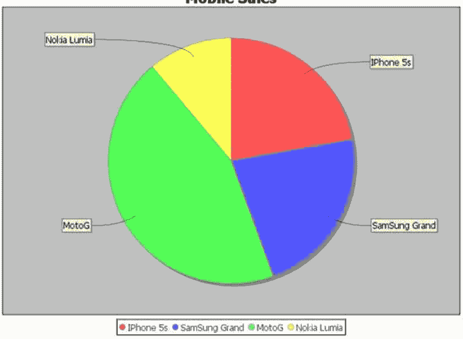
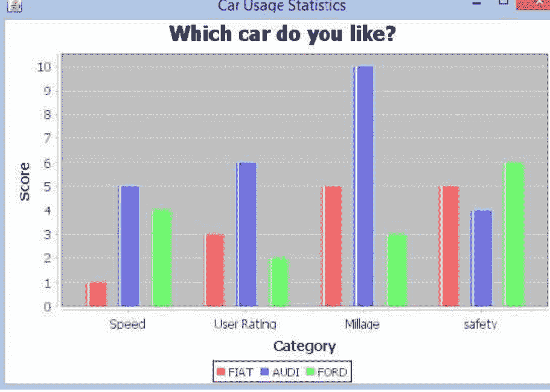
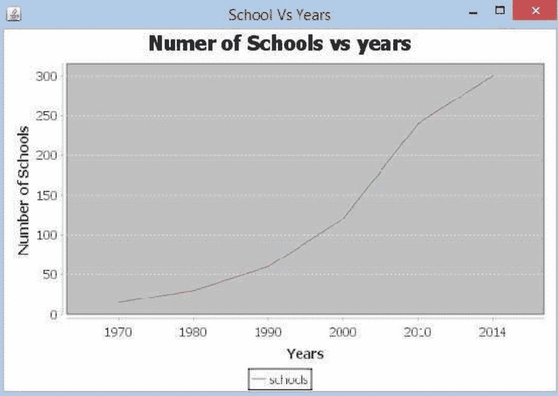
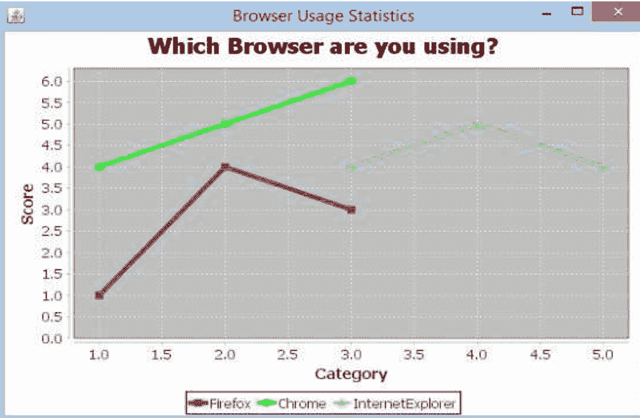
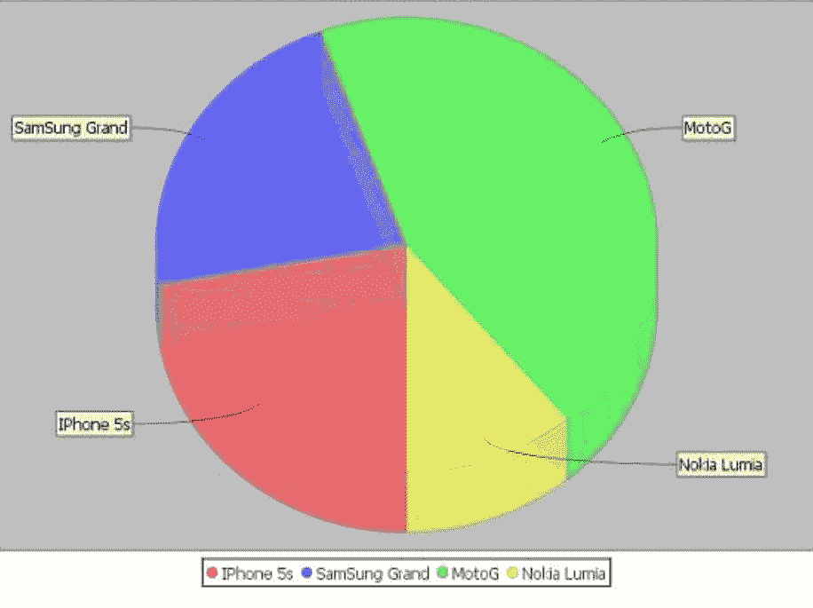
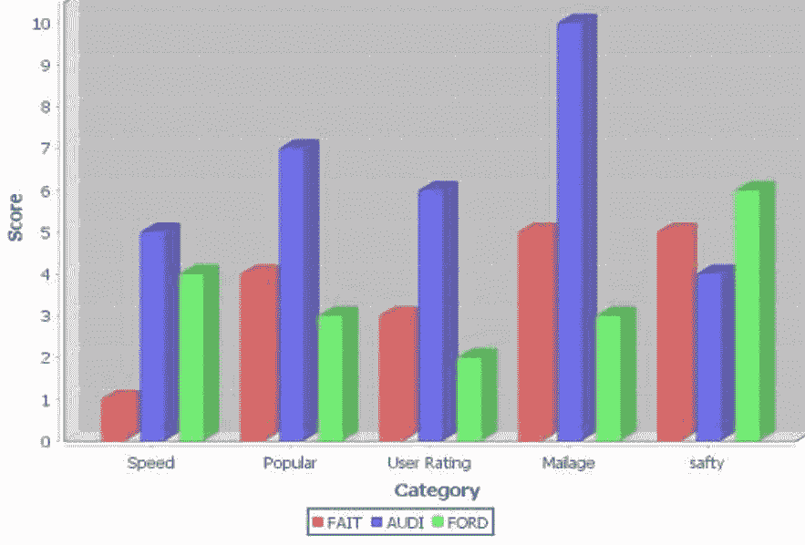
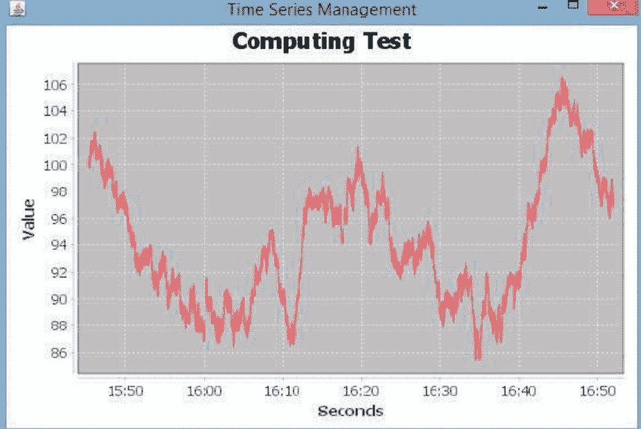
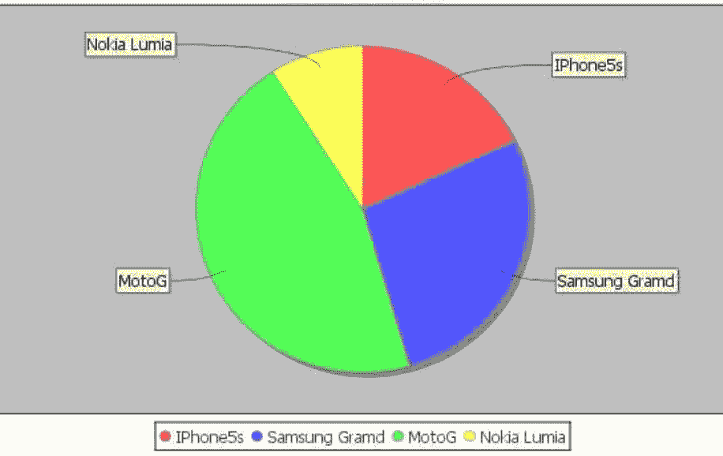

# JFreeChart：Java 图表库

## 关于教程

本教程描述了将 JFreeChart 集成到 Java 独立应用程序和 Web 应用程序中的各种方法。教程分为多个章节，旨在全面易懂地理解 Java 应用中的 JFreeChart 编程。

## 目标读者

本参考指南为初学者编写，帮助他们理解与 JFreeChart 库相关的从基础到高级的概念。

## 前提条件

在开始练习教程中的示例之前，预计您已经具备 JDK 1.6 或更高版本的 Java 编程、Swing、文件管理以及 Java 数据库管理的基础知识。

## 目录

- ApplicationFrame
- RefineryUtilities
- 5. JFreeChart – 饼图
  - 业务数据
  - 基于 AWT 的应用程序
  - JPEG 创建
- 6. JFreeChart – 柱状图
  - 业务数据
  - 基于 AWT 的应用程序
  - JPEG 创建
- 7. JFreeChart – 折线图
  - 业务数据
  - 基于 AWT 的应用程序
  - JPEG 创建
- 8. JFreeChart – XY 图
  - 业务数据
  - 基于 AWT 的应用程序
  - JPEG 创建
- 9. JFreeChart – 3D 饼图/柱状图
  - 3D 饼图
  - 3D 柱状图
- 10. JFreeChart – 气泡图
  - 业务数据
  - 基于 AWT 的应用程序
  - JPEG 创建
- 11. JFreeChart – 时间序列图
  - 业务数据
  - 基于 AWT 的应用程序
  - JPEG 创建
- 12. JFreeChart – 文件接口
  - 业务数据
  - 基于文件的图表生成

## 1. JFreeChart – 概述

图表是信息的图形化表示。目前有多种工具可用，可用于创建不同类型的图表。JFreeChart 项目由 David Gilbert 于 2000 年 2 月创立。如今，它是 Java 开发者中使用频率最高的图表库。

本教程将帮助你准确了解 JFreeChart 到底是什么、为什么需要它，以及在 Java 应用程序内部或独立创建不同类型图表的各种方法。

### 什么是 JFreeChart？

JFreeChart 是一个用 Java 开发的开源库。它可以与 Java 应用程序一起使用创建各种图表。通过使用 JFreeChart，我们可以创建所有主要的 2D 和 3D 图表，例如饼图、柱状图、折线图、XY 图和 3D 图。

### 为什么选择 JFreeChart？

JFreeChart 是开源且 100% 免费的，允许在商业应用中使用而无需任何费用。我们在这里列出了一些支持你应该使用 JFreeChart 的理由：

- 它带有完善良好的 API，使其非常容易理解。
- 它支持各种图表类型，如饼图、折线图、柱状图、面积图和 3D 图表。
- JFreeChart 易于扩展，可同时用于客户端和服务器应用程序。
- 它支持多种输出格式，如 PNG、JPEG、PDF、SVG 等。
- 它允许对图表进行广泛的自定义。

考虑一种情况：你正在开发一个应用程序并需要以图表的形式显示数据，而数据本身是动态填充的。在这种情况下，使用 JFreeChart 编程以图表形式显示数据非常简单。

## 2. JFreeChart – 安装

JFreeChart 以其高效的图表创建和用户友好的安装设置而闻名。本章描述了在 Windows 和 Linux 上设置 JFreeChart 的过程。安装 JFreeChart 时需要用户管理权限。

### 系统要求

| 项目 | 数值 |
| :--- | :--- |
| JDK | 1.5 或以上 |
| 内存 | 2GB RAM |
| 磁盘空间 | 无最低要求 |
| 操作系统版本 | Linux 或 Windows |

### 安装 JFreeChart

安装 JFreeChart 有以下三个步骤：

#### 1. 验证 Java 安装

要验证 Java 安装，打开控制台并执行以下 `java` 命令：

| 操作系统 | 任务 | 命令 |
| :--- | :--- | :--- |
| Windows | 打开命令控制台 | `C:>java -version` |
| Linux | 打开命令终端 | `$java -version` |

一旦 Java 安装妥当，在两个操作系统上都应该得到以下输出：

| 操作系统 | 描述 |
| :--- | :--- |
| Windows | Java version "1.7.0_60" Java (TM) SE Runtime Environment (build 1.7.0_60-b19) Java HotSpot(TM) 64-bit Server VM (build 24.60-b09,mixed mode) |
| Linux | Java version "1.7.0_25" OpenJDK Runtime Environment (rhel-2.3.10.4.el6_x86_64) OpenJDK 64-Bit Server VM (build 23.7-b01,mixed mode) |

如果你还没有安装，请从链接下载 Java 软件开发包 (SDK)：

http://www.oracle.com/technwork/java/javase/downloads/index.html

我们假设在继续本教程之前已经安装了 Java 1.7.0_60 版本。

#### 2. 设置 JAVA 环境

将 `JAVA_HOME` 环境变量指向你机器上安装 Java 的基础目录位置。例如：

| 操作系统 | 描述 |
| :--- | :--- |
| Windows | 将 `JAVA_HOME` 设置为 `C:\ProgramFiles\java\jdk1.7.0_60` |
| Linux | `export JAVA_HOME=/usr/local/java` |

将 Java 编译器添加到系统 Path 中。

| 操作系统 | 描述 |
| :--- | :--- |
| Windows | 将字符串 `C:\Program Files\Java\jdk1.7.0_60\bin` 添加到 PATH 的末尾。 |
| Linux | `export PATH=$PATH:$JAVA_HOME/bin/` |

从提示符中验证命令 `java -version`。

#### 3. 安装 JFreeChart

从链接 http://www.jfree.org/jfreechart/ 下载最新版本的 JFreeChart.zip。在需要将所需库链接到你的 Java 程序的任何位置解压下载的文件。下面的图像显示了目录和文件的结构：

- 30 Days
- ChangeLog
- experimental
- jfreechart-1.0.18-demo.jar
- license.txt
- NEWS
- pom.xml
- README.txt
- tests

将 `jfreechart-1.0.18.jar` 和 `jcommon-1.0.22.jar` 文件的完整路径添加到 CLASSPATH：

| 操作系统 | 描述 |
| :--- | :--- |
| Windows | 将字符串 `C:\jfreechart-1.0.18\lib\jfreechart-1.0.18.jar` 和 `C:\jfreechart-1.0.18\lib\jcommon-1.0.22.jar` 添加到变量 CLASSPATH 的末尾 |
| Linux | `export CLASSPATH=$CLASSPATH:/usr/share/jfreechart-1.0.18/lib/jfreechart-1.0.18.jar:/jcommon-1.0.22.jar` |

## 3. JFreeChart – 架构

本章解释了 JFreeChart 的基本类级和应用架构，让你了解 JFreeChart 如何与不同的类交互以及它是如何适配到你的 Java 应用程序中的。

### 类级架构

类级架构解释了库中的各种类如何相互作用以创建各种类型的图表。

以下是框图中使用的单元的详细信息：

| 单元 | 描述 |
| :--- | :--- |
| File | 具有用户输入的源，用于在文件中创建数据集。 |
| Database | 具有用户输入的源，用于在数据库中创建数据集。 |
| Create Dataset | 接收数据集并将数据集存储到对象中。 |
| General Dataset | 这种数据集主要用于饼图。 |
| Category Dataset | 这种数据集用于柱状图、折线图等。 |
| Series Dataset | 这种数据集用于存储数据系列并构建折线图。 |
| Series Collection Dataset | 将不同类别的系列数据集添加到系列集合集中。这种数据集用于 XY 折线图。 |
| Create Chart | 用于创建最终图表的方法。 |
| Frame/Image | 图表显示在 Frame 或图像上。 |

### 应用架构

应用级架构解释了 JFreeChart 库位于 Java 应用程序内部。

客户端程序接收用户数据，然后根据需要使用 Java 和 JFreeChart API 生成输出，可以是显示在应用程序内的帧，也可以是 JPEG 等图像格式独立输出。

## 4. JFreeChart – 参考 API

在本章中，我们将讨论 JFreeChart 库中一些重要的包、类和方法。这些包、类和方法在使用 JFreeChart 库创建各种图表时常用。

### ChartFactory 类

`ChartFactory` 是 `org.jfree.chart` 包下的一个抽象类。它提供了用于生成标准图表的工具方法集。

以下是一些重要的方法：

#### 类构造函数

| S.N. | 描述 |
| :--- | :--- |
| 1 | `ChartFactory()` `ChartFactory` 类的默认构造函数。 |

#### 类方法

| S.N. | 方法与描述 |
| :--- | :--- |
| 1 | `createPieChart(java.lang.String title, PieDataset dataset, boolean legend, boolean tooltips, boolean urls)` 该方法使用默认设置创建饼图。返回 `JFreeChart` 对象。 |
| 2 | `createPieChart3D(java.lang.String title, PieDataset dataset, boolean legend, boolean tooltips, boolean urls)` 该方法使用指定的数据集创建 3D 饼图。 |
| 3 | `createBarChart(java.lang.String title, java.lang.String categoryAxisLabel, java.lang.String valueAxisLabel, CategoryAxis, Plot orientation, boolean legend, boolean tooltips, boolean urls)` 参数 `java.lang.String categoryAxisLabel` 是 X 轴上数值的标签。参数 `java.lang.String valueAxisLabel` 是 Y 轴上数值的标签。该方法创建柱状图。 |


| 4 | `createBarChart3D(java.lang.String title, java.lang.String categoryAxisLabel, java.lang.String valueAxisLabel, CategoryDataset dataset, PlotOrientation orientation, boolean legend, boolean tooltips, boolean urls)` <br> 此方法创建一个具有 3D 效果的条形图。它返回 `JFreeChart` 类型的对象。 |

| 5 | `createLineChart(java.lang.String title, java.lang.String categoryAxisLabel, java.lang.String valueAxisLabel, CategoryDataset dataset, PlotOrientation orientation, boolean legend, boolean tooltips, boolean urls)` <br> 此方法使用默认设置创建一个折线图。 |

| 6 | `createLineChart3D(java.lang.String title, java.lang.String categoryAxisLabel, java.lang.String valueAxisLabel, CategoryDataset dataset, PlotOrientation orientation, boolean legend, boolean tooltips, boolean urls)` <br> 此方法创建一个具有 3D 效果的折线图。 |

| 7 | `createXYLineChart(java.lang.String title, java.lang.String xAxisLabel, java.lang.String yAxisLabel, XYDataset dataset, PlotOrientation orientation, boolean legend, boolean tooltips, boolean urls)` <br> 此方法基于 `XYDataset` 创建默认设置的折线图。 |

### ChartFrame 类

位于 `org.jfree.chart` 包下的 `ChartFrame` 类提供了所有与框架相关的函数和工具类。`ChartFrame` 类继承了父类（如 `Frame`、`Window`、`Container` 和 `Component` 类）的功能。

#### 类构造函数

| S.N. | 构造函数和描述 |
|---|---|
| 1 | `ChartFrame(java.lang.String, JFreeChart chart)` <br> 构造一个帧。 |
| 2 | `ChartFrame(java.lang.String, JFreeChart chart, boolean scrollpane)` <br> 构造一个帧。 |


#### 类方法

| S.N. | 方法和描述 |
|---|---|
| 1 | `getChartPanel()` <br> 返回帧的图表面板。 |

### ChartPanel 类

来自 `org.jfree.chart` 包的 `ChartPanel` 类用作 Swing GUI 组件显示 `JFreeChart` 对象。

#### 类构造函数

| S.N. | 构造函数和描述 |
|---|---|
| 1 | `ChartPanel(JFreeChart)` <br> 此构造函数构造一个显示指定图表的面板。 |
| 2 | `ChartPanel(JFreeChart chart, boolean useBuffer)` <br> 此构造函数构造一个包含图表的面板。 |
| 3 | `ChartPanel(JFreeChart chart, boolean properties, boolean save, boolean print, boolean zoom, boolean tooltip)` <br> 此构造函数构造一个 `JFreeChart` 面板。 |

#### 类方法

| S.N. | 方法和描述 |
|---|---|
| 1 | `setPreferredSize(java.awt.Dimension)` <br> 此方法用于使用 `java.awt.Dimension` 类对象作为参数来设置帧的大小。该方法取自 `javax.swing.JComponent`。 |

### ChartUtilities 类

来自 `org.jfree.chart` 包的 `ChartUtilities` 类提供了 `JFreeCharts` 的系列实用方法，包括将图表转换为图像格式（如 PNG、JPEG）以及创建 HTML 映射的方法。


#### 类构造函数

| S.N. | 构造函数和描述 |
|---|---|
| 1 | `ChartUtilities()` <br> 这是该类的默认构造函数。 |

#### 类方法

| S.N. | 方法和描述 |
|---|---|
| 1 | `saveChartAsPNG(java.io.File file, JFreeChart chart, int width, int height)` <br> 此方法将图表转换为 PNG 格式并保存到指定文件中。 |
| 2 | `saveChartAsJPEG(java.io.File file, JFreeChart chart, int width, int height)` <br> 此方法将图表转换为 JPEG 格式并保存到指定文件中。 |

### JFreeChart 类

`JFreeChart` 类是 `org.jfree.chart` 包下的核心类。该类提供了 `JFreeChart` 方法来创建条形图、折线图、饼图以及包含时间序列数据的 XY 图。

#### 类构造函数

| S.N. | 构造函数和描述 |
|---|---|
| 1 | `JFreeChart(Plot plot)` <br> 此构造函数根据提供的 plot 创建新图表。 |
| 2 | `JFreeChart(java.lang.String title, java.awt.Font title, Plot plot, boolean createLegend)` <br> 此构造函数根据给定的标题和 plot 创建新图表。 |
| 3 | `JFreeChart(java.lang.String title, Plot plot)` <br> 此构造函数根据给定的标题和 plot 创建新图表。 |

#### 类方法

| S.N. | 方法和描述 |
|---|---|
| 1 | `getXYPlot()` <br> 此方法将绘图图作为 `XYPlot` 返回。使用 `XYPlot`，我们可以对 xy 图进行一些实用性操作。 |

### PiePlot 类

该类是 `org.jfree.chart.plot` 包的一部分，并扩展了同包中的 `Plot` 类。该类提供了创建饼图的方法。

#### 类构造函数

| S.N. | 构造函数和描述 |
|---|---|
| 1 | `PiePlot()` <br> 创建一个新的绘图。 |
| 2 | `PiePlot(PieDataset dataset)` <br> 创建一个为指定数据集描绘饼图的绘图。 |

#### 类方法

| S.N. | 方法和描述 |
|---|---|
| 1 | `setStartAngle(double angle)` <br> 此方法设置起始角度并向所有注册的监听器发送 `PlotChangeEvent`。 |

### PiePlot3D 类

`PiePlot3D` 类是同包下 `PiePlot` 类的子类。因此，该类具有 `PiePlot` 类的特征，但用于创建 3D 绘图。

#### 类构造函数

| S.N. | 构造函数和描述 |
|---|---|
| 1 | `PiePlot3D()` <br> 此构造函数创建一个没有数据集的新实例。 |
| 2 | `PiePlot3D(PieDataset dataset)` <br> 此构造函数使用指定的数据创建一个具有三维效果的饼图。 |


#### 类方法

| S.N. | 方法和描述 |
|---|---|
| 1 | `setForeground(float alpha)` <br> 设置绘图的透明度并向所有注册的监听器发送事件。 |
| 2 | `setInteriorGap(double percent)` <br> 控制绘图边缘之间的空间（例如，标签出现的地方）。该方法取自 `PiePlot`。 |

### PlotOrientation 类

这是 `org.jfree.chart.plot` 中的一个类，用于显示 2D 绘图的方向。方向可以是垂直或水平。它设置 Y 轴。

#### 字段摘要

| S.N. | 类型 | 描述 |
|---|---|---|
| 1 | `PlotOrientation` | 用于水平方向的绘图。 |
| 2 | `PlotOrientation` | 用于垂直方向的绘图。这是默认方向。 |

#### 类方法

| S.N. | 方法和描述 |
|---|---|
| 1 | `isHorizontal()` <br> 如果方向为水平，则返回 true。 |
| 2 | `isVertical()` <br> 如果方向为垂直，则返回 true。 |


### XYPlot 类

这是 `org.jfree.chart.plot` 包中的一个通用类，用于以 (x,y) 对的形式绘制数据。此绘图可以使用任何实现 `XYDataSet` 的类的数据。`XYPlot` 使用 `XYItemRenderer` 来绘制绘图上的点。

#### 类构造函数

| S.N. | 构造函数和描述 |
|---|---|
| 1 | `XYPlot()` <br> 此构造函数创建一个没有数据集、轴和渲染器的 `XYPlot` 实例。 |
| 2 | `XYPlot(XYDataSet dataset, ValueAxis domainAxis, ValueAxis rangeAxis, XYItemRenderer renderer)` <br> 此构造函数根据指定的数据集、轴和渲染器创建一个新绘图。 |

#### 类方法

| S.N. | 方法和描述 |
|---|---|
| 1 | `setRenderer(XYItemRenderer renderer)` <br> 此方法为主数据集设置渲染器并向所有注册的监听器发送更改事件。 |

### NumberAxis 类

该类位于 `org.jfree.chart.axis` 包中，它可以访问任何轴的数值数据。当我们对任何轴设置默认范围时，它会根据数据范围进行调整。但通过使用 `NumberAxis` 类，我们可以设置域轴和范围轴的下边界和上边界。

#### 类构造函数

| S.N. | 构造函数和描述 |
|---|---|
| 1 | `NumberAxis()` <br> 这是 `NumberAxis` 的默认构造函数。 |
| 2 | `NumberAxis(java.lang.String label)` <br> `NumberAxis` 构造函数在需要时使用默认值。 |

#### 类方法

| 序号 | 方法与描述 |
|---|---|
| 1 | `setLowerMargin(double margin)` <br> 它设置轴的下边距（作为范围的百分比），并向所有已注册的监听器发送 `AxisChangeEvent`。此方法继承自 `ValueAxis` 的父类。 |
| 2 | `setUpperMargin(double margin)` <br> 它设置轴的上边距（作为范围的百分比），并向所有已注册的监听器发送 `AxisChangeEvent`。 |

### XYLineShapeRenderer 类

这是 `org.jfree.chart.xy` 包下的一个类，用于用线条连接数据点并在每个数据点处绘制形状。该渲染器专为配合 `XYPlot` 类使用而设计。

#### 类构造函数

| 序号 | 构造函数与描述 |
|---|---|
| 1 | `XYLineShapeRenderer()` <br> 它创建一个线条和形状均可见的新渲染器。 |
| 2 | `XYLineShapeRenderer(boolean lines, boolean shapes)` <br> 它创建一个具有特定属性的新渲染器。 |

#### 类方法

| 序号 | 方法与描述 |
|---|---|
| 1 | `setSeriesPaint(int series, java.awt.Paint paint)` <br> 此方法设置用于序列的画笔，并向所有已注册的监听器发送 `AxisChangeEvent`。此方法继承自 JFreeChart API 中的 `AbstractRenderer`。 |
| 2 | `setSeriesStroke(int series, java.awt.Stroke stroke)` <br> 此方法设置用于序列的描边，并向所有已注册的监听器发送 `AxisChangeEvent`。此方法继承自该包的父类 `AbstractRenderer`。 |


### XYItemRenderer 接口

这是一个用于在 `XYPlot` 上渲染单个 (x, y) 项目的接口。

### org.jfree.data.general 包

该包为 `org.jfree.data.general`，包含用于定义不同类型数据集以构建图表的类和接口。

### PieDataset 接口

这是一个用作通用数据集的接口，其中值与键相关。名称表明你可以使用此数据集为饼图提供数据。该接口扩展了 `KeyValues` 和 `Dataset` 接口。此接口使用的所有方法均继承自 `KeyValues` 和 `Dataset` 接口。

### DefaultPieDataset 类

这是 `PieDataset` 接口的默认实现。

#### 类构造函数

| 序号 | 构造函数与描述 |
|---|---|
| 1 | `DefaultPieDataset()` <br> 此构造函数创建一个初始为空的数据集。 |
| 2 | `DefaultPieDataset(KeyValues data)` <br> 它通过从 `KeyValues` 实例复制数据来创建一个新的数据集。 |

#### 类方法

| 序号 | 方法与描述 |
|---|---|
| 1 | `setValue(java.lang.Comparable key, double value)` <br> 它设置键的数据值，并向所有已注册的监听器发送 `DatasetChangeEvent`。 |
| 2 | `setValue(java.lang.Comparable key, java.lang.Number value)` <br> 它设置键的数据值，并向所有已注册的监听器发送 `DatasetChangeEvent`。 |

### TimeSeriesException 类

这是一个异常类。它用于抛出数据时间序列中发生的异常。当出现重复或无效数据时会抛出异常。时间序列不能包含重复项，且格式必须有效。


### DefaultCategoryDataset 类

这是 `CategoryDataset` 接口的默认实现类。

#### 类构造函数

| 序号 | 构造函数与描述 |
|---|---|
| 1 | `DefaultCategoryDataset()` <br> 此构造函数创建一个空的数据集。 |

#### 类方法

| 序号 | 方法与描述 |
|---|---|
| 1 | `addValue(double value, java.lang.Comparable rowKey, java.lang.Comparable columnKey)` <br> 此方法使用可比较的键向表中添加一个值。 |
| 2 | `addValue(java.lang.Number value, java.lang.Comparable rowKey, java.lang.Comparable columnKey)` <br> 此方法向表中添加一个值。 |
| 3 | `setValue(double value, java.lang.Comparable rowKey, java.lang.Comparable columnKey)` <br> 此方法向表中添加或更新一个值，并向所有已注册的监听器发送 `DatasetChangeEvent`。 |
| 4 | `setValue(java.lang.Number value, java.lang.Comparable rowKey, java.lang.Comparable columnKey)` <br> 此方法向表中添加或更新一个值，并向所有已注册的监听器发送 `DatasetChangeEvent`。 |

请参考 FreeChart API 获取有关其他各种方法和字段的信息。

### Series Datasets (序列数据集)

序列数据集被 XY 图使用。该包为 `org.jfree.data.xy`，包含了属于 XY 图的类和接口。核心接口是 `XYDataset`。

### XYDataset 接口

这是一个可以通过 (x,y) 项目形式访问数据的接口。正如其名称所示，你可以使用此数据集为 XY 图表提供服务。该接口中的某些方法继承自 `SeriesDataset` 接口。


### XYZDataset 接口

这是一个可以通过 (x,y,z) 项目形式访问数据的接口。正如其名称所示，你可以使用此数据集为图表提供服务。该接口中的某些方法继承自 `SeriesDataset`。

### XYSeries 类

这是一个表示 (x,y) 形式数据点序列的类。

### XYLineShapeRenderer 类 (重复定义)

它位于 `org.jfree.chart.xy` 包下，负责用线条连接数据点并在每个数据点处绘制形状。该渲染器专为配合 `XYPlot` 类使用而设计。

#### 类构造函数

| 序号 | 构造函数与描述 |
|---|---|
| 1 | `XYSeries()` <br> 它创建一个带线条和形状的新序列。 |


| 序号 | 构造函数与描述 |
|---|---|
| 2 | `XYSeries(boolean lines, boolean shapes)` 它创建一个具有特定属性的新序列。 |
| 3 | `addValue(java.lang.Comparable key)` 它创建一个带线条和形状的新序列。 |

#### 类方法

| 序号 | 方法与描述 |
|---|---|
| 1 | `setSeriesPaint(int series, java.awt.Paint paint)` 源自 JFreeChart API 方法。 |
| 2 | `setSeriesStroke(int series, java.awt.Stroke stroke)` 源自序列的方法。 |


这是 `XYDataset` 的集合。该类用于为 `XYPlot` 组多个多个。

#### 类构造函数

| 序号 | 构造函数与描述 |
|---|---|
| 1 | `XYSeriesCollection()` 它创建一个新的数据集。 |
| 2 | `XYSeriesCollection(XYSeries)` 它将一个序列添加到集合中。 |

这是 `XYZDataset` 接口的默认实现。某些方法属于该类。

#### 类构造函数

| 序号 | 构造函数与描述 |
|---|---|
| 1 | `DefaultXYZDataset()` 它创建一个空的数据集。 |

#### 类方法

| 序号 | 方法与描述 |
|---|---|
| 1 | `addSeries(XYSeries series)` 它将一个序列添加到集合中，并向所有已注册的监听器发送 `DatasetChangeEvent`。 |

包为 `org.jfree.data.time`。该包包含了用于时间相关数据的类和接口。

该类表示周期值形式的数据项，其中周期是 `RegularTimePeriod` 抽象类的实例，例如时间、小时、分钟和秒。

#### 类构造函数

| 序号 | 构造函数与描述 |
|---|---|
| 1 | `TimeSeries(java.lang.Comparable name)` 它创建一个空序列。 |
| 2 | `TimeSeries(java.lang.Comparable name, java.lang.String domain, java.lang.String range)` 它创建一个不包含数据的时间序列。 |

该类作为时间序列对象的集合。由于扩展了 `IntervalXYDataset` 接口，它实现了 `XYDataset` 接口。

#### 类构造函数

| 序号 | 构造函数与描述 |
|---|---|
| 1 | `TimeSeriesCollection()` 它构建一个绑定默认时区的空数据集。 |
| 2 | `TimeSeriesCollection(TimeSeries)` 它构建一个包含单个序列（可以添加更多）的数据集，绑定到默认时区。 |


| 序号 | 构造函数与描述 |
|---|---|
| 3 | `TimeSeriesCollection(TimeSeries series, java.util.TimeZone zone)` 它构建一个包含单个序列（可以添加更多）的数据集，绑定到特定的时区。 |
| 4 | `TimeSeriesCollection(java.util.TimeZone zone)` 它构建一个空数据集，绑定到特定的时区。 |

#### 类方法

| 序号 | 方法与描述 |
|---|---|
| 1 | `addSeries(TimeSeries series)` 此方法向集合中添加一个序列，并向所有注册的监听器发送 `ChangeEvent`。 |

请参阅 JFreeChart API 以获取剩余的方法和字段。

此类表示特定天数的某一秒。该类是不可变的，这是所有 `RegularTimePeriod` 子类的必要要求。

#### 类构造函数

| 序号 | 构造函数与描述 |
|---|---|
| 1 | `Second()` 根据系统日期/时间构建一个新的 `Second` 对象。 |
| 2 | `Second(java.util.Date time)` 根据指定的日期/时间和默认时区构建一个新实例。 |
| 3 | `Second(java.util.Date time, java.util.TimeZone zone, java.util.Locale locale)` 根据提供的时间和时区创建一个新的秒。 |
| 4 | `Second(int second, int minute, int hour, int day, int month, int year)` 创建一个新的秒。 |
| 5 | `Second(int second, Minute minute)` 构建一个新的 `Second` 对象。 |


#### 类方法

| 序号 | 方法与描述 |
|---|---|
| 1 | `getSecond()` 返回分钟内的秒数。 |
| 2 | `next()` 返回当前秒数之后的下一秒。 |

请参阅 JFreeChart API 获取剩余的方法和字段。

该包是 `org.jfree.ui`。此包属于 JFreeChart 的 JCommons API。它包含了用于创建预配置图表框架的工具类。

这是一个用于创建简单应用程序主框架的基类。该框架监听窗口关闭事件，并响应关闭 JVM。这对于小型演示是可以的。对于企业级应用程序，你需要使用更健壮的东西。该类中的主要核心方法继承自 `Component`、`Container`、`Window`、`Frame` 和 `JFrame` 类。

#### 类构造函数

| 序号 | 构造函数与描述 |
|---|---|
| 1 | `ApplicationFrame(java.lang.String title)` 创建一个带有字符串标题的应用程序框架。 |

此类帮助创建 AWT Frames。这就是为什么我们在教程示例中使用此类作为父类的原因。

从父类中继承的方法被用于打开框架、关闭框架、更改大小、更改背景色或前景颜色，以及监听器设置。


这是一个与用户界面相关的工具方法类集合。

#### 类方法

| 序号 | 方法与描述 |
|---|---|
| 1 | `centerFrameOnScreen(java.awt.Window frame)` 将指定的框架置于屏幕中央。 |

上述方法在教程示例中使用。请参阅 JFreeChart API 获取剩余的方法和字段。

在饼图中，每个扇区的弧长度与其代表的数量成正比。本章将演示 — 我们如何如何使用 JFreeChart 从给定的业务数据集中创建饼图。

接下来的示例通过饼图展示了手机销售情况。以下是不同手机品牌及其销量（每天单位：台）。

| 序号 | 手机品牌 | 销量（每天单位：台） |
|---|---|---|
| 1 | Iphone 5S | 20 |
| 2 | Samsung Grand | 20 |
| 3 | MOTO G | 40 |
| 4 | Nokia Lumia | 10 |

### 基于 AWT 的应用程序

以下是根据上述信息创建饼图的代码。此代码帮助你将饼图嵌入到任何基于 AWT 的应用程序中。

```
import javax.swing.JPanel;
import org.jfree.chart.ChartFactory;
import org.jfree.chart.ChartPanel;
import org.jfree.chart.JFreeChart;
import org.jfree.chart.data.general.DefaultDataset;
import org.jfree.chart.data.general.PieDataset;
import org.jfree.ui.ApplicationFrame;
import org.jfree.ui.RefineryUtilities;

{
    public PieChart_AWT( String title )
    {
        super( title);
        setContent(createPanel());
    }
    private static PieDataset createDataset()
    {
      DefaultPieDataset dataset = new DefaultPieDataset();
      dataset.setValue("iPhone 5s", new Double(20));
      dataset.setValue("Samsung Grand", new Double(20));
      dataset.setValue("MotoG", new Double(40));
      dataset.setValue("Nokia Lumia", new Double(10));
      return dataset;
    }
    private static JFreeChart createChart(PieDataset dataset)
    {
      JFreeChart chart = ChartFactory.createPieChart(
        "Mobile Sales", // chart title
        dataset, // data
        true, // include legend
        true);

      return chart;
    }
    public static JPanel createPanel()
    {
      JFreeChart chart = createChart(createDataset());
      return new ChartPanel(chart);
    }
    public static void main(String[] args)
    {
      PieChart_AWT demo = new PieChart_AWT("Mobile Sales");
      demo.setSize(560, 360);
      RefineryUtilities.centerFrameOnScreen(demo);
      demo.setVisible(true);
    }
}
```

我们将上述代码保存为 `PieChart_AWT.java`，然后在命令行提示符运行：

```
$javac PieChart_AWT.java
$java PieChart_AWT
```

如果一切正常，它将编译并运行生成以下：



如果你不需要将图表嵌入任何应用程序，可以在命令行创建图像。JFreeChart 允许你根据需要将图表保存为 JPG 或 PNG 格式。

# JPEG 图像创建

让我们从命令行生成 JPEG 图像。以下是 JFreeChart 库提供的 API，你可以根据需求生成 PNG 或 JPEG 图像：

- `saveChartAsPNG()` - 保存为 PNG 格式的 API。
- `saveChartAsJPEG()` - 保存为 JPEG 格式的 API。

```
import java.io.*;
import org.jfree.chart.ChartUtilities;
import org.jfree.chart.ChartFactory;
import org.jfree.chart.JFreeChart;
import org.jfree.chart.data.DefaultPieDataset;

public class PieChart {
    public static void main(String[] args) throws Exception
    {
      DefaultPieDataset dataset = new DefaultPieDataset();
      dataset.setValue("Iphone 5s", new Double(20));
      dataset.setValue("Samung Grand", new Double(20));
      dataset.setValue("Motog", new Double(40));
      dataset.setValue("Nokia Lumia", new Double(10));

      JFreeChart chart = ChartFactory.createPieChart(
        "Mobile Sales", // chart title
        dataset, // data
        true, // include legend
        true);

      int width = 640; /* 图像宽度 */
      int height = 480; /* 图像高度 */
      File pieChart = new File("PieChart.jpeg");
      ChartUtilities.saveChartAsJPEG(pieChart, chart, width, height);
    }
}
```

我们将 Java 代码保存在 `PieChart.java` 文件中，然后在命令行提示符运行：

```
$javac PieChart.java
$java PieChart
```

如果一切正常，它将编译并在当前目录下创建一个名为 `PieChart.jpeg` 的 JPEG 文件。

本章演示如何使用 JFreeChart 从给定的业务数据创建柱状图。柱状图使用不同方向（水平或垂直）的柱显示比较。图表的一个轴（域轴）显示特定的比较对象，另一个轴（范围轴）表示离散值。

接下来的示例通过柱状图展示了各种汽车统计数据。以下是汽车品牌及其不同特征的列表，我们将使用柱状图进行展示：

| Car | Speed | User Rating | Millage | Safety |
|---|---|---|---|---|
| Fiat | 1.0 | 3.0 | 5.0 | 5.0 |
| Audi | 5.0 | 6.0 | 10.0 | 4.0 |
| Ford | 4.0 | 2.0 | 3.0 | 6.0 |

### 基于 AWT 的应用程序

以下是根据上述信息创建柱状图的代码。此代码帮助你将柱状图嵌入到任何基于 AWT 的应用程序中。


## JFreeChart 示例代码

### BarChart_AWT.java 完整示例

```java
import org.jfree.chart.ChartFactory;
import org.jfree.chart.ChartPanel;
import org.jfree.chart.JFreeChart;
import org.jfree.chart.plot.Orientation;
import org.jfree.data.category.CategoryDataset;
import org.jfree.data.category.DefaultCategoryDataset;
import org.jfree.ui.ApplicationFrame;
import org.jfree.ui.RefineryUtilities;

public class BarChart_AWT extends ApplicationFrame {

    public BarChart_AWT(String applicationTitle, String chartTitle) {
        super(applicationTitle);
    }

    private static CategoryDataset createDataset() {
        DefaultCategoryDataset dataset = new DefaultCategoryDataset();
        dataset.addValue(1.0, "Speed", "Fiat");
        dataset.addValue(3.0, "User Rating", "Fiat");
        dataset.addValue(5.0, "Millage", "Fiat");
        dataset.addValue(5.0, "Safety", "Fiat");
        dataset.addValue(5.0, "Speed", "Audi");
        dataset.addValue(6.0, "User Rating", "Audi");
        dataset.addValue(10.0, "Millage", "Audi");
        dataset.addValue(4.0, "Safety", "Audi");
        dataset.addValue(4.0, "Speed", "Ford");
        dataset.addValue(2.0, "User Rating", "Ford");
        dataset.addValue(3.0, "Millage", "Ford");
        dataset.addValue(6.0, "Safety", "Ford");
        return dataset;
    }

    private static JFreeChart createChart(CategoryDataset dataset) {
        JFreeChart chart = ChartFactory.createBarChart(
            "Car Statistics", // chart title
            "Car", // x-axis label
            "Value", // y-axis label
            dataset,
            Orientation.VERTICAL,
            false);
        return chart;
    }

    public static JPanel createPanel() {
        JFreeChart chart = createChart(createDataset());
        return new ChartPanel(chart);
    }

    public static void main(String[] args) {
        BarChart_AWT demo = new BarChart_AWT("Car Statistics", "Car Sales");
        demo.setSize(560, 360);
        RefineryUtilities.centerFrameOnScreen(demo);
        demo.setVisible(true);
    }
}
```

### 创建柱状图的核心代码片段

```java
JFreeChart barChart = ChartFactory.createBarChart(
    chartTitle,
    "Category",
    "Score",
    createdDataset(),
    PlotOrientation.VERTICAL,
    true, true, false);
```

```java
ChartPanel chartPanel = new ChartPanel(barChart);
chartPanel.setPreferredSize(new java.awt.Dimension(560, 367));
setContent(chartPanel);
```

### 另一种数据集创建方式

```java
private CategoryDataset createDataset() {
    final String fiat = "FIAT";
    final String audi = "AUDI";
    final String ford = "FORD";
    final String speed = "Speed";
    final String millage = "Millage";
    final String userrating = "User Rating";
    final String safety = "safety";

    DefaultCategoryDataset dataset = new DefaultCategoryDataset();

    dataset.addValue(1.0, fiat, speed);
    dataset.addValue(3.0, fiat, userrating);
    dataset.addValue(5.0, fiat, millage);
    dataset.addValue(5.0, fiat, safety);

    dataset.addValue(5.0, audi, speed);
    dataset.addValue(6.0, audi, userrating);
    dataset.addValue(10.0, audi, millage);
    dataset.addValue(4.0, audi, safety);

    dataset.addValue(4.0, ford, speed);
    dataset.addValue(2.0, ford, userrating);
    dataset.addValue(3.0, ford, millage);
    dataset.addValue(6.0, ford, safety);
    return dataset;
}
```

### 主方法启动示例

```java
public static void main(String[] args) {
    BarChart_AWT chart = new BarChart_AWT("Car Usage Statistics", "Which car do you like?");
    chart.pack();
    RefineryUtilities.centerFrameOnScreen(chart);
    chart.setVisible(true);
}
```

### 编译与运行

将上述 Java 代码保留在 `BarChart_AWT.java` 文件中，然后从命令行提示符进行编译并运行：

```
$ javac BarChart_AWT.java
$ java BarChart_AWT
```

如果一切正常，它将编译并运行，生成以下柱状图：


---

## 生成 JPEG 图像示例

### BarChart.java

```java
import java.io.*;
import org.jfree.chart.ChartFactory;
import org.jfree.chart.JFreeChart;
import org.jfree.chart.plot.PlotOrientation;
import org.jfree.data.category.DefaultCategoryDataset;
import org.jfree.chart.ChartUtilities;

public class BarChart {
    public static void main(String[] args) throws Exception {
        final String fiat = "FIAT";
        final String audi = "AUDI";
        final String ford = "FORD";
        final String speed = "Speed";
        final String millage = "Millage";
        final String userrating = "User Rating";
        final String safety = "safety";

        final DefaultCategoryDataset dataset = new DefaultCategoryDataset();

        dataset.addValue(1.0, fiat, speed);
        dataset.addValue(3.0, fiat, userrating);
        dataset.addValue(5.0, fiat, millage);
        dataset.addValue(5.0, fiat, safety);

        dataset.addValue(5.0, audi, speed);
        dataset.addValue(6.0, audi, userrating);
        dataset.addValue(10.0, audi, millage);
        dataset.addValue(4.0, audi, safety);

        dataset.addValue(4.0, ford, speed);
        dataset.addValue(2.0, ford, userrating);
        dataset.addValue(3.0, ford, millage);
        dataset.addValue(6.0, ford, safety);

        JFreeChart barChart = ChartFactory.createBarChart(
            "CAR USAGE STATISTICS",
            "Category",
            "Score",
            dataset, PlotOrientation.VERTICAL,
            true, true, false);

        int width = 640; /* Width of the image */
        int height = 480; /* Height of the image */
        File barChartFile = new File("BarChart.jpeg");
        ChartUtilities.saveChartAsJPEG(barChartFile, barChart, width, height);
    }
}
```

### 编译与运行

将上述 Java 代码保留在 `BarChart.java` 文件中，然后从命令行提示符进行编译并运行：

```
$ javac BarChart.java
$ java BarChart
```

如果一切正常，它将编译并运行，在当前目录下创建一个名为 `BarChart.jpeg` 的 JPEG 图像。



---

## 7. JFreeChart – 折线图

折线图通过直线段连接一系列数据点来显示数据。折线图展示了数据随频率的变化。

本章节演示了如何使用 JFreeChart 创建折线图。给定数据如下：

| 年 | 学校数量 |
|---|---|
| 1970 | 15 |
| 1980 | 30 |
| 1990 | 60 |
| 2000 | 120 |
| 2010 | 240 |
| 2014 | 300 |

### 基于 AWT 的应用程序

以下是基于 AWT 创建折线图的代码：

```java
import org.jfree.chart.ChartFactory;
import org.jfree.chart.JFreeChart;
import org.jfree.chart.plot.PlotOrientation;
import org.jfree.data.category.DefaultCategoryDataset;
import org.jfree.util.RefineryUtilities;
import org.jfree.chart.ChartPanel;

import javax.swing.JFrame;

public class LineChart_AWT extends JFrame {
    public LineChart_AWT(String chartTitle, String axisTitle) {
        super(chartTitle);
        DefaultCategoryDataset dataset = new DefaultCategoryDataset();
        dataset.addValue(1.0, "schools", "1970");
        dataset.addValue(3.0, "schools", "1980");
        dataset.addValue(6.0, "schools", "1990");
        dataset.addValue(120.0, "schools", "2000");
        dataset.addValue(240.0, "schools", "2010");
        dataset.addValue(300.0, "schools", "2014");

        JFreeChart lineChart = ChartFactory.createLineChart(
            "Schools Vs Years",
            "Year",
            "Number of Schools",
            dataset, PlotOrientation.VERTICAL,
            true, true, false);

        ChartPanel chartPanel = new ChartPanel(lineChart);
        chartPanel.setPreferredSize(new java.awt.Dimension(560, 367));
        setContentPane(chartPanel);
    }

    public static void main(String[] args) {
        LineChart_AWT chart = new LineChart_AWT("School Enrollment", "Frequency");
        chart.pack();
        RefineryUtilities.centerFrameOnScreen(chart);
        chart.setVisible(true);
    }
}
```

### 编译与运行

将上述 Java 代码保留在 `LineChart_AWT.java` 文件中，然后从命令行提示符进行编译并运行：

```
$ javac LineChart_AWT.java
$ java LineChart_AWT
```

如果一切正常，它将编译并运行，生成以下折线图：



---

## 8. JFreeChart – XY 图表

XY 图（散点图）基于由 X 和 Y 值列表组成的数据系列。每个值对 (X,Y) 都是坐标系中的一个点。在这里，一个值决定水平 (X) 位置，另一个值决定垂直 (Y) 位置。本章将演示——我们如何使用 JFreeChart 根据给定的业务数据创建 XY 图表。

### 业务数据

考虑这样一个示例：我们为所有主流浏览器创建一个 XY 图表。如下所示，从不同人群中收集了不同的评分：

| 类别(X) | 评分(Y) |
| :--- | :--- |
| Firefox | 1.0 | 1.0 |
| | 2.0 | 4.0 |
| | 3.0 | 3.0 |
| Chrome | 1.0 | 4.0 |
| | 2.0 | 5.0 |
| | 3.0 | 6.0 |
| IE | 3.0 | 4.0 |
| | 4.0 | 5.0 |
| | 5.0 | 4.0 |


### 基于 AWT 的应用程序

以下是通过上述信息创建 XY 图表的代码。此代码可以帮助你将 XY 图表嵌入任何基于 AWT 的应用程序中。


```java
import java.awt.Color;
import java.awt.BasicStroke;
import org.jfree.chart.ChartPanel;
import org.jfree.chart.JFreeChart;
import org.jfree.data.xy.XYDataset;
import org.jfree.data.xy.XYSeries;
import org.jfree.ui.ApplicationFrame;
import org.jfree.ui.RefineryUtilities;
import org.jfree.chart.plot.XYPlot;
import org.jfree.chart.ChartFactory;
import org.jfree.chart.plot.PlotOrientation;
import org.jfree.data.xy.XYSeriesCollection;
import org.jfree.chart.renderer.xy.XYLineAndShapeRenderer;

public class XYLineChart extends ApplicationFrame
{
    public XYLineChart_AWT( String applicationTitle, String chartTitle )
    {
        super(applicationTitle);
        JFreeChart xyLineChart = ChartFactory.createXYLineChart(
            chartTitle ,
            "Category",
            "Score",
            createdDataset(),
            PlotOrientation.VERTICAL ,
            true , true, false);

        ChartPanel chartPanel = new ChartPanel( xyLineChart);
        chartPanel.setPreferredSize(new java.awt.Dimension(560 , 367));
        final XYPlot plot = xyLineChart.getXYPlot();
        XYLineAndShapeRenderer renderer = new XYLineAndShapeRenderer();
        renderer.setSeriesPaint(1 , Color.RED);
        renderer.setSeriesPaint(1 , Color.GREEN);
        renderer.setSeriesPaint(2 , Color.YELLOW);
        renderer.setSeriesStroke(0 , new BasicStroke( 4.0f )));

        renderer.setSeriesStroke( 1 , new BasicStroke( 3.0f ) );
        renderer.setSeriesStroke( 2 , new BasicStroke( 2.0f ) );
        plot.setRenderer( renderer );
        setContent( chartPane );
    }

    private XYDataset createDataset() {
    {
        final XYSeries firefox = new XYSeries("Firefox");
        firefox.add( 1.0 , 1.0 );
        firefox.add( 2.0 , 4.0 );
        firefox.add( 3.0 , 3.0 );
        final XYSeries chrome = new XYSeries("Chrome");
        chrome.add( 1.0 , 4.0 );
        chrome.add( 2.0 , 5.0 );
        chrome.add( 3.0 , 6.0 );
        final XYSeries iexplorer = new XYSeries("InternetExplorer");
        iexorer.add( 3.0 , 4.0 );
        iexorer.add( 4.0 , 5.0 );
        iexorer.add( 5.0 , 4.0 );
        final XYSeriesCollection dataset = new XYSeriesCollection();
        dataset.addSeries( firefox );
        dataset.addSeries( chrome );
        dataset.addSeries( iexplorer );
        return dataset;
    }

    public static void main( String[] args ) {
        XYLineChart_AWT chart = new XYLineChart_AWT("Browser Usage", "Which Browser are you using?");
        chart.pack( );
        RefineryUtilities.centerFrameOnScreen( chart );
        chart.setVisible( true );
    }
}
```


# JFreeChart

我们将上述 Java 代码保存在 `XYWT.java` 文件中，然后按照提示运行：

```bash
$javac ChartWT.java
$java XYWT
```

如果一切正常，它将编译并运行生成以下 XY 图：



# 创建 JPEG

让我们重写上述示例从命令行生成 JPEG 图像。

```java
import java.io.*;
import org.jfree.chart.ChartFactory;
import org.jfree.chart.JFreeChart;
import org.jfree.data.xy.XYSeries;
import org.jfree.chart.plot.PlotOrientation;
import org.jfree.data.xy.XYSeriesCollection;
import org.jfree.chart.ChartUtilities;

public class XYLineChart_image
{
    public static void main(String[] args) throws Exception
{
        final XYSeries firefox = new XYSeries("Firefox");
        firefox.add( 1.0 , 1.0 );
        firefox.add( 2.0 , 4.0 );
        firefox.add( 3.0 , 3.0 );
        final XYSeries chrome = new XYSeries("Chrome");
        chrome.add( 1.0 , 4.0 );
        chrome.add( 2.0 , 5.0 );
        chrome.add( 3.0 , 6.0 );
        final XYSeries iexplorer = new XYSeries("InternetExplorer");
        iexorer.add( 3.0 , 4.0 );
        iexorer.add( 4.0 , 5.0 );
        iexorer.add( 5.0 , 4.0 );
        final XYSeriesCollection dataset = new XYSeriesCollection();
        dataset.addSeries( firefox );
        dataset.addSeries( chrome );
        dataset.addSeries( iexplorer );

        JFreeChart xylineChart = ChartFactory.createXYLineChart(
          "Browser usage statistics",
          "Category",
          "Score",
          dataset,
          PlotOrientation.VERTICAL,
          true, true, false);

        int width = 640; /* Width of the image */
        int height = 480; /* Height of the image */
        File XYChart = new File("XYLineChart.jpeg");
        ChartUtils.saveChartAsJPEG(XYChart, xylineChart, width, height);
    }
}
```

我们将上述 Java 代码保存在 `XYLineChart_image.java` 中，然后按照提示运行：

```bash
$javac XYLineChart_image.java
$java XYLineChart_image
```

如果一切正常，它将编译并运行创建一个名为 `XYLineChart.jpeg` 的 JPEG 图像。


## 9. JFreeChart – 3D 饼图/柱状图

3D 图表是以三维格式显示的。你可以使用这些图表提供更好的显示和清晰的信息。3D 饼图与饼图相同，额外可以通过添加少量代码实现新的 3D 效果，这些代码将处理饼图中3D 效果的创建。

### 3D 饼图

考虑以下示例以通过 3D 饼图说明手机销量。以下是不同手机品牌及其销售情况（每天台数）。

| 序号 | 手机品牌 | 销量（每天台数） |
| :--- | :--- | :--- |
| 1 | Iphone 5S | 20 |
| 2 | Samsung Grand | 20 |
| 3 | MOTO G | 40 |
| 4 | Nokia Lumia | 10 |

以下是通过上述信息创建 3D 饼图的代码。此代码可以帮助你将饼图嵌入任何基于 AWT 的应用程序中。

```java
import java.io.*;
import org.jfree.chart.ChartFactory;
import org.jfree.chart.JFreeChart;
import org.jfree.chart.plot.PiePlot3D;
import org.jfree.chart.data.DefaultPieDataset;
import org.jfree.chart.ChartUtilities;

public class PieChart3D
{
    public static void main(String[] args) throws Exception
    {
        DefaultPieDataset dataset = new DefaultPieDataset();
        dataset.setValue("Iphone 5S", new Double( 20 ) );
        dataset.setValue("Samsung Grand", new Double( 20 ) );
        dataset.setValue("MotoG", new Double( 40 ) );
        dataset.setValue("Nokia Lumia", new Double( 10 ) );

        JFreeChart chart = ChartFactory.createPieChart3D(
            "Mobile Sales", // chart title
            dataset , // data
            true, // include legend
            true,
            false);

        final PiePlot3D plot = ( PiePlot3D ) chart.getPlot( );
        plot.setStartAngle(270);
        plot.setForegroundAlpha(0.60f);
        plot.setInteriorGap(0.02);
        int width = 640; /* Width of the image */
        int height = 480; /* Height of the image */
        File pieChart3D = new File("pie_Chart3D.jpeg" );
        ChartUtils.saveChartAsJPEG(pieChart3D, chart, width, height);
    }
}
```

# 移动销售



### 3D 柱状图

3D柱状图与柱状图相同，但增加了良好的3D效果。可以通过添加少量的额外代码来实现3D效果，这些代码将处理柱状图中3D效果的创建。请考虑以下示例，它通过3D柱状图描绘了各种汽车统计数据。以下是汽车品牌及其不同特征列表，我们将使用柱状图展示它们：

| 汽车 | 速度 | 用户评分 | 里程 | 安全性 |
|---|---|---|---|---|
| FIAT | 1.0 | 3.0 | 5.0 | 5.0 |
| AUDI | 5.0 | 6.0 | 10.0 | 4.0 |
| FORD | 4.0 | 2.0 | 3.0 | 6.0 |

以下代码根据上述提供的信息创建3D图表。此代码帮助您将柱状图嵌入任何基于AWT的应用程序中。


```java
import java.io.*;
import org.jfree.chart.ChartFactory;
import org.jfree.chart.JFreeChart;
import org.jfree.chart.plot.PlotOrientation;
import org.jfree.data.category.DefaultCategoryDataset;
import org.jfree.chart.ChartUtilities;

public class BarChart3D
{
    public static void main(String[] args) throws Exception
    {
        final String fait = "FIAT";
        final String audi = "AUDI";
        final String ford = "FORD";
        final String speed = "Speed";
        final String popular = "Popular";
        final String mailage = "Mailage";
        final String serrating = "User Rating";
        final String safty = "safty";
        final DefaultCategoryDataset dataset = new DefaultCategoryDataset();

        dataset.addValue(1.0, fait, speed);
        dataset.addValue(4.0, fait, popular);
        dataset.addValue(3.0, fait, serrating);
        dataset.addValue(5.0, fait, mailage);
        dataset.addValue(5.0, fait, safty);
        dataset.addValue(5.0, audi, speed);
        dataset.addValue(7.0, audi, popular);
        dataset.addValue(6.0, audi, serrating);
        dataset.addValue(10.0, audi, mailage);
        dataset.addValue(4.0, audi, safty);
        dataset.addValue(4.0, ford, speed);
        dataset.addValue(3.0, ford, popular);
        dataset.addValue(2.0, ford, serrating);
        dataset.addValue(3.0, ford, mailage);
        dataset.addValue(6.0, ford, safty);
        JFreeChart barChart = ChartFactory.createBarChart3D(
            "Car Usage Statistics",
            "Category",
            "Score",
            dataset,
            PlotOrientation.VERTICAL,
            true, true, false);
        int width = 640; /* Width of the image */
        int height = 480; /* Height of the image */
        File barChart3D = new File("barChart3D.jpeg");
        ChartUtilities.saveChartAsJPEG(barChart3D, barChart, width, height);
    }
}
```

我们将上述 Java 代码保存在 `BarChart3D.java` 文件中，然后在命令行提示符中进行编译并运行：

```bash
javac BarChart3D.java
java BarChart3D
```

如果您的环境正常，它将编译并运行，生成一个名为 `BarChart3D.jpeg` 的 JPEG 图像，其中包含以下 3D 柱状图：

## 汽车使用统计数据



## 10. JFreeChart – 气泡图

本章演示了如何使用 JFreeChart 从一组业务数据创建气泡图。气泡图以三维方式显示信息。气泡被绘制在 (x, y) 坐标交叉处。气泡的大小被视为 X 轴和 Y 轴的范围或数量。

### 业务数据

让我们考虑不同的人及其年龄、体重和工作能力。工作能力可以被视为图中以气泡形式绘制的小时。

| | | 30 | 40 | 50 | 60 | 70 | 80 |
|---|---|---|---|---|---|---|---|
| | 10 | 4 | | | | | |
| | 20 | | 5 | | | | | |
| 年龄 | 30 | | | 10 | | | | |
| | 40 | | | | 8 | | | |
| | 50 | | | | | 9 | | |
| | 60 | | | | | | 6 |

### 基于 AWT 的应用程序

按照以下代码根据上述提供的信息创建气泡图。此代码帮助您将气泡图嵌入任何基于 AWT 的应用程序中。

```java
import java.awt.Color;
import java.awt.Dimension;
import javax.swing.JPanel;
import org.jfree.chart.*;
import org.jfree.chart.axis.NumberAxis;
import org.jfree.chart.plot.PlotOrientation;
import org.jfree.chart.plot.XYPlot;
import org.jfree.chart.renderer.xy.XYItemRenderer;
import org.jfree.chart.data.DefaultXYZDataset;
import org.jfree.ui.ApplicationFrame;
import org.jfree.ui.ChartUtilities;
```

```java
public class BubbleChart_AWT extends ApplicationFrame
{
    public BubbleChart_AWT(String s)
    {
        super(s);
        JPanel jpanel = createDemoPanel();
        jpanel.setPreferredSize(new Dimension(560, 370));
        setContent(jpanel);
    }

    private static JFreeChart createChart(DefaultXYZDataset dataset)
    {
        JFreeChart jfreechart = ChartFactory.createBubbleChart(
            "AGE vs WEIGHT",
            "AGE",
            "WEIGHT",
            dataset,
            PlotOrientation.HORIZONTAL,
            true, false);

        XYPlot pyplot = (XYPlot) jfreechart.getPlot();
        XYItemRenderer xyrenderer = pyplot.getRenderer();
        xyrenderer.setPaint(0, Color.blue);
        NumberAxis numberaxis = (NumberAxis) pyplot.getDomainAxis();
        numberaxis.setLowerMargin(0.2);
        numberaxis.setUpperMargin(0.5);
        NumberAxis numberaxis1 = (NumberAxis) pyplot.getRangeAxis();
        numberaxis1.setLowerMargin(0.8);
        numberaxis1.setUpperMargin(0.9);

        return jfreechart;
    }

    public static JPanel createDemoPanel()
    {
        JFreeChart jfreechart = createChart(createDataset());
        ChartPanel chartpanel = new ChartPanel(jfreechart);

        chartpanel.setDomainZoomable(true);
        chartpanel.setRangeZoomable(true);

        return chartpanel;
    }

    public static DefaultXYZDataset createDataset()
    {
        DefaultXYZDataset dataset = new DefaultXYZDataset();
        double ad[] = { 30, 40, 50, 60, 70, 80 };
        double ad1[] = { 10, 20, 30, 40, 50, 60 };
        double ad2[] = { 4, 5, 10, 8, 9, 6 };
        dataset.addSeries("Series 1", ad, ad1, ad2);

        return dataset;
    }

    public static void main(String args[])
    {
        BubbleChart_AWT bubblechart = new BubbleChart_AWT("Bubble Chart");
        bubblechart.pack();
        ChartUtilities.centerFrameOnScreen(bubblechart);
        bubblechart.setVisible(true);
    }
}
```

```bash
javac BubbleChart_AWT.java
java BubbleChart_AWT
```

如果您的环境正常，它将编译并运行，生成以下气泡图：


### JPEG 图像创建

让我们重写上述示例以从命令行生成 JPEG 图像。

```java
import java.io.*;
import java.awt.Color;
import org.jfree.chart.*;
import org.jfree.chart.axis.NumberAxis;
import org.jfree.chart.plot.PlotOrientation;
import org.jfree.chart.plot.XYPlot;
import org.jfree.chart.renderer.xy.XYItemRenderer;
import org.jfree.chart.data.DefaultXYZDataset;
import org.jfree.chart.ChartUtilities;

public class BubbleChart_image
{
    public static void main(String args[]) throws Exception
    {
        DefaultXYZDataset defaultdataset = new DefaultXYZDataset();
        double ad[] = { 30, 40, 50, 60, 70, 80 };
        double data1[] = { 10, 20, 30, 40, 50, 60 };
        double data2[] = { 4, 5, 10, 8, 9, 6 };
        defaultdataset.addSeries("Series 1", ad, data1, data2);

        JFreeChart jfreechart = ChartFactory.createBubbleChart(
            "AGE vs WEIGHT",
            "AGE",
            "WEIGHT",
            defaultdataset,
            PlotOrientation.HORIZONTAL,
            true, false);

        XYPlot pyplot = (XYPlot) jfreechart.getPlot();
        XYItemRenderer xyrenderer = pyplot.getRenderer();
        xyrenderer.setPaint(0, Color.blue);
        NumberAxis numberaxis = (NumberAxis) pyplot.getDomainAxis();
        numberaxis.setLowerMargin(0.2);
        numberaxis.setUpperMargin(0.5);
        NumberAxis numberaxis1 = (NumberAxis) pyplot.getRangeAxis();
        numberaxis1.setLowerMargin(0.8);
        numberaxis1.setUpperMargin(0.9);

        int width = 560; /* Width of the image */
        int height = 370; /* Height of the image */
        File bubblechart = new File("BubbleChart.jpg");
        ChartUtilities.saveChartAsJPEG(bubblechart, jfreechart, width, height);
    }
}
```

## 11. JFreeChart – 时间序列图

时间序列图显示了在相等时间间隔内变化数据点序列。本章将演示如何使用 JFreeChart 根据给定的业务数据创建时间序列图。

### 业务数据

让我们考虑使用标准 Java API `Math.random()` 生成的各种随机数。我们使用这些数字来生成时间序列图。你可以根据你的网站在特定时间间隔内发生的错误总数生成类似的图表。

### 基于 AWT 的应用程序

遵循以下代码，通过 `Math.random()` 生成的数字创建时间序列图：

```java
import org.jfree.chart.ChartFactory;
import org.jfree.chart.ChartPanel;
import org.jfree.chart.JFreeChart;
import org.jfree.data.general.SeriesException;
import org.jfree.data.time.Second;
import org.jfree.data.time.TimeSeries;
import org.jfree.data.time.TimeSeriesCollection;
import org.jfree.data.xy.XYDataset;
import org.jfree.ui.ApplicationFrame;
import org.jfree.ui.RefineryUtilities;

public class TimeSeries_AWT extends ApplicationFrame {
    public TimeSeries_AWT(final String title ) {
        super( title );
        final XYDataset dataset = createDataset( );
        final JFreeChart chart = createChart( dataset );
        final ChartPanel chartPanel = new ChartPanel( chart );
        chartPanel.setPreferredSize(new java.awt.Dimension( 560 , 370 ) );
        chartPanel.setMouseZoomable( true , false );
        setContentPane(chartPanel );
    }
}
```


```java
}private XYDataset createdDataset( )
{
    final TimeSeries series = new TimeSeries("Random Data" );
    Second current = new Second();
    double value = 100.0;
    for (int i = 0; i < 4000; i++)
    {
        try
        {
            value = value + Math.random() - 0.5;
            series.add(current, new Double( value ) );
            current = ( Second ) current.next();
        }
        catch ( SeriesException e )
        {
            System.err.println("Error adding to series");
        }
    }

    return new TimeSeriesCollection(series);
}

private JFreeChart createChart( final XYDataset dataset )
{
    return ChartFactory.createTimeSeriesChart(
        "Computing Test",
        "Seconds",
        "Value",
        dataset,
        false,
        false,
        false);
}

public static void main( final String[ ] args)
{
  final String title = "Time Series Management";
  final TimeSeries_AWT demo = new TimeSeries_AWT( title );
  demo.pack();
  RefineryUtilities.positionFrameRandomly( demo );
  demo.setVisible( true );
}
```

将上述 Java 代码保存在 `TimeSeries_AWT.java` 文件中，并在命令行提示符中编译并运行：

```bash
$javac TimeSeries_AWT.java
$java TimeSeries_AWT
```

如果一切正常，它将编译并运行，生成以下时间序列图：



## 创建 JPEG

让我们重写上述示例，从命令行生成 JPEG 图像。

```java
import java.io.*;
import org.jfree.chart.ChartFactory;
import org.jfree.chart.JFreeChart;
import org.jfree.data.general.SeriesException;
import org.jfree.data.time.Second;
import org.jfree.data.time.TimeSeries;
import org.jfree.data.time.TimeSeriesCollection;
import org.jfree.data.xy.XYDataset;
import org.jfree.chart.ChartUtilities;

public class TimeSeriesChart
{
    public static void main(final String[ ] args) throws Exception {
        final TimeSeries series = new TimeSeries("Random Data");
        Second current = new Second();
        double value = 100.0;
        for (int i = 0; i < 4000; i++) {
            try {
                value = value + Math.random() - 0.5;
                series.add(current, new Double( value ) );
                current = ( Second ) current.next();
            } catch ( SeriesException e ) {
                System.err.println("Error adding to series");
            }
        }
        final XYDataset dataset = (XYDataset) new TimeSeriesCollection(series);
        JFreeChart timechart = ChartFactory.createTimeSeriesChart(
            "Computing Test",
            "Seconds",
            "Value",
            dataset,
            false,
            false,
            false);

        int width = 560; /* 图像宽度 */
        int height = 370; /* 图像高度 */
        File timeChart = new File("TimeChart.jpeg");
        ChartUtilities.saveChartAsJPEG(timeChart, timechart, width, height);
    }
}
```

将上述 Java 代码保存在 `TimeSeriesChart.java` 中，然后在命令行提示符中编译并运行：

```bash
$javac TimeSeriesChart.java
$java TimeSeriesChart
```

如果一切正常，它将编译并在你的目录下创建 `TimeChart.jpeg` JPEG 图像。

## 12. JFreeChart – 文件接口

到目前，我们学习了如何使用 JFreeChart API 使用静态数据创建各种类型的图表。但在生产环境中，数据是以预定义格式的文本文件提供的或直接来自数据库。本章将解释如何从指定的文本文件中读取简单数据，然后使用 JFreeChart 创建你所需的图表。

### 业务数据

假设我们有一个名为 `mobile.txt` 的文件，包含不同的手机品牌及其销量（每天），用逗号分隔：

| Iphone 5S | 20 |
| Samsung Grand | 20 |
| Moto G | 40 |
| Lumia | 10 |

### 基于文件的图表生成

以下根据 `mobile.txt` 中的信息创建饼图的代码：

```java
import java.io.*;
import java.util.StringTokenizer;
import org.jfree.chart.ChartUtilities;
import org.jfree.chart.ChartFactory;
import org.jfree.chart.JFreeChart;
import org.jfree.chart.data.general.DefaultPieDataset;

public class PieChart_File
{
    public static void main(String[] args) throws Exception
    {
        String mobilebrands[] = {
            "iPhone 5s",
            "Samsung Grand",
            "MotoG",
            "Nokia Lumia"
        };
    }
};
```


## JFreeChart

我们将上述 Java 代码保存在 `PieChart_File.java` 文件中，然后在命令行提示符中编译并运行：

```bash
$javac PieChart_File.java
$java PieChart_File
```


如果一切正常，它将编译并运行创建一个名为 `PieChart.jpeg` 的 JPEG 图像文件，其中包含以下图表。

## 手机销量


## 13. JFreeChart – 数据库接口

本章解释你如何从数据库表中读取简单数据，然后使用 JFreeChart 创建你所需的图表。

### 业务数据

假设我们有以下 MySQL 表 `mobile_tbl(mobile_brand VARCHAR(100) NOT NULL, unit_sale INT NOT NULL)`。假设此表包含以下记录：

| Mobile Brands | Unit Sales |
|---|---|
| iPhone5S | 20 |
| Samsung Grand | 20 |
| MotoG | 40 |
| Nokia Lumia | 10 |

### 使用数据库生成图表

以下是根据 MySQL 数据库 `test_db` 中 `mobile_tbl` 表提供的信息创建饼图的代码。根据你的需求，可以使用任何其他数据库。

```java
import java.io.*;
import java.sql.*;
import org.jfree.chart.ChartUtilities;
import org.jfree.chart.ChartFactory;
import org.jfree.chart.JFreeChart;
import org.jfree.chart.data.DefaultPieDataset;

public class PieChart_DB
{
    public static void main(String[] args) throws Exception
    {
        String mobilebrands[] = {
            "iPhone 5s",
            "Samsung Grand",
            "MotoG",
        }

        /* 创建 MySQL 数据库连接 */
        Class.forName("com.mysql.jdbc.Driver");
        Connection connection = DriverManager.getConnection(
            "jdbc:mysql://localhost:3306/jf_testdb",
            "root",
            "root123");

        Statement statement = connection.createStatement();
        ResultSet result = statement.executeQuery("select * from dataset_tb");
        DefaultPieDataset dataset = new DefaultPieDataset();
        while (result.next()) {
            dataset.setValue(
                result.getString("brandname"),
                Double.parseDouble(result.getString("datavalue")));
        }
        JFreeChart chart = ChartFactory.createPieChart(
            "Mobile Sales", // 图表标题
            dataset, // 数据
            true, // 显示图例
            true, // 显示图例
            false);

        int width = 560; /* 图像宽度 */
        int height = 370; /* 图像高度 */
        File pieChart = new File("Pie-Chart.jpeg");
        ChartUtilities.saveChartAsJPEG(pieChart, chart, width, height);
    }
}
```


# 移动销售


