# Job ready Java：使用最常用的主流编程语言获得你的第一份工作

## 关于作者

Haythem Balti 是 Wiley Software Guild 和 mthree 的课程主管。Haythem 为数千 Software Guild 和 mthree 学生创建了 Java、Python、Go 以及其他开发和数据科学课程。在加入 Wiley 之前，他曾在 Humana 担任数据科学家，并在 Clay 担任架构师。Haythem 在路易斯大学获得计算机工程和计算机科学博士学位。

Alan Galloway 是 Wiley Software Guild 和 mthree 的教学主管。Alan 管理一个教师团队，提供各种技术的培训。在加入 Wiley 之前，他拥有 19 年的专业软件开发人员、信息技术专家和设计工程师经验。他的经验涵盖多个行业，例如硬件请求管理、健康支出管理、发布协调和自动化部署。他曾管理 Web 应用程序开发、编写中间件工具，并处理过批处理应用程序。

## 关于技术作家

Bradley Jones 是 Lots of Software, LLC 的所有者。他使用 C、C++、C#、JavaScript 和 Java 等多种语言编程，并在互联网、Windows、移动设备甚至大型机平台上编写过代码。他还为了趣味构建过虚拟现实应用。除了编程，他还编写了多本关于 C、C++、C#、Windows、Web 以及更多技术主题的书，以及一些非技术主题。Bradley 被行业认为是社区影响力人物、微软 MVP、CODIE 评审员、国际技术演讲者以及畅销技术作家。

## 关于技术编辑

Kim Weiss 是自 2002 年以来的资深软件开发人员。她曾担任过多个项目（包括 Java）的技术编辑。

Jane DelVecchio 已担任专业软件开发人员十年，专注于 Java 认证。

## 致谢

特别来说，如果没有以下贡献者的专业知识和无数回复，这本书将是不可能的：

## 第二部分：面向对象编程基础

## 第 4 课：使用程序语句和变量

## 第 5 课：从用户处收集并解析输入

### 控制台输入与输出

- 加法器版本 1
- 加法器版本 2
- 练习 4：知识之夜
- 初始化 While 循环
- 使用 for 循环
- 异或
- 练习 1：一点混乱

### 数组的类型

- 练习 2：重构
- 总结

# 第 21 课：理解集合

Java 集合

Javadoc

集合框架结构

接口与实现

集合框架中常用的接口

List 快速览

ArrayList

Stack

Set 快速览

HashSet

TreeSet

Map 快速览

HashMap

TreeMap

总结

创建迭代器

使用迭代器

总结

练习题

- 练习 1：三个三
- 练习 2：混乱的动物

List

List 的类型

ArrayList

LinkedList

Stack

理解泛型

使用 List

实例化 List

向 List 添加元素

访问 List 中的元素

向 List 插入元素

从 List 中移除元素

增强访问方法

List 元素

增强 for 循环与 List

遍历每个元素：迭代器

总结

练习题

- 练习 1：州首
- I/O 类
- 练习 3：学生测验

# 第 23 课：探索 Map

Map 接口

HashMap

创建并向 Map 中添加条目

实例化 Map

向 Map 添加数据

操作 Map 中的条目

在 Map 中查找值

替换 Map 中的数据

从 Map 中移除值

获取键并列出映射结果

- Map 中的值
- 列出所有键
- 按键列出所有键
- 列出所有值：值

# 第 24 课：使用文件输入和输出

数据结构与表示

文件格式、序列化与反序列化

Student 类

文件格式示例

序列化与反序列化方法

简单 I/O

向文件写入

异常

OutFile.txt 文件

从文件读取

总结

练习题

- 练习 1：创建州首
- 练习 2：对州进行哈希
- 州首
- 练习 3：州猜猜游戏
- 练习 4：州的对象化

CRUD

使用分层设计

基础层

模型-视图-控制器（MVC）模式

包

软件开发生命周期

概述

瀑布模型

迭代开发

敏捷开发

阶段 1：启动

阶段 2：详化

阶段 3：构建

阶段 4：过渡

迭代

总结

异常处理

捕获或指定要求

异常类型

处理（捕获）异常

try 块

catch 块

finally 块

指定并抛出

异常

异常转换

封装

总结

练习题

- 练习 1：持续提问
- 练习 2：数组变坏

### 在 macOS 上检查已有的 JDK

使用终端（通过 Spotlight 搜索或 Launch Pad）并输入以下命令检查计算机上安装的 Java 版本：

```
java -version
```

如你在图 1.13 中所示，结果如下：

```
openjdk version "11.0.7" 2020-04-14
OpenJDK Runtime Environment AdoptOpenJDK (build 11.0.7+10)
OpenJDK 64-Bit Server VM AdoptOpenJDK (build 11.0.7+10)
```

如果你在结果中看到 openjdk 11，则你可以跳到下一节来创建你的 Java 程序。

### 安装 OpenJDK

使用浏览器访问 AdoptOpenJDK.net。你应该看到类似于图 1.14 所示的页面。验证 AdoptOpenJDK 正确识别了你的操作系统为 macOS x64。在左侧选择 OpenJDK 11 并点击 Latest。图 1.14 显示文件为 jdk-11.0.3+7，你可能会看到略有不同的版本号。只要第一个数字是 11 就可以了。

```
Last login: Mon Jun 3 14:38:00 on console
User-Macbook-~$ java -version
openjdk "11.0.5" 2019-04-16
OpenJDK Runtime Environment AdoptOpenJDK (build 11.0.3)
OpenJDK 64-Bit Server VM AdoptOpenJDK (build 11.0.3, mixed mode)
User-Macbook-~$ $
```


**图 1.13** 检查版本号

图 1.14 AdoptOpenJDK 网站

你的浏览器将下载文件。下载完成后运行保存的文件以启动安装程序。这应该显示类似于图 1.15 所示的对话框。

14 准备就绪

**图 1.15** 开始安装 AdoptOpenJDK


**图 1.16** 接受许可

点击`同意`然后点击`继续`。你将被带到图 1.17 所示的对话框，该框显示默认文件将安装在计算机的主磁盘上。

### 图 1.17 安装位置

如果你需要，可以更改位置，但大多数用户应该使用默认设置。点击`安装`继续。这将开始安装。安装完成后，你将看到与图 1.18 类似的确认信息。

点击`关闭`完成该过程。

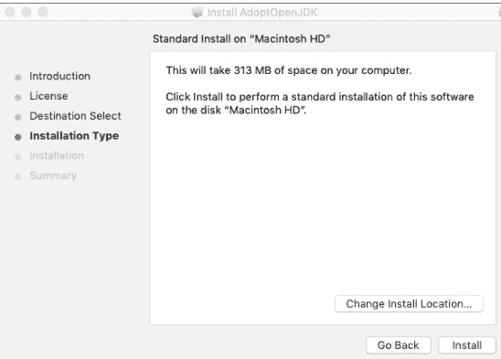

### 图 1.18 安装完成消息

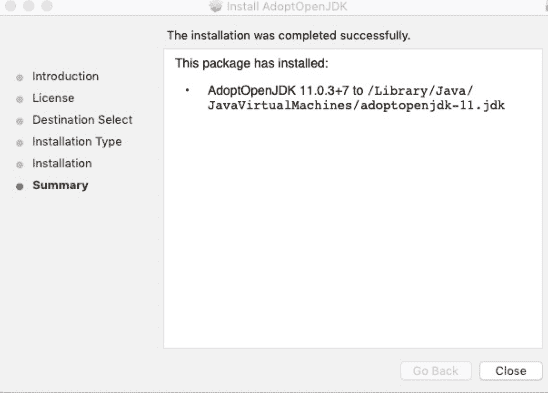

16 就绪的 Java

### 验证安装

按照之前的方法打开终端（通过 Spotlight 搜索或启动台），并输入以下命令来确认电脑上安装的 Java 版本：

```
java -version
```

你应该能看到与图 1.19 所示的结果。结果如下：

```
openjdk version "11.0.3" 2019-04-16
OpenJDK Runtime Environment AdoptOpenJDK (build 11.0.3+7)
OpenJDK 64-Bit Server VM AdoptOpenJDK (build 11.0.3+7, mixed mode)
```

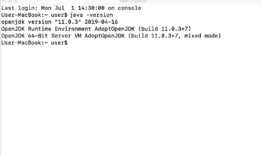

图 1.19 验证安装成功

如果你在结果中看到 openjdk version 11，你就可以进入下一步了。

> 注意：如果你没有看到 Java 版本为 OpenJDK11，请尝试重新安装 AdoptOpenJDK。

### 创建你的第一个 Java 程序

现在我们已经安装了 JDK，准备好创建第一个 Java 程序了。我们将使用文本编辑器完成这个过程，并了解电脑是如何运行用 Java 编写程序的。你不需要理解语法中所有的词汇，这没关系。我们现在的目标是让你写出并运行第一个程序！

### 编写程序

在学习新语言时，习惯做法是让第一个程序简单地在屏幕上打印“Hello, World!”我们将按照以下步骤操作：

1. 打开文本编辑器。
2. 输入 Java 代码。
3. 将文件保存为 Hello.java。
4. 使用 Java 编译器 (`javac`) 编译代码。
5. 运行程序。

在你的电脑上打开文本编辑器。对于 Windows，记事本（Notepad）是一个不错的选择；不过你可以使用任何文本编辑器，如 Gedit、nano 或 Vi。如果你使用的是 Mac，可以使用文本编辑器。在 Linux 上，有 Gedit 等编辑器。如有必要，创建一个新文件，然后输入列表 1.1 所示的代码。不要担心这些代码的意思，我们很快就会学。

### 列表 1.1 Hello.java: "Hello, World!"

```
public class Hello {
    public static void main(String[] args) {
        System.out.println("Hello, World!");
    }
}
```

> 将文件保存为“文档”（Documents）库中的 Hello.java。确保文件扩展名是 java，而不是 .txt 或其他。

关于这个文件有几点需要注意。首先，你应该注意程序在第一行创建了一个公类（`public class`）。Java 程序是一个类，它是 Java 代码的基本容器。这个公类的名称是 Hello。当你将此程序输入编辑器并保存时，必须使用相同的名称作为文件名。因此，你需要将程序保存为 Hello.java。如果你在 Windows 上使用文本编辑器，要确保文件名末尾没有加上 .txt。

除了 Java 程序是一个类之外，这个类中还包含一个 main 方法（`method`）。方法是 Java 代码的另一个容器。方法必须放置在类内部。它是一个可以执行以完成某些任务的具名代码块。在这里，它只是打印“Hello, World!”你将在后续的课程中学习更多关于类和方法的知识。

### 编译并运行程序

现在我们已经写好了代码，需要编译并运行它。编译程序时使用 Java 编译器 `javac`。这会将我们的 Java 源代码转换为字节码，然后 Java 虚拟机（JVM）就可以执行这些字节码。

运行程序时，使用 `java` 命令加上类名：

```
java Hello
```

如果程序运行正常，你将在控制台上看到“Hello, World!”。这是你的第一个 Java 程序！恭喜你！

### 使用编译器和 Java 虚拟机

图 1.21 中的流程图表示了我们在编译和运行程序时在后台发生的步骤。

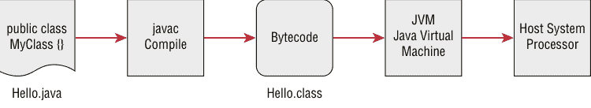

**图 1.21** 编译和运行时的后台过程

1. 我们使用普通文本和 Java 语法创建了 `Hello.java` 文件。它包含一个公共类（`public class`），定义了我们在运行程序时想要让计算机执行的操作。
2. 当我们在第二步运行 `javac Hello.java` 命令时，我们调用了 Java 编译器。编译器将我们在 Hello.java 中输入的文本转换为字节码。
3. 字节码是为 JVM 准备的一组指令。当我们运行 `java Hello` 命令时，我们运行的是 JVM 可以解释的字节码版本的程序。
4. JVM 基本上是一个运行在软件和操作系统之间层上的虚拟计算机。由于所有 Java 程序都使用 JVM 运行，因此我们可以在任何支持 Java 的平台（包括 Windows、macOS 和 Linux）上运行相同的程序。
5. JVM 解析你程序中的字节码并将其转换为可以在你机器处理器上运行的机器码。

### 总结

在本节中，我们回顾了什么是 JDK 以及为什么我们 Java 开发者需要它。我们比较了 Oracle JDK 和 OpenJDK，然后安装了 OpenJDK 以供本书使用。

随后，我们创建、编译并运行了我们的第一个名为 Hello.java 的 Java 程序。我们学习了以下内容：

- Java 程序由一个包含 `main` 方法的类组成。`main` 方法是每个 Java 程序的特殊起始点。
- 大括号 `{}` 标记了代码块的开始和结束。
- `System.out.println("Hello, World!");` 是将文本发送到控制台进行显示的魔法代码。

最后，我们学习了 Java 虚拟机以及 Java 文件从创建到执行所经历的过程。

虽然我们可以像在本节中那样使用纯文本编辑器来编写任何 Java 程序，但较大的程序比这一个要复杂得多，并且通常包含许多作为一个单一项目协同运行的独立文件。在下一节中，我们将安装一个集成开发环境（IDE），它包含了一些工具，可以在我们编译程序之前在编码时识别语法错误，将相关文件保持在单一项目中，并在我们想要测试代码时编译代码。

## 第 2 节

### 安装开发环境：NetBeans

本节将引导你完成安装 NetBeans 12 的过程，你可以用它完成本书的剩余章节。

### 学习目标

在本节结束时，你将能够：

- 了解使用集成开发环境（IDE）的价值
- 理解 IDE 的核心部分
- 使用自动安装程序安装 NetBeans
- 安装 NetBeans 二进制文件
- 能够启动 NetBeans

> 注意：要安装 NetBeans，你必须先在计算机上安装 Java 开发工具包（JDK），你已经在上一节中完成了这一操作。如果你没有学习第 1 节，你需要在继续学习本节之前完成那些步骤。

### 开始上手

NetBeans 是一个 Java IDE，全称为集成开发环境（integrated development environment）。IDE 是开发者开发软件程序时进行大部分工作的地方，它包含了帮助识别代码中错误的工具，以及用于复杂开发项目的接口。

在课程中，我们将使用 NetBeans 12。如果你已经安装了 NetBeans 12 并且可以无错误地打开它，那么你可以跳过本节。如果你在打开 NetBeans 12 时遇到问题，请查看后续章节中每组指令末尾的故障排除步骤，取决于你的操作系统。

### 理解 IDE 的价值

IDE 是你开发者工具箱中最重要的工具。IDE 是你编写、编译、调试和运行 Java 程序的地方。你对 IDE 的细节越熟悉，就越可能成为一个出色的开发者。

IDE 的主要目的是为开发者提供一个创建软件的单一应用程序。它是编写和编辑源代码的一站式场所。它还提供了编译和构建程序以及提供调试的功能。大多数 IDE 还具有与各种版本控制仓库的钩子，提供了一个真正全面的开发环境。

IDE 的主要功能包括：

- 源代码编辑器
- 构建工具
- 调试器

### 使用源代码编辑器

源代码编辑器是编写代码的地方。源代码编辑器提供了许多功能让编码变得更容易：

- 语法高亮：编辑器对代码的不同部分（如关键字、字符串和注释）着色。
- 缩进：编辑器自动缩进你的代码以保持整洁。
- 自动补全：编辑器在你输入时建议代码补全。
- 错误检查：编辑器在你输入时识别语法错误。

### 使用构建工具

构建工具用于编译和打包你的程序。常见的构建工具包括 Maven 和 Gradle。这些工具有助于管理依赖和构建过程。

### 使用调试器

调试器允许你停止程序的执行并检查其状态。这对于发现和修复代码中的错误非常有帮助。

### 下载 Apache NetBeans 12.0

Apache NetBeans 12.0 于 2020 年 6 月 4 日发布。请查看“Apache NetBeans 12.0 功能”获取完整功能列表。

Apache NetBeans 12.0 可从您选择的 Apache 镜像站点下载。

- 安装程序
  - Apache NetBeans-12.0-bin-windows-x64.zip
  - Apache NetBeans-12.0-bin-mac-x64.zip


- Apache NetBeans-12.0-bin-linux-x64.tar.gz

- 此版本的签名可从 `https://netbeans.apache.org/download/12.0/pgp` 处获取

如果您使用的是 macOS，可以使用 DMG 文件安装应用程序（或使用 tar.gz 文件）。PGP 文件应与 KEY 文件进行比对，该 KEY 文件包含了用于签署此发布版本的 PG 密钥。Apache NetBeans 也可以作为自包含包安装在 Linux 上。

### 部署平台

Apache NetBeans 12.0 运行在 JDK 8 和 11 版本上，以及发布时的当前 JDK 版本 JDK 14。

### 社区认可

与其他任何 Apache 项目一样，Apache NetBeans 社区通过以下流程对我们的发布版本进行批准：

- PMC 投票
- PGC 结果

版本 12.0 是 LTS（长期支持）版本，适用于 NetBeans 社区认可流程，结果见“NetBeans 12.0 社区认可调查”。

## 2.2 下载 Apache NetBeans 12.0

选择与您的平台相对应的版本。如果您使用的是 64 位机器上的 Windows、64 位机器上的 Linux 或 macOS。

点击 Windows 选项（`Apache-NetBeans-12.0-bin-windows-x64.exe`）将带您进入类似于图 2.3 所示的页面。如果您选择 Linux 或 macOS 选项，将进入类似的页面。

点击建议的链接。这将启动打开文件并在您的系统上安装 NetBeans 的过程。按照指示操作。您会被要求打开可执行文件，如图 2.4 所示。如果您使用的是不同的操作系统，您将看到类似但针对您操作系统的内容。

此时，发生的情况将取决于您的操作系统。我们在接下来的步骤中展示在 Windows 上的操作。如果您在 macOS 上安装，请跳转到下一节。

### 在 Windows 上安装

在点击链接后弹出的对话框中，点击“保存文件”以保存文件。文件将下载并保存到您的硬盘中。下载完成后，打开它或点击它以运行安装程序。在批准程序对您的系统进行更改后，Apache NetBeans 安装程序将启动，如图 2.5 所示。

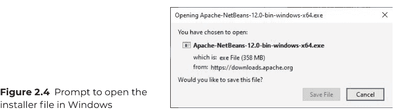

### 图 2.3 Windows 安装程序

程序将配置安装程序，以便在您的系统上设置该程序。一旦完成配置，您就可以点击“下一步”按钮了，如图 2.6 所示。

安装程序配置完成后，点击“下一步”按钮继续。您将看到一个与图 2.7 相似的对话框。

安装程序配置完成后，您现在已准备就绪。虽然您可以点击此页面上的“自定义”按钮，但我们建议直接点击“下一步”。这将启动安装程序并带您进入图 2.8 所示的许可协议。

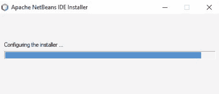

### 图 2.4 Windows 中打开安装程序文件的提示

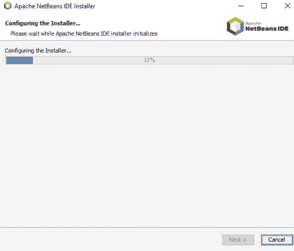

### 图 2.5 正在运行 Apache NetBeans 安装程序

简而言之，NetBeans 是一个根据 Apache 许可证分发的开源程序。许可协议的主要几点如下：

- 您可以根据需要使用任意数量的软件副本，并将软件分发给他人，只要分发包包含相同的许可限制。
- 您可以修改代码并分发您自己版本的代码，只要您修改后的包对 Apache 软件基金会分发的核心代码包含相同的许可限制。
- 软件按“现状”分发。

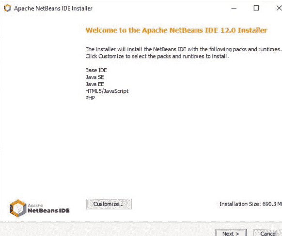

### 图 2.6 安装程序已配置完毕并准备就绪


### 图 2.7 欢迎使用安装对话框

检查条款，然后勾选*接受许可协议中的条款*旁边的框以继续。点击*下一步*继续安装过程。图 2.9 显示的下一步决定了程序文件将安装在计算机上的位置。

此对话框询问您想将 IDE 和 JDK 安装在哪里。除非有充分理由，否则您应该使用默认设置。

注意，此包将同时安装 NetBeans 和兼容的 JDK。如果您已经有了 JDK，此安装将跳过它。

保持勾选*检查更新*框是可以的。如果您连接了互联网，NetBeans 将查找任何更新。

- 点击*安装*开始安装。

### 图 2.8 NetBeans 许可协议

### 图 2.9 设置位置

### 图 2.10 摘要页

### 图 2.11 安装已完成

### 图 2.12 安装完成

### 图 2.13 下载的包

### 图 2.14 双击包

### 图 2.15 安装向导

### Apache NetBeans IDE 安装程序

摘要

点击“安装”开始安装。

基础 IDE 安装文件夹：

`:\Program Files\NetBeans-12.0`

- 检查更新

NetBeans 安装程序可以使用您的互联网连接自动检查已插件的更新。

总安装大小：

690.3 MB

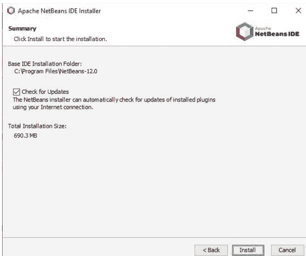

### 图 2.10 确认设置

### Apache NetBeans IDE 安装程序

正在准备安装数据...

请等待向导准备安装数据。

正在提取 Java SE 的安装数据

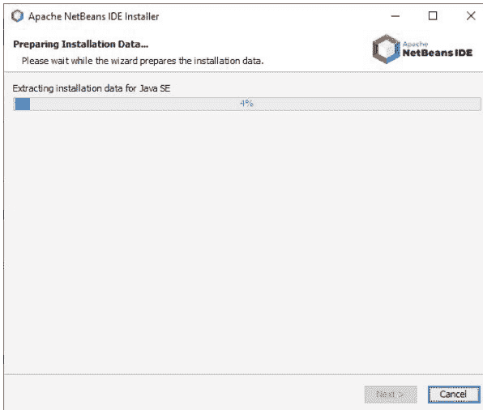

### 图 2.11 正在安装文件

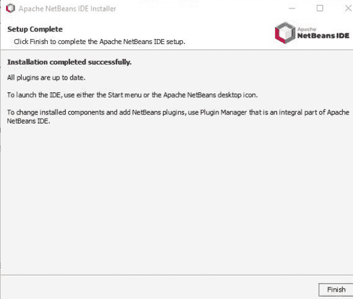

### 图 2.12 安装完成！

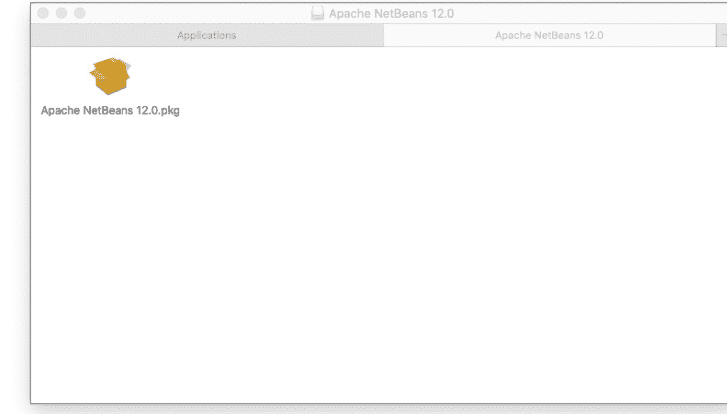

### 图 2.13 安装包

# 第 2 章：安装开发环境：NetBeans

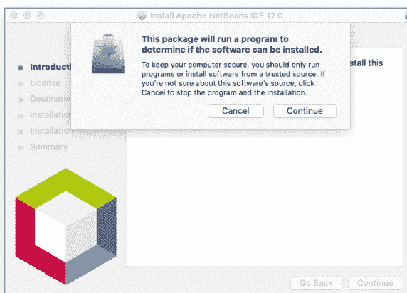

### 图 2.14 在 macOS 上运行 Apache NetBeans 软件包

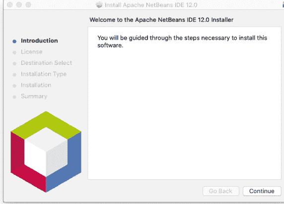

### 图 2.15 安装向导

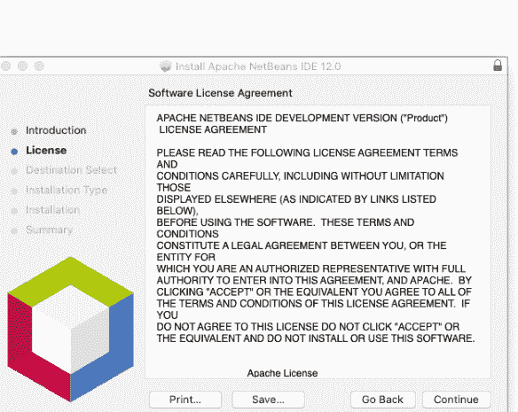

查看条款，然后点击“继续”并“同意”以接受许可协议中的条款。

安装程序将显示默认安装设置，如图 2.17 所示。除非你有特定的、异常的需求，否则无需更改这些设置。

点击“安装”开始安装。向导将继续在您的系统上安装程序，如图 2.18 所示。如有必要，输入您的密码以继续并等待安装完成。

安装完成后，你将看到一个与图 2.19 所示类似的确认窗口。

此时，你已成功安装了 NetBeans 并可以关闭此窗口。

### 安装二进制文件

安装 IDE 的另一种方法是下载文件并手动安装。提供这些信息是为了以后您可能想对安装过程有更多控制权。如果您像之前所示使用了安装程序，请随时跳过此节并直接跳转到“运行 NetBeans”。

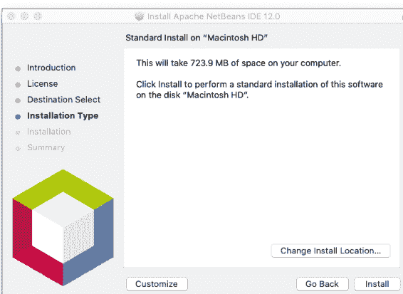

### 图 2.17 macOS 的安装设置

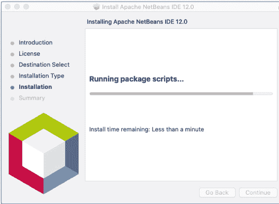

### 图 2.18 正在安装文件

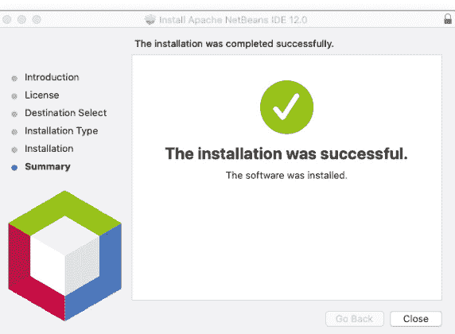

### 图 2.19 安装完成消息

二进制过程仅针对 Windows 显示；然而，其他平台的安装过程是类似的。要在 Windows 上安装二进制文件，请点击之前在图 2.2 中看到的选项列表中的 **Binaries**（二进制文件）链接。将打开一个类似于图 2.20 的新页面以确认下载链接。

> 注意：文件名可能略有不同。写本书编写时的当前版本为 12.0。如果进行了更新，版本号可能会略有不同。

接受页面顶部显示的建议链接是可以的。点击该链接将下载一个名为 `incubating-netbeans-12.0-bin.zip` 的文件。将文件保存到已知位置。

根据您的位置和当前到服务器的流量，建议的站点可能与截图中所示不同。

将文件保存到电脑后，过程将取决于您是在 Windows 还是 macOS/Linux 上安装而略有不同。我们这里重点关注 Windows。

# 第 2 章：安装开发环境：NetBeans

### 社区驱动开发“Apache 浪潮”


我们建议关注 NetBeans 的官方网站：

`https://apache.org/download/netbeans/NetBeans-12.0-bin.zip`

其他镜像站点也列在下方：

使用 PGP 签名 (asc) 或哈希 (MD5 或 SHA) 验证下载文件的完整性是非常重要的。如果没有其他镜像可用，请仅使用镜像站点下载 NetBeans、PGP 密钥和哈希。

## 2.20 NetBeans 的下载链接

### HTTP

- `http://apache.mirrors.hotty.com/apache/netbeans/htbeans/12.0-bin.zip`
- `http://apache.mirrors.kernel.org/apache/netbeans/htbeans/12.0-bin.zip`
- `http://apache.mirrors.spole.edu/apache/netbeans/htbeans/12.0-bin.zip`
- `http://apache.mirrors.columbia.edu/apache/netbeans/htbeans/12.0-bin.zip`
- `http://apache.mirrors.cogernito.net/apache/netbeans/htbeans/12.0-bin.zip`
- `http://apache.mirrors.rowest.net/apache/netbeans/htbeans/12.0-bin.zip`
- `http://apache.mirrors.advancedit.com/apache/netbeans/htbeans/12.0-bin.zip`
- `http://apache.mirrors.claro.org/apache/netbeans/htbeans/12.0-bin.zip`
- `https://apache.usag.org/netbeans/htbeans/12.0-bin.zip`
- `http://ftp.wyame.edu/apache/netbeans/htbeans/12.0-bin.zip`
- `http://apache.mirrors.onetrust.net/apache/netbeans/htbeans/12.0-bin.zip`

### 在 Windows 上安装

将文件保存到系统后，在电脑上找到 .zip 文件并将其解压。你可以通过以下步骤执行此操作：

1. 右键点击文件。
2. 点击“解压所有”。
3. 使用解压对话将文件解压到已知位置（例如文档）。

解压文件后，导航到上一步选择的位置。在示例 2.21 中，文件夹被解压到了名为 netbeans 的子文件夹。

打开 netbeans 文件夹。如图 2.22 所示，此文件夹包含运行 NetBeans 所需的文件，你不应删除此文件夹中的任何内容。

### 图 2.21 解压后的 NetBeans 文件

要启动 NetBeans，打开 bin 文件夹并双击适用于电脑的可执行文件。大多数 Windows 用户应使用 `netbeans64.exe`，但如果没有 64 位系统或运行该版本遇到问题，可以选择 `netbeans.exe`。

第一次运行 NetBeans 时，Windows 可能会显示无法识别应用程序的消息。如果是这样，按照提示仍然运行。你可能需要点击“更多信息”链接获取“仍然运行”选项。

如果 NetBeans 正确打开，你就可以开始学习本书其余部分的程序了。如果有问题，请查看下一节关于添加 JDK 的内容。

> 注意：无扩展名的文件适用于 macOS 且不会在 Windows 上打开。如果你使用它，说明你正在使用 macOS。

> 提示：你可以通过右键点击可执行文件并在上下文菜单中选择“固定到开始屏幕”或“固定到任务栏”，将快捷方式添加到开始菜单或任务栏。

### 添加 JDK

第一次打开 NetBeans 时，你可能会收到 NetBeans 找不到 Java 的错误消息。如果是这样，请按照以下步骤解决问题：

1. 在 NetBeans 根目录下，打开 etc 子文件夹，然后使用任何文本编辑器（如记事本或 Notepad++）打开 `netbeans.conf` 文件。
2. 找到包含 `netbeans_jdkhome` 的行。
3. 如果该行开头有 `#` 注释，请删除 `#` 以启用该设置。
4. 将其值设置为指向 JDK 的路径，例如 `netbeans_jdkhome="C:\Program Files\AdoptOpenJDK\jdk-11.0.3-hotspot"`。
   a. 如果你安装了 AdoptOpenJDK，请使用向导提供的路径。
   b. 如果已安装了 JDK 11，找到你系统的 JDK 文件夹（在 `C:\Program Files\` 中），并使用文件夹中 JDK 文件的路径。
   c. 版本号可能略有不同。只要它是 11 开头，就是正确的版本。
   d. 保存 `netbeans.conf` 的更改并关闭文件。
   e. 再次启动 NetBeans。

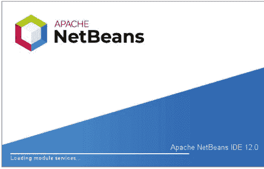

### 图 2.23 NetBeans 启动界面

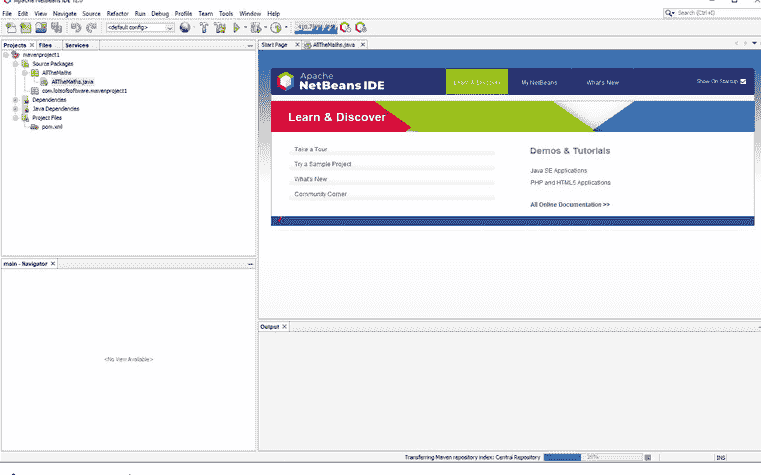

### 图 2.24 NetBeans 启动页

## 第 2 章：安装开发环境：NetBeans

### 运行 NetBeans

之前的 Windows 和 macOS 章节说明了如何打开 NetBeans 运行。这是通过按照指示运行相应的 NetBeans 文件实现的。

当 NetBeans 打开时，你首先会看到一个类似于图 2.23 的启动界面，显示正在加载。

在程序完全加载后，你将看到一个类似于图 2.24 的启动页，其中包含学习如何使用 NetBeans 的链接。如果你没有看到，请点击 **Learn & Discover**（学习与发现）标签。

> 注意：第一次运行 NetBeans 时，系统会弹出一个对话框请求你帮助改进 NetBeans IDE。你可以阅读文本并决定是否愿意提供使用统计数据。

如图 2.25 所示，My NetBeans 标签将显示之前的项目列表，但此页面是你第一次打开 NetBeans 且尚未创建任何项目时的状态。

### 总结

此时，你的计算机上已经安装了 OpenJDK 11 和 NetBeans 12，并准备好使用。安装好 IDE 和 JDK 后，你已经准备好上手并查看我们在在本节开始时讨论的功能了。这正是我们在下一节中将要做的！

## 第 3 节：使用集成开发环境

在本节中，我们将使用 IDE 创建一个“Hello, World!” 程序，并查看 IDE 为开发者提供的工具。

### 学习目标

完成本节后，你将能够：

- 使用 NetBeans 启动一个新项目
- 使用 NetBeans 创建一个“Hello, World!” 程序
- 使用 IDE 特性编译你的程序
- 探索如何开始调试程序

> 注意：对于本节及后续章节，你需要在计算机上安装并正常运行 OpenJDK 和 NetBeans 12。

### 使用 IDE

如果你还没有打开 NetBeans，请现在打开它并稍作探索。正如你在上一节中看到的，当你第一次打开 NetBeans 时，它通常会打开一个启动页，该页包含按标签页分类的常见任务链接。“**学习与发现**”（Learn & Discover）标签页包含帮助你学习使用 NetBeans 以及使用 Java 开发软件程序的资源链接。“**我的 NetBeans**”（My NetBeans）标签页（如图 3.1 所示）包含你在 NetBeans 中工作过的最近项目的链接和快捷方式，以及通过 NetBeans 可用的插件和其他功能的链接。“**新建**”（New）标签页包含关于 NetBeans 开发的新闻文章和博客帖子。虽然这些标签页上的信息很有用，但它们并不能代表 NetBeans 能为开发者做什么。


### 图 3.1 我的 NetBeans 标签页

> 注意：如果你刚刚安装了 NetBeans，那么项目列表是空的，因为你还没有创建任何内容，但随着课程的进行，这种情况将会改变。

当我们用 Java 创建程序时，在实际运行程序之前必须完成几个步骤。这些步骤如下：

1. 创建一个新的 NetBeans 项目。
2. 输入 Java 代码并使用 NetBeans 保存。
3. 在 NetBeans 中编译代码。
4. 运行程序。

我们现在将完成这些步骤。我们还会查看如何使用 NetBeans 帮助发现代码问题，并将新程序添加到你的 GitHub 仓库中。

### 创建新项目

让我们创建一个新项目。许多（如果不是大多数）Java 都包含一组需要协同工作以执行其预定活动的文件。虽然我们可以简单地创建单个文件（使用 IDE 或文本编辑器），但我们通常使用 IDE 将这些文件分组项目。这允许 IDE 在你开发应用程序时跟踪相关文件，并在你决定发布和分发应用程序给终端用户时包含所有必需部分。


# 使用集成开发环境

要创建一个新项目，点击“文件”（File），然后点击“新建项目”（New Project），如图 3.2 所示。


**图 3.2** 创建新项目

或者，你只需点击工具栏上的“新建项目”（New Project）按钮（而不是新建文件），如图 3.3 所示，或者你可以使用快捷键 `Shift+Ctrl+N`。


**图 3.3** 点击新建项目图标

当你创建项目时，NetBeans 会要求你从对话框开始选择你想要创建的程序类型，类似于图 3.4 所示。

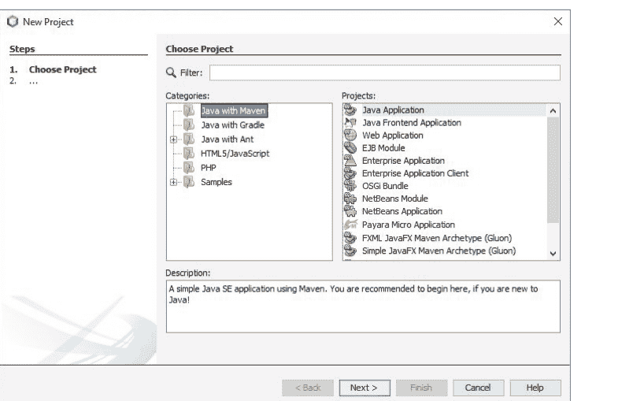

**图 3.4** 选择项目类型

Maven 是一种广泛用于 Java 项目的构建系统。虽然 NetBeans 有自己的内部构建系统，但许多团队使用 Maven（或类似的工具），以便他们的项目可以在没有 NetBeans 的情况下进行构建。软件开发团队通常有很多人（质量控制、系统管理员、构建经理等），他们有不同的自动化流程（如持续集成服务器）需要构建和部署 Java 项目，但不需要 NetBeans。因为他们不会更改 Java 代码本身。像 Maven 这样的外部构建系统让团队中的每个人都能轻松完成工作，而无需规定使用特定的 IDE。在这种情况下，我们将在“类别”窗格中选择“Java with Maven”，并在“项目”窗格中选择“Java Application”，然后点击“下一步”。

## 安装 MAVEN

第一次使用 Maven 创建项目时，可能会提示你下载并激活该项目的内容。如果是这样，点击“下载并激活”（Download and Activate）以继续，并按照步骤安装这些功能的插件。你可以选择包含任何库（例如 mbjavac 库）并点击“下一步”继续安装过程。我们还需要接受任何许可协议。你可能还需要授予安装权限。一旦你使用 Windows，就应该包含 Java。完成对话框操作后，NetBeans 将确认安装。你可能会收到“新建项目”的提示。一旦你完成对话框操作，NetBeans 将确认安装。你可能会收到提示的提示。

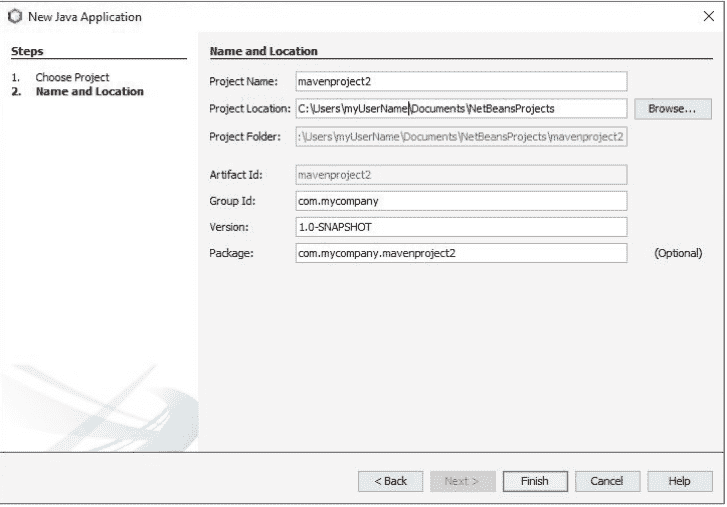

**图 3.5** 新建项目中的 Java 应用

- **项目名称：** `HelloWorld`
- **项目位置：** 浏览到你想保存项目的文件夹。第一次运行 NetBeans 时，默认文件夹可能是 `C:\Users\UserName\Documents\NetBeansProjects`
- **分组 ID：** 我们将使用 `com.tsg`。
- **版本：** 保留默认的 `1.0-SNAPSHOT`，这表示这是一个尚未发布的初始版本。

让我们更详细地查看这些选项。分组 ID 值本质上标识了谁拥有并维护代码，就像域名在网址中的作用一样。我们在示例中使用 `com.tsg`，因为 tsg 被用于软件指南。用户名或缩写适用于结束此处。版本值描述程序的当前版本，快照 Maven 在版本。当你创建一个新程序时，Maven 假设你想使用 SNAPSHOT 1.0。如果你使用版本控制软件（如 Git 或 Subversion），Maven 将从该软件中检索版本号并将其包含在你的文档中。

列表中还有几项项目。制品 ID 值将默认为项目名称，包将默认为分组 ID 与制品 ID 的组合。使用这些默认值没有关系。一旦你完成了更改，对话框看起来将类似于图 3.6。

更新信息后，点击“完成”（Finish），NetBeans 将创建一个空项目，如图 3.7 所示。

**图 3.6** 完成的 Java 应用程序对话框

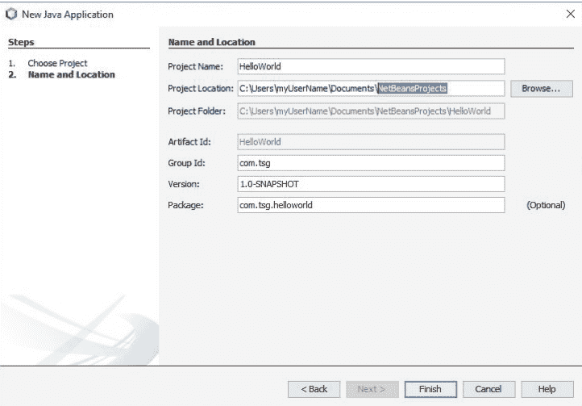

**图 3.7** 一个新的空项目

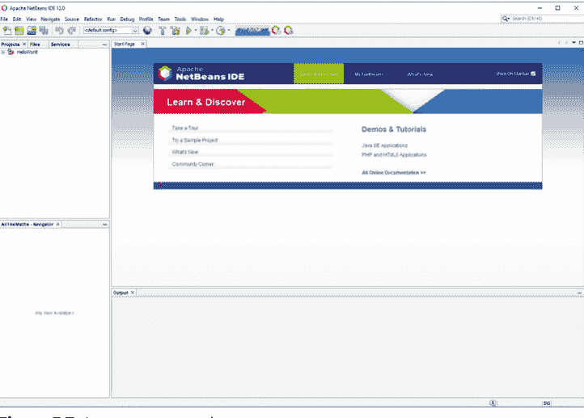

在离开之前，请查看窗口的不同部分。菜单栏和窗口的工具栏为常用工具提供了快捷访问。大多数常见任务（如创建新项目以及编译和运行程序）可以使用相应的菜单选项或工具栏中的工具执行，值得打开每个菜单和工具栏以识别这些命令的位置。

在左侧窗格中，你将找到“项目”和“导航”窗格，以及通过 NetBeans 提供的“文件”和“服务”标签页。我们在书中频繁使用“项目”窗格，因为它显示了当前项目所需的所有文件，并根据每个文件扮演的角色按目录进行组织。导航窗格在我们在书中稍后创建的更复杂的程序将更加有用，因为它显示了在代码中定义的类和其他对象。

右侧较大的面板将显示代码窗口，我们将在开始编写代码时详细查看该窗口。你也可以在继续之前关闭“启动页”（Start Page）标签页。通过点击标签页标题旁边的 x 来关闭标签页。

## 编写“Hello, World!”程序

项目是开发者在创建应用程序时用于将相关文件整合在一起的组织工具。然而，与你过去可能使用的大多数编辑器不同，新项目不会自动为我们的代码创建一个新文件。这意味着我们需要为“Hello, World!”程序创建一个 Java 文件。

点击“项目”（Projects）面板中 `HelloWorld` 旁的 `+`。这将展开目录以显示为 Maven 项目创建的子目录，如图 3.8 所示。

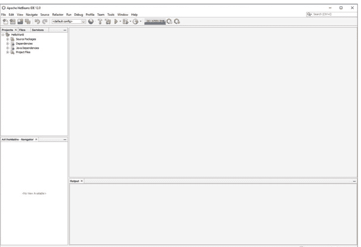

**图 3.8** 在“项目”面板中展开 HelloWorld

随着书中内容的深入，我们将查看项目中的这些子目录各是如何工作的。现在，我们将仅使用“源包”（Source Packages）子目录，它通常包含所有的 Java 代码文件。

你可以通过两种方式创建新的 Java 文件：

- 点击“项目”（Projects）面板中的“源包”（Source Packages）图标，点击工具栏上的“新建文件”（New File）按钮（📄），并在“新建文件”对话框的“文件类型”（File Types）列表中选择“Java 类”（Java Class）。
- 右键点击“源包”（Source Packages）图标，指向“新建”（New），并选择“Java 类”（Java Class）。这将打开“新建 Java 类”对话框，如图 3.9 所示。

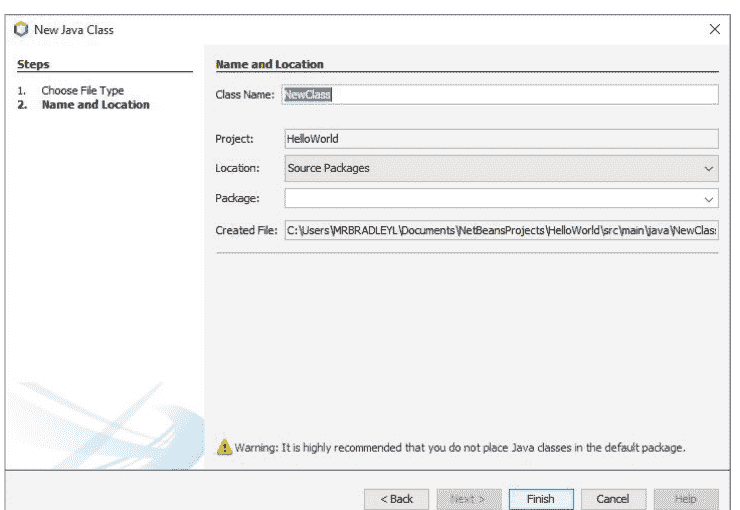

**图 3.9** 创建新的 Java 类

将类命名为 `Hello`。验证新文件的位置是“源”（Source）包（Packages）目录，并点击“完成”（Finish）。

文件创建后，你将在“项目”面板的“源包”（Source Packages）目录中看到它，文件本身将在代码编辑器中打开，如图 3.10 所示。

通过选择创建新类，NetBeans 已为你创建了起始代码，如列表 3.1 所示。

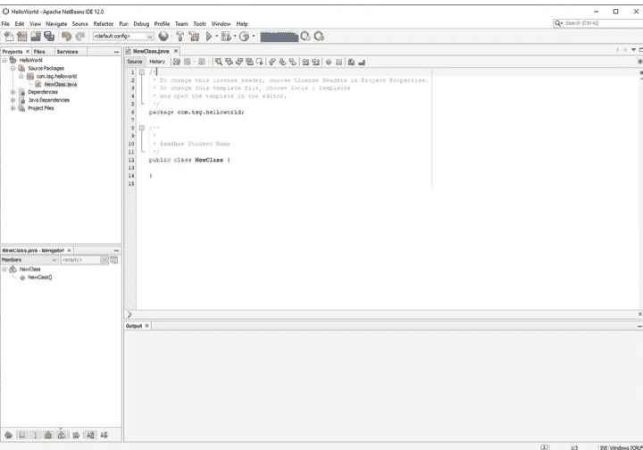

**列表 3.1** Hello 类的默认代码

```java
/*
 * 要更改此许可证头，请选择项目属性中的“许可证头”（License Headers）。
 * 要更改此模板文件，请选择工具 | 模板（Templates）
 * 并在编辑器中打开模板。
 */

/**
 * @author 学生姓名
 */
public class Hello {
}
```

> **注意：** 你的默认代码在 `@author` 之后可能会有一个不同的值。如果是这样，没关系！你将要更改它。

值得仔细查看这段默认代码。作为默认代码的一部分，NetBeans 包含了占位符（`/*` 和 `*/` 之间的行）以及以下代码：

```java
public class Hello {

}
```

它使用了类名 `Hello`，是因为我们将文件命名为 `Hello.java`。对文件和类使用相同的名称有助于 IDE 更好地识别项目到单独文件的类。

现在，通过输入列表 3.2 中的代码更新文件内容。

**列表 3.2** 新的 Hello 代码

```java
/**
 * @author 你的姓名
 */
package com.tsg.helloworld; // 使用你的组 ID 值替换 com.tsg

public class Hello {
    public static void main(String[] args) {
        System.out.println("Hello, World!");
    }
}
```

让我们看看关于许可证的更改。

- 我们删除了关于许可证的注释。
    - 如果你需要，可以使用 NetBeans 模板工具来定义新类的默认文本。
- 我们保留了带有作者信息的注释，这是识别程序作者的常见做法。
    - 尽管示例中显示是“学生姓名”，但 NetBeans 可能添加了你的 Windows 或 macOS 用户名。如果不是，请输入你的姓名。
    - 你还可以包含 `@date`（日期）或 `@purpose`（目的）的注释，以提供关于项目的更多细节。
- 我们识别了它所属的类。
    - 在此示例中，我们将 `com.tsg` 作为组 ID，但你应该使用你的缩写或其他个人标识符。根据程序需要修改此行。

## 编译与语法错误

语法错误——包括字符缺失或位置不正确——是最常见的错误类型，它们会阻止程序编译。IDE 相比于文本编辑器的一个巨大优势是，IDE 可以在我们编译代码之前帮助我们识别语法错误。当你编译包含语法错误的代码时，这些错误就会变成编译错误，即使是一个语法错误也会阻止代码的编译。

很有可能你早之前输入代码时至少错了一个字符，或者可能漏掉了一个括号或分号。无论哪种情况，你都应该在错误发生文本下方看到波浪线，并在行号旁边看到一个红点。在图 3.17 中，我们可以看到 `String` 一词被错写成了 `Sring`。

```java
public class Hello {
    public static void main(String[] args) {
        System.out.println("Hello, World!");
    }
}
```

**图 3.17** 语法错误

如果你并没有实际将代码输入编辑器，而只是在书中阅读了它，请回去操作一遍。虽然在学习过程中输入代码可能很耗时，但如果你确实花时间去输入并尝试它，你将能够更好地、更快地使用这些代码。

NetBeans 经过编程可以识别常见的编译和语法错误，并在编写代码时指出它们。从长远来看，注意这些信号可以为你节省大量时间。然而，如果你忽略了它们并尝试再次编译，NetBeans 将帮助你识别错误输出。

回到你的程序并删除一个字符，例如 `String` 中的 `t`。由于我们已经编译过程序（至少编译一次），我们只需要点击 Build 按钮旁边的 Clean and Rebuild（清理并重建）按钮（或直接按 `Shift+F11`）来重新构建程序，而不是重新编译。输出应该包含一个编译错误，如图 3.18 所示。

> **注意：** Build 按钮会重新编译程序中的所有代码。Clean and Rebuild 按钮会识别自上次构建以来更改的代码，并仅重新编译包含更改代码的类，这对于较大的程序更有效。

**图 3.18** 编译错误

查看图 3.18，你可以看到示例中的错误消息内容如下：

```
COMPILATION ERROR :

com/tsg/hellellow/Hello.java: [8,29] cannot find symbol

symbol: String

location: com.tsg.hellellow.Hello

1 error
```

该消息包含了关于错误所在文件（`Hello.java`）、错误所在行号（8）以及无法找到（或识别）`String` 的事实。修复错误并点击 Clean and Rebuild 以重新编译代码并验证错误已纠正。

> **注意：** 使用 IDE Maven 的价值之一是，当你创建程序时，它会在后台工作。这项工作包括在你输入代码时编译并检查你的代码，以发现一些可能的编译和语法错误。当你在上一个代码列表中输入 `String` 时，你可能注意到 IDE 在该单词下方画了一条红色的波浪线，表明某些地方不对。

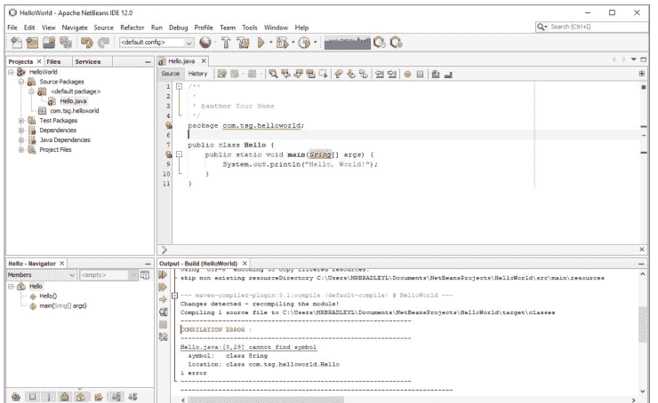

## 运行时错误与逻辑错误

异常和逻辑错误更难调试。异常是在编译后阻止代码运行的错误，它们包括将数字除以 0 等情况，这在数学上是不可能的。

逻辑错误与我们定义输入代码的值以及产生意外输出的方式有关，即使没有语法错误且代码运行正常，也是如此。例如，你可能编写了一个旨在乘以 5 和 6 的程序，但得到的是 35 而不是 30。

## 调试器与调试

像 NetBeans 这样的 IDE 为我们提供了调试工具，它使用断点（breakpoints）帮助我们找到运行时错误和逻辑错误，允许我们在代码运行期间查看特定行代码的值或输出，而不需要等到程序完全运行结束。

仅凭一行可执行代码很难看出断点是如何工作的，所以让我们添加第二行打印语句。代码列表 3.3 提供了我们 Hello 类的更新。

**列表 3.3** 带有另一行代码的 Hello 类

```java
/**
 * 
 * @author Your Name
 */
package com.tsg.helloworld;

public class Hello {
    public static void main(String[] args) {
        System.out.println("Hello, World!");
        System.out.println("My name is Harry!");
    }
}
```

如果你再次重建并运行程序，你应该会在输出窗口中看到两行打印内容，如图 3.19 所示。

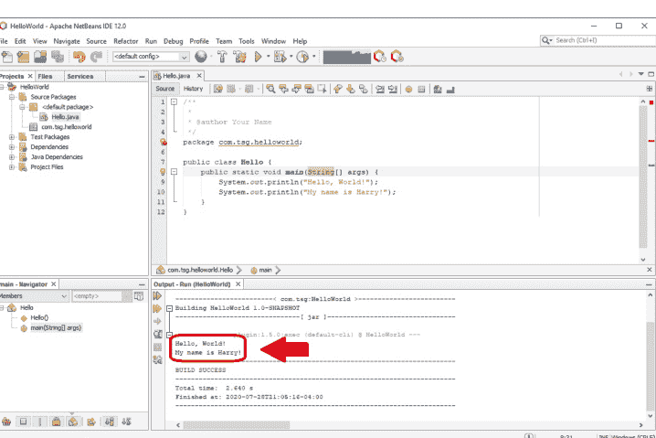

### 添加断点

我们将为新的代码行添加一个断点，然后查看调试器如何使用该断点。我们通过几种方式实现这一点。

右键点击第二个打印命令旁行的号，指向 Breakpoint（断点），并选择 Toggle Line Breakpoint（切换行断点），如图 3.20 所示。在这个示例中，行号是 10，但你的行号可能不同。

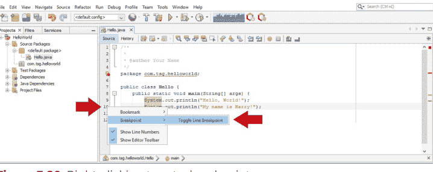

行号上将出现一个红色正方形，行本身将被标红，表示在该行上设置了断点，如图 3.21 所示。

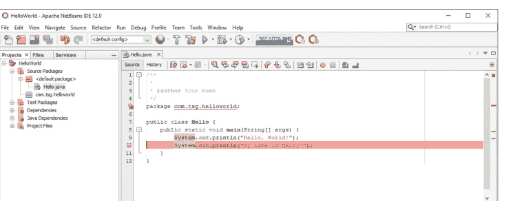

**图 3.21** 已设置断点。

> **注意：** 你也可以通过点击你想设置断点的代码行来设置断点。然后从 IDE 中的 **Debug**（调试）菜单中选择 Toggle Line Breakpoint。你也可以高亮你想设置断点的行并按 `Ctrl+F8`。

设置断点后，点击 **Debug Project** 按钮（它在 Run 按钮旁边），或使用 `Ctrl+F5` 以调试器模式运行程序，如图 3.22 所示。

> **注意：** 如果你看到了两行输出，你可能点击了 Run 按钮而不是 Debug Project。

> **注意：** 第一次运行调试器时，你可能会被要求选择主类。

正如图 3.22 所示，代码窗口下方将打开带有 Variables（变量）、Breakpoints（断点）和 Output（输出）标签的调试面板，调试面板将打开并指示程序正在运行并停止在 10 行。你会看到如下输出：

```
User program running

LineBreakpoint Hello.java : 10 successfully submitted.

Breakpoint hit at line 10 in class com.tsg.Hello by thread main.

Thread main stopped at Hello.java:10
```

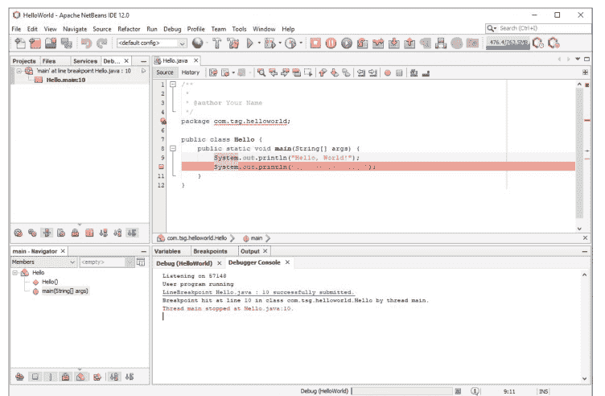

**图 3.22** 运行到断点

按下 `F5` 键告诉调试器继续运行。程序应该运行结束并在调试输出面板显示第二行文本。

### 移除断点

你可以像添加它的那样移除它：右键点击正方形，指向 Breakpoint，并点击 Toggle Line Breakpoint。

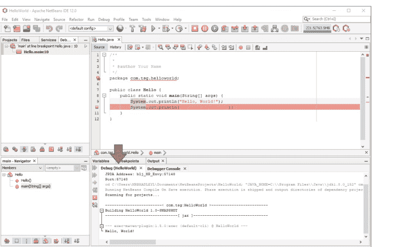

**图 3.23** Debug 标签

> **注意：** 在第 11 章“调试你的应用程序”中，我们将对调试进行更详细的介绍。

## 理解版本控制

版本控制是软件开发过程中不可或缺的一部分。正确使用版本控制可以在文件看似丢失时拥有备份与真正丢失文件产生区别。硬盘故障、文件意外覆盖以及其他灾难很难避免的；它们有时就会发生。

源码控制管理系统旨在保留存储在仓库中的文件和项目的历史及修订信息。仓库是通常通过 GitHub 或 Bitbucket 这样的源码控制管理器维护的在线存储空间。通过存储这些信息，我们拥有仓库内项目发生过变化的完整历史。在发生灾难时，我们可以恢复到之前保存的版本。此外，通过保存更改，我们可以轻松与其他开发者共享工作，并无论地理位置如何进行项目协作。

建议你对项目使用某种源码控制。Git 是一个非常棒且易于入门的方法，你可以继续将其应用于企业和大型项目。它会随着你的需求而成长。每当你编写程序达到一个有意义的节点时，提交文件并将更改推送到 GitHub 仓库都是很好的主意。将代码保存在 GitHub 上有以下几个原因：

- 它创建了代码的备份，如果你在过程中电脑发生了其他故障，你可能会发现这很有用。
- 如果你使用多台电脑，可以使用 Git 在所有电脑之间同步你的文件。


- 它将允许你轻松地分享代码。

作为开发者，你可能会经常使用 `Git` 与其他团队成员共享代码，因此熟悉源码控制管理（SCM）系统（如 `Git` 和 `GitHub`）可以让你在广泛使用的工具上获得实践经验。你的雇主可能使用与 `Git` 或 `GitHub` 不同的系统，但无论使用什么软件来实现，其原理都是相同的。事实上，大多数开源软件（包括许多流行包）允许任何人将代码复制到自己的个人仓库中——以进行实验并观察其工作原理。一旦你有了一些编程经验，甚至可以为现有的开源软件包添加自己的功能，并将其提交给该包的开发者组进行评审。

> 你不必为了使用这本书而使用 `Git` 或 `GitHub`；但是，当你开始构建不仅仅是为了学习语言的应用程序时，我们强烈建议你考虑使用它们或类似的版本控制产品。

> 你可以在 <https://git-scm.com/book/en/v2/Getting-Started-Installing-Git> 找到关于开始使用 `Git` 的官方文档。

### 总结

恭喜！以下是我们在本节中涵盖的内容：

- 我们讨论并探索了 IDE 的主要功能：代码编辑器、调试器和构建自动化。
- 我们在 NetBeans 中创建、编译、运行并调试了“Hello, World!”。
- 我们查看了 NetBeans 中错误信息和输出的显示。
- 我们查看了 NetBeans 中的基础调试器操作。

工具准备就后，你已经准备好出发了！在下一节中，我们将开始深入研究 Java 编程语言。

# 第二部分：面向对象编程基础

- 第 4 节：使用语句和变量
- 第 5 节：收集和解析用户输入
- 第 6 节：整合一切：构建一个实用的程序
- 第 7 节：控制程序流
- 第 8 节：循环程序流
- 第 9 节：理解流程图和算法
- 第 10 节：为你的程序添加随机性
- 第 11 节：调试
- 第 12 节：添加方法
- 第 13 节：使用数组组织

## 第 4 节：使用语句和变量

你尝试过学习另一种语言吗？你考虑过这个过程涉及什么？自然语言由许多内容组成：语言结构（名词、动词、形容词等）、语序和时态等。这些特征是所有自然语言共有的，因此要学习一种新语言，你必须理解这些特征在该语言中是如何工作的。

学习编程语言也类似——你必须理解语言结构以及如何用该语言表达有意义的内容。在学习第一门编程语言时，你面临着额外的挑战。你不仅要学习编程语言，还必须学习编程的元语言。换句话说，你必须学会如何讨论程序和编程语言。你还必须学习行业语言，以及我们如何讨论软件、软件开发过程和通用计算机技术。一次性要学习的内容很多，起初可能会困难；但是，随着经验的增加，它会变得简单。

在本节中，你的旅程从 Java 语言的最小单元开始：程序、语句和变量。

### 学习目标

在本节结束，你将能够：

- 定义计算机
- 比较数据和信息
- 区分程序和编程
- 解释语法和语义
- 解释为什么数据如此重要
- 解释类型之间的区别
- 在代码中使用字面量
- 在代码中使用变量
- 在代码中使用表达式

### 规范

规范对于软件编写过程至关重要。它们告诉我们我们需要解决什么问题。没有规范，就不知道该写什么样的程序。规范不需要非常详尽，但它们必须说明要解决的问题以及与该问题相关的任何限制条件。

### 语法与语义

让初级程序员感到沮丧的一点是编译器是多么死板。如果你输入的 Java 语句不是完全完美的格式，编译器将无法理解你的意思。新手会花费大量时间担心语法——毕竟，如果编译器不编译你的代码，你就无法运行你的程序。你将在本书书中学习适当的语法（正如前面讨论的，我们将建立你的词汇量）；然而，你学习的重点将是语义：即各种语言结构的含义和目的，以及（最重要的是）如何使用它们来解决问题。

### 语言构建块

现在我们已经熟悉了编程涉及的一些概念，准备好进入 Java 语言本身了。在这一单元的前两个节中，我们编写了简单的“Hello, World!”程序。我们熟悉了 Java 程序的基础知识，现在是时候更深入地观察了。我们将从一些基础部分开始，然后查看这些部分如何使用的规则。这些部分都是相关的，所以我们将在本节中涵盖它们。

### 注释

注释用于记录你的代码。注释对开发者来说很重要，但对计算机本身并不重要，因为编译器和运行时会忽略这些注释。在开发和编写代码时添加注释是一项特别需要养成的习惯。这些注释可能会被后来的其他开发者用于以维护或修改你的代码，但通常这些注释对你以后也有用。

注释是我们留给自己的书面线索。我当我做这个操作时在想什么？我为什么要这样实现它？如果我们两个或三个月后回到代码，注释将非常有帮助。它们对于可能需要审查我们代码的队友也很有帮助。

> 第 4 节：使用程序语句和变量 75 页

如果你是编程新手，你应该知道，被要求回去增强或修复你可能在六个月或一年前编写的代码是很常见的。自从那个原始代码编写以来，你可能已经参与了几个项目，这让你很难记得你为什么要那样做。这就是注释可以发挥作用的地方。我最喜欢的软件开发名言之一是 Halelson 的：

> 程序必须为了供人类阅读而编写，只是顺便供机器执行。

Java 支持三种类型的注释，我们将依次介绍：

- 单行注释（行尾注释或行末注释）
- 多行注释（传统注释）
- Doc 注释（或文档注释）

#### 单行注释

单行注释以 `//` 开始。编译器将忽略 `//` 到行尾之间的所有内容。如果你只需要随手记下些东西，单行注释非常方便。

以下是一个带有行末单行注释的 Java 代码示例：

```java
System.out.println("Hello, World!"); // 打印到控制台
```

#### 多行注释

多行注释以 `/*` 开始，可以跨越多行，并以 `*/` 结束。接下来的代码片段有一个从第一行开始到第五行的多行注释。其后跟着的是三行 Java 代码。

```java
/*
public static void main(String[] args)
    这是程序的入口点。
    向控制台打印 "Hello, World!"。
*/
public static void main(String[] args) {
    System.out.println("Hello, World!");
}
```

> 注意：多行注释也被称为块注释。

#### 文档注释

Doc 或文档注释以 `/**` 开始，可以跨越多行，并以 `*/` 结束。编译器忽略 `/**` 和 `*/` 之间的所有内容。文档注释可能出现在任何地方。文档注释与多行注释几乎相同，但有两点不同。首先，它们位于特定的位置。其次，它们被用于生成 HTML 文档。由于这些原因，以下是文档注释的示例：

```java
/**
 * 方法说明
 */
```

当我们在看到斜杠后跟两个星号时，就知道它是文档注释。文档注释可以用于类和方法。例如，在 IntelliJ 中，如果你输入了斜杠和两个星号并按回车，它会自动生成文档注释。文档注释也可以用于生成代码。

> 注意：文档注释对类很有帮助，它们还可以描述方法所涉及的参数。

当你以后编写方法时，你可能想为它们添加文档注释。这样，人们就能理解如何使用你的方法，或者你创建该方法时在想什么。

在之前的节中，你接触了“Hello, World!”应用程序，它是使用 NetBeans IDE 创建的。IDE 创建了部分代码，然后你对其进行了添加。列表 4.1 展示了本节中的代码。

#### 列表 4.1：“Hello, World!”程序

```java
/*
* 要更改此许可证头，请选择 License Headers。
* 要更改此模板文件，请选择 Tools | Templates 并在编辑器中打开。
*/
/**
* @author 你的名字
*/
public class Hello {
    public static void main(String[] args) {
        System.out.println("Hello, World!");
    }
}
```

在这个列表中，你可以看到两种注释。在列表的前五行中，你可以看到一个多行注释。它以斜杠加星号开始，以星号加斜杠结束。块注释之后，你看到下一行以斜杠加两个星号开始。正如你所学的，这是文档注释的开始。

#### 使用注释

关于注释有几点注意。尽管编译器会忽略它们，即使注释实际上不会影响程序的运行方式，但你也应该审慎地对代码进行注释。例如，上一个示例中的单行注释就没有什么价值。那是 `System.out.println` 打印到控制台。它确实是这样，所以没必要作为注释说明这一点，因为这是多余的。

如果你正在进行某种温度转换的计算，那么你可以在注释中加入说明，说明该公式是从华氏度转换为摄氏度，或反之。审慎对待，确保包含了注释，因为这会让你的队友以及你以后回来看代码时变得容易得多。

> **TIP** 注释的一个常见用途是在开发过程中临时禁用某些代码行。注释掉代码可以让你在开始尝试代码之前看到之前存在的内容。要恢复代码，你只需移除注释标记即可。

> **NOTE** 你可以在在线文档 <www.oracle.com/technetwork/java/codeventions-14199.html> 中阅读更多关于使用注释的知识。

### 标识符

标识符是用于命名变量、方法、类或包的字符序列。你将在后的课程中学习变量、方法、类和包。现在，你需要知道 Java 标识符必须遵循以下规则：

- 它不能跨越多行。
- 它必须只包含数字、字母、下划线（`_`）、连划线（`-`）和美元符号（`$`）。
- 它必须以字母、下划线、连划线或美元符号开头。
- 它不能包含任何空格。
- 它不能单独作为一个下划线。

Java 预留了表 4.1 中所示单词，这意味着你不能将它们作为标识符。

| abstract | assert | boolean | break | byte |
|---|---|---|---|---|
| case | catch | char | class | const |
| continue | default | do | double | else |
| enum | extends | false | final | finally |
| float | for | goto | | implements |
| import | | | interface | long |
| native | new | null | package | private |
| protected | public | return | short | static |
| strictfp | super | switch | synchronized | this |
| throw | throws | transient | true | try |
| void | volatile | while | | | |

### 数据类型

我们已经讨论过数据和信息。你应该已经理解了数字或文本等概念。但我们如何告诉计算机我们想对数字进行某些操作或跟踪一个名称呢？这可以通过使用所谓的“类型”来告诉计算机我们想要处理的数据种类来实现。

类型描述了部分数据的内部表示形式以及可以应用于该数据的操作。类型具有某些预定义的特征。这些特征包括哪些类型的内容是有效的，以及这些内容的大小。你可以将类型看作是符合定义的数据形状和大小。

例如，`int` 是 Java 中的一种数据类型。有效的 `int` 是范围从大约负十亿到正十亿之间的数字。单词 `apple` 不是一个 `int`。事实上，它甚至不是一个数字。数字 `12.45` 也不是一个 `int`，因为它不是整数。虽然四十亿是一个整数，但它太大了，不能作为一个 `int`。所以你可以看到，要让某个东西符合类型的定义，它必须满足定义的所有标准。

Java 有两种数据类型：基本数据类型（是语言定义的一部分）和引用类型（或开发者定义）。我们将在本节中介绍基本数据类型。

> **NOTE** 创建你自己的类型也是可能的。事实上，我们写的每个类实际上都是一个新类型。现在，只需集中在类型本身的概念上。

表 4.2 展示了 Java 基本数据类型。该表包含了类型以及对它可以包含内容的描述、该类型的默认值、存储该数据类型所需的内存量（大小），以及可以放入该类型中的值范围。

| 类型 | 包含 | 默认 | 大小 | 范围 |
|---|---|---|---|---|
| boolean | true 或 false | false | 1 bit | NA |
| char | Unicode 字符 | \u0000 | 16 bits | \u0000 到 \uFFFF |
| byte | 有符号整数 | 0 | 8 bits | -128 到 127 |
| short | 有符号整数 | 0 | 16 bits | -32768 到 32767 |
| int | 有符号整数 | 0 | 32 bits | -2147483648 到 2147483647 |
| long | 有符号整数 | 0 | 64 bits | -9223372036854775808 到 9223372036854775807 |
| float | 浮点数 | 0 | 32 bits | ±3.4E38 到 ±3.4E38 |
| double | 浮点数 | 0 | 64 bits | ±1.9E308 到 ±1.9E308 |

你的变量名称应该描述你打算在程序中使用该变量的用途。在我们的示例中，你会期望一个名为 `counter` 的变量是用来……嗯，数一些东西的。确保你的变量名易于阅读，并且其功能明确。你可能想只用 `c` 来给你的计数器命名，或者用 `ctr`，但不要这样做。直接根据变量的实际含义命名；对于计数器来说，名称就是 `counter`。

创建变量时，另一个重要点是变量的风格。在 Java 中，习惯是使用驼峰命名法（`camelCase`），这意味着变量以小字母开头，但任何新单词的首字母都要大写。在之前的示例中，你可以看到 `isDone`。如果变量名是一个单词，则直接使用全小写。需要注意的是，这并不是 Java 编译器强制执行的，但它是如今绝大多数 Java 代码所采用的约定成风格。

### 常量

有时，你可能需要在代码中定义常量，或者说“魔法数字”。常量与变量相似，它们都是命名的数据片段；然而，一旦你设置了常量的值，它就无法更改。例如，你可能想为程序中的圆周率（pi）或最小/最大限制定义一个常量。

Java 的习惯是常量的名称应该全大写，并使用下划线来分隔名称中的单词。在下面的示例中，你应该使用 `final` 关键字来声明常量：

```java
final int MAX_AGE = 99;
final float PI = 3.14f;
```

在代码中使用常量而不是字面量是一种良好的做法。使用常量会让你的代码更具可读性，同时也更具可维护性。考虑业务规则发生且 `MAX_AGE` 从 99 变为 109 的情况。如果你对 `MAX_AGE` 使用常量，只需要在一个地方进行此更改。如果你使用的是字面量，你需要在每个使用该字面量的地方进行更改。如果你漏掉了一个会怎样？

### 运算符与表达式

我们现在理解了 Java 需要类型，并且我们可以使用变量来持有特定类型的数据片段。我们还理解了如何在程序中声明变量并为变量赋值。但编程的很大一部分在于如何实际上将数据放入我们的变量中，以及如何执行我们的编程逻辑。

因为我们需要一种称为“表达式”的新类型语句。表达式是一个可以求值并产生结果的语句。你的程序所采取的操作是通过语句的。Java 中有许多类型的语句，正如我们提到的，我们已经见过并用了其中两种：变量声明和赋值语句。现在，我们将查看另一种语句：表达式。

表达式语句可以计算值、赋值值并比较值。表达式是一系列运算符和操作数。运算符是一个表示返回结果的操作的符号。你对日常数学中的基本运算符和操作数会很熟悉。运算符是执行工作的符号（例如 `+`、`-`、`*`、`/`）。`+` 是我们使用的一种运算符，它返回一个数字结果。

操作数是运算符所使用的数据元素。使用 `+`，操作数就是我们想要相加的两个数。因此在这种情况下，运算符的结果是一个数字。从 `5` 加 `10` 得到 `15` 的过程被称为求值。图 4.1 展示了带有操作数和运算符的三个表达式。

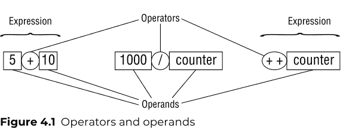

编程的酷炫之处之一是操作数可以来自任何地方。操作数可以是字面量，这意味着我们直接将值输入代码中。操作数也可以是变量，且该变量的值将在求值中使用。最后，操作数可以是方法调用的结果。

### 三种类型的运算符

Java 作为一种语言，其运算符比小学数学的少。事实上，它有 41 个。运算符分为三种类型：一元、二元和三元。类型取决于运算符所需的操作数的数量。

#### 一元运算符

一元运算符只需要一个操作数（取反运算符就是一个例子）。一元运算符可以是前缀（在操作数之前）或后置（在操作数之后）。表 4.3 显示了一元运算符的示例。

**表 4.3 一元运算符**

| 运算符 | 描述 |
| --- | --- |
| `+` | 一元加运算符（数字默认为正） |
| `-` | 一元减运算符 |
| `++` | 递增运算符 |
| `--` | 递减运算符 |
| `!` | 逻辑非运算符（反转布尔值的值） |
| `~` | 一元位反 |

> 注意，虽然本书的这一部分展示了所有运算符，但某些运算符（例如位运算符）可能对你来说很陌生。现在，只需知道这些运算符存在。你将在整书中学习更多关于这些许多知识。


### 二元运算符

二元运算符需要两个操作数（基础数学运算属于此类）。二元运算符使用中置符号（运算符位于操作数之间）。二元运算符分为几类，包括赋值、算术、等价/关系、条件和位/移位运算符。表 4.4 列出了二元运算符。

#### 表 4.4 二元运算符

| 运算符 | 描述 |
| --- | --- |
| **简单赋值运算符** | |
| `=` | 简单赋值运算符 |
| **算术运算符** | |
| `+` | 加法运算符（也用于字符串拼接） |
| `-` | 减法运算符 |
| `*` | 乘法运算符 |
| `/` | 除法运算符 |
| **关系/等价运算符** | |
| `==` `!=` | 等于 / 不等于 |
| **位运算符** | |
| `&` | 按位与 |
| `^` | 按位异或 |
| `\|` | 按位包含性或 |
| **逻辑运算符** | |
| `&&` | 逻辑与 |
| `\|\|` | 逻辑或 |
| **条件运算符** | |
| `?` | 三元运算符 |
| **复合赋值运算符** | |
| `=` `+=` `-=` `*=` `/=` `%=` `&=` `^=` `\|=` `<<=` `>>=` `>>>=` | 赋值运算符 |

> **注意**：因为括号的优先级最高，因此可以使用它们来决定执行的顺序。

### 综合运用：数学表达式与运算符

在本节中，我们涵盖了大量关于表达式、运算符、操作数等的内容。列表 4.2 相当冗长，但它帮助你将大量信息整合在一起，让你直观地看到运行效果。代码中添加了注释（因为你已经在本节中学习了它们），以描述代码执行的功能。

#### 列表 4.2：数学表达式与运算符

```java
/*
 * 展示表达式和运算符使用的程序
 * 全处都提供了注释来解释发生了什么！
 */
public static void main(String[] args) {
    // 声明用于示例的变量
    int result;
    int operand1;
    int operand2;
    int operand3;

    // 赋值

    // 使用赋值 (=) 运算符将 result 初始化为 0。
    // 赋值运算符获取右侧的值并将其赋值给
    // 左侧的变量
    result = 0; // 现在 result 的值为 0

    // 初始化操作数
    operand1 = 5;
    operand2 = 7;

    // 赋值既适用于变量值，也适用于字面量值。
    // 我们将 operand3 设置为与 operand2 相同的值
    operand3 = operand2; // 现在两者的值都是 7

    //
    // 加法
    // 加法是一个二元中缀运算符。它可以处理
    // 字面量：
    result = 42 + 53; // result 现在是 95

    // 它也适用于变量：
    result = operand1 + operand2; // result 现在等于 12

    // 它也适用于字面量和变量的组合：
    result = 1 + operand1; // result 现在等于 6

    // 你可以把加法运算符链联：
    result = 1 + operand1 + operand2 + operand3; // result 现在等于 20

    // 最后，+= 运算符用于给变量增加一个值。
    // result += operand1 等同于
    // result = result + operand1。
    // 注意：result 的初始值被用于计算
    // result 的新值：
    result = 2; // 将 result 设置为 2
    result += 4; // result 现在等于 6 (2 + 4)
    result += operand1; // result 现在等于 11 (6 + 5)

    //
    // 减法
    //
    // 减法是一个二元中缀运算符。它可以处理
    // 字面量：
    result = 9 - 5; // result 现在是 4

    // 它也适用于变量：
    result = operand1 - operand2; // result 现在等于 -2

    // 它适用于字面量和变量的组合：
    result = 15 - operand1; // result 现在等于 10

    // 你可以把减法运算符链联：
    result = 19 - operand1 - operand2 - operand3; // result 现在等于 0

    // 最后，-= 运算符用于从变量中减去一个值。
    // result -= operand1 等同于
    // result = result - operand1。
    // 注意：result 的初始值被用于计算
    // result 的新值：
    result = 2; // 将 result 设置为 2
    result -= 4; // result 现在等于 -2 (2 - 4)
    result -= operand1; // result 现在等于 -7 (-2 - 5)

    //
    // 乘法
    // 乘法是一个二元中缀运算符。它可以处理
    // 字面量：
    result = 2 * 3; // result 现在等于 6

    // 它也适用于变量：
    result = operand1 * operand2; // result 现在等于 35

    // 它适用于字面量和变量的组合：
    result = 2 * operand1; // result 现在等于 10

    // 你可以把乘法运算符链联：
    result = 2 * operand1 * operand2 * operand3; // result 现在等于 490

    // 最后，*= 运算符用于将变量乘以一个
    // 值。result *= operand1 等同于
    // result = result * operand1。
    // 注意：result 的初始值被用于计算
    // result 的新值：
    result = 2; // 将 result 设置为 2
    result *= 4; // result 现在等于 8 (2 * 4)
    result *= operand1; // result 现在等于 40 (8 * 5)

    //
    // 除法与取模
    //
    // 除法是一个二元中缀运算符。它可以处理
    // 字面量：
    result = 6 / 3; // result 现在 2

    // 它也适用于变量：
    result = operand1 / operand2; // result 现在等于 0

    // 在除整数时，整数除法用于获取
    // 商的整数部分。
    // 我们使用取模运算符 (%) 来获取
    // 余数：
    result = operand1 % operand2; // result 现在等于 5

    // 它适用于字面量和变量的组合：
    result = 20 / operand1; // result 现在等于 4

    // 你可以把除法运算符链联：
    result = 25 / operand1 / operand2; // result 现在等于 1

    // /= 运算符用于将变量除以
    // 值。result /= operand1 等同于
    // result = result / operand1。
    // 注意：result 的初始值被用于计算
    // result 的新值：
    result = 40; // 将 result 设置为 40
    result /= 4; // result 现在等于 10 (40 / 4)
    result /= operand1; // result 现在等于 2 (10 / 5)

    //
    // 后置与前置运算符
    //
    // 最后，你可以使用后置和前置运算符
    // 给变量加1。后置运算符在完成后增加，
    // 前置运算符在之前增加。
    operand1 = 10; // 将 operand1 设置为 10
    result = ++operand1; // 将 operand1 增加 1并将 result 设置为 11

    operand1 = 10; // 将 operand1 回 10
    result = operand1++; // 将 result 设置为 10，然后 设置为 11
}
```

### 总结

我们在本节中涵盖了大量内容。你学习了关于程序和编程的一些概念，包括如何处理数据。你还接触了对象、语法和语义。

你进入了 Java 编程语言。你学习了不同类型的注释以及如何识别和使用它们。你学习了标识符、字面量变量。你还学习了各种数据类型以及不同的表达式分类。为了将这些整合，你学习了包括运算符和操作数在内的表达式。你不仅学习了大量 Java 的核心信息，还开始了将这些部分组合来实现功能——你将在后续课程中完善这一过程。

### 练习

现在你已经开始接触 Java 编程语言，是时候引入一些编码练习来帮助你练习所学的内容了。你将在本书的许多章节末尾找到练习。这些练习是你练习所学知识的建议。这些练习需要独立完成，因此我们不会提供答案。

本节的练习要求你继续使用之前安装的 IDE。在完成这些练习时，请记住以下点：

- 项目名称不应包含空格或其他非字母数字字符。
- 项目名称应使用驼峰命名法，即每个单词的首字母大写。
- 此时，所有项目都应该是 Java Maven 应用。

随着你构建 Java 项目的经验越来越丰富，你将在项目中使用更多类型的项目和文件。现在，我们只关注基础知识。有几个练习可以让你应用在本节中学习的知识：

**练习 1:** `ABeginning.java`

**练习 2:** `ProjectGutenberg.java`

**练习 3:** `Commenting.java`

**练习 4:** `AllTheMath.java`

**练习 5:** `BucketsOfFun.java`

我们将从几个基础练习开始，以习惯在运行应用程序时在控制台窗口创建文本。

为每个练习输入代码。虽然复制粘贴代码很有诱惑力，但如果你自己输入每一个字符，你会学得更多并能更好地理解代码。犯错是学习编程的一部分。你还将学习如何利用 IDE 提供的快捷键。

#### 练习 1：ABeginning.java

在这个练习中，你将向控制台写入文本。像上一节一样使用 NetBeans，创建一个新项目，创建一个名为 `ABeginning.java` 的 Java 类，并输入练习列表 4.1 中提供的代码。文件名很重要，因为 Java 代码写在以 `.java` 结尾的文件中。

##### 列表 4.1：ABeginning.java

```java
package com.sg.foundations.basics.core;

public class ABeginning {

    public static void main(String[] args) {
        System.out.println("Hello World!");
        System.out.println("Hello from the Guild!");
        System.out.println("Typing code is easier than I thought...");
        System.out.println("Tipity Tipity!");
        System.out.println("After I finish typing,");
        System.out.println("I'll compile the code.");
        System.out.println("And when I run it,");
        System.out.println("The console will print out all my brilliant words!");
        System.out.println("And it starts with 'Hello World!'");
    }
}
```

在你输入代码（并检查错误）后，你可以通过在 NetBeans 中右键点击项目文件并选择 **Build**（构建）来编译它，并将其转换为字节码。这是将在 JVM 上运行的代码，这些特定的编译文件以 `.class` 结尾。

接下来，你可以进行更令人兴奋的部分：运行你的代码！右键点击该文件，这次选择“Run File”（运行文件）。如果你输入得正确，你应该看到如下的输出：

```
Hello World!
Hello from the Guild!
Typing code is easier than I thought ...
Tipity Tipity!
After I finish typing,
I'll compile my code.
And when I run it,
The console will print out all my brilliant words!
And it starts with 'Hello World!'
```

如果你的输出不匹配，或者你在输出窗口中看到一些红色文字，请返回并双检：你写错了一些内容，需要修复它！记住，计算机只执行我们告诉它做的事，所以如果有错误，那是我们的责任！

记住，IDE 查看的是代码，而不是你希望在控制台中显示的引号。因为最终用户只会看到输出，你也应该对输出进行错误检查。

#### 练习 2：ProjectGutenberg.java

就像古腾堡一样，`System.out.println()` 方法可以轻松地获取信息并将其打印到控制台。我们可以打印整本书甚至图书馆。在本次练习中，再次向控制台写入文本。随机提示：还有其他方法。例如，`System.out.print()` 在不添加新行的情况下获取信息。你可以在 `docs.oracle.com/java/tutorial/formatting.html` 处找到更多方法。

完成以下步骤：

1. 将列表 4.2 中的代码输入到名为 `ProjectGutenberg.java` 的 Java 类中。
2. 根据需要更新代码，使其匹配预期输出。

##### 练习列表 4.2：ProjectGutenberg.java

```java
package sg.foundation.basics.core;

public class ProjectGutenberg {
    public static void main(String[] args) {
        System.out.println("Did you know that");
        System.out.println("Johannes Gutenberg invented the printing press?");
        System.out.println("He started out as a typesmith!");
        System.out.println("His invention made it easy to print and");
        System.out.println("distribute books to anyone who wanted.");
        System.out.println("We are like a modern Gutenberg,");
        System.out.println("printing whatever we want to the console easily.");
    }
}
```

当你运行这段代码时，你将看到：

- 你知道约翰·古腾堡发明了印刷机吗？
- 他起初是一名排字工！
- 他的发明让打印和分发书籍给任何想要的人变得容易。
- 我们就像现代的古腾堡，
- 轻松地在控制台上打印任何我们想要的内容。

在你让原始代码产生之前的输出后，尝试使用 `System.out.print` 代替 `System.out.println`。根据需要更改代码，使输出看起来像：

- 你知道约翰·古腾堡发明了印刷机吗？
- 他起初是一名排字工！
- 他的发明让打印和发行书籍给任何想要的人变得容易。
- 我们就像现代的古腾堡，
- 轻松地在控制台上打印任何我们想要的内容。

#### 练习 3：CommentingCode.java

正如你在这一节中学到的，注释用于添加文本，用大白话解释代码在做什么。注释也可以作为提醒你为什么要使用特定版本的代码的方法，这样你（或团队中的其他成员）在开发过程的后期知道你为什么要写它。

让我们尝试一些基本的注释方法。使用列表 4.3 中的代码创建一个名为 `CommentingCode.java` 的新 Java 类。

##### 练习列表 4.3：CommentingCode.java


```java
package sg.foundation.basics.core;

public class CommentingCode {

    public static void main(String[] args) {

        // 注释用于用易理解的方式解释代码
        // 基本用于单行
        // // 之后的任何内容都被视为注释
        System.out.println("Normal code is compiled and runs ...");
        System.out.println("Comments however ..."); // 不执行！

        // 注释可以单独占一行
        System.out.println("..."); // 或者它们可以这样共享

        // 但是，如果你把 // 放在一行代码之前
        System.out.println("Then it is considered a comment");
        System.out.println("and it won't execute!");

        /*
        这是一个多行注释的示例，如果你想
        快速注释掉某些代码行，它非常用。
        System.out.println("Java ignores everything inside the comment");
        */
    }
}
```

运行程序时，控制窗口中显示什么？尝试移除一些注释标记看看会发生什么。

### 练习 4：AllMath.java

虽然我们可以让计算机显示特定文本很酷，但请记住计算机还能做更多。它们非常擅长的一之一就是数学。你只需要给程序提供原始值，告诉它对这些值进行什么，然后让它为你完成其余的工作。

作为复习，这里是我们用于数学计算的一些运算符：

- `+` 用于加法（或拼接！）
- `-` 用于减法
- `*` 用于乘法
- `/` 用于除法
- `%` 用于取模（或除法后的余数）

正如你所学到的，这些是二元的，这意味着每个运算符每次只能使用两个值。如果你有一个较长的字符串（例如 `1 + 2 * 3`），计算机可以一次执行一个操作，使用一对值，然后将操作的结果作为剩余值对中的第二个值。

你在课程中看到的另一组运算符是比较运算符。比较运算符也是二元的，其目的是比较两个值：

- `==` 等于
- `!=` 不等于
- `>` 大于
- `<` 小于
- `>=` 大于或等于
- `<=` 小于或等于

运行程序时，控制窗口中显示什么？尝试移动一些注释标记看看会发生什么。

将练习列表 4.5 中的代码输入到 `BucketsOfFun` 类中。构建并运行程序以确保其运行正常。使用了哪些运算符来显示“狗吃了一只昆虫”？为什么当我们改变蝴蝶的数量时，昆虫的数量没有发生变化？这些问题的答案就在程序的注释中。

### 练习列表 4.5

### BucketsOfFun.java

```java
package com.sg.foundations.variables;

public class BucketsOfFun {
    public static void main(String[] args) {
        // 声明所有的变量
        // (通常在程序的开头声明
        // 它们是一个好主意)
        int butterflies, beetles, bugs;

        // 现在给一些变量赋值
        butterflies = 5;
        beetles = 9;

        bugs = butterflies + beetles;
        System.out.println("There are only " + butterflies + " butterflies + ");
        System.out.println("but there are " + bugs + " bugs in all.");

        System.out.println("Uh oh, my dog ate a one.");
        butterflies--;
        System.out.println("Now there are only " + butterflies + " butterflies left.");
        System.out.println("But there are still " + bugs + " bugs left...");
        System.out.println("Wait a minute!");
        System.out.println("... maybe my computer can't do math, after all!");
    }
}
```

当你运行此程序时，你应该能看到以下输出：

There are only 5 butterflies,

there are 14 bugs in all.

Uh oh, my dog ate one.

Now there are only 4 butterflies left.

But still 6 bugs left, wait a minute!

Maybe my computer can't do math, after all!

> **提示** 运算符 `++` 和 `--` 是一元运算符，这意味着它们只接受一个值（而不是像二进制运算符那样接受两个值）。它们用于将现有值增加到下一个高值或低值，分别作为 `+1` 或 `-1` 的快捷方式。

## 第 5 课

从用户处收集并解析输入

通常，当我们处理键盘等输入设备或从文本文件中读取数据时，输入的数据将是字符串格式。在我们的对象中使用这些值之前，通常必须将字符串数据转换为其他数据类型，例如整数或小数。将字符串转换为其他类型的过程被称为*解析*（parsing）。

在课程的第一部分，我们将大量使用控制台窗口作为用户界面进行工作，因此我们目前将使用控制台。稍后，当我们从其他源（如 Web 表单或数据源）收集数据时，可以使用相同的技术。

### 学习目标

在本课结束时，你将能够：

- 使用 `Scanner` 从用户处收集输入
- 将输入解析为特定的数据类型
- 在程序中使用解析后的数据

### 控制台输入与输出

在许多程序中，我们需要接受用户的输入，并定义用户将看到的输出。我们已经看到了输出部分：我们从开始编写的“Hello, World!”应用程序就是一个例子。现在，我们需要查看如何使用控制台从用户处获取输入。

> 我们经常使用缩写 I/O 来指代“输入/输出”过程。在本课中，我们正在使用控制台来接受输入并创建输出，但 I/O 过程也可以在具有类似选项的其他界面中发生。

从用户处获取输入允许我们编写更有趣、更有用的程序。我们到为止看到的程序只做一件事，除非我们实际去修改源代码，否则它们将永远只做一件事。如果我们能从用户处获取输入，就可以编写根据用户提供的数据进行适应和反应的程序；这允许我们做比以前多多的事情。

我们将结合使用 `System.out.` 和一个名为 `Scanner` 的对象来执行控制台输入输出。为了说明这一点，我们将创建一个名为 `Adder` 的小型程序。

### Adder 版本 1

列表 5.1 显示的 Adder 第一版本将相两个变量并将结果打印到屏幕上。变量的值是硬编码的，所以这个版本非常无聊。

### 列表 5.1

### Adder.java: Adder 程序

```java
class Adder {

  public static void main(String[] args) {
    // 声明 sum 并初始化为 0
    int sum = 0;
    // 声明并初始化操作数
    int operand1 = 3;
    int operand2 = 2;

    // 将 operand1 和 operand2 的和赋值给 sum
    sum = operand1 + operand2;

    // 注意：在下方的输出中，(+) 运算符
    // 充当字符串拼接运算符
    // 而不是加法运算符。在 Java 中，我们使用
    // (+) 运算符来拼接（或粘在一起）
    // 字符串值。
    System.out.println("Sum: " + sum);
  }
}
```

> 注意：当我们要显示内容时，我们将其打印出来。为了做到，我们将它们打印到 `System.out`。当我们想从控制台读取内容到程序中时，我们从 `System.in` 读取它们。

如果你在 IDE 中输入这一行，你可能会注意到 `Scanner` 下方出现了一些愤怒的红色波浪线。系统并真的不知道 `Scanner` 是什么，因为 `scanner` 位于源代码的不同部分。如果你使用 NetBeans，将鼠标悬停在 `Scanner` 单词上，你会看到一条消息“无法找到符号：类 Scanner”。要解决这个问题，我们需要让程序知道在哪里可以找到 `Scanner` 对象，以便将 `Scanner` 导入到我们的程序中。这是通过 `import` 语句实现的，如下：

```java
import java.util.Scanner;
```

通过在我们新的代码列表顶部添加此 import 语句，就能找到 `Scanner` 对象，那些愤怒的红色波浪线就会消失。

> 提示：IDE 是你的朋友。如果你正在使用 NetBeans，可以右键点击 `Scanner` 并选择菜单中的“修复导入（Fix Imports）”。这将自动为你添加缺失的导入。你也可以按 `Ctrl+Shift+I`，这将显示一个对话框询问你是否要添加 `Scanner` import 语句。点击 OK 将将其为你添加。

### 理解命令行

`import` 语句告诉我们的类去哪里寻找 `Scanner` 类以及如何使用它。添加后，我们已经准备好从命令行中读取值了。

你必须理解的内容之一是，进入命令行的所有内容都是文本，它们存储在字符串（strings）中。正因如此，需要两个变量来持有从命令行获取的字符串。我们需要为每个操作数准备一个。

```java
String operand1 = "";
String operand2 = "";
```

如你所见，声明了两个数据类型为 `String` 的新变量。它们被初始化为默认值 `""`，这是一个空字符串。定义了这两个字符串后，我们就有了一个地方放置 `operand1` 和 `operand2` 的字符串表示。

### 从用户处获取值

我们现在准备好编写代码来向用户询问值了。如果我们想让用户输入某些内容供我们的程序读取，那么我们需要给他们一条消息，让他们知道预期输入什么。我们必须让他们知道需要输入内容。我们就像在“Hello, World!”程序中那样显示这条消息。我们让用户知道某些内容或打印到控制台的方法是通过 `System.out.println`。

```java
System.out.println("Please enter the first number to be added");
```

消息显示给用户后，我们准备好获取第一个数字了！

我们现在准备好使用我们创建的 `Scanner` 对象来读取第一个数字并将其放入 `operand1`。

```java
String operand1 = scanner.nextLine();
```

`scanner` 将读取用户在命令行上输入的下一行，并将信息分配给 `operand1`。

> 注意：`scanner.nextLine()` 等待用户向控制台输入内容并按下 Enter 键。当按下 Enter 键时，`nextLine()` 读取用户在该行上输入的所有内容，并将其赋值给 `=` 运算符左侧的变量。

读取第一个数字后，这种显示消息和读取响应的相同过程也可以对第二个操作数值进行。

```java
System.out.println("Please enter the second number to be added");
String operand2 = scanner.nextLine();
```

### 从字符串转换为整数

有了从用户处收集的值，我们需要将它们相加。但是，它们现在是字符串格式，它们无法相加。正如我们之前提到的，在字符串上使用加号是进行拼接而不是相加。我们需要将 `operand1` 和 `operand2` 转换为我们设置的整数（`operand1` 和 `operand2`）。

如果我们想，有一种方法允许我们将字符串转换为整数。我们可以使用 `Integer` 类中的 `parseInt` 方法。

```java
operand1 = Integer.parseInt(string1);
```

（注：此处原文逻辑略有重复，已根据语意翻译）

如果我们想，有一种方法允许我们将字符串转换为整数。

在读取第一个数字后，这种显示消息和读取响应的相同过程也可以对第二个操作数值进行。

```java
System.out.println("Please enter the second number to be added");
String operand2 = scanner.nextLine();
```

警告：在这里要小心：如果转换字符串时会抛出异常。

### 相加

此时，我们已经有了两个整数。现在可以计算它们的和了。

### 代码列表 5.2：Adder2

```java
import java.util.Scanner;

class Adder2 {
    public static void main(String[] args) {
        Scanner scanner = new Scanner(System.in);
        String string1 = "";
        String string2 = "";
        int sum = 0;

        System.out.println("Please enter the first number to be added");
        string1 = scanner.nextLine();
        int operand1 = Integer.parseInt(string1);

        System.out.println("Please enter the second number to be added");
        string2 = scanner.nextLine();
        int operand2 = Integer.parseInt(string2);

        sum = operand1 + operand2;
        System.out.println("Sum is: " + sum);
    }
}
```

我们在这里得到的是程序中的交互性。现在当此程序运行时，可以添加两个数字，我们不需要更改代码。以下显示了该程序的一个输出示例：

Please enter the first number to be added:

35

Please enter the second number to be added:

53

Sum is: 88

## 使用循环获取用户输入

一种技巧是在需要某些文本时使用循环。循环将在第 7 节“控制程序流”中进行详细解释，所以如果你没有完全理解本节剩余的内容，不要担心。

简而言之，循环用于在代码中创建循环。此循环提示数据，然后检查输入是否为空或无效。如果是，它会显示错误消息并到达代码块末尾，返回循环顶部。如果值不为空或无效，则使用 `break` 关键字结束循环。这里显示了这种风格的通用示例：

```java
while (true) {
    System.out.println("Enter some data: ");
    String input = scanner.nextLine();
    if(input == null || input.isEmpty()) {
        // 用户没有输入任何数据。显示错误消息然后返回
        // 循环顶部
        System.out.println("You did not enter anything!");
    } else {
        // 用户输入了内容，离开循环
        break;
    }
}
```

检查用户输入的另一种方法是使用 while 条件检查用户是否输入了值。这也会提示用户输入，直到他们在控制台输入内容为止。

```java
boolean isValid = false;
```

```java
do {
    System.out.println("Enter some data: ");
    String input = myScanner.nextLine();

    if(input == null || input.isEmpty()) {
        System.out.println("You did not enter anything!");
    } else {
        isValid = true;
    }
} while(!isValid)
```

### 解析数据

每个基本类型（如 `int`、`double` 和 `boolean`）都拥有一个方法来解析字符串（非原始类型），例如 `LocalDate`。在所有这些情况下，该方法都接受一个字符串值作为输入，然后尝试将其转换为相应的类型。例如，如果我们想从像控制台那样的字符串中读取一个 `int`，输入的数据将是 `String` 类型，因此我们将使用 `Integer.parseInt()` 将其转换为整数，如下：

```java
String input = myScanner.nextLine();
int number = Integer.parseInt(input);
```


# 关于 `parseInt()` 方法需要注意的一点

如果输入值无法转换，`parseInt()` 方法将在运行时抛出异常。因此，在上一个用例中，如果用户输入 `banana`，字符串将无法转换为整数，程序将会崩溃。

正因如此，只有在我们可以完全信任输入时才应该使用 `parseInt()`。换句话说，我们必须有一个来源保证输入的数据可以转换为目标类型。受信任来源的一个示例可以是由另一台机器生成的文件，例如数据库的记录。与人类用户不同，计算机生成的文件可能具有特定的格式，我们可以对其进行测试并且不需要额外的验证步骤即可感到很放心。事实上，如果我们有一个约定的格式，我们可能希望程序在出现坏数据时抛出异常。

对于处理人类输入或存在高坏数据风险的情况，我们必须处理 `NumberFormatException`。每当我们将任何 `Strings` 转换为 `ints` 时，我们也应该对其进行检查。

> **注意**：实际上，如果信息存在错误的可能，我们应该对其进行验证。这意味着任何来自我们创建的系统外部的数据可能应该经过验证，以确保它是有效的且没有被损坏的。

## 处理坏数字：NumberFormatException

如果你在 `docs.oracle.com/en/java/javase/11/docs/api/java.base/java/lang/Integer.html#parseInt(java.String)` 查看 `Integer.parseInt()` 的文档，你会发现它抛出了 `NumberFormatException`。我们将在本书的后续部分详细介绍异常，但目前，这意味着 `Integer.parseInt()` 方法正在告诉我们出问题了，具体来说是输入无法转换为数字。基本上，如果输入无法解析为数字，将会发生这种情况而不是成功执行。

为了解决这个问题，你将需要用 `try/catch` 块包裹你的代码。同样，你稍后会学习更多这些知识，但让我们来看一个如何运行的示例。

```java
try {
    String input = myScanner.nextLine();
    int number = Integer.parseInt(input);
} catch (NumberFormatException ex) {
    // 现在可以把这种类型想象成一个 'else' 块
    // 如果用户没有输入数字，
    // 它将会运行。
    System.out.println("That was not a whole number!");
}
```

我们可以将此使用在之前所示为所需的字符串创建的循环中。然而，我们不再是检查任何数据，而是将尝试解析数据以确定其有效性。

```java
boolean isValid = false;
do {
    try {
        System.out.println("Please enter a whole number: ");
        String input = myScanner.nextLine();
        int number = Integer.parseInt(input);
        isValid = true;
    } catch (NumberFormatException ex) {
        System.out.println("That was not a whole number!");
    }
} while(!isValid)
```

这种设置保证了当循环退出时，变量 `output` 将包含一个有效的整数。如果 `Integer.parseInt()` 失败，程序将打印“That is not a whole number”，循环将再次执行，提示用户输入整数。

正如此示例和之前显示的字符串样本所示，这种模式可以强制用户输入任何类型的有效数据。只需调整循环中的 if 条件和提示以适应你的需求即可。

假设我们需要一个 1 到 10 之间的值。对我们之前的代码进行一些小的修改即可解决。

```java
boolean isValid = false;
do {
    System.out.println("Please enter a whole number from 1 to 10: ");
    String input = myScanner.nextLine();
    int number = Integer.parseInt(input);

    if (number >= 1 && number <= 10) {
        isValid = true;
    }
} catch (NumberFormatException ex) {
    System.out.println("That was not a whole number!");
}
} while(!isValid)
```

## Scanner 问题

在结束本节之前，值得多讨论一下 Scanner 能做什么，以及可能发生的一些问题。正如你之前学到的，我们自己将所有内容读取为字符串，如果我们想转换它，就由自己转换。这个过程可能会变得繁琐，事实如此。这是一个额外的步骤。

Scanner 能够直接将字符串以外的值读取到变量中。它可以用于将我们的两个整数读取到 `operand1` 和 `operand2`；然而，仔细观察我们可能会陷入的一些问题是值得的。具体来说，探索当你开始在字符串和数字之间来回时会发生什么是非常值得的。为了说明这一点，我们将编写另一个程序，询问用户的姓名、年龄、拥有的电脑数量和家乡。我们将按照那个顺序询问。我们不会直接跳到完成所有这些的操作，而是首先读取姓名和年龄。列表 5.3 是我们执行此操作程序的开始，它是基于你之前在课程 5.2 中所看到的内容。

### 列表 5.3：MyScanner.java：获取姓名和年龄

```java
import java.util.Scanner;

class MyScanner {
    public static void main(String[] args) {
        // 声明数字变量并初始化为 0
        String name = "";
        int age = 0;
        // int numComputers = 0;
        String hometown = "";

        // 声明并初始化 Scanner 对象 - Scanner 从
        // 控制台读取输入
        Scanner myScanner = new Scanner(System.in);

        // 询问用户输入姓名
        System.out.println("Please enter your name:");
        name = myScanner.nextLine();

        // 询问用户输入年龄：
        System.out.println("Please enter your age:");
        age = myScanner.nextInt();

        // 将信息打印到控制台
        System.out.println("Hi " + name + " your age is " + age);
    }
}
```

如果你运行该程序，你会看到它将打印输入的用户的用户名和年龄。如果你用用户名 Joe Smith 和年龄 23 运行它，你应该能看到类似下面的输出：

```
Please enter your name:
Joe Smith
Please enter your age:
23
Hi Joe Smith your age is 23
```

然而，如果你稍微弄乱一点会发生什么呢？当它要求你输入用户名时，如果你跳过了它会发生什么？运行程序并直接按回车键而不是输入名字。接着输入一个年龄。会发生什么？程序仍然可以工作，你将看到如下所示的输出：

```
Please enter your name:
Please enter your age:
23
Hi your age is 23
```

如果你输入用户名并选择直接按回车键跳过输入年龄会发生什么？程序并没有结束，而是创建了一个新行并继续。

```
Please enter your name:
Joe Smith
Please enter your age:
```

你正在按下回车键，但程序在做什么呢？嗯，程序正在尝试读取 `nextInt`。返回值不是一个 `int`，因此它被忽略了，程序将继续等待一个整数。与名字不同，你不能直接跳过输入年龄。你必须输入一个值（例如 23）。`nextInt` 方法不会仅仅等待返回语句的回车符；它会字面上去等待下一个整数。

如果用户不输入整数，你就无法跳过。如果我们像在列表 5.2 中读取操作数那样将年龄读取为字符串然后尝试对其进行转换，那是可以的。如果你在没有值的情况下按回车，程序将会继续运行。

让我们来看另一个场景。列表 5.4 删除了 `numComputers` 和 `hometown` 定义的注释。它添加了另一个 `nextInt` 来获取计算机数量，并调用了 `nextLine` 来获取家乡。

# 第 5 课：收集并解析用户输入

### 列表 5.4：MyScanner：更新以支持四个值

```java
import java.util.Scanner;

class MyScanner {

    public static void main(String[] args) {
        // 声明数字变量并初始化为 0
        String name = "";
        int age = 0;
        int numComputers = 0;
        String hometown = "";

        // 声明并初始化一个 Scanner 对象 - Scanner 读取
        // 从控制台输入
        Scanner myScanner = new Scanner(System.in);

        // 用户输入用户名
        System.out.println("Please enter your name:");
        // 现在等待直到用户输入内容 - 将值赋值
        name = myScanner.nextLine();

        // 询问用户输入年龄：
        System.out.println("Please enter your age:");
        // 现在等待直到用户输入年龄
        age = myScanner.nextInt();

        // 询问用户输入计算机数量：
        System.out.println("Please enter the number of computers:");
        // 现在等待直到用户输入数字
        numComputers = myScanner.nextInt();

        // 询问用户输入家乡：
        System.out.println("Please enter your hometown:");
        // 现在等待直到用户输入家乡
        hometown = myScanner.nextLine();

        // 将信息打印到控制台
        System.out.println("Hi " + name + " from " + hometown + ".");
        System.out.println("Your age is: " + age + ".");
        System.out.println("Number of computers: " + numComputers + ".");

    }
}
```

正如你在这个列表中看到的，我们现在正在询问计算机的数量。这是通过执行 `numComputers = myScanner.nextInt` 完成的。这将以完全按照你预期的方式工作，即程序将再次等待一个数字。正如我们之前看到的，程序将等待一个数字，因为使用了 `nextInt`。这同样不能被跳过。

除了获取计算机数量外，我们还会询问用户家乡。在这种情况下，我们使用 `hometown = myScanner.nextLine` 来获取家乡的字符串值。

一旦我们获取了家乡，一切就好了。在那个时候，我们可以和其他信息一起打印家乡。输出应该类似于下面：

```
Please enter your name:
Joe Smith
Please enter your age:
23
Please enter the number of computers:
5
Please enter your hometown:
Hi Joe Smith from .
Your age is: 23
Number of computers: 5
```

当我们运行这个程序时，我们名字输入了 Joe Smith，年龄输入了 23，计算机数量输入了 5。但等一下，它直接跳过了家乡！实际上，你可以从输出中看到它确实询问了家乡，但它运行得太快，没有等待回答，然后直接跳到输出并留空了家乡。

为什么那样？记得当我们使用 `nextInt` 按回车键时，回车符被忽略了，因为 `nextInt` 寻找的是一个 `int`。它寻找并不是回车键。所以，它会一直等到你输入内容。在读取之后，回车符也被返回了。因此，一旦 `nextInt` 获取了计算机数量（在我们的例子中是 5），回车符仍然在那里等待被读取。程序继续执行输入家乡的提示。当我们说 `nextLine` 时，回车符仍在等待，所以看起来就像你按了回车键并想跳过家乡。程序无法区分是按下回车键还是值已经存在那里！

你对此能做什么？这个问题就是为什么如果你将所有内容都读取为字符串，你会读取整行并对其进行处理的原因。你一直拥有完全的控制权，而且它总是有效的。你以后将学习如何处理用户输入的字符。现在，还有另一种方法可以解决列表 5.4 中 `nextInt` 的问题。如果你想消除那个问题，我们为什么不使用 `myScanner.nextLine()` 呢？

```java
// 询问用户输入计算机数量
System.out.println("Please enter the number of computers: ");
// 等待直到用户使用计算机数量
numComputers = myScanner.nextInt();

myScanner.nextLine(); // 添加这一行
```

现在当你运行程序时，回车符将被读取并忽略，将显示询问家乡的提示，你可以输入像 Akron 这样的值。

```
Please enter your name:
Joe Smith
Please enter your age:
23
Please enter the number of computers:
5
Please enter your hometown:
Akron
Hi Joe Smith from Akron.
Your age is: 23
Number of computers: 5
```

正如你所看到的，添加 `nextLine` 调用解决了这个问题。你每次执行 `nextInt` 时都可以这样做。这种调用是为了消除回车符，而不是读取字符串并进行转换。

> **注意**：如何处理整数完全取决于你。再次，最好的建议是自己读取字符串并进行转换。这样你就能知道事情会正常工作。

### 总结

我们在书中引用的许多现代框架工具会将输入数据解析为正确的类型。无论如何，理解如何在代码中手动处理字符串数据是非常重要的；通常，像批处理作业或小型验证程序的任务不会导入那些强大的工具，你需要创建自己的验证方法。面试中的代码练习也经常涉及字符串处理，这几乎总是需要某种解析。

在处理代码示例和练习时，尽量尝试使用本节所示的模式。在本节中，你过的几个非常相似的代码片段涉及了“验证用户输入”的问题。虽然这些片段可能无法完全理解，但随着你阅读这本书，它们会变得清晰。在这里展示是因为这些片段将形成一个可以调整并适用于几乎任何用户输入情况的基础。

# 练习

以下是一些额外的编程练习，帮助你练习正在学习的 Java 语言。这些由你独立完成，因此大部分不提供答案。有很多关于通过 Scanner 获取输入的练习。有几个练习可以应用本节所学的知识：

- 练习 1：获取用户输入
- 练习 2：忘记存储
- 练习 3：通过图灵测试
- 练习 4：健康心脏
- 练习 5：迷你爸爸库

## 练习 1：获取用户输入

使用练习 5.1 中的代码创建一个新程序。在输入代码时，决定每一行的作用。在进入下一个练习之前，确保程序可以正常运行。

> **注意**：记得在输入列表时，创建一个与代码中类同名的文件。对于此列表，Java 类名为 `QuestForTheUserInput`，所以文件名应该是 `QuestForTheUserInput.java`。

### 练习列表 5.1：QuestForTheUserInput.java

```
122 就业必备 Java
```

当你运行此程序时，你应该能看到以下内容：

你的名字是什么？？**Sir Lady FluffyBunnykins**

你的任务是什么？！**击败万物**

一只没有负重的燕子的飞行速度是多少毫米的？！**45**

你怎么知道 45.0 是正确的，Sir Lady FluffyBunnykins？

你甚至不知道那只燕子是非洲的还是欧洲的吗？

也许跳过关于鸟的问题，直接去“击败万物”吧。

## 练习 2：不要忘记存储

`Scanner` 负责收集输入，但将其存储在某处是程序员的任务。现在，以下代码将询问（并接受）输入，但它是一台健忘的机器：一旦输入被获取，它就丢失了。

在本次练习中，你将使用练习列表 5.2 中的代码创建一个新程序。编译并运行此程序以确保它可以工作。修改代码，将适当的输入存储在正确的变量中。当你认为已经完成后，取消 `main` 方法中最后两行的注释进行测试。

### 练习列表 5.2：DontForgetToStoreIt.java


# 练习 3：图灵测试

图灵测试（以首次提出该测试的阿兰·图灵命名）是一种用于测试计算机是否能在对话中伪装成人类的测试，这种成就通常意味着计算机对人类的输入做出了恰当的响应。

这个练习由你独立完成。创建一个新程序，在对话中结合用户输入，包含以下步骤：

1. 询问用户的姓名。
2. 显示名字并告诉他们你的名字（或你 AI 的名字）。
3. 询问他们最喜欢的颜色。
4. 以对话的方式显示他们输入的颜色。
5. 对喜欢的食物和数字执行同样的操作，然后说告别。
6. 确保在使用用户输入时使用了正确的变量。

当你运行此程序时，你应该看到类似下面的内容：

```
Hello there!
你名字叫什么? Zaphod
```

```
Hi, Zaphod! 我是 Alice.
你最喜欢的颜色是什么? Blue
```

```
Huh, Blue? 我的是青柠（Electric Lime）。
```

```
我真的很喜欢青柠。这也是我最喜欢的水果。你最喜欢的水果，Zaphod? Pawpaws
```

```
真的？Pawpaws? 太疯狂了！
说到喜爱的，你最喜欢的数字是什么？42
```

```
42 是一个很酷的数字。我的是 -7。
你知道 42 * -7 是 -294 吗？这是一个酷的数字！
```

# 练习 4：健康心脏

创建一个简单的应用程序来帮助监测健康。你可以将类和文件名命名为 `HealthyHearts.java`。程序应该询问用户的年龄，然后使用该值计算并显示他们运动时应使用的健康心率范围。

- 最大心率应该是 `220` 减去年龄。
- 目标心率区域是最大心率的 50%~85%。

当用户运行程序时，它看起来应该像这样：

```
你的年龄是多少？50
你的最大心率应该是每分钟 170 次心。
你的心率区域是每分钟 85 - 145 次心。
```

*** 现在让我们疯狂吧 (libs) ***

巧克力：幽灵的前线。这是 Dodo 号星舰的航程。它为期 10101 年的任务是探索奇怪的红猫，寻找红球和红生菜，在无人打过喷嚏的地方大胆地打喷嚏。

## 第 6 课

### 整合：构建一个实用的程序

现在，让我们把学到的所有内容整合在一起构建一个实用的程序。以下是要求：

### 目标

- 必须提示用户窗口高度。
- 必须提示用户窗口宽度。
- 必须计算窗口面积。
- 必须计算窗口周长。
- 窗玻璃每平方单位成本 $3.50。
- 窗框每线性单位成本 $2.25。

### 规划程序

在开始编写代码之前，花时间规划程序将采取的步骤。你可能会发现编写伪代码或绘制流程图很有用，以确保你理解了所需要的步骤。

### 识别变量

查看要求，我们需要：

- 用于高度的 `String` 变量（从控制台读取）
- 用于高度的 `Float` 变量

> 注意：如果你以前接触过流程图，不要担心！你将在第 9 课“理解流程图和算法”中学习更多关于流程图的知识。每个开发者处理这一阶段的方式不同，所以我们不会告诉它应该是什么样的。相反，查看我们已经识别出的步骤，并以符合你以及合作该项目的其他开发者的方式进行规划。

在我们执行编码步骤时，花时间将每行代码映射到你的伪代码和/或流程图，以便看到它们是如何工作的。在未来的练习中，你将被要求自己编写代码，如果你先理解算法，编写代码会更容易。

### 创建代码

规划步骤完成后，我们可以开始编写代码。创建一个名为 `WindowMaster` 的新程序。

#### 声明变量

我们将通过在 `main` 方法中声明变量来开始编码。我们已经列出了需要的变量，现在只需要在此处编写它们。

如列表 6.1 所示，在 `main` 方法中声明变量。

##### 列表 6.1：在 WindowMaster 程序中声明变量

```java
public class WindowMaster {

    public static void main(String [] args) {
        // 声明高度和宽度的变量
        float height;
        float width;

        // 声明 String 变量来存储用户的高度和宽度输入
        String stringHeight;
        String stringWidth;

        // 声明其他变量
        float areaOfWindow;
        float cost;
        float perimeterOfWindow;
    }
}
```

这里有点需要注意。首先，我们不需要按照在程序中使用它们的顺序来声明变量。你可以以任何顺序声明它们。因此，最好以一种清晰且合逻辑的方式组织你的变量。

此外，你会发现我们为高度和宽度值使用了相似的变量名，并带有字符串前缀以区分我们需要转换的控制台输入。这不仅让我们易于知道变量的用途，而且让我们更容易避免在计算时误用字符串变量。

在继续后续之前，请检查我们之前识别的所有变量是否已体现在代码中。

> 注意：与课程中的其他编程练习一样，你应该输入列表所所示的所有代码，而不仅仅是在课程中阅读它们或复制粘贴它们。输入代码将帮助你更好地理解代码，并帮助你学会使用 IDE 来帮助解决错误。

#### 获取输入

下一步是接受用户对高度和宽度值的输入。如果你还记得，我们使用了一个 `Scanner` 对象来从用户处获取值。为了能够使用 `Scanner`，我们需要通过向列表中添加 `import` 语句来包含适当的代码。

```java
import java.util.Scanner;
```

你可以在列表 6.2 中看到此 `import` 语句以及获取输入的新代码。`import` 语句被添加到顶部，其余代码被添加到你在列表 6.1 中输入的 `main` 方法的底部。

##### 列表 6.2：添加获取高度和宽度的代码

```java
import java.util.Scanner;

public class WindowMaster {

    public static void main(String [] args) {
        // 声明高度和宽度的变量
        float height;
        float width;

        // 声明字符串变量来存储用户的高度和宽度输入
        String stringHeight;
        String stringWidth;

        // 其他变量
        float areaOfWindow;
        float cost;
        float perimeterOfWindow;

        // 并初始化 Scanner
        Scanner myScanner = new Scanner(System.in);

        // 从用户处获取输入
        System.out.println("Please enter window height:");
        stringHeight = myScanner.nextLine();
        System.out.println("Please enter window width:");
        stringWidth = myScanner.nextLine();
    }
}
```

记得之前的课程，在 Java 中我们必须使用 `Scanner` 来接受输入。我们需要初始化扫描器并为输入变量创建一个 `myScanner` 对象。我们已经做到了，我们使用 `System.out.println()` 向用户显示适当的提示，每个提示后面都跟着一个 `myScanner.nextLine()`，它将等待用户输入值并按下回车键。

正如你所记得的，控制台输入是 `String` 类型，因此我们使用 `myScanner` 将输入存储在之前定义的字符串变量中。这些是 `stringHeight` 和 `stringWidth`。

#### 转换字符串

有了从用户处扫描的信息，下一步是使用 `parse` 将字符串转换为数字：

```java
// 将高度和宽度的字符串值转换为 float 值
height = Float.parseFloat(stringHeight);
width = Float.parseFloat(stringWidth);
```

在更具健壮的程序中，我们会添加错误处理以确保输入是有效的。在这种情况下，如果我们没有输入适当的值，那是我们自己的责任，所以我们在此阶段将跳过这一点。请注意，由于此程序没有任何验证，如果你在高度或宽度处输入 `Hello`（或任何非数字内容），程序在尝试进行解析时将会崩溃。

我们使用 `Float.parseFloat()` 将字符串输入值转换为可以在计算中使用的数字。你可以看到转换后的值被存储在它们自己的变量 `height` 和 `width` 中。

> 注意：你将在未来的课程中学习更多关于添加错误处理的内容。这将包括学习 `try/catch` 语句以及使用如 `while` 循环等。

#### 计算面积和周长

接下来，我们需要向代码中添加表达式来计算窗户面积和周长。我们使用标准公式 `height * width` 来计算窗户面积。

```java
areaOfWindow = height * width;
```

周长的公式是高度的两倍加上宽度的两倍。我们可以使用像这样的长公式：

```java
perimeterOfWindow = height * 2 + width * 2
```

或者我们可以使用一个较短的版本：

```java
perimeterOfWindow = 2 * (height + width);
```

长版本不需要括号，因为正如我们在第 3 节“使用集成开发环境”中学到的关于运算符优先级，程序将先执行乘法操作，然后是加法。尽管如此，如果我们想，也可以将其写成 `(height * 2) + (width * 2)`。短版本需要括号来强制加法在乘法之前进行。

以下是我们将添加到列表中的所有代码。我们在这里使用了短版本，但如果你愿意，可以使用长版本。

```java
// 计算窗户的面积
areaOfWindow = height * width;
```

```java
// 计算窗户的周长
perimeterOfWindow = 2 * (height + width);
```

#### 计算成本

现在我们需要计算窗户的成本，加上玻璃（面积 * $3.50）和框（周长 * $2.25）。

```java
// 计算总成本 - 使用硬编码值作为材料成本
cost = (areaOfWindow * 3.50f) + (perimeterOfWindow * 2.25f);
```

#### 显示结果

最后，我们使用 `System.out.println` 向用户显示结果。

```java
// 向用户显示结果
System.out.println("Window height = " + stringHeight);
System.out.println("Window width = " + stringWidth);
System.out.println("Window area = " + areaOfWindow);
System.out.println("Window perimeter = " + perimeterOfWindow);
System.out.println("Total Cost = " + cost);
```

```java
// 计算总成本 - 使用硬编码值材料成本
cost = ((3.50f * areaOfWindow) + (2.25f * perimeterOfWindow));

// 向用户显示结果
System.out.println("Window height = " + stringHeight);
System.out.println("Window width = " + stringWidth);
System.out.println("Window area = " + areaOfWindow);
System.out.println("Window perimeter = " + perimeterOfWindow);
System.out.println("Total Cost = " + cost);
}
```

#### 运行程序

编译并运行程序。当你运行程序时，你应该能看到类似下面的内容，使用 `10` 和 `15` 作为输入值：

```
请输入窗户高度：
10
请输入窗户宽度：
15
Window height = 10
Window width = 15
Window area = 150
Window perimeter = 50
Total Cost = 637.5
```

如果在编译时遇到错误，请记住之前课程中学到的知识。查看 IDE 提供的信息，并确保你的代码与列表中的代码一致。一个简单的分号缺失或错误位置的多余空格都可能导致你的程序无法编译。

### 总结

在本节中，你回顾了在之前的课程中学到的内容。你处理了一个计算成本的问题，并为其提供了一个程序化的解决方案。你见证了思考需要做什么的过程，然后为每个部分编写了代码。最后，你将到目前为止学到的所有知识整合成了一个完整的程序。

> 注意：如果你在使用 IDE 或输入代码时遇到困难，现在是回过头复习早期课程的时候。以后，你将更深入地研究代码。

### 练习

运行在本节中创建的程序以确保它的运行符合预期，然后回顾你的所工作。以下是建议独立完成的练习。

- **练习 1：** 将指令映射到代码
- **练习 2：** 为成本添加提示
- **练习 3：** 添加多个窗户
- **练习 4：** 添加验证

#### 练习 1：将指令映射到代码

回到你在编写代码之前创建的伪代码或流程图，并将程序中的每条指令与该计划进行映射。

- 你的初始计划是否包含了比程序要求的更多的步骤？
- 你的初始计划是否跳过了任何必要的步骤？

#### 练习 2：为成本添加提示

程序使用了硬编码的值 `3.50` 和 `2.25`。重构代码以包含提示，并使用 `Scanner` 从用户处获取窗户成本和边框的这些值。确保更新后的代码可以工作并产生预期结果。

#### 练习 3：添加多个窗户

重构代码，提示用户输入高度和宽度外，还要输入窗户的数量。更新成本计算以包含窗户数量。在本练习中，假设所有窗户的大小都相同。

#### 练习 4：添加验证

重构代码以对用户输入包含 `try/catch` 验证，使用课程中关于收集控制台输入时提供的模式。

> 提示：在重构的多个部分以执行相同操作时，最好的方法通常先重构其中一部分，以确保其运行符合预期。一旦你理解了该模式的作用，在代码的其他部分复用它就会更容易。

## 第 7 课

### 控制程序流程

在本节中，我们将开始学习如何控制程序的流程。具体来说，我们将学习如何做出决策并根据这些决策改变流程。为了实现这一点，你将学习到条件语句和布尔表达式。

### 学习目标

在本节结束时，你将能够：

- 定义布尔表达式
- 区分条件运算符和关系运算符
- 学习如何在代码中做出决策，以执行一个代码块而不是另一个
- 处理根据值分支到不同代码块的代码
- 探索条件语句
- 发现一种比较字符串的方法

### 我们的代码能做什么？

到目前为止，我们的程序只是从头到尾一条接一条地执行语句。我们添加了一些代码允许我们从用户那里获取输入，但即使如此，我们的代码仍然是直线执行的——每次都一样。你可能认为有比这更多的操作，你是正确的。惊讶的是，确实更多，但并不很多。以下是我们在编程中编写的内容：

- 按直线一条接一条地执行语句
- 根据某些标准做出决策，执行一个代码块而不是另一个
- 根据某些标准重复一组语句

仅此而已——没有了。所有的程序都是由这些构建块构建的。我们已经涵盖了创建直线代码。这书中的所有程序都是这样流动的。在本节的剩余部分中，你将学习如何根据标准做出决策并改变程序流程。在下一节中，你将学习重复一组语句的方法。

#### 条件执行

条件执行允许我们在代码中做出决策。它允许我们选择一条路径而不是另一条路径。


### 决策与布尔表达式

我们如何做出能够改变程序流程的决策？标准是什么……

```java
if (day == 5) {
  dayName = "Friday";
}
if (day == 6) {
  dayName = "Saturday";
}
if (day == 7) {
  dayName = "Sunday";
}
System.out.println("The day is " + dayName);
```

如果我们输入代码列表 7.1 并运行它，我们将看到以下输出：

The day is Thursday

之所以打印 Thursday 是因为 `day` 的值为 4。当程序执行时，它会检查下一个语句是否等于 1。如果不是，它将跳转到 `if` 语句之后的下一个命令，在本例中，它是另一个检查 `day` 是否等于 2 的语句，而结果再次同样不是。这种情况会持续下去，直到 `day` 等于 4，在那个时间点，`if` 语句的代码被执行，将变量 `dayName` 赋值为 Thursday。一旦完成，代码的执行继续到下一个语句，该语句检查 `day` 是否等于 5，而它仍然不是。执行继续检查所有语句，最后使用 `print` 显示星期几。

> 注意：将 `day` 的值从 4 改为不同的数字，以显示它是如何改变显示内容的。

### if-else 语句

列表 7.1 中的代码看起来可能不是最优的，它确实如此。虽然基础的 `if` 语句很有用，但问题在于每个语句都是相互独立评估的，这意味着根据输入和条件，任何（或所有）语句都可能产生结果。

但是，有时我们希望程序在条件语句为真时执行一个操作，在为假时执行另一个完全不同的操作，而无需考虑其他条件。这就是 `if-else` 很有用的地方。通过 `if-else` 语句，我们只考虑一个条件语句，然后导向两个可能结果之一。使用 `if-else` 语句（也称为 `if-then-else` 语句），如果某个条件为真，我们的程序将执行特定的代码块；如果条件为假，将执行另一个不同的代码块。它看起来像：

```java
if (condition) {
    // 如果条件为真则执行代码
} else {
    // 如果条件为假则执行代码
}
```

例如，如果一个人满 18 岁或以上，他们就可以投票。如果不是，他们就不能投票。通过单一条件，我们可以将其评估为真或假并根据结果采取行动。

```java
if (age >= 18) {
    System.out.println("You're old enough to vote!");
} else {
    System.out.println("You'll have to wait to vote!");
}
```

列表 7.2 使用了一个 if-else 语句。在这个列表中，我们检查一个数字是正数还是负数。

## LISTING 7.2 PositiveNegative.java

```java
import java.util.Scanner;

public class PositiveNegative {

    public static void main(String[] args) {
        int number = 0;
        String stringValue = "";

        Scanner inputReader = new Scanner(System.in);
        System.out.println("Enter a number: ");
        String stringValue = inputReader.nextLine();
        number = Integer.parseInt(stringValue);

        if (number >= 0) {
            System.out.println("The number is positive");
        } else {
            System.out.println("The number is negative");
        }
    }
}
```

注意，在列表 7.2 中，我们添加了看起来在第 5 课“收集和解析用户输入”中熟悉的代码，它要求用户输入一个数字。我们将数字读取为字符串，然后将其转换为整数。如果这段代码让你感到困惑，请回过头复习第 5 课。

一旦我们将整数转换并存储在 `number` 变量中，我们使用 `else if` 语句来施展魔法。如果数字大于 0，则执行我们的操作。如果数字小于 0，则执行另一个。输出如下：

Enter a number:

4

The number is positive

### 多个条件

到目前为止，在流程控制中，我们一直在使用单一条件。也就是说，我们编写的表达式一次只评估为真或假。如果我们想检查多个条件怎么办？

你有两种选择。第一个是将一个 `if` 语句嵌套另一个内部。

```java
if (condition) {
  if (condition) {
  }
}
```

虽然这种方法可行，但还有另一种选择：条件表达式可以使用与（AND）或或（OR）运算符进行组合。

> 注意：`AND` 只是 `conditional-and` 的简写形式，在代码中表示为 `&&`。`OR`（大写）只是 `conditional-or` 的简写形式，在代码中表示为 `||`。

## 与运算符与或运算符

对于与运算符，只有当两个条件都为真时，整个表达式才为真。例如，如果有降水且温度在冰点以下，就会下雪。如果其中一个或或两个条件为假，就不会下雪。

对于或运算符，只要至少有一个条件为真，整个表达式就为真。例如，如果今天下雨（即使温度足够足够同时下雨和下雪），我出门时需要一把伞。只有在既没有下雨也没有下雪的情况下，我不需要伞。

与运算符（表示为 `&&`）和或运算符（表示为 `||`）都是逻辑运算符，并如下所示使用：

```java
if (conditionA && conditionB) // 一个与条件
{
    // 代码;
}
if (conditionA || conditionB) // 一个或条件
{
    // 代码;
}
```

为了充分理解这些，让我们看看它们的实际运行效果。列表 7.4 包含了与运算符和或运算符。

## LISTING 7.4 AboutYou.java: 使用条件运算符

```java
public class AboutYou {

    public static void main(String[] args) {
        int age = 19;
        boolean registered = true;

        // 检查人员是否可以投票
        if (age >= 18 && registered == true) {
            System.out.println("You can vote!");
        }

        // 检查是否不允许投票
        if (age < 18 || registered != true) {
            System.out.println("You not eligible to vote!");
        }
    }
}
```

在列表 7.4 中，`if` 语句中包含多个条件。这段代码虽然有些冗余，但可以用于展示逻辑与（conditional-and）和逻辑或（conditional-or）的作用。在第一个语句中，我们正在检查一个人的年龄是否可以投票。要投票，他们必须满 18 岁或者已经注册。这些条件每个都是使用关系运算符的表达式创建的，这些表达式的结果为真或假。他们年龄大于 18 岁是真或假，他们是否注册投票也是真或假。如果两者都解析为真，那么 `&&` 的结果会导致整个 `if` 语句解析为真，然后显示消息。

第二个语句与第一个相比有些冗余，但非常适合用于说明逻辑或语句。在这种情况下，我们正在检查该人的年龄是否小于 18 岁，同时也在检查这些人是否没有注册投票。如果他们的年龄小于 18 岁或者他们没有注册（`registered` 为假），那么他们就没有投票资格，因此我们显示一条消息让他们知道。

当你运行此程序时，你看到的输出应该如下：

You can vote!

如果你将 `age` 的值改为小于 18 的数，然后重新编译并运行程序，你将看到不同的结果。尝试将 `age` 改为各种值，并将 `registered` 从 `true` 改为其他值，看看运行程序时的结果如何。

> 注意：运算符优先级使得逻辑运算符的级别低于关系运算符。因此，逻辑运算符总会在关系操作之后进行求值。如果你想让代码更清晰，可以使用括号来分隔表达式。

```java
if ((age > 18) && (registered == true)) {
```

> 注意：逻辑与 (`&&`) 和逻辑或 (`||`) 被称为短路运算符，因为它们只有在必要时才会求值第二个操作数。`&` 和 `|` 运算符总是求值两个操作数。

### 异或 (Exclusive-Or)

实际上我们还可以使用第三种运算符，异或 (`^`)。异或 (`^`) 或 XOR 运算符检查符号两侧的操作数是否为真，但同时也确保两者不同为真。表 7.2 总结了我们讨论过的三个用于组合多个条件的运算符。

### 表 7.2 运算符

| 类型 | 运算符 | 含义 |
| --- | --- | --- |
| 逻辑 | `&&` | 与 (AND) | 如果 operand1 和 operand2 均为真则为真，否则为假 |
| 逻辑 | `||` | 或 (OR) | 如果 operand1 或 operand2 之一为真则为真，否则为假 |
| 逻辑 | `^` | 异或 (XOR) | 如果 operand1 或 operand2 其中一个为真则为真，否则为假 |

### 位运算

我们在本节中涵盖了逻辑布尔运算符。Java 语言还具有位布尔运算符和位移运算符。这些运算符并不常用，但 Oracle 在 `docs.oracle.com/javase/tutorial/java/nutsandsbolts/op3.html` 提供了简要介绍。

当你使用表 7.2 中的运算符时，你的表达式将被求值为真或假的结果。表 7.3 总结了在不同操作数上使用这三个运算符的结果。

### 表 7.3 运算符结果

| A | B | `a && b` | `a || b` | `a ^ b` |
| --- | --- | --- | --- | --- |
| False | False | False | False | False |
| True | False | False | True | True |
| False | True | False | True | True |
| True | True | True | True | False |

## 三元运算符或条件运算符 (TERNARY OR CONDITIONAL OPERATOR)

值得提到 Java 中的一种特殊运算符，三元运算符 (`?:`)，也被称为条件运算符。该运算符是唯一具有三个操作数的运算符。

三元运算符用于为 `if-else` 语句提供快捷方式。三元运算符与标准 `if` 语句的区别在于，三元运算符会给变量赋值。该运算符的格式如下：

```java
result = (condition) ? true_result : false_result;
```

该运算符将求值一个条件，这是一个标准的布尔表达式，其结果为真或假。根据布尔表达式的结果，将两个结果之一赋值给左侧的变量。如果条件求值为真，则将问号后的第一个表达式 (`true_result`) 赋值给变量 (`result`)。如果条件求值为假，则将冒号后的第二个表达式 (`false_result`) 赋值给变量。该运算符大致等于以下 `if-else` 语句：

```java
if (condition) {
    result = true_result;
} else {
    result = false_result;
}
```

显然，三元运算符的优点是根据条件快速为变量赋值。列表 7.5 给出了使用三元运算符的简单示例。

### 列表 7.5 使用三元运算符

```java
public class VotingAge {
    public static void main(String[] args) {

        int age = 19;
        String result = "";

        result = (age >= 18) ? "You can vote!" : "Not enough";
        System.out.println(result);
    }
}
```

当你运行 7.5 时，你应该看到：

You can vote!

三元运算符检查年龄是否大于或等于 18，如果为真，则赋值第一个字符串；如果为假，则赋值第二个字符串。

## switch 语句 (SWITCH STATEMENT)

在几个示例中，我们使用了 `if` 语句来确定星期几。你可能会认为有更好的方法来实现结果，而不需要这么多多个 `if` 语句。switch 语句是一种允许条件执行的另一种结构。它检查表达式并执行与 case 关联的代码。其基本形式如下：

```java
switch (expression) {
  case constant:
    // expression == constant 时执行代码
    break;
  case constant2:
    // expression == constant2 时执行代码
    break;
  default:
    // 未找到匹配时执行代码
    break;
}
```

switch 语句的主体被称为 switch 块。switch 块由一个或多个 case 或 `default` 标签组成。如果没有任何 case 匹配表达式，则执行 `default` 标签关联的代码。

关于 switch 语句的另一个特点是 `break` 语句会终止 switch——在其他情况下，执行 `break` 语句后，程序将继续执行 switch 块后的第一个语句。`break` 语句是必要的，因为匹配 case 之后的所有语句按顺序执行，直到遇到 `break` 语句或 switch 块结束，无论后续 case 标签的值如何。这被称为“穿透”（falling through）。观察这种现象最好的方法是查看代码。在列表 7.6 中，我们利用改进了星期几程序。

### 列表 7.6 使用 switch 语句判断星期几


```java
public class DayOfWeek {

    public static void main(String[] args) {

        int day = 4;
        String dayName = "";

        switch (day) {
            case 1:
                dayName = "Monday";
                break;
            case 2:
                dayName = "Tuesday";
                break;
            case 3:
                dayName = "Wednesday";
                break;
            case 4:
                dayName = "Thursday";
                break;
            case 5:
                dayName = "Friday";
                break;
        }
        System.out.println(dayName);
    }
}
```

```java
case 6:
    dayName = "Saturday";
    break;
case 7:
    dayName = "Sunday";
    break;
default:
    dayName = "Invalid day";

System.out.println("The day is " + dayName);
```

运行此列表得到的结果与列表 7.3 相同。

当天是星期四

`switch` 语句将 `day` 视为它将评估的表达式。它将把 `day` 的值与每个 `case` 进行比较，直到找到匹配的项。一旦找到匹配项，它将执行该 `case` 中的代码，直到到达 `switch` 的末尾或遇到 `break` 命令。如果遇到 `break` 命令，执行流将跳转到 `switch` 语句的末尾。

如果 `day` 不匹配任何 `case`，程序流将转到标记为 `default` 的 `default` 情况。然后执行 `default` 部分的代码。`default` 块的操作非常类似于 `else` 语句。

> 提示：即使你认为它永远不会被使用，包含一个 `default` 情况也是一种良好的做法。它是对代码的一种很好的安全检查。

## 在 switch 语句中进行贯穿

有时，你希望在 `switch` 语句中为多个值运行相同的代码。在这种情况下，我们可以直接将 `case` 语句堆叠在另一个后面。

例如，在列表 7.7 中，我们想要根据给定的数字确定天的类型。换句话说，我们想知道它是工作日还是周末。

### 列表 7.7

## switch 语句中的贯穿

```java
public class DayOfWeek {

    public static void main(String[] args) {

        int day = 4;
        String dayType = "";

        switch (day) {
            case 1:
            case 2:
            case 3:
            case 4:
            case 5:
                dayType = "Weekday";
                break;
            case 6:
            case 7:
                dayType = "Weekend";
                break;
            default:
                dayType = "Invalid Day";
        }

        System.out.println(dayType);
    }
}
```

查看列表 7.7 中的代码，你会发现如果 `day` 的值为 1、2、3、4 或 5，那么 `dayType` 为 Weekday（工作日）。但如果 `day` 的值为 6 或 7，则 `dayType` 的值是 Weekend（周末）。当你运行代码时，你应该看到第 4 天是工作日：

Weekday

| 注意事项 |
| :--- |
| `switch` 逻辑可以通过 `if` 和 `else-if` 语句实现。使用它完全取决于个人喜好。有些开发者认为它更具可读性，但另一些则不然，所以使用它完全取决于你。关键区别在于，对于 `switch` 语句，你需要有一个与相同内容进行比较的接受值列表。 |
| 所有的 `switch` 表达式都可以转换为 `if-else` 逻辑；然而，并不是所有的 `if-else` 表达式都可以转换为 `switch`。 |

## 比较相等字符串

使用数字进行条件语句很容易，但比较字符串的方法略有不同。在比较字符串时，我们需要调用一种类似于调用 `println()` 方法来显示信息的方法。

要比较字符串，我们调用 `equals()` 方法。这是通过在我们想要比较的字符串后添加 `.equals()`，并将我们想要比较的字符串包含在括号中实现的。例如，我们之前使用变量 `dayName` 来存储一周某天的名称。使用 `.equals()` 方法，我们可以通过以下操作来检查 `dayName` 的值是否等于 Saturday（星期六）：

```java
dayName.equals("Saturday")
```

如果 `dayName` 等于括号之间的字符串，则该表达式将求值为 `true`。如果它们不相等，则表达式将求值为 `false`。列表 7.8 是列表 7.6 的更新。

### 列表 7.8

```java
public class DayOfWeek {

    public static void main(String[] args) {

        int day = 4;
        String dayName = "";

        switch (day) {
            case 1:
                dayName = "Monday";
                break;
            case 2:
                dayName = "Tuesday";
                break;
            case 3:
                dayName = "Wednesday";
                break;
            case 4:
                dayName = "Thursday";
                break;
            case 5:
                dayName = "Friday";
                break;
            case 6:
                dayName = "Saturday";
                break;
            case 7:
                dayName = "Sunday";
                break;
            default:
                dayName = "Invalid day";
        }

        System.out.println("The day is " + dayName);
    }
}
```

### 练习

本节包含了编码练习，用于介绍流程控制。现在你已经学习了如何控制程序的流程，你将能够完成更多事情。本节的练习比其他章节多，以确保你理解了到目前为止学的内容，并向你展示你现在可以使用已学的 Java 语句完成的各种操作。

- **练习 1:** 现在是几月？
- **练习 2:** 猜猜猜
- **练习 3:** 生肖石
- **练习 4:** 知识之夜
- **练习 5:** 太空牧场主
- **练习 6:** 挑食者
- **练习 7:** 田野运动日

## 练习 1：现在是几月？

创建一个类，使用 if-else 语句将 1 到 12 之间的数字转换为正确的月份。你可以以列表 7.3 为起点。

## 练习 2：猜猜猜

让我们和用户玩个游戏。我们选择一个数字，让用户猜，并根据他们的选择与我们最初选择的数字匹配程度给出回应。创建一个名为 `GuessMe` 的新程序，包含以下内容：

- 创建一个新类 `GuessMe`。（你的文件需要命名为 `GuessMe.java`。）
- 编写一个程序，在变量中存储一个你选择的整数。
- 程序要求用户选择一个数字。
- 无论选择什么，程序都应该在回应中部分打印出用户输入的内容。
- 如果他们的选择等于该数字，打印 `Wow, nice guess! That was it!`
- 如果他们的选择小于该数字，打印 `Ha, nice try – too low! I chose #.`（# 替换实际数字）
- 如果他们的选择大于该数字，打印 `Too bad, way too high. I chose #.`

代码部分由你自行完成。以下示例显示了样例输出，但如果你想的话，可以更改措辞：

我选了一个数字。我敢赌你猜不中！

你的猜测是：**11**

17? 哈，猜得不错——太低了！我选了 44。

## 练习 3：生肖石

现在让我们尝试一个查找应用程序，用户输入一个值，程序根据输入从列表中返回一个特定的值。在这种情况下，我们将要求用户输入月份数字，并告诉用户对应的月份和生肖石。下表显示了你可以用于此程序的常用生肖石列表：

| 月份 | 生肖石 |
| --- | --- |
| 一月 | 石榴石 |
| 二月 | 紫水晶 |
| 三月 | 海蓝石 |
| 四月 | 钻石 |


| 月份 | 生肖石 |
| :--- | :--- |
| 五月 | 绿宝石 |
| 六月 | 珍珠 |
| 七月 | 红宝石 |
| 八月 | 绿榴石 |
| 九月 | 宝石 |
| 十月 | 欧泊 |
| 十二月 | 绿松石 |

为此练习创建一个新文件 `BirthStones.java`。程序应执行以下步骤：

- 要求用户输入一个数字。
- 将该数字与月份数字匹配。
- 打印月份及其对应的生肖石。
- 如果用户输入的值不对应月份，显示相应的错误信息。

代码和措辞完全由你决定，只要程序运行并满足之前列出的标准即可。

例如，如果用户输入值 12，输出可能如下：

你想知道哪个月的生肖石？`12`

12月的生肖石是绿松石。

如果用户输入 -1 作为月份，输出可能如下：

你想知道哪个月的生肖石？`-1`

你一定搞混了，-1 不对应任何月份。

> 注意：尝试先用 `if` 语句链来实现，然后将你的解决方案转换为 `switch` 语句。

### 练习 4：知识之夜

现在让我们创建一个包含你目前为止学习编写 Java 应用的所有内容的程序：一个问答游戏，向用户提出一系列问题并跟踪他们的分数。

创建一个名为 `TriviaNight` 的 Java 类，执行以下任务：

- 它应该向用户提出一系列选择题，并判断用户的每个答案是否正确。我们建议设计三个问题。
- 程序应该记录正确答案的数量，以便在用户回答所有问题后显示最终计数。
- 在用户回答完所有问题后，程序显示最终分数以及一条与分数匹配的消息。例如，如果用户没有正确回答任何问题，程序不应该说“Awesome!”。
- 加分项：为每个问题包含输出，告诉用户答案是否正确，以及当前分数和剩余问题数。

代码和措辞完全由你决定。以下是程序没有加分步骤时的示例：

知识之夜到了！你准备好了吗？

第一个问题！

哪种是低级别的编程语言？

1) 源代码
2) 汇编语言
3) C#
4) 机器码

你的答案：`4`

第二个问题！

网站安全 CAPTCHA 表单源自谁的作品？

1) Grace Hopper
2) Alan Turing
3) Charles Babbage
4) Larry Page

你的答案：`2`

最后一个问题！

这些科幻电影中哪一部是被计划拍摄的？

1) 宁静号 (Serenity)
2) 银河战队 (Battlestar Galactic)
3) 企业号 (The Enterprise)
4) 千年夺号 (Millennium Falcon)

你的答案：`3`

干得好——全对！

## 练习 5：太空牧场主

这个练习将帮助你练习 `if-else` 结构。创建一个名为 `SpaceRustlers` 的文件。在运行代码之前，查看它的预期功能并确保它工作正常。

### SpaceRustlers.java

```java
public class SpaceRustlers {
    public static void main(String[] args) {
        int spaceships = 10;
        int aliens = 25;
        int cows = 100;

        if (aliens > spaceships) {
            System.out.println("Vroom, vroom! 出发!");
        } else {
            System.out.println("人不够！");
        }

        if (cows == spaceships) {
            System.out.println("万岁，我们有食物了！");
        } else if (cows > spaceships) {
            System.out.println("Vroom, vroom! 我不知道怎么能装下这么多！");
        } else {
            System.out.println("船太多了！");
        }
    }
}
```

### 练习 6：挑食者

这个练习将帮助你练习条件 AND 和 OR。编写一个名为 `PickyEater` 的新程序，帮助人们判断挑食者是否会吃他们描述的食物。

以下是规则：

- 如果食物里有任何菠菜或名字奇怪，打印 `他绝不会吃那个！`
- 如果食物被炸了两次以上但小于四次，并且覆盖了巧克力，打印 `哦，这就像油炸士力架。这会大受欢迎的！`
- 如果食物被炸了两次，并且覆盖了奶士，打印 `嗯。是的，他会吃这种。`
- 如果是西兰花，上面放了超过六块黄油，并且覆盖了奶士，打印 `只要绿色的被切达盖住，就能成！`
- 否则，如果是西兰花，打印 `哦，这种绿色的东西还不如进垃圾桶。`

```java
System.out.print("Does it have a funny name? (y/n)");
String funnyName = userInput.nextLine();

System.out.print("Is it broccoli? (y/n)");
String isBroccoli = userInput.nextLine();

// Conditionals should go here! Here's the first one for FREE!

if (hasSpinach.equals("y") || funnyName.equals("y")) {
    System.out.println("There's no way he'll eat that!");
}
```

剩余的条件判断取决于你。以下是输出可能后的示例：

- 炸了多少次？(#) `4`
- 它里面有菠菜吗？(y/n) `y`
- 覆盖了奶酪吗？(y/n) `y`
- 上面有几块黄油？(#) `8`
- 覆盖了巧克力吗？(y/n) `n`
- 它的名字好笑吗？(y/n) `y`
- 它是西兰花吗？(y/n) `n`

他绝对不会吃那个东西……

### 练习 7：运动日

在本次练习中，你将练习字符串的 `compareTo()` 函数。首先从创建一个名为 `FieldDay` 的新程序开始。

公司组织了一场士气活动。他们正在公园举办一次野餐和运动日，当然，他们想玩团队游戏和团队建设活动。

为了实现这一点，你必须根据姓氏将所有出现的人分配到特定的团队——他们已经想好了分配方案。你只需要编写一个可以对他们进行排序的程序。例如，它应该接收一个名字作为输入，并输出团队名称。

以下是规范：

- 如果一个人的名字在 `Baggins` 之后，那么他们属于“红龙队”团队。
- 如果名字是 `Baggins`，或者在 `Baggins` 之后 `Dresden` 之前，他们属于“暗黑巫师”团队。
- 如果名字是 `Dresden`，或者在 `Dresden` 之后 `Howl` 之前，他们属于“移动的城堡”团队。
- 如果名字是 `Howl`，或者在 `Howl` 之后 `Potter` 之前，他们属于“金色分分者”团队。
- 如果名字是 `Potter`，或者在 `Potter` 之后 `Vimes` 之前，他们属于“午夜守卫”团队。
- 如果名字是 `Vimes`，或者在 `Vimes` 之后，他们属于“黑洞”团队。

当你运行程序时，你应该能看到类似下面的内容：

```
你的姓氏是什么？**Weasley**
哈哈！你属于“黑洞”团队！
祝你在比赛中好运！
```

## 第 8 节：循环程序流

在本节中，我们将继续学习如何控制程序的执行流。在第 7 节“控制程序流”中，我们学习了如何通过做决定来控制流。在本节中，我们将扩展这些内容，学习如何使用循环表达式来让代码重复执行。

### 学习目标

在本节结束时，你将能够：

- 使用循环来重复执行代码块
- 学习你可以使用的不同类型的循环命令
- 理解如何更改条件以保持循环继续
- 发现如何跳出循环

### 循环

在上一节中，你学习了如何使用条件来控制程序流。这些条件允许你根据代码内部做出的决策来分支你的代码流。在今天的课程中，我们将继续学习如何使用循环来控制程序的执行流。

循环在任何非平凡的程序中都是至关重要的。它们允许你根据需要重复某个序列，或者有时你希望一直持续直到满足某个条件。

你的手机在进入语音箱之前应该响五次吗？那里有一个循环可以处理。想处理所有员工的工资单吗？你只需要一直进行，直到没有更多员工。嗯，那里也有循环可以处理。图 8.1 显示的两个示例封装了我们在创建循环之前需要问的关键问题：我是否预先知道循环多少次？


**图 8.1** 循环多少次？

在手机响的情况下，我们知道它在进入语音箱之前应该响五次。然而，在员工工资单的情况下，我们可能无法预先知道需要重复该过程多少次。你只需要从堆的开始一直继续，直到堆完为止。

我们使用的循环类型很大程度上取决于这个问题的答案。在任何特定情况下，你通常可以使用不同类型的循环，通常有一个最佳选择。在本节的剩余部分中，我们将为你概述 `while` 循环、`do/while` 循环、`for` 循环以及可以在循环内部使用的特殊关键字 `jump` 语句。

> 注意：循环允许我们只要某些条件为真，就重复执行代码块的执行。Java 中三种循环结构：`while` 循环、`do/while` 循环、`for` 循环。

### 使用 while 循环

当你成为程序员时，你可以让计算机为你完成一些工作。没有人想一遍又一遍地编写相同的代码。你将讨论的第一个循环是 `while` 循环。基本语法如下：

```java
while (condition) {
    // 要重复的代码
}
```

### 列表 8.1

在我们的代码中，我们做了两件事。首先，我们打印一条消息；后面跟着 `counter` 的值。在完成代码块的工作后，执行下一个语句，即增加 `counter`。`++` 运算符给变量加 1。它等同于：

```java
counter = counter + 1;
```

所以，在这种情况下，`counter` 从 1 变成 2。到达 `while` 代码块的结尾时，程序流返回顶部，`while` 条件。这次 `counter` 等于 2，且 2 小于 5，所以条件为真，执行代码块。

这种情况一直持续，直到 `counter++` 将 `counter` 设置为 6。此时，程序流返回 `while` 语句；然而，检查 6 的值，我们发现 6 并不小于 5，因此条件解析为假。因为条件为假，程序流转到 `while` 代码块后的第一个语句，在本情况下是打印 `...Done!` 消息的行。

```java
public class Counting {
    public static void main(String[] args) {
        int counter = 1;
        while (counter <= 5) {
            System.out.println("Counting: " + counter);
            counter++;
        }
        System.out.println("...Done!");
    }
}
```

当你运行此程序时，你应该看到以下内容：

Counting: 1
Counting: 2
Counting: 3
Counting: 4
Counting: 5
...Done!

> 注意：在编写代码时，大多数代码行以分号结尾。注意对于 `while` 命令，带有条件的行后面并不总是有分号。以下可能是一个错误：
>
> ```java
> while (counter <= 5);
> ```
>
> 分号结束了 `while` 语句，这意味着随后的任何代码块都将被视为独立代码，而不属于 `while` 命令的一部分。

> 注意：值得注意的是，虽然我们在 `while` 条件后使用了大括号（`{}`）显示了一个代码块，但如果要执行的代码是单个语句，则不需要大括号。`while` 语句的任何部分都不需要分行。以下两个语句都是有效的：
>
> ```java
> while (counter <= 5)
>     System.out.println("Counting: " + counter++);
>
> while (counter <= 5) 
>     System.out.println("Counting again: " + counter++);
> ```

### 初始化 while 循环

查看列表 8.1，如果我们最初将 `counter` 的值设置为大于 5 的数字，会发生什么？将声明并初始化 `counter` 的那行代码改为如下：

```java
int counter = 6; // 初始化我们的变量
```

现在当你编译并运行程序时，输出显示如下：

..Done!

如你所见，`while` 语句中的代码块从未执行。这是因为当 `while` 语句检查条件时，它会查看 `counter` 的值（即 6）是否小于或等于 5。由于值 6 并不小于 5，条件评估为 `false`，该代码块被跳过从未执行。

### 递增 while 循环

如果我们漏掉了增加计数器值的数行代码，会发生什么？尝试移除 `counter++` 命令。编译并重新运行程序。发生了什么？如果我们这样做并运行程序，可能会看到：

Counting: 1
Counting: 1
Counting: 1
...

程序将永远地打印数字 1。因为条件将始终为 `true`，循环将无限运行。我们创建了一个死循环。

### 跳出循环

有时我们在学习新事物时，必须超出舒适区。但我们始终要确保有足够的自我意识，知道何时停止并休息。随着这个生活教训，我们学到了更多关于循环的知识，循环可以在程序员要求休息时停止。字面上的如此。要停止循环，请使用 `break` 关键字！这是一个示例：

```java
while(condition) {
    if(othercondition) {
        break;
    }
}
```

虽然循环通常会持续到条件变为 `false`，但现在有了另一种退出的方法——如果 `othercondition` 评估为 `true`，我们可以使用 `break` 语句停止循环。`break` 语句会将控制权传递到当前循环之后的下一行。

让我们写一个程序来练习新的 `break` 语句。列表 8.2 是一个新程序 `BewareTheKraken`。在这个程序中，我们假装正在海洋中潜水。我们将继续，越来越深，直到鱼和一切变得太混乱，我们必须停止。

### 列表 8.2

BewareTheKraken.java

```java
public class BewareTheKraken {

    public static void main(String[] args) {

        System.out.println("Get the flippers and wetsuit on — we're going diving!");
        System.out.println("Here we goooOoOooo......! 'SPLASH'");

        int depthDivedInft = 0;

        // 海洋非常深，最深处有 36200 英尺，
        // 如果我们到达底部……我们应该停止。
        while(depthDivedInft < 36200) {
            System.out.println("So far we swum " + depthDivedInft + " feet");
            if(depthDivedInft >= 20000){
                System.out.println("Uhh, I think I see a Kraken, guys...");
                System.out.println("TIME TO GO!");
                break;
            }

            // 我可以游得非常快！每次 500 英尺！
            depthDivedInft += 1000;
            System.out.println("");
            System.out.println("We ended up swimming " + depthDivedInft + " feet.");
            System.out.println("I bet we can do better next time!");
        }
    }
}
```

当我们运行列表 8.2 程序时，应该看到：

Get flippers and wetsuit on - we're going diving!
Here we gooooooooooo... ... 'SPLASH'
So far, we've swum 0 feet
So far, we've swum 1000 feet
So far, we've swum 2000 feet
So far, we've swum 3000 feet


So far, we've swum 4000 feet

So far, we've swum 5000 feet

So far, we've swum 6000 feet

So far, we've swum 7000 feet

So far, we've swum 8000 feet

So far, we've swum 9000 feet

So far, we've swum 10000 feet

So far, we've swum 11000 feet

So far, we've swum 12000 feet

So far, we've swum 13000 feet

So far, we've swum 14000 feet

So far, we've swum 15000 feet

So far, we've swum 16000 feet

So far, we've swum 17000 feet

So far, we've swum 18000 feet

So far, we've swum 19000 feet

So far, we've swum 20000 feet

Uhh, I think I see a Kraken, guys...

TIME TO GO!

We ended up swimming 20000 feet down.

I bet we can do better next time!

### DO-WHILE 循环

`while` 循环的另一种变体称为 `do-while`。`do-while` 循环与 `while` 循环几乎相同，但它先执行代码块，然后再检查是否再次执行。

语法如下：

```java
do {
    // 要重复的代码
} while (condition);
```

观察 `do-while` 循环作用的最佳方法是代码。在列表 8.3 中，我们使用 `do-while` 循环计数到 5。这表明我们可以 `do-while` 循环完成与 `while` 循环相同的事情。

### 列表 8.3：使用 do-while 计数到 5

```java
public class CountingNumbers {

    public static void main(String[] args) {

        int counter = 1; // 初始化我们的变量

        do {
            System.out.println("Counting: " + counter);
            counter++;
        } while (counter <= 5);

        System.out.println("...Done!");
    }
}
```

当你编译并运行此列表时，应该看到与列表 8.1 相同的输出。

- Counting: 1
- Counting: 2
- Counting: 3
- Counting: 4
- Counting: 5
- ...Done!

当我们查看列表 8.3 时，可以看到很多代码与使用 `while` 循环的操作非常相似。我们在列表开始时在循环外部声明 `counter`。如你所见，我们创建一个变量 `counter` 并将其初始化为起始数字 1。

接下来是 `do` 命令。`do` 命令指示循环代码块的开始。它将包含条件为 `true` 时执行的代码。

我们在循环体中做什么？首先，像以前一样，我们想要打印 `counter` 的值，我们就这样做。然后，就像 `while` 循环一样，我们在循环体内必须做事情来改变结束循环。在这种情况下，我们将再次使用 `counter++` 将计数器加 1。记住，如果我们进入循环而不改变任何条件，我们将永远留在循环中。在这种情况下，就像列表 8.1 一样，我们简单地增加计数器。

> 在循环中，我们可以以非 1 的数字计数。而不是使用 `counter++`，我们可以使用这样的代码：
>
> ```java
> counter = counter + 2;
> ```
>
> 这将导致我们的列表按 2 计数。我们也不必使用加法来改变递增。我们可以乘、递减或执行任何更改我们初始值的命令。

代码块之后，我们有 `do-while` 语句的后半部分，`while` 命令后面跟着决定循环是否继续的条件。在这种情况下，我们的 `while` 条件执行相同的检查，确定 `counter` 是否小于或等于 5。条件之后，整个 `do-while` 语句以分号结束。

> 注意注意的是，条件之后有一个分号。这与标准的 `while` 命令不同，你通常不希望在条件后面有分号！

要记住的大点是，对于 `do-while` 循环，条件不在顶部，而是在底部。这意味着我们保证至少运行一次此循环。

现在我们已经有了扫描器，我们需要创建两个变量。第一个是用户的数字，我们将其称为 `userNumber`。第二个变量是该数字的字符串版本。记住，我们建议将从 `console` 读取的所有内容都视为字符串。我们读取数字，然后将其从字符串转换为数字。我们的变量声明应该如下：

```java
int userNumber;
String userNameString;
```

你可能会注意到，我们声明了变量，但没有像之前的列表那样对它们进行初始化。我们可以在声明变量的同时对其进行初始化，但对于这个列表，我们将在 `do-while` 循环的代码块中进行初始化。

变量声明完成后，我们就准备好进入循环了。循环以 `do` 关键字开始，后面跟着代码块，然后是决定循环何时结束的条件。在编写代码时，我们可以在编写代码之前设置好条件。

只要用户输入的数字超出范围，我们的代码块就会一直执行。我们之前决定了范围在 1 到 20 之间。因此，如果用户的数字小于 1 或大于 20，我们就没有得到想要的结果，我们需要返回循环并要求输入另一个数字。循环代码如下：

```java
do {
  // Ask for a number
} while (userNumber < 1 || userNumber > 20);
```

如果输入的数字在 1 到 20 之间（包含边界），那么我们的条件就会变为假，我们停止循环。

> 注意：在编写代码语句时要小心。如果你使用逻辑与 (`&&`) 运算符而不是逻辑或 (`||`)，那么你的循环将无限持续下去，因为一个数字不可能既小于 0 又大于 20。

设置好条件后，下一步是设置循环的代码块，我们将在那里从用户处获取数字。我们将像之前多次做的那样首先打印一条消息。

```java
System.out.println("Please enter a number between 1 and 20: ");
```

这行代码将提示用户。遵循我们之前看到的模式，我们接下来的工作是等待用户输入。我们将使用扫描器的 `nextLine` 功能来获取一个字符串。然后，我们将使用在第 5 节中学到的 `Integer.parseInt` 方法对字符串进行转换。这段最终代码对于获取字符串并进行转换应该很熟悉。它应该是这样的：

```java
userString = sc.nextLine();
userNumber = Integer.parseInt(userString);
```

有了这段代码，我们在代码方面已经进展顺利了。我们请求一个 1 到 20 之间的数字，获取一个字符串值，然后将字符串转换为数字。这完成了我们的 `do-while` 循环，它应该如下：

```java
do {
  System.out.println("Please enter a number between 1 and 20: ");
  userString = sc.nextLine();
  userNumber = Integer.parseInt(userString);
} while (userNumber < 1 || userNumber > 20);
```

如果用户的数字超出范围，我们的条件将把程序流直接带回顶部，要求用户再次输入数字。如果输入的数字在我们的范围内，我们将退出 `do-while` 循环并执行任何最后的收尾代码。在我们的情况下，收尾代码将显示一条““你”的消息以及他们输入的数字。列表 8.4 将所有这些部分整合成了一个完整的列表。

### 列表 8.4：使用 do-while 获取范围内的数字

```java
import java.util.Scanner;

public class CompareStrings {

  public static void main(String[] args) {

    Scanner sc = new Scanner(System.in);
    int userNumber = 0;
    String userString = "";

    do {
      System.out.println("Please enter a number between 1 and 20: ");
      userString = sc.nextLine();
      userNumber = Integer.parseInt(userString);
    } while ( userNumber < 1 || userNumber > 20 );

    System.out.println("Thank you!!! Your number was: " + userNumber);
  }
}
```

继续运行该列表。输入小于 1 和大于 20 的数字。以下是你输入 0，然后是 -4、22，最后输入一个范围内的数字时看到的输出示例：

- Please enter a number between 1 and 20:
- 0
- Please enter a number between 1 and 20:
- -4
- Please enter a number between 1 and 20:
- 22
- Please enter a number between 1 and 20:
- 5
- Thank you!!! Your number was: 5

用不同的值运行程序几次。正如你所看到的的，与普通循环不同，由于条件位于 `do-while` 的末尾，循环代码将始终至少执行一次。

## 使用循环

除了 `while` 和 `do-while` 循环外，第三种循环语句称为 `for` 循环，它允许你遍历一个范围的值。`for` 循环与 `while` 循环有些不同，它们通常定义了起点、终点和增量跳跃。`for` 循环的基本形式如下：

```java
for (initialization; termination; increment) {
  // I want to repeat a given number of times
}
```

值得查看此语句的每个部分。初始化状态在循环执行开始时仅运行一次。这段代码可以用于初始化任何变量或在循环开始之前只需要发生一次的事情。

终止表达式在每次循环开始时进行求值；当它求结果为假时，循环终止。这与 `while` 循环中的条件完全相同，条件在执行代码块之前会进行检查。

增量表达式在每次循环迭代后进行求值；我们可以在这个表达式中增加或减少值。当你写一个 `while` 循环或 `do-while` 循环时，你倾向于在循环代码块内部进行增量。正如我们看到的，使用 `for` 循环，有一个专门的位置用于增量。

`for` 循环中的这些语句每一个都是可选的。生成的 `for` 循环看起来可能很奇怪，但运行正常：

```java
for(;;); // infinite loop
```

我们看到了如何使用 `while` 和 `do-while` 从 1 数到 5。列表 8.5 展示了如何使用 `for` 循环来实现。

### 列表 8.5：使用 for 数到 5

```java
public class CountingNumbers {

    public static void main(String[] args) {

        int counter;

        for ( counter = 1; counter <= 5; counter++) {
            System.out.println("Counting: " + counter);
        }

        System.out.println("...Done!");
    }
}
```

当我们运行它时，我们看到以下输出：

```
Counting: 1
Counting: 2
Counting: 3
Counting: 4
Counting: 5
...Done!
```

这段代码的各个部分根据我们之前的内容应该很熟悉。尽管如此，值得仔细观察几个部分。

### 初始化 for 循环

在列表 8.5 中，我们将 `counter` 初始化为 1。我们实际上可以分配任何值来初始化它。事实上，你可以将其初始化为 7。

```java
for ( counter = 7; counter <= 5; counter++)
```

对列表 8.5 进行此更改。当我们运行程序时，输出看起来如下：

… Done!

没有打印任何数字。这是因为终止条件在执行循环代码块之前求值。在这种情况下，由于 7 不小于或等于 5，条件求结果为假，程序流跳转到 `for` 循环之后的语句。循环代码块从未被执行！

### 终止 for 循环

在 `for` 循环中间是一个条件语句。该语句通常用于判断 `for` 循环应该终止还是继续。这与 `while` 和 `do-while` 循环的条件语句相同。在列表 8.5 中，我们看到了下面的条件语句：

```
counter <= 5
```

在第一次迭代之前以及之后的每次迭代之后，都会检查这个条件。如果它求结果为真，则执行 `for` 循环代码块。如果它求结果为假，则程序流跳转到 `for` 循环之后的第一个语句。

### 增量 for 循环

在列表 8.5 中，我们从 1 开始，通过增量器数到 5，每次循环时都增加。我们已经看到可以更改初始化值。你也可以更改你用于进行增量的对象。

我们将更改自增表达式来完成工作。我们可以通过让计数器加 2 而不是 1 来实现。

### 列表 8.6：使用 for 打印奇数

```java
public class CountingNumbers {
    public static void main(String[] args) {
        int counter;
        for (counter = 1; counter < 21; counter = counter + 2) {
            System.out.println(counter);
        }
        System.out.println("...Done!");
    }
}
```

看看列表 8.6。你可以看到我们正如所说，将终止条件更改为了 `counter < 21`。在它的右侧，你可以看到一个完整的赋值表达式，我们获取 `counter`，将其值加 2，然后将其赋值回自身。

```
counter = counter + 2
```

这表明我们可以使用任何完整的 Java 表达式来执行自增。当我们运行此列表时，我们将看到以下输出：

1

3

5

7

9

11

13

15

17

19

...Done!

这显示计数器从 1 开始。每次增加 2。当它达到一个不再小于 21 的值时，我们的 for 循环退出，程序流跳转到 for 循环之后的下一个语句。

如果我们想更改此列表来打印偶数，我们需要更改什么呢？我们可以简单地将初始化值改为从 2 开始，并再次按两次计数。

```java
for ( counter = 2; counter < 21; counter = counter + 2 )
```

现在当我们运行此列表时，输出如下：

```
2
4
6
8
10
12
14
16
18
20
```

...Done!

要按 5 计数，我们可以再次更改自增器。这次我们每次每次加 5 而不是加 2。

```java
for ( counter = 2; counter < 21; counter = counter + 5 )
```

如果我们更改代码并再次运行，我们将看到像这样的按 5 计数的输出：

```
2
7
12
17
```

...Done!

当然，如果我们期望输出显示数字 5、10、15 和 20，那么我们就发现了一个错误。代码从值 2 开始，然后每次加 5。如果我们想打印的第一个数字是 5，那么我们需要将初始值改为 5。

正如我们所看到的，for 循环为我们提供了很多控制。如果我们想遍历特定数量的项目，它通常是最好用的命令。

> 注意：for 循环在遍历数组或项目集合时特别有用。当我们学习这些数据结构时，将探索更多内容。

### 总结

在本节中，我们涵盖了核心功能，具体来说，你学习了如何使用三种不同的循环结构多次执行代码。

- do-while
- while
- for

我们现在拥有了更丰富的词汇，这意味着我们可以创建更复杂的程序。当程序只能按顺序一个一个执行语句时，我们的程序非常简单。现在我们具备了编写更复杂程序的能力。既然我们可以做决定并重复操作，我们只需要一种描述程序程序的方法。在下一节中，这正恰是我们要做的。我们将学习如何使用流程图来描述我们的解决方案。

### 练习

本节包含了编程练习，以引入流程控制。有了重复代码段的能力，你会发现你用代码可以做更多事情。以下练习有助于确保你理解了课程中学的内容。确保你正在学习并理解课程的最佳方法是应用它。因为理解程序中的循环至关重要，所以本节有更多练习供你完成。

- **练习 1**：`BewareTheken.java`
- **练习 2**：`Do Not`
- **练习 3**：`Guess Me Finally`
- **练习 4**：`for and Twenty Blackbirds`
- **练习 5**：`Spring, Back`
- **练习 6**：`for Times`
- **练习 7**：`for Times`


- **练习 8**：Nesting for
- **练习 9**：Fizz

## 练习 1：BewareTheken.java

修改列表 8.2。在循环的每次迭代中，询问用户是否想要停止。如果是的话！提示：你需要在列表中添加另一个 `break` 语句。

### 练习 2：Do Not

写一个程序来练习 `do-while` 语法。使用列表 8.2 中的代码创建一个名为 `DoOrNot` 的程序。仔细阅读代码并弄懂每一行的作用。

### 列表 8.2 DoOrNot.java

```java
import java.util.Scanner;

public class DoOrNot {

    public static void main(String[] args) {
        Scanner input = new Scanner(System.in);
        System.out.print("Should I do it? (y/n): ");
        boolean doit;

        if (input.next().equals("y")) {
            doit = true; // 执行！
        } else {
            doit = false; // 你说了不！
        }

        boolean iDidIt = false;

        do {
            iDidIt = true;
            break;
        } while (doit);

        if (doit && iDidIt) {
            System.out.println("I did it!");
        } else if (!doit && iDidIt) {
            System.out.println("you said not to but I anyway.");
        } else {
            System.out.println("Didn't do anything!");
        }
    }
}
```

仔细观察代码并进行实验。

- 如果你执行，它会打印什么？
- 如果你不执行，它会打印什么？
- 注释掉 do-while 循环，并写一个检查相同条件并执行相同循环的 while 循环。
- 当你有 while 循环时，它打印什么？
- 当你不执行时，它打印什么？

### 练习 3：Guess Me Finally

不断改进软件。创建一个名为 `GuessMeFinally` 的新程序，从第 7 节原始猜游戏开始。在这个版本中，进行以下更改：

- 不要让用户只尝试一次，让他们一直猜直到正确。
- 如果他们第一次就猜中了，打印“Wow, nice guess!”否则，打印“Finally! It's about time you got it.”

当用户运行程序时，他们应该看到：

```text
I've chosen a number between 1 and 100. Betcha can't guess it!

Your guess: 44

Ha, try — too low! Try again!

Your guess: 99

Too bad, way too high. Try again!

Your guess: 74

Ha, try — too low! Try again!

Your guess: 82

Finally! It's about time you got it
```

### 练习 4：for and Twenty Blackbirds

使用关于黑雀的新程序练习 for 循环。使用练习 8.4 中的代码创建一个名为 `ForAndTwentyBlackbirds` 的新程序。确保它运行符合预期，然后回答后续问题。

### 列表 8.4 ForAndTwentyBlackbirds.java

```java
public class ForAndTwentyBlackbirds {
    public static void main(String[] args) {
        int birdsInPie = 0;
        for (int i = 0; i < 20; i++) {
            System.out.println("Blackbird " + i + " goes into the pie!");
            birdsInPie++;
        }

        System.out.println("There " + birdsInPie + " birds in there!");
        System.out.println("Quite the pie full!");
    }
}
```

当你运行这个程序时，你应该看到：

```text
Blackbird #0 goes into the pie!
Blackbird #1 goes into the pie!
Blackbird #2 goes into the pie!
Blackbird #3 goes into the pie!
Blackbird #4 goes into the pie!
Blackbird #5 goes into the pie!
Blackbird #6 goes into the pie!
Blackbird #7 goes into the pie!
Blackbird #8 goes into the pie!
Blackbird #9 goes into the pie!
Blackbird #10 goes into the pie!
Blackbird #11 goes into the pie!
Blackbird #12 goes into the pie!
Blackbird #13 goes into the pie!
Blackbird #14 goes into the pie!
Blackbird #15 goes into the pie!
Blackbird #16 goes into the pie!
Blackbird #17 goes into the pie!
Blackbird #18 goes into the pie!
Blackbird #19 goes into the pie!
There are 20 birds in there!
Quite the pie full!
```

一旦原始版本按预期运行，请进行以下更改：

- 更改列表，使循环计数到更传统的 24 只黑雀。
- 更新鸟雀编号的打印，使计数从 1 到 24。你更改了什么？

### 练习 5：Spring Forward, Fall Back

练习设置 for 循环部分的方法。使用练习 8.5 中的代码创建一个名为 `SpringForwardFallBack` 的新项目，注意每一行代码，以便你知道它应该做什么。当代码运行正常后，回答后续问题。

### 列表 8.5 SpringForwardFallBack.java

```java
public class SpringForwardFallBack {

    public static void main(String[] args) {

        System.out.println("It's Spring...!");
        for (int i = 0; i < 10; i++) {
            System.out.print(i + " ", ");
        }

        System.out.println("\noh no, it's fall...");
        for (int i = 10; i > 0; i--) {
            System.out.print(i + " ", ");
        }
    }
}
```

注意：我们学到 `++` 运算符会将变量加 1。`--` 运算符会将变量减 1。

### 练习 6：for 乘法

编写一个名为 `ForTimes` 的程序，帮助你记忆乘法表。询问用户一个数字，然后打印出该数字 1 到 15 的倍表。使用循环。当你运行程序时，你应该看到类似下面的的内容：

```
Which times table shall I recite? 7
1 * 7 is: 7
2 * 7 is: 14
3 * 7 is: 21
4 * 7 is: 28
5 * 7 is: 35
6 * 7 is: 42
7 * 7 is: 49
8 * 7 is: 56
9 * 7 is: 63
10 * 7 is: 70
11 * 7 is: 77
12 * 7 is: 84
13 * 7 is: 91
14 * 7 is: 98
15 * 7 is: 105
```

### 练习 7：for 乘法表

重构你上一个练习中的乘法程序，使其不再仅仅是“背诵”乘法表，而是将每个乘法式作为一个问题打印出来并等待回答。如果用户回答正确，他们就能得分！如果没有，程序将给出他们答案。在最后打印总分。作为奖励，如果他们的正确率低于 50%，打印一条建议他们学习的消息。如果他们的正确率超过 90%，给他们一条祝贺消息！以下是程序可能的一种示例：

```
Which times table shall I recite? 5
1 * 5 is: 5
Correct!
2 * 5 is: 10
Correct!
3 * 5 is: 13
Sorry no the answer is: 15
4 * 5 is: 20
Correct!
5 * 5 is: 25
Correct!
6 * 5 is: 22
Sorry no the answer is: 30
7 * 5 is: 35
Correct!
8 * 5 is: 40
Correct!
9 * 5 is: 45
Correct!
10 * 5 is: 50
Sorry no the answer is: 55
11 * 5 is: 55
12 * 5 is: 60
Sorry no the answer is: 65 
13 * 5 is: 65
Correct!
14 * 5 is: 70
Correct!
15 * 5 is: 75
Correct!
You got 10 correct.
```

### 练习 8：for 嵌套

for 循环非常棒。但在循环内部执行大量代码被称为“嵌套”。为了制作一些 ASCII 艺术，使用练习 8.8 中的代码创建一个名为 `ByFor` 的新程序。一旦原始代码运行，修改代码使得中间列由 `$` 组成，中间行由 `@` 组成，正中心由 `#` 组成。

### 练习列表 8.8 ByFor.java

```java
public class ByFor {

    public static void main(String[] args) {
        for (int i = 0; i < 3; i++) {
            System.out.print("|");

            for (int j = 0; j < 3; j++) {
                for (int k = 0; k < 3; k++) {
                    System.out.print("*");
                }
                System.out.print("|");
            }
            System.out.println("");
        }
    }
}
```

第一次运行它时，你应该看到以下内容：

```text
| * | * | * |
| * | * | * |
| * | * | * |
```

一旦你做了修改，你应该看到如下所示的新输出：

```text
| $$$ | $$$ | $$$ |
| 000 | *** | 000 |
| *** | $$$ | $$$ |
```

### 练习 9：传统的 Fizz Buzz

Fizz Buzz 是一个常见的编程挑战。它计算数字，并将 3 或 5 的倍数替换为 `fizz` 和 `buzz`。创建一个名为 `FizzBuzz` 的新程序执行以下任务：

- 询问数字。
- 使用循环从 0 开始计数，将每个 3 的倍数替换为 `fizz`，将每个 5 的倍数替换为 `buzz`。
- 每当打印 `fizz`、`buzz` 或 `fizz buzz` 时，都进行计数。当达到用户的数字时，停止。
- 最后用大行全大写的 `TRADITION!!!!!` 结束。

以下是程序运行时可能的一种示例：

```text
How many units of fizzing and buzzing do you need in your life? 7

1
2
fizz
4
buzz
fizz
7
8
fizz
buzz
11
fizz
13
14
fizz buzz
TRADITION!!!!!
```

## 理解流程图和算法

流程图允许我们直观看到应用程序如何从一条指令流到下一条，从开始到结束。在开始编写程序之前构建流程图有助于确保我们没有跳过程序本身的任何步骤，同时也为我们提供了一个轻松与他人沟通这些步骤的工具。

### 学习目标

在本课程结束时，你将能够：

- 解释什么是算法
- 描述开发者如何将流程图作为软件开发过程的一部分
- 识别流程图中的基本形状
- 将算法映射到流程图

### 流程图基础

编程的有趣之处之一是计算机和程序实际上是如此简单。尽管我们可以创建执行复杂任务的大规模程序，但程序实际上只能做三件事：

- 顺序：按顺序执行一系列语句
- 分支：根据定义的条件遵循特定路径
- 循环：重复一系列指令，直到满足条件

我们使用“控制流”这一术语来定义程序从一条指令到下一条指令的路径，并使用流程图来直观展示控制流。虽然电视和电影让算法听起来像是只有软件开发者才能理解的技术东西，但“算法”这一术语实际上只是计算机或类似机器可以遵循以达到预期输出的定义指令集。

### 流程图

通过使用控制流结构和分支语句，我们可以设计出一些有趣的算法。事实上，正如我们之前指出的，即使是最复杂的场景也必须完全拆解为这三个结构。

虽然流程图中有许多可用符号，但最常用的包括以下几种：

- 椭圆形：表示算法的开始和结束点
- 矩形：表示计算机必须完成的指令
- 平四边形（倾斜的矩形）：表示输入和输出
- 菱形：表示条件

我们还使用单向箭头来表示完成步骤的顺序。从技术上讲，流程图可以以任何方向排列，因为箭头指向的是步骤完成的顺序，但它们最常见的方向是从上到下（因此程序从顶部开始，在底部结束）或从左到右。大型的流程图可以包含从上到下和从左到右的组合。

流程图可以用手画，尽管通常最好使用铅笔或其他擦除媒介来进行修改。此外还有几种软件选择，包括 Draw.io（一个免费的在线绘图工具）和 LucidChart（一个包含免费选项的付费程序）。Microsoft Office 产品（包括 Visio、Word 和 PowerPoint）也包含流程图工具，以及 Google Drive 中的绘图。

### 注意

- Draw.io 可以在你操作系统的应用商店或通过 drawio.com 和 app.diagrams.net 找到。
- LucidChart 可以在在线 www.lucidchart.com 找到。
- Google Drawings 可以在 Google Chrome 商店中找到。

### 流程图示例

现在让我们看看如何使用流程图来为简单算法绘制图。考虑一个需要用户输入奇数的方法。这些步骤可能包括：

1. 声明变量以存储键盘输入和解析后的数字。
2. 开始循环。
   1. 提示用户输入奇数。
   2. 从键盘读取输入。
   3. 如果输入是数字
      - 如果数字是奇数
        - 退出循环
      - 如果数字不是奇数
        - 告知用户该数字不是奇数
        - 重启循环
   4. 如果输入不是数字，执行操作：
      - 告知用户输入不是数字
      - 重启循环
5. 返回数字。

因此，我们有一个循环，它将一直运行到输入奇数为止。检查奇数需要两次检查：首先检查它是否为数字输入，其次检查解析后的数字是否为奇数。

之前的列表是伪代码的形式，可以用于在早期开发过程中补充（甚至替换）流程图。伪代码听起来很技术化（像算法一样），但它实际上指的是使用任何人都能理解的更自然的语言来写出程序的步骤。一旦我们确定已经识别了所有需要的步骤，就可以将伪代码翻译成所选的编程语言（如 C#、Java 或 Python）。

在伪代码中，文本中的每个缩进都代表一个代码块，而这些块中的每一个将将流程图中的一个形状。表示此算法步骤的流程图可能看起来如图 9.4 所示。

> 注意 你现在有了程序的伪代码以及流程图。作为本节课的练习，请为此程序编写代码。

### 总结

流程图是程序逻辑如何流转可视化以及与他人交流的强大工具。通过在本节中中学的知识，我们可以构建易读的流程图，帮助我们编写更好的代码。

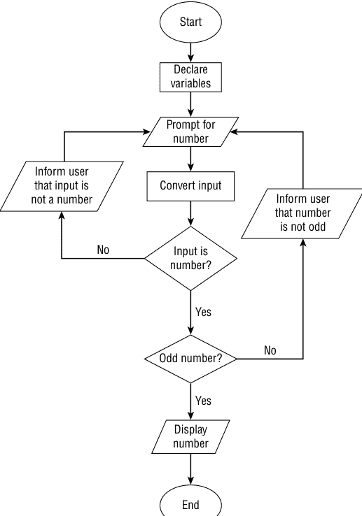

**图 9.4** 流程图示例

我们建议你在开始任何程序之前，先画一个流程图或写出伪代码步骤（如果没有的话），然后再打开你的 IDE 创建。

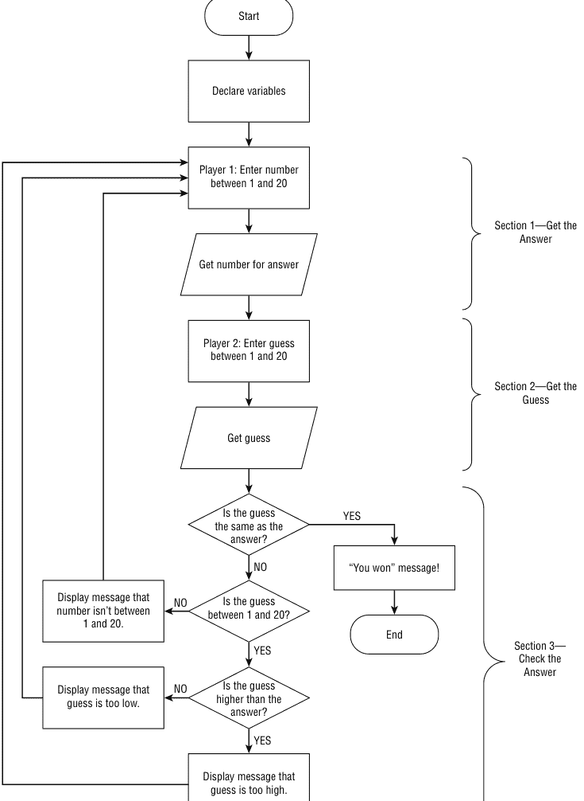

第1部分—获取答案

第2部分—获取猜测

第3部分—检查答案

图 9.5 猜数字流程图

20 Job Ready Java

在循环中，我们将提示玩家输入（他们的猜测），并再次从键盘读取他们的输入。这在图 9.5 流程图的第2部分所示。


在接收输入后，我们首先想知道的是用户是否猜对了。如果玩家没有输入正确的猜测，我们可以显示胜利信息并结束程序。如果他们猜错了呢？那么我们需要执行假条件分支。在此时，我们会告诉他们他们猜的数字在给定的范围内。在我们的案例中，范围是 1 到 20 之间。如果用户没有在该范围内猜，我们将显示一条消息，然后返回到输入提示。

如果猜测是错误的，我们可以检查猜测数字是否大于答案。如果是，我们将打印一条消息告诉他们猜小一点，然后让他们再次尝试猜测。

最后，如果猜测不等于答案，且在范围内，且不大于答案，那么唯一的可能就是猜测太小了，我们需要打印一条消息告诉玩家猜一个更大的数字，然后再将他们送回请求输入猜测的提示处。

### 猜数字游戏代码

到此时，我们对猜数字的工作原理已经有了相当好的理解，并且考虑了它的基本需求和可能性。现在轮到你将你的流程图转换为代码了。在继续阅读之前，请自己独立完成。

当我们把流程图转换为代码时，首先要做的工作是声明变量并为它们设置初始值。正如你在之前的课程中学会的，请使用正确的 `Scanner`、`int` 和 `int` 类型分别声明你的扫描、答案和猜测。

```java
int answer = 0;
int guess = 0;
myScanner = new Scanner(System.in);
```

接下来，你需要从用户处获取答案并放入 `answer` 变量中。你在之前的课程中学习过这可以通过几种方式实现。让我们使用 `System.out.println` 和 `next` 方法来实现。

```java
System.out.println("Player 1: 请输入一个 1 到 20 之间的数字:");
answer = myScanner.nextInt();
```

一旦我们有了答案，就开始我们的循环。一直循环到玩家 2 猜中正确答案。这可以通过创建一个无限循环并在其中跳出来实现，因此我们将使用“`while true`”小技巧。

```java
while (true) {
    // 需要用 break 退出的程序代码！
}
```

循环开始后，是时候在控制台提示玩家 2 进行猜测了。我们可以用请求答案时相同的方法来这样做。

```java
System.out.println("请猜一个 1 到 20 之间的数字: ");
guess = scanner.nextInt();
```

现在让我们看看对这个数字进行的操作。首先，我们检查猜测是否等于答案。如果他们猜对了，我们想要离开循环。我们可以用 `break` 关键字来实现。如果他们没有回答正确，我们继续执行程序。我们的程序可以决定遵循流程图的哪部分。

```java
if ( guess == answer) {
    break; // 他们解决了问题，所以退出循环！
} else {
    // 继续执行程序
}
```

让我们遵循胜利逻辑。在这种情况下，通过使用 `break`，我们跳出了 `while` 循环并告诉用户他们猜对了。在此时，程序完成并可以结束了。

如果猜测不是答案，且小于 1 或大于 20，那么我们就知道它不在我们想要的范围内，所以我们给玩家一条消息，并使用 `continue` 关键字重新启动循环并提示用户再次输入。如果是在范围内，我们就继续进行。

```java
if(guess < 1 || guess > 20) {
    System.out.println("输入一个 1 到 20 之间的猜测。");
    continue;
}
```

此时，我们有了一个在范围内的猜测，所以我们可以检查猜测是否大于答案。如果是，他们就需要猜小一点，我们就告诉他们。然后我们使用 `continue` 关键字回到顶部。

```java
if(guess > answer) {
    System.out.println("猜测太大了。选一个小小的数字！");
    continue;
}
```

如果之前的任何条件都不成立，我们可以打印一条消息说他们需要猜大一点，并让循环回到顶部。注意，`continue` 是必要的，因为我们已经处于循环的底部，而且无论如何它都会回到顶部。

正如你所看到的，代码的每一个部分都与流程图相匹配。有一张可以遵循的地图会让应用程序变得简单得多并且不容易出错。

> 当你成为一名专业程序员时，你不仅想要创建流程图，还想要在以后审查和编辑你的代码。

# 练习列表 9.1

## GuessingGame.java

```java
import java.util.Scanner;

class GuessingGame {

    public static void main(String[] args) {
        // 声明数字变量并初始化为0
        int answer = 0;
        int guess = 0;
        // 声明并初始化 Scanner 对象
        Scanner myScanner = new Scanner(System.in);

        // 要求玩家 1 输入 1 到 20 之间的数字
        System.out.println("Player 1: 请输入一个 1 到 20 之间的数字:");
        // 等待输入一个数字
        answer = myScanner.nextInt();
        // 注意这里应该有错误检查！

        // 现在开始获取猜测！
        while (true) {
            // 获取一个猜测！
            System.out.println("请猜一个 1 到 20 之间的数字:");
            guess = myScanner.nextInt();

            // 猜测等于答案吗？
            if (guess == answer) {
                break; // 他们解决了问题！
            } else if (guess < 1 || guess > 20) {
                System.out.println("输入一个 1 到 20 之间的猜测。");
                continue;
            }

            if (guess > answer) {
                System.out.println("猜测太大了。选一个小小的数字！");
                continue;
            }
            System.out.println("猜测太小了。选一个大数字！");
        }
        System.out.println("你对了！答案是：" + answer);
    }
}
```

## 第10课

为你的程序添加随机性

我们经常需要产生不可预测的行为：例如在游戏中模拟掷骰子或抛硬币。在本课中，我们将研究使用 `Random` 类来实现这一点。

### 学习目标

在本课结束时，你将能够：

- 初始化 `Random` 对象
- 使用 `Random` 对象生成任意范围内的随机整数
- 采用随机整数从数组中选择值
- 使用 `Random` 对象生成任意范围内的双精度浮点数
- 将随机值应用于抛硬币（或模拟任何其他概率）的布尔值

### 初始化随机对象

总是以相同的方式做事有时是重要的，但偶尔我们需要一点不可预测性。在这些情况下，我们使用 `Random`，这个类的整个工作就是打乱顺序。

我们必须构造 `Random` 才能使用它，但之后我们就拥有了一整个虚拟的随机选项。让我们看看用 `Random` 可以的一些有趣事情。

### 引入 Random 类

通过引入 Java Random 工具包，你可以在你的程序中使用 `Random` 类。该包通过在列表顶部添加 import 语句来引入。这与你在之前的课程中引入 `Scanner` 的做法类似。

```java
import java.util.Random;
```

`Random` 类提供了自动生成随机数的有用方法。然而，计算机的行为的设计是确定性的，这意味着我们期望每次都得到相同的结果。那么，随机性是如何实现的呢？并不是。

事实上，我们产生的是伪随机数。但这对于我们的目的来说足够了。

### 随机数的种子

当我们创建一个生成随机数的 `Random` 对象时，有两个可能的构造函数可以使用。

```java
Random fixedSeed = new Random(112358);
Random timedSeed = new Random();
```

> 注意：我们还没有真正讨论过构造函数。这些在我们更具体地讲解类时会变得更加清晰。现在，只需知道构造函数是用于从类中创建对象的方式。

第一个构造函数使用我们预先指定的种子值。这意味着每次应用程序运行时，该 `Random` 对象都会产生相同的序列随机数。如果我们选择一个不同的整数，就会生成不同的序列，但每次我们运行应用程序时，该序列仍然是相同的。通常情况下，这并不是我们想要的（因为从不改变的“随机”行为是容易预测的）。相反，我们应该使用第二个构造函数，它会根据应用程序运行的日期和时间生成种子值。结果是，此程序的每次运行都会产生不同的随机种子，因此 `Random` 对象将生成一个完全不同的随机数序列。

> 注意：你可以从 Java 文档（`docs.oracle.com/en/java/javase/11/docs/api/java.base/util/Random.html`）获取关于 `Random` 类的更多信息。

> 提示：在应用程序中创建一个单一的 `Random` 对象并反复使用是一项良好的实践。创建多个 `Random` 对象并仅生成序列中的第一个数字（特别是在循环中）会破坏生成器的伪随机性。它还会在为你的应用程序增加大量的性能开销。

### 生成随机整数

我们将学习的第一种生成随机数的方法是生成从 0 到你指定的任意数字（不包含该数字）之间的随机数。不包含意味着你指定的最大值将不会出现在可能的结果中，因此你需要指定比你希望 `Random` 生成的最高值大1的值。例如，如果你想生成从 0 到 9 的整数，你必须指定上限为 10。

这看起来可能有点困惑，但我们因此获得了一些益处，并将在几分钟后看到。首先，让我们来看生成从 0 到 9（包含）的随机数。

```java
Random rng = new Random();
// 生成 10 个数字，每个都在 0 到 9 之间（包含）
for (int i=0; i<10; i++) {
    int randomNumber = rng.nextInt(10);
    System.out.println(randomNumber);
}
```

在这里，我们可以看到尽管我们指定了最大值为 10，但该最大值是不包含的，我们只会产生 0 到 9 的数字。要得到从 1 到 10 的范围，我们需要在 `nextInt()` 方法之后加上 + 1。新的代码行看起来像这样：

```java
int randomNumber = rng.nextInt(10) + 1;
```

> 注意：你可能会奇怪，为什么我们不能将对 `nextInt()` 的调用改为 `nextInt(11)`。如果我们这样做，我们得到的是从 0 到 10，而不是 1 到 10。

那么，我们如何使用它呢？在编程中，我们通常必须处理从 0 开始编号的索引，并且必须在我们所使用的集合长度之前停止。这在处理数组时尤为如此，你将在第13 节“使用数组进行组织”中学习数组。数组中的索引从 0 开始。基于此，以下是一个从名称数组中随机选择一个名称的代码片段：

```java
Random rng = new Random();
String[] names = new String[] {"Alice", "Bob", "Clarice", "David", "Elizabeth" };
int randomIndex = rng.nextInt(names.length);
String randomName = names[randomIndex];
```

在这里我们定义了一个包含五个名字的数组并随机选择一个名字，但这段代码的任何地方都没有硬编码数字 5。相反，我们引用了数组的长度。结果是，我们可以随心所欲向此数组添加或删除名称，它将按预期工作。

### 生成随机浮点数

现在我们看到了如何生成随机整数，让我们来看看生成带有小数部分的随机数。

通常情况下（特别是当我们处理概率时），我们需要能够从连续（而不是离散）范围生成随机数的能力。`Random` 类提供了一个非常直接的方法来实现此：`nextDouble()`。`nextDouble()` 将生成一个 0.0（包含）到 1.0（不包含）之间的随机数。

我们可以用这个做什么？每当我们有一个想要采样的概率时，就可以生成数字。例如，以下代码模拟了硬币掷并将结果存储在变量中：

```java
Random rng = new Random();
boolean heads = random < 0.5;
```

到目前为止一切正常，但如果我们想生成范围之外的数字呢？与整数不同，`Random` 没有提供指定范围的重载，所以我们必须手动处理。

```java
Random rng = new Random();
double min = 7.5;
double max = 13.2;
double range = max - min;
double stepOne = rng.nextDouble() * range;
double stepTwo =
```

正如你所见，将计算步骤放在单独的变量中通常更清晰（尽管代码更长）。这尤其如此。

### 重温猜数字游戏

在上一节的练习中，你创建了一个流程图和代码，让玩家尝试猜 1 到 20 之间的数字。代码在列表 9.1 中提供过；然而，该程序有一个缺陷。要猜的数字必须是输入的，这使得它对游戏者可见。使用 `Random` 类可以让猜数字游戏变得有趣得多。列表 10.1 展示了一个增加了我们学到的生成随机数的更新列表。

### 列表 10.1

## GuessingGame.java

```java
import java.util.Random;
import java.util.Scanner;

class GuessingGame {

    public static void main(String[] args) {
        // 定义数字变量并初始化为 0
        int answer = 0;
        int guess = 0;
        Random rng = new Random(); // 设置我们的随机变量

        // 定义并初始化 Scanner 对象
        Scanner myScanner = new Scanner(System.in);

        // 生成一个 1 到 20 之间的随机数
        answer = rng.nextInt(20) + 1;

        // 现在开始猜测！
        while(true ) {
            // 获取一个猜测！
            System.out.println("请猜一个1 到 20 之间的数字: ");
            guess = myScanner.nextInt();

            // 猜测的数字等于答案吗？
            if ( guess == answer) {
                break; // 他们解决了问题！
            }

            else if (guess < 1 || guess > 20) {
                System.out.println("请输入 1 到 20 之间的数字.");
                continue;
            }

            if (guess > answer) {
            }
        }
    }
}
```

```java
System.out.println("Guess is too high. Pick a lower number!");
continue;
System.out.println("Guess is too low. Pick a higher number!");
System.out.println("You got it! The answer was: " + answer );
```

此列表有三处主要更改。首先，添加了 import 语句以包含 `Random` 包。

```java
import java.util.Random;
```

其次，声明并初始化了一个新变量，为我们的随机数设置一个随机种子。

```java
Random rng = new Random(); // set up our random range variable
```

在这种情况下，没有向初始化器 `Random()` 传递任何值，因此会在程序运行的日期和时间创建一个随机种子值。

对于第三处更改，你可以看到，我们没有提示用户并调用 `Scanner` 对象，而是创建了一个随机整数并将其存储在 `answer` 中。

```java
answer = rng.nextInt(20) + 1;
```

由于我们需要一个 1 到 20 之间的数字，因此可以调用 `Random` 类的 `nextInt()` 方法并传入 20，以获得从 0 到 19 的二十个值中的一个。我们需要加 1 以将范围变为 1 到 20。

如果你运行此程序，将看到类似下面的输出。当然，你猜的数字可能不同，你猜中数字的次数也会不同！

```
Please guess a number between 1 and 20:
10
Guess is too low. Pick a higher number!
Please guess a number between 1 and 20:
15
Guess is too high. Pick a lower number!
Please guess a number between 1 and 20:
13
You got it! The answer was: 13
```

再次运行显示数字是不同的且随机的。

```
Please guess a number between 1 and 20:
```


10

Guess is too low. Pick a higher number!

Please guess a number between 1 and 20:

15

Guess is too low. Pick a higher number!

Please guess a number between 1 and 20:

18

You got it! The answer was: 18

## 其他随机选项

值得注意的是，在编程时通常有多种方法实现同一功能。尝试生成随机数时也是如此。与本节介绍的 `Random` 类类似的一个选项是 `Math.random()`，它是 JDK 中 `Math` 类提供的一个方法。

其他选项可以在 `ThreadLocalRandom` 和 `SecureRandom` 类中找到。这些是高级类，考虑了线程问题，并为生成数字提供了更高效的解决方案。

## 总结

我们现在已经看到了如何向应用程序添加随机性，以及如何使用这些随机值来模拟现实世界的事，例如抛硬币或从列表中选择值。这有许多现实世界的应用，包括统计建模、游戏和类似的应用程序。

然而，这可能会对你的应用程序产生影响。随机性会让调试变得更加困难，仅仅是因为程序的行为在每次运行之间是不相同的。在另一节课程中，我们将考虑如何安全、明智地使用随机值。

## 练习

本部分包含使用随机数的编程练习。对于活动中的每个练习，你应该创建一个具有适当名称的新 Java 类。

### 练习 1：一点点混乱

### 练习 2：观点者——做出随机选择

### 练习 3：大玩家

### 练习 4：硬币翻转器

### 练习 5：多猜猜我

### 练习 6：幸运饼干

## 练习 1：一点点混乱

让我们创建一个程序来练习使用 `Random`。使用练习列表 10.1 中的代码创建一个新类 `ALittleChaos`。在开始尝试代码之前，请确保它能够正常工作。

你应该注意，此列表中引入了一些内容。你应该能猜出它们在做什么。首先，你会发现对我们的随机变量上调用了 `nextBoolean()` 方法。如预期的那样，这将返回一个随机的布尔值，`true` 或 `false`。

你看到的第二点可能新颖的内容是，我们没有向 `System.out.print()` 方法传递字符串，而是传递了对随机方法的调用以获取一个新的随机值。然后，该随机值将与一个短字符串拼接后打印出来。

### 练习列表 10.1

#### ALittleChaos.java

```java
import java.util.Random;

public class ALittleChaos {

    public static void main(String[] args) {

        Random randomizer = new Random();

        System.out.println("Random can make integers: " + randomizer.nextInt());
        System.out.println("Or a double: " + randomizer.nextDouble());
        System.out.println("Or even a boolean: " + randomizer.nextBoolean());

        int num = randomizer.nextInt(100);

        System.out.println("You can store a randomized result: " + num);
        System.out.println("And use it over and over again: " + num);
    }
}
```

这里是输出示例。记住，我们使用的是随机值，你应该看到与这里显示的完全不同的值。

> Random can make integers: -1998023926
>
> Or a double: 0.123456789
>
> Or even a boolean: false
>
> You can store a randomized result: 42
>
> And use it over and over again: 42

## 练习 2：观点者——做出随机选择

曾经做过主意吗？为了让它运行，编写一个简单的程序来选择你喜欢的动物。将练习 10.2 中的代码添加到名为 `Opinionator` 的类中。注意这段代码不会报错。

### 练习列表 10.2

#### Opinionator.java

```java
import java.util.Random;

public class Opinionator {

    public static void main(String[] args) {
        Random randomizer = new Random();
        System.out.println("I can't decide what animal I like the best.");
        System.out.println("I know! Random can decide for ME!");

        int x = randomizer.nextInt(5);

        System.out.println("The number we chose: " + x);

        switch (x) {
            case 0:
                System.out.println("Llamas are the best!");
                break;
            case 1:
                System.out.println("Dodos are the best!");
                break;
            case 2:
                System.out.println("Woolly mammoths are DEFINITELY the best!");
                break;
            case 3:
                System.out.println("Sharks are the greatest, they have their own!");
                break;
            case 4:
                System.out.println("Cockatoos are just awesome!");
                break;
            case 5:
                System.out.println("Have you met a naked mole-rat? They're GREAT!");
                break;
        }

        System.out.println("Thanks Random, maybe YOU'RE the best!");
    }
}
```

这里是一种可能的结果：

I can't decide what animal I like the best.

I know! Random can decide for ME!

The number we chose: 3

Sharks are the greatest, they have their own!

Thanks Random, maybe YOU'RE the best!

## 练习 3：大玩家

使用随机数的一种方法是模拟掷骰子或抛硬币。使用练习 10.3 中的代码创建一个新程序 `HighRoller` 来掷六面骰子。在尝试代码之前，请确保程序的初始版本运行正常。

### 练习列表 10.3

#### HighRoller.java

```java
import java.util.Random;

public class HighRoller {

    public static void main(String[] args) {
        Random diceRoller = new Random();

        int rollResult = diceRoller.nextInt(6) + 1;

        System.out.println("TIME TO ROLL THE DIE!");
        System.out.println("I rolled a " + rollResult);

        if (rollResult == 1) {
            System.out.println("You rolled a critical failure!");
        }
    }
}
```

这里是该程序的示例输出：

该掷骰子了！（TIME TO ROOOOOOOLL THE DIE!）

我掷了一个 6

一旦你验证了基础代码运行符合预期，请让该程序具有交互性。

- 询问用户单枚骰子有多少面。
- 掷骰子以生成一个介于 1 和 # 个面之间的数字。
- 添加一个条件判断，打印以下内容：
  - 如果掷出偶数，则打印：你掷出了偶数！
  - 如果掷出最大值，则打印：你掷出了大大数！干得好！

## 练习 4：硬币翻转器

通过程序化翻转硬币。这个练习由你独立完成。编写一个名为 `CoinFlipper` 的程序，模拟随机抛硬币，但不要使用 `nextInt()`。当你的程序运行时，你应该能看到类似下面的输出：

准备好，预备，掷……!!

你得到了反面！（TAILS!）

## 练习 5：多猜猜我

改进和重构程序通常是一个持续的过程。采用练习题 9.1 中的 5 数字猜数字程序并改进它。将新版本保存在一个名为 `GuessMeMore` 的新类下。根据你的更新，添加以下更改：

- 让选中的数字变为 -100 到 100 之间的随机数。
- 添加一个变量来跟踪玩家猜测的次数。在玩家游戏结束时打印这个数字。

以下是你应该看到的示例：

```
请猜 -100 到 100 之间的数字：
-35
猜太小了。请选一个更大的数字！
请猜 -100 到 100 之间的数字：
45
猜太小了。请选一个更大的数字！
请猜 -100 到 100 之间的数字：
71
你对了！答案是：71
猜测次数：3
```

## 练习 6：幸运饼干

这个练习由你独立完成。编写一个程序来打印随机引言。你可以创建一个名为 `FortuneCookie` 的程序，在屏幕上随机打印引言。可以使用以下列表来寻找灵感，你也可以使用自己最喜欢的引言供程序随机选择并显示：

- “那些不是你寻找的机器人”
- “当生死关头时，永远不要和西西里作对！”
- “小混蛋永不放弃（Goonies never say die）。”
- “伟大的力量伴随着巨大的责任。”
- “永远不要与数据争论。”
- “不要尝试。做，或者不做。没有尝试。”
- “你是风中的一片叶子，看你如何翱翔。”
- “什么都不做，它将成为你所想象的一切。”
- “在 Zod 面前下跪。”
- “就此吧（Make it so）。”

代码和其他输出由你决定。以下是使用之前的问题可能的结果示例：

你的极客运势：不要尝试。做，或者不做。没有尝试。

这是程序第二次运行时的随机输出：

你的极客运势：那些不是你寻找的机器人。

# 第 11 课

## 调试

在本课中，我们将基于第 3 课所学到的知识更深入地观察如何调试程序。使用 `WindowMaster` 程序的代码，我们将回顾如何设置断点，并学习更多关于调试知识，包括如何在调试模式下执行程序、单步执行程序以及在程序执行期间检查变量的值。

### 学习目标

在本课结束，你将能够：

- 在调试模式下执行程序
- 在代码中设置断点
- 单步执行代码
- 在代码的设定点处检查变量

### 创建用于调试的文件

在本课中，我们将更深入地研究调试器及其工作原理。值得强调的是，调试器是一个非常有用的工具。当人们开始开发时，往往会忽略这一点。但当程序运行不符合预期时，IDE（无论是 NetBeans 还是其他）可以帮助定位问题所在。

当我们编写代码时，往往认为知道自己在做什么。但通常情况下，如果程序没有按预期方式工作，几乎总是由于我们写了某些东西。这就是为什么调试器可以帮助我们的原因。

让我们开始吧。如果你有第 6 课 `WindowMaster` 的原始代码，请打开项目并确保它能编译且正常运行。如果你没有那些代码了，请使用列表 11.1 中的代码创建一个名为 `WindowMasterDebug` 的新项目。完成后，保存文件并确保程序正常运行。

> 注意：列表 11.1 是列表 6.3 中展示的 WindowMaster，仅将类名和文件名更改为 `WindowMasterDebug`。

### 列表 11.1

```java
import java.util.Scanner;

public class WindowMasterDebug {

    public static void main(String[] args) {

        // 声明变量

        float height;

        float width;

        float areaWindow;

        float perimeterWindow;

        float cost;

        Scanner scanner = new Scanner(System.in);

        System.out.println("请输入高度:");

        height = Float.parseFloat(scanner.nextLine());

        System.out.println("请输入宽度:");

        width = Float.parseFloat(scanner.nextLine());

        // 计算面积

        areaWindow = height * width;

        // 计算周长

        perimeterWindow = 2 * (height + width);

        // 计算成本

        cost = areaWindow * 5.5;

        // 显示结果

        System.out.println("面积：" + areaWindow);

        System.out.println("周长：" + perimeterWindow);

        System.out.println("总成本：" + cost);

    }

}
```

当代码暂停时，我们有几个选项。其中两个非常值得关注：

- 逐过程 (Step Over, F8)
- 继续 (Continue)

逐过程 (Step Over) 选项允许我们逐行执行语句。它的基本意思是：执行这行代码，跳到下一行代码，然后停止。你可以通过按下 F8 或从 NetBeans 调试菜单中选择 *Step Over* 来逐过程。这将允许第 24 行的代码执行，执行将在下一个可执行语句（第 27 行）处暂停。第 24 行的断点将再次变为粉，第 27 行将变为绿色（表示此执行已停止）；你现在会在变量（Variables）窗口中看到 `Scanner myScanner`，如图 11.4 所示。

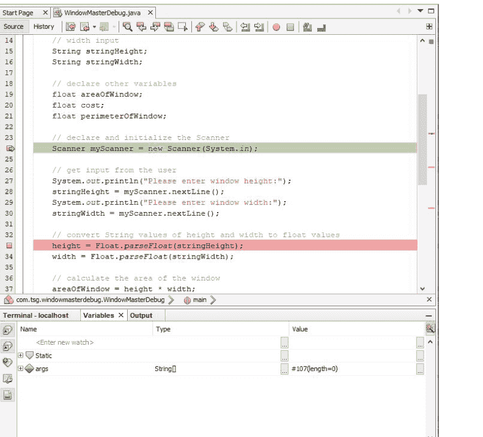

图 11.3 在第一个断点处暂停

如果你继续按 F8 或选择逐过程命令，你可以推进列表；但是，让我们通过按下 F5 继续程序执行。这是继续调试命令，它应该允许程序执行到下一个断点，该断点位于列表的第 33 行。这允许程序运行直到遇到另一个断点或完成。

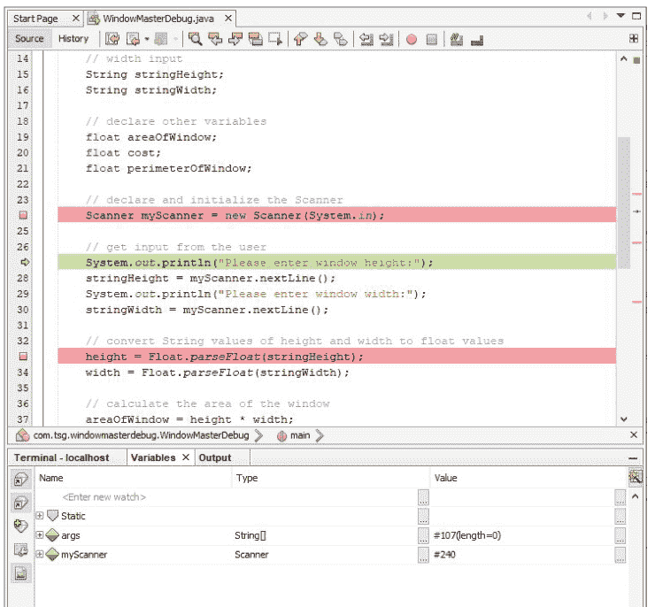

**图 11.4** 执行暂停在第 27 行

你会发现按下 F5 之后什么都没有发生。这是因为你的程序正在等待输入（见图 11.4 中的第 28 行）。通过点击输出（Output）窗口并输入请求的值来提供输入。在你输入完第二个值后，执行将在我们设设的下一个断点（即第 33 行）处停止，如图 11.5 所示。

```java
// declaration

String stringHeight;

String stringWidth;

// declare other variables

float areaOfWindow;

float cost;

float perimeterOfWindow;

// declare and initialize the Scanner

Scanner scanner = new Scanner(System.in);

// get input from user

System.out.println("Please enter height:");

stringHeight = scanner.nextLine();

System.out.println("Please enter width:");

stringWidth = scanner.nextLine();

// convert String values of height and width to float values

height = Float.parseFloat(stringHeight);

width = Float.parseFloat(stringWidth);

// Calculate area

areaWindow = height * width;
```


图 11.5 在第二个断点处暂停

> 注意：如所述，当我们查看调试窗口时，如果某一行是绿色的，它表示代码的执行在此暂停了。

### 检查变量

当代码停止在第 33 行时，值得再次查看 IDE 底部的变量窗口。在图 11.5 中，我们可以看到 IDE 底部选中了输出窗口。如果我们选择变量选项卡，我们应该看到类似图 11.6 的内容。

## 图 11.6 变量选项卡

查看变量窗口时，我们看到情况发生了变化。现在显示了两个新变量 `stringHeight` 和 `stringWidth`，以及你在输出窗口中输入的值。这些变量现在显示出来是因为我们运行了初始化它们的代码。这些是图 11.5 中的第 28 行和第 30 行。

然而，比看到这些值更重要的是，你还可以在变量窗口的数值列更改这些值。目前，你可以在图 11.6 中看到两个变量都包含字符串值 "10"。我们可以通过输入 2 和 0 (20) 将其更改为不同的值。该值将变为字符串，如图 11.7 所示。

## 图 11.7 更新变量窗口中的值

我们可以通过按下 `F8` 继续执行程序的下一行。这将执行我们放置断点的第 33 行。第 33 行代码将字符串转换为数字。

```java
height = Float.parseFloat(stringHeight);
```

在按下 `F8` 逐过程执行该行后，第 34 行变为高亮，我们的变量窗口再次更新，如图 11.8 所示。

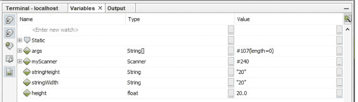

图 11.8 变量窗口现在显示高度

当我们移动到第 34 行时，`height` 变量在变量窗口中可见，因为现在已初始化。更重要的是，我们可以看到字符串 20 已转换为浮点 20.0。如果我们再次按下 `F8`，将执行转换宽的代码。如你所见，在变量窗口中我们看到了输入的字符串，同时也得到了浮点值。

```java
areaOfWindow = height * width;
```

如果按下 `F8`，我们将执行第 38 行。此表达式取两个操作数 `height` 和 `width`，它们都是浮点。在这个表达式中，我们将这两个值相乘并将结果放入 `areaOfWindow`。执行此行后，如果你查看变量窗口，你会发现面积已经计算，结果为 40.0，这正是我们预期的。图 11.9 显示了调试器的当前状态。

如果你按下两次 `F8`，将执行第 40 行和 44 行，你可以在图 11.9 中看到这些额外的计算。你还会看到 `perimeterOfWindow` 和 `cost` 被添加到变量窗口中。

## 控制台和调试器

如果你一直在操作，那么我们就知道现在处于向控制台打印信息的代码行。如果你现在查看控制台，你会看到显示了我们输入的内容，但还没有显示输出。再次按下 `F8`，将运行下一行代码 47 行，如图 11.10 所示。

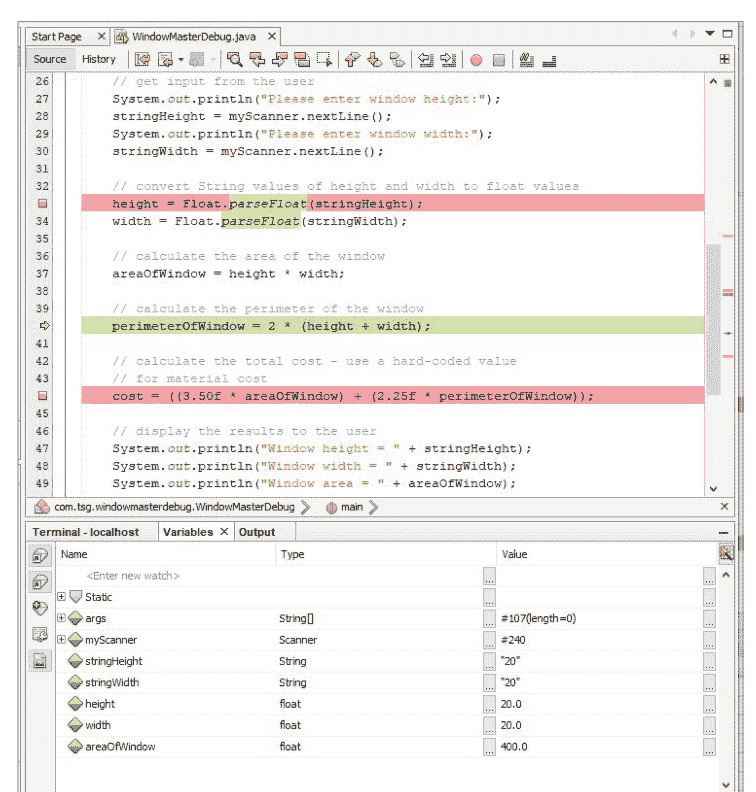

图 11.9 确定面积

```java
System.out.println("Please enter width:");

stringWidth = myScanner.nextLine();

// convert String value of height and width to float values

height = Float.parseFloat(stringHeight);

width = Float.parseFloat(stringWidth);

// calculate the area of the window

areaOfWindow = height * width;

// calculate the perimeter of the window

perimeterOfWindow = 2 * (height + width);

// calculate the total cost - use a hard-coded value

cost = (int)(areaOfWindow + 2.5 * perimeterOfWindow);

// display the results to the user

System.out.println("Window height = " + stringHeight);

System.out.println("Window width = " + stringWidth);

System.out.println("Window area = " + areaOfWindow);

System.out.println("Window perimeter = " + perimeterOfWindow);

System.out.println("Total cost = " + cost);
```

图 11.10 向控制台打印出一行

你可以在图 11.10 中看到我们运行了第一次 `println` 调用。第二次 `println` 调用被高亮显示，因此尚未执行。在图 11.10 中，选中了输出选项卡。你可以看到只显示了第一行输出。在这种情况下，它是窗口的高度。

如果我们通过按下 `F8` 逐过程执行下一个语句，我们看到窗口宽度被显示。再次按下 `F8` 会打印窗口面积。再按两次 `F8`，我们看到周长被显示。

从我们刚刚所做中总结的关键点是注意我们能够查看每一行代码的执行并看到其结果。你能够控制执行并看到每行代码在做什么。

当程序接近结束时，你只需按下 `F5` 继续。这将执行程序的剩余部分直到它完成并正常退出。

### 总结

虽然通过调试可以学习和做更多事情，但你在本节中学到的知识将帮助你找到编码时遇到的最常见问题。在本节中，我们涵盖了以下：

- 在调试模式下运行程序
- 设置断点
- 逐语句逐行执行程序
- 在程序执行期间检查程序变量的值

### 练习

此部分包含了编程练习，帮助你熟悉调试器。除了这里介绍的，你还应该使用调试器逐行执行书中创建的所有程序，以查看变量何时以及如何赋值，以及它们包含什么值。

现在，这里有一些练习可以提供更多使用调试器的经验：

- **练习 1**: 奇数奇数
- **练习 2**: 一个简单的 If 问题

## 练习 1：奇数奇数

练习列表 11.1 应该看起来很熟悉。该列表在第 8 节你学习循环语句时介绍过。再次按照此处所示输入此列表，然后运行它。

### 练习列表 11.1

### 使用 for 循环显示奇数

```java
public class CountingNumbers {

  public static void main(String[] args) {

    int counter;

    for ( counter = 0; counter < 21; counter = counter + 2 )

    {

      System.out.println("......" + counter);

    }

    System.out.println("....Done!");

  }

}
```

当你运行此列表时，你会发现打印出来的数字并不是奇数，这看起来可能很奇怪。虽然你应该能够在不使用调试器的情况下找到并修复此问题，但这并不是本次练习的目的。
相反，在以下行设置一个断点：

```java
System.out.println(counter);
```

当你以调试模式运行程序时，会发生什么？你只有一个断点，但程序暂停了多少次？
在相同的断点处，再次以调试模式下运行程序。使用调试器中的变量窗口，更改 `counter` 的值，以便正确打印出奇数。

## 练习 2：关于 If 的简单问题

按照所示输入练习列表 11.2。

### 练习列表 11.2

### Looper.java：关于 If 的简单问题

```java
public class Looper {

  public static void main(String[] args) {

    int counter = 10;

    for (int looper = 1; looper < 10; looper++) {

      if (counter < 10) {

        // 在以下行设置一个断点。

        System.out.println("Counter is less than 10!");

      } else {

        System.out.println("Counter is greater or equal to 10!");

      }

      System.out.println(counter);

    }

  }

}
```

在以下行设置一个断点，然后以调试模式编译并执行该列表：

`System.out.println("Counter is less than 10!");`

该列表在断点处暂停了多少次？这符合你的预期的吗？尝试移动断点，并记录断点暂停程序执行的次数。

# 第 12 课

### 添加方法

你喜欢不必要的重复自己吗？你喜欢你需要的工作量吗？你曾经被叫过懒——或者把减少工作量的技巧当成赞美吗？

在本节中，我们将学习方法。方法允许我们更好地组织代码，使其可以在多个地方被使用。这当然意味着更少的工作量。优秀的程序员是懒惰的程序员——嗯，是聪明且懒的。

### 学习目标

- 在本节结束时，你将能够：
- 解释 DRY 原则
- 定义方法
- 解释方法签名各个部分
- 为方法使用正确的命名规范
- 解释返回值
- 使用输入参数
- 重构代码
- 解释应用于代码的作用域概念
- 学习使用调试器单步执行代码

### 为什么需要方法？

编写良好代码的重要概念之一是 DRY 原则：不要重复（Don't Repeat Yourself）。当被赋予一项任务时，我们想要做好它，并且只想做一次。方法允许我们编写一段代码，给它起名字，然后在程序中反复使用这段代码。方法为我们设计和编写代码提供了两个新工具：

- 我们可以重用写过的代码。
- 我们可以使用方法将大型、复杂的任务分解为更简单的步骤。

方法并没有为语言本身添加任何新功能。它们是一种组织工具。编写良好的软件很大程度上取决于良好的代码组织。

### 定义方法

方法由一个方法声明定义，它由以下部分组成：

```
<access modifier> static <return type> <method name> (<parameter list> <exception body>)
```

以下描述了这些部分：

- **访问修饰符**：现在使用 `public`。
- **static 关键字**：稍后我们将讨论。如果方法不需要实例，可以使用它。
- **返回值**：指示方法返回的数据类型。如果方法没有返回值，则使用 `void`。
- **方法名**：在方法括号之前的的名称。
- **参数列表**：括号内的内容。如果没有参数，则留空。
- **异常体**：稍后我们将讨论。
- **方法体**：方法括号内的代码块。

```java
public static int get2() {

    return 2;

}

public static int get3() {

    return 3;

}

public static int get4() {

    return 4;

}
```

当我们运行此列表时，我们将看到以下输出：

 3
4

当我们调用一个方法时，可以通过许多不同的方式看到返回值。在列表 12.1 的代码中，我们可以看到创建了三个名为 `get2`、`get3` 和 `get4` 的方法。每个方法都返回一个简单的整数数字。我们将使用这些方法中的每一个来展示我们对返回值可以做的三件事。

对返回值可以做的第一件事是忽略它。如果你查看 `main` 方法，你会发现它调用了 `get2()`。`get2()` 方法返回一个值为 2 的整数；然而，它什么也没有做。我们简单地忽略了它，这是没问题的。

我们可以做的第二件事是将返回的值放入变量中，然后以某种方式使用它。查看 `main` 方法，你可以看到我们调用了 `get3()`。`get3()` 返回的值被放在我们创建的名为 `num` 的整数中。然后我们可以在程序的其他部分使用 `num` 整数。在这种情况下，我们只需将其打印到控制台。

我们使用返回类型的第三种方法实际上是将调用传递给另一个方法，例如 `System.out.println()`。当这种情况发生时，我们传递的方法将被求值，并且返回值将被使用。在列表 12.1 中，我们将 `get4()` 方法作为参数传递给 `System.out.println()` 方法。`get4` 的返回值被传递给 `println()` 并直接打印到控制台。

### 输入参数

方法可以有零或多个输入参数。输入参数是值的简单占位符（变量的声明），它们作为数据被“传入”供方法使用。没有参数的方法是有用的，因为我们可以在很多地方重用方法包含的代码。然而，当我们可以将参数值传递到方法时，方法就变得强大了。

这里有一个有些生意的例子：假设我们想编写一些可以将两个数字相加的可用代码。此外，假设我们不知道如何使用参数。如果是这样，我们就必须为每个想要相加的数字对编写一个单独的方法。

```java
public static int addAnd1() {

  return 1 + 1;

}
```

```java
public static int addAnd2() {

  return 1 + 2;

}
```

```java
public static int addAnd3() {

  return 1 + 3;

}
```

以此类推……

这不是一个好的状况。为了能够相加任何数字，我们必须编写无限数量这样的方法。
每个方程式只适用于一种情况；当等式成立时，它是不成立的。

- 1 + 1 = 2
- 1 + 2 = 3
- 1 + 3 = 4
- 以此类推……

我们真正想要的是两个数字相加的通用方程。

a + b = y

我们希望能够提供 a 和 b 的值，并让方法为我们计算 y。我们将在这里使用输入参数来帮助我们。

```java
public static int add(int a, int b) {

  return a + b;

}
```

我们现在有了一个可以接收任意两个数字并计算和的方法。注意，对于每个参数，我们都包含了一个标识符和一个关联的数据类型。事实上，我们声明每个参数的方式类似于变量声明。在这种情况下，两个参数的类型都是 int。

### 参数数量的匹配

值得重复的是，参数的数量及其数据类型必须与方法定义的类型和数量匹配；否则，方法调用的代码将无法编译。例如，如果方法定义如下：

```java
public void sayHello(String a, String b){

    // 此处是代码

}
```

那么方法调用必须看起来像这样：

```java
sayHello("Bob", "Sue");
```

或者像：

```java
String a = "Bob";

String b = "Sue";

methodName(a, b);
```

列表 12.2 将此整合到一个我们可以输入并执行的列表中。

### 列表 12.2

带有两个参数的方法

```java
public class MethodForms {

    public static void main(String[] args) {

        sayHello("Bob", "Sue");

    }

    public static void sayHello(String a, String b) {

        System.out.println("Hello " + a + " and " + b);

    }

}
```

当我们运行它时，我们可以看到传递的两个值被 `sayHello()` 方法接收，该方法使用它们来显示如下所示的消息：

Hello Bob and Sue

当你将代码修改为列表 12.3 所示时（即在期望两个参数时只传递了一个参数），会发生什么？

### 列表 12.3

仅接收两个参数中的之一的方法

```java
// 此列表会导致错误！

public class MethodForms {

    public static void main(String[] args) {

        sayHello("Bob");

    }

    public static void sayHello( String a, String b ){

        System.out.println("Hello " + a + " and " + b);

    }

}
```

如果你编译这段代码，你将得到一个错误。编译器会告诉你参数的数量与方法定义的参数数量不匹配。

### 类型匹配

当你将代码修改为列表 12.3 所示时（即在期望两个参数时只传递了一个参数），会发生什么？

如果你编译这段代码，你将得到一个错误。编译器会告诉你参数的数量与方法定义的参数数量不匹配。

### 列表 12.3

仅接收两个参数中的之一的方法

```java
// 此列表会导致错误！

public class MethodForms {

    public static void main(String[] args) {

        sayHello("Bob");

    }

    public static void sayHello( String a, String b ){

        System.out.println("Hello " + a + " and " + b);
```


如果你编译这段代码，你将得到一个错误。编译器会告诉你参数的数量与方法定义的参数数量不匹配。

## 使用错误的类型调用方法

```java
// 此列表会导致错误！
public class MethodForms {
    public static void main(String[] args) {
        sayHello("Bob");
    }
    public static void sayHello(String a, String b) {
        System.out.println("Hello " + a + " and " + b);
    }
}
```

如果你编译这段代码，你将得到一个错误。编译器会告诉你传递的参数类型与定义的参数类型不匹配。

### 传递参数

```java
// 此列表会导致错误！
public class MethodForms {
    public static void main(String[] args) {
        sayHello("Bob");
    }
    public static void sayHello(String a, String b) {
        System.out.println("Hello " + a + " and " + b);
    }
}
```

如果你编译这段代码，你将得到一个错误。编译器会告诉你参数的数量与方法定义的参数数量不匹配。

### 带有两个参数的方法

列表 12.2
带有两个参数的方法

```java
// 此列表会导致错误！
public class MethodForms {
    public static void main(String[] args) {
        sayHello("Bob");
    }
    public static void sayHello(String a, String b) {
        System.out.println("Hello " + a + " and " + b);
    }
}
```

如果你编译这段代码，你将得到一个错误。编译器会告诉你参数的数量与方法定义的参数数量不匹配。

等待，让我根据实际文本提供一个没有冗余内容的干净版本。

```java
public static int get2() {
    return 2;
}
public static int get3() {
    return 3;
}
public static int get4() {
    return 4;
}
```

当我们运行此列表时，我们将看到以下输出：

3
4

当我们调用一个方法时，可以通过许多不同的方式看到返回值。在 12.1 的代码中，我们可以看到创建了三个名为 `get2()`、`get3()` 和 `get4()` 的方法。每个方法都返回一个简单的整数数字。我们将使用这些方法中的每一个来展示我们对返回值可以做的三件事。

对返回值可以做的第一件事是忽略它。如果你查看 `main` 方法，你会发现它调用了 `get2()`。`get2()` 方法返回一个值为 2 的整数；然而，它什么也没有做。我们简单地忽略了它，这是没问题的。

我们可以做的第二件事是将返回的值放入变量中，然后以某种方式使用它。查看 `main` 方法，你可以看到我们调用了 `get3()`。`get3()` 返回的值被放在我们创建的名为 `num` 的整数中。然后我们可以在程序的其他部分使用 `num` 整数。在这种情况下，我们只需将其打印到控制台。

我们使用返回类型的第三种方法实际上是将调用传递给另一个方法，例如 `System.out.println()`。当这种情况发生时，我们传递的方法将被求值，并且返回值将被使用。在列表 12.1 中，我们将 `get4()` 方法作为参数传递给 `System.out.println()` 方法。`get4` 的返回值被传递给 `println()` 并直接打印到控制台。

### 输入参数

方法可以有零或多个输入参数。输入参数是值的简单占位符（变量的声明），它们作为数据被“传入”供方法使用。没有参数的方法是有用的，因为我们可以在很多地方重用方法包含的代码。然而，当我们可以将参数值传递到方法时，方法就变得强大了。

这里有一个有些生意的例子：假设我们想编写一些可以将两个数字相加的可用代码。此外，假设我们不知道如何使用参数。如果是这样，我们就必须为每个想要相加的数字对编写一个单独的方法。

```java
public static int addAnd1() {
    return 1 + 1;
}
```

```java
public static int addAnd2() {
    return 1 + 2;
}
```

```java
public static int addAnd3() {
    return 1 + 3;
}
```

以此此类推……

这不是一个好的状况。为了能够相加任何数字，我们必须编写无限数量这样的方法。每个方程式只适用于一种情况；当等式成立时，它是不成立的。

- 1 + 1 = 2
- 1 + 2 = 3
- 1 + 3 = 4
- 以此类推……

我们真正想要的是两个数字相加的通用方程。

a + b = y

我们希望能够提供 a 和 b 的值，并让方法为我们计算 y。我们将在这里使用输入参数来帮助我们。

```java
public static int add(int a, int b) {
    return a + b;
}
```

我们现在有了一个可以接收任意两个数字并计算和的方法。注意，对于每个参数，我们都包含了一个标识符和一个关联的数据类型。事实上，我们声明每个参数的方式类似于变量声明。在这种情况下，两个参数的类型都是 int。

### 参数数量的匹配

值得重复的是，参数的数量及其数据类型必须与方法定义的类型和数量匹配；否则，方法调用的代码将无法编译。例如，如果方法定义如下：

```java
public void sayHello(String a, String b) {
    // 此处是代码
}
```

那么方法调用必须看起来像这样：

```java
sayHello("Bob", "Sue");
```

或者像这样：

```java
String a = "Bob";
String b = "Sue";
methodName(a, b);
```

列表 12.2 将此整合到一个我们可以输入并执行的列表中。

### 列表 12.2
带有两个参数的方法

```java
public class MethodForms {
    public static void main(String[] args) {
        sayHello("Bob", "Sue");
    }
    public static void sayHello(String a, String b) {
        System.out.println("Hello " + a + " and " + b);
    }
}
```

当我们运行它时，我们可以看到传递的两个值被 `sayHello()` 方法接收，该方法使用它们来显示如下所示的消息：

Hello Bob and Sue

当你将代码修改为列表 12.3 所示时（即在期望两个参数时只传递了一个参数），会发生什么？

### 列表 12.3
仅接收两个参数中的之一的方法

```java
// 此列表会导致错误！
public class MethodForms {
    public static void main(String[] args) {
        sayHello("Bob");
    }
    public static void sayHello(String a, String b) {
        System.out.println("Hello " + a + " and " + b);
    }
}
```

如果你编译这段代码，你将得到一个错误。编译器会告诉你参数的数量与方法定义的参数数量不匹配。

### 类型匹配

如果你编译这段代码，你将得到一个错误。编译器会告诉你传递的参数类型与定义的参数类型不匹配。


public void sayHello(String a, String b) {
    // 此处是代码
}

那么方法调用必须看起来像这样：

```java
sayHello("Bob", "Sue");
```

或者像这样：

```java
String a = "Bob";
String b = "Sue";
methodName(a, b);
```

列表 12.2 将此整合到一个我们可以输入并执行的列表中。

### 列表 12.2
带有两个参数的方法

```java
public class MethodForms {
    public static void main(String[] args) {
        sayHello("Bob", "Sue");
    }

    public static void sayHello(String a, String b) {
        System.out.println("Hello " + a + " and " + b);
    }
}
```

当我们运行它时，我们可以看到传递的两个值被 `sayHello()` 方法接收，该方法使用它们来显示如下所示的消息：

Hello Bob and Sue

当你将代码修改为列表 12.3 所示时（即在期望两个参数时只传递了一个参数），会发生什么？

### 列表 12.3
仅接收两个参数中的之一的方法

```java
// 此列表会导致错误！
public class MethodForms {
    public static void main(String[] args) {
        sayHello("Bob");
    }

    public static void sayHello(String a, String b) {
        System.out.println("Hello " + a + " and " + b);
    }
}
```

如果你编译这段代码，你将得到一个错误。编译器会告诉你参数的数量与方法定义的参数数量不匹配。

# 方法形式

现在你已经了解了方法的组成部分并学会了参数是如何工作的，我们将看看方法可以采取的一些形式。根据之前讨论的规则，方法可以有四种形式。

- 无返回值，无参数
- 有返回值，无参数
- 无返回值，一个或多个参数
- 有返回值，一个或多个参数

值得回顾这些每种形式，以查看它们之间的区别。

## 无返回值，无参数

我们将检查的第一种方法形式示例是一个没有返回值且不接受任何参数的方法。

```java
public static void doit() {
    System.out.println("Hello");
    return;
}
```

由于没有返回任何值，我们名为 `doit` 的方法的返回类型为 `void`。因为没有参数，所以括号内是空的。

> 注意：值得注意的是，我们在这段代码中包含了 `return` 关键字；但是，由于已经到达方法的末尾，所以并不是必须的。无论如何方法都会返回。

## 有返回值，无参数

第二种方法形式示例是一个有返回值但不接受任何参数的方法。

```java
public static int get() {
    return 5;
}
```

此方法返回一个值，因此有一个返回类型，在示例中类型为 `int`。因为没有参数，所以括号内是空的。

## 无返回值，一个或多个参数

第三种方法形式示例是一个没有返回值、但有一个或多个参数的方法。

```java
public static void silly(int i) {
    System.out.println("My parameter is: " + i);
}
```

由于没有返回任何值，返回类型被设置为 `void`。有一个参数传递给此方法。该参数名为 `i`，类型为 `int`。

## 有返回值，一个或多个参数

第四种方法形式示例是一个有返回值且接受一个或多个参数的方法。

```java
public static int add(int a, int b) {
    return a + b;
}
```

此方法返回一个值，因此有一个返回类型，在示例中类型为 `int`。我们可以通过观察括号之间的标识符看到有参数传递给此方法。在这种情况下，有一个整数 `a` 和一个整数 `b` 被传递给方法。

> 注意：`System.out.println(...)` 不是一个返回值。初级程序员一个相当常见的困惑点是从方法返回值与向控制台打印内容之间的区别。从方法返回值需要使用 `return` 关键字，如前面的示例所示。

## static 关键字

在课程的这部分中，我们在定义方法时始终使用 `static` 关键字。现在不要担心它的含义——当我们在下一个单元学习 Java 的面向对象特性时，我们将进行详细介绍。一旦我们学会了 `static` 关键字的含义，我们使用它的频率会大大降低。现在，只需记住在定义方法时包含它。如果你忘记了，你的代码可能无法编译。

# 整合运用

让我们把这些新学的关于方法的知识派上用场，创建一个我们可以在某个程序中使用的方法。到目前为止，我们在之前的课程中使用的 `WindowMaster` 程序状态良好，但至少在一个地方我们重复了自己的工作。我们将通过创建一个可重用的方法来清理它。列表 12.6 展示了 `WindowMaster` 的当前代码，并高亮了一些冗余代码。

### 列表 12.6
WindowMaster.java：WindowMaster 列表

```java
import java.util.Scanner;

public class WindowMaster {
    public static void main(String[] args) {
        // 定义高度和宽度的变量
        float height;
        float width;

        // 定义 String 变量来存储用户的身高和输入
        String stringHeight;
        String stringWidth;

        // 定义其他变量
        float areaOfWindow;
        float cost;
        float perimeterOfWindow;

        // 定义并初始化 Scanner
        Scanner myScanner = new Scanner(System.in);

        // 从用户获取输入
        System.out.println("Please enter window height:");
        stringHeight = myScanner.nextLine();
        System.out.println("Please enter width:");
        stringWidth = myScanner.nextLine();

        // 将高度和宽度的 String 值转换为 float 值
        height = Float.parseFloat(stringHeight);
        width = Float.parseFloat(stringWidth);

        // 计算窗口的面积
        areaOfWindow = height * width;

        // 计算窗口的周长
        perimeterOfWindow = 2 * (height + width);

        // 计算总成本 - 使用硬编码值
        cost = ((3.50f * areaOfWindow) + (2.25f * perimeterOfWindow));

        // 将结果显示给用户
        System.out.println("Window height = " + stringHeight);
        System.out.println("Window width = " + stringWidth);
        System.out.println("Window area = " + areaOfWindow);
        System.out.println("Window perimeter = " + perimeterOfWindow);
        System.out.println("Total Cost = " + cost);
    }
}
```

前几个高亮行与第三、四行相似。

```java
System.out.println("Please enter window height:");
stringHeight = myScanner.nextLine();
```

```java
System.out.println("Please enter window width:");
stringWidth = myScanner.nextLine();
```

这两行也几乎完全相同：

```java
height = Float.parseFloat(stringHeight);
width = Float.parseFloat(stringWidth);
```

这为将代码重构为一个可重用的方法提供了绝佳机会。重构是在不添加、减少或更改功能的情况下重新组织/清理代码的简单过程。重构后，代码执行的功能与之前相同，但现在变得更具可读性和可维护性。

将代码重构为方法的第一步是划分重复代码的相似和不同之处。代码的相似之处将代表新方法的主体。不同之处可以提取为方法的输入参数和返回类型。我们将遵循一个与之前在“参数”部分处理 `add` 方法相似的过程。

### 识别相似之处

我们的代码示例中有哪些相似之处？对于我们请求的每个值，我们都需要：

1. 向控制台打印消息，让用户知道我们在请求什么类型的值。
2. 等待用户提供值，然后将其存储在变量中。
3. 将从控制台读取的字符串转换为 float。

### 识别不同之处

我们还需要确定不同之处。

- 输出到控制台的消息不同。
- 我们将提供的值存储在不同的变量中。

### 创建方法

有了这些关于相似性的知识，我们现在可以创建方法。我们需要：

1. 决定一个名称。
2. 决定方法是否需要参数。如果是，有多少以及类型是什么？
3. 决定方法是否需要返回值。如果是，类型是什么？
4. 编写主体代码。

#### 设置名称

你之前学习了创建方法命名的特征。利用这一点，我们将新方法命名为 `readValue`。

#### 确定参数

对于输入参数的决定，我们需要查看我们的列表。每次运行方法时什么需要变化？根据我们的列表，消息会变化。这听起来像是一个输入参数。我们将处理这个。类型应该是什么？为了回答这个问题，我们查看现有代码。在现有代码中，用户提示是传递给 `System.out.println()` 的字符串字面量，这意味着我们的输入参数也应该是字符串。

#### 设置返回类型

现在是返回类型。在现有代码中，如果你仔细观察，然而，你会注意到我们真正关心的是这些值的 float 表示——字符串表示只需要因为控制台理解数字。我们希望提示用户输入值并获取其 float 表示；我们不想处理字符串。这表明方法的返回类型应该是 `float`。

> 注意：你可以将返回类型设置为字符串；但在每次从新方法获取响应后，你都将进行类似的转换。如果你把某些操作放在方法并在一个完成，就没有必要重复这样做。

#### 我们的基础定义

到目前，我们已经确定了创建方法定义的所有部分。这是我们目前拥有的：

```java
public static float readValue(String prompt) {
    // 方法体待定
}
```

注意，目前我们是将方法设为公共静态（`public` and `static`）。接着是我们确定的返回类型，即 `float`。之后是我们的新方法名 `readValue`。最后是我们的参数，其类型为 `String`。由于该参数是一个文本提示，我们将参数命名为 `prompt`。

#### 我们的方法体

定义好之后，我们现在需要让我们的方法变得有用。我们的方法需要执行以下操作：

1. 将提供的 prompt 打印到控制台。
2. 等待用户输入值。
3. 读取该值。
4. 将值转换为 `float` 数据类型。
5. 返回转换后的值。

我们需要一个 `Scanner` 来从控制台读取值。你可能会奇怪为什么我们不使用 `Main` 方法中的那个。这与作用域规则有关，我们将在下一节中介绍。现在，先照做吧。列表 12.7 展示了我们的方法。

### 列表 12.7
新的 readValue() 方法

```java
public static float readValue(String prompt) {
    // 声明并初始化 Scanner 变量
    Scanner myScanner = new Scanner(System.in);

    // 将 prompt 打印到控制台
    System.out.println(prompt);

    // 读取值到 String 数据类型
    String input = myScanner.nextLine();

    // 将 String 转换为 float
    float floatVal = Float.parseFloat(input);

    // 返回 float 值
    return floatVal;
}
```

### 使用该方法

我们重构之旅的最后一步是用对我们新方法的调用来替换示例中重复的代码。我们将列表 12.4 中高亮显示的行替换为仅两行（每行都将是对我们新方法的调用）。

你会发现，我们不再需要 `stringHeight` 或 `stringWidth` 变量了，这意味着我们可以删除声明它们的行。然而，删除这些变量会导致编译错误。为什么呢？嗯，我们仍然向控制台打印 `stringHeight` 和 `stringWidth` 的值。现在它们消失了，我们遇到了一个问题。为了修复这个问题，我们只需改为打印 `float` 值（`height`、`width`）即可。在完成所有更改后，`WindowMaster` 看起来类似于列表 12.8。

### 列表 12.8
重构后的 WindowMaster 程序

```java
import java.util.Scanner;

public class WindowMaster {
    public static void main(String[] args) {
        // 声明高度和宽度变量
        float height;
        float width;

        // 声明其他变量
        float areaOfWindow;
        float cost;
        float perimeterOfWindow;

        // 声明并初始化 Scanner
        Scanner myScanner = new Scanner(System.in);

        // 从用户获取输入
        height = readValue("Please enter window height:");
        width = readValue("Please enter window width:");

        // 计算窗口面积
        areaOfWindow = height * width;

        // 计算窗口周长
        perimeterOfWindow = 2 * (height + width);

        // 计算总成本 - 使用硬编码值
        // 材料成本
        cost = ((3.50f * areaOfWindow) + (2.25f * perimeterOfWindow));

        // 向用户显示结果
        System.out.println("Window height = " + height);
        System.out.println("Window width = " + width);
        System.out.println("Window area = " + areaOfWindow);
        System.out.println("Window perimeter = " + perimeterOfWindow);
        System.out.println("Total Cost = " + cost);
    }

    public static float readValue(String prompt) {
        // 声明并初始化 Scanner 变量
        Scanner myScanner = new Scanner(System.in);

        // 将 prompt 打印到控制台
        System.out.println(prompt);

        // 读取值到 String 数据类型
        String input = myScanner.nextLine();

        // 将 String 转换为 float
        float floatVal = Float.parseFloat(input);

        // 返回 float 值
        return floatVal;
    }
}
```


# 在方法中设置断点

首先，让我们在第 22 行设置一个断点，如图 12.3 所示。

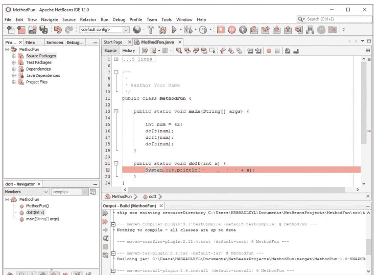

图 12.3 MethodFun 程序

> **注意** 如果你忘记了如何设置断点，可以点击行号，或者点击代码行并按 `Ctrl+F8`。如果你需要复习基础调试知识，请查看第 11 课。

如图所示，断点已设置在 `doIt()` 方法和 `main` 方法中。如果你点击调试模式运行按钮（或按 `Ctrl+F5`），程序将启动并运行，直到遇到断点。

当代码在列表处停止时，你会发现我们正处于 `doIt()` 方法中。代码窗口用绿色高亮了一行，如图 12.4 所示，因此我们知道停在了那里。

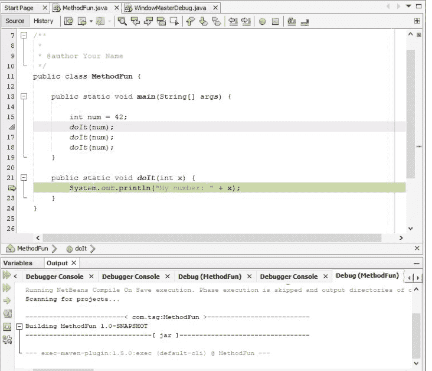

**图 12.4** 第一次运行

我们也可以看到第一行 `doIt()` 是灰色的。这是因为我们已经进入了该方法。如果我们点击 **Output**（输出）窗口，会发现没有任何输出。这是因为我们还没有运行 `System.out.println()` 调用。

如果我们继续（或按 `F5`），程序将运行，直到我们通过下一次调用 `doIt()` 再次遇到断点。在图 12.5 中，我们可以看到再次回到了 `System.out.println()` 行，该行被绿色高亮。我们还可以看到第二次对 `doIt()` 的调用现在被高亮了。此外，我们可以在 Output（输出）窗口中看到，由于上一次方法的执行，已经打印了一次 `42`。

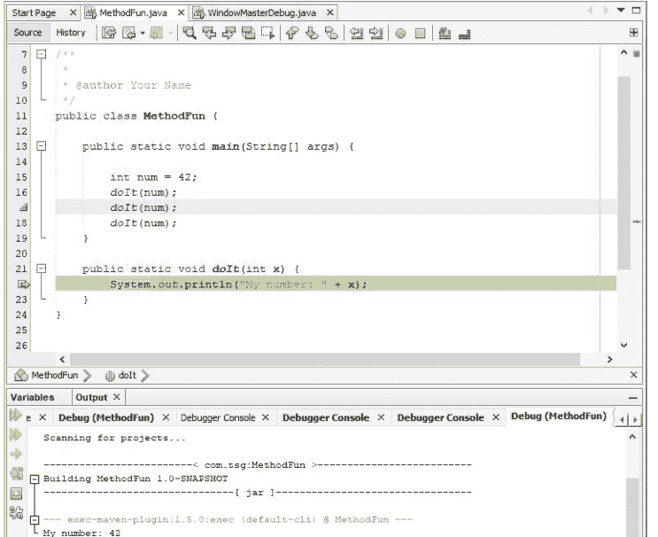

图 12.5 第二次运行

如果再次继续，代码将运行到下一个断点，再次位于 `doIt()` 方法中。输出将显示另一个打印的 `42`。点击几次 Continue（继续），程序将运行到结束，我们的输出显示了完整的 42 次列表。

# 步入代码

我们已经看到了如何在方法内部设置断点。现在我们将移动断点，展示如何“步入”代码。将断点放置在第一次调用 `doIt()` 上。这在图 12.5 中是第 16 行，但在你的代码列表中可能是不同的行。

设置好断点后，让我们调试程序。程序应该运行到到达我们带有断点的第一个 `doIt()` 调用，如图 12.6 所示。

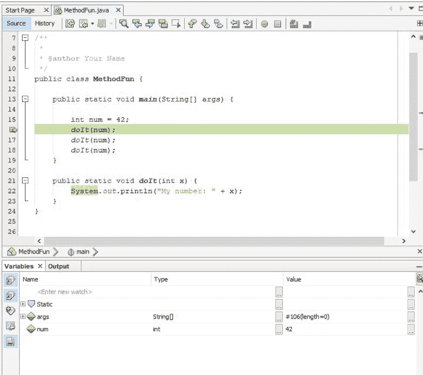

**图 12.6** 在 `doIt()` 处中断

现在光标位于第 16 行，还没有任何输出。Output 窗口不会显示任何数字。这是因为我们停止了调用 `doIt()`。到此为止，我们看到了 Step Over（逐行跳过），也看到了 Step Into（步入）。如果我们选择跳过下一行，我们将运行 `doIt()`，并且随后的 `doIt()` 方法将被高亮。更有用的功能是能够进入 `doIt()`。这正是 Step Into 帮助我们的地方。如果我们查看 Debug（调试）菜单，会看到另一个名为 Step Into 的选项。也可以通过 `F7` 或 Step Into 按钮访问此选项。该选项带我们进入代码，而不是跳转到随后的行。

让我们深入看看操作。当代码停在图 12.5 的第 16 行时，选择 Step Into 将从该行跳转到第 22 行。结果应该是我们在图 12.7 中看到的。

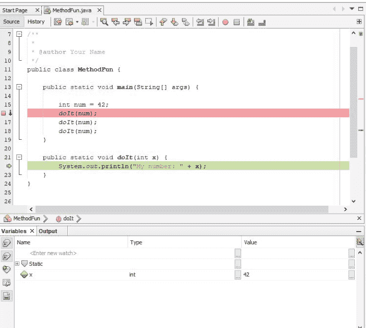

**图 12.7** 步入 `doIt()`

这将程序流转移到 `doIt()` 方法，在那里可以看到它正在做什么。如果我们选择继续，一旦我们执行完 `doIt()` 代码，它将返回到 `main` 方法并继续。

> **注意** 如果你位于 `System.out.println()` 行并按 Step Into，调试器将带你进入 `println()` 方法的代码。如果发生这种情况，你可以跳过代码或点击调试器的 Continue 来完成程序。

# 调试与作用域

我们已经看到在方法中设置断点，并看到了如何使用 Step Into。还有一点值得注意，这与程序作用域有关。

在图 12.6 中，我们看到 IDE 在调试器下方的 Variables 窗口中，我们可以访问 `args` 变量和 `num` 变量。你没看到的 `x` 也在我们的程序中。当我们步入 `doIt()` 方法时，如图 12.7 所示，Variable 窗口显示的 `x` 是为了 `doIt()` 创建并带有传递的值。一旦程序返回 `main` 方法，Variable 窗口将不再显示 `x` 可用，而是显示 `num`。

# 总结

在本课中，我们通过学习方法涵盖了很多内容。包括：

- 为什么方法很重要
- 如何定义方法
- 什么是方法签名
- 方法可以的形式
- 如何通过重构代码创建有用的方法
- Java 作用域规则
- 如何使用调试器步入代码

### 练习

大多数人通过实践学习得最好，因此此节包含一些静态方法定义和执行练习，以帮助你掌握本课。练习如下：

- **Exercise 1**: Method to Madness
- **Exercise 2**: Return to Sender
- **Exercise 3**: Match
- **Exercise 4**: Barely Controlled

# 练习 1：METHOD TO MADNESS

编写一个名为 `MethodToness` 的程序，如练习 12.1 所示。在使其工作后，添加第二个方法调用以打印代码的剩余部分。

## 练习列表 12.1

### MethodToness.java

```java
public class MethodToness {

    public static void main(String[] args) {

        eatMe();

        System.out.println("\n Lewis Carroll, Alice in Wonderland");

    }

    static void eatMe() {

        System.out.println("But I don't want to go among mad people, Alice remarked.");

        System.out.println("Oh, you can't help that, said the Cat.");

        System.out.print("We're all mad here. I'm mad. You're mad.");

    }

    static void drinkMe() {

        System.out.println("How do you know I'm mad? said Alice.");

        System.out.println("You must be, said the Cat, or you wouldn't come here.");

    }

}
```

添加第二个方法调用后，运行程序时你应该看到以下内容：

```text
'But I don't want to go among mad people, Alice remarked.'
'Oh, you can't help that, said the Cat.'
'We're all mad here. I'm mad. How do you know I'm mad? said Alice.'
'You must be, said the Cat, or you wouldn't come here.'
```

# 练习 2：Return to Sender

在此练习中，你将使用练习 12.2 所示的 `ReturnToSender` 程序匹配返回类型与变量。你应该输入列表，然后修复类型定义以匹配被调用方法的返回类型。一旦一切匹配正确，编译并运行它。

## 练习列表 12.2

### ReturnToSender.java

```java
public class ReturnToSender {

    public static void main(String[] args) {

        char aMystery = mystery();

        String totallyUnexpected = unexpected();

        double aSurprise = surprise();

        boolean itsClassified = classified();

        int aSecret = secret();

        System.out.println("The methods have returned! Their results...\n");

        System.out.println("Mystery: " + aMystery);

        System.out.println("Surprising: " + aSurprise);

        System.out.println("Classified: " + itsClassified);

        System.out.println("Unexpected: " + totallyUnexpected);

    }

    public static int secret() {

        return 42;

    }

    public static double surprise() {

        return 3.14;

    }

    public static char mystery() {

        return 'X';

    }

    public static boolean classified() {

        return true;

    }

    public static String unexpected() {

        return "Spanish Inquisition";

    }

}
```

当你运行完成后的列表时，你应该看到以下内容：

```text
方法已返回！它们的结果如下...
神秘: X
秘密: 42
惊喜: 3.14
机密: true
意外: Spanish Inquisition
```

# 练习 3: MatchWork

在本次练习中，你将练习使用参数。使用练习列表 12.3 中的代码创建一个新程序。通过将 `???` 更改为正确的字面量值数量来修复方法。当所有内容正确匹配时，编译并运行它。

## 练习列表 12.3

### MatchWork.java

```java
public class MatchWork {

    public static void main(String[] args) {

        System.out.println("The word Cart should come before Horse alphabetically: " + comesBefore("Cart", "Horse"));

        System.out.println("Half of 42 = " + halfOf(42));

        System.out.println(" (short) Pi = " + pi());

        System.out.println("The first letter of the word Llama is: " + firstLetter("Llama"));

        System.out.println(" 1337 * 1337 = " + times1337(1337));

    }

    public static double pi() {

        return 3.14;

    }

    public static int times1337(int x) {

      return x * 1337;

    }

    public static double halfOf(double y) {

      return y / 2;

    }

    public static String firstLetter(String word) {

      return word.substring(0, 1);

    }

    public static boolean comesBefore(String a, String b) {

      return a.compareToIgnoreCase(b) < 0;

    }

}
```

当你运行此程序时，你应该看到以下输出：

```text
The word Cart should come before Horse alphabetically : true
Half of 42 = 21.0
(short) Pi = 3.14
The first letter of the word Llama is: L
1337 x 1337 = 1787569
```

# 练习 4: Barely Controlled Chaos（失控的混沌）

我们通常编写方法来捕获计划反复使用的功能。这样我们就不需要不断编写相同的代码。相反，我们可以在需要时编写一次（确保它是完美的！），然后在需要时随时调用它。

让我们使用目前为止学到的知识来封装几个方法，我们将使用这些方法来反复生成随机短句（类似于微型填空游戏）。从练习 12.4 的代码开始编写一个名为 `BarelyControlledChaos` 的程序。输入该代码后，添加所需内容以完成列表。

- 编写一个返回随机颜色的方法（让它从五种不同的颜色中选择）。
- 编写一个返回随机动物的方法（让它从五种不同的动物中选择）。
- 编写另一个方法，返回从范围（最小/最大）中选择的随机整数，可以是这两个数字中的一个或之间的任何数字。

当你完成定义并实现这些方法后，将方法中的 `???` 替换为相应类型的调用。

## 练习列表 12.4

### BarelyControlledChaos.java

```java
import java.util.Random;

public class BarelyControlledChaos {

    public static void main(String[] args) {

        String color = getRandomColor(); // 在此处调用 color 方法

        String animal = getRandomAnimal(); // 在此处再次调用 animal 方法

        String colorAgain = getRandomColor(); // 在此处再次调用 color 方法

        int weight = getRandomNumber(5, 200); // 调用 number 方法，范围在 5 - 200 之间

        int distance = getRandomNumber(10, 20); // 调用 number 方法，范围在 10 - 20 之间

        int number = getRandomNumber(10000, 20000); // 调用 number 方法，范围在 10000 - 20000 之间

        int time = getRandomNumber(2, 6); // 调用 number 方法，范围在 2 - 6 之间

        System.out.println("Once, when I was very small...");

        System.out.println("I was chased by a " + color + ", "
            + weight + " lb " + " miniature " + animal
            + " for over " + distance + " miles!");

        System.out.println("\n I had to hide in a field of over "
            + number + " " + colorAgain + " poppies for nearly "
            + time + " hours until it let me alone!");

        System.out.println("\nIt was QUITE the experience, "
            + " let me tell you!");

    }

    // 方法 1：返回随机颜色
    public static String getRandomColor() {
        String[] colors = {"red", "blue", "green", "yellow", "purple"};
        return colors[new Random().nextInt(colors.length)];
    }

    // 方法 2：返回随机动物
    public static String getRandomAnimal() {
        String[] animals = {"cat", "dog", "bird", "fish", "rabbit"};
        return animals[new Random().nextInt(animals.length)];
    }

    // 方法 3：返回指定范围内的随机整数
    public static int getRandomNumber(int min, int max) {
        return new Random().nextInt(max - min + 1) + min;
    }

}
```


当你完成此列表并运行它时，你应该看到类似下面的内容（但带有你的随机值和信息）：

```
Once, when I was very small...
I was chased by a magenta, 801lb miniature mammoth for over 12 miles!!
i had to hide in a field of over 4593 periwinkle poppies for nearly 3 hours
until it left me alone!

It was QUITE the experience, let me tell you!
```

## 第 13 章：使用数组组织数据

数组是我们学到的第一个内容。当我们提到数组时，意思是它可以包含相同类型的多个值。

## 什么是数组

### 学习目标

当你完成本节学习后，你将能够：
- 区分一维数组和多维数组
- 实例化数组
- 访问数组中的元素
- 处理访问数组时发生的错误

### 数组的类型

我们可以创建三种类型的数组。第一种是**一维数组**，如图 13.3 所示。它可以被看作条线，或者在数学术语中是元素的*向量*。

如果我们向此数组中添加另一个子数组，就会得到一个三维数组，如图 13.5 所示。

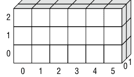

**图 13.5** 三维多维数组

第三种也是最后一种类型的数组是*多维锯齿数组*（multidimensional jagged array），其中每个子数组都是一个独立的数组，因此它们可以具有不同的长度，如图 13.6 所示。

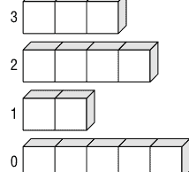

**图 13.6** 多维锯齿数组

与某些语言（如 JavaScript）不同，Java 中数组的大小是*固定*的。这意味着在实例化数组并指定了其维度和长度后，这些长度就无法更改。此外，虽然你可以创建超过三维的数组，但这通常是没有必要的且令人困惑的。因此，我们通常倾向于使用更简单的数据结构。

## 元素与索引 (Element vs. Index)

与之前提到的，区分存储在数组中的数据（数组的*元素*）与定义数据存储*位置*的整数（数组的*索引*）非常重要。

可以帮助你记住这种区别的比喻是街道上的房子。每栋房子在街道上都有数字地址，但房子本身并不是地址（同样，地址也不是房子），地址（索引）允许我们前往街道（数组）正确的部分并查看该位置的房子（元素）。

## 声明数组 (DECLARING ARRAYS)

与变量一样，数组可以声明、初始化并使用。由于有不同类型的数组，在本节中我们将查看每类型的初始化和声明过程，然后介绍填充和访问数组元素。
声明数组变量的语法取决于要创建的数组形状。让我们独立观察每种形状。

### 单维数组 (Single-Dimensional Arrays)

单维数组的变量声明是最简单的。你只需要提供要存储的元素类型，后面紧跟方括号即可。

```java
int[] arrayOfFints; //创建一个单维数组
```

在这种情况下，我们创建了一个名为 `arrayOfFints` 的单维整数数组。值得注意的是，单维数组只有一个维度。因此，单维数组也被称为一维数组。

> 注意：当你在 Java 中看到某个内容后面跟着方括号时，这是你正在处理数组的一个良好指标。

### 矩形数组 (Rectangular Arrays)

矩形数组也相对简单。要为数组添加另一个维度，你只需要在声明中再添加一组方括号。每组括号都将决定数组的维度：`[]` 表示一维，`[][]` 表示二维，以此类推。

以下是一个创建一个名为 `my2DArray` 的二维整数多维数组的示例：

```java
int[][] my2DArray = new int[4][4];
```

除了声明这个二维数组外，值得注意的是，它被设置为持有 4x4 个元素，即总共 16 个元素。

接下来的声明创建了一个具有三个维度的多维数组。它被初始化，使得三个维度都有 5 个元素。这意味着该数组可以容纳最多 5 x 5 x 5，即 125 个浮点值。

```java
float[][][] myDArray = new float[5][5][5];
```

> 注意：较新的 Java 程序员在声明数组时，经常尝试将方括号放在数组名称后面而不是类型后面。虽然这样做可行，但在声明数组时括号应该放在类型之后，在使用数组时放在名称之后。

### 锯齿数组 (Jagged Arrays)

矩形数组和锯齿数组都可以被视为数组的数组。因此，声明该类型变量的语法将涉及方括号以指示数组的嵌套。你可以像声明多维数组一样声明锯齿数组。

```java
int[][] myArray = new int[2][];
```

在这种情况下，你正在声明一个整数数组；然而，在右侧你可以看到不同。虽然它被设置为两行，但没有说明列数。这将在数组初始化时确定。

## 初始化数组 (INITIALIZING ARRAYS)

简单来说，数组是内存块，就像任何其他变量一样。这意味着我们可以初始化一个空数组稍后添加元素，或者初始化一个已经包含我们想要存储的元素的数组。

如果我们初始化数组，我们会指定想要为其分配空间的元素数量，而不立即提供要存储的数据。根据数据类型，数组的每个位置将放置默认值。

在另一种初始化方法中，我们可以立即提供数据，数组的大小将被推断并设置为该数据所需的精确大小。

请记住，在初始化后你无法更改数组的大小。这意味着在初始化数组时必须正确定义大小，即使元素本身最初是空的。

> 注意：由于数组大小在初始化时设置，因此值得花时间在编写代码之前在纸上规划好数组。

### 初始化单维数组 (Initializing a Single-Dimensional Array)

与单维数组一样，多维数组也可以被初始化。因为有四个值，这个单维数组将被设置为四个元素。如果我们可视化这个数组，它看起来会像图 13.7。


> 注意：将第一维度指定为“行”、第二维度为“列”是任意的。数组没有空间布局：它们只是带有数字地址的内存位置。我们可以很容易将第一维度变为“列”，第二维度变为“行”。然而，当你处理多维数组时，在整个应用程序中建立并保持一致的约定至关重要。

### 初始化矩形数组 (Initializing a Rectangular Array)

如果我们想要一个表格数据结构（矩形数组，即二维数组），我们不是放入像 4 这样的数字，而是将其声明为 `int[][]`（带有括号定义数组的维度），然后在初始化时将两个维度放入括号中。以下代码将创建一个具有 2 行 3 列的数组：

```java
int rows = 2;
int columns = 3;
int[][] table = new int[rows][columns];
```

没有使用字面量初始化此数组，而是使用了变量。这是完全可以的。之前的代码等同于：

```java
int[][] table = new int[2][3];
```

这将产生一个默认值的数组，如图 13.8 所示。

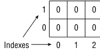

**图 13.8** 二维数组的声明和初始化

与单维数组一样，多维数组也可以自动初始化。以下代码创建了相同的二维数组，但带有元素：

```java
// row 0      row 1
int[][] autoInitTable = { { 5, 3, 1 }, { 2, 4, 6 } };
```

图 13.9 显示这些值是可以可视化的。

在这种设置中，数组中的每个“行”都是一个子数组，且每个子数组具有相同数量的元素。


**图 13.9** 使用值初始化二维数组

### 初始化交错数组

与之前描述的矩形数组不同，交错数组包含多个长度不相同的数组。因此，交错数组没有规则的形状，初始化起来稍微棘手。

你之前见过交错数组的声明以及部分初始化代码。下面是另一个具有三行的交错数组的初始化代码：

```java
int[][] jagged = new int[3][];
```

为了初始化这些行，你需要将每一行设置为一个数组。

```java
jagged[0] = new int[] { 1, 2 };
jagged[1] = new int[] { 3, 4, 5, 6 };
jagged[2] = new int[] { 7, 8, 9 };
```

你可以看到第一行被初始化为两个值。第二行设置为四个值。最后，第三行被设置为三个值。如果你视觉化这个交错数组的结果，它看起来会和图 13.10 相似。

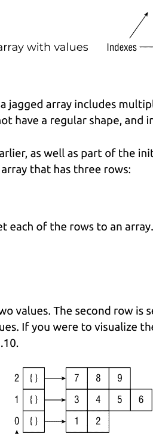

**图 13.10** 我们初始化的交错数组

> 注意：如果交错数组具有超过两个维度，建议只让最后一维是交错的。

## 访问数组元素

现在我们已经声明并初始化了数组，是时候获取重要信息了：访问数组元素。要访问单个元素，我们只需要在方括号内使用想要操作的元素的索引即可。让我们看看如何访问每种数组。

> 对于初学者来说，最困难的部分是记住索引从 0 开始。所以，如果你想要第一个元素，它位于索引 0 `[0]`。

### 访问一维数组中的元素

如所述，你使用方括号内的索引数字来访问数组元素。作为一个例子，让我们考虑一下一维数组示例。

```java
int[] numbers = new int[] { 3, 5, 2, 0 };
```

记住，索引是数组中从 0 开始的位置，而值是存储在数组位置元素中的内容。例如，在我们刚刚创建并初始化的 `numbers` 数组中，第二个元素的索引为 1，值为 5。这在图 13.11 中有所说明。

| 3 | 5 | 2 | 0 |
|---|---|---|---|
| 0 | 1 | 2 | 3 |

**图 13.11** 索引与值

在这个数组中，第二个槽位的值是 5。如果我们想把 5 替换为 7，我们可以如下操作：

```java
numbers[1] = 9;
```

如你所见，我们使用数组名称加上包含我们想要的项目索引的方括号。我们可以将此 `numbers[1]` 任何其他整数变量一样对待。在这种情况下，我们只是在给它分配一个新值 9。同样地，我们可以打印第二个位置的值：

```java
System.out.println(numbers[1]);
```

这将打印我们刚刚赋值的值，即 9。接下来的代码将打印值 2：

```java
System.out.println(numbers[2]);
```

要打印第一个值 3，我们将使用索引 0，因此代码如下：

```java
System.out.println(numbers[0]);
```

列表 13.1 提供了一个工作示例代码，说明了这一操作，并包含更多内容。

### 列表 13.1：使用一维数组

```java
public class ArrayFun {
    public static void main(String[] args) {
        int firstNumber = 0;
        int[] numbers = new int[]{3, 5, 2, 0};
        System.out.println("Our Numbers: ");
        // ... 此处省略部分代码 ...
    }
}
```

当执行此代码时，应该生成以下输出：

```
Our Numbers:
3
5
2
ourNumber: 0
Our Numbers Now:
3
9
ourNumber: 3
```

列表中的大部分与我们之前提到的相同。不同之处在于我们还可以看到数组 `numbers[]` 的一个元素被赋值给变量 `ourNumber`。

> 注意：不要混淆元素的索引和值。

### 访问多维数组中的元素

当我们增加数组的维度数时，只需为每个维度在括号中放置索引即可。图 13.12 显示了一个 2x3 数组，每个元素都填充了值。

| 1 | 2 | 4 | 6 |
|---|---|---|---|
| 0 | 5 | 3 | 1 |
| | 0 | | 2 |

**图 13.12** 多维数组中的元素索引

如果我们想从此数组的第一行第二列将数字赋值给变量，我们可以如下操作：

```java
int gottenNumber = autoTable[0][1];
```

这假设表名为 `autoTable`。查看表名 `autoTable`，我们可以看到 `gottenNumber` 被赋值为 5。如果我们想将第三行的值赋值给变量，我们可以如下操作：

```java
int anotherNumber = autoTable[2][1];
```

### 访问交错数组中的元素

交错数组是数组的数组，每个子数组可以有不同的长度。要访问交错数组中的元素，你首先使用子数组的索引，然后使用该子数组内元素的索引。

```java
int value = jagged[1][2];
```

在这种情况下，`value` 将是第二行（索引 1）的第三个元素。如果子数组没有足够的元素，这将会抛出 `ArrayIndexOutOfBoundsException`。

```
Starting....
i = 0 j = 0 is One
i = 0 j = 1 is Two
i = 0 j = 2 is three
i = 1 j = 0 is red
i = 1 j = 1 is white
i = 1 j = 2 is blue
i = 2 j = 0 is cat
i = 2 j = 1 is rabbit
i = 2 j = 2 is dog
```

观察一下，你可以发现这次我们没有使用整数，而是切换到创建一个字符串数组。无论使用何种数据类型，数组的使用方法都是相同的。你可以看到，我们创建了一个名为 `words` 的二维字符串数组，然后通过循环对其进行加载。在这种情况下，我们根据初始化的三组值创建了一个 3 × 3 的数组。

一旦数据完成初始化，就就像处理一维数组一样，我们使用循环来遍历数组的每一个维度。然而，对于多个维度，我们需要嵌套的 `for` 循环。在第一个循环中，你会看到我们检查了 `words` 的长度。

```java
for (int i = 0; i < words.length; i++) {
```

这给了我们第一维中的元素个数。对于该循环，我们检查该维度内每个项目的长度。

```java
for (int j = 0; j < words[i].length; j++) {
```

如果你想创建一个锯齿数组（jagged array），你的过程将完全相同。在列表 13.3 的初始化代码中添加几个单词并再次运行代码。例如，如果我们将初始化更改为：

```java
public static void main(String[] args) {
    String[] words = {"One", "Two", "three", "four", "five",
    "red", "white", "blue",
    "cat", "rabbit"};
}
```

进行此项更改并重新运行程序将产生以下输出：

```
Starting....
i = 0 j = 0 is One
i = 0 j = 1 is Two
i = 0 j = 2 is three
i = 0 j = 3 is four
i = 0 j = 4 is five
-----
i = 1 j = 0 is red
i = 1 j = 1 is white
i = 1 j = 2 is blue
-----
i = 2 j = 0 is cat
i = 2 j = 1 is rabbit
```

如你所见，代码中的其他部分都不需要更改。

## 数组元素的求和

让我们回到列表 13.2，并更进一步，利用元素中的值进行操作，而不仅仅是显示它们。列表 13.3 遍历了一个新数组。这次，除了显示输出外，我们还在计算所有数字的和。列表 13.4 展示了新的代码。

### 列表 13.4：数组中值的求和

```java
public class ArrayFun {
    public static void main(String[] args) {
        int[] numbers = {3, 5, 2, 1, 10, 42};
        int sum = 0; // 保持运行总和
        for (int ctr = 0; ctr < numbers.length; ctr++) {
            sum += numbers[ctr];
            System.out.println(ctr + " current sum = " + sum);
        }
        System.out.println("Final sum: " + sum);
    }
}
```

当我们运行程序时，我们应该看到以下内容：

```
ctr = 0 current sum = 3
ctr = 1 current sum = 8
ctr = 2 current sum = 10
ctr = 3 current sum = 11
ctr = 4 current sum = 21
ctr = 5 current sum = 63
Final sum: 63
```

> [!NOTE] 为了好玩，请更改用于初始化数组的值并再次运行程序。

## 反向循环，带点技巧

在 Java 中，`for` 循环可以递增也可以递减，所以如果我们愿意，也可以从后往前遍历数组。事实上，让我们从后往前遍历，并只打印奇数索引上的元素。输入并运行列表 13.5 查看效果。

### 列表 13.5：在数组中反向遍历

```java
public class ArrayFun5 {
    public static void main(String[] args) {
        int[] numbers = {3, 5, 2, 1, 10, 42};
        // 从最后一个索引开始，到第一个 (0)
    }
}
```


```java
for (int ctr = numbers.length - 1; ctr >= 0; ctr--) {

    if (ctr % 2 == 1) {

        System.out.println("index " + ctr + " - " + numbers[ctr]);

    }

}
```

这段代码的输出将如下：

- index 5 - 42
- index 3 - 1
- index 1 - 5

如果我们回顾这个列表，一切看起来应该很熟悉。你可以看到，我们不是从 0 开始到数组的长度，而是从长度开始向 0 移动。我们没有对计数器进行加，而是使用了取模运算符。为了只显示奇数元素，我们检查余数。

## 修改数组的大小

### 列表 13.7

#### 修改数组

```java
public class ArrayFun {

    public static void main(String[] args) {

        int[] numbers = {3, 5, 2, 1, 10, 42};

        for (int i = 0; i < numbers.length; i++) {

            System.out.println(i + " current sum = " + numbers[i]);

        }

        numbers = growArray(numbers, 5);

        for (int i = 0; i < numbers.length; i++) {

            System.out.println(i + " current value = " + numbers[i]);

        }

    }

    public static int[] growArray(int[] original, int howMoreElements) {

        int[] newArray = new int[original.length + howMoreElements];

        for (int i = 0; i < original.length; i++) {

            // 将当前索引的元素
            // 从 original 拷贝到 newArray
            newArray[i] = original[i];

        }

        return newArray;

    }

}
```

一个整数数组。对于参数，它接收我们的原始数组以及一个指示要添加元素数量的整数。

```java
public static int[] growArray(int[] original, int howManyElements) {
```

该方法简单地创建一个新数组。然后它使用 `for` 循环遍历原始数组的元素，并使用原始索引将元素映射到新数组中的相同位置。一旦完成此操作，我们将创建的数组返回给调用者方法。

# 处理错误

索引越界异常（Index out-of-range exceptions）是你在处理数组时最常见的异常。简单来说，这种错误发生在我们尝试访问数组中不存在的元素时。考虑以下数组：

```java
int[] numbers = {1, 2, 3, 4, 5, 6}
```

这个数组中只有六个元素，所以最大索引是 5。如果我们尝试执行以下行代码会发生什么？

```java
System.out.println(numbers[52]);
```

如果我们这样做，我们将得到一个异常，更具体地说是数组索引越界异常（array index out-of-bounds exception）。此错误只在运行时发生。

如果你在遍历数组时遇到此错误，该错误通常意味着你的循环条件表达式（例如 `i < {expression}`）是不正确的。

在我们之前在列表 13.6 中扩展数组的示例中，`howManyMoreElements` 为负数，当我们的 `for` 循环被设置为为原始数组中的每个元素循环时，它的索引会比 `newArray` 多。结果，一旦循环进行到 `newArray` 的最后一个元素，它就会抛出 `ArrayIndexOutOfBoundsException`。

### 总结

数组是集合的基础构造结构，也是技术面试中的常见话题，特别是在面试的编码挑战中。在实践中，大多数开发者倾向于使用更健壮的集合结构，如 `List`、`Set` 和 `Map`；然而，其他语言大量使用数组结构。此外，数组作为更健壮集合结构的核心部分，要求我们要理解这些结构是如何实现的并创建自己的更复杂的集合，我们作为开发者必须熟悉它。

在本节中，我们学习了单维数组（也称为一维数组）、多维数组和锯齿数组（jagged arrays）。我们看到了如何以各种方式声明、初始化和使用数组。

到目前，我们已经学习了 Java 编程语言的基础构建块。现在是时候将重点转向将 Java 应用于对象的概念了。

### 练习

以下是额外的练习，帮助你练习所学习的 Java 编程语言知识。这些需要你独立完成，因此大多数不会总是包含答案。许多练习涵盖了通过 `Scanner` 接收输入。有几个练习供你应用在本节中学到的知识：

- **练习 1：** 彩虹
- **练习 2：** 保持正数
- **练习 3：** 水果篮
- **练习 4：** 简单组合
- **练习 5：** 隐藏的坚果
- **练习 6：** 汇总和

> **重要！** 自己输入所有代码，以便更好地理解代码并学会如何独立处理错误。

# 练习 1：彩虹

通过制作文本彩虹来练习使用数组。使用练习列表 13.1 中的代码创建一个新程序。在列表中，你将编写出创建和打印 `String[]` 的代码。你应该注意到某些地方不匹配。修复代码以按照 ROYGBIV 顺序打印颜色！

# 练习列表 13.1

## ARainbow.java

```java
public class ARainbow {

    public static void main(String[] args) {

        String[] colors = {"Red", "Orange", "Yellow", "Green", "Blue",
            "Indigo", "Violet"};

        System.out.println(colors[5]);
        System.out.println(colors[3]);
        System.out.println(colors[2]);
        System.out.println(colors[1]);
        System.out.println(colors[4]);
        System.out.println(colors[0]);
        System.out.println(colors[6]);

    }

}
```

更新此列表后，你应该看到：

- Red
- Orange
- Yellow
- Green
- Blue
- Indigo
- Violet

# 练习 2：保持正数

在这个练习中，练习结合条件判断使用数组。首先创建一个名为 `StillPositive.java` 的程序，确定所有的正数并打印它们。使用以下数字数组：

```java
int[] numbers = { 389, -447, 26, -485, -884, 94, -64, 868, -776, 227,
    -744, 422, -109, 259, -500, -219, 799, -311 };
```

当你运行程序时，你应该看到以下输出：

Gotta stay positive ...!
389 26 712 94 868 227 422 259 278 799

# 练习 3：水果篮

使用练习列表 13.3 中的代码创建一个程序，遍历水果数组并打印苹果的数量、橙子的数量、其他水果的数量以及篮子中水果的总数。

# 练习列表 13.3

## FruitBasket.java

```java
public class FruitBasket {

    public static void main(String[] args) {

        String[] fruit = {"Apple", "Orange", "Apple", "Banana", "Orange",
            "Apple", "Pear", "Orange", "Apple", "Banana",
            "Orange", "Apple", "Apple"};

        int apples = 0;
        int oranges = 0;
        int other = 0;

        for (String f : fruit) {

            if (f.equals("Apple")) {
                apples++;
            } else if (f.equals("Orange")) {
                oranges++;
            } else {
                other++;
            }

        }

        System.out.println("Apples: " + apples);
        System.out.println("Oranges: " + oranges);
        System.out.println("Other fruit: " + other);
        System.out.println("Total fruit: " + (apples + oranges + other));

    }

}
```


# 第三部分：类与对象的基础

- 第 14 节：面向对象概念
- 第 15 节：创建类与类型
- 第 16 节：管理存储与内存
- 第 17 节：探索接口、组合与继承
- 第 18 节：深入理解接口
- 第 19 节：深入理解组合
- 第 20 节：深入理解继承
- 第 21 节：理解集合
- 第 22 节：列表简介
- 第 23 节：探索映射
- 第 24 节：使用简单的文件输入输出
- 第 25 节：应用设计实践
- 第 26 节：异常处理
- 第 27 节：综合运用：构建班级名单表应用

## 第 14 节：面向对象概念

在本节中，我们将学习一些通用面向对象概念。我们将探索抽象问题的不同方式，定义面向对象（一种抽象问题的方法），描述面向对象语言的特征，并讨论公共接口与私有实现之间的概念。

### 学习目标

在本节结束时，你将能够：

- 区分不同类型的计算机编程语言
- 定义使语言成为面向对象的五个要素
- 解释什么是类型以及它在 Java 中如何使用
- 解释公共接口和私有实现如何协同工作
- 描述松耦合
- 解释单一责任原则和内聚
- 解释委托的概念
- 将委托与封装联系起来

### 抽象

解决你想解决的特定问题有许多方法。其中一种方法是从解决方案的模型开始，然后尝试将问题映射到其中。这是许多语言采用的方法。

汇编语言与底层机制紧密相匹配。如果你想解决一个特定问题，你必须先从计算机的工作原理来思考，然后考虑如何将问题映射。这意味着你必须从二进制数、加法和减法的角度思考问题。这要求你理解如何将数据移动到寄存器中、减少寄存器中的值以及使用各种操作。

面向对象的语言采取了不同的方法，它们将解决方案空间和问题中的概念都以对象的形式表示出来。由于现实世界本质上充满了对象，这种方法非常方便。以汽车为例——它可以被描述为属性（重量、颜色、车门数量等）和行为（行驶、卷起、开启灯等）的集合。这就是我们在面向对象语言中对对象的方式：通过属性和行为。将汽车映射为对象所需的翻译比汇编语言需要的少得多。

### 面向对象特征

什么让一种语言成为面向对象的？面向对象可以总结如下：

- 一切都是对象。
- 程序是对象的集合，对象之间通过发送消息告诉对方要做什么（在 Java 中，这些消息是方法调用）。
- 每个对象都可以由其他对象创建或由对象组成（这被称为组合）。
- 每个对象都有一个类型。
- 同一类型的所有对象都可以接收相同的消息（在 Java 中，这意味着它们具有相同的方法）。

Grady 简单地说：“对象具有状态、行为和身份。”让我们来拆解一下：

**状态：** 意味着对象的属性在特定时间具有特定的值。例如，一辆汽车的速度可能是每小时 50 英里，但现在是 0 英里。在特定时间点，这些值的组合描述了对象的状态。

**行为：** 意味着对象具有执行某些事情的能力。在 Java 中，这些能力被表示为方法。很多时候，这些方法会改变对象的状态。

**身份：** 我们在这里讨论的是即使在类型相同的情况下，也能区分一个对象与另一个对象的属性。例如，我可以区分我前院里的汽车和后院里的那辆。

### 类型

Java 中的每个对象都有一个类型。*类型*是一种分类，定义了类型的结构、值的范围以及允许对它们执行的相关操作。一方面，我们已经学习了原生类型，如 `int`、`float` 和 `boolean`，但我们也可以在 Java 中创建自己的类型。事实上，每当我们定义一个新类时，我们就定义了一个新类型。

我们还使用一些不是语言本身的非原生类型，例如 `Random` 和 `Scanner`。在随后的课程中，我们将查看如何创建自己的数据类型，以及如何创建包含多个数据类型协作解决问题的程序。

> **注意：** 虽然 Java 被认为是一种面向对象的语言，但 Java 中并不是所有内容都是对象。例如，`int`、`float` 和 `double` 等原始类型不是对象。

### 公共接口/私有实现

每个类都应该有一个*公共接口*，定义外部世界如何与其进行交互。在这个公共接口之后应该有一个*私有实现*。这允许我们把对象“做什么”与“如何做”分开。调用代码（使用该对象的程序其他部分的代码）不应该关心对象是如何履行合同的，并且在使用对象时，绝不依赖于实现的具体细节（或特定实现的副作用）。对象的实现者保留了根据自己的意愿更改实现细节的权利。

让我们来看一个日常生活中的例子，它说明了这个概念是多么重要：快餐店的得速通道。得速通道的公共接口对我们所有人来说都是熟悉的。它们可能有些不同，但基本接口遵循四个步骤：首先，有一个显示项目和价格的菜单；接着，有一个扬声器，我们在那里下单；然后，有一个窗口，我们在那里付款；最后，有一个窗口，我们在那里取食物。作为餐厅（或得速通道公共接口）的顾客，我不知道我的订单是如何处理的、原料是如何交付的、食物是如何烹饪的，或者厨房里有多少厨师——而且我真的不在乎。我只想点餐、付钱并享受美食。餐厅可以自由升级订单系统、购买新炉子、雇用更多厨师或对系统进行任何更改，只要得速通道运行如初且食物味道没变，我就是一个满意的客户。

让我们回到我们的得速通道示例。如果得速通道界面（即菜单、点餐传声器、支付窗口和取餐窗口）要保持具有内聚性，它必须允许我们完成点餐、支付和取餐所需的所有操作。例如，如果在支付窗口处，我必须下车，步行到银行，从我的账户转账到餐厅，然后回到车上，那么这个界面就不具有内聚性。另一方面，得速通道应该仅限于点餐和支付。例如，我不应该在支付窗口处有续办驾驶执照的选项。这显然超出了快餐得速通道应该做的工作范畴。

尽管这只是一个例子，但你可以看到内聚性接口是有意义的。这些原则适用于对象，就像适用于得速通道餐厅一样。

### 委托

委托的概念与封装是互为补充的。如果我们的类封装良好，它将只处理其定义良好的责任范围内的任务。如果类责任范围内的一个或多个任务需要类主要责任范围之外的子任务，那么该类必须将该任务委托给另一个类。我们已经在代码中看到了这些例子——我们向 `System.out` 委托向控制台写入的操作，向 `Scanner` 对象委托从控制台读取的操作。

例如，一个不专长烘焙面包的得速通道会将这种责任“委托”给一家烘焙面包并送到餐厅的烘焙坊。作为餐厅界面的消费者，我不在乎面包是否是在烘焙坊现场烘焙并配送的。只要面包是新鲜、美味且含有正确的营养成分，我就是一个满意的客户。餐厅专长组装成品汉堡。他们将烘焙面包和加工肉等事情委托给其他公司。

### 总结

这是对面向对象编程的一些大概念的快速介绍。本节的剩余课程将详细介绍这些主题，并将引导你走向成为面向对象程序员的道路。

## 第 15 节：创建类和类型

在本节中，我们将学习如何在 Java 中定义和创建新类型，以及这些新类型由什么组成。

### 学习目标

在本节结束时，你将能够：

- 创建新类型
- 区分类和对象
- 解释访问器和变异器（或称为 getters 和 setters）的使用
- 使用点运算符访问对象的公共属性或方法
- 使用 `this` 关键字
- 实例化对象
- 调用方法
- 将构造函数与方法联系起来
- 将 `static` 关键字应用于方法和常量

### 创建新类型

每当我们在 Java 中定义一个新类时，我们就在定义一个新类型。正如课程早些时候讨论的，Java 中的数据类型分为两类：基本数据类型和引用类型。新类属于后者。

Java 中的类型（类）由字段（或属性）和行为（或方法）组成。字段和行为有时被称为成员。你已经使用过几种用户自定义类型，包括 `Scanner` 和 `String`。

**列表 15.1** 展示了一个名为 `Dog` 的新类。我们也可以说，列表 15.1 展示了一个名为 `Dog` 的新类型！

#### 列表 15.1：一个名为 Dog 的新类/类型

```java
public class Dog {

    private String name;

    private double weight;

    public String getName() {
        return name;
    }

    public void setName(String name) {
        this.name = name;
    }

    public double getWeight() {
        return weight;
    }

    public void setWeight(double weight) {
        this.weight = weight;
    }

    public void bark() {
        System.out.println("WOOF!");
    }

    public void sit() {
        System.out.println("Sitting...");
    }
}
```

在 `Dog` 类中，我们可以看到它包含了几个属性和方法。属性是 `name` 和 `weight`。方法是 `getName()`、`setName()`、`getWeight()`、`setWeight()`、`bark()` 和 `sit()`。

### 类与对象

类是一个定义，就像房屋的蓝图。蓝图是建筑的详细模型。它可以向你展示如何建造建筑，但蓝图并不是房屋本身。对象是根据蓝图建造的房屋。

### 访问器与变异器

访问器和变异器是允许我们访问和修改对象私有字段的公共方法。访问器通常被称为 getters，变异器通常被称为 setters。在 `Dog` 类中，`getName()` 和 `getWeight()` 是访问器，`setName()` 和 `setWeight()` 是变异器。

### `this` 关键字

`this` 关键字引用当前对象。它通常用于区分实例变量和同名的参数。例如，在 `setName(String name)` 中，`this.name` 指的是实例变量，而 `name` 指的是参数。

### 构造函数

构造函数是一种特殊的方法，用于初始化对象。虽然构造函数是方法，但在创建构造函数时必须遵循一些特殊规则：

- 构造函数的名称必须与它所属的类名相同。例如，一个名为 `Dog` 的类的构造函数应该是 `Dog()`。
- 构造函数永远没有返回值，即使是 `void` 也没有。
- 构造函数可以有参数，但不是必须。
- 给定的类中可以有多个构造函数。
- 只要父类有无参构造函数，你就不需要为你的类创建构造函数。如果你不创建，编译器将提供一个：即默认构造函数。默认构造函数没有参数，并且函数体是空的。无论是你编写了它还是由编译器提供的，这种构造函数都是默认构造函数。

让我们再次查看 `Dog` 类，如**列表 15.2** 所示。这次包含一个默认构造函数，以及一个接受名称和重量参数的构造函数。

#### 列表 15.2：包含构造函数的 Dog 类

```java
public class Dog {

    private String name;
    private double weight;

    public Dog() {
    }

    public Dog(String nameIn, double weightIn) {
        this.name = nameIn;
        this.weight = weightIn;
    }

    public String getName() {
        return name;
    }

    public void setName(String name) {
        this.name = name;
    }

    public double getWeight() {
        return weight;
    }

    public void setWeight(double weight) {
        this.weight = weight;
    }

    public void bark() {
        System.out.println("WOOF!");
    }

    public void sit() {
        System.out.println("Sitting...");
    }
}
```

### 对象实例化与方法调用

由于列表 15.2 中的 `Dog` 类有两个构造函数，我们现在有两种选择方法来创建新的 `Dog` 对象。我们可以使用我们编写的默认构造函数来创建一个 `Dog`（即没有参数的那个），或者我们也可以使用带有两个参数的构造函数。

首先，让我们看看如何使用默认构造函数创建一个 `Dog` 对象。我们将从创建一个名为 `App` 的类开始。我们将包含一个 `main` 方法，并在其中实例化我们的 `Dog` 对象。

```java
public class App {
    public static void main(String[] args) {
        Dog myDog = new Dog();
    }
}
```


当实例化类时，如果类的字段没有显式设置值，则这些字段将初始化为默认值：引用类型为 `null`，原始数字类型为 `0`，布尔类型为 `false`。由于我们使用了无参数构造函数，我们新 `Dog` (`myDog`) 中的字段被初始化为它们的默认值：`name` 为 `null`，`weight` 为 `0.0`。

要为 `name` 和 `weight` 设置值，我们必须调用这两个属性的设置方法（setter methods）。如所述，我们使用点运算符来这样做：

```java
public class App {

    public static void main(String[] args) {

        Dog myDog = new Dog();

        myDog.setName("Spot");

        myDog.setWeight(34.0);

    }

}
```

现在 `myDog` 拥有名称 "Spot"。通过第二个构造函数，我们可以在实例化对象时，为我们选择的名称和重量创建一个新的 `Dog`，如下例所示：

```java
public class App {

    public static void main(String[] args) {

        Dog anotherDog = new Dog("Buster", 23.5);

    }

}
```

变量 `anotherDog` 实例化时，名称为 "Buster"，重量为 23.5 磅。

> 总结一下，如果我们有局部作用范围的变量，那么在它们使用之前必须初始化它们，并且必须由我们自己完成。当我们实例化类时，类中任何未在构造函数中初始化的字段都将获得它们的默认值。对于所有原始类型，这意味着数字变为 0，布尔值变为 `false`。引用类型初始化为 `null`。

## static 关键字

现在我们对类和对象有了进一步的了解，让我们重新回顾 `static` 关键字，学习在何时以及何对字段和方法使用它是恰当的。首先，让我们看看关于 `static` 关键字的一些事实。

- 如果一个字段或方法被标记为 `static`，意味着它与类相关，而不是与类的任何特定实例化相关。这意味着标记为 `static` 的字段或方法始终只有一个副本。无论创建了 0 个还是 97 个类实例，这个副本都存在。例如，如果我们 `Dog` 类上的 `name` 是 `static` 的，那么所有 `Dog` 对象将共享同一个名称。
- 静态（static）字段和方法可以在不创建类实例的情况下访问。这基于上一点。即使没有实例化类的实例，`static` 字段或方法的唯一且唯一的副本也存在。
- 非静态（nonstatic）属性和方法与类的特定实例相关联，这意味着它们只能通过该对象的特定实例来访问。这意味着在创建一个或多个类实例之前，非静态字段和方法是不存在的。

鉴于这一组奇特的属性，什么时候将一个方法或属性描述为 `static` 才是恰当的呢？`static` 关键字有四种常见的用例：

- `main` 方法
- 常量值（Constant values）
- 工具类方法（Utility methods）
- 工厂模式（Factory pattern）

### static 与 main 方法

我们已经见过 `static` 关键字的这个例子：`main` 方法。`main` 方法是程序的入口点，它必须是 `static` 的，这样 JVM 就可以在不先创建类实例的情况下调用它。

### static 与常量值

常量是另一个适合使用 `static` 的地方。是在程序执行期间不会改变的值，我们将其标记为 `static` 以确保始终只有一个副本。

### static 与工具方法

像执行数学运算的工具方法是 `static` 的绝佳候选。它们接收输入，进行处理并产生输出，而不需要对象的状态。

#### 列表 15.3：使用静态常量和方法

```java
public class SimpleMath {

    public static final double PI = 3.14;

    public static int add(int a, int b) {

        return a + b;

    }

    public static int subtract(int a, int b) {

        return a - b;

    }

}
```

## 整合在一起

在本节中我们涵盖了很多内容，让我们通过 NetBeans 创建一个简单的项目，创建一个应用程序和一个单独类。我们将应用程序命名为 `Adder`，并将包含静态常量和方法。我们将通过 NetBeans 并查看它提供的一两个功能来帮助我们整合这一切。

在 NetBeans 中创建一个新应用程序。在 NetBeans 中，选择 `File -> New Project` 打开新项目对话框。正如我们在课程的第一部分建议的那样，选择 `Maven` 作为类别，`Java Application Projects`。然后点击 `Next` 按钮。

在 `New Application` 对话框中，给出项目名称。可以使用 `ObjectInstantiation` 因为我们正在创建一个对象。我们可以保持其他值不变并点击 `Finish` 按钮创建项目。

现在在项目中，右键点击包名并选择 `New -> Java Class`（如图 15.2 所示）创建一个新类。

将类命名为 `App`。将你的第一个类命名为 `App` 是一个可以在本书其余部分在创建具有多个类的应用程序时使用的模式。对于创建的其他类，`App` 类将是持有 `main` 方法的类。在我们创建 `App` 类后，你的项目看起来应该类似于图 15.3。

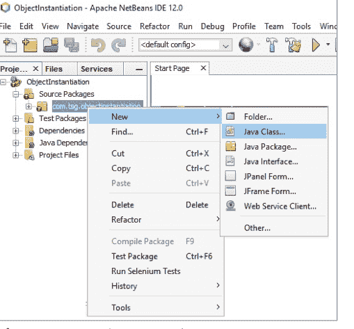

图 15.2 创建新类


我们将按照之前的做法设置 `App` 类。首先，创建一个 `main` 方法。由于我们正在使用 NetBeans，可以使用快捷键来输入 `main` 的声明。在 `App` 类内部的一行中输入 `pswm` 并按 `Tab` 键。这将会展开为以下内容：

```java
public static void main(String[] args) {

}
```

> 注意：程序无非对象之间相互发送消息并协作来完成任务。在 Java 中，我们往返消息的方式是通过调用方法。

### 创建新类

设置好 `main` 方法后，我们已经准备好为程序添加一些功能了。我们将创建一个新类来提供一些数学功能。为了简单起见，我们的新类将仅从一个简单的两个两个数字的方法开始。要添加这个新类，再次右键点击类的包名，并选择 `New ➤ Java Class`（如图 15.2 所示）。这次将新类命名为 `Adder`，因为我们的类将执行加法。NetBeans 中应该显示这个新类，内容如图 15.4 所示。


**图 15.4** 新的 Adder 类

在这个类中，我们将添加一个 `add()` 方法，用于简单地两个两个整数并返回结果。添加到你的 `Adder` 类中的代码如下：

```java
public int add(int a, int b) {

    return a + b;

}
```

值得注意的是，我们的 `Adder` 类没有 `main` 方法。正如我们之前提到的，程序中只需要一个 `main` 方法，而我们已经在 `App` 类中设置好了。

在 `Adder` 类中添加此 `add()` 方法后，点击标签页打开 `App.java` 类的代码。在 `App` 类的 `main` 方法中，我们想要调用 `add()` 方法。过去我们处理方法的方法是调用它并保存返回的值。通常我们会打印出该值。实现此操作的代码看起来如列表 15.4 所示。

> **提示** 另一个 NetBeans 快捷键是可以在新的一行输入并按 `tab`。这将展开为 `System.out.println("");`

#### 列表 15.4：用于两个两个数字的 App 代码

```java
public class App {

    public static void main(String[] args) {

        int sum = add(5, 4);

        System.out.println("The sum is " + sum);

    }

}
```

如果我们在 NetBeans 中查看这段代码，我们会发现 `add()` 方法下面有红色的波浪线，表示存在问题。要使用 `add()` 方法，我们需要实例化 `Adder` 类并在我们的 `main` 方法中调用它。列表 15.4 中的代码将无法工作。我们需要替换它。

我们需要做的第一件事是获取一个 `Adder` 类的实例。我们将按照声明任何其他变量的方式来这样做，但类型为 `Adder`。

```java
Adder myAdder = new Adder();
```

我们过去见过这样的声明。当我们创建扫描器和其他一些其他东西时，我们就是这样做的。在这种情况下，`Adder` 是我们创建的自定义类型。

让我们仔细看看这段代码。第一部分应该是很熟悉的：我们有类型 `Adder`，变量名为 `myAdder`，它将持有我们的对象。我们通过调用 `Adder()` 将变量设置为一个新的 `Adder`。如果你回记得，我们在 `Adder` 中唯一放入的方法是 `add()` 方法。我们没有在 `Adder` 中提供构造函数，所以编译器实际上会为我们提供一个没有参数的构造函数。

> 注意：我们正在做的是 Java 运行时根据此 `Adder` 模板创建一个新对象并返回一个引用。

现在我们有了引用，可以获取 `add()` 方法了。在我们的 `main` 方法中，我们现在定义一个整数来存储 `sum` 并使用我们的对象。更新 `App` 代码看起来如列表 15.5 所示。

#### 列表 15.5：创建一个 Adder 对象

```java
public class App {

    public static void main(String[] args) {

        Adder myAdder = new Adder();

        int sum = myAdder.add(4, 5);

        System.out.println("The sum is " + sum);

    }

}
```

你可以看到我们的声明已经添加了；在接下来的行中，我们使用 `myAdder` 对象创建了存储两个数字结果的变量。当你在 NetBeans 中输入这段代码时，你会注意到输入 `myAdder` 之后：

```java
int sum = myAdder;
```

NetBeans 会弹出一个与图 15.5 类似的对话框。这显示了 `myAdder` 对象包含的所有方法。你可能会注意到 `add()` 方法后面列出了其他项。现在先忽略这些内容，我们将在讨论继承时详细介绍。现在你可以继续输入或直接选择 `add()` 方法。如列表 15.5 所示向 `add()` 方法传递 4 和 5。列表完成后，运行程序。你应该看到 `add()` 方法可以工作，输出如下：`The sum is: 9`

此时，我们创建了一个实例，并在我们的列表中调用了该类中的方法。但我们还没有结束。

> 注意：后台发生的是 `App` 类正在向 `Adder` 类传递消息。具体来说，它正在向 `Adder` 类中的方法传递 4 和 5。然后 `Adder` 类有一个方法向 `App` 类返回结果为 9。


图 15.5 类方法弹出

> 注意：在有多个类的程序中，只有一个类会有 `main` 方法。

### 静态化

在有了 `Adder` 类的情况下，如果我们创建的 `add()` 方法上添加 `static` 关键字会发生什么？值得回溯一下并讨论 `static` 相关的几点。

我们之前说的点之一是 `static` 关键字可以将方法与类关联，而不是与类的特定对象关联。在列表 15.5 中，我们没有对 `add()` 方法使用 `static` 关键字，因此为了使用该方法，我们必须实例化 `Adder` 来创建一个引用。`static` 关键字将 `add()` 方法与类关联。这意味着我们不需要实例化 `Adder` 类即可。让我们更改 `Adder` 类中的代码包含 `static` 关键字。你的新方法应该像这样：

```java
public static int add(int a, int b) {

    return a + b;

}
```

在 NetBeans 中有这一点值得注意。如图 15.6 所示，我们在列表中添加了 `static` 关键字，NetBeans 将其变为斜体。这让我们能够识别静态方法，因为它们是斜体的。


图 15.6 NetBeans 将方法名设为斜体

在我们的 `add()` 方法添加了 `static` 后，我们可以查看 NetBeans 中的 `App` 类。NetBeans 中的这个类里发生了几点变化。首先，在图 15.7 中，我们可以看到 `App` 类中对类的调用现在也变成了斜体。这再次表明该类是静态的。


我们也看到将方法改为 `static` 没有在我们的 `App` 类中引起错误但引起了警告。我们可以通过行号上的警告图标看到这一点。如果我们把鼠标指针悬停在行号上，将看到图 15.8 所示的警告。


警告告诉我们，我们正在使用类的实例时访问一个静态方法。我们做的是实例化 `Adder` 来创建一个特定的实例；然后在那个特定实例上调用了 `add()`。这样做不再有意义，因为 `add()` 是一个静态方法。在这种情况下，我们不需要定义实例。我们可以对列表 15.5 中的 `Adder` 类进行几处更改。

首先，我们不再需要声明实例。所以，我们可以移除以下行：

```java
Adder myAdder = new Adder();
```

由于我们不再拥有 `myAdder`，我们需要更改后面的代码行。正如你所学的，使用类名。

#### 列表 15.6：使用静态方法添加两个数字的更新 App 类

```java
public class App {

    public static void main(String[] args) {

        int sum = Adder.add(4, 5);

        System.out.println("The sum is " + sum);

    }

}
```

当你运行更新后的列表时，你应该得到显示总和为 9 的输出，如图 15.9 所示。

```java
@author Your Name

public class App {

    public static void main(String[] args) {

        int sum = Adder.add(4,5);

        System.out.println("The sum is " + sum);

    }

}
```

**图 15.9** 我们应用程序的输出

静态方法在处理常量时的另一个非常实用的地方。对于常量，我们实际上并不需要多个副本。例如，我们只需要像 PI 这样的常量的一个副本。事实上，如果我们愿意，可以将 PI 常量放入我们的 `Adder` 类中。为了做到这一点，我们可以为 `Adder` 类添加额外的代码，如代码列表 15.7 所示。

#### 代码列表 15.7：添加了静态 PI 的 Adder 类

```java
public class Adder {

    public static final double PI = 3.14;

    public static final int add(int a, int b) {

        return a + b;

    }

}
```

324 Job Ready Weekly


有了这行额外的代码，我们的 `Adder` 类现在有了一个我们可以使用的静态常量值 `PI`。然后，我们只需要通过调用 `Adder.PI` 就可以从其他地方使用 `PI`。

# 现有静态方法

正如我们在示例中看到的，常量是极好的静态值。接收一致输入并始终返回输出的方法也是静态方法的良好候选者。例如，如果我们给 `add()` 方法两个输入，无论如何，它总是带给我们相同的输出。无论我们调用它多少次，得到的结果都是相同的。该方法没有跟踪任何状态。它只是接收输入、计算输出并将其返回。这样的方法是 `static` 关键字的绝佳应用。

作为 Java 开发者，我们可以将这些类型的静态方法放在类中，而这些类可以作为一个类库。事实上，已经存在这样一个类库，称作 `Math` 类。

`Math` 类提供了多种方法，包括正弦、余弦、正切或反正切。它还有诸如计算绝对值的 `abs()` 等函数，以及许多常量，如 `E` 和 `PI`。

要查看 `Math` 类中可用的内容，在你的 `App` 类中，你可以输入 `Math`（`Math` 后跟一个点）并得到一个与你之前在 `Adder` 中看到的类似的弹出窗口。图 15.10 显示了你可以访问的项目列表部分。

这些方法可以在不需要实例化 `Math` 对象的情况下使用；我们可以直接使用这些函数。我们不需要自己编写它们，也不需要实例化对象。

## 总结

在这一节中，我们仔细研究了类的组成部分、如何定义新类型、构造函数的一些属性、如何实例化对象，以及何时以及何处使用 `static` 关键字。这些都是重要的工具，将帮助我们创建良好的面向对象软件。在下一节中，我们将查看 JVM 如何在内存中管理所有的对象。

```java
public class App {

    public static void main(String[] args) {

        Math.

        double d = Math.max(double d1, double d2);

        double s = Math.abs(double s);

        float f = Math.abs(float f);

        int i = Math.round(double d);

        long l = Math.acos();

        int x = Math.add(int x, int y);

        long y = Math.multiply(long x, long y);

        double a = Math.asin(double a);

        double b = Math.atan(double a);

        double c = Math.atan2(double y, double x);

        double d = Math.sqrt(double y);

        double e = Math.ceil(double ceil);

        double f = Math.copySign(double magnitude, double sign);

        float g = Math.copySign(float magnitude, float sign);

    }

}
```


图 15.10 Math 类

### 练习

以下是额外的编程练习，帮助你练习正在学习的 Java 编程语言知识。这些是独立完成的，因此大多数练习都会包含答案。许多练习涵盖了通过 `Scanner` 接收用户输入。有几个练习可以让你应用在本节中所学的内容：

- 练习 1：类建模
- 练习 2：重构

### 练习 3：多类问题

本练习的目的是练习设计和实现具有多个类类的程序。

- 设计一个名为 `SimpleCalculator` 的类（不包含 `main` 方法），用于对两个操作数执行基础数学运算（加、减、乘、除）。
- 创建另一个名为 `App` 的类，向用户展示一个简单的控制台计算器界面。此第二个类应该处理所有的用户输入和控制台输出，并且必须使用第一个类来执行所有的数学运算。
- UI 应该给用户提供操作选择。其中一个选择应该是退出程序。
- 在用户选择一个操作后，UI 应该要求输入两个操作数，然后显示计算结果。
- UI 应该再次显示选择菜单。
- 当用户选择退出程序时，UI 应该打印感谢信息。
- 在编写代码之前，为你的程序创建一个流程图。

# 第 16 节：存储与内存管理

在本节中，我们将查看数据在内存中是如何以及何处被存储和管理的，以及对象是如何引用的。

### 学习目标

在本节结束时，你将能够：

- 对比和比较运行程序中的栈（stack）和堆（heap）
- 解释对象引用
- 解释 `new` 关键字如何配合构造函数在内存中创建对象
- 对比和比较手动内存管理和垃圾回收
- 解释为什么 Java 是一种值传递语言

### 程序与内存

当你的程序运行时，它的数据必须存储在内存中。JVM 使用了两个主要的内存区域来存储与我们的程序相关的数据：栈和堆。随着程序的运行，每个方法（包括 `main`）都会在栈上获得一些内存。每个方法获得的内存被称为栈帧（stack frame）。我们的程序创建的任何新对象都将在堆上获得一些内存。在本节中，我们将详细查看哪些内容最终会存储在栈和堆上，以及为什么它们会落到其中一个地方。

### 栈

**栈**是一种由 JVM 管理的内存结构。栈是一种后进先出（LIFO）的数据结构。在栈数据结构中，新项被添加到顶部——这被称为将项“推入”（push）到栈中。项也会从栈的顶部移除——这被称为“弹出”（pop）项出栈中。这意味着最后被推入栈的项将第一个被弹出，这就是为什么这种数据结构被描述为后进先出。

为了直观参考，请想象一下餐厅自助餐时的盘子堆。随着盘子的添加，它们堆叠在之前添加的盘子上面，如图 16.1 所示。当你去自助餐时，你拿的是最上面的盘子，它是最后被添加的那个。

| 栈 (Stack) |
| :--- |
| 后进先出 (LIFO) |


**图 16.1** 程序中的栈就像一堆盘子

JVM 并不是在自助处添加盘子，而是为程序中执行的每个方法添加一个栈帧。我们程序的第一个栈帧始终包含 `main` 方法的信息。

栈帧包含以下信息：

- 方法中声明的原始类型变量的值
- 方法中声明的任何非原始类型的堆位置
- 传入方法的参数值
- JVM 关于该方法的簿记录信息

好消息是，JVM 处理了所有的栈操作，所以我们不需要在代码中对其进行任何处理。然而，栈和堆的工作原理是常见的面试题。此外，了解基本功能是学习更高级概念的基础，并将让你更好地理解程序如何与 JVM 和操作系统交互，以及代码如何被优化。

### 堆

**堆**是一个分配内存块的区域。与栈不同，内容按任意顺序被移除和添加。

- 堆存储引用数据
- 栈存储指向数据的指针

这个概念可能会让初学者感到困惑：为什么不放在栈里？对于简单类型，如 `int`，创建副本是可以的，但如果你有成千上万个对象呢？如果我们每次调用都创建一个完整的副本，将会耗尽内存。

因此，对于类等引用类型，在堆上存储对象更高效。当你将其传递给另一个变量时，拷贝的是引用——而不是对象本身。因此，所有指向堆上同一个对象的变量都是关联的。如果你使用一个变量对堆对象进行更改，其他变量也能“看到”这次更新。

考虑图 16.2 所示的栈帧：

- 方法中声明的原始类型变量的值
- 方法中声明的任何非原始类型的堆位置
- 传入方法的参数值
- JVM 关于该方法的簿记录信息

# 代码 16.1

### 一个简单的 Person 类

```java
```


public class Person {

    private String name;

    private int age;

    public String getName() {

        return name;

    }

    public void setName(String name) {

        this.name = name;

    }

    public int getAge() {

        return age;

    }

    public void setAge(int age) {

        this.age = age;

    }

}

```

让我们继续创建一个：
# 代码 16.1

```java
public class Person {

    private String name;

    private int age;

    public String getName() {

        return name;

    }

    public void setName(String name) {

        this.name = name;

    }

    public int getAge() {

        return age;

    }

    public void setAge(int age) {

        this.age = age;

    }

}
```

让我们继续创建一个：
`Person p = new Person();`

我们已经讨论过构造函数，并看到它们只是在我们创建类型的新对象时调用的特殊方法。当 `new` 关键字和类的某个构造函数一起使用时，JVM 在堆上创建该特定类型的新对象并向我们返回该对象的引用。因为 `name` 和 `age` 是字段，它们将被自动初始化。`name` 是 `String`，不是原始类型，所以它将接收 `null`；`int` 有默认值 0。
现在，栈和堆看起来就像图 16.3 所示。


**图 16.3** 带有已构造 Person 的栈和堆

变量 `p` 仅仅是堆上实际 `Person` 对象的引用。存储在 `p` 中的值是新创建的 `Person` 对象的堆位置。

现在，如果我们定义了第二个变量并像这样将 `p` 的值赋给它，会发生什么呢：

```java
Person p2 = p;
```

在这种情况下，JVM 只拷贝指针；它不会在堆上创建第二个对象。执行该语句后，栈的结构将如图 16.4 所示。注意 `p` 和 `p2` 指向堆上的同一个 `Person` 对象。

此时，如果我们使用 `p` 变量为 `name` 赋值一个值，并使用 `p2` 变量为 `age` 赋值一个值，由于它们指向同一个对象，它们都将看到数据的更新，如图 16.4 所示。


**图 16.4** 栈上的两个变量指向堆上的同一个对象

```java
p.setName("Mary");

p2.setAge(19);
```

```java
System.out.println(p.getAge()); // 输出 19

System.out.println(p2.getName()); // 输出 Mary
```

列表 16.2 将此代码添加到了一个同样使用了列表 16.1 所示 `Person` 类的完整应用程序列表中。

### 列表 16.2
# 修改堆上的数据

```java
public class App {

    public static void main(String[] args) {

        Person p = new Person();

        Person p2 = p;

        p.setName("Mary");

        p2.setAge(19);

        System.out.println("Person p: ");

        System.out.println(p.getAge());

        System.out.println(p.getName());

        System.out.println("Person p2: ");

        System.out.println(p2.getAge());

        System.out.println(p2.getName());

    }

}
```

如果你看这个列表，你可以看到 `p` 被添加了名字，但没有年龄。同样，`p2` 被添加了年龄，但没有名字。当代码执行时，输出确认了信息在两者中都发生了变化（参见图 16.5）。

Person p:
19
Mary
Person p2:
19
Mary

总结一下，用户定义类型（引用类型）与基本类型之间的区别可以总结如下：

- 基本类型存储在栈上。当数据按值传递时，会创建数据的一个副本，因此对值的更改不会影响其他副本。
- 用户定义类型存储在堆上，栈上只存储一个引用。当将引用传递给方法时，会创建该引用的副本。这意味着堆上的对象现在多了一个指向它的引用，而且通过指向该对象的任何引用对数据所做的更改都会被指向该对象的所有其他引用看到。


**图 16.5** 更新后的栈和堆

值得记住，Java 是一个按值传递（pass-by-value）的基本类型语言。这意味着任何传递到方法的值都会创建一个副本。在变量实际值的情况下（例如，如果变量是 `int`，则为 5），它会被复制到栈上的新内存位置。对于用户定义类型，则创建引用值的副本并将其存储在堆上的新内存位置中。

> 注意 虽然了解栈和堆的工作原理并不真的在你的开发中被直接使用，但...

## 第 17 节
## 探索接口、组合与继承

在本节中，我们将概述另外三个帮助我们编写良好软件的语言特性：接口、组合和继承。

恰当使用这些特性可以帮助我们创建设计良好的面向对象程序，而且你将在整个职业生涯中不断使用它们。在本节中，我们将讨论这些特性的每一个，并观察它们各能解决什么问题。可以将本节看作是关于这些特性是什么以及为什么以及在何时使用它们的指南。这些特性的实现细节将在接下来的几节以及课程的其余部分进行更详细的介绍。我们将学习这些工具在什么情况下是合适的，以及如何在项目中使用它们。现在，请专注于与这些特性每个相关的宏观概念。

## 学习目标：

在本节结束时，你将能够：

- 解释接口、组合和继承如何帮助你编写代码
- 解释接口如何与类工作以便在类方法中实现功能
- 解释组合和继承如何协同工作以便代码复用
- 确定在代码中何时使用接口、组合和/或继承

## 这些工具如何帮助我们？

接口、组合和继承通过以下方式帮助我们编写更好、更易维护的软件：

- 允许我们控制其他代码如何与对象交互
- 允许我们定义程序中对象之间的关系
- 帮助我们保持实现的整洁
- 帮助我们整合来自多个团队或供应商的代码
- 允许我们以分布式的方式开发大型应用程序的不同部分
- 帮助我们遵循不要重复自己（DRY）原则

这些特性中没有哪一个是“万灵药”；它们有合适的时间和地点。成为一名优秀软件开发者的一部分包括培养良好的判断力，以知道何地以及何时某特定特性或技术是不恰当的；这种良好的判断力来自于实践。在课程的剩余部分中，你将对这些概念进行大量的练习（并获得我们的指导）。

### 接口

Java 开发者至少以两种不同的方式使用“接口”（interface）这一术语。我们之前以通用或概念性的方式使用这个术语，用来描述类宣传或向其他代码提供的功能：公共接口与私有实现。在本节中，我们引入了该术语更具体的用法。在这里，接口指的是 Java 语言的一项特定特性。

你可以将 Java 接口想象成一份合同。我们可以创建 Java 类来实现（或履行）接口中描述的所有功能。在实践中，Java 接口是一个方法列表，任何类要履行该接口都必须实现这些方法。关于这在代码中是什么样的介绍将在第 18 节的特定接口章节涵盖。此外，随着我们在示例和练习中应用它们，接口将贯穿整个课程。

接口擅长表达松耦合的、基于合同的关系。这类关系特别有助于实现互操作性，并为我们提供了一种保护私有实现的机制。基于合同的关系在帮助整合来自不同团队或供应商的代码方面也有用。一旦大家对接口达成共识，每个团队都可以随意开发自己的私有实现，而不会影响程序的其他部分。

让我们来看一个例子，使用接口来启用互操作性和集成。假设我们处于一个为汽车公司工作的团队。我们拥有制造汽车的专业知识，并希望让我们系列中的所有车辆都实现自动驾驶。尽管我们知道如何制造车辆，但我们在控制车辆的软件硬件系统方面没有专业知识。与其在内部开发这种能力，我们希望从像 Google 或 Tesla 这样的公司那里引入自动驾驶技术。

一种方法是与 Google 或 Tesla 合作，将他们的软件逐一集成到我们系列中的每辆车辆中。我们可以从紧凑型汽车开始，转向中型和全尺寸，最后以我们的皮卡和 SUV 结束。如果我们采取这种方法，我们可能需要编写自定义软件来与我们系列中的每辆车辆集成，这将是大量的工作。

另一方面，我们可以创建一个单一的导航接口，系列中的每辆车辆都实现该接口。每个底层实现都是不同的，但描述如何控制和导航我们车辆的接口是相同的。对于自动驾驶系统而言，所有车辆看起来完全一样。这意味着我们只需要编写一次将自动驾驶系统与车辆集成的代码。

这种安排给了我们在不影响系统的情况下更改车辆的自由。

## 组合与继承

组合和继承允许我们表达对象之间的关系。在面向对象编程中，复用代码有两种主要方式：组合和继承。虽然它们实现了相似的目标，但方法非常不同。

## 组合

组合是一种通过组合简单对象来构建复杂对象的技术。在 Java 和 C# 等面向对象的语言中，组合通常被称为“拥有”（has-a）关系。例如，汽车拥有一个（has-an）引擎，房子有一个（has-a）厨房。`Car` 类不是继承自 `Engine` 类，而是包含一个 `Engine` 类的实例作为字段。这允许更大的灵活性，因为你可以在不更改 `Car` 类的情况下更换引擎实现。

### 继承

继承是一种允许一个类获取另一个类的属性和行为的机制。这通常被称为“是一个”（is-a）关系。例如，汽车是一种（is-a）车辆，狗是一种（is-an）动物。子类继承了父类的字段和方法，允许你复用代码并添加新功能或覆盖现有行为。

## 使用接口、组合和继承

随着你作为软件开发人员经验的增加，了解何时使用接口、组合和继承将变得越来越容易。当你看到更多并处理更多项目时，一些模式将会显现，帮助你决定使用这些工具中的哪一个。你肯定在这个过程中会犯错并偶尔选择错误的工具，这没关系，因为这正是我们真正学习的地方。

然而，有一些你应该遵循的准则，以便有一个良好的开始。首先，你会发现自己几乎只在我们为本课程编写的软件，以及通用的 Web 应用开发中的软件中使用接口和组合。这并不意味着继承是坏的——远非如此。它意味着继承并不是构建 Web 应用时所建模的关系的正确工具。

尽管我们不会编写大量使用继承的代码，但我们一直会使用具有继承关系的类。事实上，你创建的每一个类都与 `Object` 类具有隐式的继承关系。继承经常用于我们用来构建应用程序的框架和库中。如果做得当，除非我们查看源代码，否则我们不会注意到这些关系。

> 注意：当我们在第 20 节详细讨论继承时，我们将看到每个类如何隐式继承自 `Object` 类的细节。

### 总结

在本节中，我们讨论了三个强大的语言特性：接口、组合和继承。到目前为止，你应该很好地理解每种特性可以建模的对象之间的关系，并对现实世界中的各种类比对这些特性的样貌有了良好的心理框架。

在接下来的几节中，我们将开始观察这些特性在代码中的形式，通过在本课程的剩余部分在更复杂的程序中使用它们来深入理解这些概念。我们将在接下来的三节中开始查看这些特性的基本代码。

> 注意：在课程的剩余部分，我们将指出我们使用接口、组合和继承的情况。我们将解释其优点并向你展示它们在代码中的形式。务必注意这些情况，并真正理解我们为什么要以这种方式呈现的方式应用这些语言特性。

## 第 18 节
深入学习接口

在本节中，我们将查看接口是如何创建和使用的。
接口可以帮助我们整合来自不同团队的代码，并允许我们表达组件之间松耦合的、基于约定的关系。在这里，我们将涵盖接口的声明、实现和扩展。我们还将查看接口的限制以及接口如何与多态性工作。

这并不是对接口的详尽介绍。我们将只涵盖基础知识。当你开始创建更高级的程序时，你将学习如何在日益复杂的情况下应用接口，因此这只是我们接口之旅的起点。

### 学习目标

在本节结束时，你将能够：

- 声明一个接口
- 实现一个接口
- 实现多个接口
- 讨论接口的限制
- 扩展接口
- 将多态性与接口联系起来

### 什么是接口？

接口是一种引用类型，就像类和枚举一样。巨大的区别是接口永远不会被实例化。也就是说，你不能执行以下操作：

```java
new SomeInterface()
```

接口的作用是定义一组方法，这些方法为任何实现接口的类型提供了必须提供的标准行为。

### 声明接口

声明接口与声明类相似。就像类一样，接口必须存在于与接口同名且以 `.java` 结尾的文件中。例如，列表 18.1 中的接口必须存在于名为 `Vehicle.java` 的文件中。

### 列表 18.1

# Vehicle 接口

```java
public interface Vehicle {

    public void moveForward(int milesPerHour);

    public void moveBackward(int milesPerHour);

    public void stop();

    public void turnLeft();

    public void turnRight();

    public void engineOn();

    public void engineOff();

}
```

与类声明相比，声明接口时的关键区别如下：

- 使用 `interface` 关键字而不是 `class` 关键字。
- 接口可以有抽象方法、默认方法和静态方法。
- 抽象方法是在声明时不带实现的方法。
- 每个方法定义后都放置一个分号。
- 在上一个示例中，定义的任何方法都没有实现，因为它们是抽象方法（我们可以使用 `abstract` 关键字，但它是隐式的）。
- 默认、静态和私有方法在接口中具有实现。
- 接口中所有的抽象、默认和静态方法都是隐式的公共（`public`）。

接口可以包含方法声明。事实上，接口中可以声明所有类型的方法：有或没有返回类型，有或没有参数，并以任何组合出现。在随后的示例中，声明方法时没有返回类型，仅仅是为了简化示例。

### 实现接口

为了让接口发挥任何有用的作用，我们必须创建一个承诺履行接口所定义契约的类。当我们这样做时，我们说一个类实现了该接口。

这是必要的，因为你不能单独实例化一个标准接口。拥有一个实现类需要两点：

- 类必须声明它实现了一个给定的接口。
- 类必须为接口中定义的每个方法提供实现。

列表 18.2 显示了一个名为 `MidsizeSedan` 的类的示例，它实现了我们在列表 18.1 中定义的 `Vehicle` 接口。

### 列表 18.2

# MidsizeSedan 类

```java
public class MidsizeSedan implements Vehicle {

    @Override
    public void moveForward(int milesPerHour) {
        // implementation code here...
    }

    @Override
    public void moveBackward(int milesPerHour) {
        // implementation code here...
    }

    @Override
    public void stop() {
        // implementation code here...
    }

    @Override
    public void turnLeft() {
        // implementation code here...
    }

    @Override
    public void turnRight() {
        // implementation code here...
    }

    @Override
    public void engineOn() {
        // implementation code here...
    }

    @Override
    public void engineOff() {
        // implementation code here...
    }
}
```

你可以看到 `MidsizeSedan` 类拥有与接口中对齐的方法。请记住，列表中没有显示代码是为了简化示例，并让你关注方法相匹配这一事实。

`@Override` 符号是一个注解。注解是元数据的一种，用于描述程序但不是程序的一部分。它们可以以不同的方式使用：

- 编译器可以使用注解来帮助检测错误。
- 代码生成工具可以使用注解。
- 某些注解可以在运行时进行检查。

在这种情况下，`@Override` 注解表明我们类（`MidsizeSedan`）中的方法是在接口（`Vehicle`）中定义的，并且该类提供了实现。

### 接口引用

由于接口旨在作为契约，Java 对它们施加了限制。

- 接口不能有成员字段（但可以定义常量）。
- 任何方法都不能有实现。从 Java 8 开始，接口允许拥有方法的默认实现，这在某些范围内很有用。为了向后兼容，向接口添加方法不会导致实现者的代码重新编译。

> 注意：在本课程中我们将使用默认实现。Java 8 之前的版本不允许。

### 实现多个接口

类可以实现多个接口。这样的类只需列出它实现的接口，并为每个接口的所有方法提供实现。

例如，假设我们创建一个名为 `Trackable` 的接口。该接口的目的是允许人们定位或跟踪车队中的车辆。该接口可能如列表 18.3所示。

### 列表 18.3


### Trackable 接口

```java
public interface Trackable {
    public void sendCurrentLocation();
    public void beaconOn();
    public void beaconOff();
}
```

现在我们可以让之前的 `MidsizeSedan` 实现 `Vehicle` 和 `Trackable` 两个接口，如列表 18.4 所示。

### 列表 18.4：实现两个接口的 MidsizeSedan

```java
public class MidsizeSedan implements Vehicle, Trackable {

    @Override
    public void moveForward(int milesPerHour) {
        // implementation code here...
    }

    @Override
    public void moveBackward(int milesPerHour) {
        // implementation code here...
    }

    @Override
    public void stop() {
        // implementation code here...
    }

    @Override
    public void turnLeft() {
        // implementation code here...
    }

    @Override
    public void turnRight() {
        // implementation code here...
    }

    @Override
    public void engineOn() {
        // implementation code here...
    }

    @Override
    public void engineOff() {
        // implementation code here...
    }

    @Override
    public void sendCurrentLocation() {
        // implementation code here...
    }

    @Override
    public void beaconOn() {
        // implementation code here...
    }

    @Override
    public void beaconOff() {
        // implementation code here...
    }
}
```

### 扩展接口

有时，你可能希望定义一个接口，它具有与现有接口相同的功能，但多了一个或多个方法。在这种情况下，我们可以扩展一个接口。新接口声明它扩展了现有接口，然后只定义它自己的方法。

例如，我们有一条新的业务线，将我们现有的部分车辆转换为应急车辆（例如警察巡逻车或救护车）。这些车辆的接口必须包含我们 `Vehicle` 接口的功能，而且我们还需要控制警报和闪光灯的能力。针对这种情况，我们的新接口可能像列表 18.5 所示。

### 列表 18.5：扩展接口

```java
public interface EmergencyVehicle extends Vehicle {

    public void flashersOn();
    public void flashersOff();
    public void sirenOn();
    public void sirenOff();
}
```

任何实现 `EmergencyVehicle` 的类都必须为 `EmergencyVehicle` 中定义的方法以及 `Vehicle` 中定义的所有方法提供实现。例如，`Ambulance` 类可能像列表 18.6 所示。

### 列表 18.6：救护车类

```java
public class Ambulance implements EmergencyVehicle {

    @Override
    public void flashersOn() {
        // implementation code here...
    }

    @Override
    public void flashersOff() {
        // implementation code here...
    }

    @Override
    public void sirenOn() {
        // implementation code here...
    }

    @Override
    public void sirenOff() {
        // implementation code here...
    }

    @Override
    public void moveForward(int milesPerHour) {
        // implementation code here...
    }

    @Override
    public void moveBackward(int milesPerHour) {
        // implementation code here...
    }

    @Override
    public void stop() {
        // implementation code here...
    }

    @Override
    public void turnLeft() {
        // implementation code here...
    }

    @Override
    public void turnRight() {
        // implementation code here...
    }

    @Override
    public void engineOn() {
        // implementation code here...
    }

    @Override
    public void engineOff() {
        // implementation code here...
    }
}
```

### 接口与多态

多态是面向对象设计的支柱之一。多态意味着“多种形态”，其核心思想是对象可以采取一个以上的形式。当对象实现一个接口或继承另一个类时，就可以以多态的方式处理它们。目前，我们将讨论限制在多态和接口上。为了说明这一概念，让我们看看之前显示的 `MidSizeSedan` 类。

在它的最后一个形态中，`MidSizeSedan` 实现两个接口：`Vehicle` 和 `Trackable`。这意味着一个 `MidSizeSedan` 对象可以被视为三种类型之一：

- `MidSizeSedan`
- `Vehicle`
- `Trackable`

让我们看看这在代码中是怎样的：

```java
MidSizeSedan car = new MidSizeSedan();
```

在这个示例中，我们简单地在堆上创建了一个新的 `MidSizeSedan` 对象，并用 `MidSizeSedan` 引用指向它。这很直接：这就是我们在课程中实例化和引用对象的方式。你的引用变量（`car`）可以访问 `MidSizeSedan` 上的所有方法。

这里是我们的下一个示例：

```java
Vehicle vehicle = new MidSizeSedan();
```

记住，我们刚刚涵盖了接口的基础知识。在课程的剩余部分，你将学习如何在项目和示例中有效地使用这一语言特性。

## 第 19 节：深入理解组合

在这个非常短的课程中，我们将初步了解 Java 代码中的组合是怎样的。在第 17 节中，`has-a`（包含）关系可以用于模拟对象之间的关系。在本节中，我们将查看一个组合的简单示例。

在课程的后续部分，我们在学习第 21 节和第 22 节的 `List` 和 `Maps` 数据结构后，将探索组合的力量。将在课程后期使用这些数据结构和组合创建组件。

### 学习目标

当你完成本节时，你将能够：

- 定义组合
- 比较使用组合的项目与不使用组合的项目

### 什么是组合？

面向对象语言的主要特征之一是对象由其他对象组成。这是通过组合实现的。从编码的角度来看，这意味着对象中的一个或多个字段是其他对象，而不是原始类型或字符串。

为了说明这一点，请看在 Java 中建模书籍的两个示例。在每个模型中，我们都要跟踪以下内容：

- 书名
- 书籍 ISBN
- 作者，包括联系信息
- 出版商，包括联系信息

### 没有组合很糟糕

让我们从一个不使用组合的示例开始，我们称之为 `BadBook`。在 `BadBook` 类中，我们将使用字符串对书籍的所有信息进行建模。它可能像列表 19.1 所示；但注意，为了使示例更容易，没有显示 getter 和 setter。

### 列表 19.1：BadBook 类

```java
public class BadBook {
    private String title;
    private String isbn;
    private String authorName;
    private String authorStreet;
    private String authorCity;
    private String authorState;
    private String authorZip;
    private String publisherName;
    private String publisherStreet;
    private String publisherCity;
    private String publisherState;
    private String publisherZip;
    private String publisherPhone;
}
```

### 使用组合的类

让我们看看如何使用组合来解决这个问题。首先，让我们看看我们需要跟踪的实体：

- 书
- 作者
- 地址

前三个对你来说可能是显而易见的，第四个可能不是。我们选择将地址建模为一个实体，因为作者和出版商都有地址，在这个示例中，所有地址的格式相同。

让我们对这些对象，然后查看它们是如何相互相关的。我们将从 `Address` 开始，如列表 19.2 所示。我们将通过只包含街道、城市、州和邮编来保持简单。

### 列表 19.2：地址类

```java
public class Address {
    private String street;
    private String city;
    private String state;
    private String zip;
}
```

接下来，`Author` 类可以像列表 19.3 所示创建。同样，我们将通过只包含名字、姓和地址来保持简单。

### 列表 19.3：作者类

```java
public class Author {
    private String firstName;
    private String lastName;
    private Address address;
}
```

现在我们正在使用组合。`Author` 类“有一个”地址。我们将街道、城市、州和邮政编码存放在 `Address` 对象中，并在 `Author` 类中创建一个类型为 `Address` 的字段来为我们存储信息。这样做很好，因为它将所有地址信息都放在了一个单一的容器中。

列表 19.4 中的 `Publisher` 类与 `Author` 类相似，不同在于出版者拥有名称和电话字段，而不是名和姓的字段。

### 列表 19.4：出版者类

```java
public class Publisher {
    private String name;
    private Address address;
    private String phone;
}
```

我们再次使用了组合。我们可以看到 `Publisher` 类“有一个”地址。

最后，让我们来看 `Book` 类。这里的情况变得更有趣了。我们需要跟踪标题、ISBN、出版者以及所有作者。为了考虑到可能有多个作者，我们将创建一个类型为 `Author` 对象数组的字段。列表 19.5 显示了我们的 `Book` 类样式。

### 列表 19.5：书籍类

```java
public class Book {
    private String title;
    private String isbn;
    private Author[] authors;
    private Publisher publisher;
}
```

我们现在在两个级别上使用组合：`Book` 类“有一个”出版者并“有一个”作者数组，而 `Publisher` 和 `Author` 类各自分都“有一个”地址。此外，我们正在使用 `Author` 来持有我们书籍的对象。

这是一个整洁的设计。每组相关信息——地址、出版者、作者和书籍——都在自己的类中。我们正在使用组合来构建包含其他对象的对象。

### 总结

组合是一种强大的工具，你将在课程的剩余部分以及职业生涯中频繁使用它。我们看了一个组合的简单示例，但这只是开始，仅介绍了使用组合的通用语法。随着课程进行，我们将向你展示如何使用组合来创建设计良好的应用程序。

### 练习

以下是额外的练习，帮助你练习所学的组合知识。这些练习需要你独立完成。练习包括：

- **练习 1**：教室组合
- **练习 2**：食谱

#### 练习 1：教室组合

将组合付诸实践。取练习列表 19.1 中的 `Classroom` 类并将其拆分为多个类。考虑教室拥有的东西与描述教室的特征之间的。例如，教室有一个老师。

##### 练习列表 19.1：教室类

```java
public class Classroom {
    private String classNameName;
    private int classGradeLevel;
    private String teacherFirstname;
    private String teacherLastname;
    private String studentFirstname;
    private String studentLastname;
    private int studentGrade;
    private String student2Firstname;
    private String student2Lastname;
    private int student2Grade;
    private String student3Firstname;
    private String student3Lastname;
    private int student30Grade;
    private int maximumNumberStudents;
}
```

**提示**：教室通常有一个老师和学生。

#### 练习 2：食谱

食谱书通常充满了食谱。练习列表 19.2 是一个持有食谱书类。使用组合来简化 `Cookbook` 类。

需要注意的是，这是一个相当简单的食谱书，但你可以让它变得更好。大多数食谱书都有两个以上的食谱，大多数食谱都有三个以上的配料。当你重构此列表以使用组合时，你的结果应该允许新类的用户根据需要使用尽可能多的食谱和配料。

##### 练习列表 19.2：食谱书类


```java
public class Cookbook {
    String title;
    String authorFirstname;
    String authorLastname;
    Double price;
    int yearPublished;
    String recipe1Name;
    String recipe1Firstname;
    String recipe1Lastname;
    String recipe1Ingredient;
    Double recipe1IngredientAmount; // 例如 1.25
    String recipe1IngredientMeasurementType; // 例如 汤匙
    String recipe1Ingredient2;
    Double recipe1Ingredient2Amount;
    String recipe1Ingredient2MeasurementType;
    String recipe1Ingredient3;
    Double recipe1Ingredient3Amount;
    String recipe1Ingredient3MeasurementType;
    String recipe1MixingInstructions;
    String recipe1CaloriesPerServing;
    String recipe1Servings;
    String recipe2Name;
    String recipe2AuthorFirstname;
    String recipe2AuthorLastName;
    String recipe2Ingredient1;
    Double recipe2Ingredient1Amount; // 例如 1.25
    String recipe2Ingredient1MeasurementType; // 例如 汤匙
    String recipe2Ingredient2;
    Double recipe2Ingredient2Amount;
    String recipe2Ingredient2MeasurementType;
    String recipe2Ingredient3;
    Double recipe2Ingredient3Amount;
    String recipe2Ingredient3MeasurementType;
    String recipe2MixingInstructions;
    String recipe2CaloriesPerServing;
    String recipe2Servings;
}
```

# 第 20 章：深入继承

在课程的这部分，我们将学习特化和继承。在第 17 章中，我们讨论了如何使用继承来建模类之间的“是一种”（is-a）关系。

## 学习目标

在本课程结束时，你将能够：

- 解释继承的概念
- 解释什么是子类
- 解释什么是父类
- 讨论继承的好处
- 在继承中使用多态

## 一切继承 Object

`Object` 类是根类。在 Java 中，每个类都继承自 `Object`。

## 术语

在进入实现的细节之前，我们需要讨论一些术语。继承是面向对象中术语会让初学者感到困惑的一个领域。有多种方法表示父类与扩展它的类之间的关系。

## 访问控制

到目前为止，我们对属性和方法有公共和私有访问。现在来看一个新的关键字：`protected`。如果我们把基类的属性或方法标记为 `protected`，这意味着该属性或方法可以被基类、所有派生类以及包中的其他类看到，但不能被任何其他类看到（换句话说，对于其他类来说，它就像是私有的）。如果你认为一个类将来很有可能被扩展，那么将基类的属性标记为 `protected` 而不是 `private` 是一个很好的做法。在实践中，你应该对类的每个成员使用最严格的访问权限。

**表 20.1** 每个修饰符允许的访问权限

| 修饰符 | 类访问？ | 包访问？ | 子类访问？ | 世界访问？ |
| --- | --- | --- | --- | --- |
| public | 是 | 是 | 是 | 是 |
| protected | 是 | 是 | 是 | 否 |
| 无修饰符 | 是 | 是 | 否* | 否 |
| private | 是 | 否 | 否 | 否 |

* 除非在同一个包内

### 包级私有访问

当对类的某个成员没有使用访问修饰符时，应用的访问级别被称为包级私有（package-private）。这种访问级别有点不符合直觉，因为它只允许类内部（这是可以的）以及包内的其他类（这也可以的）访问，但阻止了子类的访问。这种访问类型在执行单元测试时很常见。当包中的多个类协同工作，但你只想限制该包中的某些类访问，或者当一个类是最终的（`final`）且不应被扩展时，这种访问也非常有用。

## 继承

有时我们想要两个对象之间显式地创建一个“是”（is-a relationship）的关系。在之前的课程中，我们查看了摩托车、越野摩托和街道摩托之间的这种关系。我们将讨论一个人力资源（HR）系统，其中我们需要员工、经理和暑期实习生。

良好的继承层次结构的构建方式是：父类是最通用的（即它包含了所有后代类共有的字段和方法），而子类则专门化。在我们的示例中，`Employee` 将是基类，`Manager` 和 `Summer Intern` 都将扩展 `Employee`。

让我们先看看 `Employee` 类，如列表 20.1 所示。注意，我们将 `firstName` 和 `lastName` 设置为 `protected`（受保护），这样子类就可以访问这些成员。

### 列表 20.1：Employee 类

```java
public class Employee {
    protected String firstName;
    protected String lastName;

    public void doWork() {
        // 执行某操作的代码 ...
    }

    public void createYearlyObjectives() {
        // 创建年度目标...的代码...
    }

    public String getFirstName() {
        return firstName;
    }

    public void setFirstName(String firstName) {
        this.firstName = firstName;
    }

    public String getLastName() {
        return lastName;
    }

    public void setLastName(String lastName) {
        this.lastName = lastName;
    }
}
```

所有的员工无论是会计师、软件开发人员、经理还是 CEO，都有这些能力；许多员工还有额外的能力和职责。例如，经理可以招聘和解雇人员并进行绩效评估。经理是一种特殊的员工——它继承了一些共同的行为和属性，但它通过新的/不同的属性和行为扩展了员工执行的功能。

在 Java 中，这种专门化关系通过继承实现，并使用 `extends` 关键字完成。列表 20.2 显示了一个扩展之前的 `Employee` 类的 `Manager` 类。

### 列表 20.2：Manager 类

```java
public class Manager extends Employee {
    public void hire() {
        // 招聘某人的代码...
    }

    public void fire() {
        // 解雇某人的代码...
    }

    public void givePerformanceReview() {
        // 进行绩效评估的代码
    }
}
```

尽管额外的 `Manager` 特定方法包含在 `Manager` 类的定义中，但 `Employee` 的所有成员都被包含在 `Manager` 中。为了说明这一点，在 NetBeans 或你的 IDE 中，根据前两个列表创建 `Employee` 和 `Manager` 类。在一个新的 App 中，在 NetBeans 或你的 IDE 中编写代码实例化一个新的 `Manager` 对象。

```java
Manager manager = new Manager();
manager.
```

当你在 `manager` 之后输入类型时，你应该能看到编辑器的帮助弹出窗口显示可用的成员，如图 20.1 所示。


**图 20.1** Manager 类的成员

### 就绪 Java

你可以看到，除了 `hire()`、`fire()` 和 `givePerformanceReview()`，`Manager` 类还包含了 `Employee` 中定义的所有方法：`doWork()`、`createYearlyObjectives()` 以及 `firstName` 和 `lastName` 的 getter 和 setter。你还会注意到 `Manager` 拥有 `Object` 上定义的所有方法。`Manager` 类获得所有这些功能是因为它扩展了 `Employee`。

### 通过继承实现代码复用

之前的示例说明了如何通过继承重用代码。如果我们有一组对象（例如 `Employees`），它们都具有共同的属性和行为，我们可以将共同属性和行为放入基类中，然后将其扩展为特定的子类（例如 `Manager`）。

这意味着我们只需要编写一次公共代码。这些子类分别从 `Employee` 类获取公共代码，并可以根据其特定用途添加属性和行为。通过这种方式，继承促进了代码复用，是帮助组织代码的强大工具。

## 方法重载

在课程早些时候，我们讨论了方法签名，并将方法签名定义为方法名及其参数列表的组合。在任何给定的类中，每个方法都必须有唯一的签名。这引入了一个新术语：方法重载。我们可以通过在类中创建具有相同名称但不同参数列表的方法来重载方法。

例如，看列表 20.3 中的 `Adder` 类。

### 列表 20.3：重载的 `add()` 方法

```java
public class Adder {
    public int add(int a, int b) {
        return a + b;
    }

    public float add(float a, float b) {
        return a + b;
    }
}
```

该类有两个名为 `add` 的方法。第一个接收两个 `int`，第二个接收两个 `float`。


# 继承与方法重用

之前的示例说明了如何通过继承重用代码。如果我们有一组对象（例如 `Employees`），它们都具有共同的属性和行为，我们可以将共同属性和行为放入基类中，然后将其扩展为特定的子类（例如 `Manager`）。

这意味着我们只需要编写一次公共代码。这些子类分别从 `Employee` 类获取公共代码，并可以根据其特定用途添加属性和行为。通过这种方式，继承促进了代码复用，是帮助组织代码的强大工具。

## 方法重载

在课程早些时候，我们讨论了方法签名，并将方法签名定义为方法名及其参数列表的组合。在任何给定的类中，每个方法都必须有唯一的签名。这引入了一个新术语：方法重载。我们可以通过在类中创建具有相同名称但不同参数列表的方法来重载方法。

例如，看列表 20.3 中的 `Adder` 类。

### 列表 20.3：重载的 `add()` 方法

```java
public class Adder {
    public int add(int a, int b) {
        return a + b;
    }

    public float add(float a, float b) {
        return a + b;
    }
}
```

该类有两个名为 `add` 的方法。第一个接收两个 `int`，第二个接收两个 `float`。

## 继承

有时我们想要两个对象之间显式地创建一个“是”（is-a）关系。在之前的课程中，我们查看了摩托车、越野摩托和街道摩托之间的这种关系。我们将讨论一个人力资源（HR）系统，其中我们需要员工、经理和暑期实习生。

良好的继承层次结构的构建方式是：父类是最通用的（即它包含了所有后代类共有的字段和方法），而子类则专门化。在我们的示例中，`Employee` 将是基类，`Manager` 和 `Summer Intern` 都将扩展 `Employee`。

让我们先看看 `Employee` 类，如列表 20.1 所示。注意，我们将 `firstName` 和 `lastName` 设置为 `protected`（受保护），这样子类就可以访问这些成员。

### 列表 20.1：Employee 类

```java
public class Employee {
    protected String firstName;
    protected String lastName;

    public void doWork() {
        // 执行某操作的代码 ...
    }

    public void createYearlyObjectives() {
        // 创建年度目标...的代码...
    }

    public String getFirstName() {
        return firstName;
    }

    public void setFirstName(String firstName) {
        this.firstName = firstName;
    }

    public String getLastName() {
        return lastName;
    }

    public void setLastName(String lastName) {
        this.lastName = lastName;
    }
}
```

所有的员工无论是会计师、软件开发人员、经理还是 CEO，都有这些能力；许多员工还有额外的能力和职责。例如，经理可以招聘和解雇人员并进行绩效评估。经理是一种特殊的员工——它继承了一些共同的行为和属性，但它通过新的/不同的属性和行为扩展了员工执行的功能。

在 Java 中，这种专门化关系通过继承实现，并使用 `extends` 关键字完成。列表 20.2 显示了一个扩展之前的 `Employee` 类的 `Manager` 类。

### 列表 20.2：Manager 类

```java
public class Manager extends Employee {
    public void hire() {
        // 招聘某人的代码...
    }

    public void fire() {
        // 解雇某人的代码...
    }

    public void givePerformanceReview() {
        // 进行绩效评估的代码
    }
}
```

尽管额外的 `Manager` 特定方法包含在 `Manager` 类的定义中，但 `Employee` 的所有成员都被包含在 `Manager` 中。为了说明这一点，在 NetBeans 或你的 IDE 中，根据前两个列表创建 `Employee` 和 `Manager` 类。在一个新的 App 中，在 NetBeans 或你的 IDE 中编写代码实例化一个新的 `Manager` 对象。

```java
Manager manager = new Manager();
manager.
```

当你在 `manager` 之后输入类型时，你应该能看到编辑器的帮助弹出窗口显示可用的成员，如图 20.1 所示。


**图 20.1 Manager 类的成员**

### 就绪 Java

你可以看到，除了 `hire()`、`fire()` 和 `givePerformanceReview()`，`Manager` 类还包含了 `Employee` 中定义的所有方法：`doWork()`、`createYearlyObjectives()` 以及 `firstName` 和 `lastName` 的 getter 和 setter。你还会注意到 `Manager` 拥有 `Object` 上定义的所有方法。`Manager` 类获得所有这些功能是因为它扩展了 `Employee`。

### 通过继承实现代码复用

之前的示例说明了如何通过继承重用代码。如果我们有一组对象（例如 `Employees`），它们都具有共同的属性和行为，我们可以将共同属性和行为放入基类中，然后将其扩展为特定的子类（例如 `Manager`）。

这意味着我们只需要编写一次公共代码。这些子类分别从 `Employee` 类获取公共代码，并可以根据其特定用途添加属性和行为。通过这种方式，继承促进了代码复用，是帮助组织代码的强大工具。

## 包级私有访问

当对类的某个成员没有使用访问修饰符时，应用的访问级别被称为包级私有（package-private）。这种访问级别有点不符合直觉，因为它只允许类内部（这是可以的）以及包内的其他类（这也可以的）访问，但阻止了子类的访问。这种访问类型在执行单元测试时很常见。当包中的多个类协同工作，但你只想限制该包中的某些类访问，或者当一个类是最终的（`final`）且不应被扩展时，这种访问也非常有用。

## 方法重写

继承带来了重写方法的能力。这意味着子类将替换基类方法的实现。

例如，我们系统中的所有员工对象通过 `createYearlyObjectives()` 方法设置目标。该方法在 `Employee` 基类中实现并供子类重用。这在列表 20.1 的示例中已经演示过了。

经理可能需要 `createYearlyObjectives()` 有不同的实现——也许经理必须设置自己的目标，并为每个下属设置目标。例如，我们将在 `Manager` 类中实现 `createYearlyObjectives()`，这将重写（即替换）`Employee` 类中的实现。

> **NOTE** 请注意重写和重载之间的关键区别：
>
> - 当你在子类中重写方法时，它必须与父类中对应方法具有相同的性质。
> - 当你重载方法时，它必须具有唯一的签名。

> **NOTE** 一个常见的面试问题可能会询问重写和重载何时发生。重写发生在运行时。重载发生在编译时。

在重写方法时，我们有两种实现方案：

- 我们完全替换父类的功能。
- 我们增加父类的功能。

对于第一种方案，我们只需在子类中重新实现方法。新的实现将替换父类的实现。对于第二种方案，我们在子类中重新实现方法，但在某些处，我们会调用父类方法。如果我们这样做，父类方法将像代码中调用的任何方法一样运行。

在列表 20.5 中，`Manager` 类重写了 `createYearlyObjectives()` 方法，但没有调用 `Employee` 类中的版本。

### 列表 20.5：重写方法

```java
public class Manager extends Employee {
    public void hire() {
        // 雇佣别人的代码...
    }

    public void fire() {
        // 解雇某人的代码...
    }

    public void givePerformanceReview() {
        // 执行绩效评估的代码
    }

    @Override
    public void createYearlyObjectives() {
        // 我们正在重写 Employee 中该方法的版本
        // 在此处编写新代码...
    }
}
```

查看列表 20.5，你会发现该方法的呈现方式相同，唯一的区别是在它之前添加了以下行代码：

```java
@Override
```

在列表 20.6 的示例中，`Manager` 类再次重写了 `createYearlyObjectives()` 方法，但这次它先调用了 `Employee` 中的版本，然后添加了自己的新代码。

### 列表 20.6：重写和扩展方法

```java
public class Manager extends Employee {
    public void hire() {
        // 雇佣别人的代码...
    }

    public void fire() {
        // 解雇某人的代码...
    }

    public void givePerformanceReview() {
        // 执行绩效评估的代码
    }

    @Override
    public void createYearlyObjectives() {
        // 我们正在重写 Employee 中该方法的版本
        // 编写新代码...
        super.createYearlyObjectives();
        // 编写更多新代码...
    }
}
```

> **注意**：在列表 20.6 中，你可以在方法的任何位置调用你正在重写的父类方法版本。

在此列表中，你可以看到我们使用 `super` 关键字来引用父类。关键字 `super` 和 `this` 之间是相互相关的。`super` 关键字始终指向当前类的父类，而 `this` 指向类本身。

## 构造函数

我们从过去的课程中知道，构造函数仅仅是特殊的方法，当它们与 `new` 关键字结合使用时，会在实例化特定类的对象时被调用。到目前为止，我们只需要处理一个构造函数，因为类还没有扩展基类。

对于派生类，情况会变得更加复杂。在派生类中，我们既有派生（子）类的构造函数，也有基（父）类的构造函数。还要记住，派生类可以扩展一个本身也是派生类的类，这意味着我们可能需要处理多个构造函数。

随着类层次结构变得越来越复杂，了解构造函数的执行顺序是非常重要的。记住，每个构造函数的第一行要么是显式的构造函数调用，要么是对 `super()` 的隐式调用。这有助于记住 `super` 构造函数总是第一个运行。

> **注意**：我们在讨论中使用了派生类（derived class）和基类（base class）。子类（child class）可以与派生类同用，父类（parent class）可以与基类同用。开发者经常混用这些术语。

为了帮助我们调用构造函数以及直接基类的其他对象，我们可以使用 `super` 关键字。`super` 关键字对于显式调用基类的构造函数，或者当你需要访问被派生类重写的基类方法时非常有用。

我们的重点是继承，更具体地说是构造函数。以下是处理派生类中构造函数的规则（你应该背下这些规则）：

- 对 `super(...)` 的调用必须是构造函数中的第一个语句。
- 如果你不在派生类的构造函数中显式调用 `super`，编译器将自动调用基类的默认构造函数。如果不存在，则会发生编译错误。
- 在派生类中可以通过调用 `super(...)` 来调用基类构造函数，该参数列表可以是空的。
- 你只能在派生类的构造函数中调用 `super(...)`——不能在任何地方调用。
- 对 `super` 的调用必须匹配基类中有效构造函数的签名。
- 如果你的派生类没有定义构造函数，编译器会为派生类提供一个默认构造函数，它除了调用 `super()` 什么都不做，即调用基类的默认构造函数。
- 你可以使用 `this(...)` 作为第一行，这将调用派生类中的另一个构造函数。
- 最终，`super` 构造函数将被调用（在所有其他构造函数之前）。
- 在 `this()` 或 `super()` 中的构造函数调用必须是第一位的。
- 编译器不允许循环构造函数引用。

列表 20.7 和列表 20.8 显示了添加了简单构造函数的更新 `Employee` 和 `Manager` 类。这些构造函数打印一条简单的消息，让我们知道它们已被执行。

### 列表 20.7：更新的 Employee 类


```java
public class Employee {
    protected String firstName;
    protected String lastName;

    Employee() {
        System.out.println("Employee Constructor");
    }
    public void doWork() {
        // 执行工作的代码
    }

    public void createYearlyObjectives() {
        // 创建年度目标的代码...
    }

    public String getFirstName() {
        return firstName;
    }

    public void setFirstName(String firstName) {
        this.firstName = firstName;
    }

    public String getLastName() {
        return lastName;
    }

    public void setLastName(String lastName) {
        this.lastName = lastName;
    }
}
```

### 列表 20.8

### 更新的 Manager 类

```java
public class Manager extends Employee {

    public void hire() {
        // 雇佣别人的代码...
    }

    public void fire() {
        // 解雇某人的代码...
    }

    public void givePerformanceReview() {
        // 执行绩效评估的代码
    }

    @Override
    public void createYearlyObjectives() {
        // 我们正在重写 Employee 中该方法的版本
        super.createYearlyObjectives();
        System.out.println("Setting yearly objectives...");
    }

    Manager() {
        super();
        System.out.println("Manager Constructor");
    }

    Manager(String firstName, String lastName) {
        super(firstName, lastName);
        System.out.println("Manager Constructor with arguments");
    }
}
```

> 注意：记住，派生类型的行为与基类型相同。它们可以在任何可以使用关联基类型的地方使用。

让我们来看一个关于 `Employee`（员工）和 `Manager`（经理）的示例。

```
Manager manager = new Manager();
Employee employee = new Manager();
```

在这里，我们分别使用 `Manager` 引用和 `Employee` 引用来引用一个 `Manager` 对象。同样，这是完全可以，因为 `Manager` *是一个*（is-an）`Employee`。

如果我们处于 NetBeans 中，可以查看每个引用可以使用哪些方法。图 20.2 显示了 `Manager` 引用显示的内容。


**图 20.2** `Manager` 引用的可用方法

我们看到所有的 `Manager` 方法和所有的 `Employee` 方法都是可用的。如果我们如图 20.3 所示查看 `Employee` 引用，我们会发现列表是不一样的。

在这里你可以看到，`Employee` 引用只能使用 `Employee` 方法。在堆上创建的对象实际上是一个 `Manager` 对象，但 `Employee` 引用只能访问在 `Employee` 类中定义的方法。

第 20 课：深入理解继承 381


**图 20.3** `Employee` 引用的可用方法

### 多态调用方法

我们可以在子类中重写父类方法，加上我们可以使用父类引用来指向子类对象这一事实，导致了关于“将调用哪个版本的方法”的一些有趣问题——是父类版本还是子类版本？

以下是规则，使用 `Employee` 和 `Manager`（*createObjectives* 方法）作为示例：

- 如果你有一个被 `Employee` 引用指向的 `Employee` 实例，则调用 `createObjectives` 的 `Employee` 版本（显而易见，因为不存在其他版本）。

- 如果你有一个 `Manager` 实例，且该实例*没有*重写 `Employee` 版本的 `createObjectives`，并被一个 `Manager` 引用指向，则调用 `createObjectives` 的 `Employee` 版本（再次，这很直接了当，因为没有其他版本）。

- 如果你有一个 `Manager` 实例（如上一点所示），但它被一个 `Employee` 引用指向，则调用 `createObjectives` 的 `Employee` 版本（它仍然是该方法的唯一版本）。

- 如果你有一个 `Manager` 实例，且它*重写了* `Employee` 版本的 `createObjectives`，并被一个 `Manager` 引用指向，则调用 `createObjectives` 的 `Manager` 版本（这也很直观）。

- 如果你有一个 `Manager` 实例，且它*重写了* `Employee` 版本的 `createObjectives`，并被一个 `Employee` 引用指向，则调用 `createObjectives` 的 `Manager` 版本（这可能不是你预期的那样）。

Job Ready Java

### 抽象基类

我们在本节中将讨论的最后一个面向对象的代码组织工具是抽象基类。抽象基类具有普通基类的某些属性，并具有接口的一些特性。

- 像接口一样，抽象类不能被实例化——只有抽象类的子类可以被实例化。

- 像接口一样，抽象基类可以定义抽象方法（定义——无实现），然后强制子类提供实现。

- 像普通基类一样，抽象基类可以提供被子类继承的完全实现的方法。我们称这些完全实现的方法为`具体方法`（concrete methods）。

- 像普通基类一样，抽象基类可以包含子类可见的字段。

这些特性允许你创建实现潜在子类通用代码的（这样代码就可以被重用），强制子类具有某些行为（即方法），并让子类提供其自己的行为实现。

### 总结

这是对继承的最重要特征的概述。记住，继承是面向对象编程中的一个基础概念，是你必须熟悉的。这里是我们在本节中涵盖的关键主题：

- 使用 `extends` 关键字通过扩展类来表示类与类之间的继承或 *is-a*（是一个是）关系

- 方法重载

- 方法重写

- 控制类成员的访问权限

- 多态与继承

### 练习

大多数人通过通过做来学习，因此本节包含一个使用你在本节中所学知识的练习。

**练习 1：** 使用 Shape（形状）

### 练习 1：使用 Shape

创建一组类来表示正方形、矩形、三角形和圆形。让这些类继承自一个名为 `Shape` 的抽象基类。每个类将至少实现两个只读字段：面积（area）和周长（perimeter），通过它们的 getter 方法表示：`getArea()` 将返回形状的面积；`getPerimeter()` 将返回形状的周长。

如果你需要，这里有一个提示：抽象基类 `Shape` 将具有一个颜色（color）属性以及 `getArea()` 和 `getPerimeter()` 方法，但它们是空的。它们设计用于被继承的形状重写，因此请确保它们被重写。

### Java 平台标准版 & Java 开发工具包版本 15 规范

本文档分为两个部分：

### Java SE

Java 平台标准版 (Java SE) API 为通用计算定义了 java 平台。这些 API 位于名称以 se 开头的模块中。

### JDK

Java 开发工具包 (JDK) API 特别于 JDK，并不一定在 Java 平台的所有实现中可用。这些 API 位于名称以 jdk 开头的模块中。

| 模块 | 描述 |
|---|---|
| java.base | 定义 Java SE 平台的基础 API。 |
| java.compiler | 定义语言模型、注解处理和 Java 编译器 API。 |
| java.datatransfer | 定义应用程序之间及内部进行数据传输的 API。 |
| java.desktop | 定义 AWT 和 Swing 用户界面组件，以及用于辅助功能、音频、打印和 JavaScript 的 API。 |
| java.instrument | 定义允许代理对 JVM 上运行的程序进行插桩的服务。 |
| java.logging | 定义 Java 日志 API。 |
| java.management | 定义 Java 管理扩展 (JMX) API。 |
| java.management.rmi | 定义用于 Java 管理扩展 (JMX) 远程 API 的 RMI 连接器。 |
| java.naming | 定义 Java 命名和发现接口 (JNDI) API。 |
| java.net.http | 定义 HTTP 客户端 WebSocket API。 |
| java.prefs | 定义首选项 API。 |
| java.rmi | 定义远程方法调用 (RMI) API。 |
| java.scripting | 定义脚本 API。 |
| java.se | 定义 Java SE 平台的 API。 |
| java.security | 定义 IETF 通用安全服务 API (GSS-API) 的绑定。 |
| java.security.sas | 定义 Java 对 IETF 简单认证和安全层 (SASL) 的支持。 |

图 21.1 API文档页面

### 集合框架结构

你将在练习中完成对集合框架的完整学习，但关于集合框架你需要了解。

- 集合框架由几个接口和几个实现类组成。它是接口在现实世界中使用的绝佳示例。

- 底层实现具有不同的特性。例如，`Set` 不能有重复条目，但 `List` 可以。

第 21 课：理解集合 387

### Java 15 EE & JDK 15

模块 `java.base`

包 `java.util`

### 接口 List<E>

类型参数：

E - 此列表中元素的类型

所有超类接口：

`Collection<E>`, `Iterable<E>`

所有实现类：

`AbstractList`, `ArrayList`, `AttributeList`, `CopyOnWriteArrayList`, `RandomAccessList`, `LinkedList`, `RoleList`, `Vector`

```java
public interface List<E>
extends Collection<E>
```

一种有序列表，也称为序列。此列表的接口提供了对列表元素插入位置的控制。用户可以通过索引（正整数）访问元素，并在列表中查找元素。

列表允许存在多个重复元素。更具体地说，列表允许元素相等的元素对 e1 和 e2，满足 `e1.equals(e2)`；如果它们允许 null 元素，则它们允许多个 null 元素。不能保证 `List` 的实现不会在用户尝试插入重复元素时抛出异常来禁止重复，但我们预期情况是这样的。

`List` 根据集合的插入顺序以及接口的契约（`add`、`remove`、`equals` 和 `hash` 方法）对元素排序。为了方便起见，这里还包含了其他方法的声明。

`List` 提供了对列表元素进行位置（索引）访问的方法。Java 中的列表是基于零索引的。第一个元素在索引 0 ，最后一个在索引 `size()-1`。

`List` 提供了一个特殊的迭代器称为 `ListListIterator`，它除了 `Iterator` 接口的标准操作外，还允许元素插入、替换以及双向访问。提供了一个方法在指定位置获取列表迭代器。

`List` 提供了查找特定对象的方法。从性能角度来看，应谨慎使用这些方法。在许多实现中，它们执行的是昂贵的线性搜索。

`List` 提供了在列表任意点高效插入和删除多个元素的方法。

### 图 2.1 List 接口详情

你应该阅读 Javadoc 以全面理解集合框架，但我们将从仔细观察 `Collection` 接口及其 `add` 方法开始，以熟悉阅读 Java。

Java 文档对 `Collection` 接口本身有非常出色的分解。请注意，接口或类的文档始终包含接口或类的名称、类型参数（如果适用）、超类接口（即父接口）、子接口（即子接口）、实现该接口（或接口）的类列表，以及该接口的描述。

388 准备就绪 Java

Java 文档对 `Collection` 接口本身有非常出色的分解。请注意，接口或类的文档始终包含接口或类的名称、类型参数（如果适用）、超类接口（即父接口）、子接口（即子接口）、实现该接口（或接口）的类列表，以及该接口的描述。

> NOTE `Collection` 接口可以在此处找到：docs.oracle.com/en/java/15/docs/api/java.util/Collection.html

### 接口 vs 实现

我们在使用集合时的一种常见模式是面向接口实例化：

```java
List<String> strings = new ArrayList<>();
```

在这个示例中，`List` 是接口，`ArrayList` 是实现。接口定义了我们预期的内容，而实现决定了如何执行。不同的实现背后的操作方式不同，但它们都提供接口包含的方法。这样做的好处之一是，如果我们更改实现，只需要更改实例化的地方；其他代码保持不变。

某些实现（如 `Stack`）会提供额外的方法：`push`（添加）和 `pop`（移除）。然而，如果你想利用这些功能，就不能将其声明为接口。在这种情况下，你使用实现声明变量：

```java
Stack<String> stringStack = new Stack<>();
```

这意味着你被绑定在该实现上。如果我们在代码中使用 `push` 和 `pop`，就无法将其改为 `ArrayList` 而不重写代码。

> NOTE 本节是一个概述。我们将在接两节中更详细地讨论如 `List` 和 `Map`。

### 迭代器

迭代器是一个允许你访问集合中每个元素的对象。所有迭代器都有一个 `next` 方法，如果有更多待访问元素则返回 true，并获取下一个元素。某些迭代器实现了 `remove` 方法，用于迭代期间移除元素，但该方法不是必须的。

> NOTE 如果你从集合中移除项，通常不使用 `Iterator`。对于移除项或反向迭代，你应该使用传统的 for 循环。

### 集合框架中常用的接口

在集合框架中有几个常用的接口。我们将快速查看以下三个接口：

- `List`

- `Set`

- `Map`

这些接口在这里列出；但是，我们将在第 22 节中详细讨论 `List`，并在第 23 节中详细讨论 `Map`。

### 快速查看 List

`List` 是一个扩展 `Collection` 的接口。它是一个可能包含重复元素的有序集合。两种常用的 `List` 是 `ArrayList` 和 `Stack`。

### ArrayList

`ArrayList` 是我们使用最频繁的 `List` 实现。与任何 `List` 接口的实现一样，`ArrayList` 拥有 `Collection` 接口的所有特性以及 `List` 接口的所有特性。

理解 `ArrayList` 的一种方法将其看作是增强版的数组。`ArrayList` 相比数组的主要优势在于，你可以动态地从 `ArrayList` 中添加和删除元素，而它会自动为你调整大小。

> 注意：你可以在 Javadocs 的 docs.oracle.com/en/java/javase15/docs/api/java/util/ArrayList.html 中找到 `ArrayList`。

### Stack（栈）

`Stack` 是另一种 `List` 实现，它增加了特殊方法以便将 `List` 视为后进先出（LIFO）的栈。这些特殊方法包括 `push`（将对象置于栈顶）、`pop`（从栈顶移除对象）和 `peek`（查看栈顶的对象）。

> 注意：你可以在 Javadocs 的 docs.oracle.com/en/java/javase15/docs/api/java/util/Stack.html 中找到 `Stack`。

### Set（集合）概览

`Set` 是另一个扩展 `Collection` 的接口。常用的 `Set` 包括 `HashSet` 和 `TreeSet`。`List` 和 `Set` 之间有两点区别：

- `Set` 中的每个项必须是唯一的；所有重复项都会被忽略。`List` 允许重复项。在这种情况下，对象之间的等效性基于 `equals` 和 `hashCode` 方法。

- `Set` 不维护顺序，而 `List` 会。这意味着当你从 `Set` 中检索项时，这些项每次出现的顺序都可能不同。

### HashSet

`HashSet` 是我们通常使用的 `Set` 类型。它根据 `equals` 方法来确定对象是否是唯一的。

> 注意：你可以在 Javadocs 的 docs.oracle.com/en/java/javase15/docs/api/java/util/HashSet.html 中找到 `HashSet`。

### TreeSet

`TreeSet` 是一种会维护顺序的 `Set`。它将默认使用对象的自然顺序，例如数字顺序或字母顺序。如果对象更复杂，你可以提供一个 `Comparator` 来告诉 `TreeSet` 如何比较和排序这些对象。


> 注意：你可以在 Javadocs 的 `docs.oracle.com/en/java/javase/15/docs/api/java.base/java/java/util/TreeSet.html` 中找到 `TreeSet`。你可以在 Javadocs 的 `docs.oracle.com/en/java/javase/15/docs/api/java.base/java/java/util/Comparator.html` 中找到更多关于 `Comparator` 的信息。

## Map（映射）概览

`Map` 是 Collections Framework 的，但它们没有扩展 `Collection`。`Map` 是一个将键（keys）映射到值（values）的对象。我们可以从 `Map` 中获取键或值的集合，因此它们与 Collections Framework 紧密相关。

`Map` 中的所有键必须是唯一的，而值可以重复。因为我们在获取所有键时得到的是一个 `Set`；获取所有值时得到的是一个 `List`。两种常用的 `Map` 是 `HashMap` 和 `TreeMap`。

## HashMap

`HashMap` 是我们最常用的 `Map`。`HashMap` 中的条目（Entries）没有定义的顺序，无法保证任何顺序随时间推移保持一致。

> 注意：你可以在 Javadocs 的 `docs.oracle.com/en/java/javase/15/docs/api/java.base/java/java/util/HashMap.html` 中找到 `HashMap`。

## TreeMap

`TreeMap` 是一个根据键维护顺序的 `Map`。与我们之前提到的 `TreeSet` 类似，它将使用自然顺序或 `Comparator` 来确定顺序。

> 注意：你可以在 Javadocs 的 `docs.oracle.com/en/java/javase/15/docs/api/java.base/java/java/util/TreeMap.html` 中找到 `TreeMap`。

## 总结

在本节中，你学习了 Java Collections Framework 为我们提供了在内存中存储多个对象的多种方法。在使用这些集合时，我们通常面向接口编程，而在实例化时使用特定的实现。我们应用程序的需求应该决定你使用哪种 `Collection` 或 `Map` 的实现。每个集合都有几种很好的实现，因此取决于你决定在你的代码中什么方案最合理。在接下来的两节课程中，我们将深入研究 Lists 和 Maps。

# 第 22 节

## List（列表）简介

本节是对 `List` 的简要介绍。`List` 是一种数据结构，允许你比数组更灵活的方式存储值和对象。

## 学习目标

在本节结束时，你将能够：

- 描述可用的一些不同类型的 `List`
- 解释 Java 中泛型类型的工作原理
- 在代码中使用 `List`
- 配合 `List` 使用增强 `for` 循环
- 创建并使用 `Iterator`（迭代器）

## LIST

`List` 是一个扩展 `Collection` 的接口。它是项的有序集合，可能包含重复元素。`List` 接口有许多方法，但你将最常用的是这些：

- `add`
- `get`
- `remove`
- `size`

我们在本节中包含了这些方法的用法示例，但你应该阅读与这些方法相关的 Javadoc 以熟悉它们的工作原理。

## List 的类型

Java Collections Framework 中存在多种类型的 `List`。虽然我们将关注 `ArrayList`，但我们也会讨论 `LinkedList` 和 `Stack`，以便在程序出现受益于它们的情况时你做好准备。除了 `ArrayList` 之外，让我们快速查看 `LinkedList` 和 `Stack`。

## ArrayList

将数组（Arrays）看作优秀的数据结构，但它们具有一些局限性，特别是一旦定义，数组就无法缩小或增长。`ArrayList` 可以自动动态地收缩和增长，因此你可以随时方便地添加或删除新元素。（注：原文此后包含大量重复的逻辑错误说明，已按要求提取核心内容）

在上一节课程中，我们引用了 Javadoc 作为额外信息的来源。注意，`Collection` 和 `List` 的 Javadoc 文档使用占位符 `E` 作为 `Collection` 或 `List` 的类型。这样做是为了表示该方法将接受一个与数据结构声明持有的类型相同的参数。

> 注意：尖括号（`<>`）也被称为*菱运算符*（diamond operator）。当尖括号包含值时，例如 `<int>`，它被称为*类型参数*（type parameter）。

## 使用列表

正如我们提到的，`List` 相比数组的主要优势在于，与数组不同，列表可以动态增长，因此你可以在添加项而无需指定大小。虽然 `List` 类型中有许多可用的成员，但我们在这里将介绍最常用的成员。让我们通过创建、实例化一个列表并向其添加项来查看列表。接下来，我们将查看如何访问、插入和删除列表中的项。

## 实例化列表

类（`Class`）不是静态的，因此我们使用 `new` 关键字来实例化它。在创建时，你必须确定你想要存储在 `List` 中的元素类型。它可以是任何类：`String`、`Person`、`BankAccount` 或任何其他非复合类型。如果你愿意，甚至可以拥有 `List` 的 `List`。

作为一个示例，我们将创建一个 `String` 类型的列表，并将其放入 `ArrayList` 中。作为一个良好的编程习惯，我们应该做的事情之一就是面向接口编程。与 Collections 框架中的其他类一样，`List` 也有可以使用的接口可以使用。使用接口有助于我们强制执行封装和其他良好的编程实践。它还为以后在必要时更改我们的实现提供了灵活性。

> 注意：当你开始创建更复杂的程序时，你也将想要面向接口编程。

因此，我们要做的是声明一个类型为 `List` 的变量。因为 `List` 是一个泛型（我们之前提到过），我们可以设置我们的新列表来持有特定类型，在本例中，仅持有类型为 `String` 的项。要做到这一点，我们使用尖括号并指定类型。

```
List<String> strings
```

这创建了一个名为 `strings` 的用于 `String` 对象的 `List`，我们也可以实例化一个对象。

```
List<String> strings = new ArrayList<>();
```

注意，在每个示例中，我们把变量声明为 `List` 类型，但在实例化时，我们说它是新的 `ArrayList<>`。`ArrayList` 是 `List` 的具体实现。我们通常希望以这种方式创建列表，将我们使用的 `List` 类型放在异常的右侧。

你还会注意到，我们没有在此实例化的右侧菱形运算符中包含 `String`。没有必要的，因为根据左侧的设置，它被认为是字符串。最后，你使用括号。包含这些括号是因为我们正在调用 `ArrayList<>()` 的构造函数，在这种情况下没有参数。

如果你在 NetBeans 中输入此行代码，你会发现 `List` 和 `ArrayList` 被标记为有问题（它们下方有红色波浪线）。问题在于，通过使用 NetBeans，你可以点击带有红点的链接来显示错误。这将显示一个修复它的选项弹出列表，如图 22.4 所示。

```
List<String> strings = new ArrayList<>();
+ Add import for java.util.ArrayList
+ Add import for java.util.List
+ Create class "ArrayList" in package com.test.managerproject (Source Packages)
+ Create class "List" in package com.test.managerproject (Source Packages)
+ Create class "ArrayList" in com.test.managerproject.App
+ Create class "List" in com.test.managerproject.App
+ Search Dependency in Maven Repositories for ArrayList
+ Search Dependency in Maven Repositories for List
```

图 22.4 NetBeans 修复缺失问题的帮助。

从列表中，你只需点击 `Add import for java.util.ArrayList`，然后点击 `Add import for java.util.List`。这将把两个导入语句添加到你的代码中：

第 22 节：列表简介 399

```
import java.util.ArrayList;
import java.util.List;
```

当然，如果我们已经知道了导入信息，也可以简单地将其输入到 IDE 中。

此时，我们实例化了一个新列表。然而，我们得到的是一个空的 `String` 列表。列表 22.1 确认了我们的列表是空的。列表 22.1 `strings` 的大小

```
import java.util.ArrayList;
import java.util.List;

public class App {
    public static void main(String[] args) {
        List<String> strings = new ArrayList<>();
        System.out.println("List size: " + strings.size());
    }
}
```

当我们执行此代码时，我们看到以下内容：

List size: 0

> 注意：尖括号（`<>`）也被称为*菱运算符*。当尖括号包含值时，例如 `<int>`，它被称为*类型参数*。


```java
import java.util.ArrayList;
import java.util.List;

public class App {
    public static void main(String[] args) {
        List<String> strings = new ArrayList<>();
        System.out.println("List size: " + strings.size());
    }
}
```

当我们执行此代码时，我们看到以下内容：

```
List size: 0
```

### 访问列表中的项

`List` 类是一个索引集合，这意味着单个元素可以像数组一样通过索引访问，只是我们通过 `get()` 方法来实现。在列表 22.2 中，我们使用了 `add()` 向列表添加项。该列表的状态如下：

| 元素 | 索引 |
| --- | --- |
| The First String | 0 |
| The Second String | 1 |
| The Third String | 2 |

使用 `get()` 方法结合我们想要的元素索引，我们可以检索一个值。例如，如果我们运行语句 `strings.get(2)`，输出将是 `The Third String`。

这意味着我们可以使用 `for` 遍历列表。为了意识到数组有一个可以作为循环控制的 `length` 属性，`List` 类有一个我们想要使用的 `size()` 方法。列表 22.3 扩展了之前的列表，现在将打印 `strings` 中的元素。

#### 列表 22.3：从列表中获取元素

```java
import java.util.ArrayList;
import java.util.List;

public class App {
    public static void main(String[] args) {
        List<String> strings = new ArrayList<>();
        System.out.println("List size: " + strings.size());

        strings.add("The First String");
        strings.add("The Second String");
        strings.add("The Third String");
        System.out.println("List size: " + strings.size());

        for (int i = 0; i < strings.size(); i++) {
            System.out.println(strings.get(i));
        }
    }
}
```

你可以看到，执行此代码的输出完全如我们预期的一样。

```
List size: 0
List size: 3
The First String
The Second String
The Third String
```

## 向列表中插入项

我们还可以使用 `add()` 方法将元素放置在列表的任何位置。该方法在使用时有两个参数用于插入项：第一个参数是你想要插入新元素的索引，第二个参数是你想要插入的元素。这里有一个示例：

```java
strings.add(1, "A New String");
```

在列表 22.3 创建列表后执行这行代码，将得到一个如下所示的列表：

| 元素 | 索引 |
|---|---|
| The First String | 0 |
| A New String | 1 |
| The Second String | 2 |
| The Third String | 3 |

新元素 `A New String` 被放置在了位置 1；因此，原先位于位置 1 的元素以及其之后的所有元素都向列表后移动了，并且它们的索引也随之发生了变化。

> **注意** 如果你想将一个项放置在列表开头，可以使用索引 0。

## 从列表中移除项

有几种方法可以从列表中移除项。第一种使用 `clear()` 方法移除列表中的所有项。如果你想更有选择性，可以使用不同的方式使用 `remove()` 方法。

使用 `remove()` 并传入一个对象将扫描列表，当 Java 找到与该对象匹配的项时，它将其从列表中移除并停止。例如，在列表 22.4 中，我们创建了一个包含 "Apple"、"Banana"、"Cherry" 和 "Date" 的列表，然后移除了 "Banana"。

#### 列表 22.4：从列表中移除元素

```java
import java.util.ArrayList;
import java.util.List;

public class App {
    public static void main(String[] args) {
        List<String> strings = new ArrayList<>();

        strings.add("Apple");
        strings.add("Banana");
        strings.add("Cherry");
        strings.add("Date");
        System.out.println("List size: " + strings.size());

        for (int i = 0; i < strings.size(); i++) {
            System.out.println(strings.get(i));
        }

        strings.remove("Banana");

        System.out.println("List size: " + strings.size());

        for (int i = 0; i < strings.size(); i++) {
            System.out.println(strings.get(i));
        }
    }
}
```

这段代码非常直观。再次，我们创建了一个名为 `strings` 的 `String` 列表。我们像之前一样添加了四个元素，然后打印大小，接着打印每个元素以确认它们已添加。然后我们调用了 `remove()` 方法并传入我们找到并移除的值，在本例中为 `Banana`。为了确认该项已被移除，我们打印了大小（它减少了 1），然后循环并打印每个元素。当我们查看输出时，可以看到 `Banana` 确实消失了。

```
List size: 4
Apple
Banana
Cherry
Date
List size: 3
Apple
Cherry
Date
```

值得注意的是，`remove()` 方法将移除在列表中找到的第一个匹配项。如果我们在列表 22.4 中添加了两个 `Banana` 元素，那么只有第一个会被移除。

我们可以使用 `remove()` 并传入一个索引位置。它将移除该位置上的任何内容，同时返回该项以备后续使用。例如，以下代码将移除 `strings` 中位置 1 的项：

```java
strings.remove(1);
```

> **注意** 记住，位置 1 是列表中的第二个元素。索引从 0 开始。

同样，随着项的移除，列表的大小会随之缩小。在使用 `remove()` 和索引位置时，我们需要小心，确保不会使用超出列表大小的索引值，也不会在列表为空时尝试通过索引位置移除项。这样做会导致抛出异常，如果没有正确处理，可能会导致程序崩溃。第 26 节展示了如何处理异常。在这种情况下，将处理 `IndexOutOfBoundsException`。

### 访问列表项的增强方法

访问列表项有两种额外方法。由于 Java 开发者使用这些替代方法来访问项，因此熟悉它们非常重要。这些包括增强 `for` 循环（for-each）和使用 `Iterator`。

## 增强 for 循环与列表

虽然我们使用普通的 `for` 循环遍历列表，但更简单的方法是使用增强 `for` 循环，它允许我们访问列表中的每个元素。我们使用的方法与普通数组完全相同；但格式更简单。

```java
for (type Operand : List_name) {
}
```

`type Operand` 代表我们每次通过循环时想要从列表中提取的内容。在冒号的另一侧，我们包含了想要从中提取项的列表。列表 22.5 展示了这种增强 `for` 循环的作用。

#### 列表 22.5：使用增强 for 循环

```java
import java.util.ArrayList;
import java.util.List;

public class App {

    public static void main(String[] args) {

        List<String> strings = new ArrayList<>();
        strings.add("Apple");
        strings.add("Banana");
        strings.add("Cherry");
        strings.add("Date");

        for (String s : strings) {
            System.out.println(s);
        }
    }
}
```

`type Operand` 代表我们每次通过循环时想要从列表中提取的内容。在冒号的另一侧，我们包含了想要从中提取项的列表。列表 22.5 展示了这种增强 `for` 循环的作用。

```
Apple
Banana
Cherry
Date
```

```java
// 使用增强循环显示列表
for (String s : strings) {
    System.out.println(s);
}
```

```java
// 使用迭代器显示列表
Iterator<String> iterator = strings.iterator();
while (iterator.hasNext()) {
    String currentString = iterator.next();
    System.out.println(currentString);
}
```

当我们执行此代码列表时，我们看到列表打印了两次。

```
Apple
Banana
Cherry
Date
Apple
Banana
Cherry
Date
```

值第一次是使用我们之前看到的增强 `for` 循环打印的。之后，创建了一个使用我们的 `ArrayList`（`strings`）实例化的迭代器。此时，我们已经准备好遍历 `strings`。因为我们不一定知道项目的数量，所以我们需要检查是否有可供读取的项。我们可以通过 `hasNext()` 方法来实现这一点。如果有项目可以读取，我们就可以通过在迭代器 `iterator` 上的 `next()` 方法获取它。

获取项目后，我们可以循环并检查是否还有另一个项目。当迭代器到达 `ArrayList` 的末尾时，`hasNext()` 返回 `false`，我们的循环就会结束。

> **注意** 值得注意的是，增强 `for` 循环和迭代器的使用基本上是在做相同的事情。使用迭代器仅仅是将工作拆分成了更多步骤。然而，在删除项时，使用迭代器更安全。这两种方法在 Java 程序中都非常常用，因此了解它们的工作原理是有好处的。

# 第 22 节：列表简介

### 总结

你将在所有企业级应用中看到列表，作为客户、发票、账单信息和其他类型的列表出现，这些类型从数据库返回并在你的代码中传递。当 Java 开发人员需要存储一组相关项目的集合时，`ArrayList` 是首选的 `List` 类。

正如你在本节中看到的，`List` 使用泛型通过声明在 `List` 中将使用的类来节省时间和减少开销。这使得我们在使用从 `List` 中取出的每个项目之前，不再需要对其进行检查。请注意，虽然本节的示例在列表中使用 `String` 类型，但像 `Person` 等其他类型也可以以同样的方式使用。

### 练习

大多数人通过实践来学习，因此本节包含了使用你在本节中所学知识完成的练习。

- 练习 1：三个三
- 练习 2：混淆的动物

## 练习 1：三个三

使用你今天学到的知识创建一个 `ArrayList`，然后按照列出的顺序将以下字符串添加到其中：

- One
- Two
- Three
- Four
- Five
- Six
- Three
- Seven
- Three
- Eight

添加完项后，遍历你的 `ArrayList` 并显示这些字符串。然后编写代码找到并删除第二个和第三个 "Three" 字符串。不要删除第一个 "Three"！遍历并打印剩余项。你的最终列表应该像这样：

- One
- Two
- Three
- Four
- Five
- Six
- Seven
- Eight

> **注意** 从你的 `ArrayList` 中删除项时，你应该使用迭代器（`iterator`）。不要使用增强 `for` 循环。

## 练习 2：混淆的动物

创建一个 `ArrayList`，用于存放用户输入的不同动物名称。当你将每个字符串添加到 `ArrayList` 时，按字母顺序将其插入到它所在的位置。在用户每次输入一个新值后，打印列表。例如，如果用户输入了 `Mouse` 然后是 `Cat`，你的列表看起来将如下：

```
Cat
Mouse
```

如果他们接着输入了 `Dog`，你的列表应该打印如下所示：

```
Cat
Dog
Mouse
```

让用户以混乱顺序输入 10 种不同的动物。当你打印最终列表时，它应该是按字母排序的，无需任何额外工作。

# 第 23 节：Map 简介

### 探索 Map

本节通过探索 `Map` 数据结构继续讨论集合的使用，`Map` 用于保存键/值对。在本节中，我们将重点关注 `HashMap` 的实现以及如何与它配合工作。

### 学习目标

在本节结束时，你将能够：

- 描述 `Map` 接口
- 理解 `HashMap` 实现
- 在代码中使用 `HashMap`

## Map 接口

`Map` 是用于存储键/值对的对象。在通常情况下，`Map` 将键映射到一个值。在 `Map` 中，键是唯一的。如果你尝试为已有的键映射新值，旧值将被替换。但是，多个键可以映射到同一个值。`Map` 允许一个 `null` 键和多个 `null` 值。`HashMap` 允许一个 `null` 键和多个 `null` 值。`TreeMap` 不允许 `null` 键，但允许多个 `null` 值。`Hashtable` 不允许 `null` 键或 `null` 值。`Map` 接口提供了许多方法，例如：

- `get`
- `put`
- `remove`
- `isEmpty`
- `containsKey`
- `containsValue`
- `size`
- `clear`
- `getOrDefault`
- `putAll`
- `replaceAll`
- `keySet`
- `values`
- `entrySet`

### HashMap 实现

`HashMap` 是 `Map` 接口最常用的实现。它使用哈希表来存储数据。`HashMap` 允许一个 `null` 键和多个 `null` 值。`HashMap` 不是线程安全的，如果你在多线程环境中使用，应该使用 `ConcurrentHashMap`。

### 在 Map 中处理项

`Map` 是一个键/值对的集合。每个键/值对都是一个 `Map.Entry`。你可以通过以下方法来处理 `Map` 中的项：

- `entrySet()`
- `keySet()`
- `values()`
- `put()`
- `get()`

要获取 `HashMap` 中的人口数据并将其保存到新变量中，我们可以将 "Japan" 的键值传递给 `get()` 方法，如下：

```java
Integer foundPopulation = populations.get("Japan");
```

如果我们使用一个 `Map` 中不存在的键，`get()` 将返回 `null` 值。列表 23.2 扩展了之前的列表，打印日本的人口（其中 "Japan" 是我们 `Map` 中的一个键）。它还打印了尝试使用一个尚未添加到 `populations` `Map` 中的键（ASDF）时返回的值。

#### 列表 23.2：来自 Map 的值


```java
import java.util.HashMap;
import java.util.Map;

public class MapsExample {

    public static void main(String[] args) {
        Map<String, Integer> populations = new HashMap<>();

        populations.put("USA", 328000000);
        populations.put("Canada", 375900000);
        populations.put("United Kingdom", 668000000);
        populations.put("Japan", 126000000);

        System.out.println("Map size is: " + populations.size());

        Integer JapanPopulation = populations.get("Japan");
        System.out.println("The population of Japan is: " + JapanPopulation);

        Integer ASDFPopulation = populations.get("ASDF");
        System.out.println("The population of ASDF is: " + ASDFPopulation);
    }
}
```

执行此代码的输出如下：

```
Map size is: 4
The population of Japan is: 126000000
The population of ASDF is: null
```

如预期的那样，该输出确认了找到了 Japan，而 ASDF 则没有找到。

## 替换 Map 中的数据

如果我们想替换 Map 中的数据，只需使用相同的键再次调用 `put()` 方法即可。在 Map 中，键必须是唯一的，因此当我们对已存在的键使用 `put()` 时，它会覆盖现有的数据。如果我们想更新美国的人口数据，我们使用键 USA 并传入新的的人口数。

```java
populations.put("USA", 3280000002);
```

一旦执行此操作，USA 的新值将更新为 3280000002，这增加了 2。

### 从 Map 中删除值

有时，我们需要从 Map 中完全删除一个键及其关联的值。我们可以通过使用 `remove()` 方法并传递该键来实现。如果我们想从 Map 中删除 Japan，我们应该传递以下代码：

```java
populations.remove("Japan");
```

当执行这行代码时，Map 中将删除一个键为 Japan 的条目。

## 获取 Map 中的键并列出 Map 中映射的值

到此地为止，我们已经操纵了 Map 中的数据，并且在已知键的情况下提取了值。在现实世界中，我们可能并不总是知道键或值。我们可能会从数据存储器中获取一个 Map，也可能读取一个我们不知道其键是什么的文件。因此，了解如何获取键并使用这些键来获取值是很有帮助的。

### 列出所有键

记住，键必须是唯一的。如果键不是唯一的，我们就无法使用它们来获取值，因为可能存在多个结果。当然，虽然键必须是唯一的，但 Map 可以拥有你想要数量的键。

由于键的唯一性，当我们从 Map 中检索它们时，我们得到的是一个 `Set`。如果你还记得，我们在之前的课程中学过 `Set` 是无序列表且必须具有唯一值。这与我们对 Map 中键的描述是一致的。

如果我们想要之前创建的 `populations` Map 中的所有的键，可以创建一个 `Set` 并键提取到该 Set 中。由于 `Set` 是泛型，我们需要说明它将持有什么类型。我们 Map 中的键是 `String` 类型，所以我们可以这样声明一个 `keys` Set：

```java
Set<String> keys
```

要从 Map 中获取键，我们将使用 `keySet()` 方法。该方法返回 Map 中键的集合。

```java
Set<String> keys = populations.keySet();
```

获取键后，你可以使用增强 `for` 循环来遍历它们，如列表 23.3 所示。

### 列表 23.3

### 打印 Map 中的键

```java
import java.util.HashMap;
import java.util.Map;
import java.util.Set;

public class MapsExample {
    public static void main(String[] args) {
        Map<String, Integer> populations = new HashMap<>();

        populations.put("USA", 328000000);
        populations.put("Canada", 375900000);
        populations.put("United Kingdom", 668000000);
        populations.put("Japan", 126000000);

        System.out.println("Map size is: " + populations.size());

        // 更新 USA
        populations.put("USA", 3280000002);

        // 获取键的 Set
        Set<String> keys = populations.keySet();

        // 打印键
        for (String k : keys) {
            System.out.println(k);
        }
    }
}
```

### 列出所有值

与键类似，我们也可以获取 Map 中所有值的集合。我们使用 `values()` 方法，它返回一个 `Collection`。由于值不需要唯一，所以返回的是 `Collection` 而不是 `Set`。

```java
Collection<Integer> popValues = populations.values();
```

然后我们可以使用增强 `for` 循环遍历这些值：

```java
for (Integer currentPopulation : popValues) {
    System.out.println(currentPopulation);
}
```

完整代码示例如下：

```java
import java.util.HashMap;
import java.util.Map;
import java.util.Collection;

public class MapsExample {

    public static void main(String[] args) {
        Map<String, Integer> populations = new HashMap<>();

        populations.put("USA", 328000000);
        populations.put("Canada", 375900000);
        populations.put("United Kingdom", 668000000);
        populations.put("Japan", 1260000000);

        // get the Collection of values from the Map
        Collection<Integer> popValues = populations.values();

        // list all of the population values
        for (Integer currentPopulation : popValues) {
            System.out.println(currentPopulation);
        }
    }
}
```

在此代码列表中，我们再次像之前一样向 `populations` Map 中添加了四个国家。然后，我们创建了一个名为 `popValues` 的 Integer 集合，并使用 `values()` 方法用 Map 中的值填充它。接着，增强型 for 循环使用定义的 `Integer currentPopulation` 打印这些值中的每一个。当执行这段代码时，我们 Map 集合中的人口数据就会显示出来。

```
375900000
328000000
1260000000
```

但请记住，这些值可以以任何顺序检索。

> 注意：当我们使用 `values()` 方法时，无法访问任何值对应的键信息，因此它并不总是一个适用的方法。事实上，面试中一个常见的问题是问如何找出所有对应 `value(x)` 的键。

## 总结

Maps 是一种经常使用的集合类型，依赖于键/值对。当你有一个需要通过唯一键进行快速查找的集合时，使用它们是非常合适的。正如你在本节中中学到的，有几种不同的方法可以处理 Maps，这取决于你如何决定何时使用每种方法最合理。

## 练习

大多数人通过实践学习得最好，本节包含了使用你在本节以及课程之前中学的 Maps 知识的练习。

- **练习 1：** 州首

- **练习 2：** 可重用的 I/O 类

- **练习 3：** 学生测验分数

### 练习 1：州首

在本次练习中，编写一个简单的程序，将所有的州及其对应的首府存储在 HashMap 中。你的程序应包含以下功能：

- 创建一个名为 `StateCapitals` 的 Java 控制台应用程序。

- 创建一个 HashMap 来存储州名及其对应的首府名称。（州名是键；首府名称是值。）

- 将每个州/首府对加载到 HashMap 中。这可以通过硬编码实现。

- 在屏幕上打印所有州名。提示：从 Map 中获取所有键，然后逐个打印每个州名。

- 将所有首府名称及其所在的州打印到屏幕上。提示：从 Map 中获取所有值，并逐个打印每个首府名称。

你的输出结果应该类似于下面，尽管你的顺序可能会不同。

```
STATES:
=====
Alabama
Alaska
Arizona
Arkansas
...

CAPITALS:
=======
Montgomery
Juneau
Phoenix
Little Rock
..

STATE/CAPITAL PAIRS:
=============
Alabama - Montgomery
Alaska - Juneau
Arizona - Phoenix
Arkansas - Little Rock
```

### 练习 2：一个可重用的用户输入 I/O 类

本次练习的目标包括设计和实现具有多个类的程序。因此，你将创建一个可重用的用户类。

> 注意：在编码之前，你应该为你的程序创建一个流程图，以规划它将做什么。

设计一个类，该类拥有向用户请求并检索键盘输入以及向控制台打印信息的方法。你的类将没有 main 方法。你的类必须实现练习列表 23.1 中的接口。

#### 练习列表 23.1

#### UserIO 接口

```java
public interface UserIO {
    void print(String message);
    String readString(String prompt);

    int readInt(String prompt);

    int readInt(String prompt, int min, int max);

    double readDouble(String prompt);

    double readDouble(String prompt, double min, double max);

    float readFloat(String prompt);

    float readFloat(String prompt, float min, float max);

    long readLong(String prompt);

    long readLong(String prompt, long min, long max);
}
```

你实现的方法行为如下：

- `print`：向控制台显示给定的消息。
- `readString`：显示给定的消息提示用户输入 String；然后返回该值。
- `readInt`：显示给定的消息提示用户输入一个整数；然后返回该值。
- `readDouble`：显示给定的消息提示用户输入一个 double；然后返回该值。
- `readFloat`：显示给定的消息提示用户输入一个 float；然后返回该值。
- `readLong`：显示给定的消息提示用户输入一个 long；然后返回该值。

#### 练习列表 23.2

#### 测试 UserIO 接口

```java
public class TestingUser {
    public static void main(String[] args) {
        UserIO userIO = new UserImpl();
        int smallNum = userIO.readInt("Give me a small number :");
        int bigNum = userIO.readInt("Give me a much bigger number :");
        if(bigNum < smallNum) {
            userIO.print("Hey! " + smallNum + " is BIGGER than " + bigNum);
            userIO.print("I guess I can fix it.");
            int swapNum = bigNum;
            bigNum = smallNum;
            smallNum = swapNum;
        }
        int betweenNum = userIO.readInt("Now give me one in between! : ", smallNum, bigNum);
        userIO.print("I like the number " + betweenNum + "!");
    }
}
```

### 练习 3：学生测验分数

在本次练习中，你将编写一个程序，存储班级每个学生的测验分数，并根据请求计算每个学生的平均测验分数。用户应该能够操作：

* 查看系统中的学生列表
* 向系统添加一个学生
* 从系统中删除一个学生
* 查看特定学生的测验分数列表
* 查看特定学生的平均测验分数

设计和实现一个合理的用户界面 (UI) 菜单系统取决于你。在开始编码之前，你应该设计 UI 并制作程序流程图。你的程序应包含以下功能：

* 此程序将是一个名为 `StudentQuizGrades` 的 Java 控制台应用程序。
* 程序应该使用之前创建的 `UserIO` 类处理所有的控制台输入和输出。
* 程序必须在一个 `HashMap` 中存储学生测验数据，其中学生姓名作为键（key），`ArrayList` 整数作为值（value）。

一旦程序运行正常，你可以尝试以下额外挑战：

1. 计算全班的平均测验分。
2. 找到并列出测验分最高的学生。
3. 找到并列出测验分最低的学生。

## 第 24 节：使用简单的文件输入和输出

目前为止，我们一直在处理内存中的变量（原始类型和对象）数据，并偶尔从控制台读取值（然后立即将这些值存储在变量中）。这种方法效果良好，但程序运行时，所有数据都会消失。为了编写真正实用的程序，我们必须能够在程序执行结束时存储数据，并在下次运行程序时读取这些数据。

在本节中，我们将开始探索数据持久化，以及如何将数据从变量（内存中）转换到文件（磁盘上）以进行长期存储，并在以后需要访问数据时反转这一过程。我们目前将集中在将数据存储在平铺文本文件中，但当我们开始在关系数据库中存储数据时，本节的原理仍然适用。

我们还将查看一种实现简单文件输入和输出的方法。不过，目前我们将涵盖基础知识——足以让数据进入和流出文件。

### 学习目标

在本节结束时，你将能够：

- 描述数据存储的选项
- 描述相关数据在面向对象的语言中如何表示
- 定义序列化（marshalling）和反序列化（unmarshalling）
- 解释文件格式的特征
- 制定一个从文件写入数据和读取数据的计划
- 使用 `PrintWriter` 写入文件
- 使用 `Scanner` 从文件中读取

### 数据存储与表示

数据存储我们有两种可用方案：我们可以将数据存储在内存中（内存是易失的），也可以将数据存储在更持久的介质上，如硬盘、闪存器或光驱。Java 拥有许多库，允许我们从本地连接、网络或云端的更持久的介质中写入和读取数据。这对于我们来说非常方便，但这些库并没有多少智能——它们只会简单地写入我们给它们的比特位。数据应该如何表示和转换取决于我们自己。

在像 Java 面向对象的语言中，一组相关数据通常由一个对象表示。对象本身代表被建模实体（例如，学生），对象上的字段代表被建模实体的属性（例如，名字、姓氏、年龄）。在过去的课程中，我们已经学习了如何为对象上的属性赋值，也学习了如何将它们存储在映射（maps）和列表（lists）中。我们还没有对这些值进行过任何事务或序列化/反序列化，因为一切一直都存储在内存中。

现在我们想要永久存储这些数据，必须决定数据将如何被表示。正如概述中提到的，目前我们将把数据存储在本地硬盘的平铺文本文件中。我们必须以某种方式对内存中的对象进行编码，以便存储它们。将数据从内存中的对象转换为另一种格式并写入持久性存储的过程被称为**序列化（marshalling）**。反向过程——从持久性存储中读取数据并转换为内存中的对象——被称为**反序列化（unmarshalling）**。

我们选择平铺文本文件作为存储格式，意味着我们的数据（即使是数字）将以文本形式存储。我们必须设计一种文件格式，让我们能够方便地读写文件，并能够轻松判断一个对象的数据在哪里结束，另一个对象从何处开始。我们还必须跟踪哪些字段是文本，哪些字段是数字，以便在从文件读取时能够正确进行转换。

### 文件格式、序列化与反序列化

为了说明文件格式、序列化和反序列化，我们将使用将学生类记录存储到文件的例子。我们在这里讨论文件的具体细节，并在第 27 节中涵盖实现的细节。在那个节中，将配合课程内容一起编写一个完整的解决方案。

我们选择实现的任何文件格式，其关键特征如下：

- 我们必须能够轻松判断学生记录何时结束，下一条从哪里开始。


- 我们必须能够轻松判断学生记录中的一个属性何时结束，下一个从哪里开始。
- 格式错误的记录对我们正确读取后续记录的能力的影响应降最低。
- 格式必须便于读写文件。换句话说，该格式应该是易解析的。

考虑到这些总体要求，我们将采用以下文件格式：

- 文件中的每行代表一个学生。这满足了第一、第三和第四个项目符号项。
- 学生记录中的每个字段将用标记 `::` 分隔。这满足了上列表的第二项。该标记充当每个字段之间的边界，可以称为分隔符（delimiter）。逗号和制表符经常被作分隔符。

作为奖励，我们可以通过文件的行数来判断名单中有多少学生。

## 学生类

在代码列表 24.1 中，你看到了一个 `Student` 类。`Student` 类展示了学生数据的结构。

### 代码列表 24.1

```java
public class Student {
    private String firstName;
    private String lastName;
    private String studentId;
    private String cohort;

    public Student(String studentId, String firstName, String lastName, String cohort) {
        this.studentId = studentId;
        this.firstName = firstName;
        this.lastName = lastName;
        this.cohort = cohort;
    }

    public String getFirstName() {
        return firstName;
    }

    public void setFirstName(String firstName) {
        this.firstName = firstName;
    }

    public String getLastName() {
        return lastName;
    }

    public void setLastName(String lastName) {
        this.lastName = lastName;
    }

    public String getStudentId() {
        return studentId;
    }

    public void setStudentId(String studentId) {
        this.studentId = studentId;
    }

    public String getCohort() {
        return cohort;
    }

    public void setCohort(String cohort) {
        this.cohort = cohort;
    }
}
```

### 文件格式示例

当我们仔细观察 `Student` 类时，我们看到的文件格式为：

```
<studentID>::<firstName>::<lastName>::<cohort>
```

```
0001::John::Doe::August 2021
0002::Sally::Smith::April 2021
0003::John::Jones::NET 2021
```

### 序列化与反序列化方法

现在我们知道了学生数据在内存和磁盘上的表示方法就可以进行相互转换。以下是写入数据的步骤：

1. 打开写入的文件。
2. 遍历学生集合。
3. 对于每个学生：
    * 创建一个由学生 ID、名字、姓氏和届（顺序如下）组成的字符串，并用 `::` 分隔。
    * 将该字符串写入输出文件。
    * 获取下一个学生（如果存在）并返回步骤 a。
    * 如果没有更多学生，则退出。
4. 关闭文件。

以下是从文件读取学生数据的步骤：

1. 打开读取的文件。
2. 对于文件中的每一行：
   a. 将行读入字符串变量。
   b. 以 `::` 分隔符将字符串分割成块。
   c. 创建一个新的学生对象。
   d. 使用分割字符串的第一个值设置学生 ID。
   e. 使用分割字符串的第二个值设置名字。
   f. 使用分割字符串的第三个值设置姓氏。
   g. 使用分割字符串的第四个值设置届。
   h. 将新创建并初始的学生对象放入集合或映射中
   i. 如果文件中还有行，返回步骤 a。
   j. 如果文件中没有更多行，停止创建学生对象。
3. 关闭文件。

### 写入文件

我们将使用一个 `PrintWriter` 对象来写入文件。虽然还有其他方法可以用于写入文件，但我们将使用 `PrintWriter`，因为它与向控制台输出内容相似，而我们之前一直在通过 `System.out` 这样做。（注：此处原文逻辑有误，已还原翻译）

由于我们正在写入文件，我们将传递一个 `FileWriter` 对象来处理字符到文件的写入。当我们创建 `FileWriter` 时，我们将传递一个参数——我们想要写入的文件名。这可以是任何有效文件名。

由于 `PrintWriter` 和 `FileWriter` 都是现有类，我们需要包含它们的代码。正如我们所学过的，这是通过在代码中添加 `import` 语句来实现：

```java
import java.io.PrintWriter;
import java.io.FileWriter;
```

有了 `import` 语句后，我们就可以创建一个 `PrintWriter` 对象了。

```java
PrintWriter out = new FileWriter("OutputFile.txt");
```

在这种情况下，我们正在创建一个名为 `out` 的 `PrintWriter` 对象。正如提到的，我们将其传递到使用我们的文件名 `OutputFile.txt` 创建的 `FileWriter` 对象中。此调用的最终结果是打开了一个可以用于写入文件的流。

创建 `PrintWriter` 对象后，我们就可以使用它来写入信息。列表 24.2 将此过程整合成了一个完整的示例。

### 列表 24.2

### 写入文件

```java
import java.io.FileWriter;
import java.io.PrintWriter;
```

```java
public class SimpleIO {
    public static void main(String[] args) throws Exception {
        try (PrintWriter out = new PrintWriter(
            FileWriter("OutputFile.txt"))) {
            out.println("this is a line in my file...");
            out.println("a second line in my file...");
        }
    }
}
```

```java
out.println("a third line in my file...");
out.flush();
out.close();
```

查看列表中的代码，我们可以再次看到 `main` 方法首先声明并初始化了一个名为 `out` 的 `PrintWriter`，用于写入一个名为 `outFile.txt` 的文件。如果 `outFile.txt` 不存在，它将被自动创建。如果它存在，它将被被覆盖。

一旦创建，我们就可以使用它的 `println()` 方法来写入文件。我们使用 `println()` 的方式与使用 `System.out` 在控制台显示信息的方式相同。我们可以看到在这个列表中我们在文件中写入了三行内容。

写入文件与写入控制台不同。当我们向控制台输出时，它会直接显示在控制台上。然而，当我们写入文件时，它可能立即或不会立即生效。系统可能会保存待写入的项目，并以更高效的方式将其写入文件。例如，如果我们向文件中写入了许多小项目，`PrintWriter` 可能会将它们打包并同时写入文件。因此，一旦我们完成了对 `println()` 的调用，我们并不知道这些行是否已经实际写入。通过调用 `flush()` 方法，我们强制将所有内容写入文件。这个过程为我们提供了一种无进一步延迟地写入所有内容的方法。

我们需要做的最后件事是调用 `close()` 方法，它会关闭 `PrintWriter` 用于写入文件的底层流。关闭流等资源是非常重要的。

> 注意：尽管在 Java 中我们不需要手动分配/释放内存，但如果我们不妥善地进行收尾清理工作，仍然可能发生资源泄漏。在第 26 课中，你将学习异常处理以及 `throws` 和 `try` 的使用。向文件写入项目是你代码中想要异常处理（以及使用 `try` 命令）的区域。

### 异常

当你将列表 24.2 中的代码输入程序时，你可能会注意到在调用 `main` 之后添加了 `throws Exception` 短语。如果你从该代码行中移除 `Exception`，NetBeans 将突出显示声明并初始化 `PrintWriter` 那一行的问题，如图 24.1 所示。

### 图 24.1 必须捕获的异常

创建新的 `FileWriter` 可能会导致名为 `IOException` 的异常。当我们遇到可能抛出异常的代码（如此代码所示），我们应该以某种方式处理错误。

处理此问题的一种方法是在我们的 `main` 方法上加上一个标签，指示 `main` 方法中包含的代码可能会抛出异常。除了该标签，你还会看到使用了关键字 `try`。`PrintWriter` 的使用被放在 `try` 括号内。将信息写入文件的命令被放置在 `try` 的代码块中。这些添加的代码是处理可能发生错误的最小化代码。

目前，我们只是对代码进行了了标记，以指示它可能会导致错误，并添加了一个简单的 `try` 命令。我们将在第 26 课的异常处理中学习 `throw`、`try` 以及如何正确处理异常。现在，你需要在你的列表中修复一个否则会被 NetBeans 识别出的语法错误。

## Output.txt 文件

当我们运行列表 24.2 时，我们在屏幕上没有看到任何内容。那是因为我们没有向屏幕发送任何内容。相反，我们将它们发送到了 `Output.txt` 文件中。你可以在你的硬盘上找到它，也可以在 NetBeans 中查看它。

要在 NetBeans 中找到该文件，可以点击 `Projects` 窗格中的 `Files` 选项卡。这将显示我们项目的不同视图，列出我们在磁盘上实际拥的所有文件。你可以在图 24.2 中看到我们的文件之一。

### Files 选项卡

### 从文件读取

如果我们运行列表 24.2，我们在屏幕上没有看到任何内容。那是因为我们没有向屏幕发送任何内容。相反，我们将它们发送到了 `Output.txt` 文件中。你可以在你的硬盘上找到它，也可以在 NetBeans 中查看它。

要在 NetBeans 中找到该文件，可以点击 `Projects` 窗格中的 `Files` 选项卡。这将显示我们项目的不同视图，列出我们在磁盘上实际拥的所有文件。你可以在图 24.2 中看到我们的文件之一。

### 列表 24.3

### 从文件读取

```java
import java.io.FileWriter;
import java.io.PrintWriter;
import java.util.Scanner;

public class SimpleIO {
    public static void main(String[] args) throws Exception {
        try (PrintWriter out = new PrintWriter(
            FileWriter("OutputFile.txt"))) {
            out.println("this is a line in my file...");
            out.println("a second line in my file...");
        }
    }
}
```

- 练习 1：创建州首
- 练习 2：对州首进行哈希处理
- 练习 3：州名猜猜游戏
- 练习 4：州的对象化

# 练习 1：创建州首

在本次练习中，你将编写一个程序，创建一个名为 `StateCapitals.txt` 的文件，该文件包含州及其州首的列表，它们之间用分隔符隔开。写入文件的数据如下：

```
Alabama::Montgomery
Alaska::Juneau
Arizona::Phoenix
Arkansas::Little Rock
California::Sacramento
Colorado::Denver
Connecticut::Hartford
Delaware::Dover
Florida::Tallahassee
Georgia::Atlanta
Hawai::Honolulu
Idaho::Boise
Illinois::Indianapolis
Iowa::Des Moines
Kansas::Topeka
Kentucky::Frankfort
Louisiana::Baton Rouge
Maine::Augusta
Maryland::Annapolis
Massachusetts::Boston
Michigan::Lansing
Minnesota::Saint Paul
Mississippi::Jackson
Missouri::Jefferson City
Montana::Helena
Nebraska::Lincoln
Nevada::Carson City
New Hampshire::Concord
New Jersey::Trenton
New Mexico::Santa Fe
New York::Albany
North Carolina::Raleigh
North Dakota::Bismarck
Ohio::Columbus
Oklahoma::Oklahoma City
Oregon::Salem
Pennsylvania::Harrisburg
Rhode Island::Providence
South Carolina::Columbus
South Dakota::Pierre
Tennessee::Nashville
Texas::Austin
Utah::Salt Lake City
Vermont::Montpelier
Virginia::Richmond
Washington::Olympia
West Virginia::Charleston
Wisconsin::Madison
Wyoming::Cheyenne
```

你将在后续的练习中使用此文件。

> 注意：保持简单！你可以像在列表 24.2 中看到那样编写每一行信息。

# 练习 2：对州首进行哈希处理

在本次练习中，编写一个程序，使用你在练习 1 中创建的文件将信息加载到 `HashMap` 中。如果你还记得，你在练习 23 中曾将州首加载到 `HashMap` 中。这次，你的程序必须完成以下操作：

- 创建一个 `HashMap` 来存储所有州名及其对应的州首名。（州名仍然是键，州首名是值。）
- 使用你在练习 1 中创建的 `StateCapitals.txt` 文件将每个州/州首对加载到 `HashMap` 中。
- 加载完成后，打印 map 中有多少州/州首对。
- 将所有州名打印到屏幕上。

# 练习 3：州名猜猜游戏

扩展练习 2。创建一个小型猜猜游戏。随机选择一个州，并提示用户输入其州首。告诉他们他们是否回答正确。

为了将此练习提升到更高级水平，请进行以下改进：

- 询问他们想猜多少个州，并选择相应数量的州。（不允许重复。）
- 每个正确猜答给一分，每个错误扣一分。
- 在结束时打印总分。

这里是示例输出（可能会会有所不同）：

准备好测试你的知识了吗？'Alaska' 的州首是什么？

Juneau

太棒了！Juneau 是对的！

# 练习 4：州的对象化

此练习与上一个练习相似，但你将创建一个对象来存储有关每个州州首的信息。该对象将作为州/州首对的值。
与其对每个州首的信息进行详尽的硬编码，你应该从给文件中加载所有信息。你的程序必须完成以下操作：

- 它将有一个具有以下属性的类 `Capital`:
  - Name（名称）
  - Population（人口）
  - Square mileage（平方英里）
- 它将有另一个带有主方法的类 `StateCapitals`：
  - 主方法应该包含一个 `HashMap`，用于将州名映射到相应的 `Capital` 对象。（州名是键；Capital 是值。）
- 接下来，使用你的数据反序列化策略，使用文件创建适当的对象，并将它们存储在 `HashMap` 中相应的州名下。使用本练习结束的数据创建一个文件 `More-StateCapitals.txt` 以供使用。
- 打印详细说明加载到你的 `HashMap` 中的州首数量。
- 接下来，将每个州及其州首的名字、人口和平方英里打印到屏幕上。（提示：使用键从 map 中逐个获取每个 `Capital` 对象，并将 Capital 对象的每个字段打印到屏幕上。）
- 提示用户输入人口限制，并打印所有人口超过该限制的州及其州首。（提示：你必须添加代码要求用户输入最小人口。一旦获得此值，就像上一步那样遍历每个州/州首对，但只打印人口超过限制的州首信息。）
- 最后，提示用户输入面积限制，并打印所有面积小于该限制的州州首。

以下是示例输出。信息的顺序可能会变化。

```
50 STATE/CAPITAL PAIRS LOADED.

=============================

Alabama - Montgomery | Pop: 250000 | Area: 156 sq mi
```


# Alaska - Juneau | Pop: 31000 | Area: 3255 sq mi

Arizona - Phoenix | 1445000 | Area: 517 sq mi

Arkansas - Little Rock | Pop: 193000 | Area: 116 sq mi

...

```
请输入州首人口的下限：150000
列出人口大于 150000 的州首：
```

Alabama - Montgomery | Pop: 250000 | Area: 156 sq mi
Arizona - Phoenix | 1445000 | Area: 517 sq mi
Arkansas - Little Rock | Pop: 193000 | Area: 116 sq mi
...

```
请输入州首面积的上限：150
列出面积小于 150 的州首：
```

Alabama - Montgomery | Pop: 250000 | Area: 156 sq mi
Arkansas - Little Rock | Pop: 193000 | Area: 116 sq mi
...

```
以下是加载到你的 `HashMap` 中的州首数量。你可以使用之前使用的数据来修改此文件：
```

Alabama::Montgomery::250000::156
Alaska::Juneau::31000::3255
Arizona::Phoenix::1445000::517
Arkansas::Little Rock::193000::116
```

50 个州/州首对已加载。
=============================
Alabama - Montgomery | Pop: 250000 | Area: 156 sq mi
Alaska - Juneau | Pop: 31000 | Area: 3255 sq mi
Arizona - Phoenix | 1445000 | Area: 517 sq mi
Arkansas - Little Rock | Pop: 193000 | Area: 116 sq mi

第 24 节：使用简单的文件输入输出 445

## 第 25 节：应用程序设计

在本节中，我们将离开代码，关注一些大师级 Java 开发者需要的基础知识。我们已经看到设计良好的类具有高内聚性和良好的封装性。当我们开始编写更复杂的应用程序时（具有多个类和广泛功能的应用程序），我们需要额外的工具和技术来保持代码的整洁和易于维护性。在本节中，我们将研究这些技术之一——分层应用程序设计，以及如何应用它。

此外，我们将讨论软件开发生命周期（SDLC）。SDLC 是我们构建软件应用程序的过程或过程的通用术语。对于这个主题，有许多方法和流派，但主要分为两大类：瀑布模型和迭代模型。我们将介绍每种方法，然后概述我们在课程的剩余部分中将使用的方法。

### 学习目标

在本课程结束时，你将能够：

- 定义 CRUD
- 解释分层设计如何造于应用程序开发
- 识别分层设计的基本层级
- 描述模型-视图-控制器（MVC）模式的不同部分
- 解释包（packages）在编码开发中的应用
- 理解什么是软件开发生命周期
- 解释瀑布模型及其优缺点
- 将瀑布模型与软件设计的迭代式方法进行比较
- 解释敏捷开发及其优缺点

### CRUD 应用

CRUD 代表创建（Create）、读取（Read）、更新（Update）和删除（Delete）。我们用它来描述主要关注于管理、更新和存储信息的应用程序。CRUD 应用有各种形状和大小，例如：

- 手机上的联系人管理器
- 人资源（HR）和医疗系统
- 亚马逊（Amazon）
- Facebook

大多数业务应用程序范围内都是 CRUD 应用。因为企业依赖数据来高效运行，所以 CRUD 应用对公司来说通常是任务关键的。我们现在将开始用于构建 Web 应用程序的设计模式和技术构建 CRUD 应用。这些许多模式和技术对于我们在接下来的几节中构建的小型控制台应用程序来说有些过度了，但我们现在引入这些模式是为了帮助你为构建 Web 应用程序做好准备。

## 使用分层设计

分层应用程序设计允许我们确保关注点分离、内聚和封装的原则存在于应用程序的所有部分。通过保持关注点分离，我们可以在各种环境中复用组件。换句话说，我们的类和层之间不是紧耦合的。

### 基本层级

CRUD 应用有四个基本层：

- **存储（Storage）**：文件、数据库或其他持久存储
- **数据访问（Data access）**：处理检索和存储数据的类
- **业务逻辑（Business logic）**：处理特定于你问题领域的所有逻辑的类（传统称为服务层）
- **用户界面（User interface）**：处理与用户所有交互的类（传统称为表示层）

除了图 25.1 所示的这些基本层外，我们还有数据传输对象（DTOs）。DTO 用于将应用程序中的数据从一个地方移动到另一个地方。它们只是简单的 Java 类，具有字段和 getter/setter，而没有其他方法。正如名称所示，它们被用于在应用程序的层之间传输数据。


**图 25.1** 应用程序的基本层级

## 模型-视图-控制器模式

我们将使用一种特定的分层应用程序设计，称为模型-视图-控制器（MVC）模式。如图 25.2 所示，MVC 是软件开发者用于构建应用程序的许多设计模式之一。正如名称所示，MVC 应用程序由三个主要层（或类型）组件组成。

- **模型（Model）**：模型包含应用程序中所有处理表示和存储数据的组件。在我们的应用程序中，这包括存储层、数据访问层和 DTOs。

- **控制器（Controller）**：控制器是程序的大脑。控制器协调应用程序中其他组件的操作，方式以适应应用程序的目标。你可以将控制器想成一个总承包商——它知道需要做什么、什么时候需要做以及谁可以做，但它本身从不执行工作。它使用应用程序中的其他类来完成实际工作。

- **视图（View）**：视图负责与用户交互。应用程序中的任何其他组件都不允许与用户交互。这一切必须通过视图进行。


**图 25.2** MVC 模型

### 设计模式

设计模式是解决常见问题的通用方法或模板，可以应用于许多不同的情况。设计模式可以被视为开发者应用于常见软件设计问题的最佳实践。

## 包（Packages）

Java 有一种名为包（packages）的特性，可以帮助我们进一步组织代码。每个包本质上是一个文件夹，我们将相关的类放在其中。我们已经以一种名义的方式使用了包——IDE 会为我们创建的每个项目自动创建一个包。从今以后，我们将更有针对地创建包。

每个基本层级或类类型都有它们自己的包。我们建议你在课程的剩余部分对所有项目都遵循这种模式：

- DTOs 放在 `dto` 包中
- 数据访问对象 (DAOs) 放在 `dao` 包中
- 控制器对象放在 `controller` 包中
- 用户界面对象放在 `ui` 包中

## 开发生命周期概述

除了 MVC 模式外，理解 SDLC（软件开发生命周期）也很重要，它是我们用于构建软件应用程序的过程或过程。关于这个问题有许多不同的方法和观点，但主要有两个类：瀑布模型和迭代模型。我们将介绍每种方法，然后概述我们在课程的剩余部分将使用的方法。

## 瀑布模型

构建软件的瀑布方法已经存在很长时间，它简单且直观。主要框架看起来就像适用于几乎任何项目的大纲，由以下部分组成：

1. 有一个项目想法。
2. 收集所有需求并创建一个全面的规范。
3. 根据规范编写软件。
4. 根据规范进行测试。
5. 报告并修复错误。
6. 发布项目。

在瀑布项目中，这个序列只执行一次，这意味着该过程对变化的响应并不良好。它建立在所有需求都是预先知的假设之上。

尽管具有不灵活性，瀑布模型非常适用于某些类型的项目。如果你有一个所有需求都是预先知的且你知道它们不会改变的项目，那么这个过程是非常棒的。通常，这类项目是那些关乎人类生命的系统，例如航空电子或医疗设备系统。

这类系统必须在第一次就做对，并根据稳定的规范进行验证，因为出错的代价非常高。

## 迭代开发

迭代软件开发采取了不同的方法。它拥抱变化，因为在大多数项目中，变化是不可避免的。过程中的许多步骤与瀑布模型中的步骤相同，但这些步骤会根据完成项目所需的重复多次。每执行一次过程都会增加功能并完善项目。它看起来如下：

1. 有一个项目想法。
2. 收集初始需求。
3. 计划下一次迭代。
4. 对该迭代计划的功能进行开发和测试。
5. 交付该迭代计划的功能。
6. 洗涤、冲洗、重复步骤 2-5，直到项目准备发布。

### 项目生命周期

OpenUP 方法中重复的大模式由四个阶段组成。

- 第 1 阶段：启动 (Inception)
- 第 2 阶段：详化 (Elaboration)
- 第 3 阶段：构造 (Construction)
- 第 4 阶段：过渡 (Transition)

这是项目整体结构，也是宏观层面项目每次迭代的结构。其核心思想是项目在宏观上阶段各个阶段，而团队则为项目增加价值并降低风险。在敏捷项目中，价值等同于满足项目当前要求的生产级运行代码。团队交付的运行代码越多，项目的价值就越高，成功交付的风险就越低。

## 第 1 阶段：启动 (Inception)

启动是任何项目的开始。为了进入项目的下一个整体阶段，团队必须完成以下工作：

- 就范围和目标达成一致
- 理解要构建的内容
- 识别关键系统功能
- 确定至少一个可行的解决方案
- 理解成本的高级估算
- 理解计划的高级安排
- 理解项目的高级风险

换句话说，所有利益相关者对将构建的内容达成共识，对大致成本达成共识（是 10,000 美元还是 1,000,000 美元？），对时间范围达成共识（是三个月还是两年？），并对解决方案的可行性达成共识（例如，解决方案不需要时间旅行或其他无法实现的因素）。

## 第 2 阶段：详化 (Elaboration)

一旦所有利益相关者都同意启动阶段的标准，项目就会进入详化阶段。在此阶段，利益相关者将执行以下操作：

- 收集更详细的需求
- 对项目的技术架构进行设计、实现、验证并建立基准
- 缓解关键风险
- 对成本和计划有更准确的把握

此阶段的核心在于更好地理解需求并降低技术风险。详化阶段的主要交付物是可执行的架构，它是项目在技术风险最高部分的初步运行原型概念验证。在允许范围内，其目标是证明解决方案是可行的。要进入下一阶段，所有利益相关者必须同意该可执行的架构代表了未来的技术路线。每个人还必须同意已交付的价值和剩余风险是可以接受的。

## 第 3 阶段：构造 (Construction)

接下来，项目进入构造阶段。这是开发团队开始开发项目功能的阶段。功能的交付是迭代的——迭代长度很短（通常为一到三周），并且功能在每次迭代结束时交付。在每次迭代之后，团队会重新检查需求以确保没有发生变化，必要时纠正方向，规划下一次迭代的功能，然后开发该迭代的功能。在此过程中，测试是持续进行的。功能在完成后会立即进行测试，并在迭代结束前修复所有 Bug。

这一过程将持续，直到利益相关者确定所有所需功能都已实现，并且可以切换到调优、完善和部署。

## 第 4 阶段：过渡 (Transition)

该阶段侧重于为项目发布做好准备。此阶段包括 Beta 测试以确保满足客户预期，并从教训中收集信息，以便改进未来的项目。

一旦利益相关者同意软件已准备好发布，软件将交付，项目随之结束。

## 迭代 (Iterations)

项目生命周期以月为单位，并将重点放在整体利益相关者层面。迭代生命周期以周为单位，关注于团队执行该迭代的规划和工作。最后，工作项级以天为单位，关注于个人团队成员。

在每次迭代开始时，会花费几个小时规划要完成的工作。在这里花费的时间用于验证所有项目假设和需求是否仍然成立。如果需求发生了变化，则在此处进行调整。你可以将其比为迭代的“启动”阶段。

规划完成后，会花费几天时间进行前期技术规划和架构设计。这解决了迭代期间要执行的工作中的任何技术风险或疑虑。你可以将其比为迭代的“详化”阶段。

技术规划完成后，开始开发功能。开发人员根据迭代计划处理单个工作项。功能在交付时进行测试，Bug 在被报告时进行修复。团队力争在每周结束时获得一个稳定的构建。这是迭代的“构造”阶段。

随着迭代结束，将确定一个稳定的构建。在迭代结束时，花费几个小时收集教训。这是迭代的“过渡”阶段。这些迭代将持续，直到所有所需功能完成。一旦利益相关者同意软件已准备好发布，软件将交付，项目随之结束。

### 总结

简单来说，这就是我们在团队中的工作方式。SDLC（软件开发生命周期）描述了我们如何为客户开发。理解其运作方式以及你作为开发者如何融入整体蓝图，对你的成功至关重要。本课程还涵盖了开发生命周期。MVC 是 Web 开发中广泛使用的模式之一。它用于大型应用程序。附录 C 包含了应用程序清单。

## 第 26 课：处理异常

程序有时不可避免地会出现错误。这些可能是代码内部的错误，例如除以零、由错误数据引起的错误或由众多原因引起的错误。Java 中的错误条件由异常（exceptions）表示。Java 处理异常的机制是 `try`、`catch` 和 `finally` 结构以及 `throws` 关键字。

专业开发人员的标志之一是他们的程序能够处理异常并优雅地恢复。这意味着预料中的错误情况不会导致程序崩溃。

### 学习目标

完成本节后，你将能够：

- 定义异常
- 区分检查异常（checked exceptions）和未检查异常（unchecked exceptions）
- 使用 `try`、`catch` 和 `finally` 处理异常
- 抛出异常
- 解释异常转换和封装

### 异常处理

错误有两种类型：运行时错误和编译时错误。编译时错误在编译和运行应用程序之前必须修复。运行时错误发生在代码语法正确，但在运行应用程序时发生了意外问题。

运行时异常的一个示例是你的应用程序尝试访问不存在的文件或尝试进行除法。打开文件和除法都是有效的代码语句，因此应用程序编译良好。如果用户在应用程序运行时输入了 0，或者应用程序尝试读取丢失的文件，可能会遇到运行时错误。

运行时错误分为两类：已处理的和未处理的。未处理的运行时错误将导致你的程序崩溃。在程序的这一点，你可能见过类似的对话框：

```
Exception in thread "main" java.lang.ArithmeticException: / by zero
at com.sg.calculator.divide(Calculate.java:30)
at com.sg.calculator.App.main(App.java:59)
```

### 构建失败

发生了运行时错误，应用程序在没有正常退出的情况下崩溃。如果这个应用程序正在被你的老板使用怎么办？付费客户呢？如果他们在应用程序中有未保存的信息怎么办？当他们重新打开应用程序时，信息仍然可用？

列表 26.1 展示了一段简单的代码，它规范且可以运行。应该没有任何编译错误。这段代码基于你在第 5 课创建的 Adder 代码；然而，它不是在相加，而是在除法。

### 定义

Exception 是“异常事件”的缩写。根据 Oracle Java 文档，异常是指：

> 异常是在程序正常执行过程中发生的异常事件，它中断了程序指令的正常流。

### 列表 26.1：两个数相除

```java
import java.util.Scanner;

public class Exceptions {

    public static void main(String[] args) {

        String input;

        double quotient = 0;

        int numerator = 0;

        int denominator = 0;

        Scanner myScanner = new Scanner(System.in);

        System.out.println("Please enter the numerator:");

        input = myScanner.nextLine();

        numerator = Integer.parseInt(input);

        System.out.println("Please enter the denominator:");

        input = myScanner.nextLine();

        denominator = Integer.parseInt(input);

        quotient = (double) numerator / denominator;

        System.out.println("The quotient is: " + quotient);

    }

}
```

1 https://docs.oracle.com/javase/tutorial/essential/exceptions/definition.html

第 26 课：处理异常 457

正如提到的，这段代码是对你在早期课程中看到内容的回归，但执行的是除法而不是加法。代码提示用户输入两个数字：分子和分母。它从控制台以字符串的形式获取这些值，将其转换为数字，计算商，并显示结果。

只要用户输入的是数字且第二个数字不为零，此列表就能完美工作。例如，以下输出是运行该列表并输入 5 和 5 的结果：

```
Please enter the numerator:
5
Please enter the denominator:
5
The quotient is: 1.0
```

如果你输入 5 和 0，就会得到一个异常。

```
Please enter the numerator:
5
Please enter the denominator:
0
```


Exception in thread "main" java.lang.ArithmeticException: / by zero

at Exceptions.main(Exceptions.java:32)

Command execution failed.

```
如果你输入文本而不是数字，也会得到异常。
```

Please enter the numerator:

5

Please enter the denominator:

asdf

Exception in thread "main" java.lang.NumberFormatException: For input string: "asdf"

at java.lang.NumberFormatException.forInputString(NumberFormatException.java:65)

at java.lang.Integer.parseInt(Integer.java:580)

at java.lang.Integer.parseInt(Integer.java:615)

at Exceptions.main(Exceptions.java:30)

Command execution failed.
```

显然，我们需要处理这些问题，为我们的用户提供更好、更专业的体验！

# 捕获或指定的要求

如果你的代码（或你的代码调用的代码）可能会抛出异常，你必须要么捕获该异常，要么指定你的代码可能会导致该错误。捕获异常意味着你编写了代码来尝试从错误中恢复或报告错误的发生。指定异常意味着标记你的代码可能会导致此错误。在这种情况下，你并没有试图从错误中恢复或报告它。你的代码仅仅是抛出错误并让调用代码来处理。

## 异常类型

异常分为两类：检查异常（checked）和未检查异常（unchecked）。检查异常始终遵循“捕获或指定”的要求，而未检查异常则不然。你仍然可以在代码中处理（即尝试从错误中恢复）未检查异常，但并非强制。

未检查异常有两种类型：错误（errors）和运行时异常（runtime exceptions）。错误是大多数程序不应尝试恢复的异常状态，但在某些情况下，你可能希望尝试从运行时异常中恢复。

任何继承 `Exception`（不包括 `RuntimeException`）的都是检查异常，任何继承 `RuntimeException` 的都是未检查异常。你可以在图 26.1 所示的类层次结构中看到这一点。

注意事项：

- `RuntimeException` 继承 `Exception`。
- `Exception` 和 `Error` 都继承 `Throwable`。
- `Throwable` 继承 `Object`。

# 处理（捕获）异常

在 Java 中我们使用 `try-catch-finally` 结构来处理异常。让我们来看其中的每一个。

## try 块

当我们识别出认为可能导致异常的代码时，可以用 `try` 块包围它。

如你所见，`catch` 后面紧跟的是你想要捕获的类型，以及一个用于存储被捕获异常的标识符。在这种情况下，我们捕获的是 `NumberFormatException`。任何其他异常将不会被捕获，并可能导致程序终止。

## catch 块

通常情况下，每个 `try` 块必须至少配备一个 `catch` 块。虽然你可以使用 `Exception`，但这并不能提供关于发生了什么的多少信息。

扩展我们输入数字的 `try` 块，我们可以添加一个 `catch` 以防输入的是文本而不是数字。看起来像这样：

```java
try {
    input = myScanner.nextLine();
    numerator = Integer.parseInt(input);
} catch (NumberFormatException ex) {
    System.out.println("You didn't enter a number!");
}
```

为了防止除零导致程序崩溃，我们将捕获类型为 `ArithmeticException` 的错误。

```java
try {
    quotient = numerator / denominator;
} catch (ArithmeticException ex) {
    System.out.println("Something went wrong: " + ex);
}
```

从 Java 7 开始，如果异常的处理方式相同，就可以将它们合并。通过这种多捕获语句（multi-catch statement），你只需要分隔每个可能的异常。例如，以下代码同时捕获了 `ArrayIndexOutOfBoundsException` 和 `ArithmeticException`：

```java
try {
    // some code to try...
} catch (ArrayIndexOutOfBoundsException | ArithmeticException ex) {
    System.out.println("Something went wrong: " + ex);
}
```

这等同于以下操作：

```java
try {
    // some code to try...
} catch (ArrayIndexOutOfBoundsException ex) {
    System.out.println("Something went wrong: " + ex);
} catch (ArithmeticException ex) {
    System.out.println("Something went wrong: " + ex);
}
```

## finally 块

每个 `try-catch` 组合可以可选配备一个 `finally` 块。`finally` 块中的代码会在 `try-catch` 组合之后始终运行，无论是否发生了异常。`finally` 非常适合清理资源的代码。如果没有 `finally` 块，清理代码将不得不出现在 `try` 块和 `catch` 块中。

```java
try {
    // 可能会导致异常的代码
    // 放在此处
} catch (<exception type> identifier) {
    // 处理此类类型
    // 异常的代码
} catch (<another_exception type> identifier) {
    // 处理此类类型
    // 异常的代码
} finally {
    // 无论是否发生异常
    // 都会执行的代码
}
```

列表 26.2 更新了列表 26.1，包含了一些异常处理。请注意，虽然这处理了异常，但它仍然不是一个很好的列表。为了让列表运行得更好，你需要添加循环，这样当用户错误地输入文本时，就可以获得再次输入数字的机会。

### 列表 26.2：带有某些异常处理的除法

```java
import java.util.Scanner;

public class Exceptions {
    public static void main(String[] args) {
        String input;
        double quotient = 0;
        int numerator = 0;
        int denominator = 0;
        Scanner myScanner = new Scanner(System.in);

        try {
            System.out.println("Please enter the numerator:");
            input = myScanner.nextLine();
            numerator = Integer.parseInt(input);
        } catch (NumberFormatException ex) {
            System.out.println("输入无法解析为整数");
        }

        try {
            System.out.println("Please enter the denominator:");
            input = myScanner.nextLine();
            denominator = Integer.parseInt(input);
        } catch (NumberFormatException ex) {
            System.out.println("输入无法解析为整数");
        }

        try {
            quotient = (double) numerator / denominator;
        } catch (ArithmeticException ex) {
            System.out.println("出问题了: " + ex);
        }

        System.out.println("The quotient is: " + quotient);
    }
}
```

# 指定和抛出异常

如果你决定你的代码不尝试捕获（即处理）可能通过 `try-catch-finally` 结构抛出的异常，那么你必须指定你的代码可能会引起这些异常。这可以通过方法定义中使用 `throws` 关键字来实现。你只需要在方法定义中添加 `throws` 关键字，后面跟着由逗号分隔的可能抛出的方法的异常类型列表。

例如，以下方法抛出了 `IOException`：

```java
public static void myMethod() throws IOException {
    // 方法代码放在此处
}
```

你也可以在方法体内部指定它会抛出异常。在这种情况下，你将使用 `throw` 而不是 `throws`，并且像下面所示实例化一个新的异常：

```java
public static void myMethod() {
    // 方法代码可以放在此处
    throw new IOException();
}
```

如你所见，`throws` 使用在方法签名中，而 `throw` 使用在方法内部。`throw` 关键字用于显式抛出异常，而 `throws` 关键字用于声明异常。

# 异常翻译与封装

有时，你不希望你的代码从错误中恢复，但你也不希望直接抛出发生的异常。通常，在这些情况下，你不希望将异常从特定于实现的异常（例如 `FileNotFoundException` 或 `SQLException`）翻译为更通用的应用程序异常（例如 `ClassRosterDaoException`）。这些应用程序特定的异常让调用者知道 DAO 中发生了某些错误（例如，某些信息无法持久化），但没有指示关于底层实现的任何信息。

这种安排被称为异常翻译，它是帮助我们维护良好封装的类和应用层的一项重要技术。如果我们费尽心思创建接口和实现，只为了让我们的错误回溯到特定的实现，那么我们就失败了。这被称为实现泄露：通过特定的实现暴露给调用者。

幸运的是，我们可以通过异常翻译来避免这一点。在 `catch` 块中，你对异常进行封装，创建一个异常的实例，如下例所示：

```java
try {
    // 可能会导致异常的代码
    // 放在此处
} catch (FileNotFoundException e) {
    throw new ClassRosterDaoException("数据无法读取", e);
}
```

> 注意：我们将在后续章节查看异常翻译和封装。26节：处理异常 465

## 总结

为了编写有效的代码，我们应该始终记住异常的类型和性质。正确处理异常并优雅地退出是编程的一部分。当用户输入意外内容时，我们的程序会崩溃。这是因为像 `parseInt()` 的方法会抛出 `NumberFormatException` 异常，而像 `Scanner` 的 `nextInt()` 方法会抛出 `InputMismatchException` 异常。

既然我们已经知道了使用 `try-catch` 块处理异常，什么种代码可以防止我们的程序在用户输入意外内容时崩溃？我们将在后面的章节深入探讨这个问题。

## 练习

以下是帮助你练习 Java 编程语言的额外练习。有几个通过 `Scanner` 接受输入的练习：

- 练习1：持续询问 (Keep On Asking)
- 练习2：数组越界 (Arrays Gone Bad)
- 练习3：优雅退出 (Exiting Gracefully)

### 练习1：持续询问

更新列表 26.2，使用 `do-while` 循环，以便在用户输入数字为止一直进行提示。还要更新列表，以便只输入正数。

### 练习2：数组越界

数组索引会给某些开发者带来问题。这可能是从 1 开始并无意中增加到数组长度的错误（这将越界），或者仅仅是调用不存在的数组项。列表 26.2 使用数组允许用户根据数字选择动物。由于你输入的数字被用作数组的索引，如果用户选择了索引范围之外的数字，会发生什么？

### 练习列表 26.2：错误的数组

```java
import java.util.Scanner;

public class Exceptions {
    public static void main(String[] args) {
        String input;
        int userPick = 0;
        String[] animals = {"cat", "dog", "squirrel",
            "frog", "fish", "hamster",
            "pig", "goat", "horse"};
        Scanner myScanner = new Scanner(System.in);

        // 显示动物
        for (int ctr = 0; ctr < animals.length; ctr++) {
            System.out.println((ctr+1) + " - " + animals[ctr]);
        }

        System.out.println("--------------------------------------");
        System.out.println("你想哪种宠物? ");
        System.out.println("挑选宠物编号: ");

        // 获取用户输入！
        input = myScanner.nextLine();
        userPick = Integer.parseInt(input);

        // 显示用户的选择。
        System.out.println("你选择了: " + animals[userPick]);
    }
}
```


你的任务是修复此列表，使得由错误索引引起的异常导致程序崩溃。

修复此列表有多种方法。一种方法是验证用户输入，确保其在数组索引值的范围内。另一种方法是在使用用户输入的值时检查异常。由于本节是关于异常处理的，请修改代码使用异常处理。顺便为用户输入也添加异常处理，以确保在未输入数字时程序不会结束。

你可能还想对此列表进行的额外清理工作是更改显示方式，使得在列出动物时数字从 1 到 9，而不是从 0 到 8。

- 1 - 猫
- 2 - 狗
- 3 - 松鼠
- 4 - 青蛙
- 5 - 鱼
- 6 - 仓仓鼠
- 7 - 猪
- 8 - 羊
- 9 - 马

你喜欢哪种宠物？
请从 1 到 9 选一个数字：

# 练习 3：优雅退出

在第 24 节中，你学习了创建和读取文件。请重写列表 24.2 和 24.5 以实现异常处理。如果抛出 `IOException` 或 `FileNotFoundException` 错误，请捕获它，显示文件出现问题的消息，并优雅地退出程序。

## 第 27 节：汇总一切：构建班级名单应用程序

在本节中，我们将把目前为止学到的所有知识整合在一起，并将其应用于整个控制台应用程序。本次代码演示的目的是向你展示如何使用你所学的所有工具和技术设计并构建一个基于控制台的 MVC CRUD 应用。我们将按照附录 C 中的敏捷检查清单构建此项目，并使用本节演示的分层应用设计和 MVC 模式对其进行组织。

### 程序目标

- 构建一个班级名单程序
- 包含一个与用户交互的选项菜单
- 添加、查看和删除学生信息
- 在应用程序包含依赖注入
- 在应用程序中处理异常
- 将学生数据持久化到文件中

> **注意** 你应该将本节作为构建 DVD 库练习的模板。

# 应用程序需求和用例

我们将构建一个管理学生名单的应用程序。用户能够在系统中创建、查看和删除学生，所有学生数据都将持久化到文件中。以下是用例：

- 添加学生
- 查看所有学生
- 查看单个学生
- 删除学生

此外，还有一个要求是应用程序将所有学生数据存储到文件中，以便学生数据在班级名单应用程序多次运行之间保持持久化。

### 理解应用程序结构

图 27.1 是班级名单应用程序的 UML 类图。在图中，我们引入了表示接口、组合和继承关系的符号。


**图 27.1** 班级名单应用程序的 UML 类图

### 接口关系

在图 27.1 中，以圆圈结尾的线表示类实现了特定的接口。例如，`ClassRosterDaoImpl` 实现了图 27.1 中的 `ClassRosterDao` 接口。我们的约定是用它所代表的逻辑组件来命名接口——在这种情况下是 `ClassRosterDao`。实现该接口的每个类将根据其代表的实现类型命名，并始终以 `Impl`（implementation 的缩写）结尾。在这里，我们的 DAO 使用文本文件实现，因此它被称为 `ClassRosterDaoImpl`。如果我们有一个使用数据库的实现，它可能被称为 `ClassRosterDaoImpl`。

> **注意** 不同的小组可能会达成不同的标准，因此在加入新组织或团队时，学习约定是非常重要的。在名称末尾添加 `Impl` 仅仅是一种约定。另一种流行的约定是在开头添加 `I` 来表示接口，例如使用 `IClassRosterDao` 而不是 `ClassRosterDaoImpl`。

### 组合关系

在图 27.1 中，以菱形结尾的线表示组合。例如，`ClassRosterController` 有一个类型为 `ClassRosterDao` 的成员和一个类型为 `ClassRosterView` 的成员。`ClassRosterView` 有一个类型为 `UserIO` 的成员。

### 继承关系

在图 27.1 中，以箭头结尾的线表示继承。在这里，`ClassRosterDaoException` 继承自 `Exception`。在构建应用程序时，请记住图 27.1。在我们学习本节的过程中，我们将看到所有的实现细节。

### 应用程序中的类和接口

班级名单应用程序将有六个类。

- `Student`：这是持有所有学生信息的 DTO。
- `UserIOConsoleImpl`：这是 User IO 接口的特定于控制台的实现。
- `ClassRosterView`：此类处理所有 UI 逻辑，例如菜单。
- `ClassRosterController`：这是应用程序的协调器。它知道需要做什么、什么时候做什么以及哪个组件可以工作。
- `ClassRosterDaoFileImpl`：这是 `ClassRosterDao` 接口的特定于文本文件的实现。
- `ClassRosterDaoException`：这是我们应用程序的错误类。它继承自 `Exception`。

应用程序将有两个接口。

- `ClassRosterDao`
- `UserIO`

> **注意** 我们强烈建议你在整个代码编写过程中遵循我们的命名规范。

图 27.2 中列出的第一个包是 `com.sg.classroster` 包。要创建此包，右键点击 `Source Packages` 并选择 `New ➤ Java Package`，如图 27.3 所示。


**图 27.3** 创建包

在 `New Java Package` 窗口中，为 `Package Name` 输入新包的名称 (`com.sg.classroster`)，如图 27.4 所示。完成后点击 `Finish` 按钮。

你已经创建了新包。你可以同样的方式创建图 27.2 中所示的其他包。

一旦创建了包，就可以创建 Java 类和接口了。你之前在创建接口之前以相同的方式创建过 Java 类。要创建 `ClassRosterDao` 接口，在包资源管理器中，右键点击你按照之前的步骤创建的 `com.sg.classroster.dao` 包，然后选择 `New ➤ Java Interface`，如图 27.5 所示。


当 `New Java Interface` 对话框出现时，在 `Class Name` 框中输入 `ClassRosterDao`，如图 27.6 所示。完成后点击 `Finish` 按钮。


**图 27.6** 为新的 Java 接口命名

你可以同样的方式创建其余的接口。这将提供应用程序的壳，在本课程的剩余部分我们将使用它来整合 Class Roster 程序。

### 创建菜单系统

在程序壳创建完成后，我们可以为我们的应用程序创建菜单系统（或用户界面）。我们菜单系统的第一个版本将没有任何功能支持，但它将允许用户运行程序并在所有菜单项之间导航。

这将涉及处理以下文件：

- `App`
- `ClassRosterController`
- `ClassRosterView`
- `UserIO`
- `UserIOConsoleImpl`

## UserIO 和 UserIOConsoleImpl

这些组件应该看起来很眼熟：你曾在之前的课程中作为练习创建了它们。回到之前的实验，并将这些组件复制到此项目中。`UserIO` 应该像代码列表 27.1。

### 代码列表 27.1：UserIO

```java
public interface UserIO {

    void print(String prompt);

    double readDouble(String prompt);

    double readDouble(String prompt, double min, double max);

    float readFloat(String prompt);

    float readFloat(String prompt, float min, float max);

    int readInt(String prompt);

    int readInt(String prompt, int min, int max);

    long readLong(String prompt);

    long readLong(String prompt, long min, long max);

    String readString(String prompt);

    void close();

}
```

采用你在之前课程练习中完成的 `UserIO` 实现并将其复制到 `UserIOConsoleImpl` 中。或者，你可以使用代码列表 27.2 中的代码。

### 代码列表 27.2：UserIOConsoleImpl

```java
import java.util.Scanner;

public class UserIOConsoleImpl implements UserIO {

    final Scanner console = new Scanner(System.in);

    @Override
    public void print(String msg) {
        System.out.println(msg);
    }

    @Override
    public String readString(String msgPrompt) {
        System.out.println(msgPrompt);
        return console.nextLine();
    }

    @Override
    public int readInt(String msgPrompt) {
        boolean invalidInput = true;
        int num = 0;
        while (invalidInput) {
            try {
                String stringValue = readString(msgPrompt);
                num = Integer.parseInt(stringValue);
                invalidInput = false;
            } catch (NumberFormatException e) {
                print("Input error. try again.");
            }
        }
        return num;
    }

    @Override
    public int readInt(String msgPrompt, int min, int max) {
        int result;
        do {
            result = readInt(msgPrompt);
        } while (result < min || result > max);
        return result;
    }

    @Override
    public long readLong(String msgPrompt) {
        while (true) {
            try {
                return Long.parseLong(readString(msgPrompt));
            } catch (NumberFormatException e) {
                print("Input error. try again.");
            }
        }
    }

    @Override
    public long readLong(String msgPrompt, long min, long max) {
        long result;
        do {
            result = readLong(msgPrompt);
        } while (result < min || result > max);
        return result;
    }

    @Override
    public float readFloat(String msgPrompt) {
        while (true) {
            try {
                return Float.parseFloat(readString(msgPrompt));
            } catch (NumberFormatException e) {
                print("Input error. try again.");
            }
        }
    }

    @Override
    public float readFloat(String msgPrompt, float min, float max) {
        float result;
        do {
            result = readFloat(msgPrompt);
        } while (result < min || result > max);
        return result;
    }

    @Override
    public double readDouble(String msgPrompt) {
        while (true) {
            try {
                return Double.parseDouble(readString(msgPrompt));
            } catch (NumberFormatException e) {
                print("Input error. try again.");
            }
        }
    }

    @Override
    public double readDouble(String msgPrompt, double min, double max) {
        double result;
        do {
            result = readDouble(msgPrompt);
        } while (result < min || result > max);
        return result;
    }

    @Override
    public void close() {
        console.close();
    }
}
```

> **注意** 如果你发现 `UserIOConsoleImpl` 缺失或有 Bug，可以从 www.wiley.com/go/jobready_java 下的“Downloads”链接下载官方实现。

## ClassRosterController

接下来，我们将开始控制器。由于此组件是“运营大脑”，它将控制菜单系统的显示。这里的策略是创建一个显示菜单、获取用户选择，然后根据用户的选择执行操作的方法。将代码列表 27.3 中的代码输入你的 `ClassRosterController`。

### 代码列表 27.3：ClassRosterController

```java
public class ClassRosterController {

    private UserIO io = new UserIOConsoleImpl();

    public void run() {
        boolean keepGoing = true;
        int menuSelection = 0;
        while (keepGoing) {
            io.print("Main Menu");
            io.print("1. List Student IDs");
            io.print("2. Create New Student");
            io.print("3. View a Student");
            io.print("4. Remove Student");
            io.print("5. Exit");

            menuSelection = io.readInt("Please select from the "
                + " above choices.", 1, 5);

            switch (menuSelection) {
                case 1:
                    io.print("LIST STUDENTS");
                    break;
                case 2:
                    io.print("CREATE STUDENT");
                    break;
            }
        }
    }
}
```


```java
            case 3:
                io.print("VIEW STUDENT");
                break;
            case 4:
                io.print("REMOVE STUDENT");
                break;
            case 5:
                keepGoing = false;
                break;
            default:
                io.print("UNKNOWN COMMAND");
        }
        io.print("GOOD BYE");
        io.close();
    }
}
```

### App

现在我们需要在 `App` 类中添加 `main` 方法，以便测试我们的菜单系统。在此中，我们将实例化控制器并调用 `run` 方法。将代码列表 27.4 中的代码添加到你的 `App` 类。

#### 代码列表 27.4

##### App 类

```java
public class App {
    public static void main(String[] args) {
        ClassRosterController controller = new ClassRosterController();
        controller.run();
    }
}
```

现在运行此代码以确保菜单正常工作。输出应该类似于此：

```text
Main Menu
1. List Student IDs
2. Create New Student
3. View a Student
4. Remove a Student
5. Exit
Please select from the above choices.

4
REMOVE STUDENT
1. List Student IDs
2. Create New Student
3. View Student
4. Remove Student
5. Exit
Please select from the above choices.
5
GOOD BYE
```

> 注意：你需要在你的类中添加导入语句（imports）。

## ClassRosterView

这个初始版本对于获取 `run` 方法的结构尚可，但它违反了控制器（controller）应该只负责调度工作而不应自己执行任何工作的规则。尽管控制器使用了 `UserIOConsoleImpl` 类来与用户交互，但控制器创建并确定了菜单的布局，而这本应该由另一个组件来完成。

让我们将此菜单布局和渲染重构到它们所属的视图（view）中。我将执行以下操作：

1. 将打印菜单并获取选择的功能移动到 `ClassRosterView`。
2. 让控制器使用 `ClassRosterView` 代替 `UserIOConsoleImpl` 来完成所有显示菜单和获取用户选择的工作。

将列表 27.5 中的代码添加到 `ClassRosterView` 中。

#### 列表 27.5

##### ClassRosterView

```java
public class ClassRosterView {
    private UserIO io = new UserIOConsoleImpl();

    public int printMenuAndGetSelection() {
        io.print("Main Menu");
        io.print("1. List Students");
        io.print("2. Create New Student");
        io.print("3. View Student");
        io.print("4. Remove Student");
        io.print("5. Exit");
        return io.readInt("Please select from the above choices.");
    }
}
```

我们所做的只是将打印菜单和获取用户选择的功能从控制器转移到了视图。注意我们在这里使用了组合模式（composition）——`ClassRosterView` 拥有（has-a）一个 `UserIO` 对象，并且它使用 `UserIO` 与用户交互。记住 `UserIO` 是一个接口。

`ClassRosterView` 使用公共接口 `UserIO`，并且不知道具体实现类 `UserIOConsoleImpl` 的实现细节。换句话说，`ClassRosterView` 并不知道它正在向控制台写入和读取；它只知道正在与用户交互。

## ClassRosterController

现在我们需要回到 `ClassRosterController`。我们将添加一个 `ClassRosterView` 成员，并使用控制器来显示菜单和获取用户选择。现在，我们在控制器中保留 `UserIO` 成员，并用它打印每个菜单选项的占位消息。当我们实现每个分支时，我们将对 `UserIO` 的调用替换为对 `ClassRosterView` 的调用。当完成后，控制器中将不再有对 `UserIO` 的调用；届时我们将移除 `UserIO` 成员变量。修改你的控制器使其看起来像列表 27.6。

#### 列表 27.6

##### 修改后的 ClassRosterController

```java
private ClassRosterView view = new ClassRosterView();
private UserIO io = new UserIOConsoleImpl();

public void run() {
    boolean keepGoing = true;
    int menuSelection = 0;
    while (keepGoing) {
        menuSelection = getMenuSelection();
        switch (menuSelection) {
            case 1:
                io.print("LIST STUDENTS");
                break;
            case 2:
                io.print("CREATE STUDENT");
                break;
            case 3:
                io.print("VIEW STUDENT");
                break;
            case 4:
                io.print("REMOVE STUDENT");
                break;
            case 5:
                keepGoing = false;
                break;
            default:
                io.print("UNKNOWN COMMAND");
        }
    }
    io.print("GOOD BYE");
}

private int getMenuSelection() {
    return view.printMenuAndGetSelection();
}
```

我们做了两件事：

- 我们创建了一个名为 `getMenuSelection()` 的新方法，并在 `run` 方法中调用它来获取 `menuSelection`。
- 我们在视图成员上调用了 `printMenuAndGetSelection`。

我们将在应用程序中使用这种模式。`run` 方法将询问用户的选择，然后将请求路由到私有的控制器方法。这些私有控制器方法随后将调度完成用户请求的操作所需的工作。

# 添加学生用例

现在菜单系统已经就绪，是时候实现第一个用例了：添加学生。

第一个用例总是实现上工作量最大的，因为此时你仅仅只有一个菜单系统。你可以从用户界面开始向后回溯，也可以从 DTO（数据传输对象）和 DAO（数据访问对象）开始向前端推进。我们将从 DTO 开始向前端推进。

### Student (DTO)

我们将做的第一件事是创建 `Student` 类。将列表 27.7 中的代码输入你的 `Student` 类。

#### 列表 27.7

##### Student 类

```java
public class Student {
    private String firstName;
    private String lastName;
    final String studentId;
    // 编程语言 + 同期月份/年份
    private String cohort;

    public Student(String studentId) {
        this.studentId = studentId;
    }

    public String getFirstName() {
        return firstName;
    }

    public void setFirstName(String firstName) {
        this.firstName = firstName;
    }

    public String getLastName() {
        return lastName;
    }

    public void setLastName(String lastName) {
        this.lastName = lastName;
    }

    public String getStudentId() {
        return studentId;
    }

    public String getCohort() {
        return cohort;
    }

    public void setCohort(String cohort) {
        this.cohort = cohort;
    }
}
```

注意 `studentId` 是只读的。它是通过构造函数传递的，并且没有 setter。

### ClassRosterDao 和 ClassRosterDaoImpl

既然我们有了 DTO，我们需要一个地方来存储它，我们将创建 `ClassRosterDao` 和 `ClassRosterDaoImpl` 的初始版本。由于我们知道了所有的用例，我们将定义 `ClassRosterDao` 接口。

#### ClassRosterDao

我们将为每个用例定义一个方法。将列表 27.8 的代码添加到 `ClassRosterDao`。

##### 列表 27.8

###### ClassRosterDao

```java
public interface ClassRosterDao {
    /**
     * 将添加到列表并与 id 关联。
     * 如果已存在，将返回 null。
     * @param studentId 用于添加的 id
     * @param student 要添加到列表的学生
     * @return 关联的 student 对象
     */
    Student addStudent(String studentId, Student student);

    /**
     * 返回列表中的所有学生。
     * @return 包含所有学生的列表
     */
    List<Student> getAllStudents();

    /**
     * 返回与 id 关联的学生对象。
     * 如果没有学生则返回 null。
     * @param studentId 用于检索的 id
     * @return 对应的 id 学生
     */
    Student getStudent(String studentId);

    /**
     * 从列表中移除与 id 关联的学生。
     * 返回被删除的学生，如果没有与 关联的学生则返回 null。
     * @param studentId 要删除的 id
     * @return 被删除的学生
     */
    Student removeStudent(String studentId);
}
```

我们将创建 `ClassRosterDaoImpl` 的初始版本并实现 `addStudent()` 方法。我们的第一步是让 `ClassRosterDaoImpl` 实现 `ClassRosterDao`。添加实现关键字和名称，然后在 NetBeans 中点击灯泡图标来实现所有抽象方法，如图 27.7 所示。

**图 27.7** 实现所有抽象方法选项

```text
public class ClassRosterDaoImpl implements ClassRosterDao {
    // 实现所有抽象方法
    // 使 ClassRosterDaoImpl 抽象化
```

实现所有抽象方法后，`ClassRosterDaoImpl` 看起来应该像列表 27.9。你会看到每个方法目前只是抛出 `UnsupportedOperationException`，这是可以的。

##### 列表 27.9

###### 实现所有抽象方法后

```java
public class ClassRosterDaoImpl implements ClassRosterDao {
    @Override
    public Student addStudent(String studentId, Student student) {
        throw new UnsupportedOperationException("Not supported yet.");
    }

    @Override
    public List<Student> getAllStudents() {
        throw new UnsupportedOperationException("Not supported yet.");
    }

    @Override
    public Student getStudent(String studentId) {
        throw new UnsupportedOperationException("Not supported yet.");
    }

    @Override
    public Student removeStudent(String studentId) {
        throw new UnsupportedOperationException("Not supported yet.");
    }
}
```

正如前面提到的，`ClassRosterDaoImpl` 的初始版本将仅在内存中存储所有数据。它不会从文件读取或写入文件。我们会在最后添加文件持久化功能。即使我们添加了文件持久化代码，我们需要一个结构来存储所有的学生信息。我们将使用 `Map`，因为我们需要根据 ID 查找学生，而使用学生 ID 作为键的 `Map` 可以很容易地实现这一点。

在你的 `ClassRosterDaoImpl` 中添加以下私有成员，并包含相应的导入。

```java
final Map<String, Student> students = new HashMap<>();
```

现在我们准备好实现 `addStudent()` 方法了。这个方法非常简单；我们将直接使用提供的学生 ID 作为键，将学生放入我们的 map 中。修改你的 `addStudent()` 方法如下：

```java
@Override
public Student addStudent(String studentId, Student student) {
    return students.put(studentId, student);
}
```

## ClassRosterView

我们现在有了一个用于携带学生信息的 DTO，有了一个可以存储 `Student` 对象的 DAO。接下来，我们需要一种方法从用户那里获取所需的信息以创建一个新的 `Student` 对象。为此，我们将回到 `ClassRosterView` 并添加一个方法为我们完成此操作。将列表 27.10 中的方法添加到你的 `ClassRosterView` 类中。

#### 列表 27.10

##### getStudentInfo() 方法

```java
public Student getStudentInfo() {
    Student currentStudent = new Student(io.readString("Please enter Student ID"));
    currentStudent.setFirstName(io.readString("Please enter First Name"));
    currentStudent.setLastName(io.readString("Please enter Last Name"));
    currentStudent.setCohort(io.readString("Please enter Cohort"));
    return currentStudent;
}
```


该方法提示用户输入学生 ID、名、姓和年级；收集信息；创建一个新的 `Student` 对象；并将其返回给调用者。我们现在向视图再添加两个方法。第一个方法简单地在 UI 上显示横幅标题，指示屏幕上的下一次交互将用于创建新学生。第二个方法显示消息，新学生已成功创建，并等待用户按回车键继续。将列表 27.11 中的方法添加到你的 `ClassRosterView` 类中。

### 列表 27.11：额外的 ClassRosterView 方法

```java
public void displayStudentBanner() {
    io.print("== Create Student ===");
}
```

```java
public void displayCreateSuccessBanner() {
    io.readString(
        "Student successfully created. Please hit enter to continue");
}
```

## ClassRosterController

我们现在拥有了所有的部分：一个 DTO，一个带有存储 `Student` DTO 方法的 DAO，以及一个从用户那里收集学生信息并创建新 `Student` 对象的视图方法。我们的下一步是在控制器中添加代码来协调所有这些部分，使用户可以选择创建新学生、输入所有信息并存储新学生。

在我们编写完成此任务的逻辑之前，必须在控制器中创建一个 `ClassRosterDao` 成员字段，以便让 DAO 为我们存储新创建的 `Student` 对象。在你的控制器的 `ClassRosterView` 成员字段之后添加以下行：

```java
private ClassRosterDao dao = new ClassRosterDaoFileImpl();
```

现在我们将在控制器中创建一个方法来协调新学生的创建。我们的方法将执行以下操作：

- 显示创建学生横幅
- 从用户处获取所有学生数据并创建新的 `Student` 对象
- 存储新的 `Student` 对象
- 显示创建学生成功横幅

当然，控制器本身不会实际执行这些工作。视图和 DAO 都将拥有以下对应于控制的方法：

```java
private void createStudent() {
    view.displayCreateStudentBanner();
    Student newStudent = view.getNewInfo();
    dao.addStudent(newStudent, newStudent.getId(), newStudent);
    view.displayCreateSuccessBanner();
}
```

最后，当用户选择选项 2 时，必须在 `run` 方法中调用 `createStudent()`。将你的 `run()` 方法中的 `switch` 语句更新为：

```java
switch (menuSelection) {
    case 1:
        io.print("LIST STUDENTS");
        break;
    case 2:
        createStudent();
        break;
    case 3:
        io.print("VIEW STUDENT");
        break;
    case 4:
        io.print("REMOVE STUDENT");
        break;
    case 5:
        keepGoing = false;
        break;
    default:
        io.print("UNKNOWN COMMAND");
}
```

到此时，你已经实现了创建学生的用例。当然，现在很难看到结果，因为我们还无法查看任何学生。我们将在下一步解决这个问题。

### 查看所有学生

你已经实现了创建学生的用例。现在，我们需要实现“查看所有学生”用例。

- 更新 DAO。
- 更新视图。
- 更新控制器。

这个用例会比创建学生简单。

## ClassRosterDaoImpl

在这里实现 `getAllStudents()`。修改 `getAllStudents()` 方法如下：

```java
@Override
public List<Student> getAllStudents() {
    return new ArrayList<>(students.values());
}
```

## ClassRosterView

接下来，我们创建一个方法，接收 `Student` 对象列表并将每个学生的信息显示在屏幕上。将列表 27.12 中的方法添加到你的 `ClassRoster` 类中。

### 列表 27.12

```java
void displayStudentList(List<Student> studentList) {
    for (Student currentStudent : studentList) {
        String studentInfo = String.format("%s : %s %s",
            currentStudent.getId(),
            currentStudent.getFirstName(),
            currentStudent.getLastName());
        io.print(studentInfo);
    }
    io.readString("Please enter to continue.");
}
```

接下来，我们添加显示“显示所有学生”横幅的方法。在你的 `ClassRosterView` 中添加以下方法：

```java
public void displayAllBanner() {
    io.print("=== Display All Students ===");
}
```

## ClassRosterController

我们现在向控制器添加代码来列出系统中所有学生的必要活动。我们将创建一个名为 `listStudents()` 方法，从 DAO 获取系统中所有的 `Student` 对象列表，然后将该列表交给视图进行显示。在你的控制器中添加以下方法：

```java
private void listStudents() {
    view.displayAllBanner();
    List<Student> studentList = dao.getAllStudents();
    view.displayStudentList(studentList);
}
```

+ 4. 删除学生
+ 5. 退出

请从上述选项中选择。

```
2
== 创建学生 ===
请输入学生 ID
0001
请输入名字
Joe
请输入姓
Cool
请输入班级
Java Jan 2020
学生创建成功。请按回车继续。
```

+ 主菜单

1. 列出学生 ID
2. 创建新学生
3. 查看学生
4. 删除学生
5. 退出

请从上述选项中选择。

```
== 显示所有学生 ===
0001: Joe Cool Java Jan 2020
请按回车继续。
```

+ 主菜单

1. 列出学生 ID
2. 创建新学生
3. 查看学生
4. 删除学生
5. 退出

请从上述选项中选择。

### 查看学生用例

你现在已经完成了第二个用例。接下来，我们将处理查看单个学生。同样，我们将为该用例遵循相同的模式：

- 1. 更新 DAO 实现。
- 2. 更新视图。
- 3. 更新控制器。

## ClassRosterDaoFileImpl

在这里我们实现了 `getStudent()` 方法。这个方法非常简单。我们只需要向 `students` Map 请求具有给定 ID 的学生对象并返回它。将 `getStudent()` 方法修改如下：

```java
@Override
public Student getStudent(String studentId) {
    return students.get(studentId);
}
```

## ClassRosterView

我们在视图中为该用例实现了三个新方法：

- `displayDisplayStudentBanner()` 显示查看学生的横幅。
- `getStudentIdChoice()` 询问用户要查看的学生 ID。
- `displayStudent()` 向用户显示学生信息。

将列表 27.13 中的方法添加到你的视图中。

### 列表 27.13：显示学生的方法

```java
public void displayStudentBanner() {
    io.print("=== 查看学生 ===");
}

public String getStudentIdChoice() {
    return io.readString("请输入学生 ID.");
}

public void displayStudent(Student student) {
    if (student != null) {
        io.print(student.getStudentId() + " " + student.getFirstName());
        io.print(student.getCohort());
        io.print("");
    } else {
        io.print("没有这样的学生.");
    }
    io.readString("请按回车继续.");
}
```

## ClassRosterController

在这里我们需要创建 `viewStudent()` 方法。该方法要求视图显示查看学生的横幅并从用户获取学生 ID。然后它请求 DAO 获取与 ID 关联的学生。最后，它请求视图显示学生信息。将列表 27.14 所示的方法添加到控制器中。

### 列表 27.14：viewStudent() 方法

```java
private void viewStudent() {
    view.displayStudentBanner();
    String studentId = view.getStudentIdChoice();
    Student student = dao.getStudent(studentId);
    view.displayStudent(student);
}
```

最后，当用户选择选项 3 时，必须在 `run` 方法中调用 `viewStudent()`。将你的 `run` 方法中的 `switch` 语句修改如下：

```java
switch (menuSelection) {
    case 1:
        listStudents();
        break;
    case 2:
        createStudent();
        break;
    case 3:
        viewStudent();
        break;
    case 4:
        io.print("REMOVE STUDENT");
        break;
    case 5:
        keepGoing = false;
        break;
    default:
        io.print("UNKNOWN COMMAND");
}
```

你应该能够在应用程序中创建一个新学生并查看该学生。以下是程序的示例运行示例：

+ 主菜单

1. 列出学生 ID
+ 2. 创建新学生
3. 查看学生
4. 删除学生
5. 退出

请从上述选项中选择。

```
2
=== 创建学生 ===
请输入学生 ID
0002
请输入名字
Jane
请输入姓
Awesome
请输入班级
Java Jan 2021
学生创建成功。请按回车继续
```

主菜单

+ 1. 列出学生 ID
2. 创建新学生
3. 查看学生
4. 删除学生
5. 退出

请从上述选项中选择。

```
3
=== 显示学生 ===
请输入学生 ID.
0002
0002
Jane Awesome
Java Jan 2021
```

请按回车继续

主菜单

+ 1. 列出学生 ID
2. 创建新学生
3. 查看学生
4. 删除学生
5. 退出

请从上述选项中选择。

### 删除学生用例

接下来我们将处理删除学生。我们的最后一个用例将再次遵循与相同的模式。

## ClassRosterDaoFileImpl

在这里我们实现了 `removeStudent()` 方法。这个方法也很简单。只需要求 `students` Map 移除与给定 ID 映射的学生对象。如果你的 `removeStudent()` 方法如下所示：

```java
@Override
public Student removeStudent(String studentId) {
    return students.remove(studentId);
}
```

## ClassRosterView

对于该用例，我们需要向视图中添加方法：一个用于显示删除学生的横幅，另一个用于显示结果。我们将使用：

### 列表 27.15：删除方法

```java
public void displayStudentBanner() {
    io.print("=== 删除学生 ===");
}

public void displayRemoveResult(Student record) {
    if (record != null) {
        io.print("学生已删除.");
    } else {
        io.print("没有这样的学生.");
    }
}
```

## ClassRosterController

在这里我们需要创建 `removeStudent()` 方法。该方法要求视图显示删除学生的横幅并从用户获取学生 ID。然后它请求 DAO 删除学生。最后，它请求视图显示结果。将列表 27.16 中的方法添加到控制器中。

### 列表 27.16：removeStudent() 方法

```java
private void removeStudent() {
    view.displayStudentBanner();
    String studentId = view.getStudentIdChoice();
    Student student = dao.removeStudent(studentId);
    view.displayRemoveResult(student);
}
```

最后，当用户选择选项 4 时，我们必须在 `run` 方法中调用 `removeStudent()`。将你的 `run` 方法中的 `switch` 语句修改如下：

```java
switch (menuSelection) {
    case 1:
        listStudents();
        break;
    case 2:
        createStudent();
        break;
    case 3:
        viewStudent();
        break;
    case 4:
        removeStudent();
        break;
    case 5:
        keepGoing = false;
        break;
    default:
        io.print("UNKNOWN COMMAND");
}
```

你应该能够在应用程序中创建一个新学生并查看该学生，并从系统中删除学生。以下是添加学生后的程序运行示例：

+ 主菜单

1. 列出学生 ID
2. 创建新学生
3. 查看学生
4. 删除学生
5. 退出

请从上述选项中选择。

```
3
=== 查看学生 ===
请输入学生 ID.
0002
0002
Jane Awesome
Java Jan 2021
```

请按回车继续

主菜单

1. 列出学生 ID
2. 创建新学生
3. 查看学生
4. 删除学生
5. 退出

请从上述选项中选择。

```
4
=== 删除学生 ===
请输入学生 ID.
0002
学生已删除。
请按回车继续
```

主菜单

1. 列出学生 ID
2. 创建新学生
3. 查看学生
4. 删除学生
5. 退出

请从上述选项中选择。

```
=== 显示所有学生 ===
```

### 列表 27.18：添加的 ClassRosterController 方法

```java
private void unknownCommand() {
    view.displayUnknownCommandBanner();
}
private void exitMessage() {
    view.displayExitBanner();
}
```

最后，我们需要在 `run()` 方法中调用这些方法。修改你的 `run()` 方法，使其类似于列表 27.19。

### 列表 27.19：更新后的 run() 方法


```java
public void run() {
    boolean keepGoing = true;
    int menuSelection = 0;
    while (keepGoing) {
        menuSelection = getSelection();
        switch (menuSelection) {
            case 1:
                listStudents();
                break;
            case 2:
                createStudent();
                break;
            case 3:
                viewStudent();
                break;
            case 4:
                removeStudent();
                break;
            case 5:
                keepGoing = false;
                break;
            default:
                unknownCommand();
        }
    }
}
```

现在控制器中所有对 `UserIO` 的引用都消失了，因此我们可以移除该成员字段。

### 依赖注入的工作

到此时，我们的应用程序已经初具雏形。一切都良好地组织在模型-视图-控制器（MVC）模式中，我们的类设计得很好。良好的应用程序设计的关键要素之一是**松耦合**的概念。正如前面提到的，有助于实现松耦合的一种技术是面向接口编程。在我们的应用程序中，有两个地方使用了接口来帮助松耦合：

- `ClassRosterDao`
- `UserIO`

我们使用这些接口是因为我们可以预见到每种接口的不同实现方式。例如，在这个项目中，我们可以创建一个将数据持久化到文件的 Dao。我们可以想象一个只将数据存储在内存中的实现，或者将数据存储在数据库中的实现。对于控制器来说，每个实现都是相同的，因为控制器是面向接口编程的，而不是特定的实现。尽管我们在控制器中面向 `ClassRosterDao` 接口编程，在视图中面向 `UserIO` 接口编程，但我们仍然硬编码了选择。在我们的 `ClassRosterController` 中：

```java
private ClassRosterDao dao = new ClassRosterDaoImpl();
```

在 `ClassRosterView` 中：

```java
private UserIO io = new UserIOImpl();
```

即使在创建接口上付出了这些努力，设计良好的控制器和视图仍然紧密耦合到特定的实现上，因此我们的努力还没有回报。我们真正需要的是一种方法来告诉控制器和视图分别使用 `ClassRosterDao` 和 UI 接口的哪种实现。这个概念就是**依赖注入**。

# 实现

是时候看看这在实践中是如何运作的了。我们将通过以下步骤重构应用程序以使用依赖注入：

- 移除控制器中对 `ClassRosterDaoImpl` 的硬编码引用。
- 移除视图中对 `UserIOImpl` 的硬编码引用。
- 在控制器中实现一个构造函数，该函数带有 `ClassRosterDao` 参数并使用传入的值初始化 `dao` 成员字段。
- 在视图中实现一个构造函数，该函数带有 `UserIO` 参数并使用传入的值初始化 UI 成员字段。
- 在 `App` 类的 `main` 方法中添加代码，将所有连接起来并启动程序。

## ClassRosterController

我们的第一步是移除控制器中初始化视图和 dao 成员字段的代码，以便只留下它们的声明。修改 `ClassRosterController`，使声明如下所示：

```java
private ClassRosterView view;
private ClassRosterDao dao;
```

我们必须实现一个初始化这些成员的构造函数。为 `ClassRosterController` 添加以下构造函数：

```java
public ClassRosterController(ClassRosterDao dao, ClassRosterView view) {
    this.dao = dao;
    this.view = view;
}
```

> 注意：此时，程序将无法工作，因为我们需要做一些更改。如果你尝试运行程序但发现它无法运行，请不要惊慌。

我们将视图和 DAO 传入控制器。尽管我们现在只有这些接口的一种实现，但未来可能还有其他实现。`App` 类负责告诉控制器使用哪种实现。这使得控制器与感知 DAO 和视图存在哪些具体实现解耦了。控制器现在可以使用这些接口，而不必担心它们是如何实现的。

## ClassRosterView

我们将以修改控制器相同的方式修改 `ClassRosterView`。首先，移除初始化 `io` 成员字段的代码。修改 `ClassRosterView`，使声明如下：

```java
final UserIO io;
```

现在我们必须实现一个初始化 `io` 成员字段的构造函数。为 `ClassRosterView` 添加以下构造函数：

```java
public ClassRosterView(UserIO io) {
  this.io = io;
}
```

### App

我们已经修改了所有组件以支持依赖注入，现在我们修改 `App` 类中的 `main` 方法，使其配置、实例化并组装应用程序中的类。我们的代码将执行以下操作：

1. 声明 `UserIO` 变量并用 `UserConsoleImpl` 引用初始化它。
2. 声明并实例化 `ClassRosterView` 对象，将上一步创建的 `UserIO` 传递给构造函数。
3. 声明 `ClassRosterDao` 变量并用 `ClassRosterDaoFileImpl` 引用初始化。
4. 实例化 `ClassRosterController`，将 `ClassRosterDao` 和 `ClassRosterView` 对象传入构造函数。
5. 调用控制器的 `run()` 方法启动程序。

修改你的 `App` 类中的 `main` 方法如下：

```java
public static void main(String[] args) {
    UserIO myIo = new UserConsoleImpl();
    ClassRosterView myView = new ClassRosterView(myIo);
    ClassRosterDao myDao = new ClassRosterDaoImpl();
    ClassRosterController controller = new ClassRosterController(myDao, myView);
    controller.run();
}
```

> 注意：你还需要为你的类添加导入语句。

就这样。你现在有一个使用依赖注入来保持组件松耦合的应用程序。还可以创建一个包含我们希望在视图中看到的所有方法的接口，然后让 `ClassRosterView` 实现底层接口。这样，如果我们决定通过网络为应用程序实现实际的用户界面，我们就可以为 Web 应用程序实现类。

### 处理应用程序异常

在接下来的几个步骤中，我们将看到如何使用应用程序特定的异常，并实现应用程序的文件持久化功能。

## ClassRosterDaoException

现在我们将为项目创建应用程序特定的异常。正如我们之前讨论的，这种异常的目的是让我们隐藏底层的异常，从而不会从我们的 DAO 中泄露实现细节。

如图 27.8 中应用程序的 UML 图所示，`ClassRosterDaoException` 继承自 `Exception`。


**图 27.8** ClassRosterDaoException 继承 Exception

在 `com.sg.classroster.dao` 包中创建 `ClassRosterDaoException` 类，并使其看起来与列表 27.20 一致。

### 列表 27.20

## ClassRosterDaoException 类

```java
public class ClassRosterDaoException extends Exception {

    public ClassRosterDaoException(String message) {
        super(message);
    }

    public ClassRosterDaoException(String message, Throwable cause) {
        super(message, cause);
    }

}
```

让我们分析这段代码。首先，注意我们使用了 `extends` 关键字来表示我们正在继承 `Exception`。这是标准做法，但它是你可以在哪里经常使用继承的一个良好示例。

接下来，注意我们有两个构造函数。一个接收一个字符串消息，另一个接收一个字符串消息和一个 `Throwable` 原因。此外，注意这些每个构造函数都通过调用 `super()` 来并调用 `Exception` 类中匹配的构造函数。所有构造函数都会隐式地调用 `super()`，但在我们的情况下，我们是显式地调用 `super()`。我们之所以这样做是因为我们想要调用父类的特定构造函数，而不是默认的 `super()` 构造函数。

当应用程序出现错误但错误并非由另一个异常引起时，我们将使用第一个构造函数。例如，可能我们的应用程序对学生数据输入有一些验证规则，而其中一个字段通过了验证。在这种情况下，我们可以抛出一个带有描述问题消息的 `ClassRosterDaoException`。

当应用程序出现错误且该错误是由底层实现中的另一个异常引起时，我们将使用第二个构造函数。在这些情况下，我们捕获特定于实现的异常（例如 `FileNotFoundException`）。在 `catch` 块中，我们将创建一个新的 `ClassRosterDaoException`，并传入新消息和引起原始问题的异常，然后抛出新创建的 `ClassRosterDaoException`。我们实际上包装了原始的异常 `Throwable` 而不是 `Exception` 吗？

还剩下一个问题：为什么第二个构造函数的第二个参数是 `Throwable`？

事实证明，`Exception` 继承自 `Throwable`。如果我们缩小构造函数可以接受的范围，那么它就不会是重写。我们希望与 `Exception` 现有的构造保持一致，而不是创建一个无意的重载。这里是 `Exception` 的 Javadoc 摘要：

```java
public class Exception extends Throwable
```

`Exception` 类及其子类是 `Throwable` 的一种形式，表示合理的应用程序可能想要关注的条件。

> 现在你对 Java 中如何使用和处理异常有了更好的理解。目前，所有这些信息似乎有些无从下手，但随着时间的推移和练习，你会对这些概念和技术变得更加熟悉。

第 27 节：整合：构建学生名单应用 511

### 添加文件持久化

在代码跟随练习的最后一步中，我们将添加代码将学生信息持久化到文件中。为此的 DAO 代码将遵循第 24 节中描述的算法。我们需要进行以下更改：

1. 为 DAO 添加方法以从文件读取学生数据。
   - 添加一个方法将一行文本反序列化为 `Student` 对象。
   - 添加一个方法逐行遍历文件，并将学生加载到我们的 `Map` 中。
2. 为 DAO 添加方法将学生数据写入文件。
   - 添加一个方法将学生序列化（marshal）为一行文本。
   - 添加一个方法遍历我们 `Map` 中的所有学生并将每个学生写入文件。
3. 修改 DAO 的公共方法以便在适当的时候读取和写入文件。
4. 修改 DAO 接口以考虑实现类可能抛出的异常。
5. 修改控制器以考虑并处理 DAO 抛出的异常。
6. 添加一个视图方法来向用户显示错误消息。

## ClassRosterDaoFileImpl

我们需要在 `ClassRosterDaoFileImpl` 中进行一些更改。我们将在接下来的章节中涵盖这些更改每一个。

### 常量

我们将使用第 24 节中描述的文件格式。我们文件中的每行将由学生 ID、名、姓和班级组成，用两个冒号分隔，如下所示：

```
<studentid>:::<first name>:::<last name>:::<cohort>
```

这是一个示例：

```
0001::Joe::Cool::Java - Jan 2021
0002::Jane::Awesome::Java - April 2019
003::Jamal::Fantastic::NET - Jan 2021
```

开始，我们将在 DAO 中创建两个常量：一个用于存储所有学生数据的文件名，另一个用于分隔符（两个冒号）。在你的 `ClassRosterDaoFileImpl` 类顶部添加以下常量：

```java
public static final String ROSTER_FILE = "roster.txt";
public static final String DELIMITER = "::";
```

### unmarshalStudent

我们的下一步是创建一个可以将一行文本翻译为 `Student` 对象的方法。该方法将遵循之前描述的模式，该过程在第 24 节中也有过描述。

1. 接收一个 `String` 以拆分学生信息。
2. 在 `::` 分隔符处将字符串拆分成块。
3. 创建一个新的 `Student` 对象。
4. 使用拆分字符串的第一个值来设置学生 ID（这被传递给新 `Student` 对象的构造函数）。
5. 使用拆分字符串的第二个值来设置学生的 First。
6. 使用拆分字符串的第三个值来设置学生的姓。
7. 使用拆分字符串的第四个值来设置班级（cohort）值。

将第 27.21 节的方法添加到你的 `ClassRosterDaoFileImpl` 中。

### 列表 27.21

### unmarshalStudent(String studentAsText) 方法

```java
private Student unmarshalStudent(String studentAsText) {
    // studentText 期望从我们的文件中读取的一行内容。
    // 例如，它可能像这样：
    // 1234:Ada|Lovelace|Java-September1842
    //
    // 我们使用我们的 DELIMITER 拆分该行——我们正在使用 ::
    // 留给我们一个 String 数组，存储在 studentTokens 中。
    // 它看起来应该这样：
    // ------------------------------------------------------
    // | | | | |
    // 1234:Ada|Lovelace|Java-September1842
    // ------------------------------------------------------
    // | | | | |

    String[] studentTokens = studentAsText.split(DELIMITER);
    // 给定上面的模式，学生 ID 在索引 0 处
    String studentId = studentTokens[0];
    // 我们可以用它来创建一个新的 Student 对象。
    Student studentFromFile = new Student(studentId);
    // 然而，还有 3 个剩余的 token 需要
    // 使用适当的 setter 手动设置。
    // 索引 1 - FirstName
    studentFromFile.setFirstName(studentTokens[1]);
    // 索引 2 - LastName
    studentFromFile.setLastName(studentTokens[2]);
    // 索引 3 - Cohort
    studentFromFile.setCohort(studentTokens[3]);
    // 我们现在创建了一个学生！返回它！
    return studentFromFile;
}
```

你应该注意，我们使用 `String.split()` 方法将文件中的每行拆分为 `String` 数组。当 `split()` 方法在给定的分隔符上拆分字符串时，它会丢弃分隔符。仔细阅读代码中的注释以获取详情。

## loadRoster

我们的下一步是创建一个将名单文件加载到内存的方法。该方法将遵循第 24 节中描述的算法。

1. 打开文件进行读取。
2. 对于文件中的每一行，执行以下操作：
   a. 将行读取到一个 `String` 变量。
   b. 将行传递给我们的 `unmarshalStudent()` 方法解析为 `Student`。
   c. 将新创建并初始化的 `Student` 对象放入 `Map`。
3. 关闭文件。

将列表 27.22 方法添加到你的 `ClassRosterDaoFileImpl`。

### 列表 27.22

### loadRoster 方法


```java
private void loadRoster() throws ClassRosterDaoException {
    // 初始化 scanner
    BufferedReader scanner = null;

    try {
        // 修改 scanner 读取文件
        scanner = new BufferedReader(
            new FileReader(ROSTER_FILE));
        // currentLine 保存从文件中读取的最新行
        String currentLine;
        // currentStudent 保存最新反序列化的学生
        Student currentStudent;
        // 逐行遍历 ROSTER_FILE，通过调用 unmarshalStudent 方法
        // 将行解码为 Student 对象。
        while (scanner.hasNextLine()) {
            // 获取文件的下一行
            currentLine = scanner.nextLine();
            // 将行反序列化为 Student
            currentStudent = unmarshalStudent(currentLine);

            // 我们将使用学生作为我们对象的 map 键；
            // 使用学生 ID 作为键将 currentStudent 放入 map
            students.put(currentStudent.getStudentId(), currentStudent);
        }
    } catch (FileNotFoundException e) {
        // "无法将名单数据加载到内存。", e);
    }

    // 关闭 scanner
    finally {
        if (scanner != null) {
            scanner.close();
        }
    }
}
```

请密切关注以下内容：

- 在此方法的顶部的 `try-catch` 块中，我们捕获了 `FileNotFoundException` 并将其转换为 `ClassRosterDaoException`。

- 我们使用 `Scanner` 逐行读取文件的每一行（这在第 24 节中已演示过）。

## marshalStudent

现在我们将创建一个方法，将内存对象中的学生信息组织成行文本，以便将其正确地写入文件。此方法将遵循早先演示的模式以及第 24 节中概述的过程。

然而，最重要的是，当我们将学生转换为文本时，必须保留信息的顺序，因为我们最终期望将其再次反序列化（marshal）。`write` 方法必须是 `read` 方法的相等且反向的操作：

- 接收一个学生。
- 创建一个由学生 ID、名、姓和队列（按此顺序）组成的字符串，并用 `::` 分隔符分隔。

将列表 27.23 中的方法添加到你的 `ClassRosterDaoImpl` 中。

### 列表 27.23

### marshalStudent() 方法

```java
private String marshalStudent(Student aStudent) {
    // 我们需要将一个 Student 对象转换为文件中的行文本。
    // 例如，我们需要一个内存对象最终看起来像这样：
    // 4321::Charles::Babbage::Java-September1842

    // 这是一个复杂的过程。只需提取每个属性，
    // 并用我们的 DELIMITER 作为一种占位符进行拼接。

    // 从学生 ID 开始，因为那应该是第一个。
    String studentAsText = aStudent.getStudentId() + DELIMITER;

    // 按照正确的顺序添加其余属性：
    // FirstName
    studentAsText += aStudent.getFirstName() + DELIMITER;

    // LastName
    studentAsText += aStudent.getLastName() + DELIMITER;

    // Cohort - 别在这里跳过 DELIMITER。
    studentAsText += aStudent.getCohort();

    // 我们现在已经将一个学生转换成了文本！返回它！
    return studentAsText;
}
```

## writeRoster

现在我们将创建一个将内存中的学生信息写入文件的方法。

同样，我们将遵循第 24 节中概述的算法。

1. 打开文件进行写入。
2. 逐一遍历 `students` Map 中的 `Student` 对象。
3. 对于每个 `Student`，执行以下操作：
    - a. 使用我们的 `marshalStudent()` 方法将学生转换为文本，用我们的分隔符分隔。
    - b. 将字符串写入输出文件。
4. 关闭文件。

将列表 27.24 中的方法添加到你的 `ClassRosterDaoImpl` 中。

### 列表 27.24

### writeRoster() 方法

```java
private void writeRoster() throws ClassRosterDaoException {
    // 给学者的注意：我们没有处理 IOException，但
    // 我们将其转换为应用程序特定的异常，
    // 并简单地将其抛出（即“报告”它）给调用它的代码。
    // 处理任何发生的错误是调用代码的责任。
    PrintWriter out = null;

    try {
        out = new PrintWriter(new FileWriter(ROSTER_FILE));
        // 将 Student 对象写入点名表文件。
        // 给学者的注意：我们可以直接获取学生映射，
        // 获取 Students 集合并遍历它们，但我们已经
        // 创建了一个获取列表的方法，所以
        // 我们将重用它。
        String studentAsText;
        List<Student> studentList = new ArrayList<Student>(students.values());
        for (Student currentStudent : studentList) {
            // 将一个学生转换为字符串
            studentAsText = marshalStudent(currentStudent);
            // 将 Student 对象写入文件
            out.println(studentAsText);
            // 强制 PrintWriter 将行写入文件
            out.flush();
        }
    } catch (IOException e) {
        throw new ClassRosterDaoException(
            "无法保存学生数据。", e);
    } finally {
        // 清理
        if (out != null) {
            out.close();
        }
    }
}
```

请密切关注以下内容：

1. 在此方法的顶部的 `try-catch` 块中，我们捕获了 `IOException` 并将其转换为 `ClassRosterDaoException`。
2. 我们正在使用 `PrintWriter` 写入文件（这在第 24 节中已演示过）。
3. 我们每次通过 `for` 循环时都会刷新 `PrintWriter` 缓冲区，以强制将学生写入文件。
4. 我们在结束处关闭 `PrintWriter`。

## addStudent

现在我们已经有了 `loadRoster` 和 `writeRoster` 方法，我们需要修改 `addStudent`、`getAllStudents`、`getStudent` 和 `removeStudent`，以便它们根据需要从文件读写。

在 `addStudent` 中添加对 `loadRoster` 和 `writeRoster` 的调用，并添加 `throws ClassRosterDaoException` 声明，使其看起来像列表 27.25。

### 列表 27.25

### addStudent() 方法

```java
@Override
public Student addStudent(String studentId, Student student)
    throws ClassRosterDaoException {
    loadRoster();
    Student newStudent = students.put(studentId, student);
    writeRoster();
    return newStudent;
}
```

此方法从文件加载学生对象到映射中，并将更改写入文件。注意，这会导致错误，因为 `ClassRoster` 接口中的 `addStudent` 方法没有允许检查异常。我们将在本节中修复它。

## getAllStudents

在 `getAllStudents` 中添加对 `loadRoster` 的调用并添加 `throws ClassRosterDaoException` 声明，使其看起来像列表 27.26。

### 列表 27.26

### getAllStudents() 方法

```java
@Override
public List<Student> getAllStudents()
    throws ClassRosterDaoException {
    loadRoster();
    return new ArrayList(students.values());
}
```

此方法从文件读取学生对象，从映射中获取它们，然后返回学生列表给调用者。注意，这会导致错误，因为 `ClassRoster` 接口中的 `getAllStudents` 方法没有指定会抛出 `ClassRosterDaoException`。我们将在本节中修复它。

## getStudent

在 `getStudent` 中添加对 `loadRoster` 的调用并添加 `throws ClassRosterDaoException` 声明，使其看起来像列表 27.27。

### 列表 27.27

### getStudent() 方法

```java
@Override
public Student getStudent(String studentId)
    throws ClassRosterDaoException {
    loadRoster();
    return students.get(studentId);
}
```

此方法从文件读取学生对象并将学生对象给调用者。注意，这会导致错误，因为 `ClassRoster` 接口中的 `getStudent` 方法没有指定会抛出 `ClassRosterDaoException`。我们将在本节中修复它。

## removeStudent

在 `removeStudent` 中添加对 `loadRoster` 和 `writeRoster` 的调用，并添加 `throws ClassRosterDaoException` 声明，使其看起来像列表 27.28。

### 列表 27.28

### removeStudent 方法

```java
@Override
public Student removeStudent(String studentId)
    throws ClassRosterDaoException {
    loadRoster();
    Student removedStudent = students.remove(studentId);
    writeRoster();
    return removedStudent;
}
```

此方法确保从文件中读取所有学生对象并加载到映射中。然后该方法从我们的映射中移除指定的学生，将更新后的学生映射写入文件，并将被移除的学生对象返回给调用者。注意，这会导致错误，因为 `ClassRoster` 接口中的 `removeStudent` 方法没有指定会抛出 `ClassRosterDaoException`。

### ClassRosterDao

我们需要修复 `ClassRoster` 接口。我们将为每个方法添加 `throws ClassRosterDaoException` 声明。修改 `ClassRosterDao` 使其看起来像列表 27.29。由于此更改，除非更新控制器，否则将无法编译。

### 列表 27.29

### 更新后的 ClassRoster 接口

```java
public interface ClassRosterDao {
    /**
     * 将给学生添加到列表并与给定的学生 ID 关联。
     * 如果已与给定的学生 ID 关联学生，则返回学生对象；
     * 否则返回 null。

     * @param studentId 要关联的学生 ID
     * @param student 要添加到列表的学生
     * @return 如果存在，则返回之前关联的学生对象；否则返回 null
     * @throws ClassRosterDaoException
     */
    Student addStudent(String studentId, Student student)
        throws ClassRosterDaoException;

    /**
     * 返回点列表中所有学生的列表。
     * @return 包含列表中所有学生的学生列表。
     * @throws ClassRosterDaoException
     */
    List<Student> getAllStudents()
        throws ClassRosterDaoException;

    /**
     * 返回与给定学生 ID 关联的学生对象。
     * 如果不存在该学生，则返回 null。
     *
     * @param studentId 要检索的学生 ID
     * @return 与给定学生 ID 关联的 Student 对象
     * 如果不存在该学生，则返回 null
     * @throws ClassRosterDaoException
     */
    Student getStudent(String studentId)
        throws ClassRosterDaoException;

    /**
     * 从列表中移除与给定 ID 关联的学生。
     * 返回被删除的学生对象；如果没有没有
     * 与给定 ID 关联的学生，则返回 null。
     *
     * @param studentId 要删除的学生 ID
     * @return 被删除的 Student 对象；如果没有没有
     * 与该学生 ID 关联，则返回 null
     * @throws ClassRosterDaoException
     */
    Student removeStudent(String studentId)
        throws ClassRosterDaoException;
}
```

## ClassRosterView

我们需要在视图中添加一个方法来向用户显示错误信息。我们将在控制器中使用此方法来显示遇到的任何错误信息。请在你的 `ClassRosterView` 中添加以下方法：

## ClassRosterController

DAO 部分已经处理完毕，但我们所做的更改破坏了控制器。我们控制器中所有调用 DAO 方法的方法现在都存在编译错误，因为它们没有代码来处理 DAO 现在抛出的新 `ClassRosterDaoException`。我们将通过两个步骤来修复此：

1. 我们为 `createStudent`、`viewStudent`、`removeStudent` 和 `listStudents` 方法添加 `throws ClassRosterDaoException`。
2. 我们将在 `run` 方法中添加一个 `try-catch` 块。

修改 `ClassRosterController` 中的私有方法，使其类似于列表 27.30。

### 列表 27.30

### 更新后的 ClassRosterController

```java
private int getMenuSelection() {
    return view.printMenuAndGetSelection();
}
```

```java
private void createStudent() throws ClassRosterDaoException {
    view.displayAllBanner();
    Student newStudent = view.getStudentInfo();
    dao.addStudent(newStudent.getStudentId(), newStudent);
    view.displaySuccessBanner();
}
```

```java
private void listStudents() throws ClassRosterDaoException {
    view.displayAllBanner();
    List<Student> studentList = dao.getAllStudents();
    view.displayStudentList(studentList);
}
```


```java
private void viewStudent() throws ClassRosterDaoException {
    view.displayStudentBanner();
    String studentId = view.getStudentChoice();
    Student student = dao.getStudent(studentId);
    view.displayStudent(student);
}
```

```java
private void removeStudent() throws ClassRosterDaoException {
    view.displayRemoveBanner();
    String studentId = view.getStudentIdChoice();
    Student removedStudent = dao.removeStudent(studentId);
    view.displayRemoveResult(removedStudent);
}
```

```java
private void unknownCommand() {
    view.displayUnknownCommandBanner();
}
```

```java
private void exitMessage() {
    view.displayExitBanner();
}
```

我们将为控制器的 `run` 方法添加一个 `try-catch` 块，以便能够响应代码可能抛出的 `ClassRosterDaoException`。当我们遇到异常时，只需让视图为我们打印出错误信息。请修改你的 `run` 方法使其类似于列表 27.31。

### 列表 27.31：更新后的 run 方法

```java
public void run() {
    boolean keepGoing = true;
    int menuSelection = 0;
    try {
        while (keepGoing) {
            menuSelection = getSelection();
            switch (menuSelection) {
                case 1:
                    listStudents();
                case 2:
                    createStudent();
                case 3:
                    viewStudent();
                case 4:
                    removeStudent();
                case 5:
                    keepGoing = false;
                    break;
                default:
                    unknownCommand();
            }
        }
        exitMessage();
    } catch (ClassRosterException e) {
        view.displayErrorMessage(e);
    }
}
```

## 创建 roster.txt

最后一步是创建 `roster.txt` 文件，我们的数据将存储在那里。为了这样做，选择 Files 选项卡，右键点击 ClassRoster，然后选择 New，如所示。

**图 27.9** roster.txt

这将显示 New 对话。在 Categories 选项卡中选择 Other，然后点击 Next，如所示。

**图 27.10** 选择文件名

这将显示 New 对话。在 Entry 选项卡中选择 Other，然后点击 Finish，如所示。

**图 27.11** 输入文件名和位置

**图 27.12** 现在 `roster.txt` 应该出现在 Files 选项卡。为了读取 `roster.txt`，将会得到 `ArrayIndexException`。

# 27：整合：构建 Roster 应用

## 总结

你已经创建了自己的 CRUD 应用程序。记住我们构建此应用程序的步骤，将其作为未来项目的模板或指南。

## 练习

这些练习将帮助你练习我们在本节中回顾的内容。

- **练习 1**：DVD 库
- **练习 2**：电子通讯录

## 练习 1：DVD 库更新

此练习的目的是展示你对目前所学 Java 的掌握情况，包括控制台输入输出、基础文件输入输出、基础字符串处理、控制语句、表达式以及基础数据结构（数组、列表和映射）。此外，你还将展示对 MVC 模式和依赖注入的掌握。

在此练习中，你将创建一个管理 DVD 集合的程序。该程序必须能够：

- 允许用户向集合添加 DVD
- 允许用户从集合移除 DVD
- 允许用户编辑现有 DVD 信息
- 允许列出集合中的 DVD
- 允许用户显示特定 DVD 信息
- 允许用户按标题搜索 DVD
- 从文件加载 DVD 库
- 程序结束时将 DVD 库保存回文件
- 允许在一个会话中添加、编辑或删除多个 DVD

此外，你应该遵循 MVC 设计模式并遵循附录 D 中列出的敏捷方法。你的 DVD 数据对象应具有以下字段：

- 标题
- 发布日期
- MPAA 分级
- 导演姓名
- 制片厂
- 用户评分或备注（例如“优秀的家庭电影”）

## 练习 2：电子通讯录

此练习的目标是继续练习设计包含多个程序的，实现课程介绍的 MVC 模式并使用 Java 集合和映射。在此练习中，设计一个作为电子通讯录的程序。该程序应该具备以下功能：

- 允许用户向通讯录添加地址
- 允许用户从通讯录移除地址
- 允许用户查看通讯录中有多少个地址
- 允许列出通讯录中的所有地址
- 允许用户按姓查找地址

设计一个 `Address` 类来存储地址信息。设计一个 `AddressBookDao` 类持有 `Address` 对象。它还应该具有以下方法：

- 添加地址
- 移除地址
- 按名称查找地址
- 在 `AddressBookDao` 中返回地址计数
- 在 `AddressBookDao` 中返回所有地址

设计一个 `AddressBookController` 类。该类应该具备以下功能：

- 编排程序的所有活动。
- 使用之前练习中的 `view` 和 `UserIOClass` 来处理所有的控制台输入输出。你可能需要修改 `view`。
- 使用 `AddressBookDao` 类存储 `Address` 对象。

你应该添加代码来允许编辑地址以及从文件初始化地址录。最后，添加代码允许用户将地址保存回文件。
以下提供了应用程序 UI 的一个示例思路：

```
初始菜单：

  请选择您想要执行的操作：

  1. 添加地址

  2. 删除地址

  3. 查找地址

  4. 列出地址数量

  5. 列出所有地址

添加地址菜单：

  请输入名字：

  请输入姓氏：

  请输入街道地址：

  地址已添加。按 1 返回主菜单。

删除地址菜单：

  请输入要删除的地址姓氏：

John Doe
123 Main Street
Hometown, OH, 12345

确定删除吗？

  地址已删除。按 1 返回主菜单。

查找地址菜单：
请输入要查找的地址姓氏：

Sally Jones
45 Elm Street
Applegrove, OH 44321

按 1 返回主菜单。

列出地址数量菜单：
书中共共有 45 个地址。按 1 返回主菜单。

列出地址菜单：
John Doe
123 Main Street
Hometown, OH, 12345

Sally Jones
45 Elm Street
Applegrove, OH 44321

按 1 返回主菜单。
```

# 第四部分：中级 Java

- 第 28 节：探索服务层
- 第 29 节：整合一切：编写班级列表服务层
- 第 30 节：进行单元测试
- 第 31 节：测试有状态代码
- 第 32 节：包含魔数和枚举
- 第 33 节：处理日期和时间
- 第 34 节：使用 `BigDecimal` 类
- 第 35 节：使用 Lambda 和流

# 第 28 节：探索服务层

本节将服务层引入到你的分层/MVC 应用程序设计中。服务层位于控制器（`controller`）和数据访问对象（`DAO`）之间，包含了应用程序的业务逻辑。我们将讨论为什么需要服务层、它们在应用程序中的作用，以及它们如何与其他应用程序组件建立联系。

### 学习目标

当你完成本节课程后，你将能够：

- 解释服务层的作用
- 创建语义化异常
- 设计一个服务层应用程序编程接口 (API)

### 服务层的作用

到目前为止，我们在分层应用程序设计中已经有了模型、视图和控制器组件。让我们回顾一下在之前的课程中看到过的一些 MVC 规则。

- 模型负责数据的持久化、检索以及在应用程序中传输数据。
- 控制器是我们应用程序的编排者：它知道需要做什么以及何时做，但它本身不执行任何工作。所有工作都由其他组件完成。
- 视图知道如何显示接收到的内容，但它不能进行任何计算。

这对于 CRUD 应用程序是有效的。如果你只需要创建、读取、更新和删除数据，那么你的应用程序中就没有业务逻辑，你已经准备就绪。但如果你需要业务逻辑呢？如果你需要对订单进行税费和运费等计算呢？如果你需要验证信用卡或收货地址等输入呢？如果我们需要协调多个 `DAO` 的活动呢？我们应该把这些代码放在哪里呢？

我们所知的 MVC 模式没有地方容纳这类代码。这就是服务层大显身场：它的核心在于执行工作。服务层负责检查业务规则、进行计算、协调与 `DAO` 的交互并执行其他类似的活动。

“服务层”这个术语只是一个称呼。通常来说，服务层只是一个实现服务层功能的 Java 类。从这个意义上说，它与我们应用程序的其他组件没有区别；它在系统中扮演着不同的角色。

服务层的引入改变了 MVC 规则，因为我们在控制器和 `DAO` 之间插入了服务层。这意味着控制器不再允许直接与 `DAO` 通信。控制器现在必须使用服务层与 `DAO` 通信，这意味着服务既是应用程序其他部分的业务逻辑，也是其的持久化 API。服务层是系统中唯一允许与 `DAO` 通信的组件。现在的 MVC 分层设计看起来如图 28.1 所示。


**图 28.1** 我们更新后的 MVC 分层设计

### 服务层异常

在本节中，我们引入了语义或应用程序逻辑异常的概念。这些异常代表了对验证或业务逻辑的违反。例如，如果用户尝试创建一个已存在的 ID，我们将抛出一个异常。这些异常像普通异常一样实现，有两个构造函数。我们将在后续章节中看到它们如何成为服务层不可或缺的一部分。

### 服务层 API

创建服务层的第一步是定义你想让服务层做什么。我们设计服务层接口，但在下一节中实现它。我们创建服务层的主要原因是它迫使我们思考它是什么、如何使用以及如何信号成功和失败。

### 业务规则

如果没有业务规则，我们就没有理由创建服务层。在这里我们将添加三条业务规则：

- 应用程序不允许用户创建一个系统中已存在的 ID。
- 应用程序不允许用户创建一个名字、姓氏或班级（`Cohort`）为空的学生。
- 每当创建或删除学生对象时，应用程序都会在审计日志中记录条目。

如前所述，我们将设计接口。

### 创建学生

这是变化发生最大的地方。在目前的实现中，`DAO` 创建学生的方法只是接收学生并无所谓地保存。这完全没问题——`DAO` 应该是快速且愚笨的，它应该按照你的指令执行而不问为什么。

我们希望创建学生的服务层方法更智能一些；它必须执行我们的业务规则。在这一步中，我们在服务层接口中声明方法，但我们的方法声明必须以某种方式表明这些规则将被执行。让我们看看它是如何工作的。

#### 定义方法签名

首先，我们必须定义方法的签名。我们将此方法命名为 `createStudent()`。它没有参数。注意，这与底层 `DAO` 接口中的 `addStudent()` 方法不同，后者接收学生 ID 和 `Student` 对象。这是完全可以的。服务层不需要镜像 `DAO` 接口。我们的签名：

```java
createStudent()
```

#### 定义返回值

接下来，我们必须定义方法的返回值。`createStudent()` 方法不返回值。这与底层 `DAO` 接口中的 `addStudent()` 方法不同，后者如果学生 ID 已存在，将返回一个学生对象。我们没有从 `createStudent()` 服务层方法返回学生对象，因为我们的业务规则不允许创建重复 ID 的学生。

> **注意** 你可以让 `createStudent()` 返回一个布尔值来表示方法执行成功。此外，在大多数现实应用程序中，你会通过程序生成学生 ID 而不是提供它。

#### 定义此方法可能发生的错误

最后，我们必须定义执行此方法时可能发生的任何错误。可能会出现三种情况。

- 给定 `Student` 对象的 ID 可能已经存在
- 名（`First Name`）、姓（`Last Name`）或班级（`Cohort`）值可能缺失
- `DAO` 在尝试从底层数据存储读取或写入时发生错误

如果发生上述任何情况，方法必须抛出一个异常，让调用者知道错误的性质。为了做到这一点，我们需要创建两个新的异常类型：

- 用于重复学生 ID 错误的 `ClassRosterDuplicateIdException`
- 用于数据验证错误的 `ClassRosterDataValidationException`

我们已经有一个针对此错误的异常——`ClassRosterDaoException`——但回想起来，这个异常似乎有些具体。我们将此 `ClassRosterDaoException` 重命名/重构为 `ClassRosterPersistenceException`，使其适用于任何持久化错误，而不仅仅是发生在 `DAO` 中的问题。

这为我们提供了定义 `createStudent()` 代码：

```java
void createStudent(Student student) throws
    ClassRosterDuplicateIdException,
    ClassRosterDataValidationException,
    ClassRosterPersistenceException;
```

你可能已经注意到的一点是，在该方法的声明中没有任何内容表明我们的业务规则——每当系统中创建或移除 `Student` 对象时都会向审计日志写入记录——得到了执行。这是因为特定的业务规则是服务层私有实现的一部分。该规则不影响应用程序其他部分使用服务层的方法，因此它不会作为服务层公共接口的一部分出现。

## 获取学生的服务层方法

对于我们的班级列表应用，我们需要获取学生的方法。这些将包括获取所有学生、获取单个学生以及移除学生。

### 获取所有学生

获取所有学生的服务层方法将与底层 `DAO` 接口中的 `getAllStudents()` 方法相同，因为我们在这里不需要执行任何业务逻辑或验证。这类方法被称为“**透传方法**（pass-through methods）”，你通常会在你的服务层接口中会有几个这样的方法。

```java
List<Student> getAllStudents() throws ClassRosterPersistenceException;
```

### 获取单个学生

获取单个学生的方法 `getStudent()` 也是一个透传方法，如下所示：

```java
Student getStudent(String studentId) throws ClassRosterPersistenceException;
```

### 移除学生

移除学生的方法 `removeStudent()` 不是透传方法，因为当 `Student` 对象从系统中移除时，我们必须向审计日志写入记录；该方法的声明与 `DAO` 接口方法相同。

```java
Student removeStudent(String studentId) throws ClassRosterPersistenceException;
```


### 总结

在本节中，我们引入了服务层并讨论了它如何适应分层 MVC 应用程序结构中。本文的关键要点如下：

- 服务层负责应用程序的业务逻辑。
- 服务层位于控制器（`controller`）和 DAO 之间。当引入应用程序时，控制器应该使用服务层进行所有的 DAO 访问。
- 应用程序特定的异常用于信号违反业务规则的情况。这些异常是服务层公共接口（或 API）的一部分。
- 服务层通常具有某些简单并调用匹配的 DAO 方法的方法——这些被称为透传方法。

在接下来的节中，我们将深入探讨，从在本节中学到的关于服务层的知识开始，并将其应用于我们的班级列表应用中。

# 第 29 节：整合一切：编写班级列表服务层

现在是时候将我们在上一节中设计的班级列表服务层实现再次整合到应用程序中了。我们将继续使用在第 27 节中更新的班级列表应用。

### 计划目标

本质上，我们将通过以下步骤将业务规则编码到应用程序中：

- 创建服务层接口。
- 创建新的应用程序特定异常。
- 重构/重命名现有的 `ClassRosterDaoException`。
- 实现服务层接口。
- 修改控制器使用新的服务层。
- 修改 App 中的依赖注入代码以适应新的服务层组件。
- 添加审计日志功能。
- 创建 Audit DAO 文件接口。
- 创建 Audit DAO 文件实现。
- 修改服务层使用 Audit DAO。
- 修改 App 中的依赖注入代码以适应新的 Audit DAO。

### 创建服务层接口

更新我们的班级列表应用的第一步是创建上一节中设计的服务层接口。我们将拥有与服务层相关的多个类和接口，因此我们将按照添加包的方式创建一个新的 `com.sam.classrester.service` 包。打开 ClassRoster 项目，右键点击 `com.sam.classrester` 包，选择 `New > Java Package`，如下所示。


**图 29.1** 添加新的 Java 包

在 `New Java Package` 对话框中，在 *Package Name* 旁边输入新包的名字 **com.sam.classrester.service**，如图 29.2 所示。完成后点击 *Finish*。

现在包已经创建，是时候创建接口了。在包资源管理器中，右键点击 `com.sam.classrester` 包并选择 `New > Java Package`，如图 29.3 所示。


**图 29.2** 为包命名

当 `New Interface` 对话框出现时，在 `ClassName` 框中输入 `ClassRosterServiceInterface`，如图 29.4 所示。完成后点击 *Finish*。


**图 29.3** 创建接口

最后，我们需要定义在第 28 节中设计的方法。向你的 `ClassRosterServiceInterface` 接口添加代码，使其看起来像列表 29.1。

### 列表 29.1：ClassRosterServiceInterface 接口

```java
public interface ClassRosterServiceInterface {

    void createStudent(Student student) throws
        ClassRosterDuplicateException,
        ClassRosterDataValidationException,
        ClassRosterPersistenceException;

    List<Student> getAllStudents() throws
        ClassRosterPersistenceException;

    Student getStudent(String studentId) throws
        ClassRosterPersistenceException;

    Student removeStudent(String studentId) throws ClassRosterPersistenceException;

}
```

### 创建新异常

现在我们需要创建两个异常并重构/重命名现有异常。此时你应该知道如何在 NetBeans 中创建新的类、包和接口（如一步所示）。此后不再显示这些 NetBeans 操作细节。

异常创建在可能抛出它们的组件包中。因此，服务层抛出的异常位于 service 包，而 DAO 抛出的异常位于应用程序中的 dao 包。

#### ClassRosterDuplicateException

在 `com.sg.classroster.service` 包中创建一个名为 `ClassRosterDuplicateException` 的类。该类将继承 `Exception` 并具有两个构造函数（就像你在上一节中实现的 `ClassRosterDaoException` 一样）。完成后，你的新类应该像列表 29.2。

### 列表 29.2：ClassRosterDuplicateException 类

```java
public class ClassRosterDuplicateException extends Exception {

    public ClassRosterDuplicateException(String message) {
        super(message);
    }

    public ClassRosterDuplicateException(String message, Throwable cause) {
        super(message, cause);
    }

}
```

#### ClassRosterDataValidationException

在 `com.sg.classroster.service` 包中创建一个名为 `ClassRosterDataValidationException` 的新类。该类将与 `ClassRosterDuplicateIdException` 类似。完成后，你的新类应该看起来如列表 29.3。

### 列表 29.3：ClassRosterDataValidationException 类

```java
public class ClassRosterDataValidationException extends Exception {

    public ClassRosterDataValidationException(String message) {
        super(message);
    }

    public ClassRosterDataValidationException(String message, Throwable cause) {
        super(message, cause);
    }

}
```

### 重构/重命名 ClassRosterDaoException

现在我们需要将 `ClassRosterDaoException` 重构/重命名为 `ClassRosterPersistenceException`。此更改没有为程序添加或删除任何功能，但它能更好地表达异常的意图，并增强服务层的私有实现。

在 NetBeans 中，在项目资源管理器（Project Explorer）中右键点击 `com.sg.classroster.dao` 包中的 `ClassRosterDaoException`，然后选择重构（Refactor） > 重命名（Rename），如图 29.5 所示。在命名对话框的“新建”（New）文本框中输入 `ClassRosterPersistenceException`。完成后点击“重构”。

最后，我们必须返回 `ClassRosterLayer` 接口并导入 `ClassRosterPersistenceException`。打开 `ClassRosterLayer.java`，在文件中任意空白处右键点击，并选择修复导入（Fix Imports），如图 29.7 所示。这将导入 `ClassRosterPersistenceException` 并修复 NetBeans 中的最后一个错误。

## 图 29.5 重构名称


## 图 29.6 重命名类


```java
package com.sg.classroster.service;

import com.sg.classroster.dto.*;

/**
 * 作者 姓名
 */
public interface ClassRosterService {

    void createStudent(Student student) throws
        ClassRosterDuplicateIdException,
        ClassRosterDataValidationException,
        ClassRosterPersistenceException;

    List<Student> getAllStudents() throws
        ClassRosterPersistenceException;

}
```

图 2.7 修复导入

现在 `ClassRosterService` 应该看起来像列表 29.4 一样，没有任何错误。

### 列表 29.4：修复后的 ClassRosterServiceLayer

```java
public interface ClassRosterService {

    void createStudent(Student student) throws
        ClassRosterDuplicateIdException,
        ClassRosterDataValidationException,
        ClassRosterPersistenceException;

    List<Student> getAllStudents() throws
        ClassRosterPersistenceException;

    Student getStudent(String studentId) throws
        ClassRosterPersistenceException;

    Student removeStudent(String studentId) throws
        ClassRosterPersistenceException;

}
```

### 创建服务层实现

有了服务层接口和所有异常，我们已经准备好实现服务层了。在 `com.sg.classroster.service` 包中创建一个名为 `ClassRosterServiceImpl` 的 Java 类。让此类实现 `ClassRosterServiceLayer` 接口，然后让 NetBeans 为你实现接口的所有方法。完成后，你的类应该看起来像列表 29.5。

### 列表 29.5：ClassRosterServiceImpl

```java
public class ClassRosterServiceImpl implements ClassRosterServiceLayer {

    @Override
    public void createStudent(Student student) throws
        ClassRosterDuplicateIdException,
        ClassRosterDataValidationException,
        ClassRosterPersistenceException {

        throw new UnsupportedOperationException("Not supported yet.");
    }

    @Override
    public List<Student> getAllStudents() throws
        ClassRosterPersistenceException {

        throw new UnsupportedOperationException("Not supported yet.");
    }

    @Override
    public Student getStudent(String studentId) throws
        ClassRosterPersistenceException {

        throw new UnsupportedOperationException("Not supported yet.");
    }

    @Override
    public Student removeStudent(String studentId) throws
        ClassRosterPersistenceException {

        throw new UnsupportedOperationException("Not supported yet.");
    }

}
```

## 构造函数和 DAO 成员

现在我们已经有了服务层实现的空壳，可以开始添加功能了。服务层需要使用 DAO 进行 Student 对象的增删改查（CRUD），因此我们在服务层实现中添加一个类型为 `ClassRosterDao` 的成员。该成员将通过服务层实现的构造函数进行初始化。将代码添加到你的 `ClassRosterServiceLayerImpl` 类的顶部：

```java
private final ClassRosterDao dao;

public ClassRosterServiceLayerImpl(ClassRosterDao dao) {
    this.dao = dao;
}
```

## 验证学生数据

我们在服务层中强制执行的规则之一是学生必须具有名、姓和年级（Cohort）。如果其中任何一个为空，我们应该抛出 `ClassRosterValidationException`。为了实现这一点，我们将创建一个执行该操作的方法。

### 列表 29.6：validateStudentData(Student) 方法

```java
private void validateStudentData(Student student) throws ClassRosterValidationException {

    if (student.getFirstName() == null || student.getFirstName().trim().length() == 0 ||
        student.getLastName() == null || student.getLastName().trim().length() == 0 ||
        student.getCohort() == null || student.getCohort().trim().length() == 0) {

        throw new ClassRosterValidationException("名、姓和年级是必填的。");
    }
}
```

## 创建学生

现在我们准备好实现创建学生的逻辑了。在此方法中，我们执行以下操作：

- 确保传入的学生 ID 不存在。
- 验证传入的学生对象的所有字段。
- 将传入的学生对象传递给 DAO 以持久化。

修改你的 `ClassRServiceImpl` 类中的 `createStudent` 方法，使其看起来像列表 29.7。

### 列表 29.7：修改后的 createStudent 方法

```java
@Override
public void createStudent(Student student) throws
    ClassRosterDuplicateIdException,
    ClassRosterDataValidationException,
    ClassRosterPersistenceException {

    // 检查是否已经存在与学生 ID 关联的学生
    // 如果存在，则此工作就完成了
    // 抛出 ClassRosterDuplicateIdException
    if (dao.getStudent(student.getId()) != null) {
        throw new ClassRosterDuplicateIdException(
            "ERROR: 无法创建学生。学生 ID "
            + student.getId()
            + " 已存在");
    }

    // 现在验证给定的 Student 对象的字段
    // 如果违反了任何验证规则，
    // 该方法将抛出异常。
    validateStudentData(student);

    // 我们通过了所有业务规则检查，继续
    // 并持久化 Student 对象
    dao.addStudent(student.getId(), student);
}
```


# 代码列表 29.9

## 修改后的 `getStudent()` 方法

```java
@Override
public Student getStudent(String studentId) throws ClassRosterPersistenceException {
    return dao.getStudent(studentId);
}
```

# 删除学生

最后，我们将实现 `removeStudent` 方法。这同样是一个透传方法（目前，我们将在稍后的步骤中添加写入审计日志的代码）。我们只需转而调用 DAO 上的 `removeStudent` 方法并返回结果即可。修改你的 `ClassRosterServiceImpl` 中的 `removeStudent` 方法，使其看起来像代码列表 29.10 所示。

# 代码列表 29.10

## 修改后的 `removeStudent()` 方法

```java
@Override
public Student removeStudent(String studentId) throws ClassRosterPersistenceException {
    return dao.removeStudent(studentId);
}
```

# 修改控制器

我们现在准备好修改控制器，使其使用我们的新服务层而不是直接使用 DAO。我们通过以下步骤完成：

1. 将类型为 `ClassRosterDao` 的成员字段替换为类型为 `ClassRosterServiceLayer` 的成员字段。
2. 修改构造函数，将 `ClassRosterDao` 参数替换为 `ClassRosterServiceLayer` 参数。
3. 将所有对 DAO 方法的调用替换为服务层方法的调用。

## 替换成员字段

替换 `ClassRosterDao` 的字段声明：

```java
private ClassRosterDao dao;
```

替换为 `ClassRosterServiceLayer` 的声明：

```java
private ClassRosterServiceLayer service;
```

## 修改构造函数

现在我们必须修改构造函数，以便初始化新的 `ClassRosterServiceLayer` 而不是已删除的 `ClassRosterDao`。修改你的 `ClassRosterController` 类中的构造函数，使其看起来像代码列表 29.11 所示。

# 代码列表 29.11

## 修改后的 `ClassRosterController()` 构造函数

```java
public ClassRosterController(ClassRosterServiceLayer service, ClassRosterView view) {
    this.service = service;
    this.view = view;
}
```

## 将对 DAO 方法的调用替换为对服务层方法的调用

我们在上两个步骤中做的更改现在导致我们的四个控制器方法中出现编译错误。使用代码列表 29.12 到 29.15 中的更改更新这些列表以修复这些错误。

# 代码列表 29.12

## 修改后的 `listStudents()` 方法

```java
private void listStudents() throws ClassRosterPersistenceException {
    List<Student> studentList = service.getAllStudents();
    view.displayStudentList(studentList);
}
```

# 代码列表 29.13

## 修改后的 `viewStudent()` 方法

```java
private void viewStudent() throws ClassRosterPersistenceException {
    String studentId = view.getStudentIdChoice();
    Student student = service.getStudent(studentId);
    view.displayStudent(student);
}
```

# 代码列表 29.14

## 修改后的 `removeStudent()` 方法

```java
private void removeStudent() throws ClassRosterPersistenceException {
    view.displayRemoveStudentBanner();
    String studentId = view.getStudentIdChoice();
    service.removeStudent(studentId);
    view.displayRemoveSuccessBanner();
}
```

# 代码列表 29.15

## 修改后的 `createStudent()` 方法

```java
private void createStudent() throws ClassRosterPersistenceException {
    view.displayCreateStudentBanner();
    boolean hasErrors = false;
    do {
        Student currentStudent = view.getStudentInfo();
        try {
            service.createStudent(currentStudent);
            view.displayCreateSuccessBanner();
            hasErrors = false;
        } catch (ClassRosterDuplicateIdException | ClassRosterDataValidationException e) {
            hasErrors = true;
            view.displayErrorMessage(e.getMessage());
        }
    } while (hasErrors);
}
```

`createStudent` 的更改比之前的三个方法更广泛。注意我们现在正在调用 `service.createStudent`。你可能记得在服务层接口的设计中，该方法会抛出两个额外的异常：`ClassRosterDuplicateException` 和 `ClassRosterDataValidationException`。我们的程序可以通过向用户显示错误消息并重新提示来处理这两个错误。

# 修改服务层

现在 Audit DAO 已经实现，我们需要修改服务层，以使用 Audit DAO 写入审计日志。我们将通过四个步骤完成此操作。

1. 添加一个类型为 `ClassRosterAuditDao` 的成员字段。
2. 修改 `ClassRosterServiceLayerImpl` 的构造函数，以便初始化 `ClassRosterAuditDao` 成员字段。
3. 修改 `createStudent` 方法，在成功创建学生时写入一条审计日志消息。
4. 修改 `removeStudent` 方法，在删除学生时写入一条审计日志消息。

## 添加成员字段

首先，我们将为服务层实现类添加一个类型为 `ClassRosterAuditDao` 的成员字段。在你的 `ClassRosterServiceLayerImpl` 类的顶部添加以下行：

```java
private final ClassRosterAuditDao auditDao;
```

## 修改构造函数

现在我们必须添加构造函数来初始化 `auditDao` 成员字段。修改你的 `ClassRosterServiceLayerImpl` 构造函数，使其看起来像列表 29.18 所示。

### 列表 29.18

## `ClassRosterServiceLayerImpl` 构造函数

```java
public ClassRosterServiceLayerImpl(ClassRosterDao dao, ClassRosterAuditDao auditDao) {
    this.dao = dao;
    this.auditDao = auditDao;
}
```

既然 Audit DAO 已经声明并初始化，它就可以使用了。

### `createStudent`

对 `createStudent` 的更改非常直观。我们只需要在学生成功添加到 DAO 后，要求 Audit DAO 向日志写入一个条目。

修改你的 `createStudent` 方法，使其看起来像列表 29.19 所示（注意我们只在方法的末尾添加了一行）。

### 列表 29.19

## 修改后的 `createStudent()` 方法

```java
public void createStudent(Student student) throws ClassRosterDuplicateIdException, ClassRosterDataValidationException, ClassRosterPersistenceException {
    // 首先检查是否已经存在与给定学生 ID 关联的学生
    // 如果是，这里的工作就完成了。抛出 ClassRosterDuplicateIdException
    if (dao.getStudent(student.getId()) != null) {
        throw new ClassRosterDuplicateIdException(
            "ERROR: Could not create student. Student Id " + student.getId() + " already exists");
    }

    // 现在验证给定 Student 对象上的所有字段。
    // 如果违反了任何验证规则，此方法将抛出异常。
    validateStudentData(student);

    // 我们通过了所有业务规则检查，继续持久化 Student 对象
    dao.addStudent(student.getId(), student);

    // 学生创建成功，现在写入审计
    auditDao.writeAuditEntry("Student " + student.getId() + " CREATED.");
}
```

### `removeStudent`

现在我们对该方法进行类似的更改。修改你的 `removeStudent` 方法，使其看起来像列表 29.20 所示。

### 列表 29.20

## 修改后的 `removeStudent()` 方法

```java
public Student removeStudent(String studentId) throws ClassRosterPersistenceException {
    Student removedStudent = dao.removeStudent(studentId);
    // 写入审计日志
    auditDao.writeAuditEntry("Student " + studentId + " REMOVED.");
    return removedStudent;
}
```

再次，我们只是在学生成功从系统中删除后向审计日志写入一个条目。

# 修改 App

最后，我们必须修改 App 类，以便实例化新的 Audit DAO 并将其连接到服务层。修改你 App 类中的 `main` 方法，使其看起来像列表 29.21 所示。

### 列表 29.21

## 修改后的 `App main()` 方法

```java
public static void main(String[] args) {
    // 实例化 UserIO 实现
    UserIO my = new UserConsoleImpl();

    // 实例化 View 并将 UserIO 实现注入其中
    ClassRosterView mView = new ClassRosterView(my);

    // 实例化 DAO
    ClassRosterDao dao = new ClassRosterDaoFileImpl();

    // 实例化 Audit DAO
    ClassRosterAuditDao auditDao = new ClassRosterAuditDaoFileImpl();

    // 实例化服务层并将 DAO 和 Audit DAO 注入其中
    ClassRosterService myService = new ClassRosterServiceImpl(dao, auditDao);

    // 实例化控制器并将服务层注入其中
    ClassRosterController controller = new ClassRosterController(myService, mView);

    // 启动控制器
    controller.run();
}
```


### 总结

在本节中，你了解了服务层是如何实现的。从这次练习中需要记住的重要点如下：

- 服务层位于控制器和 DAO 之间，包含了程序的业务逻辑。
- 服务层可以（并且通常会）与多个 DAO 交互。在我们的示例中，服务层同时与 `ClassRosterDao`（用于 `Student` 对象的 CRUD 操作）和 `AuditDao`（用于写入审计日志）交互。
- 在应用程序中添加服务层会影响多个组件。在我们的示例中，我们必须修改控制器和 `App` 类以适应新组件。强烈建议你采用“从后向前”的方法：
  - 创建服务层接口和实现。
  - 修改控制器以使用服务层。
  - 修改 `App` 类以实例化新的 `Audit DAO` 并将其连接到服务层。

# 第30 节 单元测试

我们现在有了一个完整的应用程序，这很酷！但我们如何知道我们已经完成了？我们如何知道我们满足了要求？我们如何知道是否存在错误？单元测试是一种可以帮助我们回答这些问题的技术。

在本节中，我们将介绍单元测试的概念，查看自动化测试框架，如何测试有状态和无状态的代码，并进行实践。

### 学习目标

在本节结束时，你将能够：

- 解释什么是单元测试
- 区分黑盒和白盒测试
- 区分有状态和无状态组件
- 描述测试驱动开发
- 追踪红/绿/重构流程
- 解释测试桩（stubs）的使用
- 使用 JUnit 创建、运行和记录单元测试
- 解释 Given/When/Then 单元测试方法
- 描述什么是良好的单元测试
- 追踪单元测试的设计和实现过程

## 单元测试

软件在项目开发的多个阶段都会测试。单元测试涉及应用程序的底层组件，由软件开发团队完成。负责组件的开发者通常负责为该组件创建单元测试。

现代单元测试涉及自动化测试框架的使用。Java 开发的事实标准是 JUnit 测试框架，我们在本节中使用它。这些自动化测试是构建过程的一部分，在很大程度上，如果测试未通过，构建就会失败。我们这样做是为了确保新代码不会破坏现有代码。

单元测试是软件测试故事的开始。随着项目的进行，整个应用程序将在集成和系统测试中进行测试。QA 团队将使用各种 QA 测试框架，结合手动和自动化测试对整个系统进行测试。除了这些功能测试外，应用程序可能还会进行性能测试（特别是 Web 应用程序），以确保在负载下运行正常。测试过程的最后一步是用户验收测试。这是客户对最终版本进行测试并确认其满足所有要求的阶段。

> 注意：由于这是一门开发课程，我们将专注于使用 JUnit 测试框架进行单元测试和集成测试。

## 单元测试的类型

单元测试有一些不同的方法，有不同的待测试代码类型，在我们查看 JUnit 并开始创建测试之前，我们需要讨论一些术语。

### 黑盒测试 vs. 玻璃盒测试

黑盒测试在不了解组件实现细节任何信息的情况下，仅对特定组件的功能进行测试。在我们的示例中，黑盒测试测试的是组件的接口（或称为契约）。这种测试的目的是确保组件执行了它承诺要执行的操作。

玻璃盒测试（通常称为`白盒测试`）则会考虑组件的实现情况。这些测试的设计确保了通过组件的每条代码路径都能被执行。本课程所遵循的分层/MVC 设计方法非常强调`面向接口编程`，以便将功能与实现分离，因此，我们使用黑盒测试方法。

### 有状态组件 vs. 无状态组件

通常情况下，我们可以测试的代码分为两类：没有状态的代码（即不产生副作用的，称为`无状态`）和具有状态的代码。没有状态或副作用的代码的作用类似于数学函数。这类代码的示例包括 Java `Math` 类中的所有静态方法。如果你向 `Math.sqrt` 方法传入 `100`，无论你是调用一次还是传入 `350`，它将始终返回 `10`。

具有状态的代码（即称为`有状态`）则不同。即使输入相同，特定方法的执行结果也取决于之前发生了什么。当你第一次向 `ClassRoster` 程序中添加一个 ID 为 `0001` 的学生时，系统会无错误地持久化 `Student` 对象。如果你尝试第二次执行该操作，系统将抛出异常；因此，你有相同的输入，但得到了不同的结果。

从实战角度来看，这意味着在测试有状态代码之前，我们必须注意将事物置于已知状态，而我们可以按照任何所需的顺序测试无状态代码。

### 测试驱动开发与红/绿/重构

测试驱动开发（TDD）是一种软件开发方法，它在实现组件之前先编写针对该组件的单元测试。在这种方法中，接口和实现（其中每个方法都抛出 `UnsupportedOperationException`）是在编写单元测试之前创建的唯一组件。在编写完这些（全部失败的）单元测试后，开发者回到组件并开始将 `UnsupportedOperationException` 替换为实际代码。一旦所有单元测试通过，开发者就完成了工作。

这种方法被称为`红/绿/重构`。这个名称是指测试结果最初是红色的（表示失败），但随着实际代码的实现会变成绿色的。一旦所有测试都变为绿色（通过），开发者就可以自由地重构代码以使其更加简洁或高效。由于测试套件已经存在，开发者可以确保对代码的任何重构都不会破坏任何功能。你将在后续所有练习中都有机会尝试 TDD。

### 测试桩（Test Stubs）

测试桩允许我们模拟系统的某些组件，以便使其他组件的测试变得简单。例如，在测试服务层的业务逻辑时，我们会对 `ClassRosterDao` 和 `ClassRosterAuditDao` 进行打桩。在测试服务层时，DAO 并不需要实际上从文件读取或写入数据，因此，我们将使用包含数据的桩实现来替换文件实现。

## JUnit

JUnit 是 Java 世界的事实标准自动化测试框架。虽然还有其他选择，但到目前为止，JUnit 拥有最大的关注度。JUnit 与 NetBeans、IntelliJ 和 Maven 都有良好的集成。单元测试默认是 Maven 构建的一部分，如果任何测试失败，构建就会失败。它让为你的 Java 组件创建单元测试套件变得简单。

在这里，我们将讨论 JUnit 框架的一些功能以及如何进行单元测试。这包括设置（setup）和拆卸（teardown，也称为清理），以及注解（annotations）和断言（asserts）。

### 测试设置与拆卸

为了帮助被测试代码进入良好状态，JUnit 框架提供了 `Setup` 和 `teardown` 钩子，它们会在你的测试之前和之后运行。它们有两种形式。第一种是只运行一次的 `Setup` 和 `teardown` 方法。`Setup` 在 JUnit 测试创建之前运行，而 `tearDown` 在 JUnit 测试结束后立即运行。这些可以用于特殊情况。更常见也更有用的 `Setup` 和 `tearDown` 方法会在每个测试之前和之后运行。这些方法允许你在测试运行前确保处于已知状态，并在结束后清理。

### 注解

当前的 JUnit 版本是注解驱动的。这意味着测试类只是普通的 Java 对象（POJO）。在旧版本中，测试类必须继承基类，但现在不再需要了。不过，你需要为测试方法标记注解。

### 断言

JUnit 提供了一系列静态辅助方法，允许你测试测试中的不同条件。这些被称为断言。这些方法允许你断言如：

- 布尔条件是否为假。
- 布尔条件是否为真。
- 对象引用是否为 `null`。
- 对象引用是否不为 `null`。
- 两个值是否相等。
- 两个对象是否相等。

如果断言错误，方法将抛出 `AssertionError`，测试用例失败。

### Given/When/Then

我们采用的通用方法被称为 Given/When/Then。首先，我们将代码置于已知状态并创建所有必要的数据（Given）。然后，我们编写一个执行测试——这使用数据执行被测试的代码（When）。最后，我们断言结果符合我们的预期（Then）。

> 注意：Given/When/Then 也称为 Arrange/Act/Assert。

## 无状态单元测试

现在我们已经提供了与单元测试相关的概念概述，我们将讨论什么是良好的单元测试以及应该采取的方法。在这里，我们专注于用于无状态代码的技术，如果你还记得，它是一种无论如何运行对相同输入产生相同输出的代码。我们将关注以下内容：

- 描述什么是良好的单元测试
- 追踪单元测试的设计和实现过程

> 注意：在下一节课程中，我们将关注有状态代码。

### 设计测试计划

测试计划是记录特定组（通常称为套件）范围和方法的方法。作为一个整体，测试计划应该涵盖所有类型的有效输入，以及边缘和边界条件，偶尔还有无效的潜在输入。某些内容看起来很抽象，所以让我们通过为列表 30.1 中的方法设计测试来考虑具体的例子。

#### 列表 30.1：`areTheLamasHappy` 方法

```java
/**
 * A method to determine if the provided trampolines will result in
 * happy llamas.
 * 
 * When llamas get together they like to bounce on trampolines
 * However, llamas are very particular about the proper number of
 * trampolines,
 * and are usually happy if there are between 24 to 42 (inclusive!).
 * This only changes if the trampolines are made of ultra-bouncy NASA
 * fabric.
 * In those cases, while they still require LEAST 24, the llamas figure
 * the more trampolines the best!
 * 
 * return true if the llamas will be happy with their trampolines
 * or false otherwise.
 *
 * @param ultraBounce True if trampolines are made of UltraBouncy NASA
 * fabric.
 * @param trampolines The number of trampolines
 * @return boolean indicating if the llamas are happy
 */
public static boolean areTheLamasHappy(boolean ultraBounce, int trampolines) {
    // implementation removed!
    return true;
}
```

> 注意：我们正在不了解方法内部代码的情况下为该方法设计测试。只要我们知道方法的预期行为，就可以设计（甚至实现）测试！

为一个方法设计测试计划意味着我们必须决定其输入参数的值，以及使用这些输入参数后预期的返回值。在 `areTheLamasHappy` 方法中，有两个输入参数（一个布尔值和一个整数）以及一个布尔类型的返回类型。

这三点因此成为我们测试设计的重点。通常情况下，我们应该努力覆盖所有类型的输入，使我们处于边界内（让羊驼开心）和边界外（让羊驼不开心），而且我们还需要测试边界条件。在这种情况下，边界是 24 个和 42 个蹦床，以及普通或超弹性的蹦床面料。

这意味着，一个实用的测试计划将以有效的方式组合参数的输入值，将低于、等于和高于我们数字的普通蹦床数量进行配对，然后对超弹性蹦床进行同样的操作。

#### 快乐羊驼测试计划

以下是一个适用于快乐羊驼的测试计划示例：

**普通蹦床测试**

- `areTheLamasHappy(false, 10)` -> false
- `areTheLamasHappy(false, 24)` -> true
- `areTheLamasHappy(false, 30)` -> true
- `areTheLamasHappy(false, 42)` -> true
- `areTheLamasHappy(false, 50)` -> false

**超弹性蹦床测试**

- `areTheLamasHappy(true, 10)` -> false
- `areTheLamasHappy(true, 24)` -> true
- `areTheLamasHappy(true, 30)` -> true
- `areTheLamasHappy(true, 42)` -> true
- `areTheLamasHappy(true, 50)` -> false

检查输入值，我们选择的蹦床数量落在我们羊驼逻辑 24 的下边界之下、边界处以及边界之上，并对 42 的上边界采取了同样的操作。这五个结果首先与代表普通面料的布尔值配对，然后与超弹性的面料再次配对。

这种简单的组合已经扩展为 10 个独立的测试用例，这是一个良好的第一步，但只是证明功能的最低要求。如果我们设计一个更详尽的测试计划，最好测试其他值，包括负数、极大的值，或紧邻边界之上和之下的值。然而，这种详尽的测试会很快变得精疲力竭。因此，我们需要在测试覆盖范围和努力回报之间进行仔细平衡。

> 注意：在开始编写代码之前，花时间制定测试计划总是一个好主意。如果你花时间先进行规划，忘记输入和输出组合的概率就会更小。

### 实现单元测试

实现测试计划通常就像创建一个新的 Java 类作为你的 JUnit 测试套件一样简单。虽然你可以手动创建测试类，但使用大多数 IDE 内的自动生成技术通常更简单。这样，你的 IDE 通常会负责处理将 JUnit 等外部依赖连接到你的项目工作。

#### 创建测试类

在 NetBeans 中创建测试，可以使用以下步骤：

1. 在 NetBeans 的项目视图中，右键点击你想测试的类（例如，`HappyLlamas.java`）。
2. 选择工具（Tools）并创建/更新测试（Create/Update Tests）。
3. 按照向导创建一个新的 JUnit 类。
   - 代码应该类似于 `com.tsg.HappyLlamasTest`。注意 `com.tsg` 将匹配你用于 `HappyLlamas` 类的包。
   - 确保在位置（Location）下拉菜单中选择了测试包（Test Packages）。
   - 生成代码（Generated Code）复选列表不要勾选任何项。
   - 方法访问级别（Method Access Levels）复选列表不要勾选任何项。
   - 生成注释（Generated Comments）复选列表不要勾选任何项。
4. 点击确定。

完成向导后，你将得到一个类似于列表 30.2 的新 Java 类。你可以在项目选项卡的 Test Packages 文件夹下找到此类。

#### 列表 30.2：新的 Java 测试类

```java
public class HappyLlamasTest {

    public HappyLlamasTest() {
    }

    @Test
    public void testSomeMethod() {
    }
}
```

一旦你生成了代码，实现我们的测试套件只需编写新方法。

#### 编写羊驼测试

当我们通过如何实现测试计划的示例时，以下是需要记住的重点：

- JUnit 测试方法只是 Java 方法，但它们有特定的要求。
- 所有测试必须带有 `@Test` 注解，否则 JUnit 无法运行它。
- 测试方法应该是公共的、无返回，且参数列表为空。不过，从 JUnit 5 开始，这些限制被放宽，JUnit 5 要求测试类具有除私有以外的可见性。
- 每个测试方法应只有一种输入/输出组合。这使得测试失败时更容易调试。
- 使用 `assertXxxx` 方法判断结果是否符合预期。（例如，调用 `areTheLamasHappy` 传入 false 和 10 返回 false，因此我们可以断言返回值。）

让我们看看第一个测试用例示例：

- `areTheLamasHappy(false, 10)` -> false

列表 30.3 提供了该测试实现的代码。

#### 列表 30.3：测试 False, 10

```java
@Test
public void testNormalTrampoline10() {
    // GIVEN 对于简单方法，这意味着设置参数
    boolean nasaFabric = false;
    int numTrampolines = 10;

    // WHEN 对于简单方法，这通常意味着调用方法
    // 然后捕获其返回值以便进行断言
    boolean result = areTheLamasHappy(nasaFabric, numTrampolines);

    // THEN 对于简单方法，基本上是一个证明结果
    // 符合你预期的条件判断，如果不匹配
    // 则显示一条额外消息。
    // 有许多不同的断言类型。在这里
    // 我们只想断言它返回了 false，但也可以使用 assertEquals
    // 并传入一个 false 值。
    assertFalse(result, "10 Llamas w/ Normal Trampolines Should be Unhappy!");
}
```


该测试方法遵循了之前讨论的 Given/When/Then 模型。首先，它为方法的每个参数分配变量并赋值。接下来，它使用这些变量作为参数调用该方法并捕获结果。最后，它使用 `assert` 方法来检查方法的返回值，在此例中，断言该值应为 `false`。

类似的模式可以用于实现测试套件中的其余测试，一旦保存到 JUnit 类中，它（以及其他）就可以作为项目构建过程的一部分运行，以验证被测方法的行为。

> 在向你的测试文件添加内容时，你可能还需要包含对方法代码的导入。你已经在之前的课程中向项目添加了导入，这个过程你应该很熟悉。

## 运行 JUnit 测试

你可以通过首先执行清理并构建，然后在项目视图中右键点击项目并从下拉菜单中选择“测试”来运行单元测试。这将运行与项目相关的所有单元测试。

这将填充“测试结果”窗口，并允许你深入查看特定的测试并查看结果。

> 如果你不小心关闭了“测试结果”窗口，在 NetBeans 中重新打开它的简单方法是导航到“窗口” > “IDE 工具” > “测试结果”。

测试文件本身位于“测试包”文件夹中，你可以通过右键点击相应的测试文件并选择“测试文件”来触发单个测试文件。这将仅运行文件中描述的测试。

“测试结果”窗口将列出你选择运行的所有测试（在单个测试文件中或整个项目中）。你可以通过点击列表旁边的 `+` 符号（Windows）或箭头（Mac）来展开或折叠单个测试结果。

### 30.2 测试结果

### 重要说明

在 NetBeans 10 及更高版本中，测试方法在构建过程的测试步骤中无法正确触发存在一些问题。可以通过向项目的 `pom.xml` 文件中添加以下内容来修复。这通常添加到 `properties` 节点之后。

```xml
<build>
  <plugins>
    <plugin>
      <artifactId>maven-surefire-plugin</artifactId>
      <version>2.19.1</version>
      <dependencies>
        <dependency>
          <groupId>org.junit</groupId>
          <artifactId>junit-platform-surefire-provider</artifactId>
          <version>1.1.0</version>
        </dependency>
      </dependencies>
    </plugin>
  </plugins>
</build>
```

## HappyLamas - Apache NetBeans IDE 12.0

文件 编辑 视图 导航 重构 调试 项目 工具 窗口 帮助

搜索 (Ctrl+S)

config.*

HappyLamasTest.java

HappyLamasTest.java

HappyLamas

+   - 源包 (Source Packages)

+   - HappyLamasTest

+   - testHappyTrampoline
+   - com.test

+   - 依赖 (Dependencies)

+   - 测试依赖 (test Dependencies)

打开

复制

粘贴

文件

运行文件

调试文件

删除测试文件

分析测试

```java
20

21 // 蹦床越多越好！

22

// 如果羊驼对它们的蹦床感到开心，则返回 true，

23

// 否则返回 false。

24

25

// 如果蹦床是由 UltraBounce NASA 面料制成的，则为 true

26 // 布尔型蹦床：

27 // 如果羊驼开心，则为 true

28 boolean result = theLamasHappyTrampoline(boolean UltraBounce, int trampolines)

29

false;
```

HappyLamas

+   - HappyLamasTest

+   - testNormalTrampoline

+   - testNormalTrampoline

+   - testRefactor

+   - testHappyTrampoline

+   - testHappyTrampoline

运行方法

测试结果

SHOT(unit)

另存为测试...

查找所有

二进制使用...

文件成员

文件层次结构

历史

通过: 10.00%

(0.87i)

com.smg.HappyLamasTest.testNormalTrampoline42 failed: 42 w/ Normal Trampolines should be Unhappy! == true but false
- testNormalTrampoline24 failed: 42 w/ Normal Trampolines should be Unhappy! == true but false
- testNormalTrampoline42 failed: 42 w/ Normal Trampolines should be Unhappy! == true but false
- testNormalTrampoline24 failed: 42 w/ Normal Trampolines should be Unhappy! == true but false
- testNormalTrampoline30 failed: 30 w/ Normal Trampolines should be Unhappy! == true but false
- testHappyTrampoline50 failed: 50 w/ Ultra Bounce should be Happy! == true but false
- testHappyTrampoline50 failed: 50 w/ Ultra Bounce should be Happy! == true but false
- testNormalTrampoline10 passed (0.001s)
- testNormalTrampoline10 passed (0.001s)
- testHappyTrampoline30 failed: 30 w/ Ultra Bounce should be Happy! == true but false
- testNormalTrampoline30 failed: 30 w/ Normal Trampolines should be Unhappy! == true but false

图 3.3 运行测试套件 (HappyLamas)

输出 - HappyLamas.jar:1.0-SNAPSHOT(unit)

图 3.4 测试结果

### 总结

本节对单元测试的相关概念以及无状态代码的实现进行了快速介绍。以下是本节的主要要点：

- 单元测试涉及对低级组件的测试。单元测试是开发者的责任，通常使用自动化框架进行。
- 黑盒测试仅测试给定组件的功能，不考虑实现细节。灰盒测试（也称为白盒测试）会考虑实现细节。
- 测试有状态软件时必须进行特殊考虑，以确保在每个测试之前处于良好状态；无状态代码则不需要这种考虑。
- 我们使用 Given/When/Then 方法进行单元测试：
    - **Given**：将系统置于良好状态并创建所需的测试数据。
    - **When**：使用测试数据运行被测代码。
    - **Then**：检查实际结果是否与预期结果。
- 测试驱动开发 (TDD) 是一种在创建实现之前构建单元测试的开发方法。这种方法也称为红/绿/重构。
- 测试存桩（stubs）可以简化单元测试。
- 在编写任何代码之前，应该编写测试计划并确定所有必要的输入输出组合。
- 每个单元测试方法应尽可能测试少的内容，同时保持有效的测试。
- 标记为 `@Test` 的任何方法都将作为套件的一部分由 JUnit 运行。
- JUnit 有许多 `assertXXX` 方法，可以在测试中使用，以断言实际结果符合预期结果。

### 学习目标

在本课程结束时，你将能够：

- 区分无状态代码和有状态代码测试
- 在 JUnit 中使用 setup 和 teardown 方法
- 为有状态代码使用 arrange（安排）、act（执行）、assert（断言）模式
- 测试 ClassRoster DAO
- 测试使用现有学生 ID 创建学生的操作不会失败
- 测试学生对象的所有字段都不能为空

### 有状态代码的测试

测试有状态代码比测试无状态代码要复杂一些，因为根据代码状态的不同，同一组输入可能会产生不同的输出。例如，假设你正在测试一个可以存款、取款和查询余额的账户。现在假设你正在测试该组件并想要测试存款方法。你设置测试向账户中添加 100 美元。在存入 100 美元后，你想检查余额以确保 100 美元已正确存入。因此，你调用获取账户余额的方法。余额应该是多少？应该是 100 美元吗？

这就是测试有状态代码的复杂性所在。如果你不知道开始测试之前账户余额是多少，你就无法知道现在的余额是多少。如果你又向账户多存入 100 美元呢？现在的余额应该是多少？显然，它应该比之前多 100 美元，但如果我们不知道测试之前的系统状态，我们就无法知道该值实际上是多少。因为我们不知道状态或应该的值，这段代码是无状态的，这意味着我们需要不同的测试方法。

以下点说明了无状态代码和有状态代码测试的主要区别：

- 在测试有状态代码之前，你必须将系统置于已知状态。如果不这样做，你无法检查测试的实际结果是否符合预期结果。这对于无状态代码是不需要的。
- 在测试有状态代码时，必须注意测试顺序。如果代码是有状态的，连续三次调用相同参数的方法可能会产生三个不同的结果。无状态代码无论连续调用多少次都会产生相同的结果。
- 在有状态代码中，特定方法的预期结果可能取决于另一个方法是否被调用或调用了多少次。例如，获取账户余额方法的预期结果取决于存款和取款方法调用的次数以及这些调用使用的参数。换句话说，调用一个方法可能会改变另一个方法的结果。这在无状态代码中不会发生。

在设计和实现有状态代码的测试时，你必须考虑所有这些因素，这使其比测试无状态代码更加困难。在课程的剩余部分中，我们将看到 JUnit 如何帮助我们解决这些困难，并将为 Class Roster DAO 和服务层实现单元测试套件。

### 分离生产数据和测试数据

在我们的 Class Roster 应用中，DAO 的唯一工作是存储和检索信息，而不以任何方式修改这些数据。我们的测试将确保 DAO 按照描述地存储和检索数据。

然而，我们的实现与测试系统紧密结合，使用 DAO 会主动修改工作应用程序中存储的数据。因此，创建一个分离生产或工作数据与测试数据的方法是非常重要的。这需要更新你的 DAOImpl，首先将 `ROSTER_FILE` 变量更改为声明，并添加新的构造函数方法以允许这种分离。

首先，让我们更改 `ROSTER_FILE` 变量，使其以声明的形式存在而不是声明并赋值。相反，我们将使用 `DAOImpl` 构造函数将文件名赋值给我们的常量变量。这意味着我们需要移除 `ROSTER_FILE` 的 `static` 关键字，因为不同的 `ClassRosterDaoImpl` 实例可能使用不同的文件，因此 `ROSTER_FILE` 更适合作为与该实例关联的非静态变量。

将 `ClassRosterDaoImpl` 中的 `ROSTER_FILE` 变量声明更新为以下语句：

```java
private final String ROSTER_FILE;
```

接下来，由于 `ROSTER_FILE` 不再是常量，我们将其名称改为小写。接着，将列表 31.1 中的构造函数添加到 `ClassRosterDaoImpl` 中。

#### 列表 31.1：新的 ClassRosterDaoFileImpl 构造函数

```java
public ClassRosterDaoFileImpl() {
    rosterFile = "roster.txt";
}

public ClassRosterDaoFileImpl(String rosterFile) {
    this.rosterFile = rosterFile;
}
```

这创建了一对构造函数。第一个无参构造函数是默认的。第二个重载构造函数允许注入文件。

### 为 Student 添加 hashCode 和 equals

为了让测试更简单，我们为 `Student` 实现了 `equals` 和 `hashCode` 方法。我们在这里不会涉及所有的细节，但本质上，对象的 `hashCode` 是代表该对象状态的整数值。简而言之，两个相互相等的对象必须具有相同的 `hashCode`。

我们只在测试中使用 `equals`。这要求如果两个对象相等，那么 `hashCode` 值也必须匹配。幸运的是，NetBeans（以及任何其他 IDE）会为我们生成这些方法，并帮助确保它们实现正确。事实上，NetBeans 不允许不在生成其中一个的情况下生成另一个。

> **重要提示**：如果你重写了 `equals` 或 `hashCode`，你应该重写另一个，并且在两者中使用相同的属性。不这样做会导致 Java 代码中出现不规则或破坏性的问题。

只需遵循以下步骤添加 `equals` 和 `hashCode`：

1. 打开 `Student` 类并右键点击类名以弹出菜单。选择“Insert Code”（插入代码）选项。
2. 从选项列表中选择 `equals()` 和 `hashCode()`。
3. 勾选两个部分所有的复选框。所有 `Student` 属性都很重要。
4. 点击“Generate”（生成）按钮。

你将得到两个与列表 31.2 类似的方法。确保你的方法中考虑了这些属性，但如果数字稍有不同，请不要担心。这些数字是自动生成的，它们与示例中的数字完全匹配并不重要。

#### 列表 31.2：Student 的新 equals 和 hashCode 方法

```java
@Override
public int hashCode() {
    int hash = 7;
    hash = 89 * hash + Objects.hashCode(this.firstName);
    hash = 89 * hash + Objects.hashCode(this.lastName);
    hash = 89 * hash + Objects.hashCode(this.studentId);
    hash = 89 * hash + Objects.hashCode(this.cohort);
    return hash;
}

@Override
public boolean equals(Object obj) {
    if (this == obj) {
        return true;
    }
    if (obj == null) {
        return false;
    }
    if (getClass() != obj.getClass()) {
        return false;
    }
    final Student other = (Student) obj;
    if (!Objects.equals(this.firstName, other.firstName)) {
        return false;
    }
    if (!Objects.equals(this.lastName, other.lastName)) {
        return false;
    }
    if (!Objects.equals(this.studentId, other.studentId)) {
        return false;
    }
    if (!Objects.equals(this.cohort, other.cohort)) {
        return false;
    }
    return true;
}
```


现在你已经使用了这些方法，可以对整个 `Student` 对象进行断言，以检查它们是否与另一个 `Student` 对象相等。

## 在 Student 中添加 toString

还建议在你的 `Student` 类中添加重写的 `toString` 方法，以帮助测试失败时的错误信息。添加此 `toString` 方法主要是为了方便。在错误消息中，JUnit 通常会打印失败测试的对象信息。如果这些信息对我们是可读的将非常有帮助，但默认的 `toString` 方法只会序列化对象的类名和哈希码（`hashcode`）。这两者都是有用的信息，但并不是特别有用。重写此方法允许我们打印对象所有的属性值，这在阅读测试时可以对问题提供深入的见解。

要添加你的 `toString` 方法，请遵循我们之前添加 `equals` 和 `hashCode` 方法时相同的步骤。右键点击 `Student` 类名并选择 `Insert Code`（插入代码）。从菜单中选择 `toString` 以显示代码生成对话框。在对话框中，选择所有字段，然后点击 `Generate`（生成）按钮添加与列表 31.3 类似的代码。

### 列表 31.3：Student 新 toString 方法示例

```java
@Override
public String toString() {
    return "Student(" + firstName + ", lastName=" + lastName + ", studentId=" + studentId + ", cohort=" + cohort + ")";
}
```

## 创建测试类

我们的下一步是创建一个 JUnit 测试类，用于存放 DAO 的测试套件。为了做到这一点，我们遵循与无状态测试练习中类似的步骤。

1. 在 Project（项目）视图中
2. 选择 Tools（工具），然后选择 Create/Update Tests（创建/更新测试）。
3. 通过向导创建一个新的 JUnit 类。
    - 名称应该类似于 `classroster.dao.ClassRosterDao-FileImplTest`。
    - 确保在 Location（位置）下拉菜单中选择了 Test Packages（测试包）。
    - Generated Code（生成代码）复选框列表应勾选所有项。
    - Method Access Levels（方法访问级别）复选框列表应不勾选任何项。
    - Generated Comments（生成注释）复选框列表应不勾选任何项。
4. 点击 OK

完成向导后，你应该得到一个与列表 31.4 类似的新 Java 类。我们将创建新测试来替换 `testSomeMethod` 方法为真实的测试。

### 列表 31.4：ClassRosterDaoImplTest

```java
public class ClassRosterDaoImplTest {

    public ClassRosterDaoImplTest() {
    }

    @BeforeAll
    public static void setUpClass() {
    }

    @AfterAll
    public static void tearDownClass() {
    }

    @BeforeEach
    public void setUp() {
    }

    @AfterEach
    public void tearDown() {
    }

    @Test
    public void testSomeMethod() {
        fail("The test case is a prototype.");
    }
}
```

## Setup 和 Tear Down 方法

JUnit 框架为我们提供了方法，或者说是四个注解，来帮助我们将正在测试的代码进入已知良好的状态。

- 注解为 `@BeforeAll` 的 `setUpClass`
  - 该方法在测试类初始化时运行一次，可以用于设置外部资源。
- 注解为 `@AfterAll` 的 `tearDownClass`
  - 该方法在所有测试运行后运行一次，可以用于清理外部资源。
- 注解为 `@BeforeEach` 的 `setUp`
  - 该非静态方法在 JUnit 测试类中的每个测试方法之前运行一次。它可以用于在每个测试之前将设置设置为已知良好的状态。
- 注解为 `@AfterEach` 的 `tearDown`
  - 该非静态方法在 JUnit 测试中的每个测试方法完成后运行一次。它可以用于在每个测试后进行清理。

我们将使用 `setUp` 方法在每个测试之前将系统置于已知良好的状态。在 `setUp` 中将系统置于已知良好的状态已经给了我们现在需要的一切。

为了做到这一点，我们在测试类中添加一个新的 `ClassRosterDao` 属性声明，然后使用 JUnit 类中的 `setUp` 引用 `ClassRosterDaoImpl` 中带有新创建文件的重载构造函数，以确保我们没有丢失生产数据且我们的 `testDAO` 是空的。

更新你的 `ClassRosterDaoImplTest` 方法（如列表 31.5 所示），声明我们的新 `testDao` 对象，移除未使用的 setup/teardown 方法和模板方法，并用初始化代码填充 `setUp`。

### 列表 31.5：更新后的 ClassRosterDaoImplTest

```java
public class ClassRosterDaoImplTest {

    ClassRosterDao testDao;

    public ClassRosterDaoImplTest() {
    }

    @BeforeEach
    public void setUp() throws Exception {
        String testFile = "testtester.txt";
        // 为测试名单文件创建一个新的 FileWriter
        FileWriter file = new FileWriter(testFile);
        testDao = new ClassRosterDaoImpl(testFile);
    }
}
```

这样，每次运行测试时，我们从一个空文件开始。

## 有状态代码的 Arrange/Act/Assert

我们必须在 Arrange 中添加两个步骤：

- 将系统置于已知良好的状态。
- 创建测试数据并将其添加到名单。

Act 和 Assert 部分与无状态代码相同：

- Act：使用正确的输入调用方法
- Assert：验证预期结果是否与实际结果匹配

## 类名单测试设计

我们的 `ClassRosterDao` 有四个我们必须测试的方法：

- 添加学生
- 获取学生
- 获取所有学生
- 删除学生

在为这些方法设计测试时，我们需要正确地“安排”状态。首先，我们必须考虑每个方法对 DAO 的影响。让我们从 `add` 方法开始此过程。

## 添加学生

在开始设计测试之前，让我们查看列表 31.6 的 dao 方法和注释。

### 列表 31.6：接口方法和注释

```java
/**
 * 将指定的 Student 添加到名单并与指定的 student id 关联。
 * 如果已经与该 student id 关联了学生，则返回学生对象，
 * 否则将返回 null。
 *
 * @param studentId 与学生关联的 id
 * @param student 要添加到名单的学生
 * @return 如果返回返回与给定 student id 关联的 Student 对象，
 *         否则返回 null
 */
Student addStudent(String studentId, Student student) throws ClassRosterPersistenceException;
```

注意：在测试有状态代码时，你通常感兴趣的是安排和断言代码是如何更改状态的。

然而，状态的变化并不是我们需要关注的唯一重点。我们还需要理解如何断言并证明状态已正确更改。在这种情况下，我们使用其他方法来衡量该方法对状态产生的影响——即存储在 DAO 中的学生变化。

请记住，`ClassRosterDataObjectFileTest` 还有其他方法：`getStudent`、`getAllStudents` 和 `removeStudent`。从技术上说，这些每个方法都可以用于验证调用 `addStudent` 方法对 DAO 产生的影响，但 `getStudent` 特别适合，因为它允许我们简单地从 DAO 中检索学生并对其检查。

## 获取学生 (Get Student)

在测试中使用它之前，让我们复习一下 `getStudent` 的功能。列表 31.7 展示了 `getStudent` 的当前代码。

### 列表 31.7：getStudent 接口方法与注释

```java
/**
 * 返回与给定学生 ID 关联的学生对象。
 * 如果不存在该学生则返回 null
 *
 * @param studentId 要检索的学生的 ID
 * @return 与给定学生 ID 关联的学生对象，
 * 如果不存在该学生则返回 null
 */
Student getStudent(String studentId) throws ClassRosterPersistenceException;
```

关于 `getStudent`，我们知道以下点：

- 为了调用此方法，我们需要一个 `studentId` 字符串。
- 返回值应该是一个 `Student` 对象。理论上，这是之前存储在该 ID 下的学生。
- 如果 DAO 中没有具有该 `studentId` 的学生，返回值应为 `null`。
- 还有该方法可能抛出 `ClassRosterPersistenceException` 的异常，这再次意味着接触了持久化数据存储。

## ClassRosterDaoTest: 添加和获取学生

我们的添加/获取测试非常直观。我们知道 DAO 处于空状态，因为在 `setUp` 方法中创建了一个新的空实例。

1. 此测试的第一步是创建一个新的 `Student` 对象（安排 Arrange）。
2. 然后我们将该学生添加到 DAO 中（执行 Act）。
3. 接下来，我们从 DAO 中获取该学生并将其放入另一个变量中（执行 Act）。
4. 最后，我们检查存储的学生中的数据是否与从 DAO 检索到的学生相等（断言 Assert）。

列表 31.8 展示了我们的测试代码。

### 列表 31.8：testAddGetStudent 测试代码

```java
@Test
public void testAddGetStudent() throws Exception {
    // 创建我们的方法的测试输入
    String studentId = "0001";
    Student student = new Student(studentId);
    student.setFirstName("Ada");
    student.setLastName("Lovelace");
    student.setCohort("Java-May-1845");

    // 将学生添加到 DAO
    dao.addStudent(studentId, student);

    // 从 DAO 中获取学生
    Student retrievedStudent = dao.getStudent(studentId);

    // 检查数据是否相等
    assertEquals(student.getStudentId(),
        retrievedStudent.getStudentId(),
        "Checking student id.");
    assertEquals(student.getFirstName(),
        retrievedStudent.getFirstName(),
        "Checking student first name.");
    assertEquals(student.getLastName(),
        retrievedStudent.getLastName(),
        "Checking last name.");
    assertEquals(student.getCohort(),
        retrievedStudent.getCohort(),
        "Checking cohort.");
}
```

我们的第一个测试完成了，但我们只接触了 DAO 的两个方法，而且只使用了带有 `Student` 对象的测试。让我们再来一个。

## 获取所有学生 (Get All Students)

在开始为 `getAllStudents` 方法设计测试之前，让我们查看 DAO 接口方法和注释。这在列表 31.9 中所示。

### 列表 31.9：getAllStudents 接口方法与注释

```java
/**
 * 返回名单中所有学生的列表。
 * @return 包含名单中所有学生的学生列表。
 */
List<Student> getAllStudents() throws ClassRosterPersistenceException;
```

这是一个很容易考虑的方法。它不接受参数，简单地返回 DAO 内部的学生列表。为了正确地测试此方法，我们不得不使用多个对象。

## ClassRosterDaoTest: 添加和获取所有学生

这个测试比之前的添加/获取测试稍微复杂一点，但并不多少。在这里我们关注两个方法。为了正确完成这一点，我们执行：

1. 创建并将 `Student` 对象添加到 DAO 中（安排 Arrange）。
2. 从 DAO 中获取所有学生（执行 Act）。
3. 检查每个方法是否正常工作（断言 Assert）。

列表 31.10 显示了结果代码。

### 列表 31.10：testGetAllStudents 测试代码

```java
@Test
public void testAddGetAllStudents() throws Exception {
    // 创建我们的第一个学生
    Student firstStudent = new Student("0001");
    firstStudent.setFirstName("Ada");
    firstStudent.setLastName("Lovelace");
    firstStudent.setCohort("Java-May-1845");

    // 创建我们的第二个学生
    Student secondStudent = new Student("0002");
    secondStudent.setFirstName("Charles");
    secondStudent.setLastName("Babbage");
    secondStudent.setCohort("NET-May-1845");

    // 将两个学生添加到 DAO
    dao.addStudent(firstStudent.getStudentId(), firstStudent);
    dao.addStudent(secondStudent.getStudentId(), secondStudent);

    // 获取所有学生
    List<Student> allStudents = dao.getAllStudents();

    // 检查列表是否为空
    assertNotNull(allStudents, "Students list should not be null.");
    assertEquals(2, allStudents.size(), "List should have 2 students.");

    // 检查具体内容
    assertTrue(allStudents.contains(firstStudent), "List should include Ada.");
    assertTrue(allStudents.contains(secondStudent), "List should include Charles.");
}
```

## 删除学生 (Remove Student)

在为 `removeStudent` 方法设计测试之前，让我们查看 DAO 接口方法和注释。这在列表 31.11 中所示。

### 列表 31.11：removeStudent 接口方法与注释

```java
/**
 * 从名单中移除学生。
 * 返回被移除的学生对象
 * @param studentId 要移除的学生 ID
 * @return 被移除的学生对象
 */
Student removeStudent(String studentId);
```


关于 `removeStudent`，我们知道以下点：

- 为了调用此方法，我们需要一个 `studentId` 字符串。
- 返回值应该是一个 `Student` 对象。理论上，这是之前存储在该 ID 下的学生。
- 如果 DAO 中没有具有该 `studentId` 的学生，返回值应为 `null`。
- 还有该方法可能抛出 `ClassRosterPersistenceException` 的异常，这再次意味着接触了持久化数据存储。

## ClassRosterDaoTest: 添加和删除学生

我们的测试非常直观。我们知道 DAO 处于空状态，因为我们在 `setUp` 方法中创建了一个新的空实例。

1. 创建并将 `Student` 对象添加到 DAO（安排 Arrange）。
2. 从 DAO 中移除一个学生（执行 Act）。
3. 检查 DAO 中是否还剩一个学生（断言 Assert）。
4. 检查尝试检索已移除学生时 DAO 是否返回 `null`（断言 Assert）。
5. 从 DAO 中移除另一个学生（执行 Act）。
6. 检查 DAO 中是否没有学生了（断言 Assert）。
7. 检查尝试检索已移除学生时 DAO 是否返回 `null`（断言 Assert）。

尽管这只有一个测试，如列表 31.12 所示，但我们进行了多次执行和断言。这完全没问题。你可以根据需要多次执行执行和断言以完成用例。

### 列表 31.12: testRemoveStudent 测试代码

```java
@Test
public void testRemoveStudent() throws Exception {
  // 创建两个新的学生
  Student firstStudent = new Student("0001");
  firstStudent.setFirstName("Ada");
  firstStudent.setLastName("Babbage");
  firstStudent.setCohort("Java-May-1945");

  Student secondStudent = new Student("0002");
  secondStudent.setFirstName("Charles");
  secondStudent.setLastName("Babbage");
  secondStudent.setCohort("NET-May-1945");

  // 将两个学生添加到 DAO
  dao.addStudent(firstStudent.getStudentId(), firstStudent);
  dao.addStudent(secondStudent.getStudentId(), secondStudent);

  // 移除第一个学生 - Ada
  Student removedStudent = dao.removeStudent(firstStudent.getStudentId());

  // 检查是否移除了正确的对象
  assertEquals(removedStudent, firstStudent, "The removed student should be Ada.");

  // 检查剩余学生
  List<Student> remainingStudents = dao.getAllStudents();
  assertEquals(1, remainingStudents.size(), "There should be 1 student left.");
  assertTrue(remainingStudents.contains(secondStudent), "The list should contain Charles.");

  // 移除另一个学生
  dao.removeStudent(secondStudent.getStudentId());

  // 检查 DAO 是否为空
  assertEquals(0, dao.getAllStudents().size(), "The list should be empty.");
}
```

```java
assertEquals(1, allStudents.size(), "All students should only have 1 student.");
// Then the specifies
assertFalse(allStudents.contains(firstStudent),
    "All students should NOT include Ada.");
assertTrue(allStudents.contains(secondStudent),
    "All students should NOT include Charles.");
// Remove the second student
removedStudent = testDao.removeStudent(secondStudent.getId());
// Check that the correct object was removed.
assertEquals(removedStudent, secondStudent,
    "The removed student should be Charles.");
// retrieve all of the students and check the list.
allStudents = testDao.getAllStudents();
// Check the contents of the list - it should be empty
assertTrue(allStudents.isEmpty(),
    "The retrieved list of students should be empty.");
// Try to get both students by their old id. They should be null.
Student retrievedStudent = testDao.getStudent(firstStudent.getStudentId());
assertNull(retrievedStudent, "Ada was removed, should be null.");
retrievedStudent = testDao.getStudent(secondStudent.getId());
assertNull(retrievedStudent, "Charles was removed, should be null.");
```

### 单元测试服务层

在本节中，我们将对班级名表（Class Roster）应用程序的服务层进行单元测试。在本节开头提到，我们将使用一种名为“打桩（stubbing）”的新测试技术。

### 测试设计规划

服务层单元测试套件的主要目的是测试业务规则是否被正确应用。为了完整性，我们还将在测试服务层的透传方法（pass-through methods）。我们将测试这些业务规则：

- 禁止创建具有现有学生 ID 的学生对象。
- 学生对象上的所有字段都必须有非空值。

这些业务规则在 DAO 的 `createStudent` 方法中执行。我们需要三个测试用例：

- 创建一个有效的学生。所有字段都有值，且该学生没有现有的学生 ID。
- 创建一个具有现有学生 ID 的学生。
- 创建一个有一个或多个空字段值的学生。

我们还将为 `getAllStudents`、`getStudent` 和 `removeStudent` 实现测试。这些测试将与之前步骤中为匹配的 DAO 方法创建的测试类似。

### 创建测试类

你应该还记得我们在测试 DAOImpl 步骤中的这一步。我们将创建一个 JUnit 类，用于容纳我们服务层的测试套件。执行以下操作：

1. 在 NetBeans 项目视图中，右键点击 `ServiceLayerImpl` 类。
2. 选择 `Tools`，然后选择 `Create/Update Tests`。
3. 按照向导创建一个新的 JUnit 类。

- 名称应该看起来像：`classroster.service.ClassRosterLayerImplTest`。
- 确保在 `Location` 下拉列表中选择了 `Test Packages`。
- `Generated Code` 复选列表应勾选所有项。
- `Method Access Levels` 复选列表不要勾选任何项。
- `Generated Comments` 复选列表不要勾选任何项。

完成向导后，将得到一个新的 Java 测试类，如列表 31.13 所示，将在其中编写服务层测试套件。

### 列表 31.13: ClassRosterServiceLayerImplTest

```java
public class ClassRosterServiceLayerImplTest {
    public ClassRosterServiceLayerImplTest() {
    }

    @BeforeAll
    public static void setUpClass() {
    }

    @AfterAll
    public static void tearDownClass() {
    }

    @BeforeEach
    public void setUp() {
    }

    @AfterEach
    public void tearDown() {
    }

    @Test
    public void testSomeMethod() {
        fail("The test case is a prototype.");
    }
}
```

### 创建 DAO 桩（Stubs）

服务层负责存储或检索学生对象。那是 DAO 的工作。这意味着我们不需要（也不想）在为此测试套件中测试学生对象的实际持久化。我们只想测试业务规则以及服务层与 DAO 之间的集成。
鉴于这一事实，我们可以使用 DAO 的桩版本来测试服务层的功能。由于我们是面向接口编程并使用基于构造函数的依赖注入，因此很容易使用 DAO 的桩版本代替基于文件的实现。

组件的桩版本只是简单地为任何方法调用返回预设数据（canned data）。我们可以设置组件的桩版本，以我们想要或需要的任何方式运行。让我们来看看 DAO 的桩实现。

#### ClassRosterAuditStubImpl

列表 31.14 所示的 `ClassRosterAuditStubImpl` 实现非常简单。`writeAuditEntry` 方法什么都不做。这允许服务层调用 Audit DAO，但不会有任何内容写入审计日志。

这是一个测试类，属于我们的包路径，而不是我们的开发源码。因此，要创建此桩对象，请按照以下步骤操作：

1. 在 NetBeans 项目中，右键点击 `ClassRosterServiceImpl` 包。
2. 选择 `New`，然后选择 `Java Class`。
3. 命名为 `ClassRosterAuditStubImpl`。
4. 点击 `Finish`。
5. 将代码更新为列表 31.14 中的实现。

### 列表 31.14: ClassRosterAuditStubImpl

```java
public class ClassRosterAuditStubImpl implements AuditDao {
    @Override
    public void writeAuditEntry(String entry) throws RosterException {
    }
}
```

#### ClassRosterDaoStubImpl

这种 `ClassRosterDaoStubImpl` 比 Audit 桩复杂一点，但仍然直观。该桩具有以下特性：

- `Student` 类型的成员
- 构造函数：一个是无参构造函数，实例化硬编码的学生；另一个允许通过构造函数注入学生。

要创建它，请遵循与 AuditDao 步骤，并在 `ClassRosterDaoStubImpl` 中填充 31.15 中的代码。

### 列表 31.15: ClassRosterDaoStubImpl

```java
class ClassRosterDaoStubImpl implements RosterDao {
    public Student onlyStudent;

    public ClassRosterDaoStubImpl() {
        onlyStudent = new Student("0001");
        onlyStudent.setFirstName("Ada");
        onlyStudent.setLastName("Lovelace");
        onlyStudent.setCohort("Java-May-1845");
    }

    public ClassRosterDaoStubImpl(Student testStudent) {
        this.onlyStudent = testStudent;
    }

    @Override
    public Student addStudent(String studentId, Student student) throws RosterException {
        if (studentId.equals(onlyStudent.getRoleId())) {
            return onlyStudent;
        } else {
            return null;
        }
    }

    @Override
    public List<Student> getAllStudents() throws RosterException {
        List<Student> studentList = new ArrayList<>();
        studentList.add(onlyStudent);
        return studentList;
    }

    @Override
    public Student getStudent(String studentId) throws RosterException {
        if (studentId.equals(onlyStudent.getRoleId())) {
            return onlyStudent;
        } else {
            return null;
        }
    }

    @Override
    public Student removeStudent(String studentId) throws RosterException {
        if (studentId.equals(onlyStudent.getRoleId())) {
            return onlyStudent;
        } else {
            return null;
        }
    }
}
```

### 测试设置

通过为这些测试使用桩 DAO，我们实际上定义了系统的状态。由于 DAO 是属于我们服务层的属性，它们的状态代表了服务层的状态。这意味着如果我们能让这些 DAO 进入一个良好的状态，我们的服务层也是如此。由于我们的存根（stub）从预定义状态开始，我们将假设服务层包含一个 Class Roster DAO 和恰好一个学生，并开始测试。

虽然我们不需要做任何工作将代码置于已良好的状态，但我们必须创建服务层对象并接入我们的存根 DAO。这段代码与 Class Roster 应用程序 App 类中的代码相似。请根据列表 31.16 中的设置更新你的 `ClassRosterServiceImplTest` 的类型。

### 列表 31.16: 创建服务层对象并接入存根 DAO

```java
private ClassRosterServiceImpl service;

public ClassRosterServiceImplTest() {
    ClassRosterDao dao = new ClassRosterDaoStubImpl();
    ClassRosterAuditDao auditDao = new ClassRosterAuditStubImpl(dao, audit);
    service = new ClassRosterServiceImpl(dao, audit);
}
```


## 测试实现

最后，我们将查看我们的测试实现。这些包括 `testCreateValidStudent`、`testCreateStudentDuplicateId`、`testGetAllStudents`、`testGetStudent` 和 `testRemove`。

### testCreateValidStudent

列表 31.17 所示的 `testCreateValidStudent` 测试非常直接。我们只需断言，创建一个有效学生（没有重复的学生 ID，且所有字段的值与我们 `DaoStub` 中唯一的硬编码学生不同）不会导致异常抛出。

#### 列表 31.17：testCreateValidStudent 测试

```java
@Test
public void testCreateValidStudent() {
    // ARRANGE
    Student student = new Student("0002");
    student.setFirstName("Charles");
    student.setLastName("Babbage");
    student.setCohort(".NET-May-1845");

    // ACT
    try {
        service.createStudent(student);
    } catch (ClassRosterDuplicateIdException
            | ClassRosterDataValidationException
            | ClassRosterPersistenceException e) {
        // ASSERT
        fail("学生是有效的。不应抛出异常。");
    }
}
```

### testCreateStudentDuplicateId

列表 31.18 中的 `testCreateStudentDuplicateId` 测试断言，当尝试创建一个具有已存在 ID 的学生时，会抛出 `ClassRosterDuplicateException`。在这种情况下，我们的存根 Class Roster DAO 实现有一个 ID 为 0001 的现有学生，因此我们尝试创建一个相同 ID 的新学生。由于我们预计此调用会抛出异常，因此我们用 `try/catch` 将其包裹。

- 如果发生该情况且没有抛出异常，我们将测试失败并显示消息：我们预期抛出异常。
- 如果抛出了预期的异常，我们直接返回。由于没有错误或异常，让 JUnit 测试框架知道此测试通过。
- 如果抛出了不同的异常，测试将失败。

#### 列表 31.18：testCreateStudentDuplicateId 测试

```java
@Test
public void testCreateDuplicateIdStudent() {
    // ARRANGE
    Student student = new Student("0001");
    student.setFirstName("Charles");
    student.setLastName("Babbage");
    student.setCohort(".NET-May-1845");

    // ACT
    try {
        service.createStudent(student);
        fail("预期的重复异常未抛出。");
    } catch (ClassRosterDataValidationException
            | ClassRosterPersistenceException e) {
        // ASSERT
        fail("抛出了错误的异常。");
    } catch (ClassRosterDuplicateException e) {
        return;
    }
}
```

### testCreateStudentInvalidData

列表 31.19 所示的 `testCreateStudentInvalidData` 测试与重复学生 ID 的测试类似。在这里，我们确保没有重复的学生 ID，同时遗留其中一个字段为空。我们使用了与上一个示例相同的 `try/catch` 技术，但我们寻找的是不同的异常。

#### 列表 31.19：testCreateStudentInvalidData 测试

```java
@Test
public void testCreateStudentInvalidData() throws Exception {
    // ARRANGE
    Student student = new Student("0002");
    student.setFirstName("");
    student.setLastName("Babbage");
    student.setCohort(".NET-May-1845");

    // ACT
    try {
        service.createStudent(student);
        fail("预期的验证异常未抛出。");
    } catch (ClassRosterDuplicateException
            | ClassRosterPersistenceException e) {
        // ASSERT
        fail("抛出了错误的异常。");
    } catch (ClassRosterDataValidationException e) {
        return;
    }
}
```

### testGetAllStudents

在列表 31.20 所示的 `testGetAllStudents` 测试中，由于我们知道存根 Class Roster DAO 只包含一个学生，因此我们断言 `getAllStudents` 服务层方法只返回了一个学生。

#### 列表 31.20：testGetAllStudents 测试

```java
@Test
public void testGetAllStudents() throws Exception {
    // ARRANGE
    Student testClone = new Student("0001");
    testClone.setFirstName("Ada");
    testClone.setLastName("Lovelace");
    testClone.setCohort("Java-May-1845");

    // ACT & ASSERT
    assertEquals(1, service.getAllStudents().size());
}
```

对于列表 31.21 所示的 `testGetAllStudents` 测试，由于我们知道存根 Class Roster DAO 只包含一个学生，我们断言 `getAllStudents` 方法返回了一个学生。

#### 列表 31.21：testGetAllStudents 测试

```java
@Test
public void testGetAllStudents() throws Exception {
    // ARRANGE
    Student testClone = new Student("0001");
    testClone.setFirstName("Ada");
    testClone.setLastName("Lovelace");
    testClone.setCohort("Java-May-1845");

    // ACT & ASSERT
    assertEquals(1, service.getAllStudents().size());
}
```

## 练习 2：测试 DVD 库

为你在第 27 节中创建的 DVD 库应用的 DAO 设计并实现一套完整的单元测试。参考本节的信息作为指南，并参考类名单（Class Roster）应用程序中创建的测试套件来编写你的测试套件。

## 第 32 节

### 引入魔数与枚举

我们使用枚举（enums）来定义一组预定义的、相关的常量。一些常见的例子包括一年中的月份和星期中的几天。在本节较短的课程中，我们将学习如何创建和使用枚举。枚举是一种允许我们定义一组相关常量的构造结构。

### 学习目标

完成本节后，你将能够：

- 解释什么是魔数以及为什么使用枚举更好
- 创建枚举
- 使用枚举

### 魔数（Magic Numbers）

魔数是指硬编码在你的代码中但没有明确含义的值。例如，假设我们有一个订单输入系统。当每个订单被处理时，它的状态可能可能是：已报价（Quoted）、已购买（Purchased）、已发货（Shipped）或已送达（Delivered）。

在不提供枚举的语言中，开发者通常会为每个状态分配一个数字代码，因此你看到的代码可能如列表 32.1 所示。

#### 列表 32.1：不使用枚举编码

```java
public void shipOrder(Order order) {
    if (order.getStatus() == 2) { // purchased
        // ship it
        // 移动到已发货状态
        o.setStatus(3);
    }
}
```

有了注释，代码会更清晰；但如果没有注释，不熟悉订单状态代码的开发者将不知道 2 和 3 代表什么。这个列表现在可能可以工作，但如果需要更改怎么办？软件会随着时间而改变，所以当我们需要在中间添加步骤时该怎么办？

例如，如果我们需要在“已购买”和“已发货”之间添加一个“礼物包装”状态会怎样？在这种情况下，步骤顺序可能会变成 1, 2, 5, 3, 4。工作流越大，插入和删除就越多，硬编码数字实际上就会变得越难以管理。

这就是枚举派上用场的地方。

### 枚举（Enums）

如所述，枚举是一种允许我们定义一组相关常量的构造结构。换句话说，我们可以为感兴趣的常量定义一个受控的词汇。例如，我们可以使用枚举来定义上一个例子中的订单状态选项、星期几，甚至可以识别工厂中不同的班次。

你已经看到在代码中，常量比硬编码的魔数要好得多。枚举将常量更进了一步，因为它们被分组在一起并且是类型安全的（type safe）。此外，查看哪些枚举值是有效的哪些是无效的也更容易。
使用枚举可以完成许多复杂的操作；其中许多功能在其他语言中是不存在的，但这些功能超出了本节的范围，也超出了你开发生涯现阶段的需求。我们将专注于将枚举作为最佳常量使用。

## 为固定常量创建枚举

定义一个 Java 枚举与定义类或接口类似。例如，我们可以定义一个枚举，作为基本数学运算符（加、减、乘、除）的一组常量。这个枚举随后就可以用于一个简单的数学程序中。
为一组常量创建枚举非常直观。只需将枚举词汇中的每个项以逗号分隔的列表形式列在枚举体中，如下：

```java
public enum MathOperator {
    ADD, SUBTRACT, MULTIPLY, DIVIDE
}
```

> 注意：由于枚举项是常量，它们应该用全大写命名。

### 使用枚举

使用枚举相对于普通常量的优势之一是，枚举是一种正式类型。这意味着我们可以在方法的正式参数列表和 `switch` 语句中使用特定的枚举类型。
为了说明这一点，我们将创建一个对两个整数执行简单数学运算的类。该类有一个方法——`calculate()`，该方法有三个参数：

- 要执行的操作
- 操作数 1
- 操作数 2

然后，我们使用 `switch` 语句将每个枚举值分配给特定的操作，如列表 32.2 所示。

#### 列表 32.2：使用 Switch 和枚举

```java
public class IntMath {
    public int calculate(MathOperator operator, int operand1, int operand2) {
        switch (operator) {
            case ADD:
                return operand1 + operand2;
            case SUBTRACT:
                return operand1 - operand2;
            case MULTIPLY:
                return operand1 * operand2;
            case DIVIDE:
                return operand1 / operand2;
            default:
                throw new IllegalArgumentException();
        }
    }
}
```

关于此列表有一些需要注意的地方：
- 第一个参数类型是 `MathOperator`，它是被创建的枚举类型。
- 使用 `switch` 语句消除了对 `break` 语句的需求。
- 使用枚举 `ADD` 会导致 `ADD` 分支。
- 使用枚举 `SUBTRACT` 会导致 `SUBTRACT` 分支。
- 使用枚举 `DIVIDE` 会导致 `DIVIDE` 分支。

#### 列表 32.3：使用 IntMath 类

```java
public class App {
    public static void main(String[] args) {
        IntMath numi = new IntMath();
        int result;

        result = numi.calculate(MathOperator.ADD, 10, 5);
        System.out.println("Add: " + result);

        result = numi.calculate(MathOperator.SUBTRACT, 10, 5);
        System.out.println("Subtract: " + result);

        result = numi.calculate(MathOperator.MULTIPLY, 10, 5);
        System.out.println("Multiply: " + result);

        result = numi.calculate(MathOperator.DIVIDE, 10, 5);
        System.out.println("Divide: " + result);
    }
}
```

在这个列表中，你可以看到创建了一个 `IntMath()` 对象。它随后被用于计算。计算的类型将基于枚举。当程序执行时，结果应该如下所示：

- Add: 15
- Subtract: 5
- Multiply: 50
- Divide: 2

## 从枚举中获取值

很多时候，我们使用在文件中定义的枚举。因此，我们可能并不清楚它包含的值。在 Java 中，当编译器创建枚举时，会在枚举中添加一个名为 `values()` 的方法。该方法允许你访问枚举包含的值。
在列表 32.4 中，我们使用增强循环演示了 `values()` 方法的用法，显示月份枚举中的所有项。

#### 列表 32.4：Month 枚举

```java
public class Test {
    enum Month {
        JANUARY, FEBRUARY, MARCH,
        APRIL, MAY, JUNE,
        JULY, AUGUST, SEPTEMBER,
        OCTOBER, NOVEMBER, DECEMBER
    }

    public static void main(String[] args) {
        for (Month m : Month.values()) {
            System.out.println(m);
        }
    }
}
```

在列表中，增强循环遍历 `Month` 枚举中的值并打印每个项：

- JANUARY
- FEBRUARY
- MARCH
- APRIL
- MAY
- JUNE
- JULY
- AUGUST
- SEPTEMBER
- OCTOBER
- NOVEMBER
- DECEMBER

### 枚举成员（Enum Members）

列表 32.4 中的枚举展示了使用常量值的常见但基础的枚举用法。然而，通过包含额外的成员（特别是字段和方法），枚举可以做更多事情。枚举的方法被隐式地声明为不可更改的公共静态成员。在列表 32.5 中，`Month` 枚举被扩展以提供更多功能。

#### 列表 32.5：扩展的月份枚举

```java
package com.tsg.moreenumfun;

public enum Month {
    JANUARY(1, 31),
    FEBRUARY(2, 28),
    MARCH(3, 31),
    APRIL(4, 30),
    MAY(5, 31),
    JUNE(6, 30),
    JULY(7, 31),
    AUGUST(8, 31),
    SEPTEMBER(9, 30),
    OCTOBER(10, 31),
    NOVEMBER(11, 30),
    DECEMBER(12, 31);

    private int order;
    private int days;

    Month(int order, int days) {
        this.order = order;
        this.days = days;
    }

    int numberOfDays() {
        return days;
    }

    int monthToNumber() {
```


# 列表 32.5

```java
return order;

}

String monthToSeason() {

    String season;

    switch (this) {

        case JANUARY:

        case FEBRUARY:

        case MARCH:

            season = "Winter";

            break;

        case APRIL:

        case MAY:

        case JUNE:

            season = "Spring";

            break;

        case JULY:

        case AUGUST:

        case SEPTEMBER:

            season = "Summer";

            break;

        case OCTOBER:

        case NOVEMBER:

        case DECEMBER:

            season = "Fall";

            break;

        default:

            season = "Unknown";

            break;

    }

    return season;

}

}
```

当我们查看列表 32.5 时，可以看到这个枚举看起来与其他类非常相似，但有有几点关键区别。首先，它是用 `enum` 关键字声明的。这会将该类型设置为枚举而不是标准类。其次，枚举的成员（包括字段和方法）默认都声明为 `public final`。这意味着一旦定义，它们就无法更改。

在列表中，我们不仅定义了枚举条目的值（例如 `JANUARY`），还为每个项目定义了具体的值。在这种情况下，我们包含了两个额外的数字。第一个是月份在一年中的顺序，第二个是该月份包含的天数。我们在每个月份条目后的括号中包含了这些内容。为了维护枚举的值，我们声明了两个私有变量来存储这些值，并声明了一个构造函数来分配这些值。

```java
private int order;

private int days;
```

```java
Month(int order, int days) {

    this.order = order;

    this.days = days;

}
```

如你所示，我们将值存储为 `order` 和 `days`。通过构造函数，我们将初始化值赋值给现有枚举的私有变量。为了访问这些值，我们创建了可以使用的成员函数。我们不仅可以在枚举内部访问这些值，`monthToSeason()` 方法也说明了这一点，该方法确定季节并返回它。

列表 32.6 是一个使用更新后的 `Month` 枚举及其方法的短列表。

### 列表 32.6

# 使用 Month 枚举

```java
package com.tsg.moreenumfun;

public class MoreEnumFun {

    public static void main(String[] args) {

        Month month;

        month = Month.JANUARY;

        System.out.println("Month: " + month.numberOfDays());

        System.out.println("==================="
```

在这个列表中，定义了一个名为 `month` 的 `Month` 枚举类型变量。该变量值被赋值为枚举中的值，在本例中是 `Month.JANUARY`。赋值之后，简单地调用 `System.out.println` 显示了天数。

在这个列表中，除了显示如何声明、赋值和显示月份外，还使用了 `for` 循环来遍历枚举并显示关联的值。执行结果如下：

```
Month: 31

===================

月份: 31

月份: 28

月份: 31

月份: 30

月份: 31

月份: 30

月份: 31

月份: 31

月份: 30

月份: 31

月份: 30

月份: 31
```

> 注意：在列表 32.6 中，`month` 被赋值为 `Month.JANUARY`。如果尝试赋值一个无效值，将会报错。

### 总结

这就是全部内容。由于我们开始使用这些枚举，本节的要点是：

- Date-Time API 使用 ISO 日历。
- 区分人类时间与机器时间。
- 区分本地类和时区类。
- 区分周期（periods）和持续时间（duration）。

### 练习

以下练习将帮助你练习 Date-Time API：

### 练习 1：有多少天？

在这个练习中，创建一个星期几枚举。然后创建一个程序让用户输入一天，并使用 `switch` 语句。

### 练习 2：扑牌

创建两个枚举：一个包含花色（`CLUBS`, `DIAMONDS`, `HEARTS`, `SPADES`），另一个包含点数（`ACE`, `TWO` 等）。使用新创建的枚举打印到控制台。你的输出可能如下：

```
Drawing a hand:

ACE CLUBS

DIAMONDS

HEARTS

SPADES
```

## 第33 章 处理日期和时间

Date-Time API 是一个功能强大的 API。在本节中，我们将介绍 Date-Time API 并展示入门所需的知识。

> 注意：Date-Time API 与任何其他 API 一样由多个包组成。我们鼓励你根据需要探索其额外功能。

### 学习目标

在本节结束时，你将能够：
- 使用正确的 ISO 日历。
- 区分人类时间和机器时间。
- 区分本地类和时区类。
- 区分周期和持续时间。
- 创建 `LocalDate`。
- 计算未来的日期。
- 格式化日期。
- 转换 `Date` 和 `Gregorian` 对象。

# ISO 日历

Date-Time API 使用国际标准组织的 ISO 8601 来表示日期和时间。ISO 8601 旨在统一全球日期时间格式差异，并基于 1582 年引入的格列日历。基本格式如下：

```
YYYY-MM-DDTHH:mm:ss
```

时间使用 24 小时制表示。虽然 ISO 8601 是默认格式，但 Date-Time API 提供了多种方法根据应用程序的需求格式化日期和时间。我们将在本节后面查看示例。

# 人类时间和机器时间

Date-Time API 有两种表示时间的方式：人类时间和机器时间。

人类时间对我们来说很熟悉。它由年、月、日、小时、秒等单位组成。正如名称所示，人类时间是普通的日历和时钟。

机器时间有点不同。机器时间是一个从 1970 年 1 月 1 日（纪元）开始的时间轴（以纳秒计算）。正数表示之后之后的时间，负数表示之前的时间。有一些工具方法可以将机器时间转换为人类时间，反之亦然。

# 本地类和时区类

Date-Time API 提供了带有时区信息的类，以及不考虑时区的仅处理日期和时间的类。它们很容易使用。

区别在于：`ZonedDateTime` 考虑了时区，而 `LocalDate-Time` 则没有。

在本课程中，我们将一直使用 `LocalDateTime` 和 `LocalDate`，但你应该意识到时区日期/时间类，特别是如果你在时区至关重要的全球化公司工作。

# 周期与持续时间

Java Date-Time API 有衡量时间段的方法：`duration` 和 `period`。`duration` 以机器时间（秒和纳秒）来衡量，而 `period` 以人类时间（年、月、天）来衡量。在本节稍后，我们将看到使用 `period` 计算两个日期之间差异的示例。使用 `duration` 的原理基本相同。这种方法跟踪两个时间点之间存在的时间。

# 操作 LocalDate 对象

现在我们已经讨论了 Java Date-Time API 的一些基础知识，准备好查看代码了。我们将从创建一个 `LocalDate` 对象开始。如果你只需要使用简单的日期，这是一个很好的类。

# 创建 LocalDate

`LocalDate` 对象是使用提供的工厂方法之一创建的，而不是使用 `LocalDate` 构造函数。工厂方法简单来说就是在调用时为我们创建一个新对象的方法。现在最常用的两个 `LocalDate` 工厂方法是 `now` 和 `parse`。列表 33.1 中的第一个示例创建一个包含今天日期的 `LocalDate` 对象。

# 列表 33.1

# 使用当前日期创建 LocalDate

```java
import java.time.LocalDate;

public class App {

    public static void main(String[] args) {

        LocalDate ld = LocalDate.now();

        System.out.println(ld);

    }

}
```

注意，为了使用 `LocalDate` 对象，我们需要导入 `java.time.LocalDate`。当执行此程序时，我们看到当前日期显示如下：

```
2020-10-06
```

可见，该程序是在 2020 年 10 月 6 日执行的。然而，如果我们想要一个当前日期以外的日期会怎样？在列表 33.2 中展示了两个向我们的 `LocalDate` 对象设置值的示例。

# 列表 33.2

# 初始化 LocalDate 值

```java
import java.time.LocalDate;

import java.time.format.DateTimeFormatter;

public class App {

    public static void main(String[] args) {

        LocalDate ld = LocalDate.now();

        System.out.println(ld);

        ld = LocalDate.parse("2021-03-01");

        System.out.println(ld);

        ld = LocalDate.parse("02/07/2021", DateTimeFormatter.ofPattern("MM/dd/yyyy"));

        System.out.println(ld);

    }

}
```

此列表保留了之前的调用但添加了两个新示例。在第一个示例中，我们创建一个新的 `LocalDate` 对象，包含由著名的 ISO 8601 字符串表示的日期，并传递到 `LocalDate` 对象的 `parse()` 方法中。

```
ld = LocalDate.parse("2021-03-01");
```

在运行列表的输出中，我们可以看到日期已按预期分配并显示，并且 2021-03-01 是运行程序时打印的第二个日期。

```
2020-10-06

2021-03-01

2021-02-07
```

如果我们想捕获一种与标准 yyyy-mm-dd ISO 8601 格式不同的日期会怎样？列表中展示的第三个示例创建了一个新的 `LocalDate` 对象，包含由 MM/dd/yyyy 模式的良好字符串表示的日期。

```
ld = LocalDate.parse("02/07/2021", DateTimeFormatter.ofPattern("MM/dd/yyyy"));
```

注意，此版本的 `parse()` 方法返回日期字符串以及一个指定输入日期解析的参数。为了实现这一点，我们使用 `DateTimeFormatter` 上的静态 `parse` 方法。由于 `DateTimeFormatter` 代码与 `LocalDate` 位于不同的包中，我们需要导入 `java.time.format.DateTimeFormatter` 来使用它。

当我们运行列表时，可以从之前显示的输出中看到我们输入的日期 02/07/2021 已显示；然而，它是以标准的 ISO 格式 2021–02–07 显示的。

> 注意：在创建用于月份的格式字符串时，你可能注意到格式字符串使用了大写的 M 而不是小写的 m。`DateTimeFormatter` 使用大写的 M 识别月份，使用小写的 m 识别分钟。

# 将日期与字符串之间转换

通常，我们将从文件或其他源获取日期，这些日期并不是存储在 `LocalDate` 中，而是以简单文本字符串的形式呈现。在这种情况下，我们可能希望将这些从 String 格式转换为程序中的日期，以便我们对它们进行日期计算。

要从字符串转换日期，我们可以使用在上一个列表中使用的相同 `parse()` 方法，并只需传递我们的日期，如列表 33.3 所示。

# 列表 33.3

# 日期与字符串之间的转换

```java
import java.time.LocalDate;

public class App {

    public static void main(String[] args) {

        String isoDate = "2021-12-25";

        LocalDate ld = LocalDate.parse(isoDate);

        System.out.println(ld);

    }

}
```

在运行列表的输出中，我们可以看到日期已按预期分配并显示。在 2021-12-25，日期已分配并显示。要从字符串转换日期，我们可以使用上一个列表使用的相同 `parse()` 方法，并只需传递我们的日期，如列表 33.3 所示。

（注：文本遵循基于逻辑 OCR 流的碎片化输入）

在这种情况下，一个预定义的样式被传递给 `ofLocalizedData()` 方法。预定义的样式是一个 `FormatStyle` 枚举。在这种情况下，`FormatStyle.FULL` 是正在传递的样式。调用时，前一行将产生一个如下的日期值（取决于你计算机上的本地化信息，对你来说可能不同）：

```
Friday, December 25, 2020
```

要使用 `FormatStyle`，我们需要导入 `java.time.format.FormatStyle`。这将让你访问列表 33.5 所示的不同预定义格式。

```java
public class App {

    public static void main(String[] args) {

        LocalDate ld = LocalDate.parse("2020-12-25");

        System.out.println("Starting date: " + ld);

        String formatted = ld.format(

            DateTimeFormatter.ofLocalizedDate(FormatStyle.FULL));

        System.out.println(formatted);

        System.out.println(

            ld.format(DateTimeFormatter.ofLocalizedDate(FormatStyle.LONG)));

        System.out.println(

            ld.format(DateTimeFormatter.ofLocalizedDate(FormatStyle.MEDIUM)));

        System.out.println(

            ld.format(DateTimeFormatter.ofLocalizedDate(FormatStyle.SHORT)));

    }

}
```

当你执行此代码列表时，你应该看到类似下面的内容：

```
Starting date: 2020-12-25
Friday, December 25, 2020
December 25, 2020
Dec 25, 2020
12/25/20
```

> 注意：再次强调，本地化函数根据你的系统本地化日期格式。因此，你的输出可能与显示的内容有所不同。

## 使用 LocalDateTime 获取时间

到目前为止我们一直关注 `LocalDate`；但某些时候你可能还想获取时间。你可以通过 `LocalDateTime` 对象同时获取日期和时间。在大多数情况下，该对象的作用与 `LocalDate` 对象类似，不同之处是你还会获得时间信息。

列表 33.6 非常简洁，并说明了用法：

## 列表 33.6

### 获取本地时间

```java
import java.time.LocalDateTime;

import java.time.format.DateTimeFormatter;

public class App {

    public static void main(String[] args) {

        LocalDateTime ldt = LocalDateTime.now();

        System.out.println(ldt);

        String formatted = ldt.format(DateTimeFormatter.ofPattern("yyyy-MM-dd hh:mm:ss"));

        System.out.println(formatted);

    }

}
```


除了使用 `LocalDateTime` 代替 `LocalDate` 之外，此列表的操作方式与之前的列表相同。我们声明了一个名为 `ldt` 的 `LocalDateTime` 对象，通过调用 `now()` 方法分配当前的日期和时间。然后我们打印该值。

由于该值的呈现方式不像我们预期那样美观，因此列表以之前的方式调用了 `format()` 方法。我们通过 `DateTimeFormatter` 传递一个模式来指定我们希望输出的格式。在这种情况下，我们展示了年、月、日，后面跟着空格，然后是小时、分钟和秒。格式化后的日期时间和未格式化的输出结果如下所示：

```
2020-10-06T20:26:23.583

2020-10-06 20:26:23
```

如果我们现在运行该程序，日期和时间将是当前的日期和时间。
你可以看到，`LocalDateTime` 中提到的功能在 `LocalDate` 中同样适用。如果不需要日期，那么你可以使用带有 `hh:mm:ss` 等模式的 `DateTimeFormatter`。

> 记住，在使用 `ofPattern()` 方法格式化日期时间时，使用大写的 `M` 表示月份，使用小写的 `m` 表示分钟。

## 日期计算

处理日期时，我们通常需要的不仅仅是将它们从字符串转换并进行格式化以显示。有时我们需要对日期进行操作。这可能是调整日期，例如为图书馆书籍的截止日期增加两周。或者，我们可能需要对日期进行计算，例如从当前日期中减去截止日期，以查看某物已过期多久（或距离过期还有多久）。

幸运的是，`LocalDate` 提供了可以方便进行计算的方法。我们将涵盖调整日期，然后通过计算来确定特定的时间日期。

### 计算未来和过去的日期

`LocalDate` 提供了许多方法，让你将日期向前移动到未来或向回到过去。这可以通过向日期增加或减少年、周或天来实现。`LocalDate` 提供的各种方法包括：

- `plusYears()`
- `plusMonths()`
- `plusWeeks()`
- `plusDays()`
- `minusYears()`
- `minusMonths()`
- `minusWeeks()`
- `minusDays()`

要使用这些方法，只需传递想要从现有日期增加或减少的年、月或天数，该方法将返回一个新的 `LocalDate` 对象。这听起来非常简单。例如，以下代码从 `ld` 日期中减去 8 天（回到过去），并将新日期分配给 `past` 对象。

```java
LocalDate past = ld.minusDays(8);
```

列表 33.7 展示了 `plusYears()` 方法的简单用法，让你知道未来 10 年里每年元旦是星期几。

### 元旦是星期几

```java
import java.time.LocalDate;
import java.time.format.DateTimeFormatter;
import java.time.format.FormatStyle;

public class App {
    public static void main(String[] args) {
        LocalDate ld = LocalDate.parse("2021-01-01");
        System.out.println("Starting date: " + ld);
        System.out.println("=================$=");
        for (int i = 0; i < 10; i++) {
            System.out.println(
                ld.format(DateTimeFormatter.ofLocalizedDate(FormatStyle.FULL)));
            ld = ld.plusYears(1);
        }
    }
}
```

运行上述列表的输出如下：

```
Starting date: 2021-01-01
=================$=
Friday, January 1, 2021
Saturday, January 1, 2022
Sunday, January 1, 2023
Monday, January 1, 2024
Tuesday, January 1, 2025
Wednesday, January 1, 2026
Thursday, January 1, 2027
Friday, January 1, 2028
Saturday, January 1, 2029
Monday, January 1, 2030
```

```java
System.out.println("Difference: " + diff );
System.out.println("Years: " + diff.getYears());
System.out.println("Months: " + diff.getMonths());
System.out.println("Days: " + diff.getDays());
}
```

输出清晰得多，如下所示：

```
Starting date: 2020-10-06
Other date: 2022-01-01
====================
Difference: P1Y2M2D
Years: 1
Months: 2
Days: 26
```

# 处理旧版日期

在本节的最后部分中，我们将学习如何将旧的 `Date` 和 `Calendar` 对象转换为 `LocalDate` 对象。这两种日期对象在 Java 的旧版本中使用，因此我们可能会遇到它们。

## 转换 Date 对象

将旧的 `Date` 转换为 `LocalDate` 对象涉及两个步骤。首先，你必须将 `Date` 转换为 `ZonedDateTime` 对象，然后将其转换为 `LocalDate`。第一步（将 `Date` 转换为 `ZonedDateTime` 对象）包含几个部分。

1. 我们将 `Date` 转换为 `Instant`。本质上，我们是将 `Date` 从人类时间转换为机器时间。
2. 然后，我们使用静态方法 `ZonedDateTime.ofInstant()` 将 `Instant` 转换为 `ZonedDateTime` 对象。在这里，我们本质上是将机器时间 `Instant` 转换回人类时间 `ZonedDateTime` 对象。注意，我们还必须向 `ofInstant()` 方法传递一个时区，因此我们使用运行该机器的系统默认时区。

第二步更加简单直接。我们只需调用 `ZonedDateTime` 对象的 `toLocalDate()` 方法。列表 33.10 显示了将 `Date` 对象转换为 `LocalDate` 对象的转换。

### 从 Date 转换为 LocalDate

```java
import java.time.LocalDate;
import java.time.ZoneId;
import java.time.ZonedDateTime;
import java.util.Date;

public class App {
    public static void main(String[] args) {
        LocalDate ld;
        Date legacyDate = new Date();
        // 步骤 1
        ZonedDateTime zdt = ZonedDateTime.ofInstant(
            legacyDate.toInstant(), ZoneId.systemDefault());
        // 步骤 2
        ld = zdt.toLocalDate();
        System.out.println(legacyDate);
        System.out.println(ld);
    }
}
```

列表中的注释显示了前面描述的两个步骤。还要注意，我们需要为正在使用的新对象包含一些额外的导入。当你运行此程序时，你会看到基本输出，即 `Date` 对象的原始值，随后是新创建的 `LocalDate` 对象的值。这两个值是匹配的，这正是我们想要的。

```
Wed Oct 07 11:14:43 EDT 2020
2020-10-07
```

## 转换 GregorianCalendar 对象

从 `GregorianCalendar` 对象转换为 `LocalDate` 要容易得多。在这种情况下，`GregorianCalendar` 包含一个转换为 `ZonedDateTime` 对象的方法，名之其实宜为 `toZonedDateTime()`。一旦转换完成，你就可以按照之前的第二步将 `ZonedDateTime` 转换为 `LocalDate`，如列表 33.11 所示。

### 从 GregorianCalendar 转换为 LocalDate

```java
import java.time.LocalDate;
import java.time.ZonedDateTime;
import java.util.GregorianCalendar;

public class App {
    public static void main(String[] args) {
        LocalDate ld;
        GregorianCalendar legacyCalendar = new GregorianCalendar();
        // 步骤 1
        ZonedDateTime time = legacyCalendar.toZonedDateTime();
        // 步骤 2
        ld = time.toLocalDate();
        System.out.println(legacyCalendar);
        System.out.println(ld);
    }
}
```

当你查看此列表的输出时，你会发现 `GregorianCalendar` 日历的默认打印格式包含了大量信息，这使得它的打印结果有些不可用。尽管如此，一旦转换完成，我们就得到了我们预期的 `LocalDate`。以下是该列表的输出：

```
java.util.GregorianCalendar[time=1620804025265,fieldsSet=true,allLdsSet=true,lenient=true,zone=sun.UTC,zoneId=America/New_York,offset=-1800000,dstDayLight=true,transitions=235,lastRule=java.util.SimpleZone[id=America/New_York,offset=-1800000,dstDayLight=true,startYear=0,startMonth=3,startMonth=2,startDay=8,dayOfWeek=1,startTime=T120000,endTimeMode=0,endMonth=3,endDay=10,endTime=T720000,minimalDaysFirstWeek=1,ERA=1,YEAR=2020,MONTH=9,WEEK_OF_YEAR=41,WEEK_OF_MONTH=2,DAY_OF_YEAR=281,DAY_OF_WEEK=4,DAY_OF_WEEK_IN_MONTH=1,AM_PM=0,HOUR=11,HOUR_OF_DAY=11,MINUTE=20,SECOND=52,MILLISECOND=565,Z2020-10-07]
```

### 总结

Java 8 引入的日期-时间 API 相比之前的版本是一个巨大的改进。本节的要点是：

- Java 8 引入的日期-时间 API 相比之前的版本是一个巨大的改进。


列表中的注释显示了前面描述的两个步骤。还要注意，我们需要为正在使用的新对象包含一些额外的导入。当你运行此程序时，你会看到基本输出，即 `Date` 对象的原始值，随后是新创建的 `LocalDate` 对象的值。这两个值是匹配的，这正是我们想要的。

```
Wed Oct 07 11:14:43 EDT 2020
2020-10-07
```

## 转换 GregorianCalendar 对象

从 `GregorianCalendar` 对象转换为 `LocalDate` 要容易得多。在这种情况下，`GregorianCalendar` 包含一个转换为 `ZonedDateTime` 对象的方法，名之其实宜为 `toZonedDateTime()`。一旦转换完成，你就可以按照之前的第二步将 `ZonedDateTime` 转换为 `LocalDate`，如列表 33.11 所示。

## 列表 33.11：从 GregorianCalendar 转换为 LocalDate

```java
import java.time.LocalDate;
import java.time.ZonedDateTime;
import java.util.GregorianCalendar;

public class App {
    public static void main(String[] args) {
        LocalDate ld;
        GregorianCalendar legacyCalendar = new GregorianCalendar();

        // 步骤 1
        ZonedDateTime time = legacyCalendar.toZonedDateTime();

        // 步骤 2
        ld = time.toLocalDate();

        System.out.println(legacyCalendar);
        System.out.println(ld);
    }
}
```

当你查看此列表的输出时，你会发现 `GregorianCalendar` 日历的默认打印格式包含了大量信息，这使得它的打印结果有些不可用。尽管如此，一旦转换完成，我们就得到了我们预期的 `LocalDate`。以下是该列表的输出：

```
java.util.GregorianCalendar[time=1620804025265,fieldsSet=true,allLdsSet=true,lenient=true,zone=sun.UTC,zoneId=America/New_York,offset=-1800000,dstDayLight=true,transitions=235,lastRule=java.util.SimpleZone[id=America/New_York,offset=-1800000,dstDayLight=true,startYear=0,startMonth=3,startMonth=2,startDay=8,dayOfWeek=1,startTime=T120000,endTimeMode=0,endMonth=3,endDay=10,endTime=T720000,minimalDaysFirstWeek=1,ERA=1,YEAR=2020,MONTH=9,WEEK_OF_YEAR=41,WEEK_OF_MONTH=2,DAY_OF_YEAR=281,DAY_OF_WEEK=4,DAY_OF_WEEK_IN_MONTH=1,AM_PM=0,HOUR=11,HOUR_OF_DAY=11,MINUTE=20,SECOND=52,MILLISECOND=565,2020-10-07]
```

### 总结

Java 8 引入的日期-时间 API 相比之前的版本是一个巨大的改进。本节的要点是：

- Java 8 引入的日期-时间 API 相比之前的版本是一个巨大的改进。

（注：此处省略了大量重复的 OCR 错误描述）

### 练习

以下是帮助你练习日期的练习。

- **练习 1：** 生日计算器
- **练习 2：** 世界末日
- **练习 3：** 跟踪时间

## 练习 1：生日计算器

对于此练习，创建一个帮助人们报告生日的应用程序。你的生日计算器应该执行以下操作：

- 询问某人的生日，例如 `01/01/2002`。
- 告诉他们那是星期几。
- 告诉他们今年落在星期几。
- 接下来告诉他们今天哪一天，以及距离下次生日还有多少天。
- 然后告诉他们将是多少岁。

以下是你的应用程序可能产生的示例输出：

```
欢迎使用神奇生日计算器！

你的生日是什么？

01/01/2002

这意味着你出生在周二！

今年落在周一……

由于今天是 2021-12-30，距离下次生日只剩 2 天了！

期待开启 20 岁吧！
```

## 练习 2：世界末日

关于世界何时结束有几种预测。以下是一些预测日期：

- 2129年12月31日
- 3239年1月1日（近似）
- 2026年1月1日（近似）
- 2028年1月1日（近似）

编写一个程序，确定现在到这些预测日期之间还剩余多少时间。

### 练习 3：跟踪时间

编写一个程序，跟踪你阅读课程中下一节所需的时间。这样做的方法是遵循以下步骤：

- 在准备好开始课程时运行程序。
- 让程序记录开始时的日期和时间。
- 在循环中，创建一个提示询问：“你完成课程了吗（y/n）？”
- 如果用户响应为“n”，则提供当前时间，指示他们已经学习了几小时几分钟，并再次提示他们是否已完成。
- 如果用户响应为“y”，则提供结束日期和时间，并告诉他们他们在课程上花费了多少分钟。
- 如果他们回答的不是“n”或“y”，那么你需要告诉他们必须回答“n” 或“y”。

## 第 34 节：使用 BigDecimal 类

在本节中，我们将介绍 `BigDecimal` 类。该类用于表示任意精度的小数。它提供了设置有效数字位数以及配置数字舍入方式的方法。在所有涉及货币的计算中，都应该使用该类。

与我们之前介绍过的其他类和库一样，我们将向你介绍 `BigDecimal`，并向你展示入门所需的知识。我们不会涵盖该类的所有功能，但会为你提供足够的信息，以便你自己探索剩余的功能。

## 课程目标

在本节结束时，你将能够：

- 解释什么是 `BigDecimal`
- 描述应用于 `BigDecimal` 的标度（scale）
- 解释舍入模式（rounding modes）的考虑因素

## 探索 BIGDECIMAL

`BigDecimal` 的 Javadoc 文档相当技术化，而且可能会让人望而生畏。在这一节中，我们将探索 `BigDecimal` 背后的一些思想，在下一节中，我们将查看一些代码示例。

`BigDecimal` 是一个不可变类型（就像 `String` 一样）。这意味着 `BigDecimal` 对象的值一旦设置，就无法更改。从实际操作角度来看，这意味着你必须将任何 `BigDecimal` 操作的结果赋值给另一个 `BigDecimal` 变量。我们将在本节稍后的代码示例中看到这些用法。

## 构造 BigDecimal

有几个不同的构造函数可以用来创建 `BigDecimal` 实例。其中大多数是简单直观的，但我们在这里想讨论其中两个：`String` 构造函数和 `double` 构造函数。

使用 `double` 来创建 `BigDecimal` 实例似乎是直观的。毕竟，它们都是十进制，对吧？使用 `double` 来创建 `BigDecimal` 的问题在于 `double` 的不精确性，而这恰恰是最初创建 `BigDecimal` 的初衷。

例如，你可能认为向 `BigDecimal` 构造函数传递 `0.1` 会创建一个值恰好为 `0.1` 的 `BigDecimal`，但你的想法是错误的。并不是所有值都能用 `double` 精确表示。例如，当你使用 `new BigDecimal(0.1)` 构造实例时，你期望存储 `0.1`；然而，底层实际情况是这样的：

```
0.1000000000000000055511151231257827021181584054105625
```

这个奇特的值之所以被存储，是因为构造函数接收到的 `0.1` 在系统中并不是精确的 `0.1`，尽管它在传递时看起来是那样。

因此，使用 `BigDecimal` 的 `double` 构造函数并不是好主意。看看列表 34.1，它演示了如何创建一个赋值为 `0.1` 的名为 `myNumber` 的 `BigDecimal`。

## 列表 34.1：在 BigDecimal 中使用 Double

```java
import java.math.BigDecimal;

public class MyBigDecimal {
    public static void main(String[] args) {
        double x = 0.1;
        BigDecimal myNumber = new BigDecimal(x);
        System.out.println(myNumber);
    }
}
```

如果你输入并执行此列表，你将会确认输出不是 `0.1`，正如 `BigDecimal` 文档所说的那样。

```
0.100000000000000555115123125782702118138340544015625
```

我们需要创建一个值精确为 `0.1` 的 `BigDecimal` 时，该怎么办？这就是 `String` 构造函数帮到我们的地方。从字符串创建 `BigDecimal` 似乎并不符合直觉；然而，如果我们将字符串 `"0.1"` 传递给 `BigDecimal` 构造函数，它将创建一个完全等于 `0.1` 的 `BigDecimal`。再次，根据 Oracle 文档的说明。

另一方面，`String` 构造函数是完全可预测的：编写 `new BigDecimal("0.1")` 会创建一个恰好等于 `0.1` 的 `BigDecimal`，正如预期的那样。因此，强烈建议使用 `String` 构造函数而不是 `double` 构造函数。

列表 34.2 虽然短，但它证实了 Oracle 文档的说法。

## 列表 34.2：在 BigDecimal 中使用 String

```java
import java.math.BigDecimal;

public class MyBigDecimal {
    public static void main(String[] args) {
        BigDecimal myNumber = new BigDecimal("0.1");
        System.out.println(myNumber);
    }
}
```

这次，`BigDecimal` 被赋予字符串值，运行程序时会显示出来。结果正是我们想要的，简单的：

```
0.1
```

> 注意：其他 `BigDecimal` 构造函数（`int`、`long`、`BigDecimal`）均不存在不精确的问题。

## 理解标度（Scale）

在处理 `BigDecimal` 时，理解标度（scale）至关重要。标度值是小数点后的数字位数。例如，在处理货币计算时，我们将标度值设为 2。

## 理解舍入模式（Round Modes）

在处理数字和进行数学运算时，另一个需要注意的概念是舍入。`BigDecimal` 类有几种舍入模式，这些模式取决于你的应用。表 34.1 列出了可用的舍入模式：

| 模式 | 描述 |
| :--- | :--- |
| `CEILING` | 向正无穷舍入 |
| `DOWN` | 向零舍入 |
| `FLOOR` | 向负无穷舍入 |
| `HALF_DOWN` | 舍五成四 |
| `HALF_EVEN` | 舍五就入偶数（银行家舍入） |
| `HALF_UP` | 舍五进入 |
| `UP` | 远离零舍入 |

舍入模式决定了如何处理超出标度的数字。数字的舍入方式通常由舍入模式决定。表 34.1 列出了这些模式。

## 舍入 BigDecimal

现在我们已经有了背景知识，我们将看看 `BigDecimal` 的实际操作。为了演示 `setScale()` 方法的使用，我们来看看标度。

## 设置标度

如果我们要设置标度会发生什么？列表 34.3

## 列表 34.3：更改 BigDecimal 的标度

```java
import java.math.BigDecimal;

public class App {
    public static void main(String[] args) {
        BigDecimal aNum = new BigDecimal("23.45");
        BigDecimal bNum = aNum.setScale(4);

        System.out.println("aNum = " + aNum);
        System.out.println("bNum = " + bNum);
        System.out.println("a scale = " + aNum.scale());
        System.out.println("b scale = " + bNum.scale());
    }
}
```

这段代码很容易理解。创建了一个名为 `aNum` 的 `BigDecimal` 对象，并将其赋值为 `"23.45"`。我们将该值赋值给名为 `bNum` 的第二个 `BigDecimal` 对象；但我们调用了 `setScale()` 方法将标度设置为 4。

该列表随后打印 `aNum` 和 `bNum` 中的值。随后调用了另一个名为 `scale()` 的方法，它返回标度值。

看看输出：

```
aNum = 23.45
bNum = 23.4500
a scale = 2
b scale = 4
```

我们可以看到 `aNum` 的值被设置为 `23.45` 正如预期，且它的标度匹配小数点后的数字位数，即 2。你也可以看到由于赋值给 `bNum` 的值指定了标度为 4，当显示 `bNum` 时，它包含了小数点后的四位，正如预期，显示的标度值确实是 4。

## 无舍入模式的标度

再次查看代码。如果你将 `bNum` 的赋值改为如下，你认为会发生什么？

```java
BigDecimal bNum = aNum.setScale(1);
```

在这行代码中，我们尝试创建一个名为 `bNum` 的新 `BigDecimal` 对象，并将 `aNum` 的值赋值给它，但标度为 1。

这将产生错误。

虽然你期望将 `23.4` 赋值给 `bNum`，但并非如此。相反，你的代码会产生一个异常，因为我们没有告诉方法在去掉小数点后第二位数字时使用何种舍入模式。

## 舍入 BigDecimal

表 34.1 列出了可以用于让 `BigDecimal` 知晓舍入数字的舍入模式。列表 34.4 更新了列表 34.3，将 `bNum` 的标度设置为一位而不是两位。

## 列表 34.4：使用舍入模式 HALF_UP 设置精度

```java
import java.math.BigDecimal;
import java.math.RoundingMode;

public class App {
    public static void main(String[] args) {
        BigDecimal aNum = new BigDecimal("23.45");
        BigDecimal bNum = aNum.setScale(1, RoundingMode.HALF_UP);

        System.out.println(aNum + " " + aNum);
        System.out.println(bNum + " " + bNum);
        System.out.println("aNum scale = " + aNum.scale());
        System.out.println("bNum scale = " + bNum.scale());
    }
}
```

在这个示例中，我们在设置精度为 1 时添加了 `HALF_UP` 舍入模式。现在 `BigDecimal` 知道在去掉小数点后第二位数字时如何进行适当的舍入。我们不仅避免了异常，还如预期地得到了一位精度的输出。我们还看到 `bNum` 的小数值被四舍五入了。

```
aNum = 23.45
bNum = 23.5
aNum scale = 2
bNum scale = 1
```

如果我们想让舍入向下进行，我们可以更换 `RoundingMode.HALF_DOWN`：

```java
BigDecimal bNum = aNum.setScale(1, RoundingMode.HALF_DOWN);
```

如果我们修改列表 34.4 中的这行代码并重新运行，输出将如下：

```
aNum = 23.45
bNum = 23.4
aNum scale = 2
bNum scale = 1
```

正如我们所看到的，`bNum` 的值变成了 `23.4` 而不是 `23.5`。该值被向下舍入了。

# 使用 BigDecimal 进行计算

在使用 `BigDecimal` 进行数学计算时，我们需要使用该类包含的方法，而不是数学运算符。基本方法如下：

- `add()`（加法）
- `subtract()`（减法）
- `multiply()`（乘法）
- `divide()`（除法）

例如，要将 `bNum` 加到 `aNum`，我们需要如下操作：

```java
BigDecimal result = aNum.add(bNum);
```

这会将两个数字之和放入名为 `result` 的 `BigDecimal` 对象中。减法和乘法的操作与列表 34.5 所示相同。

## 列表 34.5：BigDecimal 的基础数学运算

```java
import java.math.BigDecimal;

public class App {
    public static void main(String[] args) {
        BigDecimal aNum = new BigDecimal("10");
    }
}
```


# BigDecimal 的除法运算

你可能注意到上一个例子没有包含除法。当我们对数字进行加、减、乘运算时，情况相对整洁。例如，你不需要担心小数位的增加。当我们对数字进行除法时，小数位数可能会增加。简单来说，10 除以 2 是 5，这非常整洁。事实上，我们可以用 10 除以 4，得到 2.5，这增加了一个小数，但仍然是一个我们可以处理的结果。然而，当 10 除以 6 时会发生什么？在这种情况下，结果是 1.6666。该结果是非终止小数。由于小数值不会结束，除非你告诉它，否则不知道如何存储该值。考虑以下：

```java
aNum = new BigDecimal("10");
bNum = new BigDecimal("6");
result = aNum.divide(bNum); // 异常！
```

`result` 的计算将抛出一个异常。事实上，它会抛出 `ArithmeticException`，因为 `result` 在小数点右侧将包含一个无限循环的值。为了避免这个问题，我们需要为舍入模式设置一个值，如代码列表 34.6 所示。

# 代码列表 34.6：使用各种舍入模式进行除法

```java
import java.math.BigDecimal;
import java.math.RoundingMode;

public class App {
    public static void main(String[] args) {
        BigDecimal aNum = new BigDecimal("10");
        BigDecimal bNum = new BigDecimal("6");
        BigDecimal result;

        result = aNum.divide(bNum, RoundingMode.HALF_UP);
        System.out.println("Adding: " + result);

        result = aNum.divide(bNum, 2, RoundingMode.HALF_UP);
        System.out.println("Subtracting: " + result);

        result = aNum.divide(bNum, RoundingMode.HALF_DOWN);
        System.out.println("Multiplying: " + result);
    }
}
```

当你执行此代码时，你会得到：

- 2
- 1.67
- 1.66

### 总结

`BigDecimal` 类为 Java 开发者提供了一种可预测的方式处理小数。本节的重要要点是：

- 小数点的数字。
- `BigDecimal` 提供了不同的舍入模式。
- 执行除法时设置舍入模式很重要，因为操作可能会导致小数点右侧出现无限循环的值。
- `BigDecimal` 对象是不可变的。

### 练习

以下练习将帮助你通过使用 `BigDecimal` 类来练习所学内容。你自己完成。

- 利率计算器
- 服务层

# 练习 1：利率计算器

在此练习中，编写一个如示例所示的利率计算程序。

John 有 500 元要投资。Sue 知道有一个基金年利率为 10%，按季度复合。也就是说，每三个月，本金乘以（年利率除以 4，因为每年复合 4 次），并将结果加到本金中。

此外，每个季度的新金额等于：

```
CurrentBalance * (1 + QuarterlyInterestRate / 100)
```

编写一个程序，告诉 John 在指定的年后基金中将有多少钱。让程序具有通用性；也就是说，它应该提示并使用以下输入：

- 年利率
- 初始本金
- 资金存放的年数

输出应每年包含以下内容：

- 年份
- 年初的本金
- 该年度获得的总利息
- 年底的本金

以下是你的程序可能产出的输出示例：

```
你想投资多少？500
你想投资多少年？10
年利率 % 是多少？10

计算中...

第 1 年：
开始于 $500.00
获得 $51.91
结束于 $551.91

第 2 年：
开始于 $551.91
获得 $57.30
结束于 $609.20

第 3 年：
开始于 $609.20
获得 $63.24
结束于 $672.44
```

如果你很有冒险，可以通过以下额外的更改更新你的程序：

- 修改程序，按月复合。
- 修改程序，让用户可以从季度、每月或每日的利率复合期进行选择。

# 练习 2：汽车服务层

创建一个用于模拟汽车经销店程序的服务层。记住，服务层处理大型应用程序的业务逻辑。该汽车经销店的业务期望该层执行一些购买验证、折扣和过滤。你的服务层应该实现练习代码列表 34.2A 中的接口。

# 练习代码列表 34.2A

```java
public interface CarLotService {
    public Car getACar(String VIN);
    public List<Car> getAllCars();
    public List<Car> getCarsByColor(String color);
    public List<Car> getCarsInBudget(BigDecimal maxPrice);
    public List<Car> getCarByMakeAndModel(String make, String model);
    public BigDecimal discountCar(String VIN, BigDecimal percent) throws NoSuchCarException;
    public Car sellCar(String VIN, BigDecimal cashPaid) throws NoSuchCarException, OverpaidPriceException, UnderpaidPriceException;
}
```

如你所见，有几个基于业务的方法必须定义：

- 给定一个 VIN，应该能够获取单个 `Car`。
- 能够获取所有的 `Car` 对象并以 `List` 的形式返回。
- 给定一个颜色，应该能够返回所有该颜色的可用 `Car` 对象的 `List`。
- 给定一个最大价格，应该能够返回该价格下所有可用 `Car` 对象的 `List`。
- 给定一个品牌和型号，应该能够返回所有可用 `Car` 对象的 `List`。
- 给定一个 VIN 和折扣金额（例如 15%），该方法应该对汽车价格打折（更新汽车的官方价格记录），然后返回新价格。
- 如果没有匹配的汽车，应该抛出 `NoSuchCarException`。
- 给定一个 VIN 和现金金额，它应该执行“购买”：检查价格是否匹配，从停车场移除该汽车，并返回关联的 `CarKey`。
- 如果没有匹配的汽车，应该抛出 `NoSuchCarException`。
- 如果他们给的钱太多，应该抛出 `OverpaidPriceException`。
- 如果他们给的钱太少，应该抛出 `UnderpaidPriceException`。

假设你也可以访问练习代码列表 34.2D 中的 DAO 和 DTOs。

> 注意：这些是引用。你不应该更改或添加未描述的属性或方法。

# 练习代码列表 34.2B：CarLotDAO

```java
public interface CarLotDAO {
    public Car addCar(String VIN, Car car);
    public Car getCar(String VIN);
    public List<Car> getCars();
    public void editCar(String VIN, Car car);
    public void removeCar(String VIN);
}
```

# 练习代码列表 34.2C：CarDTO

```java
public class Car {
    private String VIN;
    private String make;
    private String model;
    private String color;
    private BigDecimal price;
    private long odometerMiles;
    private CarKey key;
    // 加上 getters, setters & appropriate constructors
}
```

# 练习代码列表 34.2D：CarKey DTO

```java
public class CarKey {
    private String VIN;
    private boolean laserCut;
    // 加上 getters, setters & appropriate constructors
}
```

# 第 35 节：使用 Lambdas 和 Streams

Streams 结合 lambdas 允许开发者以强大的方式处理来自 Collections（集合）的数据。在本节中，我们将涵盖大量的术语，并查看这些特性，看看我们如何使用它们来简化代码并提高其效率。

### 学习目标

在本节结束时，你将能够：

- 识别可以使用聚合操作的任务
- 描述流水线
- 解释流与流水线相关的 streams
- 比较 streams 与迭代
- 解释 lambdas
- 在 streams 中使用 `filter`
- 在 streams 中使用 `map`
- 在 streams 中使用 `collect`
- 在 streams 中使用 `forEach`

# 使用聚合操作

当我们使用 Collections 在程序中存储对象时，需要的不仅仅是简单地将对象放入集合：我们还需要存储、检索、删除和更新这些对象。

聚合操作使用 lambdas 对 Collection 中的对象执行操作。例如，你可以使用聚合操作来：

- 打印 `Address` 集合中所有人的名字
- 按邮政编码返回来自俄亥俄州阿克伦的所有人的 `Address` 对象
- 计算并返回库存中服务器的平均年龄（前提是 `Server` 对象有一个购买日期字段）

这些任务可以通过聚合操作结合流水线和 streams 来完成。

# 理解流水线和流

流水线只是聚合操作的序列。流是项的序列（而不是数据结构），它将项从源传递到流水线。流水线包括数据源、零个或多个中间操作和一个终端操作。

数据源通常是 Collection，但也可以是数组、方法调用返回值或某些 I/O 通道。中间操作（例如 `filter` 操作）接受一个流并产生一个新的流。`filter` 操作接收一个流，然后产生另一个仅包含符合过滤标准的项的流。某些中间操作接受一种类型的流并将其转换为另一种类型的流。

最后，终端操作是一个返回非流结果的操作。该结果可以是原始类型（例如整数）、一个 Collection，或者完全没有结果。例如，该操作可能只是打印流中每个项的名字。

> 注意：流水线的执行需要数据源和终端操作。

# STREAMS VS ITERATION（迭代）

我们将看到某些聚合操作（例如 `forEach`）看起来像迭代器，但它们之间存在根本性的差异。

- 聚合操作处理来自流的项，而不是直接来自 Collection。
- 聚合操作支持将 lambda 表达式作为参数。

尽管如此，我们对 streams 进行的任何操作都可以通过使用普通的循环和迭代来完成。这可能需要更多的代码。

# 探索 LAMBDAS

编程中的 lambdas 是匿名函数或方法。这里的“匿名”简单是指我们没有用特定的名称来定义它们。它们仍然接收参数，拥有主体，并且可以返回数据。

在 Java 中，lambda 表达式不是匿名的。lambda 表达式是函数式接口的实现。函数式接口简单来说只有一个抽象方法的接口。函数式接口的一个示例是 `Runnable` 或 `Comparable` 接口。lambda 表达式可以作为参数传递给方法，这本质上允许我们把方法传递给方法。我们只看到过将数据传递给方法的示例，所以你可能会问自己什么时候会有这种情况。

# 使用 STREAM 和 LAMBDA 语法

我们已经涵盖了许多术语，但现在我们将查看 streams 中 lambdas 的语法和用法。为了说明我们如何使用它们，我们将首先定义一个要使用的对象。

# 代码列表 35.1：Person 类

```java
package com.tsg.lambdafun;

public class Person {
    private String name;
    private int age;

    Person(String n, int a) {
        name = n;
        age = a;
    }

    Person() {
        name = "";
        age = 0;
    }

    public String getName() {
        return name;
    }

    public void setName(String name) {
        this.name = name;
    }

    public int getAge() {
        return age;
    }

    public void setAge(int age) {
        this.age = age;
    }
}
```

# forEach 方法

我们将回顾的第一个终端操作是 `forEach()` 方法。该方法并不返回任何内容。相反，它允许我们对每一个对象运行代码。

此处示例中的 lambda 实现了函数式接口，该接口包含抽象方法 `accept` (docs.oracle.com/javase/8/docs/api/java/util/function/Consumer.html)。

`forEach()` 方法的一个用途是打印 List 中的所有内容。

```java
people.stream()
    .forEach((p) -> System.out.println(p.getName() + " " + p.getAge()));
```

在这个示例中，我们通过 `stream()` 方法启动流，然后在流上调用 `forEach()`。在 `forEach()` 内部，我们的 lambda 接收每个对象并放入 `println`。

假设我们让名字在一行，年龄在另一行；可以使用大括号创建一个多行 lambda，如代码列表 35.2 所示。

# 代码列表 35.2：使用 forEach() 遍历 Stream

```java
package com.tsg.lambdafun;

import java.util.ArrayList;
import java.util.List;

public class App {
    public static void main(String[] args) {
        List<Person> people = new ArrayList<>();

        people.add(new Person("Alfred", 27));
        people.add(new Person("Henry", 18));
        people.add(new Person("George", 19));
        people.add(new Person("Joe", 27));
        people.add(new Person("Zelda", 7));

        for (Person currentPerson : people) {
            System.out.print(currentPerson.getName());
            System.out.print(" ");
            System.out.println(currentPerson.getAge());
        }

        System.out.println("=====");
    }
}
```

```java
people.stream()
  .forEach((currentPerson) -> {
```


System.out.print(currentPerson.getName());

System.out.print(" - ");

System.out.println(currentPerson.getAge());

});

```

这使用来自列表 35.1 的 `Person` 类创建了一个包含几个 `Person` 对象的 `List`。首先使用 `for` 循环将其打印到屏幕上显示其内容。然而，我们现在感兴趣的是使用 `stream()` 方法来打印每个人。你可以看到这也可以实现。`forEach()` 方法选择每个人，并使用三行代码来打印名称和中间的破折线的值。

从以下输出可以看出，使用 `stream()` 打印列表的结果与使用 `for` 循环打印的输出相同：

```
Alfred - 17
Henry - 18
George - 19
Joe - 27
Zelda - 7
=======
Alfred - 17
Henry - 18
George - 19
Joe - 27
Zelda - 7
```

你应该注意，当我们使用多行 lambda 表达式时，如果函数接口有返回值，我们需要在行末尾包含一个分号。如果我们在 `filter` 或 `map` 中使用多行 lambda 表达式，我们还需要确保从 lambda 中返回一个值。单语句 lambda 表达式假设有返回，但在多语句 lambda 表达式中是要求的。

将 `forEach()` 与我们在上一节中介绍的 `filter()` 方法结合起来，你可以在列表 35.3 中看到如何使用 `stream` 先按年龄后按首字母对 `people` 列表进行过滤。

# 列表 35.3

# 在 Stream 中使用 filter()

```java
package com.tsg.Array;

import java.util.ArrayList;
import java.util.List;

public class App {
    public static void main(String[] args) {
        List<Person> people = new ArrayList<>();
        people.add(new Person("Alfred", 17));
        people.add(new Person("Henry", 18));
        people.add(new Person("George", 19));
        people.add(new Person("Joe", 27));
        people.add(new Person("Zelda", 7));

        people.forEach((currentPerson) -> {
            System.out.print(currentPerson.getName());
            System.out.print(" - ");
            System.out.println(currentPerson.getAge());
        });

        people.stream()
            .filter(p -> p.getAge() >= 18)
            .forEach((currentPerson) -> {
                System.out.print(currentPerson.getName());
                System.out.print(" - ");
                System.out.println(currentPerson.getAge());
            });

        people.stream()
            .filter(p -> p.getName().startsWith("G"))
            .forEach((currentPerson) -> {
                System.out.print(currentPerson.getName());
                System.out.print(" - ");
                System.out.println(currentPerson.getAge());
            });
    }
}
```

35 节：使用 Lambda 表达式和流 659

一个名为 `people` 的 `Person` 对象的 `List`。`stream()` 方法用于设置 `people` 的 `Person` 对象的 `List`。`forEach()` 方法用于遍历 `people` 的 `Person` 对象的 `List`。`filter()` 方法用于过滤 `people` 的 `Person` 对象的 `List`。

== 年龄 18 岁以上 ==
Henry - 18
George - 19
Joe - 27

== 名字以 G 开头 ==
George - 19

# filter 方法

我们将查看第一个流方法是 `filter()`。该方法的作用如其名：它过滤流以只包含我们想要的对象。

> 在 Java 中返回 `true` 或 `false` 的 lambda 也可以称为谓词（predicate）。传递 `filter` 操作的 lambda 取一个参数并返回 `boolean` 类型。其他类型的谓词包括 `BiPredicate`（接受两个参数）、`IntPredicate` 和 `LongPredicate`（接受一个 `long` 参数）。

开始，我们将过滤一个 `Person` 对象的流，以包含年龄足够大（18 岁或以上）的人。我们假设我们从一个名为 `people` 的 `Person` 对象的 `List`。

```java
people.stream()
.filter(p -> p.getAge() >= 18)
```

我们对 `List` 使用 `stream` 方法将其转换为流，然后在该流上调用 `filter` 方法。在 `filter` 方法内部我们看到了 lambda。

```java
(p) -> p.getAge() >= 18;
```

让我们分解这行代码。`p` 是 lambda 的参数。我们在流中评估它时，它持有每个 `Person` 对象。由于它只是一个参数名称，可以是任何名称。我们只是在这里将其命名为 `p`，因为它代表一个人。箭头运算符 `->` 仅用于参数与 lambda 的主体分开。最后是主体。

```java
(p) -> p.getAge() >= 18;
```

lambda 的主体是一个返回布尔值的表达式。如果表达式为 `true`，则元素将留在流中；如果为 `false`，则元素将从流中丢弃。

```java
List<Person> oldPeople = people.stream()
    .filter((p) -> p.getName().startsWith("Z"))
    .collect(Collectors.toList());
```

```java
oldPeople.stream()
    .forEach((currentPerson) -> {
        System.out.print(currentPerson.getName());
        System.out.print(" - ");
        System.out.println(currentPerson.getAge());
    });
```

当你执行此列表时，你会得到以下结果：

Zelda - 7
Zoe - 27

需要注意的一点是，当我们把过滤后的流赋值回 List 时，原始 List 不会改变。对 List 进行流操作不会改变原始 List。

另一种我们可能想要将流收集到 Map 中的方法。假设我们根据年龄将 Person 组织为子列表。

```java
Map<Integer, List<Person>> peopleAges = people.stream()
    .collect(Collectors.groupingBy((p) -> p.getAge()));
```

在 `Collectors.groupingBy((p) -> p.getAge())` 调用中，我们指定了 Map 的键是什么以及我们如何组织 List：在这种情况下，是按年龄分组。因此，对于每个不同的年龄，我们都会有一个 Person 对象的列表。

## 进一步语法

使用流可以做更多事情，但我们在这里讨论的方法是你在通常在使用它们时使用的。如果你对研究流还能做些什么感兴趣，请查看 Stream 的 Javadoc，你可以在 `docs.oracle.com/en/java/javase/11/docs/api/java.base/util/stream/Stream.html` 找到它。你也可以在 `docs.oracle.com/en/java/javase/11/docs/api/java.base/util/stream/package-summary.html` 找到该包的摘要。

### 总结

流（Streams）、聚合操作和 lambda 表达式是 Java 中强大的特性。它们允许我们轻松地完成过去困难的任务。在本节中，你学习了流、聚合操作和 lambda 表达式可以为你提供处理数据的强大工具。以下是本节的主要要点：

- 流与对象的集合（Collections）相关。流是元素项的序列；它不是数据结构。
- 流对象通过流水线进行处理，该流水线由零或多个中间操作和恰好一个终端迭代组成。
- 通过流处理元素与迭代相似，不同在于流迭代完全是内部的；调用代码没有办法控制迭代过程。
- Stream 类中有许多方法允许我们使用 lambda 处理数据，但它们主要使用 `filter()`、`map()`、`collect()` 和 `forEach()`。

# 练习题

以下练习题将帮助你练习所学习的关于 lambda 和流的知识。这些练习需要你独立完成。

- **练习 1：** 仅限年轻人
- **练习 2：** DVD 视频库更新

## 练习 1：仅限年轻人

对本节列表所示的代码进行以下修改，以获得以下任一结果：

- 修改列表 34.3，仅打印年龄小于 18 岁的人。
- 修改列表，仅打印名字以 A 开头且年龄小于 18 岁的人。
- 使用 `collect()` 创建一个新 List，其中仅包含年龄小于 17 岁的人。打印你的结果以确认。

## 练习 2：DVD 视频库更新

你在本次练习中的任务是更改你在第 27 节中完成的第一个 DVD 视频库的版本，以利用 Java 的 lambda、流和聚合特性。

你应该在你的程序中添加以下功能：

- 查找过去 N 年发布的所有电影。
- 查找所有具有特定 MPAA 分级的电影。
- 查找所有特定导演的电影。
- 按导演搜索时，根据 MPAA 分级组织电影。
- 查找由特定制片公司发布的电影。
- 查找电影的平均年龄。
- 查找最新的电影。
- 查找最旧的电影。
- 查找关于电影的平均数量。

在你的实现中，应该包含。

# 第五部分

### 第 36 节：使用 Spring
### 第 37 节：引入 Maven
### 第 38 节：整合

### 第 36 节：使用 Spring

Spring 是一个提供支持的库。在本节中我们将查看依赖注入其他特性（例如 MVC、Web 服务、安全和数据库支持）建立在此基础之上。

### 学习目标

在本节结束时，你将能够：
- 解释依赖注入 (DI) 和接口编程是如何工作的
- 解释为什么使用 Spring
- 列出 Spring 的四个主要策略
- 定义普通 Java 对象 (POJOs)
- 使用 XML 配置 DI
- 使用注解配置实现 DI

## 依赖注入与接口编程

正如我们在之前的课程中涵盖的，依赖注入是一种设计模式。事实上，这两个术语是通用的。“反转”在这种情况下是指客户端对象不再负责实例化

使用依赖注入有以下优点：

- 允许客户端与实现之间的松耦。
- 允许系统的外部化。这允许在不重新编译的情况下进行更改。
- 允许更多的并行开发。开发者可以在构建真实实现时针对接口进行编程。

# 为什么要用 Spring？

Spring 最初创建是为了反对当时日益复杂的 Java 框架。Spring 框架的第一版本由 Rod Johnson 编写，并与他 2002 年的一本书一起发布。官方 1.0 版本于 2004 年 3 月发布，从那时一直良好。它的目标是（也是）简化 Java 程序的编写和创建。我们将从依赖注入开始，其他特性（例如 MVC、Web 服务、安全和数据库支持）建立在此基础上。

开始时，构建企业级应用程序的主要框架是企业级 Bean (EJB) 规范。该规范需要复杂的描述符和大量的额外工作。随着时间的推移，开发者开始寻找更简单、更清晰的方法来构建复杂应用程序，这就是 Spring 出现的地方。EJB 规范已经变得简单得多，现在 Spring 和 JEE（EJB 规范的一部分）有许多共同点。

虽然 Spring 框架从一开始就为企业 Java 编程做了很多工作，但它并没有完全没有受到批评。像任何软件一样，它随着时间的推移而演变，并在每个版本中变得更好。前几个版本严重依赖 XML 配置，以有时感觉你正在 XML 中编写程序。在随后的版本中，框架添加了注解和基于 Java 的配置。这为许多开发者提供了配置选项，并允许他们自由选择适合任务的配置工具。

# 理解 Spring 方法

除了通过 DI 提供松耦之外，Spring 还为我们提供了一种使用普通 Java 对象和模板的轻量级开发方法，可以取代样板代码。

# 简单的 Java 对象 (POJOs)

许多框架（包括历史上的和现在的）都要求你扩展它们的类以利用其功能。这通常会导致代码与框架绑定，本质上将你锁定在特定供应商的解决方案上。

Spring 力求对你的代码库实现最小化侵入性，因为它允许你使用普通的 Java 对象。POJO 可以在很大程度上不包含任何特定框架的代码，这使得代码更具可测试性（因为可以在框架之外进行测试），并且在需要时更容易迁移到另一个框架。

Spring 框架包含一个名为控制反转（IoC）的容器。IoC 容器负责创建应用程序所需的对象，并在对象的整个生命周期内对它们进行配置和管理。

该容器使用 POJO 类和配置数据来配置和运行应用程序。Spring 框架提供了两个容器来支持依赖注入（DI）。

- BeanFactory：简单的容器，提供对 DI 的基本支持。
- ApplicationContext 容器：构建在 BeanFactory 之上，提供更多针对企业级的功能。ApplicationContext 容器包含了 BeanFactory 的所有功能，因此建议使用它而不是 BeanFactory 容器。

由 Spring 管理的所有对象都称为 bean。Spring 容器负责实例化、组装和管理对象（也称为 beans）。

容器使用配置元数据来确定实例化、组装和配置哪些对象。我们可以使用 XML 来表示配置元数据（在稍后的课程中会介绍）。也可以通过注解或 Java 代码来实现。

# 模板

Spring 使用模板来减少应用程序中样板代码的需求。列表 36.1 包含了在不使用 Spring JDBC template 的情况下与数据库通信的代码。不要担心理解该列表中的所有代码。

# 无 Spring

```java
public Employee getEmployeeById(long id) {
    Connection conn = null;
    PreparedStatement stmt = null;
    ResultSet rs = null;
    try {
        conn = dataSource.getConnection();
        stmt = conn.prepareStatement(
            "select id, firstName, lastname, salary from "
            + "employee where id=?"); //select employee
        stmt.setLong(1, id);
        rs = stmt.executeQuery();
        if (rs.next()) { // 这将根据数据创建一个对象
            employee = new Employee();
            employee.setId(rs.getLong("id"));
            employee.setFirstName(rs.getString("firstName"));
            employee.setLastName(rs.getString("lastname"));
            employee.setSalary(rs.getBigDecimal("salary"));
        }
    } catch (SQLException e) { // 这里应该做什么？
    finally {
        if (rs != null) { // 清理现场
            try {
                rs.close();
            } catch (SQLException e) {}
        }
        if (stmt != null) {
            try {
                stmt.close();
            } catch (SQLException e) {}
        }
        if (conn != null) {
            try {
                conn.close();
            } catch (SQLException e) {}
        }
    }
}
```


```java
} catch (SQLException e) {
        }
    }
    return null;
}
```

列表 36.2 显示了使用 Spring JDBC template 的相同操作。即使你还没有完全理解这些代码，但很明显看出，列表 36.2 中的示例比第一个示例简洁得多。

## 列表 36.2：使用 Spring

```java
public Employee getEmployeeById(long id) {
    return jdbcTemplate.queryForObject(
        "select id, firstName, lastname, salary " + // SQL 查询
        "from employee where id=?",
        new RowMapper<Employee>() {
            public Employee mapRow(ResultSet rs, Map<String, Object> rowNum) throws SQLException {
                Employee employee = new Employee();
                employee.setId(rs.getLong("id"));
                employee.setFirstName(rs.getString("firstName"));
                employee.setLastName(rs.getString("lastname"));
                employee.setSalary(rs.getBigDecimal("salary"));
                return employee;
            }
        }), id);
}
```

Spring 模板允许开发者专注于业务逻辑，而不是重复的资源管理和错误处理代码。

## 整合：Spring DI 的实战

为了查看我们如何实现 Spring DI，我们将使用一个项目。

```java
BookController controller = appContext.getBean("controller", BookController.class);
controller.run();
}
```

> **注意** 在此之后，如果你运行代码并遇到任何错误，请确保重新构建项目，以拉取相应的依赖项。

第一行加载了我们的 XML 文件。`resources` 目录是一个易于读取的地方，只需指示 XML 在路径中即可。`ApplicationContext` 和 `ClassXMLApplicationContext` 类来自 Spring 库，它们需要被导入。

加载完成后，我们只需要请求控制器 Bean（`controller bean`），它代表 XML 中的 ID。在后台，它将在内存中构建所有内容以向我们提供控制器，包括任何依赖项及其依赖项。

如果你在提供的代码中进行了这些更改，你应该能看到它运行。如果 XML 中有错误，你可能会在控制台中看到一些难看的堆栈跟踪。请仔细检查它们：错误确实存在，但并不容易阅读。

## 使用注解的 Spring 依赖注入 (DI)

现在我们将使用注解进行 Spring DI。这是你通常会看到的实现方式。XML 方法仍然有效，但基于注解的配置是目前大多数开发设置的方式。

从项目的新副本开始，我们在 `pom.xml` 文件中添加相同的依赖项，如列表 36.7 所示。

## 列表 36.7：基于注解的配置依赖项

```xml
<dependencies>
  <dependency>
    <groupId>org.springframework</groupId>
    <artifactId>spring-context</artifactId>
    <version>5.2.RELEASE</version>
  </dependency>
</dependencies>
```

确保执行构建，以便库被下载并添加到项目中，然后我们就可以准备开始添加注解了。

## 类注解

在这一步中，XML 设置中作为 Bean 的每个类都需要加上注解；注解是 Spring 确定要实例化哪些类的依据。

我们将从 `UserConsoleImpl` 开始。在类的顶部，紧接类声明之前，我们需要添加 `@Component` 注解。

```java
@Component
public class UserConsoleImpl implements UserIO {
```

这是我们告诉 Spring 在内存中实例化该类的主要注解，以便将其注入到其他地方。注解来自我们添加的 Spring 库，由于该类没有自己的任何依赖项，因此它需要被导入。

我们将同样为 `BookDaoMemoryImpl` 类添加注解。

```java
@Component
public class BookDaoMemoryImpl implements BookDao {
```

我们再次处理类的 `Impl` 版本，因此不需要对任何接口添加注解。

接下来，我们将开始为具有实际依赖的类添加注解，这意味着我们将添加另一个注解。让我们从列表 36.8 所示的 `BookView` 类注解开始。

## 列表 36.8：BookView 类注解

```java
@Component
public class BookView {
    private UserIO io;

    @Autowired
    public BookView(UserIO io) {
        this.io = io;
    }
}
```

我们再次在类声明之前添加了 `@Component` 注解，但现在我们在构造函数之前添加了 `@Autowired` 注解。这告诉 Spring 在创建 `BookView` 时，它应该在内存中寻找一个是 `UserIO` 的对象进行注入。由于我们注解了 `UserIOConsoleImpl` 类，该类将位于内存中并可注入。

如果没有这个构造函数，我们也可以将 `@Autowired` 注解放在 `io` 字段上。

```java
@Component
public class BookView {
    @Autowired
    private UserIO io;
}
```

两种方法都是有效且可行。`@Autowired` 注解来自我们的 Spring 库，因此它需要被导入。

我们将对其他类 `BookService` 和 `BookController` 执行相同的操作，如列表 36.9 所示。

> **注意** 使用构造器注入可以避免运行时出现空资源。如果 Spring 找不到要注入的 Bean，使用构造器将导致上下文加载失败。而在字段上，你可能会得到一个空值。

## 列表 36.9：BookService 和 BookController 的注解

```java
@Component
public class BookService {
    private BookDao dao;

    @Autowired
    public BookService(BookDao dao) {
        this.dao = dao;
    }
}
```

## 第 37 节：使用 Spring

```java
@Component
public class BookService {
    private BookDao dao;
    private BookView view;

    @Autowired
    public BookService(BookDao dao, BookView view) {
        this.dao = dao;
        this.view = view;
    }
}
```

尽管我们已经添加了注解，我们仍需启动项目。

```java
@Component
public class BookController {
    private BookService service;

    @Autowired
    public BookController(BookService service) {
        this.service = service;
    }
}
```

```xml
xsi:schemaLocation="http://maven.apache.org/POM/4.0.0 http://maven.apache.org/xsd/maven-4.0.0.xsd">
  <model>4.0.0</model>
  <groupId>com.sg</groupId>
  <artifactId>MeanMedianMode</artifactId>
  <version>1.0-SNAPSHOT</version>
  <packaging>jar</packaging>
  <name>MeanMedianMode</name>
  <url>http://maven.apache.org/</url>
  <properties>
    <project.build.sourceEncoding>UTF-8</project.build.sourceEncoding>
  </properties>
  <dependencies>
    <dependency>
      <groupId>junit</groupId>
      <artifactId>junit</artifactId>
      <version>5.6.0</version>
      <scope>test</scope>
    </dependency>
  </dependencies>
  <build>
    <finalName>mean-median-mode</finalName>
    <plugins>
      <plugin>
        <groupId>org.apache.maven.plugins</groupId>
        <artifactId>maven-compiler-plugin</artifactId>
        <version>3.8.1</version>
        <configuration>
          <source>1.8</source>
          <target>1.8</target>
        </configuration>
      </plugin>
    </plugins>
  </build>
</project>
```

让我们分析一下这个 POM 文件。首先，要记住，这个文件是在你创建项目时由 NetBeans 生成的。我们将查看文件中你可能想要修改的部分。

## 项目标识

以下代码包含了向 Maven 标识你项目的标签：

```xml
<groupId>com.sg</groupId>
<artifactId>MeanMedianMode</artifactId>
<version>1.0-SNAPSHOT</version>
<packaging>jar</packaging>
<name>MeanMedianMode</name>
```

我们在课程的第一部分已经学习了其中大部分内容，但再次涵盖这些每个标签仍然是值得的。

- 传统上，`groupId` 是你项目的基础包，但这不是强制性要求。`groupId` 用于标识与你的项目关联的组织。
- `artifactId`：`artifactId` 是将此内容打包的文件的名称。
- `version`：`version` 表示项目的版本。在 NetBeans 中它默认为 `1.0-SNAPSHOT`，但你可以将其设置为任何值。
- `packaging`：`packaging` 表示你希望如何打包项目。目前这始终是 `jar`，代表 Java Archive（Java 归档）。如果你在做 Web 应用程序，这将是 `war`，代表 Web Archive（Web 归档）。
- `name`：`name` 标签本质上是项目的名称。它不需要与前面讨论的 `artifactId` 匹配。

## 依赖

以下标签指示了你的应用程序依赖的外部 Java 库：

```xml
<dependencies>
  <dependency>
    <groupId>junit</groupId>
    <artifactId>junit</artifactId>
    <version>5.6.0</version>
    <scope>test</scope>
  </dependency>
</dependencies>
```

我们依赖的每个库在 `dependencies` 标签中都有一个嵌套的 `dependency` 标签。在这种情况下，我们依赖 JUnit 库的 5.6.0 版本。注意，每个依赖项都使用向 Maven 描述项目时相同的标签进行描述：`groupId`、`artifactId` 和 `version`。`scope` 标签可以限制特定库的使用位置和方式。在这种情况下，该值表示 JUnit 库应仅在运行单元测试时使用，而在打包或安装项目时不应包含。

## 构建设置

`<build>` 标签包含了影响项目如何构建的设置。

```xml
<build>
  <finalName>mean-median-mode</finalName>
  <plugins>
    <plugin>
      <groupId>org.apache.maven.plugins</groupId>
      <artifactId>maven-compiler-plugin</artifactId>
      <version>3.8.1</version>
      <configuration>
        <source>1.8</source>
        <target>1.8</target>
      </configuration>
    </plugin>
  </plugins>
</build>
```

`source` 和 `target` 标签指示使用哪个版本的 JDK 进行编译。目前这始终是 `1.8`。

## 依赖管理

Maven 的伟大功能之一是依赖管理。这意味着 Maven 处理你的应用程序所依赖的外部库。如果没有 Maven，开发者将负责手动识别、下载和包含这些库。

使用 Maven，开发者仍然负责在 POM 中标识项目依赖的库。作为一个额外奖励，Maven 还会处理传递性依赖。例如，如果你声明库 A 依赖于 B 和 C，Maven 将获取所有三个者。

## Maven 生命周期

项目生命周期是定义好的，但它是灵活的。如果你需要，可以更改它，但对于大多数项目来说，预定义的生命周期就足够了。生命周期由多个阶段组成，称为目标（goals）。这些目标是我们构建项目时需要的操作。NetBeans 隐藏了其中的许多内容，但当我们要求 NetBeans 构建应用程序时，这些目标就会运行。

开发者倾向于频繁使用以下目标：

- `compile`：编译项目源码
- `test-compile`：编译项目测试源码
- `test`：运行项目单元测试
- `package`：构建并打包项目
- `install`：将项目包安装到本地 `.m2` 仓库（然后该项目包可以在其他项目中使用）

### 总结

在本节中，我们仔细查看了 Maven 并讨论了它对大型项目的帮助。本节的主要要点是：

- Maven 是一个独立于 IDE 的构建管理工具。
- Maven 是一个声明式框架。它允许你说你想做什么，而无需指定如何实现。
- Maven 构建由项目模型表示，定义在 `pom.xml` 文件中。
- Maven 管理项目依赖的外部库。这包括传递性依赖的管理。
- 使用 Maven 而不是 IDE 内置的构建管理工具，为软件团队选择使用哪个 IDE（或 IDE）提供了更大的灵活性，并允许与自动化构建和部署服务器集成。

> **注意** 你可以在 https://maven.apache.org/ 找到更多关于 Apache Maven 的信息。

# 第 38 课：使用 Spring 构建 Class Roster

在本节中，我们将整合代码将我们的 Class Roster 应用程序转换为 Spring 应用程序。在新版本中，我们将让 Spring 处理目前我们在 `App` 类和服务层单元测试中手动进行的依赖注入和应用程序接线。使用 Spring DI 容器是一项基础技能。几乎所有其他 Spring 功能（安全、AOP、MVC、REST）都利用了核心 Spring DI 容器，这意味着在你遇到的几乎每个 Spring 项目中都会这样做。

### 程序目标

我们将通过完成以下任务来转换我们的 Class Roster 应用：

- 向 POM 文件添加 Spring 库
- 向项目添加 shell 配置文件
- 将目前在 App 类中的依赖注入（DI）和应用接线代码转换为 Spring
- 将单元测试转换为使用 Spring

## 引入 Spring 库

为了利用 Spring 框架的优势，我们必须确保 Spring 框架库已包含在 Maven POM 中。正如 Maven 课程中所讨论的，你必须为想要包含在项目中的每个库包含一个依赖项。

打开你的 `pom.xml` 文件并验证它是否包含了代码依赖，如列表 38.1 所示。

## 列表 38.1：pom.xml 文件
```xml


<?xml version="1.0" encoding="UTF-8"?>

<project xmlns="http://maven.apache.org/POM/4.0.0" xmlns:xsi="http://www.w3.org/2001/XMLSchema-instance" xsi:schemaLocation="http://maven.apache.org/POM/4.0.0 http://maven.apache.org/xsd/maven-4.0.0.xsd">

  <modelVersion>4.0.0</modelVersion>

  <groupId>com.sg</groupId>

  <artifactId>ClassRoster</artifactId>

  <version>1.0-SNAPSHOT</version>

  <packaging>jar</packaging>

  <dependencies>

    <dependency>

      <groupId>org.springframework</groupId>

      <artifactId>spring-context</artifactId>

      <version>5.3.0.RELEASE</version>

    </dependency>

    <dependency>

      <groupId>org.junit.jupiter</groupId>

      <artifactId>junit-jupiter-api</artifactId>

      <version>5.6.0</version>

      <scope>test</scope>

    </dependency>

  </dependencies>

</project>

```
690 Job Ready Java
```

<dependency>

  <groupId>org.junit.jupiter</groupId>

  <artifactId>junit-jupiter-params</artifactId>

  <version>5.6.0</version>

  <scope>test</scope>

</dependency>

<dependency>

  <groupId>org.junit.jupiter</groupId>

  <artifactId>junit-jupiter-engine</artifactId>

  <version>5.6.0</version>

  <scope>test</scope>

</dependency>

<properties>

  <project.build.sourceEncoding>UTF-8</project.build.sourceEncoding>

  <maven.compiler.source>1.8</maven.compiler.source>

  <maven.compiler.target>1.8</maven.compiler.target>

</properties>

特别地，你需要检查以下依赖项：

```xml
<dependency>
  <groupId>org.springframework</groupId>
  <artifactId>spring-context</artifactId>
  <version>5.3.0.RELEASE</version>
</dependency>
```

只要 Spring 框架位于 `<dependencies>` 节点内，一切仍然良好，即使各个依赖项在文件中的顺序不同。

# 我如何知道我的依赖项条应该是什么？

本节中将使用的库可以在在线 Maven 仓库中找到。对于绝大多数开源库都是如此。问题是，我如何知道 Maven 依赖项条应该是什么？有两种很好的方法可以找到答案。

**访问项目网站：** 许多项目直接就有 Maven 依赖条目。只需将该条目复制并粘贴到你的 POM 文件中。例如，Spring 核心框架的 Maven 条目可以在 Spring Boot 的 Maven 插件页面找到：`docs.spring.io/spring-boot/docs/current/maven-plugin/usage.html`。

**在 Google 或其他搜索引擎上搜索依赖项：** 例如，搜索 "JUnit maven dependency" 会得到此首位搜索结果：junit ➤ junit ➤ Maven Repository (`mvnrepository.com/artifact/junit/junit/`)，其中包含了 JUnit 5 的 Maven 依赖项。

> 我们使用 JUnit 仅作为一个示例。当你创建一个新的单元测试时，NetBeans 会自动将 JUnit 依赖项添加到到你的 POM 中。

# 添加 Spring 配置文件

现在我们已经可以使用 Spring 库了，我们将开始放置一些允许我们使用这些库的内容。我们的第一步是添加应用上下文配置文件。记住，人们可以通过 XML 配置文件定义（配置）Spring DI 容器和应用上下文。我们的惯例是在 `applicationContext.xml` 文件中列出所有的 bean，但这并不是强制要求的。你可以为你想要的文件命名。首先，我们将文件的骨架添加到你的项目中。

在你的项目的 `src/main/resources` 文件夹中创建一个名为 `applicationContext.xml` 的文件（你可能需要创建该文件夹），并将列表 38.2 中的代码内容复制到其中。

## 列表 38.2

### applicationContext.xml

```xml
<?xml version="1.0" encoding="UTF-8"?>
<beans xmlns="http://www.springframework.org/schema/beans"
       xmlns:xsi="http://www.w3.org/2001/XMLSchema-instance"
       xmlns:context="http://www.springframework.org/schema/context"
       xmlns:tx="http://www.springframework.org/schema/tx"
       xmlns:aop="http://www.springframework.org/schema/aop"
       xsi:schemaLocation="http://www.springframework.org/schema/beans http://www.springframework.org/schema/beans/spring-beans.xsd">
    <!-- Bean definitions go here -->
</beans>
```

注意，这是 `applicationContext` 文件的空模板，它预填充了用于 Spring 容器的 Spring XML 命名空间项以及一些额外的 Spring 功能。将此作为你所有 Spring 配置文件的起点。请注意，所有的 bean 接线定义将出现在 "Bean definitions here" 注释之后、`</beans>` 结束标签之前。

在你的项目的 `src/test/resources` 文件夹中进行完全相同的操作。此 `applicationContext.xml` 文件将允许我们为单元测试拥有单独的配置。

# 将 App 类转换为使用 Spring

现在我们准备好将 App 类中的手动依赖注入代码转换为使用 Spring 进行依赖注入。本质上，我们将 App 中 `main` 方法（如列表 38.3 所示）中的代码移动到 `applicationContext.xml` 文件中。

## 列表 38.3

### 更新后的 App 类 main 方法

```java
public static void main(String[] args) {
    UserIO mylo = new UserIO();
    ClassRosterView myView = new ClassRosterView(mylo);
    ClassRosterDao myDao = new ClassRosterDao();
    ClassRosterAudit myAudit = new ClassRosterAudit();
    ClassRosterService myService = new ClassRosterService(myDao, myAudit);
    ClassRosterController controller = new ClassRosterController(myService, myView);
    controller.run();
}
```

之后，我们将替换 App 中的代码为实例化 Spring 容器、获取 controller 然后运行的代码。

# 定义 Bean

我们目前在 `main` 方法中的代码负责实例化对象。这需要知道组件之间的依赖关系并将正确的对象传递构造函数。Spring 允许我们将这些知识从 Java 代码中移除并在 appContext 中初始化。我们将在 `applicationContext.xml` 文件中定义所有组件之间的关系。

在开始修改 appContext.xml 之前，我们需要讨论一些定义 bean 的标签和属性。

- **`bean` 标签**：这是我们用于定义需要 Spring 容器实例化对象的 XML 标签。
- **`id` 属性**：这是我们用于定义特定 bean 的 XML 属性。它类似于 Map 中的键。我们可以通过向 Spring 应用上下文传递 `id` 属性来获取对象的引用，它将交给我们请求的引用。
- **`class` 属性**：这是我们想要 Spring 实例化的类的全限定名。记住，这必须是类的全限定名。你必须显式包含完整的包名。
- **`constructor-arg` 标签**：该标签嵌套在 `bean` 标签中，用于指示我们希望在实例化 bean 时向构造函数传递参数。
- **`ref` 属性**：我们使用此属性引用之前定义的 bean。`ref` 属性的值与 appContext.xml 中另一个 bean 的 `id` 匹配。

修改 `src/main/resources` 中的 `appContext.xml` 文件，使其看起来像 38.4 所示。

## 列表 38.4

### 修改后的 appContext.xml 文件

```xml
<?xml version="1.0" encoding="UTF-8"?>
<beans xmlns="http://www.springframework.org/schema/beans"
       xmlns:xsi="http://www.w3.org/2001/XMLSchema-instance"
       xmlns:context="http://www.springframework.org/schema/context"
       xmlns:tx="http://www.springframework.org/schema/tx"
       xmlns:aop="http://www.springframework.org/schema/aop"
       xsi:schemaLocation="http://www.springframework.org/schema/beans
http://www.springframework.org/schema/beans/spring-beans.xsd">
    <!-- Bean definitions go here -->
    <bean id="user10" class="com.spring.classrester.ui.UserConsoleImpl"/>
    <bean id="view" class="com.spring.classrester.ui.ClassRosterView">
        <constructor-arg ref="user10"/>
    </bean>
    <bean id="classRosterDao" class="com.spring.classrester.dao.ClassRosterDaoFileImpl"/>
    <bean id="auditDao" class="com.spring.classrester.dao.ClassRosterAuditDaoFileImpl"/>
    <bean id="serviceLayer" class="com.spring.classrester.service.ClassRosterServiceImpl">
        <constructor-arg ref="classRosterDao"/>
        <constructor-arg ref="auditDao"/>
    </bean>
    <bean id="controller" class="com.spring.classrester.controller.ClassRosterController">
        <constructor-arg ref="serviceLayer"/>
        <constructor-arg ref="view"/>
    </bean>
</beans>
```

此 ID 条目告诉 Spring 实例化 `UserConsoleImpl` 类的实例，并以 `userId` 为别名在应用上下文可用。注意，我们为此 bean 只提供了 `id` 和 `class` 属性，因为该类不依赖于任何其他组件。换句话说，我们不需要告诉 Spring 向 `UserConsoleImpl` 类的构造函数传递任何参数。

view 条目告诉 Spring 实例化 `ClassRosterView` 类的实例，并以 `view` 为别名在应用上下可用。注意，除了 `id` 和 `class` 属性外，此 bean 内部还有一个嵌套的 `constructor-arg` 标签。`constructor-arg` 允许我们告诉 Spring 容器向构造函数传递参数。我们使用 `constructor-arg` 标签的 `ref` 属性来告诉 Spring 我们想将 `userId` bean 作为参数传递给 `ClassRosterView` 构造函数。

`classRosterDao` 条目告诉 Spring 容器实例化 `ClassRosterDaoFileImpl` 类的实例，并以 `classRosterDao` 为别名在应用上下可用。

`auditDao` 告诉 Spring 容器实例化 `ClassRosterAuditDaoFileImpl` 类的实例，并以 `auditDao` 为别名在应用上下可用。

`serviceLayer` 告诉 Spring 容器实例化 `ClassRosterServiceLayerImpl` 类的实例，并以 `serviceLayer` 为别名在应用上下可用。注意，除了 `id` 和 `class` 属性外，我们有两个嵌套的 `constructor-arg`，告诉 Spring 将 `classRosterDao` bean 作为 `ClassRosterServiceLayerImpl` 构造函数的参数。我们使用第二个 `constructor-arg` 的 `ref` 属性告诉 Spring 将 `auditDao` bean 作为参数传递给 `ClassRosterServiceLayerImpl` 构造函数。

`controller` 告诉 Spring 容器实例化 `ClassRosterController` 类的实例，并以 `controller` 为别名在应用上下可用。注意，除了 `id` 和 `class` 属性外，此 bean 有两个嵌套的 `constructor-arg` 标签。我们使用第一个 `constructor-arg` 的 `ref` 属性告诉 Spring 将 `serviceLayer` bean 作为参数传递给 `ClassRosterController` 构造函数。我们使用第二个 `constructor-arg` 的 `ref` 属性告诉 Spring 将 `view` bean 作为参数传递给 `ClassRosterController` 构造函数。

# 修改 App 类

现在我们已经定义了 Spring 上，可以将 `App` 类 `main` 方法中当前的代码替换为实例化应用上下文、从从中检索控制器并调用控制器的 `run` 方法的代码。

修改你的 `App` 类方法，使其看起来类似于 38.5（确保注释掉现有代码）。

## 示例 38.5

### App 类修改后的 main 方法

```java
public static void main(String[] args) {
    // UserIO myIo = new UserConsoleImpl();
    // ClassRosterView view = new ClassRosterView(myIo);
    // ClassRosterDao myDao = new ClassRosterDaoFileImpl();
    // ClassRosterAuditDao myAuditDao =
    // new ClassRosterAuditDaoFileImpl();
    // ClassRosterServiceLayer myService =
    // new ClassRosterServiceLayerImpl(myDao, myAuditDao);
    // ClassRosterController controller =
}
```


```java
// new ClassRosterController(myService, view);
// controller.run();

ApplicationContext ctx = new ClassPathXmlApplicationContext("applicationContext.xml");

ClassRosterController controller = ctx.getBean("controller", ClassRosterController.class);

controller.run();
}
```

在 `applicationContext.xml` 中定义应用上下文的 Java 对象是 `ApplicationContext` 类型。我们使用的 `ApplicationContext` 具体实现是 `ClassPathXmlApplicationContext`，通过调用 `ClassPathXmlApplicationContext` 的构造函数来实现。在我们的情况下，就是 `applicationContext.xml`。

我们通过使用 `getBean` 方法获取应用上下文实例化的 bean。该方法接受两个参数。第一个参数是要检索的 bean 的 id。在我们的情况下，它是 `controller`。第二个参数是你想要检索的 bean 类型。由于 Spring 应用上下文可以实例化任何对象，因此它可以返回任何类型的 bean。

```java
service = ctx.getBean("serviceLayer", ClassRosterServiceLayer.class);
}
```

这看起来我们对 App 类的 `main` 方法所做的修改相似，区别在于我们是从上下文（context）中获取服务层对象，而不是从控制器。注意，我们在这里并没有调用服务层的方法，而是简单地将返回的引用赋值给 service 类的成员。

# 异常情况

Spring 容器是一个强大的工具，帮助我们构建灵活、松耦合的应用程序。这是一件很好的事，但它确实为我们的环境增加了更多部分。将依赖项外部化到 XML 配置文件的一个后果是，文件中包含的任何错误在运行之前都是无法检测的，因为编译器无法捕捉这些错误。

以下是你可能会遇到的一些常见错误：

- bean 类属性拼写错误：所有 bean 类都必须通过正确拼写的完全限定的类名来指定。如果你漏掉了这一点，Spring 容器将抛出错误，指示无法实例化该 bean。
- `ref` 属性中的 bean id 拼写错误：当你引用另一个 bean（在 `ref` 属性中）时，它必须与原始 bean 定义中的写法完全一致。
- 格式不正确的 XML：`applicationContext.xml` 文件必须由格式良好的 XML 组成。这些最容易捕捉和诊断。错误通常会告诉你错误发生的行号和列号。
- 在构造函数或 setter 注入中想使用 `ref` 属性时使用了 `value` 属性。记住，`value` 属性将属性字面量传递给构造函数或 setter，而 `ref` 则传递 `value` 属性所引用对象的引用。

这些类型的错误信息将显示在 NetBeans 控制台中。为 Spring 容器提供配置数据的另一种方法是通过使用注解或 Java 代码。这两种替代方案提供了处理上述错误的更好方法，因为元数据是写在 Java 代码中的。

### 总结

一旦你完成了本节中描述的更改，你就可以像以前一样运行单元测试和应用程序了。我们没有对功能进行任何更改；我们只是通过替换我们编写的手动注入代码并将其替换为 Spring 依赖注入容器对项目进行了重构。将此项目作为 Maven/Spring 项目的模板。

以下是需要记住的关键点：

- 我们在 Maven POM 文件中为所有外部库添加了依赖项。具体来说，对于此项目，我们添加了 Spring Core 的条目。
- Spring 容器（称为 application context）通过 XML 文件进行配置，该文件包含了我们想要让 Spring 控制的所有对象的定义。
- Maven 区分应用环境和测试环境。我们必须为每个环境准备一个 Spring 配置文件。
- 我们将 Spring 配置文件放在类路径（classpath）上。在我们的 Maven 项目中，我们将这些文件放在 `Other Sources` 或 `Other Test Sources` 中。
- 要使用 Spring 容器，必须实例化 `ApplicationContext` 的实现（在我们的案例中，使用 `ClassPathXmlApplicationContext`）。`ApplicationContext` 将读取 Spring 配置文件并实例化所有配置的对象。我们通过名称向 `ApplicationContext` 请求这些对象的引用，而不是实例化它们本身。

### 练习

此练习帮助你练习关于使用 Spring 框架的知识。请独立完成。

#### 练习 1：DVD 图库

将你的 DVD 图库应用程序转换为 Spring DI 容器。将本节中学到的知识作为你方法的指南和模式。

---

# 第六部分

# 附录

- 附录 A：代码清单
- 附录 B：Java 概念学习列表
- 附录 C：控制台 CRUD 应用敏捷方法清单

# 附录 A：代码清单

本文可以作为指南帮助你准备代码。许多组织都有类似且更详细的列表，引导你在与团队共享代码之前准备代码。在认为你的代码完成之前，请检查此清单上的各项。

## 功能性

- 确保你的代码可以编译。
- 双检查应用程序运行是否符合规范。
- 拥有单元测试以验证应用程序运行是否符合规范。
  - 使用正向单元测试按预期方式执行代码。
  - 使用负向单元测试故意误用代码，并验证健壮的错误处理和输入值的边界。
- 在调试器中单步执行所有可能的代码路径。
- 确认 IDE 中的代码分析工具没有报告警告。

## 风格

- 使用一致的风格。
- 确保类、方法和变量的命名大小写正确，并且代码块缩进正确。
- 遵循单一职责原则。
  - 努力将大型函数拆分为一组执行简单任务的小型函数。
  - 努力使类具有内聚性，使每个类都有完全处理的一个责任领域。
- 适当使用注释。
- 节节使用注释；意图应该从你的命名规范中看出。
- 如果意图可能不清楚，请使用注释澄清意图，例如，当为了满足业务规则或需求而存在复杂的代码段时。
- 不要使用注释来弥补糟糕的代码；它们应该增强已经具有可读性的代码。
- 不要对显而易见的内容注释。

# 附录 B：Java 概念学习列表

以下是你在书中学习的基础 Java 概念列表。你应该了解并熟练讨论这些主题，为技术面试和入职后的前几天做准备。

## 变量

- 什么是变量？
- 什么是变量声明？
- 什么是变量赋值？
- `final` 关键字意味着什么？
- 转换变量意味着什么？

## 方法

- 是什么构成了方法的签名？
- 什么是方法参数？
- 什么是方法体？
- `static` 关键字意味着什么？
- `override`（重写）意味着什么？
- `overload`（重载）意味着什么？

## 数组

- 什么是数组？
- 数组包含什么？
- 数组的局限性是什么？
- 数组是对象吗？
- 数组第一个元素位于哪个索引？
- 什么是 `ArrayIndexException`？

## 决策

- 什么是布尔表达式？
- 什么是 `switch` 语句？
- 什么是 `if` 语句？
- 什么是 `else` 语句？

### 循环

- 什么是循环？
- 什么是 `for` 循环？
- 什么是 `for-each` 循环？
- `for` 循环可以做哪些 `for-each` 循环不能做的事？
- 什么是 `while` 循环？
- 什么是 `do-while` 循环？
- `while` 循环和 `do-while` 循环有什么区别？

## 类与对象

- 什么是类？
- 什么是对象？
- 什么是构造函数？
- 什么是默认构造函数？
- 什么是静态嵌套类？
- 什么是内部类？
- 静态嵌套类对内部类的属性和方法的访问权限是多少？
- 在什么条件下，局部类可以访问外部作用域中的变量？

## 接口

- 什么是接口？
- 接口如何帮助实现多态？

### 继承

- 什么是继承？
- 一个类派生另一个类意味着什么？
- 一个类扩展另一个类意味着什么？
- 继承如何帮助实现多态？
- 什么是基类？
- 什么是抽象基类？
- 什么是超类？
- 什么是子类？
- 什么是特化？

## N-TIER 架构

- MVC 代表什么？它是什么？
- 什么是模型（Model）？
- 什么是控制器（Controller）？
- 什么是视图（View）？
- 什么是 DAO（数据访问对象）？
- 软耦合意味着什么？
- 为什么将应用程序分层是一个好主意？

## 集合

- 什么是 `ArrayList`？
- 什么是 `List`？它和 `ArrayList` 有什么区别？
- 什么是 `HashMap`？
- 什么是 `Map`？它和 `HashMap` 有什么区别？
- 什么是 `Collection`（集合）？
- 什么是迭代器（iterator）？

## 异常

- 什么是异常？
- 什么是未检查异常（unchecked exception）？
- 什么是检查异常（checked exception）？
- 什么是运行时异常（runtime exception）？
- `finally` 块的作用是什么？
- 什么是 `try/catch`？
- `throws` 关键字意味着什么？

## Lambda/流

- 什么是 lambda？
- 什么是流（在 Java 8 新集合 API 背景下）？
- 什么是聚合操作？
- 什么是流水线（pipeline）？
- 什么是函数式接口？

## Spring Core

- Spring 的四个设计原则是什么？
- 什么是依赖注入？
- 什么是构造注入？
- 什么是 setter 注入？

# 附录 C：控制台 CRUD 敏捷方法清单

本附录概述了一种用于分解项目并以分步且敏捷的方式实现的方法。这将允许你以小增量交付可演示、可测试的代码。

> 注意：在描述此方法时，使用假设的地址录应用程序作为示例。

## 假设

我们的应用程序主要关注对持久化存储（文件或数据库）创建、读取、更新和删除（CRUD）数据。

- 我们的程序（即使是简单的程序）也必须分层，作为处理更复杂问题的练习。这引导我们创建具有以下特征的项目：
  - 数据传输对象（DTO），也称为领域对象（例如 `Address`）
  - 处理内存中存储数据以及从持久化存储中读写数据的数据访问对象（例如 `AddressBookDao`）
  - 某种用户界面（例如控制台）
  - 编排程序中对象的逻辑（将在控制器中找到）

## 需求步骤

### 第 1 步

根据问题描述和/或需求创建用户故事。对于地址录，它们如下：

- 添加地址
- 查看地址
- 删除地址
- 编辑地址
- 列出所有地址
- 显示地址簿中的地址数量
- 保存到文件
- 从文件读取

## 设计步骤

### 第 2 步

分析问题描述并识别所需的类。对于地址录，我们有：

- `AddressBookDao`（数据访问对象）
- `UserIO`（View 类用于与控制台交互的辅助类）
- `View` 类（由 Controller 使用来处理用户交互）
- `AddressBookController`（该类编排程序）
- `App`（该类有一个 `main` 方法，用于实例化 `AddressBookController` 并调用 `execute` 方法）

### 第 3 步

通过为每个类定义属性和方法来完善这些类。

### 第 4 步

为用户交互过程创建一个流程图（例如显示菜单并对用户的菜单选择做出反应）。

### 第 5 步

创建一个与识别出的领域对象（例如 `Address`）相匹配的文件格式。例如，为了存储地址，我们可能会有如下内容：

```
<firstName>:::<lastName>:::<streetAddress>:::<city>:::<state>:::<zip>
```


## 构造步骤

### 第 6 步

创建一个菜单系统（在 `AddressController` 的 `execute` 方法中），并为每个菜单选择提供存根代码。例如，当用户按下添加地址的选择时，系统只需打印一条消息说：“添加地址：待实现”。这可以交付给用户进行测试和提供反馈。

### 第 7 步

选择一个用户故事进行实现，例如“添加地址”。对于这个故事，我们需要执行以下操作：

1. 创建 `Address` 类（领域对象）。
2. 创建 `AddressBookDao` 类。
   a. 包含 `HashMap` 或 `ArrayList` 作为类变量来持有 `Address` 对象。
   b. 实现 `addAddress(...)` 方法。
3. 在 `AddressBookController` 中添加代码执行以下操作：
   a. 实例化 `AddressBookDao` 对象以存储地址信息。
   b. 从用户读取信息。
   c. 创建一个新的 `Address` 对象。
   d. 将用户的地址信息放入 `Address` 对象中。
   e. 将新的 `Address` 对象添加到 `AddressBookDao` 中。

每个用户故事都是不同的，第一个工作量总是最大。对每个用户故事重复第 7 步。

## 索引

### 数字与符号

- `(一元减法运算符)`, 86
- `(递减运算符)`, 86
- `(一元加法运算符)`, 86
- `(逻辑运算符)`, 86
- `(点运算符)`, 88
- `(大括号)`, 70
- `(菱形运算符)`, 98
- 聚合操作, 654
- 敏捷开发, 710–713
- 生命周期, 453
- 演进, 452
- 转换, 453
- 算法, 194

### A

- 抽象基类, 383
- 抽象关键字, 79
- 抽象方法, 350
- 访问控制, 367
- 私有访问, 367
- 访问器, 317, 372, 401, 403
- 程序, 104
- 输入, 109–110
- Java, 13–17
- Windows, 7–10
- `Math.java`, 98–100
- 属性, 351
- 应用程序编程接口 (API), 386
- `App` 类, 266
- 算术运算符, 86–82
- 减法, 86
- 除法, 86
- 加法, 86
- 乘法, 86
- 取模运算, 86
- 二进制运算符, 86–82
- 赋值运算符, 86
- 位运算运算符, 87
- `&` (位与), 87
- `^` (位异或), 87
- `|` (位或), 87
- `<<` (左移), 87
- `>>` (右移), 87
- `>>>` (无右移), 87
- 尺寸, 291–293
- 统一, 707
- 比较运算符
- `==` (等于), 86
- `!=` (不等于), 86
- `<` (小于), 86
- 汇编语言, 301
- 断言关键字, 79
- 断言单元测试, 564, 571

### B

- `BigDecimal` 类, 638
- Beans (Spring), 671
- `BeanFactory` 容器 (Spring), 671
- 基类, 366
- 构造函数, 376
- 声明, 276–277
- 锯齿形, 276–277
- 描述, 273–274
- 维度, 273
- 元素, 273, 275–276
- 异常处理, 281–284
- 锯齿形数组, 284
- 多维数组, 283–284
- 打印对, 290–291
- 单维数组, 281–283
- 求和, 288–289
- 基础数学, 645–646
- 除法, 646–647
- 构造, 638–641
- 双精度, 639–64
- 舍入, 643–645
- 舍入模式, 641–742
- 标度, 641
- 设置, 642–643
- 索引, 275–276
- 初始化, 277
- 锯齿形, 280
- 矩形, 279–280
- 单维, 278
- 迭代, 284–286
- 锯齿形数组, 286–288
- 多维数组, 286–288
- 字符串和, 640–641
- 循环, 289–290
- 多维, 274–275
- 多维锯齿形数组, 275
- 一维, 274
- `<=` (小于等于), 86
- `>` (大于), 86
- 条件运算符
- `&&` (逻辑与), 87
- `||` (逻辑或), 87
- 位运算运算符与位移运算符
- `&` (位与), 87
- `*` (位或), 87
- `|` (位异或), 87
- `<<` (有符号左移), 87
- `>>` (有符号右移), 87
- `>>>` (无符号右移), 87
- 位运算操作, 149
- 黑盒单元测试, 562
- 块注释, 76
- 布尔字符, 82
- 布尔表达式, 141
- 布尔关键字, 79
- 自底而上的方法, 72–73
- `break` 关键字, 79
- 打破循环, `while` 循环, 172–174
- 断点, 63
- 移除, 67
- 设置, 64
- `BucketsOff.java` 文件, 100–102
- `byte` 关键字, 79
- `char` 关键字, 79, 82
- 检出异常, 459
- 子类, 367
- 派生类, 367
- 扩展类, 367
- 父类特化, 368
- 子类, 367
- `class` 关键字, 79
- Class Roster 应用程序, 470
- `App` 类, 483–484
- 应用程序异常,
- `ClassRosterException`, 509–511
- 审计日志
- Audit DAO, 554–555
- `ClassRosterAudit-DaoImpl`, 555
- `ClassRosterService-LayerImpl`, 556–557
- `createStudent()` 方法, 558
- 修改应用, 558
- `removeStudent()` 方法, 558
- 服务层, 566
- 类, 472
- `ClassRosterController`, 482–483, 485–486
- `ClassRosterDaoImpl`, 构造函数, 580
- `ClassRosterDaoImpl`, 598–599
- `ClassRosterView`, 484–485
- 组合关系, 472
- 构造方法, 473–474
- 控制器修饰符, 550–553
- `ClassRosterController()` 方法, 551
- `createStudent()` 方法, 551
- `listStudents()` 方法, 551
- `removeStudent()` 方法, 552
- `viewStudent()` 方法, 552
- DAO 桩, 596–600
- 测试实现, 600–604
- 测试设置, 599–600
- DAO 测试设计, 586
- 注释, 587–589
- `getAllStudents()` 方法, 590
- `getStudent()` 方法, 588–589
- 接口方法, 587–589
- `removeStudent()` 方法, 592–593
- `testAddGetAll` 测试代码, 589–590
- `getAllGetAllStudents()` 方法, 591
- 依赖注入, 506–507
- `App` 类, 508–509
- `ClassRosterController`, 507–508
- `equals()` 方法, 580–582
- 异常
- `ClassRosterDaoException`, 543–544
- `ClassRosterData-Exception`, 543
- `ClassRosterDuplicateId-Exception`, 542
- `ClassRosterPersistence-Exception`, 543–545
- 创建, 542–546
- 重构, 543–545
- 重命名, 543–545
- 退出
- `ClassRosterController`, 504–506
- `ClassRosterView`, 504
- 文件持久化
- `ClassRosterController`, 522–532
- `ClassRosterDaoFileImpl`, 512–521
- `ClassRosterView`, 522
- `hashCode()` 方法, 472
- 继承关系, 471
- 接口, 472–473
- `ClassRosterDao`, 475
- `ClassRosterServiceLayer`, 541–542, 545–546
- Java 包命名, 476
- 菜单系统, 477–478
- User IO, 478
- `UserConsoleImpl`, 479–481
- MVC, 473
- 命名规范, 475
- `ro.txt` 文件, 522–527
- 服务实现, 546–547
- Audit DAO, 556
- `ClassRosterServiceLayer-Impl`, 596
- 构造函数, 547
- 控制器修改, 550–553
- `createStudent()` 方法, 548–549
- DAO 成员, 547
- `getAllStudents()` 方法, 549
- `getStudent()` 方法, 549–550
- `removeStudent()` 方法, 550
- 学生数据, 547–548
- `validateStudentData()` 方法, 547–548
- 服务接口, 539–542
- `testValidStudent`, 600–601
- `getAllStudents` 测试, 603
- `testGetStudent` 测试, 603–604
- `testRemoveStudent` 测试, 604
- `toString()` 方法, 582–583
- UML 类图, 471
- shell 设置, 474–477
- `ClassRosterAuditDaoImpl`, 597–598
- `App`, 693–697
- 配置文件, 692–693
- 依赖项, 691–692
- 异常条件, 700
- `ClassRosterController`, 504–506
- `ClassRosterView`, 504
- View Students 用例
- 库, 690–691
- 测试构造函数, 699–700
- 单元测试转换, 697–700
- 学生用例
- `ClassRosterController`, 492–494
- `ClassRosterDaoImpl`, 495
- `ClassRosterView`, 查看学生用例, 497
- `ClassRosterController`, 499–500
- `ClassRosterDaoImpl`, 490–491
- `ClassRosterView`, 591–492
- `getStudentInfo()` 方法, 492
- `Student` 类, 487–488
- 学生用例移除
- `ClassRosterController`, 502–504
- `ClassRosterDaoImpl`, 501
- `ClassRosterView`, 431
- 测试类, 583–586
- `ClassRosterView`, 498

### C

- 类
- 注解, 678
- 基类, 366
- 行为, 309
- 子类, 367
- Class Roster 应用程序, 772
- 构造函数, 309–311
- 创建, 316–320
- 派生类, 367–375
- 扩展类, 367
- `testCreateDuplicateId` 测试, 601–602
- `testCreateStudentInvalidData`, 602–603
- `IntMath`, 610–611
- 方法, 309
- `MidSizeSedan`, 350–351
- 对象, 比较, 307
- `Opinionator`, 217
- 父类, 366
- 特化, 368
- 私有实现, 302–303
- 公共接口, 302–303
- `Random`, 208–209
- 单一职责原则, 303–304
- 子类, 367
- 超类, 366
- `ClassDao` 接口, 475
- `ClassRosterServiceLayer` 接口, 511–542
- `clear()` 方法, 403–404
- `close()` 方法, 436
- 检查清单, 703–704
- 禁用, 78
- 功能性, 703
- 样式, 703
- 代码编辑器, 类, 55
- 代码复用, 继承与, 371
- `collect()` 方法, 663–664
- 集合, 385–386
- 迭代器, 390
- Java Framework, 386
- Javadoc, 386–387
- 学习列表, 107
- 命令行, 107
- `CommentingCode.java` 文件, 97–98
- 注释, 75–76, 78–79
- 块注释, 76
- 禁用代码, 78
- 文档注释, 76
- Javadoc, 76
- 多行, 76
- 单行, 76
- `compareTo()` 方法, 156–157
- 比较运算符
- `==` (等于), 86
- `!=` (不等于), 86
- `<` (小于), 86
- `<=` (小于等于), 86
- `>` (大于), 86
- 编译错误, 61–62
- 时间错误, 556
- 编译程序, 19–21
- JVM (Java 虚拟机), 22
- NetBeans, 57–59
- 组合, 345, 346–347
- `Address` 类, 360
- `Bad` 类, 359–360
- `Book` 类, 361–362
- Class Roster 应用程序, 472
- `Publisher` 类, 361
- 计算机, 描述, 73
- 具体方法, 383
- 条件执行, 139
- 条件运算符, 150–151
- `&&` (逻辑与), 87
- `||` (逻辑或), 87
- 逻辑与运算符, 147–149
- 逻辑或运算符, 147–149
- 控制台, 调试器, 232–234
- `const` 关键字, 79
- 固定 枚举, 609
- 构造阶段 (敏捷开发), 453
- Class Roster 应用程序, 473–474
- 构造函数, 309–311, 375–380
- 调用, 376
- `continue` 关键字, 79
- CRUD (创建, 读取, 更新, 删除), 447–448
- 业务逻辑层, 448
- 数据访问层, 448
- DTO (数据传输对象), 448
- 存储层, 448
- 用户接口层, 448
- 大括号 `()`, 170
- 数据隐藏, 303
- 访问器, 307–308
- getters, 307–308
- mutators, 307–308
- setters, 207–308
- 信息, 73–74
- 序列化, 431–434
- 反序列化, 431–434
- 数据表示, 430–431
- 数据源, 654
- 数据存储, 430–431
- 转换, 81–82
- 动态, 106
- 基本类型, 80–81, 337
- 引用, 80
- 静态, 82
- 类型安全, 237
- 用户定义日期计算
- 未来/过去, 628–630
- 旧日期
- 日期对象转换, 632–633
- 日期格式化, 623–625
- 日期, 从字符串转换, 622–623

### D

- DAOs (数据访问对象), 450
- Audit DAO, 554–555
- `ClassRosterAuditDaoImpl`, 597–598
- `ClassRosterDao`, 488–490
- `ClassRosterDaoException`, 509–511, 543–555
- `ClassRosterDaoImpl`, 490–491
- `ClassRosterDaoImpl`, 构造函数, 580
- `ClassRosterDaoStubImpl`, 598–599
- DAO 成员, 547
- DAO 桩, 596–600
- 测试实现, 600–604
- 测试设置, 599–600
- DAO 测试设计, 587–589
- `Students()` 方法, 590
- `Student()` 方法, 588–589
- 接口方法, 587–589
- `removeStudent()` 方法, 592–593
- `tAddGetStudent` 测试代码, 589–590
- `testAllGetAllStudents()` 方法, 591
- `GregorianCalendar` 对象, 633
- 两个日期之间的时间, 630–632
- Debug 标签页, 67
- 调试器, 26–27
- 控制台, 232–234
- 运行, 226–234
- 调试, 60
- 断点, 63
- 移除, 67
- 设置, 64–66, 224–226
- 编译错误, 61–62
- 逻辑错误, 63
- 方法, 265
- 运行调试器, 226–234
- 运行时错误, 63
- 单步调试, 226, 259–264
- 语法错误, 61–62
- 变量, 229–232
- `WindowMasterDebug.java`, 223–224

### E

- EJB (企业级 Java Bean), 670
- 详细化阶段 (敏捷开发), 452–453
- `else` 关键字, 79
- `else-if` 语句, `switch` 逻辑, 154
- 封装, 303
- 委托, 304
- 异常, 465
- `enum` 关键字, 79
- 枚举, 608–609
- 固定常量, 609
- `IntMath` 类, 610–611
- 成员, 612
- `Month`, 611–612
- `switch` 与, 610
- 使用, 609–611
- 值, 611–612
- 等价运算符, 140
- `equals()` 方法, 155–158, 580–582
- 错误处理, 535–536
- 异常, 293
- 错误
- 编译, 61–62
- 时间, 456
- 逻辑, 63
- 运行时, 63, 456
- 语法, 61–62
- 异常处理, 456
- `if` 语句, 169
- `else-else` 语句, 142–146
- 用于列表, 707
- 声明接口, 349–350
- 声明变量, 106
- `WindowMaster`, 129–130
- `default` 关键字, 79
- 默认方法, 350
- 依赖注入, 669
- 依赖管理,
- Maven, 686–687
- 派生类, 375–376
- 设计模式, 449
- 菱形运算符 `()`, 398
- `do` 关键字, 79
- 文档注释, 76
- `doi()` 方法, 261–265
- 点运算符 `()`, 308
- `double` 关键字, 79
- 双精度, 随机, 210–212
- `do-while` 循环, 174–175

### F

- 工厂方法, 620
- `false` 关键字, 79
- 文件格式, 431
- 示例, 433
- 文件 I/O, 434
- `forEach()` 方法, 656–658
- 功能性语言, 301
- 读取文件, 438–439
- 写入文件, 435–436
- 异常, 436–437
- `OutFile.txt` 文件, 437–438
- 文件, 434
- 分隔符, 431
- 读取文件, 438–439
- 写入文件, 435–436
- 异常, 436–437
- `OutFile.txt` 文件, 437–438
- 垃圾回收, 338–729
- 通用类型, 397
- `get()` 方法, 412–416
- `getAllStudents()` 方法, 536–537
- `getRuntime()` 方法, 537
- getters, 307–308
- `filter()` 方法, 658–659
- `final` 关键字, 79
- `finally` 块，异常处理, 462–464
- `finally` 关键字, 79
- Given/When 测试, 564
- 黑盒单元测试, 562
- Gosling, James, 3
- `goto` 关键字, 79
- `growArray()` 方法, 292
- `GuessingGame.java`, 213–245
- 扩展方法, 374–375
- 方法重载, 371–372
- 方法重写, 373–375
- `hashCode()` 方法, 580–582
- 初始化循环，`while` 循环, 171
- `hasNext()` 方法, 409
- 初始化变量, 106
- 堆, 334–338
- 输入, 130–131
- 程序, 104–109
- 循环和, 111–112
- `HighRol.java`, 219–220
- 输入参数, 244–245
- 匹配数字, 244–245
- 匹配类型, 245–246
- 传递, 246–247
- 实现，与接口, 389
- 多重, 252–254

### I

- IDE（集成开发环境）, 25
- 工具, 26
- 调试器, 26–27
- 源代码, 25–26
- 对象, 311–312
- 指令映射, 136
- `if` 关键字, 79
- `int` 关键字, 79
- `if` 语句, 139–140
- `if-else` 语句, 142–144
- `interface` 关键字, 79
- 接口, 344–345, 346–347
- 链式, 144–146
- `implements` 关键字, 79
- `import` 关键字, 79
- 启动阶段（敏捷开发）, 452
- 声明, 349–350
- 扩展, 354–356
- 递增循环，`while` 循环, 171
- 实现, 350–351
- 索引集合, 402–403
- 信息，与数据, 73–74
- 继承, 346–366
- 命名, 540–541
- 多态和, 356–357
- 限制, 352
- 代码使用, 371
- is-关系, 368
- IoC（控制反转）, 669, 671
- 项目生命周期, 453–454
- 迭代开发方法, 450–451
- `iterator()` 方法, 407–409
- 迭代器, 390, 407
- 创建, 407–408
- 使用, 408–409
- 标识符, 79
- 整数, 108–109
- 随机, 209
- `switch` 逻辑, 154
- 中间操作, 654
- `IntMath`, 610–611
- is-a 关系, 368

### Java Date-Time API

- 时间, 620
- 人类时间, 619
- ISO 日历, 619
- `LocalDate` 对象, 622–622
- 机器时间, 619
- `ofLocalizedDate()` 方法, 625
- 周期, 620
- 时区, 619–620
- Javadoc, 386–386
- API 文档, 386
- 类, 388
- 接口, 388
- 子接口, 388
- 类型参数, 388
- Javadoc 注释, 76
- JDK（Java 开发包）, 3–4
- JRE（Java 运行时）, 5
- JUnit 单元测试, 563
- 运行, 571–574
- `@Test` 注解, 569
- JVM（Java 虚拟机）, 4–5

### J

- 锯齿数组
- 声明, 276–277
- 元素类, 284
- 初始化, 280
- 遍历, 286–288
- Java 列表, 707
- Java Collections Framework（集合框架）, 386
- 类, 388
- 实现类, 387
- 索引集合, 402–403
- 接口, 387–388
- Javadoc, 386–388
- `List` 接口, 388, 394
- `ArrayList`, 390–391, 395
- `LinkedList`, 395–396
- `Stack`, 390–391, 397

### K

- `Map` 接口
- `HashMap`, 392
- `TreeMap`, 392
- `Set` 接口
- `keySet()` 方法, 418–419
- 关键字, 79
- `abstract`, 350
- `protected`, 367
- `static`, 249–250

### L

- LIFO（后进先出）, 332
- lambdas, 655
- `List` 接口, 394
- `ArrayList`, 390–391, 395
- 获取元素, 402–403
- 索引集合, 402–403
- 插入项, 403–405
- 实例化, 398–400
- 创建, 407–408
- 使用, 408–409
- `while` 循环, 168–174
- `LinkedList`, 395
- 双端列表, 396
- 节点, 395
- 单链表, 395
- 尾节点, 395
- `for` 循环, 406
- 基本类型, 400
- `Stack`, 390–391, 397
- 字面量, 79, 82
- 布尔值, 82
- `char`, 82
- 键, 417
- 打印, 418–419
- 逐键, 420–421
- 删除值, 417
- 查询, 415–426
- 值, 421–422

### M

- `map()` 方法, 661–662
- `default`, 350
- 序列化, 431, 433–434
- 定义, 238–239
- 数学, `BigDecimal`, 645–647
- `equals()`, 155–158, 580–582
- 数学表达式, 89–92
- 数学运算符, 89–92
- 扩展, 374–375
- 方法枚举, 610–611
- 工厂方法, 620
- Maven, 49
- `flush()`, 436
- 构建设置, 683
- `forEach()` 方法, 656–658
- 依赖, 685–686
- 表单, 247–250
- `get()`, 402, 415–416
- 管理, 50–53
- POM（项目对象模型）, 683
- `GetAllStudents()`, 537–537
- `POM.xml` 文件, 683–684
- `Student()`, 537
- 项目标识, 685
- getter/setter, 309
- `growArray()`, 292
- 项目生命周期, 687
- `hashCode()`, 580–582
- 内存
- `hasNext()`, 409
- 输入参数, 244–245
- 垃圾回收, 338–339
- 匹配数字, 244–245
- 匹配类型, 245–246
- 栈, 332
- 传递参数, 246–247
- 栈帧, 331
- 调用, 311–312
- 隐喻, 74
- `iterator()`, 407–409
- 方法签名, 535
- `keySet()`, 418–419
- `filter()` 方法, 658–659
- `map()` 方法, 661–662
- 方法
- `abstract`, 350
- 名字, 252
- `add()`, 317, 372, 401, 403
- 命名规范, 239–240
- `AreThelessHappy()`, 566
- `nextDouble()`, 210–211
- 主体, 254
- `nextInt()`, 209, 214
- 断点, 260–262
- `ofLocalizedDate()`, 625
- `calculate()`, 609–610
- 重载, 371–372
- 类行为, 309
- 重写, 373–375
- `clear()`, 403–404
- 参数, 252
- `close()`, 436
- `parseInt()`, 111
- `collect()`, 663–686
- `peek()`, 397
- `compareTo()`, 156–157
- 多态, 382
- 具体的, 383
- `pop()`, 397
- 调试, 265
- `print()`, 425
- 声明, 238–239
- `println()`, 95, 436
- `push()`, 397
- `put()`, 417
- `readDouble()`, 426
- `readFloat()`, 426
- `readInt()`, 425
- `readLong()`, 426
- 重构差异, 252
- 方法创建, 252–254
- 相似性, 252
- 常规, 309
- `remove()`, 403–404, 417
- `removeStudent()`, 537
- 返回类型, 253, 535
- 返回值, 240–242
- `sayHello()`, 244
- 作用域, 265
- 签名, 239
- `size()`, 400
- `static`, 350
- 单步调试, 262–264
- `stream()`, 660
- 学习列表, 706
- `toString()`, 582–583
- using, 255–257
- `values()`, 421–422
- `MidSizedClass`, 350–351
- 模型, 774
- 修饰符, 访问, 367
- `Month` 枚举, 611–612
- 多维数组, 274–275
- 元素访问, 283–284
- 遍历, 286–288
- 二维锯状数组, 275
- 多行注释, 76
- 变量, 307–308
- MVC（模型-视图-控制器）模式, 448–449, 533–534
- Class Roster 应用, 473
- controller, 449
- model, 449
- view, 449
- `MyScanner.java`, 115–120

### N

- 命名规范
- Class Roster 应用, 475
- 方法, 239–240
- `native` 关键字, 79
- 嵌套, `for` 循环, 190–191
- NetBeans, 25
- 二进制文件, 安装, 37–40
- Windows, 403
- 代码, 编译, 57–59
- Group Id, 51
- 安装程序, 27–28
- macos, 32–37
- Windows, 28–32
- 运行, 44
- New Java Package, 475
- `new` 关键字, 79
- New Project 向导, 50
- `nextDouble()` 方法, 210–211
- `nextInt()` 方法, 209, 214
- N-层, 学习列表, 708
- `null`, 82
- `null` 关键字, 79
- null 值, 339–341
- `FormatException`, 113–114

### O

- Oak, 3
- 面向对象, 301–302
- 行为, 302
- 标识性, 302
- 状态, 302
- 面向对象的语言, 301
- 对象, 74
- 行为, 302
- 类, 比较, 307
- 点运算符 `,`, 308
- DTOs (数据传输对象), 448
- 标识性, 302
- 实例化, 311–312
- POJOs (纯旧 Java 对象), 671
- 扫描器对象, 106–107
- 状态, 302
- 学习列表, 207–208
- 类型, 302
- `ofLocalDate()` 方法, 625
- 一维数组, 274
- OpenJDK
- AdoptOpenJDK, 7–10
- 安装, 5–6
- macOS, 13–17
- Windows, 6–13
- 操作数, 85
- 运算符, 84
- 算术运算符
- `-` (减法), 86
- `/` (除法), 86
- `+` (加法), 86
- `*` (乘法), 86
- `%` (取模), 86
- 二运算符, 86–87
- `=` (赋值), 86
- 位运算符与位移运算符
- `&&` (位与), 87
- `^` (位异或), 87
- `|` (位或), 87
- `^` (位异或), 87
- `<<` (符号左移), 87
- `>>` (符号右移), 87
- `>>>` (无符号右移), 87
- 位运算符, 149
- 比较运算符
- `==` (等于), 86
- `!=` (不等于), 86
- `<` (小于), 86
- `==` (等于), 86
- `!=` (不等于), 86
- `<` (小于), 86
- `<=` (小于或等于), 86
- `>` (大于), 86
- 条件, 147–149, 150–151
- 条件运算符
- `&&` (逻辑与), 87
- `||` (逻辑或), 87
- `&&` (逻辑与), 87
- `||` (逻辑或), 87
- 相等性, 140
- 异或, 149
- 数学, 89–92
- 优先级, 88–89
- 条件运算符, 148
- 关系运算符, 140
- 三元运算符, 87–88, 150–151
- 一元运算符, 85–86
- `Opinion` 类, 217
- `Opinionator.java`, 218–219
- Oracle JDK, 4
- `OutFile.txt` 文件, 437–438
- 重载方法, 371–372
- 重写方法, 373–375

### P

- `package` 关键字, 79
- package-private 访问, 369
- packages, 449–450
- 添加, 539
- 命名, 540
- 输入参数, 242–243
- 匹配数字, 244–245
- 匹配类型, 245–246
- 传递参数, 246–247
- 父类, 366
- 继承, 367
- 超类, 366
- `parseInt()` 方法, 111
- 解析, 103, 112–113
- 按值语言, 337
- 传递方法, 537
- `peek()` 方法, 397
- `Person` 类, 656–657
- POJOs (纯旧 Java 对象), 671
- 多态, 380–382
- 接口, 356–357
- 调用, 382
- `pop()` 方法, 397
- 原始数据类型, 80–81
- `print()` 方法, 425
- 从 map 打印, 418–419
- `printIn()` 方法, 95, 436
- 私有实现, 302–303
- 封装, 303
- `private` 关键字, 79
- 生产数据, 单元测试, 579–586
- 逻辑语言, 301
- 面向对象的语言, 301
- 程序, 74
- 构建, 127–137
- 编译, 19–21
- 运行, 19–21, 59–60
- 语法错误, 21
- 编写, 18–19
- 项目生命周期, Maven, 687
- 项目生命周期（敏捷开发）
- 构造, 453
- 细化, 452–453
- 起始, 452
- 迭代, 453–454
- 转换, 453
- `Projectberg_java` 文件, 95–96
- 项目, 创建, 48–53
- `protected` 关键字, 79, 367
- 公共接口, 302–303
- 数据隐藏, 303
- `public` 关键字, 79
- `push()` 方法, 397
- `put()` 方法, 417
- Python, 3

### R

- `Random` 类, 208–209
- 随机双点数, 210–212
- 随机整数, 209–210
- 随机数种子值, 208–209
- `Random` 对象, 初始化, 208–209
- `readDouble()` 方法, 426
- `readFloat()` 方法, 426
- 从文件读取, 438–439
- `readInt()` 方法, 425
- `readLong()` 方法, 426
- 编程, 74
- 编程语言
- 汇编语言, 301
- 函数式语言, 301
- `readString()` 方法, 425
- `readValue()` 方法, 253, 254
- 矩形数组
- 声明, 276–277
- 初始化, 279–280
- Green/Refactor 单元测试, 562–563
- 引用数据类型, 80
- 引用值, 339–341
- 关系运算符, 140
- `remove()` 方法, 403–404, 417
- `removeStudent()` 方法, 537
- 表示. 查看数据
- 保留字, 79
- `return` 关键字, 79
- 返回类型, 535
- 返回值, 241–242
- 方法, 240–242
- 舍入, `BigDecimal`, 641–642, 643–645
- 存储层, 448
- 用户界面层, 448
- 迭代, 453–454
- 演进开发, 451
- packages, 449–450
- 瀑布模型, 450–451
- SDLC（软件开发周期）, 446
- 种子值, 208–209
- 语义, 75
- 服务层
- API 设计, 534
- 停车场练习, 649–652
- 异常, 534
- `getAllStudents()` 方法, 536–537
- MVC 模式, 533–534
- 服务, 669
- `Set` 接口
- `HashSet`, 391
- `TreeSet`, 392
- setters, 307–308
- 形状, 384
- `short` 关键字, 79
- 单一职责原则, 303–304
- 单维数组
- 声明, 276
- 元素访问, 281–283
- 初始化, 278
- 单行注释, 76
- `size()` 方法, 400
- 源码编辑器, 25–26
- 源码控制, 67–68
- 特化类, 368
- 规范, 75
- Spring DI, 673–774
- 注解, 677–681
- 基于 XML 的设置, 674–777
- Spring 框架, 669
- Ruby, 3
- 运行时错误, 63, 456

### S

- `sayHello()` 方法, 244
- scale, `BigDecimal`, 641
- scanner 对象, 106–107
- SCM（源码管理）, 683
- 作用域, 257–258
- SDLC（软件设计周期）
- 敏捷开发, 451
- 项目生命周期, 452–453
- CRUD（创建、读取、删除）
- 业务逻辑层, 448
- DTOs, 448
- `AppContext`, 693–697
- `BeanFactory` 容器, 671
- beans, 671
- 配置文件, 692–693
- 依赖项, 691–692
- 异常条件, 700
- 库, 690–691
- 单元测试转换, 697–700
- Spring DI, 673–774
- 注解, 677–681
- 基于 XML 的设置, 674–777
- Spring 框架, 669
- Ruby, 3
- 运行时错误, 63, 456
- `static` 数据类型, 81, 249–250
- 312–313, 320–325
- 常量值, 313
- `main` 方法, 313
- 工具方法, 314
- `static` 方法, 350
- storage, 430–431
- `stream()` 方法, 660
- streams, 654
- versus, 655
- 学习列表, 709
- 语法, 655–664
- `strictfp` 关键字, 79
- strings, 82, 108–109
- 添加项, 401
- `BigDecimal` 和, 640–641
- 比较, 155–158
- 转换, 131–132
- 日期, 622–623
- size, 400
- 学习列表, 705–701
- interfaces, 388
- `super` 关键字, 79
- 超类, 366
- `switch` 块, 151–152
- `switch` 关键字, 79
- `switch` 语句, 151–154
- switches, 枚举, 610
- `synchronized` 关键字, 79
- 语法, 75
- lambdas, 655–664
- streams, 655–664
- 语法错误, 21, 61–62

### T

- TDD（测试驱动开发）单元测试, 562–567
- templates, Spring, 671–673
- 终端操作, 654
- 三元运算符, 87–88, 150–151
- 测试结果窗口, 571–574
- test stubs 单元测试, 563
- testing, 单元测试, 561
- notations, 564, 669
- assertions, 564
- black-box, 562
- Given/When/Then, 564
- glass-box, 562
- implementing, 568–574
- JUnit, 563, 571–574
- 生产数据, 579–586
- Red/Green/Refactor, 562–563
- setup, 563–564, 584–585
- stateful 代码, 578–579
- stateful 组件, 562
- stateless, 565–568
- stateless components, 562
- `try` 关键字, 79
- Turing 测试, 124–125
- 类型转换, 81–82
- 类型安全, 82
- types, 302
- behaviors, 306
- creating, 305–306
- fields, 306
- members, 306
- TDD（测试驱动开发）, 562–563
- teardown, 563–564, 584–585
- test stubs, 563
- testing for false, 570–571
- `this` 关键字, 79, 309
- `throw` 关键字, 79
- 抛异常, 464–465
- `throws` 关键字, 79, 464–465
- tiered 应用, 448
- DTOs (数据传输对象), 448
- MVC（模型-视图-控制器）模式, 448–449
- controller, 449
- model, 449
- `arrange`, 585–586
- `assert`, 586
- 有状态组件, 562
- 无状态, 565
- 计划设计, 565–568
- 测试质量, 565
- 无状态组件, 562
- 桩测试 (stubbing), 594–600
- TDD (测试驱动开发), 562–563
- 卸载 (teardown), 563–564
- 卸载方法, 584–585
- 测试类, 583–586
- 测试桩 (test stubs), 563
- 针对错误进行测试, 570–571
- 反序列化 (unmarshaling), 431–434
- 用户定义类型, 337

### V

- 命名, 84
- 学习列表, 705
- `Vehicle.java`, 349–350
- VM (虚拟机), 4
- `void` 关键字, 79
- `volatile` 关键字, 79

### W

- 瀑布式开发
- 方法, 450–451
- `while` 关键字, 79
- `while` 循环, 168–171
- 中断, 172–174
- 递增, 171
- 初始化, 171
- 整数, 82
- `WindowMaster`, 134–135
- 变量, 声明, 129–130
- `WindowMasterDebug.java`,
- 调试, 223–224
- `WindowMaster.java`, 250–251
- Windows
- 命令行提示符, 6–7
- NetBeans, 28–32
- 包含 OpenJDK, 61–63
- 向导, 新项目, 50
- 写入文件, 435–436
- 异常, 436–437
- `OutFile.txt` 文件, 437–438

### X-Y-Z

- XML (可扩展标记语言),
- Spring DI 和, 674–677

# WILEY 用户许可协议

访问 `www.wiley.com/go/eula` 以获取 Wiley 的电子书用户许可协议 (EULA)。
