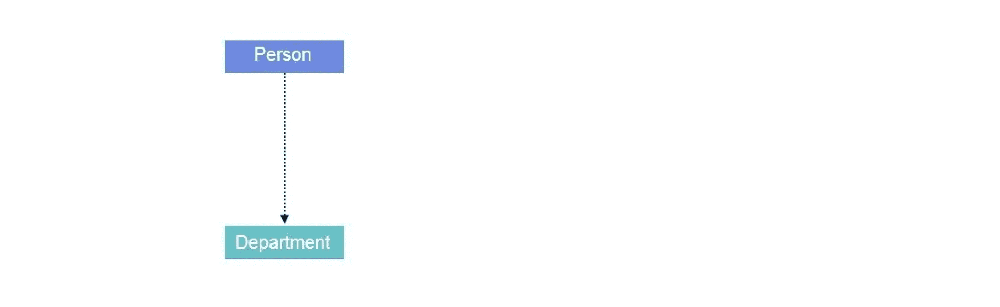

# JPA 入门指南：初学者学习 JPA 框架逐步步进指南

在本书中，你将学习带有图表的解释和实操练习，通过成功执行练习并获取输出、现成的解决方案以及逐步解答。

## AMIT K

## 引言

循渐式学习 JPA 编程。

**JPA** (Java Persistence API) 是一个强大的框架，用于快速构建健壮的数据驱动应用程序。

我们应用程序处理的大部分数据必须存储在数据存储中、检索、处理和分析。如果该数据存储是关系型数据库，且你使用 Java 这样的面向对象的编程语言，那么你应该查看 JPA。

JPA 是一种对象关系映射（ORM）工具，它将 Java 对象映射到关系型数据库并允许查询操作。

在本书中，你将学习 Java Persistence API 及其用于映射实体的注解。

# JPA 与 Spring 框架的集成

| 不同场景（应用 - 不同类型的映射） | 假设有两个对象 Student（学生）和 Address（地址），Student 和 Address 需要相互通信。 | Student 想要访问 -> Address 对象的详情。 | Student 想要访问 -> Address 对象的详情，且 Address 也想要访问 -> Student 对象的详情。 | 那么如何做？如何实现这种场景？这里有一种机制来实现这种场景，通过主键和外键。 | 只要我们如何建立了主键和外键之间的关系即可。 | 学生 顶部 单向映射 双向映射 地址 底部 底部 |

## 第 1 章：JPA 对一映射

- 1 JPA 对一映射
- 2 JPA 对一懒加载映射
- 3 JPA 对一连接列映射
- 4 JPA 对一主键连接列映射
- 5 JPA 对一 Map 级联映射
- 6 JPA 对一单向映射
- 7 JPA 对一双向映射

## 1 JPA 对一映射



在这里，你将学习如何在 JPA 中实现对一映射。

示例假设一个 `Person` 只能有一个 `department`。

在 `Person` 实体中，使用 `@OneToOne` 注解标记 `Department` 属性。

```java
@Entity
public class Person {
  @OneToOne
  private Department department;
...
```

这里是设置两个实体并将其保存到数据库的简单代码。

```java
Person p1 = new Person("Tom");
p1.setName("Tom");

Department d = new Department();
d.setName("Design");
p1.setDepartment(d);

em.persist(p1);
em.persist(d);
```

示例 1：假设一个 `Person` 只能有一个 `department`。

### Person.java

```java
package com.abd.jpa;

import javax.persistence.Entity;
import javax.persistence.GeneratedValue;
import javax.persistence.GenerationType;
import javax.persistence.Id;
import javax.persistence.OneToOne;

@Entity
public class Person {
  @Id
  @GeneratedValue(strategy=GenerationType.IDENTITY)
  private long id;

  private String name;

  @OneToOne
  private Department department;

  public Person() {}

  public Person(String name) {
    this.name = name;
  }

  public Long getId() {
    return id;
  }

  public void setId(Long id) {
    this.id = id;
  }

  public String getName() {
    return name;
  }

  public void setName(String name) {
    this.name = name;
  }

  public Department getDepartment() {
    return department;
  }

  public void setDepartment(Department department) {
    this.department = department;
  }

  @Override
  public String toString() {
    return "Person [id=" + id + ", name=" + name + "]";
  }
}
```

### Department.java

```java
package com.abd.jpa;

import javax.persistence.Entity;
import javax.persistence.GeneratedValue;
import javax.persistence.GenerationType;
import javax.persistence.Id;

@Entity
public class Department {
    @Id
    @GeneratedValue(strategy=GenerationType.IDENTITY)
    private long id;

    private String name;

    public long getId() {
        return id;
    }

    public void setId(long id) {
        this.id = id;
    }

    public String getName() {
        return name;
    }

    public void setName(String name) {
        this.name = name;
    }
}
```

### PersonDaoImpl.java

```java
package com.abd.jpa;

import javax.persistence.EntityManager;
import javax.persistence.PersistenceContext;
import org.springframework.transaction.annotation.Transactional;

@Transactional
public class PersonDaoImpl {
    @PersistenceContext
    private EntityManager em;

    public void test(){
        Person p1 = new Person("Tom");
        p1.setName("Tom");

        Department d = new Department();
        d.setName("Design");
        p1.setDepartment(d);

        em.persist(p1);
        em.persist(d);
    }
}
```

### Helper.java

```java
package com.abd.jpa;

import java.sql.Connection;
import java.sql.DriverManager;
import java.sql.ResultSet;
import java.sql.ResultSetMetaData;
import java.sql.Statement;

public class Helper {
    public static void checkData() {
        try{
            Class.forName("com.mysql.jdbc.Driver");
            Connection conn = DriverManager.getConnection("jdbc:mysql://localhost/db1", "root", "root");
            Statement st = conn.createStatement();

            ResultSet mrs = conn.getMetaData().getTables(null, null, null, new String[] { "TABLE" });
            while (mrs.next()) {
              String tableName = mrs.getString(3);
              System.out.println("\n\nTable Name: " + tableName);
            }

            ResultSet rs = st.executeQuery("select * from " + tableName);
            ResultSetMetaData metadata = rs.getMetaData();
            while (rs.next()) {
              System.out.println(" Row:");
            }
        } catch (Exception e) {
            e.printStackTrace();
        }
    }
}
```

### persistence.xml

```xml
<?xml version="1.0" encoding="UTF-8"?>
<persistence version="1.0"
xmlns="http://java.sun.com/xml/ns/persistence" 
xmlns:xsi="http://www.w3.org/2001/XMLSchema-instance"
xsi:schemaLocation="http://java.sun.com/xml/ns/persistence http://java.sun.com/xml/ns/persistence/persistence_1_0.xsd">

<persistence-unit name="jpaData" />

</persistence>
```

### applicationContext.xml

```xml
<?xml version="1.0" encoding="UTF-8"?>
<beans xmlns="http://www.springframework.org/schema/beans"
xmlns:aop="http://www.springframework.org/schema/aop" 
xmlns:context="http://www.springframework.org/schema/context"
xmlns:security="http://www.springframework.org/schema/security"
xmlns:tx="http://www.springframework.org/schema/tx" 
xmlns:xsi="http://www.w3.org/2001/XMLSchema-instance"
xsi:schemaLocation="http://www.springframework.org/schema/aop http://www.springframework.org/schema/aop/spring-aop-3.2.xsd
                              http://www.springframework.org/schema/beans http://www.springframework.org/schema/beans/spring-beans-3.2.xsd
                              http://www.springframework.org/schema/context http://www.springframework.org/schema/context/spring-context-3.2.xsd
                              http://www.springframework.org/schema/tx http://www.springframework.org/schema/tx/spring-tx-3.2.xsd">

<tx:annotation-driven />
<context:annotation-config />

<bean id="personDao" class="com.abd.jpa.PersonDaoImpl" />

<bean id="dataSource" class="org.springframework.jdbc.datasource.DriverManagerDataSource">
  <property name="driverClassName">
    <value>com.mysql.jdbc.Driver</value>
  </property>
  <property name="url">
    <value>jdbc:mysql://localhost/db1</value>
  </property>
  <property name="username">
    <value>root</value>
  </property>
  <property name="password">
    <value>root</value>
  </property>
</bean>

<bean id="entityManagerFactory" class="org.springframework.orm.jpa.LocalContainerEntityManagerFactoryBean">
  <property name="dataSource" ref="dataSource" />
  <property name="persistenceUnitName" value="jpaData" />
  <property name="jpaVendorAdapter">
    <bean class="org.springframework.orm.jpa.vendor.HibernateJpaVendorAdapter" />
  </property>
  <property name="jpaProperties">
    <props>
      <prop key="hibernate.dialect">org.hibernate.dialect.MySQLDialect</prop>
      <prop key="hibernate.show_sql">true</prop>
      <prop key="hibernate.hbm2ddl.auto">update</prop>
    </props>
  </property>
</bean>
<bean id="transactionManager" class="org.springframework.orm.jpa.JpaTransactionManager">
  <property name="entityManagerFactory" ref="entityManagerFactory" />
</bean>
</beans>
```

### Client.java

```java
package com.abd.jpa;

import org.springframework.context.support.ClassPathXmlApplicationContext;

public class Client {

  public static void main(String[] args) {
    ClassPathXmlApplicationContext context = new ClassPathXmlApplicationContext(
      "applicationContext.xml");
    PersonDaoImpl dao = (PersonDaoImpl) context.getBean("personDao");

    dao.test();

    context.close();

    Helper.checkData();
  }
}
```

### 输出

| 表名 | DEPARTMENT | | |
| :--- | :--- | :--- | :--- |
| **列名** | ID | | |
| **列类型** | BIGINT | | |
| **列值** | 1 | | |
| **列名** | NAME | | |
| **列类型** | VARCHAR | | |
| **列值** | Design | | |
| 表名 | PERSON | | |
| :--- | :--- | :--- | :--- |
| **列名** | ID | | |
| **列类型** | BIGINT | | |
| **列值** | 1 | | |
| **列名** | DEPARTMENT_ID | | |
| **列类型** | BIGINT | | |
| **列值** | 1 | | |

## 2 JPA 一对一懒加载映射 (Lazy Load Mapping)


以下代码展示了如何通过设置懒加载来实现一对一映射。


```java
@OneToOne(fetch=LAZY)
private Department department;
```

在这里你将学习如何通过设置懒加载来实现一对一映射。

### 示例 2

#### Person.java

```java
package com.abd.jpa;

import javax.persistence.Entity;
import javax.persistence.GeneratedValue;
import javax.persistence.GenerationType;
import javax.persistence.Id;
import javax.persistence.OneToOne;
import static javax.persistence.FetchType.LAZY;

@Entity
public class Person {

    @Id
    @GeneratedValue(strategy=GenerationType.IDENTITY)
    private long id;

    private String name;

    @OneToOne(fetch=LAZY)
    private Department department;

    public Person() { }

    public Person(String name) {
        this.name = name;
    }

    public Department getDepartment() {
        return department;
    }

    public void setDepartment(Department department) {
        this.department = department;
    }

    public Long getId() {
        return id;
    }

    public void setID(Long id) {
        this.id = id;
    }

    public String getName() {
        return name;
    }

    public void setName(String name) {
        this.name = name;
    }

    @Override
    public String toString() {
        return "Person [id=" + id + ", name=" + name + "]";
    }
}
```

#### Department.java

```java
package com.abd.jpa;

import javax.persistence.Entity;
import javax.persistence.GeneratedValue;
import javax.persistence.GenerationType;
import javax.persistence.Id;

@Entity
public class Department {
    @Id
    @GeneratedValue(strategy=GenerationType.IDENTITY)
    private long id;

    private String name;

    public long getId() {
        return id;
    }

    public void setId(long id) {
        this.id = id;
    }

    public String getName() {
        return name;
    }

    public void setName(String name) {
        this.name = name;
    }
}
```

#### PersonDaoImpl.java

```java
package com.abd.jpa;

import javax.persistence.EntityManager;
import javax.persistence.PersistenceContext;
import org.springframework.transaction.annotation.Transactional;

@Transactional
public class PersonDaoImpl {
    @PersistenceContext
    private EntityManager em;

    public void test(){
        Person p1 = new Person("Tom");
        p1.setName("Tom");

        Department d = new Department();
        d.setName("Design");
        // 逻辑继续此处...
    }
}
```

#### Helper.java

```java
package com.abd.jpa;

import javax.persistence.EntityManager;
import javax.persistence.PersistenceContext;

public class Helper {
    @PersistenceContext
    private EntityManager em;

    public static void checkData() {
        // 检查数据的实现
    }
}
```

## 3 JPA 一对一连接列映射


接下来的章节将展示如何在 JPA 中为一对一映射设置连接列（join column）。

我们使用 `@JoinColumn` 注解来设置连接列。

```
@OneToOne
@JoinColumn(name="DEPT_ID")
private Department department;
```

在这里，你将学习如何在 JPA 中为一对一映射设置连接列。

### 示例 3

#### Person.java

```java
package com.abd.jpa;

import javax.persistence.Entity;
import javax.persistence.GeneratedValue;
import javax.persistence.GenerationType;
import javax.persistence.Id;
import javax.persistence.JoinColumn;
import javax.persistence.OneToOne;

@Entity
public class Person {
  @Id
  @GeneratedValue(strategy=GenerationType.IDENTITY)
  private long id;

    private String name;
  @OneToOne
  @JoinColumn(name="DEPT_ID")
  private Department department;
  public Person() { }

    public Person(String name) {
        this.name = name;
    }

    public Department getDepartment() {
    return department;
    }

    public void setDepartment(Department department) {
    this.department = department;
    }

    public Long getId() {
    return id;
    }

    public void setId(Long id) {
        this.id = id;
    }
    public String getName() {
        return name;
    }
    public void setName(String name) {
        this.name = name;
    }

    @Override
    public String toString() {
        return "Person [id=" + id + ", name=" + name + "]";
    }
}
```

#### Department.java

```java
package com.abd.jpa;

import javax.persistence.Entity;
import javax.persistence.GeneratedValue;
import javax.persistence.GenerationType;
import javax.persistence.Id;
import javax.persistence.OneToOne;

@Entity
public class Department {
    @Id
    @GeneratedValue(strategy=GenerationType.IDENTITY)
    private long id;

    private String name;

    @OneToOne(mappedBy="department")
    private Person person;

    public Person getPerson() {
    return person;
    }

    public void setPerson(Person person) {
        this.person = person;
    }

    public long getId() {
    return id;
    }

    public void setId(long id) {
        this.id = id;
    }

    public String getName() {
        return name;
    }

    public void setName(String name) {
        this.name = name;
    }

    @Override
    public String toString() {
        return "Department [id=" + id + ", name=" + name + ", person=" + person + "]";
    }
}
```

#### PersonDaoImpl.java

```java
package com.abd.jpa;

import java.util.List;

import javax.persistence.EntityManager;
import javax.persistence.PersistenceContext;
import javax.persistence.Query;

import org.springframework.transaction.annotation.Transactional;

@Transactional
public class PersonDaoImpl {
    public void test(){
        Person p1 = new Person("Tom");
        p1.setName("Tom");

        Department d = new Department();
        d.setName("Design");
        p1.setDepartment(d);
        d.setPerson(p1);

        em.persist(p1);
        em.persist(d);

        Query query = em.createQuery("SELECT e FROM Person e");
        List<Person> list = (List<Person>) query.getResultList();
        System.out.println(list.get(0).getDepartment());

    }
    @PersistenceContext
    private EntityManager em;
}
```

#### Helper.java

```java
package com.abd.jpa;

import java.sql.Connection;
import java.sql.DriverManager;
import java.sql.ResultSet;
import java.sql.ResultSetMetaData;
import java.sql.Statement;

public class Helper {
    public static void checkData() {
    try{
        Class.forName("com.mysql.jdbc.Driver");
        Connection conn = DriverManager.getConnection("jdbc:mysql://localhost/db1", "root", "root");
        Statement st = conn.createStatement();

        ResultSet mrs = conn.getMetaData().getTables(null, null, null, new String[] { "TABLE" });
        while (mrs.next()) {
            String tableName = mrs.getString(3);
            System.out.println("\n\n\nTableName: " + tableName);
        }

        ResultSet rs = st.executeQuery("select * from " + tableName);
        ResultSetMetaData metadata = rs.getMetaData();
        while (rs.next()) {
            System.out.println(" Row:");
            for (int i = 0; i < metadata.getColumnCount(); i++) {
                System.out.println(" Column Name:"+ metadata.getColumnLabel(i + 1) + ", ");
                System.out.println(" Column Type:"+ metadata.getColumnTypeName(i + 1) + ": ");
                Object value = rs.getObject(i + 1);
                System.out.println(" Column Value:"+value+"\n");
            }
        }
    } catch(Exception e){
        e.printStackTrace();
    }
}
```

#### persistence.xml

```xml
<?xml version="1.0" encoding="UTF-8"?>
<persistence version="1.0"
xmlns="http://java.sun.com/xml/ns/persistence" xmlns:xsi="http://www.w3.org/2001/XMLSchema-instance"
  xsi:schemaLocation="http://java.sun.com/xml/ns/persistence http://java.sun.com/xml/ns/persistence/persistence_1_0.xsd">

<persistence-unit name="jpaData" />

</persistence>
```

#### applicationContext.xml


```xml
<?xml version="1.0" encoding="UTF-8"?>
<beans xmlns="http://www.springframework.org/schema/beans"
  xmlns:xsi="http://www.w3.org/2001/XMLSchema-instance"
  xmlns:aop="http://www.springframework.org/schema/aop"
  xmlns:context="http://www.springframework.org/schema/context"
  xmlns:tx="http://www.springframework.org/schema/tx"
  xsi:schemaLocation="http://www.springframework.org/schema/beans http://www.springframework.org/schema/beans/spring-beans.xsd
  http://www.springframework.org/schema/aop http://www.springframework.org/schema/aop/spring-aop.xsd
  http://www.springframework.org/schema/context http://www.springframework.org/schema/context/spring-context.xsd
  http://www.springframework.org/schema/tx http://www.springframework.org/schema/tx/spring-tx.xsd">

<tx:annotation-driven />
<context:annotation-config />

<bean id="personDao" class="com.abd.jpa.PersonDaoImpl" />

<bean id="dataSource" class="org.springframework.jdbc.datasource.DriverManagerDataSource">
  <property name="driverClassName" value="com.mysql.jdbc.Driver"/>
  <property name="url" value="jdbc:mysql://localhost/db1"/>
  <property name="username" value="root"/>
  <property name="password" value="root"/>
</bean>

<bean id="entityManagerFactory" class="org.springframework.orm.jpa.LocalContainerEntityManagerFactoryBean">
  <property name="dataSource" ref="dataSource" />
  <property name="persistenceUnitName" value="jpaData" />
  <property name="jpaVendorAdapter">
    <bean class="org.springframework.orm.jpa.vendor.HibernateJpaVendorAdapter" />
  </property>
  <property name="jpaProperties">
    <props>
      <prop key="hibernate.dialect">org.hibernate.dialect.MySQLDialect</prop>
      <prop key="hibernate.show_sql">true</prop>
      <prop key="hibernate.hbm2l.auto">update</prop>
    </props>
  </property>
</bean>

<bean id="transactionManager" class="org.springframework.orm.jpa.JpaTransactionManager">
  <property name="entityManagerFactory" ref="entityManagerFactory" />
</bean>

</beans>
```

### Client.java

```java
package com.abd.jpa;

import org.springframework.context.support.ClassXmlApplicationContext;

public class Client {

    public static void main(String[] args) {
        ClassXmlApplicationContext context = new ClassXmlApplicationContext(
            "applicationContext.xml");
        PersonDaoImpl dao = (PersonDaoImpl) context.getBean("personDao");

        dao.test();

        context.close();
    }
}
```

### 示例 4

### Person.java

```java
package com.abd.jpa;

import javax.persistence.Entity;
import javax.persistence.GeneratedValue;
import javax.persistence.GenerationType;
import javax.persistence.Id;
import javax.persistence.OneToOne;
import javax.persistence.PrimaryKeyJoinColumn;

@Entity
public class Person {
    @Id
    @GeneratedValue(strategy=GenerationType.IDENTITY)
    private long id;

    private String name;
    @OneToOne
    @PrimaryKeyJoinColumn
    private Department department;
    public Person() {}

    public Person(String name) {
        this.name = name;
    }

    public Department getDepartment() {
        return department;
    }

    public void setDepartment(Department department) {
        this.department = department;
    }

    public Long getId() {
        return id;
    }

    public void setId(Long id) {
        this.id = id;
    }

    public String getName() {
        return name;
    }

    public void setName(String name) {
        this.name = name;
    }

    @Override
    public String toString() {
        return "Person [id=" + id + ", name=" + name + "]";
    }
}
```

### Department.java

```java
package com.abd.jpa;

import javax.persistence.Entity;
import javax.persistence.GeneratedValue;
import javax.persistence.GenerationType;
import javax.persistence.Id;
import javax.persistence.OneToOne;

@Entity
public class Department {
    @Id
    @GeneratedValue(strategy=GenerationType.IDENTITY)
    private long id;

    private String name;

    @OneToOne(mappedBy="department")
    private Person person;

    public Person getPerson() {
        return person;
    }

    public void setPerson(Person person) {
        this.person = person;
    }

    public long getId() {
        return id;
    }

    public void setId(long id) {
        this.id = id;
    }

    public String getName() {
        return name;
    }

    public void setName(String name) {
        this.name = name;
    }
}
```

### PersonDaoImpl.java

```java
package com.abd.jpa;

import javax.persistence.EntityManager;
import javax.persistence.PersistenceContext;
import org.springframework.transaction.annotation.Transactional;

@Transactional
public class PersonDaoImpl {
    @PersistenceContext
    private EntityManager em;

    public void test(){
        Person p1 = new Person("Tom");
        p1.setName("Tom");

        Department d = new Department();
        d.setName("Design");
        p1.setDepartment(d);
        d.setPerson(p1);

        em.persist(p1);
        em.persist(d);
    }
}
```

### Helper.java

```java
package com.abd.jpa;

import java.sql.Connection;
import java.sql.DriverManager;
import java.sql.ResultSet;
import java.sql.ResultSetMetaData;
import java.sql.Statement;

public class Helper {
    public static void checkData() {
        try{
            Class.forName("com.mysql.jdbc.Driver");
            Connection conn = DriverManager.getConnection("jdbc:mysql://localhost/db1", "root", "root");
            Statement st = conn.createStatement();

            ResultSet mrs = conn.getMetaData().getTables(null, null, null, new String[] { "TABLE" });
            while (mrs.next()) {
                String tableName = mrs.getString(3);
                System.out.println("\n\n\nTable Name: " + tableName);
                // ResultSet rs = st.executeQuery("select * from " + tableName);
            }
        } catch (Exception e) {
            e.printStackTrace();
        }
    }
}
```

### persistence.xml

```xml
<?xml version="1.0" encoding="UTF-8"?>
<persistence version="1.0"
  xmlns="http://java.sun.com/ns/persistence"
  xmlns:xsi="http://www.w3.org/2001/XMLSchema-instance"
  xsi:schemaLocation="http://java.sun.com/ns/persistence http://java.sun.com/ns/persistence/persistence_1.0.xsd">

    <persistence-unit name="jpaData">

</persistence>
```

### applicationContext.xml


## Spring JPA 配置示例

### beans.xml

```xml
<?xml version="1.0" encoding="UTF-8"?>
<beans xmlns="http://www.springframework.org/schema/beans"
  xmlns:aop="http://www.springframework.org/schema/aop"
  xmlns:context="http://www.springframework.org/schema/context"
  xmlns:security="http://www.springframework.org/schema/security"
  xmlns:tx="http://www.springframework.org/schema/tx"
  xmlns:xsi="http://www.w3.org/2001/XMLSchema-instance"
  xsi:schemaLocation="
    http://www.springframework.org/schema/beans http://www.springframework.org/schema/beans/spring-beans-3.2.xsd
    http://www.springframework.org/schema/aop http://www.springframework.org/schema/aop/spring-aop-3.2.xsd
    http://www.springframework.org/schema/context http://www.springframework.org/schema/context/spring-context-3.2.xsd
    http://www.springframework.org/schema/security http://www.springframework.org/schema/security/spring-security-3.2.xsd
    http://www.springframework.org/schema/tx http://www.springframework.org/schema/tx/spring-tx-3.2.xsd">

    <tx:annotation-driven />
    <context:component-scan />

    <bean id="entityManagerFactory" class="org.springframework.orm.jpa.LocalContainerEntityManagerFactoryBean">
        <property name="dataSource" ref="dataSource" />
        <property name="persistenceUnitName" value="jpaData" />
        <property name="jpaProperties">
            <props>
                <prop key="hibernate.dialect">org.hibernate.dialect.MySQLDialect</prop>
                <prop key="hibernate.show_sql">true</prop>
                <prop key="hibernate.hbm2dl.auto">update</prop>
            </props>
        </property>
    </bean>

    <bean id="transactionManager" class="org.springframework.transaction.jpa.JpaTransactionManager">
        <property name="entityManagerFactory" ref="entityManagerFactory" />
    </bean>

    <bean id="personDao" class="com.abd.jpa.PersonDaoImpl"
          autowire="true" />

    <bean id="dataSource" class="org.springframework.jdbc.datasource.DriverManagerDataSource">
        <property name="driverClassName" value="com.mysql.jdbc.Driver" />
        <property name="url" value="jdbc:mysql://localhost/db1" />
        <property name="username" value="root" />
        <property name="password" value="root" />
    </bean>

</beans>
```

### Department.java

```java
package com.abd.jpa;

import javax.persistence.CascadeType;
import javax.persistence.Entity;
import javax.persistence.GeneratedValue;
import javax.persistence.GenerationType;
import javax.persistence.Id;
import javax.persistence.OneToOne;

@Entity
public class Department {
    @Id
    @GeneratedValue(strategy=GenerationType.IDENTITY)
    private long id;

    private String name;

    @OneToOne(cascade=CascadeType.ALL,mappedBy="department")
    private Person person;

    public Person getPerson(){
        return person;
    }

    public void setPerson(Person person) {
        this.person = person;
    }

    public long getId() {
        return id;
    }

    public void setId(long id) {
        this.id = id;
    }

    public String getName() {
        return name;
    }

    public void setName(String name) {
        this.name = name;
    }

    @Override
    public String toString() {
        return "Department [id=" + id + ", name=" + name + ", person=" + person + "]";
    }
}
```

### PersonDaoImpl.java

```java
package com.abd.jpa;

import java.util.List;

import javax.persistence.EntityManager;
import javax.persistence.PersistenceContext;
import javax.persistence.Query;

import org.springframework.transaction.annotation.Transactional;

@Transactional
public class PersonDaoImpl {
    public void test(){
        Person p1 = new Person("Tom");
        p1.setName("Tom");

        Department d = new Department();
        d.setName("Design");
        p1.setDepartment(d);
        d.setPerson(p1);

        em.persist(p1);
        em.persist(d);

        Query query = em.createQuery("SELECT e FROM Person e");
        List<Person> list = (List<Person>) query.getResultList();
        System.out.println(list.get(0).getDepartment());

        em.remove(list.get(0));
    }

    @PersistenceContext
    private EntityManager em;
}
```

### Helper.java

```java
package com.abd.jpa;

import java.sql.Connection;
import java.sql.DriverManager;
import java.sql.ResultSet;
import java.sql.ResultSetMetaData;
import java.sql.Statement;

public class Helper {
    public static void checkData() {
        try{
            Class.forName("com.mysql.jdbc.Driver");
            Connection conn = DriverManager.getConnection("jdbc:mysql://localhost/db1", "root", "root");
            Statement st = conn.createStatement();

            ResultSet mrs = conn.getMetaData().getTables(null, null, null, new String[] { "TABLE" });
            while (mrs.next()) {
                String tableName = mrs.getString(3);
                System.out.println("\n\n\nTable Name: " + tableName);
            }

            ResultSet rs = st.executeQuery("select * from " + tableName);
            ResultSetMetaData metadata = rs.getMetaData();

            while (rs.next()) {
                System.out.println(" Row:");
                for (int i = 0; i < metadata.getColumnCount(); i++) {
                    System.out.println(" Column Name:"+ metadata.getColumnLabel(i + 1) + ":");
                }
            }
        }
    }
}
```

### persistence.xml

```xml
<?xml version="1.0" encoding="UTF-8"?>
<persistence version="1.0"
xmlns="http://java.sun.com/xml/ns/persistence" xmlns:xsi="http://www.w3.org/2001/XMLSchema-instance"
  xsi:schemaLocation="http://java.sun.com/xml/ns/persistence http://java.sun.com/xml/ns/per-persistence/persistence_1_0.xsd">

  <persistence-unit name="jpaData" />

</persistence>
```

### applicationContext.xml

```xml
<?xml version="1.0" encoding="UTF-8"?>
<beans xmlns="http://www.springframework.org/schema/beans"
  xmlns:aop="http://www.springframework.org/schema/aop" xmlns:context="http://www.springframework.org/schema/context"
  xmlns:security="http://www.springframework.org/schema/security"
  xmlns:tx="http://www.springframework.org/schema/tx" xmlns:xsi="http://www.w3.org/2001/XMLSchema-instance"
  xsi:schemaLocation="http://www.springframework.org/schema/aop http://www.springframework.org/schema/aop/spring-aop-3.2.xsd
  http://www.springframework.org/schema/beans http://www.springframework.org/schema/beans/spring-beans-3.2.xsd
  http://www.springframework.org/schema/context http://www.springframework.org/schema/context/spring-context-3.2.xsd
  http://www.springframework.org/schema/tx http://www.springframework.org/schema/tx/spring-tx-3.2.xsd">

  <context:component-scan base-package="com.abd.jpa"/>
  <tx:annotation-driven transaction-manager="transactionManager" />

  <bean id="dataSource" class="org.springframework.jdbc.datasource.DriverManagerDataSource">
    <property name="driverClassName" value="com.mysql.jdbc.Driver"/>
    <property name="url" value="jdbc:mysql://localhost/db1"/>
    <property name="username" value="root"/>
    <property name="password" value="root"/>
  </bean>

  <bean id="entityManagerFactory" class="org.springframework.orm.jpa.LocalContainerEntityManagerFactoryBean">
    <property name="dataSource" ref="dataSource"/>
    <property name="jpaVendorFactory" bean="org.springframework.jpa.HibernateVendorFactoryBean"/>
    <property name="properties">
      <props>
        <prop key="hibernate.dialect">org.hibernate.dialect.MySQL5Dialect</prop>
        <prop key="hibernate.hbm2ddl.auto">update</prop>
        <prop key="hibernate.show_sql">true</prop>
      </props>
    </property>
  </bean>

  <bean id="transactionManager" class="org.springframework.orm.jpa.JpaTransactionManager">
    <property name="entityManagerFactory" ref="entityManagerFactory"/>
  </bean>

</beans>
```


```java
import javax.persistence.EntityManager;
import javax.persistence.PersistenceContext;

import org.springframework.transaction.annotation.Transactional;

@Transactional
public class PersonDaoImpl {
    public void test() {

        Professor emp = new Professor();
        emp.setName("name");
        emp.setSalary(12345);

        ParkingSpace ps = new ParkingSpace();
        ps.setLot(1);
        ps.setLocation("East");
        emp.setParkingSpace(ps);

        em.persist(ps);
        em.persist(emp);
    }
}
```

```java
@PersistenceContext
private EntityManager em;
}
```

#### Helper.java

```java
package com.abd.jpa;

import java.sql.Connection;
import java.sql.DriverManager;
import java.sql.ResultSet;
import java.sql.ResultSetMetaData;
import java.sql.Statement;

public class Helper {
    public static void checkData() {
        try{
            Class.forName("com.mysql.jdbc.Driver");
            Connection conn = DriverManager.getConnection("jdbc:mysql://localhost/db1", "root", "root");
            Statement st = conn.createStatement();
            ResultSet mrs = conn.getMetaData().getTables(null
        }
    }
}
```

#### persistence.xml

```xml
<?xml version="1.0" encoding="UTF-8"?>
<persistence version="1.0"
  xmlns="http://java.sun.com/xml/ns/persistence" xmlns:xsi="http://www.w3.org/2001/XMLSchema-instance"
  xsi:schemaLocation="http://java.sun.com/xml/ns/persistence http://java.sun.com/xml/ns/persistence/persistence_1_0.xsd">

  <persistence-unit name="jpaData" />

</persistence>
```

#### applicationContext.xml

```xml
<?xml version="1.0" encoding="UTF-8"?>
<beans xmlns="http://www.springframework.org/schema/beans"
  xmlns:aop="http://www.springframework.org/schema/aop" xmlns:context="http://www.springframework.org/schema/context"
  xmlns:security="http://www.springframework.org/schema/security"
  xmlns:tx="http://www.springframework.org/schema/tx" xmlns:xsi="http://www.w3.org/2001/XMLSchema-instance"
  xsi:schemaLocation="http://www.springframework.org/schema/aop http://www.springframework.org/schema/aop/spring-aop-3.2.xsd
http://www.springframework.org/schema/beans http://www.springframework.org/schema/beans/spring-beans-3.2.xsd
http://www.springframework.org/schema/context http://www.springframework.org/schema/context/spring-context-3.2.xsd
http://www.springframework.org/schema/tx http://www.springframework.org/schema/tx/spring-tx-3.2.xsd">
  <tx:annotation:annotation-config />
  <context:annotation-config />

  <bean id="personDao" class="com.abd.jpa.PersonDaoImpl" />

  <bean id="dataSource"
    class="org.springframework.jdbc.datasource.DriverManagerDataSource">
    <property name="driverClassName">
      <value>com.mysql.jdbc.Driver</value>
    </property>
    <property name="url">
      <value>jdbc:mysql://localhost/db1</value>
    </property>
    <property name="username">
      <value>root</value>
    </property>
    <property name="password">
      <value>root</value>
    </property>
  </bean>

  <bean id="entityManagerFactory"
    class="org.springframework.orm.jpa.LocalContainerEntityManagerFactoryBean">
    <property name="dataSource" ref="dataSource" />
    <property name="persistenceUnitName" value="jpaData" />
    <property name="jpaVendorAdapter">
      <bean class="org.springframework.orm.jpa.vendor.HibernateVendorAdapter" />
    </property>
    <property name="jpaProperties">
      <props>
        <prop key="hibernate.dialect">org.hibernate.dialect.MySQLDialect</prop>
        <prop key="hibernate.show_sql">true</prop>
        <prop key="hibernate.hbm2ddl.auto">update</prop>
      </props>
    </property>
  </bean>

  <bean id="transactionManager" class="org.springframework.orm.jpa.JpaTransactionManager">
    <property name="entityManagerFactory" ref="entityManagerFactory" />
  </bean>
</beans>
```

#### Client.java

```java
package com.abd.jpa;

import org.springframework.context.support.ClassXmlApplicationContext;

public class Client {

    public static void main(String[] args) {

        ClassXmlApplicationContext context = new ClassXmlApplicationContext(

            "applicationContext.xml");

        PersonDaoImpl dao = (PersonDaoImpl) context.getBean("personDao");

        dao.test();

        context.close();

        Helper.checkData();

    }

}
```

### 输出

| 表名: PARKING_SPACE | | |
| 列名 | 类型 | 取值 |
| :--- | :--- | :--- |
| ID | INTEGER | 1 |
| LOCATION | VARCHAR | East |
| LOT | INTEGER | 1 |

| 表名: PROFESSOR | | |
| 列名 | 类型 | 取值 |
| :--- | :--- | :--- |
| ID | INTEGER | 1 |
| NAME | VARCHAR | name |
| SALARY | BIGINT | 12345 |
| PSPACE_ID | INTEGER | 1 |

### JPA 一一对双向映射


你将学习如何实现一对一映射。

#### Person.java

```java
package com.abd.jpa;

import javax.persistence.Entity;

import javax.persistence.GeneratedValue;

import javax.persistence.GenerationType;

import javax.persistence.Id;

import javax.persistence.OneToOne;

@Entity

public class Person {

    @Id

    @GeneratedValue(strategy=GenerationType.IDENTITY)

    private long id;

    private String name;

    private long salary;

    @OneToOne(mappedBy="department")

    private Department department;

    public Person() {}

    public Person(String name) {

        this.name = name;

    }

    public long getId() {

        return id;

    }

    public void setId(long id) {

        this.id = id;

    }

    public String getName() {

        return name;

    }

    public void setName(String name) {

        this.name = name;

    }

    public long getSalary() {

        return salary;

    }

    public void setSalary(long salary) {

        this.salary = salary;

    }

    public Department getDepartment() {

        return department;

    }

    public void setDepartment(Department department) {

        this.department = department;

    }

    @Override

    public String toString() {

        return "Person [id=" + id + ", name=" + name + "]";

    }

}
```

#### Department.java

```java
package com.abd.jpa;

import javax.persistence.Entity;

import javax.persistence.GeneratedValue;

import javax.persistence.GenerationType;

import javax.persistence.Id;

import javax.persistence.JoinColumn;

import javax.persistence.OneToOne;

@Entity

public class Department {

  @Id

  @GeneratedValue(strategy=GenerationType.IDENTITY)

  private long id;

  private String name;

  @OneToOne

  @JoinColumn(name="person_id")

  private Person person;

  public long getId() {

    return id;

  }

  public void setId(long id) {

    this.id = id;

  }

  public String getName() {

    return name;

  }

  public void setName(String name) {

    this.name = name;

  }

  public Person getPerson() {

    return person;

  }

  public void setPerson(Person person) {

    this.person = person;

  }

  @Override

  public String toString() {

    return "Department [id=" + id + ", name=" + name + "]";

  }

}
```

#### PersonDaoImpl.java

```java
package com.abd.jpa;

import javax.persistence.EntityManager;

import javax.persistence.PersistenceContext;

import org.springframework.transaction.annotation.Transactional;

@Transactional

public class PersonDaoImpl {

    public void test(){

        Person p1 = new Person("Tom");

        p1.setName("Tom");

        Department d = new Department();

        d.setName("Design");

        p1.setDepartment(d);

        d.setPerson(p1);

        em.persist(p1);

        em.persist(d);

    }

}

@PersistenceContext

private EntityManager em;

}
```

```java
System.out.println(" Column Value: "+value+"\n");

}

}

catch(Exception e){

    e.printStackTrace();

}

}

}
```

#### persistence.xml

```xml
<?xml version="1.0" encoding="UTF-8"?>

<persistence version="1.0"

    xmlns="http://java.sun.com/xml/ns/persistence" xmlns:xsi="http://www.w3.org/2001/XMLSchema-instance"

    xsi:schemaLocation="http://java.sun.com/xml/ns/persistence http://java.sun.com/xml/ns/persistence/persistence_1_0.xsd">

    <persistence-unit name="jpaData" />

</persistence>


#### applicationContext.xml

```xml
<?xml version="1.0" encoding="UTF-8"?>
<beans xmlns="http://www.springframework.org/schema/beans"
       xmlns:aop="http://www.springframework.org/schema/aop"
       xmlns:context="http://www.springframework.org/schema/context"
       xmlns:security="http://www.springframework.org/schema/security"
       xmlns:tx="http://www.springframework.org/schema/tx"
       xmlns:xsi="http://www.w3.org/2001/XMLSchema-instance"
       xsi:schemaLocation="http://www.springframework.org/schema/aop http://www.springframework.org/schema/aop/spring-aop-3.2.xsd
                           http://www.springframework.org/schema/beans http://www.springframework.org/schema/beans/spring-beans-3.2.xsd
                           http://www.springframework.org/schema/context http://www.springframework.org/schema/context/spring-context-3.2.xsd
                           http://www.springframework.org/schema/tx http://www.springframework.org/schema/tx/spring-tx-3.2.xsd">
    <tx:annotation-driven />
    <context:annotation-config />
    <bean id="personDao" class="com.abd.jpa.PersonDaoImpl" />
    <bean id="dataSource" class="org.springframework.jdbc.datasource.DriverManagerDataSource">
        <property name="driverClassName">
            <value>com.mysql.jdbc.Driver</value>
        </property>
        <property name="url">
            <value>jdbc:mysql://localhost/db1</value>
        </property>
        <property name="username">
            <value>root</value>
        </property>
        <property name="password">
            <value>root</value>
        </property>
    </bean>
    <bean id="entityManagerFactory" class="org.springframework.orm.jpa.LocalContainerEntityManagerBean">
        <property name="dataSource" ref="dataSource" />
        <property name="persistenceUnitName" value="jpaData" />
        <property name="jpaVendorAdapter">
            <bean class="org.springframework.orm.jpa.vendor.HibernateJpaVendorAdapter" />
        </property>
        <property name="jpaProperties">
            <props>
                <prop key="hibernate.dialect">org.hibernate.dialect.MySQLDialect</prop>
                <prop key="hibernate.show_sql">true</prop>
                <prop key="hibernate.hbm2ddl.auto">update</prop>
            </props>
        </property>
    </bean>
    <bean id="transactionManager" class="org.springframework.orm.jpa.JpaTransactionManager">
        <property name="entityManagerFactory" ref="entityManagerFactory" />
    </bean>
</beans>
```

#### Client.java

```java
package com.abd.jpa;

import org.springframework.context.support.ClassPathApplicationContext;

public class Client {
    public static void main(String[] args) {
        ClassPathApplicationContext context = new ClassPathApplicationContext("applicationContext.xml");
        PersonDaoImpl dao = (PersonDaoImpl) context.getBean("personDao");
        dao.test();
        context.close();
        Helper.checkData();
    }
}
```

### 输出

表名: DEPARTMENT
行:
| 列名 | 类型 | 值 |
| :--- | :--- | :--- |
| ID | BIGINT | 1 |
| NAME | VARCHAR | Design |

表名: PERSON
行:
| 列名 | 类型 | 值 |
| :--- | :--- | :--- |
| ID | BIGINT | 1 |
| NAME | VARCHAR | Tom |
| DEPT_ID | BIGINT | 1 |

## 第 2 章：JPA 一对多映射

你将学习如何在 JPA 中实现一对多映射。一个部门可以有多个员工。在 Java 代码中，我们可以创建一个 Java Bean 来表示员工，并创建一个 `Department` 类来表示部门。在将 `Employee` 和 `Department` 关联时，我们在 `Employee` 中引用 `Department` 类。我们使用 `@ManyToOne` 标记 `Department`，以表示 `Department` 与 `Employee` 之间的关系。

#### Person.java

```java
package com.abd.jpa;

import javax.persistence.Entity;
import javax.persistence.GeneratedValue;
import javax.persistence.GenerationType;
import javax.persistence.Id;
import javax.persistence.ManyToOne;

@Entity
public class Person {
    @Id
    @GeneratedValue(strategy = GenerationType.IDENTITY)
    private long id;
    private String name;
    @ManyToOne
    private Department department;

    public Person() {}

    public Person(String name) {
        this.name = name;
    }

    public Long getId() {
        return id;
    }

    public void setId(Long id) {
        this.id = id;
    }

    public Department getDepartment() {
        return department;
    }

    public void setDepartment(Department department) {
        this.department = department;
    }

    public String getName() {
        return name;
    }

    public void setName(String name) {
        this.name = name;
    }

    @Override
    public String toString() {
        return "Person [" + id + "]";
    }
}
```

#### Department.java

```java
package com.abd.jpa;

import javax.persistence.Entity;
import javax.persistence.GeneratedValue;
import javax.persistence.GenerationType;
import javax.persistence.Id;

@Entity
public class Department {
    @Id
    @GeneratedValue(strategy = GenerationType.IDENTITY)
    private long id;
    private String name;

    public long getId() {
        return id;
    }

    public void setId(long id) {
        this.id = id;
    }

    public String getName() {
        return name;
    }

    public void setName(String name) {
        this.name = name;
    }
}
```

#### PersonDaoImpl.java

```java
package com.abd.jpa;

import java.util.List;
import javax.persistence.EntityManager;
import javax.persistence.PersistenceContext;
import javax.persistence.Query;
import org.springframework.transaction.annotation.Transactional;

@Transactional
public class PersonDaoImpl {
    @PersistenceContext
    private EntityManager em;

    public void test() {
        Department d = new Department();
        d.setName("Design");
        Person p1 = new Person("Tom");
        p1.setDepartment(d);
        Person p2 = new Person("Jack");
        p2.setDepartment(d);
        em.persist(p1);
        em.persist(p2);
        em.persist(d);
    }
}
```

#### Helper.java

```java
package com.abd.jpa;

import java.sql.Connection;
import java.sql.DriverManager;
import java.sql.ResultSet;
import java.sql.ResultSetMetaData;
import java.sql.Statement;

public class Helper {
    public static void checkData() {
        try {
            Class.forName("com.mysql.jdbc.Driver");
            Connection conn = DriverManager.getConnection("jdbc:mysql://localhost/db1", "root", "root");
            Statement st = conn.createStatement();
            ResultSet mrs = conn.getMetaData().getTables(null, null, new String[] {"TABLE"});
            while (mrs.next()) {
                String tableName = mrs.getString(3);
                System.out.println("\n\n\nTable Name: " + tableName);
                ResultSet rs = st.executeQuery("select * from " + tableName);
                ResultSetMetaData metadata = rs.getMetaData();
                while (rs.next()) {
                    System.out.println(" Row: ");
                }
            }
        } catch (Exception e) {
            e.printStackTrace();
        }
    }
}
```

```xml
<?xml version="1.0" encoding="UTF-8"?>
<beans xmlns="http://www.springframework.org/schema/beans"
       xmlns:aop="http://www.springframework.org/schema/aop"
       xmlns:context="http://www.springframework.org/schema/context"
       xmlns:tx="http://www.springframework.org/schema/tx"
       xmlns:xsi="http://www.w3.org/2001/XMLSchema-instance"
       xsi:schemaLocation="http://www.springframework.org/schema/beans http://www.springframework.org/schema/beans/spring-beans-3.2.xsd
                           http://www.springframework.org/schema/aop http://www.springframework.org/schema/aop/spring-aop-3.2.xsd
                           http://www.springframework.org/schema/context http://www.springframework.org/schema/context/spring-context-3.2.xsd
                           http://www.springframework.org/schema/tx http://www.springframework.org/schema/tx/spring-tx-3.2.xsd">
    <tx:annotation-driven />
    <context:annotation-config />
    <bean id="personDao" class="com.abd.jpa.PersonDaoImpl" />
    <bean id="dataSource" class="org.springframework.jdbc.datasource.DriverManagerDataSource">
        <property name="driverClassName">
            <value>com.mysql.jdbc.Driver</value>
        </property>
        <property name="url">
            <value>jdbc:mysql://localhost/db1</value>
        </property>
        <property name="username">
            <value>root</value>
        </property>
        <property name="password">
            <value>root</value>
        </property>
    </bean>
</beans>
```


## Spring JPA 配置示例

### applicationContext.xml

```xml
<bean id="entityManagerFactory" class="org.springframework.orm.jpa.LocalContainerEntityManagerFactoryBean">
    <property name="dataSource" ref="dataSource" />
    <property name="persistenceUnitName" value="jpaData" />
    <property name="jpaVendorAdapter">
        <bean class="org.springframework.orm.jpa.vendor.HibernateJpaVendorAdapter" />
    </property>
    <property name="jpaProperties">
        <props>
            <prop key="hibernate.dialect">org.hibernate.dialect.MyMySQLDialect</prop>
            <prop key="hibernate.show_sql">true</prop>
            <prop key="hibernate.hbm2ddl.auto">update</prop>
        </props>
    </property>
</bean>

<bean id="transactionManager" class="org.springframework.orm.jpa.JpaTransactionManager">
    <property name="entityManagerFactory" ref="entityManagerFactory" />
</bean>
```

### Client.java

```java
package com.abd.jpa;

import org.springframework.context.support.ClassPathXmlApplicationContext;

public class Client {
    public static void main(String[] args) {
        ClassPathXmlApplicationContext context = new ClassPathXmlApplicationContext("applicationContext.xml");
        PersonDaoImpl dao = (PersonDaoImpl) context.getBean("personDao");
        dao.test();
        context.close();
        Helper.checkData();
    }
}
```

## 运行输出

### 表名：DEPARTMENT
| 列名 | 列类型 | 列值 |
| :--- | :--- | :--- |
| ID | BIGINT | 1 |
| NAME | VARCHAR | Design |

### 表名：PERSON
| 列名 | 列类型 | 列值 |
| :--- | :--- | :--- |
| ID | BIGINT | 1 |
| NAME | VARCHAR | Tom |
| DEPARTMENT_ID | BIGINT | 1 |
| ID | BIGINT | 2 |
| NAME | VARCHAR | Jack |

## JPA 一对多中间表映射

在这里你将学习如何实现一对多映射。

以下代码展示了如何使用中间表来连接一对多映射关系。它使用了 `@JoinTable` 注解来设置中间表。

```java
@OneToMany
@JoinTable(name = "PERSON_DEPT", joinColumns = @JoinColumn(name = "EMP_ID"), inverseJoinColumns = @JoinColumn(name = "PHONE_ID"))
private Set<Person> persons = new HashSet<Person>();
```

### Person.java

```java
package com.abd.jpa;

import javax.persistence.Entity;
import javax.persistence.GeneratedValue;
import javax.persistence.GenerationType;
import javax.persistence.Id;
import javax.persistence.ManyToOne;
import javax.persistence.CascadeType;

@Entity
public class Person {
    @Id
    @GeneratedValue(strategy = GenerationType.IDENTITY)
    private long id;
    private String name;

    @ManyToOne(cascade = CascadeType.ALL)
    private Department department;

    public Person() {}
    public Person(String name) { this.name = name; }

    public Department getDepartment() { return department; }
    public void setDepartment(Department department) { this.department = department; }
    public Long getId() { return id; }
    public void setId(Long id) { this.id = id; }
    public String getName() { return name; }
    public void setName(String name) { this.name = name; }

    @Override
    public String toString() { return "Person [id=" + id + ", name=" + name + "]"; }
}
```

### Department.java

```java
package com.abd.jpa;

import java.util.HashSet;
import java.util.Set;
import javax.persistence.CascadeType;
import javax.persistence.Entity;
import javax.persistence.GeneratedValue;
import javax.persistence.GenerationType;
import javax.persistence.Id;
import javax.persistence.JoinColumn;
import javax.persistence.JoinTable;
import javax.persistence.OneToMany;

@Entity
public class Department {
    @Id
    @GeneratedValue(strategy = GenerationType.IDENTITY)
    private long id;
    private String name;

    @OneToMany(cascade = CascadeType.ALL)
    @JoinTable(name = "PERSON_DEPT", joinColumns = @JoinColumn(name = "DEPT_ID"), inverseJoinColumns = @JoinColumn(name = "PERSON_ID"))
    private Set<Person> persons = new HashSet<Person>();

    // Getters and Setters omitted for brevity
}
```

### DaoImpl.java

```java
package com.abd.jpa;

import java.util.List;
import javax.persistence.EntityManager;
import javax.persistence.PersistenceContext;
import org.springframework.transaction.annotation.Transactional;

@Transactional
public class PersonDaoImpl {
    @PersistenceContext
    private EntityManager em;

    public void test() {
        // 实现逻辑
    }
}
```

### Helper.java

```java
package com.abd.jpa;

import java.sql.Connection;
import java.sql.DriverManager;
import java.sql.ResultSet;
import java.sql.Statement;

public class Helper {
    public static void checkData() {
        try {
            Class.forName("com.mysql.jdbc.Driver");
            Connection conn = DriverManager.getConnection("jdbc:mysql://localhost/db1", "root", "root");
            Statement st = conn.createStatement();
            ResultSet rs = st.executeQuery("select * from TABLE");
            while (rs.next()) {
                System.out.println("Table Name: " + rs.getString("TABLE_NAME"));
                System.out.println("Row:");
                System.out.println("Column Name: ID,");
                System.out.println("Column Type: BIGINT:");
                System.out.println("Column Value: " + rs.getLong("ID"));
                System.out.println("\nColumn Name: NAME,");
                System.out.println("Column Type: VARCHAR:");
                System.out.println("Column Value: " + rs.getString("NAME"));
            }
        } catch (Exception e) {
            e.printStackTrace();
        }
    }
}
```

## 补充配置示例

### DataSource 配置

```xml
<property name="username">
    <value>root</value>
</property>
<property name="password">
    <value>root</value>
</property>
```

### 完整 EntityManagerFactory 与 TransactionManager 配置

```xml
<bean id="entityManagerFactory" class="org.springframework.orm.jpa.LocalContainerEntityManagerFactoryBean">
    <property name="dataSource" ref="dataSource" />
    <property name="persistenceUnitName" value="jpaData" />
    <property name="jpaVendorAdapter">
        <bean class="org.springframework.orm.jpa.vendor.HibernateJpaVendorAdapter" />
    </property>
    <property name="jpaProperties">
        <props>
            <prop key="hibernate.dialect">org.hibernate.dialect.MySQLDialect</prop>
            <prop key="hibernate.show_sql">true</prop>
            <prop key="hibernate.hbm2ddl.auto">update</prop>
        </props>
    </property>
</bean>

<bean id="transactionManager" class="org.springframework.orm.jpa.JpaTransactionManager">
    <property name="entityManagerFactory" ref="entityManagerFactory" />
</bean>
```

### Client.java (重复示例)

```java
package com.abd.jpa;

import org.springframework.context.support.ClassPathXmlApplicationContext;

public class Client {
    public static void main(String[] args) {
        ClassPathXmlApplicationContext context = new ClassPathXmlApplicationContext("applicationContext.xml");
        PersonDaoImpl dao = (PersonDaoImpl) context.getBean("personDao");
        dao.test();
        context.close();
        Helper.checkData();
    }
}
```

## 完整运行输出

### 表名：DEPARTMENT
| 列名 | 列类型 | 列值 |
| :--- | :--- | :--- |
| ID | BIGINT | 1 |
| NAME | VARCHAR | Design |

### 表名：PERSON
| 列名 | 列类型 | 列值 |
| :--- | :--- | :--- |
| ID | BIGINT | 1 |
| NAME | VARCHAR | Tom |
| DEPARTMENT_ID | BIGINT | 1 |
| ID | BIGINT | 2 |
| NAME | VARCHAR | Jack |
| DEPARTMENT_ID | BIGINT | 1 |

### 表名：PERSON_DEPT
| 列名 | 列类型 | 列值 |
| :--- | :--- | :--- |
| EMP_ID | BIGINT | 1 |
| PHONE_ID | BIGINT | 1 |
| EMP_ID | BIGINT | 1 |
| PHONE_ID | BIGINT | 2 |

## JPA 一对多单向映射

在这里你将学习如何实现单向一对多映射。

### Professor.java

```java
package com.abd.jpa;

import java.util.ArrayList;
import java.util.Collection;
import javax.persistence.Entity;
import javax.persistence.GeneratedValue;
import javax.persistence.GenerationType;
import javax.persistence.Id;
import javax.persistence.JoinColumn;
import javax.persistence.JoinTable;
import javax.persistence.OneToMany;

@Entity
public class Professor {
    @Id
    @GeneratedValue(strategy = GenerationType.IDENTITY)
    private int id;
    private String name;
    private long salary;

    @OneToMany
    @JoinTable(name = "EMP_PHONE")
    private Collection<String> phones = new ArrayList<>();

    public int getId() { return id; }
    public void setId(int id) { this.id = id; }
    public String getName() { return name; }
    public void setName(String name) { this.name = name; }
    public long getSalary() { return salary; }
    public void setSalary(long salary) { this.salary = salary; }
    public Collection<String> getPhones() { return phones; }
    public void setPhones(Collection<String> phones) { this.phones = phones; }
}
```


```java
return salary;
}

public void setSalary(long salary) {
    this.salary = salary;
}

public void addPhone(Phone phone) {
    if (!getPhones().contains(phone)) {
        getPhones().add(phone);
    }
}

public Collection<Phone> getPhones() {
    return phones;
}

public String toString() {
    return "Employee id: " + getId() + " name: " + getName() + 
    " with " + getPhones().size() + " phones";
}
}
```

#### Phone.java

```java
package com.abd.jpa;

import javax.persistence.Column;
import javax.persistence.Entity;
import javax.persistence.GeneratedValue;
import javax.persistence.GenerationType;
import javax.persistence.Id;

@Entity
public class Phone {
    @Id @GeneratedValue(strategy=GenerationType.IDENTITY)
    private int id;

    @Column(name="NUM")
    private String number;

    private String type;

    public int getId() {
        return id;
    }

    public void setId(int id) {
        this.id = id;
    }

    public String getNumber() {
        return number;
    }

    public void setNumber(String number) {
        this.number = number;
    }

    public String getType() {
        return type;
    }

    public void setType(String type) {
        this.type = type;
    }
}
```

#### PersonDaoImpl.java

```java
package com.abd.jpa;

import javax.persistence.EntityManager;
import javax.persistence.PersistenceContext;
import org.springframework.transaction.annotation.Transactional;

@Transactional
public class PersonDaoImpl {
    @PersistenceContext
    private EntityManager em;

    public void test() {
        Professor emp = new Professor();
        emp.setName("name");
        em.persist(emp);
    }
}
```

#### Helper.java

```java
package com.abd.jpa;

import java.sql.Connection;
import java.sql.DriverManager;
import java.sql.ResultSet;
import java.sql.ResultSetMetaData;
import java.sql.Statement;

public class Helper {
    public static void checkData() {
        try {
            Class.forName("com.mysql.jdbc.Driver");
            Connection conn = DriverManager.getConnection("...", "root");
            Statement st = conn.createStatement();
            ResultSet rs = st.executeQuery("select * ");
            ResultSetMetaData metadata = rs.getMetaData();
            while (rs.next()) {
                for (int i = 1; i <= metadata.getColumnCount(); i++) {
                    System.out.println("Column Name: " + metadata.getColumnLabel(i) + ", ");
                    System.out.println("Column Type: " + metadata.getColumnTypeName(i) + ": ");
                    System.out.println("Column Value: " + rs.getObject(i));
                }
            }
        } catch (Exception e) {
            e.printStackTrace();
        }
    }
}
```

#### persistence.xml

```xml
<?xml version="1.0" encoding="UTF-8"?>
<persistence version="1.0"
 xmlns="http://java.sun.com/xml/persistence" xmlns:xsi="http://www.w3.org/2001/XMLSchema-instance"
  xsi:schemaLocation="http://java.sun.com/xml/persistence http://java.sun.com/xml/persistence_1_0.xsd">
  <persistence-unit name="jpaData" />
</persistence>
```

#### applicationContext.xml

```xml
<?xml version="1.0" encoding="UTF-8"?>
<beans xmlns="http://www.springframework.org/schema/beans"
xmlns:aop="http://www.springframework.org/schema/aop" xmlns:context="http://www.springframework.org/schema/context"
xmlns:security="http://www.springframework.org/schema/security"
xmlns:tx="http://www.springframework.org/schema/tx" xmlns:xsi="http://www.w3.org/2001/XMLSchema-instance"
xsi:schemaLocation="
http://www.springframework.org/schema/beans http://www.springframework.org/schema/beans/spring-beans-3.2.xsd
http://www.springframework.org/schema/aop http://www.springframework.org/schema/aop/spring-aop-3.2.xsd
http://www.springframework.org/schema/context http://www.springframework.org/schema/context/spring-context-3.2.xsd
http://www.springframework.org/schema/security http://www.springframework.org/schema/security/spring-security-3.2.xsd
http://www.springframework.org/schema/tx http://www.springframework.org/schema/tx/spring-tx-3.2.xsd">

<tx:annotation-driven />
<context:annotation-config />
<bean id="personDao" class="com.abd.jpa.PersonDaoImpl" />
<bean id="dataSource"
class="org.springframework.jdbc.datasource.DriverManagerDataSource">
  <property name="driverClassName">
    <value>com.mysql.jdbc.Driver</value>
  </property>
  <property name="url">
    <value>jdbc:mysql://localhost/db1</value>
  </property>
  <property name="username">
    <value>root</value>
  </property>
  <property name="password">
    <value>root</value>
  </property>
</bean>

<bean id="entityManagerFactory"
class="org.springframework.orm.jpa.LocalContainerEntityManagerFactoryBean">
  <property name="dataSource" ref="dataSource" />
  <property name="persistenceUnitName" value="jpaData" />
  <property name="jpaVendorAdapter">
    <bean class="org.springframework.orm.jpa.vendor.HibernateJpaVendorAdapter" />
  </property>
  <property name="jpaProperties">
    <props>
      <prop key="hibernate.dialect">org.hibernate.dialect.MySQLDialect</prop>
      <prop key="hibernate.show_sql">true</prop>
      <prop key="hibernate.hbm2ddl.auto">update</prop>
    </props>
  </property>
</bean>

<bean id="transactionManager" class="org.springframework.orm.jpa.JpaTransactionManager">
  <property name="entityManagerFactory" ref="entityManagerFactory" />
</bean>
</beans>
```

#### Client.java

```java
package com.abd.jpa;

import org.springframework.context.support.ClassXmlApplicationContext;

public class Client {
  public static void main(String[] args) {
    ClassXmlApplicationContext context = new ClassXmlApplicationContext("applicationContext.xml");
    PersonDaoImpl dao = (PersonDaoImpl) context.getBean("personDao");
    dao.test();
    context.close();
    Helper.checkData();
  }
}
```

### Output

| 表名: EMP_PHONE | 列名 | 列类型 | 列值 |
| :--- | :--- | :--- | :--- |
| | EMP_ID | INTEGER | 1 |
| | PHONE_ID | INTEGER | 1 |

| 表名: PHONE | 列名 | 列类型 | 列值 |
| :--- | :--- | :--- | :--- |
| | ID | INTEGER | 1 |
| | NUM | VARCHAR | 1234509876 |
| | TYPE | VARCHAR | null |

| 表名: PROFESSOR | 列名 | 列类型 | 列值 |
| :--- | :--- | :--- | :--- |
| | ID | INTEGER | 1 |
| | NAME | VARCHAR | name |
| | SALARY | BIGINT | 12345 |

在这里你将学习如何实现一对多映射。

接下来的代码展示了在一对多映射中如何按属性进行排序。
`@OrderBy("name ASC")` 设置按姓名对 `person` 集合进行排序。

```java
@OneToMany(targetEntity=Person.class, mappedBy="department")
@OrderBy("name ASC")
private Set<Person> persons = new HashSet<Person>();
```

#### Person.java

```java
package com.abd.jpa;

import javax.persistence.Entity;
import javax.persistence.GeneratedValue;
import javax.persistence.GenerationType;
import javax.persistence.Id;
import javax.persistence.ManyToOne;
import javax.persistence.CascadeType;

@Entity
public class Person {
  @Id
  @GeneratedValue(strategy=GenerationType.IDENTITY)
  private long id;

  private String name;

  @ManyToOne(cascade=CascadeType.ALL)
  private Department department;

  public Person() {}

  public Person(String name) {
    this.name = name;
  }

  public Department getDepartment() {
    return department;
  }

  public void setDepartment(Department department) {
    this.department = department;
  }

  public Long getId() {
    return id;
  }

  public void setId(Long id) {
    this.id = id;
  }

  public String getName() {
    return name;
  }

  public void setName(String name) {
    this.name = name;
  }

  @Override
  public String toString() {
    return "Person [id=" + id + ", name=" + name + "]";
  }
}
```

#### Department.java

```java
package com.abd.jpa;

import java.util.HashSet;
import java.util.Set;
import javax.persistence.Entity;
import javax.persistence.GeneratedValue;
import javax.persistence.GenerationType;
```


# JPA Persist OrderedList Mapping

在这里你将学习如何实现一对多映射。

```java
@OneToMany(mappedBy="queue")
@OrderColumn(name="PRINT_ORDER")
private List<PrintJob> jobs;
```

## PrintJob.java

```java
package com.abd.jpa;

import javax.persistence.Entity;
import javax.persistence.Id;
import javax.persistence.ManyToOne;

@Entity
public class PrintJob {

    @Id
    private int id;

    @ManyToOne
    private PrintQueue queue;

    public int getId() {
        return id;
    }

    public void setId(int id) {
        this.id = id;
    }

    public PrintQueue getQueue() {
        return queue;
    }

    public void setQueue(PrintQueue queue) {
        this.queue = queue;
    }
}
```

## PrintQueue.java

```java
package com.abd.jpa;

import java.util.List;
import java.util.ArrayList;
import javax.persistence.Entity;
import javax.persistence.Id;
import javax.persistence.OneToMany;
import javax.persistence.OrderColumn;

@Entity
public class PrintQueue {

    @Id
    private String name;

    @OneToMany(mappedBy="queue")
    @OrderColumn(name="PRINT_ORDER")
    private List<PrintJob> jobs;

    public PrintQueue() {
        jobs = new ArrayList<PrintJob>();
    }

    public String getName() {
        return name;
    }

    public void setName(String name) {
        this.name = name;
    }

    public List<PrintJob> getJobs() {
        return jobs;
    }

    public void addJob(PrintJob job) {
        this.jobs.add(job);
        job.setQueue(this);
    }

    public String toString() {
        return "PrintQueue: " + name;
    }
}
```

## PersonDaoImpl.java

```java
package com.abd.jpa;

import javax.persistence.EntityManager;
import javax.persistence.PersistenceContext;
import org.springframework.transaction.annotation.Transactional;

@Transactional
public class PersonDaoImpl {
```


## JPA OneToMany Map Key Mapping

在这里你将学习如何实现一对多映射。

以下代码展示了如何在一对多映射中设置映射键。

```java
@OneToMany(targetEntity=Person.class, mappedBy="department")
@MapKey(name="id")
private Set<Person> persons = new HashSet<Person>();
```

`@MapKey(name="id")` 设置使用人员 ID 作为人员集合的映射键。

### Person.java

```java
package com.abd.jpa;

import javax.persistence.Entity;
import javax.persistence.GeneratedValue;
import javax.persistence.GenerationType;
import javax.persistence.Id;
import javax.persistence.ManyToOne;

@Entity
public class Person {

    @Id
    @GeneratedValue(strategy=GenerationType.IDENTITY)
    private long id;

    private String name;

    @ManyToOne
    private Department department;

    public Person() {}

    public Person(String name) {
        this.name = name;
    }

    public Department getDepartment() {
        return department;
    }

    public void setDepartment(Department department) {
        this.department = department;
    }

    public Long getId() {
        return id;
    }

    public void setId(Long id) {
        this.id = id;
    }

    public String getName() {
        return name;
    }

    public void setName(String name) {
        this.name = name;
    }

    @Override
    public String toString() {
        return "Person [id=" + id + ", name=" + name + "]";
    }
}
```

### Department.java

```java
package com.abd.jpa;

import java.util.HashSet;
import java.util.Set;
import javax.persistence.Entity;
import javax.persistence.GeneratedValue;
import javax.persistence.GenerationType;
import javax.persistence.Id;
import javax.persistence.MapKey;
import javax.persistence.OneToMany;

@Entity
public class Department implements java.io.Serializable {

    @Id
    @GeneratedValue(strategy=GenerationType.IDENTITY)
    private long id;

    private String name;

    @OneToMany(targetEntity=Person.class, mappedBy="department")
    @MapKey(name="id")
    private Set<Person> persons = new HashSet<Person>();

    public Set<Person> getPersons() {
        return persons;
    }

    public void setPersons(Set<Person> persons) {
        this.persons = persons;
    }

    public long getId() {
        return id;
    }

    public void setId(long id) {
        this.id = id;
    }

    public String getName() {
        return name;
    }

    public void setName(String name) {
        this.name = name;
    }

    @Override
    public String toString() {
        return "Department [id=" + id + ", name=" + name + ", persons=" + persons + "]";
    }
}
```

### PersonDaoImpl.java

```java
package com.abd.jpa;

import java.util.List;
import javax.persistence.EntityManager;
import javax.persistence.PersistenceContext;
import javax.persistence.Query;
import org.springframework.transaction.annotation.Transactional;

@Transactional
public class PersonDaoImpl {

    public void test(){
        Department d = new Department();
    }
}
```

### Helper.java

```java
package com.abd.jpa;

import java.sql.Connection;
import java.sql.DriverManager;
import java.sql.ResultSet;
import java.sql.ResultSetMetaData;
```


## Helper.java

```java
import java.sql.Statement;

public class Helper {

    public static void checkData() {

        try {

            Class.forName("com.mysql.jdbc.Driver");

            Connection conn = DriverManager.getConnection("jdbc:mysql://localhost/db1", "root", "root");

            Statement st = conn.createStatement();

            ResultSet mrs = conn.getMetaData().getTables(null, null, null, new String[] { "TABLE" });

            while (mrs.next()) {

                String tableName = mrs.getString(3);

                System.out.println("\n\n\nTable Name:" + tableName);

                ResultSet rs = st.executeQuery("select * from " + tableName);

                ResultSetMetaData metadata = rs.getMetaData();

                while (rs.next()) {

                    System.out.println(" Row:");

                    for (int i = 0; i < metadata.getColumnCount(); i++) {

                        System.out.println(" Column Name:" + metadata.getColumnLabel(i + 1));

                    }

                }

            }

        }

    }

}
```

## persistence.xml

```xml
<?xml version="1.0" encoding="UTF-8"?>

<persistence version="1.0"

xmlns="http://java.sun.com/xml/ns/persistence" xmlns:xsi="http://www.w3.org/2001/XMLSchema-instance"

    xsi:schemaLocation="http://java.sun.com/xml/ns/persistence http://java.sun.com/xml/ns/persistence/persistence_1_0.xsd">

    <persistence-unit name="jpaData" />

</persistence>
```

## applicationContext.xml

```xml
<?xml version="1.0" encoding="UTF-8"?>

<beans xmlns="http://www.springframework.org/schema/beans"

xmlns:aop="http://www.springframework.org/schema/aop" xmlns:context="http://www.springframework.org/schema/context"

xmlns:security="http://www.springframework.org/schema/security"

xmlns:tx="http://www.springframework.org/schema/tx" xmlns:xsi="http://www.w3.org/2001/XMLSchema-instance"

    xsi:schemaLocation="http://www.springframework.org/schema/aop http://www.springframework.org/schema/aop/spring-aop-3.2.xsd

    http://www.springframework.org/schema/beans http://www.springframework.org/schema/beans/spring-beans-3.2.xsd

    http://www.springframework.org/schema/context http://www.springframework.org/schema/context/spring-context-3.2.xsd">
```

## Employee.java

```java
public void setSalary(long salary) {
    this.salary = salary;
}
```

```java
public Department getDepartment() {
    return department;
}
```

```java
public void setDepartment(Department department) {
    this.department = department;
}
```

```java
public Map getPhoneNumbers() {
    return phoneNumbers;
}
```

```java
public void setPhoneNumbers(Map phoneNumbers) {
    this.phoneNumbers = phoneNumbers;
}
```

```java
public String toString() {
    StringBuffer aBuffer = new StringBuilder("Employee ");

    aBuffer.append(" id: ");
    aBuffer.append(id);
    aBuffer.append(" with dept: ");
    if (null !== department) {
        aBuffer.append(department.getName());
    }
    aBuffer.append(" phoneNumbers: ");
    for (Map.Entry e : (Set<Map.Entry>) phoneNumbers.entrySet()) {
        aBuffer.append(e.getKey() + "[" + e.getValue() + "]");
    }
    return aBuffer.toString();
}
```

## Department.java

```java
package com.abd.jpa;

import java.util.HashMap;
import java.util.Map;

import javax.persistence.Entity;
```

```java
import javax.persistence.GeneratedValue;
import javax.persistence.GenerationType;
import javax.persistence.Id;
import javax.persistence.MapKey;
import javax.persistence.OneToMany;

@Entity
public class Department {
    @Id
    @GeneratedValue(strategy = GenerationType.IDENTITY)
    private int id;
    private String name;

    @OneToMany(targetEntity = Employee.class, mappedBy = "department")
    @MapKey
    private Map employees;

    public Department() {
        employees = new HashMap();
    }

    public int getId() {
        return id;
    }
}
```

```java
public void setID(int id) {
    this.id = id;
}

public String getName() {
    return name;
}

public void setName(String deptName) {
    this.name = deptName;
}

public void addEmployee(Employee employee) {
    employees.put(employee.getId(), employee);
    if (employee.getDepartment() != null) {
        employee.getDepartment().getEmployees().remove(employee.getId());
    }
    employee.setDepartment(this);
}

public Map getEmployees() {
    return employees;
}
```

```java
public String toString() {
    StringBuffer aBuffer = new StringBuffer("Department ");
    aBuffer.append(" id: ");
    aBuffer.append(id);
    aBuffer.append(" name: ");
    aBuffer.append(name);
    aBuffer.append(" employeeCount: ");
    if (null != employees) {
        aBuffer.append(employees.size());
    }
    return aBuffer.toString();
}
```

## PersonDaoImpl.java

```java
package com.abd.jpa;

import javax.persistence.EntityManager;
import javax.persistence.PersistenceContext;
import org.springframework.transaction.annotation.Transactional;

@Transactional
public class PersonDaoImpl {
    public void test() {
        Employee e = new Employee();
        e.setName("Tom");
        Department d = new Department();

        d.setName("test");
        d.getEmployees().put(e, e.getId());

        em.persist(e);
        em.persist(d);
    }

    @PersistenceContext
    private EntityManager em;
}
```

## Helper.java (完整版)

```java
package com.abd.jpa;

import java.sql.Connection;
import java.sql.DriverManager;
import java.sql.ResultSet;
import java.sql.ResultSetMetaData;
import java.sql.Statement;

public class Helper {
    public static void checkData() {
        try {
            Class.forName("com.mysql.jdbc.Driver");
            Connection conn = DriverManager.getConnection("jdbc:mysql://localhost/db1", "root", "root");
            Statement st = conn.createStatement();

            ResultSet mrs = conn.getMetaData().getTables(null, null, null, new String[] { "TABLE" });
            while (mrs.next()) {
                String tableName = mrs.getString(3);
                System.out.println("\n\n\nTable Name: " + tableName);
            }

            ResultSet rs = st.executeQuery("select * from " + tableName);
            ResultSetMetaData metadata = rs.getMetaData();
            while (rs.next()) {
                System.out.println(" Row:");
                for (int i = 0; i < metadata.getColumnCount(); i++) {
                    System.out.println(" Column Name:" + metadata.getColumnLabel(i + 1));
                }
            }
        } catch (Exception e) {
            e.printStackTrace();
        }
    }
}
```

## persistence.xml (完整版)

```xml
<?xml version="1.0" encoding="UTF-8"?>
<persistence version="1.0"
xmlns="http://java.sun.com/xml/ns/persistence" 
xmlns:xsi="http://www.w3.org/2001/XMLSchema-instance"
xsi:schemaLocation="http://java.sun.com/xml/ns/persistence http://java.sun.com/xml/ns/persistence/persistence_1_0.xsd">

    <persistence-unit name="jpaData">
```

## applicationContext.xml (完整版)

```xml
<?xml version="1.0" encoding="UTF-8"?>

<beans xmlns="http://www.springframework.org/schema/beans"

       xmlns:xsi="http://www.w3.org/2001/XMLSchema-instance"

       xmlns:context="http://www.springframework.org/schema/context"

       xmlns:tx="http://www.springframework.org/schema/tx"

       xsi:schemaLocation="http://www.springframework.org/schema/beans http://www.springframework.org/schema/beans/spring-beans.xsd

                           http://www.springframework.org/schema/context http://www.springframework.org/schema/context/spring-context.xsd

                           http://www.springframework.org/schema/tx http://www.springframework.org/schema/tx/spring-tx.xsd">

    <context:annotation-config />

    <tx:annotation-driven />

    <bean id="dataSource" class="org.springframework.jdbc.datasource.DriverManagerDataSource">

        <property name="driverClassName" value="com.mysql.jdbc.Driver" />

        <property name="url" value="jdbc:mysql://localhost/db1" />

        <property name="username" value="root" />

        <property name="password" value="root" />

    </bean>

    <bean id="entityManagerFactory" class="org.springframework.orm.jpa.LocalContainerEntityManagerFactoryBean">

        <property name="dataSource" ref="dataSource" />
```


## Chapter 3: JPA Many to One Mapping

1. JPA ManyToOne Mapping
2. JPA ManyToOne Join Columns Mapping
3. JPA ManyToOne Join Column Mapping

### 1 JPA ManyToOne Mapping

Here you will learn how to do many to one mapping.

The following code shows how to do many to one mapping.

```java
import javax.persistence.GenerationType;
import javax.persistence.Id;
import javax.persistence.ManyToOne;
import javax.persistence.CascadeType;
```

```java
@Entity
public class Person {

    @Id
    @GeneratedValue(strategy=GenerationType.IDENTITY)
    private long id;

    private String name;

    @ManyToOne(cascade=CascadeType.ALL)
    private Department department;

    public Person() {}

    public Person(String name) {
        this.name = name;
    }

    public Department getDepartment() {
        return department;
    }

    public void setDepartment(Department department) {
        this.department = department;
    }

    public Long getId() {
        return id;
    }

    public void setId(Long id) {
        this.id = id;
    }

    public String getName() {
        return name;
    }

    public void setName(String name) {
        this.name = name;
    }

    @Override
    public String toString() {
        return "Person [id=" + id + ", name=" + name + "]";
    }
}
```

#### Department.java

```java
package com.abd.jpa;

import java.util.HashSet;
import java.util.Set;
import javax.persistence.CascadeType;
import javax.persistence.Entity;
import javax.persistence.GeneratedValue;
import javax.persistence.GenerationType;
import javax.persistence.Id;
import javax.persistence.OneToMany;

@Entity
public class Department {

    @Id
    @GeneratedValue(strategy=GenerationType.IDENTITY)
    private long id;

    private String name;

    @OneToMany(mappedBy="department", cascade=CascadeType.ALL)
    private Set<Person> persons = new HashSet<Person>();

    public Set<Person> getPersons() {
        return persons;
    }

    public void setPersons(Set<Person> persons) {
        this.persons = persons;
    }

    public long getID() {
        return id;
    }

    public void setId(long id) {
        this.id = id;
    }

    public String getName() {
        return name;
    }

    public void setName(String name) {
        this.name = name;
    }

    @Override
    public String toString() {
        return "Department [id=" + id + ", name=" + name + ", persons=" + persons + "]";
    }
}
```

#### PersonDaoImpl.java

```java
package com.abd.jpa;

import java.util.List;
import javax.persistence.EntityManager;
import javax.persistence.PersistenceContext;
import javax.persistence.Query;
import org.springframework.transaction.annotation.Transactional;

@Transactional
public class PersonDaoImpl {

    @PersistenceContext
    private EntityManager em;

    public void test() {
        Department d = new Department();
        d.setName("Design");

        Person p1 = new Person("Tom");
        p1.setDepartment(d);

        Person p2 = new Person("Jack");
        p2.setDepartment(d);

        d.getPersons().add(p1);
        d.getPersons().add(p2);

        em.persist(p1);
        em.persist(p2);
        em.persist(d);
    }
}
```

#### Helper.java

```java
package com.abd.jpa;

import java.sql.Connection;
import java.sql.DriverManager;
import java.sql.ResultSet;
import java.sql.ResultSetMetaData;
import java.sql.Statement;

public class Helper {

    public static void checkData() {
        try {
            Class.forName("com.mysql.jdbc.Driver");
            Connection conn = DriverManager.getConnection("jdbc:mysql://localhost/db1", "root", "root");
            Statement st = conn.createStatement();
            ResultSet mrs = conn.getMetaData().getTables(null, null, null, new String[] { "TABLE" });

            while (mrs.next()) {
                String tableName = mrs.getString(3);
                System.out.println("\n\nTable Name: " + tableName);
                ResultSet rs = st.executeQuery("select * from " + tableName);
                ResultSetMetaData metadata = rs.getMetaData();

                while (rs.next()) {
                    System.out.println(" Row: ");
                    for (int i = 0; i < metadata.getColumnCount(); i++) {
                        System.out.println(" Column Name: " + metadata.getColumnLabel(i + 1) + ", ");
                    }
                }
            }
        } catch (Exception e) {
            e.printStackTrace();
        }
    }
}
```

#### persistence.xml

```xml
<?xml version="1.0" encoding="UTF-8"?>
<persistence version="1.0"
  xmlns="http://java.sun.com/xml/ns/persistence" xmlns:xsi="http://www.w3.org/2001/XMLSchema-instance"
  xsi:schemaLocation="http://java.sun.com/xml/ns/persistence http://java.sun.com/xml/ns/persistence/persistence_1_0.xsd">
  <persistence-unit name="jpaData" />
</persistence>
```

#### applicationContext.xml

```xml
<?xml version="1.0" encoding="UTF-8"?>
<beans xmlns="http://www.springframework.org/schema/beans" xmlns:xsi="http://www.w3.org/2001/XMLSchema-instance" xmlns:context="http://www.springframework.org/schema/context" xmlns:tx="http://www.springframework.org/schema/tx"
  xsi:schemaLocation="http://www.springframework.org/schema/beans http://www.springframework.org/schema/beans/spring-beans.xsd
  http://www.springframework.org/schema/context http://www.springframework.org/schema/context/spring-context.xsd
  http://www.springframework.org/schema/tx http://www.springframework.org/schema/tx/spring-tx.xsd
  http://www.springframework.org/schema/data-jpa http://www.springframework.org/schema/data/jpa/spring-data-jpa.xsd">
</beans>
```

#### Client.java

```java
package com.abd.jpa;

import org.springframework.context.support.ClassXmlApplicationContext;

public class Client {

    public static void main(String[] args) {
        ClassXmlApplicationContext context = new ClassXmlApplicationContext("applicationContext.xml");
        PersonDaoImpl dao = (PersonDaoImpl) context.getBean("personDao");
        dao.test();
        context.close();
        Helper.checkData();
    }
}
```

### Output

```
Table Name: DEPARTMENT
Row:
Column Name: ID
Value: 1
Column Name: NAME
Value: test
Table Name: EMPLOYEE
Row:
Column Name: ID
Value: 1
Column Name: NAME
Value: Tom
Column Name: SALARY
Value: 0
Column Name: DEPARTMENT_ID
Value: null
Table Name: EMP_PHONE
```


# JPA 示例代码

## Department.java

```java
import javax.persistence.Entity;
import javax.persistence.GeneratedValue;
import javax.persistence.GenerationType;
import javax.persistence.Id;
import javax.persistence.OneToMany;
import javax.persistence.OrderBy;

@Entity
public class Department implements java.io.Serializable {

    @Id
    @GeneratedValue(strategy = GenerationType.IDENTITY)
    private long id;

    private String name;

    @OneToMany(targetEntity = Person.class, mappedBy = "department")
    @OrderBy("name ASC")
    private Set<Person> persons = new HashSet<Person>();

    public Set<Person> getPersons() {
        return persons;
    }

    public void setPersons(Set<Person> persons) {
        this.persons = persons;
    }

    public long getId() {
        return id;
    }

    public void setId(long id) {
        this.id = id;
    }

    public String getName() {
        return name;
    }

    public void setName(String name) {
        this.name = name;
    }

    @Override
    public String toString() {
        return "Department [id=" + id + ", name=" + name + ", persons=" + persons + "]";
    }
}
```

## PersonDaoImpl.java

```java
package com.abd.jpa;

import java.util.List;
import javax.persistence.EntityManager;
import javax.persistence.PersistenceContext;
import javax.persistence.Query;
import org.springframework.transaction.annotation.Transactional;

@Transactional
public class PersonDaoImpl {

    public void test() {
        Department d = new Department();
        d.setName("Design");
        Person p1 = new Person("Tom");
        p1.setDepartment(d);
        Person p2 = new Person("Jack");
        p2.setDepartment(d);
        d.getPersons().add(p1);
        d.getPersons().add(p2);
        em.persist(p1);
        em.persist(p2);
        em.persist(d);
    }

    @PersistenceContext
    private EntityManager em;
}
```

## Helper.java

```java
package com.abd.jpa;

import java.sql.Connection;
import java.sql.DriverManager;
import java.sql.ResultSet;
import java.sql.ResultSetMetaData;
import java.sql.Statement;

public class Helper {

    public static void checkData() {
        try {
            Class.forName("com.mysql.jdbc.Driver");
            Connection conn = DriverManager.getConnection("jdbc:mysql://localhost/db1", "root", "root");
            Statement st = conn.createStatement();
            ResultSet mrs = conn.getMetaData().getTables(null, null, null, new String[]{"TABLE"});
            while (mrs.next()) {
                String tableName = mrs.getString(3);
                System.out.println("\n\n\nTable Name: " + tableName);
                ResultSet rs = st.executeQuery("select * from " + tableName);
                ResultSetMetaData metadata = rs.getMetaData();
                while (rs.next()) {
                    System.out.println(" Row:");
                }
            }
        } catch (Exception e) {
            e.printStackTrace();
        }
    }
}
```

## persistence.xml

```xml
<?xml version="1.0" encoding="UTF-8"?>
<persistence version="1.0"
    xmlns="http://java.sun.com/xml/ns/persistence"
    xmlns:xsi="http://www.w3.org/2001/XMLSchema-instance"
    xsi:schemaLocation="http://java.sun.com/xml/ns/persistence http://java.sun.com/xml/ns/persistence/persistence_1_0.xsd">
    <persistence-unit name="jpaData" />
</persistence>
```

## applicationContext.xml

```xml
<?xml version="1.0" encoding="UTF-8"?>
<beans xmlns="http://www.springframework.org/schema/beans"
    xmlns:aop="http://www.springframework.org/schema/aop"
    xmlns:context="http://www.springframework.org/schema/context"
    xmlns:security="http://www.springframework.org/schema/security"
    xmlns:tx="http://www.springframework.org/schema/tx"
    xmlns:xsi="http://www.w3.org/2001/XMLSchema-instance"
    xsi:schemaLocation="
        http://www.springframework.org/schema/aop http://www.springframework.org/schema/aop/spring-aop-3.2.xsd
        http://www.springframework.org/schema/beans http://www.springframework.org/schema/beans/spring-beans-3.2.xsd
        http://www.springframework.org/schema/context http://www.springframework.org/schema/context/spring-context-3.2.xsd
        http://www.springframework.org/schema/tx http://www.springframework.org/schema/tx/spring-tx-3.2.xsd">

    <tx:annotation-driven />
    <context:annotation-config />
    <bean id="personDao" class="com.abd.jpa.PersonDaoImpl" />
    <bean id="dataSource" class="org.springframework.jdbc.datasource.DriverManagerDataSource">
        <property name="driverClassName" value="com.mysql.jdbc.Driver" />
        <property name="url" value="jdbc:mysql://localhost/db1" />
        <property name="username" value="root" />
        <property name="password" value="root" />
    </bean>
    <bean id="entityManagerFactory" class="org.springframework.orm.jpa.LocalContainerEntityManagerFactoryBean">
        <property name="persistenceUnitName" value="jpaData" />
        <property name="dataSource" ref="dataSource" />
        <property name="hibernateProperties">
            <props>
                <prop key="hibernate.dialect">org.hibernate.dialect.MySQLDialect</prop>
                <prop key="hibernate.hbm2ddl.auto">update</prop>
                <prop key="hibernate.show_sql">true</prop>
            </props>
        </property>
    </bean>
    <bean id="transactionManager" class="org.springframework.orm.jpa.JpaTransactionManager">
        <property name="entityManagerFactory" ref="entityManagerFactory" />
    </bean>
</beans>
```


## Spring XML Configuration

```xml
<beans xmlns="http://www.springframework.org/schema/beans"
       xmlns:aop="http://www.springframework.org/schema/aop"
       xmlns:context="http://www.springframework.org/schema/context"
       xmlns:security="http://www.springframework.org/schema/security"
       xmlns:tx="http://www.springframework.org/schema/tx"
       xmlns:xsi="http://www.w3.org/2001/XMLSchema-instance"
       xsi:schemaLocation="http://www.springframework.org/schema/aop http://www.springframework.org/schema/aop/spring-aop-3.2.xsd
                           http://www.springframework.org/schema/beans http://www.springframework.org/schema/beans/spring-beans-3.2.xsd
                           http://www.springframework.org/schema/context http://www.springframework.org/schema/context/spring-context-3.2.xsd
                           http://www.springframework.org/schema/tx http://www.springframework.org/schema/tx/spring-tx-3.2.xsd">

    <tx:annotation-config />
    <context:annotation-config />

    <bean id="personDao" class="com.abd.jpa.PersonDaoImpl" />

    <bean id="dataSource" class="org.springframework.jdbc.datasource.DriverManagerDataSource">
        <property name="driverClassName" value="com.mysql.jdbc.Driver" />
        <property name="url" value="jdbc:mysql://localhost/db1" />
        <property name="username" value="root" />
        <property name="password" value="root" />
    </bean>

    <bean id="entityManagerFactory" class="org.springframework.orm.jpa.LocalContainerFactoryBean">
        <property name="dataSource" ref="dataSource" />
        <property name="persistenceUnitName" value="jpaData" />
        <property name="jpaVendorAdapter">
            <bean class="org.springframework.orm.jpa.vendor.HibernateVendorAdapter" />
        </property>
        <property name="jpaProperties">
            <props>
                <prop key="hibernate.dialect">org.hibernate.dialect.MySQLDialect</prop>
                <prop key="hibernate.show_sql">true</prop>
                <prop key="hibernate.hbm2ddl.auto">update</prop>
            </props>
        </property>
    </bean>

    <bean id="transactionManager" class="org.springframework.orm.jpa.JpaTransactionManager">
        <property name="entityManagerFactory" ref="entityManagerFactory" />
    </bean>
</beans>
```

#### Client.java

```java
package com.abd.jpa;

import org.springframework.context.support.ClassXmlApplicationContext;

public class Client {
    public static void main(String[] args) {
        ClassXmlApplicationContext context = new ClassXmlApplicationContext("applicationContext.xml");
        PersonDaoImpl dao = (PersonDaoImpl) context.getBean("personDao");
        dao.test();
        context.close();
        Helper.checkData();
    }
}
```

### Output

Table Name: DEPARTMENT
Row:
Table Name: PERSON
Row:

## Chapter 4: JPA to Many Mapping

1. JPA ManyToMany
2. JPA ManyToMany Join Mapping
3. JPA ManyToMany Bidirectional Mapping
4. JPA ManyToMany Embeddable Mapping

### 1 ManyToMany

Here you will learn how to do many mapping.

The following code shows how to create many many mapping.

It states a relation between person and department. One department can have many persons and one person can work for many departments.

#### Person.java

```java
package com.abd.jpa;

import java.util.HashSet;
import java.util.Set;
import javax.persistence.Entity;
import javax.persistence.GeneratedValue;
import javax.persistence.GenerationType;
import javax.persistence.Id;
import javax.persistence.ManyToMany;

@Entity
public class Person {
    @Id
    @GeneratedValue(strategy = GenerationType.IDENTITY)
    private long id;

    private String name;

    @ManyToMany
    private Set<Department> departments = new HashSet<Department>();

    public Person() { }

    public Person(String name) {
        this.name = name;
    }

    public Set<Department> getDepartments() {
        return departments;
    }

    public void setDepartments(Set<Department> departments) {
        this.departments = departments;
    }

    public Long getId() {
        return id;
    }

    public void setId(Long id) {
        this.id = id;
    }

    public String getName() {
        return name;
    }

    public void setName(String name) {
        this.name = name;
    }

    @Override
    public String toString() {
        return "Person [id=" + id + ", name=" + name + ", departments=" + departments + "]";
    }
}
```

#### Department.java (Version 1)

```java
package com.abd.jpa;

import java.util.HashSet;
import java.util.Set;
import javax.persistence.Entity;
import javax.persistence.GeneratedValue;
import javax.persistence.GenerationType;
import javax.persistence.Id;
import javax.persistence.ManyToOne;

@Entity
public class Department {
    @Id
    @GeneratedValue(strategy = GenerationType.IDENTITY)
    private long id;

    private String name;

    @OneToMany(targetEntity = Person.class, mappedBy = "department")
    @OrderBy("name ASC")
    private Set<Person> persons = new HashSet<Person>();

    public Set<Person> getPersons() {
        return persons;
    }

    public void setPersons(Set<Person> persons) {
        this.persons = persons;
    }

    public long getId() {
        return id;
    }

    public void setId(long id) {
        this.id = id;
    }

    public String getName() {
        return name;
    }

    public void setName(String name) {
        this.name = name;
    }

    @Override
    public String toString() {
        return "Department [id=" + id + "]";
    }
}
```

#### Department.java (Version 2)

```java
@Entity
public class Department implements java.io.Serializable {
    @Id
    @GeneratedValue(strategy = GenerationType.IDENTITY)
    private long id;

    private String name;

    @ManyToMany
    private Set<Person> persons = new HashSet<Person>();

    public Set<Person> getPersons() {
        return persons;
    }

    public void setPersons(Set<Person> persons) {
        this.persons = persons;
    }

    public long getId() {
        return id;
    }

    public void setId(long id) {
        this.id = id;
    }

    public String getName() {
        return name;
    }

    public void setName(String name) {
        this.name = name;
    }

    @Override
    public String toString() {
        return "Department [id=" + id + ", name=" + name + ", persons=" + persons + "]";
    }
}
```

#### PersonDaoImpl.java

```java
package com.abd.jpa;

import javax.persistence.EntityManager;
import javax.persistence.PersistenceContext;
import org.springframework.transaction.annotation.Transactional;

@Transactional
public class PersonDaoImpl {
    public void test() {
        Department d1 = new Department();
        d1.setName("Design");

        Department d2 = new Department();
        d2.setName("Testing");

        Person p1 = new Person("Tom");
        p1.getDepartments().add(d1);
        p1.getDepartments().add(d2);

        Person p2 = new Person("Jack");
        p2.getDepartments().add(d1);
        p2.getDepartments().add(d2);

        d1.getPersons().add(p1);
        d1.getPersons().add(p2);

        em.persist(p1);
        em.persist(p2);
        em.persist(d1);
        em.persist(d2);
    }

    @PersistenceContext
    private EntityManager em;
}
```

#### Helper.java

```java
package com.abd.jpa;

import java.sql.Connection;
import java.sql.DriverManager;
import java.sql.ResultSet;
import java.sql.ResultSetMetaData;
import java.sql.Statement;

public class Helper {
    public static void checkData() {
        try {
            Class.forName("com.mysql.jdbc.Driver");
            Connection conn = DriverManager.getConnection("jdbc:mysql://localhost/db1", "root", "root");
            Statement st = conn.createStatement();
            ResultSet mrs = conn.getMetaData().getTables(null, null, null, new String[] { "TABLE" });

            while (mrs.next()) {
                String tableName = mrs.getString(3);
                System.out.println("\n\nTable Name: " + tableName);
            }

            ResultSet rs = st.executeQuery("select * from " + tableName);
            ResultSetMetaData metadata = rs.getMetaData();

            while (rs.next()) {
                System.out.println(" Row:");
                for (int i = 0; i < metadata.getColumnCount(); i++) {
                    System.out.println(" Column Name:" + metadata.getColumnLabel(i + 1) + "");
                    System.out.println(" Column Type:" + metadata.getColumnTypeName(i + 1) + ": ");
                }
            }
        } catch (Exception e) {
            e.printStackTrace();
        }
    }
}
```


```java
Object value = rs.getObject(i + 1);

System.out.println(" Column Value:" + value + "\n");

}
}
} catch (Exception e) {
e.printStackTrace();
}
}
}
```

#### persistence.xml

```xml
<?xml version="1.0" encoding="UTF-8"?>
<persistence version="1.0"
  xmlns="http://java.sun.com/xml/ns/persistence" xmlns:xsi="http://www.w3.org/2001/XMLSchema-instance"
  xsi:noSchemaLocation="http://java.sun.com/xml/ns/persistence http://java.sun.com/xml/ns/persistence/persistence_1_0.xsd">
  <persistence-unit name="jpaData" />
</persistence>
```

#### applicationContext.xml

```xml
<?xml version="1.0" encoding="UTF-8"?>
<bean id="dataSource" class="org.springframework.jdbc.datasource.DriverManagerDataSource">
  <property name="driverClassName">
    <value>com.mysql.jdbc.Driver</value>
  </property>
  <property name="url">
    <value>jdbc:mysql://localhost/db1</value>
  </property>
  <property name="username">
    <value>root</value>
  </property>
  <property name="password">
    <value>root</value>
  </property>
</bean>

<bean id="entityManagerFactory"
class="org.springframework.orm.jpa.LocalContainerEntityManagerFactoryBean">
  <property name="dataSource" ref="dataSource" />
  <property name="persistenceUnitName" value="jpaData" />
  <property name="jpaVendorAdapter">
    <bean class="org.springframework.orm.jpa.vendor.HibernateJpaVendorAdapter" />
  </property>
  <property name="jpaProperties">
    <props>
      <prop key="hibernate.dialect">org.hibernate.dialect.MySQLDialect</prop>
      <prop key="hibernate.show_sql">true</prop>
      <prop key="hibernate.hbm2ddl.auto">update</prop>
    </props>
  </property>
</bean>

<bean id="transactionManager"
class="org.springframework.orm.jpa.JpaTransactionManager">
  <property name="entityManagerFactory" ref="entityManagerFactory" />
</bean>
```

#### Client.java

```java
package com.abd.jpa;

import org.springframework.context.ApplicationContext;
import org.springframework.context.support.ClassPathApplicationContext;

public class Client {
  public static void main(String[] args) {
    ApplicationContext context = new ClassPathApplicationContext("applicationContext.xml");
    Helper.checkData();
  }
}
```

### Output

Table Name: Department
Row:
Column Name: id
Column Type: BIGINT:
Column Value: 1

Column Name: name
Column Type: VARCHAR:
Column Value: Design

Column Name: persons
Column Type: SET:
Column Value: []

Table Name: Person
Row:
Column Name: id
Column Type: BIGINT:
Column Value: 1

Column Name: name
Column Type: VARCHAR:
Column Value: Tom

Column Name: departments
Column Type: SET:
Column Value: []

Table Name: Person
Row:
Column Name: id
Column Type: BIGINT:
Column Value: 2

Column Name: name
Column Type: VARCHAR:
Column Value: Jack

Column Name: departments
Column Type: SET:
Column Value: []

### JPA ManyToMany Join Table Mapping

The following code shows how to setup a join table for many many mapping.

#### Person.java

```java
package com.abd.jpa;

import java.util.HashSet;
import java.util.Set;
import javax.persistence.Entity;
import javax.persistence.GeneratedValue;
import javax.persistence.GenerationType;
import javax.persistence.Id;
import javax.persistence.JoinColumn;
import javax.persistence.JoinTable;
import javax.persistence.ManyToMany;

@Entity
public class Person {
  @Id
  @GeneratedValue(strategy = GenerationType.IDENTITY)
  private long id;
  private String name;

  @ManyToMany
  @JoinTable(name = "PERSON_DEPT",
    joinColumns = @JoinColumn(name = "PERSON_ID"),
    inverseJoinColumns = @JoinColumn(name = "DEPT_ID"))
  private Set<Department> departments = new HashSet<Department>();

  public Person() {}

  public Person(String name) {
    this.name = name;
  }

  public Set<Department> getDepartments() {
    return departments;
  }

  public void setDepartments(Set<Department> departments) {
    this.departments = departments;
  }

  public Long getId() {
    return id;
  }

  public void setId(Long id) {
    this.id = id;
  }

  public String getName() {
    return name;
  }

  public void setName(String name) {
    this.name = name;
  }

  @Override
  public String toString() {
    return "Person [id=" + id + ", name=" + name + ", departments=" + departments + "]";
  }
}
```

```java
import javax.persistence.Id;
import javax.persistence.ManyToMany;

@Entity
public class Department implements java.io.Serializable {
  @Id
  @GeneratedValue(strategy = GenerationType.IDENTITY)
  private long id;
  private String name;

  @ManyToMany
  private Set<Person> persons = new HashSet<Person>();

  public Set<Person> getPersons() {
    return persons;
  }

  public void setPersons(Set<Person> persons) {
    this.persons = persons;
  }

  public long getId() {
    return id;
  }

  public void setId(long id) {
    this.id = id;
  }

  public String getName() {
    return name;
  }

  public void setName(String name) {
    this.name = name;
  }

  @Override
  public String toString() {
    return "Department [id=" + id + ", name=" + name + ", persons=" + persons + "]";
  }
}
```

#### PersonDaoImpl.java

```java
package com.abd.jpa;

import javax.persistence.EntityManager;
import javax.persistence.PersistenceContext;
import org.springframework.transaction.annotation.Transactional;

@Transactional
public class PersonDaoImpl {
    public void test() {
        Department d1 = new Department();
        d1.setName("Design");

        Department d2 = new Department();
        d2.setName("Testing");

        Person p1 = new Person("Tom");
        p1.getDepartments().add(d1);
        p1.getDepartments().add(d2);

        Person p2 = new Person("Jack");
        p2.getDepartments().add(d1);
        p2.getDepartments().add(d2);

        d1.getPersons().add(p1);
        d1.getPersons().add(p2);

        em.persist(p1);
        em.persist(p2);
        em.persist(d1);
        em.persist(d2);
    }

    @PersistenceContext
    private EntityManager em;
}
```

#### Helper.java

```java
package com.abd.jpa;

import java.sql.Connection;
import java.sql.DriverManager;
import java.sql.ResultSet;
import java.sql.ResultSetMetaData;
import java.sql.Statement;

public void checkData() {
    try {
        // ... code ...
        System.out.println(" Column Value: " + value + "\n");
    } catch (Exception e) {
      e.printStackTrace();
    }
}
```

#### persistence.xml

```xml
<?xml version="1.0" encoding="UTF-8"?>
<persistence version="1.0"
  xmlns="http://java.sun.com/xml/ns/persistence" xmlns:xsi="http://www.w3.org/2001/XMLSchema-instance"
  xsi:schemaLocation="http://java.sun.com/xml/ns/persistence http://java.sun.com/xml/ns/persistence/persistence_1_0.xsd">
  <persistence-unit name="jpaData" />
</persistence>
```

#### applicationContext.xml

```xml
<?xml version="1.0" encoding="UTF-8"?>
<beans xmlns="http://www.springframework.org/schema/beans"
  xmlns:aop="http://www.springframework.org/schema/aop" xmlns:context="http://www.springframework.org/schema/context"
  xmlns:security="http://www.springframework.org/schema/security"
  xmlns:tx="http://www.springframework.org/schema/tx" xmlns:xsi="http://www.w3.org/2001/XMLSchema-instance"
  xsi:schemaLocation="http://www.springframework.org/schema/aop http://www.springframework.org/schema/aop/spring-aop-3.2.xsd
  http://www.springframework.org/schema/beans http://www.springframework.org/schema/beans/spring-beans-3.2.xsd
  http://www.springframework.org/schema/context http://www.springframework.org/schema/context/spring-context-3.2.xsd
  http://www.springframework.org/schema/tx http://www.springframework.org/schema/tx/spring-tx-3.2.xsd">
  <tx:annotation-driven />
  <context:annotation-config />
  <bean id="personDao" class="com.abd.jpa.PersonDaoImpl" />
  <bean id="dataSource"
    class="org.springframework.jdbc.datasource.DriverManagerDataSource">
    <property name="driverClassName">


## Spring JPA 配置示例

### applicationContext.xml

```xml
<?xml version="1.0" encoding="UTF-8"?>
<beans xmlns="http://www.springframework.org/schema/beans"
    xmlns:aop="http://www.springframework.org/schema/aop"
    xmlns:context="http://www.springframework.org/schema/context"
    xmlns:security="http://www.springframework.org/schema/security"
    xmlns:tx="http://www.springframework.org/schema/tx"
    xmlns:xsi="http://www.w3.org/2001/XMLSchema-instance"
    xsi:schemaLocation="http://www.springframework.org/schema/aop http://www.springframework.org/schema/aop/spring-aop-3.2.xsd
        http://www.springframework.org/schema/beans http://www.springframework.org/schema/beans/spring-beans-3.2.xsd
        http://www.springframework.org/schema/context http://www.springframework.org/schema/context/spring-context-3.2.xsd
        http://www.springframework.org/schema/tx http://www.springframework.org/schema/tx/spring-tx-3.2.xsd">

    <tx:annotation-driven />
    <context:annotation-config />

    <bean id="dataSource" class="org.springframework.jdbc.datasource.DriverManagerDataSource">
        <property name="driverClassName">
            <value>com.mysql.jdbc.Driver</value>
        </property>
        <property name="url">
            <value>jdbc:mysql://localhost/db</value>
        </property>
        <property name="username">
            <value>root</value>
        </property>
        <property name="password">
            <value>root</value>
        </property>
    </bean>

    <bean id="entityManagerFactory"
        class="org.springframework.orm.jpa.LocalContainerEntityManagerFactoryBean">
        <property name="dataSource" ref="dataSource" />
        <property name="persistenceUnitName" value="jpaData" />
        <property name="jpaVendorAdapter" class="org.springframework.orm.jpa.vendor.HibernateVendorAdapter" />
        <property name="jpaProperties">
            <props>
                <prop key="hibernate.dialect">org.hibernate.dialect.MySQLDialect</prop>
                <prop key="hibernate.show_sql">true</prop>
                <prop key="hibernate.hbm2ddl.auto">update</prop>
            </props>
        </property>
    </bean>

    <bean id="transactionManager" class="org.springframework.orm.jpa.JpaTransactionManager">
        <property name="entityManagerFactory" ref="entityManagerFactory" />
    </bean>

    <bean id="personDao" class="com.abd.jpa.PersonDaoImpl" />
</beans>
```

### Client.java

```java
package com.abd.jpa;

import org.springframework.context.support.ClassPathXmlApplicationContext;

public class Client {

    public static void main(String[] args) {
        ClassPathXmlApplicationContext context = new ClassPathXmlApplicationContext("applicationContext.xml");
        PersonDaoImpl dao = (PersonDaoImpl) context.getBean("personDao");
        dao.test();
        context.close();
        Helper.checkData();
    }
}
```

## 数据库表结构

### 表: DEPARTMENT
| ID | NAME |
| :--- | :--- |
| 1 | Design |
| 2 | Testing |

### 表: DEPARTMENT_PERSON
| DEPARTMENT_ID | PERSON_ID |
| :--- | :--- |
| 1 | 1 |
| 1 | 2 |

### 表: PERSON
| ID | NAME |
| :--- | :--- |
| 1 | Tom |
| 2 | Jack |

### 表: PERSON_DEPT
| PERSON_ID | DEPT_ID |
| :--- | :--- |
| 1 | 1 |
| 1 | 2 |
| 2 | 1 |
| 2 | 2 |

## 3 JPA 多对多映射

以下代码展示了如何创建一个双向的多对多映射。

### Professor.java

```java
package com.abd.jpa;

import java.util.ArrayList;
import java.util.Collection;
import javax.persistence.Entity;
import javax.persistence.GeneratedValue;
import javax.persistence.GenerationType;
import javax.persistence.Id;
import javax.persistence.ManyToMany;

@Entity
public class Professor {

    @Id
    @GeneratedValue(strategy = GenerationType.IDENTITY)
    private int id;

    private String name;
    private long salary;

    @ManyToMany
    private Collection<Project> projects;

    public Professor() {
        projects = new ArrayList<Project>();
    }

    public int getId() {
        return id;
    }

    public void setId(int id) {
        this.id = id;
    }

    public String getName() {
        return name;
    }

    public void setName(String name) {
        this.name = name;
    }

    public long getSalary() {
        return salary;
    }

    public void setSalary(long salary) {
        this.salary = salary;
    }

    public void addProject(Project project) {
        if (!getProjects().contains(project)) {
            getProjects().add(project);
        }
        if (!project.getEmployees().contains(this)) {
            project.getEmployees().add(this);
        }
    }

    public Collection<Project> getProjects() {
        return projects;
    }

    @Override
    public String toString() {
        return "Employee id: " + getId() + " name: " + getName() +
               " with " + getProjects().size() + " projects";
    }
}
```

### Project.java

```java
package com.abd.jpa;

import java.util.ArrayList;
import java.util.Collection;
import javax.persistence.Entity;
import javax.persistence.GeneratedValue;
import javax.persistence.GenerationType;
import javax.persistence.Id;
import javax.persistence.ManyToMany;

@Entity
public class Project {

    @Id
    @GeneratedValue(strategy = GenerationType.IDENTITY)
    protected int id;

    protected String name;

    @ManyToMany(mappedBy = "projects")
    private Collection<Professor> employees;

    public Project() {
        employees = new ArrayList<Professor>();
    }

    public int getId() {
        return id;
    }

    public void setId(int projectNo) {
        this.id = projectNo;
    }

    public String getName() {
        return name;
    }

    public void setName(String projectName) {
        this.name = projectName;
    }

    public Collection<Professor> getEmployees() {
        return employees;
    }

    public void addEmployee(Professor employee) {
        if (!getEmployees().contains(employee)) {
            getEmployees().add(employee);
        }
        if (!employee.getProjects().contains(this)) {
            employee.getProjects().add(this);
        }
    }

    @Override
    public String toString() {
        return "Project id: " + getId() + ", name: " + getName() +
               " with " + getEmployees().size() + " employees";
    }
}
```

### PersonDaoImpl.java

```java
package com.abd.jpa;

import javax.persistence.EntityManager;
import javax.persistence.PersistenceContext;
import org.springframework.transaction.annotation.Transactional;

@Transactional
public class PersonDaoImpl {

    public void test() {
        Professor emp = new Professor();
        emp.setName("name");
        emp.setSalary(12345);

        Project p = new Project();
        p.setName("Chem");
        p.getEmployees().add(emp);
        emp.getProjects().add(p);

        em.persist(p);
        em.persist(emp);
    }

    @PersistenceContext
    private EntityManager em;
}
```

### Helper.java

```java
package com.abd.jpa;

import java.sql.Connection;
import java.sql.DriverManager;
import java.sql.ResultSet;
import java.sql.ResultSetMetaData;
import java.sql.Statement;

public class Helper {

    public static void checkData() {
        try {
            Class.forName("com.mysql.jdbc.Driver");
            Connection conn = DriverManager.getConnection("jdbc:mysql://localhost/db1", "root", "root");
            Statement st = conn.createStatement();
            ResultSet mrs = conn.getMetaData().getTables(null, null, null, new String[] { "TABLE" });

            while (mrs.next()) {
                String tableName = mrs.getString(3);
                System.out.println("\n\n\nTable Name: " + tableName);
            }

            ResultSet rs = st.executeQuery("select * from " + tableName);
            ResultSetMetaData metadata = rs.getMetaData();

            while (rs.next()) {
                System.out.println(" Row:");
            }

            for (int i = 0; i < metadata.getColumnCount(); i++) {
                System.out.println(" Column Name: " + metadata.getColumnLabel(i + 1) + ", ");
            }
        } catch (Exception e) {
            e.printStackTrace();
        }
    }
}
```

### persistence.xml

```xml
<?xml version="1.0" encoding="UTF-8"?>
<persistence version="1.0"
    xmlns="http://java.sun.com/xml/ns/persistence"
    xmlns:xsi="http://www.w3.org/2001/XMLSchema-instance"
    xsi:schemaLocation="http://java.sun.com/xml/ns/persistence http://java.sun.com/xml/ns/persistence/persistence_1_0.xsd">
    <persistence-unit name="jpaData" />
</persistence>
```


## Spring JPA 配置与映射示例

### XML 配置

```xml
<bean id="dataSource" class="org.springframework.jdbc.datasource.DriverManagerDataSource">
  <property name="driverClassName">
    <value>com.mysql.jdbc.Driver</value>
  </property>
  <property name="url">
    <value>jdbc:mysql://localhost/db1</value>
  </property>
  <property name="username">
    <value>root</value>
  </property>
  <property name="password">
    <value>root</value>
  </property>
</bean>

<bean id="entityManagerFactory" class="org.springframework.orm.jpa.LocalContainerEntityManagerFactoryBean">
  <property name="dataSource" ref="dataSource" />
  <property name="persistenceUnitName" value="jpaData" />
  <property name="jpaAdapter">
    <bean class="org.springframework.orm.jpa.vendor.HibernateJpaAdapter" />
  </property>
  <property name="jpaProperties">
    <props>
      <prop key="dialect">org.hibernate.dialect.MySQLDialect</prop>
      <prop key="show_sql">true</prop>
      <prop key="hbm2ddl.auto">update</prop>
    </props>
  </property>
</bean>

<bean id="transactionManager" class="org.springframework.orm.jpa.JpaTransactionManager">
  <property name="entityManagerFactory" ref="entityManagerFactory" />
</bean>
```

### Client.java

```java
package com.abd.jpa;

import org.springframework.context.support.ClassXmlApplicationContext;

public class Client {
    public static void main(String[] args) {
        ClassXmlApplicationContext context = new ClassXmlApplicationContext("applicationContext.xml");
        PersonDaoImpl dao = (PersonDaoImpl) context.getBean("personDao");
        dao.test();
        context.close();
        Helper.checkData();
    }
}
```

### 运行输出

| Table Name: PROFESSOR |
| Row: |
| Column Name: ID, Type: INTEGER, Value: 1 |
| Column Name: NAME, Type: VARCHAR, Value: name |
| Column Name: SALARY, Type: BIGINT, Value: 12345 |

| Table Name: PROFESSOR_PROJECT |
| Row: |
| Column Name: EMPLOYEES_ID, Type: INTEGER, Value: 1 |
| Column Name: PROJECTS_ID, Type: INTEGER, Value: 1 |

| Table Name: PROJECT |
| Row: |
| Column Name: ID, Type: INTEGER, Value: 1 |
| Column Name: NAME, Type: VARCHAR, Value: Chem |

### 4 JPA 多对多嵌入式映射


以下代码使用注解覆盖多对多映射的默认列。

```java
@ManyToMany
@JoinTable(name="DEPT_EMP",
    joinColumns=@JoinColumn(name="DEPT_ID"),
    inverseJoinColumns=@JoinColumn(name="EMP_ID"))
@AttributeOverrides({
    @AttributeOverride(
        name="first_Name",
        column=@Column(name="EMP_FNAME")),
    @AttributeOverride(
        name="last_Name",
        column=@Column(name="EMP_LNAME"))
})
private Map<EmployeeName, Employee> employeesByName;
```

#### Employee.java

```java
package com.abd.jpa;

import java.util.Collection;
import java.util.ArrayList;
import javax.persistence.CollectionTable;
import javax.persistence.Column;
import javax.persistence.ElementCollection;
import javax.persistence.Embedded;
import javax.persistence.Entity;
import javax.persistence.GeneratedValue;
import javax.persistence.GenerationType;
import javax.persistence.Id;
import javax.persistence.ManyToMany;
import javax.persistence.ManyToOne;

@Entity
public class Employee {
    @Id
    @GeneratedValue(strategy=GenerationType.IDENTITY)
    private int id;

    @Embedded
    private EmployeeName name;

    private long salary;

    @ManyToOne(mappedBy="employeesByName")
    private Collection<Department> departments;

    public Employee() {
        name = new EmployeeName();
        departments = new ArrayList<Department>();
    }

    public int getId() {
        return id;
    }

    public void setId(int id) {
        this.id = id;
    }

    public EmployeeName getName() {
        return name;
    }

    public void setName(EmployeeName name) {
        this.name = name;
    }

    public String getFirstName() {
        return name.getFirst_Name();
    }

    public void setFirstName(String firstName) {
        this.name.setFirst_Name(firstName);
    }

    public String getLastName() {
        return name.getLast_Name();
    }

    public void setLastName(String lastName) {
        this.name.setLast_Name(lastName);
    }

    public long getSalary() {
        return salary;
    }

    public void setSalary(long salary) {
        this.salary = salary;
    }

    public Collection<Department> getDepartments() {
        return departments;
    }

    public void setDepartments(Collection<Department> departments) {
        this.departments = departments;
    }

    public String toString() {
        StringBuilder aBuffer = new StringBuilder("Employee ");
        aBuffer.append(" id: ");
        aBuffer.append(id);
        aBuffer.append(" name: ");
        aBuffer.append(getLastName());
        aBuffer.append(" ");
        return aBuffer.toString();
    }
}
```

#### EmployeeName.java

```java
package com.abd.jpa;

import javax.persistence.Column;
import javax.persistence.Embeddable;

@Embeddable
public class EmployeeName {
    @Column(name="F_NAME", insertable=false, updatable=false)
    private String first_Name;

    @Column(name="L_NAME", insertable=false, updatable=false)
    private String last_Name;

    public String getFirst_Name() {
        return first_Name;
    }

    public void setFirst_Name(String firstName) {
        first_Name = firstName;
    }

    public String getLastName_Name() {
        return last_Name;
    }

    public void setLastName_Name(String lastName) {
        last_Name = lastName;
    }
}
```

#### Department.java

```java
package com.abd.jpa;

import java.util.HashMap;
import java.util.Iterator;
import java.util.Map;
import javax.persistence.AttributeOverride;
import javax.persistence.AttributeOverrides;
import javax.persistence.Column;
import javax.persistence.Entity;
import javax.persistence.GeneratedValue;
import javax.persistence.GenerationType;
import javax.persistence.Id;
import javax.persistence.JoinColumn;
import javax.persistence.JoinTable;
import javax.persistence.ManyToMany;

@Entity
public class Department {
    @Id
    @GeneratedValue(strategy=GenerationType.IDENTITY)
    private int id;

    private String name;

    @ManyToMany
    @JoinTable(name="DEPT_EMP",
        joinColumns=@JoinColumn(name="DEPT_ID"),
        inverseJoinColumns=@JoinColumn(name="EMP_ID"))
    @AttributeOverrides({
        @AttributeOverride(
            name="first_Name",
            column=@Column(name="EMP_FNAME")),
        @AttributeOverride(
            name="last_Name",
            column=@Column(name="EMP_LNAME"))
    })
    private Map<EmployeeName, Employee> employeesByName;

    public Department() {
        employeesByName = new HashMap<EmployeeName, Employee>();
    }

    public int getId() {
        return id;
    }

    public void setId(int id) {
        this.id = id;
    }

    public String getName() {
        return name;
    }

    public void setName(String deptName) {
        this.name = deptName;
    }

    public Map<EmployeeName, Employee> getEmployees() {
        return employeesByName;
    }

    public void addEmployee(Employee employee) {
        EmployeeName empName = employee.getName();
        employeesByName.put(empName, employee);
    }

    public void removeEmployee(Employee employee) {
        Iterator iter = employeesByName.entrySet().iterator();
        while (iter.hasNext()) {
            Employee current = ((Map.Entry<EmployeeName, Employee>) iter.next()).getValue();
            if (current.getId() == employee.getId()) {
                iter.remove();
            }
        }
    }

    public String toString() {
        StringBuilder aBuffer = new StringBuilder("Department ");
        aBuffer.append(" id: ");
        aBuffer.append(id);
        aBuffer.append(" name: ");
        aBuffer.append(name);
        aBuffer.append(" employeeCount: ");
        aBuffer.append(employeesByName.size());
        return aBuffer.toString();
    }
}
```

#### PersonDaoImpl.java

```java
package com.abd.jpa;

import javax.persistence.EntityManager;
import javax.persistence.PersistenceContext;
import org.springframework.transaction.annotation.Transactional;

@Transactional
public class PersonDaoImpl {
    @PersistenceContext
    private EntityManager em;

    public void test() {
        Employee e = new Employee();
        e.setFirstName("Tom");
        e.setLastName("Smith");
        Department d = new Department();
        d.setName("test");

        EmployeeName name = new EmployeeName();
        name.setFirst_Name("Tom");
        name.setLast_Name("Smith");

        e.getDepartments().add(d);
        d.getEmployees().put(name, e);

        em.persist(e);
        em.persist(d);
    }
}
```

#### Helper.java


```java
package com.abd.jpa;

import java.sql.Connection;
import java.sql.DriverManager;

public class Helper {
    public static Connection conn = DriverManager.getConnection("jdbc:mysql://localhost/db1", "root", "root");
}
```

#### persistence.xml

```xml
<?xml version="1.0" encoding="UTF-8"?>
<persistence xmlns="http://java.jcp.com/xml/ns/persistence" version="2.1">
  <persistence-unit name="jpaData">
  </persistence-unit>
</persistence>
```

#### applicationContext.xml

```xml
<?xml version="1.0" encoding="UTF-8"?>
<beans xmlns="http://www.springframework.org/schema/beans"
       xmlns:xsi="http://www.w3.org/2001/XMLSchema-instance"
       xmlns:tx="http://www.springframework.org/schema/tx"
       xmlns:context="http://www.springframework.org/schema/context"
       xmlns:security="http://www.springframework.org/schema/security"
       xsi:schemaLocation="http://www.springframework.org/schema/beans
               http://www.springframework.org/schema/beans/spring-beans.xsd
               http://www.springframework.org/schema/tx
               http://www.springframework.org/schema/tx/spring-tx.xsd
               http://www.springframework.org/schema/context
               http://www.springframework.org/schema/context/spring-context.xsd
               http://www.springframework.org/schema/security
               http://www.springframework.org/schema/security/spring-security.xsd">

    <tx:annotation-driven />
    <context:annotation-config />

    <bean id="personDao" class="com.abd.jpa.PersonDaoImpl" />

    <bean id="dataSource" class="org.springframework.jdbc.datasource.DriverManagerDataSource">
        <property name="driverClassName">
            <value>com.mysql.jdbc.Driver</value>
        </property>
        <property name="url">
            <value>jdbc:mysql://localhost/db1</value>
        </property>
        <property name="username">
            <value>root</value>
        </property>
        <property name="password">
            <value>root</value>
        </property>
    </bean>

    <bean id="entityManagerFactory" class="org.springframework.orm.jpa.LocalContainerEntityManagerFactoryBean">
        <property name="dataSource" ref="dataSource" />
        <property name="persistenceUnit" value="jpaData" />
        <property name="jpaVendorAdapter">
            <bean class="org.springframework.orm.jpa.vendor.HibernateJpaVendorAdapter" />
        </property>
        <property name="jpaProperties">
            <props>
                <prop key="hibernate.dialect">org.hibernate.dialect.MySQLDialect</prop>
                <prop key="hibernate.show_sql">true</prop>
                <prop key="hibernate.hbm2ddl.auto">update</prop>
            </props>
        </property>
    </bean>

    <bean id="transactionManager" class="org.springframework.orm.jpa.JpaTransactionManager">
        <property name="entityManagerFactory" ref="entityManagerFactory" />
    </bean>

</beans>
```

#### Client.java

```java
package com.abd.jpa;

import org.springframework.context.support.ClassPathXmlApplicationContext;

public class Client {

    public static void main(String[] args) {
        ClassPathXmlApplicationContext context = new ClassPathXmlApplicationContext("applicationContext.xml");
        PersonDaoImpl dao = (PersonDaoImpl) context.getBean("personDao");

        dao.test();

        context.close();

        Helper.checkData();
    }
}
```

### 输出

表名: DEPARTMENT

| 列名 | 列类型 | 列值 |
| :--- | :--- | :--- |
| ID | INTEGER | 1 |
| NAME | VARCHAR | test |

表名: DEPT_EMP

| 列名 | 列类型 | 列值 |
| :--- | :--- | :--- |
| DEPT_ID | INTEGER | 1 |
| EMP_ID | INTEGER | 1 |
| F_NAME | VARCHAR | Tom |
| L_NAME | VARCHAR | Smith |

表名: EMPLOYEE

| 列名 | 列类型 | 列值 |
| :--- | :--- | :--- |
| ID | INTEGER | 1 |
| F_NAME | VARCHAR | null |
| L_NAME | VARCHAR | null |
| SALARY | BIGINT | 0 |
