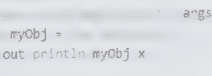
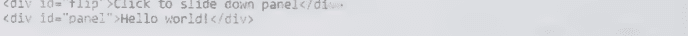

# J(S) 编程语言入门指南（Java, JavaScript, jQuery 和 JSON 编程语言）


https://archive.org/details/jspprogramminglan0000asae

# 献给所有对本书做出贡献的人

# 书籍简介

Java 是由 Sun Microsystems 公司开发的一种面向对象、跨平台、多用途的编程语言。于 1995 年首次发布，旨在成为一种机器无关的网络技术。它基于 C 和 C++ 语法，使得来自这些社区的程序员能够轻松学习。从那时起，它在计算机编程领域占据了重要地位。

Java 的许多特性促进了它的流行：

- 平台独立性 - 许多语言仅兼容一个平台。Java 的设计初衷使其可以在任何计算机上运行，无论运行的是 Windows、Linux、Mac、Unix 还是任何其他操作系统。
- 简单易用 - Java 的创建者尝试设计使其能够高效、方便地编写代码。
- 多功能性 - Java 可以生成许多应用程序，从命令行程序到 applet 再到 Swing 窗口（基本上是复杂的图形用户界面）。

Java 确实存在一些缺点。由于它具有自动垃圾回收机制，它使用的内存可能比其他类似语言更多。在不同平台之间通常存在实现差异，这导致 Java 被描述为“一次编写，到处测试”的系统。最后，由于它使用抽象的“虚拟机”，通用的 Java 程序无法直接访问系统的原生 API。这些问题都不是致命的，但可能意味着 Java 不是某个特定软件的合适选择。

JavaScript 是一种非常强大的客户端脚本语言。JavaScript 主要用于增强用户与网页的交互。换句话说，借助 JavaScript 的帮助，你可以让你的网页更加生动且具有性。JavaScript 也被广泛应用于游戏开发和移动应用开发。

jQuery 是一个开源 JavaScript 库，简化了 HTML/CSS 文档（更准确地说说是文档对象模型 DOM）与 JavaScript 之间的交互。

# 书籍简介

详细说明这些术语，jQuery 简化了 HTML 文档的遍历和操作、浏览器事件处理、DOM 动画、Ajax 交互以及跨浏览器 JavaScript 开发。

支持为何使用 jQuery 答案的关键点包括：

- 它非常流行，这意味着它拥有庞大的用户社区和大量作为开发者和传道者参与的健康贡献者。
- 它规范了不同网络浏览器之间的差异，因此你不需要自己去处理。
- 它刻意保持轻量级，并具有简单而巧妙的插件架构。
- 它的插件库非常庞大，自自 jQuery 发布以来一直在稳定增长。
- 它的 API 有完整的文档，包括内联代码示例，这在 JavaScript 库的世界中是一种奢侈。事实上，在多年里，有任何文档都是一种奢侈。
- 它非常友好，意味着它提供了有用的方法来避免与其他 JavaScript 库发生冲突。

JSON（JavaScript 对象表示法）是一种轻量级的数据交换格式。它易于人类读写，也易于机器解析和生成。它基于 JavaScript 编程语言标准 ECMA-262 第三版（1999 年 12 月）的子集。JSON 是一种完全独立语言的文本格式，但使用了程序员熟悉的约定。

本书将介绍 Java、JavaScript、jQuery 和 JSON 这四语言的各个。

# Java 编程语言

## Java 简介

Java 是一种创建于 1995 年的流行编程语言，由 Oracle 拥有，超过 30 亿设备运行 Java。

它被用于：

- 移动应用（特别是 Android 应用）
- 桌面应用程序
- Web 应用程序
- Web 服务器
- 游戏
- 数据库连接
- 以及更多！

- Java 运行于不同平台（Windows、Mac、Linux、树莓派等）
- 它是最流行的编程语言之一
- 它简单易用
- 它是开源免费的
- 它安全、快速
- 它拥有巨大的社区支持（数百万开发者）

Java 是一种面向对象的语言，为程序提供了清晰的结构并允许代码复用。

由于 Java 接近 C 和 C#，程序员可以轻松切换到 Java 或反之。

## 编程语言

## Java 入门

- 安装 Java

有些电脑可能已经安装了 Java。要检查 Windows PC 上是否安装了 Java，请在搜索栏搜索或在命令提示符 (`cmd.exe`) 中输入以下内容：

```
java -version
```

如果安装了 Java，你会看到类似的内容（取决于版本）：

```
java version "11.0.1" 2018-10-16 LTS
Java(TM) SE Runtime Environment 11.0 (build 11.0.1+13-LTS)
Java HotSpot(TM) 64-Bit Server VM 11.0 (build 11.0.1+13-LTS, mixed mode)
```

如果你的电脑没有安装 Java，可以从 oracle.com 免费下载。

注意：在教程中，我们将使用文本编辑器编写 Java 代码。但是，可以在集成开发环境（如 IntelliJ IDEA、Eclipse）中编写 Java，这在管理大量的 Java 文件时特别有用。

### Windows 设置

在 Windows 上安装 Java：

1. 转到“系统属性”（可以在控制面板 > 系统和安全 > 系统 > 高级系统设置中找到）
2. 在“高级”选项卡下点击“环境变量”按钮
3. 然后，选择系统变量中的“Path”变量并点击“编辑”按钮
4. 点击“新建”按钮并添加 Java 安装路径，后面加上 `\bin`。

默认情况下，Java 安装在 `C:\Program Files\Java\jdk-11.0.1`（如果在安装时没有指定其他路径）。在这种情况下，你需要添加一个新路径：

```
C:\Program Files\Java\jdk-11.0.1\bin
```

然后，点击“确定”并保存设置

## Java 语言

5. 最后，打开命令提示符 (`cmd.exe`) 并输入 `java -version` 来检查你的机器上是否运行了 Java。

在 Java 中，每个应用程序都以类名开始，且该类必须与文件名匹配。

让我们创建第一个 Java 文件，命名为 `MyClass.java`，可以在任何文本编辑器（如记事本）中完成。

该文件应该包含一条“Hello World”消息，使用以下代码编写：

```
MyClass.java
```


```
C:\Users\Name\java MyClass
Hello world.
```

如果你不理解上面的代码，不要担心——我们将在后面的章节中详细讨论。现在，请关注如何运行上面的代码。

在记事本中将代码保存为 `MyClass.java`。打开命令提示符 (`cmd.exe`)，导航到保存保存文件的目录，并输入 `javac MyClass.java`：

```
C:\Users\Name\javac MyClass.java
```

这将编译你的代码。如果代码中没有错误，命令提示符将带你下一行。现在，输入 `java MyClass` 来运行该文件：

```
C:\Users\Name\java MyClass
```

输出应该是：

```
C:\Users\Name\MyClass
Hello World
```

## 示例解释

在 Java 中运行的每一行代码都必须类内部。在我们的示例中，我们将类命名为 `MyClass`。类应该始终以大写字母开头。

注意：Java 是区分大小写的：`MyClass` 和 `myclass` 具有不同的含义。

Java 文件的名称必须与类名匹配。保存文件时，使用类名保存，并在文件名末尾添加 `.java`。若要在你的电脑上运行上面的示例，请确保已正确安装了 Java。

### Java 语法

`main()` 方法是必不可少的，你会在每个 Java 程序中看到它：

```
public static void main(String[] args)
```

`main()` 方法内部的任何代码都将被执行。你不需要理解 `main` 及其后的关键字。

现在，只需记住每个 Java 程序都有一个与文件名匹配的类名，且每个程序必须包含 `main()` 方法。

```java
System.out.println("Hello World");
```

在 `main()` 方法内部，我们可以使用 `println()` 方法在屏幕上打印一行文本：

```
C:\Users\Name\JavaClass
Hello World
```

注意：大括号 `{}` 标记了代码块的开始和结束。

注意：每个代码语句必须以分号 `;` 结束。

### Java 注释

注释可以用于解释 Java 代码并提高其可读性。它也可以用于在测试替代代码时防止其执行。

单行注释以两个正斜杠 `//` 开头。

`//` 与行尾之间的任何文本都会被 Java 忽略（不会被执行）。

此示例在代码行之前使用了单行注释：

示例

```java
// Hello World
```

此示例在代码行末尾使用了单行注释：

示例

```java
System.out.println("Hello World"); // Hello World
```

多行注释以 `/*` 开始，以 `*/` 结束。

`/*` 和 `*/` 之间的任何文本都会被 Java 忽略。

此示例使用多行注释（注释块）来解释代码：

示例

```java
/*
  Hello World
*/
```

单行注释还是多行注释？

取决于你想使用哪种。通常情况下，我们使用 `//` 写短注释，使用 `/*` 写较长的注释。

### Java 变量

变量是存储数据值的容器。

在 Java 中，有不同类型的变量，例如：

- `String` - 存储文本，例如 `"Hello"`。`String` 值用双引号括
- `int` - 存储整数（全数字），不带小数，例如 `123` 或 `-123`
- `float` - 存储浮点数，带小数，例如 `19.99` 或 `-19.99`
- `char` - 存储单个字符，例如 `'a'` 或 `'B'`。`Char` 值用单引号括
- `boolean` - 存储两个状态的值：`true` 或 `false`

要创建一个变量，你必须指定类型并为其赋值：

```java
type variable = value;
```

其中 `type` 是 Java 类型类型之一（如 `int` 或 `String`），`variable` 是变量名（如 `x` 或 `name`）。等号 `=` 用于给变量赋值。

要创建一个存储文本的变量，请参考以下示例：

示例

创建一个类型为 `String` 名为 `name` 的变量并赋值为 `"John"`：

```java
String name = "John";
System.out.println(name);
```


要创建一个存储数字的变量，请参考以下示例：

示例

```java
int myNum = 15;
System.out.println(myNum);
```

你可以声明一个变量而不赋值，稍后赋值：

示例

```java
int myNum;
myNum = 15;
System.out.println(myNum);
```

通过 `final` 关键字创建一个不能更改的变量：

示例

```java
final int myNum = 15;
// myNum = 20; // 错误：无法为 final 变量 myNum 赋值
```

创建一个可以更改的变量不要使用 `final`：

示例

```java
int x = 5;
x = 10;
System.out.println(x);
```

从上面的示例可以预期：

```
5
10
```

```java
int x = 5;
int y = 6;
System.out.println(x);
```

声明多个变量

同类型的变量，使用逗号分隔列表：

示例

```java
int x = 5, y = 6, z = 7;
```

### 标识符

所有 Java 变量必须通过唯一名称标识。

这些唯一名称被称为标识符。

标识符可以是短名称（如 `x` 和 `y`），也可以是描述性名称（如 `age`, `totalVolume`）。

注意：建议使用描述性名称以创建易于理解的代码：

示例

```java
int minutesPerHour = 60;
int m = 60;
System.out.println(minutesPerHour);
System.out.println(m);
```

构造名称（唯一标识符）的通用规则为：

- 名称可以包含字母、数字、下划线和美元
- 名称必须以字母开头
- 名称应以小写字母开头且不包含空格
- 名称也可以以 `$` 开头（但本教程中不会使用它）
- 名称区分大小写（`myVar` 和 `myvar` 是不同的变量）
- 保留字（如 Java 关键字，`int` 或 `boolean`）不能作为名称

## Java 数据类型

如上一节所述，Java 变量必须是指定的数据类型：

示例

```java
int NumPy = 5;
float myFloat = 5.99f;
char myLetter = 'a';
boolean myBool = true;
String myText = "hello";
System.out.println(myNum);
System.out.println(myFloat);
System.out.println(myLetter);
System.out.println(myBool);
System.out.println(myText);
```

| 类型 | 值 |
| :--- | :--- |
| 5 | |
| 5.99 | |
| a | |
| true | |
| hello | |

数据类型分为两组：

- 原生数据类型 - 包括 `byte`, `short`, `int`, `long`, `float`, `double`, `boolean` 和 `char`
- 非原始数据类型 - 如 `String`、数组和类

### 原始数据类型

基本数据类型指定变量值的大小和类型，它没有额外的方法。Java 中有八种基本类型：

| 数据类型 | 大小 | 说明 |
|---|---|---|
| `byte` | 1 字节 | 存储 -128 到 127 整数 |
| `short` | 2 字节 | 存储 -32,768 到 32,767 整数 |
| `int` | 4 字节 | 存储 -2,147,483,648 到 2,147,483,647 整数 |
| `long` | 8 字节 | 存储 -9,223,372,036,854,775,808 到 9,223,372,036,854,775,807 整数 |
| `float` | 4 字节 | 存储小数。足以表示 6 到 7 位小数 |
| `double` | 8 字节 | 存储小数。足以表示 15 位小数 |
| `boolean` | 1 位 | 存储真或假 |
| `char` | 2 字节 | 存储单个字符/ASCII 值 |

基本类型分为两类：整数类型存储整数，无论是正数还是负数（例如 123 或 -456），不带小数。有效类型有 `byte`、`short`、`int` 和 `long`。浮点类型表示带有小数部分的数字，包含一个或多个小数。应该使用哪种类型取决于数值。

### Byte

`byte` 数据类型可以存储从 -128 到 127 的整数。当你确定该值在 -128 和 127 之间时，可以使用它来代替 `int` 以节省内存：

示例

```java
static void main(String[] args) {
    int myNum = 100;
    System.out.println(myNum);
}
```

### Short

`short` 数据类型可以存储从 -32,768 到 32,767 的整数：

示例

```java
public static void main(String[] args) {
    short myNum = 5000;
    System.out.println(myNum);
}
```

### Int

`int` 数据类型可以存储从 -2,147,483,648 到 2,147,483,647 的整数。通常以及在我们的教程中，当我们创建带有数值的变量时，`int` 数据类型是首选的数据类型。

示例

```java
int myNum = 100000;
System.out.println(myNum);
```

### Long

`long` 数据类型可以存储从 -9,223,372,036,854,775,808 到 9,223,372,036,854,775,807 的整数。当 `int` 不足够大以存储该值时使用此类型。注意，你应该在值的末尾加上 `"L"`：

示例

```java
long myNum = 1500000000000L;
System.out.println(myNum);
```

### 浮点类型

每当你需要带有小数的数字时（例如 9.99 或 3.14159），都应该使用浮点类型。

### Float

`float` 数据类型可以存储从 3.4e-38 到 3.4e+38 的小数。注意，你应该在值的末尾加上 `"f"`：

示例

```java
static void main(String[] args) {
    float myNum = 5.75f;
    System.out.println(myNum);
}
```


### Double

`double` 数据类型可以存储从 `1.7e-308` 到 `1.7e+308` 的小数。注意，你应该在值的末尾加上 `"d"`：

示例

```java
public class MyClass {
    double myNum = 19.99d;
    System.out.println(myNum);
}
```

### Float

浮点值的精度表示该值在小数点后可以有多少位数字。`float` 的精度只有六位或七位小数，而 `double` 变量的精度约为 15 位。因此，对于大多数计算，使用 `double` 更安全。

浮点数也可以是科学计数法，使用 `"e"` 表示 10 的幂：

示例

```java
public static void main(String[] args) {
    float f1 = 35e3f;
    double d1 = 12E4d;
    System.out.println(f1);
    System.out.println(d1);
}
```

| 35000.0 |

| 120000.0 |

### Booleans

`Boolean` 数据类型用 `boolean` 关键字声明，只能取 `true` 或 `false` 的值：

```java
boolean args = true;
boolean javaFun = true;
boolean isFishTasty = false;
System.out.println(javaFun);
System.out.println(isFishTasty);
```

| true |

| false |

### Characters

`char` 数据类型用于存储单个字符。字符必须用单引号括围，例如 `'A'` 或 `'c'`：

示例

```java
char myGrade = 'A';
System.out.println(myGrade);
```

### Characters

或者，你可以使用 Unicode 值来表示字符：

示例

```java
char myGrade = 65;
System.out.println(myGrade);
```

### Strings

`String` 类型用于表示字符序列。

示例

```java
String myText = "Hello World";
System.out.println(myText);
```

### Strings

`String` 类型用于表示字符序列。

示例

```java
String myText = "Hello World";
System.out.println(myText);
```

### Strings

`String` 类型用于表示字符序列。

示例

```java
String myText = "Hello World";
System.out.println(myText);
```

### Strings

`String` 类型用于表示字符序列。

示例

```java
String myText = "Hello World";
System.out.println(myText);
```

### Strings

`String` 类型用于表示字符序列。

示例

```java
String myText = "Hello World";
System.out.println(myText);
```

### Strings

`String` 类型用于表示字符序列。

示例

```java
String myText = "Hello World";
System.out.println(myText);
```

### Strings

`String` 类型用于表示字符序列。

示例

```java
String myText = "Hello World";
System.out.println(myText);
```

### Strings

`String` 类型用于表示字符序列。

示例

```java
String myText = "Hello World";
System.out.println(myText);
```

### Strings

`String` 类型用于表示字符序列。

### Strings

`String` 类型用于表示字符序列。字符。

### Strings

`String` 类型用于表示字符序列。

### Strings

`String` 类型用于表示字符序列。

### Strings

`String` 类型用于表示字符序列。

### Strings

`String` 类型用于表示字符序列。

### Strings

`String` 类型用于表示字符序列。

### Strings

`String` 类型用于表示字符序列。

### Strings

`String` 类型用于表示字符序列。

### Strings

`String` 类型用于表示字符序列。

### Strings

`String` 类型用于表示字符序列。

### Strings

`String` 类型用于表示字符序列。

### Strings

`String` 类型用于表示字符序列。

### Strings

`String` 类型用于表示字符序列。

### Strings

`String` 类型用于表示字符序列。

### Strings

`String` 类型用于表示字符序列。

### Strings

`String` 类型用于表示字符序列。

### Strings

`String` 类型用于表示字符序列。

### Strings

`String` 类型用于表示字符序列。

### Java 运算符。

## Java 运算符

Java 运算符

运算符用于对变量和值进行操作。

在下面的示例中，我们使用 `+` 运算符相加两个值：

示例

```java
sum1 = 100 + 50
sum2 = sum1 + 25
sum3 = sum2 - sum1
```

Java 将运算符分为以下几组：

- 算术运算符
- 赋值运算符
- 比较运算符
- 逻辑运算符
- 位运算符

# Java 编程语言

```java
public static void main(String[] args) {
    int x = 10;
    x += 5;
    System.out.println(x);
}
```


所有赋值运算符列表：

| 运算符 | 示例 | 等于 |
| --- | --- | --- |
| `=` | `x = 5` | `x = 5` |
| `+=` | `x += 3` | `x = x + 3` |
| `-=` | `x -= 3` | `x = x - 3` |
| `*=` | `x *= 3` | `x = x * 3` |
| `/=` | `x /= 3` | `x = x / 3` |
| `%=` | `x %= 3` | `x = x % 3` |
| `&=` | `x &= 3` | `x = x & 3` |
| `\|=` | `x \|= 3` | `x = x \| 3` |
| `^=` | `x ^= 3` | `x = x ^ 3` |
| `>>=` | `x >>= 3` | `x = x >> 3` |
| `<<=` | `x <<= 3` | `x = x << 3` |

比较运算符用于比较两个值：

# Java 编程语言

| 运算符 | 名称 | 示例 |
|---|---|--|
| `==` | 等于 | `x == y` |
| `!=` | 不等于 | `x != y` |
| `>` | 大于 | `x > y` |
| `<` | 小于 | `x < y` |
| `>=` | 大于等于 | `x >= y` |
| `<=` | 小于等于 | `x <= y` |

逻辑运算符用于确定变量或值之间的逻辑：

| 运算符 | 名称 | 说明 | 示例 |
|---|---|---|--|
| `&&` | 逻辑与 | 如果两个语句都为真则返回 `true` | `x < 5 && x < 10` |
| `\|\|` | 逻辑或 | 如果其中一个语句为真则返回 `true` | `x < 5 \|\| x < 4` |
| `!` | 逻辑非 | 反转结果，如果结果为真则返回 `false` | `!(x < 5 && x < 10)` |

### Java 字符串

字符串用于存储文本。

`String` 变量包含一组用双引号括围的字符。

示例

```java
String greeting = "Hello World";
System.out.println(greeting);
```


Java 中的 `String` 实际上是一个对象，它包含可以对字符串执行某些操作的方法。例如，可以使用 `length()` 获取字符串的长度。

示例

```java
String txt = "args";
System.out.println("The length of the txt string is: " + txt.length());
```

```
The length of the txt string is: 26
```

有许多可用的字符串方法。

示例

```java
String args = "example";
System.out.println("out: " + args);
System.out.println("out: " + args.toUpperCase());
```

```
HELLO WORLD
hello world
```

`indexOf()` 方法返回指定文本在字符串中首次出现的索引（位置）（包括空格）：

示例

7 从零开始计数位置。

0 是字符串中的第一个位置。1 是第二个，2 是第三个 ...

`+` 运算符可以用于字符串之间以组合它们。这被称为拼接：

示例

```java
String firstName = "";
String lastName = "";
System.out.println(firstName + " " + lastName);
```

注意，我们添加了一个空文本（`""`）以便在打印时在 `firstName` 和 `lastName` 之间创建空格。

你也可以使用 `concat()` 方法拼接两个字符串：

示例

```java
firstName = "John"
lastName = "Doe"
System.out.println(firstName + " " + lastName);
```

字符串必须写在引号内，Java 会误解此字符串并生成错误：解决这个问题的方法是使用反斜杠转义字符。转义字符将特殊字符转换为字符串字符：

| 转义字符 | 结果 |
|---|---|---|
| `'` | 单引号 |
| `"` | 双引号 |
| `\` | 反斜杠 |

`\"` 序列在字符串中插入一个双引号：

示例：

```java
String txt = "We are the north.";
System.out.println(txt);
```

`\'` 序列在字符串中插入一个单引号：

示例：

```java
"java's" alright.
```

`\\` 序列在字符串中插入一个反斜杠：

其他转义序列在 Java 中有效：

| 代码 | 结果 |
|---|---|
| `\n` | 换行 |
| `\r` | 回车 |
| `\t` | 制表符 |
| `\b` | 退格 |
| `\f` | 分页 |

警告！Java 使用 `+` 运算符处理加法和拼接。数字相加。字符串拼接。

如果加上两个数字，结果是一个数字：

示例

```java
int x = 10;
int y = 20;
int z = x + y;
System.out.println(z);
```

如果加上两个字符串，结果是一个字符串：

示例

```java
String x = "Hello ";
String y = "World";
String z = x + y;
System.out.println(z);
```

如果加上一个数字和一个字符串，结果是一个字符串：

示例

```java
int x = 10;
String y = "items";
String z = x + y;
System.out.println(z);
```

### Java Math

`Math` 类提供了许多执行数学操作的方法。这些方法是静态的，因此你不需要创建对象即可使用。

以下是一些常用的 `Math` 方法：

| 方法 | 说明 |
|---|---|
| `Math.abs(x)` | 返回数字的绝对值 |
| `Math.max(a, b)` | 返回两个数中的较大值 |
| `Math.min(a, b)` | 返回两个数中的最小值 |
| `Math.sqrt(x)` | 返回数字的平方根 |
| `Math.pow(x, y)` | 返回 `x` 的 `y` 次方 |
| `Math.random()` | 返回 `0.0` 到 `1.0` 随机浮点数 |
| `Math.ceil(x)` | 将数字向上取整到最接近的整数 |
| `Math.floor(x)` | 将数字向下取整到最接近的整数 |

示例

```java
System.out.println(Math.abs(-10)); // 输出 10
System.out.println(Math.max(10, 20)); // 输出 20
System.out.println(Math.min(10, 20)); // 输出 10
System.out.println(Math.sqrt(25)); // 输出 5.0
System.out.println(Math.pow(2, 3)); // 输出 8.0
```

### If ... Else

`if` 语句用于在条件为真时执行代码块。

```java
int age = 18;
if (age >= 18) {
    System.out.println("You are an adult.");
}
```

`else` 语句允许在 `if` 条件为假时执行代码块。

```java
int age = 15;
if (age >= 18) {
    System.out.println("You are an adult.");
} else {
    System.out.println("You are a minor.");
}
```

`else if` 语句允许你测试多个条件。

```java
int time = 20;
if (time < 12) {
    System.out.println("Good morning.");
} else if (time < 18) {
    System.out.println("Good afternoon.");
} else {
    System.out.println("Good evening.");
}
```

### 三元运算符

三元运算符是 `if...else` 语句的简写。它使用三个操作数。

```java
int result = (condition) ? valueIfTrue : valueIfFalse;
```

示例

```java
int age = 20;
String status = (age >= 18) ? "Adult" : "Minor";
System.out.println(status); // 输出 Adult
```

### Switch 语句

`switch` 语句根据值执行多个块中的一个。

```java
int day = 3;
switch (day) {
    case 1:
        System.out.println("Monday");
        break;
    case 2:
        System.out.println("Tuesday");
        break;
    case 3:
        System.out.println("Wednesday");
        break;
    default:
        System.out.println("Other day");
}
```

## Java 语言

```java
static void main(String[] args) {
    int x = 20;
    int y = 18;
    if (x > y) {
        System.out.println("x is greater than y");
    }
}
```


上面的示例中我们使用了两个变量 `x` 和 `y` 来测试 `x` 是否大于 `y`（使用 `>` 运算符）。由于 `x` 为 20，`y` 为 18，而我们知道 20 大于 18，因此我们在屏幕上打印“x is greater than y”。

## else 语句

使用 `else` 语句来指定当条件为假时要执行的代码块。

```java
else {
    System.out.println("x is not greater than y");
}
```

## 示例

```java
static void main(String[] args) {
    int x = 20;
    int y = 18;
    if (x > y) {
        System.out.println("x is greater than y");
    } else {
        System.out.println("x is not greater than y");
    }
}
```

## Java 语言

晚上好。

## 示例解释


在上面的示例中，时间 (`20`) 大于 `18`，所以条件为假。因此，我们移动到 `else` 条件，并在屏幕上打印“Good evening”。如果时间小于 `18`，程序将打印“Good day”。

使用 `else if` 语句在第一个条件为假时指定一个新条件。

`condition1`

`condition2`

## 示例

```
time = 20
time = 18
out
time = 20
out
out
```

晚上好。

## Java 语言

## 示例解释

在上面的示例中，时间 (`22`) 大于 `10`，所以第一个条件为假。下一个条件（`else if` 语句中的）也是假的，因此由于 `condition1` 和 `condition2` 均为假，我们移动到 `else` 条件，并在屏幕上打印“Good evening”。

然而，如果时间是 `14`，我们的程序将打印“Good day”。

还有一种简写的 `else if`，称为三元运算符，因为它包含三个操作数。它可以用于用单行替换多行代码。它通常用于替换简单的 `else if` 语句：

```java
variable = (condition) ? expressionTrue : expressionFalse;
```

而不是写成：

```java
int args =
int time = 20;
time = 14;
PrintWriter out = System.out;
out.println("Good evening.");
```

```
Good evening.
```

你可以简单地写：

## 示例

`time - 20`

`result`

`result - time 15`

`out result`


- - Java Switch

使用 `switch` 语句从许多代码块中选择一个执行。

```
expression
x
y,
```

它的工作原理如下：

- `switch` 表达式求值一次。

- 表达式的值与每个 `case` 的值进行比较。

- 如果匹配成功，则执行关联的代码块。

- `break` 和 `default` 关键字是可选的，将在本章稍后描述。

下面的示例使用星期几数字来计算星期名称：

## 示例

```java
public class Test {
    public static void main(String[] args) {
        int day = 1;
        System.out.print("day");
        day = 2;
        System.out.print("day");
        day = 3;
        System.out.print("day");
        day = 4;
        System.out.print("day");
        day = 5;
        System.out.print("day");
        day = 6;
        System.out.print("day");
        day = 7;
        System.out.print("day");
    }
}
```

## break 关键字。

当 Java 遇到 `break` 关键字时，它会跳出 `switch` 块。

这将停止块内更多代码和 `case` 测试的执行。

当找到匹配且任务完成后，是时候该 `break` 了。不需要再进行更多测试。

`break` 可以节省大量的执行时间，因为它“忽略”了 `switch` 块中所有剩余代码的执行。

## default 关键字指定在没有 `case` 匹配时运行某些代码：

## 示例

```java
String day = "Monday";
int date = 4;
switch (day) {
  case "Monday":
    System.out.println("Tuesday");
    break;
  default:
    System.out.println("out print");
}
```


注意，如果 `default` 语句作为 `switch` 块中的最后一个语句，则不需要 `break`。

- - Java While 循环

只要满足指定的条件，循环就可以执行代码块。循环非常用用，因为它们可以节省时间、减少错误并使代码更具可读性。

`while` 循环在指定条件为真时会循环执行代码块。

在下面的示例中，只要变量 (`i`) 小于 `5`，循环中的代码就会反复运行：

## 示例

```java
int i = 0;
while (i < 5) {
    System.out.println(i);
    i++;
}
```

注意：不要忘记增加条件中使用的变量，否则循环永远不会结束！

`do/while` 循环是 `while` 循环的变体。它会在检查条件是否为真之前执行一次代码块，然后只要条件为真就会重复循环。

下面的示例使用了 `do/while` 循环。即使条件为假，循环也会至少执行一次：

## 示例

```java
int i;
do {
    System.out.println(i);
    i++;
} while (i < 5);
```

`img/73467313bac777cedb9be64093f6b3f8_52_0.png`

- - Java For 循环

当你确切知道要循环代码块多少次时，使用 `for` 循环代替 `while` 循环：

```java
for (int i = 0; i < 5; i++) {
    System.out.println(i);
}
```

语句 `1` 初始化变量。

语句 `2` 定义循环条件。

语句 `3` 每次增加一个值。

## 示例

此示例将打印数字 `0` 到 `4`：

```java
for (int i = 0; i < 5; i++) {
    System.out.println(i);
}
```

- - Java Break 和 Continue

你已经在在之前的章节中见过 `break` 语句。它被用于“跳出”`switch` 语句。

## continue 语句

当指定的条件发生时，`continue` 语句会中断循环的一次迭代，并继续循环的下一次迭代。

## 示例

此示例仅打印 `0` 到 `10` 之间的偶数值：

```java
for (int i = 0; i < 10; i += 2) {
    System.out.println(i);
}
```

# Java 编程语言

## Java 数组

数组用于在单个变量中存储多个值，而不是为每个值声明单独的变量。

要声明数组，请用方括号定义变量类型：

```
String[] cars;
```

我们现在声明了一个持有字符串数组的变量。要向其插入值，我们可以使用数组字面量 - 在大括号内将值置于以逗号分隔的列表中：

```
String[] cars = {"Volvo","bmw","merda"};
```

要创建一个整数数组，你可以这样写：

```java
int myNum[] = {10, 20, 30, 40};
```

你通过引用索引号来访问数组元素。

此语句访问 `cars` 数组中第一个元素的值：

## 示例

```java
System.out.println(cars[0]);
```

注意：数组索引从 `0` 开始：`[0]` 是第一个元素。`[1]` 是第二个元素，依此类推。

要更改特定元素的值，请引用索引号：

## 示例

```java
cars[0] = "Opel";
```

## 示例

```java
String[] cars = {"Ford", "BMW"};
cars[0] = "Opel";
System.out.println(cars[0]);
```

要找出数组包含多少个元素，使用 `length` 属性：

## 示例

```java
String[] cars = {"Ford", "BMW"};
System.out.println(cars.length);
```

你可以使用 `for` 循环遍历数组元素，并使用 `length` 属性来指定循环运行的次数。

下面的示例输出了 `cars` 数组中的所有元素：

## 示例

```java
String[] cars = {"Volvo", "BMW", "Ford", "Mazda"};
for (int i=0; i<cars.length; i++) {
  System.out.println(cars[i]);
}
```


使用 `for` 循环遍历数组：

还有一种 "for-each" 循环，专门用于遍历数组中的元素：

```
type variable : arrayname
```

下面的示例使用 "for-each" 循环输出了 `cars` 数组中的所有元素：

## 示例

```java
String[] cars = {"Volvo", "BMW", "Ford", "Mazda"};
for (String car : cars) {
  System.out.println(car);
}
```

上面的示例可以这样理解：对于 `cars` 中的每个 `String`（称为 `i` - 索引 index 的含义），打印 `i` 的值。

如果你比较 `for` 循环和 `for-each` 循环，你会发现 `for-each` 方法更容易编写，它不需要计数器（使用 `length` 属性），而且可读性更高。

多维数组是包含一个或多个数组的数组。

要创建一个二维数组，请将每个数组添加到其自身的大括号中：

## 示例

```java
int[][] myNumbers = {{1, 2, 3}, {4, 5, 6}, {7}};
```

`myNumbers` 现在是一个以两个数组作为元素的数组。

要访问 `myNumbers` 数组的元素，请指定两个索引：一个用于数组，另一个用于该数组内部的元素。此示例访问 `myNumbers` 第二个数组 (`1`) 中的第三个元素 (`2`)：

## 示例

```java
int[][] myNumbers = {{1, 2, 3}, {4, 5, 6}, {7}};
int x = myNumbers[1][2];
System.out.println(x);
```

我们还可以在 `for` 循环内部嵌套另一个 `for` 循环来获取二维数组的元素（我们仍然需要指向两个索引）：

## 示例

```java
int[][] myNumbers = {{1, 2, 3}, {4, 5, 6}, {7}};
for (int i=0; i < myNumbers.length; i++) {
    for (int j=0; j < myNumbers[i].length; j++) {
        System.out.println(myNumbers[i][j]);
    }
}
```


# Java 编程语言

## 方法 (METHODS)

方法是一个只有在被调用时才运行的代码块。

你可以将数据（称为参数）传递到方法。

方法用于执行操作，也称为函数。

为什么要使用方法？为了重用代码：定义一次代码，多次使用。方法必须在类内部声明。它的定义方式是方法名，后跟括号 `()`。

### 在 `MyClass` 中创建一个方法：

```java
class MyClass {
  static void myMethod() {
    System.out.println("Hello World!");
  }

  public static void main(String[] args) {
    myMethod();
  }
}
```

### 解释

- `myMethod()` 是方法名

- `static` 表示该方法属于类，而不是实例

- `void` 表示该方法不返回返回值

在 Java 中调用方法，在方法名后加括号和分号；如下例所示：

## 示例

```java
class HelloWorld {
  static void myMethod() {
    System.out.println("Hello World!");
  }

  public static void main(String[] args) {
    myMethod();
  }
}
```

方法也可以多次调用：

## 示例

```java
class HelloWorld {
  static void myMethod() {
    System.out.println("Hello World!");
  }

  public static void main(String[] args) {
    myMethod();
    myMethod();
  }
}
```

## 参数 (Parameters)

可以以变量的形式传递给方法。参数指定在方法的括号内。

下面的示例有一个接收 `String` 参数的方法：

## 示例

```java
class HelloWorld {
  static void myMethod(String frame) {
    System.out.println(frame);
  }

  public static void main(String[] args) {
    myMethod("Hello");
  }
}
```

当值传递给方法时，被称为参数。在上面的示例中，`frame` 是参数。

### 多个参数

你可以拥有任意多个参数：

## 示例

```java
class HelloWorld {
  static void myMethod(String frame, int age) {
    System.out.println(frame + " is " + age);
  }

  public static void main(String[] args) {
    myMethod("Liam", 21);
  }
}
```

`void` 关键字在上面的示例中表示方法不返回返回值。如果你想方法返回返回值，可以使用原始数据类型（如 `int` 等）代替 `void`，并在方法内部使用 `return` 关键字：

## 示例

```java
class HelloWorld {
  static int myMethod(int x, int y) {
    return x + y;
  }

  public static void main(String[] args) {
    int sum = myMethod(5, 3);
    System.out.println(sum);
  }
}
```

此示例返回两个参数之和：

## 示例

```java
class HelloWorld {
  static int myMethod(int x, int y) {
    return x + y;
  }

  public static void main(String[] args) {
    int sum = myMethod(5, 3);
    System.out.println(sum);
  }
}
```

你也可以将结果存储在变量中（推荐，因为更易读）：

## 示例

```java
class HelloWorld {
  static int myMethod(int x, int y) {
    return x + y;
  }

  public static void main(String[] args) {
    int x = 5;
    int y = 3;
    int sum = x + y;
    System.out.println(sum);
  }
}
```

在方法内部使用 `if...else` 语句是常见的：

## 示例

```java
class HelloWorld {
  static void myMethod(int age) {
    if (age >= 18) {
      System.out.println("adult");
    } else {
      System.out.println("child");
    }
  }

  public static void main(String[] args) {
    myMethod(15);
  }
}
```

## Java 方法重载 (Method Overloading)

通过方法重载，多个方法可以具有相同的名称但不同的参数。

## 示例


考虑下面的示例，它有两个添加不同类型数字的方法：

## 示例


```java
public class HelloWorld {
  public static int plusMethodInt(int x, int y) {
    return x + y;
  }

  public static double plusMethodDouble(double x, double y) {
    return x + y;
  }

  public static void main(String[] args) {
    int myNum1 = plusMethodInt(8, 5);
    double myNum2 = plusMethodDouble(4.3, 6.26);
    System.out.println("int: " + myNum1);
    System.out.println("double: " + myNum2);
  }
}
```

与其定义两个执行相同的方法，不如重载一个。

在下面的示例中，我们重载了`plusMethod`方法使其同时适用于`int`和`double`：

## 示例

```java
public class HelloWorld {
  public static int plusMethod(int x, int y) {
    return x + y;
  }

  public static double plusMethod(double x, double y) {
    return x + y;
  }

  public static void main(String[] args) {
    int myNum1 = plusMethod(8, 5);
    double myNum2 = plusMethod(4.3, 6.26);
    System.out.println("int: " + myNum1);
    System.out.println("double: " + myNum2);
  }
}
```

# Java 编程语言

## JAVA 类

- Java 面向对象

### Java - 什么是 OOP？

OOP 代表面向对象编程（Object-Oriented Programming）。

过程化编程是编写对数据执行操作的过程或方法，而面向对象编程是创建同时包含数据和方法的对象。

面向对象编程与过程化编程相比有几个优点：

- OOP 执行速度更快、更易执行
- OOP 为程序提供了清晰的结构
- OOP 有助于保持 Java 代码遵循 DRY 原则——“不要重复自己”，并使代码更易于维护、修改和调试
- OOP 使得能够用更少的代码和更短的时间创建完全可重用的应用程序

提示：“不要重复自己”（DR）原则关于减少代码的重复。你应该提取出应用程序通用的代码，将其放置在单一位置并重复使用，而不是重复。

### Java - 什么是类？

类（Classes）和对象（objects）是面向对象编程的两个主要方面。

查看下面的图解类与对象的区别：

| 类 (class) | 对象 (objects) |
| --- | --- |
| 水果 (Fruit) | 苹果 (Apple) |
| | 香蕉 (Banana) |
| | 芒果 (Mango) |

另一个示例：

| 类 (class) | 对象 (objects) |
| --- | --- |
| 汽车 (Car) | 沃尔沃 (Volvo) |
| | 奥迪 (Audi) |
| | 丰田 (Toyota) |

因此，类是对象的模板，而对象是类的实例。

当创建单个对象时，它们继承类中所有的变量和方法。

### Java 类和对象

Java 是一种面向对象的编程语言。

Java 中的一切都与其类和对象相关。例如：在生活中，汽车是一个对象。汽车有属性（如重量和颜色）以及方法（如行驶和刹车）。

类（Class）就像对象的构造函数，或者说是创建对象的“蓝图”。

要创建一个类，使用关键字`class`：

`MyClass.java`

```
创建一个名为 "MyClass" 的类，并有一个变量 x:
class MyClass {
  int x = 5;
}
```

在 Java 中，对象是从类创建的。我们已经创建了名为`MyClass`的类，现在我们可以使用它来创建对象。

要创建一个`MyClass`的对象，指定类名，后跟对象名，并使用关键字`new`：

示例

创建一个名为 "myObj" 的对象并打印 x 的值：

```
int x = 5;
MyClass myObj = new MyClass(x);
System.out.println(myObj.x);
```

### 多个对象

你可以为同一个类创建多个对象：

示例

```
int x = 5;
MyClass myObj1 = new MyClass(x);
MyClass myObj2 = new MyClass(x);
System.out.println(myObj1.x);
System.out.println(myObj2.x);
```

你也可以创建一个某个类的对象并在另一个类中访问它。这通常用于更好地组织类（一个类拥有所有的属性和方法，而另一个类持有`main()`方法（要执行的代码））。

记住，java 文件的文件名应与类名匹配。在这个示例中，我们在同一个目录/文件夹下创建了两个文件：

- `MyClass.java`
- `OtherClass.java`

`MyClass.java`


`OtherClass.java`


当两个文件都编译后：

```
C:\Users\Your Name>javac MyClass.java
C:\Users\Your Name>javac OtherClass.java
```

运行`OtherClass.java`文件：

```
C:\Users\Your Name>java OtherClass
```

输出将是：



## Java 类属性

在上一章节中，我们在示例中对 x 使用了“变量”一词（如下所示）。它实际上是类的属性。你也可以说类属性是类内部的变量：

示例

创建一个名为 "MyClass" 的类，有两个属性：x 和 y：

```
int x = 5;
int y = 3;
```

类属性的另一个术语是字段（fields）。

## 访问属性

你可以通过创建类的对象并使用点语法 ( . ) 来访问属性：

下面的示例将创建一个`MyClass`类的对象，名称为`myObj`。我们使用对象上的 x 属性来打印它的值：

示例

```
MyClass myObj = new MyClass();
myObj.x = 5;
System.out.println(myObj.x);
```

你还可以修改属性值：

示例

```
Class myObj = new Class(args);
myObj.x = 40;
System.out.println(myObj.x);
```

或者覆盖已有的值：

示例

```
myObj.x = 10;
myObj.x = 25;
System.out.println(myObj.x);
```

如果你不想允许覆盖现有值，请将属性声明为`final`：

示例

```
final int x = 10;
MyClass myObj = new MyClass();
myObj.x = 25; // error
System.out.println(myObj.x)
```

`MyClass.java`: 错误: cannot assign a value to final variable x

```
myObj.x = 25;
```

1 个错误

当你希望一个变量始终存储相同的值时，`final`关键字非常有用，例如 PI (3.14159...)。

`final`关键字被称为“修饰符”（modifier）。

如果你为同一个类创建了多个对象，你可以更改一个对象中的属性值，而不影响另一个对象的属性值：

示例

```
int x = 5;
MyClass myObj1 = new MyClass();
MyClass myObj2 = new MyClass();
myObj1.x = 5;
myObj2.x = 25;
System.out.println(myObj1.x);
System.out.println(myObj2.x);
```

### Java 方法

你经常会看到带有静态（static）或公共（public）方法的 Java 程序。在上面的示例中，我们创建了一个静态方法：

示例

```java
int x = 5;
String lname = "John Doe";
int age = 24;

public static void main(String[] args) {
    Student fname = new Student();
    System.out.println("Name: " + lname);
    System.out.println("Age: " + age);
}
```

你可以指定任意数量的属性和方法：

```java
public class Student {
    public static void staticMethod() {
        System.out.println("Static called");
    }
    public void publicMethod() {
        System.out.println("Public called");
    }
}
```

静态方法不需要创建对象即可调用。公共方法必须通过创建对象来调用：

示例

```java
public static void main(String[] args) {
    Student myObj = new Student();
    Student.staticMethod();
    myObj.publicMethod();
}
```

```
正在加速！
最大速度为：200
```

1. 我们使用`class`关键字创建了一个自定义`Car`类。
2. 我们在`Car`类中创建了`fullThrottle()`和`speed()`方法。
3. `fullThrottle()`方法和`speed()`方法在调用时会打印一些文本。
4. `speed()`方法接收一个名为`maxSpeed`的`int`参数 - 我们将使用它。
5. 为了使用`Car`类及其方法，我们需要创建该类的对象。
6. 然后，进入`main()`方法，你现在知道它是内置的 Java 方法，用于运行你的程序（main 内部的任何代码都会执行）。
7. 通过使用`new`关键字，我们创建了一个名为`myCar`的`Car`对象。
8. 然后，我们对象调用出`fullThrottle()`和`speed()`方法，使用对象的名称 (`myCar`)，后跟一个点 (.)，然后是方法名 (`fullThrottle()`) 以及`speed(200)`；注意我们在`speed()`方法内部添加了一个 200 的`int`参数。

# Java 编程语言

`args`

`myCar`

`myCar`

`myCar` 200

当两个文件都已编译后：

```
C:\Users\Your Name>javac Car.java
C:\Users\Your Name>javac OtherClass.java
```

运行`OtherClass.java`文件：

```
C:\Users\Your Name>java OtherClass
```

输出将是：

`args`

`myCar`

`myCar`

`myCar` 200

```
汽车正在以最快速度行驶！
最大速度为：200
```

- Java 构造函数

Java 中的构造函数是一种用于初始化对象的特殊方法。当类的对象被创建时，就会调用构造函数。它可以用于为对象的属性设置初始值：

示例

72

`int x;`

`x = 5;`

`ClassName obj;`

```
System.out.println(obj.x);
```

注意，构造函数的名称必须与类名匹配，且不能有返回值类型（如 void）。

同样注意，构造函数是在对象创建时被调用的。

所有类默认都拥有构造函数：如果你没有自己创建类构造函数，Java 会为你创建一个。然而，这样你就无法为对象的属性设置初始值了。

构造函数也可以接收参数，用于初始化属性。

以下示例为构造函数添加了一个`int`类型的参数 y。在构造函数内部将 x 设置为 y (x=y)。当我们调用构造函数时，我们向构造函数传递一个参数 (5)，这将将 x 的值设置为 5：

示例

```
Class int y
x = y
```

```
string args
myObj = new MyClass(5)
out.println(myObj, x)
```

你可以拥有任意数量的参数：

## 示例

```
int modelYear
String modelName
```

```
int year, string name
modelYear = year
modelName = name
```

```
String args
myCar = new Car(1969, args)
out.println(myCar.modelYear + " " + myCar.modelName)
```

```
1969 Mustang
```

- Java 修饰符

到此时，你已经非常熟悉在我们几乎所有示例中出现的`public`关键字了：

```
public class MyClass
```

`public`关键字是一个访问修饰符，意味着它用于设置类、属性、方法和构造函数的访问级别。我们将修饰符分为组：

- 访问修饰符 - 控制访问级别
- 非访问修饰符 - 不控制访问级别，但提供其他功能

对于类，你可以使用`public`或默认（default）：

| 修饰符 | 描述 |
| :--- | :--- |
| public | 可由任何类访问 |
| default | 仅由同一包中的类访问。当你没有指定修饰符时使用。 |

如果你不希望具有重写现有属性值的能力，可以将属性声明为`final`：

示例

```java
public class MyClass {
    final int x = 10;
    final double PI = 3.14;
}
```

# Java 编程语言

示例

```java
String brand = "";
System.out.println(brand);

String modelName = "";
public static void main(String[] args) {
    FastCar myFastCar = new FastCar();
    System.out.println(myFastCar.brand + " - " + myFastCar.modelName);
}
```

```java
Car.java:8: error: cannot inherit from final Vehicle
class Car extends Vehicle {

error
```

## Java 多态

多态（Polymorphism）意味着“多种形式”，当有许多通过继承关系相互关联的类时，就会发生多态。

正如我们在上一章中指定的，继承（Inheritance）允许我们从另一个类继承属性和方法。多态利用这些方法来执行不同的任务。这允许我们以不同的方式执行同一个操作。

例如，想象一个名为`Animal`的子类，它有一个名为`animalSound()`的方法。动物的子类可以是猪、猫、狗、鸟——它们也有自己对声音的实现（猪圈叫，猫喵喵等）：

示例

我们现在可以创建`Pig`和`Dog`对象，并在它们上都调用`animalSound()`方法：

## 示例

```java
class Pig extends Animal {
    void animalSound() {
        System.out.println("oink");
    }
}
```

```java
class Dog extends Animal {
    void animalSound() {
        System.out.println("woof");
    }
}
```

```java
public class Test {
    public static void main(String[] args) {
        Animal a = new Pig();
        Animal b = new Dog();
        a.animalSound();
        b.animalSound();
    }
}
```

```java
public static void main(String[] args) {
    Animal animal = new Animal();
    Pig myPig = new Pig();
    Dog myDog = new Dog();

    animal.sound();
    myPig.sound();
    myDog.sound();
}
```


为什么要以及何时使用“继承”和“多态”？

- 它对于代码复用很有用：在创建一个新类时，复用现有类的属性和方法。

## Java 内部类


在 Java 中，也可以嵌套类（类中的类）。嵌套类的目的是将属于一起的类分在一起，这使得你的代码更具可读性和可维护性。

要访问内部类，请创建外部类的对象，然后创建内部类的对象：

示例

```java
class Outer {
    class Inner {
        void display() {
            System.out.println("Inside inner class");
        }
    }
    public static void main(String[] args) {
        Outer outer = new Outer();
        Outer.Inner inner = outer.new Inner();
        inner.display();
    }
}
```

与“普通”类不同，内部类可以是 `private` 或 `protected`。如果你不希望外部对象访问内部类，可以将该类声明为 `private`：

示例

```java
public class Outer {
    private int x;

    private class Inner {
        void main(String[] args) {
            Outer myOuter = new Outer();
            Outer.Inner myInner = myOuter.new Inner();
            System.out.println(myOuter.x + myInner.x);
        }
    }
}
```

```java
ClassName.java:12: error: OuterClass.InnerClass has private access in OuterClass
OuterClass.InnerClass myInner = myOuter.new InnerClass();
ClassName.java:12: error: OuterClass.InnerClass has private access in OuterClass
OuterClass.InnerClass myInner = myOuter.new InnerClass();
errors
```

内部类也可以是 `static` 的，这意味着你可以在不创建外部类对象的情况下访问它：

示例

注意：就像静态属性和方法一样，静态内部类没有访问外部类成员的权限。

内部类的一个优势是，它可以访问外部类的属性和方法：

示例

## Java 抽象

数据抽象（Data abstraction）是隐藏某些细节并向用户显示基本信息的过程。

抽象可以通过抽象类（abstract classes）或接口（interfaces）来实现（你将在下一章中学习更多相关内容）。

`abstract` 关键字是一个非访问修饰符，用于类和方法：

- 抽象类：是一种受限制的类，不能用于创建对象（要访问它，必须从另一个类继承）。

- 抽象方法：只能在抽象类中使用，且它没有方法体。方法体由子类（继承自）提供。

抽象类可以同时拥有抽象方法和普通方法：

```java
abstract class Animal {
    abstract void sound();
}

class Dog extends Animal {
    void sound() {
        System.out.println("Bark");
    }
}
```

从上面的示例中，无法创建 `Animal` 类的对象：

```java
Animal myObj = new Animal();
```

要访问抽象类，必须从另一个类继承。

示例

（此处后续重复的文本内容已按要求省略）

数据抽象是隐藏某些细节并向用户显示基本信息的过程。

抽象可以通过抽象类或接口来实现（你将在下一章中学习更多相关内容）。

`abstract` 关键字是一个非访问修饰符，用于类和方法：

- 抽象类：是一种受限制的类，不能用于创建对象（要访问它，必须从另一个类继承）。

- 抽象方法：只能在抽象类中使用，且它没有方法体。方法体由子类（继承自）提供。

抽象类可以同时拥有抽象方法和普通方法：

```java
abstract class Animal {
    abstract void sound();
}

class Dog extends Animal {
    void sound() {
        System.out.println("Bark");
    }
}
```

从上面的示例中，无法创建 `Animal` 类的对象：

```java
Animal myObj = new Animal();
```

要访问抽象类，必须从另一个类继承。

（此处后续大量重复的文本内容已按要求省略）

数据抽象是隐藏某些细节并向用户显示基本信息的过程。

抽象可以通过抽象类或接口来实现（你将在下一章中学习更多相关内容）。

`abstract` 关键字是一个非访问修饰符，用于类和方法：

- 抽象类：是一种受限制的类，不能用于创建对象（要访问它，必须从另一个类继承）。

- 抽象方法：只能在抽象类中使用，且它没有方法体。方法体由子类（继承自）提供。

抽象类可以同时拥有抽象方法和普通方法：

```java
abstract class Animal {
    abstract void sound();
}

class Dog extends Animal {
    void sound() {
        System.out.println("Bark");
    }
}
```

从上面的示例中，无法创建 `Animal` 类的对象：

```java
Animal myObj = new Animal();
```

要访问抽象类，必须从另一个类继承。

（此处后续重复的文本内容已按要求省略）

数据抽象是隐藏某些细节并向用户显示基本信息的过程。

抽象可以通过抽象类或接口来实现（你将在下一章中学习更多相关内容）。

`abstract` 关键字是一个非访问修饰符，用于类和方法：

- 抽象类：是一种受限制的类，不能用于创建对象（要访问它，必须从另一个类继承）。

- 抽象方法：只能在抽象类中使用，且它没有方法体。方法体由子类（继承自）提供。

抽象类可以同时拥有抽象方法和普通方法：

```java
abstract class Animal {
    abstract void sound();
}

class Dog extends Animal {
    void sound() {
        System.out.println("Bark");
    }
}
```

从上面的示例中，无法创建 `Animal` 类的对象：

```java
Animal myObj = new Animal();
```

要访问抽象类，必须从另一个类继承。

（此处后续重复的文本内容已按要求省略）

数据抽象是隐藏某些细节并向用户显示基本信息的过程。

抽象可以通过抽象类或接口来实现（你将在下一章中学习更多相关内容）。

`abstract` 关键字是一个非访问修饰符，用于类和方法：

- 抽象类：是一种受限制的类，不能用于创建对象（要访问它，必须从另一个类继承）。

- 抽象方法：只能在抽象类中使用，且它没有方法体。方法体由子类（继承自）提供。

抽象类可以同时拥有抽象方法和普通方法：

```java
abstract class Animal {
    abstract void sound();
}

class Dog extends Animal {
    void sound() {
        System.out.println("Bark");
    }
}
```

从上面的示例中，无法创建 `Animal` 类的对象：

```java
Animal myObj = new Animal();
```

要访问抽象类，必须从另一个类继承。

（此处后续重复的文本内容已按要求省略）

数据抽象是隐藏某些细节并向用户显示基本信息的过程。

抽象可以通过抽象类或接口来实现（你将在下一章中学习更多相关内容）。

`abstract` 关键字是一个非访问修饰符，用于类和方法：

- 抽象类：是一种受限制的类，不能用于创建对象（要访问它，必须从另一个类继承）。

- 抽象方法：只能在抽象类中使用，且它没有方法体。方法体由子类（继承自）提供。

抽象类可以同时拥有抽象方法和普通方法：

```java
abstract class Animal {
    abstract void sound();
}

class Dog extends Animal {
    void sound() {
        System.out.println("Bark");
    }
}
```

从上面的示例中，无法创建 `Animal` 类的对象：

```java
Animal myObj = new Animal();
```

要访问抽象类，必须从另一个类继承。

（此处后续重复的文本内容已按要求省略）

数据抽象是隐藏某些细节并向用户显示基本信息的过程。

抽象可以通过抽象类或接口来实现（你将在下一章中学习更多相关内容）。

`abstract` 关键字是一个非访问修饰符，用于类和方法：

- 抽象类：是一种受限制的类，不能用于创建对象（要访问它，必须从另一个类继承）。

- 抽象方法：只能在抽象类中使用，且它没有方法体。方法体由子类（继承自）提供。

抽象类可以同时拥有抽象方法和普通方法：

```java
abstract class Animal {
    abstract void sound();
}

class Dog extends Animal {
    void sound() {
        System.out.println("Bark");
    }
}
```

从上面的示例中，无法创建 `Animal` 类的对象：

```java
Animal myObj = new Animal();
```

要访问抽象类，必须从另一个类继承。

（此处后续重复的文本内容已按要求省略）

数据抽象是隐藏某些细节并向用户显示基本信息的过程。

抽象可以通过抽象类或接口来实现（你将在下一章中学习更多相关内容）。

`abstract` 关键字是一个非访问修饰符，用于类和方法：

- 抽象类：是一种受限制的类，不能用于创建对象（要访问它，必须从另一个类继承）。

- 抽象方法：只能在抽象类中使用，且它没有方法体。方法体由子类（继承自）提供。

抽象类可以同时拥有抽象方法和普通方法：

```java
abstract class Animal {
    abstract void sound();
}

class Dog extends Animal {
    void sound() {
        System.out.println("Bark");
    }
}
```

从上面的示例中，无法创建 `Animal` 类的对象：

```java
Animal myObj = new Animal();
```

要访问抽象类，必须从另一个类继承。

（此处后续重复的文本内容已按要求省略）

--Data抽象是隐藏某些细节并向用户显示基本信息的过程。

抽象可以通过抽象类或接口来实现（你将在下一章中学习更多相关内容）。

`abstract` 关键字是一个非访问修饰符，用于类和方法：

- 抽象类：是一种受限制的类，不能用于创建对象（要访问它，必须从另一个类继承）。

- 抽象方法：只能在抽象类中使用，且它没有方法体。方法体由子类（继承自）提供。

抽象类可以同时拥有抽象方法和普通方法：

```java
abstract class Animal {
    abstract void sound();
}

class Dog extends Animal {
    void sound() {
        System.out.println("Bark");
    }
}
```

从上面的示例中，无法创建 `Animal` 类的对象：

```java
Animal myObj = new Animal();
```

要访问抽象类，必须从另一个类继承。

示例

为什么要以及何时使用“继承”和“多态”？

数据抽象是隐藏某些细节并向用户显示基本信息的过程。

抽象可以通过抽象类或接口来实现（你将在下一章中学习更多相关内容）。

`abstract` 关键字是一个非访问修饰符，用于类和方法：

- 抽象类：是一种受限制的类，不能用于创建对象（要访问它，必须从另一个类继承）。

- 抽象方法：只能在抽象类中使用，且它没有方法体。方法体由子类（继承自）提供。

抽象类可以同时拥有抽象方法和普通方法：

```java
abstract class Animal {
    abstract void sound();
}

class Dog extends Animal {
    void sound() {
        System.out.println("Bark");
    }
}
```

从上面的示例中，无法创建 `Animal` 类的对象：

```java
Animal myObj = new Animal();
```

要访问抽象类，必须从另一个类继承。

（此处后续重复的文本内容已按要求省略）

数据抽象是隐藏某些细节并向用户显示基本信息的过程。

抽象可以通过抽象类或接口来实现（你将在下一章中学习更多相关内容）。

`abstract` 关键字是一个非访问修饰符，用于类和方法：

- 抽象类：是一种受限制的类，不能用于创建对象（要访问它，必须从另一个类继承）。

- 抽象方法：只能在抽象类中使用，且它没有方法体。方法体由子类（继承自）提供。

抽象类可以同时拥有抽象方法和普通方法：

```java
abstract class Animal {
    abstract void sound();
}

class Dog extends Animal {
    void sound() {
        System.out.println("Bark");
    }
}
```

从上面的示例中，无法创建 `Animal` 类的对象：

```java
Animal myObj = new Animal();
```

要访问抽象类，必须从另一个类继承。

（此处后续重复的文本内容已按要求省略）

数据抽象是隐藏某些细节并向用户显示基本信息的过程。

抽象可以通过抽象类或接口来实现（你将在下一章中学习更多相关内容）。

`abstract` 关键字是一个非访问修饰符，用于类和方法：

- 抽象类：是一种受限制的类，不能用于创建对象（要访问它，必须从另一个类继承）。

- 抽象方法：只能在抽象类中使用，且它没有方法体。方法体由子类（继承自）提供。

抽象类可以同时拥有抽象方法和普通方法：

```java
abstract class Animal {
    abstract void sound();
}

class Dog extends Animal {
    void sound() {
        System.out.println("Bark");
    }
}
```

从上面的示例中，无法创建 `Animal` 类的对象：

```java
Animal myObj = new Animal();
```

要访问抽象类，必须从另一个类继承。

（此处后续重复的文本内容已按要求省略）

数据抽象是隐藏某些细节并向用户显示基本信息的过程。

抽象可以通过抽象类或接口来实现（你将在下一章中学习更多相关内容）。

`abstract` 关键字是一个非访问修饰符，用于类和方法：

- 抽象类：是一种受限制的类，不能用于创建对象（要访问它，必须从另一个类继承）。

- 抽象方法：只能在抽象类中使用，且它没有方法体。方法体由子类（继承自）提供。

抽象类可以同时拥有抽象方法和普通方法：

```java
abstract class Animal {
    abstract void sound();
}

class Dog extends Animal {
    void sound() {
        System.out.println("Bark");
    }
}
```

从上面的示例中，无法创建 `Animal` 类的对象：

```java
Animal myObj = new Animal();
```

要访问抽象类，必须从另一个类继承。

（此处后续重复的文本内容已按要求省略）

数据抽象是隐藏某些细节并向用户显示基本信息的过程。

抽象可以通过抽象类或接口来实现（你将在下一章中学习更多相关内容）。

`abstract` 关键字是一个非访问修饰符，用于类和方法：

- 抽象类：是一种受限制的类，不能用于创建对象（要访问它，必须从另一个类继承）。

- 抽象方法：只能在抽象类中使用，且它没有方法体。方法体由子类（继承自）提供。

抽象类可以同时拥有抽象方法和普通方法：

```java
abstract class Animal {
    abstract void sound();
}

class Dog extends Animal {
    void sound() {
        System.out.println("Bark");
    }
}
```

从上面的示例中，无法创建 `Animal` 类的对象：

```java
Animal myObj = new Animal();
```

要访问抽象类，必须从另一个类继承。

（此处后续重复的文本内容已按要求省略）

数据抽象是隐藏某些细节并向用户显示基本信息的过程。

抽象可以通过抽象类或接口来实现（你将在下一章中学习更多相关内容）。

`abstract` 关键字是一个非访问修饰符，用于类和方法：

- 抽象类：是一种受限制的类，不能用于创建对象（要访问它，必须从另一个类继承）。

- 抽象方法：只能在抽象类中使用，且它没有方法体。方法体由子类（继承自）提供。

抽象类可以同时拥有抽象方法和普通方法：


## Java 抽象类

```java
abstract class Animal {
    abstract void sound();
}

class Dog extends Animal {
    void sound() {
        System.out.println("Bark");
    }
}
```

从上面的示例中，无法创建 `Animal` 类的对象：

```java
Animal myObj = new Animal();
```

要访问抽象类，必须从另一个类继承。

数据抽象是隐藏某些细节并向用户显示基本信息的过程。

抽象可以通过抽象类或接口来实现（你将在下一章中学习更多相关内容）。

`abstract` 关键字是一个非访问修饰符，用于类和方法：

- 抽象类：是一种受限制的类，不能用于创建对象（要访问它，必须从另一个类继承）。
- 抽象方法：只能在抽象类中使用，且它没有方法体。方法体由子类（继承自）提供。

抽象类可以同时拥有抽象方法和普通方法：

```java
abstract class Animal {
    abstract void sound();
}

class Dog extends Animal {
    void sound() {
        System.out.println("Bark");
    }
}
```

从上面的示例中，无法创建 `Animal` 类的对象：

```java
Animal myObj = new Animal();
```

要访问抽象类，必须从另一个类继承。

数据抽象是隐藏某些细节并向用户显示基本信息的过程。

抽象可以通过抽象类或接口来实现（你将在下一章中学习更多相关内容）。

`abstract` 关键字是一个非访问修饰符，用于类和方法：

- 抽象类：是一种受限制的类，不能用于创建对象（要访问它，必须从另一个类继承）。
- 抽象方法：只能在抽象类中使用，且它没有方法体。方法体由子类（继承自）提供。

抽象类可以同时拥有抽象方法和普通方法：

```java
abstract class Animal {
    abstract void sound();
}

class Dog extends Animal {
    void sound() {
        System.out.println("Bark");
    }
}
```

从上面的示例中，无法创建 `Animal` 类的对象：

```java
Animal myObj = new Animal();
```

要访问抽象类，必须从另一个类继承。

数据抽象是隐藏某些细节并向用户显示基本信息的过程。

抽象可以通过抽象类或接口来实现（你将在下一章中学习更多相关内容）。

`abstract` 关键字是一个非访问修饰符，用于类和方法：

- 抽象类：是一种受限制的类，不能用于创建对象（要访问它，必须从另一个类继承）。
- 抽象方法：只能在抽象类中使用，且它没有方法体。方法体由子类（继承自）提供。

抽象类可以同时拥有抽象方法和普通方法：

```java
abstract class Animal {
    abstract void sound();
}

class Dog extends Animal {
    void sound() {
        System.out.println("Bark");
    }
}
```

从上面的示例中，无法创建 `Animal` 类的对象：

```java
Animal myObj = new Animal();
```

要访问抽象类，必须从另一个类继承。

## Java 日期和时间

从上面的示例中，无法创建 `Animal` 类的对象：

```java
Animal myObj = new Animal();
```

要访问抽象类，必须从另一个类继承。Java 没有内置的 `Date` 类，但我们可以导入 `java.time` 包来处理日期和时间。该包包含了许多日期和时间类。例如：

| 类 | 描述 |
| :--- | :--- |
| `LocalDate` | 代表日期（年、月、日 (yyyy-MM-dd)) |
| `LocalTime` | 代表时间（小时、分、秒和毫秒 (HH-mm-ss-zzz)) |
| `LocalDateTime` | 代表日期和时间 (yyyy-MM-dd-HH-mm-ss-zzz) |
| `DateTimeFormatter` | 用于显示和解析日期对象的格式器 |

要显示当前日期，导入 `java.time.LocalDate` 类，并使用其 `now()` 方法：

示例

```java
LocalDate date = LocalDate.of(2020, 5, 15);
LocalDate myObj = LocalDate.now();
System.out.println(myObj);
```

要显示当前时间（小时、分、秒和毫秒），导入 `java.time.LocalTime` 类，并使用其 `now()` 方法：

示例

```java
LocalTime myObj = LocalTime.now();
System.out.println(myObj);
```

```
20:36:45.173001
```

要显示当前日期和时间，导入 `java.time.LocalDateTime` 类，并使用其 `now()` 方法：

示例

```java
LocalDateTime myObj = LocalDateTime.now();
System.out.println(myObj);
```

```
2020-05-15T17:42:42.325941
```

上面示例中的“T”用于分隔日期和时间。你可以使用相同包中的 `DateTimeFormatter` 类配合 `ofPattern()` 方法来格式化或解析日期时间对象。以下示例将从日期时间中移除 "T" 和毫秒部分：

示例

```java
LocalDateTime dateTime = LocalDateTime.now();

public static void main(String[] args) {
    LocalDateTime dateTimeObj = dateTime;
    System.out.println("Before formatting: " + dateTimeObj);
    DateTimeFormatter myFormatter = DateTimeFormatter.ofPattern("yyyy-MM-dd");
    String formattedDate = dateTimeObj.format(myFormatter);
    System.out.println("After formatting: " + formattedDate);
}
```

```
Before Formatting: 2020-05-15T20:38:49.376260
After Formatting: 15-05-2020 20:38:49
```

`ofPattern()` 方法接受各种值，如果你想以不同的格式显示日期和时间。例如：

示例

| 数值 | 示例 |
| --- | --- |
| `yyyy-MM-dd` | "1988-09-29" |
| `dd/MM/yyyy` | "29/09/1988" |
| `dd-MMM-yyyy` | "29-Sep-1988" |
| `E, MMM dd yyyy` | "Thu, Sep 29 1988" |

## Java ArrayList

`ArrayList` 类是一个可调整大小的数组，可以在 `java.util` 包中找到。Java 中内置数组和 `ArrayList` 之间的区别在于，数组的大小是不可修改的（如果你想从数组中添加或删除元素，必须创建一个新数组）。而你可以随时从 `ArrayList` 中添加或删除元素。语法也略有不同：

示例

创建一个名为 `cars` 的 `ArrayList` 对象，用于存储字符串：

```java
ArrayList<String> cars = new ArrayList<String>();
```

`ArrayList` 类有许多实用的方法。例如，要向 `ArrayList` 添加元素，请使用 `add()` 方法：

示例

```java
cars.add("Volvo");
cars.add("BMW");
cars.add("Ford");
cars.add("Mazda");
```

```java
String car = cars.get(0);
System.out.println(car);
```

```
Volvo
```

要访问 `ArrayList` 中的元素，请使用 `get()` 方法并引用索引号：

示例

```java
String[] cars = new String[] {"Honda", "BMW", "Ford", "Mazda"};
cars[0] = "Opel";
System.out.println(cars[0]);
```

```
Opel
```

记住：数组索引从 0 开始：`[0]` 是第一个元素，`[1]` 是第二个元素，以此类推。

要修改元素，请使用 `set()` 方法并引用索引号。

示例

```java
String[] cars = new String[] {"Honda", "BMW", "Ford", "Mazda"};
cars[0] = "Opel";
System.out.println(cars[0]);
```

```
Opel
```

要删除元素，请使用 `remove()` 方法并引用索引号：

示例

```java
public static void main(String[] args) {
    String[] cars = {"BMW", "Ford", "Mazda", "Honda", "Toyota"};
    ArrayList<String> list = new ArrayList<>(Arrays.asList(cars));
    list.remove(2);
    System.out.println(list);
}
```

```
[BMW, Ford, Honda, Toyota]
```

要移除 `ArrayList` 中的所有元素，请使用 `clear()` 方法：

示例

```java
public static void main(String[] args) {
    String[] cars = {"BMW", "Ford", "Mazda", "Honda", "Toyota"};
    ArrayList<String> list = new ArrayList<>(Arrays.asList(cars));
    list.clear();
    System.out.println(list);
}
```

```
[]
```

要查找 `ArrayList` 有多少个元素，请使用 `size()` 方法：

示例

```java
ArrayList<String> cars = new ArrayList<String>();
cars.add("Honda");
cars.add("BMW");
cars.add("Ford");
cars.add("Toyota");
System.out.println(cars.size());
```

```
4
```

遍历 `ArrayList`：

使用 `for` 循环遍历 `ArrayList` 的元素，并使用 `size()` 方法指定循环运行的次数：

示例

```java
ArrayList<String> cars = new ArrayList<String>();
cars.add("Honda");
cars.add("BMW");
cars.add("Ford");
cars.add("Toyota");
for(int i=0; i<cars.size(); i++) {
  System.out.println(cars.get(i));
}
```

```
Honda
BMW
Ford
Toyota
```

你也可以使用 `for-each` 循环遍历 `ArrayList`：

示例

```java
ArrayList<String> cars = new ArrayList<String>();
cars.add("Honda");
cars.add("BMW");
cars.add("Ford");
cars.add("Mazda");
for (String i : cars) {
    System.out.println(i);
}
```

```
Honda
BMW
Ford
Mazda
```

`ArrayList` 中的元素实际上是对象。在上面的示例中，我们创建了类型为 `String` 的元素（对象）。记住 Java 中的 `String` 是一个对象（而不是基本数据类型）。要使用其他类型（如 `int`），必须指定相应的包装类：`Integer`。`Boolean` 对应 `boolean`，`Character` 对应 `char`，`Double` 对应 `double`，以此类推。

## JavaScript 编程语言

你可以在 HTML 文档中放置任意数量的脚本。

脚本可以放置在 HTML 页面的 `<body>` 部分、`<head>` 部分，或者两者都包含。

在本示例中，一个 JavaScript 函数被放置在 HTML 页面的 `<head>` 部分。当点击按钮时，该函数会被调用（执行）：

示例

```html
<!DOCTYPE html>
<html>
<head>
<script>
function myFunction() {
  document.getElementById('demo').innerHTML = "Paragraph changed.";
}
</script>
</head>
<body>
<h2>头部中的 JavaScript</h2>
<p id="demo">一个段落。</p>
<button type="button" onclick="myFunction()">试一下</button>
</body>
</html>
```

## 头部中的 JavaScript

一个段落。

试一下

## JavaScript 编程语言

## 头部中的 JavaScript

段落内容已更改。

试一下

在本示例中，一个 JavaScript 函数被放置在 HTML 页面的 `<body>` 部分。

当点击按钮时，该函数会被调用（执行）：

示例

```html
<!DOCTYPE html>
<html>
<body>
<h2>主体中的 JavaScript</h2>
<p id="demo">一个段落。</p>
<button type="button" onclick="myFunction()">试一下</button>
<script>
function myFunction() {
  document.getElementById("demo").innerHTML = "Paragraph changed.";
}
</script>
</body>
</html>
```

## 主体中的 JavaScript

一个段落

试一下

## JavaScript 编程语言

## 主体中的 JavaScript

段落内容已更改。

试一下。

将脚本放置在 `<body>` 元素的底部可以提高显示速度，因为脚本解析会减慢显示速度。

```javascript
function myFunction() {
  document.getElementById("demo").innerHTML = "Paragraph changed.";
}
```

脚本也可以放置在外部文件中：

外部文件：`myScript.js`

当同一段代码用于许多不同的网页中时，外部脚本是非常实用的。JavaScript 文件的扩展名为 `.js`。

要使用外部脚本，请在 `<script>` 标签的 `src`（源）属性中放入脚本文件名。

```html
<!DOCTYPE html>
<html>
<body>
<h2>外部 JavaScript</h2>
<p id="demo">一个段落。</p>
<button type="button" onclick="myFunction()">试一下</button>
<p>(myFunction 存储在一个名为 "myScript.js" 的外部文件中)</p>
<script src="myScript.js"></script>
</body>
</html>
```

## JavaScript 编程语言

## 外部 JavaScript

一个段落：

试一下！

(myFunction 存储在一个名为 "myScript.js" 的外部文件中)

## 外部 JavaScript

段落内容已更改

试一下！

(myFunction 存储在一个名为 "myScript.js" 的外部文件中)

你可以根据意愿将外部脚本引用放在 `<head>` 或 `<body>` 中。

脚本的行为将就像它正好位于 `<script>` 标签所在的位置。

外部脚本不能包含 `<script>` 标签。

将脚本放置在外部文件中有些优点：

- 它分离了 HTML 和代码
- 它使 HTML 和 JavaScript 更易阅读和维护
- 缓存的 JavaScript 文件可以加快页面加载

要向一个页面添加多个脚本文件 - 使用多个 `script` 标签：

示例

```html
<script src="myScript1.js"></script>
<script src="myScript2.js"></script>
```

外部脚本可以使用完整 URL 引用，也可以使用相对于当前页面的路径。


此示例使用完整 URL 链接到脚本：

**示例**

```html
<!DOCTYPE html>
<html>
<body>
  <h2>外部 JavaScript</h2>
  <p id="demo">一个段落。</p>
  <button type="button" onclick="myFunction()">试一下</button>
  <p>(myFunction 存储在一个名为 "myScript.js" 的外部文件中)</p>
  <script src="https://www.w3schools.com/js/myScript.js"></script>
</body>
</html>
```

## 外部 JavaScript

一个段落。

试一下

(myFunction 存储在一个名为 "myScript.js" 的外部文件中)

## 外部 JavaScript

段落内容已更改

试一下

(myFunction 存储在一个名为 "myScript.js" 的外部文件中)

此示例使用了位于指定文件夹中的脚本：

**示例**

```html
<!DOCTYPE html>
<html>
<body>
<h2>外部 JavaScript</h2>
<p id="demo">一个段落。</p>
<button type="button" onclick="myFunction()">试一下</button>
<p>(myFunction 存储在一个名为 "myScript.js" 的外部文件中)</p>
<script src="/js/myScript.js"></script>
</body>
</html>
```

## 外部 JavaScript

一个段落。

试一下

(myFunction 存储在一个名为 "myScript.js" 的外部文件中)

## 外部 JavaScript

段落内容已更改。

试一下

(myFunction 存储在一个名为 "myScript.js" 的外部文件中)

此示例链接到与页面相同文件夹中的脚本：

**示例**

```html
<!DOCTYPE html>
<html>
<body>
  <h2>外部 JavaScript</h2>
  <p id="demo">一个段落。</p>
  <button type="button" onclick="myFunction()">试一下</button>
  <p>(myFunction 存储在一个名为 "myScript.js" 的外部文件中)</p>
  <script src="myScript.js"></script>
</body>
</html>
```

## 外部 JavaScript

一个段落。

试一下

(myFunction 存储在一个名为 "myScript.js" 的外部文件中)

## 外部 JavaScript

段落内容已更改。

试一下

(myFunction 存储在一个名为 "myScript.js" 的外部文件中)

## JavaScript 教程

### JavaScript 输出

JavaScript 有多种方式可以“显示”数据：

- 使用 `innerHTML` 写入 HTML 元素
- 使用 `document.write()` 写入 HTML 输出
- 使用 `console.log()` 写入控制台
- 使用 `alert()` 写入警报框

## JavaScript 编程语言

- 使用 `innerHTML` 写入 HTML 元素
- 使用 `document.write()` 写入 HTML 输出
- 使用 `console.log()` 写入控制台
- 使用 `alert()` 写入警报框

`id` 属性定义了元素。

**示例**

```html
<div>
<h2>我的第一个页面</h2>
<p id="demo"></p>
```

```javascript
document.getElementById("demo").innerHTML = "Paragraph changed.";
```

## JavaScript 编程语言

## 头部中的 JavaScript

一个段落。试一下

`document.write()` 方法仅用于测试。

你可以使用警报框来显示数据：

**示例**

```html
<!DOCTYPE html>
<html>
<body>
<h1>我的第一个页面</h1>
<p id="demo">一个段落。</p>
<script>
alert(5 + 6);
</script>
</body>
</html>
```

## 我的第一个页面

一个段落。试一下

`document.write()` 方法仅用于测试。

你可以使用警报框来显示数据：

**示例**

```html
<!DOCTYPE html>
<html>
<body>
<h1>我的第一个页面</h1>
<p id="demo">一个段落。</p>
<script>
alert(5 + 6);
</script>
</body>
</html>
```

## 我的第一个页面

一个段落。试一下

`document.write()` 方法仅用于测试。

你可以使用警报框来显示数据：

**示例**

```html
<!DOCTYPE html>
<html>
<body>
<h1>我的第一个页面</h1>
<p id="demo">一个段落。</p>
<script>
alert(5 + 6);
</script>
</body>
</html>
```

## 我的第一个页面

一个段落。试一下

`document.write()` 方法仅用于测试。

你可以使用警报框来显示数据：

**示例**

```html
<!DOCTYPE html>
<html>
<body>
<h1>我的第一个页面</h1>
<p id="demo">一个段落。</p>
<script>
alert(5 + 6);
</script>
</body>
</html>
```

## 我的第一个页面

一个段落。试一下

`document.write()` 方法仅用于测试。

你可以使用警报框来显示数据：

**示例**

```html
<!DOCTYPE html>
<html>
<body>
<h1>我的第一个页面</h1>
<p id="demo">一个段落。</p>
<script>
alert(5 + 6);
</script>
</body>
</html>
```

## 我的第一个页面

一个段落。试一下

`document.write()` 方法仅用于测试。

你可以使用警报框来显示数据：

**示例**

```html
<!DOCTYPE html>
<html>
<body>
<h1>我的第一个页面</h1>
<p id="demo">一个段落。</p>
<script>
alert(5 + 6);
</script>
</body>
</html>
```

## JavaScript 编程语言

```html
<!DOCTYPE html>
<body>
<h2>window.print() 方法</h2>

<p>点击按钮打印当前页面。</p>

<button onclick="window.print()">打印此页面</button>

</body>
</html>
```

## window.print() 方法

点击按钮打印当前页面。

打印此页面

## JavaScript 语句

**示例**

```html
<!DOCTYPE html>
<html>
<body>
<h2>JavaScript 语句</h2>
<p>一个<b>JavaScript 程序</b>是一组由计算机执行的<b>语句</b>列表。</p>
<p id="demo"></p>

<script>
var x, y, z;
x = 10;
y = 20;
z = x + y;

document.getElementById("demo").innerHTML = 
"z 的值是 " + z + "";
</script>

</body>
</html>
```

## JavaScript 编程语言

## JavaScript 语句

一个 JavaScript 程序是一组由计算机执行的语句列表。

z 的值为 11

计算机程序是一组由计算机“执行”的“指令”列表。

在编程语言中，这些编程指令被称为语句。

一个 JavaScript 程序是一组编程语句的列表。

JavaScript 语句由以下部分组成：

- 值、运算符、表达式、关键字和注释。

这条语句告诉浏览器在 `id="demo"` 的 HTML 元素内部写入“Hello Dolly.”：

## 示例

```html
<!DOCTYPE html>
<html>
<body>
<h2>JavaScript 语句</h2>
<p>在 HTML 中，JavaScript 语句由浏览器执行。</p>
<p id="demo"></p>
<script>
document.getElementById("demo").innerHTML = "Hello Dolly.";
</script>
</body>
</html>
```

## JavaScript 编程语言

## JavaScript 语句

在 HTML 中，JavaScript 语句由浏览器执行。

Hello Dolly.

大多数 JavaScript 程序包含许多 JavaScript 语句。

语句按照它们编写的顺序一个接一个地执行。

分号分隔 JavaScript 语句。

在每个可执行语句的末尾添加一个分号：

```html
<!DOCTYPE html>
<html>
<body>
<h2>JavaScript 语句</h2>
<p>JavaScript 语句用分号分隔。</p>
<p id="demo"></p>
<script>
var a, b, c;
a=1;
b=2;
c=a+b;
document.getElementById("demo").innerHTML = c;
</script>
</body>
</html>
```

## JavaScript 语句

JavaScript 语句用分号分隔。

当用分号分隔时，允许在一行内写多个语句。

```html
<!DOCTYPE html>
<html>
<body>
<h2>JavaScript 语句</h2>
<p>允许在一行内写多个语句。</p>
<p id="demo1"></p>
<script>
var a, b, c;
a = 5; b = 6; c = a + b;
document.getElementById("demo1").innerHTML = c;
</script>
</body>
</html>
```

## JavaScript 语句

允许在一行内写多个语句

JavaScript 忽略多个空格。你可以在脚本中添加空格以使其更可读性。

以下行是等价的：

```javascript
var person = "Hello";
var person="Hello";
```

良好的做法是在运算符（`+ - * /`）周围加上空格。

```javascript
a = x * y + z;
```

为了获得最佳的可读性，程序员通常喜欢避免超过 80 个字符的代码行。

如果一个 JavaScript 语句无法在一行内通过，最佳断行位置是在运算符之后：

## JavaScript 编程语言

**示例**

```html
<!DOCTYPE html>
<html>
<body>
<h2>JavaScript 语句</h2>
<p>
代码行的最佳断行位置是在运算符或逗号之后。
</p>
<p id="demo"></p>

<script>
document.getElementById("demo").innerHTML = 
"Hello Dolly";
</script>

</body>
</html>
```

## JavaScript 语句

代码行的最佳断行位置是在运算符或逗号之后。

Hello Dolly!

JavaScript 语句可以组合在代码块中，位于大括号 `{...}` 内部。

代码块的作用是定义要一起执行的语句。

你会在一个地方发现组合在块中的语句，即 JavaScript 函数中：

**示例**

```html
<!DOCTYPE html>
<html>
<body>
<h2>JavaScript 语句</h2>
<p>JavaScript 代码块写在 { 和 } 之间</p>
<button type="button" onclick="myFunction()">点击我!</button>
<script>
function myFunction() {
  document.getElementById("demo1").innerHTML = "Hello Dolly";
  document.getElementById("demo2").innerHTML = "How are you?";
}
</script>
</body>
</html>
```

## JavaScript 语句

JavaScript 代码块写在 `{` 和 `}` 之间

点击我!

## JavaScript 语句

JavaScript 代码块写在 `{` 和 `}` 之间

点击我!

Hello Dolly.

How are you?

## JavaScript 语句

JavaScript 语法是一套规则，规定了如何构建程序。

## JavaScript 编程语言

值可以是各种类型，例如数字和字符串。

例如，`"John" + " " + "Doe"` 的求值为 `"John Doe"`：

```html
<!DOCTYPE html>
<html>
<body>
<h2>JavaScript 表达式</h2>
<p>表达式计算出值。</p>
<p id="demo"></p>
<script>
document.getElementById("demo").innerHTML = "John" + " " + "Doe";
</script>
</body>
</html>
```

## JavaScript 表达式

表达式计算出值

John Doe

JavaScript 关键字用于标识要执行的操作。

使用 `var` 关键字告诉浏览器创建变量：

```html
<!DOCTYPE html>
<html>
<body>
<h2>var 关键字创建变量</h2>
<p id="demo"></p>
<script>
var x, y;
x = 0;
y = x * 10;
document.getElementById("demo").innerHTML = y;
</script>
</body>
</html>
```

## var 关键字创建变量

并不是所有的 JavaScript 语句都会被“执行”。

双斜杠 `//` 之后或 `/* */` 之间的代码被视为注释。

注释会被忽略，不会被执行。

```html
<!DOCTYPE html>
<html>
<body>
<h2>JavaScript 注释不会被执行</h2>
<p id="demo"></p>
<script>
var x;
x = 0;
y = 6; // 我将不会被执行
document.getElementById("demo").innerHTML = x;
</script>
</body>
</html>
```

## JavaScript 编程语言

JavaScript 注释不会被执行

标识符是名称。

在 JavaScript 中，标识符用于命名变量（以及关键字、函数和标签）。

合法名称的规则在大多数编程语言中非常相似。

在 JavaScript 中，第一个字符必须是字母、下划线 `_` 或美元符号 `$`。

后续字符可以是字母、数字、下划线或美元符号。

所有的 JavaScript 标识符都是区分大小写的。

变量 `lastName` 和 `lastname` 是两个不同的变量：

```html
<!DOCTYPE html>
<html>
<h2>JavaScript 是区分大小写</h2>
<p>尝试将 lastname 改为 lastname。</p>
<p id="demo"></p>
<script>
var lastname, lastname;
lastname = "Doe";
lastname = "Peterson";
document.getElementById("demo").innerHTML = lastname;
</script>
```

## JavaScript 编程语言

## JavaScript 是区分大小写

尝试将 `lastName` 改为 `lastname`。

Doe

JavaScript 不将 `VAR` 或 `Var` 解释为关键字 `var`。

camelCase camelCase

从历史上讲，程序员使用了不同的方法将多个单词组合成一个变量名：

- 连字符 (Hyphens):
  - `first-name`, `last-name`, `master-card`, `inter-city`.
- 下划线 (Underscore):
  - `first_name`, `last_name`, `master_card`, `inter_city`.
- 大驼峰命名法 (Upper Camel Case / Pascal Case):
  - `FirstName`, `LastName`, `MasterCard`, `InterCity`.
- 小驼峰命名法:

JavaScript 程序员倾向于使用以小字母开头的驼峰命名：`firstName`, `masterCard`, `interCity`。

## JavaScript 注释

JavaScript 注释可以解释 JavaScript 代码，并使其更具读性。

在测试替代代码时，JavaScript 注释也可以用于防止执行。

```javascript
// 这条注释很重要
```

单行注释以 `//` 开始。

`//` 和行尾之间的任何文本都将被 JavaScript 忽略（不会被执行）。

此示例在每行代码之前使用单行注释：

## 示例


```html
<!DOCTYPE html>
<html>
<body>

<h1 id="myH"></h1>
<p id="myP"></p>

<script>
document.getElementById("myH").innerHTML = "JavaScript 注释";
document.getElementById("myP").innerHTML = "我的第一个段落。";
</script>

</body>
</html>
```

## JavaScript 注释

我的第一个段落

此示例在每行的末尾使用单行注释来解释代码：

## 示例

```html
<!DOCTYPE html>
<html>
<body>
  <h2>JavaScript 注释</h2>
  <p id="demo"></p>

  <script>
    var x = 5; // 声明 x，赋值为 x
    var y = x + 2; // 声明 y，赋值为 x + 2
    // 将 y 写入 demo
    document.getElementById("demo").innerHTML = y;
  </script>
</body>
</html>
```

## JavaScript 注释

单行注释以`//`开始并以换行结束。

多行注释以`/*`开始并以`*/`结束。

`/*`和`*/`之间的任何文本都将被 JavaScript 忽略。

此示例使用多行注释（注释块）来解释代码：

示例

```html
<!DOCTYPE html>
<html>
<body>
<h1 id="myH"></h1>
<p id="myP"></p>
<script>
// 这是一个注释
// 下面的一行是
// 以及带有段落
</script>
</body>
</html>
```

## JavaScript 注释

我的第一个段落

此示例在每行的末尾使用单行注释来解释代码：

## 示例

```html
<!DOCTYPE html>
<html>
<body>
<h1 id="myH"></h1>
<p id="myP"></p>
<script>
// 这是一个注释
// 下面的一行是
// 以及带有段落
</script>
</body>
</html>
```

## JavaScript 注释

我的第一个段落

此示例在每行的末尾使用单行注释来解释代码：

## 示例

```html
<!DOCTYPE html>
<html>
<body>
  <h2>JavaScript 注释</h2>
  <p id="demo"></p>

  <script>
    var x = 5; // 声明 x，赋值为 x
    var y = x + 2; // 声明 y，赋值为 x + 2
    // 将 y 写入 demo
    document.getElementById("demo").innerHTML = y;
  </script>
</body>
</html>
```

## JavaScript 注释

单行注释以`//`开始并以换行结束。

多行注释以`/*`开始并以`*/`结束。

`/*`和`*/`之间的任何文本都将被 JavaScript 忽略。

此示例使用多行注释（注释块）来解释代码：

示例

```html
<!DOCTYPE html>
<html>
<body>
<h1 id="myH"></h1>
<p id="myP"></p>
<script>
// 这是一个注释
// 下面的一行是
// 以及带有段落
</script>
</body>
</html>
```

## JavaScript 编程语言

```html
<!DOCTYPE html>
<html>
<body>
<h2>JavaScript 变量</h2>
<p>字符串使用引号编写。</p>
<p>数字不使用引号编写。</p>
<p id="demo"></p>
<script>
var pi = 3.14;
var person = "John Doe";
var answer = "Yes I am";
document.getElementById("demo").innerHTML = pi + "<br>" + person + "<br>" + answer;
</script>
</body>
</html>
```

## JavaScript 变量

字符串使用引号编写。

数字不使用引号编写

3.14

John Doe

Yes I am

在 JavaScript 中，创建一个变量被称为“声明”一个变量。

你使用`var`关键字来声明 JavaScript 变量：

```javascript
var carName;
```

声明后，该变量没有值（从技术上讲，它的值是`undefined`）。

要给变量赋值，请使用等号：

```javascript
carName = "Volvo";
```

你也可以在声明变量时给它赋值：

```javascript
var carName = "Volvo";
```

在下面的示例中，我们创建了一个名为`carName`的变量并将 "Volvo" 赋值给它。

然后，我们在一个`id="demo"`的 HTML 段落中“输出”该值：

示例

```html
<!DOCTYPE html>
<html>
<body>
<h2>JavaScript 变量</h2>
<p>创建一个变量，给它赋值，并显示它：</p>
<p id="demo"></p>

<script>
var carName = "Volvo";
document.getElementById("demo").innerHTML = carName;
</script>

</body>
</html>
```

## JavaScript 变量

创建一个变量，给它它赋值，并显示它：

Volvo

你可以在一个语句中声明多个变量。

以`var`开始该语句，并用逗号分隔变量：

```html
<!DOCTYPE html>
<html>
<body>
<h2>JavaScript 变量</h2>
<p>你可以在一个语句中声明多个变量。</p>
<div id="demo"></div>
<script>
var person = "John Doe", carName = "Volvo", price = 200;
document.getElementById("demo").innerHTML = carName;
</script>

var person = "John Doe";
var price = 200;
var carName = "Volvo";
```

## JavaScript 变量

你可以在一个语句中声明多个变量。

var.

Volvo

一个声明可以跨多行：

```html
<!DOCTYPE html>
<html>
<body>
<h2 id="javascriptVariables">JavaScript 变量</h2>
<p>你可以在一个语句中声明多个变量。</p>

<script>
var person = "John Doe", carName = "Volvo", price = 200;
document.getElementById("demo").innerHTML = carName;
</script>
</body>
</html>
```

## JavaScript 变量

你可以在一个语句中声明多个变量。

在计算机程序中，变量通常是在没有值的情况下声明的。该值可以是必须计算的内容，也可以是以后提供的，例如用户输入。

未赋值的变量其值将是`undefined`。

在执行此语句后，变量`carName`的值将是`undefined`：

示例

```html
<!DOCTYPE html>
<html>
<body>
<h2>JavaScript 变量</h2>
<p>未赋值的变量其值将是 undefined。</p>
<p id="demo"></p>
<script>
var carName;
document.getElementById("demo").innerHTML = carName;
</script>
</body>
</html>
```

## JavaScript 变量

未赋值的变量其值将是 undefined

undefined

如果你重新声明一个 JavaScript 变量，它不会丢失它的值。

在执行这些语句后，变量`carName`的值仍将是 "Volvo"：

示例

```html
<!DOCTYPE html>
<html>
<body>
<h2>JavaScript 变量</h2>
<p>如果你重新声明一个 JavaScript 变量，它不会丢失它的值。</p>
<p id="demo"></p>
<script>
var carName = "Volvo";
var carName;
document.getElementById("demo").innerHTML = carName;
</script>

</body>
</html>
```

## JavaScript 变量

如果你重新声明一个 JavaScript 变量，它不会丢失它的值

Volvo

就像代数一样，你可以对 JavaScript 变量进行算术运算，使用如`=`和`+`等运算符：

示例

```html
<!DOCTYPE html>
<html>
<body>
<h2>JavaScript 变量</h2>
<p>相 5 + 2 + 3 的结果：</p>
<p id="demo"></p>
<script>
var x = 5 + 2 + 3;
document.getElementById("demo").innerHTML = x;
</script>
</body>
</html>
```

## JavaScript 变量

相 5 - 2 - 3 的结果：

10

你也可以相字符串，但字符串将进行拼接：

示例

```html
<!DOCTYPE html>
<html>
<body>
<h2>JavaScript 变量</h2>
<p>相 "John" + " " + "Doe" 的结果：</p>
<p id="demo"></p>
<script>
var x = "John" + " " + "Doe";
document.getElementById("demo").innerHTML = x;
</script>
</body>
</html>
```

## JavaScript 变量

相 "John" - "" + "Doe" 的结果：

John Doe

也尝试这个：

示例

```html
<!DOCTYPE html>
<html>
<body>
<h2>JavaScript 变量</h2>
<p>相 "5" + 2 + 3 的结果：</p>
<p id="demo"></p>

<script>
x = 5 + 2 + 3;
document.getElementById("demo").innerHTML = x;
</script>
</body>
</html>
```

## JavaScript 变量

相 "5" - 2 + 3 的结果：

5

现在尝试这个：

示例

```html
<!DOCTYPE html>
<html>
<body>
<h2>JavaScript 变量</h2>
<p>相 2 + 3 的结果：</p>
<p id="demo"></p>

<script>
x = 2 + 3;
document.getElementById("demo").innerHTML = x;
</script>
</body>


```

## JavaScript 变量

相 2 + 3 的结果：

5

JavaScript 标识符必须以以下内容开头：

- 字母
- 美元符号
- 或下划线

示例

```html
<!DOCTYPE html>
<html>
<body>
<h2>JavaScript 变量</h2>
<p>美元符号被视为字母。</p>
<p id="demo"></p>
<script>
var $ = 2;
var $Money = 5;
document.getElementById("demo").innerHTML = $ + $Money;
</script>
</body>
</html>
```

## JavaScript 变量

美元符号被视为字母。

在 JavaScript 中使用下划线并不常见，但程序员之间的约定是将其作为“私有（隐藏）”变量的别名。

示例

```html
<!DOCTYPE html>
<html>
<body>
<h2>JavaScript 变量</h2>
<p>下划线被视为字母。</p>
<p id="demo"></p>
<script>
var _x = 2;
var _100 = 5;
document.getElementById("demo").innerHTML = _x + _100;
</script>
</body>
</html>
```

## JavaScript 运算符

赋值运算符 (=) 给变量赋值。

赋值

```html
<!DOCTYPE html>
<html>
<body>
<h2>= 运算符</h2>
<p>x=10</p>
<script>
var x = 10;
document.getElementById("demo").innerHTML = x;
</script>
</body>
</html>
```

### + 运算符

10

加法运算符 (+) 相加数字：

相加

```html
<!DOCTYPE html>
<html>
<body>
<h2>+ 运算符</h2>
<p id="demo"></p>
<script>
var x = 5;
var y = 6;
var z = x + y;
document.getElementById("demo").innerHTML = z;
</script>
</body>
</html>
```

## JavaScript 编程语言

```html
<!DOCTYPE html>
<html>
<body>
<h2>* * 运算符</h2>
<p id="demo"></p>
<script>
var x = 5;
var y = 2;
var z = x * y;
document.getElementById("demo").innerHTML = z;
</script>
</body>
</html>
```

# * 运算符 运算符

10

算术运算符用于对数字进行算术运算：

| 运算符 | 描述 |
|---|---|
| + | 加法 |
| - | 减法 |
| * | 乘法 |
| ** | 幂 (ES2016) |
| / | 除法 |
| % | 取模（除法的余数） |
| ++ | 递增 |
| -- | 递减 |

## JavaScript 编程语言

赋值运算符将值赋给 JavaScript 变量。

| 运算符 | 示例 | 等于 |
| --- | --- | --- |
| += | x += y | x = x + y |
| -= | x -= y | x = x - y |
| *= | x *= y | x = x * y |
| /= | x /= y | x = x / y |
| %= | x %= y | x = x % y |
| **= | x **= y | x = x ** y |

加赋值运算符 (+=) 用于向变量增加一个值。

### 赋值

```html
<!DOCTYPE html>
<html>
<body>
<h2>+= 运算符</h2>
<p id="demo"></p>
<script>
var x = 10;
x += 5;
document.getElementById("demo").innerHTML = x;
</script>
</body>
</html>
```

### += 运算符

## JavaScript 编程语言

+ 运算符也可以用于连接（相加）字符串。

## 示例

```html
<!DOCTYPE html>
<html>
<body>
<h2>JavaScript 运算符</h2>
<p>+ 运算符连接（相加）字符串。</p>
<script>
var txt1 = "Hello ";
var txt2 = "World";
document.getElementById("demo").innerHTML = txt1 + " " + txt2;
</script>
</body>
</html>
```

## JavaScript 运算符

+ 运算符用于连接（相加）字符串。

John Doe

+= 赋值运算符也可以用于连接（相加）字符串。

## 示例

```html
<!DOCTYPE html>
<html>
<body>
<h2>JavaScript 运算符</h2>
<p>赋值运算符 += 可以连接字符串。</p>
<script>
var txt1 = "Price ";
var txt2 = "day";
txt1 += txt2;
document.getElementById("demo").innerHTML = txt1;
</script>
</body>
</html>
```

## JavaScript 编程语言

## JavaScript 运算符

赋值运算符 += 可以连接连接字符串。

真是非常美好的一天

当用于字符串时时，+ 运算符被称为连接运算符。

相加两个数字将返回和，但将一个数字和一个字符串相加将返回一个字符串：

## 示例


```html
<!DOCTYPE html>
<html>
<body>
<h2>JavaScript 运算符</h2>
<p>将一个数字和一个字符串相加，返回一个字符串。</p>
<p id="demo"></p>
<script>
var x = 5 + 5;
var y = "Hello" + 5;
var z = x + y;
document.getElementById("demo").innerHTML = x + "<br>" + y + "<br>" + z;
</script>
</body>
</html>
```

## JavaScript 运算符

将一个数字和一个字符串相加，返回一个字符串

10

5

Hello5


## JavaScript 编程语言

| 运算符 | 描述 |
| --- | --- |
| `=` | 等于 |
| `==` | 值相等且类型相等 |
| `!=` | 不相等 |
| `!==` | 值不相等或类型不等 |
| `>` | 大于 |
| `<` | 小于 |
| `>=` | 大于等于 |
| `<=` | 小于等于 |
| `?` | 三元运算符 |

# JavaScript 逻辑运算符

| 运算符 | 描述 |
| --- | --- |
| `&&` | 逻辑与 |
| `||` | 逻辑或 |
| `!` | 逻辑非 |

| 运算符 | 描述 |
| --- | --- |
| `typeof` | 返回变量的类型 |
| `instanceof` | 如果对象是某个对象类型的实例，则返回 true |

位运算符对 32 位数字工作。

## JavaScript 编程语言

操作中的任何数字操作数都会被转换为 32 位数。结果将转换回 JavaScript 数字。

| 运算符 | 描述 | 等于 | 结果 | 十进制 |
| --- | --- | --- | --- | --- |
| `&` | 与 | `5 & 1` | `0101 & 0001` | `0001` | 1 |
| `|` | 或 | `5 | 1` | `0101 | 0001` | `0101` | 5 |
| `~` | 非 | `~5` | | | -6 |
| `^` | 异或 | `5 ^ 1` | | | 4 |
| `<<` | 左移 | `5 << 1` | | | 10 |
| `>>` | 有符号右移 | `5 >> 1` | | | 2 |
| `>>>` | 无符号右移 | `5 >>> 1` | | | 0 |

## JavaScript 运算符

赋值运算符 `+=` 可以连接连接字符串。

真是非常美好的一天

当用于字符串时，`+` 运算符被称为连接运算符。

相加两个数字将返回和，但将一个数字和一个字符串相加将返回一个字符串：

## 示例

```html
<!DOCTYPE html>
<html>
<body>
<h2>JavaScript 运算符</h2>
<p>将一个数字和一个字符串相加，返回一个字符串。</p>
<p id="demo"></p>
<script>
var x = 5 + 5;
var y = "Hello" + 5;
var z = x + y;
document.getElementById("demo").innerHTML = x + "<br>" + y + "<br>" + z;
</script>
</body>
</html>
```

## JavaScript 运算符

将一个数字和一个字符串相加，返回一个字符串

10

5

Hello5


## JavaScript 编程语言

| 运算符 | 描述 |
| --- | --- |
| `=` | 等于 |
| `==` | 值相等且类型相等 |
| `!=` | 不相等 |
| `!==` | 值不相等或类型不等 |
| `>` | 大于 |
| `<` | 小于 |
| `>=` | 大于等于 |
| `<=` | 小于等于 |
| `?` | 三元运算符 |

# JavaScript 逻辑运算符

| 运算符 | 描述 |
| --- | --- |
| `&&` | 逻辑与 |
| `||` | 逻辑或 |
| `!` | 逻辑非 |

| 运算符 | 描述 |
| --- | --- |
| `typeof` | 返回变量的类型 |
| `instanceof` | 如果对象是某个对象类型的实例，则返回 true |

位运算符对 32 位数字工作。

## JavaScript 编程语言

操作中的任何数字操作数都会被转换为 32 位数。结果将转换回 JavaScript 数字。

| 运算符 | 描述 | 等于 | 结果 | 十进制 |
| --- | --- | --- | --- | --- |
| `&` | 与 | `5 & 1` | `0101 & 0001` | `0001` | 1 |
| `|` | 或 | `5 | 1` | `0101 & 0001` | `0101` | 5 |
| `~` | 非 | `~5` | | | -6 |
| `^` | 异或 | `5 ^ 1` | | | 4 |
| `<<` | 左移 | `5 << 1` | | | 10 |
| `>>` | 有符号右移 | `5 >> 1` | | | 2 |
| `>>>` | 无符号右移 | `5 >>> 1` | | | 0 |

## JavaScript 编程语言

```html
<!DOCTYPE html>
<html>
<body>
<h2>JavaScript 字符串 (JavaScript Strings)</h2>
<p>你可以在字符串内部使用引号，只要它们不与包裹字符串的引号匹配：</p>
<p id="demo"></p>
<script>
var answer1 = "It's alright";
var answer2 = "He is called Johnny";
var answer3 = "He is called \"Johnny\";";
document.getElementById("demo").innerHTML = answer1 + "<br>" +
answer2 + "<br>" +
answer3;
</script>
</body>
</html>
```

## JavaScript 字符串

你可以在字符串内部使用引号，只要它们不与包裹字符串的引号匹配：

It's alright

He is called Johnny

He is called "Johnny",

JavaScript 只有一种数字类型。

数字可以带有小数点的小写，也可以不带。

示例

## JavaScript 编程语言

```html
<!DOCTYPE html>
<html>
<body>
<h2>JavaScript 数字 (JavaScript Numbers)</h2>
<p>数字可以带有小数点的小写，也可以不带：</p>
<p id="demo"></p>
<script>
var x1 = 34.00;
var x2 = 34;
var x3 = 3.14;
document.getElementById("demo").innerHTML = x1 + " + " + x2 + " + " + x3;
</script>
</body>
</html>
```

## JavaScript 数字

数字可以带有小数点的小写，也可以不带：

- 34

- 34

- 3.14

极大或极小的数字可以使用科学计数法（指数法）表示：

示例

## JavaScript 编程语言

```html
<!DOCTYPE html>
<html>
<body>
<h2>JavaScript 数字 (JavaScript Numbers)</h2>

<p>极大或极小的数字可以使用科学计数法（指数法）表示：</p>

<p id="demo"></p>

<script>
var y = ...;
var z = ...;
document.getElementById("demo").innerHTML = 
y + "<br>" + z;
</script>
</body>
</html>
```

## JavaScript 数字

极大或极小的数字可以使用科学计数法（指数法）表示：

12300000

0.00123

布尔值只有两个值：true 或 false。

示例

## JavaScript 编程语言

```html
<!DOCTYPE html>
<html>
<body>
<h2>JavaScript 布尔值 (JavaScript Booleans)</h2>
<p>布尔值有两个值：true 或 false：</p>
<p id="demo"></p>
<script>
var x = true;
var y = false;
var z = true;
document.getElementById("demo").innerHTML = (x == y) + "<br>" + (x == z);
</script>
</body>
</html>
```

## JavaScript 布尔值

布尔值有两个值：true 或 false。

true

false

布尔值常用于条件测试。

JavaScript 数组使用方括号编写。

数组项之间用逗号分隔。

以下代码声明（创建）了一个名为 `cars` 的数组，包含三个项目（汽车名称）：

示例

## JavaScript 编程语言

```html
<!DOCTYPE html>
<html>
<body>
<h2>JavaScript 数组 (JavaScript Arrays)</h2>

<p>数组索引从 0 开始，这意味着第一个项目是 [0]</p>
<p id="demo"></p>

<script>
  var cars = ["Volvo","BMW"];
  document.getElementById("demo").innerHTML = cars[0];
</script>
</body>
</html>
```

## JavaScript 数组

数组索引从 0 开始，这意味着第一个项目是 [0]。

数组索引从 0 开始，这意味着第一个项目是 [0]，第二个是 [1]，依此类推。

JavaScript 对象使用大括号 `{}` 编写。

对象属性以 `name: value` 键对的形式编写，并用逗号分隔。

示例

```html
<!DOCTYPE html>
<html>
<body>
<h2>JavaScript 对象 (JavaScript Objects)</h2>
<div id="demo"></div>
<script>
var person = {
firstName: "John",
lastName: "Doe",
age: 25,
eyeColor: "blue"
};
document.getElementById("demo").innerHTML = person.firstName + " is " + person.age + " years old.";
</script>
</body>
</html>
```

## JavaScript 对象

John 是 25 岁

上述示例中的对象 (person) 有 4 个属性：firstName, lastName, age 和 eyeColor。

你可以使用 JavaScript 的 `typeof` 运算符来查找变量的类型。

`typeof` 运算符返回变量或表达式的类型：

示例

## JavaScript 编程语言

```html
<!DOCTYPE html>
<html>
<body>
<h2>JavaScript typeof</h2>
<p>typeof 运算符返回变量的类型。</p>
<p id="demo"></p>

<script>
document.getElementById("demo").innerHTML =
typeof "John" + "<br>" +
typeof "John Doe";
</script>
</body>
</html>
```

## JavaScript typeof

`typeof` 运算符返回变量或表达式的类型

string

string

string

示例

```html
<!DOCTYPE html>
<html>
<body>
<h2>JavaScript typeof</h2>
<div id="demo"></div>
<p>typeof 运算符返回变量的类型：</p>
<p id="demo"></p>

<script>
document.getElementById("demo").innerHTML =
typeof "John" + "<br>" +
typeof "John Doe";
typeof "string" + "<br>" +
typeof 34 + "<br>" +
typeof 5;
</script>
</body>
</html>
```

## JavaScript typeof

`typeof` 运算符返回变量或表达式的类型

string

string

string

示例

```html
<!DOCTYPE html>
<html>
<body>
<h2>JavaScript typeof</h2>
<div id="demo"></div>
<p>typeof 运算符返回变量的类型：</p>
<p id="demo"></p>

<script>
document.getElementById("demo").innerHTML =
typeof "John" + "<br>" +
typeof "John Doe";
typeof "string" + "<br>" +
typeof 34 + "<br>" +
typeof 5;
</script>
</body>
</html>
```

## JavaScript typeof

`typeof` 运算符返回变量或表达式的类型

string

string

string

```html
<!DOCTYPE html>
<html>
<body>
<h2>JavaScript typeof</h2>
<div id="demo"></div>
<p>typeof 运算符返回变量的类型：</p>
<p id="demo"></p>

<script>
document.getElementById("demo").innerHTML =
typeof "John" + "<br>" +
typeof "John Doe";
typeof "string" + "<br>" +
typeof 34 + "<br>" +
typeof 5;
</script>
</body>
</html>
```

## JavaScript typeof

`typeof` 运算符返回变量或表达式的类型

string

string

string

```html
<!DOCTYPE html>
<html>
<body>
<h2>JavaScript typeof</h2>
<div id="demo"></div>
<p>typeof 运算符返回变量的类型：</p>
<p id="demo"></p>

<script>
document.getElementById("demo").innerHTML =
typeof "John" + "<br>" +
typeof "John Doe";
typeof "string" + "<br>" +
typeof 34 + "<br>" +
typeof 5;
</script>
</body>
</html>
```

## JavaScript typeof

`typeof` 运算符返回变量或表达式的类型

string

string

string

```html
<!DOCTYPE html>
<html>
<body>
<h2>JavaScript typeof</h2>
<div id="demo"></div>
<p>typeof 运算符返回变量的类型：</p>
<p id="demo"></p>

<script>
document.getElementById("demo").innerHTML =
typeof "John" + "<br>" +
typeof "John Doe";
typeof "string" + "<br>" +
typeof 34 + "<br>" +
typeof 5;
</script>
</body>
</html>
```

## JavaScript typeof

`typeof` 运算符返回变量或表达式的类型

string

string

string

```html
<!DOCTYPE html>
<html>
<body>
<h2>JavaScript typeof</h2>
<div id="demo"></div>
<p>typeof 运算符返回变量的类型：</p>
<p id="demo"></p>

<script>
document.getElementById("demo").innerHTML =
typeof "John" + "<br>" +
typeof "John Doe";
typeof "string" + "<br>" +
typeof 34 + "<br>" +
typeof 5;
</script>
</body>
</html>
```

## JavaScript typeof

`typeof` 运算符返回变量或表达式的类型

string

string

string


```html
<!DOCTYPE html>
<html>
<body>
<h2>JavaScript typeof</h2>
<div id="demo"></div>
<p>typeof 运算符返回变量的类型：</p>
<p id="demo"></p>

<script>
document.getElementById("demo").innerHTML =
typeof "John" + "<br>" +
typeof "John Doe";
typeof "string" + "<br>" +
typeof 34 + "<br>" +
typeof 5;
</script>
</body>
</html>
```

## JavaScript typeof

`typeof` 运算符返回变量或表达式的类型

string

string

string

## JavaScript 字符串

你可以在字符串内部使用引号，只要它们不与包裹字符串的引号匹配：

It's alright

He is called Johnny

He is called "Johnny",

JavaScript 只有一种数字类型。

数字可以带有小数点的小写，也可以不带。

## JavaScript 数字

数字可以带有小数点的小写，也可以不带：

- 34

- 34

- 3.14

极大或极小的数字可以使用科学计数法（指数法）表示：

## JavaScript 数字

极大或极小的数字可以使用科学计数法（指数法）表示：

12300000

0.00123

布尔值只有两个值：`true` 或 `false`。

## JavaScript 布尔值

布尔值有两个值：`true` 或 `false`。

true

false

布尔值常用于条件测试。

JavaScript 数组使用方括号编写。

数组项之间用逗号分隔。

以下代码声明（创建）了一个名为 `cars` 的数组，包含三个项目（汽车名称）：

## JavaScript 数组

数组索引从 0 开始，这意味着第一个项目是 `[0]`。

数组索引从 0 开始，这意味着第一个项目是 `[0]`，第二个是 `[1]`，依此类推。

JavaScript 对象使用大括号 `{}` 编写。

对象属性以 `name: value` 键对的形式编写，并用逗号分隔。

## JavaScript 对象

John 是 25 岁

上述示例中的对象 (`person`) 有 4 个属性：`firstName`, `lastName`, `age` 和 `eyeColor`。

你可以使用 JavaScript 的 `typeof` 运算符来查找变量的类型。

`typeof` 运算符返回变量或表达式的类型：

## JavaScript typeof

`typeof` 运算符返回变量或表达式的类型

string

string

string

## JavaScript 编程语言

`typeof` 运算符可以返回这些原始类型之一：

- string（字符串）

- number（数字）

- boolean（布尔）

- undefined（未定义）

## 示例

`typeof` 运算符返回变量或表达式的类型。

```html
<!DOCTYPE html>
<html>
<body>
<h2>JavaScript typeof</h2>
<p id="demo"></p>
<script>
var x = "John";
document.getElementById("demo").innerHTML =
typeof x + " " + x;
</script>
</body>
</html>
```

## JavaScript typeof

`typeof` 运算符返回变量或表达式的类型：

string

number

boolean

undefined

`typeof` 运算符可以返回这些复杂类型之一：

- function（函数）

- object（对象）

## JavaScript 编程语言

`typeof` 运算符对于对象、数组和 `null` 会返回 "object"。

`typeof` 运算符对于函数则不返回 "object"。

## 示例

```html
<!DOCTYPE html>
<html>
<body>
<h2>JavaScript typeof</h2>
<p id="demo"></p>
<script>
var x = {name:"John", age:34};
document.getElementById("demo").innerHTML =
typeof x + " " + x;
</script>
</body>
</html>
```

## JavaScript typeof

`typeof` 运算符对于对象、数组和 `null` 会返回 "object"。

`typeof` 运算符对于函数则不返回 "object"。

JavaScript 函数是一段旨在执行特定任务的代码块。

当某些内容调用（触发）它时，JavaScript 函数就会被执行。

## 示例

```html
<!DOCTYPE html>
<html>
<body>
<h2>JavaScript Functions</h2>
<p id="demo"></p>
<script>
function myFunction(p1, p2) {
  return p1 * p2;
}
document.getElementById("demo").innerHTML = myFunction(4, 3);
</script>
</body>
</html>
```

## JavaScript 函数

此示例调用了一个执行计算并返回结果的函数：

JavaScript 函数使用 `function` 关键字定义，后面跟着一个名称和括号 `()`。名称可以包含字母、下划线和美元符号。括号中可以包含逗号分隔的参数名称（`parameter1`, `parameter2`, ...）。要执行的代码被放在大括号内：

```javascript
function myFunction(parameter1, parameter2, parameter3) {
  // 要执行的代码
}
```

## JavaScript 函数

函数参数列在函数定义的括号内。函数参数是函数被调用时接收到的值。在函数内部，参数的行为类似于局部变量。当发生某些情况时，函数内部的代码将执行：

- 事件发生时（用户点击按钮时）

- 从 JavaScript 代码调用时

- 自动（自调用）

当 JavaScript 遇到 `return` 语句时，函数将停止执行。函数通常会计算一个返回值。返回值将返回给调用者：

## 示例

```html
<!DOCTYPE html>
<html>
<body>
<h2>JavaScript Functions</h2>
<p id="demo"></p>
<script>
var x = myFunction(4, 2);
function myFunction(a, b) {
  return a * b;
}
document.getElementById("demo").innerHTML = x;
</script>
</body>
</html>
```

## JavaScript 函数

此示例调用了一个执行计算并返回结果的函数：

复用代码：定义一次代码，使用多次。你可以使用不同的参数多次使用相同的代码以产生不同的结果。

## 示例

```html
<!DOCTYPE html>
<html>
<body>
<h2>JavaScript Functions</h2>
<p id="demo"></p>
<script>
function toCelsius(f) {
  return (5/9) * (f-32);
}
document.getElementById("demo").innerHTML = toCelsius(77);
</script>
</body>
</html>
```

## JavaScript 函数

此示例调用了一个函数将华氏度转换为摄氏度：

使用上面的示例，`toCelsius` 指向函数对象，而 `toCelsius()` 指向函数的结果。不带 `()` 的调用函数将返回函数对象而不是函数结果。

## 示例

```html
<!DOCTYPE html>
<html>
<body>
<h2>JavaScript Functions</h2>
<p>不带 `()` 的调用函数将返回函数定义而不是函数结果：</p>
<p id="demo"></p>
<script>
function celsius(f) {
  return (5/9) * (f-32);
}
document.getElementById('demo').innerHTML = celsius(32);
</script>
</body>
</html>
```

## JavaScript 函数

不带 `()` 的调用函数将返回函数定义而不是函数结果：

`function toCelsius(f) { return (5/9) * (f-32); }`

函数可以像使用变量一样使用，用于所有类型的公式、赋值和计算中。

## 示例

```html
<!DOCTYPE html>
<html>
<body>
<h2>JavaScript Functions</h2>
<p id="demo"></p>
<script>
document.getElementById("demo").innerHTML =
  "The temperature is " + toCelsius(77) + " Celsius";

function toCelsius(fahrenheit) {
  return (5/9) * (fahrenheit-32);
}
</script>
</body>
</html>
```

## JavaScript 函数

温度是 25 摄氏度

在 JavaScript 函数内部声明的变量是函数的**局部**变量。局部变量只能在函数内部访问。

## 示例

```html
<!DOCTYPE html>
<html>
<body>
<h2>JavaScript Functions</h2>
<p>在 myFunction() 外部 carName 是 undefined 的。</p>
<p id="demo1"></p>
<p id="demo2"></p>
<script>
myFunction();

function myFunction() {
  var carName = "Volvo";
document.getElementById("demo1").innerHTML = 
typeof carName + " " + carName;
}
document.getElementById("demo2").innerHTML = typeof carName;
</script>
</body>
</html>
```

## JavaScript 函数

在 `myFunction()` 外部 `carName` 是 `undefined` 的

string

Volvo

undefined

由于局部变量只在它们的函数内部识别，因此可以在不同函数中使用相同名称变量。局部变量在函数开始时创建，在函数完成时删除。

## JavaScript 编程语言

```html
<!DOCTYPE html>
<html>
<body>
  <h2>JavaScript 对象</h2>
  <p id="demo"></p>
  <script>
    // 创建一个对象：
    var person = {
      firstName: "John",
      lastName: "Doe",
      age: 50,
      eyeColor: "blue"
    };
    // 从对象中显示一些数据
    document.getElementById("demo").innerHTML = person.firstName + " 年龄 " + person.age + " 岁.";
  </script>
</body>
</html>
```

## JavaScript 对象

John 今年 50 岁

JavaScript 对象中的键值对对被称为**属性**（properties）

| 属性 | 属性值 |

| --- | --- |

| firstName | John |

| lastName | Doe |

| age | 50 |

| eyeColor | Blue |

你可以通过两种方式访问对象属性：

`objectName.propertyName`

或者

`objectName[propertyName]`

# 示例 1

```html
<!DOCTYPE html>
<html>
<body>
<h2>JavaScript 对象</h2>
<p>访问对象属性有两种不同的方法。</p>
<p>你可以使用 person.property 或 person["property"]。</p>
<p id="demo"></p>
<script>
var person = {
firstName: "John",
lastName: "Doe",
Id: 5506
};
document.getElementById("demo").innerHTML = person.firstName + " " + person.lastName;
</script>
</body>
</html>
```

## JavaScript 对象

访问对象属性有两种不同的方法。

你可以使用 `person.property` 或 `person["property"]`。

John Doe

# 示例 2


```html
<!DOCTYPE html>
<html>
<body>
<h2>JavaScript 对象</h2>
<p>访问对象属性有两种不同的方法。</p>
<p>你可以使用 person.property 或 person["property"]。</p>
<p id="demo"></p>

var person = {
  firstName: "John",
  lastName: "Doe",
  id: 1
};

document.getElementById("demo").innerHTML = 
person["firstName"] + " " + person["lastName"];
```

## JavaScript 对象

访问对象属性有两种不同的方法。

你可以使用`person.property`或`person["property"]`。

John Doe

对象也可以拥有**方法**（methods）。

方法是可以在对象上执行的动作。

方法以函数定义的形式存储在属性中。

| 属性 | 属性值 |
| --- | --- |
| firstName | John |
| lastName | Doe |
| age | 50 |
| eyeColor | Blue |
| fullName | function() { return this.firstName + " " + this.lastName; } |

## 示例

```javascript
var person = {
  firstName: "John",
  lastName : "Doe",
  id : 5556,
  fullName: function() {
    return this.firstName + " " + this.lastName;
  }
}
```

# 下例示例

在函数定义中，`this` 指的是该函数的“所有者”。

在上面的示例中，它是“拥有” `fullName` 函数的 `person` 对象。

换句话说，`this.firstName` 表示该对象的 `firstName` 属性。

## 访问属性

你使用以下语法访问对象方法：

```
objectName.methodName()
```

## 示例

```html
<!DOCTYPE html>
<html>
<body>
<h2>JavaScript 对象</h2>
<p>对象方法是一个函数定义，存储为属性值。</p>

var person = {
  firstName: 'John',
  id: 1,
  lastName: 'Doe',
  fullName: function() {
    return this.firstName + " " + this.lastName;
  }
};

// 从对象中显示数据：
document.getElementById("demo").innerHTML = person.fullName();
</script>
</body>
</html>
```

## JavaScript 对象

对象方法是一个函数定义，存储为属性值。

John Doe

如果你在不带括号 `()` 的情况下访问方法，它将返回函数定义：

示例

```html
<!DOCTYPE html>
<html>
<body>
<h2>JavaScript 对象</h2>
<p>如果你在不带 () 的情况下访问对象方法，它将返回函数定义：</p>
<p id="demo"></p>
<script>
var person = {
  firstName: "John",
  lastName: "Doe",
  id: 5555,
  fullName: function() {
    return this.firstName + " " + this.lastName;
  }
};

// 从对象中显示数据
document.getElementById("demo").innerHTML = person.fullName;
</script>
</body>
</html>
```

## JavaScript 对象

如果你在不带括号 `()` 的情况下访问对象方法，它将返回函数定义。

（注：原文后续部分存在大量重复和乱码，已根据核心逻辑完成翻译）

## JavaScript 编程语言

## JavaScript 字符串

字符串写在引号内部。你可以使用单引号或双引号：

"Volvo XC60"

你可以在字符串内部使用引号，只要它们与包裹字符串的引号不匹配：

示例

```html
<!DOCTYPE html>
<html>
<body>
<h2>JavaScript 字符串</h2>
<p>你可以在字符串内部使用引号，只要它们与包裹字符串的引号不匹配。</p>
<p id="demo"></p>
<script>
var answer1 = "It's alright";
var answer2 = "He is called Johnny";
var answer3 = "He is called Johnny";
document.getElementById("demo").innerHTML = answer1 + "<br>" + answer2 + "<br>" + answer3;
</script>
</body>
</html>
```

## JavaScript 字符串

你可以在字符串内部使用引号，只要它们与包裹字符串的引号不匹配：

'It's alright'

"He is called Johnny"

"He is called 'Johnny'"

要找到字符串的长度，使用内置的 `length` 属性：

## JavaScript 编程语言

## 示例

```html
<!DOCTYPE html>
<html>
<body>
<h2>JavaScript 字符串属性</h2>

<p>length 属性返回字符串的长度：</p>
<p id="demo"></p>

<script>
  var txt = "ABCDEFGHIJKLMNOPQRSTUVWXYZ";
document.getElementById("demo").innerHTML = txt.length;
</script>

</body>
</html>
```

## JavaScript 字符串属性

`length` 属性返回字符串的长度：

26

由于字符串必须写在引号内，JavaScript 会误解这个字符串：

```javascript
var x = "He are the so-called "Vikings" from the north.";
```

该字符串会被截断为 "He are the so-called "

避免此问题的解决方法是使用反斜杠转义字符。

反斜杠 (`\`) 转义字符将特殊字符转换为字符串字符：

| 代码 | 结果 | 描述 |
| --- | --- | --- |
| ' | ' | 单引号 |
| " | " | 双引号 |
| \ | \ | 反斜杠 |

序列 `\"` 在字符串中插入一个双引号：

## JavaScript 编程语言

## 示例

```html
<!DOCTYPE html>
<html>
<body>
<h2>JavaScript 字符串</h2>
<p>转义序列 \"\"` 在字符串中插入一个双引号。</p>
<p id="demo"></p>
<script>
var x = "We are the so-called \"Vikings\" from the north.";
document.getElementById("demo").innerHTML = x;
</script>
</body>
</html>
```

## JavaScript 字符串

转义序列 `\"` 在字符串中插入一个双引号：

"We are the so-called \"Vikings\" from the north."

序列 `\'` 在字符串中插入一个单引号：

## 示例

```html
<!DOCTYPE html>
<html>
<body>
<h2>JavaScript 字符串</h2>
<p>转义序列 `\'` 在字符串中插入一个单引号。</p>
<p id="demo"></p>
<script>
var x = 'It\'s alright.';
document.getElementById("demo").innerHTML = x;
</script>
</body>
</html>
```

## JavaScript 编程语言

## JavaScript 字符串

转义序列 `\'` 在字符串中插入一个单引号。

'It's alright'

序列 `\\` 在字符串中插入一个反斜杠。

## 示例

```html
<!DOCTYPE html>
<html>
<body>
<h2>JavaScript 字符串</h2>
<p>转义序列 `\\` 在字符串中插入一个反斜杠。</p>
<script>
var x = "The character \\ is called backslash.";
document.getElementById("demo").innerHTML = x;
</script>
</body>
</html>
```

## JavaScript 字符串

转义序列 `\\` 在字符串中插入一个反斜杠。

字符 `\` 被称为反斜杠。

JavaScript 中还有另外六个有效的转义序列：

| 代码 | 结果 |
| --- | --- |
| \b | 退格 |
| \f | 分页符 |
| \n | 换行 |
| \r | 回车 |
| \t | 水平制表符 |
| \v | 垂直制表符 |

为了可读性，程序员通常希望避免代码行超过 80 个字符。如果一个 JavaScript 语句无法在一行内通过，最好的断行位置是在操作符之后：

## 示例

```html
<!DOCTYPE html>
<html>
<body>
<h2>JavaScript 语句</h2>

<p>
断行代码行的最佳位置是操作符或逗号之后。
</p>

<p id="demo"></p>

<script>
document.getElementById("demo").innerHTML = 
"Hello Dolly";
</script>

</body>
</html>
```

## JavaScript 语句

断行代码行的最佳位置是在操作符或逗号之后：

"Hello Dolly"

在字符串内部使用引号的允许是：

## 示例

```html
<!DOCTYPE html>
<html>
<body>
<h2>JavaScript 字符串</h2>
<p>在字符串内部使用引号，只要它们与包裹字符串的引号不匹配。</p>
<p id="demo"></p>
<script>
document.getElementById("demo").innerHTML = 
"Hello Dolly";
</script>
</body>
</html>
```

## JavaScript 字符串

在字符串内部使用引号，只要它们与包裹字符串的引号不匹配：

"Hello Dolly"

## JavaScript 编程语言

## JavaScript 字符串

通常，JavaScript 字符串是从字面量创建的：

```javascript
var firstName = "John";
```

但也可以使用 `new` 关键字定义为对象：

```javascript
var firstName = new String("John");
```

## 示例

```html
<!DOCTYPE html>
<html>
<body>
<h2>JavaScript 字符串</h2>
<p id="demo"></p>
<script>
var x = "John"; // x 是字符串
var y = new String("John"); // y 是对象

document.getElementById("demo").innerHTML = typeof x + "<br>" + typeof y;
</script>
</body>
</html>
```

string

object

不要创建字符串对象。会降低执行速度。`new` 关键字会增加代码复杂性。可能会产生意外的结果：

当使用 `==` 运算符时，相同的字符串是相等的：

## 示例

```html
<!DOCTYPE html>
<html>
<body>
<h2>JavaScript 字符串</h2>
<p>字符串和对象无法进行安全的比较。</p>
<p id="demo"></p>
<script>
var x = "John"; // x 是字符串
var y = new String("John"); // y 是对象
document.getElementById("demo").innerHTML = (x==y);
</script>
</body>
</html>
```

## JavaScript 字符串

字符串和对象无法进行安全的比较。

当使用 `===` 运算符时，相同的字符串是不相等的，因为 `===` 运算符期望类型和值都相等。

## 示例

```html
<!DOCTYPE html>
<html>
<body>
<h2>JavaScript 字符串</h2>
<p>字符串和对象无法进行安全的比较。</p>
<p id="demo"></p>
<script>
var x = "John"; // x 是字符串
var y = new String("John"); // y 是对象
document.getElementById("demo").innerHTML = (x===y);
</script>
</body>
</html>
```

## JavaScript 编程语言

## JavaScript 字符串属性

length 属性返回字符串的长度

### indexOf() 方法 字符串方法（区分大小写）

indexOf() 方法返回指定文本在字符串中首次出现的位置索引（位置）：

## 示例

```html
<!DOCTYPE html>
<html>
<body>
<h2>JavaScript 字符串方法</h2>
<p>indexOf() 方法返回指定文本在字符串中第一次出现的位置:</p>
<script>
var str = "Please locate me locate occurs";
var pos = str.indexOf("locate");
document.getElementById("demo").innerHTML = pos;
</script>
</body>
</html>
```

## JavaScript 字符串方法

indexOf() 方法返回指定文本在字符串中第一次出现的位置：

lastIndexOf() 方法返回指定文本在字符串中最后一次出现的索引：

## 示例

```html
<!DOCTYPE html>
<html>
<body>
<h2>JavaScript 字符串方法</h2>
<p>lastIndexOf() 方法返回指定文本在字符串中最后一次出现的位置:</p>
<script>
var str = "Please locate where 'locate' occurs!";
var pos = str.lastIndexOf("locate");
document.getElementById("demo").innerHTML = pos;
</script>
</body>
</html>
```

## JavaScript 字符串方法

lastIndexOf() 方法返回指定文本在字符串中最后一次出现的位置：

如果未找到文本，indexOf() 和 lastIndexOf() 返回 -1。

## 示例

```html
<!DOCTYPE html>
<html>
<body>
<h2>JavaScript 字符串方法</h2>
<p>如果未找到文本，indexOf() 和 lastIndexOf() 都返回 -1:</p>
<script>
var str = "Please locate where 'locate' occurs!";
var pos = str.indexOf("John");
document.getElementById("demo").innerHTML = pos;
</script>
</body>
</html>
```

## JavaScript 编程语言

## JavaScript 字符串方法

如果未找到文本，indexOf() 和 lastIndexOf() 都返回 -1：

-1

这两个方法都接受第二个参数作为搜索起始位置：

## 示例

```html
<!DOCTYPE html>
<html>
<body>
<h2>JavaScript 字符串方法</h2>
<p>indexOf() 方法接受第二个参数作为搜索起始位置: index=15</p>
<p id="demo"></p>
<script>
var str = "Please locate where 'locate' occurs";
var pos = str.indexOf('locate',15);
document.getElementById("demo").innerHTML = pos;
</script>
</body>
</html>
```

## JavaScript 字符串方法

indexOf() 方法接受第二个参数作为搜索起始位置：

15:

lastIndexOf() 方法反向搜索（从末尾到开头），意味着：如果第二个参数是 15，搜索将从位置 15 开始，一直搜索到字符串开头。

## 示例


```html
<!DOCTYPE html>
<html>
<body>
<h2>JavaScript 字符串方法</h2>
<p>lastIndexOf() 方法接受第二个参数作为搜索起始位置。</p>
<p>记住 lastIndexOf() 方法是反向搜索，所以位置 15 意味着从开头开始搜索。</p>
<p>位置 15 是从开始的第 15 个位置。</p>
<p id="demo"></p>
<script>
var str = "Please locate where 'locate' occurs!";
var pos = str.lastIndexOf("locate", 15);
document.getElementById("demo").innerHTML = pos;
</script>
</body>
</html>
```

## JavaScript 字符串方法

`lastIndexOf()` 方法接受第二个参数作为搜索起始位置。

记住 `lastIndexOf()` 方法是反向搜索，所以位置 15 意味着从位置 15 开始搜索，并搜索到开头。

位置 15 是从开始的第 15 个位置。

## 在指定位置搜索字符串

`search()` 方法在字符串中搜索指定的值并返回匹配的位置：

## 示例

```html
<!DOCTYPE html>
<html>
<body>
<h2>JavaScript 字符串方法</h2>
<p>search() 方法返回指定文本在字符串中第一次出现的位置:</p>
<p id="demo"></p>
<script>
var str = "Please locate where 'locate' occurs";
var pos = str.search("locate");
document.getElementById("demo").innerHTML = pos;
</script>
</body>
</html>
```

## JavaScript 字符串方法

`search()` 方法返回文本在字符串中第一次出现的位置：

7

这两个方法，`indexOf()` 和 `search()` 是等的吗？

它们接受相同的参数（参数），并返回相同的值。

这两个方法并不相等。以下是它们的区别：

- `search()` 方法不能接受第二个起始位置参数。
- `indexOf()` 方法不能接受强大的搜索值（正则表达式）。

有 3 种方法提取字符串的一部分：

- `slice(start, end)`
- `substring(start, end)`
- `substr(start, length)`

## JavaScript 编程语言

`slice()` 提取字符串的一部分并将提取出的部分返回在新字符串中。

该方法接受 2 个参数：起始位置和结束位置（不包含位置）。

此示例从位置 7 到位置 12 截取字符串的一部分（13-1）：

## 示例

```
- slice() 示例
  -demo
  -demo
```

```html
<h2>JavaScript 字符串方法</h2>
<p>slice() 方法提取字符串的一部分并将提取出的部分返回在新字符串中:</p>
<p id="demo"></p>
<script>
var str = "Apple, Banana, Kiwi";
var res = str.slice(7,13);
document.getElementById("demo").innerHTML = res;
</script>
```

## JavaScript 字符串方法

`slice()` 方法提取字符串的一部分并将提取出的部分返回在新字符串中：

Banana

记住：JavaScript 从零开始计算位置。第一个位置是 0。

如果参数为负数，位置将从字符串末尾计算。

```html
<!DOCTYPE html>
<html>
<body>
<h2>JavaScript 字符串方法</h2>
<p>slice() 方法提取字符串的一部分并将提取出的部分返回在新字符串中:</p>
<p id="demo"></p>
<script>
var str = "Apple, Banana, Kiwi";
var res = str.slice(-12,-6);
document.getElementById("demo").innerHTML = res;
</script>
</body>
</html>
```

## JavaScript 字符串方法

`slice()` 方法提取字符串的一部分并将提取出的部分返回在新字符串中：

Banana

如果省略第二个参数，该方法将截取字符串的剩余部分：

## 示例

```html
<!DOCTYPE html>
<html>
<body>
<h2>JavaScript 字符串方法</h2>
<p>slice() 方法截取字符串的剩余部分返回在新字符串中:</p>
<p id="demo"></p>
<script>
var str = "Apple, Banana, Kiwi";
var res = str.slice(2);
document.getElementById("demo").innerHTML = res;
</script>
</body>
</html>
```

## JavaScript 编程语言

## JavaScript 字符串方法

`slice()` 方法提取字符串的一部分并将提取出的部分返回在新字符串中：

Banana. Kiwi

或者，从末尾计数：

## 示例

```html
<html>
<body>
<h2>JavaScript 字符串方法</h2>
<p>slice() 方法提取字符串的一部分并将提取出的部分返回在新字符串中:</p>
<ul>
<li>Banana Kiwi</li>
</ul>
<script>
var str = "Apple, Banana, Kiwi";
var res = str.slice();
document.getElementById("demo").innerHTML = res;
</script>
</body>
</html>
```

## JavaScript 字符串方法

`slice()` 方法提取字符串的一部分并将提取出的部分返回在新字符串中：

Banana. Kiwi

## JavaScript 编程语言

## JavaScript 字符串方法

`substring()` 方法提取字符串的一部分并将提取出的部分返回在新字符串中：

```html
<!DOCTYPE html>
<html>
<body>
<h2>JavaScript 字符串方法</h2>
<p>substring() 方法提取字符串的一部分并将提取出的部分返回在新字符串中:</p>
<p id="demo"></p>
<script>
var str = "Apple, Banana, Kiwi";
var res = str.substring(7,13);
document.getElementById("demo").innerHTML = res;
</script>
</body>
</html>
```

## JavaScript 字符串方法

`substring()` 方法提取字符串的一部分并将提取出的部分返回在新字符串中：

Banana

如果省略第二个参数，`substring()` 将截取字符串的剩余部分。

`substring()` 与 `slice` 相似。

区别在于第二个参数指定了提取部分的长度。

示例

## JavaScript 编程语言

## JavaScript 字符串方法

```html
<!DOCTYPE html>
<html>
<body>
<h2>JavaScript 字符串方法</h2>
<p>substr() 方法提取字符串的一部分，并将提取出的部分返回在新字符串中：</p>
<p id="demo"></p>
<script>
var str = "Apple, Banana, Kiwi";
var res = str.substr(7,6);
document.getElementById("demo").innerHTML = res;
</script>
</body>
</html>
```

`substr()` 方法提取字符串的一部分，并将提取出的部分返回在新字符串中：

Banana, Kiwi

如果你省略了第二个参数，`substr()` 将切出字符串的剩余部分。

## 示例

```html
<!DOCTYPE html>
<html>
<body>
<h2>JavaScript 字符串方法</h2>
<p>substr() 方法提取字符串的一部分，并将提取出的部分返回在新字符串中：</p>
<script>
var str = "Apple, Banana, Kiwi";
var res = str.substr(7);
document.getElementById("demo").innerHTML = res;
</script>
</body>
</html>
```

## JavaScript 字符串方法

`substr()` 方法提取字符串的一部分，并将提取出的部分返回在新字符串中：

Banana, Kiwi

如果第一个参数是负数，位置将从字符串末尾开始计数。

## 示例

```html
<!DOCTYPE html>
<html>
<body>
<h2>JavaScript 字符串方法</h2>
<p>substr() 方法提取字符串的一部分，并将提取出的部分返回在新字符串中：</p>
<p id="demo"></p>
<script>
var str = "Apple, Banana, Kiwi";
var res = str.substr(-4);
document.getElementById("demo").innerHTML = res;
</script>
</body>
</html>
```

## JavaScript 字符串方法

`substr()` 方法提取字符串的一部分，并将提取出的部分返回在新字符串中：

Kiwi

`replace()` 方法将字符串中的指定值替换为另一个值：

## 示例

```html
<!DOCTYPE html>
<html>
<body>
  <h2>JavaScript 字符串方法</h2>
  <p>将下方段落中的 "Microsoft" 替换为 "W3Schools"：</p>
  <button onclick="myFunction()">试一下</button>
  <p id="demo">Please访问 Microsoft!</p>
  <script>
function myFunction() {
  var str = document.getElementById("demo").innerHTML;
  var txt = str.replace("Microsoft", "W3Schools");
  document.getElementById("demo").innerHTML = txt;
}
</script>
</body>
</html>
```

## JavaScript 字符串方法

将下方段落中的 "Microsoft" 替换为 "W3Schools"：

试一下

Please访问 Microsoft!

## JavaScript 字符串方法

将下方段落中的 "Microsoft" 替换为 "W3Schools"：

试一下

Please访问 W3Schools!

`replace()` 方法将字符串中的指定值替换为另一个值。它不会改变字符串，而是返回一个新字符串。默认情况下，`replace()` 方法只替换第一个匹配项：

## 示例

```html
<!DOCTYPE html>
<html>
<body>
  <h2>JavaScript 字符串方法</h2>
  <p>将下方段落中的 "Microsoft" 替换为 "W3Schools"：</p>
  <button onclick="myFunction()">试一下</button>
  <p id="demo">Please访问 Microsoft!</p>
  <script>
function myFunction() {
  var str = document.getElementById("demo").innerHTML;
  var txt = str.replace("Microsoft", "W3Schools");
  document.getElementById("demo").innerHTML = txt;
}
</script>
</body>
</html>
```

## JavaScript 字符串方法

将下方段落中的 "Microsoft" 替换为 "W3Schools"：

试一下

Please访问 Microsoft!

## JavaScript 字符串方法

将下方段落中的 "Microsoft" 替换为 "W3Schools"：

试一下

Please访问 W3Schools!

默认情况下，`replace()` 方法是区分大小写的。使用大写将不起作用：

## 示例

```html
<!DOCTYPE html>
<html>
<body>
  <h2>JavaScript 字符串方法</h2>
  <p>将下方段落中的 "Microsoft" 替换为 "W3Schools"：</p>
  <button onclick="myFunction()">试一下</button>
  <p id="demo">Please访问 Microsoft!</p>
  <script>
function myFunction() {
  var str = document.getElementById("demo").innerHTML;
  var txt = str.replace("Microsoft", "W3Schools");
  document.getElementById("demo").innerHTML = txt;
}
</script>
</body>
</html>
```

## JavaScript 字符串方法

将下方段落中的 "Microsoft" 替换为 "W3Schools"：

试一下

Please访问 Microsoft!

## JavaScript 字符串方法

将下方段落中的 "Microsoft" 替换为 "W3Schools"：

试一下

Please访问 W3Schools!

默认情况下，`replace()` 方法是区分大小写的。要不区分大小写，请使用带有 `i` 标志的正则表达式：

## 示例

```html
<!DOCTYPE html>
<html>
<body>
  <h2>JavaScript 字符串方法</h2>
  <p>将下方段落中的 "Microsoft" 替换为 "W3Schools"：</p>
  <button onclick="myFunction()">试一下</button>
  <p id="demo">Please访问 Microsoft!</p>
  <script>
function myFunction() {
  var str = document.getElementById("demo").innerHTML;
  var txt = str.replace(/Microsoft/i,"W3Schools");
  document.getElementById("demo").innerHTML = txt;
}
</script>
</body>
</html>
```

## JavaScript 字符串方法

将下方段落中的 "Microsoft" 替换为 "W3Schools"：

试一下

Please访问 Microsoft!

## JavaScript 字符串方法

将下方段落中的 "Microsoft" 替换为 "W3Schools"：

试一下

Please访问 W3Schools!

要替换所有匹配项，请使用带有 `g` 标志的正则表达式：

## 示例

```html
<!DOCTYPE html>
<html>
<body>
  <h2>JavaScript 字符串方法</h2>
  <p>将下方段落中所有的 "Microsoft" 替换为 "W3Schools"：</p>
  <button onclick="myFunction()">试一下</button>
  <p id="demo">visit Microsoft and Microsoft!</p>
  <script>
function myFunction() {
  var str = document.getElementById("demo").innerHTML;
  var txt = str.replace(/Microsoft/g,"W3Schools");
  document.getElementById("demo").innerHTML = txt;
}
</script>
</body>
</html>
```

## JavaScript 字符串方法

将下方段落中所有的 "Microsoft" 替换为 "W3Schools"：

试一下

visit W3Schools and W3Schools!

使用 `toUpperCase()` 将字符串转换为大写：

## 示例

```html
<!DOCTYPE html>
<html>
<body>
  <p>将字符串转换为大写：</p>
  <button onclick="myFunction()">试一下</button>
  <p id="demo">Hello world</p>
  <script>
function myFunction() {
```


# JavaScript 字符串方法

## 将字符串转换为大写

使用 `toUpperCase()` 方法将字符串转换为大写：

### 示例

```html
<!DOCTYPE html>
<html>
<body>
  <p>将字符串转换为大写：</p>
  <button onclick="myFunction()">试一下</button>
  <p id="demo">Hello World!</p>
  <script>
    function myFunction() {
      var text = document.getElementById("demo").innerHTML;
      document.getElementById("demo").innerHTML = text.toUpperCase();
    }
  </script>
</body>
</html>
```

将字符串转换为大写：
试一下
HELLO WORLD!

使用 `toLowerCase()` 将字符串转换为小写：

### 示例

```html
<!DOCTYPE html>
<html>
<body>
  <p>将字符串转换为小写：</p>
  <button onclick="myFunction()">试一下</button>
  <p id="demo">Hello World!</p>
  <script>
    function myFunction() {
      var text = document.getElementById("demo").innerHTML;
      document.getElementById("demo").innerHTML = text.toLowerCase();
    }
  </script>
</body>
</html>
```

将字符串转换为小写：
试一下
hello WORLD!

## `concat()` 方法

`concat()` 连接两个或多个字符串：

### 示例

```html
<!DOCTYPE html>
<html>
<body>
<h2>JavaScript 字符串方法</h2>
<p>concat() 方法连接两个或多个字符串：</p>
<p id="demo"></p>
<script>
var text1 = "Hello";
var text2 = "World";
var text3 = text1.concat(" ",text2);
document.getElementById("demo").innerHTML = text3;
</script>
</body>
</html>
```

`concat()` 方法连接两个或多个字符串：
Hello World!

`concat()` 方法可以用来代替 `+` 运算符。这两行代码的作用是一样的：

### 示例

```javascript
var text = "Hello" + " " + "World";
var text = "Hello".concat(" World!");
```

## `trim()` 方法

`trim()` 方法移除字符串两边的空白：

### 示例

```html
<!DOCTYPE html>
<html>
<body>
  <h2>JavaScript String.trim()</h2>
  <p>点击按钮弹出移除空白后的字符串：</p>
  <button onclick="myFunction()">试一下</button>
  <p>注意：<strong>trim() 方法不支持 Internet Explorer 8 及之前的版本。</strong></p>
  <script>
function myFunction() {
var str = "Hello world";
alert(str.trim());
}
</script>
</body>
</html>
```

点击按钮弹出移除空白后的字符串
试一下
注意：`trim()` 方法不支持 Internet Explorer 8 及之前的版本。

此页面上的一个嵌入页面显示


`trim()` 方法不支持 Internet Explorer 8 或更低版本。

如果你需要支持 IE 8，可以使用 `replace()` 配合正则表达式代替：

### 示例

```html
<!DOCTYPE html>
<html>
<body>
<h2>JavaScript String.trim()</h2>
<p>IE 8 不支持 String.trim()。要修剪字符串，你可以使用正则表达式代替。</p>
<script>
var str = " Hello World! ";
alert(str.replace(/\s\uFEFF\xA0]+|[\s\uFEFF]+/g, ''));
</script>
</body>
</html>
```

IE 8 不支持 `String.trim()`。要修剪字符串，你可以使用正则表达式代替。

你也可以使用上述的 `replace` 方案为 JavaScript `String.prototype` 添加一个 `trim` 函数：

### 示例

```html
<!DOCTYPE html>
<html>
<body>
<h2>JavaScript String.trim()</h2>
<p>IE 8 不支持 String.trim()。要修剪字符串，你可以使用 polyfill（填充方案）。</p>
<script>
if (!String.prototype.trim) {
  String.prototype.trim = function () {
    return this.replace(/\s\uFEFF\xA0]+|[\s\uFEFF]+/g, '');
  }
}
var str = " Hello World! ";
alert(str.trim());
</script>
</body>
</html>
```

此页面上的嵌入页面显示：Hello World。

IE 8 不支持 `String.trim()`。要修剪字符串，你可以使用 polyfill。

## 提取字符串字符

提取字符串字符有 3 种方法：

- `charAt(position)`
- `charCodeAt(position)`
- 属性访问 `[ ]`

### `charAt()` 方法

`charAt()` 方法返回字符串中指定索引（位置）处的字符：

#### 示例

```html
<!DOCTYPE html>
<html>
<body>
<h2>JavaScript String 方法</h2>
<p>charAt() 方法返回字符串中指定位置的字符：</p>
<p id="demo"></p>
<script>
var str = "HELLO WORLD";
document.getElementById("demo").innerHTML = str.charAt(0);
</script>
</body>
</html>
```

`charAt()` 方法返回字符串中指定位置的字符。

### `charCodeAt()` 方法

`charCodeAt()` 方法返回字符串中指定索引处字符的 Unicode 编码：该方法返回一个 UTF-16 代码（0 到 65535 之间的整数）。

#### 示例

```html
<!DOCTYPE html>
<html>
<body>
<p>charCodeAt() 方法返回字符串中指定位置字符的 Unicode 编码：</p>
<p id="demo"></p>
<script>
var str = "HELLO WORLD";
document.getElementById("demo").innerHTML = str.charCodeAt(0);
</script>
</body>
</html>
```

`charCodeAt()` 方法返回字符串中指定位置字符的 Unicode 编码。

### 属性访问 `[ ]`

ECMAScript 5 (2009) 允许对字符串使用属性访问 `[ ]`：

#### 示例

```html
<!DOCTYPE html>
<html>
<body>
<h2>JavaScript 字符串方法</h2>
<p>ECMAScript 5 允许对字符串使用属性访问：</p>
<p id="demo"></p>
<script>
var str = "HELLO WORLD";
document.getElementById("demo").innerHTML = str[0];
</script>
</body>
</html>
```

ECMAScript 5 允许对字符串使用属性访问。

属性访问可能有一有一点不可预测性：

- 它在 Internet Explorer 7 或更早版本中不起作用
- 它让字符串看起来像数组（但它们并不是数组）
- 如果没有找到字符，`[]` 返回 `undefined`，而 `charAt()` 返回空字符串。
- 它是只读的。`str[0] = "A"` 不报错（但无效！）

#### 示例

```html
<!DOCTYPE html>
<html>
<body>
<h2>JavaScript 字符串方法</h2>
<p>ECMAScript 5 允许对字符串使用属性访问，但只读：</p>
<p id="demo"></p>
<script>
var str = "HELLO WORLD";
str[0] = "A"; // 无效
document.getElementById("demo").innerHTML = str[0];
</script>
</body>
</html>
```

ECMAScript 5 允许对字符串使用属性访问，但只读。

## `split()` 方法

如果你想像数组一样操作字符串，可以将其转换为数组。

可以使用 `split()` 方法将字符串转换为数组：

### 示例

```html
<!DOCTYPE html>
<html>
<body>
<p>点击按钮显示字符串分割后的第一个数组元素：</p>
<button onclick="myFunction()">点击这里</button>
<p id="demo"></p>
<script>
function myFunction() {
  var str = "a,b,c,d,e,f";
  var arr = str.split(",");
  document.getElementById("demo").innerHTML = arr[0];
}
</script>
</body>
</html>
```

点击“这里”显示字符串分割后的第一个数组元素。

如果省略分隔符，返回的数组将包含整个字符串。

### 示例

```html
<!DOCTYPE html>
<html>
<body>
<p id="demo"></p>
<script>
var str = "HELLO WORLD";
var arr = str.split("");
var text = "";
for (var i = 0; i < arr.length; i++) {
  text += arr[i];
}
document.getElementById("demo").innerHTML = text;
</script>
</body>
</html>
```

# JavaScript 数字

数字进行相加。字符串进行拼接。

如果你将两个数字相加，结果将是一个数字：

### 示例

```html
<!DOCTYPE html>
<html>
<body>
<h2>JavaScript 数字</h2>
<p>如果你将两个数字相加，结果将是一个数字：</p>
<p id="demo"></p>
<script>
var x = 5;
var y = 6;
var z = x + y;
document.getElementById("demo").innerHTML = z;
</script>
</body>
</html>
```

如果你将两个数字相加，结果将是一个数字：

30

如果你将两个字符串相加，结果将是字符串拼接：

### 示例

```html
<!DOCTYPE html>
<html>
<body>
<h2>JavaScript 数字</h2>
<p>如果你将两个数字字符串相加，结果将是一个拼接后的字符串：</p>
<p id="demo"></p>
<script>
var x = '10';
var y = '20';
var z = x + y;
document.getElementById("demo").innerHTML = z;
</script>
</body>
</html>
```

如果你将两个数字字符串相加，结果将是一个拼接后的字符串：

1020

如果你将一个数字和一个数字字符串相加，结果将是字符串拼接：

### 示例

```html
<!DOCTYPE html>
<html>
<body>
<h2>JavaScript 数字</h2>
<p>如果你将一个数字和一个数字字符串相加，结果将是一个拼接后的字符串：</p>
<script>
var demo = document.getElementById("demo");
var x = 5;
var y = '5';
var z = x + y;
demo.innerHTML = z;
</script>
</body>
</html>
```

如果你将一个数字和一个数字字符串相加，结果将是一个拼接后的字符串

1020

如果你将一个字符串和一个数字相加，结果将是字符串拼接：

### 示例

```html
<!DOCTYPE html>
<html>
<body>
<h2>JavaScript 数字</h2>
<p>如果你将一个数字字符串和一个一个数字相加，结果将是一个拼接后的字符串：</p>
<p id="demo"></p>
<script>
var x = "10";
var y = 20;
document.getElementById("demo").innerHTML = "The result is: " + y;
</script>
</body>
</html>
```

如果你将一个数字字符串和一个数字相加，结果将是一个拼接后的字符串：

结果是: 1020

一个常见的错误是期望这个结果为 30：

### 示例

```html
<!DOCTYPE html>
<html>
<body>
<h2>JavaScript 数字</h2>
<p>一个常见的错误是期望这个结果为 30：</p>
<p id="demo"></p>
<script>
var x = "10";
var y = 20;
document.getElementById("demo").innerHTML = "The result is: " + y;
</script>
</body>
</html>
```

一个常见的错误是期望这个结果为 30：

结果是: 1020

一个常见的错误是期望这个结果为 10230：

### 示例

```html
<!DOCTYPE html>
<html>
<body>
<h2>JavaScript 数字</h2>
<p>一个常见的错误是期望这个结果为 10230：</p>
<div id="demo"></div>
<script>
var x = 10;
var y = "1020";
var result = x + y;
document.getElementById("demo").innerHTML = result;
</script>
</body>
</html>
```

一个常见的错误是期望这个结果为 10230：

3030

JavaScript 字符串包含数字内容：

```javascript
var x = "10";
var y = "1020";
```

JavaScript 在所有数字运算中都会尝试将字符串转换为数字：

这可以正常工作：

### 示例

```html
<!DOCTYPE html>
<html>
<body>
<h2>JavaScript 数字</h2>
<p>JavaScript 在除法时会尝试将字符串转换为数字：</p>
<p id="demo"></p>
<script>
var x = "100";
var y = 10;
var z = x / y;
document.getElementById("demo").innerHTML = z;
</script>
</body>
</html>
```

JavaScript 在除法时会尝试将字符串转换为数字：

10

这也可以正常工作：

### 示例

```html
<!DOCTYPE html>
<html>
<body>
<h2>JavaScript 数字</h2>
<p>JavaScript 在乘法时会尝试将字符串转换为数字：</p>
<script>
var x = "100";
var y = x;
var z = x * y;
document.getElementById("demo").innerHTML = z;
</script>
</body>
</html>
```

JavaScript 在乘法时会尝试将字符串转换为数字：

1000

这个也可以正常工作：

### 示例

```html
<!DOCTYPE html>
<html>
<body>
<h2>JavaScript 数字</h2>
```


## JavaScript 编程语言

### JavaScript 数字

JavaScript 在减法时会尝试将字符串转换为数字：

```html
<!DOCTYPE html>
<html>
<body>

<h2>JavaScript 数字</h2>
<p>JavaScript 在减法时会尝试将字符串转换为数字：</p>

<p id="demo"></p>

<script>
var x = "100";
var y = x;
var z = x - y;
document.getElementById("demo").innerHTML = z;
</script>

</body>
</html>
```

输出结果为 `90`。

但此无法工作：

```html
<!DOCTYPE html>
<html>
<body>

<h2>JavaScript 数字</h2>
<p>JavaScript 在加法时**不会**将字符串转换为数字：</p>

<p id="demo"></p>

<script>
var x = "10";
var y = 20;
var z = x + y;
document.getElementById("demo").innerHTML = z;
</script>

</body>
</html>
```

JavaScript 在加法时**不会**将字符串转换为数字，输出结果为 `10020`。

在最后一个示例中，JavaScript 使用 `+` 运算符来拼接字符串。

`NaN` 是一个保留字，表示“不是数字”。尝试对非数字字符串进行算术运算会导致 `NaN`：

```html
<!DOCTYPE html>
<html>
<body>

<h2>JavaScript 数字</h2>
<p>非数字字符串除法会得到 NaN（不是一个数字）：</p>

<p id="demo"></p>

<script>
document.getElementById("demo").innerHTML = 100 / "Apple";
</script>

</body>
</html>
```

非数字字符串除法会得到 `NaN`（不是一个数字）。

然而，如果字符串包含数值，结果将是一个数字：

```html
<!DOCTYPE html>
<html>
<body>

<h2>JavaScript 数字</h2>
<p>数字字符串除法会得到一个数字：</p>

<p id="demo"></p>

<script>
document.getElementById("demo").innerHTML = 100 / "10";
</script>

</body>
</html>
```

数字字符串除法会得到一个数字。

可以使用全局的 `isNaN()` 来判断一个值是否为数字：

```html
<!DOCTYPE html>
<html>
<body>

<h2>JavaScript 数字</h2>
<p>可以使用全局 `isNaN()` 来判断一个值是否为数字：</p>

<p id="demo"></p>

<script>
var x = 100 / "Apple";
document.getElementById("demo").innerHTML = isNaN(x);
</script>

</body>
</html>
```

输出结果为 `true`。

注意 `NaN`。如果你在数学运算中使用 `NaN`，结果也将是 `NaN`：

```html
<!DOCTYPE html>
<html>
<body>

<h2>JavaScript 数字</h2>
<p>如果你在数学运算中使用 NaN，结果也将是 NaN：</p>

<p id="demo"></p>

<script>
var x = NaN;
var y = 5;
document.getElementById("demo").innerHTML = x + y;
</script>

</body>
</html>
```

输出结果为 `NaN`。

或者结果可能是字符串拼接：

```html
<!DOCTYPE html>
<html>
<body>

<h2>JavaScript 数字</h2>
<p>如果你在数学运算中使用 NaN，结果可能是字符串拼接：</p>

<p id="demo"></p>

<script>
var x = NaN;
var y = "5";
document.getElementById("demo").innerHTML = x + y;
</script>

</body>
</html>
```

输出结果为 `NaN`。

`NaN` 是一个数字：`typeof NaN` 返回 `number`：

```html
<!DOCTYPE html>
<html>
<body>

<h2>JavaScript 数字</h2>
<p>typeof NaN 是 number：</p>

<p id="demo"></p>

<script>
var x = NaN;
document.getElementById("demo").innerHTML = typeof x;
</script>

</body>
</html>
```

如果你计算出一个超出最大可能数字的数值，将返回 `Infinity`（无穷大）：

```html
<!DOCTYPE html>
<html>
<body>

<h2>JavaScript 数字</h2>
<p>如果你计算出一个超出最大可能数字的数值，将返回 Infinity（无穷大）：</p>

<p id="demo"></p>

<script>
var myNumber = 2;
var txt = "";
while (myNumber != Infinity) {
  myNumber = myNumber * myNumber;
  txt = txt + myNumber + "<br>";
}
document.getElementById("demo").innerHTML = txt;
</script>

</body>
</html>
```

输出结果为：

- 16
- 256
- 65536
- 4294967296
- 18446744073709551616
- 3.402823669209385e+38
- 1.7976931348623157e+308
- 1.7976931348623157e+308
- `Infinity`

除以 0（零）也会产生 `Infinity`（无穷大）：

```html
<!DOCTYPE html>
<html>
<body>

<h2>JavaScript 数字</h2>
<p>除以 0 会产生 Infinity（无穷大）；</p>

<p id="demo"></p>

<script>
var x = 1/0;
var y = -1/0;
document.getElementById("demo").innerHTML = x + "<br>" + y;
</script>

</body>
</html>
```

输出结果为：

- `Infinity`
- `-Infinity`

`Infinity` 是一个数字：`typeof Infinity` 返回 `number`。

```html
<!DOCTYPE html>
<html>
<body>

<h2>JavaScript 数字</h2>
<p>Infinity 是一个数字：</p>

<p id="demo"></p>

<script>
var x = Infinity;
document.getElementById("demo").innerHTML = typeof x;
</script>

</body>
</html>
```

输出结果为 `number`。

如果数字常量前面有 `0x`，JavaScript 会将其解释为十六进制。

```html
<!DOCTYPE html>
<html>
<body>

<h2>JavaScript 数字</h2>
<p>前面有 0x 的数字常量被解释为十六进制：</p>

<p id="demo"></p>

<script>
var x = 0xFF;
document.getElementById("demo").innerHTML = "x = " + x;
</script>

</body>
</html>
```

输出结果为 `0xFF = 255`。

默认情况下，JavaScript 将数字显示为 10 进制小数。但你可以使用 `toString()` 方法输出从 2 进制到 36 进制的数字。十六进制是 16 进制，十进制是 10 进制，八进制是 8 进制，二进制是 2 进制。

```html
<!DOCTYPE html>
<html>
<body>

<h2>JavaScript 数字</h2>
<p>toString() 方法可以输出从 2 进制到 36 进制的数字：</p>

<p id="demo"></p>

<script>
var myNumber = 32;
document.getElementById("demo").innerHTML =
"32" + "<br>" +
"Decimal " + myNumber.toString(10) + "<br>" +
"Hexadecimal " + myNumber.toString(16) + "<br>" +
"Octal " + myNumber.toString(8) + "<br>" +
"Binary " + myNumber.toString(2);
</script>

</body>
</html>
```

输出结果为：

- 十进制 32
- 十六进制 20
- 八进制 40
- 二进制 100000

通常情况下，JavaScript 数字是由字面量创建的原始值：`var x = 123;`

但数字也可以使用 `new` 关键字定义为对象：`var y = new Number(123);`

```html
<!DOCTYPE html>
<html>
<body>

<h2>JavaScript 数字</h2>
<p>数字可以是一个对象，但没有必要将数字创建为对象。</p>

<p id="demo"></p>

<script>
var x = 123;
var y = new Number(123);
document.getElementById("demo").innerHTML = typeof x + "<br>" + typeof y;
</script>

</body>
</html>
```

输出结果为：

- `number`
- `object`

不要创建 `Number` 对象。这会减慢执行速度。`new` 关键字使代码变得复杂。这可能会产生一些意想不到的结果：当使用 `==` 运算符时，相等的数字是相等的。

```html
<!DOCTYPE html>
<html>
<body>

<h2>JavaScript 数字</h2>
<p>永远不要创建 Number 对象。这会减慢执行速度。</p>

<p id="demo"></p>

<script>
var x = 123;
var y = new Number(123);
document.getElementById("demo").innerHTML = typeof x + "<br>" + typeof y;
</script>

</body>
</html>
```

### JavaScript 数字方法

`toPrecision()` 方法返回一个字符串，其中数字以指定的有效长度写出：

```html
<!DOCTYPE html>
<html>
<body>

<h2>JavaScript 数字方法</h2>
<p>toPrecision() 方法返回一个字符串，其中数字以指定的有效长度写出：</p>

<p id="demo"></p>

<script>
var x = 6.656;
document.getElementById("demo").innerHTML =
x.toPrecision(1) + "<br>" +
x.toPrecision(2) + "<br>" +
x.toPrecision(4) + "<br>" +
x.toPrecision(6);
</script>

</body>
</html>
```

输出结果为：

- 6.6
- 6.7
- 6.656
- 6.65600

`valueOf()` 返回一个作为数字类型的数值。

```html
<!DOCTYPE html>
<html>
<body>

<h2>JavaScript 数字方法</h2>
<p>valueOf() 方法返回一个作为数字类型的数值：</p>

<p id="demo"></p>

<script>
var x = document.getElementById("demo").innerHTML = (123).valueOf() + "<br>" + (100 + 23).valueOf();
</script>

</body>
</html>
```


# JavaScript 数字方法

`valueOf()` 方法返回一个作为数字类型的数值。

在 JavaScript 中，数字可以是一个原始值（`typeof = number`）或一个对象（`typeof = object`）。

`valueOf()` 方法在 JavaScript 内部使用，用于将 `Number` 对象转换为原始值。没有理由在你的代码中使用它。

所有的 JavaScript 数据类型都有 `valueOf()` 和 `toString()` 方法。

有 3 个可以将变量转换为数字的 JavaScript 方法：

- `Number()` 方法
- `parseInt()` 方法
- `parseFloat()` 方法

这些方法不是数字方法，而是 JavaScript 全局方法。JavaScript 全局方法可以用在所有的 JavaScript 数据类型上。处理数字时，这些是最相关的方法：

| 方法 | 描述 |
| --- | --- |
| `Number()` | 返回从其参数转换来的数字 |
| `parseFloat()` | 解析其参数并返回浮点数 |
| `parseInt()` | 解析其参数并返回一个整数 |

`Number()` 可将 JavaScript 变量转换为数字。

## 示例

```html
<!DOCTYPE html>
<html>
<body>
<h2>JavaScript 全局方法</h2>
<p>Number() 方法将变量转换为数字：</p>
<p id="demo"></p>
<script>
document.getElementById("demo").innerHTML =
Number(true) + "<br>" +
Number(false) + "<br>" +
Number("10") + "<br>" +
Number("10 ") + "<br>" +
Number("10") + "<br>" +
Number("10.33") + "<br>" +
Number("10,33") + "<br>" +
Number("10.33") + "<br>";
</script>
</body>
</html>
```

# JavaScript 全局方法

`Number()` 方法将变量转换为数字：

- 0
- 10
- 00
- 00
- 10.33
- NaN
- NaN
- NaN

如果数字无法转换，则返回 `NaN`（不是一个数字）。

`Number()` 也可以将日期转换为数字。

## 示例

```html
<!DOCTYPE html>
<html>
<body>
<h2>JavaScript 全局方法</h2>
<p>Number() 方法可以将日期转换为数字：</p>
<p id="demo"></p>
<script>
var x = new Date('2017-09-30');
document.getElementById('demo').innerHTML = Number(x);
</script>
</body>
</html>
```

# JavaScript 全局方法

`Number()` 方法可以将日期转换为数字：

1506729600000

上面的 `Number()` 方法返回自 1970 年 1 月 1 日以来的毫秒数。

`parseInt()` 解析字符串并返回一个整数。允许包含空格。只返回第一个数字。

## 示例

```html
<!DOCTYPE html>
<html>
<body>
<h2>JavaScript 全局函数</h2>
<p>全局 JavaScript 函数 parseInt() 将字符串转换为数字：</p>
<p id="demo"></p>
<script>
document.getElementById('demo').innerHTML =
parseInt('10') + "<br>" +
parseInt('10.33') + "<br>" +
parseInt('10.6') + "<br>" +
parseInt('10 years') + "<br>" +
parseInt('years 10');
</script>
</body>
</html>
```

# JavaScript 全局函数

全局 JavaScript 函数 `parseInt()` 将字符串转换为数字：

- 10
- 10
- 10
- NaN

如果数字无法转换，则返回 `NaN`（不是一个数字）。

`parseFloat()` 解析字符串并返回一个数字。允许包含空格。只返回第一个数字。

## 示例

```html
<!DOCTYPE html>
<html>
<body>
<h2>JavaScript 全局方法</h2>
<p>parseFloat() 方法将字符串转换为数字：</p>
<p id="demo"></p>
<script>
document.getElementById("demo").innerHTML =
parseFloat("10") + "<br>" +
parseFloat("10.33") + "<br>" +
parseFloat("10.6") + "<br>" +
parseFloat("10 years") + "<br>" +
parseFloat("years 10");
</script>
</body>
</html>
```

# JavaScript 全局方法

`parseFloat()` 方法将字符串转换为数字：

10
10.33
10
10
NaN

如果数字无法转换，则返回 `NaN`（不是一个数字）。

| 属性 | 描述 |
| --- | --- |
| `MAX_VALUE` | 返回 JavaScript 中最大的数字 |
| `MIN_VALUE` | 返回 JavaScript 中最小的数字 |
| `POSITIVE_INFINITY` | 返回正无穷 |
| `NEGATIVE_INFINITY` | 返回负无穷 |

## JavaScript 语言

## JavaScript Number 对象属性

在变量、表达式或值上使用 `Number` 属性将返回 `undefined`：

```html
<!DOCTYPE html>
<body>
<h2>JavaScript Number 对象属性</h2>
<p>在变量、表达式或值上使用 Number 属性将返回 undefined：</p>
<script id="demo">
var x = 0;
document.getElementById("demo").innerHTML = x.MAX_VALUE;
</script>
</body>
```

# JavaScript Number 对象属性

在变量、表达式或值上使用 `Number` 属性将返回 `undefined`：

undefined

## JavaScript 数组

JavaScript 数组用于在单个变量中存储多个值。

### 示例

```html
<!DOCTYPE html>
<body>
<h2>JavaScript 数组</h2>
<p id="demo"></p>
<script>
var cars = ["Saab", "Volvo", "BMW"];
document.getElementById("demo").innerHTML = cars;
</script>
</body>
```

## JavaScript 数组

Saab, Volvo, BMW

数组是一种特殊的变量，它可以同时持有多个值。如果你有一个项目列表（例如，汽车名称列表），将汽车存储在单个变量中可能像这样：

```javascript
var car1 = "Saab";
var car2 = "Volvo";
var car3 = "BMW";
```

使用数组字面量是创建 JavaScript `Array` 最简单的方法。

```javascript
var array_name = [item1, item2, ...];
```

### 示例

```html
<!DOCTYPE html>
<html>
<body>
<h2>JavaScript 数组</h2>
<p id="demo"></p>
<script>
var cars = ["Saab", "Volvo", "BMW"];
document.getElementById("demo").innerHTML = cars;
</script>
</body>
</html>
```

## JavaScript 数组

Saab, Volvo, BMW

空格和换行符并不重要。声明可以跨越多行。

### 示例

```html
<div>
<body>
<h2>JavaScript 数组</h2>
<p id="demo"></p>
<script>
var cars = ['Saab', 'Volvo', 'BMW'];
document.getElementById('demo').innerHTML = cars.join(',');
</script>
</body>
</div>
```

## JavaScript 数组

Saab, Volvo, BMW

以下示例还创建了一个数组，并为其分配了值。

### 示例

```html
<!DOCTYPE html>
<html>
<body>
<h2>JavaScript 数组</h2>
<p id="demo"></p>
</body>
</html>
```

```javascript
<script>
var cars = new Array("Saab", "Volvo", "BMW");
document.getElementById("demo").innerHTML = cars;
</script>
```

## JavaScript 数组

Saab, Volvo, BMW

你通过引用索引数字来访问数组元素。此语句访问 `cars` 中第一个元素的值：

```javascript
var name = cars[0];
```

### 示例

```html
<!DOCTYPE html>
<body>
<h2>JavaScript 数组</h2>
<p>JavaScript 数组元素使用数字索引访问（从 0 开始）。</p>
<p id="demo"></p>
<script>
var cars = new Array("Saab", "Volvo", "BMW");
document.getElementById("demo").innerHTML = cars[0];
</script>
</body>
</html>
```

## JavaScript 数组

JavaScript 数组元素使用数字索引访问（从 0 开始）
Saab

注意：数组索引从 0 开始。`[0]` 是第一个元素。`[1]` 是第二个元素。

此语句更改 `cars` 中第一个元素的值：

```javascript
cars[0] = "Opel";
```

### 示例

```html
<!DOCTYPE html>
<html>
<body>
<h2>JavaScript 数组</h2>
<p>JavaScript 数组元素使用数字索引访问（从 0 开始）。</p>
<p id="demo"></p>
<script>
var cars = ["Saab", "Volvo", "BMW"];
cars[0] = "Opel";
document.getElementById("demo").innerHTML = cars;
</script>
</body>
</html>
```

## JavaScript 数组

JavaScript 数组元素使用数字索引访问（从 0 开始）
Opel, Volvo, BMW

在 JavaScript 中，可以通过引用数组名来访问整个数组。

### 示例

```html
<!DOCTYPE html>
<html>
<body>
<h2>JavaScript 数组</h2>
<p id="demo"></p>
<script>
var cars = ["Saab", "Volvo", "BMW"];
document.getElementById("demo").innerHTML = cars;
</script>
</body>
</html>
```

## JavaScript 数组

Saab, Volvo, BMW

数组是一种特殊的对象类型。JavaScript 中的 `typeof` 运算符对数组返回 `"object"`。但 JavaScript 数组最好被描述为数组。

数组使用数字来访问其“元素”。在示例中，`person[0]` 返回 John。

数组：


# JavaScript 数组

数组使用数字来访问其元素。

## 示例

```html
<!DOCTYPE html>
<body>
  <h2>JavaScript 数组</h2>
  <p>数组使用数字访问其元素。</p>
  <p id="demo"></p>
  <script>
    var person = ["John", "Doe"];
    document.getElementById("demo").innerHTML = person[0];
  </script>
</body>
```

## JavaScript 数组

数组使用数字来访问其元素。

John

对象使用名称访问“成员”。在示例中，`person.firstName` 返回 John：

## 示例

```html
<!DOCTYPE html>
<body>
  <h2>JavaScript 对象</h2>
  <p>JavaScript 使用名称访问对象的属性。</p>
  <script>
    var person = {firstName:"John", lastName:"Doe", age:46};
    document.getElementById("demo").innerHTML = person["firstName"];
  </script>
</body>
```

## JavaScript 对象

JavaScript 使用名称访问对象的属性。

John

JavaScript 变量可以是对象。数组是特殊种的对象。因为如此，你可以在同一个数组中包含不同类型。你可以在数组中包含对象。你可以在数组中包含函数。

```javascript
Array[0] = Date.now();
Array[1] = myFunction;
Array[2] = cars;
```

JavaScript 数组的真正实力在于内置的数组属性和方法：

## 示例

```javascript
var x = cars.length; // 长度属性
var y = cars.sort();
```

`length` 属性返回数组的数量。

## 示例

```html
<!DOCTYPE html>
<html>
<body>
  <h2>JavaScript 数组</h2>
  <p id="demo"></p>
  <script>
    var cars = ["Saab", "Volvo", "BMW"];
    document.getElementById("demo").innerHTML = cars;
  </script>
</body>
</html>
```

`length` 属性返回数组的数量。索引总是比最高索引大一个。

## 示例

```html
<!DOCTYPE html>
<html>
<body>
  <h2>JavaScript 数组</h2>
  <p>JavaScript 数组元素使用数字索引访问（从 0 开始）。</p>
  <p id="demo"></p>
  <script>
    var cars = ["Saab", "Volvo", "BMW"];
    cars[0] = "Opel";
    document.getElementById("demo").innerHTML = cars;
  </script>
</body>
</html>
```

`length` 属性返回数组的数量。最好的遍历数组的方法是使用 `for` 循环：

## 示例

```html
<!DOCTYPE html>
<html>
<body>
  <h2>JavaScript 数组</h2>
  <p>最好的遍历数组的方法是使用 for 循环：</p>
  <p id="demo"></p>
  <script>
    var cars, text, len;
    cars = ["Saab", "Volvo", "BMW"];
    len = cars.length;
    text = "<ul>";
    for (i = 0; i < len; i++) {
      text += "<li>" + cars[i] + "</li>";
    }
    text += "</ul>";
    document.getElementById("demo").innerHTML = text;
  </script>
</body>
</html>
```

## JavaScript 数组

最好的遍历数组的方法是使用 `for` 循环：

你也可以使用 `Array.forEach()` 函数：

## 示例

```html
<!DOCTYPE html>
<html>
<body>
  <h2>JavaScript 数组</h2>
  <p>Array.forEach() 为每个数组元素调用函数。</p>
  <p>Array.forEach() 在 Internet Explorer 8 或更早版本中不支持。</p>
  <p id="demo"></p>
  <script>
    var fruits, text;
    fruits = ["Banana", "Orange", "Apple", "Mango"];
    text = "<ul>";
    fruits.forEach(myFunction);
    text += "</ul>";
    document.getElementById("demo").innerHTML = text;
    function myFunction(value) {
      text += "<li>" + value + "</li>";
    }
  </script>
</body>
</html>
```

## JavaScript 数组

`Array.forEach()` 为每个数组元素调用函数。`Array.forEach()` 在 Internet Explorer 8 或更早版本中不支持。

- Banana
- Orange
- Apple
- Mango

向数组添加新元素的最简单方法是使用 `push()` 方法：

## 示例

```javascript
var cars = ["Saab", "Volvo", "BMW"];
cars.push("Ford");
document.getElementById("demo").innerHTML = cars;
```

## JavaScript 编程语言

```html
<!DOCTYPE html>
<html>
<body>
  <h2>JavaScript 数组</h2>
  <p>push 方法向数组末尾添加一个新元素。</p>
  <button onclick="myFunction()">尝试一下它</button>
  <p id="demo"></p>
  <script>
    var fruits = ["Banana", "Orange", "Apple", "Mango"];
    document.getElementById("demo").innerHTML = fruits.join(", ");
    function myFunction() {
      fruits.push("Lemon");
      document.getElementById("demo").innerHTML = fruits;
    }
  </script>
</body>
</html>
```

## JavaScript 数组

`push` 方法向数组末尾添加一个新元素

尝试一下它

Banana,Orange,Apple,Mango

## JavaScript 数组

`push` 方法向数组末尾添加一个新元素

尝试一下它

Banana,Orange,Apple,Mango,Lemon

也可以使用 `length` 属性向数组中添加新元素。

## 示例

## JavaScript 编程语言

```html
<!DOCTYPE html>
<html>
<body>
  <h2>JavaScript 数组</h2>
  <p>length 属性提供了一种简单的方法，可以使用 push() 方法向数组中添加新元素。</p>
  <button onclick="myFunction()">尝试一下它</button>
  <p id="demo"></p>
  <script>
    var fruits = ["Banana", "Orange", "Apple", "Mango"];
    document.getElementById("demo").innerHTML = fruits;
    function myFunction() {
      fruits[fruits.length] = "Lemon";
      document.getElementById("demo").innerHTML = fruits;
    }
  </script>
</body>
</html>
```

## JavaScript 数组

`length` 属性提供了一种简单的方法，可以使用 `push` 方法向数组中添加新元素。

尝试一下它

Banana Orange Apple Mango

## JavaScript 数组

`length` 属性提供了一种简单的方法，可以在不使用 `push` 方法的情况下向数组添加新元素。

尝试一下它

Banana Orange Apple Mango, Lemon.

# 警告！

添加高索引元素可能会在数组中创建未定义的“空洞”：

## 示例

## JavaScript 编程语言

```html
<!DOCTYPE html>
<html>
<body>
  <h2>JavaScript 数组</h2>
  <p>添加高索引元素可能会在数组中创建未定义的“空洞”。</p>
  <p id="demo"></p>
  <script>
    var fruits, text, flen;
    fruits = ["Banana", "Orange", "Apple", "Mango"];
    fruits[6] = "Lemon";
    flen = fruits.length;
    text = "";
    for (var i = 0; i < flen; i++) {
      text += fruits[i] + "<br>";
    }
    document.getElementById("demo").innerHTML = text;
  </script>
</body>
</html>
```

## JavaScript 数组

添加高索引元素可能会在数组中创建未定义的“空洞”。

- Banana
- Orange
- Apple
- Mango
- undefined
- undefined
- Lemon

许多编程语言支持带有命名索引的数组。带有命名索引的数组被称为关联数组（或哈希表）。JavaScript 不支持带有命名索引的数组。在 JavaScript 中，数组始终使用数字索引。

## 示例

## JavaScript 编程语言

```html
<!DOCTYPE html>
<html>
<body>
  <h2>JavaScript 数组</h2>
  <script>
    var person = [];
    person[0] = "John";
    person[1] = "Doe";
    person[2] = 4;
    document.getElementById("demo").innerHTML = person[0] + ", " + person.length;
  </script>
</body>
</html>
```

## JavaScript 数组

John 3

# 警告 !!

如果你使用命名索引，JavaScript 将数组重新定义为标准对象。在此之后，某些数组方法和属性将产生错误的结果。

## 示例

## JavaScript 编程语言

```html
<!DOCTYPE html>
<html>
<body>
  <h2>JavaScript 数组</h2>
  <p>如果你在访问数组时使用命名索引，JavaScript 将数组重新定义为标准对象，某些数组方法和属性将产生未定义或错误的结果。</p>
  <p id="demo"></p>
  <script>
    var person = [];
    person["firstname"] = "John";
    person["lastname"] = "Doe";
    person["age"] = 46;
    document.getElementById("demo").innerHTML = 
    person[0] + " + " + person.length;
  </script>
</body>
</html>
```

## JavaScript 数组

如果你在访问数组时使用命名索引，JavaScript 将数组重新定义为标准对象，某些数组方法和属性将产生未定义或错误的结果

undefined

- 数组和对象的区别
- 在 JavaScript 中，对象使用命名索引。
- 何时使用数组。何时使用对象。

当你希望元素名称为字符串（文本）时，应该使用对象。当你希望元素名称为数字时，应该使用数组。

# 避免 `new Array()`

没有必要使用 JavaScript 内置的数组构造函数 `new Array()`。

这两个不同的语句都创建了一个名为 `points` 的新空数组：

```javascript
var points = new Array();
var points = [];
```

这两个不同的语句都创建了一个包含以下内容的新数组：

```html
<!DOCTYPE html>
<html>
<body>
  <h2>JavaScript 数组</h2>
  <p>避免 new Array().</p>
  <script>
    var points = [];
    document.getElementById("demo").innerHTML = points;
  </script>
</body>
</html>
```

## JavaScript 数组

避免 `new Array()`。

`new` 关键字增加了代码的复杂性。它还会产生意外的结果：

```javascript
var points = new Array(40);
```

常见问题是：我如何知道一个变量是否是数组？问题在于 `typeof` 运算符返回 "object"：

```html
<!DOCTYPE html>
<html>
<body>
  <h2>JavaScript 数组</h2>
  <p>`typeof` 运算符用在数组上时返回 object：</p>
  <p id="demo"></p>
  <script>
    var fruits = ["Banana", "Orange", "Apple", "Mango"];
    document.getElementById("demo").innerHTML = typeof fruits;
  </script>
</body>
</html>
```

- apple

## JavaScript 编程语言

## JavaScript 数组

`typeof` 运算符用在数组上时返回 object

`typeof` 运算符返回 object 是因为 JavaScript 数组是一个对象。

解决方案 1:

```html
<!DOCTYPE html>
<html>
<body>
  <h2>JavaScript 数组</h2>
  <p>新的 ECMASCRIPT 5 方法 `isArray` 用在数组上时返回 true：</p>
  <p id="demo"></p>
  <script>
    var fruits = ["Banana", "Orange", "Apple", "Mango"];
    document.getElementById("demo").innerHTML = Array.isArray(fruits);
  </script>
</body>
</html>
```

## JavaScript 数组

新的 ECMASCRIPT 5 方法 `isArray` 用在数组上时返回 true。

这个解决方案的缺点是 ECMASCRIPT 5 在旧浏览器中不受支持。

解决方案 2:

为了解决这个问题，你可以创建你自己的 `isArray()` 函数：

```html
<!DOCTYPE html>
<html>
<body>
  <h2>JavaScript 数组</h2>
  <p>这个“自制”的 `isArray()` 函数用在数组上时返回 true：</p>
  <p id="demo"></p>
  <script>
    var fruits = ['Banana', 'Orange', 'Apple', 'Mango'];
    document.getElementById("demo").innerHTML = isArray(fruits);
    function isArray(myArray) {
      return myArray.constructor.toString().indexOf("Array") > -1;
    }
  </script>
</body>
</html>
```

## JavaScript 数组

这个“自制”的 `isArray()` 函数用在数组上时返回 true:

true

上面的函数在参数是数组时总是返回 true。更准确地说：如果对象的原型包含 "Array" 单词，它就会返回 true。

解决方案 3:

`instanceof` 运算符如果对象是由指定的构造函数创建的，则返回 true：

```html
<!DOCTYPE html>
<html>
<body>
  <h2>JavaScript 数组</h2>
```


`instanceof` 运算符用在数组上时返回 `true`：

```html
<p id="demo"></p>

<script>
var fruits = ["Banana", "Orange", "Apple", "Mango"];
document.getElementById("demo").innerHTML = fruits instanceof Array;
</script>
```

## JavaScript 数组

`instanceof` 运算符用在数组上时返回 `true`：

```
true
```

### JavaScript 数组方法

JavaScript 方法 `toString()` 将数组转换为（逗号分隔的）数组值的字符串。

## JavaScript 编程语言

```html
<!DOCTYPE html>
<html>
<body>
<h2>JavaScript 数组方法</h2>
<h2>toString()</h2>
<p>toString() 方法将数组返回用逗号分隔的字符串：</p>
<p id="demo"></p>
<script>
var fruits = ["Banana", "Orange", "Apple", "Mango"];
document.getElementById("demo").innerHTML = fruits.toString();
</script>
</body>
</html>
```

# JavaScript 数组方法

## toString()

`toString()` 方法将数组返回用逗号分隔的字符串：

```
Banana,Orange,Apple,Mango
```

`join()` 方法也会将数组的所有元素连接成字符串。它的行为与 `toString()` 相似，但额外你还可以指定分隔符：

## JavaScript 编程语言

```html
<!DOCTYPE html>
<html>
<body>
<h2>JavaScript 数组方法</h2>
<h2>join()</h2>
<p>join() 方法将数组元素连接成字符串。</p>
<p>在这个示例中，我们使用了 "*" 作为元素之间的分隔符：</p>
<p id="demo"></p>
<script>
var fruits = ["Banana", "Orange", "Apple", "Mango"];
document.getElementById("demo").innerHTML = fruits.join(" * ");
</script>
</body>
</html>
```

# JavaScript 数组方法

## join()

`join()` 方法将数组元素连接成字符串。在这个示例中，我们使用了 `"*"` 作为元素之间的分隔符：

```
Banana Orange * Apple * Mango
```

当你处理数组时，移除元素和添加新元素是非常容易。这就是弹出和推送的意义：从数组中弹出项，或向数组中推送项。

## Popping（弹出）

`pop()` 方法从数组移除最后一个元素：

## JavaScript 编程语言

```html
<!DOCTYPE html>
<html>
<body>
  <h2>JavaScript 数组方法</h2>
  <h2>pop()</h2>
  <p>pop() 方法从数组移除最后一个元素。</p>
  <p>pop() 方法的返回值是被移除的项。</p>
<p id="demo1"></p>
<p id="demo2"></p>
<p id="demo3"></p>
<script>
  var fruits = ["Banana", "Orange", "Apple", "Mango"];
  document.getElementById('demo1').innerHTML = fruits;
  document.getElementById('demo2').innerHTML = fruits.pop();
  document.getElementById('demo3').innerHTML = fruits;
</script>
</body>
</html>
```

# JavaScript 数组方法

## pop()

`pop()` 方法从数组移除最后一个元素。`pop()` 方法的返回值是被移除的项：

```
Banana,Orange,Apple,Mango
Mango
Banana,Orange,Apple
```

`pop()` 方法返回被“弹出”的值。

`push()` 方法向数组添加一个新元素（在末尾）：

## JavaScript 编程语言

```html
<!DOCTYPE html>
<html>
<body>
<h2>JavaScript 数组方法</h2>
<h2>push()</h2>
<p>push() 方法向数组添加一个新元素。</p>
<button onclick="myFunction()">尝试一下</button>
<p id="demo"></p>
<script>
var fruits = ["Banana", "Orange", "Apple", "Mango"];
document.getElementById("demo").innerHTML = fruits;
function myFunction() {
  fruits.push("Kiwi");
  document.getElementById("demo").innerHTML = fruits;
}
</script>
</body>
</html>
```

# JavaScript 数组方法

## push()

`push()` 方法向数组添加一个新元素：

```
尝试一下
Banana,Orange,Apple,Mango
```

# JavaScript 数组方法

## push()

`push()` 方法向数组添加一个新元素：

```
尝试一下
Banana,Orange,Apple,Kiwi
```

## JavaScript 编程语言

## push()

`push()` 方法返回新数组的长度：

```html
<!DOCTYPE html>
<html>
<body>
<h2>JavaScript 数组方法</h2>
<h2>push()</h2>
<p>push() 方法返回新数组长度。</p>
<button onclick="myFunction()">尝试一下</button>
<p id="demo1"></p>
<script>
var fruits = ["Banana", "Orange", "Apple", "Mango"];
document.getElementById("demo1").innerHTML = fruits;
function myFunction() {
  fruits.push("Kiwi");
  document.getElementById("demo1").innerHTML = fruits;
}
</script>
</body>
</html>
```

# JavaScript 数组方法

## push()

`push()` 方法返回新数组的长度：

```
尝试一下
Banana,Orange,Apple,Mango
```

## JavaScript 编程语言

## push()

`push()` 方法返回新数组的长度：

```
尝试一下
Banana,Orange,Apple,Kiwi
```

## Shifting（位移）

位移相当于弹出，但作用于第一个元素而不是最后一个。`shift()` 方法移除第一个元素并将其他元素“移动”到较低索引。

## JavaScript 编程语言

```html
<!DOCTYPE html>
<html>
<body>
<h2>JavaScript 数组方法</h2>
<h2>shift()</h2>
<p>shift() 方法移除数组的第一个元素（并将其他元素向左移动）：</p>
<p id="demo1"></p>
<p id="demo2"></p>
<script>
var fruits = ["Banana", "Orange", "Apple", "Mango"];
document.getElementById("demo1").innerHTML = fruits;
fruits.shift();
document.getElementById("demo2").innerHTML = fruits;
</script>
</body>
</html>
```

## JavaScript 编程语言

## shift()

`shift()` 方法移除数组的第一个元素并将所有元素向左移动：

```
Banana,Orange,Apple,Mango
Orange,Apple,Mango
```

`shift()` 方法返回被“移出”的字符串：

## JavaScript 编程语言

```html
<!DOCTYPE html>
<html>
<body>
<h2>JavaScript 数组方法</h2>
<h2>shift()</h2>
<p>shift() 方法返回被移出的元素。</p>
<p id="demo1"></p>
<p id="demo2"></p>
<p id="demo3"></p>
<script>
var fruits = ["Banana", "Orange", "Apple", "Mango"];
document.getElementById("demo1").innerHTML = fruits;
document.getElementById("demo2").innerHTML = fruits.shift();
document.getElementById("demo3").innerHTML = fruits;
</script>
</body>
</html>
```

## JavaScript 编程语言

## shift()

`shift()` 方法返回被移出的元素：

```
Banana,Orange,Apple,Mango
Banana
Orange,Apple,Mango
```

`unshift()` 方法向数组添加一个新元素（在开头），并“位移”旧元素：

## JavaScript 编程语言

```html
<!DOCTYPE html>
<html>
<body>
<h2>JavaScript 数组方法</h2>
<h2>unshift()</h2>
<p>unshift() 方法向数组的开头添加新元素。</p>
<button id="demo" onclick="myFunction()">尝试一下</button>
<p id="demo"></p>
<script>
var fruits = ["Banana", "Orange", "Apple", "Mango"];
document.getElementById("demo").innerHTML = fruits;
function myFunction() {
  fruits.unshift("Lemon");
  document.getElementById("demo").innerHTML = fruits;
}
</script>
</body>
</html>
```

## JavaScript 编程语言

## unshift()

`unshift()` 方法向数组的开头添加新元素：

```
尝试一下：
Banana, Orange, Apple, Mango
```

# JavaScript 数组方法

## unshift()

`unshift()` 方法向数组的开头添加新元素：

```
尝试一下：
Lemon, Banana, Orange, Apple, Mango
```

`unshift()` 方法返回新数组的长度。

## JavaScript 编程语言

```html
<!DOCTYPE html>
<html>
<body>
<h2>JavaScript 数组方法</h2>
<h2>shift()</h2>
<p>shift() 方法返回新数组的长度：</p>
<p id="demo1"></p>
<p id="demo2"></p>
<p id="demo3"></p>
<script>
var fruits = ["Banana", "Orange", "Apple", "Mango"];
document.getElementById("demo1").innerHTML = fruits;
document.getElementById("demo2").innerHTML = fruits.shift("Lemon");
document.getElementById("demo3").innerHTML = fruits;
</script>
<p id="b"><b:</b> shift() 方法在 Internet Explorer 8 及更早版本中无法正常工作，值会被插入，但返回值将是 <em>undefined</em>.</p>
</body>
</html>
```

## JavaScript 编程语言

数组索引从 0 开始。`[0]` 是第一个元素，`[1]` 是第二个元素，`[2]` 是第三个元素 ...

## JavaScript 编程语言

```html
<!DOCTYPE html>
<html>
<body>
<h2>JavaScript 数组方法</h2>
<p>使用索引数字访问数组元素：</p>
<p id="demo1"></p>
<p id="demo2"></p>
<script>
var fruits = ["Banana", "Orange", "Apple", "Mango"];
document.getElementById("demo1").innerHTML = fruits;
fruits[1] = "Kiwi";
document.getElementById("demo2").innerHTML = fruits;
</script>
</body>
</html>
```

## JavaScript 数组方法

使用索引数字访问数组元素：

```
Banana,Orange,Apple,Mango
Kiwi Orange Apple Mango
```

`length` 属性提供了一种向数组中添加新元素的简单方法：

## JavaScript 编程语言

```html
<!DOCTYPE html>
<html>
<body>
<h2>JavaScript 数组方法</h2>
<p>`length` 属性提供了一种不使用 `push()` 方法的情况下向数组中添加新元素的简单方法。</p>
<button onclick="myFunction()">试一下</button>
<p id="demo"></p>
<script>
var fruits = ["Banana", "Orange", "Apple", "Mango"];
document.getElementById("demo").innerHTML = fruits;
function myFunction() {
fruits[fruits.length] = "Kiwi";
document.getElementById("demo").innerHTML = fruits;
}
</script>
</body>
</html>
```

## JavaScript 数组方法

`length` 属性提供了一种不使用 `push` 方法的情况下向数组中添加新元素的简单方法：

```
试一下
Banana,Orange,Apple,Mango
```

## JavaScript 数组方法

`length` 属性提供了一种不使用 `push` 方法的情况下向数组中添加新元素的简单方法：

```
试一下
Banana,Orange,Apple,MangoKiwi
```

## 删除元素

由于 JavaScript 数组是对象，可以使用 JavaScript 的 `delete` 操作符删除元素：

## JavaScript 编程语言

```html
<!DOCTYPE html>
<html>
<body>
  <h2>JavaScript 数组方法</h2>
  <p>删除元素会在数组中留下 `undefined`（空洞）。</p>
  <p id="demo1"></p>
  <p id="demo2"></p>
  <script>
    var fruits = ["Banana", "Orange", "Apple", "Mango"];
    document.getElementById("demo1").innerHTML = "第一个水果是： " + fruits[0];
    delete fruits[1];
    document.getElementById("demo2").innerHTML = "第一个水果是： " + fruits[0];
  </script>
</body>
</html>
```

## JavaScript 数组方法

删除元素会在数组中留下 `undefined`（空洞）：

```
第一个水果是 Banana
第一个水果是 undefined
```

`splice()` 方法可以用于向数组中添加新项：

## JavaScript 编程语言

```html
<!DOCTYPE html>
<html>
<body>
<h2>JavaScript 数组方法</h2>
<h2>slice()</h2>
<p>`slice()` 方法向数组中添加新元素。</p>
<button onclick="myFunction()">试一下</button>
<p id="demo1"></p>
<p id="demo2"></p>
<script>
var fruits = ["Banana", "Orange", "Apple", "Mango"];
```


# JavaScript 数组方法

## `slice()`

`slice()` 方法向数组中添加新元素。

试一下：

- 原数组：`Banana,Orange,Apple,Mango`

```html
<!DOCTYPE html>
<html>
<body>
<h2>JavaScript 数组方法</h2>
<h2>slice()</h2>
<p>`slice()` 方法向数组中添加新元素，并返回一个包含被删除元素的数组（如果有的话）。</p>
<button onclick="myFunction">试一下</button>
<p id="demo1"></p>
<p id="demo2"></p>
<p id="demo3"></p>
<script>
var fruits = ["Banana", "Orange", "Apple", "Mango"];
document.getElementById("demo1").innerHTML = "原数组:<br>" + fruits;
function myFunction() {
var removed = fruits.slice(2, 2, "Lemon", "Kiwi");
document.getElementById("demo2").innerHTML = "新数组:<br>" + fruits;
document.getElementById("demo3").innerHTML = "被删除的项:<br>" + removed;
}
</script>
</body>
</html>
```

# JavaScript 数组方法

## `splice()`

`splice()` 方法向数组中添加新元素。

试一下：

- 原数组：`Banana Orange,Apple,Mango`
- 新数组：`Banana Orange,Lemon,Kiwi,Apple,Mango`

第一个参数 (2) 定义了新元素应该添加的位置（切入位置）。

第二个参数 (0) 定义了应该删除多少个元素。

其余参数 (`"Lemon"`, `"Kiwi"`) 定义了要添加的新元素。

`splice()` 方法返回一个包含被删除元素的数组：

# JavaScript 数组方法

## `slice()`

此示例从数组元素 1（`"Orange"`）开始切片出数组的一部分：

```html
<!DOCTYPE html>
<html>
<body>
<h2>JavaScript 数组方法</h2>
<h2>slice()</h2>
<p>此示例从数组元素 1（"Orange"）开始切片出数组的一部分：</p>
<p id="demo"></p>
<script>
var fruits = ["Banana", "Orange", "Lemon", "Apple", "Mango"];
var citrus = fruits.slice(1);
document.getElementById("demo").innerHTML = fruits + "<br><br>" + citrus;
</script>
</body>
</html>
```

结果：

`Banana,Orange,Lemon,Apple,Mango`

`Orange,Lemon,Apple,Mango`

`slice()` 方法会创建一个新数组。它不会从源数组中删除任何元素。

此示例从数组元素 3（`"Apple"`）开始切片出数组的一部分：

```html
<!DOCTYPE html>
<html>
<body>
<h2>JavaScript 数组方法</h2>
<h2>slice()</h2>
<p>此示例从数组元素 3（"Apple"）开始切片出数组的一部分</p>
<script>
var fruits = ["Banana", "Orange", "Lemon", "Apple", "Mango"];
var citrus = fruits.slice(3);
document.getElementById("demo").innerHTML = fruits + "<br><br>" + citrus;
</script>
</body>
</html>
```

结果：

`Banana,Orange,Lemon,Apple,Mango`

`Apple,Mango`

`slice()` 方法可以接受两个参数，如 `slice(1, 3)`。

该方法将从起始参数开始选择元素，一直直到结束参数为止（但不包含结束参数）。

```html
<!DOCTYPE html>
<html>
<body>
<h2>JavaScript 数组方法</h2>
<h2>slice()</h2>
<p>当 slice() 方法给定两个参数时，它从起始参数开始选择数组元素，直到结束参数为止（但不包含结束参数）：</p>
<p id="demo"></p>
<script>
var fruits = ["Banana", "Orange", "Lemon", "Apple", "Mango"];
var citrus = fruits.slice(1,3);
document.getElementById('demo').innerHTML = fruits + "<br>" + citrus;
</script>
</body>
</html>
```

结果：

`Banana,Orange,Lemon,Apple,Mango`

`Orange,Lemon`

如果省略结束参数（如第一个示例所示），`slice()` 方法将切出数组的剩余部分。

```html
<!DOCTYPE html>
<html>
<body>
<h2>JavaScript 数组方法</h2>
<h2>slice()</h2>
<p>此示例从数组元素 2（"Lemon"）开始切片出数组的一部分：</p>
<p id="demo"></p>
<script>
var fruits = ["Banana", "Orange", "Lemon", "Apple", "Mango"];
var citrus = fruits.slice(2);
document.getElementById("demo").innerHTML = fruits + "<br><br>" + citrus;
</script>
</body>
</html>
```

结果：

`Banana,Orange,Lemon,Apple,Mango`

`Lemon,Apple,Mango`

当期望原始值时，JavaScript 会自动将数组转换为用逗号分隔的字符串。

当你尝试输出数组时，情况总是如此。

这两个示例将产生相同的结果：

```html
<!DOCTYPE html>
<html>
<body>
<h2>JavaScript 数组方法</h2>
<h2>toString()</h2>
<p>toString() 方法将数组作为逗号分隔的字符串返回：</p>
<p id="demo"></p>
<script>
var fruits = ["Banana", "Orange", "Lemon", "Apple", "Mango"];
document.getElementById("demo").innerHTML = fruits.toString();
</script>
</body>
</html>
```

# JavaScript 数组方法

## `toString()`

`toString()` 方法将数组作为逗号分隔的字符串返回

`Banana,Orange,Apple,Mango`

```html
<!DOCTYPE html>
<html>
<body>
<h2>JavaScript 数组方法</h2>
<p>当期望简单值时，JavaScript 会自动将数组转换为用逗号分隔的字符串：</p>
<p id="demo"></p>
<script>
var fruits = ["Banana", "Orange", "Apple", "Mango"];
document.getElementById("demo").innerHTML = fruits;
</script>
</body>
</html>
```

`Banana,Orange,Apple,Mango`

# JavaScript 数组方法

JavaScript 在期望简单值时，会自动将数组转换为用逗号分隔的字符串：

`Banana,Orange,Mango`

## JavaScript 对象

`Date` 对象通过 `Date()` 构造函数创建。

有 4 种方式创建新日期：

```
new Date()
```

`new Date(year, month, day)`

`new Date(year, month, day, hours, minutes, seconds)`

`new Date(dateString)`

`new Date(milliseconds)`

```html
<!DOCTYPE html>
<html>
<body>
<h2>JavaScript 数组方法</h2>
<h2>slice()</h2>
<p>当 slice() 方法给定两个参数时，它从起始参数开始选择数组元素，直到结束参数为止（但不包含结束参数）：</p>
<p id="demo"></p>
<script>
var fruits = ["Banana", "Orange", "Lemon", "Apple", "Mango"];
var citrus = fruits.slice(1,3);
document.getElementById('demo').innerHTML = fruits + "<br>" + citrus;
</script>
</body>
</html>
```

# JavaScript 数组方法

## `slice()`

当 `slice()` 方法给定两个参数时，它从起始参数开始选择数组元素，直到结束参数为止（但不包含结束参数）：

`Banana,Orange,Lemon,Apple,Mango`

`Orange,Lemon`

如果省略结束参数（如第一个示例所示），`slice()` 方法将切出数组的剩余部分。

```html
<!DOCTYPE html>
<html>
<body>
<h2>JavaScript 数组方法</h2>
<h2>slice()</h2>
<p>此示例从数组元素 2（"Lemon"）开始切片出数组的一部分：</p>
<p id="demo"></p>
<script>
var fruits = ["Banana", "Orange", "Lemon", "Apple", "Mango"];
var citrus = fruits.slice(2);
document.getElementById("demo").innerHTML = fruits + "<br><br>" + citrus;
</script>
</body>
</html>
```

# JavaScript 数组方法

## `slice()`

此示例从数组元素 2（`"Lemon"`）开始切片出数组的一部分：

`Banana,Orange,Lemon,Apple,Mango`

`Lemon,Apple,Mango`

当期望原始值时，JavaScript 会自动将数组转换为用逗号分隔的字符串。

当你尝试输出数组时，情况总是如此。

这两个示例将产生相同的结果：

```html
<!DOCTYPE html>
<html>
<body>
<h2>JavaScript 数组方法</h2>
<h2>toString()</h2>
<p>toString() 方法将数组作为逗号分隔的字符串返回：</p>
<p id="demo"></p>
<script>
var fruits = ["Banana", "Orange", "Lemon", "Apple", "Mango"];
document.getElementById("demo").innerHTML = fruits.toString();
</script>
</body>
</html>
```

# JavaScript 数组方法

## `toString()`

`toString()` 方法将数组作为逗号分隔的字符串返回

`Banana,Orange,Apple,Mango`

```html
<!DOCTYPE html>
<html>
<body>
<h2>JavaScript 数组方法</h2>
<p>当期望简单值时，JavaScript 会自动将数组转换为用逗号分隔的字符串：</p>
<p id="demo"></p>
<script>
var fruits = ["Banana", "Orange", "Apple", "Mango"];
document.getElementById("demo").innerHTML = fruits;
</script>
</body>
</html>
```

`Banana,Orange,Apple,Mango`

# JavaScript 数组方法

JavaScript 在期望简单值时，会自动将数组转换为用逗号分隔的字符串：

`Banana,Orange,Mango`

## JavaScript 对象

`Date` 对象通过 `Date()` 构造函数创建。

有 4 种方式创建新日期：

```
new Date()
```

`new Date(year, month, day)`

`new Date(year, month, day, hours, minutes, seconds)`

`new Date(dateString)`

`new Date(milliseconds)`

```html
<!DOCTYPE html>
<html>
<body>
<h2>JavaScript 数组方法</h2>
<h2>slice()</h2>
<p>当 slice() 方法给定两个参数时，它从起始参数开始选择数组元素，直到结束参数为止（但不包含结束参数）：</p>
<p id="demo"></p>
<script>
var fruits = ["Banana", "Orange", "Lemon", "Apple", "Mango"];
var citrus = fruits.slice(1,3);
document.getElementById('demo').innerHTML = fruits + "<br>" + citrus;
</script>
</body>
</html>
```

# JavaScript 数组方法

## `slice()`

当 `slice()` 方法给定两个参数时，它从起始参数开始选择数组元素，直到结束参数为止（但不包含结束参数）：

`Banana,Orange,Lemon,Apple,Mango`

`Orange,Lemon`

如果省略结束参数（如第一个示例所示），`slice()` 方法将切出数组的剩余部分。

```html
<!DOCTYPE html>
<html>
<body>
<h2>JavaScript 数组方法</h2>
<h2>slice()</h2>
<p>此示例从数组元素 2（"Lemon"）开始切片出数组的一部分：</p>
<p id="demo"></p>
<script>
var fruits = ["Banana", "Orange", "Lemon", "Apple", "Mango"];
var citrus = fruits.slice(2);
document.getElementById("demo").innerHTML = fruits + "<br><br>" + citrus;
</script>
</body>
</html>
```

# JavaScript 数组方法

## `slice()`

此示例从数组元素 2（`"Lemon"`）开始切片出数组的一部分：

`Banana,Orange,Lemon,Apple,Mango`

`Lemon,Apple,Mango`

当期望原始值时，JavaScript 会自动将数组转换为用逗号分隔的字符串。

当你尝试输出数组时，情况总是如此。

这两个示例将产生相同的结果：

```html
<!DOCTYPE html>
<html>
<body>
<h2>JavaScript 数组方法</h2>
<h2>toString()</h2>
<p>toString() 方法将数组作为逗号分隔的字符串返回：</p>
<p id="demo"></p>
<script>
var fruits = ["Banana", "Orange", "Lemon", "Apple", "Mango"];
document.getElementById("demo").innerHTML = fruits.toString();
</script>
</body>
</html>
```

# JavaScript 数组方法

## `toString()`

`toString()` 方法将数组作为逗号分隔的字符串返回

`Banana,Orange,Apple,Mango`

```html
<!DOCTYPE html>
<html>
<body>
<h2>JavaScript 数组方法</h2>
<p>当期望简单值时，JavaScript 会自动将数组转换为用逗号分隔的字符串：</p>
<p id="demo"></p>
<script>
var fruits = ["Banana", "Orange", "Apple", "Mango"];
document.getElementById("demo").innerHTML = fruits;
</script>
</body>
</html>
```

`Banana,Orange,Apple,Mango`

# JavaScript 数组方法

JavaScript 在期望简单值时，会自动将数组转换为用逗号分隔的字符串：

`Banana,Orange,Mango`

## JavaScript 对象

`Date` 对象通过 `Date()` 构造函数创建。

有 4 种方式创建新日期：

```
new Date()
```

`new Date(year, month, day)`

`new Date(year, month, day, hours, minutes, seconds)`

`new Date(dateString)`

`new Date(milliseconds)`


## JavaScript 编程语言

```html
<!DOCTYPE html>
<html>
<body>
<h2>JavaScript 数组方法</h2>
<h2>slice()</h2>
<p>此示例从数组元素 1（"Orange"）开始切片出数组的一部分：</p>
<p id="demo"></p>
<script>
var fruits = ["Banana", "Orange", "Lemon", "Apple", "Mango"];
var citrus = fruits.slice(1);
document.getElementById("demo").innerHTML = fruits + "<br><br>" + citrus;
</script>
</body>
</html>
```

# JavaScript 数组方法

## slice()

此示例从数组元素 1（"Orange"）开始切片出数组的一部分：

`Banana,Orange,Lemon,Apple,Mango`

`Orange,Lemon,Apple,Mango`

`slice()` 方法会创建一个新数组。它不会从源数组中删除任何元素。

此示例从数组元素 3（"Apple"）开始切片出数组的一部分：

# 示例

```html
<!DOCTYPE html>
<html>
<body>
<h2>JavaScript 数组方法</h2>
<h2>slice()</h2>
<p>此示例从数组元素 3（"Apple"）开始切片出数组的一部分</p>
<script>
var fruits = ["Banana", "Orange", "Lemon", "Apple", "Mango"];
var citrus = fruits.slice(3);
document.getElementById("demo").innerHTML = fruits + "<br><br>" + citrus;
</script>
</body>
</html>
```

# JavaScript 数组方法

## slice()

此示例从数组元素 3（"Apple"）开始切片出数组的一部分：

`Banana,Orange,Lemon,Apple,Mango`

`Apple,Mango`

`slice()` 方法可以接受两个参数，如 `slice(1, 3)`。

该方法将从起始参数开始选择元素，一直直到结束参数为止（但不包含结束参数）。

# 示例

```html
<!DOCTYPE html>
<html>
<body>
<h2>JavaScript 数组方法</h2>
<h2>slice()</h2>
<p>当 `slice()` 方法给定两个参数时，它从起始参数开始选择数组元素，直到结束参数为止（但不包含结束参数）：</p>
<p id="demo"></p>
<script>
var fruits = ["Banana", "Orange", "Lemon", "Apple", "Mango"];
var citrus = fruits.slice(1,3);
document.getElementById('demo').innerHTML = fruits + "<br>" + citrus;
</script>
</body>
</html>
```

# JavaScript 数组方法

## slice()

当 `slice()` 方法给定两个参数时，它从起始参数开始选择数组元素，直到结束参数为止（但不包含结束参数）：

`Banana,Orange,Lemon,Apple,Mango`

`Orange,Lemon`

如果省略结束参数（如第一个示例所示），`slice()` 方法将切出数组的剩余部分。

# 示例

```html
<!DOCTYPE html>
<html>
<body>
<h2>JavaScript 数组方法</h2>
<h2>slice()</h2>
<p>此示例从数组元素 2（"Lemon"）开始切片出数组的一部分：</p>
<p id="demo"></p>
<script>
var fruits = ["Banana", "Orange", "Lemon", "Apple", "Mango"];
var citrus = fruits.slice(2);
document.getElementById("demo").innerHTML = fruits + "<br><br>" + citrus;
</script>
</body>
</html>
```

# JavaScript 数组方法

## slice()

此示例从数组元素 2（"Lemon"）开始切片出数组的一部分：

`Banana,Orange,Lemon,Apple,Mango`

`Lemon,Apple,Mango`

当期望原始值时，JavaScript 会自动将数组转换为用逗号分隔的字符串。

当你尝试输出数组时，情况总是如此。

这两个示例将产生相同的结果：

# 示例

```html
<!DOCTYPE html>
<html>
<body>
<h2>JavaScript 数组方法</h2>
<h2>toString()</h2>
<p>`toString()` 方法将数组作为逗号分隔的字符串返回：</p>
<p id="demo"></p>
<script>
var fruits = ["Banana", "Orange", "Lemon", "Apple", "Mango"];
document.getElementById("demo").innerHTML = fruits.toString();
</script>
</body>
</html>
```

# JavaScript 数组方法

## toString()

`toString()` 方法将数组作为逗号分隔的字符串返回

`Banana,Orange,Apple,Mango`

# 示例

```html
<!DOCTYPE html>
<html>
<body>
<h2>JavaScript 数组方法</h2>
<p>当期望简单值时，JavaScript 会自动将数组转换为用逗号分隔的字符串：</p>
<p id="demo"></p>
<script>
var fruits = ["Banana", "Orange", "Apple", "Mango"];
document.getElementById("demo").innerHTML = fruits;
</script>
</body>
</html>
```

`Banana,Orange,Apple,Mango`

# JavaScript 数组方法

JavaScript 在期望简单值时，会自动将数组转换为用逗号分隔的字符串：

`Banana,Orange,Mango`

## JavaScript 对象

`Date` 对象通过 `Date()` 构造函数创建。

有 4 种方式创建新日期：

```javascript
new Date()
```

```javascript
new Date(year, month, day)
```

```javascript
new Date(year, month, day, hours, minutes, seconds)
```

```javascript
new Date(dateString)
```

```javascript
new Date(milliseconds)
```

## JavaScript new Date()

2020年5月17日日 05:31:33 GMT+0300 (阿拉伯标准时间)

`toUTC()` 方法将日期转换为 UTC 字符串（一种日期显示标准）。

示例

```html
<!DOCTYPE html>
<html>
<body>
<h2>JavaScript Date()</h2>
<p>`toUTC()` 方法将日期转换为 UTC 字符串（一种日期显示标准）。</p>
<p id="demo"></p>
<script>
var d = new Date();
document.getElementById("demo").innerHTML = d.toUTCString();
</script>
</body>
</html>
```

## JavaScript Date()

`toUTC()` 方法将日期转换为 UTC 字符串（一种日期显示标准）。

2020年5月17日 星期日 00:52:28 GMT

`toString()` 方法将日期转换为更易读的格式：

示例

## JavaScript 编程语言

```html
<!DOCTYPE html>
<html>
<body>
<h2>JavaScript toString()</h2>
<p>`toString()` 方法将日期转换为日期字符串：</p>
<p id="demo"></p>
<script>
var d = new Date();
document.getElementById("demo").innerHTML = d.toString();
</script>
</body>
</html>
```

## JavaScript toString()

`toString()` 方法将日期转换为日期字符串。

2020年5月17日

## JavaScript Math 对象

JavaScript `Math` 对象允许你对数字执行数学任务。

示例

```html
<!DOCTYPE html>
<html>
<body>
<h2>JavaScript Math.PI</h2>
<p>`Math.PI` 返回圆周长与直径的比值：</p>
<script>
document.getElementById("demo").innerHTML = Math.PI;
</script>
</body>
</html>
```

## JavaScript Math.PI

`Math.PI` 返回圆周长与直径的比值。

3.141592653589793

## Math.round()

`Math.round(x)` 返回 `x` 舍入到最近接近整数的值。

## 示例

```html
<!DOCTYPE html>
<html>
<body>
<h2>JavaScript Math.round()</h2>
<p>`Math.round(x)` 返回 `x` 舍入到最近接近整数的值：</p>
<p id="demo">demo</p>
<script>
document.getElementById("demo").innerHTML = Math.round(4.4);
</script>
</body>
</html>
```

## JavaScript Math.round()

`Math.round(x)` 返回 `x` 舍入到最近接近整数的值。

## Math.pow()

`Math.pow(x, y)` 返回 `x` 的 `y` 次方：

## 示例

```html
<!DOCTYPE html>
<html>
<body>
<h2>JavaScript Math.pow()</h2>
<p>`Math.pow(x,y)` 返回 `x` 的 `y` 次方：</p>
<p id="demo"></p>
<script>
document.getElementById("demo").innerHTML = Math.pow(8,2);
</script>
</body>
</html>
```

## JavaScript Math.pow()

`Math.pow(x,y)` 返回 `x` 的 `y` 次方：

64

`Math.sqrt(x)` 返回 `x` 的平方根：

## 示例

```html
<!DOCTYPE html>
<html>
<body>
<h2>JavaScript Math.sqrt()</h2>
<p>`Math.sqrt(x)` 返回 `x` 的平方根：</p>
<p id="demo"></p>
<script>
document.getElementById("demo").innerHTML = Math.sqrt(64);
</script>
</body>
</html>
```

## JavaScript Math.sqrt()

`Math.sqrt(x)` 返回 `x` 的平方根：

8

## Math.abs()

`Math.abs(x)` 返回 `x` 的绝对值（正值）：

## 示例

```html
<!DOCTYPE html>
<html>
<body>
<h2>JavaScript Math.abs()</h2>
<p>`Math.abs(x)` 返回 `x` 的绝对值：</p>
<p id="demo"></p>
<script>
document.getElementById("demo").innerHTML = Math.abs(-4);
</script>
</body>
</html>
```

## JavaScript Math.abs()

`Math.abs(x)` 返回 `x` 的绝对值（正值）：

4

## Math.ceil()

`Math.ceil(x)` 返回 `x` 向上舍入的整数：

## 示例

```html
<!DOCTYPE html>
<html>
<body>
<h2>JavaScript Math.ceil()</h2>
<p>`Math.ceil()` 将数字向上舍入到最近整数：</p>
<p id="demo"></p>
<script>
document.getElementById("demo").innerHTML = Math.ceil(4.4);
</script>
</body>
</html>
```

## Math.floor()

`Math.floor(x)` 返回 `x` 向下舍入到最近整数的值：

## 示例

```html
<!DOCTYPE html>
<html>
<body>
<h2>JavaScript Math.floor()</h2>
<p>`Math.floor()` 将数字向下舍入到最近整数：</p>
<p id="demo"></p>
<script>
document.getElementById("demo").innerHTML = Math.floor(4.7);
</script>
</body>
</html>
```

## JavaScript Math.floor()

`Math.floor(x)` 返回 `x` 向下舍入到最近整数的值：

`Math.sin(x)` 返回 `x` 的正弦值（-1 到 1 之间的值）。如果你想使用角度而不是弧度，必须将角度转换为弧度。弧度 = 角度 * PI/180。

## 示例

```html
<!DOCTYPE html>
<html>
<body>
<h2>JavaScript Math.sin()</h2>
<p>`Math.sin(x)` 返回 `x` 的正弦值（弧度制）：</p>
<p>弧度 = 角度 / 180。</p>
<p id="demo"></p>
<script>
document.getElementById("demo").innerHTML = "90 度的正弦值为 " + Math.sin(90 * Math.PI / 180);
</script>
</body>
</html>
```

## JavaScript Math.sin()

`Math.sin(x)` 返回 `x` 的正弦值（弧度制）：

弧度 = 角度 / 180

90 度的正弦值为 1

## JavaScript Math.cos()

`Math.cos(x)` 返回 `x` 的余弦值（-1 到 1 之间的值）。如果你想使用角度而不是弧度，必须将角度转换为弧度。弧度 = 角度 * PI/180。

## 示例

```html
<!DOCTYPE html>
<html>
<body>
```


## JavaScript Math.cos()

`Math.cos(x)` 返回 `x` 的余弦值（弧度制）：

弧度 = 角度 / 180。

0 度的余弦值为 1

## Math.min() 和 Math.max()

`Math.min()` 和 `Math.max()` 可以用于找到参数列表中的最小值或最大值：

示例

```html
<!DOCTYPE html>
<html>
<body>
<h2>JavaScript Math.min()</h2>
<p>Math.min() 返回参数列表中的最小值：</p>
<p id="demo"></p>
<script>
document.getElementById("demo").innerHTML = Math.min(0, 150, 30, 20, -8, -200);
</script>
</body>
</html>
```

## JavaScript Math.min()

`Math.min()` 返回参数列表中的最小值：

-200

示例

```html
<!DOCTYPE html>
<html>
<body>
<h2>JavaScript Math.max()</h2>
<p>Math.max() 返回参数列表中的最大值：</p>
<p id="demo"></p>
<script>
document.getElementById("demo").innerHTML = Math.max(0, 150, 30, 20, -8, -200);
</script>
</body>
</html>
```

## JavaScript Math.max()

`Math.max()` 返回参数列表中的最大值：

150

## Math.random()

`Math.random()` 返回一个 0（包含）到 1（不包含）之间的随机数：

示例

```html
<!DOCTYPE html>
<html>
<body>
<h2>JavaScript Math.random()</h2>
<p>Math.random() 返回 0 到 1 之间的随机数：</p>
<p id="demo"></p>
<script>
document.getElementById("demo").innerHTML = Math.random();
</script>
</body>
</html>
```

## JavaScript Math.random()

`Math.random()` 返回 0 到 1 之间的随机数：

0.1418686311218764

JavaScript 8 个数学常量，可以通过 `Math` 对象访问：

示例

```html
<!DOCTYPE html>
<html>
<body>
<h2>JavaScript Constants</h2>
<p id="demo"></p>
<script>
document.getElementById("demo").innerHTML =
</script>
</body>
</html>
```

## JavaScript Constants

- `Math.E`: 2.71828182845945
- `Math.PI`: 3.141592653589793
- `Math.SQRT1_2`: 0.707106781186547
- `Math.LN2`: 0.6931471805599453
- `Math.LN10`: 2.3025850929940456
- `Math.LOG2E`: 1.4426950408889634
- `Math.LOG10E`: 0.434294481032518

与全局对象不同，`Math` 对象没有构造函数。方法和属性是静态的。

所有方法和属性（常量）都可以在不创建 `Math` 对象的情况下使用。

## JavaScript 语言

| 方法 | 描述 |
| --- | --- |
| `abs(x)` | 返回 `x` 的绝对值 |
| `acos(x)` | 返回 `x` 的反余弦，单位为弧度 |
| `acosh(x)` | 返回 `x` 的双曲反余弦 |
| `asin(x)` | 返回 `x` 的反正弦，单位为弧度 |
| `asinh(x)` | 返回 `x` 的双曲反正弦 |
| `atan(x)` | 返回 `x` 的反正切，数值范围为 -PI/2 到 PI/2 弧度 |
| `atan2(x, y)` | 返回参数商的反正切 |
| `atanh(x)` | 返回 `x` 的双曲反正切 |
| `ebrt(x)` | 返回 `x` 的立方根 |
| `ceil(x)` | 返回 `x`，向上舍入到最近的整数 |
| `cos(x)` | 返回 `x` 的余弦（`x` 为弧度） |
| `cosh(x)` | 返回 `x` 的双曲余弦 |
| `exp(x)` | 返回 `E^x` 的值 |
| `floor(x)` | 返回 `x`，向下舍入到最近的整数 |
| `log(x)` | 返回 `x` 的自然对数（以 `E` 为底） |
| `max(x, y, z, ..., n)` | 返回最大 |
| `min(x, y, z, ..., n)` | 返回最小值 |
| `pow(x, y)` | 返回 `x` 的 `y` 次方 |
| `random()` | 返回一个 0 到 1 之间的随机数 |
| `round(x)` | 将 `x` 舍入到最近的整数 |
| `sin(x)` | 返回 `x` 的正弦（`x` 为弧度） |
| `sinh(x)` | 返回 `x` 的双曲正弦 |
| `sqrt(x)` | 返回 `x` 的平方根 |
| `tan(x)` | 返回角的正切值 |
| `tanh(x)` | 返回数字的双曲正切 |
| `trunc(x)` | 返回数字的整数部分 |

### JavaScript 随机

`Math.random()` 返回一个 0（包含）到 1（不包含）之间的随机数：

## 示例

```html
<!DOCTYPE html>
<html>
<body>
<h2>JavaScript Math.random()</h2>
<p>Math.random() 返回一个 0（包含）到 1（不包含）之间的随机数</p>
<p id="demo"></p>
<script>
document.getElementById("demo").innerHTML = Math.random();
</script>
</body>
</html>
```

### JavaScript Math.random()

`Math.random()` 返回一个 0（包含）到 1（不包含）之间的随机数：

0.02530077130114988

`Math.random()` 总是返回小于 1 的数字。

结合 `Math.floor()` 使用 `Math.random()` 可以返回随机整数。

## 示例

```javascript
var random = Math.floor(Math.random() * 10);
```

### JavaScript Math

`Math.floor(Math.random() * 10)` 返回一个 0 到 9 之间的随机整数（均包含）：

此 JavaScript 函数总是返回一个 `min`（包含）到 `max`（不包含）之间的随机数：

## 示例

```html
<!DOCTYPE html>
<html>
<body>
  <h2>JavaScript Math.random()</h2>
  <p>每当你点击按钮时，getRndInteger(min, max) 会返回一个 0 到 9 之间的随机数（均包含）：</p>
  <button onclick="document.getElementById('demo').innerHTML = getRndInteger(0,10)">
    点击我
  </button>
  <p id="demo"></p>
  <script>
    function getRndInteger(min, max) {
      return Math.floor(Math.random() * (max - min)) + min;
    }
  </script>
</body>
</html>
```

### JavaScript Math.random()

每当你点击按钮时，`getRndInteger(min, max)` 会返回一个 0 到 9 之间的随机数（均包含）：

点击我

此 JavaScript 函数总是返回一个 `min` 到 `max`（均包含）之间的随机数：

## 示例

```html
<!DOCTYPE html>
<html>
<body>
<h2>JavaScript Math.random()</h2>

<p>每当你点击按钮时，getRndInteger(min, max) 会返回一个 1 到 10 之间的随机数（均包含）：</p>

<button onclick="document.getElementById('demo').innerHTML = getRndInteger(1,10)">点击我</button>
<p id="demo"></p>

<script>
function getRndInteger(min, max) {
  return Math.floor(Math.random() * (max - min + 1) + min);
}
</script>

</body>
</html>
```

### JavaScript Math.random()

每当你点击按钮时，`getRndInteger(min, max)` 会返回一个 1 到 10 之间的随机数（均包含）：

点击我

### JavaScript 布oleans

在 JavaScript 中，布尔类型只有两个值：`true` 或 `false`。

可以使用 `Boolean()` 函数来判断一个表达式是否为真：

## 示例

```html
<!DOCTYPE html>
<html>
<body>
<p>显示 Boolean(10 > 9) 的值：</p>
<button onclick="myFunction()">点一下</button>
<p id="demo"></p>
<script>
function myFunction() {
  document.getElementById("demo").innerHTML = Boolean(10 > 9);
}
</script>
</body>
</html>
```

显示 `Boolean(10 > 9)` 的值：

点一下

或者更简单：

```html
<!DOCTYPE html>
<html>
<body>
<p>显示 Boolean(10 > 9) 的值：</p>
<button onclick="myFunction()">点一下</button>
<p id="demo"></p>
<script>
function myFunction() {
  document.getElementById("demo").innerHTML = Boolean(10 > 9);
}
</script>
</body>
</html>
```

显示 `Boolean(10 > 9)` 的值：

点一下

所有 false 的都是 false：

## 示例

```html
<!DOCTYPE html>
<html>
<body>
<p id="demo"></p>
<script>
var b1 = Boolean(100);
var b2 = Boolean(34);
var b3 = Boolean(-15);
var b4 = Boolean("Hello");
var b5 = Boolean(false);
var b6 = Boolean(7 + 34);
document.getElementById("demo").innerHTML = 
"100 is " + b1 + "<br>" +
"34 is " + b2 + "<br>" +
"-15 is " + b3 + "<br>" +
"Hello is " + b4 + "<br>" +
"false is " + b5 + "<br>" + b6;
</script>
</body>
</html>
```

100 是 `true`

34 是 `true`

-15 是 `true`

Hello 是 `true`

false 是 `true`

41 是 `true`

所有（非零）的都是 `true`：

## 示例

```html
<!DOCTYPE html>
<html>
<body>
<p>显示 Boolean(0) 的值：</p>
<button onclick="myFunction()">点一下</button>
<p id="demo"></p>
<script>
function myFunction() {
  var x = 0;
  document.getElementById("demo").innerHTML = Boolean(x);
}
</script>
</body>
</html>
```

显示 `Boolean(0)` 的值：

点一下

`false`

## 示例

```html
<!DOCTYPE html>
<html>
<body>
<p>显示 Boolean(-0) 的值：</p>
<button onclick="myFunction()">点一下</button>
<p id="demo"></p>
<script>
function myFunction() {
  var x = -0;
  document.getElementById("demo").innerHTML = Boolean(x);
}
</script>

</body>
</html>
```

显示 `Boolean(-0)` 的值：

点一下

`false`

`""`（空字符串）的值是 `false`：

## 示例

```html
<!DOCTYPE html>
<html>
<body>
<p>显示 Boolean("") 的值：</p>
<button onclick="myFunction()">点一下</button>
<p id="demo"></p>
<script>
function myFunction() {
  var x = "";
  document.getElementById("demo").innerHTML = Boolean(x);
}
</script>
</body>
</html>
```

显示 `Boolean("")` 的值：

点一下

`false`

## 示例

```html
<!DOCTYPE html>
<html>
<body>
<p>显示 Boolean(undefined) 的值：</p>
<button onclick="myFunction()">点一下</button>
<p id="demo"></p>
<script>
function myFunction() {
  var x;
  document.getElementById("demo").innerHTML = Boolean(x);
}
</script>
</body>
</html>
```

显示 `Boolean(undefined)` 的值：

点一下

`false`

`null` 的值是 `false`：

## 示例

```html
<!DOCTYPE html>
<html>
<body>
<p>显示 Boolean(null) 的值：</p>
<button onclick="myFunction()">点一下</button>
<p id="demo"></p>
<script>
function myFunction() {
  var x = null;
  document.getElementById("demo").innerHTML = Boolean(x);
}
</script>
</body>
</html>
```

显示 `Boolean(null)` 的值：

点一下

`false`

## JavaScript 语言


```html
<!DOCTYPE html>
<html>
<body>
<h2>布尔值显示：</h2>
<p>输入年龄并点击按钮：</p>
<input id="age" value="18" />
<button onclick="myFunction()">尝试</button>
<p id="demo"></p>
<script>
function myFunction() {
  var age, voteable;
  age = Number(document.getElementById("age").value);
  if (isNaN(age)) {
    voteable = "输入不是数字";
  } else {
    voteable = (age < 18) ? "太年轻" : "足够大";
  }
  document.getElementById("demo").innerHTML = voteable;
}
</script>
</body>
</html>
```

### 布尔值

输入年龄并点击按钮：

18 尝试

足够大

### 比较和逻辑运算符

比较运算符用于逻辑语句，以确定变量或值之间的相等性。给定`x = 5`，下表解释了比较运算符：

| 运算符 | 说明 | 返回 |
| :--- | :--- | :--- |
| `==` | 等于 | `false` |
| `===` | 值相等且类型相同 | `false` |
| `!=` | 不等于 | `true` |
| `!==` | 不相等或类型不同 | `true` |
| `>` | 大于 | `false` |
| `<` | 小于 | `false` |
| `>=` | 大于或等于 | `true` |
| `<=` | 小于或等于 | `true` |

比较运算符可以用于条件语句，根据值的相等性来执行操作。

注意`==`和`===`的区别。比较两个对象总是返回`false`。

### 不同类型

比较不同类型可能会产生意想不到的结果。为了获得正确的结果，在比较之前应将变量转换为正确的类型：

```html
<!DOCTYPE html>
<html>
<body>
<h2>JavaScript 比较：</h2>
<p>输入年龄并点击按钮：</p>
<input id="age" value="18" />
<button onclick="myFunction()">尝试</button>
<p id="demo"></p>
<script>
function myFunction() {
  var age, voteable;
  age = Number(document.getElementById("age").value);
  if (isNaN(age)) {
    voteable = "输入不是数字";
  } else {
    voteable = (age < 18) ? "太年轻" : "足够大";
  }
  document.getElementById("demo").innerHTML = voteable;
}
</script>
</body>
</html>
```

### 布尔值对象

不要创建布尔值对象。这会降低执行速度。`new`关键字会使代码复杂化。

使用`==`运算符时，相同的布尔值是相等的：

```html
<!DOCTYPE html>
<html>
<body>
<p>不要创建布尔值对象。</p>
<p>布尔值对象无法安全地比较。</p>
<script>
var x = false;
var y = new Boolean(false); // y 是一个对象
document.getElementById("demo").innerHTML = x + " + + typeof y;
</script>
</body>
</html>
```

使用`==`运算符时，相同的布尔值是不相等的，因为`==`运算符期望类型和值都相等。

```html
<!DOCTYPE html>
<html>
<body>
<p>不要创建布尔值对象。</p>
<p>布尔值对象无法安全地比较。</p>
<script>
var x = false; // x 是数字
var y = new Boolean(false); // y 是一个对象
document.getElementById("demo").innerHTML = (x==y);
</script>
</body>
</html>
```

更糟糕的是，对象无法比较：

```html
<!DOCTYPE html>
<html>
<body>
<p>不要创建布尔值对象。</p>
<p>布尔值对象无法安全地比较。</p>
<script>
var x = new Boolean(false); // x 是一个对象
var y = new Boolean(false); // y 是一个对象
document.getElementById("demo").innerHTML = (x==y);
</script>
</body>
</html>
```

## 条件语句

### `if`、`else`和`else if`

在编写代码时，你经常需要根据不同的决策执行不同的操作。你可以使用条件语句来实现这一点。

- 使用`if`在指定的特定条件为真时执行一个代码块。
- 使用`else`在相同的条件为假时执行一个代码块。
- 使用`else if`在第一个条件为假时测试一个新条件。
- 使用`switch`指定多个待执行的备用代码块。

```javascript
if (condition) {
  // 条件为真时执行的代码块
}
```

注意`if`是全小写的。大写字母（`If`或`IF`）将产生 JavaScript 错误。

### 示例

如果小时小于 18:00，则显示“你好”问候语：

```html
<!DOCTYPE html>
<html>
<body>
<p>如果小时小于 18:00，则显示 "Good day!"；</p>
<p id="demo">Good Evening!</p>
<script>
if (new Date().getHours() < 18) {
  document.getElementById("demo").innerHTML = "Good day!";
}
</script>
</body>
</html>
```

如果小时小于 18:00，则显示 "Good day!"。

Good day!

使用`else`语句在条件为假时指定一个要执行的代码块。

```javascript
if (condition) {
  // 如果条件为真，执行代码块
} else {
  // 如果条件为假，执行代码块
}
```

### 示例

```html
<!DOCTYPE html>
<html>
<body>
<p>点击按钮显示基于时间的问候语：</p>
<button onclick="myFunction()">试一试</button>
<p id="demo"></p>
<script>
function myFunction() {
  var hour = new Date().getHours();
  var greeting;
  if (hour < 18) {
    greeting = "Good day";
  } else {
    greeting = "Good evening";
  }
  document.getElementById("demo").innerHTML = greeting;
}
</script>
</body>
</html>
```

点击按钮显示基于时间的问候语。

在`if`中：

点击按钮显示基于时间的问候语。

试一试

Good day

### `else if`

如果第一个条件为假，使用`else`语句指定一个新条件。

```javascript
if (condition1) // 如果 condition1 为真，执行代码块
else if (condition2) // 如果 condition1 为假且 condition2 为真，执行代码块
else {
  // 如果 condition1 为假且 condition2 为假，执行代码块
}
```

### 示例

如果时间小于 10:00，创建一个 "Good morning" 问候语；如果不是，但时间小于 20:00，则创建一个 "Good day" 问候语；否则创建一个 "Good evening"：

```html
<!DOCTYPE html>
<html>
<body>
<p>点击按钮获取基于时间的问候语：</p>
<button onclick="myFunction()">试一试</button>
<p id="demo"></p>
<script>
function myFunction() {
  var greeting;
  var time = new Date().getHours();
  if (time < 10) {
    greeting = "Good morning";
  } else if (time < 20) {
    greeting = "Good day";
  } else {
    greeting = "Good evening";
  }
  document.getElementById("demo").innerHTML = greeting;
}
</script>
</body>
</html>
```

点击按钮获取基于时间的问候语

试一试

点击按钮获取基于时间的问候语

试一试

Good morning

## JavaScript `switch`语句

`switch`语句用于根据不同的条件执行不同的操作。

使用`switch`语句从许多代码块中选择一个来执行。

```javascript
switch(expression) {
  case x:
    代码块
    break;
  case y:
    代码块
    break;
  default:
    代码块
}
```

它的工作原理如下：

- `switch`表达式求值一次。
- 表达式的值与每个`case`的值进行比较。
- 如果匹配，则执行相关的代码块。
- 如果不匹配，则执行`default`代码块。

### 示例

`getDay()`方法返回 0 到 6 之间的数字表示星期（星期日=0，周一=1，周二=2 ..）。

此示例使用星期数字来计算星期几的名称：

```html
<!DOCTYPE html>
<html>
<body>
<p id="demo"></p>
<script>
var day;
switch (new Date().getDay()) {
case 0:
day = "Sunday";
break;
case 1:
day = "Monday";
break;
case 2:
day = "Tuesday";
break;
case 3:
day = "Wednesday";
break;
case 4:
day = "Thursday";
break;
case 5:
day = "Friday";
break;
case 6:
day = "Saturday";
break;
}
document.getElementById("demo").innerHTML = "Today is " + day;
</script>
</body>
</html>
```

Today is Monday

### `break`

关键字遇到`break`关键字时，会跳出`switch`块。

这将停止块内部代码的执行。

在`switch`块中没有对最后一个`case`使用`break`。因为块在该处就会跳出（结束）了。

## JavaScript `for...in`循环

语句 3 在循环中的代码块每次执行时都会增加值（`i++`）。

JavaScript 的`for...in`语句遍历对象的属性。

### 示例

```html
<!DOCTYPE html>
<html>
<body>
<h2>JavaScript For/In 循环</h2>
<p>for/in 语句遍历对象的属性。</p>
<p id="demo"></p>
<script>
  var txt = "";
  var person = {fname:"John", lname:"Doe", age:25};
  var x;
  for (x in person) {
    txt += person[x] + "<br>";
  }
  document.getElementById("demo").innerHTML = txt;
</script>
</body>
</html>
```

JavaScript For/In 循环

`for...in`语句遍历对象的属性。

John Doe 25

## JavaScript `for...of`循环

JavaScript 的`for...of`语句遍历可迭代对象的值。

`for...of`允许你遍历可迭代的数据结构，例如 Arrays、Strings、Maps、NodeLists 等。

`for...of`循环具有以下语法：

```
for (variable of iterable) {
  // 要执行的代码块
}
```

- `variable`：在每次迭代中，下一个属性的值会被赋值给该变量。变量可以使用`const`、`let`或`var`声明。
- `iterable`：具有可迭代属性的对象。

### 示例

```html
<!DOCTYPE html>
<html>
<body>
<h2>JavaScript For/Of 语句遍历可迭代对象的值</h2>
<p>for/of 语句遍历 ...</p>
<script>
var cars = ['BMW', 'Volvo', 'Mini'];
for (var x of cars) {
  document.write(x + "<br>");
}
</script>
</body>
</html>
```

JavaScript For/Of 循环

`for...of`语句遍历可迭代对象的值。

BMW

Volvo

Mini

```html
<!DOCTYPE html>
<html>
<body>
<h2>JavaScript For/Of 循环</h2>
<p>for/of 语句遍历可迭代对象的值。</p>
<script>
var txt = 'JavaScript';
for (var x of txt) {
  document.write(x + "<br>");
}
</script>
</body>
</html>
```

JavaScript For/Of 循环

`for...of`语句遍历可迭代对象的值。

### JavaScript `while`循环

循环只要指定的条件为真，就会执行一个代码块。

`while`循环只要指定的条件为真，就会一直执行一个代码块。

```
while (condition) {
  // 要执行的代码块
}
```

### 示例

在下面的示例中，只要变量（`i`）小于 10，循环中的代码就会反复运行：

```javascript
<script>
var i = 0;
while (i < 10) {
  text += "<br>The number is " + i;
  i++;
}
document.getElementById("demo").innerHTML = text;
</script>
```

JavaScript While 循环

- 数字是 0
- 数字是 1
- 数字是 2
- 数字是 3
- 数字是 4
- 数字是 5
- 数字是 6
- 数字是 7
- 数字是 8
- 数字是 9

`while`循环的输出是：

### `do/while`循环

`do/while`循环是`while`循环的一种变体。该循环在检查条件是否为真之前，会执行一次代码块，然后只要条件为真，就会重复循环。

```
do {
  // 要执行的代码块
}
while (condition);
```

### 示例

下面的示例使用了`do/while`循环。即使条件为假，循环也会至少执行一次，因为代码块是在测试条件之前执行的：

```html
<!DOCTYPE html>
<html>
<body>
<h2>JavaScript Do/While 循环</h2>
<p id="demo"></p>
<script>
var text = "";
var i = 0;
do {
  text += "The number is " + i + "<br>";
  i++;
} while (i < 10);
document.getElementById("demo").innerHTML = text;
</script>
</body>
</html>
```

JavaScript Do/While 循环

```
数字是 0
数字是 1
数字是 2
数字是 3
数字是 4
数字是 5
数字是 6
数字是 7
数字是 8
数字是 9
```

不要忘记在条件中增加变量，否则循环将永远不会！如果你读过关于`for`循环的章节，你会发现`while`循环与省略了语句的`for`循环非常相似。此示例使用`for`循环来收集数组中的名称：

### 示例

```javascript
var cars = ["BMW", "Volvo", "Saab", "Ford"];
var i = 0;
var text = "";
for (i=0; i<cars.length; i++) {
  text += cars[i] + "<br>";
}
document.getElementById("demo").innerHTML = text;
```

BMW

Volvo

Saab

Ford

此示例示例使用`while`循环来收集数组中的名称：

### 示例


```html
<!DOCTYPE html>
<html>
<body>
<p id="demo"></p>
<script>
var cars = ["BMW", "Volvo", "Saab", "Ford"];
var i = 0;
var text = "";
while (i < cars.length) {
  text += cars[i] + "<br>";
  i++;
}
document.getElementById("demo").innerHTML = text;
</script>
</body>
</html>
```

BMW

Volvo

Saab

Ford

### JavaScript Break 和 Continue

`break` 语句“跳出”循环。`continue` 语句“跳过”循环的某次迭代。你已经在教程之前的章节中见过 `break` 语句，它被用于“跳出”`switch` 语句。`break` 语句也可以用于跳出循环。`break` 语句会终止循环并执行循环后的代码：

## 示例

```html
<!DOCTYPE html>
<html>
<body>
<h2>JavaScript 循环</h2>
<p>带有 break 语句的循环。</p>
<script>
  var text = "";
  for (var i=0; i<4; i++) {
    if (i==2) break;
    text += "The number is " + i + "<br>";
  }
document.getElementById("demo").innerHTML = text;
</script>
</body>
</html>
```

## JavaScript 循环

带有 `break` 语句的循环。

- 数字是 0

- 数字是 1

- 数字是 2

`continue` 语句在发生指定条件时会跳过循环的某次迭代，并继续循环的下一次迭代。此示例跳过了值为 3 的情况：

```html
<!DOCTYPE html>
<html>
<body>
<h2>JavaScript 循环</h2>
<p>带有 continue 语句的循环。</p>
<p>一个跳过 i = 3 步骤的循环。</p>
<p id="demo">
<script>
var text = "";
var i;
for (i = 0; i < 10; i++) {
  if (i == 3) { continue; }
  text += "The number is " + i + "<br>";
}
document.getElementById("demo").innerHTML = text;
</script>
</p>
</body>
</html>
```

## JavaScript 循环

带有 `continue` 语句的循环，一个跳过 `i = 3` 步骤

- 数字是 0

- 数字是 1

- 数字是 2

- 数字是 4

- 数字是 5

- 数字是 6

- 数字是 7

- 数字是 8

- 数字是 9

要给 JavaScript 语句标记，需要在语句前加上标签名称和冒号：

- `label: 语句`

`break` 和 `continue` 语句是唯一可以“跳出”代码块的 JavaScript 语句。

```
break LabelName;

continue LabelName;
```

`continue` 语句（带或不带标签引用）只能跳过一次循环迭代。`break` 语句在没有标签引用的情况下，只能用于跳出循环或 `switch` 语句。有了标签引用，`break` 语句可以用于跳出任何代码块：

```html
<!DOCTYPE html>
<html>
<body>
<h2>JavaScript break</h2>
<script>
var i = 0;
var cars = ["BMW", "Volvo", "Saab", "Ford"];
var text = "
List:
text += cars[0] + "<br>";
text += cars[1] + "<br>";
break list;
text += cars[2] + "<br>";
text += cars[3] + "<br>";
document.getElementById("demo").innerHTML = text;
</script>
</body>
</html>
```

## JavaScript break

BMW 

Volvo

## JavaScript 类型转换

`Number()` 转换为数字，`String()` 转换为字符串，`Boolean()` 转换为布尔值。

基本单元数据类型

在 JavaScript 中有 5 种可以包含值的不同数据类型：

- string（字符串）

- number（数字）

- boolean（布尔）

- object（对象）

- function（函数）

有 6 种类型的对象：

- Object（对象）

- Date（日期）

- Array（数组）

- String（字符串）

- Number（数字）

- Boolean（布尔）

以及 2 种不包含值的数据类型：

- null

## JavaScript 编程语言

+ 381 undefined

你可以使用 `typeof` 运算符来查找 JavaScript 变量的数据类型。

示例

```html
<!DOCTYPE html>
<html>
<body>

<h2>JavaScript typeof 运算符</h2>

<p>typeof 运算符返回变量、对象、函数或表达式的类型。</p>

<p id="demo"></p>

<script>
document.getElementById("demo").innerHTML =
type string = "hello" + "<br>" +
type boolean = false + "<br>" +
type array = [1,2,3] + "<br>" +
type object = {name:'john', age:1} + "<br>" +
type date = new Date() + "<br>" +
type function = function() {} + "<br>" +
type undefined = undefined + "<br>" +
</script>
</body>
</html>
```

## JavaScript 编程语言

# JavaScript typeof 运算符

`typeof` 运算符返回变量、对象、函数或表达式的类型

- 字符串

- 数字

- 数字

- 布尔

- 对象

- 对象

- 对象

- 函数

- undefined

- 对象

请观察：

- `NaN` 的数据类型是 `number`

- 数组的数据类型是 `object`

- 日期的数据类型是 `object`

- `null` 的数据类型是 `object`

- 未定义变量的数据类型是 `undefined` *

- 未赋值变量的数据类型也是 `undefined` *

你不能使用 `typeof` 来判断一个 JavaScript 对象是否为数组（或日期）

# JavaScript 按位运算

| 运算符 | 名称 | 描述 |

|---|---|---|

| `&` | 与运算 | 如果两个位都为 1，则将每个位置为 1 |

| `|` | 或运算 | 如果两个位中其中一个为 1，则将每个位置为 1 |

| `^` | 异或运算 | 如果两个位中只有一个为 1，则将每个位置为 1 |

| `~` | 取反运算 | 反转所有位 |

## JavaScript 编程语言

`<<` 零左移通过从右侧推入零来左移，并让最左侧位溢出

`>>` 有符号右移通过向右侧推入最左侧位的副本来右移，并让最右侧位溢出

`>>>` 零右移通过从左侧推入零来右移，并让最右侧位溢出

## 示例

| 操作 | 结果 | 等同于 | 结果 |

|---|---|---|---|

| `5 & 1` | 1 | `0101 & 0001` | `0001` |

| `5 | 1` | 5 | `0101 | 0001` | `0101` |

| `~5` | 10 | `~0101` | `1010` |

| `5 << 1` | 10 | `0101 << 1` | `1010` |

| `5 ^ 1` | 4 | `0101 ^ 0001` | `0100` |

| `5 >> 1` | 2 | `0101 >> 1` | `0010` |

| `5 >>> 1` | 2 | `0101 >>> 1` | `0010` |

当对一对位进行按位与运算时，如果两个位都为 1，则返回 1。单位示例：

| 操作 | 结果 | 操作 | 结果 |

|---|---|---|---|

| `0 & 0` | 0 | `1111 & 0000` | `0000` |

| `0 & 1` | 0 | `1111 & 0001` | `0001` |

| `1 & 0` | 0 | `1111 & 0010` | `0010` |

| `1 & 1` | 1 | `1111 & 0100` | `0100` |

## JavaScript 编程语言

当对一对位进行按位或运算时，如果其中一个位为 1，则返回 1。单位示例：

| 操作 | 结果 | 操作 | 结果 |

|---|---|---|---|

| `0|0` | 0 | `1111 | 0000` | `1111` |

| `0|1` | 1 | `1111 | 0001` | `1111` |

| `1|0` | 1 | `1111 | 0010` | `1111` |

| `1|1` | 1 | `1111 | 0100` | `1111` |

当对一对位进行按位异或运算时，如果两个位不同，则返回 1。单位示例：

| 操作 | 结果 | 操作 | 结果 |

|---|---|---|---|

| `0^0` | 0 | `1111 ^ 0000` | `1111` |

| `0^1` | 1 | `1111 ^ 0001` | `1110` |

| `1^0` | 1 | `1111 ^ 0010` | `1101` |

| `1^1` | 0 | `1111 ^ 0100` | `1011` |

只有当两个位都为 1 时，按位与运算返回 1：

| 十进制 | 二进制 |

|---|---|

| `5 & 1` | `000000000000000000000000000000101` |

| `1` | `00000000000000000000000000000001` |

| `5 & 1` | `000000000000000000000000000000101` (1) |

## JavaScript 编程语言

示例

```html
<!DOCTYPE html>
<html>
<body>
<h2>JavaScript 按位与</h2>
<p id="demo">我的段落。</p>
<script>
document.getElementById("demo").innerHTML = 5 & 1;
</script>
</body>
</html>
```

## JavaScript 编程语言

# JavaScript 按位与

当其中一个位为 1 时，按位或运算返回 1：

| 十进制 | 二进制 |

|---|---|

| `5` | `000000000000000000000000000000101` |

| `1` | `00000000000000000000000000000001` |

| `5 | 1` | `000000000000000000000000000000101` (5) |

## 示例

```html
<!DOCTYPE html>
<html>
<body>
<h2>JavaScript 按位或</h2>
<p id="demo"></p>
<script>
document.getElementById("demo").innerHTML = 5 | 1;
</script>
</body>
</html>
```

## JavaScript 编程语言

# JavaScript 按位或

当两个位不同时，按位异或运算返回 1：

示例

```html
<!DOCTYPE html>
<html>
<body>
<h2>JavaScript 按位异或</h2>
<p id="demo"></p>
<script>
document.getElementById("demo").innerHTML = "";
</script>
</body>
</html>
```

## JavaScript 编程语言

# JavaScript 按位异或

示例

```html
<!DOCTYPE html>
<html>
<body>
<h2>JavaScript 取反</h2>
<p id="demo"></p>
<script>
document.getElementById("demo").innerHTML = ~5;
</script>
</body>
</html>
```

## JavaScript 编程语言

## JavaScript 取反

示例

```html
<!DOCTYPE html>
<html>
<body>
<h2>JavaScript 十进制转二进制</h2>
<p id="demo"></p>
<script>
document.getElementById("demo").innerHTML = dec2bin(-6);
function dec2bin(dec) {
return (dec >>> 0).toString(2);
}
</script>
</body>
</html>
```

## JavaScript 编程语言

## JavaScript 十进制转二进制

`1111111111111111.11111101`

示例

```html
<!DOCTYPE html>
<html>
<body>

<h2>JavaScript 二进制转十进制</h2>

<p id="demo"></p>

<script>
document.getElementById("demo").innerHTML = bin2dec(101);
function bin2dec(bin){
  return parseInt(bin, 2).toString(10);
}
</script>

</body>
</html>
```

## JavaScript 编程语言

# JavaScript 二进制转十进制

## jQuery 编程语言

## JQUERY 简介

jQuery 的目的是让在网页中使用 JavaScript 变得简单得多。

在开始学习 jQuery 之前，你应该具备：

- HTML

- CSS

- JavaScript

jQuery 是一个轻量级的 JavaScript 库。jQuery 的目的是让在网页中使用 JavaScript 变得简单得多。

jQuery 将许多需要多行 JavaScript 代码才能完成的任务，封装成单行即可调用的方法。

jQuery 还包含以下功能：

- HTML/DOM 操作

- CSS 操作

- 事件

- 效果和动画

- AJAX

有很多其他的库，但 jQuery 可能是最流行的，而且是可以扩展的。

许多最大的公司使用 jQuery，例如：

- Google

- Microsoft

- IBM

- Netflix

## jQuery 编程语言

## JQUERY 入门

在页面中添加 jQuery

有几种方法可以在你的站点使用 jQuery。你可以：

- 从 jQuery.com 下载 jQuery 库

- 从 CDN（如 Google）引入 jQuery

引入 jQuery

有两个版本的 jQuery 可供下载：生产版本 - 用于你的上线网站，它经过了压缩和优化

开发版本 - 用于测试和开发（未压缩且可读）

两个版本都可以从 jQuery.com 下载。

jQuery 库是一个单 JavaScript 文件，你通过 HTML `<script>` 标签引用它（注意 `<script>` 标签应该在 `<head>` 部分）：

```html
<script src="jquery-3.5.1.js"></script>
```

提示：将下载的文件放在你希望使用的页面相同的目录下。

如果你不想下载并托管 jQuery，可以从 CDN（内容分发网络）引入。

Google 是托管 jQuery 的示例：

此外，大多数 CDN 都会确保一旦用户请求该文件，它将从距离他们最近的服务器提供，这也会加快加载速度。

使用 Google 托管的 jQuery 的一个大优势是：许多用户在访问其他站点时已经下载了 jQuery。结果是当他们访问你的站点时，它将从缓存中加载，从而加快加载速度。

Google CDN：

```html
<!DOCTYPE html>
<html>
<head>
<script src="https://ajax.googleapis.com/ajax/libs/jquery/3.5.1/jquery.min.js"></script>
<script>
$(document).ready(function() {
  $('button').click(function() {
    $(this).hide();
  });
});
</script>
</head>
<body>
<h2>这是一个标题</h2>
<p>这是一个段落。</p>
<p>这是另一个段落。</p>
<button>点击我</button>
</body>
</html>
```

- jQuery 语法

  通过 jQuery 你可以选择（查询）HTML 元素并对它们执行“动作”。

## jQuery 编程语言

## jQuery 语法

jQuery 语法专为选择 HTML 元素并对元素执行某些操作而身定制。

基本语法为：`$(selector).action()`

- `$` 符号，用于定义/访问 jQuery

- `(selector)` 用于“查询（或查找）”HTML 元素

- `jQuery()` 用于在元素上执行操作

示例：

- `$(this).hide()` - 隐藏当前元素。

- `$("p").hide()` - 隐藏所有的 `<p>` 元素。


- `$(".test").hide()` - 隐藏所有 `class="test"` 的元素。
- `$("#test").hide()` - 隐藏 `id="test"` 的元素。

你可能已经注意到，我们示例中的所有 jQuery 方法都在一个 `document ready`（文档就绪）事件中：

```javascript
$(document).ready(function() {
```

这是为了防止任何 jQuery 代码在文档加载完成（准备就绪）之前运行。

在处理文档之前等待文档完全加载并准备就绪是一个良好的习惯。这允许你将 JavaScript 代码放在文档正文之前，即放在 `head` 部分。

以下是一些操作示例，如果在文档完全加载之前运行这些方法，可能会失败：

- 尝试隐藏尚未创建的元素
- 尝试获取尚未加载的图片的尺寸

## jQuery 编程语言

提示：jQuery 团队还为 `document ready` 事件创建了一个更短的方法：

```javascript
$(function(){
  // 在此处编写代码
});
```

使用你偏好的语法。我们认为在阅读代码时，`document ready` 事件更容易理解：

### jQuery 选择器

jQuery 选择器是 jQuery 库中最重要的部分之一。

jQuery 选择器允许你选择和操作 HTML 元素。

jQuery 选择器用于根据名称、id、类名、类型、属性、属性值等来“查找”（或选择）HTML 元素。它基于现有的 CSS 选择器，此外它还具有一些自己的自定义选择器。

jQuery 中的所有选择器都以美元符号和括号开头：`$( )`

jQuery 元素选择器（element selector）根据元素名称选择元素。

你可以像这样选择页面上所有的 `<p>` 元素：

```javascript
$("p")
```

### 示例

当用户点击按钮时，所有的 `<p>` 元素将被隐藏：

```html
<!DOCTYPE html>
<html
<head>
<script src="https://ajax.googleapis.com/ajax/libs/jquery/3.5.1/jquery.min.js"></script>
<script>
$(document).ready(function() {
  $('button').click(function() {
    $(this).hide();
  });
});
</script>
</head>
```

```html
<h2>This is a heading</h2>
<p>This is a paragraph.</p>
<p>This is another paragraph.</p>
<button>Click me to hide paragraphs</button>
```

## 这是一个标题

这是一个段落

这是另一个段落。

点击我隐藏段落

## 这是一个标题

jQuery 的 `#id` 选择器使用 HTML 标签的 `id` 属性来查找特定元素。

`id` 在一个页面内应该是唯一的，因此当你想要查找单个唯一的元素时，应该使用 `#id` 选择器。

要查找具有特定 `id` 的元素，请写一个哈希字符（`#`），后跟 HTML 元素的 `id`：

```javascript
$("#test")
```

### 示例

当用户点击按钮时，`id="test"` 的元素将被隐藏：

```html
<!DOCTYPE html>
<html
<head>
<script src="https://ajax.googleapis.com/ajax/libs/jquery/3.5.1/jquery.min.js"></script>
<script>
$(document).ready(function(){
  $("#button").click(function(){
    $("#test").hide();
  });
});
</script>
</head>
<body>
<h2>This is a heading</h2>
<p>This is a paragraph.</p>
<p id="test">This is another paragraph.</p>
<button>Click me</button>
</body>
</html>
```

## 这是一个标题

这是一个段落。

这是另一个段落。

点击我

## 这是一个标题

这是一个段落。

点击我

jQuery 的 `.class` 选择器查找具有特定类的元素。

要查找具有特定类的元素，请写一个点字符（`.`），后跟类的名称：

```javascript
(".test")
```

### 示例

当用户点击按钮时，`class="test"` 的元素将被隐藏：

```html
<!DOCTYPE html>
<html
<head>
<script src="https://ajax.googleapis.com/ajax/libs/jquery/3.5.1/jquery.min.js"></script>
$(document).ready(function() {
  $("button").click(function() {
    $("test").hide();
  });
});
</head>
<body>
<h2 class="test">This is a heading</h2>
<p class="test">This is a paragraph.</p>
<p>This is another paragraph.</p>

<button>Click me</button>
</body>
</html>
```

## 这是一个标题

这是一个段落。

这是另一个段落。

更多选择器示例

| 语法 | 描述 |
| :--- | :--- |
| `$(h2)` | 选择所有的 `h2` 元素 |
| `$(.test)` | 选择所有 `class="test"` 的元素 |
| `(#test)` | 选择 `id="test"` 的元素 |
| `$(p)` | 选择所有的 `<p>` 元素 |
| `$(button)` | 选择所有的 `<button>` 元素 |

## jQuery 编程语言

### jQuery 语法

jQuery 语法专为选择 HTML 元素并对元素执行某些操作而定制。

基本语法为：`$(selector).action()`

- `$` 符号，用于定义/访问 jQuery
- `(selector)` 用于“查询（或查找）”HTML 元素
- `jQuery()` 用于在元素上执行操作

示例：

- `$(this).hide()` - 隐藏当前元素。
- `$("p").hide()` - 隐藏所有的 `<p>` 元素。
- `$(".test").hide()` - 隐藏所有 `class="test"` 的元素。
- `$("#test").hide()` - 隐藏 `id="test"` 的元素。

你可能已经注意到，我们示例中的所有 jQuery 方法都在一个 `document ready` 事件中：

```javascript
$(document).ready(function() {
```

这是为了防止任何 jQuery 代码在文档加载完成（准备就绪）之前运行。

在处理文档之前等待文档完全加载并准备就绪是一个良好的习惯。这允许你将 JavaScript 代码放在文档正文之前，即放在 `head` 部分。

以下是一些操作示例，如果在文档完全加载之前运行这些方法，可能会失败：

- 尝试隐藏尚未创建的元素
- 尝试获取尚未加载的图片的尺寸

## jQuery 编程语言

提示：jQuery 团队还为 `document ready` 事件创建了一个更短的方法：

```javascript
$(function(){
  // 在此处编写代码
});
```

使用你偏好的语法。我们认为在阅读代码时，`document ready` 事件更容易理解：

### jQuery 选择器

jQuery 选择器是 jQuery 库中最重要的部分之一。

jQuery 选择器允许你选择和操作 HTML 元素。

jQuery 选择器用于根据名称、id、类名、类型、属性、属性值等来“查找”（或选择）HTML 元素。它基于现有的 CSS 选择器，此外它还具有一些自己的自定义选择器。

jQuery 中的所有选择器都以美元符号和括号开头：`$( )`

jQuery 元素选择器（element selector）根据元素名称选择元素。

你可以像这样选择页面上所有的 `<p>` 元素：

```javascript
$("p")
```

### 示例

当用户点击按钮时，所有的 `<p>` 元素将被隐藏：

```html
<!DOCTYPE html>
<html
<head>
<script src="https://ajax.googleapis.com/ajax/libs/jquery/3.5.1/jquery.min.js"></script>
<script>
$(document).ready(function() {
  $('button').click(function() {
    $(this).hide();
  });
});
</script>
</head>
```

## 这是一个标题

这是一个段落

这是另一个段落。

点击我隐藏段落

## 这是一个标题

jQuery 的 `#id` 选择器使用 HTML 标签的 `id` 属性来查找特定元素。

`id` 在一个页面内应该是唯一的，因此当你想要查找单个唯一的元素时，应该使用 `#id` 选择器。

要查找具有特定 `id` 的元素，请写一个哈希字符（`#`），后跟 HTML 元素的 `id`：

```javascript
$("#test")
```

### 示例

当用户点击按钮时，`id="test"` 的元素将被隐藏：

```html
<!DOCTYPE html>
<html
<head>
<script src="https://ajax.googleapis.com/ajax/libs/jquery/3.5.1/jquery.min.js"></script>
<script>
$(document).ready(function(){
  $("#button").click(function(){
    $("#test").hide();
  });
});
</script>
</head>
<body>
<h2>This is a heading</h2>
<p>This is a paragraph.</p>
<p id="test">This is another paragraph.</p>
<button>Click me</button>
</body>
</html>
```

## 这是一个标题

这是一个段落。

这是另一个段落。

点击我

## 这是一个标题

这是一个段落。

点击我

jQuery 的 `.class` 选择器查找具有特定类的元素。

要查找具有特定类的元素，请写一个点字符（`.`），后跟类的名称：

```javascript
(".test")
```

### 示例

当用户点击按钮时，`class="test"` 的元素将被隐藏：

```html
<!DOCTYPE html>
<html
<head>
<script src="https://ajax.googleapis.com/ajax/libs/jquery/3.5.1/jquery.min.js"></script>
$(document).ready(function() {
  $("button").click(function() {
    $("test").hide();
  });
});
</head>
<body>
<h2 class="test">This is a heading</h2>
<p class="test">This is a paragraph.</p>
<p>This is another paragraph.</p>

<button>Click me</button>
</body>
</html>
```

## 这是一个标题

这是一个段落。

这是另一个段落。

更多选择器示例

| 语法 | 描述 |
| :--- | :--- |
| `$(h2)` | 选择所有的 `h2` 元素 |
| `$(.test)` | 选择所有 `class="test"` 的元素 |
| `(#test)` | 选择 `id="test"` 的元素 |
| `$(p)` | 选择所有的 `<p>` 元素 |
| `$(button)` | 选择所有的 `<button>` 元素 |

## jQuery 编程语言

### jQuery 语法

基本语法为：`$(selector).action()`

- `$` 符号，用于定义/访问 jQuery
- `(selector)` 用于“查询（或查找）”HTML 元素
- `jQuery()` 用于在元素上执行操作

示例：

- `$(this).hide()` - 隐藏当前元素。
- `$("p").hide()` - 隐藏所有的 `<p>` 元素。
- `$(".test").hide()` - 隐藏所有 `class="test"` 的元素。
- `$("#test").hide()` - 隐藏 `id="test"` 的元素。

## 事件方法

网页页面可以响应的所有访问者的不同动作都称为事件。

事件代表某事发生的精确时刻。

示例：

- 鼠标悬停在元素上
- 选择单选框
- 点击元素

“触发”（fires）一词常用于事件。例如：“`keypress` 事件被触发了”。

以下是一些常见的 DOM 事件：

| 鼠标事件 | 键盘事件 | 表单事件 | 文档/窗口事件 |
| :--- | :--- | :--- | :--- |
| `click` | `Keypress` | `submit` | `load` |
| `dblclick` | `Keydown` | `change` | `resize` |
| `mouseenter` | `Keyup` | `focus` | `scroll` |
| `mouseleave` | | `blur` | `unload` |

如所示，在 jQuery 中，大多数 DOM 事件都有等效的 jQuery 方法。

为页面上所有的段落分配点击事件，你可以这样做：

`$("p").click();`

下一步是定义事件触发时应该发生什么。你必须向事件传递一个函数：

```javascript
$("p").click(function() {
  // 在此处编写操作!!
});
```

## jQuery 编程语言

### `$(document).ready()`

`$(document).ready()` 方法允许我们在文档完全加载后执行函数。

### `click()`

`click()` 方法将事件处理函数挂载到 HTML 元素上。

当用户点击 HTML 元素时，该函数会被执行。

以下示例表示：当 `<p>` 元素上触发点击事件时；隐藏 `<p>` 元素：

```html
<!DOCTYPE html>
<html
<head>
<script src="https://ajax.googleapis.com/ajax/libs/jquery/3.5.1/jquery.min.js"></script>
<script>
$(document).ready(function() {
  $('button').click(function() {
    $(this).hide();
  });
});
</script>
</head>
```

# jQuery 语言

```html
<!DOCTYPE html>
<html>
<head>
<script src="https://ajax.googleapis.com/libs/jquery/3.5.1/jquery.min.js"></script>
<script>
$(document).ready(function() {
  $('').dblclick(function() {
    $(this).hide();
  });
});
</script>
</head>
<body>
<p>如果你双击我，我就会消失。</p>
<p>点击我让我消失吧！</p>
<p>也点击我！</p>
</body>
</html>
```

如果你双击我，我就会消失。

点击我让我消失吧！

也点击我！

# `mouseenter()`

`mouseenter()` 方法将一个事件处理函数绑定到 HTML 元素上。
当鼠标指针进入 HTML 元素时，会执行该函数。

示例：

```html
<!DOCTYPE html>
<html>
<head>
<script src="https://ajax.googleapis.com/libs/jquery/3.5.1/jquery.min.js"></script>
<script>
$(document).ready(function() {
  $('#p1').mouseenter(function() {
    alert("你进入了 p1!");
  });
});
</script>
</head>
<body>
<p id="p1">进入这个段落。</p>
</body>
</html>
```

进入这个段落

# `mouseleave()`

`mouseleave()` 方法将一个事件处理函数绑定到 HTML 元素上。
当鼠标指针离开 HTML 元素时，会执行该函数：

示例：

```html
<!DOCTYPE html>
<html>
<head>
<script src="https://ajax.googleapis.com/ajax/libs/jquery/3.5.1/jquery.min.js"></script>
<script>
$(document).ready(function() {
  $("#p1").mouseleave(function() {
    alert("再见！你现在离开 p1 了!");
  });
});
</script>
</head>
<body>
<p id="p1">这是一个段落。</p>
</body>
</html>
```


这是一个段落

# mousedown()

`mousedown()` 方法将一个事件处理函数绑定到 HTML 元素上。当鼠标悬停在 HTML 元素上并按下左键、中键或右键时，会执行该函数：

示例：

```html
<!DOCTYPE html>
<html>
<head>
<script src="https://ajax.googleapis.com/ajax/libs/jquery/3.5.1/jquery.min.js"></script>
<script>
$(document).ready(function() {
  $("#p1").mousedown(function() {
    alert("在 p1 上按下了鼠标!");
  });
});
</script>
<body>
<p id="p1">这是一个段落。</p>
</body>
</html>
```

这是一个段落

# mouseup()

`mouseup()` 方法将一个事件处理函数绑定到 HTML 元素上。当鼠标悬停在 HTML 元素上并释放左键、中键或右键时，会执行该函数：

示例：

```html
<!DOCTYPE html>
<html>
<head>
<script src="https://ajax.googleapis.com/ajax/libs/jquery/3.5.1/jquery.min.js"></script>
<script>
$(document).ready(function() {
$("#p1").mouseup(function() {
alert("在 p1 上松了鼠标!");
});
});
</script>
</head>
<body>
<p id="p1">这是一个段落。</p>
</body>
</html>
```

这是一个段落

# hover()

`hover()` 方法接收两个函数，是 `mouseenter()` 和 `mouseleave()` 方法的组合。当鼠标进入 HTML 元素时，执行第一个函数；当鼠标离开 HTML 元素时，执行第二个函数：

```html
<!DOCTYPE html>
<html>
<head>
<script src="https://ajax.googleapis.com/ajax/libs/jquery/3.5.1/jquery.min.js"></script>
<script>
$(document).ready(function() {
  $('#p1').hover(function() {
    alert('你进入了 p1!');
  },
  function() {
    alert('再见！你现在离开 p1 了!');
  });
});
</script>
</head>
<body>
<p id="p1">这是一个段落。</p>
</body>
</html>
```

这是一个段落

# focus()

`focus()` 方法将事件处理程序绑定到 HTML 表单字段上。当表单字段获得焦点时，会执行该函数：

```html
<!DOCTYPE html>
<html>
<head>
<script src="https://ajax.googleapis.com/libs/jquery/3.5.1/jquery.min.js"></script>
<script>
$(document).ready(function() {
  $('').dblclick(function() {
    $(this).hide();
  });
});
</script>
</head>
<body>
<p>
</段落>
</p>
```

# blur()

`blur()` 方法将事件处理程序绑定到 HTML 表单字段。当表单字段失去焦点时，会执行该函数：

```html
<!DOCTYPE html>
<html>
<head>
<script src="https://ajax.googleapis.com/ajax/libs/jquery/3.5.1/jquery.min.js"></script>
<script>
$(document).ready(function() {
  $('#p1').mouseenter(function() {
    alert("你进入了 p1!");
  });
});
</script>
</head>
<body>
<p id="p1">进入这个段落。</p>
</body>
</html>
```

## on()

`on()` 方法为选定的元素绑定一个或多个事件处理程序。为 `<p>` 元素绑定点击事件：

```html
<!DOCTYPE html>
<html>
<head>
<script src="https://ajax.googleapis.com/ajax/libs/jquery/3.5.1/jquery.min.js"></script>
<script>
$(document).ready(function() {
  $("#p1").mouseleave(function() {
    alert("再见！你现在离开 p1 了!");
  });
});
</script>
</head>
<body>
<p id="p1">这是一个段落。</p>
</body>
</html>
```

点击多个事件处理程序

示例：

```html
<!DOCTYPE html>
<html>
<head>
<script src="https://ajax.googleapis.com/ajax/libs/jquery/3.5.1/jquery.min.js"></script>
<script>
$(document).ready(function() {
  $('#p1').mouseenter(function() {
    alert('你进入了 p1!');
  },
  function() {
    alert('再见！你现在离开 p1 了!');
  });
});
</script>
</head>
<body>
<p id="p1">这是一个段落。</p>
</body>
</html>
```

## jQuery 效果 - 隐藏和显示

使用 jQuery，你可以使用 `hide()` 和 `show()` 方法隐藏或显示 HTML 元素。

示例：

```html
<!DOCTYPE html>
<html>
<head>
<script src="https://ajax.googleapis.com/ajax/libs/jquery/3.5.1/jquery.min.js"></script>
<script>
$(document).ready(function() {
  $("#hide").click(function() {
    $("p").hide();
  });
  $("#show").click(function() {
    $("p").show();
  });
});
</script>
</head>
<body>
<p>这是一个段落。</p>
<button id="hide">隐藏</button>
<button id="show">显示</button>
</body>
</html>
```

## 效果 - 渐隐

使用 jQuery，你可以让元素淡入或淡出可见。

jQuery 有以下渐隐方法：

- `fadeIn()`
- `fadeOut()`
- `fadeToggle()`
- `fadeTo()`

jQuery `fadeIn()` 方法用于淡入一个隐藏元素。

```javascript
$(selector).fadeIn(speed,callback);
```

可选的 `speed` 参数指定效果的持续时间。它可以接受以下值："slow"、"fast" 或毫秒数。

可选的 `callback` 参数是一个在淡入完成后执行的函数。以下示例演示了不同参数的 `fadeIn()` 方法：

示例：

```html
<!DOCTYPE html>
<html>
<head>
<script src="https://ajax.googleapis.com/ajax/libs/jquery/3.5.1/jquery.min.js"></script>
<script>
$(document).ready(function() {
  $('button').click(function() {
    $('#div1').fadeIn("slow");
    $('#div2').fadeIn("slow");
  });
});
</script>
</head>
<body>
<p>使用不同参数演示 fadeIn。</p>
<button>点击淡入方框</button><br><br>
<div id="div1" style="width:80px;height:80px;display:none;background-color:red;"></div>
<div id="div2" style="width:80px;height:80px;display:none;background-color:green;"></div>
<div id="div3" style="width:80px;height:80px;display:none;background-color:blue;"></div>
</body>
</html>
```

使用不同参数演示 `fadeIn()`。

点击淡入方框


jQuery `fadeOut()` 方法用于淡出一个可见元素。

```javascript
$(selector).fadeOut(speed,callback);
```

可选的 `speed` 参数指定效果的持续时间。它可以接受以下值："slow"、"fast" 或毫秒数。

可选的 `callback` 参数是一个在淡出完成后执行的函数。

以下示例演示了不同参数的 `fadeOut()` 方法：

示例：

```html
<!DOCTYPE html>
<html>
<head>
<script src="https://ajax.googleapis.com/ajax/libs/jquery/3.5.1/jquery.min.js"></script>
<script>
$(document).ready(function() {
  $('button').click(function() {
    $('#div1').fadeOut();
    $('#div2').fadeOut("slow");
    $('#div3').fadeOut(3000);
  });
});
</script>
</head>
<body>
<p>使用不同参数演示 fadeOut()。</p>
<button>点击淡出方框</button><br><br>
<div id="div1" style="width:80px;height:80px;background-color:red"></div><br>
<div id="div2" style="width:80px;height:80px;background-color:green"></div><br>
<div id="div3" style="width:80px;height:80px;background-color:blue"></div><br>
</body>
</html>
```

使用不同参数演示 `fadeOut()`。

点击淡出方框

jQuery `fadeToggle(toggle)` 方法在 `fadeIn()` 和 `fadeOut()` 方法之间切换。如果元素是淡出的状态，`fadeToggle()` 将它们淡入。如果元素是淡入的状态，`fadeToggle()` 将它们淡出。

语法：

```javascript
$(selector).fadeToggle(speed,callback);
```

可选的 `speed` 参数指定效果的持续时间。它可以接受以下值："slow"、"fast" 或毫秒数。

可选的 `callback` 参数是一个在淡入完成后执行的函数。此示例演示了不同参数的 `fadeToggle()` 方法：

示例：

```html
<!DOCTYPE html>
<html>
<head>
<script src="https://ajax.googleapis.com/ajax/libs/jquery/3.5.1/jquery.min.js"></script>
<script>
$(document).ready(function() {
  $('button').click(function() {
    $("#div1").fadeToggle('slow');
    $("#div2").fadeToggle(3000);
  });
});
</script>
</head>
<body>
<p>使用不同速度参数演示 fadeToggle()。</p>
<button>点击淡入/淡出方框</button><br><br>
<div id="div1" style="width:80px;height:80px;background-color:red;"></div><br>
<div id="div2" style="width:80px;height:80px;background-color:green;"></div><br>
<div id="div3" style="width:80px;height:80px;background-color:blue;"></div>
</body>
</html>
```

使用不同速度参数演示 `fadeToggle()`。

点击淡入/淡出方框


使用不同速度参数演示 `fadeToggle()`。

点击淡入/淡出方框

jQuery `fadeTo()` 方法允许淡入指定的透明度（0 到 1 之间）。

```javascript
$(selector).fadeTo(speed,opacity);
```

必需的 `speed` 参数指定效果的持续时间。它可以接受以下值："slow"、"fast" 或毫秒数。

必需的 `opacity` 参数在 `fadeTo()` 方法中指定透明度（0 到 1 之间）。

可选的 `callback` 参数是一个在淡入完成后执行的函数。以下示例演示了不同参数的 `fadeTo()` 方法：

示例：

```html
<!DOCTYPE html>
<html>
<head>
<script src="https://ajax.googleapis.com/ajax/libs/jquery/3.5.1/jquery.min.js"></script>
<script>
$(document).ready(function() {
  $("button").click(function() {
    $("#div1").fadeTo("slow", 0.15);
    $("#div2").fadeTo("slow", 0.4);
    $("#div3").fadeTo("slow", 0.7);
  });
});
</script>
</head>
<body>
<p>使用不同参数演示 fadeTo()。</p>
<button>点击淡入框</button>
<div id="div1" style="width:80px;height:80px;background-color:red;"></div>
<div id="div2" style="width:80px;height:80px;background-color:green;"></div>
<div id="div3" style="width:80px;height:80px;background-color:blue;"></div>
</body>
</html>
```

使用不同参数演示 `fadeTo()`。

点击淡入框


## jQuery 效果 – 滑动

使用 jQuery 可以元素创建滑动效果。jQuery 有以下滑动方法：

- `slideDown()`
- `slideUp()`
- `slideToggle()`

jQuery `.slideDown()` 方法用于向下滑动元素。

```javascript
$(selector).slideDown(speed,callback);
```

可选的 `speed` 参数指定效果的持续时间。它可以接受以下值："slow"、"fast" 或毫秒数。

可选的 `callback` 参数是一个在滑动完成后执行的函数。以下示例演示了 `slideDown()` 方法：

示例：

```html
<!DOCTYPE html>
<html>
<head>
<script src="https://ajax.googleapis.com/ajax/libs/jquery/3.5.1/jquery.min.js"></script>
<script>
```


`$(document).ready(function() { ... })` 中的代码用于在文档加载完成后执行 jQuery 操作。以下示例演示了如何使用 `slideDown()` 和 `slideUp()` 方法以及 `mouseenter()` 和 `mouseleave()` 事件：

```html
<!DOCTYPE html>
<html>
<head>
<script src="https://ajax.googleapis.com/ajax/libs/jquery/3.5.1/jquery.min.js"></script>
<script>
$(document).ready(function() {
  $('#show').click(function() {
    $('#panel').slideDown("slow");
  });
  $('#hide').click(function() {
    $('#panel').slideUp("slow");
  });
  $('#panel').mouseenter(function() {
    $(this).css("background", "#yellow");
  });
  $('#panel').mouseleave(function() {
    $(this).css("background", "");
  });
});
</script>
<style>
#panel { display:none; }
</style>
</head>
<body>
<button id="show">点击向下滑动面板</button>
<button id="hide">点击向上滑动面板</button>
<div id="panel">Hello world!</div>
</body>
</html>
```


jQuery `slideUp()` 方法用于向上滑动元素。

```javascript
$(selector).slideUp(speed, callback);
```

可选的 `speed` 参数指定效果的持续时间。它可以接受以下值：`"slow"`、`"fast"` 或毫秒数。

可选的 `callback` 参数是一个在滑动完成后执行的函数。以下示例演示了 `slideUp()` 方法：

示例：

```html
<!DOCTYPE html>
<html>
<head>
<script src="https://ajax.googleapis.com/ajax/libs/jquery/3.5.1/jquery.min.js"></script>
<script>
$(document).ready(function() {
  $("#flip").click(function() {
    $("#panel").slideUp("slow");
  });
});
</script>
<style>
#panel {
  padding: 20px;
  text-align: center;
  background-color: #e5eecc;
  border: solid 1px #c3c3c3;
}
</style>
</head>
<body>
<div id="flip">点击向上滑动面板</div>
<div id="panel">Hello world!</div>
</body>
</html>
```


## jQuery 编程语言

424

多次点击按钮来切换动画

开始动画

默认情况下，所有 HTML 元素都是静态位置，无法移动。要操作位置，请记住先将元素的 CSS 属性设置为 `relative`、`fixed` 或 `absolute`。

多次点击按钮来切换动画

开始动画

默认情况下，所有 HTML 元素都是静态位置，无法移动。要操作位置，请记住先将元素的 CSS 属性设置为 `relative`、`fixed` 或 `absolute`。

默认情况下，jQuery 为动画带有队列功能。

这意味着，如果你连续编写多个 `animate()` 调用，jQuery 会为这些调用创建一个“内部”队列。然后它逐一执行这些动画调用。

因此，如果你按顺序执行不同的动画，我们可以利用队列功能：

示例：

```html
<!DOCTYPE html>
<html>
<head>
<script src="https://cdnjs.cloudflare.com/ajax/libs/jquery/3.5.1/jquery.min.js"></script>
<script>
$(document).ready(function() {
  $('#buttonStartAnimation').click(function() {
    $(this).animate({height: '100px', opacity: 0.5}, 1000).complete(function() {
      $(this).animate({height: '200px', opacity: 0}, 1000).complete(function() {
        $(this).animate({height: '100px', opacity: 1}, 1000);
      });
    });
  });
});
</script>
</head>
<body>
<p>默认情况下，所有 HTML 元素都是静态位置，无法移动。要操作位置，请记住先将元素的 CSS 属性设置为 `relative`、`fixed` 或 `absolute`。</p>
<div id="element" style="background:#f8f1ff;height:100px;position:absolute;"></div>
</body>
</html>
```

## jQuery 编程语言

开始动画

默认情况下，所有的 HTML 元素都有静态位置且无法移动。要操作位置，请记住先将元素的 CSS `position` 属性设置为 `relative`、`fixed` 或 `absolute`！

下面的示例首先将 `<div>` 元素向右移动，然后增大文本的字体大小：

示例：

```html
<!DOCTYPE html>
<html>
<head>
<script src="https://ajax.googleapis.com/ajax/libs/jquery/3.5.1/jquery.min.js"></script>
<script>
$(document).ready(function() {
  $('button').click(function() {
    var div = $(this);
    div.animate({left: '100px'}, 'slow');
    div.animate({fontSize: '3em'}, 'slow');
  });
});
</script>
</head>
<body>
<button>Start Animation</button>
<p>默认情况下，所有的 HTML 元素都有静态位置且无法移动。要操作位置，请记住先将元素的 CSS `position` 属性设置为 `relative`、`fixed` 或 `absolute`！</p>
<div style="background:#98bf21;height:100px;width:200px;position:absolute;">HELLO</div>
</body>
</html>
```


## jQuery 停止动画

jQuery 的 `stop()` 方法用于在动画或效果完成之前停止它。`stop()` 方法适用于所有的 jQuery 效果函数，包括滑动、淡入和自定义动画。

```javascript
$(selector).stop(stopAll, goToEnd);
```

可选参数 `stopAll` 指定了是否也清空动画队列。默认值为 `false`，这意味着只停止正在运行的动画，允许任何队列中的动画在之后执行。

可选参数 `goToEnd` 指定了是否立即完成当前动画。默认值为 `false`。

因此，默认情况下，`stop()` 方法会杀死在所选元素上执行的当前动画。

下面的示例演示了不带参数的 `stop()` 方法：

```html
<!DOCTYPE html>
<html>
<head>
<script src="https://code.jquery.com/jquery-3.2.1.min.js"></script>
<script>
$(document).ready(function() {
  $('#flip').click(function() {
    $("#panel").slideDown(3000);
  });
  $('#stop').click(function() {
    $("#panel").stop();
  });
});
</script>
<style>
#panel {
  padding: 30px;
  width: 300px;
  text-align: center;
  background: #f88;
  border: 5px solid #666;
}
#panel {
  padding: 30px;
  display: none;
}
</style>
</head>
<body>
<button id="flip">Start sliding</button>
<div id="Flip">Click to slide down panel</div>
<div id="panel">Hello world!</div>
<button id="stop">Stop sliding</button>
</body>
</html>
```



## jQuery 回调函数

回调函数在当前效果 100% 完成后执行。

JavaScript 语句是逐行执行的。然而，对于效果来说，即使效果尚未完成，下一行代码也可能运行。这可能会导致错误。

为了防止这种情况，你可以创建一个回调函数。

回调函数在当前效果完成后执行。

典型语法为：`$(selector).hide(speed, callback);`

## 示例

下面的示例有一个回调参数，该函数将在隐藏效果完成后执行：

```html
<!DOCTYPE html>
<html>
<head>
<script src="https://ajax.googleapis.com/ajax/libs/jquery/3.5.1/jquery.min.js"></script>
<script>
$(document).ready(function() {
  $('button').click(function() {
    alert("The paragraph is now hidden");
    $(this).hide();
  });
});
</script>
</head>
<body>
<button id="hide">Hide</button>
<p>This is a paragraph with little content.</p>
</body>
</html>
```

这是一个带有内容的段落。下面的示例没有回调参数，但警告框会在隐藏效果完成之前显示：

无回调示例：

```html
<!DOCTYPE html>
<html>
<head>
<script src="https://ajax.googleapis.com/ajax/libs/jquery/3.5.1/jquery.min.js"></script>
<script>
$(document).ready(function() {
  $('button').click(function() {
    $('p').hide(1000);
    alert('The paragraph is now hidden');
  });
});
</script>
</head>
<body>
<button id="hide">Hide</button>
<p>This is a paragraph with little content.</p>
</body>
</html>
```

这是一个带有内容的段落。此页面上的嵌入页面显示：The paragraph is now hidden

## jQuery 链

在 jQuery 中，你可以将操作/方法链起来。到目前我们一直是一个接一个编写 jQuery 语句。但有一种称为“链”，允许我们在语句语句对同一个元素运行多个 jQuery 命令。

提示：这种方法不需要多次查找同一个元素。要链式操作，只需将操作附加到上一个操作。下面的示例链起了 `css()`、`slideUp()` 和 `slideDown()` 方法。`p` 元素先变为红色，然后向上滑动，最后向下滑动。

示例：

```html
<!DOCTYPE html>
<html>
<head>
<script src="https://ajax.googleapis.com/ajax/libs/jquery/3.5.1/jquery.min.js"></script>
<script>
$(document).ready(function() {
  $('button').click(function() {
    $(this).css("color", "red").slideUp(2000).slideDown(2000);
  });
});
</script>
</head>
<body>
<p id="p1">jQuery is fun!!</p>
<button>Click me</button>
</body>
</html>
```

jQuery 非常有趣！如果需要，我们可以添加更多方法调用。提示：链式时，代码行可能会变得很长。但 jQuery 对语法并不严格：你可以按照需要对其进行格式化，包括换行和缩进。这种也可以运行：

示例

```html
<!DOCTYPE html>
<html>
<head>
<script src="https://ajax.googleapis.com/ajax/libs/jquery/3.5.1/jquery.min.js"></script>
<script>
$(document).ready(function() {
  $('button').click(function() {
    $(this).css("color", "red").slideDown(200);
  });
});
</script>
</head>
<body>
<p id="p1">jQuery is fun!!</p>
<button>Click me</button>
</body>
</html>
```

jQuery 非常有趣！点击我。jQuery 会丢弃多余空白并将上述行作为一条长代码执行。

## jQuery - 获取内容和属性

jQuery 包含了用于更改和操作 HTML 元素和属性的强大方法。

## DOM 操作

jQuery 的一个重要部分是操作 DOM。jQuery 带有一系列 DOM 相关的方法，便于访问和操作元素及属性。

三个简单但实用的 jQuery DOM 方法是：

- `text()` - 设置或返回选取元素的文本内容
- `html()` - 设置或返回选取元素的内容（包括 HTML 标记）
- `val()` - 设置或返回表单字段的值

下面的示例演示了如何使用 jQuery 的 `text()` 和 `html()` 方法获取内容：

```javascript
<script src="https://ajax.googleapis.com/ajax/libs/jquery/3.5.1/jquery.min.js"></script>
<script>
$(document).ready(function() {
  $('#test1').click(function() {
    alert("Text: " + $('#test').text());
  });
  $('#test2').click(function() {
    alert("HTML: " + $('#test').html());
  });
});
</script>
```

### 显示文本 HTML

此页面上的嵌入页面显示：Text: This is some **bold** text in a paragraph.

此页面上的嵌入页面显示：HTML: This is some `<p>bold</p>` text in a paragraph.

下面的示例演示了如何使用 jQuery 的 `val()` 方法获取输入字段的值：

示例：

```html
<!DOCTYPE html>
<html>
<head>
<script src="https://ajax.googleapis.com/ajax/libs/jquery/3.5.1/jquery.min.js"></script>
<script>
$(document).ready(function() {
  $("button").click(function() {
    alert("Value: " + $("test").val());
  });
});
</script>
</head>
<body>
```


<p>Name: <input type="text" id="test" value="Mickey Mouse"></p>

<button>Show Value</button>

</body>

</html>

## jQuery 编程语言

435

名称：米奇老鼠

显示值

此页面上的嵌入页面显示


jQuery 的 `attr()` 方法用于获取属性值。

以下示例演示了如何获取链接中 `href` 属性的值：

### 示例

```html
<!DOCTYPE html>

<html>

<head>

<script src="https://ajax.googleapis.com/ajax/libs/jquery/3.5.1/jquery.min.js"></script>

<script>

$(document).ready(function() {

  $("button").click(function() {

    alert($(this).attr("href"));

  });

});

</script>

</head>

<body>

<p><a href="https://www.w3schools.com" id="w3s">W3Schools.com</a></p>

<button id="showValue">Show Value</button>

</body>

</html>
```

愿望清单

显示值

- jQuery - 设置内容和属性

## jQuery 编程语言

436 - 设置内容文本 (HTML 和 jQuery)

我们将使用与前一页相同的三个方法来设置内容：

- `text()` - 设置或返回所选元素的文本内容
- `html()` - 设置或返回所选元素的内容（包括 HTML 标记）
- `val()` - 设置或返回表单字段的值

以下示例演示了如何使用 jQuery 的 `text()`、`html()` 和 `val()` 方法设置内容：

### 示例

```html
<!DOCTYPE html>

<html>

<head>

<script src="https://ajax.googleapis.com/ajax/libs/jquery/3.5.1/jquery.min.js"></script>

<script>

$(document).ready(function() {

  $("#btn1").text("Hello world!");

  $("#btn2").click(function() {

    $("#test2").html("<b>Hello world!</b>");

  });

  $("#btn3").click(function() {

    $("#test3").val("Dolly Duck");

  });

});

</script>

</head>

<body>

<p id="test1">这是一个段落。</p>

<p id="test2">这是另一个段落。</p>

<p>输入字段：<input type="text" id="test3" value="Mickey Mouse"></p>

<button id="btn1">Set Text</button>

<button id="btn2">Set HTML</button>

<button id="btn3">Set Value</button>

</body>

</html>
```

## jQuery 编程语言

437

这是一个段落。

这是另一个段落。

输入字段：米奇老鼠

设置文本 | 设置 HTML | 设置值

- 回调函数有两个参数：`html()` 和 `callback()`。

所有三个 jQuery 方法：`text()`、`html()` 和 `val()` 都带有一个回调函数。该回调函数有两个参数：当前元素在所选元素列表中的索引，以及原始（旧）值。然后你从函数中返回你想要作为新值的字符串。

以下示例演示了带有回调函数的 `text()` 和 `html()`：

### 示例

```html
<!DOCTYPE html>

<html>

<head>

<script src="https://ajax.googleapis.com/ajax/libs/jquery/3.5.1/jquery.min.js"></script>

<script>

$(document).ready(function() {

  $("#btn1").click(function() {

    $("#test1").html(function(i, origText) {

      return "Old text: " + origText + " New text: Hello world! (index: " + i + ");";

    });

  });

  $("#btn2").click(function() {

    $("#test2").html(function(i, origText) {

      return "Old text: " + origText + " New text: Hello world! (index: " + i + ");";

    });

  });

});

</script>

</head>

<body>

</body>

</html>
```

## jQuery 编程语言

447

这是一个段落。

这是另一个段落。

输入字段：米奇老鼠

设置文本 | 设置 HTML | 设置值

`attr()` 方法也用于获取属性值。

以下示例演示了如何获取链接中 `href` 属性的值：

# jQuery 语言

这是一个段落。

这是另一个段落。

1. 列表项 1
2. 列表项 2
3. 列表项 3

前置文本 前置列表项

插入文本。这是一个段落。

插入文本。这是另一个段落。

1. 列表项 1
2. 列表项 2
3. 列表项 3

前置文本 前置列表项

插入文本。这是一个段落。

插入文本。这是另一个段落。

1. 前置项
2. 列表项 1
3. 列表项 2
4. 列表项 3

前置文本 前置列表项

## `append()` 和 `prepend()` 的示例

在上面的两个示例中，我们只是在所选 HTML 元素的开头/结尾插入了一些文本/HTML。

然而，`append()` 方法和 `prepend()` 方法都可以接受无限数量的新元素作为参数。新元素可以使用文本/HTML（如我们在上面示例中所做的那样）、jQuery 或通过 JavaScript 代码和 DOM 元素来生成。

在下面的示例中，我们创建了几个新元素。这些元素是用文本/HTML、jQuery、JavaScript/DOM 创建的。然后我们使用 `append()` 方法将新元素附加到文本上（这对于 `prepend()` 同样有效）：

### 示例

```html
<!DOCTYPE html>

<html>

<head>

<script src="https://ajax.googleapis.com/ajax/libs/jquery/3.5.1/jquery.min.js"></script>

<script>

function appContext() {

var txt1 = $('<p>Text1</p>'); // 创建文本 1

var txt2 = $('<p>Text2</p>'); // 创建文本 2

var txt3 = $('<p>Text3</p>'); // 创建文本 3

txt3.html('Text modified');

$('body').append(txt1, txt2, txt3);

}

</script>

</head>

<body>

<p>This is a paragraph.</p>

<button onclick="appendText()">Append text</button>

</body>

</html>
```

这是一个段落

附加文本

jQuery `after()` 方法将内容插入到所选 HTML 元素**之后**。

jQuery `before()` 方法将内容插入到所选 HTML 元素**之前**。

### 示例

```html
<!DOCTYPE html>

<html>

<head>

<script src="https://ajax.googleapis.com/ajax/libs/jquery/3.5.1/jquery.js"></script>

<script>

$(document).ready(function() {

 $('#btn1').click(function() {

 $('img').before('<b>before</b>');

});

$('#btn2').click(function() {

 $('img').after('<i>after</i>');

});

});

</script>

<body>

<br><br>

<button id="btn1">Insert before</button>

<button id="btn2">Insert after</button>

</body>

</html>
```

插入之前 插入之后

之前

插入之前 插入之后

之后

插入之前 插入之后

同样，`after()` 方法和 `before()` 方法都可以接受无限数量的新元素作为参数。新元素可以使用文本/HTML（如我们在上面的示例中所做的那样）、jQuery 或通过 JavaScript 代码和 DOM 元素来生成。

在下面的示例中，我们创建了几个新元素。这些元素是用文本/HTML、jQuery、JavaScript/DOM 创建的。然后我们使用 `after()` 方法将新元素插入到文本中（这对于 `before()` 同样有效）：

### 示例

```html
<script src="https://ajax.googleapis.com/ajax/libs/jquery/3.5.1/jquery.min.js"></script>

function afterText() {

    var txt1 = $('<<div>>'); // 创建元素

    var txt2 = $('<<span>').append(txt1).text("love "); // 创建

    var txt3 = document.createElement('b'); // 创建

    txt3.innerHTML = " jQuery";

    $('img').after(txt1, txt2, txt3); // 在 img 之后插入新元素

}


<p onclick="Click the button to insert text after the image."></p>
```


点击按钮在图像后插入文本

插入之后

我喜欢 jQuery!

点击按钮在图像后插入文本

插入之后

- jQuery - 移除元素

# jQuery 语言

要移除元素和内容，主要有两个 jQuery 方法：

- `remove()` - 移除所选元素（及其子元素）
- `empty()` - 移除所选元素中的子元素

jQuery `remove()` 方法会移除所选的元素及其子元素。

### 示例

```html
<!DOCTYPE html>

<html>

<head>

<script src="https://ajax.googleapis.com/ajax/libs/jquery/3.5.1/jquery.min.js"></script>

<script>

$(document).ready(function() {

$('p').click(function() {

  $(this).remove();

});

});

</script>

</head>

<body>

<p>Click to remove this.</p>

<p>Click to remove this.</p>

<p>Click to remove this.</p>

</body>

</html>
```

这是一个段落

点击移除此项。

点击移除此项。

点击移除此项。

jQuery `empty()` 方法会移除所选元素中的子元素。

### 示例

```html
<!DOCTYPE html>

<html>

<head>

<script src="https://ajax.googleapis.com/ajax/libs/jquery/3.5.1/jquery.min.js"></script>

<script>

$(document).ready(function() {

  $('p').click(function() {

    $(this).empty();

  });

});

</script>

</head>

<body>

<p>Click to empty this <b>text</b>.</p>

<p>Click to empty this <b>text</b>.</p>

<p>Click to empty this <b>text</b>.</p>

</body>

</html>
```

这是一个段落

点击清空此项。

点击清空此项。

点击清空此项。

# jQuery 语言

jQuery `after()` 方法将内容插入到所选 HTML 元素**之后**。

jQuery `before()` 方法将内容插入到所选 HTML 元素**之前**。

### 示例

```html
<!DOCTYPE html>

<html>

<head>

<script src="https://ajax.googleapis.com/ajax/libs/jquery/3.5.1/jquery.js"></script>

<script>

$(document).ready(function() {

 $('#btn1').click(function() {

 $('img').before('<b>before</b>');

});

$('#btn2').click(function() {

 $('img').after('<i>after</i>');

});

});

</script>

</head>

<body>

<br><br>

<button id="btn1">Insert before</button>

<button id="btn2">Insert after</button>

</body>

</html>
```

插入之前 插入之后

之前

插入之前 插入之后

之后

插入之前 插入之后

# jQuery 语言

```html
<!DOCTYPE html>

<head>

  <script src="https://ajax.googleapis.com/ajax/libs/jquery/3.5.1/jquery.min.js"></script>

  $(document).ready(function() {

    $('button').click(function() {

      $('h1, h2, p').addClass("blue");

      $('div').addClass("important");

    });

  });

</script>

  <style>

  .important {

    font-weight: bold;

    font-size: xx-large;

  }

  .blue {

    color: blue;

  }

</style>

<<body>

  <h1>标题 1</h1>

  <h2>标题 2</h2>

  <p>这是一个段落。</p>

  <p>这是另一个段落。</p>

  <div>这是一些重要文本！</div><br>

  <button>为元素添加类</button>

</body>

</html>
```

# 标题 1

# 标题 2

这是一个段落。

这是另一个段落。

这是一些重要文本！

为元素添加类。

# jQuery 语言

# 标题 1

# 标题 2

这是一个段落。

这是另一个段落。

# 这是一些重要文本！

为元素添加类。

你可以在 `addClass()` 方法中指定多个类：

```html
<!DOCTYPE html>

<html>

<head>

<script src="https://ajax.googleapis.com/ajax/libs/jquery/3.5.1/jquery.min.js"></script>

</head>

<body>

$(document).ready(function() {

  $(".important").click(function() {

    $(this).addClass("important blue");

  });

});

.important {

  color: red;

  font-weight: bold;

}

.blue {
```


# jQuery 语言

以下示例显示了如何从不同元素移除特定的类属性：

## 示例

```html
<!DOCTYPE html>
<html>
<head>
<script src="https://ajax.googleapis.com/ajax/libs/jquery/3.5.1/jquery.min.js"></script>
<script>
$(document).ready(function() {
  $('button').click(function() {
    $('h1, h2, p').removeClass("blue");
  });
});
</script>
<style>
.blue {
  color: blue;
}
</style>
</head>
<body>
<h1 class="blue">标题 1</h1>
<h2 class="blue">标题 2</h2>
<p class="blue">这是一个段落。</p>
<p>这是另一个段落。</p>
<button>从元素移除类</button>
</body>
</html>
```

# 标题 1

# 标题 2

这是一个段落。

这是另一个段落。

从元素移除类。


以下示例将显示如何使用 jQuery 的 `toggleClass()` 方法。该方法会在选定元素上添加/移除类之间进行切换：

## 示例

```html
<html>
<head>
<script src="https://ajax.googleapis.com/ajax/libs/jquery/3.5.1/jquery.min.js"></script>
<script>
$(document).ready(function() {
  $("button").click(function() {
    $('h1, h2, p').toggleClass("blue");
  });
});
</script>
<style>
.blue {
  color: blue;
}
</style>
</head>
<body>
<h1>标题 1</h1>
<h2>标题 2</h2>
<p>这是一个段落。</p>
<p>这是另一个段落。</p>
<button>切换类</button>
</body>
</html>
```

# 标题 1

# 标题 2

这是一个段落。

这是另一个段落。

切换类。

# JSON 语言

## 简介

JSON: JavaScript Object Notation（JavaScript 对象表示）。JSON 是一种用于存储和交换数据的语法。JSON 是使用 JavaScript 标记编写的文本。

在浏览器和服务器之间交换数据时，数据只能文本。JSON 是文本，我们可以将任何 JavaScript 对象转换为 JSON 并将其发送到服务器。

我们还可以将从服务器收到的任何 JSON 转换为 JavaScript 对象。这样我们就可以处理 JavaScript 对象一样处理数据，而无需复杂的解析。

如果你在 JavaScript 对象中拥有数据，可以将其转换为 JSON 并发送到服务器：

## 示例

```html
<!DOCTYPE html>
<html>
<head>
<body>
<h1>标题 1</h1>
<h2>标题 2</h2>
<script>
var person = { name: "John", age: 31, city: "New York" };
var jsonString = JSON.stringify(person);
window.location = "demo.php?x=" + jsonString;
</script>
</body>
</html>
```

`demo.php`：来自 New York 的 John

如果你收到 JSON 格式的数据，可以将其转换为 JavaScript 对象：

## 示例

```html
<!DOCTYPE html>
<html>
<head>
<body>
<h1>标题 1</h1>
<h2>标题 2</h2>
<p>将 JSON 格式的字符串转换为 JavaScript 对象。</p>
<p id="demo"></p>
<script>
var myJSON = '{"name":"John", "age":31, "city":"New York"}';
var myObj = JSON.parse(myJSON);
document.getElementById("demo").innerHTML = myObj.name;
</script>
</body>
</html>
```

将 JSON 格式的字符串转换为 JavaScript 对象。在存储数据时，无论你选择什么格式，JSON 都使得将 JavaScript 对象作为文本存储成为可能。

## 示例

```html
<!DOCTYPE html>
<html>
<head>
<body>
<h2>从本地存储存储和获取数据。</h2>
<p id="demo"></p>
<script>
  var myObj, myJSON, text;
// 存储数据
myObj = { "name":"John", "age":31, "city":"New York" };
myJSON = JSON.stringify(myObj);
localStorage.setItem("testJSON", myJSON);
// 获取数据:
text = localStorage.getItem("testJSON");
obj = JSON.parse(text);
document.getElementById("demo").innerHTML = obj.name;
</script>
</body>
</html>
```

从本地存储存储和获取数据。

## 什么是 JSON?

- JSON 代表 JavaScript Object Notation
- 是一种轻量的数据交换格式
- JSON 是自描述的且易于理解
- JSON 与语言无关

由于 JSON 格式仅为文本，它可以轻松地发送到和从服务器接收。JavaScript 有一个内置函数可以将 JSON 格式的字符串转换为原生 JavaScript 对象：

```javascript
JSON.parse()
```

所以，如果你从服务器收到 JSON 格式的数据，可以像使用其他 JavaScript 对象一样使用它。

## JSON 语法

JSON 语法派自 JavaScript 对象表示语法：

- 数据采用键值对形式
- 数据由逗号分隔
- 大括号包含对象
- 方括号包含数组

JSON 数据以键值对的形式写入。

一个键值对由字段名（双引号内）、随后的冒号和一个值组成：

## 示例

```json
"name": "John"
```

JSON 格式与 JavaScript 对象几乎相同。

在 JSON 中，键必须是带有双引号的字符串：

JSON

```json
{ "name": "John" }
```

在 JavaScript 中，键可以是字符串、数字或标识符名称：

JavaScript

```javascript
{ name: "John" }
```

### JSON 值

在 JSON 中，值必须是以下数据类型之一：

- 字符串
- 数字
- 对象（JSON 对象）
- 数组
- 布尔值
- null

JavaScript 值可以是以上所有内容，加上任何有效的 JavaScript 表达式，包括：

- 函数
- 日期
- undefined

在 JSON 中，字符串值必须用双引号编写：

JSON

```json
{ "name": "John" }
```

在 JavaScript 中，你可以用双引号或单引号编写字符串值：

JavaScript

```javascript
{ name: 'John' }
```

因为 JSON 语法派自 JavaScript 表示，所以在 JavaScript 内部处理 JSON 所需的额外软件很少。

使用 JavaScript，你可以创建一个对象并为其赋值数据，如下：

## 示例

```javascript
var person = { name: "John", age: 31, city: "New York" };
```

你可以这样访问 JavaScript 对象：

## 示例

```html
<!DOCTYPE html>
<html>
<body>
<h1>标题 1</h1>
<h2>标题 2</h2>
<p>访问 JavaScript 对象：</p>
<p id="demo"></p>
<script>
  var myObj, x;
myObj = { name: "John", age: 30, city: "New York" };
x = myObj.name;
document.getElementById("demo").innerHTML = x;
</script>
</body>
</html>
```

访问 JavaScript 对象：

## 示例

```html
<!DOCTYPE html>
<html>
<body>
<h1>标题 1</h1>
<h2>标题 2</h2>
<p>使用括号表示法访问 JavaScript 对象：</p>
<p id="demo"></p>
<script>
  var myObj, x;
myObj = { name: "John", age: 30, city: "New York" };
x = myObj["name"];
document.getElementById("demo").innerHTML = x;
</script>
</body>
</html>
```

使用括号表示法访问 JavaScript 对象：

```html
<!DOCTYPE html>
<html>
<body>
<p>修改 JavaScript 对象：</p>
<p id="demo"></p>
<script>
var myObj, x;
myObj = { name: "John", age: 30, city: "New York" };
myObj.name = "Gilbert";
document.getElementById("demo").innerHTML = myObj.name;
</script>
</body>
</html>
```

修改 JavaScript 对象：

Gilbert

也可以像这样修改：

## 示例

```html
<!DOCTYPE html>
<html>
<body>
<p>使用方括号法修改 JavaScript 对象：</p>
<p id="demo"></p>
<script>
var myObj, x;
myObj = { name: "John", age: 30, city: "New York" };
myObj['name'] = "Gilbert";
document.getElementById("demo").innerHTML = myObj.name;
</script>
</body>
</html>
```

使用方括号法修改 JavaScript 对象：

Gilbert

- JSON 文件的类型为 `.json`
- JSON 文本的 MIME 类型为 `application/json`

## JSON VS XML

JSON 和 XML 都可以用于从 Web 服务器接收数据。

以下 JSON 和 XML 示例都定义了一个员工对象，其中包含一个有 3 个员工的数组：

### JSON 示例

```json
{
  "employees": [
  { "firstName": "John", "lastName": "Doe" },
  { "firstName": "Anna", "lastName": "Smith" },
  { "firstName": "Peter", "lastName": "Jones" }
  ]
}
```

### XML 示例

```xml
<employees>
  <employee>
    <firstName>John</firstName><lastName>Doe</lastName>
  </employee>
  <employee>
    <firstName>Anna</firstName><lastName>Smith</lastName>
  </employee>
  <employee>
    <firstName>Peter</firstName><lastName>Jones</lastName>
  </employee>
</employees>
```

- JSON 和 XML 都是“自描述的”（人类可读）
- JSON 和 XML 都是层次化的（值中包含值）
- JSON 和 XML 都可以被许多编程语言解析和使用
- JSON 和 XML 都可以通过 `XMLHttpRequest` 获取
- JSON 不使用结束标签
- JSON 更加短
- JSON 读写速度更快
- JSON 可以使用数组

最大的区别是：

XML 必须用 XML 解析器解析。JSON 可以由标准的 JavaScript 函数进行解析。

XML 比 JSON 难解析得多。

JSON 被解析后是一个可直接使用的 JavaScript 对象。

对于 AJAX 应用，JSON 比 XML 更快、更简单：

使用 XML

- 获取 XML 文档
- 使用 XML DOM 遍历文档
- 提取值并存储在变量中

使用 JSON

- 获取 JSON 字符串
- 使用 `JSON.Parse` 解析 JSON 字符串

## JS JSON

### JSON 数据类型

在 JSON 中，值必须是以下数据类型之一：

- 字符串
- 数字
- 对象（JSON 对象）
- 数组
- 布尔值
- null

JSON 值不能是以下数据类型之一：

- 函数
- 日期
- undefined

JSON 中的字符串必须用双引号编写。

## 示例

```json
{ "name":"John" }
```

JSON 中的数字必须是整数或浮点数。

## 示例

```json
{ "age": 25 }
```

JSON 中的值可以是对象。

## 示例

```json
{
  "employee": {"name":"John", "age":30, "city":"New York"}
}
```

JSON 中的值可以是数组。

## 示例

```json
{
  "Employees": ["John", "Anna", "Peter"]
}
```

JSON 中的值可以是 `true`/`false`。

## 示例

```json
{
  "sale":true
}
```

JSON 中的值可以是 `null`。

## 示例

```json
{
  "boolean":null
}
```

### JSON.parse()

JSON 的一个常见用途是与 Web 服务器之间交换数据。当从 Web 服务器接收数据时，数据始终是字符串。使用 `JSON.parse()` 解析数据，数据就会变成一个 JavaScript 对象。

#### 示例 - 解析 JSON

假设我们从 Web 服务器接收了这段文本：

```json
{"name":"John", "age":30, "city":"New York"}
```

使用 JavaScript 函数 `JSON.parse()` 将文本转换为 JavaScript 对象：

```html
<!DOCTYPE html>
<html>
<body>
<h2>从 JSON 字符串创建对象</h2>
<p id="demo"></p>
<script>
var txt = '{"name":"John", "age":30, "city":"New York"}';
var obj = JSON.parse(txt);
document.getElementById("demo").innerHTML = obj.name + " " + obj.age;
</script>
</body>
</html>
```

# 从 JSON 字符串创建对象

你可以通过 AJAX 请求从服务器请求 JSON。只要服务器的响应是以 JSON 格式编写的，你就可以将字符串解析为 JavaScript 对象。

## 示例

使用 `XMLHttpRequest` 获取文件内容。该内容以 JSON 格式编写，可以很容易地转换为 JavaScript 对象。

```html
<!DOCTYPE html>
<html>
<body>
<p id="demo"></p>
<script>
```


你可以通过 AJAX 请求从服务器请求 JSON。只要服务器的响应是以 JSON 格式编写的，你就可以将字符串解析为 JavaScript 对象。

## 示例

使用 `XMLHttpRequest` 获取文件内容。该内容以 JSON 格式编写，可以很容易地转换为 JavaScript 对象。

```html
<!DOCTYPE html>
<html>
<body>
<p id="demo"></p>
<script>
var http = new XMLHttpRequest();
http.open("GET", "data.json", true);
http.onreadystatechange = function () {
  if (http.readyState == 4 && http.status == 200) {
    var obj = JSON.parse(http.responseText);
    document.getElementById("demo").innerHTML = obj.name;
  }
};
http.send();
</script>
</body>
</html>
```

# JSON 数组

JSON 中的数组与 JavaScript 中的数组几乎相同。

在 JSON 中，数组的值类型必须是字符串、数字、对象、数组、布尔值或 `null`。

在 JavaScript 中，数组的值可以是上述所有类型，外加任何合法的 JavaScript 表达式，包括函数、日期和 `undefined`。

## JSON 语言

数组可以作为对象属性的值：

### 示例

```json
{
  "name": "John",
  "age": 30,
  "cars": ["Ford", "BMW", "Fiat"]
}
```

你可以通过索引数字来访问数组值：

### 示例

```html
<!DOCTYPE html>
<html>
<body>
  <p>访问 JSON 对象的数组值。</p>
  <p id="demo"></p>
  <script>
    var myObj, x;
    myObj = {
      age: 30,
      cars: ["Ford", "BMW", "Fiat"]
    };
    x = myObj.cars[0];
    document.getElementById("demo").innerHTML = x;
  </script>
</body>
</html>
```

访问 JSON 对象的数组值：

Ford

你可以使用 `for-in` 循环来访问数组值：

### 示例

```html
<!DOCTYPE html>
<html>
<body>
<p>使用 for in 循环遍历数组：</p>
<p id="demo"></p>
<script>
var myObj, x = "";
myObj = {
name:"John",
age:25,
cars:["Ford", "BMW", "Fiat"]
};
for (i in myObj.cars) {
 x += myObj.cars[i] + "<br>";
}
document.getElementById("demo").innerHTML = x;
</script>
</body>
</html>
```

使用 `for-in` 循环遍历数组：

- Ford
- BMW
- Fiat

或者你也可以使用 `for` 循环：

### 示例

```html
<!DOCTYPE html>
<html>
<body>
<p>使用 for 循环遍历数组：</p>
<p id="demo"></p>
<script>
var myObj, x = "";
myObj = {
name:"John",
age:25,
cars:["Ford", "BMW", "Fiat"]
};
for (i = 0; i < myObj.cars.length; i++) {
 x += myObj.cars[i] + "<br>";
}
document.getElementById("demo").innerHTML = x;
</script>
</body>
</html>
```

使用 `for` 循环遍历数组：

- Ford
- BMW
- Fiat

数组中的值可以是另一个数组，甚至是另一个 JSON 对象：

```json
var array = [ ... ]
myObj = {
  "name":"John",
  "age":36,
  "cars": [
    {"name":"Ford", "models":["Fiesta", "Focus", "Mustang"]},
    {"name":"BMW", "models":["320", "X3", "X5"]},
    {"name":"Fiat", "models":["Ka", "Panda"]}
  ]
}
```

### 示例

要访问嵌套中的数组，请对每个数组使用 `for-in` 循环：

```html
<!DOCTYPE html>
<html>
<body>
<p>遍历数组中的数组：</p>
<p id="demo"></p>
<script>
var myObj = {
  "name":"John",
  "age":36,
  "cars": [
    {"name":"Ford", "models":["Fiesta", "Focus", "Mustang"]},
    {"name":"BMW", "models":["320", "X3", "X5"]},
    {"name":"Fiat", "models":["Ka", "Panda"]}
  ]
};
var html = "";
for (var i in myObj.cars) {
  html += "<li>" + myObj.cars[i].name + "</li>";
  for (var j in myObj.cars[i].models) {
    html += myObj.cars[i].models[j] + "<br>";
  }
}
document.getElementById("demo").innerHTML = html;
</script>
</body>
</html>
```

遍历数组中的数组：

- Ford
- Fiesta
- Focus
- Mustang

- BMW
- 320
- X3
- X5

- Fiat
- Ka
- Panda

使用索引数字修改数组：

### 示例

```html
<!DOCTYPE html>
<html>
<body>
<p>修改 JSON 对象的数组值。</p>
<p id="demo"></p>
<script>
var myObj, i, x = "";
myObj = {
  name:"John",
  age:30,
  cars:["Ford","BMW","Fiat"]
};
myObj.cars[1] = "Mercedes";
for (i in myObj.cars) {
  x += myObj.cars[i] + "<br>";
}
document.getElementById("demo").innerHTML = x;
</script>
</body>
</html>
```

修改 JSON 对象的数组值：

- Ford
- Mercedes
- Fiat

使用 `delete` 关键字从数组中删除项：

### 示例

```javascript
var obj = {
  name: "John",
  age: 20,
  cars:["Ford", "Mercedes", "Fiat"]
};
delete obj.cars[1];
for (var i = 0; i < obj.cars.length; i++) {
  if(obj.cars[i]) console.log(obj.cars[i]);
}
```

删除对象的属性：

- Ford
- Fiat
