# Web 开发 J.S.P. 与标签库

> “这本书提供了全面而详尽的覆盖，包括大量的代码示例和完整蓝图架构的构建。初学者应该能够从中获得坚实的蓝图来遵循，而专家则可以将其作为另一种方法添加到他们的技能库中。”
>
> 卡尔·莫尔特奥，联合国粮食及农业组织信息系统与技术司系统开发专员

## 商标

本书中提到的所有已知为商标或服务标记的术语均已适当大写。New Riders Publishing 无法保证此信息的准确性。本书中使用某个术语不应被视为影响任何商标或服务标记的有效性。

## 警告与免责声明

本书旨在提供有关 JSP 和标签库的信息。我们已尽一切努力使本书尽可能完整和准确，但不作任何担保或适用性声明。

所提供的信息按“原样”提供。对于因本书中包含的信息或因使用可能随附的光盘或程序而导致的任何损失或损害，作者和 New Riders 出版社均无责任或义务。

献给我最深爱的女儿，安娜·宝拉。


## 关于作者

**Wellington L. S. da Silva** 在过去12年中一直从事应用开发工作，主要涉及从大型计算机到局域网等多种环境下的客户端/服务器应用。他一直致力于新技术的探索和讨论。自1998年起，他开始开发基于 Servlet API 的应用程序，并一直参与 Apache 软件基金会的 Java 开源项目。

## 关于技术审阅者

这些审阅者为《JSP and Tag Libraries for Web Development》的整个开发过程贡献了他们丰富的实践经验。在本书撰写过程中，这些敬业的专业人士审阅了所有材料的技术内容、结构和流程。他们的反馈对于确保《JSP and Tag Libraries for Web Development》满足读者对最高质量技术信息的需求至关重要。

**Jim Michael** 在信息技术领域拥有超过10年的经验，曾担任开发人员、分析师和架构师。他开发过互联网电子商务、竞争情报、数据挖掘、维修追踪和自动识别技术等方面的应用程序。他长期从事人工智能研究，并拥有佐治亚州立大学的硕士学位。他目前的工作领域是语音识别技术和语音数据融合。


**Piroz Mohseni** 是 Bita Technologies 的总裁，专注于通过专业培训和技术的有效使用来改善业务。他的兴趣领域包括企业级 Java、XML 和移动应用程序。


## 致谢

本书极大地受益于技术审阅者 Piroz Mohseni 和 Jim Michael 在本书撰写过程中提供的评论、修正和批评。当然，任何遗留的错误都由我本人负责。

New Riders 出版社的工作人员负责将我的手稿变成了你手中的成品。Stephanie Wall 是我的副出版商，Karen Wachs 和 Ann Quinn 先后是我的组稿编辑，他们都帮助我启动项目，并在我错过截止日期时承受了巨大的压力。我的开发编辑 Laura Loveall 帮助我处理了成千上万的细节，将随意的写作与严肃的写作区分开来。对他们以及所有其他人，我表示最深切的感谢。

最重要的是，我要向我的妻子 Ita 表示感谢，感谢她容忍这个梦想成真，并在一切事情上给予理解和耐心。

## 告诉我们您的想法

作为本书的读者，您是最重要的评论者和意见提供者。我们重视您的意见，并希望了解我们哪些方面做得好，哪些方面可以改进，您希望我们在哪些领域出版，以及您愿意分享的任何其他宝贵建议。

作为副出版商，我欢迎您提出意见。您可以通过传真、电子邮件或直接写信告诉我您对本书的喜欢或不喜欢之处——以及我们可以如何使我们的书籍更加强大。

*请注意，我无法协助您解决与本书主题相关的技术问题，并且由于我收到的邮件数量庞大，我可能无法回复每一条消息。*

来信时，请务必包含本书的书名和作者以及您的姓名和电话或传真号码。我将仔细审阅您的意见，并与负责本书的作者和编辑分享。

**传真：** 317-581-4663

**电子邮件：** stephanie.wall@newriders.com

**邮件地址：** Stephanie Wall

副出版商

New Riders Publishing

201 West 103rd Street

Indianapolis, IN 46290 USA

## 引言

标签库是一种构建在 Servlet/JSP API 之上的新技术，旨在为 JSP 设计领域提供流程的模块化和重用。处理自定义标签的能力被认为是 JSP 相对于其他竞争技术的一个关键优势，因为标签引入了内容生成的模块化组合。这影响了整个 Web 应用程序和内容创建过程，从而建立了一个新的角色——标签库设计者，他将把编写脚本的责任从内容设计者身上解放出来。传统的页面设计方式也将受到影响。标签库在 Servlet API 中定义，通常被称为标签库扩展 API。

在标签库扩展 API 的意义上，标签是一个 Java 语言代码模块，其根源在于 Java Beans 对象，它实现了一些或部分过程，称为*动作*。这在 JSP 页面中以 XML 表示法呈现。从技术上讲，实现动作的 Java 对象称为*标签处理器*。在 JSP 中调用标签处理器的 XML 表示法称为标签。标签及其各自的处理器可以单独或集体使用，具体取决于它们实现的过程以及它们的设计方式。

### 谁应该阅读本书

本书旨在供所有参与 Web 应用程序和 Web 内容设计的人员阅读。内容设计者将发现关于许多来源中已有的标签库的宝贵信息，这些信息已可直接使用。

经验丰富的 Web 开发专业人士以及新手都将通过理解这个新的 API 以及创建自定义标签和标签库以封装重复过程的方法而受益。在撰写本书时，始终保持在脑海中的一个主要关注点是保持概念清晰，语言简单明了。

### 本书不适合谁

本书不是关于 XML 开发的。虽然 JSP 页面可以组成 XML 文档，但本书更侧重于可用于处理 XML 文档的 Java 机制和标签库。New Riders 出版社已经出版了许多关于 XML 开发的书籍，包括 Steven Holzner 的《Inside XML》和《Inside XSLT》，以及 Westy Rockwell 的《XML, XSLT, Java, and JSP: A Case Study in Developing a Web Application》。

其他技术使用术语*标签*来指代用于重用的代码封装。虽然存在明显的相似之处，但本书指的是在 JSP API 下使用 Java 语言开发的标签库。New Riders 出版社提供了许多关于 Flash、Python、C++、PHP、HTML 和 XHTML 等的书籍。

### 概述

本书分为四个部分。其理念是提供一条从核心编程概念到多种使用方式的进化路径，讨论标签库如何与外部世界交互，为 Java Web 领域提供强大而完整的解决方案。

第一部分“理解标签库扩展 API”介绍了标签库扩展 API，从第 1 章“Servlet 和 JavaServer Pages 简介”开始，该章解释了什么是 Servlet API，描述了其组成部分，并讨论了其中的 JSP API。重点还放在 JSP 脚本的语法以及构成 JSP 页面运行时环境的对象上。此外，本章介绍了 JSP 标准动作，并用示例描述了这些元素中的每一个。

第 2 章“标签库简介”介绍了标签库扩展 API 背后的概念。它展示了标签的样子，解释了它是什么，以及它不是什么。第 2 章展示了如何配置 JSP 页面以使用标签库。它回答了这些问题：几个配置文件之间的关系是什么？什么是标签库描述符文件？

第 3 章“编写自定义标签”深入探讨了编程，描述了如何创建自定义标签，说明了 API 中的接口和基类是什么，描述了涉及的主要概念，并详细介绍了迄今为止出现的最有用的设计模式。这是通过大量代码示例完成的。

第 4 章“协作标签和脚本变量”沿着这些思路继续，介绍了 Java J2EE API 中标签处理器的概念。它还讨论了 Servlet API，解释了创建协作标签所涉及的技术，展示了为实现某些复杂任务而协同工作的标签组，并解释了验证以及用于验证最复杂标签结构情况的类和过程。

第 5 章“设计考虑”通过介绍创建标签库的设计建议和技术来结束第一部分。它从软件过程的角度探讨了 API 背后的主要思想。它还解决了规划和有效设计一个实现自定义过程和 API 的标签库的问题，并探讨了使用哪种架构和设计模式的决定将如何影响标签库将实现哪些动作的选择。

第二部分“Struts 框架”将 Struts 框架作为一款开源 M-V-C 框架的典范进行介绍，它始终基于多个标签库，为 Web 开发奠定了基础。该部分包含第 6、7、8 章。第 6 章“Jakarta Struts”介绍了 Struts 中的主要概念，详细说明了核心对象，并讨论了其工作方式。

第 7 章“Struts 标签库”详细介绍了 Struts 标签库，提供了使用示例以及一些最重要标签的带注释源代码。该章非常详细地展示了这些概念是如何整合的。

第 8 章“剖析 Struts 应用程序”涵盖了一个 Struts 应用程序，展示了迄今为止介绍的所有概念的实际应用。它还探讨了标签如何与应用程序对象集成。

第三部分“Jakarta Taglibs 及其他资源”介绍了 M-V-C 世界之外的内容。第 9 章“Jakarta Taglibs 项目”介绍了 Jakarta Taglibs 项目，这是一个以开源模式开发的标签库仓库，涵盖从 SOAP RPC 到 XSLT 的各种技术。该章讨论并详细介绍了撰写本文时可用的库，并配有示例。

第 10 章“商业标签库”涵盖了一些由应用服务器支持并商业部署的标签库。讨论了三个示例：JRun 标签库，与 JRun 服务器捆绑；Orion 标签，不捆绑但可以下载独立使用；以及 Bluestone 标签库，可在 Bluestone 产品线中使用。

第 11 章“其他资源”提供了一些有趣的链接和指向的外部资源。

第四部分“附录”包括附录，提供了文中提到的服务器的基础信息、数据库资料（即 MySQL），以及从 servlet 世界到 JSP 世界的概念交叉参考。

### 约定

本书遵循以下排版约定：

- 新术语首次引入时以*斜体*表示。
- 程序文本、函数、变量和其他“计算机语言”以等宽字体表示——例如，`<taglib>` 标签。

# I 理解标签库扩展 API

1. Servlet 和 JavaServer Pages 简介
2. 标签库简介
3. 编写自定义标签
4. 协作标签与验证
5. 设计考虑


# 1 Servlet 和 JavaServer Pages 简介

本章介绍了基于 Java 的 Web 应用程序编程的构建模块，即 Servlet 和 JavaServer Pages（JSP）API。这两个 API 共同提供了构建当今电子商务驱动世界所需的复杂 Web 应用程序所必需的组件。由于本书的主题是 JSP 标签库，本章将介绍 Servlet 和 Servlet API 中的核心组件，并详细考察 JSP 的结构和语法。

本章的第一部分介绍了 Web 应用程序演进及其应用模型的历史视角。然后本章展示了 Servlet API，讨论了它定义的核心概念，包括 Web 容器或 Web 应用程序上下文，并探讨了 API 中实现这些核心概念的实际 Java 组件。

本章的第二部分涵盖了 JSP API 和 JavaServer 页面的结构。JSP 的每个元素都配有示例进行介绍。

## Web 应用程序的需求

网络社会才刚刚开始。经济以浪潮形式反映这些转型时期，例如电子商务、电子经济和电子采购浪潮。你现在不断地被挑战去理解和支持那些商业模式，并维持公司在市场中的地位——无论市场变成什么样。

在网络社会中，市场并不在拐角处。市场是全球的网络；它是互联网。公司必须在互联网上提供产品和销售支持。整个生产链趋于在线化，而该链条必须由能够应对这一市场的应用程序来支撑。一类新的应用程序，称为 Web 应用程序，正在被构建以支持这种数字网络经济中的生产链流程。

Web 应用程序与传统的计算机应用程序（如某个销售点的客户端/服务器订单录入应用程序）并无不同，因为它自动化了某个流程链中某个节点上某个客户端所需的某些流程。区别在于用于实现和支持它的技术。Web 应用程序使用 Web 来支持应用程序运行时和呈现技术。

应用程序运行时建立在 Web 协议 HTTP 请求-响应周期之上，并通过某种机制为交互提供连贯性。由于 HTTP 协议是无状态的，因此需要一种称为会话机制的机制来跟踪服务器端同一客户端发出的一组请求。这通常在传统的客户端/服务器应用程序中由应用程序协议管理。

Web 应用程序还使用 Web 呈现技术，如客户端的 HTML 页面、XML 文档和 Flash 程序。XML 最近获得了很大的发展势头，因为它促进了信息交换的统一方式，前提是要约定标准的 XML 词汇。事实上，你可以更广泛地思考 XML，正如本书中所做的那样。

Web 应用程序的概念随着 Web 本身的概念和角色的演变而演变。其社会和经济影响正在被更好地理解，而技术本身也已演变为提供实现它们所需的新类别服务和设备。它们是为了满足交互式万维网的需求而引入的。今天，它们是电子社会的支柱。

### 动态互联网

在定义 JavaServer Pages 以及容器和上下文等其他核心概念之前，了解导致这种状态的过程非常重要——那些定义了今天这场百万富翁游戏方式的最终参与者。

当我们今天谈论互联网时，我们隐含地谈论的是一个动态互联网，它提供的不仅仅是信息。它还提供了一系列压倒性的服务。互联网在那里为你服务。它使你的企业能够比竞争对手更高效、更有效地在更短时间内完成交易。例如，一个设计为 CD 店的商业网站，如果不能提供在线目录让客户选择想要的 CD，就无法成功。该网站还必须使客户能够进行支付而无需担心电子欺诈，并且必须提供产品的快速交付。

这种服务密集型网站非常普遍，以至于被命名为电子商店。一个仅限于提供 CD 封面静态图片并邀请客户访问实体店或通过电话或传真下单的网站，将无法与结构完善的电子商店相匹敌。商界人士很快意识到了这一点，这最终导致了当今蓬勃发展的电子商务世界的出现。当然，所有这一切的基础是一个强大的信息系统基础设施。你可以将 Web、基于 Web 的业务流程和电子商务视为正在出现的全球信息系统的基础设施，以提供更高效的服务网络来满足你的需求。

### 需要应对的挑战

要构建这样的信息系统基础设施，必须创建和维护系统。实现 Web 应用程序的编程生产率是相当有问题的，必须应对许多挑战。主要问题如下：

- 不存在所谓的“简单网页”。专业级网页的设计涉及许多技术和语言，包括 Flash、DHTML、JavaScript 以及 Java 和 ActiveX 对象。这些技术有时彼此之间的接触点很少。一个简单但非常重要的例子是浏览器兼容性，因为 Web 应用程序的典型客户端就是 Web 浏览器。

任何尝试为精美页面编写动态 HTML 代码片段的程序员或设计师都知道，如果不仔细设计该页面，他使用的浏览器不同，结果可能完全不同。例如，以下问题需要考虑：

- **字体渲染**——Internet Explorer 中的字体渲染与 Netscape 中的不同。如果你设计了一个依赖于某些字体方面的页面，你会对结果的差异感到惊讶。
- **JavaScript 实现**——使用 JavaScript 编程创建动态 HTML 涉及许多陷阱。你必须检测正在使用的浏览器，以规避实现的许多不同之处。检测浏览器版本的方式因浏览器而异。
- **更多关于 JavaScript**——许多函数和事件在几个浏览器版本中的实现方式不同。这不仅仅是 JavaScript 级别的问题；事件捕获和触发的方式也不同。（尝试在 IE 和 Netscape 中的 Select 对象上执行 onChange 事件，你就会明白这一点。）

大量的精力花在编写能够在主流浏览器以及每个浏览器的各个版本中运行的代码上。即便如此，广泛——因此耗时且困难——的测试也是必要的，以确保无缝的结果。

- Web 处理的协议是超文本传输协议（HTTP）。它是一种 RPC 协议，设计用于根据请求检索资源，是浏览器用来与 Web 服务器通信的协议。HTTP 并非设计用于向信息系统传输数据；相反，它传输资源到面向超文本的网页。使用 HTTP 作为信息系统数据传输协议的主要问题在于其无状态性。每个请求被处理后，与服务器的连接即被关闭。仅此而已。无法将一个请求与另一个请求关联起来。没有会话的概念，即一组逻辑相关的请求。在构建于传统客户端/服务器局域网或大型机系统之上的企业系统中，对客户端状态的控制是严格的。这对于维护一致的数据和流程至关重要。因此，这种控制水平必须根据具体情况进行实施和维护。

- 需要处理多个不同组件及其特定协议来构建完整的 Web 服务。这些组件包括数据管理组件、Web 请求处理和表示组件。业务规则在业务流程组件中实现。这些组件通常被规划为服务于整个组织，并且通常在分布式服务器配置中实现。为了向客户端提供信息服务，Web 服务器本身必须与组织中的其他服务器通信，例如数据库服务器、消息队列、目录服务，甚至某些中间件，如事务处理监控器。通信必须建立和维护，资源访问必须受到严格控制。还必须高效管理连接，以避免影响远程客户端的连接建立开销。与会话控制的情况一样，服务器配置也必须进行实施和管理。

- 安全性是 Web 应用程序设计人员面临的另一个持续挑战。在企业环境中，客户在大多数情况下是可识别的。在互联网上，客户端是匿名的，即使在防火墙后面，这种匿名性也是一种威胁。Web 上没有坚不可摧的产品或“防弹衣”。然而，在安全组件在很早阶段就被引入并在整个流程执行过程中得以维护的流程中，存在安全流程。还有早期检测、预警和反应。这是一个通常被终极技术的采用所避免的开销，并且是一个错误，因为当今的顶级安全产品往往到了明早就过时了。（当黑客在夜间发现漏洞时，顶级安全产品会过时，因此它们在第二天早上就已经过时了。）流程中的所有组件都必须根据其对安全性的威胁来考虑：必须测试它们以跟踪漏洞，必须对它们进行压力测试以避免压力下的漏洞。如果密码将以明文形式存储在客户端浏览器的 HTML 源代码中，那么通过 SSL 协议发送密码就毫无意义。同样，这个过程往往是耗时且乏味的。

## CGI 编程与其他方法

通用网关接口（CGI）是用于设计和实现 Web 应用程序的第一个协议。它最初并非为 Web 或 HTTP 协议开发，这解释了其一些缺点：

- CGI 的生命周期很糟糕。在 CGI 应用程序中，每个请求都需要创建一个重量级进程。例如，在 CGI-Perl 中，每个请求都涉及在不同进程中启动 Perl 解释器。这对服务器来说是一个严重的过载，因为它消耗时间和资源。
- CGI 应用程序往往存在复杂的可扩展性问题。这部分是由于前述问题，部分是由于与 Web 服务器环境的糟糕集成。


CGI协议中没有会话管理机制。CGI程序员用于向CGI应用程序提供会话跟踪的典型机制是HTML隐藏字段。

CGI不可移植。该协议在来自不同供应商的Web服务器中实现不统一。

尽管存在这些缺点，CGI脚本建立了第一代Web应用程序。出现了协议替代方案，包括`FastCGI`和`mod_perl`，但这些在许多平台或服务器上不可用，并且没有一个完全解决了影响原始协议的诸多问题。

Web服务器扩展是为提供对Web应用程序开发有用的Web服务器端功能的一种尝试性方法。两个商业主流参与者，`Netscape`和`Microsoft`，提供了一种通过进程内插件扩展其服务器的机制。`Netscape`的协议称为`NSAPI`，`MS-IIS`的对应物称为`ISAPI`。尽管与CGI应用程序相比具有优势，但服务器扩展方法与原始服务器紧密绑定。在第一个服务器上设计的应用程序无法在第二个服务器上运行，反之亦然。许多最初为RAD世界设计的语言将这些协议实现为试图在互联网领域取得成功。一个例子是`Inprise`的`Delphi`语言。随着`Java`的出现，服务器端扩展逐渐淡出；如今它们仅限于服务器端插件、过滤器级别的应用程序。

`Java`于1995年发布。不久之后，它引入了`Java`小程序，这在Web上变得非常流行。小程序最初旨在提供浏览器插件的替代方案。其理念是插件不需要静态地安装在浏览器中，这被认为是一个冒险且耗费空间的过程。另一方面，小程序可以按需下载，安全执行，并在完成后丢弃。很快，编程界开始注意到小程序提供了一种将应用程序流程分散以减轻服务器负载的方法，这为已经具有交互性的互联网带来了新的动态和创造力维度。

不幸的是，很快人们就清楚地认识到这些承诺将被证明非常难以实现。早期版本的`Java`虚拟机（`JVM`）性能不佳，并且存在许多安全漏洞。基于小程序的复杂流程由于浏览器`JVM`实现的多样性而容易出错。`Swing`组件的引入使得修订小程序模型的需求变得更加紧迫。部署在企业内部网上的系统受到不同浏览器发行版的影响，因为大公司的更新流程往往是按年度规划的。后来，`Sun`引入了`Java`插件，作为缓解浏览器`JVM`实现对基于小程序的应用程序影响的一种方式。

小程序实现了一种称为厚客户端应用程序的应用程序模型，其中客户端包含提供客户端响应所需的所有逻辑，例如数据库连接和访问、业务规则等。最终，复杂小程序的下载时间往往很长，令人非常沮丧。小程序如今用于具有非常特定要求的应用程序，例如3D图形处理。

小程序编程的许多问题导致了瘦客户端Web应用程序的概念。自CGI时代以来，驻留在Web服务器中的Web应用程序可以处理请求，生成响应页面，并将页面发送到浏览器进行渲染。缺乏的是更高效的方法来完成这一点。`Sun`引入了`Servlet`技术作为`Java`的替代方案。

# Servlet、J2EE与Web应用程序设计

1997年，`Sun`为互联网引入了另一个API。最初作为服务器端扩展API，`Servlet API`很快受到关注，如今是创建Web应用程序的首选`Java`方式。随着`Servlet API 2.0`的发布，`Servlet`开始获得市场接受。

## Servlet概览

与CGI应用程序、服务器扩展和其他技术相比，`Servlet`提供了多项创新：

- **可移植性** — 因为`Servlet API`是用`Java`语言编写的，它将在任何有`JVM`的平台上运行。这是“一次编写，到处运行”（`WORA`）的前提。唯一的额外先决条件是`Servlet`容器，这是`Servlet`可以运行的环境。由于`Servlet API`是为Web设计的，因此还必须有一个能够托管容器的Web服务器。`Servlet`也可以从一个容器移植到另一个容器，而无需重新编译。

- **简单性** — `Servlet`是`Java`类，因此它们无缝地受益于广泛的`Java API`。它们可以使用任何`Java`协议来访问企业资源，例如用于数据库的`JDBC`和用于查找和目录服务的`JNDI`。

## J2EE 应用模型与 Web

`J2EE`引入了一种用于Web应用的编程模型，称为模型2，或基于模型-视图-控制器的模型。为了更好地理解其架构，有必要简要考察一下模型1架构。

在模型1架构中，该架构诞生于`servlet`编程的早期，每个Web组件都负责请求的完整处理。该组件接收客户端的请求，提取其参数，处理它们并生成响应，然后将响应渲染为客户端浏览器可以接受的格式（参见图1.1）。


图1.1中的模型存在许多问题：

- 如果每个组件（`JSP`或`servlet`）都支持完整的请求-响应周期，那么整个系统的控制结构会变得多么冗余？当系统规模增长时，调整这样的系统会有多复杂？

- 可能实施哪些策略来优化资源和性能，例如响应缓存、资源池等等？在一个每个组件独立且互不感知的分布式结构中，我们如何实现这些策略？

- 如何使用一个管理所有组件的单一组件来有效分离表示、控制和核心逻辑？哪些组件处理每个事务？如果事务相互关联，我们如何将它们堆叠起来以便于后续维护？

模型-视图-控制器设计模式通过严格区分角色、控制、核心或业务逻辑以及用户视图，为这些问题提供了一些答案。它最初在`Smalltalk`语言中引入，旨在处理`GUI`组件实现问题。这里将阐述该设计模式背后的全部理念。

每个流程有三个正交的组成部分：

- **控制**——控制组件负责选择应执行的操作以维持流程执行。仅此而已。在这种情况下，控制组件负责将从客户端机器接收到的请求关联到某个特定的业务流程/对象，再关联到一个视图（很可能是一个`JSP`）。

- **模型**——另一方面，模型组件负责根据业务规则和可用数据为请求提供响应。你向它发出请求，它返回一致的响应数据。它不关心请求如何到达，也不关心响应应发送到哪里（至少理论上如此）。那是控制组件的关注点。模型组件也不关心它将如何向用户显示。那是视图组件的责任。

- **视图**——视图组件获取来自控制组件的所有内容，并适当地呈现给用户，无论如何都如此。

在传统应用中，这三个组件在某种程度上混合在一起，这是不可取的，因为它使得维护和扩展变得困难。而在所谓的`MVC`系统中，这些组件定义明确且相互分离，由不同的代码片段实现。图1.2描绘了这种设计模式。

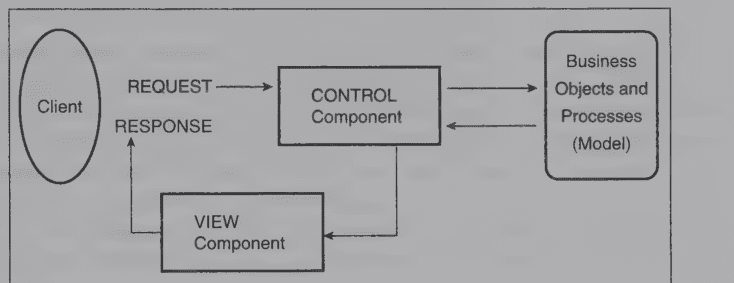

**图1.2** `MVC`结构。请注意，设计模式中的每个组件都由不同的软件组件实现。

提交给系统的事务会被导向一个由控制机制选择的执行结构，该结构将激活适当的核心逻辑组件并执行特定的业务流程。从这些流程中检索到的数据对象会被重定向到适当的表示组件，然后渲染给客户端。

控制结构的唯一目的是决定必须执行哪些业务流程来响应特定请求，以及响应应被重定向到哪个表示对象。它可以实现多种控制策略，因为控制是在那里具体化的；它并非在每个`JSP`或`servlet`中复制，后者可能具有不同的实现细节。它可以实现多个层次的缓存（行集、响应`bean`缓存、结果`Hashtable`缓存等）、资源池（`JDBC`数据源和连接池、控制结构对象池、连接器等），以及安全机制（选定的`SSL`传输、单点登录等）等等。控制结构本身很可能分布在多个组件中，例如请求处理器、资源控制器和事务控制器，具有多种决策策略。

核心逻辑代表了使用分布式对象架构（`EJB`、`Corba`对象等）或文档结构（如`XML`树）实现的为企业级业务流程，这些流程将被激活和执行以响应特定请求。响应数据被创建（很可能以`JavaBeans`或`CachedRowsets`的形式），并重定向到相应的表示组件，在那里渲染为数据行、图形或任何更合适的表示策略。

表示层变得定义明确。对`JSP`技术（以及`ASP`）的许多质疑与需要在页面中放入尽可能多的`Java`代码以满足请求有关，就像在等效的`servlet`中放入`HTML`以呈现相同请求的结果一样。将控制结构从表示`JSP`中移出（或将表示从`servlet`中移出）极大地简化了它们，使得代码对非程序员更易于理解，并使维护变得合理。

在这种情况下，唯一缺失的部分是表示`JSP`中的数据访问组件，这些对象将根据从控制结构接收到的数据对象构建表示。使用`Java scriptlet`会重新带来复杂性问题，尽管程度较低。另一个问题是维护和调整这些`scriptlet`，更不用说利用新组合工具的能力了。这就是自定义标签库和标准动作的用武之地。

即使你提供了良好的控制结构，分离了表示角色，并从业务流程中提供了一致的数据对象流，你仍然需要实现访问封装在这些数据对象中信息的逻辑。而该逻辑仍然是表示级别的编程组件。为了应对这个问题，`JSP`技术提供了标准动作和自定义标签库。标准动作和自定义标签具有相同的形式，借鉴了`XML`命名空间。标准动作类似于`HTML`标签，但它们提供了处理`JavaBeans`、页面包含和重定向的操作。自定义标签是你可以提供的标签，以提供某些特定行为，以及封装和重用特定流程。

本书其余部分提出的场景将`servlet`置于控制结构的中心。`JSP`用于表示层，并由标准动作和自定义标签支持。后台使用灵活的基础设施来提供核心业务流程。对于这样的场景，本章后续部分对`servlet`和`JSP`的概述是必要的。

## Servlet API

`servlet`提供了一种编程方式来处理请求并生成对请求发起者的响应。例如，它可以以字符数据、二进制数据或`HTML`代码的形式生成动态内容。`servlet`可以设计用来触发行为；例如，它可以设计成在服务器上根据请求中发送的参数启动一个进程。通过这样做，`servlet`扩展了服务器作为辅助服务的行为。

`servlet`至关重要。每个`JSP`在成为字节码之前都会被翻译成一个`servlet`。因此，每个`JSP`实际上就是一个`servlet`。记住这一点将有助于解决`JSP`编程中的一些奇怪问题。

## 容器和 Web 容器

自`J2EE`和`Servlet API 2.2`规范发布以来，引入了几个概念——主要是为了便于将基于`servlet`和`JSP`的Web应用程序部署到各种Web服务器上，而无需

# 可扩展性和性能

- **可扩展性**——`servlet`可以通过继承构建在其他`servlet`之上，并且可以实现`Java`接口以提供特定服务。

- **性能**——与CGI应用程序相比，`servlet`具有好得多的生命周期。它们使用轻量级线程来处理请求，节省服务器资源，并允许更具弹性的可扩展性。

- **会话管理**——`Servlet API`提供了一组类和接口来实现丰富的会话维护机制，这在多个层面提高了安全性。

- **更好的设计**——因为`servlet`作为单个实例运行并具有多个线程，它可以维护对象池，以保存和重用与企业资源服务器（如消息队列和数据库）的连接。

- **与Web服务器环境更好地集成**——`Servlet API`提供了许多用于请求/响应包装的通用接口，从而更容易访问服务器环境中的请求参数和资源。

然而，早期的`servlet`设计得非常像CGI应用程序，有时对于给定的请求，会在许多可能的响应中生成完整的`HTML`和`JavaScript`代码集。考虑到它们的编程性质，`servlet`很快变得难以维护，其弱点开始变得更加明显。然后`Sun`发布了其`JavaServer Pages API`（`JSP API`），该API建立在`Servlet API`之上，作为一种声明式的方式来处理网页生成。这些API的角色并未明确定义，因此它们似乎相互冲突。

随着`Java 2`企业版（`J2EE`）的发布，情况变得更加清晰。在`J2EE`蓝图中，勾勒出几个概念来支持对`servlet`和`JSP`作为互补技术角色的完全重新定义。

重构。其目的是使`J2EE`平台上的Web层保持统一。即使在异构分布式环境中，`EJB`和Web层也能够与各供应商的容器进行集成。

## 什么是Web容器？

Web容器，也称为`Servlet`容器，是一种运行时环境，`Servlet`、`JavaServer Pages`和标签在其中驻留并根据客户端请求运行。之所以称为*容器*，是因为它*包含*了将提供所需服务的Web组件。供应商可能会使用各种补充服务来实现其容器，但它们必须在某个级别上提供统一的目录结构和一组通用的Web应用程序服务。

## 目录结构

由于Web应用程序本质上是面向资源的，包含页面、图形文件等，因此必须按照某种目录结构部署在Web容器中。在`TOMCAT` Web容器中，Web应用程序的根目录是`/webapps`目录。每个Web应用程序在该目录下都有自己唯一命名的根目录，也称为应用程序的上下文根。在上下文根下，应用程序可以实现自己特定的目录结构，但需要一个名为`WEB-INF`的专用目录。

`WEB-INF`目录保存Web应用程序的部署描述符文件，即`web.xml`，其中包含Web应用程序的配置数据。它包含一个`classes`目录，用于存放应用程序的`Servlet`和其他类文件。它还包含一个`/lib`目录，用于存放应用程序运行所需的`jar`打包库文件。

`WEB-INF`目录是一个受保护的目录，除了通过容器本身外，外部无法访问。这意味着客户端请求的位于`WEB-INF`目录内的文本文件是禁止访问的。只有当`Servlet`获取该文件并将其返回给客户端时，客户端才能访问。因此，Web应用程序需要的任何配置数据都必须放置在`WEB-INF`目录内，以防止外部访问。图1.3展示了`Apache Software Foundation`的`TOMCAT` Web容器的典型目录结构。


图1.3 `TOMCAT`目录结构。

## Web应用程序与上下文

Web应用程序与其他应用程序类似。其区别在于实现它的技术。从物理角度来说，Web应用程序是一组静态和动态资源（如`Servlet`、`HTML`文件、`XML`文档、图形文件、`JSP`、类文件和`JavaBean`、自定义标签库以及归档文件如`.zip`或`.tar`文件）的集合，通过`HTTP`请求-响应协议为请求服务的客户端提供多项服务。它可以作为单个归档文件部署，称为Web应用程序归档文件，扩展名为`*.war`。每个供应商可以实现访问`.war`文件内资源的特定方式，但对Web开发人员来说这必须是透明的。

## Web应用程序与上下文

每个Web应用程序组件都必须能够查看属于该应用程序的资源。这种视图很重要，因为组件可能需要访问某个方法或将请求重定向到另一个更合适的组件，或者可能需要访问某些静态资源（如数据文件）。`Servlet API`定义了这种视图，称为*上下文*。从物理上说，上下文是Web容器中包含Web应用程序的存储库。

部署后，Web应用程序会被组织成Web容器的`/webapps`目录内的一个目录结构，称为*上下文根*。Web应用程序的名称就是上下文的名称。上下文根是Web应用程序内部的基本参考点。应用程序内部的路径相对于上下文根进行引用。`Servlet`只能在容器内的某个上下文中重定向请求。

容器提供一个特殊的上下文，称为默认上下文，由`/`路径表示。没有指定上下文的`Servlet`和`JSP`必须放置在默认上下文下。

上下文具有由`Servlet API`定义的逻辑表示，即`ServletContext`接口。

## Web应用程序部署描述符

Web应用程序部署描述符文件是在`Servlet API`规范中描述的`XML`文件，用于控制Web应用程序在容器环境中的部署。它描述了容器向Web组件提供的多项服务，并保存关于安全性、与`EJB`容器的互操作性等方面的配置信息。

标签库需要在部署描述符中通过`<taglib>`标签进行描述。清单1.1展示了一个小型应用程序的部署描述符。

```
清单1.1 小型应用程序部署描述符

<?xml version="1.0" encoding="ISO-8859-1"?>

<!DOCTYPE web-app
  PUBLIC "-//Sun Microsystems, Inc.//DTD Web Application 2.2//EN"
  "http://java.sun.com/j2ee/dtds/web-app_2.2.dtd">

<web-app>
  <servlet>
    <servlet-name>Init</servlet-name>
    <servlet-class>com.wlss.cac.WLSSInitServlet</servlet-class>
    <load-on-startup>1</load-on-startup>
  </servlet>
  <servlet>
    <servlet-name>Main</servlet-name>
    <servlet-class>com.wlss.cac.WLSSMainServlet</servlet-class>
  </servlet>
  <servlet>
    <servlet-name>Login</servlet-name>
    <servlet-class>com.wlss.cac.WLSSLoginServlet</servlet-class>
  </servlet>

  <servlet-mapping>
    <servlet-name>Main</servlet-name>
    <url-pattern>/dispatch.htm</url-pattern>
  </servlet-mapping>
  <servlet-mapping>
    <servlet-name>Login</servlet-name>
    <url-pattern>/login.htm</url-pattern>
  </servlet-mapping>
```

### 清单1.1 续

```
  </servlet-mapping>

  <!-- 标签库描述符 -->
  <taglib>
    <taglib-uri>/WEB-INF/tlds/wlss.tld</taglib-uri>
    <taglib-location>/WEB-INF/tlds/wlss.tld</taglib-location>
  </taglib>

</web-app>
```


清单 1.1 展示了一个虽小但完整的 Web 应用程序部署描述符文件。它定义了 Web 应用程序的组件和配置（参数、策略等）。在这里可以看到定义了多个 Servlet（`Init`、`Main` 和 `Login`）以及多条映射规则，用于将 Servlet 调用关联到资源名称。例如，在本例中，`Main` Servlet 被映射到 `dispatch.htm` 资源名称。请求 `dispatch.htm` 将调用 `Main` Servlet。最后一部分定义了某些 JSP 所需的标签库。在 Web 应用程序部署描述符中还可以定义许多其他参数。关于文件中各元素的完整描述，请参阅 Sun 的 Servlet API 规范文档。

## Servlet API 组件

Servlet API 是 J2EE 平台所有 Web 层的基础。Servlet 本身就是高度灵活的 Web 组件；它们是 JavaServer Pages 技术的构建模块。在参考 Web 容器 TOMCAT 上，JSP 翻译器 JASPER 是一个 Servlet，它拦截所有 `*.jsp` 资源请求。事实上，TOMCAT 提供了一个很好的示例，展示了如何使用 Servlet 为 Web 容器以及最终为 Web 服务器提供多种 Web 服务。

### Servlet 接口

Servlet API 的主要组件是 `Servlet` 接口。它提供了三个方法，构成了 Servlet 生命周期的结构：`init`、`service` 和 `destroy`。Servlet 通过直接或（更常见的）间接方式实现 `Servlet` 接口，即继承 HTTP 协议绑定的 `HttpServlet` 类，该类继承自 `GenericServlet` 类，而 `GenericServlet` 类实现了 `Servlet` 接口。

Servlet 容器按照以下方式管理 Servlet 生命周期：

- 容器在启动时或当第一个对该 Servlet 的请求到达时加载并实例化 Servlet。如果部署描述符中包含 `<load-on-startup>` 标签，则按指定的顺序加载 Servlet。加载并实例化 Servlet 后，容器调用 `init` 方法，以允许 Servlet 初始化特定资源。容器通过 `init` 方法的 `ServletConfig` 参数将环境信息传递给 Servlet。

## 清单 1.2 一个简单 Servlet 示例

```java
import java.sql.*;
import java.io.*;
import javax.Servlet.*;
import javax.Servlet.http.*;
import java.util.*;
import com.javaexchange.dbConnectionBroker.*;

public class DataBasedServlet extends HttpServlet
{
    DbConnectionBroker conPool;

    public void init (ServletConfig config) throws ServletException
    {
        super.init(config);
        String logPath = config.getServletContext().getRealPath("/WEB-INF/tmp/bahiana.log");
        try
        {
            conPool = new DbConnectionBroker("org.gjt.mm.mysql.Driver",
                                             "jdbc:mysql://localhost/EXAMPLE",
                                             "admin","",2,6,logPath,0.01);
        }
        catch (IOException e5)
        {
            config.getServletContext().log("init of example",e);
        }
    }

    public void service (HttpServletRequest request, HttpServletResponse response)
    throws ServletException, IOException
    {
        PrintWriter out = response.getWriter();
        Connection conn = null;
        Statement stm = null;
        response.setContentType ("text/html");
        try
        {
            conn = conPool.getConnection();

            out.println("<h3>Databased Model 1 Servlet</h3>");

            stm = conn.createStatement();
            ResultSet rs = stm.executeQuery("select * from alunos");

            while (rset.next())
            {
                out.println("Name: " + rs.getString(1)+"<br>");
                out.println("Age: " + rs.getString(2)+"<br>");
                out.println("Course: " + rs.getString(3)+"<br>");
                out.println("Year: " + rs.getString(4)+"<br>");
            }
        }
        catch (SQLException e)
        {
            getServletContext().log("database error",e);
        }
        finally
        {
            try{if(stm != null) stm.close();}
            catch(SQLException e){};
            conPool.freeConnection(conn);
        }
        out.close();
        response.getOutputStream().close();
    }

    public void destroy ()
    {
        conPool.destroy();
        super.destroy();
    }
}
```

`init` 方法完成后，servlet 就准备好接收请求了。它通过 `service` 方法来处理请求。`service` 方法有两个参数：请求对象和响应对象。请求对象实现了 `HttpServletRequest` 接口，封装了 Web 服务器发送的请求信息，而响应对象（一个 `HttpServletResponse` 对象）则将响应发送回 servlet。响应对象保存了用于响应请求而发送给客户端的信息，例如 servlet 生成的所请求的 HTML 页面或错误代码。多个请求通过多个线程传递，因此如果资源本身不支持线程安全，则必须使 servlet 具备线程安全性。

最终 servlet 必须被释放，原因可能是 servlet 容器本身正在卸载，也可能是 servlet 已经完成其使命并必须终止。在这种情况下，容器会调用 `destroy` 方法。`destroy` 方法用于释放所有无法被垃圾回收或需要特定释放例程的资源，例如连接池。

`HttpServlet` 类提供了一系列方法来处理 HTTP 协议的各个方法。这些方法命名为 `doXXX()`，其中 `XXX` 是对应方法的名称，如处理 GET 方法的 `doGet` 和处理 POST 方法的 `doPost`。与 `service` 方法的区别在于，`doXXX` 方法只有在客户端请求使用了相应的 HTTP 方法时才会被 servlet 容器调用。如果你希望客户端仅使用 POST 方法，你应该相应地重写 `doPost()`，忽略其他方法。

清单 1.2 展示了一个简单的 servlet，它通过 JDBC 协议访问数据库，执行一些查询，并将结果以 HTML 页面的形式返回给客户端。请注意 `init` 方法创建了与数据库的连接，`service` 方法如何使用已建立的连接，以及 `destroy` 方法在 servlet 释放之前关闭连接。

清单 1.2 展示了一个实现了完整生命周期的 servlet。它使用 MySQL 连接初始化了一个数据库连接池，在 `service` 方法中提交查询，并在 `destroy` 方法中释放连接池。

## 请求与响应

容器提供有关客户端请求的信息，以及一个用于辅助构建响应的对象，该对象封装在 `service` 方法（或 `doGet`、`post` 等）的请求和响应参数中。请求对象有四个主要用途：

1. 提供对客户端参数的访问。这对于表单处理至关重要。

2. 携带有关请求者和请求页面的信息，例如是否使用了 HTTPS 而非 HTTP、客户端是否已通过身份验证、客户端的 SSL 属性、请求头、Cookie 等。

3. 提供对会话对象的访问。servlet 必须先加入一个会话才能访问它，请求对象通过 `createSession` 方法提供访问。

4. 提供请求属性。容器使用它们来保存关于请求的额外信息。例如，如果一个请求被重定向到某个页面，那里会有一个属性来标识这一点。开发者也可以定义请求属性。你将在第 2 章“标签库简介”中更详细地了解这一点。

请求属性是传输数据对象的绝佳方式。因为事务返回的对象的作用域就是创建它们的请求，所以将它们放在请求属性中返回，可以避免控制会话对象之间相互干扰的麻烦——当上一个事务生成的数据被认为对下一个事务有效时，这种干扰会导致一系列拜占庭式错误。

以下代码片段展示了如何使用请求属性：

```java
// return a product item for a product code
String code = request.getParameter("CODE");
if (code != null && code.length() > 0)
{
    PrdItem item = new PrdItem(code);
    request.setAttribute("item", item);
}
```

由于响应对象的大部分功能由 JSP 处理自动提供，因此对于 JSP 开发者来说它并不是特别值得关注。响应对象控制着响应的创建和返回方式。响应的主要功能在于其实用方法，用于重定向请求和定义响应头。

在接收此请求对象的 JSP 页面中，可以通过 `request.getAttribute` 方法或具有请求作用域的 `jsp:useBean` 标签来获取 `PrdItem` 对象（详见下一节“`<jsp:useBean>`”）。

## ServletContext 与 RequestDispatcher

`ServletContext` 对象为 servlet 提供有关其 Web 应用程序的信息。该对象通过 `getServletContext` 方法从 `ServletConfig` 获取，`ServletConfig` 是容器传递给 `init` 方法的参数。上下文为 servlet 提供了对 Web 应用程序资源的访问。

上下文属性是一种定义通用控制对象或通用访问资源的机制，这些资源必须对应用程序中的所有 servlet 可用。例如，一个地图应用程序可以提供一个大型 shape 文件处理器，从而省去各个地图 servlet 自行加载和初始化的麻烦。另一个 Web 应用程序可以通过上下文属性提供一个连接池管理器，使所有面向数据的 servlet 和 JSP 都能直接从连接池获取连接。通过上下文属性提供的每个资源都必须是线程安全的。servlet 可以初始化 `conPool` 并将其放入上下文属性，使其对所有其他 Web 组件可用，如下例所示：

```java
// 1. Initialize connection pool
try
{
    conPool = new DbConnectionBroker("org.gjt.mm.mysql.Driver",
                                       "jdbc:mysql://localhost/EXAMPLE",
                                       "admin","",2,6,logPath,0.01);

    context.setAttribute("POOL",conPool);
    context.log("SET CONPOOL");
}
catch (Exception e) {context.log(this.getClass().getName()+": ",e);}
}
```

`RequestDispatcher` 是一个接口，允许 servlet 将响应客户端请求的职责转移给另一个 servlet、JSP 或其他资源。将资源包装成 `RequestDispatcher` 是 `ServletContext` 对象的职责。它有两个方法：`include` 和 `forward`。

`include` 方法用于当一个 servlet、JSP 或 HTML 页面的处理结果必须作为另一个 servlet 或 JSP 的一部分被包含时。被包含的资源不能更改响应设置。一个页面可以根据需要包含任意数量的资源，如下方代码片段所示：

```
ServletContext sc = getServletConfig().getServletContext();
RequestDispatcher rd = sc.getRequestDispatcher("/header.jsp");
rd.include(request,response);

out.println("<ul>");
for (int i=0;i<dataVector.size();i++)
{
	ItemBean ib = (ItemBean)dataVector.elementAt(i);
	out.print("<li>"+ib.getItemCode()+":");
	out.println(ib.getItemQty());
}
out.println("</ul>");
rd = sc.getRequestDispatcher("/footer.jsp");
rd.include(request,response);
```

当目标资源必须提供完整响应时，必须使用 `forward` 方法。控制权会转移到目标资源且不再返回。此方法仅能在响应尚未提交且没有任何内容发送回客户端浏览器时使用。否则，`forward` 方法将抛出异常。下一个代码片段创建了向量 `dataVector`，如下所示：

```
Vector dataVector = new Vector();

while (rSet.next())
{
	ItemBean ib =  new ItemBean(rSet.getString(1),rSet.getString(2));
	dataVector.addElement(ib);
}

request.setAttribute("dataVector",dataVector);
ServletContext sc = getServletConfig().getServletContext();
RequestDispatcher rd = sc.getRequestDispatcher("/showItems.jsp");
rd.forward(request,response);
```

`RequestDispatcher` 的最大作用域是容器。如果 servlet 需要将页面处理重定向到容器外部的 URL，则应改用 `response.sendRedirect` 方法。

`RequestDispatcher` 对象必须从 `ServletContext` 对象中获取，可以是实际上下文，也可以是通过 `ServletContext` 的 `getContext` 方法在容器中获取的其他上下文。当 `RequestDispatcher` 对象在 Web 应用部署（`web.xml`）中声明了名称时，可以通过名称获取。下面的代码片段展示了如何获取已命名的 servlet 分发器。

```
ServletContext sc = getServletConfig().getServletContext();
RequestDispatcher rd = sc.getNamedDispatcher("LoginServlet");
rd.forward(request,response);
```

## 会话与会话管理

会话管理机制的必要性在 Web 应用中变得尤为明显。需要跟踪用户是谁、授予了哪些权限，以及判断此请求是否建立在先前交易结果之上等等。`HttpSession` 和 `HttpSessionBindingListener` 接口以及 `HttpSessionBindingEvent` 类共同构成了 Servlet API 的会话跟踪机制。

会话最初通过请求对象的 `getSession` 方法在不存在时创建。容器为新创建的会话关联一个唯一 ID，并提供一个存储区域供会话对象驻留。当请求到达时，如果会话已经创建，再次调用 `getSession` 方法将使会话中存储的对象可用。容器中的任何 servlet 都可以访问客户端的会话。这个过程称为*加入会话*。对象可以存储在会话上。实现 `HttpSessionBindingListener` 接口的对象在绑定到会话和从会话解绑时会通过接收 `HttpSessionBindingEvent` 收到通知。


会话跟踪机制有多种使用模式。最明显的是确保数据在需要时能够跨请求存在。一个例子是购物车，其中选中的项目被保存以供后续计算。另一个典型场景是用户身份识别。用户权限必须在整个应用中保持有效，但一旦会话过期或被失效，用户控制 servlet 必须得到通知。

### 清单 1.3 使用会话机制

上文展示了如何在 JSP 内部使用会话。每个 JSP 中定义了一个名为 `application` 的特殊对象，它包含 `ServletContext` 对象。该对象将在接下来的“隐式对象”一节中更好地解释。

```
<%--第一个页面是会话设置者--%>
<%

Vector dataVector = new Vector();

while (rSet.next())
{
   ItemBean ib = new ItemBean(rSet.getString(1),rSet.getString(2));
   dataVector.addElement(ib);
}

session.setAttribute("dataVector",dataVector);
RequestDispatcher rd = application.getRequestDispatcher("/showItems.jsp");
rd.forward(request,response);

%>

<%--第二个页面--%>
```

```
<%
    // 这是页面获取者
    Vector dataVector = (Vector)session.getAttribute("dataVector");
%>
```

## JavaServer Pages

在微软推出 Active Server Pages（ASP）之后，servlet 方法招致了大量批评。它难以由非程序员维护，而且即使对程序员来说也难以设计，因为所有代码都必须处理 HTML 以及可能的客户端脚本和 DHTML。为了提供一个有竞争力的替代方案，并为缺乏复杂编程技能的 Web 开发人员提供选择，Sun 引入了 JavaServer Pages（JSP）技术和 API。从概念上讲，这表达了一种声明式的方式来处理请求并生成对请求发出者的响应。从物理上讲，JSP 是一个由模板静态数据和动态数据的 Java 代码规范组成的文本文件，在首次请求时由 JSP 转换器处理为可执行的 Java 类文件。

### 使用 JSP

由于其声明式特性，JSP 在 Web 应用中自然地扮演着前端角色。其理念是 JSP 内部的静态 HTML 代码易于由非程序员维护，因为 JSP API 规范规定使用特殊标签来标记 Java 代码，从而实现 Java 代码与 HTML 之间的清晰分离。JSP 技术并非专门绑定于 Java 编程语言。理论上，JSP 可以使用任何语言作为脚本语言，包括 JavaScript 甚至 Perl。然而到目前为止，唯一支持的语言是 Java。为了简化后续主题的讨论，本书假设脚本语言始终是 Java。

### 生命周期

JSP 的生命周期定义如下：

1. 客户端请求一个扩展名为 `.jsp` 的文件。

2. 容器查找按照容器标准命名约定加载的 servlet。每个容器都可以自由实现特定的命名约定，以从 JSP 源派生转换后的 servlet。

3. 如果这样的 servlet 已加载并初始化，它会在该 servlet 的 `service` 方法上运行线程。

4. 如果找不到这样的 servlet，它会调用 JSP 处理器（例如，TOMCAT 的 JASPER），该处理器将解析 `.jsp` 文件，执行自定义标签和标准操作，从中派生转换后的 servlet，并将其编译为字节码，然后容器将加载并运行。

servlet 和 JSP 的执行路径存在一些差异。Servlet 被加载和实例化后，容器执行其 `init` 方法。servlet 程序员需要牢记的第一个操作是在传递容器接收的 `ServletConfig` 对象时调用 `super.init`。进入 `init` 方法后，你将无法访问任何 `service` 方法的典型对象，如 request 或 session 对象。

JSP 不能重载 `init` 方法。你必须重载 `jspInit()` 方法，它不需要调用 `super.init`，也不接收 config 对象。此外，所有隐式对象在 `jspInit` 中已经可用（这在 servlet 中不会发生）——例如，你可以在 `jspInit` 方法中使用 request 对象。

你永远不会重载 `jspService` 方法，它完全由转换过程生成。

如果你需要一些终结操作，可以重载 `jspDestroy` 方法，就像对 `jspInit` 所做的那样。

### 转换后的 Servlet

JSP 转换器处理的结果是生成一个来自 JSP 静态文件的 servlet。在此过程中，所有静态文本都由生成 servlet 的 `service` 方法中的 `out.println` 成员函数输出。表达式被转换为通过 `out.println` 输出的 Java 表达式。声明被生成为实例变量、成员函数或声明的任何内容。脚本片段按位置生成，作为生成 servlet 的 `service` 方法中的语句。清单 1.4 展示了由 TOMCAT 转换后的典型 JSP。

#### 清单 1.4 由 TOMCAT 转换后的典型 JSP

```
import javax.servlet.*;
import javax.servlet.http.*;
import javax.servlet.jsp.*;
import javax.servlet.jsp.tagext.*;
import java.io.PrintWriter;
import java.io.IOException;
import java.io.FileInputStream;
import java.io.ObjectInputStream;
import java.util.Vector;
import org.apache.jasper.runtime.*;
import java.beans.*;
import org.apache.jasper.JasperException;

public class _0002frealPath_0002ejsprealPath_jsp_0 extends HttpJspBase {

// 为简洁起见，此处省略了基本的初始化内容
```

```
public final void _jspx_init() throws JasperException {}

public void _jspService(HttpServletRequest request,

                         HttpServletResponse response)

    throws IOException, ServletException {

    JspFactory _jspxFactory = null;

    PageContext pageContext = null;

    HttpSession session = null;

    ServletContext application = null;

    ServletConfig config = null;

    JspWriter out = null;

    Object page = this;

    String _value = null;

    try {

        if (_jspx_inited == false) {

            _jspx_init();

            _jspx_inited = true;

        }

        _jspxFactory = JspFactory.getDefaultFactory();

        response.setContentType("text/html;charset=8859_1");

        // 检查页面上下文对象将如何初始化此 Jsp 的其他所有隐式对象

        pageContext = _jspxFactory.getPageContext(this, request,

                        response, "", true, 8192, true);

        application = pageContext.getServletContext();

        config = pageContext.getServletConfig();

        session = pageContext.getSession();

        out = pageContext.getOut();

        String vPath = request.getRequestURI();

        String rPath = getServletConfig().getServletContext().getRealPath(vPath);

        out.print(vPath);

        out.write("</p>\r\n<p>The real path is ");

        out.print(rPath);

        out.write("</p>\r\n<p>The real path is ");

        out.print( getServletConfig().getServletContext().getRealPath("/realPath.jsp")

    );

    out.write("</p>\r\n</body>\r\n</html>");

    } catch (pareException ex) {

        if (out.getBufferSize() != 0)

            out.clearBuffer();

        pageContext.handlePageException(ex);

    } finally {

    // 继续

        out.flush();

        _jspxFactory.releasePageContext(pageContext);

    }

}

}
```

### 隐式对象

为了提供一种访问核心 Servlet API 组件的便捷方式，每个 JSP 都有隐式创建和声明的对象。这避免了在代码中嵌入复杂的对象声明，使其更易于阅读，并提供了一种访问标准对象的标准方式。

这些隐式对象包括 `pageContext`、`request`、`response`、`application`、`config`、`out`、`exception` 和 `session` 对象。`pageContext` 对象承担多项职责，例如提供访问所有页面级信息的方式、初始化其他隐式对象、提供管理和访问各种作用域命名空间（页面作用域、请求作用域、会话作用域和上下文作用域）的方式，以及提供从页面和任何需要访问该页面对象的附属组件访问其他隐式对象的方法。`application` 对象封装了 `ServletContext`。

有关隐式对象和 `pageContext` 对象本身的更多信息，请参阅 JavaServer Pages API 规范文档。

### 语法详解

JSP 语法基于五个 JSP 标签和六个标准动作：

- 标签包括 JSP 注释、指令、声明、表达式和脚本片段。

- 标准动作包括 `useBean`、`getProperty`、`setProperty`、`include`、`forward` 和 `plug-in`。

#### <%-- 注释

JSP 注释标签（也称为隐藏注释）`<%--` 和 `--%>` 使你能够放置不会转换为内容的信息。JSP 转换器将忽略此内容。JSP 注释非常适合在页面设计流程中传递指令。由于 JSP 编程模型强化了类构建者和内容构建者之间的角色分离，因此流程中的某个人有时必须向下一个传递备注。使用此类注释，可以在不向客户端层泄漏的情况下完成此操作。清单 1.5 展示了 JSP 注释标签的示例。

### 清单 1.5 JSP 注释标签示例

```
<%--
使用说明：

1. 将 XXX 字段替换为你想要使用的样式表文件名
2. 你**必须**实现 .P 类！！
3. **切勿**更改字段的顺序！此页面会被另一个应用程序扫描，
   更改字段顺序将会导致该应用程序出错。

谢谢，

开发团队 --%>

...你的 JSP 其余部分...
```

在清单 1.5 中，JSP 其余部分的内容会被转换并将在客户端显示为活动内容（实时数据）或静态模板。另一方面，“使用说明”不会以这种方式显示。直接处理 JSP 源码的设计者将可以访问它。

重要的是要记住，JSP 注释和 HTML 注释是完全不同的东西。HTML 注释被视为静态模板的一部分，并在生成的页面中作为 HTML 注释生成。HTML 注释中的任何 JSP 元素都像在非注释部分一样被求值——例如：

```
<%-- 这是一个隐藏注释。以下表达式将永远不会显示：<%=3*30%> --%>
```

```
<!-- 这是一个 HTML 注释。此表达式是活动数据：<%=3*30%> -->
```

页面中没有任何内容

HTML 注释内的表达式被求值为 90 并被结果替换。

#### <%@ 指令

指令指示 JSP 转换器对代码执行特殊处理。共有三个指令：`include`、`page` 和 `taglib`。`include` 指令提供了类似于 C 语言 `#include` 的静态包含机制。`page` 指令非常丰富，具有许多参数和多种用途。`taglib` 指令用于声明页面使用自定义标签，本书将在后续章节中广泛探讨。它们使用指令标签 `<%@` 和 `%>` 编写。

#### <%@ include 指令

`include` 指令用于在声明的位置将文本文件的内容静态包含到当前 JSP 中。静态意味着被包含的文件是直接包含的，而不是其处理结果。`include` 指令的语法如下：

```
<%@ include file="relativeURL"%>
```

如果 `relativeURL` 以 `/` 开头，则路径相对于 JSP 的 Web 应用程序根目录。如果以目录名开头，则路径相对于 JSP 的位置。

包含过程大致如下：

1. JSP 转换器开始转换页面。

2. 转换器在页面中间发现 `include` 指令。

3. 转换器根据其相对 URL 定位要包含的文件。

4. 如果要包含的文件是静态文本文件（如 HTML 或文本），则直接添加到页面该位置的静态模板中。

5. 如果要包含的文件是 JSP 文件，则对其进行解析。如果有效，则将其包含，然后页面在处理完指令后的下一个元素处继续处理。

下一个示例展示了两个 `include` 指令；一个是有效的，加载 `testo.txt` 文件。另一个是无效的，试图包含不存在的 `oops.txt`。取消注释无效指令并尝试：

```
这是一个有效的包含：<%@ include file="testo.txt"%> <br><br>

这是一个被注释掉的无效包含：<%-- <%@ include file="oops.jsp"%> --%>
```

`include` 指令对于提高代码清晰度非常有用，因为页面内的重复模式可以放在外部文件中并由它们包含，这节省了编写和理解的工作量。清单 1.6 展示了一个简单的模板机制，在应用程序的所有页面上放置标准徽标。

### 清单 1.6 include 指令

被包含的 `logo.htm`：

```
<table width="90%">
 <tr>
  <td width="20%">&lt;img src="logo.gif"&gt;</td>
  <td width="80%">&lt;h1&gt;示例公司&lt;/h1&gt;</td>
 </tr>
</table>
```

第一个页面：

```
<html>
<body>
<center>
<%-- 此处是徽标 --%>
<%@ include file="logo.htm"%>
```

```
</center>
<table>
<tr><td> 页面 1 的第一行。</td>
<tr><td> 页面 1 的第二行。</td>
</table>
</body>
</html>
```

第二个页面：

```
<html>
<body>
<center>
<%-- 此处再次是徽标 --%>
<%@ include file="logo.htm"%>
</center>
<table>
<tr><td> 页面 2 的第一行。</td>
<tr><td> 页面 2 的第二行。</td>
</table>
</body>
</html>
```

由于徽标页面被包含，必须假设诸如 `<html>`、`<body>` 和 `<form>` 之类的元素可能与包含页面中的类似标签产生冲突。

静态模板和包含的文件共同构成了所谓的*翻译单元*。翻译单元是在页面的处理过程中由 JSP 转换器在单次翻译操作中翻译的整个 JSP 模板和代码。翻译单元是许多元素的有效作用域，例如 JSP 声明。这意味着，例如，在页面中声明的方法在使用 `include` 指令包含之后的所有文件中都是已知的，而在被包含文件中声明的方法在包含点之后的页面中也是已知的。

#### page 指令

`page` 指令用于设置页面的多个属性以及导入执行页面代码所需的类。它是一个应用于翻译单元的标签示例；例如，导入的包在声明的页面和所有使用 `include` 指令包含的 JSP 中都是已知的。

`page` 指令的语法如下：

```
<%@ page parameter="value"%>
```

以下列出了 `page` 指令一些最常用的参数：

- **`import="packageDescription"`** — 要导入的包或完全限定类名。此处适用与普通包/类导入相同的规则。

- **`session="true|false"`** — 指示此页面必须加入会话。默认值为 `true` 和/或页面加入会话，或者如果它不存在。如果为 `false`，此参数表示将无法访问会话，并且尝试访问它将导致错误。默认值为 `true`。

有关所有页面参数的完整描述，请查阅 JSP API 文档。

## taglib 指令


`taglib`指令用于声明页面使用特定的标签库。它接受两个参数：一个统一资源标识符（URI）和一个前缀。URI 是一个唯一标识所声明标签库中标签的名称。前缀将每个标签与其 URI 关联起来。标签必须以此前缀开头，类似于 XML 命名空间（参见第 2 章第 2.2.1 节 "标签和操作"）。

`taglib`指令的语法如下：

```
<%@ taglib uri="someUri" prefix="somePrefix"%>
```

当通过`taglib`指令声明了标签库后，其标签就可以在页面中使用。每个标签都必须加上前缀，如`<somePrefix:tagName attributes.../>`。例如，考虑以下代码：

```
<prefix1:myFirstTag anAttribute="value">.
```

```
<%@ taglib uri="XYZWCompanyInc-LayoutTags-v.1.0" prefix="xyzw"/>
<%@ taglib uri="XYZWCompanyInc-MenuTags-v.1.0" prefix="menu"/>

<xyzw:placeLogo type="wide" title="Module One"/>

<menu:placeToolbar>
    <menu:toolbarItem name="operations">
        <menu:menuItem name="new article" action="insert.op"/>
        <menu:menuItem name="edit article" action="edit.op"/>
    </menu:toolbarItem name="operations">
    <menu:toolbarItem name="admin">
        <menu:menuItem name="new user" action="insertUsr.op"/>
        <menu:menuItem name="statistics" action="stats.op"/>
    </menu:toolbarItem name="admin">
</menu:placeToolbar>
```

这是 XYZW 公司的一个示例页面。

选择操作或管理来执行例程。

```
<xyzw:placeFooter type="SimpleAddr"/>
```

最后的页面显示了一个带有公司标志的顶部页眉，然后是一个包含两个操作的下拉菜单。URI `XYZWCompanyInc-LayoutTags-v.1.0`标识了这些标签。对于这个特定页面，选择的前缀是`xyzw`。这可以是整个企业范围内为通用标签库分配的特定前缀，也可以仅在本地分配，作为区分来自不同标签库的同名标签的一种方式。

你可以根据需要使用任意多个`taglib`指令来声明所需的标签库，但前缀必须全部不同。标签库可以用不同的前缀从一个页面声明到另一个页面，但更好的做法是为每个标签库使用标准前缀，并在整个组织中加以强化。

## `<%=`表达式

在计算机语言中，表达式是表达含义的终极方式。JavaServer Pages 提供了一种机制来编写 Java 表达式，这些表达式会被求值并替换为其各自值的字符串转换。JSP 表达式标签`<%=`和`%>`可以包含任何有效的 Java 表达式，并且可以包含之前在 JSP 中声明的任何变量。

表达式不能有分号分隔符，因此它们是独立的语句。一次只能声明一个表达式。此类表达式的翻译是一个`JSPWriter` `out.print()`语句，如下所示：像这样的表达式

```
<%=a+1%>
```

在翻译后的 servlet 中被翻译为

```
out.print(a+1);
```

在执行阶段，这会被求值为`a+1`，将结果转换为字符串值，并在`JSPWriter`输出中打印结果。下一个示例在结果页面中打印格式化的日期：

```
<%@ page import="java.text.SimpleDateFormat"%>
<%@ page import="java.util.Date"%>

<%!
// 声明一个 SimpleDateFormat 格式化程序
SimpleDateFormat sdf = new SimpleDateFormat("YYYY-MM-DD HH:MM:SS");
%>
```

此页面上次访问时间为`<%=sdf.format(new Date)%>`

## `<%!`声明

JSP 可以被看作是一个 servlet（事实上，你可以将脚本编写为纯 JSP，一些作者将这类 JSP 与内容生成 JSP 区分开来）。它是通过翻译过程生成的 servlet，其语义遵循构建它的 servlet 语义。有时你必须指定辅助数据属性或函数，以帮助执行 JSP 实现的进程。要声明这样的属性和成员函数，或使用`jspInit()`声明一些特定的初始化例程，你可以使用 JSP 声明。

声明是一段 Java 代码，用于在正在考虑的翻译单元的范围内声明变量或方法。翻译单元包括你的页面以及你通过`include`指令进行的所有静态包含。根据 Java 语言规范文档，它必须是有效的 Java 声明。你的声明必须包含在`<%!`和`%>`标签中。

你可以使用任意多个声明片段，只要遵循以下规则：

1. 每个变量声明必须以分号结尾。
2. 每个块声明必须包含在花括号（`{`和`}`）内。
3. 无论声明的是什么项目，都必须在使用之前声明。

清单 1.7 提供了多种声明：标量元素、对象和方法，它们将呈现为翻译后的 servlet 的方法。

```
清单 1.7 使用声明

<%!
    int a = 0; // 一个 int 声明
    String message = "This is a message"; // 一个 String

    public String clip (int b) // 这是一个方法声明
    {
        if (b < message.length())
            return message.substring(a, b);
        else return message;
    }
%>

此页面显示了一条截断的消息: <%=clip(10) %>.<br>

<%! boolean d = true; %>

并且有一个布尔值, true ? <%=d%>.
```

清单 1.8 通过内部类的声明变得更加复杂。虽然不建议作为清晰的 MVC 风格，但这是可行的，并且会顺畅运行。

```
清单 1.8 声明中的内部类

<%!
    protected class StringPair
    {
        String item;
        String code;

        public StringPair(String c, String t)
        { code = c; item = t; }
    }
%>

这里我们有一个内部类 :<br>
```

```
<%
StringPair sp = new StringPair("1.1","Socks");
%>

字符串对的值是 <%=sp.code+"="+sp.item%>
```

当然，页面可能比清单 1.7 和 1.8 所示的例子复杂得多。这可能难以维护，并且对于 Java 编程技能较弱的设计人员来说很困难。为了避免这种情况，JSP 有两个基本机制：标准操作和自定义标签。

## `<%`脚本片段

脚本片段是提供 JSP 核心功能的代码片段。翻译后，脚本片段代码会按顺序放置在翻译后的 servlet 的`jspService`方法中。（这里的"顺序"指的是出现的顺序。）脚本片段包含用分号分隔的 Java 语句。脚本片段内的声明被视为`jspService`方法的局部声明。表达式被视为普通的 Java 表达式。通过`include`指令包含的文件在 JSP 文件解析后插入。你可以将块语句脚本片段（如`while()`和`if()`）与静态模板混合，以创建条件内容。（参见清单 1.9。）

清单 1.9 使用脚本片段

```
<%
    // 第一个脚本片段
    // 使用脚本片段进行条件生成的示例
    if (x > 10)
    {
%>
<!-- 这是 IF 语句内部的静态模板 -->
<h1> x 大于 10 </h1>
<%
    }
    // 第二个脚本片段
    else
    {
%>
<h1> x 小于或等于 10 </h1>
<%
    }
%>
```

## 标准操作

标准操作是 JSP API 默认提供给 JSP 开发人员的预定义类标签操作。存在六种标准操作：`useBean`、`getProperty`、`setProperty`、`include`、`forward`和`plug-in`。它们使用带有命名空间前缀`jsp`的类标签语法，如下文各节所述。

### `<jsp:useBean>`

`jsp:useBean`标准操作从给定范围加载一个 bean，使用给定的标识符，并在该范围内找不到时从给定的类或类型实例化它：

```
<jsp:useBean id="employee" class="com.xyzw.Employee" scope="session"/>
```

此操作尝试从存储在会话中的 bean 实例化一个变量`employee`。如果它在会话中没有找到`employee`，它会创建它并从类`com.xyzw.Employee`实例化它。请记住，`<jsp:useBean>`会被翻译成出现在所有脚本片段之前的代码。

### `<jsp:getProperty>`

`jsp:getProperty`标准操作使用适当的 getter 方法从 bean 获取命名属性，如下例所示：

```
<!-- 这从会话中实例化一个 bean -->
<jsp:useBean id="employee" class="com.xyzw.Employee" scope="session"/>

<!-- 这些获取 employee 属性的值 -->
name: <jsp:getProperty name="employee" property="name"/>
social security: <jsp:getProperty name="employee" property="socSecNum"/>
```

### `<jsp:setProperty>`

`<jsp:setProperty>`操作类似于`<jsp:getProperty>`，不同之处在于它使用相应的 setter 方法设置属性。

```
<!-- 这从会话中实例化一个 bean -->
<jsp:useBean id="employee" class="com.xyzw.Employee" scope="session"/>

<!-- 这些设置 employee 属性的值 -->
<jsp:setProperty name="employee" property="name" value="<%=currentName%>"/>
<jsp:getProperty name="employee" property="salary"
value="<%=baseSalary+additionals-(discounts+taxes)%>"/>
```

### `<jsp:include>`

`<jsp:include>`操作从相对地址包含页面。如果页面是静态的，它只是将静态内容包含在当前页面中。如果页面是动态的（servlet 或 JSP），它会包含该页面执行的响应。

## 列表 1.10 展示了基于简单链接的菜单的第一种方法。在第 3 章"编写自定义标签"中，你将看到这个菜单基于标签的增强版本：

## 列表 1.10 菜单示例

```
<!-- 第一页：筛选菜单 -->
<%
    String serviceName = request.getServletPath().substring(1);
    String qs = request.getQueryString();
    String newQs = "";
    String pre = "";
    String pos = "";
    String filter = request.getParameter("FILTER");
    if (filter == null) filter = "G";

    if (qs.indexOf("FILTER") > -1)
    {
        pre = serviceName+"?"+qs.substring(0,qs.indexOf("FILTER"));
        pos = qs.substring(qs.indexOf("FILTER")).substring(qs.substring(qs.indexOf("FILTER")).indexOf("&"));
        newQs = pre+"FILTER="+filter+pos;
    }
    else
    {
        pre = serviceName+"?";
        pos = "&"+qs;
    }
%>

<% if (!filter.equals("A"))
    {
%>
    <a href="<%=pre+"FILTER=A"+pos%>">All</a>
<%
    }
    else
    {
%>
    <B>ALL</B>
<%
    }
%>

<% if (!filter.equals("P"))
    {
%>
    <a href="<%=pre+"FILTER=P"+pos%>">Specific</a>
<%
    }
    else
    {
%>
  <B>Specific</B>
<%
    }
%>

<!-- 第一页结束 -->

<!-- 第二页 -->

<h1> 状态菜单测试 </h1>

<div align="right"><jsp:include page="stmenu.jsp" flush="true"/>

点击上面的链接来改变此页面的状态！

<!-- 第二页结束 -->
```

你可以根据需要在一个页面中包含任意数量的`include`。

## `<jsp:forward>`

`<jsp:forward>`动作将请求转发到目标页面。此动作与`RequestDispatcher`的`forward`和`response.sendRedirect`的主要区别在于，后两者在请求转发后会完成当前方法的执行，而`<jsp:forward>`动作则不会（参见以下示例）。

```
<!-- 发送者 -->

<jsp:useBean id="employee" class="com.xyzw.Employee" scope="session"/>

<%
  if (employee.getNovice())
  {
%>
<jsp:forward page="rulesOfConduct.jsp">
<%
  }
%>

如果你看到这个页面，说明你不是新手！

<!-- 发送者结束 -->
```

虽然你可以在一个页面中包含多个`include`，但不能有多个`forward`。这是因为`forward`动作要求页面缓冲区在此之前未被提交，而目标页面实际上会在某个时刻提交页面缓冲区。这也是因为它不会将控制权返回给原始页面。因此，第二个`forward`无论如何都不会被执行到。

## 小结

在本章中，你了解了 Web 应用程序的概念，了解了相关技术发展的历史视角，以及 Java API 在该主题上提供了什么。你还了解了 Servlet API 如何是 CGI 的更好替代方案，以及你发现了 JavaServer Pages 这项脚本技术。

本章向你展示了 Web 应用程序与其他类型的应用程序并没有那么大的不同。区别在于用于实现应用程序运行时周期的技术，这些技术基于 HTTP 协议。Web 应用程序还依赖网页作为展示机制。此外，你了解到 Web 应用程序需要一种会话跟踪机制来规避 HTTP 协议中缺乏状态的问题。

这些 Servlet API 的主要概念也一并呈现：

- **容器**——Web 或 Servlet 容器包含 Web 组件，如 Servlet 和 JSP。它为它们提供执行所需的运行时环境。TOMCAT 是 Apache 软件基金会的 Web 容器，被认为是 Servlet 容器的参考实现。Web 应用程序以上下文的形式部署到容器中。

- **上下文**——上下文是部署构成 Web 应用程序的元素的仓库。它在 Servlet API 中有逻辑表示，即`ServletContext`。`ServletContext`是 Web 组件对其上下文和 Web 应用程序本身的视图。

- **Servlet**——Servlet 实现`Servlet`接口。`HttpServlet`是与 HTTP 协议请求-响应周期兼容的 Servlet 子类。`HttpServlet`接口有三个方法：`init`、`service`和`destroy`。

- **请求**——请求包含有关客户端请求的信息、由容器或应用程序本身设置的属性、会话和请求参数。

- **响应**——响应保留生成输出到客户端的信息。它可以包含响应头或 HTTP 返回码。`sendRedirect`方法是在容器外部重定向请求的方式。

- **RequestDispatcher**——它包装一个资源来接受由某个 Web 组件发送的请求。`RequestDispatcher`由上下文创建，如果 Web 应用程序部署描述符中为其定义了名称，则可以是命名的。

JSP API 是 Servlet API 的扩展，实现了网页脚本。JSP API 中的主要组件如下：

- **页面**——页面是一个文本文件，包含 JSP 处理器可以编译的代码。JSP 中的代码指定如何从请求计算响应。它不会被直接编译成字节码。JSP 处理器将 JSP 翻译成中间 Servlet，并将该 Servlet 编译成字节码。


- **`PageContext`**——`PageContext` 对象有许多职责，包括提供访问所有页面级信息的方式、初始化其他隐式对象、提供管理和访问各种作用域命名空间（页面作用域、请求作用域、会话作用域和上下文作用域）的方式，以及提供许多从页面和任何需要访问该页面对象的附属组件访问其他隐式对象的方法。

- **隐式对象**——每个 JSP 都定义了许多隐式对象，以便在不需要页面中太多 Java 代码的情况下轻松访问底层机制。这些对象是 `application`、`config`、`request`、`response`、`pageContext`（就其公开页面作用域和环境而言）、`out`、`exception` 和 `session` 对象。

- **标准动作**——标准动作封装了在各种情况下有用的标准行为。它们的语法派生自 XML，在 JSP 命名空间前缀内，包括 `include`、`forward`、`useBean`、`getProperty`、`setProperty` 和 `plugin` 动作。

- **标签库**——除了标准动作外，JSP 还可以使用标签库。标签与标准动作类似，但由开发者定义。它们是本书其余部分的重点。


# 2 标签库简介

**掌握标签库的概念非常重要**。有了这些知识，你可以更好地理解像 Struts 这样的框架背后的复杂机制，如第 6 章"Jakarta Struts 项目"和 MVC 设计模式中所见。

## 动作

动作是 JSP 编程的基本概念。它们代表嵌入在页面中的处理过程，将被执行以从客户端请求参数生成响应。然而，与脚本片段不同，动作被封装在类似 XML 的表示中。它们可以被视为程序设备而不是程序片段。

有标准动作和自定义动作。正如你在上一章中学到的，标准动作必须在所有兼容 JSP 1.1 的 Web 容器中实现。自定义动作是使用标签库扩展 API 以自定义标签库的形式创建的。理解标准动作对你理解如何使用标签库以及熟悉两者共有的许多机制非常重要。

### 什么是动作？

动作是用于 JSP 中以提供某种可插拔功能的编程设备。根据 JSP 规范，动作可以执行以下操作：

- **使用、修改和创建对象**——动作可以访问 Web 容器中定义的几个命名空间，即上下文、会话、请求和页面，以检索对象或发布它们创建或修改的对象。这些将可供页面中的其他组件进一步使用，如其他 JSP 或 Servlet。

- **影响输出流**——动作可以干扰输出的创建方式、中断页面的评估或生成特定的输出。

动作被封装在动作元素内，其语法基于符合 XML 命名空间推荐的 XML 前缀。

### 标准动作详解

JSP 规范定义了六个标准动作，所有兼容的 Web 容器都必须实现它们，正如你在上一章中学到的：`useBean`、`getProperty`、`setProperty`、`include`、`forward` 和 `plugin`。它们都以 `jsp` 为前缀。在 TOMCAT Web 容器中，标准标签作为 JASPER JSP 处理器的一部分实现。

## 从作用域获取数据

Bean 或其他普通对象可以绑定到多个命名空间——上下文、会话、请求和页面。这些可以被任何 Web 应用程序组件使用，如通过 Servlet API 上的接口的 Servlet；通过 `pageContext` 或隐式对象的 JSP；以及通过 `pageContext` 动作的动作。这些命名空间为对象或 Bean 定义了不同的作用域，每个作用域都有一个可以与之关联的角色。从最通用到最严格，这些如下：

1. **上下文作用域**——上下文作用域由上下文命名空间定义，并实现为上下文级别属性。`ServletContext` 接口具有在上下文作用域中定义和访问属性的方法。放置在上下文作用域中的 Bean 和对象将可供 Web 应用程序中的所有组件使用，直到它们被应用程序进程删除或 Web 容器关闭。这意味着上下文作用域更适合存储通用对象和参数。

例如，在面向政府的应用程序中，州级实体的表示（如州级金融机构或财务应用程序中的财务账户代码表）如果在整个应用程序中普遍绑定，可能会很有用。因此，它是上下文作用域属性的良好候选。这节省了时间并提高了对客户的响应能力，因为将显示它们的页面会从上下文中获取而不是从 EJB 事务生成。

### 2. 会话作用域

会话作用域为客户端向应用程序提交的请求序列带来了结构。例如，客户端可以连接到系统，提交一个新条目，编辑另一个条目的属性，并删除第三个条目。拥有用于登录和活动跟踪的客户端标识信息是非常有用的。

绑定到会话的对象将对加入该会话的所有 Web 组件可用，直到它们被移除或会话因调用会话的 `invalidate` 方法而失效。因此，它不像上下文作用域那样通用，在上下文作用域中，Web 组件在容器运行期间无条件地访问属性。加入会话意味着当组件从该客户端收到请求且会话已经创建时，可以访问会话数据，或者为该客户端创建一个会话。因此，会话作用域更多地用于存储跨事务级别的信息。

跨事务级别信息的经典示例是电子商务应用中的购物车。在应用的各个页面中，需要多种类型的属性保持可用，如消费者标识、消费者分类、已购商品和支付偏好等。但是，它们不应对所有页面都可用。通常，它们不应在特定消费者未访问过的地方可用。更为关键的是，它们不能被其他消费者看到。因此，这类数据最好存储在会话作用域中。

### 3. 请求作用域

请求作用域更多地用于存储特定于请求-响应事务的信息。请求作用域也被容器用来存储请求级别的控制信息。对象通过请求属性绑定到请求作用域。请求属性的生命周期持续到响应返回给客户端。这意味着一旦存储在请求作用域中，除非采取特定措施确保其可用，否则这些对象在下一个请求中将不可用。例如，回到电子商务应用，消费者访问有关待购商品的数据。信息、描述、资源指针、价格信息等最好存储在请求作用域中。

有时，决定信息应作为会话属性还是请求属性存储的标准可能看起来模糊不清。事实上，没有经验法则。但有一些提示。在前面的例子中，电子商务应用显然要处理两个信息作用域级别：必须随后可用的会话数据，以及在响应提交并返回内容给客户端后将被丢弃的请求数据。该用哪一个？在这种情况下，你必须问：使下一个事务运行所需的最少可用信息是什么？

你可以看到，商品信息将呈现给消费者进行评估，它显然处于请求作用域中，因为不同商品的信息会变化。但在满足某些条件的情况下，部分信息会保留下来。如果消费者决定购买该商品，商品标识必须保存下来以便后续阶段的定价。因此，商品代码从请求作用域迁移到会话上的购物车结构中。它超越了原始作用域，被提升到更高的作用域级别。存储此类信息的位置有时更难决定。

另一个需要考虑的点是请求属性的流动性。请求作用域的使用不限于单个页面，而是可以在生成适当响应的整个路径中移动。请求可以从一个页面转发到另一个页面；在每个页面上，可以读取一些属性，并向请求中添加一些新属性。然后请求可以再次被转发或包含，直到某个页面返回响应给客户端。一个常见的例子是在 MVC 模式中，扮演控制器角色的 Servlet、扮演请求解析器角色的某个 Bean 和视图 JSP 页面之间的通信。请求将贯穿所有这些组件，直到生成响应。图 2.1 说明了这种情况。

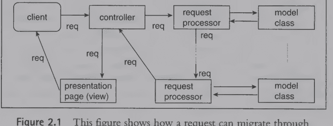

**图 2.1** 此图展示了请求如何通过若干页面迁移，无论是通过请求分派还是作为方法调用中的参数，直到最终响应发送回客户端。

### 4. 页面作用域

页面作用域是所讨论的作用域中最受限的。它更多地用于存储 JSP 处理期间需要的信息，之后即被丢弃。页面级信息存储为 `pageContext` 属性，对翻译单元（页面中存在的所有元素以及所有静态包含的片段的集合）可用。页面作用域的一个使用示例是自定义标签之间的参数传递。如果标签 A 需要一个由标签 B 生成的值，那么标签 B 可以通过将该值存储为页面级属性来传递给标签 A。然后标签 A 可以访问该属性并获取该值。当需要传递更复杂的类型时，这非常有用。

图 2.2 总结了不同的作用域及其各自的用途。

图 2.2 展示了可用的不同命名空间及其各自的作用域。属性 A 处于上下文作用域中。它在所有页面上始终可用，直到被移除。属性 B 处于会话作用域中。它仅对页面 1 和 Servlet 1 可用，无论用户访问这些页面多少次，直到会话失效。属性 C 在请求作用域中对页面 2 可用。然后请求被转发到页面 3，在那里生成响应。在随后对页面 2 或页面 3 的请求中，属性 C 将不再存在。属性 D 处于页面 3 的页面作用域中。它在翻译单元处理期间对包含页面 3 的翻译单元可用，但对任何其他页面或 Servlet 不可用。

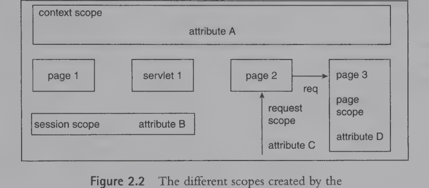

图 2.2 Servlet/JSP API 中不同命名空间创建的不同作用域。

要使用这些命名空间和各自的作用域，对象可以作为属性存储在相应的作用域中，正如你所见。这些属性被用作 Web 应用程序中组件之间的通信管道。这不仅限于 MVC 设计模式；任何在任何模型下开发的应用程序都可以使用它们。下一节将解释如何使用标准动作来实例化和获取绑定到每个作用域的对象，并讨论如何在页面中组织标准动作以提供所需的功能。

需要牢记的重要一点是，这些命名空间具有不同的作用域，也有不同的持续时间。上下文作用域在容器运行期间对 Web 应用程序内的所有 Web 组件可用——也就是说，在大部分时间内都是如此。将不必要的属性过度添加到上下文作用域中，会在相当长的时间内影响容器（消耗磁盘和内存空间）。会话作用域是第二个更持久的命名空间，也存在同样的问题。尽管你可以确定会话将维持多长时间，但这个时间始终是一个近似值。理想的做法是将对象放在一个命名空间中，一旦它们完成使命就会被丢弃，这样你就能精确控制每个对象的存放位置以及何时、如何被清理。

## 文章数据库

考虑一个示例文章数据库，以说明如何使用标准动作来访问各个作用域中的数据 Bean。

一个关于巴西足球（实际上称为 football）文章和统计数据的 MySQL 数据库，必须对历史和体育专业的学生可用。该数据库的组织结构如表 2.1 所示。

### 表 2.1 MySQL 数据库示例

| Articles | Authors | Journals |
| :--- | :--- | :--- |
| `Article_Id` integer | `author_Id` char(2) | `journal_Id` char(4) |
| `year` char(4) | `name` char(45) | `name` char(45) |
| `MAIN_author` char(2) | `nationality` char(2) | `origin` char(2) |
| `pages` integer | | `publisher` char(45) |
| `category` char(1) | | `area` char(20) |
| `number` integer | | |
| `volume` integer | | |
| `country` char(2) | | |
| `abstr` char(250) | | |
| `journal` char(4) | | |
| `title` char(80) | | |

需要实现一个搜索页面，通过标题、作者、年份和摘要关键词检索文章。还需要实现一个包含结果摘要的页面，以及一个包含某篇文章所有可用信息的详细表格。

这些表中的数据将被表示为三个 JavaBean：**`ArticleBean`**、**`AuthorBean`** 和 **`JournalBean`**。然而，重点始终放在文章上。应用程序将以一个 Servlet 为中心，即 **`ArticleDBServlet`**，它需要完成以下工作：

1. 在 `init` 方法中初始化与数据库的连接。（你在第 1 章"Servlet 和 JavaServer Pages 简介"中已经学习了如何做到这一点。）

2. 接收一个请求，该请求可能要求搜索数据库，或在搜索结果集中检索某篇文章的详细数据。

3. 如果请求要求搜索数据库，则搜索数据库并将找到的文章列表存储在会话中。如果成功，将结果集作为找到的文章向量返回到摘要页面。如果不成功，返回到失败报告页面。

4. 如果请求要求某篇文章的详细信息，则检索结果并返回到文章详情页面。

5. 使用 `destroy` 方法断开数据库连接，以确保受控的断开连接。

该应用程序实现了 MVC 设计模式：Bean 实现模型。**`ArticleDBServlet`** 实现控制，多个 JSP 页面实现视图。在接下来的章节中，你将使用这种设计。

清单 2.1 是 **`ArticleDBServlet`** 的代码。

## 清单 2.1 *`ArticleDBServlet`*¹

```java
import java.sql.*;
import java.io.*;
import javax.servlet.*;
import javax.servlet.http.*;
import java.util.*;
import com.javaexchange.dbConnectionBroker.*;

public class ArticleDBServlet extends HttpServlet
{
  DbConnectionBroker conPool;

  public void init (ServletConfig config) throws ServletException
  {
    super.init(config);
    String logPath = config.getServletContext().getRealPath("/WEB-INF/tmp/bahiana.log");
    try
    {
      conPool = new DbConnectionBroker("org.gjt.mm.mysql.Driver",
                  "jdbc:mysql://localhost/ARTICLE_DB",
                  "admin","",2,6,logPath,0.01);
    }
    catch (IOException e5)
    {
      config.getServletContext().log("init of article db servlet",e);
    }
  }

  public void service (HttpServletRequest request, HttpServletResponse response)
  throws ServletException, IOException
  {
    Connection conn = null;
    Statement stm = null;
    try
    {
      conn = conPool.getConnection();
      String type = request.getParameter("REQ_TYPE");

      // this is a rudimentary request processor
      if (type.equals("SEARCH"))
        searchDatabase(conn, request);
      else if (type.equals("DETAIL"))
        retrieveArticle(conn, request);
      else
        invalidRequest(request, response);

    }
    catch (Exception e)
    {
      getServletContext().log("Error during retrieve",e);
    }
    finally
    {
      try{if(stm != null) stm.close();}
      catch(SQLException e){};
      conPool.freeConnection(conn);
    }
  }

  public void destroy ()
  {
    conPool.destroy();
    super.destroy();
  }
}
```

1. 书中给出的示例及其运行说明均可在本书网站获取。详情请参阅封底内页"关于网站"部分，了解如何下载和安装这些示例。

在清单 2.1 中，`init` 方法只是初始化了一个用于管理数据库连接的连接池。它采用了与上一章相同的结构。这连接的是 `localhost` 系统上的 `ARTICLE_DB` 数据库（如果您安装了示例代码，这就是您的系统）。如果您有其他的数据库服务器配置，请修改 `init` 方法中的相应行，以确保示例能找到您的服务器。有关 MySQL 数据库、`mm.mysql` JDBC 驱动程序和 `poolman` 连接池的更多详情，请参阅附录 D "MySQL"。

`service` 方法基本上定义了一个简单的请求处理器，用于决定如何处理请求参数。在关于 Struts 的讨论中，您将学习一种更为复杂的方式来决定如何响应客户端请求。这个简单的示例基于一个 `if-else` 结构，它测试 `type` 参数，该参数告诉请求处理器客户端试图提交的是哪种事务。当找到某个类型的匹配时，调用相关方法并完成请求。

`searchDatabase` 方法从请求中检索条件参数，将它们绑定到一个预编译语句，然后调用 `executeQuery`。如果有结果，则用 `summaryBean` 对象包装它们，并将 `summaryBeans` 放入一个向量中。然后将该向量存储在会话中，并重定向到摘要 JSP。

为什么将摘要向量存储在会话中？因为自然的处理流程是这样设计的：用户执行查询，然后浏览检索到的结果。因此，当用户来回浏览以找到目标文章时，同一组结果可能会被多次使用。使用请求作用域将迫使您实现一种方式来在请求之间保留结果向量，这是徒增的无谓努力。使用上下文作用域也不合适，因为每个用户都会提交自己的条件参数——因此可能发生重叠，导致**拜占庭故障**。页面作用域则完全不在考虑之列，原因显而易见（Servlet 没有页面命名空间）。因此，结果向量将存储在会话中。


`retrieveArticle` 方法检索一篇文章的数据，并将其包装到适当的 bean 中。然后它将 bean 存储在请求作用域中，并将请求转发到详细 JSP。同样，由于文章数据是根据特定请求检索的，并且在后续请求中会有所不同，将其存储在会话中毫无意义。它的生命周期与请求作用域属性的生命周期一致。之后，请求被转发到详细页面。

数据库的索引页面 `index.html` 提供了一些背景信息和搜索参数。

构成此 Web 应用程序视图的 JSP 页面是 `summary.jsp` 和 `detail.jsp`。第一个页面呈现一个简单的目录类型视图，包含文章标题、作者、出版年份和摘要。第二个页面呈现类似数据库记录的视图，显示有关文章本身、出版商和作者的所有数据。在每个 JSP 页面上，都有一些需要渲染的对象。摘要页面必须呈现摘要 bean 的内容。另一方面，详细页面必须渲染文章、作者和出版商 bean。

由于这两种机制在两个页面中的部署方式不同，您必须理解它们两者。

摘要页面从会话中获取一个 `SummaryBeans` 向量，并遍历该向量的 `summaryBeans` 来填充摘要 JSP 页面。请查看下面的清单 2.2。

### 清单 2.2 摘要页面

```jsp
Vector summary = (Vector) session.getAttribute("SUMMARY");
....
<%
  // spans the vector's beans
  for(int i=0;i<summary.size();i++)
  {
    // get an article summary
    SummaryBean aSummary = (SummaryBean) summary.elementAt(i);
%>
  <tr>
    <td><%=aSummary.getYear()%></td>
    <td><a
href="article.htm?ACTION=DETAIL&ID=aSummary.getId()"><%=aSummary.getTitle()%></a>
</td>
    <td><%=aSummary.getMainAuthor()%></td>
    <td><%=aSummary.getAbstr()%></td>
  </tr>

<%} // end for %>
```

尽管清单 2.2 并不那么复杂，但您可以很容易地看到 Java 代码结构被用得到处都是。有一个主循环，即 for 结构，它将生成摘要的数据页面。

清单 2.3 展示了一种完全不同的页面风格。这里尽可能使用标准动作，以尝试减少对 Java 编码的依赖，并可能让页面设计师无需 Java 程序员的持续帮助就能处理这个页面。

### 清单 2.3 文章详细页面

```jsp
<jsp:useBean id="article" scope="request" class="examples.jspBook.ArticleBean">
<jsp:useBean id="author" scope="request" class="examples.jspBook.AuthorBean">
<jsp:useBean id="journal" scope="request" class="examples.jspBook.JournalBean">

<tr>
  <td>
    文章 ID：
    <jsp:getProperty name="article" property="articleId"/>
  </td>
  <td>
    标题：
    <jsp:getProperty name="article" property="title"/>
  </td>
</tr>
<tr>
  <td>
    作者：
    <jsp:getProperty name="author" property="name"/>
  </td>
  <td>
    期刊：
    <jsp:getProperty name="journal" property="name"/>
  </td>
</tr>

...
```

将清单 2.3 与清单 2.2 中的摘要页面进行比较，看看区别。在这里，您几乎是在编写普通的 HTML——更准确地说，XML——这是每个设计师的基本技能。而在摘要页面中，却有脚本片段。事实上，认为设计师会更轻松地处理这些以 `jsp:` 为前缀的标签，而不是学习足够的 Java 服务器端编程来生成这些页面，这要合理得多。

但事情并非一帆风顺。尽管标准动作在每个兼容 JSP 1.1 的 Web 容器中广泛使用，并且使用起来相当简单，但它们一点也不灵活。除了这里展示的内容，无法表示其他过程。甚至不能涵盖更复杂的 bean 结构——例如，索引 bean 属性未被涵盖，用其他 bean 实现的复杂属性也未被涵盖。这些可能看起来与日常编程相去甚远，但实际上并非如此。这就是自定义标签登场的时刻。其思想是以这种类 XML 的方式部署专门为您的需求设计的自定义标签。

# 自定义标签

自定义标签是 JSP 1.1 API 中定义的一种机制，用于在 Web 容器中实现自定义动作，供页面设计师使用。自定义标签是 Web 组件，属于 J2EE Web 层的一部分。它们在 Web 容器运行时环境中的 JSP 处理器内运行。

自定义标签为 JSP 框架提供了一种简单但强大的机制，用于封装和重用标准化的自定义过程。一个过程——例如，当达到某个条件时向系统管理员发送电子邮件——可以封装在一个标签中，该标签接收目标邮箱并使用 Javamail API 发送通知邮件。如下标签可以表示这种情况：

```xml
<ex:notifyAdmin email="ADB-Admin@wlss.com " text="A message"/>
```

页面设计师可以将这样的标签放在 JSP 错误页面上，这样当页面被容器自动调用时，如果检测到错误条件，该标签就会发送通知消息。事实上，自定义标签机制在 Web 应用程序设计流程中引入了角色分离，将典型的页面设计师（可能对 Java 编程了解有限，专注于页面的视觉设计）与标签设计师（必须有扎实的 JSP 和 Java 编程背景，专注于编程）分离开来。

自定义标签以标签库的形式提供。它们可以设计为向市场提供某些通用的标准化过程。JSP 页面可以根据需要使用尽可能多的标签库，用 `taglib` 指令声明每一个（如第 1 章所述）。

## 标签与动作

自定义标签用于使 Web 应用程序开发人员能够实现特定于某些上下文的动作，无论是面向市场还是面向组织内部工作。自定义标签代表自定义过程。它们可以封装在某些 Web 应用程序的页面中反复出现的某些重复过程，也可以定义为向特定市场提供某些打包功能。

自定义标签提供抽象重用、过程封装、改进的代码可维护性和更简便的应用程序可管理性。它们易于重新分发，可以被

### 什么是自定义标签？

在Web应用领域，自定义标签类似于快速应用开发（RAD）领域的软件组件。标签可以生成Web内容（也可以不生成），可以组合在一起协同工作，并且可以表示数据或数据结构。这种使用的灵活性是其结构的结果。

自定义标签被实现为实现了 `Tag` 或 `BodyTag` 接口的JavaBean。这些Bean被称为标签处理器。标签的属性被实现为标签处理器的属性，并通过其关联的get和set方法使其可被运行时环境访问。自定义标签中的属性可以是任何有效的Java类型。

标签所封装的过程被实现为标签处理器中的逻辑，可能位于特定的方法内。例如，一个电子邮件标签必须解析目标地址并调用将发送电子邮件的Javamail对象。这些可以被实现为标签处理器中的某些解析和 `sendMail` 方法。

标签处理器必须向JSP处理器传递一些预定义的响应，以允许JSP处理继续进行。标签可以允许JSP的其余部分被评估和处理。如果标签包含一个主体，它可以允许主体被评估和处理。这样，标签开发者可以很好地控制标签与页面之间、标签与其主体之间的交互，无论该交互是否包含多个标签或数据。

### 标签作为JSP元素

将标签放入JSP后，它可以访问所有的JSP元素。它们访问 `pageContext` 对象，并通过它访问JSP中可用的多个隐式对象，例如session和application（上下文）。标签可以访问请求参数以及放置在所有预定义作用域（上下文、session、请求和页面）中的属性。标签还可以在任何预定义作用域中定义、删除和设置属性。

此外，标签可以定义脚本变量，即使在标签处理完成后，也可以使这些变量对其他页面元素可用。有两种机制可以做到这一点。变量可以在标签定义文件（称为标签库描述符，TLD）中描述，或者可以使用另一个称为 `TagExtraInfo` （TEI类）的类来完成。您将在接下来的章节中了解更多关于TLD的信息。TEI类将在第4章“协作标签和验证”中讨论。

### 标签不是什么

现在应该很明显，标签是一种程序结构。然而，自定义标签的语法大量基于XML，这是一种声明性元语言，这可能会让新手感到困惑。

## 自定义标签不是XML元素

XML元素是表示XML文档中抽象的实体。它们具有声明性质而非程序性质。这建立了自定义标签和XML元素之间的深刻区别。

此外，JSP处理的处理链在JSP处理器中被很好地定义和实现。标签的整个生命周期完全包含在该处理链中。另一方面，XML元素没有预定义的生命周期。它可以作为电子商务过程的结果生成，可以作为过程的输入，可以被解析以提取数据，可以由XSL处理器渲染，并且可以被服务器和客户端无缝地处理。

然而，由于JSP页面可用于创建XML，在某些情况下，标签和XML元素可以放在同一页面上。在这种情况下，标签前缀将是处理过程中的决定因素。如果一个XML片段使用了与标签相同的命名空间前缀，JSP处理器会被误导将其作为自定义标签进行处理，处理将会失败。选择前缀时要小心。

## XSP、ColdFusion和其他技术

在动态页面中将过程封装在类似HTML/XML的语法中的想法并非JSP自定义标签所独有。在Java语言之外，还存在其他用于动态Web内容生成和应用的机制和语言。

Apache软件基金会（ASF）的Cocoon项目（http://xml.apache.org/cocoon）就是这样一个应用的例子。其主要目标是作为一个完全基于XML的开源Web发布系统。Cocoon可以被视为一个伞形项目，其下开发了许多技术和子项目。

Cocoon管道中涉及的技术包括ASF的XML解析器Xerces，它从IBM的XML4J发展而来；以及Xalan XSL处理器，它从Lotus的LotusXSL处理器发展而来，等等。Cocoon子项目的例子包括多个Cocoon生成器和XML Server Pages，XSP，这是一项部分受JSP启发但完全侧重于XML生成的技术。

XSP有一种机制来创建用户定义的标签，以重用XML生成逻辑。虽然概念相同，但这些标签可以用Java创建（目前也支持JavaScript），并且生成的标签可以放在一个也称为标签库的库中。这些与JSP标签库不兼容。

ColdFusion自定义标签也是同样的情况。ColdFusion是Allaire（http://www.allaire.com/coldfusion）创建的一种Web开发语言，其语法基于XML。ColdFusion也有一个称为自定义标签的逻辑重用机制。事实上，它提供了两种不同类型的自定义标签。

这个概念再次重复。ColdFusion标记语言（CFML）自定义标签使CFML程序员能够重用CFML中定义的标签。但ColdFusion允许另一种标签，称为ColdFusion API标签（CFX标签）。CFX标签可以用Java编写。同样，尽管术语和概念相同，但这些是完全不同类型的标签。

理解这里讨论的概念非常重要，例如使用HTML/XML标记来表示过程封装和重用设备，并非Java和JSP所独有。新手可能认为这些实现可以互换——但很快就会发现它们不能。

## 自定义标签和XML命名空间

为了在文档中正确定位每个标签的定义，并在同时使用多个标签库时避免命名冲突，taglib指令要求一个前缀，该前缀将用于以XML命名空间的风格区分标签库。XML命名空间是一种XML技术，用于区分XML文档中具有相似名称的实体。

在XML中，抽象由XML文档和文档内的实体表示。由一个组织或标准化机构定义的用于描述某个上下文的实体集，可以被视为该上下文的词汇表。特定上下文的词汇表由文档类型定义（DTD）文档描述，并且可以由多个组织设计。因为它们描述相同的抽象，所以可能会发生命名冲突。它们为在不同DTD中定义的实体使用相同的名称。当在同一个文档中使用这些实体时，必须处理这些定义的冲突。图2.3说明了这一点。

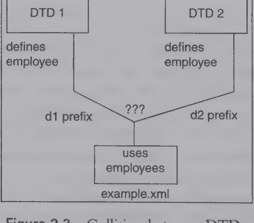

为了解决这个问题，万维网联盟（W3C）发布了一个称为XML命名空间的XML技术规范。这项技术赋予文档设计器为DTD中定义的实体附加前缀的能力。这使其与另一个DTD中定义的实体区分开来，从而允许在同一个XML文档中使用两个DTD中定义的实体。图2.4说明了这种新情况。

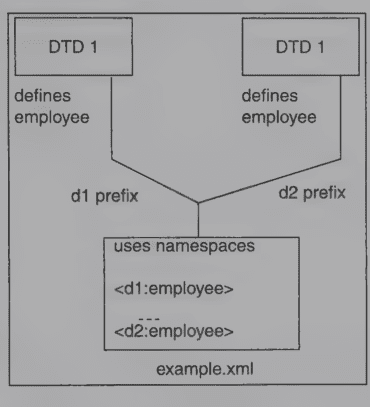

**图2.4** 不同的定义对应不同的命名空间：相同的名称但带有不同的前缀表示具有不同定义的实体，避免了冲突问题。

在文档中使用命名空间相当简单。您声明一个前缀和一个将正式标识实体来源的通用资源标识符（URI）。URI只是一种命名约定；它是资源的唯一名称。您也可以将资源指定为通用资源定位符（URL）。在这种情况下，资源将由一个包含协议、服务器位置和该服务器内资源路径的路径来指定。URL在WWW世界中非常知名。URI也可以简单地是一个通用名称，没有关联的位置。在这种情况下，它被称为通用资源名称（URN）。当您在文档中将该URI与一个前缀关联时，命名空间就定义了。

### 清单2.4 XML命名空间示例

```
<report
  xmlns:org="http://oemserver:8080/defs/HC001.dtd"
  xmlns:healthcare="http://healthserver:8080/defs/HC001.dtd"
  xmlns:human_recs="http://hrserver:8080/defs/HR314.dtd">

  <operation type="reimbursement">
    <amount>1200</amount>
    <beneficiary>
      <healthcare:employee HCNumber="100312"/>
    </beneficiary>
    <transaction>
      <healthcare:operation>
        <healthcare:type>100312</healthcare:type>
        <healthcare:date_op>2000-03-12</healthcare:date_op>
```

## 清单 2.4 续

```
</healthcare:operation>
</transaction>
<approval>
  <human_recs:employee index="314234">
    <human_recs:position>DeptHead</human_recs:position>
    <org:deptcode>Production</org:deptcode>
  </human_recs:employee>
</approval>
</operation>
...
</report>
```

清单 2.4 展示了命名空间如何在文档中使用。受益元素中使用的员工必须根据授予其报销该费用的权利来描述。这基于一个医疗操作。对医疗部门而言，员工必须通过一个医疗编号（即其医疗档案）来识别。事务元素定义了产生该福利的操作。注意，关于操作不存在歧义——因为那可以是组织中的任何操作，所以使用命名空间来定义操作的来源。在审批环节，存在员工的第二个定义。审批者的医疗编号无关紧要，但其组织索引和职位将标识其为授权审批者。因此，这第二种员工用法关注的不是所主张的权利，而是审批者的资质。

自定义标签可能呈现非常相似的问题，但原因不同。如果你使用标签库，你必须告知 JSP 处理器在哪里可以找到标签的定义；在该文档中，处理器将找到每个标签的定义。来自不同供应商的标签库仍然可以同名，但这会带来另一个问题：JSP 处理器仍需被告知从何处收集每个库的标签定义。

为了解决这个问题，taglib 指令必须为每个库声明一个不同的前缀，其精神与 XML 命名空间规范完全相同。此外，其 URI 必须指向定义该库的文档的位置。清单 2.5 展示了一个包含两个 taglib 定义的 JSP 片段：一个来自 Apache 标签库项目（第 9 章“Jakarta 标签库项目”的主题），另一个来自公司的人力资源部门。

### 清单 2.5 使用 JSP 标签

```
<html>
<body>
<%@ taglib uri="http://java.apache.org/tomcat/examples-taglib" prefix="eg" %>
<%@ taglib uri="http://hrserver:8080/libraries/hr-taglib" prefix="hr" %>
...
<ul>
<eg:foo att1="98.5" att2="92.3" att3="107.7">
<li><%= member %></li>
</eg:foo>
</ul>

<hr:showEmplProfile index="<%=emp.getIndex()%>"/>

...

</body>
</html>
```

在清单 2.5 中，JSP 的初始部分显示了两个 taglib 指令。第一个声明了 Apache.org TagLib 项目的会话标签库，其中包含处理页面中会话的标签。这基本上是一个可以在许多页面中使用的实用型标签库。第二个 taglib 指令声明了一个内部库，用于处理员工应用操作。在这种情况下，有一个名为 showEmplProfile 的标签，它将在该位置显示某种定义良好的 HTML 设计，以展示员工档案数据。


你可以看到这里没有歧义，但仍然需要前缀来告知 JSP 处理器：会话标签的定义应从互联网上位于 `http://jakarta.apache.org/tomcat/examples-taglib` 的文档中收集，而 `showEmplProfile` 的定义应从内部服务器 `http://hrserver:8080/libraries/hr-taglib` 中收集。

即使标签同名，JSP 处理器也不会在关联每个标签的正确定义时遇到问题。

## 标签的基本结构

标签在 JSP 页面中以类似 XML/HTML 的元素表示，具有以下结构：

```
<tagPrefix:tagName [属性-值对列表]>

一个主体。主体可以包含原始文本、JSP 语法、自定义标签等。

</tagPrefix:tagName>
```

第一部分包含属性列表，作为一组名称-值对；它统称为标签头元素。这是标签的开始部分。标签主体跟在标签头之后。

你将属性附加到标签以参数化底层过程。是使用更多属性还是在主体中使用协作标签总是一个微妙的决定，因为它可能对标签底层实现的复杂性及其后续使用产生重大影响。

在这种情况下，重要的是要注意属性的数量或复杂性，并确定它们在标签本身处理之前是否需要预处理或后处理。

如果过程参数不需要特定处理，并将被底层实现直接使用，那么将它们定义为标签属性更有意义。属性可以有许多不同的类型：

- **标量字符串转换属性** —— 在这种情况下，属性具有 `String` 类型或可以根据具有 `valueOf(String)` 方法的类型转换规则转换为某种类型：

```
<example:displayLogo posx="30" posy="225" extrude="0.25"/>
```

在此示例中，参数将定位结果页面上的 logo，并将图像突出显示高达 25%。

- **请求时属性** —— 请求时属性是可以通过 JSP 表达式动态计算的属性。这些通常是某些现有方法的结果，否则不是标量。下一个示例展示了请求时属性的两种情况：

```
<example:displayExchange
    currency="<%= country.getCurrency()%>"
    rate="<%= country.getRate()%>"/>
```

```
<example:displayEmployee impl="<%= employee%>"/>
```

第一个示例展示了一个标签，其属性在运行时使用 `country` bean 的方法计算。第二个示例展示了一个接收 `employee` bean 并在内部处理它的标签。

自定义标签的主体是一个模板，将由 JSP 处理器根据标签库描述符文件中的指定进行处理。你将在后面的章节中看到它；它可以包含原始文本、HTML、JSP 语法或自定义标签。

标签的闭合元素是标签尾。这种结构在形式和功能上可以变化。事实上，一些标签可以没有主体。在这种情况下，标签尾会折叠到标签头中，遵循 XML 语法：

```
<tagPrefix:noBodyTag [属性列表] />
```

注意闭合斜杠。如果不包含它，将导致处理 JSP 页面时出现许多异常。

### 自定义标签的结构视图

标签可以通过它们在 JSP 标签扩展 API 中的实现方式来理解，该 API 定义在 JSP API 1.2 的主体中。从这个角度看，标签可以有三种可能的结构：

- **简单标签** —— 简单标签实现了 `Tag` 接口，代表没有主体的标签组件，或者即使有主体，也不会迭代主体模板或操作其内容。如果指定了模板，则按出现顺序处理，并且只处理一次。

- **迭代标签** —— 迭代标签实现了 `IterateTag` 接口，该接口在 `Tag` 接口的基础上增加了循环遍历主体模板的能力，直到满足某个条件才停止循环。这些标签必须有主体，但它们不操作主体内容。

- **主体标签** —— 这三种中最复杂的，主体标签实现了 `BodyTag` 接口。它们能够读取主体模板内容，并根据需要修改、重新分配和检查它。

简单标签是这些中最常见的。尽管名称如此，简单标签是 API 中最重要的元素，因为它们最通用。此外，一个标签不生成主体模板的事实并不意味着该标签不能与之交互。简单标签可以与其他标签实现复杂的协作模式，这些标签将补充它们的复杂过程。没有主体的标签不能有协作标签来补充它们的过程，但它们可以参与其他标签的主体。简单标签还可以生成和访问各种可用作用域中的属性，并且可以生成和访问脚本变量。

清单 2.6 展示了一些简单标签协同工作以产生复杂操作。

### 清单 2.6 用于生成地图的标签

```
<example:drawMap setViewport="500X500">
    <example:setRegionBaseMap region=<%=country.getRegion()%>/>
    <example:setRegionRoadMap region=<%=country.getRegion().getRoads()%>/>
    <example:setRegionHydroMap region=<%=country.getRegion().getHydrology()%>/>
    <example:setSQLMap region=<%=country.getInstituteSQL()%>/>
    <example:setLegend range=<%=targetMap.calculateRange()%>/>
    <example:setHTMLMap region=<%=country.getInstituteSQL()%>/>
</example:drawMap>
```

`drawmap` 示例标签是一个简单标签。它既不检查也不生成主体内容，但其主体中的每个标签在地图生成过程中都执行一些任务。它不遍历主体标签，因为该过程旨在生成单个地图。

### 功能视图

标签可以按其工作方式和在 JSP 页面中所扮演的角色进行分类。虽然这并不意味着要向 API 添加任何新的接口或类，但它在理解或设计协作标签，或确定某个标签库是否适用于特定任务时，会提供很大帮助。你可以有四种类型的标签：

**无体标签**——无体标签扮演一个自包含过程的角色。它们可以被父标签托管，而父标签需要该过程来依次完成某个更高级的过程。

**体作为数据**——这类标签的主体包含原始数据或外部语言的代码片段等。不涉及子过程。必须扫描、处理和生成模板。在经典的有体标签情况下，主体要么包含特定格式的原始数据，要么包含某种外部语言编写的过程的文本。

下一个示例展示了如何操作其主体的有体标签。它是 JRun 标签库的一部分：

```
<%@ taglib uri="jruntags" prefix="jrun" %>

<jrun:sendmail host="mail.myserver.com"
              sender="jsp-expert@myserver.com"
              recipient="designer@myserver.com"
              subject="tag usage">
Note:

Using tag libraries will ease the way our company can embed its own processes
in the Web layer. Of course, this is an example statement.

Signed: The jsp guy.

</jrun:sendmail>
```

这是一个有体标签的实际示例。在此案例中，该标签将发送一封电子邮件消息。其属性定义了电子邮件参数，如邮件服务器、发件人、收件人和消息主题。主体包含消息本身。请注意，消息可以通过嵌入式脚本片段或嵌入式标签动态生成。

**体作为数据结构**——在这种情况下，主体将包含 JSP 代码或其他标签，这些内容将基于父标签为完成其过程所需构建的某个数据结构。你之前见过的 `drawMap` 标签就属于此类。并非子标签不包含过程——相反，它们旨在填充某个数据结构中的空白，以提供插件功能。

**体作为过程**——在这种情况下，主体由提供某种插件功能并完成父标签自身过程的标签组成。当要表示的过程过于庞大或复杂，无法在单个标签中完成时，这种情况很常见。与前一点的区别在于，它专注于插件的功能，而不是填充某个数据结构中的空白。这里的协作组件可以像前一种情况一样强大，但无论是设计这些标签还是使用它们，其方法都明显不同。

这些类别有助于决定设计标签库的最佳方法。第 5 章“设计注意事项”将通过更详细地研究涉及的设计和使用场景与决策来回归此主题。

`IterateTag` 接口代表一个将持有迭代过程的标签。每次完成对主体的循环时，该标签都会发出信号。拥有一个自然控制迭代的标签在许多典型情况下非常重要，例如从数据库或 Java 集合生成内容时。`IterateTag` 接口是在 JSP 标签扩展 API 1.2 版中引入，以响应这一需求。

迭代标签也不需要检查或生成主体内容。清单 2.7 展示了一个标签，它接收一个包含客户编号列表的枚举，用于构建一个表格，显示列表中每位客户的最新订单。

### 清单 2.7 在迭代标签中使用枚举

```
<example:showOrders customerList="<%=customerHash.keys()%>">
    <example:showOrder order="<%=customerHash.get(aCustomer)%>"/>
</example:showOrders>
```

在清单 2.7 中，`showOrders` 标签有一个属性，用于容纳一个枚举。内部标签 `showOrder` 将展示列表中每个客户的 `Order` 对象。第 3 章“编写自定义标签”将展示这在 `IterateTag` 内部是如何完成的。

有体标签操作其内容。它们检查内容、生成内容，或两者兼顾。当过程生成模板本身，或主体包含外部语言的代码片段或原始数据时，这一点至关重要。标签检查主体以收集要处理的数据或要传递给外部编译器或解释器的语句。有体标签的经典示例是 SQL 标签，其主体包含一条 SQL 语句：

```
<example:sqlQuery connect="conparams.xml">
    Select Name, Phone, Age, Count(OrderNumber)
    From Customers, Orders
    Where Orders.customer = Customers.Number
    Group by Name, Phone, Age
</example:sqlQuery>
```

该标签旨在使用 `connect` 属性查找连接参数，并展示处理主体中 SQL 语句的结果。有体标签 `sqlQuery` 可以访问其主体内容，从该内容中提取 SQL 语句，并将其发送给由连接参数指定的 SQL 处理器。事实上，市场上的许多标签库都有某种形式的 SQL 标签集。Jakarta Taglib 项目和 JRun 标签库就是两个例子。

## 标签生命周期

你刚刚看到存在多种类型的标签：简单朴素的标签、具有多个属性的标签、有主体但不与之交互的标签、循环遍历其主体的标签以及与其主体交互的标签。多种接口代表这些种类——每种对应一个。根据标签的定义方式，该标签将遵循不同的生命周期。

### 简单标签的生命周期

简单标签是不与主体交互的标签。它要么根本没有主体内容，要么只是将其头部和尾部之间定义的任何内容传递给 JSP 处理器。简单标签实现了标签扩展 API 的 `Tag` 接口。

这是标签最简单的情况。只需要通知标签及其主体（如果有）的可用性。简单标签的生命周期反映了这一需求，如图 2.5 所述，如下所示：

1.  **创建**——使用 `new()` 运算符创建标签，标签的属性获得其默认值。

2.  **初始化**——属性获得自定义初始化，`pageContext` 被求值，标签的属性根据 TLD 和一组 `TagAttributeInfo` 对象（每个 TLD 中声明的属性对应一个）进行扫描和验证。

3.  **处理头部**——初始化后，对于页面中对该标签的每次引用，JSP 处理器将调用 `Tag` 接口的 `doStartTag()` 方法。`doStartTag()` 方法返回一个标志，通知 JSP 处理器处理主体并在输出流上生成输出，或者忽略主体。无体标签必须返回忽略主体的值。（更多关于这些方法的细节将在第 3 章中介绍。）

4.  **处理尾部**——`doStartTag()` 方法之后，JSP 处理器调用 `doEndTag()` 方法。`doEndTag()` 方法应向 JSP 处理器返回一个标志，指示该标签的处理是否一切正常、页面评估可以继续，或者是否出现错误、页面必须被放弃。

5.  **释放**——标签被释放。调用 `release()` 方法以确保正确的终结。

当页面中找到此类标签时，步骤 3 和 4 会重复执行。图 2.5 展示了此生命周期的动态过程。

60 第 2 章 标签库简介

标签设计者使用 `doStartTag` 和 `doEndTag` 方法来定义标签应实现的过程。该过程可以在主体评估之前处理（当 `doStartTag` 承载过程实现时）、在主体评估之后处理（当 `doEndTag` 承载过程时），或者两者都参与（当过程的一部分决定如何处理主体，另一部分决定如何处理页面其余部分时）。

`doStartTag` 和 `doEndTag` 方法被所有三种标签以完全相同的方式使用。

## IterateTag 的生命周期

`IterateTag` 建立在简单标签的基础上，增加了循环遍历主体内容并根据需要多次生成主体的能力。这在从数据库查询结果、表格数据表或 Java 集合和枚举生成数据时尤其有用。

添加了一个新步骤来表示对主体的循环。生命周期的初始化和终结部分是相同的。

1.  **创建。**

2.  **初始化。**

3.  **处理头部**——调用 `doStartTag` 方法。它将返回与之前相同的标志，但这次它可以选择性地启用迭代。

4.  **循环遍历**——在此步骤中，每当主体被循环遍历时，就会调用 `IterateTag` 接口的 `doAfterBody` 方法。此方法使标签设计者能够对主体实施任何类型的迭代过程。`doAfterBody` 方法返回一个标志，指示标签是否必须再次循环遍历主体。

5. **处理尾部**——如果允许对主体进行求值，`doEndTag`方法会在之前对`doAfterBody`方法的至少一次调用之后执行。

6. **释放**。

图 2.6 展示了 IterateTags 生命周期的动态过程。

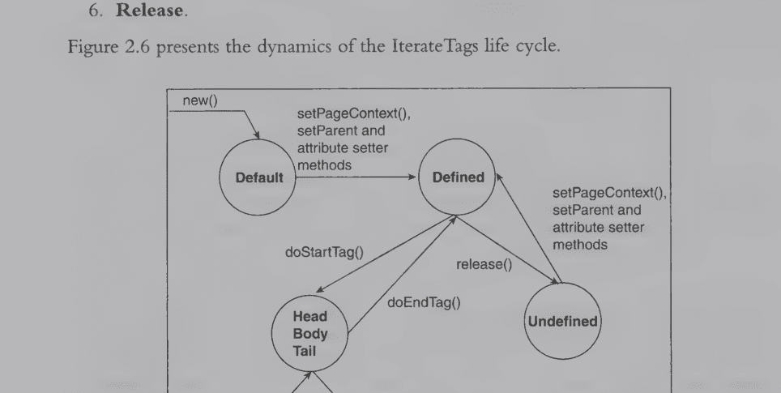

### 主体标签生命周期

主体标签是可以访问其主体内容的标签。它通过`BodyContent`对象感知该内容。可以通过`BodyTag`接口的`setBodyContent`方法修改主体内容。这会影响生命周期，必须包含一个初始化`BodyContent`对象的阶段，以及一个标记主体处理开始的阶段。

多个步骤被添加以实现对主体内容的内省，如下面的列表所示。主体标签也可以对主体进行循环。生命周期的初始化和终结部分是相同的。

1. **创建。**

2. **初始化。**

3. **处理头部。**

4. **setBodyContent**——主体内容被捕获在`BodyContent`对象中。

5. **处理主体**——通过`BodyTag`接口的`doInitBody`方法处理主体内容。标签设计者可以使用此方法来指定实现标签所代表的核心过程所必需的行为。

6. **循环遍历**——在此步骤中，每当主体被循环遍历时，就会调用`IterateTag`接口的`doAfterBody`方法。此方法使标签设计者能够对主体实现任何类型的迭代处理。`doAfterBody`方法返回一个标志，指示标签是否需要再次循环遍历主体。

7. **处理尾部。**

8. **释放。**

图 2.7 展示了生命周期的动态过程。

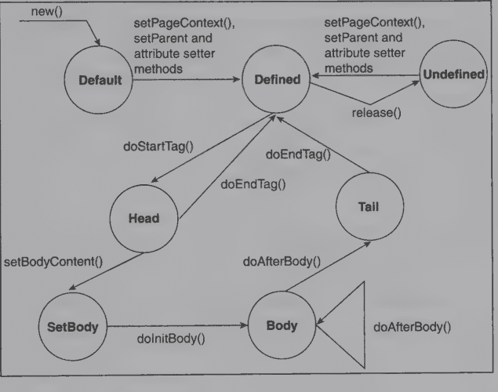

**图 2.7** 主体标签生命周期。

## 标签库描述符文件

既然你已经对自定义标签是什么以及如何使用它有了很好的了解，你需要了解它是如何与 JSP 关联的，以及 Web 容器是如何定位和处理的。

这个等式涉及四个组件：

- **JSP**——JSP 包含一个 taglib 指令并使用标签。

- **应用程序的 Web 部署描述符**——`web.xml` 文件包含一个标签库元素，该元素将 taglib 指令与标签库描述符相关联。

- **标签库描述符文件**——标签库描述符（TLD）文件是一个 XML 文件，描述了构成标签库的多个组件：标签、它们的辅助类、验证器类和应用程序级事件监听器。

- **标签处理器类**——标签处理器是实现某个标签接口的 bean，可选地扩展其中一个支持类。该类的文件实现了所需的功能。

图 2.8 说明了这四个组件。

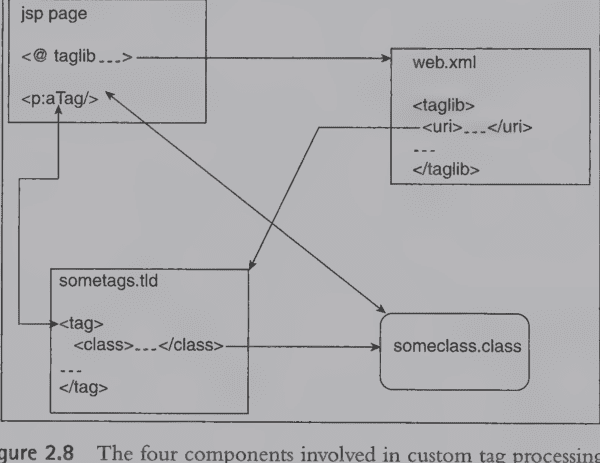

### 部署

标签库是实现一组服务及其辅助类的标签的集合。最终，实现所需功能所需的上下文类也包含在内。

这个集合可以作为一组文件以临时方式部署。这种情况在内部使用的标签库中更为常见。

它也可以打包为 jar 文件，就像必须预先包装好才能立即使用的商业标签库一样。在这种情况下，标签库描述符、标签以及辅助类和上下文类都被打包在 jar 文件中。以这种方式打包时，TLD 文件放在 `META-INF` 子目录中。所有需要的资源也都打包在内。

下一节将描述 TLD 文件。

## 标签库描述符文件

标签库描述符文件是一个 XML 文件，描述了标签库中的所有元素。这些包括标签库描述参数、验证器、应用程序级事件监听器、标签和辅助项。TLD 背后的理念是它执行以下功能：

- **服务于 JSP 处理器**——TLD 文件为 JSP 处理器提供了一种方式来识别运行库标签所需的必要参数。从这个意义上说，使用由标签库描述符 DTD 定义的 XML，是一种以与平台和容器无关的方式提供配置信息的合适方式。


- **可由标签设计者管理**——XML 几乎可以用任何文本编辑器手工编写，也可以使用复杂的 XML 编辑工具。GUI 组合工具可以自动生成它。这种灵活性使 JSP 标签程序员可以轻松地提供标签库用户所需的基本信息。

- **易于被 GUI 组合工具消化**——就像 JSP 处理器可以轻松访问标签库中的配置信息来处理其标签一样，组合工具也会找到配置信息来呈现和组合标签，验证 JSP 页面中标签的使用，并为新创建的标签提供信息。

目前，TLD 实现了 DTD JSP 标签库版本 1.2。它定义了两个级别的元素：标签库级别的元素和标签级别的元素。

标签库描述参数旨在提供信息以记录标签库。这允许 JSP 处理器和 GUI 组合工具识别诸如版本、图标表示、名称、描述、验证和资源控制等信息。

标签库描述符的第二部分涉及标签元素的定义。这些元素提供诸如库中有哪些标签、它们是如何定义的、定义的属性的详细信息、标签是否有主体、标签是否定义了脚本变量等信息。

## taglib 元素

`taglib`元素是 TLD 中最高范围的元素——用 XML 的行话来说，即根元素。它包含所有其他标签定义。以下是该元素的描述：

```
<!ELEMENT taglib (tlib-version, jsp-version?, short-name, uri?,
                 display-name?, small-icon?, large-icon?, description?,
                 validator?, listener*, tag+) >
```

在这里，你可以看到关于标签库可以指定的所有信息。JSP API 1.2 在 TLD DTD 的先前版本中为`taglib`元素引入了一些元素。这些元素是`display-name`、`large-icon`、`small-icon`、`validator`和`listener`。`description`元素取代了之前的`info`。

`taglib`元素有一个隐式的固定属性`id`，用于标识标签库描述符中元素定义的默认命名空间：

```
<!ATTLIST taglib id ID #IMPLIED xmlns CDATA #FIXED
"http://java.sun.com/dtd/web-jsptaglibrary_1_2.dtd">
```

在`taglib`元素下定义的元素描述了标签库中的各个组件。

## 描述性元素和版本控制元素

描述性元素和版本控制元素提供了记录库所需的信息。开发人员在为特定应用程序选择库时、在使用图形组合工具显示标签库图标和描述时，或在使用 JSP 处理器验证版本一致性时，可以使用此信息。描述性元素如下所示：

- **tlib-version**——保存标签库实现版本。标签库开发人员可以将此元素同时用作内部版本号和公共版本号。它是一个杜威十进制数。

- **jsp-version**——保存此标签库所需的 JSP 版本。开发人员可以基于某个 JSP API 版本创建商业标签库，并记录此依赖关系。例如，如果你想在标签中使用`TryCatchFinally`，则必须确保 JSP API 版本为 1.2；否则，该接口将不可用。其值是一个杜威十进制数。默认值为 1.2。

- **short-name**——是一个可以由组合工具和程序员使用的名称，用于创建变量和临时对象，或作为页面中 taglib 指令的前缀。不能使用空白字符。此名称不能以数字或下划线开头。

- **uri**——是一个唯一标识此标签库的 URI。商业标签库的供应商使用此功能将其品牌附加到库中。

- **display-name**——指定一个将出现在组合工具描述符和配置中的名称。与`short-name`的区别在于，这是用于描述的名称，而`short-name`是用于作为变量名前缀或种子的名称。

- **small-icon 和 large-icon**——主要也是为库在组合工具中加载时提供额外的图形样式。这些元素包含图形文件的名称，大图必须是 32 × 32 像素，小图也必须是 32 × 32 像素。图像必须是 JPEG 或 GIF 图像。

- **description**——取代了 TLD 以前版本中的`info`元素。它是一段简短的文本。

列表 2.8 是一个标签库描述符片段的示例，说明了如何使用描述元素。

### 清单 2.8 标签库描述符片段

```
<!ATTLIST taglib id ID #IMPLIED xmlns CDATA #FIXED
 "http://java.sun.com/dtd/web-jsptaglibrary_1_2.dtd">

<taglib>

 <tlib-version>1.1.0</tlib-version>

 <!-- 这是可选的，因为 1.2 是默认值 -->
 <jsp-version>1.2</jsp-version>

 <short-name>exampleTags</short-name>

 <!-- 这也是可选的 -->
 <uri>urn:jspBook.exampleTags</uri>

 <display-name>JSP/TagLib 书籍示例标签</display-name>

 <small-icon>/icons/example.gif</small-icon>

 <large-icon>/icons/example1.gif</large-icon>

 <description>
此片段说明了描述性元素在 TLD 中的使用。你可以看到其
目的有二：一是供设计人员在创建或使用标签库时使用，二是供自动化工具或组合工具使用，以便
在环境中集成并识别标签库的存在。
 </description>

 ...

</taglib>
```

## 验证器

JSP 标签扩展 API 包含两类 Java 类：翻译时类，用于在翻译过程中协助 JSP 处理器；以及运行时类，它们负责实际的处理。翻译时类可分为内部类和用户定义类。纯内部类是 JSP 处理器在核心翻译过程中始终创建或实例化的类，标签设计人员在其中没有主动定义的角色。例子包括`TagInfo`和`TagLibraryInfo`。

用户定义的翻译时类是设计人员主动参与定义的类。这意味着设计人员必须提供一个 Java 类，该类实现所需的接口或扩展基类以协助翻译过程。该类将向 JSP 处理器提供额外信息，这些信息在将使用标签库的 JSP 翻译成目标 servlet 时是必需的，正如你在第 1 章中所见。

标签库有时会定义一些对象，为正在实现的过程提供上下文。JSP 处理器无法知道页面必须满足这一特定条件——换句话说，即上下文必须存在或处于某种状态——才能使用该标签库。因此，JSP 处理器需要一些外部信息。

验证器类就是为此目的而设。这是一个用户定义的翻译时类，用于测试实际 JSP 页面对使用该标签库的符合性。这也确保了这些上下文对象存在且处于适当状态，使标签能够无进一步问题地使用。如果验证成功，翻译过程将继续，标签库可以在该页面中使用。如果页面验证失败，将引发`JspTagException`，翻译过程停止。

TLD 的`validator`元素定义了一个扩展`TagLibraryValidator`抽象类的类。关于页面的数据通过持有页面 XML 表示的`PageData`对象传递给验证器类。关于标签库的数据通过`TagLibraryInfo`对象传递。验证器的语法如下：

```
<!ELEMENT validator (validator-class, init-param*) >

<!ELEMENT validator-class (#PCDATA) >

<!ELEMENT init-param (param-name, param-value, description?)>

<!ELEMENT param-name (#PCDATA)>

<!ELEMENT param-value (#PCDATA)>
```

该`validator`元素定义了两个子元素：`validator-class`保存验证器的完全限定类名，`init-param`定义验证所需参数的名称-值对。它可以包含多个名称-值对。名称-值对通过子元素`param-name`和`param-value`定义（参见清单 2.9）。

### 清单 2.9 在 TLD 中描述验证器

```
<validator>

    <validator-class>
        jsp.book.examples.XMPValidator
    </validator-class>

    <init-param>

        <param-name>
            exampleHelperPath
        </param-name>
```

```
<param-value>
  /WEB-INF/examplesHelpers
</param-value>

<param-name>
  exampleHelperDefaultValue
</param-name>

<param-value>
  true
</param-value>

</init-param>

</validator>
```

## 监听器

正如你在第 1 章中所见，Servlet API 2.3 的一个重要新增功能是应用程序级事件监听器。这些提供了更细粒度的手段来管理应用程序组件分配的资源，这些资源必须有序释放以防止应用程序环境中的问题。

`listener`元素允许应用程序级事件监听器管理标签库组件分配的资源——例如：

- **检测容器启动**——基于 JDBC 的数据库访问标签库可以注册一个监听器，用于监控容器启动事件以分配 JDBC 数据源和连接池。

- **检测容器关闭**——同一个库可以注册一个监听器，用于监控容器关闭事件以释放 JDBC 数据源和连接池。

- **检测会话数据绑定**——当标签库的某个上下文类绑定到会话或从中解绑时，标签库可以得到通知。

`listener`元素的语法如下：

```
<!ELEMENT listener (listener-class) >

<!ELEMENT listener-class (#PCDATA) >
```

只有一个子元素，其中包含要注册为事件监听器的完全限定类名。此注册过程在容器中实现。当上下文关闭等事件发生时，容器调用监听器，使其可以在适当的时候执行其操作。以下示例说明了声明标签库监听器的 TLD 片段：

```
...
<listener>
  <listener-class>
    jsp.book.examples.AContextStartupListener
  </listener-class>
</listener>
```

有关应用程序级事件监听器的更多信息，请参阅 Servlet 2.3 规范。

## 标签

`tag`元素是标签库描述符中的主要元素。它们描述了标签以及 JSP 处理器将标签定义翻译成运行时结构所需的关联翻译时辅助类。在某种程度上，`tag`元素类似于`taglib`元素，因为它也具有描述性和非描述性元素。翻译时和运行时元素也都存在。`tag`元素的语法如下：

```
<!ELEMENT tag (name, tag-class, tei-class?, body-content?, display-name?, small-icon?, large-icon?, description?, variable*, attribute*) >
```

你可以看到一些已经定义过的子元素。这里可以看到与`taglib`元素相同的`display-name`、`small-icon`、`large-icon`和`description`子元素。不同之处在于这里描述的是标签而不是库。这些元素将在`tag`元素内部使用，以启用自动化工具——例如，通过其小图标显示某个标签的图标表示，或通过`short-name`子元素显示短名称。

### DTD 声明与 TLD

你必须记住，XML DTD 没有作用域声明。因此，任何元素都与其他元素在同一级别声明，元素名称不能重复。这同样适用于标签库描述符文件，因为它们也是 XML 文件。

你现在将检查`tag`元素的子元素，并查看一些关于标签定义的综合示例。

`name`元素保存该标签在 JSP 页面中的名称。此元素是必需的，并且必须在标签库中唯一。正如你在前面关于命名空间的讨论中所学，你不需要创建奇特的名称，例如使用 GUID 号码作为标签名称，因为`taglib`指令允许用户指定一个前缀来阐明名称。但是，在正在定义的库中，它必须是唯一的。

`tag-class`元素保存实现此标签的类的完全限定名称。其语法与`validator-class`元素类似。

如果标签定义了一个脚本变量，即对页面可见的变量，那么它可能有一个关联的`TagExtraInfo`（TEI）类。`TagExtraInfo`类用于提供关于标签定义脚本变量的信息，并验证标签属性。它是一个翻译时类。在该版本的 API 中，`tei-class`元素从必需变为可选。引入了`variable`子元素（稍后讨论）来提供该信息。你可以使用任一方式来提供此信息。

标签可以有主体。正如你在上一节中所学，主体的内容可以有很大差异。为了给 JSP 处理器一个提示，告诉它在标签主体中会发现什么，有`body-content`元素。它有三种可能的值：

- **empty**——主体将为空。这是简单标签的情况。

- **tagdependent**——这表示标签本身将解释内容。经典例子是 SQL 处理，但你也可以考虑其他选项，例如 XML 片段或原始数据。JSP 处理器将忽略主体内容，最终通过`BodyContent`对象将其传递给标签。

- **JSP**——主体标签包含 JSP。它可以是内容、自定义标签或 JSP 元素，例如脚本片段、表达式等。

到目前为止，你已经看到了简单的`tag`子元素。它们的语法相当简单：

```
<!ELEMENT name (#PCDATA) >

<!ELEMENT tag-class (#PCDATA) >

<!ELEMENT tei-class (#PCDATA) >

<!ELEMENT body-content (#PCDATA) >

<!-- 以及 body-content 元素 -->

#PCDATA ::=  tagdependent | JSP | empty
```

以下是标签声明的片段：

```
<tag>

    <name>defineHREmplRecord</name>
    <tag-class>hr.defineHREmplRecord</tag-class>
    <body-content>empty</body-content>

    ...
</tag>
```

其余的子元素是`variable`和`attribute`。它们描述了此标签定义的脚本变量以及此标签可能具有的属性。

`variable`子元素是由标签扩展 API 1.2 版本引入的，以简化声明标签定义的脚本变量或标签使用的变量的任务。此子元素使得 TEI 和`VariableInfo`类的使用变为

## 将一切整合起来

既然你已经了解了`variable`子元素的结构，现在来看看它的语法：

```
<!ELEMENT variable ( (name-given | name-from-attribute), variable-class?, declare?, scope?) >
```

你可以看到，这是一个相当丰富的元素。

`name-given`元素保存变量的名称，前提是该变量是常量且由标签设计者预先定义。这通常适用于仅内部使用的变量，例如那些仅在标签库内部提供通信的变量。

`name-from-attribute`元素保存属性的名称，该属性在翻译时将定义变量的名称。这种机制的一个例子是`jsp:useBean`标准动作的`id`属性。它定义了被实例化 bean 的名称。当标签设计为与外部资源或可能的外部标签交互时，就会出现这种情况。在这种情况下，最好将变量命名的决定权留给标签库的使用者。

这两个元素是互斥的。变量名要么是常量（`name-given`），要么是使用者定义的（`name-from-attribute`）。但是，必须至少提供其中一个。

`variable-class`元素保存变量所实现的 Java 类的完全限定名。这是一个可选元素。默认类是`java.lang.String`。

如果标签正在向页面声明此变量，`declare`元素的值必须为`true`；这也是其默认值。如果它只是使用之前声明的变量，那么其值必须为`false`。此元素是可选的。

`scope`元素定义了脚本元素的范围。变量可以具有以下任一范围：

- **NESTED 范围**——变量仅在此标签的主体内可用。用于标签与其主体之间通信的实用变量属于此范围。NESTED 是默认范围。

- **AT_BEGIN 范围**——变量在`doStartTag()`成员函数的处理中定义。你可以将其视为在处理标签的开头（即开始部分）时发生。变量将对主体可用，并在之后对页面的其余部分保持可用。

- **AT_END 范围**——变量在标签处理完毕后，在`doEndTag()`成员函数的处理中生成。你可以将其视为在处理标签的尾部（即关闭部分）时发生。这些变量不对主体可用。它们仅对页面的其余部分可用。

既然你已经了解了`variable`子元素的结构，现在来看看它的语法：

```
<!ELEMENT name-given (#PCDATA) >

<!ELEMENT name-from-attribute (#PCDATA) >

<!ELEMENT variable-class (#PCDATA) >

<!ELEMENT declare (#PCDATA) >

<!ELEMENT scope (#PCDATA) >
```

第 4 章深入探讨了协作标签的主题，以及脚本变量在提供标签间通信方面的作用。以下是一些在 TLD 中描述变量的示例。

### 清单 2.10 声明变量

清单 2.10 显示了两个字符串变量，它们将在标签主体内保存一些参数。


```
<variable>
    <name-given>firstExample</name-given>
</variable>

<variable>
    <name-from-attribute>secondExample</name-from-attribute>
</variable>
```

第一个变量将被命名为`firstExample`。第二个变量将由名为`secondExample`的属性命名。通过指定该属性，使用者可以为其分配任何名称。

### 清单 2.11 AT_BEGIN 范围

清单 2.11 定义了一个 bean，它保存要在主体内构建的复杂信息，并且必须对页面的其余部分可用。

```
<variable>
    <name-from-attribute>thirdExample</name-from-attribute>
    <variable-class>
        jsp.book.examples.ThirdVarExample
    </variable-class>
    <scope>AT_BEGIN</scope>
</variable>
```

清单 2.12 显示了一个被使用但未由标签定义的变量。

### 清单 2.12 使用预声明的变量

```
<variable>
  <name-from-attribute>fourthExample</name-from-attribute>
  <variable-class>
    jsp.book.examples.FourthVarExample
  </variable-class>
  <declare>false</declare>
</variable>
```

`attribute`元素定义了标签的属性。属性保存参数化标签实现的核心过程所需的信息。这定义了属性的名称、是否必需、是否动态计算以及属性的类型。`attribute`元素的语法如下：

```
<!ELEMENT attribute (name, required? , rtexprvalue?, type?) >
```

`name`子元素是唯一必需的，它保存属性的名称。

如果属性是强制性的，那么`required`子元素的值必须为`true`或`yes`。如果属性不是强制性的，则其值必须为`false`或`no`。默认值为`false`。这是每个属性的配置。例如，假设你有一个标签，如`checkSecurityRule`（参见第 3 章中的示例），它接受两个属性：`GROUP`和`ROLE`。你希望强制至少提供其中一个。无法指定这个"至少一个"的条件。你必须将所有属性都设为可选属性，使`required`等于`false`，并在标签中编写代码以确保在运行时至少定义了一个值。

`rtexprvalue`元素定义属性的值是在设计时作为常量字符串硬编码，还是在运行时作为 Java 表达式求值的结果（`rtexprvalue`代表"运行时表达式值"）。如果是动态的，`rtexprvalue`的值必须为`true`或`yes`，并且属性的值必须使用 JSP 表达式计算。如果属性是静态的，则必须为`false`或`no`，并且值必须在设计时硬编码。默认值为`false`。静态属性必须作为字符串传递。

`type`元素保存属性的 Java 类型（如果是动态的）。

以下是属性子元素的语法：

```
<!ELEMENT name      (#PCDATA) >

<!ELEMENT required    (#PCDATA) >

<!ELEMENT rtexprvalue (#PCDATA) >

<!ELEMENT type (#PCDATA) >
```

清单 2.13 使用了许多属性，以便你可以检查所做的各种配置。

### 清单 2.13 使用属性

```
<jspBook:defineHREmplRecord type="103" index="<%=emplBean.getIndex()%>"
deps="<%=emplBean.getDepsEnum()%>" />

<jspBook:defineHREmplRecord type="102" index="<%=emplBean.getIndex()%>" />
```

清单 2.14 是`defineHREmplRecord`标签的相关配置文件。

### 清单 2.14 属性声明

```
<attribute>
  <name>type</name>
  <required>true</required>
  <rtexprvalue>false</rtexprvalue>
</attribute>

<attribute>
  <name>index</name>
  <required>true</required>
  <rtexprvalue>true</rtexprvalue>
</attribute>

<attribute>
  <name>deps</name>
  <required>false</required>
  <rtexprvalue>true</rtexprvalue>
  <type>java.util.Enumeration</type>
</attribute>
```

第一个属性`type`是必需的，其值必须在设计时提供。第二个`index`也是必需的，其值在运行时作为将被求值的 JSP 表达式提供。第三个属性`deps`不是必需的，但如果提供，其值也必须通过 JSP 表达式在运行时计算。

## 将一切整合起来

既然你已经了解了标签库描述符文件中的所有元素，现在可以看到它们在完整文档中的声明方式。清单 2.15 声明了 HR 标签库，该库将实现 HR 页面中员工记录的格式化打印。

### 清单 2.15 HR 标签库的 TLD

```
<!ATTLIST taglib id ID #IMPLIED xmlns CDATA #FIXED
    "http://java.sun.com/dtd/web-jsptaglibrary_1_2.dtd">

<taglib>

    <tlib-version>1.1.0</tlib-version>
    <jsp-version>1.2</jsp-version>
    <short-name>hr</short-name>
    <uri>urn:jspBook.exampleTags</uri>
    <display-name>Human Resources Display Tags</display-name>
    <small-icon>/icons/hr.gif</small-icon>
    <large-icon>/icons/hr.gif</large-icon>
    <description>
        this is the comprehensive TLD example
    </description>

    <validator>
        <validator-class>
            jsp.book.examples.HRValidator
        </validator-class>
    </validator>

    <listener>
        <listener-class>
            hr.HRStdTableSetListener
        </listener-class>
    </listener>

    <tag>

        <name>defineHREmplRecord</name>
        <tag-class>hr.defineHREmplRecord</tag-class>
        <body-content>empty</body-content>
        <variable>
            <name-from-attribute>empl</name-from-attribute>
            <variable-class>hr.HREmployee</variable-class>
            <scope>AT_BEGIN</scope>
        </variable>

        <attribute>
            <name>type</name>
            <required>true</required>
            <rtexprvalue>false</rtexprvalue>
        </attribute>

        <attribute>
            <name>index</name>
            <required>true</required>
            <rtexprvalue>true</rtexprvalue>
        </attribute>
```

```xml
<attribute>
    <name>deps</name>
    <required>false</required>
    <rtexprvalue>true</rtexprvalue>
    <type>java.util.Enumeration</type>
</attribute>

</tag>

<tag>

    <name>displayHREmplRecord</name>
    <tag-class>hr.displayHREmplRecord</tag-class>
    <body-content>empty</body-content>
    <variable>
        <name-from-attribute>empl</name-from-attribute>
        <variable-class>hr.HREmployee</variable-class>
        <scope>AT_BEGIN</scope>
    </variable>

    <attribute>
        <name>index</name>
        <required>true</required>
        <rtexprvalue>true</rtexprvalue>
    </attribute>

</tag>

</taglib>
```

在这里你可以看到标签库上下文中的各个元素。`defineHREmplRecord`和`displayHREmplRecord`这两个类将在下一章定义。

## 商业支持

随着行业对 JavaServer Pages 的动量不断增加，对标签库的关注也将随之增加，标签库自 JSP 1.1 以来就一直是 JSP 规范的一部分。标签库描述符版本 1.2 引入了几个新元素，以提供更好的与基于 GUI 的 JSP 组合工具和 IDE 的集成。

你已经看到，TLD 现在在库级别和标签级别都支持版本信息和描述信息。多家供应商已经开始在其工具中支持标签库。例如 Borland 的 JBuilder 和 Allaire 的 JRunStudio，仅举几例。

## 小结

本章介绍了标签开发和标签库组织的主要概念。你了解了什么是标签，以及什么不是标签。你还了解到标签具有相当灵活的结构，可以扮演多种角色，例如帮助实现某些数据结构、划分复杂流程以及处理原始数据。标签可以选择性地包含主体内容。

标签库围绕**标签库描述符（Tag Library Descriptor，TLD）**文件进行组织，库中的所有组件、标签类、脚本变量、事件监听器等都根据需要在该文件中进行描述、命名和参数化。你了解了 JSP 中的`taglib`指令、Web 应用程序部署描述符文件`web.xml`和 TLD 文件之间的关系。你还看到了在 JSP 翻译期间，一个文件如何引用另一个文件，直到获得标签的完整描述。


# 第 3 章 编写自定义标签

本章介绍构成 JSP 标签扩展 API 1.1 的接口和类，它们是用于创建标签库的基本构建块。

## 简单标签

如果标签不操作其主体内容，则称为简单标签。它要么完全没有主体内容，要么有主体内容，但 JSP 容器只是对其进行求值并可能将其包含到输出流中，而不将其提供给简单标签使用。

简单标签实现`Tag`接口。它们可以选择性地扩展`TagSupport`类，该类提供了一些实用方法。

### 标签处理器

**标签处理器（tag handler）**是一个 Java 类，它实现了自定义操作所需的功能。它本质上是一个 Java bean，通过零参数构造函数实例化，而不是通过`java.beans.Bean.instantiate`方法实例化，并且它实现了`Tag`、`IterateTag`或`BodyTag`接口之一。

区分**标签**和**标签处理器**的概念很重要。标签在 JSP 页面中以文本形式表示自定义操作，是在 JSP 文件中按精确顺序执行自定义操作的文本规范。而标签处理器则是 JSP 容器将加载和执行的 Java 类，它实现了该自定义操作。

标签处理器是由容器管理的对象。这意味着容器将维护对标签的必要引用。标签设计者必须避免在标签处理器上下文之外维护此类引用，该上下文包括第一个调用的方法（`doStartTag`）和最后一个方法（`doEndTag`或`doFinally`），具体取决于标签处理器是否实现了`TryCatchFinally`接口。容器还负责初始化标签处理器并设置预定义属性，即`parent`和`pageContext`，以及所有作为属性公开的属性，这些在 TLD 中指定。

标签处理器可以访问服务器端对象。`Tag`接口是标签处理器在标签扩展 API 1.1 中可以实现的最基本接口，它提供了`pageContext`属性，通过该属性可以访问存储在应用程序任何作用域中的任何对象（由应用程序请求定义的会话、应用程序请求、应用程序上下文和页面上下文），以及 Web 应用程序中的任何资源。这些可以通过`PageContext.getContext`方法访问，该方法提供对代表 Web 应用程序的`ServletContext`对象的访问。

标签处理器可以访问外层标签。`Tag`接口还提供了`getParent`方法，通过该方法标签可以访问对其外层标签的引用。通过内省或显式引用，它可以访问父标签中定义的属性。

清单 3.1 展示了标签处理器的第一个示例。它通过扩展便捷类`TagSupport`来实现`Tag`接口，并实现了经典的"Hello World!"示例。

#### 清单 3.1 "Hello World!"标签处理器示例

```java
package jspbook.example.tags;

import javax.servlet.jsp.*;
import javax.servlet.jsp.tagext.*;

public class HelloWorldTag extends TagSupport
{
    public int doStartTag() throws JspException
    {
        // 从页面上下文获取输出流
        // 并写入 Hello World! 然后，由于
        // 没有主体求值，跳过它。

        pageContext.getOut().println("Hello World!");
        return (SKIP_BODY);
    }
}
```

```java
public int doEndTag() throws JspException
{
    return (EVAL_PAGE);
}
```

标签处理器是一个 Java 类。它实现了一个接口，该接口定义了标签处理器必须实现的预期方法，以便与 JSP 容器有效通信。此标签处理器实现了`Tag`接口。它展示了构成`Tag`接口的两个方法：`doStartTag`和`doEndTag`。在此标签处理器中，大部分处理发生在`doStartTag`方法内。它打印 "Hello World!" 消息。`HelloWorldTag`标签处理器类将在 JSP 中由一个标签表示，该标签由以下标签库描述符文件（TLD 文件）片段定义，如清单 3.2 所示。

### 清单 3.2 hello 标签的 TLD 声明，表示 HelloWorldTag 标签处理器

```xml
<tag>
    <name>hello</name>
    <tagclass>jspbook.example.tags.HelloTag</tagclass>
    <bodycontent>empty</bodycontent>
</tag>
```

该标签将在 JSP 文件中使用，不带任何属性和主体内容。为此，需要编译和部署该标签，可以将其放在 JAR 归档文件中，或者直接放在类路径的某个目录中。然后需要提供 TLD 文件，并在 Web 应用程序部署描述符中注册此 TLD 文件。之后，该标签即可使用。有关标签库描述符文件的详细描述以及如何在 web 应用程序部署描述符文件`web.xml`中声明的说明，请参阅第 2 章"标签库简介"。清单 3.3 展示了在名为 example 的标签库中使用 hello 标签的 JSP。

### 清单 3.3 使用 hello 标签

```jsp
<%@ taglib uri="/WEB-INF/example.tld" prefix="example" %>
<html>
<body>
<center>
<h1><example:hello/></h1>
</center>
</body>
</html>
```

此页面将在页面顶部以 HTML 标题类型 1 显示 "Hello World!" 消息。


你会注意到在`taglib`指令中定义了`prefix`属性，并在`hello`标签中使用了`example:hello`。这样做是为了在两个标签库设计者定义了相同名称的标签时避免名称冲突。这种情况在第 2 章"自定义标签和 XML 命名空间"一节中有说明。

这里的问题是，为什么要在本地定义而不是在 TLD 中一劳永逸地定义，例如在 TLD 中定义？关键在于，在 TLD 或 Web 应用程序部署描述符（`web.xml`文件）中定义它会将前缀置于页面设计者的视野之外，这将使记住哪些前缀用于哪些库的工作变得更加痛苦，至少可以这么说。而且可能出现这样的情况：页面设计者在不同页面中必须对同一个标签库使用多个不同的前缀。例如，假设一个拥有数百个页面的应用程序正在使用多个不同的标签库，而你需要在其中一些页面中添加另一个库。这个新库必须拥有与已使用的任何前缀都不同的前缀。最终，它可能在每个页面中使用不同的前缀，这必须绝对避免；这可能特别发生在有许多页面设计者在压力下工作的大型组织中。

## 标签的处理方式

JSP 页面中标签的处理遵循 JSP 的一般处理流程，这意味着页面被解析并翻译成 servlet，然后该 servlet 被编译成字节码。JSP 中的标签强制引入一种协议，以便按有序方式调用所需的方法。这意味着必须按照标签处理器实现的标签接口（或子接口）的约定，在生成的 servlet 中插入协议中的方法调用。清单 3.4 中的片段展示了 Jakarta Taglibs 项目中`Bar`标签的处理，实现了 JSP 规范 1.1 版本附录 A.1.2 节中介绍的`Bar`标签。该代码是从 Jakarta Taglibs 项目的`jsp-specification`标签库的`index.jsp`页面生成的中间 servlet 实现代码的摘录。

### 清单 3.4 为 Bar 标签调用生成的代码

```java
org.apache.taglibs.jspspec.BarTag _jspx_th_j_bar_0 = new org.apache.taglibs.jspspec.BarTag();
    _jspx_th_j_bar_0.setPageContext(pageContext);
    _jspx_th_j_bar_0.setParent(null);
    _jspx_th_j_bar_0.setId("newbean");
    _jspx_th_j_bar_0.setAtt1("First attribute");
    _jspx_th_j_bar_0.setAtt2("Second");
    _jspx_th_j_bar_0.setAtt3("3rd");
    java.lang.String newbean = null;
    try {
      int _jspx_eval_j_bar_0 = _jspx_th_j_bar_0.doStartTag();
      newbean = (java.lang.String)
```

```java
pageContext.findAttribute("newbean");
    if (_jspx_eval_j_bar_0 == BodyTag.EVAL_BODY_BUFFERED)
        throw new JspTagException("Since tag handler class
org.apache.taglibs.jspspec.BarTag does not implement BodyTag, it can't return
BodyTag.EVAL_BODY_TAG");
    if (_jspx_eval_j_bar_0 != Tag.SKIP_BODY) {
        do {
            newbean = (java.lang.String)
pageContext.findAttribute("newbean");
            // end
            // begin
[file="D:\\tomcat40b3\\bin\\...\\webapps\\jspspec-
examples\\index.jsp";from=(16,0);to=(16,69)]
        } while (_jspx_th_j_bar_0.doAfterBody() ==
BodyTag.EVAL_BODY_AGAIN);
        newbean = (java.lang.String)
pageContext.findAttribute("newbean");
    }
    if (_jspx_th_j_bar_0.doEndTag() == Tag.SKIP_PAGE)
        return;
} finally {
    _jspx_th_j_bar_0.release();
}
```

清单 3.4 展示了由 Tomcat 4.0b3 翻译的原始代码。你可以看到，其调用顺序与普通类的完全相同。调用始于变量`_jspx_th_j_bar_0`的实例化，该变量将包含此标签的实例。

紧接着是设置器序列，首先是`pageContext`属性，然后是`parent`属性。关于这些属性的详细讨论将在"`Tag`接口"一节中进行。接下来是对 JSP 源代码中该标签所标识属性的各个设置器方法的调用。

然后，一个`try`块包裹了对`doStartTag`的调用。它防止在未实现`BodyTag`接口的情况下返回一个不允许的值。如果该标签有任何主体内容，则会对其进行处理。随后调用`doEndTag`方法以完成标签的处理。此翻译中最后执行的方法是`release`，用于释放资源并刷新属性。

## Tag 接口

标签接口是标签处理程序可以实现的最基本的接口。它为标签处理程序与 JSP 容器通信提供了基本的协议。`Tag`接口的结构如表 3.1 所示。

84 第 3 章 编写自定义标签

表 3.1 `Tag`接口

| 字段或方法 | 描述 |
| :--- | :--- |
| **字段** | |
| `EVAL_BODY_INCLUDE` | 一个静态最终整数，向 JSP 容器发出信号，表明该标签有一个需要被求值并包含到输出流中的主体。此值将作为`doStartTag`方法的结果返回。 |
| `EVAL_PAGE` | 一个静态最终整数，向 JSP 容器发出信号，表明页面的其余部分需要被求值。此值将作为`doEndTag`方法的结果返回。 |
| `SKIP_BODY` | 一个静态最终整数，向 JSP 容器发出信号，表明该标签没有主体，或者由于内部结果或条件，主体不应被求值。此值将作为`doStartTag`方法的结果返回。 |
| `SKIP_PAGE` | 一个静态最终整数，向 JSP 容器发出信号，表明由于内部结果或条件，页面的其余部分不应被求值。此值将作为`doEndTag`方法的结果返回。 |
| **方法** | |
| `setPageContext` | 由容器调用，用于实例化标签处理程序的`pageContext`。 |
| `setParent` | 由容器调用，用于实例化标签处理程序的父标签。父标签是包含此标签的主体中最接近的外层标签。 |
| `getParent` | 检索父标签。 |
| `doStartTag` | 处理此标签处理程序实例的开始标签。此方法可以返回`EVAL_BODY_INCLUDE`，表示必须处理主体。它也可以返回`SKIP_BODY`，表示没有主体或主体必须不被处理。 |
| `doEndTag` | 处理此标签处理程序实例的结束标签。此方法可以返回`EVAL_PAGE`，表示 JSP 页面的其余部分必须被处理，或者它可以返回`SKIP_PAGE`，表示 JSP 页面的其余部分必须不被处理。 |
| `release` | 必须使用此方法来清除属性值，将其恢复为默认值，并释放分配的长期资源。此方法不打算用于在两次调用标签之间重置属性。 |

`Tag`标签处理程序的典型处理周期如下：

1. `Tag`标签处理程序进入`doStartTag`方法并执行其中的逻辑，返回`EVAL_BODY_INCLUDE`或`SKIP_BODY`。
2. 如果返回的值是`EVAL_BODY_INCLUDE`，则 JSP 容器将主体内容包含在输出流中。在这种情况下，主体中的标签和脚本小程序会被处理。
3. 如果返回了`SKIP_BODY`，则不进行主体求值。
4. 调用`doEndTag`方法，标签处理完成。

### 准备执行

如第 2 章所述，标签处理程序有一个生命周期，其中第一阶段涉及设置隐式和显式属性。在开始处理标签之前，JSP 容器会调用两个方法：`setPageContext`和`setParent`。

初始化`pageContext`和`parent`属性后（请记住，只有当存在这样的**父标签**——一个在其主体中包含此标签的标签——时，`parent`属性才会被赋值），容器会确定哪些属性作为属性公开，并使用自省来确定相应的设置器方法以初始化每个属性。

### doStartTag 方法

`doStartTag`方法调用对应于处理标签的开始部分。此方法假定`setPageContext`和`setParent`方法已被预先调用。

`doStartTag`方法是标签开发中一个非常基础的处理方法。如果标签处理程序需要在决定是否对主体进行求值之前执行某些处理，则必须在`doStartTag`方法中进行。具有需要被求值并可能打印到输出流的主体的简单标签属于此类别。

如果标签处理程序实现了`IterationTag`，则`doStartTag`方法负责设置迭代。如果标签处理其主体，则在主体求值之前需要进行的任何处理都在此方法中完成。

在`Tag`接口下，`doStartTag`方法可以返回两个可能的值：`EVAL_BODY_INCLUDE`或`SKIP_BODY`。

`EVAL_BODY_INCLUDE`返回值向 JSP 处理器发出信号，表示应对此标签的主体进行求值并包含到输出流中。`SKIP_BODY`值表示主体不应被求值或包含到输出流中，而应被丢弃。

一个以`EVAL_BODY_INCLUDE`和`SKIP_BODY`值为中心的标签设计模式是开/关设计模式。开/关标签的核心决策是是否将其主体内容包含到输出流中。在主体上发生的任何处理都与标签实现的逻辑无关；必要的是决定是否对主体内容进行求值和包含。

清单 3.5 展示了这样一个开/关标签。如果用户已通过身份验证，则包含主体内容。如果用户未通过身份验证，则主体被跳过，用户永远看不到它。此标签是授权标签库中的第一个标签，该标签库围绕一些用于检查用户凭证和身份验证状态的有用函数构建。

并非标签接口的所有方法都在代码示例中实现，以简化阅读并使所提出的观点更加明显。本书网站上的代码清单将是完整的。因此，强烈建议你下载代码而不是尝试手动输入。

### 清单 3.5 checkLogon 开/关标签处理程序

```java
package jspbook.example.authtags;

import javax.servlet.http.HttpServletRequest;
import javax.servlet.jsp.*;
import javax.servlet.jsp.tagext.*;

public class CheckLogonTag implements Tag
{
    public int doStartTag() throws JspException
    {
        // gets the request from the page context
        HttpServletRequest request = pageContext.getRequest();

        // if there is an authentication schema
        // performs the evaluation, if not skips the body
        if (request.getAuthType() != null)
        {
            // if the user was authenticated includes the
            // body, otherwise skips it.
            if (request.getUserPrincipal() != null)
                return (EVAL_BODY_INCLUDE);
            else return (SKIP_BODY);
        }

        // if it has not returned EVAL_BODY_INCLUDE yet
        // then the user has not been authenticated at all
        // so return SKIP_BODY

        return (SKIP_BODY);
    }

    public int doEndTag() throws JspException
    {
        return (EVAL_PAGE);
    }
}
```

`checkLogon`标签没有属性。它仅根据用户是否已通过身份验证，来决定是否将标签体内容包含到给定的输出流中。清单 3.5 假设已选择了容器管理的安全机制。

请注意，`doEndTag`方法在该标签的处理过程中完全不起作用，可以省略。在大多数情况下，当`doEndTag`方法被执行时，开/关模式标签的处理流程已经全部结束。不过，在标签体内容被包含之后，可能需要进行一些辅助处理。详情请参见即将介绍的"doEndTag 方法"一节。

该标签的 TLD 规范非常简单。由于它不接受任何属性，其声明类似于`hello`标签的声明。清单 3.6 展示了`checkLogon`标签的 TLD 声明。

### 清单 3.6 checkLogon 标签的 TLD 声明

```xml
<tag>
  <name>checkLogon</name>
  <tagclass>
    jspbook.example.authtags.CheckLogonTag
  </tagclass>
  <bodycontent>JSP</bodycontent>
</tag>
```

`HelloWorld`标签与`checkLogon`标签的区别在于，`checkLogon`允许包含标签体内容，但不会对其进行处理。清单 3.7 展示的 JSP 页面使用了`checkLogon`标签。它向用户呈现一些数据，并将页面的某些部分限制为仅允许已通过身份验证的用户访问。

### 清单 3.7 restrictedAccess.jsp 页面

```jsp
<%@ taglib uri="/WEB-INF/example.tld" prefix="example"%>
<example:checkLogon>
<html>
<body>
<table width="100%">
  <tr>
    <td colspan="2" align="center">
      <h1> User 0001 Preferences </h1>
    </td>
  </tr>
  <tr>
    <td align="center"> Preferred Locale </td>
    <td><b>BR</b></td>
  </tr>
  <tr>
    <td align="center"> Preferred Language </td>
    <td><b>Portuguese</b></td>
  </tr>
  <tr>
    <td align="center"> Timeframe </td>
    <td><b>+3</b></td>
  </tr>
  <tr>
    <td align="center"> Color Schema </td>
    <td><b>marine</b></td>
  </tr>
  <tr>
    <td align="center"> Font Face </td>
    <td><b>courier new</b></td>
  </tr>
</table>
</body>
</html>
</example:CheckLogon>
```

在这个页面中，仅仅因为`checkLogon`标签的存在，就决定了页面是否显示内容。你会注意到该标签被放置在 HTML 模板开始之前，并且包含了所有内容。这种行为的问题在于，如果用户未登录，甚至连一条提示信息都不会显示。这是可以解决的；例如，如果`checkLogon`是一个 body 标签，它就可以用一条提示需要登录才能访问页面的错误消息来替换整个标签体内容。图 3.1 展示了用户已登录时`restrictedAccess.jsp`的输出结果，显示了页面的完整输出。

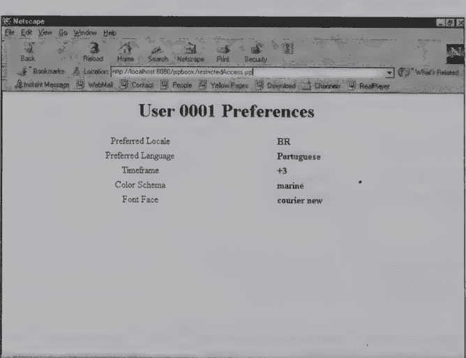

### 图 3.1 认证后的 restrictedAccess.jsp

如果用户未通过身份验证，或者未提供身份验证机制，则不会显示任何内容，输出为空白页面。这就是为什么采用 body 标签会是更好的方案。

### doEndTag 方法

`doEndTag`方法的调用对应于标签关闭部分的处理。该方法假定标签的所有待执行处理已经完成。

`doEndTag`方法是标签开发中的另一个基本处理方法。如果标签处理程序需要在标签体内容被求值之后执行某些处理，则必须在`doEndTag`方法中进行。清单 3.8 展示了一个更完整的`checkLogon`标签示例；在内容访问被授权后，出于安全目的，已通过身份验证的用户名将被记录下来。

### 清单 3.8 带日志记录的 checkLogon 开/关标签处理程序


以下是一个标签处理程序的示例，它实现了 `Tag` 接口，用于检查用户是否已通过身份验证，并在访问受限信息时记录日志。

```
package jspbook.example.authtags;

import javax.servlet.http.HttpServletRequest;
import javax.servlet.jsp.*;
import javax.servlet.jsp.tagext.*;

public class CheckLogonWithLoggingTag implements Tag
{
    public int doStartTag() throws JspException
    {
        // gets the request from the page context
        HttpServletRequest request = pageContext.getRequest();

        // if there is an authentication schema
        // performs the evaluation, if not skips the body
        if (request.getAuthType() != null)
        {
            // if the user was authenticated includes the
            // body, otherwise skips it.
            if (request.getUserPrincipal() != null)
                return (EVAL_BODY_INCLUDE);
            else return (SKIP_BODY);
        }

        // if it has not returned EVAL_BODY_INCLUDE yet
        // then the user has not been authenticated at all
        // so return SKIP_BODY

        return (SKIP_BODY);
    }

    public int doEndTag() throws JspException
    {
        ServletContext ctx = pageContext.getServletContext();
        HttpServletRequest req = pageContext.getRequest();
        String msg = "invalid access attempt";
        if (req.getUserPrincipal() != null) msg =
            req.getUserPrincipal() + "accessed restricted information";
        ctx.log(msg);
        return (EVAL_PAGE);
    }
}
```

请注意，在清单 3.8 中，`doEndTag` 方法补充了标签的关键功能，提供了其最重要的部分。由于它总是在标签体处理之后被调用，因此只需记录活动即可。标签设计者必须牢记这一点。设计者始终可以将任何行为分布到标签的各种方法中，前提是预期行为不会与标签的生命周期冲突。你会记得在第 2 章关于简单标签生命周期的介绍中，`doEndTag` 方法总是在 `doStartTag` 处理之后被调用。对于 `CheckLogonWithLoggingTag` 标签处理程序而言，这意味着在页面被包含到输出流之后，访问行为将被记录。这一操作正是该标签存在的根本原因，因此在 `CheckLogonWithLoggingTag` 标签处理程序中，发挥主要作用的不是 `doStartTag` 方法，而是 `doEndTag`。

清单 3.9 展示了该标签的 TLD 声明。

### 清单 3.9 "Hello World" 标签的 TLD 声明

```
<tag>
    <name>checkLogonRec</name>
    <tagclass>
        jspbook.example.authtags.CheckLogonWithLoggingTag
    </tagclass>
    <bodycontent>JSP</bodycontent>
</tag>
```

清单 3.10 展示的 JSP 页面使用了 `checkLogonRec` 标签。与清单 3.7 一样，该页面向用户呈现一些数据，并将页面的某些部分限制为仅允许已通过身份验证的用户访问。不同之处在于，每次访问都会被记录。

### 清单 3.10 restrictedAccessRec.jsp 页面

```
<%@ taglib uri="/WEB-INF/example.tld" prefix="example"%>
<example:checkLogonRec>
<html>
<body>
<table width="100%">
<tr>
  <td colspan="2" align="center">
    <h1> User 0001 Preferences </h1>
  </td>
</tr>
<tr>
  <td align="center"> Preferred Locale </td>
  <td><b>BR</b></td>
</tr>
<tr>
  <td align="center"> Preferred Language </td>
  <td><b>Portuguese</b></td>
</tr>
<tr>
  <td align="center"> Timeframe </td>
  <td><b>+3</b></td>
</tr>
<tr>
  <td align="center"> Color Schema </td>
  <td><b>marine</b></td>
</tr>
<tr>
  <td align="center"> Font Face </td>
  <td><b>courier new</b></td>
</tr>
</table>
</body>
</html>
</example:CheckLogonRec>
```

清单 3.11 展示了 Tomcat 上 `servlet.log` 文件的一个片段，显示了该标签生成的日志记录。你可以看到用户 ID——`wlsSilva`——被记录在其中。

## 清单 3.11 `checkLogonRec` 标签生成的日志记录

```
2001-06-26 11:51:54 - path="/jspExample" : wlsSilva accessed restricted information
2001-06-26 11:51:55 - path="/fpctd" :800
2001-06-26 11:51:55 - path="/fpctd" :LEVEL 3
2001-06-26 11:51:55 - path="/fpctd" :869
2001-06-26 11:51:55 - path="/fpctd" :LEVEL 2
```

## 标签处理程序设计中的继承

标签处理程序是一个 Java 类。因此，它可以从父类继承行为，也可以实现某些必要的接口。（这里避免使用 *ancestor*（祖先）一词，以防止与父标签属性混淆，并且因为嵌套标签将在后文中被称为祖先。）这一点最终非常重要，需要牢记，因为它将影响标签库设计者规划和实现标签的方式。

清单 3.12 是这种继承的一个示例。清单 3.13 展示了 `CheckLogonWithLoggingTag` 的一个新版本，它通过继承扩展了 `CheckLogonTag`。

## 属性

属性是标签用于控制或为其所代表的自定义操作提供数据的值。例如，如果一个标签代表数据库连接这样的对象，标签属性将代表建立连接所需的属性；在 JDBC API 中，这些属性包括 JDBC 驱动程序类名、数据库 JDBC 路径、用户名和密码。另一方面，如果一个标签代表某个过程，例如 JNDI 查找过程，则属性代表将对该过程进行参数化的配置值。

属性作为实现标签的标签处理程序的属性来实现。当它们在 TLD 文件中被声明为标签属性时，这些属性就变成了标签属性。需要特别注意的是，标签属性不是双向参数；它们永远不会用于从标签处理程序输出值。清单 3.13 展示了 `CheckLogonWithLoggingTag` 的一个变体，其中定义了一个属性来指定被访问资源的名称。

```
Listing 3.12  The CheckLogonWithLoggingTag Tag Handler Inherited

package jspbook.example.authtags;

import javax.servlet.http.HttpServletRequest;
import javax.servlet.jsp.*;
import javax.servlet.jsp.tagext.*;

public class CheckLogonWithLoggingTag extends CheckLogonTag
{
    public int doEndTag() throws JspException
    {
        ServletContext ctx = pageContext.getServletContext();
        HttpServletRequest req = pageContext.getRequest();
        String msg = req.getUserPrincipal() +
                "accessed restricted information";
        ctx.log(msg);
        return (EVAL_PAGE);
    }
}
```

这是一个毫无意外的显著变化。`doStartTag` 方法的功能由父类 `CheckLogonTag` 提供，而此标签仅提供了额外的功能。当一个标签要扩展其他标签的行为时，这就是应使用的机制。Java 服务器端编程的新手常犯的一个错误是忘记所有这些类——servlet、bean、标签处理程序等——仍然是具备全部面向对象能力的 Java 类。

有时标签设计者希望提供一个基础，让其他标签设计者在此基础上构建标签库，或者希望定义执行某个过程的协议标签。为此，最佳实践是提供基类和接口，供后代标签继承或实现。所有良好类设计的公认实践都适用。

```
Listing 3.13  The CheckLogonWithNamedLoggingTag Tag Handler Inherited

package jspbook.example.authtags;

import javax.servlet.http.HttpServletRequest;
import javax.servlet.jsp.*;
import javax.servlet.jsp.tagext.*;

public class CheckLogonWithNamedLoggingTag extends CheckLogonTag
{

    // attributes are implemented as properties
    protected String res = null;

    // such properties should have getter and setter methods
    public String getRes()
    {
        return this.res;
    }

    public void setRes(String value)
    {
        this.res = value;
    }

    public int doEndTag() throws JspException
    {
        ServletContext ctx = pageContext.getServletContext();
        HttpServletRequest req = pageContext.getRequest();
        String msg = req.getUserPrincipal()+
                     "accessed restricted information: "+res;
        ctx.log(msg);
        return (EVAL_PAGE);
    }
}
```

`res` 属性被定义为标签处理程序的 `String` 类型属性。在标签内部，可以正常使用它，因为容器已经调用了该属性的 setter 方法。因此，`doEndTag` 方法可以获取该属性的值。与 bean 一样，标签处理程序必须具有属性声明、setter 方法，以及可选的 getter 方法。本书中描述的所有标签处理程序都将包含这两个方法。清单 3.14 展示了描述此新标签的 TLD 片段。注意属性声明。

```
Listing 3.14  *checkLogonWithNamedLogging* Inherited
<tag>
  <name>checkLogonWithNamedLogging</name>
  <tagclass>
    jspbook.example.authtags.CheckLogonWithNamedLoggingTag
  </tagclass>
  <bodycontent>JSP</bodycontent>
  <attribute>
    <name>resname</name>
    <required>true</required>
    <rtexprvalue>true</rtexprvalue>
  </attribute>
</tag>
```

清单 3.15 所示的代码片段展示了带有属性值的标签。清单 3.16 所示的片段展示了 `doEndTag` 方法执行后的日志。

```
Listing 3.15  Using the *res* Attribute
<%@ taglib uri="/WEB-INF/example.tld" prefix="example"%>
<example:checkLogonWithNamedLogging resname="Divisional Profile"/>
<html>
<body>
<table width="100%">
  <tr>
    <td colspan="2" align="center">
      <h1> Divisional Profile </h1>
    </td>
  </tr>
  <tr>
    <td align="center"> Division</td>
    <td><b>SalesBr</b></td>
  </tr>
  <tr>
    <td align="center"> Division Name </td>
    <td><b>Sales South America - Brazil</b></td>
  </tr>
  <tr>
    <td align="center"> Preferred Client </td>
    <td><b>Acme Indústria e Comércio Ltda</b></td>
  </tr>
  <tr>
    <td align="center"> Client Last Yr Movement (x1000) </td>
    <td><b>+120,000</b></td>
  </tr>
  <tr>
    <td align="center"> Client Last Movement (x1000) </td>
    <td><b>6,000</b></td>
  </tr>
  <tr>
    <td align="center"> General Account Manager </td>
    <td><b>Rob Bobberts</b></td>
  </tr>
  <tr>
    <td align="center"> Pref. Client Account Manager </td>
    <td><b>Johnny B. Good</b></td>
  </tr>
</table>
</body>
</html>
```

**清单 3.16 验证标签生成的日志条目**

```
2001-06-26 14:35:12 - path="/jspExample" : wlsSilva accessed restricted information: Divisional Profile
2001-06-26 14:35:13 - path="/atmd" :init-profile
2001-06-26 14:35:13 - path="/atmd" :init-activity
```

## 属性的 Java 类型、运行时值和静态值

标签属性在 JSP 容器的求值方式上可以有两种形式：它们可以是静态的，此时值将是 `String` 类型；也可以是运行时表达式，根据当前的 Tag Extension API 规范，必须被转换为脚本表达式。请注意，标签不能直接将另一个标签的结果作为属性值使用。新手常犯的一个非常普遍的错误是在规划 JSP 时使用标签作为其他标签属性的输入，如清单 3.17 所示。

**清单 3.17 捕获标签结果的错误方式**

```
...
<wrong:neverWorks attr="<wrong:noWay/>"/>
...
```

结果要么是异常，要么是将标签规范的字面值——在本例中为 `<wrong:noWay/>`——作为 `String` 类型的值传递给另一个标签，从而产生意外结果。


这是不允许的。处理这种情况有两种基本方法。如果你能控制 `wrong` 标签库，你可以将 `<wrong:noWay/>` 标签的结果转换为一个 bean 存储在某个作用域中；或者你可以创建一个包装标签——在这种情况下是一个 body 标签——来捕获 `<wrong:noWay/>` 标签的结果并将其作为 bean 存储在某个作用域中供其他标签使用。第一种方案将在 body 标签部分进行分析。第二种方案将在本章后面的"BodyTags"部分进行描述。

同样需要注意的是，标签的返回值*可以*用作纯 HTML 标签中的值。清单 3.18 完全正确。

```
清单 3.18 正确定义 HTML 属性值的方式
...
<a href='<fine:noProblems with="this"/>'>at all!</a>
...
```

这里 `<a>` HTML 标签接受由 `<fine:noProblems.../>` 标签生成的 `href`。这是完全正确的，因为标签将在服务器端的翻译/请求时被解析。页面生成后发送到客户端浏览器，然后 `<a>` 标签才被解释。这发生在 `href` URL 被求值之后很久。

请求时属性在 TLD 中通过 `rtexprvalue` 标记指定。这些属性接受脚本表达式作为值，可以是任何 Java 类型或类，前提是标签处理程序中的属性具有相同的类型或者是被传递对象的超类。清单 3.19 展示了一个具有 `java.util.Date` 属性的标签处理程序。清单 3.20 展示了它在 TLD 中的声明方式，清单 3.21 展示了它在 JSP 中的使用方式。

```
Listing 3.19 The WriteDateTag Tag Handler

package jspbook.example.authtags;

import javax.servlet.http.HttpServletRequest;
import java.util.Date;
import javax.servlet.jsp.*;
import javax.servlet.jsp.tagext.*;

public class WriteDateTag implements Tag
{
    Date date = null;

    public Date getDate()
    {
        return this.date;
    }

    public void setDate(Date value)
    {
        this.date = value;
    }

    public int doStartTag() throws JspException
    {
        pageContext.getOut().println(date.toString());
        return (EVAL_BODY_INCLUDE);
    }
}
```

在这里可以看到，`date` 属性被声明为 `java.util.Date` 类。`doStartTag` 只是将其输出。清单 3.20 展示了这在 TLD 中是如何体现的。

## Listing 3.20 在 TLD 中声明 `date` 属性

```
<tag>
    <name>writeDate</name>
    <tagclass>
        jspbook.example.tags.WriteDateTag
    </tagclass>
    <bodycontent>JSP</bodycontent>
    <attribute>
        <name>date</name>
        <required>true</required>
        <rtexprvalue>true</rtexprvalue>
        <type>java.util.Date</type>
    </attribute>
</tag>
```

前面属性声明中的 `type` 元素定义了该属性在运行时表达式值中可被求值的 Java 类型。如果需要额外的验证，可以使用 `TagExtraInfo` 类（TEI 类）。有关 TEI 类的更多细节，请参阅第 4 章"标签协作与验证"。清单 3.21 展示了如何在 JSP 页面中使用这个标签。

## Listing 3.21 传递 `date` 属性

```
...
<example:writeDate date="<%=new java.util.Date()%>"/>
<example:writeDate date="<%=someObj.returnADate()%>"/>
...
```

运行时表达式值中的脚本let可以包含任何返回预期类型的有效 Java 表达式。在清单 3.21 中，有一个构造函数调用和一些对象调用。另一方面，翻译时属性不能是任何 Java 类型或类，因为它们被指定为字符串常量。翻译时属性可接受的值是任何可通过 Java 语言中的有效字符串到类型转换转换为目标类型的值。实际上，它必须能够通过 `type.valueOf(String)` 方法转换为目标属性，或者必须来自相应的原始类型。清单 3.22 举例说明了这种情况。

### Listing 3.22 `WriteLongTag` 标签处理器

```
package jspbook.example.authtags;

import javax.servlet.http.HttpServletRequest;
import javax.servlet.jsp.*;
import javax.servlet.jsp.tagext.*;

public class WriteLongTag implements Tag
{
    long value = null;

    public Long getValue()
    {
        return this.value;
    }

    public void setValue(long value)
    {
        this.value = value;
    }

    public int doStartTag() throws JspException
    {
        pageContext.getOut().println("value is "+ value);
        return (EVAL_BODY_INCLUDE);
    }

}
```

这次 `value` 属性被声明为 `long` 类型。清单 3.23 展示了这在 TLD 中是如何体现的。

### Listing 3.23 在 TLD 中声明 `value` 属性

```
<tag>
    <name>writeLong</name>
    <tagclass>
        jspbook.example.tags.WriteLongTag
    </tagclass>
    <bodycontent>JSP</bodycontent>
    <attribute>
        <name>value</name>
        <required>true</required>
        <rtexprvalue>false</rtexprvalue>
    </attribute>
</tag>
```

`value` 属性没有类型声明，因为它是一个翻译时属性。清单 3.24 展示了如何在 JSP 页面中使用这个标签。

### Listing 3.24 传递 `long` 类型属性

```
...

<example:writeLong value="3145678923456L"/>

...
```

### 重置状态

标签处理器的 `release` 方法用于在处理完成后释放资源和将属性值重置为默认值。对于带有属性的标签，在处理完成后调用 `release` 至关重要，这样可以清理在标签调用时分配给属性的所有值。这确保了在下一次标签调用之前，所有属性都恢复了默认值，因为标签处理器可能被设计为依赖于这些默认值。你不能给属性赋值——只有 JSP 容器可以。同样的推理也适用于标签的非属性属性。

### 必需与可选

必需属性代表标签处理器的属性，其值对于其方法的执行至关重要。缺少这些属性将导致异常或产生无效结果。它们必须在 TLD 中通过将 `<required>` 元素声明为 `true` 而成为必需属性，但在继续执行之前，验证这些值是否存在且一致也很重要。大多数情况下，这在 `doStartTag` 方法中完成，并且是非常早期的步骤。清单 3.25 修改了 `WriteDateTag` 标签 handler，使 `date` 属性成为必需属性。标签声明的 `<required>` 元素在第 2 章中有全面讨论。

### Listing 3.25 `WriteDateTag` 标签处理器

```
package jspbook.example.authtags;

import javax.servlet.HttpServletRequest;
import java.util.Date;
import javax.servlet.jsp.*;
import javax.servlet.jsp.tagext.*;

public class WriteDateTag implements Tag
{
    Date date = null;

    public Date getDate()
    {
        return this.date;
    }
```

*续*

## 100 第 3 章 编写自定义标签

## Listing 3.25 续

```
    public void setDate(Date value)
    {
        this.date = value;
    }

    public int doStartTag() throws JspException
    {
        if (date == null)
            throw new JspException("the date attribute is mandatory");
        pageContext.getOut().println(date.toString());
        return (EVAL_BODY_INCLUDE);
    }
}
```

可以通过提供默认值或替代值，并在 TLD 中将 `<required>` 声明的值设为 `false`，使属性成为可选属性。清单 3.26 展示了一个完全可选属性的代码。

### Listing 3.26 带有可选 `date` 属性的 `WriteDateTag` 标签处理器

```
package jspbook.example.authtags;

import javax.servlet.http.HttpServletRequest;
import java.util.Date;
import javax.servlet.jsp.*;
import javax.servlet.jsp.tagext.*;

public class WriteDateTag implements Tag
{
    Date date = null;

    public Date getDate()
    {
        return this.date;
    }

    public void setDate(Date value)
    {
        this.date = value;
    }

    public int doStartTag() throws JspException
    {
        // if date is not provided use the current system date
        if (date == null)
            date = new Date();
```

```
        pageContext.getOut().println(date.toString());
        return (EVAL_BODY_INCLUDE);
    }
}
```

`if` 语句检查 `date`。如果没有提供 `date`，则使用当前日期实例化一个新的 `date` 属性，并将其作为默认值使用。

## 属性使用模式

属性已经被用于多种配置中，这些构成了一小部分设计模式，在许多标签库和标签中反复出现。这些是 id-name、name-property-scope、name-value 和多属性语法。

### id-name 模式

这种模式甚至在容器级别都得到了加强。`id` 属性必须具有唯一的值声明。如果两个标签在同一翻译单元中声明了具有相同值的 `id` 属性，容器将检测为翻译错误。你会记得，翻译单元包括 JSP

#### 清单 3.27 `UserAttrTag` 标签处理器

清单 3.27 展示了一个标签处理器，它生成一个代表用户属性的 bean，该属性是通过 JNDI API 从 LDAP 目录服务中检索的（关于 JNDI API 的更多信息，请查阅 http://java.sun.com/products/jndi/index.html）。它接收用户名，并定义一个页面作用域属性，其中包含与该用户名关联的 `javax.naming.directory.Attributes` 实例。


```java
package jspbook.example.authtags;

import javax.servlet.HttpServletRequest;
import javax.naming.*;
import javax.naming.directory.*;
import javax.servlet.jsp.*;
import javax.servlet.jsp.tagext.*;

public class UserAttrTag implements Tag
{
    protected String id = null;
    protected String username = null;

    public String getId()
    {
        return this.id;
    }

    public void setId(String value)
    {
        this.id = value;
    }

    public String getUsername()
    {
        return this.username;
    }

    public void setUsername(String value)
    {
        this.username = value;
    }

    public int doStartTag() throws JspException
    {
        if (id == null)
            throw new JspException("the id attribute is mandatory");
        if (username == null)
            throw new JspException("the username attribute is mandatory");
        try
        {
            // parameterize the access to the Directory Service
            Hashtable param = new Hashtable();
            param.put(Context.INITIAL_CONTEXT_FACTORY,
                      "com.sun.jndi.ldap.LdapCtxFactory");
            param.put(Context.PROVIDER_URL,
                      "ldap://localhost:389/o=JSPExample");
            // access it
            DirContext ctx = new InitialDirContext(param);
            // retrieve the attributes needed
            Attributes attrs = ctx.getAttributes(
                               "cn="+username+", ou=People");

            // set the target attribute
            if (attrs.size() > 0)
                pageContext.setAttribute(id,attrs);
            else
                throw new JSPException("No information found");

            // everything went out smoothly
            return (EVAL_BODY_INCLUDE);
        }
        catch(NamingException e)
        {
            throw new JSPException("NamingException: " +
                                   e.getMessage());
        }
        return SKIP_BODY;
    }
}
```

`doStartTag()` 方法的第一步是确认 `id` 和 `username` 属性确实已被提供。其余的工作就是标准的 JNDI 访问操作。对于不熟悉 JNDI 的读者，其目标是检索与用户名关联的属性。这是通过使用传入 `java.util.Hashtable` 实例的参数创建 LDAP 目录上下文后完成的。

然后，使用 `getAttributes()` 方法从目录上下文检索 `Attributes` 实例。此方法接收组织单元和 LDAP 属性列表中的通用名称。如果检索到任何属性，则检索到的 `Attributes` 实例将作为页面作用域属性存储，属性名为 `id` 的值。清单 3.28 展示了声明该标签的 TLD 文件片段。

#### 清单 3.28 声明 `usrAttr` 标签

```xml
<tag>
    <name>usrAttr</name>
    <tagclass>
        jspbook.example.authtags.UserAttrTag
    </tagclass>
    <bodycontent>empty</bodycontent>
    <variable>
      <name-from-attribute>id</name-from-attribute>
      <variable-class>
      javax.naming.directory.Attributes
      </variable-class>
      <scope>AT_BEGIN</scope>
    </variable>
    <attribute>
      <name>id</name>
      <required>true</required>
      <rtexprvalue>false</rtexprvalue>
    </attribute>
    <attribute>
      <name>username</name>
      <required>true</required>
      <rtexprvalue>true</rtexprvalue>
    </attribute>
</tag>
```

这里你可以看到变量 `id` 的声明，它将留给 `auth` 包中的其他标签使用。变量名由 `id` 属性定义。两个属性 `id` 和 `username` 都是必需的，并且 `username` 属性接受 JSP 表达式作为其值。

清单 3.29 展示了消费为 `id` 属性生成的标签的消费者标签。它接收一个 `name` 属性，并从页面作用域检索 `Attributes` 实例。然后输出所需的属性。

#### 清单 3.29 `WriteUserAttrTag` 标签处理器

```java
package jspbook.example.authtags;

import javax.servlet.HttpServletRequest;
import javax.naming.*;
import javax.naming.directory.*;
import javax.servlet.jsp.*;
import javax.servlet.jsp.tagext.*;

public class WriteUserAttrTag implements Tag
{
    protected String name = null;
    protected String attr = null;

    public String getName()
    {
        return this.name;
    }

    public void setName(String value)
    {
        this.name = value;
    }

    public String getAttr()
    {
        return this.attr;
    }

    public void setAttr(String value)
    {
        this.attr = value;
    }

    public int doStartTag() throws JspException
    {
        if (name == null)
            throw new JspException("the name attribute is mandatory");
        if (attr == null)
            throw new JspException("the attr attribute is mandatory");
        try
        {
            // retrieve the attributes needed from the page scope
            Attributes attrs = (Attributes)pageContext.getAttribute(name);

            // verify the attrs retrieved
            if (attrs == null)
                throw new JSPException("No information found");
            else if (attrs.size() == 0)
                throw new JSPException("No information found");

            String attrib = attrs.getAttribute(attr).get().toString();

            // everything went out smoothly
            pageContext.getOut().println(attrib);
            return (EVAL_BODY_INCLUDE);
        }
        catch(NamingException e)
        {
            throw new JSPException("NamingException: "+
                                   e.getMessage());
        }
        return SKIP_BODY;
    }
}
```

此标签输出通过 `usrAttr` 标签从 LDAP 目录服务检索的某个特定属性的值。清单 3.30 描述了声明此标签的 TLD 片段。

#### 清单 3.30 声明 `writeUsrTag`

```xml
<tag>
  <name>writeUserAttrTag</name>
  <tagclass>
    jspbook.example.authtags.WriteUserAttrTag
  </tagclass>
  <bodycontent>empty</bodycontent>
  <attribute>
    <name>name</name>
    <required>true</required>
    <rtexprvalue>false</rtexprvalue>
  </attribute>
  <attribute>
    <name>attr</name>
    <required>true</required>
    <rtexprvalue>true</rtexprvalue>
  </attribute>
</tag>
```

#### 清单 3.31 使用用户属性标签

清单 3.31 中的 JSP 页面示例展示了使用这两个标签 `usrAttr` 和 `writeUsrAttr` 的示例。它显示了一个包含用户配置文件的精美页面。

```jsp
<%@ taglib uri="/WEB-INF/example.tld" prefix="example"%>
<example:usrAttr id="usr" username="<%=request.getUserPrincipal()%>"/>
<html>
<body>
<table width="100%">
  <tr>
    <td colspan="2" align="center">
      <h1> User Preferences </h1>
    </td>
  </tr>
  <tr>
    <td align="center"> Preferred Locale </td>
    <td><b><example:writeUsrAttr name="usr" attr="locale"/></b></td>
  </tr>
  <tr>
    <td align="center"> Preferred Language </td>
    <td><b><example:writeUsrAttr name="usr" attr="language"/></b></td>
  </tr>
  <tr>
    <td align="center"> Timeframe </td>
    <td><b><example:writeUsrAttr name="usr" attr="timeframe"/></b></td>
  </tr>
  <tr>
    <td align="center"> Color Schema </td>
    <td><b><example:writeUsrAttr name="usr" attr="colorSchema"/></b></td>
  </tr>
  <tr>
    <td align="center"> Font Face </td>
    <td><b><example:writeUsrAttr name="usr" attr="fontFace"/></b></td>
  </tr>
</table>
</body>
</html>
```

### 名称-属性-作用域 模式

名称-属性-作用域模式在某种程度上与上一个模式相关联，因为访问的属性来自存储在某个作用域中的 bean。区别在于，访问属性涉及对 bean 结构进行内省以定位属性（属性可以是嵌套的或索引的，或两者兼有）；定位属性编辑器；以及获取器（`getter`）和设置器（`setter`）方法。如果这不是大量标签的要求的一部分，这对标签设计者来说可能是一个巨大的开销。当 JSP 的数据源主要以 bean 或 EJB 形式表示时，此模式非常有用。在这种情况下，能够访问 bean 属性至关重要，无论 bean 存储在哪个作用域中。

在 Struts 框架中——这是一个用于 Web 应用程序设计的开源框架，在第 6 章 "The Jakarta Struts Project"、第 7 章 "Struts Tag Libraries" 和第 8 章 "Anatomy of a Struts Application" 中有详细介绍——许多标签使用 name-property-scope 三元组来访问存储在多个作用域中的 bean。这些标签利用了许多实用类：`RequestUtils`、`BeanUtils` 和 `PropertyUtils`。

这三个类目前正迁移到 Jakarta Commons 框架中。`PropertyUtils` 类为通用的属性获取器和设置器提供了一些实用方法。在 Struts 框架中，一个 `ActionForm` bean 可以有索引属性和嵌套属性。索引属性代表数组，而嵌套属性代表作为其他 bean 属性的 bean，而这些其他 bean 又是 `ActionForm` bean 的属性。`BeanUtils` 类提供更高级的服务，用于复制和过滤导致某些 HTML 解释器问题的字符，并且它封装了对 `PropertyUtils` 方法的调用。`RequestUtils` 类为控制器 servlet 和框架中其他类使用的请求处理提供实用方法。

### 名称-值 模式

名称-值模式通常用于为处理逻辑操作或模式匹配的标签定义比较结构。`name` 属性定义标签将要比较或匹配的对象，而 `value` 属性定义一个值，该对象将与之进行比较或匹配。

清单 3.32 中展示的 `MatchUserAttributeTag` 标签处理器就是设计为利用名称-值模式。

第108页 第3章 编写自定义标签

#### 清单 3.32 `MatchUserAttributeTag` 标签处理器


```
package jspbook.example.authtags;

import javax.servlet.HttpServletRequest;
import javax.naming.*;
import javax.naming.directory.*;
import javax.servlet.jsp.*;
import javax.servlet.jsp.tagext.*;

public class MatchUserAttributeTag implements Tag
{
    protected String name = null;
    protected String value = null;

    public String getName()
    {
        return this.name;
    }

    public void setName(String value)
    {
        this.name = value;
    }

    public String getValue()
    {
        return this.value;
    }

    public void setValue(String value)
    {
        this.value = value;
    }

    public int doStartTag() throws JspException
    {
        String valToCompare = "";
        if (name == null || value == null)
            throw new JspException("The name and the value attributes are mandatory");
        try
        {
            // retrieve the attributes needed from the page scope
            Attributes attrs = (Attributes)pageContext.getAttribute(name);

            // verify the attrs retrieved
            if (attrs == null)
                throw new JSPException("No information found");
            else if (attrs.size() == 0)
                throw new JSPException("No information found");

            valToCompare = attrs.getAttribute(name).get().toString();
            if (valToCompare.equals(value))

            // everything went out smoothly
            return (EVAL_BODY_INCLUDE);
        }
        catch(NamingException e)
        {
            throw new JSPException("NamingException: "+
            e.getMessage());
        }
        return SKIP_BODY;
    }
}
```

## 多种属性语法

有时，标签操作的API或对象可能具有多种配置。例如，旨在操作JDBC API对象的标签将不得不支持`driver-url-user-password`方法来连接数据库，同时也必须支持JDBC 2.1扩展API中定义的数据源。很多时候，这些配置是互斥的：使用一种配置会使另一种变得多余且不被允许。

遗憾的是，到目前为止，标签扩展API中还没有处理这种情况的机制。属性通常是独立且必须的，或者不是。无法定义一组互斥的属性。也无法定义一组属性替换另一组属性。标签设计者有责任在代码中强制实施这些约束。

清单3.33展示了`writeUsrAttr`标签的一个变体，其中属性通过名称或序号来标识。需要确认至少提供了`attrName`或`attrNo`中的一个。为了强制要求必须且只能提供其中一个，标签设计者必须检查特定的属性组合。

### 清单 3.33 WriteUserAttr2Tag 标签处理器

```
package jspbook.example.authtags;

import javax.servlet.HttpServletRequest;
import javax.naming.*;
import javax.naming.directory.*;
import javax.servlet.jsp.*;
import javax.servlet.jsp.tagext.*;

public class WriteUserAttr2Tag implements Tag
{
    protected String name = null;
    protected int num = -1;
    protected String attr = null;

    public String getName()
    {
        return this.name;
    }

    public void setName(String value)
    {
        this.name = value;
    }

    public int getNum()
    {
        return this.num;
    }

    public void setNum(int value)
    {
        this.num = value;
    }

    public String getAttr()
    {
        return this.attr;
    }

    public void setAttr(String value)
    {
        this.attr = value;
    }

    public int doStartTag() throws JspException
    {
        if ((name == null))
            throw new JspException("The name attribute is mandatory");
        if (attr == null && (num < 0))
            throw new JspException("Either the attr or the num attribute is mandatory");
        try
        {
            // retrieve the attributes needed from the page scope
            Attributes attrs = (Attributes)pageContext.getAttribute(name);

            // verify the attrs retrieved
            if (attrs == null)
                throw new JSPException("No information found");
            else if (attrs.size() == 0)
                throw new JSPException("No information found");

            String attrib = null;

            if (name != null)
              attrib = attrs.getAttribute(attr).get().toString();

            else if (num >= 0)
              attrib = attrs.getAttribute(num).get().toString();

            // everything went out smoothly
            pageContext.getOut().println(attrib);
            return (EVAL_BODY_INCLUDE);
        }
        catch(NamingException e)
        {
          throw new JSPException("NamingException: "+
                                 e.getMessage());
        }
        return SKIP_BODY;
    }
}
```

### 清单 3.34 在TLD中声明可选属性

```
<tag>
  <name>writeUsrAttr2</name>
  <tagclass>
    jspbook.example.authtags.WriteUserAttr2Tag
  </tagclass>
  <bodycontent>empty</bodycontent>
  <attribute>
    <name>name</name>
    <required>true</required>
    <rtexprvalue>false</rtexprvalue>
  </attribute>
  <attribute>
    <name>num</name>
    <required>false</required>
    <rtexprvalue>false</rtexprvalue>
  </attribute>
  <attribute>
    <name>attr</name>
    <required>false</required>
    <rtexprvalue>true</rtexprvalue>
  </attribute>
</tag>
```

你应该注意到，即使属性描述符将其指定为必需属性，示例标签处理器仍然会检查其值是否存在。`WriteUserAttr2Tag`提供了一个案例，其中检查其存在性对于避免标签处理器产生不期望的行为至关重要。这是因为当属性代表多种配置时，它们不能全部被设为必需。将其中一个设为必需会破坏约束条件。因此，在这种配置中，所有属性都必须设为非必需，而设计者的责任是确保至少提供了其中一个。

标签额外信息类，也称为TEI类，是第4章的主题，它们为控制是否可接受多种属性配置的问题提供了部分解决方案。属性存在性的检查可以在TEI类的`isValid`方法中完成。但是，如果使用默认值来提供属性配置中省略的值，那么TEI类中的代码必须辅以标签处理器中的进一步检查。

这种模式提出的另一个问题是，提供多种属性配置更好，还是实现多个标签更好。一般规则是：如果标签在所有配置下产生的结果相同，则属于多种属性情况。如果不同配置产生的结果不同，则最好为每个不同的配置实现一个单独的标签。

例如，在`writeUsrAttr`标签示例中，如果给定名称时，`writeUsrAttr`标签应该产生一个属性名，但给定一个数字时，它应该产生该数字对应第一个属性的列表，那么最好拆分此功能并拥有第二个标签。一个标签将根据给定的名称产生单个属性，第二个标签将根据给定的`n`产生前`n`个属性的列表。这种迭代行为是下一节的主题。

## 迭代标签

迭代标签会重新评估其主体内容多次，直到某个条件不成立。当基于某个计数器或逻辑条件从集合生成内容时，此行为特别有用。`IterationTag`接口是`Tag`接口的扩展，提供了一个`doAfterBody`方法，该方法将评估标签的上下文并决定是否需要另一次迭代。

### IterationTag 接口

此接口在标签扩展API 1.1中引入，极大地简化了JSP中迭代过程的创建。这是因为在引入此接口之前，需要使用`BodyTag`接口来创建迭代标签，以便能够通过仅存在于该接口中的`doAfterBody`方法捕获主体评估结果。`IterationTag`接口将`doAfterBody`方法带到了更接近简单标签的地方，使得实现不需要操作其主体内容的迭代标签变得更加简单。

关键在于，对一个集合进行迭代时，并不总是需要处理标签体内容。通常只需一个入口点来表明标签体已被再次评估即可。`IterationTag`接口通过扩展`Tag`接口确认了这一事实。表 3.2 展示了`IterationTag`接口的结构。

| 字段或方法 | 说明 |
|---|---|
| **字段** | |
| `EVAL_BODY_INCLUDE` | 继承自`Tag`。 |
| `EVAL_PAGE` | 继承自`Tag`。 |
| `SKIP_BODY` | 继承自`Tag`。 |
| `SKIP_PAGE` | 继承自`Tag`。 |
| `EVAL_BODY_AGAIN` | 一个静态`final int`值，向JSP容器发出信号，表明为了满足迭代过程，标签体应再次进行评估。此值将作为`doAfterBody`方法的返回值。 |
| **方法** | |
| `SetPageContext` | 继承自`Tag`。 |
| `SetParent` | 继承自`Tag`。 |
| `GetParent` | 继承自`Tag`。 |
| `DoStartTag` | 继承自`Tag`。 |
| `DoEndTag` | 继承自`Tag`。 |
| `Release` | 继承自`Tag`。 |
| `DoAfterBody` | 在标签体每次评估后执行。它是迭代过程中的一个入口点，标签设计者可以在此放置逻辑，用来检查迭代过程是否已完成，或者是否需要进行另一次评估。如果迭代已完成，此方法必须返回`SKIP_BODY`；否则，必须返回`EVAL_BODY_AGAIN`。然后标签体将被重新评估，结果将被包含在输出流中。之后，此方法会再次被调用。 |

`IterationTag`标签处理程序的典型处理周期如下：

1. 调用`doStartTag`方法并返回`EVAL_BODY_INCLUDE`。
2. 标签体内容被评估，`doAfterBody`方法被调用以控制迭代过程。返回`SKIP_BODY`或`EVAL_BODY_AGAIN`，分别表示标签体不会再次评估或将要重新评估。
3. 如果返回了`EVAL_BODY_INCLUDE`，标签体内容会被重新评估，`doAfterBody`方法会再次被调用，直到它返回`SKIP_BODY`。
4. 如果返回了`SKIP_BODY`，则调用`doEndTag`方法，标签处理结束。

## doAfterBody 方法

`doAfterBody`方法在所有初始化完成、`doStartTag`方法执行完毕且标签体首次评估之后被调用。标签体内容在此次评估后将不可用。此接口针对的是标签体结果数据与迭代无关的过程。

这在大多数情况下都是成立的。例如，在遍历集合时，如果需要决定进行另一次迭代的逻辑是基于是否已到达集合的最后一个元素，就属于这种情况。对于计数器来说也是如此，其中生成元素的数量很重要。在有限数量的`while`标签中也是如此，其中必须满足某个逻辑条件。在最后这种情况下，只有当`while`标签中的逻辑与数据无关时，此接口才有用——例如，如果已到达文件末尾（EOF）或集合上的某个结构性条件已耗尽。与属性结构的情况类似，这些迭代情况中有许多会在标签库和标签中重复出现，它们可以被视为迭代标签的小型设计模式。

在决定是否进行另一次循环时，必须考虑标签体中存在的标签或脚本片段。这可能是因为它们改变了循环条件中的数据，也可能是因为已达到对结果标签体内容的期望配置。无论如何，都需要使用`BodyTag`接口而不是这个接口，因为`BodyTag`接口提供了一些方法，使你能够捕获标签体评估所产生的内容。

## 遍历集合

在遍历集合的标签中，将用作内容生成输入的数据由数组或某种集合、枚举或映射表示。在每次循环中，`IterationTag`检索一个元素，并由标签体中的标签使用该元素生成内容。这通常使用`id-name`属性模式来完成，将集合中的元素传递给标签体。

最简单的情况是迭代发生在特定类型的集合上。标签仅针对该类型设计，它们不需要验证任何内容，除非集合中仍留有未使用的元素。这就是清单 3.35 中的情况，其中用户的属性被全部循环检索以构建一个表格。

### 清单 3.35 WriteUserAttrTableTag 标签处理程序


```java
package jspbook.example.authtags;

import javax.servlet.http.HttpServletRequest;
import javax.naming.*;
import javax.naming.directory.*;
import javax.servlet.jsp.*;
import javax.servlet.jsp.tagext.*;

public class WriteUserAttrTableTag implements IterationTag
{
    protected String id = null;
    protected String name = null;
    protected NamingEnumeration enum = null;

    public String getName()
    {
        return this.name;
    }

    public void setName(String value)
    {
        this.name = value;
    }

    public String getId()
    {
        return this.id;
    }

    public void setId(String value)
    {
        this.id = value;
    }

    // In an IterationTag the doStartTag method has an extra
    // responsibility. It starts the iteration.
    public int doStartTag() throws JspException
    {
        if ((name == null))
            throw new JspException("The name attribute is mandatory");
        try
        {
            // retrieve the attributes needed from the page scope
            Attributes attrs = (Attributes)pageContext.getAttribute(name);

            if (name != null)
                enum = attrs.getIds();

            if (enum.hasMoreElements())
                Attribute attrib = attrs.get(enum.nextElement().toString());

            // everything went out smoothly
            pageContext.setAttribute(id,attrib);
            return (EVAL_BODY_INCLUDE);
        }
        catch(NamingException e)
        {
            throw new JSPException("NamingException: " +
                                   e.getMessage());
        }
        return SKIP_BODY;
    }

    // Here the iteration proceeds.
    public int doAfterBody() throws JspException
    {
        try
        {
            if (enum.hasMoreElements())
            {
                Attribute attrib = attrs.get(enum.nextElement().toString());

                // everything went out smoothly
                pageContext.setAttribute(id,attrib);
                return (EVAL_BODY_AGAIN);
            }
            else return SKIP_BODY;
        }
        catch(NamingException e)
        {
            throw new JSPException("NamingException: " +
                                   e.getMessage());
        }
        return SKIP_BODY;
    }

    // Here the custom attributes are reset for another call
    public void release ()
    {
        id = null;
        name = null;
        enum = null;
    }
}
```

在此标签中，使用了由 `usrAttr` 放入页面范围的 `Attributes` 对象。通过 `getIds` 方法检索属性标识符的枚举；取枚举的第一个元素并将其放入页面范围。所有这些都在 `doStartTag` 方法中完成。清单 3.36 和 3.37 展示了两个简单的写入属性标签，它们检索 `Attribute` 对象并将其 id 和内容写入输出流。

### 清单 3.36 SimpleWriteUserAttrIdTag 标签处理程序

```java
package jspbook.example.authtags;

import javax.servlet.http.HttpServletRequest;
import javax.naming.*;
import javax.naming.directory.*;
import javax.servlet.jsp.*;
import javax.servlet.jsp.tagext.*;

public class SimpleWriteUserAttrIdTag implements Tag
{
    protected String name = null;

    public String getName()
    {
        return this.name;
    }

    public void setName(String value)
    {
        this.name = value;
    }

    public int doStartTag() throws JspException
    {
        if (name == null)
            throw new JspException("the name attribute is mandatory");
        try
        {
            // retrieve the attributes needed from the page scope
            Attribute attr = (Attribute)pageContext.getAttribute(name);

            // verify the attrs retrieved
            if (attr == null)
                throw new JSPException("No information found");

            pageContext.getOut().println(attr.getId().toString());
        }
        catch(NamingException e)
        {
            throw new JSPException("NamingException: " +
                                    e.getMessage());
        }
    }
}
```

### 清单 3.36 续

```java
}
return SKIP_BODY;
}
}
```

清单 3.37 中的标签处理器将属性值写入输出流。

### 清单 3.37 SimpleWriteUserAttrTag 标签处理器

```java
package jspbook.example.authtags;

import javax.servlet.http.HttpServletRequest;
import javax.naming.*;
import javax.naming.directory.*;
import javax.servlet.jsp.*;
import javax.servlet.jsp.tagext.*;

public class SimpleWriteUserAttrTag implements Tag
{
    protected String name = null;

    public String getName()
    {
        return this.name;
    }

    public void setName(String value)
    {
        this.name = value;
    }

    public int doStartTag() throws JspException
    {
        if (name == null)
            throw new JspException("the name attribute is mandatory");
        try
        {
            // retrieve the attributes needed from the page scope
            Attribute attr = (Attribute)pageContext.getAttribute(name);

            // verify the attrs retrieved
            if (attr == null)
                throw new JSPException("No information found");

            pageContext.getOut().println(attr.get().toString());
        }
        catch(NamingException e)
        {
            throw new JspException("NamingException: " + e.getMessage());
        }
        return SKIP_BODY;
    }
}
```

清单 3.38 中的页面展示了使用这些标签来构建一个包含检索到的用户属性的表格的 JSP 代码。值得注意的是，尽管 `simpleWrite` 标签位于 `writeUsrAttrTable` 标签的主体中，但它并不被该标签操作。实际上，对页面作用域中发布的 JNDI Attribute 对象的处理与 `writeUsrAttrTable` 标签完全无关。

### 清单 3.38 使用用户属性迭代标签

```jsp
<%@ taglib uri="/WEB-INF/example.tld" prefix="example"%>
<example:usrAttr id="usr" username="<%=request.getUserPrincipal()%>">
<html>
<body>
<table width="100%">
    <tr>
        <td colspan="2" align="center">
            <h1> User Preferences </h1>
        </td>
    </tr>
    <example:writeUsrAttrTable id="attr" name="usr" />
    <tr>
        <td align="center"><example:simpleWriteUsrAttrId name="attr"/></td>
        <td><b><example:simpleWriteAttr name="attr"/></b></td>
    </tr>
</example:usrAttr>
</table>
</body>
</html>
```

多类型集合迭代是一种泛化集合的行为。例如，它可以是数组、集合、映射或 Hashtable。通用迭代标签非常常见，可以在多个标签库中找到。在 Struts 框架中，`struts-logic` 标签库提供了 `iterate` 标签，它可以接受多种不同的集合并对其进行迭代。清单 3.39 展示了 `iterate` 标签的 `doStartTag` 方法。

### 清单 3.39 Struts 框架 `iterate` 标签中的多集合迭代


以下是对给定文本的 Markdown 排版结果：

```java
// This source code is part of the Jakarta Struts project
// from the Apache Software Foundation. Refer to the full
// license terms in Appendix F.
/**
    * Construct an iterator for the specified collection, and begin
    * looping through the body once per element.
    *
    * @exception JspException if a JSP exception has occurred
    */
    public int doStartTag() throws JspException {

        // Acquire the collection we are going to iterate over
        Object collection = this.collection;
        if (collection == null)
            collection =
                RequestUtils.lookup(pageContext, name, property, scope);
        if (collection == null) {
            JspException e = new JspException
                (messages.getMessage("iterate.collection"));
            RequestUtils.saveException(pageContext, e);
            throw e;
        }

        // Construct an iterator for this collection
        if (collection.getClass().isArray())
            collection = Arrays.asList((Object[]) collection);
        if (collection instanceof Collection)
            iterator = ((Collection) collection).iterator();
        else if (collection instanceof Iterator)
            iterator = (Iterator) collection;
        else if (collection instanceof Map)
            iterator = ((Map) collection).entrySet().iterator();
        else if (collection instanceof Enumeration)
            iterator = new IteratorAdapter((Enumeration)collection);
        else {
            JspException e = new JspException
                (messages.getMessage("iterate.iterator"));
            RequestUtils.saveException(pageContext, e);
            throw e;
        }

        // Calculate the starting offset
        if (offset == null)
            offsetValue = 0;
        else {
            try {
                offsetValue = Integer.parseInt(offset);
            } catch (NumberFormatException e) {
                Integer offsetObject =
                    (Integer) pageContext.findAttribute(offset);
                if (offsetObject == null)
                    offsetValue = 0;
                else
                    offsetValue = offsetObject.intValue();
            }
        }
        if (offsetValue < 0)
            offsetValue = 0;

        // Calculate the rendering length
        if (length == null)
            lengthValue = 0;
        else {
            try {
                lengthValue = Integer.parseInt(length);
            } catch (NumberFormatException e) {
                Integer lengthObject =
                    (Integer) pageContext.findAttribute(length);
                if (lengthObject == null)
                    lengthValue = 0;
                else
                    lengthValue = lengthObject.intValue();
            }
        }
        if (lengthValue < 0)
            lengthValue = 0;
        lengthCount = 0;

        // Skip the leading elements up to the starting offset
        for (int i = 0; i < offsetValue; i++) {
            if (iterator.hasNext()) {
                Object element = iterator.next();
            }
        }

        // Store the first value and evaluate, or skip the body if none
        if (iterator.hasNext()) {
            Object element = iterator.next();
            if (element == null)
                pageContext.removeAttribute(id);
            else
                pageContext.setAttribute(id, element);
            lengthCount++;
            started = true;
            return (EVAL_BODY_TAG);
        } else
            return (SKIP_BODY);
    }
}
```

循环的核心是通用 `Iterator` 变量 `collection`，它将接收集合属性。然后该方法使用 `instanceof` 操作符来检测该实例的类。该方法最后为迭代设置偏移量和上限。`iterate` 标签的源代码在第 7 章中有完整讨论。

## 计数器

计数器实现了 `for` 循环的流程结构。当计数器限定迭代的偏移量和上限时，它们可以表示范围循环。然后标签可以从集合中检索相应的元素，访问 JDBC 结果集中的第 `n` 个元素，等等。

实现通用 `for` 循环意味着实现一个通用循环标签，该标签不是通过某个集合进行循环，而是将一个整数发布到脚本变量中，并且该整数与主体中的标签同步。清单 3.40 展示了这样一个标签。

### 清单 3.40 SimpleForTag 标签处理器

```java
package jspbook.example.authTags;

import javax.servlet.jsp.*;
import javax.servlet.jsp.tagext.*;

public class SimpleForTag implements Tag
{
    protected String id = null;
    protected int bottom = 0;
    protected int top = 0;
    protected int step = 0;
    protected int counter = 0;

    public String getId()
    {
        return this.id;
    }

    public void setId(String value)
    {
        this.id = value;
    }

    public int getBottom()
    {
        return this.bottom;
    }

    public void setBottom(int value)
    {
        this.bottom = value;
    }

    public int getTop()
    {
        return this.top;
    }

    public void setTop(int value)
    {
        this.top = value;
    }

    public int getStep()
    {
        return this.step;
    }

    public void setStep(int value)
    {
        this.step = value;
    }

    public int doStartTag() throws JspException
    {
        if (id == null)
            throw new JspException("the id attribute is mandatory");

        if ((top > bottom && step > 0) ||
            (top < bottom && step < 0))
        {
            counter = bottom;
            pageContext.setAttribute(id,new Integer(counter));
            return EVAL_BODY_INCLUDE;
        }
        else if ((top > bottom && step < 0) ||
                 (top < bottom && step > 0))
        {
            counter = top;
            pageContext.setAttribute(id,new Integer(counter));
            return EVAL_BODY_INCLUDE;
        }
        return SKIP_BODY;
    }

    public int doStartTag() throws JspException
    {
        if (id == null)
            throw new JspException("the id attribute is mandatory");

        if ((top > bottom && step > 0) ||
            (top < bottom && step < 0))
        {
            counter = bottom;
            pageContext.setAttribute(id,new Integer(counter));
            return EVAL_BODY_INCLUDE;
        }
        else if ((top > bottom && step < 0) ||
                 (top < bottom && step > 0))
        {
            counter = top;
            pageContext.setAttribute(id,new Integer(counter));
            return EVAL_BODY_INCLUDE;
        }
        return SKIP_BODY;
    }

    public int doAfterTag() throws JspException
    {
        if ((top > bottom && step > 0) ||
            (top < bottom && step < 0))
        {
            counter = bottom;
            pageContext.setAttribute(id,new Integer(counter));
            return EVAL_BODY_INCLUDE;
        }
        else if ((top > bottom && step < 0) ||
                 (top < bottom && step > 0))
        {
            counter = top;
            pageContext.setAttribute(id,new Integer(counter));
            return EVAL_BODY_INCLUDE;
        }
        return SKIP_BODY;
    }
}
```

## 类 while 标签

实现类 `while` 循环类似于设计简单的 `for` 标签。这里的约束在于要理解控制条件是在主体内容的内部还是外部。内部条件意味着主体内容标签将改变控制变量，并决定循环何时停止。内部条件必须使用 `BodyTag` 标签来实现。

外部条件独立于主体内容，可以使用 `IterationTag` 标签来实现。这类循环标签很有趣，可用于表示资源状态是否会影响主体内容是否再次被求值的情况。清单 3.42 中的标签处理器就是这种情况。它是一个通用的 `while` 循环，接受一个布尔属性来控制迭代。

### 清单 3.42 SimpleWhileTag 标签处理器

```java
package jspbook.example.authtags;

import javax.servlet.jsp.*;
import javax.servlet.jsp.tagext.*;

public class SimpleWhileTag implements Tag
{
    protected boolean cond = false;

    public boolean getCond()
    {
        return this.cond;
    }

    public void setCond(boolean value)
    {
        this.cond = value;
    }

    public int doStartTag() throws JspException
    {
        if (cond == true) return EVAL_BODY_INCLUDE;
        else return SKIP_BODY;
    }

    public int doAfterBody() throws JspException
    {
        if (cond == true) return EVAL_BODY_AGAIN;
        else return SKIP_BODY;
    }

}
```

清单 3.43 中的页面使用了这个标签，以普通 `while` 循环的行为来遍历一个集合。

### 清单 3.43 使用 *while* 迭代标签


```jsp
<%@ taglib uri="/WEB-INF/example.tld" prefix="example"%>
<%
    Enumeration enum = System.getProperties().keys();
%>
<html>
<body>
<table width="100%">
    <tr>
        <td align="center">
            <h1> User Preferences </h1>
        </td>
    </tr>
<example:simpleWhile cond="<%=enum.hasMoreElements()%>" />
<tr>
  <td><%=enum.nextElement().toString()%></td>
</tr>
</example:simpleWhile>
</table>
</body>
</html>
```

## `TagSupport` 类

`TagSupport`类（见表 3.3）实现了`IterationTag`接口，并提供了一个基类来开发`Tag`和`IterationTag`标签处理器。它提供了额外的方法，简化了对属性和祖先（即包含标签）的访问。

### 表 3.3 实现 `IterationTag` 接口的 `TagSupport` 类

| 字段或方法 | 描述 |
|---|---|
| **字段** | |
| `id` | 一个`String`类型的`id`属性。 |
| **方法** | |
| `SetId` | `id`属性的`setter`方法。 |
| `GetId` | `id`属性的`getter`方法。 |
| `SetValue` | 存储与此标签实例关联的键值对。 |
| `GetValue` | 根据键获取值。 |
| `GetValues` | 返回键值对集合中值的枚举。 |
| `removeValue` | 根据键从键值对集合中移除一个值。 |
| `findAncestorWithClass` | 一个实用方法，使用`getParent`来查找给定标签（如果它包含此实例）的实例。这是一个静态方法，旨在促进标签之间的协作。 |

静态方法`findAncestorWithClass`用于跟踪某个标签感兴趣的包含标签。例如，在目前为止介绍的授权标签库中，有一些标签用于写入由`WriteUserAttrTableTag`提供的 JNDI 属性实例的内容。如果设计者希望确保这些标签仅由`WriteUserAttrTableTag`使用，他可以比使用`getParent`更容易地使用`findAncestorWithClass`来确保实际标签被正确的标签所包含。清单 3.44 展示了一个只接受由`WriteUserAttrTableTag`标签提供的属性的标签处理器。

### 清单 3.44 受约束的 `SimpleWriteUserAttrTag` 标签处理器

```java
package jspbook.example.authtags;

import javax.servlet.HttpServletRequest;
import javax.naming.*;
import javax.naming.directory.*;
import javax.servlet.jsp.*;
import javax.servlet.jsp.tagext.*;

public class SimpleWriteUserAttrConstrTag extends TagSupport
{
    protected String name = null;

    public String getName()
    {
        return this.name;
    }

    public void setName(String value)
    {
        this.name = value;
    }

    public int doStartTag() throws JspException
    {

        if (TagSupport.findAncestorWithClass(this,
            jspbook.example.authtags.WriteUserAttrTableTag.class) == null)
            throw new JspException("This tag must be enclosed by a writeUserAttrTable tag");
        if (name == null)
            throw new JspException("The name attribute is mandatory");
        try
        {
            // retrieve the attributes needed from the page scope
            Attribute attr = (Attribute)pageContext.getAttribute(name);

            // verify the attrs retrieved
            if (attr == null)
                throw new JspException("No information found");

            pageContext.getOut().println(attr.get().toString());
        }
        catch(NamingException e)
        {
            throw new JspException("NamingException: "+
                e.getMessage());
        }
        return SKIP_BODY;
    }
}
```

## 主体标签

需要操作其主体内容的标签称为主体标签。主体标签最常见的例子是其主体内容由原始数据组成的标签。`BodyTag`接口代表一个操作其主体内容的标签。引入了一个新字段`EVAL_BODY_BUFFERED`，以及一个新方法`doInitBody`。

`BodyContent`类扩展了`JSPWriter`，它代表主体标签中主体的内容。它包含主体求值的结果；它不包含任何标签或 JSP 脚本代码，因为这些会被求值并生成相应结果。这个结果将被`bodyContent`属性捕获。

### `BodyTag` 接口

`BodyTag`接口是需要操作其主体内容的标签必须实现的接口（见表 3.4）。实现`BodyTag`接口的标签处理器在`doInitBody`和`doAfterBody`方法中操作其主体。主体内容在通过`setBodyContent`方法求值后由容器检索。`bodyContent`属性代表捕获的内容。

### 表 3.4 扩展迭代标签的 `BodyTag` 接口

| 字段或方法 | 描述 |
| :--- | :--- |
| **字段** | |
| `EVAL_BODY_BUFFERED` | 一个静态`final int`，向 JSP 容器指示该标签有一个主体需要求值并在`BodyContent`对象中捕获。此值应作为结果由`doStartTag`方法返回。 |
| **方法** | |
| `SetBodyContent` | 由容器调用以实例化标签处理器的父标签。父标签是此标签所在主体中最近的包含标签。 |
| `DoInitBody` | 处理此标签处理器实例的起始标签。此方法可以返回`EVAL_BODY_INCLUDE`，表示必须处理主体，或者返回`SKIP_BODY`，表示没有主体或主体必须不被处理。 |

`BodyTag`标签处理器的典型处理周期如下：

1. `BodyTag`标签处理器从其`doStartTag`方法返回`EVAL_BODY_BUFFERED`。
2. 调用`setBodyContent`方法，并初始化`BodyContent`对象。
3. 调用`doInitBody`方法以重新同步变量，并为正文内容的求值做准备。
4. 如果使用了`BodyTagSupport`基类，正文内容将在`bodyContent`属性中可用。否则，它由`setBodyContent`捕获。在`doAfterBody`方法或`doEndTag`中，如果正文只会被求值一次，则可以检查、复制、比较内容或进行其他操作。
5. 内容被覆盖。在`bodyContent`对象上生成新内容。
6. 新内容被写入输出流。
7. 返回`SKIP_BODY`或`EVAL_BODY_AGAIN`。
8. 如果返回`SKIP_BODY`，则调用`doEndTag`方法，标签处理结束。

`BodyContent`类扩展了`JSPWriter`，提供了将内容捕获到`String`中的方法，例如，或者将当前内容替换为由标签生成的内容。如果`BodyTag`不操作`BodyContent`对象，那么谈论它就没有意义；这是由定义决定的。否则，标签处理器将充当简单的或迭代标签处理器，将其设计为这样会更合理。表 3.5 展示了`BodyContent`类的结构。

**表 3.5 扩展 `JSPWriter` 的 `BodyContent` 类**

| 字段、构造方法或方法 | 说明 |
|---|---|
| **字段** | |
| `autoFlush` | 设置为`false`。`BodyContent`对象不能处于`autoFlush`模式，因为它不能被刷新。 |
| `bufferSize` | 指定缓冲区大小无界。 |
| `DEFAULT_BUFFER`、`NO_BUFFER`、`UNBOUNDED_BUFFER` | 继承自`JSPWriter`。 |
| **构造方法** | |
| `bodyContent` | `BodyContent`类的构造方法。 |
| **方法** | |
| `getReader` | 将正文内容的值作为`java.io.Reader`获取。 |
| `clearBody` | 清除标签的正文。 |
| `flush` | `BodyContent`实例没有后备流可供写入。它依赖于获取包含它的标签的流或页面流，因此无法刷新缓冲区。缓冲区是无界的。此方法在此类中被重新定义，因此调用`flush`是非法的。 |
| `getEnclosingWriter` | 获取包含标签的写入器。 |
| `getString` | 获取由该类表示的正文内容，作为`String`。 |
| `writeOut` | 将此`BodyContent`实例的内容写入`out`流，由通过`getEnclosingWriter`捕获的写入器表示。 |

还有一个`BodyTagSupport`类，旨在为开发正文标签提供基础（参见表 3.6）。正文标签处理器将通过扩展`BodyTagSupport`类来实现`BodyTag`，并将使用`BodyContent`对象，该对象由`BodyTagSupport`默认提供。这样，标签设计者需要做的就只是创建实现该动作所必需的方法。

**表 3.6 扩展 `TagSupport` 的 `BodyTagSupport` 类**

| 字段、构造方法或方法 | 说明 |
|---|---|
| **字段** | |
| `bodyContent` | 是一个默认可用的`BodyContent`对象。 |
| `id`、`pageContext` | 继承自`TagSupport`。 |
| `EVAL_BODY_INCLUDE`、`EVAL_PAGE`、`SKIP_BODY`、`SKIP_PAGE` | 继承自`Tag`。 |
| `EVAL_BODY_AGAIN` | 继承自`IterationTag`。 |
| **构造方法** | |
| `BodyTagSupport` | 默认构造方法。 |
| **方法** | |
| `getBodyContent` | 获取正文内容，返回`BodyContent`实例。 |
| `getPreviousOut` | 获取`JSPWriter`，由`BodyContent`对象的`getEnclosingWriter`方法返回。 |
| `setBodyContent(BodyContent b)` | 用当前正文内容设置`bodyContent`属性。 |
| `doStartTag` | `BodyTag`上的`doStartTag`方法也可以返回`EVAL_BODY_BUFFERED`。 |
| `doInitBody` | 由容器调用以准备正文求值。 |
| `doEndTag`、`release` | 继承自`Tag`。 |
| `findAncestorWithClass`、`getId`、`getParent`、`getValue`、`getValues`、`removeValue`、`setId`、`setPageContext`、`setParent`、`setValue` | 继承自`TagSupport`。 |

`BodyTag`基本上有两种操作方式。其一是设置其由正文内容驱动的行为，这意味着内容将为实现的动作提供输入；其二是更改正文内容，并将其替换为表示实际处理内容的内容。这可以由其当前内容或其他变量驱动。这两个过程都可以是迭代的。

清单 3.45 基于以下场景：您正在使用一个第三方标签库，对其源代码完全没有控制权，该库中的标签要么返回一个包含用户数据的 HTML 表格，要么返回一个写着"user not found"的字符串。清单 3.45 中的代码展示了这样一个标签。问题在于您需要将该结果作为您自己标签的一个属性。您已经看到清单 3.17 所描述的情况是不可接受的。标签不能将另一个标签作为属性值。标准动作也是如此。无论是`useBean`还是`setProperty`都不允许将标签作为属性值。

### 清单 3.45 将被捕获的第三方标签


```java
package jspbook.example.thirdpartytags;

import javax.servlet.HttpServletRequest;
import javax.naming.*;
import javax.naming.directory.*;
import javax.servlet.jsp.*;
import javax.servlet.jsp.tagext.*;
// 理论上，这对读者来说是未知的
public class ThirdPartyTag implements TagSupport
{
    protected String username = null;

    public String getUsername()
    {
        return this.username;
    }

    public void setUsername(String value)
    {
        this.username = value;
    }

    public int doStartTag() throws JspException
    {
        if (id == null)
            throw new JspException("the id attribute is mandatory");
        if (username == null)
            throw new JspException("the username attribute is mandatory");
        try
        {
            // 参数化目录服务的访问
            Hashtable param = new Hashtable();
            param.put(Context.INITIAL_CONTEXT_FACTORY,
                    "com.sun.jndi.ldap.LdapCtxFactory");
            param.put(Context.PROVIDER_URL,
                    "ldap://localhost:389/o=JSPExample");
            // 访问它
            DirContext ctx = new InitialDirContext(param);
            // 检索所需属性
            Attributes attrs = ctx.getAttributes(
                    "cn="+username+", ou=People");

            // 设置目标属性
            JspWriter out = pageContext.getOut();
            if (attrs.size() > 0)
            {
                out.println("<TABLE>");
                Enumeration enum = attrs.getAll();
                while (enum.hasMoreElements())
                {
                    Attribute at = (Attribute)enum.nextElement();
                    out.println("<TR><TD>");
                    out.println(at.getId()+"</TD><TD>"+at.get());
                    out.println("</TD></TR>");
                }
                out.println("</TABLE>");
            }
            else
                out.println("No information found");
        }
        catch(NamingException e)
        {
            throw new JSPException("NamingException: "+
                                   e.getMessage());
        }
        return SKIP_BODY;
    }
}
```

此情况下的解决方案是构建一个正文标签，它将包装第三方标签并将其输出捕获到脚本变量中。当然，如果在包装标签的正文中插入了任何其他内容，例如原始内容、脚本片段或任何其他标签，结果将不会与第三方标签的结果相对应，从而使包装标签失去作用。这必须向页面设计者明确指出。清单 3.46 中的 JSP 片段展示了这一解决方案的使用。

### 清单 3.46 包装第三方标签

```jsp
. . . . .
<example:wrapper id="myVar">
    <thirdp:tpTag username="<%=request.getUserPrincipal()%>"/>
</example:wrapper>
. . . . .<%=myVar%> is . . .
```

清单 3.47 展示了包装正文标签。它捕获正文内容，在本例中仅由第三方标签生成，并将生成的字符串放入页面范围变量中。这样，第三方标签的内容就可以用于您的标签，因为它有一个 `id` 属性来将其发布为 bean。

### 清单 3.47 包装器 BodyTag

```java
package jspbook.example.tags;

import javax.servlet.jsp.*;
import javax.servlet.jsp.tagext.*;

public class WrapperTag extends BodyTagSupport
{
    public final int doEndTag() throws JspException {

        // 包装类所要做的就是捕获
        // 正文中写入的字符串。根据
        // 第三方标签库的文档，那将
        // 要么代表一个 HTML 表格，要么是一个字符串

        // 捕获的正文
```

### 清单 3.48 FeatureReader 类的示例输出

```
BRA, 01, 02, 04, 05;
BRA, 09, 12, 14, 15;
BRA, 18, 22, 34, 37;
. . .
```

清单 3.49 描述了 `FeatureToTableTag` 标签处理器。它读取功能列表文件并进行解析，生成与之等效的 HTML 表格。`FeatureReader` 类生成的功能列表提供了以分号分隔的功能列表。每个功能由一个逗号分隔的字符串列表组成。

### 清单 3.49 原始数据到 HTML 表格的转换器

```java
package jspbook.example.tags;

import javax.servlet.http.HttpServletRequest;
import javax.servlet.jsp.*;
import javax.servlet.jsp.tagext.*;

public class FeatureToTableTag extends BodyTagSupport
{
    protected String elSep = ";";
    protected String linSep = ";";
```

### 清单 3.49 续

```java
public String getElSep()
{
    return this.elSep;
}

public void setElSep(String value)
{
    this.elSep = value;
}

public String getLinSep()
{
    return this.linSep;
}

public void setLinSep(String value)
{
    this.linSep = value;
}

public int doEndTag() throws JspException
{
    String featureText = bodyContent.getString();
    StringBuffer outTable = new StringBuffer();
    StringTokenizer featTk = new
        StringTokenizer(featureText, linSep, false);

    // 扫描主体内容并从中生成一个表格
    outTable.append("<TABLE>");
    while (featTk.hasMoreTokens())
    {
        String feat = (String)featTk.nextToken();
        StringTokenizer elTk = new StringTokenizer(feat, elSep, false);
        outTable.append("<TR>");
        while(elTk.hasMoreTokens())
        {
            outTable.append("<TD>");
            outTable.append((String)elTk.nextToken());
            outTable.append("</TD>");
        }
        outTable.append("</TR>");
    }
    outTable.append("</TABLE>");

    // 写出新内容
    bodyContent.println(outTable.toString());
    bodyContent.writeOut(bodyContent.getEnclosingWriter());

    return EVAL_PAGE;
}

public void release()
{
    // 恢复默认值
    elSep = ",";
    linSep = ";";
}
}
```

`doEndTag` 的第一部分只是对功能文本进行双重解析以识别每个元素。第一个 `StringTokenizer` 解析以分号分隔的行。第二个解析以逗号分隔的元素。解析的每一行都会导致包含一个新的 `<TR>` HTML 表格行标签，而每个功能元素都会产生一个新的 `<TD>` 单元格。表格写入 `StringBuffer` 后，便在 `bodyContent` 中打印。因为该对象是一个 `JspWriter`，所以会获取封装的 Writer（在此例中是页面级别的 `JspWriter`）并写出新内容。此标签的用法如清单 3.50 所示。

### 清单 3.50 使用原始数据到 HTML 表格的转换器

```jsp
<%@ taglib uri="/WEB-INF/example.tld" prefix="example"%>
<%
    Enumeration enum = System.getProperties().keys();
%>
<html>
<body>
<H1> Raw Data </H1>
<example:rawToTable elSep=", " linSep=";">
BRA, 01, 02, 04, 05;BRA, 09, 12, 14, 15;BRA, 18, 22, 34, 37;
BRA, 01, 02, 04, 05;BRA, 09, 12, 14, 15;BRA, 18, 22, 34, 37;
BRA, 01, 02, 04, 05;BRA, 09, 12, 14, 15;BRA, 18, 22, 34, 37;
BRA, 01, 02, 04, 05;BRA, 09, 12, 14, 15;BRA, 18, 22, 34, 37;
BRA, 01, 02, 04, 05;BRA, 09, 12, 14, 15;BRA, 18, 22, 34, 37;
BRA, 01, 02, 04, 05;BRA, 09, 12, 14, 15;BRA, 18, 22, 34, 37;
BRA, 01, 02, 04, 05;BRA, 09, 12, 14, 15;BRA, 18, 22, 34, 37;
BRA, 01, 02, 04, 05;BRA, 09, 12, 14, 15;BRA, 18, 22, 34, 37;
BRA, 01, 02, 04, 05;BRA, 09, 12, 14, 15;BRA, 18, 22, 34, 37;
</example:rawToTable>
</table>
</body>
</html>
```

此页面将把内容输出为包含 27×5 个单元格的 HTML 表格。重要的是要注意，标签设计者必须非常清楚 `BodyTag` 将接受的内容类型。这是因为放入主体内容的内容将完全由页面设计者决定。例如，如果 `BodyTag` 期望从另一个标签获取某个结果，而该标签被错误地替换，那么 `BodyTag` 将在主体中获得错误的输入。另一个需要注意的情况是主体包含一些拼写错误的值，例如 JDBC 连接标签中拼写错误的数据库 URL。最好的方法是采取防御性措施：测试 `bodyContent` 属性捕获的所有值，实现下一节将讨论的 `TryCatchFinally` 接口，并提供清晰的异常消息以引导页面设计者找到正确的方法。

## TryCatchFinally 接口

有时，标签处理器依赖于可能被耗尽的资源，例如数据库连接或文件句柄，并且这些资源必须在操作完成后返回到其原始状态，以避免耗尽和死锁。问题是，当抛出异常时，执行会暂停。因此，此标签处理器租赁的任何资源都将被锁定或丢失。这无法通过使用 `try-catch` 语句来避免，因为主体操作可以在当前标签的方法之外抛出异常，从而切断了正确释放此类资源的可能性。例如，清单 3.51 中的示例所描述的情况是：一个封装标签在属性文件中记录由其封装的标签注册的活动。但是属性文件是在 `doStartTag` 方法中加载的，以标记确切的时间，处理器作为受保护的属性被维护，而 `doEndTag` 执行记账工作并保存文件。

### 清单 3.51 松散的日志记录标签

```java
package jspbook.example.tags;

import java.util.*;
import java.io.*;
import javax.servlet.jsp.*;
import javax.servlet.jsp.tagext.*;

public class LoggerTag extends TagSupport
{
    protected Properties log = new Properties();

    public int doStartTag() throws JspException
    {
        if (getParent() != null)
            throw new JspException("The logger tag cannot be enclosed");

        try
        {
            // 检索当前日志
            log.load(new FileInputStream(
                pageContext.getApplication().getRealpath("/access.log")));
            log.put("last update", new Date());
        }
        catch(Exception e)
        {
            throw new JspException("Cannot access the log file");
        }
        return EVAL_BODY_INCLUDE;
    }

    public int doEndTag() throws JspException
    {
        try
        {
            // 检索操作并记录它们
            // 这也说明了 TagSupport 类的 values 属性的用法
            Enumeration enum = values.keys();
            while (enum.hasMoreElements())
            {
                String aKey = keys.nextElement().toString();
                log.put(aKey,values.get(aKey).toString());
            }

            // 检索当前日志
            log.save(new
                FileOutputStream(pageContext.getApplication().getRealpath("access.log")),"");
        }
        catch(Exception e)
        {
            throw new JspException("Cannot access the log file");
        }
        return EVAL_PAGE;
    }
}
```

现在假设这个标签用于记录之前介绍的 `writeUsrAttr` 标签的活动。它必须进行改造，以便将其活动记录到日志记录器。清单 3.52 展示了这一点。


### 清单 3.52 使用日志记录值记录活动

```java
package jspbook.example.authtags;

import javax.servlet.http.HttpServletRequest;
import javax.naming.*;
import javax.naming.directory.*;
import javax.servlet.jsp.*;
import javax.servlet.jsp.tagext.*;
```

## 第3章 编写自定义标签

续清单 3.52

```java
public class writeUsrAttrRevampTag extends SimpleWriteUserAttrConstr
{
    public int doEndTag() throws JspException
    {
        LoggerTag logger = TagSuport.findAncestorWithClass(this,
            jspbook.example.tags.LoggerTag.class);
        if (logger == null)
            throw new JspException("This tag must be enclosed by the logger tag");

        logger.setValue(this.getClass().getName(),String.valueOf(System.currentTimeMillis()));
        return EVAL_PAGE;
    }
}
```

`writeUsrAttrRevamp`标签对`access.log`文件的状态构成了威胁，因为引入一个未在LDAP服务器中注册的用户将导致抛出`JspException`。如果发生这种情况，`logger`标签的处理将被中止，而`access.log`属性文件的文件句柄将被容器应用程序锁定。

为了确保资源得到释放，并且在异常发生后处理流程能够继续，Tag Extension API 1.1提供了`TryCatchFinally`接口。所有处理可耗尽资源的标签处理器都最好实现此接口。`TryCatchFinally`接口在表3.7中描述。

表 3.7 *TryCatchFinally* 接口

| 方法 | 描述 |
| :--- | :--- |
| `DoCatch` | 处理此标签处理器实例的结束标签。此方法可以返回`EVAL_PAGE`，表示必须处理JSP页面的剩余部分，或者返回`SKIP_PAGE`，表示不得处理JSP页面的剩余部分。 |
| `DoFinally` | 清除属性值，恢复其默认值。用于在两次调用标签之间重置属性。 |

`TryCatchFinally`标签处理器的典型处理周期如下：

1. JSP容器正常处理该标签，并在该处理过程中抛出一个`Throwable`。
2. 调用`doCatch`方法。它执行日志记录或恢复处理，或者引发某个`Throwable`以将错误条件转换为更清晰的表述。
3. 在`doCatch`方法被调用后，`doFinally`方法被调用。它释放已分配的资源、解锁已设置的锁等，以避免耗尽关键资源。
4. 如果`doCatch`方法引发了一个`throwable`，它将传播到外层标签（由该标签处理），或者传播到JSP容器（返回一个错误页面并中断页面的求值）。

当一个标签处理器实现了`TryCatchFinally`接口时，它的生命周期会发生变化。它像其他接口一样被实例化和初始化，但标签求值过程（从`doStartTag`开始到`doEndTag`结束）被包含在一个`try`块中。在求值该块期间抛出的任何异常（包括求值、重新求值或主体内容处理）都将被捕获。`catch`块调用该标签的`doCatch`方法，`finally`块调用`doFinally`方法。

`doCatch`方法有一个参数，即导致其执行的`throwable`。如果没有抛出`throwable`，则忽略此方法。必须在`doCatch`内编写代码以从异常情况中恢复。如果在此方法内部抛出异常，`doFinally`方法将被调用，并且异常将被链接到外层标签。例如，假设你有一个被另一个`TryCatchFinally`标签包围的`TryCatchFinally`标签，并且内部标签发生异常（事实上，一个`Throwable`就足够了）。此`doCatch`方法处理原始异常并引发另一个带有特定消息的异常。该异常将被外层标签捕获，而该外层标签引发的异常又会被其外层标签捕获，以此类推。

`doFinally`方法在该调用的`finally`块中被调用，必须用于释放资源、重新初始化属性，并释放标签处理器以结束。`doFinally`方法不应引发任何异常。如果在调用属性设置方法期间发生异常，则`doCatch`和`doFinally`都不会被调用。

清单3.53展示了改进后的`logger`标签。它实现了`TryCatchFinally`接口。

### 清单 3.53 实现 TryCatchFinally 的 Logger 标签

```java
package jspbook.example.tags;

import java.util.*;
import java.io.*;
import javax.servlet.jsp.*;
import javax.servlet.jsp.tagext.*;

public class LoggerTag extends TagSupport implements TryCatchFinally
{
    protected Properties log = new Properties();

    public int doStartTag() throws JspException
    {
        if (getParent() != null)
            throw new JspException("The logger tag cannot be enclosed");

        try
        {
            // retrieve the current log
            log.load(new FileInputStream(
                pageContext.getApplication().getRealpath("/access.log")));
            log.put("last update",new Date());
        }
        catch(Exception e)
        {
            throw new JspException("Cannot access the log file");
        }
        return EVAL_BODY_INCLUDE;
    }

    public int doEndTag() throws JspException
    {
        try
        {
            // retrieve the operations and log them
            // this illustrates also the usage of the values
            // property of the TagSupport class
            Enumeration enum = values.keys();
            while (enum.hasMoreElements())
            {
                String aKey = keys.nextElement().toString();
                log.put(aKey,values.get(aKey).toString());
            }

            // retrieve the current log
            log.save(new
                FileOutputStream(pageContext.getApplication().getRealpath("access.log")),"");
        }
        catch(Exception e)
        {
            throw new JspException("Cannot access the log file");
        }
        return EVAL_PAGE;
    }

    public void doCatch(Throwable t) throws Throwable
    {
        log.put("Exception "+t.getMessage(),new Date());
    }

    public void doFinally()
    {
        try
        {
            log.save(new
                FileOutputStream(pageContext.getApplication().getRealpath("access.log")),"");
        }
        catch(Exception e)
        {
            application.log("Error closing the log file",e);
        }
    }
}
```

在清单3.53中，`doCatch`方法尝试将异常记录到access文件中，因为`doFinally`方法将随后被调用以正确保存和关闭属性文件。如果在执行期间抛出异常，`doFinally`将尝试关闭文件。如果无法执行此操作，引发的异常将被记录在上下文日志中，而文件将丢失。

## 总结

本章介绍了标签库扩展API的构建模块。该API最重要的部分是`Tag`接口，它定义了标签与JSP容器通信的基本协议。这是通过在JSP编译成的servlet内部插入一个标准调用序列来实现的。

该协议的基础是setter序列，它初始化`PageContext`、检测到的父标签（如果存在该父标签——即该标签被任何其他标签（或可能是同一标签的其他实例）包围）。然后调用`doStartTag`来处理标签的头部部分。`doStartTag`方法用于处理即使主体未被处理或迭代时，此标签包围的标签也需要的信息。它设置变量、准备与J2EE数据或应用程序服务器的连接，并可能启动迭代循环。

调用`doEndTag`来提供动作的终止。它是提供终结的首选方法，但它不是`doStartTag`的对立面。根据动作的组织方式，`doEndTag`最终可能成为标签中的处理方法。

状态由`release`方法重置。其职责是将属性和作为属性发布的属性重置为其默认值。

`IterationTag`接口为迭代动作提供了基础。迭代动作会反复对其主体进行重新求值，直到达到某个状态。当需要处理集合中的元素或控制基于逻辑或计数器的迭代时，就会出现这种情况。

`doStartTag`方法通过设置偏移量和上限值，并提取集合中要处理的第一个元素来确定迭代过程；它是在任何主体求值之前被调用。`doAfterBody`方法负责维护迭代过程，重新求值停止条件，并决定是否应该重新求值主体。

需要操作其主体内容求值结果的标签实现`BodyTag`接口。该接口引入了一个标志值，用于最终确定容器。为此，必须捕获主体内容并使其对标签处理器可用。一个名为`BodyContent`的特殊类保存这些数据。它通过`setBodyContent`方法传递给`BodyTag`。`doInitBody`为标签执行做准备。主体内容可以在任何可用方法中进行操作：`doStartTag`、`doEndTag`、`doAfterBody`等。

为提供更好的标签开发平台，提供了两个辅助基类。`TagSupport`类为开发`Tag`和`IterationTag`实现者标签处理器提供基类。`BodyTagSupport`类为开发`BodyTag`提供支持。

标签处理器操作可耗尽资源，如JDBC连接或文件处理器，它们必须实现`TryCatchFinally`接口。该接口提供了两个在异常情况下调用的方法。`doCatch`方法用于从错误情况中恢复，`doFinally`方法用于提供一种安全的方式来释放标签处理器分配的资源。


# 第 4 章 协作标签与验证

本章介绍标签协作执行复杂操作的机制，以及执行标签属性验证的机制。第一个主题基于上一章的示例创建更复杂的操作，第二个主题介绍`TagExtraInfo`类，并说明它们如何用于加强复杂的属性配置。

关于协作，标签在J2EE架构、Java API、Web应用程序组件和JSP容器本身的上下文中进行介绍。探讨了`pageContext`作为协作机制和执行堆栈的用法，并讨论了父标签关系作为进一步的机制。然后探讨了标签协作的基本模式，以展示标签如何用作互补过程和互补数据结构。

## 标签作为一等组件

标签库扩展API是Java Servlet API的组成部分，也是Java 2企业版架构的Web层描述的一部分。标签实现了JavaBeans组件模型，但有限制。它们的生命周期在JSP组件的生命周期下定义。标签由JSP容器管理，可以访问Web应用程序的所有资源，如同Servlet或JSP一样。

标签还可以完全访问J2EE API。它们可以访问和使用任何J2EE API对象和接口，如JNDI NamingContexts或JDBC连接和ResultSet。标签可以使用任何Java API对象和接口，例如`java.util`包。

J2EE蓝图将自定义标签定义为"JSP技术提供的机制，用于定义供JSP页面使用的定制化、声明式和模块化功能"。因此，标签是JSP技术的一部分，这使它们成为Web层组件。它们提供模块化功能，这意味着标签可以通过属性以声明方式配置，从而在多个JSP页面中以相同方式重用。

J2EE蓝图定义了一种组件，尽管其生命周期完全在JSP页面生命周期内定义，但提供的功能可以独立于使用它们的页面进行设计、创建和维护。这意味着自定义标签相对于最终使用它们的JSP页面具有很大程度的独立性。

### 标签可以访问完整的Java API

标签可以被视为JavaBeans，这意味着它们可以访问完整的Java API。当然，某些API在服务器端应用中有意义，而其他API则没有。例如，Swing API在服务器端应用中价值不大，而用于XML解析的JAXP API则非常重要。其他API可以在自定义标签设计中使用，但在不太常见的情况下。例如，AWT API对象可用于创建图形，将其编码为GIF或JPEG图像格式，然后保存为文件以便在HTML页面中进一步检索；然而，这不是最常见的标签应用。

清单4.1展示了一个主体标签，它格式化由脚本在标签主体中写入的日期。这个示例说明了完整API对标签可用。如果在某个API中创建了一个类，使用标签库使用该API与在任何其他Java程序中使用类完全相同。

**清单 4.1 日期格式化标签**

```java
package jspbook.example.tags;

import java.util.*;
import java.text.*;
import javax.servlet.jsp.*;
import javax.servlet.jsp.tagext.*;

public class DateFormatTag extends BodyTagSupport
{
    protected String format = "yyyy-MM-dd hh:mm:ss";

    public String getFormat()
    {
        return this.format;
    }

    public void setFormat(String value)
    {
        this.format = value;
    }

    public int doEndTag() throws JspException
    {
        Locale loc = pageContext.getRequest().getLocale();
        String dateField = bodyContent.getString();
        SimpleDateFormat formatter = new SimpleDateFormat(format, loc);
        formatter.applyLocalizedPattern("dd/mm/yy");
        Date dfieldParsed = formatter.parse(dateField, new ParsePosition(0));
        formatter.applyLocalizedPattern(format);
        String dateString = formatter.format(dfieldParsed);
        bodyContent.println(dateString);
        bodyContent.writeOut(bodyContent.getEnclosingWriter());
    }

    public void release()
    {
        format = "yyyy-MM-dd hh:mm:ss";
    }
}
```

### 访问多个作用域中的对象


标签可以访问宿主 JSP 访问的相同运行时环境。这意味着标签可以完全访问为 JSP 定义的多个命名空间——即上下文、会话、请求，以及如第 3 章"编写自定义标签"中所演示的页面命名空间。这是通过 `pageContext` 隐式属性完成的，该属性在标签初始化过程中由 JSP 容器自动绑定。JSP 容器在初始化过程中将调用 `setPageContext` 方法作为第一个操作。

访问多个作用域对于将自定义标签集成到应用程序架构中至关重要。在使用 Bean、JSP 页面和 Servlet 开发 Web 应用程序时，Web 开发人员使用以下属性：

- 会话属性，用于存储绑定到用户的持久对象
- 请求属性，用于存储绑定到当前应用程序事务的对象
- 上下文属性，用于存储需要从所有应用程序访问的通用或引用对象
- 页面属性，用于存储页面处理本身所需的信息

例如，在 Web 应用程序中，根据应用程序的结构，Servlet 或应用程序启动事件监听器可以初始化多个引用对象或集合——例如，包含州名称的向量，或代表拉丁美洲国家的 ISO 代码。`Hashtable` 可以表示此集合，以 ISO 代码作为名称，以关联的国家名称作为值，形成名称-值对。这些名称-值对在整个应用程序页面中用于构建 `select` 元素的标签中。这种集合放在上下文命名空间中，存储为上下文作用域属性。清单 4.2 展示了一个应用程序级别的事件监听器，它实现了 `ServletContextListener` 接口，该监听器用 ISO 代码和国家名称初始化 `Hashtable`，并将其作为上下文作用域属性放入上下文命名空间。

**清单 4.2 代码/名称应用程序监听器**

```java
package jspbook.example.utils;

import java.sql.*;
import java.util.*;
import javax.naming.*;
import javax.servlet.*;

public final class ExampleCtxtListener implements ServletContextListener
{
    private ServletContext context = null;

    public void contextDestroyed(ServletContextEvent event)
    {
        this.context = null;
    }

    public void contextInitialized(ServletContextEvent event)
    {
        this.context = event.getServletContext();
        try
        {
            Hashtable env = new Hashtable();
            Hashtable results = new Hashtable();
            env.put(Context.INITIAL_CONTEXT_FACTORY,
                "com.sun.jndi.rmi.registry.RegistryContextFactory");
            env.put(Context.PROVIDER_URL, "rmi://localhost:1099");
            env.put("java.naming.rmi.security.manager", "1");
            Context ctx = new InitialContext(env);

            // Get a Connection
            DataSource ds = (DataSource) ctx.lookup("EXAMPLEDS");
            Connection con = null;
```

```java
try {
    con = ds.getConnection();
    Statement st = con.createStatement(ResultSet.TYPE_SCROLL_INSENSITIVE,
            ResultSet.CONCUR_READ_ONLY);
    ResultSet res = st.executeQuery("SELECT ISO2CODE, NAME FROM ISO_NAMES_TABLE");
    while (!res.isLast()) {
        res.next();
        results.put(rs.getString(1));
        results.put(rs.getString(2));
    }
    if (!results.isEmpty())
        this.context.setAttribute("CTRY_ISO_NAMES");
} catch (SQLException sqle) {
    context.log("filter", sqle);
} finally {
    if (con != null) try { con.close(); } catch (SQLException sqle2) {}
}

catch (Exception e) {
    return;
}
```

`ExampleCtxtListener` 实现了在 Servlet API 2.3 中引入的 `ServletContextListener` 接口。该接口提供了两个方法来处理 `ServletContextEvent`：`contextInitialized` 和 `contextDestroyed`。在示例中，`contextInitialized` 方法用于创建一个包含应用程序所需数据的 `Hashtable`，然后将其存储为上下文属性。这样，在上下文加载完成后，该属性将可供应用程序中的所有组件使用。

清单 4.3 所示的标签处理程序将从某个上下文范围属性创建一个 HTML `select` 元素。它是应用程序的一部分，而非通用标签处理程序。如果应用程序有大量引用数据需要使用，清单 4.3 中的标签将轻松地在 `select` 语句中呈现这些数据。

## 清单 4.3 一个 select 格式化标签

```java
package jspbook.example.tags;

import java.util.*;
import javax.servlet.jsp.*;
import javax.servlet.jsp.tagext.*;

public class SelectFormatterTag extends TagSupport {
    protected String name = null;
    protected String size = "1";
    protected String multi = null;
    protected String onChange = null;

    public String getName() {
        return this.name;
    }

    public void setName(String value) {
        this.name = value;
    }

    public String getSize() {
        return this.size;
    }

    public void setSize(String value) {
        this.size = value;
    }

    public String getMulti() {
        return this.multi;
    }

    public void setMulti(String value) {
        this.multi = value;
    }

    public String getOnChange() {
        return this.onChange;
    }

    public void setOnChange(String value) {
        this.onChange = value;
    }

    public int doStartTag() throws JspException {
        if (name == null)
            throw JspException("The attribute name is required");
        return SKIP_BODY;
    }

    public int doEndTag() throws JspException {
        ServletContext context = pageContext.getContext();
        Hashtable values = (Hashtable) context.getAttribute(name);
        JspWriter out = pageContext.getOut();
        out.println("<Select " +
                (multi != null ? "multiple " : " ") +
                (size != null ? "size=" + size + " " : " size='1' ") +
                (onChange != null ? "onChange='" + onChange + "' " : "") +
                ">");
        Enumeration enum = values.keys();
        while (enum.hasMoreElements()) {
            String key = keys.nextElement().toString();
            out.print("<option value=" + key.trim() + " >");
            out.print(values.get(key).toString());
            out.println("</options>");
        }
        out.println("</select>");
        return EVAL_PAGE;
    }

    public void release() {
        name = null;
        size = "1";
        multi = null;
        onChange = null;
    }
}
```

Tags as First-Class Components 151

清单 4.3 中的 `SelectFormatterTag` 将属性作为 `Hashtable` 访问上下文范围属性，其名称由 `name` 标签属性给出。`size`、`multi` 和 `onChange` 标签属性为该标签提供了最低限度的灵活性。在此标签上实现其他 HTML/JavaScript 属性只需添加更多相应的标签属性。

该标签与 Web 应用程序组件协调工作，通过提供标签元素来从存储这些对象的作用域中恢复必要的对象。图 4.1 展示了这样一个架构。Servlet、JSP、事件监听器或过滤器将以某种格式提供信息，作为存储在某个作用域或包装请求实例中的对象。标签通过 `pageContext` 方法访问该信息，并对其执行操作，可能还会在某些作用域中设置对象以供其他组件使用。

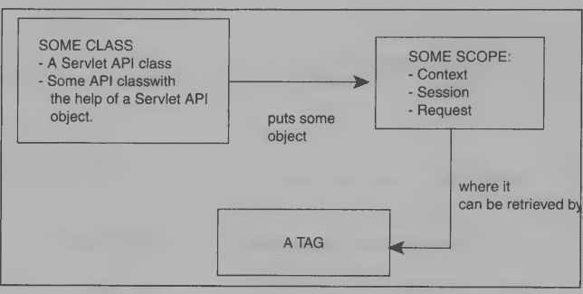

使这样的标签通用化意味着对标签所基于的集合进行抽象。您可以通过显式接受 `type` 属性来实现这一点，也可以通过对检索到的集合类型进行内省，并为其提供访问任何作用域中存储对象的机制。一种方法是显式为其提供 `scope` 属性，或使用 `pageContext.findAttribute` 方法。

可以利用 `pageContext` 属性来访问输出写入器或存储在多个作用域中的对象，这在多个示例中已有演示（参见第 3 章和第 4 章中的相应清单）。标签处理程序可以使用 `ServletContext` 访问容器内部的资源。`ServletContext` 对象可用于访问 Web 应用程序内部以及容器内其他 Web 应用程序中的资源。它还可以打开 HTTP 连接并获取远程资源。

## 标签间的协作

迄今为止给出的大多数示例实现了简单的过程，其中标签提供了完全包含在自身内部或借助辅助类来抽象某些功能的简单操作。关键在于，标签在协同工作时可以走得更远。复杂操作可以通过一组标签来实现，方式包括共享某些数据表示模式或直接访问彼此的属性。这是标签协作中的两种主要设计模式。

标签可以共享一组公共对象，并且仅通过处理这个公共对象就能执行某些复杂操作的一部分。实现这一点的基本机制涉及使用标签的多个可用命名空间并定义脚本变量，这些都是通过 `pageContext` 属性完成的。

第二种标签协作的情况是通过标签体中的标签直接访问某个标签的属性。这是通过 `TagSupport.findAncestorWithClass` 或 `getParent` 方法实现的。

协作标签通常旨在提供某种数据结构或操作实现的某个子过程。在第一种模式中，必须在页面内部构建某种复杂的数据结构，然后将其渲染输出或用于某些附带效果。这方面的例子包括电子邮件标签，其中电子邮件消息的多个可选组件被实现为构建数据结构的子标签，该数据结构用于发送电子邮件。最终要采取的操作是发送消息本身并向客户端返回确认。

在第二种情况下，过程的各个阶段被实现为可以组合成更复杂操作的标签。经典示例是 JDBC SQL 查询，其中过程的各个阶段——即查找驱动程序、获取连接、创建查询、提交查询以及处理结果——都由多个协同工作的标签处理。在替代配置可以无缝互换的情况下，例如使用 `driver+path+user+password` 与使用 `datasources+jndi lookup` 相比，可以以多种 arrangement 使用多个标签。

### 使用 pageContext 属性

`pageContext` 属性提供了对宿主 JSP 可用的多个作用域的访问，特别是对页面作用域的访问。这样，协作中的标签可以以高度模块化的方式相互通信结果，耦合更松散。

在这种协作机制中，嵌套标签为被嵌套标签创建一层数据或服务，被嵌套标签本身又为其内部的标签创建下一层，依此类推。因此，在这种场景中，顶层父标签创建某个对象并使用 `pageContext` 将其留在某个作用域中。嵌套标签使用它，并且该对象随嵌套标签一起释放。

第一个示例是实现 Java 消息服务（JMS）API 一小部分功能的标签库。该应用程序需要以发布-订阅模式访问主题队列，并将队列中的信息呈现给用户，用于电子选举控制应用程序。因此，一旦每个区域的选票计算完成，每个候选人的选票就会被发布到该候选人的主题队列中，以 `Hashtable` 的形式包含区域代码和选票，包括比例和绝对值。在编写此标签库之前，可能需要对 JMS 做简要说明。

JMS 是用于消息传递的 Java API。消息传递是一种中间件，它以可靠、异步的方式提供应用程序之间的通信，使需要保证消息传递的应用程序更易于管理和编写。JMS 应用程序依赖于消息服务代理，这是一个类似服务器的应用程序，控制服务客户端应用程序之间的消息传递。消息服务可以基于两种模型：纯队列或发布者-订阅者队列。在纯队列模型中，接收客户端有一个队列，发送客户端向其发布消息。这是一种点对点模型。在发布者-订阅者模型中，发布者将其消息写入主题队列，订阅者可以收到通知，或者如果已订阅该特定队列，则可以立即访问。JMS 支持这两种模型。

在所述的应用程序场景中，传递的唯一信息是候选人的当前票数以及该数字占选民总数的百分比。当然，所有委员会都可以访问所有数据，以便有一个各自候选人位置的**全景视图**。该应用假设发布者已定义并正常工作，将信息发布到相应的队列中，因此需要编写一个 Web 应用标签库来从该队列读取值并将其写入网页。

这些标签根据 JMS API 中对象的结构进行定义：

- **topicConnection**——代表一个 `TopicConnection` 对象。它使用发布在 JNDI 服务中或作为 bean 在某个作用域中传递的 `TopicConnectionFactory`。
- **topic**——代表一个 `Topic` 对象。它也被认为已发布在某个作用域或 JNDI 服务中。
- **topicSession**——是在 `topicConnection` 下创建的 `TopicSession` 实例。
- **topicSubscriber**——在 `connection` 和 `topic` 标签下创建。代表一个 `TopicSubscriber` 实例。
- **message**——是从消息服务接收并在 `topicSubscriber` 标签下创建的消息。它从 `Topic` 接收消息并将其写入输出流。该消息的类型将是 `ObjectMessage`，因为它必须传递某位候选人 X 的绝对票数、投票的绝对百分比以及相对于有效票的相对百分比。

由于 JMS 需要消息服务提供者或消息代理的存在，在所有示例中都使用 ObjectCube 的 ObjectEvents，网址为 http://www.objectcube.com，这是商业产品 ObjectEvents Pro 的开源版本。


清单 4.4 展示了 `topicConnection` 标签处理器。`doStartTag` 方法尝试定位一个 `TopicConnectionFactory` 实例，从中可以创建 `TopicConnection` 对象。这可以通过使用用户提供的 `TopicConnectionFactory`、访问通过 `name` 属性/参数在某个作用域中设置的属性，或设置一个将用于查找正确实例的 JNDI 名称字符串来完成。然后创建 `TopicConnection` 对象并将其放入页面作用域。

## 清单 4.4 TopicConnectionTag 标签处理器

```java
package jspbook.example.tags;

import javax.jms.*;
import com.objectcube.objectevents.naming.*;
import javax.servlet.jsp.*;
import javax.servlet.jsp.tagext.*;

public class TopicConnectionTag extends TagSupport implements TryCatchFinally
{
    private TopicConnection tc = null;
    protected TopicConnectionFactory tcf = null;
    protected String name = null;
    protected String JNDIName = null;

    public String getTcf()
    {
        return this.tcf;
    }

    public void setTcf(TopicConnectionFactory value)
    {
        this.tcf = value;
    }

    public String getName()
    {
        return this.name;
    }

    public void setName(String value)
    {
        this.name = value;
    }

    public String getJNDIName()
    {
        return this.JNDIName;
    }

    public void setJNDIName(String value)
    {
        this.JNDIName = value;
    }

    public int doStartTag() throws JspException
    {

        TopicConnectionFactory intTcf = null;

        if (tcf == null && name == null && JNDIName == null)
            throw new JspException("The TopicConnectionFactory cannot be located.");

        if (id == null)
            throw new JspException("The id attribute is mandatory.");
        try
        {
            // Locates a TopicConnectionFactory to create a TopicConnection
            if (tcf == null)
            {
                if (JNDIName == null)
                    intTcf = (TopicConnectionFactory)pageContext.findAttribute(name);
                else
                {
                    Context ctx = new InitialContext();
                    intTcf = (TopicConnectionFactory)context.lookup(JNDIName);
                }
            }
            else intTcf = tcf;

            tc = intTcf.createTopicConnection();
            pageContext.setAttribute(id, tc);
            return EVAL_BODY_INCLUDE;
        }
        catch(JMSException e)
        {
            throw new JSPException("JMS Exception: "+ e.getMessage());
        }
        return SKIP_BODY;
    }

    public void doFinally()
    {
        tc.close();
    }

    public void release()
    {
        tc = null;
        tcf = null;
        name = null;
        JNDIName = null;
    }
```

注意，`doStartTag` 方法中声明了一个 `intTcf` 对象。这是因为声明为属性的属性不能被直接赋值，而必须通过 setter 方法设置。因此，`intTcf` 对象要么直接接收通过 `tcf` 属性传入的 `Tcf`，要么从某个位置获取它。`id` 属性没有被声明，因为标签处理器扩展了 `TagSupport`，它隐式地声明了该属性。

此外，由于连接是相当敏感的对象需要管理，标签处理器实现了 `TryCatchFinally` 接口，并在最后的 `doFinally` 方法中释放连接。这样，该标签实现的概念工作原理如下：

1. `topicConnection` 标签建立连接。
2. 消费者标签放置在 `topicConnection` 的主体中，可以使用该连接。
3. `doFinally` 方法在标签关闭时最终确定连接。

清单 4.5 展示了 `Topic` 标签处理器，在服务器中实现一个 `Topic`。它与 `topicConnection` 标签处理器非常相似；`topicConnection` 标签处理器中使用的设计方案同样适用于此。

## 清单 4.5 TopicTag 标签处理器

```java
package jspbook.example.tags;

import javax.jms.*;
import com.objectcube.objectevents.naming.*;
import javax.servlet.jsp.*;
import javax.servlet.jsp.tagext.*;

public class TopicTag extends TagSupport implements TryCatchFinally
{
    private Topic topic = null;

    protected Topic tp = null;
    protected String name = null;
    protected String JNDIName = null;

    public Topic getTp()
    {
        return this.tp;
    }

    public void setTp(Topic value)
    {
        this.tp = value;
    }

    public String getName()
    {
        return this.name;
    }

    public void setName(String value)
    {
        this.name = value;
    }

    public String getJNDIName()
    {
        return this.JNDIName;
    }

    public void setJNDIName(String value)
    {
        this.JNDIName = value;
    }

    public int doStartTag() throws JspException
    {

        if (tp == null && name == null && JNDIName == null)
            throw new JspException("The Topic cannot be located.");

        if (id == null)
            throw new JspException("The id attribute is mandatory.");
        try
        {
            // Locates a Topic
            if (tp == null)
            {
                if (JNDIName == null)
                    topic = (Topic)pageContext.findAttribute(name);
                else
                {
                    Context ctx = new InitialContext();
                    topic = (Topic)context.lookup(JNDIName);
                }
            }
            else topic = tp;

            pageContext.setAttribute(id, topic);
        }
        catch(JMSException e)
        {
            throw new JSPException("JMS Exception: "+ e.getMessage());
        }
        return SKIP_BODY;
    }

    public void doFinally()
    {
        tc.close();
    }

    public void release()
    {
        topic = null;
        tp = null;
        name = null;
        JNDIName = null;
    }
}
```

注意，`Topic` 标签不包含任何主体操作。原因将在使用该标签库的示例 JSP 中显而易见。下一个标签处理器在清单 4.6 中展示，实现了 `topicSession` 对象。

## 清单 4.6 TopicSession 标签处理器

```java
package jspbook.example.tags;

import javax.jms.*;
import com.objectcube.objectevents.naming.*;
import javax.servlet.jsp.*;
import javax.servlet.jsp.tagext.*;

public class TopicSessionTag extends TagSupport implements TryCatchFinally
{
    private TopicSession session = null;

    protected String name = null;

    public String getName()
    {
        return this.name;
    }

    public void setName(String value)
    {
        this.name = value;
    }

    public int doStartTag() throws JspException
    {
        if (name == null)
            throw new JspException("Impossible establish a session.");

        if (id == null)
            throw new JspException("The id attribute is mandatory.");
        try
        {
            // Retrieves a TopicConnection from the page scope
            // and creates a session from it
            TopicConnection tc = (TopicConnection)pageContext.getAttribute(name);
```

## 代码清单 4.6 续

```java
session = tc.createTopicSession(false, AUTO_ACKNOWLEDGE);
pageContext.setAttribute(id, session);
return EVAL_BODY_INCLUDE;

}
catch(JMSException e)
{
    throw new JSPException("JMS Exception: "+ e.getMessage());
}
return SKIP_BODY;
}

public void doFinally()
{
    session.close();
}

public void release()
{
    session = null;
    name = null;
}

}
```

代码清单 4.7 中的 `topicSubscriber` 标签，才是所有这些操作的核心原因。它定义了实际访问主题的元素，这个主题是本类注册以接收消息的存储库。

## 代码清单 4.7 *TopicSubscriberTag* 标签处理器


## 代码清单 4.7 续

代码清单 4.8 中的 `GetMapMessageTag` 从服务器获取一个包含所有候选人数据的 `MapMessage`。

## 代码清单 4.8 GetMapMessageTag 标签处理器

```
package jspbook.example.tags;

import javax.jms.*;
import com.objectcube.objectevents.naming.*;
import javax.servlet.jsp.*;
import javax.servlet.jsp.tagext.*;

public class GetMapMessageTag extends TagSupport implements TryCatchFinally
{
    private MapMessage mmessage = null;

    protected String name = null;

    public String getName()
    {
        return this.name;
    }

    public void setName(String value)
    {
        this.name = value;
    }

    public int doStartTag() throws JspException
    {
        if (name == null)
            throw new JspException("Impossible to access the server.");

        if (id == null)
            throw new JspException("The id attribute is mandatory.");
        try
        {
            // Retrieves a TopicSession and a Topic from the page scope
            // and creates a subscriber from them
            TopicSubscriber ts = (TopicSubscriber)pageContext.getAttribute(name);
            mmessage = ts.receiveNoWait();
            pageContext.setAttribute(id, mmessage);
            return EVAL_BODY_INCLUDE;

        }
        catch(JMSException e)
        {
            throw new JSPException("JMS Exception: "+ e.getMessage());
        }
        return SKIP_BODY;
    }

    public void release()
    {
        name = null;
    }

}
```

`GetMapMessageTag` 标签处理器会在页面作用域中放置一个包含特定候选人数据的映射。此时，需要一个标签来扫描生成的 `Hashtable` 并写出消息中的值。代码清单 4.9 中的 `WriteOutTag` 标签处理器就完成了这个任务。

## 代码清单 4.9 写出信息

```
package jspbook.example.tags;

import java.util.*;
import javax.servlet.jsp.*;
import javax.servlet.jsp.tagext.*;

public class WriteOutTag extends TagSupport
{

    protected String name = null;
    protected String key = null;

    public String getName()
    {
        return this.name;
    }

    public void setName(String value)
    {
        this.name = value;
    }

    public String getKey()
    {
        return this.key;
    }

    public void setKey(String value)
    {
        this.key = value;
    }

    public int doEndTag() throws JspException
    {
        if (name == null || key == null)
            throw new JspException("Impossible to access the server.");

        try
        {
            Hashtable hash = pageContext.getAttribute(name);
            pageContext.getOut().println(hash.get(key).toString());
        }
        catch(NullPointerException e)
        {
            throw new JspException("n/a");
        }
        return EVAL_PAGE;
    }

    public void release()
    {
        name = null;
        key = null;
    }

}
```

那么，这些标签将如何协同工作呢？其协作机制相当明显：每个标签都将在页面作用域中为标签主体所需的某些对象，然后在关闭时回收该对象。代码清单 4.10 展示了一个使用 JMS Topic 标签来显示选举状态的 JSP。

## 代码清单 4.10 使用消息标签

```
<%@ taglib uri="/WEB-INF/example.tld" prefix="example" %>
<example:topic id="candA" JNDIName="Party=p1 Cand=A"/>
<example:topic id="candB" JNDIName="Party=p2 Cand=B"/>
<example:topic id="candC" JNDIName="Party=p3 Cand=C"/>
<html>
<body>
<table width="100%">
<tr>
  <th>Candidate</th>
  <th>region A abs</th>
  <th>region A rel</th>
  <th>region B abs</th>
  <th>region B rel</th>
  <th>region C abs</th>
  <th>region C rel</th>
  <th>total abs</th>
  <th>total rel</th>
</tr>

<example:connection id="con1" JNDIName="TCFactory">
  <example:session id="session1" name="con1">
    <example:subscriber id="subsCandA" name="session1" topic="candA">
      <example:getMapMessage id="msg1" name="subsCandA">
        <tr>
          <td><example:writeOut msg="msg1" name="subs1" key="cand.name"/></td>
          <td><example:writeOut msg="msg1" name="subs1" key="abs.a"/></td>
          <td><example:writeOut msg="msg1" name="subs1" key="rel.a"/></td>
          <td><example:writeOut msg="msg1" name="subs1" key="abs.b"/></td>
          <td><example:writeOut msg="msg1" name="subs1" key="rel.b"/></td>
          <td><example:writeOut msg="msg1" name="subs1" key="abs.c"/></td>
          <td><example:writeOut msg="msg1" name="subs1" key="rel.c"/></td>
          <td><example:writeOut msg="msg1" name="subs1" key="total.abs"/></td>
          <td><example:writeOut msg="msg1" name="subs1" key="total.rel"/></td>
        </tr>
      </example:getMapMessage>
    </example:subscriber>
    <example:subscriber id="subsCandB" name="session1" topic="candB">
      <example:getMapMessage id="msg2" name="subsCandB">
        <tr>
          <td><example:writeOut msg="msg2" name="subs1" key="cand.name"/></td>
          <td><example:writeOut msg="msg2" name="subs1" key="abs.a"/></td>
          <td><example:writeOut msg="msg2" name="subs1" key="rel.a"/></td>
          <td><example:writeOut msg="msg2" name="subs1" key="abs.b"/></td>
          <td><example:writeOut msg="msg2" name="subs1" key="rel.b"/></td>
          <td><example:writeOut msg="msg2" name="subs1" key="abs.c"/></td>
          <td><example:writeOut msg="msg2" name="subs1" key="rel.c"/></td>
          <td><example:writeOut msg="msg2" name="subs1" key="total.abs"/></td>
          <td><example:writeOut msg="msg2" name="subs1" key="total.rel"/></td>
        </tr>
      </example:getMapMessage>
    </example:subscriber>
    <example:subscriber id="subsCandC" name="session1" topic="candC">
      <example:getMapMessage id="msg3" name="subsCandC">
        <tr>
          <td><example:writeOut msg="msg3" name="subs1" key="cand.name"/></td>
          <td><example:writeOut msg="msg3" name="subs1" key="abs.a"/></td>
          <td><example:writeOut msg="msg3" name="subs1" key="rel.a"/></td>
          <td><example:writeOut msg="msg3" name="subs1" key="abs.b"/></td>
          <td><example:writeOut msg="msg3" name="subs1" key="rel.b"/></td>
          <td><example:writeOut msg="msg3" name="subs1" key="abs.c"/></td>
          <td><example:writeOut msg="msg3" name="subs1" key="rel.c"/></td>
          <td><example:writeOut msg="msg3" name="subs1" key="total.abs"/></td>
          <td><example:writeOut msg="msg3" name="subs1" key="total.rel"/></td>
        </tr>
      </example:getMapMessage>
    </example:subscriber>
  </example:session>
</example:connection>
</table>
</body>
</html>
```

## 清单 4.10 续

```
<td><example:writeOut msg="msg3" name="subs1" key="abs.c"/></td>
<td><example:writeOut msg="msg3" name="subs1" key="rel.c"/></td>
<td><example:writeOut msg="msg3" name="subs1" key="total.abs"/></td>
<td><example:writeOut msg="msg3" name="subs1" key="total.rel"/></td>
</tr>
</example:getMapMessage>
</example:subscriber>
</example:session>
</example:connection>
</table>
</body>
</html>
```

因此，在清单 4.10 中，初始部分从 JNDI 服务器上的公共 Topic 名称创建了三个 Topic 对象。然后与消息服务器建立了单一连接和单一会话。一个订阅者逐个扫描已注册的 Topic，获取可用的最新消息并打印结果。

## 定义脚本变量

有时，某段代码对于特定情况来说非常特殊，以至于编写和发布一个标签并不值得。显而易见的方法是编写一个小脚本片段来完成这项工作。问题在于如何在标签和那些小脚本片段之间共享值。

为了规避这个问题，标签库扩展 API 提供了一种机制，用于从标签处理器访问和声明脚本变量。


标签可以通过在 TLD `<variable>` 元素中指定变量特征来声明变量（见第 2 章“标签库简介”），或者使用本章稍后将介绍的 TEI 类。此外，标签中的变量在预定义作用域中声明：它可以限制在标签主体内部使用，可以在标签打开时声明并从该点开始使用，也可以在标签关闭时声明并留给页面其余部分使用。

变量可以用作用域 `NESTED` 来声明。当声明为 `NESTED` 时，变量的定义仅在标签主体内部有效。因此，主体内的脚本片段表达式能够引用该变量。`NESTED` 和 `AT_BEGIN` 变量都必须由 `doStartTag` 方法实例化。清单 4.11 展示了 `GetMapMessageTag` 标签处理器的一种变体，使用具有常量名称的 `NESTED` 作用域 `Hashtable` 变量。有关 `NESTED`、`AT_BEGIN` 和 `AT_END` 变量的 TLD 配置更多示例，请参阅第 2 章。

### 清单 4.11 使用 NESTED 变量的 GetMapMessageTag 标签处理器

```
package jspbook.example.tags;

import javax.jms.*;
import com.objectcube.objectevents.naming.*;
import javax.servlet.jsp.*;
import javax.servlet.jsp.tagext.*;

public class GetMapMessageTag extends TagSupport implements TryCatchFinally
{
    private MapMessage mmessage = null;

    protected String name = null;

    public String getName()
    {
        return this.name;
    }

    public void setName(String value)
    {
        this.name = value;
    }

    public int doStartTag() throws JspException
    {
        if (name == null)
            throw new JspException("Impossible to access the server.");

        try
        {
            TopicSubscriber ts = (TopicSubscriber)pageContext.getAttribute(name);
            mmessage = ts.receiveNoWait();
            pageContext.setAttribute("varNested", mmessage);
            return EVAL_BODY_INCLUDE;
        }
        catch(JMSException e)
        {
            throw new JspException("JMS Exception: " + e.getMessage());
        }
        return SKIP_BODY;
    }

    public void release()
    {
        name = null;
    }
}
```

清单 4.12 展示了在此新配置下消息传递示例中使用的 JSP 片段。

### 清单 4.12 使用 NESTED 变量

此处变量仍未定义。

```
<example:getMapMessage name="subsCandC">
  <tr>
    <td><%= varNested.get("cand.name").toString()%></td>
    <td><%= varNested.get("abs.a").toString()%></td>
    <td><%= varNested.get("rel.a").toString()%></td>
    ...
  </tr>
</example:getMapMessage>
```

此处变量已不再存在。

`NESTED` 和 `AT_BEGIN` 变量的区别在于，后者在标签结束后仍然有效。这在某种情况下可能很有用：当需要由一组标签生成并使用另一组标签以及页面另一部分上的脚本片段来使用的不可耗尽资源（如数据结构）时，嵌套要么不可能，要么会导致不良设计。

在清单 4.12 中，使用 `AT_BEGIN` 变量时，变量仍在 `getMessage` 主体内部使用，但在标签关闭后也可用。

另一方面，`AT_END` 变量在标签关闭后使用。这主要在某对象是标签操作的结果，并将被页面其他地方的标签和脚本片段使用时很有用。在清单 4.12 中，使用 `AT_END` 变量时，它不会在 `getMessage` 的主体内部定义，但在标签关闭后将可用。

## 访问运行时栈

标签之间协作的另一种机制涉及使用运行时栈在标签中定义必要的对象，然后使用 `getParent` 或 `TagSupport.findAncestorWithClass` 方法访问这些对象。第一种方法简单明了——必要的对象直接包含当前标签。第二种方法在引用对象定义于包含多个标签的标签中且这些标签将以不同排列使用它时很有用。它仍然使用 `getParent` 方法来查找请求的祖先，但省去了在 `getParent` 上使用递归来查找目标标签的麻烦。

这种方法的优点是更直接，并为中间对象使用更少的存储空间，但它引入了标签之间的强耦合。

### 耦合与运行时栈

耦合可以衡量某段代码对另一段代码的依赖程度。例如，设计不佳的对象可能会暴露属性类型，而另一个设计不佳的对象可能会使用此信息来设置或获取该对象的值。这在两个对象之间创建了一种依赖关系，应用程序设计人员并不总是清楚可见，并且当试图在第一个对象的上下文之外使用依赖对象时会导致许多问题。

当两个对象中的一个高度依赖于另一个的实现细节时，就说它们具有强耦合。当然，该实现中的任何更改都会导致依赖对象失败。这就是为什么强耦合总是不可取的，以及为什么必须将耦合保持在最低水平。最佳情况是对象具有高内聚性，即一个对象补充另一个对象的功能，从而实现松散耦合，它们之间的依赖最小化。

在标签库中，使用由包含标签生成的运行时栈并通过 `getParent` 方法访问标签上的信息是必须仔细规划的，因为它可能导致强耦合的情况，并给试图使用标签库的页面设计人员带来问题。

### 清单 4.13 TopicConnectionStackTag 标签处理器

```
package jspbook.example.tags;

import javax.jms.*;
import com.objectcube.objectevents.naming.*;
import javax.servlet.jsp.*;
import javax.servlet.jsp.tagext.*;

public class TopicConnectionStackTag extends TagSupport implements TryCatchFinally
{
    private TopicConnection tc = null;

    protected TopicConnectionFactory tcf = null;
    protected String name = null;
    protected String JNDIName = null;

    public String getTcf()
    {
        return this.tcf;
    }

    public void setTcf(TopicConnectionFactory value)
    {
        this.tcf = value;
    }

    public String getName()
    {
        return this.name;
    }

    public void setName(String value)
    {
        this.name = value;
    }

    public String getJNDIName()
    {
        return this.JNDIName;
    }

    public void setJNDIName(String value)
    {
        this.JNDIName = value;
    }

    public String getTc()
    {
        return this.tc;
    }

    public int doStartTag() throws JspException
    {
        TopicConnectionFactory intTcf = null;

        if (tcf == null && name == null && JNDIName == null)
            throw new JspException("The TopicConnectionFactory cannot be located.");

        if (id == null)
            throw new JspException("The id attribute is mandatory.");

        try
        {
            // Locates a TopicConnectionFactory to create a TopicConnection
            if (tcf == null)
            {
                if (JNDIName == null)
                    intTcf = (TopicConnectionFactory)pageContext.findAttribute(name);
                else
                {
                    Context ctx = new InitialContext();
                    intTcf = (TopicConnectionFactory)context.lookup(JNDIName);
                }
            }
            else intTcf = tcf;
```

## 清单 4.14 TopicSessionStackTag 标签处理器

```
package jspbook.example.tags;

import javax.jms.*;

import com.objectcube.objectevents.naming.*;

import javax.servlet.jsp.*;

import javax.servlet.jsp.tagext.*;

public class TopicSessionStackTag extends TagSupport implements TryCatchFinally

{

    private TopicSession session = null;

    public String getSession()

    {

        return this.session;

    }

    public int doStartTag() throws JspException

    {

        try

        {

            // 从父标签获取 TopicConnection

            // 并基于它创建一个会话

            TopicConnectionStackTag tcst = (TopicConnectionStackTag)this.getParent();

            if (tcst == null)

                throw new JspException("No connection tag found.");

            TopicConnection tc = tcst.getTc();

            session = tc.createTopicSession(false, AUTO_ACKNOWLEDGE);

            pageContext.setAttribute(id, session);

            return EVAL_BODY_INCLUDE;

        }

        catch(JMSException e)

        {

            throw new JSPException("JMS Exception: "+ e.getMessage());

        }

        return SKIP_BODY;

    }

    public void doFinally()

    {

        session.close();

    }

    public void release()

    {

        session = null;

        name = null;

    }

}
```

因此，`TopicSessionStackTag` 将 `getParent` 的结果强制转换为 `TopicConnectionStackTag`，并使用该标签的 `getTc` 方法来访问所需的 `TopicConnection`。它还会发布其会话对象，以便其他标签能以相同方式访问它。

## 清单 4.15 使用替代的消息传递标签

```
<%@ taglib uri="/WEB-INF/example.tld" prefix="example" %>

<example:topic id="candA" JNDIName="Party=p1 Cand=A"/>

<example:topic id="candB" JNDIName="Party=p2 Cand=B"/>

<example:topic id="candC" JNDIName="Party=p3 Cand=C"/>

<html>

<body>

<table width="100%">

<tr>

    <th>候选人</th>

    <th>区域 A 绝对值</th>

    <th>区域 A 相对值</th>

    <th>区域 B 绝对值</th>

    <th>区域 B 相对值</th>

    <th>区域 C 绝对值</th>

    <th>区域 C 相对值</th>

    <th>总计绝对值</th>

    <th>总计相对值</th>

</tr>

<example:connection JNDIName="TCFactory">

    <example:session>

        <example:subscriber topic="candA">

            <example:getMapMessage>

                <tr>

                    <td><example:writeOut key="cand.name"/></td>

                    <td><example:writeOut key="abs.a"/></td>

                    <td><example:writeOut key="rel.a"/></td>

                    <td><example:writeOut key="abs.b"/></td>

                    <td><example:writeOut key="rel.b"/></td>

                    <td><example:writeOut key="abs.c"/></td>

                    <td><example:writeOut key="rel.c"/></td>

                    <td><example:writeOut key="total.abs"/></td>

                    <td><example:writeOut key="total.rel"/></td>

                </tr>

            </example:getMapMessage>

        </example:subscriber>

        <example:subscriber topic="candB">

            <example:getMapMessage>

                <tr>

                    <td><example:writeOut key="cand.name"/></td>

                    <td><example:writeOut key="abs.a"/></td>

                    <td><example:writeOut key="rel.a"/></td>

                    <td><example:writeOut key="abs.b"/></td>

                    <td><example:writeOut key="rel.b"/></td>

                    <td><example:writeOut key="abs.c"/></td>

                    <td><example:writeOut key="rel.c"/></td>
```


## 第四章 协作标签与验证

清单 4.16 续

```java
        Topic tp = (Topic)pageContext.getAttribute(topic);
        subs =
            ts.createDurableSubscriber(tp,tp.getTopicName()+System.currentTimeMillis());
        TextMessage mmessage = null;
        while((mmessage = subs.receiveNoWait()) != null)
            this.setValue(mmessage.getJMSMessageId(),mmessage);
        if (!values.empty()) return EVAL_BODY_INCLUDE;
    }
    catch(JMSException e)
    {
        throw new JSPException("JMS Exception: "+ e.getMessage());
    }
    return SKIP_BODY;
}

public void doFinally()
{
    subs.close();
}

public void release()
{
    subs = null;
    name = null;
    topic = null;
}
```

清单 4.16 中描述的`TopicDurableSubscriberTag`标签处理器会检索该主题中所有可用的消息，并将它们放入`values`哈希表中。然后，“写出”标签会获取`TopicDurableSubscriberTag`标签处理器，并调用`getValues`方法来扫描所有可用的消息并将它们输出。这在清单 4.17 中得到了说明。

## 清单 4.17 WriteDurableOutTag 标签处理器

```java
package jspbook.example.tags;

import java.util.*;
import javax.servlet.jsp.*;
import javax.servlet.jsp.tagext.*;

public class WriteDurableOutTag extends TagSupport
{
    private Enumeration msgs = null;

    public int doStartTag() throws JspException
    {
        try
        {
            TopicDurableSubscriberTag subs = (TopicDurableSubscriberTag)
                this.getParent();
            msgs = subs.getValues();
            if(msgs.hasMoreElements())
            {
                TextMessage aMessage = (TextMessage)msgs.nextElement();
                pageContext.getOut().println(aMessage.getText());
                return EVAL_BODY_INCLUDE;
            }
        }
        catch(Exception e)
        {
            throw new JSPException("JMS Exception: "+ e.getMessage());
        }
        return SKIP_BODY;
    }

    public int doAfterBody() throws JspException
    {
        try
        {
            if (msgs.hasMoreElements())
            {
                TextMessage aMessage = (TextMessage)msgs.nextElement();
                pageContext.getOut().println(aMessage.getText());
                return EVAL_BODY_AGAIN;
            }
        }
        catch(Exception e)
        {
            throw new JSPException("JMS Exception: "+ e.getMessage());
        }
        return SKIP_BODY;
    }

    public void release()
    {
        msgs = null;
    }
}
```

`WriteDurableOutTag`通过`TagSupport`类（它实现了`IterationTag`接口）实现了`IterationTag`接口，目的是输出父标签`TopicDurableSubscriberTag`标签处理器检索到的所有消息。

在到目前为止的示例中，外层标签主体中标签的目标是提供某种动作，以某种方式补充外层标签的动作。会话补充了连接，订阅者补充了会话，以便从 JMS 主题获取消息。

在`BodyTag`实现中，对主体的处理也有所不同。在那里，主体中的标签提供了外层标签用来执行其动作的数据。这些数据可以是主体中发布的原始数据，之后被捕获在`bodyContent`对象中并进行处理。

在下一个示例中，协作标签的重点发生了变化，因此目标将是模块化地构建一些复杂的模块化数据结构，供外层标签使用。该数据结构可能呈现多种配置，或者可以不完整地进行处理，可能对已完成的模块有不同的解释。也有可能数据结构太大，无法用一组属性创建，这可能会使标签的使用过于复杂。清单 4.18 介绍了`CreateMessageTag`和两个基于类型的`CreateMessageBody`标签，它们是选举示例中发布者部分的核心。之所以这样做，是因为 JMS 中的`Message`对象是一个模块化的数据结构，由一个不变的头部部分和一个可变的主体部分组成，主体部分决定了所发送消息的类型。

## 清单 4.18 CreateMessageTag 标签处理器

```html
<table>
    <body>
        <example:connection id="conn1" name="connection1">
            <example:session id="sess1" name="session1">
                <example:subscriber id="subsTotal" name="session1" topic="total">
                    <example:getMapMessage id="msg1" name="subsTotal">
                        <tr>
                            <td><example:writeOut key="total.abs"/></td>
                            <td><example:writeOut key="total.rel"/></td>
                        </tr>
                    </example:getMapMessage>
                </example:subscriber>
                <example:subscriber id="subsCandC" name="session1" topic="candC">
                    <example:getMapMessage id="msg3" name="subsCandC">
                        <tr>
                            <td><example:writeOut key="cand.name"/></td>
                            <td><example:writeOut key="abs.a"/></td>
                            <td><example:writeOut key="rel.a"/></td>
                            <td><example:writeOut key="abs.b"/></td>
                            <td><example:writeOut key="rel.b"/></td>
                            <td><example:writeOut key="abs.c"/></td>
                            <td><example:writeOut key="rel.c"/></td>
                            <td><example:writeOut key="total.abs"/></td>
                            <td><example:writeOut key="total.rel"/></td>
                        </tr>
                    </example:getMapMessage>
                </example:subscriber>
            </example:session>
        </example:connection>
    </body>
</table>
```

值得注意的是，这些标签看起来比之前的更易于使用。这种方法的问题在于这些标签必须彼此协同使用。例如，用另一个来自不同标签库的等效标签替换`topicConnection`标签会相当困难，因为会话标签现在需要一个非常特定的父标签存在。

## 使用键值对

当内部标签生成的对象需要被外部标签使用时，标签协作中会出现相反的情况。在这种情况下，第一个模型被反转。主体标签在`pageContext`中定义对象以供外部标签使用。第二个模型仍然适用，只是主体标签调用父标签的 setter 方法而非 getter 方法。

可以使用第三种模型，它与`getParent`方法相关联。当标签需要向父标签传递大量信息，从而将那些对象发布到页面范围（或任何其他范围）变得无用时，此模型尤其有用。该模型使用在`TagSupport`类中声明的`Hashtable`属性，可以通过该类的`setValue`、`getValue`和`getValues`方法访问。

假设一个消息收集标签处理器正在实现 JMS 持久订阅者访问。这种访问方式指示消息提供者在持久订阅者不活动时保留其所有消息，然后在订阅者连接时允许其访问所有消息。清单 4.16 展示了实现这种协作机制的`TopicDurableSubscriberTag`标签处理器。为简化起见，消息类型为`TextMessage`，内容为简单文本。

## 清单 4.16 TopicDurableSubscriberTag 标签处理器

```java
package jspbook.example.tags;

import javax.jms.*;
import com.objectcube.objectevents.naming.*;
import javax.servlet.jsp.*;
import javax.servlet.jsp.tagext.*;

public class TopicDurableSubscriberTag extends TagSupport implements TryCatchFinally
{
    private TopicSubscriber subs = null;
    protected String name = null;
    protected String topic = null;

    public String getName()
    {
        return this.name;
    }

    public void setName(String value)
    {
        this.name = value;
    }

    public String getTopic()
    {
        return this.topic;
    }

    public void setTopic(String value)
    {
        this.topic = value;
    }

    public int doStartTag() throws JspException
    {
        if (name == null || topic == null)
            throw new JspException("Impossible to access the server.");
        if (id == null)
            throw new JspException("The id attribute is mandatory.");
        try
        {
            // 从页面范围获取 TopicSession 和 Topic
            // 并基于它们创建一个订阅者
            TopicSession ts = (TopicSession)pageContext.getAttribute(name);
```


```java
package jspbook.example.tags;

import javax.jms.*;
import com.objectcube.objectevents.naming.*;
import javax.servlet.jsp.*;
import javax.servlet.jsp.tagext.*;

public class CreateMessageTag extends TagSupport
{
    private TopicPublisher pub = null;
    private TopicSession session = null;

    protected String topic = null;
    protected String correlationId = null;

    public String getTopic()
    {
        return this.topic;
    }

    public void setTopic(String value)
    {
        this.topic = value;
    }

    public String getCorrelationId()
    {
        return this.correlationId;
    }

    public void setCorrelationId(String value)
    {
        this.correlationId = value;
    }

    public int doStartTag() throws JspException
    {
        try
        {
            TopicPublisherTag tp = (TopicPublisherTag) getParent();
            pub = tp.getPublisher();
            session = tp.getSession();

            if (pub != null && session != null)
                return EVAL_BODY_INCLUDE;
        }
        catch(JMSException e)
        {
            throw new JSPException("JMS Exception: "+ e.getMessage());
        }
        return SKIP_BODY;
    }

    public int doEndTag() throws JspException
    {
        try
        {
            if (getValue("MSG_TYPE").equals("TEXT"))
            {
                TextMessage msg = session.createTextMessage();
                if(correlationId != null)
                    msg.setCorrelationId(correlationId);
                msg.setText((String)getValue("MSG_CONTENT"));
                pub.publish(topic,msg);
                return EVAL_PAGE;
            }
            if (getValue("MSG_TYPE").equals("MAP"))
            {
                MapMessage msg = session.createMapMessage();
                if(correlationId != null)
                    msg.setCorrelationId(correlationId);
                Hashtable msgVals = (Hashtable)getValue("MSG_CONTENT");
                Enumeration enum = msgVals.keys();
                while(enum.hasMoreElements())
                {
                    String key = enum.nextElement().toString();
                    Object val = msgVals.get(key);
                    msg.setObject(key,val);
                }
                pub.publish(topic,msg);
                return EVAL_PAGE;
            }
        }
        catch(JMSException e)
        {
            throw new JSPException("JMS Exception: "+ e.getMessage());
        }
        return SKIP_PAGE;
    }

    public void release()
    {
        pub = null;
        topic = null;
        correlationId = null;
    }
}
```

`CreateMessageTag` 标签处理器中的 `doStartTag` 方法检查 `TopicPublisher` 和 `TopicSession` 是否存在，以便创建和发送消息。如果这些对象不存在，则主体将被忽略，不会发生任何事情。清单 4.19 介绍了 `CreateTextMessageTag`。它不会创建 `Message` 对象，但会捕获文本并在 `CreateMessage` 上定义值，供该标签用于创建和发布消息。

## 清单 4.19 `CreateTextMessageTag` 标签处理器

```java
package jspbook.example.tags;

import javax.servlet.jsp.*;
import javax.servlet.jsp.tagext.*;

public class CreateTextMessageTag extends BodyTagSupport
{

    public int doEndTag() throws JspException
    {
        try
        {
            String msgText = bodyContent.getString();
            CreateMessageTag cmt = (CreateMessageTag) getParent();
            cmt.setValue("MSG_TYPE", "TEXT");
            cmt.setValue("MSG_CONTENT", msgText);
            return EVAL_PAGE;
        }
        catch(JMSException e)
        {
            throw new JSPException("JMS Exception: " + e.getMessage());
        }
        return SKIP_PAGE;
    }
}
```

`CreateMapMessageTag` 标签处理器与 `CreateTextMessageTag` 标签处理器的不同之处在于值的传递方式以及将传递给 `CreateMessageTag` 的深层数据结构（见清单 4.20）。`CreateTextMessageTag` 使用字符串作为数据结构，因为 `TextMessage` 的内容由文本块组成。而 `MapMessage` 使用一组名称-值对作为内容。与普通的 Java `Hashtable` 不同，`MapMessage` 中的名称-值对仅接受字符串作为名称，并且仅接受原始数据类型值（如 `int` 或 `char`）作为值。

## 清单 4.20 `CreateMapMessageTag` 标签处理器

```java
package jspbook.example.tags;

import java.util.*;
import javax.servlet.jsp.*;
import javax.servlet.jsp.tagext.*;

public class CreateMapMessageTag extends TagSupport
{
    private Hashtable msgMap = new Hashtable();

    public void setMsgVal(String name, Object value)
    {
        this.msgMap.put(name, value);
    }

    public int doEndTag() throws JspException
    {
        try
        {
            CreateMessageTag cmt = (CreateMessageTag) getParent();
            if (!msgMap.isEmpty())
            {
                cmt.setValue("MSG_TYPE", "MAP");
                cmt.setValue("MSG_CONTENT", msgMap);
            }
        }
        catch(Exception e)
        {
            throw new JSPException("JMS Exception: "+ e.getMessage());
        }
        return SKIP_PAGE;
    }

    public void release()
    {
        msgMap = null;
    }
}
```

## 清单 4.20 续

```java
return EVAL_PAGE;
}
}
catch(JMSException e)
{
throw new JSPException("JMS Exception: "+ e.getMessage());
}
return SKIP_PAGE;
}
}
```

为了添加 `CreateMapMessageTag` 标签处理器在 `CreateMessageTag` 标签处理器上实例化 `MSG_CONTENT` 值时所使用的值，`AddValueTag` 标签处理器就派上用场了（参见清单 4.21）。它接收一个属性，并将该属性的值添加到 `CreateMapMessageTag` 的 `Hashtable` 中。

## 清单 4.21 `AddValueTag` 标签处理器

```java
package jspbook.example.tags;

import javax.servlet.jsp.*;
import javax.servlet.jsp.tagext.*;

public class AddValueTag extends TagSupport
{
protected String name = null;
protected Object objValue = null;

public String getName()
{
return this.name;
}

public void setName(String value)
{
this.name = value;
}

public Object getObjValue()
{
return this.objValue;
}

public void setObjValue(Object value)
{
this.objValue = value;
}

public int doEndTag() throws JspException
{
try
{
    CreateMapMessageTag cmmt = (CreateMapMessageTag) getParent();
    if (name != null && objValue != null)
    {
        cmmt.setMsgVal(name,objValue);
    }
}
catch(Exception e)
{
    throw new JSPException("JMS Exception: "+ e.getMessage());
}
return EVAL_PAGE;
}
}
```

因此，对于要插入到 `MapMessage` 中的每个键值对，都会有一个 `addValue` 标签。`addValue` 标签将被包含在 `createMapMsg` 标签中，而后者又会被包含在 `createMsg` 标签中。清单 4.22 中的 JSP 页面片段展示了两种类型消息的创建和发送。`createTextMessage` 标签直接从正文内容中获取文本值，而 `createMapMessage` 标签则依赖于 `addValue` 来填充其名称-值对集合。

## 清单 4.22 向 `createXXXMessage` 标签添加文本和名称-值对内容

```jsp
<example:createMsg>
  <example:createTxtMsg>
    This is the text to be sent by this message tag!
  </example:createTxtMsg>
</example:createMsg>

<example:createMsg>
  <example:createMapMsg>
    <addValue name="ex1" value="<%=new Integer(10)%>"/>
    <addValue name="ex2" value="<%=new Long(1231213312L)%>"/>
  </example:createMapMsg>
</example:createMsg>
```

## 验证

在标签库扩展 API 中，可以在两个层面考虑验证：标签结构的验证和页面上标签库使用的验证。为了支持验证机制，API 中提供了许多翻译时类。这些类代表页面数据、TLD 上可用的信息、标签定义或访问的变量等等。以翻译时验证为核心的类是 `TagExtraInfo` 类和 `TagLibraryValidator` 类。

### 在 TLD 上指定验证

在第 2 章中，你看到 TLD 中的许多元素与标签规范相关联，而其他元素则与所提供规范的验证相关联。按照 DTD 顺序，要指定的第一个元素是 `validator` 元素。它是一个可选元素，由两个子元素组成：`validator-class` 和 `init-params`。

`validator-class` 子元素指定了一个 `TagLibraryValidator` 类实现的全限定 Java 类名，该类将在使用此标签库的页面被翻译时被调用。传递给这个类的是一个 `PageData` 对象，该对象包含正在翻译的页面的 XML 表示、TLD URI、库前缀，并且通过调用 `setInitParameters` 方法，传递一个包含 `init-parameter` 子元素中指定的值的映射（如果有的话）。

下一个元素是 `TagExtraInfo` 类规范。每个标签的 `tei-class` 元素（如果存在）指定了此类的全限定 Java 类名。TEI 将验证标签结构以及此标签创建或访问的变量。标签创建或访问的简单变量可以通过每个标签的 `variable` 子元素（如果存在）来指定。此元素指定了变量的名称、类型和作用域。更复杂的情况，例如变量的条件创建，必须在 TEI 类中处理。

## TEI 类

`TagExtraInfo` 类是一个抽象类，标签库设计者对其进行子类化，它基本上有两个主要目的：声明相关标签访问或定义的脚本变量，以及验证标签使用。在标签库扩展 API 1.2 中，更简单的变量声明情况可以仅在 TLD 上完成，这使得仅在需要验证标签使用以及此类变量的声明确实复杂且受特定条件限制时，才需要使用 TEI 类。

TEI 类有两个核心方法：`isValid`，它声明标签使用是否有效；`getVariableInfo`，它返回一个 `VariableInfo` 数组，其中包含每个变量的规范。JSP 容器使用两个附加方法为此 TEI 类设置 `TagInfo` 对象：`setTagInfo` 和 `getTagInfo`。`TagExtraInfo` 应该扩展此对象，提供额外的信息。

`getVariableInfo` 方法接受一个 `TagData` 对象作为参数，该对象代表 JSP 容器关于此标签的信息。它返回一个 `VariableInfo` 对象数组，用于向 JSP 容器声明变量。`getVariableInfo` 方法背后的基本思想是使用 `TagData` 信息为该标签设置的每个变量创建一个 `VariableInfo` 实例，然后将这些实例设置到一个数组中并返回。

`TagData` 对象提供对 JSP 容器有关该标签的信息的访问。它允许 `TagExtraInfo` 对象单独或以枚举形式访问有关标签中找到的属性的信息。它还获取和设置属性的值，并提供了一个特定的方法来获取 `id` 属性的值。


清单 4.23 展示了一个简单的 TEI 类，它声明了由 `TopicConnectionTag` 标签处理器定义的变量。它扩展了抽象的 `TagExtraInfo` 类。它实现了 `getVariableInfo` 方法，并使用 `TagData` 数据参数来访问 `id` 属性的值，然后创建一个 `VariableInfo` 类的实例；它还在其中声明了这些值。然后它将该实例插入到一个数组中并返回它。

### 清单 4.23 最简单的 TEI 类

```
public class TopicConnectionTEI extends TagExtraInfo {

    public final VariableInfo[] getVariableInfo(TagData data)
    {
        return new VariableInfo[]
        {
            new VariableInfo(
                data.getId(),
                "javax.jms.TopicConnection",
                true,
                VariableInfo.AT_END
            )
        };
    }
}
```

`getVariableInfo` 方法更复杂的情况涉及创建多个变量以及变量的条件创建。如果发现特定的属性配置，则创建一个变量。这是一个更复杂的情况，必须仔细评估以确定这是最佳解决方案，还是创建一个附加标签效果更好。第 5 章“设计考虑”表明这是创建附加标签的情况。清单 4.24 提供了一个创建多个变量的示例，每个变量在不同的作用域中。

### 清单 4.24 创建多个变量

```
public class MultipleExampleTEI extends TagExtraInfo {

    public final VariableInfo[] getVariableInfo(TagData data)
    {
        return new VariableInfo[]
        {
            new VariableInfo(
                data.getId(),
                "java.lang.String",
                true,
                VariableInfo.AT_END
            ),

            new VariableInfo(
                data.getAttributeString("date"),
                "java.util.Date",
                true,
                VariableInfo.NESTED
            ),

            new VariableInfo(
                data.getAttributeString("hash"),
                "java.util.Hashtable",
                true,
                VariableInfo.AT_BEGIN
            )
        };
    }
}
```

## 186 第 4 章 协作标签和验证

清单 4.24 续

```
new VariableInfo(
    data.getId(),
    "java.lang.String",
    true,
    VariableInfo.AT_END
),

new VariableInfo(
    data.getAttributeString("date"),
    "java.util.Date",
    true,
    VariableInfo.NESTED
),

new VariableInfo(
    data.getAttributeString("hash"),
    "java.util.Hashtable",
    true,
    VariableInfo.AT_BEGIN
)
};
}
}
```

`isValid` 方法在标签必须验证属性发生特定条件时非常重要（参见清单 4.25）。第 2 章和第 3 章说过，不可能在 TLD 文件中强制施加约束，表明两个属性或两组属性是互斥的。这种约束必须在 TEI 类的 `isValid` 方法中加强。

### 清单 4.25 验证 TopicConnectionTag 属性

```
public class TopicConnectionTEI extends TagExtraInfo {

    public boolean isValid (TagData data)
    {
        boolean hasName = false;
        boolean hasTcf = false;
        boolean hasJNDIName = false;

        if (data.getAttribute("name") != null)
            hasName = true;

        if (data.getAttribute("tcf") != null)
            hasTcf = true;

        if (data.getAttribute("JNDIName") != null)
            hasJNDIName = true;
```

## TagLibraryValidator 类

验证的第二种机制是 `TagLibraryValidator` 类。与 TEI 类不同，该验证器基于页面的 XML 表示、在 `taglib` 指令中声明的 TLD 的 URI 以及标签库使用的前缀（即在 `taglib` 指令中声明的前缀）进行操作，以对照 XML 模式验证标签信息。

## 小结

本章考察了标签库中标签协作的基本机制。你已经学习了以下要点：

1. 标签是一等 Web 应用程序组件，可以与 JSP 页面以外的 Servlet API 组件集成。本章展示了应用程序过滤器与标签之间的协调。

2. 标签可以访问 `PageContext` 实例中定义的任何可用作用域，因此它可以完全访问宿主 JSP 的相同运行时环境。存储在任何作用域中的对象和脚本变量也可以从标签中访问。

3. 标签可以在任何作用域上定义对象，并且主要可以使用 `pageContext` 来访问页面作用域，以交换在协作模式中使用的对象。这是标签协作的第一种模式。

4. 第二种协作模式使用 `getParent` 方法或 `findAncestorWithClass` 方法来访问任何外层标签中的信息。实际上，这定义了一种外层标签的运行时栈。

5. `TagSupport` 类定义了一个内部 `values` 属性，可以保存名称-值对。这些可以用于保存外层标签定义的对象，它们可以作为标签协作的辅助模式。

6. 标签可以协作来共同实现一个复杂操作或共同构建一个复杂数据结构。示例中展示了 JMS Message 数据结构以及用于以模块化方式构建它的多个标签。

7. 验证过程必须在 TLD 中以及在某些情况下通过 `TagExtraInfo` 和 `TagLibraryValidator` 类来加强。

8. TLD 提供了许多元素来定义这些类及其初始化参数和信息。

9. `TagExtraInfo` 类中的主要方法是 `getVariableInfo` 和 `isValid`。前者用于声明标签访问或定义的脚本变量，后者用于加强标签属性集中的约束。


## 设计注意事项

本章为标签库设计者提供了一些建议和实践，以便在创建标签库项目时参考。希望掌握标签库开发周期并将其整合到组织软件流程中的软件团队管理者也可以在此找到良好的基础。

### 论证标签库的合理性

在介绍了标签库扩展 API 的结构之后，了解该技术如何融入 Web 应用程序设计者或设计团队的技术栈是很重要的。

首要考虑的是，标签库改变了 Web 应用程序团队的组织方式。它也改变了动态页面开发者的技术要求。它还改变了 Web 应用程序的维护方式和功能丰富方式。

从技术角度来看，标签库提供了一种更好的方式来封装和部署 Web 应用程序内部的自定义或重复功能。这非常重要，因为动态页面远比初看起来要复杂得多。

### 开发动态页面

在 J2EE 视角下，JSP 是 Web 应用程序的关键呈现技术。生成动态内容要求页面设计者至少具备相当的 HTML 知识（HTML 仍然是 Web 内容开发的主要语言）以及 JavaScript 知识（JavaScript 是动态 HTML 和客户端编程的主要语言）。当然，它还需要大量的页面排版布局技能和图形设计能力，才能创建出市场所需吸引力的页面。

问题出现在页面访问数据源进行发布时。这时就需要使用服务器端资源。此外，它必须使用标准操作访问 JavaBeans 或使用脚本代码片段，而这两种方案都严重依赖 Java 编程语言的使用。如果数据源是数据库（这是最常见的情况），SQL 就会介入来检索数据。你很可能最终得到一个同时包含四种甚至五种语言的软件。清单 5.1 展示了一个相当完整的页面，并指出了各个部分。

#### 清单 5.1 一个典型的动态页面

```
<%-- This is the JSP directive section --%>
<%@ page import="java.sql.*"%>
<%@ page import="java.util.*"%>
<%@ page import="java.naming.*"%>
<%@ page session="true"%>

<%-- This is the JSP Java code --%>
<%
    // This is not only Java code, but JNDI code.
    Hashtable env = new Hashtable();
    Hashtable results = new Hashtable();
    env.put(Context.INITIAL_CONTEXT_FACTORY,
    "com.sun.jndi.rmi.registry.RegistryContextFactory");
    env.put(Context.PROVIDER_URL, "rmi://localhost:1099");
    env.put("java.naming.rmi.security.manager", "1");
    Context ctx = new InitialContext(env);

    // And this is JDBC code
    DataSource ds = (DataSource) ctx.lookup("EXAMPLEDS");
    Connection con = null;

    try
    {
        con = ds.getConnection();
        Statement stm = con.createStatement();

        // Here comes SQL, the 3rd language so far
        ResultSet rs = stm.executeQuery("Select ID, NAME, SURNAME, NATIONALITY from AUTHOR");
%>
<%-- This is HTML template --%>
<html>
<header>

<%-- This is JavaScript code the 4th language so far --%>
<script language="JavaScript1.2">
function showArticles(auth)
{
    window.open("authArticles.jsp?AUTH="+auth,"Author Articles","");
}
</script>
</header>
<body>
<h1>This is a static template inside a dynamic program block</h1>
<table>
<tr>
   <td>ID</td>
   <td>NAME</td>
   <td>SURNAME</td>
   <td>NATIONALITY</td>
</tr>

<%-- Back to JDBC code --%>
<%
       while(rs.next())
       {
           String id = rs.getString(1);
           String name = rs.getString(2);
           String surname = rs.getString(3);
           String nationality = rs.getString(4);
%>
<%-- This is HTML again --%>
<tr>
   <td><a href="javascript:showArticles(<%=id%>);"><%=id%></a></td>
   <td><%=name%></td>
   <td><%=surname%></td>
   <td><%=nationality%></td>
</tr>
<%-- This is the JSP Java code --%>
<%
       }
   }
   catch (Exception e)
   {
       application.log("author report exception", e);
%>
<%-- Some nice error message --%>
       <tr><td colspan="4"><i>Error retrieving data</i></td></tr>
<%
   }
finally
{
    if (con != null)
        try { con.close(); }
        catch (SQLException sqle2)
        {
            application.log("error on closure of connection", sqle2);
        }
%>
<%-- Closing the HTML page --%>
</table>
</body>
</html>
<%
}
%>
```

清单 5.1 中展示的页面并非 JSP 页面中最复杂的。尽管如此，它要求页面设计者具备相当的 Java 编程知识并使用一系列 Java API，或者要求 Java 程序员具备相当的页面排版知识。

该页面中还存在更复杂的问题。第 2 章“标签库简介”中曾提到，Web 应用程序设计中的一个反复出现的问题是表示与核心业务逻辑和控制逻辑的分离。在这个页面中，三者又混在了一起。对核心资源（存储在 JNDI 上下文中的 `Datasource` 对象）的访问、业务逻辑（访问核心数据库表的 SQL）和表示逻辑（HTML 模板和用于呈现检索数据的 JSP 表达式）全部交织在一起。维护这个页面对于不习惯 Java 编程（甚至不熟悉 JNDI 或 JDBC 编程）的页面设计者和不习惯 JavaScript 或 HTML 的 Java 程序员来说都非常困难。

JavaBeans 在这种场景下帮助不大，因为尽管 JavaBeans 可以通过标准操作来访问，但它们仍然要求页面设计者理解属性、属性类型以及任何稍显繁琐的功能。例如，遍历索引属性需要 Java 代码。

因此，在创建动态页面时，开发团队中存在一个不确定的角色。要么 Java 程序员创建图形和设计较差的面向数据的丑陋页面，要么 Web 设计者在编程知识不足的情况下创建质量较差的 Java 脚本代码片段，使页面更难维护。图 5.1 描绘了这种情况。

### 组织页面开发团队

这一情景随着标签库引入 Web 应用开发流程而发生了变化。标签库封装了复杂的功能，通过标签处理程序提供可执行的操作，并使用 XML 接口，这使得创建动态内容几乎不需要 Java 编码。JSP 页面中的标签表示对于习惯 HTML 编写的人来说相当熟悉。同样的原理也适用于其他协议，如 WML、XHTML 甚至 XML 本身。

Web 设计师的工作大大简化了，因为只需要学习几个前缀怪怪的标签。学习标签的使用对 Web 设计师来说是一项自然的任务。如果标签文档完善，那就更加自然了。另一方面，Java 程序员将专注于提供后台基础设施，即标签库的形式，几乎不必关心 HTML 或 JavaScript。图 5.2 展示了引入标签库后的职责分离。

**194 第 5 章 设计考量**

#### 图 5.2 使用标签库的新局面

#### 清单 5.2 在页面中使用标签库


```
<%@ taglib uri="http://jakarta.apache.org/taglibs/dbtags" prefix="sql" %>

<sql:connection id="conn1">
  <sql:jndiName>EXAMPLEDS</sql:jndiName>
</sql:connection>

<html>
<header>
<script language="JavaScript1.2">
function showArticles(auth)
{
   window.open("authArticles.jsp?AUTH="+auth,"Author Articles","");
}
</script>
</header>
<body>
<h1>This is a static template inside a dynamic program block</h1>
<table>
<tr>
   <td>ID</td>
   <td>NAME</td>
   <td>SURNAME</td>
   <td>NATIONALITY</td>
</tr>

<sql:statement id="stmt1" conn="conn1">
    <sql:query>
        Select ID, NAME, SURNAME, NATIONALITY from AUTHOR
    </sql:query>
    <sql:resultSet id="rset1">
        <tr>
            <td>
                <sql:getColumn position="1"/>
                <sql:wasNull>--</sql:wasNull>
            </td>
            <td>
                <sql:getColumn position="2"/>
                <sql:wasNull>[no description]</sql:wasNull>
            </td>
            <td>
                <sql:getColumn position="3"/>
                <sql:wasNull>[no description]</sql:wasNull>
            </td>
            <td>
                <sql:getColumn position="4"/>
                <sql:wasNull>--</sql:wasNull>
            </td>
        </tr>
    </sql:resultSet>
</sql:statement>

</table>
</body>
</html>

<sql:closeConnection conn="conn1"/>
```

清单 5.2 中的页面与清单 5.1 中的页面相比，呈现出显著的差异。代码完全由标记构成。页面更加清晰，Web 设计师更容易看出在哪里使用哪种技术。这个页面在绝对意义上也更易于维护，这意味着如果需要更改数据库访问，很明显应该在哪里进行。

但这并不是可维护性最重要的方面。如果数据库基础设施和实现对象发生变化，标签库将会更新，但这一变化对 Web 设计师来说是透明的。这由标签库开发者来完成，而更新清单 5.2 生成的页面所需的全部工作，仅仅是重新部署标签库本身。

在清单 5.1 中，情况则完全不同。当数据基础设施相关的某些内容发生变化时，使用这种方法的每个页面都需要修改 Java 代码。此外，Java 语言元素、JavaScript 和 HTML 混合在一起，很难区分。

## 软件流程上下文中的标签库

那么，标签库在软件流程上下文中扮演什么角色？要更好地回答这个问题，重要的是理解标签本身的生命周期。然后你必须理解该生命周期如何适应 Web 应用的请求周期，以及什么样的解决方案适合该生命周期。

当 JSP 容器发现标签声明（如 `<sql:getColumn position="3" />`）时，它会执行所有的验证代码，然后在转换后的 servlet 中插入代码来调用标签处理程序的标准方法：初始化标签处理程序，执行 `doStartTag` 直到遇到 `doEndTag` 或 `doFinally`。这些方法执行的结果可能会包含在输出流中。整体结果返回到客户端。从客户端的角度来看，在页面生成期间执行的标签处理程序是完全不可见的。

客户端最多只能看到标签的结果。客户端对象能够调用标签进行处理，但只能在向服务器提交请求后的下一个请求周期中，向它传递参数。这可能看起来是显而易见的，但对于新手来说却是一个常见问题。尽管与 XML 相似，标签纯粹是一种服务器端技术。

标签库开发并不等同于 JavaBeans 开发。虽然 bean 可以开发为覆盖应用的完整生命周期，但标签库必须由 JSP 托管，并且仅在 JSP 的转换周期中存在。

什么样的功能可以封装在标签库中，更具体地说，封装在一个标签中？几乎任何功能都可以。但重要的是要考虑，是否将某项技术封装到标签库中的决定，涉及的问题不仅仅是把技术打包起来。

第 1 章"Servlet 和 JavaServer Pages 简介"和第 2 章讨论了当前 Web 应用中使用的应用模型。M-V-C 应用模型正在获得开发者社区的青睐，但它不是强制性的。应用仍然可以以非 M-V-C 的方式开发，将业务逻辑与控制逻辑和表示逻辑混合在同一个页面中。

应用是否基于 M-V-C 框架，这决定了表示层中允许的结构类型。在构造良好的 M-V-C 应用中，表示层只能包含表示逻辑和访问由其他层生成的数据的逻辑。因此，在 M-V-C 应用的上下文中，例如，拥有数据库连接或 JDBC 逻辑是没有意义的，即使它们被封装在标签库中。另一方面，在非 M-V-C 应用中，可以实现任何类型的逻辑。清单 5.2 就是这种应用的一个例子。

第 6–8 章介绍 Struts 框架。Struts 是一个 M-V-C 框架的示例，它得到了标签库的有力支持。Struts JSP 页面仍然可以与任何第三方标签库一起使用，但为了从表示层 JSP 生成数据并访问这些数据，该框架提供了四个标签库，以便将框架方法生成的对象渲染给客户端。第 9 章介绍 Jakarta Taglibs 项目，其中的标签库为任何类型的应用提供附加功能——甚至是像 Struts 页面这样的 M-V-C 应用。例如，清单 5.2 中的页面使用了 DbTags 标签库。

## 聚焦业务

在开发或使用标签库时，需要考虑的主要理念是：与开发或使用组件库时一样，使用必须聚焦于提升业务性能和使业务更具响应能力。Web 应用设计的灵活性和生产 Web 应用的更高可维护性，反映了业务对市场结构变化或业务方向变化的响应能力。

在互联网时代，Web 应用代表着企业与全球市场的接口。因此，如果页面变得更易于开发和维护，提供的内容更丰富、组织更好，以及对业务对象的标准化视图使组织的业务更易于理解和操作，那么它们就在为创造更好的业务做出贡献。

确保标签库开发与公司的现有技术和方法论相整合，是软件开发经理的任务。在使用 M-V-C 架构时，大部分业务逻辑将封装在企业 JavaBeans 中。一组 bean 将提供所需的控制逻辑和其余的业务逻辑。根据定义，标签库存在于表示层；它们必须相应地设计。

## 设计标签库

与任何软件项目一样，从头开始创建标签库是一项相当复杂的任务。首先，这是因为总是有替代方法来完成标签库应该做的事情。有需要避免的陷阱，有需要权衡的取舍——而且这类问题总是为数不少。经验也会带来回报。因此，我们可以公平地说，设计标签库并不是什么异国情调的"网页"过程，而是需要设计师团队对任何严肃软件所要求的那种同样严谨的思维方式。

这些概念都在那里：封装、信息隐藏、内聚性、耦合性、可管理性和可维护性。设计决策将是同等的。仍然存在内聚性与耦合性之间的经典权衡。最大化标签内聚性意味着标签库中的标签将完全覆盖标签库设计用于封装的过程或对象，并且每个标签与其他标签完美互补。然而，这总是倾向于增加标签的数量。为了避免这种情况，必须减少每个标签实现的抽象的粒度；标签也变得更加通用，就实现更多功能而言，这往往会模糊标签之间的界限，产生依赖性并增加耦合。平衡耦合水平和内聚水平是一项微妙的设计决策。目标仍然是最大化内聚性并最小化耦合，但最佳标准是使它们保持在一个不会让页面设计者因标签过多或强耦合标签之间依赖过重而苦恼的层级。

标签库的设计周期与组件库相同。其中涉及一个场景分析阶段，需要考虑问题域。以下是可能出现的三种主要场景类型：

- **识别出市场机会。** 可以设计一个标签库来实现某个特定的 API——例如 JNDI API——并将其作为产品推向市场。

- **识别出公司内部机会。** 人力资源部门可以创建并发布一些标签库，用于在企业内部网站点上表示员工信息。

- **解决特定问题。** 可以构建一个标签库，以应对安全管理信息系统中目录服务信息发布的复杂性。

为标签库定义场景也包括识别构成该库目标域的主要抽象。一个实现 JNDI API 的标签库必须处理命名服务、目录服务、服务存储对象和属性、上下文等。至于是否为每个抽象提供一个标签，还是用少数复杂的操作标签来实现 API 中的主要操作，则是另一个问题。

下一个阶段是设计标签库。在此阶段必须仔细考虑多个方面。第一个决定涉及实现什么。问题域中的哪些抽象在设计者的方法中足够相关，以及如何对这些抽象进行分组？例如，在实现基于 JDBC 的标签库时，将 `ResultSet` 接口实现为一个标签是否重要？它对于标签设计者是否是一个相关的抽象？Jakarta Taglibs 提供了 DbTags 标签库，其中 `ResultSet` 接口对于标签设计者是一个相关的抽象，并在标签库中得以实现。另一方面，在第 10 章“商业标签库”中将要介绍的 JRun 标签库中，`ResultSet` 并不相关，一个单独的 SQL 标签就能一次性提供数据库访问。

另一个决定必须确定该库将实现的是过程还是类。标签处理器实现一个操作，而操作可以代表对象的行为或过程。同样，在 Jakarta Taglibs DbTags 标签库中，构成 JDBC API 的接口从 API 中被抽象出来，并作为一组标签得以实现。但在同一项目的 JNDI 标签库中，标签库并没有实现 `Context` 或 `DirContext` 接口，而是实现了查找或搜索过程。

此阶段需要考虑的一点是，根据复杂程度，是将这些过程或类在单个标签中实现，还是作为一个协作的操作组来实现。设计者可能选择实现更多细粒度的标签；另一个设计者可能选择实现较少的标签，但具有许多属性和多种属性配置。

### 场景分析

场景分析使设计者能够理解问题域的本质以及该问题域中的主要抽象是什么。考虑到自定义标签的潜力，设计者可能会遇到三种可能的基本场景：

- **面向市场的领域**——这些标签库实现通用的过程。它们可以推向市场，并且不绑定于特定的应用软件。公司可以实现一个标签库，为某一类应用程序（如 WAP 或门户应用）提供功能。它可以为某个 API（如 JNDI 或 JMS）提供标签实现，或者为金融或地震学等垂直市场的 API 提供实现。

  通用库实现了一些有趣的通用功能。公共 API 将通过标签库以模块化的方式融入 JSP。例如，如果某个 API 在脚本片段中被直接使用，并且其某些功能被弃用，则必须重写脚本片段。另一方面，标签库将通过封装无缝地克服这些变化。

  在实现 API 时，重要的是拥有一个与市场上最常见的使用模型相对应的 API 使用模型。否则，该库将无法反映市场需求。此类标签库的例子包括第 9 章讨论的 Jakarta Taglibs 中的 JNDI 标签库，以及第 10 章介绍的 Orion 标签中的 EJB 标签库。

- **内部专用库**——Web 应用程序正以与互联网相同的方式进入内部网。在此场景下，可以构建标签库，以便在公司环境中提供具有精确语义的功能。公司可以定义一个内部标签库来实现业务服务，例如打印发票或业务对象——可能是全企业使用的客户配置文件。这样做的好处是为公司内部众多应用程序中使用的标准数据封装标准化视图。例如，公司可以定义一个标签库来表示人力资源实体的标准化视图，或者实现公司应用程序中使用的特定 API。

  第 3 章“编写自定义标签”中介绍的身份验证标签就是一个假设的内部标签库的例子。这些标签实现了它们所支持的安全和身份验证应用程序所需的功能，尽管它们都基于 JNDI。在这种情况下，API 是主要功能的附属。

- **复杂性解决库**——可以构建一个标签库来解决 Web 应用程序设计问题。例如，它可以封装一些用脚本片段实现起来相当复杂的函数，如映射或身份验证函数。例如，在一个映射应用程序中，总是有许多表示形状和线条的向量或数组。设置这些数据结构对新手来说可能很棘手，会减慢新应用程序的开发速度，并使现有应用程序的维护变得相当困难。

### 定义操作

设计标签库的第一步是确定哪些候选操作需要作为标签来实现。在公共 API（如 JMS）中，主要抽象和关键功能都是明确定义的。因此，识别哪些是候选操作相对容易。它们要么反映某个 API 中的主要对象，要么反映 API 中的主要功能。

Jakarta Taglibs DbTags 标签库实现了 JDBC API。该库中的标签示例如下：

- **connection** — 封装 `java.sql.Connection`

- **statement** — 封装 `java.sql.Statement`

- **preparedStatement** — 封装 `java.sql.PreparedStatement`

- **resultSet** — 封装 `java.sql.ResultSet`

因此，这个库实现了 JDBC API 中的主要抽象，使得标签库的使用类似于 JDBC API 本身的使用。这种方法的好处是，用户可以利用先前使用 JDBC API 的经验，快速熟悉该标签库。这种方法唯一的问题是，通用 API 通常呈现相当多的抽象，这意味着需要使用相当多的标签。而且 API 中的一些类在标签库的上下文中可能被认为毫无意义，从而被弃用。

另一方面，JNDI 标签库没有实现 JNDI API 中的主要抽象，而是提供了其中的主要功能：

- **useContext** — 创建一个供页面使用的上下文

- **useDirContext** — 创建一个供使用的目录上下文

- **list** — 列出某个上下文中的元素

- **lookup** — 在上下文中查找特定对象并导出它

- **search** — 搜索目录上下文

- **getAttribute** — 可以从 `Context`、`DirContext`、`Attributes` 或 `Attribute` 接口检索属性

- **forEachAttribute** — 允许遍历 `DirContext`、`SearchResults` 或 `Attributes` 接口中的属性

JNDI 标签库采用的方法是实现 API 中的过程而不是对象，直击要点。然而，设计和维护可能更复杂，因为在大多数 API 中，主要功能只能在采取一系列准备步骤后才能被调用。而且在大多数情况下，这些准备步骤需要参数化，使得实现主功能的标签在使用上更为复杂。这进而需要大量属性，其中许多属性代表着互斥的配置。例如，**useContext** 标签接受13个属性，而**search** 标签则接受14个。

当这种情况发生时，唯一的解决方案是将该操作分解为子步骤。这意味着引入了麻烦，因为它在标签库中引入了一些对于API来说可能毫无意义的操作，从而使Web应用程序员或设计师难以理解。

设计内部标签库可能导致非常类似的问题。对某个实体的标准视图可以封装相当复杂的行为，而生成的标签库最终可能变得庞大且难以使用。

这里的金科玉律似乎是：规划。在开始设计标签库之前，必须了解该库在最终用户设计师眼中的样子。重要的是思考它是否实现了最终用户设计师所期望的抽象，以及使用是否受到API类或函数集表示不当的限制。

在第4章“协作标签与验证”中，JMS API的例子为分析选择标签候选者的正确流程提供了良好的基础。场景是发布-订阅JMS架构的实现。与JDBC类似，JMS基于连接、会话和消息处理对象。

### 规划复用

标签可以被视为复用装置。标签旨在表示模块化功能，但如果标签只在一个页面上使用——甚至只在一个应用程序中使用——那么这并没有太大意义。然而，复用一个过程或抽象并非易事——远非如此。复用是一种需要规划的特性，需要理解标签所表示的操作的哪些方面值得复用，并获得组织的关注和投入。

如果某个方面需要独立的属性配置才能正确实现，则必须考虑，由此产生的标签的整体复杂性将显著增加。这种额外的使用复杂性可能会阻碍技能较低的页面设计师使用该标签。

识别复用机会对于帮助识别构建标签库的机会也至关重要。首选候选者是重复出现的脚本片段。如果一个脚本片段在某个应用程序的多个页面中使用，并且可能存在于多个其他页面中，那么它成为标签的候选者就非常有力。如果某个JSP或片段包含在许多页面中，它就成为标签的候选者。如果某个结构在多个页面中重复出现，虽然不完全相同，但在一般意义上相似，那么它也是标签的候选者。清单5.3展示了一个页面中多次使用的*for*脚本片段。

## 清单5.3 展示重复使用*for*脚本片段的菜单


以下代码展示了JSP页面中常见的迭代结构，它从`session`对象中获取三个颜色向量（`RGB_COLORS`、`CMYK_COLORS`、`RAINBOW_COLORS`），并分别将它们渲染到三个HTML表格中：

```
<%

Vector v1 = (Vector)session.getAttribute("RGB_COLORS");
Vector v2 = (Vector)session.getAttribute("CMYK_COLORS");
Vector v3 = (Vector)session.getAttribute("RAINBOW_COLORS");

%>
<html>
<body>
<h1>基本颜色及其表示</h1>

<table>
<tr>
    <td>RGB 颜色</td>
</tr>
<%

for (int i=0; i<v1.size();i++)
{
    String color = (String)v1.elementAt(i);
%>
<tr>
    <td><%=color%></td>
</tr>
<%
}
%>
</table>

<table>
<tr>
    <td>CMYK 颜色</td>
</tr>
<%

for (int i=0; i<v2.size();i++)
{
    String color = (String)v2.elementAt(i);
%>
<tr>
    <td><%=color%></td>
</tr>
<%
}
%>
</table>

<table>
<tr>
    <td>彩虹颜色</td>
</tr>
<%

for (int i=0; i<v3.size();i++)
{
   String color = (String)v3.elementAt(i);
%>
<tr>
   <td><%=color%></td>
</tr>
<%
}
%>
</table>

</body>
</html>
```

所示的迭代构成了JSP编程中非常常见的结构，存在于无数页面中。因此，它可以被选为成为标签的候选者——例如，`forVector`标签。但并非应用程序中的所有迭代都是对向量执行的。这个候选者的应用将受到限制。有时要迭代的对象可以是枚举或`HashMap`，因此可以将要迭代的集合泛化。这一决策扩展了`forVector`标签的复用机会。请注意，其推理过程与复用常见类非常相似。

在Struts框架中，`iterate`标签代表对集合的泛化迭代。它接受一个代表多种类型集合的单一属性，如表5.1所示。

### 表5.1 iterate标签结构

| 标签 | 描述 |
|------|------|
| `iterate` | 遍历集合，根据集合中的项目生成内容。此标签的属性如下：<br>• `collection`——一个运行时表达式，求值为以下类型之一的集合：<br>  ■ `Arrays`——Java对象数组（不允许原始数据类型）<br>  ■ `Collection`——`java.util.Collection`，包括`ArrayList`和`Vector`<br>  ■ `Enumeration`——`java.util.Enumeration`<br>  ■ `Iterator`——`java.util.Iterator`。<br>  ■ `Maps`——`java.util.Map`、`HashMap`、`Hashtable`或`TreeMap`<br>• `id`——将暴露从集合中检索到的项目的脚本变量。 |

表5.1（续）

| 标签 | 描述 |
|------|------|
| | • **`length`**——要执行的最大迭代次数。此属性可以表示值本身或定义该值的bean的名称。如果未指定，将遍历完整个集合。 |
| | • **`name`**——包含要遍历集合的bean的名称。 |
| | • **`property`**——由`name`表示的bean的属性名称，该属性包含要遍历的集合。 |
| | • **`scope`**——由`name`表示的bean的作用域。 |
| | • **`offset`**——集合中迭代将开始的元素的从零开始的索引。默认为零。 |
| | • **`type`**——从集合中检索到的元素的完全限定Java类名。 |

第6章“Jakarta Struts项目”和第7章“Struts标签库”分别讨论了Struts和Struts标签库。

除了`collection`属性，Struts的`iterate`标签还可以接受bean的名称、作用域和包含集合的属性，然后对其进行迭代。这种替代配置似乎使标签的使用变得复杂，但事实恰恰相反。在Struts框架中，bean在表示应用程序状态方面起着核心作用。因此，这种替代配置对于使`iterate`标签在基于Struts的应用程序中可复用至关重要且具有战略意义。

`iterate`标签的其他方面是范围规范和变量暴露。属性`length`和`offset`处理范围迭代，因此，复用机会再次得到扩展。`id`和`type`属性表示将集合中的项目暴露给标签的主体。清单5.4展示了`iterate`标签的用法示例。

```
<%@
taglib uri="/WEB-INF/struts-logic.tld" prefix="logic" %>

<%
Vector v1 = (Vector)session.getAttribute("RGB_COLORS");
Vector v2 = (Vector)session.getAttribute("CMYK_COLORS");
Vector v3 = (Vector)session.getAttribute("RAINBOW_COLORS");
%>
<html>
<body>
<h1>基本颜色及其表示</h1>

<table>
<tr>
    <td>RGB 颜色</td>
</tr>
<logic:iterate id="color" collection="<%=v1%>">
<tr>
    <td><%=color%></td>
</tr>
</logic:iterate>

</table>
<table>
<tr>
    <td>CMYK 颜色</td>
</tr>
<logic:iterate id="color" collection="<%=v2%>">
<tr>
    <td><%=color%></td>
</tr>
</logic:iterate>
</table>

<table>
<tr>
    <td>彩虹颜色</td>
</tr>
<logic:iterate id="color" collection="<%=v3%>">
<tr>
    <td><%=color%></td>
</tr>
</logic:iterate>
</table>
</body>
</html>
```

如清单5.4所示，`iterate`标签可以无缝地处理集合及其元素，无论集合如何实现，使其非常灵活。`iterate`标签将在第7章中详细探讨。

### 高内聚的标签处理器

在设计标签时，目标是实现某个操作。为此，标签可以执行以下操作：

- 访问JSP运行时环境中任何定义的作用域
- 与其他标签协作以实现复杂操作
- 与多个对象通信和交互以实现其应执行的操作

### 标签库设计考量

在实现标签库时，一个关键挑战是在保持尽可能低耦合度的同时，最大化实现类（标签、工具类、实体类和基于Web服务器的对象）之间的内聚性。

标签代表在JSP生命周期内执行的可重用代码模块。在设计标签时，为了最大化内聚性，关键是要让标签专注于一个概念性任务。例如，在第4章中，JMS标签协作执行复杂的消息传递操作。JMS示例中的每个标签在该示例的解决方案域中都扮演着特定的角色。这个角色必须在编写任何代码之前明确界定。

正如本节开头提到的，在设计一个实现API的标签库以使其能在没有脚本小程序的情况下在JSP页面中模块化使用时，组成该库的标签的角色可能已经定义好了。它们要么是API中对象的角色，要么是API中主要函数的角色。第4章JMS示例中标签扮演的角色如表5.2所示。

| 标签 | 角色 |
| :--- | :--- |
| `topicConnection` | 此标签实现`TopicConnection`。它在发布-订阅模式下建立与JMS服务的连接。 |
| `topic` | `topic`标签标识特定的主题，即一个队列，主题发布者向其中推送消息，主题订阅者将从中拉取消息。 |
| `topicSession` | `TopicSession`在主题-订阅者JMS模式中扮演核心角色。`TopicConnection`对象创建`TopicSession`。`TopicSession`将创建发布者和订阅者。 |
| `topicSubscriber` | `TopicSubscriber`将消息从`Topic`中推送出去。它向JMS服务注册对某个主题的兴趣。 |
| `getMapMessage` | `MapMessage`是主体为名称-值对集合的消息。在第4章详细讨论的示例中，候选者队列中的消息包含几个选举数字，代表候选者在多个地区的结果。 |
| `writeOut` | `WriteOut`标签根据提供的名称，将单个值写入输出流。 |

可以相当清楚地看到，这个库中的一些对象具有严格的层次关系：连接在工厂方法模式中创建会话，会话以相同方式创建订阅者，订阅者检索消息。这种层次关系必须保留，因为它是在API中的一个重要关系。这表明标签将按层次结构操作，通过将依赖标签封装在提供者标签内来实现。清单5.5展示了这种关系的一个草案。

清单5.5 通过封装自然建模的层次关系

```
<topicConnection>
    <topicSession>
        <topicSubscriber>
            <getMapMessage>
                <writeOut>
                <writeOut>
                . . .
            </getMapMessage>
        </topicSubscriber>
    </topicSession>
</topicConnection>
```

起始对象是`topicConnection`。它可以用来创建多个`topicSession`。每个`topicSession`可以用来创建多个`topicSubscriber`，这些订阅者通过`getMapMessage`检索消息，用于为`writeOut`标签提供名称-值对。

因此，这些标签将通过一个标签封装其他依赖于它的标签来协作，并形成层次关系。下一个决策涉及使层次关系有意义的协作模式。正如你在第4章学到的，存在两种基本模式。当使用`getParent`运行时堆栈来实现标签间协作时，主要问题在于它可能增加耦合度。

一种避免该问题的方法是避免将用于控制的数据从封装标签传递到其主体内的标签。例如，如果一个标签执行迭代，那么在主体内访问生成的核心数据结构或迭代的当前项是有效的，但访问迭代控制变量则不行。如果是基于计数器的标签，计数器必须保持隐藏。

最大化标签内聚性是困难的。它倾向于增加标签数量，因为它使操作更细粒度且正交，互不干扰。但它也使标签库更难使用，因为它需要许多标签来实现页面中更简单的操作。这里的权衡是将标签数量保持在可管理的水平——这个数量不会使得直接在脚本小程序中使用API比使用标签库更舒适。否则，该库将不会被使用。

## 重载动作

重载是相对于内聚性的相反特征。重载一个标签意味着将具有相似目的的动作聚合到一个标签上，目的是通过减少执行该过程所需的标签数量来简化流程的使用。为了区分一个重载动作与另一个，必须提供一些属性配置。

例如，假设第4章中介绍的`topicConnection`标签被实现为以发布-订阅模式或纯队列模式建立与JMS服务的连接。在这种情况下，有两种配置方法：使用反射来推断将创建哪种连接，或者为每个实现的接口提供一组不同的属性。清单5.6展示了第一种方法。

清单5.6 使用反射的`JMSConnectionTag`标签处理器

```java
package jspbook.example.tags;

import javax.jms.*;
import com.objectcube.objectevents.naming.*;
import javax.servlet.jsp.*;
import javax.servlet.jsp.tagext.*;

public class JMSConnectionTag extends TagSupport implements TryCatchFinally
{
    private Connection con = null;

    protected Object conFact = null;
    protected String name = null;
    protected String JNDIName = null;

    public String getConFact()
    {
        return this.conFact;
    }

    public void setConFact(Object value)
    {
        this.conFact = value;
    }

    public String getName()
    {
        return this.name;
    }

    public void setName(String value)
    {
        this.name = value;
    }

    public String getJNDIName()
    {
        return this.JNDIName;
    }

    public void setJNDIName(String value)
    {
        this.JNDIName = value;
    }

    public int doStartTag() throws JspException
    {
        Object intConFact = null;
        try
        {
            // 定位一个TopicConnectionFactory以创建TopicConnection
            if (conFact == null)
            {
                if (JNDIName == null)
                    intConFact = pageContext.findAttribute(name);
                else
                {
                    Context ctx = new InitialContext();
                    intConFact = context.lookup(JNDIName);
                }
            }
            else intConFact = conFact;

            if (intConFact instanceof TopicConnection)
                con = intConFact.createTopicConnection();
            else
                con = intConFact.createQueueConnection();

            pageContext.setAttribute(id, tc);
            return EVAL_BODY_INCLUDE;

        }
        catch(JMSException e)
        {
            throw new JSPException("JMS Exception: "+ e.getMessage());
        }
        return SKIP_BODY;
    }

    public void doFinally()
    {
        tc.close();
    }

    public void release()
    {
        con = null;
        conFact = null;
        name = null;
        JNDIName = null;
    }
}
```

这种方法的问题在于，它使得一种变量类型可见，而这种类型将必须在它下面的每个封装标签中进行解析。这可能导致在某一时刻标签生成的内容被模糊解释，因此页面设计者最终可能会尝试从`queuedConnection`创建`topicSession`。

另一方面，用属性配置实现`JMSConnection`标签可以更清楚地表明该标签实现了多种`Connection`情况。因此，必须提供一致的对象来配置它，并且必须提供一致的封装标签来使其正常工作。

重载的问题在于它倾向于增加使用标签的复杂性以及整体主体的复杂性。主体中的标签必须应对封装标签中的重载。封装标签上的多个配置最终可能会被传递到主体。例如，在清单5.6中，主体中的标签必须测试连接标签正在提供的是`Connection`接口的哪一种。如果标签实现了一个多模式方法，则有必要应对该方法的所有模式。

重载的关键在于实现多种输入配置，提供单个输出对象——或者至少提供包装在单个接口中的一组结果对象。

## 部署考量

在部署标签库时，重要的是要规划库将如何打包、外部元素对打包施加了什么约束，以及该库的部署场景是什么。以下列表显示了需要考虑的几个要素：

- **外部实体**——大多数情况下，标签库的设计目标是提供一个小型、可重用、模块化的过程，以便在JSP页面中使用。为了支持某些动作，将需要提供一些表示部分动作变量状态的自治数据结构。

  例如，它可以是一个控制Bean，表示一个参数化该动作的实体。它也可以是一个包含动作所需参数的集合。它还可以是由某些标签实现的接口，向标签设计者公开，以便在扩展或向库添加标签时提供指导。

- **配置文件**——类和标签处理器可能需要参数文件或资源包。如果这些文件存储在预定义路径中，或者将由库中的某个类自动定位，这将影响库可以部署到何处。Struts框架中的资源文件以预定义路径部署，必须位于类路径中。这将决定部署过程。

## 常见陷阱

在编写标签库时，必须做出许多决策，每个决策都会将整个项目引向某个方向。有时，标签库项目会陷入一个境地……


标签设计人员必须认识到并纠正的死胡同。这基本上源于与内聚性和重载相关的问题，或者是结果生成的问题，例如：

- **标签太多**——如何在内聚性和重载之间取得平衡始终是一个具有挑战性的设计决策。新手最常见的错误是在过低的层次上实现动作，例如需要实现许多小的动作来执行一项任务，而这项任务本可以用不那么细粒度但仍完全可理解的标签来实现。
- **属性太多**——这是相反的问题。某些标签可能有太多属性，导致难以使用。如果这是因为标签实现了某种非常复杂的动作，需要大量信息才能工作，那么可选择的余地就太少了。
- **属性配置**——这是另一个重载问题。一个标签聚合了某个动作的多个方面，需要使用多样化的属性配置来正确处理其中一个方面。这可能会使标签在正文中的使用变得复杂。解决方法是将不同的动作配置拆分成不同的标签。

如果标签所取的对象有可变数量的属性，不妨考虑将必要的参数以映射（map）形式传递是否能解决问题。例如，`Struts`中的`link`标签将目标链接的 HTTP 参数作为 map 接收，因为无法预测任意链接将有多少参数。`Jakarta Taglibs`的 JNDI 库中的`lookup`标签的搜索字符串也是如此。命名路径以 String 形式提供。

## 生成标记

标签执行某些动作以产生某些结果，这可能是附带效应，例如将处理重定向到外部资源、填充某些数据结构（如`getMapMessage`标签），或在输出流上写入信息（如`writeOut`标签）。设计生成标记的标签时的主要问题是，这构成了一种耦合形式。标签变得依赖于某种标记结构才能有意义或在客户端被正确解释。当然，生成某种类型的内容是应用设计的决策。

最佳解决方案，当然也是耦合最小的方案，是尽可能生成原始数据。如果有一个标签必须发布某种复杂的数据结构，总是更优的做法是编写一个`publishPiece`标签，它将发布整个数据结构中较小、非结构化的部分。`getMapMessage` / `writeOut`标签就是这种方法的示例。

然而，有时编写标签来生成一些标记内容是很有意义的。它通常会执行以下操作：

- **提供一些额外的 HTML/WML "控件"**——可以编写标签来封装某些 HTML 结构，否则这些结构必须在 JSP include 中提供。
- **扩展 HTML/WML 控件**——`Struts`框架提供了`struts-html`标签库来提供 HTML 替换控件，使得用框架的 bean 中返回的值初始化 HTML 表单变得无缝。`JRun`标签库提供了一组标签来使数据验证更容易。
- **提供某些 XML 操作**——`Jakarta Taglibs`项目中的`scrape`、`xsl`和`xtags`标签库（在第 9 章中详细介绍）是提供 XML 操作的标签示例。

作为第一种情况的示例，考虑清单 5.7 中显示的页面。该页面包含清单 5.8 中的片段页面，以提供一个基于 HTML 的菜单，该菜单是纯文本的，下载速度相当快。

### 清单 5.7 使用菜单 HTML 片段

```
<%@ taglib uri='/WEB-INF/struts-template.tld' prefix='template' %>
<%@ taglib uri='/WEB-INF/struts-html.tld' prefix='html' %>
<%@ taglib uri='/WEB-INF/struts-bean.tld' prefix='bean' %>
<html:html>
<header>
 <html:base/>
</header>
<body>

<template:insert template="/headerTemplate.jsp">
  <template:put name="module" content="Main Menu" direct="true"/>
</template:insert>

<html:link page="/searchAuthor.jsp">
  <bean:message key="author.search"/>
</html:link>

<html:link page="/searchJournal.jsp">
  <bean:message key="journal.search"/>
</html:link>

<html:link page="/searchArticle.jsp">
  <bean:message key="article.search"/>
</html:link>

<template:insert template="/footerTemplate.jsp"/>
</body>
</html:html>
```

菜单片段页面可以改用标签封装，使用集合代替，通过属性使其参数化。

### 清单 5.8 菜单 HTML 片段

```
<%@ taglib uri='/WEB-INF/struts-template.tld' prefix='template' %>
<%@ taglib uri='/WEB-INF/struts-html.tld' prefix='html' %>
<%@ taglib uri='/WEB-INF/struts-bean.tld' prefix='bean' %>
<html:html>
<header>
<html:base/>
</header>
<body>

<template:insert template="/headerTemplate.jsp">
<template:put name="module" content="Main Menu" direct="true"/>
</template:insert>

<html:link page="/searchAuthor.jsp">
<bean:message key="author.search"/>
</html:link>

<html:link page="/searchJournal.jsp">
<bean:message key="journal.search"/>
</html:link>

<html:link page="/searchArticle.jsp">
<bean:message key="article.search"/>
</html:link>

<template:insert template="/footerTemplate.jsp"/>
</body>
</html:html>
```

可以编写一个标签来复用由代表菜单项的 bean 支持的菜单 JSP。清单 5.9 中显示的`MenuNodeBean`提供了构建菜单并使其可复用所需的基础设施。

### 清单 5.9 MenuNodeBean Bean

```
package jspbook.example.utils;

public class MenuNodeBean extends Object
{
    private String code;
    private String desc;
    private String url;
    private String[] permissions;

    public String getCode()
```

214 第 5 章 设计考虑事项

清单 5.9 续

```
{
    return this.code;
}
publicDiagram
public void setCode(String value)
{
    this.code = value;
}

public String getDesc()
{
    return this.desc;
}
public void setDesc(String value)
{
    this.desc = value;
}

public String getUrl()
{
    return this.url;
}
public void setUrl(String value)
{
    this.url = value;
}

public String[] getPermissions()
{
    return this.permissions;
}
public void setPermissions(String[] value)
{
    this.permissions = value;
}
}
```

实现此菜单的标签将处理 HTML。它封装了由 JSP 创建的功能，该 JSP 必须包含到实现菜单的 JSP 中，如清单 5.8 所示。这在清单 5.10 中展示。

### 清单 5.10 MenuTag 标签处理程序

```
package jspbook.example.tags

import java.util.Vector;
import java.io.IOException;
import javax.servlet.jsp.*;
import javax.servlet.jsp.tagext.*;
```

```
public class MenuTag extends TagSupport
{
    protected Vector vec = null;
    protected String code = null;

    public void setVec(Vector values)
    {
        this.vec= values;
    }

    public void setCode(String value)
    {
        this.code = value;
    }

    public int doStartTag() throws JspException
    {
        StringBuffer menu = new StringBuffer();

        try
        {
            for(int i=0;i<vec.size();i++)
            {
                LinearMenu lm = (LinearMenu)vec.elementAt(i);

                if (code != null && lm.getCode().equals(code))
                {
                    if(menu.length() == 0)
                    {
                        menu.append("<font color=red>"+lm.getDescr().toUpperCase()+"</font>");
                    }
                    else
                    {
                        menu.append(" | <font color=red>"+lm.getDescr().toUpperCase()+"</font>");
                    }
                }
                else
                {
                    if(menu.length() == 0)
                    {
                        menu.append("<a href=\""+lm.getUrl()+"\">"+lm.getDescr()+"</a>");
                    }
                    else
                    {
                        menu.append(" | <a href=\""+lm.getUrl()+"\">"+lm.getDescr()+"</a>");
                    }
```

## 清单 5.10 续

```
                    }
                }

                pageContext.getOut().println(menu.toString());
            }
            catch (Exception e)
            {
                pageContext.getServletContext().log("doStartTag",e);
                throw new JspException(e.getMessage());
            }

            return SKIP_BODY;
        }

        public void release()
        {
            vec = null;
            code = null;
        }
    }
```

`MenuNode` Bean 包含菜单项，如清单 5.11 所示。

### 清单 5.11 MenuNode Bean

```
package jspbook.example.tags;

import java.iokong.Serializable;
import java.util.*;

public class MenuNode extends Object implements Serializable
{
    private String code;
    private String descr;
    private String url;

    public MenuNode(String code, String descr, String url)
    {
        this.code = code;
        this.descr = descr;
        this.url = url;
    }

    public String getDescr()
    {
        return this.descr;
    }
    public String getCode()
    {
        return this.code;
    }
    public String getUrl()
    {
        return this.url;
    }

    public void setCode(String value)
    {
        this.code = value;
    }
    public void setDescr(String value)
    {
        this.descr = value;
    }
    public void setUrl(String value)
    {
        this.url = value;
    }
}
```

现在，可以将 JSP 页面中的 JSP include 替换为该标签，如清单 5.12 所示。请注意，该菜单标签封装了一段标准的 HTML。

### 清单 5.12 使用菜单 HTML 片段

```
<%@ page import="java.util.Vector"%>
<%@ page import="jspbook.example.tags.MenuNode"%>
<%@ taglib URI="/WEB-INF/jspbook.tld" prefix="example"%>
<%
Vector menu = new Vector();
menu.addElement(new MenuNode("1","foo","http://foo.com"));
menu.addElement(new MenuNode("1","bar","http://bar.com"));
menu.addElement(new MenuNode("1","uoo","http://uoo.com"));
%>
<html>
<body>
here is the menu: <example:menu vec="<%=menu%>"/>
</body>
</html>
```

该 HTML 菜单可以以模块化的方式添加到任何 JSP 中，并可以随意复用。

在生成标记时，务必记住标记是一种语言。HTML、XHTML、XML、WML 等构成了语言和方言，它们会产生依赖关系，从而增加耦合。因此，如果需要生成标记，最好生成完整的标记实体。应该生成整个 HTML 表格、整个 XML 元素等。

避免固定样式和 JavaScript 信息。如果可能的话，让页面设计者能够像处理原始标记片段一样自由地填入样式信息。在`struts-html`标签库中，所有标签都为被替换控件的相同事件处理程序提供了事件处理程序属性。样式属性允许页面设计者为替换控件指定样式类。

## 标准标签库

JSP 标准标签库（JSPTL）是 Java 社区的一项工作，旨在提供一个可在任何符合 JSP API 规范的容器中使用的标签库，为页面设计者提供丰富的跨平台功能。这是 Sun Microsystems 的 JSR052 社区进程的主题。有关标准标签库的更多详细信息，请访问 http://www.jcp.org/jsr/detail/52.jsp。

JSPTL 的早期版本可在 Jakarta Taglibs 项目站点 http://jakarta.apache.org/taglibs/doc/jsptl-doc/intro.html 获取。该版本为 JSP 开发者社区提供了信息，并收集关于这项工作的反馈。目前它还不是标准，未来可能会发生变化，但它表明了 JSR052 社区进程的工作方向。

拥有标准标签库的重要性在于，其功能将在任何兼容的容器中可用，无需安装第三方产品或依赖于平台特定的标签库来实现 JSPTL 提供的功能。这符合 Java "一次编写，随处运行"的原则。

JSPTL 早期访问版本提供的功能包括一个表达式语言，使页面开发者能够设计不含脚本片段的 JSP。该表达式语言包含的标签可用于执行以下操作：


- **语言配置**——`context`和`expressionLanguage`标签配置要使用的表达式语言，使其可互换。

- **变量声明和表达式求值**——`declare`标签便于声明脚本变量。`expr`和`set`标签执行表达式求值。前者将结果包含在`out`流中，如同`<%=exp %>`脚本表达式一样；后者将结果放入范围内属性中。

- **迭代标签**——存在两个迭代标签：`forEach`（面向集合）和`forTokens`（遍历由分隔符分隔的标记）。该标签库还提供了两个接口和一个便利类，标签开发者可以使用它们来开发迭代器标签：`IteratorTag`，用于实现基本迭代器功能；以及`IteratorTagStatus`，用于跟踪迭代状态，例如当前索引或当前迭代是否为第一个。`IteratorTagSupport`类提供了便利的方法来构建迭代标签，其方式类似于`TagSupport`在 Tag Library Extension API 中对标签的使用方式。

- **条件处理标签**——有一个`if`标签用于简单条件处理；`choose-when-otherwise`标签，类似于`switch-case`处理；以及一个便利的`ConditionalTagSupport`类。

- **验证器**——提供了两个标签库验证器，以确保 JSP 页面在使用 JSPTL 时满足特定标准：`JsptlCoreTLV`确保页面正确使用核心 JSPTL 标签；`ScriptFreeTLV`确保页面中不存在脚本片段。

JSPTL 可供测试和收集反馈。如需向 JSR052 社区进程提供反馈，请参阅`jsr052-comments@sun.com`。

## 小结

本章介绍了若干设计考量，以帮助 Web 应用设计团队更好地组织其在应用/内容管道中的角色，辅助标签设计者在开发标签库时做出决策，并在这些决策已经做出时提供相关示例。

# 第二部分：Struts 框架

- 6. Jakarta Struts 项目
- 7. Struts 标签库
- 8. Struts 应用剖析

# 第 6 章：Jakarta Struts 项目

到目前为止，你已经了解了什么是标签库，学会了如何设计标签库，并看到了这种设计如何影响应用的整体架构。现在是时候回顾 Apache Jakarta Struts 项目、其结构、组件及其标签库了。本章提供了使用该应用设计框架的完整案例研究和背景。

## 介绍 Struts

Struts 项目始于 Apache 软件基金会 Jakarta 项目，作为 Web 应用 Model 2 架构的实现。它是一个开源框架，提供了可在此基础上开发功能强大的 Web 应用的基础设施。

### 目标与动机

关于 Model 2 架构的讨论在 Servlet 2.1 和 JSP 0.92 API 发布后很快开始。很明显，这些技术在某种程度上是竞争关系，关于最佳方法的困惑充斥于空气中。推崇这一种或那一种的文章到处出现。

## MVC 设计模式

一些文章注意到一种不算全新的方法，它似乎正是这些问题的答案。其理念是，没有哪一种方法是最佳方法。Servlets 和 JSP 可以协同工作，而 MVC 设计模式肯定能在这方面提供帮助。下一节"MVC 设计模式"将更详细地探讨 MVC 设计模式。

这并非 Sun 在最初版本的 J2EE Blueprints 中所持的立场。在那里，受青睐的技术是 JavaServer Pages。J2EE Blueprints 文档明确将 JSP 定义为两者都适用时的首选解决方案。但随后市场做出了反应。J2EE Blueprints 文档的第一个版本提供了一个示例，首次揭示了在 J2EE 上使用 MVC 的方法。该示例定义了一个名为 Pet-Shop model 的模型，由于完全使用 JSP 而受到了不少批评。

那个早期的 Pet-Shop 示例使用了一个静默 JSP（即不向浏览器生成任何输出的 JSP）来实现 MVC 设计模式中的 Controller 角色。市场抱怨说，也许静默 JSP 并不适合担任 MVC 架构中的 Controller 角色。下一节将更详细地探讨 MVC 设计模式。

Struts 由 Craig R. McClanahan 于 2000 年 5 月创建，他是 Sun 的工程师，也是 Tomcat 的项目领导人之一。它被捐赠给 Jakarta 项目，成为一项开源计划，一个实现 Web 应用开发 Model 2 设计模式的标准框架。Struts 与 Pet-Shop 模型的不同之处在于，它提议使用 servlet 担任 Controller 角色，并在请求处理管道中使用一组复杂的辅助类。

Struts 的目标是提供 Web 应用开发的标准框架。就通用性而言，Struts 不会对其将要处理的业务或应用对象类型做出任何推断。应用数据可以直接从数据库、CORBA 对象、EJB、XML 树或普通 bean 中获取。请求通过 XML 配置文件与特定操作相关联。

为了提供灵活性，该框架大量使用了标签库，这些标签库可以插入或不插入，与自定义标签库混合使用，甚至可以独立于 MVC 核心使用。视图组件被实现为使用 Struts 标签以高效方式呈现信息的 JSP 页面。

在更详细地描述 Struts 之前，理解 MVC 设计模式背后的理念非常重要。

SmallTalk 社区引入了 MVC 设计模式，作为一种以清晰面向对象的方式处理用户界面设计复杂性的方法。当时开发者最常遇到的问题之一是如何在复杂 GUI 环境中处理用户界面设计。常见的方法是构建

# 清单 6.1 一个示例 Model 1 JSP

```
<%@ page import="java.sql.*" %>
<%@ page import="com.codestudio.util.*" %>

<table>
  <tr>
    <td>Article</td>
    <td>Title</td>
    <td>No. Of Pages</td>
  </tr>

<%
try {
  Class.forName("com.codestudio.sql.PoolMan").newInstance();
} catch (Exception e) {
  application.log("Could Not Find the PoolMan Driver.");
}

Connection con = DriverManager.getConnection("jdbc:poolman");
try {
  Statement stm = con.createStatement();
  ResultSet rs = stm.executeQuery("select ARTICLE_ID, TITLE, PAGES FROM ARTICLES");
  while (rs.next()) {
%>
<tr>
  <td><%=rs.getString(1)%></td>
  <td><%=rs.getString(2)%></td>
  <td><%=rs.getString(3)%></td>
</tr>
<%
  }
}
catch (SQLException sqle) {}
finally {
  con.close();
}
%>
</table>
```

# 清单 6.2 一个示例 Model 1 Servlet

```
import java.sql.*;
import java.io.*;
import javax.servlet.*;
import javax.servlet.http.*;
import com.codestudio.util.*;

public class Model_1_Servlet extends HttpServlet
{

  public void service(HttpServletRequest request, HttpServletResponse response)
  throws ServletException, IOException
  {

PrintWriter out = response.getWriter();
out.println("<table>");
  out.println("<tr>");
  out.println("<td>Article</td>");
  out.println("<td>Title</td>");
  out.println("<td>No. Of Pages</td>");
  out.println("</tr>");


try {
	Class.forName("com.codestudio.sql.PoolMan").newInstance();
} catch (Exception e) {
	application.log("Could Not Find the PoolMan Driver.");
}

Connection con = DriverManager.getConnection("jdbc:poolman");
try {
  Statement stm = con.createStatement();
  ResultSet rs = stm.executeQuery("select ARTICLE_ID, TITLE, PAGES FROM ARTICLES");
  while (rs.next()) {
    out.println("<tr>");
    out.println("<td>"+rs.getString(1)+"</td>");
    out.println("<td>"+rs.getString(2)+"</td>");
    out.println("<td>"+rs.getString(3)+"</td>");
    out.println("</tr>");
  }
}
catch (SQLException sqle) {}
finally {
    con.close();
}
out.println("</table>");
}
}
```

一体化接口类处理了展示、处理以及对用户输入的响应。这一直是复杂性和维护问题的一个主要根源。

这显然是早期基于 Servlet 或 JSP 的 Web 应用程序的特征，即所谓的 Model 1 架构。Model 1 系统的问题在于语言的密集混合。基于 Servlet 的系统必须生成 HTML 作为输出，这些系统饱受冗长的`println`方法调用链之苦。基于 JSP 的系统必须生成数据，它们则饱受无休止的小程序片段（scriptlets）之苦。数据生成、控制和展示再次在一个一体化对象中混合。这导致了同一个问题的两个方面：一个方面是在一个具有程序性质的组件（如 Servlet）中，将 HTML 和客户端展示逻辑与数据抽象混合。另一个方面是在一个本质上是声明性性质的组件中，将本质上是程序性的控制逻辑与数据抽象和展示逻辑混合。问题总是相同的：控制逻辑、数据抽象和展示逻辑在某些组件中被混合。

清单 6.1 和清单 6.2 展示了这些有问题的 Model 1 组件。它们展示了此类组件如何变得多么复杂，以及为什么迫切需要一种替代方法。两者的目标是相同的——甚至所需的辅助代码也是一样的。目标是生成一个报告，其中包含 Article DB（文章数据库）中文章的标题和页数。

在清单 6.1 中，你可以看到一个典型的 Model 1 JSP，其中包含一个使用 JDBC 检索数据的小程序片段。你可以看到 JDBC 代码和 JSP 模板混合得多么紧密。这是页面设计者将不得不维护的一个文本页面，很明显，如果没有扎实的 Java 编程技能，他将无法维护它。虽然这可能看起来像一个粗糙的例子，但它等同于使用 Bean 来抽象数据库操作或抽象这些操作的结果，这是最常见的方法。无论哪种方式，控制逻辑仍然会错位，这个问题最好通过 MVC 模式来解决。

清单 6.2 中 Servlet 的情况是对称的。这里的 Java 代码非常到位，但 Servlet 程序员将不得不维护 HTML 输出代码，并且如果没有扎实的网页设计技能，他将无法产生高质量的结果。显然，在这两个例子中，接口代码与数据维护/访问代码混合在一起。展示、控制流和核心数据混合在一个单一的类中。同样的老问题又回来了。必须得出结论，没有任何 Model 1 方法能够解决这类问题。

MVC 通过在接口设计中促进角色的强分离来解决这个问题。它为接口类引入了三个明显不同的角色：

- **模型（Model）**——模型代表了应用抽象，即实现应用必须维护的数据的对象。当然，它是所有组件中最重要的。

- **视图（View）**——视图代表了将模型状态转换为用户界面模式的某种翻译。它可以是报告、屏幕显示窗口、电子表格或图形。它代表了将模型数据转换为用户可读语言的任何方式。

- **控制（Control）**——在经典的 MVC 设计模式中，控制负责处理用户输入，并在模型状态上启动某种变化。这对于 GUI 环境来说是足够的，但对于 Web 领域则不然。

这种安排之所以有效，是因为它由一个订阅/通知模式支持。GUI 接口通常将这种模式实现为消息/事件机制。用户在 GUI 环境中进行的每个操作都会触发一个事件，组件可以捕获该事件，然后为安排中的下一个组件触发更新事件。控制组件拦截用户输入事件并触发模型刷新事件。模型对象触发视图刷新事件。视图被更新，数据到达用户。这是基于 GUI 的快速应用开发系统中最常用的方法。

然而，这种模式在 Web 环境中行不通，因为没有这样的事件机制。在 Web 中，控制器也承担控制流的责任。它负责维护核心处理流程，并且必须引用某种订阅或命令定义模式，以便在用户请求到达时决定将控制权转移给哪个模型或请求处理组件。之后，它获取由模型组件生成的输出，并将控制流重定向到某个视图对象（见图 6.1）。

由于模型中的对象通常具有更抽象和通用的性质，例如在 EJB 或其他机制中实现的业务对象，有时需要将用户请求数据转换为模型可以使用的内容。例如，也许同一个系统必须考虑性质不同的模型对象——其中一部分可能实现为 CORBA 对象，另一部分可能实现为 EJB。

为了避免使控制承担过多这些特定于模型的细节，会使用一些辅助类来帮助进行这种转换。控制将请求处理委托给这些类，这些类会将请求数据转换成适合目标模型对象的某种格式，然后调用它。因此，这些新的参与者作为请求处理器被纳入了控制角色。

讨论 Model 2 的开发者决定将一个 Servlet 放在控制的角色中，由辅助请求处理类提供服务。然后他们将 JSP 放在视图的角色中，这是它的天然契合点，并让模型根据需要实现，前提是请求处理器能够在必要时访问它们。

## Struts MVC 模型

Struts 框架通过将一个名为`ActionServlet`的 Servlet 放在控制器的角色来实现 MVC 设计模式。实际上，它的控制机制基于三个主要类：`ActionServlet`类接收用户请求，并根据在 XML 配置文件中定义并由`ActionMapping`类实例封装的动作映射，将其分派给一个`Action`类实例。

`Action`对象，这些对象在动作映射文件中映射到动作上，将请求转换为对核心业务对象（如果有）的调用。

不希望`Action`类直接解析请求，因为它是控制逻辑的一部分。`Action`类的角色是将请求变量转换为核心模型类变量，以便能够调用模型类的方法并解析请求，并使从请求处理中获得的结果能够以适当的格式到达用于展示结果的 JSP。在 Struts 中，这意味着在某个`ActionForm`实例中。`Action`类的另一个职责是提供事务错误控制，确保请求不会意外地重复提交，并且任何检测到的错误条件都由错误处理机制处理。尽管被认为是糟糕的设计，但请求最终可能由`Action`类解析。

根据`Action`对象发出的信号，`ActionServlet`将请求重定向到目标 JSP，该 JSP 将找到所需的`ActionForm`对象（或任何其他专为该应用设计的对象）。`ActionServlet`然后将数据展示回用户，可能会利用 Struts 标签库来优化这项工作。

Struts 标签库中的标签将自动访问`ActionForm` bean；这些标签检索`ActionForm`属性并对其进行操作。`ActionForm` bean 使得保留有关用户输入、验证结果和检测到的错误的信息成为可能。这样，如果检测到此类错误，控制权将被重定向回原始表单，并且表单状态将被恢复，以使用户能够纠正任何错误。

## 下载、配置与安装

与任何框架一样，使用 Struts 需要进行大量配置。需要定义应用程序资源、定义动作以及配置控制流路径。

第一步显然是获取 Struts。可以从 Jakarta 网站的项目页面下载：http://jakarta.apache.org/jakarta-struts/release/v1.0。你可以下载二进制版本或源代码版本。源代码下载面向希望深入理解 Struts 或想要自定义框架的 Struts 开发者。自定义框架的类并不是一个好的方法，因为引入的自定义更改可能会与开发社区对框架类所做的更改产生冲突。无论如何，任何引入的更改，无论是否与框架的后续版本冲突，都必须重新应用到更新版本的自定义类上。否则，自定义版本和标准版本的框架将会逐渐分化，直到无法再识别标准类。如果你的目标是开发基于 Struts 的应用程序，请下载二进制分发版本。

你需要安装兼容 JAXP 1.0.1 版本的 XML 解析器，并确保其在类路径中。你可以尝试 Sun 公司在 http://java.sun.com/xml 提供的 JAXP 参考实现，或 Apache 的开源 XML 解析器 Xerces，网址为 http://xml.apache.org。

还需要在类路径中包含 JDBC 2.0 可选包二进制文件（`jdbc2_0-stdext.jar`，随 Struts 分发版本提供）。

解压分发包并配置所需包后，你就可以开始开发应用程序了。开发 Struts 应用程序通常涉及以下活动：

1. 编写模型层对象（如果这些对象尚不存在）。
2. 为每个已识别的动作编写`Action`类。在最坏的情况下，这将包含请求处理的逻辑。它通常包含调用目标模型层业务对象中方法的代码。
3. 可能需要为自定义映射情况编写`ActionMapping`类。
4. 编写表现层 JSP，最好大量使用 Struts 标签库。


5. 为系统中的每个表单编写 `ActionForm` bean。这将保留用户数据用于验证和修正。

6. 在动作配置文件中编写动作信息，同时定义每个动作并填充相关组件。

7. 将资源添加到资源配置文件中。

当这些组件准备就绪后，就可以将它们部署到服务器上进行测试或生产。在服务器上部署 Struts 需要一些特定步骤，具体取决于服务器。

## Struts 主要组件

如前所述，Struts 实现了 MVC 设计模式，将 servlet 置于控制器的角色。该 servlet 根据动作映射定义决定调用哪些动作；它将控制从动作重新分派到某个目标，可能位于视图层。同一动作组件会激活某些模型类来操作应用程序的数据。本节介绍构成 Struts 的组件及其在应用程序中的职责。

### 作为控制器组件的 ActionServlet

Struts 整个控制机制中的核心组件是 `ActionServlet` 类。它管理来自动作映射配置文件、应用程序和 Struts 内部消息资源以及应用程序定义数据源的应用程序控制流。

初始化时，`ActionServlet` 执行以下操作：

- 清除动作映射缓存。
- 加载内部消息资源配置文件并缓存 Struts 定义的消息。
- 从 `debug` 初始化参数初始化调试级别。
- 加载应用程序消息资源配置文件并缓存应用程序定义的消息。这使用应用程序 `init` 参数。
- 使用 `init` 参数初始化动作映射缓存。然后加载动作配置文件并将其传递给 `Digester` 工具类。`Digester` 采用若干预定义规则并解析 XML 文件，检索触发相应规则的值；然后执行相应流程作出响应。`Digester` 解析动作映射配置文件，并在 `ActionForward`、`ActionMapping` 和 `FormBean` 中缓存所有映射信息，同时包括数据源和通用缓存。
- 初始化上传参数，如最大文件大小、临时目录等。
- 初始化应用程序定义的数据源。
- 初始化其他配置参数，如区域设置或内容，并将控制缓存发布为上下文级属性。
- 初始化 servlet 映射信息。

初始化完成后，`ActionServlet` 将接受用户请求。对于每个到达的请求，它执行以下操作：

1. 从请求查询字符串中识别要调用的动作。
2. 如果请求的动作已经实例化，则调用该动作的 `perform` 方法。如果没有，则加载适当的 `Action` 类，并实例化和缓存一个实例。
3. 如果此映射指定了 `perform` 方法的调用，则实例化一个 `ActionForm` bean。`ActionForm` bean 将使用提交的表单字段值进行初始化。

`ActionServlet` 对 GET 或 POST HTTP 命令均一视同仁地执行这些步骤。

### ActionMapping 类

`ActionMapping` 类代表 `ActionServlet` 了解的动作映射信息。每当请求到达并被映射到某个动作时，该类的一个实例将作为参数传递给该动作的 `perform` 方法。

这是预定义的 `ActionMapping` 类包含的信息：

- **attribute**—包含存储与此客户端请求关联的 `ActionForm` bean 的属性名称。该属性可以在请求或会话中定义。`scope` 属性定义在哪里查找该属性。
- **forward**—请求可以通过三种方式由动作完成。它可以被转发到某个资源，该资源可以被包含在响应中，或者可以将某个 `Action` 类设为负责处理。`ActionMapping` 类上的三个属性分别用于上述情况：`forward`、`include` 或 `type`。一次只能指定其中一个。`forward` 属性包含应服务于该请求的资源的上下文相对路径（通过调用 `RequestDispatcher.forward()`）。
- **forwards**—请求在由 `Action` 类完成时可以有多个可能的目标。该映射定义了 `ActionServlet` 与 `ActionForward` 实例关联的每个目标。此属性保存这组 `ActionForwards`。
- **include**—参见前面的 `forward` 说明。这是应服务于该请求的资源的上下文相对路径（通过调用 `RequestDispatcher.include()`）。
- **input**—如果正在处理的请求由输入表单生成，`validate` 属性为 `true`，并且遇到错误；则控制返回到此属性指定的表单。它包含应返回控制的输入表单的上下文相对路径。
- **mappings**—这是当前正在处理的 `ActionMapping` 所属的 `ActionMappings` 集合。
- **name**—这是与此动作关联的表单 bean 的名称（如果有）。
- **parameter**—可用于向 `Action` 实例传递额外信息。你可以考虑子类化 `ActionMapping` 类以添加特定 Struts 实现可能需要的属性。只需添加属性及其 getter 和 setter 方法。
- **path**—这是用于选择此映射的 URI 路径请求。如果控制器 servlet 使用扩展映射，则在与此值进行比较之前将剥离扩展名。
- **prefix**—这是用于将请求参数名称与表单 bean 属性名称匹配的前缀（如果有）。
- **scope**—可以是 `request` 或 `session`。它定义 `attribute` 属性指定的属性所在的范围。
- **suffix**—在填充 `ActionForm` bean 的属性时（如果有），用于匹配请求参数名称的后缀。
- **type**—参见前面的 `forward` 属性说明。这是此映射使用的 `Action` 实现类的完整限定 Java 类名。
- **unknown**—如果设置为 `true`，则将此动作定义为应用程序的默认动作。只能有一个默认动作。
- **validate**—如果与此映射关联的表单 bean（如果有）的 `validate()` 方法应该被调用，则设置为 `true`。

目前还有一些属性已被弃用，不应再使用。它们被前面列表中的其他属性所替代。不过，为了与此类的先前版本保持兼容，它们仍然保留；具体如下：

- **actionClass**—由 `type` 替代
- **formAttribute**—由 `attribute` 替代
- **formClass**—由 `name` 替代
- **formPrefix**—由 `prefix` 替代
- **formScope**—由 `scope` 替代
- **formSuffix**—由 `suffix` 替代
- **inputForm**—由 `input` 替代

有时可能需要子类化 `ActionMapping` 以适应动作实例需要的信息——可能是为了调用适当的模型流程，或者因为实现模型的类本身需要。例如，某些配置参数需要用来定位将提供被调用核心流程的适当 EJB 或 CORBA 对象。

Struts 中的示例应用程序定义了一个名为 `ApplicationMapping` 的类，其中包含两个默认 URI——一个用于与映射成功，另一个用于失败。你可以在 `struts-example.war` 归档文件的 `webapps` 子目录下查看该类。清单 6.3 展示了 `SecSensitiveMapping` 类，它在默认映射的基础上添加了授权上下文和额外的安全信息属性。

**清单 6.3 为 `ActionMapping` 添加属性**

```
package jspbook.example.authcontrol;
import org.apache.struts.action.ActionMapping;

public final class SecSensitiveMapping extends ActionMapping
{

    private AuthContext authContext = null;
    private String secExtraInfo = null;

    public AuthContext getAuthContext()
    {
        if (this.authContext != null)
            return (this.authContext);
        else return new authContext();
    }

    public String getSecExtraInfo()
    {
        if(this.secExtraInfo != null)
            return (this.secExtraInfo);
        else return "no restrictions";
    }

    public void setAuthContext(AuthContext val)
    {

        this.authContext=val;
    }

    public void setSecExtraInfo(String val)
    {

        this.secExtraInfo = val;
    }

}
```

有关本示例中使用的 `AuthContext` 类的说明，请参阅配套网站上的示例代码。

## ActionForm 类

`ActionForm` 类是一个抽象类，它提供了构建 `ActionForm` bean 的基本结构，用于 Struts 中的表单数据输入。FormBeans 是这些 bean 在 Struts 早期版本中的最初名称。

要开发构成 Struts 应用程序的 `ActionForm` bean，必须从 `ActionForm` 派生它们。对于应用程序中的每个表单，都会有一个对应的 `ActionForm` 子类，由你（应用程序开发者）设计，以处理该表单中包含的数据。当用户提交表单时，请求由 `ActionServlet` 处理，执行以下操作：

- 检测是否有（如果有）与该映射关联的 `ActionForm` 子类。
- 验证实例是否存在于任何有效的作用域中。有效的作用域是 `request` 或 `session` 作用域。
- 如果未找到其他实例，则对其进行实例化。
- 用从请求参数中收集的表单数据填充它。
- 调用 `ActionForm` 子类的 `validate` 方法。
- 如果验证成功，则将 `ActionForm` 子类实例作为 `perform` 方法的参数传递给 `Action` 类实例。

`ActionForm` 类中最重要的方法是 `validate` 方法。该方法在类的属性已用请求参数传递的数据填充之后、但在负责该请求的 action 的 `perform` 方法被调用之前被调用。验证过程是 `ActionServlet` `process` 方法的一部分，其工作流程如下：

1. 检查提交是否已被取消。Struts 提供了一个取消提交的选项，该选项通过 HTML 标签库中实现的一个控件来实现，它会使数据恢复到编辑之前的状态。如果是这种情况，验证过程将静默中止。
2. 检查映射是否指定了不进行验证。这意味着为此请求实例化的 `ActionMapping` 对象的 `validate` 属性求值为 `false`。如果是这样，验证过程将静默中止。
3. 通过调用 `ActionForm` 子类的 `validate` 方法来验证数据。如果 `validate` 方法返回的 `ActionErrors` 实例为 `null` 或空，则意味着验证成功，请求处理可以继续。如果 `ActionErrors` 实例不为 `null` 或不为空，则存在错误，必须采取其他措施：
   - 如果请求包含 multipart 组件（例如要上传的文件），则该 multipart 组件将被回滚（所有创建的临时文件都将被删除）。
   - 检查映射是否具有关联的输入表单 URI。它是 `ActionMapping` `input` 属性的内容。它将是接收数据和 `ActionErrors` 对象并将其显示给用户以进行重新提交或其他纠正操作的表单。如果该值为 `null`，则向浏览器返回 `SC_INTERNAL_SERVER_ERROR` HTTP 错误。
   - 如果 `input` 属性具有有效的 URI，则将 `ActionErrors` 实例放置在标准请求属性中，并通过 `RequestDispatcher` `forward` 调用将控制权返回给该表单。
4. 如果发生错误，`validate` 过程返回布尔值 `false`。

### 清单 6.4 AuthorForm Bean

```
package jspbook.example.articledb;

import javax.servlet.http.HttpServletRequest;
import org.apache.struts.action.*;

public final class AuthorForm extends ActionForm
{

    private String name = null; //author's name...
    private String surname = null; // surname...
    private String nationality = null; // and nationality

    public String getName()
    {
        return (this.name);
    }

    public void setName(String value)
    {
        this.name = value;
    }

    public String getSurname()
    {
        return (this.surname);
    }

    public void setSurname(String value)
    {
        this.surname = value;
    }

    public String getNationality()
    {
        return (this.nationality);
    }

    public void setNationality(String value)
    {
        this.nationality = value;
    }

    public void reset(ActionMapping mapping, HttpServletRequest request)
    {
        this.name = null;
        this.surname = null;
        this.nationality = null;
    }

    public ActionErrors validate(ActionMapping mapping,
                                 HttpServletRequest request) {

        ActionErrors errors = new ActionErrors();
        if ((name == null) || (name.length() < 1))
            errors.add("authorname",
                       new ActionError("error.authorname.required"));
        if ((surname == null) || (surname.length() < 1))
            errors.add("authorsurname",
                       new ActionError("error.authorsurname.required"));
        if ((nationality == null) || (nationality.length() < 1))
            errors.add("nationality",
                       new ActionError("error.nationality.required"));
        return errors;
    }
}
```

清单 6.4 中的 `AuthorForm` 类接受作者的姓名、姓氏和国籍，这些信息由 `AuthorEdit.jsp` 输入表单页面输入。它扩展了 `ActionForm` 基类，并检查 `validate` 方法。它对所有字段强制执行非空规则。

### 清单 6.5 AuthorEdit.jsp 页面


```
<%@ page language="java" %>
<%@ taglib uri="/WEB-INF/struts-bean.tld" prefix="bean" %>
<%@ taglib uri="/WEB-INF/struts-html.tld" prefix="html" %>
<%@ taglib uri="/WEB-INF/struts-logic.tld" prefix="logic" %>

<html:html>
<head>
  <html:base/>
</head>
<body bgcolor="white">

<html:errors/>

<html:form action="/authorEdit" focus="name">

<table border="0" width="100%">

    <tr>
        <th align="right">
            <bean:message key="prompt.authorName"/>
        </th>
        <td align="left">
            <html:text property="name" size="45"/>
        </td>
    </tr>

    <tr>
        <th align="right">
            <bean:message key="prompt.authorSurname"/>
        </th>
        <td align="left">
            <html:text property="surname" size="45"/>
        </td>
    </tr>

    <tr>
        <th align="right">
            <bean:message key="prompt.authorNationality"/>
        </th>
        <td align="left">
            <html:text property="nationality" size="2"/>
        </td>
    </tr>

    <tr>
        <td align="center">
            <html:submit>
                <bean:message key="button.save"/>
            </html:submit>
            <html:reset>
                <bean:message key="button.reset"/>
            </html:reset>
            <html:cancel>
                <bean:message key="button.cancel"/>
            </html:cancel>
        </td>
    </tr>
```

清单6.6展示了`struts-config.xml`文件中定义编辑作者应用功能的片段。该功能由`AuthorEditAction`类实现。检查`action`元素的属性如何与`ActionMapping`类的属性匹配，并将所有部分组合在一起。

### 清单6.6 编辑作者应用功能的Action映射

```
<!-- Edit author -->
    <action path="/authorEdit"
            type="jspbook.example.articledb.AuthorEditAction"
            name="AuthorForm"
            scope="request"
            validate="true">
        <forward name="success" path="/menu.jsp" />
    </action>
```

备注：如果在`struts-config.xml`文件中为成功操作定义了一个通用的`forward`，默认将所有成功的操作重定向到`menu.jsp`页面，那么先前定义的`forward`元素本可以省略。

## ActionErrors和ActionError类

`ActionErrors`是一个容器，用于在表单bean执行`validate`方法时，捕获表单输入数据验证过程中产生的错误。这是一个标准类，因为Struts框架定义了它，在大多数情况下几乎可以原封不动地使用。它存储在`validate`方法中遇到的错误，以便由Struts HTML标签库中的`errors`标签进行处理。

`ActionError`表示在执行`validate`方法期间检测到的错误条件。它从应用程序的资源中获取错误消息，并通过`add`方法存储在`ActionErrors`容器中。检测到的多个错误可以这样添加到`ActionErrors`容器中。然后，应用程序可以单独处理每个检测到的错误条件。

在Struts中，处理错误的标准方式是通过`errors`标签。有关`errors`标签的更多信息，请参阅本章后面关于Struts标签库的部分。

## Action类

`Action`类是Web应用程序HTTP请求与待调用的相应核心业务逻辑之间的桥梁。请求参数在`Action`类的`perform`方法上下文中处理，以启动所需的业务逻辑过程。`Action`类还会获取被调用的核心逻辑组件返回的结果；它还可能准备`ActionForm`组件以接收结果，并确定遵循哪条路径，然后将控制权重定向到系统中的哪个组件。它从可用的通用`forward`操作或该`Action`所属的映射的`forwards`属性上可用的特定`forward`操作中选择一个目标。

这种行为可以概括为以下步骤：

1. `perform`方法被调用。

2. `ActionForm`实例上可用的请求参数被处理。该组件是`perform`方法的一个参数。需要注意的是，这些参数在调用`perform`方法时已经过验证。这里的目标是将这些参数转换为核心业务逻辑组件。

3. 调用核心业务逻辑入口点。它可以是分布式对象上的方法、RPC调用或SOAP调用——无论什么。需要调用的路径。此调用必须触发一些处理并返回一些结果，即使只是一个成功或失败的信号。

4. 根据调用的核心业务逻辑过程返回的结果，`Action`类确定一个必须重定向控制权的目标。它通过包装一个`ActionForward`实例来完成此操作，该实例将是`perform`方法返回的结果。

5. `ActionForward`作为`perform`方法的结果返回给`ActionServlet`。通过这种方式，控制权被重定向到`ActionForward`实例编码的目标。

`perform`方法是`Action`实现子类中的主要方法（并且理想情况下应该是唯一方法）。这个设计理念简单而强大：`perform`方法构成了`ActionServlet`调用封装在`Action`类后面的可变行为的标准方式。

正如你已经看到的，`ActionServlet`的行为大多是标准的，不会改变。`ActionServlet`中的`process`方法负责以下任务：

- 为传入请求包装适当的`ActionMapping`

- 包装`ActionForm` bean

- 最终调用`validate`方法以检查提交的请求参数

- 调用映射到该请求的`action`的`perform`方法

- 获取`action`的`perform`方法返回的`ActionForward`对象

- 将控制权重定向到该`ActionForward`封装的URI

任何类型的核心业务逻辑都可以并且将以这种方式封装在`perform`方法后面。因此，不同的请求触发不同的核心逻辑过程，都通过对此方法的标准调用来完成。

还需要注意的是，`Action`类必须以线程安全的方式设计。这是因为在`action-mapping`配置文件中，每个`action`元素只有一个`Action`类实例。所有映射到某个`Action`类的传入请求都会被重定向到该类的同一个实例。（因此，所有序列资源访问，如共享数据结构或文件，都必须同步）。必须避免使用实例变量。

清单6.7展示了`GetArticleListAction` action类的代码。

### 清单6.7 GetArticleListAction类

```
package jspbook.example.articledb;

import java.util.*;
import javax.servlet.*;
import java.io.IOException;
import org.apache.struts.action.*;
import org.apache.struts.util.*;
import java.lang.reflect.InvocationTargetException;

// Prepares a list of articles from the db

public final class GetArticleListAction extends Action {


	public ActionForward perform(ActionMapping mapping,
					ActionForm acForm,
					HttpServletRequest req,
					HttpServletResponse resp)
		throws IOException, ServletException {

		Locale locale = getLocale(request);
		MessageResources messages = getResources();
		HttpSession session = request.getSession();


		//Model object implemented as a Bean
		Article art = new Article();
		ArticleListForm artList = new ArticleListForm();

		//Query the Article instance and set the response
		//in the ArticleListForm

Hashtable lst = new Hashtable();
lst = art.getArticleList(request, Action.DATA_SOURCE_KEY);
artList.setList(lst);

// Set the bean in the appropriate scope
if (mapping.getScope().equals("request"))
    request.setAttribute(mapping.getAttribute(), artList);
else
    session.setAttribute(mapping.getAttribute(), artList);

// Forward control to the article List page
return (mapping.findForward("articleList"));

}

}
```

当过程涉及数据输入时，通常需要协调数据准备和数据更新操作。还需要防止重复提交，这有时在数据库层面很难检测。例如，假设你正在设置一个编辑客户订单的过程。这些订单在数据库中可以有一个自动序列来提供订单号。这可能会导致很难确定提交的数据是一个传入订单是重复的，还是一个克隆前序订单的新订单。

为了避免Struts中的重复提交问题，`Action`类使用一个事务令牌，该令牌将数据准备操作与单个数据处理提交同步。程序员有责任在一个操作上设置此令牌，并在完成后重置或移除它。

这些协调操作的基本脚本如下：

1. 在数据准备操作上：

   - 检索或设置数据。如果是一个输入操作，这些数据可以来自标准表、查找等。

   - 包装一个`ActionForm` bean来保存数据。

   - 在会话上保存一个事务令牌。这是通过调用`saveToken`方法完成的。

   - 将控制权转发到数据输入表单。

2. 在数据处理操作上：

   - 验证此操作是否被取消。如果是，则清理会话并将控制权重定向到适当的目标。

## ActionForward 类

该类封装了 ActionServlet 必须将控制权重定向到的 URI，可以通过 RequestDispatcher 的 forward 方法或 response 的 sendRedirect 方法实现。如果使用 forward 调用进行重定向，URI 将是相对于上下文根的。如果使用 sendRedirect 调用进行重定向，则是一个绝对地址。

ActionForward 类提供了三个属性：name、path 和 redirect。name 属性用于在映射通过其 findForward 方法执行查找或通过 findForwards 返回所有转发名称时标识此实例。Path 持有该 ActionForward 封装的 URI。redirect 是一个布尔值，如果必须使用 sendRedirect 重定向 URI，则其值为 true。

清单 6.9 展示了在 Action 类的 perform 方法中使用 ActionForward 的示例。

### 清单 6.9 GetArticleListAction 类

```
// 根据系统状态将控制权转发到某个页面

if (action.equals("EDIT_AUTHOR"))
    return (mapping.findForward("edAuth"));
else if (action.equals("EDIT_ARTICLE"))
    return (mapping.findForward("edArt"));
else if (action.equals("REGISTER_USER"))
{
    // 使用 sendRedirect 重定向到中央服务器
    ActionForward ff = new
        ActionForward("http://authserver:8080/authControl",true);
    return (ff);
}
```

在前两种情况中，ActionForward 是通过 ActionMapping 的 findForward 方法从映射信息中检索的。在清单 6.9 中，应用程序必须直接使用 sendRedirect 将请求重定向到外部应用程序，因此它使用了 `ActionForward(uri, redirect)` 构造函数来表明该 URI 必须通过 `sendRedirect` 调用来访问。

## Struts JSP 页面

在 Struts 框架下设计的 Web 应用程序，其视图组件应基于 JSP 页面，并利用丰富的 Struts 标签库。这样，应用程序可以受益于框架提供的各种功能，例如国际化、统一标签和错误处理。

尽管这是首选方式，但框架并不强制使用标签库。只要程序员提供了必要的代码来访问 `ActionForm` bean，可能还需要处理错误的 `ActionError` 实例，那么使用标准的 JSP 页面也不会有任何问题。

## Action 映射配置文件

Struts 框架中的主要控制文件是 `struts-config.xml` XML 文件，其中指定了 action 映射。该文件的结构由 `struts-config` DTD 文件描述。顶层元素是 `struts-config`。它主要由以下元素组成：

- **`data-sources`**—一组数据源元素，描述了实例化 JDBC 2.0 标准扩展 DataSource 对象所需的参数。

- **`form-beans`**—一组表单 bean 元素，描述了此应用程序使用的表单 bean。

- **`global-forwards`**—一组转发元素，描述了全局可用的转发 URI。

- **`action-mappings`**—一组 action 元素，描述了请求到动作的映射。

以下章节将详细介绍所列的每个子元素。

### 数据源与 `data-source` 元素

data-source 元素描述了配置 JDBC 2.0 标准扩展 DataSource 所需的参数。这些参数被定义为 `data-source` 元素的属性：

- **`autoCommit`**—创建到数据库的新连接时要设置的默认自动提交状态。

- **`description`**—此数据源的描述。

- **`driverClass`**—要使用的 JDBC 驱动程序的完整 Java 类名。这是一个必需属性。

- **`key`**—创建后，此 DataSource 将存储在应用程序 servlet 上下文的一个属性下。该属性持有用于上下文属性的名称。默认属性名称由 `Action.DATA_SOURCE_KEY` 字符串指定。

- **`loginTimeout`**—等待创建或返回连接的最大秒数。

- **`maxCount`**—要创建的最大连接数。

- **`minCount`**—要创建的最小连接数。

- **`password`**—连接时使用的数据库密码。这是一个必需属性。

- **`readOnly`**—新创建连接的默认只读状态。

- **`url`**—连接时使用的 JDBC URL。这是一个必需属性。

- **`user`**—连接时使用的数据库用户名。这是一个必需属性。

清单 6.10 中的代码片段描述了一个包含两个定义的数据源的 data-sources 元素。

### 清单 6.10 在 `data-sources` 元素中定义 DataSources


```
<data-sources>
  <data-source
    autoCommit="false"
    description="First Database Config"
    driverClass="org.gjt.mm.mysql.Driver"
    maxCount="4"
    minCount="2"
    password="admin"
    url="jdbc:mysql://localhost/ARTICLEDB"
    user="admin"
  />
  <data-source
    autoCommit="false"
    description="Second Database Config"
    driverClass="oracle.jdbc.driver.OracleDriver"
    key="REFDB"
    maxCount="4"
    minCount="2"
    password="admin"
    url="jdbc:oracle:thin:@localhost:1521/AUTHORDB"
    user="admin"
  />
</data-sources>
```

清单 6.10 中的代码片段展示了一个配置，包含两个数据库：一个基于 MySQL 的 `ARTICLEDB` 数据库和一个基于 Oracle 的 `AUTHORDB` 数据库。`ARTICLEDB` `DataSource` 元素存储在默认键下，即 `Action.DATA_SOURCE_KEY` 定义的默认属性名。第二个数据库 `DataSource` 将存储在名为 `REFDB` 的属性下。

### 表单 Bean 元素

每个 `form-bean` 元素定义了应用程序使用的一个 `ActionForm` 子类。它有两个属性：

- `name` — 在配置文件中引用此表单 bean 的名称。
- `type` — 此 bean 的完整 Java 类名。

清单 6.11 展示了 `ArticleDB` 应用程序的 `form-beans` 元素片段。

### 清单 6.11 定义 ArticleDB 中使用的表单 Bean

```
<form-beans>

<!-- EditArticle 表单 bean -->
<form-bean
    name="editArticleForm"
    type="jspbook.example.EditArticleForm"
/>

<!-- EditJournal 表单 bean -->
<form-bean
    name="editJournalForm"
    type="jspbook.example.EditJournalForm"
/>

<!-- Edit Author 表单 bean -->
<form-bean
    name="editAuthorForm"
    type="jspbook.example.EditAuthorForm"
/>

</form-beans>
```

### 全局转发元素

`global-forwards` 元素提供了一种方式，使得从应用程序中多个点调用的 URI 可以被声明而无需冗余。这包括主菜单、登录页面等。

`forward` 元素代表一个全局转发。它使用两个属性：`name`，用于标识此全局转发以便应用程序中的 `action` 组件访问；以及 `path`，持有处理此转发时要重定向到的 URI。

全局转发通过 `ActionMapping.findForward` 方法获取。当 `findForward` 方法无法找到具有指定名称的局部定义的转发时，它会搜索可用的全局转发并返回找到的那个。

清单 6.12 展示了 `articledb` 应用程序的 `global-forwards` 元素片段。

### 清单 6.12 定义全局转发

```
<global-forwards>
    <forward  name="logoff"   path="/logoff"/>
    <forward  name="logon"    path="/logon.jsp"/>
    <forward  name="nonAuth"  path="/invalidUser"/>
    <forward  name="menu"     path="/menu.jsp"/>
</global-forwards>
```

### Action 映射

`struts-config.xml` 文件的 `action-mappings` 部分是迄今为止最重要的部分，因为它定义了应用程序的工作流：这决定了哪个请求映射到哪个 `Action` 子类，然后从那里，可以调用哪些可能的转发（加上全局转发）。它定义了哪些是生成数据的输入表单，输入的数据是否应该被验证，以及代表该数据的 `ActionForm` bean 是在会话还是请求作用域中被找到。

`action` 元素具有许多属性来定义这些映射参数，并且 `action` 元素的正文包含可以从相关 `Action` 类调用并添加到可用全局转发中的 `forward` 集合。它还包含用于自定义 `ActionMapping` 类的属性初始化信息，以及一些面向表示的元素 — `icon`、`display-name` 和 `description`，旨在支持开发工具。`action` 元素上的属性有 `id`、`attribute`、`className`、`forward`、`include`、`input`、`name`、`parameter`、`path`、`prefix`、`scope`、`suffix`、`type`、`unknown` 和 `validate`。这些是 `ActionMapping` 类中定义的属性，但 `className` 是可选的，它定义了在此映射中要使用的自定义 `ActionMapping` 类，以及 `id` 用于标识此映射。

`mapping` 元素的正文包含 `Action` 类在处理后可以使用的转发。这些是 `forward` 元素，与 `global-forwards` 元素中定义的类型相同。

当你创建 `ActionMapping` 类的子类并为其添加自定义属性时，会使用 `set-property` 元素。使用 `set-property` 元素，你仍然可以受益于 Digester 工具将 `struts-config.xml` 文件加载到 `ActionMapping` 实例的方式。使用此元素，你可以为特定的

### 清单 6.13 struts-config.xml 文件上的 Action 映射

```xml
<action-mappings>

  <!-- The basic query in the application -->
  <action    path="/getArticleList"
             type="jspbook.example.GetArticleListAction"
             name="articleListForm"
             scope="request"
             validate="false">
     <forward name="success" path="/articleList.jsp"/>
  </action>

  <!-- Detail info on a certain article -->
  <action    path="/getArticleDetail"
             type="jspbook.example.articleDB.GetArticleDetailAction"
             name="articleForm"
             scope="request"
             validate="false">
     <forward name="success" path="/articleDetail.jsp"/>
  </action>

  <!-- Centralized logon -->
  <action    path="/logon"
             type="jspbook.example.authcontrol.LogonAction"
             name="logonForm"
             scope="request"
             input="/logon.jsp"
             className="jspbook.example.authcontrol.SecSensitiveMapping"
             validate="true">
     <forward name="success" path="/menu.jsp"/>
     <set-property name="secExtraInfo" value="public level"/>
     <set-property name="authContext" value="articleDB"/>
  </action>

  ...

</action-mappings>
```

清单 6.13 中的第一个 `action` 将 `/getArticleList` 请求路径与 `GetArticleListAction` 类进行映射，该类需要一个 `ArticleListForm` bean。如果成功，控制将被重定向到 `articleList.jsp` 页面。此表单 bean 不会被验证。

第二个 `action` 显示某个特定文章的更详细信息。同样，这里有一个用于保存信息的 `ArticleForm` bean；它不会被验证，并且如果成功，将调用 `articleDetail.jsp`。

第三个映射提供了一个集中的登录功能，这在许多组织中非常常见。这里的一切都不同。有一个来自 `authControl` 包的外部 `LogonAction` 类，以及一个带有两个额外属性的 `SecSensitiveMapping`。这些通过 `action` 映射内部的 `set-property` 元素进行初始化。`className` 属性声明了本示例中使用的特定 `ActionMapping`。

## 内部或管理操作

除了应用程序特定的 `action` 之外，Struts 自身也使用 `action` 来执行一些内部任务，例如 `AddMapping`、`AddForward` 和 `RemoveFormBean`。这些不建议修改。

## 资源管理

Struts 的一个优势是可以通过集中的资源管理来实现国际化、错误处理和标准标签。Struts 中有两级资源包：系统资源和应用资源。应用资源在名为 `ApplicationResources.properties` 的属性文件中声明，该文件必须位于应用程序的 `WEB-INF` 目录中。

## Struts 标签库

Struts 的设计基于这样一个前提：JavaBeans 将表示使用它构建的任何应用程序的状态。`ActionForm` bean 构成了表示该状态的标准方式。它们从输入表单中捕获信息，并使该信息在 `Action` 类内部的业务处理组件中可用，反之亦然，使业务组件处理的结果信息可用于表示层 JSP。

Struts-Bean 标签库提供了在作用域中创建 bean 和字符串常量、访问 bean 属性、在作用域之间复制 bean 和 bean 属性、从应用资源包呈现国际化消息、输出 bean 属性、访问 Struts 内部对象，以及访问请求头、参数和 cookie 的功能。

然而，Bean 标签库不会提供表示基础设施。Struts-HTML 标签库提供了感知表单 bean 的 HTML 控件，这些控件呈现表单 bean 并以文本形式展示，以及选择框、文本区域、密码和其他组件。它还提供了 `errors` 标签，用于呈现 `ActionError` 消息，是错误处理机制中的关键标签。

Struts-Logic 标签库中的标签有四种不同的类型：

- 比较标签构成了一种表达式语言，允许你将 bean 属性、cookie、脚本变量、参数和请求头与某个值进行比较。
- `字符串匹配`标签允许你将子字符串与给定的 `String` 进行匹配。
- 标签通过 `forward` 或 `sendRedirect` 将控制重定向到另一个资源。
- `迭代`标签允许对集合进行遍历。

Struts-Template 标签提供了一种 JSP 模板机制，用于在共享共同设计的页面之间共享公共结构。它为反复使用页面包含提供了一种灵活的替代方案。

除了这四个标签库之外，实际上任何标签库都可以与 Struts 一起使用。一个有用的示例是 Taglibs DBTags 标签库。它允许从 JSP 标签访问 JDBC 对象，详细内容见第 9 章 "Jakarta Taglibs 项目"。还有许多标签正在被编写以处理断开连接的 Rowset、HashMap 等。

Struts 标签库在第 7 章 "Struts 标签库" 中有详细介绍。

## 工具和实用程序

除了构成 Struts 的内在组件外，还有一些作为附件设计的工具和组件，旨在辅助系统中的管理任务。其中最明显但也最容易被忽视的是 Digester。它协助 `ActionServlet` 加载和处理 `struts-config.xml`，并由此延伸，充当任何 Struts 应用程序的真正核心。

## Struts Digester 工具

在 Struts 应用程序的上下文中，Digester 工具负责解析 `struts-config.xml` 文件并创建配置文件描述的各种对象（`action`、`action-mapping`、`global-forwards` 和数据源），以使它们对 `ActionServlet` 可用。它并非 Struts 专有的工具。它被设计为提供一种通用的方式来解析 XML 文件，并根据该文件生成对象，以及一组描述对象与 XML 文件之间关系的规则。Digester 由 `org.apache.struts.digester.Digester` 类实现，可以在 Struts 之外的上下文中使用。

这种方法类似于 XML 简单 API（SAX API）的方法，其中 Digester 从提供的规则中检索的一组事件由文件中出现的 XML 元素触发。你会发现 Digester 非常简单易用，主要是 XML 元素在规则中的描述方式。

要在应用程序中使用 Digester，请执行以下操作：

1. 创建 `org.apache.struts.digester.Digester` 类的新实例。Digester 不是线程安全的，因此为每个打算使用它的线程创建一个新实例非常重要。
2. 设置配置属性。这些属性驱动解析过程。
3. 在 Digester 栈中加载将通过从 XML 文件解析的数据初始化属性的对象。
4. 注册在解析过程中要应用的规则。这些规则将从文件中识别所需的信息。
5. 调用 `parse` 方法。

更多关于 Digester 的信息可以在 "Struts Digester 用户指南" 中找到，该指南是 Struts 文档的一部分。

## 小结

在本章中，你学习了 Jakarta Struts 框架的基本结构，这是一个用于开发 Web 应用程序的 MVC Model 2 框架。

你还了解了 Struts 的主要组件：

- `ActionServlet` — 这是 Struts 框架中的主控制器。
- `ActionMapping` 类 — 该类表示 HTTP 请求与处理该请求的某个 `action` 之间的映射。在 `ActionMapping` 类中，属性用于表示关于某个映射的所有可用信息。当必须提供额外属性时，`ActionMapping` 可以被子类化。在这种情况下，子类必须为附加属性实现相应的 getter 和 setter 方法。该子类可以通过 `className` 元素本地链接到特定映射，也可以通过应用程序 `web.xml` 中 `ActionServlet` 配置信息的 `type` 属性全局链接。
- `ActionForm` 类 — 该抽象类的子类表示 Web 应用程序的状态。数据从表示层 JSP 移动到请求处理器，反之亦然，最好使用 `ActionForm` 子类。
- `Action` 类 — 该抽象类的子类是应用程序的请求处理器。它们是特定请求与该请求最终调用的核心业务逻辑之间的桥梁。
- `ActionForward` 类 — `ActionForward` 类封装了一个 URI，控制将通过调用 `RequestDispatcher.forward` 方法或调用 `HttpServletResponse.sendRedirect` 方法分别重定向到该 URI。

## 252 第6章 Jakarta Struts 项目

- `ActionError` 类 — 此类封装了在 `ActionForm` bean 的验证过程中或在 `Action` 类的 `perform` 方法执行期间检测到的特定错误消息。

除了这些组件之外，Struts 框架还包含许多定义应用程序的资源：应用程序资源、`struts-config.xml` 文件以及 Struts 标签库。框架的另一个核心部分是 Digester 工具，负责解析配置文件。Digester 是 Struts 中的一个独立工具，可以独立于框架使用。

# 7 Struts 标签库

本章介绍 Struts 标签库，它是 Jakarta Struts 框架的一部分。这些标签库在框架的视图层提供了一套机制，与 Struts 控制层中使用 bean 和类实现的错误处理、国际化和状态维护机制相对应。这些库中的一些标签将很好地展示标签如何与内部组件和 bean 集成，以创建应用程序中的某个机制的一部分。Struts 标签库为 Struts 应用程序设计者提供了一种灵活的方式，可以执行以下操作：

- 在多个作用域（会话、上下文、请求或页面）下访问应用程序和框架对象
- 将这些对象渲染到输出，处理在验证和信息处理阶段检测到的错误
- 使用框架内置的国际化功能
- 创建页面模板，以最小的工作量实现可重用设计，并避免使用脚本片段，使页面尽可能保持干净


使用 Struts 标签库并非强制性的。但是，它使应用程序页面更清晰，因为不需要提供任何额外的代码来访问 Struts 将使用的对象，例如 `ActionForm` bean、应用程序资源束等。甚至不需要提供代表应用程序逻辑的内部对象的代码；也有相应的标签可以做到这一点。当然，应用程序设计者可以决定放弃使用标准的 `ActionForm` bean，转而使用其他表示形式，例如 `CachedRowSets`，那么也有必要为 JSP 页面提供对该表示形式的支持。

Struts 标签库背后的理念是，在 JSP 上使用的脚本片段越少越好。你在第5章“设计考虑”中已经了解了这样做的原因。使用脚本片段代码使 JSP 更难理解，这损害了角色分离，从而使页面设计者深入 Java 编程。有时，这涉及将其他层次的代码引入表示层，这进一步降低了页面的可维护性。使用标签库，这些代码对页面设计者是隐藏的，并被封装为标准使用。

Struts 框架中存在四个库：`struts-bean`、`struts-html`、`struts-logic` 和 `struts-template`。`struts-bean` 库包含与应用程序上下文中 bean 和属性以及其他对象的访问和暴露相关的标签。`struts-html` 库包含用于将应用程序数据渲染为 HTML 控件（用于输入或输出）的标签。`struts-logic` 库提供了实现 bean 属性和脚本变量逻辑操作、页面控制重定向以及迭代标签的标签。`struts-template` 标签库提供了一种模板机制，允许在应用程序 JSP 中重用某些设计决策。

为了向后兼容框架的以前版本，`struts-form` 库仍然包含在内。从版本 1.0 beta 版本开始，该库已被弃用，由 `struts-html` 取代。

当你阅读接下来的章节时，你将更深入地了解这些库中的每一个，以及其中一些标签是如何构建的。

## Struts-Bean 标签库

Struts 框架基于这样一个假设：应用程序的状态由一组 `ActionForm` bean 表示。`struts-bean` 标签库旨在提供访问和暴露以下内容：

- **存储在给定作用域中的 bean 的内容**——`define` 标签用于对 bean 和 bean 属性执行一系列操作。
- **Cookie**——`cookie` 标签提供对存储在 cookie 中的信息的访问。
- **HTTP 请求头**——`header` 标签提供对 HTTP 请求头内容的访问。
- **页面上下文信息**——`page` 标签提供对页面上下文信息和属性的访问。
- **请求参数**——`parameter` 标签提供对请求参数内容的访问。
- **Web 应用程序资源**——`include` 标签提供对 URI 资源的访问。
- **应用程序内部请求**——可以使用 `include` 标签捕获对应用程序请求的内容，并将其作为给定作用域中的 bean 提供。
- **集合和数组信息**——集合和数组的大小由 `size` 标签给出。
- **Struts 内部对象信息**——`struts` 标签使你能够暴露一些 Struts 配置对象。

`struts-bean` 标签库中的标签共享一组通用属性，用于定义 bean 或访问先前由应用程序逻辑或封闭标签中的本地页面逻辑定义的 bean。这些共享属性如下所列：

- **`id`**——命名包含作为处理此标签结果而创建的 bean 的脚本变量。它还定义了在由 `scope` 属性定义的作用域中查找 bean 的键，该 bean 将存储在此作用域下。
- **`name`**——保存用于访问在作用域中创建或作为脚本变量的 bean 的查找值。如果未定义作用域，将按标准顺序查找 bean：`page`、`request`、`session` 和 `context`。
- **`property`**——命名由 `name` 以及可能的作用域标识的 bean 的属性。如第6章“Jakarta Struts 项目”所示，Struts 下的 bean 属性可以是嵌套的或索引的，或者是两者的任意组合。`property` 属性用于通过 `PropertyUtils` 类访问这些嵌套和索引属性。
- **`scope`**——定义将存储或查找 bean 的作用域。

这些属性以多种方式使用。它们并非 `struts-bean` 标签独有；其他 struts 库中的标签也可以这样访问 bean。实际上，这些模式是对你在第3章“编写自定义标签”中看到的最基本 `id`/`name` 模式的阐述。清单 7.1 展示了这些属性形成的一些常见设计模式，随后的讨论进一步阐明了它们。

### 清单 7.1 由共享属性定义的设计模式

```
<bean:someTag id="key1">
  <bean:anotherTagA name="key1" property="prop1"/>
  <bean:anotherTagA name="key1" property="prop2"/>
  <bean:anotherTagB name="key1"/>
</bean:someTag>

<bean:someTag id="key1" scope="someScope">
  <bean:anotherTagC name="key1" property="prop1" scope="someScope"/>
  <bean:anotherTagD name="key1" scope="someScope">
</bean:someTag>

<bean:someTag id="key1" scope="someScope"/>
...
<bean:anotherTagE name="key1" scope="someScope"/>

<jsp:useBean id="key2" type="some.package.SomeType"/>
...
<jsp:getProperty name="key2" property="someProp"/>
<bean:someTag name="key2"/>
```

在清单 7.1 的第一个示例集中，`struts-bean` 库中的一个标签（`someTag`）将生成一个键为 `"key1"` 的 bean。这默认放置在页面上下文中，由两个标签访问：`anotherTagA` 访问 bean 中的属性，而 `anotherTagB` 标签访问 bean 本身。这是典型的生产者-消费者设计，如你在第4章“协作标签和验证”中所见。

在第二个示例集中，bean 被放置在一个作用域中。同样，`anotherTagC` 访问存储的 bean 的属性，而 `anotherTagD` 访问 bean 本身。第三个示例呈现了相同的模式，但在生产者标签的主体之外。

在第四个示例中，需要将标准标签与 bean 一起使用。在这种情况下，对于 Struts 标签库之外的标签，有必要在那些标签中引用 bean 之前，使用 `jsp:useBean` 标签定义 bean。毕竟，`define` 标签并不是 `jsp:useBean` 标准动作的替代品。

要在页面中声明 `struts-bean` 库，你需要使用 `taglib` 指令。由于 Struts 应用程序的部署需要部署框架类文件和配置文件，因此 TLD 通常在本地可用：

```
<%@ taglib uri="/WEB-INF/struts-bean.tld" prefix="bean" %>
```

表 7.1 描述了 `struts-bean` 标签库中的标签。

### 表 7.1 Struts-Bean 标签库标签

| 标签 | 描述 |
|------|------|
| `cookie` | 访问请求 cookie 的值，并将其暴露在脚本变量中。如果 `multiple` 属性包含值，则所有匹配的值将作为 `Cookie[]` 检索。如果 `multiple` 属性不包含值，则返回 cookie 的第一个值。此标签的属性如下：<br>• **`id`**——`id` 属性在清单 7.1 之前的讨论中已定义。<br>• **`multiple`**——此属性的任何值用于匹配所选 cookie 的值。匹配的值将以 `Cookie[]` 形式返回。如果未指定 `multiple`，则返回所选 cookie 的第一个值。<br>• **`name`**——此属性包含要查找的 cookie 的名称。<br>• **`value`**——如果根据给定名称和 `multiple` 属性未找到 cookie，则默认返回此值。 |
| `define` | 作为 `struts-bean` 标签库中的关键标签。它用于创建对作用域内 bean 的引用、复制 bean 和 bean 属性，以及定义字符串常量。此标签创建或引用的 bean 与 `jsp:useBean` 标准 JSP 操作创建或引用的 bean 完全可互操作。`define` 标签支持 `jsp:useBean` 操作所不具备的一些功能：<br>• 无条件地创建或替换给定标识符下的 bean。<br>• 使用另一个 bean 的属性 getter 作为源来创建 bean。<br>• 从字面字符串创建 bean。<br>• 不支持仅在 bean 创建时才执行的嵌套内容。<br>`define` 标签的属性如下：<br>• **`id`、`name`、`property` 和 `scope`**——这些属性在 7.1 代码清单之前的讨论中已有定义。<br>• **`toScope`**——此属性指定创建的 bean 将存储的作用域。如果未指定，bean 将在页面作用域中创建。<br>• **`type`**——此属性给出由 `id` 属性标识的 bean 的完全限定 Java 类名。通过 `value` 属性创建字符串常量时，默认类型为 `java.lang.String`。否则，类型为 `java.lang.Object`。<br>• **`value`**——此属性给出创建字符串常量时要使用的字符串值。 |
| `header` | 访问请求头的值，并在字符串脚本变量中公开它。如果 `multiple` 属性包含一个值，则所有匹配的值将作为 `String[]` 检索。此标签的属性如下：<br>• **`id`**——`id` 属性之前已有定义。<br>• **`multiple`**——此属性的任何值用于匹配所选请求头的值。匹配的值通过调用 `HttpServletRequest.getHeaders()` 以 `String[]` 形式返回。如果未指定 `multiple`，则返回所选请求头的第一个值。<br>• **`name`**——此属性包含要查找的请求头名称。<br>• **`value`**——如果根据给定名称和 `multiple` 未找到请求头，则默认返回此值。 |
| `include` | 是 `jsp:include` 的等效操作。它接受一个请求 URL，并将生成的响应数据作为字符串公开。此标签具有以下属性：<br>• **`id`**——`id` 属性之前已有定义。<br>• **`forward`**——此属性包含要查找的 `ActionForward` 的名称，其 URI 将被包含。<br>• **`page`**——给出要包含的资源相对于上下文的 URI。<br>• **`href`**——此属性指定要包含的资源的绝对 URL，包括协议标识符。<br>• **`anchor`**——这是要添加到生成的超链接中的 HTML 锚点。<br>• **`transaction`**——如果要将当前事务令牌包含在此标签生成的 URL 中，请将此属性设置为 `true`。当另一个事务将补充此事务的处理，并且必须作为同一应用程序事务的一部分以避免意外重新提交任何数据时，这非常有用。<br>`forward`、`page` 或 `href` 属性中只能指定一个。已弃用的 `name` 属性已被 `page` 属性替换。在 `forward` 和 `page` 中，如果资源是会话的一部分，则会附加会话标识符 `JSESSIONID`。因为 `href` 可以指向外部 URL，所以不会附加会话标识符。 |
| `message` | 作为 `struts-bean` 标签库中的另一个关键标签。给定查找键，`message` 标签将国际化 `String` 从应用程序资源包渲染到输出流。渲染的 `String` 最多可以有五个参数替换，编号从 0 到 4。参数替换在资源 `String` 中标记为 `"{0}"`（第一个替换）、`"{1}"`（第二个替换），依此类推。`message` 标签具有以下属性：<br>• **`arg0`、`arg1`、`arg2`、`arg3` 和 `arg4`**——包含将用作标签渲染的 `String` 内参数替换的 `String`。这些值可以是静态的，也可以在运行时计算，且均为可选。<br>• **`bundle`**——给出一个上下文作用域 bean 的名称，该 bean 具有一个 `MessageResources`，用于替代默认 `Action.MESSAGES_KEY` 指定的资源包。<br>• **`key`**——指定用于查找所需 `String` 的键。<br>• **`locale`**——如果必须使用默认 `Action.LOCALE_KEY` 以外的区域设置，则指定此属性。 |
| `page` | 将页面上下文属性公开为 bean。此标签有两个属性：<br>• **`id`**——`id` 属性之前已有定义。<br>• **`property`**——此属性给出要公开的页面上下文属性。此标签可公开的有效属性为 `application`、`config`、`request`、`response` 和 `session`。 |
| `parameter` | 访问请求参数的值，并在 `String` 脚本变量中公开它。如果 `multiple` 属性包含一个值，则所有匹配的值将作为 `String[]` 检索。此标签的属性如下：<br>• **`id`**——`id` 属性之前已有定义。<br>• **`multiple`**——此属性的任何值用于匹配所选参数的值。匹配的值通过调用 `HttpServletRequest.getParameterValues()` 以 `String[]` 形式返回。如果未指定 `multiple`，则返回所选参数的第一个值。<br>• **`name`**——此属性包含要查找的参数名称。<br>• **`value`**——如果根据给定名称和 `multiple` 未找到此类参数，则默认返回此值。 |
| `resource` | 检索 web 应用程序资源，并使其以字符串或输入流形式可用。`resource` 标签的属性如下：<br>• **`id`**——`id` 属性之前已有定义。<br>• **`input`**——如果指定了此属性，则资源将以输入流形式可用；如果未指定，则将以字符串形式可用。<br>• **`name`**——这是所需 web 应用程序资源相对于上下文的名称，包括 `/`。 |
| `size` | 计算任何集合、映射或数组中可用的元素，并将结果作为整数返回。以下属性用于指定要计数的集合、数组或映射：<br>• **`id`、`name`、`property` 和 `scope`**——这些属性之前已有定义。<br>• **`collection`**——这是一个 JSP 表达式，其计算结果为要计数的集合。<br>可以使用以下组合之一来指定要计数的集合：使用 `collection` 属性、通过 `name` 属性引用 bean，或通过 `name` 和 `property` 属性指定的 bean 属性。如果不在默认作用域中，`scope` 属性指定在何处查找 bean。 |
| `struts` | 公开框架的控制对象。这些属性指定要公开的控制对象：<br>• **`id`**——`id` 属性之前已有定义。<br>• **`formBean`**——此属性给出要检索的 `ActionForm` bean 的名称。<br>• **`forward`**——此属性给出要检索的 `ActionForward` 实例的名称。<br>• **`mapping`**——这是要检索的 `ActionMapping` 实例的名称。<br>`formBean`、`forward` 或 `mapping` 中只能指定一个。 |
| `write` | 将 bean 属性渲染到输出流。如果 bean 关联了属性编辑器，则将使用 `getAsText` 方法检索属性。否则，将使用 `toString` 方法。`write` 标签中存在的属性如下：<br>• **`name`、`property` 和 `scope`**——这些属性在 7.1 代码清单之前的讨论中已有定义。<br>• **`filter`**——如果为 `true`，渲染的字符串将被过滤以避免输出 HTML 中敏感的字符。默认为 `true`。<br>• **`ignore`**——如果为 `true` 且未找到由 `name` 指定的 bean，则不输出任何内容。否则，将抛出异常。默认为 `false`。 |

清单 7.2 中的 JSP 页面代码展示了 `struts-bean` 库的使用。该页面呈现从用户处理器中提取的用户数据。

## 清单 7.2 使用 Struts-Bean 标签库


```
<%@ page import="jspbook.example.authcontrol.UserHandler" %>
<%@ taglib uri="/WEB-INF/struts-bean.tld" prefix="bean" %>

<html>
<body>
<h1> <bean:message key="user.profile.title"/></h1>

<table border="1" width="100%">
<tr>
  <td><bean:message key="user.idnumber"/></td>
  <td>
    <bean:write name="userhnd" scope="session" property="idNum"/>
  </td>
</tr>
<tr>
  <td><bean:message key="user.name"/></td>
  <td>
    <bean:write name="userhnd" scope="session" property="name"/>
  </td>
</tr>
<tr>
  <td><bean:message key="user.surname"/></td>
  <td>
    <bean:write name="userhnd" scope="session" property="surname"/>
  </td>
</tr>
<tr>
  <td><bean:message key="user.division"/></td>
  <td>
    <bean:write name="userhnd" scope="session" property="division"/>
  </td>
</tr>
<tr>
  <td><bean:message key="user.extension"/></td>
  <td>
    <bean:write name="userhnd" scope="session" property="extension"/>
  </td>
</tr>
</table>

</body>
</html>
```

清单7.2使用`bean:message`和`bean:write`标签在表格中展示用户信息。

## 理解 `message` 标签

struts-bean的`message`标签负责在Struts应用程序的作用域内渲染国际化字符串。为此，该标签访问应用程序资源束，并根据一个键（可能还有资源束和区域设置规范）检索所需的字符串。除了访问资源束外，由于它是框架中唯一的国际化标签，这使得该标签值得深入研究。清单7.3展示了`message`标签的源代码。

### 清单7.3 `message` 标签源代码

```
package org.apache.struts.taglib.bean;

import java.io.IOException;
import java.util.Locale;
import javax.servlet.jsp.JspException;
import javax.servlet.jsp.JspWriter;
import javax.servlet.jsp.PageContext;
import javax.servlet.jsp.tagext.TagSupport;
import org.apache.struts.action.Action;
import org.apache.struts.util.MessageResources;
import org.apache.struts.util.RequestUtils;
import org.apache.struts.util.ResponseUtils;

/**
 * 从我们的关联`ActionServlet`实现存储为上下文属性的`ActionResources`对象中，
 * 检索国际化消息字符串（带有可选的参数替换）的自定义标签。
 *
 * @author Craig R. McClanahan
 * @version $Revision: 1.4 $ $Date: 2001/02/20 01:48:45 $
 */

public class MessageTag extends TagSupport {

    // -------------------------------------------------------------- 属性

    /**
     * 第一个可选参数。
     */
    protected String arg0 = null;

    public String getArg0() {
        return (this.arg0);
    }

// 继续

}
```

```
public void setArg0(String arg0) {
  this.arg0 = arg0;
}
```

```
/**
 * 第二个可选参数。
 */
protected String arg1 = null;

public String getArg1() {
  return (this.arg1);
}
```

```
public void setArg1(String arg1) {
  this.arg1 = arg1;
}
```

```
/**
 * 第三个可选参数。
 */
protected String arg2 = null;

public String getArg2() {
  return (this.arg2);
}
```

```
public void setArg2(String arg2) {
  this.arg2 = arg2;
}
```

```
/**
 * 第四个可选参数。
 */
protected String arg3 = null;

public String getArg3() {
  return (this.arg3);
}
```

```
public void setArg3(String arg3) {
  this.arg3 = arg3;
}
```

```
/**
 * 第五个可选参数。
 */
protected String arg4 = null;

public String getArg4() {
    return (this.arg4);
}

public void setArg4(String arg4) {
    this.arg4 = arg4;
}


/**
 * 我们资源的servlet上下文属性键。
 */
protected String bundle = Action.MESSAGES_KEY;

public String getBundle() {
    return (this.bundle);
}

public void setBundle(String bundle) {
    this.bundle = bundle;
}


/**
 * 我们服务器的默认区域设置。
 */
protected static final Locale defaultLocale = Locale.getDefault();


/**
 * 要检索的消息的消息键。
 */
protected String key = null;

public String getKey() {
    return (this.key);
}

public void setKey(String key) {
    this.key = key;
}


/**
 * 存储我们区域设置的会话作用域键。
 */
```

## 清单7.3 续

```
protected String localeKey = Action.LOCALE_KEY;

public String getLocale() {
  return (this.localeKey);
}

public void setLocale(String localeKey) {
  this.localeKey = localeKey;
}

/**
 * 此包的消息资源。
 */
protected static MessageResources messages =
  MessageResources.getMessageResources
  ("org.apache.struts.taglib.bean.LocalStrings");
```

```
// -------------------------------------------------------- 公共方法

/**
 * 处理开始标签。
 *
 * @exception JspException 如果发生JSP异常
 */
public int doStartTag() throws JspException {
```

```
// 构建我们将使用的可选参数数组
Object args[] = new Object[5];
args[0] = arg0;
args[1] = arg1;
args[2] = arg2;
args[3] = arg3;
args[4] = arg4;

// 检索我们正在寻找的消息字符串
String message = RequestUtils.message(pageContext, this.bundle,
                                      this.localeKey, this.key, args);

if (message == null) {
    JspException e = new JspException
      (messages.getMessage("message.message", key));
    RequestUtils.saveException(pageContext, e);
    throw e;
}

// 将检索到的消息打印到我们的输出写入器
  ResponseUtils.write(pageContext, message);
```

```
// 继续处理此页面
return (SKIP_BODY);
}

/**
 * 释放所有已获取的资源。
 */
public void release() {

  super.release();
  arg0 = null;
  arg1 = null;
  arg2 = null;
  arg3 = null;
  arg4 = null;
  bundle = Action.MESSAGES_KEY;
  key = null;
  localeKey = Action.LOCALE_KEY;

}
}
```

代码的第一部分处理参数替换属性`arg0`到`arg4`。接下来是资源束属性。请注意它如何默认初始化为标准的`Action.MESSAGES_KEY`。这样，如果未找到`bundle`属性，就不会调用`setBundle`；因此，默认的`Action.MESSAGES_KEY`会被使用，并在需要时通过`getBundle`检索。同样的推理也适用于区域设置属性和`Action.LOCALE_KEY`标准键。`key`属性是必需的，并初始化为`null`以避免留空。

最后初始化的属性是一个受保护的`MessageResources`属性，其中包含此标签处理在发生错误时要使用的错误消息。

`doStartTag`方法首先用`argX`属性中指定的参数替换参数初始化一个对象数组。然后该方法从指定的bundle、locale和key指定的资源束中检索消息。传递参数替换属性数组，并进行替换，返回消息的最终字符串。这是通过`RequestUtils`实用类的`message`方法完成的。

检索到消息后，通过`ResponseUtils`实用类的`write`方法将其写入输出流。该标签指示跳过主体，页面评估继续。

然后`release`方法将所有`argX`和`key`属性重新初始化为null，并将bundle和locale属性重新初始化为其默认值。这样，下一个message标签就可以被处理。

## Struts-Html标签库

struts-html标签库旨在允许页面设计师编写HTML呈现页面，这些页面感知构成Struts框架的bean基础设施。这些标签还共享许多用于处理Struts bean基础设施、JavaScript事件处理程序、便捷页面导航和CSS样式表的通用属性。

与bean基础设施相关的属性在此列出：

- **name**—包含ActionForm bean的属性的名称，该bean的属性将在此控件的内容中呈现。如果未指定，则使用`html:form`标签定义的默认bean。

- **property**—提交表单时将保存此字段值的请求参数的名称。ActionServlet将检索此请求参数以填充将传递给映射到请求的action的ActionForm bean，从而完成此字段的处理循环。

- **value**—与此字段呈现的控件一起使用的标签的值——例如，按钮的标签。此值将作为字段的值提交。默认值为`Click`。

除了`name`、`property`和`value`属性外，由于struts-html标签库中的标签大多呈现为浏览器中的HTML控件，因此还实现了许多JavaScript事件处理程序，允许页面设计师为生成的HTML控件指定JavaScript事件处理程序。这些是`onblur`、`onchange`、`onclick`、`ondblclick`、`onfocus`、`onkeydown`、`onkeypress`、`onkeyup`、`onmousedown`、`onmousemove`、`onmouseout`、`onmouseover`和`onmouseup`。`onreset`和`onsubmit`事件处理程序特定于`html:form`标签。请查阅JavaScript文档以了解这些事件处理程序的定义。

HTML导航属性有助于将焦点移动到字段：

- **accesskey**—这是一个键盘字符，用于立即将焦点移动到该字段。

- **tabindex**—这是此字段的制表符顺序。这必须是正整数，并且必须按升序排列。

- **disabled**—如果为true，则渲染的按钮将显示为禁用状态。

与CSS相关的属性处理呈现样式和样式表：

- **style**—要应用于此字段的CSS样式

- **styleClass**—要应用于此字段的CSS样式表类

- **styleId**—要分配给此字段的标识符

此库中可用的标签列于表7.2中。

## 表 7.2 Struts-Html 标签库标签

| 标签 | 描述 |
|-----|-------------|
| base | 渲染为一个 HTML BASE 标签。唯一的 target 属性会渲染为 HTML BASE 定义的目标窗口。此标签在页面头部内使用，为页面中的链接提供一个用于解析相对地址的基础地址。 |
| button | 应在 `html:form` 标签内使用。此标签渲染为一个类型为 button 的 HTML `<input>` 标签。 |
| cancel | 应在 `html:form` 标签内使用。此标签渲染为一个类型为 submit 的 HTML `<input>` 标签。此控件会导致 ActionServlet 跳过 ActionForm 上的 validate 方法。此控件的特定属性如下：• property—此属性必须保持默认值；否则，自动取消检测将失败，你将必须提供一种检测取消的机制。 |
| checkbox | 应在 `html:form` 标签内使用。此标签渲染为一个类型为 checkbox 的 HTML `<input>` 标签。此控件必须链接到一个 Boolean 属性，并且必须在 ActionForm 的 reset 方法中将其设置为 false，才能被正确求值。 |
| errors | 渲染封装在 ActionError 对象中的错误消息。必须有一个代表应用资源的 MessageResources bean；它必须存储在默认的请求属性下，并且 MessageResources 必须包含 error.header 和 error.footer 键。此标签的特定属性如下：• bundle—你可以在其中找到与 ActionErrors 中的错误键对应的错误消息的资源包。• locale—渲染错误消息时要使用的区域设置。• name—包含要渲染的错误消息的请求作用域 bean 的名称。默认值是 `Action.ERRORS_KEY`。• property—可以附加到单个字段以显示逐字段错误消息的标签。为此，`ActionError.property` 属性必须设置为与此属性匹配的值。 |
| file | 应在 `html:form` 标签内使用。此标签渲染为一个类型为 file select 的 HTML `<input>` 标签。此控件用于多部分上传。此控件的特定属性如下：• accept—接受的文件扩展名的逗号分隔列表 • maxlength—允许的最大字符数 |


| `form` | 渲染为一个 HTML `<form>` 标签。它通过引用要用于渲染表单字段的 `ActionForm` bean，为表单相关标签的执行提供上下文。此控件的特定属性如下：`action`——此属性类似于 HTML `form` 标签中的 HTML `action` 属性。此 URL 将被 `ActionServlet` 映射到一个 `action`。请注意，如果你使用扩展映射来选择控制器 servlet，此值应等于相应 `<action>` 元素的 `path` 属性——可选地后跟正确的扩展名后缀。如果你使用路径映射来选择控制器 servlet，此值应完全等于相应 `<action>` 元素的 `path` 属性。`method`——此属性定义要使用的 HTTP 方法，是 `GET` 还是 `POST`。默认方法是 `POST`。`enctype`——如果选择了 `POST`，此属性保存请求的 `enctype`。`focus`——这是表单显示时接收焦点的字段名称。`name`——此属性给出与此表单关联的 `ActionForm` bean 的名称。如果未指定此属性，则使用 `struts-config.xml` 信息，使用与映射关联的 `input` 和 `formbean` 来计算此值。`type`——这指定了要在作用域中创建的 `ActionForm` bean 的完全限定 Java 类名（如果该作用域中不存在的话）。`scope`——这指定了要查找或创建 `ActionForm` bean 的作用域。 |

| `hidden` | 应在 `html:form` 标签内使用。此标签渲染为一个类型为 `hidden` 的 HTML `<input>` 标签。 |

| `html` | 此标签渲染为一个带有从当前区域设置提取的语言属性的 HTML `<html>` 标签。此标签具有以下属性：`locale`——如果为 `true`，会根据 `accept-language` 请求头记录一个区域设置。`xhtml`——如果为 `true`，会在 `html` 标签上渲染一个 `xml:lang` 元素。 |

| `image` | 应在 `html:form` 标签内使用。此标签渲染为一个类型为 `image` 的 HTML `<input>` 标签。此控件用于渲染基于图像的按钮。此控件的特定属性如下：`alt`——控件的替代文本；`altKey`——查找控件替代文本的 `MessageResources` 键；`border`——图像边框的宽度（以像素为单位）；`bundle`——要使用的资源包；`locale`——要使用的区域设置；`page`——要使用的图像的上下文相对路径；`pageKey`——查找要使用的图像的上下文相对路径字符串的 `MessageResources` 键；`source`——要使用的图像的源 URL；`sourceKey`——查找要使用的图像的 URL 的 `MessageResources` 键。 |

| `img` | 渲染为一个 HTML `` 标签。此控件的特定属性如下：`alt`——控件的替代文本；`altKey`——查找控件替代文本的 `MessageResources` 键；`border`——图像边框的宽度（以像素为单位）；`bundle`——要使用的资源包；`locale`——要使用的区域设置；`page`——要使用的图像的上下文相对路径；`pageKey`——查找要使用的图像的上下文相对路径字符串的 `MessageResources` 键；`source`——要使用的图像的源 URL；`sourceKey`——查找要使用的图像的 URL 的 `MessageResources` 键。 |

| `link` | 渲染一个 `<a>` HTML 元素。请查阅 Struts 文档以获取关于此标签的修订信息。 |

| `multibox` | 应在 `html:form` 标签内使用。此标签渲染为一个类型为 `checkbox` 的 HTML `<input>` 标签，其选中状态基于值属性是否在值数组中找到。此控件的一个特定属性是：`value`——控件被选中或与一组值进行验证以确定选中状态时发送的值。 |

| `option` | 应在 `html:select` 标签内使用。此标签渲染为一个 HTML `<option>` 标签。 |

| `options` | 应在 `html:select` 标签内使用。此标签渲染为一个 HTML `<option>` 标签，其值基于一个集合。此标签的特定属性如下：`collection`——一个 bean 集合，每个 bean 将被渲染为一个 `option`。每个 `option` 的值将必须由名为 `property` 的属性表示，显示文本必须由每个 bean 上名为 `labelProperty` 的属性表示。`name`——包含集合的 bean 的名称，集合的特性在 `collection` 属性中描述。`property`——包含集合的 `ActionForm` bean 的属性的名称，集合的特性在 `collection` 属性中描述。 |

| `password` | 应在 `html:form` 标签内使用。此标签渲染为一个类型为 `password` 的 HTML `<input>` 标签。此控件的特定属性如下：`maxlength`——允许的最大字符数；`redisplay`——一个布尔值，指示如果值存在是否必须重新显示。 |

| `radio` | 应在 `html:form` 标签内使用。此标签渲染为一个类型为 `radio` 的 HTML `<input>` 标签。 |

| `reset` | 应在 `html:form` 标签内使用。此标签渲染为一个类型为 `reset` 的 HTML `<input>` 标签。 |

| `rewrite` | 渲染一个 `<a>` HTML 元素。请查阅 Struts 文档以获取关于此标签的修订信息。 |

| `select` | 应在 `html:form` 标签内使用。此标签渲染为一个 HTML `<select>` 标签。此控件的一个特定属性是：`multiple`——如果为 `false`，表示此控件值的属性必须具有单个值。如果为 `true`，该属性必须具有任何支持数据类型的数组。 |

| `submit` | 应在 `html:form` 标签内使用。此标签渲染为一个类型为 `submit` 的 HTML `<input>` 标签。 |

| `text` | 应在 `html:form` 标签内使用。此标签渲染为一个类型为 `text` 的 HTML `<input>` 标签。 |

| `textarea` | 应在 `html:form` 标签内使用。此标签渲染为一个 HTML `<textarea>` 标签。此控件的特定属性如下：`cols`——渲染的文本区域的列数；`rows`——渲染的文本区域的行数。 |

清单 7.4 中的 JSP 页面代码展示了 `struts-html` 库的使用。该页面呈现了作者条目数据表单，使用了文本字段和一个基于 bean 集合的带有 `options` 标签的 `select`，每个 bean 包含一个国家名称和 ISO 代码。

### 清单 7.4 使用 Struts-Html 标签库

```
<%@ taglib uri="/WEB-INF/struts-bean.tld" prefix="bean" %>
<%@ taglib uri="/WEB-INF/struts-html.tld" prefix="html" %>

<html:html locale="true">
<head>
<title><bean:message key="author_edit.title"/></title>
<html:base/>
</head>
<body>

<html:errors/>

<html:form action="/authorEdit" focus="name">
<table border="0" width="100%">

  <tr>
     <th align="right">
       <bean:message key="author_edit.name"/>
```

## 理解 Errors 标签

`struts-html` 标签库中的 `errors` 标签用于渲染在数据提交的验证过程或映射动作处理期间捕获的错误。该标签的重要性在于，它是 Struts 错误处理流程中的最后环节，负责将错误消息呈现给用户。清单 7.5 展示了 `errors` 标签的源代码。

### 清单 7.5 *errors* 标签源代码


```java
package org.apache.struts.taglib.html;

import java.io.IOException;
import java.util.Iterator;
import java.util.Locale;
import javax.servlet.jsp.JspException;
import javax.servlet.jsp.JspWriter;
import javax.servlet.jsp.PageContext;
import javax.servlet.jsp.tagext.TagSupport;
import org.apache.struts.action.Action;
import org.apache.struts.action.ActionError;
import org.apache.struts.action.ActionErrors;
import org.apache.struts.util.BeanUtils;
import org.apache.struts.util.ErrorMessages;
import org.apache.struts.util.MessageResources;
import org.apache.struts.util.RequestUtils;
import org.apache.struts.util.ResponseUtils;

/**
 * Custom tag that renders error messages if an appropriate request attribute
 * has been created.  The tag looks for a request attribute with a reserved
 * key, and assumes that it is either a String, a String array, containing
 * message keys to be looked up in the application's MessageResources, or
 * an object of type <code>org.apache.struts.action.ActionErrors</code>.
 * <p>
 * The following optional message keys will be utilized if corresponding
 * messages exist for them in the application resources:
 * <ul>
 * <li><b>errors.header</b> - If present, the corresponding message will be
 *     rendered prior to the individual list of error messages.
 * <li><b>errors.footer</b> - If present, the corresponding message will be
 *     rendered following the individual list of error messages.
 * </ul>
 *
 * @author Craig R. McClanahan
 * @version $Revision: 1.8 $ $Date: 2001/04/18 23:32:34 $
 */
public class ErrorsTag extends TagSupport {

    // ----------------------------------------------------------- Properties

    /**
     * The servlet context attribute key for our resources.
     */
    protected String bundle = Action.MESSAGES_KEY;

    public String getBundle() {
        return (this.bundle);
    }

    public void setBundle(String bundle) {
        this.bundle = bundle;
    }


    /**
     * The default locale on our server.
     */
    protected static Locale defaultLocale = Locale.getDefault();


    /**
     * The session attribute key for our locale.
     */
    protected String locale = Action.LOCALE_KEY;

    public String getLocale() {
        return (this.locale);
    }

    public void setLocale(String locale) {
        this.locale = locale;
    }


    /**
     * The message resources for this package.
     */
    protected static MessageResources messages =
        MessageResources.getMessageResources(Constants.Package + ".LocalStrings");


    /**
     * The request attribute key for our error messages (if any).
     */
    protected String name = Action.ERROR_KEY;

    public String getName() {
        return (this.name);
    }

    public void setName(String name) {
        this.name = name;
    }

    /**
     * The name of the property for which error messages should be returned,
     * or <code>null</code> to return all errors.
     */
    protected String property = null;

    public String getProperty() {
        return (this.property);
    }

    public void setProperty(String property) {
        this.property = property;
    }


    // ---------------------------------------------------- Public Methods

    /**
     * Render the specified error messages if there are any.
     *
     * @exception JspException if a JSP exception has occurred
     */
    public int doStartTag() throws JspException {

        // Were any error messages specified?
        ActionErrors errors = new ActionErrors();
        try {
            Object value = pageContext.getAttribute
                (name, PageContext.REQUEST_SCOPE);
            if (value == null) {
                ;
            } else if (value instanceof String) {
                errors.add(ActionErrors.GLOBAL_ERROR,
                           new ActionError((String) value));
            } else if (value instanceof String[]) {
                String keys[] = (String[]) value;
                for (int i = 0; i < keys.length; i++)
                    errors.add(ActionErrors.GLOBAL_ERROR,
                               new ActionError(keys[i]));
            } else if (value instanceof ErrorMessages) {
                String keys[] = ((ErrorMessages) value).getErrors();
                if (keys == null)
                    keys = new String[0];
                for (int i = 0; i < keys.length; i++)
                    errors.add(ActionErrors.GLOBAL_ERROR,
                               new ActionError(keys[i]));
            } else if (value instanceof ActionErrors) {
                errors = (ActionErrors) value;
            } else {
                JspException e = new JspException
                    (messages.getMessage("errorsTag.errors",
                        value.getClass().getName()));
                RequestUtils.saveException(pageContext, e);
                throw e;
            }
        } catch (Exception e) {
            ;
        }
        if (errors.empty())
            return (EVAL_BODY_INCLUDE);

        // Check for presence of header and footer message keys
        boolean headerPresent =
            RequestUtils.present(pageContext, bundle, locale, "errors.header");
        boolean footerPresent =
            RequestUtils.present(pageContext, bundle, locale, "errors.footer");

        // Render the error messages appropriately
        StringBuffer results = new StringBuffer();
        String message = null;
        if (headerPresent)
            message = RequestUtils.message(pageContext, bundle,
                                            locale, "errors.header");
        if (message != null) {
            results.append(message);
            results.append("\r\n");
        }
        Iterator reports = null;
        if (property == null)
            reports = errors.get();
        else
            reports = errors.get(property);
        while (reports.hasNext()) {
            ActionError report = (ActionError) reports.next();
            message = RequestUtils.message(pageContext, bundle,
                                            locale, report.getKey(),
                                            report.getValues());
            if (message != null) {
                results.append(message);
                results.append("\r\n");
            }
        }
        message = null;
        if (footerPresent)
            message = RequestUtils.message(pageContext, bundle,
                                            locale, "errors.footer");
        if (message != null) {
            results.append(message);
            results.append("\r\n");
        }

        // Print the results to our output writer
        ResponseUtils.write(pageContext, results.toString());

        // Continue processing this page
        return (EVAL_BODY_INCLUDE);

    }

    /**
     * Release any acquired resources.
     */
    public void release() {

        super.release();
        bundle = Action.MESSAGES_KEY;
        locale = Action.LOCALE_KEY;
        name = Action.ERROR_KEY;
        property = null;

    }

}
```

`bundle`、`locale` 和 `messageResources` 属性的定义方式与 `message` 标签中的属性相同。`name` 属性包含查找错误消息的键，默认值为 `Action.ERROR_KEY`。`property` 属性用于标签需要呈现与特定情况相关的特定消息时。在这种情况下，相应的 `ActionError` 必须具有 `property` 属性，且其值与此属性的值匹配。

`doStartTag` 方法首先初始化一个空的 `ActionErrors` 容器类。然后它会扫描会话以获取可能可用于渲染的错误。

如果未找到错误，则不会向容器添加任何内容。如果找到 `String`，则将其包装在 `ActionError` 实例中并添加到容器。如果找到 `String[]` 数组，则将其每个元素包装并添加到容器，处理方式与之前相同。如果找到 `ErrorMessages` 实例，则提取其 `messages` `String[]` 并进行包装/添加，处理方式与之前相同。如果找到 `ActionErrors`，则将其作为容器使用。如果找到其他任何内容，则会引发 JSP 异常。

接着检查容器是否包含任何 `ActionError`。如果是，则继续处理；否则，将评估 JSP 的剩余部分。然后检查错误页眉和页脚在当前区域设置下的当前资源包中可用。如果不可用，则会引发 JSP 异常。然后它将页眉追加到一个 `StringBuffer`，该缓冲区将保存渲染后的文本。

接着它遍历 `ActionErrors` 容器，检索每个 `ActionError`。使用 `RequestUtils.message` 从资源包中检索相应的错误消息。检索到的消息被追加到 `StringBuffer`。如果 `property` 属性有值，则只检索该值下的键。

然后它将错误的页脚追加到 `StringBuffer`。使用 `ResponseUtils.write` 方法将缓冲区渲染到输出流，并向 JSP 处理器发出信号以评估页面的其余部分。`release` 方法清除 `property` 属性，将其他属性设置为默认值。

## Struts-Logic 标签库


`struts-logic`标签库提供了许多标签来执行内容的条件生成。这包括`String`匹配、遍历集合并从集合元素生成内容，以及将控制权重定向到另一个资源。这也为表示层 JSP 带来了应用程序流程控制。

条件生成标签执行值比较，并根据值比较是否成功来生成输出。这些标签中的每一个都接受一个值，并将该值与某个比较值进行比较。这些标签共享一组通用属性：

- **name**—要与值比较的变量名称
- **property**—要从`name`指定的 bean 中用于比较的属性
- **scope**—`name`指定的 bean 的作用域
- **header**—要与值比较的请求头的名称
- **parameter**—要与值比较的请求参数的名称
- **cookie**—要与值比较的 cookie 的名称
- **value**—要与其他属性比较的值

一次只能使用`cookie`、`header`、`parameter`、`name`、`name+property`和`name+property+scope`中的一种。

`String`匹配标签中也存在相同的属性集，以及一个`location`属性，该属性说明匹配将在`String`的某个位置执行。如果`location`属性值为`start`，则匹配将在字符串的开头执行。如果`location`值为`end`，则匹配将在`String`的末尾执行。

`struts-logic`库中的标签如表 7.3 所示。

### 表 7.3 Struts-Logic 标签库标签

| 标签 | 描述 |
| --- | --- |
| `equal`、`notEqual`、`greaterEqual`、`lessEqual`、`greaterThan`、`lessThan` | 逻辑比较标签都根据其主体内容是否反映每个标签名称所描述的逻辑来评估其主体内容。例如，如果从通用属性列表中指定的某个要比较的属性大于或等于`value`属性指定的值，则`greaterEqual`标签会生成内容并评估其主体。同样的推理适用于所有这些标签。 |
| `match`、`notMatch` | 类似于逻辑比较标签，匹配标签根据给定值与可能属性中某个属性的比较结果，评估并将其主体内容包含在输出流中。根据所选属性的不同，将匹配不同的对象。如果比较值与指定的对象属性匹配，则`match`标签将其主体包含在输出流中。例如，`cookie`属性定义了要与比较值比较的 cookie 的名称。在`match`标签中，如果 cookie 的值与比较值匹配，则评估标签的主体并将其包含在输出流中。而在`notMatch`标签中，仅在没有匹配时才包含主体。 |
| `forward` | 此标签将控制权转发到由`name`属性指定的`ActionForward`封装的 URI，这是此标签的唯一属性。它根据`ActionForward`的`redirect`属性是否为`true`，使用`PageControl.forward`或`HttpServletResponse.sendRedirect`。有关`ActionForward`类的描述，请参见第 6 章。 |
| `redirect` | 此标签对其属性所表示的 URL 执行`HttpServletResponse.sendRedirect`： |
| | - **forward**—持有所需 URL 的`ActionForward`实例的名称 |
| | - **href**—字面 URL |
| | - **page**—资源控制将转移到的上下文相对路径 |
| | - **name**—包含带有此标签生成的请求要使用的查询参数的映射的 JSP bean 的名称 |
| | - **paramId**—要添加到此标签生成的请求的请求参数的名称 |
| | - **paramName**—包含`paramId`指定的请求参数值的`String` JSP bean 的名称 |
| | - **paramProperty**—`paramName`指定的 bean 的属性 |
| | - **paramScope**—`paramName`指定的 bean 的作用域 |
| | - **property**—`name`指定的 bean 的属性，包含带有此标签生成的请求要使用的参数的映射 |
| | - **scope**—`name`指定的 bean 的作用域 |

注意，必须且只能指定`forward`、`href`、`page`或`name`中的一个。

### `iterate`

此标签遍历集合，从集合项生成内容。此标签的属性如下：

- **collection**—求值为以下类型之一的集合的运行时表达式：
  - **array**—Java 对象数组（不允许基本数据类型）
  - **collection**—`java.util.Collection`，包括`ArrayList`和`Vector`
  - **enumeration**—`java.util.Enumeration`
  - **iterator**—`java.util.Iterator`
  - **map**—`java.util.Map`、`HashMap`、`Hashtable`或`TreeMap`

有关此属性的详细信息，请查阅 Struts 文档。

- **id**—将公开从集合中检索到的项的脚本变量
- **length**—要执行的最大迭代次数；此属性可以表达值本身或定义该值的 bean 的名称；如果未指定，则将遍历完整个集合
- **name**—包含要遍历的集合的 bean 的名称
- **property**—`name`表达的 bean 的属性名称，包含要遍历的集合
- **scope**—`name`表达的 bean 的作用域
- **offset**—集合中迭代将开始的元素的零相对索引；默认为零
- **type**—从集合中检索到的元素的完全限定 Java 类名

### `present`

此标签检查当前请求中是否存在多个对象：

- **cookie**—命名要检查其存在的 cookie
- **header**—命名要检查其存在的 header
- **parameter**—命名要检查其存在的参数，即使是零长度字符串
- **role**—检查已认证用户（如果有）是否属于此角色
- **name、property、scope**—命名指定作用域中 bean/非空 bean 属性的存在
- **user**—检查当前用户主体是否具有此名称

### 表 7.3 续

| 标签 | 描述 |
| --- | --- |
| `present` | `role`—检查已认证用户（如果有）是否属于此角色。`name`、`property`、`scope`—命名指定作用域中 bean/非空 bean 属性的存在。`user`—检查当前用户主体是否具有此名称。 |

清单 7.6 展示了使用 `struts-logic` 标签的示例页面。在此示例中，仅当用户属于 `editors` 组且请求中存在指定参数时，才允许页面继续执行。如果是这样，则使用参数所表示的集合来生成内容。

### 清单 7.6 使用 Struts-Logic 标签库标签

```
<%@ taglib uri="/WEB-INF/struts-bean.tld" prefix="bean" %>
<%@ taglib uri="/WEB-INF/struts-logic.tld" prefix="logic" %>
<%@ taglib uri="/WEB-INF/struts-html.tld" prefix="html" %>

<logic:present role="EDITOR">
  <logic:present parameter="JOURNAL_TYPES">

  <html:html locale="true">
  <head>
  <title><bean:message key="jType_browse.title"/></title>
  <html:base/>
  </head>
  <body>
  <table width="100%">
  <tr><td>
    <bean:message key="jType_browse.type"/>
  </td><td>
    <bean:message key="jType_browse.name"/>
  </td></tr>
  <bean:parameter id="jTypes" name="JOURNAL_TYPES"/>
  <logic:iterate id="ajType" name="jTypes">
    <tr><td>
      <bean:write name="ajType" property="type"/>
    </td><td>
      <bean:write name="ajType" property="name"/>
    </td></tr>
  </logic:iterate>
  </table>
  </body>
  </html:html>
  </logic:present>
</logic:present>
```

## `iterate` 标签

清单 7.6 中的示例展示了迄今为止审查的三个 struts 库协同工作，在 HTML 表格中呈现请求作用域上可用的类型列表。系统会验证相应的参数是否存在，然后将其设置为页面作用域中的 bean，接着对其进行迭代。

`iterate` 标签的重要性使其成为需要进行详细分析的唯一候选者。它在可迭代的集合类型数量方面相当灵活；可以接受多种类型的来源。清单 7.7 展示了 `iterate` 标签的代码。

**清单 7.7 `iterate` 标签源代码**


# IterateTag 类文档

## 包声明与导入

```java
package org.apache.struts.taglib.logic;

import java.util.Arrays;
import java.util.Collection;
import java.util.Enumeration;
import java.util.Iterator;
import java.util.Map;
import javax.servlet.jsp.JspException;
import javax.servlet.jsp.JspWriter;
import javax.servlet.jsp.PageContext;
import javax.servlet.jsp.tagext.BodyTagSupport;

import org.apache.struts.util.IteratorAdapter;
import org.apache.struts.util.MessageResources;
import org.apache.struts.util.PropertyUtils;
import org.apache.struts.util.RequestUtils;
import org.apache.struts.util.ResponseUtils;
```

## 类概述

自定义标签，用于迭代集合的元素，该集合可以是属性或属性的属性。该集合可以是以下任意一种：对象数组、`Enumeration`、`Iterator`、`Collection`（包括列表、集和向量）或 `Map`（包括哈希表），其元素将被迭代。

**作者：** Craig R. McClanahan  
**版本：** `$Revision: 1.11 $ $Date: 2001/04/29 01:26:19 $`

```java
public class IterateTag extends BodyTagSupport {
```

## 实例变量

```java
    /**
     * 在实际运行时，此集合元素的迭代器。
     */
    protected Iterator iterator = null;

    /**
     * 我们已经渲染的元素数量。
     */
    protected int lengthCount = 0;

    /**
     * 实际长度值（在开始标签中计算）。
     */
    protected int lengthValue = 0;

    /**
     * 此包的消息资源。
     */
    protected static MessageResources messages =
        MessageResources.getMessageResources
            ("org.apache.struts.taglib.logic.LocalStrings");

    /**
     * 实际偏移量值（在开始标签中计算）。
     */
    protected int offsetValue = 0;

    /**
     * 此标签实例是否已启动？
     */
    protected boolean started = false;
```

## 属性

### collection

我们将要迭代的集合。

```java
    protected Object collection = null;

    public Object getCollection() {
        return (this.collection);
    }

    public void setCollection(Object collection) {
        this.collection = collection;
    }
```

### id

要暴露的脚本变量的名称。

```java
    protected String id = null;

    public String getId() {
        return (this.id);
    }

    public void setId(String id) {
        this.id = id;
    }
```

### index

返回当前循环迭代的零基索引。如果指定了 `offset`，则第一次迭代将具有该值；否则，第一次迭代将返回零。

此属性是只读的，并为嵌套的自定义标签提供此信息的访问权限。因此，它**仅**在 `doStartTag()` 和 `doEndTag()` 调用之间有效。

```java
    public int getIndex() {
        if (started)
            return (offsetValue + lengthCount - 1);
        else
            return (0);
    }
```

### length

长度值或属性名称（`<=0` 表示无限制）。

```java
    protected String length = null;

    public String getLength() {
        return (this.length);
    }

    public void setLength(String length) {
        this.length = length;
    }
```

### name

集合或所属 bean 的名称。

```java
    protected String name = null;

    public String getName() {
        return (this.name);
    }

    public void setName(String name) {
        this.name = name;
    }
```

### offset

起始偏移量（零基）。

```java
    protected String offset = null;

    public String getOffset() {
        return (this.offset);
    }

    public void setOffset(String offset) {
        this.offset = offset;
    }
```

### property

包含集合的属性名称。

```java
    protected String property = null;

    public String getProperty() {
        return (this.property);
    }

    public void setProperty(String property) {
        this.property = property;
    }
```

### scope

由 `name` 属性指定的 bean 的作用域（如果有）。

```java
    protected String scope = null;

    public String getScope() {
        return (this.scope);
    }

    public void setScope(String scope) {
        this.scope = scope;
    }
```

### type

集合中每个暴露元素的 Java 类。

```java
    protected String type = null;

    public String getType() {
        return (this.type);
    }

    public void setType(String type) {
        this.type = type;
    }
```

## 公共方法

### doStartTag()

为指定的集合构造一个迭代器，并开始为每个元素循环遍历主体。

**异常：** `JspException` — 如果发生 JSP 异常

```java
    public int doStartTag() throws JspException {

        // 获取要迭代的集合
        Object collection = this.collection;
        if (collection == null)
            collection =
                RequestUtils.lookup(pageContext, name, property, scope);
        if (collection == null) {
            JspException e = new JspException
                (messages.getMessage("iterate.collection"));
            RequestUtils.saveException(pageContext, e);
            throw e;
        }

        // 为此集合构造迭代器
        if (collection.getClass().isArray())
            collection = Arrays.asList((Object[]) collection);
        if (collection instanceof Collection)
            iterator = ((Collection) collection).iterator();
        else if (collection instanceof Iterator)
            iterator = (Iterator) collection;
        else if (collection instanceof Map)
            iterator = ((Map) collection).entrySet().iterator();
        else if (collection instanceof Enumeration)
            iterator = new IteratorAdapter((Enumeration)collection);
        else {
            JspException e = new JspException
                (messages.getMessage("iterate.iterator"));
            RequestUtils.saveException(pageContext, e);
            throw e;
        }

        // 计算起始偏移量
        if (offset == null)
            offsetValue = 0;
        else {
            try {
                offsetValue = Integer.parseInt(offset);
            } catch (NumberFormatException e) {
                Integer offsetObject =
                    (Integer) pageContext.findAttribute(offset);
                if (offsetObject == null)
                    offsetValue = 0;
                else
                    offsetValue = offsetObject.intValue();
            }
        }
        if (offsetValue < 0)
            offsetValue = 0;

        // 计算渲染长度
        if (length == null)
            lengthValue = 0;
        else {
            try {
                lengthValue = Integer.parseInt(length);
            } catch (NumberFormatException e) {
                Integer lengthObject =
                    (Integer) pageContext.findAttribute(length);
                if (lengthObject == null)
                    lengthValue = 0;
                else
                    lengthValue = lengthObject.intValue();
            }
        }
        if (lengthValue < 0)
            lengthValue = 0;
        lengthCount = 0;

        // 跳过起始偏移量之前的前导元素
        for (int i = 0; i < offsetValue; i++) {
            if (iterator.hasNext()) {
                Object element = iterator.next();
            }
        }

        // 存储第一个值并进行评估，如果为空则跳过主体
        if (iterator.hasNext()) {
            Object element = iterator.next();
            if (element == null)
                pageContext.removeAttribute(id);
            else
                pageContext.setAttribute(id, element);
            lengthCount++;
            started = true;
            return (EVAL_BODY_TAG);
        } else
            return (SKIP_BODY);

    }
```

### doAfterBody()

使下一个集合元素可用并进行循环，如果没有更多元素则完成迭代。

**异常：** `JspException` — 如果发生 JSP 异常

```java
    public int doAfterBody() throws JspException {

        // 将此迭代的输出渲染到输出流
        if (bodyContent != null) {
            ResponseUtils.writePrevious(pageContext, bodyContent.getString());
            bodyContent.clearBody();
        }

        // 决定是迭代还是退出
        if ((lengthValue > 0) && (lengthCount >= lengthValue))
            return (SKIP_BODY);
        if (iterator.hasNext()) {
            Object element = iterator.next();
            if (element == null)
                pageContext.removeAttribute(id);
            else
                pageContext.setAttribute(id, element);
            lengthCount++;
            return (EVAL_BODY_TAG);
        } else
            return (SKIP_BODY);
    }

}
```

## 清单 7.7（续）


```
pageContext.setAttribute(id, element);
lengthCount++;
return (EVAL_BODY_TAG);
} else
return (SKIP_BODY);
}

/**
 * Clean up after processing this enumeration.
 *
 * @exception JspException if a JSP exception has occurred
 */
public int doEndTag() throws JspException {

  // Clean up our started state
  started = false;

  // Continue processing this page
  return (EVAL_PAGE);

}

/**
 * Release all allocated resources.
 */
public void release() {

  super.release();

  iterator = null;
  lengthCount = 0;
  lengthValue = 0;
  offsetValue = 0;

  id = null;
  collection = null;
  length = null;
  name = null;
  offset = null;
  property = null;
  scope = null;
  started = false;

}

}
```

`iterate` 标签是一个 `BodyTag`，它与 `message` 和 `errors` 标签不同。它继承自 `BodyTagSupport` 类。`iterate` 标签首先定义了一些实例变量，用于控制迭代过程并保存标签将要使用的实际迭代器。消息资源也被初始化，这与 `message` 和 `error` 标签中的做法相同。

首先声明的属性是 `collection` 属性，它是一个代表实际集合的 Java 对象。因为集合的类型无法事先确定，所以它在尽可能高的层级上定义。接着标签声明了脚本变量的名称，用于保存当前迭代返回的项。

声明了一个 `getIndex` 方法，用于处理集合中实际元素的索引及其他属性。

`doStartTag` 方法首先检查是否使用了 `collection` 属性。如果它为 `null`，则尝试使用 `name-property-scope` 三元组来查找集合。`RequestUtils` 对象负责这一工作，使用 `lookup` 方法来查找集合。如果找不到可迭代的集合，则抛出一个 JSP 异常。

下一步是确定该集合所属的类。它可能是以下类之一的实例：

- `java.util.Arrays`
- `java.util.Collection`
- `java.util.ArrayList`
- `java.util.Vector`
- `java.util.Enumeration`
- `java.util.Iterator`
- `java.util.Map`
- `java.util.HashMap`
- `java.util.Hashtable`
- `java.util.TreeMap`

如果集合不是以上任何一个类的实例，则抛出一个 JSP 异常。

当集合被找到并被正确识别后，迭代便开始了。首先计算迭代起始元素的偏移量，计算迭代的长度，并将迭代器定位到偏移元素处，跳过其之前的所有元素。如果迭代器成功返回第一个元素，则使用 `PageContext.setAttribute` 方法将该元素作为 `pageContext` 属性存放，属性名为 `id` 的值。然后发出 `EVAL_BODY_TAG` 信号，对标签体进行求值，迭代继续进行。否则，标签体被跳过，标签结束迭代。

`doAfterBody` 方法仅继续迭代过程。它将标签体内容写入输出流，并检查是否已到达迭代的最后一个元素。如果尚未到达最后一个元素，`doAfterBody` 方法会从 `pageContext` 中移除前一个元素并添加当前元素（如果存在的话）。然后发出 `EVAL_BODY_TAG` 信号。如果已到达最后一个元素，则发出 `SKIP_BODY` 信号，迭代结束。

`doEndTag` 方法将 `started` 标志切换为 `false`，结束迭代，而 `release` 方法则将所有属性和实例变量重置为默认值。

## Struts-Template 标签库

模板标签库是框架后期添加的组件。它最初由 David Geary 创建，并在 *JavaWorld* 2000 年 9 月刊的一篇题为 "JSP Templates" 的文章中进行了介绍和详细讨论。随后该库被捐赠给了 Struts。

`struts-template` 库提供了一种方式来保留多个页面之间共享的页面设计，例如区域、页头或页脚，并动态加载变化的部分。它通过三个标签实现这一功能，如表 7.4 所述。

### 表 7.4 Struts-Template 标签库标签

| 标签 | 描述 |
|:---|:---|
| `insert` | `insert` 标签是模板系统中的主要标签。它是控制器，负责将特定模板插入页面中。它接受一个唯一的属性——`template` 属性，该属性保存模板的 URI。它为接下来描述的 `put` 标签提供上下文。 |
| `put` | `put` 标签为模板参数赋值。模板参数是一种为特定执行中的模板实例化提供值的方式。例如，可以有一个标题模板，它保存着标题横幅的静态设计，以便在应用或组织的所有页面中重用，但标题本身的文本会因情况而异。如果标题横幅有一个 `titleText` 参数，则可以在使用时通用并进行实例化。`put` 标签用于提供此类参数值。`put` 标签的属性如下：<br>■ `name`—内容的名称。模板中该值将要实例化的参数名称。<br>■ `role`—检查用户是否具有该角色的属性。如果指定了此属性，则仅当用户具有该角色时才将内容插入模板。如果用户不具有该角色，则忽略此 `put` 标签。<br>■ `content`—将放入模板中的内容。<br>■ `direct`—如果为 `false`，则内容被包含（先处理再包含，类似于 JSP 的 `include`）。这是默认值。如果为 `true`，则内容直接输出到输出流。 |
| `get` | `get` 标签是在模板内部与 `put` 标签对应的标签。`put` 标签放置的任何内容都通过 `get` 标签在模板中检索，并写入输出流。该标签具有以下属性： |

- `name`—指定由 `put` 放置并由此 `get` 检索的内容名称。
- `role`—检查用户是否具有该角色。如果指定了此属性，则仅当用户具有该角色时才会获取内容。如果用户不具有该角色，则忽略此 `put`。
- `flush`—在包含内容之前刷新输出缓冲区。此属性用于纠正某些容器中可能出现的问题。

清单 7.8 展示了一个小型模板页面，显示了用于应用程序页面的页头。

## 清单 7.8 articleDBHeader.jsp 模板

```
<%@ taglib uri='/WEB-INF/struts-template.tld' prefix='template' %>

<table>
<tr>
  <td colspan="3">
    <h1><template:get name="title"/></h1>
  </td>
</tr>
<tr>
<td>
  User: <template:get name="username"/>
</td>
<td>
  Division: <template:get name="division"/>
</td>
<td>
  Logged at: <template:get name="logTime"/>
</td>
</tr>
</table>
```

在这个模板中，你可以看到参数化替换的 `get` 标签。当插入此模板时，必须为每个 `get` 提供一个 `put` 来赋予要使用的值。清单 7.9 展示了这样一个页面。

## 清单 7.9 在编辑页面中使用模板

```
<%@ taglib uri="/WEB-INF/struts-bean.tld" prefix="bean" %>
<%@ taglib uri="/WEB-INF/struts-html.tld" prefix="html" %>
<%@ taglib uri="/WEB-INF/struts-template.tld"
      prefix="template" %>

<html:html locale="true">
<head>
```

## 清单 7.9（续）

```
<title><bean:message key="author_edit.title"/></title>
<html:base/>
</head>
<body>

<html:errors/>

<bean:parameter id="userHnd" name="USER_HANDLER"/>

<template:insert name="artDBHeader.jsp">
  <template:put name="title" content="Edit Author Data"/>
  <template:put name="username" content="<%=userHnd.getUserName()%>"/>
  <template:put name="division" content="<%=userHnd.getDivision()%>"/>
  <template:put name="logTime" content="userHnd.getLogTime()"/>
</template:insert>

<html:form action="/authorEdit" focus="name">
<table border="0" width="100%">

  <tr>
    <th align="right">
      <bean:message key="author_edit.name"/>
    </th>
    <td align="left">
      <html:text property="name" size="45" maxlength="45"/>
    </td>
  </tr>

  <tr>
    <th align="right">
      <bean:message key="author_edit.surname"/>
    </th>
    <td align="left">
      <html:text property="surname" size="45" maxlength="45"/>
    </td>
  </tr>

  <tr>
    <th align="right">
      <bean:message key="author_edit.nationality"/>
    </th>
    <td align="left">
      <html:select property="nationality" multiple="false" size="5">
        <html:options collection="<%=nationsISOCodesAndNames%>"/>
      </html:select>
    </td>
  </tr>

<tr>
```

```
<td align="right">
  <html:submit property="submit" value="提交"/>
</td>
<td align="left">
  <html:reset/>
</td>
</tr>

</table>

</html:form>

</body>
</html:html>
```

清单 7.9 是清单 7.4 的改进版，使用了模板。模板中使用的值在本页面的 `put` 标签中提供。

## 总结

Struts 标签库为框架的表示层提供了必要的补充，将 JSP 控件与框架的核心对象集成在一起。如果手动完成这项工作，必然需要大量繁琐且重复的 JSP 编码。

`struts-bean` 库提供了基本的 bean 和辅助对象支持，消息标签提供了国际化标签。

`struts-html` 库提供了错误标签，它补充了在 `ActionServlet` 中启动的错误处理周期，以及 HTML 控件标签，这些标签可以直接访问 `ActionForm` bean 属性，从而简化 Struts 应用程序接口的编码。

`struts-logic` 标签库提供了条件和迭代内容生成。它提供了多个逻辑比较标签和 `iterate` 标签，后者遍历集合，并使用从集合中检索的元素生成内容。`present` 标签用于检查请求元素是否存在。

`struts-template` 标签用于通过应用程序的页面提供共享设计的重用。它为此提供了三个标签，并允许在模板中进行参数化值替换。

# 8

## Struts 应用程序剖析

本章将深入剖析基于 Struts 的 ARTICLEDB 应用程序，包括其核心组件、JSP 页面以及其中 Struts 标签库的使用，还有动作映射和控制。本章还将对 Enterprise JavaBeans (EJBs) 和 Struts 等重量级技术的使用提供一些见解。

## ArticleDB 应用场景分析

本章介绍的应用程序使用 Struts 框架为文章数据库提供了一个 Web 界面。你将能够搜索数据库，并按作者、期刊、编号和卷号查找文章。当你按作者搜索文章时，可以通过识别码或姓氏查找作者。文章、作者和期刊可以被搜索和检索，也可以被完全编辑。本节将说明 Struts 应用程序是如何组织和构建的，以及如何将其进一步部署到 servlet 容器。

## 基本设计

ArticleDB 应用程序的基本 UML 设计如图 8.1 所示。这是一个相当小的应用程序，由三个主要类组成：文章、作者和期刊。一篇文章有一个主要作者，负责该文章。然后它们发表在期刊上，期刊是文章的容器。期刊可以代表期刊、杂志或报纸。这是一个简单的设计。

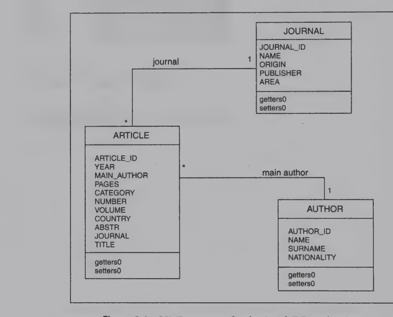

图 8.1 ArticleDB 应用程序的 UML 结构。

该应用程序的数据库反映了其简单性。它由三个表组成：`ARTICLE`、`AUTHOR` 和 `JOURNAL`。在 MySQL 安装中创建此数据库的 SQL 脚本如清单 8.1 所示。

```
清单 8.1  ArticleDB SQL 架构

###
### article
###

drop table if exists ARTICLE;

create table ARTICLE  (

ARTICLE_ID INTEGER PRIMARY KEY,
YEAR CHAR(4),
MAIN_AUTHOR CHAR(2),
PAGES INTEGER,
CATEGORY CHAR(1),
NUMBER INTEGER,
```

```
VOLUME INTEGER,
COUNTRY CHAR(2),
ABSTR VARCHAR(250),
JOURNAL CHAR(4),
TITLE VARCHAR(80)

);
```

```
###
### author
###
```

```
drop table if exists AUTHOR;

create table AUTHOR  (

AUTHOR_ID CHAR(2),
NAME VARCHAR(45),
SURNAME VARCHAR(45),
NATIONALITY CHAR(2)

);
```

```
###
### journal
###
```

```
drop table if exists JOURNAL;

create table JOURNAL  (

JOURNAL_ID CHAR(4),
NAME VARCHAR(45),
ORIGIN CHAR(2),
PUBLISHER VARCHAR(45),
AREA VARCHAR(20)

);
```

此数据库在 MySQL 安装中可用，并通过 JDBC 访问。Struts 连接管理器将使用附录 D "MySQL" 中讨论的 MySql 驱动程序执行数据库连接管理。

## 使用辅助类表示模型

在任何应用程序中，设计核心应用程序实体的表示时，总会涉及一些选择。你可以使用纯面向对象的设计，并提供该设计与数据库层之间的映射，以提供持久性。这需要处理映射配置的开销。

另一个选择是依赖一个功能齐全的分布式对象架构和框架，例如 Enterprise Java Beans。当应用程序足够大时（这绝不是一个简单的衡量标准），并且需要访问分布在组织中并实现核心业务流程的对象，以便多个应用程序使用时，这是一个很好的解决方案。否则，在此情况下，当应用程序太小且可以集中时，EJB（或任何其他分布式对象框架）总是显得大材小用。

另一个选择是依赖简单的 bean。对于此应用程序，主要抽象被封装在辅助类中，这些简单的 bean 将提供对数据库的 SQL 访问。清单 8.2 显示了 `AuthorHelper` 类。

但在 Struts 中表示模型层并不局限于仅使用 JavaBeans。其他选项，如 XML 或消息传递，也可以考虑。一节 "主题变奏：EJBs、消息传递和 XML" 提供了更多信息。

## 清单 8.2  AuthorHelper 类


```
package jspbook.example.articledb;

import java.sql.*;
import javax.sql.*;
import javax.servlet.http.HttpServletRequest;
import org.apache.struts.action.*;

public final class AuthorHelper extends Object
{

    public Vector getAuthorList(HttpServletRequest request, String key)
    {
        Vector results = new Vector();
        HttpSession session = request.getSession(false);
        DataSource ds = (DataSource)session.getAttribute(key);
        Connection con = null;
        try
        {
            String id = request.getParameter("id");
            String surname = request.getParameter("surname");
            String criteria = "";

            if(id != null) criteria = " id = ?";
            else if(surname != null) criteria = " surname = ?";
            else return null;

            con = ds.getConnection();
            PreparedStatement stm = con.prepareStatement("Select id, name, surname, nationality from author where "+criteria);
```

```
if(id != null) stm.setString(1,id);
else stm.setString(1,surname);

ResultSet rs = stm.executeQuery();
while(rs.next())
{
    AuthorForm form = new AuthorForm();
    form.setId(rs.getString(1));
    form.setName(rs.getString(2));
    form.setSurname(rs.getString(3));
    form.setNationality(rs.getString(4));
    results.addElement(form);
}
}
catch(Exception e) {con.close(); return null;}
finally { con.close();}
return results;
}

public ActionErrors insert(HttpServletRequest request, String key)
{
    ActionErrors errors = new ActionErrors();
    HttpSession session = request.getSession(false);
    DataSource ds = (DataSource)session.getAttribute(key);
    Connection con = null;
    try
    {
        AuthorForm form = request.getParameter("authorForm");

        if(form == null)
        {
            errors.add("nulldata",
                new ActionError("error.data.required"));
            return errors;
        }

        con = ds.getConnection();
        PreparedStatement stm = con.prepareStatement("Insert into author values (?,?,?,?)");

        stm.setString(1,form.getId());
        stm.setString(2,form.getName());
        stm.setString(3,form.getSurname());
        stm.setString(4,form.getNationality());

        stm.executeUpdate();
    }
    catch(Exception e)
    {
        errors.add("sqlerror",
            new ActionError("error.sql.invalid"));
```

## 清单 8.2 续

```java
    public ActionErrors update(HttpServletRequest request, String key)
    {
        ActionErrors errors = new ActionErrors();
        HttpSession session = request.getSession(false);
        DataSource ds = (DataSource)session.getAttribute(key);
        Connection con = null;
        try
        {
            AuthorForm form = (AuthorForm)request.getAttribute("authorForm");

            if(form == null)
            {
                errors.add("nulldata",
                    new ActionError("error.data.required"));
                return errors;
            }

            con = ds.getConnection();
            PreparedStatement stm = con.prepareStatement("Update author set name=?,surname=?,nationality=? where id=?");

            stm.setString(1,form.getName());
            stm.setString(2,form.getSurname());
            stm.setString(3,form.getNationality());
            stm.setString(4,form.getId());

            stm.executeUpdate();
        }
        catch(Exception e)
        {
            errors.add("sqlerror",
                new ActionError("error.sql.invalid"));
            return errors;
        }
        finally { con.close();}
        return errors;
    }

    public ActionErrors delete(HttpServletRequest request, String key)
    {
        ActionErrors errors = new ActionErrors();
        HttpSession session = request.getSession(false);
        DataSource ds = (DataSource)session.getAttribute(key);
        Connection con = null;
        try
        {
            AuthorForm form = (AuthorForm)request.getAttribute("authorForm");

            if(form == null)
            {
                errors.add("nulldata",
                    new ActionError("error.data.required"));
                return errors;
            }

            con = ds.getConnection();
            PreparedStatement stm = con.prepareStatement("delete from author where id=?");

            stm.setString(1,form.getId());

            stm.executeUpdate();
        }
        catch(Exception e)
        {
            errors.add("sqlerror",
                new ActionError("error.sql.invalid"));
            return errors;
        }
        finally { con.close();}
        return errors;
    }
}
```

你会注意到，这个类基本上将 SQL 包装在了对象接口中。这是一个比直接将 SQL 访问放入 Struts Action 类的 `perform` 方法中更好的选择，因为，例如，如果模型层迁移到 EJB 架构，应用 Action 类只需做很少的修改，维护工作将限制在辅助类层。

## Struts 核心组件

正如你在第 6 章 "Jakarta Struts 项目" 中看到的，Struts 应用基于 Web 组件和代表应用状态及用于表示的 JSP 页面的核心 beans。本节将分析 ArticleDB 应用的核心组件。

### ArticleDB ActionForms

清单 8.3 展示了 `AuthorForm` 类。它继承自标准的 `ActionForm` 类，代表了一个作者的抽象。这将为数据录入和数据展示页面提供数据。

### 清单 8.3 AuthorForm 类

```java
package jspbook.example.articledb;

import javax.servlet.http.HttpServletRequest;
import org.apache.struts.action.*;

public final class AuthorForm extends ActionForm
{
    private String name = null; //author's name...
    private String surname = null; // surname...
    private String nationality = null; // and nationality

    public String getName()
    {
        return (this.name);
    }

    public void setName(String value)
    {
        this.name = value;
    }

    public String getSurname()
    {
        return (this.surname);
    }

    public void setSurname(String value)
    {
        this.surname = value;
    }

    public String getNationality()
    {
        return (this.nationality);
    }

    public void setNationality(String value)
    {
        this.nationality = value;
    }

    public void reset(ActionMapping mapping, HttpServletRequest request)
    {
        this.name = null;
        this.surname = null;
        this.nationality = null;
    }

    public ActionErrors validate(ActionMapping mapping,
                                 HttpServletRequest request) {
        ActionErrors errors = new ActionErrors();
        if ((name == null) || (name.length() < 1))
            errors.add("authorname",
                       new ActionError("error.authorname.required"));
        if ((surname == null) || (surname.length() < 1))
            errors.add("authorsurname",
                       new ActionError("error.authorsurname.required"));
        if ((nationality == null) || (nationality.length() < 1))
            errors.add("nationality",
                       new ActionError("error.nationality.required"));
        return errors;
    }
}
```

清单 8.3 中展示的 `reset` 方法只是将所有字段置为 `null`，而 `validate` 方法则检查是否有字段被留空。清单 8.4 展示了 `JournalForm` 类。它同样代表了 `Journal` 实体的完整数据结构。

### 清单 8.4 JournalForm 类


```java
package jspbook.example.articledb;

import javax.servlet.http.HttpServletRequest;
import org.apache.struts.action.*;

public final class JournalForm extends ActionForm
{
    private String id = null; // id...
    private String name = null; //journal's name...
    private String origin = null; // country of origin...
    private String publisher = null; // publisher...
    private String area = null; // and area

    public String getId()
    {
      return (this.id);
    }

    public void setId(String value)
    {
        this.id = value;
    }

    public String getName()
    {
      return (this.name);
    }

    public void setName(String value)
    {
        this.name = value;
    }

    public String getOrigin()
    {
      return (this.origin);
    }

    public void setOrigin(String value)
    {
        this.origin = value;
    }

    public String getPublisher()
    {
      return (this.publisher);
    }

    public void setPublisher(String value)
    {
        this.publisher = value;
    }

    public String getArea()
    {
      return (this.area);
    }

    public void setArea(String value)
    {
        this.area = value;
    }

    public void reset(ActionMapping mapping, HttpServletRequest request)
    {
        this.id = null;
        this.name = null;
        this.origin = null;
        this.publisher = null;
        this.area = null;
    }

    public ActionErrors validate(ActionMapping mapping,
                                 HttpServletRequest request) {
        ActionErrors errors = new ActionErrors();
        if ((id == null) || (id.length() < 1))
            errors.add("journalid",
                new ActionError("error.journalid.required"));
        if ((name == null) || (name.length() < 1))
            errors.add("journalname",
                new ActionError("error.journalname.required"));
        if ((origin == null) || (origin.length() < 1))
            errors.add("journalorigin",
                new ActionError("error.journalorigin.required"));
        if ((publisher == null) || (publisher.length() < 1))
            errors.add("journalpublisher",
                new ActionError("error.journalpublisher.required"));
        if ((area == null) || (area.length() < 1))
            errors.add("journalarea",
                new ActionError("error.journalarea.required"));
        return errors;
    }
}
```

另一件需要注意的事是在验证方法中使用了`ActionError`和`ActionErrors`类。当验证约束失败时，Struts的方式是将`ActionError`收集到`ActionErrors`容器中，然后返回它们。这样，`ActionServlet`就能检测到这些错误，并根据`struts-config.xml`文件中`action`映射的指定采取相应行动。

清单8.5展示了`ArticleForm`类。它的设计遵循了与前面几个类相同的结构。

### 清单8.5 ArticleForm类

```java
package jspbook.example.articledb;

import javax.servlet.http.HttpServletRequest;
import org.apache.struts.action.*;

public final class ArticleForm extends ActionForm
{
    private String id = null; //article's id...
    private String year = null; //year...
    private String mainAuthor = null; //mainAuthor...
    private String pages = null; //pages...
    private String category = null; //category...
```

*续*

## 8.306 第8章 Struts应用程序的解剖

### 清单8.5（续）

```java
private String number = null; //编号...
private String volume = null; //卷...
private String country = null; //国家...
private String abstr = null; //摘要...
private String journal = null; //期刊...
private String title = null; //以及标题

public String getId()
{
  return (this.id);
}

public void setId(String value)
{
    this.id = value;
}

public String getYear()
{
  return (this.year);
}

public void setYear(String value)
{
    this.Year = value;
}

public String getMainAuthor()
{
  return (this.mainAuthor);
}

public void setMainAuthor(String value)
{
    this.mainAuthor = value;
}

public String getPages()
{
  return (this.pages);
}

public void setPages(String value)
{
    this.pages = value;
}

public String getCategory()
{
    return (this.category);
}

public void setCategory(String value)
{
    this.category = value;
}

public String getNumber()
{
    return (this.number);
}

public void setNumber(String value)
{
    this.Number = value;
}

public String getVolume()
{
    return (this.volume);
}

public void setVolume(String value)
{
    this.volume = value;
}

public String getCountry()
{
    return (this.country);
}

public void setCountry(String value)
{
    this.country = value;
}

public String getAbstr()
{
    return (this.abstr);
}

public void setAbstr(String value)
{
    this.abstr = value;
}

public String getJournal()
{
    return (this.journal);
}

public void setJournal(String value)
{
    this.journal = value;
}

public String getTitle()
{
    return (this.title);
}

public void setTitle(String value)
{
    this.title = value;
}

public void reset(ActionMapping mapping, HttpServletRequest request)
{
    this.id = null;
    this.year = null;
    this.mainAuthor = null;
    this.pages = null;
    this.category = null;
    this.number = null;
    this.volume = null;
    this.country = null;
    this.abstr = null;
    this.journal = null;
    this.title = null;
}

public ActionErrors validate(ActionMapping mapping,
                            HttpServletRequest request) {

    ActionErrors errors = new ActionErrors();
    if ((id == null) || (id.length() < 1))
        errors.add("articleid",
                   new ActionError("error.articleid.required"));
    if ((year == null) || (year.length() < 1))
        errors.add("articleyear",
                   new ActionError("error.articleyear.required"));
    if ((mainAuthor == null) || (mainAuthor.length() < 1))
        errors.add("articlemainauthor",
                   new ActionError("error.articlemainauthor.required"));
    if ((pages == null) || (pages.length() < 1))
        errors.add("articlepages",
                   new ActionError("error.articlepages.required"));
    if ((category == null) || (category.length() < 1))
        errors.add("articlecategory",
                   new ActionError("error.articlecategory.required"));
    if ((number == null) || (number.length() < 1))
        errors.add("articlenumber",
                   new ActionError("error.articlenumber.required"));
    if ((volume == null) || (volume.length() < 1))
        errors.add("articlevolume",
                   new ActionError("error.articlevolume.required"));
    if ((country == null) || (country.length() < 1))
        errors.add("articlecountry",
                   new ActionError("error.articlecountry.required"));
    if ((abstr == null) || (abstr.length() < 1))
        errors.add("articleabstr",
                   new ActionError("error.articleabstr.required"));
    if ((journal == null) || (journal.length() < 1))
        errors.add("articlejournal",
                   new ActionError("error.articlejournal.required"));
    if ((title == null) || (title.length() < 1))
        errors.add("articletitle",
                   new ActionError("error.articletitle.required"));
    return errors;
}
```

你也会注意到，这里有许多`ActionForm`类。这是Struts的一个特点。对于更复杂的应用程序，其表单倾向于呈现数据视图而不是来自单一实体的数据，`ActionForm`类的数量会显著增长。

## 操作（Actions）

操作代表了应用程序中要执行的操作。对于每个已识别的事务或流程，都有一个对应的操作。即使对于像`ArticleDB`这样的小型应用程序，操作的数量也可能过度增长。本节介绍了与作者操作相关的操作：搜索、插入、更新和删除。其中，`AuthorDataAction`类（如清单8.6所示）封装了搜索过程。

### 清单8.6 AuthorDataAction类


```java
package jspbook.example.articledb;

import java.util.*;
import javax.servlet.*;
import java.io.IOException;
import org.apache.struts.action.*;
import org.apache.struts.util.*;
import java.lang.reflect.InvocationTargetException;

// 从数据库中准备作者列表
public final class AuthorDataAction extends Action {

public ActionForward perform(ActionMapping mapping,
                             ActionForm acForm,
                             HttpServletRequest req,
                             HttpServletResponse resp)
throws IOException, ServletException {

Locale locale = getLocale(request);
MessageResources messages = getResources();
HttpSession session = request.getSession();
ActionErrors errors = new ActionErrors();

String action = request.getParameter(ACTION);
if (action == null || action.length() == 0)
  errors.add("noaction",
             new ActionError("error.action.required"));


// 模型对象实现为一个Bean
AuthorHelper aut = new AuthorHelper();

// 查询Article实例并将响应设置到ArticleListForm中
if (action.equals("search"))
{
  AuthorForm[] lst = aut.getAuthorList(request, Action.DATA_SOURCE_KEY);

  // 在适当的作用域中设置bean
  request.setAttribute("results", lst);

  // 将控制转发到文章列表页面
  return (mapping.findForward("authorList"));
}
else if (action.equals("detail"))
{
  AuthorForm form = new AuthorForm();
  form = aut.getAuthorDetail(request, Action.DATA_SOURCE_KEY);

  // 在请求作用域中设置AuthorForm bean
    request.setAttribute("detail", form);

  // 将控制转发到文章列表页面
  return (mapping.findForward("authorDetail"));
}
}
}
```

这个类实现了搜索作者列表和搜索作者详情的过程。它通过读取`action`参数并显示每次请求的是哪个过程来实现这一点。应用程序中的每个操作链接都必须指定`action`参数。这样，操作类的数量就可以减少到一个可管理的水平。

这种方法的问题在于操作类的数量可以减少到哪个层次。这个问题的答案看似简单，但实际并非如此。在这个例子中，标准是将与更新某个实体相关的所有过程分组在一起。搜索过程也被分组到另一个类中。这是因为更新过程会生成事务令牌，而搜索过程则不会。

### 清单8.7 AuthorEditAction类

```java
    package jspbook.example.articledb;

    import java.util.*;
    import javax.servlet.*;
    import java.io.IOException;
    import org.apache.struts.action.*;
    import org.apache.struts.util.*;
    import java.lang.reflect.InvocationTargetException;

    // 从数据库中准备作者列表

    public final class AuthorEditAction extends Action {

        public ActionForward perform(ActionMapping mapping,
                                     ActionForm acForm,
                                     HttpServletRequest req,
                                     HttpServletResponse resp)
            throws IOException, ServletException {

            Locale locale = getLocale(request);
            MessageResources messages = getResources();
            HttpSession session = request.getSession();
            ActionErrors errors = new ActionErrors();

            String action = request.getParameter(ACTION);
            if (action == null || action.length() == 0)
                errors.add("noaction",
                           new ActionError("error.action.required"));
```

312  第 8 章  Strutsrack 剖析

清单 8.7  续

```java
//Model object implemented as a Bean
AuthorHelper aut = new AuthorHelper();

//Set an AuthorForm on the case of an update
//but nothing in case of an insert
if (action.equals("update"))
{
    AuthorForm aut = new ArticleForm();
    form = aut.getAuthorDetail(request, Action.DATA_SOURCE_KEY);

    // Set the AuthorForm bean in the pre-defined scope
    if (mapping.getScope().equals("request"))
        request.setAttribute(mapping.getAttribute(), form);
    else
        session.setAttribute(mapping.getAttribute(), form);
}

// Set a transaction control token
saveToken(request);

// Forward control to the author edit page
return (mapping.findForward("authorEdit"));
}

}
```

这是 Struts 中另一个强制性的设计：**事务令牌（transaction token）**的使用，用于避免流程被重复提交。`AuthorEditAction` 类通过`saveToken`方法设置事务令牌。

在清单 8.8 中，你可以看到`AuthorSubmitAction`，它将执行由前一个类设置的事务。

清单 8.8  *AuthorSubmitAction* 类

```java
package jspbook.example.articledb;

import java.util.*;
import javax.servlet.*;
import java.io.IOException;
import org.apache.struts.action.*;
import org.apache.struts.util.*;
import java.lang.reflect.InvocationTargetException;

// Prepares a list of authors from the db

public final class AuthorSubmitAction extends Action {
```

```java
public ActionForward perform(ActionMapping mapping,
                           ActionForm acForm,
                           HttpServletRequest req,
                           HttpServletResponse resp)
  throws IOException, ServletException {

  Locale locale = getLocale(request);
  MessageResources messages = getResources();
  HttpSession session = request.getSession();
  ActionErrors errors = new ActionErrors();

  String action = request.getParameter(ACTION);
  if (action == null || action.length() == 0)
    errors.add("noaction",
               new ActionError("error.action.required"));
```

```java
// Was this transaction cancelled?
  if (isCancelled(request))
  {
    if (mapping.getAttribute() != null)
      session.removeAttribute(mapping.getAttribute());
      return (mapping.findForward("menu"));
  }
```

```java
//If the transaction token is not valid, there's an error
  if (!isTokenValid(request))
        errors.add(ActionErrors.GLOBAL_ERROR,
                   new ActionError("error.transaction.token"));

  //Either way, reset the token
  resetToken(request);
```

```java
//Model object implemented as a Bean
  AuthorHelper aut = new AuthorHelper();
  AuthorForm form = (AuthorForm) acForm;
```

```java
//Execute the data operations
  if (action.equals("insert"))
  {
    errors = aut.insertAuthor(form, Action.DATA_SOURCE_KEY)
      if (errors.empty()))
    return (mapping.findForward("menu"));
  }
  else if (action.equals("update"))
  {
      errors = aut.updateAuthor(form, Action.DATA_SOURCE_KEY);
      if (errors.empty())
    return (mapping.findForward("menu"));
  }
  else if (action.equals("delete"))
```

续

314  第 8 章  Strutsrack 剖析

清单 8.8  续

```java
{
    errors = aut.deleteAuthor(form, Action.DATA_SOURCE_KEY);
    if (errors.empty())
        return (mapping.findForward("menu"));
}

//Report the errors detected
if (!errors.empty())
{
    saveErrors(request, errors);
    saveToken(request);
    return (new ActionForward(mapping.getInput()));
}
}
}
```

`AuthorSubmitAction.perform`方法首先验证当前事务令牌是否有效。如果无效，说明发生了顺序错误，该事务被错误地提交了。在这种情况下，会返回一个错误。

如果事务令牌有效，则将其重置，因为另一次提交会导致问题。然后设置所需的类，并根据请求的`action`参数调用 helper 类中相应的核心方法。

如果处理过程后检测到任何错误，则会重定向到输入表单以进行更正。在这种情况下，会生成一个新的事务令牌。

## 应用程序 JSP 页面

如第 6 章和第 7 章 "Struts 标签库" 中所示，JSP 在任何 Struts 应用程序中扮演着核心角色，因为它们完成了框架内置的多个标准流程，并提供了表示层。下一节分析构成迄今为止审查过的流程的页面。

### 主页面和模板

由于任何应用程序都有共享的静态设计，例如标志或页面的特定布局，因此`struts-template`库可以大量使用。在 ArticleDB 应用程序中，有一个标准页头模板和一个页脚模板。它们分别在清单 8.9 和 8.10 中展示。

清单 8.9  页头模板

```jsp
<%@ taglib uri="/WEB-INF/struts-template.tld" prefix="template" %>
<%@ taglib uri="/WEB-INF/struts-bean.tld" prefix="bean" %>
<p align="center">
    <h1><bean:message key="app.name"/></h1><br>
<h4><template:get name="module"/></h4>
</p>
<hr width="100%" height="1">
```

页头模板展示了一个集中式布局，其中模块名使用参数化替换。该模块名将在应用程序的所有页面中通过`module`参数提供。清单 8.10 中的页脚模板不使用任何参数。

**清单 8.10  页脚模板**

```jsp
<hr width="100%" height="1">
<p align="right">
  <font size="-2">ArticleDB App Example</font>
</p>
```

应用程序的主页面是菜单页面（见清单 8.11）。该应用程序没有安全约束，因此不会有登录方案。页面开头声明了标签库、页头模板，以及应用程序中主要流程的链接。这些链接使用`struts-html`库的 link 标签。然后页面以页脚模板结束。

**清单 8.11  菜单页面**

```jsp
<%@ taglib uri='/WEB-INF/struts-template.tld' prefix='template' %>
<%@ taglib uri='/WEB-INF/struts-html.tld' prefix='html' %>
<%@ taglib uri='/WEB-INF/struts-bean.tld' prefix='bean' %>
<html:html>
<header>
  <html:base/>
</header>
<body>

<template:insert template="/headerTemplate.jsp">
  <template:put name="module" content="Main Menu" direct="true"/>
</template:insert>

<html:link page="/searchAuthor.jsp">
  <bean:message key="author.search"/>
</html:link>

<html:link page="/searchJournal.jsp">
  <bean:message key="journal.search"/>
</html:link>

<html:link page="/searchArticle.jsp">
  <bean:message key="article.search"/>
</html:link>

<template:insert template="/footerTemplate.jsp"/>
</body>
</html:html>
```

316  第 8 章  Strutsrack 剖析


清单 `taglib` 续

```jsp
</body>
</html:html>
```

## 作者页面

`AuthorDB` 应用程序的第一个页面是 `searchAuthor.jsp` 页面，它展示在清单 8.12 中。同样，这里也有页头模板。这次有一个 `form` 标签指向 `AuthorDataAction`，其 `action` 为 `search`。这将触发 `getAuthorList` 方法调用。

### 清单 8.12 `searchAuthor.jsp` 页面

```jsp
<%@ taglib uri='/WEB-INF/struts-template.tld' prefix='template' %>
<%@ taglib uri='/WEB-INF/struts-html.tld' prefix='html' %>
<%@ taglib uri='/WEB-INF/struts-bean.tld' prefix='bean' %>
<html:html>
<header>
<html:base/>
</header>
<body>

<template:insert template="/headerTemplate.jsp">
<template:put name="module" content="Search Author" direct="true"/>
</template:insert>

<html:form action="/author也就是说，

<bean:message key="author.id"/><html:text name="id"/>
<bean:message key="author.surname"/><html:text name="surname"/>

<center><html:submit /><html:reset /></center>

</html:form>

<template:insert template="/footerTemplate.jsp"/>
</body>
</html:html>
```

清单 8.13 中展示的页面将从 `AuthorDataAction`/`AuthorHelper` 类检索到的 `AuthorForm` bean 向量渲染到一个表格中。`logic:iterate` 标签将完成这项工作。

### 清单 8.13 作者列表页面

```jsp
<%@ taglib uri='/WEB-INF/struts-template.tld' prefix='template' %>
<%@ taglib uri='/WEB-INF/struts-html.tld' prefix='html' %>
<%@ taglib uri='/WEB-INF/struts-bean.tld' prefix='bean' %>
```

```jsp
<%@ taglib uri="/WEB-INF/struts-logic.tld" prefix="logic" %>

<html:html>
<header>
  <html:base/>
</header>
<body>

<template:insert template="/headerTemplate.jsp">
  <template:put name="module" content="作者列表结果" direct="true"/>
</template:insert>

      <table width="100%">
      <tr><td>
        <bean:message key="author.id"/>
      </td><td>
        <bean:message key="author.name"/>
      </td></tr>

      <bean:parameter id="results" name="results"/>
      <logic:iterate id="author" name="results">
        <tr><td>
          <html:link page="/authorData?action=detail">
            <bean:write name="author" property="id">
          </html:link>
        </td><td>
          <bean:write name="author" property="value">
        </td></tr>
      </logic:iterate>
      </table>

    <template:insert template="/footerTemplate.jsp"/>
    </body>
    </html:html>
```

清单 8.14 展示了作者详情页面。这是一个只读页面，它展示了使用 `bean:write` 标签构建的 `AuthorForm`。

### 清单 8.14 作者详情模板

```jsp
<%@ taglib uri='/WEB-INF/struts-template.tld' prefix='template' %>
<%@ taglib uri='/WEB-INF/struts-bean.tld' prefix='bean' %>
<%@ taglib uri="/WEB-INF/struts-logic.tld" prefix="logic" %>
<%@ taglib uri="/WEB-INF/struts-html.tld" prefix="html" %>

<html:html>
<header>
  <html:base/>
</header>
<body>

<template:insert template="/headerTemplate.jsp">
    <template:put name="module" content="作者详情" direct="true"/>
</template:insert>

<html:link page="/authorEdit?action=update&" paramId="id" paramName="detail"
           paramProperty="id" paramScope="request"/>

<html:link page="/authorEdit?action=delete&" paramId="id" paramName="detail"
           paramProperty="id" paramScope="request"/>

<bean:message key="author.id"/>:
<bean:write name="detail" property="id" scope="request"/>

<bean:message key="author.name"/>:
<bean:write name="detail" property="name" scope="request"/>

<bean:message key="author.surname"/>:
<bean:write name="detail" property="surname" scope="request"/>

<bean:message key="author.nationality"/>:
<bean:write name="detail" property="nationality" scope="request"/>

<template:insert template="/footerTemplate.jsp"/>
</body>
</html:html>
```

为了提供一个编辑表单，作者编辑页面使用了 `html` 库的文本标签结合 `bean:message` 标签。它在清单 8.15 中展示。

### 清单 8.15 作者输入表单

```jsp
<%@ taglib uri='/WEB-INF/struts-template.tld' prefix='template' %>
<%@ taglib uri='/WEB-INF/struts-html.tld' prefix='html' %>
<%@ taglib uri='/WEB-INF/struts-bean.tld' prefix='bean' %>
<%@ taglib uri="/WEB-INF/struts-logic.tld" prefix="logic" %>

<html:html>
<header>
    <html:base/>
</header>
<body>

<template:insert template="/headerTemplate.jsp">
    <template:put name="module" content="作者列表结果" direct="true"/>
</template:insert>

<html:form action="/authorSubmit">
<html:hidden name="action" value="<%=request.getParameter("action")%>"/>

<bean:message key="author.id"/><html:text name="id"/>
<bean:message key="author.name"/><html:text name="name"/>
<bean:message key="author.surname"/><html:text name="surname"/>
<bean:message key="author.nationality"/>
<html:select name="nationality" multiple="false">
  <html:options collection="<%=nationsISOCodesAndNames%>"/>
</html:select>

</html:form>

<template:insert template="/footerTemplate.jsp"/>
</body>
</html:html>
```

国籍字段是通过一个基于集合的选项标签实现的。

## `ApplicationResources.properties` 文件

`ApplicationResources.properties` 文件是一个 Java 属性文件，包含了一组键值对，用于创建整个 Struts 应用程序中使用的多条消息。清单 8.16 展示了该文件的一个摘录。

### 清单 8.16 `ApplicationResources` 文件

```properties
error.sql.invalid=<li>提交的 SQL 无效</li>
error.data.required=<li>请求的信息为必填项</li>
error.authorname.required=<li>作者姓名为必填项</li>
error.authorsurname.required=<li>作者姓氏为必填项</li>
error.authornationality.required=<li>作者国籍为必填项</li>
```

该文件必须位于 classpath 上。因此，最好将其放在应用程序的 `WEB-INF/classes` 目录中。在一个 Struts 示例中，你会看到它在如下整个 classpath 中被声明和维护：

`org.apache.struts.webapp.example.ApplicationResources.properties`

## `struts-config.xml` 文件

包含 `ArticleDB` 应用程序配置的 `struts-config.xml` 文件在清单 8.17 中展示。在这里你可以看到三个主要部分：

- 数据源—应用程序在此配置对 MySQL 数据库的访问
- form-beans—在此声明构成应用程序的各个 `ActionForm` bean
- actions 部分摘录—在此讨论的两个 action 在此被声明

### 清单 8.17 `struts-config.xml` 文件摘录

```xml
<?xml version="1.0" encoding="ISO-8859-1" ?>
<!DOCTYPE struts-config PUBLIC
  "-//Apache Software Foundation//DTD Struts Configuration 1.0//EN"
  "http://jakarta.apache.org/struts/dtds/struts-config_1_0.dtd">

<struts-config>
  <data-sources>
    <data-source
      autoCommit="false"
      description="第一个数据库配置"
      driverClass="org.gjt.mm.mysql.Driver"
      maxCount="4"
      minCount="2"
      password="admin"
      url="jdbc:mysql://localhost/ARTICLEDB"
      user="admin"
    />
  </data-sources>

  <form-beans>
    <form-bean name="authorForm" type="jspbook.example.articledb.AuthorForm"/>

    <form-bean name="journalForm" type="jspbook.example.articledb.JournalForm"/>

    <form-bean name="articleForm" type="jspbook.example.articledb.ArticleForm"/>
  </form-beans>

  <action-mappings>
    <action path="/authorEdit"
            type="jspbook.example.articledb.AuthorEditAction"
            name="authorForm"
            scope="request"
            validate="false">
      <forward name="authorEdit" path="/authorEdit.jsp"/>
    </action>

    <action path="/searchAuthor"
            type="jspbook.example.articledb.AuthorDataAction"
            name="authorForm"
            scope="request"
            validate="false">
      <forward name="authorEdit" path="/searchAuthor.jsp"/>
    </action>
  ...

</action-mappings>

</struts-config>
```

## `web.xml` 文件

此应用程序的 `web.xml` Web 应用程序部署描述符遵循了 `struts-example` 应用程序的指导原则。唯一的区别是，`ArticleDB` 应用程序使用的是路径映射，而不是扩展映射。因此，`ArticleDB` 中的所有 action 类都通过 JSP 使用在 `struts-config.xml` 文件中指定的路径来访问，例如 `/articleDB/searchAuthor`。

## 打包 Struts 应用程序

部署一个 Struts 应用程序涉及以下步骤：

- **打包框架**—`struts.jar` 存档文件必须部署在您应用程序的 `/WEB-INF/lib` 目录中，而四个标准的 TLD 文件（每个 struts 标签库一个）必须部署在 `/WEB-INF` 本身下。
- **打包应用程序文件**—`ApplicationResources.properties` 文件以及构成应用程序资源的所有资源包，都必须位于 classpath 上。最好将其放在构成应用程序的类中间。应用程序类文件可以按照标准方式部署在 `/WEB-INF/classes` 目录下。所有附属组件，包括标签库、外部库等，都必须按照标准方式部署。

## 主题变体：EJB、消息和 XML

正如前一节“用辅助类表示模型”中所提到的，Struts 对于您的 Web 应用程序模型层所说的就是，它必须通过应用程序的 Action 类进行访问。本节讨论了替代该节中呈现的辅助类的三种最流行的方案：

- **EJB 技术**—这代表任何分布式对象平台。
- **消息传递**—应用程序通过异步消息访问业务逻辑。用于消息传递的 Java API 是 Java 消息服务 API (JMS)。第 4 章“协作标签和验证”提供了一些使用 JMS API 的示例。
- **XML 数据表示**—这要么是指应用程序的主要抽象被设计为 XML 数据对象，要么是指它以 XML 文档的形式从某个业务逻辑服务器生成。


### 使用 EJB

基于 Struts–EJB 的应用程序的基本设计遵循图 8.2 所示的方案。使 EJB 和 Struts `Action` 类协同工作的最佳实践是将 EJB 隔离在 `Model` 层，并仅通过 Struts 和 JSP 提供 Web 应用程序的控制和展示。在该设计中，不再仅仅依赖辅助类来提供 `Model`，而是将业务逻辑层封装在实体/会话 Bean 中。

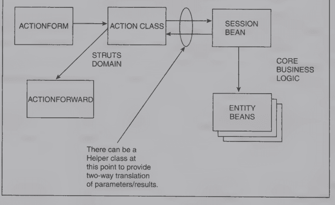

最佳方法是将`会话 Bean`用于`外观`（Façade）或`命令`（Command）模式，从 `ActionForm` Bean 转换参数数据，可以直接在 `Action` 类中进行，也可以间接通过辅助类来完成。

随后被调用的会话 Bean 可以执行一些逻辑，可能与多个`实体 Bean`交互，然后返回处理结果。返回这些结果的最佳方法是`避免传递对象引用`，因为这些引用可能会断开；而且 Struts 无法检测到这一点，导致 Struts 底层的错误处理机制失效。

相反，建议仅通过`值`将对象传递回 `Action` 类。会话 Bean 或与其交互的辅助类可以将实体 Bean 引用转换为本地 Bean，然后将它们传递回 `Action` 类。

### 消息传递

有时，Web 应用程序以异步模式与远程应用服务器通信，以访问实现 Web 业务逻辑所需的业务对象。为此，可以使用`Java 消息传递 API`（JMS API）与异步消息中间件通信，中间件将可靠地来回传递查询消息和结果消息。Struts 应用程序与消息服务提供者进行通信，例如 SonicMQ 或 IBM 的 MQ Series。

场景大致与之前相同。你可以使用辅助类来封装消息传递逻辑，并为消息中间件提供标准的面向对象接口。或者，你可以将所有内容都放在 `Action` 类中。在发布-订阅应用程序中，如第 4 章中的那个，辅助类将实现 `TopicSubscriber` 或 `TopicPublisher` 接口。

### XML 数据

第三种备选方案将 XML 作为 `Model` 对象的表示模式。这可以由标准文档服务器响应数据库查询生成，例如 XML 树导航。在这种情况下，有多种处理 Struts 中 XML 数据的替代方案：

- **将 XML 作为内容使用**——在这种情况下，`Action` 类生成响应并直接分派。为避免与 `ActionServlet` 发生问题，`perform` 方法应返回 `null`。这向 `ActionServlet` 发送信号，表示响应将由 `Action` 类自行生成。
- **包装并发送**——将 XML 响应包装在某个容器中，例如 `StringBuffer` 或 Jakarta Element Construction Set 元素，这是一组用于以编程方式生成 HTML 或 XML 等标记内容的 Java 类，然后将其通过 `ActionForm` 属性或 `request` 属性返回给展示层 JSP。在 JSP 上，你可以使用其他标签库来解析或转换该 XML，就好像它是一个 XML 数据岛。Jakarta Taglibs 项目的 Xtags 和 XSP 库可用于此目的。有关这些库的更多信息，请参见第 9 章 "The Jakarta Taglibs Project"。
- **解析处理**——使用 `Digester` 工具类和一组规则来读取 XML 对象并创建表示它们的 Bean，然后发送这些 Bean。IBM 的 Bean Scripting Framework（BSF）也可以替代 `Digester` 使用。当业务对象通常表示为 EJB 且应用程序必须应对独立的 XML 服务器时，这很有用。第 9 章将再次介绍 BSF。
- **发布它**——使用某些 Web 发布框架，例如 Apache Cocoon，获取你的 XML 并以你需要的任意多种输出格式发布。标准的或自定义的 Cocoon 生产者可以处理它。与本列表中的第一项相同，`Action` 类的 `perform` 方法应返回 `null`。或者，在混合场景中，将其转移到 JSP，某些标签将处理它并将其发送到 Cocoon。有关 Cocoon 的更多信息，请访问 http://xml.apache.org。

在任何场景中，XML 都将被视为数据。使用 SOAP 等同于使用任何远程过程调用协议（RPC 协议），如 RMI。对远程对象的调用将更好地封装在辅助类中，这些辅助类将提供比 Struts `Action` 类更高级的调用方法。

## 小结

在本章中，你学习了如何构建 Struts 应用程序（逐个类、逐个 JSP），如何设计 `Model` 层以获得更好的灵活性，以及使 Struts Web 应用程序设计更轻松的几个方面（如错误处理、`ApplicationResources` 的集中管理、基于键的标签等）。你还学习了应用程序中各个组件将如何交互——从特定于应用程序的 Struts (`\Alpha\`) 子类，如 `Action` 类或 `ActionForm` Bean，到特定于应用程序的类。

# 9 Jakarta Taglibs 项目

本章讨论 `JAKARTA TAGLIBS 项目`，这是一个开源通用标签库，可在 Apache 软件基金会的 Jakarta 项目网站（http://jakarta.apache.org）上找到。本章介绍 Taglibs 项目、其目标和前景，以及构成项目仓库中庞大标签库的标签库。

## 项目

该项目还提供了关于标签库开发的全面教程。`tutorial.html` 文件位于 Taglibs 发行版安装目录的 `/doc` 子目录下。

### 可用及开发中的库

Taglibs 项目被认为是许多开发中标签库的仓库，包括即将推出的标准标签库。表 9.1 是截至本文撰写时存在的库列表。

### 表 9.1 Taglibs 项目中当前的库

| 库 | 用途 |
|---------|---------|
| Application | 访问 `ServletContext`。该库包含访问 `ServletContext` 上多个属性和参数的标签，即你在第 1 章 "Servlet 和 JavaServer Pages 简介" 中看到的 Web 应用程序的上下文。该上下文在 JSP 中由 `application` 隐式对象表示。 |
| BSF | 一个测试库，用于访问使用 Bean Scripting Framework 脚本化的对象。 |
| DateTime | 日期和时间实用标签。 |
| Input | HTML 表单输入元素。这些可以具有默认值。 |
| DBTags | 访问 JDBC API 功能。有用于访问数据库驱动程序或 `DataSource` 对象、提交查询和展示结果的标签。 |
| JNDI | 访问 JNDI API 功能。有用于访问 JNDI 上下文、列表、查找和搜索功能等的标签。 |
| JSP Spec Taglib | JSP 规范中的示例标签，标签 `foo` 和 `bar`。 |
| Page | 访问 `PageContext`。该库包含访问 `PageContext` 上多个属性和参数的标签，`PageContext` 是 JSP 加载时设置为该页面本地的上下文。 |
| Regexp | 使用正则表达式。该标签库实现了许多 Perl 函数，如 `match`、`split` 和 `substitute`。 |
| Request | 访问 `HttpServletRequest` 对象以及请求对象上可用的多个属性和参数。 |
| Response | 访问 `HttpServletResponse` 对象上可用的属性。 |
| Scrape | 从其他网页中提取部分以在页面中使用的库。 |
| Session | 访问会话。该库包含访问会话上多个属性和参数的标签。 |
| SQL Sample Taglib | 实现 JSP 规范中 SQL 示例标签的库。它不再被支持。 |
| Utility | 一个示例标签库。该库包含如何编码标签的示例，并给出了一些用于说明目的的技术。 |
| XSL | 使用样式表转换处理 XML 的库。 |

在以下各节中，将逐一介绍这些库及其示例。

## 使用 Taglibs 项目的库

要使用 Taglibs 项目下可用的标签库，你必须下载并解压缩库的二进制发行版，或下载、解压缩并构建源代码发行版。两者都可在 Jakarta 网站找到，地址为 http://jakarta.apache.org/taglibs/binarydist.html。让我们来了解一下使用二进制发行包的步骤。

下载二进制发行包并解压后，Taglibs 项目所包含的几个库将会出现——每个库都位于 `TAGLIB_HOME` 目录下的一个单独子目录中。例如，会有一个 `TAGLIB_HOME/application` 目录，其中包含 application 标签库的文件。

每个子目录将包含四个文件，如下所示：

- **一个 TLD**——每个库都包含一个标签库描述符，供开发者使用。
- **库资源文件**——这是一个 JAR 文件，包含构成标签库本身的类和资源。必须将其部署在 Web 应用程序的类路径（classpath）中。建议将其部署在 Web 应用程序的 `/WEB-INF/lib` 子目录下。
- **文档 Web 应用程序**——该文件名类似于 `*-doc.war`。其中的 `*` 会被库的名称替换。它是一个 Web 应用程序归档文件，包含与使用该库的开发者相关的文档。
- **示例 Web 应用程序**——该文件名类似于 `*-examples.war`。其中的 `*` 会被库的名称替换。它是一个 Web 应用程序归档文件，包含该库使用示例的示例。

请记住，正如你在第 1 章和第 2 章“标签库简介”中所学，你必须在应用程序的 Web 应用程序部署描述符文件 (`web.xml`) 的 `<taglib>` 元素中声明在应用程序中使用的每个标签库。此外，每个使用标签库的页面都必须有一个 `<%@taglib%>` 指令，描述其 `uri` 和前缀。强烈建议你坚持使用该库最被广泛接受的名称作为前缀，以便于识别所使用的库，或者使用库名作为前缀。

Jakarta Taglibs 库的默认 `uri` 是 `http://jakarta.apache.org/taglibs/{the name of the library}`。例如，`http://jakarta.apache.org/taglibs/application-1.0` 是 application 标签库的 `uri`。

让我们在接下来的章节中研究 Taglibs 项目中可用的每个库。

## Application

application 标签库旨在提供对上下文中可用信息的访问，主要是参数和属性。上下文在第 1 章中讨论过。它被实现为一个 `ServletContext` 对象，可以包含参数、属性和对象方法，这些代表了从 servlet 视角看的 Web 应用程序环境。application 标签库提供了许多标签，可以轻松地在页面内访问这些参数和属性，而无需使用脚本片段或 `application` 对象。

该标签库符合 JSP 标签库扩展 API 1.1，这是 JSP API 1.2 的一部分。它需要兼容 JSP 1.2 的 servlet/JSP 容器。在撰写本文时，application 库的版本是 1.0。该库的简称是 `application`，建议将其作为首选前缀。

application 库中可用的标签列在表 9.2 中。

### 表 9.2 Application 库标签

| 标签 | 描述 |
| --- | --- |
| `initparameter` | `initparameter` 标签接受一个必需的 `name` 属性，该属性包含所需初始化参数的名称，并在输出流中检索其值。 |
| `initparameters` | `initparameters` 标签接受一个必需的 `id` 属性，该属性包含在标签体中定义的脚本变量的名称，并遍历所有声明的初始化参数。`id` 代表的脚本变量可以在 `getProperty` 标准动作中使用，以检索每个初始化参数的名称和值。 |
| `existsinitparameter` | `existsinitparameter` 标签接受两个属性：<br><br>- **name**——保存所需初始化参数的名称。<br>- **value**——保存 true 或 false。如果未定义值，则默认为 true。<br><br>如果 `existsinitparameter` 标签的值匹配 `value` 属性，则其主体将包含在输出中。<br><br>例如，如果 `value` 属性为 false 且未找到所需的初始化参数，则将包含该标签的主体。 |
| `equalsinitparameter` | `equalsinitparameter` 接受四个属性：<br><br>- **name**——保存所需初始化参数的名称。<br>- **value**——保存 true 或 false。如果未定义值，则默认为 true。此属性是可选的。<br>- **match**——保存要与所需初始化参数的值匹配的值。<br>- **ignorecase**——保存 true 或 false。如果未定义值，则默认为 true。此属性是可选的。<br><br>如果 `value` 为 true，则当初始化参数的值与 `match` 属性的值匹配时，将包含该标签的主体。如果 `value` 为 false，则当初始化参数的值与 `match` 属性的值不匹配时，将包含该标签的主体。如果 `ignorecase` 属性为 true，则比较不区分大小写。如果为 false，则与 `match` 属性的比较将区分大小写。 |

`attribute` 标签接受一个必需的 `name`，它包含所需属性的名称，并在输出流中检索其值。

`attributes` 标签接受一个必需的 `id`，它包含在标签体中定义的脚本变量的名称，并遍历所有声明的属性。`id` 代表的脚本变量可以在 `getProperty` 标准动作中使用，以检索每个属性的名称和值。

`equalsattribute` 标签接受四个属性：

- **name**——保存所需属性的名称。
- **value**——保存 true 或 false。如果未定义值，则默认为 true。此属性是可选的。
- **match**——保存要与所需属性的值匹配的值。
- **ignorecase**——保存 true 或 false。如果未定义值，则默认为 true。此属性是可选的。

如果 `value` 为 true，则当属性的值与 `match` 的值匹配时，将包含该标签的主体。如果 `value` 为 false，则当属性的值与 `match` 的值不匹配时，将包含该标签的主体。如果 `ignorecase` 为 true，则比较不区分大小写。如果为 false，则与 `match` 的比较将区分大小写。

`existsattribute` 标签接受两个属性：

- **name**——保存所需属性的名称。
- **value**——保存 true 或 false。如果未定义值，则默认为 true。

如果 `existsattribute` 标签的值匹配 `value`，则其主体将包含在输出中。例如，如果 `value` 为 false 且未找到所需属性，则将包含该标签的主体。

接受属性的名称，并将其值设置为标签主体的内容。

接受属性的名称，并将其从上下文命名空间中移除。

清单 9.1 中的应用程序标签库展示了 `attributes` 和 `initparameters` 标签的用法，用于检索当前 Web 应用程序中声明的属性和初始化参数列表。

### 清单 9.1 使用 Application 标签库

```
<html>
<head>
  <title>JSP Book examples</title>
</head>
<body bgcolor="white">
<center>
<h1>Using the APPLICATION Taglib</h1></center>
<br>
<%@ taglib uri="http://jakarta.apache.org/taglibs/application-1.0" prefix="app" %>
<table>
<tr>
  <td colspan="2" align="center">Init Parameters detected</td>
</tr>
<tr>
  <td align="center">Name</td>
  <td align="center">Value</td>
</tr>
<app:initparameters id="ips">
  <tr>
    <td><jsp:getProperty name="ips" property="name"/></td>
    <td><jsp:getProperty name="ips" property="value"/></td>
  </tr>
</app:initparameters>
<tr>
  <td colspan="2" align="center">Attributes detected</td>
</tr>
<tr>
  <td align="center">Name</td>
  <td align="center">Value</td>
</tr>
<app:attributes id="ats">
  <tr>
    <td><jsp:getProperty name="ats" property="name"/></td>
    <td><jsp:getProperty name="ats" property="value"/></td>
  </tr>
</app:attributes>
</table>
</body>
</html>
```


首先，使用`initparameters`标签遍历初始化参数，为每个参数生成一个表格行。然后，使用`attributes`标签在同一个表格中显示上下文命名空间中的属性。

这些标签遵循 Jakarta Taglibs 中其他标签库将使用的模型：访问上下文、会话、请求或页面上可用属性的标签库提供了一种列出属性、测试属性是否存在以及检查和访问其值的方式。这对于避免在尝试访问应存在于某个属性中但未找到的对象时抛出的异常非常有用。清单 9.2 演示了如何在使用对象之前通过`existsattribute`检查对象的可用性。

### 清单 9.2 展示 existsattribute 用法的代码片段

```
<application:existsattribute name="DATASOURCE_NAME">

<!-- this block will access the datasource name attribute -->

<%

    Context ct = new InitialContext();

    DataSource ds = (DataSource)

ct.lookup(application.getAttribute(DATASOURCE_NAME));

    ...

%>

</application:existsattribute>

...
```

在清单 9.2 中，你可以看到对 JNDI 上下文的访问以及对 JDBC `DataSource`对象的查找。这可以直接执行，因为你已经通过`existsattribute`测试了属性的存在性。强烈推荐这种设计，因为它通过确认属性存在来安全地访问属性。它通过避免测试空值所需的脚本片段来简化代码，这对页面设计者来说更简洁、更清晰。在研究 Taglibs 项目中的其他标签库之后，我们将回到这个示例，看看对于`existsattribute`标签体内的脚本片段可以做些什么。

## BSF

BSF 标签库实现了 Bean Scripting Framework 项目，该项目最初在 IBM AlphaWorks 站点上开发，后来已迁移（或者按照 AlphaWorks 的术语来说是"毕业"）到 IBM 开源计划下，地址为 http://oss.software.ibm.com/developerworks/projects/bsf。其目标是在 JSP 中集成 Java 以外的脚本语言。如果相应的 BSF 语言处理器可用，就可以使用所选语言来执行某些特定操作。BSF 库中可用的标签列于表 9.3 中。

### 表 9.3 BSF 库标签

| 标签 | 描述 |
|---|---|
| Scriptlet | 接受一个`language`属性，用于指示编写脚本所使用的 BSF 语言。此属性仅在脚本执行时语言处理器可用的情况下生效；否则将被忽略。它类似于 JSP 脚本片段。 |
| Expression | 接受一个`language`属性，用于指示编写表达式所使用的 BSF 语言。如果语言处理器可用，则计算表达式并将结果输出到`out`流；否则将被忽略。它类似于 JSP 表达式。 |

清单 9.3 中使用应用标签库的示例展示了在 JSP 中使用 BSF `expression`标签的 Perl 表达式。

### 清单 9.3 使用 BSF 标签

```
<!-- 

// This source code is part of the Jakarta Taglibs project

// from the Apache Software Foundation. Refer to the full

// license terms in Appendix F.

-->

<html>

<%@ taglib uri="http://jakarta.apache.org/taglibs/bsf-2.0" prefix="bsf" %>

<head>

    <title>Temperature Table</title>

</head>

<body>

<h1>Temperature Table</h1>

<p>American tourists visiting Canada can use this handy temperature

table which converts from Fahrenheit to Celsius:

<br><br>

In TCL

<table BORDER COLS=2 WIDTH="20%" >

<tr BGCOLOR="#FFFF00">

<th>Fahrenheit</th>

<th>Celsius</th>

</tr>

<bsf:scriptlet language="tcl">

package require java

for {set i 60} {$i<=100} {incr i 10} {

    $out println "<tr ALIGN=RIGHT BGCOLOR=\"#CCCCCC\">"

    $out println "<td>$i</td>"

    $out println [concat "<td>" [format %4.2f [expr ($i - 32.0)*5/9]] "</td>"]

    $out println "</tr>"

}
```

> 1. 此代码是 Apache 软件基金会（http://www.apache.org）的 Apache Taglibs 项目中某个页面的片段。

使用 Taglibs 项目的库 335

```
}

</bsf:scriptlet>

</table>

<bsf:expression language="tcl">

    package require java ; java::new java.util.Date

</bsf:expression>
```

```
<hr>In Javascript

<table BORDER COLS=2 WIDTH="20%" >

<tr BGCOLOR="#FFFF00">

<th>Fahrenheit</th>

<th>Celsius</th>

</tr>

<bsf:scriptlet language="javascript">

  for (i=60; i<=100; i+=10) {

    out.println ("<tr ALIGN=RIGHT BGCOLOR=\"#CCCCCC\">")

    out.println ("<td>" +  i + "</td>")

    out.println ("<td>" + Math.round((i - 32)*5/9) + "</td>")

    out.println ("</tr>")

  }

</bsf:scriptlet>

</table>

<bsf:expression language="javascript"> new java.util.Date() </bsf:expression>
```

```
<hr>In Perl

<table BORDER COLS=2 WIDTH="20%" >

<tr BGCOLOR="#FFFF00">

<th>Fahrenheit</th>

<th>Celsius</th>

</tr>

<bsf:scriptlet language="perlscript">

  for ($i=60; $i<=100; $i+=10) {

    $out->println ("<tr ALIGN=RIGHT BGCOLOR=\"#CCCCCC\">");

    $out->println ("<td>$i</td>");

    $out->println ("<td>" . int(($i - 32)*5/9) . "</td>");

    $out->println ("</tr>");

  }

</bsf:scriptlet>

</table>

<bsf:expression language="perlscript"> CreateBean("java.util.Date")

</bsf:expression>
```

```
<hr>In JACL

<table BORDER COLS=2 WIDTH="20%" >

<tr BGCOLOR="#FFFF00">

<th>Fahrenheit</th>

<th>Celsius</th>

</tr>

<bsf:scriptlet language="jacl">

package require java
```

## 清单 9.3 续

```
for {set i 60} {$i<=100} {incr i 10} {

  $out println "<tr ALIGN=RIGHT BGCOLOR=\"#CCCCCC\">"

  $out println "<td>$i</td>"

  $out println [concat "<td>" [format %4.2f [expr ($i - 32.0)*5/9]] "</td>"]

  $out println "</tr>"

}

</bsf:scriptlet>

</table>
```

使用 JPython

```
<table BORDER COLS=2 WIDTH="20%" >

<tr BGCOLOR="#FFFF00">

<th>Fahrenheit</th>

<th>Celsius</th>

</tr>

<bsf:scriptlet language="jpython">

from java.util import Date;

for i in range(60,100,10):

  out.println ("<tr ALIGN=RIGHT BGCOLOR=\"#CCCCCC\">");

  out.println ("<td>%d</td>" % i);

  out.println ("<td>%4.2f</td>" % ((i - 32.0)*5/9));

  out.println ("</tr>");

</bsf:scriptlet>

</table>
```

使用 LotusScript

```
<table BORDER COLS=2 WIDTH="20%" >

<tr BGCOLOR="#FFFF00">

<th>Fahrenheit</th>

<th>Celsius</th>

</tr>

<bsf:scriptlet language="lotusscript">

for i = 60 to 100 step 10

    out.println "<tr ALIGN=RIGHT BGCOLOR=""#CCCCCC"">"

    out.println "<td>" & i & "</td>"

    out.println "<td>" & format((i - 32)*5/9,"0.00") & "</td>"

    out.println "</tr>"

next

</bsf:scriptlet>

</table>
```

```
<bsf:expression language="lotusscript"> CreateBean("java.util.Date")

</bsf:expression>

</body>

</html>
```

清单 9.3 是 BSF 示例页面`temps.jsp`的摘录，该页面可在 BSF 示例应用程序部署文件（`bsf-examples.war`）中获取。与原始页面相比，它经过了简化。在这里你可以看到`scriptlet`标签被使用了三次，每次都生成相同的结果，但使用了不同的语言编写。第一个使用 Tcl 生成华氏-摄氏温度对照表，第二个使用 JavaScript，最后一个使用 PerlScript。在每个表格之后，一个 BSF 表达式使用相应的语言创建一个`java.util.Date`。

## Datetime

`datetime`标签库提供了许多日期和时间实用标签。这些标签与`locale`对象相关，在处理 JSP 页面中的日期本地化方面提供了极大的帮助。`datetime`库中可用的标签列于表 9.4 中。

### 表 9.4 Datetime 库标签

| 标签 | 描述 |
|------|-------------|
| ampms | 遍历上午/下午指示符，将循环中的指示符放入由`id`定义的脚本变量中。 |
| currenttime | 获取自 1970 年 1 月 1 日 GMT 以来的当前时间（以毫秒为单位）。此标签不接受任何属性。 |
| eras | 遍历纪元指示符，将循环中的指示符放入由`id`定义的脚本变量中。 |
| format | 接受一个日期字符串并使用提供的格式模式进行格式化。它接受三个属性：<br>• **pattern** — 此属性表示用于格式化此日期的格式化字符串。<br>• **timezone** — 此属性保存时区脚本`id`变量的名称。<br>• **locale** — 如果此属性设置为`true`，则使用用户的区域设置来格式化日期。<br>• **default** — 此属性包含当此标签体包含无效日期时要输出的文本。<br>• **date** — 此属性保存一个`java.util.Date`运行时变量（一个脚本片段表达式），该变量将用于格式化。 |
| months | 遍历一年中的月份，将循环中的月份放入由`id`定义的脚本变量中。 |
| parse | 使用提供的日期模式解析日期字符串。它接受三个属性：<br>• **pattern** — 此属性表示用于格式化此日期的格式化字符串。 |

表 9.4 续

| 标签 | 描述 |
|---|---|
| | ■ **timezone**—此属性保存一个时区脚本ID变量的名称。 |
| | ■ **locale**—如果此属性设置为`true`，则使用用户的区域设置来格式化日期。 |
| timezone | 创建一个以`id`属性命名的脚本变量，其值为新的时区。 |
| timezones | 循环遍历可用的时区，将时区详细信息放入脚本变量中的一个 bean。它接受三个属性： |
| | ■ **id**—保存此标签将提供的脚本变量的名称。这是唯一的必需属性。 |
| | ■ **locale**—指定用于查找可用时区的区域设置。如果未提供区域设置，则使用默认的 Java 区域设置。 |
| | ■ **style**—表示时区的显示样式名称。可以是`SHORT`或`LONG`。 |
| weekdays | 循环遍历星期几，将当前循环的星期几放入由`id`定义的脚本变量中。 |

清单 9.4 中的`datetime`标签库示例展示了一个数据输入页面，该页面显示并接受多个日期。

### 清单 9.4 使用 datetime 标签

```
<html>

<%@ taglib uri="http://jakarta.apache.org/taglibs/datetime-1.0" prefix="dt" %>

<jsp:useBean id="vaccines" scope="session"/>

<head>

<title>疫苗接种卡</title>

</head>

<body>

<h1>疫苗接种卡</h1>

<table border="1">

<tr>

<td>姓名：</td>

<td colspan="3">

<jsp:getProperty name="vaccines" property="patient"/>

</td>

</tr>

<% for (int i=0;i<vaccines.getVaccines().size();i++) {

    Vaccine vacc = (Vaccine)vaccines.getVaccines().elementAt(i);

%>

<tr>

<td>疫苗：</td>

<td><%=vacc.getVacc()%></td>

<td>日期：</td>

<td>

<dt:format pattern="YYYY-MM-DD">

<%=vacc.getVaccDate()%>

</dt:format>

</td>

</tr>

<%   %>

</table>

</body>

</html>
```

此示例显示了某个患者的疫苗接种卡。它显示了每种疫苗的名称和接种日期。`vaccines` bean 包含了与页面相关的数据。在这里，你可以看到`datetime`标签库中`format`标签的使用。

## 输入

此库包含用于 HTML 表单输入的标签，这些标签接受默认值。`input`库中可用的标签列于表 9.5。

### 表 9.5 输入库标签

| 标签 | 描述 |
| :--- | :--- |
| text | 提供类型为`text`的输入标签 |
| textarea | 提供`textarea`元素 |
| select | 提供`select`元素 |
| radio | 提供类型为`radio`的输入标签 |
| checkbox | 提供类型为`checkbox`的输入标签 |

清单 9.5 展示了一个使用`input`标签库的数据输入页面。

### 清单 9.5 使用 input 标签组合 HTML 表单

```
<html>

<%@ taglib uri="http://jakarta.apache.org/taglibs/input-0.90" prefix="input" %>

<head>

<title>疫苗接种卡</title>

</head>

<body>

<form action="vacc_data_entry.jsp">

<h1>疫苗接种卡</h1>

<table border="1">

<tr>

<td>姓名：</td>

<td colspan="3">

<input:text name="patient" default="pacient"/>

</td>

</tr>
```

```
<tr>

 <td>疫苗：</td>

 <td><input:text name="vacc" default="influenza"/></td>
```


`<td>日期：</td>`

`<td><input:text name="date" default="2001-03-20"/></td>`

`</tr>`

`<tr>`

`<td>疫苗：</td>`

`<td><input:text name="vacc" default="influenza"/></td>`

`<td>日期：</td>`

`<td><input:text name="date" default="2001-03-20"/></td>`

`</tr>`

`<tr>`

`<td>患者年龄组：</td>`

`<td>`

```
<% java.util.Hashtable o = new java.util.Hashtable(); %>
<% o.put("infant", "1"); %>
<% o.put("adult", "2"); %>
<% o.put("senior", "3"); %>
<input:select name="age_grp"
       default="1" options="<%= o %>" />
```

`</td>`

`<td>性别：</td>`

`<td>`

```
<input:radio name="sex" value="M"/>男
<input:radio name="sex" value="F"/>女
```

`</td>`

`</tr>`

`</table>`

`</form>`

`</body>`

`</html>`

清单 9.5 展示了将用于向疫苗接种卡数据库提供数据的数据输入表单。你可以看到多个带有和不带默认值的文本输入框。你还可以看到一个接受默认值的下拉选择框和两个用于患者性别的单选按钮。

## jdbc

此标签库抽象了 Java 数据库连接 API 中可用的对象和最相关的方法。`jdbc` 库中可用的标签列于表 9.6。

### 表 9.6 jdbc 库标签

| 标签 | 描述 |
|---|---|
| `connection` | 封装 `java.sql.Connection`。它接受三个属性：<br>■ **id**—`id` 属性定义一个脚本变量，其名称用于后续引用此连接。<br>■ **JndiName**—如果 JNDI 服务中存在一个可用的 `DataSource` 对象，则此属性保存该对象的名称，并从该 `DataSource` 获取连接。<br>■ **DataSource**—`DataSource` 对象不在 JNDI 服务中，而是在一个属性中，可通过 `findAttribute` 方法找到。 |
| `url` | 封装一个 JDBC URL。此标签将出现在 `connection` 标签的主体中，为正在建立的连接提供数据库 URL。使用时，`url` 标签将与 `driver`、`userid` 标签和 `password` 标签一起使用。这显然不是一个安全的方式，因为数据库用户 ID 和密码将在页面代码中暴露。 |
| `driver` | 封装 `java.sql.Driver`。其用法与 `url` 标签相同，为连接提供驱动程序名称。 |
| `jndiName` | 提供存储在 JNDI 服务中的数据源的 JNDI 名称，但在 `connection` 标签的主体中使用。它有一个名为 `init` 参数的属性，可用于保存数据源名称。 |
| `userId` | 提供用于建立数据库连接的用户 ID。这也将出现在 `connection` 标签的主体中。 |
| `password` | 提供与 `userid` 标签声明的用户 ID 对应的密码。 |
| `closeConnection` | 关闭由 `connection` 标签打开的连接。它接受一个 `conn` 属性，该属性保存 `connection` 标签中 `id` 属性声明的名称。 |
| `statement` | 表示一个 SQL 语句。 |
| `escapeSql` | 对字符串进行 SQL 转义，以便在 `query` 标签主体中使用。 |
| `query` | 保存 `statement` 或 `preparedStatement` 标签的 SQL 文本。 |
| `execute` | 在 `statement` 或 `preparedStatement` 标签中执行查询。 |
| `wasEmpty` | 如果返回的结果集为空，则将其主体内容包含在输出流中。 |
| `wasNotEmpty` | 如果返回的结果集不为空，则将其主体内容包含在输出流中。 |

| 标签 | 描述 |
|-----|-------------|
| `rowCount` | 可以在 `resultSet` 标签内部或其之后使用。它必须在 `Statement` 标签或 `preparedStatement` 标签内部使用。如果在 `ResultSet` 标签内部使用，它将打印到目前为止检索到的行数。如果在 `ResultSet` 标签之后使用，它将打印检索到的总行数。 |
| `preparedStatement` | 表示一个 `PreparedStatement` JDBC 对象。用法与 `statement` 相同。 |
| `setColumn` | 在 `preparedStatement` 标签内部使用。它将一个查询参数设置为一个值。 |
| `resultSet` | 表示在 `statement` 中执行 `select` 操作返回的 `ResultSet`。如果结果集不为空，此标签将循环遍历返回的行。在 `resultSet` 标签的主体中使用 `getColumn` 标签可以检索一列。 |
| `wasNull` | 如果最后一个 `getColumn` 返回了 `null` 值，则包含其主体内容。 |
| `wasNotNull` | 如果最后一个 `getColumn` 未返回 `null` 值，则包含其主体内容。 |
| `getColumn` | 检索结果集中返回的一列。它接受三个属性：<br>• `position`—指定要检索的列的位置。<br>• `to`—保存一个属性的名称，该属性将接收检索到的字符串值，而不是将其打印出来。<br>• `scope`—更改属性的范围。默认值为 `page`。 |
| `getNumber` | 处理数字检索。此标签提供了更多用于数字格式化的选项。 |
| `getTime` | 处理时间检索。 |
| `getDate` | 处理日期检索。 |
| `getTimestamp` | 处理时间戳检索。 |

清单 9.6 展示了 `jdbc` 标签的一个示例。它通过 URL 和驱动程序访问第 2 章中介绍的 `article` 数据库（MySQL 数据库）。它从一个用户定义的主题中检索一些文章。假设该主题已在另一个页面中选择，并且此示例将对该选择生成响应。

### 清单 9.6 使用 jdbc 标签库

```
<%
  String topic = request.getParameter("TOPIC");
  if (topic == null) topic="general";
%>
<html>
<%@ taglib uri="http://jakarta.apache.org/taglibs/jdbc" prefix="sql" %>
<head>
<title>Article Database</title>
</head>
<sql:connection id="con">
  <sql:url>jdbc:mysql://localhost/ARTICLE_DB</sql:url>
  <sql:driver>org.gjt.mm.mysql.Driver</sql:driver>
</sql:connection>
<body>
<h1>Article Retrieval - Topic: <%=topic%></h1>
<table border="1">
<tr>
  <td>article</td>
  <td>author</td>
  <td>title</td>
</tr>
<sql:statement id="stmt" conn="con">
  <sql:query>
    select article_id, name, title from articles, authors
    where main_author=author_id and
    category='<sql:escapeSql><%=topic%></sql:escapeSql>'
    order by 1
  </sql:query>
  <%-- loop through the rows retrieved by the topic chosen --%>
  <sql:resultSet id="rs">
    <tr>
      <td><a href="detail.jsp?ART=<sql:getColumn position="1"/>"><sql:getColumn position="1"/></a></td>
      <td><sql:getColumn position="2"/></td>
      <td><sql:getColumn position="3"/>
        <sql:wasNull>[no description]</sql:wasNull></td>
    </tr>
  </sql:resultSet>
</sql:statement>
<sql:closeConnection conn="con"/>
</table>
</body>
</html>
```

清单 9.6 展示了一个使用 JDBC 标签库基本标签的完整示例。如果你熟悉 JDBC API，你会发现这里的机制几乎完全相同。区别在于使用这些标签比用 Java 硬编码数据库访问要方便得多。乍一看，你会发现 `resultSet` 标签几乎完成了查找列、将其转换为字符串并输出或放入属性的全部工作。`connection` 标签还提供了从 JNDI 服务检索 `DataSource` 对象的功能。如果你有一个可用于文章数据库的 JNDI 服务，你可以像清单 9.7 所示的那样简单地编写 `connection` 标签。

**清单 9.7** *通过 JNDI DataSource 为文章数据库编写 connection 标签*

```
...
<sql:connection jndiName="ARTICLE_DB_DS"/>
...
```

这将封装用于访问 JNDI 服务的片段，如清单 9.8 所示。

**清单 9.8** *将 connection 标签与等效的 Java JNDI Scriptlet 进行比较*

```
Context ct = new InitialContext();
DataSource ds = (DataSource)
ct.lookup(application.getAttribute(ARTICLE_DB_DS));
...
```

## jndi

该库抽象了 Java 命名和目录接口 API。JNDI 服务中存储的 JDBC `DataSource` 在清单 9.2、9.7 和 9.8 中使用。在清单 9.8 中，你看到了访问目录服务并检索存储在那里用于共享的对象的基本模式。`jndi` 标签库提供了 JNDI API 中可用于 JSP 编码的主要对象和方法。`jndi` 库中可用的标签列在表 9.7 中。

**表 9.7 JNDI 标签库标签**

| 标签 | 描述 |
|---|---|
| `useContext` | 为页面创建一个上下文。它有 13 个属性：
- **id**—此属性指定该上下文在页面中此标签之后将被引用的名称。
- **envRef 和 env**—这些提供环境信息。如果信息在属性中，使用 `envRef`。否则，若要使用 `Hashtable` 提供该信息，请使用 `env`。
- **url、providerUrl 或 initialFactory**—必须提供其中之一。`url` 属性保存用于对由其他属性创建的上下文执行查找的值。`providerUrl` 属性等效于 `Context.PROVIDER_URL`。`initialFactory` 属性等效于 `Context.INITIAL_CONTEXT_FACTORY`。
- **dnsUrl**—这等效于 `Context.DNS_URL`。
- **authoritative**—这等效于 `Context.AUTHORITATIVE`。
- **batchSize**—这等效于 `Context.BATCHSIZE`。
- **objectFactories**—这等效于 `Context.OBJECT_FACTORIES`。
- **stateFactories**—这等效于 `Context.STATE_FACTORIES`。
- **urlPkgPrefixes**—这等效于 `Context.URL_PKG_PREFIXES`。
- **scope**—这给出由 `id` 属性命名的此上下文所代表的对象将被导出到的范围。默认情况下，它导出到页面范围。 |
| `list` | 列出上下文中的元素。它有 11 个属性：
- **contextRef 和 context**—必须提供 `contextRef` 或 `context`。第一个是引用上下文的字符串。第二个是 `Context` 对象。
- **name**—此属性给出要执行列表操作的名称。
- **nameObj**—这是用于列表的 `Name` 对象。如果此属性和 `name` 都被使用且均为非空，则将采用此属性。
- **bindings**—这是一个布尔值，说明是否返回绑定的对象。
- **nameId**—这是名称列表将被导出到的属性名称。
- **nameScope**—此属性给出 `nameId` 中属性的范围。
- **classId**—这给出类名将被导出到的属性名称。
- **classScope**—这给出 `classId` 中属性的范围。
- **objId**—这指定绑定对象列表将被导出到的属性名称。
- **objScope**—这给出 `objectId` 中属性的范围。 |
| `lookup` | 查找特定对象并将其导出。此标签有七个属性，如下：
- **contextRef 和 context**—必须提供 `contextRef` 或 `context`。第一个是引用上下文的字符串。第二个是 `Context` 对象。 |

## 346 第 9 章 Jakarta Taglibs 项目

表 9.7 续

| 标签 | 描述 |
|---|---|
| `useDirContext` | 等效于 `useContext` 标签。区别在于此标签生成 `DirContext` 对象。 |
| `search` | 搜索 `useDirContext`。此标签有 14 个属性：
- **name**—这是要执行列表操作的名称。
- **nameObj**—这是用于列表的 `Name` 对象。如果此属性和 `name` 都被使用且均为非空，则将采用此属性。
- **contextRef 和 context**—必须提供 `contextRef` 或 `context`。第一个是引用上下文的字符串。第二个是 `Context` 对象。
- **id**—这是要导出的对象的属性名称。
- **scope**—这指定由 `id` 定义的属性的范围。
- **filter**—这是要使用的 LDAP 风格过滤器。
- **countLimit**—这给出要返回的最大条目数。
- **derefLink**—此属性定义搜索期间是否将取消引用链接。
- **attributes**—这是要检索的属性的逗号分隔列表。`Null` 表示返回所有属性。
- **attributesSeparator**—这是用作逗号替代分隔符的分隔符。
- **bindings**—这是一个布尔值，说明是否返回绑定的对象。
- **searchScope**—此属性告知搜索要针对什么范围执行。使用 `subtree`、`subtree_scope`、`onelevel`、`onelevel_scope`、`object` 或 `object_scope` 之一。（变体被视为 `_scope` 变体）。
- **timeLimit**—此属性指定超时前等待的时间量。 |
| `getAttribute` | 作为一个相当丰富的标签。它可以从 `Context`、`DirContext`、`Attributes` 或 `Attribute` 检索属性。有关此标签的更多信息，请参阅 `jndi` 标签库文档。此标签有六个属性：
- **id**—要导出的对象的属性名称。
- **scope**—由 `id` 定义的属性的范围。
- **ref**—要对其执行 `getAttribute` 的 `pageContext` 属性。
- **object**—要对其执行 `getAttribute` 的实际对象。
- **attribute**—用于 `DirContext`、`SearchResults` 或 `Attributes` 类型对象的属性名称。
- **attribute**—一个字符串。请参阅文档。 |
| `forEachAttribute` | 允许你遍历来自 `DirContext`、`SearchResult` 或 `Attributes` 的属性。此标签采用四个属性，如下：
- **id**—要导出的对象的属性名称。
- **scope**—当前迭代中的属性将被导出到的范围。
- **ref**—对页面范围属性的引用，该属性具有 `DirContext`、`SearchResult` 或 `Attributes` 的实例，可以对其执行 JNDI 属性操作。
- **object**—要对其执行 `getAttribute` 的实际对象。 |

清单 9.9 展示了一个用于查找存储在 JNDI 服务中的 `DataSource` 对象的片段。

**清单 9.9 JNDI 标签库标签**

```
<%@ taglib uri="http://jakarta.apache.org/taglibs/jndi-1.0" prefix="jndi" %>
<jndi:useContext
    id='ctx'
    scope='page'
    initialFactory='com.sun.jndi.ldap.LdapCtxFactory'
    providerUrl='ldap://localhost:389/o=JSPBook'
/>
<jndi:lookup
    contextRef='ctx'
    name='<%= application.getAttribute(ARTICLE_DB_DS)%>'
    id="ds"
/>
...
```


## jspspec

该库实现了 JavaServer Pages API 规范中关于标签库主题中展示的 `foo` 和 `bar` 示例标签（参见第 10 章"商业标签库"）。

## page

`page` 标签库用于访问页面命名空间中的属性，可通过 `pageContext` 对象使用。它类似于你之前看到的 `application` 库。`page` 库中可用的标签列在表 9.8 中。

### 表 9.8 页面标签库标签

| 标签 | 描述 |
|------|------|
| `Attribute` | `attribute` 标签接受一个必需的 `name` 属性，该属性包含所需属性的名称，并将其值检索到输出流中。 |
| `Attributes handling` | `attributes` 标签接受一个必需的 `ID`，该 `ID` 包含在标签主体中定义的脚本变量的名称，并遍历所有已声明的属性。由 `id` 表示的脚本变量可用于 `getProperty` 标准操作中，以检索每个属性的名称和值。 |
| `Equalsattribute` | `equalsattribute` 标签接受四个属性：<br><br>- **name**—保存所需属性的名称。<br>- **value**—保存 `true` 或 `false`。如果未定义值，则默认为 `true`。此属性为可选。<br>- **match**—保存要与所需 `init` 参数的值匹配的值。<br>- **ignorecase**—保存 `true` 或 `false`。如果未定义值，则默认为 `true`。此属性为可选。<br><br>如果 `value` 为 `true`，则当属性值与 `match` 的值匹配时，将包含标签的主体。如果 `value` 为 `false`，则当属性值*不*与 `match` 的值匹配时，将包含主体。如果 `ignorecase` 为 `true`，则比较将不区分大小写。如果为 `false`，则与 `match` 的比较将区分大小写。 |
| `existsattribute` | `existsattribute` 标签接受两个属性：<br><br>- **name**—保存所需属性的名称。<br>- **value**—保存 `true` 或 `false`。如果未定义值，则默认为 `true`。<br><br>如果 `existsattribute` 标签的值与 `value` 匹配，则其主体将包含在输出中。例如，如果 `value` 为 `false` 且未找到所需属性，则将包含标签的主体。 |
| `setattribute` | 此标签接受属性名称，并将其值设置为其主体的内容。 |
| `removeattribute` | 此标签接受属性名称，并将其从页面命名空间中移除。 |

该库的使用方式与应用程序库属性标签相同。

## regexp

`regexp` 标签库实现了 Perl 风格的正则表达式处理。正则表达式（regexp）是一种在文本中搜索字符串模式的机制，然后在模式出现时触发某些操作，例如更改文本、打印文本、触发某些附带效果（如复制文件）等。Perl 正则表达式处理器以其灵活性和易用性而著称。Perl 表达式功能强大且简单。`regexp` 库中可用的标签列于表 9.10 中。

`regexp` 标签创建一个包含要在文本中搜索的模式的脚本变量。这是通过 `regexp` 匹配操作、元字符和修饰符来实现的。`regexp` 标签实现的匹配操作如下所示：

- `m/pattern/[i][m][s][x]`—使用指定的修饰符在文本中搜索模式。
- `s/pattern/replacement/[g][i][m][o][s][x]`—在文本中搜索模式，并在找到时使用指定的修饰符将模式替换为 `replacement`。
- `split()`—基于模式拆分文本。

在 `regexp` 标签库的上下文中，适用于 `regexp` 操作的修饰符如下：

- `g`—全局匹配，查找模式的所有出现
- `i`—不区分大小写的匹配
- `m`—多行字符串
- `o`—仅编译模式一次
- `s`—单行字符串
- `x`—使用扩展正则表达式

表 9.9 显示了可在 `regexp` 标签内使用的模式控制字符和内容。

| 元字符或内容 | 在模式中的含义 |
|---|---|
| `text` | 匹配任何文本，如 `apple` 或 `oranges`。 |
| `.` | 点元字符匹配单个字符——任何字符。 |
| `?` | 问号元字符将其前面的字符匹配零次或一次。 |
| `*` | 星号元字符将其前面的字符匹配零次到任意次数。 |
| `+` | 其作用类似于星号元字符，但至少需要一次出现。 |
| `\d` | 仅匹配数字。 |
| `\D` | 这是非数字元字符。它匹配除数字以外的任何字符。 |
| `\w` | 仅匹配字母、数字或下划线。 |
| `\W` | 匹配除数字、字母或下划线以外的任何字符。 |
| `\s` | 仅匹配类空白字符（空格、制表符、回车符等）。 |
| `\S` | 匹配除类空白字符以外的任何字符。 |
| `\b` | 这是单词边界匹配。它匹配其后序列开头的任何单词。例如，`\ban` 将匹配 `any`、`animal` 以及任何其他以 `an` 开头的单词。 |
| `\B` | 这是 `\b` 的相反。 |
| `{a}`, `{a,}`, `{a,b}` | 花括号将其前面的字符最少匹配 `a` 次，最多匹配 `b` 次。例如，`aX{1,3}z` 将仅匹配 `aXz`、`aXXz` 和 `aXXXz`。使用 `{a}` 将恰好匹配该字符 `a` 次。使用 `{a,}` 将至少匹配该字符 `a` 次。 |
| `[]` | 方括号将其内部的序列中的任何字符与位置的字符进行匹配。例如，`[nlm]otion` 将匹配 `notion`、`lotion` 和 `motion`。你可以在方括号内使用范围，使用破折号，如 `a-zA-Z`，表示所有字母，无论小写大写；或 `0-9A-F`，表示所有数字和字母 `A` 到 `F`，如十六进制数中。要将破折号作为字符使用，它必须是序列中的最后一个字符。当插入符号 (`^`) 作为序列中的第一个字符时，它会反转方括号的含义。例如，`[^nlm]otion` 不会匹配 `notion`、`motion` 或 `lotion`，但会匹配 `potion`。 |
| `\` | 这是转义字符。要在模式中使用 `.`、`?`、`*` 或 `+` 字符，必须在其前面加上反斜杠，如 `\.txt` 以查找 `.txt` 或 `\*abb` 以查找 `*abb`。 |

你可以在 Web 上找到有关 Perl 正则表达式的更多信息和示例。佐治亚大学人文计算组维护了一些关于此主题的优秀页面，网址为 `http://www.english.uga.edu/humcomp/perl/regex2a.html`，以及 Perl 网站 `http://www.perl.com`。一个不错的参考资料是 Jeffrey E. Friedl 所著的 "Mastering Regular Expressions"。

### 表 9.10 RegExp 标签库标签

| 标签 | 描述 |
|---|---|
| `regexp` | 创建一个正则表达式脚本变量。`id` 属性标识该变量。 |
| `text` | 创建一个 `String` 脚本变量，用于保存要应用正则表达式进行匹配的字符串。`id` 属性标识它。 |
| `match` | 测试由 `regexp` 属性定义的正则表达式与由 `text` 属性定义的文本变量之间的匹配。如果存在匹配且 `value` 属性为 `true`，则包含标签的主体。如果 `value` 为 `false`，则如果不存在匹配，将包含主体。默认情况下 `value` 为 `true`。 |
| `substitute` | 在文本上实现由 `regexp` 执行的替换操作。 |
| `split` | 基于 `regexp` 拆分文本。 |
| `find` | 遍历找到的匹配项。 |
| `group` | 在匹配中获取带括号的组。 |

清单 9.10 展示了 `regexp` 标签的使用示例。

### 清单 9.10 使用 RegExp 标签库

```
<html>
<%@ taglib uri="http://jakarta.apache.org/taglibs/regexp-1.0" prefix="rx" %>
<head>
    <title>Jakarta REGEXP Taglib Example</title>
</head>
<body>
<h1>Jakarta REGEXP Taglib Example</h1>

<!-- match regexp "m/surname/mi" -->
<rx:regexp id="exp">m/surname/mi</rx:regexp>

<rx:text id="rawdata">
This is a text describing some person. This can be the result of a database query
processing, or some data transfer that is still not using XML. Here we can put a
lot of data, like a person's name, surname, address, date of birth, and so on.
</rx:text>

<rx:existsmatch regexp="exp" text="rawdata">
    A match was found!<br>
</rx:existsmatch>
<rx:existsmatch regexp="rx1" text="test" value="false">
    A match was not found!<br>
</rx:existsmatch>

</body>
</html>
```

清单 9.10 展示了 `regexp` 标签的应用，用于定义要应用的正则表达式，`text` 标签用于定义要匹配的文本，以及 `existsmatch` 标签，用于检查该正则表达式是否存在匹配。

## request

`request` 标签库可用于访问 `HttpServletRequest` 对象中的信息，即 JSP 页面中的 `request` 隐式对象类别的信息。通过标签可以访问请求属性、Cookie 等。`request` 库中可用的标签列于表 9.11 中。

### 表 9.11 Request 标签库的标签

| 标签 | 描述 |
|---|---|
| `cookie` | 获取由 `name` 属性定义的 cookie 的值。 |
| `cookies` | 遍历请求中的 cookie，将当前 cookie 放入由 `id` 定义的变量中。如果提供了 `name` 属性，则获取相应 cookie 的属性。 |
| `existscookie` | 如果由 `name` 属性定义的 cookie 存在且 `value` 属性为 `true`，则包含其主体内容。如果 `value` 为 `false`，则在找不到该 cookie 时包含其主体内容。 |
| `querystring` | 获取由 `name` 属性定义的查询字符串参数的值。 |
| `querystrings` | 遍历查询字符串参数，将当前参数放入由 `id` 定义的变量中。 |
| `existsquerystring` | 如果由 `name` 属性定义的查询字符串参数存在且 `value` 属性为 `true`，则包含其主体内容。如果 `value` 为 `false`，则在找不到该查询字符串参数时包含其主体内容。 |
| `header` | 获取由 `name` 属性定义的请求头的值。 |
| `headers` | 遍历请求头，将当前请求头放入由 `id` 定义的变量中。 |
| `headervalues` | 遍历多值请求头的值，将当前值放入由 `id` 定义的变量中。 |
| `existsheader` | 如果由 `name` 属性定义的请求头存在且 `value` 属性为 `true`，则包含其主体内容。如果 `value` 为 `false`，则在找不到该请求头时包含其主体内容。 |
| `issecure` | 测试连接是否通过 HTTPS 建立。如果 `value` 为 `false`，则测试连接是否*未*通过 HTTPS 建立。 |
| `issessionfromcookie` | 测试会话是否来自 cookie。如果 `value` 为 `false`，则测试会话是否*未*来自 cookie。 |
| `issessionfromurl` | 测试会话是否来自 URL 编码。如果 `value` 为 `false`，则测试会话是否*未*来自 URL 编码。 |
| `issessionvalid` | 测试会话是否有效。如果 `value` 为 `false`，则测试会话是否已失效。 |
| `isuserinrole` | 测试远程用户是否属于由 `role` 属性定义的角色。如果 `value` 为 `false`，则测试用户是否不属于该角色。 |
| `parameter` | 获取由 `name` 属性定义的请求参数的值。 |
| `parameters` | 遍历请求参数，将当前参数放入由 `id` 定义的变量中。 |
| `parametervalues` | 遍历多值请求参数的值，将当前值放入由 `id` 定义的变量中。 |
| `existsparameter` | 如果由 `name` 属性定义的请求参数存在且 `value` 属性为 `true`，则包含其主体内容。如果 `value` 为 `false`，则在找不到该请求参数时包含其主体内容。 |
| `request` | 将有关请求的信息放入由 `id` 属性定义的脚本变量中。 |
| `attribute` | 获取由 `name` 定义的请求属性的值。 |
| `attributes` | 遍历请求属性，将当前属性放入由 `id` 定义的变量中。 |
| `existsattribute` | 如果由 `name` 定义的请求属性存在且 `value` 为 `true`，则包含其主体内容。如果 `value` 为 `false`，则在找不到该请求属性时包含其主体内容。 |
| `setattribute` | 获取请求属性的名称，并将其值设置为其主体内容。 |
| `removeattribute` | 获取请求属性的名称，并将其从请求命名空间中移除。 |

清单 9.11 测试连接是否安全。如果是，则遍历请求参数，并将每个参数放入输出流中。

### 清单 9.11 使用 Request 标签库

```
<html>
<head>
    <title>Jakarta REQUEST Taglib Example</title>
</head>
<body bgcolor="white">

<center>
<h1>
Jakarta REQUEST Taglib Example</h1></center>
<br>
<%@ taglib uri="http://jakarta.apache.org/taglibs/request-1.0" prefix="req" %>

<req:issecure>

    <req:isuserinrole role="DEBUG">
        <req:parameters id="param">
            <jsp:getProperty name="param" property="name"/> =
            <jsp:getProperty name="param" property="value"/>
        </req:parameters>
    </req:isuserinrole>

</req:issecure>

</body>
</html>
```

`issecure` 标签检查连接是否通过 HTTPS 建立。然后使用 `isuserinrole` 标签确保用户属于 `DEBUG` 角色。如果是，则由 `parameters` 标签创建的参数列表将被打印到输出流中。

## response

`response` 标签库可用于访问 `HttpServletResponse` 对象中的信息，即 JSP 页面中使用较少的 `response` 隐式对象。`response` 库中可用的标签列于表 9.12 中。

### 表 9.12 Response 标签库的标签

| 标签 | 描述 |
|---|---|
| `addcookie` | 以标签属性的形式向响应添加 cookie，包含以下信息：`name`、`value`、`comment`、`domain`、`max age`（属性 `maxCerупуПР`）、`path`、`secure` 和 `version`。 |
| `value` | 设置 cookie 的值。用于 `cookie` 标签的主体中。 |
| `comment` | 给出 cookie 的注释。 |
| `domain` | 给出 cookie 的域。 |
| `maxage` | 给出 cookie 的最大年龄。 |
| `path` | 给出 cookie 的路径。 |
| `secure` | 指定 cookie 是否需要安全传输（HTTPS）。 |
| `version` | 给出 cookie 的版本。 |
| `addheader` | 添加由 `name` 属性标识的请求头，其值由主体内容给出。 |
| `addintheader` | 添加整数请求头。 |
| `adddateheader` | 添加日期请求头。 |
| `setheader` | 设置请求头的值，该值由主体内容给出。 |
| `setintheader` | 设置整数请求头的值。 |
| `setdateheader` | 设置日期请求头的值。 |
| `containsheader` | 检查 HTTP 响应是否包含由 `name` 属性标识的请求头。如果 `value` 属性为 `false`，则检查 HTTP 响应是否不包含该请求头。 |
| `encodeurl` | 使用 `JSESSIONID` 对 URL 进行编码。URL 在此标签的主体中传递。 |
| `encoderedirecturl` | 对用于 `sendredirect` 的 URL 进行 `JSESSIONID` 编码。 |
| `senderror` | 发送 HTTP 错误代码。`error` 属性保存错误代码。如果响应信息（请求头、响应缓冲区等）需要重置，则 `reset` 属性为 `true`。 |
| `setstatus` | 为 HTTP 响应设置状态代码。要返回的代码通过 `status` 属性传递。 |
| `sendredirect` | 向客户端浏览器发送重定向。要重定向到的 URL 在主体内容中提供。 |


| `setcontenttype` | 设置响应的内容类型。要设置的内容类型在主体内容中提供。 |

| `flushbuffer` | 刷新输出缓冲区。 |

| `iscommitted` | 如果响应已提交，则包含主体内容。如果 `value` 属性设置为 `false`，则在响应未提交时包含主体内容。 |

| `skippage` | 跳过 JSP 的其余部分。 |

`request` 和 `response` 库自然地相互补充。`request` 库可以收集或测试 cookie 和请求头等信息，而 `response` 库可以设置这些信息。事实上，您可以看到 `response` 库不进行任何测试；它会添加或设置 HTTP 响应中的几乎所有参数。另一方面，`request` 库可以获取、测试或检查 HTTP 请求中几乎所有参数的存在。因此，如果您要为某个请求生成响应，可以使用 `request` 标签收集信息，并使用 `response` 标签设置适当的响应。

清单 9.12 展示了一个同时使用这两个库的示例。如果用户属于某个特定角色，则会向页面添加一个 cookie，以扩展在客户端生成的信息。

### 清单 9.12 使用 Response 标签库

```html
<html>
<head>
<title>Jakarta REQUEST Taglib Example</title>
</head>
<body bgcolor="white">
<center>
<h1>
```

## 9.12 清单 9.12（续）

```jsp
<%@ taglib uri="http://jakarta.apache.org/taglibs/request-1.0" prefix="req" %>
<%@ taglib uri="http://jakarta.apache.org/taglibs/response-1.0" prefix="res" %>

<req:issecure>
    <req:isuserinrole role="DEBUG">
        <res:addcookie name="LOG_LEVEL" value="DEBUG_VERBOSE" comment="debug logging flag" maxage="-1" path="/JSPBook/" secure="true" version="1">
        </res:addcookie>
    </req:isuserinrole>
</req:issecure>
```

此处，如果传输协议是安全的（HTTPS）且用户正在调试应用程序，则会设置一个需要 HTTPS 并将日志级别保存在应用程序客户端代码中的 cookie。

## scrape（抓取）

`scrape` 库用于从其他网页中提取部分内容，以用于当前页面。这在多种情况下非常有用。例如，大型公司或组织往往拥有多个按地理区域或部门划分和定位的网页开发团队。或者，这些公司和组织已经开发网页和服务很长时间了。某些信息可能存在于静态页面的表格或 `div` 中，或者存在于远程或很久以前开发的应用程序页面中；这些信息可能在应用程序内的某个 JSP 中具有价值。`scrape` 标签用于获取这类信息。

另一个应用场景是，将某个网站的核心有意义数据部署到多个无法实现功能丰富的网页中丰富图形和效果的平台上，例如 PDA 或 WAP 手机。提取（抓取）此类页面中仅有的有意义部分，以有序的方式组装一个特定页面（无需重新生成所有信息），然后将其部署到 WAP 设备或 PDA 中，这会非常方便。

`scrape` 库中可用的标签列于表 9.13 中。

### 表 9.13 Scrape 标签库标签

| 标签 | 描述 |

|-----|-------------|

| `page` | 设置将在抓取中使用的页面。这是其他抓取标签的父标签。此标签有两个属性：用于所需页面的 URL，以及在再次通过 URL 访问页面前等待的时间。如果要抓取的页面是静态的，则使用 `url` 属性。如果页面是动态的，请参阅 `url` 标签条目。 |

| `scrape` | 为父页面标签定义抓取过程。它指定从何处开始和结束（开始和结束锚点），并指定一个用于存放结果的对象。属性如下：<br>• **id** — 此属性标识接收抓取过程结果的对象。<br>• **begin** — 这是开始锚点。<br>• **end** — 这是结束锚点。<br>• **strip** — 如果为 `true`，结果将不包含任何标签；只包含原始数据。默认为 `false`。<br>• **anchors** — 此属性指定是否在结果中包含锚点。如果为 `true`，则包含锚点。默认值为 `false`。 |

| `result` | 检索在抓取过程中从页面提取的 HTML。 |

| `url` | 这同样用于抓取 `page` 标签中的页面。如果要抓取的页面是动态生成的，则应使用此标签，而不是 `page` 标签的 `url` 属性。 |

清单 9.13 展示了一个你可以访问疫苗接种日期表的页面。

### 清单 9.13 待抓取信息的页面

```html
<html>
<body>
<H1> Vaccination dates </H1>
Here are the vaccination dates in the permanent vaccination calendar:
<table>
<tr>
<td>name</td>
<td>dose no.</td>
<td>date</td>
</tr>
<tr>
<td>influenza a</td>
<td>unique</td>
<td>sep-23</td>
</tr>
<tr>
<td>influenza f</td>
<td>1st</td>
<td>jun-08</td>
</tr>
</table>
</body>
</html>
```

清单 9.14 展示了一个需要检索清单 9.13 所指向的表格的 JSP。在清单 9.14 中，我们让表格标签出现只是为了直接使用抓取结果。

### 清单 9.14 使用 Scrape 标签库

```jsp
<HTML>
<%@ taglib uri="http://kinetic.more.net/taglibs/scrape" prefix="scrp" %>

<HEAD>
  <TITLE>Example JSP using scrape taglib</TITLE>
</HEAD>

<BODY>

<scrp:page url="http://localhost:8080/jspbook/examples/vacc_dates.htm" time="11">
<scrp:scrape id="vacc" begin="<table>" end="</table>" anchors="true"/>
</scrp:page>

The table scraped from the vaccination dates page is placed here:
<scrp:result scrape="vacc"/>

</BODY>
</HTML>
```

## session（会话）

与 `application`、`page` 和 `request` 作用域一样，`session` 标签库使你能够访问 `HttpSession` 对象的属性和方法，该对象由 JSP 中的隐式 `session` 对象表示。`session` 库中可用的标签列于表 9.14 中。

### 表 9.14 Session 标签库标签

| 标签 | 描述 |

|-----|-------------|

| `attribute` | 接受一个必需的 `name` 参数，包含所需属性的名称，并在输出流中检索其值。 |

| `attributes` | 接受一个必需的 `id` 参数，包含在标签体内定义的脚本变量的名称，并遍历所有声明的属性。由 `id` 表示的脚本变量可用于 `getProperty` 标准操作内，以检索每个属性的名称和值。 |

| `existsattribute` | 接受两个属性：<br>• **name** — 包含所需属性的名称。<br>• **value** — 包含 `true` 或 `false`。如果未定义值，默认为 `true`。<br><br>如果 `existsattribute` 标签的值与 `value` 匹配，则其内容将包含在输出中。例如，如果 `value` 为 `false` 且未找到所需属性，则标签的内容将被包含。 |

| `setattribute` | 接受属性的名称，并将其值设置为标签体的内容。 |

| `removeattribute` | 接受属性的名称，并从页面命名空间中移除它。 |

| `invalidate` | 使当前会话无效。 |

| `isnew` | 测试会话是否是新的。它封装了 `session.isNew` 方法。 |

| `session` | 提供对会话信息的访问。`id` 属性标识一个用于保存会话的脚本变量。 |

| `maxinactiveinterval` | 设置会话在非活动状态下保持的最大间隔时间。 |

使用 `session` 标签库等同于使用其他标签库中表示每个命名空间的属性标签。

### sql

此库实现了 JavaServer Pages API 1.1 规范第 A.2.1 和 A.2.2 节中展示的 SQL 处理示例标签（见表 9.15）。它不被视为面向生产的标签库，并且不由 Taglibs 项目开发组维护。

### 表 9.15 Sql 标签库标签

| 标签 | 描述 |

|-----|-------------|

| `Connection` | 实现 JDBC Connection 接口。有关此标签的描述，请参阅 JSP 1.1 规范第 A.2.1 节。 |

| `Userid` | 使你能够指定 JDBC Connection 的 `userid` 属性。有关此标签的描述，请参阅 JSP 1.1 规范第 A.2.1 节。 |

| `Password` | 使你能够指定 JDBC Connection 的 `password` 属性。有关此标签的描述，请参阅 JSP 1.1 规范第 A.2.1 节。 |

| `Dburl` | 使你能够指定 JDBC Connection 的 `database path` 属性。有关此标签的描述，请参阅 JSP 1.1 规范第 A.2.1 节。 |

| `Driver` | 使你能够指定用于建立与数据库连接的驱动程序。有关此标签的描述，请参阅 JSP 1.1 规范第 A.2.1 节。 |

| `Query` | 实现了 JDBC Statement/ResultSet 接口的混合体。有关此标签的描述，请参阅 JSP 1.1 规范第 A.2.2 节。 |

## utility（工具）

此标签库包含示例标签。它提供了多个示例标签，旨在说明标签开发技术，例如迭代标签的实现。它不被视为面向生产的标签库，并且不由 Taglibs 项目开发组维护（见表 9.16）。

### 表 9.16 Utility 标签库标签

| 标签 | 描述 |

|-----|-------------|

| `Hello` | 打印经典的“Hello World”消息。 |

| `Date` | 不接受属性，打印当前日期。 |

| `MacroCopy` | 不接受属性，只是将标签体内容复制到输出流。 |

| `MacroPaste` | 将由 Writer 表示的“粘贴”到输出流。它接受一个 `name` 属性，该属性指定要粘贴的 Writer。 |

| `ShowSource` | 将指定 JSP 的源代码打印到输出流。此标签接受一个 `jspFile` 属性，该属性包含要显示的 JSP 的相对路径和文件名。 |

| `Include` | 包含指定 URL 的输出。接受一个 `url` 属性，该属性包含要显示的 URL。 |

| `If` | 是一个简单的条件标签。它接受一个名为 `predicate` 的属性，当标签体内容被包含在输出流中时，该属性评估为 `true`。 |

**For**

是一个简单的迭代标签。它包含三个属性：

- **iterations** — 表示要执行的迭代次数。
- **begin** — 给出第一次迭代的偏移量。
- **varName** — 给出与迭代关联的变量名称。

**UseBean**

等同于标准动作 `jsp:useBean`。此标签将一个 bean 实例与 `id` 关联。它包含六个属性，如下：

- **id** — 包含将保存 bean 实例的脚本变量的名称。
- **scope** — 包含可以找到 bean 的作用域。可以是 `page`、`request`、`session` 或 `application`。
- **className** — 包含 bean 的完全限定 Java 类名。
- **type** — 声明由 `id` 定义的脚本变量的类型。
- **beanName** — 给出在 `java.beans.Beans.instantiate()` 方法中使用的 bean 名称。
- **processRequest** — 用于保持与 JSP API 0.92 版本的兼容性。

**Validate**

为表单中的必填字段生成 JavaScript 验证。它包含三个属性：

- **name** — 保存要验证的表单的名称。
- **method** — 保存要生成的 JavaScript 方法的名称。
- **reqdFields** — 保存表单中必填字段名称的逗号分隔列表。

## xsl

`xsl` 标签库用于从多个输入源生成 XSL 转换。可能的输入源如下：

- **String 对象** — 包含要转换的 XML 数据的字符串对象
- **SAX API InputSource** — 定义一个用于保存 XML 数据来源的类
- **InputStream 对象** — Java IO InputStream
- **DOM API 节点** — 要转换的 DOM 树的 DOM API 节点
- **Reader 对象** — Java IO Reader
- **XSLTInputSource 对象** — 用于输入 XSL 样式表的 XALAN 类

`xsl` 库中可用的标签列于表 9.17。

### 表 9.17 XSL 标签库标签

| 标签 | 描述 |

|-----|-------------|

| `apply` | 对 XML 输入源应用 XSL 转换。属性定义要使用哪些输入源：● `nameXML` — 显示选定的输入源。它是一个来自可能输入源之一的 bean。● `nameXsl` — 同样也是来自可能输入源之一的 bean。● `propertyXml` — 定义在 `nameXml` 中标识的 bean 中将提供有效输入源的属性。● `propertyXsl` — 定义在 `nameXsl` 中标识的 bean 中将提供有效输入源的属性。● `xml` — 给出包含 XML 数据的资源的上下文相关路径。● `xsl` — 给出包含 XSL 数据的资源的上下文相关路径。有关这些属性可能组合的更多信息，请参阅 `xsl` 标签库文档。 |

| `export` | 用于将 bean 的内容导出到输出流。bean 由 `name` 属性标识，作用域由 `scope` 属性标识。默认作用域为 `page`。 |

| `import` | 将 servlet 或 JSP 的输出导入到一个 bean，以便由 `apply` 标签进一步处理。此标签有三个属性：● `id` — 标识要创建的 bean。● `page` — 给出要导入的 JSP 或 servlet 的上下文相关 URI。● `scope` — 给出创建 bean 的作用域。 |

| `include` | 提供 `jsp:include` 的替代方案，将使用此库定义的 JSPWriter。`page` 属性包含要包含的页面的上下文相关 URI。 |

| `showsource` | 是一个实用标签，用于返回由 `jspFile` 属性指定的页面的源代码。 |

`xsl` 标签库在设计 XML 数据岛时非常有用。XML 数据岛将包含要导入到页面的数据的 XML 文档进行呈现，并随宿主页面的动态输出一起渲染。XML 文档可以是静态的或动态的。例如，它可以由数据库上的事务生成。清单 9.15 展示了一个 XML 数据文档的示例，它将作为数据岛的基础。

### 清单 9.15 要转换的 XML 数据

```xml
<?xml version="1.0"?>
<order number="01">
<customer>001</customer>
<item>
<product>00101</product>
<qty>12</qty>
</item>
<item>
<product>01234</product>
<qty>8</qty>
</item>
<item>
<product>00101</product>
<qty>12</qty>
</item>
</order>
```

清单 9.16 展示了用于呈现该文档的 XSL 样式表。

### 清单 9.16 XSL 样式表

```xml
<?xml version="1.0"?>
<xsl:stylesheet version="1.0"
xmlns:xsl="http://www.w3.org/1999/XSL/Transform">

  <xsl:template match="/">
  <table width="100%">
    <tr><td colspan="2">Order Information</td></tr>
    <xsl:apply-templates/>
  </table>
  </xsl:template>

<xsl:template match="order">
  <tr>
    <td colspan="2">Order: <xsl:value-of select="@number"/>
    </td>
  </tr>
    <xsl:apply-templates select="customer|item" > <xsl:sort
select="."/></xsl:apply-templates>
</xsl:template>

<xsl:template match="customer">
  <tr>
    <td colspan="2">Customer: <xsl:value-of select="."/>
    </td>
  </tr>
</xsl:template>
```

### 清单 9.16（续）


使用 `xsl` 标签制作的 XML 数据岛的页面如清单 9.17 所示。

### 清单 9.17 使用 XSL 标签库的 XML 数据岛

```html
<html>
<%@taglib uri="http://jakarta.apache.org/taglibs/xsl-1.0" prefix="xsl" %>
<head>
<title>Jakarta XSL Example</title>
</head>
<body>

<H1>Order Description</H1>

<xsl:apply xml="/jspBook/orders.xml" xsl="/jspBook/orders.xsl"/>

</body>
</html>
```

清单 9.17 使用 `apply` 标签来呈现清单 9.15 中展示的 `orders.xml` 文档，使用清单 9.16 中的样式表。结果是一个描述所需订单的表格。

- **Xtags**——最初在 SourceForge 开源仓库下开发，随后移入 Jakarta。它是一个标签库，旨在提供超越（标准功能的）XML 处理能力。
- **Mailer**——这是一个标签库，旨在提供电子邮件功能，即发送电子邮件，可能带有附件。
- **I18N**——这是一个标签库，旨在帮助页面设计者处理国际化的复杂性以及创建国际化页面。

## STL 和项目前景

Jakarta Taglibs 项目正在获得开发者社区的认可。新的强大的标签库将继续在 Taglibs 项目下发布。例如，在撰写本文时，`jdbc` 标签库已经发布，它提供了比以前的测试 `sql` 库更强大的 SQL 数据库操作选项。现在很明显，Taglibs 项目作为优质开源标签库仓库的角色已得到广泛认可，因为本章讨论的许多标签库在某个时候都被贡献或移入该项目。

另一方面，同样明显的是，标准化是必要的，以至少提供一组开发者可以依赖的最小标签集，这些标签在任何符合 JSP API 规范的容器上都具有标准行为。这一需求推动了标准标签库规范请求的创建，该请求于 2000 年 2 月获得批准。有关标准标签库的更多信息，请访问 `http://jcp.org/jsr/detail/052.jsp`。

## 小结

本章介绍了由 Apache 软件基金会主持的 Jakarta Taglibs 项目。该项目旨在作为优质开源标签库的仓库。在撰写本文时，它拥有 16 个标签库。

目前可用的库如下：

- **application**——应用程序命名空间的表示
- **bsf**——IBM Bean 脚本框架的抽象
- **datetime**——日期和时间实用标签
- **input**——带默认值的 HTML 输入标签
- **jdbc**——基于 JDBC API 的标签，用于访问和查询数据库
- **jndi**——基于 JNDI API 的标签，用于访问、查找和查询名称与目录服务
- **jspspec, sql, and utility**——示例标签库
- **page**——页面命名空间的表示
- **regexp**——类 Perl 风格的正则表达式工具标签
- **request**——访问请求对象信息和命名空间
- **response**——访问响应对象信息和命名空间
- **scrape**——用于从页面中提取片段以供另一页面使用的标签
- **session**——访问会话信息和命名空间
- **xsl**——XSL 转换标签

# 10 商业标签库

本章讨论市场上现有的三种商业标签库，它们可作为独立产品或作为某些更广泛的 Web 开发/生产套件的附加组件。所讨论的三种库分别是 JRun 标签库、Orion 服务器标签和 Bluestone taglib。本章将对此进行讨论，并为每种库提供若干示例。

## JRun 标签库

JRun 标签库是 Allaire 的 JRun 应用服务器（`http://allaire.com`）的一部分。它旨在为 Web 开发人员提供对多个 J2EE API 的便捷访问，使其能够用更少的 Java 代码开发高度复杂的 JavaServer Pages。JRun 标签库涵盖三个主要领域：

- **J2EE 标签**——这些标签涵盖多个 J2EE API，如 JNDI（名称与目录服务）、JDBC（数据库连接）、JMS（消息传递）以及 JavaMail（邮件）。
- **客户端表单**——这些标签提供了一些函数，用于创建带有 JavaScript 验证的客户端 HTML 表单。
- **流程控制标签**——这些标签使您能够控制页面的处理流程。这包括一个通用的 `for each` 循环标签、若干条件处理标签以及一个脚本变量创建辅助标签。

接下来的章节将通过若干示例详细探讨 JRun taglib。JRun 应用服务器的更多详细信息请参阅附录 B "Allaire JRun"。

### J2EE 技术标签

J2EE 技术标签涵盖了若干被认为在服务器端 Java Web 应用中更为常用的 J2EE 技术。例如，J2EE 大量使用 JNDI API 来访问资源仓库中的资源，因此提供了相应的标签。表 10.1 将 J2EE 技术与 JRun taglib 中的对应标签进行了对照。

| J2EE 技术 | JRun 标签 |
|---|---|
| 名称与目录服务 (JNDI) | `jndi` |
| 数据库连接 (JDBC) | `sql`, `sqlparam` |
| 消息传递 (JMS) | `sendmsg`, `msgparam`, `getmsg` |
| 事务 (JTA) | `transaction` |
| 邮件 (JavaMail) | `sendmail`, `mailparam`, `getmail` |
| Servlet (Servlet API) | `servlet`, `servletparam` |
| XML 处理 (JAXP) | `query2xml`, `xslt` |

表 10.2 提供了这些标签的更详细说明。

| 标签 | 描述 |
|---|---|
| `jndi` | 通过 JNDI API 提供对名称与目录服务的服务的访问。此标签使您能够调用查找、列出、搜索和属性服务。属性定义了要调用哪个服务器和服务。共有七个属性，如下所示：<br> - **id**——定义用于保存检索结果的脚本变量。<br> - **action**——一个字符串，说明要调用的服务。有效值为 `lookup`、`list`、`search` 和 `attribute`。<br> - **name**——一个字符串或 `javax.naming.Name`，说明要查找或搜索的名称。<br> - **provider**——一个字符串，表示服务提供程序类。<br> - **url**——服务提供程序 URL。<br> - **scope**——放置结果的位置。必须是有效作用域之一，如 `application`、`session`、`request` 或 `page`。默认值为 `page`。<br> - **attributes**——在搜索操作中要搜索的一组属性。可以是 `java.util.Dictionary`、`java.util.Map` 或 `javax.naming.Attributes`。 |
| `sql` | 执行 SQL 语句。它有若干属性来控制数据库连接的建立方式：<br> - **connection**——如果提供了 `java.sql.Connection` 对象，则使用此属性。<br> - **id**——如果 SQL 语句返回结果集，则定义一个脚本变量来保存它。<br> - **scope**——指定变量存储的作用域。有效值为 `application`、`session`、`request` 和 `page`。默认值为 `page`。<br> - **datasrc**——如果提供了 `javax.sql.DataSource` 对象，则使用此属性。<br> - **driver, username, password, and url**——如果未提供连接或数据源，则用于建立与数据库的连接。 |
| `sqlparam` | 如果 SQL 语句是参数化的，则可用于指定参数。此标签应在 `sql` 标签内部使用。它有三个属性，如下所示：<br> - **value**——接受一个表示参数值的 `java.lang.Object`。<br> - **sqltype**——给出参数的 SQL 类型。有关有效值的更多信息，请参阅 JRun 标签库参考手册。<br> - **scale**——如果 SQL 类型为 `NUMERIC` 或 `DECIMAL`，则给出小数点后的位数。 |
| `sendmsg` | 通过 JMS API 发送电子邮件消息。此标签有七个属性，如下所示：<br> - **msgsrc**——`javax.jms.QueueConnectionFactory` 的实例或一个字符串，用于执行 JNDI 查找 `QueueConnection`。<br> - **queue**——接受一个 `javax.jms.Queue` 或一个字符串，用于执行 JNDI 查找。<br> - **username**——用于 `MessageQueue` 身份验证的用户名。<br> - **password**——用于身份验证的属性。<br> - **delivery**——消息传递模式。有效值为 `PERSISTENT` 和 `NON_PERSISTENT`。<br> - **priority**——消息优先级。可以是 `String`、`int` 或 `Integer`。默认值为 4。<br> - **expire**——消息过期的时间间隔。可以是 `String`、`long` 或 `Long`，以毫秒为单位测量。默认情况下，消息永不过期。 |
| `msgparam` | 在 `sendmsg` 标签内部使用，用于指定消息属性。它接受两个属性：`name`（参数的名称）和 `value`。 |
| `getmsg` | 使用类 SQL 语法从队列中检索消息。结果放置在 `allaire.taglib.Table` 的一个称为 `MessageTable` 的后代中。此标签的属性如下：<br>- **id**——定义用于保存检索结果的脚本变量。<br>- **scope**——变量存储的作用域。有效值为 `application`、`session`、`request` 和 `page`。默认值为 `page`。<br>- **msgsrc**——`javax.jms.QueueConnectionFactory` 的实例或一个字符串，用于执行 JNDI 查找 `QueueConnection`。<br>- **username**——用于 `MessageQueue` 身份验证的用户名。<br>- **password**——同样用于身份验证的属性。 |
| `transaction` | 定义数据库或消息分布式事务。您可以将 `sql` 或消息传递标签包裹在 `transaction` 标签内，`transaction` 标签涵盖的语句将被视为在一个事务中。如果其中一个失败，则全部回滚。此标签有一个属性 `timeout`，包含此事务必须完成的秒数。 |
| `sendmail` | 发送多部分邮件消息，可能带有附件。此标签具有以下属性：<br>- **host**——包含要使用的邮件服务器 URL 的字符串。<br>- **port**——服务器监听的端口号。可以是 `String`、`Integer` 或 `int`。<br>- **timeout**——服务器超时，以毫秒为单位。默认值为 3000。<br>- **session**——如果提供，则使用 JavaMail 会话代替 `host`/`port` 组合。可以是一个字符串，用于执行 JNDI 查找 JavaMail 会话。<br>- **sender**——发件人的电子邮件地址。可以接受 `javax.mail.internet.InternetAddress`。<br>- **recipient**——收件人列表。可以是逗号分隔的字符串、`String[]`、`Enumeration`、`Iterator`、`javax.mail.internet.InternetAddress` 或 `java.mail.internet.InternetAddress[]`。<br>- **cc**——抄送收件人列表。可以是逗号分隔的字符串、`String[]`、`Enumeration`、`Iterator`、`javax.mail.internet.InternetAddress` 或 `java.mail.internet.InternetAddress[]`。<br>- **bcc**——密送收件人列表。可以是逗号分隔的字符串、`String[]`、`Enumeration`、`Iterator`、`javax.mail.internet.InternetAddress` 或 `java.mail.internet.InternetAddress[]`。<br>- **subject**——一个字符串。邮件消息主题。 |

此标签支持两种不同语法的模式：第一种语法采用主机、端口和超时时间。第二种语法则采用一个带有 `session` 属性的 JavaMail 会话。其余属性在两种模式中均适用。

#### mailparam

用于轻松地将文件或消息附加到 `sendmail` 标签的正文。此标签有三个属性：

- **attachurl**——这是要附加到此电子邮件的文件的 URL。
- **name 和 value**——用于将其他电子邮件头信息包含在此消息中。

#### getmail

使用类似 SQL 的语法从邮件服务器检索一组邮件消息。有关有效的搜索参数，请查阅《JRun 标签库参考手册》以获取更多信息。

此标签具有以下属性：

- **host**——要使用的邮件服务器。
- **port**——服务器监听的端口。
- **timeout**——服务器超时时间，以毫秒为单位。默认值为 3000。
- **session**——如果提供，则使用此 JavaMail 会话来替代主机/端口组合。可以是一个字符串，用于在 JNDI 查找中定位一个 JavaMail 会话。
- **username**——用于用户认证的属性。
- **password**——用于用户认证的属性。
- **id**——一个脚本变量，用于包含检索到的消息。
- **scope**——此标签结果放置的作用域。

此标签具有与 `sendmail` 标签相同的语法模式。

#### servlet

调用一个 servlet。唯一的属性是 `code`，它包含 servlet 的名称。

#### servletparam

指定 servlet 请求属性。应在 `servlet` 标签内部使用。两个属性分别是 `name` 和 `value`；它们是请求属性的名称和值。

#### query2xml

将表格数据转换为 XML。此标签的属性如下：

- **query**——数据表。它可以是 `ResultSet`、`RowSet` 或 `allaire.taglib.Table` 的实例。或者是一个表示 `pageContext` 属性的字符串。
- **id**——如果存在，则是对创建的 XML 文档或读取器的引用。如果不存在，XML 文档将包含在当前的 JSP 输出中。
- **type**——创建的 XML 对象的类型。可以是 `DOM` 或 `TEXT`。如果是 `DOM`，那么该对象将是 `org.w3c.dom.Document` 的实例。否则，它将是一个 `java.io.BufferedReader`。
- **scope**——结果放置的位置。这必须是有效的作用域之一：`application`、`session`、`request` 或 `page`。默认值是 `page`。
- **rootname**——指定 XML 文档的根标签。默认值是 `table`。
- **rowname**——指定行的标签名称。默认值是 `row`。

| 标签 | 描述 |
| --- | --- |
| `xslt` | 执行 XSL 转换。此标签有四个属性：**xsl**——指向 XSL 模板文档的 URL。**xml**——如果存在，则是 XML 文档的 URL。如果省略，则 XML 必须由此标签体内的某个标签提供。**id**——定义用于保存 XSLT 对象的脚本变量。**scope**——变量存储的作用域。有效值为 `application`、`session`、`request` 和 `page`。默认值是 `page`。 |

### 客户端表单处理标签

提供表单处理标签实现的理念是，为开发者提供额外的功能，以简化客户端表单的使用。你在第 7 章 "Struts 标签库" 中已经看到了 Struts 中采用的这种方法。JRun 标签库中的表单处理标签在表 10.3 中进行了描述。

表 10.3 客户端表单处理 JRun 标签库标签

| 标签 | 用途 |
| --- | --- |
| `form` | 声明一个 HTML 表单并添加 JavaScript 验证。它有三个属性：**name**——指定 HTML 表单名称（必填）。**action**——指定提交此表单的 HTML action。**onSubmit**——指定在提交此表单时要调用的 JavaScript 函数。后两个属性是可选的。 |


# input

声明一个输入元素（文本、单选按钮或复选框）并进行相应的 JavaScript 验证。此标签应在`jrun:form`标签内使用。它接受六个属性：

- **name** — 必填属性。定义输入控件的 HTML 名称。
- **type** — 一个字符串，控制将对字段执行哪种验证。验证函数在`form`标签中定义。可能的值有：`text`、`checkbox`、`radio`、`password`、`creditcard`、`date`、`eurodate`、`float`、`integer`、`ssc`、`phone`、`time`和`zipcode`。默认值是`text`。
- **value** — 表示字段初始值的字符串。
- **required** — 一个布尔值，声明该字段必须填写。
- **onError** — 验证失败时要调用的 JavaScript 函数的名称。
- **onValidate** — 将执行自定义验证的 JavaScript 函数的名称。

其他 HTML 属性将被添加到生成的 input HTML 标签中。

## select

声明一个 select 语句并添加相应的 JavaScript 验证。此标签有两种操作模式：可以基于数据库查询，也可以基于键值对集合。第一种模式可以接受`java.sql.ResultSet`、`javax.sql.RowSet`、Allaire 的扩展`allaire.taglib.Table`，或者一个将持有包含查询对象的页面级属性名称的字符串。第二种模式可以接受`java.util.Dictionary`或`java.util.Map`的子类。

此标签中的属性决定了操作模式。提供`hashtable`属性将使其处于第二种模式。属性如下：

- **name** — 唯一的必填属性。它是控件的 HTML 名称。
- **size** — HTML 的`size`属性。
- **onError** — 验证失败时要调用的 JavaScript 函数的名称。
- **required** — 一个布尔值，声明该字段必须填写。
- **selected** — 将在下拉框中预选的键。
- **hashtable** — 将用于填充 select 的键值对集合。值被显示，键是可选值。如果提供了此属性，则`query`属性及相关属性将不被使用。
- **query** — 一些 SQL 结果集表示，如前所述。这将触发基于查询的模式。
- **value** — 用作可选值的查询字段。
- **display** — 在下拉框中显示的查询字段。

## 流程控制标签

流程控制标签提供了在 JSP 页面中通常用脚本小程序构建的程序控制结构。由于 JRun 标签库符合 JSP 1.1 规范，因此在实现`foreach`通用循环时没有使用较新的`IterateTag`接口。有一个`if`标签和一个`switch/case`标签对，如表 10.4 所述。

表 10.4 流程控制 JRun 标签库标签

| 标签 | 用途 |
| --- | --- |
| `param` | 在作用域中定义一个属性。如果作用域是页面作用域，则会创建一个脚本变量。此标签必须位于顶层，并且不会重置现有的脚本变量。`param`标签的属性如下：**id** — 属性的名称。**scope** — 一个字符串，可以是`page`、`session`、`request`或`application`。**type** — 属性的 Java 类。**default** — 属性的默认值。 |
| `foreach` | 遍历枚举中的项目。它会自动检测枚举的类型，枚举可以是`java.util.Enumeration`、`javax.naming.NamingEnumeration`、`java.sql.ResultSet`、`javax.sql.RowSet`、`java.util.Iterator`、`allaire.taglib.Table`或`java.lang.Object[]`。它有三个属性：**item** — 定义用于保存循环中检索到的项目的脚本变量的名称。这适用于`Enumeration`、`NamingEnumeration`、`Iterator`和`Object[]`。**type** — 给出属性的 Java 类。**group** — 给出要迭代的枚举。 |
| `if` | 实现一个 if 条件。接受单个`expr`属性，该属性包含一个表达式，该表达式将被求值为一个布尔值、一个布尔对象或一个包含`true`、`false`、`TRUE`或`FALSE`的字符串，然后转换为`true`或`false`。如果表达式求值为`true`，则标签会包含其主体。 |
| `switch` | 实现 switch 语句的 switch 子句。它在其主体中包含多个`case`标签，并且没有属性。 |
| `case` | 实现 switch 语句的 case 子句。它与`if`标签具有相同的单个`expr`属性。 |

# Orion 服务器标签

Orion 服务器标签不属于 Evermind 的 Orion 服务器 Web 和应用容器的一部分。它们在 Orion 站点免费提供并可重新分发。

但它们旨在为使用该产品的开发人员提供便利。您可以从 http://www.orionserver.com 下载这些标签库。

事实上，有两个库。一个库是 EJB 标签库，旨在涵盖 Enterprise JavaBeans API 的内在特性，并方便在 JavaServer 页面中使用 EJB。另一个库是通用工具标签库，旨在提供多种用途的实用标签。

以下各节将详细介绍这两个库。

## EJB 标签

这些标签提供多种服务以简化 EJB 的使用。EJB 库中可用的标签列于表 10.5 中。

| 标签 | 描述 |
| --- | --- |
| `useHome` | 查找 EJBHome 接口并创建一个脚本变量来保存它。此标签有三个属性：<br> - **id** — 定义用于保存找到的 Home 的脚本变量。<br> - **type** — 定义接口的 Java 类型。<br> - **location** — 指定查找接口的位置，如 Web 应用程序部署描述符中所定义。 |
| `useBean` | 实例化 EJB 供页面的其余部分使用。如果未找到该 bean，则会评估其主体。此标签还为`createBean`标签提供了使用上下文，您将在下文看到。此标签具有以下属性：<br> - **id** — 定义用于保存 bean 的脚本变量。<br> - **type** — 定义 EJB 的 Java 类型。<br> - **value** — 给出要进行窄化的 EJBObject 实例。<br> - **scope** — 指定放置 bean 的命名空间之一。可能的值有`CONTEXT`、`SESSION`、`REQUEST`和`PAGE`。默认值为`PAGE`。 |
| `createBean` | 基于`useBean`调用找到的引用创建一个 bean 实例。如果使用，此标签必须放置在`useBean`标签的主体内。唯一的属性是`instance`，它定义了创建的 EJBObject 实例。 |
| `iterate` | 遍历 Home 的结果。例如，在调用`findAllItems`方法后，此标签会遍历返回的枚举中的项。`iterate`标签上的属性如下：<br> - **id** — 定义将在循环中保存返回实例的脚本变量。<br> - **type** — 返回的 EJB 的 Java 类。<br> - **collection** — Home 接口调用返回的集合。<br> - **max** — 一个整数，表示要遍历的最大 bean 数量。 |

# 第 10 章 商业标签库

# 工具标签

许多供应商已经认为有必要提供一些基本标签，以使 JSP 开发人员的生活更轻松。这些通常涉及控制页面中控制流、授权或格式化的标签。工具标签的情况正是如此。它们实现了日期和货币的格式化、基于容器的授权、迭代和基于角色的条件判断，甚至还有一个`sendMail`标签。

希望随着标准标签库规范的出台，开发人员很快就能依赖规范中每个容器都提供的一组操作。

工具库中可用的标签列于表 10.6 中。

表 10.6 Orion Server 工具标签库标签

| 标签 | 描述 |
| --- | --- |
| `displayCurrency` | 使用指定的区域设置格式化 double 类型的数字。接受两个属性：<br>■ **amount** — 保存要格式化的数字。<br>■ **locale** — 可选地指定格式化中使用的区域设置。 |
| `displayDate` | 使用给定的区域设置格式化 Date 对象。遵循上一个标签的模型，它也只有两个属性：<br>■ **date** — 一个 Date 对象，保存要格式化的日期。<br>■ **locale** — 用于格式化的区域设置。 |
| `displayNumber` | 使用区域设置和格式格式化数字。它接受三个属性：<br>■ **number** 和 **locale** — 与前两个标签中的类似。<br>■ **format** — 要应用的格式。 |
| `ifInRole` | 测试用户是否具有某个角色。它有两个属性：要测试的角色和一个布尔值`include`属性。如果`include`为`true`，则标签将在用户具有该角色时包含主体。如果`include`为`false`，则将在用户*不*具有该角色时包含主体。此测试在基于容器的认证模式下，针对`HttpServletRequest.isUserInRole`方法运行。 |
| `iterate` | 遍历集合中的 bean，在每次迭代时评估主体内容。它有四个属性，如下所示：<br>■ **id** — 定义当前循环中的 bean，以便在标签的主体中使用。<br>■ **type** — bean 的类。<br>■ **collection** — 要遍历的集合。<br>■ **max** — 最大迭代次数。此属性是可选的。 |
| `lastModified` | 显示 JSP 文件的最后修改日期。它有一个可选的`locale`属性，以便相应地格式化日期。 |
| `sendMail` | 发送邮件消息。这些属性定义了发送消息所需的信息。消息本身在标签的主体中定义。属性如下：<br>- **from** — 一个可选的字符串，包含发件人的电子邮件。<br>- **to** — 一个可选的字符串，包含以逗号分隔的收件人电子邮件地址。<br>- **cc** — 一个可选的字符串，包含以逗号分隔的抄送收件人电子邮件地址。<br>- **bcc** — 一个可选的字符串，包含以逗号分隔的密送收件人电子邮件地址。<br>- **subject** — 消息的主题。<br>- **mimeType** — 消息的 MIME 类型。默认值为`text/plain`。<br>- **session** — 要使用的邮件会话。它是一个包含要使用的 MailSession 的 JNDI 名称的字符串。如果未指定，将使用默认的 MailSession。 |

# HP Bluestone 标签库

HP Bluestone 标签库在该供应商的所有产品中均可用。该标签库涵盖的主要领域与 J2EE 技术和安全有关。HP Bluestone 库中可用的标签列于表 10.7 中。

表 10.7 Bluestone 标签库标签

| 标签 | 描述 |
| --- | --- |
| `sql` | 是通过 SQL 进行的数据库查询。它可以通过 JNDI 查找或使用驱动程序名称和 JDBC URL 来访问 JDBC 数据源。此标签中的属性如下：<br>- **username** 和 **password** — 用于数据库用户身份验证。<br>- **lookup** — 给出 JDBC 数据源 JNDI 查找字符串。<br>- **driverString** 和 **connectionUrl** — 用于通过驱动程序类名和 JDBC URL 访问数据库。如果`lookup`不存在，则应提供此属性。<br>- **dataLocation** — 指定检索到的数据存储的位置。<br>- **noOutput** — 如果为`true`，则不生成输出；只是静默地检索数据。<br>- **successMsg** 和 **failureMsg** — 是两种情况下要包含在 JSP 输出中的消息。 |
| `transaction` | 指定是否将`sql`标签包含在事务中。此标签没有属性。 |
| `dataPlaceHolder` | 表示`sql`标签结果对象中的数据元素。它也有两个属性：<br>▪ **col** — 给出数据库列。<br>▪ **structname** — 由 SAP 标签使用。 |
| `email` | 发送电子邮件消息。此标签具有以下属性：<br>▪ **host** — 邮件服务器地址。<br>▪ **port** — 邮件服务器端口。<br>▪ **sender** — 发件人的电子邮件。<br>▪ **recipient** — 以逗号分隔的邮件收件人电子邮件地址字符串。<br>▪ **cc** — 以逗号分隔的邮件抄送收件人电子邮件地址字符串。<br>▪ **bcc** — 以逗号分隔的邮件密送收件人电子邮件地址字符串。<br>▪ **subject** — 消息主题。<br>所有属性均为 String 类型。 |
| `taglibdoc` | 基于 TLD 文件记录标签库。有关 Bluestone 标签库参考的详细信息，请访问 http://gallery.bluestone.com。 |
| `xslTransform` | 将 XSL 样式表应用于 XML 文件或包含的 XML 内容。此标签包含两个属性：<br>▪ **xsl** — 包含要应用的 XSL 样式表的 URL。<br>▪ **xml** — 如果提供，则给出要在 XSL 转换中使用的 XML 文档的 URL。 |
| `secureAccess` | 检查用户是否具有 Bluestone 安全控制台定义的角色。唯一的属性是所需的角色。如果是，则包含主体内容。 |
| `login` | 接受用户名和密码作为属性，并尝试根据 Bluestone 服务器安全控制对用户进行身份验证。 |
| `logout` | 执行注销操作。它没有属性。 |

## addUser

在 Bluestone 安全控制台的上下文中，将用户添加到组或角色。此标签有四个属性：

- **username** — 要添加的用户名。
- **groupPath** — 一个以正斜杠分隔的路径，指向要将该用户名添加到的组。例如，`\readers\internet`将用户名置于`readers`组的`internet`子组中。
- **securityManager** — 此操作中使用的安全管理器。默认情况下，使用第一个注册的安全管理器。
- **role** — 要将用户添加到的角色。

## userInfo

为`getInfo`标签设置上下文。它有两个属性：`groupPath`和`securityManager`，其工作方式与上一个标签相同。

## getInfo

用于检索由`userInfo`标签定义的上下文中的用户属性。此标签有一个名为`attribute`的唯一属性，表示要检索的用户注册属性。

## jndi

执行 JNDI 查找操作，并将结果放入脚本变量中。此标签有两个属性：

- **lookup** — 要查找的字符串。
- **varname** — 结果将被放入的变量名称。

## ejbGetHome

通过 JNDI 查找服务查找并检索 Home 接口。此标签有四个属性：

- **homeId** — 一个脚本变量的名称，用于分配检索到的 Home 接口。
- **scope** — 放置变量的作用域。
- **type** — Home 接口的 Java 类。
- **lookup** — 用于在 JNDI 查找中定位 Home 接口的字符串。

## ejbCreate

在 Home 接口上调用 create 方法。此标签有四个属性：

- **homeId** — 将要在其上调用`create`方法的 Home 接口。可能通过`ejbGetHome`标签检索得到。
- **returnId** — 一个脚本变量的定义，用于保存创建的`EJBObject`。
- **returnType** — 创建的`EJBObject`的 Java 类型。
- **scope** — 放置变量的作用域。

## setParameter

用于在实现`ParameterizedTag`接口的标签内设置参数的值。一个这样的例子是`ejbCreate`，当要调用的 create 方法是参数化时。此标签的属性如下：

- **type** — 参数的 Java 类型。
- **name** — 参数的名称。
- **value** — 要分配的值。

## invokeMethod

在 Java 对象中执行方法。此标签对于参数化方法需要`setParameter`。此标签的属性如下：

- **object** — 要调用其方法的实例名称。
- **method** — 方法的名称。
- **returnType** — 返回对象的 Java 类型。
- **returnId** — 一个脚本变量的定义，用于保存返回的对象。
- **scope** — 放置返回对象的作用域。

此标签库还包含处理 Bluestone 特定技术的标签，例如动态样式表引擎和 SIM/Cbs 对象。有关这些标签的更多详情，请参阅 HP Bluestone 标签库参考文档，可在 http://gallery.bluestone.com 获取。

# 理解此类标签库的适用性

到目前为止介绍的标签库是为两个目的设计的：帮助在特定服务器上工作的页面设计器处理该服务器提供的技术，以及简化设计高效 JSP 的任务。

从这个意义上讲，由于所介绍的三个服务器都是通用的 J2EE 应用服务器，因此 EJB 访问功能在所有三个库中都存在。其中两个支持 JDBC 数据库访问、JNDI 查找、电子邮件支持、分布式事务和 XML/XSL 处理。这些是 J2EE 场景中的关键技术。

JRun 标签库还提供对消息传递的支持，这对于将 Web 应用程序与基于消息传递的中间件集成至关重要。Orion 标签主要关注数据格式化，并有一个完整的库专门用于 EJB 访问。


作为众多产品的一部分，HP Bluestone 的标签库还涵盖了许多专有技术，包括 Bluestone 的安全控制台。

## 其他知名库

其他供应商提供了用于通用和特定目的的各自标签库。例如，门户供应商提供门户设计标签库。此类标签库的例子有来自 Gefion Software 的 InstantOnline 标签库，可在 `http://www.gefionsoftware.com` 购买，以及来自 BEA 的 BEA Weblogic Portal 标签，可在 `http://www.bea.com` 获取，用于 BEA Weblogic Server 内部。

## 总结

在本章中，您了解了作为三个知名商业应用程序服务器配套提供的标签库：Allaire 的 JRun、Evermind 的 Orion 服务器以及整个 HP Bluestone 产品系列（包括 Total eServer）。

这些库提供了对许多 J2EE 技术的支持：

- **EJB**——所有库都提供了广泛的 EJB 支持。
- **JDBC 数据库访问和查询**——JRun 和 Bluestone 标签支持此功能，而 Orion 标签则明显缺失此功能。
- **邮件消息传递**——此功能在所有三个产品中都存在。
- **分布式事务**——此功能在 JRun 和 Bluestone 产品中存在。
- **XML/XSL**——此功能在 JRun 和 Bluestone 产品中存在。
- **JMS 消息传递**——JRun 标签库也对此提供支持。

# 11 其他资源

本章描述了目前已在网上的一些标签库，这些库托管在开源项目仓库或较小的开源项目组中。有些项目由商业公司托管，它们免费提供这些库供非商业和非政府用途使用。本章无意穷尽这个主题，而是提供了超出 Sun 和 Jakarta 网站范围的一些项目的概述。本章展示了这项技术如何发展并吸引 Web 应用程序开发人员和市场的关注。

首先，您将了解 SourceForge 上的一些项目，这是互联网上最大（如果不是最大的话）的开源软件仓库之一。目前有许多标签库项目托管在那里。在撰写本文时，已经交付了某种类型产品的项目也在此处介绍。

ColdJava.com (`http://coldjava.hypermart.net`) 是接下来要介绍的库集合。它被描述为网上最大的库之一，包括十几个标签子库和大量的杂项标签。ColdJava 拥有用于处理 Web 应用程序、文件和变量生成与控制，甚至 WAP 的标签库。

本章还介绍了互联网上关于所讨论的各种主题的其他资源，从 servlet 编程到标签库开发。

当然，还有其他可用的库。但这里的目标是提供一个样本，展示这个概念如何被更多的开发人员所接受，并成为 Web 应用程序和 Web 内容开发的主要基石。

## SourceForge 托管的项目

SourceForge (`http://sourceforge.net`) 是一个著名的开源项目仓库。SourceForge 为开源开发人员提供了一个免费发布其材料的机会——并可能吸引其他开发人员参与到最终产品的开发和演进中。

SourceForge 上托管着大量的项目。并非所有项目都与 Web 应用程序开发相关，甚至并非都用 Java 编写。例如，许多项目是用 C++、Perl 和 PHP 编写的，仅举几例。

在撰写本文时，有五个标签库项目：`xtags`、`Jargus`、`Egavas` 标签、`In16` 和 `Dapct`。这些库中许多仍处于 alpha 和 beta 阶段。它们发展成为正式发布产品的可能性始终取决于社区的参与和接受，但这些正在进行的努力表明标签库正引起市场的关注。

这些托管在 SourceForge 上的库是开源软件。许多库是根据 GNU LGPL 许可证提供的，但您应该检查项目页面以查看每个特定库适用的许可证类型。

### Jargus

`Jargus` 是一个标签库，旨在帮助页面设计器进行参数验证。它提供了一种服务器端的统一方式来执行此类访问并获取验证过程的结果。

一个已验证的表单标签接受基于验证的控件（如 `input` 和 `check`）并提交验证过程。如果验证失败，页面将重新显示，以便采取适当的措施。`message` 标签显示在 `JSPValidationHandler` 类中收集的错误消息。

`Jargus` 库可在项目页面 `http://jargus.sourceforge.net` 获取。提供二进制文件、文档和示例。

### Egavas 标签

`Egavas` 是一个标签库，旨在向应用程序提供上下文信息，以及访问该上下文及其属性，使用类似 `setProperty` 的标签设置这些属性，并使用类似 `getProperty` 的标签显示这些属性。

`Egavas` 使用 `AppContext` 类将上下文信息对象附加到应用程序。此类访问应用程序日志、属性和配置。一个 `AppContext` 通过 `egavas:new` 标签与一个应用程序关联。`egavas:log` 标签允许进行日志记录。

`Egavas` 标签库可以从项目页面 `http://sourceforge.net/projects/egavastags` 获取。二进制文件、文档以及访问 CVS 仓库的说明也可以在项目站点找到。

### In16

该项目包含多个库。`html`、`form` 和 `in16` 库提供了多种具有不同复杂程度的表单处理标签。例如，Deluxe 标签（如 `DeluxeForm` 和 `DeluxeTextBox`）具有验证功能。

External 标签提供了对目录、文件和 HTTP 协议的访问。`dir` 标签用于操作目录，允许创建、列出、删除等。`file` 标签用于操作文件。`http` 和 `httpparam` 分别用于操作 HTTP 协议及其参数。File 标签为外部标签提供了额外的服务，用于操作文件参数，如最后更新日期或大小。

缓存操作标签 `cache` 和 `cacheitem` 允许缓存后处理的 JSP 内容并对其进行进一步操作，包括自动刷新功能。Mail 标签提供了发送电子邮件的功能。View 标签允许操作内容，如标签剥离或日期和数字格式化。

`In16` 可以从项目摘要页面 `http://sourceforge.net/projects/jsptags` 获取。遗憾的是，关于这些库的文档和示例很少。

### DAPACT

数据感知处理和控制标签（DAPACT）是一个标签库，旨在帮助 JSP 开发人员创建基于实时数据的页面，这些数据由数据库或数据集合（如数组）提供。事实上，该库有两个组件：

- 一个表单创建库，包含 `input`、`select` 和 `simpletext` 等标签
- 一个包含数据访问、迭代和日志记录标签的库

`BaseIterator` 标签是抽象类，用于派生实际页面中使用的特定数据迭代器标签。通用迭代器标签也提供通用访问。用于响应数据请求的类可以在属性文件中配置。

DAPACT 库可以从项目摘要页面 `http://sourceforge.net/projects/dapact` 下载。该软件包包含源代码、二进制文件和示例。

## ColdJava.com

ColdJava.com 被认为是目前网上最大的标签库。它包含十几个子库和若干未分组的标签。这些标签库中的许多还支持 WAP/WML 页面。这些标签都可以在 `http://coldjava.hypermart.net/` 获取。

ColdJava 不是开源软件。这些库可以用于非商业和非政府项目，但其他用途需要联系供应商。

### Authorization

Authorization 包含一组基本的标签，用于提供授权控制。有用于检查授权访问的标签，弹出用户名/密码对话框以获取用户身份的标签，以及设置授权级别的标签。

### Bar Charts

柱状图标签库提供了两个标签，用于从数据集合绘制简单的柱状图：`hbar` 和 `vbar`，分别用于水平柱状图和垂直柱状图。值和标签必须以逗号分隔的列表形式提供。

### Conditional Tags

条件标签根据请求参数上的条件包含主体内容。为此有三个标签：`IfParameterExists`、`IfParameterEquals` 和 `IfParameterNotEquals`。第一个标签检查参数是否存在。另外两个标签检查参数是否存在并将其值与提供的值进行比较。

### Cookie Tags

Cookie 标签库也提供了三个标签，用于添加、获取值和检查给定名称的 cookie 是否存在。

`isCookie` 标签检查给定名称是否代表一个 cookie。cookie 操作标签是 `addCookie` 和 `getCookie`。获取的值可以包含在输出中，或作为脚本变量提供。

### DOM Tags

DOM 标签库提供了 XML 的 DOM 解析功能。它为此配备了六个标签：`domParse`、`domError`、`getDomError`、`getNodeText`、`getNodeAttribute` 和 `getNodeCount`。

`domParse` 标签允许解析存储在文件中的 XML 文档，可以是本地或远程文件，或者存储在 `String` 脚本变量中的 XML 片段。如果在解析过程中发生错误，`domError` 标签允许采取替代操作来暴露错误。在 `domError` 标签的主体中，`getDomError` 通过将检测到的错误打印到输出流来暴露错误。

接下来的三个标签与节点处理相关：

- `getNodeCount` 标签统计由 XPath 表达式给出的子节点的出现次数。
- `getNodeText` 标签将节点内容包含在输出中。
- `getNodeAttribute` 将给定属性的值包含在输出中。

### Escape

Escape 标签库对 WAP/WML 也很有用。该库旨在允许将 HTML JSP 内容转换为 WML，以便在 WAP 中使用。它有两个标签：`Escape` 和 `WMLEscape`。`Escape` 标签将封闭的标签转换为 WAP 中使用的转义标签。`WMLEscape` 动态执行相同操作；它还允许将结果页面拆分为多个兼容 WML 卡片大小的页面。

### Files

Files 标签库允许您在服务器上操作文件和目录。它实现了一系列简单操作：`moveFile`、`copyFile`、`deleteFile`、`writeFile`、`createDirectory`、`deleteDirectory`、`isFile` 和 `isDirectory`。

### LastModified

LastModified 库计算并可选地打印当前页面的最后修改日期。它仅包含一个标签。

### POP

POP 库允许您从 POP 服务器上的邮箱中读取消息和信息。它包含四个标签：

- `POPReader` 标签访问服务器，给定多个属性，如用户名、密码和主机。
- `size` 标签给出邮箱中的消息数量。
- `delete` 标签允许您从邮箱中删除消息。
- `letter` 标签允许您访问给定消息的属性。

### Random

Random 是另一个仅包含一个标签的标签库，即 `randomValue` 标签。该标签在给定下限和上限的情况下，计算区间内的随机整数。

### Request

Request 标签库允许您向其他服务器执行请求，并将结果包含在当前页面中。主要标签是 `HttpRequest`，它允许您包含返回的全部内容或通过模板过滤的部分内容。`getValue` 标签允许您将模板过滤的结果作为脚本变量获取。

### WML Tags

WML 标签库包含两个标签，允许在同一文档中创建 WML 部分和 HTML 部分。`wmlon` 标签定义一个 WML 块，如果页面由 WAP 浏览器请求，则该块将被处理。`wmloff` 标签定义一个块，如果页面由 HTML 浏览器请求，则该块将被处理。

### ColdJava 标签库中的其他标签

在库中可以找到的其他杂项标签中，有一个缓存标签用于缓存 JSP 生成的内容，一个门户标签用于创建类似门户的界面，以及一个唯一 ID 生成器标签等。

## 更多资源

到目前为止，本章已经介绍了 Web 应用程序开发中的主要概念。本节提供了一些可能有用的链接，以帮助您提高对刚刚讨论的主题的理解。

这些链接背后的理念是什么？很简单：开源软件是一个很好的知识来源。开放性对初学者来说是一个不错的概念，对专家来说则是一个强大的资源，因为它为您提供了对解决方案的深入详细访问，这些解决方案经过了大量用户（主要是志愿者贡献者）的讨论、同意、论证和挑战。过程是这样的：如果您看到某些您认为有更好的解决方案的东西，请提交您的建议。如果您的建议不可行或不是该问题的最佳解决方案，您将收到解释原因的回复。您在参与该过程的同时会学习，这是最好的部分。

此外，这些链接中包含了很多很酷的开源内容——可以玩耍、阅读和亲自动手实践的内容。

### Servlets 和 Servlet 编程

如您所见，Servlet API 是整个 Java Web 架构中最基础的 API。它是 JavaServer Pages API 的基础，并由此延伸到 Tag Extension API。它还定义了您在所有示例中看到的核心对象。页面设计师可能只了解 JSP 语法就能很好地工作，但应用程序开发人员必须有更广阔的视野。正如您在第 1 章 "Servlets 和 JavaServer Pages 简介" 中看到的，以及第 6 章 "Jakarta Struts 项目" 中关于 Struts 的讨论所介绍的，这些技术是互补的。将 Servlets 纳入您的技能库对于理解和设计强大的 Web 应用程序、内容和服务来说是非常具有战略意义的。

CoolServlets，网址为 `http://www.coolservlets.com`，是一个致力于推广 servlet 技术的网站，提供免费的 servlet（包含源代码）以及许多其他资源。它也是基于 servlet 的 Jive 互联网论坛管理软件的主页。

### JavaServer Pages 资源

JavaServer Pages API 是本书重点介绍的标签扩展 API 的基础 API。如果你是标签设计者，全面掌握这一点至关重要，因为它将构成你的标签的运行时环境。如果你是页面设计者或内容设计者，在您的工具库中拥有不同的观点、技术中的示例解决方案以及成功案例总是一个好主意。请记住，技术创造力主要来自经验和对丰富的解决方案库的研究。需要注意的是，尽管这些网站讨论的重点是 JSP 开发，你也会发现大量关于标签库的信息和资源，因为它们构成了扩展 API。这里列出了三个来自第三方的有趣链接：

- **Java Zoom**——Java Zoom 是 jChat 的主页，这是一个非常优秀的基于 JSP 的开源聊天应用程序，网址为 `http://www.javazoom.net`。Java Zoom 是一个拥有大量免费资源的网站，还设有一个论坛版块，你可以在那里发布关于 JSP 编程的问题。JChat 本身就是使用 servlet 和 JSP 的一个很好的例子。
- **JSP Insider**——在 `http://www.jspinsider.com`，JSP Insider 提供了大量非常有趣的资源，从指向众多开源项目的链接，甚至开源标签库，到薪酬调查。这是 JSPBuzz 通讯的主页。
- **JSP Resource Index**——JSP Resource Index，网址为 `http://www.jspin.com`，是一个专注于 JSP 开发的门户。它还包含大量有趣的资料，包括指向大量开源 JSP 和标签库项目的链接。

### 标签库

标签扩展 API 是最新的技术之一，但已经拥有了许多非常有趣的网站。标签是 Java2 企业版中定义的 Web 组件之一。

JSP Tags 网站是一个与 JSP 和标签库相关信息的主页。在 `http://jsptags.com/`，你会发现一个有趣且相当庞大的互联网上发布的标签库项目列表。

### Struts

Struts 框架正在 Jakarta Apache 项目下定义。在撰写本文时，其邮件列表中已有超过 1200 名用户。这里列出了来自第三方的两个有趣链接：

- **Javacorporate Espresso Framework**——Javacorporate 的 Espresso 是一个开源的 Web 应用程序开发框架，正在与 Struts 集成。通过理解集成过程中提出的问题，参与 MVC 设计模式的讨论，并查看该网站关于 Struts 如何影响 Espresso 的设计决策以及反之亦然的精彩示例，你可以提高对 MVC 和 Web 应用程序设计的总体理解。你可以在 `http://www.jcorporate.com` 找到 Espresso。
- **Bluestone.com Struts Tutorial Pages**——HP Bluestone 开发者中心是一个组织良好的地方，你可以找到 Bluestone 的相关资源以及关于 Struts 和标签库的精心设计的教程。值得在 `http://www.bluestone.com` 访问查看。

### 综合参考

这些是一般的 Java 知识链接。当然，最重要的是 Sun Microsystems，所有这些技术的发源地。在以下网站中，你可能会找到许多所讨论技术的参考。这些网站不仅对 JSP 和标签库编程非常重要，对一般的 Java 编程也是如此：

- **Sun Microsystems 和 Jakarta Project**——正如你在本书中所看到的，这些是 Web 开发的支柱。Sun（`http://java.sun.com`）当然是所有 Java 技术的发源地，Jakarta 项目（`http://jakarta.apache.org`）是 Tomcat、Struts、Taglibs 和许多其他有趣项目的发源地。
- **jGuru**——这是关于 Java 技术的 jGuru 超级论坛。拥有大量的 jGuru（包括作者在内），你会发现关于数量惊人的主题的文章和庞大的问答板块。请在 `http://www.jguru.com` 查看。


- **IBM DeveloperWorks**——DeveloperWorks 是一个资源丰富的网站，处理分布式计算，侧重于 Java 语言。它包含大量教程、庞大的文档、技术文章等，适用于 IBM 产品和通用技术。请在 `http://www.ibm.com/developerworks` 查看。

- **IBM AlphaWorks**——AlphaWorks 是 IBM 的分布式计算智库，主要基于 Java 和 XML。它是 `alphabeans` 的主页，这是一个大型的 JavaBeans 集合，旨在帮助应用程序和 Web 应用程序开发。值得在 `http://www.ibm.com/alphaworks` 查看。

## 总结

在本章中，你了解了许多在互联网上可以找到的、超出 Jakarta 项目范围的标签库。这是市场对这项技术产生兴趣的一个简要样本。

SourceForge 是一个开源仓库，包含许多标签库项目。本章介绍了五个已经产生了一些成果的项目：`xtags`、`in16`、`DAPACT`、`Jargus` 和 `Egavas` 标签。

另一个好例子是 `ColdJava.com`。虽然它不是一个开源项目，但它向市场提供了一个庞大的标签库，包括一些有趣的项目，如支持 WAP 的项目及其请求库等。

本章还提供了大量附加材料的参考，以及访问大量开源项目的途径。参与此类项目提供了一个扩大你对技术以及技术进化背后过程理解的机会。

---

# IV

## 附录

- A Tomcat
- B Allaire JRun
- C Orion
- D MySQL
- E 映射 Servlet – JSP 对象
- F Apache 软件许可证，版本 1.1

---

## A

## Tomcat

本附录介绍在哪里可以找到 Tomcat，展示如何从互联网上可用的二进制发行版安装它，讨论其主要特性和功能，解释其结构，以及如何向 Tomcat 部署 Web 应用程序。

在撰写本文时，Tomcat 4.0 处于开发里程碑五。由于它是 Servlet API 2.3 和 JSP 1.2 的参考实现，我们将坚持使用它。

## Tomcat 简介

Tomcat 是 Apache 软件基金会（ASF）提供的容器。自 Servlet 2.2 和 JSP 1.1 API 以来，它一直是 servlet 和 JavaServer Pages API 的参考实现。最初，Tomcat 是 Sun Microsystems 正在开发的 Servlet API 2.2 参考容器的代号。然而，在 1999 年的 ApacheCon 会议上，Sun 宣布其代码将与 Jasper（JSP 处理器，随后更名为 JASPER）的代码库一起，在一个名为 Jakarta 的开源开发项目中移交给 Apache 软件基金会。在 Jakarta 项目下，Tomcat 获得了市场的广泛认可，并在 3.1 版本中作为第一个生产质量版本发布。

Tomcat 目前处于第二个生产质量版本，版本号为 3.2.1；Tomcat 4.0 即将面世，4.1 版本已经在讨论中。Tomcat 根据 Apache 开源许可证的条款发布。

## 获取和安装 Tomcat

Tomcat 提供两种主要发行版：二进制生产就绪发行版和主要针对 Tomcat 开发社区的源代码发行版。这些发行版以 Windows zip 格式文件或 UNIX tar.gz 格式文件提供。

Tomcat 二进制发行版可以被视为一个完整的开箱即用容器，符合 servlet 和 JSP API。其安装非常简单：

1. **下载。** 从 Jakarta 网站 `http://jakarta.apache.org/builds/jakarta-tomcat-4.0/release/` 下载适当的二进制发行版。撰写本文时的最新版本是 4.0b1，因此你会在那里找到带有此名称的目录。如果你使用 Windows 平台和良好的存档管理器，可以下载 tar.gz 文件或 zip 文件。最好选择 tar.gz 归档文件，因为它更小，通过调制解调器连接下载可能更容易。请记住，Tomcat 是纯 Java 代码，因此不存在平台问题。

2. **解压发行版。** 在 Windows 平台上，你有多种选择使用良好的存档管理器，如 WinZip 或 Winrar。在 UNIX 上，只需使用传统的 Gzip/Tar 工具，如下所示：`tar xvzf jakarta-tomcat-4.0-b1.tar.gz`。

3. **确保安装了适当的 JVM。** Tomcat 符合 JDK 1.1；只需确保使用 1.1.8，这是最新的。Tomcat 也符合 Java2 平台。撰写本文时，与 Sun JDK 1.3 相关的一些在将 Tomcat 安装为 Windows NT 服务时的问题已经解决，将在 JDK 的后续版本中提供。你也可以在 Linux 上使用 Blackdown JDK，或在两个平台（Windows 和 Linux）上使用 IBM JDK。

4. **定义两个环境变量。** 下载并解压缩归档文件并确保有适当的 JVM 可用后，定义两个环境变量：

- **TOMCAT_HOME。** 此变量必须保存 Tomcat 解压到的顶级目录的完整路径。如果你在 `/usr/java` 下以默认文件夹名解压 Tomcat，则 `TOMCAT_HOME` 变量的值将是 `/usr/java/jakarta-tomcat`。

- **JAVA_HOME。** 此变量必须保存 JDK 安装到的顶级目录的完整路径。如果你在 `/usr/devel` 下以默认文件夹名安装了 JVM 1.3，则 `JAVA_HOME` 变量的值将是 `/usr/devel/jdk1.3`。

## 5. 启动 Tomcat

这取决于你所使用的平台。在 UNIX 系统上，你可以使用 `TOMCAT_HOME/bin` 目录下的 `startup.sh` 和 `shutdown.sh` 脚本来管理 Tomcat。这些脚本在设置类路径方面非常智能。在 Windows 平台上，如果你使用的是 Windows NT 或 Windows 2000 等服务器环境，你可以选择在用户会话中启动它，使用同一位置下的 `startup.bat` 和 `shutdown.bat` 脚本；或者，你可以将 Tomcat 安装为服务（参见图 A.1）。这种情况下，需要额外的步骤；你可以在 `TOMCAT_HOME/doc/NT_Service_HOW_TO` 指南中找到详细信息。

在客户端环境（如 Windows 98）中，你必须使用 `.bat` 文件。

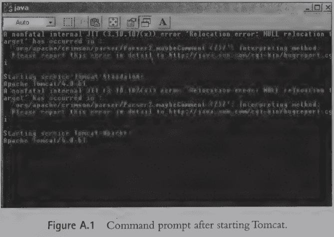

## 6. 测试 Tomcat

如果一切安装正确，Tomcat 将处于活跃运行状态。只需打开你的 Web 浏览器，输入 Tomcat 的地址（假设你将其安装在本机），后跟默认端口号 8080：`http://localhost:8080/`。或者，明确使用回环地址，像这样：`http://127.0.0.1:8080/`。Tomcat 的欢迎页面应该会显示出来，表明安装成功（参见图 A.2）。

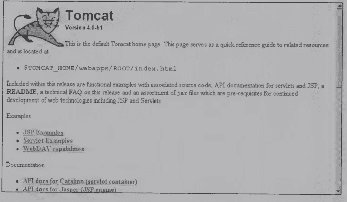

图 A.2 Tomcat 欢迎页面。如果你看到这个页面，说明安装成功了。

## 7. 尝试一些应用

Tomcat 自带了一些示例 servlet 和 JSP。你可以尝试它们，以检查 servlet 和 JSP 容器是否正常工作。试试 `http://localhost:8080/examples`。

Tomcat 的 Web 容器非常灵活。首先，它可以作为嵌入式 Web 服务器部署，用于需要内部 Web 容器的应用程序中。在这种情况下，可以使用某些发行版中提供的备用入口点类。Tomcat Web 容器也可以部署在只读介质上，作为从 CD 运行的应用程序的 servlet 容器，例如演示应用或基于数据 CD 的应用。Tomcat 也可以作为你的主要 Web 服务器运行，尽管这并非最常见的情况。此外，它还可以为服务器上每个需求较高的 Web 应用程序运行一个实例，或者可以附加到一个流行的 Web 服务器上，并引用多个实例。

Tomcat 管理员可以通过 `TOMCAT_HOME/conf` 目录下的配置文件轻松配置此功能。

## Tomcat 配置

安装后，Tomcat 将在端口 8080 上作为 Web 容器和 Web 服务器运行。有时这不方便，因为生产环境中该端口已被其他服务器使用，或者你希望 Tomcat 成为你的默认 Web 服务器。Tomcat 可以配置为在多种情况下运行。在 `TOMCAT_HOME/conf` 目录中，主要的配置文件是一个名为 `server.xml` 的 XML 参数文件。在此文件中，你可以根据 Tomcat 的执行方式配置多个参数。

Tomcat 使用一个名为 `TCPListener` 的组件来监听传入的 HTTP 请求。在 `server.xml` 文件中，你可以指定 `TCPListener` 将要监听的端口。默认端口是 8080。如果你想将 Tomcat 用作默认 Web 服务器，请将其更改为默认的 HTTP 值 80 端口，然后重启 Tomcat。之后，Tomcat 将监听 80 端口，Tomcat 地址后的端口号将不再需要。尝试 `http://localhost/` 再次获取欢迎页面。

在 `server.xml` 文件中，你会发现许多可以配置的元素，以获得更好的性能或更多样化的环境。首先，你可以更改日志选项；Tomcat 将主日志发送到控制台。你也可以将其重定向到一个文件；日志记录器组件负责此事。

此外，开发人员可以添加许多请求/响应控制器，在 Tomcat 4.0 中称为阀门（valves），它们可以被管道化以提供复杂的预处理方案。阀门的概念取代了 Tomcat 3.X 中的请求拦截器概念。阀门是扩展 Tomcat 处理请求以生成响应方式的小型类。除了其他用途外，它们可用于确保安全和授权，并提供更好的事件跟踪。阀门比请求拦截器更高效，生命周期也更清晰。

### 清单 A.1 示例 server.xml 文件

```
<!-- 从默认文件中提取的示例服务器配置文件 -->

<Server port="8005" shutdown="SHUTDOWN" debug="0">
<Service name="Tomcat-Standalone">
<Connector className="org.apache.catalina.connector.http.HttpConnector"
 port="8080" minProcessors="5" maxProcessors="75" acceptCount="10" debug="0" />
<Connector className="org.apache.catalina.connector.http.HttpConnector"
 port="8443" minProcessors="5" maxProcessors="75"
 acceptCount="10" debug="0" scheme="https" secure="true">
 <Factory className="org.apache.catalina.net.SSLSocketFactory"
 clientAuth="false" protocol="TLS"/>
</Connector>
<Connector className="org.apache.catalina.connector.test.HttpConnector"
 port="8081" minProcessors="5" maxProcessors="75"
 acceptCount="10" debug="0"/>
<!-- 定义容器层次结构中的顶级容器 -->
<Engine name="Standalone" defaultHost="localhost" debug="0">
<Logger className="org.apache.catalina.logger.FileLogger" prefix="catalina_log."
 suffix=".txt" timestamp="true" />
<Realm className="org.apache.catalina.realm.MemoryRealm" />

<!-- 定义默认虚拟主机 -->
<Host name="localhost" debug="0" appBase="webapps">

<Valve className="org.apache.catalina.valves.AccessLogValve" directory="logs"
 prefix="localhost_access_log." suffix=".txt" pattern="common" />

<Logger className="org.apache.catalina.logger.FileLogger" directory="logs"
prefix="localhost_log." suffix=".txt" timestamp="true" />
<Context path="" docBase="ROOT" debug="0"/>
</Host>
</Engine>
</Service>
</Server>
```

你也可以配置上下文。上下文是容器对 Web 应用程序的逻辑表示。你可以在 Web 应用程序中设置多个参数，包括基础目录（Web 应用程序部署的位置）、应用程序是否可重新加载（在开发期间非常有用，但在生产环境中无用且耗费时间/资源），以及要使用哪个日志记录器或资源集合。清单 A.1 显示了根上下文的声明。

你会在 `TOMCAT_HOME/conf` 目录中找到 `server.xml` 的 DTD。此 DTD 描述了允许的配置内容。Tomcat 简约用户指南也描述了如何充分配置 Tomcat。

## 理解 Tomcat

在撰写本文时，Tomcat 的生产级版本是 3.2.1，但因为我们在这里关注的是 Servlet API 2.3 和 JSP API 1.2 版本，所以我们需要 Tomcat 4.0。与之前的版本相比，这是一个重大的重新构想。

Tomcat 4.0 基于两个主要组件：新的 Catalina Servlet API 2.3 容器和符合 JASPER JSP API 1.2 的容器。两者都是各自 API 的参考实现。通过其监听器之一（用于基于 TCP 的 HTTP 请求的 `TCPListener` 或用于 Jserv/Tomcat Apj 协议的 `AVJP`）到达的请求会被重定向到 Catalina servlet 容器。

Catalina 代表了为 Jserv 的下一个版本（Java Apache 项目 servlet 容器，随着 Tomcat 的出现而失去发展势头）整合的许多想法。在该项目中讨论的许多特性都被赋予了 Tomcat，包括用于请求预处理的新阀门机制，它取代了 Tomcat 3.X 中存在的拦截器技术。

### JASPER

JASPER 是 Tomcat 中可用的 JSP 编译器和处理器。它自 Tomcat 3.X 起就已存在，并且正在不断发展以全面支持新的规范。开发团队的主要目标之一是提供其他可以使用 JASPER 和 Catalina 的 Web 容器和 J2EE 开发工具。为此，JASPER 和 Catalina 的代码库被设置为完全独立，因此它们之间不再有功能性依赖。JASPER 在 Tomcat 下作为一个 Servlet 运行，映射到处理 `*.jsp` 文件扩展名。

要独立于 Web 容器编译 JSP 页面，Tomcat 提供了 `jspc` 命令行工具。这对于开发工具或只读媒体部署场景来说可能非常有帮助。

## 在 Tomcat 下部署 Web 应用程序

在 Tomcat 下部署 Web 应用程序并不特别困难。如果应用程序部署为 Web 应用程序归档文件且没有进一步的配置问题，只需将 Web 应用程序归档文件部署在 `TOMCAT_HOME/webapps` 目录下并重启服务器即可。启动时，Tomcat 会检测新的 Web 应用程序归档文件并解压它，创建运行它所需的动态结构。

在其他情况下，只需将资源复制到 `TOMCAT_HOME/webapps` 下以 Web 应用程序名称命名的目录中。重启后，其工作方式与前面解释的类似；只是检测方式不同。会检测并逻辑地创建一个新的上下文。

需要维护外部基本目录或不需要可重新加载的应用程序必须在 `server.xml` 文件中声明。为每个应用程序添加上下文条目，相应地定义其属性。请查看 Tomcat 极简用户指南和支持文档，了解如何配置上下文的各种选项。

对于可供透传 Web 服务器访问的应用程序，当 Tomcat 作为 Servlet 容器附加到服务器时需要额外的配置。`uriworkermap.properties` 文件必须包含应用程序的资源访问模式。例如，在 IIS 下的 Tomcat 安装中部署一个名为 `jspBookEx` 的使用 JSP 的应用程序时，您必须这样配置：

```
/jspBookEx/*.jsp=apjv12
```

为简单起见，假定 `apjv12` 被配置为此 Tomcat 安装的 APJv12 监听器。有关此过程的更多细节，请参阅文档。

## Internet 上的 Tomcat

Tomcat 的主页是 Jakarta Apache 项目页面，位于 `http://jakarta.apache.org`。Tomcat 有两个主要的讨论列表：一个是开发者列表，讨论产品的进一步开发和当前代码库的维护；另一个是用户列表，讨论 Tomcat 应用程序、配置细节问题，并帮助经验较少的 Tomcat 用户。由于开发者列表中的讨论总是比用户列表中的讨论更高层次，所以除非您认真考虑加入开发团队，否则请坚持用户列表。该列表有非常丰富的存档，因此在向列表发布内容之前，花几分钟查看一下总是一个好主意。

Tomcat 是一项志愿工作。在 Tomcat 中发现的错误可以报告到 `http://znutar.cortexity.com:8888/`。这显然将有助于使该产品的演进更加快速和出色。


## 附录 B：Allaire JRun


本附录介绍 Allaire（http://www.allaire.com ）的 Allaire JRun 应用服务器。JRun 已经存在相当长一段时间了，最初提供 Servlet 引擎功能，自 3.0 版本起则作为 J2EE 应用服务器。最近发布的当前版本是 3.1 版本。

## JRun 简介

最初，JRun 作为 Servlet 引擎发布，这是当时用于指代在运行时环境中提供 Servlet 的程序的术语。它符合 Servlet 2.0 和 2.1 API。JRun 为其创建者 LiveSoftware 赢得了交付生产级 Servlet 平台的良好声誉。LiveSoftware 的"开发版不收费"政策赢得了当时蓬勃发展的 Servlet 开发社区的早期好感。在 JRun 3.0 发布之前，ColdFusion 的创建者 Allaire 收购了 LiveSoftware。

目前，JRun 已经不再是 Servlet 容器。自 3.0 版本起，JRun 成为了支持 Java 2 企业版 API 的完整应用服务器。它支持 Web 相关的 Servlet 和 JSP API，但在 JRun 下，您可以配置 Web 应用程序和 EJB。

正如预期的那样，JRun 带有大量 Allaire 技术。

### 获取和安装 JRun

JRun 可以下载用于开发和评估，也可以从 Allaire 网站 http://www.allaire.com/Products/JRun 购买。您可以选择试用并下载有限期的全功能试用版。它以自解压文件的形式提供。在 Windows NT/2000 下安装，请按照以下步骤进行：

1. **序列号**——会出现一个请求序列号的对话框屏幕。试用版、生产版和开发版的区别在于序列号。如果您选择试用版，将会向您发送一个试用序列号，以便在有限时间内解锁服务器。然后您可以在重负载测试中使用它。如果您购买了许可证，将会向您发送一个完全解锁的序列号，您将可以充分使用服务器。如果您不输入序列号，服务器将以开发者版本安装。这将释放 JRun 的全部功能，但最多仅限于五个同时连接。

2. **位置**——选择安装服务器的位置。

3. **安装选项**——选择完整安装、最小安装还是自定义安装。开发建议选择完整安装。生产服务器建议选择最小安装。自定义安装会显示另一个对话框，其中有可用的附加选项。这是 Windows 用户常见的安装对话框。

4. **文件夹名称**——选择文件夹名称。这是另一个常见的安装对话框。

5. **在 Windows NT/2000 上作为服务安装**——这在生产服务器中是必不可少的，但在开发安装中不推荐，因为开发中需要经常重启服务器。

6. **运行时环境**——安装程序会定位已安装的 JVM/JRE。您可以从列表中选择一个，或选择其他并输入位置。

7. **管理服务器端口**——输入您希望管理服务器响应的端口号。您将在下一节"了解 JRun"中了解更多关于管理服务器的信息。

8. **管理密码**——输入管理控制台的密码。您将在下一节"了解 JRun"中了解更多关于管理控制台的信息。

在此阶段，如果 JRun 以独立方式使用，作为独立的 Web 服务器，则安装完成。不过，情况并非总是如此。生产 Web 服务器（如 Apache 或 Netscape 服务器）在提供静态内容方面比大多数 Servlet 容器效率更高。在这种情况下，最好将 JRun 附加到生产 Web 服务器，并让它仅提供所需的 Servlet 和 JSP。

这可以使用配置为 Web 服务器扩展的连接器模块来完成（例如，IIS 的 ISAPI 重定向器，或 Apache 的 `mod_*`）。接下来的几个步骤使您能够配置与假设的 Apache 服务器的连接：

1. **要连接的服务器**——哪个服务器将连接到外部 Web 服务器？您可以选择 JRun 安装中定义的任何服务器。您将在下一节"了解 JRun"中了解更多关于 JRun 服务器的信息。

2. **外部 Web 服务器**——指定要连接的 Web 服务器的产品和版本，以及其安装的平台。在撰写本文时，支持的 Web 服务器有 Apache Web 服务器、Netscape 的 Enterprise 和 Fastrack 服务器、Microsoft 的 Internet Information Server（IIS）和 Personal Web Server（PWS），以及 Website Pro 和 Zeus Web Server。在继续之前必须停止 Web 服务器，因为连接器向导将更改服务器上的配置设置。

3. **JRun 模块地址**——指定 JRun 连接器模块将监听的 IP 地址和端口。

4. **位置**——此步骤特定于您要连接的 Web 服务器。如果您选择了 Apache，则必须提供 `httpd.conf` 文件的位置。另一方面，如果您选择了 IIS，则必须提供 IIS 脚本目录的位置，并决定是否将安装的 ISAPI 过滤器视为全局过滤器。

5. **安装完成**——假设您在第 2 步中选择了 Apache，到此阶段您已完成安装。重启 Apache（这是必需的），并重启 JRun，以给它一个全新启动。

就是这样。到达 Apache 的 JRun 上 Web 应用程序的请求将被路由到 JRun 中的特定服务器，并由其提供服务。

### 了解 JRun

JRun 不是单一服务器产品。这里的 *Server* 可以理解为 Tomcat 中的 *Container*。在单个 JRun 安装中，您可以创建多个服务器。也许您需要这样做是因为您的 Web 应用程序需要特定的配置，或者因为您希望应用程序使用自己的 JVM 运行。

安装后，JRun 为您提供两个预安装的服务器。其中一个是默认服务器，您可以在其中部署 Web 应用程序、EJB 应用程序等。它是默认的 Servlet 容器。

另一个是管理服务器，它运行 JRun 管理控制台（JMC）和其他管理应用程序。JMC 是一个 Web 应用程序，它控制 JRun 中的所有配置文件，并提供从单个控制台重启可能正在运行的多个服务器的入口点。（参见图 B.1。）在其中，您可以管理 Web 应用程序、EJB 和 J2EE 应用程序。

## 406 附录B Allaire JRun

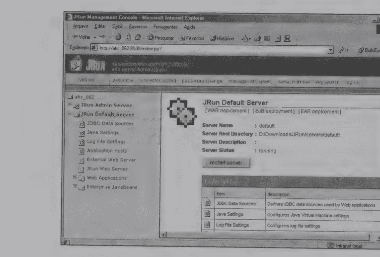

图B.1 JRun管理控制台。

Servlet技术中包含的许多功能最初都是以某种形式源自JRun。其中许多思想被进一步发展成为标准技术——标签库就是一个很好的例子。JRun自早期版本起就拥有一些标签扩展——并非自定义标签，而是专有技术。

## 在JRun下部署Web应用程序

要在JRun下部署Web应用程序，你需要使用管理控制台。你必须遵循以下步骤：

1. 打开JMC。进入JRun管理控制台，并选择你要部署Web应用程序的服务器。在左侧面板中，选择服务器名称，然后选择Web Applications（Web应用程序）。不要进一步展开服务树。在右侧出现的面板（见图B.2）上，选择Deploy an Application（部署应用程序）。

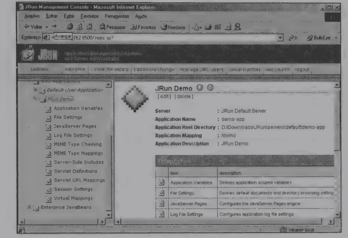

图B.2 JMC服务器配置。

2. 在面板上提供所需的参数（见图B.3）：

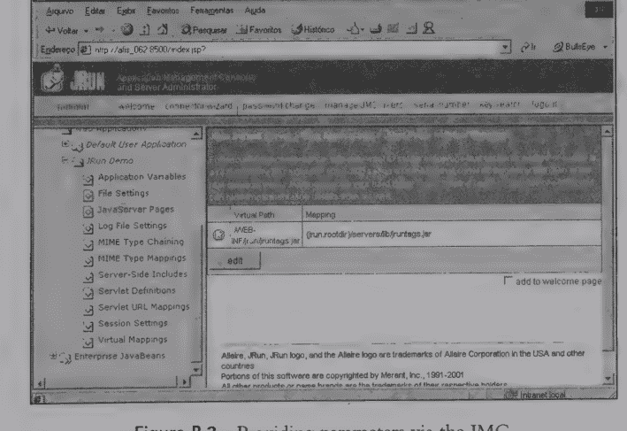

图B.3 通过JMC提供参数。

- **Servlet .war文件或目录**—给出你要部署的`.war`文件的完整路径。
- **JRun server name**—选择你想要部署应用程序到的服务器名称。安装中可用的服务器将出现在一个列表框中。
- **Application name**—为应用程序输入一个名称。此属性随后将与servlet环境中的一个上下文相关联。在同一服务器下不能有两个同名的应用程序。
- **Application host**—如果你在多主机环境中部署此应用程序，请选择应用程序将驻留的主机。如果不在多主机环境，请选择All Hosts（所有主机），这是默认选项。
- **Application URL**—给出一个以斜杠开头的URL，应用程序将映射到该URL并进一步被访问。
- **Application deploy directory**—指定部署应用程序的根目录。这也将是文档根目录。

3. 提供所需信息后，按Deploy（部署）按钮。`.war`文件将根据你之前的设置进行解压。资源将被放置到位，Web应用程序主面板会重新出现。然后按浏览器上的Refresh（刷新）按钮，你将在右侧列表中看到你的应用程序。

4. 重启部署了该应用程序的服务器。

5. 从另一个浏览器测试访问。

## 更多信息

有关产品、Beta版本和服务包的更多信息，请访问Allaire网站。Allaire维护着一个论坛，讨论JRun用户遇到的常见问题。Allaire网站还提供了一个丰富的开发者区域，在那里你可以找到关于为JRun开发和运行JRun以获得性能的技术文章、提示、代码、外部资源链接，以及开发者交流区，Java和ColdFusion开发者可以在此向JRun社区发布他们的代码。

# C Orion

本附录涵盖Orion应用服务器，介绍该产品，展示如何安装，并讨论其主要特性和功能。在撰写本文时，Orion的版本为1.4.5。

## 介绍Orion

Orion应用服务器是由瑞典公司Evermind Data (http://www.orionserver.com) 提供的商业J2EE容器。它实现了构成J2EE架构的以下技术：

- **EJB**—该产品不仅是一个Web容器，还提供了一个完整的EJB 1.1兼容容器，并部分支持EJB 2.0草案。
- **Servlets和JSP**—Orion提供了一个完整的Servlet 2.2和JSP 1.1兼容容器，并部分支持Servlet 2.3草案。
- **JDBC**—Orion管理JDBC 2.0连接，并允许对许多数据库产品（包括Oracle、PostgreSQL、HypersonicSQL等）进行完全管理和预定义配置。
- **JNDI**—服务器使用JNDI 1.2 API来查询名称和目录服务。
- **JTA**—服务器拥有控制JTA 1.0.1事务的资源。
- **JMS**—Orion附带Orion JMS服务器，这是一个符合JMS 1.0规范的消息服务器。
- **XML/XSL**—Orion拥有丰富的资源来处理XML及相关技术。它附带了Apache产品Xerces XML解析器和Xalan XSL处理器。
- **HTTP**—Orion附带了一个生产级别的、支持HTTPS的Web服务器，可配置为集群和负载均衡。它还接受SSI，并附带用于PHP、Perl和CGI协议等语言处理器的其他资源。

Orion应用服务器还为Orion开发者提供了一个全面的标签库。它附带了Java数据库HypersonicSQL的发行版，这是一个开源关系数据库发行版。

## 获取和安装Orion

Orion服务器可从Orion主页 <http://www.orionserver.com> 下载，提供两个版本：

- 一个可免费下载的全功能开发者版本，可用于开发和非商业安装。
- 一个商业版本，可在该网站在线购买。

要安装Orion，请遵循以下步骤：

1. 从Orion服务器网站 <http://www.orionserver.com> 下载最新软件包。该软件包以名为`orionXXX.zip`的zip存档文件分发。XXX代表当前最新版本。在撰写本文时，是`orion1_4_5.zip`。

2. 解压orion zip文件。`/orion`目录将在你用于解压分发包的路径下创建。

3. 将最新版JDK安装目录中的`tools.jar`文件复制到`/orion`目录。该文件可以在JDK的`/lib`目录下找到。

4. Orion使用默认端口80。确保没有其他服务器使用该端口，否则会发生冲突。请参阅文档以更改使用的端口。文档包可以从基本包独立下载，地址为 <http://www.orionserver.com>。

5. 要启动Orion，请使用以下命令：

```
java -jar orion.jar
```

然后服务器将输出一条消息，表明它已初始化。

6. 要测试服务器，请用浏览器访问服务器。例如，如果服务器在本地机器上运行，`http://localhost/` 将显示Orion索引页。

安装过程中的关键步骤是步骤3和4。忘记将`tools.jar`文件复制到`/orion`目录会阻碍安装，因为例如编译功能将无法提供给JSP容器。并且，如果另一个httpd服务占用了端口80，该端口将对Orion不可用，使其表现得像安装不成功一样。

## Orion配置

Orion可以通过许多XML文档进行配置，这些文档用于参数化产品以及声明Web和通用J2EE应用程序。

配置中涉及的主要文件是`Server.xml`文件。该文件在Orion中的含义与在Tomcat中完全不同。在这里，它是一个全局服务器配置文件，指向服务器提供的许多服务的配置文件。服务器配置文件定义了以下内容：

- 全局应用程序设置。Orion服务器中的全局应用程序被视为服务器环境中的默认应用程序。它被视为其他应用程序的父应用程序。
- 应用程序设置。这些设置定义特定于应用程序的信息，例如参数化和应用程序部署文件的位置。
- 日志、并发、集群和事务设置。这些设置定义了几个特定于服务器的参数，并控制整个服务器的行为，包括日志策略。
- Java编译器设置。这些允许你配置使用哪个Java编译器，并配置实现该编译器的库的路径。
- J2EE支持服务器配置设置。这些设置定义JDBC数据源描述文件的路径，以及JMS、JNDI和邮件服务器的配置。

`default-web-site.xml`文件描述了托管在Orion应用服务器Web层中的一个网站。它描述了Web应用程序在服务器或服务器集群中的位置，给出其路径，为其分配一个Web虚拟主机名，说明它是否安全（使用HTTPS和SSL），日志记录以及其他参数。

`principals.xml`在服务器上下文中定义用户和组。

其他服务在辅助配置文件中定义。`data-sources.xml`文件定义JDBC数据源设置。`JMS.xml`和`RMI.xml`包含各自的消息和分布式对象服务的参数。`load_balancer.xml`文件定义集群参数。

此外，还有专为Orion应用部署设计的Orion特定部署描述符文件，这些文件可以自动生成，同时也有J2EE标准文件。请查阅文档，该文档可通过Orion服务器网站在线获取或下载。

## 其他功能

需要特别注意的是，Orion并非一个Servlet容器，而是一个完整的J2EE容器实现。Orion应用的重点在于EJB组件。然而，它也提供了一个完整的Web服务器实现，包括SSL支持。

你可以使用Orion开发Web组件（Servlet、JSP页面和标签库）。一个很好的功能是Servlet的自动编译。当启用此功能时，只需在文本编辑器中开发一个Servlet并将其放置在正确的路径下即可。当首次请求该Servlet时，它会以类似于JSP页面的方式进行编译。

对于EJB开发，Orion对容器管理持久性的支持相当出色。

## MySQL

本附录涵盖了第2-10章示例中介绍的数据库支持。这是对所用组件的非常简短的介绍，涵盖了从数据库到辅助类的内容。这是一个基本的三层结构：一个数据库、一系列支持类以及一个符合JDBC 2.0标准的驱动程序。

### MySQL数据库

MySQL是由MySQL AB公司开发的免费开源数据库管理系统，其市场支持度持续提升。它因其易用性和轻量级而吸引了开发者社区。此外，它正在成为事实上的互联网标准，支撑着全球的网站。目前，MySQL处于3.23版本，这是最新的稳定生产版本。MySQL可在http://mysql.com/downloads下载，支持大量平台——具体来说，包括多种UNIX风格（其中包含多种Linux发行版）以及适用于Windows平台的版本。基本上，MySQL是根据GNU通用公共许可证条款授权的。有关MySQL许可策略的更多信息，请查阅http://www.mysql.com/documentation/mysql/bychapter/manual_Licensing_and_Support.html#Licensing_and_Support。

MySQL是一个具有竞争力的、多线程、多用户的关系数据库管理系统，性能卓越，并提供了一系列可供开发者使用的工具和API——其中一些是核心项目的一部分，如C API；另一些则由第三方贡献，例如出色的`mm.jdbc` Java JDBC API驱动程序。MySQL非常灵活，对ANSI SQL92和ODBC SQL标准实现了相当好的支持，并带有许多扩展。一些显著缺失的功能，如存储过程，已经出现在待办事项列表中，因此我们可以期待在可预见的未来，这个产品会有非常令人兴奋的发展。

此外，关于MySQL的文献非常丰富。与任何数据库管理产品一样，要高效地使用MySQL，无论是开发应用程序还是管理数据库配置，都需要对产品有深入的了解。关于MySQL的优秀参考书，请查阅Paul Dubois所著的《MySQL》（New Riders Publishing出版），这是一本关于该主题的完整参考书。

### MySQL与本书

为了运行本书中的许多示例，您将需要MySQL数据库。有关如何为您的首选平台安装该产品的信息，请参考http://mysql.com/documentation。

MySQL产品由多个可执行文件组成，构成了MySQL服务器和管理实用程序。要创建示例中使用的数据库，请使用`mysql`实用程序运行书籍网站（www.newriders.com）上提供的脚本，如下所示：

```
mysql JSPBOOK < jspBookExamples.sql
```

这将在当前MySQL安装上创建JSPBOOK数据库并加载所有示例数据。使用`mysqlshow`测试结果：

```
mysqlshow JSPBOOK
```

这将生成JSPBOOK数据库中表的列表。之后，您就可以运行示例代码了。

### JDBC驱动程序


要运行示例 Servlet 和 JSP，您需要一个合适的 MySQL JDBC 驱动程序。`mm.mysql` MySQL JDBC 驱动程序为大多数考虑的特性提供了对 JDBC 2.0 的广泛支持。`mm.mysql` JDBC 驱动程序是一个免费的开源项目，托管在 SourceForge 上，网址为 `http://mmmysql.sourceforge.net`。您可以直接从项目页面下载，它根据 GNU LGPL 许可证条款发布。该驱动程序当前版本为 2.0.4，被认为是稳定版本。`mm` 驱动程序的性能数据可以在 `http://mmmysql.sourceforge.net/performance` 查看。

要安装驱动程序，只需在您的本地机器上解压压缩文件，并将 `mm.mysql-2.0.1-bin.jar` 归档文件部署到您的 Web 应用程序的类路径中。

对于本书的示例，您可以将该文件部署到 Tomcat 下的 `jspBook` 上下文的 `/WEB-INF/lib` 目录中。

### Poolman 对象池

使用连接池来加速服务器端 Java Web 应用程序的 JDBC 连接是一种非常标准的技术。市场上有许多提供此功能的产品，包括许多免费软件插件、许多内置于应用服务器中的产品以及许多作为 JDBC 驱动程序实现一部分的产品。Poolman 是一个免费的开源 Java 对象池管理软件，我们在示例中使用了它。它现在属于 SourceForge 开源倡议，可以从 `http://sourceforge.net/projects/poolman` 获取。

在撰写本文时，Poolman 版本为 1.4.1，被认为是稳定、可用于生产的版本。它并非专门用于 JDBC 连接，也不是数据库连接池；它是一个对象池。这意味着 Poolman 可以为任何类型的 Java 对象提供池化，并且可以同时提供许多这样的池。这是一个非常强大的资源。在某些场景下，您确实需要这些池可用——例如，当委派给请求处理器的请求数量增加时，实现一个具有强大性能的健壮 Web 应用程序控制器。（请求处理器是控制器将委派请求处理的类。）在这种情况下，请求处理器保持加载并准备好运行的时间越长越好。

#### 下载与安装

Poolman 可以从 SourceForge 上的项目页面下载。要安装它，请在本地机器上解压（如果您使用 UNIX，则解压/解包）发行包。您将找到一个 `POOLMAN_HOME/lib` 目录，其中包含三个文件：

- 示例 `poolman.props` 文件
- `Poolman.jar` 归档文件，其中包含构成该产品的所有类，以及 Sun 的 JDBC 2.0 标准扩展发行包
- `jdbc2_0-ext.jar` 归档文件

要使用 Poolman，您需要将两个 jar 文件放入应用程序的类路径中。对于本书的示例，请将它们与 `poolman.props` 文件一起部署到 Tomcat 下 `jspBook` Web 应用程序上下文的 `/WEB-INF/lib` 目录中。

#### Poolman 与数据库

Poolman 在 JDBC 连接池方面也相当灵活。在这种情况下，有三种主要场景可以遵循：

- **SQLUtil** — `SQLUtil` 是一个实用程序类，可以针对数据库执行 SQL 操作，并将 `Hashtable` 数组作为结果返回。这些结果按查询进行缓存，并在可配置的时间间隔后刷新。访问参数从 `poolman.props` 文件中获取。
- **Poolman 驱动程序** — 第二种场景是使用 Poolman JDBC 驱动程序。它将引用在 `poolman.props` 文件中声明的数据库，并像普通的 JDBC 驱动程序一样使用。
- **Poolman 数据源** — 这符合 JDBC 2.0 数据源标准。可以将连接到数据库的 Poolman 数据源放置在 JNDI 命名和目录服务中，并能动态提供数据库连接。

出于简单性考虑，并且因为在 J2EE 平台下访问资源的首选方式，本书中的所有示例都使用了第三种场景。请查看 `jspBook_poolman.props` 文件（可在书籍资源网站上获取）以获取本书示例的配置参数。

## E

## Servlet—JSP 对象映射

本附录面向 Servlet/JSP Web 应用开发初读者，提供 Servlet API 2.3 中对象与 JSP 页面环境中对应对象及引用的映射参考。表 E.1 展示了此映射。

| Servlet 对象 | JSP 对象 |
| --- | --- |
| `ServletConfig`—要在 Servlet 内部访问 `ServletContext`，必须先访问配置信息。 | `config`—此对象在页面级别可用。该变量不常用。 |
| `ServletContext`—Servlet 程序员可通过 `ServletConfig` 的函数调用 `getServletContext()` 访问此对象。 | `application`—JSP 设计者可使用此隐式对象直接访问上下文信息。 |
| `ServletRequest` | `request` |
| `ServletResponse` | `response`—此对象也不常用。 |

## 表 E.1 续

| Servlet 对象 | JSP 对象 |
| :--- | :--- |
| `HttpSession`—可通过传递给 Service 方法的 `request` 对象，调用 `getSession(boolean)` 方法获取此对象。 | `session` |
| `HttpServletResponse.getWriter`—`out` 对象实现了不同的类。两者没有直接对应关系。Servlet 作者必须参考多个类，这些类共同提供了 `PageContext` 类收集的部分信息。这些对象包括 `ServletContext`、`HttpSession`、`HttpServletRequest`、`HttpServletResponse` 以及输出 writer 对象。即便如此，Servlet 中也没有对应于 page scope 的对象。因此，此概念及其所有相关内容在 Servlet 世界中没有意义。 | `out`—此 `JSPWriter` 实例提供由 JSP 生成的文本的输出流。 |
| | `pageContext`—此隐式变量负责维护 JSP 页面的执行上下文，例如初始化其他隐式变量、管理页面作用域、访问页面作用域属性等。 |
| 没有对应项。Servlet 作者必须以传统的 Java 方式处理异常。 | `exception`—此隐式对象封装了在错误条件下生成的 `Throwable`。它在错误页面中可用。 |

# Apache 软件许可证，版本 1.1

版权所有 © 1999–2001 Apache 软件基金会。保留所有权利。在符合以下条件的前提下，允许以源代码和二进制形式进行再分发，无论是否经过修改：

1. 源代码的再分发必须保留上述版权声明、本条件列表和以下免责声明。
2. 二进制形式的再分发必须在分发附带的文档和/或其他材料中复制上述版权声明、本条件列表和以下免责声明。
3. 再分发附带的最终用户文档（如有）必须包含以下致谢：

   “本产品包含由 Apache 软件基金会 (http://www.apache.org/) 开发的软件。” 或者，此致谢可出现在软件本身中，如果并且无论此类第三方致谢通常出现在何处。

4. 未经事先书面许可，不得使用“The Jakarta Project”、“Struts”和“Apache Software Foundation”名称来认可或推广源自此软件的产品。如需书面许可，请联系 apache@apache.org。
5. 未经 Apache 集团事先书面许可，源自此软件的产品不得称为“Apache”，其名称中也不得出现“Apache”。

> 本软件按“原样”提供，任何明示或暗示的保证，包括但不限于，对适销性和特定用途适用性的暗示保证，均被否认。在任何情况下，Apache 软件基金会或其贡献者均不对任何直接、间接、附带、特殊、惩戒性或后果性损害（包括但不限于，采购替代商品或服务；使用、数据或利润的损失；或业务中断）承担责任，无论此类损害是如何造成的，也无论基于何种责任理论，无论是合同、严格责任还是侵权（包括疏忽或其他），即使已被告知发生此类损害的可能性。

========================================

本软件由代表 Apache 软件基金会的许多个人自愿贡献组成。有关 Apache 软件基金会的更多信息，请参见 http://www.apache.org/。

# 索引

## 符号

- `<%--` (JSP 注释标签)，26-27
- `<%!` (JSP 声明)，31-33
- `<%@` (JSP 指令)，27-31
- `<%=` (JSP 表达式)，31
- `<%` (JSP 脚本段)，33
- `ActionServlet` 类 (Struts)，231-232
- `addcookie` 标签 (response 标签库)，354
- `adddateheader` 标签 (response 标签库)，354
- `addheader` 标签 (response 标签库)，354
- `addintheader` 标签 (response 标签库)，354
- `addUser` 标签 (HP Bluestone 标签库)，379
- Allaire JRun。*参见 JRun*
- Allaire 网站，367, 403
- AlphaWorks 网站，390
- 替代消息标签 (代码清单 4.15)，173-174
- `ampms` 标签 (Datetime 标签库)，337
- Apache Jakarta Struts 项目。*参见 Struts 项目*
- API。*参见 JSP；Servlet API*
- 小程序，历史，7-8
- 应用程序监听器 (代码清单 4.2)，148-149
- Application 标签库 (Taglibs 项目)，328-333
- `ApplicationResources.properties` 文件 (ArticleDB 示例应用)，319
- 应用程序。*参见 Web 应用程序*
- `apply` 标签 (xsl 标签库)，362
- 文章数据库示例，标准操作，43-49
- ArticleDB 应用 (Struts 项目示例)，295
  - `ActionForm` 类，302-309
  - 其中的操作，309-314
  - `ApplicationResources.properties` 文件，319
  - 作者页面，316-319
  - EJB 技术，321-322

## A

- **Action 类 (Struts)，240-243**
- **action 映射配置文件 (Struts 项目)，244**
  - `action-mappings` 元素，247-249
  - `data-source` 元素，244-246
  - `form-bean` 元素，246
  - `global-forwards` 元素，246-247
  - 内部操作，249
- **`action-mappings` 元素 (`struts-config.xml` 文件)，247-249**
- **`ActionError` 类 (Struts)，239**
- **`ActionErrors` 类 (Struts)，239**
- **`ActionForm` 类 (Struts 项目)，235-239**
  - ArticleDB 示例应用，302-309
- **`ActionForward` 类 (Struts)，243-244**
- **`ActionMapping` 类 (Struts)，232-234**
- **操作。*另见标准操作 (JSP)***
  - 在 ArticleDB 示例应用中，309-314
  - 自定义操作，39
  - 与自定义标签，49-50
  - 定义，39-40
  - 标准操作，39-40
    - 示例文章数据库，43-49
    - 命名空间与作用域，40-43
  - 标签库设计考量，200-201
    - 内聚性，205-207
    - 重载，207-210
    - 复用机会，201-205

## ArticleDB 应用 (Struts 项目示例)

- 辅助类，297–301
- 消息传递，321, 323
- 打包，321
- `struts-config.xml` 文件，319–321
- 模板，314–316
- UML 结构，295–297
- `web.xml` 文件，321
- XML，321, 323–324

**`ArticleDBServlet` (代码清单 2.1)，45–46**

**`attribute` 元素 (TLD)，74**

**`attribute` 标签**

- Application 标签库，331
- page 标签库，348
- request 标签库，353
- session 标签库，358

**属性 (标签的)，55–56, 92–95**

- `id-name` 模式，101–107
- 输入值，101
- `iterate` 标签，203–204
- 必需，99–100
- 多种配置，109–112
- `name-property-scope` 模式，107
- `name-value` 模式，107–109
- 可选，100–101
- 重置默认值，99
- 运行时表达式，95–99
- 静态，95–99
- `struts-bean` 标签库，255
- `struts-html` 标签库，266
- `struts-logic` 标签库，277

**`attributes` 标签**

- Application 标签库，331
- page 标签库，348
- request 标签库，353
- session 标签库，359

**`AT_BEGIN` 变量与 `NESTED` 变量，168**

**`AT_END` 变量，168**

**作者页面 (ArticleDB 示例应用)，316–319**

**授权标签 (ColdJava.com 标签库)，386**

## B

**条形图标签 (ColdJava.com 标签库)，386**

**`base` 标签 (`struts-html` 标签库)，267**

**BEA Weblogic 的 Portal 标签，380**

**`BeanUtils` 类，107**

**Bluestone 标签库，377–380**

**Bluestone.com Struts 教程页面，390**

**主体标签，57–58, 129**

- `BodyTag` 接口，129–138
- 作为数据，59
- 作为数据结构，59
- 生命周期，62–63
- 作为过程，59

**`body-content` 元素 (TLD)，71**

**`BodyContent` 类，130–131**

**无主体标签，59**

**`BodyTag` 接口，62, 129–138**

**`BodyTagSupport` 类，131–132**

**浏览器兼容性，5**

**BSF 标签库 (Taglibs 项目)，328, 333–337**

**错误报告 (Tomcat)，402**

**业务模型，标签库的集成，197**

**`button` 标签 (`struts-html` 标签库)，267**

## C

**`cancel` 标签 (`struts-html` 标签库)，267**

**`case` 标签 (JRun 标签库)，374**

**Catalina Servlet API 2.3 容器，400–401**

**CFML (ColdFusion 标记语言) 自定义标签，51**

**CFX (ColdFusion API) 标签，51**

**CGI (通用网关接口)，7**

**`checkbox` 标签**

- Input 标签库，339
- `struts-html` 标签库，267

**类**

- `ActionForm` (Struts 项目)，ArticleDB 示例应用，302–309
- `BeanUtils`，107
- `BodyContent`，130–131
- `BodyTagSupport`，131–132
- `FeatureReader` (代码清单 3.48)，135
- 辅助类，ArticleDB 示例应用，297–301
- `HttpServlet`，17
- `PropertyUtils`，107
- `RequestUtils`，107
- Struts 类
  - `Action`，240-243
  - `ActionError`，239
  - `ActionErrors`，239
  - `ActionForm`，235-239
  - `ActionForward`，243-244
  - `ActionMapping`，232-234
  - `ActionServlet`，231-232
- `TagExtraInfo`，验证，184-187
- `TagLibraryValidator`，验证，187
- `TagSupport`，127-129
- 翻译时类，67
- 用户自定义翻译时类，67

- `clearBody` 方法（`BodyContent` 类），130
- 客户端表单处理标签（JRun 标签库），372-373
- `closeConnection` 标签（`jdbc` 标签库），341
- Cocoon 项目网站，51
- 代码清单。参见 listings
- `codes/names` 应用程序监听器（清单 4.2），148-149
- 内聚性
  - 标签库设计考虑，205-207
  - 标签，197
- ColdFusion API 标签（CFX 标签），51
- ColdFusion Markup Language (CFML) 自定义标签，51
- ColdFusion 标签与自定义标签的对比，51-52
- ColdFusion 网站，51
- ColdJava.com 标签库，385
  - 授权标签，386
  - 柱状图标签，386
  - 条件标签，386
  - `cookie` 标签，386
  - DOM 标签，386-387
  - Escape 标签，387
  - Files 标签，387


- `LastModified` 标签, 387
- 杂项标签, 388
- `POP` 标签, 387
- `Random` 标签, 387
- `Request` 标签, 387
- `WML` 标签, 388

- 集合，遍历, 114-122
- `comment` 标签（`response` 标签库）, 354
- 注释标签（JSP）, 26-27
- 标签库的商业支持, 77
- 商业标签库, 367
  - BEA Weblogic 的 `Portal` 标签, 380
  - HP Bluestone 标签库, 377-380
  - `InstantOnline` 标签库, 380
  - `JRun` 标签库, 367-368
    - 客户端表单处理标签, 372-373
    - 流程控制标签, 374
    - J2EE 技术标签, 368-372
  - Orion 服务器标签, 374
    - `EJB` 标签, 375
    - `util` 标签, 376-377
  - 用途, 380

- Common Gateway Interface (CGI), 7
- 复杂性解决库（标签库设计考虑）, 199
- 条件标签（ColdJava.com 标签库）, 386
- 配置文件，`action mappings` 配置文件（Struts 项目）, 244-249
- 配置
  - JRun, 405
  - Orion, 411-412
  - Struts 项目, 230
  - Tomcat, 398-400

- 使用 `Poolman` 对象池进行连接池, 416
- `connection` 标签（`jdbc` 标签库）, 341
  - 清单 9.7, 344
  - 清单 9.8, 344
- `connection` 标签（`sql` 标签库）, 359
- 构造器
  - `BodyContent` 类, 130
  - `BodyTagSupport` 类, 131
- 容器，Web
  - 定义, 13
  - 目录结构, 13-14
- `containsheader` 标签（`response` 标签库）, 355
- 上下文属性（servlets）, 20
- 上下文作用域, 40
- 上下文根（Web 应用程序）, 14
- 上下文
  - Tomcat, 400
  - Web 应用程序, 14-15

控制（M-V-C 设计模式）, 228

`cookie` 标签
- ColdJava.com 标签库, 386
- `request` 标签库, 352
- `struts-bean` 标签库, 256–257

`cookies` 标签（`request` 标签库）, 352

CoolServlets 网站, 389

协作（标签）, 152–153
- 键值对, 174–183
- `pageContext` 属性, 153–166
- 运行时栈访问, 168–174
- 脚本变量, 166–168

计数器（迭代标签）, 122–125

耦合
- 定义, 169
- 标签, 197

`createBean` 标签（Orion 服务器标签）, 375

`currenttime` 标签（`Datetime` 标签库）, 337

自定义动作, 39

自定义标签。参见 tag libraries; tags
- 与动作, 49–50
- 属性, 55–56
- 定义, 49–50
- 作为 JSP 元素, 50
- 处理, 63–64
- 结构, 55–56
- 与 ColdFusion 标签对比, 51–52
- 与 XML 元素对比, 51
- 与 XSP 对比, 51
- XML 命名空间, 52–55

## D

DAPACT（Data Aware Processing and Control Tags）标签库, 385

数据，`body` 标签作为, 59

数据结构，`body` 标签作为, 59

`data-source` 元素（`struts-config.xml` 文件）, 244–246

`data-sources.xml` 文件（Orion 配置）, 411

数据库示例（标准动作）, 43–49

数据库管理（MySQL）, 413–414
- 下载, 413
- JDBC 驱动, 414–415
- 许可, 413
- `Poolman` 对象池, 415–416
- 运行书中示例, 414

`dataPlaceHolder` 标签（HP Bluestone 标签库）, 378

`Date` 标签（`utility` 标签库）, 360

日期格式化标签（清单 4.1）, 146–147

`DateTime` 标签库（Taglibs 项目）, 328, 337–339

`DBTags` 标签库（Taglibs 项目）, 328

`Dburl` 标签（`sql` 标签库）, 360

声明（JSP）, 31–33

默认端口（Tomcat）, 398

默认标签属性，重置, 99

`default-web-site.xml` 文件（Orion 配置）, 411

`define` 标签（`struts-bean` 标签库）, 257

部署
- 标签库, 64, 210
- Web 应用程序
  - 在 JRun 下, 406–408
  - 在 Tomcat 下, 401

部署描述符文件（Web 应用程序）, 15–16

`description` 元素（TLD）, 66

描述性元素（TLD）, 66–67

设计考虑（标签库）, 189, 197–198
- 动作, 200–201
- 内聚性, 205–207
- 常见问题, 210–211
- 部署, 210
- 动态页面开发, 190–193
- 与业务模型的集成, 197
- 标记生成, 211–218
- 动作重载, 207–210
- 页面开发团队组织, 193–195
- 重用机会, 201–205
- 场景分析, 199–200
- 在软件过程中, 196–197

`destroy` 方法（servlet 生命周期）, 17

DeveloperWorks 网站, 390

`Digester` 工具（Struts）, 250–251

指令（JSP）, 27
- `include` 指令, 27–29
- `page` 指令, 29–30
- `taglib` 指令, 30–31

目录结构（Web 容器）, 13–14

`display-name` 元素（TLD）, 66

`displayCurrency` 标签（Orion 服务器标签）, 376

`displayDate` 标签（Orion 服务器标签）, 376

`displayNumber` 标签（Orion 服务器标签）, 376

发行版（Tomcat）, 396

`doAfterBody` 方法（`IterationTag` 接口）, 113–114

`doCatch` 方法（`TryCatchFinally` 接口）, 140

文档类型定义。参见 DTD

`doEndTag` 方法
- `BodyTagSupport` 类, 132
- `IterationTag` 接口, 113
- `Tag` 接口, 84, 89–91

`doFinally` 方法（`TryCatchFinally` 接口）, 140

`doInitBody` 方法
- `BodyTag` 接口, 129
- `BodyTagSupport` 类, 132

DOM 标签（ColdJava.com 标签库）, 386–387

`domain` 标签（`response` 标签库）, 354

`doStartTag` 方法
- `BodyTagSupport` 类, 132
- `IterationTag` 接口, 113
- `Tag` 接口, 84–89

下载
- JRun, 404
- MySQL, 413
- Orion, 410
- `Poolman` 对象池, 415
- Struts 项目, 230
- Taglibs 项目标签库, 328–329
- Tomcat, 396

`driver` 标签
- `jdbc` 标签库, 341
- `sql` 标签库, 360

DTD（文档类型定义）
- 声明, 70
- XML 命名空间, 52

动态 Internet, 4–5

动态页面
- 开发（设计考虑）, 190–193
- 标签库在动态页面中（清单 5.2）, 194–195

## E

电子商店, 4

Egavas 标签库, 384–385

`EJB` 标签（Orion 服务器标签）, 375

EJB 技术（Struts 应用程序）, 321–322

`ejbCreate` 标签（HP Bluestone 标签库）, 379

`ejbGetHome` 标签（HP Bluestone 标签库）, 379

`email` 标签（HP Bluestone 标签库）, 378

`encoderedirecturl` 标签（`response` 标签库）, 355

`encodeurl` 标签（`response` 标签库）, 355

环境变量（Tomcat）, 396

`equalsattribute` 标签
- `Application` 标签库, 331
- `page` 标签库, 348

`equalsinitparameter` 标签（`Application` 标签库）, 330–331

`eras` 标签（`Datetime` 标签库）, 337

`errors` 标签（`struts-html` 标签库）, 267, 271–277

`Escape` 标签（ColdJava.com 标签库）, 387

`escapeSql` 标签（`jdbc` 标签库）, 341

`EVAL_BODY_INCLUDE` 字段（`Tag` 接口）, 84

`EVAL_PAGE` 字段（`Tag` 接口）, 84

### 事件监听器

- 事件监听器，`listener` 元素（TLD）, 69–70
- Evermind Data 网站, 409
- `execute` 标签（`jdbc` 标签库）, 341

`existsattribute` 标签
- `Application` 标签库, 331, 333
- `page` 标签库, 348
- `request` 标签库, 353
- `session` 标签库, 359

`existscookie` 标签（`request` 标签库）, 352

`existsheader` 标签（`request` 标签库）, 352

`existsinitparameter` 标签（`Application` 标签库）, 330

`existsmatch` 标签（`regexp` 标签库）, 351

`existsparameter` 标签（`request` 标签库）, 353

`existsquerystring` 标签（`request` 标签库）, 352

标签属性的显式输入值, 101

`export` 标签（`xsl` 标签库）, 362

`expression` 标签（BSF 标签库）, 334

表达式（JSP）, 31

Expresso 网站, 390

servlet 的可扩展性, 9

外部条件, 125

- 流程控制标签（JRun 标签库）, 374
- `flush` 方法（`BodyContent` 类）, 131
- `flushbuffer` 标签（`response` 标签库）, 355
- 字体渲染，浏览器兼容性, 5

`for` 标签
- 清单 3.41, 124–125
- `utility` 标签库, 361

`for` 循环, 122–125

`foreach` 标签（JRun 标签库）, 374

`forEachAttribute` 标签（`jndi` 标签库）, 347

`form` 标签
- JRun 标签库, 372
- `struts-html` 标签库, 267–268

`form-bean` 元素（`struts-config.xml` 文件）, 246

表单处理标签（JRun 标签库）, 372–373

`format` 标签（`Datetime` 标签库）, 337

`forward` 方法（`RequestDispatcher` 接口）, 21

`forward` 标签（`struts-logic` 标签库）, 278

## F

## G

- `FeatureReader` 类（清单 3.48）, 135
- `FeatureToTableTag` 标签处理器, 135

字段
- `BodyContent` 类, 130
- `BodyTag` 接口, 129
- `BodyTagSupport` 类, 131
- `IterationTag` 接口, 113
- `Tag` 接口, 84
- `TagSupport` 类, 127

`file` 标签（`struts-html` 标签库）, 267

`Files` 标签（ColdJava.com 标签库）, 387

`findAncestorWithClass` 方法
- `BodyTagSupport` 类, 132
- `TagSupport` 类, 127

- Geary, David（`struts-template` 标签库）, 290
- Gefion Software 网站, 380
- 通用标签，创建, 152
- `get` 标签（`struts-template` 标签库）, 290–291
- `getAttribute` 标签（`jndi` 标签库）, 346–347

`getBodyContent` 方法
- （`BodyTagSupport` 类）, 131

`getColumn` 标签（`jdbc` 标签库）, 342

`getDate` 标签（`jdbc` 标签库）, 342

`getEnclosingWriter` 方法
- （`BodyContent` 类）, 131

`getId` 方法
- `BodyTagSupport` 类, 132
- `TagSupport` 类, 127

## `getmail` 标签（JRun 标签库），371

`getmsg` 标签（JRun 标签库），370

`getNumber` 标签（`jdbc` 标签库），342

`getParent` 方法
- `BodyTagSupport` 类，132
- `IterationTag` 接口，113
- `Tag` 接口，84

`getPreviousContent` 方法（`BodyTagSupport` 类），131

`getReader` 方法（`BodyContent` 类），130

`getSession` 方法（会话管理），22

`getString` 方法（`BodyContent` 类），131

`getTime` 标签（`jdbc` 标签库），342

`getTimestamp` 标签（`jdbc` 标签库），342

`getValue` 方法
- `BodyTagSupport` 类，132
- `TagSupport` 类，127

`getValues` 方法
- `BodyTagSupport` 类，132
- `TagSupport` 类，127

`getVariableInfo` 方法，184

`global-forwards` 元素（`struts-config.xml` 文件），246-247

Struts 项目的目标，223-224

`group` 标签（`regexp` 标签库），351

## H

`header` 标签
- `request` 标签库，352
- `struts-bean` 标签库，257

`headers` 标签（`request` 标签库），352

`headervalues` 标签（`request` 标签库），352

`Hello` 标签（`utility` 标签库），360

辅助类（`ArticleDB` 示例应用），297-301

`hidden` 标签（`struts-html` 标签库），268

历史
- Java，7-8
- Servlet API，8-9

HP Bluestone 标签库，377-380
- 参考文档网站，380

HR 标签库示例，75-77

HTML 注释与 JSP 注释的对比，27

`html` 标签（`struts-html` 标签库），268

HTTP（超文本传输协议），5

`HttpServlet` 类，17

## I

I18N 标签库（Taglibs 项目），365

IBM AlphaWorks 网站，390

IBM DeveloperWorks 网站，390

`id-name` 模式（标签属性），101-107

`If` 标签（`utility` 标签库），360

`image` 标签（`struts-html` 标签库），268

`img` 标签（`struts-html` 标签库），269

标签属性的隐式输入值，101

隐式对象（JSP），26

`import` 标签（`xsl` 标签库），362

内部特定库（标签库设计考虑），199

In16 标签库，385

`include` 指令（JSP），27-29

`include` 方法（`RequestDispatcher` 接口），20

`include` 标签
- `struts-bean` 标签库，257-258
- `utility` 标签库，360
- `xsl` 标签库，362

继承（标签处理器），91-92

`init` 方法（Servlet 生命周期），16

`initparameter` 标签（`Application` 标签库），330

`initparameters` 标签（`Application` 标签库），330

输入源（`xsl` 标签库），361

`input` 标签（JRun 标签库），372

`Input` 标签库（Taglibs 项目），328, 339-340

标签属性的输入值，101

`insert` 标签（`struts-template` 标签库），290

### 安装

- JRun，404
- Orion，410-411
- `Poolman` 对象池，415
- Tomcat，396-398

InstantOnline 标签库，380

标签库与业务模型的集成，197

接口设计（M-V-C 设计模式），224-229
- Struts 项目，229

### 接口

- `BodyTag`，62, 129-138
- `IterateTag`，58, 61
- `IterationTag`，112-114
  - `doAfterBody` 方法，114
- `RequestDispatcher`（Servlet），20-21
- `Servlet` 接口，16-19
- `ServletContextListener`，149
- `Tag`，60, 83-85


- `doEndTag` 方法，89-91
- `doStartTag` 方法，85-89
- `pageContext` 属性，80
- 执行准备工作，85
- `TryCatchFinally`，138-143

内部操作（`struts-config.xml` 文件），249

内部条件，125

国际化，`message` 标签（`struts-bean` 标签库），261-265

Internet，动态的，4-5

`invalidate` 标签（`session` 标签库），359

`invokeMethod` 标签（HP Bluestone 标签库），380

`iscommitted` 标签（`response` 标签库），355

`isnew` 标签（`session` 标签库），359

`issecure` 标签（`request` 标签库），352

`issessionfromcookie` 标签（`request` 标签库），352

`issessionfromurl` 标签（`request` 标签库），352

`issessionvalid` 标签（`request` 标签库），352

`isuserinrole` 标签（`request` 标签库），353

`isValid` 方法，184, 186

## `iterate` 标签

- 清单 5.4，204-205
- 多集合迭代（清单 3.39），119-121
- Orion 服务器标签，375-376
- 结构，203-204
- `struts-logic` 标签库，279-290

`IterateTag` 接口，58, 61

## 迭代标签，57-58, 112

- 计数器，122-125
- 遍历集合，114-122
- `IterationTag` 接口，112-114
  - `doAfterBody` 方法，114
- 生命周期，61-62
- `TagSupport` 类，127-129
- `while` 循环，125-127

`IterationTag` 接口，112-114

- `doAfterBody` 方法，114

## J

## J2EE 应用模型，9-12

- J2EE 组件，作为标签，145-146
- J2EE 技术标签（JRun 标签库），368-372

Jakarta Apache 项目网站，402

Jakarta 项目网站，390

Jakarta Struts 项目。*参见* Struts 项目

Jakarta Taglibs 项目。*参见* Taglibs 项目

Jakarta 网站，327

- 下载 Tomcat，396

Jargus 标签库，384

JASPER JSP API 1.2 兼容容器，400-401

## Java

- 历史，7-8
- 信息资源，390

Java API，标签访问，146-147

Java 消息服务 (JMS) API，153-154

Java Zoom 网站，389

Javacorporate Expresso 网站，390

JavaScript，浏览器兼容性，5

JavaServer Pages.*参见* JSP

使用 Poolman 对象池的 JDBC 连接池，416

JDBC 驱动程序 (MySQL)，414–415

`jdbc` 标签库 (Taglibs 项目)，340–344

jGuru 网站，390

JMC (JRun 管理控制台)，405

JMS (Java 消息服务) API，153–154

JMS 示例，标签的作用，206

JMS.xml 文件 (Orion 配置)，411

`jndi` 标签

- HP Bluestone 标签库，379
- JRun 标签库，368

JNDI 标签库 (Taglibs 项目)，328, 344–347

`jndiName` 标签 (`jdbc` 标签库)，341

加入会话，22

## JRun，403

- 配置，405
- 下载，404
- 安装，404
- 服务器，405–406
- Web 应用部署，406–408

JRun 管理控制台 (JMC)，405

## JRun 标签库，367–368

- 客户端表单处理标签，372–373
- 流程控制标签，374
- J2EE 技术标签，368–372

## JSP (JavaServer Pages)，23

- 元素，作为自定义标签，50
- 隐式对象，26
- 生命周期，23–24
- 将自定义标签链接到，63–64
- Model 1 JSP 示例 (清单 6.1)，225–226
- 对象，将 Servlet 映射到，417
- 信息资源，389
- 标准操作，34
  - *`jsp:forward`*，36–37
  - *`jsp:getProperty`*，34
  - *`jsp:include`*，34–36
  - *`jsp:setProperty`*，34
  - *`jsp:useBean`*，34
- 语法，26
  - *注释标签*，26–27
  - *声明*，31–33
  - *指令*，27–31
  - *表达式*，31
  - *小脚本*，33
- 翻译后的 Servlet，24–26

JSP Insider 网站，389

JSP 页面 (Struts 项目)，244

JSP Resource Index 网站，389

JSP Spec 标签库 (Taglibs 项目)，328

JSP 标准标签库 (JSPTL)，218–219

## JSP 标签扩展 API 1.1，79

- 主体标签，129
  - *`BodyTag` 接口*，129–138
- 迭代标签，112
  - 计数器，122–125
  - *遍历集合*，114–122
  - *`IterationTag` 接口*，112–114
  - *`TagSupport` 类*，127–129
  - *`while` 循环*，125–127
- 标签属性，92–95
  - *`id-name` 模式*，101–107
  - *标签属性的输入值*，101
  - *强制性*，99–100
  - *多重配置*，109–112
  - *`name-property-scope` 模式*，107
  - *`name-value` 模式*，107–109
  - *可选性*，100–101
  - *重置默认值*，99
  - *运行时表达式*，95–99
  - *静态*，95–99
- 标签处理器，79–82
  - *继承*，91–92
- `Tag` 接口，83–85
  - *`doEndTag` 方法*，89–91
  - *`doStartTag` 方法*，85–89
  - *`pageContext` 属性*，80
  - *执行准备工作*，85
- JSP 页面中的标签处理，82–83
- `TryCatchFinally` 接口，138–143

JSP Tags 网站，389

`jsp-version` 元素 (TLD)，66

`jsp:forward` 标准操作，36–37

`jsp:getProperty` 标准操作，34

`jsp:include` 标准操作，34–36

`jsp:setProperty` 标准操作，34

`jsp:useBean` 标准操作，34

`jspDestroy` 方法，24

`jspInit` 方法，24

`jspService` 方法，24

`jspspec` 标签库 (Taglibs 项目)，347

JSPTL (JSP 标准标签库)，218–219

属性声明，75

属性用法，75

作者详情模板，317–318

作者表单，318–319

作者列表页，316–317

`AuthorDataAction` 类，309–311

`AuthorEdit.jsp` 页面，237–239

`AuthorEditAction` 类，311–312

`AuthorForm` bean，236–237

`AuthorForm` 类，302–303

`AuthorHelper` 类，298–301

`AuthorSubmitAction` 类，312–314

`Bar` 标签处理，82–83

BSF 标签库用法，334–336

`checkLogon` 开/关标签处理器，86

带日志记录，89–90

继承自 `CheckLogonWithLoggingTag` 标签处理器，92

继承自 `CheckLogonWithNamedLoggingTag` 标签处理器，93

`codes/names` 应用监听器，148–149

通过 JNDI DataSource 编写连接标签代码，344

连接标签与 JNDI 小脚本对比，344

`CreateMapMessageTag` 标签处理器，181–182

`CreateMessageTag` 标签处理器，178–180

`CreateTextMessageTag` 标签处理器，180–181

传递的 `date` 属性，97

日期格式化标签，146–147

Datetime 标签库用法，338–339

声明 (JSP)，32

TLD 中的替代属性，111

TLD 中的 `date` 属性，97

`usrAttr` 标签，103–104

TLD 中的 `value` 属性，98

`writeUsrTag`，106

在 `data-source` 元素中定义 DataSource，245

`ArticleDB` 中的表单 bean，246

`global-forwards`，247

HTML 属性值，96

由共享属性定义的设计模式，255–256

动态页面示例，190–192

迭代标签中的枚举，58

`errors` 标签源代码，272–276

`existsattribute` 标签，333

`FeatureReader` 类示例输出，135

## K-L

键值 (标签协作)，174–183

`large-icon` 元素 (TLD)，66

`LastModified` 标签 (ColdJava.com 标签库)，387

许可信息 (MySQL)，413

### 生命周期

- 主体标签，62–63
- 迭代标签，61–62
- 简单标签，60–61
- 软件过程中的标签库，196–197

`link` 标签 (`struts-html` 标签库)，269

将自定义标签链接到 JSP，63–64

`list` 标签 (`jndi` 标签库)，345

`listener` 元素 (TLD)，69–70

## 清单

- action mappings
  - 用于编辑作者的应用功能，239
  - 在 `struts-config.xml` 文件上，248
- 添加
  - 属性到 `ActionMapping`，234
  - 文本和 `name-value` 对内容以创建 `XXXMessage` 标签，183
- `AddValueTag` 标签处理器，182–183
- 替代消息标签用法，173–174
- 应用部署描述符，15–16
- 应用标签库用法，332
- `ApplicationResources` 文件，319
- 文章详情页 (文章数据库示例)，48
- `ArticleDB` SQL 模式，296–297
- `articleDBHeader.jsp` 模板，291
- `ArticleDBServlet`，45–46
- `ArticleForm` 类，305–309
- `AT-BEGIN` 作用域，73

# 程序清单 431

页脚模板，315

`for` 标签，124–125

`GetArticleListAction` 类，241–243

`GetMapMessageTag` 标签处理器，162–163

- *使用* `NESTED` *变量*，166–167

页头模板，314

`Hello` 标签用法，81

标签之间的层次关系，207

`include` 指令（JSP），28–29

内部类声明（JSP），32

Input 标签库用法，339–340

`iterate` 标签，204–205

- *源代码*，281–288

`jdbc` 标签库用法，342–343

`JMSConnectionTag` 标签处理器与反射，208–209

`jndi` 标签库，347

`JournalForm` 类，303–305

JSP 注释标签，27

JSP 标签用法，54–55

JSP 转换的 servlet，24–26

日志条目验证，95

由 `checkLogonRec` 标签生成的日志记录，91

实现 `TryCatchFinally` 的 `logger` 标签，141–143

使用 `logger` 值进行日志记录活动，139–140

传递 `long` 类型属性，99

`MatchUserAttributeTag` 标签处理器，108–109

菜单 HTML 片段，212–213

菜单页面，315–316

`MenuNode` bean，216–217

`MenuNodeBean` bean，213–214

`MenuTag` 标签处理器，214–216

`message` 标签源代码，261–265

消息标签用法，164–166

Model 1 JSP 示例，225–226

Model 1 servlet 示例，226–227

`iterate` 标签中的多集合迭代，119–121

多变量创建，185–186

`NESTED` 变量用法，168

用于抓取信息的页面（`scrape` 标签库），357–358

预声明变量，74

原始数据到 HTML 的表格转换器，135–137

- *用法*，137

`regexp` 标签库用法，351

宽松的 `logger` 标签，138–139

`request` 标签库用法，353–354

`res` 属性用法，94–95

`response` 标签库用法，355–356

`restrictedAccess.jsp` 页面，87–88

`restrictedAccessRec.jsp` 页面，90–91

重用 `for` 脚本小程序，202–203

`scrape` 标签库，358

脚本小程序（JSP），33

`searchAuthor.jsp` 页面，316

`select` 格式化标签，149–151

`server.xml` 文件（Tomcat），399–400

servlet 示例，17–19

会话管理，22–23

用于生成映射的简单标签，57

简单 TEI 类，185

`SimpleForTag` 标签处理器，122–124

`SimpleWhileTag` 标签处理器，125–126

`SimpleWriteUserAttrIdTag` 标签处理器，117–118

`SimpleWriteUserAttrTag` 标签处理器，118–119

- *受约束的*，128–129

`struts-bean` 标签库用法，260

`struts-config.xml` 文件摘录，320–321

`struts-html` 标签库用法，270–271

`struts-logic` 标签库用法，280

摘要页面（文章数据库示例），47–48

标签处理器示例，80–81

动态页面中的标签库，194–195

标签库描述符片段，67

编辑页面中的模板用法，291–293

要捕获的第三方标签，132–134

TLD 声明

- *`checkLogon` 标签的*，87
- *`Hello` 标签的*，81
- *Hello World 标签的*，90

HR 标签库的 TLD，76–77

`checkLogonWithNamedLogging` 的 TLD 片段

- 继承的，94

`TopicConnectionStackTag` 标签处理器，169–171

`TopicConnectionTag` 标签处理器，154–156

`TopicDurableSubscriberTag` 标签处理器，175–176

`TopicSessionStackTag` 标签处理器，171–172

`TopicSessionTag` 标签处理器，159–160

`TopicSubscriberTag` 标签处理器，160–162

`TopicTag` 标签处理器，157–159

# 432 程序清单

用户属性迭代标签用法，119

用户属性标签用法，106–107

`UserAttrTag` 标签处理器，102–103

验证 `TopicConnectTag` 属性，186–187

验证器类（TLD），68–69

变量声明，73

`while` 迭代标签，126–127

包装 `BodyTag`，134–135

包装第三方标签，134

`WriteDateTag` 标签处理器，96，99–100

- 带可选日期属性，100–101

`WriteDurableOutTag` 标签处理器，176–177

`WriteLongTag` 标签处理器，98

`WriteOutTag` 标签处理器，163–164

`WriteUserAttr2Tag` 标签处理器，109–111

`WriteUserAttrTableTag` 标签处理器，115–116

`WriteUserAttrTag` 标签处理器，104–105

错误的标签结果捕获方式，95

与 XSL 标签库配合使用 XML 数据岛，364

待转换的 XML 数据，363

XML 命名空间，53–54

XSL 样式表，363–364

`load_balancer.xml` 文件（Orion 配置），411

逻辑比较标签（`struts-logic` 标签库），278

`lookup` 标签（`jndi` 标签库），345

`loop` 标签（HP Bluestone 标签库），378

## M

M-V-C（模型-视图-控制器）

- 架构（J2EE 应用），10–12，196，224–229
- Struts 项目，229

`MacroCopy` 标签（实用标签库），360

`MacroPaste` 标签（实用标签库），360


# Mailer 标签库（Taglibs 项目），365

## M

- `mailparam` 标签（JRun 标签库），371
- 必需标签属性，99–100
- 将 servlet 映射到 JSP 对象，417
- 面向市场的领域（标签库设计考量），199
- 标记生成（标签库设计考量），211–218
- `match` 标签（regexp 标签库），351
- 匹配操作（regexp 标签库），349
- 匹配标签（struts-logic 标签库），278
- `maxage` 标签（response 标签库），354
- `maxinactiveinterval` 标签（session 标签库），359
- McClanahan, Craig R.（Struts 项目），224
- `message` 标签（struts-bean 标签库），258，261–265
- 消息传递
  - 定义，153
  - Struts 应用，321–323
- 消息传递服务代理，153
- 消息传递标签
  - 替代消息传递标签（程序清单 4.15），173–174
  - 用法（程序清单 4.10），164–166
- 元字符（regexp 标签库），349–350
- 方法
  - `BodyContent` 类，130–131
  - `BodyTag` 接口，129
  - `BodyTagSupport` 类，131–132
  - `doAfterBody`（`IterationTag` 接口），114
  - `doEndTag`（`Tag` 接口），89–91
  - `doStartTag`（`Tag` 接口），85–89
  - `getVariableInfo`，184
  - `isValid`，184，186
  - `IterationTag` 接口，113
  - `perform`，240
  - `process`，240
  - `release`（标签处理器），99
  - `Tag` 接口，84
  - `TagSupport` 类，127
  - `TryCatchFinally` 接口，140
  - `validate`，235–236
- Model（M-V-C 设计模式），227
- Model 1 架构（J2EE 应用），9–10
- Model 1 JSP 示例（程序清单 6.1），225–226

## N

- Model 1 servlet 示例（程序清单 6.2），226–227
- 模型-视图-控制器（M-V-C）架构（J2EE 应用），10–12，196，224–229
  - Struts 项目，229
- 修饰符（regexp 标签库），349
- `months` 标签（Datetime 标签库），337
- `msgparam` 标签（JRun 标签库），370
- `multibox` 标签（struts-html 标签库），269
- 多集合迭代（程序清单 3.39），119–121
- 多配置（标签属性），109–112
- 创建多变量（程序清单 4.24），185–186
- MySQL，413–414
  - 下载，413
  - JDBC 驱动程序，414–415
  - 许可证，413
  - Poolman 对象池，415
  - 下载与安装，415
  - JDBC 连接池，416
  - 运行书中示例，414
- 对象池，Poolman 对象池（MySQL），415
  - 下载与安装，415
  - JDBC 连接池，416
- 开源软件的优势，388
- `option` 标签（struts-html 标签库），269
- 可选标签属性，100–101
- `options` 标签（struts-html 标签库），269
- Orion，409–412
  - 配置，411–412
  - 下载，410
  - 安装，410–411
- Orion 服务器标签，374
  - EJB 标签，375
  - util 标签，376–377
- Orion 服务器网站，375
- 重载操作（标签库设计考量），207–210

## P

- `name` 元素（TLD），70，74
- `name-from-attribute` 元素（TLD），72
- `name-given` 元素（TLD），72
- `name-property-scope` 模式（标签属性），107
- `name-value` 模式（标签属性），107–109
- 命名空间
  - 标准操作，40–43
  - 标签对命名空间的访问，147–152
- 命名空间（XML），52–55
- NESTED 变量，166
  - 程序清单 4.12，168
  - 与 AT_BEGIN 变量的比较，168
- 打包 Struts 应用，321
- `page` 指令（JSP），29–30
- `page` 作用域，42
- `page` 标签
  - scrape 标签库，357
  - struts-bean 标签库，258
- Page 标签库（Taglibs 项目），328，347–348
- 页面开发团队组织（设计考量），193–195
- `pageContext` 属性（标签协作），153–166
- `pageContext` 属性（`Tag` 接口），80
- `param` 标签（JRun 标签库），374
- `parameter` 标签
  - request 标签库，353
  - struts-bean 标签库，258–259
- `parameters` 标签（request 标签库），353
- 参数。参见属性
  - `paramValues` 标签（request 标签库），53
  - `parse` 标签（Datetime 标签库），337–338
  - `password` 标签
    - jdbc 标签库，341
    - sql 标签库，359
    - struts-html 标签库，269
  - `path` 标签（response 标签库），354
  - 标签属性模式
    - `id-name` 模式，101–107
    - `name-property-scope` 模式，107
    - `name-value` 模式，107–109
  - `perform` 方法，240
  - servlet 的性能，9
  - Perl 正则表达式，相关信息网站，350
  - Poolman 对象池（MySQL），415
    - 下载与安装，415
    - JDBC 连接池，416
  - POP 标签（ColdJava.com 标签库），387
  - servlet 的可移植性，8
  - Portal 标签（BEA Weblogic），380
  - 端口，默认端口（Tomcat），398
  - 标签库前缀，82
  - `preparedStatement` 标签（jdbc 标签库），342
  - `present` 标签（struts-logic 标签库），279–280
  - `principals.xml` 文件（Orion 配置），411
  - 问题，标签库设计考量，210–211
  - `process` 方法，240
  - 进程，作为进程的 body 标签，59
  - 处理自定义标签，63–64
  - 程序代码。参见程序清单
  - 属性
    - 向 `ActionMapping` 添加属性（程序清单 6.3），234
    - `pageContext`
      - 标签协作，153–166
      - `Tag` 接口，80
  - `PropertyUtils` 类，107
  - 协议，HTTP（超文本传输协议），5
  - 发布-订阅模型（消息传递服务），153
  - 纯队列模型（消息传递服务），153
  - `put` 标签（struts-template 标签库），290

## Q-R

- `query` 标签
  - jdbc 标签库，341
  - sql 标签库，360
- `query2xml` 标签（JRun 标签库），371
- `querystring` 标签（request 标签库），352
- `querystrings` 标签（request 标签库），352
- `radio` 标签
  - Input 标签库，339
  - struts-html 标签库，270
- Random 标签（ColdJava.com 标签库），387
- `redirect` 标签（struts-logic 标签库），278–279
- 反射，`JMSConnectionTag` 标签处理器（程序清单 5.6），208–209
- `regexp` 标签（regexp 标签库），350
- Regexp 标签库（Taglibs 项目），328，348–351
- 正则表达式（Perl），相关信息网站，350
- `release` 方法
  - `BodyTagSupport` 类，132
  - `IterationTag` 接口，113
  - 标签处理器，99
  - `Tag` 接口，84
- `removeattribute` 标签
  - Application 标签库，331
  - page 标签库，348
  - request 标签库，353
  - session 标签库，359
- `removeValue` 方法
  - `BodyTagSupport` 类，132
  - `TagSupport` 类，127

## S

- 请求属性（servlets），19
- 请求对象（servlets），19-20
- 请求作用域，41-42
- `request` 标签（请求标签库），353
- Request 标签库（Taglibs 项目），328，352-354
- Request 标签（ColdJava.com 标签库），387
- 请求时属性，56，96
- `RequestDispatcher` 接口（servlets），20-21
- `RequestUtils` 类，107
- `reset` 标签（struts-html 标签库），270
- 资源管理（Struts 项目），249
- `resource` 标签（struts-bean 标签库），259
- 资源
  - Java，390
  - JSP API，389
  - 开源软件的优势，388
  - servlets，388-389
  - Struts，390
  - 标签库，389
  - Tomcat 信息，402
- 响应对象（servlets），19-20
- Response 标签库（Taglibs 项目），328，354-356
- `result` 标签（scrape 标签库），357
- `resultSet` 标签（jdbc 标签库），342
- 重用机会（标签库设计考量），201-205
- `rewrite` 标签（struts-html 标签库），270
- `RMI.xml` 文件（Orion 配置），411
- `rowCount` 标签（jdbc 标签库），342
- `rtexprvalue` 元素（TLD），74
- 运行时表达式（标签属性），95-99
- 运行时栈
  - 耦合，169
  - 标签协作，168-174
- 场景分析（标签库设计考量），199-200
- `scope` 元素（TLD），72
- 作用域
  - 标准动作，40-43
  - 标签访问，147-152
- `scrape` 标签（scrape 标签库），357
- scrape 标签库（Taglibs 项目），328，356-358
- 脚本变量（标签协作），166-168
- `scriptlet` 标签（BSF 标签库），334
- 脚本片段（JSP），33
- `search` 标签（jndi 标签库），346
- `secure` 标签（response 标签库），354
- 安全性，Web 应用程序开发，6
- select formatter 标签（清单 4.3），149-151
- `select` 标签
  - Input 标签库，339
  - JRun 标签库，373
  - struts-html 标签库，270
- `senderror` 标签（response 标签库），355
- `sendmail` 标签
  - JRun 标签库，370
  - Orion 服务器标签，377
- `sendmsg` 标签（JRun 标签库），369
- `sendredirect` 标签（response 标签库），355
- `Server.xml` 文件
  - Orion 配置，411
  - Tomcat（清单 A.1），399-400
- 服务器，JRun，405-406
- `service` 方法（servlet 生命周期），17
- Servlet API，12-13
  - 历史，8-9
  - 请求和响应，19-20
  - `RequestDispatcher` 接口，20-21
  - servlet 接口，16-19
  - `ServletContext` 对象，20
  - 会话管理，22-23
- Servlet API，436
- Web 应用程序
  - 上下文，14-15
  - 部署描述符文件，15-16
  - `.war` 文件，14
- Web 容器
  - 定义，13
  - 目录结构，13-14
- `ServletContext` 对象（servlets），20
- `ServletContextListener` 接口，149
- servlets，8-9，12-13
  - 接口，16-19
  - 生命周期，与 JSP 生命周期对比，24
  - 映射到 JSP 对象，417
  - Model 1 servlet 示例（清单 6.2），226-227
  - 请求和响应，19-20
  - `RequestDispatcher` 接口，20-21
  - 信息资源，388-389
  - `ServletContext` 对象，20
  - 会话管理，22-23
  - 转换后的 servlets（JSP），24-26
  - Web 应用程序
    - 上下文，14-15
    - 部署描述符文件，15-16
    - `.war` 文件，14
  - Web 容器
    - 定义，13
    - 目录结构，13-14
- servlet 的会话管理，9，22-23
- 会话作用域，41
- `session` 标签（session 标签库），359
- session 标签库（Taglibs 项目），328，358-359
- `setattribute` 标签
  - Application 标签库，331
  - page 标签库，348
  - request 标签库，353
  - session 标签库，359
- `SetBodyContent` 方法
  - `BodyTag` 接口，129
  - `BodyTagSupport` 类，132
- `setColumn` 标签（jdbc 标签库），342
- `setcontenttype` 标签（response 标签库），355
- `setdateheader` 标签（response 标签库），355
- `setheader` 标签（response 标签库），354
- `setId` 方法
  - `BodyTagSupport` 类，132
  - `TagSupport` 类，127
- `setintheader` 标签（response 标签库），354
- `setPageContext` 方法
  - `BodyTagSupport` 类，132
  - `IterationTag` 接口，113
  - `Tag` 接口，84
- `setParameter` 标签（HP Bluestone 标签库），379
- `setParent` 方法
  - `BodyTagSupport` 类，132
  - `IterationTag` 接口，113
  - `Tag` 接口，84
- `setstatus` 标签（response 标签库），355
- `SetValue` 方法
  - `BodyTagSupport` 类，132
  - `TagSupport` 类，127
- `short-name` 元素（TLD），66
- `ShowSource` 标签（utility 标签库），360
- `showsource` 标签（xsl 标签库），362
- 简单标签，57
  - 定义，79
  - 生命周期，60-61
- servlet 的简洁性，8
- `size` 标签（struts-bean 标签库），259
- `skippage` 标签（response 标签库），355
- `SKIP_BODY` 字段（`Tag` 接口），84
- `SKIP_PAGE` 字段（`Tag` 接口），84
- `small-icon` 元素（TLD），66
- 软件过程中的标签库，196-197
- 源代码。参见清单
- SourceForge 项目，384
  - DAPACT 标签库，385
  - Egavas 标签库，384-385
  - In16 标签库，385
  - Jargus 标签库，384
- `split` 标签（regexp 标签库），351
- SQL Sample 标签库（Taglibs 项目），328
- `sql` 标签
  - HP Bluestone 标签库，377
  - JRun 标签库，369
- sql 标签库（Taglibs 项目），359-360
- `sqlparam` 标签（JRun 标签库），369
- 标准动作，39-40
  - 示例文章数据库，43-49
  - JSP，34
  - `jsp:forward`，36-37
  - `jsp:getProperty`，34
  - `jsp:include`，34-36
  - `jsp:setProperty`，34
  - `jsp:useBean`，34


# 命名空间和作用域，40-43

# Standard Tag Library (STL)，信息网站，365

# 标准化（Taglibs 项目），365

# `statement` 标签（`jdbc` 标签库），341

# 静态标签属性，95-99

# STL（Standard Tag Library），信息网站，365

# 字符串转换属性，56

# 强耦合，169

# 结构

## 自定义标签的结构，55-56

## `iterate` 标签的结构，203-204

# Struts Digester 工具，250-251

# Struts 框架，196

# Struts 项目，223

## `Action` 类，240-243

## `action-mappings` 配置文件，244

## `action-mappings` 元素，247-249

## `data-source` 元素，244-246

## `form-bean` 元素，246

## `global-forwards` 元素，246-247

## 内部动作，249

## `ActionError` 类，239

## `ActionErrors` 类，239

## `ActionForm` 类，235-239

## `ActionForward` 类，243-244

## `ActionMapping` 类，232-234

## `ActionServlet` 类，231-232

## ArticleDB 示例应用程序，295

### `ActionForm` 类，302-309

### 其中的动作，309-314

### `ApplicationResources.properties` 文件，319

### 作者页面，316-319

### EJB 技术，321-322

### 辅助类，297-301

### 消息传递，321，323

### 打包，321

### `struts-config.xml` 文件，319-321

### 模板，314-316

### UML 结构，295-297

### `web.xml` 文件，321

### XML 技术，321-324

## 配置，230

## 下载，230

## 目标，223-224

## JSP 页面，244

## M-V-C 设计模式，229

## 资源管理，249

## 信息资源，390

## Struts Digester 工具，250-251

## 标签库，249-250，253-254

### `struts-bean` 标签库，254-265

### `struts-html` 标签库，266-277

### `struts-logic` 标签库，277-290

### `struts-template` 标签库，290-293

### `struts` 标签（`struts-bean` 标签库），259

### `struts-bean` 标签库，249，254-260

#### `message` 标签，261-265

### `struts-config.xml` 文件，244

#### `action-mappings` 元素，247-249

#### ArticleDB 示例应用程序，319-321

#### `data-source` 元素，244-246

#### `form-bean` 元素，246

#### `global-forwards` 元素，246-247

#### 内部动作，249

### `struts-html` 标签库，249，266-271

#### `errors` 标签，271-277

### `struts-logic` 标签库，250，277-281

#### `iterate` 标签，281-290

### `struts-template` 标签库，250，290-293

### `submit` 标签（`struts-html` 标签库），270

### `substitute` 标签（`regexp` 标签库），351

# Sun Microsystems 网站，390

# 支持，标签库的商业支持，77

# Tag Extension API 437

# 标签头元素，55

# `Tag` 接口，60，83-85

## `doEndTag` 方法，89-91

## `doStartTag` 方法，85-89

## `pageContext` 属性，80

## 执行准备，85

# 标签库。另见 TLD

## ColdJava.com，385

### 授权标签，386

### 条形图标签，386

### 条件标签，386

### Cookie 标签，386

### DOM 标签，386-387

### Escape 标签，387

### Files 标签，387

### LastModified 标签，387

### 杂项标签，388

### POP 标签，387

### Random 标签，387

### Request 标签，387

### WML 标签，388

## 商业支持，77

## 商业标签库。参见商业标签库

## 部署，64

## 设计考量，189，197-198

### 动作，200-201

### 内聚性，205-207

### 常见问题，210-211

### 部署，210

### 动态页面开发，190-193

### 与业务模型的集成，197

### 标记生成，211-218

### 动作重载，207-210

### 页面开发团队组织，193-195

### 重用机会，201-205

### 场景分析，199-200

### 在软件过程中，196-197

## 动态页面中的应用（清单 5.2），194-195

## JSPTL（JSP 标准标签库），218-219

## 前缀，82

## 信息资源，389

## SourceForge 项目，384

### DAPACT，385

### Egavas，384-385

### In16，385

### Jargus，384

## 标签体元素，55

## 标签元素（TLD），70-75

## Tag Extension API。参见 JSP Tag Extension API 1.1

## 标签处理器，79-82

### AddValueTag（清单 4.21），182-183

### checkLogon 开/关（清单 3.5），86

### 带日志的 checkLogon 开/关（清单 3.8），89-90

### CreateMapMessageTag（清单 4.20），181-182

### CreateMessageTag（清单 4.18），178-180

### CreateTextMessageTag（清单 4.19），180-181

### 定义，50

### FeatureToTableTag，135

### GetMapMessageTag（清单 4.8），162-163

#### 带 NESTED 变量（清单 4.11），166-167

### 继承，91-92

### 带反射的 JMSConnectionTag（清单 5.6），208-209

### MatchUserAttributeTag（清单 3.32），108-109

### MenuTag（清单 5.10），214-216

### SimpleForTag（清单 3.40），122-124

### SimpleWhileTag（清单 3.42），125-126

### SimpleWriteUserAttrIdTag（清单 3.36），117-118

### SimpleWriteUserAttrTag（清单 3.37），118-119

### 受限的 SimpleWriteUserAttrTag（清单 3.44），128-129

### TopicConnectionStackTag（清单 4.13），169-171

### TopicConnectionTag（清单 4.4），154-156

### TopicDurableSubscriberTag（清单 4.16），175-176

### TopicSessionStackTag（清单 4.14），171-172

### TopicSessionTag（清单 4.6），159-160

### TopicSubscriberTag（清单 4.7），160-162

### TopicTag（清单 4.5），157-159

### UserAttrTag（清单 3.27），102-103

### 与标签对比，79

### WriteDateTag

#### 清单 3.19，96

#### 清单 3.25，99-100

#### 带可选日期属性（清单 3.26），100-101

### WriteDurableOutTag（清单 4.17），176-177

### WriteLongTag（清单 3.22），98

### WriteOutTag（清单 4.9），163-164

### WriteUserAttr2Tag（清单 3.33），109-111

### WriteUserAttrTableTag（清单 3.35），115-116

### WriteUserAttrTag（清单 3.29），104-105

## Struts 项目，249–250，253–254

### `struts-bean` 标签库，254–265

### `struts-html` 标签库，266–277

### `struts-logic` 标签库，277–290

### `struts-template` 标签库，290–293

## Taglibs 项目

### Application 标签库，328–333

### BSF 标签库，328，333–337

### DateTime 标签库，328，337–339

### DBTags 标签库，328

### 下载，328–329

### I18N 标签库，365

### Input 标签库，328，339–340

### `jdbc` 标签库，340–344

### JNDI 标签库，328，344–347

### JSP Spec 标签库，328

### `jspspec` 标签库，347

### Mailer 标签库，365

### Page 标签库，328，347–348

### Regexp 标签库，328，348–351

### Request 标签库，328，352–354

### Response 标签库，328，354–356

### Scrape 标签库，328，356–358

### Session 标签库，328，358–359

### SQL Sample 标签库，328

### `sql` 标签库，359–360

### Utility 标签库，328，360–361

### XSL 标签库，328，361–364

### Xtags 标签库，365

# 标签库描述符文件。参见 TLD

# 标签尾部元素，56

# `tag-class` 元素（TLD），70

# `TagExtraInfo` (TEI) 类，71

## 验证，184–187

# `taglib` 指令（JSP），30–31

# `taglib` 元素（TLD），65–66

# `TagLibraryValidator` 类，验证，187

# Taglibs 项目，327

## Application 标签库，328–333

## BSF 标签库，328，333–337

## DateTime 标签库，328，337–339

## DBTags 标签库，328

## 下载标签库，328–329

## I18N 标签库，365

## Input 标签库，328，339–340

## `jdbc` 标签库，340–344

## JNDI 标签库，328，344–347

## JSP Spec 标签库，328

## `jspspec` 标签库，347

## Mailer 标签库，365

## Page 标签库，328，347–348

## Regexp 标签库，328，348–351

## Request 标签库，328，352–354

## Response 标签库，328，354–356

## Scrape 标签库，328，356–358

## Session 标签库，328，358–359

## SQL Sample 标签库，328

## `sql` 标签库，359–360

## 标准化，365

## 教程，327

## Utility 标签库，328，360–361

## 网站，218

## XSL 标签库，328，361–364

## Xtags 标签库，365

# 标签。另见 自定义标签

## 访问 Java API，146–147

## 替代消息标签（清单 4.15），173–174

## 属性，92–95

### `id-name` 模式，101–107

### 输入值，101

### 必选，99–100

### 多重配置，109–112

### `name-property-scope` 模式，107

### `name-value` 模式，107–109

### 可选，100–101

### 重置默认值，99

### 运行时表达式，95–99

### 静态，95–99

## 标签体标签，57–58，129

### `BodyTag` 接口，129–138

### 作为数据，59

### 作为数据结构，59

### 生命周期，62–63

### 作为处理过程，59

## 无标签体标签，59

## 内聚性，197

## 协作，152–153

### 键值对，174–183

### `pageContext` 属性，153–166

### 运行时栈访问，168–174

### 脚本变量，166–168

## 耦合性，197

## 日期格式化标签（清单 4.1），146–147

## `for` 标签（清单 3.41），124–125

## 功能分类，58–59

## 泛型标签，创建，152

## 层次关系（清单 5.5），207

## `iterate` 标签

### 清单 5.4，204–205

### 结构，203–204

## 迭代标签，57–58，112

### 计数器，122–125

### 遍历集合，114–122

### `IterationTag` 接口，112–114

### 生命周期，61–62

### `TagSupport` 类，127–129

### 类 `while` 循环，125–127

## 作为 J2EE 组件，145–146

## 消息标签，用法（清单 4.10），164–166

## 在 JSP 页面中处理，82–83

## 作用域访问，147–152

## `select` 格式化标签（清单 4.3），149–151

## 简单标签，57

### 定义，79

### 生命周期，60–61

### 与标签处理器对比，79

# `TagSupport` 类，127–129

# TEI 类，验证，184–187

# `tei-class` 元素（TLD），71，184

# 模板

## ArticleDB 示例应用程序，314–316

## `struts-template` 标签库，290–293

# 测试 Tomcat 安装，397

# `text` 标签

## Input 标签库，339

## `regexp` 标签库，350

## `struts-html` 标签库，270

# `textarea` 标签

## Input 标签库，339

## `struts-html` 标签库，270

# 胖客户端应用程序，8

# 瘦客户端应用程序，8

# `timezone` 标签（Datetime 标签库），338

# `timezones` 标签（Datetime 标签库），338

# TLD（标签库描述符文件），65，81

## 描述性元素，66–67

## DTD 声明，70

## HR 标签库示例，75–77

## `listener` 元素，69–70

## 标签元素，70–75

## `taglib` 元素，65–66

## 验证，184

## `validator` 类，67–69

## 版本控制元素，66–67

# `tlib-version` 元素（TLD），66

# Tomcat，395

## 缺陷报告，402

## 配置，398–400

## 默认端口，398

## 部署 Web 应用程序，401

## 发行版，396

## 下载，396

## 环境变量，396

## 安装，396–398

## 参考资源，402

## `server.xml` 文件（清单 A.1），399–400

## 测试安装，397

## 版本 4 组件，400–401

# `transaction` 标签

## HP Bluestone 标签库，378

## JRun 标签库，370

# 已转换的 servlet（JSP），24–26

# 转换单元（JSP），29

# 翻译时属性，97

# 翻译时类，67

# 故障排除（标签库设计注意事项），210–211

# `TryCatchFinally` 接口，138–143

# 教程（Taglibs 项目），327

# `type` 元素（TLD），74

# U

# UML 结构（ArticleDB 示例应用程序），295–297

# URI（统一资源标识符），53

# `uri` 元素（TLD），66

# URL（统一资源定位符），53

# `url` 标签

## `jdbc` 标签库，341

## `scrape` 标签库，357

# URN（统一资源名称），53

# `useBean` 标签

## Orion 服务器标签，375

## `utility` 标签库，361

# `useContext` 标签（`jndi` 标签库），344–345

# `useDirContext` 标签（`jndi` 标签库），346

# `useHome` 标签（Orion 服务器标签），375


**用户自定义翻译时类，** 67

**`userId` 标签**

- `jdbc` 标签库，341
- `sql` 标签库，359

**`util` 标签（Orion 服务器标签），** 376–377

**`Utility` 标签库（Taglibs 项目），** 328，360–361

## V

**`validate` 方法，** 235–236

**`Validate` 标签（`utility` 标签库），** 361

**验证，** 183

- `TagExtraInfo` 类，184–187
- `TagLibraryValidator` 类，187
- `TLD`，184

**`validator` 类（`TLD`），** 67–69

**`validator` 元素（`TLD`），** 184

**`validator-class` 元素（`TLD`），** 184

**`value` 标签（`response` 标签库），** 354

**阀门（Tomcat），** 399

**`variable` 元素（`TLD`），** 71

**变量**

- 创建多个变量（清单 4.24），185–186
- 环境变量。*参见* 环境变量
- 脚本变量（标签协作），166–168

**`variable_class` 元素（`TLD`），** 72

**`version` 标签（`response` 标签库），** 354

**版本控制元素（`TLD`），** 66–67

`View`（M-V-C 设计模式），227

## W

**`.war` 文件（Web 应用程序归档文件），** 14

**`isEmpty` 标签（`jdbc` 标签库），** 341

**`wasNotEmpty` 标签（`jdbc` 标签库），** 341

**`wasNotNull` 标签（`jdbc` 标签库），** 342

**`wasNull` 标签（`jdbc` 标签库），** 342

**Web 应用程序，** 3–4

- `CGI`（通用网关接口），7
- 面临的挑战，5–6
- 上下文，14–15
- 部署
  - *在 `JRun` 下*，406–408
  - *在 `Tomcat` 下*，401
- 部署描述符文件，15–16
- 在动态互联网中，4–5
- `J2EE` 应用模型，9–12
- `Java` 历史，7–8
- `Servlet API`，历史，8–9
- `.war` 文件，14

**Web 容器**

- 定义，13
- 目录结构，13–14

**Web 服务器扩展，** 7

**网站**

- `Allaire`，367，403
- `BEA Weblogic`，380
- `Bluestone.com Struts` 教程页面，390
- `Cocoon` 项目，51
- `ColdFusion`，51
- `ColdJava.com` 标签库，385
- `CoolServlets`，389
- `DAPACT` 标签库，385
- 下载
  - *`JRun`*，404
  - *`MySQL`*，413
  - *`Orion`*，410
  - *`Struts` 项目*，230
  - *`Taglibs` 项目标签库*，328
- `Egavas` 标签库，385
- `Evermind Data`，409
- `Gefion Software`（`InstantOnline` 标签库），380
- `HP Bluestone` 标签库参考文档，380
- `IBM AlphaWorks`，390
- `IBM DeveloperWorks`，390
- `In16` 标签库，385
- `Jakarta`，327
  - 下载 `Tomcat`，396
- `Jakarta Apache` 项目页面，402
- `Jakarta` 项目，390
- `Jakarta Taglibs` 项目，218
- `Jargus` 标签库，384
- `Java Zoom`，389
- `Javacorporate Expresso`，390
- `JDBC` 驱动程序（`MySQL`），414
- `jGuru`，390
- `JSP Insider`，389
- `JSP` 资源索引，389
- `JSP` 标签，389
- `MySQL` 许可信息，413
- `Orion` 服务器，375
- `Perl` 正则表达式信息，350
- `SourceForge`，384
- `STL`（标准标签库）信息，365
- `Sun Microsystems`，390
- `Tomcat` 错误报告，402

**`WEB-INF` 目录**，13

**`web.xml` 文件（`ArticleDB` 示例应用）**，321

**`weekdays` 标签（`Datetime` 标签库）**，338

**类 `while` 循环**，125-127

**`WML` 标签（`ColdJava.com` 标签库）**，388

**`write` 标签（`struts-bean` 标签库）**，259

**`writeOut` 方法（`BodyContent` 类）**，131

## X-Z

**`XML`（`Struts` 应用）**，321-324

**`XML` 元素与自定义标签**，51

**`XML` 命名空间**，52-55

**`XSL` 标签库（`Taglibs` 项目）**，328，361-364

**`xslt` 标签（`JRun` 标签库）**，372

**`xslTransform` 标签（`HP Bluestone` 标签库）**，378

**`XSP` 与自定义标签对比**，51

**`Xtags` 标签库（`Taglibs` 项目）**，365

## 联系我们

### 访问我们的网站

`WWW.NEWRIDERS.COM`

在我们的网站上，你可以找到关于我们的其他图书、作者、企业销售的信息，以及作者介绍、目录和图书勘误。你还可以找到关于图书注册以及如何购买我们图书的信息，包括国内和国际购买。

### 给我们发送电子邮件

请发送至：**`nrfeedback@newriders.com`**

- 如果你对本图书有意见或问题
- 如果你发现本图书中的错误，需要报告
- 如果你有图书提案想提交，或对为 `New Riders` 撰稿感兴趣
- 如果你是计算机某主题或技术的专家，并对担任技术编辑以审校书稿的技术准确性感兴趣

请发送至：**`nreducation@newriders.com`**

- 如果你是教育机构教师，希望预览 `New Riders` 图书用于课堂教学。邮件应包含你的姓名、职称、学校、院系、地址、电话号码、办公时间、在用的教材、学生人数，以及你对样书/考试用书副本和/或其他信息的请求。

请发送至：**`nrmedia@newriders.com`**

- 如果你是媒体成员，有兴趣评论 `New Riders` 图书。请发送你的姓名、邮寄地址和电子邮件地址，以及你工作的出版物或网站名称。

### 批量购买/企业销售

如果你对购买 10 本及以上某图书感兴趣，或希望为你的公司设立账户以从出版社直接购买并享受大幅折扣，请致电 `800-382-3419` 或发送你的联系信息至 `corpsales@pearsontechgroup.com`。销售代表将与你联系并提供更多信息。

### 给我们写信

`New Riders Publishing`

`201 W. 103rd St.`

`Indianapolis, IN 46290-1097`

### 致电/传真我们

免费电话 `(800) 571-5840`

美国境外 `(317) 581-3500`

请找 `New Riders`

传真：`(317) 581-4663`

# 相关 New Riders 图书

**Inside XML**

`Steven Holzner`

`Inside XML` 是一本基础图书，涵盖了 `Microsoft` 和非 `Microsoft` 的 `XML` 编程方法。它详细介绍了 `XML` 的热门方面，如 `DTD` 与 `XML Schema`、`CSS`、`XSL`、`XSLT`、`Xlink`、`Xpointer`、`XHTML`、`RDF`、`CDF`、用 `Perl` 和 `Java` 解析 `XML` 等。

`ISBN：0735710201`

`1100` 页

`US$49.99`

**XML, XSLT, Java, and JSP：构建 Web 应用案例研究**

`Westy Rockwell`

这是一本实用、动手的构建基于 `XML` 和 `Java` 技术的 `Web` 应用体验的图书，独特之处在于它通过使用这些技术构建一个网络聊天项目来教学。该项目解释得非常详细，在展示如何获取和安装必要工具后，读者便能够自定义该项目并构建其他 `Web` 应用。

`ISBN：0735710899`

`760` 页，附 `CD-ROM`

`US$49.99`

**Inside XSLT**

`Steven Holzner`

要全面使用 `XML`，你需要熟练掌握 `XSLT`，而本书正是带你达到这一目标的图书。从创建 `XPath` 表达式到将 `XML` 转换为 `HTML`，*`Inside XSLT`* 将让你直奔编程效率之路。

`ISBN：0735711364`

`600` 页

`US$49.99`

**Perl for the Web**

`Chris Radcliff`

借助本书构建快速加载、高性能的下一代网站，本书提供了你在 `Web` 上使用 `Perl` 工作所需的所有工具和技术。

`ISBN：0735711143`

`400` 页

`US$44.99`

**ebXML：互联网商务新全球标准**

`Alan Kotok`，`David R.R. Webber`

要创建电子商务计划，管理者需要理解 `XML` 是将带领他们实现目标的技术。企业明白，要取得成功的互联网形象，他们需要实施一种电子商务方法论。许多部门经理（实际负责设计、构建和执行计划的人员）不知道从何开始。`ebXML` 将带领他们到达目标。

`ISBN：0735711178`

`340` 页

`US$34.99`

**C++ XML**

`Fabio Arciniegas`

对健壮解决方案的需求正处于历史高位。开发人员和程序员都在问："如何将 `C++` 的强大性能整合到我的 `Web` 应用中？" `Fabio Arciniegas` 知道答案。他创造了通过 `XML` 开发将 `C++` 引入 `Web` 的最佳方式，在本书中，他与全球开发人员和程序员分享他们正在寻找的秘诀。

`ISBN：073571052X`

`330` 页，附 `CD-ROM`

`US$39.99`

# 来自你熟知和信赖的专家的解决方案。

`www.informit.com`

`New Riders` 与 **`InformIT.com`** 合作，将技术信息带到你的桌面。

依托 `New Riders` 的作者和审稿人，为你感兴趣的主题提供额外信息，**`InformIT.com`** 拥有你在其他任何地方都找不到的免费、深入信息。

- **掌握你需要的技能，在你需要的时候**
- **求助于业界一些最优秀的人才资源**
- **在你需要的时候获得答案，使用 `InformIT` 的综合图书馆或在线实时专家**
- **超越 `New Riders` 图书中的内容，扩展你的知识**

# 专家访问。

免费内容。

作为 **`InformIT`** 的合作伙伴，**`New Riders`** 已与我们作者的智慧和知识在线共享。

访问 **`InformIT.com`**，看看你在错过什么。

`www.informit.com` ■ `www.newriders.com`

# 出版重要的声音

`Web` 开发

图形与设计

服务器技术

认证

你已经知道 `New Riders` 为你带来重要的声音。

但这意味着什么？这意味着 `New Riders` 为你带来挑战你假设的声音、提升你才华的声音，或仅仅是帮助你更好理解我们都在驾驭的复杂技术世界的声音。

## 访问 **`www.newriders.com`**，找到：

- 从未发表过的章节
- 样章和摘录
- 作者介绍
- 竞赛
- 最新的行业活动信息
- 图书评论
- 特别优惠
- 如何加入我们的用户组计划的信息
- 灵感画廊，你可以在其中提交自己的杰作
- 让你的声音被听到的方式

我们的图书

我们的作者

支持

新闻/活动

新闻室

教育工作者

关于我们

联系我们

撰稿/审稿

`WWW.NEWRIDERS.COM`

## 出版说明

本书封面上的图片由墨西哥摄影师 `Sexto Sol` 拍摄，是巴西和阿根廷的伊瓜苏瀑布。伊瓜苏（发音类似 *`Iguassu`*，重音在 *`u`* 上）瀑布与津巴布韦的维多利亚瀑布以及美国和加拿大的尼亚加拉瀑布并称为"世界三大瀑布"。选择这张图片特别是因为它是我们作者 `Wellington L.S. da Silva` 的家乡所在地。

在伊瓜苏，275 个独立的瀑布和跌水宽达 3 公里多，高达 80 米，使其比维多利亚瀑布更宽，比尼亚加拉瀑布更高，而且比两者都更加美丽。*`Iguaçu`* 一词在当地语言中意为"大水"，瀑布最深的部分被称为"`Garganta do Diabo`"，即"魔鬼的喉咙"。

除了瀑布的壮丽美景，它们雷鸣般的咆哮数英里外都能听到。正如 *`The Greatest Places`* 的录音师 `Vince Purcell` 所说："就像一百万台电视机的白噪音，音量调到最大！"

本书使用 `Microsoft Word` 编写和编辑，使用 `QuarkXpress` 排版。正文使用的字体为 `Bembo` 和 `MCPdigital`。本书印刷于印第安纳州克劳福兹维尔的 `R.R. Donnelley & Sons` 公司，使用 `50# Husky Offset Smooth` 纸张。印前制作采用 `PostScript` 电脑直接制版技术（无胶片工艺）。封面在印第安纳州特雷霍特的 `Moore Langen Printing` 印刷，使用单面涂层的 `12pt` 纸张。

# 《Web开发的JSP与标签库》网站

本网站由 `Wellington L.S. da Silva` 创建，包含以下内容：

- 关于标签库开发、`servlet`/`JSP`开发以及`Java`相关的一般信息
- 书中可下载的源代码
- 链接到互联网上的标签库项目
- 关于研讨会的信息；作者的文章、即将出版的新书，以及更多内容

请访问以下网站：

```
http://www.taglib-central.org
```

或

```
http://www.newriders.com
```

可通过以下邮箱联系作者：

```
wellington.silva@taglib-central.org
```

如果你是一名正在将标签库添加到技能集中的程序员，请利用本书来：

# Web开发的JSP™与标签库

- 掌握`Java Server Pages` (`JSP`) 与标签库的结合使用
- 创建并使用自定义标签以改进`JSP`开发
- 利用标签库实现复杂流程的复用
- 规划和设计标签库
- 创建协作标签以表示协同操作
- 理解`Struts` Web应用开发框架并创建`Struts` Web应用
- 在`Jakarta`标签库项目中使用标签库
- 熟悉其他可用的商业和网络标签库的结构

随着`Web`开发格局的演变，您可调用的资源也在不断发展。要使用新的`Java™`标签扩展`API`，您需要了解如何创建自定义标签和标签库来封装重复性流程，以及如何全面地进行`JSP`编程，包括利用标签库克服其缺点。在本书中，`Wellington L.S. da Silva` 就这些主题以及如何以`Jakarta Struts`作为实现工具进行应用程序建模和设计提供了建议。

本书分为四个部分，以演进的方式涵盖了`JSP`和标签库技术。它从核心编程概念开始，逐步介绍标签库的多种用途，包括讨论标签库如何与外部世界交互，为`Java` Web领域提供强大而完整的解决方案。为此，《Web开发的JSP与标签库》使用了大量现实世界的示例。对标签库技术的解释及其实施示例将帮助您将新的能力融入当前的`JSP`编程技能中。

**`Wellington L. S. da Silva`** 在过去12年中一直从事应用开发工作，主要在多样化的环境中进行客户端/服务器应用开发——从大型机到局域网。他始终致力于新技术的研究和探讨。自1998年以来，他一直开发基于`Servlet API`的应用程序，并参与了`Apache`软件基金会的`Java`开源项目。

> 本书中开发的所有示例应用程序和代码均可在 `www.newriders.com` 或作者的网站 `www.taglib-central.org` 获取。

`Java` / 编程 / `JSP`

美国售价 `$39.99` / 加拿大售价 `$59.95` / 英国净价 `£30.99`

`ISBN 0-7357-1095-3`
