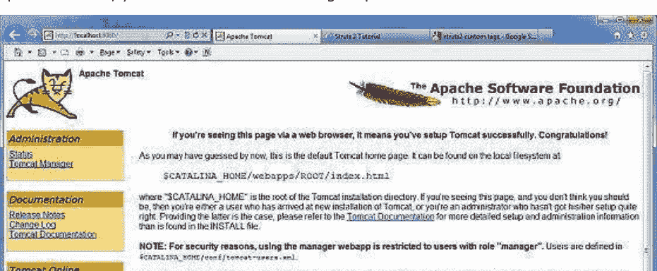
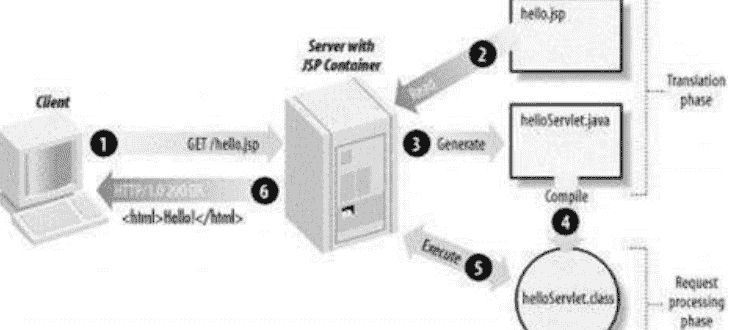

# JSP：Java Server Pages

## 关于教程

Java Server Pages (JSP) 是一种服务端编程技术，能够创建动态的、平台无关的方法来构建基于 Web 的应用程序。JSP 可以访问整个 Java API 家族，包括用于访问企业级数据库的 `JDBC API`。本教程将教你如何通过简单易的步骤使用 Java Server Pages 开发你的 Web 应用程序。

## 目标读者

本教程专为初学者准备，帮助他们理解 Java Server Pages (JSP) 的基本功能以开发你的 Web 应用程序。完成本教程后，你将发现自己在使用 JSP 方面已达到中等水平，并可以在此基础上进一步进阶。

## 前提条件

我们假设你对 Web 应用程序如何通过 HTTP 工作、什么是 Web 服务器以及什么是浏览器了解较少。如果你具有任何编程语言进行 Web 应用程序开发的知识，那将非常有帮助。

## 目录

- 使用 `SimpleDateFormat` 格式化日期
- 创建表
- 创建数据记录
- 查询操作
- 插入操作
- 删除操作
- 更新操作

### 24. JSP – XML 数据

- 从 JSP 发送 XML
- 在 JSP 中处理 XML
- 用 JSP 格式化 XML

### 25. JSP – JavaBeans

- JavaBeans 属性
- JavaBeans 示例
- 访问 JavaBeans
- 访问 JavaBeans 属性

### 26. JSP – 自定义标签

- 创建 "Hello" 标签
- 访问标签体
- 自定义标签属性

### 27. JSP – 表达式语言 (EL)

- 简单语法
- EL 中的基本运算符
- JSP EL 中的函数
- JSP EL 隐式对象
- `pageContext` 对象
- 作用对象（Scope Objects）
- `param` 和 `paramValues` 对象
- `header` 和 `headerValues` 对象

### 28. JSP — 异常处理

- 使用 `Exception` 对象
- 使用 JSTL 标签处理错误页面
- 使用 Try...Catch 块

### 29. JSP — 调试

- 使用 `System.out.println()`
- 使用 JDBC Logger
- 调试工具
- 使用 JDB 调试器
- 使用注释
- 客户端和服务器请求头

### 30. JSP — 安全

- 基于角色的认证
- 基于表单的认证
- Servlet/JSP 中的程序化安全

### 31. JSP — 国际化 | I18N | L10N

- 检测区域（Locale）
- 语言设置
- 特定区域日期
- 特定区域货币
- 特定区域百分比

# 1. JSP – 概述

## 什么是 JavaServer Pages？

JavaServer Pages (JSP) 是一种用于开发支持动态内容的网页的技术。它允许开发者通过使用特殊的 JSP 标签在 HTML 页面中插入 Java 代码，大多数标签以 `<%` 开头并以 `%>` 结束。

JavaServer Pages 组件是 Servlet 的一种，旨在为 Java Web 应用程序提供用户界面。开发者将 JSP 写为文本文件，其中结合了 HTML 或 XHTML 代码、XML 元素以及嵌入的 JSP 动作（actions）和命令。

使用 JSP，你可以通过网页表单收集用户输入，从数据库或其他源展示记录，并动态创建网页。

JSP 标签可以用于多种用途，例如从数据库中检索信息或注册用户偏好、访问 `JavaBeans`、在页面之间传递控制以及在请求、页面等之间共享信息。

## 为什么使用 JSP？

JavaServer Pages 的通常与使用通用网关接口 (CGI) 实现程序相同。但与 CGI 相比，JSP 具有几个优势：

- 性能显著更好，因为 JSP 允许在 HTML 页面本身中嵌入动态元素，而不是拥有独立的 CGI 文件。
- JSP 在被服务器处理之前总是会被编译，而 CGI/Perl 需要服务器在每次请求页面时都加载解释器和目标脚本。
- JavaServer Pages 构建在 Java Servlet API 之上，就像 Servlets 一样，JSP 也可以访问所有强大的 Java API，包括 `JDBC`、`JNDI`、`EJB`、`JAXP` 等。
- JSP 页面可以与处理业务逻辑的 servlet 结合，即 Java Servlet 模板支持的模型。

最后，JSP 是 Java EE 的不可缺的一部分，这是一个用于企业级应用的完整平台。这意味着 JSP 可以从最简单的应用到最复杂、要求最高的应用中发挥作用。

## JSP 的优势

以下是使用 JSP 相比其他技术的其他优势列表：

### 相比 Active Server Pages (ASP)

JSP 的优势是两方面的。首先，动态部分是用 Java 编写的，而不是 Visual Basic 或微软特有的语言，因此它更强大且更容易使用。其次，它可以迁移到其他操作系统和非微软 Web 服务器上。

### 对比纯 Servlets

编写（并修改）HTML 比使用 Servlets 更加方便。

### 相比服务器端包含 (SSI)

SSI 真正用于简单的包含，而不是用于“真正的”程序。

### 相比 JavaScript

JavaScript 可以在客户端生成 HTML，但很难与服务器交互。

### 相比静态 HTML

普通的 HTML 无法包含动态信息。

### 接下来是什么？

我将一步步引导你设置环境。如果你不熟悉 Java 编程，我们建议你阅读我们的教程来理解。

# 2. JSP — 环境搭建

开发环境是你开发 JSP 程序、测试它们并最终运行它们的地方。本教程将引导你设置环境，涉及以下步骤：

### 安装 Java 开发工具包 (JDK)

这一步涉及下载 Java 开发工具包 (SDK) 的实现并设置 `PATH` 变量。

你可以从 Oracle 网站下载 SDK：Java SE Downloads。

一旦下载了实现，请按照给定的说明进行安装和配置。最后设置 `PATH` 和 `JAVA_HOME` 环境变量，指向包含 `java` 和 `javac` 的目录（分别是 `java_dir/bin`）。

如果你运行 Windows 并将 SDK 安装在 `C:\jdk1.5.0_20`，你需要在 `C:\autoexec.bat` 文件中添加以下行。

```batch
set PATH=C:\jdk1.5.0_20\bin;%PATH%
set JAVA_HOME=C:\jdk1.5.0_20
```

或者，在 Windows NT/2000/XP 上，你也可以右键点击“我的电脑”，选择“属性”，然后是“环境变量”。然后更新 `PATH` 值并点击确定。

在 Unix (Solaris, Linux 等) 上，如果 SDK 安装在 `/usr/local/jdk.5.0_20` 且你使用 C shell，将以下内容放入 `.cshrc`：

```bash
setenv PATH /usr/local/jdk.5.0_20/bin:$PATH
setenv JAVA_HOME /usr/local/jdk.5.0_20
```

或者，如果你使用集成开发环境 (IDE) 如 Borland JBuilder、Eclipse、IntelliJ IDEA 或 Sun One Studio，编译并运行一个简单的程序以确认 IDE 知道你安装了 Java。

### Web 服务器 Tomcat

市场上有很多支持 Java Pages 和 Servlet 开发的 Web 服务器。一些 Web 服务器可以免费下载，Tomcat 就是其中之一。

Apache Tomcat 是 Java Pages 和 Servlet 技术的开源软件实现，可以作为独立服务器用于测试 JSP 和 Servlet，它可以与 Apache Web Server 集成。以下是在你的机器上设置 Tomcat 的步骤：

- 从 `http://tomcat.apache.org/` 下载最新版本的 Tomcat。
- 一旦下载了安装包，将二进制发行包解压到方便的位置。例如，在 Windows 的 `C:\apache-tomcat-5.5.29`，或者在 Linux/Unix 的 `/usr/local/apache-tomcat-5.5.29`，并创建指向这些位置的 `CATALINA_HOME` 环境变量。

在 Windows 上执行以下命令可以启动 Tomcat：

```batch
%CATALINA_HOME%\startup.bat
or C:\apache-tomcat-5.5.29\bin\startup.bat
```


在 Unix（Solaris, Linux 等）机器上执行以下命令可以启动 Tomcat：

```
$CATALINA_HOME/bin/startup.sh
or /usr/local/apache-tomcat-5.5.29/bin/startup.sh
```

成功启动后，访问 `http://localhost:8080` 即可使用 Tomcat 自带的默认 Web 应用程序。

执行后，你将收到以下输出：



关于配置和运行 Tomcat 的更多信息可以在此处包含的文档中以及 Tomcat 网站上找到：`http://tomcat.apache.org`

在 Windows 机器上执行以下命令可以停止 Tomcat：

```
%CATALINA_HOME%\bin\shutdown
or
C:\apache-tomcat-5.5.29\bin\shutdown
```

在 Unix（Solaris, Linux 等）机器上执行以下命令可以停止 Tomcat：

```
$CATALINA_HOME/bin/shutdown.sh
or
/usr/local/apache-tomcat-5.5.29/bin/shutdown.sh
```

# 设置 CLASSPATH

由于 servlet（servlets）不是 Java 平台标准版的一部分，你必须向编译器标识 servlet 类。

如果你运行的是 Windows，你需要在你的 `C:\autoexec.bat` 文件中放入以下行。

```
set CATALINA=C:\apache-tomcat-5.5.29
set CLASSPATH=%CATALINA%\common\lib\jsp-api.jar;%CLASSPATH%
```

或者，在 Windows NT/2000/XP 上，你也可以右键点击“我的电脑”，选择“属性”，然后是“高级”，然后是“环境变量”。然后更新 `CLASSPATH` 值并点击“确定”按钮。

在 Unix（Solaris, Linux 等）上，如果你使用 C shell，你需要将以下行放入你的 `.cshrc` 文件中。

```
setenv CATALINA=/usr/local/apache-tomcat-5.5.29
setenv CLASSPATH=$CATALINA/common/lib/jsp-api.jar:$CLASSPATH
```

**注意：** 假设你的开发目录是 `C:\JSPDev` (Windows) 或 `/usr/JSPDev` (Unix)，那么你还需要在 `CLASSPATH` 中添加这些目录。

# JSP 架构

Web 服务器需要一个 JSP 引擎，即一个处理 JSP 页面的容器。JSP 容器负责拦截对 JSP 页面的请求。本教程使用了带有内置 JSP 容器的 Apache 来支持 JSP 页面的开发。

JSP 容器与 Web 服务器协作，为 JSP 提供所需的运行时环境和其他服务。它知道如何理解 JSP 组成部分的特殊元素。

下面的图显示了 JSP 容器和 JSP 文件在 Web 应用程序中的位置。


## JSP 处理

以下步骤解释了 Web 服务器如何使用 JSP 创建网页：

1.  作为一个普通页面，你的浏览器向 Web 服务器发送 HTTP 请求。
2.  Web 服务器识别出该 HTTP 请求是针对 JSP 页面的，并将其转发给 JSP 引擎。这是通过使用 URL 或 JSP 页面以 `.jsp` 而不是 `.html` 结尾来实现的。
3.  JSP 引擎从磁盘加载 JSP 并将其转换为 servlet。这种转换非常简单，所有的文本都被转换为 `println()` 语句，所有的 JSP 元素都被转换为 Java 代码。这些代码实现了页面相应的动态行为。
4.  JSP 引擎将 servlet 编译成可执行的类，并将原始请求转发给 servlet 引擎。
5.  Web 服务器的一部分调用 servlet 引擎加载 Servlet 类并执行它。在执行期间，servlet 生成 HTML 格式的输出。该输出通过 servlet 引擎在 HTTP 响应内部进一步传递给 Web 服务器。
6.  Web 服务器以静态 HTML 内容的形式向你的浏览器发送 HTTP 响应。
7.  最后，Web 浏览器处理 HTTP 响应内部动态生成的 HTML 页面，就像处理静态页面一样。

上述所有步骤都可以在下面的图中看到：



通常，JSP 引擎会检查是否已经存在针对 JSP 文件的 servlet，以及 JSP 文件的修改日期是否匹配。

# JSP 语法

在本章中，我们将讨论 JSP 的语法。我们将理解 JSP 开发中涉及的简单语法（即元素）的基本用法。

## JSP 元素

JSP 元素描述如下：

### 脚本段 (Scriptlet)

脚本段可以包含任意数量的 Java 语言语句、变量或方法声明，或者在页面脚本语言中有效的表达式。

以下是 Scriptlet 的语法：

```
<% code fragment %>
```

你可以按照如下方式编写上述语法的 XML 等效形式：

```
<jsp:scriptlet>
code fragment
</jsp:scriptlet>
```

你编写的任何文本、HTML 标签或 JSP 元素都必须在 scriptlet 之外。以下是 JSP 的简单且第一个示例：

```html
<html>
<head><title>Hello World</title></head>
<body>
Hello World!<br>
<%
out.println("Your IP address is " + request.getRemoteAddr());
%>
</body>
</html>
```

**注意：** 假设 Apache Tomcat 安装在 `C:\apache-tomcat-7.0.2` 中，并且你的环境已按照设置教程进行了配置。

让我们将上述代码保存在 JSP 文件 `hello.jsp` 中，并将此文件放入 `C:\apache-tomcat-7.0.2\webapps\ROOT` 目录下。使用 URL `http://localhost:8080/hello.jsp` 访问。这将生成以下结果：


### JSP 声明 (Declarations)

声明声明了一个或多个变量或方法，你可以在 JSP 文件的后续 Java 代码中使用它们。你必须在 JSP 文件中使用变量或方法之前对它们进行声明。

以下是 JSP 声明的语法：

```
<%! declaration; [ declaration; ]+ ... %>
```

你可以按照如下方式编写上述语法的 XML 等效形式：

```
<jsp:declaration>
code fragment
</jsp:declaration>
```

以下是 JSP 声明的示例：

```jsp
<%! int i = 0; %>
<%! int a, b, c; %>
<%! Circle a = new Circle(2.0); %>
```

### JSP 表达式 (Expression)

JSP 表达式元素包含一个脚本语言表达式，该表达式会被求值、转换为字符串，并插入到表达式在 JSP 文件中出现的地方。

由于表达式的值会被转换为字符串，你可以在 JSP 文件的行文本中使用表达式，无论其是否被标记了 HTML 标签。

表达式元素可以包含任何符合 Java 语言规范的表达式，但你不能使用分号来结束表达式。

以下是 JSP 表达式的语法：

```
<%= expression %>
```

你可以按照如下方式编写上述语法的 XML 等效形式：

```
<jsp:expression>
expression
</jsp:expression>
```

下面的示例展示了一个 JSP 表达式：

```html
<html>
<head><title>A Comment Test</title></head>
<body>
<p>
Today's date: <%= (new java.util.Date()).toString() %>
</p>
</body>
</html>
```

上述代码将生成以下结果：

Today's date: 11-Sep-2010 21:24:25

### JSP 注释 (Comments)

JSP 注释标记了 JSP 容器应该忽略的文本或语句。当你想要隐藏或“注释掉” JSP 页面的某部分时，JSP 注释非常有用。

以下是 JSP 注释的语法：

```
<%-- This is JSP comment --%>
```

以下是 JSP 注释的示例：

```html
<html>
<head><title>A Comment Test</title></head>
<body>
<h2>A Test</h2>
<%-- This is a comment --%>
</body>
</html>
```

上述代码将生成：


### JSP 指令 (Directives)

指令影响 servlet 的整体结构。通常如下：

```
<%@ directive %>
```

有三种类型：

| 指令 | 说明 |
| :--- | :--- |
| `<%@ page %>` | 影响页面。 |
| `<%@ include %>` | 包含文件。 |
| `<%@ taglib %>` | 声明库。 |


### JSP 动作 (Actions)

JSP 动作使用 XML 标签来控制 servlet。它们生成代码：

```xml
<jsp:actionName attribute="value" />
```

动作是预定义的函数：

| 动作 | 目的 |
| :--- | :--- |
| `<jsp:useBean />` | 查找。 |
| `<jsp:setProperty />` | 设置属性。 |
| `<jsp:getProperty />` | 获取属性。 |
| `<jsp:forward />` | 跳转页面。 |
| `<jsp:include />` | 包含。 |

### JSP 隐式对象 (Implicit Objects)

JSP 支持自动定义的变量，这些被称为隐式对象：

| 对象 | 说明 |
| :--- | :--- |
| `request` | 这是与请求关联的 `HttpServletRequest`。 |
| `response` | 这是与客户端关联的 `HttpServletResponse`。 |
| `out` | 这是用于输出的 `PrintWriter` 对象。 |
| `session` | 这是与会话关联的 `HttpSession` 对象。 |
| `application` | 这是与应用程序关联的 `ServletContext` 对象。 |
| `config` | 这是与页面关联的 `ServletConfig` 对象。 |
| `pageContext` | 这封装了服务器特定的功能。 |
| `page` | 这是 `this` 的同义词，用于调用由 servlet 定义的方法。 |
| `exception` | `Exception` 对象允许 JSP 访问异常数据。 |


## 控制流语句 (Control-Flow Statements)

你可以在 JSP 编程中使用所有的 Java API 和构建块，包括决策语句、循环等。

### 决策语句

`if...else` 块像普通的 Scriptlet 一样开始，但 Scriptlet 在每行关闭并在标签之间包含 HTML 文本。

```html
<% int day = 3; %>
<html>
<head><title>IF...ELSE Example</title></head>
<body>
<% if (day == 1 || day == 7) { %>
  <p>Today is weekend</p>
<% } else { %>
  <p>Today is not weekend</p>
<% } %>
</body>
</html>
```

上述代码将生成以下结果：

```
Today is not weekend
```

现在看下面的 `switch...case` 块，它使用 `out.println()` 并在 Scriptlet 内部编写得有所不同：

```jsp
<% int day = 3; %>
<html>
<head><title>SWITCH...CASE Example</title></head>
<body>
<%
switch(day) {
case 0:
  out.println("It's Sunday.");
  break;
case 1:
  out.println("It's Monday.");
  break;
case 2:
  out.println("It's Tuesday.");
  break;
case 3:
  out.println("It's Wednesday.");
  break;
case 4:
  out.println("It's Thursday.");
  break;
case 5:
  out.println("It's Friday.");
  break;
default:
  out.println("It's Saturday.");
}
%>
</body>
</html>
```

上述代码将生成以下结果：

```
It's Wednesday.
```

### 循环语句

在 JSP 编程中，你还可以使用 Java 中的三种基础循环块：`for`、`while` 和 `do...while` 块。

让我们来看下面的 `for` 循环示例：

```jsp
<% int fontSize; %>
<html>
<head><title>FOR LOOP Example</title></head>
<body>
<% for (fontSize = 1; fontSize <= 3; fontSize++) { %>
<font color="green" size="<%= fontSize %>">
JSP Tutorial
</font><br />
<% } %>
</body>
</html>
```

上述代码将生成以下结果：


上述代码可以使用 `while` 循环编写如下所示：

```jsp
<% int fontSize = 1; %>
<html>
<head><title>WHILE Example</title></head>
<body>
<% while (fontSize <= 3) { %>
<font color="green" size="<%= fontSize %>">
JSP Tutorial
</font><br />
<% fontSize++; } %>
</body>
</html>
```

上述代码将生成以下结果：

```
JSP Tutorial
JSP Tutorial
JSP Tutorial
```

## 运算符

JSP 支持所有的运算符。下表列出了具有不同优先级的运算符。

| 类别 | 运算符 | 结合性 |
| :--- | :--- | :--- |
| 后置 | `()` `[]` `.` | 左到右 |
| 一元 | `++` `--` `!` `~` | 右到左 |
| 乘法 | `*` `/` `%` | 左到右 |
| 加法 | `+` `-` | 左到右 |
| 移位 | `>>` `>>>` `<<` | 左到右 |
| 关系 | `>` `>=` `<` `<=` | 左到右 |
| 相等 | `==` `!=` | 左到右 |
| 位与 | `&` | 左到右 |
| 位异或 | `^` | 左到右 |
| 位或 | `|` | 左到右 |
| 逻辑与 | `&&` | 左到右 |
| 逻辑或 | `||` | 左到右 |
| 条件 | `?:` | 右到左 |
| 赋值 | `=` `+=` `-=` `*=` `/=` `%=` `&=` `^=` `|=` `<<=` `>>=` `>>>=` | 右到左 |

## 字面量

JSP 定义了以下字面量：


- **布尔值 (Boolean)**：`true` 和 `false`
- **整数 (Integer)**
- **浮点数 (Floating point)**
- **字符串 (String)**：使用单引号或双引号
- **空 (Null)**：`null`

# 指令

在本章中，我们将讨论指令。指令为容器提供指示，如何处理 JSP 的某些方面。指令通常具有以下形式：

```jsp
<%@ directive attribute="value" %>
```

指令可以有多个属性，用逗号分隔。有三种类型的指令：

| 指令 | 说明 |
| --- | --- |
| `<%@page ... %>` | 定义页面相关的属性，如脚本语言、错误页面和缓冲要求。 |
| `<%@include ... %>` | 在翻译阶段包含一个文件。 |
| `<%@taglib ... %>` | 声明一个包含自定义操作的标签库。 |

# page 指令

page 指令用于向容器提供指示。这些指示关于当前页面。你可以在 JSP 页面的任何地方编写页面指令。按照惯例，page 指令编写在页面顶部。

以下是 page 指令的基本语法：

```jsp
<%@ page attribute="value" %>
```

你可以将上述语法编写为 XML 形式：

```xml
<jsp:directive.page attribute="value" />
```

## 属性

下表列出了与 page 指令相关的属性：

| 属性 | 用途 |
| --- | --- |
| `buffer` | 指定响应对象的缓冲特性。 |
| `autoFlush` | 指定缓冲区满时是否自动刷新，或者抛出异常指示缓冲区溢出。 |
| `contentType` | 定义字符编码。 |
| `errorPage` | 定义错误页面 URL。 |
| `isErrorPage` | 表示此页面是否为 `errorPage` 属性指定的 URL。 |
| `extends` | 指定生成的 servlet 的父类。 |
| `import` | 指定在 JSP 中使用的类列表。 |
| `info` | 定义一个可以通过 `getServerInfo()` 访问的字符串。 |
| `isThreadSafe` | 定义生成的 servlet 的线程模型。 |
| `language` | 定义 JSP 中使用的编程语言。 |
| `session` | 指定页面是否参与 HTTP 会话。 |
| `isELIgnored` | 指定是否忽略页面中的 EL 表达式。 |
| `isScriptingEnabled` | 决定是否允许使用脚本元素。 |

通常，`buffer` 和 `autoFlush` 属性被写在单个页面指令中，如下所示：

```jsp
<%@ page buffer="16kb" autoflush="true" %>
```

## contentType 属性

`contentType` 属性设置 JSP 页面以及生成的响应页面的编码。默认内容类型为 `text/html`，这是 HTML 页面的标准内容类型。

如果你想在 JSP 中使用 XML，请使用以下页面指令：

```jsp
<%@ page contentType="text/xml" %>
```

以下语句指示浏览器将生成的页面渲染为 HTML：

```jsp
<%@ page contentType="text/html" %>
```

以下指令将内容类型设置为 Microsoft Word 文档：

```jsp
<%@ page contentType="application/msword" %>
```

你也可以指定响应的字符编码。例如，如果你想指定返回给浏览器的页面使用 ISO Latin 1 编码，可以使用以下页面指令：

```jsp
<%@ page contentType="text/html;charset=ISO-8859-1" %>
```

## errorPage 属性

`errorPage` 属性告诉 JSP 引擎在当前页面运行时发生错误时显示哪个页面。`errorPage` 属性的值是一个相对 URL。

以下指令在抛出未捕获异常时显示 `MyErrorPage.jsp`：

```jsp
<%@ page errorPage="MyErrorPage.jsp" %>
```

## isErrorPage 属性

`isErrorPage` 属性指示当前 JSP 可以作为另一个 JSP 的错误页面。

`isErrorPage` 的值为 `true` 或 `false`。`isErrorPage` 属性的默认值为 `false`。

例如，`handleError.jsp` 将 `isErrorPage` 选项设置为 `true`，因为它应该负责处理错误：

```jsp
<%@ page isErrorPage="true" %>
```


## extends 属性

`extends` 属性指定生成的 servlet 可能扩展的父类。

例如，以下指令指示 JSP 翻译器生成的 servlet 使该 servlet 扩展 `somePackage.SomeClass`：

```jsp
<%@ page extends="somePackage.SomeClass" %>
```

## import 属性

`import` 属性的作用与 Java `import` 语句相同，行为一致。`import` 选项的值是你想要导入的包名。

要导入 `java.sql.*`，请使用以下页面指令：

```jsp
<%@ page import="java.sql.*" %>
```

要导入多个包，你可以用逗号将它们分隔：

默认情况下，容器会自动导入 `java.lang.*`、`javax.servlet.*`、`javax.servlet.jsp.*` 和 `javax.servlet.http`。

```jsp
<%@ page import="java.sql.*,java.util.*" %>
```

## info 属性

`info` 属性允许你提供 JSP 的描述。以下是一个示例：

```jsp
<%@ page info="This JSP Page Written By ZARA" %>
```

## isThreadSafe 属性

`isThreadSafe` 选项标记页面为线程安全。默认情况下，所有的 JSP 都被认为是线程安全的。如果你将 `isThreadSafe` 选项设置为 `false`，JSP 引擎将确保一次只有一个线程在执行你的 JSP。

以下页面指令将 `isThreadSafe` 选项设置为 `false`：

```jsp
<%@ page isThreadSafe="false" %>
```

## language 属性

`language` 属性指示在 JSP 脚本中使用的编程语言。

例如，因为你通常使用 Java 作为脚本语言，你的 `language` 选项如下：

```jsp
<%@ page language="java" %>
```


## session 属性

`session` 属性指示 JSP 页面是否使用 HTTP session。值为 `true` 表示 JSP 页面具有内置对象，值为 `false` 则表示 JSP 页面无法访问该内置对象。

以下指令允许 JSP 页面使用任何内置方法，如 `session.getCreationTime()` 和 `session.getLastAccessTime()`：

```jsp
<%@ page session="true" %>
```

## isELIgnored 属性

`isELIgnored` 属性提供了禁用 JSP 2.0 引入的表达式语言（EL）表达式评估的能力。该属性的默认值为 `true`，意味着表达式 `${...}` 是由 JSP 规范评估的。如果该属性设置为 `false`，则表达式将不被评估，而是视为静态文本。

以下指令设置表达式不被评估：

```jsp
<%@ page isELIgnored="false" %>
```

## isScriptingEnabled 属性

`isScriptingEnabled` 属性决定是否允许使用脚本元素。默认值（`true`）启用脚本段（scriptlets）、表达式和声明。如果该属性的值设置为 `false`，则当 JSP 使用脚本段、表达式（非 EL）或声明时将抛出翻译时错误。该属性的值可以设置为 `false`：

```jsp
<%@ page isScriptingEnabled="false" %>
```

## include 指令

`include` 指令用于在翻译阶段包含文件。该指令指示容器在翻译阶段将外部文件的内容与当前 JSP 合并。你可以在 JSP 的任何地方编写 `include` 指令。

该指令的通用用法如下：

```jsp
<%@ include file="relative url" %>
```

include 指令中的文件名实际上是一个相对 URL。

```html
<html>
<body>
  <mytag:hello/>
</body>
</html>
```

我们可以使用 `<mytag:hello>` 调用另一段代码。我们将看到如何开发自定义标签以及如何在 JSP 中使用它们 - 请参阅 自定义标签教程。

# JSP 动作

在本章中，我们将讨论 JSP 中的 Actions（操作）。这些操作使用 XML 语法的构造结构来控制 servlet 引擎的行为。你可以动态插入文件、重用 JavaBeans 组件、将用户转发到另一个页面，或为 Java 插件生成 HTML。

Action 元素只有一种语法，因为它符合 XML 标准：

```jsp
<jsp:action_name attribute="value" />
```

Action 元素基本上是预定义的函数。下表列出了可用的 JSP 动作：

| 语法 | 目的 |
| :--- | :--- |
| `jsp:include` | 在请求页面时包含一个文件。 |
| `jsp:useBean` | 查找或实例化一个 JavaBean。 |
| `jsp:setProperty` | 设置 JavaBean 的属性。 |
| `jsp:getProperty` | 将 JavaBean 的属性插入到输出中。 |
| `jsp:forward` | 将请求者转发到新页面。 |
| `jsp:plugin` | 生成特定浏览器的代码，为 Java 插件创建 OBJECT EMBED 标签。 |
| `jsp:element` | 动态定义 XML 元素。 |
| `jsp:attribute` | 定义动态定义的 XML 元素的属性。 |
| `jsp:body` | 定义动态定义的 XML 元素的正文。 |
| `jsp:text` | 用于在 JSP 页面和文档中写入模板文本。 |

## 通用属性

所有 Action 元素都有两个通用属性：`id` 属性和 `scope` 属性。

## Id 属性

`id` 属性唯一标识 Action 元素，并允许在 JSP 页面内部引用该操作。如果 Action 创建了对象的实例，则可以使用 `id` 值通过隐式对象 `PageContext` 来引用它。

## Scope 属性

此属性标识 Action 的生命周期。`id` 属性和 `scope` 属性直接相关，因为 `scope` 属性决定了与 `id` 关联对象的寿命。`scope` 属性有四个可能的值：`page`（页面）、`request`（请求）、`session`（会话）以及 `application`（应用）。

## <jsp:include> 操作

此操作将文件插入到生成的页面中。其语法如下：

```jsp
<jsp:include page="relative URL" flush="true" />
```

与 include 指令不同（指令是在 JSP 页面翻译成 servlet 时插入文件），此操作是在**页面请求时**插入文件。

以下是与该操作相关的属性列表：

| 属性 | 描述 |
| :--- | :--- |
| `page` | 要包含的页面的相对 URL。 |
| `flush` | 布尔属性，决定在包含的资源被包含之前其缓冲区是否已刷新。 |

## 示例

让我们定义两个文件 **(a) date.jsp** 和 **(b) main.jsp** 如下：

以下是 **date.jsp** 文件的内容：

```jsp
<p>
今天的日期：<%= (new java.util.Date()).toLocaleString() %>
</p>
```

以下是 **main.jsp** 文件的内容：

```html
<html>
<head>
<title>The include Action Example</title>
</head>
<body>
  <center>
    <h2>The include action Example</h2>
    <jsp:include page="date.jsp" flush="true" />
  </center>
</body>
</html>
```


让我们现在将这些文件放在根目录下并尝试访问 main.jsp。你将收到以下输出：

### include action示例

今天的日期：12-Sep-2010 14:54:22

## <jsp:useBean> 操作

`useBean` 非常灵活。它首先利用 `id` 和 `scope` 变量查找已存在的对象。如果没有找到对象，它将尝试创建指定的对象。

加载 bean 的最简单方法如下：

```jsp
<jsp:useBean ... />
```

# 转发动作

转发动作会终止当前页的操作，并将请求转发到另一个资源，例如静态页面、另一个 JSP 页面或 Java Servlet。

以下是转发动作的语法：

```jsp
<jsp:forward page="Relative URL" />
```

下表列出了与转发动作相关的必需属性：

| 属性 | 描述 |
| --- | --- |
| `page` | 应该包含另一个资源的相对 URL，例如静态页面、另一个 JSP 页面或 Java Servlet。 |

## 示例

让我们如下重用以下文件 (a) date.jsp 和 (b) main.jsp：

以下是 date.jsp 文件的内容：

```jsp
<p>
今天的日期是: <%= (new java.util.Date()).toLocaleString() %>
</p>
```

以下是 main.jsp 文件的内容：

```jsp
<html>
<head>
<title>include 动作示例</title>
</head>
<body>
<center>
<h2>include 动作示例</h2>
<jsp:forward page="date.jsp" />
</center>
</body>
</html>
```

让我们将这些文件都放在根目录下，并尝试访问 main.jsp。这将显示类似下方的结果。

在这里我们丢弃了主页的内容，仅显示了转发页的内容。


# <jsp:plugin> 动作

插件动作用于将 JSP 组件插入到 JSP 页面中。它确定浏览器类型并根据需要插入 `<object>` 或 `<embed>` 标签。

如果所需的插件不存在，它将下载插件并执行 Java 组件。Java 组件可以是一个 Applet 或 JavaBean。

插件动作有多个属性，这些属性与用于格式化 Java 组件的常用 HTML 标签对应。`<param>` 元素也可以向 Applet 发送参数。

以下是使用插件动作的典型语法：

```jsp
<jsp:plugin type="applet" codebase="dirname" code="MyApplet.class"
width="60" height="80">
<jsp:param name="font" value="red" />
<jsp:param name="background" value="black" />

<jsp:fallback>
无法初始化 Java 插件
</jsp:fallback>
</jsp:plugin>
```

如果你对此感兴趣，可以使用一些 applet 测试此动作。一个新元素 `<fallback>` 元素用于在组件失败时向用户发送错误字符串。

# <jsp:element> 动作

`<jsp:element>`、`<jsp:attribute>` 和 `<jsp:body>` 动作用于动态定义 XML 元素。“动态”一词非常重要，因为这意味着 XML 元素可以在请求时生成，而不是在编译时静态地生成。

以下是一个动态定义 XML 元素的简单示例：

```jsp
<%@ page language="java" contentType="text/html" %>
<html xmlns="http://www.w3.org/1999/xhtml"
xmlns:jsp="http://java.sun.com/JSP/Page">
<head><title>生成 XML 元素</title></head>
<body>
<jsp:element name="xmlElement">
<jsp:attribute name="xmlElementAttr">
属性值
</jsp:attribute>
<jsp:body>
XML 元素体
</jsp:body>
</jsp:element>
</body>
</html>
```

这在运行时将产生以下 HTML 代码：


```html
<html xmlns="http://www.w3.org/1999/xhtml"
xmlns:jsp="http://java.sun.com/JSP/Page">
<head><title>生成 XML 元素</title></head>
<body>
<xmlElement xmlElementAttr="属性值">
XML 元素体
</xmlElement>
</body>
</html>
```

# `<jsp:text>` 动作

`<jsp:text>` 动作可用于 JSP 页面和文档中编写模板文本。以下是该动作的简单语法：

```jsp
<jsp:text>模板数据</jsp:text>
```

模板体不能包含其他元素；它只能包含文本和 EL 表达式（EL 表达式将在后续章节中介绍）。注意，在 XML 文件中，你不能使用如 `${whatever gt 0}` 这样的表达式，因为大于号是非法的。相反，请使用 `gt` 形式，例如 `${whatever gt 0}`，或者另一种方法是将值嵌入到 CDATA 中。


如果你需要包含 DOCTYPE 声明（例如用于 XHTML），你必须如下使用 `<jsp:text>` 元素：

```jsp
<jsp:text><![CDATA[<!DOCTYPE html
PUBLIC "-//W3C//DTD HTML 1.0 Strict//EN"
"DTD/html1-strict.dtd">]]></jsp:text>
<head><title>jsp:text 动作</title></head>
<body>

<books>book
欢迎来到 JSP</books>

</body>
</html>
```

使用 `<jsp:text>` 测试上述示例。

在本章中，我们将讨论隐式对象。这些对象无需声明即可在页面可用。下表列出了隐式对象：

| 对象 | 描述 |
| --- | --- |
| request | 与请求相关的 `HttpServletRequest`。 |
| response | 与客户端相关的 `HttpServletResponse`。 |
| out | 用于发送内容的 `JspWriter`。 |
| session | 与请求相关的 `HttpSession`。 |
| application | 与应用程序相关的 `ServletContext`。 |
| config | 与页面相关的 `ServletConfig`。 |
| pageContext | 封装页面特定功能。 |
| page | 它是页面的代称。 |
| exception | 允许访问异常数据。 |

# request 对象

`request` 对象是 `javax.servlet.http.HttpServletRequest` 的实例。每当客户端请求页面时，JSP 引擎都会创建一个表示该请求的对象。


`request` 对象提供了获取头部信息的方法，包括数据、Cookie 等。

我们将在后续章节介绍与 `request` 对象相关的完整方法：客户端请求。

# response 对象

`response` 对象是 `javax.servlet.http.HttpServletResponse` 的实例。服务器创建请求对象的同时，也会创建一个响应客户端的对象。

`response` 对象还定义了处理新 HTTP 头部接口。通过它，JSP 程序员可以添加新的 Cookie 或时间戳、HTTP 状态码等。

我们将在后续章节介绍与 `response` 对象相关的完整方法：服务器响应。

# out 对象

`out` 对象是 `javax.servlet.jsp.JspWriter` 对象的实例，用于发送内容。初始 `JspWriter` 的实例化取决于页面是否开启了缓冲区。可以通过页面指令的 `buffered='false'` 属性轻松关闭缓冲区。

`JspWriter` 包含了 `java.io.PrintWriter` 类的大部分方法。然而，`JspWriter` 有一些额外的处理缓冲区的方法。与 `PrintWriter` 对象不同，`JspWriter` 会抛出 `IOException`。

下表列出了我们将用于写入 boolean、char、int、double、String 等的重要方法。

| 方法 | 描述 |
| --- | --- |
| `out.print(dataType dt)` | 打印数据类型值 |
| `out.println(dataType dt)` | 打印数据类型值并换行。 |
| `out.flush()` | 刷新流。 |

# application 对象

`application` 对象是对生成的 Servlet 的 `ServletContext` 对象的直接封装，在实际上它是 `javax.servlet.ServletContext` 对象的实例。

它是 JSP 页面在其整个生命周期的表示。该对象在 JSP 页面初始化时创建，并在通过 `jspDestroy()` 方法移除 JSP 页面时被移除。

通过向 `application` 添加属性，你可以确保组成你的 Web 应用程序的所有 JSP 文件都能访问它。

我们将在“JSP - 访问计数器”章节中检查 `Application` 对象的使用。

# config 对象

`config` 对象是 `javax.servlet.ServletConfig` 的实例化，是对生成的 servlet 的 `ServletConfig` 对象的直接封装。

该对象允许 JSP 程序员访问 Servlet 或 JSP 引擎的初始化参数，例如路径或文件位置等。

以下 `config` 方法是你可能使用的唯一方法，且其用法非常简单：

```
config.getServletName();
```

它返回 servlet 的名称，即包含在 `WEB-INF\web.xml` 文件中 `<servlet-name>` 元素中的字符串。

# pageContext 对象

`pageContext` 对象是 `javax.servlet.PageContext` 对象的实例。`pageContext` 对象用于表示 JSP 页面。

该对象旨在作为访问页面信息的手段，同时避免某些实现细节。

该对象存储了每个请求的请求和响应对象的引用。`application`、`config`、`session` 和 `out` 对象是通过访问该对象的属性派生的。

`PageContext` 类定义了几个字段，包括 `PAGE_SCOPE`、`REQUEST_SCOPE`、`SESSION_SCOPE` 和 `APPLICATION_SCOPE`，它们用于标识作用域。它支持超过 40 个方法，其中大约一半继承自 `javax.servlet.jsp.JspContext` 类。

重要方法之一是 `removeAttribute`。该方法接受一个或两个参数。例如，`pageContext.removeAttribute("attrName")` 从所有作用域移除属性，而以下代码从页面作用域移除它：

```
pageContext.removeAttribute("attrName", PAGE_SCOPE);
```

`pageContext` 的使用可以在“JSP - 文件上传”章节中检查。


# page 对象

该对象是对页面实例的实际引用。它可以被认为是一个代表整个 JSP 页面的对象。

`page` 对象实际上是 `this` 对象的直接同义词。

## exception 对象

`exception` 对象是一个包含从上一个页面抛出的异常的封装。它通常用于对错误条件生成适当的响应。

我们将在“JSP - 异常处理”章节介绍该对象的完整用法。

# 9. JSP – 客户端请求

在本章，我们将讨论 JSP 中的客户端请求。当浏览器请求网页时，它会向 Web 服务器发送大量信息。这些信息无法直接读取，因为它们是作为请求头部的一部分传输的。你可以检查 HTTP 协议以获取更多信息。

下表列出了来自浏览器的重要头部信息。这些信息在 Web 编程被频繁使用：

| Header | Description |
| --- | --- |
| Accept | 此头部指定浏览器或其他客户端可以处理的 MIME 类型。`image/png` 或 `image/jpeg` 是两种最可能的值。 |
| Accept-Charset | 此头部指定浏览器可以用于显示信息的字符集。例如，ISO-8859-1。 |
| Accept-Encoding | 此头部指定浏览器已知可以处理的编码类型。`gzip` 或 `compress` 是两种最可能的值。 |
| Accept-Language | 此头部指定客户端的首选语言，以防 servlet 产生多种语言的结果。例如，`en`、`en-us`、`ru` 等。 |
| Authorization | 此头部用于客户端在访问受密码保护的网页时识别身份。 |
| Connection | 此头部指示客户端是否可以处理持久 HTTP 连接。持久连接允许客户端或其他浏览器通过单个请求检索多个文件。`Keep-Alive` 的值意味着应该使用持久连接。 |
| Content-Length | 此头部仅适用于 POST 请求，并给出以字节为 POST 数据的大小。 |
| Cookie | 此头部将 cookie 返回给之前发送给浏览器的服务器。 |


| Header | Description |
| --- | --- |
| Host | 此头部指定原始 URL 给出的主机和端口。 |
| If-Modified-Since | 此头部表示客户端仅在页面在指定日期之后发生更改时才想要该页面。如果没有更新的结果，服务器将发送代码 304，表示“未修改”。 |
| If-Unmodified-Since | 此头部是 If-Modified-Since 的反向；它指定只有当文档早于指定日期时操作才成功。 |
| Referer | 此头部指示引用页面的 URL。例如，如果你在 Webpage 1 上并点击指向 Webpage 2 的链接，那么当浏览器请求 Webpage 2 时，Webpage 1 的 URL 会包含在 Referer 头部中。 |
| User-Agent | 此头部识别发出请求的浏览器或其他客户端，并用于向不同类型的浏览器返回不同的内容。 |

## HttpServletRequest 对象

`request` 是 `javax.servlet.http.HttpServletRequest` 的实例。该对象允许 JSP 程序员访问 Servlet 或 JSP 引擎的初始化参数，例如路径或文件位置等。

以下 `config` 方法是你可能使用的唯一方法，且其用法非常简单：

```
config.getServletName();
```

它返回 servlet 的名称，即包含在 `WEB-INF\web.xml` 文件中的字符串。

请求提供了获取头部的方法：

| NO. | Method | Description |
| --- | --- | --- |
| 1 | `getHeader(String name)` | 返回指定头部的字符串值。 |
| 2 | `getCookies()` | 返回所有 Cookie 数组。 |
| 3 | `getHeaderNames()` | 返回头部名称枚举。 |
| 4 | `getContextPath()` | 返回指示上下文的请求部分。 |
| 5 | `getMethod()` | 返回执行请求的 HTTP 方法，例如 GET 或 POST。 |
| 6 | `getParameter(String name)` | 返回参数的字符串值，如果参数不存在则返回 null。 |
| 7 | `getPathInfo()` | 返回与 URL 相关的额外路径信息。 |
| 8 | `getProtocol()` | 返回请求使用的协议名称。 |
| 9 | `getQueryString()` | 返回请求路径之后的查询字符串。 |
| 10 | `getRemoteAddr()` | 返回发送请求的客户端的网协议 (IP) 地址。 |
| 11 | `getRemoteHost()` | 返回发送请求的完全主机名。 |
| 12 | `getRemoteUser()` | 如果用户已验证，则返回登录用户；未验证则返回 null。 |
| 13 | `getRequestURI()` | 返回从协议名称到查询字符串的请求 URI 部分。 |
| 14 | `getAttribute(String name)` | 返回命名属性的值，类型为 Object。 |


## exception 对象

`exception` 对象是一个包含从上一个页面抛出的异常的封装。它通常用于对错误条件生成适当的响应。

我们将在“JSP - 异常处理”章节介绍该对象的完整用法。

# HeaderNames

返回头部名称枚举。

# ParameterNames

返回参数枚举。

# HttpSession

返回当前会，如果没有会则创建一个。

# HttpSession(boolean create)

返回当前会，如果 `create` 为 true 则返回一个新会。

# Locale

根据 Accept-Language 头部返回客户端可以接受的首选 Locale。

# CharacterEncoding

返回主体使用的字符编码名称。

# ContentType

返回请求的 MIME 类型，如果类型未知则返回 null。

# InputStream

以二进制数据获取请求体。

# AuthType

返回用于保护 servlet 的身份验证方案名称，例如 "BASIC" 或 "SSL"，如果 JSP 未受保护则返回 null。


# JSP

| | |
|---|---|
| 24 | `String getRequestedSessionId()`<br>返回客户端指定的 ID。 |
| 25 | `String getServletPath()`<br>返回此请求 URL 中调用 JSP 的部分。 |
| 26 | `String[] getParameterValues(String name)`<br>返回一个包含 String 对象的数组，其中包含请求参数的所有值；如果参数不存在则返回 null。 |
| 27 | `boolean isSecure()`<br>返回一个布尔值，指示此请求是否是通过安全通道（如 HTTPS）发出的。 |
| 28 | `int getContentLength()`<br>返回请求体的字节长度，该长度由输入流提供；如果长度未知，则返回 -1。 |
| 29 | `int getHeader(String name)`<br>以 int 类型返回所请求的头部值。 |
| 30 | `int getServerPort()`<br>返回接收此请求的端口号。 |

# HTTP 头部请求示例

以下是使用 `HttpRequest` 的 `getHeaderNames()` 方法来读取 HTTP 头部信息的示例。该方法返回一个包含与当前 HTTP 请求相关的头部信息的枚举。

一旦我们获取了枚举对象，就可以按照标准方式遍历它。我们使用 `hasMoreElements()` 方法来确定何时停止，并使用 `nextElement()` 方法获取每个参数的名称。

```
<%@ page import="java.io.*,java.util.* %>
<html>
<head>
<title>HTTP Header Request Example</title>
</head>
<body>
```


```
<center>
<h2>HTTP Request Example</h2>
<table width="100%" border="1" align="center">
<tr bgcolor="#949494">
<th>头部名称 (Header Name)</th><th>头部值 (Header Value(s))</th>
</tr>
<%--
<%
  Enumeration headerNames = request.getHeaderNames();
  while(headerNames.hasMoreElements()) {
    String paramName = (String)headerNames.nextElement();
    out.print("<tr><td>" + paramName + "</td>\n");
    String paramValue = request.getHeader(paramName);
    out.println("<td>" + paramValue + "</td></tr>\n");
  }
%>
</table></center>
</body>
</html>
```

现在让我们将上述代码放入 `main.jsp` 并尝试访问它。

# HTTP 请求示例

| 头部名称 (Header Name) | 头部值 (Header Value(s)) |
|---|---|
| accept | /* |
| accept-language | en-us |


| user-agent | Mozilla/4.0 (compatible; MSIE 7.0; Windows NT 5.1; Trident/4.0; InfoPath.2; MS-RTC LM 8 |
| accept-encoding | gzip, deflate |
| host | localhost:8080 |
| connection | Keep-Alive |
| cache-control | no-cache |


你可以尝试以类似的方式处理所有这些方法。

在本章中，我们将讨论 JSP 中的服务器响应（Server Response）。当 Web 服务器响应 HTTP 请求时，响应通常由一条状态行、一些响应头部、一个空行和文档组成。一个典型的响应如下：

```
HTTP/1.1 200 OK
Content-Type: text/html
Header2: ...
...
Header: ...
(空行)
<!doctype ...>
<html>
<head>...</head>
<body>
...
</body>
</html>
```

状态行包含 HTTP 版本（示例中 `HTTP/1.1`）、状态码（示例为 `200`）以及与状态码对应的简短消息（示例为 `OK`）。

以下是返回给 Web 服务器浏览器的最常用 HTTP 1.1 响应头部摘要。这些头部在 Web 编程中被频繁使用：

| 头部 (Header) | 说明 |
|---|---|
| Allow | 此头部指定服务器支持的请求方法（`GET`、`POST` 等）。 |
| Cache-Control | 此头部指定了响应文档可以安全缓存的情况。它可以取值为 `private` 或 `no-cache` 等。`Public` 意味着文档可以缓存，`Private` 意味着文档属于单个用户且只能存储在私有（非共享）缓存中，`no-cache` 文档永远不应缓存。 |
| Connection | 此头部指示浏览器是否使用持久 HTTP 连接。值 `close` 指示浏览器不使用持久 HTTP 连接，`keep-alive` 意味着使用持久连接。 |
| Content-Disposition | 此头部允许你请求浏览器将响应保存为磁盘上指定名称的文件。 |
| Content-Encoding | 此头部指定了页面用于传输的编码方式。 |
| Content-Language | 此头部标识页面编写时使用的语言。 |
| Content-Length | 此头部指示响应体中的字节数。 |
| Content-Type | 此头部给出响应的 MIME 类型。 |
| Expires | 此头部指定了内容被视为过期的日期。 |
| Last-Modified | 此头部指示文档最后一次更改的时间。 |
| Location | 此头部指定了重定向地址。 |
| Refresh | 此头部指定了浏览器在多少秒后应该刷新。 |
| Retry-After | 此头部可以与 `503`（服务不可用）响应配合使用。 |
| Set-Cookie | 此头部指定了与响应相关的 cookie。 |

# JSP HttpServletResponse

响应对象是 `javax.servlet.http.HttpServletResponse` 的实例。正如服务器创建请求对象一样，它也会为客户端创建响应。

可以使用以下方法设置 HTTP 头部、日期或状态码。

| 序号 | 方法与描述 |
|---|---|
| 1 | `String encodeRedirect(String url)` 对指定的 URL 进行编码以用于 `sendRedirect`，或者如果不需要编码，则返回相同的 URL。 |
| 2 | `String encodeURL(String url)` 通过包含 Session ID 对指定的 URL 进行编码，或者如果不需要编码，则返回相同的 URL。 |
| 3 | `boolean containsHeader(String name)` 返回布尔值，指示命名的响应头部是否已设置。 |
| 4 | `boolean isCommitted()` 返回布尔值，指示响应是否已提交。 |
| 5 | `void addCookie(Cookie cookie)` 将指定的 cookie 添加到响应中。 |
| 6 | `void addHeader(String name, long date)` 添加带有给定名称和日期-值的响应头部。 |
| 7 | `void addHeader(String name, String value)` 添加带有给定名称和值的响应头部。 |
| 8 | `void addIntHeader(String name, int value)` 添加带有给定名称和整数值的响应头部。 |
| 9 | `void flushBuffer()` 强制将缓冲区中的任何内容写入客户端。 |
| 10 | `void reset()` 清除缓冲区中存在的任何数据以及状态码和头部。 |
| 11 | `void resetBuffer()` 清除响应中底层缓冲区的内容，但不清除头部或状态码。 |
| 12 | `void sendError(int sc)` 使用指定的状态码向客户端发送错误响应并清除缓冲区。 |
| 13 | `void sendError(int sc, String msg)` 使用指定的状态码和消息向客户端发送错误响应。 |
| 14 | `void sendRedirect(String location)` 使用指定的重定向位置 URL 向客户端发送临时重定向响应。 |
| 15 | `void setBufferSize(int size)` 设置响应体的首选缓冲区大小。 |
| 16 | `void setCharacterEncoding(String charset)` 设置发送给客户端的响应字符编码（MIME 字符集），例如 `UTF-8`。 |
| 17 | `void setLength(int len)` 在 HTTP servlet 中设置响应内容体的长度；此方法还会设置 HTTP `Content-Length` 标头。 |
| 18 | `void setContentType(String type)` 如果响应尚未提交（committed），则设置发送给客户端的响应内容类型。 |
| 19 | `void setHeader(String name, long date)` 设置具有给定名称和日期-值的响应标头。 |
| 20 | `void setHeader(String name, String value)` 设置具有给定名称和值的响应标头。 |
| 21 | `void setIntHeader(String name, int value)` 设置具有给定名称和整数值的响应标头。 |
| 22 | `void setLocale(Locale loc)` 如果响应尚未提交，则设置响应的语言区域设置。 |
| 23 | `void setStatus(int sc)` 设置此响应的状态码。 |


## Header 响应示例

在下面的示例中，我们将使用 `setIntHeader()` 方法来设置 `Refresh` 标头以模拟数字钟：

```jsp
<%@ page import="java.io.*,java.util.*" %>
<html>
<head>
<title>自动刷新标头示例</title>
</head>
<body>
<center>
<h2>自动刷新标头示例</h2>
<%
  // 设置刷新（refresh）和自动加载时间为 5 秒
  response.setIntHeader("Refresh", 5);
  // 获取当前时间
  Calendar calendar = new GregorianCalendar();
  String am_pm;
  int hour = calendar.get(Calendar.HOUR);
  int minute = calendar.get(Calendar.MINUTE);
  int second = calendar.get(Calendar.SECOND);
  if(calendar.get(Calendar.AM_PM) == 0) {
    am_pm = "AM";
  } else {
    am_pm = "PM";
  }
  String CT = hour+":"+ minute+":"+ second+":" + am_pm;
  out.println("Current Time is: " + CT + "\n");
%>
</center>
</body>
</html>
```

现在将代码放入 `main.jsp` 并尝试访问它。这将每隔 5 秒显示一次当前系统时间，如下所示。运行 JSP。你将收到以下输出：


你可以尝试类似的方法处理其他方法。

# 11. JSP – HTTP 状态码

在本章中，我们将讨论 JSP 中的 HTTP 状态码。HTTP 请求和 HTTP 响应消息的格式相似，具有以下结构：

- 一个初始状态行 + CRLF（回车 + 换行符，即新行）
- 零个或多个标头行 + CRLF
- 一个空行（即一个 CRLF）
- 可选的消息正文，如文件、查询数据或查询输出。

例如，服务器响应标头如下所示：

```
HTTP/1.1 200 OK
Content-Type: text/html
Header2: ...
...
HeaderN: ...
(空行)
<!doctype ...>
<html>
<head>...</head>
<body>
...
</body>
</html>
```

状态行由 HTTP 版本（示例中的 `HTTP/1.1`）、状态码（示例中的 `200`）以及一个与状态码对应的非常短的消息（示例中的 `OK`）组成。

下表列出了 Web 服务器可能返回的 HTTP 状态码及关联消息：

| 代码 | 消息 | 说明 |
|---|---|---|
| 100 | Continue | 服务器仅收到了部分请求，但只要未被拒绝，客户端就应继续请求 |
| 101 | Switching Protocols | 服务器切换协议。 |
| 200 | OK | 请求正常 |
| 201 | Created | 请求完成，并创建了一个新资源 |
| 202 | Accepted | 请求已接受处理，但处理尚未完成。 |
| 203 | Non-authoritative Information | 非权威信息 |
| 204 | No Content | 无内容 |
| 205 | Reset Content | 重置内容 |
| 206 | Partial Content | 部分内容 |
| 300 | Multiple Choices | 链接列表；用户可以选择一个链接并跳转到该位置。最多五个地址。 |
| 301 | Moved Permanently | 请求的页面已永久移动到新的 URL。 |
| 302 | Found | 请求的页面临时移动到新的 URL。 |
| 303 | See Other | 请求的页面可以在不同的 URL 下找到 |
| 304 | Not Modified | 未修改 |
| 305 | Use Proxy | 使用代理 |
| 306 | Unused | 未使用 |
| 307 | Temporary Redirect | 临时重定向。请求的页面已临时移动。 |
| 400 | Bad Request | 服务器无法理解该请求。 |
| 401 | Unauthorized | 请求需要用户名和密码。 |
| 402 | Payment Required | 需要付款 |
| 403 | Forbidden | 访问被禁止。 |
| 404 | Not Found | 服务器找不到请求的页面。 |
| 405 | Method Not Allowed | 请求中指定的方法不允许。 |
| 406 | Not Acceptable | 响应不被接受。 |
| 407 | Authentication Required | 客户端必须先向代理进行身份验证。 |
| 408 | Request Timeout | 请求耗时超过了服务器准备等待的时间。 |
| 409 | Conflict | 请求存在冲突。 |
| 410 | Gone | 请求的页面已不再可用。 |
| 411 | Length Required | 定义了 Content-Length。 |
| 412 | Precondition Failed | 请求中给出的前提条件评估为假。 |
| 413 | Entity Too Large | 实体过大。 |
| 414 | URI Too Long | URL 太长。 |
| 415 | Unsupported Media Type | 不支持的媒体类型。 |
| 417 | Expectation Failed | 未满足预期。 |
| 500 | Internal Server Error | 服务器遇到了意外情况。 |
| 501 | Not Implemented | 服务器不支持该功能。 |
| 502 | Bad Gateway | 服务器从上游服务器接收到无效响应。 |
| 503 | Service Unavailable | 服务器临时过载或宕机。 |
| 504 | Gateway Timeout | 网关超时。 |
| 505 | HTTP Not Supported | 服务器不支持 "http" 版本。 |


## 设置 HTTP 状态码的方法

可以使用以下方法在 servlet 中设置 HTTP 状态码。这些方法通过 `HttpServletResponse` 对象可用。

| 序号 | 方法与描述 |
|---|---|
| 1 | `public void setStatus(int statusCode)` 此方法设置任意状态码。`setStatus` 方法接受一个 `int`（状态码）作为参数。你的响应将包含一个特殊的状态码，请确保在使用 `PrintWriter` 返回任何内容之前调用 `setStatus`。 |
| 2 | `public void sendRedirect(String url)` 此方法生成 `302` 响应，并有一个 `Location` 标头，指示新文档的 URL。 |
| 3 | `public void sendError(int code, String message)` 此方法发送一个状态码（通常为 `404`）以及一条短消息，该消息会自动格式化并在 HTML 文档中发送给客户端。 |

## HTTP 状态码示例

下面的示例显示了如何向客户端浏览器发送 `407` 错误码。之后，浏览器将向你显示 "Need authentication!!!" 消息。

```jsp
<html>
<head>
<title>设置 HTTP 状态码</title>
</head>
<body>
<%
// 设置错误码和原因。
response.sendError(407, "Need authentication!!!");
%>
</body>
</html>
```


你将收到以下输出：

| HTTP Status 407 - Need authentication!!! |
|---|
| type Status report |
| message Need authentication!!! |
| description The client必须先向代理（Apache Tomcat/5.5.29）进行身份验证 |

为了更熟悉 HTTP 状态码，请尝试设置不同的状态码及其描述。

# 12. JSP – 表单处理

在本章中，我们将讨论 JSP 中的表单处理。你可能遇到过许多情况，需要从浏览器将某些信息传递到 Web 服务器，最终传递到后端程序。浏览器使用两种方法将这些信息传递给 Web 服务器。这些方法是 `GET` 方法和 `POST` 方法。

## 表单处理中的方法

现在让我们讨论表单处理中的方法。

### GET 方法

`GET` 方法将编码后的用户信息附加到页面请求中。页面和编码信息通过 `?` 字符分隔，如下：

```
http://www.test.com/hello?key1=value1&key2=value2
```

`GET` 方法是从浏览器向 Web 服务器传递传输的默认方法，它会产生一个出现在你浏览器 Location 框中的长字符串。如果你有密码或敏感信息要传递给服务器，建议不要使用 `GET` 方法。

`GET` 方法有大小限制：请求字符串中只能包含 `1024` 个字符。

这些信息通过 `QUERY_STRING` 头部传递，并通过 `QUERY_STRING` 环境变量访问，可以使用 request 对象的 `getQueryString()` 和 `getParameter()` 方法进行处理。

### POST 方法

向后端程序传递信息的一种通常更可靠的方法是 `POST` 方法。

该方法以与 `GET` 方法完全相同封装信息，但它不是作为 URL 中 `?` 之后的字符串发送的，而是作为一个单独的消息发送。此消息以标准输入的形式到达后端程序，你可以对其进行解析并用于你的处理。


JSP 使用 `getParameter()` 读取简单参数，使用 `getInputStream()` 读取来自客户端的二进制数据流来处理此类请求。

## 使用 JSP 读取表单数据

JSP 根据情况使用以下方法自动处理表单解析：

- `getParameter()`：你调用 `request.getParameter()` 方法来获取表单参数的值。


- `getParameterValues()`：如果参数出现多次并返回多个值（例如复选框），则调用此方法。

- `getParameterNames()`：如果你想要当前请求中完整参数列表，请调用此方法。

- `getInputStream()`：调用此方法读取来自客户端的二进制数据流。

## 使用 URL 的 GET 方法示例

以下 URL 将使用 GET 方法向 HelloForm 程序传递两个值。

```
http://localhost:8080/main.jsp?first_name=ZARA&last_name=ALI
```

下面是处理 Web 浏览器输入的 main.jsp JSP 程序。我们将使用 `getParameter()` 方法，这使得访问传递的信息变得非常容易：

```html
<html>
<head>
<title>使用 GET 方法读取表单数据</title>
</head>
<body>
<center>
<h1>使用 GET 方法读取表单数据</h1>
<ul>
<li><p><b>First Name（名字）:</b></p>
<% request.getParameter("first_name") %>
</p></li>
<li><p><b>Last Name（姓氏）:</b></p>
<% request.getParameter("last_name") %>
</p></li>
</ul>
</center>
</body>
</html>
```

现在在浏览器的 Location 框中输入 `http://localhost:8080/main.jsp?first_name=ZARA&last_name=ALI`。这将生成以下结果：

> 使用 GET 方法读取表单数据
>
> * First Name: ZARA
>
> * Last Name: ALI

## 使用表单的 GET 方法示例

以下是一个使用 HTML FORM 和提交按钮传递两个值的示例。我们将使用相同的 JSP main.jsp 来处理此输入。

```html
<html>
<body>
<form action="main.jsp" method="GET">
First Name:<input type="text" name="first_name">
<br />
Last Name: <input type="text" name="last_name" />
<input type="submit" value="Submit" />
</form>
</body>
</html>
```

将此 HTML 保留在 `Hello.htm` 文件中，并将其放在 `<Tomcat-installation-directory>/webapps/ROOT` 目录下。当你访问 `http://localhost:8080/Hello.htm` 时，你将收到以下输出：

| First Name: | | |
| Last Name: | Submit |

尝试输入 First Name 和 Last Name，然后点击提交按钮，以在你运行 tomcat 的本地机器上查看结果。根据提供的输入，它将生成与上述示例类似的结果。

## 使用表单的 POST 方法示例

让我们对上述 JSP 进行一些微调，以同时处理 GET 和 POST 方法。使用 main.jsp JSP 程序通过 GET 或 POST 方法处理 Web 浏览器提供的输入。


事实上，上面的 JSP 没有变化，因为只是传递参数的方式发生了变化，并且没有向 JSP 程序传递二进制数据。文件处理相关的概念将在单独的章节中解释，在其中我们需要读取二进制数据流。

```html
<html>
<head>
<title>使用 GET 和 POST 方法读取表单数据</title>
</head>
<body>
<center>
<h1>使用 GET 方法读取表单数据</h1>
<ul>
<li><p><b>First Name:</b>
<%= request.getParameter("first_name") %>
</p></li>
<li><p><b>Last Name:</b>
<%= request.getParameter("last_name") %>
</p></li>
</ul>
</center>
</body>
</html>
```

以下是 Hello.htm 的内容：

```html
<html>
<body>
<form action="main.jsp" method="POST">
First Name: <input type="text" name="first_name">
<br />
Last Name: <input type="text" name="last_name" />
<input type="submit" value="Submit" />
</form>
</body>
</html>
```

现在将 main.jsp 和 hello.htm 保留在 `<Tomcat-installation-directory>/webapps/ROOT/` 中。当你访问 `http://localhost:8080/Hello.htm` 时，你将收到以下输出。


| First Name: | | |
| Last Name: | Submit |

尝试输入 First Name 和 Last Name，然后点击提交按钮，以在你运行 tomcat 的本地机器上查看结果。根据提供的输入，它将生成与上述示例类似的结果。

## 传递复选框数据

以下是一个使用 HTML FORM 和提交按钮传递两个值的示例。我们将使用相同的 main.jsp JSP 程序来处理来自浏览器的输入。

```html
<html>
<head>
<title>读取表单数据</title>
</head>
<body>
<center>
<h1>读取表单数据</h1>
<ul>
```


```html
<html>
<body>
<li><p><b>Maths:</b></p>
<%= request.getParameter("maths") %>
</p></li>
<li><p><b>Physics:</b></p>
<%= request.getParameter("physics") %>
</p></li>
<li><p><b>Chemistry:</b></p>
<%= request.getParameter("chemistry") %>
</p></li>
</ul>
</center>
</body>
</html>
```

上述代码将生成以下结果：

- Maths
- Physics
- Select

以下是使用复选框方法处理来自浏览器的输入代码。

```html
<html>
<head>
<title>读取表单数据</title>
</head>
<body>
<center>
<h1>读取表单数据</h1>
<ul>
```


```html
<html>
<body>
<form action="main.jsp" method="GET">
First Name:<input type="text" name="first_name">
<br />
Last Name: <input type="text" name="last_name" />
<input type="submit" value="Submit" />
</form>
</body>
</html>
```

上述代码将生成以下结果：

- Maths
- Physics
- Select

以下是使用复选框方法处理来自浏览器的输入。

```html
<html>
<head>
<title>读取表单数据</title>
</head>
<body>
<center>
<h1>读取表单数据</h1>
<ul>
```


```html
<html>
<body>
<li><p><b>Maths:</b></p>
<%= request.getParameter("maths") %>
</p></li>
<li><p><b>Physics:</b></p>
<%= request.getParameter("physics") %>
</p></li>
<li><p><b>Chemistry:</b></p>
<%= request.getParameter("chemistry") %>
</p></li>
</ul>
</form>
</body>
</html>
```

现在使用上述 Hello.htm 调用 JSP；根据提供的输入，这将生成类似下面的结果：

## 读取所有表单参数

| 参数名称 (Param Name) | 参数值 (Param Value) |
|---|---|
| maths | on |
| chemistry | on |

你可以尝试上述 JSP 来读取其他表单的数据，这些表单包含文本框、单选按钮或下拉列表等其他对象。

# 13. JSP – 过滤器

在本章中，我们将讨论 JSP 中的过滤器。Servlet 和 JSP 过滤器是 Java 类，可以用于 Servlet 和 JSP 编程，用于以下目的：

- 在客户端访问后端资源之前拦截其请求。
- 在服务器将响应发送回客户端之前对响应进行处理。

规范中建议了多种类型的过滤器：

- 身份验证过滤器
- 数据压缩过滤器
- 加密过滤器
- 触发资源访问事件的过滤器
- 转换过滤器
- 日志和审计过滤器
- MIME-TYPE 链过滤器
- 分词过滤器
- 转换 XML 内容的 XSL/T 过滤器

过滤器部署在部署描述符 `web.xml` 中，然后映射到应用程序部署描述符中的 servlet 或 JSP 名称或 URL 模式。部署描述符文件 `web.xml` 可以在 `<Tomcat安装目录>/conf` 目录下找到。

当 JSP 容器启动你的 Web 应用程序时，它会为你在部署描述符中定义的每个过滤器创建一个实例。过滤器按照它们在部署描述符中声明的顺序执行。

## Servlet Filter 方法

过滤器是一个实现 `javax.servlet.Filter` 接口的 Java 类。`javax.servlet.Filter` 接口定义了三个方法：

| 序号 | 方法与描述 |
| --- | --- |
| 1 | `public void doFilter(ServletRequest, ServletResponse, FilterChain)` 每当客户端请求链末端的资源时，导致一个请求/响应对通过该链时，容器都会调用此方法。 |
| 2 | `public void init(FilterConfig filterConfig)` |
| 3 | `public void destroy()` |


此方法由 Web 容器调用，指示过滤器它正被投入服务。

此方法由 Web 容器调用，指示过滤器它正被停止服务。

## JSP 过滤器示例

下面的示例展示了如何在每次访问任何 JSP 文件时打印客户端的 IP 地址和当前日期时间。这个示例将让你对 JSP 过滤器有一个基本的了解，但你可以使用相同的概念编写更复杂的过滤器应用程序。

```java
// 导入所需的 java 库
import java.io.*;
import javax.servlet.*;
import java.util.*;

// 实现 Filter 类
public class LogFilter implements Filter {
    public void init(FilterConfig config)
        throws ServletException {
        // 获取初始化参数
        String testParam = config.getInitParameter("test-param");

        // 打印初始化参数
        System.out.println("test Param: " + testParam);
    }
    public void doFilter(ServletRequest request,
        ServletResponse response,
        FilterChain chain)
        throws java.io.IOException, ServletException {

        // 获取客户端机器的 IP 地址。
        String ipAddress = request.getRemoteAddr();

        // 记录 IP 地址和当前时间戳。
        System.out.println("IP " + ipAddress + ", Time "
        + new Date().toString());

        // 将请求传回过滤器链
        chain.doFilter(request,response);
    }
    public void destroy() {
        /* 在 Web 容器从服务中移除 Filter 实例之前调用 */
    }
}
```

以按照通常的方式编译 `LogFilter.java`，并将你的 `LogFilter.class` 文件放在 `<Tomcat安装目录>/webapps/ROOT/WEB-INF/classes`。

## Web.xml 中的 JSP 过滤器映射

过滤器的定义后映射到 URL 或 JSP 名称，这与 Servlet 在 `web.xml` 中定义并映射到 URL 模式的方式相同。在部署描述符文件 `web.xml` 中为 filter 标签创建条目：

```xml
<filter>
  <filter-name>LogFilter</filter-name>
  <filter-class>LogFilter</filter-class>
  <param>
    <param-name>test-param</param-name>
    <param-value>Initialization Parameter</param-value>
  </param>
</filter>
<mapping>
  <filter-name>LogFilter</filter-name>
  <url-pattern>/*</url-pattern>
</mapping>
```

上述过滤器将应用于所有 servlet 和 JSP，因为我们在配置中指定了 `/*`。如果你只想对少数 servlet 或 JSP 应用过滤器，可以指定特定的 servlet 或 JSP 路径。

现在尝试调用任何 servlet 或 JSP，你将在你的 Web 服务器日志中看到生成的日志。你可以使用 Log4J 日志器再次记录到单独的文件。


## 使用多个过滤器

你的 Web 应用程序可以定义多个过滤器。考虑以下两个过滤器的示例：LogFilter 和 AuthenFilter。

```xml
<filter>
  <filter-name>LogFilter</filter-name>
  <filter-class>LogFilter</filter-class>
  <param>
    <param-name>test-param</param-name>
    <param-value>Initialization Parameter</param-value>
  </param>
</filter>
<mapping>
  <filter-name>LogFilter</filter-name>
  <url-pattern>/*</url-pattern>
</mapping>

<filter>
  <filter-name>AuthenFilter</filter-name>
  <filter-class>AuthenFilter</filter-class>
  <param>
    <param-name>test-param</param-name>
    <param-value>Initialization Parameter</param-value>
  </param>
</filter>
<mapping>
  <filter-name>AuthenFilter</filter-name>
  <url-pattern>/*</url-pattern>
</mapping>
```


# 过滤器顺序

`web.xml` 中过滤器的顺序决定了容器应用它们的顺序。例如，以下示例将首先应用 `LogFilter`，然后将 `AuthenFilter` 应用到任何 servlet：

```xml
<mapping>
  <filter-name>AuthenFilter</filter-name>
  <url-pattern>/*</url-pattern>
</mapping>

<mapping>
  <filter-name>LogFilter</filter-name>
  <url-pattern>/*</url-pattern>
</mapping>
```


# 14. JSP — Cookie 处理

在本章中，我们将讨论 JSP 中的 Cookie 处理。Cookie 是存储在客户端计算机上的文本文件，用于各种目的。JSP 使用 Servlet 技术支持 Cookie。

识别和返回用户涉及三个步骤：

- 服务器向浏览器发送 Cookie。例如名称、年龄或标识符。
- 浏览器在本地机器上存储这些信息。
- 浏览器下次向服务器发送请求时会发送这些 Cookie。

本章将教你如何使用 JSP 设置或重置 Cookie 以及删除它们。

## Cookie 的结构

Cookie 通常在 HTTP 头部设置（尽管 JavaScript 也可以直接设置 Cookie）。设置 Cookie 的 JSP 必须发送类似下面的头部：

```http
HTTP/1.1 200 OK
Date: Fri, 04 Feb 2000 21:03:38 GMT
Server: Apache/1.3.9 (UNIX) PHP/4.0b3
Set-Cookie: name=xyz; expires=Friday, 04-Feb-07 22:03:38 GMT; path=/; domain=tutorialspoint.com
Connection: close
Content-Type: text/html
```

可以看出，`Set-Cookie` 头部包含一个键值对、GMT 日期、路径和域。名称和值将经过 URL 编码。`expires` 字段是指令浏览器在指定的日期时间之后“忘记” Cookie。

如果浏览器配置为存储 Cookie，它将保留这些信息直到过期。如果用户访问匹配 Cookie 路径和域的路径，浏览器会将 Cookie 重发给服务器。浏览器的头部可能如下：

```http
GET / HTTP/1.0
Connection: Keep-Alive
User-Agent: Mozilla/4.6 (X11; I; Linux 2.2.6-15apmac llc)
Host: zink.demo.co.uk:1126
Accept: image/gif, /*
Accept-Encoding: gzip
Accept-Language: en
Accept-Charset: iso-8859-1,*,utf-8
Cookie: name=xyz
```

随后，JSP 脚本将通过请求方法 `request.getCookies()` 访问 Cookie，该方法返回一个 `Cookie` 对象的数组。

## Servlet Cookie 方法

以下是 `Cookie` 对象相关的常用方法列表，你可以在 JSP 中操作 Cookie 时使用这些方法：

| S.NO. | 方法与描述 |
|---|---|
| 1 | `public void setDomain(String pattern)`<br>该方法设置 Cookie 适用的域名；例如，tutorialspoint.com。 |
| 2 | `public String getDomain()`<br>该方法获取 Cookie 适用的域名；例如，tutorialspoint.com。 |
| 3 | `public void setMaxAge(int expiry)`<br>该方法设置 Cookie 过期前应经过的时间（秒）。如果不设置此项，Cookie 将仅在当前会话有效。 |
| 4 | `public int getMaxAge()`<br>该方法返回 Cookie 的最大年龄，以秒为单位。默认情况下，-1 表示 Cookie 将持续到浏览器关闭。 |
| 5 | `public String getName()`<br>该方法返回 Cookie 的名称。名称在创建后无法更改。 |
| 6 | `public void setValue(String newValue)`<br>该方法设置与 Cookie 关联的值。 |
| 7 | `public String getValue()`<br>该方法获取与 Cookie 关联的值。 |
| 8 | `public void setPath(String uri)`<br>该方法设置 Cookie 适用的路径。如果不指定路径，则 Cookie 将适用于当前页面所在相同目录下的所有 URL 及其所有子目录。 |
| 9 | `public String getPath()`<br>该方法获取 Cookie 适用的路径。 |
| 10 | `public void setSecure(boolean flag)`<br>该方法设置布尔值，指示 Cookie 是否应仅通过加密（即 SSL）连接发送。 |
| 11 | `public void setComment(String purpose)`<br>该方法指定描述 Cookie 目的的注释。如果浏览器向用户展示 Cookie，则该注释将很有用。 |
| 12 | `public String getComment()`<br>该方法返回描述此 Cookie 目的的注释，如果 Cookie 没有注释，则返回 null。 |

## 在 JSP 中设置 Cookie

在 JSP 中设置 Cookie 涉及三个步骤：

**(1) 创建 Cookie 对象：** 你调用 `Cookie` 构造函数并传入一个 Cookie 名称和一个 Cookie 值，两者都是字符串。

```java
Cookie cookie = new Cookie("key","value");
```

请记住，名称或值都不应包含空格或以下任何字符：

```
[ ] ) = " " / ? @ : ;
```

**(2) 设置最大年龄：** 使用 `setMaxAge` 指定 Cookie 有效时间（秒为单位）。以下代码将设置一个有效期为 24 小时的 Cookie。

```java
cookie.setMaxAge(60*60*24);
```

**(3) 将 Cookie 发送到 HTTP 响应头中：** 你使用 `response.addCookie` 如下所示将 Cookie 添加到 HTTP 响应头中：

```java
response.addCookie(cookie);
```

### 示例

让我们修改表单示例，为姓（last name）和名（first name）设置 Cookie。

```jsp
<%
// 为名和姓创建 Cookie。
Cookie firstName = new Cookie("first_name", request.getParameter("first_name"));
Cookie lastName = new Cookie("last_name", request.getParameter("last_name"));

// 为两个 Cookie 设置 24 小时后的过期时间。
firstName.setMaxAge(60*60*24);
lastName.setMaxAge(60*60*24);

// 将两个 Cookie 添加到响应头中。
response.addCookie(firstName);
response.addCookie(lastName);
%>
<html>
<head>
<title>Setting Cookies</title>
</head>
<body>
<center>
<h1>Setting Cookies</h1>
</center>
<ul>
<li><p>First Name:</p>
<%= request.getParameter("first_name") %>
</p></li>
<li><p>Last Name:</p>
<%= request.getParameter("last_name") %>
</p></li>
</ul>
</body>
</html>
```


将上述代码放入 `main.jsp` 文件中，并在以下 HTML 页面中使用：

```html
<html>
<body>
<form action="main.jsp" method="GET">
First Name: <input type="text" name="first_name">
<br />
Last Name: <input type="text" name="last_name" />
<input type="submit" value="Submit" />
</form>
</body>
</html>
```

将上述 HTML 内容保存在 `hello.jsp` 文件中，并将 `hello.jsp` 和 `main.jsp` 放在 `<Tomcat-installation-directory>/webapps/ROOT` 目录下。当你访问 `http://localhost:8080/hello.jsp` 时，这里是表单的实际输出。

First Name:

Last Name:

尝试输入 First Name 和 Last Name，然后点击提交按钮。这将在屏幕上显示名和姓，并设置两个 Cookie：`firstName` 和 `lastName`。当你下次点击提交按钮时，这些 Cookie 将传回服务器。

在下一节中，我们将解释如何在我们的 Web 应用中重新访问这些 Cookie。

## 在 JSP 中读取 Cookie

要读取 Cookie，你需要通过调用 `HttpServletRequest` 的 `getCookies()` 方法创建一个 `javax.servlet.Cookie` 对象的数组。然后遍历数组，并使用 `getName()` 和 `getValue()` 方法访问每个 Cookie 值。

### 示例

现在让我们读取上一个示例中设置的 Cookie：

```jsp
<html>
<head>
<title>Reading Cookies</title>
</head>
<body>
<center>
<h1>Reading Cookies</h1>
</center>
<%
Cookie cookie = null;
Cookie[] cookies = null;

// 获取与此域名相关的 Cookie 数组
cookies = request.getCookies();

if(cookies != null) {
    out.print("<h2>Found Name and Value</h2>");
    for (int i = 0; i < cookies.length; i++){
        cookie = cookies[i];
        out.print("Name : " + cookie.getName() + ", ");
        out.print("Value: " + cookie.getValue() + "<br/>");
    }
} else {
    out.println("<h2>No cookies found</h2>");
}
%>
</body>
</html>
```


## 在 JSP 中删除 Cookie

删除 Cookie 非常简单。如果你想删除 Cookie，只需遵循以下三个步骤：

- 读取已有的 Cookie 并存储在 `Cookie` 对象中。
- 使用 `setMaxAge()` 方法将年龄设置为零以将其删除。
- 将此 Cookie 添加回响应头。

### 示例

以下示例将展示如何删除名为 "first_name" 的现有 Cookie，当你下次运行 `main.jsp` 时，`first_name` 将返回空值。

```jsp
<html>
<head>
<title>Reading Cookies</title>
</head>
<body>
<center>
<h1>Reading Cookies</h1>
</center>
<%
Cookie cookie = null;
Cookie[] cookies = null;

// 获取与此域名相关的 Cookie 数组
cookies = request.getCookies();

if(cookies != null) {
    out.print("<h2>Found Name and Value</h2>");
    for (int i = 0; i < cookies.length; i++){
        cookie = cookies[i];
        if(cookie.getName().compareTo("first_name") == 0) {
            cookie.setMaxAge(0);
            response.addCookie(cookie);
            out.print("Deleted cookie: " + cookie.getName() + "<br/>");
        }
    }
    out.print("Name : " + cookie.getName() + " ");
    out.print("Value: " + cookie.getValue() + "<br/>");
} else {
    out.println("<h2>No cookies found</h2>");
}
%>
</body>
</html>
```


# 15. JSP — 会话跟踪

在本章中，我们将讨论 JSP 中的会话跟踪。HTTP 是一种“无状态”协议，这意味着客户端每次检索 Web 页面都会向 Web 服务器开启一个单独连接，而服务器不会自动保留之前客户端请求的任何记录。

## 在 Web 客户端与服务器之间维护会话

让我们现在讨论在 Web 客户端和 Web 服务器之间维护会话的方法：

### Cookies

Web 服务器可以为每个 Web 客户端分配一个唯一的会话 ID 作为 Cookie，对于客户端随后的请求，将通过收到的 Cookie 进行识别。

这可能不是一种有效的方法，因为浏览器有时不支持 Cookie。不建议使用此程序来维护会话。

### 隐藏表单字段

Web 服务器可以如下分配一个隐藏的 HTML 表单字段以及唯一的会话 ID：

```html
<input type="hidden" name="sessionid" value="12345">
```

此输入意味着当提交表单时，指定的名称和值会自动包含在 GET 或 POST 数据中。每当 Web 浏览器发送请求时，可以使用 `session_id` 值来跟踪不同的 Web 浏览器。

这是一种有效的跟踪会话的方法，但点击普通的（`<A HREF->`）超链接不会导致表单提交，因此隐藏表单字段无法支持通用会话跟踪。

### URL 重写

你可以在每个 URL 的末尾添加一些额外数据。这可以标识会话，服务器可以将该会话标识符与其存储的会话数据相关联。

例如，使用 `http://tutorialspoint.com/file.htm;sessionid=12345`，会话标识符以 `sessionid=12345` 的形式附加，可以在 Web 服务器上访问识别客户端。

URL 重写是维护会话的更好方法，适用于不支持 Cookie 的浏览器。缺点是，你必须动态生成每个 URL 来分配会话 ID，即使页面只是一个简单的静态 HTML 页面。


## session 对象

除了上述选项外，JSP 使用了 servlet 提供的 `HttpSession` 接口。该接口提供了一种跨越范围识别用户的方法：

- 页面请求或
- 访问网站或
- 存储关于该用户的信息

默认情况下，JSP 启用了会话跟踪，并会为每个新客户端自动实例化一个新的 `HttpSession` 对象。禁用会话跟踪需要显式地通过将页面指令属性设置为 `false` 来关闭，如下：

```jsp
<%@ page session="false" %>
```


# JSP 隐式 Session 对象

JSP 引擎通过隐式 `session` 对象向 JSP 作者暴露 `HttpSession`。由于 `session` 已经提供给 JSP 程序员，程序员可以立即开始从该对象中存储和检索数据，而无需任何初始化或调用 `getSession()`。

以下是通过 `session` 对象提供的可用方法总结：

| 序号 | 方法与描述 |
|---|---|
| 1 | `public Object getAttribute(String name)`<br>此方法返回绑定到此会话中指定名称的对象，如果该名称下没有绑定任何对象，则返回 null。 |
| 2 | `public Enumeration getAttributeNames()`<br>此方法返回一个 String 对象的枚举，包含所有绑定到此会话的对象名称。 |
| 3 | `public long getCreationTime()`<br>此方法返回该会话创建的时间，以自 GMT 时间 1970 年 1 月 1 日午夜起的毫秒数计算。 |
| 4 | `public String getId()`<br>此方法返回包含分配给此会话的唯一标识符的字符串。 |
| 5 | `public long getLastAccessedTime()`<br>此方法返回客户端发送与此会话相关的最后请求时间，以自 GMT 时间 1970 年 1 月 1 日午夜起的毫秒数计算。 |
| 6 | `public int getMaxInactiveInterval()`<br>此方法返回 servlet 容器在客户端访问之间保持此会话开启的最大间隔（以秒为单位）。 |
| 7 | `public void invalidate()`<br>此方法使此会话失效并解绑绑定到上面的任何对象。 |
| 8 | `public boolean isNew()`<br>如果客户端尚不知道该会话，或者客户端选择不加入会话，则返回 true。 |
| 9 | `public void removeAttribute(String name)`<br>此方法从此会话中移除绑定到指定名称的对象。 |
| 10 | `public void setAttribute(String name, Object value)`<br>此方法使用指定的名称将对象绑定到此会话。 |
| 11 | `public void setMaxInactiveInterval(int interval)`<br>此方法指定了客户端请求之间 servlet 容器使此会话失效之前的时间（以秒为单位）。 |

## 会话跟踪示例

此示例描述了如何使用 `HttpSession` 对象来查找会话的创建时间和最后访问时间。如果已不存在会话，我们将为请求关联一个新的会话。

```jsp
<%@ page import="java.io.*,java.util.*" %>

// 获取会话创建时间。
Date createdAt = new Date(session.getCreationTime());

// 获取此页面的最后访问时间。
Date lastAccessedTime = new Date(session.getLastAccessedTime());

String title = "Welcome Back to my website";

Integer visitCount = new Integer(0);

String visitCountStr = new String("visitCount");

String userIDKey = new String("userID");
```

Servlet 中的 `getMaxInactiveInterval()` 方法返回该会话的超时时间（单位为秒）。因此如果你在 `web.xml` 中配置会话为 15 分钟，`getMaxInactiveInterval()` 将返回 900。

# JSP 文件上传

在本章中，我们将讨论 JSP 中的文件上传。JSP 可以与 HTML 表单标签配合使用，允许用户将文件上传到服务器。上传的文件可以是文本文件、二进制文件、图像或任何文档。

## 创建文件上传表单

现在让我们了解如何创建一个文件上传表单。以下 HTML 代码创建了一个上传表单。以下是需要注意的重要点：

- 表单的 `method` 应该设置为 `POST`，而不应使用 GET 方法。
- 表单的 `enctype` 属性应设置为 `multipart/form-data`。
- 表单的 `action` 属性应设置为一个 JSP 文件，该文件将在后端服务器处理上传。示例是使用 `uploadFile.jsp` 程序文件进行上传。
- 要上传单个文件，应使用带有 `type="file"` 属性的单个 `<input .../>` 标签。要上传多个文件，请包含多个具有不同 `name` 属性值的 input 标签。浏览器会为每个标签关联一个“浏览”按钮。

```html
<html>
<head>
<title>File Uploading Form</title>
</head>
<body>
<h3>File Upload:</h3>
Select a file to upload: <br />
<form action="UploadServlet" method="post" enctype="multipart/form-data">
<input type="file" name="file" size="50" />
<br />
<input type="submit" value="Upload File" />
</form>
</body>
</html>
```

这将显示如下结果所示。你现在可以从本地 PC 选择一个文件，当用户点击“Upload File”时，表单将同所选的文件一起提交：

File Upload:

Select a file to upload:

Choose File No file chosen

Upload File

注意：上面的表单只是一个示例表单且无法工作；你应该在自己的机器上尝试上述代码以使其生效。

## 编写后端 JSP 脚本

让我们定义一个存储上传文件的位置。你可以在程序中硬编码此路径，也可以通过外部配置（使用 `web.xml` 中的 `context-param` 元素）添加此目录名，如下：

```xml
<web-app>
...
<context-param>
  <description>Location to store uploaded file</description>
  <param-name>file-upload</param-name>
  <param-value>
    c:\apache-tomcat-5.5.29\webapp\data\
  </param-value>
</context-param>
...
</web-app>
```

以下是 `UploadFile.jsp` 的源代码。它可以同时处理多个文件的上传。现在让我们在上传文件之前考虑以下几点：

- 下面的示例依赖于 `FileUpload`；确保你的 classpath 中最新版本的 `commons-fileupload-x.x.jar`。你可以从 http://commons.apache.org/fileupload/ 下载它。
- `FileUpload` 依赖 `Commons IO`；确保你的 classpath 中最新版本的 `commons-io-x.x.jar`。你可以从 http://commons.apache.org/io/ 下载它。
- 在测试以下示例时，你上传的文件大小应小于 `maxFileSize`，否则文件将无法上传。
- 确保你已经提前创建了 `c:\temp` 和 `c:\apache-tomcat-5.5.29\webapp\data` 目录。

```jsp
<%@ page import="java.io.*, java.util.*, javax.servlet.*" %>
<%@ page import="javax.servlet.http.*" %>
<%@ page import="org.apache.commons.fileupload.*" %>
<%@ page import="org.apache.commons.fileupload.disk.*" %>
<%@ page import="org.apache.commons.fileupload.servlet.*" %>
<%@ page import="org.apache.commons.io.output.*" %>

File file;
int maxFileSize = 5000 * 1024;
int maxMemSize = 5000 * 1024;
ServletContext context = pageContext.getServletContext();
String filePath = context.getParameter("file-upload");

// 验证内容类型
String contentType = request.getContentType();
if ((contentType.indexOf("multipart/form-data") >= 0)) {
    DiskFileItemFactory factory = new DiskFileItemFactory();
    // 存储在内存中的最大大小
    factory.setSizeThreshold(maxMemSize);
    // 存储大于 maxMemSize 数据的位置
    factory.setRepository(new File("c:\\temp"));
    // 创建一个新的文件上传处理器
    ServletFileUpload upload = new ServletFileUpload(factory);
    // 最大上传文件大小
    upload.setMaxSize(maxFileSize);
    try {
        // 解析请求以获取文件项。
        List fileItems = upload.parseRequest(request);
        // 处理上传的文件项
        Iterator i = fileItems.iterator();
    }
}
```

```java
out.println("<html>");
out.println("<head>");
out.println("<title>JSP File upload</title>");
out.println("</head>");
out.println("<body>");
while ( i.hasNext() ) {
    FileItem fi = (FileItem)i.next();
    if ( !fi.isFormField() ) {
        // 获取表单字段
        String fileName = fi.getFileName();
        String fieldName = fi.getName();
        boolean isInMemory = fi.isInMemory();
        long sizeInBytes = fi.getSize();
        // 写入文件
        if (fileName != null) {
            // 写入文件逻辑
        }
    }
}
```

现在使用你创建的 HTML 表单尝试上传文件。当你访问 http://localhost:8080/UploadFile.htm 时，将显示如下结果。这将帮助你从本地机器上传。

如果你的 JSP 脚本正常工作，文件应该位于 `c:\apache-tomcat-5.5.29\webapp\data`。

# JSP 处理日期

在本章中，我们将讨论如何处理日期。使用 JSP 的主要优势之一是可以使用 `java.util` 中的所有方法。`Date` 类支持两个构造函数。第一个构造函数初始化对象为当前日期。

```java
Date()
```

一旦有了 `Date` 对象，就可以调用以下方法：

| 序号 | 方法 |
|---|---|
| 1 | `boolean after(Date date)` 如果调用对象包含比指定日期晚的日期则返回 true，否则返回 false。 |
| 2 | `boolean before(Date date)` 如果调用对象包含比指定日期早的日期则返回 true，否则返回 false。 |
| 3 | `Object clone()` 复制调用 Date 对象。 |
| 4 | `int compareTo(Date date)` 比较调用对象的值与 date 值。如果值相等返回 0。如果调用对象早于 date 返回负值。如果调用对象晚于 date 返回正值。 |
| 5 | `int compareTo(Object obj)` 如果 obj 是 Date 类，则操作方式与 `compareTo(Date)` 相同。否则抛出 `ClassCastException`。 |
| 6 | `boolean equals(Object date)` 如果调用对象包含与指定日期相同的时间则返回 true，否则返回 false。 |
| 7 | `long getTime()` 返回自 1970 年 1 月 1 日以来经过的毫秒数。 |
| 8 | `int hashCode()` 返回调用对象的哈希码。 |
| 9 | `void setTime(long time)` 设置日期和时间为指定的时间，该时间表示自 1970 年 1 月 1 日午夜以来的毫秒数。 |
| 10 | `String toString()` 将调用 Date 对象转换为字符串并返回结果。 |

## 获取当前日期和时间

使用 JSP 程序获取当前日期和时间非常简单。你可以使用简单的 `Date` 对象配合 `toString()` 方法如下所示打印当前日期和时间：

```jsp
<%@ page import="java.io.*,java.util.*, javax.servlet.*" %>
<html>
<head>
<title>Display Current Date & Time</title>
</head>
<body>
<center>
<h1>Display Current Date & Time</h1>
</center>
<%
Date date = new Date();
out.print("<h2 align=\"center\">" + date.toString() + "</h2>");
%>
</body>
</html>
```

我们将代码保留在 `CurrentDate.jsp` 中，然后通过 URL http://localhost:8080/CurrentDate.jsp 访问此 JSP。你将得到以下结果：

显示当前日期和时间

Mon Jun 21 21:46:49 GMT+04:00 2010

使用 URL http://localhost:8080/CurrentDate.jsp 刷新页面。你会发现每次刷新时，秒数都会发生变化。

## 日期比较

正如在前面的节中讨论的那样，你可以在 JSP 脚本中使用所有可用的 Java 方法。如果你需要比较两个日期，请考虑以下方法：

- 你可以使用 `getTime()` 方法来获取自 1970 年 1 月 1 日午夜以来经过的毫秒数，然后比较这两个值。
- 你可以使用 `before()`、`after()` 和 `equals()` 方法，因为一个月的第 12 号在第 18 号之前；例如，`new Date(99, 2, 18)` 返回 `true`。
- 你可以使用 `compareTo()` 方法；该方法由 `Comparable` 接口定义并由 `Date` 类实现。

## 使用 SimpleDateFormat 格式化日期

`SimpleDateFormat` 是一个以区域敏感的方式格式化和解析日期的具体类。`SimpleDateFormat` 允许你从选择任何用户定义的日期时间格式化模式开始。

让我们如下修改上面的示例：

```jsp
<%@ page import="java.io.*,java.util.*" %>
<%@ page import="javax.servlet.*,java.text.*" %>
<html>
<head>
<title>显示当前日期和时间</title>
</head>
<body>
<center>
<h1>显示当前日期和时间</h1>
</center>
<%
Date dNow = new Date();
SimpleDateFormat ft = new SimpleDateFormat("yyyy.MM.dd 'at' hh:mm:ss zzz");
out.print("<h2 align=\"center\">" + ft.format(dNow) + "</h2>");
%>
</body>
</html>
```


再次编译上面的 servlet，然后使用 URL `http://localhost:8080/Current` 访问此 servlet。你将得到以下结果：

### 显示当前日期和时间

Mon 2010.06.21 at 10:06:44 PM GMT+04:00

### SimpleDateFormat 格式代码

要指定格式，请使用时间模式字符串。在此模式中，所有 ASCII 字母都被留作模式字母，其定义如下：

| 字符 | 说明 | 示例 |
| --- | --- | --- |
| G | 时代标识符 | AD |
| y | 四位数的年份 | 2001 |
| M | 年中的月份 | July 或 07 |
| d | 月中的日 | 10 |
| h | A.M./P.M. 小时 (1~12) | 12 |
| H | 一天中的小时 (0~23) | 22 |
| m | 小时中的分钟 | 30 |
| S | 分钟中的秒 | 55 |
| s | 毫秒 | 234 |
| E | 一周中的几 | Tuesday |
| D | 年中的日 | 360 |
| F | 月中的星期 | 2 (7月的第二个周三) |
| w | 年中的周 | 40 |
| W | 月中的周 | 1 |
| a | A.M./P.M. 标记 | PM |
| k | 一天中的小时 (1~24) | 24 |
| K | A.M./P.M. 小时 (0~11) | 10 |
| z | 时区 | Eastern Standard Time |
| ' | 文本转义 | 分隔符 |
| " | 单引号 | ' |

要获取操作日期的完整可用常量方法列表，你可以参考标准的 Java 文档。

## 18. JSP – 页面重定向

在本章中，我们将讨论 JSP 中的页面重定向。页面重定向通常用于文档移动到新位置，我们需要将客户端发送到该新位置。这可能是由于负载均衡或为了随机化。

重定向到另一个页面的最简单方法是使用 response 的 `sendRedirect()` 方法。以下是该方法的签名：

```java
public void sendRedirect(String location) throws IOException
```

该方法将响应连同状态码发送回浏览器。你也可以结合 `setStatus()` 和 `setHeader()` 方法来实现相同的重定向：

```jsp
...
String site = "http://www.newpage.com";
response.setStatus(response.SC_MOVED);
response.setHeader("Location", site);
...
```

### 示例

```jsp
<%@ page import="java.io.*,java.util.*" %>
<html>
<head>
<title>页面重定向</title>
</head>
<body>
<center>
<h1>页面重定向</h1>
</center>
<%
// 新位置
String site = "http://www.photofunto.com";
response.setStatus(response.SC_MOVED);
response.setHeader("Location", site);
%>
</body>
</html>
```


## 19. JSP – 访问计数

在本章中，我们将讨论 JSP 中的访问计数。访问计数通常用于记录页面访问次数。

实现访问计数的最简单方法是使用 `application` 对象的 `getAttribute()` 和 `setAttribute()` 方法。该对象在页面初始化时创建，并在销毁时移除。

以下是设置变量的语法：

```java
application.setAttribute(String Key, Object Value);
```

读取变量的示例：

```java
application.getAttribute(String Key);
```

当用户访问页面时，你可以通过该对象来增加访问计数。

### 示例

此示例展示了如何使用 application 对象来计数访问次数。

```jsp
<%@ page import="java.io.*,java.util.*" %>
<html>
<head>
<title>访问计数</title>
</head>
<body>
<%
Integer hitsCount = (Integer)application.getAttribute("hitCounter");
if(hitsCount==null || hitsCount == 0) {
    /* 第一次访问 */
    out.println("欢迎访问网站！");
    hitsCount = 1;
} else {
    /* 访问 */
    out.println("欢迎回来访问网站！");
    hitsCount += 1;
}
application.setAttribute("hitCounter", hitsCount);
%>
<center>
<p>访问次数：<%= hitsCount %></p>
</center>
</body>
</html>
```


## 20. JSP – 自动刷新

在本章中，我们将讨论 JSP 中的自动刷新。考虑一个显示实时比分、股票状态或货币汇率的网页。对于所有此类页面，你需要定期使用浏览器的刷新或重载按钮来刷新页面。

JSP 通过提供一种机制，让你让页面在给定的间隔后自动刷新。

刷新页面的最简单方法是使用 response 对象的 `setHeader()` 方法。以下是该方法的签名：

```java
public void setHeader(String header, int headerValue)
```

该方法将 "Refresh" 头部连同一个整数值发送回浏览器。

### 示例

在下面的示例中，我们将使用 `setHeader()` 方法设置 Refresh 头部。这将模拟一个数字钟：

```jsp
<%@ page import="java.io.*,java.util.*" %>
<html>
<head>
<title>自动刷新头部示例</title>
</head>
<body>
<center>
<h2>自动刷新头部示例</h2>
</center>
<%
// 设置刷新，自动加载时间为5秒
response.setHeader("Refresh", 5);
// 获取当前时间
Calendar calendar = new GregorianCalendar();
String am_pm;
int hour = calendar.get(Calendar.HOUR);
int minute = calendar.get(Calendar.MINUTE);
int second = calendar.get(Calendar.SECOND);
if(calendar.get(Calendar.AM_PM) == 0)
    am_pm = "AM";
else
    am_pm = "PM";
String CT = hour + ":" + minute + ":" + second + " " + am_pm;
out.println("Current Time: " + CT + "\n");
%>
</center>
</body>
</html>
```


现在将上述代码放入 `main.jsp` 中并尝试访问。这将会每隔 5 秒显示一次当前系统时间，如下所示。只需运行该 JSP 并等待查看结果：

| 自动刷新头部示例 |
| :--- |
| 当前时间为: 9:44:50 PM |

## 21. JSP – 发送电子邮件

在本章中，我们将讨论如何使用 JSP 发送电子邮件。要使用 JSP 发送邮件，你需要在机器上安装 JavaMail API 和 Java Activation 框架 (JAF)。

- 你可以从 Java 官方网站下载最新版本的 JavaMail（版本 1.2）。
- 你可以从 Java 官方网站下载最新的 JavaBeans Activation Framework JAF（版本 1.0.2）。

下载并解压这些文件到新创建的顶层目录中。你会发现这两个应用程序的多个 jar 文件。你需要将 `mail.jar` 和 `activation.jar` 文件添加到你的 CLASSPATH 中。

### 发送示例邮件

这里有一个从你的机器发送简单电子邮件的示例。假设你的 localhost 已连接到互联网，并且具备发送电子邮件的能力。确保 Java Email API 包和 JAF 包中的所有文件都已在 CLASSPATH 中。

```jsp
<%@ page import="java.*,java.util.*,javax.mail.*" %>
<%@ page import="javax.mail.internet.*,javax.activation.*" %>
<%@ page import="javax.servlet.*,javax.servlet.*" %>
<%
String result;
// 需要指定收件人的邮箱 ID。
String to = "abcd@gmail.com";
// 需要指定发件人的邮箱 ID
String from = "cmcmhod@gmail.com";
// 假设你从 localhost 发送邮件
String host = "localhost";
// 获取系统属性对象
Properties properties = System.getProperties();
// 设置邮件服务器
properties.setProperty("mail.smtp.host", host);
// 获取默认 Session 对象。
Session mailSession = Session.getDefaultInstance(properties);
try{
    // 创建默认的 MimeMessage 对象。
    MimeMessage message = new MimeMessage(mailSession);
    // 设置头部中的 From: 字段。
    message.setFrom(new InternetAddress(from));
    // 设置头部中的 To: 字段。
    message.addRecipient(Message.RecipientType.TO, new InternetAddress(to));
    // 设置主题 Subject 字段
    message.setSubject("This is the Subject Line!");
    // 现在设置实际消息内容
    message.setText("This is actual message");
    // 发送消息
    Transport.send(message);
    result = "Sent message successfully....";
} catch (MessagingException exception) {
    exception.printStackTrace();
    result = "Error: unable to send message...";
}
%>
<html>
<head>
<title>使用 JSP 发送邮件</title>
</head>
<body>
<center>
<h1>使用 JSP 发送邮件</h1>
</center>
<p align="center">
<%
    out.println("Result: " + result + "\n");
%>
</p>
</body>
</html>
```

现在让我们将上述代码放入 `SendEmail.jsp` 文件中并使用 URL `http://localhost:8080/SendEmail.jsp` 调用该 JSP。这将帮助邮件发送到指定的邮箱 ID `abcd@gmail.com`。你将收到以下响应：


发送成功....

如果你想向多个收件人发送邮件，请使用以下方法指定多个 ID：

```java
void addRecipients(Message.RecipientType type, Address[] addresses) throws MessagingException
```

以下是参数说明：

- type: 可以设置为 TO、CC 或 BCC。BCC 代表密送。
- addresses: 邮箱 ID 数组。你需要使用 `InternetAddress()` 方法来指定邮箱 ID。

### 发送 HTML 邮件

这是一个从你的机器发送 HTML 邮件的示例。假设你的 localhost 已连接到互联网并具备发送邮件的能力。确保 Java Email API 包和 JAF 包中的 jar 文件在 CLASSPATH 中。

此示例与上一个相似，但我们使用了 `setContent()` 方法并将第二个参数设置为 `"text/html"`，以指定包含 HTML 内容。通过这种方式，你可以发送大的 HTML 内容。

```jsp
<%@ page import="java.io.*,java.util.*,javax.mail.*" %>
<%@ page import="javax.mail.internet.*,javax.activation.*" %>
<%@ page import="javax.servlet.*,javax.servlet.*" %>
<%
String result;
// 需要指定收件人的邮箱 ID。
String to = "abcd@gmail.com";
// 需要指定发件人的邮箱 ID
String from = "mcmohd@gmail.com";
// 假设你从 localhost 发送邮件
String host = "localhost";
// 获取系统属性对象
Properties properties = System.getProperties();
// 设置邮件服务器
properties.setProperty("mail.smtp.host", host);
// 获取默认 Session 对象。
Session mailSession = Session.getDefaultInstance(properties);
try{
    // 创建默认的 MimeMessage 对象。
    MimeMessage message = new MimeMessage(mailSession);
    // 设置头部中的 From: 字段。
    message.setFrom(new InternetAddress(from));
    // 设置头部中的 To: 字段。
    message.addRecipient(Message.RecipientType.TO, new InternetAddress(to));
    // 设置主题 Subject 字段
    message.setSubject("This is the Subject Line!");
    // 现在设置实际消息
    message.setContent("This is actual message", "text/html");
    // 发送消息
    Transport.send(message);
    result = "Sent message successfully....";
} catch (MessagingException exception) {
    exception.printStackTrace();
    result = "Error: unable to send message...";
}
%>
<html>
<head>
<title>使用 JSP 发送邮件</title>
</head>
<body>
<center>
<h1>使用 JSP 发送邮件</h1>
</center>
<p align="center">
<%
    out.println("Result: " + result + "\n");
%>
</p>
</body>
</html>
```

### 在邮件中发送附件

这里有一个发送带附件邮件的示例：

```jsp
<%@ page import="java.io.*,java.util.*,javax.mail.*" %>
<%@ page import="javax.mail.internet.*,javax.activation.*" %>
```


<%@ page import="javax.servlet.http.*,javax.servlet.*" %>

<%

String result;

// 需要指定收件人的邮箱 ID。

String to = "abcd@gmail.com";

// 需要指定发件人的邮箱 ID

String from = "cmmohod@gmail.com";

// 假设你从 localhost 发送邮件

String host = "localhost";

// 获取系统属性对象

Properties properties = System.getProperties();

// 设置邮件服务器

properties.setProperty("mail.smtp.host", host);

// 获取默认 Session 对象。

Session mailSession = Session.getDefaultInstance(properties);

try{

    // 创建默认的 MimeMessage 对象。

    MimeMessage message = new MimeMessage(mailSession);

    // 设置头部中的 From: 字段。

    message.setFrom(new InternetAddress(from));

    // 设置头部中的 To: 字段。

    message.addRecipient(Message.RecipientType.TO, new InternetAddress(to));

    // 设置主题 Subject 字段

    message.setSubject("This is the Subject Line!");

    // 创建消息部分

    BodyPart messageBodyPart = new MimeBodyPart();

    // 填充消息

    messageBodyPart.setText("This is message body");

    // 创建一个多部分消息

    Multipart multipart = new MimeMultipart();

    // 设置文本消息部分

    multipart.addBodyPart(messageBodyPart);

    // 第二部分是附件

    messageBodyPart = new MimeBodyPart();

    String filename = "file.txt";

    DataSource source = new FileDataSource(filename);

    messageBodyPart.setDataHandler(new DataHandler(source));

    messageBodyPart.setFileName(filename);

    multipart.addBodyPart(messageBodyPart);

    // 发送完整的消息部分

    message.setContent(multipart);

    // 发送消息

    Transport.send(message);

    String title = "Send Email";

    result = "Sent message successfully...";

}catch (MessagingException mex) {

    exception.printStackTrace();

    result = "Error: unable to send message...";

}

%>

<html>

<head>

<title>使用 JSP 发送邮件</title>

</head>

<body>

<center>

<h1>使用 JSP 发送邮件</h1>

</center>

<p align="center">

<%

    out.println("Result: " + result + "\n");

%>

</p>

</body>

</html>

# 用户身份验证

如果需要向邮件服务器提供用户 ID 和密码进行身份验证，则你可以按照以下方式设置这些属性：

```java
props.setProperty("mail.user", "muser");
props.setProperty("mail.password", "mypwd");
```

其余的邮件发送机制将保持如上所述。

# 使用表单发送邮件

你可以使用 HTML 表单来接收邮件参数，然后可以使用 `request` 对象获取所有信息，如下所示：

```java
String to = request.getParameter("to");
String from = request.getParameter("from");
String subject = request.getParameter("subject");
String messageText = request.getParameter("body");
```

一旦你获取了所有信息，就可以使用上述程序来发送邮件。

# 高级 JSP 教程


# 22. JSP – 标准标签库 (JSTL) 教程

在本章中，我们将理解 JSP 中不同的标签。JavaServer Pages 标准标签库 (JSTL) 是一组有用的 JSP 标签，封装了许多 JSP 应用程序通用的核心功能。

JSTL 支持常见的结构性任务，如迭代和条件判断、处理 XML 文档的标签、国际化标签以及 SQL 标签。它还提供了一个将自定义标签与 JSTL 标签的框架。

# 安装 JSTL 库

要开始使用 JSP 标签，你首先需要安装 JSTL 库。如果你使用的是 Apache Tomcat 容器，请遵循以下两个步骤：

**步骤 1**：从 Apache Standard Taglib 下载二进制发行包并解压缩文件。

**步骤 2**：要使用来自 Jakarta Taglibs 分发版的 Standard Taglib，只需将发行包中 `ROOT/WEB-INF` 目录下的 JAR 文件复制到应用程序的 webapps 目录中。

要使用任何库，你必须在使用该库的每个 JSP 顶部包含 `<taglib>` 指令。

# JSTL 标签分类

JSTL 标签可以根据其功能分为以下 JSTL 库组，在创建 JSP 页面时可以使用：

- 核心标签 (Core Tags)
- 格式化标签 (Formatting tags)
- SQL 标签 (SQL tags)
- XML 标签 (XML tags)
- JSTL 函数 (JSTL Functions)

# 核心标签

核心标签组是最常用的 JSTL 标签。以下是在你的 JSP 中包含 JSTL 核心库的语法：

```jsp
<%@ taglib prefix="c" uri="http://java.sun.com/jsp/jstl/core" %>
```


以下列表列出了核心 JSTL 标签：

| 标签 | 描述 |
|---|---|
| `<c:out>` | 类似于 `<%= ... %>`，但用于表达式。 |
| `<c:set>` | 在“作用域”(scope) 中设置表达式求值的结果 |
| `<c:remove>` | 移除一个 `作用域变量`（如果指定，则从特定作用域移除）。 |
| `<c:catch>` | 捕获体内部发生的任何 `Throwable` 并可选地暴露它。 |
| `<c:if>` | 简单的条件标签，如果提供的条件为真，则评估其体。 |
| `<c:choose>` | 简单的条件标签，为互斥的条件操作建立上下文，由 `<when>` 和 `<otherwise>` 标记。 |
| `<c:when>` | `<choose>` 的子标签，如果其条件求值为 'true'，则包含其体。 |
| `<c:otherwise>` | `<choose>` 的子标签，紧跟在 `<when>` 标签之后，且仅在所有先决条件求值为 'false' 时运行时运行。 |
| `<c:import>` | 获取绝对或相对 URL，并将其内容暴露给页面、`var` 中的字符串或 `varReader` 中的 Reader。 |
| `<c:forEach>` | 基础迭代标签，接受许多集合类型并支持子集划分和其他功能。 |
| `<c:forTokens>` | 遍历由提供的分隔符分隔的标记 (tokens)。 |
| `<c:param>` | 为包含它的 `import` 标签的 URL 添加一个参数。 |
| `<c:url>` | 创建一个带有可选查询参数的 URL |

# JSTL 核心 <c:out> 标签

`<c:out>` 标签可以自动转义 XML 标签，使其不会被视为实际标签评估。

## 属性

`<c:out>` 标签有以下属性：

| 属性 | 描述 | 是否强制 | 默认 |
|---|---|---|---|
| value | 输出的信息 | 是 | 无 |
| default | 输出的备用信息 | 否 | body |
| escapeXml | 如果标签应转义特殊 XML 字符则为 true | 否 | true |

## 示例

```jsp
<%@ taglib uri="http://java.sun.com/jsp/jstl/core" prefix="c" %>

<html>

<head>

<title><c:out> 标签示例</title>

</head>

<body>

<c:out value="Hello World"/>

</body>

</html>
```

# JSTL 核心 <c:set> 标签

`<c:set>` 标签用于在“作用域”中设置表达式求值的结果。

```jsp
<%@ taglib uri="http://java.sun.com/jsp/jstl/core" prefix="c" %>

<html>

<head>

<title><c:out> 标签示例</title>

</head>

<body>

<c:set var="name" value="John Doe"/>

<c:out value="${name}"/>

</body>

</html>
```

# JSTL 核心 <c:remove> 标签

`<c:remove>` 标签移除一个 `作用域变量`（如果指定，则从特定作用域移除）。

```jsp
<%@ taglib uri="http://java.sun.com/jsp/jstl/core" prefix="c" %>

<html>

<head>

<title><c:out> 标签示例</title>

</head>

<body>

<c:set var="name" value="John Doe"/>

<c:remove var="name"/>

</body>

</html>
```

# JSTL 核心 <c:catch> 标签

`<c:catch>` 标签捕获其体内部发生的任何 `Throwable` 并可选地暴露它。

```jsp
<%@ taglib uri="http://java.sun.com/jsp/jstl/core" prefix="c" %>

<html>

<head>

<title><c:out> 标签示例</title>

</head>

<body>

<c:catch var="catchException">

    <% int x = 5/0; %>

</c:catch>

<c:if test="${catchException != null}">

    <p>异常是: ${catchException}</p>

</c:if>

</body>

</html>
```

# JSTL 核心 <c:if> 标签

`<c:if>` 标签是一个简单的条件标签，如果提供的条件为真，则评估其体。

```jsp
<%@ taglib uri="http://java.sun.com/jsp/jstl/core" prefix="c" %>

<html>

<head>

<title><c:out> 标签示例</title>

</head>

<body>

<c:set var="salary" value="4000"/>

<c:if test="${salary > 2000}">

    <p>我的薪水是: <c:out value="${salary}"/></p>

</c:if>

</body>

</html>
```

# JSTL 核心 <c:choose> 标签

`<c:choose>` 标签是一个简单的条件标签，为互斥的条件操作建立上下文，由 `<when>` 和 `<otherwise>` 标记。

```jsp
<%@ taglib uri="http://java.sun.com/jsp/jstl/core" prefix="c" %>

<html>

<head>

<title><c:out> 标签示例</title>

</head>

<body>

<c:set var="salary" value="4000"/>

<c:choose>

    <c:when test="${salary > 2000}">

        <p>我的薪水是: <c:out value="${salary}"/></p>

    </c:when>

    <c:otherwise>

        <p>薪水不足</p>

    </c:otherwise>

</c:choose>

</body>

</html>
```

## 属性

- `<c:choose>` 标签没有任何属性。
- `<c:when>` 标签有一个属性，列如下。
- `<c:otherwise>` 标签没有任何属性。

`<c:when>` 标签具有以下属性：

| 属性 | 描述 | 是否必须 | 默认值 |
|---|---|---|---|
| test | 要评估的条件 | 是 | 无 |

## 示例

```jsp
<%@ taglib uri="http://java.sun.com/jsp/jstl/core" prefix="c" %>

<html>

<head>

<title><c:choose> 标签示例</title>

</head>

<body>

<c:set var="salary" scope="session" value="${2000*2}"/>

<p>Your salary is : <c:out value="${salary}"/></p>

<c:choose>

<c:when test="${salary <= 0}">

Salary is very low to survive.

</c:when>

<c:when test="${salary > 1000}">

Salary is very good.

</c:when>

<c:otherwise>

No comment sir...

</c:otherwise>

</c:choose>

</body>

</html>
```

上述代码将产生以下结果：

| Your salary is : 4000 |
|---|
| Salary is very good. |

## JSTL Core <c:choose>, <c:when>, <c:otherwise> 标签

`<c:choose>` 的工作类似于 Java 的 switch 语句。它允许你在多个备选方案之间选择。switch 语句使用 case 语句，而 `<c:choose>` 标签使用 `<c:when>` 标签。switch 语句有一个 default 子句来指定默认操作，而 `<c:choose>` 使用 `<c:otherwise>` 作为默认子句。

## 属性

- `<c:choose>` 标签没有属性。
- `<c:when>` 标签有一个属性，列如下。
- `<c:otherwise>` 标签没有任何属性。

`<c:when>` 标签具有以下属性：

| 属性 | 描述 | 是否必须 | 默认值 |
|---|---|---|---|
| test | 要评估的条件 | 是 | 无 |

## 示例

```jsp
<%@ taglib uri="http://java.sun.com/jsp/jstl/core" prefix="c" %>

<html>

<head>

<title><c:choose> 标签示例</title>

</head>

<body>


## JSTL Core `<c:choose>`, `<c:when>`, `<c:otherwise>` 标签

`<c:choose>` 的工作类似于 Java 的 `switch` 语句。它在多个备选方案之间进行选择。`switch` 语句使用 `case` 语句，而 `<c:choose>` 标签使用 `<c:when>` 标签。语句有一个 `default` 子句来指定默认操作，`<c:choose>` 使用 `<c:otherwise>` 标签作为默认子句。

### 示例

```xml
<c:set var="salary" scope="session" value="${2000*2}"/>

<p>Your salary is : <c:out value="${salary}"/></p>

<c:choose>
    <c:when test="${salary <= 0}">
        Salary is very low to survive.
    </c:when>
    <c:when test="${salary > 1000}">
        Salary is very good.
    </c:when>
    <c:otherwise>
        No comment sir...
    </c:otherwise>
</c:choose>
```

上述代码将产生以下结果：

```
Your salary is : 4000
Salary is very good.
```

### 属性

- `<c:choose>` 标签没有属性。
- `<c:when>` 标签有一个属性，列如下。
- `<c:otherwise>` 标签没有任何属性。

`<c:when>` 标签具有以下属性：

| 属性 | 描述 | 是否必须 | 默认值 |
|---|---|---|---|
| test | 要评估的条件 | 是 | 无 |

### 完整示例

```html
<%@ taglib uri="http://java.sun.com/jsp/jstl/core" prefix="c" %>

<html>
<head>
    <title><c:choose> 标签示例</title>
</head>
<body>
    <c:set var="salary" scope="session" value="${2000*2}" />
    <p>Your salary is : <c:out value="${salary}"/></p>
    <c:choose>
        <c:when test="${salary <= 0}">
            Salary is very low to survive.
        </c:when>
        <c:when test="${salary > 1000}">
            Salary is very good.
        </c:when>
        <c:otherwise>
            No comment sir...
        </c:otherwise>
    </c:choose>
</body>
</html>
```

上述代码将生成：

| Your salary is : 4000 |
| Salary is very good. |

---

## JSTL Core `<c:import>` 标签

`<c:import>` 标签提供了 `<include>` 动作的所有功能，但允许包含绝对 URL。例如，使用 import 标签可以从不同的网站或 FTP 服务器包含内容。

### 属性

`<c:import>` 标签具有以下属性：

| 属性 | 描述 | 是否必须 | 默认值 |
|---|---|---|---|
| url | 要检索并导入的 URL | 是 | 无 |
| context | 本地 Web 应用 | 否 | application |
| charEncoding | 用于导入数据的字符集 | 否 | ISO-8859-1 |
| var | 存储导入文本的变量名 | 否 | page |
| scope | 存储导入文本的作用范围 | 否 | Page |

### 示例

```html
<%@ taglib uri="http://java.sun.com/jsp/jstl/core" prefix="c" %>

<html>
<head>
    <title>c:import 标签</title>
</head>
<body>
    <c:import var="data" url="http://www.tutorialspoint.com/index.htm"/>
    <c:out value="${data}"/>
</body>
</html>
```

上述示例将从 tutorialspoint.com 获取完整内容并存储在 `data` 变量中进行打印。请自行尝试。

---

## JSTL Core `<c:forEach>`, `<c:forTokens>` 标签

这些标签是可以在脚本段（scriptlet）中嵌入 Java `for`、`while` 或 `do-while` 循环的良好替代方案。`<c:forEach>` 标签是一个常用标签，因为它可以遍历对象集合。`<c:forTokens>` 标签用于将字符串拆分为多个标记并遍历每个标记。

### 属性

`<c:forEach>` 标签具有以下属性：

| 属性 | 描述 | 是否必须 | 默认值 |
|---|---|---|---|
| items | 要遍历的信息 | 否 | 无 |
| begin | 开始元素 (0 = 第一个项, 1 = 第二个项...) | 否 | 0 |
| end | 结束元素 (0 = 第一个项, 1 = 第二个项...) | 否 | 最后元素 |
| step | 步长处理项 | 否 | 1 |
| var | 当前项的变量名 | 否 | 无 |
| varStatus | 暴露循环状态的变量名 | 否 | 无 |

`<c:forTokens>` 标签的属性与 `<c:forEach>` 标签相似，多了一个额外的属性 `delims` 用于指定作为分隔符的字符。

| 属性 | 描述 | 是否必须 | 默认值 |
|---|---|---|---|
| delims | 用于分隔符的字符 | 是 | 无 |

### `<c:forEach>` 示例

```html
<%@ taglib uri="http://java.sun.com/jsp/jstl/core" prefix="c" %>

<html>
<head>
    <title><c:forEach> 标签示例</title>
</head>
<body>
    <c:forEach var="i" begin="1" end="5">
        Item <c:out value="${i}"/>
    </c:forEach>
</body>
</html>
```

上述代码将产生以下结果：

| Item 1 |
| Item 2 |
| Item 3 |
| Item 4 |
| Item 5 |

### `<c:forTokens>` 示例

```html
<%@ taglib uri="http://java.sun.com/jsp/jstl/core" prefix="c" %>

<html>
<head>
    <title>c:forTokens 标签示例</title>
</head>
<body>
    <c:forTokens items="Zara,nuha,roshy" delims="," var="name">
        <c:out value="${name}"/>
    </c:forTokens>
</body>
</html>
```

上述代码将产生以下结果：

| Zara |
| nuha |
| roshy |

---

## JSTL Core `<c:param>` 标签

`<c:param>` 标签允许通过 URL 指定妥当的 URL 请求参数，并在需要时进行必要的 URL 编码。在 `<c:param>` 标签内部，`name` 属性表示参数名称，`value` 属性表示参数值。

### 属性

`<c:param>` 标签具有以下属性：

| 属性 | 说明 | 必用 | 默认值 |
| :--- | :--- | :--- | :--- |
| name | 在 URL 中设置的请求参数名称 | 是 | 无 |
| value | 在 URL 中设置的请求参数值 | 否 | Body内容 |

### 示例

如果你需要向 `<c:import>` 标签传递参数，请使用 `<c:url>` 标签先创建 URL，如下所示：

```xml
<c:url value="index.jsp" var="myURL">
    <c:param name="trackingId" value="1234"/>
    <c:param name="reportType" value="summary"/>
</c:url>
<c:import url="${myURL}"/>
```

上述请求将传递如下所示的 URL - 请亲自尝试一下。

---

## JSTL Core `<c:redirect>` 标签

`<c:redirect>` 标签通过便于自动重写将浏览器重定向到备 URL，它支持上下文相关的 URL，并且支持 `<c:param>` 标签。

### 属性

`<c:redirect>` 标签具有以下属性：

| 属性 | 说明 | 必用 | 默认值 |
| :--- | :--- | :--- | :--- |
| url | 重定向用户浏览器的 URL | 是 | 无 |
| context | / 后跟本地 Web 应用程序的名称 | 否 | 当前应用程序 |

### 示例

```xml
<%@ taglib uri="http://java.sun.com/jsp/jstl/core" prefix="c" %>

<html>
<head>
    <title><c:redirect> 标签示例</title>
</head>
<body>
    <c:redirect url="http://www.photofuntoos.com"/>
</body>
</html>
```

上述代码将请求重定向到 http://www.photofuntoos.com - 请亲自尝试一下。

---

## JSTL Core `<c:url>` 标签

`<c:url>` 标签将 URL 格式化为字符串并将其存储在变量中。该标签在必要时自动执行 URL 重写。`var` 属性指定包含格式化 URL 的变量。

JSTL `url` 标签只是调用 `response.encodeURL()` 方法的替代方法。`url` 标签提供的唯一实际优势是妥的 URL 编码，包括由子 `param` 标签指定的任何参数。

### 属性

`<c:url>` 标签具有以下属性：

| 属性 | 说明 | 必用 | 默认值 |
| :--- | :--- | :--- | :--- |
| value | 基础 URL | 是 | 无 |
| context | / 后跟本地 Web 应用程序的名称 | 否 | 当前应用程序 |
| var | 暴露处理后 URL 的变量名称 | 否 | 打印到页面 |
| scope | 暴露处理后 URL 的变量作用域 | 否 | 页面 (Page) |

### 示例

```xml
<%@ taglib uri="http://java.sun.com/jsp/jstl/core" prefix="c" %>

<html>
<head>
    <title><c:url> 标签示例</title>
</head>
<body>
    <a href="<c:url value="jsp/index.htm/">TEST</a>
</body>
</html>
```

这将产生以下结果：


---

## 格式化标签

JSTL 格式化标签用于为国际化网站格式化并显示文本、日期、时间和数字。以下是在你的 JSP 中包含格式化库的语法：

```xml
<%@ taglib prefix="fmt" uri="http://java.sun.com/jsp/jstl/fmt" %>
```

以下是格式化 JSTL 标签列表：

| 标签 | 说明 |
| :--- | :--- |
| `<fmt:formatNumber>` | 使用特定的精度或格式渲染数值值。 |
| `<fmt:parseNumber>` | 解析数字、货币或百分比的字符串表示。 |
| `<fmt:formatDate>` | 使用提供的样式和模式格式化日期和或时间。 |
| `<fmt:parseDate>` | 解析日期和/或时间的字符串表示。 |
| `<fmt:bundle>` | 加载供其标签使用的资源包。 |
| `<fmt:setLocale>` | 设置给定的区域。 |
| `<fmt:setBundle>` | 加载资源包。 |
| `<fmt:timeZone>` | 指定时区。 |
| `<fmt:message>` | 显示国际化消息。 |
| `<fmt:requestEncoding>` | 设置请求编码。 |

---

## JSTL 格式化 `<fmt:formatNumber>` 标签

`<fmt:formatNumber>` 标签用于格式化数字、百分比和货币。`<fmt:formatNumber>` 标签具有以下属性：

| 属性 | 说明 | 必用 | 默认值 |
| :--- | :--- | :--- | :--- |
| value | 数值值 | 是 | 无 |
| type | 数字、货币或百分比 | 否 | 数字 |
| pattern | 格式化模式 | 否 | 无 |
| currencyCode | 货币代码 | 否 | 默认 |
| currencySymbol | 货币符号 | 否 | 默认 |
| groupingUsed | 是否进行分组 | 否 | true |
| maxIntegerDigits | 最大整数位数 | 否 | 无 |
| minIntegerDigits | 最小整数位数 | 否 | 无 |
| maxFractionDigits | 最大小数位数 | 否 | 3 |
| minFractionDigits | 最小小数位数 | 否 | 0 |
| var | 存储格式化结果的变量 | 否 | 打印到页面 |
| scope | 变量的作用域 | 否 | Page |

### 示例

```xml
<%@ taglib prefix="c" uri="http://java.sun.com/jsp/jstl/core" %>
<%@ taglib prefix="fmt" uri="http://java.sun.com/jsp/jstl/fmt" %>

<html>
<head>
    <title>fmt:formatNumber 标签示例</title>
</head>
<body>
    <h3>数字格式化：</h3>
    <c:set var="balance" value="12000.2309" />
    <p>格式化数字 (1): <fmt:formatNumber value="${balance}" type="currency"/></p>
    <p>格式化数字 (2): <fmt:formatNumber type="number" maxIntegerDigits="3" value="${balance}" /></p>
    <p>格式化数字 (3): <fmt:formatNumber type="number" maxFractionDigits="3" value="${balance}" /></p>
    <p>格式化数字 (4): <fmt:formatNumber type="number" groupingUsed="false" value="${balance}" /></p>
    <p>格式化数字 (5): <fmt:formatNumber type="percent" maxIntegerDigits="3" value="${balance}" /></p>
    <p>格式化数字 (6): <fmt:formatNumber type="percent" minFractionDigits="10" value="${balance}" /></p>
    <p>格式化数字 (7): <fmt:formatNumber type="number" maxFractionDigits="3" value="${balance}" /></p>
    <p>格式化数字 (8): <fmt:formatNumber type="number" pattern="#,###.##0" value="${balance}" /></p>
</body>
</html>
```


<p><fmt:setLocale value="en_US" /><fmt:formatNumber value="${balance}" type="currency"/></p>

</body>

</html>

```

上述代码将产生以下结果：

| 数字格式 |
| :--- | :--- |
| 格式化数字 (1) | £120,000.23 |
| 格式化数字 (2) | 000.231 |
| 格式化数字 (3) | 120,000.231 |
| 格式化数字 (4) | 12000.231 |
| 格式化数字 (5) | 023% |
| 格式化数字 (6) | 12,000,023.0900000000% |
| 格式化数字 (7) | 023% |
| 格式化数字 (8) | 120E3 |
| 美国货币 | $120,000.23 |

## JSTL Core <fmt:parseNumber> 标签

<fmt:parseNumber> 标签用于解析`数字`、`百分比`和`货币`。

## 属性

<fmt:parseNumber> 标签具有以下属性：

| 属性 | 描述 | 必须 | 默认 |
| :--- | :--- | :--- | :--- |
| value | 要读取（解析）的数值 | 否 | Body |
| type | `NUMBER`, `CURRENCY`, 或 `PERCENT` | 否 | `number` |
| parseLocale | 解析数字时使用的区域 | 否 | 默认区域 |
| integerOnly | 是否解析为整数 (`true`) 或浮点数 (`false`) | 否 | `false` |
| pattern | 自定义解析模式 | 否 | None |
| timeZone | 显示日期的时区 | 否 | 默认时区 |
| var | 用于存储解析后数字的变量名 | 否 | 输出到页面 |
| scope | 存储格式化数字的变量范围 | 否 | `page` |

提供了一个 `pattern` 属性，其工作原理与 <fmt:formatNumber> 标签的 `pattern` 属性完全相同。然而，在解析时，`pattern` 属性告诉解析器期望的格式。

## 示例

```
<%@ taglib prefix="c" uri="http://java.sun.com/jstl/core" %>

<%@ taglib prefix="fmt" uri="http://java.sun.com/jstl/fmt" %>

<html>

<head>

<title>JSTL fmt:parseNumber 标签</title>

</head>

<body>

<h3>数字解析：</h3>

<c:set var="balance" value="1250003.350" />

<fmt:parseNumber var="i" type="number" value="${balance}" />

<p>解析后的数字 (1) : <c:out value="${i}" /></p>

<fmt:parseNumber var="parseNumber" type="number" value="${balance}" integerOnly="true" />

<p>解析后的数字 (2) : <c:out value="${i}" /></p> <!-- 示例此处 -->

</body>

</html>
```

上述代码将产生以下结果：


## 数字解析：

解析后的数字 (1) : 1250003.35

解析后的数字 (2) : 1250003

## JSTL Core <fmt:formatDate> 标签

<fmt:formatDate> 标签用于以多种方式格式化日期。

## 属性

<fmt:formatDate> 标签具有以下属性：

| 属性 | 描述 | 必须 | 默认 |
| :--- | :--- | :--- | :--- |
| value | 要显示的日期值 | 是 | None |
| type | `DATE`, `TIME`, 或 `BOTH` | 否 | `date` |
| dateStyle | `FULL`, `LONG`, `MEDIUM`, `SHORT`, 或 `DEFAULT` | 否 | `default` |
| timeStyle | `FULL`, `LONG`, `MEDIUM`, `SHORT`, 或 `DEFAULT` | 否 | `default` |
| pattern | 自定义格式化模式 | 否 | None |
| timeZone | 显示日期的时区 | 否 | 默认时区 |
| var | 用于存储格式化日期的变量名 | 否 | 输出到页面 |
| scope | 存储格式化日期的变量范围 | 否 | `page` |

`pattern` 属性用于指定对日期进行更精确的处理：


| 代码 | 目的 | 示例 |
| :--- | :--- | :--- |
| `G` | 纪元标识 | `AD` |
| `y` | 年 | `2002` |
| `M` | 月份 | `April` & `04` |
| `d` | 月中的第几天 | `20` |
| `h` | 小时(12小时制) | `12` |
| `H` | 小时(24小时制) | `0` |
| `m` | 分钟 | `45` |
| `s` | 秒 | `52` |
| `S` | 毫秒 | `970` |
| `E` | 星期 | `Tuesday` |
| `D` | 一年的第几天 | `180` |
| `F` | 月中的星期几 | `2` (第2个周几) |
| `w` | 年中的周 | `27` |
| `W` | 月中的周 | `2` |
| `a` | 上午/下午标识符 | `PM` |
| `k` | 小时(12小时制) | `24` |
| `K` | 小时(24小时制) | `0` |
| `z` | 时区 | `Standard Time` |
| `'` | 文本转义 |  |

## 示例

```
<%@ taglib prefix="c" uri="http://java.sun.com/jstl/core" %>

<%@ taglib prefix="fmt" uri="http://java.sun.com/jstl/fmt" %>

<html>

<head>

  <title>JSTL fmt:formatDate 标签</title>

</head>

<body>

  <h3>数字</h3>

  <c:set var="now" value="<%= new java.util.Date() %>" />

  <p>格式化后的日期 (1): <fmt:formatDate type="time" value="${now}" /></p>

  <p>格式化后的日期 (2): <fmt:formatDate type="date" value="${now}" /></p>

  <p>格式化后的日期 (3): <fmt:formatDate type="both" value="${now}" /></p>

  <p>格式化后的日期 (4): <fmt:formatDate type="both" dateStyle="short" value="${now}" /></p>

  <p>格式化后的日期 (5): <fmt:formatDate type="both" dateStyle="medium" value="${now}" /></p>

  <p>格式化后的日期 (6): <fmt:formatDate type="both" dateStyle="long" value="${now}" /></p>

  <p>格式化后的日期 (7): <fmt:formatDate pattern="yyyy-MM-dd" value="${now}" /></p>

</body>

</html>
```

上述代码将产生以下结果：


日期格式：

格式化后的日期 (1): 14:27:18
格式化后的日期 (2): 23-Sep-2010
格式化后的日期 (3): 23-Sep-2010 14:27:18
格式化后的日期 (4): 23/09/10 14:27
格式化后的日期 (5): 23-Sep-2010 14:27:18
格式化后的日期 (6): 23 September 2010 14:27:18 GST
格式化后的日期 (7): 2010-09-23

## JSTL Core <fmt:parseDate> 标签

<fmt:parseDate> 标签用于解析日期。

## 属性

<fmt:parseDate> 标签具有以下属性：

| 属性 | 描述 | 必须 | 默认 |
| :--- | :--- | :--- | :--- |
| value | 要读取（解析）的日期 | 否 | Body |
| type | `DATE`, `TIME`, 或 `BOTH` | 否 | `date` |
| dateStyle | `FULL`, `LONG`, `MEDIUM`, `SHORT`, 或 `DEFAULT` | 否 | `default` |
| timeStyle | `FULL`, `LONG`, `MEDIUM`, `SHORT`, 或 `DEFAULT` | 否 | `default` |
| parseLocale | 解析日期时使用的区域 | 否 | 默认区域 |
| pattern | 自定义解析模式 | 否 | None |
| timeZone | 解析后日期的时区 | 否 | 默认时区 |
| var | 用于存储解析后日期的变量名 | 否 | 输出到页面 |
| scope | 存储格式化日期的变量范围 | 否 | `page` |

提供了一个 `pattern` 属性，其工作原理与 <fmt:formatDate> 标签的 `pattern` 属性完全相同。然而，在解析时，`pattern` 属性告诉解析器期望的格式。

## 示例

```
<%@ taglib prefix="c" uri="http://java.sun.com/jsp/jstl/core" %>

<%@ taglib prefix="fmt" uri="http://java.sun.com/jsp/jstl/fmt" %>

<html>

<head>

<title>JSTL fmt:parseDate 标签</title>

</head>

<body>

<h3>日期解析：</h3>

<c:set var="now" value="20-10-2010" />

<fmt:parseDate value="${now}" var="parsedEmpDate" pattern="dd-MM-yyyy" />

<p>解析后的日期: <c:out value="${parsedEmpDate}" /></p>

</body>

</html>
```

上述代码将产生以下结果：

日期解析：


## JSTL Core <fmt:bundle> 标签

**<fmt:bundle>** 标签将使指定的包适用于边界 **<fmt:bundle>** 和 **</fmt:bundle>** 之间的所有 **<fmt:message>** 标签。你不需要为每个 **<fmt:message>** 标签指定资源包。

例如，两个 **<fmt:bundle>** 块将产生相同的输出：

```
<fmt:bundle basename="com.tutorialpoint.Example">

  <fmt:message key="one"/>

</fmt:bundle>

<fmt:bundle basename="com.tutorialpoint.Example" prefix="count">

  <fmt:message key="title"/>

</fmt:bundle>
```

## 属性

**<fmt:bundle>** 标签具有以下属性：

| 属性 | 描述 | 必须 | 默认 |
| :--- | :--- | :--- | :--- |
| basename | 指定要加载的资源包的基础名 | 是 | None |
| prefix | 附加在 <fmt:message> 每个键前面的值 | 否 | None |

## 示例

资源包包含特定区域的对象。资源包包含键值对。当你的程序需要特定区域资源时，你可以保留所有公共键，但可以针对特定区域提供翻译值。资源包有助于为区域提供特定内容。

资源包文件包含一系列键到字符串的映射。我们关注的方法涉及扩展 `java.util.ListResourceBundle` 的 Java 类。你必须编译这些类文件并使其在 Web 应用程序的类路径可用。

让我们定义一个默认资源包：

```java
package com.tutorialspoint;

import java.util.ListResourceBundle;

public class Example_En extends ListResourceBundle {

    public Object[][] getContents() {

        return contents;

    }

    static final Object[][] contents = {

        "count.one", "One",

        "count.two", "Two",

        "count.three", "Three",

    };

}
```

编译 `Example.class` 并使其在 Web 应用程序的类路径可用。现在你可以使用以下 JSTL 标签显示这三个数字：

```jsp
<%@ taglib uri="http://java.sun.com/jsp/jstl/core" prefix="c" %>

<%@ taglib uri="http://java.sun.com/jsp/jstl/fmt" prefix="fmt" %>

<html>

<head>

<title>JSTL fmt:bundle 标签</title>

</head>

<body>

<fmt:bundle basename="com.tutorialpoint.Example" prefix="count">

  <fmt:message key="one"/><br/>

  <fmt:message key="two"/><br/>

  <fmt:message key="three"/><br/>

</fmt:bundle>

</body>

</html>
```

上述代码将产生以下结果：

```
One

Two

Three
```

按照如下方式尝试不带前缀运行上述示例：

```jsp
<%@ taglib uri="http://java.sun.com/jsp/jstl/core" prefix="c" %>

<%@ taglib uri="http://java.sun.com/jsp/jstl/fmt" prefix="fmt" %>

<html>

<head>

<title>JSTL fmt:bundle Tag</title>

</head>

<body>

<fmt:bundle basename="com.tutorialpoint.Example">

<fmt:message key="count.one"/><br/>

<fmt:message key="count.two"/><br/>

<fmt:message key="count.three"/><br/>

</fmt:bundle>

</body>

</html>
```

上述代码将产生以下结果：

```
One

Two

Three
```

检查 <fmt:setLocale> 和 <fmt:setBundle> 标签以理解完整概念。


# JSTL Core <fmt:setLocale> 标签

<fmt:setLocale> 标签用于将指定的 locale 存储在 locale 配置变量中。

## 属性

<fmt:setLocale> 标签具有以下属性：

| 属性 | 描述 | 是否必须 | 默认值 |
| :--- | :--- | :--- | :--- |
| value | 指定一个双部分代码，表示 ISO-639 语言代码和 ISO-3166 国家代码 | 是 | `en_US` |
| variant | 浏览器特定变体 | 否 | 无 |
| scope | locale 配置变量的作用范围 | 否 | `Page` |

## 示例

资源包包含特定区域的资源。资源包包含键/值对。当你的程序需要特定区域的包时，你可以保留所有区域通用的键，但可以拥有针对特定区域的翻译值。资源包有助于提供针对特定区域的内容。

资源包包含系列从键到字符串的映射。我们关注的方法涉及创建扩展 `java.util.ListResourceBundle` 类的编译类。你必须编译这些类文件并使它们在应用程序的类路径中可用。

让我们定义一个默认资源包为：

```java
package com.tutorialspoint;

import java.util.ListResourceBundle;

public class Example_En extends ListResourceBundle {
```


# JSTL 格式化标签示例

## 资源包定义

### 默认资源包 (Example.java)

```java
package com.tutorialspoint.ListResourceBundle;

import java.util.ListResourceBundle;

public class Example extends ListResourceBundle {

    protected Object[][] getContents() {
        return contents;
    }

    static final Object[][] contents = {
        {"count.one", "One"},
        {"count.two", "Two"},
        {"count.three", "Three"},
    };
}
```

### 西班牙语资源包 (Example_es_ES.java)

```java
package com.tutorialspoint.ListResourceBundle;

import java.util.ListResourceBundle;

public class Example_es_ES extends ListResourceBundle {

    protected Object[][] getContents() {
        return contents;
    }

    static Object[][] contents = {
        {"count.one", "Uno"},
        {"count.two", "Dos"},
        {"count.three", "Tres"},
    };
}
```

编译上述类 `Example.class` 和 `Example_es_ES.class` 并让它们在你的 Web 应用程序的 CLASSPATH 中可用。现在你可以使用以下 JSTL 标签显示这三个数字：

```jsp
<%@ taglib uri="http://java.sun.com/jsp/jstl/core" prefix="c" %>
<%@ taglib uri="http://java.sun.com/jsp/jstl/fmt" prefix="fmt" %>

<html>
<head>
    <title>JSTL fmt:setLocale Tag</title>
</head>
<body>
    <fmt:bundle basename="com.tutorialpoint.Example">
        <fmt:message key="count.one"/><br/>
        <fmt:message key="count.two"/><br/>
        <fmt:message key="count.three"/><br/>
    </fmt:bundle>

    <!-- 修改 Locale -->
    <fmt:setLocale value="es_ES"/>

    <fmt:bundle basename="com.tutorialpoint.Example">
        <fmt:message key="count.one"/><br/>
        <fmt:message key="count.two"/><br/>
        <fmt:message key="count.three"/><br/>
    </fmt:bundle>
</body>
</html>
```

上述代码将产生以下结果：

| 输出 |
|------|
| One |
| Two |
| Three |
| Uno |
| Dos |
| Tres |

检查 `<fmt:bundle>` 和 `<fmt:setBundle>` 标签以理解完整概念。

# JSTL Core <fmt:setBundle> 标签

`<fmt:setBundle>` 标签用于加载资源包并将其存储在命名变量或包变量中。

## 属性

| 属性 | 描述 | 是否必需 | 默认值 |
|------|------|----------|--------|
| basename | 暴露为作用域变量的资源包基名 | 是 | 无 |
| var | 存储新包的变量名 | 否 | default |
| scope | 存储新包的变量的作用范围 | 否 | Page |

## 示例

```jsp
<%@ taglib uri="http://java.sun.com/jsp/jstl/core" prefix="c" %>
<%@ taglib uri="http://java.sun.com/jsp/jstl/fmt" prefix="fmt" %>

<html>
<head>
    <title>JSTL fmt:setBundle Tag</title>
</head>
<body>
    <fmt:setLocale value="en"/>
    <fmt:setBundle basename="com.tutorialpoint.Example" var="lang"/>
    <fmt:message key="count.one" bundle="${lang}"/><br/>
    <fmt:message key="count.two" bundle="${lang}"/><br/>
    <fmt:message key="count.three" bundle="${lang}"/><br/>
</body>
</html>
```

上述代码将产生以下结果：

```text
One
Two
Three
```

# JSTL Core <fmt:timeZone> 标签

`<fmt:timeZone>` 标签用于指定其内部所有标签使用的时区。

## 属性

| 属性 | 描述 | 是否必需 | 默认值 |
|------|------|----------|--------|
| value | 应用于体的时区 | 是 | 无 |

## 示例

```jsp
<%@ taglib uri="http://java.sun.com/jsp/jstl/core" prefix="c" %>
<%@ taglib uri="http://java.sun.com/jsp/jstl/fmt" prefix="fmt" %>

<html>
<head>
    <title>JSTL fmt:timeZone Tag</title>
</head>
<body>
    <c:set var="now" value="<%= new java.util.Date() %>" />
    <table border="1" width="100%">
        <tr>
            <td width="100%" colspan="2" bgcolor="#0000FF">
                <p align="center">
                    <font color="#FFFFFF" size="4">
                        <b>Formatting:
                        <fmt:formatDate value="${now}" type="both" timeStyle="long" dateStyle="long" />
                        </b>
                    </font>
                </p>
            </td>
        </tr>
        <c:forEach var="zone" items="<%= java.util.TimeZone.getAvailableIDs() %>">
            <tr>
                <td width="51%"><c:out value="${zone}" /></td>
                <td width="49%">
                    <fmt:timeZone value="${zone}">
                        <fmt:formatDate value="${now}" timeZone="${zone}" type="both" />
                    </fmt:timeZone>
                </td>
            </tr>
        </c:forEach>
    </table>
</body>
</html>
```

上述代码将产生类似以下的结果（部分展示）：

| 时区 | 格式化时间 |
|------|------------|
| Etc/GMT+12 | 22-Sep-2010 23:09:09 |
| Etc/GMT+11 | 23-Sep-2010 00:09:09 |
| ... | ... |

# JSTL Core <fmt:setTimeZone> 标签

`<fmt:setTimeZone>` 标签用于将时区对象拷贝到指定的作用域变量中。

## 属性

| 属性 | 描述 | 是否必需 | 默认值 |
|------|------|----------|--------|
| value | 暴露为作用域或配置变量的时区 | 是 | 无 |
| var | 存储新时区的变量名 | 否 | default |
| scope | 存储新时区的变量的作用范围 | 否 | Page |

# JSTL Core <fmt:message> 标签

`<fmt:message>` 标签用于显示本地化消息。

## 属性

| 属性 | 描述 | 是否必需 | 默认值 |
|------|------|----------|--------|
| key | 用于检索的消息键 | 否 | Body |
| bundle | 要使用的资源包 | 否 | 默认包 |
| var | 存储本地化消息的变量名 | 否 | 输出到页面 |
| scope | 存储本地化消息的变量范围 | 否 | 页面 |

## 示例

```jsp
<%@ taglib uri="http://java.sun.com/jsp/jstl/core" prefix="c" %>
<%@ taglib uri="http://java.sun.com/jsp/jstl/fmt" prefix="fmt" %>

<html>
<head>
    <title>JSTL fmt:message 标签</title>
</head>
<body>
    <fmt:setLocale value="en"/>
    <fmt:setBundle basename="com.tutorialpoint.Example" var="lang"/>
    <fmt:message key="count.one" bundle="${lang}"/><br/>
    <fmt:message key="count.two" bundle="${lang}"/><br/>
    <fmt:message key="count.three" bundle="${lang}"/><br/>
</body>
</html>
```

上述代码将产生以下结果：

- One
- Two
- Three

# JSTL Core <fmt:requestEncoding> 标签

`<fmt:requestEncoding>` 标签用于指定向 Web 应用程序提交数据的表单所使用的编码类型。

## 属性

| 属性 | 说明 | 必须 | 默认 |
|------|------|------|------|
| value | 解码请求参数时想要应用的字符编码名称 | 是 | 无 |

当你想要为从表单提交的数据指定字符编码时，请使用 `<fmt:requestEncoding>` 标签。此标签必须与不同于 ISO-8859-1 的字符编码配合使用。由于大多数浏览器在请求中不包含 `Content-Type` 请求头，因此该标签是必需的。

`<fmt:requestEncoding>` 标签的目的是指定请求的内容类型。你必须指定内容类型，即使生成响应的页面编码是通过页面指令的 `contentType` 属性指定的。这是因为响应的实际本地语言（以及字符编码）可能与页面指令中指定的值不同。

如果页面包含兼容 I18N 的格式化动作，通过调用 `ServletResponse.setLocale()` 影响响应的本地语言（从而字符编码），则页面指令中指定的任何编码都将被覆盖。

## 示例

```jsp
<%@ taglib uri="http://java.sun.com/jsp/jstl/core" prefix="c" %>
<%@ taglib uri="http://java.sun.com/jsp/jstl/fmt" prefix="fmt" %>

<html>
<head>
    <title>JSTL fmt:requestEncoding 标签</title>
</head>
<body>
    <fmt:requestEncoding value="UTF-8" />
    <fmt:setLocale value="es_ES" />
    <fmt:setBundle basename="com.tutorialspoint.Example" var="lang" />
    <fmt:message key="count.one" bundle="${lang}"/><br/>
    <fmt:message key="count.two" bundle="${lang}"/><br/>
    <fmt:message key="count.three" bundle="${lang}"/><br/>
</body>
</html>
```

上述代码将产生以下结果：

| 输出 |
|------|
| Uno |
| Dos |
| Tres |

# SQL 标签

JSTL SQL 标签库提供了用于与关系型数据库（RDBMS，如 Oracle、MySQL 或 Microsoft SQL Server）交互的标签。

以下是在 JSP 中引入 JSTL SQL 库的语法：

```jsp
<%@ taglib prefix="sql" uri="http://java.sun.com/jsp/jstl/sql" %>
```

下表列出了 SQL JSTL 标签：

| 标签 | 描述 |
|------|------|
| `<sql:setDataSource>` | 创建一个适用于原型设计的简单数据源 |
| `<sql:query>` | 执行在其主体内定义或通过属性定义的 SQL 查询 |
| `<sql:update>` | 执行在其主体内或通过属性定义的 SQL 更新 |
| `<sql:param>` | 将 SQL 语句中的参数设置为指定的值 |
| `<sql:dateParam>` | 将 SQL 语句中的参数设置为指定的 `java.util.Date` 值 |
| `<sql:transaction>` | 提供具有共享连接的嵌套数据库元素，以便所有语句作为一个整体执行 |

# JSTL SQL <sql:setDataSource> 标签

`<sql:setDataSource>` 标签设置数据源配置或将信息保存在作用域变量中，并可以作为 JSTL 数据库操作的输入。

## 属性

| 属性 | 说明 | 必须 | 默认 |
|------|------|------|------|
| driver | 要注册的 JDBC 类名 | 否 | 无 |
| url | 数据库的 JDBC URL | 否 | 无 |
| user | 数据库用户名 | 否 | 无 |
| password | 数据库密码 | 否 | 无 |
| dataSource | 预备的数据库 | 否 | 无 |
| var | 表示数据库的变量名 | 否 | 默认 |
| scope | 表示数据库的变量范围 | 否 | 页面 |

## 示例

考虑以下关于 MySQL 设置的设置：

- 我们正在使用 JDBC 驱动。
- 我们将连接本地机器上的 TEST 数据库。
- 我们将使用 user 和 password 访问 TEST 数据库。

上述参数将根据你的 MySQL 或数据库设置而变化。根据上述参数，使用 `setDataSource` 标签：

```jsp
<%@ taglib uri="http://java.sun.com/jsp/jstl/core" prefix="c" %>
<%@ taglib uri="http://java.sun.com/jsp/jstl/sql" prefix="sql" %>

<html>
<head>
    <title>JSTL sql:setDataSource 标签</title>
</head>
<body>
    <sql:setDataSource var="snapshot" driver="com.mysql.jdbc.Driver"
        url="jdbc:mysql://localhost/TEST"
        user="root" password="password"/>
    <sql:query dataSource="${snapshot}" var="result">
        <!-- SQL 查询语句 -->
    </sql:query>
</body>
</html>
```


将在后续标签中使用 `<sql:dataSource>`。

# JSTL SQL `<sql:query>` 标签

`<sql:query>` 标签执行 SQL 语句并将结果保存在作用域变量中。

## 属性

`<sql:query>` 标签具有以下属性：

| 属性 | 说明 | 必须 | 默认 |
| ------|---|---|---|
| sql | 要执行的 SQL 命令（应返回 ResultSet） | | |
| dataSource | 使用的数据库连接（覆盖默认） | 否 | 数据库 |
| maxRows | 存储在变量中的最大结果数 | 否 | Unlimited |
| startRow | 开始记录的结果行数 | 否 | 0 |
| var | 表示结果的变量名 | 否 | 设置 |
| scope | 暴露结果的变量范围 | 否 | 页面 |

## 示例

从基本概念开始，我们在 TEST 数据库中创建一个 Employees 表，并在表中创建一些记录：

按照以下步骤创建 Employees 表：

### 步骤 1

打开命令提示符并切换到安装目录：

```
C:\>

C:\>cd Program Files\MySQL\bin

C:\Program Files\MySQL\bin>
```


### 步骤 2

登录数据库：

```
C:\Program Files\MySQL\bin>mysql -u root -p

Enter password: ********

mysql>
```

### 步骤 3

在 TEST 数据库中创建 Employee 表：

```mysql
mysql> use TEST;

mysql> create table Employee
(
  id int not null,
  age int not null,
  first varchar (255),
  last varchar (255)
);

Query OK, 0 rows affected (0.08 sec)

mysql>
```

### 创建数据

现在在 Employee 表中创建一些记录：

```mysql
mysql> INSERT INTO Employees VALUES (100, 18, 'Zara', 'Ali');

Query OK, 1 row affected (0.05 sec)
```

```mysql
mysql> INSERT INTO Employees VALUES (101, 25, 'Mahnaz', 'Fatma');

Query OK, 1 row affected (0.00 sec)
```

```mysql
mysql> INSERT INTO Employees VALUES (102, 30, 'Zaid', 'Khan');

Query OK, 1 row affected (0.00 sec)
```

```mysql
mysql> INSERT INTO Employees VALUES (103, 28, 'Sumit', 'Mittal');

Query OK, 1 row affected (0.00 sec)

mysql>
```


### JSP

让我们创建一个 JSP，它使用 `<sql:query>` 执行 SQL 语句：

```jsp
<%@ page import="java.io.*,java.util.*,java.sql.*" %>
<%@ page import="javax.servlet.*,javax.servlet.*" %>
<%@ taglib uri="http://www.sun.com/jsp/jst/core" prefix="c" %>
<%@ taglib uri="http://www.sun.com/jsp/jst/sql" prefix="sql" %>
```

```html
<html>
<head>
<title>JSP sql query 标签</title>
</head>
<body>
<sql:setDataSource var="snapshot" driver="com.mysql.jdbc.Driver"
      url="jdbc:mysql://localhost/TEST"
      user="root" password="pass123"/>
<sql:query dataSource="${snapshot}" var="result">
SELECT * from Employees;
</sql:query>
```

```html
<table border="1" width="100%">
<tr>
<th>Emp ID</th>
<th>First Name</th>
<th>Last Name</th>
<th>Age</th>
</tr>
<c:forEach var="row" items="${result.rows}">
<tr>
<td><c:out value="${row.id}"/></td>
<td><c:out value="${row.first}"/></td>
<td><c:out value="${row.last}"/></td>
<td><c:out value="${row.age}"/></td>
</tr>
</c:forEach>
</table>
```

```html
</body>
</html>
```

访问上述 JSP，它应该显示以下结果：

| 员工 ID | 名字 | 姓 | 年龄 |
|---|---|---|---|
| 100 | Zara | Ali | 18 |
| 101 | Mahnaz | Fatma | 25 |
| 102 | Zaid | Khan | 30 |
| 103 | Sumit | Mittal | 28 |

# JSTL SQL `<sql:update>` 标签

`<sql:update>` 标签执行不返回数据的 SQL 语句；例如，SQL INSERT、UPDATE 或 DELETE 语句。

## 属性

`<sql:update>` 标签具有以下属性：

| 属性 | 说明 | 是否必须 | 默认值 |
|---|---|---|---|
| sql | 要执行的 SQL 命令（不应返回 ResultSet） | 否 | Body |
| dataSource | 使用的数据库连接（覆盖默认值） | 否 | 默认数据库 |
| var | 用于存储受影响行数的变量名 | 否 | 无 |
| scope | 存储受影响行数的变量范围 | 否 | Page |

## 示例


从基本概念开始，让我们在 TEST 数据库中创建一个简单的 Employees 表，并在表中创建几条记录：

### 第 1 步

打开命令提示符并切换到如下安装目录：

```
C:\>cd "Program Files\MySQL\bin"

C:\Program Files\MySQL\bin>
```

### 第 2 步

如下所示登录数据库：

```
C:\Program Files\MySQL\bin>mysql -u root -p

Enter password: ********

mysql>
```

### 第 3 步

在 TEST 数据库中如下创建 Employee 表：

```
mysql> use TEST;

mysql> create table Employees
(
  id int not null
```

### 创建数据记录

我们现在将在 Employee 表中创建如下几条记录：

```
mysql> INSERT INTO Employees VALUES (100, 18, 'Zara', 'Ali');

Query OK, 1 row affected (0.05 sec)
mysql> INSERT INTO Employees VALUES (101, 25, 'Mahnaz', 'Fatma');

Query OK, 1 row affected (0.00 sec)
```


```
mysql> INSERT INTO Employees VALUES (102, 30, 'Zaid', 'Khan');

Query OK, 1 row affected (0.00 sec)
```

```
mysql> INSERT INTO Employees VALUES (103, 28, 'Sumit', 'Mittal');

Query OK, 1 row affected (0.00 sec)
```

```
mysql>
```

现在我们来编写一个 JSP，使用 `<sql:update>` 标签执行 SQL INSERT 语句，在表中创建一条记录，如下：

```jsp
<% page import="java.*,java.util.*,java.sql.*"%>
<%@ page import="javax.servlet.http.*,javax.servlet.*" %>
<%@ taglib uri="http://java.sun.com/jsp/jstl/core" prefix="c"%>
<%@ taglib uri="http://java.sun.com/jsp/jstl/sql" prefix="sql"%>
```

```jsp
<html>
<head>
<title>JSTL sql:update 标签</title>
</head>
<body>
<sql:setDataSource var="snapshot" driver="com.mysql.jdbc.Driver"
url="jdbc:mysql://localhost/TEST"
user="root" password="pass123"/>
<sql:update dataSource="${snapshot}" var="count">
INSERT INTO Employees VALUES (104, 2, 'Nuha', 'Ali');
</sql:update>
<sql:query dataSource="${snapshot}" var="result">
SELECT * from Employees;
</sql:query>
<table border="1" width="100%">
<tr>
<th>员工 ID</th>
<th>名字</th>
<th>姓</th>
<th>年龄</th>
</tr>
<c:forEach var="row" items="${result.rows}">
<tr>
<td><c:out value="${row.id}"/></td>
<td><c:out value="${row.first}"/></td>
<td><c:out value="${row.last}"/></td>
<td><c:out value="${row.age}"/></td>
</tr>
</c:forEach>
</table>
```

访问上述 JSP，将显示以下结果：

| 员工 ID | 名字 | 姓 | 年龄 |
|---|---|---|---|
| 100 | Zara | Ali | 18 |
| 101 | Mahnaz | Fatma | 25 |
| 102 | Zaid | Khan | 30 |
| 103 | Sumit | Mittal | 28 |
| 104 | Nuha | Ali | 2 |

类似的，你可以在同一表上尝试 UPDATE 和 DELETE 语句。

# JSTL SQL `<sql:param>` 标签

`<sql:param>` 标签用于 `<sql:query>` 标签和 `<sql:update>` 标签的占位符提供值。如果提供了空值，则占位符的值被设置为 NULL。

## 属性

`<sql:param>` 标签具有以下属性：

| 属性 | 说明 | 是否必须 | 默认值 |
|---|---|---|---|


## 示例

从基本概念开始，让我们在 TEST 数据库中创建一个 Employees 表并在表中创建几条记录：

### 第 1 步

打开命令提示符并切换到如下目录：

```
C:\cd "Program Files\MySQL\bin"

C:\Program Files\MySQL\bin
```

### 第 2 步

如下所示登录数据库：

```
C:\Program Files\MySQL\bin>mysql -u root -p

Enter password: ********

mysql>
```

### 第 3 步

在 TEST 数据库中如下创建 Employee 表：

```
mysql> use TEST;

mysql> create table Employees
(
  id int not null,
  age int not null,
  first varchar(25),
  last varchar(25)
)

Query OK, 0 rows affected (0.08 sec)
```

### 创建数据记录

我们现在将在 Employee 表中创建如下几条记录：


```sql
mysql> INSERT INTO Employees VALUES (100, 18, 'Zara', 'Ali');

Query OK, 1 row affected (0.05 sec)
mysql> INSERT INTO Employees VALUES (101, 25, 'Mahnaz', 'Fatma');

Query OK, 1 row affected (0.00 sec)
mysql> INSERT INTO Employees VALUES (102, 30, 'Zaid', 'Khan');

Query OK, 1 row affected (0.00 sec)
mysql> INSERT INTO Employees VALUES (103, 28, 'Sumit', 'Mittal');

Query OK, 1 row affected (0.00 sec)

mysql>
```

现在我们来编写一个 JSP，使用 `<sql:update>` 标签执行 SQL 语句，从表中删除 id = 103 的记录，如下：

```jsp
<% page import="java.io,java.util.*,java.sql.*"%>
<%@ page import="javax.servlet.http.*,javax.servlet.*" %>
<%@ taglib uri="http://java.sun.com/jsp/jstl/core" prefix="c"%>
<%@ taglib uri="http://java.sun.com/jsp/jstl/sql" prefix="sql"%>
```

```jsp
<html>
<head>
<title>JSP sql:param 标签</title>
</head>
<body>
<sql:dataSource var="snapshot" driver="com.mysql.jdbc.Driver"
url="jdbc:mysql://localhost/TEST"
user="root" password="pass123"/>
<c:set var="empId" value="103"/>
<sql:update dataSource="${snapshot}" var="count">
DELETE FROM Employees WHERE Id = ?
<sql:param value="${empId}" />
</sql:update>
```


```jsp
<sql:query dataSource="${snapshot}" var="result">
SELECT * from Employees;
</sql:query>
<table border="1" width="100%">
<tr>
<th>员工 ID</th>
<th>名字</th>
<th>姓</th>
<th>年龄</th>
</tr>
<c:forEach var="row" items="${result.rows}">
<tr>
<td><c:out value="${row.id}"/></td>
<td><c:out value="${row.first}"/></td>
<td><c:out value="${row.last}"/></td>
<td><c:out value="${row.age}"/></td>
</tr>
</c:forEach>
</table>
</body>
</html>
```

# JSP

```mysql
mysql> use TEST;

mysql> create table Students
(
  id int not null,
  first varchar (255),
  last varchar (255),
  dob date
);
```


# 创建数据记录

我们将在 `Student` 表中创建如下若干记录：

```sql
mysql> INSERT INTO Students
VALUES (100, 'Zara', 'Ali', '2002/05/16');
Query OK, 1 row affected (0.05 sec)
```

```sql
mysql> INSERT INTO Students
VALUES (101, 'Mahnaz', 'Fatma', '1978/11/28');
Query OK, 1 row affected (0.00 sec)
```

```sql
mysql> INSERT INTO Students
VALUES (102, 'Zaid', 'Khan', '1980/10/10');
Query OK, 1 row affected (0.00 sec)
```

```sql
mysql> INSERT INTO Students
VALUES (103, 'Sumit', 'Mittal', '1971/05/08');
Query OK, 1 row affected (0.00 sec)
```

现在让我们来编写一个 JSP，它将使用 `<sql:update>` 标签配合 `<sql:param>` 标签和 `<sql:dateParam>` 标签来执行 SQL UPDATE 语句，更新 Zara 的出生日期：

```jsp
<%@ page import="java.io.*,java.util.*,java.sql.*" %>
<%@ page import="javax.servlet.*,javax.servlet.*" %>
<%@ page import="java.util.Date,java.text.*" %>
<%@ taglib uri="http://java.sun.com/jsp/jstl/core" prefix="c" %>
<%@ taglib uri="http://java.sun.com/jsp/jstl/sql" prefix="sql" %>
<html>
<head>
<title>JSTL sql:dateParam Tag</title>
</head>
<body>
<sql:setDataSource var="snapshot" driver="com.mysql.jdbc.Driver"
     url="jdbc:mysql://localhost/TEST"
     user="root" password="pass123">
<%
Date DOB = new Date("2001/12/16");
int studentId = 100;
%>
<sql:update dataSource="${snapshot}" var="count">
UPDATE Students SET dob = ? WHERE Id = ?
<sql:dateParam value="<%=DOB%>" type="DATE" />
<sql:param value="<%=studentId%>" />
</sql:update>
<sql:query dataSource="${snapshot}" var="result">
SELECT * from Students;
</sql:query>
<table border="1" width="100%">
  <tr>
    <th>Emp ID</th>
    <th>First Name</th>
    <th>Last Name</th>
    <th>DoB</th>
  </tr>
  <c:forEach var="row" items="${result.rows}">
    <tr>
      <td><c:out value="${row.id}"/></td>
      <td><c:out value="${row.first}"/></td>
      <td><c:out value="${row.last}"/></td>
      <td><c:out value="${row.dob}"/></td>
    </tr>
  </c:forEach>
</table>
</body>
</html>
```

访问上面的 JSP，将显示以下结果。对于 ID=100 的记录，dob 已从 2002/05/16 更新为 2001/12/16：

| Emp ID | First Name | Last Name | DoB |
|---|---|---|---|
| 100 | Zara | Ali | 2001-12-16 |
| 101 | Mahnaz | Fatma | 1978-11-28 |
| 102 | Zaid | Khan | 1980-10-10 |
| 103 | Sumit | Mittal | 1971-05-08 |

# JSTL SQL `<sql:transaction>` 标签

`<sql:transaction>` 标签用于将 `<sql:query>` 和 `<sql:update>` 标签分组为事务。你可以在 `<sql:transaction>` 标签内部放置任意数量 `<sql:query>` 和 `<sql:update>` 标签作为语句，以创建一个事务。

它确保由嵌套操作执行的数据库修改要么提交，要么在任何嵌套操作抛出异常时回滚。

## 属性

`<sql:transaction>` 标签具有以下属性：

| 属性 | 说明 | 是否必须 | 默认值 |
|---|---|---|---|
| dataSource | 要使用的数据库连接（覆盖默认值） | 否 | 数据库 |
| isolation | 事务隔离级别（READ_COMMITTED, UNCOMMITTED, REPEATABLE_READ 或 SERIALIZABLE） | 否 | 数据库默认 |

# JSP 示例

从基本概念开始，我们在 TEST 数据库中创建一个 Students 表并创建若干记录：

### 步骤 1

打开命令提示符并切换到目录：

```cmd
C:\>cd "C:\Program Files\bin"
```

### 步骤 2

登录数据库：

```cmd
C:\Program Files\bin> mysql -u root -p
密码: ***
```

### 步骤 3

在 TEST 数据库中创建 Students 表：

```sql
mysql> use TEST;
mysql> create table Students(
  id int not null,
  first varchar (255),
  last varchar (255),
  dob date
);
Query OK, 0 rows affected (0.08 sec)
```

# 创建记录

我们将在 Student 表中创建若干记录：

```sql
mysql> INSERT INTO Students
VALUES (100, 'Zara', 'Ali', '2002/05/16');
Query OK, 1 row affected (0.05 sec)
```

```sql
mysql> INSERT INTO Students
VALUES (101, 'Mahnaz', 'Fatma', '1978/11/28');
Query OK, 1 row affected (0.00 sec)
```

```sql
mysql> INSERT INTO Students
VALUES (102, 'Zaid', 'Khan', '1980/10/10');
Query OK, 1 row affected (0.00 sec)
```

```sql
mysql> INSERT INTO Students
VALUES (103, 'Sumit', 'Mittal', '1971/05/08');
Query OK, 1 row affected (0.00 sec)
```

现在让我们来写一个 JSP，使用 `<sql:update>` 标签配合 `<sql:transaction>` 标签来执行 SQL UPDATE 语句。这里 `<sql:transaction>` 标签内部的代码要么完全执行要么不执行：

```jsp
<%@ page import="java.io.*,java.util.*,java.sql.*" %>
<%@ page import="javax.servlet.*,javax.servlet.*" %>
<%@ page import="java.util.Date,java.text.*" %>
<%@ taglib uri="http://java.sun.com/jsp/jstl/core" prefix="c" %>
<%@ taglib uri="http://java.sun.com/jsp/jstl/sql" prefix="sql" %>
<html>
<head>
<title>JSTL sql transaction Tag</title>
</head>
<body>
<sql:setDataSource var="snapshot" driver="com.mysql.jdbc.Driver"
     url="jdbc:mysql://localhost/TEST"
     user="root" password="cohondb"/>
<%
Date DOB = new Date("2001/12/16");
int studentId = 100;
%>
<sql:transaction dataSource="${snapshot}">
  <sql:update var="count">
    UPDATE Students SET last = 'Ali' WHERE Id = 102
  </sql:update>
  <sql:update var="count">
    UPDATE Students SET last = 'Shah' WHERE Id = 103
  </sql:update>
  <sql:update var="count">
    INSERT INTO Students
    VALUES (104, 'Nuha', 'Ali', '2010/05/26');
  </sql:update>
</sql:transaction>
<sql:query dataSource="${snapshot}" var="result">
  SELECT * from Students;
</sql:query>
<table border="1" width="100%">
  <tr>
    <th>Emp ID</th>
    <th>First Name</th>
    <th>Last Name</th>
    <th>DOB</th>
  </tr>
  <c:forEach var="row" items="${result.rows}">
    <tr>
      <td><c:out value="${row.id}"/></td>
      <td><c:out value="${row.first}"/></td>
      <td><c:out value="${row.last}"/></td>
      <td><c:out value="${row.dob}"/></td>
    </tr>
  </c:forEach>
</table>
</body>
</html>
```

访问上面的 JSP，将显示以下结果：

| Emp ID | First Name | Last Name | Dob |
|---|---|---|---|
| 100 | Zara | Ali | 2001-12-16 |
| 101 | Mahnaz | Fatma | 1978-11-28 |
| 102 | Zaid | Ali | 1980-10-10 |
| 103 | Sumit | Shah | 1971-05-08 |
| 104 | Nuha | Ali | 2010-05-26 |

# XML 标签

JSTL XML 标签提供了一种以 JSP 为中心的方法创建和操作 XML。以下是在 JSP 中引入 XML 库的语法：

```jsp
<%@ taglib prefix="x" uri="http://java.sun.com/jstl/xml" %>
```

在继续示例之前，你需要在 Tomcat\lib 中拷贝以下两个 XML 相关的库：

- `XercesImpl.jar`: 下载 `http://www.apache.org/dist/xerces`
- `xalan.jar`: 下载 `http://xml.apache.org/xalan-j/index.html`

以下是 XML JSTL 标签列表：

| 标签 | 说明 |
|---|---|
| `<x:out>` | 类似于 `<%= %>` |
| `<x:parse>` | 通过属性或标签体解析 XML。 |
| `<x:set>` | 将变量设置为 XPath 表达式的值。 |
| `<x:if>` | 评估测试 XPath 表达式，如果为真，则处理正体。如果条件为假，则忽略正体。 |
| `<x:forEach>` | 遍历 XML 文档中的节点。 |
| `<x:choose>` | 普通条件标签，建立互斥条件操作上下文，由 `<when>` 和 `<otherwise>` 标签标记。 |
| `<x:when>` | `<choose>` 的子标签，如果其表达式为真，则包含其正体。 |
| `<x:otherwise>` | `<choose>` 的子标签，当所有先前的条件为“假”运行时运行。 |
| `<x:transform>` | 对 XML 文档应用 XSL 转换。 |
| `<x:param>` | 与 transform 标签一起使用，在 XSLT 表中设置参数。 |

# JSTL XML `<x:out>` 标签

`<x:out>` 标签显示 XPath 表达式的结果。它的功能与 `<%= %>` 语法相同。

## 属性

`<x:out>` 标签具有以下属性：

| 属性 | 描述 | 是否强制 | 默认 |
|---|---|---|---|
| select | 要评估为字符串的 XPath 表达式，通常使用 XPath 变量 | 是 | 无 |
| escapeXml | 如果标签应转义特殊的 XML 字符，则为 true | 否 | true |

## 示例

让我们来看一个示例，将涵盖标签 (a) `<x:out>` 和 (b) `<x:parse>`。

```jsp
<%@ taglib prefix="c" uri="http://java.sun.com/jsp/jstl/core" %>
<%@ taglib prefix="x" uri="http://java.sun.com/jsp/jstl/xml" %>
<html>
<head>
<title>JSTL x:out Tags</title>
</head>
<body>
<h3>书籍信息：</h3>
<c:set var="xmltext">
<books>
<book>
<name>Padam History</name>
<author>ZARA</author>
<price>100</price>
</book>
<book>
<name>Great Mistry</name>
<author>NUHA</author>
<price>2000</price>
</book>
</books>
</c:set>
<x:parse xml="${xmltext}" var="output"/>
<b>第一本书的书名是：</b>
<x:out select="$output/books/book[1]/name" />
<br>
<b>第二本书的价格：</b>
<x:out select="$output/books/book[2]/price" />
</body>
</html>
```


上述代码将产生以下结果：

书籍信息：
第一本书的书名是：Padam History
第二本书的价格：2000

## JSTL XML `<x:parse>` 标签

`<x:parse>` 标签用于解析通过属性指定或在标签体指定的 XML 数据。

### 属性

`<x:parse>` 标签具有以下属性：

| 属性 | 描述 | 是否强制 | 默认 |
|---|---|---|---|
| var | 包含解析后的 XML 数据的变量 | 否 | 无 |
| xml | 要解析的文档文本（String 或 Reader） | 否 | Body |
| systemId | 解析文档的系统标识符 URI | 否 | 无 |
| filter | 应用于源文档的过滤器 | 否 | 无 |
| doc | 要解析的 XML 文档 | 否 | Page |
| scope | var 属性指定的变量的作用范围 | 否 | Page |

### 示例

以下示例展示了如何使用 parse 来读取外部 XML 文件：

我们已经看到了如何从给定文档的主体中解析 XML。现在让我们将以下内容放入 `books.xml` 文件中：

```xml
<books>
  <book>
    <name>Padam History</name>
    <author>ZARA</author>
    <price>100</price>
  </book>
  <book>
    <name>Great Mistry</name>
    <author>NUHA</author>
    <price>2000</price>
  </book>
</books>
```

```jsp
<%@ taglib prefix="c" uri="http://java.sun.com/jsp/jstl/core" %>
<%@ taglib prefix="x" uri="http://java.sun.com/jsp/jstl/xml" %>
<html>
<head>
  <title>JSTL x:parse Tags</title>
</head>
<body>
<h3>书籍信息：</h3>
<c:import var="bookInfo" url="http://localhost:8080/books.xml"/>
<x:parse xml="${bookInfo}" var="output"/>
<b>第一本书的书名是</b>
<x:out select="$output/books/book[1]/name" />
<br>
<b>第二本书的价格</b>
<x:out select="$output/books/book[2]/price" />
</body>
</html>
```

通过 `http://localhost:8080/main.jsp` 访问上面的 JSP，将显示以下结果：

书籍信息：
第一本书的书名是：Padam History
第二本书的价格：2000

## JSTL XML `<x:set>` 标签

`<x:set>` 标签将变量设置为 XPath 表达式的值。

如果 XPath 表达式的结果为布尔值，`<x:set>` 标签将标记为 `java.lang.Boolean` 对象；对于字符串，为 `java.lang.String`；对于数字，为 `java.lang.Number`。

### 属性

`<x:set>` 标签具有以下属性：

| 属性 | 描述 | 是否强制 | 默认 |
|---|---|---|---|
| var | 设置为 XPath 表达式值的变量 | 是 | Body |
| select | 要评估的 XPath 表达式 | 否 | 无 |
| scope | var 属性指定的变量的作用范围 | 否 | Page |

### 示例

以下示例展示了如何使用 `<x:set>` 标签：

```jsp
<%@ taglib prefix="c" uri="http://java.sun.com/jsp/jstl/core" %>
<%@ taglib prefix="x" uri="http://java.sun.com/jsp/jstl/xml" %>
<html>
<head>
<title>JSTL Tags</title>
</head>
<body>
<h3>书籍信息：</h3>
<c:set var="xmltext">
<books>
<book>
<name>Padam History</name>
<author>ZARA</author>
<price>100</price>
</book>
<book>
<name>Great Mistry</name>
<author>NUHA</author>
<price>2000</price>
</book>
</books>
</c:set>
<x:parse xml="${xmltext}" var="output"/>
<x:set var="fragment" select="$output/book"/>
<b>第二本书的价格：</b>
<c:out value="${fragment}" />
</body>
</html>
```

访问上面的 JSP，将显示结果：

书籍信息：
第二本书的价格：null

## JSTL XML `<x:if>` 标签

`<x:if>` 标签评估 test XPath 表达式，如果为 true，则处理其体。如果 test 条件为 false，则忽略该体。

### 属性

`<x:if>` 标签具有以下属性：

| 属性 | 描述 | 是否强制 | 默认 |
|---|---|---|---|
| select | 要评估的 XPath 表达式 | 是 | 无 |
| var | 存储结果的变量名 | 否 | 无 |
| scope | var 属性指定的变量的作用范围 | 否 | Page |

### 示例

以下是 `<x:if>` 标签的使用：

```jsp
<%@ taglib prefix="c" uri="http://java.sun.com/jsp/jstl/core" %>
<%@ taglib prefix="x" uri="http://java.sun.com/jsp/jstl/xml" %>
<html>
<head>
<title>JSTL x:if Tags</title>
</head>
<body>
<h3>书籍信息：</h3>
<c:set var="xmltext">
<books>
<book>
  <name>Padam History</name>
  <author>ZARA</author>
  <price>100</price>
</book>
<book>
  <name>Great Mistry</name>
  <author>NUHA</author>
  <price>2000</price>
</book>
</books>
</c:set>
<x:parse xml="${xmltext}" var="output"/>
<x:if select="${output/book}">
至少有一个 <book> 元素。
</x:if>
<br />
<x:if select="${output/books[1]/book/price > 100}">
价格昂贵
</x:if>
</body>
</html>
```

现在访问上面的 JSP，将显示以下结果：

书籍信息：
至少有一个 `<book>` 元素。
价格昂贵

## JSTL XML `<x:forEach>` 标签

`<x:forEach>` 标签用于遍历 XML 文档中的节点。

### 属性

`<x:forEach>` 标签具有以下属性：

| 属性 | 描述 | 是否强制 | 默认 |
|---|---|---|---|
| select | 要评估的 XPath 表达式 | 是 | 无 |
| var | 存储每次循环当前项的变量名 | 否 | 无 |
| begin | 迭代的起始索引 | 否 | 无 |
| end | 迭代的结束索引 | 否 | 无 |
| step | 遍历集合时索引的步 | 否 | 无 |
| varStatus | 存储迭代状态的变量名 | 否 | 无 |

### 示例

以下示例展示了 `<x:forEach>` 标签的使用：

```jsp
<%@ taglib prefix="c" uri="http://java.sun.com/jsp/jstl/core" %>
<%@ taglib prefix="x" uri="http://java.sun.com/jsp/jstl/xml" %>
<html>
<head>
<title>JSTL x:forEach Tags</title>
</head>
<body>
<h3>书籍信息：</h3>
<c:set var="xmltext">
<books>
<book>
  <name>Padam History</name>
  <author>ZARA</author>
  <price>100</price>
</book>
<book>
  <name>Great Mistry</name>
  <author>NUHA</author>
  <price>2000</price>
</book>
</books>
</c:set>
<x:parse xml="${xmltext}" var="output"/>
<ul class="list">
  <x:forEach select="$output/name" var="item">
    <li>书名：<x:out select="$item" /></li>
  </x:forEach>
</ul>
</body>
</html>
```

你将收到以下结果：

书籍信息：
- 书名：Padam History
- 书名：Great Mistry

## JSTL XML `<x:choose>`, `<x:when>`, `<x:otherwise>` 标签

`<x:choose>` 标签的工作类似于 Java switch 语句。通过它，你可以选择多种方案。switch 语句有 case 语句，而 `<x:choose>` 标签有 `<x:when>` 标签。正如 switch 语句有指定默认操作的 default 子句，`<x:choose>` 标签有作为默认子句的 `<x:otherwise>`。

### 属性

- `<x:choose>` 标签没有任何属性。
- `<x:when>` 标签有一个属性，列如下所示。
- `<x:otherwise>` 标签没有任何属性。

`<x:when>` 标签具有以下属性：

| 属性 | 描述 | 是否强制 | 默认 |
|---|---|---|---|
| select | 要评估的条件 | 是 | 无 |

### 示例

```jsp
<%@ taglib prefix="c" uri="http://java.sun.com/jsp/jstl/core" %>
<%@ taglib prefix="x" uri="http://java.sun.com/jsp/jstl/xml" %>
<html>
<head>
<title>JSTL x:choose Tags</title>
</head>
<body>
<h3>书籍信息：</h3>
<c:set var="xmltext">
<books>
<book>
<name>Padam History</name>
<author>ZARA</author>
<price>100</price>
</book>
<book>
<name>Great Mistry</name>
<author>NUHA</author>
<price>2000</price>
</book>
</books>
</c:set>
<x:parse xml="${xmltext}" var="output"/>
<x:choose>
  <x:when select="$output/book[1]/price < 100">
    第一本书很便宜。
  </x:when>
  <x:otherwise>
    第一本书很贵。
  </x:otherwise>
</x:choose>
</body>
</html>
```

```xml
<x:parse xml="${xmltext}" var="output"/>
<x:choose>
  <x:when select="$output//book/author = 'ZARA'">
    Book is written by ZARA
  </x:when>
  <x:when select="$output//book/author = 'NUHA'">
    Book is written by NUHA
  </x:when>
  <x:otherwise>
    Unknown author.
  </x:otherwise>
</x:choose>
</body>
</html>
```

将显示以下结果：

Book is written by ZARA


# JSTL XML 标签参考

## JSTL x:choose 标签示例

```jsp
<%@ taglib prefix="x" uri="http://java.sun.com/jsp/jstl/xml" %>

<html>
<head>
<title>JSTL x:choose 标签</title>
</head>
<body>
<h3>Books Info:</h3>

<c:set var="xmltext">
<books>
  <book>
  <name>Padam History</name>
  <author>ZARA</author>
  <price>100</price>
  </book>
  <book>
  <name>Great Mistry</name>
  <author>NUHA</author>
  <price>2000</price>
  </book>
</books>
</c:set>

<x:parse xml="${xmltext}" var="output"/>
<x:choose>
  <x:when select="$output/book/author = 'ZARA'">
Book is written by ZARA
  </x:when>
  <x:when select="$output/book/author = 'NUHA'">
Book is written by NUHA
  </x:when>
  <x:otherwise>
Unknown author.
  </x:otherwise>
</x:choose>

</body>
</html>
```

**运行结果：**

> Books Info:
>
> Book is written by ZARA

---

## JSTL XSL XML <x:transform> 标签

<x:transform> 标签对 XML 文档应用 XSL 转换。

### 属性

<x:transform> 标签具有以下属性：

| 属性 | 描述 | 是否必须 | 默认 |
|---|---|---|---|
| `doc` | 用于 XSL 转换的 XML 文档 | 否 | |
| `docId` | 原始 XML 文档的 URI | 否 | |
| `xslt` | 提供转换指令的 XSL 样式表 | 是 | |
| `xsltId` | 原始 XSL 文档的 URI | 否 | |
| `result` | 接收转换结果的对象 | 否 | 打印到页面 |
| `var` | 转换后的 XML 文档 | 否 | 打印到页面 |
| `scope` | 暴露转换结果的变量范围 | 否 | |

### 示例

考虑以下 XSL 样式表 `style.xsl`：

```xml
<?xml version="1.0"?>
<xsl:stylesheet xmlns="http://www.w3.org/1999/XSL/Transform" version="1.0">
<xsl:output method="html" indent="yes"/>
<html>
<body>
<xsl:apply-templates/>
</body>
</html>
</xsl:template>

<xsl:template match="books">
<table border="1" width="100%">
<xsl:for-each select="book">
<tr>
    <td>
      <i><xsl:value-of select="name"/></i>
    </td>
    <td>
      <xsl:value-of select="author"/>
    </td>
    <td>
      <xsl:value-of select="price"/>
    </td>
</tr>
</xsl:for-each>
</table>
</xsl:template>
</xsl:stylesheet>
```

现在考虑以下 JSP 文件：

```jsp
<%@ taglib prefix="c" uri="http://java.sun.com/jsp/jstl/core" %>
<%@ taglib prefix="x" uri="http://java.sun.com/jsp/jstl/xml" %>

<html>
<head>
<title>JSTL x:transform 标签</title>
</head>
<body>
<h3>Books Info</h3>
<c:set var="xmltext">
<books>
  <book>
    <name>Padam History</name>
    <author>ZARA</author>
    <price>100</price>
  </book>
  <book>
    <name>Great Mistry</name>
    <author>NUHA</author>
    <price>2000</price>
  </book>
</books>
</c:set>

<c:import url="http://localhost:8080/style.xsl" var="xslt"/>
<x:transform xml="${xmltext}" xslt="${xslt}"/>
</body>
</html>
```

---

## JSTL XML <x:param> 标签

<x:param> 标签与 `transform` 标签一起使用，在 XSLT 样式表中设置参数。

### 属性

<x:param> 标签具有以下属性：

| 属性 | 描述 | 是否必须 | 默认 |
|---|---|---|---|
| `name` | 要设置的 XSLT 参数名 | 是 | 标签内容 |
| `value` | 要设置的 XSLT 参数值 | 否 | 无 |

### 示例

考虑以下 XSLT 样式表 `style.xsl`。注意 <xsl:param> 标签和变量 `${bgColor}` 的使用：

```xml
<?xml version="1.0"?>
<xsl:stylesheet xmlns="http://www.w3.org/1999/XSL/Transform" version="1.0">
<xsl:output method="html" indent="yes"/>
<xsl:param name="bgColor"/>

<xsl:template match="/">
<html>
<body>
<xsl:apply-templates/>
</body>
</html>
</xsl:template>

<xsl:template match="books">
<table border="1" width="50%" bgColor="${bgColor}">
  <xsl:for-each select="book">
    <tr>
      <td>
        <i><xsl:value-of select="name"/></i>
      </td>
      <td>
        <xsl:value-of select="author"/>
      </td>
      <td>
        <xsl:value-of select="price"/>
      </td>
    </tr>
  </xsl:for-each>
</table>
</xsl:template>
</xsl:stylesheet>
```

考虑以下 JSP 文件，我们在 `transform` 标签内部使用 <x:param> 标签定义了 `bgColor` 的值：

```jsp
<%@ taglib prefix="c" uri="http://java.sun.com/jsp/jstl/core" %>
<%@ taglib prefix="x" uri="http://java.sun.com/jsp/jstl/xml" %>

<html>
<head>
<title>JSTL x:transform 标签</title>
</head>
<body>
<h3>Books Info</h3>
<c:set var="xmltext">
<books>
  <book>
    <name>Padam History</name>
    <author>ZARA</author>
    <price>100</price>
  </book>
  <book>
    <name>Great Mistry</name>
    <author>NUHA</author>
    <price>2000</price>
  </book>
</books>
</c:set>

<c:import url="http://localhost:8080/style.xsl" var="xslt"/>
<x:transform xml="${xmltext}" xslt="${xslt}">
  <x:param name="bgColor" value="grey"/>
</x:transform>
</body>
</html>
```

**运行结果：**

| Padam History | ZARA | 100 |
|---|---|---|
| Great Mistry | NUHA | 2000 |

---

## JSTL 函数库概览

| Function | Description |
|---|---|
| `fn:contains()` | 测试输入字符串是否包含指定的子字符串。 |
| `fn:containsIgnoreCase()` | 测试输入字符串在不区分大小写的情况下是否包含指定的子字符串。 |
| `fn:endsWith()` | 测试输入字符串是否以指定的后缀结尾。 |
| `fn:escapeXml()` | 转义可以被解释为 XML 标记的字符。 |
| `fn:indexOf()` | 返回字符串中指定子字符串首次出现的索引。 |
| `fn:join()` | 将数组中的所有元素连接成字符串。 |
| `fn:length()` | 返回集合中的项数，或字符串中的字符数。 |
| `fn:replace()` | 返回将输入字符串中所有出现的位置替换为给定字符串后的字符串。 |
| `fn:split()` | 将字符串拆分为子字符串数组。 |
| `fn:startsWith()` | 测试输入字符串是否以指定的前缀开头。 |
| `fn:substring()` | 返回字符串的子集。 |
| `fn:substringAfter()` | 返回特定子字符串之后的字符串子集。 |
| `fn:substringBefore()` | 返回特定子字符串之前的字符串子集。 |
| `fn:toLowerCase()` | 将字符串中的所有字符转换为小写。 |
| `fn:toUpperCase()` | 将字符串中的所有字符转换为大写。 |
| `fn:trim()` | 移除字符串两端的空白字符。 |

---

## JSTL fn:contains() 函数

`fn:contains()` 函数确定输入字符串是否包含指定的子字符串。

### 语法

`fn:contains()` 函数具有以下语法：

```java
boolean contains(java.lang.String, java.lang.String)
```

### 示例

以下示例解释了 `fn:contains()` 的功能：

```jsp
<%@ taglib uri="http://java.sun.com/jsp/jstl/core" prefix="c" %>
<%@ taglib uri="http://java.sun.com/jsp/jstl/functions" prefix="fn" %>
<html>
<head>
<title>JSTL Functions</title>
</head>
<body>
<c:set var="theString" value="I am a test String"/>
<c:if test="${fn:contains(theString, 'test')}">
<p>Found test string</p>
</c:if>
<c:if test="${fn:contains(theString, 'TEST')}">
<p>Found TEST string</p>
</c:if>
</body>
</html>
```

**运行结果：**

> Found test string

---

## JSTL fn:containsIgnoreCase() 函数

`fn:containsIgnoreCase()` 函数确定输入字符串是否包含指定的子字符串。在搜索时它忽略大小写。

### 语法

`fn:containsIgnoreCase()` 函数具有以下语法：

```java
boolean containsIgnoreCase(java.lang.String, java.lang.String)
```

### 示例

以下示例用于解释 `fn:containsIgnoreCase()` 函数的功能：

```jsp
<%@ taglib uri="http://java.sun.com/jsp/jstl/core" prefix="c" %>
<%@ taglib uri="http://java.sun.com/jsp/jstl/functions" prefix="fn" %>
<html>
<head>
<title>Using JSTL Functions</title>
</head>
<body>
<c:set var="theString" value="I am a test String"/>
<c:if test="${fn:containsIgnoreCase(theString, 'test')}">
<p>Found test string</p>
</c:if>
<c:if test="${fn:containsIgnoreCase(theString, 'TEST')}">
<p>Found TEST string</p>
</c:if>
</body>
</html>
```

**运行结果：**

> Found test string
>
> Found TEST string

---

## JSTL fn:endsWith() 函数

`fn:endsWith()` 函数确定输入字符串是否以指定的后缀结尾。

### 语法

`fn:endsWith()` 函数具有以下语法：

```java
boolean endsWith(java.lang.String, java.lang.String)
```

### 示例

以下示例用于解释 `fn:endsWith()` 函数的功能：

```jsp
<%@ taglib uri="http://java.sun.com/jsp/jstl/core" prefix="c" %>
<%@ taglib uri="http://java.sun.com/jsp/jstl/functions" prefix="fn" %>
<html>
<head>
<title>Using JSTL Functions</title>
</head>
<body>
<c:set var="theString" value="I am a test String 123" />
<c:if test="${fn:endsWith(theString, '123')}">
<p>String ends with 123</p>
</c:if>
<c:if test="${fn:endsWith(theString, 'TEST')}">
<p>String ends with TEST</p>
</c:if>
</body>
</html>
```

**运行结果：**

> String ends with 123

---

## JSTL fn:escapeXml() 函数

`fn:escapeXml()` 函数转义可以被解释为 XML 标记的字符。

### 语法

`fn:escapeXml()` 函数具有以下语法：

```java
String escapeXml(java.lang.String)
```

### 示例

以下示例用于解释 `fn:escapeXml()` 函数的功能：

```jsp
<%@ taglib uri="http://java.sun.com/jsp/jstl/core" prefix="c" %>
<%@ taglib uri="http://java.sun.com/jsp/jstl/functions" prefix="fn" %>
<html>
<head>
<title>Using JSTL Functions</title>
</head>
<body>
<c:set var="theString" value="I am & String"/>
<c:out value="${fn:escapeXml(theString)}"/>
</body>
</html>
```

---

## JSTL fn:indexOf() 函数

`fn:indexOf()` 函数返回字符串中指定子字符串首次出现的索引。

### 语法

`fn:indexOf()` 函数具有以下语法：

```java
int indexOf(java.lang.String, java.lang.String)
```

### 示例

以下示例用于解释 `fn:indexOf()` 函数的功能：


```
<%@ taglib uri="http://java.sun.com/jsp/jstl/core" prefix="c" %>
<%@ taglib uri="http://java.sun.com/jsp/jstl/functions" prefix="fn" %>
<html>
<head>
<title>Using JSTL Functions</title>
</head>
<body>
<c:set var="theString" value="I am a test String"/>
<c:if test="${fn:indexOf(theString, 'test') != -1}">
<p>Found test at index ${fn:indexOf(theString, 'test')}</p>
</c:if>
</body>
</html>
```

# JSTL fn:join() 函数

`fn:join()` 函数将数组中的所有元素连接成字符串。

## 语法

`fn:join()` 函数具有以下语法：

```
String join(java.lang.Object[], java.lang.String)
```

## 示例

以下示例用于解释 `fn:join()` 函数的功能：

```
<%@ taglib uri="http://java.sun.com/jsp/jstl/core" prefix="c" %>
<%@ taglib uri="http://java.sun.com/jsp/jstl/functions" prefix="fn" %>
<html>
<head>
<title>Using JSTL Functions</title>
</head>
<body>
<c:set var="theArray" value="${'a', 'b', 'c'}"/>
<p>Joined: ${fn:join(theArray, ', ')}</p>
</body>
</html>
```

# JSTL fn:length() 函数

`fn:length()` 函数返回集合中的项数，或字符串中的字符数。

## 语法

`fn:length()` 函数具有以下语法：

```
int length(java.lang.Object)
```

## 示例

以下示例用于解释 `fn:length()` 函数的功能：

```
<%@ taglib uri="http://java.sun.com/jsp/jstl/core" prefix="c" %>
<%@ taglib uri="http://java.sun.com/jsp/jstl/functions" prefix="fn" %>
<html>
<head>
<title>Using JSTL Functions</title>
</head>
<body>
<c:set var="theString" value="I am a test String"/>
<p>Length: ${fn:length(theString)}</p>
</body>
</html>
```

# JSTL fn:replace() 函数

`fn:replace()` 函数返回将输入字符串中所有出现的位置替换为给定字符串后的字符串。

## 语法

`fn:replace()` 函数具有以下语法：

```
String replace(java.lang.String, java.lang.String, java.lang.String)
```

## 示例

以下示例用于解释 `fn:replace()` 函数的功能：

```
<%@ taglib uri="http://java.sun.com/jsp/jstl/core" prefix="c" %>
<%@ taglib uri="http://java.sun.com/jsp/jstl/functions" prefix="fn" %>
<html>
<head>
<title>Using JSTL Functions</title>
</head>
<body>
<c:set var="theString" value="I am a test String"/>
<p>Replaced: ${fn:replace(theString, 'test', 'unit')}</p>
</body>
</html>
```

# JSTL fn:split() 函数

`fn:split()` 函数将字符串拆分为子字符串数组。

## 语法

`fn:split()` 函数具有以下语法：

```
String[] split(java.lang.String, java.lang.String)
```

## 示例

以下示例用于解释 `fn:split()` 函数的功能：

```
<%@ taglib uri="http://java.sun.com/jsp/jstl/core" prefix="c" %>
<%@ taglib uri="http://java.sun.com/jsp/jstl/functions" prefix="fn" %>
<html>
<head>
<title>Using JSTL Functions</title>
</head>
<body>
<c:set var="theString" value="a,b,c"/>
<p>First element: ${fn:split(theString, ',')[0]}</p>
</body>
</html>
```

# JSTL fn:substring() 函数

`fn:substring()` 函数返回字符串的子集。

## 语法

`fn:substring()` 函数具有以下语法：

```
String substring(java.lang.String, int begin, int end)
```

## 示例

以下示例用于解释 `fn:substring()` 函数的功能：

```
<%@ taglib uri="http://java.sun.com/jsp/jstl/core" prefix="c" %>
<%@ taglib uri="http://java.sun.com/jsp/jstl/functions" prefix="fn" %>
<html>
<head>
<title>Using JSTL Functions</title>
</head>
<body>
<c:set var="theString" value="I am a test String"/>
<p>Substring: ${fn:substring(theString, 0, 4)}</p>
</body>
</html>
```

# JSTL fn:substringAfter() 函数

`fn:substringAfter()` 函数返回特定子字符串之后的字符串子集。

## 语法

`fn:substringAfter()` 函数具有以下语法：

```
String substringAfter(java.lang.String, java.lang.String)
```

## 示例

以下示例用于解释 `fn:substringAfter()` 函数的功能：

```
<%@ taglib uri="http://java.sun.com/jsp/jstl/core" prefix="c" %>
<%@ taglib uri="http://java.sun.com/jsp/jstl/functions" prefix="fn" %>
<html>
<head>
<title>Using JSTL Functions</title>
</head>
<body>
<c:set var="theString" value="I am a test String"/>
<p>After: ${fn:substringAfter(theString, 'test ')}</p>
</body>
</html>
```

# JSTL fn:substringBefore() 函数

`fn:substringBefore()` 函数返回特定子字符串之前的字符串子集。

## 语法

`fn:substringBefore()` 函数具有以下语法：

```
String substringBefore(java.lang.String, java.lang.String)
```

## 示例

以下示例用于解释 `fn:substringBefore()` 函数的功能：

```
<%@ taglib uri="http://java.sun.com/jsp/jstl/core" prefix="c" %>
<%@ taglib uri="http://java.sun.com/jsp/jstl/functions" prefix="fn" %>
<html>
<head>
<title>Using JSTL Functions</title>
</head>
<body>
<c:set var="theString" value="I am a test String"/>
<p>Before: ${fn:substringBefore(theString, ' test')}</p>
</body>
</html>
```

# JSTL fn:replace() 函数

`fn:replace()` 函数将字符串中所有指定的字符串替换为另一个字符串。

## 语法

`fn:replace()` 函数具有以下语法：

```
boolean replace(java.lang.String, java.lang.String, java.lang.String)
```

## 示例

以下是解释 `fn:replace()` 函数功能的示例：

```
<%@ taglib uri="http://java.sun.com/jsp/jstl/core" prefix="c" %>
<%@ taglib uri="http://java.sun.com/jsp/jstl/functions" prefix="fn" %>
<html>
<head>
<title>Using JSTL Functions</title>
</head>
<body>
<c:set var="string1" value="This is first String." />
<c:set var="string2" value="${fn:replace(string1, 'first', 'second')}" />
<p>Final String : ${string2}</p>
</body>
</html>
```

你将获得以下结果：

```
Final String : This is second String.
```

# JSTL fn:split() 函数

`fn:split()` 函数根据分隔符将字符串拆分为子字符串数组。

## 语法

`fn:split()` 函数具有以下语法：

```
java.lang.String[] split(java.lang.String, java.lang.String)
```

## 示例

以下是解释 `fn:split()` 函数功能的示例：

```
<%@ taglib uri="http://java.sun.com/jsp/jstl/core" prefix="c" %>
<%@ taglib uri="http://java.sun.com/jsp/jstl/functions" prefix="fn" %>
<html>
<head>
<title>JSTL Functions</title>
</head>
<body>
<c:set var="string1" value="This is first String."/>
<c:set var="string2" value="${fn:split(string1, ' ')}"/>
<c:set var="string3" value="${fn:join(string2, '-')}"/>

<p>String (3) : ${string3}</p>

<c:set var="string4" value="${fn:split(string3, '-')}"/>
<c:set var="string5" value="${fn:join(string4, ' ')}"/>

<p>String (5) : ${string5}</p>

</body>
</html>
```

你将获得以下结果：

| String (3) : This-is-first-String. |
| String (5) : This is first-String. |

# JSTL fn:startsWith() 函数

`fn:startsWith()` 函数判断输入字符串是否以指定的子字符串开头。

## 语法

`fn:startsWith()` 函数具有以下语法：

```
boolean startsWith(java.lang.String, java.lang.String)
```

## 示例

以下示例解释了 `fn:startsWith()` 函数的功能：

```
<%@ taglib uri="http://java.sun.com/jsp/jstl/core" prefix="c" %>
<%@ taglib uri="http://java.sun.com/jsp/jstl/functions" prefix="fn" %>
<html>
<head>
<title>Using JSTL Functions</title>
</head>
<body>
<c:set var="string" value="Second: This is first String."/>
<c:if test="${fn:startsWith(string, 'First')}">
<p>String starts with First</p>
</c:if>
<br />
<c:if test="${fn:startsWith(string, 'Second')}">
<p>String starts with Second</p>
</c:if>
</body>
</html>
```

你将获得以下结果：

String starts with Second

# JSTL fn:substring() 函数

`fn:substring()` 函数返回由起始和结束索引指定的字符串子集。

## 语法

`fn:substring()` 函数具有以下语法：

```
java.lang.String substring(java.lang.String, int, int)
```

## 示例

以下 taglib 解释了 `fn:substring()` 函数的功能：

```
<%@ taglib uri="http://java.sun.com/jsp/jstl/core" prefix="c" %>
<%@ taglib uri="http://java.sun.com/jsp/jstl/functions" prefix="fn" %>
<html>
<head>
<title>Using JSTL Functions</title>
</head>
<body>
<c:set var="string1" value="This is first String."/>
<c:set var="string2" value="${fn:substring(string1, 5, 15)}" />

<p>Final sub string : ${string2}</p>
</body>
</html>
```

你将获得以下结果：

| Final sub string : is first S |

# JSTL fn:substringAfter() 函数

`fn:substringAfter()` 函数返回字符串中指定子字符串之后的部分。

## 语法

`fn:substringAfter()` 函数具有以下语法：

```
java.lang.String substringAfter(java.lang.String, java.lang.String)
```

## 示例

以下是解释 `fn:substringAfter()` 函数的示例：

```
<%@ taglib uri="http://java.sun.com/jsp/jstl/core" prefix="c" %>
<%@ taglib uri="http://java.sun.com/jsp/jstl/functions" prefix="fn" %>
<html>
<head>
<title>Using JSTL Functions</title>
</head>
<body>
<c:set var="string1" value="This is first String."/>
<c:set var="string2" value="${fn:substringAfter(string1, 'is')}"/>

<p>Final sub string : ${string2}</p>
</body>
</html>
```

你将获得以下结果：

Final sub string : first String.

# JSTL fn:substringBefore() 函数

`fn:substringBefore()` 函数返回字符串中指定子字符串之前。

## 语法

`fn:substringBefore()` 函数具有以下语法：

```
java.lang.String substringBefore(java.lang.String, java.lang.String)
```

## 示例

示例解释了 `fn:substringBefore()` 函数的功能：


<%@ taglib uri="http://java.sun.com/jsp/jst/core" prefix="c" %>
<%@ taglib uri="http://java.sun.com/jsp/jst/functions" prefix="fn" %>
<html>
<head>
<title>Using JSTL Functions</title>
</head>
<body>
<c:set var="string1" value="This is first String."/>
<c:set var="string2" value="${fn:substringBefore(string1, 'first')}"/>

<p>Final sub string : ${string2}</p>
</body>
</html>
```

你将获得以下结果：

Final sub string : This

# JSTL fn:toLowerCase() 函数

`fn:toLowerCase()` 函数将字符串的所有字符转换为小写。

## 语法

`fn:toLowerCase()` 函数具有以下语法：

```
java.lang.String toLowerCase(java.lang.String)
```

# 示例

以下是解释 `fn:toLowerCase()` 函数的示例：

```
<%@ taglib uri="http://java.sun.com/jsp/jstl/core" prefix="c" %>
<%@ taglib uri="http://java.sun.com/jsp/jstl/functions" prefix="fn" %>
<html>
<head>
<title>Using JSTL Functions</title>
</head>
<body>
<c:set var="string1" value="This is first String."/>
<c:set var="string2" value="${fn:toLowerCase(string1)}"/>

<p>Final string : ${string2}</p>
</body>
</html>
```

你将获得以下结果：

Final string : this is first string.


# JSTL fn:toUpperCase() 函数

`fn:toUpperCase()` 函数将字符串的所有字符转换为大写。

## 语法

`fn:toUpperCase()` 函数具有以下语法：

```
java.lang.String toUpperCase(java.lang.String)
```

## 示例

以下是解释 `fn:toUpperCase()` 函数的示例：

```
<%@ taglib uri="http://java.sun.com/jsp/jstl/core" prefix="c" %>
<%@ taglib uri="http://java.sun.com/jsp/jstl/functions" prefix="fn" %>
<html>
<head>
<title>Using JSTL Functions</title>
</head>
<body>
<c:set var="string1" value="This is first String."/>
<c:set var="string2" value="${fn:toUpperCase(string1)}"/>

<p>Final string : ${string2}</p>
</body>
</html>
```

你将获得以下结果：

| Final string : THIS IS FIRST STRING. |

# JSTL fn:trim() 函数

`fn:trim()` 函数移除字符串两端的空白字符。

## 语法

`fn:trim()` 函数具有以下语法：

```
java.lang.String trim(java.lang.String)
```


## 示例

以下是解释 `fn:trim()` 函数的示例：

```
<%@ taglib uri="http://java.sun.com/jsp/jst/core" prefix="c" %>
<%@ taglib uri="http://java.sun.com/jsp/jst/functions" prefix="fn" %>
<html>
<head>
<title>Using JSTL Functions</title>
</head>
<body>

<c:set var="string1" value="This is first String"/>
<c:set var="string2" value="${fn:trim(string1)}"/>

<p>Final string : ${string2}</p>
</body>
</html>
```

你将获得以下结果：

| String (1) Length : 29 |

| String (2) Length : 20 |

| Final string : This is first String

```
Query OK, 0 rows affected (0.08 sec)
mysql>
```

# 创建数据记录

让我们在 `Employees` 表中创建几条记录，如下：

```
mysql> INSERT INTO Employees VALUES (100, 18, 'Zara', 'Ali');
Query OK, 1 row affected (0.05 sec)
```

```
mysql> INSERT INTO Employees VALUES (101, 25, 'Mahnaz', 'Fatma');
Query OK, 1 row affected (0.00 sec)
```

```
mysql> INSERT INTO Employees VALUES (102, 30, 'Zaid', 'Khan');
Query OK, 1 row affected (0.00 sec)
```

```
mysql> INSERT INTO Employees VALUES (103, 28, 'Sumit', 'Mittal');
Query OK, 1 row affected (0.00 sec)
```

```
mysql>
```

# SELECT 操作

示例展示了我们如何使用 JSTL JSP 编程执行 SQL SELECT 语句：

```jsp
<%@ page import="java.io.*,java.util.*,java.sql.*" %>
<%@ page import="javax.servlet.http.*,javax.servlet.*" %>
<%@ taglib uri="http://java.sun.com/jsp/jstl/core" prefix="c" %>
<%@ taglib uri="http://java.sun.com/jsp/jstl/sql" prefix="sql" %>
```

```jsp
<html>
<head>
<title>SELECT 操作</title>
</head>
<body>
<sql:dataSource var="snapshot" driver="com.mysql.jdbc.Driver"
url="jdbc:mysql://localhost/TEST" user="root" password="pass123"/>
```


```jsp
<sql:query dataSource="${snapshot}" var="result">
SELECT * from Employees;
</sql:query>
```

<table border="1" width="100%">

<tr>

<th>Emp ID</th>

<th>名</th>

<th>姓</th>

<th>年龄</th>

</tr>

<c:forEach var="row" items="${result.rows}">

<tr>

<td><c:out value="${row.id}"></c:out></td>

<td><c:out value="${row.first}"></c:out></td>

<td><c:out value="${row.last}"></c:out></td>

<td><c:out value="${row.age}"></c:out></td>

</tr>

</c:forEach>

</table>

</body>

</html>
```

访问上述 JSP，将显示以下结果：

| Emp ID | 名 | 姓 | 年龄 |
|---|---|---|--|
| 100 | Zara | Ali | 18 |
| 101 | Mahnaz | Fatma | 25 |
| 102 | Zaid | Khan | 30 |
| 103 | Sumit | Mittal | 28 |

# INSERT 操作

以下示例展示了我们如何在 JSP 编程中使用 JSTL 执行 SQL INSERT 语句：

```jsp

<%@ page import="java.io.*,java.util.*,java.sql.*" %>

<%@ page import="javax.servlet.http.*,javax.servlet.*" %>

<%@ taglib uri="http://java.sun.com/jsp/jstl/core" prefix="c" %>

<%@ taglib uri="http://java.sun.com/jsp/jstl/sql" prefix="sql" %>

<html>

<head>

<title>JINSERT 操作</title>

</head>

<body>

<sql:dataSource var="snapshot" driver="com.mysql.jdbc.Driver"

url="jdbc:mysql://localhost/TEST"

user="root" password="pass123"/>

<sql:update dataSource="${snapshot}" var="result">

INSERT INTO Employees VALUES (104, 2, 'Nuha', 'Ali');

</sql:update>

<sql:query dataSource="${snapshot}" var="result">

SELECT * from Employees;

</sql:query>

<table border="1" width="100%">

<tr>

<th>Emp ID</th>

<th>名</th>

<th>姓</th>

<th>年龄</th>

</tr>

<c:forEach var="row" items="${result.rows}">

<tr>

<td><c:out value="${row.id}"/></td>

```


```jsp

<td><c:out value="${row.first}"/></td>

<td><c:out value="${row.last}"/></td>

<td><c:out value="${row.age}"/></td>

</tr>

</c:forEach>

</table>

</body>

</html>

```

访问上述 JSP，将显示以下结果：

| Emp ID | 名 | 姓 | 年龄 |
|---|---|---|--|
| --- | --- | --- | --- |
| 100 | Zara | Ali | 18 |
| 101 | Mahnaz | Fatma | 25 |
| 102 | Zaid | Khan | 30 |
| 103 | Sumit | Mittal | 28 |
| 104 | Nuha | Ali | 2 |

# DELETE 操作

以下示例展示了我们如何在 JSP 中使用 JSTL 执行 SQL DELETE 语句：

```jsp

<%@ page import="java.io.*,java.util.*,java.sql.*" %>

<%@ page import="javax.servlet.http.*,javax.servlet.*" %>

<%@ taglib uri="http://java.sun.com/jsp/jstl/core" prefix="c" %>

<%@ taglib uri="http://java.sun.com/jsp/jstl/sql" prefix="sql" %>

<html>

<head>

<title>DELETE 操作</title>

</head>

<body>

<sql:dataSource var="snapshot" driver="com.mysql.jdbc.Driver"

url="jdbc:mysql://localhost/TEST"

user="root" password="pass123"/>

<c:set var="EmpId" value="103"/>

<sql:update dataSource="${snapshot}" var="count">

DELETE FROM Employees WHERE Id = ?

<sql:param value="${EmpId}" />

</sql:update>

<sql:query dataSource="${snapshot}" var="result">

SELECT * from Employees;

</sql:query>

<body>

</html>

```

访问上述 JSP，将显示以下结果：

| Emp ID | 名 | 姓 | 年龄 |
|---|---|---|--|
| 100 | Zara | Ali | 18 |
| 101 | Mahnaz | Fatma | 25 |
| 102 | Zaid | Khan | 30 |

# UPDATE 操作

以下示例展示了我们如何在 JSP 编程中使用 JSTL 执行 UPDATE 语句：

```jsp

<%@ page import="java.io.*,java.util.*,java.sql.*" %>

<%@ page import="javax.servlet.http.*,javax.servlet.*" %>

<%@ taglib uri="http://java.sun.com/jsp/jstl/core" prefix="c" %>

<%@ taglib uri="http://java.sun.com/jsp/jstl/sql" prefix="sql" %>

<html>

<head>

<title>UPDATE 操作</title>

</head>

<body>

<sql:dataSource var="snapshot" driver="com.mysql.jdbc.Driver"

url="jdbc:mysql://localhost/TEST"

user="root" password="pass123"/>

<c:set var="empId" dataSource="${snapshot}" var="count">

UPDATE Employees SET last = 'Ali'

<sql:param value="${empId}" />

</sql:update>

<sql:query dataSource="${snapshot}" var="result">

SELECT * from Employees;

</sql:query>

```


```jsp

<table border="1" width="100%">

<tr>

  <th>Emp ID</th>

  <th>名</th>

  <th>姓</th>

  <th>年龄</th>

</tr>

<c:forEach var="row" items="${result.rows}">

<tr>

  <td><c:out value="${row.id}"/></td>

  <td><c:out value="${row.first}"/></td>

  <td><c:out value="${row.last}"/></td>

  <td><c:out value="${row.age}"/></td>

</tr>

</c:forEach>

</table>

</body>

</html>

```

访问上述 JSP，将显示以下结果：

| Emp ID | 名 | 姓 | 年龄 |
|---|---|---|--|
| 100 | Zara | Ali | 18 |
| 101 | Mahnaz | Fatma | 25 |
| 102 | Zaid | Ali | 30 |

## 24. JSP – XML 数据

当你通过 HTTP 发送 XML 数据时，使用 JSP 处理传入的 XML 文档是有意义的；例如 RSS 文档。由于 XML 文档仅仅是一组文本，通过 JSP 创建比创建 HTML 文档简单得多。

# 从 JSP 发送 XML

你可以像发送 HTML 一样使用 JSP 发送 XML 内容。唯一的区别是你必须将页面的内容类型设置为 `text/xml`。要设置内容类型，使用 `<@page%>` 标签，如下：

```jsp


<%@ page contentType="text/xml" %>

以下示例展示了如何向浏览器显示 XML 内容：

```jsp
<%@ page contentType="text/xml" %>

<books>
  <book>
    <name>Padam History</name>
    <author>ZARA</author>
    <price>100</price>
  </book>
</books>
```

使用不同的浏览器访问上述 XML，查看上述 XML 的树状结构。

# 在 JSP 中处理 XML

在继续使用 JSP 进行 XML 处理之前，你需要将以下 XML 和 XPath 库拷贝到 `TomcatDirectory\lib` 中：

- `XercesImpl.jar`：从 http://www.apache.org/dist/xerces/j 下载
- `xalan.jar`：从 http://xml.apache.org/xalan-j 下载

让我们在 `books.xml` 中放入以下内容：

```xml
<books>
  <book>
    <name>Padam History</name>
    <author>ZARA</author>
    <price>100</price>
  </book>
  <book>
    <name>Great Mistry</name>
    <author>NUHA</author>
    <price>2000</price>
  </book>
</books>
```

在同一目录下尝试以下 `main.jsp`：

```jsp
<%@ taglib prefix="c" uri="http://java.sun.com/jsp/jstl/core" %>
<%@ taglib prefix="x" uri="http://java.sun.com/jsp/jstl/xml" %>
<html>
<head>
  <title>JSTL x:parse Tags</title>
</head>
<body>
  <h3>Books Info</h3>
  <c:import var="booksInfo" url="http://localhost:8080/books.xml"/>
  <x:parse xml="${booksInfo}" var="output"/>
  <b>第一本书的标题是：</b><c:out select="$output/books/book[1]/name" />
  <br/>
  <b>第二本书的价格是：</b>
  <c:out select="$output/books/book[2]/price" />
</body>
</html>
```

使用 http://localhost:8080/main.jsp 访问上述 JSP，将显示以下结果：


## 使用 JSP 进行 XML 格式化

考虑以下 XSLT 样式表 `style.xsl`：

```xml
<?xml version="1.0"?>
<xsl:stylesheet xmlns:xsl="http://www.w3.org/1999/XSL/Transform" version="1.0">
  <xsl:output method="html" indent="yes"/>
  <xsl:template match="/">
    <html>
      <body>
        <xsl:apply-templates/>
      </body>
    </html>
  </xsl:template>
  <xsl:template match="books">
    <table border="1" width="100%">
      <xsl:for-each select="book">
        <tr>
          <td><i><xsl:value-of select="name"/></i></td>
          <td><xsl:value-of select="author"/></td>
          <td><xsl:value-of select="price"/></td>
        </tr>
      </xsl:for-each>
    </table>
  </xsl:template>
</xsl:stylesheet>
```

```jsp
<%@ taglib prefix="c" uri="http://java.sun.com/jsp/jstl/core" %>
<%@ taglib prefix="x" uri="http://java.sun.com/jsp/jstl/xml" %>
<html>
<head>
  <title>JSTL x:transform</title>
</head>
<body>
  <h3>书籍信息：</h3>
  <c:set var="xmltext">
    <books>
      <book>
        <name>Padam History</name>
        <author>ZARA</author>
        <price>100</price>
      </book>
      <book>
        <name>Great Mistry</name>
        <author>NUHA</author>
        <price>2000</price>
      </book>
    </books>
  </c:set>
  <c:import url="http://localhost:8080/style.xsl" var="xslt"/>
  <x:transform xml="${xmltext}" xslt="${xslt}" />
</body>
</html>
```

将显示以下结果：


| Padam History | ZARA | 100 |
| Great Mistry | NUHA | 2000 |

要了解更多关于使用 JSTL 处理 XML 的知识，可以查看 JSP 标准标签库（JSP Standard Tag Library）。

## 25. JSP – JavaBeans

JavaBean 是一种特殊构造的 Java 类，按照 JavaBean API 规范编写。

以下是区分 JavaBean 与其他 Java 类的独特特征：

- 它提供了一个默认的无参构造函数。
- 它应该是可序列化的，并且可以实现 `Serializable` 接口。
- 它可能有许多可以读取或写入的属性。
- 它可能为属性拥有若干个“getter”和“setter”方法。

### JavaBeans 属性

JavaBean 属性是对象用户可以访问的命名属性。该属性可以是任何 Java 数据类型，包括你定义的类。

JavaBean 属性可以是可读、可写、只读或只写的。JavaBean 属性通过 JavaBean 实现类中的两个方法进行访问：

| 方法 | 描述 |
| --- | --- |
| `getPropertyName()` | 例如，如果属性名为 `firstName`，你的方法将是 `getFirstName()` 以读取该属性。此方法称为访问器（accessor）。 |
| `setPropertyName()` | 例如，如果属性名为 `firstName`，你的方法将是 `setFirstName()` 以写入该属性。此方法称为变异器（mutator）。 |

只读属性只有 `getPropertyName()` 方法，而只写属性只有 `setPropertyName()` 方法。

### JavaBeans 示例

考虑一个具有几个属性的学生：

```java
package com.tutorialspoint;

public class Students implements java.io.Serializable {
  private String firstName = null;
  private String lastName = null;
  private int age = 0;

  public Students() {
  }

  public String getFirstName() {
    return firstName;
  }

  public String getLastName() {
    return lastName;
  }

  public int getAge() {
    return age;
  }

  public void setFirstName(String firstName) {
    this.firstName = firstName;
  }

  public void setLastName(String lastName) {
    this.lastName = lastName;
  }

  public void setAge(int age) {
    this.age = age;
  }
}
```

### 访问 JavaBean

JavaBean 声明了一个供 JSP 使用的 Bean。一旦声明，该 bean 就会变成一个脚本变量，可以被 JSP 中的脚本元素和其他标签共同访问。JavaBean 的完整语法如下：

```jsp
<jsp:useBean id="" name="" scope="" type=""/>
```

`scope` 属性可以根据你的需求设置为 `page`、`request`、`session` 或 `application`。`id` 属性可以是任何值，只要在同一个 JSP 的其他 Bean 声明中是唯一的即可。

以下是 JavaBean 的示例：

```html
<html>
<head>
  <title> </title>
</head>
<body>
</body>
</html>
```

让我们对上述标签代码进行以下更改，以处理标签的主体：

```java
package com.tutorialpoint.jsptagext;

import javax.servlet.jsptagext.*;
import javax.servlet.jsp.*;
import java.io.*;

public class HelloTag extends SimpleTagSupport {
    PrintWriter sw = new StringWriter();
    public void doGetTag() throws JSPException, IOException {
        getJspBody().invoke(sw);
        getJspContext().getOut().println(sw.toString());
    }
}
```

在这里，调用产生的输出首先被捕获到 `StringWriter` 中，然后写入与标签关联的 `JspWriter`。我们需要按照所示修改 TLD 文件：

```xml
<taglib>
  <tlib-version>1.0</tlib-version>
  <jsp-version>2.0</jsp-version>
  <short-name>带正体的示例 TLD</short-name>
  <tag>
    <name>Hello</name>
    <tag-class>com.tutorialpoint.HelloTag</tag-class>
    <body-content>scriptless</body-content>
  </tag>
</taglib>
```

现在让我们按照所示带有正确的正体调用上述标签：


```jsp
<%@ taglib prefix="ex" uri="WEB-INF/custom.tld" %>
<html>
<head>
  <title>自定义标签示例</title>
</head>
<body>
  <ex:Hello>
    这是消息正体
  </ex:Hello>
</body>
</html>
```

你将收到以下结果：

| 这是消息正体 |

# 自定义标签属性

你可以在使用自定义标签时使用各种属性。为了接受属性值，自定义标签类需要实现设置方法（setter methods），这与所示的 JavaBean 设置方法相同：

```java
package javax.servlet.jsp.tagext.*;

import javax.servlet.jsp.*;
import java.io.*;

public class HelloTag extends SimpleTagSupport {

  private String message;

  public void setMessage(String msg) {
    this.message = msg;
  }

  StringWriter sw = new StringWriter();

  public void doTag()
      throws JspException, IOException
  {
      if (message != null) {
          /* 使用 message 属性 */
          JspWriter out = getJspContext().getWriter();
          out.println(message);
      } else {
          /* 从正文中使用 message */
          getJspBody().invoke(sw);
          getJspContext().getPage().println(sw.toString());
      }
  }
}
```

属性名称为 "message"，因此设置方法是 `setMessage()`。让我们在 TLD 文件中使用 `<attribute>` 元素添加此属性，如下：

```xml
<taglib>
  <taglib-version>1.0</taglib-version>
  <jsp-version>2.0</jsp-version>
  <short-name>带正体的示例 TLD</short-name>
  <tag>
    <name>Hello</name>
    <tag-class>com.tutorialspoint.HelloTag</tag-class>
    <body-content>scriptless</body-content>
    <attribute>
      <name>message</name>
    </attribute>
  </tag>
</taglib>
```

让我们按照所示带有 message 属性的 JSP 进行后续：

```jsp
<%@ taglib prefix="ex" uri="WEB-INF/custom.tld" %>
<html>
<head>
<title>自定义标签示例</title>
</head>
<body>
<ex:Hello message="这是自定义标签" />
</body>
</html>
```

你将收到以下结果：

这是自定义标签

考虑包含以下属性：

| 属性 | 描述 |
| --- | --- |
| name | 属性名称 |
| required | 是否必须 |
| type | 属性类型 |
| description | 属性描述 |
| value | 属性值 |
| empty | 属性是否为空 |

# EL 中的基础运算符

JSP 表达式语言 (EL) 支持 Java 的大多数算术和逻辑运算符。下表列出了常用的：

| 运算符 | 描述 |
| --- | --- |
| `.` | 访问 bean 属性或 Map 项 |
| `[]` | 访问数组或 List 元素 |
| `()` | 分组表达式以改变求值顺序 |
| `+` | 加法 |
| `-` | 减法或取反 |
| `*` | 乘法 |
| `/` | 除法 |
| `%` or `mod` | 取模（剩余） |
| `==` or `eq` | 测试相等 |
| `!=` or `ne` | 测试不相等 |
| `<` or `lt` | 测试小于 |
| `>` or `gt` | 测试大于 |
| `<=` or `le` | 测试小于等于 |
| `>=` or `ge` | 测试大于等于 |
| `&&` or `and` | 逻辑与 |
| `||` or `or` | 逻辑或 |
| `!` or `not` | 一元布尔取反 |
| `empty` | 测试变量值是否为空 |

# JSP EL 中的函数

JSP 表达式语言也允许在表达式中使用函数。这些函数必须在自定义标签库中定义。函数的用法如下所示：

```jsp
${ns:func(param1, param2, ...)}
```

`ns` 是函数的命名空间，`func` 是函数名称，`param1` 是第一个参数值。例如，`fn:length` 函数，它是 JSTL 库的一部分。该函数可以如下所示获取字符串的长度：


```jsp
${fn:length("获取长度")}
```

要使用任何标签库（标准或自定义）的函数，你必须在服务器上安装该库，并按照 JSTL 章节中所述的，使用 `<taglib>` 指令在 JSP 中包含该库。

# JSP EL 隐式对象

JSP 表达式语言支持以下隐式对象：

| 隐式对象 | 描述 |
| :--- | :--- |
| `pageScope` | 页面范围（page scope）内的变量 |
| `requestScope` | 请求范围（request scope）内的变量 |
| `sessionScope` | 会话范围（session scope）内的变量 |
| `applicationScope` | 应用范围（application scope）内的变量 |
| `param` | 字符串格式的请求参数 |
| `paramValues` | 字符串集合的请求参数 |
| `header` | 字符串格式的 HTTP 请求头 |
| `headerValues` | 字符串集合的 HTTP 请求头 |
| `initParam` | 环境初始化参数 |
| `cookie` | Cookie 值 |
| `pageContext` | 当前页面的 JSP `PageContext` 对象 |

你可以像使用变量一样在表达式中使用这些对象。以下示例将帮助你理解这些概念：

## `pageContext` 对象

`pageContext` 对象允许你访问 `pageContext` JSP 对象。通过 `pageContext` 对象，你可以访问 `request` 对象。例如，要访问请求传入的查询字符串，可以使用以下表达式：

```
${pageContext.request.queryString}
```


## 范围对象

`pageScope`、`requestScope`、`sessionScope` 和 `applicationScope` 变量提供了对每个范围级别变量的访问。

例如，如果你需要显式访问应用范围中的 `box` 变量，可以通过 `applicationScope.box` 来访问。

## `param` 和 `paramValues` 对象

`param` 和 `paramValues` 对象允许你访问通常通过 `request.getParameter` 和 `request.getParameterValues` 方法获取的参数值。

例如，要访问名为 `order` 的参数，使用表达式 `${param.order}` 或 `${param["order"]}`。

以下是访问名为 `username` 请求参数的示例：

```jsp
<%@ page import="java.io.*,java.util.*" %>
<%
String title = "Accessing Request Param"
%>
<html>
<head>
<title><% out.print(title); %></title>
</head>
<body>
<center>
<h1><% out.print(title); %></h1>
</center>
<div align="center">
<p>${param["username"]}</p>
</div>
</body>
</html>
```

`param` 对象返回单个字符串值，而 `paramValues` 对象返回字符串数组。


## `header` 和 `headerValues` 对象

`header` 和 `headerValues` 对象允许你访问通常通过 `request.getHeader` 和 `request.getHeaders` 方法获取的头部值。

例如，要访问名为 `user-agent` 的头部，使用表达式 `${header.user-agent}` 或 `${header['user-agent']}`。

以下是访问名为 `user-agent` 头的示例：

```jsp
<%@ page import="java.io.*,java.util.*" %>
<%
String title = "User Agent Example";
%>
<html>
<head>
<title><% out.print(title); %></title>
</head>
<body>
<center>
<h1><% out.print(title); %></h1>
</center>
<div align="center">
<p>${header["user-agent"]}</p>
</div>
</body>
</html>
```

输出将类似于以下：

# User Agent Example

Mozilla/4.0 (compatible; MSIE 8.0; Windows NT 6.1; WOW64; Trident/4.0; SLCC2; .NET CLR 2.0.50727; .NET CLR 3.5

327

`header` 对象返回单个字符串值，而 `headerValues` 对象返回字符串数组。

# JSP — 异常处理

在本章中，我们将讨论如何处理异常。当你编写 JSP 代码时，可能会出现代码任何部分的类型代码错误：

## 检查异常

检查异常通常是用户错误或程序员无法预见的问题。例如，如果要打开一个文件但未找到，就会发生异常。这些异常无法在编译时被忽略。

## 运行时异常

运行时异常是程序员本可以避免的异常。与检查异常相比，运行时异常在编译时会被忽略。

## 错误 (Errors)

这些根本不是异常，而是超出用户或程序员控制范围的问题。错误通常在代码中被忽略，因为你很少对错误做任何事情。例如，如果发生栈溢出，就会产生错误。它们在编译时也被忽略。

我们将进一步讨论如何处理 JSP 代码中发生的运行时异常/错误。

## 使用 `exception` 对象

`exception` 对象是 `Throwable` 子类（例如 `java.lang.NullPointerException`）的实例，仅在错误页面可用。下表列出了 `Throwable` 类提供的重要方法。

| 序号 | 方法及描述 |
| :--- | :--- |
| 1 | `getMessage()` - 返回关于异常的消息 |
| 2 | `getCause()` - 返回异常的引起 |
| 3 | `toString()` - 返回异常的字符串表示 |
| 4 | `printStackTrace()` - 将堆栈跟踪打印到流中 |
| 5 | `getStackTrace()` - 返回堆栈跟踪元素数组 |
| 6 | `fillStackTrace()` - 填充堆栈跟踪信息 |


```
org.apache.jasper.servlet.JspServlet.service(JspServlet.java:265)
javax.servlet.http.HttpServlet.service(HttpServlet.java:722)
```

## 使用 Try...Catch 块

如果你想在同一个页面内处理错误并采取某些操作而不是抛出错误页面，可以使用 try...catch 块。

下面是一个简单的示例，展示了如何使用 try...catch 块。我们将以下代码放入 `main.jsp` 中：

```jsp
<html>
<head>
  <title>Try...Catch Example</title>
</head>
<body>
<%
try{
  int i = 1;
  i = i / 0;
  out.println("The answer is " + i);
}
 catch (Exception e){
  out.println("An exception occurred: " + e.getMessage());
}
%>
</body>
</html>
```

访问 `main.jsp`，它应该生成类似下面的输出内容：

| 发生了一个异常：除以 0 |

# JSP — 调试

在本章中，我们将讨论 JSP 的调试。测试/调试 JSP 和 Servlet 总是很困难。JSP 和 Servlet 往往涉及大量的客户端/服务器交互，使得错误容易发生但难以重现。

以下是一些可能帮助你调试的提示和建议。

## 使用 `System.out.println()`

`System.out.println()` 非常易用，可以作为标记来测试某段代码是否正在执行。我们也可以打印变量的值。考虑以下额外几点：

- 由于 `System` 对象是 Java 对象的一部分，可以在任何地方使用，而无需安装任何额外的类。这包括 Servlet、JSP、RMI、EJB、普通的 Bean 和类，以及独立应用程序。

- 与停止在断点处相比，向 `System.out` 写入不会对程序的正常执行流产生太大干扰，这使得它在时机至关重要时非常有价值。

以下是使用 `System.out.println()` 的语法：

```java
System.out.println("Debugging message");
```

以下是如何使用 `System.out.println()` 的示例：

```jsp
<%@ taglib prefix="c" uri="http://java.sun.com/jsp/jstl/core" %>
<html>
<head><title>System.out.println</title></head>
<body>
<c:forEach var="counter" begin="1" end="10" step="1">
<c:out value="${counter-5}"/><br>
<% System.out.println("counter = " + pageContext.findAttribute("counter")); %>
</c:forEach>
</body>
</html>
```

访问上面的 JSP，浏览器将显示以下结果：

```
-4
-3
-2
```


```
-1
0
1
2
3
4
5
```

如果你使用的是 Tomcat，你还会发现这些行被追加到日志目录下的 `stdout.log` 的末尾。

```
counter=1
counter=2
counter=3
counter=4
counter=5
counter=6
counter=7
counter=8
counter=9
counter=10
```

通过这种方式，你可以将变量和其他信息引入系统日志中，通过对日志进行分析来找出问题的根源或其他出于各种目的的原因。

## 使用 JDB Logger

J2EE 框架设计用于为运行在 JVM 中的任何类提供日志服务。我们可以利用此框架来记录任何信息。

让我们使用 JDK logger API 重写上面的示例：

```jsp
<%@ taglib prefix="c" uri="http://java.sun.com/jsp/jstl/core" %>
<%@ page import="java.util.logging.Logger" %>

<html>
<head><title>Logger</title></head>
<body>
<% Logger logger=Logger.getLogger(this.getClass().getName());%>

<c:forEach var="counter" begin="1" end="10" step="1">
  <c:set var="myCount" value="${counter-5}" />

<c:out value="${myCount}"/><br>
<% String message = "counter="
    + pageContext.findAttribute("counter")
    + "myCount="
    + pageContext.findAttribute("counter");
    logger.info( message );
%>
</c:forEach>
</body>
</html>
```

上面的代码会在浏览器中生成类似的结果，但你会在 `stdout.log` 中获得额外的信息。我们使用 logger 的 info 方法是为了这个目的。以下是 `stdout.log` 文件的快照：

```
24-Sep-2010 23:31:31 org.apache.jsp.main_jsp_service
INFO: counter=1myCount=-4
24-Sep-2010 23:31:31 org.apache.jsp.main_jsp_service
INFO: counter=2myCount=-3
24-Sep-2010 23:31:31 org.apache.jsp.main_jsp_service
INFO: counter=3myCount=-2
24-Sep-2010 23:31:31 org.apache.jsp.main_jsp_service
INFO: counter=4myCount=-1
24-Sep-2010 23:31:31 org.apache.jsp.main_jsp_service
INFO: counter=5myCount=0
24-Sep-2010 23:31:31 org.apache.jsp.main_jsp_service
INFO: counter=6myCount=1
24-Sep-2010 23:31:31 org.apache.jsp.main_jsp_service
INFO: counter=7myCount=2
24-Sep-2010 23:31:31 org.apache.jsp.main_jsp_service
INFO: counter=8myCount=3
24-Sep-2010 23:31:31 org.apache.jsp.main_jsp_service
INFO: counter=9myCount=4
24-Sep-2010 23:31:31 org.apache.jsp.main_jsp_service
INFO: counter=10myCount=5
```


# JSP — 安全

Java Pages 和 servlets 为 Web 开发人员提供了多种机制来保护应用程序。资源可以通过声明的方式进行保护，方法是在应用部署描述符中标识它们，并为它们分配角色（role）。

系统提供了多种层级的身份验证，从使用标识符和密码的基本认证，到使用证书的高级认证不等。

## 基于角色的认证

Servlet 规范中的认证机制使用了一种名为基于角色的安全（role-based security）的技术。其核心思想不是在用户级别限制资源，而是创建角色并根据角色来限制资源。

你可以在 `tomcat-users.xml` 中定义不同的角色，该文件位于 Tomcat 目录下的 `conf` 文件夹中。该文件的示例所示：

```xml
<?xml version='1.0' encoding='utf-8'?>
<tomcat-users>
<role rolename="tomcat" />
<role rolename="role1" />
<role rolename="manager" />
<role rolename="admin" />
<user username="tomcat" password="tomcat" roles="tomcat" />
<user username="role1" password="tomcat" roles="role1" />
<user username="both" password="tomcat" roles="tomcat,role1" />
<user username="admin" password="secret" roles="admin,manager" />
</tomcat-users>
```

该文件定义了用户名、密码和角色之间的简单映射。注意，一个用户可以拥有多个角色；例如，用户名="both" 既属于 "tomcat" 角色也属于 "role1" 角色。

一旦你识别并定义了不同的角色，就可以使用 WEB-INF 目录下 `web.xml` 文件中的 `<security-constraint>` 元素，对不同的 Web 应用资源设置基于角色的安全限制。


以下是 `web.xml` 中的一个示例条目：


```xml
<web-app>
  ..
  <security-resource-constraint>
    <web-resource-collection>
      <web-resource-name>
        SecuredBookSite
      </web-resource-name>
      <url-pattern>/secured/*</url-pattern>
      <http-method>GET</http-method>
      <http-method>POST</http-method>
    </web-resource-collection>
    <auth-constraint>
      <description>
        仅允许经理使用此应用
      </description>
      <role-name>manager</role-name>
    </auth-constraint>
  </security-resource-constraint>
  <security-role>
    <role-name>manager</role-name>
  </security-role>
  <login-config>
    <auth-method>BASIC</auth-method>
  </login-config>
  ..
</web-app>
```

当 `/secured/*` 匹配时，上述条目意味着：

- 任何指向匹配 `/secured/*` 的 URL 的 HTTP GET 或 POST 请求都将受到安全限制。
- 拥有 `manager` 角色的人员将获得访问受保护资源的权限。
- `login-config` 元素用于描述 `BASIC` 形式的认证。

如果你尝试浏览任何包含 `security` 目录的 URL，将显示请求用户名和密码的对话框。如果你提供了用户 "admin" 和密码 "secrer"，那么你就可以访问匹配 `/secured/*` 的 URL，因为我们已经定义了具有 `manager` 角色的用户 admin，其允许访问此资源。


## 基于表单的认证

当你使用 FORM 认证方法时，必须提供一个登录表单提示用户输入用户名和密码。以下是 `login.jsp` 的简单代码。这有助于实现登录：

```jsp
<html>
<body>
  <form action="loginServlet" method="POST">
    Username: <input type="text" name="username"><br>
    Password: <input type="password" name="jpassword"><br>
    <input type="submit" value="Login">
  </form>
</body>
</html>
```

在 `web.xml` 中通过如下配置来启用 FORM 认证：

```xml
<web-app>
  ..
  <security-resource-constraint>
    <web-resource-collection>
      <web-resource-name>
        SecuredBookSite
      </web-resource-name>
      <url-pattern>/secured/*</url-pattern>
      <http-method>GET</http-method>
      <http-method>POST</http-method>
    </web-resource-collection>
    <auth-constraint>
      <description>
        仅允许经理使用此应用
      </description>
      <role-name>manager</role-name>
    </auth-constraint>
  </security-resource-constraint>
  <security-role>
    <role-name>manager</role-name>
  </security-role>
  <login-config>
    <auth-method>FORM</auth-method>
    <form-config>
      <form-login-page>/login.jsp</form-login-page>
      <form-error-page>/error.jsp</form-error-page>
    </form-config>
  </login-config>
  ..
</web-app>
```

当 `/secured/*` 匹配时，上述条目意味着：

- 任何指向匹配 `/secured/*` 的 URL 的 HTTP GET 或 POST 请求都将受到安全限制。
- 拥有 `manager` 角色的人员将获得访问受保护资源的权限。
- `login-config` 元素用于描述 `FORM` 形式的认证。

## 编程安全

在 Servlet 中，你可以通过代码实现安全。`HttpServletRequest` 提供了以下方法：

```java
if (request.isRole("manager")) {
    // 允许访问
} else {
    // 拒绝访问
}
```

在 JSP 中检查用户的角色，可以自定义页面。例如，你拥有如下代码：

```jsp
<% if (request.isRole("manager")) { %>
  <a href="managers/report.jsp">经理报告</a>
  <a href="managers/personnel.jsp">人员记录</a>
<% } %>
```

| 序号 | 方法 | 描述 |
| :--- | :--- | :--- |
| 1 | `String getLanguage()` | 此方法以 ISO 639 格式返回该区域的语言小写语言代码。 |
| 2 | `String getDisplayLanguage()` | 此方法返回一个适用于向用户显示的该区域语言名称。 |
| 3 | `String getISO3Country()` | 此方法返回该区域的国家三字母缩写。 |
| 4 | `String getISO3Language()` | 此方法返回该区域的语言三字母缩写。 |

## 示例

以下示例展示了如何在 JSP 中显示请求的语言及相关国家：

```jsp
<%@ page import="java.io.*,java.util.Locale" %>
<%@ page import="javax.servlet.*,javax.servlet.http.*" %>
<%
// Get the client's Locale
Locale locale = request.getLocale();
String language = locale.getLanguage();
String country = locale.getCountry();
%>
<html>
<head>
<title>Detecting Locale</title>
</head>
<body>
<center>
<h1>Detecting Locale</h1>
</center>
<p align="center">
<%
out.println("Language : " + language + "<br />");
out.println("Country : " + country + "<br />");
%>
</p>
</body>
</html>
```


## 语言设置

JSP 可以输出使用西欧语言编写的页面，如英语、西班牙语、德语、法语、意大利语、荷兰语。在这里，设置 `Content-Language` Header对于正确显示所有字符非常重要。

另一个重要点是使用 HTML 实体显示所有特殊字符；例如，`&#241;` 代表 "ñ"，`&#161;` 代表 "¡"，所示：

```jsp
<%@ page import="java.*,java.util.Locale" %>
<%@ page import="javax.servlet,javax.servlet.http.*" %>
<%
  // Set response content type
  response.setContentType("text/html");
  // Set spanish language code.
  response.setHeader("Content-Language", "es");
  String title = "En Español";
%>
<html>
<head>
<title><% out.print(title); %></title>
</head>
<body>
<center>
<h1><% out.print(title); %></h1>
</center>
<div align="center">
<p>En Español</p>
<p>¡Hola Mundo!</p>
</div>
</body>
</html>
```

## 区域特定日期

你可以使用 `java.text.DateFormat` 类及其静态方法 `getDateTimeInstance()` 来格式化特定于区域的日期和时间。以下示例展示了如何格式化特定区域的日期：

```jsp
<%@ page import="java.io.*,java.util.Locale" %>
<%@ page import="javax.servlet.*,javax.servlet.http.*" %>
<%@ page import="java.text.DateFormat,java.util.Date" %>

<%
String title = "Locale Specific Dates";
// Get the client's Locale
Locale locale = request.getLocale();
String date = DateFormat.getDateTimeInstance(
DateFormat.FULL,
DateFormat.SHORT,
locale).format(new Date());
%>

<html>
<head>
<title><% out.print(title); %></title>
</head>
<body>
<center>
<h1><% out.print(title); %></h1>
</center>
<div align="center">
<p>Local Date: <% out.print(date); %></p>
</div>
</body>
</html>
```

## 区域特定货币

你可以使用 `java.text.NumberFormat` 类及其静态方法 `getCurrencyInstance()` 将数字（如 `long` 或 `double` 类型）格式化为特定区域的货币。以下示例展示了如何格式化特定于区域的货币：

```jsp
<%@ page import="java.io.*, java.util.Locale" %>
<%@ page import="javax.servlet.*,javax.servlet.http.*" %>
<%@ page import="java.text.NumberFormat,java.util.Date" %>

<%
String title = "Locale Specific Currency";
// Get the client's Locale
Locale locale = request.getLocale();
NumberFormat nft = NumberFormat.getCurrencyInstance(locale);
String formattedCurr = nft.format(1000000);
%>
<html>
<head>
<title><% out.print(title); %></title>
</head>
<body>
<center>
<h1><% out.print(title); %></h1>
</center>
<div align="center">
<p>Formatted Currency: <% out.print(formattedCurr); %></p>
</div>
</body>
</html>
```

## 区域特定百分比

你可以使用 `java.text.NumberFormat` 类及其静态方法 `getPercentInstance()` 获取特定区域的百分比。以下示例展示了如何将百分比格式化为特定区域：

```jsp
<%@ page import="java.io.*,java.util.Locale" %>
<%@ page import="javax.servlet.*,javax.servlet.http.*" %>
<%@ page import="java.text.NumberFormat,java.util.Date" %>

<%
String title = "Locale Specific Percentage";
// Get the client's Locale
Locale locale = request.getLocale();
NumberFormat nft = NumberFormat.getPercentInstance(locale);
String formattedPerc = nft.format(0.51);
%>
<html>
<head>
<title><% out.print(title); %></title>
</head>
<body>
<center>
<h1><% out.print(title); %></h1>
</center>
<div align="center">
<p>Formatted Percentage: <% out.print(formattedPerc); %></p>
</div>
</body>
</html>
```
