# Juice：女性潮精史

## 喷液的历史

关于女性喷液的历史

> 如果我有足够的勇气，在你达到高潮时自杀——那么我就知晓了什么是幸福，因为在那一刻，我完全拥有了你。……
>
> 我无法逃离你爱之汁液的律动喷射……我亲爱的，你的多汁甜美，滴着蜜。
>
> ——阿尔梅达·斯珀里（Almeda Sperry）给无政府主义者艾玛·戈尔曼（Emma Goldman）的情信

## 作者序言

本书追溯了我所称的“汁液”（juice）的文化历史：即某些女性和拥有阴道的人在性快感高潮时涌出的液体。讲述这个故事并不容易，因为对这些流出物的态度以及描述它们的语言一直处于变动之中。尽管千年来，恋人们对女性的湿润感到愉悦，但后来它被称为“种子”或“污染”，被稀释和贬低，被简化为在受孕和生育中的作用。

一个多世纪以来，西方世界使用“女性喷液”（female ejaculate）一词来描述这种物理现象及其伴随液体；但在过去的十年左右，我们的理解发生了重大变化。最近的科学研究得出，在性行为期间，拥有阴道的人可能会从两个器官产生不同的液体。简而言之，我们面对的是两种不同的现象：女性喷液（female ejaculation）和喷射（squirting）。

我相信多元性别。将人类分为两类——男性和女性——并赋予其互斥的技能、特征和行为是有问题的，也是过时的。这种二元性别观念阻碍了多样性，并创造或维持了阶级制度。（注：原文此处存在大量OCR识别重复错误，已根据意图进行清理）。

第二波女性主义。在面对这种力量时，女性潮射变成了一个完全的神话。

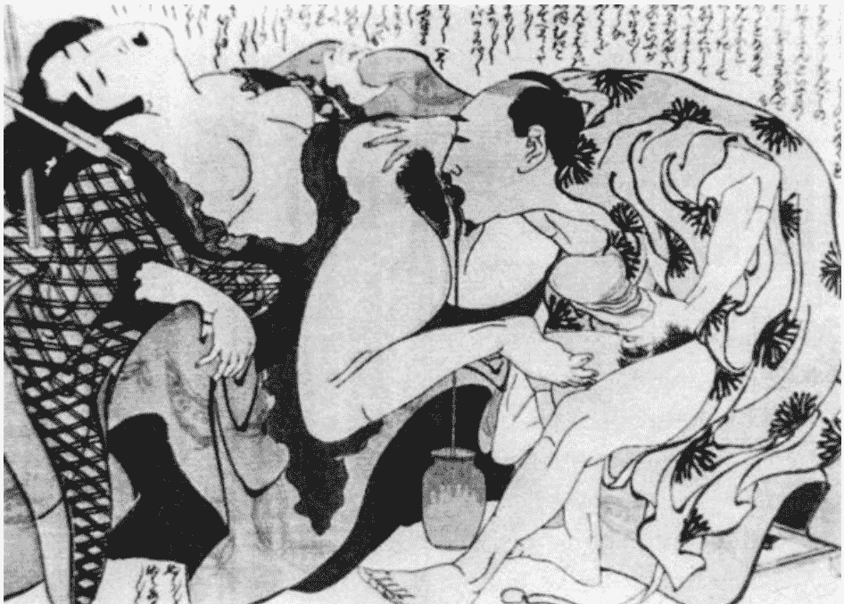

**图 0.1** 一幅日本木版画描绘了一个男人收集女性情人的精液。

然而，对于无数女性和拥有阴道的人来说，潮射和喷射是她们性欲的一个自然方面。那么为什么这仍然被如此怀疑呢？

### 进一步，退两步

自20世纪80年代以来，人们对女性潮射进行了大量研究。医学研究人员了该现象的解剖学或生物化学方面；他们进行了内窥镜、放射学检查、超声波和磁共振成像（MRI），以探究本质。尽管如此，结论仍在许多性学家、泌尿科医生、病理学家、解剖学家和妇科医生之间存在分歧。直到今天，对于女性身体在哪里以及如何产生这种液体，以及女性如何排出它，仍然存在冲突的解释。令人恼火的是，关于潮射以及与女性解剖结构最密切的部分——女性前列腺、阴蒂复合体和尿道——的新发现在文献中经常被“遗忘”。2001年，国际解剖术语联邦联合委员会（FICAT）其使命是建立标准的全球医学术语库，更新了其命名指南，加入了“女性前列腺”这一术语。在近二十年后，几乎发生了大反转，国际解剖术语联邦联合计划（FIPAT）采用了“女性尿道旁腺”这一术语。与此同时，“女性前列腺”被降到了“其他”列，与“斯基恩腺”和“前列腺液”并列。

如果你咨询目前的医学指南、教科书或在线平台获取女性前列腺的信息，请做好失望的准备：如果这些来源提到了，也使用的是非标准的术语来描述这一解剖特征。它们很少提到女性前列腺是一个功能完全的腺体，与男性前列腺同源——即基于相同的胚胎系统。总的来说，前列腺和潮射仅在与男性身体相关时才被讨论。维基百科和 WebMD 上关于前列腺的文章仅涵盖了男性腺体。

医学和解剖学从未是稳定的科学；这些领域受到社会、文化、政治和经济因素的影响。医学和解剖学长期以来一直是男性的领域，由男性的视角、愿望和需求所塑造。与特定女性化观念相冲突的女性身体结构被否认或忽视了。社会对女性的蔑视反映在对女性身体及其解剖结构、性反应和欲望缺乏兴趣上。女性身体长期以来被视为男性身体的低级版本。在今天使用的基础医学读物中，仍能探测到这些态度的微弱回声。女性尿道“仅”一到两英寸长。阴道壁由“薄弱”肌肉组成。阴蒂是“阴茎的进化对应物”。（而，美国精神医生玛丽·珍·谢夫认为，男性生殖器发育自“胚胎女性形态”，因此可以说阴茎代表了“夸大的阴蒂”。）

由于当时女性大多被排除在科学之外，这些男性科学家看到了他们想看到的，而个人感兴趣的领域得到了资助和研究。安娜·费舍尔-迪克尔曼是德语国家首批学习医学的女性之一，她在1900年的畅销书《女性的性生活》（*Das Geschlechtleben des Weibes*）中对现状表示遗憾：“对性生活的科学性研究远来仅在男性身上进行，仅供男性使用。只有男性研究过性生活；只有男性将女性作为研究对象。”在一段异常长的时间里，女性的性解剖结构和欲望很少受到关注。即使在今天，这些主题被认为是“医学中一个模糊且未知的领域”。女性生殖器的定义和描述很大程度上取决于其在生殖中的作用以及为男性执行的性功能（阴道渗透）。正如1800年的一份医学出版解释的那样，“阴道口的大小适合男性性器。”

解剖学书中对女性生殖器的描绘几个世纪以来是不完整的。让这些表述从医学话语和公众认知中消失，体现了以男性为中心的对女性身体的“研究；性教育工作者、作家雷贝卡·查克（Rebecca Chalker）将这种消失描述为“所有类型中最糟糕的一种”。在20世纪期间，我们了解到阴蒂头（或冠）只是一个更大、更复杂的器官在周围肿胀的可见部分。在阿尔弗雷德·贝宁（Alfred Benning）和库特·格特勒（Kurt Goertler）1957年的教科书《人体解剖学》（*Anatomie des Menschen*）中，作者对人类阴蒂提供了精确的描绘和描述，这在1974年于德国联邦共和国出版的三部曲参考著作《性学：性别、人类与社会》（*Sexologie. Geschlecht, Mensch, Gesellschaft*）中被复制。在20世纪60年代，谢夫描述了延伸身体深部的阴蒂结构。作为20世纪80年代女性健康运动的一部分，一种新的阴蒂形象通过美国女性健康中心联邦出版的畅销作品《女性身体的新视角》（*A New View of a Woman’s Body*）流传。20世纪90年代，澳大利亚泌尿科医生海伦·奥康奈（Helen O’Connell）凭借对内部阴蒂的“革命性发现”引发了媒体风暴。

尽管如此，大多数人仍然认为阴蒂只是冰山一角。而且它还包括女性性起时的海绵组织。事实上，冠部延伸身体3.5英寸。要理解女性潮射和喷射，必须共同考虑泌尿学和妇科的研究，并将阴蒂复合体、尿道和阴道在解剖和功能上被视为一个整体。

在奥地利格拉茨经营一家女性健康中心的西尔维娅·格罗斯（Sylvia Groth）和凯尔斯汀·皮尔克（Kerstin Pirker）在2009年的一篇女性健康文章总结道：

> 唯一可以自由且无耻地分享知识——一个庆祝性与身体多样性的地方——是剧《性教育》（*Sex Education*）中的虚构摩达尔中学。在摩达尔，义卖活动有彩色的阴道蛋糕，而在一次集会上，学生们脖子上挂着手画的牌子，其中一个写着“我是喷射者”，并带有卡通水滴。

向公众传播科学新闻经常失败，但专家自己往往对重大研究一无所知。维也纳泌尿科医生弗洛里安·文平格（Florian Wimpinger）研究并撰写女性前列腺和潮射，他评论道：“有趣的是，精通解剖和手术的专家——泌尿科和妇科领域的专家——通常无法确定女性前列腺存在的确定性。”或者引用南西·菲什（Nancy Fish，阴道疼痛症或阴道疼痛专家）的话，“在对阴道的护理和理解方面，我们正处于中世纪。”

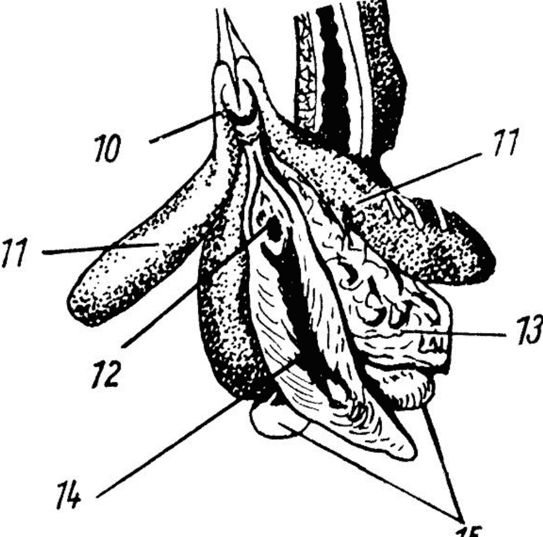

**图 0.2** 出自《性学：性别、人类与社会》（*Sexologie. Geschlecht, Mensch, Gesellschaft*，1974）的图表：

- 阴蒂头 (glans clitoridis)
- 阴蒂头 (glans clitoris)
- 尿道口 (urethral opening)
- 阴道前庭 (vestibular bulbs)
- 阴道口 (vaginal opening)
- 巴托林腺 (Bartholin's glands)

研究女性潮射的另一个障碍是医学上女性泌尿和生殖系统的分离。这两个系统被研究和描述为“功能上完全独立”，这意味着泌尿科医生负责一组器官及其周围结构，而妇科医生负责另一组。尽管事实是，这些内部系统实际上都源自尿生殖窦——人类胚胎在尿力和生殖器官发育期间的一种结构——这意味着子宫、阴道和尿道实际上是紧密连接的。例如，整个尿道嵌入阴道前壁的结缔组织中。

我们使用名称来识别和交流思想，同时也“锐化一个部分与另一部分之间区别的意识”。精射（Ejaculation）源于拉丁语 *ejaculari*，意为“射出”或“排出”，指的是体液的排出，这通常发生在高潮期间，但并非总是如此。尽管精子占男性射精总容量的不到 1%，而且当液体中完全不含精子时（例如青春期男孩产生的液体）也会使用“精射”一词，但该术语通常指精液的排出，这在口语中与精子同义。那么那些做过输精手术的人呢？他们难道不再精射了吗？没有人会“梦想着否定一个切除了输精管的男性的精射能力”。如果男女的高潮几乎完全相同——或者在生理层面是同源的——为什么两者不能都统称为精射呢？如果“精射”一词被用来表示“性液的排出”，那么它确实可以适用于女性和男性。

在梳理历史文献以寻找女性汁液的见解时，很快就会遇到翻译问题。翻译者很少熟悉这种行为，而体液在翻译过程中经常流失。在笔作者的手下，女性兴奋的喷射被变成了“阴道液”、“阴道润滑液”、“流出物”、“淋病”、“白带”、“粘液”或“汁液”。萨宾娜·范·尼登（Sabine van Nieden）在她对女性精射的研究中指出，“随着时间的推移，那些未命名的东西不再被看到或被经历”，她的研究还有一个有趣的副标题是《古代性别大战的变体》。（值得提的是，有些女性对女性精射表示怀疑，这一点稍后会讨论。）

少数了解女性前列腺和精液的科学家翻译了历史性的色情文学或性学著作。这包括汉学家鲁道（Rudolf Pfister）、印度学者 Renata Syed 和医生 Karl F. Stifter。当用模糊的术语描述体液时，如何在古文中识别女性精射或喷射？要将这种汁液与其他性液区分开来，它应该具备以下特征之一：液体在性过程中从阴道或尿道排出，但不是尿液。排出发生在高潮前、后或期间，并伴随着强烈的快乐感。

产生的液体明显多得多，其出现比阴道润滑更突然、更有力或呈喷流状。

根据来源不同，10% 到 69% 的女性（后者是前文提到的数据）在性过程中会发生精射。在线色情门户 JOYclub 对五千名女性用户进行了调查，其中近 70% 的人表示她们曾“喷射过”。尽管数字很高，但许多女性和拥有阴部的人可能并没有意识到自己精射了。在异性配对中，顺性别女性可能会认为她的任何性液都是阴道分泌物。然而，如果她确定自己喷出了某些东西，她可能会进一步假设——那是尿液。这一点稍后会讨论。

泌尿殖解剖结构和性液在女性之间存在显著差异。前列腺的大小、形状和位置可能有所不同，而个体的精液可能是透明或乳白色、稀薄或奶油状。在某些情况下，产生一茶匙精液，而在另情况下则流出一整杯。液体的气味和味道也不同。某些女性和拥有阴部的人可以识别出他们的周期、饮食和压力水平如何影响精液的量和质量。

直到最近不久，研究仍用“女性精射”这一术语来检查所有液体。2011 年，情况发生了变化。女性精射和喷射现在被描述为不同的现象。在高潮时，女性和拥有阴部的人会同时或连续释放两种液体：一种来自前列腺的粘稠白色分泌物，和一种由膀胱产生的水性液体。鉴于这些液体之间的明显差异，2011 年 Alberto Rubio-Casillas 和 Emmanuel A Jannini 建议用“女性精射”（female ejaculation）指代前者，用“喷射”（squirting）指代后者。精射与喷射的区分已被科学出版物采用，并似乎逐渐获得认可。

精射或喷射的发生与女性或拥有阴部的人是否受到刺激（自或伴侣）无关。女性对阴道刺激、阴蒂兴奋或肛交产生反应而精射或喷射，并且她们会有“遗梦”。根据 2013 年的一项研究，调查的 320 名女性中有 13 人经历过遗精。*Femmes fontaines*——法语中对精射女性的称呼——她们的伴侣对精射持明确的积极态度。一个快乐的家伙在 JOYclub 的在线论坛上帖道：“什么能比一个女人完全把自己交给你，完全信任你，然后……在她的愉悦体验中自由流淌的感觉更好呢？”

尽管如此，在女性精射引起人们关注并被女性健康运动以及诸如《G点：人类性学的其他发现》等国际畅销书推广四十多年后，如今的大多数研究的结论仍然是对进一步研究的紧切呼吁。本书将概述过去千年中关于阴部汁液的已知信息，以及它激发的诗歌、散文和论说。让我们为湿透的床单、女性的爱液、湿润的高潮和“喷泉女性”铺上红毯。

# 1 桑树与玉水：中国古代文献中的女性汁液

## 云雨戏

古代中国文化是复杂的。在本章中，我概述了追溯到两千年前的性实践。正如卧室读物所示，性对于健康至关重要。所谓“理想”的性到底是什么？男人如何亲吻和触摸他的爱人以释放她的体液？尊重相互兴奋和身体结合的最佳方式是什么？情侣如何防范不理想的性，即那种男性精射而伴侣得不到满足的性？

中国性手册通常作为婚礼礼物出现，是上层阶级主要的教育资源。如《五程子淫房》（Wu-Cheng-tzu-yin-tao）或《合阴阳》（Hé yín）等著作包含了对人体、性反应和高潮的精确描述，以及对生理兴奋和交合对健康影响的评论。《天晓之道探》（Tian xiǎ zǐ dào tān）是一本两千多年前的文献，解释说虽然人类天生知道呼吸，但如何“交男女”只有经过一段时间的学习才能获得。

男女以平等的身份进行交。然而，性别之间有一个关键区别，这与女性精射有关：男性的精液供应有限，而女性的液体永不枯竭。因此，男性必须控制精射，精液的流失会削弱他们的活力；而女性则多次高潮并尽可能地精射。在这种性愿景中，女性是一股强大的力量。理想的性倾向于更慢、更多样，允许女性达到高潮并精射，而男性仅在需要怀孕时补充能量。（经期后的五天被认为是女性的排卵期）。

`Jing` 是最重要的体液之一，尽管该术语适用于任何白色或半透明、粘稠或滑的液体。唾液、汗水和牛奶都是“精”（jing），男性和女性性液也是。男性精液也被称为“阴精”（yīng jīng），大致翻译为“隐秘部位的精液”。女性的“精”精华包含了她所有的性液：阴道润滑开始于前戏，第二种液体那种在数量上远超者的物质，它在高潮前或期间从阴道或尿道流出或喷出——即女性潮射或喷射。这种物质有许多名称：*阴精*、侍、泉水、甘露、月花水，或桃汁、瓜汁。男人可以用阴茎“饮用”（他）、“消耗”（*shih*）或“吸入”（*hshi*）这种液体。

从前基督教时代生产的每一部中国性手册都包含了这种性别之间的本质区别。男人的*精*。中世纪的著作《宣女经》承诺，不射精的男性将获得显著的力量提升：“一旦女人感到快乐，她就会开始自己移动，她的汁液开始自由流淌，此时你可以尽可能深地侵入。当她达到高潮时，它们就会停止。练习此，只要不丢失[精液]，你的力量将增加百倍。”

女性无穷无尽的阴性具有不同的性质。女性的体液滋养并治愈男性。女性可以自慰或与他人同眠而不受指责，传统观念认为，性生活越多，她的体液中蕴含的能量越高——对她的男性伴侣益处也越大。他竭力取悦她、拍她并延长性交，因为这让他能自由地“饮用”和“吮”。其他的女性物质——如呼吸、汗水、唾液或乳汁——也能增强他，尽管没有哪一种如阴精那样有力。性行为导致了社会角色的反转：阴茎是女性阴道的“客”。匮乏、*精贫*的男性在排空阴性进行性时，会遇到慷慨的“生命捐赠者”。

女性在性过程中热身较慢，但像水一样，冷却也慢。出于此原因，女性喜欢“慢”（徐）和“忍”（持久），而厌恶“急”或“暴”。在中国古书中，长时间的前戏被认为是至关重要的，当阴道插入最终在过程后期发生时，预期是多样化的。抽插时快而深，时快而慢。这些手册描述了侵入的上三体位，包括“虎径”、“斗猴”或“逆龙”。性交被描绘成一场游戏，双方都利用机智获取对方的延寿能量。毕竞，女性受益于伴侣的精气，因此会试图“偷取”它。如果她坚持到意外射精，她就赢了。没有什么比毫无节制的欲望更危险了：“当精液宣告其到来，快离开此地！与女人同寝如同骑着一匹缰绳脆弱的奔马，在深渊边缘漫步，渊底布满了剑，人害怕自己可能会坠入其中。带着你的种子，让你的生命走向终结！”不满足的女性是无法抑制的，当她在婚姻性中被冷落时，她可能会寻找能力的情人，从而给丈夫戴绿帽子——正如即使基督教文献所证明的那样。相反，如果一个女性在性上得到满足，结合可以带来巨大的快乐。成为好的爱人是好事，练习并完善耐力、身体控制、专注、共情和技巧。

为了让伴侣在性交中达到和谐，男性必须学会解读女性的渴望。早期的中国性手册描绘了女性性反应的完整图，并对男性应该如何应对每种信号提供了精确的指示。从恋人的呻吟和叹息，或者她脸部的潮红、脚趾的卷曲、骨盆的抬起，或她体液的气味和流动中可以获得什么？现在是抚摸她手臂的好时机吗？她更偏好深插还是浅入、快速还是缓慢？他们应该变换姿势还是甚至停顿？女性身体被严密观察，女性生殖器的颜色、大小和深度——以及她们产生的液体——被诗化地详细描述。这些文本描绘了今天仅凭医学名称命名的阴道部位。然而，关于宫颈两侧区域的情色术语又是呢？或者一个表示对G点之外阴道壁感知的词（关于该术语的讨论请参见第5章）？这些分别是“玉门”（yumen）和“红室”（zhushi）。

马王墓关于房中术的文本，两份两千二百多年前编写的竹简，是“世界上现存的此类详尽性知识的最早记录之一”，提供了对古代中国身体和性观念见解。在翻译和研究这些文本时，瑞士汉学专家鲁道夫·菲斯特特（Rudolf Pfister）发现了对两个现象的引用，这两个现象在两千多年后证明是有争议的：女性潮射和G点。

## 乳果与升升气：马王墓竹简

1973年，在中国湖南省发现了三个前基督教时代的墓地。李氏家族的华墓中盛有丝绸衣服、乐器、化妆品、食物篮、漆器——还有一个图书馆。在幸存的二十份手稿中，包括各种医学著作，其中有两份专注于性。这些竹简上保留的文字代表了中国最古老的“如此详细关注女性身体”的遗迹。匿名作者（其中一些很可能是女性）创作了简洁而详尽的体位、动作、声音和液体描述。文本在关于此事的最早记载之一中提到了女性潮射和喷射。

# 第一份手稿《广纪经》，由五十六片竹简组成，第二份《阴阳合术》略短，刻在三十二片简上。两者都将性交描绘为身体的庆祝，并在描述如何操作时不遗漏任何细节：“首先，气升，唇转；缓慢亲吻。其次，鼻湿；缓慢拥抱。第三，舌滑；靠近。第四，大腿间水流；缓慢护理。第五，喉干，她吞咽；缓慢摇晃¹⁸ 只有在‘五欲’显现后，乳头才会出现⁹ 阴部和阴道的描写是类似的，尽管某些情况下难以破译。菲斯特解释道，

“乳果”——包裹在肉中的中的球形果实簇——是一个恰当的比喻。阴道前壁的照片显示了在兴奋期间会肿胀并变色的纤细肉质突起。这些与覆盆（Rubus idaeus）相比，后者是更像纽扣的常见形式。桑树的果实与覆盆具有相同的结构和多汁，且呈鲜艳红色：这些特征在语言上被应用于格氏点²³。

《广纪经》列出了十二个代表女性解剖部位的术语，大部分现在已变得晦涩：发髻泽、凸记、隙瓜、鼠穴、谷果、乳果、麦齿、内衣、凹处、者或碎、石石² 描述的部位包括阴蒂冠、大阴道和小阴道、前庭（小阴道底处）、宫颈、宫口缘。两篇文本都描绘了恋人靠近时的色欲氛围、呼吸、亲吻、触摸、手指运动和“刺激”的作用、女性兴奋的表情和声音（喘息、哀鸣和呻吟）、她在性交中的动作，以及各种形式的阴道插入。关于女性高潮的部分写道：“气出鼻，唇变白，手脚乱动，臀离席。性交结束后，她几乎不呼吸，仿佛死去一般。此时，极气喷薄而出，能量聚集其中，随后她获得了神志清明。²¹ 从中轴散出的女性精液被详尽描述，从其质地、颜色到气味和味道。它是纯净新鲜的，像粥一样、奶油般的、粉红或粘稠的，有鱼味或谷味，味道偏咸，²²”

这种肿胀、喷射着乳汁的“乳果”形象，出现在其他比马王墓竹简稍晚的中国作品中。在中世纪的文献《东玄子》中，一个男人用他的“阳”刺激伴侣的“乳果”，直到她颤抖。明代晚期的作品《素女妙论》描绘了如何调戏她的“红球”直到达到释放的边缘。女性伴侣被指示松散地伸出左腿并弯曲右腿，而男子则伏在后方，像他所喜欢的那样操弄着“玉（指殖器）”。他被意为轻点伴侣的“珍珠”，并深层进入七次，接着是八次浅插。据说，当女人的“红球”增大时，它会迅速移动并喷射。随后，男人将精液吸入自己的茎中——这种方法好比金蝉衔树吸露。金蝉将露水含在口中，而不吐出。²⁴

对G点的描绘以及对女性性液的描述，在中国古代床房文学和后几个世纪编写的色情小说中屡见不鲜。这些作品将女性分泌物视为理所当然的事。一本隋代（公元581–618年）的手册提到，做法必须像打乒乓球一样，在动作与反应的交互中进行，湿润让位给紧张。如果她的阴道变得湿润，他可以缓慢地更深地进入伴侣。如果她的汁水流下臀部，他就知道她正在享受他的性爱技巧。明末（1368–1644年）的流行作品《闲情闺俗经》概述了女性体液的健康益处，共有三种：唾液、乳房产生的液体和阴道分泌物。在性爱期间，男子应当饮用这种“三峰之佳阴液”。这些液体能使他机智敏锐、增强生命力并焕发血液。下口之药——阴部——被认为来自阴道内部。当女性兴奋、脸颊潮红时，阴道之门开启，水流出并汇聚在阴道内，男人随之接受了这种良药。²⁵

在床房文学之外的早期中国故事中也能发现高潮或喷射的女性。女性的体液不仅提供了营养和治愈，更是欲望和放松的清晰信号。乳果、玉水和瓜汁在文学中是如何被描绘的？

## 似鲤跃泥

明代的伟大小说展示了早期中国情色描写与性的重要性。例如，《金瓶妙梅》（*Chin P’ing Mei*）和李玉的《肉蒲团》在描绘主角的情色事迹时毫不遗细节。女性性分泌物在这两部小说中都占据了重要地位，在这里，也对两种阴道液体进行了区分：一种是伴随爱爱遭遇开始的润滑液，另一种是在达到高潮时大量流出或喷射的第二种液体。

《金瓶妙梅》创作于16世纪下半叶，被认为是中国文学中最伟大的古典小说之一。尽管故事背景设定在12世纪，但这部小说被认为描绘了明末的生活，是该时代关键的社会文化产物。这部百回小说讲述了一个山东省药剂兼丝绸商的生活和口才冒险。西门庆是一个富有的男人。他有六个妻子，并维持着无数段婚外关系。在一百多场生动的场景中，体液奔涌流淌。“云雨”一词可以用来描述这段：“淫般的叫声很快从她口中传出，如鹦鹉嘶哑的尖叫，而他勤勉地模仿如明亮的蝴蝶色色地潜入香花的甜美深处。这对和合的夫妻在那晚从汇聚的云朵中源源不断流出的湿润中找到了慰藉。”女性体液备受推崇。在这种情况下，阴茎并没有像金蝉那样消耗它们，而是像鱼一样在其中竞争游动：“[西门庆]持续抽插，直到她的阴道分泌物不断流出，发出一种如群鲤[鲤]跃过淤泥的声音。” 26 《金瓶妙梅》还说明了女性在床房中的高地位与其在社会中的地位是矛盾的，在社会中，她们隶属于男性，并生活在性剥削和暴力的威胁之下，特别是当她们不是上层阶级时。小说讲述了故事的另一面。

在《浪史》中，我们见证了花花梅素生在四十章中的性爱奇遇。一天，这个花花子在墓地遇到了美丽的李文菲。这是一见钟情。他们开始聊天，最终共度了一夜。我们被告知，当文菲在接近高潮时，激情地尖叫，她的“露水”打湿了身下的床单，不再是白色的；而是像蛋白一样透明，并泛着红色的光泽。两人连绵不断，他们的分泌物成流汇入身体下的一个小湖。²7

17世纪的一部色情小说《格莲花影》描绘了一对年轻的女同恋人做爱。在年轻人的夜间嬉戏中，其中一个阴部变得非常湿润；她的爱人将这种液体认为是尿液，结果从她更有经验的女友那里得知：“这是女性的性分泌物，明天当我和你一起玩时，你会变得像我一样湿。”^28 性排出物与尿液之间的混淆在这种文学作品中是不寻常的，因为早期中国的性手册和色情小说清楚地说明了哪些液体仅在性爱期间出现。在这种情况下，是一个性无经验的青少年在询问爱人是否在床。在19世纪和20世纪，对精液和尿液的不确定感开始扎根，并随着女性对性爱期间意外失禁的恐惧。特别是欧洲和美国的阴部医学和性学，会将阴部汁液误认为是失禁，以至于许多现代女性面对排放时仍感到畏惧。

## 欲与爱之水：古代印度文献中的女性体液

女性体液在印度也是为人知的，那里历史文献将性爱期间的释放视为女性快乐的基本方面。梵语中，无论是男性还是女性的精液称为`shukra`。¹在现存最早的梵文文学女性高潮描述中，公元7世纪的诗人阿马鲁（Amaruka）描述了紧密拥抱的恋人，当甜美的`shukra`流到衣服上时，一阵颤抖穿过身体。²印度教概述了人生的三个目标：利（artha），物质繁荣与成功；欲（kama），世俗快乐、欲望与性；以及法（dharma），法律、正义、道德和伦理义务.³性快乐和情色是人类体验的核心。

对欲的追求既是理论的（阅读性），也是实践的（进行性爱），这产生了色情文学。爱经（kamashastra），是一部致力于情爱知识的印度传统。经典中最著名的书是跋婆塞那撰著的《爱伽经》（Kamasutra）。然而，这部传奇性的手册并没有显式地描述女性高潮或精液，但两者在后来的古代印度性学中无处不在。秘密是女性快乐的一部分，驱动女性走向感官消失的边缘。而这些液体是有生命力的；在密教女神库比吉卡的情况下，它们创造了宇宙本身。

印度产生了一种赞美情色、温柔与性行为的传统。这一传统中的作者被认为是“性愉悦的早期先驱”。《欲巧经》（Kamashastra）的著作表明，“愉悦需要被培养，因为在性领域，自然需要文化的修饰。”⁴ 对性行为的详细描述旨在让读者熟悉对方的身体，从而增加恋人之间的亲密感。

瓦恰萨亚纳（Vatsayana）在三至六世纪之间创作了《欲巧经》。⁵ 大千年年后，雅索达哈拉·因德拉帕达（Yashodhara Indrapada）出版了对本情爱教科书最著名的注释——《吉祥颂》（Jayamangala）。这位13世纪的诗人在开头开头写道：“论及愉悦的人说，愉悦是人生三大目标中最重要的一个，因为既是宗教和权力的因也是果。意识到如果没有方法，任何事情都不会发生，并渴望解释这种方法，学者瓦恰萨亚纳·马拉纳加（Vatsayana Mallanaga）创作了这部文本.³” 与当时的医学著作不同，《欲巧经》从享受的角度讨论性，而非繁衍。这些手册的指导原则是愉悦，甚至涵盖了解剖结构和生殖功能的描述。性是男女共同享受的事物。然而，男性负责女性的满足，并被期望“作为温柔和体贴的典范。他的每一个念头必须为了伴侣的愉悦和满足。尽管印度女性在社会上完全受男性的控制，但她有权向男性索取任何想象得到的宠溺。愉悦和满足是她的权利，无论她是妓女还是妓妇，如果是妻子也是如此……她是那个必须被满足的人。”⁷

**图 2.1** 印度寺庙上一个喷射或喷水的女性喷嘴。

如果对伴侣的性愉悦负责，男人必须尽可能地了解他的爱人，了解她的特征、怪癖、倾向、需求和习惯。为此，《欲巧经》脚本提供了一套整洁的分类法。男女根据外貌、年龄、社会地位、气质、家乡省、起源等进行分类。书中有关于体位、接吻技巧（在哪里吻以及如何吻，啄吻还是按吻）、拥抱（触摸、进入、摩擦或按压）、抓挠、啃咬、拉头发、掌掴（如何、何地以及何时）以及呻吟的百科条目。作品以催情剂、化妆品和魔药的配方结束。

然而，《欲巧经》的组织原则中，重要的是生殖器，即阴茎的大小以及阴道的深度和宽度。某些组合提供的愉悦很少（小阴茎、深阴道），而另一些则额外享受（中等阴茎、窄阴道）。如果男女合拍且精通性爱，男人将让伴侣达到高潮并射精或喷涌。8

## 丰盈：欲巧经教科书中的女性液体

文本确定了女性在性交期间产生的两种生殖器液体：`syandana`，即随着兴奋而产生的阴道润滑液；`visar`，即与高潮同步的涌动流体。⁹ 女性排出的液体被称为`retas`或`sukra`，意为精液，与男性射精使用的是相同术语。10 雅索达哈拉在《吉祥颂》中提到了这些液体，并明确区分了两者：

正如所说：

女性的感官愉悦是双倍的：

- 抓痒和融化的愉悦。

- 融化也是双重的：

- 种子的流动和射出。

- 她仅因流动就变得湿润，而她射出的感官愉悦来自于被搅动。

但当女性被她的性能量冲昏时，据说她在结尾会射精，就像男人一样。11

印度学者、诗人科科卡（Kokkoka）在11至12世纪之间写了经典的中世纪性手册《爱密密》（Ratirahasya）。他也区分了两种液体：

当坚硬的性进入女性的阴道（yoni），她感到不适瘙痒缓慢但稳定地消失，但当渗透开始时，她感受到了快乐，这种快乐随着液体的自由流动按比例增加。

在男女结合之初，会有痛苦的感觉，导致微弱的愉悦。男女只有在最后才体验到愉悦。

最后，女性发出模糊且难以听见的声音，扭动身体，假装哭泣，极度不安，闭上眼睛，达到一种无助和疲惫的状态。12

《欲巧经》文本根据生殖器（yoni）的外观、内部品质、味道以及性液体对女性进行区分和分类。在《爱密密》中，科科卡描写了四种女性：“帕德米尼（Padmini）、奇特里尼（Chitrini）、尚基尼（Shankini）和哈斯尼（Hastini）。”他列举了帕德米尼的首要特征，她的“阴道”是杯形的，像盛开的莲花”，“她的粘分泌物也有盛开莲花的奇异香味。”同时，奇特里尼的“分泌物有蜂蜜的香气”，也因其“巨大的乳房和阴道”而闻名。“圆润高耸、柔软且润滑良好的内部。“脾气暴躁的”尚基尼，“喜欢红花和红衣服”，产生一种酸味的液体。最后，人们可以通过她蹒跚的步态、“扭曲的脚趾”和过多的毛发来识别哈斯尼。哈斯尼的性液（kama-salila）具有从大象太阳穴流出的泉水的味道。15 例如，德罗维达人（Dravida）的女性液体充沛，对手指进入其阴道感到非常兴奋.¹14

《无相经》（Ananga Ranga）介绍的许多体位之一提到了女性体液，并探讨了女性性满足的权利：

男方式（Purushayabandha）是男人通常做法的反面。在男人仰卧的情况下，他让妻子骑在他身上并享受她。当他精疲力竭、无法进行肌肉运动，而她未满足、依然充满爱之之水时，这特别有用。因此，妻子必须让丈夫平放在床上或椅子上，骑在他身上，满足自己的欲望。

与古代中国传统不同，在印度历史文献中，射精是双方在内的。女性欢迎不慌忙的性交和巧妙的情色游戏。16

德国印度学者理查德·施密特（Richard Schmidt，1866–1939）于1900年将《欲巧经》翻译成德语。在他1902年经常印刷的作品《印度性爱论文》（Beiträge zum indischen Erotik）中，他向好奇的读者介绍了“梵语民族的爱情生活”，正如副标题所示。施密特是明斯特大学的印度学教授，哈勒大学的长期讲师，他将大量的梵语原始材料译成德语，尤其是《欲巧经》类文本。

他翻译、整理并引用了食谱和魔法咒。施密特收集的“奥义教义”（奥檀书，upanishad）包括青春疮治疗法和口气清新剂、延迟男性射精的技巧，以及克服女性高潮挑战的方法。例如，女性只需将一种未经加工的罗酸皮涂在阴道内，就能让自己的种子比伴侣的更早地绽放。当女性与一个在阴茎上涂了马哈希沙（可能是乳木草）种子、硼砂、蜂蜜和樟脑油膏的男性交合时，美丽的女性会迅速释放自己的种子.¹¹17

## 肿胀的小管与水液

《爱性经》（Kamashastra）手册使用一种紫色方言来命名和描述阴部和阴道。作家们如何描绘它们的多样性呢？科卡拉的《欲望密器》（Ratirahasya）——一本广受欢迎到被翻译成阿拉伯语、波斯语、土耳其语和德语的书——这样解释：“阴道（yoni）有四种。它可以像柔软的莲花；也可以是紧绷的、手指紧紧合在一起的；或者是轻微皱纹的；或者像牛的舌头。”¹¹⁸

文中还提到一个与女性射精和喷水讨论特别相关的部位。在受《爱性经》指导统治的阴道中间，有一根小管，当受到阴茎刺激时，它会肿胀并释放出“欲水之洪流”。¹¹¹⁹ 作者们还鼓励手指玩耍；例如，《欲望密器》提到了“阴道中心有一个类似于阴茎的神经中心，被称为玛丹纳加曼多罗拉（Madanagamandola）。当用两个手指操纵它时，就会产生女性体液的流动。”¹¹²⁰这种阴茎状的小管引起了像施密特这样的后世印度学者的极大困惑，施密特请了一位医生审查了对女性性器剖学的描述。这位医生的“善意努力”显示，“印度作者提供的多数描述都是错误的，而且他们所指的阴部内部器官[注：施密特指的是的是阴道]已被证明是无法识别的。”¹¹²¹ 几乎一个世纪后的1999年，总部位于慕尼黑的印度学者雷纳特·西格蒙德（Renate Sigmund）在她广泛且引人入胜的研究中得出了完全不同的结论：这些古印度书中出现的阴道区域正是今天术语中的“G点”。就像G点一样，文中描述的小管也会肿胀、硬化并勃起，因此类似于“印度人对阴茎的构想”。享受这种形式刺激的女性会排出出一种不同于阴道润滑液的液体，作者将其识别为女性射精。赛义（Syed）断言，古印度的作家熟悉“‘格拉芬堡区’的现象和女性射精。”¹²² 因此，古代印度和中国的色情作家和诗人——那些在最后一章中被介绍的、将G点称为“乳果”并详细描述其肿胀和随之射精的人——对女性身体的了解远比几个世纪后受推崇的老施密特教授要得多。

## 简短旁记：密教中的女性射精，第一部分

女性和它们的身体在密教佛教中受到尊崇，这是自帕拉王朝（8世纪至12世纪）以来跨越亚洲的一大宗教传统。修行者向女性佛和创始成员致敬。他们甚至有自己的创造神话。密教女神库比吉卡（Kubjika——也被称为舒克拉德维（Śukrádevi），字面意思是“精子女神”）是一个洞穴中的隐士。¹²³ 由于担心自己苦行的生活，她舔了自己的阴部。这种杂技般的动作部分归功于库比吉卡的名字，意思是“弯曲的或驼背的”。¹¹²⁴ 女神达到高潮并射精或喷水。她的种子从她的阴部，即她的阴道、曼陀罗的中心发芽。¹¹²⁵ 因此，宇宙的创造可以追溯到自慰和女性射精或喷水。¹²⁶ 梵语词 `yoni` 的意思是源头或祝福之地，情感的所在地。它既代表内部和外部生殖器，也代表神性的女性能量。赛义断言，古印度的作家熟悉“‘格拉芬堡区’的现象和女性射精。”¹²² 古代印度和中国的色情作家和诗人——那些在最后一章中被介绍的、将G点称为“乳果”并详细描述其肿胀和随之射精的人——对女性身体的了解远比几个世纪后受推崇的老施密特教授要得多。

## 享乐在前，繁衍在后：从古代到现代的女性种子

古希腊和罗马对女性身体的观念与中国和印度历史文献中的描述形成了鲜明对比。女性的性欲和满足感在很大程度上被忽视了，其性液的描述也与古代亚洲文献大不相同。古希腊和罗马的哲学家和医生并未将女性体液描述为一种男性在情爱游戏中温柔诱导伴侣所渴望的液体，也没有将其视为一种女性慷慨赐予情人的、具有滋养和延寿作用的物质。现在，“女性种子”主要在生殖和胚胎学的背景下被讨论。关于如何刺激你的爱人达到高潮、射精或喷射的指导已经消失；现在的重点已转向了精液在形成未出生婴儿中所起作用的部分。

古希腊和罗马关于女性精液的观点涵盖一系列性液；这些文本绝非都在描述射精或喷射。例如，科斯的传奇医学家希波克拉底（公元前五至四世纪）曾写道，女性有时会向子宫内射精——这在解剖学上是不可能的¹。然而，无数医学和哲学著作确实提到了女性具有类似于女性射精或喷射的特征。尽管我们今天所定义的射精与古代对女性精液的经典理解并不完全一致，但这一现象只是其中一个方面。

在古希腊和罗马，女性化并未被推崇。男性和女性之间的区别是程度上的，而非本质上的。历史学家托马斯·拉奎尔（Thomas Laqueur）在他关于性别构建的研究《性》（*Making Sex*）中写道：

这种“单一性别身体”似乎没有边界 . . . 有毛发浓密、病毒化的女性 . . . 他们太热而无法繁衍，且像男性一样大胆；也有虚弱、阴柔的男性，他们太冷而无法繁衍，甚至在渴望被侵入时表现出女性化。²

女性通常被认为是男性的缺陷版本，是在解剖、生理和心理上都处于劣势的被动生物。

拉奎尔告诉我们，从古代到18世纪的两千多年里，欧洲对男女身体的观念是同一种身体，男性代表了标准，实际上也是理想。女性与男性拥有相同的生殖器官，只是位于体内：阴道是倒置的阴茎；卵巢是留在体内的睾。

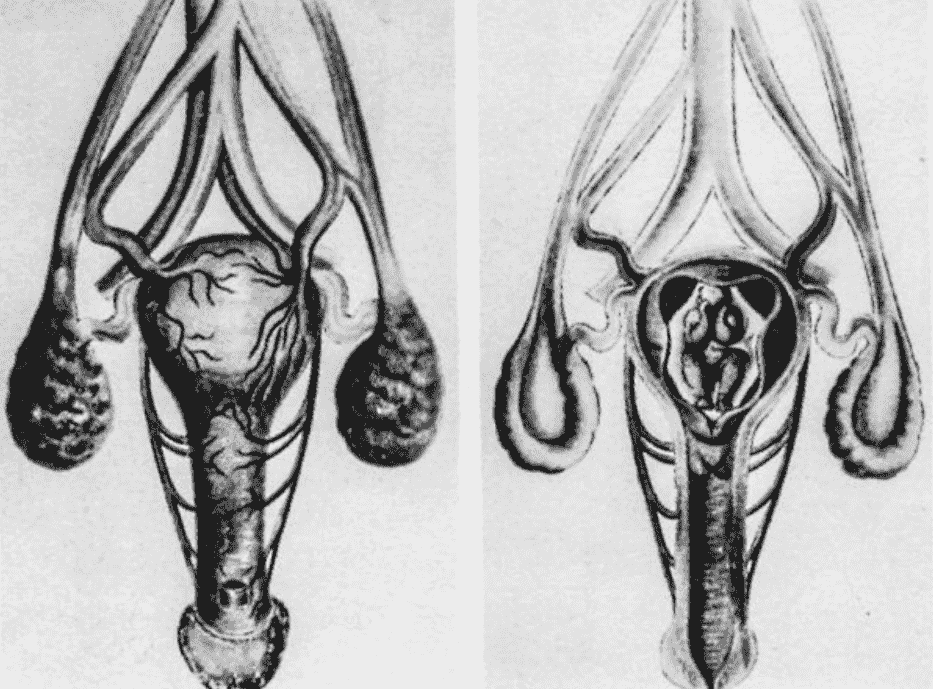

**图 3.1**

左侧图像来自乔治·巴尔蒂施（Georg Bartisch）的《艺术书》（*Kunstbuche*，1575年），描绘了女性的生殖器官。右侧图像提供了子宫横截面。

医学术语反映了这种信念。古亚历山大的医生赫波罗菲洛斯（Herophilus）是著名的早期解剖学家，他是第一个描述卵巢的人，通过将其称为“睾丸”与男性身体进行了清晰的类比。这是女性精液产生的地方，随后它沿着“精管”流向膀胱，并通过尿道排出体外。卵巢在之后的数千年内都没有自己的名称。³³

## 作为生成物质的女性精液

当液体流经身体时，它们会发生变化，一种变成另一种。男性和女性身体产生和处理这些物质的方式不同：“拉奎尔写道：‘人们看到的或曾见过的东西其实并不重要，除非男性精液那种浓稠、白色、带有泡沫的性质暗示了它更有力量，更有可能作为动力因素，而不是那种稀薄、纯白且水性更大的女性射精，或者仍然呈红色、更未调和的经水。’”精液符合性别之间全面的物理对称性（或更准确地说，是不对称性）的概念。男性在兴奋达到顶点时排出液体，而女性也是如此——有些从尿道口，有些则从阴道。女性排出的精液比男性多得多，且大多数只在高潮时排出。然而，哲学家和医生们无法对女性精液的样子达成共识。有些人将其描述为乳白色，另一些人则描述为透明。有时它是稀薄的，另一些则是粘稠的。在古代中国和印度文献中，我们也遇到了类似的汁液差异。

## 享乐在前，繁衍在后：从古代到现代的女性种子

古希腊和罗马对女性身体的观念与中国和印度历史文献中的描述形成了鲜明的对比。女性的性欲和满足感在很大程度上被忽视了，其性液的描述也与古代亚洲文献大不相同。古希腊和罗马的哲学家和医生并未将女性体液描述为一种男性在情爱游戏中温柔诱导伴侣所渴望的液体，也没有将其视为一种女性慷慨赐予其情人的、具有滋养和延寿作用的物质。现在，“女性种子”主要在生殖和胚胎学的背景下被讨论。关于如何刺激你的爱人达到高潮、射精或喷射的指导已经消失；现在的重点已转向了精液在形成未出生婴儿中所起作用的部分。

古希腊和罗马关于女性精液的观点涵盖一系列性液；这些文本绝非都在描述射精或喷射。例如，科斯的传奇医学家希波克拉底（公元前五至四世纪）曾写道，女性有时会向子宫内射精——这在解剖学上是不可能的¹。然而，无数医学和哲学著作确实提到了女性具有类似于女性射精或喷射的特征。尽管我们今天所定义的射精与古代对女性精液的经典理解并不完全一致，但这一现象只是其中一个方面。

在古希腊和罗马，女性化并未被推崇。男性和女性之间的区别是程度上的，而非本质上的。历史学家托马斯·拉奎尔（Thomas Laqueur）在他关于性别构建的研究《性》（*Making Sex*）中写道：

> 这种“单一性别身体”似乎没有边界……有毛发浓密、病毒化的女性……他们太热而无法繁衍，且像男性一样大胆；也有虚弱、阴柔的男性，他们太冷而无法繁衍，甚至在渴望被侵入时表现出女性化。²

女性通常被认为是男性的缺陷版本，是在解剖、生理和心理上都处于劣势的被动生物。

拉奎尔告诉我们，从古代到18世纪的两千多年里，欧洲对男女身体的观念是同一种身体，男性代表了标准，实际上也是理想。女性与男性拥有相同的生殖器官，只是位于体内：阴道是倒置的阴茎；卵巢是留在体内的睾。

**图 3.1**

左侧图像来自乔治·巴尔蒂施（Georg Bartisch）的《艺术书》（*Kunstbuche*，1575年），描绘了女性的生殖器官。右侧图像提供了子宫横截面。

医学术语反映了这种信念。古亚历山大的医生赫波罗菲洛斯（Herophilus）是著名的早期解剖学家，他是第一个描述卵巢的人，通过将其称为“睾丸”与男性身体进行了清晰的类比。这是女性精液产生的地方，随后它沿着“精管”流向膀胱，并通过尿道排出体外。卵巢在之后的数千年内都没有自己的名称。³³

## 作为生成物质的女性精液（续）

存在一种认为女性汁液具有生殖能力的长期传统，即使在父权社会也是如此，这种观点在精子和卵子细胞被发现几个世纪就已经存在了。

男性和女性，仅仅是部位不同：“首先考虑你所喜欢的任何部分，将女性的向外转，或者说向内转，然后将男性的对折起来，你就会发现它们在各个方面都是相同的。”13 这种生殖器对称也延伸到了性液：像男性一样，女性也会产生并分泌有生育能力的种子，尽管与此相比，它们的种子并不那么完美或成熟。盖伦认为，男性种子本身不足以进行繁殖，需要补充：只有当两种种子同时出现并混合时，才会受孕。盖伦的解剖研究揭示了卵巢，用他的话来说就是倒置的“女性睾丸”。动物解剖显示，女性睾丸的泄管中有一种白色粘性物质——他称之为“女性种子”。

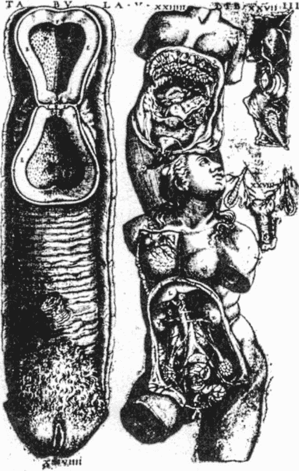

**图 3.2** 维萨留（Andreas Vesalius，1514–1564）绘制的图，出自胡安·瓦尔韦德·德·阿穆斯科（Juan Valverde de Amusco，1525–1588）1586年的著作。左侧看起来像一个阴茎，右侧是提取自它的女性身体。

盖伦在《全集》（*Opera omnia*）中描述了女性射精：

> 然而，由于女性比男性冷，她“前列腺”（parastatis glandulosis）中的液体发育不完全且稀薄，因此对生命的创造没有贡献。理理，它会向外溢出。…… 以下标记表明，这种液体不仅能促进交合，还能引发情欲并在排出时润滑通道：它显然从女性体内排出，当双方在交欢中获得最大的快感时，会明显地溢洒在男性的私密处.¹¹⁴

盖伦还描述了一种同样影响男女的现象，尽管在现代用语中，这个术语具有明显的性别色彩：青丸（blue balls）。根据这位古希腊医生的说法，当女性的种子被困在体内时，它会凝结或停滞。这会阻塞液体的健康循环，并引发一系列显著的症状。在这种情况下，医生会嘱咐什么呢？让患者触摸并温暖她的生殖器？处方性的自慰会导致“在女性射出浑浊且丰富的精液后，同时伴随着痛苦和快感的抽搐”。排出陈旧的种子让女性“摆脱了她感受到的所有恶魔”，并将我们带入中世纪——那个时代，学者们详细探索女性精液，医生、助产士和智者们拥有一套用于堵塞的纠正方法和疗法¹¹⁵

# 中世纪和早期现代

中世纪理论者采纳了女性种子的观点，并继续对主流的受孕模式（即单种子和双种子理论）进行争论。“一个关键的基础性问题”仍然在于如何确定受孕过程中为男性、女性或两者分配多大的意义¹¹⁶ 直到18世纪，女性产生精液仍然是不言而喻的。这种观点没有争议，并且对于受孕与生育、欲望与性爱、个人卫生与疾病等问题至关重要。

希波克拉底或盖伦的主流观点认为女性种子对应男性种子，一直持续到12世纪。根据《女性秘密》（*Secreta mulierum*，这是中世纪和早期现代时期最广泛的妇科医学著作之一），受孕发生在双子相遇时。这本拉丁文手稿由一位未知的德国作者创作，流传了一百多份¹¹⁷ 一本中世纪早期的治疗方法集说明了人们的信念：受孕需要男性和女性的种子。

一对没有孩子的夫妻可以进行一个简单的（尽管很奇怪的）生育测试，以确定问题所在之处。双方分别向不同的容器中排尿。到第三天，在具有生育能力的伴侣尿中就能看到种子¹¹⁸

天教会承认女性种子对于受孕是必要的¹¹²² 哲学家托马斯·桑切斯（Thomas Sanchez，1550–1610）的作品反映了17、18世纪的天教神学，认为女性种子对受孕是不可或缺的。

体液会变成血液或脓液，或形成脓肿。当女性性欲受到压抑时，她的精液会留在体内，可能阻塞子宫并导致不孕。41 腐败或保留的精液会导致狂躁、癫痫、感染、溃疡、分泌物和瘙痒。

十五世纪的医生如巴尔托洛梅乌·蒙塔尼亚纳（Bartholomeeus Montagnana）认为，憋精是斯底里症的关键原因之一。42 一本中世纪晚期的文献详细描述了一种常见的子宫疾病：

> 在被称为“子宫窒息”的病例中，女性会因为子宫压迫其呼吸器官而显得近乎窒息。这主要是由月经回流引起的；子宫内发现的毒液体；或者（女性的）腐败、有毒的精液，这些液体积聚在精囊和子宫周围：后一种情况在贞女和寡妇中最为常见，在她们身上由于禁绝了维纳斯的服务，精液会腐败并变得有毒。43

只需一眼、一个吻或轻微的触摸，就能让一个性欲未满足或禁欲的女性体内释放精液，导致疾病。在16世纪中期，法国医生雅各·西尔维乌斯（Jacob Sylvius，1478–1555）描述了一幅令人震惊的画面：

> 当一个女性（尤其是年轻强壮、丰满、营养良好且血液和精液充足的女性）成为修女或自主选择保持贞洁，或者嫁给一个不经常侍她的丈夫，或者是一个沉溺于这种快乐的丈夫的遗，或者被维纳斯的欲望诱惑、被某个男人的目光、不雅的色情言语、或一个吻、或触碰乳头或她在梦中想象的自然部位所刺激时，她会在子宫内释放大量精液……在那里它变得腐败……向心脏和大脑发出某些腐败的气体，引发非常可怕的意外。44

因此，高潮、射精和喷射是保持女性健康所必需。在夫妻之间，让妻子达到高潮是丈夫的责任。经常遭受精液阻塞的女性建议采取预防措施，避免食用增加血液和精液水平的食物，并用饮水代替酒。45 缓解阻塞的方法数不胜数。妻子应该多做性爱（前提是她们高潮并射精），而处女和寡妇被鼓励结婚。像萨沃纳拉（Savonarola）这样的医生推荐不同的方法。对于后者，通过阴道和宫颈按摩来帮助病弱女性达到高潮。虽然自淫在中世纪被视为罪孽，但它被处方作为对抗精液痛苦的医疗手段。有很多外用和内服药物可以触发女性精液的流动。其中一种药剂是用磨碎的盐石、碳酸钠、盐水和醋制成的腹敷，它会引起刺痛感，如果患者幸运，就能产生精液棱；否则，女性必须插入手指，通过其移动和瘙痒让液体精液释放。46 与此同时，放血法用于治疗谨慎（以及几乎所有其他中世纪疾病），但对滞留的精液毫无帮助。

男女身体之间的边界是具有渗透性的。在《十日谈》的一个故事中，乔瓦尼·波卡丘（Giovanni Boccaccio，1313–1375）描写了一个个人在脱离社会性别后，生物身体可能经历的变化。卡兰德里（Calandrino）在文中描述为一个头脑简单的画家，他出现在四个不同的故事中，全都是朋友恶作剧的受害者，朋友们说服他怀孕了。他相信了他们，并立刻知道这是如何发生的：他允许他的妻子泰莎（Tessa）在性行为中表现得像男人一样，卡兰德里现在像女性一样怀孕了。

另一个具有渗透性的边界——位于人类内部与外部世界之间——允许主动渗透。体液自由地转化，从一种变成另一种。当时的一句谚言说明了这一观点：“让她哭吧，她就会尿出来。”47 同时，男性也可以月经或泌乳。在20世纪80年代后期，历史学家芭芭拉·杜登（Barbara Duden）研究了18世纪德国医生的日记记录，发现无论是形态元素还是像精液排出或月经之类的[身体]过程，在每个情况下并不被认为是性别特有的。根据杜登的说法，血液和牛奶“直到17世纪末才被明确地与母性的生理功能联系起来”。48 精液在随后的多年里将仍然是男女共有的性液体。

## 简述：中世纪阿拉伯世界的女性精液

数千年来，人们认为所有人类无论性别如何都会产生精液。中世纪的阿拉伯文学和医学文献充满了关于具有生育能力的女性之种子以及女性在激情时刻涌出液体的描述。伊斯兰学者接受了由希波克拉底、亚里士多德和盖伦提出的受孕理论。男女在怀孕过程中都起作用的观点与伊斯兰教相一致。《古兰经》第49章写道：“人类啊！我们确实是从一男一女创造你们的。”第76章提到人是从“滴混合的精子”创造的，哈迪斯解释女性也为受孕贡献了精液。如何解释这一事实——我们以前听过这个论点——女儿和儿子长得像母亲呢？

著名的中世纪医生如阿维森纳（Avicenna，即 Abū al-Husayn ibn Abd Allah ibn Sinā）或伊本·阿尔·凯叶姆（Ibn al-Qayyim）信奉希波克拉底或盖伦的双精种子理论。阿维森纳（约980–1037），这位波斯医生和哲学家，描述女性精液更稀、更弱。49 出生于马士林的伊本·阿尔·凯叶姆（1292–1351）认为男女体液在生育能力上是匹配的，但在其他方面有所不同。女性精液是黄色且稀的。52 它不是喷出的，而是从身体流出——如果有的话。

在《人体论与哲学家阐释》（1632）中，沙姆斯·阿德丁（Šams ad-din al-Itāqi）描绘了女性精液在体内的运动。这种液体“像牛奶一样黄色，位于子宫内，在那里与男性精液混合——像凝乳酶一样白色且沉”——男性精液负责形成，而女性精液提供物质。当它们结合时，和谐便随之。53

伊斯兰法学深受男女精液共同导致受孕信念的影响。法律学者、神学家阿布·哈米德·穆哈默德·本·阿尔·盖扎利（Abū Hāmid Muhammad ibn al-Ghazāli，1058–1111）认为，射精节交（或 azl）是绝对允许的（mubah），避孕措施并不违反宗教准则。在“避孕历史上最著名的文献之一”中，阿尔·盖扎利推理道，除非男女精液在子宫内混合，否则胎儿不会形成。54 尽管堕胎构成了对生命的侵害，但防止怀孕或在射精前撤回阴茎并非如此。精液本身是无意义的。任何形式的避孕只要防止液体相互作用，无论是屏障法还是射精节交，因此都是允许的。55 许多学者允许（男性）自淫，因为男性精液并没有特别价值。

然而，古阿拉伯文献并没有解释女性如何控制其精液的排出以避免怀孕。是否存在类似于性交的对应方式？

女性的体外射精和节制？《百科》（Kitāb al-Hāwī）是一部宏大的医学和药物百科全书，由波斯多学者、医生阿布·巴克尔·穆哈默德·扎卡里亚·阿尔·拉齐于10世纪编写。这部二十五卷的著作详细调查了从古典古代到中世纪的知识，是当代性健康实践最重要的原始文献之一。《百科》单就包含了176种与性交和流产相关的治疗方法，包括口服的物理药物、魔法药剂、阻隔法（例如用蜂蜜、胡椒、薄荷油或莳香制成的棉条）、在性行为前在阴茎上涂抹松脂油或香油等做法，以及主要由女性使用的技巧。56 然而，《百科》仅提到过一次可以通过男性先达到高潮来防止怀孕，即拒绝让爱人进行体外射精。57 维纳纳（Avicenna）和阿布·哈桑·阿尔·塔巴里（Abu-Hasan al-Tabari）等医学人物在这一避孕方法从文献中消失之前，都采用了阿尔·拉齐的思想。

阿米德-德-达乌拉·阿布·法拉齐·本·雅库布·本·伊沙克·本·阿尔·库夫·阿尔·卡拉基（1233–1286）编写了少数几关于外科的阿拉伯语专著之一。在《外科艺术基础》（Basics in the Art of Surgery）中，阿尔·库夫介绍了他对女性精液和子宫解剖学的观点。他指出，女性比男性体冷，这就是为什么她们的生殖器官位于体内，而且她们的种子更稀薄、更丰富。阿尔·库夫继续道，女性的精液从睾丸流入子宫：“每个‘睾丸’（baidatān）都通过一条通道（magrān）与子宫相连，[男]精液通过该通道流动。这被称为精索带（qādif al-minā）。”58

关于女性精液的更晚期的记载可以在《香草园》（The Perfumed Garden）中找到，这是阿布·阿卜杜拉·穆哈默德·安·纳菲齐于15世纪的一本性手册。像他们的印度先驱一样，他和其他教科书解释了性爱的内外细节和个人卫生，但也包含了情色诗歌和故事。《香草园》的开头诗句赞美了造物主以及男女共同的生理欲望：

> 赞美上帝，他将人类最大的快乐置于女性的自然部位，并注定男性的自然部位能为女性提供最大的享受。
>
> 在男性的性器进入之前，他并没有赋予女性的部位任何愉悦或满意的感觉；同样，男性的性器官在进入女性的器官之前，也既不知忧愁也不知宁静。

这本书概述了性技巧和问题，揭示了快乐与不快乐的来源，提供了治疗女性不孕症的方案，并解释了如何受孕。一个“贤德的男人”将拥有一个“强壮、活力且坚硬”的性器，“不易快速射精”。早泄和快餐被认为是没有感情的。前戏是关键（“在交合前调戏她；为享受做准备，不遗漏任何细节以达到这一目标”），对于让双方的体液同时流出至关重要。59

古老的阿拉伯文献向中世纪欧洲介绍了前戏、亲吻和枕边情语的重要性。⁶⁰ 根据当时的伊斯兰性学观点，女性的欲望和高潮是必不可少的，不应取决于男性的高潮。现代伊斯兰神学家阿里·甘杜尔（Ali Ghandour）写道，男人照顾女性、让女性达到高潮的想法在希腊和罗马文化中是缺失的。他在2019年对“被抑制的情色遗产”的研究中引用了一段10世纪的文本：“要知道，女性中最受欢迎的男人是那些懂得对待并满足她们[愿望]的人。”男人最重要的特质是有识别女性欲望并知道如何满足的能力。¹⁶¹

《香草园》指出，当男人梦见女性的阴部——feurde，或“裂缝”——意味着如果他遇到麻烦，上帝将让他解脱；如果他陷入困境，很快就能出来，”变得富有并还债。梦见张开的阴部则认为更幸运。《香草园》用丰富且含糊的词汇描述了女性生殖器：“名为mau（多汁的）——阴道具有四种最令人厌恶的缺陷之一，影响了性交的快乐；由于分泌物过多，这种缺陷在男人通过爱抚挑起分泌时进一步加剧。上帝保佑我们免受之苦！阿门。”与此同时，“咬者”是指在高潮前会对阴茎“打开并闭合”的阴部。“大者”是指宽度与长度相等的阴道 . .，四周发育良好，从耻骨到会阴部。它看起来是最美的。”在这里，精液排出也是女性高潮的一部分：“此时要尽一切努力诱发两种精液同时排出；这就是爱的秘密。”在另一个故事中，一位“资深性爱专家”解释道，“通过这样做，两次射精会同时发生，双方在同一时刻享受。然后男人感到子宫在抓握他的性器，这给他们双方带来了极极的快乐。”⁶2

# 生育：通过射精进入早期现代

受孕模式的争论随着文艺复兴的到来而平静，文艺复兴是15和16世纪的剧变时期，标志着从中世纪向早期现代的过渡。在一个融合了希波克拉底亚里士多德思想某些方面的理论中，尼古拉·维内特（Nicolas Venette，1633–1698）——解剖学与外科教授兼皇家医学院院长——生生器官、性问题和分娩写了大量著作。他的书《婚姻之爱》（Tableau de l’amour conjugal）于1712年首次出版，后再版了三十多次，对17和18世纪的欧洲产生了影响。他回答了这些问题：

- 谁有欲望？（男人！）
- 哪个季节适合性？（春天！）
- 什么时候最有利于爱？（女性！）
- 理想的性姿是什么？（教授推荐“后入”：这种姿势最自然且性感。）⁶3

今天。例如，他描述了女性在高潮后感受到的满足感（以及逐渐消退的欲望）：女性“因大量的排泄而变得虚弱”。⁶⁵

到此为止，事实早已显而易见：女性可以在没有达到高潮的情况下怀孕。然而，常识认为，伴侣同时达到高潮为受孕提供了理想条件。伊莎贝拉·德·莫尔（Isabella de Moer）——“一位受人尊敬的市民之妻”的自传于1695年出版于阿姆斯特丹，书中写道：“当男女同时喷发出来时，必然会产生孩子，因为正如牛奶遇到酸会凝固一样，男性的精液也会使女性的精液凝固。”⁶⁶ 在已婚夫妇中，这种观念为女性提供了一个要求丈夫在床上给予快乐的机会。无子化是感情生活冷冷的标志，这样的夫妇会被医生和助产士用各种性技巧不断缠扰。

“女性精液”出现在围绕自慰的辩论中，这是从18世纪起哲学家、医生和教育工作者关注的重点。瑞士医生萨缪尔·奥古斯塔·安德烈·蒂索特（Samuel Auguste André Tissot，1728–1797）是反自慰联盟的领军人物。他在对抗自性污德中推荐的方法非常残忍，范围从枷锁、贞具带到起勃报警装置、阴茎套或阴蒂切除。蒂索特的畅销著作《论奥纳尼主义：生理道德论说》（L’onan, dissertations physique morale）于1758年由作者将拉丁语原文译成法语后出版，并于1760年翻译成英文，书名为《手淫，或论自慰引起疾病的论文：或秘密与过度暴力的危险影响》。在书中，作者概述了自慰的恐怖后果，即浪费“一种极其重要的液体，可以被称为动物体液中的精华油；或者，更准确地说，它会让其他体液变得虚弱，并在某种程度上变得枯竭”。⁶⁷

蒂索特并非启蒙时期最有影响力的医生之一，但他煽动了当时关于自慰的歇斯底。他主要关注年轻男性的健康，但也对自慰对女孩和女性的影响描绘了一幅阴暗的画面。他将女性自慰者等同于女同恋者，并强调性结果是“同样令人震惊”，甚至可能导致死亡。“女性的体液价值或或少，不像男性的精子那样精细，其流失或许不会那么快虚弱；但当她们犯下过度行为时，由于神经系统比我们弱，且自然容易产生痉挛，由此产生的事故更加剧烈。”⁶⁸

在他部“在整个欧洲范围内引发即时文学轰动”的书中，蒂索特提供了一个又一个案例研究，以证明自慰的丑陋影响。⁶⁹ 当涉及到强制禁欲时，蒂索包含了一个关于女性的告诫故事：这个女性“习惯了频繁排精，[突然停止]了这一切……[她]已经寡居一段时间了，精液的停留导致了她的子宫紊乱；她的腰部、手臂和腿部发生了剧烈的抽搐动作，并伴随着浓稠精液的大量排出，感觉就像交媾一样。”⁷⁰ 有趣的是，与英文版不同，1770年的德语版描述该女性在射精后感到了解脱，从病情中恢复了过来。⁷¹ 无论如何，蒂索特做梦也不可能建议通过自慰来解决子宫疾病，尽管书中包含了这个例子。即使糟糕的性生活或禁欲会让女性健康面临风险，自蔑自己也是比憋留精液更大的威胁。

反犹太主义运动在18世纪和19世纪的德国其他地方也获得了进展。⁷² 这也是伟大的德国百科全书的时代，这些书以同样勤勉的态度编纂而成。书商兼出版商约翰·海因里希希·策德勒（Johann Heinrich Zedler）是这些巨型项目之一的幕后推手。策德勒的《科学与艺术通百科全书》（Grosses vollstaendiges Universal-Lexicon aller Wissenschaften und Künste）是18世纪最全面的德语百科全书，包含了约28万条词条。在24卷补充书中，“女性精液”在关于自慰的辩词条中出现。

不完全或未完成的品质。考虑到女性离开男性就无法怀孕、分娩或哺乳，女性生殖能力对[男性的]依赖是不容置疑的事实。相比之下，男性似乎处于更高的社会地位，因此比女性更完整，依赖也更少。80

作者们未能解决显而易见的一点，即男性完全可以生长、生育或抚养孩子。一些第二波女性主义者后来会反转这一论点，引用女性独有的产生生命的能力作为其优于男性以及其身体能力较弱的证明。

奥地利哲学家海伦娜·冯·德鲁斯科维茨（Helene von Druskowitz）是第二位获得哲学博士学位的女性，她也展示了如何从全新的视角来观察和解读男性身体。德鲁斯科维茨在最后二十七年一直致力于疗养院，持续写作，并在1905年出版了《悲观真理》（*Pessimistische Kardätze*）：“人是人与兽之间的中介，其构造如此荒谬又可笑，以至于既不是前者也不是后者。自然通过过度且显眼的发展，在她生殖器上烙下了印记，那是无与伦比的溃败。”81

像约格（Jörg）这样的医生是人性的专家，是热衷于研究和（重新）解读女性生殖器官的人体哲学家。经期和怀孕现在被定义为阻碍女性承担社会积极角色的疾病。女性是弱、病态性感，领域仅限于家庭和家庭生活：“自然为女性设定了受孕、果实的孕育、分娩和延续果实……因此，自然为女性分配了一个狭窄的领域，”19世纪20年代德国马堡“分娩机构”的院长埃杜德·卡斯帕·雅各·冯·西博德（Eduard Caspar Jacob von Siebold）写道。观点很明确：“房子是她的；世界是他的。”82 伏尔泰（1694–1778）认为，女性身体曾受推崇的神奇能力，现在正是女性处于社会从属地位的原因。生理、月经、怀孕以及分娩、哺乳和抚养孩子——这些都足以让女性放弃需要力量或耐力等此类陌生事物的职业。

18世纪后期到19世纪，医生拒绝了许多长期用于身体部位和器官的术语。卵巢和睾丸曾共用名称，现在在语言上被区分开来。“有时在我们所熟知的18世纪，这种区分是被发明的。”83 男性身体成为全人类的标准，而女性形态则成为一种偏离。在18世纪后期的德国，这在逻辑上产生了“女性科学”，一种以女性为中心的人类学。84 人对女性精液的理解随着对身体的新态度而发生变化。性别之间的差异越大，共享精液的观念就越不可接受。随着人类形态的分裂为两部分，这些身体的体液也要求差异化。

关于女性精液或女性类似性体液的话题，曾是辩论的标准内容，在19世纪的医学文献中出现的频率少得多。回到布施（Busch）身上，这位妇科医生确实在他多卷本的巨著《女性性生活》（*Geschlechtsleben des Weibes*，1839年）中提到过在过程中产生的一种愉悦、滑滑的分泌物，医生的谨慎措辞透露出不确定性。布施暗示，射精在相当好色的女性中更为常见：“人们无法以任何程度的确定性声称女性在性交期间从生殖器排出一种特殊分泌物，因为好色的女性自己能感知这种现象，并在性欲极大兴奋时排出少量粘液。”85 否则，医生在讨论癔症等疾病时仅提到“特殊的分泌物”和令人困惑的粘液流。因此，女性性体液的病理化开始了。

抑制女性汁液背后的关键力量是对人类生殖的新发现理解。1672年，雷尼尔·德·格拉夫（Regnier de Graaf）发现了卵巢内的卵泡。大约同时，安东尼·范·列文霍克（Antoni van Leeuwenhoek）发明了显微镜，1677年，他与约翰·范·汉（Johan van Ham）首次看到了人类精子。在精子内部，列文霍克窥见了一个完全发育的微型人类，一个蜷缩着等待被置入子宫的小人（homunculus）。在一百后的狗类实验中，拉扎罗罗·斯帕兰扎尼（Lazzaro Spallanzani）将证明，卵子和精子的结合是产生新生命所需的。1875年，奥托·赫特维希（Otto Hertwig）在显微镜下观察到精子了海胆。但直到1900年左右，受精的具体运作尚未达成共识，存在许多竞争理论。86

有一点是可以肯定的：千年来，女性精液被认为等同于男性精液，尽管通常是更不完美、更稀、更冷或更弱的版本。然而，当细胞被确定为女性对受孕的贡献时，这种被认为是女性的性液就被认为是不必要且多余的。阴道在性交时湿润显而易见；如果没有它，双方都不会有良好感觉。但如果性完全是为了生殖，为什么要使用第二种体液呢？一种已经没有名字的体液？根据生理学家和病理学家萨缪尔·沙施密特（Samuel Schaarschmidt，1709–1747）的话，“所谓的女性精液不过是粘液……它为阴道提供了湿润和润滑，”87

女性精液被剥夺了最初的胚胎属性，而未命名的部分经常不被注意到。随着时间的推移，它变成了日常粘液、遗精或疾病性分泌物。它变成了放荡女人的厌恶排泄物。最迟到19世纪中期，精液已成为一种纯男性物质；“semen”一词仅用于男性语境，在某些情况下，如1885年的《女性疾病手册》（*Handbuch der Frauenkrankheiten*），它被称为精子。88 从古代起，性欲和快感是不分性别的事实，即使在发现卵子后，快感也被考虑过。19世纪40年代，许多人认为排卵是由高潮引起的。89 到19世纪末，这种观点很大程度上被“女性不需要兴奋也能怀孕”的认知所取代。医学讨论探讨了女性在睡眠、麻醉状态或人工授精的情况下怀孕的案例。海因里希·冯·莱斯特（Heinrich von Kleist）的《O侯夫人》（*Marqu of O*，1808）中主角在无意识时被侵奸并“莫名地发现了自己。”90 在《卫生要素》（*Elements of Hygiene*，1864）中，广泛阅读的意大利医生保罗·曼塔扎（Paolo Mantazza）讲述了一个医生治疗阴道痉症的恐怖尝试，这种疾病会导致阴道肌肉在插入时收缩或痉挛。医生使用麻醉氯处理新娘，然后交给丈夫。女性并没有痊愈，夫妻继续在性交中挣扎，但该实验被认为是成功的。91

女性现在由男性受精。她们的高潮是多余的，“偶然的、可牺牲的、生殖行为的附属品。”92 女性欲望本身成为争论焦点。它为什么存在，功能是什么？女性会有生理上的唤起和激情吗？医生、哲学家和作家构思了一种新理论：正直女性性欲很弱，或者根本没有。19世纪中期，英国影响力人物威廉·阿顿（William Acton，1813/14–1875）声称，欲望和色是淑女需要注意的概念：“大多数女性不受任何性感受的困扰。”93 随着科学家开始深入研究女性缺乏激情并检查性交期间女性性的缺失，以及第一批心理分析师开始关注女性的“冷淡”，色情文学开始兴起，推崇女性的欲望——她们的渴望、身体、激情、高潮和汁液。94

## 简述：淫荡的饮品——色情文学

> 那些没钱买雕塑的姑娘们，甘于使用丝绒制成或按弗里克风格吹制的假阳器，她们在里面装满温热的牛奶，并以此拨弄自己，就像真正的阴茎一样，在准备好时将牛奶喷在身上。
>
> ——匿名，《维纳斯学校》（The School of Venus）

*L’École des filles de ou la philosophie des Dames* 是“该时期最著名、影响最大的色情书籍。”95 这部小说于1655年在法国匿名出版，面向混合读者。

该书在一年内被翻译成英文，吸引了巨大的读者群并引起了大量的关注。在1687年的一封信中，法国作家罗杰·德·布西-拉比廷（Roger de Bussy-Rabutin）写道，在继承人妻子的物品中发现这本书后，她的侍女们都被解雇了。96 即使是著名的英国人塞缪尔·皮普斯（Samuel Pepys），在床上读了这本“极度淫秽”的书后，也将其焚烧，“以免让它出现在我的书里引起耻辱。”97 这部“第一部伟大色情小说”的疑似作者让·安热（Jean l’Ange）被判处成为奴隶苦役——这一判罚后来被减免为在巴黎流逐三年。98

女性性与欲望是《维纳斯学院》（The School of Venus）的核心，该书用直白的语言描绘了情欲和满足性的过程。正如其中一个主角所思的，这“并没有呈现出一种特别大胆的性，或一种脱离当时实践的性”，而是遵循芳尚的性教育（éducation sexuelle）。99 在第一部分，芳尚从她的表姐苏珊（Susanne）那里学习了关于性的一切知识。她的初次会是什么样？男人“向后划动，掀起她的内衣和衬衫，褪下裤子，分开她的腿，将他的性茎插入阴道（那是她躺在其中的部位），通过摩擦（这是可以想象到的极大的愉悦）。”100 在第二部分，芳尚和苏珊谈论了性，芳尚早已失了处女，并积累了一些经验。话题涵盖了性技巧以及爱人性茎的长度和粗细，到女性对污口秽语（dirty talk）、按摩交器、避孕、高潮、自慰以及公共场合排泄的尝试。

《维纳斯学院》是一部“放荡派的瑰宝”。101 小说向读者展示了如何充分享受性爱，阐述了感官前戏、令人兴奋的性爱、高潮和高潮般的爆发。当男女接近高潮时，

由于双方的摩擦和挪动，他们的器官开始瘙痒和刺痒；最后种子通过某些直肠排出，这让他们更快地抖动臀部，快感接踵而至，最后种子带着喜悦来到他们身上，让他们进入了迷神状态。男人的种子是浓稠的白色物质，像汗水一样持久；女人的种子是红色的标记，如果男人有时间进行的话，女性的次数可以是男人的两倍或三次。有些女性有一种握住阴道顶部的技巧，她们可以随自己的意愿随时释放，并一直持续到男人射精为止，这对他们双方来说都是极大的满足。102

在《维纳斯学院》出版五年后，另一部小说登上了舞台：《妇女学院》（Académie des Dames），其标题显然暗示了早期的作品。《妇女学院》同样畅销全市，有多个版本和译本。在这一部作品中，女性的精液如果留在女性腰部内留得太久，就会“腐烂”。因此，必须通过性手段排出。主要角色之一的奥托维娅（Octavia）与她的丈夫享受了美妙且湿润的高潮：“维纳斯对我很好，她似乎准备了一种液体，从我身上大量流出，菲兰德（Philander）也感受到了，并大喊道‘哦！这种天天的灵露带给我们带来了多大的快乐，正如我们每个人都得到了这样的赐予！’”10³

爆发性的液体与伴侣高潮时发出的“哦”和“啊”声一样，是那个时代色情文学中不可或缺的一部分。10⁴ 在整个19世纪后期，“射精”（spend）是描述高潮最常用的英文术语。它适用于男女高潮，并包括两者的弥散性液体。100⁵ 在他十一卷的色情小说《我的秘密生活》（My Secret Life）中，化名写回忆录的“沃尔特”（Walter）回忆了一个充满张力的故事，“我们在很短的时间内一起释放了。”106 上述引用的同一个奥托维娅描述她的丈夫“把手指插入……”

发现了一种“产生外生殖器上的粘性液体……由巴尔托林腺和尿道口周围的管状腺产生。”⁵ 患者们承认在睡前会读“轻小说”和“色情书籍”，这完全符合描述。（年轻女性会被阅读所引起兴奋，就像被那些火辣的、暗示性的歌词或男人的抚摸一样。无论如何，J. D. T. ·比维尔医生是这么说的；在1768年，他已使用“女色症”一词来识别和“治疗”这种表现欲的、据称不可控制的女性欲望。）罗森塔尔将这种“溢出……归咎于神经系统的兴奋”，并成功治愈了他的一名患者。不久，女孩的泌物消失了，她的歇斯底发作也随之停止。

理查德·冯·克拉夫特-埃宾（1840–1902）是19世纪最著名的精神病学家和性研究人员之一。在格拉茨大学任教期间，这位奥地利裔教授发表了《女性的泌物现象》，这是一篇关于女性泌物和射精的论文⁶。文章发表在1888年的医学周刊《维也纳医学杂志》（Wiener Medizinische Presse）上。克拉夫特-埃宾指出，高潮是双方性交的高潮，而且射精——或至少是射精的感觉——也是女性高潮的一部分。这种现象与“腰部核心反射中心”不断增强的兴奋感有关。这个中心可以通过精神刺激被激活，从而导致男女产生泌物，因此，他得出结论，“女性体内泌物”的观点是有合理依据的⁷

克拉夫特-埃宾详细描述了女性射精。一个与男性体内类似的“射精中心”调节着这一过程。女性精液是由卵巢和子宫在高潮收缩期间分泌的粘性液体。性挫败的女性面临疾病风险，因为没有达到高潮被认为是有害的，并可能导致歇斯底里等其他问题。克拉夫特-埃宾提醒我们，无论性别如何，射精都是健康性生活的一部分，而不仅仅是女性的。这位维也纳专家报告了女性被动遭受无意识或半意识的泌物，这是神经症的症状甚至是病因。他也引用了大量的案例研究来证明自己的观点。他列举了一个三十岁女性的各种疾病，包括性淡感、睡眠质量差、经量少且疼痛、“痛苦的生器高潮”以及遗梦⁸ 医生为患者开开了安眠粉、坐浴以及单溴脑脑和乌毒的栓剂。克拉夫特-埃宾没有说明这种治疗是否有助于消除她的梦。遗憾的是，他未能进行更长时间的观察。

克拉夫特-埃宾在他的奠基性著作《性病学》（Psychopathia Sexualis, 1886）中也讨论了女性分泌。他认为“女性的快感出现得晚、更慢，且通常持续整个射精过程。”从一开始，克拉夫特-埃宾就认为“男性的性欲比女性强烈得多”，如果健康且“教良好”，女性的性欲就很小⁹⁹尽管如此，对双方而言，“性交中的独特事件是射精。”¹¹⁰

克拉夫特-埃宾分析了人类性的细微之处，并调查了其他领域，例如精神病与刑法之间的关系。1886年，他针对德国刑法典第175条提出了一个新颖的抨击，指出男女射精具有共同特质；他辩称，既然双方都会射精，该规则也可以适用于女性。女性同样有能力采取“不自然的性满足手段”——即与其他女性发生性行为——因为只要对性敏感区进行足够的刺激，“即使是女性”也会经历类似于男性射精的体验，这意味着通往该点的行为必须等同于性交¹¹¹ 克拉夫特-埃宾对他认为的法律中这种不一致、天真且有缺陷的逻辑表示反对。与此同时，奥地利法第129条“承认同性恋之间的……不自然性关系”，而克拉夫特-埃宾认为这完全可以适用于女性伴侣。

位于柏林的研究医生和性学家西格里德·雅雅各布·欧尔伦堡（1840–1917）是克拉夫特-埃宾的同代人，他也研究了女性射精¹² 涉及女性高潮，欧尔伦堡描述了“阴蒂勃起以及巴尔托林腺、宫颈粘液腺等分泌的混合物”¹³ 他写道射精是反射性的，并会触发子宫环境受孕的变化——这一理论重新建立了高潮与受孕之间的因果关系。

与健康正常的射精不同，女性泌物被认为是“阴道阴道危机”或“阴蒂危机”。欧尔伦堡将泌物分为三类：病理性泌物、自慰排泄（欧尔伦堡反对手淫，并警告父母和老师不要轻视女孩对此的热情）以及歇斯底里女性的夜间事件。最后一类具有其“奇特的阴道分泌物”，是“反应性干扰最多样且有趣的形式”。欧尔伦堡引用他的法国同事法布尔的话，某些歇斯底里患者会“从阴道哭叫”。¹⁴

奥托·阿德勒、阿尔伯特·莫尔、埃诺克·海因里希希、威廉·斯泰克尔和马克斯·马库斯是1900年后讨论性与女性性障碍声音最大的几位。他们经营私人诊所或在疗养院和健康度假地工作。当时的女性特别被马格努斯·希尔斯的私人咨询吸引，他在1908年创了第一本《性杂志》（Journal of Sexuality）。希尔什关注男女高潮的相似性，认为高潮是双方性交的高潮，而且射精——或至少是射精的感觉——也是女性高潮的一部分。这种现象与“腰部核心反射中心”不断增强的兴奋感有关。这个中心可以通过精神刺激被激活，从而导致男女产生泌物，因此，他得出结论，“女性体内泌物”的观点是有合理依据的⁷

从语义上来说，他反对将同一个词——“遗精”（pollution）——用来描述在男性和女性身上表现截然不同的过程。阿德勒表示，女性产生的流体既不具有生殖性，也不能被描述为从体内喷涌而出。

### 1904年

阿德勒对精液的来源也感兴趣。

阿德勒在他的书中提供了许多案例研究。医生在观察一位女性客户自慰时注意到：“在极度快感的巅峰，出现了一种轻微的流出，这使得手部明显湿润，且其气味与通常的（无味的）阴道液有明显不同。”他还记录了一对异性恋夫妇“同时射精”的描述。关于另一位三十岁的女性客户，阿德勒写道：“患者在完全性交期间能感觉到男性的精液是*阴道*中的一种轻微压力。她自己的流出也同时发生，使外生殖器极度湿润MI26}

阿德勒对女性射精的评价是矛盾的。一方面，医生将其作为积极的方面呈现，视为女性高潮的愉悦部分；另一方面，他将射精解释为没有生殖能力的低级液体，其最终目的是辅助异性恋阴道性交：“女性射精的功能很大程度上是机械性的，缓解阴茎插入并防止摩擦过度地侵犯阴道壁。如果仅仅为了高潮创造一种分泌物，等到需要它时已经太晚了，那是大自然的失败！”^{27}

斯泰尔（1868–1940）是一位维也纳医生，他对于梦间遗精有一种独特的表达。斯泰尔撰了五百多部广为流传的作品，对心理分析的普及做出了巨大贡献，他将遗精视为一种隐藏的自慰行为。他将其称为“幼态手淫”或“睡眠中的渗透”。^{28}与他的许多同时代不同，斯泰尔并不谴责自慰；相反，他将其视为一种值得医学和医学认可的自爱形式。

莫尔（1862–1939）是一位医生兼心理治疗师，现代性学的奠基人之一，他对童年的研究影响了西格蒙·弗洛伊德的工作^{29}他在柏林著名的库福斯滕丹姆大街经营诊所，在心理治疗和旁心理学领域享有高声望^{30}他关于女性射精有大量著作，包括在1898年的*Untersuchungen über die Libido Sexualis*（《性欲：心理性爱之法则研究》，1933年译成英文）中的几个案例研究。莫尔并非否认女性射精的存在，但他从多个方面贬低了它的价值，且总是与男性进行比较。

- 并非所有女性都会射精。
- 女性高潮并不必然伴随射精。
- 女性排出的精液少于男性。
- 鉴于女性精液不含精子，它在生殖方面毫无意义。

莫尔怀疑这种液体来自巴尔托林腺，也可能是“子宫粘膜腺”。他得出结论，女性射精对女性的性满足并无影响，或者“与男性射精对种群的目的具有同样的意义”。31 在这段，人们对射精的普遍认知逐渐发生变化，分类方式也是如此。女性流出不再被视为健康的身体功能，而是越来越多被视为一种病理障碍，是偏离或疾病的性表现。从20世纪初到20世纪30年代，大量的医生、性学家、分析师和妇科医生专注于女性射精和遗精。更令人震惊的是，这个话题在几十年内就从医学话语中消失了。在1953年出版的《女性性行为》中，阿尔弗雷德·C·金赛指出，射精是“性反应生理中唯一在男女之间并不完全相同、未通过同源功能匹配的现象”。通常被确认为精液的物质只是“某些生殖器分泌物”。32

基奇的产量说明了关于射精的论调是如何迅速消失的。提醒一下，在1904年，基奇宣布每个“感官正常的女性”都会射精。33 几年后，他写了一本新畅销书1917年出版的*Die Untreue der Frau*(*《女性的不忠》)，读起来像是是由另一个作者写的。基奇对身体、快感、高潮和射精的观点发生了根本变化。他坚持男性和女性在解剖学、生理甚至快乐之间存在绝对差异，而这些现在完全完全对立。男性是主动的；他们攻击并征服。相比之下，女性是“等待、接受、让步、被动的一方”。“正如男性一样”现在变成了“不像男性”。男性是强迫且好色的，这体现在他们无法控制的勃起中，“巨大的勃起器官充血”。至于女性的射精和勃起组织，或者她们生殖器血供超过男性的事实又是怎样的？基奇现在将女性射精定义为“生殖器粘膜分泌物的排出以及分泌时的愉快感”，并将其视为男性射精的“微弱类比”。此外，那种愉快感“大多数已婚女性一生都未体验，只有那些拥有性知识和爱之秘密经验的人才熟悉”。34 “正常”女性的性能力几乎消失了。她们的高潮现在在性质上与男性不同，要复杂得多且几乎不可能实现。从现在起，射精被保留给少数（道德上可疑的）女性。基奇还从他新的女性性模型中消除了非自主的梦间遗精：“极少发生——且只有在淫淫勃勃时才会发生排放。”35 基奇自豪地回顾了多年来的观点，在第一个世纪突然发生了转折，他的书中证明了女性射精。历史学家拉克奎尔写道，“女性身体是不可理解的……（双性模型）”。36

### 射出的栓物还是尿液？

20世纪初的医生们致力于确定女性射精的成分。大多数人认为它是子宫液的混合物。赫曼·奥斯卡·罗德勒（1866–1934）是一位位于莱比锡的“性医生”，他认为女性射精是“粘液的表达”。1926年，希尔斯费德写道遗精不含生殖细胞，而是由“宫栓”组成。37 希尔斯费德的奥地利同事伯恩哈德·鲍尔（1882–1942）也支持粘液是“痉挛喷出的”，且这种物质是女性精液：“同时，根据不同作者的描述，宫栓在充血时很厚且粘稠。”39 根据这位妇科医生在1923年的著作*Wie bist Du, Weib?*(*《女人，你是怎样的》*)中，性交的目标是“男性精液的射出和女性宫栓的排出。”40 换句话说，射精是为了为精子开路。

性在19世纪末开始进入情感领域，越来越多被视为一种“涉及大脑和神经系统的整体体验”。41 大脑调节欲望、快感、高潮，而性器官则执行其指令。性的目的或目标随着这一过程逐渐发生变化，从双方生殖物质的混合（首先是男性和女性种子，然后是精子和卵细胞）旨在为主观满足和个人性释放。

1900年，弗洛伊德和他的追随者加入了女性性的辩论。心理分析师对性的心理方面的兴趣大于对身体的关注。正如我们看到的，20世纪20年代和30年代强调男女形态差异的医学和性学文献，是阴道射精常识的终结。

“女性生理学。” 42 未来的女性将是一个具有女性气质的女士，她会从容地接受男性的精子，而不是一个在快感中喷涌的人。

过去世纪的生殖女性种子已缩减为一种几乎为人知、无法命名的液体。那么，某些女性仍然声称产生的湿润感究竟是什么？它源自哪里，又起什么作用？它对于怀孕或性入并不是必需的，而且它只出现在某些女性身上（而且还是发作性的），所以它可能不是一种独立的物质吗？某些女性在性爱期间喷出的液体实际上是尿液吗？女性射精是压力性尿禁的症状——就像某些女性在打喷嚏、咳嗽或大笑时经历的漏尿一样——这需要医疗关注！在他极具影响力的著作《人类和其他哺乳动物性兴奋器官的解剖生理学关系》（Die männlichen und weiblichen Säugetiere in anatomisch-physiologischer Beziehung）中，德国解剖学家路德维希·科贝尔特（Ludwig Kobelt，1804–1857）对阴蒂（包括内部结构、神经、血管和周围肌肉）提供了令人印象深刻的详细描述，并对女性的兴奋进行了精确刻画。在同一本出版于1844年的书中，科贝尔特还提到某些女性在性交期间经历的“非自主排尿”。43

然而，直到20世纪，射精、尿液和受抑制的膀胱虚弱才被带入这种预示性的关联中。医生、性学家和精神学家如哈维洛克·埃利斯（Havelock Ellis，他在1903年断言女性在性爱期间意外尿尿是一种频繁且正常的伴随现象）为这种解释铺平了道路，其回响至今仍清晰可闻。在柏林，性学家马尔考斯（Marcause，1877–1963）将女性射精完全等同于尿尿禁症，他认为这是“性分泌物的等价物”。44 德国医生埃恩斯特·格雷贝格（Ernst Gräberg，1881–1957）在20世纪40年代和50年代年代发表了关于女性前列腺和解剖学的开创性文献，他比许多同胞更勤奋地研究这个问题。他观察了一位拥有喷泉的女性，并检查了她的精液：

如果有机会观察某些女性的高潮，可以看到大量的透明液体从阴部排出，但它是从尿道喷涌出的。起初我认为膀胱括约肌因为高潮的强度而变得了……在我们观察到的案例中，对液体进行了检查，它没有尿性。我倾向于相信，女性高潮时排出的“尿液”并不是尿液。45

不幸的是，格芬贝格（Gräfenberg——我们后来遇到他认为是女性前列腺和射精的核心重新发现者）是他同类人中的杰出人物。威廉·H·马斯特斯（William H. Masters）和弗吉尼亚·E·约翰逊（Virginia E. Johnson）以他们在20世纪50年代和60年代对人类性爱的开拓性研究而闻名（他们的故事被成功改编为电视剧《性爱大师》，Masters of Sex，该剧2013年起在Showtime频道播出四季），他们证实只有少数女性受试者会射精。尽管他们承认这些女性排出的液体不是尿液，但马斯特斯和约翰逊宣布，女性射精通常是压力性尿禁的实例。他们的建议是什么？要么加强盆底肌群，要么进行手术：“由于这种情况通常可以通过凯格尔运动或小手术来纠正，如果女性受到这种反应的困扰，有必要进行医疗评估。”46

这种对女性射精的误解——那种声称其基本上是尿床的观点——对这种性现象造成了持久的打击。女性射精在20世纪迅速受到压制，禁忌一直持续今天。在释放巅峰时意外尿尿对许多女性来说是一个令其羞愧的想法。在性爱期间在伴侣身上撒尿是多么的噩梦。在20世纪，性爱的一个自然方面变成了女性努力忍住的耻事。或者她们从一开始就尝试不要达到高潮。健康的女性被病理化了。

过去世纪的生殖女性种子已缩减为一种几乎为人知、无法命名的液体。那么，某些女性仍然声称产生的湿润感究竟是什么？它源自哪里，又起什么作用？它对于怀孕或性交并不是必需的，而且它只出现在某些女性身上（而且还是发性的），所以它可能不是一种独立的物质吗？某些女性在性爱期间喷出的液体实际上是尿液吗？女性射精是压力性尿禁的症状——就像某些女性在打喷嚏、咳嗽或大笑时经历的漏尿一样——这需要医疗关注！在他极具影响力的著作《人类和其他哺乳动物性兴奋器官的解剖生理学关系》（Die männlichen und weiblichen Säugetiere in anatomisch-physiologischer Beziehung）中，德国解剖学家路德维希·科贝尔特（Ludwig Kobelt，1804–1857）对阴蒂（包括内部结构、神经、血管和周围肌肉）提供了令人印象深刻的详细描述，并对女性的兴奋进行了精确刻画。在同一本出版于1844年的书中，科贝尔特还提到某些女性在性交期间经历的“非自主排尿”。43

然而，直到20世纪，射精、尿液和受抑制的膀胱虚弱才被带入这种预示性的关联中。医生、性学家和精神学家如哈维洛克·埃利斯（Havelock Ellis，他在1903年断言女性在性爱期间意外尿尿是一种频繁且正常的伴随现象）为这种解释铺平了道路，其回响至今仍清晰可闻。在柏林，性学家马尔考斯（Marcause，1877–1963）将女性射精完全等同于尿尿禁症，他认为这是“性分泌物的等价物”。44 德国医生埃恩斯特·格雷贝格（Ernst Gräberg，1881–1957）在20世纪40年代和50年代发表了关于女性前列腺和解剖学的开创性文献，他比许多同胞更勤奋地研究这个问题。他观察了一位拥有喷泉的女性，并检查了她的精液：

> 如果有机会观察某些女性的高潮，可以看到大量的透明液体从阴部排出，但它是从尿道喷涌出的。起初我认为膀胱括约肌因为高潮的强度而变得了了……在我们观察到的案例中，对液体进行了检查，它没有尿性。我倾向于相信，女性高潮时排出的“尿液”并不是尿液。45

不幸的是，格芬贝格（Gräfenberg——我们后来遇到他认为是女性前列腺和射精的核心重新发现者）是他同类人中的杰出人物。威廉·H·马斯特斯（William H. Masters）和弗吉尼亚·E·约翰逊（Virginia E. Johnson）以他们在20世纪50年代和60年代对人类性爱的开拓性研究而闻名（他们的故事被成功改编为电视剧《性爱大师》，Masters of Sex，该剧2013年起在Showtime频道播出四季），他们证实只有少数女性受试者会射精。尽管他们承认这些女性排出的液体不是尿液，但马斯特斯和约翰逊宣布，女性射精通常是压力性尿禁的实例。他们的建议是什么？要么加强盆底肌群，要么进行手术：“由于这种情况通常可以通过凯格尔运动或小手术来纠正，如果女性受到这种反应的困扰，有必要进行医疗评估。”46

这种对女性射精的误解——那种声称其基本上是尿床的观点——对这种性现象造成了持久的打击。女性射精在20世纪迅速受到压制，禁忌一直持续今天。在释放巅峰时意外尿尿对许多女性来说是一个令其羞愧的想法。在性爱期间在伴侣身上撒尿是多么的噩梦。在20世纪，性爱的一个自然方面变成了女性努力忍住的耻事。或者她们从一开始就尝试不要达到高潮。健康的女性被病理化了。

## 简述：女性前列腺，第一部分

社会一直塑造着对人体构造的研究，但在学习性与生殖器官时，文化偏见、欲望和意识形态产生了极大的影响。⁶ 女性前列腺屡次成为偏见的受害者。这个器官已被研究和记录了数百年。它的历史——就像阴蒂或射精的历史一样——是一部关于发现、描述和忽视的历史，并由重新发现、修正后的描述和新的忽视所剪裁而成的。鉴于精液主要由`女性前列腺`（Prostata feminina）产生，女性射精的历史同时也也是女性前列腺的历史。

男性前列腺的大小和形状与核桃相似，位于膀胱附近并环绕尿道。在女性身上，腺体的位置和形状各不相同。`女性前列腺`可能位于尿道的不同位置，形状也各不相同。个体之间，前腺组织中导管的数量也可能不同。这一独特特征完成了对该器官的研究，同时也解释了为什么某些女性会射精。

尽管赫罗菲卢斯（约公元前 325–255 年）和盖伦曾描述过位于膀胱两侧或膀胱颈周围的“腺体辅助者”，以及这些部分在产生男女精子中的作用，但直到文艺复兴时期，前列腺才被承认为一个器官。⁵⁷ 在《前列腺的文化史》中，瑞典林雪冰大学性别与社会教授埃里卡·约翰逊（Ericka Johnson）写道：“到 17 世纪，前列腺（或两个）的存在已成为关于男性生殖道的的标准知识体系的一部分；该腺体已被绘制出来，并赋予了一个医学名称：前列腺。”⁵⁸ `女性前列腺`出现在意大利医生阿尔卡杰洛··皮科洛米尼（Arcangelo Piccolomini，1526-1605）的作品中；巴黎和蒙特彼埃的医学教授让·达斯特鲁克（Jean d'Astruc，1684–1766）在一篇关于性病的论文中提到了该腺体。他指出其与男性前列腺同源，并注意到它环绕着女性的尿道。在英国产科医生威廉·史密莱（William Smellie，1697–1763）关于妇科疾病的书中，他讨论了性期间由前腺囊产生并排出尿道的稀液体。史密莱观察到，某些女性的量高达 1–2.5 盎司。⁵⁹

1853 年，鲁道夫·维尔乔霍（Rudolf Virchow，1821–1902）提到了“尿道旁腺（尿道周围的前列腺组织）”，他认为这与男性前列腺同源。19 世纪后期，医生 G·奥伯迪埃克（G. Oberdieck）和路德维希·阿绍夫（Ludwig Aschoff）描述了尿道周围的类前列腺结构。⁶⁰ 古斯塔夫·帕林（Gustaf Palin）在 1901 年确定`女性前列腺`与男性腺体同源，1911 年的瓦尔特·菲利克斯（Walther Felix）也是如此认为的。⁶¹ 美国解剖学家弗兰克林·P·约翰逊（Franklin P. Johnson）于 1922 年制作了前列腺的蜡模。俄罗斯妇科医生 E·N·彼得罗娃（E. N. Petrova）、S·卡拉耶瓦雅（S. Karaevaja）和 A·E·贝尔科夫斯卡基（A. E. Berkowskaya）在 20 世纪 30 年代研究了女性尿道的连续切片，并在德国等地广泛发表了他们的发现。⁶² 在 57% 的样本中，团队发现了分腺。在几个病例中，发现腺体的一部分与前列腺具有完全的形态相似性。³

1941 年，病理学家乔治·T·卡尔韦尔（George T. Caldwell）检查了 105 条女性尿道。他也发现了液体，且无论女性年龄大小，其差异显著。在五年后发表的一项研究中，卡尔韦尔与合作者塞尔·L·迪特（Russell L. Deter）以及 A·J·福尔森（A. J. Folsom）对 100 条女性尿道进行了分类；88% 的病例似乎没有尿道旁腺。在 18% 的病例中，存在某些分化。在 29% 的受检者中发现了腺组织的中度分化，而在 28% 的受检者中发现了更明显的分化。在检查的尿道中，17% 的尿道周围被前列腺组织环绕。作者得出结论，“可以使用‘`女性前列腺`’代替‘女性尿道旁腺’，以强调这些腺体在男女之间的同源性。”⁶⁴

这份医学发现者名单上最大的名字是荷兰解剖学家和生理学家雷格尼尔·德·格拉夫（Regnier de Graaf，1641–1673）、20世纪妇科医生约翰·W·胡夫曼（John W. Huffman，他对`女性前列腺`进行了广泛研究）以及格拉芬堡（Gräfenberg）。⁶⁵

德格拉夫首次发表了对阴蒂、`女性前列腺`和前腺管的详细描述。⁶⁶ 在 1672 年的一关于人类生殖器官的论文中，他将`女性前列腺`描述为环绕尿道的的分化腺体结构：

> 尿道内由一层薄膜覆盖。在下部，靠近尿路出口处，这层膜被大导管（或腔）穿通，粘液性物质有时会大量排出。在我们刚刚描述的这层薄膜和肉质纤维之间，沿着整个尿道管，有一层厚度约一指宽的类白色膜状物质，它完全环绕着尿道管。

根据这位荷兰人的说法，这种物质可以“被恰切地称为`女性前列腺`或 *corpus glandulosum*，即‘腺体’（body）。”⁶⁷ 德格拉夫坚信前列腺的作用是“产生一种粘液性汁液，其刺鼻味和咸味让女性更有欲望”。他注意到，女性“前列腺”的分泌物所带来的快感与男性“前列腺”一样多，因此可以被描述为女性的排精。德格拉夫写道，尽管这种物质并非真实，但它就是`女性前列腺`。

1853 年，荷兰医生发现`女性前列腺`后，随后是巴托林（Bartholin，1655–1738）的工作。这位极具影响力的丹麦医生解剖了一具尸体，并没有发现前列腺，而是发现了两个注入尿道的腺体。然而，这些腺体太小，无法产生液体。因此，巴托林得出结论，他发现的是负责射精的器官，而非前列腺。

“现代解剖学书籍中的插图，”医生 Sabine zur Nieden 在 1994 年写道，“它们大量借鉴了 Skene 的图表，尽管后来的作者已经证明，这种腺体结构比 Skene 所描述的尿道腺两条主导管要复杂且形式多样得多。”74

20世纪40 年代后期，哈夫曼（Huffman）创造了一个生动的、“具有持久革命性”的`女性前列腺`形象。75 在加拿大的一次医学会议上，他展示了描述尿道周围组织的蜡模型。根据他的模型，尿道坐在一个腺体和前列腺管的交织中，这些管也排入尿道。虽然这些腺体和管有时完全包围尿道，但它们倾向于聚集在两侧和阴道周围。哈夫曼对尿道和前列腺给出了引人注目的描述：“尿道可以比作一棵树，树周围以及从基部向外生长着许多矮小的分支，即尿道旁管和腺体。”76

哈夫曼明确地提醒我们，在不同女性之间，前列腺的位置、大小和形状都会有所不同。哈夫曼发现的导管数量也差异巨大。在一个病例中，医生发现了六条；而在另一些病例中，发现了三十一条。在某些女性身上，腺体组织位于膀胱附近，而在另一些身上，可以在尿道口周围或整个尿道周围发现。今天的研究人员认为，这种形态上的差异是女性射精模式差异、某些女性不射精以及许多医疗专业人士对`女性前列腺`仍持怀疑态度的原因。

格芬堡（Gräfenberg）是另一个伟大的支持者，他在20 世纪 40 年代初离开柏林，经苏联移民到美国。1944 年，这位妇科医生确定了“前壁下尿道表面的一处性欲区……”78 六年后，格拉芬堡在《国际性学杂志》（International Journal of Sexuality）上发表了一篇关于尿道在女性高潮中作用的文章。他鼓励人们接受多样化的女性敏感区，并强调阴道前壁。刺激这一区域——在这里我先说下去，这就是 G 点所在的位置——会激活`女性前列腺`。格拉芬堡的文章充满了好奇、开放、系统发育和对性积极的理念。它成为了性学领域的一个里程碑。三十年后，贝弗利·惠普尔（Beverly Whipple）和约翰·D·佩里（John D. Perry）为了向这位医生致敬，将这一敏感区命名为“G（点）点”。

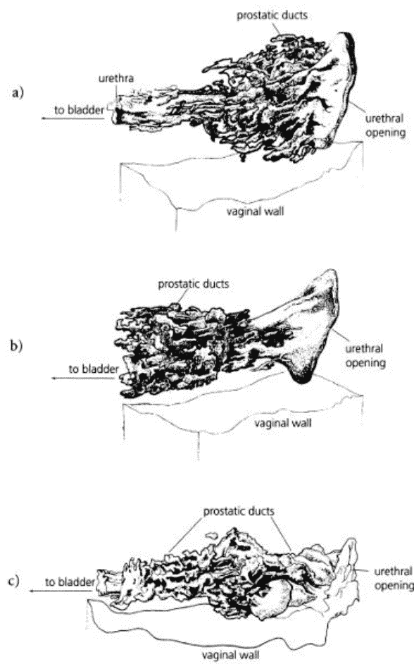

**图 4.1** 三种常见的前列腺形式：a) 66% 的女性中，大部分前列腺组织位于尿道口；b) 10% 的女性中，组织集中在膀胱颈附近；c) 6% 的女性中，它覆盖了整个尿道长度。

与他的同事哈夫曼一样，格芬堡认为在所有女性体内，尿道都由可以从阴道内部刺激的勃起组织包围。他表示，这些组织会对性冲动产生反应而肿胀，并在高潮期间向下按。（这为射精标志性人物香农·贝尔（Shannon Bell）所注意到的现象提供了一个很好的解释，即肿胀的`女性前列腺`有时会从阴道排出液体和体物。）79 格芬堡建立了勃起组织与女性射精之间的联系。他建议采用传教式以外的替代方案——如事后性行为——这为阴茎在异性性交中刺激前列腺提供了更好的角度。在他的结语中，他强调所描述的区域可能比阴蒂更重要，在治疗女性高潮障碍时必须考虑这一点。80

三十多年过去了。格芬堡的观察几乎没有引起人注意。在《人类女性性行为》（1953年）中，金赛（Kinsey）写道，女性由于前列腺发育不全，并没有经历过“真正的”射精。马斯特斯（Masters）和约翰逊（Johnson）在备受誉目的 1966 年的研究《人类性反应》中否定了女性射精的概念。他们推测，男性医生由于自己对射精的经历，长期以来一直误读了女性的性液：

> 在高潮主观进展的第一阶段……许多女性[描述过]一种下压或排出的感觉。通常表现出一种受纳性开启的感觉。这种最后的感觉仅由分娩过的受试者报告，其中极少数人表达过某种实际液体流出或以某种具体方式（排泄）的概念。此前男性对这些主观报告的解读，可能导致产生一种错误但广泛的观点，即女性射精是女性高潮表达中不可或缺的一部分。81

在其具有里程碑意义的《女性性爱的本质与进化》（1966年）中，美国医生兼作家玛丽·杰·谢尔菲德（Mary Jane Sherfield, 1918–1983）并未提到阴道射精（vulval ejaculation）。考虑到她的研究和论点的独创性，这令人惊讶。谢尔菲德的贡献是如此处于 20 世纪 70 年代女性健康运动的核心，它是重新发现`女性前列腺`和射精的关键力量，因此我想花时间正式介绍一下她。

## 玛丽·杰·谢尔菲德

谢尔菲德的书具有革命性。她的发现为女性生殖器、性反应和高潮能力提供了新的见解。《女性性爱的本质与进化》抨击了女性性别低等、缺陷的观念。她认为阴茎和阴蒂系统是同源的，意味着“一种动物的任何器官或部分对应另一种动物的某个器官或部分”。作为一名执业精神科医生，她研究了人类胚胎的性分化以及女性性爱和反应的进化。她将进化生物学、胚胎学、妇科和精神病学的发现联系起来。除外，谢尔菲德解释了“哺乳动物的等位基因源于女性而非相反”、男性生殖器如何从女性结构发育而来，以及为什么这意味着男女的冲动（包括勃起）和高潮基本相同。与男性不同，女性能够连续高潮，在达到巅峰方面无与伦比的。无论如何，谢尔菲德明确女性无性或先天不孕完全是胡说。她指出，人类胚胎主要是女性化的；在怀孕六周时，男性形式从女性形式分离。“哺乳动物的性器官在解剖和生理上都是女性的。”因此，女性发育是线性的，而男性的发育则“偏离”：“从胚胎学角度来看，说阴茎是巨大的阴蒂是正确的，阴囊源于大阴唇，原始性欲是女性的……对于所有哺乳动物，现代胚胎学都需要一个‘亚当出自夏娃’的神话！阴蒂系统和阴茎系统是相互对应的同源结构。”谢尔菲德证实，在任何比较解剖学家的著作（包括主要的德国综述）中都没有描述深层的阴蒂结构——事实上它们甚至没有被提到！因为比较解剖学家和生物学家对其他任何系统（包括男性性解剖）都做得非常详尽，对隐秘阴蒂结构的完全遗漏是值得关注的。”84

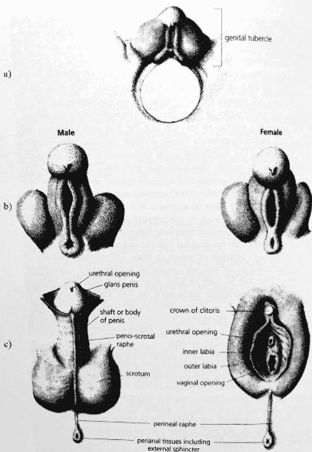

**图 4.2** 男性和女性胚胎的发育。1997年插图。

谢尔菲德在揭示阴蒂内部构造以及阐明男女生殖器官的同源性方面做出了巨大贡献。因此她反驳了女性生殖器萎缩或“阉割”（根据70年代盛行的弗洛伊德理论）。阴蒂现在包括阴蒂体和冠位于其外部顶部；一对腿状的脚；以及前庭球，或称前庭球。阴蒂的隐藏部分在性冲起时体积会增大一倍或三倍，使得它们相对于身体尺寸，“仅比男性的同源结构[尺寸上]略小一点”。^85

阴道的下三分之一以及阴蒂的内外作为一个整体发挥作用，这就是为什么“将阴蒂与阴道高潮离开来在物理上是不可能的”。所有的高潮在生理和质量上都是平等的，无论是阴道的、阴蒂的或其他。根据 Sherfy 的说法，阴道的上三分之二在性产生或高潮作用中“[没有]作用”。^86 她直接比较了男性和女性的高潮，但没有提到女性射精。她描述了阴道润滑（阴道横向分泌”）以及巴多托林腺产生的液体。然而，对于包尿道周围的组织（`女性前列腺`），并没有术语。尽管如此，Sherfy 为女性主义女性健康运动铺平了道路，澳大利亚泌尿学家海伦·奥康奈（Helen O’Connell）也将在 20 世纪 90 年代后期因发现阴蒂的内部结构而受到赞誉。

## 重新发现：女性射精与喜悦流

医生和性学家直到 1978 年才遗忘了`女性前列腺`和射精，当时 Josephine Lowndes Sevely 和 J. W. Bennett 唤起了他们的记忆。Sevely 和 Bennett 的论文《关于女性射精和女性前列腺》提供了历史、解剖和语言学方面的证据来支持他们的观点，即女性射精在 20 世纪以前是很常的，直到后来因为与盛行的女性性观念冲突而被压制。^87 正如 Sherfy 在十年前描述那样，Sevely 和 Bennett 注意到了男性和女性性反应之间的相似性。他们认为`女性前列腺`与男性腺体同源；女性和男性一样会射精；射精和高潮并不一定同时发生。作者对进一步研究的建议得到了重视，随后的几年里，特别是性学期刊发表了许多关于女性射精的文章。

1981 年，《女性身体的新视角》（*A New View of a Woman’s Body*）是一本在当时和现在都具有开创性的“全插图指南”，为该主题提供了新视角：射精者本人也加入了辩论。88 美国的女性主义健康中心联盟（Federation of Feminist Women’s Health Centers）出版了这本书，它代表了多年关于性和自助的教学。它借鉴了数千次对话、体检以及活动人士在联盟主要日诊所工作的经验。因此，这本书仍然同性恋和女性运动中最持久且易于获取的出版物之一。

《新视角》邀请读者观察自己并检查自己的身体。它消除了关于女性性的迷话，并提供了自助技巧。详细的插图、照片（包括关于阴部和宫颈的震撼全彩色系列）以及对阴蒂的定义在今天看来也是非凡的。Sherfy 的那本“他们发现的唯一具有启发性的现代书籍”为阴蒂的新定义奠定了基础。89 《新视角》的作者扩展了 Sherfy 的观点，将尿道勃起组织（即：`女性前列腺`）纳入阴蒂的一部分：“我们所说的阴蒂是指整个器官，由龟头；体部和包皮；阴蒂体（也称为脚）；内口唇；处膜；多个勃起组织体，包括阴蒂球、`尿道海绵`和会阴海绵。会阴海绵是位于阴道口和直肠之间区域的勃起组织。作者强调了它的性潜力并将其归为阴蒂的一部分。他们识别并重新命名了包尿道周围的腺体组织。贡献者之一 Carol Donner 回忆道：“在我们看过的几乎所有的现代解剖书中，包绕尿道周围的勃起组织都是缺失的。尽管它显然与男性包绕尿道的海绵组织相似，但几年来它一直没有被视为阴蒂的一部分。由于它在女性身上没有名称，我们决定将其命名为‘`尿道海绵`’。”91

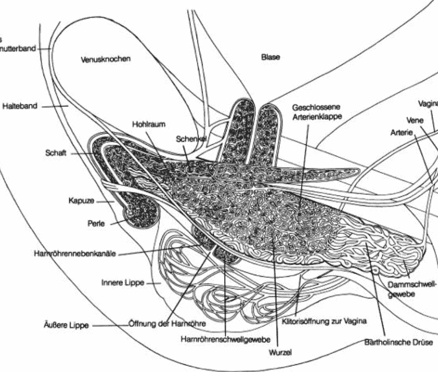

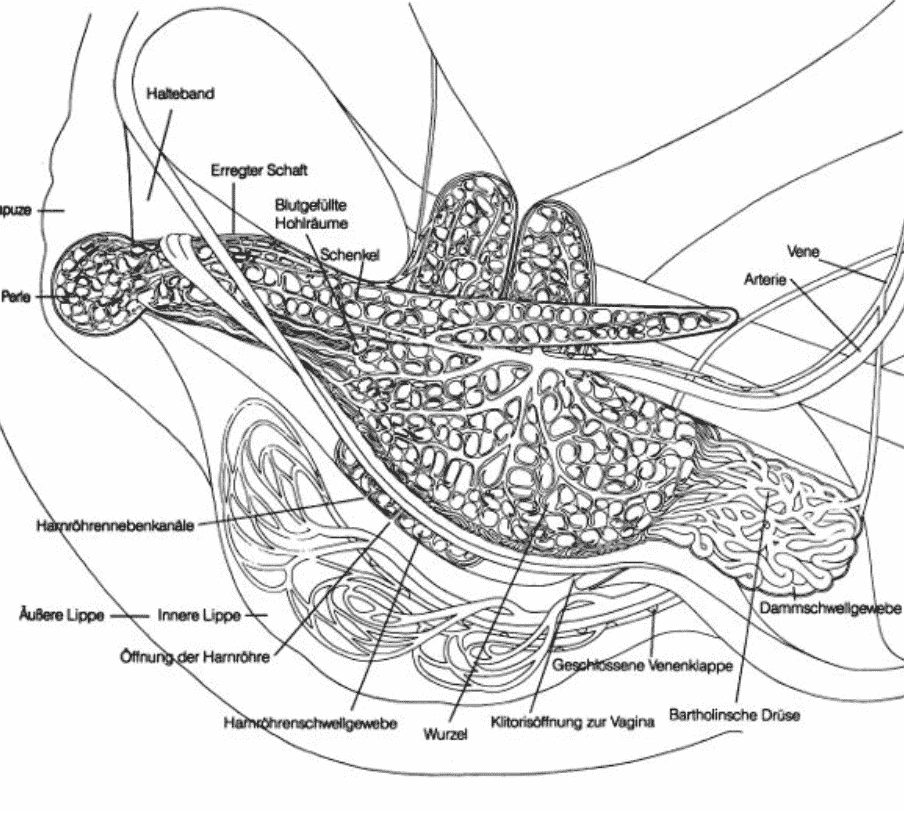

**图 4.3**

非直肠阴蒂（上）和性冲起期间阴蒂（下）的横截面，来自《Frauenkörper—neu gesehen》(1992)（《女性身体的新视角》[1981]）。

在一个明确具有政治色彩的声明中，阴蒂被重塑为一个复杂的勃起器官，延伸女性身体内部，不再是一个豌豆大小的突起。在加州旧金山出版的同性恋色情杂志《On Our Backs》评论道：“这与女性社会角色和性角色的拓宽有关。”92 《新视角》的作者指出，刺激“阴蒂的尿道海绵”可以成为性冲起和高潮的重要部分。这本书还涵盖了女性射精：

> 一些自助者报告说，当她们达到高潮时，偶尔会有液体从阴蒂处喷出。这种液体像喷流一样爆发性射而出。一位女性将这种现象描述为“加仑”级液体，与阴道分泌物不同。有些女性将其误认为是尿尿。一位女性注意到，液体的气味与尿液不同。与少数女性在性过程中发生的非自愿排尿不同，这种液体在化学成分上与尿液不同，似乎是从位于阴蒂尿道海绵的旁尿道腺中射出的。同样的结构……在男性中成为前列腺，后来构成了男性精液的成分。93

德国的女性健康运动在语言上可能比美国人更加用心，取代了“贬性的、丑陋的以男性为中心的术语”——94。例如，在德语译文中，“女性射精”被重新命名为 *Freudenfluss*，或“喜悦流”。然而，这个新词并没有流行，也许因为“喜悦”不能完全反映高潮的狂喜，而“流”未能捕捉到射精特有的喷涌感。

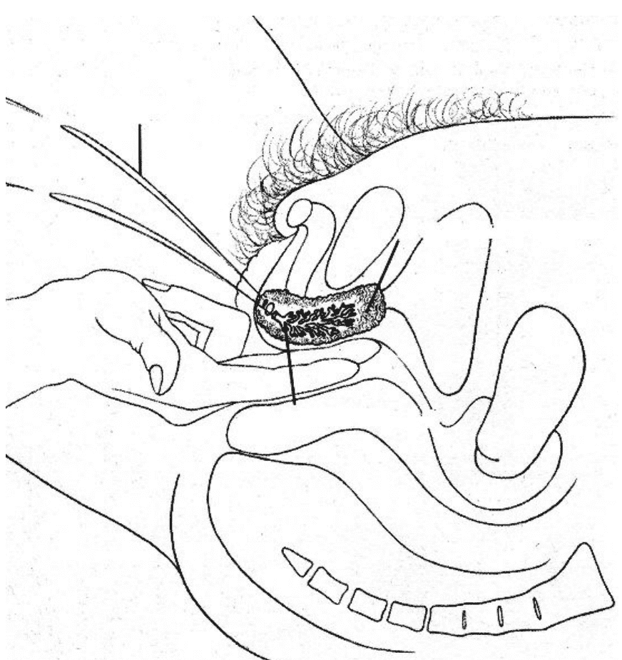

**图 4.4**

射精，来自《Frauenkörper—neu gesehen》(1992)（《女性身体的新视角》[1981]）。

是女性运动的活动人士首先提醒 Whipple 和 Perry 注意到射精和尿道勃起组织的存在。一群同性恋在经历这种体验后，将他们的观察告诉了性研究者 Whipple、R.N. 和 John Perry 博士。在查阅文献时，Whipple 和 Perry 发现一位名为 Grafenberg 的研究人员在 20 世纪 50 年代报告了类似的发现。……[他们]结论这些女性正在经历射精，并创造了“格拉芬堡点”这一术语来标识他们认为的阴道射精点。95

为了感官快感或高潮。这三人还致力于消除由西格蒙·弗洛伊德、阿尔弗雷德·C·金西或威廉·H·马斯特斯与维珍妮亚·E·约翰逊等人传播的关于女性性的压抑性观念。Ladas、Whipple 和 Perry 解释说，大多数女性对女性射精并不知情；许多人认为自己在高潮时是在尿尿，并试图压抑高潮。羞愧、压力和恐惧随之而来。对女性射精的无知损害甚至破坏了许多女性的浪漫理想。作者们意在教育和解放，绝不是给阅读《G点》（*The G Spot*）的男女施加压力：“我们这些不射精的女性……知道这是一种自然的反应，而且享受它是可以的……我们也希望不射精的女性对此此感到良好，去享受她们经历的任何快乐，而不是刻意追求射精。”³

遗憾的是，Ladas、Whipple 和 Perry 对 G 点的描述并不精确。“点”（spot）一词在某种程度上是个误称。“G 区带”（G-zone）这一术语稍微准确一些，如果忽略了女性解剖结构的某个部分以一位男性“发现者”命名的尴尬现象。书中的插图将该区域描绘为一个悬浮的骨点，对人们定位它几乎没有帮助。女性及其伴侣立即开始寻找这个秘密地点，但往往徒劳无功，“成千上万的女性探测阴道壁，寻找高潮的震颤。”⁴ 一位美国咨询师将其比作寻找圣杯。⁵ 与此同时，作者们定义的 G 点实际上是陈词之调，无非是对女性前列腺的描述，女性前列腺可以通过阴道壁受到刺激：

格拉芬堡点（The Gräfenberg Spot）位于阴道前壁耻骨正下方。它通常位于耻骨后部和宫颈前端之间的位置，沿着尿道并靠近膀胱颈，即与尿道连接的地方。大小和确切位置而异……⁷ 它位于阴道壁深处，在未受刺激的状态下，通常需要用力才能接触 G 点。⁶

尽管熟悉前任者 Josephine Lowndes Sevely、J. W. Bennett 和 Regnier de Graaf 的著作，《G点》的作者们未能清晰地区分两个不同的部分：前列腺和允许刺激前列腺的前阴道壁区域。由于女性前列腺可以沿尿道的上、中、下段找到，这个敏感的阴道区域也存在差异。作者“倾向于认为 G 点区域包含了男性前列腺的退化同源物。”⁷ 他们解释说，那不是一个瞬间获得快乐的按钮，而是一个受到压力刺激时会肿胀的区域。尽管所有女性都有 G 点，但并不是所有人都能享受受刺激时的感觉。

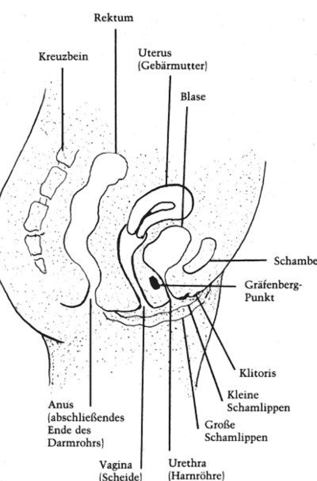

**图 5.1**

所谓的格拉芬堡点（Gräberg-Punkt）：Das stärkste erotische Zentrum der Frau（女性最强性欲中心），源自《G点及关于人类性的其他新发现》（*The G Spot and Other Recent Discoveries about Human Sexuality*，1983年）。

当 G 点受到兴奋时，一些女性会达到高潮，另一些会射精，但在没有 G 点参与的情况下也可能射精；Ladas、Whipple 和 Perry 认为有 10% 到 40% 的女性会射精。⁸ 精液量因人而异，每次高潮也不同。有些女性报告月经会影响她们的射精能力以及排出液体的量和质量。作者强调了盆底的重要性，认为强有力的盆底肌肉直接影响女性的性体验和射精能力。他们敦促女性对这些肌肉承担“责任”，通过进行盆底练习来收紧和增强这些肌肉。

Ladas、Whipple 和 Perry 反对手术、医疗或电学干预。20 世纪中叶的大多数手术——“近五十种应用于 PC [耻尾肌] 及其周围区域以控制尿失禁的手术”——都是“相当粗糙的”。在这些过程中，PC 肌肉被切断并重新缝合，认为其截断和疤痕组织会恢复肌肉张力。二战后还引入了针对盆底和阴道肌肉的电疗法。在这里，通过电击来激活肌肉。由于电击疗法的有效性已证实，作者们坚持建议女性练习像美国泌尿科医生阿诺德·凯格（Arnold Kegel）开发的那些盆底练习：“这样做更便宜、更安全、也更愉快。”9

1980 年的性科学研究协会会议上，Whipple 和 Perry 发表了他们关于 G 点和女性射精的观点，放映了一部包含射精场景的电影。出席者中包括妇科医生、不信者马丁·魏斯伯格（Martin Weisberg）。看到电影并与一位“受试者”聊天后，魏斯信服了：“我仍然对此没有解释，但我可以证明格拉芬堡点和女性射精确实存在。多年以后，我确定医学院的讲师会开玩笑说，直到 1980 年医学界才最终接受了女性真的会射精这一事实。”⁰

Ladas、Whipple 和 Perry 挑战了阴蒂的优先地位，质疑阴蒂高潮的优越性。他们将高潮分为三种类型：阴部高潮、由阴道渗透引发的子宫高潮，或者最常见的、介于两者之间的混合高潮.¹¹ 因此，作者们将自己置于与性研究与治疗领域的巨头——马斯特斯和约翰逊（Masters and Johnson）的对立面。马斯特斯在 1981 年美国性教育者、咨询师和治疗师协会年会上坚持自己的立场，认为“所有高潮都包含对阴蒂的直接或间接刺激。”²

Ladas、Whipple 和 Perry 对女性射精提出了引人的问题：肌肉结构与射精有何对应？PC 肌肉强力的女性是否更容易射精？女性是否更容易患尿路感染（UTIs）？女性是否像男性一样会逆射精，即精液流回膀胱？激素的情况如何？性偏好与射精之间是否存在关联？作者的初步发现表明，同性女性可能比异性女性更容易射精，他们认为需要更多研究³。《G点及关于人类性的其他新发现》的出版引发了广泛讨论，但重点在于那个难以捉摸的点本身。当大家寻找它时，关于女性射精的章节在某种程度上被忽视了。这本书的反响对德博拉·桑德（Deborah Sundahl）来说并不意外，她从 20 世纪 80 年就开始研究女性射精；科隆医生萨宾·诺诺登（Sabine zur Norden）回答了这些差异：在她调查的同性恋女性中，90 年代时有 42.3% 的人经历过射精，而异性女性中这一比例为 28.9%。⁴

# 阴蒂对比阴道

弗洛伊德的精神分析理论将女性视为不完美的男性生物——即被阉割的男性。⁵ 在关于性和性别的理论中，弗洛伊德认为男孩、女孩、男性和女性都认为女性生殖器劣于男性生殖器，并将阴蒂视为萎缩的阴茎。弗洛伊德认为，在青春期，女孩会经历“性欲兴奋性从阴蒂到阴道的转移”。⁶ 换句话说，阴道是女性主要的性敏感区——而不是阴蒂。

性唤起。健康的成年女性从阴道渗透中获得快乐。这一概念“将以男性为中心的异性恋性模式推向了其男性中心的巅峰，并在接下来的一个世纪里板上钉钉：将女性性定义为男性偏好是不恰当的，而是必要的。”17 然而，弗洛伊德并不配“阴道高潮之父”的称号，他实际上并不是提出两种不同高潮类别的人^18 相反，他的追随者提出了“不成熟”阴蒂高潮和“成年或成熟”阴道高潮的概念。

20世纪50年代，金西、马斯特斯、约翰逊和莎·希特等人员启动了范式转移：阴蒂被恢复为一个重要的——即使不是最重要的——性器官，而阴道与女性高潮的相关性受到了质疑。随后的几十年里，关于性与治疗的话语将拒绝阴道提供快乐的能力。这种拒绝同时是对弗洛伊德女性化概念的否定，这解释了20世纪后后期关于阴道的某些陈述之所以带有情感色彩的原因。

1954年，金西将阴道描述为一个无感觉的空腔，并将其与肠道相比。“阴道内壁的内部（内热）起源使其在这一方面与直肠和其他消化道其他部分相似。”除阴道前壁（即面向腹部和前列腺的一侧）外，金西表示阴道内部对触碰“相当不敏感”。男性没有与阴道对等的器官，阴道“对女性性欲反应的贡献微乎其微。它对男性的性唤起的贡献甚至比对女性性唤起的贡献更大。”19 马斯特斯和约翰逊认为，无论通过什么触发，所有的高潮在生理学上都是相似的。阴蒂被仅定义为冠状体和体，在阴道渗透期间也会受到刺激。

阴蒂体的这种节奏性运动结合阴茎在阴道内的抽入和抽出，产生了次级性性张力水平。需要强调的是，这种次级阴蒂刺激发生在每一种性交体中，当勃起的阴茎完全进入阴道腔时。20

希特1976年出版的国际畅销书《希特报告》基于对3019名14至78岁的女性进行的调查。希特发现，受访者中仅有330%仅通过阴道渗透达到高潮；每五个人中就有一个（19%）需要在渗透的基础上阴蒂刺激。调查还显示女性获得高潮的速度和男性一样快：“显然，只有在性交这种不充分或次级的、不足刺激下，我们才会‘花更长时间’。”21

女性身体和性是第二波女性主义的核心关注点。在涉及到自己的身体和欲望时，女性现在掌握了主动权。长期被认为危险或肮脏的“私部位”现在正在被探索、暴露、描述，并在必要时重新命名。女性重新发现了被遗忘或压抑的知识，带头研究，并抛弃羞耻或负罪感。当时最成功的书籍之一是荷兰作家安雅·梅莱嫩堡（Anja Meelenburg）的《羞耻已经结束》（1976）。女性要求更多的空间和更多乐趣。私生活已经变得政治化，一如既往。“性是女性在生活所有领域受压迫的镜子和工具，”德国记者、女性主义者艾莉丝·舒瓦泽（Alice Schwarzer）在1975年写道。22

这场运动谴责弗洛伊德的女性化概念、参与“正常”渗透性性交的压力、异性恋常态化，以及所谓的“冷淡”女性被病理化。在《阴道高潮的神话》（1970）中，美国激进女性主义者安妮·科特（Anne Koedt）写道，阴道的功能主要限于“1）月经，2）接受阴茎，3）储存精子，4）分娩通道。”23 阴道最终是一个“为了男性的性器官，科特认为，他们利用它来实现高潮，这与西蒙·德·波伏娃（Simone de Beauvoir）一致，她在1949年的《第二性别》中就将阴道渗透与攻击联系起来：“女性通过阴道渗透并怀孕；它通过男性的干预才成为独特的性中心，而这始终构成一种强奸。”24

拥有数千个神经末端的阴蒂冠成为了女性自主的隐喻。它成为了女性最重要的性器官。阴蒂只有一个工作：提供快乐。舒瓦泽说阴道的神经和阴蒂一样多，但它不是为了快乐的。在1975年出版的《微小及其后果》（*Der kleine Unterschied und seine Folgen*）中，舒瓦泽甚至说阴蒂是唯一提供快乐的部分。

- 女性身体和性是第二波女性主义的核心关注点。
- The The is is the, the the, and 男性主权。
- 女性身体是 the is the with the;,’s a
- ,,,.
- the the, (阴蒂, and 阴道高潮。
- 阴道是一个 the,,,, is to is the 指对女性身体这一部位的厌恶。
- 阴道与男性勾结；它是一个麻木、适应性强的管子。
- 女性是 is the,,,,, the the the, 女性, and 男性主权。
- 阴道与男性勾结；它是一个麻木、适应性强的管子。
- 其中一个例外是澳大利亚作家、公关人员兼女性主义者杰曼·格里尔（Germaine Greer）。在《女性人割》（*The Female Eunuch*,1970）中，她写道：“不幸的是，我们接受了弗洛伊德主义者恢复阴蒂地位后，关于阴道完全被动甚至无关紧的概念。”27

# 女性运动保持沉默

背景有助于解释为什么女性运动在很大程度上忽略了Ladas、Whipple和Perry的发现以及对重新研究阴道的建议。女性担心G点正在建立新的性标准（女性潮！）并复活旧的理想（阴道渗透，阴道高潮！）。作者的间接描述

- 作者将阴道高潮描述为比“浅表”的阴蒂高潮更激烈或更深，引发了争议。28 最激进的批评者之一是作者芭芭拉·伦莱希（Barbara Ehrenreich），这位美国作家兼政治活动家，她指责作者对阴道高潮和凯尔运动的关注；在所有需要锻炼的部位中，女性的盆底肌肉是用来固定阴茎的。”29

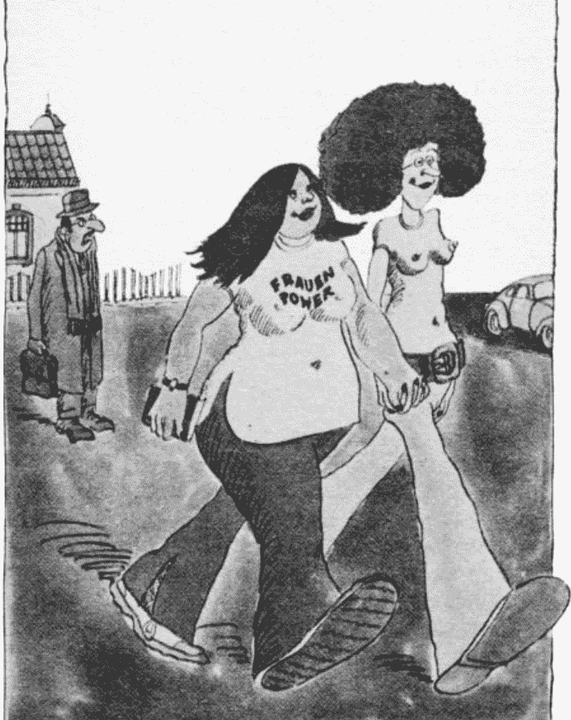

**图 5.2**

“你无法对着墙撒尿，你也永远做不到！”70年代的漫画。

也有许多女性并不喜欢女性潮喷的想法。真的需要像“男人一样”射出来吗？女性不是正在发现自己偏离男性标准和影响的独特性吗？女性潮喷显然归结为厌男的男性幻想。30$ EMMA是艾莉丝·舒瓦泽于1977年创立的一本“为女性、由女性”的杂志，它在80和90年代对女性潮喷、前列腺和尿道海绵以及G点保持沉默。例外是一个

这是zur Nieden于1987年发表的一篇文章，她的研究促成了她1994年出版的*Weibliche Ejakulation. Variationen zu einem alten Streit der Geschlechter*（女性喷精：对古老性别斗争的变体）。^31柏林的左翼女性主义杂志《COURAGE》也没有涉及此题。1995年，由女性主义妇女中心（Feministische Frauen Zentrum）——一家自1974年以来在柏林提供全方位女性健康服务的独立机构——出版的女性健康杂志《clio》刊登了性研究员兼作家Bea Trampenau的采访。当被问及为什么女性运动忽略了女性喷精时，Trampenau回忆道：

“这在某种程度上是因为围绕阴道高潮的道德讨论。我们必须发现阴蒂，而且我们也想这样做。同样重要的是，我们将注意力转向外部：在没有阴茎、没有插入的情况下，我们也可以体验到巨大的快乐。这种喷涌源于我们自己。它让人想起插入和相关的兴奋，但我们已经超越了这一点，并且现在可以坚信这一点。我们可以说：我们体内有很多东西永远不想忘记。^32

## 时代已经改变：1980年代的性学发现了喷精

《G点》引发的冲击波震动了美国性学领域，该领域几十年来一直推崇“阴蒂中心主义范式”，在很大程度上忽略了阴道。^33美国心理学家Cynthia Jayne在她1984年的论文《弗洛伊德、格拉芬贝格与被遗忽视的阴道：关于性学中历史遗漏的思考》中证实了这一盲点。通过批判性的反思，Jayne断言女性喷精和G点值得进一步研究：

> “人们并没有预料阴道会表现出这样的敏感性，因此没有对阴道反应性进行过任何严肃的研究计划。直到最近，性学家们可能过早地‘否定’了数据。女性喷精和格拉芬贝格点刺激的概念在性研究中值得进一步关注，阴道反应和敏感性的这一性问题也是如此。……最后，作为科学家，我们必须意识到，我们所理解的真相有时可能成为一种限制性的自我实现预言。^34”

在20世纪80年代，许多研究采用了Ladas、Whipple和Perry的工作，对他们的论点进行了证实或反驳、分类和扩展。这十年间审视的问题包括：液体从哪里来？它是由什么组成的？精液和尿液有什么区别？女性喷精对应于男性射精吗？盆底肌肉起了什么作用？重新发现喷精会丰富人们的生活，还是会为性表现带来新的压力？女性喷精是美国讨论最活跃的话题。以下是当时最重要的声音和理论的概述。

1984年，定居在纽约的精神科医生兼心理分析师Desmond Heath回到了一篇他在1979年未成功发表的关于女性喷精的文章。他对中间五年态度的转变感到惊讶：

> “自1979年以来，科学氛围发生了变化，那时女性喷精被认为充其量维多利亚时代男性色情画者的投影……，最坏的情况下，是一个会让持有者的科学诚信受到质疑的想法。时代已经改变了。一种新的舆论氛围似乎让一个沉睡的想法自发地产生，仿佛在同一时间的多个地点都是新鲜的。”

Heath分享了一个接受分析者报告射出奇怪液体的案例。他挖掘可能解释该女性分泌物的材料，并发现了女性前列腺和喷精。他发现了Alexander Skene、John W. Hoffman和Ernst Gräfenberg的作品，联系了马斯特斯和约翰逊研究所（“跟我通了五分钟电话，这些知识从未丢失，因为它从未被遗忘”），与西奈奈山医学院的一位解剖学家商量，并最终进行了自己的研究。^5他检查了十八个尿道，所有的都有不同形式的腺体组织。Heath在十五个样本中检测到了前列腺特异性抗原（PSA），在十二个样本中检测到了前列腺酸磷酸酶。这项免疫组织化学研究证实了男女前列腺的同源性，尽管Heath认为这尚不足以证明女性喷精。

20世纪80年代的研究重点在于区分精液和尿液，研究人员寻找男性前列腺分泌物中存在但在尿液中不存在的元素。几乎所有人得结论女性喷精不是尿液。关于“喷精（ejaculation）”一词是否适用于男女也存在讨论。^36 Joseph G. Bohlen表达了担忧。他在1982年的论文《女性喷精与尿尿压力性失禁》中，这位美国医生批评了对性交期间排出的任何液体使用“喷精”一词的做法，并质疑尿道旁腺产生大量液体的能力。^37基于此，性学家们正努力建立一个新的神话，即女性喷精。

1984年，Edwin G. Belzer、Whipple和William Moger在《性研究杂志》上发表了一篇名为《论女性喷精》的短文。^38在总结了近期研究后，作者提出了自己的研究，在其中他们确定精液和尿液是不同的物质。在同一期中，Perry和Whipple发表了一项关于PC肌肉、喷精和高潮之间联系的研究；他们写道，与不喷精的女性相比，后者往往具有更强的盆底肌肉和更明显的子宫收缩。^39

来自哥伦比亚的性学教授Heli Alzate和塔夫斯大学妇产科专家Zwi Hoch在他们1986年的文章《“G点”与“女性喷精”：现状评价》中总结了这场激烈的辩论。他们要求读者记住，女性喷精本身是一个模糊的术语，并没有任何功能。尽管G点无法被证实，但Alzate和Hoch接受某些女性会排出液体。^40

1987年，Heath发表了另一篇文章，这次发表在《医学假说》杂志上。^41在年轻女孩中，前列腺也是一个对自慰产生喷精作用的器官。在1989年的社论中，Marc A. Winton指出，女性喷精的概念为担心自己在性交时尿尿的女性提供了缓解。另一方面，它给不喷精的女性带来了压力。Winton评论说，随着对喷精、女性前列腺和多次高潮的接受，性别角色可能会发生：

> “此外，G点和女性喷精似乎会模糊控制。虽然男性一直被定义为具有更强的性欲和关系的领导者，G点、女性喷精和多次高潮不仅强化了女性优于男性的观点，还可能增加男性为了满足女性而表现的压力。^42”

Karl F. Stifters Dimension der Lust. Das Geheimnis der weiblichen Ejakulation》（快乐的第三维度：女性喷精的秘密）于1988年在德国出版。在书中，这位奥地利心理学家和性学家评估了大量材料，并为了易读性提供了新的翻译。他对尿液和精液样本进行了自己的研究。^43研究得出精液“无疑”是腺体分泌物。Stifter同意，在前列腺之外还存在其他的“喷精源”：“很难想象女性前列腺单独能产生如此大量的液体。”他还建议进一步研究“喷精触发的机制”。44

20世纪80年代后期，2350名美国和加拿大的女性参加了一项关于女性喷精和G点的调查。据报道，39.5%的女性在高潮时喷精过，而60.5%没有。有趣的是，近60%的受访者听过女性喷精，无论如何。女性也在讨论，56.1%的受访者承认曾与朋友或家人讨论过这个话题。数字表明，到那个年代末，女性喷精已广为人知。在那些自己经历过这种现象的女性中，

然而，有10.3%的人为此寻求了心理治疗。研究作者解释说，射精对许多女性来说是一个压力来源，她们担心自己实际上是在排尿。45

弗朗西斯科·卡贝洛·圣塔马利亚（Francisco Cabello Santamaría）在1997年对这场辩论做出了另一个贡献。出于好奇为什么女性都有前列腺而有些女性会射精，这位西班牙心理学家和性学家测试了二十四女性（其中六人会射精）在高潮前后的尿液。他在寻找前列腺特异性抗原（PSA）。他还测试了六名女性精液中的PSA。卡贝洛·圣塔马利亚在75%的后尿样本和所有六精液样本中检测到了PSA。结论：在高潮期间，所有女性都会产生源自女性前列腺的液体，至少部分如此，因此存在PSA。然而，在某些女性身上，液体并没有通过尿道排出。相反，发生了逆射精，液体流回膀胱，与尿液混合后排出。女性排出的精液可能非常少，以至于她们毫无察觉。通过这项研究，卡贝洛·圣塔马利亚希望能安慰射精和不射精的女性，并“打破关于‘射精超女性’这一日益盛行的神话：首先，射精是正常的；其次，大约有75%的、几乎所有女性都会这样做。46那些没有明显排出（可能非常渴望）的人要么是射到了膀胱里，要么释放了无法察量的液体。”

如往常，专家们对女性精液的量和成分存在分歧。2011年，生物学家阿尔伯托·鲁比奥-卡西利亚斯（Alberto Rubio-Casillas）和医生埃曼纽埃尔·A·贾尼尼（Emmanuele A. Jannini）得出结论，女性在高潮期间从尿道排出两种液体：一种稀薄、透明、无味的液体（约57到120毫升），会喷射或涌出；以及精液（约0.50到0.90毫升），这是一种粘稠的乳白色液体，具有高PSA值。两者可能形成一股流。两种液体的存在可能解释了不同的结果。“之前所有发表的研究[未能]区分这两种液体，从而导致了混乱和具有争议的发现，”研究人员宣布道。47 在2017年的一篇综述中，捷克医生兹拉特科·帕斯（Zlatko Pastor）和罗曼·赫梅尔（Roman Chmel）也确定女性射出两种液体：含有PSA的前列腺精液和含有尿酸、尿素和肌酐的膀胱喷射液。女性射精和喷射是释放不同器官产生的液体的不同机制。48 Pastor和Chmel建议进一步研究。

2021年，一个国际研究团队发布了对1889年至2019年44份女性射精记录的分析。“作者指出，很明显，近十年进行的临床和解剖学研究为女性射精现象提供了充分证据。他们继续说，女性射精研究中令人混乱、矛盾的发现，可能归结于这些研究实际上在考虑不同的物质：女性精液、喷射液或阴道润滑液。”因此，“正确的液体识别和术语的使用将确保未来未来的研究不再是徒劳的。”49 同时，男性喷射现在也是一个话题了；关于该主题的第一项科学研究于2018年发表。50

## 男性阴蒂与女性阴蒂：关于性别解剖学的激进新观点

在她论文《关注女性射精与女性前列腺》帮助恢复有关该主题的辩论十年后，1987年Severy出版了一本关于她多年研究的书。通过跨学科的方法，她对解剖学和生物学提出了新观点，对女性射精进行了自己的研究，并发展了一种关于男女生殖器广泛同源性的激进理论。Severy对据认为男女之间唯一的性现象特别感兴趣：射精。

她发现女性不射精是不可能的，这至少是因为有无数关于性液体的历史文献。在《夏娃的秘密：女性性行为的新理论》中，Severy对解剖学提出了新视角，特别是要求对阴蒂和阴道进行根本性的重新定义。她证明男性在阴茎体内部有一个阴蒂（海绵体，一种充满血液的勃起组织，导致阴茎变硬并直起），而女性除了阴蒂冠外，还有前列腺和女性阴蒂。根据Severy的观点，阴道对应阴茎，“女性勃起是现实”，且男女都会射精。51 她将男性和女性阴蒂的顶部称为“洛德斯冠”（Lowndes crown）。这是第一个——人类解剖学中以女性命名的部分！

Sevely拒绝了阴蒂对阴道的二元论概念。她解释说，从性的角度来说，阴蒂、阴道和尿道构成了一个统一整体。只有一种高潮，尽管它可能由不同区域触发。她将阴蒂、尿道和阴道在高潮前的相互作用称为“C.U.V反应”。阴道由洛德斯冠、阴蒂体和脚部、海绵体（女性前列腺）、阴道肌肉（会阴肌、尿生殖肌隔和盆底肌）以及阴蒂组成。52 Sevely将尿道周围的组织定义为“女性阴蒂”。53 她还认为被女性前列腺包围的尿道是一个性器官。尿道的底部在解剖学上与阴道不可分割。它们形成了一道墙：尿道底部同时也是阴道的天花板。前列腺嵌入在阴道的这部分。54

Sevely写道，在成年女性中，尿道，尿道的表面由细小的皱皱（称为rugae，拉丁语意为“褶皱”）组成，“这些皱在阴道底部最为明显。”55

考虑到男女生殖器对应最后一部分，Sevely认为，不言自明，男女射出的模式是：高潮、释放。56 在一个案例中，她和团队发现受试者排出126毫升（约4盎司）液体，而男性通常射出6毫升。前列腺液中的尿含量远低于尿液，且精液有自己的气味。Severy乐观地总结道，“一旦消除障碍并接受女性射精是正常的，正如许多人所报告的那样，女性会对直到最近才被诊断为尿禁的生理现象感到更加自信。”57

和之前的Grafenberg一样，Sevely认为尿道是一个性器官。多年后，zur Nieder证明了尿道的去性化是导致射精被忽视或误诊的原因之一。由于两个孤立的医学领域——泌尿科和妇产科——负责同一组器官，研究受到了进一步阻碍。如今，该领域被称为泌尿殖系统，这是一个考虑了生殖和泌尿器官共同胚胎起源的语义伞术。该名称也引导了阴蒂、阴道、子宫、输卵管、勃起功能、前列腺、尿道和膀胱之间的联系，以及一个部位的疾病或异常如何影响其他部位。

回到Severy对男女生殖器同源性的深刻立场。她解释说，前列腺功能受多种因素影响：管的大小和数量、组织的敏感性、年龄、刺激的方式和频率以及女性的兴奋程度。Severy提醒我们，阴道“远不是一个被动的空间，而是一个活跃空间和深层性部分的复杂实体。”

为了描述这些阴道活动，大约三十年后，德国作家兼艺术家Adamczak创造了“环绕（circclusion）作为穿入（penetration）的对应词”这一术语：“这两个词指的是同一个物质过程，但从相反的角度来看。穿入意味着插入或刺入，而环绕意味着包裹或拉动。仅此如此。但这样做，，反转了主动与被动的关系。”59

却一直苦于无法命名：阴道吸吮、抓取并紧住异物的方式。

塞夫利（Sevely）对男女生殖器的描述符合其出版当时的背景，当时政治和私密领域对性别平等的追求日益增长。作者希望性别之间解剖学和功能上的对称性能“帮助男女更好地理解自己以及理解彼此”，并引导出以平等为特征的关系。几个世纪以来，解剖学一直是女性“低等地位”的“证明”，但现在塞夫利发展出了一种反映在生殖器对称性中的平等愿景。阴蒂复合体、阴茎和性反应的同源性将性别平等锚定在这些人体内部。射精既是这种平等的证明，也是其象征。

## 神话、摇钱牛与 P 点：G 点，过去与现在

在 20 世纪 80 年代后期的一小段时间里，G 点是一个外人士和医学专业人员都熟悉的概念。然而，仅仅二十年后，怀疑论者又回来了。医生和性学家将 G 点称为神话，一个“妇科 UFO（不明飞行物）”。与此同时，一些人将所谓的“P 点”（P，代表安慰剂 placebo）作为替代方案，而将 G 点视为一种经历过的、研究过的、经过科学证明的事实。2009 年，《性医学杂志》（Journal of Sex Medicine）举办了一场关于 G 点的会议。会上提出了广泛的观点，并在后发表在论文《谁害怕 G 点？》中。结论相当清醒：即使经过数十年的研究，仍需进一步研究。女性性中“最具挑战性的方面之一”仍然是一个谜团。

尽管尚未被确认是一种解剖学特征，但这一敏感区引发了一个价值数百万的产业。书籍和视频解释了 G 点是什么以及如何找到它。特殊的扩尿器和震动器承诺提供针对 G 点的特定刺激。生殖器整形手术也呈现出趋势。2002 年，美国最知名的妇科美容外科医生之一大卫·马特洛克（David Matlock）推出了 G-Shot®。该程序也称为 G 点增强术（G-Spot Amplification®），在美国和欧洲提供，是一种 G 点丰型术的形式。作为填充剂的透明质酸被注射到阴道前壁。这位位于洛杉矶的医生网站称，这种午餐手术“可以改变女性及其性生活的现状”。⁶⁴ 马特洛克向潜在客户保证，G-Shot® 适用于所有人；即使是满意的女性也能从小幅提升中受益。医生和其他专家将生殖器整形手术的上升称为一种“令人担忧的趋势”。⁶⁵ 尽管有这些警告，尽管价格在 1,000 到 2,500 美元之间，且效果在三到五个月后就会减弱，G 点增强术的需求依然很大。在生殖器整形手术的历史中——一个或许可以用其荒谬性来描述的领域——这项特定服务代表了新的低。

惠普尔（Whipple）本人反对 G 点增强术。她为 2015 版《国际人类性学百科全书》撰写了关于 G点的条目：“格拉芬堡点，或称 G 点，是通过阴道前壁感受到的敏感区域。它通常位于耻骨后部和子宫颈之间一半处，沿着尿道的走形。受到刺激时它会肿胀，但在未受刺激状态下很难触及。”⁶⁶ 换句话说，G 点就是女性前列腺，是环绕尿道的腺组织，可以通过阴道前壁进行刺激。在惠普尔和她的同事拉达斯（Ladas）和珀里（Perry）出版他们的畅销书《G 点》三十年后，我们回到了女性前列腺的问题。

## 简述：女性前列腺，第二部分

国际解剖术语联合委员会（FICAT）成立于 1989 年，它汇集了一组专家评估人类解剖学命名。该委员会由国际解剖学家协会联合成立，其目标是为全球建立标准的医学术语。⁶⁷ 2001 年，FICAT 更新了组织学术语，使用了“女性前列腺”一词，并指示医疗人员停止使用“腺”或“尿道旁”。这是一次突破。⁶⁸ 斯洛伐克妇科医生米兰·扎维奇奇（Milan Zaviačič，1940–2010）是这一变革的推动力量，自 1980 年以来一直在研究该器官的结构和功能，并发表了 500 多篇相关科学论文。⁶⁹ 在 1985 年到 1999 年间，扎维奇奇与来自布拉迪斯拉发科梅纽斯大学的同事们进行了 150 多例尸检，以更好地理解泌尿系统的解剖学和病理学。⁷⁰ 2006 年，布拉格国际组织赞扬扎维奇奇发现了“女性前列腺”，证明了它并不是男性腺体的遗迹，而是一个功能性器官⁷¹ 扎维奇奇还坚持使用正确的术语：女性前列腺。他认为，称之为斯基尼腺（Skene’s gland）暗示了完全不同的结构，并掩盖了与男性前列腺的同源性⁷² 女性前列腺不在尿道周围，而在前壁。对于成年女性来说，前列腺重量仅为 0.2 盎司，尺寸为 1.3x0.4 英寸⁷³ 扎维奇奇解释道，个体差异很大，这使得识别非常困难。他定义了六种前列腺类型。最常见的是前部或尿道型：在 70% 的女性中，前列腺位于尿道的远端，即远离身体中心的部分。这种前列腺类型是导致女性高潮的敏感区⁷⁴ 女性和男性前列腺具有相同的组织结构，都由腺体、管和光滑肌细胞组成。与其同源物一样，女性前列腺至少有两个功能：外分泌液体（“外分泌”指向外的分泌）以及某些内分泌功能，尽管后者的研究处于婴儿阶段。（一个已知过程是内分泌细胞产生血清素。）⁷⁵ 扎维奇奇将泌尿科医生、妇科医生、妇科外科医生和病理学家对该器官“长期缺乏关注”归咎于女性前列腺病理学出现太晚⁷⁶ 至于性方面，女性前列腺分泌物占精液的大部分，通过尿道排出。在高潮期间，节奏性的肌肉收缩将前列腺的内容挤过导管。现在是时候结束关于女性前列腺和射精之间相互作用的持续争议了，扎维奇奇在 2002 年写道：“在证明了女性精液中存在前列腺成分（特别是 PSA）后，我们确定女性前列腺是尿道流出的主要来源。刺激 G 点通常‘没有问题’就能引起射精。”⁷⁷ “谁能想到宏观解剖学会有这么多问题？然而，直到今天，女性前列腺仍然让专家们产生分歧，”弗洛里安·文辛格（Florian Wimpissinger）在 2007 年评论道。这位位于维也纳的泌尿科医生长期研究女性前列腺和精液。“有趣的是，专注于解剖和手术的专家——泌尿妇科领域的专家——通常无法以任何程度确定女性前列腺的存在。”⁷⁸

Wimpissinger 引用了一个关于两个十四岁和四十五岁女性的案例研究，她们在高潮时会射精。超声波、生化分析和泌尿科内镜显示，女性尿道周围存在腺组织。他还发现了精液与尿液之间的明显区别，最终确定女性精液在生物化学上与男性前列腺液相同。⁷⁹ 在另一项使用 MRI 的研究中，Wimpissinger 在七个女性受试者中的六个发现了前列腺⁸⁰ 他解释道，男女前列腺甚至在胚胎层面也存在相似之处。它们都源自尿生窦。在男性胚胎中，前列腺在雄激素双睾酮的影响下发育，而女性胚胎中的激素则阻止了这种发育。Wimpissinger 得出了与无数研究者相同的结论：女性的腺组织对应于男性的前列腺，而女性射精“似乎比通常认为的常见。⁸¹”

这位泌尿科医生的工作假设是前列腺的形式与射精之间存在联系。他得出结论：“根据历史记载、科学数据以及我们的发现，对女性前列腺存在的讨论可以简化为尿道旁解剖（腺）的命名以及该腺体胚胎发育的可变性。⁸² 与他的前任一样，Wimpissinger 要求进行全面研究。尿路感染和下尿路症状是由前列腺疾病引起的吗？高潮强度与射精之间是否存在相关性？射精会导致额外的强烈高潮，还是相反？”

由维也纳妇产科医生 Wolf Dietrich 领导的另一组奥地利研究人员在2011年发表的一项研究发现，50%的女性尿道周围存在功能腺组织。这些组织通常位于尿道的下侧，靠近尿道口。⁸³

国际解剖术语联邦计划（FIPAT）作为 FICAT 的继任者，在2019版的《解剖学术语》（Terminologia Anatomica）中重新审视了女性前列腺。命名专家认为，最好恢复对该器官以前的称呼，现在的官方名称为“女性尿道旁腺”（paraurethral glands of female urethra），并提供“斯金腺”（Skene’s glands）、“女性前列腺”（Prostata feminina; Female prostate）作为备选。FIPAT 在追溯性命名中还包含了“女性尿道旁导管”（同义词：“斯金管”）。⁸⁴ 女性前列腺仍然是一个备有争议的话题。

## 从阴蒂到复杂体：阴茎的华丽登场

Helen Elizabeth O'Connell 在1998年于《泌尿外科杂志》上发表了关于阴茎解剖的研究，引起了巨大的轰动。与 Sevely 以及《女性身体的新视角》的作者一样，这位澳大利亚泌尿科医生证明，阴茎并不是一个小小的组织颗粒，而是一个复杂的起器器官，从可见的头部延伸到身体深，在那里与阴道和尿道紧密相连⁸⁵ Liza Jean Moore 和 Adele E. Clarke 探讨了医学教科书中证实的“视觉性阴茎切除术”，O'Connell 则认为，即使在目前的解剖学出版物中，对阴茎的描述也是不准确、不完整或错误的术语。⁸⁶ 自17世纪 Graaf 的详细研究以来，人们一直知道阴茎复杂的内部结构，但这些知识经常性地被遗忘或忽视。与 Mary Jane Shervey、Sevely、zur Nieden 或女性健康运动的活动家不同，O'Connell 没有借鉴相关的过去发现。她确实完成了一项她的前任们难以获得广泛关注的事情。

这位医生的研究遍布全球，涵盖了医学期刊和大众媒体。⁸⁷ 最后，O'Connell 将阴茎定义为一个起器特征和神经系统⁸⁸ 她的研究涉及对五十多个阴茎的解剖，她的发现非常明确：区分阴蒂高潮和阴道高潮是没有意义的。女性生殖器的任何部位受到刺激，整个阴茎总是参与其中的。

然而，一个受关注较少的结论是尿道远端、阴道和阴茎之间的关系。虽然在解剖中观察这些部分（直到它们的神经和循环系统）很容易，但它们可能不应被视为独立的特征：“尿道远端和阴道是密切相关的结构，尽管它们不具有起器特性。

它们与阴茎形成了一个组织簇。这个簇似乎是女性性功能和高潮的中心。⁸⁹ 在2006年与 BBC 的聊天中，O'Connell 重申了阴道与阴蒂之间惊人的距离：如果你取掉阴道壁侧面的皮肤，阴蒂球就会出现在视野中.¹⁹⁰ 她后会将这个由阴茎、远端阴道和尿道组成的单元命名为“阴茎复合体”，这个术语联想起了 Sevely 的“C. U. V. 反应”。当阴茎、尿道或阴道受到刺激时，它们会作为一个整体做出反应，即使各自的性反应模式不同.¹⁹¹

今天对阴蒂大小和复杂性的认识很大程度上归功 O'Connell，即使这种知识还没有完全进入主流。尽管如此，她并没有为了防御女性前列腺或射精而作证。在她的详细报告中，她排除了 G点的解剖学存在，几乎没有提到尿道旁腺（完全避免使用“女性前列腺”一词）或女性射精⁸² 尽管她引用了其他研究——O'Connell 注意到某些女性在性兴奋时从尿道口排出的液体似乎是尿道旁腺的分泌，显示出高 PSA 值且不是尿液——她确实

## 简短旁白：给女士拿个桶！

> 如果你的爱人知道自己在做什么，你就会倾倒
>
> —Nskuye Bizamana，“非洲的另一种性爱方式”

在布隆迪被称为 `kunyaza`（字面意思是“尿尿”），在乌干达被称为 `kachab`，这种备受推崇的技术...

温暖的液体。Bizamana 理论认为，精液是生殖器液的混合物，包括前列腺和巴托林腺产生的液体、阴道分泌物甚至可能包含尿液。

在卢旺达，大量高潮的女性被称为 `kingindobo`（在她下面放一个桶）或 `shami ryikivu`（基维湖之臂）。女性因其性能力而受尊重。Bizamana 写道，所有可见的女性生殖器都有特定的术语；例如，隆起的阴阜和扁平的阴阜有不同的词汇。`Kunyaza`（女性高潮）的特征性声音被描述为“狗舔水”。女性被预期会高潮，而男性被预期会让她们高潮。卢旺达的男性面临精通 `kunyaza` 的压力。在关于 Vestine 的章节中，瑞士记者芭芭·阿赫曼（Barbara Achermann）引用了一个年轻男子的观点：“如果你做不到，你就是个可怜的家伙。每个女人都会离开你。”96

如果女性在 `kunyaza` 期间未能高潮，她们的处境就会变得艰难，“因为[她们]被视为不是‘真正的女性’。”这种女性是为人所知的，被称为 `rwasubatre`，意思是：和她性交像劈花岩一样困难。如果一个男人发现自己娶了一个 `rwasubatre`，这被认为是离婚或寻找伴侣的理由。”Bizamana 说，女性在 `kunyaza` 期间的排出向情人发出信号，表明他满足了她。他继续说道，湿滑性交对女性来说是一种独特愉悦且放松的爱模式：“许多女性对高潮感到非常自豪，甚至把床垫铺在外面晾干。有些女性会炫耀自己排出了多少液体。还有另一个原因：它让我们感到彻底放松和干净。特别是在分娩后，感觉排泄从内而外地清洁了我们。”97

# 6

## “控制射精”：女性高潮的超级英雄

正如我们所看到的，20 世纪 80 年代和 90 年代西方围绕女性高潮的的话语体系是由专家、医生、性学家和性治疗师界定的。直到这三位女士登台，她们将自己的力量、精神、愤怒和幽默感融入女性主义实践与理论中并连接高潮。香农·贝尔（Shannon Bell）、妮·斯普林尔（Annie Sprinkle）和德波拉·桑达尔（Deborah Sundahl）是先驱，第一代射精超级英雄。她们旨在通过分享自己的经历并在舞台和屏幕上展示这一现象来改变叙事。这三位北美活动家推动了对女性高潮的重新发现，并引领了赋予女性为自己的汁液欢欣的潮流。

### “感觉极了”——香农·贝尔

贝尔出生于 1955 年，是一位女性主义作家、艺术家和加拿大酷儿社区成员。她还是多伦多约克大学的政治学教授，在那里教授后现代理论、激进女性主义、网络政治和身份政治。贝尔在 20 世纪 80 年代中期学会了高潮，导致斯普林尔给她起了绰号“射精者”。¹ 从一开始，贝尔就将这种受控的流出视为一种政治声明。她呼吁重新夺回这项不公平地仅留给一半人口——男性——的技能。

通过射精，贝尔为自己争取了空间，用一种深层的（男性的）性别姿态标记了自己的领地。² 她将其视为女性身体的生理功能和每个女性的权利。贝尔完善了这一动作，这是一种刻意的物理技术，她可以让自己在一到三分钟内高潮，每小时多达十五次！³ 她对阴蒂或阴道刺激做出产生射精，有时与高潮结合，但并非总是如此。身材纤细的贝尔可以通过腹壁感觉到她的前列腺因液体肿胀，并描述了在周期过程中精液的颜色、气味和质地。有时她产生的液体很少，而在其他时候她的喷射可以冲倒墙。有一点是肯定的：她是个神枪手。瑞贝卡·巧克力（Rebecca Chalker）写道，贝尔“以其瞬间射精的能力而闻名。”⁴ 艺术家本人表示，“女性射精是身体的力量。它并不关乎性，而是关乎色欲的力量。”⁵ 贝尔领先反对者一步，将她的精液送往实验室；这种液体不同于尿液⁶

个人经验是贝尔写作、摄影和视频的核心。1989 年，她在女同恋杂志《Rites》上发表了首本此类指南《每个女性的高潮指南》——这是同类中的第一个教程。该期杂志发布于国际妇女节。读者欣赏了贝尔高潮的黑白照片，并了解了女性高潮的历史。同年，贝尔和凯西·戴蒙德（Kathy Daymond）共同制作了一部13分钟的短片《好女孩不这样做》（Nice Girls Don’t Do It），这是第一部关于女性高潮的非医疗电影。它介于教学视频和色情片之间，在片中贝尔在自慰并反复高潮时解释她正在做什么，此时一个漂亮的金发女孩正坐在她的脸上。从这部早期作品开始，贝尔就阐述了控制高潮对她有多重要：“射精和控制射精之间有巨大的区别，即在你想的时候射精。很多女性将其看作是发生的事情，而不是一种她们可以视为自己的活动、赋予其能量并使其发生。”⁷

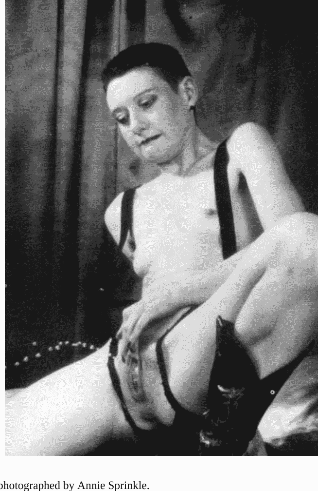

射精是令人享受的。“感觉极了。”它是原始、狂野的，并推向边界。射精的身体不是母性的；它是一个侵略性的、自我定义的、性的身体。射精代表了绝对的个人自主和自我实现。根据贝尔的说法，男性射精只是女性的复制，仅考虑到频率或排液量等方面。在贝尔看来，射精的女性身体是卓越的后现代身体，因为它瓦解了性别二元论并展示了身体平等。

三年后，1992 年，贝尔与桑达尔和凯罗·皇后（Carol Queen）合作拍摄了具有突破性的电影《如何射精：寻找 G 点》（How to Eaculate: Find G-Spot）。成上万女性看了它。“它引发了轰动！”斯普林尔多年后回忆。数百女性参加贝尔的工作坊。那些忽视或轻视射精而非支持它的女性主义者令她愤怒。她将这种倾向归咎于一种将女性身体视为对立的差异女性主义；世界观和性别政治与男女之间的“自然”差异联系起来。女性月经、生育和哺乳，而男性——只有男性——射精。

与此同时，精液是贝尔“女性阴茎”概念的核心，其另一个部分是女性前列腺的“内部勃起”。贝尔通过插入扩阴器展示受刺激的组织，将其向一侧转，使阴道前壁和肿胀的 G 点可见。贝尔相信人类只有一个，男女之间的边界是流变的，男女性生殖器在发育、结构和性反应上是对应的。女性前列腺和射精的（重新）发现证明了性别是一种“文化幻觉”。10 这就是为什么那些挑战二元、异性恋秩序的人（贝尔称之为女同恋者、性别恐怖分子或性别偏离者）是射精领域的前锋。“女性射精”这一术语标志着这种平等，并应该继续使用，因为它有助于重新定义男性射精——贝尔认为后者是较轻的。¹¹ “要接受女性精液和女性射精，必须接受男女身体的相似性。”

谁得最快？（两秒获胜！）谁能射得最远？（近二十三英尺！）谁能射得最顺畅，连续多少次？这项集体活动代表了“身体力量、政治、技巧、乐趣以及女性高潮的奇观”。¹¹² 它是对一次成功夺回主张的轻松庆祝。

20 世纪 80 年代和 90 年代的许多女性主义者担心医学和主流色情电影会抓住射精，对其进行误读和标准化，而这一切都是为了利。他们有理由担心。Bell 描述了 1995 年至 2005 年间，性学、秘术和成人娱乐领域发生了一场名副其实的“知识爆炸”。色情产业通过对（真实和电话中的）女性高潮和喷射的描写赚取了数百万美元，现在 YouTube、YouPorn、Pornhub 和 Xtube 上有数百个视频可用。Bell 令人遗憾地承认，这种无处不在在很大程度上剥夺了女性高潮的颠覆力量。她呼吁一种基于共识的“后色情”时代，拒绝异性恋规范化的预期和视角，赞美能够“打破并改变其所描绘的行为和性别”的酷儿性。¹³

Bell 对阴道射精（vulval ejaculation）的解释提出了真正的要求。她希望获得平等的权利和机会，符合这一行为所体现的身体平等。她的论证在时间上完成了一个双倍后翻，通过 19 世纪回到了中世纪和古代：Bell 正在基于一种身体技能提出政治、文化和社会要求。在 19 世纪，同样的女性无法思考，因为她们的神经太弱，或者月经是将她们排除在家庭之外的理由；女性射精现在被吹成她们与男性相同的证明。Bell 的“女性阴茎”概念是原创且勇敢的，她那俏皮的断言——女性高潮“减轻了阴茎的父权负担”——是对女性重新夺回一种男性现在必须分享的性功能的一种恰当且犀利的评论。¹⁴

## “值得学习”——妮·斯普林尔（Annie Sprinkle）

Sprinkle，1954 年出生于 Ellen F. Steinberg，是美国女性主义表演艺术和 LGBTQ 运动中一位耀眼的人物。¹⁵ 她是一位活动家、疗愈者、教育工作者、性研究人员和多媒体艺术家，今天认同自己为生态性（ecosex）。她的作品挑战了女性身体的传统呈现。她主张性教育改革、性工作去刑法化和去污名化，以及让女性决定如何看待自己的身体。

Sprinkle 为建立一个性积极、充满爱、没有恐惧和压抑的社会而战。她的项目挑战了女性身体的传统呈现。

在《G点》出版多年后，一部同样开创性的电影问世了桑达尔（Sundahl）的《女性潮射：寻找你的G点》（*How to Female Eaculate: Find Your G-Spot*）。成千上万的女性观看这部教学视频，视频还描述了女性的高潮，其中包括贝尔（Bell）。正如斯普林克在桑达尔的书《女性潮射与G点》序言中所叹道的：“世界从未像现在这样了！” 如今，“女性”（以及其他性别）正自由地享受着世界各地由女性创造的、湿润的快感，女性终于相信自己的经历是真实的。2090年代初的情况看起来有所不同：斯普林克反思道：“见证女性性世界在如此短的时间内取得巨大增长是多么令人兴奋。”30

在自己的作品中，斯普林克增加了潮射的可见度。她对此进行写作和教学。她最著名的电影之一是《荡妇与女神视频工作坊》，又名《101个简单步骤让你成为性女神》（1992年）。斯普林克撰写并主演了这部52分钟的电影，影片由玛丽亚·贝蒂（Maria Beatty）共同执导，其中包含一个持续5分钟10秒的高潮（通过某种电流计测量）以及一个用两台摄像机捕捉到的潮射场景。

是一群女同恋活动人士首先告知了惠普尔（Whipple）和珀里（Perry）这个阴道区域。28 女权主义者感到非常愤怒，因为在所有可能的术语中，作者竟然用一个男人的名字命名了一个女性私密部位（恩斯特·格拉芬堡，Ernst Gräfenberg），而且在发现G点后，有些女性感到失望，因为这并没有带来超高潮（superorgasm）。尽管如此，许多女性渴望体验这种迷失已久的性反应，并像斯普林克（Sprinkle）说的那样，学习通过赋权行为来掌握它。25

# 斯普林克的公众形象与项目

斯普林克的公众形象和项目散发着慷慨和从容的精神。她并不轻视阴部的潮射液，也不坚持要将精液和尿液区分开来。这位艺术家承认每种性生殖器液体：阴道分泌物、尿道口喷出或滴落的非尿液，以及带有性冲动的排尿。斯普林克将“金浴”定义为“性爱中的色情排尿行为”，它可以导致潮射，反之亦然。她拒绝对这些液体进行僵化的定义划分，就像她玩弄男性与女性、酷儿与异性恋、主动与被动、女神与荡妇、客体与主体等虚假的二元对立一样。无论快感是转化为潮射还是排尿——喷出来的是什么，又有什么重要？[^31]

在她的书中《安妮·斯普林克：后色情现代主义》（1991年）中，斯普林克构思了一个乌托邦式的世界愿景，在这个世界里，混杂、轻松、自愿的性爱和阴部潮射是标准配置：

> 我对未来有一个愿景，在这个世界里，所有人都能获得必要的性教育，因此将不再有性传播疾病…… 恋物内衣和性玩具将免费发放给所有人。人们如果愿意，可以在互不接触的情况下做爱。男性可以在不潮射的情况下多次高潮，这样他们就可以随心所欲勃起。女性将会潮射。可以在任何公共场所做爱，而且观看并不是不礼的。[^32]

对于斯普林克来说，性与灵性是并行的。性能够治愈。它连接了人与人、地球以及宇宙。性教会我们关于生与死的秘密。一个富有性经验的女性是一个“神圣且极其强大的力量……具有为地球生命的福祉做出贡献的潜力。”[^33] 斯普林克不再专门为潮射设计项目，她现在认为这已经是主流，尽管它仍然是女性和拥有阴部的女性性潜力的一个主要方面。

如今，斯普林克作为一个生态性恋者（ecosexual）生活，比起G点更喜欢E(co)-点。她现在的教学重点是对树木、岩石和植物的热爱。自然不再是你的母亲；它是你的爱人。“我们通过感官与地球做爱，”[^4] 斯普林克和妻子贝丝·史芬斯（Beth Stephens）在他们的《生态性恋宣言》中这样宣称。[^34] 这对夫妇在2017年的第14届文献展上展示了他们的愿景，并在卡塞尔市组织了生态性恋步行游览。斯普林克与史芬斯、珍妮·克莱因（Jennie Klein）一起，在《假设生态性恋立场：作为爱人的地球》（*Assuming the Ecosexual Position: The Earth as Lover*，2021年）中概述了她的生态性恋演变和愿景。[^35] 斯普林克已成为一个与自然世界统一爱的女性：“我们抚摸岩石，为瀑布感到高兴，经常欣赏地球的曲线。”[^36]

## “狂野、不受约束的体验”——德博拉·桑达尔

美国潮射领域的第三位女王是桑达尔，一位作家和性教育工作者。[^37] 桑达尔（1954–2023）是20世纪80年代加州女性和女同恋运动的重要人物。直到去世，她一直是女性潮射和G点领域的顶级权威以及畅销书作家兼电影制作人。桑达尔创立了女性潮射性教育学院，在北美和欧洲举办工作坊，提供在线研讨，并在全球演讲。

桑达尔在20世纪80年代初作为一名学生来到旧金山——这一到达既是一个起点也是一个终点——并成为一名激进女权主义者。桑达尔反抗父权制，反抗她的第一段女同恋，并发现了“我不知道自己的身体能够感受到的性感受。这开启了探索女性性、我个人性探索的大门。”[^38]

1984年，桑达尔和米尔·埃拉娜（Myr Elana）创立了《在我们背上》（*On Our Backs*，简称OOB），副标题为《冒险者的娱乐》。该杂志具有革命性。OOB涵盖了各种类型的女性——女同恋、直装女孩（butch）、有色人种女性。这是一个政治声明。在创刊的社论中，她们写道：“同性恋性……就像我们的生活一样丰富多样。”

该杂志尖锐、原始且露骨。对于大多数女权主义和女同恋圈来说，它太色了。女性书店拒绝出售它；学术界也保持距离。与此同时，桑达尔和……

从1984年起，桑达尔对G点和潮射感到好奇，在那一年——令她自己惊讶——她在性爱时弄湿了地板。在清理了水迹后，她开始挖掘。她的探索包括与其他潮射者的对话，并促成了《女性潮射：寻找你的G点》（*How to Female Ejaculate: Find Your G-Spot*，1992年）。这部视频是一个里程碑，一部为女性、由女性制作的趣味电影，旨在指导并赋予她们对身体的新视角。桑达尔通过扩张器展示了她的G点：她展示了她的女性身体，正如贝尔可能说的那样。例如，桑达尔的电影与1981年的《模拟女性的高潮喷液》（*Orgasm Expulsions of Fluid in the Simulated Female*）形成对比，后者是一段九分钟的教育视频，视频中两个女性躺在产科检查台上，头部在画面之外，由医生戴着手套的手刺激其阴道。这是一个令人不安的作品，将女性身体客体化，与贝尔、斯普林克或桑达尔的快乐表演完全对立。

《女性潮射：寻找你的G点》（*Fatale Video*）是一部热片，其后是类似的坚决非医疗的电影，如贝尔的《好女孩不做这些》（*Nice Girls Don’t Do It*，1990年，凯西·丹顿执导）和《女性潮射的魔法》（*The Magic of Female Ejaculation*，1992年，由戴蒙德和多莉·莱恩创作）。[^40] 桑达尔随后又制作了一系列成功的潮射视频，目前仍在售卖：《坦性女性潮射之旅：唤醒你的G点》（*Tantric Journey to Female Ejaculation: Awaken Your G-Spot*，1998年）、《情侣女性潮射：分享你的G点》（*Female Ejaculation for Couples: Share Your G-Spot*，2003年）、《女性潮射与G点：爱人指南》（*Female Ejaculation and the G-Spot: A Lover’s Guide*，2006年）以及《女性潮射：工作坊》（*Female Ejaculation: The Workshop*，2008年）。

桑达尔还就她的毕生工作写了一本书。《女性潮射与G点》（*Female Ejaculation and the G-Spot*，2003年）涵盖了所有方面：概述了女性排液的历史，解释了解剖结构，并提供了加强盆底肌肉和“治愈”G点的练习。它还教导女性如何练习潮射，给伴侣提供了建议，并探索了灵性的“女性喷泉”的一侧。这是一本很好读的书，尽管桑达尔有时会过度简化问题、提供模糊的“事实”，或忽略对其论点提供支持。

桑达尔对女性潮精的解释与贝尔有显著不同。桑达尔认为，潮精“天生具有女性气质……有趣且性感”，是“每个女性与生俱来的权利”。她将其与一种原始的女性气质联系起来。潮精“感觉可能是强烈的、爆发性的、汹涌的、激情的、巨大的、混乱的、且充满好奇的”。它还定义了性期间主要施加在女性身上的限制，阻止了她们狂野、体验极乐和放弃控制。在桑达尔看来，潮精意味着驱逐神性的束缚以及干枯的女性气质：“如果我们放手，精液会喷洒在伴侣的脸、胸部、大腿、阴茎，还有床和枕头上！这可不太像孩子，对吧？”[^41]

桑达尔告诉读者，G点和女性前列腺是同一的。[^42] 所有女性都有从尿道排出精液的前列腺。“当我们熟悉自己生殖器的解剖结构时，潮精只是一个副产品。我是怎么知道的呢？因为我不对此辩解；我面对的是真实的、活生生的！”桑达尔在2015年的一次采访中这样说。[^43] 她主张，通过G点刺激产生的高潮与阴蒂高潮非常不同。前者“开启你的心灵并能提供更多。”[^44] 她将阴蒂高潮、G点高潮以及子宫高潮区分开来。第三种是由“深度且快速的撞击宫颈的冲击”释放的。[^45]

许多女性批评了高潮可以根据其来源进行分类和区分的观点。桑达尔关于阴道高潮优于阴蒂高潮的说法也是有问题的。对高潮进行分类（更好、更深、更有精神性、更纯洁、更具愈合力等）是一种适得其反的做法，尽管它是有利可图的。看看西格蒙德·弗洛伊德（Sigmund Freud）、像艾莉丝·舒瓦（Alice Schwarzer）这样的女性主义者，或者是收取高额费用帮助客户解锁新水平性释放的个人教练就知道了。目前高潮的种类多达十二种，包括“区域高潮”：“区域高潮因人而异。正如其名称暗示的那样，任何区域受到刺激都可能导致高潮。”[^46]

这类排名阻碍了人们与自己身体的关系。20世纪90年代，桑达尔发现了坦特拉（Tantra），并开始将坦特拉哲学和实践融入她的工作之中：“对我来说，学习坦特拉之路对于理解G点在女性情感、身体和精神生活中的作用至关重要。”[^47]

## 简短旁白：坦特拉中的女性潮精，第二部分

坦特拉哲学和身体实践在20世纪60年代和70年代于美国和西欧开始盛行，尽管是根据时代需求裁剪的简编形式。新坦特拉大师尼克·道格拉斯（Nik Douglas）将其宣布为“政治变革的引擎”。[^47] 坦特拉性爱和色情是20世纪70年代增加政治、宗教、道德和性自由的一种社会隐喻——作为自然、解放、公平的性观念进入日常文化的理想画布，坦特拉被调整以满足西方的利益和需求。在最坏的情况下，它被当作一种可以通过几个简单步骤掌握的秘传性技巧出售，人们只需选择正确的导师、书籍或工作坊即可。位于加州的印度学者大卫·戈登·怀特（David Gordon White）谴责这种趋势，调侃道新时代坦特拉之于中世纪坦特拉正如指纹之于真正的艺术。[^1]

拉尼什（Bhagwan Rajneesh，后来成为臭名昭著的教主奥舒 Osho）在20世纪80年代初从印度搬往新泽西推广了他自己的新坦特拉主义。奥舒将灵性与性联系起来，并将自我发现和自我实现作为性体验的一部分。新坦特拉吸取了威廉·莱希（Wilhelm Reich）的教诲，整合了瑜伽和呼吸、身体心理治疗以及心理学。坦特拉被视为历史上高度推崇女性和女性气质。身体和性以新的方式被体验，摆脱了社会的枷锁，这使得这种实践对当时的解放运动是如此具有吸引力且合适。男性在坦特拉中直面自己的情感和身体，而女性则致力于性自信，并发现新的情感和色欲独立。双方的目标都是实现“整体性”的人格、身心、精神和性。作者兼秘传实践者鲁斯哈森（Rufusshausen）写道，坦特拉为男女提供了以亲密、共识、自愿、公平和互利的方式互动的机会。在他看来，这种男女关系的新颖表达与“性别战争”截然不同。[^5] 如今，坦特拉只是西方（精神）消费社会中的另一种生活选择。G点和女性潮精——坦特拉中的潮精通常被称为甘露 amrita——在北美和欧洲很大程度上与坦特拉相关。这种观点认为，想要面对个人创伤并释放隐藏能量的人，必须准备好面对G点和潮精。

贝尔呼吁女性夺回潮精的权利，通过（喷射）维护她们应有的权利、空间和自由。将潮精作为女神流体形式的又一个奇迹显现。现在，阴道潮精是需要实现的目标。（我夸张了），一个女性在被视为一个完全实现的高潮者之前，必须发现她的G点并经历潮精。70年代“我们的坦特拉”的先驱卡罗莱恩和查尔斯·穆尔（Caroline and Charles Muir）并不认同G点和女性潮精的等同。（注：此处原文存在大量OCR重复和混乱，翻译已按语意处理）。

如今，一系列坦特伽学院、教师和按摩治疗师提供了女性高潮的资源，并举办了阴道（yoni）和G点按摩的工作坊。根据一个德国坦特伽按摩治疗师协会，这种按摩形式正变得“越来越被社会接受”。在坦特伽按摩期间，一些女性会第一次体验到她们性中更深层次、更复杂的维度，表现为阴道高潮、全身高潮或女性高潮。[^57] 然而，在2013年的一项研究中，只有3.1%的女性受访者表示，“对射精能力的训练”（坦特伽实践中一种已有的现象）是她们获得这项技能的方式。[^58] 几位批评者对女性高潮的灵魂控制及其商业剥削大加指责。[^59] 瑞士作家彼得·罗伯特·柯尼格（Peter-Robert König）所谓的“神秘学的麦当劳化”可以很容易适用于坦特伽。柯尼格开玩笑说，不久之后，“冷冻的甘露（Amrita）”将可以在网上购买。[^60] 尽管，随着喷潮视频的激增，色片行业通过女性体液赚了数十亿的巨款。

## 喷潮女王们：精液生意遇到蜜蜂与蝴蝶

由女性为女性制作的女性主义电影和教学视频从20世纪80年代后期开始帮助女性高潮的普及。[^61] 制片人桑达尔（Sundahl）和基尼（Kinney）制作了以同理心、正直和解放驱动为特征的娱乐电影。她们旨在通过描绘远超老派父权制表现的女性性与快感侧面来提供信息。[^62] 这些在20世纪90年代兴起的女性主义色片的根源。在世纪交替之际，硬核色情中对女性高潮和喷潮的炒作带有一种某种讽刺性——或者也许是悲剧性。

如今，色情是一个十亿美元的产业。它在全球范围内可用，通常可以免费访问。女性喷潮或喷涌（在色情巅峰期如此称）如此受欢迎，以至于YouPorn、Pornhub或Brazzers等网络平台将这些视频归为独立类别。2017年11月，Pornhub——全球最大的色情网站，每天有7500万访问者——报告称在2013年至2015年间，喷潮内容的人气激增，该类别现在位于网站的前二十名。此外，“女性搜索喷潮视频的可能性比男性高44%”。[^63] 18至24岁的用户特别热衷，而65岁及以上的人对喷潮好奇较少。

每年都有越来越多的女性在消费硬核色情。这个蓬勃发展的群体受到提供者的追逐，他们将电影标记为“女性友好”或“女性欢迎”。女性也利用喷潮视频来了解女性高潮并增加床上的乐趣。在《阴道：新传》（2012）中，娜奥米·沃尔夫（Naomi Wolf）采访了布鲁克林女性友好性场所Babel的经理，后者表示，刺激G点的产品“畅销”，因为“色情开始高度关注女性高潮，导致女性探索并刺激她们的G点”。[^64] 驻柏林的社会学家、语言学家和PorNews活动家Laura Méritt证实了色情的教育职能。她认为，涉及到女性高潮时，如今的主要网站“比任何生物教科书都更进步”。[^65] 加拿大医生、畅销作家莎莎·莫莱姆（Sharon Moalem）对医学对女性高潮的冷漠表示遗憾。她指出，色情在教导人们了解女性性这一自然方面已经取代了科学。[^66]

硬核色情一直在寻找展示欲望和高潮的方法。讽刺的是，尽管在色情中身体具有“最大的可见性”，但女性的兴奋和高潮是无法捕捉的。[^67] 污语和声音、绯红的双颊、暗沉的皮肤和张开的双唇只是真实兴奋的微弱证据。尽管女性高潮（或者男性也是）并不等同于高潮，但它现在被吹称为真实兴奋的“明显视觉证明”。[^68] 如果一个女性喷了，她显然已经达到了高潮。在男性演员射精的色情片中，这一刻现在也适用于拥有阴道的演员。[^69] 像星丸·茜（Hotaru Akane）、莱莉·蒙罗（Riley Monroe）、珍娜·普雷斯利（Jenna Presley）和非二元性别色情明星莉·李（Liz Lee）这样的成人明星因其喷潮技巧而闻名。[^70] 然而，她们的最终成功完全归功于“喷潮女神”西西娅（Cytherea），她在2000年代初将喷潮从色片的小众领域提升到了主流标准。

在英国制作的色情 DVD 中存在喷潮现象。十年后，《视听媒体服务条例》经过更新，涵盖了流媒体和视频点播服务。其中拳交（Fisting）、坐脸（face-sitting）和抽打也被禁止。英国分级委员会（BBFC）对其女性喷潮的决定给出解释，声称这些场景描述的是尿失禁或“水运动”（即因看到或想到尿液产生的性兴奋），而这在英国《淫秽出版物法》中是被禁止的。简而言之，BBFC 质疑阴道喷潮本身的存在。在澳大利亚也发生了类似的情况，澳大利亚分级委员会审查含有喷潮场景的色情网站和文件，它声称这些场景描述的是排尿。与英国一样，管理机构表示这种癖好——“黄金浴”将被拒绝授予分级。

这些审查案例在英国和澳大利亚引发了抗议。正如色情作家克里斯蒂娜·洛德（Kristina Lloyd）在《卫报》中评论道：“通过拒绝承认女性喷潮的存在，BBFC 将自己定位为女性性欲的塑造者，而非分类者。”尽管对于对主流色情持有疑虑，桑德哈尔（Sundahl）仍加入了辩论，表示 BBFC 的“无知”没有任何借口。在《Slate》的《XX Factor》一文中，作者汉娜·罗辛（Hanna Rosin）讽刺地叹道，屏幕上只允许男性射精，“因为，嗯，女性在各方面都无法平等的。”女性主义成人电影导演、艺术家兼政治家安娜·潘（Anna Span，原名安娜·艾罗斯米斯）在桑德哈尔的帮助下第一个反击了 BBFC。在潘的 2009 年 DVD《女性爱色情》（Women Love Porn）因一个喷潮场景被审查后，她和桑德哈尔提供了女演员喷射能力的科学证据。这位电影制作人推动在视频上诉委员会举行听证。BBFC 最终通过了该片，但并未真正承认女性喷潮的存在。委员会认定该电影没有违反《淫秽出版物法》，因为它对“尿液癖的关注极少”。潘和她的制作公司 Easy on the Eve 庆祝了他们认为的“历史性胜利”。

美国制作公司长期面临审查。图奇（Tucci）在 2011 年评价道，公司“根本不想让我喷潮，因为每个人都会因此被起诉……我已经一年多没拍喷潮电影了。我是它的倡导者，所以我看到政府说这些男生对女孩进行口交（bukkake）没关系，但上帝别让女性在电影中获得喷潮潮。”

# 结语

问题不是女性喷潮是否真实，而是你为什么不信任女性告诉你真相。

> — 卢克斯·阿尔普特姆（Lux Alptraum），《女性喷潮是否真实的问题》，《卫报》

穿晚服的女孩抬起骨盆尖叫道：从她修剪过的阴部流出一股不像尿液的透明液体。

> — 维吉尼亚·德斯佩斯（Virginia Despentes），《启示婴儿》（Apocalypse Baby）

这是克罗伊茨贝格区（Kreuzberg neighborhood）的一个春日。劳拉·梅里特（Laura Merritt）在她居住和工作的战前公寓楼顶层迎接了我。梅里特是一位性积极活动家、女性主义者、语言学家、阴道喷潮专家，以及 PornYes 运动的共同创始人，她经营着欧洲最古老的女性主义性商店 Sexuivitäten（Sexclusivities）。三十年来，梅里特一直倡导性积极和教育，以及身体多样性和自主性。例如，梅里特和她的创始人发起了“百万蜜蜂项目”（Million Pussies Project），以反击“广泛的广告和提供看似‘客观’的信息[旨在为女性性器官的‘正确’形状、大小和功能设定]新标准。”这些柏林人庆祝阴道的多样性。该小组的“阴部档案”（Pussy Profile）问卷询问在线访问者如何称呼自己的生殖器、如何修饰阴毛，以及大小阴唇的大小。阴道的丰富性需要记录，因为“事实是并没有通用的标准。我们所有的身体都是不同且独特的……我们身体的多样性是有价值的。”

梅里特自 20 世纪 80 年代以来活跃于性工作者权利运动，1989 年在德国组织了首次国际妓女日年度纪念。在女性主义者仍描绘插入行为的时代，她作为按摩器销售员走遍全国，并在 1993 年创立了女同性恋伴游服务机构 Club Rosa。梅里特一直对许多女性主义者不敢触碰的性政治灰色地带感到自在，如色情、BDSM 以及性别取向光谱。为了女性喷潮的可见性，今天她坚持倾向于使用“阴道喷潮”（vulval ejaculation）这一术语，以此表明不认同为女性的阴道拥有者自然也会喷潮。

作为一名真正的教育者，梅里特在十八年前首次邀请德博拉·桑达尔（Deborah Sundahl）在柏林举办工作坊和讲座。女性喷泉是梅里特每周沙龙中反复的话题，讨论范围涵盖了性、文化、性别和（身体）政治。她为女性、情侣和想要更多了解喷潮及如何操作的人们教授关于女性前列腺功能和解剖学的课程。工作坊标题为“女性*喷潮与 G 点：我们喷回去！”，包含一个实操环节：脱衣、检查阴道……（注：此处原文存在大量 OCR 重复和错误，已根据上下文进行清理）。

在线开源代码：所有人都有免费的阴蒂打印图！[^112] 瑞士生物学家丹尼尔·哈格-瓦克纳格尔（Daniel Haag-Wackernagel）在2020年发布了两个解剖模型。他对“缺乏良好的图像，更不用说解剖学正确的阴蒂模型”感到惊讶，详细介绍了该器官的3D渲染图。[^113] 2022年，修订的第六版《普罗米修斯解剖学学习谱》出版。这部参考著作是德语世界医学课程解剖学教学的标准。新版展示了阴蒂（或“球阴蒂器官”）的完整复杂性，包括位置和神经分布。这无疑是一个里程碑。由于教材以英文出版，《西姆解剖谱》（Thieme Atlas of Anatomy）在线版于2023年进行了更新。详细的插图和描述公开可用，无需付费墙。[^114] 美国阴蒂教育活动人士杰西卡·平（Jessica Pin）对这一变化表示庆祝，她在Instagram上写道：“我们正在取得进展。”[^115]

科普读物倾向于描述阴蒂的部分（尽管很少涉及全部）——冠部、包皮、茎、体部、脚和球部。然而，将阴蒂缩小到葡萄大小的书籍仍在大量上架。女性前列腺的情况更为糟糕，专业文献和大众文学在很大程度上都被忽视了。目前的医学指南往往忽视这一器官，很少提到女性射精和喷射。[^116] 柏林女性主义妇女健康中心的教育者佩特拉·本滕茨（Petra Bentz）对关于阴蒂、前列腺和射精的研究结果未能传承感到感叹：“这些知识没有进入教科书或其他书籍或大众的大脑，真是难以置信。每一代新人都认为他们必须重新发明轮子。这太不可理喻了！”[^117]

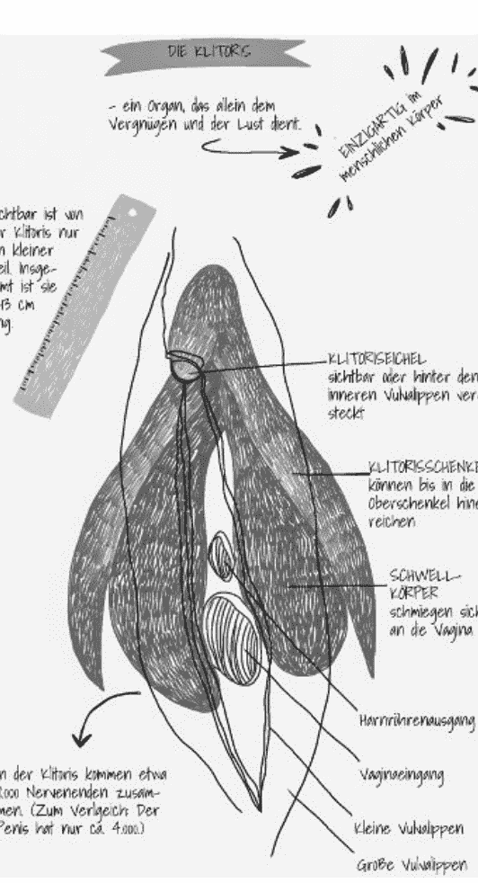

### 图 E.1
来自路易·劳格（Louie Läuger）性漫画《da unten》的插图：阴部与性（《反思性别》，2022年）

阴道射精和喷射证明了使用两百多年来描述男女身体以及性别特征的二元对立法是完全荒谬的。任何观察过喷射过程的人都会轻易抛弃传统的女性身体观念。主动与被动、给予与接受、强与弱、渗透与被渗透、做爱者与被操纵者——这些属性并非源于身体本身，而是追求意识形态目标的文化性处方。我们需要一种看待身体的新视角。我们需要不同的词汇。正如我们在“包含”（circlusion）这样的术语中看到的，语言可以捕捉新发现的知识、视角的转变和感知的改变。

**图 E.2**
老卢卡斯·克拉纳赫（Lucas Cranach the Elder），《黄金时代》，约1530年。

然而，简单地反转过时的属性很少有帮助。不，女性高潮既不是最终解放的“钥匙”，也不是一种“后女性主义的责任”。[^118] 很多拥有阴道的人并不射精，也不会弄湿床垫。女性的潮射不会如此轻易地转化为女性性欲和自我实现的象征。在床上给女性施加更大的压力和（女性主义的）责任感又有什么好处呢？

性体验是极度主观的。“高潮液”的一个关键方面一直是，它并非在所有拥有阴道的人身上发生。前列腺的大小、形状以及前阴道壁的特征在个体之间存在显著差异。[^119] 这解释了为什么有些人经常射精，许多人只是偶尔，而另一些人则从没有。这在多样化性性的观念中是合理的。一些女性和拥有阴道的人会射精和/或喷射，而另一些则不会。对某些人来说，这是最有满足感的高潮形式，而另一些人则感到不舒服、无意义或烦恼（呃，别告诉我我又得换床单）。

我们允许身体产生多大的变化？我们能忍受什么形式的差异？涉及到射精和喷射，我们愿意接受所有人并不平等的吗？即使是能够射精和喷射的阴道女性也不总是会这样做，这意味着纯粹的解剖学解释是不够的。无数因素影响着高潮的性质，包括个人处于周期的哪个阶段（绝经前）、兴奋水平和松弛程度、与伴侣的互动、放空自己的机会和能力。我讨论的国际在线调查的最年长反对者是一位七十三岁的女性，她报告说六十八岁时在性过程中“完全放空”后射精了。[^20] 放松对许多人来说是一个“非常重要的因素”，但“性行为的体验质量”也可能有助于人的射精。[^21]

许多女性和其他拥有阴道的人无法控制体液排出，谁又想失去对自己身体的控制呢？今天理想的女性身体如果不被监控、塑造和控制，那就什么都不是。这个身体没有脂肪，也没有毛。它没有味道，不出汗，不会湿。[^22] 劳里·佩尼（Laurie Penny）认为，“对女性肉体和脂肪的恐惧是对女性权力的恐惧，是女性对出生、死亡、肮脏和性升华的权力。”[^23] 女性应该是苗条的、无味的、无毛的。

图 5.2：Alice Schwarzer，《“微小差别”及其产生的巨大影响：女性超越自我——解放的开始》（法兰克福：费舍尔出版社, 1975）。© 版权所有。

图 6.1：Shannon Bell，《妓女狂欢节》（纽约：Autonomedia, 1995），© Annie Sprinkle。

图 E.1：Louie Läuger，《“在下处”：关于阴道与性爱。一部科普漫画》（慕尼黑：Unrast Verlag, 2019）。© Unrast Verlag。英文版书名为《重新思考性别：插图式探索》（马萨诸塞州剑桥市：MIT Press, 2022）。

图 E.2：老卢卡斯·克拉纳赫，《黄金时代》，约 1530 年，奥斯陆国家博物馆。

## 注释

## 卷首

Marjorie Garber, 《双性恋与日常生活的色欲》（纽约：Routledge, 2000），75。

## 作者的话

- 1. Carmen Kloer, Augustus Parker, Gaines Blasdel, Samantha Kaplan, Lee Zhao, and Rachel Bluebond-Langner，“阴道成形后的性健康：系统性回顾，”*Andrology* 9, no. 6（2021年11月）：1744–1764。

## 前言

- 1. 参见 Florian Wimpinger, Karl Stifter, Wolfgang Grin, and Walter Stackl，“重新审视女性前列腺：女性射精液的超声与生化研究，”*Journal of Sexual Medicine* 4, no. 5（2007年7月）：1391。

- 2. Florian Wimpinger, Christopher Springer, and Walter Stackl，“国际在线调查：女性潮射对女性及其伴侣的性生活有积极影响，”*BIU International* 20 (2013): E177。

- 3. 我在德国写作本书，尽管这本书在调查了逾千年文化历史后流传全球，但它呈现的视角是典型的西欧视角。考虑到本书的范围，我介绍了一些无法充分展现其复杂性的话题。请读者留意这一点，特别是关于中国和印度情色文学中性液的章节，或对 kunyaza（女性潮射）的简要介绍。

- 4. Stefan Marcus, 《其他的维多利亚人：19世纪英国性与色情学研究》（纽约：Routledge, 1964），113。

- 5. 米歇·福柯，《性史》，第一卷：导论，Robert Hurley译（纽约：Pantheon Books, 1978），4。

- 6. Laura Méritt 与作者访谈，2019年4月26日。

- 7. Milan S. Zaviačič, Tomas Zaviačič, Richard J. Ablin, Jan Breza, and Karol Holoman，“女性前列腺：历史、功能形态学与性学意义，”*Sexologies* 11, no. 41 (2001): 44。

- 8. FIPAT, *Terminologia Anatomica*，第 2 版，国际解剖学术语联邦计划，2019，fipat.library.ca/TA2/

- 9. Roger Smith, 《内特产科学与妇科科学》，第 2 版（费城：Elsevier, 2008）。

- 10. Peter Vauel, Hans-Georg Schable, 和 Ernst Mutchler 在《人体解剖学、生理学与病理生理学》（斯图加特：Wissenschaftliche Verlagsgesellschaft, 2015）中提到了两次女性潮射。更详细的描述可参见 Hans-Joachim Ahrend 和 Cornelia Friedrich 的《妇产科性医学》（海德堡：Springer Verlag, 2015）。

- 11. Vauvel, Schable and Mutchler，《解剖学、生理学与病理生理学》，第 637–638 页。

- 12. Manfred Stauber and Thomas Weylstrat，《妇产科与助产学》（斯图加特：Thieme, 2007），11。

- 13. Mary Jane Sherfy，“与心理分析理论相关的女性性欲演化与本质，”*美国精神分析协会杂志*，no. 1 (1966): 49–50。

- 14. Anna Fischer-Dickmann，《女性性生活：一项带有医学建议的生理-社会研究》（柏林：Hugo Bemünler, 1908），1。

- 15. 引用自 Caroline Meausson-Lafeuisse，“女性的排出或喷射，”*Annales Médico-Psychologiques* 171 (2013): 110。

- 16. 匿名，《人类的德律斯起源》（图宾根，1800），1:21。

- 17. Rebecca Chalker，《阴蒂的真相：你指尖上的秘密世界》（纽约，2000），74。

- 18. Peter Hesse 和 Günter Tbrock 编，《性、人类与社会》（莱比锡：Hirzel, 1974），1:221, 216。作者还提到了“巴尔托林腺的一种分泌反射，其‘大致对应男性的射精反射’”（216）。

- 19. Daniel Haag-Wagernagel，“感觉神经末梢——女性的，”*Sexrologie* 29, no. 2 (2022): 5。

- 20. Sylvia Roth and Kelvin Pinker，“阴蒂——女性的器官，”*clio* 68 (2009)。

- 21. 《性爱爱爱》，第 3 季第 7 集，Kate Horn 导，Sophie Goodhart 编，Netflix 提供，https://www.netflix.com/search?q=sexeducation&sbv=80972。

- 22. Florian Wimmer，“女性的——事实还是神话，”*Urologie* 2, no. 7 (2007)。

- 23. Naomi Wolf，《阴道：新传》（纽约：Echo, 2012），111。

- 24. Michael Schünke, Erik Schalie, Udo Voll, and Karl Wesker，《普罗米修斯：解剖学学习》（斯图加特：Thieme），311。重点。

- 25. 我会反复提醒读者，在讨论阴蒂时，我指的是整个部分的器官。

- 26. Josephine Lowndes，《夏娃的秘密：性的新理论》（纽约：Random House, 1987），179。

- 27. Sabine zur Nieden，《女性潮射：性别的变异》（吉森：Psychozial-Verlag, 2009），57。

- 28. “现在更多人在谈论这个了，我觉得更多女性在潮射，”编舞家 Christine Gaigg 观察到。她关于潮射的作品《去吧》于 2022 年 1 月在 Tanzquartier Wien 上。见 Karin Cerny 采访，《TQ Magazine》，https://tqw.at/ejaculating-a-style/。

- 29. 参见 Wimpissinger, Springer, and Stackl，“国际在线调查，”181。一些女性报告她们是从阴道而非尿道潮射。考虑到某些腺管指向前壁，这是可能的。

- 30. 参见 Wimpissinger 等，“重新审视女性前列腺，”31。

- 31. Alex Todorov，“女性潮射是，”JOYclub，2019 年 6 月 4 日最后修改，https://www.joyclub.de/magazin/sex/weibliche_ejulation.html#squirt_oder_joyclub_unfrage

- 32. Alberto Rubio-Casillas and Emelle Jannini，“从女性潮射案例获得的新见解，”*医学杂志* 8, no. 12 (2011年12月）：3500–3504。S. Salama, F. Boitrelle, A. Gauquelin, N. Thioun, and P. Desvaux，“关于女性潮射在2015 年知道什么？”*Gynécologie Obstétrique & Fertilité* 43, no. 6（2015年6月）：449–452。Zlakto Pastor and Roman Chmel，“女性‘性’液的鉴别诊断，”*国际泌尿杂志* 29, no. 4 (2017年12月）：621–629。后者还将尿禁症视为第三种性液。另见 Zlakto Pastor and Roman Chmel，《女性潮射与喷射：相似但不同的现象：当前研究的叙述，”*Clinical Anatomy* 35, no. 5 (2022年4月）：616–625。

- 33. 参见 Wimpissinger, Springer, and Stackl，“国际在线调查，”180。

- 35. 参见 Frédérique Gruyer。

- 36. “喷射或女性潮射的性论坛，”JOYclub，2022年8月3日访问，https://www.joyclub.de/forum/t483572-75.squirting_oder_die_weibliche_ejaculate.html。

# 第一章

- 1. 参见 Robert Hans Gulik，《古代中国的性生活：对公元前1500年到公元后1664年中国性与社会的初步调查》（莱顿：Brill, 1961），38–39。

- 2. 在某些道教派派中，这种想法产生了一种“性吸血鬼”行为，即从女性（理想情况下是处女）体中提取其体液——这是一种损害尊严的做法，将女性视为一个容器，甚至可能导致其死亡。

- 3. Rudolf Pfister，“早期和中世纪中国性快乐的性别化，”*Asian Medicine* 7 (2012):34–64。

- 4. Li Ling and McMahon，“房中术王道归文献的文本与术语，”*Early China* 17 (1992)。

- 5. Rudolf Pfister，“中国身体技术手稿中女性生殖器的父名”（在2015年5月上海中国中国出土医学手稿国际会议上发表的论文）。

- 179。

- 24. Pfister，“乳木树与生理学”， 834, 835。
- 25. Robert Hans van Gulik，《明代色情版画：从汉代到清代中国性生活论文》，公元前206年–公元1644年（莱甸：Brill，2004年），44–45, 118。
- 26. 《金座上的梅》，或《金平梅》，大卫·托德·罗伊（David Tod Roy）译（普林斯顿，新泽西州：普林斯顿大学出版社，2001年），2:144–145。
- 27. 引用自 Zimmer，“中国小说”， 450。
- 28. 引用自 阮 Fu Ruan，《中国的性：中国文化中的性心理研究》（纽约：Plenum Press，1991年）， 139。

# 第二章

1. Miranda Shaw，《激情的启蒙：密教佛教中的女性》（普林斯顿，新泽西州：普林斯顿大学出版社，1994年），157。
2. 引用自 Renate Syd，“古印度性科学中‘格拉芬堡区’与女性射精的认知：一项医学史贡献”，《Sudhoff医学与自然科学档案》（斯图图加特：Franz Steiner，1999年）：82:181，书第2卷。
3. 解脱（Moksha）——从轮回循环中释放或解放并转世为轮回——被增加第四个目标。
4. Katharina Kaur 和 Sudhir Kakar，《印度人：民族肖像》（伦敦：Penguin Books，2007年），73, 75。这意味着提到了《伽伽经》及类似的著作，这些作品针对主要是男性精英，代表了关于女性的性观点。
5. Metzler 世界文学词典，Axel Ruckbartle 编（柏林：Springer Verlag，2006年），2:237。
6. Yashodhara Indrapada 对瓦特萨亚纳·马拉纳加之《伽伽经》的评注，Wendy Doniger 和 Sudhir Kakar 译（牛津：Oxford University Press，2003年），4。
7. Philip Lawson，《印度》（伦敦：Weidenfeld and Nicholson，1968年），83–84。
8. Richard Schmidt，《印度性爱学的贡献：梵语民族的性生活》。根据课程编写（柏林：Barsdorf，1922年），263。
9. 参阅 Joanna B. Korda，“女性射精史”，《性医学杂志》第7卷第5期（2010年5月）：1967–1968。
10. Syd
15. Kalayana Malla，《阿纳加冉伽：无体之者的阶段》，或《印度人的爱之艺术》，F. F. Arbuth 和 Richard F. Burton 译（纽约：Medical Press of New York，1966年），4, 5。
16. Malla，《阿纳加冉伽》，15——“显而易见的是，通过某种技巧，血液较冷且较不易兴奋的女性的高潮可以清晰地感知到男性的高潮，交合是在预之中的，男性这一生的主要职责是尽可能地克制自己，同时享受伴侣的快乐。”结果是一方无所获，而后者没有获得任何满足。
17. Schmidt，《印度性爱学的贡献》，645。
18. Kokkoka，Pandit Kokkoka 的《Kali rahasa》，54。
19. Korda，“女性射精史”， 1969年。
20. Kokkoka，Pandit Kokkoka 的《Kali rahasa》，54。
21. Schmidt，《印度性爱学的贡献》，258–259。
22. Syed，“‘格拉芬堡区’的认知”，178, 171。
23. 参阅 Mark S. Dyczkowski，《库比卡女神崇拜：秘密纽瓦尔女神的初步文本与人类学调查》（斯图加特：Franz Steiner，2001年），39。
24. 参阅 David Gordon White，《瑜伽女：南亚背景下的密教性》（芝加哥：芝加哥大学出版社，2006年），93。
25. Dyczkowski，《库比卡女神崇拜》，47。
26. 参阅 White，《瑜伽女》，39。
27. Rufus Campausen，《阴道：女性创造力的圣圣》（罗彻斯特，佛特：Inner Traditions，1996年）。Campausen 的书介绍了今日仍在的印度密教仪式，其中阴道液被收集并饮用。
28. 引用自 Miranda Shaw，《激情的启蒙：密教佛教中的女性》（普林斯顿，新泽西州：普林斯顿大学出版社，1994年），39。
29. Shaw，《激情的启蒙》，168。
30. Shaw，《激情的启蒙》，157。
31. 引用自 Shaw，《激情的启蒙》，158。
32. Shaw，《激情的启蒙》，158。参阅 Catherine Black，《潘多拉盒子》（伦敦：Weidenfeld and Nicholson，2003年），265–266。
33. 参阅 Campausen，《阴道》。
34. Shaw，《激情的启蒙》，158。
35. 参阅 White，《瑜伽女》，75。
36. White，《瑜伽女》，75。
37. 参阅 Kakar 和 Kakar，《印度人》。这本书概述了古印度对精液的各种解释。
38. 参阅 Schmidt，《印度性爱学的贡献》，285–286。
39. 参阅 Jeffrey Getleman，“印度第三性的特殊地位”，“纽约时报”，2018年2月17日，https://www.nytimes.com/2018/02/17/style/india-third-gender-hijras.trans。
40. 参阅 Schmidt，《印度性爱学的贡献》，286。
41. 参阅 White，《瑜伽女》，92。

# 第三章

1. 参阅 Karl Stiftung，《欲望的第三维度：女性射精的秘密》（慕尼黑：Heyne Verlag，1988年），30。
2. Thomas Laqueur，《性：从希腊到弗洛伊德的身体与性别》（剑桥，马萨诸塞州：哈佛大学出版社，1992年），52。
3. Laqueur，《性》，4–5。克劳狄斯·盖伦（公元129–216年），其医学权威持续到现代早期，该术语。
4. Laqueur，《性》，38。
5. Heinz-Jürgen Voß，《重新审视性：生物医学视角角的解构》（比斯费尔德：Transcript，2010年），52–60。作者详细概述了希腊和罗马的性教。
6. 参阅 Stiefer，《欲望的第三维度》，33。
7. 柯林希波克拉底，《Loeb古典图书馆》520:12–13，2023年7月21日访问，https://www.loebclassics.com/view/hippocrates_generation/2012/pb_LCL520.13?result=27&rskey=F3DPR。
8. 柯林希波克拉底，《发生》。
9. Stiefer，《欲望的第三维度》，33。
10. 引用自 Giulia Sissa，“柏拉图与亚里士多德的性哲学”，《古代女神到基督教圣人》，Arthur Goldhammer, Pauline Pantel 选，第1卷，《西方史》，Georges 和 Michelle Perrott 编（剑桥，马萨诸塞州：哈佛大学出版社Beknap Press，1992年），68–99。
11. 亚里士多德《发生论》，Loeb古典图书馆》366:100–101，2023年7月21日访问，https://www.loebclassics.com/view/aristotle-generation_1942/pb_LCL366.101.xml?rskey=V5OxM&result=2&mainRsKey=J3sf。
12. Laqueur，《性》，38。
13. 盖伦，《身体部位之用》，Margaret Tallge（伊塔卡加，纽约州：康奈尔大学出版社，1968年），27。
14. 盖伦，《身体部位之用》。
15. Thomas Laqueur，《自淫的文化史》（纽约：Zone Books，1993年）。
16. Norbert Eggermann，《中世纪的》，1995年。
17. Robert Jitter，《中世纪的的的的：：中世纪的欲望》（慕尼黑：Fischer，2003年），110。
18. Julius Jömann，《中世纪配方》（苏黎世，1925年），153。
20. Kokkoka，Pandit Kokkoka 的《Kali rahasa》，54。
21. Schmidt，《印度性爱学的贡献》，258–259。
22. Syed，“‘格拉芬堡区’的认知”，178, 171。
23. 参阅 Mark S. Dyczkowski，《库比卡女神崇拜：秘密纽瓦尔女神的初步文本与人类学调查》（斯图加特：Franz Steiner，2001年），39。
24. 参阅 David Gordon White，《瑜伽女：南亚背景下的密教性》（芝加哥：芝加哥大学出版社，2006年），93。
25. Dyczkowski，《库比卡女神崇拜》，47。
26. 参阅 White，《瑜伽女》，39。
27. Rufus Campausen，《阴道：女性创造力的圣圣》（罗彻斯特，佛特：Inner Traditions，1996年）。Campausen 的书介绍了今日仍在的印度密教仪式，其中阴道液被收集并饮用。
28. 引用自 Miranda Shaw，《激情的启蒙：密教佛教中的女性》（普林斯顿，新泽西州：普林斯顿大学出版社，1994年），39。
29. Shaw，《激情的启蒙》，168。
30. Shaw，《激情的启蒙》，157。
31. 引用自 Shaw，《激情的启蒙》，158。
32. Shaw，《激情的启蒙》，158。参阅 Catherine Black，《潘多拉盒子》（伦敦：Weidenfeld and Nicholson，2003年），265–266。
33. 参阅 Campausen，《阴道》。
34. Shaw，《激情的启蒙》，158。
35. 参阅 White，《瑜伽女》，75。
36. White，《瑜伽女》，75。
37. 参阅 Kakar 和 Kakar，《印度人》。这本书概述了古印度对精液的各种解释。
38. 参阅 Schmidt，《印度性爱学的贡献》，285–286。
39. 参阅 Jeffrey Getleman，“印度第三性的特殊地位”，“纽约时报”，2018年2月17日，https://www.nytimes.com/2018/02/17/style/india-third-gender-hijras.trans。
40. 参阅 Schmidt，《印度性爱学的贡献》，286。
41. 参阅 White，《瑜伽女》，92。

41. Kruse, 《Verborgene Heilkünste》（隐藏的医术艺术），93–94, 105–106.

42. Diepgen, 《Frau und Frauenheilkunde》（女性与妇产科学），181.

43. Goehl, 《Frauengeheimnisse im Mittelalter》（中世纪的女性秘密），19.

44. 援引自 Évelyne Berriot-Salvedour，“The Discourse of Medicine and Science”（医学与科学论述），收于《Renaissance and Enlightenment Paradox》（文艺复兴与启蒙时代的悖论），Arthur Goldhammer 等，Natalie Zemon Davis 和 Arlette Farge 编，3卷，《A History of Women in the West》（西方女性史），Georges Duby 和 Michelle Perrot 编（Cambridge, MA: Harvard University Belknap Press, 1993），362.

45. Diepgen, 《Frau und Frauenheilkunde》，183.

46. Goehl, 《Frauengeheimnisse im Mittelalter》。

47. Robert Muchen, 《Orgasm and the West: A History of Pleasure from the 16th Century to the present》（高潮与西方：从16世纪至今的享乐史），Jean Birrell译（Cambridge, UK: Polity Press, 2000），73.

48. Barbara Duden, 《Geschichte unter dem Jahr: Ein Arzt und seine Patientinnen um 1730》（年度下的历史：1730年前的一位医生和他的女病人）（Stuttgart: Klett-Cotta, 1991），138.

49. Diepgen, 《Frau und Frauenheilkunde》，173.

50. Stifter, 《die dritte Dimension der Kunst》（艺术的第三维度），43.

51. 参见 Ursula Weiser, 《Zeugung, Veruberung und pränatal Entwicklung in der Medizin des arabisch-islamischen Mittelalters》（阿拉伯伊斯兰中世纪医学中的受孕、掠夺与产前发育）（Leipzig: 1993），130–131.

52. Basim F. Musallam, 《Sex and Society in Islam: Birth Control before the Nineteenth Century》（伊斯兰中的性与社会：19世纪前的避孕）（Cambridge, UK: Cambridge University Press, 1983），51.

53. Esin Kahya, 《The Treatise on Human Body and Interpretation of Philosophers by Al-Taqi》（Al-Taqi的人体论与哲学家的阐释）（Islamabad: National Hijra Council [Pakistan], 1990），121, 117.

54. Musallam, 《Sex and Society in Islam》，17.

55. Musallam, 《Sex and Society in Islam》，61–62.

56. Musallam, 《Sex and Society in Islam》，61.

57. 参见 Musallam, 《Sex and Society in Islam》，64.

58. 援引自 Wadi B. Chemouda，“Die Abhandlung von Milz, Nieren, Harnblase, Hoden, Gebärmutter und Brust nach dem ‘Handbuch der Chirurgie des Ibn-Al-Quff’”（根据《Ibn-Al-Quff外科手册》关于脾、肾、膀胱、睾丸、子宫和乳腺的论述）（博士论文，苏黎世大学，1988），48.

59. 纳菲, 《The Perfumed Garden》（香园），11, 18, 65.

60. Ali Ghandour, 《Liebe, Sex und Islam: Das unterdrückte Erbe der Muslime》（爱、性与伊斯兰：穆斯林被压抑的遗产）（Munich: C. H. Beck Verlag, 2019），137.

61. Ghandour, 《Liebe, Sex und Islam》，117, 110。原文有括号，由 Elisabeth Lauff 从德语译出。

62. An-Natafzī, 《The Perfumed Garden》，130–131, 64–65.

63. Nicolas Venette, 《The Mysteries of Conjugal Love Reveal’d》（揭秘婚姻之奥秘）（London, 1712），143.

64. Venette, 《The Mysteries of Conjugal Love Reveal’d》，222, 223–224, 231.

65. Venette, 《The Mysteries of Conjugal Love Reveal’d》，99, 140.

66. Jütte, 《Lust ohne Henn》（没有海娜的快感），108–109.

67. Samuel August Tissot, 《Onanism, or, A Treatise upon the Disorders Produced by Masturbation, or, The Dangerous Effects of Secret and Excessive Vanity》，由 A. Hume 著（自淫，或关于自慰所引起疾病的论述，或关于隐秘与过度虚荣的危险影响）（London: printed for Richardson and Urquhart, 1781），52.

68. Tissot, 《Onanism》，46, 71.

69. Laqueur, 《Solitary, Sex》（孤独的性）。

70. Tissot, 《Onanism》，161.

71. Simon André Tissot, 《Von der Onanie und Abhandlung über die Krankheiten, die von der Selbstbetachtung rühren》（论自淫以及关于由自视引起的疾病的论述）（Eisenach: Michael Gottlieb Grießbach's Söhnen, 1770），221–222.

72. Thomas Laqueur，“Teufelszeug”（魔鬼之物），Martin Spiewak 采访，载于《Die Zeit》，第17期，2008年4月17日。

73. Johann Heinrich Zedler, 《Grosses volstaendigiges Universal-Lexicon von Wissenschaften und Kunst》（科学与艺术大型通用百科全书）（Halle: J. H. Zedler, 1739, 10:639）。原文有强调。

74. Zedler, 《Grosses volstaendigiges Universal-Lexicon》，22:1652。原文有强调。

75. Laqueur, 《Making Sex》（制造性），149–150.

76. Dietrich Wilhelm Busch, 《Das Geschlechtsleben des Weibes in physiologischer, pathischer und therapeutischer Sicht》（生理、病理和治疗视角下的女性性生活）（Leipzig: Brockhaus, 1839），60.

77. Duden, 《Geschichte unter der Haut》（皮肤下的历史），20–21.

78. 援引自 Emil Putz，《Die Jahrunderte》（世纪），关于“医学与性”的论述（Leipzig: 1990），39.

79. 援引自 Claudia Huntington，《Die Ordnung des Geschlecht》（Frankfurt: Campus, 1996），40.

80. Christian Gottfried, 《Die Ordnung der性与自淫的禁忌》（自淫的自自,,,,:1, 1777），17, 58.

81. An-Natafzī, 《The Perfumed Garden》，130有5。

82. 援引自 Paul Mantazza，“关于婚姻”（London, 1912），133。

3. 援引自 Heinrich Seyler，《Bücher aus dem Giftschrank》（禁书中的书籍），关于“医学与性”的论述（Berlin: 1990），133。

20. 1903年，保罗·伯恩哈德（Paul Bernhard）医生也描述了两个在没有快感的情况下发生的女性潮射。保罗·伯恩哈德，“Ueber pollutionsartige Vorgänge beim Weib ohne solche Vorstellungen und Lustgefühl，”*Neurologisches Zentralblatt*4，Toby Kohn编辑（1905年2月2日）：171。

21. Kisch，《女性的性生活》，357, 359, 358。

22. 参见 Putz，《Verordnete Liste》，49。

23. Otto Adler，女性缺失的性感觉：*Anaesthesia sexualis feminarum*（女性性感觉缺失）。性欲缺失，性交痛（Dyspareunia）（柏林：Fischer medicinische Buchhandlung, 1919），127。

24. Adler，《女性缺失的性感觉》，6, 10, 16, 129。

25. Adler，《女性缺失的性感觉》，16, 19。

26. Adler，《女性缺失的性感觉》，23, 107, 45。

27. Adler，《女性缺失的性感觉》，20。

28. 参见 Wilhelm Stekel，《自淫与同性恋：同性恋神经症》（柏林：Urban und Schwarzenberg, 1917），41。

29. 参见 Sigusch，《性科学史》，208。

30. Sigusch，《性科学史》，58。

31. 引用自 Karl Stifter，《欲望的第三维度：女性潮射的秘密》（*die dritte Dimension der Lust*: The Secret of Female Ejakulation）（慕尼黑：Heyne Verlag, 1988），107。

32. Alfred C. Kinsey，《人类女性与男性的性行为》（费城：W. B. Saunders Company, 1953），635, 634。

33. Kisch，《女性的性生活》，357。

34. Enoch Heinrich Kisch，《女性的性忠贞》（*die sexuelle Treue der Frau*）（波恩：A. Marcus and E. Webers, 1918），80–82。

35. Kisch，《女性的性忠贞》，82。

36. Thomas Laqueur，《制造性：从古希腊到弗洛伊德的身体与性别》（Making Sex: *Body and Gender from the Greeks to Freud*）（马萨诸塞剑桥：哈佛大学出版社，1992），viii。

37. 引用自 Putz，《Verordnete Liste》，90。

39. Bernhard A. Bauer，“你是什么，女性？关于女性身体、灵魂、性生活和爱斯的思考”（Was bist du, Weib? Betrachtungen über Körper, Seele, Sexualleben und Eros des Weibes）（维也纳：Rikola, 2023）。Elisabeth Lauffer 译。参见 Stifter，《欲望的第三维度》，111–114。文中还提到了“弹射宫颈粘液的童话”。

40. Bauer，《你是什么，女性？》，236–237。

41. Putz，《Verordnete Liste》，233。

42. Wilhelm Stekel，《女性与其性生活相关的冷淡》（*igidity in Woman in Relation to Her Love Life*），James James S. van Teslar（纽约：Liverright, 1926），2:302。原文强调。

43. Georg Ludwig Köbhel，《人类及某些哺乳动物在解剖生理关系中的男女器官》（die männlichen und weiblichen Organe des Menschen und einiger Säugetiere in anatomisch-physiologischer Beziehung）（弗赖堡：Emmerling, 1844），13。他写道：“同样的原因，男性很难在勃起时排尿，女性在发情期漏尿并不常见。”

44. 引用自 Stifter，《欲望的第三维度》，115。

45. Ernst Gräfenberg，“尿道在女性高潮中的作用”（The Role of Urethra in Female Orgasm），International Journal of Sexology 3, no. 3（1950年2月）：147。

46. William H. Masters, Virginia E. Johnson 和 Robert C. Kolodny，《马斯特斯与约翰逊论性与人类生物学》（Masters and Johnson on Sex and Human Biology）（波士顿：Little, Brown and Company, 1985），70。

47. 参见 Beverly Humble，“女性潮射”（Ejaculation, Female），收于《国际人类学百科全书》（The International Encyclopedia of Human Sexuality），Patricia Weelehan 和 Anne Bohlin 编辑（英国切斯特：Wiley-Blackwell, 2015），1:325。

48. 参见 Nieden，《女性潮射》（Weibliche Ejaculation），46–47。

49. 引用自 Shannon Bell，“女性主义潮射”（Feminist Ejaculations），收于《歇斯底里男性：新女性主义理论》（The Hysterical Male: New Feminist Theory），Arthur Kroker 和 Mariolise Kroker 编辑（纽约：St. Martin’s Press, 1991），159。

50. Joseph G. Bohlen，“女性潮射与尿压力性尿禁”（Female Ejaculation and Urinary Stress Incontinence），Journal of Sexual Research 18, no. 4（1982年11月）：360。

51. Eve Engler，《单一性旋涡》（The Monogamous Vortex）（纽约：Villard, 1998），27。

52. Rebecca Chalker，《阴蒂真相：你指尖的秘密世界》（The Clitoral Truth: The Secret World at Your Fingertips）（纽约：Seven Streets Press, 2000）。

53. 在2013年的一项系统文献综中，Zlatko Pastor 认为湿高潮涉及少量前列腺液或“较稀的尿液”。参见 Zlatko Pastor，“女性潮射对比性交尿禁”（Female Ejaculation vs Coital Incontinence），Journal of Sexual Medicine 10, no. 7（2013年7月）：68。Samuel Salam 的同事发表了一项针对七位女性的研究，报告她们在性期间有大量液体。研究人员检查了这七个样本，注意到其中含有前列腺液。Ihab Younis 和 Rehab Salem 断言女性可以分为三类：潮射者、喷射者和性交尿禁者。“谁属于湿润的一方？”（Who is Going to the Wet Side?）Human Andrology 6, no. 3（2016年9月）：90。

54. Rufus Cartwright, Usman Ely 和 Linda Cardo，“女性潮射者会有尿禁吗？”（Do Women with Female Ejaculation Have Detrusactivity?）Journal of Sexual Medicine 4, no. 6（2007年）：65。

55. Jessica Päfs，“性超能力还是耻辱？”（A Sexual Superpower or a Shame?）收于《Diverse Experiences of Squirting in Sexualities》（2021）：10。

56. 参见 B. A. Simon 和 T. Rokyo，“女性前列腺”（The Female Prostate），Anthropologie 33, no. 1–2（1995）：131–134。

57. 参见 Gal，《精液》（On Semen），Philip Lacy 译（柏林：Akademie Verlag, 1992）。

58. Ericka Johnson，《前列腺文化传传》（A Cultural Biography of the Prostate）（马萨诸塞剑桥：MIT Press, 2021），25。

59. Stifter，《欲望的维度》，65。

60. G. Oberdieck，“男性和女性膀胱的上皮与腺体”（Ueber Epithel und Rosen der Harnblase der männlichen und weiblichen Ura）（博士论文，哥廷根大学，1884）；Ludwig Aschoff，“尿路粘膜的正常与病理解剖学贡献”（Ein Beitrag zur normalen und pathologischen Anatomie der Schleimhaut der Harnwege und ihrer drusen），Archiv für pathologische Anatomie und Physiologie und klinische Medic 138, no. 2（1894年11月）：195–220。

61. Gustaf Pallin，“前列腺与精囊的解剖与胚胎学贡献”（Beitrag zur Anatomie und Embryologie der Prostata und Samenblasen），收于《解剖生理学》（比锡：Veit und Com., 1901），135–176；Walther Felix，《尿路与生殖器官的发展》（Die Entwicklung der Harn- und Geschlechtsorgane）（比锡：Hirzel, 1911），无页；Josephine Lowndes，《夜晚的秘密：一种性理论》（Eve’s Secrets: A New Theory of Sexual）（纽约：Random House, 1988），76。

62. E. N. Petrowa, C. S. Karawaea 和 A. E. Berkanskaja，“女性尿道的构造”（Über den Bau der weiblichen Urethra），Archiv für Gynäkologie 136, no. 1（1937年12月）：343–357。

63. 引用自 Nieden，《女性潮射》，34。

64. Russell L. Deter, George T. Caldwell 和 A. I. Foslom，“女性尿道的临床与病理研究”（A Clinical andical Study of the Female Urethra），Journal of Urology 55, no. 6（1946年6月）：651–662。

65. Huffman 研究了前列腺解剖表述史（Huffman studied the history of the prostate’s anatomical representation）。他1948年的文章分析了从1737年到20世纪上半叶的解剖计数，这些都证实了女性前列腺的存在。

66. Regnier de Graaf，《关于生殖系统中多器官的新论》（De multier organum in generationi submersius tractus novatus）（巴达达：Ex officias Hackiana, 1672）。

67. 引用自 Sevely，《夜晚的秘密》（Eve’s Secrets），70, 71。

68. Regnier de Graaf，《关于女性器官的新论》（New Treatise concerning the Female Organs of Women）（1672），收于 H. B. Jocelyn 和 B. P. Shelley 译，《生殖与肥力杂志》（Journal of Reproduction and Fertility, supplement 17）（牛津：Blackwell Scientific Publishing, 1972），77–222。

69. 尔托林腺（Bartholin’s glands）类似于卡斯特兰体，与高珀氏腺（球尿道腺）是同源的，并在性期间、高潮前分泌几滴液体。这对导管长一英寸，进入阴道前庭，位于“8点和4点”位置。

70. Stifter，《欲望的维度》，60–61。

71. Friedrich Tiedemann，“女性的杜弗里腺、巴尔托林腺或高珀氏腺以及子宫的构造”（Von den Duveryschen, Bartholschen oder Cowperschen Drusen des Weibs und der Gestaltung und der Gebärmütter）（海德堡：Druck und Verlag von Karl Groos, 1840），11。

72. Stifter，《欲望的维度》，100, 101, 60。

73. Alexander Skene，《女性尿道两个重要腺体的解剖与病理学》（The Anatomy and Pathology of Two Important Glands of the Female Urethra）（纽约：William Wood and Co., 1880），1–2。

74. Nieden，《女性潮射》，34。

75. Florian Wimpinger，“女性前列腺——事实还是神话？”（Die weibliche Prosta–Faktum oder Mythos），Urologie 2, no. 7（2007）：19。

76. John W. Huffman，“成年女性旁尿道的详细分析”（The Detailed Analysis of Paraurethrals in the Adult Female），American Journal of Obstetrics and Gynecology 55, no. 1（1948年1月）：98。

77. Wimpinger，“女性前列腺”，20。

78. Matthias Davis, Frank C. K. Chen 和 Peter Sientopodf，“谁（他）发现了G点？对61年前首次描述的医学注释”（Wer (er)fand den G-Punkt? Medizinische Anmerkungen zur Erstbeschreibung von 61 Jahren），Deutsche Ärzteblatt 42 (2005): A 2854。

80. Gräfenberg “尿道在女性高潮中的作用”， 148。
81. William H. Masters 和 Virginia E. Johnson，《人类性反应》(波士顿：Little, Brown and Company, 1966), 135。
82. Sherfey 的工作很大程度上针对弗洛伊德思想和当代心理分析。
83. Mary Jane Sherfey，《女性性爱的本质与演化》(纽约：Random House, 1996), 174, 14。
84. Sherfey，《女性性爱的本质与演化》，38, 47, 46, 58。
85. Sherfey，《女性性爱的本质与演化》，64。
86. Sherfey，《女性性爱的本质与演化》，85, 88。**原文处有强调**。
87. Josephine Lowvesey 和 J. W. Bennett,“关于女性射精与女性前列腺”，《性研究杂志》14, no. 1 (1978年2月): 18。
88. *Hexengellüster: Frauen greifen zur Selbsthilfe*(1975)，作为西德女性运动的核心出版物，书中并未提到女性前列腺或射精。
89. Chalker，《阴蒂的真相》，43。
90. 女性健康中心联盟，《女性身体的新视角：全插图指南》(纽约：Simon and Schuster, 1981), 47。
91. 引用自 Chalker，《淫妇狂欢》(纽约：Autonomedia, 1995), 273。
92. 引用自 Shannon Bell，《淫妇狂欢》。
93. 女性健康中心联盟，《女性身体的新视角》，54。Pat Califia 的经典著作《女同比术：女同恋性爱之书》出版于 1980 年。Califia 描述了一个“我经常听女孩们谈论的润滑问题”——女性射精或潮喷。由于无法解释这一现象，而且由于女性的“突然惊吓或干扰了伴侣”，她建议寻求医疗帮助。这可能是感染或尿禁症的信号吗？“你并不孤单”，很容易想象《女性身体的新视角》提供了多大的慰藉。见 Pat Califia，《女同比术：女同恋性爱之书》(佛罗里达州 Tallahassee：Naiad Press, 1980)。
94. 柏林-西区女性健康中心，《Frauenkörper—neu gesehen：一本插图手册》前言，由女性健康中心促进协会编选（柏林：Orlando-Frauenverlag, 1992），无页。
95. 女性健康中心联盟，《女性身体的新视角》，54。

# 第 5 章

- 1. Alice Kahn Ladas, Beverly Whipple 和 John D. Perry，《G点及其他关于人类性爱的新发现》(纽约：Dell, 1983), xvi, xv。
- 2. Janice M. Irvine，《欲望障碍：现代美国性爱中的性欲与性别》(费城：Temple University Press, 2005), 169。
- 3. Ladas, Whipple 和 Perry，《G点》，170。
- 4. John Heidenry，《狂野狂喜：性革命的兴起与衰落》(纽约：Simon and Schuster, 1997), 301。
- 5. Irvine，《欲望障碍》，168。
- 6. Ladas, Whipple 和 Perry，《G点》，146–147。
- 7. Ladas, Whipple 和 Perry，《G点》，43。
- 8. Ladas, Whipple 和 Perry，《G点》，60。
- 9. Ladas, Whipple 和 Perry，《G点》，104, 106。
- 10. Martin Weisberg，“关于女性射精的注”，《性研究杂志》17, no. 1 (1981年2月): 90–91。
- 11. Ladas, Whipple 和 Perry，《G点》，152。
- 12. 引用自 Irvine，《欲望障碍》，165。
- 13. Ladas, Whipple 和 Perry，《G点》，84。
- 14. Sabine zu Frieden，《Weibliche Variationen: einem Geschlecht》(莱森：Psyzial-Verlag, 2009), 107。
- 15. C. Reimiche，《两种性理论的引言》(法兰克福：Fischer Verlag, 1991), 23。
- 16. Sigmund Freud，《性理论贡献》，A. A. Brill 译，第二版（纽约：Nervous and Mental Disease Co., 1920），81。
- 17. Rebecca Chalker，《阴蒂的真相：指尖上的秘密》(纽约：New England Press, 2000), 83。
- 18. Anne Koedt，《道高潮的神话》(波士顿：New England Press, 1970)。
- 19. Alfred C. Kinsey，《人类性行为》(费城：W. B. Saunders, 1953), 579–580, 592。
- 20. William H. Masters 和 Virginia Johnson，《人类性反应》(波士顿：Little, Brown and Company, 1966), 253。
- 21. Shire Hate，《冲击报告》(纽约：New England Press, 1976), 215。
- 22. Alice Schwarzer，“微小差异及其后果：女性”(法兰克福：Fischer Verlag, 1975), 10。
- 23. Koedt，《道高潮的神话》。
- 24. Simone de Beauvoir，《第二性》，Constance Borde 和 Sheila Mal-Chevalier 译（纽约：Vintage Books, 2009), 384。
- 25. Schwarzer，“微差异”，202, 1995, 206–207。
- 26. Carla Lonzi，《Siamo tutte femminist》(米兰：Scritti di Rivolta Femmine, 1978)。
- 27. Grandma Greer，《女性》(纽约：McGraw-Hill, 1970), 31–32。另一首对阴阜和阴道的赞歌可以在 Greer 的文章《爱你的阴部》中找到，收于 Greer 的《Madwoman’s Underclothes: Essays and Other Writings》(纽约：Atlantic Press, 1986)。所有女性高潮源于阴蒂的发现被视为无关的理论 (76)。
- 28. Ladas, Whipple 和 Perry，《G点》，149。
- 29. 引用自 Shannon Bell，“女性主义射精”，收于《歇斯底男性》，Arthur Kroger 和 Marie Krause 编（St. Martin Press, 1995), 163。
- 30. 在经典色情中，Andrea Dworkin 写道“这种男性射精的症状性细节”。女性射精对 Dworkin 来说是不可想象的。《拥有女性》(纽约：Plum, 1979), 95。
- 31. Sabine Zane，“强大的女性”，*EMMA* 10 (1987年10月): 50–55。
- 32. Bea Treauan，“女性液——高潮的直接维度”，Rita Gote 采访，《clio* 41 (1995), 24。
- 33. Desmond Heath，“性交期间大量阴道分泌物的起源调查：曾尿床——并非尿液”，《性研究杂志》20, no. 2 (1984年5月), 194。
- 34. Cynthia Jayne，“弗洛伊德与被忽视的阴道：对性学中历史观点的思考”，《性研究杂志》20, no. 2 (1984年5月), 212–215。
- 35. Heath，“调查”，194, 196。
- 36. C F. Frank Addiego, Edwin G. Belzer, Jill Colomi, William Morgan, John D. Perry 和 Beverly，“女性射精：案例研究”，《性研究杂志》17, no. 1 (1981年2月): 13–21；Edwin G. Belzer，“女性的高潮性喷射：回顾与启发性探究，《性研究杂志》17, no. 1 (1982年2月): 1–12。
- 37. Joseph G. Bohlen，“女性射精与压力性尿液失禁，《性研究杂志》18, no. 4 (1982年11月): 360–363。
- 38. Edwin G. Belzer, Beverly White 和 William Morgan，“女性射精，《性研究杂志》20, no. 4 (1984年11月): 403–406。
- 39. John D. Perry 和 Beverly White，“女性射精者的盆底肌力量：证据，《G点’与‘女性射精’：现状评估，《性与心理治疗》12, no. 3 (1986年秋季): 211。
- 40. Desmond Heath，“女性射精：与其性功能障碍，《Medical Hypotheses》24, no. 1 (1987年9月): 103–106。
- 41. Marc A. Winton，“编辑：G点的社会构建与女性射精，《性教育与治疗》15, no. 3 (1989): 158。
- 42. Stifter 比较了 40 名女性和男性的尿液样本，显示出磷酸酸酶、尿素甚至葡萄糖水平。Stifter 还确定了射液中的谷氨酸乙酸转氨酶和丙酮酸转氨酶值。高潮液体“毫无疑问是腺体分泌物”。Karl Stifter，《欲望的直接维度：女性射精的奥秘》(慕尼黑：Heyne Verlag, 1988), 174–176。由 Elisabeth Lauffer 翻译。
- 43. Stifter，《欲望的直接维度：女性射精的奥秘》，185。
- 44. Stifter，同上》，185。
- 45. 在对各种液体的回顾中，《Urogynecological Journal》29, no. 4 (2017年12月): 621–629。
- 46. Felix D. Rodriguez, Takashi Nakata, 等人，“男性喷射：彩色超声分析，《Clinical Anatomy》34, no. 1 (2021年1月): 103, 106。
- 47. 在女性中，前列腺体沿尿道分布——长度差异很大——这被归于多种因素，包括分娩次数、激素组成和年龄。在成年女性中，这些结构在膀胱侧较多；在新生儿中，它们可能在靠近尿道的另一端。无论女性年龄如何，这些结构始终位于尿道底部，形成一个推入阴道的凸起。
- 48. Felix D. Rodriguez, Takashi Nakata, 等人，“男性喷射：彩色超声分析，《Clinical Anatomy》34, no. 1 (2021年1月): 103, 106。
- 49. Yohei Hara, 等人，“男性喷射：彩色超声分析，《IJU Case Reports》1, no. 1 (2018年10月)。
- 50. Josephine Lowvesky，《夜晚的秘密：女性性爱的新理论》(纽约：Random House, 1987), 39。
- 51. Sevely，《夜晚的秘密》，138, 120, 36。
- 52. Sevely，《夜晚的秘密》，22。
- 53. “如果将其识别为这一点，女性阴蒂和男性的相似性就变得显而易见。两者都有整体形状，都受到尿口的影响。”Sevely，《夜晚的秘密》，22。
- 54. “在女性中，前列腺体沿尿道分布——长度差异很大——这被归于多种因素，包括分娩次数、激素组成和年龄。在成年女性中，这些结构在膀胱侧较多；在新生儿中，它们可能在靠近尿道的另一端。无论女性年龄如何，这些结构始终位于尿道底部……”（此处内容内容）
- 55. Sevely，《夜晚的秘密》，47, 113。
- 56. Sevely，《夜晚的秘密》，142。Sevely 讨论了伴有射精的男女高潮。
- 57. Sevely，《夜晚的秘密》，91, 92, 93, 180–181。
- 58. 关于阴道神经分布的更多信息，见 Olov Lundberg，“女性性殖器官的周围神经分布，《性学杂志》9 (2002): 99–100。
- 59. Bini Adamczak，“来吧。关于一个迫在出现的新词——它将彻底改变我们对性的谈论，”*ak——分析与批评——辩论与实践杂志*614 (2016年3月15日)。
- 60. Sevely，《夜晚的秘密》，xxiii。

61. Terence M. Hines, "The G-Spot: A Modern Gynecologic Myth," American Journal of Obstetrics and Gynecology 185, no. 2 (2001年8月): 359–362.

62. Emanuela A. Jannini, Beverly Whipple, Sheryl A. Kingsberg, Odile Buisson, Pierre Foldy, and Yarm Vardi, "Who’s Affair of the G-Spot?," Journal of Sexual Medicine 7, no. 1 (2010年1月): 29.

63. C. Amiai Kilchevsky, Yarm Vardi, Laur Lowenstein, and Ilan Gruwald, "The Female G Spot Truly an Anatomic Entity," Journal of Sexual Medicine 9, no. 3 (2012年3月): 1–8. 2014年，另一一个团队解剖了女性尸体，并在所有尸体中都发现了性欲区。他们认为 G 点一定存在——这一结论仍然很新颖。见 A. Ostrznicki, P. Krajewski, P. Ganji-Azar, A. J. Wasiunski, M. N. Schneider, S. Tark, and M. Fudaj, "Verification of Anatomy and Newly Discovered Histology of the G Complex," An International Journal of Obstetrics and Gynecology 121, no. 11 (2014年10月): 1333–1339.

64. Matlock 博士的 "G-SHOT"，访问于 2023年9月12日，https://www.dratlock.com/in-office-procedures-bevery-hills/g-shot。

65. Ada Borkhagen 和 Herbert Kentenich, "Intimchimrie: Ein geährlicher Trend," Deutschesblatt 11 (2009): 5.

66. Beverly Whipple, "G-Spot," 收于《国际人类性全书》，Patricia Whelan 和 Anne Bolin 编（英国切斯特：Wiley-Black, 2015年），1:429, 428。

67. "FIPAT—” 国际解剖学家协会联盟，2020年1月修订，https://www.fipat.com/committees/anatomical-terminology-fipat/fipat-about/

68. Milan Zavičić, T. Zavičić, R. Jlin, B. Breza, and K. Holman, "The Female Prostate: Functional Morphology and Sexology Implications," Sexologies 11, no. 41 (2001年): 44.

69. Zavičić 等人，“女性前列腺”。

70. Florian Wimminger, "Die weibliche Prostata – Faktum oder Mythos," Urologie 2, no. 7 (2007年): 19.

71. Katar S. Richterova, "Milan Slavic Scientist Discovered the Female Prostate," 捷克广播国际广播，2006年1月27日，https://english.radio.cz/milan-zavicic-slavic-scientist-who-discovered-female-prostate-862391/ Milan S. Zavičić, "Die weibliche Prostata: Orthologie, Pathologie, Sexologie und foreisch-sexologische Implikationen," Sexologie 9 (2002年): 107–115.

72. Milan Zavičić 和 R. J. Ablin, "The Female Prostate and Prostate-Specific Antigen: Immunohistological Localization, Implications of the Prostate Marker in Women and for Using the Term ‘Prostate’ in the Human Female," Histology and Histopathology 15, no. 1 (2000年): 131.

73. 相比之下，男性前列腺的重量是其四到五倍。女性尿道长度在 1 到 1.5 英寸之间。

74. 除了前部或汇合管外，Zavičić 还识别出了后部组织、沿尿道的管复合、原始管、位于尿道中部的管以及哑铃形结构。

75. Zavičić 等人，“女性前列腺”，48。

76. Zavičić，“Die weibliche Prostata: Orthologie, Pathologie, Sexologie,” 109。

77. Zavičić，“Die weibliche Prostata: Orthologie, Pathologie, Sexologie,” 111。

78. Wimmipsinger，“Die weibliche Prostata: Faktum oder Mythos,”18。

79. Florian Wimpinger, Karl Stifter, Wolfgang Grin, and Walter Stackl, "The Female Prostate Revisited: Perineal Ultrasound and Biochemical Studies of Female Ejaculate,” Journal of Sexual Medicine 4, no. 5 (2007年7月): 39.

80. Florian Wimpinger, Robert Tschenery, and Walter Stackl, "Magnetic Resonance Imaging of Female Pathology, Journal of Sexual Medicine 6, no. 6 (2009年6月): 1704–1711.

81. Wimpinger，“The Female Prostate Revisited.,20。

82. Wimpinger，“Die weibliche Prostata– Faktum oder Mythos,”20。

83. Wolf Dietrich, Martin Susanna, and Andrea Haitel, "The Human Prostate–Immunohistochemical Study with Prostate-Specific Antigens, Alkaline Phosphatase, and Androgen Receptor and 3D Modeling,” Journal of Sexual Medicine 28, no. 10 (2018年8月): 28.

84. FIPAT, Terminologia Anatomica, 第2版（Federative International Programme for Anatomical Terminology，2019），fitap.library.com/

85. 关于 O'Connell 发现的彻底批判，Vincenzo Pinto, Emanuelle Jannini, and Odile Buisson, "Anatomy of the Clitoris: Revision and Clarifications about the Anatomical Terms (without Basics),” Obstetrics and Gynecology (2011）1–5.

86. Lisa Jean Moore 和 Adele E. Clarke，“Clitoral Conventions and Transgressions: Representations in Anatomy Texts,” Feminist Studies 21, no. 2 (1995年夏季): 24。Moore 和 Clarke 检查了1900年至1991年出版的解剖书中阴蒂的描述。这些医学指南发现并描述了阴蒂——作者们认为，解剖学领域忽略了对阴蒂提出新解释的女性研究。

87. 在德国，《镜报》专门用一页纸介绍了 O'Connell 的发现（“Empfindliche Zwiebel”, DER SPIEGEL，1998年10月）。欧洲公共服务网络 ARTE 在多年后播出了关于她工作的纪录片，由 Michèle Dominic 创建，Stefan Fiman 和 Vitaly Mosinsky 指导，2004年1月1日首播。

88. 根据 O'Connell 的说法，阴蒂长达3.5 英寸，宽2.5 英寸。可见的冠（阴蒂，带茎和褶皱）在体内呈金字塔形肿块，长1.5 英寸（海绵体），延伸出一对阴蒂脚，向包皮形成V形。两个勃起体（阴蒂球）连接了金字塔和脚，它们本身由在性兴奋时会充血的海绵组织组成。单个勃起特征通过血管和神经与尿道、阴道相互连接。

89. Helen O’Connell, Kalavamura S. Sanjeevan, and John M. Hutson, “Anatomy of the Clitoris,” Journal of Urology 174, no. 4 (2005年10月): 118.

90. 参见 Sharon Marshall，“Time for Rethink on the Clitoris,” BBC News，最后修改于2006年6月11日，http://news.bbc.co.uk/2/health/5013866.stm

91. Helen O’Connell, Norman Eigenberg, Marzia Rahman, and Helen O’Connell，“The G Spot Is Not a Structure Evident on Macroscopic Dissection of the vaginal Wall,” Journal of Sexual Medicine 8, no. 5 (2008年8月): 886.

92. Nathan Hoag, Janet R. Keast, and Helen O’Connell，“The G Spot Is Not a Structure Evident on Macroscopic Dissection of the vaginal Wall,” Journal of Sexual Medicine 14, no. 12 (2017年12月): 1532。然而，在一篇百科书条中，O'Connell 写道：“阴道前壁包含一个性敏感区域，被称为格拉芬堡点或 G 点。”见 Helen O'Connell，“Anatomy, Female，”收于《国际人类性全书》，Patricia Whehelan 和 Anne Boblin 编（英国切斯特：Wiley-Blackwell, 2015年），1:74.

93. “尿道旁腺（也称为阴蒂腺）是开口于尿道远端和/或在尿道口两侧的管状腺。”O'Connell，“Anatomy, Female,” 1:72.

94. 在卢旺达撰写博士论文期间，瑞典研究员 Jessica Påfs 对性行为中 kunyaza（卢旺达语，一种引发女性高潮的技巧）的日常作用产生了着迷，而在她的母国，射精和喷射几乎不为人知或研究。在2021年的一项研究中，Påfs 对28名瑞典女性关于达到高潮的经历进行了调查。她坚信“围绕这一主题的无知和神话仍然是反对女性性的一个方面”，并且她希望“让人们意识到这是性反应的一部分。”Jessica På 发给作者的邮件，2021年11月9日。参见 Jessica PFS，“A Sexual Superpower or a Shame? Diverging Experiences of Squting/Female Ejaculation in Sweden,” Sexualities (2021年9月)。

95. Nsekuye Bizimana，“Another Way for Lovemaking in Africa: Kunyaza, a Traditional Sexual Technique for Triggering Female Orgasm at Heterosexual Encounters,” Sexologies 19, no. 3 (2010年6月-9月): 162.

96. Barbara Achermann, *Frauenland: Die Erfolgsgeschichte von Ruanda* (Ditzingen: Reclam, 2018), 148.

97. Nsekuye Bizimana, Kunyaza: Multiple Orgmas und weibliche Ejakulation mit afrikanischer Liebeskunst (Freiburg: Hans-Nietsch-Verlag, 2009), 43, 44–45.

# 第 6 章

- 1. Shannon Bell, 《Whore Carnival》(纽约: Autonomedia, 1995), 52.
- 2. Reyhan Şahin，一位以 Lady Bitch Ray 为名的土耳其德国裔女歌手，她写道，女性对性讨论得越露骨，她们为自己要求的空间就越大。对于射精者也是如此：“对许多人来说，当女性用恐慌占据自己的空间时，这就像是比喻性的喷潮；当她们用自己的术语，甚至是色情的方式谈论阴道、阴部、小阴蒂或外阴时。……对许多人来说，这是一次脸部高潮。”Reyhan Şahin，“Sex，”收于《Eureim Heat ist unser Album》，Fatma Aydemir 和 Hengame Yaghoobifarah (柏林: Ulstein Verlag, 2019), 156. 由 Elisabeth Lauffer 译。
- 3. Shannon Bell, 《Fast Feminism》(纽约: Autonomedia, 2010), 32; Belle O'Shea, “The Dirt on the Swift,” TORO 杂志 (2006年3月): 无页。
- 4. Rebecca Chalker, 《The Crotch Truth: The Secret World at Your Fingertips》(纽约: Seven Stories Press, 2000), 110.
- 5. Bell, 《Whore Carnival》 263.
- 6. Bell, 《Fast Feminism》 38.
- 7. Bell, 《Fast Feminism》 39.
- 8. Bell, 《Whore Carnival》 264.
- 9. Annie Sprinkle，Deborah Sundahl 著《Female Ejaculation and the G-Spot》序言 (Alameda, CA: Hunter House, 2003), ix.
- 10. Bell, 《Fast Feminism》 43.
- 11. Shannon Bell，“Feminist Ejaculations，”收于《The Hysterical Male: New Feminist Theory》，Arthur Kroker 和 Marielouse Kroker 编 (纽约: St. Martin’s Press, 1991), 35.
- 12. Bell, 《Fast Feminism》 55.
- 13. Bell, 《Fast Feminism》 40, 41.
- 14. Bell, 《Fast Feminism》 48.
- 15. “如今当女性问起是否值得学习射精时，我的回答是值得的。但要做好准备多洗的衣服。”参见 Annie Sprinkle，“The G-Spot，”Annie Sprinkle，访问于 2018年2月22日，https://anniesprinkle.org/the-g-spot/.
- 16. Andrea Juno 和 V. Vale，《Angry Women》(旧金山: RE/Search Publications, 1991), 23, 27.
- 17. Annie Sprinkle，《Hardcode from the Heart: The Pleasures, Profits and Politics of Sex in Performance》(伦敦: Continuum, 2001), 49, 52.
- 18. Sprinkle，《Hardcode》 74.
- 19. Linda Williams，《Hard Core: Power, Pleasure, and the “Frenzy of the Visible”》(伯克利: University of California Press, 1989), 268.
- 20. Sprinkle，《Female Ejaculation》序言, ix.
- 21. Sprinkle，《Hardcode》 8.
- 22. Annie Sprinkle, Veronica Vera, Frank Moores, Candida Royale, 和 Leigh Gates，“The Post Modern Feminist Manifesto，”收于《Film Manifestos and Global Cultures: A Critical Anthology》，Scott McKenzie 编 (伯克利: University of California Press, 2014), 382.
- 23. Mithu M. Sanyal，《Vulva: Die Enthüllung des unsichtbaren Geschlechts》(柏林: Verlag Klaus Wagenbach, 2009), 181.
- 24. Emma L. E. Rees，《The Vagina: A Literary and Cultural History》(纽约: Bloomsbury Academic, 2013), 281.
- 25. Annie Sprinkle，“A Public Cervix Announcement [sic]，”Annie Sprinkle，访问于 2018年4月21日，http://anniesprinkle.org/a-public-cervix-announcement/
- 26. Sprinkle，《Hardcore》 93.
- 27. 参见 Sprinkle，“The G Spot。”
- 28. 参见女性主义女性健康中心协会，《A New View of a Woman’s Body: A Fully Illustrated Guide》(纽约: Simon and Schuster, 1981), 54.
- 29. 参见 Sprinkle，“The G Spot。”
- 30. Sprinkle，《Female Ejaculation》序言, xi, xii.
- 31. Chris Strayer，“The Sduction of Boundaries: Feminist Fluidity in Annie Sprinkle’s Art/Education/Sex，”收于《More Dirty Looks: Gender, Pornography and Power》，Pamela Ch Gibson 编 (伦敦: British Film Institute, 2004), 234–235.
- 32. 引用自 Strayer，“The Sduction of Boundaries,” 234.
- 33. Sprinkle，《Female Ejaculation》序言, xii.
- 34. Annie Sprinkle 和 Beth Stephens，“Ecosex” Sprinkle 和 Stephens 合作作品，访问于 2022年2月24日，https://prislestephens.ucsc.edu/research-writing/ecosex-manifesto/
- 35. Annie Sprinkle, Beth Stephens 和 Jennie Klein，《Assuming the Eopausal Position: The Earth as Love》(明尼阿波利: University of Minnesota Press, 2021).
- 36. Sprinkle 和 Stephens，“Ecosex Manifesto。”
- 37. Deborah Sundahl，《Female Ejaculation and the G-Spot》(Alameda, CA: Hunter House, 2003).
- 38. 引用自 Jill Nagel 编，《Others and Feminists》(纽约: Routledge, 2013), 158.
- 39. Kayla Ginsburg，“On Our Backs with a Bad Attitude，”视频18:16，访问于 2018年2月23日，https://www.youtube.com/watch?v=Xc7tv9E&ab_channel=KaylaGinsburg
- 40. 在这段十五分钟的视频中，来自旧金山的性教育工作者 Lane 讲述了女性射精的历史，并出现在屏幕前。
- 41. Sundahl，《Female Ejaculation》 2, 10.
- 42. “G点被定义为前列腺和一组延伸到G点的血管组织……G点不仅仅是阴道壁上的一个‘点’。相反，它是一个可以通过阴道壁感知和刺激的器官。”Sundahl，《Female Ejaculation》 35–36.
- 43. Deborah Sundahl，“Das gynäkologische Rätsel，”Thea Buerauerlein，Krautreporter，2015年3月13日，https://krautreporter.de/das-gynakologische-ratsel
- 44. 引用自 Stephanie Osmanski，“Everything You Need to Know about Female Ejaculation, Straight from a Sex Expert，”Hellof，2017年6月26日，https://helloflolo.com/everything-you-need-know-about-female-ejaculation-straight-from-a-expert
- 45. Sundahl，《Female Ejaculation》 46.
- 46. Beeke，“Zwölf verschiedene Arten vom Orgasmus zu kommen，”Femna Health，访问于 2019年7月31日，femna.de/zweolfverschiedene-arten-zum-orgasm-zu-kommen.
- 47. Sundahl，《Female Ejaculation》 xviii.
- 48. 引用自 Hugh B. Urban，《Sexual: Magic, and Liberation in Modern Western Erotic》(伯克利: University of California Press, 2006), 105.
- 49. David Gordon White，《Kiss of the Yogini: “Tantric” In South Asian Contexts》(Chicago: University of Chicago Press, 2006), 13.
- 50. Rufus Camphausen，《The Yoni: Sacred Symbol of Female Power》(Rochester, VT: Inner Traditions, 1996).
- 51. 在书中，精液产生于巴氏腺并从尿道排出。这一说法是错误的。
- 52. Caroline Muir 和 Charles Muir，《Tantra: The Art of Creative Loving》(旧金山: Mercury House, 1989).
- 53. Sundahl，《Female Ejaculation》 150.
- 54. Elmar Zadra und Michaela Zadra，《Hingabe und Ekstase: Der G-Punkt und das Geheimnis der weiblichen Sexualität》(Droemer Knaur, 2004), 89, 38, 233, 104,
- 55. Zadra，《Hingabe und Ekstase》 119.
- 56. Zadra，《Hingabe und Ekstase》 147.
- 57. “Stellnahme des Tantammassage-Verbandes e.V. zum Prostitenschutzgesetz，”tantammassage-verband.de/wp-content/uploads/2017/07/Stellnahme-TMV-Langversion-1.pdf, 8, 7.https://www.tantammassage-verband.de/wp
- 58. Florian Wiesinger, Springer Gregory 和 Walter Stuck，“International Online Survey: Female Ejaculation Has a Positive Impact on Women’s and Their Partners’ Sexual Lives,”BIU International 20 (2013): E180.
- 59. Osmaniski，“Everything You Need to Know about Female Ejaculation”。
- 60. 引用自 Urban，《Sexualis》 108.
- 61. Stray，“The Female Ejaculation & Other Mysteries of the Universe (2020)” 德国导演 Oscar Ostag 属于这一传统。这部独立制作带领观众进行了一场穿越女性高潮世界的自传式之旅，其中出现了新老和熟悉的面孔，如 Sprinkle、Laura Mérit、Diana J. Torres 和 Luisa Wolf。与此同时，Alice Hait 2019年的电影《les propres》(Deep Waters)是对女性高潮的诗意探讨。这位法国导演将素材与动画相结合，展示了致命女（femmes fatale）的时刻。
- 63. “Squirting Searches，”Pugh 修改于 2017年11月11日，https://www.pornh.com/insights/squirting-searches.
- 64. Naomi Wolff，《Vagina: A New Biology》(纽约: Echo, 1920).
- 65. 引用自 Marie Wedig，“Weibliche Ejaculation: Die Prostata ist für alle da，”tageszeitlich，修改于 2015年4月25日，https://www.faz.de/#1508076/
- 66. 引自 Matthew D. Laointe，“Cythera’s Comeback，”Las Vegas City Life，最后于 2014年10月6日，https://web.archive.org/web/20141006034935/lasvegcity.com/sections/cythera%E2%80%99s-comeback-and-fall-mormon-girl-who-charted-new-course-adult?
- 67. Williams，《Hard Core》 48.

68. Astrid Drefler, 阴交器、鞭子、乳胶手套：女同恋/酷儿色情片的电影分析（马尔堡：Tectum Verlag, 2015），111。

69. 基尔大学在其电影术语数字词典中，将“cum shot”（潮射）一词同时用于男性和女性射精。*Das Lexikon der Filmbegriffe*，词目为“cum shot (n.)”，访问日期 2018年3月3日，https://filmlexikon.uni-kiel.de/doc/cum-shot-6950。

70. 维基百科，词目为“Female Ejaculation”（女性射精），访问日期 2022年3月1日，https://en.wikipedia.org/wiki/female_ejaculation。

71. 引用自 LaPlente，“Cytherea’s Comeback”。

72. 引用自 Ed Dickson，“喷射女王正重返色情界”，Daily Dot，修改于 2020年4月17日，https://www.daydot.com/irl/cytherea-the-squirt-queen/

73. 引用自 Dian Hanson，《The Big Book of Pussy》（伦敦：Taschen, 2010），280。

74. 引用自 Hanson，《The Big Book of Pussy》，283, 287。

75. Rebecca Saunders，“张大嘴，噢——哈！当代色情片中的女性射精”，收于《性化的身体与色情片的医学权威：性行为表演》，Heather Brunner-Evans 编（英国剑桥：Cambridge Scholars Publishing, 2016）。

76. Sundahl，“Das gynäkologische Räusel（妇产科的谜团）”。

77. 参见 Straffayer，“边界的缩减”；Sharonmael，“关于女性射精你想知道的一切（但你不敢问）”，，《新科学人》，修改于 2009年5月27日，https://www.newscientist.com/article/206227110-200-everything-you-wanted-to-know-about-female-ejaculation-but-were-afraid-to-ask/

78. Bella Counaugh，“小胸与人体体液的奇特政治，《悉尼早报》，2009年7月29日，https://www.smh.com.au/politics/federal/weird-politics-of-small-boobs-and-bodly-fluids-20100129-n278.html。

79. Kristina Lloyd，“被审查者定义的性欲，《卫卫报》，修改于 2009年10月8日，https://www.theguardian.com/commentfree/2009/oct/08/pornography-sexuality-censors-female-ejaculation。

80. Deborah Sundahl，“2014年英国审查委员会对女性射精的裁决”，Deborah Sundahl（博客），修改于 2015年3月13日，https://deborahsundahl.com/the-2014-ruling-by-the-uk-censorship-board-on-female-ejaculation/

81. Hanna Rosin，“女性射精的‘神话’，《Slate》，修改于 2009年6月4日，https://slate.com/human-interest/2009/006/the-myth-of-female-ejaculation.html。原文强调。

82. “女性导演 Victoria With 在英国首部发布包含女性射精的电影，《国际娱乐新闻》，修改于 2009年10月6日，https://www.prnewswire.com/uk/news-releases/female-director-victorial-with-first-ever-uk-release-of-a-film-that-contains-female-ejaculation-152576265.html。

83. Lloyd，“被审查者定义的性欲”。

84. “女性导演胜利”。

85. 引用自 Hanson，《The Big Book of Pussy》。Bukkake（抽交）是色情片中经常描绘的一种群交行为，通常是几名男性向一个人（通常是女性）射精。

# 结语

+ 1. “Pussy-Profile”（PDF），Million Puzzles，访问日期 2019年5月22日，http://www.millionpussyproject.com/en/index.php#.

+ 2. 更多信息和近期日期，https://weiblichequelle.de/en。

+ 3. Laura Méritt，与作者对话，2019年4月26日。

+ 4. Méritt，与作者对话。

+ 5. 参见 Catherine Blackwell，《The Story of V: 打开潘多拉之盒》（伦敦：Weidenfeld and Nicholson, 2003），297。

+ 6. Daniel Berner，《die versteckte List der Frauen（女性隐藏的计谋）：一份研究报告》（慕尼黑：Naun Verlag, 2014），238。

+ 7. 参见 Sharon Moalem 和 Joy S. Leiden，“女性射精是否具有抗菌作用？”，，《医学假说》 73, no. 6 (2009年9月): 1069–1071。

+ 8. Sabine Nrien，《Weibliche Ejakulation（女性射精：对古老性别争端的变体）》（Psychozial-Verlag, 2009），35–36。

+ 9. Barbara Ehret 和 Miriam Roepke，《Körper Gesundheit（身体健康）：女性大书》（Diana Verlag, 2008），89。

+ 10. 2021年，位于柏林的艺术家 Juliet Frankel 将女性前列腺做成了冰棒棍形状。对于青柠水果果汁或黑牛奶等口味，她目前以许多不同的（前列腺式的）方式处理它们。Frankel 与数百人就前列腺和射精问题进行了对话。参见 Squirt Eats，访问日期 2021年12月31日，https://squirteats.com/。

+ 11. 德国卫生部的德国联邦健康教育中心有一套名为“爱”（Love）的非定向教程。对阴蒂的定义不完全且相当模糊：“阴蒂是一个完整的器官。阴蒂的可见部分位于内阴唇之间。那是你能看到的阴蒂部分——这个器官可以延伸达 4 英寸并沿着耻骨。阴蒂是一个非常敏感的器官。对许多人来说，阴蒂尖端是实现刺激的最重要点。前列腺和射精的定义仅限于（此处原文漏译或不完整）。参见 Squirt Eats，访问日期 2021年12月31日，https://squirteats.com/。

+ 12. 阴蒂，《Lab》，访问日期 2021年，https://www.newveline.de/。

+ 13. 阴蒂，《女性科学》，访问日期 2020年。

+ 14. Daniel Haag-Wmacher，“女性-阴蒂的”，在医学圈。

+ 15. Jessica Pin (@jessica_am)，Instagram，访问日期 2023年2月26日，https://www.instagram.com/。

+ 16. Richard Drake, 《Gray’s Anatomy（格氏解剖学）》，系统；Sundahl, Udo Schumacher, 和 Karl Wesker，《Anatomie, Innere Organe（内部器官）》。

+ 17. Peter Benz，邮件给作者，2019年5月3日。

+ 18. 张大嘴，噢——哈！当代色情片中的女性射精，收于《性化的身体与色情片的医学权威：性行为表演》，Heather Brunner-Evans 编（英国剑桥：Cambridge Scholars Publishing, 2016），96。

+ 19. Sandra R. Riley 和 Rachel Need，“女性射精：事实还是虚构，《当代健康报告》 3, no. 2 (2006年6月): 85–88。它位于阴道的末端，尿道周围。

您通往知识与文化的门户。人人皆可用。

z-library.se singlelogin.re go-to-zlibrary.se single-login.ru

官方 Telegram 频道

Z-Access

https://wikipedia.org/wiki/Z-Library
