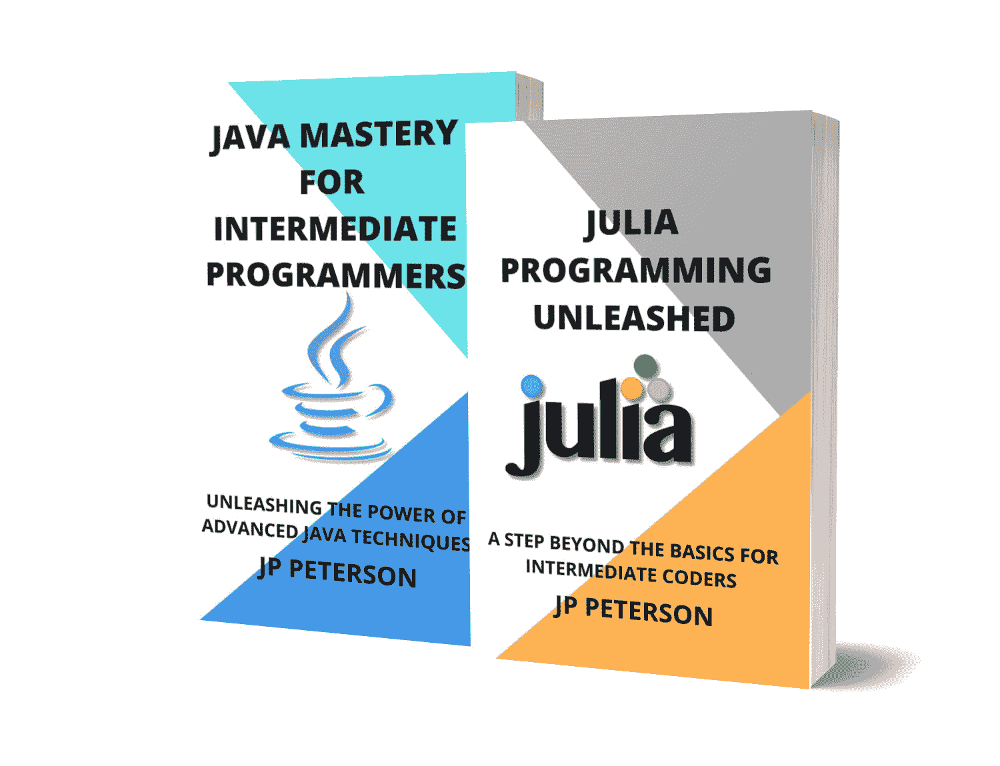

# 中级程序员 Julia 编程与 Java 精通指南 - 2 本合一



释放 Julia 编程

## 中级编码者的进阶之路

JP PETERSON

## 引言

欢迎来到《释放 Julia 编程：中级编码者的进阶之路》。在这全面的指南中，我们将深入探索 Julia 编程的强大世界，带你超越基础知识，使你具备成为熟练 Julia 程序员的技能。无论你是寻求扩展技能的资深编码者，还是渴望探索多功能语言的编程爱好者，这本书都是你精通 Julia 的门径。

凭借其高性能特性和用户友好的语法，Julia 在从科学计算到数据分析和机器学习的各个领域都大受欢迎。此本书专为已经具备编程概念基础知识，并希望在项目项目中充分利用 Julia 潜能的中级程序员而设计。

在接下来的章节中，我们将探索 Julia 的高级特性、实际示例和现实世界的应用。在这段旅程的终点，你将能够应对复杂的编程任务，并使用 Julia 创建高效、优雅的解决方案。

# 第 1 章：Julia 编程简介

Julia 是一种高性能的动态编程语言，它席卷了科学计算、数据分析和机器学习领域。它结合了两个世界的优点：既有像 `Python` 等动态语言的易用性，又具有像 `C` 和 `Fortran` 等低级语言的速度。在这一章中，我们将开启之旅，探索 Julia 的基础、历史、特征，以及它成为成为数据科学家、工程师和研究人员首选语言的原因。

## Julia 的诞生

在深入研究 Julia 的复杂性之前，了解它的起源至关重要。Julia 是由一群才华横溢的人设计的，包括 Jeff Bezanson、Stefan Karpinski、Viral B. Shah 和 Alan Edelman，旨在解决现有编程语言在科学计算方面的缺点。他们的愿景是开发一种能够将高级编程与高性能执行无缝结合的语言。

Julia 于 2012 年正式向公众发布，从那以后，它获得了一个忠实且不断增长的用户和贡献者社区。它的开源性质以及对自由开源软件的承诺，在其快速普及中起了关键作用。

## Julia 哲学

Julia 构建在一套核心原则之上，这些原则支撑着它的设计和开发。这些原则使得 Julia 成为科学计算和数据分析的卓越语言：

### 1. 性能

Julia 的主要目标之一是提供与低级语言相当的性能，同时保留高级级语言的特性。Julia 通过使用即时编译（`JIT`）实现了这一点，将代码编译为机器码以执行，从而获得原生性能。

### 2. 易用性

Julia 拥有表达且直观的语法，易于阅读和编写。它与 `Python` 和 `MATLAB` 等流行语言的相似性使得不同背景的程序员都能轻松上手。

### 3. 开源

Julia 是一种开源语言，这意味着它的源代码供任何人查看、修改和贡献。这培养了一个协作创新的社区。

### 4. 多重分发

Julia 的多重分发系统允许根据所有参数的类型进行特化，实现了代码的高度灵活和可扩展。

### 5. 可操作性

Julia 对调用 `C` 和 `Fortran` 函数具有良好支持，使其集成现有代码库变得无缝。

### 6. 成长的生态系统

Julia 拥有一个针对各个领域的快速扩展的包生态系统。该系统不断进化，进一步增强了 Julia 的功能。

## 安装 Julia

在开始 Julia 之旅之前，我们需要设置开发环境。幸运的是，安装 Julia 是一个简单的过程：

1. **下载 Julia**：访问 Julia 官方网站 [julialang.org/downloads](https://julialang.org/downloads/) 并选择适用于您的操作系统（Windows、macOS 或 Linux）的版本。

2. **安装 Julia**：按照特定操作系统的说明进行安装。Julia 的安装通常下载包并运行安装程序。

3. **验证安装**：安装完成后，打开终端或命令行界面并输入 `julia`。如果 Julia 启动未报错，说明安装成功。

## Julia REPL：你的交互式编码 playground

Julia 提供了一个强大的交互式编码环境，称为读取-求值-打印循环（REPL）。REPL 允许你交互式执行 Julia 代码，它是学习和实验的极佳工具。

只需打开终端或命令行界面并输入 `julia` 即可。你会看到一个提示符，可以在其中输入 Julia 代码并立即查看结果。尝试输入 `1 + 1` 并回车。你将在屏幕上看到结果 `2`。


Julia REPL 是尝试代码片段、测试想法以及通过实践探索语言特性的价值工具。

## 运行 Julia 脚本

虽然 REPL 对于交互式编码非常好，但你通常会编写并运行更长的代码脚本。Julia 允许你像任何其他编程语言一样创建和运行脚本。

以下是创建和运行一个简单的 Julia 脚本的方法：

1. **创建文本文件**：使用你喜欢的文本编辑器（例如 Windows 上的记事本、Linux 上的 Vim 或 macOS 上的文本编辑），创建一个新的文本文件并以 `.jl` 扩展名保存。例如，你可以将其命名为 `my_script.jl`。

2. **编写 Julia 代码**：打开该文本文件并在其中编写你的 Julia 代码。例如，你可以添加以下行：

```julia
println("Hello, Julia!")
```

3. **运行脚本**：打开你的终端或命令提示符，导航到保存脚本的目录，然后输入 `julia my_script.jl`。这将执行脚本，你将在屏幕上看到输出。

运行此脚本将产生以下输出：

```
Hello, Julia!
```

恭喜你！你已成功创建并执行了一个 Julia 脚本。

## 理解变量和数据类型

在 Julia 中，与任何其他编程语言一样，变量是存储和处理数据的基础构建块。让我们探索变量的工作原理以及 Julia 中提供的各种数据类型。

### Julia 中的变量

在 Julia 中，你可以通过指定变量名称并为其赋值来声明变量。例如：

```julia
x = 10
```

在这个示例中，我们创建了一个名为 `x` 的变量并赋值了值 `10`。Julia 会根据赋值的值自动推断变量的数据类型。在这种情况下，`x` 的类型是 `Int64`，这是一个 64 位整数。

你也可以显式指定变量的数据类型：

```julia
y::Float64 = 3.14
```

在这个示例中，我们声明了一个变量 `y`，并明确指定它应该是 `Float64` 类型，即浮点数。

### Julia 中的基础数据类型

Julia 提供了多种基础数据类型来表示不同类型的数据。以下是一些最常用的数据类型：

### 整数

- `Int8`: 8 位有符号整数

- `Int16`: 16 位有符号整数

- `Int32`: 32 位有符号整数

- `Int64`: 64 位有符号整数

- `Int128`: 128 位有符号整数

### 浮点数

- `Float16`: 16 位浮点数（半精度）

- `Float32`: 32 位浮点数（单精度）

- `Float64`: 64 位浮点数（双精度）

#### 布尔值

- `Bool`: 布尔值 `true` 和 `false` 

#### 字符

- `Char`: 单个 Unicode 字符，例如 `'A'`

#### 字符串

- `String`: 字符序列，例如 `"Hello, Julia!"`

## 符号 (Symbols)

- `Symbol`: 轻量级标识符，通常用作字典的键

#### 元组

- `Tuple`: 不同类型元素的有序集合

### 数组

- `Array`: 相同类型元素的同质集合，包括数字数组、字符数组或其他数据类型的数组

### 字典

- `Dict`: 键值对集合

Julia 处理广泛数据类型的能力使其能够胜任各种编程任务。

### 类型推断：Julia 的动态特性

Julia 的突出特性之一是它的动态类型，并结合了可选的类型注释。这意味着你并不总是需要显式指定数据类型；Julia 往往可以为你推断它。

例如，考虑以下代码：

```julia
a = 42
b = 3.14
c = "Hello, Julia!"
```

在这段代码中，Julia 推断的数据类型如下：

- `a` 的类型是 `Int64`，因为它被赋值了一个整数。

- `b` 的类型是 `Float64`，因为它被赋值了一个浮点数。

- `c` 的类型是 `String`，因为它被赋值了一个字符串。

Julia 执行类型推断的能力有助于保持代码简洁易读，同时从强类型中受益。

### 探索多重分发 (Multiple Dispatch)

多重分发是一项强大的特性，使 JuliaDistinct 于许多其他编程语言。它允许函数不仅根据参数的类型，而且根据所有参数的类型进行特化，从而实现高度灵活且可扩展的代码。

在 Julia 中，你可以定义根据特定参数类型组合表现不同行为的函数。这允许你编写处理各种数据类型的泛型函数，提供了在其他语言中难以实现的抽象和可重用性。

这里有一个简单的示例来说明多重分发：

```julia
## 定义一个接受两个任意类型参数的函数 foo
function foo(x, y)
  println("Generic foo: x is of type $(typeof(x)), y is of type $(typeof(y))")
end

## 为整数定义 foo 的特化版本
function foo(x::Int, y::Int)
  println("Specialized foo for integers: x = $x, y = $y")
end

## 为字符串定义 foo 的特化版本
function foo(x::String, y::String)
  println("Specialized foo for strings: x = $x, y = $y")
end

## 调用函数
foo(1, 2)             # 调用针对整数的特化 foo
foo("Hello", "Julia") # 调用针对字符串的特化 foo
```

- `c` 的类型是 `String`，因为它被赋值了一个字符串。

Julia 的动态类型在高级语言的灵活性和低级语言的性能之间取得了平衡。

## 数值数据类型

Julia 提供了多种数值数据类型来表示不同类型的数字。理解这些数据类型对于高效执行数值计算至关重要。

### 整数

整数表示整个数字，例如 -3, -2, -1, 0, 1, 2, 3 等。Julia 提供了几种整数类型，每种都有不同的范围：

- `Int8`: 8 位有符号整数，范围从 -128 到 127。

- `Int16`: 16 位有符号整数，范围从 -32,768 到 32,767。

- `Int32`: 32 位有符号整数，范围从 -2³¹ 到 2³¹ - 1。

- `Int64`: 64 位有符号整数，范围从 -2⁶³ 到 2⁶³ - 1。

- `Int128`: 128 位有符号整数，具有极宽范围。

以下是声明各种整数类型变量的方法：

```julia
x::Int8 = 10
y::Int16 = -100
z::Int32 = 1000
```

这些声明指定了每个变量的精确整数类型，允许你控制内存使用和性能。

### 浮点数

浮点数表示带有小数部分的实数。Julia 提供了具有不同精度的浮点类型：

- `Float16`: 16 位浮点数（半精度）。

- `Float32`: 32 位浮点数（单精度）。

- `Float64`: 64 位浮点数（双精度）。

浮点类型的选择取决于计算所需的精度。双精度（`Float64`）由于其高精度，通常被用于大多数科学和工程应用。

以下是声明各种浮点类型变量的方法：

```julia
a::Float16 = 3.14
b::Float32 = 2.71828
c::Float64 = 1.61803398875
```

选择合适的数值类型可以确保你的 Julia 程序既准确又高效地利用了内存。

## 布尔值与逻辑操作

布尔值表示真或假的值，是编程中决策的基础。Julia 提供了一个布尔类型 `Bool`，它包含两个可能的值：`true` 和 `false`。

你可以使用逻辑操作来处理和比较布尔值。Julia 中常见的逻辑操作包括：

- `&&`（逻辑与）：当两个操作数都为 `true` 时，返回 `true`。

- `||`（逻辑或）：当至少有一个操作数为 `true` 时，返回 `true`。

- `!`（逻辑非）：返回操作数数值的反反值。

以下是一些示例：

```julia
a = true
b = false
result1 = a && b    # result1 为 false
result2 = a || b    # result2 为 true
result3 = !a        # result3 为 false
```

布尔值和逻辑操作对于创建条件语句和控制 Julia 程序的流程至关重要。

## 字符与字符串

字符和字符串对于处理文本数据至关重要。Julia 提供了表示单个字符（`Char`）和字符序列（`String`）的数据类型。

### 字符 (`Char`)

`Char` 表示单个 Unicode 字符。你可以通过将字符包含在单引号中声明 `Char`，如下：

```julia
my_char = 'A'
```

Julia 对 Unicode 字符的支持使其适用于处理各种语言和符号集的文本。

### 字符串 (`String`)

`String` 是字符序列，例如单词、句子或段落。你可以通过将文本包含在双引号中声明 `String`：

```julia
my_string = "Hello, Julia!"
```

Julia 提供了丰富的函数和操作来处理字符串，包括拼接、子字符串提取和字符串处理。

### 字符串插值

Julia 允许使用字符串插值在字符串内部嵌入表达式。你可以在字符串内部使用 `$()` 来包含表达式的值。例如：

```julia
name = "Alice"
greeting = "Hello, $name!"
```

在这个示例中，`name` 的值被插值到 `greeting` 字符串中，结果为 "Hello, Alice!"

字符串插值是创建动态字符串和格式化输出的强大功能。

## 符号 (Symbols)

`Symbol` 是轻量级标识符，通常用作字典的键以及用于元编程。符号由冒号后跟名称表示，例如 `:my_symbol`。

符号通常用于需要唯一、不可变标识符的语境。例如，你可能会使用符号来表示字典中的键：

```julia
user_info = Dict(:name => "Alice", :age => 30, :city => "Wonderland")
```

在代码中，我们创建了一个以符号为键并关联值的字典。

## 元组 (Tuples)

元组是不同类型元素的有序集合。它们类似于数组，但与数组不同，元组是不可变的，这意味着创建后无法更改其内容。

你可以使用括号声明元组：

```julia
my_tuple = (1, "apple", 3.14)
```

## 数组 (Arrays)

数组是最多功能且最常用的数据结构之一。数组是相同元素的有序集合。

你可以使用方括号创建数组：

```julia
my_array = [10, 20, 30, 40, 50]
```

Julia 提供了许多处理数组的函数和操作，包括索引、切片和逐元素操作。

### 索引与切片

你可以使用方括号和索引访问数组的单个元素：

```julia
my_array = [10, 20, 30, 40, 50]
element = my_array[3] # 获取第三个元素 (30)
```

Julia 使用 1 索引，这意味着第一个元素位于索引 1。你还可以使用切片提取数组的局部：

```julia
sub_array = my_array[2:4] # 从 2 到 4 的元素 (20, 30, 40)
```

### 逐元素操作

Julia 允许对数组执行逐元素操作，这意味着操作应用于每个元素。例如，你可以将数组中的所有元素乘以常量：

```julia
original_array = [1, 2, 3, 4, 5]
result_array = 2 .* original_array # 逐元素乘法
```

在这种情况下，`result_array` 将包含 `[2, 4, 6, 8, 10]`。

## 字典 (Dictionaries)

字典（`Dict`）是键值对的集合，每个键都关联一个值。字典适用于将唯一键映射到值。

你可以使用 `Dict` 构造函数并使用 `=>` 操作符指定键值对创建字典：

```julia
my_dict = Dict("name" => "Alice", "age" => 30, "city" => "Wonderland")
```

在这个字典中，键是字符串 ("name", "age", "city") 以及对应的值。你可以通过指定键来访问字典的值：

```julia
name = my_dict["name"] # 获取与键 "name" 关联的值
```

在这段代码中，`add` 函数显式指定了其参数 `a` 和 `b` 应该是 `Int` 类型。通过这样做，编译器可以生成高效代码，因为它知道所涉及的类型。

## 结论

在本章中，我们深入了 Julia 的数据类型和变量，涵盖了整数、浮点数、布尔值、字符、字符串、符号、元组、数组、字典、类型声明以及类型稳定性。理解这些基础概念对于编写高效 Julia 程序以及利用该语言的力量至关重要。

# 第 3 章：Julia 中的控制流与决策

在之前的章节中，我们探索了 Julia 的基础知识，包括其数据类型和变量。现在，在第 3 章，我们将进入控制流和决策领域。这些概念对于编写能够决策、重复操作并对不同情况做出动态响应的程序至关重要。

## 条件语句


条件语句允许你根据是否满足某些条件执行特定的代码块。在 Julia 中，你可以使用`if`、`else`和`elseif`结构来创建条件语句。

## `if` 语句

`if`语句用于在指定条件为`true`时执行代码块。这是一个基础示例：

```julia
x = 10
if x > 5
println("x is greater than 5")
end
```

在这个示例中，执行`if`块内部的代码是因为条件`x > 5`为`true`。因此，打印了消息 "x is greater than 5"。

## `else` 子句

你可以通过`else`子句扩展`if`语句，以指定当条件为`false`时应该发生什么。这是一个示例：

```julia
x = 3
if x > 5
println("x is greater than 5")
else
println("x is not greater than 5")
end
```

在这种情况下，由于`x`不大于 5，执行了`else`块中的代码，并打印了 "x is not greater than 5"。

## `elseif` 子句

有时，你可能有多个条件需要检查。在这种情况下，你可以使用`elseif`子句来指定要评估的额外条件。这是一个示例：

```julia
x = 3
if x > 5
println("x is greater than 5")
elseif x < 5
println("x is less than 5")
else
println("x is equal to 5")
end
```

在这段代码中，Julia 首先检查`x`是否大于 5。由于不是，它继续进入`elseif`子句并检查`x`是否小于 5，在这种情况下这是`true`。因此，打印了 "x is less than 5"。

## 嵌套条件判断

你可以将条件语句嵌套彼此之间以处理更复杂的场景。这是一个示例：

```julia
x = 10
y = 5
if x > 5
println("x is greater than 5")
if y > 3
println("y is greater than 3")
else
println("y is not greater than 3")
end
else
println("x is not greater than 5")
end
```

在这个嵌套示例中，外层的`if`检查`x`是否大于 5。如果是，内部的`if`检查`y`是否大于 3。

## 循环

循环用于重复代码块。Julia 提供了几种类型的循环，包括`for`和`while`。

### `for` 循环

`for`循环通常用于当你想要遍历集合时。这是一个示例：

```julia
for fruit in ["apple", "banana", "cherry"]
    println(fruit)
end
```

在这段代码中，`for`循环遍历数组中的每个元素。

### `while` 循环

`while`循环只要指定条件为`true`就会执行。这是一个示例：

```julia
n = 1
while n <= 5
    println(n)
    n += 1
end
```

在这个示例中，只要`n`小于或等于 5，`while`循环就会运行。

### 控制语句

Julia 提供了控制语句：

- `break`: 提前终止循环。
- `continue`: 跳过当前迭代并移动到下一次。

这是一个使用`break`和`continue`的示例：

```julia
for i in 1:10
    if i == 5
        continue
    end
    if i == 8
        break
    end
    println(i)
end
```

### 使用范围循环

范围（Ranges）经常用于遍历数字序列。这是一个示例：

```julia
for i in 1:5
    println("Number: $i")
end
```

`square`函数被带有参数`5`调用，并返回结果`25`，然后将其打印。

## 函数方法与多重分发

Julia 以其多重分发（multiple dispatch）系统而闻名，该系统允许函数根据参数的类型具有不同的实现。这种特征被称为方法分发，让你能够编写通用且高效的代码。

### 方法分发

在 Julia 中，函数可以有多个方法，每个方法对应一组不同的参数类型。当你调用一个函数时，Julia 会根据参数类型分发到最具体的方法，以确保执行正确的实现。

以下是方法分发的一个示例：

```julia
### 定义一个针对整数的 add 函数
function add(a::Int, b::Int)
  return a + b
end

### 定义一个针对浮点数的 add 函数
function add(a::Float64, b::Float64)
  return a + b
end

## 使用不同类型的参数调用函数
result1 = add(2, 3)         # 调用整数的 add 函数
result2 = add(2.0, 3.0)     # 调用浮点数的 add 函数
println(result1)            # 打印 5
println(result2)            # 打印 5.0
```

在这个示例中，我们有两个版本的`add`函数——一个针对整数，另一个针对浮点数。Julia 会根据参数类型自动分发到相应的方法。

### 通用函数

Julia 的多重分发系统允许你创建适用于各种数据类型的通用函数。你可以定义一个函数，它根据参数的类型以不同的方式运行。

以下是一个通用`add`函数的示例：

```julia
## 定义一个可以处理各种类型的通用 add 函数
function add(a, b)
  return a + b
end

## 使用不同类型的参数调用函数
result1 = add(2, 3)         # 调用整数的通用 add 函数
result2 = add(2.0, 3.0)     # 调用浮点数的通用 add 函数
println(result1)            # 打印 5
println(result2)            # 打印 5.0
```

在这段代码中，`add`函数不受限于特定的参数类型。它可以处理整数、浮点数或其他类型，使其具有高度的通用性。

## 可选参数与关键字参数

Julia 允许定义带有可选参数和关键字参数的函数，增强了函数的灵活性。

### 可选参数

可选参数是在调用函数时不需要提供值的参数。你可以为这些参数指定默认值，如果未提供，将使用默认值。

以下是一个带有可选参数的示例：

```julia
## 定义一个带有可选参数的函数
function greet(name, greeting="Hello")
  return "$greeting, $name!"
end

## 带或不带可选参数调用函数
message1 = greet("Alice")               # 使用默认问候
message2 = greet("Bob", "Hi")          # 使用提供的问候
println(message1)                      # 打印 "Hello, Alice!"
println(message2)                      # 打印 "Hi, Bob!"
```

在这个示例中，`greet`函数有一个可选参数`greeting`，默认值为 "Hello"。你可以带或不带`greeting`参数来调用函数。

### 关键字参数

关键字参数允许你在调用函数时通过名称指定参数，清楚地表明哪个参数对应哪个值。

以下是一个带有关键字参数的示例：

```julia
## 定义一个带有关键字参数的函数
function compute_total(price; tax_rate=0.10, discount=0.0)
  total = price * (1 + tax_rate) * (1 - discount)
  return total
end

### 使用关键字参数调用函数
total1 = compute_total(100.0, tax_rate=0.08)             # 指定 tax_rate 为关键字参数
total2 = compute_total(100.0, discount=0.15)             # 指定 discount 为关键字参数
total3 = compute_total(100.0, tax_rate=0.08, discount=0.15) # 指定两个参数
println(total1)  # 打印 108.0
println(total2)  # 打印 85.0
println(total3)  # 打印 92.4
```

在这段代码中，`compute_total`函数对`tax_rate`和`discount`使用关键字参数。调用函数时，你可以显式地通过名称指定这些参数。

## 匿名函数 (Lambdas)

Julia 允许使用`->`语法创建匿名函数，也称为 lambda 函数。这些函数没有名称，通常用于短而简单的操作。

以下是一个匿名函数的示例：

```julia
## 定义一个对输入平方的匿名函数
square = x -> x²
result = square(5)  # 打印 5
```

## 广播 (Broadcasting)

Julia 提供了一项强大的功能称为广播（broadcasting），允许你对集合应用操作。

以下是广播的示例：

```julia
## 定义一个平方函数
square(x) = x²
numbers = [1, 2, 3, 4, 5]
## 对数组应用平方函数
squared_numbers = square.(numbers)
println(squared_numbers) # 打印 [1, 4, 9, 16, 25]
```

## 结论

函数和方法是 Julia 的基础组成部分。它们允许你封装逻辑、提高重用性并利用 Julia 的多重分发系统。

# 第 5 章：处理数组与矩阵

数组和矩阵是 Julia 中的基础数据结构，在科学和计算任务中扮演着核心角色。在本章中，我们将探索如何处理数组和矩阵，涵盖数组创建、索引、切片、操作等主题。

## 数组创建

在 Julia 中，你可以使用多种方法创建数组。数组可以包含相同或不同类型的元素，使其在不同的应用中非常通用。

### 使用字面量语法创建数组

在 Julia 中创建数组最简单的方法是使用方括号并用逗号分隔指定的元素：

```julia
### 创建一个整数数组
numbers = [1, 2, 3, 4, 5]

### 创建一个字符串数组
fruits = ["apple", "banana", "cherry"]
```

你可以创建任何数据类型的数组，或在同一个数组中混合不同的类型。

### 创建空数组

要创建一个空数组，你可以使用`[]`语法或`Array{T}(undef, dims)`构造函数，其中`T`是元素类型，`dims`是指定数组维度的元组：

```julia
### 使用 [] 语法创建空数组
empty_array = []

### 使用构造函数创建空数组
empty_float_array = Array{Float64}(undef, (3, 4))
```

### 创建范围

你可以使用`start:step:stop`语法创建顺序数值数组：

```julia
### 创建从 1 到 10 的整数数组
integers = 1:10

### 创建从 2 到 20 的偶数数组
even_numbers = 2:2:20
```

### 从函数创建数组

Julia 提供了`zeros`、`ones`和`rand`等函数来创建特定值的数组：

```julia
### 创建全零数组
zeros_array = zeros(3, 3)

### 创建全 1 数组
ones_array = ones(2, 4)

### 创建一个 0 到 1 之间的随机数组
random_array = rand(4, 3)
```

这些函数在填充数据之前初始化数组非常有用。

## 数组索引与切片

数组索引和切片允许你访问并操作数组的单个元素或子集。

### 索引

在 Julia 中，数组是基于 1 的索引，这意味着第一个元素的索引为 1。你可以使用方括号和索引来访问元素：

```julia
numbers = [10, 20, 30, 40, 50]
first_element = numbers[1]  # 访问第一个元素 (10)
third_element = numbers[3]  # 访问第三个元素 (30)
```

### 切片

切片允许你提取数组的部。你可以使用冒号`:`来指定索引范围：

```julia
numbers = [10, 20, 30, 40, 50]
subset = numbers[2:4]  # 提取从索引 2 到 4 的元素 (20, 30, 40)
```

切片创建一个引用原始数据的新数组，因此子集中的更改会影响原始数组，反之亦然。

### `end` 关键字

Julia 提供了`end`关键字来表示数组的最后一个索引。你可以在切片中使用它指定从某个索引到末尾范围：

```julia
numbers = [10, 20, 30, 40, 50]
last_three = numbers[3:end]  # 提取从索引 3 到结尾的元素 (30, 40, 50)
```

### 数组操作

Julia 支持数组的各种操作，包括逐元素操作、广播以及用于聚合和处理的函数。

### 逐元素操作

你可以使用标准算术运算符对数组执行逐元素操作：

```julia
### 创建数组
array1 = [1, 2, 3]
array2 = [4, 5, 6]
### 逐元素加法
result = array1 + array2  # 结果为 [5, 7, 9]
### 逐元素乘法
result = array1 .* array2  # 结果为 [4, 10, 18]
```

### 广播

广播允许你对数组或值集合逐元素应用函数或操作。

```julia
### 将平方函数广播到数组
array = [1, 2, 3]
squared = square.(array)  # 结果为 [1, 4, 9]
```

### 聚合函数

Julia 提供了几个用于聚合数据的函数，如`sum`、`mean`、`minimum`、`maximum`和`std`（标准差）：

```julia
### 创建数组
data = [10, 20, 30, 40, 50]
### 求和
total = sum(data)  # 结果为 150
### 平均值 (mean)
average = mean(data)  # 结果为 30.0
### 最小值
minimum_value = minimum(data)  # 结果为 10
maximum_value = maximum(data)  # 结果为 50
### 标准差
std_deviation = std(data)  # 结果为 15.8...
```

这些函数用于数值计算。

## 多维数组（矩阵）

在 Julia 中，多维数组通常用于表示矩阵和张量。你可以通过创建数组时指定维度来创建多维数组。

### 创建矩阵

要创建一个矩阵（二维数组），可以使用`Array{T}(undef, dims)`构造函数，其中`T`是类型，`dims`是维度：

```julia
### 创建 2x3 的零矩阵
matrix_zeros = zeros(Float64, 2, 3)
### 创建带有定义值的 3x2 矩阵
matrix_values = [1 2; 3 4; 5 6]
```

### 矩阵索引和切片

矩阵索引和切片与数组类似，但涉及行和列：

```julia
### 创建 2x3 矩阵
matrix = [1 2, 3; 4, 5, 6]
### 访问元素
element = matrix[1, 2]  # 访问第一行第二列 (2)
### 切片行和列
row = matrix[2, :]      # 访问整个第二行 (4 5)
column = matrix[:, 3]  # 访问整个第三列 (3, 6)
```

### 矩阵操作

Julia 提供了广泛的矩阵操作和线性代数函数来处理矩阵：

```julia
### 创建矩阵
A = [1 2; 3 4]
B = [5 6; 7 8]
### 矩阵加法
result = A + B
### 矩阵乘法
result = A * B
### 矩阵转置
result = transpose(A)
### 矩阵行列式
det_A = det(A)
### 矩阵逆
inv_A = inv(A)
### 矩阵特征值和特征向量
eigenvalues, eigenvectors = eigen(A)
```

这些操作对于各种科学工程应用至关重要。

### 总结

数组和矩阵是 Julia 中的基础数据结构，它们在广泛的科学计算任务中起着至关重要的作用。在本章中，我们探索了如何创建数组和矩阵、执行索引和切片、进行数组操作以及处理多维数组。

# 第 6 章探索 Julia 中的包和模块

Julia 的强大不仅在于其核心功能，还在于其活跃的包和模块生态系统。在本章中，我们将探索如何使用包、导入模块并利用外部库扩展 Julia 的能力。

## Julia 中的包

Julia 包是由 Julia 社区创建从数据处理到科学计算等各个领域的复用代码、函数和模块集合。使用包扩展 Julia 在各个领域的功能是 Julia 编程的一个基本方面。

### 安装包


在使用 Julia 包之前，你需要先安装它。Julia 提供了一个名为`Pkg`的内置包管理器。你可以使用`add`命令添加包：

```julia
using Pkg
### 添加包（例如 DataFrames）
Pkg.add("DataFrames")
```

此命令下载并安装指定的包，使其可以在 Julia 环境中使用。

## 导入包

一旦安装了包，你可以使用`using`关键字将其导入脚本或笔记本中：

```julia
using DataFrames
```

此语句将`DataFrames`包加载到你的环境中，允许你使用它的函数。

## 管理包

你可以使用`Pkg`包管理器检查已安装包的状态、更新并删除它们：

- 查看已安装包列表，使用`Pkg.status()`。
- 更新所有已安装的包，使用`Pkg.update()`。
- 移除包，使用`Pkg.rm("PackageName")`。

包可以轻松扩展 Julia 针对特定任务的功能，例如数据分析、机器学习或绘图。

# Julia 中的模块

模块是 Julia 中组织和封装代码的一种方式。它们有助于防止命名冲突、提高代码的可维护性，并允许你创建复用组件。

## 创建模块

你可以使用`module`和`end`关键字定义模块。这里是一个简单的模块示例：

```julia
module MyModule
export greet
function greet(name)
return "Hello, $name!"
end
end # 模块结束
```

在示例中，我们定义了一个名为`MyModule`的模块，并导出函数`greet`。

## 导入模块

要使用模块定义的函数和类型，你需要使用`import`关键字将模块导入代码中：

```julia
import MyModule
message = MyModule.greet("Alice")
println(message) # 输出 "Hello, Alice!"
```

这种语法确保来自`MyModule`的`greet`函数不会与其他模块或全局命名空间的函数混淆。

## 嵌套模块

Julia 支持嵌套模块，允许你创建模块层级结构来组织代码：

```julia
module MyOuterModule
module MyInnerModule
export multiply
function multiply(x, y)
return x * y
end
end # 内部模块结束
end # 外部模块结束
```

在示例中，我们有一个外部模块`MyOuterModule`，它包含一个内部模块`MyInnerModule`。`multiply`函数定义在内部模块中。

## 使用`using`模块

除了`import`，你还可以使用`using`关键字让模块的函数和类型直接可用：

```julia
using MyModule
message = greet("Bob")
println(message) # 输出 "Hello, Bob!"
```

使用`using`允许你在无需添加`MyModule.`前缀调用`greet`。

# 探索外部包

Julia 的包生态系统包含了由社区创建的各种外部包。这些包为各个领域提供了专门的功能。让我们探索一些著名的包：

## DataFrames.jl

`DataFrames.jl`是一个用于处理表格数据的流行包，类似于 R 语言中的 data frames 或 Python 中的`pandas`。它允许你高效地对数据进行操作、过滤和分析。

```julia
using DataFrames

### 创建 DataFrame
df = DataFrame(ID=[1, 2, 3], Name=["Alice", "Bob", "Charlie"], Age=[25, 30, 22])

### 过滤数据
young_people = filter(row -> row.Age < 30, df)

### 打印结果
println(young_people)
```

## Plots.jl

`Plots.jl`是一个多功能的绘图包，支持多种后端，包括 PyPlot、Plotly 和 GR。它为创建出版级可视化图形提供了统一的接口。

```julia
using Plots

### 创建一个简单的图表
x = 1:10
y = x .^ 2
plot(x, y, label="y=x²", xlabel="x", ylabel="y", title="Simple Plot")
```

## JuMP.jl

`JuMP.jl`是一个用于数学优化的强大包。它为线性、非线性混合整数规划问题提供了一种易于使用的建模语言。

```julia
using JuMP, GLPK

### 创建 JuMP 模型
model = Model(with_optimizer(GLPK.Optimizer))

### 定义变量
@variable(model, x >= 0)
@variable(model, y >= 0)

### 定义目标函数
@objective(model, Max, 3x + 2y)

### 添加约束
@constraint(model, 2x + y <= 10)
@constraint(model, x + 3y <= 12)

### 求解优化问题
optimize!(model)

### 显示结果
println("Optimal Solution:")
println("x = ", value(x))
println("y = ", value(y))
```

这些示例展示了 Julia 外部包的能力。你可以探索 Julia 包生态系统，寻找适合你特定需求的包。

# 创建你自己的模块和包

除了使用外部包外，Julia 还允许你创建自己的模块和包。当你想要跨不同项目封装和重用代码时，这特别有用。

## 创建模块

要创建你自己的模块，请遵循以下步骤：

1. 创建一个以模块命名的`.jl`文件，例如`MyModule.jl`。
2. 使用`module`关键字定义你的模块，并导出可以在模块外部访问的函数和类型。
3. 将文件保存到 Julia 可以访问的目录中。

这是一个简单的模块文件`MyModule.jl`示例：

```julia
module MyModule

export greet

function greet(name)
    return "Hello, $name!"
end

end  # 模块结束
```

在代码中使用此模块，只需如之前所示使用`import`或`using`导入即可。

## 创建包

创建 Julia 包涉及一个更结构化的过程：

1. 将你的代码组织到具有特定结构的包目录中。
2. 创建`Project.toml`文件以指定包的依赖项。
3. 在包目录内定义你的模块和函数。

关于创建 Julia 包的详细信息，请参阅 Julia 官方文档。

# 结论

探索 Julia 中的包和模块对于充分利用该语言的潜力至关重要。包扩展了 Julia 的功能，允许你利用 Julia 社区和外部库的工作。模块帮助你组织代码、防止命名冲突并创建可用组件。

# 第 7 章：Julia 中的文件输入输出操作

文件输入输出（I/O）操作对于从外部源读取数据以及将结果或数据写入文件非常重要。在本章中，我们将探索如何在 Julia 中执行文件 I/O 操作，包括读取和写入文本文件、二进制文件以及处理不同的文件格式。

## 读取和写入文本文件

文本文件是存储和交换数据的常见格式之一。Julia 提供了简单的读写文本文件的方法。

### 读取文本文件

要在 Julia 中从文本文件中读取数据，你可以使用`open`函数结合`read`或`readlines`函数。这里有一个逐行读取文本文件的示例：

```julia
# 以读取模式打开文本文件
file = open("sample.txt", "r")

### 逐行读取文件
for line in eachline(file)
    println(line)
end

### 关闭文件
close(file)
```

在这段代码中：

- 我们以读取模式（`"r"`）打开文件`"sample.txt"`。
- 我们使用`for`循环通过`eachline`遍历文件的每一行。
- 在循环内部，打印每一行。
- 最后，我们使用`close`函数关闭文件以释放系统资源。

### 写入文本文件

要向文本文件写入数据，你可以使用带有`"w"`模式的`open`函数打开写入的文件。这是一个写入文本文件的示例：

```julia
# 以写入模式打开一个新的文本文件
file = open("output.txt", "w")

### 向文件写入数据
println(file, "Hello, World!")
println(file, "This is a new line.")

### 关闭文件
close(file)
```

在这段代码中：

- 我们以写入模式（`"w"`）打开文件`"output.txt"`。
- 我们使用文件并写入数据。
- 最后，我们关闭文件。

## 读取和写入二进制文件

除了文本文件，Julia 还支持读取和写入二进制文件。二进制文件用于非文本数据。

### 读取二进制文件

要从二进制文件中读取数据，你可以使用`open`函数结合`read`函数。这里有一个读取二进制文件的示例：

```julia
## 以读取模式打开二进制文件
file = open("data.bin", "rb")

# 从文件中读取 32 位整数
value = read(file, Int32)

### 关闭文件
close(file)
```

在这段代码中：

- 我们以读取模式（`"rb"`）打开文件`"data.bin"`。
- 我们使用`read`获取数据。
- 最后，我们关闭文件。

### 写入二进制文件

要向二进制文件写入数据，你可以使用`write`函数。这里有一个写入示例：

```julia
# 以写入模式打开二进制文件
file = open("output.bin", "wb")

# 向文件写入 32 位整数
write(file, Int32(42))

### 关闭文件
close(file)
```

在这段代码中：

- 我们以写入模式（`"wb"`）打开文件`"output.bin"`。
- 我们使用`write`函数写入数据。
- 最后，我们关闭文件。

## 处理不同的文件格式

Julia 支持多种文件格式，你可以使用外部库读取和写入这些数据。让我们探索一些示例：

### CSV 文件

要在 Julia 中读取和写入 CSV（逗号分隔值）文件，你可以使用`CSV.jl`包。首先，安装包：

```julia
using Pkg
Pkg.add("CSV")
```

然后，你可以这样读写 CSV 文件：

```julia
using CSV

# 将 CSV 文件读取为 DataFrame
df = CSV.File("data.csv") |> DataFrame

# 将 DataFrame 写入 CSV 文件
CSV.write("output.csv", df)
```

### JSON 文件

处理 JSON（JavaScript 对象表示）文件可以使用`JSON.jl`包。按如下方式安装包：

```julia
using Pkg
Pkg.add("JSON")
```

然后，你可以读取和写入 JSON 文件：

```julia
using JSON

# 从文件读取 JSON 数据
data = JSON.parsefile("data.json")

# 将数据写入 JSON 文件
JSON.print(IOBuffer(), data, "output.json")
```

### Excel 文件

要处理 Excel 文件（读取和写入），你可以使用`XLSX.jl`包。使用以下命令安装它：

```julia
using Pkg
Pkg.add("XLSX")
```

```julia
using XLSX

# 将 Excel 文件读取为 DataFrame

df = DataFrame(XLSX.readtable("data.xlsx", "Sheet1")...)

# 将 DataFrame 写入 Excel 文件

XLSX.writetable("output.xlsx", collect(DataFrame(df)), "Sheet1")
```

这些示例演示了如何使用外部 Julia 软件包来处理不同的文件格式。根据你的数据和需求，你可以找到支持各种格式的包，例如`HDF5`、`SQLite`等。

## 文件操作的错误处理

在处理文件时，优雅地处理潜在错误至关重要。Julia 提供了使用`try`、`catch`和`finally`进行错误处理的机制。

以下是一个文件操作错误处理的示例：

```julia
try
# 尝试打开文件
file = open("nonexistent.txt", "r")
### 从文件中读取数据
data = read(file, String)
### 关闭文件
close(file)
# 处理数据（此示例中未显示）
catch e
### 处理错误
println("发生错误：$e")
finally
# 确保即使发生错误，文件也会关闭
if !isempty(file)
close(file)
end
end
```

在这段代码中：

- 我们使用`try`来尝试文件操作。
- 如果发生错误，将执行`catch`块中的代码，并打印错误信息。
- `finally`块确保即使发生错误，文件也会被关闭。

适当的错误处理有助于防止意外崩溃，并提高代码的健壮性。

# 结论

文件输入和输出操作是 Julia 中处理数据和外部资源的基础。在本章中，我们探索了如何使用外部包读取和写入文本文件、二进制文件以及不同的文件格式。我们还讨论了文件操作的错误处理技术。

这些技能对于数据处理、科学计算以及构建与文件和外部数据源交互的应用程序至关重要。

# 第 8 章：Julia 中的错误处理与异常处理

错误处理是任何编程语言（包括 Julia）的一个至关重要方面。它允许你预测并管理程序执行过程中可能出现的意外情况。在本章中，我们将探索 Julia 中的错误处理和异常处理，包括如何优雅地抛出、捕获和处理异常。

## 理解 Julia 中的错误

在 Julia 中，错误可能由于各种原因发生，例如输入错误、意外情况或外部资源问题。当错误发生时，Julia 通常会抛出一个异常，异常是一个表示错误并提供关于何处错误的信息的对象。

### 常见错误类型

Julia 将错误分为几类，包括：

1. **语法错误 (Syntax Errors)：** 当你的代码违反 Julia 语言规则时会发生此类错误。示例包括拼写错误、缺少括号或关键字使用不当。语法错误通常由 Julia 解析器捕获并作为编译错误报告。

2. **运行时错误 (Runtime Errors)：** 在程序执行期间发生，且未被解析器检测。运行时错误可能包括除以零、访问未定义的变量或尝试打开不存在的文件。运行时错误通常由异常信号。

3. **逻辑错误 (Logic Errors)：** 当你的代码由于逻辑缺陷或算法错误未能产生预期结果时，发生逻辑错误。这些错误并不一定会导致异常，但可能导致错误的程序行为。

### 异常对象

在 Julia 中，异常被表示为继承自`Exception`抽象类型的对象。Julia 中常见的异常类型包括：

- `ErrorException`：信号运行时错误的异常基类型。
- `BoundsError`：当索引超出范围时抛出。
- `DivideError`：当发生除以零时抛出。
- `KeyError`：当字典或类似字典的对象不指定键时抛出。
- `TypeError`：当值具有意外类型时抛出。
- `ArgumentError`：当函数参数无效时抛出。
- `LoadError`：当加载模块或文件出错时抛出。

## Julia 中的异常处理

Julia 提供了捕获和处理异常的机制，允许你优雅地响应错误并继续程序执行或执行清理操作。Julia 中异常处理的关键结构是`try`、`catch`和`finally`。

### `try`和`catch`块

`try`块用于封装可能抛出异常的代码。如果在`try`块发生了异常，Julia 会寻找匹配的`catch`块来处理该异常。

这是一个基础示例：

```julia
try
# 可能会抛出异常的代码
result = 10 / 0  # 除以零
catch e
### 处理异常
println("发生异常：$e")
end
```

在这段代码中：

- `try`块包含可能抛出异常的代码，在本例中是除以零。
- `catch`块紧随`try`块之后，并指定如何处理异常。它接收异常对象作为`e`，可以使用它来访问有关异常的信息。

### 处理特定异常

你可以通过在`catch`块中指定异常类型来捕获并处理特定类型的异常：

```julia
try
# 可能会抛出异常的代码
result = "42" + 10  # TypeError
catch e::TypeError
# 处理类型相关的错误
println("发生类型错误：$e")
catch e
# 处理其他异常
println("发生异常：$e")
end
```

在示例中，我们单独从其他异常中捕获并处理`TypeError`。如果发生了`TypeError`，将执行第一个`catch`块；否则，第二个`catch`块将处理其他异常。

### `finally`块

除了`try`和`catch`之外，Julia 还提供了`finally`块，无论是否抛出异常，它都会执行。该块通常用于清理操作，如关闭文件或释放资源。

这是一个示例：


```julia
try
    # 可能会抛出异常的代码
    open("file.txt", "r")
catch e
    # 处理异常
    println("发生错误：$e")
finally
    # 确保清理
    println("正在清理...")
    close(file)
end
```

在这段代码中：

- `try` 块包含可能抛出异常的代码，例如打开文件。
- `catch` 块处理文件处理期间发生的任何异常。
- `finally` 块确保即使发生异常也会关闭文件。

## 重新抛出异常

你可以在 `catch` 块中重新抛出异常，以便将其传递给外部异常处理器。当你想要执行某些自定义处理但仍允许异常在别处处理时，这非常有用。

```julia
try
    # 可能会抛出异常的代码
    result = "42" + 10  # TypeError
catch e::TypeError
    # 处理类型相关的错误
    println("发生类型错误：$e")
    # 重新抛出异常
    throw(e)
catch e
    # 处理其他异常
    println("发生异常：$e")
end
```

在示例中，我们捕获并处理了 `TypeError`，执行了自定义处理，然后重新抛出相同的异常，以便在需要时进行处理。

## 自定义异常

Julia 允许通过创建 `Exception` 抽象类型的子类型来定义自己的自定义异常类型。当你希望在代码中指示特定的错误状况时这非常有用。

这是一个定义和使用自定义异常的示例：

```julia
# 定义自定义异常类型
struct MyCustomError <: Exception
    message::String
end

# 可能会抛出自定义异常的函数
function my_function(x)
    if x < 0
        throw(MyCustomError("值不能为负数"))
    end
end

try
    my_function(-5)
catch e::MyCustomError
    println("捕获到自定义异常：$(e.message)")
end
```

在这段代码中，我们定义了一个自定义异常类型 `MyCustomError`，并将其用于 `my_function` 函数中。当向 `my_function` 传递一个负值时，它会抛出一个 `MyCustomError` 异常，我们会对其进行捕获并处理。

## 异常传播

在 Julia 中，异常可以沿着调用栈向上传播，直到被适当 `catch` 块捕获。如果异常没有被捕获，它将终止程序并显示错误信息。

考虑以下示例：

```julia
function foo()
    println("Entering foo")
    bar()
    println("Exiting foo")
end

function bar()
    println("Entering bar")
    baz()
    println("Exiting bar")
end

function baz()
    println("Entering baz")
    throw(ErrorException("An error occurred in baz"))
    println("Exiting baz")
end

try
    foo()
catch e
    println("Exception caught: $e")
end
```

在这段代码中，我们有三个嵌套函数：`foo`、`bar` 和 `baz`。`baz` 函数抛出了异常。当 `foo` 调用 `bar`，`bar` 又调用 `baz` 时，异常在 `baz` 中抛出并沿调用栈向上传播。最后，它被 `try`-`catch` 结构中的 `catch` 块捕获，程序继续执行。

## 结论

错误处理和异常处理是编写健壮可靠的 Julia 程序的必备技能。理解如何抛出、捕获和处理异常允许你预判并优雅地管理意外情况，确保你的代码在发生错误时行为依然是可预测的。

在本章中，我们探索了 Julia 错误处理的基础，包括 `try`、`catch` 和 `finally` 块。我们还讨论了如何处理特定异常、重新抛异常、创建自定义异常类型以及允许异常沿调用栈传播。

# 第 9 章：Julia 中的面向对象编程

面向对象编程（OOP）是一种广泛使用的编程范式，专注于将代码组织成对象，每个对象代表一个自包含的数据和行为单元。Julia 是一种多功能高性能的编程语言，支持 OOP 并鼓励使用它们来构建代码。在本章中，我们将探索 Julia 中 OOP 的基础，包括定义类、创建对象、封装、继承和多态。

## 面向对象编程的基础

OOP 构建在抽象、封装、继承和多态原则之上，通常被称为 OOP 的四大支柱。让我们简要理解这些概念：

1. **抽象（Abstraction）：** 抽象涉及通过将复杂系统分解为更小、更容易管理的部分来简化系统。在 OOP 中，类被用于表示建模现实实体的抽象数据类型。
2. **封装（Encapsulation）：** 封装是将数据（属性）和操作这些数据的方法（函数）封装在一个名为类的单元中。它限制了对对象内部状态的直接访问，并强调使用公共接口进行交互。
3. **继承（Inheritance）：** 继承是一种允许类继承另一个类的属性和行为（属性和方法）的机制。它促进了代码重用和类层次结构的创建。
4. **多态（Polymorphism）：** 多态允许不同的对象被视为共同父类的实例。它允许不同的类为相同的方法提供自己的实现，并根据对象的实际类型来调用这些方法。

## 在 Julia 中创建类

在 Julia 中，使用 `mutable struct` 块定义类。让我们先创建一个简单的 `Person` 类作为示例：

```julia
mutable struct Person
    name::String
    age::Int
end
```

在这段代码中：

- 我们定义了一个 `Person` 类，具有两个属性：`name`（字符串）和 `age`（整数）。
- 使用 `mutable` 关键字允许在创建后修改对象的属性。

### 创建对象（实例）

一旦定义了类，你就可以创建该类的对象（实例）。对象代表具有唯一数据的类特定实例。

```julia
# 创建 Person 类的实例
alice = Person("Alice", 30)
bob = Person("Bob", 25)
```

在这里，我们创建了两个 `Person` 对象：`alice` 和 `bob`，它们各自有自己的名字和年龄。

### 为类定义方法

方法定义类的行为。在 Julia 中，方法可以定义在类块之外，并对该类的对象进行操作。

让我们为我们的 `Person` 类添加一个 `greet` 方法：

```julia
# 为 Person 类定义方法
function greet(person::Person)
    println("Hello, my name is $(person.name) and I'm $(person.age) years old.")
end
```

现在，我们可以在我们的 `alice` 对象上调用 `greet` 方法：

```julia
# 调用 greet 方法
greet(alice)  # 输出: Hello, my name is Alice and I'm 30 years old.
```

在这段代码中：

- 我们定义了一个接受 `Person` 对象作为参数的 `greet` 方法。
- 在方法内部，我们访问对象的属性（`name` 和 `age`）来构建问候信息。

### 构造函数和析构函数

构造函数是负责创建和初始化类对象的特殊方法。在 Julia 中，构造函数被定义为与类型同名的函数。我们可以为 `Person` 类定义构造函数来创建具有默认值的对象：

```julia
# 为 Person 类定义构造函数
function Person(name::String, age::Int)
    return Person(name, age)
end
```

现在我们可以不显式使用 `mutable struct` 创建 `Person` 对象：

```julia
# 使用构造函数创建 Person
charlie = Person("Charlie", 35)
```

另一方面，Julia 不直接支持析构函数。Julia 依赖垃圾回收在对象不再被引用时回收内存。

### Julia 中的封装

封装是将数据和方法封装在单个单元（类）中，并控制对对象内部状态的访问。在 Julia 中，可以使用抽象类型和限制属性访问来实现封装。

让我们用封装增强我们的 `Person` 类：

```julia
abstract type AbstractPerson end

mutable struct Person <: AbstractPerson
    private_name::String
    private_age::Int

    function Person(name::String, age::Int)
        return new(name, age)
    end

    function greet()
        println("Hello, my name is $(private_name) and I'm $(private_age) years old.")
    end
end
```

在这段代码中：

- 我们定义了一个抽象类型 `AbstractPerson` 作为类的公共接口。
- `Person` 结构体有私有属性 `private_name` 和 `private_age`，从外部无法访问。
- 构造函数和 `greet` 方法访问这些私有属性。

现在，我们可以创建一个 `Person` 对象并调用 `greet` 方法，无需直接访问私有属性：

```julia
# 创建 Person 对象并调用 greet 方法
mary = Person("Mary", 35)
mary.greet() # 输出: Hello, my name is Mary and I'm 35 years old.
```

通过封装属性和方法，我们从外部代码隐藏了 `Person` 类的实现细节。

### Julia 中的继承

继承是一种强大的机制，允许类（子类或派生类）继承另一个类（父类或基类）的属性和方法。在 Julia 中，通过指定父类作为类型来实现继承。

让我们创建一个继承自 `Person` 类的 `Student` 类：

```julia
mutable struct Student <: AbstractPerson
    name::String
    age::Int
    student_id::String

    function Student(name::String, age::Int, student_id::String)
        return new(name, age, student_id)
    end
end
```

在这段代码中：

- 我们定义了一个继承自 `AbstractPerson` 的 `Student` 结构体，`AbstractPerson` 是代表父类的抽象类型。
- `Student` 结构体具有如 `student_id` 等额外的属性。
- 我们为 `Student` 类提供了一个构造函数。

现在，我们可以创建 `Student` 对象并调用继承自 `Person` 类的 `greet` 方法：

```julia
# Creating a Student object and calling the greet method
jane = Student("Jane", 20, "S12345")
jane.greet()  # 输出: Hello, my name is Jane and I'm 20 years old.
```

继承允许 `Student` 对象能够访问 `Person` 类中定义的行为，同时添加它们自己的属性和方法。

### Julia 中的多态性

多态允许不同类的对象被视为共同父类的实例。

在 Julia 中，多态通过在不同的子类中定义具有名称的方法来实现。

让我们通过添加一个同样继承自 `AbstractPerson` 的 `Teacher` 类来扩展我们的示例：

```julia
mutable struct Teacher <: AbstractPerson
    name::String
    age::Int
    subject::String

    function Teacher(name::String, age::Int, subject::String)
        return new(name, age, subject)
    end

    function greet()
        println("Hello, my name is $(name), I'm $(age) years old, and I teach $(subject).")
    end
end
```

在此代码中：

- 我们定义了一个继承自 `AbstractPerson` 的 `Teacher` 结构体。
- `Teacher` 结构体有一个额外的属性 `subject`。
- 我们为 `Teacher` 类提供了一个构造函数。
- 我们定义了特定于 `Teacher` 类的 `greet` 方法，它覆盖了继承自 `AbstractPerson` 的 `greet` 方法。

现在我们可以创建 `Teacher` 对象并观察多态性的运作：

```julia
# Creating a Teacher object and calling the greet method
john = Teacher("John", 40, "Mathematics")
john.greet()  # 输出: Hello, my name is John, I'm 40 years old, and I teach Mathematics.
```

多态性允许我们对不同类别的对象调用 `greet` 方法，并根据对象的实际类型调用相应的实现。

## 结论

面向对象编程 (OOP) 是一种强大的范式，有助于将代码组织成可重用和可维护的结构。Julia 为 OOP 概念提供了强有支持，允许你定义类、创建对象并有效地实现继承和多态。

在本章中，我们探索了 Julia 中 OOP 的基础，从定义类和构造函数到封装、继承和多态。这些概念对于在 Julia 中构建复杂的软件系统、库和应用程序至关重要。通过利用 OOP，你可以编写更有组织性、模块化且可扩展的代码。

# 第 10 章：Julia 中的并行与多线程编程

并行和多线程编程是充分利用现代计算机硬件（特别是多核处理器）性能的关键技术。Julia 非常擅长处理并行和并发，使其成为一种既适用于科学计算又适用于通用计算的多功能语言。在本章中，我们将探索如何利用 Julia 的特性进行并行和多线程编程，包括任务、并行循环和分布式计算。

## 理解并行与并发

在深入研究 Julia 的并行和多线程能力之前，理清“并行”和“并发”这两个术语至关重要：

- **并行 (Parallelism)：** 并行涉及同时执行多个任务或操作以获得更快的结果。它利用了多核处理器，并可以显著提高性能。并行适用于可以分解为独立子任务的任务。
- **并发 (Concurrency)：** 并发是对时间上可能重叠的多个任务的管理。它更多关于高效的任务调度，并不一定意味着在多个核心上同时执行。并发适用于频繁发生上下文切换或异步 I/O 操作的任务。

Julia 同时支持并行和并发，允许你针对特定问题选择最佳方法。

## Julia 中基于任务的并行

Julia 基于任务的并行基于“任务 (tasks)”的概念，任务是可以并发执行的轻量级工作单元。任务是 Julia 中并行和并发编程的基础构建块。

### 创建任务

你可以使用 `@task` 宏或 `Task` 构造函数创建任务。这里是一个使用 `@task` 宏的示例：

```julia
task1 = @task begin
    # Task code here
    println("Task 1 started")
    sleep(2)
    println("Task 1 completed")
end

task2 = Task(begin
    println("Task 2 started")
    sleep(1)
    println("Task 2 completed")
end)
```

在此代码中，`task1` 和 `task2` 是两个带有独立代码块的独立任务。

### 启动与同步任务

要启动任务，可以使用 `schedule` 函数或 `@async` 宏。`@async` 宏对于同时创建和启动任务更加方便：

```julia
@async begin
    println("Main task started")
    wait(task1)  # 等待 task1 完成
    wait(task2)  # 等待 task2 完成
    println("Main task completed")
end
```

在这个示例中，主任务使用 `@async` 宏启动 `task1` 和 `task2`，并使用 `wait` 函数等待它们完成。

### 并行循环

Julia 提供了一种使用 `@distributed` 宏并行循环的便捷方法。该宏会自动将循环迭代分配给可用的工作进程，利用多核处理器的优势。

这是一个计算数组中每个元素平方的并行循环示例：

```julia
using Distributed
# Start additional worker processes (workers)
addprocs(4)

# Define a parallel loop
@distributed for i in 1:10
    result = i²
    println("Task on process $(myid()) calculated $result")
end
```

在此代码中：

- 我们使用 `addprocs` 函数启动了四个额外的工作进程（可以根据 CPU 核心数调整）。
- `@distributed` 宏将循环迭代分发到进程之间。`myid()` 返回进程 ID，让你看到哪个进程正在执行任务。

## Julia 中的多线程


多线程是并发的一种，涉及在单个进程内执行多个线程。截至 2021 年 9 月的知识更新，Julia 的多线程支持是实验性的，之后可能有所改进。要在 Julia 中使用多线程，需要在启动 Julia 时启用多线程（例如通过运行`julia --threads 4`启用四个线程）。

## 创建与管理线程

你可以使用 Julia 中的`Threads`模块创建和管理线程：

```julia
using Threads
# Create and start two threads
thread1 = Thread() do
println("Thread 1 started")
sleep(2)
println("Thread 1 completed")
end

thread2 = Thread() do
println("Thread 2 started")
sleep(1)
println("Thread 2 completed")
end

# Wait for threads to complete
for t in (thread1, thread2)
wait(t)
end
```

在此代码中，我们使用`Thread`构造函数创建了两个线程，并指定了每个线程中要执行的代码。然后我们使用`wait`函数等待两个线程完成。

## 共享数据与同步

多线程引入了共享数据访问和同步的挑战。在 Julia 中，你可以使用锁 (locks)、原子操作和线程安全数据结构来管理线程对共享数据的访问。

这是一个使用锁来保护共享数据的示例：

```julia
using Threads

# 共享计数器和锁

counter = Threads.Atomic{Int}(0)

counter_lock = ReentrantLock()

### 安全增加计数器的函数

function increment_counter()
  lock(counter_lock)
  counter[] += 1
  unlock(counter_lock)
end

### 创建并启动多个线程

threads = [Thread() do
  for _ in 1:1000
    increment_counter()
  end
end for _ in 1:4]

# 等待线程完成

for t in threads
  wait(t)
end

println("Final counter value: $(counter[])")
```

在这个示例中：

- 我们使用一个`Atomic{Int}`对象来创建一个线程安全的整数计数器。
- 我们使用`ReentrantLock`来保护对计数器的访问。
- 多个线程在循环中增加计数器，确保通过锁对访问进行同步。

## Julia 中的分布式计算

Julia 的分布式计算允许你将任务分布到运行不同机器或核心上的多个进程上。这可以显著加速并行化问题的计算。

## 设置分布式计算

要启动一个分布式 Julia 会话，你可以使用`addprocs`函数来添加工作进程。例如，启动四个工作进程：

```julia
using Distributed

# 启动四个工作进程
addprocs(4)
```

## 远程调用与数据传输

Julia 中的分布式计算涉及在工作进程上执行远程函数调用，并在主进程与工作进程之间传输数据。

这是一个分布计算的简单示例：

```julia
using Distributed

# 定义一个在工作进程上执行的函数
@everywhere function mycomputation(x)
  return x²
end

### 创建存储结果的数组
results = Vector{Int}(undef, 10)

### 分布计算并收集结果
@distributed for i in 1:10
  results[i] = mycomputation(i)
end

# 等待所有任务完成
wait()

### 打印结果
println(results)
```

在这段代码中：

- 我们使用`@everywhere`宏在所有工作进程上定义`mycomputation`函数。
- `@distributed`宏将循环迭代分布到可用的工作进程上，每个工作进程都会执行`mycomputation`函数。

## 结论

Julia 对并行和多线程编程的支持，结合分布式计算，使其成为一种充分利用现代硬件的通用语言。无论你是处理计算密集型任务、数据处理还是并发操作，Julia 都提供了编写高效可扩展代码的工具和灵活性。

在本章中，我们探索了并行和并发的概念，学习了如何在 Julia 中处理任务、并行循环和多线程，并讨论了分布式计算。通过这些技术，你可以应对各种计算挑战，并充分利用你的硬件资源。

# 第 11 章：使用 Julia 进行数据操作与分析

数据操作和分析是许多应用程序的核心，从科学研究到商业智能。Julia 以其高性能和灵活性著称，为数据处理和分析提供了丰富的库和工具生态系统。在本章中，我们将探索 Julia 中数据操作和分析的关键概念和技术，包括数据结构、数据导入/导出、数据清洗和探索性数据分析。

## Julia 中的数据结构

Julia 提供了各种数据结构来高效处理不同类型的数据。理解这些数据结构是数据操作和分析的基础。

### 数组

数组是 Julia 中最常用的数据结构之一。它们可以存储同构数据，适用于数值计算。

```julia
# 创建一个数组
data = [1, 2, 3, 4, 5]

### 访问元素
println(data[1])  # 输出: 1

### 修改元素
data[1] = 10

### 数组操作
sum_data = sum(data)  # 所有元素的求和
```

### DataFrame

DataFrame 是处理结构化数据的流行选择，类似于电子表格或数据库表。它们可以存储异构数据类型，使其成为真实数据集理想选择。

```julia
using DataFrames

# 创建一个 DataFrame
df = DataFrame(Name=["Alice", "Bob", "Charlie"], Age=[25, 30, 35])

# 访问列
names = df.Name
ages = df.Age

### 过滤数据
young_people = df[df.Age .< 30, :]
```

### 字典

字典以键值对的形式存储数据，适用于快速查找和关联。

```julia
# 创建一个字典
grades = Dict("Alice" => 95, "Bob" => 88, "Charlie" => 92)

### 访问值
alice_grade = grades["Alice"]  # 输出: 95

### 修改值
grades["Alice"] = 98
```

## 数据导入与导出

Julia 提供了多个包用于从各种文件格式（如 CSV、JSON、Excel 等）导入和导出数据。`CSV.jl`包通常用于处理 CSV 文件。

### 导入数据

```julia
using CSV

### 从 CSV 文件导入数据
data = CSV.File("data.csv") |> DataFrame

# 查看前几行
first(data, 5)
```

### 导出数据

```julia
### 将数据导出到 CSV 文件
CSV.write("new_data.csv", data)
```

## 数据清洗与转换

在深入数据分析之前，对数据进行清洗和转换至关重要，以确保其质量和分析适用性。常见的数据清洗任务包括处理缺失值、删除重复和转换数据。

### 处理缺失值

```julia
using DataFrames

### 创建一个带有缺失值的 DataFrame
df = DataFrame(Name=["Alice", "Bob"], Age=[25, missing])

### 检查缺失值
missing_count = sum(ismissing.(df))

### 丢弃缺失值的行
df_cleaned = dropmissing(df)
```

### 删除重复项

```julia
### 创建一个带有重复内容的 DataFrame
df = DataFrame(Name=["Alice", "Alice", "Bob"], Age=[25, 25, 30])

### 删除重复项
df_unique = unique(df)
```

### 数据类型转换

```julia
### 转换数据类型
df.Age = parse.(Int, df.Age)
```

### 探索性数据分析 (EDA)

探索性数据分析 (EDA)是在进行深入分析之前理解数据的关键步骤。EDA 涉及对数据进行总结和可视化，以识别模式、趋势和潜在的离群值。

### 描述性统计

```julia
### 描述性统计
describe(df)
```

### 数据可视化

```julia
using Plots

### 直方图
histogram(df.Age, bins=10, xlabel="Age", ylabel="Frequency", title="Age Distribution")

### 散点图
scatter(df.Age, df.Salary, xlabel="Age", ylabel="Salary", title="Age vs. Salary")
```

### 相关性分析

```julia
### 相关性矩阵
cor(df)
```

## 使用 Julia 进行分析

一旦你准备并探索了数据，就可以使用 Julia 的库和函数执行各种数据分析。

### 统计分析

Julia 提供了`Statistics`和`HypothesisTests`等包用于统计分析。

```julia
using Statistics

### 平均值和标准差
mean_age = mean(df.Age)
std_age = std(df.Age)

### t 检验示例
using HypothesisTests
ttest_result = ttest(df.Age, df.Salary)
```

### 机器学习

Julia 拥有不断发展的机器学习生态系统，包括`MLJ`、`ScikitLearn`和`Flux`，这些工具允许你构建和训练机器学习模型。

```julia
using MLJ

### 创建机器学习模型
model = @load RandomForestClassifier

### 将数据分为训练集和测试集
train, test = partition(eachindex(df), 0.7, shuffle=true)
X_train, y_train = df[train, 1:2], df[train, :Label]
X_test, y_test = df[test, 1:2], df[test, :Label]

### 训练模型
mach = machine(model, X_train, y_train)
fit!(mach, rows=train)

### 预测
y_pred = predict(mach, X_test)

### 模型评估
accuracy = sum(y_pred .== y_test) / length(y_test)
```

数据可视化对于获取洞察和有效展示结果至关重要。Julia 的`Plots.jl`包提供了丰富的可视化选项。

```julia
using Plots

### 箱线图
boxplot(df.Group, df.Value, xlabel="Group", ylabel="Value", title="Value by Group")

### 时间序列图
plot(df.Date, df.Value, xlabel="Date", ylabel="Value", title="Value Over Time", legend=false)
```

## 结论

数据处理和分析是从数据中提取洞察和知识的必备技能。Julia 的性能、多功能性和丰富的包生态系统使其成为处理数据的价值工具涵盖了从导入、清洗到分析和可视化的各个阶段。

在本章中，我们探索了 Julia 中数据处理和分析的关键概念和技术。我们涵盖了数据结构、导入/导出、数据清洗、探索性数据分析、统计分析以及数据可视化。掌握了这些技能和 Julia 强大的工具，你可以自信地应对数据驱动的项目，并做出基于数据的信息决策。

# 第 12 章：使用 Julia 创建用户界面

用户界面（UI）在现代软件应用程序中起着至关重要的作用，使用户能够有效地与软件功能进行交互并控制它们。Julia 以高性能和多功能著名，提供了多种创建用户界面的选项，从命令行界面（CLI）到图形用户界面（GUI）。在本章中，我们将探索在 Julia 中开发用户界面的各种方法和工具，包括文本界面和图形界面，并结合实用示例。

## 用户界面简介

用户界面是用户与软件或硬件系统交互的媒介。它允许用户输入命令或数据，并接收系统响应的反馈或视觉表示。用户界面主要分为两类：

1. **命令行界面 (CLI)：** 这些界面是基于文本的，主要依赖文本命令和响应。CLI 常用于系统管理、数据分析和软件开发。
2. **图形用户界面 (GUI)：** GUI 提供了一种视觉方式，让使用户通过窗口、按钮和菜单等图形元素与软件进行交互。GUI 在桌面应用程序和用户友好型软件中非常流行。

Julia 同时支持 CLI 和 GUI，为开发者为应用程序选择最合适的界面提供了活性。

## 创建命令行界面 (CLI)

CLI 是基于文本的界面，接受用户命令作为文本输入并提供文本输出。Julia 内置了创建 CLI 的工具，使其成为开发命令行程序和脚本的卓越选择。

### 使用`ArgParse`包

`ArgParse.jl`包简化了 Julia 中解析命令行参数和选项的过程。

```julia
using ArgParse

### 创建一个参数解析器
parser = ArgParser(description="A simple CLI tool")

### 定义一个位置参数
add_argument(parser, "input_file", help="Input file")

### 定义一个可选参数
add_argument(parser, "--output", help="Output file")

### 解析命令行参数
args = parse_args(parser)

### 解析后的参数
input_file = args["input_file"]
output_file = get(args, "--output", "output.txt")

### 在此处执行你的应用逻辑
println("Input file: $input_file")
println("Output file: $output_file")
```

在示例中，我们定义了一个参数解析器，指定了位置参数和可选参数，并访问解析后的参数来执行应用逻辑。使用命令行参数如`--input input.txt --output output.txt`运行此脚本将正确解析并显示文件名。

### 创建交互式 CLI

对于交互式 CLI，你可以使用 Julia 的`REPL`（读取-求值-打印循环）作为强大的用户交互环境。你可以将交互式提示和响应整合到你的 CLI 脚本或应用程序中。

```julia
### 交互式 CLI
println("Welcome to the Interactive CLI")

### 获取用户输入
name = readline("Please enter your name: ")

### 根据用户输入执行操作
println("Hello, $name! How can I assist you today?")
```

代码中，`readline`函数用于捕捉用户输入，允许你创建交互式命令行应用程序。

## 创建图形用户界面 (GUI)

图形用户界面（GUI）为用户提供了视觉交互的方式。Julia 提供了多个库和框架来创建 GUI 应用程序。流行的选择之一是`Gtk.jl`，它提供了对 GTK+ 工具包的绑定。

### 使用 Gtk.jl 构建基础 GUI

要开始使用`Gtk.jl`，如果你还没有安装它，则需要安装：

```julia
using Pkg
Pkg.add("Gtk")
```

这是一个使用`Gtk.jl`创建带有按钮的 GUI 窗口的简单示例：

```julia
using Gtk

### 创建一个新应用程序
app = Gtk.Application()

### 为按钮定义回调函数
function on_button_clicked(button)
  println("Button clicked!")
end

### 创建一个窗口
win = Gtk.Window(app, "Julia GUI Example")

### 创建一个按钮
button = Gtk.Button("Click me!")

# 将按钮点击事件连接到回调函数
signal_connect(button, :clicked, on_button_clicked)

### 将按钮添加到窗口
set_gtk_property!(win, :child, button)

# 显示所有元素
showall(app)

### 运行 Gtk 主循环
run(app)
```

在代码中，我们创建了一个带有按钮的基础 GUI 窗口。当按钮被点击时，会调用`on_button_clicked`回调函数，并在控制台上打印一条消息。Gtk 主循环被用来处理 GUI 事件和交互。

### 创建复杂的 GUI

`Gtk.jl`允许你创建带有各种各种组件的复杂 GUI 应用程序，包括按钮、标签、文本框等。你可以设计多窗口应用程序、实现菜单并自定义 GUI 的外观。


```julia
using Gtk

### 创建一个新应用程序
app = Gtk.Application()

### 创建一个主窗口
main_window = Gtk.Window(app, "Julia GUI App")

### 创建一个用于组件的容器
box = Gtk.Box(:v)

### 创建一个标签
label = Gtk.Label("Hello, Julia GUI!")

### 创建一个按钮
button = Gtk.Button("Click me!")

### 为按钮创建回调
function on_button_clicked(btn)
  set_gtk_property!(label, :label, "Button clicked!")
end

# 将按钮点击事件连接到回调
signal_connect(button, :clicked, on_button_clicked)

### 将组件添加到框中
append!(box, label)
append!(box, button)

### 将框设置为主窗口的子
set_gtk_property!(main_window, :child, box)

# 显示所有元素
showall(app)

### 运行 Gtk 主循环
run(app)
```

在此示例中，我们创建了一个包含标签和按钮的较复杂的 GUI。当按钮被点击时，标签的内容将进行更新。这段代码展示了如何在容器（`box`）中排列组件并将组件事件连接到回调函数。

## 部署 GUI 应用程序

一旦开发了 GUI 应用程序，你可能希望将其部署给用户。Julia 提供了创建应用程序的可执行二进制文件的选项，方便分发给他人。

### 使用 `PackageCompiler`

`PackageCompiler.jl` 包允许你创建包含所有依赖的独立 Julia 应用程序，适用于 GUI 应用程序。

```julia
using PackageCompiler

# 创建包含所需包的镜像
create_sysimage(
  ["Gtk", "Cairo", "Fontconfig", "Glib"],
  sysimage_path="my_app_sysimage.so",
)

# 使用 sysimage 编译应用程序
compile_executable("my_app.jl", "my_app", sysimage="my_app_sysimage.so")
```

该代码使用包含所需包的自定义镜像将 Julia 脚本（`my_app.jl`）编译为独立的可执行文件（`my_app`）。

在 Julia 中创建用户界面允许你构建强大且具有交互性的软件应用程序，无论你需要命令行工具还是功能完的图形应用程序。通过利用 Julia 用于 CLI 和 GUI 的库和框架，你可以开发出满足广泛用户需求和偏好的应用程序。

在本章中，我们引入了 CLI 和 GUI 的概念，演示了如何使用 `ArgParse.jl` 创建命令行界面和交互式 CLI，并探索了使用 `Gtk.jl` 进行 GUI 开发。我们还讨论了使用 `PackageCompiler.jl` 部署 GUI 应用。

通过这些工具和技术，你可以通过提供用户友好界面来将你的 Julia 项目提升到新高度，从而增强软件的易用性和可用性。

# 第 13 章：使用 Julia 进行 Web 开发

Web 开发是软件工程领域中一个动态且至关重要的领域，它能够创建面向全球观众的交互式网站和网络应用程序。Julia 以其高性能和多功能性闻名，也可以用于 Web 开发任务。在本章中，我们将探索使用 Julia 进行 Web 开发，涵盖网络技术的基础、框架和实际示例。

## Web 开发简介

Web 开发涵盖网站和网络应用程序的设计、创建和维护。它涉及多种技术和技能组合，包括前端开发、后端开发和数据库管理。以下是 Web 开发的关键组件：

1. **前端开发：** 这涉及创建网站或网络应用程序的用户界面 (UI) 和用户体验 (UX)。前端开发者使用 HTML、CSS 和 JavaScript 来设计和构建交互式网页。

2. **后端开发：** 网络应用程序的后端处理服务器端逻辑、数据库管理以及前端与服务器之间的通信。后端开发者通常使用服务器端语言和框架工作。

3. **数据库管理：** 网络应用程序通常需要数据库来高效地存储和检索数据。数据库管理包括设计数据库模式、查询数据以及确保数据安全。

4. **Web 服务器：** Web 服务器处理来自客户端（浏览器）的 HTTP 请求并响应适当的内容。常见的 Web 服务器软件包括 Apache、Nginx，以及在 Julia 的情况下使用的 `HTTP.jl`。

## 使用 Julia 进行 Web 开发

虽然 Julia 主要以其在科学计算和数值分析方面的优势闻名，但它也可以用于 Web 开发。以下是 Web 开发的一些关键方面：

- **HTTP.jl：** 用于处理 HTTP 请求和响应。

- **Genie.jl：** 一个强大的 Julia Web 框架。

- **Mux.jl：** 一个轻量级的 Web 框架。

- **Franklin.jl：** 一个快速且简单的 Web 框架。

- **Mustache.jl：** 一个模板引擎。

- **SQLite.jl：** 用于嵌入式数据库管理。

- **PostgreSQL.jl：** 用于健强大的数据库管理。

使用这些工具，你可以在 Julia 中构建动态且扩展的网络应用程序。让我们探索如何使用 `Genie.jl` 创建一个简单的 Web 应用程序。

机器学习和数据科学已成为利用数据做出明智决策、获取洞察以及构建智能系统的基础。Julia 以其高性能和表现力语法而闻名，是机器学习和数据科学任务的绝佳选择。在本章中，我们将探索 Julia 在这些领域的能力，涵盖了必要的库、工具和实际示例。

## 机器学习与数据科学简介

机器学习是人工智能（AI）的一个子领域，专注于开发算法和模型，使计算机能够从数据中学习并做出预测或决策。另一方面，数据科学是一个更广泛的领域，涵盖了收集、清洗、分析和可视化数据的各种技术，以提取有意义的洞察。

以下是机器学习和数据科学的一些关键概念：

1. **数据收集：** 从各种来源收集并组织数据，可能包括结构化数据（例如数据库）和非结构化数据（例如文本、图像）。

2. **数据清洗：** 对数据进行预处理和清洗，以处理缺失值、异常值和不一致之处。

3. **探索性数据分析 (EDA)：** 通过分析和可视化数据来理解其特征并识别模式或趋势。

4. **特征工程：** 从数据中选择并转换相关的特征（属性）以提高模型性能。

5. **机器学习模型：** 使用线性回归、决策树、神经网络等算法开发并训练机器学习模型。

6. **评估与验证：** 评估模型性能、调整超参数并验证模型，以确保它们对未见数据具有良好的泛化能力。

7. **部署：** 将机器学习模型集成到应用程序、服务或系统中以进行预测或自动化决策。

## Julia 中的机器学习与数据科学

Julia 为机器学习和数据科学提供了健壮的生态系统，使其成为处理数据挑战的多功能语言。以下是 Julia 在这些领域的一些关键库和工具：

1. **DataFrames.jl：** `DataFrames.jl` 为处理结构化数据提供了强大的工具集，类似于其他编程语言中的 DataFrame。它允许数据操作、过滤和转换。

2. **CSV.jl：** `CSV.jl` 是用于读取和写入 CSV 文件的流行库，CSV 是数据科学中常用的数据存储格式。

3. **Statistics.jl：** Julia 的 `Statistics` 包提供了基本统计分析函数，包括平均值、中位数、标准差等。

4. **Plots.jl：** `Plots.jl` 是一个多功能的绘图库，用于创建各种图表和可视化，对于数据探索和展示至关重要。

5. **ScikitLearn.jl：** `ScikitLearn.jl` 为 Python 中的综合机器学习库 Scikit-Learn 提供了 Julia 绑定。它提供了广泛的机器学习算法和工具。

6. **Flux.jl：** `Flux.jl` 是一个用于深度学习和神经网络的 Julia 库。它允许你构建、任务构建训练并部署神经网络，包括图像分类和自然语言处理。

7. **Distributions.jl：** `Distributions.jl` 提供了一系列概率分布和统计函数，这些对于建模和模拟数据至关重要。

## 使用 Julia 进行数据分析

让我们通过一个示例使用 Julia 进行数据分析。我们将从加载 CSV 文件开始，进行基础数据探索并可视化数据。

### 示例：探索性数据分析 (EDA)

```julia
using CSV, DataFrames, Statistics, Plots

### 将 CSV 文件加载到 DataFrame

df = CSV.File("data.csv") |> DataFrame

# 显示数据的基本统计信息

println("Summary Statistics:")

println(describe(df))

# 绘制数值列的直方图

histogram(df.Age, bins=20, xlabel="Age", ylabel="Frequency", title="Age Distribution")

# 绘制两个数值列之间的散点图

scatter(df.Age, df.Income, xlabel="Age", ylabel="Income", title="Age vs. Income")
```

在这个示例中，我们将 CSV 文件加载到 `DataFrame` 中，计算汇总统计信息并创建两个图表：年龄分布的直方图和显示年龄与收入之间关系的散点图。这些可视化为数据提供了初步的洞察。

## 使用 Julia 进行机器学习

Julia 通过 `ScikitLearn.jl` 等库提供了广泛的机器学习算法。让我们使用著名的 Iris 数据集来过一遍一个简单的机器学习示例。

### 示例：使用 Iris 数据集进行监督学习

```julia
using ScikitLearn, Random, DataFrames

# 加载 Iris 数据集

@sk_import datasets: load_iris

iris = load_iris()

# 将数据集分为特征 (X) 和标签 (y)

X, y = iris["data"], iris["target"]

### 将数据分为训练集和测试集

Random.seed!(123)  # 设置随机种子以保证复现性

@sk_import model_selection: train_test_split

X_train, X_test, y_train, y_test = train_test_split(X, y, test_size=0.2)

# 训练机器学习分类器（例如支持向量机）

@sk_import svm: SVC

clf = SVC(probability=true)

fit!(clf, X_train, y_train)

# 在测试集上进行预测

y_pred = predict(clf, X_test)

# 评估分类器的性能

@sk_import metrics: classification_report

report = classification_report(y_test, y_pred)

println("Classification Report:\n", report)
```

在这个示例中，我们加载了 Iris 数据集，将其分为特征（`X`）和标签（`y`），然后将数据分为训练集和测试集。我们在训练数据上训练了支持向量机（`SVM`）分类器并评估了它的性能。

### Julia 中的深度学习

Julia 的 `Flux.jl` 库为深度学习提供了强大的框架。让我们探索一个使用神经网络进行图像分类的基础示例。

### 示例：使用 Flux.jl 进行图像分类

```julia
using Flux, Flux.Data.MNIST, Flux: onehotbatch, onecold, crossentropy, ADAM

### 加载 MNIST 数据

train_data, test_data = MNIST.traindata(), MNIST.testdata()

# 定义一个简单的卷积网络 (CNN)
model = Chain(
Conv((2, 2), 16, relu),
x -> maxpool(x, (2,2)),
Conv((2, 2), 32, relu),
x -> maxpool(x, (2,2)),
x -> reshape(x, :, size(x, 4)),
Dense(288, 10),
softmax,
)

### 损失函数和优化器
loss(x, y) = crossentropy(model(x), y)

optimizer = ADAM(params(model))

# 对标签进行独热编码并准备数据
function prepare_data(data)
images = hcat(float.(data[1]), :). |> gpu
labels = onehotbatch(data[2], 0:9) |> gpu
return (images, labels)
end

train_set = prepare_data(train_data)
test_set = prepare_data(test_data)

### 训练循环
epochs = 10
for epoch in 1:epochs
for batch in DataLoader(train_set, batchsize=128, shuffle=true)
x, y = batch
gradient = Flux.gradient(() -> loss(x, y), params(model))
Flux.update!(optimizer, params(model), gradient)
end
println("Epoch $epoch completed.")
end

# 在测试集上评估模型
accuracy(x, y) = mean(onecold(model(x)) .== onecold(y))

test_accuracy = accuracy(test_set...)

println("Test accuracy: $test_accuracy")
```

在这个示例中，我们使用 `Flux.jl` 定义了一个用于图像分类的简单卷积神经网络 (CNN)。我们加载了 MNIST 数据，定义了损失函数和优化器，准备了数据并训练了模型。最后，我们在测试集上评估了模型的准确率。

## 结论

Julia 的多功能和高性能使其成为机器学习和数据科学任务的价值选择。通过 `DataFrames.jl`、`ScikitLearn.jl`、`Flux.jl` 以及更多库，Julia 为数据操作、分析和建模提供了丰富的生态系统。

在本章中，我们使用 Julia 探索了数据分析、机器学习和深度学习的基础知识。我们涵盖了数据探索、监督式机器学习和深度学习示例，以展示 Julia 在这些领域中的强大功能和灵活性。

无论你是在进行数据驱动的项目、构建预测模型，还是在探索神经网络，Julia 都能提供应对复杂数据科学和机器学习挑战的工具和能力。

# 第 15 章：在 Julia 中构建图形可视化

图形可视化是以易于理解的格式传达数据中的信息、模式和洞察的本质工具。Julia 以其高性能特性而闻名，提供了大量的库和工具来创建惊艳的图形化可视化。在本章中，我们将探索在 Julia 中构建图形化可视化的艺术，涵盖流行的库、技术和实际示例。

## 数据可视化的威力

数据可视化是通过图表、图形、地图和信息图等视觉元素来表示数据的实践。有效的数据可视化具有多个优势：

1. **清晰性：** 可视化简化了复杂数据并使其更易理解。

2. **模式识别：** 可视化帮助用户识别数据中的趋势、异常值和相关性。

3. **故事讲述：** 可视化讲述故事，使数据更具吸引力和记忆点。

4. **决策支持：** 可视化通过提供清晰的洞察来辅助决策。

5. **沟通：** 可视化有助于将数据驱动的发现传播给广泛的受众。

## Julia 中的数据可视化

Julia 提供了多个用于数据可视化的库和工具，允许你创建各种图表和图形。以下是 Julia 中数据可视的一些关键库：

1. **Plots.jl：** `Plots.jl` 是一个多功能绘图库，为各种后端提供了统一接口，包括 `GR`、`PyPlot` 和 `Plotly`。它支持广泛的图形类型和自定义选项。

2. **StatsPlots.jl：** `StatsPlots.jl` 构建在 `Plots.jl` 之上，简化了统计图的创建。对于可视化数据分布、回归和相关性特别有用。

3. **VegaLite.jl：** `VegaLite.jl` 是 Vega-Lite 可视化语法的 Julia 封装。它允许你为 Web 应用程序创建交互式的声明式可视化。

4. **Makie.jl：** `Makie.jl` 是一个高性能且灵活的 Julia 绘图库，适用于创建交互式 2D 和 3D 可视化。

5. **PlotlyJS.jl：** `PlotlyJS.jl` 提供了 Plotly JavaScript 库的接口，能够创建交互式且 Web 的可视化。

## 在 Julia 中创建可视化

让我们通过一些实际示例深入学习如何在 Julia 中创建可视化。

### 示例 1：使用 Plots.jl 创建简单的折线图

```julia
using Plots

### 示例数据
x = 1:10

y = [2, 4, 1, 8, 7, 6, 9, 5, 3, 10]

# 创建折线图

plot(x, y, label="Line Chart", xlabel="X-axis", ylabel="Y-axis", title="Simple Line Chart")
```

在这个示例中，我们使用 `Plots.jl` 创建了一个简单的折线图。我们指定了 `x` 和 `y` 值，为轴添加了标签，并为图表提供了标题。


## 示例 2：使用 `StatsPlots.jl` 创建柱状图

```julia
using StatsPlots

### 示例数据
categories = ["A", "B", "C", "D"]

values = [25, 40, 30, 55]

# 创建分组柱状图

@df DataFrame(Category=categories, Value=values) bar(:Category, :Value, legend=false, title="Grouped Bar Chart")
```

在这个示例中，我们使用`StatsPlots.jl`创建了一个分组柱状图。我们定义了类别和相应的值，然后创建一个用于绘图的`DataFrame`。使用`bar`函数生成图表。

## 示例 3：使用 `PlotlyJS.jl` 创建交互式散点图

```julia
using PlotlyJS

### 示例数据
x = [1, 2, 3, 4, 5]

y = [10, 11, 8, 14, 9]

# 创建交互式散点图

scatter_plot = scatter(x=x, y=y, mode="markers", text=["A", "B", "C", "D", "E"])

layout = Layout(title="Interactive Scatter Plot", xaxis_title="X-axis", yaxis_title="Y-axis")

plot(scatter_plot, layout)
```

在这个示例中，我们使用`PlotlyJS.jl`创建了交互式散点图。我们指定了`x`和`y`值，自定义了标记模式和标签。

## 自定义可视化

Julia 的可视化库提供了丰富的自定义选项以根据你的需求定制可视化。你可以修改图表的各个方面，包括颜色、标签、图例。这里有一个使用`Plots.jl`进行自定义的快速示例：

```julia
using Plots

### 示例数据
x = 1:10

y = [2, 4, 1, 8, 7, 6, 9, 5, 3, 10]

# 创建自定义的折线图

plot(x, y,
label="Line Chart",
xlabel="X-axis",
ylabel="Y-axis",
title="Customized Line Chart",
linecolor=:red,
linewidth=2,
legend=:topright,
legendfontsize=10,
grid=true,
background_color=:lightgrey,
foreground_color=:black,
legend="Legend",
legendfontsize=12,
color=:blue)
```

在这个示例中，我们自定义了折线图的元素，包括颜色、宽度、图例位置和网格。

## 使用 `VegaLite.jl` 进行交互式可视化

`VegaLite.jl`是为 Web 应用程序创建交互式可视化的极佳选择。它遵循 Vega-Lite 规范，允许你轻松创建复杂的可视化。

```julia
using VegaLite

### 示例数据
x = [1, 2, 3, 4, 5]

y = [10, 11, 8, 14, 9]

labels = ["A", "B", "C", "D", "E"]

# 创建交互式散点图

@vlplot(
mark=:point,
x=:x,
y=:y,
text=:labels,
width=400,
height=300,
title="Interactive Scatter Plot",
encoding={
x={field=:x, type=:quantitative},
y={field=:y, type=:quantitative},
text={field=:labels, type=:nominal},
},
)
```

在这个示例中，我们使用`VegaLite.jl`创建了交互式散点图。我们定义了`x`和`y`值并为数据点添加了标签。

## 总结

在 Julia 中创建图形可视化是有效传达数据驱动洞察的强大方式。Julia 丰富的绘图库生态系统包括`Plots.jl`、`StatsPlots.jl`、`VegaLite.jl`、`Makie.jl`和`PlotlyJS.jl`，提供了广泛的选择来满足不同需求和偏好的可视化构建。

在整书中，我们将使用通俗易懂的语言并提供实用的示例，以确保流畅的学习体验。每一章都经过精心设计，以深入探讨特定主题，在之前知识的基础上逐步向更复杂的概念迈进。

因此，让我们共同开启这段学习之旅，解锁 Java 的潜力并拥抱 Python 的精髓。读完这本书后，你将拥有处理现实世界项目的技能和信心，成为 Java 大师。

# 第 1 章：Java 和 Python 简介

## 第 1 节：理解 Java

Java 由 James Gosling 及其在 Sun Microsystems 的团队（现归属于 Oracle 公司）创建，出现于 20 世纪 90 年代中期，并作为一种多功能且健壮的编程语言迅速流行。Java 最具定义性的特征之一是它的平台无关性，允许开发者编写一次代码并在任何支持 Java 的平台上运行，使其实现了“编写一次，随处运行”（WORA）。这种可移植性是通过 Java 虚拟机（`JVM`）实现的，它将 Java 字节码转换为特定底层平台的机器码。

### Java 的起源与演变

Java 的开发始于 1991 年，当时名为“Oak”，旨在用于消费电子设备。然而，随着万维网的兴起，重点转向了使用 Java 开发网络小程序（Applets）。1995 年，该语言作为 Java 1.0 正式发布，其跨平台开发的潜力显而易见。

多年来，Java 经历了多次更新，每隔几年发布一次大版本。这些更新带来了新功能、性能改进和安全性增强，确保了 Java 在快速演变的技术格局中保持相关性和可靠性。

### Java 的特性与优势

Java 的流行归功于其强大的特性和优势：

1. **面向对象**：Java 遵循面向对象编程（OOP）范式，允许开发者创建模块化和可重用的代码组件。

2. **简单易学**：Java 的语法简洁且易于理解，对于初学者和经验丰富的开发者来说都是极的语言。

3. **平台无关性**：如前所述，Java 的“编写一次，随处运行”能力使其跨平台开发中极具吸引力。

4. **健壮且安全**：Java 强大的内存管理、异常处理和安全机制有助于创建可靠且安全的应用程序。

5. **庞大的标准库**：Java 提供了广泛的标准库，内置了用于各种任务的类和 API，减少了开发者从零开始编写代码的需要。

6. **多线程支持**：Java 原生支持多线程，允许开发者创建并发应用程序，充分利用现代硬件的全部潜力。

7. **开源生态系统**：Java 拥有蓬勃的开源社区，贡献了库、框架和工具的庞大生态系统。

## 第 2 节：介绍 Python

Python 由 Guido van Rossum 开发并于 1991 年首次发布，是一种解释型高级编程语言，以其简单性和可读性闻名。Python 的设计哲学强调代码的可读性和生产力，这导致它在各个领域被广泛采用，包括 Web 开发、数据科学、人工智能和自动化。

### Python 之禅

Python 的设计原则封装在《Python 之禅》中，这是一组指导 Python 开发者的格言。其中一些核心原则包括：可读性非常重要、简单优于复杂，以及应该有一种——且最好只有一种——明显的方法来处理事情。

### Python 的特性与优势

由于其卓越的特性和优势，Python 的流行程度飞速增长：

1. **可读性与表达力**：Python 的语法简洁并类似于自然语言，易于阅读和快速编写代码。

2. **动态类型**：Python 是动态类型的，允许变量持有任何数据类型的值，这使得代码更加灵活和简洁。

3. **广泛的标准库**：Python 的标准库非常丰富，提供了大量的模块和包来执行各种任务，而无需外部依赖。

4. **广泛的库和框架**：丰富的第三方库和框架集合进一步增强了 Python 的灵活性，满足了多样化的应用需求。

5. **集成与扩展性**：Python 可以与 C 和 C++ 等其他语言无缝集成，允许开发者利用现有的代码和库。

6. **社区与支持**：Python 拥有充满活力的社区，积极贡献其开发，确保了持续的改进和支持。

## 第 3 节：连接 Java 和 Python

现在我们已经对 Java 和 Python 有了简要概述，你可能会想这些看似不同的语言是如何相互补充的。事实是，Java 和 Python 都有自己的优缺点，使其适用于特定的用例。Java 的性能和平台无关性在构建健壮的后端系统和企业应用方面非常有价值，而 Python 的易用性和广泛的库则在快速原型、数据分析和脚本任务中受到青睐。

在本书中，我们将探索如何利用高级 Python 技术的力量并将其应用 Java 编程世界中。这种融合不仅将增强你对这两种语言的理解，还将扩展你处理更广泛项目和挑战的能力。

在随后的章节中，我们将深入探讨特定的 Java 主题，并探索如何使用 Python 优雅简洁的代码来实现类似的功能。我们将涵盖面向对象编程、数据处理、并发编程、Web 开发等许多领域。在这次旅程结束时，你将拥有一个结合了 Java 和 Python 优点的综合工具箱，使你成为一个更熟练、多功能的程序员。

---

# 第 2 章：理解面向对象编程

面向对象编程（OOP）是一种围绕“对象”概念的编程范式——对象是封装了数据和行为的自包含单元。OOP 允许开发者模拟现实世界的实体和关系，使其成为现代软件开发中一种强大且被广泛的方法。在本章中，我们将探索 OOP 的基本原理，包括类、对象、继承、多态和封装，并提供 Java 和 Python 的实用示例。

## 第 1 节：类与对象

### 类

类是创建对象的蓝图或模板。它定义了从它实例化对象的结构和行为。在 Java 中，使用`class`关键字定义类，而在 Python 中，也使用`class`关键字。

让我们考虑 Java 和 Python 中表示“汽车”类的简单示例：

**Java 示例：**

```java
public class Car {
    // 字段或实例变量
    String make;
    String model;
    int year;

    // 构造函数
    public Car(String make, String model, int year) {
        this.make = make;
        this.model = model;
        this.year = year;
    }

    // 显示汽车信息的方法
    public void displayInfo() {
        System.out.println("Make: " + make);
        System.out.println("Model: " + model);
        System.out.println("Year: " + year);
    }
}
```

**Python 示例：**

```python
class Car:
    # 构造函数
    def __init__(self, make, model, year):
        self.make = make
        self.model = model
        self.year = year

    # 显示汽车信息的方法
    def display_info(self):
        print("Make:", self.make)
        print("Model:", self.model)
        print("Year:", self.year)
```

### 对象

对象是类的实例，代表一个特定的实体。它有自己独特的状态（数据）和行为（方法）。在 Java 和 Python 中创建对象，我们使用类的构造函数。

**Java 示例：**

```java
// Creating a Car object
Car car1 = new Car("Toyota", "Camry", 2022);
```

**Python 示例：**

```python
# Creating a Car object
car1 = Car("Toyota", "Camry", 2022)
```

### 第 2 部分：继承

继承是面向对象编程（OOP）的一个核心原则，允许一个类（称为“子类”或“派生类”）从另一个类（称为“父类”或“基类”）继承属性和方法。这促进了代码重用，并建立了类之间的层次关系。

让我们考虑一个在 Java 和 Python 中使用基类`Animal`以及两个子类`Dog`和`Cat`的继承示例：

**Java 示例：**

```java
class Animal {
    void makeSound() {
        System.out.println("Animal makes a sound");
    }
}

class Dog extends Animal {
    @Override
    void makeSound() {
        System.out.println("Dog barks");
    }
}

class Cat extends Animal {
    @Override
    void makeSound() {
        System.out.println("Cat meows");
    }
}
```

**Python 示例：**

```python
class Animal:
    def make_sound(self):
        print("Animal makes a sound")

class Dog(Animal):
    def make_sound(self):
        print("Dog barks")

class Cat(Animal):
    def make_sound(self):
        print("Cat meows")
```

### 第 3 部分：多态

多态允许不同类的对象被视为同一公共父类的对象。它使得单一接口可以表示不同类型的实体，为代码提供了灵活性和可扩展性。

在上面的示例中，`Dog`和`Cat`类都继承自`Animal`类。这意味着我们可以将`Dog`和`Cat`的对象视为`Animal`类的对象。

**Java 示例：**

```java
public class Main {
    public static void main(String[] args) {
        Animal animal1 = new Dog();
        Animal animal2 = new Cat();
        animal1.makeSound(); // 输出: Dog barks
        animal2.makeSound(); // 输出: Cat meows
    }
}
```

**Python 示例：**

```python
### Polymorphism in Python
animals = [Dog(), Cat()]
for animal in animals:
    animal.make_sound()
# Output:
# Dog barks
# Cat meows
```

### 第 4 部分：封装

封装是隐藏类的内部实现细节并通过方法（getter 和 setter）提供类功能访问的原则。这确保了数据安全，并防止了对类状态的未经授权访问。

在第一部分的汽车示例中，我们可以使用 getter 和 setter 方法对字段进行封装。

**Java 示例：**

```java
public class Car {
    private String make;
    private String model;
    private int year;

    public String getMake() {
        return make;
    }

    public void setMake(String make) {
        this.make = make;
    }
    // Similar methods for model and year
}
```

**Python 示例：**

```python
class Car:
    def __init__(self, make, model, year):
        self._make = make
        self._model = model
        self._year = year

    def get_make(self):
        return self._make

    def set_make(self, make):
        self._make = make
    # Similar methods for model and year
```

---

本章全面介绍了面向对象程序编程，涵盖了类、对象、继承、多态和封装的概念。这些原则构成了 OOP 的基础，使开发者能够创建模块化、可维护且可扩展的代码。

# 第 3 章：数据类型和变量

在任何编程语言中，数据类型和变量在定义和操作数据方面都起着至关重要的作用。理解数据类型允许程序员高效处理不同类型的数据，而变量允许在程序执行期间存储和操作数据。在本章中，我们将探索 Java 和 Python 中的数据类型和变量，并结合实际示例演示它们的用法。

### 第 1 部分：数据类型

### Java 中的数据类型

Java 是一种静态类型语言，这意味着变量在使用之前必须显式声明其数据类型。Java 提供了几种内置数据类型来表示各种类型的数据。


# 第 3 章：数据类型与变量

数据类型和变量是编程的基础。本章将介绍 Java 和 Python 中的数据类型，以及如何声明和使用变量。

## 第 1 部分：数据类型

### Java 中的数据类型

Java 是一种静态类型语言，这意味着每个变量在使用前必须声明其数据类型。Java 中的数据类型主要分为两类：

1. **基本数据类型：** 这些是表示单个值的基本数据类型。Java 中有 8 种基本数据类型：

- `byte`: 8 位符号整数 (-128 到 127)
- `short`: 16 位符号整数 (-32,768 到 32,767)
- `int`: 32 位符号整数 (-2³¹ 到 2³¹ - 1)
- `long`: 64 位符号整数 (-2⁶³ 到 2⁶³ - 1)
- `float`: 32 位浮点数（约 ±3.40282347E+38F）
- `double`: 64 位浮点数（约 ±1.79769313486231570E+308）
- `char`: 16 位 Unicode 字符 (0 到 65,535)
- `boolean`: 表示真或假

2. **引用数据类型：** 这些指向从类创建的对象。包括字符串、数组和用户定义的类。

### Python 中的数据类型

Python 是一种动态类型语言，意味着数据类型由赋值的值决定。Python 提供了以下内置类型：

1. **数值类型：** 包括 `int`（无限精度的整数）、`float`（浮点数）和 `complex`（复数）。
2. **序列类型：** 表示序列，如 `list`、`tuple` 和 `range`。
3. **文本类型：** `str` 表示字符串。
4. **布尔类型：** `bool` 表示逻辑。
5. **集合类型：** 包括 `set`（无序集合）和 `frozenset`（不可变集合）。
6. **映射类型：** `dict` 表示键值对。

## 第 2 部分：变量

### 在 Java 中声明变量

在 Java 中，变量在使用之前必须声明数据类型。声明变量的语法如下：

```java
<dataType> <variableName>;
```

以下是在 Java 中声明和初始化变量的示例：

```java
public class Main {
    public static void main(String[] args) {
        int age;
        double salary;
        char grade;

        age = 30;
        salary = 45000.50;
        grade = 'A';

        System.out.println("Age: " + age);
        System.out.println("Salary: " + salary);
        System.out.println("Grade: " + grade);
    }
}
```

### 在 Python 中声明变量

在 Python 中，你可以直接为变量赋值，而无需显式声明其数据类型。Python 根据值推断数据类型。以下是在 Python 中声明和初始化变量的示例：

```python
age = 30
salary = 45000.50
grade = 'A'

print("Age:", age)
print("Salary:", salary)
print("Grade:", grade)
```

### 变量命名规则

Java 和 Python 对变量命名都有特定规则：

- 变量可以包含字母（a-z, A-Z）、数字（0-9）和下划线 (_)。
- 变量名的第一个字符不能是数字。
- 变量名对大小写敏感，这意味着 `age`、`Age` 和 `AGE` 是不同的变量。

## 第 3 部分：类型转换和强制类型转换

### Java 中的类型转换

Java 为兼容的数据类型提供自动类型转换，称为宽宽转换。例如，将 `int` 转换为 `double`：

```java
int number = 10;
double result = number; // 从 int 到 double 的自动转换
```

然而，当从较大的数据类型转换为较小的数据类型时，需要显式类型转换（强制类型转换），以避免数据丢失：

```java
double largeNumber = 1234.56;
int smallNumber = (int) largeNumber; // 从 double 到 int 的转换
```

### Python 中的类型转换

Python 也执行自动类型转换，但被称为“类型强制”。例如，将 `int` 转换为 `float`：

```python
number = 10
result = float(number) # 从 int 到 float 的自动转换
```

同样，在不同数据类型之间转换时，使用了显式类型转换：

```python
large_number = 1234.56
small_number = int(large_number) # 从 float 转换为 int
```

## 第 4 部分：类型检查与类型转换函数

### Java 中的类型检查

在 Java 中，你可以使用 `instanceof` 运算符来检查变量的数据类型。如果变量是指定数据类型的实例，则返回 `true`，否则返回 `false`。

```java
public class Main {
    public static void main(String[] args) {
        int number = 10;
        double salary = 45000.50;
        System.out.println(number instanceof Integer); // 输出: true
        System.out.println(salary instanceof Double); // 输出: true
    }
}
```

### Python 中的类型检查

Python 提供了 `type()` 函数来检查变量的数据类型：

```python
number = 10
salary = 45000.50
print(type(number)) # 输出: <class 'int'>
print(type(salary)) # 输出: <class 'float'>
```

### Python 中的类型转换函数

Python 提供了内置函数来显式地不同数据类型之间转换变量：

- `int()`：将值转换为整数。
- `float()`：将值转换为浮点数。
- `str()`：将值转换为字符串。
- `bool()`：将值转换为布尔值。

## 第 5 部分：数据类型与变量的示例

### 示例 1：数值数据类型操作

**Java 示例：**

```java
int num1 = 10;
int num2 = 20;
int sum = num1 + num2;
System.out.println("Sum: " + sum);
```

**Python 示例：**

```python
num1 = 10
num2 = 20
sum = num1 + num2
print("Sum:", sum)
```

### 示例 2：字符串操作

**Java 示例：**

```java
String firstName = "John";
String lastName = "Doe";
String fullName = firstName + " " + lastName;
System.out.println("Full Name: " + fullName);
```

**Python 示例：**

```python
first_name = "John"
last_name = "Doe"
full_name = first_name + " " + last_name
print("Full Name:", full_name)
```

### 示例 3：使用布尔变量

**Java 示例：**

```java
boolean isRaining = true;
if (isRaining) {
    System.out.println("Take an umbrella.");
} else {
    System.out.println("Enjoy the sunshine!");
}
```

**Python 示例：**

```python
is_raining = True
if is_raining:
    print("Take an umbrella.")
else:
    print("Enjoy the sunshine!")
```

---

本章涵盖了 Java 和 Python 中数据类型和变量的核心概念。数据类型能够表示不同种类的数据，而变量则充当容器，在程序执行期间存储和操作这些数据。理解数据类型和变量是编写高效且无错误代码的基础。

# 第 4 章：控制流与决策

控制流和决策结构是任何编程语言的要素要素，能够以受控和条件的方式执行代码。在本章中，我们将探索 Java 和 Python 中的控制流语句（如条件语句和循环），并结合实际示例演示它们的用法。

## 第 1 节：条件语句

### Java 中的 if-Else 语句

if-else 语句用于根据条件的求值结果在 Java 中做出决策。如果条件为真，则执行 `if` 语句内部的代码块；否则，执行 `else` 语句内部的代码块。

**Java 示例：**

```java
int age = 25;
if (age >= 18) {
    System.out.println("You are an adult.");
} else {
    System.out.println("You are a minor.");
}
```

### Python 中的 if-Else 语句

Python 也使用 if-else 语句进行决策，但它不使用大括号。相反依靠缩进来定义代码块。

**Python 示例：**

```python
age = 25
if age >= 18:
    print("You are an adult.")
else:
    print("You are a minor.")
```

### 嵌套 if-else 语句

Java 和 Python 都允许嵌套 if-else 语句，从而根据多个条件做出更复杂的决策。

**Java 示例：**

```java
int score = 85;
char grade;
if (score >= 90) {
    grade = 'A';
} else if (score >= 80) {
    grade = 'B';
} else if (score >= 70) {
    grade = 'C';
} else {
    grade = 'D';
}
System.out.println("Grade: " + grade);
```

**Python 示例：**

```python
score = 85
grade = None
if score >= 90:
    grade = 'A'
elif score >= 80:
    grade = 'B'
elif score >= 70:
    grade = 'C'
else:
    grade = 'D'
print("Grade:", grade)
```

## 第 2 节：switch 语句（仅限 Java）

Java 包含 `switch` 语句，允许根据表达式的值执行多个代码分支。每个 `case` 代表一个特定的值。Python 没有内置的 `switch` 语句。

**Java 示例：**

```java
int dayOfWeek = 3;
String dayName;
switch (dayOfWeek) {
    case 1:
        dayName = "Sunday";
        break;
    case 2:
        dayName = "Monday";
        break;
    case 3:
        dayName = "Tuesday";
        break;
    default:
        dayName = "Invalid day";
}
System.out.println("Day: " + dayName);
```

## 第 3 节：循环

### for 循环

**Java 示例：**

```java
for (int i = 1; i <= 5; i++) {
    System.out.println("Iteration: " + i);
}
```

**Python 示例：**

```python
for i in range(1, 6):
    print("Iteration:", i)
```

### while 循环

**Java 示例：**

```java
int i = 1;
while (i <= 5) {
    System.out.println("Iteration: " + i);
}
```

**Python 示例：**

```python
i = 1
while i <= 5:
    print("Iteration:", i)
    i++
```

## 第 4 节：带 break 和 continue 的控制流

### break 语句

**Java 示例：**

```java
for (int i = 1; i <= 10; i++) {
    if (i == 6) {
        break;
    }
    System.out.println("Iteration: " + i);
}
```

**Python 示例：**

```python
for i in range(1, 11):
    if i == 6:
        break
    print("Iteration:", i)
```

### continue 语句

**Java 示例：**

```java
for (int i = 1; i <= 5; i++) {
    if (i == 3) {
        continue;
    }
    System.out.println("Iteration: " + i);
}
```

**Python 示例：**

```python
for i in range(1, 6):
    if i == 3:
        continue
    print("Iteration:", i)
```

---

本章涵盖了 Java 和 Python 中的控制流和决策结构。条件语句（如 if-else 和 switch（仅限 Java））允许程序员根据条件做出决策。循环（如 for 和 while）有助于代码的重复。此外，break 和 continue 语句对循环内的执行流提供了控制。

通过掌握这些控制流结构，你将获得编写对不同场景做出灵活响应的高效程序的能力。

# 第 5 章：函数与方法

函数是编程中组织代码和实现逻辑复用的核心工具。本章将介绍 Python 中的函数和 Java 中的方法，以及它们的定义、调用和高级特性。

## 第 1 部分：Python 中的函数

### 函数定义与调用

在 Python 中，函数使用 `def` 关键字定义。函数可以接受参数并返回值。

**Python 示例：**

```python
def greet(name):
    return "Hello, " + name + "!"

message = greet("John")
print(message) # Output: Hello, John!
```

### 默认参数

Python 函数可以具有默认参数值，如果调用时未提供参数，则使用默认值。

**Python 示例：**

```python
def greet(name="Guest"):
    return "Hello, " + name + "!"

message1 = greet("John")
message2 = greet()
print(message1) # Output: Hello, John!
print(message2) # Output: Hello, Guest!
```

### 可变参数

Python 函数可以使用 `*args` 和 `**kwargs` 语法接受任意数量的参数。

**Python 示例：**

```python
def sum_values(*args):
    total = 0
    for num in args:
        total += num
    return total

result = sum_values(1, 2, 3, 4, 5)
print(result) # Output: 15
```

## 第 2 部分：Java 中的方法

### 方法声明与调用

在 Java 中，函数被视为方法，并定义在类内部。方法声明包括访问修饰符、返回类型、方法名以及一对包含可选参数的括号。方法体封装在大括号中。

**Java 示例：**

```java
public class MathUtils {
    public static int add(int a, int b) {
        return a + b;
    }

    public static void main(String[] args) {
        int result = add(10, 20);
        System.out.println(result); // Output: 30
    }
}
```

### 方法重载

Java 支持方法重载，允许在同一个类中存在多个同名但参数列表不同的方法。

**Java 示例：**

```java
public class MathUtils {
    public static int add(int a, int b) {
        return a + b;
    }

    public static double add(double a, double b) {
        return a + b;
    }

    public static void main(String[] args) {
        int result1 = add(10, 20);
        double result2 = add(2.5, 3.5);
        System.out.println(result1); // Output: 30
        System.out.println(result2); // Output: 6.0
    }
}
```

## 第 3 部分：递归函数

Python 和 Java 都支持递归函数，即函数在执行过程中调用自己。

**Python 示例：**

```python
def factorial(n):
    if n == 1:
        return 1
    else:
        return n * factorial(n - 1)

print(factorial(5)) # Output: 120
```

**Java 示例：**

```java
public class RecursionExample {
    public static int factorial(int n) {
        if (n == 1) {
            return 1;
        } else {
            return n * factorial(n - 1);
        }
    }

    public static void main(String[] args) {
        System.out.println(factorial(5)); // Output: 120
    }
}
```


```python
def factorial(n):
    if n == 0:
        return 1
    else:
        return n * factorial(n - 1)

result = factorial(5)
print(result) # Output: 120
```

**Java 示例：**

```java
public class MathUtils {
    public static int factorial(int n) {
        if (n == 0) {
            return 1;
        } else {
            return n * factorial(n - 1);
        }
    }

    public static void main(String[] args) {
        int result = factorial(5);
        System.out.println(result); // Output: 120
    }
}
```

### 第 4 部分：Lambda 函数（仅限 Python）

Python 支持 Lambda 函数，即使用`lambda`关键字定义的匿名函数。

**Python 示例：**

```python
add = lambda a, b: a + b
result = add(10, 20)
print(result) # Output: 30
```

### 第 5 部分：方法链式

Python 和 Java 都允许方法链式。

**Python 示例：**

```python
class Calculator:
    def __init__(self, value):
        self.value = value
    def add(self, val):
        self.value += val
        return self
    def multiply(self, val):
        self.value *= val
        return self
    def get_result(self):
        return self.value

calc = Calculator(10).add(5).multiply(2)
print(calc.get_result()) # Output: 30
```

**Java 示例：**

```java
public class Calculator {
    private int value;
    public Calculator(int value) { this.value = value; }
    public Calculator add(int val) {
        this.value += val;
        return this;
    }
    public Calculator multiply(int val) {
        this.value *= val;
        return this;
    }
    public int getResult() { return value; }

    public static void main(String[] args) {
        int result = new Calculator(10).add(5).multiply(2).getResult();
        System.out.println(result); // Output: 30
    }
}
```

```java
try {
    try {
        // 可能会抛出异常的代码
    } catch (Exception e) {
        // 内部异常处理
    }
} catch (Exception e) {
    // 外部异常处理
}
```

### Python 示例：

```python
try:
    try:
        # 可能会抛出异常的代码
    except Exception as e:
        # 内部异常处理
    except Exception as e:
        # 外部异常处理
```

---

本章探讨了 Java 和 Python 中的异常处理，展示了它如何帮助管理意外错误并提高代码的健壮性。通过使用`try-catch`（Java）或`try-except`（Python）块，开发者可以优雅地处理异常并防止程序崩溃。

此外，`finally`块的使用确保了无论是否发生异常，关键的清理工作都会执行。此外，这两种语言都允许开发者创建自定义异常类以用于特定的错误处理。

熟练掌握异常处理技术，你可以创建更具韧性且更可靠的程序，使其能够从意外情况中优雅恢复。随着内容的深入，我们将探索更高级的异常处理策略，并演示它们在现实编程挑战中的应用。

# 第 7 章：文件处理与 I/O 操作

文件处理和输入/输出（I/O）操作是编程中的基本方面，涉及从文件中读取数据、向文件写入数据以及对文件执行各种操作。文件处理允许程序持久化存储和检索数据，这对于数据存储、配置和数据处理等任务至关重要。在本章中，我们将探讨 Java 和 Python 中的文件处理，并通过实际示例演示如何有效地操作文件。

### 第 1 节：Python 中的文件处理

### 打开和关闭文件

在 Python 中，可以使用`open()`函数打开文件，并在处理后使用`close()`方法将其正确关闭。

**Python 示例：**

```python
# 以写入模式打开文件
file = open("data.txt", "w")
# 向文件写入数据
file.write("Hello, world!\n")
file.write("This is a sample text.\n")
# 关闭文件
file.close()
```

### 从文件中读取数据

可以使用不同的模式从文件中读取数据：`"r"`（读取）、`"w"`（写入）、`"a"`（追加）、`"r+"`（读写）等。

**Python 示例：**

```python
# 以读取模式打开文件
file = open("data.txt", "r")
# 从文件中读取数据
content = file.read()
print(content)
# 关闭文件
file.close()
```

### 逐行读取

可以使用`readline()`方法逐行读取文件。

**Python 示例：**

```python
# 以读取模式打开文件
file = open("data.txt", "r")
# 逐行读取数据
line1 = file.readline()
line2 = file.readline()
print(line1)
print(line2)
# 关闭文件
file.close()
```

### 第 2 部分：Java 中的文件处理

### 文件的读取与写入

在 Java 中，文件处理涉及使用`File`、`FileReader`、`FileWriter`、`BufferedReader`和`BufferedWriter`等类来执行文件操作。

**Java 示例：**

```java
import java.io.File;
import java.io.FileReader;
import java.io.FileWriter;
import java.io.BufferedReader;
import java.io.BufferedWriter;
import java.io.IOException;

public class FileHandler {
    public static void main(String[] args) {
        try {
            // 向文件写入数据
            FileWriter writer = new FileWriter("data.txt");
            writer.write("Hello, world!\n");
            writer.write("This is a sample text.\n");
            writer.close();
            // 从文件中读取数据
            FileReader reader = new FileReader("data.txt");
            BufferedReader bufferedReader = new BufferedReader(reader);
            String line;
            while ((line = bufferedReader.readLine()) != null) {
                System.out.println(line);
            }
            bufferedReader.close();
            reader.close();
        } catch (IOException e) {
            e.printStackTrace();
        }
    }
}
```

### 第 3 部分：文件模式与异常处理

### Python 中的文件模式

在 Python 中，`open()`函数可以配合不同的模式用于读取、写入和追加文件。

**Python 示例：**

```python
# 从文件读取
with open("data.txt", "r") as file:
    content = file.read()
    print(content)
# 向文件写入（原有内容将被覆盖）
with open("data.txt", "w") as file:
    file.write("Hello, world!\n")
# 向文件追加（数据将将到末尾）
with open("data.txt", "a") as file:
    file.write("This is a sample text.\n")
```

### Java 中的文件异常处理

在 Java 中，文件处理可能会抛出异常，例如`IOException`，应该使用`try-catch`块进行正确处理。

**Java 示例：**

```java
import java.io.File;
import java.io.FileReader;
import java.io.FileWriter;
import java.io.BufferedReader;
import java.io.BufferedWriter;
import java.io.IOException;

public class FileHandler {
    public static void main(String[] args) {
        try {
            // 向文件写入数据
            FileWriter writer = new FileWriter("data.txt");
            writer.write("Hello, world!\n");
            writer.close();
            // 从文件中读取数据
            FileReader reader = new FileReader("data.txt");
            BufferedReader bufferedReader = new BufferedReader(reader);
            String line;
            while ((line = bufferedReader.readLine()) != null) {
                System.out.println(line);
            }
            bufferedReader.close();
            reader.close();
        } catch (IOException e) {
            e.printStackTrace();
        }
    }
}
```

### 第 4 部分：目录操作

Python 和 Java 都提供了处理目录（文件夹）的功能，包括创建、删除和在目录目录。

### Python 中的目录操作

**Python 示例：**

```python
import os
# 创建目录
os.mkdir("my_folder")
# 检查目录是否存在
if os.path.exists("my_folder"):
    print("my_folder exists.")
# 切换当前目录
os.chdir("my_folder")
# 获取当前目录
print("Current directory:", os.getcwd())
# 列出目录中的文件
files = os.listdir()
print("Files in directory:", files)
# 返回父目录
os.chdir("..")
# 删除目录
os.rmdir("my_folder")
```

### Java 中的目录操作

**Java 示例：**

（此处由于原文截断，未翻译后续代码部分）

通过理解文件处理和 I/O 操作，你可以有效地管理数据、处理来自文件的信息并构建健壮可靠的应用程序。随着课程的深入，我们将探索更多与文件处理和 I/O 相关的高级主题，并结合真实用例进一步提升你的编程技能。

# 第 8 章：集合与泛型

集合和泛型是编程中强大的概念，它们能够对元素组进行高效的存储和操作，并为数据结构提供类型安全。集合提供了多种数据结构，如列表、集合、映射和队列，以适应不同的数据存储和检索需求。另一方面，泛型通过允许在类和方法中使用泛化类型来确保类型安全。在本章中，我们将在 Java 和 Python 中分别探索集合和泛型，并结合实际代码示例来演示它们的用法。

### 第 1 节：Java 中的集合

### ArrayList

`ArrayList`是`List`接口基于动态数组的实现，可以根据元素的添加或删除动态地增长或缩小。

**Java 示例：**

```java
import java.util.ArrayList;

public class ArrayListExample {

    public static void main(String[] args) {
        // 创建一个整数类型的 ArrayList
        ArrayList<Integer> numbers = new ArrayList<>();

        // 向 ArrayList 中添加元素
        numbers.add(10);
        numbers.add(20);
        numbers.add(30);

        // 从 ArrayList 中访问元素
        System.out.println("First element: " + numbers.get(0));

        // 从 ArrayList 中删除一个元素
        numbers.remove(1);
        System.out.println("After removal: " + numbers);
    }
}
```

### HashSet

`HashSet`是`Set`接口的实现，它使用哈希表存储唯一元素，确保不允许重复项。

**Java 示例：**

```java
import java.util.HashSet;

public class HashSetExample {

    public static void main(String[] args) {
        // 创建一个字符串类型的 HashSet
        HashSet<String> names = new HashSet<>();

        // 向 HashSet 中添加元素
        names.add("Alice");
        names.add("Bob");
        names.add("Alice"); // 重复，不会添加

        // 从 HashSet 中访问元素
        System.out.println("Set size: " + names.size());

        // 从 HashSet 中删除一个元素
        names.remove("Bob");
        System.out.println("After removal: " + names);
    }
}
```

### HashMap

`HashMap`是`Map`接口的实现，它存储键值对，并允许根据键快速检索值。

**Java 示例：**


# Java 与 Python 中的集合、泛型及 Java Streams API

## 第 1 节：Java 中的集合

### HashMap

`HashMap` 是 Java 中一种基于哈希表的关联数据结构，存储键值对，允许根据键高效地检索值。

**Java 示例：**

```java
import java.util.HashMap;

public class HashMapExample {

    public static void main(String[] args) {
        // 创建一个整数类型的 HashMap (ID -> 姓名)
        HashMap<Integer, String> students = new HashMap<>();

        // 向 HashMap 中添加键值对
        students.put(1, "Alice");
        students.put(2, "Bob");
        students.put(3, "Charlie");

        // 使用键从 HashMap 中访问值
        System.out.println("Name of student with ID 2: " + students.get(2));

        // 从 HashMap 中删除一个键值对
        students.remove(1);
        System.out.println("After removal: " + students);
    }
}
```

## 第 2 节：Python 中的集合

### List

`List` 是 Python 中一种基于动态数组的数据结构，可以持有不同类型的元素，并可以动态地增长或缩小。

**Python 示例：**

```python
# 创建一个整数列表
numbers = [10, 20, 30]

# 从列表中访问元素
print("First element:", numbers[0])

# 向列表中添加元素
numbers.append(40)
numbers.insert(1, 15)

# 从列表中删除一个元素
numbers.remove(20)
print("After removal:", numbers)
```

### Set

`Set` 是 Python 中一种存储唯一元素的无序集合，它特别适用于从列表中去重重复项。

**Python 示例：**

```python
# 创建一个字符串集合
names = {"Alice", "Bob", "Alice"} # 重复，不会添加

# 从集合中访问元素
print("Set size:", len(names))

# 向集合中添加元素
names.add("Charlie")

# 从集合中删除一个元素
names.remove("Bob")
print("After removal:", names)
```

### Dictionary

`Dictionary` 是 Python 中一种关联数据结构，存储键值对，允许根据键高效地检索值。

**Python 示例：**

```python
# 创建一个整数字典 (ID -> 姓名)
students = {1: "Alice", 2: "Bob", 3: "Charlie"}

# 使用键从字典中访问值
print("Name of student with ID 2:", students.get(2))

# 向字典中添加键值对
students[4] = "Dave"

# 从字典中删除一个键值对
del students[1]
print("After removal:", students)
```

## 第 3 节：Java 中的泛型

Java 中的泛型允许创建参数化的类、接口和方法，这些类和方法可以在确保类型安全的同时处理不同的数据类型。

### 泛型类

**Java 示例：**

```java
public class Box<T> {
    private T content;

    public Box(T content) {
        this.content = content;
    }

    public T getContent() {
        return content;
    }

    public void setContent(T content) {
        this.content = content;
    }

    public static void main(String[] args) {
        Box<Integer> integerBox = new Box<>(10);
        Box<String> stringBox = new Box<>("Hello");

        Integer intValue = integerBox.getContent();
        String stringValue = stringBox.getContent();

        System.out.println("Integer value: " + intValue);
        System.out.println("String value: " + stringValue);
    }
}
```

### 泛型方法

**Java 示例：**

```java
public class ArrayUtil {
    public static <T> void printArray(T[] array) {
        for (T element : array) {
            System.out.print(element + " ");
        }
        System.out.println();
    }

    public static void main(String[] args) {
        Integer[] intArray = {1, 2, 3, 4, 5};
        String[] stringArray = {"A", "B", "C"};

        printArray(intArray);
        printArray(stringArray);
    }
}
```

## 第 4 节：Python 中的泛型

Python 没有像 Java 那样显式的泛型语法，但它通过`typing`模块支持类型提示。

**Python 示例：**

```python
from typing import TypeVar, List

T = TypeVar('T')

class Box:
    def __init__(self, content: T):
        self.content = content

    def get_content(self) -> T:
        return self.content

    def set_content(self, content: T):
        self.content = content

integer_box = Box(10)
string_box = Box("Hello")

int_value = integer_box.get_content()
string_value = string_box.get_content()

print("Integer value:", int_value)
print("String value:", string_value)
```

## 第 5 节：集合与泛型的优势

### 集合的优势

- 集合提供了多种数据结构，以满足不同的存储和检索需求。
- 它们为元素的添加、删除和搜索提供了高效的操作。
- 集合有助于更好地组织和操作数据。

### 泛型的优势

- 泛型通过允许在类和方法中使用参数化类型来确保类型安全。
- 它们允许开发者创建处理不同数据类型的可重用且灵活的代码。
- 泛型通过在编译时检测类型不匹配有助于防止运行时错误。

# Java Streams API

Java Streams API 是 Java 8 引入 Java 标准库的一项强大扩展。它提供了一种函数式方法，用于高效且简洁地处理数据集合。`Stream`允许开发者以声明式的方式对数据进行操作，使代码更具表达力且易于读。在本章中，我们将探索 Java Streams API 及其核心特性，并通过实际示例演示如何有效地使用它。

## 第 1 节：Java Streams 简介

### 什么是 Stream？

Java 中的 `Stream` 是元素的序列，可以以函数式和声明式的方式进行处理。它们提供了一种对列表、数组和映射等数据集合执行操作的方法。`Stream`支持并行处理，这在多核环境中可以提高性能。

### Stream 的特性

Java 中的 `Stream` 具有以下特性：

1. **函数式方法：** `Stream`使用函数式方法进行数据处理，允许以更简洁、更易读的方式表达操作。
2. **懒性加载（Laziness）：** `Stream`是懒惰的，这意味着在调用终端操作之前，中间操作不会被执行。这允许进行更高效的处理，因为只处理所需的数据。
3. **并行处理：** `Stream`可以以并行方式处理，利用多核处理器的优势，并可能加速大型数据集的操作。

## 第 2 节：创建 Stream

### 从集合创建 Stream

`Stream`可以从各种数据源创建，包括列表和集合等集合。

**示例：**

```java
import java.util.List;
import java.util.stream.Stream;

public class StreamExample {
    public static void main(String[] args) {
        List<String> names = List.of("Alice", "Bob", "Charlie", "David");
        // 从列表创建 stream
        Stream<String> namesStream = names.stream();
        namesStream.forEach(System.out::println);
    }
}
```

### 生成 Stream

可以使用静态方法如`Stream.of()`或`Stream.iterate()`来生成`Stream`。

**示例：**

```java
import java.util.stream.Stream;

public class StreamExample {
    public static void main(String[] args) {
        // 使用 Stream.of() 创建 stream
        Stream<Integer> numbersStream = Stream.of(1, 2, 3, 4, 5);
        numbersStream.forEach(System.out::println);
        // 使用 Stream.iterate() 创建 stream
        Stream<Integer> evenNumbersStream = Stream.iterate(0, n -> n + 2).limit(5);
        evenNumbersStream.forEach(System.out::println);
    }
}
```

## 第 3 节：中间操作

### 过滤元素

`Stream`支持使用`filter()`方法根据指定条件过滤元素。

**示例：**

```java
import java.util.List;
import java.util.stream.Stream;

public class StreamExample {
    public static void main(String[] args) {
        List<String> names = List.of("Alice", "Bob", "Charlie", "David");
        // 过滤以 'A' 开头的名字
        Stream<String> filteredNames = names.stream().filter(name -> name.startsWith("A"));
        filteredNames.forEach(System.out::println);
    }
}
```

### 映射元素

映射使用`map()`方法将 stream 中的每个元素转换为另一个对象。

**示例：**

```java
import java.util.List;
import java.util.stream.Stream;

public class StreamExample {
    public static void main(String[] args) {
        List<String> names = List.of("Alice", "Bob", "Charlie", "David");
        // 将名字映射为它们的长度
        Stream<Integer> nameLengths = names.stream().map(String::length);
        nameLengths.forEach(System.out::println);
    }
}
```

### 排序元素

可以使用`sorted()`方法对`Stream`进行排序。

**示例：**

```java
import java.util.List;
import java.util.stream.Stream;

public class StreamExample {
    public static void main(String[] args) {
        List<String> names = List.of("Alice", "Bob", "Charlie", "David");
        // 按字母顺序排序名字
        Stream<String> sortedNames = names.stream().sorted();
        sortedNames.forEach(System.out::println);
    }
}
```

## 第 4 节：终端操作

### 收集元素

终端操作使用`collect()`方法将 stream 的元素收集到集合中。

**示例：**

```java
import java.util.List;
import java.util.stream.Collectors;
import java.util.stream.Stream;

public class StreamExample {
    public static void main(String[] args) {
        List<String> names = List.of("Alice", "Bob", "Charlie", "David");
        // 将以 'A' 开头的名字收集到新列表中
        List<String> filteredNames = names.stream()
            .filter(name -> name.startsWith("A"))
            .collect(Collectors.toList());
        System.out.println(filteredNames);
    }
}
```

### 归约元素

`reduce()`方法对 stream 的元素进行归约。

**示例：**

```java
import java.util.List;
import java.util.Optional;
import java.util.stream.Stream;

public class StreamExample {
    public static void main(String[] args) {
        List<Integer> numbers = List.of(1, 2, 3, 4, 5);
        // 将数字归约为和
        Optional<Integer> sum = numbers.stream().reduce((a, b) -> a + b);
        sum.ifPresent(System.out::println);
    }
}
```

### 计数元素

`count()`方法返回 stream 中的元素数量。

**示例：**

```java
import java.util.List;
import java.util.stream.Stream;

public class StreamExample {
    public static void main(String[] args) {
        List<String> names = List.of("Alice", "Bob", "Charlie", "David");
        // 统计名字数量
        long count = names.stream().count();
        System.out.println("Number of names: " + count);
    }
}
```

## 第 5 节：并行 Stream

### 使用并行 Stream

`Stream`可以并行处理以利用多核处理器的优势，可能提高大型数据集的操作速度。

**示例：**


```java
import java.util.List;
import java.util.stream.Stream;

public class StreamExample {
    public static void main(String[] args) {
        List<Integer> numbers = List.of(1, 2, 3, 4, 5, 6, 7, 8, 9, 10);
        // 串行流处理
        long startTime = System.currentTimeMillis();
        numbers.stream().forEach(System.out::println);
        long endTime = System.currentTimeMillis();
        System.out.println("Serial processing time: " + (endTime - startTime) + " ms");

        // 并行流处理
        startTime = System.currentTimeMillis();
        numbers.parallelStream().forEach(System.out::println);
        endTime = System.currentTimeMillis();
        System.out.println("Parallel processing time: " + (endTime - startTime) + " ms");
    }
}
```

## 第 6 节：组合操作

### 链式操作

多个操作可以链式组合以执行复杂的数据处理任务。

**示例：**

```java
import java.util.List;
import java.util.stream.Collectors;
import java.util.stream.Stream;

public class StreamExample {
    public static void main(String[] args) {
        List<String> names = List.of("Alice", "Bob", "Charlie", "David");
        // 链式
        // 过滤和映射操作
        List<Integer> nameLengths = names.stream()
            .filter(name -> name.startsWith("A"))
            .map(String::length)
            .collect(Collectors.toList());
        System.out.println(nameLengths);
    }
}
```

## 第 7 节：处理无限 Stream

### 创建无限 Stream

可以使用`Stream.iterate()`等方法创建包含无限元素的`Stream`。

**示例：**

```java
import java.util.stream.Stream;

public class StreamExample {
    public static void main(String[] args) {
        // 创建无限偶数流
        Stream<Integer> evenNumbers = Stream.iterate(0, n -> n + 2);
        evenNumbers.limit(5).forEach(System.out::println);
    }
}
```

### 短路操作

像`limit()`和`findFirst()`等短路操作允许提前终止无限流。

```java
import java.util.stream.Stream;

public class StreamExample {
    public static void main(String[] args) {
        // 创建一个无限自然数流
        Stream<Integer> naturalNumbers = Stream.iterate(1, n -> n + 1);
        // 使用短路操作限制流
        naturalNumbers.limit(5).forEach(System.out::println);
    }
}
```

## 第 8 节：Stream 性能

### 性能考虑

虽然`Stream`提供了简洁且具表现力的代码，但开发者在使用`Stream`时应注意性能考虑。

1. **对大型数据集使用并行流（Parallel Streams）：** 对于大型数据集，可以考虑使用并行流以利用多核处理器的优势并加速处理。

2. **注意无限流：** 避免在没有适当短路操作的情况下使用无限流，因为它们可能导致内存过度消耗甚至死循环。

3. **选择正确的数据源：** 为流选择合适的数据源，以避免不必要的转换或数据操作。

## 结论

Java Streams API 提供了一种强大且具表现力的方式，以函数式和声明式的方法处理数据集合。通过对中间操作和终止操作的支持，开发者可以高效地过滤、映射和简化数据，以执行复杂的数据处理任务。通过利用并行流，Java 应用可以利用多核处理器的优势在大型数据集上获得更好的性能。

在本章中，我们探索了 Java Streams 的基础知识，包括如何创建流、执行中间操作和终止操作、处理无限流以及考虑性能因素。通过这些知识，你可以有效地使用 Java Streams 为你的 Java 应用程序中的数据处理任务编写简洁且高效的代码。

## 第 10 章：Java 并发编程

并发（Concurrency）是系统同时执行多个任务的能力，使程序能够同时执行多个操作。在 Java 中，并发通过线程（Threads）实现，线程是轻量级的子进程，可以独立运行并共享资源。Java 平台提供了强大的 API 和工具来高效地管理并发编程。在本章中，我们将探索 Java 并发的基础知识，讨论线程管理、同步和并发集合，并提供实际示例来演示如何编写并发程序。

### 第 1 节：并发简介

#### 什么是并发？

并发是指程序同时处理多个任务的能力，利用多个线程并发地执行不同的操作。

#### 线程与多线程

线程是进程中执行的最小单元。多线程允许程序并发运行多个线程，从而更高效地利用 CPU 资源。

#### 并发的优势

并发提供了许多优势，包括提高性能、响应能力和资源利用率。它对于涉及 I/O 操作的任务特别有益，因为线程可以在执行非阻塞操作的同时，让其他线程继续执行。

### 第 2 节：创建线程

#### 继承`Thread`类

可以通过扩展`Thread`类并重写`run()`方法来创建线程。

**示例：**

```java
public class MyThread extends Thread {
    @Override
    public void run() {
        System.out.println("线程正在运行");
    }
    public static void main(String[] args) {
        MyThread thread = new MyThread();
        thread.start();
    }
}
```

#### 实现`Runnable`接口

创建线程另一种方法是实现`Runnable`接口并将其传递给`Thread`对象。

**示例：**

```java
public class MyRunnable implements Runnable {
    @Override
    public void run() {
        System.out.println("线程正在运行");
    }
    public static void main(String[] args) {
        MyRunnable myRunnable = new MyRunnable();
        Thread thread = new Thread(myRunnable);
        thread.start();
    }
}
```

### 第 3 节：线程管理

#### 线程状态

Java 中的线程根据其执行状态处于不同的状态，如`NEW`、`RUNNABLE`、`BLOCKED`、`WAITING`、`TIMED_WAITING`和`TERMINATED`。

#### 线程优先级

可以使用`setPriority()`方法为线程分配不同的优先级，但取决于平台，且使用受到限制。

**示例：**

```java
public class PriorityExample {
    public static void main(String[] args) {
        Thread thread1 = new Thread(() -> {
            for (int i = 0; i < 5; i++) {
                System.out.println("线程 1 - 优先级: " + Thread.currentThread().getPriority());
            }
        });
        Thread thread2 = new Thread(() -> {
            for (int i = 0; i < 5; i++) {
                System.out.println("线程 2 - 优先级: " + Thread.currentThread().getPriority());
            }
        });
        thread1.setPriority(Thread.MAX_PRIORITY);
        thread2.setPriority(Thread.MIN_PRIORITY);
        thread1.start();
        thread2.start();
    }
}
```

#### 守护线程（Daemon Threads）

守护线程是在后台运行的线程，当所有非守护线程结束时，它们不会阻止程序退出。

**示例：**

```java
public class DaemonThreadExample {
    public static void main(String[] args) {
        Thread daemonThread = new Thread(() -> {
            while (true) {
                System.out.println("守护线程正在运行...");
            }
        });
        daemonThread.setDaemon(true);
        daemonThread.start();
        System.out.println("主线程正在退出...");
    }
}
```

### 第 4 节：线程同步

#### 线程干扰

当多个线程并发访问共享资源时，会发生线程干扰，导致不可预测的行为。

#### 同步方法

同步方法确保一次只有一个线程可以访问该方法，防止线程干扰。

**示例：**

```java
public class Counter {
    private int count = 0;
    public synchronized void increment() {
        count++;
    }
    public synchronized int getCount() {
        return count;
    }
}
```

#### 同步块

同步块通过对特定对象加锁来实现更细粒度的同步控制。

**示例：**

```java
public class SynchronizedBlockExample {
    private final Object lock = new Object();
    private int count = 0;
    public void increment() {
        synchronized (lock) {
            count++;
        }
    }
    public int getCount() {
        synchronized (lock) {
            return count;
        }
    }
}
```

### 第 5 节：并发集合

#### ConcurrentHashMap

`ConcurrentHashMap`是`HashMap`的线程安全版本，适用于并发访问。

**示例：**

```java
import java.util.concurrent.ConcurrentHashMap;
public class ConcurrentHashMapExample {
    public static void main(String[] args) {
        ConcurrentHashMap<String, Integer> map = new ConcurrentHashMap<>();
        map.put("one", 1);
        map.put("two", 2);
        map.forEach((key, value) -> System.out.println(key + " : " + value));
    }
}
```

#### CopyOnWriteArrayList

`CopyOnWriteArrayList`是`ArrayList`的线程安全版本，针对读密集型工作负载进行了优化。

**示例：**

```java
import java.util.List;
import java.util.concurrent.CopyOnWriteArrayList;
public class CopyOnWriteArrayListExample {
    public static void main(String[] args) {
        List<String> list = new CopyOnWriteArrayList<>();
        list.add("Alice");
        list.add("Bob");
        list.forEach(System.out::println);
    }
}
```

### 第 6 节：线程通信

#### 使用`wait()`和`notify()`

`wait()`和`notify()`方法允许线程进行通信并协调它们的活动。

**示例：**

```java
public class WaitNotifyExample {
    public static void main(String[] args) {
        Object lock = new Object();
        Thread producer = new Thread(() -> {
            synchronized (lock) {
                System.out.println("Producer is producing data...");
                lock.notify(); // 通知等待的消费者
            }
        });
        Thread consumer = new Thread(() -> {
            synchronized (lock) {
                try {
                    lock.wait(); // 等待生产者生产数据
                    System.out.println("Consumer is consuming data...");
                } catch (InterruptedException e) {
                    e.printStackTrace();
                }
            }
        });
        producer.start();
        consumer.start();
    }
}
```

### 第 7 节：线程安全

#### Java 中的线程安全

线程安全是指程序在多线程环境中正确且安全地运行的能力。

#### 不变对象

不可变对象天生是线程安全的，因为它们的状态在创建后无法被修改。

**示例：**

```java
public final class ImmutablePoint {
    private final int x;
    private final int y;
    public ImmutablePoint(int x, int y) {
        this.x = x;
        this.y = y;
    }
    public int getX() {
        return x;
    }
    public int getY() {
        return y;
    }
}
```

## 结论

并发是现代编程的一个关键方面，Java 提供了强大的工具和 API 来有效管理线程和并发编程。

## 第 11 章：使用 Java 进行网络编程


网络是现代应用程序的重要部分，它实现了互联网上不同设备和系统之间的通信。Java 通过其网络 API 提供了强大的网络功能，允许开发者创建客户端-服务器应用程序、传输数据并跨网络进行通信。在本章中，我们将探索 Java 网络编程的基础知识，涵盖套接字编程、`URL` 处理和 `HTTP` 通信，并结合实际示例来演示如何构建网络化应用程序。

## 第 1 节：Java 网络编程简介

### 什么是网络编程？

网络编程涉及通过网络（如互联网或内网）在不同设备或系统之间的通信。

### Java 网络 API

Java 在`java.net`包中提供了一系列全面的类和接口，用于网络编程。

### 客户端-服务器模型

客户端-服务器模型是一种常见的网络架构，其中一个设备（客户端）向另一个设备（服务器）请求服务。

## 第 2 节：套接字编程

### 理解套接字

套接字是网络上两个设备之间通信的端点。在 Java 中，套接字编程能够在客户端和服务器应用程序之间建立连接并传输数据。

### 套接字类型

Java 支持两种套接字：客户端套接字和服务器套接字。客户端套接字发起到服务器的连接，而服务器套接字负责监听传入的客户端连接。

### 客户端套接字示例

**示例：`Client.java`**

```java
import java.io.*;
import java.net.*;
public class Client {
    public static void main(String[] args) {
        try {
            Socket clientSocket = new Socket("localhost", 1234);
            PrintWriter out = new PrintWriter(clientSocket.getOutputStream(), true);
            BufferedReader in = new BufferedReader(new InputStreamReader(clientSocket.getInputStream()));
            out.println("Hello, server!");
            String response = in.readLine();
            System.out.println("Server response: " + response);
            clientSocket.close();
        } catch (IOException e) {
            e.printStackTrace();
        }
    }
}
```

### 服务器套接字示例

**示例：`Server.java`**

```java
import java.io.*;
import java.net.*;
public class Server {
    public static void main(String[] args) {
        try {
            ServerSocket serverSocket = new ServerSocket(1234);
            System.out.println("Server is listening on port 1234...");
            Socket clientSocket = serverSocket.accept();
            PrintWriter out = new PrintWriter(clientSocket.getOutputStream(), true);
            BufferedReader in = new BufferedReader(new InputStreamReader(clientSocket.getInputStream()));
            String message = in.readLine();
            System.out.println("Received from client: " + message);
            out.println("Hello, client!");
            clientSocket.close();
            serverSocket.close();
        } catch (IOException e) {
            e.printStackTrace();
        }
    }
}
```

## 第 3 节：URL 处理

### URL 操作

`URL`（统一资源定位符）用于标识互联网或内网上的资源。

### URL 类

Java 在`java.net`包中提供了`URL`类来处理`URL`。

**示例：**

```java
import java.net.*;
public class URLExample {
    public static void main(String[] args) {
        try {
            URL url = new URL("https://www.example.com/index.html");
            System.out.println("Protocol: " + url.getProtocol());
            System.out.println("Host: " + url.getHost());
            System.out.println("Port: " + url.getPort());
            System.out.println("Path: " + url.getPath());
        } catch (MalformedURLException e) {
            e.printStackTrace();
        }
    }
}
```

## 第 4 节：HTTP 通信

### HTTP 基础

`HTTP`（超文本传输协议）是互联网上数据通信的基础。

### HttpURLConnection 类

Java 在`java.net`包中提供了`HttpURLConnection`类，用于发送`HTTP`请求和处理响应。

**示例：**

```java
import java.io.*;
import java.net.*;
public class HTTPExample {
    public static void main(String[] args) {
        try {
            URL url = new URL("https://api.example.com/data");
            HttpURLConnection conn = (HttpURLConnection) url.openConnection();
            conn.setRequestMethod("GET");
            int responseCode = conn.getResponseCode();
            System.out.println("Response Code: " + responseCode);
            BufferedReader in = new BufferedReader(new InputStreamReader(conn.getInputStream()));
            String inputLine;
            StringBuffer response = new StringBuffer();
            while ((inputLine = in.readLine()) != null) {
                response.append(inputLine);
            }
            in.close();
            System.out.println("Response Data: " + response.toString());
        } catch (IOException e) {
            e.printStackTrace();
        }
    }
}
```

## 第 5 节：DatagramSocket 和 DatagramPacket

### UDP 通信

`UDP`（用户数据报协议）是一种用于发送和接收数据的无连接协议。

### DatagramSocket 类

`java.net`包中的`DatagramSocket`类用于`UDP`通信。

### DatagramPacket 类

`java.net`包中的`DatagramPacket`类代表`UDP`通信中使用的数据包。

**示例：**

```java
import java.net.*;
import java.util.Arrays;
public class UDPExample {
    public static void main(String[] args) {
        try {
            DatagramSocket socket = new DatagramSocket();
            byte[] sendData = "Hello, server!".getBytes();
            InetAddress serverAddress = InetAddress.getByName("localhost");
            int serverPort = 1234;
            DatagramPacket sendPacket = new DatagramPacket(sendData, sendData.length, serverAddress, serverPort);
            socket.send(sendPacket);
            byte[] receiveData = new byte[1024];
            DatagramPacket receivePacket = new DatagramPacket(receiveData, receiveData.length);
            socket.receive(receivePacket);
            String response = new String(receivePacket.getData(), 0, receivePacket.getLength());
            System.out.println("Server response: " + response);
            socket.close();
        } catch (IOException e) {
            e.printStackTrace();
        }
    }
}
```

图形用户界面（`GUI`）在现代软件应用程序中起着至关重要的作用，为用户与程序的交互提供了一种直观且友好的方式。Java 通过`Swing`和`JavaFX`库提供了强大的`GUI`开发能力。在本章中，我们将探索 Java `GUI`开发的基础知识，涵盖`Swing`和`JavaFX`，并提供实际示例来演示如何创建交互性强且视觉良好的用户界面。

## 第 1 部分：Java GUI 开发简介

### 什么是 GUI 开发？

`GUI`开发涉及为软件应用程序创建图形界面，使用户能够使用视觉元素与程序进行交互。

### Java GUI 库

Java 有两个主要的`GUI`开发库：`Swing`和`JavaFX`。`Swing`是较旧的库，而`JavaFX`是更新、更现代的库。

## 第 2 部分：Swing GUI 开发

### Swing 简介

`Swing`是 Java 基础类（`JFC`）的一部分，自 Java 早期一直存在。它提供了一系列组件和工具用于构建桌面应用程序。

### 创建简单的 Swing 应用程序

**示例：`HelloWorldSwing.java`**

```java
import javax.swing.*;

public class HelloWorldSwing {
    public static void main(String[] args) {
        SwingUtilities.invokeLater(() -> {
            JFrame frame = new JFrame("Hello World Swing");
            frame.setDefaultCloseOperation(JFrame.EXIT_ON_CLOSE);
            frame.setSize(300, 200);
            JLabel label = new JLabel("Hello, World!");
            frame.add(label);
            frame.setVisible(true);
        });
    }
}
```

### Swing 组件

`Swing`提供各种组件，如按钮、标签、文本框、复选框等，用于构建`GUI`。

### Swing 中的事件处理

事件监听器用于处理用户与`Swing`组件的交互。

**示例：`ButtonClickExample.java`**

```java
import javax.swing.*;
import java.awt.event.ActionEvent;
import java.awt.event.ActionListener;

public class ButtonClickExample {
    public static void main(String[] args) {
        SwingUtilities.invokeLater(() -> {
            JFrame frame = new JFrame("Button Click Example");
            frame.setDefaultCloseOperation(JFrame.EXIT_ON_CLOSE);
            frame.setSize(300, 200);
            JButton button = new JButton("Click Me!");
            frame.add(button);
            button.addActionListener(new ActionListener() {
                @Override
                public void actionPerformed(ActionEvent e) {
                    JOptionPane.showMessageDialog(frame, "Button Clicked!");
                }
            });
            frame.setVisible(true);
        });
    }
}
```

## 第 3 部分：JavaFX GUI 开发

### JavaFX 简介

`JavaFX`是一个现代`GUI`库，与`Swing`相比，它提供了丰富的视觉组件和更灵活的架构。

### 创建简单的 JavaFX 应用程序

**示例：`HelloWorldJavaFX.java`**

```java
import javafx.application.Application;
import javafx.scene.Scene;
import javafx.scene.control.Label;
import javafx.scene.layout.StackPane;
import javafx.stage.Stage;

public class HelloWorldJavaFX extends Application {
    @Override
    public void start(Stage primaryStage) {
        Label label = new Label("Hello, World!");
        StackPane root = new StackPane(label);
        Scene scene = new Scene(root, 300, 200);
        primaryStage.setTitle("Hello World JavaFX");
        primaryStage.setScene(scene);
        primaryStage.show();
    }
    public static void main(String[] args) {
        launch(args);
    }
}
```

### JavaFX 组件

`JavaFX`提供了广泛的组件，包括布局、控件、图表、媒体等。

### JavaFX 中的事件处理

`JavaFX`使用类似于`Swing`的事件处理器来处理用户交互。

**示例：`ButtonClickExampleJavaFX.java`**


```java
import javafx.application.Application;
import javafx.scene.Scene;
import javafx.scene.control.Button;
import javafx.scene.layout.StackPane;
import javafx.stage.Stage;

public class ButtonClickExampleJavaFX extends Application {
    @Override
    public void start(Stage primaryStage) {
        Button button = new Button("Click Me!");
        button.setOnAction(e -> {
            Stage dialog = new Stage();
            dialog.setTitle("Button Click Example");
            dialog.setScene(new Scene(new StackPane(new Button("Button Clicked!")), 200, 100));
            dialog.show();
        });
        StackPane root = new StackPane(button);
        Scene scene = new Scene(root, 300, 200);
        primaryStage.setTitle("Button Click Example");
        primaryStage.setScene(scene);
        primaryStage.show();
    }
    public static void main(String[] args) {
        launch(args);
    }
}
```

## 第 4 部分：布局管理

### 布局管理简介

Java 中的布局管理器有助于在容器内排列组件，确保适当的缩放和定位。

### Swing 布局管理器

Swing 提供了各种布局管理器，包括`FlowLayout`、`BorderLayout`、`GridLayout`等。

### JavaFX 布局管理

JavaFX 提供了布局面板，如`StackPane`、`HBox`、`VBox`、`BorderPane`等，用于控制组件排列。

**示例：JavaFXLayoutExample.java**

```java
import javafx.application.Application;
import javafx.scene.Scene;
import javafx.scene.control.Button;
import javafx.scene.layout.VBox;
import javafx.stage.Stage;

public class JavaFXLayoutExample extends Application {
    @Override
    public void start(Stage primaryStage) {
        Button button1 = new Button("Button 1");
        Button button2 = new Button("Button 2");
        Button button3 = new Button("Button 3");
        VBox vbox = new VBox(button1, button2, button3);
        Scene scene = new Scene(vbox, 300, 200);
        primaryStage.setTitle("JavaFX Layout");
        primaryStage.setScene(scene);
        primaryStage.show();
    }
    public static void main(String[] args) {
        launch(args);
    }
}
```

### 总结

GUI 开发是现代 Java 应用程序的一个关键方面，Java 提供了强大的库`Swing`和`JavaFX`来构建交互且视觉良好的用户界面。在本章中，我们探索了 Java GUI 开发的基础知识，包括`Swing`和`JavaFX`、如何创建简单的 GUI 应用程序、处理事件以及管理布局。掌握了这些知识，你就可以为你的应用程序构建复杂且用户友好的 GUI。

示例：

```java
import java.sql.*;

public class DBConnectionExample {
    public static void main(String[] args) {
        String url = "jdbc:mysql://localhost:3306/mydatabase";
        String username = "myusername";
        String password = "mypassword";
        try {
            Connection connection = DriverManager.getConnection(url, username, password);
            System.out.println("Database connection established successfully!");
        } catch (SQLException e) {
            System.out.println("Failed to establish database connection: " + e.getMessage());
        }
    }
}
```

# 第 3 部分：执行 SQL 查询

### 执行语句

一旦建立了数据库连接，你就可以创建一个`Statement`对象来执行 SQL 查询。

示例：

```java
import java.sql.*;

public class SQLQueryExample {
    public static void main(String[] args) {
        String url = "jdbc:mysql://localhost:3306/mydatabase";
        String username = "myusername";
        String password = "mypassword";
        try {
            Connection connection = DriverManager.getConnection(url, username, password);
            Statement statement = connection.createStatement();
            String sql = "SELECT * FROM employees";
            ResultSet resultSet = statement.executeQuery(sql);
            while (resultSet.next()) {
                String name = resultSet.getString("name");
                int age = resultSet.getInt("age");
                System.out.println("Name: " + name + ", Age: " + age);
            }
            statement.close();
            connection.close();
        } catch (SQLException e) {
            System.out.println("Error executing SQL query: " + e.getMessage());
        }
    }
}
```

### 预编译语句

预编译语句是执行 SQL 查询的一种更高效的方法，特别是对于参数化查询。

示例：

```java
import java.sql.*;

public class PreparedStatementExample {
    public static void main(String[] args) {
        String url = "jdbc:mysql://localhost:3306/mydatabase";
        String username = "myusername";
        String password = "mypassword";
        try {
            Connection connection = DriverManager.getConnection(url, username, password);
            String sql = "INSERT INTO employees (name, age) VALUES (?, ?)";
            PreparedStatement statement = connection.prepareStatement(sql);
            statement.setString(1, "John");
            statement.setInt(2, 30);
            statement.executeUpdate();
            statement.setString(1, "Alice");
            statement.setInt(2, 28);
            statement.executeUpdate();
            statement.close();
            connection.close();
        } catch (SQLException e) {
            System.out.println("Error executing prepared statement: " + e.getMessage());
        }
    }
}
```

# 第 4 部分：数据库操作

### 插入数据

要向数据库插入数据，你可以使用 SQL`INSERT`语句。

示例：

```java
import java.sql.*;

public class InsertDataExample {
    public static void main(String[] args) {
        String url = "jdbc:mysql://localhost:3306/mydatabase";
        String username = "myusername";
        String password = "mypassword";
        try {
            Connection connection = DriverManager.getConnection(url, username, password);
            Statement statement = connection.createStatement();
            String sql = "INSERT INTO employees (name, age) VALUES ('John', 30)";
            int rowsAffected = statement.executeUpdate(sql);
            System.out.println(rowsAffected + " row(s) inserted.");
            statement.close();
            connection.close();
        } catch (SQLException e) {
            System.out.println("Error inserting data: " + e.getMessage());
        }
    }
}
```

### 更新数据

要更新数据库中的现有数据，你可以使用 SQL`UPDATE`语句。

示例：

```java
import java.sql.*;

public class UpdateDataExample {
    public static void main(String[] args) {
        String url = "jdbc:mysql://localhost:3306/mydatabase";
        String username = "myusername";
        String password = "mypassword";
        try {
            Connection connection = DriverManager.getConnection(url, username, password);
            Statement statement = connection.createStatement();
            String sql = "UPDATE employees SET age = 31 WHERE name = 'John'";
            int rowsAffected = statement.executeUpdate(sql);
            System.out.println(rowsAffected + " row(s) updated.");
            statement.close();
            connection.close();
        } catch (SQLException e) {
            System.out.println("Error updating data: " + e.getMessage());
        }
    }
}
```

### 删除数据

要从数据库中删除数据，你可以使用 SQL`DELETE`语句。

示例：

```java
import java.sql.*;

public class DeleteDataExample {
    public static void main(String[] args) {
        String url = "jdbc:mysql://localhost:3306/mydatabase";
        String username = "myusername";
        String password = "mypassword";
        try {
            Connection connection = DriverManager.getConnection(url, username, password);
            Statement statement = connection.createStatement();
            String sql = "DELETE FROM employees WHERE name = 'John'";
            int rowsAffected = statement.executeUpdate(sql);
            System.out.println(rowsAffected + " row(s) deleted.");
            statement.close();
            connection.close();
        } catch (SQLException e) {
            System.out.println("Error deleting data: " + e.getMessage());
        }
    }
}
```

**修正上述代码块中的笔误处翻译：**
原文：`System.out.println(rowsAffected + " row(s) inserted.");`
译文：`System.out.println(rowsAffected + " row(s) 已插入.");`（按字面翻译）


# 第 3 部分：执行 SQL 查询

## 执行语句

一旦建立了数据库连接，你就可以创建一个`Statement`对象来执行 SQL 查询。

示例：

```java
import java.sql.*;

public class SQLQueryExample {

    public static void main(String[] args) {

        String url = "jdbc:mysql://localhost:3306/mydatabase";

        String username = "myusername";

        String password = "mypassword";

        try {

            Connection connection = DriverManager.getConnection(url, username, password);

            Statement statement = connection.createStatement();

            String sql = "SELECT * FROM employees";

            ResultSet resultSet = statement.executeQuery(sql);

            while (resultSet.next()) {

                String name = resultSet.getString("name");

                int age = resultSet.getInt("age");

                System.out.println("Name: " + name + ", Age: " + age);

            }

            statement.close();

            connection.close();

        } catch (SQLException e) {

            System.out.println("Error executing SQL query: " + e.getMessage());

        }

    }

}
```

## 预编译语句

预编译语句是执行 SQL 查询的一种更高效的方法，特别是对于参数化查询。

示例：

```java
import java.sql.*;

public class PreparedStatementExample {

    public static void main(String[] args) {

        String url = "jdbc:mysql://localhost:3306/mydatabase";

        String username = "myusername";

        String password = "mypassword";

        try {

            Connection connection = DriverManager.getConnection(url, username, password);

            String sql = "INSERT INTO employees (name, age) VALUES (?, ?)";

            PreparedStatement statement = connection.prepareStatement(sql);

            statement.setString(1, "John");

            statement.setInt(2, 30);

            statement.executeUpdate();

            statement.setString(1, "Alice");

            statement.setInt(2, 28);

            statement.executeUpdate();

            statement.close();

            connection.close();

        } catch (SQLException e) {

            System.out.println("Error executing prepared statement: " + e.getMessage());

        }

    }

}
```

# 第 4 部分：数据库操作

## 插入数据

要向数据库插入数据，你可以使用 SQL `INSERT` 语句。

示例：

```java
import java.sql.*;

public class InsertDataExample {

    public static void main(String[] args) {

        String url = "jdbc:mysql://localhost:3306/mydatabase";

        String username = "myusername";

        String password = "mypassword";

        try {

            Connection connection = DriverManager.getConnection(url, username, password);

            Statement statement = connection.createStatement();

            String sql = "INSERT INTO employees (name, age) VALUES ('John', 30)";

            int rowsAffected = statement.executeUpdate(sql);

            System.out.println(rowsAffected + " row(s) 已插入.");

            statement.close();

            connection.close();

        } catch (SQLException e) {

            System.out.println("Error inserting data: " + e.getMessage());

        }

    }

}
```

## 更新数据

要更新数据库中的现有数据，你可以使用 SQL `UPDATE` 语句。

示例：

```java
import java.sql.*;

public class UpdateDataExample {

    public static void main(String[] args) {

        String url = "jdbc:mysql://localhost:3306/mydatabase";

        String username = "myusername";

        String password = "mypassword";

        try {

            Connection connection = DriverManager.getConnection(url, username, password);

            Statement statement = connection.createStatement();

            String sql = "UPDATE employees SET age = 31 WHERE name = 'John'";

            int rowsAffected = statement.executeUpdate(sql);

            System.out.println(rowsAffected + " row(s) 已更新.");

            statement.close();

            connection.close();

        } catch (SQLException e) {

            System.out.println("Error updating data: " + e.getMessage());

        }

    }

}
```

## 删除数据

要从数据库中删除数据，你可以使用 SQL `DELETE` 语句。

示例：

```java
import java.sql.*;

public class DeleteDataExample {

    public static void main(String[] args) {

        String url = "jdbc:mysql://localhost:3306/mydatabase";

        String username = "myusername";

        String password = "mypassword";

        try {

            Connection connection = DriverManager.getConnection(url, username, password);

            Statement statement = connection.createStatement();

            String sql = "DELETE FROM employees WHERE name = 'John'";

            int rowsAffected = statement.executeUpdate(sql);

            System.out.println(rowsAffected + " row(s) 已删除.");

            statement.close();

            connection.close();

        } catch (SQLException e) {

            System.out.println("Error deleting data: " + e.getMessage());

        }

    }

}
```

# 第 3 部分：Servlet 基础

## HTTP GET 方法

Servlets 使用`doGet()`方法处理 GET 请求。

### 示例：HelloServlet.java

```java
package com.example;

import javax.servlet.*;

import javax.servlet.http.*;

import java.io.IOException;

public class HelloServlet extends HttpServlet {

    @Override

    protected void doGet(HttpServletRequest req, HttpServletResponse res) throws ServletException, IOException {

        res.setContentType("text/html");

        res.getWriter().println("<html><body><h1>Hello, Servlet!</h1></body></html>");

    }

}
```

## HTTP POST 方法

Servlets 使用`doPost()`方法处理 POST 请求。

### 示例：PostServlet.java

```java
package com.example;

import javax.servlet.*;

import javax.servlet.http.*;

import java.io.IOException;

public class PostServlet extends HttpServlet {

    @Override

    protected void doPost(HttpServletRequest req, HttpServletResponse res) throws ServletException, IOException {

        String name = req.getParameter("name");

        res.setContentType("text/html");

        res.getWriter().println("<html><body><h1>Hello, " + name + "!</h1></body></html>");

    }

}
```

# 第 4 部分：请求与响应对象

## HttpServletRequest

`HttpServletRequest`对象包含了关于客户端请求的信息。

### 示例：RequestInfoServlet.java

```java
package com.example;

import javax.servlet.*;

import javax.servlet.http.*;

import java.io.IOException;

public class RequestInfoServlet extends HttpServlet {

    @Override

    protected void doGet(HttpServletRequest req, HttpServletResponse res) throws ServletException, IOException {

        String method = req.getMethod();

        String uri = req.getRequestURI();

        String protocol = req.getProtocol();

        res.setContentType("text/html");

        res.getWriter().println("<html><body>");

        res.getWriter().println("<p>Method: " + method + "</p>");

        res.getWriter().println("<p>URI: " + uri + "</p>");

        res.getWriter().println("<p>Protocol: " + protocol + "</p>");

        res.getWriter().println("</body></html>");

    }

}
```

## HttpServletResponse

`HttpServletResponse`对象用于向客户端发送响应。

# 第 5 部分：Session 管理

## HttpSession

Servlets 使用`HttpSession`对象管理会话。

### 示例：CounterServlet.java

```java
package com.example;

import javax.servlet.*;

import javax.servlet.http.*;

import java.io.IOException;

public class CounterServlet extends HttpServlet {

    @Override

    protected void doGet(HttpServletRequest req, HttpServletResponse res) throws ServletException, IOException {

        HttpSession session = req.getSession(true);

        Integer count = (Integer) session.getAttribute("count");

        if (count == null) {

            count = 1;

        } else {

            count++;

        }

        session.setAttribute("count", count);
```


`res.setContentType("text/html");`

`res.getWriter().println("<html><body>");`

`res.getWriter().println("<p>Page visits: " + count + "</p>");`

`res.getWriter().println("</body></html>");`

`}`

`}`

### 总结

Java Servlets 是 Java Web 开发的基础部分，用于处理 HTTP 请求并生成动态内容。在本章中，我们探索了 Servlets 的基础，包括设置 Servlet、处理 HTTP 方法、使用请求和响应对象以及 Session 管理。凭借这些知识，你可以使用 Servlets 创建健壮的 Web 应用，为用户提供无缝的交互体验。

# 第 15 章：Java 框架与高级技术

Java 提供了丰富的框架和高级技术生态系统，可以显著增强开发过程并构建复杂的应用程序。在本章中我们将探索一些流行的 Java 框架和高级技术，并演示它们的功能。

## 第 1 部分：Java 框架简介

### 什么是 Java 框架？

Java 框架是预写的、可重用的代码库，为常见的软件开发挑战提供了解决方案，简化了开发过程并优化了代码组织。

### Java 框架优势

- **代码重用性**：跨项目可以使用用组件。
- **生产力**：框架减少了模板代码，允许开发者专注于业务逻辑。
- **一致性**：框架强制最佳实践，确保代码质量。

## 第 2 部分：Spring 框架

### Spring 框架简介

Spring 框架是最流行、使用流行的 Java 框架之一，为企业级应用提供了全面的支持。

### 依赖注入 (DI)

依赖注入是 Spring 的核心特性，对象被注入到类中，而不是由这些类来实例化。

### 示例：

```java
// 无 DI
public class WithoutDI {
    private Dependency dependency;
    public WithoutDI() {
        this.dependency = new Dependency();
    }
}

// 使用 DI
public class WithDI {
    private Dependency dependency;
    public WithDI(Dependency dependency) {
        this.dependency = dependency;
    }
}
```

### 反转控制 (IoC)

反转控制是一种设计原则，将对象实例化和管理的控制交给容器（如 Spring）。

### Spring Boot

Spring Boot 是 Spring 的一个子项目，简化了设置和配置 Spring 应用的过程。

### 示例：

```java
// 一个简单的 Spring Boot 应用
import org.springframework.boot.SpringApplication;
import org.springframework.boot.autoconfigure.SpringBootApplication;

@SpringBootApplication
public class MyApplication {
    public static void main(String[] args) {
        SpringApplication.run(MyApplication.class, args);
    }
}
```

## 第 3 部分：Hibernate ORM

### Hibernate 简介

Hibernate 是一个对象关系映射（ORM）框架，通过将 Java 对象映射到数据库表来简化数据库交互。

### 实体类 (Entity Classes)

Hibernate 中的实体类代表数据库表，每个实体的实例代表表中的某行。

### 示例：

```java
import javax.persistence.*;

@Entity
@Table(name = "employees")
public class Employee {
    @Id
    @GeneratedValue(strategy = GenerationType.IDENTITY)
    private Long id;
    private String name;
    private int age;
    // Getters and setters
}
```

### Session 与事务管理

Hibernate 通过 Session 和事务管理 Java 对象与数据库之间的交互。

### 示例：

```java
Session session = sessionFactory.openSession();
Transaction tx = session.beginTransaction();
Employee employee = new Employee();
employee.setName("John");
employee.setAge(30);
session.save(employee);
tx.commit();
session.close();
```

## 第 4 部分：Apache Maven

### Apache Maven 简介

Apache Maven 是一个用于 Java 项目的构建自动化和依赖管理工具。

### 项目结构与 pom.xml

Maven 遵循标准的项目结构，所有的项目配置都管理在`pom.xml`文件中。

### 示例：pom.xml

```xml
<project xmlns="http://maven.apache.org/POM/4.0.0"
         xmlns:xsi="http://www.w3.org/2001/XMLSchema-instance"
         xsi:schemaLocation="http://maven.apache.org/POM/4.0.0
         http://maven.apache.org/xsd/maven-4.0.0.xsd">
  <modelVersion>4.0.0</modelVersion>
  <groupId>com.example</groupId>
  <artifactId>my-project</artifactId>
  <version>1.0-SNAPSHOT</version>
  <dependencies>
    <dependency>
      <groupId>org.springframework</groupId>
      <artifactId>spring-core</artifactId>
      <version>5.3.8</version>
    </dependency>
  </dependencies>
</project>
```

### Maven 构建周期

Maven 遵循一个构建生命周期，具有预定义的阶段如`compile`、`test`、`package`、`install`等。

### 示例：

```bash
# 编译项目
mvn compile

# 测试
mvn test

# 创建 JAR 包
mvn package

# 将 JAR 安装到本地 Maven 仓库
mvn install
```

## 第 5 部分：高级技术

### 多线程

Java 为多线程提供了内置支持，允许任务并发执行。

### 示例：

```java
public class ThreadExample {
    public static void main(String[] args) {
        Thread thread1 = new Thread(() -> {
            for (int i = 0; i < 5; i++) {
                System.out.println("Thread 1 - Count: " + i);
            }
        });
        Thread thread2 = new Thread(() -> {
            for (int i = 0; i < 5; i++) {
                System.out.println("Thread 2 - Count: " + i);
            }
        });
        thread1.start();
        thread2.start();
    }
}
```

### Java 8 Streams

Java 8 引入了流（Streams），允许对集合进行函数式风格的操作。

### 示例：

```java
import java.util.Arrays;
import java.util.List;

public class StreamExample {
    public static void main(String[] args) {
        List<Integer> numbers = Arrays.asList(1, 2, 3, 4, 5);
        // 使用流进行过滤和映射
        numbers.stream()
            .filter(n -> n % 2 == 0)
            .map(n -> n * n)
            .forEach(System.out::println);
    }
}
```

### 注解 (Annotations)

注解允许开发者为类、方法和字段添加元数据并应用行为。

### 示例：

```java
@Retention(RetentionPolicy.RUNTIME)
@Target(ElementType.METHOD)
public @interface Loggable {
}
```

### 总结

Java 框架和高级技术提供了强大的工具，以增强开发流程、提高代码质量并构建复杂的应用程序。在本章中，我们探索了一些流行的 Java 框架，包括`Spring`和`Hibernate`，以及`Apache Maven`等核心工具。此外，我们还涵盖了多线程、`Java 8 streams`和`annotations`等高级技术。掌握了这些知识，你就可以高效地开发 Java 应用程序，利用现有库并应用最佳实践来创建健壮且可扩展的软件解决方案。

编码愉快

感谢
