# PHP 环境快速入门：精通全球最流行的语言


现代、自适应的 PHP 环境

## 快速上手 PHP 环境

作者 Bruno Škvorc


# 关于 Bruno Škvorc

Bruno 是来自克罗地亚的 Web 开发人员，白天是 SitePoint 的高级 PHP 编辑，晚上是 Diffhot.com 的开发者布道士。他是跑步机桌子的大粉丝，每天大部分时间都在处理各种项目和问题，并将它们发布在 SitePoint.com 上。在空闲时间（即他的比犬睡觉时），他游泳、#stronglifts、玩棋游戏和涂微微模型。

# 关于 SitePoint

SitePoint 专注于为 Web 专业人士出版有趣、实用且易懂的内容。访问 `http://www.sitepoint.com/` 获取我们的博客、书籍、通讯、文章和社区论坛。你可以在这里找到关于 JavaScript、PHP、Ruby、移动开发、设计等信息。

> 献给我美丽的 Mateja 和可爱的 Rita，没有你们，这本书本早很多写完。

- 结论 ... 158

# 前言

## WWW

在本节中，我将回答三个 W。不，不是指那个 www——而是这本书的三个 W：

- 为什么要写这本书？
- 它是关于什么的？
- 它是写给谁读的？

### “是什么”与“为什么”

在解释这本书是给谁看的之前，我想先解释一下这本书是关于什么的，以及是什么促使了它的编写。

#### “为什么”

作为 SitePoint PHP 频道的编辑¹，我每天与许多 PHP 开发者交流。几乎每个开发者都来自不同的背景——教育、种族、图形背景——因此这个频道确实是文化和方法的熔炉。有些人是受过正式训练的计算机科学家，另一些人是自学自由职业者。有些人精通企业礼仪、严谨性和文化；另一些人迫不及待地编写代码并运行。我在 SitePoint 工作期间，我从未遇到过两个编写和编码方法完全相同的开发者。

试图创建一个能让如此多样化的作者协同工作的频道是非常具有挑战性的。写作部分很容易标准化——我强制执行 Markdown 格式（如果你不知道它是什么，不用担心这个）而不是 HTML 或 Word 文件，并提供了一些价值工具的链接，例如拼写检查器和小型检测器（这些工具可以大写你的标题、检查重复短语、隔离误用的短语等）。但当你负责编辑和检查数百篇文章时，最大的问题不是写作，而是代码。作者们会将他们的代码以压缩包的形式随文章一起发送，就像扔进纸箱里，用胶带封好然后运出去一样。

> ¹ `http://www.sitepoint.com/php/`

代码从简单的混乱无章到与我的 PHP 版本不兼容的应有之，因此验证变得异常困难——毕竟，让一个故障的演示程序随教程一起上线是不可原谅的！想象一下从 100 个不同的人那里收到代码示例，每个示例都是针对不同的 PHP + 服务器 + PHP 扩展和其他因素组合而配置的。你根本无法足够快地手动配置电脑，以便在给定时间内完成所有配置。代码需要标准化，而且在大团队中（如我们 SitePoint PHP 频道的团队）中，这一点至关重要。

为了消除这一障碍，我使用了书中提到的所有方法。让这些方法对你生效，并让代码能够自动兼容所有其他开发者及其电脑，只需要几分钟的工作；然而，这本书的编写是为了帮助你理解这些配置中发生了什么，以及这种兼容性究竟是如何实现的。你可能会想，为什么要知道这些呢？

原因有两个：

1. 你将在职业生涯的早期获得坚实的基础，在有机会接触到不良习惯之前吸收良好的实践。我无法强调这有多重要：忘掉某事需要花费的能量是巨大的，尤其是当你被告知你是错的时候，因为我们天生倾向于采取防御性姿态——即使在内心深处，我们可能知道对方是正确的。
2. 如果你认真想要建立 PHP 职业生涯，那么将来你可能会领导或加入一个开发者团队。也许它是一个为个人客户构建小型网站的自由职业团队；也许你将带领五十个人进行一项企业项目，使公司的内网应用程序实现现代化——谁知道呢，你将不得不与其他开发者合作。听我的，你永远不会是一个单打斗的人（或者说根本不是如此！）。在与他人合作时，你们所有人拥有完全相同的软件设置至关重要，以防止诸如“什么坏了？在我的机器上是好好的！”之类的借口。有了书中列出的说明，你将理解团队范围内进行这些设置是必要的。从长远来看，你的团队会感谢你的，即使起初你让每个人适应这些做法会减慢进度。

那么，我们这段时间里将学习什么呢？

#### “是什么”

这本书将非常详细地解释你需要做什么来准备学习 PHP（为开始做准备吗？），所以让我解释一下。

大多数人在对 Web 开发产生兴趣时，会随机在谷歌上搜索关键词并点击找到的第一个结果；搜索查询可能是“如何制作网站”、“构建 php mysql 教程”和“学习编程”。不可避免的是，大多数新手最终都会下载 `XAMPP` 或 `WAMP`（这些是在你的机器上安装 PHP 关联包的安装工具），但还没有写出那个传奇的“Hello World”“应用程序”。在没有这些工具的情况下，70% 以上的新手在这里迷失了方向。`XAMPP`、`WAMP`、`EasyPHP` 以及类似的让你快速运行的组合包——起初是如此，但从长远来看却是障碍。我们将在后面的章节中深入讨论这一点，简单来说，虽然这些组合包很容易开始，但很难持续下去，而这本书采取了完全相反的方法：开始较复杂，但容易持续。

我将向你展示如何配置你的开发环境，使你能够在开发时不必担心影响电脑或其操作系统的任何内容，并可以与他人共享代码，而不必担心它是否与他们的设置兼容。此外，你将能够为各个版本的 PHP 构建并测试应用程序，无需重新安装任何东西：你不同的 PHP 版本永远不会冲突，你甚至可以在不同的 Web 服务器上测试你的应用程序。

你的代码将具有跨平台兼容性，这意味着你可以在任何运行它，无论你落在哪台电脑或由什么操作系统驱动。我将教你优秀的 `IDE`（集成开发环境）的力量，解释环境中强大的概念，向你展示虚拟机的奥秘，并为你进入专业的 PHP 世界做好准备。

如果这些术语现在听起来让你感到畏缩或复杂，不要绝望。我们以后会涵盖所有内容。你将理解一切，这是我的保证。

#### “是谁”

那么，这本书是给谁读的？

初级到中级的开发者将从书中受益。即使对于熟悉某些概念的人来说，这本书也有价值。记住，你遇到的每一个人都有你不知道的知识。你也可以学习更多，即使大部分内容听起来很熟悉。

## 使用的约定

你会注意到，我们在书中使用了某些排版和布局样式来表示不同类型的信息。请留意以下项目。

### 代码示例

书中的代码使用等宽字体显示，例如：

```html
<h1>A Perfect Summer's Day</h1>
<p>It was a lovely day for a walk in the park. The birds were singing and the kids were all back at school.</p>
```

如果代码可以在书的代码存档中找到，则文件名将出现在程序列表的顶部，如下：

```css
.footer {
  background-color: #CCC;
  border-top: 1px solid #333;
}
```

如果只显示了文件的部分内容，将通过 `excerpt`（摘录）一词指示：

```css
border-top: 1px solid #333;
```

如果要在现有示例中插入额外的代码，新代码将以**粗体**显示：

```javascript
function animate() {
  new_variable = "Hello";
}
```

如果需要现有代码作为上下文而不是重复它，它将显示：

```javascript
function animate() {
  return new_variable;
}
```

某些代码行应该在一行内，但由于页面限制，我们不得不对它们进行换行。`➥` 表示仅出于格式目的而存在的换行，应该被忽略：

```
URL.open("http://www.sitepoint.com/responsive-web-design-real-user-testing/?responsive=1");
```

### 提示、注释与警告

- **嘿，你！**

提示提供了有用的小贴士。

- **咳，打扰一下……**

注释是与当前主题相关但并非至关重要的有用助手。将它们视为额外的额外信息碎片即可。

- **确保你始终……**

……注意这些重要的要点。

- **注意！**

警告强调了在过程中可能会让你碰钉的任何“陷阱”。

## 补充材料

- `https://www.sitepoint.com/premium/books/phpenv`  
  本书的网站，包含链接、更新、资源等。

- `https://github.com/spbooks/phpenv1-example/`  
  本书书的可下载代码存档。

- `http://community.sitepoint.com/`  
  SitePoint 的论坛，用于解决任何棘手的 Web 问题。

- `books@sitepoint.com`  
  我们的电子邮件地址，如果您需要联系我们以寻求支持、报告问题或出于任何其他原因，可以使用此地址。

# 想进一步提升学习吗？

感谢购买 SitePoint 的书籍。您想继续学习吗？现在您可以在 SitePoint Premium 无限访问所有的 SitePoint 书籍和课程以及来自我们指定合作伙伴的高质量书籍。立即注册，从今天开始学习吧！

`https://www.sitepoint.com/premium/home`

# 第一章

## Web 请求的剖析

在我们深入设置良好的 PHP 环境之前，你需要了解 Web 请求实际上是如何运作的。本章将解释当你向浏览器中输入 Web 地址并接收结果时发生了什么。我们将避免过于技术化——没有必要解释内部原理，因为这可能会让你感到困惑。相反，这将是一个对新手友好的解释，说明 Web 开发和 Web 消费的各个方面如何汇聚并创建你熟悉并喜爱的 Web。本章的主要目的是教你你选择的编程语言（在此例中为 PHP）何时介入，以及它影响神秘 Web 请求的哪些部分。

如果你了解 Web 的基本知识并熟悉上一段中提到的术语，请随时跳转到下一章。

### 客户端与服务器

你至少在招聘广告中听过“客户端编程”和“服务端编程”这些术语。在此部分，我们进入细节之前将简要解释它们。

#### 什么是客户端？

客户端是你的浏览器。

在 Web 的语境下，虽然从传统意义上说你是客户端（你正在发出请求并由软件服务），但浏览器被认为是用于向服务器请求东西的客户端软件。

一旦接收到这个“东西”（通常是一堆文本），它就会决定如何将其呈现给你，即终极的客户端。

#### 什么是服务器？

与客户端类似，服务器也有两个含义：

1. 回答客户端提出的问题的程序。
2. 安装了服务器程序的计算机（物理机器）。

在本书中以及 Web 开发的语境下，我们通常指的是我们自己计算机上的服务器程序，它本质上是“接管了互联网”，并让计算机认为我们正在开发的网站已上线并供所有人访问。事实上，在整整本书中，我们将学习如何轻松地安装服务器程序。

让我们再详细看看第一点：程序是如何回答问题的？

简而言之，服务器等待诸如“给我看 2 月 14 日的博客文章文本”这样的问题，并回答“好的，在这里：[某些包含问题文章文本的 HTML]”或“抱歉，我找不到那个，2 月 14 日下面什么都没有”。诚然，我是在转述，但大致就是这么回事。我在图 1.1 中阐明了这一点。

### 前端与后端

**前端开发**（也称为客户端开发）处理的是浏览器软件，而**后端开发**（也称为服务器端开发）处理的是服务器软件。

当服务器向你的浏览器返回文本时（如图 1.2 所示），这些文本在倒数第二个帧中被重复给国王，你的浏览器将将其呈现给你，包括文本*看起来*是什么样以及你可以以何种方式*与之交互*，这属于前端（或客户端）编程。当你打开一个网站，某个链接的文本加粗并变为颜色时，这种外观的变化是通过客户端编程（HTML 加 CSS）实现的。当你可以在屏幕上拖动一个元素，或者启动动画或声音时，这也是通过客户端编程（具体来说是 HTML 和 CSS 配合 JavaScript）实现的。

服务器端编程，或后端开发，是配置服务器计算机和程序的操作（参见“什么是服务器？”章节以获取关于这种二元性的解释），以便在被请求时向浏览器返回适当的数据。这通常意味着使用如 PHP 等服务器端语言进行编程。PHP 将进行一些计算或从数据库中抓取一些数据，然后将其提供给浏览器，浏览器将接收并将其显示给用户。

尽管所有返回给服务器进行传输的内容实际上存储在服务器上，但我们仍称 CSS 和 JavaScript 为“客户端”，因为它们的计算发生在**浏览器**中。例如，如果我告诉 JavaScript 让一个正方形变成圆形的动画，计算背后的数学工作将在浏览器中进行。服务器仅提供公式并告诉浏览器：“当你把这个带回给国王时，要这样说……”另一方面，服务器端编程意味着所有的逻辑、计算、公式等都在服务器上进行，仅返回最终结果。例如，如果我有一个网站，可以统计用户上传的图片数量（就像 Facebook 统计你相册中的图片数量一样），这种计算将在服务器上完成，只有当浏览器请求这些信息时，才会将最终数字给给浏览器。

总结一下：前端是你编写并在浏览器中执行的代码（HTML、CSS、JavaScript），而后端是你编写并在服务器上执行的代码，并将最终结果传递给浏览器。PHP、服务器端 JavaScript、服务器端 Dart、Ruby、Python 和其他编程语言都符合这一要求。

是时候更深入地探索兔子窝了。

### 服务器端语言

本书侧重于为服务器端编程准备开发环境。我们不会处理 HTML、CSS 或 JavaScript；关于这些内容的书籍多得多，而且设置客户端开发工作流本身已经足够复杂了。相反，我们将专门处理服务器端的准备工作，而很容易以错误的方式开始。就像气球上的一个小点随着充气而变大一样，职业初期的拼写错误会变成一种长期的有害习惯。

可能你已经知道，服务器端语言的示例包括 PHP、Ruby 和 Python。它们作为程序运行在服务器计算机上，同时也服务器程序本身。这些语言从服务器程序接收某些命令，并将这些命令的结果返回给它。当用户请求某个特定问题的答案时，正是该输出提供给浏览器的。简而言之，通过告诉服务器“当 `example.com` 网站有请求进来时，用 PHP 运行此文件：

```php
<?php
echo "Hello World";
```

……你就为它提供了一种生成客户端答案的方法。然后运行 PHP 文件，生成“Hello World”内容并将其返回给服务器程序，然后提供给浏览器。浏览器将其带回服务器并简单地重复“Hello World。”浏览器并没有转发文件的其余内容；php 标签 `<?php` 和关键字 `echo` 在输出中被跳过了。这是因为 `<?php` 标签告诉服务器“通过 PHP 运行此文件”，然后在通过 PHP 运行文件时，`echo` 告诉它“在屏幕上输出以下短语。”

如果你在理解方面有困难，请参图 1.3，它是图 1.1 的扩展。

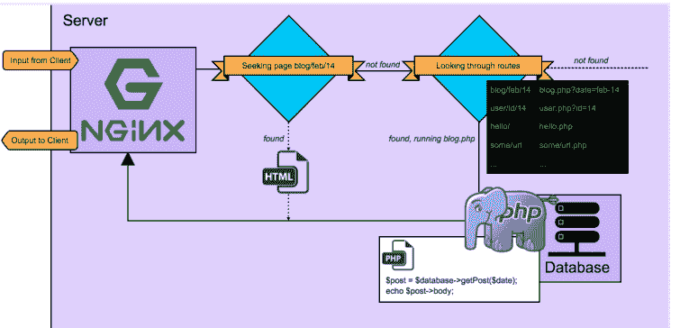

图 1.3. 如果答案是唯一的，服务器向 PHP 请求答案

在图 1.3 中：

- 图表代表了图 1.1 中物理计算机的内部结构
- `Nginx` 是安装在这台机器上的 Web 服务器程序
- `Nginx` 接收来自客户端的请求形式输入（2 月 14 日的博客）
- `Nginx` 检查是否存在 `blog/feb/14` 页面
- 由于没有该页面，`Nginx` 检查 PHP 文件的路由
- `Nginx` 发现它需要通过 PHP 运行 `blog.php` 脚本
- `blog.php` 脚本连接数据库并返回指定日期的文本
- PHP 引擎将此结果发送给服务器
- `Nginx` 将其返回给客户端

总结一下：PHP 是服务器的答案生成器，这样它知道对浏览器的问题提供什么答案。这样来，服务器不需要知道答案，它只需要提问并将响应转发给浏览器。想象一个“你好，名字”页面；为每个现有名称生成页面是不可能的，但我们可以让 PHP 在一个页面上请求名称，然后。

这里重要的是客户端与服务器端之间的通信。这属于

### 使用服务器端语言生成答案

服务器端语言的最后一部分是你正在寻找的内容。假设：

- 服务器检查路由下是否有任何内容
- 如果没有找到文件，它被配置为询问 PHP
- 服务器询问：“能在路由下找到任何内容吗？”
- PHP 激活并搜索路由，未找到任何内容
- 它向服务器返回“404 页面未找到”错误（然后提供给浏览器）
- 存在许多此类状态码，但在这一阶段不需要了解所有
- 服务器接收到 404 消息并想：“嗯，PHP 锁定了。好吧，它什么都没有，还是给客户端返回一个失败的页面吧。”浏览器随后收到 404 页面。

我希望这一章所介绍的概念能帮助你了解自己在 PHP 的宏大蓝图中处于何（或将处于何）位置。在接下来的章节中，你将找到关于网络请求和 DNS 服务器的更多技术信息。

### 更多需求

#### DNS 服务器

如前所述，互联网上的每个域名（例如 `example.com`）都绑定到特定的 IP 地址（例如 `93.184.216.34`）。IP 地址是识别给定服务器的数字集。换句话说，IP 地址告诉浏览器如何在互联网上找到它正在寻找的计算机（服务器）。DNS 服务器（也称为名称服务器）知道哪些 IP 地址匹配域名，并告诉浏览器下一步去哪里。


当尝试查找匹配域名时，浏览器首先检查自己的缓存——访问域名的保存列表。每个浏览器都会维护此列表并定期刷新。如果从自己的缓存中发现域名-IP 组合，网站加载速度会更快，因为不需要询问 DNS 服务器。如果缓存中没有，浏览器会询问名为解析器的程序（内置于操作系统）检查其安装计算机上的 hosts 文件。hosts 文件映射到 IP 地址。（我们将在后的章节中学习如何使用此文件。）如果还没有必要信息，将检查路由器（路由器通常都有）上的 DNS 缓存，如果那里也没有找到，则会询问 ISP 的 DNS 服务器。

## 网络请求的解析

在最后最后一步之前，一切都发生在你自己的电脑上，或者正如我们所说的，在本地。现在是时候访问 ISP（互联网服务提供商）了，这不再是本地问题——而是远程问题。如果 ISP 的 DNS 服务器没有该域名的记录，它会发现并告诉浏览器，同时缓存结果以备以后查询。它是如何发现的呢？它从右到左解析域名。

`www.example.com` 被拆分为若干片段……

如果你想了解更多关于名称服务器的信息，并想发现整个互联网的顺利运行如何依赖于十三台机器（计算机集群），请查看维基百科上的名称服务器页面，4，或者查看 Super User 上一些令人惊叹的详尽答案。5。

### 当你输入 ... 时发生了什么

一个常见的程序员面试面试题是：“在浏览器的地址栏中输入 google.com 并按回车时会发生什么？”虽然我们之前在某种解释了这一点（尽管是简化的方式），但如果你想了解从硬件到软件的确切细节，请查看 Alex Gaynor 的极佳描述，6。这是一篇极其详尽但写得很好的文章。请注意，现实中，这种程度的详细知识对于成为一名优秀的开发者来说并不是必要的。

> 4 https://en.wikipedia.org/wiki/Root_name_server
>
> 5 https://superuser.com/questions/527116/how-does-my-browser-locate-the-nearest-dns-root-servers
>
> 6 https://github.com/alex/what-happens-when

# 第 2 章

## 编程环境

在编程语文中，环境有两种类型：应用环境和编程环境。我们将在后面的章节中介绍应用环境。本书的这部分将讨论**编程环境**，解释 IDE（集成开发环境）并建议尝试哪一个，解释编码标准并探索一些命令行基础知识。在本章中，这一切都将变得稍微具有技术性。

编程环境包括——但不限于——你交互的人员、你的操作系统、你的代码编辑器或 IDE（稍后会详细介绍）、你的编码标准，以及通常情况下，在开发过程中帮助或阻碍你工作的一切事物。换句话说，编程环境就是*程序员的环境*。

如果你符合以下情况，请跳过本章：

- 已经选了一个心仪的 IDE 且打算更换
- 知道在哪里可以找到任何编程问题的帮助
- 已经在遵循编码标准，无论你是在团队中还是在单兵作战

### 快速上手 PHP 环境

- 熟悉命令行

如果你符合以下情况，请阅读本章：

- 正在使用简单的文本编辑器编写代码，或不知道任何 IDE
- 认为编码标准是不必要的
- 不知道从哪里获取你可能遇到的问题的真正有用建议
- 不熟悉命令行和/或认为它是不必要的，因为存在替代方案

### 一个好的 IDE 值其黄金大小的文件体积

“价值连城”的这句老言对于 IDE（或集成开发环境）来说是成立的。IDE 是用于编写代码的高级程序，在本节的结束处，我们将为你提供几个不错的选择。

你可能熟悉如 TextMate 或 Notepad 这样的文本编辑器。有一些面向代码的替代方案，如 `Sublime Text`¹ 和 `Notepad++`²，它们通过提供常用的语言构造结构并帮助你自动补全语句，使编码变得容易得多，因此背诵整个编程语言命令已成为过去。大多数编辑器都提供语法高亮，通过对某些特定的编程语言关键字和短语应用不同的颜色，使代码更具可读性。参见图 2.1 的没有语法高亮的代码，以及图 2.2 的语法高亮示例。

> ¹ http://www.sublimetext.com/
>
> ² https://notepad-plus-plus.org/

```php
<?php
class test
{
    protected $name;

    /**
     * 向用户显示应用程序欢迎界面。
     * 
     * @return Response
     */
    public function index()
    {
        $provider = new Google([
            'clientId' => '322309742012-7uq2vjegjh0p1ldthb7pc44lepeu6bb64.apps.googlecontent.com',
            'clientSecret' => 'Xtc0Sj4uWUKTYzY6r2GnHaf',
            'redirectUri' => 'http://todohelpist-local.com:8000/',
            'scopes' => ['email'],
        ]);

        $provider->doStuff();
    }
}
}
```

图 2.1. 没有语法高亮的文本编辑器

### 快速上手 PHP 环境

```php
<?php
class test
{
    protected $name;

    /**
     * 向用户显示应用程序欢迎界面。
     * @return string
     */
    public function index()
    {
        $provider = new Google([
            'clientId' => '3223097422012-7uq2V2islghPrdlthbp40lepeu6bb64.apps.googlecontent.com',
            'clientSecret' => 'X7c054UgY0UKTYz2eR0nHxf',
            'redirectUri' => 'http://todolist-local.com:8000/',
            'scopes' => ['email'],
        ]);

        $provider->stuff();
    }
}
```


无例外，所有的文本编辑器在良好的 IDE 面前都显得黯黯逊色。IDE 是一个强大的程序，就像加强版的文本编辑器，它通过以下方式帮助你：

- 集成错误检查器、标准检查器和测试套件，所有这些确保你的应用程序运行正常
- 集成版本控制系统，以便你可以维护不同版本的代码，确保你拥有无限的“撤销”能力（版本控制将在第 5 章中详细介绍）
- 允许连接数据库和远程服务器，让你轻松调试数据库或在远程服务器上测试代码（例如，公司总部的服务器），以确保它在周一早上可以工作

以及更多，更多。

那么，哪些 IDE 是 PHP 开发的好选择？

按照我个人的偏好：

### PhpStorm

`PhpStorm`⁵ 是一个商业 IDE，这意味着它不是开源免费的，但它非常值。它提供了上述提到的所有甚至更多，并且在所有操作系统上都能完美运行，无论你使用的是 Linux、Windows 还是 Mac OS X。它在 SitePoint 上有大量的介绍⁴，如果你想查看评论、快捷键、提高效率的技巧、其他人的方法，而且 JetBrains——制作它的公司——经常会提供免费许可证，你可以通过维护开源项目来获得资格。或者，关注 SitePoint 频道上的调查和评论⁵，我们有时会发放许可证。

商业支持意味着来自团队的快速响应、快速开发（定期更新许多新功能）以及持续维护的保证。请注意，`PhpStorm` 允许 30 天试用，如果你在一个月后仍未被说服，他们通常会延长你的试用许可。

³ https://www.jetbrains.com/phpstorm/
⁴ http://www.sitepoint.com/tag/phpstorm/
⁵ http://sitepoint.com/php

### 快速上手 PHP 环境

**优点：** 速度极快、功能丰富、稳定（从不崩溃）、支持跨平台

**缺点：** 需要付费、可能消耗大量资源、且对旧电脑不友好。详情请访问 https://www.jetbrainsbrains.com/phpstorm/help/system-requirements-and-installation.html 查看要求。

### NetBeans

`NetBeans`$^6$ 是一款开源 IDE，它拥有 `PhpStorm` 的几乎所有功能，并堪称它的宿敌。我使用了两年的 `NetBeans` 后转到了 `PhpStorm`，我向每一位需要优秀 IDE 但还没准备好为商业版付费的人士推荐它。

`NetBeans` 比 `PhpStorm` 慢一点，消耗的资源也更多。它是跨平台的，相对稳定且非常可靠。它背后的团队被 Oracle 收购，有些人认为这是一个不吉利的预兆，但我认为这只会巩固当前版本的版本的可靠性。

**优点：** 免费、功能丰富、可靠、跨平台、开源

**缺点：** Oracle 拥有、缺乏商业支持、采用新功能较慢

### Zend Studio

`Zend Studio`$^7$ 由“主导” PHP 的公司制造（尽管它已被 Rogue Wave software 收购，该公司的名字可能会出现在以前 Zend 所在的地方）。Zend 是第一个创建 PHP 的公司，并为该语言提供官方认证。

`Zend Studio` 是一款商业 IDE，比 `PhpStorm` 稍微贵一点，但它提供免费试用，所以你可以在决定购买之前尝试一下。它拥有 `PhpStorm` 和 `NetBeans` 的许多相同功能（某些除外），以及一些工具。`Zend Studio` 内置了更简单的移动应用开发功能（`NetBeans` 和 `PhpStorm` 通过插件提供），它自己的 Apility 平台（一种基于其 Zend Framework 创建 API 的服务）也有原生的 `Zend Studio` 驱动程序。如果你不熟悉这些术语，不要担心，书中稍后会详细介绍。

> $6$ https://netbeans.org/
>
> $7$ http://www.zend.com/en/products/studio

另一个好处是内置对 ZendServer 的支持——这是一种用于运行 PHP 应用程序并对运行代码提供各种分析和高级调试能力的服务器程序。不过，Zend Server 是付费产品，如果你想在 `Zend Studio` 中使用它，就需要购买许可。这里有关于 Zend Server 的一些信息：http://www.sitepoint.com/getting-know-zend-server/

如果你的目标是成为最“官方”的 PHP 开发者，拥有证书并对官方认可的工具和服务有全面的了解，那么 `Zend Studio` 非常适合你。否则，我推荐使用 `PhpStorm` 或 `NetBeans`。

- **优点：** 由于由 Zend 拥有，具有极佳的商业支持；功能丰富、跨平台，并与其他 Zend 产品良好地集成
- **缺点：** 昂贵、消耗资源、且不稳定；运行可能较慢

以下是一些你可以根据空闲自行研究的其他选项，混合了商业版和免费版：

- Komodo IDE: http://komodoide.com/
- Eclipse 带 PDT: https://eclipse.org/pdt/
- Aptana Studio: http://www.aptana.com/
- phpDesigner: http://www.mprosoftware.dk/phpdesigner.php

在 http://www.sitepoint.com/best-php-ide-2014-survey-results 还有一个按流行程度排序的列表。

无论你选择哪种 IDE，请坚持使用几个月。它的学习曲线通常很高，刚开始使用时，可能会对所有选项感到不知所措。随着时间的推移，你会习惯它提供的一切，即使你在代码的前 100 天里只使用了它 10% 的功能。以后切换 IDE 并没有问题，但请给你尝试的每一个 IDE 一个合理的机会。

在目前，没有必要下载和安装 IDE。这本书的代码量很少，只有当我们进入后面的章节时你才需要一个。

# 20 快速上手 PHP 环境

### 注意：带有 WYSIWYG 的 IDE

并不是所有 IDE 都且应该提供 WYSIWYG（所见即所得）编辑。Adobe 的 IDE Dreamweaver 就是其中一种工具。它因让你能够轻松上手而闻名，因为它允许你从工具栏拉入元素并视觉化地拖到屏幕上，帮助你像玩乐高积木一样“构建代码”。它生成的代码通常不是最优的且臃肿的，包含了比需要更多的代码并会减慢网站运行速度。此外，通过跳过真正的代码部分，你实际上是在限制自己。你将无法阅读任何人的代码，而且在学习解决自己的问题时会困难得多。

Dreamweaver 不是唯一的 WYSIWYG 编辑器，但它是最受欢迎的一种。如果你遇到支持 WYSIWYG 的 IDE，我全心建议你向反方向运行。

### 编码规范的重要性

编码规范是应用于代码的规则，以使其在整个项目中保持一致性。例如，如果 Jim 这样写代码：

```
if ($purchaseWasCompleted)
  $this->succeed();
else
  $this->error();
```

但 Mike 这样写代码：

```
($purchaseWasCompleted) ? $this->succeed() : $this->error();
```

而 Joanna 如下所示写：

```
$pwc = $purchaseWasCompleted;
if ($pwc)
{
$this->succeed();
} else {
$this->error();
}
```

可读性好得多，不是吗？而且这只需要空行和间距——这就是编码规范所做的。简单但至关重要。标准还规定了其他方面，例如类和变量命名的大小写规则（注意前面代码中大写的 Test）；逻辑结构（如 if、for 等）的大括号位置；以及更多。

我们强烈建议使用 PSR-2。它是目前大多数高质量项目的标准，使你的编码风格与许多开发者保持一致。它还将让你能够流利地阅读他们的代码。有了 IDE，这变得异常简单。例如，在 `PhpStorm` 中，你会进入 File > Settings > Editor > Code Style，并选择 PSR1（PSR2 基于 PSR1，所以此选项适用于两者）。注意：根据你的 `PhpStorm` 版本，你可能还需要在 Code Style 窗口选择 Set From。在其他 IDE 中，只需搜索短语“PSR-2 in EDITOR”，其中 EDITOR 是你选择的 IDE。这将产生大量结果。

```php
class Test {
    protected $name;
    public function __construct($name) {
        $pointlessSum = 3+4;
        if ($name)
            $this->name = $name;
        else
            $this->name = "Default";
    }
    public function echoName() {
        echo $this->name;
    }
}
```

会被重新格式化为像这样：

```php
class Test
{
    public function __construct($name)
    {
        $pointsSum = 3 + 4;
        if ($name) {
            $this->name = $name;
        } else {
            $this->name = "Default";
        }
    }

    public function echoName()
    {
        echo $this->name;
    }
}
```

⁸ http://www.php-fig.org/psr/2/
⁹ 如果你不懂这些代码请担心，它们仅用于演示。

### 命令行 / 终端

最后，让我们简要查看命令行或终端。首先，对术语进行说明。

# 编程环境 23

在 Windows 上，你在图 2.3 中看到的程序被称为命令提示符或命令行：

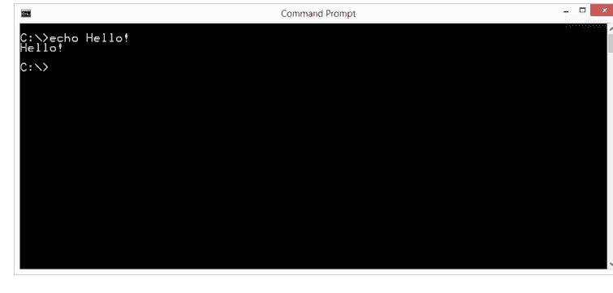

你通过在搜索框中输入“cmd”或“command prompt”来运行它。在最基础的形式下，它允许你执行运行 Windows 程序的命令，并产生一些文本输出（例如图 2.3 所示的 `echo` 命令，它会产生“Hello!”的输出），或者打开你已经熟悉的应用程序，如记事本（如果你在命令提示符中输入“notepad”并按回车，记事本应用程序就会打开）。命令行还有其他的实现方式，例如 `Cmder`$^{10}$（见图 2.4）或 `Console`${11}$。它们是更美观的版本，本质上执行相同的任务，但让复制粘贴、标签切换和选择文本等某些操作变得更容易。

10 http://bliker.github.io/cmder/
11 http://sourceforge.net/projects/console/

## 24 快速上手 PHP 环境

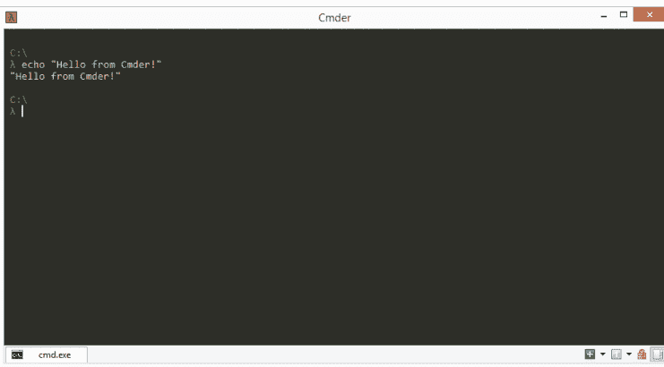

在 Mac 和 Linux 上，该程序被称为 Terminal（终端）。要在这些任任上运行它，打开搜索并输入“Terminal”，它就会弹出。它的功能与 Windows 命令提示符相同，但命令不同。例如，在 Windows 中显示目录（文件夹）内容的命令是 `dir`，而在 Apple 和 Linux 上通常是 `ls`。


任何称职的开发者都需要熟悉命令行/终端，以最大限度地发挥自己的潜力。大多数命令行命令都有通用的替代方法，起初可以使用各种快捷键，但过不了多久它们就会变得繁琐且具有限制性，而不是有用。

Windows 版本和非 Windows 版本之间的差异很重要，因为即使在 Windows 上，你也会使用 Apple/Linux 特定的命令。我们将在第 4 章介绍。

## 社区

作为编程环境的最后一个元素，让我们讨论一下寻求和提供帮助。你所选择的编程语言社区是学习编程时最重要的因素之一。能够快速可靠地获得遇到问题的答案，可能意味着在商业项目中是按时完成还是错过截止日期。

没有哪个开发者能背下他们偏好的编程语言的所有命令列表。我编写 PHP 已经快十年了，仍然经常查阅即使是最基本的命令。真正的知识不在于背诵命令，而在于知道在哪里可以找到它们。

话虽如此，这里是你现在应该在浏览器中书签到“PHP Help”文件夹下的某些资源：

### PHP Mentoring

PHP Mentoring¹² 旨在帮助人们寻找导师和学生。如果你是专家，可以指导新手；如果你是初学者，可以找到一个导师。导师会告诉你最佳实践，分析你的代码并提供反馈，指出你的错误，并在你偏离方向时将你引回正确的道路。这不涉及任何费用；这是某些热心人士完全自愿的努力。如果你是一个纯新手，我建议你一翻开书页就尽快申请导师指导。

### PHP.net 文档

该编程语言¹³的官方网站充满了代码示例，用户评论进一步对它们进行了审查和解释。如果你漫无目的地浏览这些页面，很可能收获甚微，但每当你遇到困难并需要检查某个函数或命令时，你的 Google 搜索结果很可能是 PHP.net。如果你连接了网络，或者当时离线，还有这些文档的离线版本¹⁴你可以独立下载或作为 Google Chrome 应用¹⁵。

### 各种论坛

SitePoint 论坛¹⁶ 是一个极好的资源，有大量乐意提供帮助的人。如果你对问题提供了足够的细节，几乎可以保证在几分钟内收到答案。这些论坛是游戏化的，这意味着它们会给在上面发帖的人发放勋章和积分，鼓励社区参与。

¹² http://phpmentoring.org/

¹³ http://php.net

¹⁴ http://php.net/download-docs.php

¹⁵ http://bit.ly/phpdocs

¹⁶ http://community.sitepoint.com

### 快速上手 PHP 环境

StackExchange 网络是由一系列针对特定背景（从编程到烹饪）的问答网站组成的财团，这些网站由构建支持 SitePoint 论坛软件的同一群人创建。由于是游戏化的，这种奖励机制允许用户比平时更多参与，人们可以在几小时（甚至几分钟）内获得一个良好问题的答案。为了获得完整体验，你应该书签三个主要的网站：

- StackOverflow (http://stackoverflow.com/) 是最流行的通用编程问答网站。你可以在这里提问关于开发的任何查询。你也可以提问不直接涉及编程的问题，例如关于 IDE、服务器等的查询。

- Programming (http://programmers.stackexchange.com/) 专门关注编程问题。如果你在编码时遇到卡壳，这里就是你提问的地方，但请确保先进行广泛的 Google 搜索。大多数新手问题已经有了解决方案，只是你很难找到它们。

- Code Review (http://codereview.stackexchange.com/) 用于代码审查。

**“环境”**一词是指你的应用程序周围的硬件和软件；即用于支持它的一切东西。

### 总结

在本章中，我们处理了环境、社区以及让编程更舒适的其它工具。¹⁷ http://sitepoint.com

关于应用开发中单元测试的示例，请参阅本章末尾的“进阶读者”章节。

进一步采用手机组装的类比，正在测试的电池可能需要单独的充电配件，或者屏幕可能需要使用带有合成手指的机械臂进行测试，以确保屏幕的触控灵敏正常。


所有这些插件仅在开发期间使用。当从开发环境转换为生产环境（也称为*部署*）时，这些插件会被移除。对于我们的应用程序来说，这意味着上述的编译/构建步骤：各种 CSS 和 JavaScript 文件被合并并压缩，以减小网站的大小，使其在人们访问时看起来速度更快；单元测试被忽略并留在了开发环境中；还会发生各种其他优化（在章的稍后部分将介绍）——这一切都是为了让最终产品在宣布就绪时能够最大化其吸引力和潜力。

### 主机与虚拟主机

当你在自己的电脑上进行开发时，不可能访问 `http://mysite.com` 这个 URL 并期望看到你的网站；毕竟，你的网站尚未上线——它不在互联网上。为了绕过这个问题并像它已上线一样看到我们的网站，我们通过定义虚拟主机来“伪造”互联网。

简单来说，虚拟主机向安装在你电脑上的服务器程序发送一个指令，例如：如果用户在浏览器中请求 `http://mysite.com`，则通过 PHP 运行 `file.php` 并在浏览器中显示其输出。

如你所见，这与上线网站的请求流程几乎完全相同。但是什么让浏览器向我们自己电脑的服务器程序请求 `mysite.com` 域名，而不是在互联网的名称服务器上查找呢？这就是 `hosts` 文件。

`hosts` 文件是每个操作系统中都存在的一个特殊文件。我们早前在第一章的“进阶读者”章节中简要提到过它。它包含一个域名列表及其相应的 IP 地址，这样你电脑上的任何浏览器都可以读取并直接转到 IP 地址，而无需与 DNS 通信检查去哪里。在 Windows 中，此文件位于 `C:\Windows\System32\drivers\etc\hosts`，在 Linux 和 Mac 机器上它位于 `/etc/hosts`。如果你在这个文件中放入一个 IP-名称对，电脑就会遵守。我们现在就可以尝试一下。别担心——不会出任何错。

**在 Windows 上**，进入搜索字段，输入“notepad”（记事本），一旦它出现，右键点击并选择**以管理员身份运行**。系统将要求你确认。在打开的窗口中，选择**文件 > 打开**并转到：**我的电脑 > C > Windows > System32 > drivers > etc**。在记事本窗口的右下角，你可能需要选择**所有文件**，这样 `hosts` 文件就会显示。双击打开它。

在 Linux/Mac 机器上，通过搜索打开“终端”（Terminal）。**在 Linux 上**，在终端中输入 `sudo edit` 来以管理员身份打开默认文本编辑器。系统会要求你输入管理员密码。**在 OS X 上**，输入 `sudo /Applications/TextEdit.app/Contents/TextEdit`，这将执行相同的任务。在这两个编辑器中，转到**文件 -> 打开**并进入目录 `/etc` 寻找 `hosts` 文件。双击打开它。

文件打开后，请注意前几行：它们都以井号符号 (`#`) 开头。这表示它们是注释，对文件没有影响。这些的作用是向用户解释文件的用途，它们在 PHP 中也是如此。

现在，在所有注释行下方，添加以下行：

```
208.117.229.217 bing.com
```

保存文件并在浏览器中打开 `http://bing.com`。你刚刚成功地将所有指向微软搜索引擎 Bing 的请求重定向到了 Google！当然，我们不想保留这些更改；可以随时删除此行，或者在它前面加一个井号将其转为注释，然后保存文件。你应该能够再次正常地访问 `http://bing.com` 了。

通过这种方法，我们稍后会将浏览器对 `http://mysite.com`（这将是我们应用程序的示例域名）的请求重定向到我们自己的电脑服务器上。这将使我们能够在不部署的情况下测试网站的开发版本。

## 测试环境与维护

测试环境（Staging environment）是一个独立的服务器（或多个服务器），包含生产环境的副本——也称为镜像。在较小的公司或项目中，通常会跳过测试环境。它的设计是尽可能地模仿生产环境，具有匹配的软件版本、相同的配置值等。测试环境用于执行最终测试；例如，Facebook 可能会重新设计首页，在将其部署到生产环境供所有用户使用之前，它会部署到其测试服务器上，以便员工（专职非程序员，即质量保证团队）可以像日常使用那样测试一切。如果一切顺利，就会发生从测试环境到生产环境的最终部署。

测试环境超出了本书的范畴，但了解它是有好处的。在虚拟机和小型丢弃型项目的时代，测试环境可能是不必要的，只有在较大的长期 Web 应用中才会发挥作用。

这里还有维护模式（maintenance mode），这是我们在此语境下必须涵盖的术语。它是一种模式而不是一种环境，因为应用程序周围的环境没有改变——只有应用程序的状态在改变。

## AMP 集合的危害

在开始 PHP 开发时，依赖这些预构建软件包也剥夺了你学习系统管理工作的机会。AMP 指的是 Apache、MySQL 和 PHP，最后的 P 代表 PHP。虽然在电脑上一键安装所有所需软件很容易，但 AMP 的危害在哪里？

- 你的电脑将堆积了不必要的软件
- 你的电脑会变慢，应用程序会变少
- 如果你犯了错，将无法优雅地处理差异
- 你最终将在运行的网站上反复调试 Bug，并骚扰你的访问者。

# PHP 环境快速启动

由 Nginx（另一个与 Apache 竞争的服务器程序，发音为 "engine x"）。哦不，现在怎么办？

我们可以将 PHP 更新到较新版本并检查 `app1` 是否仍然运行，但如果我们的整台电脑现在运行的是 5.6，我们该如何确保在开发过程中不会无意中使用了 PHP 5.3 中不可用的代码呢？同样，我们可以将 MySQL 升级到 5.1 并检查它是否仍然运行，但我们如何知道 MySQL 是否在 5+ 版本中丢弃了某些功能，以至于在我们修复 `app1` 以运行在 5.1 上时，这些功能会导致 `app2` 崩溃呢？毕竟，`app2` 仍然需要在 4.0 版本上运行，因为它可能仍然部署在那样的生产服务器上。该死，我们该如何处理 Apache 版本与 Nginx 之间的冲突问题呢？我们是否要在电脑上同时安装这两个服务器并对它们进行测试？我们该如何切换它们？我们如何确保在运行另一个时，记得测试我们自己的一个？

这仅仅是两个应用。现在想象一下，如果你必须处理来自不同客户的几十个应用程序，每个应用都有不同的要求。这一切将不再变得非常、非常快速。

这种对不同软件版本的隔离可以通过虚拟机来轻松解决，我们将在第 4 章中讨论。

## 混乱的困局

最后，如果我们尝试安装新版本的 PHP，但出现某些问题了怎么办？这种情况在 OS X 和 Linux 中尤为常见——现在我们机器上安装的所有 PHP 版本都无法工作，事实证明让单个网站运行起来是不可能的。真是一团糟！我们无法回溯到之前的运行状态，而是被迫花费一整天的时间来调试自己的系统并尝试让它运行——不一定是正确的版本，只要能运行即可。

如果我们只需要输入一个命令，就能让一切回到 10 分钟前的状态，那不是太好了吗？是的，我们可以！这将在第 4 章中演示。

## 生产/开发一致性

这个听起来很复杂的短语其实非常简单——我们实际上已经间接接触过它。生产/开发一致性（Production/development parity）无非让生产环境和开发环境尽可能相似，最好完全相同，这样你开发的任何内容都会自动在生产环境中运行，无需任何过度的配置或额外的调试或微调。

实现一致性对于个人的工作流非常重要，因为它节省了大量的时间。避免为了让应用程序在生产环境中运行而进行任何额外工作，意味着你拥有自由和时间来关注真正有利于你的应用背景的重要业务相关问题，而不是困于不断追赶的泥潭中。在开发中做出一项更改，却必须在生产环境中做两次更改才能生效，这在最好的情况下是乏味的，在最坏的情况下是对项目健康有害的。你永远不知道团队中的谁会失误并导致程序用错误界面迎接用户。

实现一致性的最佳方法是让你的开发环境运行与生产环境完全相同的软件。例如，如果你的目标是将应用程序部署到运行 Ubuntu Linux 版本 14.04 操作系统的服务器上，那么最好同样在该操作系统上进行开发。然而，如果我们运行的是 Windows 呢？因为我们喜欢消费高级多媒体内容（如游戏），或者我们需要强大的图像和视频处理软件只是这样？我们是否应该放弃所有其他兴趣，在 Windows 之上安装 Linux，并比其他任何事情都追求一致性？还是我们应该直接放弃一致性，在保持电脑强大、美观且稳定的同时承担风险，坚持我们选择的操作系统？

幸运的是，有第三种方法可以让你兼得两者之长：虚拟机（在第 4 章中介绍）。

## 性能与调试

我们要涉及的应用程序环境最后一个方面是确保应用是快速的（性能）且无错误的（调试）。这一部分完全是理论性的；它只是让你在以后我们遇到某些术语时知道预先会有什么。

性能通过各种优化方法实现。与该词的含义相反，在应用开发中，优化通常有多个层次，很少是那种能立即带来完美解决方案的更改。性能包括但不限于几个领域：

### 优化数据库

数据库通常是任何网站最慢的部分，在运行一段时间后如果瓶颈（由于无法足够快地处理进入的请求而变慢的部分）变得明显，它可以从额外的优化中获益。数据库优化方法包括设置索引、读写分离、更改数据库引擎、缓存获取的数据，以及其他听起来很神妙的术语。

### 优化前端资源

我们早期提到了编译和构建——这是我们优化网站前端的方式。当网站显示给用户时，他们看到的是由图像、HTML、CSS 和 JavaScript 组成的输出，正如第 1 章所述，所有内容都需要在浏览器中下载并执行。文件越小——数量越少——网站加载得越快。通常，一个网站会有多个 CSS 文件和多个 JavaScript 文件。将每个类型合并成一个较大的 CSS 或 JavaScript 文件可以显著提高网站的下载速度。另一种经常执行的前端资源优化技巧是通过内容分发网络（CDN）提供图像，这是一种第三方服务，它为你托管图像并确保网站访问者从距离他们最近的服务器下载图像，从而进一步提高速度。人们还可以减小图像大小、通过将图像放入一个文件中创建图像精灵（sprite）等。

### 优化后端

这也是编译/构建步骤。测试文件被忽略，文件被合并成更大的文件。

### 应用程序环境

**缓存**是保存以前需要的内容以备后用。如果你询问服务器，它会进行计数。如果你更改了程序，你可以轻松地运行此测试（它仍然在那里）并检查这种转换是否正常。

那么，如何衡量性能或发现错误？有很多工具可以进行**性能分析**（profiling，这就是查找错误）。两个更好的工具是 Z-Ray 和 Blackfire。缓存在 C++ 等语言中非常重要。

> **警惕微优化**
>
> 注意，新手的一种常见错误是微优化。例如，曾经认为使用单引号字符串（`$var = 'Some String'`）比双引号（`$var = "Some String"`）更快。这种优化的性能收益可以忽略不计；相反，改进 SQL 查询或远程调用将有效得多。如有疑问，参考 Benchmark 和真实数据（例如来自 Z-Ray 或 Blackfire），而不是你的直觉。

### 总结

在本章中，我们探索了应用程序环境，涵盖了应用在特定生命周期内的各种生态系统。我们讨论了虚拟主机以及如何配置电脑将网站 URL 重定向到本地 PHP 安装而不是在线查找，并讨论了至关重要的开发/生产一致性。

如果这看起来过于复杂，不要绝望。这是因为我们到为止只处理理论——这是进入实践领域所需的理论。在接下来的章节中，我们将亲手操作一些虚拟机。

## 为那些想要更多的人准备

在应用世界中，测试单个组件被称为单元测试——对每个独立代码单元的测试。

例如，应用程序的某部分具有移除每个名称中的本地符号并将其转换为符合英语习惯的字母的能力。假设名称“Škvorc”会被转换为“Skkovec”。将 Škvorc 转换为 Skkovec 是一个很小的代码集，或一个单元。单元是可测试的；这意味着，对于任何给定的输入“Škvorc”，我预期输出是“Skkovec”。我可以写一个单元测试，这是一个定义了输入和预期输出的文件，当我运行它时，它会测试该功能是否正常工作。如果两个月后，我更改了程序，我可以轻松地运行此测试（它仍然在那里）并检查这种转换是否正常。在我们智能手机上章节开头的类比，单个可测试单元可以是触摸屏，也可以是电池。

⁵ http://www.zend.com/products/z-ray

⁶ https://blackfire.io/getting-started

# 第 4 章

## 虚拟机

在本章中，我们将学习虚拟化技术，以及为什么它对于高质量的开发体验至关重要。我们将使用如 Vagrant 等行业标准工具，并讨论如何让虚拟机的使用更加用户友好，以便让更广泛的受众能够接触。

即使你对虚拟化非常熟悉，我仍然建议阅读这一章，因为其中无疑包含对你来说是新的信息。它还将解释并演示我们在本书剩余部分中将一直使用的 VirtualBox（虚拟机盒）。

为了使用本章介绍的工具，你需要在计算机上安装一些软件。这些软件是跨平台的，因此无论你使用什么操作系统，都有适用于你的对应版本。

在继续之前，请确保你已经安装了以下内容：

- Vagrant，来自 https://www.vagrant.com/
- VirtualBox，来自 https://www.virtualbox.org/
- Git，来自 http://git-scm.com/downloads

所有链接都包含了每个主要操作系统的安装指南。

### 虚拟机详解

在使用虚拟机（VMs）之前，我将先解释它们是什么，以及它们在 Web 开发背景下的含义（这两个是不一样的！）。

#### 什么是虚拟机？

你的计算机是一台机器。它包含了 CPU、GPU、一些内存、硬盘等硬件。你需要所有这些硬件来运行你的操作系统以及安装在其中的应用程序。**虚拟机**是一种特殊的应用程序，它预留你计算机的一部分，并假装自己是一台独立的真实机器。例如，虚拟机可能会从你的主机上预留部分 CPU 和 2GB 内存，以及 20GB 硬盘空间。这些资源随后被汇聚成一个整体（如图 4.1 所示），它可以作为一台计算机独立运行。它拥有自己的独立于宿主机操作系统（*宿主机*）的操作系统，并安装了自己的应用程序。


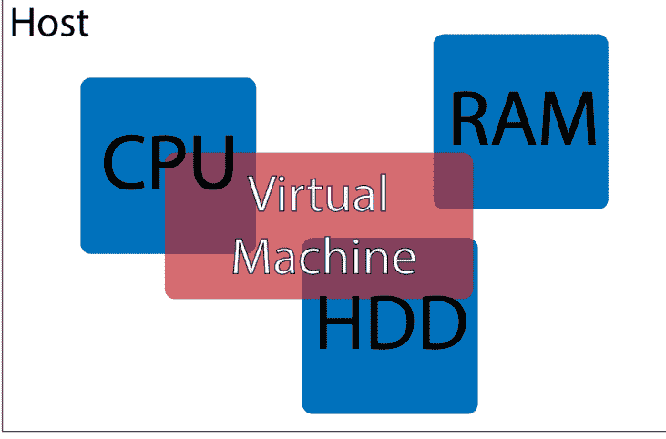

图 4.1 虚拟机的可视化

操作系统——事实上，不同机器的整个环境（宿主机和运行在宿主机上的虚拟机）是完全独立的，实际上，它们彼此感知不到。宿主机知道自己的可用资源较少，但并不知道它们不是真实的；它*认为*它们是真实的硬件部分。

虚拟机，从字面上说，是计算机中的计算机。有些人使用它们是为了在没有原生支持的操作系统上运行视频游戏；例如，在 Linux 系统上运行 Windows 游戏。安全公司将它们作为沙箱，在这些环境中让他们允许病毒或潜在的恶意代码运行而不担心后果：如果虚拟机损坏了，只需两条简单的命令即可重建（毕竟它是虚拟的！）。企业公司将它们用作避免更新软件的方法。与其花费数十亿美元重写软件（因为他们的内部应用程序依赖 Windows XP，而最新版本是 Windows 10），他们愿意花更少的钱购买 Windows XP 许可并在 Windows 10 宿主机内部运行 Windows 虚拟机，从而让他们在享受新宿主机操作系统更高安全性的同时延长软件的使用寿命。

在开发中，虚拟机被用作应用程序的隔离环境。你可以在其中安装不同版本的 PHP 和 MySQL，并且你可以破坏任何东西，因为虚拟机可以很容易地重置为原始状态。这使得虚拟机非常有吸引力，不仅可以在不同操作系统上的不同版本 PHP 上测试代码，还为了实现开发/生产环境的一致性（在第 3 章讨论过）：它允许你配置虚拟机使其尽可能像在线服务器，从而能够像在线运行一样测试代码，最大限度地减少错误。

### 认识 VirtualBox 和 Vagrant

`VirtualBox` 是我们在本章介绍中安装的软件之一，用于*运行*虚拟机。`Vagrant` 在 `Vagrantfile` 的帮助下知道它需要做什么，该文件包含了如何设置环境的所有指令，使得创建新箱（box）的过程变得更简单。

`VirtualBox` 具有许多功能，包括但不限于与宿主机共享文件夹。如图 4.2 所示，这就是 `VirtualBox` 的功能。

### 快速上手 PHP 环境

在仅有 `VirtualBox` 的世界里，输入此类命令通常是枯燥、易出错且极其耗时的（尽管可行！），而 `Vagrant` 帮助缩短过程，使其能够极快地运行。

## 虚拟机

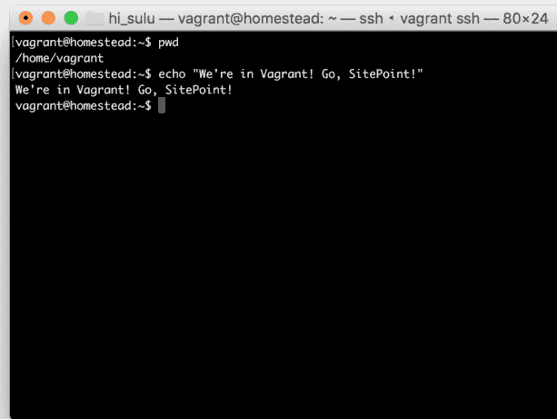

图 4.3 虚拟机的操作

### 虚拟机的优势

总结一下，使用虚拟机的优势是：

- 它们很容易销毁并重置为初始状态
- 你可以在宿主机上使用你喜爱的应用程序
- 通过配置虚拟机与你的在线服务器相似，你可以实现开发/生产环境的一致性
- 你可以学习系统管理
- 使用虚拟机对你的宿主机无法造成任何伤害，因为它们是完全隔离的
- 很容易与其他共享整个配置（通过发送 `Vagrantfile`），让他们在自己的机器上拥有完全相同的设置
- 不需要在你的宿主机上安装 PHP、服务器和数据库，从而保持你的主操作系统的整洁和快速

### Vagrant 概览

`Vagrant` 是一个通过另一个应用程序（在本例中为 `VirtualBox`）使用简单命令创建虚拟机的程序。`Vagrant` 在 `Vagrantfile` 的帮助下知道它需要做什么，该文件包含了设置环境的所有指令。

### Vagrant Boxes

所有的 `Vagrant boxes` 可以在 `https://hashicorp.com/boxes/search` 找到。这些箱由其他人预配置并免费提供给所有人。你可以找到从基础的操作系统安装到与特定软件兼容的全配置环境的所有内容。

# 配置准备

配置工具（`Provisioner`）是一种用于在机器上（无论是否已安装）自动安装先决软件的工具。配置工具也经常用于生产服务器，以使其符合待部署应用程序的要求。一些流行的配置工具包括 `Ansible`、`Puppet` 和 `Chef`。配置工具接受一个“配方”（`recipe`），即一份为应用程序准备环境所需的所需的步骤列表。

例如，假设我们要构建一个 PHP 应用程序，我们可以让配置工具在一个空白的 `Vagrant` 实例上为我们执行以下操作：

- 安装 `Git`
- 安装 `PHP`
- 安装某些 `PHP` 扩展
- 安装 `MySQL`
- 设置默认的 `MySQL` 用户名和密码
- 下载示例数据库数据并将其导入 `MySQL`

手动完成所有这些操作是枯燥且容易出错的。配置工具具有强大的能力，可以为我们处理操作系统之间的差异，因此它们可以在我们的虚拟机、生产服务器、测试服务器等上运行。它们始终执行相同的操作并产生相同的结果：运行应用程序所需的先决条件将由它们处理好。

`Vagrant` 与各种配置工具紧密集成，并利用它们来设置我们要求其设置的环境。因此，在启动 `Vagrant` 实例时，会先启动虚拟机，然后运行指定的配置工具。此时不需要了解配置工具，但在本章末尾会有指向某些相关资源的链接。在本章的实验中，我们将使用一个预先配置好的 `Vagrantfile` 以及一个已经预先配置好的配置脚本，以保持简单并对新手友好。

[^1]: http://www.ansible.com/
[^2]: https://puppetlabs.com/
[^3]: https://www.chef.io/chef/

# 快速启动 PHP 环境

配置的另一种方法是使用各种可用的图形用户界面（`GUI`）来构建你自己的 `Vagfile`（以及配置脚本），例如如图 4.4 所示，使用 `PuPHPet`。

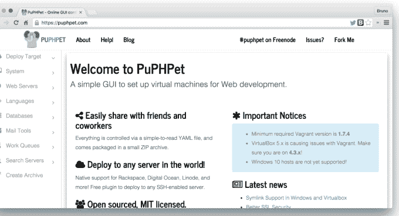

图 4.4. 使用 PuPHPet 进行配置准备

`PuPHPet`（使用 `Puppet` 作为配置工具）和 `Phansible`（使用更简单的 `Ansible` 作为配置工具）是设置虚拟机的 `GUI` 良好示例。这些 `GUI` 将允许你通过分步设置，选择为你的环境所需的所有软件和配置值，最终生成一个 `Vagrantfile`，你可以通过它轻松地启动所需的环境。如果你想看相关的示例，SitePoint 上 `PuPHet` 之后有一篇很棒的文章。

### 使用 Vagrant

理论足够了，让我们尝试通过设置一个 `Homestead`（这是一个预配置的虚拟机）版本来使用 `Vagrant`，然后我将在下一节中解释一切。假设你已经安装了本章介绍部分提到的软件，请访问 URL `https://...` 。完成后，点击图 4.5 所示的 **Download Zip** 按钮。

[^4]: http://puphpet.com.
[^5]: http://phansible.com/
[^6]: http://www.sitepoint.com/build-virtual-machines-easily-puphpet/

# 虚拟机 51

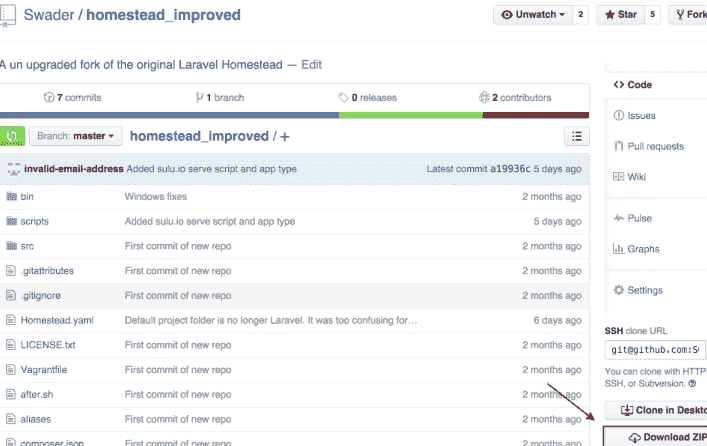

原始 Laravel Homestead 的未升级版本 - 编辑

| 7 commits | 1 branch | 0 releases | 2 contributors |
|---|---|---|---|
| Branch: master | homestead_improved / + | | |
| invalid-email-address | Added sulio serve script and app type | Latest commit a1993c 5 days ago | |
| bin | Windows fixes | 2 months ago | |
| scripts | Added sulio serve script and app type | 5 days ago | |
| src | First commit of repo | 2 months ago | |
| .gitattributes | First commit of repo | 2 months ago | |
| .gitignore | First commit of repo | 2 months ago | |
| homestead.yaml | Default project folder is no longer Laravel. It was too confusing... | 6 days ago | |
| LICENSE.txt | First commit of repo | 2 months ago | |
| Vagrantfile | First commit of repo | 2 months ago | |
| alfer.sh | First commit of repo | 2 months ago | |
| sileases | First commit of repo | 2 months ago | |
| composer.json | First commit of repo | 2 months ago | |

图 4.5. 下载 Homestead

将文件下载到你电脑的某个地方（我建议放在主目录中）并将其解压，可以通过双击或右键点击并选择 **Extract here.**。

现在是时候再次启动我们的朋友 Terminal（终端）或命令行了。在 OS X 或 Linux 上，打开 Terminal 应用。在 Windows 上，由于我们在本章开始时安装了 `Git`，请运行 `Git Bash` 程序，它现在理应该是可用的。

然后，进入我们解压 **homestead_improved-master.zip** 压缩包内容的文件夹，如图 4.6 所示。命令应该简单如 `cd ~/homestead_improved-master`，假设你将其解压到了主目录。

# 快速启动 PHP 环境

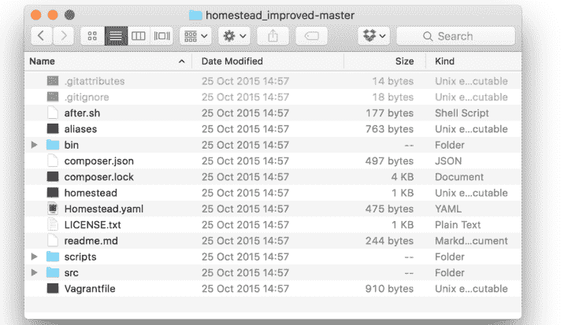

图 4.6. 解压后的文件夹

现在你已经进入了 `homestead_improved_master` 文件夹，运行 `bin/folder.sh`。然后，运行 `vagrant up`。这将下载 box 并将其放置在公共位置，这样就不需要再次下载。在等待期间，向你的 hosts 文件添加以下条目（有关如何以及为什么要这样做的细节，请参见第 3 章的 Hosts 章节）：

```
192.168.10.10 homestead.app
```

一旦运行 `vagrant up` 命令的原始终端窗口完成，打开浏览器并访问 URL：`http://homestead.app/`。屏幕应该显示 No file specified。如果是这样，现在 `homestead_improved_master` 文件夹中创建一个名为 **Project** 的子文件夹。在里面再创建一个名为 **public** 的文件夹。最后，在文件夹中创建一个名为 **index.php** 的文件，内容如下：

```php
<?php

echo "Hello Virtual Machine!";
```

在浏览器中重新加载 `http://homestead.app/`，屏幕应该显示“Hello Virtual Machine!”

现在让我们检查一下发生的一切。

### Homestead Improved: 解释

当我们访问 URL `https://github.com/Swader/homestead_improved` 时，我们访问了 `GitHub`，一个用于开源项目的代码社交网络。`Homestead` 是一个预配置的虚拟机，运行 Ubuntu 操作系统，并安装了关键的安全补丁以及 PHP 开发的常用软件：即新版本的 `PHP` 和一些数据库，等等。`Homestead Improved` 是 `Homestead` 的一个稍微增强的版本，它让入门变得更加简单。`GitHub` 上的每个项目都是一个 **repository**（仓库），一组文件。

`Homestead Improved` 仓库包含了运行 `Vagrant` 环境所需的所有文件，特别是 `Vagrantfile`。这个 `Vagrantfile` 加载仓库中其他重要文件的内容，并利用这些文件的组合来设置（配置）你的环境。这就是 `vagrant up` 命令的作用：读取 `Vagrantfile` 并遵循其中的指令。

# 54 快速启动 PHP 环境

安装在宿主机上的 `IDE` 用于编写代码，这些代码将在虚拟机上运行。

那么，“No input file specified”（未指定输入文件）信息是怎么回事？如果你查看 `Homestead.yaml` 中的 `sites` 块，你会看到以下内容：

```
sites:
  - map: homestead.app
    to: /home/vagrant/Code/Project/public
```

这意味着每当我们尝试访问 `http://homestead.app` 时，计算机都应该在该行指定的路径内查找文件。由于全新的 `Homestead Improved` VM 在该位置还没有任何文件，因此我们收到的消息是缺少输入文件。我们通过在该位置放置一个 `index.php` 文件来解决这个问题，从而得到我们的“Hello Virtual Machine”（你好，虚拟机）消息。

## 定义新站点

大多数情况下，你可能想为项目定义自定义的文件夹路径和站点 URL。让我们在刚刚使用的同一个 `Homestead Improved` VM 上定义一个新的站点。单个 VM 可以托管无限数量的应用/项目；取决于你决定如何为了测试或开发目的将它们分布在不同的机器/环境中。

再次打开 `Homestead.yaml` 文件。在 `sites` 下，添加另一个 `map /` 配对。确保缩进与上方的配对匹配，因为它们需要具有相同的缩进——这是 `YAML` 文件格式的规则。我将创建一个名为 `test.app` 的新站点，我的 `sites` 块如下：

```
sites:
  - map: homestead.app
    to: /home/vagrant/Code/Project/public
  - map: test.app
    to: /home/vagrant/Code/test
```

这意味着：在 `/home/vagrant/Code/test` 文件夹中查找 `test.app` URL 的文件。

现在，在 `homestead_improved-master` 文件夹中创建一个新的 `test` 文件夹，并在里面放入包含内容的 `index.php` 文件：

```php
<?php
echo "Hello ". (isset($_GET['name']) ? $_GET['name'] : "World")."";
```

然后，在你的 hosts 文件中添加 `192.168.10.10 test.app`。

为了应用这些更改，VM 需要重新加载配置。我们通过在 `homestead_improved-master` 文件夹内的命令行中执行 `vagrant provision` 命令来处理。

如果你现在在浏览器中访问 `http://test.app/`，你应该能看到“Hello World!”。如果你访问 `http://test.app?name=Vagrant`，你应该应该看到“Hello Vagrant!”，如图 4.7 所示。你刚刚在虚拟机中完成了一些 PHP 编程！

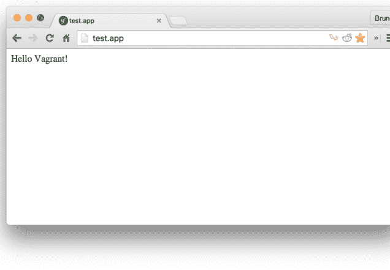

图 4.7 我们在虚拟机中的第一个程序

你可能已经注意到，新站点需要你添加新的 `sites` 块，但不需要添加新的文件夹条目。这是因为我们设置 `Homestead Improved` 的方式使得它的整个主文件夹（你所在的文件夹：`homestead_improved-master`）被共享到 VM 的 `Code` 文件夹中，因此这两个文件夹的任何子文件夹都会自动共享并保持同步。从技术上讲，我们可以定义位于 `homestead_improved-master` 文件夹之外的单独映射，并将外部的任意位置与 VM 内部的任意位置进行共享，但我认为采用这种隔离的方法会让结构保持整洁得多。

## 关

VM 在运行时会占用宿主机的大量资源。事实上，如果你查看 `Homestead.yaml`，你会发现它占用了一个 CPU 核心和两个 GB 内存（文件中的第二和第三行）。在未使用时离开 VM 是浪费的，并且会减慢宿主机的速度，将其关闭（就像出门时关电脑一样）是有意义的。我们通过在 `homestead_improved-master` 文件夹内终端执行 `vagrant halt` 命令来实现这一点。或者，可以使用 `vagrant suspend` 命令——它的速度更快，但最终会消耗更多的硬盘空间，即使在关闭状态下也是如此。

让我们停止机器吧。在 `homestead_improved-master` 文件夹中运行：

```
vagrant halt
```

要完全销毁 VM，擦除其硬盘以及所有下载后安装的软件，我们执行 `vagrant destroy`。要复活它并重新初始化配置过程，我们可以再次运行 `vagrant`，一切将恢复如初。这就是 `Vagrant` 的魅力之处——销毁和重建仅两个命令之遥，非常适合对最瞬息万变的前沿技术进行实验。

## 延伸阅读

这在某种程度上是你为了正确上手 `Vagrant` 和 `VM` 所需要知道的所有内容。`Homestead` 无疑是一个捷径——但它是一个值得开始的良好捷径。一旦你习惯了它，可以自由探索其他方法，例如从头开始构建 box、修改 `Vagrantfile`、使用不同的基础 box 启动不同的操作系统等。

欲了解更多阅读和深入信息，请参阅以下文章：

# 虚拟机 57

- 重新介绍 Vagrant：开始 PHP7 的正确方式
- 快速上手提示：让 Homestead Vagrant VM 运行起来
- 如何创建和共享 Vagrant 基础 box
- Vagrantfile 详解：使用 Shell 进行设置和配置

### 总结


在本章中，我们学习了虚拟化——这是任何开发工作中至关重要的部分。Homestead 无疑是一个捷径——但它是一个值得开始的良好捷径。一旦你习惯了它，可以自由探索其他方法，例如从头开始构建 box、修改 `Vagrantfile`、使用不同的基础 box 启动不同的操作系统等。

# Git

Git 是一个命令行应用程序，通常没有图形用户界面（GUI）。它严格通过终端或 Git Bash 使用，Git Bash 是一个在你在 Windows 上安装 Git 时自动提供的工具。

虽然存在带有图形用户界面的辅助工具——在一定程度上减少了手动输入命令的需求——但在大多数情况下，我们仍然需要终端版本。从现在开始，每当出现类似“执行命令 `git push`”的指令时，我们假设我们正在使用终端或 Git Bash 输入该命令。

通过 Git，我们可以轻松下载如上一章提到的 Homestead Improved 仓库，而无需使用“下载”按钮。相反，我们使用一个名为 `clone` 的命令，如下所示：

```
git clone https://github.com/swader/homestad_improved
```

注意我们在 URL 中使用了 GitHub。我们稍后会在 GitHub 章节中详细解释这一点。

## 它是如何工作的？

简而言之，Git 使用项目文件夹内部的一个隐藏的 `.git` 文件夹来跟踪文件的所有更改和之前的版本。每当你进行新的提交（commit，即这是一个特殊标记的时间点，表示某个文件或一组文件发生了变化），Git 都会在 `.git` 文件夹中存储旧版本和新版本的副本，以便我们以后在需要时引用它们。这意味着，如果我们需要撤销某项更改，将使用 Git 重置到之前的时间点，例如使用 `git reset 47298720dbf`，其中最后的代码是提交的名称或标记。我们将在本章末尾提供一个更全面的 Git 指南链接。阅读它将让你在一天或两天内成为 Git 大师。

## 快速上手 PHP 环境

Git 的替代方案远非唯一的版本控制系统（VCS）。还有其他系统，如 Mercurial、SVN、CVS 等许多系统，但 Git 是最广泛使用的。如果你现在想为开源项目做贡献，Git 是你应该使用的 VCS，因为绝大多数项目都使用它。它也是驱动 GitHub 的核心引擎，所以你从一开始就会成为其中的一员。

## GitHub

使用 Git 时，你有能力从任何远程端点克隆仓库，只要代码在那里。例如，如果我有一些源代码并将其放在一个在线服务器（可以通过互联网访问的服务器）上，然后配置该服务器接受 Git 调用，那么任何安装了 Git 的人都可以通过运行以下命令克隆这些代码：

```
git clone https://myserver/myrepo.git
```

然而，并不是所有人都有时间、金钱、知识或耐心来设置一个服务器以供他人访问代码。这就是 GitHub 的用武之地。

GitHub 是一个人们可以在上面免费托管仓库的网站，但有一个限制——所有仓库都可以被所有人访问。它们是公开的。GitHub 支持私有仓库，但需要付费。当你为客户开发应该保持私密的项目时，这是非常理想的——特别是防止客户的竞争对手看到。对于免费的私有仓库，还有 GitLab 和 Bitbucket 等替代网站，但它们的受欢迎程度远不如 GitHub，这就是为什么我们在本书中使用 GitHub 的原因。在你的探索过程中，请随时使用你喜欢的任何服务。

但为什么人们想要使用 GitHub 这样的服务来管理代码呢？除了可以轻松免费地与他人分享代码这个显而易见的答案外，当你的项目崩溃丢失所有内容时，GitHub 这样的服务可以成为救命稻草。如果你定期向仓库远程（即 GitHub URL）推送（push，Git 的术语），你就可以免于灾难：你的整个文件历史都被保留了，你可以在另一台电脑上继续之前的工作。此外，还有许多与 GitHub 自动集成的其他辅助服务。一个例子是 Travis CI，它每当检测到 GitHub 仓库有更改时就会检查代码以确保其仍然可以工作。如果出现问题，Travis 会通过电子邮件通知你，并在仓库的主网页上更新一个小徽章，警告用户最新版本。

现在我们已经涵盖了 Git 和 GitHub 的理论，那么看看实际操作如何呢？

## Git 实战

让我们通过一个实际示例来学习。我建议（并假设）你将项目放在主目录中，该路径的快捷方式是 `~`。如果你选择使用不同的路径，请调整后续的代码。

### 准备环境

正如我们在之前的章节中所做的那样，我们首先需要配置一个用于实验的虚拟机（VM）。我们可以在宿主机上进行所有操作，但请记住最终目标是尽可能保持宿主机整洁，同时使用一个完全可以丢且便于实验的环境来进行所有的尝试。以下是操作步骤：

1. 在 Windows 上打开 Bash 或在 OS X/Linux 上打开 Terminal。
2. 执行命令 `cd ~` 进入你的主目录。
3. 使用命令 `git clone https://github.com/swader/homestead_improved hi_phpenv` 将 homestead_improved 仓库克隆到名为 `hi_phpenv` 的文件夹中。你刚刚学会了 `git clone` 命令！
4. 使用 `cd hi_phpenv` 进入新创建的文件夹。
5. 执行 `bin/folderfix.sh`。
6. 打开 `Homestead.yaml` 并修改 sites 块，使其看起来如下所示：

```
sites:
  map: phpenv.app
  to: /home/vagrant/Code/phpenv
```

7. 添加新条目：`https://travis-ci.org/`。

如果你不熟悉，请查看该章节。

### 创建 "Hello World" 页面

环境准备好后，学习 Git 和 GitHub 的路径就清晰了：

1. 在 `hi_phpenv` 文件夹中创建一个名为 `phpenv` 的新文件夹。你可以通过宿主机的文件资源管理器创建，也可以通过终端使用 `mkdir phpenv` 创建。
2. 创建名为 `index.php` 的新文件并赋予其内容：

```php
<?php echo "Hello World";
```

3. 尝试运行是否工作。

现在我们有了自己的 "Hello World" 页面。我们对自己的代码感到自豪，并想向世界分享它。让我们使用 Git 和 GitHub 来实现。

## 仓库初始化

在将任何内容上传到 GitHub 之前，我们会告诉 Git 将我们的源代码转换为仓库。

- 在 `phpenv` 文件夹（即 `hi_phpenv`）中，运行 `git init`。这是一个初始化命令，将创建一个空的 `.git` 文件夹。它默认是隐藏的，但如果你执行 `ls -a` 就能看到它。

- 在使用 Git 这样的版本控制系统开发时，你可能希望确保某些文件不会被添加到仓库。例如，如果你在配置文件中有数据库密码，那么让此文件在网上公开是不明智的，因为会将你的密码泄露给查看你仓库的人。为了这个目的，存在忽略文件。这些是 Git 的特殊文件，文件名 `.gitignore`，内容逐行列出要忽略的文件，例如：

```
password.php
sensitive-folder/*
```

这段代码将确保密码文件和 `sensitive-folder` 中的所有内容都不会被添加到仓库中，也不会出现在其他人克隆的代码中。

如果你正在使用 IDE 编写这些代码（我希望你是这样的，参见第 2 章），你会发现它喜欢将自己的辅助文件放入项目根目录。例如，PhpStorm 喜欢创建一个 `.idea` 文件夹并在其中放置与当前项目相关的配置值。我绝对不想让任何克隆我代码的人被迫复制我的 IDE 配置，所以让我们使用忽略文件来防止这种情况。

使用命令 `touch .gitignore` 在文件夹中创建一个 `.gitignore` 文件，或者在 IDE 内部创建。然后编辑并赋予它 `https://gist.github.com/Swader/7844111` 文件的内容，该忽略文件考虑了在开发 PHP 项目时可能遇到的各种 IDE 和操作系统配置。

另一种确保你再也不需要将此添加到项目的 `.gitignore` 文件中的方法是将其添加到全局 `.gitignore` 中。要了解如何操作，请查看 GitHub 的这篇实用指南：`https://help.github.com/articles/ignoring-files/`。

在准备好代码和 `.gitignore` 文件后，我们需要一个 readme 文件。readme 是 GitHub 仓库访问的第一个文件，因此包含关于作者、代码用途、如何使用、如何贡献等有用信息是有好处的。通过你的 IDE 或终端在 `phpenv` 文件夹中通过 `touch README.md` 创建一个 README.md 文件，并添加一些内容，例如：

```
### Hello World
这是来自《Jump Start PHP Environment》一书的 README 文件。
学习 Git 和 GitHub！
```

`.md` 扩展名表示这是一个 Markdown (MD) 文件——GitHub 用来以美观、格式化的方式显示 readme 内容的一种类型。虽然理解书中其他内容并不需要掌握 MD，但在编程生活中，它非常重要，我建议你在有空时看一看 `https://guides.github.com/features/mastering-markdown`。

### 添加与提交

要将我们项目中的所有文件添加到仓库中，请执行 `git add -A`。`add` 命令告诉 Git 添加对历史跟踪所做的任何更改。`-A` 标志意味着“添加新文件、添加现有文件的更改并添加文件删除（即，记录所有已删除的文件）”。

然而，这实际上仅仅是告诉 Git，我们将在未来的某个时间点对它所添加的所有文件进行跟踪。要真正进行提交，并在我们的项目生命周期中创建一个可恢复的时间点，我们需要使用 `commit` 命令：`git commit -m 'Added my first files!'`。`-m` 意味着“commit message（提交消息）”，这是你标记更改的地方。任何进入你项目的人都可以查看那个准确的时间点并看到你的消息，立即知道你为什么那样做。现在执行它。

现在文件已经添加并提交，让我们引入一个更改。再次打开 `index.php` 并将“Hello World”更改为“Hello Bob”，使文件看起来像这样：

```
<?php echo "Hello Bob";
```

然后再次进行添加和提交：首先执行 `git add -A`，然后执行 `git commit -m 'Changed World to Bob'`。

在浏览器中使用 `http://phpenv.app/` 访问该页面，注意它现在显示的是“Hello Bob”。

### 重置

我们非常喜欢 Bob，但我们的老板不喜欢，并要求我们改回“World”。我们可以进行更改并提交，大功告结。但在具有许多文件的复杂项目中，通过手动将文件改回之前的状态来撤销更改将不起作用。这就是我们有 `reset` 命令的原因。要重置到上一次提交，我们需要找到该提交的 ID。

我们可以通过以下命令实现：

```
git log
```

在我的情况下，如图 5.1 所示，最近一次提交之前的提交 ID 是 `b6adf1756bb9b94fcf9b46c612180dc12b96176`。


要重置它，我们执行：

```
git reset --hard b6adf1756bb9b94f
```

注意我们使用的比 `git log` 提供的短的哈希值。这是 Git 的一个特性——哈希的前十个左右字符就足以识别我们正在寻找的正确提交。

我们整个 Bob 的修改都被删除了，就像什么都没发生过一样。刷新 `http://phpenv.app` 将确认这一点。

查找准确的提交 ID 可能很麻烦，因为也支持像 `HEAD~1` 这样的快捷标识符。`HEAD` 是“当前提交”，`~1` 告诉 Git 回退父节点。执行 `git reset --hard HEAD~1` 也可以。

`--hard` 选项告诉 Git “无论我们有多少待处理更改，这次重置比任何事情都重要，所以直接这样做吧——别问。”如果没有 `--hard`，如果我们做了任何其他未提交的更改，Git 将报错。

## GitHub

现在我们再次对源代码感到满意了，让我们把它放到网上供他人克隆和检查。如果你还没有 GitHub 账号，请去 `https://github.com` 注册。

1. 在右上角，点击 Create New > New repository 按钮，如图 5.2 所示。

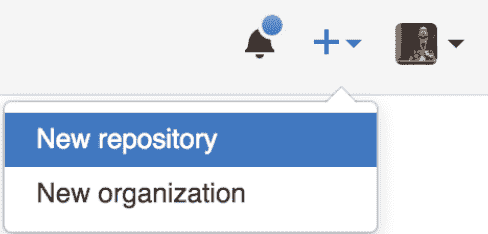

2. 给它起一个你喜欢的名称，例如“phpenv”，并将所有其他选项留在默认值。
3. 在下一个屏幕上，你将获得有关如何将一些现有代码放在线上的说明。

### 使用 GitHub 设置

如果你以前做过这个，你会知道这些步骤。将你的本地仓库连接到 GitHub——参见图 5.3。

```bash
echo "# Hello World" >> README.md
git add README.md
git commit -m "first commit"
git remote add origin https://github.com/USERNAME/phpenv.git
git push -u origin master
```

`remote add` 命令告诉你的本地仓库远程服务器的位置。`-u` 标志将本地分支跟踪远程分支，将来你只需要输入 `git push`。

要在 GitHub 上初始化仓库，请按照以下步骤操作：

1. 去 GitHub 并创建一个新仓库。
2. 给它起一个名字。
3. 按照说明推送你的现有代码。

如果你已经有一个项目，你可以使用 README 文件来描述它。这是一个帮助他人理解你的项目功能以及如何使用的极佳方法。

## 资源

以下资源对你继续学习 Git 和 GitHub 有帮助：

- GitHub 文档：`https://docs.github.com/en/`
- Git 书：`https://git-scm.com/book/en/`
- GitHub Markdown 指南：`https://guides.github.com/playground/writing/markdown/`

项目——你将在未来的职业生涯中经常用到它。如果你喜欢，可以尝试一些 Git 的 GUI 工具。你可以在以下 URL 查看完整列表：`https://git-scm.com/downloads/guis`。

### 有用资源

要了解更多关于 Git 的知识，请参考 SitePoint 的《Jump Start Git》⁹ 或 Apress 的《Pro Git》¹⁰。这两本书对新手非常友好。

如果你不想花时间读完整本指南，GitHub¹¹ 上有一些非常有帮助的图文指南，它们以非常易于理解的方式涵盖了 Git 和 GitHub。尽管我们在之前的用法示例中已经基本上涵盖了这两者，但我建议在继续阅读此本书之前，至少阅读“Hello World”和“将你的项目上传到 GitHub”指南。把这视为作业吧。

### 总结

在本章中，我们查看了版本控制系统，并解释了它们的工作原理以及存在的原因。我们使用示例项目简要演示了它们的功能，并建议了一些额外的学习材料。

在下一章中，我们将讨论托管，解释如何找到服务器、如何使用它以及需要避免什么、如何将代码部署到实时服务器上等内容。

> ⁹ `https://www.sitepoint.com/premium/books/jump-start-git`
> ¹⁰ `http://git-scm.com/book/en/v2`
> ¹¹ `https://guides.github.com`

# 部署与托管

现在版本控制已经学习完毕，是时候考虑部署和托管了。

**部署**（Deployment），正如你可能从之前的章节中学到的，是指将你在本地开发的应用程序发布到网上供人们使用的行为。部署后的应用程序并不意味着它是公开可用的——例如，它可以是公司内部的内网应用；这意味着它可以被其目标受众使用。

然而，应用程序如果没有被**托管**（hosted）是无法部署的；需要一台服务器计算机作为它的家。在本章中，我们将更详细地讨论这两个术语，并列出每种方法的方案。我们还将涵盖常见方法的优缺点，并定义一些你在整个 Web 开发生涯中会听到的术语。

即使你对部署和托管的方面了熟悉，也建议阅读这一章，因为它包含了关于应该避免什么和应该选择什么的最新信息。

## 托管

我们将先解释托管，因为在搬进家之前，知道如何选择家是很重要的。

你将反复遇到的三种主要托管类型是：共享托管、云托管和（虚拟）私有托管。我稍后会进一步解释括号中的“虚拟”字。

### 共享托管

当托管公司拥有一台服务器（由单台机器组成或作为一个单机运行）时，他们会为该服务器上的每个客户创建一个单独的文件夹和账户；这被称为共享托管。每个客户被分配服务器的一部分处理能力、总内存的一份以及一段硬盘空间。这部分资源可以作为你部署的应用程序的家。当一台服务器的空间不足以容纳新用户时，公司可能会设置几台服务器。这在理论上听起来很棒，但在实践中有很多问题。

### 共享托管很糟糕

由于缺乏更好的（即更便宜和/或更简单）的选项，在很长一段时间内，共享托管是许多人唯一的可行方案。这种广泛的使用导致了它在托管市场的主导地位，并且仅仅是因为这种最初的惯性而保持流行。


# 共享托管很糟糕，有几个原因

- **安全风险**：许多流行的内容管理系统（如 `WordPress`、`Drupal`、`Joomla` 等）要求用户在某些文件夹上开启全写访问模式，以便他们可以将文件放置其中。通过这样做，许多用户在与其他客户共享硬盘时，无意中错误地允许了对其网站文件的访问。这种所谓的“777 问题”（`777` 是 Linux 中表示“允许任何人对此文件或此文件夹执行任何操作”的代码）是一个巨大的安全风险。此外，在共享托管主机上使用内容管理系统时，你面临着版本过时的风险。一个网站的懒惰和不愿更新同一台服务器上安装的另一个 CMS 实例可能会导致你的网站被黑，因为这可能成为攻击者访问整个服务器的网关！

- **流量过载**：你依赖他人的能力和流量。如果给定服务器上的某个网站代码写得糟糕，消耗了许多 CPU 周期或由于大量内存，同一台服务器上的其他应用程序可能会因此受到影响；所有应用程序都共享相同的硬件——在共享托管环境中这是非常有限的——用户的过度需求可能对你自己的应用程序产生不利。对于流量巨大的良好代码也是如此：如果另一个网站接收了过多流量，服务器可能会过载并关闭，从而导致你的网站也跟着掉线。

- **限制**：许多共享托管公司承诺无限的带宽和资源，这几乎从不是真的¹。世界上没有所谓的“无限”任何东西：只要你的网站成功突破了约定的限制（无论是常规 CPU 使用、硬盘空间还是带宽），你就会发现“无限”真正的含义意味着什么。查看来自 `WhoShHostingThis.com` 的这篇文章，它指出了共享托管的陷阱，并提供了一个关于因在无限计划上使用过多资源而被断开连接的警示故事²。

- **声誉**：当你在同一台服务器上时，你面临着声誉受到另一个网站行为影响的风险。

¹ http://whoshostthis.com/pitfalls-of-shared-hosting

² http://whoshostthis.com/unlimited-bandwidth-hosting-myth

## 快速上手 PHP 环境

而且有数如云般的服务器。与其名称相反，云计算机系统其实非常接地气。它们只是由许多小计算机组合而成的大型计算机。

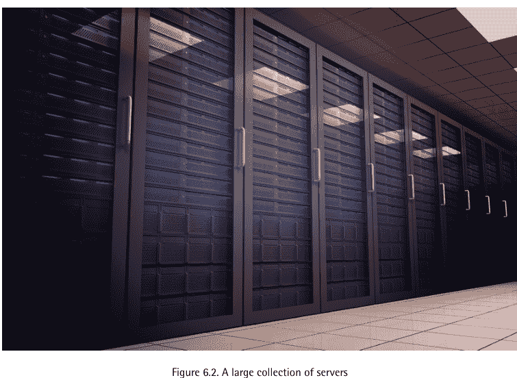

在这台表面上看起来单一的计算机上，运行着一种特殊的软件，它决定了环境的外观和感受；例如，它看起来像是在处理单一的 Linux 服务器。在某些方面，它类似于共享主机——但规模要大得多（计算机数量多得多得多）。

云托管通常允许对服务器进行终端访问（允许你手动配置某些项目），但通常也具有 GUI 元素，用于生成访问代码、向你的云驱动型应用程序安装插件等。

一些流行的云托管提供商有：

- Google App Engine (https://google.google.com/appengine/docs)
- Heroku (https://www.heroku.com/)
- Amazon Web Web Services (https://aws.amazon.com/)
- OpenShift (https://www.openshift.com/)
- Azure (https://azure.microsoft.com/en-us/)
- Fortrabbit (http://www.fortrabbit.com/)

... 还有很多。

云托管有几种方法，但它们共同的一个共同特征是：你并不依赖其他客户的善意和代码，这与共享主机不同。云资源（又名运行你应用程序的计算机网络）专注于处理你的（以及他人的）代码，而硬盘存储部分（例如存储你用户上传的内容）通常保存在其他地方。这有两个优势：

1. 云被专门用于处理代码。它针对一个特定目的进行了优化，因此你的应用程序始终很快（取决于你代码的质量和用量）。
2. 没有资源限制。在云计算中，有如此多的机器作为一个整体在工作，因此你的应用程序总有充足的资源。

云托管遵循付费模型，根据你的应用程序使用服务器的时间单位收费。例如，每个 CPU 单位的价格可能为两美分，单位可能以 15 分钟为增量。如果你的应用程序使用一个核心运行了 24 小时，然后突然流量激增并使用四个核心运行了另外 24 小时，你最终一天将支付 1.9 美元，两天约为 7.7 美元，两天总计约为 10 美元。如果你有大量流量，云托管更贵，但比共享主机更可靠，因为它几乎不会崩溃。这意味着如果你的网站突然收到巨大的流量激增（可能上了新闻），云托管提供商可以为你的应用程序分配更多的 CPU 核心，并让它在额外流量期间保持运行。这意味着业务不会中断，这可能已经抵消了那些托管成本！此外，如果你担心某波流量强大到足以让你在财务上破产，大多数服务提供商都提供选项允许你设置限制；例如，“为我的程序提供更多算力，只要它每月费用低于 2000 美元即可。”

许多云托管服务还提供免费层级，这意味着你可以免费使用它们，没有任何条件，想用多久就用多久——但资源有限，且缺少某些功能（例如，没有自定义域名）。如果你想扩展，可以轻松升级网站已经托管的账户，它会立即变得更强大（也更贵）。

云托管是当今的托管选择，特别是对于需要极高可靠性的知名应用程序，因为停机非常罕见。对于作为 Demo 和作品集的一次性项目，云托管也是极佳的选择，如果你多次利用免费层级——你可以免费在在线上拥有永久可用、公开访问且可运行的代码。

不过，这并非全是乐趣。共享主机的某些缺点也出现在云托管中：

- **供应商锁定**：这也可能发生在云托管中。通常情况下，你所在的平台会有你需要学习的特定平台设置以及你需要精通的微调。同样，安装的软件版本也倾向于保持未更新。由于服务器经过调优，以惊人的速度运行特定版本（例如 `PHP`），该版本也经过了调整以便在该环境中运行良好，这使得更新变得困难，因为新版本也需要这些（通常是非简易的）微调。

- **学习局限性**：共享主机因为没有教任何服务器管理知识而限制了你，而云托管的限制在于它只教你一种特定的服务器管理——他们的那种。从 `Google App Engine` 迁移到 `Heroku` 并不是一项简单的操作，从代码角度以及掌握具有特定特定命令和工具的新工具的学习曲线来说都是如此。

记住——云托管类似于共享主机，但规模要大得多。然而，要使用云托管，用户通常已经是精通某些服务器管理的高级用户。对于刚起步的新手，我总是建议使用虚拟专用服务器（`VPS`）。

## (虚拟) 私有托管

也称为专用托管，私有托管承诺提供专用机器——无论根据你的需求是虚拟的还是物理的（这就是为什么“虚拟”加了括号）。你可以根据你认为合适的用途使用这台机器。如果你选择将其作为自己的共享主机提供商，你可以设置服务器来支持此并转售空间。你还可以购买几台机器并将它们聚类，形成你自己的微云。或者只为了一个应用程序使用单一服务器——那也行！

在专用托管中，拥有一台物理机器是非常昂贵的，根据机器性能，每月可能花费数千美元。这就是为什么大多数用户选择 `VPS`（虚拟专用服务器），它们是虚拟机（与我们在之前的章节中讨论的 `Vagrant` 类似），运行在单一服务器上。就像云托管和共享主机一样，单一计算机（看起来是单一）包含多个更小的实例——供客户使用。这些实例就像真实的服务器，你可以通过终端对它们进行完全访问。你可以安装和卸载所有内容，甚至更改操作系统。虚拟机并不在意；它与其他完全隔离，你可以随心所欲地弄坏它。

`VPS` 托管对于新手是最容易的方法，原因如下：

- **价格**：现代 `VPS` 提供商非常便宜。像 `Vultr`³ 和 `DigitalOcean`⁴ 这样的服务提供的虚拟机（对于普通应用程序来说足够）每月低至五美元。这比云托管便宜，但比共享主机强大得多。带宽是无限的，你仅有的 CPU、内存和硬盘限制是在你购买时约定的。所有服务器也可以随时升级，而且通过 `DigitalOcean` 的推荐计划，如果你向他人推荐该服务，你可能永远不需要付费。事实上，奖励是双向的：通过推荐注册的用户可以获得十美元的奖励，而推荐人在购买后也会获得奖励。

- **可靠性**：`VPS` 的可靠性取决于你的设置。此类托管提供商很少会有整个数据中心掉线，因为安装了大量的安全措施来防止停机。在大多数情况下，服务器的稳定性完全取决于你如何设置，这让你学习了服务器事务——这是至关重要的。与云托管相比，底层基础设施的可靠性是相同的；真正的停机风险是客户错误配置了 `VPS` 实例。

- **熟悉感**：如果你像书中描述的那样从 `Vagrant VM` 开始，那么 `VPS` 将看起来非常熟悉。它将具有相同的界面、相同的命令、相同的流程。你会熟悉大多数可以修改的方面，并且由于你在本地（你正在开发的本地 `Vagrant VM`）上拥有经验，能够调试你的实时服务器。`VPS` 是一个快速且简单的方法。

等价性，这在云托管中并不容易实现，而在共享主机中是无法实现的。

我总是向新开发者推荐 `VPS` 托管，因为一旦人们足够熟悉终端，它就是云托管的强大性能与共享主机的易用性之间的完美折中。

## 其他

当然，还有无数种类型的托管服务——每种都对应特定的使用场景。

例如，`Nitrous.IO`⁵、`Codenvy`⁶ `Cloud`⁷ 和 `Koding`⁸ 都是内置托管功能的云端开发环境（云 `IDE`）。在它们那里开设账户将为你提供一个 Web 界面，可以在其中编辑代码——就像在 `PhpStorm` 这样的 `IDE` 中——同时也提供一个自动托管和运行你所用代码的地方。对于超出基础范围的应用来说，这些服务的成本可能昂贵，但对于经常在外的人的人来说极其实用——特别是那些缺乏运行虚拟机计算能力、但又一直在线且偏好轻便出行的笔记本用户。

尽管用你的名字注册一个账户，测试一下它们的功能，并具备代码基础以理解正在发生什么。什么都不会出问题，你大可放心。

我在下面总结了我对各种托管方案优缺点的看法。

| 共享主机 | 云托管 | (V)PS | Cloud IDEs |
|---|---|---|---|
| 经济性 | ★★★ | ★★★ | ★★★★ ★ | ★★★ |
| 可靠性 | ★★★★ | ★★★★ | ★★★★ | ★★★★★ |
| 易用性 | ★★★★★ | ★★ | ★★★★ | ★★★★★ |
| 可定制性 | ★ | ★ | ★★★★★ | ★ |
| 安全性 | ★★ | ★★★★★ | ★★★ | ★★★★★ |
| 性能 | ★ | ★★★★★ | ★★★★ | ★★★ |
| 硬件限制 | ★ | ★★★★★ | ★★★ | ★★★ |

⁵ https://www.nitrous.io/

⁶ https://codenvy.com/

⁷ https://c9.io/

⁸ https://koding.com/

# 部署

部署是将准备就的应用程序发送到实时服务器的行为，以便目标受众访问。它还包括在添加新功能或修复错误时，向在线应用推送更新。

部署有两种类型：手动部署和自动部署。

## 手动部署

手动部署涉及主动识别应用程序已处于目标受众可以使用的阶段，或者处于项目项目说明的阶段——这是一份概述了整个项目开发过程的文档。

一旦认为已就绪，开发者将采取几种方法之一来部署应用程序：

- **FTP**：在 Web 1.0 的远古时代，文件传输协议（`FTP`）是从一个服务器传输文件到另一个服务器（显而易见！）的方法。这种方法通常只出现在严重过时的系统和服务器中，如大学和学校，或共享主机。通过 `FTP` 上传文件要求你在计算机上安装客户端，如 `FileZilla` 或 `Cyberduck`。你还需要服务器的凭据——通常是服务器名称、用户名和密码。如果一个应用程序已经部署，并且正在向其上方部署一个更新版本，旧版本通常会被覆盖，这为整系列可能的漏洞打开了大门。在应用部署方面，有更好的方法，应该避免 `FTP`。

> ⁹ https://filezilla-project.org/
>
> ¹⁰ https://cyberduck.io/?l=en

- **Rsync**：`Rsync` 涉及使用名为 `rsync` 的工具来同步两个文件夹的内容。`Rsync` 通过 `SSH`（安全外壳）工作。

- **从仓库拉取**：这种方法使用 `Git` 版本控制系统（第 5 章）将更改推送到实时。可以采取两种方法：可以进行推送（`push`），使代码进入远程服务器。这是从开发环境——本地服务器进行的。更常见的是，可以进行拉取（`pull`），这是由实时服务器——代码最终应该去向的机器——进行的。从开发机器拉取代码通常是不可能的，且通常不被鼓励，因为开放对你开发机器的访问权限是一种安全风险。相反，首先推送到如 `GitHub` 等中央仓库，然后由实时服务器进行拉取。这种方法是最常见的，因为它在版本控制的得益下提供了无限撤销步骤的安全性和神圣性，并消除了由于多人协作同一代码库并尝试同时上传而可能发生的任何覆盖。这些这些远不是手动部署的唯一手段，但它们是最流行的。尽管这些方法有些乏味，并且倾向于占用本该花在其他地方的时间和资源。在软件开发中，通用规则是尽可能自动化可以自动化的东西。这让我们我们……

## 自动和半自动部署

有很多用于自动部署的工具：`Robo`¹¹、`Deployer`¹²、`Envoy`¹³、`Rocketeer`¹⁴、`DeployBot`¹⁵ 等。它们依赖源代码中的某些指针来确定应用程序的版本何时准备好部署，或者依靠开发者的手动触发，然后自动处理其余部分。

> ¹¹ http://robo.li/
>
> ¹² http://deployer.org/
>
> ¹³ https://envoyer.io/
>
> ¹⁴ https://github.com/rocketeers/rocketeer
>
> ¹⁵ http://deploybot.com/

自动部署器的实际操作方面不在本书的范围内，但简单来说，它们的工作方式如下：

1. 你编写了一些代码并在 `Git` 中提交（`commit`）。
2. 你将此提交添加到主分支（你仓库的主分支）。一旦开发者确保发布（应用的的最新版本）没有问题，你就运行一个简单的命令如 `dep deploy`，工具就会接管其余工作。
3. 工具会注意到此提交，自动检查代码错误，如果一切正常，它就会为你发送。

# PHP 环境快速启动

```php
<?php
$word1 = "Hello";
?>
```

`file-b.php` 有以下代码：

```php
<?php
$word2 = "World";
?>
```

你可以像这样在 `file-c.php` 中使用它们：

```php
<?php
include 'file-a.php';
include 'file-b.php';

echo "I am now using file-a and file-b, yay! {$word1} {$word2}";
?>
```

这将输出：

> I am now using file-a and file-b, yay! Hello World!

随着文件的增加，`include` 语句会变得越来越长。这导致 `PHP` 应用程序变成了一系列这些辅助脚本的冗链调用，一个接一个执行。我们将这种代码称为“意大利条面代码”（`spaghetti code`），因为它是一团糟——行与行之间交织在一起，没有结构或顺序，一段逻辑调用另一个定义在任意外部位置的逻辑。条面代码对其他开发者非常不友好（甚至对几个月后的原始开发者也是如此！）。


图 7.1 混乱的代码

随着 `PHP 5` 版本中面向对象的 `PHP` 的出现，我们获得了编写名为**类**的代码块的能力。类将属于特定上下文的逻辑组合在一起。具体来说，在 Web 领域，一个 `User` 类可以拥有登录 `login` 和注销 `logout` 的方法（即内部函数、功能）。

在应用程序中使用此类允许开发者实现登录和注销功能。类可以通过像上面的文件一样**包含**其他类来与其他类通信（例如，`User` 类可以包含一个 `Database` 类以便用它检查数据库是否包含匹配的用户名和密码组合），但它的额外优点是其上下文是透明的。毕竟，通过查看其文件内部，甚至仅看其名称，就能很容易地发现某个类的意图。

# PHP 环境快速启动

具有相关上下文的不同类被称为一个包（`package`，也称为库）。在同一个包中，一个类可以专门处理用户登录和超时，另一个用于发送“重置密码”邮件，另一个用于检查用户角色（管理员、访客）等。整个包可以被称为身份验证（`Authentication`）。

但随着类的激增，冲突问题出现了。如果我有一个 `User` 类，并且借用了例如 Jim 的 `User` 类，尝试同时使用它们来兼得两者之长会导致 `PHP` 产生错误（也许他的 `User` 类也支持头像上传，而我的则没有）。两个类不能有相同的名称，因为 `PHP` 不知道要使用哪两个类！在 `PHP 5.3` 版本中，这个问题通过命名空间（`namespaces`）解决了。

## 命名空间与旧时代的包管理

命名空间是某些其他语言的常见特性，在 `PHP 5.3` 版本中引入。它们听起来很令人生畏，但实际上它们仅仅是 `PHP` 类名前的前缀。

我们哥们 Jim 前述的 `User` 类将被称为 `Jim\User`（反斜杠 `\` 是用于分隔命名空间片段的特殊符号；这允许命名空间嵌套到任意深度），而我们的可以命名为 `SitePoint\Authentication\User`。虽然它们的最终“名称”相同（`User`），但它们的完全限定名是不同的，`PHP` 乐意让我们同时使用它们。

但尽管如此，使用多个包和类意味着我们必须包含所有的内容，就像上一个例子一样——通过文件名调用其他类，确保它们被唤起使用。当然，有一些规避此的方法——开发了名为“自动加载器”（`autoloaders`）的特殊函数，用于根据类所在的位置加载类（例如，`Jim\User` 可能位于 `classes/Jim\User.php`）；然而，不仅找不到他人的类，还要有效地包含它们并让它们符合正在使用的自动加载函数，仍然是繁琐的。

为了解决这个问题，我们使用工具 `Composer`。

### 什么是 Composer？

`Composer`¹ 是一个 `PHP` 的包管理器。我们已经将包定义为类的集合。那么，包管理器是什么呢？

包管理器是一种工具，它消除了在环境中查找和安装包或程序过程中的人为因素。例如，如果你正在使用 `OS X`，有一个名为 `Homebrew` 的操作系统包管理器。与其在网络上搜索诸如 `MPlayer` 这样的媒体播放器程序，可以使用终端运行命令：

```
brew install mplayer
```


像魔术一样，应用程序将被安装并立即可用。在 Linux 操作系统上，有几个包管理器。流行的是 Aptitude，使用方法类似：

```
sudo apt-get install chrome
```

此命令就这样安装了最新的 Chrome 浏览器。

包管理器确保包（应用程序就是一个包——它是一组为了单一目的共同工作的文件，无论是媒体播放、网页浏览还是完全其他内容）被清洁、快速和安全地安装。

同样，在编程语言（如 PHP）的上下文中，包管理器用于检索、安装、更新和卸载包。虽然在没有 Composer 的情况下为类设置自动加载的体力工作足够简单，但 Composer 完全消除了这一过程。它自动化了在网上查找包、下载、解压、放入你的项目文件夹、包含、配置等等手动过程。

Composer 连接到 Packagist，这是用户提供的事实上的在线包目录。让我们解释一下当你安装包时会发生什么。

# PHP 环境快速启动

使用 Composer 安装包非常简单，只需在应用程序目录下运行 Composer 的命令：

```
composer require nesbot/carbon
```

此时，应用程序将被安装并立即可用。Composer 将执行：

- 1. 查看 `require` 参数并确定包名。注意包名使用斜杠 `/`。
- 2. 查看其配置（`composer.json` 文件），了解它需要什么。
- 3. 访问 Packagist 并查找该包的信息。如果它存在，将移动到下一步。
- 4. 读取其依赖项（它需要哪些其他包）。
- 5. 在依赖项安装后，它下载 `nesbot/carbon`，更新自动加载文件（默认位于项目目录下的 `vendor/autoload.php`），并使新安装的包可用。

要使用此包，请确保上述自动加载文件包含在你的应用程序中。无论安装多少个包，都需要这样做一次。

```php
<?php
include 'vendor/autoload.php';
```

这似乎有点抽象，让我们看看实际效果。

## 使用示例

PHP 有一个内置类 `DateTime`（文档见 http://php.net/manual/en/class.datetime.php），可以用于时间相关的计算和操作。然而，该类并不直观。

### Composer

`nesbot/carbon` 包包含一个可以操作时间的类。嗯，不是操纵时间（PHP 还没有那么强大！）而是操作 `DateTime` 值。

Carbon 是作为 `DateTime` 的升级版开发的，它让你使用非常人性化的表达式获取所需的值。让我们尝试使用这个方便的包！根据 Carbon 的说明，我们只需下载、解压并通过 `include 'Carbon.php'` 手动包含它；然而，强烈建议你尽可能使用 Composer。

### 引导

我们首先通过启动一个新的虚拟机，参见第 4 章。在主机计算机的终端执行以下五个命令为我们完成所有工作：

```
git clone https://github.com/swader/homestead_improved hi_carbontest
cd hi_carbontest
bin/folderfix.sh
vagrant up
vagrant ssh
```

最后一条命令进入虚拟机，因此你在里面，就像连接到服务器一样。

然后，执行：

```
cd Code
touch index.php
```

`touch` 命令创建一个指定名的空文件。

用你喜欢的文本编辑器或 IDE 打开此 `index.php` 文件，既可以在终端中使用 `vim index.php`，也可以在主机上通过进入文件夹并双击它。然后给它赋予内容：

```php
<?php
echo "Hello World";
```

保存并退出文件，然后在虚拟机终端内运行：

```
php index.php
```

你应该能看到屏幕上出现“Hello World”。

### 命令行界面模式

在这种情况下，为了简单起见，我们正在命令行中执行 PHP。换句话说，我们没有使用浏览器来查看输出，而是让 PHP 将输出打印到终端屏幕上。这也是 CLI 模式，它是“Command Line Interface”（命令行界面）的缩写。

### 安装 Carbon

在新的服务器上，必须手动安装 Composer，但我们的 Homestead Improved 虚拟机已经预装了 Composer，并且可以在任何地方访问，因此我们只需要执行：

```
composer require nesbot/carbon
```

一旦操作完成，重新打开之前的 `index.php` 文件，在 `<?php` 之后添加新行，使其如下所示：

```php
<?php
include 'vendor/autoload.php';
echo "Hello World";
```

引入 `vendor/autoload.php` 文件可以确保我们通过 Composer 安装的类会自动加载到我们的应用程序中，而无需手动指定 `include` 或 `require` 语句将它们全部合并进一个应用。

### 测试

现在 Carbon 已经安装并自动加载到我们的应用程序中，我们可以尝试一下了。

在 `index.php` 中，将 `Hello World` 那行替换为以下代码，使文件看起来如下：

```php
<?php
include 'vendor/autoload.php';
echo Carbon\Carbon::now();
echo "*\n";
```

最后一行打印一个空行，让输出看起来更美观。

然后，在终端中运行 `php index.php`。你应该看到与图 7.2 类似的消息。

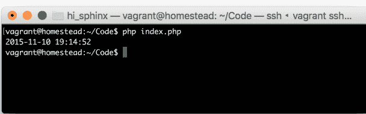

图 7.2. 输出示例

运行成功了！让我们通过添加以下行，来看看五年后的这个时候是星期几：

```
echo Carbon\Carbon::now()->addYears(5)->dayOfWeek();
```

你应该能看到类似于图 7.3 的输出。

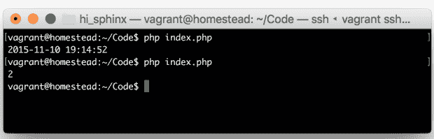

图 7.3. 输出示例 2

这首先通过 `now()` 创建了一个“当前时间”，在此基础上增加五年，然后从该值提取星期。星期从星期日（0）开始，所以星期三是 3，星期五是 5，此类此类。在示例输出中，我们得到的是星期二。

我们只用几行代码就成功安装并使用了 Carbon 包。

### 清理

由于我们不再需要这个虚拟机，也不需要这个 Carbon 实验了，可以使用以下命令删除它：

| command | description |
| :--- | :--- |
| exit | 退出虚拟机 |
| vagrant destroy | 关闭并删除虚拟机 |
| cd .. | 返回上一级文件夹 |
| rm -rf hi_carbontest | 删除 hi_carbontest 文件夹 |

### 更多可以尝试的技巧

还有一些值得提到的命令和功能。

#### 更新对比安装以及 Composer Lock

当使用 Composer 安装包时，会自动创建一个 `composer.json` 文件。这里是我们在上一个示例中安装 Carbon 后创建的文件：

```json
{
  "require": {
    "nesbot/carbon": "^1.21"
  }
}
```

你在这里看到的格式被称为 JSON，⁴，但这超出了本书的涉及范围。你可以自己去探索它。我们在这里看到的是，Composer 自动识别出 1.21 是 Carbon 的最新版本，并将其放入文件中。

同样，还创建了一个 `composer.lock` 文件。由于它太大，不包含在书中，我们只看相关的片段：

```json
...
  "packages": [
    "name": "nesbot/carbon",
    "version": "1.21.0",
    "source": {
      "type": "git",
      "url": "https://github.com/briannesbitt/Carbon.git",
      "reference": "7b08ec6f75791e130012f206e3f7b0e76e18"
    },
    "dist": {
      "type": "zip",
      "url": "https://api.github.com/repos/briannesbitt/Carbon/zipball/7b08ec6f75791e130012f206e3f7b0e76e18d3",
      "reference": "7b08ec6f75791e130012f206e3f7b0e76e18"
    },
    "shasum": ""
  ]
......
```

它列出的需求似乎相同，但方式详详得多。这是怎么回事？

⁴ http://www.json.org/

#### 那些想要更多的人

如果你想深入探索现代 PHP 应用的概念，我怎么推荐 Paul M. Jones 的书《Modernizing Legacy Applications in PHP5》。这是一本关于将“意大利面条代码”转换为可维护的面向对象的专业代码的完整手指南。虽然在先读过像《PHP and MySQL: Novice to Ninja》（从新手到忍者）这样对初学者好的 PHP 编程书籍之前，深入阅读这本书可能是不明智的，但我衷心建议你将其加入阅读清单。

此外，关于本章介绍的内容，一些 SitePoint 的实用教程可以在以下链接找到：

- 命名空间介绍：http://www.sitepoint.com/php-namespaces-basics/
- Composer 介绍：http://www.sitepoint.com/php-dependency-management-with-composer/
- Composer 速查表：http://www.sitepoint.com/composer-cheatsheet/
- 精通 Composer——技巧与窍门：http://www.sitepoint.com/mastering-composer-tips-tricks/

5 https://leanpub.com/aphp
6 https://www.sitepoint.com/books/phpmysql

# 第 8 章

## 实例学习：从零开始 Web 应用

是时候把我们目前学的一切都用上了！在本章中，我们将构建一个简单的数据库驱动 PHP 应用并将其部署。我们将探索每个方面，同时尽可能对新手友好。

某些方面（如数据库和框架）书中尚未，将在本章中简要介绍。通常，本章结束将列出有助于扩展现代应用开发知识的链接。

本章的重点是演示应用的构建过程——因此跳过它是不可行的。

注意，你在本章中遇到的内容可能会让你感到不知所措——如果你完全不熟悉代码也没关系。在编程中这被称为“坎坷”，你只需要坚持下去。你遇到它的时间比大多数新手都要早，但不要被它吓到。如果你难以理解代码，请再过一遍并根据代码片段下的解释来理解。现在视为理所当然，等它变得更清晰。此外，本章的重点是演示开发环境的初始化和应用的部署。在本章之间学的一切就是所谓的收益。

### 我们将构建什么？

我们将制作一个留言簿应用。如果你是一个新手，可能不知道什么是留言簿应用。在古代时代，留言簿是一种对特定文章或帖子留下反馈的方式；就像今天一样。

如今很少遇到留言簿，但这些原理用于构建评论系统、手工制作论坛等。

我们的应用（如图 8.1 所示）将具有以下功能：

- 一个用于评论的 HTML 输入表单
- 在输入表单上方显示输入的评论


图 8.1 完整的应用

留言簿应用可以在开发环境中（见第 2 章）通过 http://guestbook.app 访问。

注意 `.app` 是有效的顶级域名（TLD），第 1 章解释了顶级域名，在添加新的 et/hosts 条目时要小心；如果它们开始出现，你可能会阻止对真实 .app 网站的访问。为了完全安全，请使用以下后缀：.test、.example、.localhost 和 .invalid。

### 设置环境

让我们建立环境（此过程在第 4 章详细描述）。在继续之前，请确保你安装了以下内容：

- Vagrant，来自 https://www.vagrantup.com/
- VirtualBox，来自 https://www.virtualbox.org/
- Git，来自 http://git-scm.com/downloads

如果你跟着完成了之前的章节（特别是第 4 章），你就准备好了。

设置环境：

1. 在我们的 `/etc/hosts` 文件中添加行 `192.168.10.10 guestbook.app`。关于如何以及为什么要这样做见第 3 章。
2. 如果你的操作系统是 Windows，打开 Git Bash 程序（从章节开头的链接安装 Git 工具后可用）。否则，打开 Linux 或 OS X 上的 Terminal 应用。
3. 进入你想开发的文件夹。一个好的地方是：
4. 输入以下命令：

```
git clone https://github.com/swader/improved
mkdir -p storage
touch public/index.php
```

5. 打开该文件夹下的 `Homestead.yaml` 文件并添加新的站点如下：

```
sites:
  guestbook.app
```

6. 保存文件后，在终端运行：

```
vagrant up
```

注意我们如何在命令之间使用 `;` 吗？这会将它们链起来，使它们一个接一个执行，而我们不需要等待上一个命令的输出。最后，我们需要在选择的代码编辑器中打开文件夹。图 8.2 显示了在 PhpStorm 中的情况。¹


图 8.2 在 PhpStorm 中打开我们的项目

### 设置应用

#### 测试

在编程中，有一个被称为**测试**的概念。虽然测试超出了本书的范围（更多阅读链接请见本章末尾），但我将简要解释。

每当你对你的应用之一进行更改时，你通常会刷新应用以确保更改已应用。这被称为**手动测试**。

有一些工具可以自动化这个过程。通过编写一组特定的指令（测试），你的应用程序可以在每次更改后进行自测。编写这些指令可能是复杂且耗时的，但随着应用程序的增长，在测试上的投入将获得数倍回报。

我们的第一次手动测试是确保我们在浏览器中访问 http://guestbook.app URL 时会得到一个空白页面，如图 8.3 所示。

¹ https://www.jetbrains.com/phpstorm


没有错误是一个好迹象。这意味着我们已经到达了空的 PHP 文件，并且它向浏览器返回了内容。在这种情况下，内容字面上是空无。

### 框架与包

第 7 章提到了“包”：它们是可重用代码的集合。然而，在包之上还有另一个层次：PHP 框架。

**框架**是一组预定义的包集合，旨在快速启动应用程序；设置数据库连接、登录系统等传统过程都通过预构建来处理。这意味着，大多数框架要么具有强烈的“主见”性（即强制执行其特定的办事方式，例如 Laravel²），要么具有极高的扩展性和超强可配置性，但属于过度设计（用数千行代码来处理几行代码就能完成的任务，都是为了保持完全的可配置性，例如 Symfony³）。

在如今，框架通常是项目的默认起点。它们可以快速跳过对你的项目无关紧要的编码元素。一些开发者避开使用框架，因为他们认为它们要么太复杂，要么限制太大。

> ² http://laravel.com
> ³ http://symfony.com

尽管如此，当涉及到合同条款时，能够在几小时内专注于编写业务逻辑而不是几天，这可以决定一份工作的成败。

在我们的情况下，虽然框架可以解决某些障碍，但它也会引入更多障碍。框架是复杂的整体，由数百个类组成，而我们还没有接触面向对象编程或设计模式——这些都是开发框架至关重要的广泛领域（参见“给想了解更多的人”章节中的链接）。因此，我们将采用老办法，通过 Composer（我们在第 7 章中见过）在需要时引入我们需要的包。

要开始启动我们的应用，我们将首先执行：

```
cd ~/Code/guestbook
composer init
```

此命令通常用于启动新包（例如当我们打算开发一个可重用的包并托管在 Packagist 上——在第 7 章讨论过）。然而，它也用于启动新应用，因为它帮助开发者定义项目的元数据。执行后，Composer 将询问一些信息，应如下所示回答：


vagrant@homestead:~/Code/guestbook$ `composer init`

Welcome to the Composer config generator

This command will guide you through creating your `composer.json` config.

Package name [<vendor>/<name>] [root/guestbook]: `sitepoint/guestbook`
Description [:]: `A guestbook app`
Author [:]: `Your Name Here <your@email.here>`
Minimum Stability []:
Package Type []: `project`
License [:]: `MIT`

Define your dependencies.

Would you like to define your dependencies (require) interactively [yes]? `no`

Would you like to define your dev dependencies (require-dev) interactively [yes]? `no`

最小稳定性（Minimum stability）允许开发者降低包的安全性。例如，我们想要使用的包可能还没有稳定版本；它可能处于 beta 模式。为了能够安装，我们必须在该选项下设置 beta。在这种情况下，我们只需按回车保持默认值。

包类型（Package type）告诉 Composer 这是一个项目而不是可重用的包。这对我们的应用本身几乎没有影响。许可证在 GitHub 博客上解释得相当清楚，你可以在 Composer 文档中找到 `composer.json`（由 `init` 命令生成）中的其余选项。

最后两个问题要求我们定义需要的包。我们还不知道，所以跳过它们。

最后，我们生成自动加载文件：

```
composer install
```

由于 `composer.json` 的 `require` 或 `require-dev` 块中没有定义依赖项，因此没有需要安装的；该命令仅生成一个自动加载文件，将自动加载我们之后安装的类。让我们让 `public/index.php` 使用以下内容：

```php
<?php
require_once './.vendor/autoloader.php';
echo "Hello World";
```

该进行另一次手动测试了。在浏览器中重新访问 `http://guestbook.app` 会产生如图 8.4 所示的“Hello World”消息。如果是，说明 PHP 代码成功执行过了 `require_once` 点，表明我们的自动加载文件加载无问题。

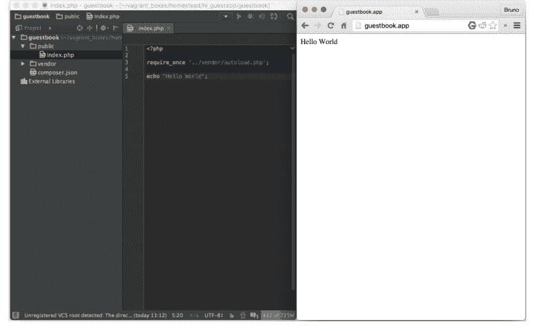

图 4.“Hello World” 轻松加载

`require_once`（参见 http://php.net/manual/en/function.require-once.php）是一个语句，告诉 PHP：“获取此文件的内容并将其放入当前文件中。如果找不到它，就崩溃吧！” `require` 部分确保了这一点。该语句还有其他版本，在手册页面上都有了解释。

### 开发应用

最后，是趣味的部分！或者不是呢？

## Var Dumper

我们将首先引入 `var-dumper` 包，这是来自 Symfony 框架的工具（参见“框架与包”章节）。

与许多其他框架一样，Symfony 是解决常见 Web 问题的包集合。当作为一个整体使用时，它们为高度自定义的 Web 应用提供了一个坚实（尽管复杂）的起点。这些不同的 Symfony 组件也设计为独立，因此如果用户采用自定义方法或不同的框架，也可以从 Symfony 包中获益。

`var_dump` 是其中一个组件。PHP 有一个内置名为 `var_dump` 的函数，可以在屏幕上输出变量的内容。`var_dump` 组件提供了一个 `dump` 函数，执行相同的操作，但方式更具可读性，并带有层/展开按钮。我们很快就会演示这一点；现在，让我们安装它：

```
composer require symfony/var-dumper --dev
```

`--dev` 选项告诉 Composer 将其放在 `composer.json` 的 `require-dev` 块中，因为这类调试辅助工具通常用于开发环境而非生产环境。对于生产环境中需要的包，我们只需省略 `--dev` 标志，它们最终将进入 `require` 块。经验法是：如果一个包旨在仅在应用或另一个包的开发阶段使用，你可以将其放入 `require-dev`（通过省略 `--dev` 选项）。然后，当我们把应用部署到生产环境时，将能够通过 `composer install --no-dev` 进行安装，使安装过程快得多。

正如我们提到的，PHP 有一个内置的“变量转储器”——函数 `var_dump`。让我们用一个 PHP 数组试一下。如果你不确定数组是什么，请想象一个包含各种物品的盒子。在 `index.php` 中，添加以下内容：

```php
$array = [1, "apple", 2, "foo", "bar"];

var_dump($array);
```

代码中的方括号是我们假设的盒子的边缘——它们之间的所有内容都被放入数组中。

然后，刷新 `http://guestbook.app` 页面，你应该能看到图 8.5 类似的景象。

```php
<?php
require_once './.vendor/autoload.php';
echo "Hello World";
$array = [1, "apple", 2, "foo", "bar"];

var_dump($array);
```

```
Hello World
array (size=5)
0 => int 1
1 => string 'apple' (length=5)
2 => int 2
3 => string 'foo' (length=3)
4 => string 'bar' (length=3)
```

图 8.5. `var_dump` 示例

输出在右侧，“Hello World”下方。它并不完全易读——对于安装了 Xdebug 的 Homestead（这是一种 PHP 插件，默认会让这类输出更漂亮）——但可以更好。让我们添加一个 `dump` 调用。结果可以在 8.6 中看到。

```php
<?php
require_once './.vendor/autoload.php';
echo "Hello World";
$array = [1, "apple", 2, "foo", "bar"];

var_dump($array);
dump($array);
```

```
Hello World
array (size=5)
0 => int 1
1 => string 'apple' (length=5)
2 => int 2
3 => string 'foo' (length=3)
4 => string 'bar' (length=3)

array:5 [
0 => "apple"
1 => "apple"
2 => "foo"
3 => "bar"
]
```

图 8.6. `dump` 示例

更好了，不是吗？折叠/展开按钮非常有价值——你可以想象这在处理巨大的嵌套数组树时（数组可以包含数组，数组可以包含另一个数组，以此类推……）是多么有用的。

### 数据库连接

有很多数据库可用：MySQL、OracleDB、PostgreSQL、MSSQL、SQLite 等。与 PHP 配合使用最流行的是 MySQL。介绍 SQL 并不在本书的范围内，但由于对我们的目的来说，它是必要的——我们将使用一个库为我们抽象数据库通信。

为了理解什么是“抽象”，请想象一下欧盟的插座。它看起来像一个猪鼻子，我们称之为 Schuko 插座，如图 8.7 所示。


图 8.7. 欧洲通 Schuko 插座

然后想象一下美国的插座，如图 8.8 所示。它有两个垂直狭缝和一个与欧盟插座完全不兼容的“尖叫大嘴”。


图 8.8. 美国插座

世界上每个地方都有自己的标准，如果你是一个环球旅行者，为你访问的每个国家携带一个独立的电源器，很快就会让你超过航空公司的行李重量限制（以及超出你的预算）。幸运的是，有像插座适配器之类的物品。

### 实例学习：从零开始构建 Web 应用


图 8.9. 通用插座适配器

像图 8.9 这样的一个“巨兽”可以处理世界上大多数的插座。它比只携带一个笔记本电脑电源器并希望目的地支持所需的插座要重吗？是的，但只需多出几克重量，你就能拥有十个电源器的便利，而重量仅其一小。这个适配器就是对供电服务的抽象。

软件中的抽象情况也是相似的。我们可以学习如何与 Postgres、SQLite、MySQL、MSSQL 等进行通信。这需要一些时间，但这是可能的——就像携带十个电源器一样。或者，我们可以依靠抽象——让我们放置在数据库和我们之间的包的作者来承担繁重的工作，而我们专注于使用。

## 启动 PHP 环境

其中一种数据库抽象层就是非常轻量级的 `Medoo` 包。添加到我们的项目中文件大小仅为 20KB，我们就有以完全相同的方式与多个数据库引擎通信的能力。

我们很快就会示例中演示这一点。现在，让我们安装 Medoo：

```
composer require catfan/medoo
```

修改 `index.php` 文件，将之前添加的 `$array`、`var_dump` 和 `dump` 行改为：

```php
$database = new Medoo(
  'database_type' => 'sqlite',
  'database_file' => '../storage/database.db'
);
```

变量 `$database` 用于存储 `Medoo` 类的新实例。该类需要一个类型和一个文件路径作为构造函数参数——这些是类为了正确构建其实例所需的值——因此我们将它们全部放在一个数组中。（注意方括号——就像之前的数组示例一样）。左列和右列之间的箭头表示键值之间的赋值——就像代数中的 `x = 3` 一样，`database_type = sqlite` 也是如此。关于面向对象编程速课程的链接，请参见章节末尾。

如果你难以完全理解这里的代码以及后续的内容，我理解这可能让你感到有些沮丧。然而，请放心，理解代码本身并不是最重要的；本书的主要目标是看到示例应用是如何正确地启动和部署的。

刷新浏览器，如果没有错误，我们就成功了，如图 8.10 所示。

> ⁹ http://www.sitepoint.com/getting-started-medoo-examples-use/

### 实例学习：从零开始构建 Web 应用

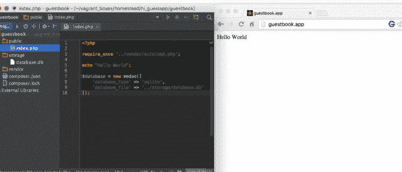

图 8.10. 我们的数据库现在存在了

此外，注意项目的 `storage` 子文件夹中出现了一个新文件：**database.db**。这是因为我们在这个示例中使用了 SQLite（SitePoint 上有关于 SQLite 的良好介绍），如果数据库文件不存在，它会创建一个数据库文件。

我们也可以很容易地在 `database_type` 下放入 `mysql` 或 `postgresql` 并使用它们，因为它们在 Homestead Improved 上都是预装的，但这将需要额外的配置，并且在 Homestead 之外并不清晰：毕竟，这些数据库引擎需要安装。

相反，SQLite 默认在几乎所有的操作系统上存在，并且可以开箱即用。它没有 MySQL 快，而且缺少一些高级功能，而我们目前的项目既不需要速度也不需要复杂性。

`database_file` 值告诉 Medoo 在何处创建 SQLite 文件来存储我们保存的所有数据。我们告诉它进入*上一个文件夹*，进入 `storage/database.db`；因此，创建了 **database.db** 文件。`$database` 变量现在就是我们的适配器。

> ¹⁰ http://www.sitepoint.com/introduction-to-sqlite/

## 启动 PHP 环境

要将我们目前为止创建的文件和文件夹添加到仓库并推送到线上，我们需要执行以下命令：

```
git add -A; git commit -m "First commit"; git push -u origin master
```

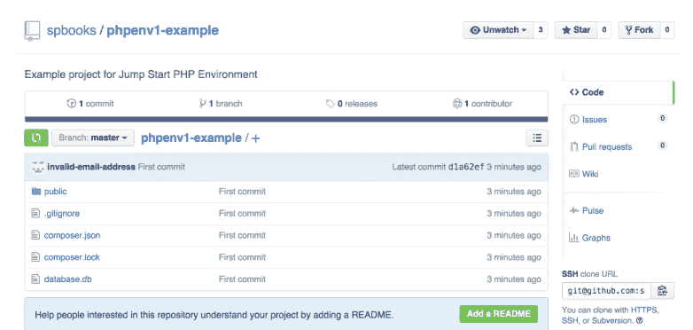

我们为 8.12 创建的所有文件（包括数据库）现在都已上线，如图 8.12 所示。请注意，在开发包含敏感信息（如用户名、密码或电子邮件）的数据库应用程序时，显而易见，**绝不能**将数据库文件提交到仓库。

### HTML 表单

在启动新的 Web 项目时，我们有一个包含了一些最佳实践的实用“模版代码”（boilerplate）。虽然使用它是可选的，但人们更倾向于使用它完全是因为当人们从零开始并手动实现最佳实践时，最终往往会达到与这个预制模板代码相同的程度。该模板代码被称为 **HTML5 Boilerplate** 或 H5BP，可以从 https://htmlboilerplate.com/ 下载。

将其内容解压到我们项目的 **public** 文件夹中，使其现在看起来像图 8.13 所示。

## 从示例学习：从零开始构建 Web 应用

### guestbook

| 名称 | 修改日期 | 大小 | 类型 |
| --- | --- | --- | --- |
| _DS_Store | 今天 00:30 | 6 KB | 文档 |
| .git | 今天 00:29 | | 文件夹 |
| .gitignore | 今天 00:25 | 499 bytes | 文本文件 |
| .idea | 今天 00:29 | | 文件夹 |
| composer.json | 今天 00:22 | 371 bytes | JSON |
| composer.lock | 今天 00:22 | 7 KB | 文档 |
| _DS_Store | 今天 00:30 | 6 KB | 文档 |
| 404.html | 2015年4月30日 21:55 | 1 KB | HTML |
| apple-touch-icon.png | 2015年4月30日 21:55 | 4 KB | 可移动文件 |
| browserconfig.xml | 2015年4月30日 21:55 | 411 bytes | XML 文档 |
| crossdomain.xml | 今天 00:28 | 611 bytes | 文件夹 |
| css | 今天 00:28 | | 文件夹 |
| favicon.ico | 今天 00:28 | 766 bytes | |
| humans.txt | 2015年4月30日 21:55 | 229 bytes | 纯文本 |
| img | 今天 00:28 | | 文件夹 |
| index.html | 今天 00:28 | 2 KB | HTML |
| index.php | 今天 00:22 | 194 bytes | PHP |
| js | 今天 00:28 | | 文件夹 |
| LICENSE.txt | 2015年4月30日 21:55 | 1 KB | 纯文本 |
| robots.txt | 2015年4月30日 21:55 | 78 bytes | 纯文本 |
| tile-wide.png | 2015年4月30日 21:55 | 2 KB | 可移动文件 |
| tile.png | 2015年4月30日 21:55 | 3 KB | 可移动文件 |
| storage | 今天 00:19 | | 文件夹 |
| database.db | 今天 00:19 | 0 bytes | 文档 |
| vendor | 今天 00:22 | | 文件夹 |

图 8.13. 新文件夹结构

如你所示，添加了很多新文件和文件夹。如果你想了解更多关于这些内容，请查看 H5BP 的文档。

### index.php vs index.html

大多数服务器配置为首先查找 `index.html` 文件，然后查找 `index.php` 文件。事实上，如果你现在刷新 `http://guestbook.app`，你将看到 H5BP 的欢迎页面，而不是我们的输出内容。

我们可以删除 `index.html`，服务器将再次提供 `index.php`，但这样我们就会失去 H5BP 的优势。为了找回我们的内容，我们：

- 打开 `index.php`，并在文件末尾加上 `?>`。这是 PHP 的结束标签，它让 PHP 知道不需要再处理更多的编程逻辑。它知道从该点起，它所做的只是将遇到的内容打印到屏幕上。在纯 PHP 文件中，通常会省略结束标签，因为它没有用处且可能导致 bug，但在同一个文件中使用 PHP 和 HTML 时，它是必要的。

- 选取 `index.php` 的所有内容，并将它们放在 `index.html` 的最顶部，即 `<doctype>` 之前。保存文件。

- 执行命令：

```
cd public; rm index.php; mv index.html index.php; cd ..
```


上述操作删除了旧的 `index.php` 并将 HTML 文件转换为 PHP 文件。这样，服务器再次直接移动到 `index.php`，但这次它也会打印出内容。

### HTML 表单

在启动新的 Web 项目时，我们有一个包含了一些最佳实践的实用“模版代码”（boilerplate）。虽然使用它是可选的，但人们更倾向于使用它完全是因为当人们从零开始并手动实现最佳实践时，最终往往会达到与这个预制模板代码相同的程度。该模板代码被称为 **HTML5 Boilerplate** 或 H5BP，可以从 https://htmlboilerplate.com/ 下载。

将其内容解压到我们项目的 **public** 文件夹中，使其现在看起来像图 8.13 所示。

# PHP 环境快速上手

```php
->setComment($array['comment'])
->setEmail($array['email'])
->setName($array['name'])
->setSubmissionDate($array['submissionDate']);

return $collection;

public function setName($name)
{
    $this->name = (string)$name;
    return $this;
}

public function setEmail($email)
{
    if (filter_var($email, FILTER_VALIDATE_EMAIL)) {
        $this->email = $email;
    } else {
        throw new \InvalidArgumentException('Not a valid email!');
    }
    return $this;
}

public function setComment($comment)
{
    if (strlen($comment) < 10) {
        throw new \InvalidArgumentException('Comment too short!');
    } else {
        $this->comment = $comment;
    }
    return $this;
}

protected function setSubmissionDate($date)
{
    $this->submissionDate = $date;
}
```

```php
return $this;

public function getName() {
    return $this->name;
}

public function getEmail() {
    return $this->email;
}

public function getComment() {
    return $this->comment;
}

public function getSubmissionDate() {
    return $this->submissionDate;
}

public function save() {
    if ($this->getName() && $this->getEmail() && $this->getComment()) {
        $this->setSubmissionDate(date('Y-m-d H:i:s'));
        return $this->database->insert('comments', [
            'name' => $this->getName(),
            'email' => $this->getEmail(),
            'comment' => $this->getComment(),
            'submissionDate' => $this->getSubmissionDate()
        ]);
    }
    throw new \Exception("Failed to save!");
}
```


## 上述代码解释

关于该类及其代码允许的所有功能的深度解释，以及超出书中涵盖范围的应用程序功能升级，将在 SitePoint.com 发表的额外文章中介绍。要找到这些额外内容的链接，请参见我们正在构建的留言簿应用源码仓库：https://github.com/spbooks/phpenvv1-example。

在我们的应用程序使用 `Comment` 类之前，程序需要知道该类的位置。还记得第 7 章中的命名空间（namespaces）部分吗？这就是将 `Comment` 类的命名空间（`namespace SitePoint;`）绑定到硬盘上的物理位置（`src` 文件夹）的部分。我们必须编辑项目根目录下的 `composer.json` 文件并添加以下部分：

```json
"autoload": {
  "psr-4": {
    "SitePoint\\": "src"
  }
}
```

参考图 8.15 显示了整个文件现在的样子：

### 实例学习：从零开始构建 Web 应用

```json
{
    "name": "sitepoint/guestbook",
    "description": "A guestbook app",
    "type": "project",
    "license": "MIT",
    "authors": [
        {
            "name": "Bruno Skvorc",
            "email": "bruno.skvorc@sitepoint.com"
        }
    ],
    "autoload": {
        "psr-4": "SitePoint\\": "src"
    },
    "require": {
        "catfan/medoo": "^1.0"
    },
    "require-dev": {
        "symfony/var-dumper": "^3.0"
    }
}
```

图 8.15。`composer.json` 的当前内容

要应用这些更改，运行 `composer dump-autoload`，以便根据 `src` 文件夹重新生成类自动包含脚本。

最后一步：在将数据保存到数据库之前，我们需要创建一个存放数据的表。在终端中，进入根目录并执行：

```bash
sqlite3 storage/database.db
```

这将进入 CLI 模式数据库，允许实时执行 SQL 命令。要创建我们需要的表，我们需要在数据库引擎内部执行以下语句：

```sql
CREATE TABLE comments (
id INTEGER NOT NULL PRIMARY KEY AUTOINCREMENT,
name TEXT NOT NULL,
email TEXT NOT NULL,
comment TEXT NOT NULL,
submissionDate TEXT NOT NULL);
```

这将创建一个名为 `comments` 的表，包含一个自增整数 ID（这意味着在插入新记录时 ID 号会自动增加，我们不需要提供此值）、一个 `name` 字段、一个 `email` 字段、一个 `comment` 字段以及保存日期的 `submissionDate` 字段。执行上述命令后输入 `.tables` 应显示表已创建。输入 `.quit` 退出提示。

我们来测试一下目前创建的所有内容如何？在 `index.php` 中，在 `$database = new medooo...` 块下取消以下代码：

```php
$comment = new SitePoint\Comment($database);
$comment->setEmail('bruno@skvorc.me')
->setName('Bruno Skvorc')
->setComment('This is a comment')
->save();
```

（注：上述代码的 OCR 文本是碎片化/不完整的，我根据上下文重建了逻辑）。

## 开发环境与生产环境

有很多方法可以实现此点，但最简单的方法之一：

- 应用检查是否存在名为 `database.local.db` 的可写文件
- 如果文件存在，则使用它
- 如果文件不存在，则使用 `database.db`

首先，清空数据库中的虚拟数据。

```sql
sqlite3 storage/database.db
delete from comments;
delete from sqlite_sequence;
```

第一个 `delete` 删除了所有测试行。第二个 `delete` 重置了自增 ID。现在，将此文件转换为模板，然后创建数据库：

```bash
cd storage
cp database.db database.tpl
cp database.tpl database.local.db
cd ..
```

`cp` 是复制的终端命令。

现在应该是三个文件：`database.tpl`、`database.db` 和 `database.local.db`。

我们现在可以将 `database.local.db` 添加到 `.gitignore` 文件中，确保它永远进入仓库：


```bash
echo -e "\database.local.db" >> .gitignore
```

最后，让我们编辑 `index.php`。我们将替换 Medoo 的初始化：

```php
$database = new medoo([
  'database_type' => 'sqlite',
  'database_file' => '../storage/database.db'
]);
```

改为：

```php
$file = './storage/database.db';
if (is_writable('../storage/database.local.db')) {
  $file = '../storage/database.local.db';
}
```

上述代码翻译为：“如果文件夹上方存在名为 `database.local.db` 的可写文件，则使用它。否则，使用 `database.db`”。

如果现在刷新应用（留言创建代码仍然在那里），我们应该看到留言出现在 `database.local.db` 中，而不是 `database.db`，如图 8.17 所示。

## 第四次推送

再次进行 `add`、`commit`、`push`。不要死记这些命令。如果你能记住它们，宁可在之前的页面中查找，而不是去 Google 搜索。仅仅通过搜索来寻找解决方案在不不久的将来将成为你每天的苦差。真正的技能不在于知道某些事，而在于知道哪里可以找到知识（尽管诚实地说，你最终可能还是来到 StackOverflow）。

## 发布和显示评论

首先，让我们通过删除虚拟的评论创建逻辑来修改 `index.php`。PHP 部分（也就是我们新的起点）现在看起来像这样：

```php
<?php

require_once '../vendor/autoload.php';

$file = './../storage/database.db';

if (is_writable('../storage/database.local.db')) {
  $file = '../storage/database.local.db';
}

$database = new medoo([
  'database_type' => 'sqlite',
  'database_file' => $file
]);

$comment = new SitePoint\Comment($database);

?>
```

到此时，我们已经设置了自动加载，配置了数据库实例，并且有了一个注入了数据库连接的 `Comment` 类实例。

首先，让我们让发布新评论成为可能。

### 发布

正如我们之前说的，当我们在浏览器中访问 URL 时，我们发出的是一个 `GET` 请求。`GET` 请求用于读取，它们不应该修改数据。这就是为什么我们的提交表单使用了 `method="post"`，因此我们在提交表单后发送给应用程序的请求是一个 `POST` 请求。在 PHP 中，有诸如超全局（superglobals）之类的结构——可以在应用程序任何级别访问的变量（通常是数组）。这些超全局是 `$_GET` 和 `$_POST`。

当我们访问类似 `http://some.url.com/?var=something&name=something-else` 的 URL 时，`$_GET` 超全局数组看起来如下：

```php
$_GET = [
  'var' => 'something',
  'name' => 'something-else'
];
```

换句话说，我们能够通过 `$_username = $_GET['name']` 这种方法从应用程序的任何部分访问 URL 中的 var 和 name。

`$_POST` 执行的是相同的操作，但针对的是通过 `POST` 请求从表单提交的值。当表单有一个名称为 `name` 的输入字段时，`$_POST` 超全局也会有一个 `name` 键，其中包含该字段的值。因此，正如我们将会看到的，在表单提交后，我们在表单中定义的值将体现在 `$_POST` 中。

### 启动 PHP 环境

首先，我们需要检测我们是否正在处理表单提交。在 `$comment` 行下方，但在闭合的 `?>` PHP 标签之前，我们放入以下内容：

```php
if ($_SERVER['REQUEST_METHOD'] == 'POST') {
    echo "Form was submitted!";
}
```

第一行检测到我们正在处理表单提交。记得我们在 HTML 的 `<form>` 标签中使用的 `method='post'` 吗？`$_SERVER` 元素是 PHP 中的另一个超全局，包含包含当前传入请求的信息（它是自动填充的）。在这种情况下，我们正在处理的是通过表单提交并使用 `POST` 方法的请求。

如果我们现在刷新 `http://guestbook.app`，我们应该不会看到任何新内容。但如果我们点击表单上的保存按钮，我们应该看到“Form was submitted!”。不过，有一个小问题。如果在提交表单后尝试刷新页面，我们将得到一个奇怪的警告，如图 8.18 所示。

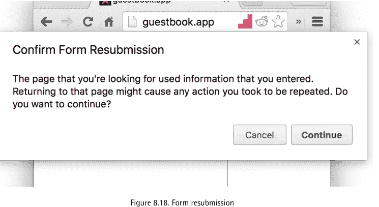

在 Chrome 的世界里，刷新意味着完全重做——重复上一步操作，而不是重新渲染我们当前所在的 URL。当我们尝试刷新时，它想要重新发送整个表单信息。当我们手动输入 `http://guestbook.app` URL 并以这种方式访问时，这种情况不会发生，但在提交表单后刷新总是会产生这个警告。你会在其他网站上遇到这种情况，我们不需要用这个消息来吓我们的访客，所以我们会绕过它。现在，让我们处理这个提交。

将 `echo "Form was submitted!"` 替换为：

```php
dump($_POST);
```

然后，在评论表单输入一些数据并提交。你应该看到类似图 8.19 的内容。

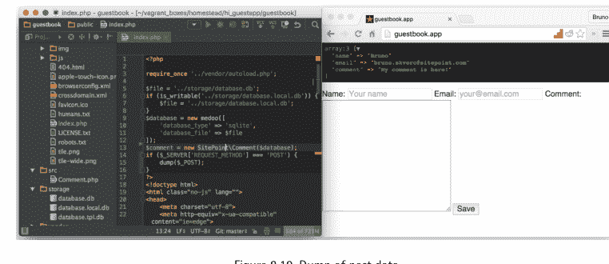

图 8.19. 数据的转储

注意我们在本章功能开始时安装的所有三个 `/var/dumper` 包，它们的名称与它们来源的字段名称相同。

在像正在构建的这类系统中，从不可信用户那里接收数据的一个重要方面是**输入验证**。

#### 验证：永远不要信任用户输入！

验证的黄金法则是永远不要信任用户输入，因为你不知道某个精通代码的人何时会发现你的应用，并尝试向字段中输入恶意信息试图破坏你的应用（例如，输入触发数据库中命令的数据，也称为 SQL 注入）。

验证输入数据有许多方法，在这种情况下我们将使用一个名为 `particle/validator` 的极简主义包。让我们来安装它。

```bash
composer require particle/validator
```

在 `require_once` 行上方放入：

```php
use Particle\Validator\Validator;
```

这导入了该类以便我们可以使用它的简短名称。然后，将 `dump($_POST)` 替换为：

```php
$v = new Validator();

$v->required('name')->lengthBetween(1, 100)->anum(true);
$v->required('email')->email()->lengthBetween(5, 255);
$v->required('comment')->lengthBetween(10, null);

$result = $v->validate($_POST);

if ($result->isValid()) {
    echo "Submission is good!";
}
```

`Validator` 使用规则来定义约束。在这种情况下，我们使用了：
- `required`：确保字段不为空
- `lengthBetween`：确保字符串长度在特定范围内
- `anum`：确保输入是字母数字
- `email`：验证邮箱格式

### 显示评论

在上面的代码中，我们在注释上调用了 `findAll` 方法，该方法按提交顺序的反序（从新到旧）从数据库获取所有注释。然后，我们创建了一个 HTML `div` 块来包含我们的评论。内部有一个 `h3` 元素用于评论标题（关于谁在什么时候写了评论的信息），随后是一个 `p` 元素，它包含我们的评论文本。

`<?= $variable ?>` 结构是 `<?php echo $variable ?>` 的简写，在所有现代 PHP 版本中始终可用（注意，这不等同于短打开标签¹）。

¹⁴ http://php.net/manual/en/ini.core.php#ini.short-open-tag

就是这样——非常简单。让我们为 `http://guestbook.app` 测试我们的代码，如图 8.21 所示。

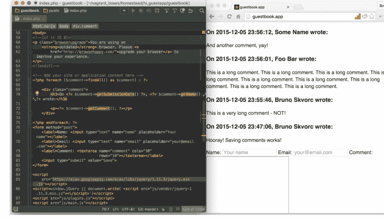

图 8.21. 它运行正常！

## CSS

在整个过程中，我们唯一没有关注到设计。让我们加入一些基础的 CSS，只是为了让一切看起来好看一点。在 `<link rel="stylesheet" href="css/main.css">` 之下，添加这一行：

```html
<link rel="stylesheet" href="css/custom.css">
```

然后，创建 `public/css/custom.css` 文件并赋予以下内容（或从 http://bit.ly/envbook-style 粘贴）：

```css
body {
  padding: 10px;
}

form {
  width: 500px;
  border: 1px solid silver;
  border-radius: 3px;
  padding: 10px 10px 10px 4px;
}

form > input {
  width: 100%;
  margin-left: 4px;
  height: 35px;
  border: 1px solid silver;
  background: #cccccc;
}

form > input:hover {
  background: whitesmoke;
}

label {
  display: block;
  margin: 5px;
  color: grey;
}

label > input {
  line-height: 30px;
}

label > {
  display: block;
  width: 100%;
}

.comment {
  width: 500px;
  border: 1px solid silver;
  border-radius: 3px;
  margin: 10px 0;
  background-color: lemonchiffon;
}

.comment > h3 {
  margin: 0;
  border-bottom: 1px solid silver;
  background-color: lightblue;
  padding: 3px;
}

.comment > p {
  margin: 10px;
}
```

这让我们丑陋的应用程序变得稍微容易看了，如图 8.22 所示。

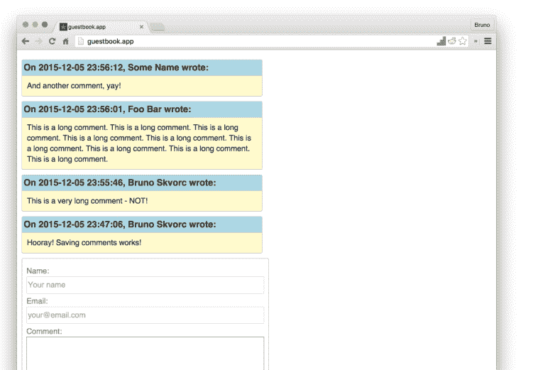

## 最后推送

到此时，你应该精通推送流程了。进行最后一次推送，我们的应用程序就会以最终形式进入仓库。

## 部署

在本节中，我们将部署我们最出应用程序。关于部署的更多理论，请参见第 6 章。

### 在共享主机上部署 (Hostgator)

正如我们在第 6 章讨论的，共享主机并不是一个好的选择。它不安全，资源通常非常有限（尽管有无限承诺），而且现在并不比 VPS 便宜。尽管如此，它可能是你唯一可以使用的，所以我们涵盖一种旧式的 FTP 部署是有意义的。

共享主机通常使用 cPanel 作为管理服务器的一种，类似于图 8.23 所示。

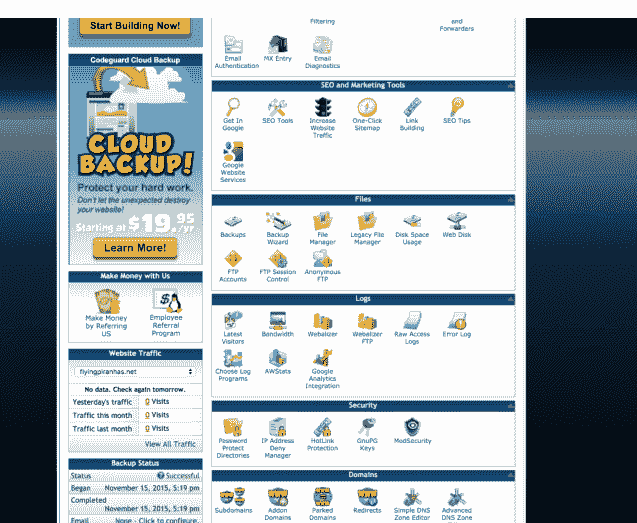

> 图 8.23. cPanel

在这种情况下，我们使用的是 Hostgator¹⁵，但该过程在每个共享主机上几乎是相同的。

要部署应用程序，你需要一个域名。域名可以在 http://namecheap.com 或 http://name.com 等网站上购买（或者说租赁），价格范围从每年 2 美元到每年 2000 美元不等。我将选择一个我自己没有使用的域名作为示例：caimeo.com。通过“附加域名”（Addon domains）对话框将你的域名添加到共享主机上：

¹⁵ http://hostgator.com

#### 创建附加域名

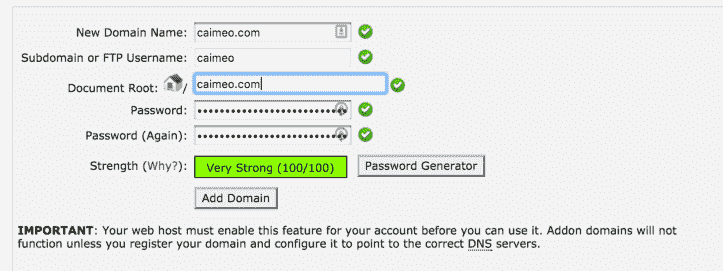

图 8.24. 添加新域名

每个共享主机还会指导你如何配置 DNS 设置以响应共享主机的服务器。注意，DNS 更改可能需要 24 小时才能在网络范围内**生效**。

添加新域名会自动为其创建一个 FTP 账户，如图 8.25 所示。

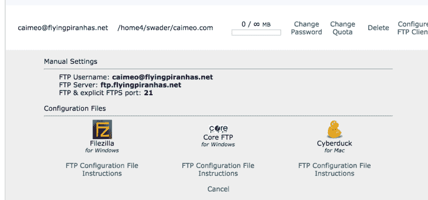

图 8.25. 已创建 FTP 账户

注意，主域名是不同的，因为 FTP 账户是在那里打开的。更改主域名的方法有很多，但这个过程太耗时且不值得。

下一步是下载 FTP 客户端；本示例将使用 FileZilla⁶，但你可以使用你喜欢的任何客户端。在管理器中，如图 8.26 所示添加。

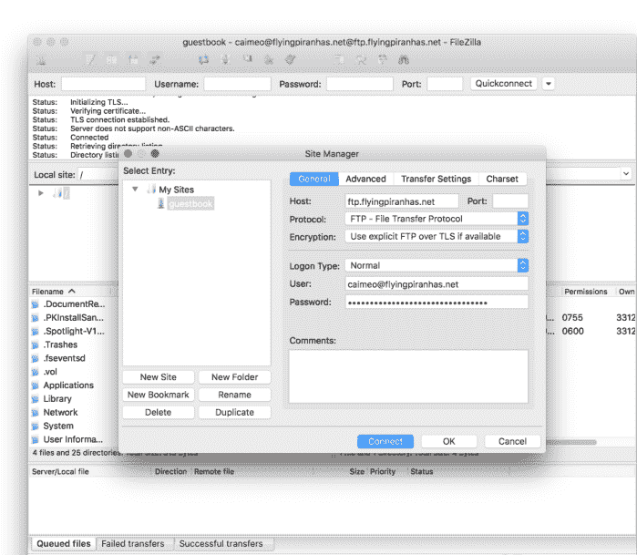

图 8.26. 配置完成

### 在 DigitalOcean 上部署

sp-env ACTIVE | 188.166.15.57 | 512MB RAM | 20GB SSD 硬盘 | Amsterdam 3 Ubuntu 14.04 x64

- 访问 (Access)
- 电源 (Power)
- 调整尺寸 (Resize)
- 快照 (Snapshots)
- 设置 (Settings)
- 备份 (Backups)
- 图表 (Graphs)
- 历史 (History)
- 销 (Destroy)

#### 控制台访问

这将打开到你的 Droplet 的 vNC 连接，等同于向虚拟服务器插入显示器和键盘。

```
Console Access
```

#### 重置 root 密码

这将关闭你的 Droplet 并一个新的 root 密码发送到你的邮箱。
你要继续吗？

```
Reset Root Password
```


# 图 8.29. Droplet 仪表板

注意名称下方的 IP 地址。现在，如果将其放入浏览器的 URL 字段，它将无法到达任何地方。但是，我们可以使用它来登录你的服务器（当你看到下面的 `IP-ADDRESS` 时，请替换为你自己的 droplet 的 IP）：

```bash
ssh root@IP-ADDRESS
```

在提示时，使用来自电子邮件的密码。一旦你登录成功，系统会要求你更改 root 密码。将其更改为一个你熟悉但不容易被猜到的密码。我的建议是使用密码管理器生成一个随机密码，以后只需从这里粘贴即可。

一旦进入服务器，可能会显示关于区域设置（locales）的警告信息。可以通过运行以下命令来修复：

```bash
sudo locale-gen en_US.UTF-8
export LANG=en_US.UTF-8
export LC_ALL=en_US.UTF-8
```

这告诉我们的是 droplet 上的操作系统（Ubuntu Linux）、我们正在使用的语言（美式英语）以及显示字符时使用的编码类型。`UTF-8` 是一种编码类型，使得可以使用不同字母表的字母和类似的杂杂字符。`UTF-8` 不在本书和本章的讨论范围内，但如果你感兴趣，从 2003 年起有一段非常重要（对新手友好）的文字，见以下链接：http://www.joelonsoftware.com/articles/Unicode.html

```bash
### SendEnv LANG LC_*
```

这是由于一个常见的远程访问 bug¹⁹。
现在我们准备好安装前提软件了。

## 前提条件

首先，我们需要让 Ubuntu 获取一份新可用 Ubuntu 软件包列表。在你登录 droplet 的期间，运行：

```bash
sudo apt-get update
```

列表更新后，让我们从安装 Git、SQLite3 和 Nginx 开始：

```bash
sudo apt-get install git sqlite3 nginx
```

突然，我们的 IP 地址上线了！（图 8.30）。

## 实例学习：从零开始构建 Web 应用

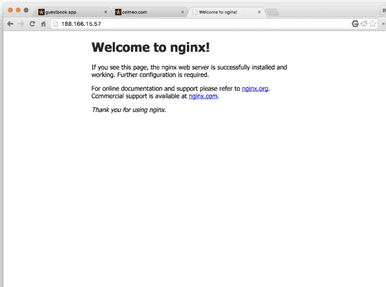

图 8.30. Nginx 欢迎页面

接下来，我们需要安装 PHP。

## PHP 和 Composer

要安装 PHP，我们运行：

```bash
sudo add-apt-repository ppa:ondrej/php5-5.6
sudo apt-get update
sudo apt-get install php5 php5-fpm php5-cli php5-sqlite
```

`php5` 是核心 PHP 程序。`php5-fpm` 是 Web 接口，Nginx 这样的服务器通过它传递 PHP 文件并获取响应。`php5-cli` 是命令行界面，因此我们可以在终端中使用 PHP 而无需浏览器。这就是 Composer 工作的方式。`php5-sqlite` 显然是用于与 SQLite3 通信的 PHP 扩展，我们知道将需要它。

要全局安装 Composer（像在 Homestead Improved 中那样），我们执行：

```bash
curl -sS https://getcomposer.org/installer | php
sudo mv composer.phar /usr/local/bin/composer
```

## 服务器配置

要配置 Nginx，我们可以直接从我们的虚拟机中获取配置！在宿主机上打开一个新的终端或窗口，通过 `vagrant ssh` 进入我们开发应用时使用的 Vagrant 虚拟机，并执行：

```bash
cp /etc/nginx/sites-available/guestbook.app -/Code/guestbook-nginx.txt
```

```bash
vim /etc/nginx/sites-available/guestbook.app
```

按下 `i` 键进入插入模式，并使用 `Ctrl + V`（Mac 上为 `CMD + V`）将内容粘贴进去。然后编辑以下行：

- 将 `server_name` 的值从名称 (guestbook.app) 改为 droplet 的 IP 地址
- 将 `root` 的值更改为 `/var/www/guestbook/public`

`/var/www/` 文件夹是 Linux 上通常用于托管应用程序的位置。使用 `Esc` 退出插入模式，输入 `:x` 并按回车退出文件。

然后，重启 Nginx：

```bash
sudo service nginx restart
```

## 遇到问题

如果你遇到全白屏或晦涩的错误，请通过运行 `tail -f /var/log/nginx/guestbook.app-error.log` 来检查错误日志。`tail` 输出文件的“尾部”（最后 10 行），`-f` 告诉它“监控此文件的更新输出”，这意味着当新错误出现时，它们会立即显示在屏幕上。可以随时打开另一个终端窗口连接到 droplet。

## 使用 Git 拉取

最后！我们准备好部署我们的应用了！

```bash
cd /var/www
git clone https://github.com/spbooks/phpenv1-example guestbook
composer install --no-dev -o
```

注意到我们使用了 `--no-dev` 防止安装开发包并使用 `-o` 加快安装。由于我们是用 root 账户创建的，应用“属于”root 用户。当 PHP 需要读写硬盘时这不是问题。作为最后一步，我们需要修改权限：

```bash
cd /var/www/guestbook
sudo chmod -R :www-data .
```

如果我们现在测试应用，应该会看到一切正常，如图 8.31 所示。

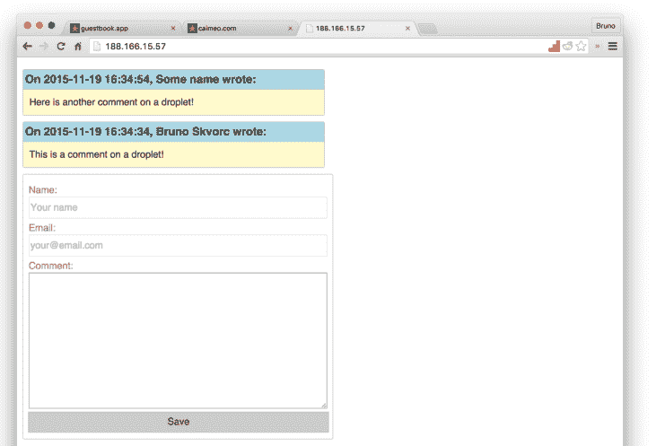

图 8.31. 正常的 droplet

## 总结

本章实践了之前涵盖的所有理论。我们讨论的几乎每个术语和尝试过的代码段在创建小应用的过程中都用到了。

## 学习资源

要了解自动化测试的基础知识：

- https://leanpub.com/mlaph
- http://www.sitepoint.com/tag/phpunit
- http://knpuniversity.com/screencast/behat
- http://www.sitepoint.com/php-continuous-integration-travis-ci/

要了解 Laravel 框架，最好查看 https://laracasts.com/，你也可以查看 http://knpuniversity.com 提供的内容。

最后，为了自动化本章的最后一步——部署——设置让它每次当你（例如）推送到 master 分支时（以及这些程序的各种名称）都发生：

- http://stackoverflow.com/questions/28608015/
- http://www.sitepoint.com/whats-continuous-deployment/
- http://www.sitepoint.com/php-continuous-integration-travis-ci/
- http://www.sitepoint.com/deploying-php-apps-digitalocean-dploy-io/
- http://www.sitepoint.com/deploy-symfony-apps-capifony/
- http://www.sitepoint.com/one-click-app-deployment-server-side-git-hooks/

有关此列表的持续更新，请参见仓库 https://github.com/spbooks/phpenv1-example 中的 README 文件，或阅读 http://phptherright.com。
