# 响应式网页设计快速启动指南：现代响应式解决方案


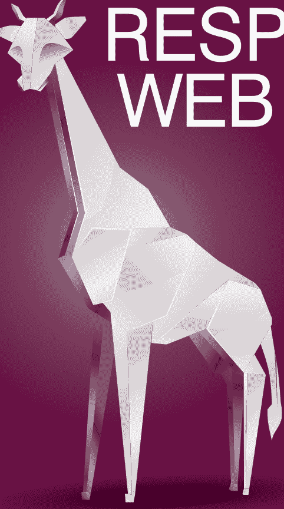


# 关于 Chris Ward

Chris 向世界解释酷炫的技术。他是一名技术作家和博客作者。他正在进行一些疯狂的项目，并愿意向任何倾听的人演讲。

# 关于 SitePoint

SitePoint 专门为 Web 专业人士出版有趣、实用且易于理解的内容。访问 `http://www.sitepoint.com/` 访问我们的博客、书籍、时通讯、文章和社区论坛。你可以在那里找到关于 JavaScript、PHP、Ruby、移动开发、设计等大量信息。

本书献给 2016 年，因为那本该是我完成它的一年，但生活出了意外。那也是非常有意思的一年，不是吗？

我可能还应该把它献给我的妻子，感谢她一直忍受我的“这个周末什么都做不了”。

- 有任何查询吗？...................................................... 46
- 关于演示应用如何...............................................................83
- 获取视觉效果 ................................................................126

# 第 6 章 响应用户上下文 ........127

- 万物皆可 API ................................................................127
- 电量水平.........................................................................130
- 响应所有........................................................................................... 150

# 前言

像素级完美的 Web 时代已经结束了。在网页上定位元素并期望它们始终按照我们想要的方式显示的时代已成为遥远的记忆；我们现在必须应对不断涌出的新、多样化设备，我们的设计在这些设备上必须看起来完美。

本书旨在帮助你开始理解并使用一系列 CSS 和 HTML 工具，来应对这个新的设备世界。它将向你介绍帮助页面适应不同设备的构建模块，通过网格更进一步，向你展示如何在所有设备上使文本和图像具有可读性，并在最后一章中介绍如何利用更深奥的功能。

让我们开始吧。

# 谁应该读这本书

本书面向网页设计师和前端开发人员。你需要熟悉 HTML 和 CSS，但不需要之前的响应式 Web 设计经验。对于书的后半部分，熟悉一些 JavaScript 会有所帮助。

# 使用的规范

你会注意到我们在整书中使用了某些排版和布局样式来表示不同类型的信息。请关注以下项目。

## 代码示例

书中的代码使用等宽字体显示，如下：

```html
<h1>一个完美的夏日</h1>
<p>这是一个天气晴朗、非常适合在公园里散步的好日子。这
鸟儿在歌唱，孩子们都回学校了。</p>
```

如果代码位于书籍的代码存档，文件名将出现在程序列表顶部，如下：

```css
0-1. example.css

.footer {
  background-color: #CCC;
  border-top: 1px solid #333;
}
```

如果只显示了文件的部分内容，将通过 *excerpt*（片段）一词指示：

```css
0-2. example.css (excerpt)

.footer {
  background-color: #CCC;
  border-top: 1px solid #333;
}
```

如果要在现有示例中插入额外的代码，新代码将以**粗体**显示：

```javascript
function animate() {
  new_variable = "Hello";
}
```

当需要上下文的现有代码而不是重复所有代码时，将显示为：

```javascript
function animate() {
  :
  new_variable = "Hello";
}
}
```

某些代码行应该在一行内，但由于页面限制，我们对它们进行了换行。↩ 表示仅出于格式目的而存在的换行，应当忽略：

```javascript
URL.open("http://www.sitepoint.com/responsive-web-design-real-user-testing/?responsive1");
```

## 提示、注释与警告

> 嘿，你！
> 提示提供了有用的小贴士。

> 咳，打扰一下……
> 注释是与当前主题相关但并非至关重要的旁注。将它们视为额外的补充信息即可。

> 确保你始终……
> 注意这些重要的要点。

> 注意！
> 警告强调了在过程中可能会让你绊倒的任何陷阱。

## 补充材料

- 书籍存档包含了与所展示示例配套的可下载代码和示例视频。
- `books@sitepoint.com` 是我们的邮箱地址，如果你需要联系我们报告问题或出于其他原因。

# 第 1 章 响应式 Web 设计的意义与目的

过去非常简单：你为 15 英寸显示器设计一个网站或应用程序，然后——抛开浏览器之间的兼容性问题不谈——你就完成了。

然后，带有 Web 浏览器的手机出现了并毁了我们轻松的生活。最糟糕的是，人们竟然喜欢在手机上浏览网页！

> ### 移动端的兴起
> 2016 年，在移动设备上浏览网页首次超过了桌面端。

## 响应式设计中的各种流派

关于如何使用响应式设计，其流派之多与其解读之多样。有些流派已经销声，而另一些则留了下来。我们在书中不会显式地介绍任何细节，但会涉及它们的实际应用。让我们现在快速回顾其中的几种。

### 渐进式增强

遵循更传统的渐进式增强原则时，你的重点是确保所有用户都能看到网站内容，无论他们的设备有多简单或连接有多慢。然后，为可以利用这些特性的设备添加额外——例如更复杂的设计和功能。

### 优雅降级

移动浏览的普及反转了更传统的设计路径。在过去，你会在你工作的平台（通常是电脑）上开始设计，然后剥离样式和功能，以支持屏幕较小或对某些功能支持较少的设备。

虽然优雅降级通常用于浏览器对特定功能支持不足，但你也可以从更广泛的角度来看待它。它的原则是：你从一个功能全备的版本开始，运行在你理想的设备和浏览器上，同时确保任何用户在任何（支持的）设备上都能使用核心功能，即使他们错失了一些锦上添花的功能。

### 移动优先

移动优先与渐进式增强类似，但更专门针对响应式设计。它建议你从最小或能力最弱的设备（在该原则创建时通常是指手机）开始，然后随着设备规模的增加而添加功能和样式。

作为一个术语，“移动优先”可能会让人困惑，特别是对于非设计师/开发人员观众，这会让他们对移动端在项目中所获得的优先级产生偏颇的印象。

在理论上，这种做法确保了较小设备不会获得最好的体验——即所有设备都被同等对待。

## 你需要支持什么？

在开始或增强任何基于 Web 的项目之前，了解它是否值得，并评估你所有努力工作的（潜在）用户群至关重要。

如果你有一个现有的网站，分析流量以查看访问者使用什么类型的设备访问你的网站可能是值得的。如果 90% 的访问者一直通过桌面电脑访问，这说明要么你的移动体验糟糕，要么你的访问者不是大设备用户。你可以进行广泛的研究来找到准确答案，或者简单地使用响应式设计技术构建一个移动友好的网站，可能会吸引新的访问者。

如果你正在处理一个新项目，分析潜在用户的需求同样重要。这可以通过传统的市场研究技术、创建简单的测试网站或查看你的竞争对手来完成，从而构建出你的客户画像。

### 电脑

尽管销量在缓慢下降，但世界上仍然有很多桌面电脑和笔记本电脑，以及在它们上运行的浏览器。这些电脑包含了从低质量（且低分辨率）的 11 英寸上网本，到配备了 28 英寸高分辨率显示器且具有各种比例和方向的高性能台式机，所有这些都会极大影响你可操作的屏幕区域。

### 手机

现在在手机上浏览网站的人数比例已与桌面浏览持平，因此照顾移动浏览器用户具有同等（且很可能不断增长）的重要性。

> ### 移动浏览统计数据
> 关于移动网络浏览兴起的更多详细信息，我推荐 Smart Insights 的《移动营销统计报告》以及 Statcounter 的桌面端和移动端使用对比。

在 iOS 上，这通常通过一个浏览器实现，而且设备尺寸更加一致。

Android 有许多种浏览器和屏幕尺寸可用。运行移动操作系统的设备数量不断增加，它们也具有不同分辨率的高密度屏幕。

你还需要考虑，用户很大程度上是通过触摸而非点点设备进行浏览的，这对行为影响很大。

### 平板电脑

平板电脑的销量可能在萎缩，但在可见的未来仍然会有庞大的基础，你不应该认为它会这样。对于平板电脑，在未来一段时间，用户可能会使用大屏幕或鼠标来与你的网站交互。

### 混合设备

你的网站从一个功能全备的版本开始是的，如果只处理电脑和平板电脑是不够的，现在有了许多混合设备，如 Surface，用户可能会在电脑和平板电脑之间切换。

### 启动响应式设计

### 可穿戴设备

大多数可穿戴设备尚未拥有网络浏览器，但这种情况可能会发生。

### 电视

智能电视和相关设备伴随着网络浏览的普及，它们正变得越来越流行。电视的屏幕很大，但分辨率较低，因此在电视上查看的网站需要足够清晰。

### 游戏主机

大多数现代游戏机都会花部分时间连接互联网，这通常是为了媒体消费和社交网络。在这些设备上的浏览器功能可能是有限的。

### 汽车

真的吗？是的，真的。这是一个新领域，但现在越来越多的汽车配备了仪表盘。对于驾驶员来说，设计必须确保不会让他们分心并导致事故。然而，许多汽车的乘客对网络有更完整的访问权限。

总而言之，你无法预测任何人何时何地查看你的网站，因此要将其构建为适应性的、灵活的响应式的。

### 打印

打印？这难道不是一本 Web 设计书吗？是的，你的打印版本仍然会被频繁访问，无论是为了实际打印，还是为了在离线阅读器上渲染你的内容。对于某些内容，“打印”仍然相关。

## 示例

根据我的经验，通过示例学习总是最好的方式，因此在书中，我们将创建一个演示网站，并对其进行优化，以适应可能访问它的各种设备。

## 介绍 RWDFlux

RWDFlux 是一个虚构的视频流服务，包含本地、国家和全球电视节目供人们在线观看。用户可以看到哪些节目取决于他们的位置和时间。

### 电脑版本

桌面电脑的布局将显示图像、视频播放器、节目标题、视频长度和节目描述。虽然桌面用户的网络速度波动较小，但此版本在用户播放视频之前会检查带宽足够。

### 平板版本

平板电脑的布局侧重于让用户轻松找到节目，并在网络允许的情况下观看。它将显示大缩略图、节目标题、节目长度、估计文件大小和节目描述。如果用户有数据连接，它将提供播放视频；如果没有连接，则将视频添加到观看列表。

### 移动版

移动版将侧重于让用户轻松地找到节目，并在网络允许的情况下观看。它将显示较小的缩略图、节目标题、节目时长以及预估的文件大小。与平板版一样，如果有数据连接，它将提供播放视频选项；如果没有，则将其添加到观看列表。

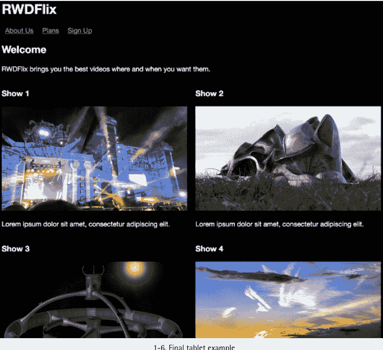

### 电视版本

电视版的布局将显示较大的缩略图、视频播放器、节目标题、视频时长以及节目描述。为了方便距离观看和使用，界面将是巨大且明显的。虽然这不在本书的范围内，但界面也可能通过物理遥控器或远程 App 进行控制和导航。

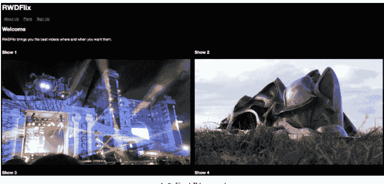

## 使用 HTML5 构建页面结构

在我们开始创建响应式设计并使用 CSS 实现它们之前，理解你将要操作的底层 HTML 结构至关重要。HTML 的最新发展使概念和页面结构发生了变化，因此回顾一下现代网页设计师现在使用的工具和选项是很有用的。

在 HTML5 之前，HTML 页面的逻辑部分是使用 `div` 和 `span` 等通用元素构建的。这些元素在多年里运行良好，但它们范围太广，无法帮助设计师或网络浏览器理解日益复杂的页面结构。

此外，HTML5 引入了新的语义化元素，它们比简单的 `div` 更完整地描述了其用途。这些新元素有助于可访问性和多用途内容等问题，但它们也有助于响应式网页设计。它们包括定义如页面的头部（`header`）、导航（`navigation`）或主内容区域，以及视频和音频的特定元素。响应式设计从根本上关于操作页面布局以适应不同的用例，而更好的页面组织和结构有助于你使用 CSS 和媒体查询（第 2 章介绍）精准定位你需要的元素。

让我们看看桌面站的简化版本。这是一个精简后的副本，我们将在下一章开始处理它：

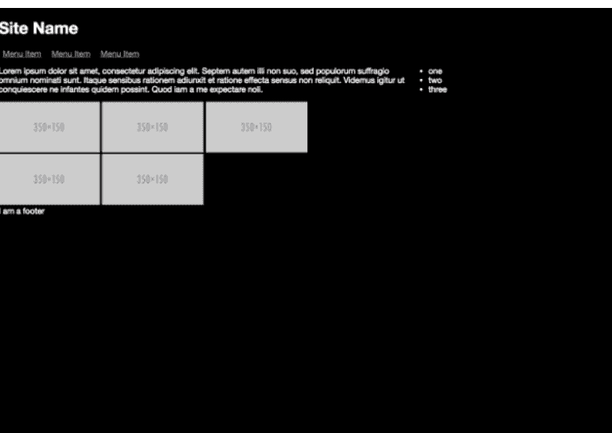

1-9. 网站当前的桌面版本

以及代码：

```html
<body>
  <header><h1>Site Name</h1></header>
  <nav>...</nav>
  <main>
    <section>...</section>
    <aside>...</aside>
  </main>
  <footer>...</footer>
</body>
</html>
```

这里是这些 HTML 元素在页面上的位置：

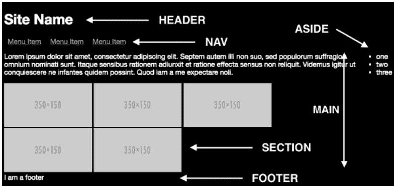

1-11. 页面的各个区域

以下是它们执行的功能：

- `header` 元素用于网站名称等。页面的其他部分也可以拥有 `header` 元素。
- `nav` 元素用于导航链接，例如顶部、侧边或底部菜单。
- `section` 元素用于包含文章或页面的显著区域。
- `aside` 元素定义与主部分相关的较子部分。
- `main` 元素包裹页面唯一的元素。例如，这些 `section` 和 `aside` 元素会在页面间重复。
- `footer` 元素用于网站的法律名称等。页面的其他部分也可以拥有 `footer` 元素。

HTML5 规范列出了执行功能的语义化元素，我们将在书中介绍其中许多。结构良好的页面对于响应式设计至关重要，也有助于可访问性和 SEO。以下是语义化组织的页面内容：

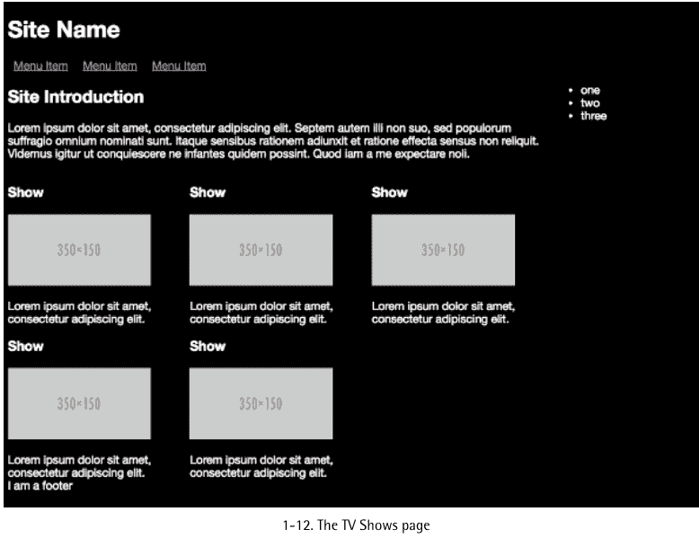

首先，我为页面添加了一个标题，它是 `h2`，因为页面的主标题是 `h1`。

每个单独的节目位于自己的 `section` 中，位于另一个标题（这次是 `h3`，因为它是 `h2` 下的一级）之下，并配有图片和简短描述。

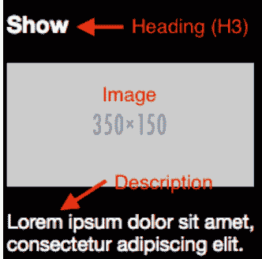

1-13. 节目的各个部分

-14. Base/index.html

```html
<section class="left">
  <h3>Show</h3>
  
  <p>Lorem ipsum sit amet, consectetur elit.</p>
</section>
```

一个典型的应用程序由后端（存储数据）和一个或多个显示或消费数据的应用程序组成。它们包括响应式网页、原生移动 App 和后端系统。正如你在书中看到的，并不是所有上下文都会使用或显示可用数据，而是仅使用用例最相关的数据。例如，一个电视节目可能在后端存储以下值：

- 集名
- 系列
- 时长
- 分级 rating
- 文件大小
- 节目标题
- 年份
- 出地
- 描述
- 标签
- 分类

但网站的移动版只会显示与移动设备用户相关的值，忽略与不同上下文相关的值：

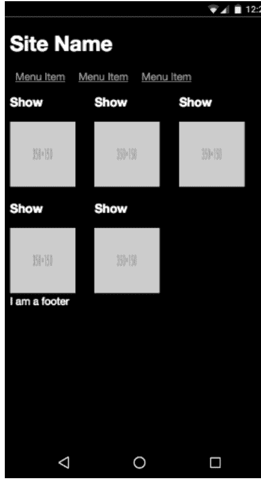

- 菜单项 菜单项 菜单项
- 节目 节目 节目


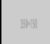

- 节目 节目 节目


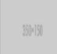

- 我是页脚

1-15. 网站的移动版

```html
<section class="left">
  <h3>Show</h3>
  
</section>
```


`aside` 用于补充信息，如联系支持和账户信息。网站的移动版针对浏览和观看视频进行了优化，因此 `aside` 不显示。当然，这种布局不是唯一的可能性。例如，你可以选择将 `aside` 显示在屏幕底部（我们在查看网格系统时介绍）。

随着屏幕尺寸的减小，电视节目描述变得越来越短，以便更多关注缩略图，而缩略图已根据移动设备进行了适当调整。

如果你对学习更多 HTML5 和页面结构感兴趣，我建议你阅读 SitePoint 的《Jump Start HTML5》。

## 准备好响应了吗？

在这一章中，我查看了响应式设计的需求和历史。我涵盖了你的网站现在需要支持的设备类型，并介绍了我将在书中其余部分演示响应式设计原理的演示站点。我们还简要看了如何使用 HTML5 构建页面。现在我们准备好深入研究响应式设计的构建模块了，这是下一章的重点。

# 第 2 章

# 响应式设计的构建模块

你可以通过多种方式调用依赖媒体查询的样式，最常见的方法是使用 HTML `link` 元素链接一个或多个 CSS 文件，或者直接在 CSS 文件中使用 `@import`。

在 HTML 中，此示例如果查询为真将加载 `style.css` 文件，这在所有设备类型上都是真的：

```html
<link rel="stylesheet" media="all" href="/style.css">
```

在下面的示例中，`@import` 作用相同，但在 CSS 文件内部实现：

```css
@import url("/style.css");
```

在下面的示例中，`@media` 规则包含一组特定的选择器，如果查询为真则将加载它们：

```css
@media all {
  ...
}
```

这些查询中的 `all` 是媒体类型。目前有四种可用的媒体类型（编写时）：

- `print`：用于页面的打印版本
- `screen`：用于电脑、平板和手机屏幕
- `speech`：用于向用户读取页面的屏幕阅读器
- `all`：用于以上所有类型

添加媒体类型允许你指定查询适用于哪些类型的设备。这些是宽泛的，无法提供很多控制。为了更具体地针对某些设备，你可以向这些媒体类型添加表达式。

让我们尝试一些实用的东西。RWDflix 中主内容侧的 `aside` 设计用于显示公告和新闻。手机和平板电脑访问者可能只想专注于看节目，而不想要其他，所以让我们为较小屏幕设备的用户隐藏此元素。

> 在本章的剩余部分中，我将使用上面所示的 `@media` 方法进行媒体查询。这是个人偏好，作为一种实验，你可能会尝试使用其他方法重写示例。

删除当前的 `aside` CSS 类，并将其替换为以下媒体查询：

```css
@media screen and (min-width: 680px) {
  aside {
    width: 33%;
  }
}

@media screen and (max-width: 680px) {
  aside {
    display: none;
  }
}
```

这一对媒体查询在屏幕宽 680px 时（通过 `min-width` 询问屏幕至少有 680px 宽）将 `aside` 元素的宽度设置为 33%，并在屏幕窄于 680px 时（通过 `max-width` 询问屏幕最多有 680px 宽）将其隐藏。

## 站点介绍

Lorem ipsum dolor sit amet, consectetur adipiscing elit. Septem autem illum non, sed popularum nulla ullamcorper namchti erat sunt. Itque kendine rationen adnuerit et ratione effecta sensus non reliquit. Videmus igitur ut consequere non inf quidem possant. Quod ullam a me expectare toll.

显示

显示

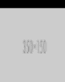


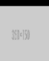

Lorem ipsum dolor sit amet, consectetur adipiscing elit.

Lorem ipsum dolor sit amet, consectetur adipiscing elit.

Lorem ipsum dolor sit amet, consectetur adipiscing elit.

显示

显示

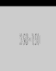


Lorem ipsum dolor sit amet, consectetur adipiscing elit.

Lorem ipsum dolor sit amet, consectetur adipiscing elit.

页脚

2-1. 较小屏幕上隐藏 `aside` 元素

接下来，当 `aside` 不显示时，让列表填满屏幕宽度：

```css
section.showlisting {
  margin-bottom: 25px;
}

@media screen and (min-width: 680px) {
  section.showlisting {
    width: 66%;
  }
}

@media screen and (max-width: 680px) {
  section.showlisting {
    width: 100%;
  }
}
```

菜单项 菜单项 菜单项

Lorem ipsum dolor sit amet, consectetur adipiscing elit. Septem autem illi non, sed ullamcorper nulla nominati sunt. Itaque sensibus ratione adiunct et effecta sensus non reliquit. Videmus igitur ut consequere ne inf quidem possint. Quod iam a expectare null.

| 显示 | 显示 | 显示 | 显示 |
| :--- | :--- | :--- | :--- |
| --- | --- | --- | --- |
|  |  |  |  |
| Lorem ipsum dolor sit amet, consectetur adipiscing elit. | Lorem ipsum dolor sit amet, consectetur adipiscing elit. | Lorem ipsum dolor sit amet, consectetur adipiscing elit. | Lorem ipsum dolor sit amet, consectetur adipiscing elit. |

页脚

如果你在桌面浏览器中调整页面大小，你会看到 `aside` 随着浏览器的变宽变窄而出现，主内容也会相应调整。

你可以在媒体查询中使用基础逻辑。这允许你组合多个条件。例如，你可以使用逻辑与：

```css
@media screen and (min-width: 640px) and (max-width: 1136px) {
  ...
}
```

上述代码会在设备屏幕宽度在 640px 到 1136px 之间时调用 CSS 样式。`min-width` 属性是屏幕的最小宽度，`max-width` 是最大宽度。要使此媒体查询匹配，两个条件都必须为真。也可以通过逻辑或在其中一个条件为真时匹配查询，这（很奇怪地）用逗号表示。下面的查询将应用于屏幕或打印设备：

```css
@media only screen, print {
  ...
}
```

你还可以将 AND 与 OR 组合以创建更复杂的查询。这里是在较大的手机上以横屏模式渲染的当前页面：

# 响应式设计的构建模块

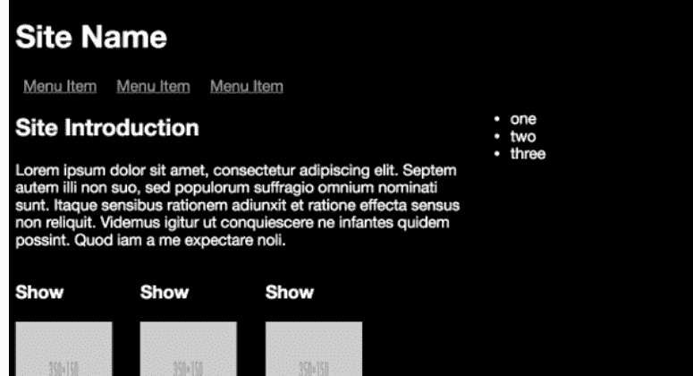

在上面的截图中，屏幕宽度为 732px，高于设置的 640px。尽管如此，`aside` 仍然放入窗口，所以如果屏幕尺寸低于 640px 或设备处于横屏模式，让我们将其隐藏：

```css
@media screen and (max-width: 680px), screen and (orientation: landscape) and (max-width: 750px) {
  aside {
    display: none;
  }
}
```

对应列表部分的媒体查询：

```css
@media screen and (max-width: 680px), screen and (orientation: landscape) and (max-width: 750px) {
  section.showlisting {
    width: 100%;
  }
}
```

你会发现我添加了 `max-width` 检查以便在平板电脑横屏时显示 `aside`，同时也为了展示如何组合逻辑检查。

## 站点名称

菜单项 菜单项 菜单项

站点介绍

Lorem ipsum dolor sit amet, consectetur adipiscing elit. Septem illi non suo, sed populorum suffragio omnisium nominunt, itaque sensibus ration adiuxt et ratione effectus sans reliquit. Videner ut quisquere non inf quidem possident. Quod lam a me expectare nol.

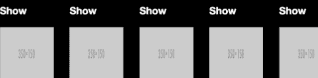

2-4. 横屏设备方向中移除了 `aside`

## 使用 only 和 not 的逻辑查询

你也可以使用 `only` 和 `not` 创建精确的媒体查询。例如，此媒体查询将匹配至少有 640px 宽且排除打印媒体类型的设备：

```css
@media not print and (min-width: 640px) {
  ...
}
```

相比之下，此查询仅适用于至少 640px 宽的屏幕设备：

```css
@media only screen and (min-width: 640px) {
  ...
}
```

我们目前为止看到的宽度和高度查询是最常用的，但还有许多其他用于检查设备特媒体特性。这些包括颜色能力、宽高比、取向、分辨率以及针对 Mozilla 和 WebKit 浏览器的特定功能。大多数这些特性都接受 `min-` 和 `max-` 前缀，工作方式与上面的维度查询类似。

### 宽高比

`aspect-ratio` 特性允许你检查水平像素与垂直像素的比例，用斜杠分隔。例如：

```css
@media screen and (min-aspect-ratio: 1/1) {
  ...
}
```

上面的规则将匹配屏幕宽高比为 1:1 或更大的设备，即正方形或横屏。

一个常见的用途是检测更宽的屏幕，当你显示视频时非常有用：

```css
@media screen and (min-aspect-ratio: 16/9) {
  ...
}
```

### 取向

如所示，此特性检查设备是否处于横屏或竖屏模式。例如：

```css
@media all and (orientation: landscape) {
  ...
}
```

以及：

```css
@media all and (orientation: portrait) {
  ...
}
```

### 颜色

此特性用于检查设备是否支持特定位深的颜色。例如，以下是检查设备是否支持至少 8 位颜色（即 256 色彩）的方法：

```css
@media all and (min-color: 8) {
  ...
}
```

### color-index

它的作用与 `color` 类似，但它允许你检查颜色的数量而不是位深：

```css
@media all and (min-color-index: 256) {
  ...
}
```

### monochrome

同样，与 `color` 类似，`monochrome` 允许你检查设备的灰级：

```css
@media all and (min-monochrome: 8) {
  ...
}
```

### resolution

此特性针对具有高分辨率屏幕的设备：

```css
@media all and (min-resolution: 120dpi) {
  ...
}
```

### scan

`scan` 媒体特性允许你检查电视的扫描过程，选项包括隔行扫描（interlace）或逐行扫描（progressive）：

```css
@media all and (scan: progressive) {
  ...
}
```

### grid

`grid` 用于检查设备是否为类终端设备。这还包括旧款手机（即非智能手机）、辅助手机（针对视力不佳的人士）以及盲文设备。如果为真，它返回一个布尔值：

```css
@media grid {
  ...
}
```

如你所见，通过组合基于尺寸和特性的查询，你可以构建复杂的样式表，以有效地针对多种设备，并使用对它们运行效率最高的工作样式。这就是媒体查询的核心点：它们允许你针对特定的设备配置选择性地加载 CSS 样式。

现在你已经有了基础的理解，让我们继续在之前添加的媒体查询基础上，让示例网站变得更整洁。

首先，你可以合并已经编写的查询，将类移动到两组媒体查询中：

```css
/* 媒体查询 */
/* 例如，桌面设备 */
@media screen and (min-width: 680px) {
  aside {
    width: 33%;
  }

  section.showlisting {
    width: 66%;
  }
}

/* 例如，中等宽度或横屏模式下的较小屏幕 */
@media screen and (max-width: 680px), screen and (orientation: landscape) and (max-width: 750px) {
  aside {
    display: none;
  }

  section.showlisting {
    width: 100%;
  }
}
```

整洁多了！你可以继续在这些部分中为每个查询添加新样式。

让我们回想第 1 章中概述的演示站点规范，看看每个屏幕尺寸还有哪些地方需要优化。下一步是在小屏幕上隐藏电视节目的描述，并在中等尺寸屏幕上缩短它。

如果描述文本有一个类名，那么做这些将会简单得多，请为每个包含节目描述的 `p` 标签实例添加一个类：

```html
<section class="tvshow">
  <h3>Show/</h3>
  
  <p class="showdescription">Lorem ipsum dolor sit amet, consectetur adipiscing elit.</p>
</section>
```

让我们添加新的媒体查询以适应我们想要支持的各种尺寸，并在此过程中整理现有的查询。

我们希望设计重流的特定宽度被称为**断点（breakpoints）**。我们要添加的断点并非详尽的：由于设备尺寸范围巨大且不断变化，为每个设备单独编写查询是徒劳的。更好的方法是评估设计需要重流的点，并为这些断点创建媒体查询。这就是响应式网页设计的魅力：你可以确保每个设备都能获得合适的布局，而无需为每个设备单独设计。

添加以下断点并重构现有样式：

## 响应式网页设计

2-5. Chapter/layout.css (节)


```css
/* 媒体查询 */
/* 例如，旧手机 */
@media only screen and (min-width: 320px) {
  aside {
    display: none;
  }

  section.showinglisting {
    width: 100%;
  }

  .showdescription {
    display: none;
  }
}

/* 例如，新款手机 */
@media only screen and (min-width: 480px) {
}

/* 例如，电脑屏幕和更大的平板电脑 */
@media only screen and (min-width: 768px) {
  .showdescription {
    text-overflow: ellipsis;
    display: block;
    white-space: nowrap;
    width: 100px;
    overflow: hidden;
  }
}

/* 例如，典型的显示器或更大的平板设备 */
@media only screen and (min-width: 992px) {
  aside {
    width: 33%;
    display: block;
  }
}
```

# 响应式设计的构建模块

```css
section.showlisting {
  width: 66%;
}

.showdescription {
  white-space: normal;
  width: 125px;
}

/* 大设备，例如大显示器和电视 */
@media only screen and (min-width: 1200px) {
}
```

媒体查询现在应该是自俗易懂的。它们定义了针对一组设备的查询。正如 CSS 所示，媒体查询是级联的：你可以为较小设备构建断点样式并更改属性。注意，在较小设备的 `@media only screen and (min-width: 320px)` 断点和中等尺寸设备的 `@media only screen and (min-width: 768px)` 断点之间，所有的变化都是 `showdescription` 类被截断了。而在较大屏幕的 `@media only screen and (min-width: 992px)` 断点处，所有元素都显示了。

## 响应式网页设计


2-6. 小屏幕生成的布局

# 响应式设计的构建模块

## 站点名称

菜单项

## 站点介绍

Lorem ipsum dolor sit amet, consectetur adipiscing elit. Septem autem illid non suo, sed poporum omnis sunt. Itaque risus adiuuvit et effecta sensus non reliquit. Vidimus igitur non infantes possint. Quod iam expectare noli.

- 一
- 二
- 三

显示 显示


Lorem ipsum... Lorem ipsum... Lorem ipsum... Lorem ipsum...

2-7. 中等断点生成的布局

## 站点名称

菜单项 菜单项

## 站点介绍

Lorem ipsum dolor sit amet, consectetur adipiscing elit. Septem autem illid non suo, sed poporum suffugio omnis sunt. Itaque ratione adiuuvit et effecta sensus non reliquit. Vidimus igitur non infantes possint. Quod iam expectare noli.


Lorem ipsum dolor sit amet, consectetur adipiscing elit. Lorem ipsum dolor sit amet, consectetur adipiscing elit. Lorem ipsum dolor sit amet, consectetur adipiscing elit. Lorem ipsum dolor sit amet, consectetur adipiscing elit.

2-8. 中等到大断点生成的布局

## 移动优先

在第 1 章中，我引入了“移动优先”的概念。目前，页面适用于不同尺寸的设备，但并不是移动优先，因为“默认”样式——即那些不在媒体查询中的样式——实际上是更大设备设计的。因此，让我们进行一些重排和重构，使设计移动优先。这不会涉及太多工作。

对媒体查询之外的类进行以下更改：

```css
aside {
  display: none;
}

section.showlisting {
  margin-bottom: 25px;
  width: 100%;
}

.showdescription {
  display: none;
}
```

# 响应式设计的构建模块 39

## 视口 meta 元素 (Viewport Meta Element)

在上一节中，我介绍了如何通过媒体查询让演示页面实现移动优先。如果我在桌面浏览器中尝试该示例并调整窗口大小，一切看起来都如你预期的那样。但如果你在移动浏览器中尝试，或者使用模拟的移动浏览器，你可能会看到类似下方截图的内容，并感到失望。媒体查询难道不应该让页面在移动浏览器中表现得更好吗？

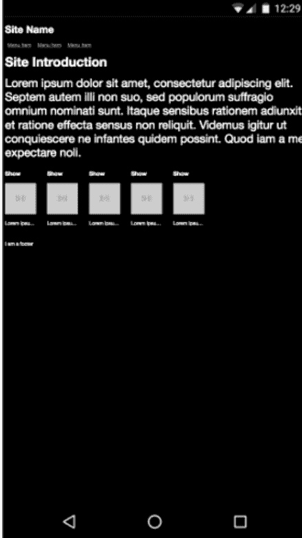

2-9. 无视口的移动优先

# 40 快速快速上手：响应式网页设计

媒体查询允许我们为不同的屏幕尺寸设置不同的样式。因此，如果你的桌面浏览器的视口宽度为 1200px，任何针对该屏幕宽度的媒体查询都会生效。如果你在一个视口宽度为 320px 的移动设备上，视口设置就会生效。但这里有一个巨大的陷阱。默认情况下，许多设备（如手机和平板电脑）表现就像它们的屏幕比实际要宽得多。

为了解释这里发生了什么，让我们看看这种行为的源地 iPhone。第一代 iPhone 的屏幕/视口宽度为 320px。然而，大多数为桌面设计的网站比这宽得多。为了避免在初始加载时只看到这些网站的左上角，Apple 开发了“虚拟视口”（virtual viewport）或“布局视口”（layout viewport）的概念。网站被加载到这个宽得多的视口中，然后被缩小以适应屏幕。大多数网站在 iPhone 上的渲染结果字体非常小，你必须缩放才能阅读。

Apple 的虚拟视口被设置为 980px，因此只要网站宽度不大于 980px，整个布局就会显示在屏幕上。任何宽度超过 980px 的布局都会在右侧部分隐藏，需要横向滚动。今天依然如此。其他设备制造商也采纳了虚拟视口的理念，尽管默认宽度各不相同。

在设计响应式网站时，我们真的不希望移动设备上出现这种默认行为。我们希望知道自己操作的画布是每个设备的实际屏幕区域。坦率地说，有一种简单的方法可以告诉这些设备不要以默认方式运行。我们所需要的是在每个页面的 `head` 中添加一个特殊的 meta 元素。这里有一个典型的示例：

```
<meta name="viewport" content="width=device-width,
     initial-scale=1">
```

作为常规，上面的那行代码就是确保你的媒体查询在移动设备上按预期运行所需的全部内容。`name` 属性指定了我们的目标是虚拟视口，而 `content` 属性指定了我们希望设备如何运行。在上面的示例中，我们指定虚拟视口应该匹配屏幕的实际宽度，并且对内容不应用缩放。

一旦有了视口声明，你就可以确保针对 320px 设备的媒体查询实际上会被该设备识别。

让我们修改演示网站以添加视口声明。在你的当前 `head` 元素内部添加以下 meta 标签：

```
2-10. 第2章/demo_viewport/index.html (节选)
<head>
  <meta charset="UTF-8">
  <title>App Name</title>
  <link rel="stylesheet" type="text/css" media="all" href="layout.css">
  <meta name="viewport" content="width=device-width,initial-scale=1.0">
</head>
```

刷新页面：

# 快速快速上手：响应式网页设计

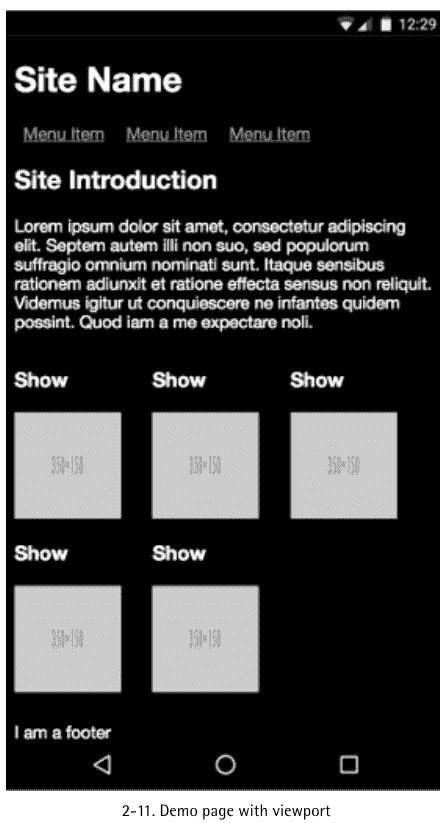

好多了！

# 响应式设计的构建模块 43

## 视口 (The Viewport)

视口是计算机图形中的一个旧术语，用于定义（通常是矩形的）用于渲染用户在浏览器看到的元素的屏幕区域。当浏览局限于桌面浏览器时，视口仍然存在，但很少由设计师更改。随着浏览器尺寸多样性的增加，HTML5 在 `meta` 元素中引入了 `viewport` 属性，允许设计师设置并操作该区域。

`meta` 元素最初由 Apple 提出，用于将页面状态设置为正确尺寸，后来作为 HTML5 标准的一部分引入。

通常，你通过 `width=device-width` 将视口设置为当前设备的宽度，并保持内容不缩放（使用 `initial-scale=1.0`）。

`width` 属性是一个像素值，`device-width` 检测当前设备的宽度，这意味着你不需要处理可能存在的无数尺寸；`meta` 元素会为你处理好。对于不同的屏幕方向情况也是如此：横屏和竖屏之间的切换也会为你处理好。要让一个设计完全响应式，仍然需要很多工作，但媒体查询加上这个视口设置为你提供了一个绝佳的开始。

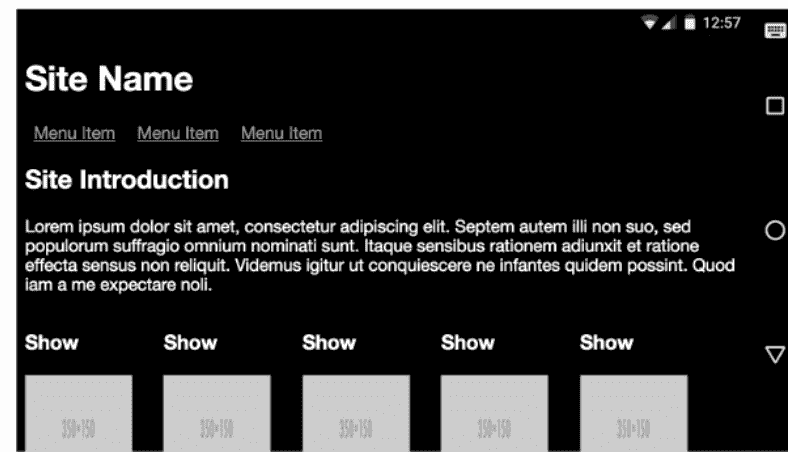

2-12. 带有视口的演示页面

标签的 `content` 属性也接受设置宽度的标准方法。例如：

```html
<head>
...
  <meta name="viewport" content="width=500,initial-scale=1.0">
...
</head>
```

这将导致：

# 响应式设计的构建模块 45

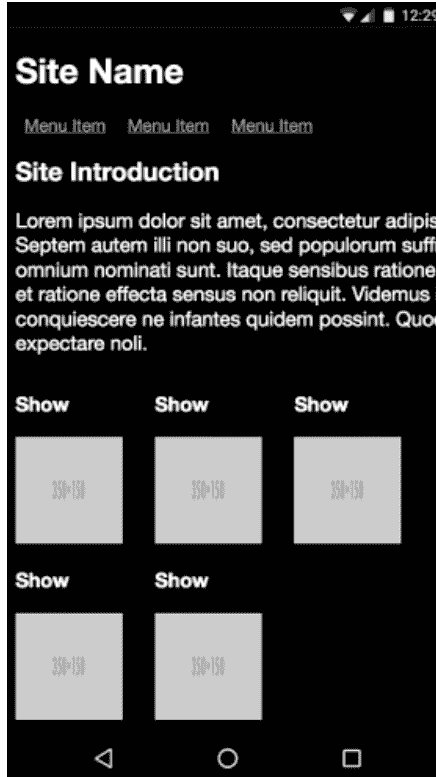

2-13. 手动设置宽度

这比没有视口的页面仍然好得多，但正如你看到的，手动设置宽度的案例是当你针对特定设备（如电子阅读器）。视口还有其他不常用的属性你可能会需要：

- `minimum-scale`: 最小缩放比例，或用户可以放小的程度。
- `maximum-scale`: 最大缩放比例，或用户可以放大的程度。
- `user-scalable=no`: 禁止缩放。虽然这种情况的情况有限，但它会显著降低页面的可访问性。

## 任何查询？ (Queries?)

媒体查询的选择性使其成为你工具箱中的必备工具，在本章中，我们学习了如何创建和使用它们。每个现代浏览器现在都支持它们，并且提供了针对你需要设计的任何特定环境的潜力。在接下来的章节中，我们将利用媒体查询和视口提供的响应式基础，为我们的响应式设计增添色彩。

# 第3章

# 使用网格系统更好的响应式结构

到目前为止，我们查看了响应式设计的底层原理，以及使用媒体查询构建针对设备优化页面结构的力量。在本章中，我们将看到网格系统如何补充甚至取代我们迄为止涵盖的一些技术，为页面在不同设备上的显示提供更多灵活性。

虽然设计的灵活性在理论上是无限的，但平面和数字设计中常见的设计规范一直是使用水平和垂直网格进行元素布局。它们有助于将页面划分以便于管理的逻辑区域，而且我们大脑喜欢在构图中以可预测的线条查看项目。

如果你在桌面上查看当前的演示页面，它实际上是一个由四行两列组成的网格：

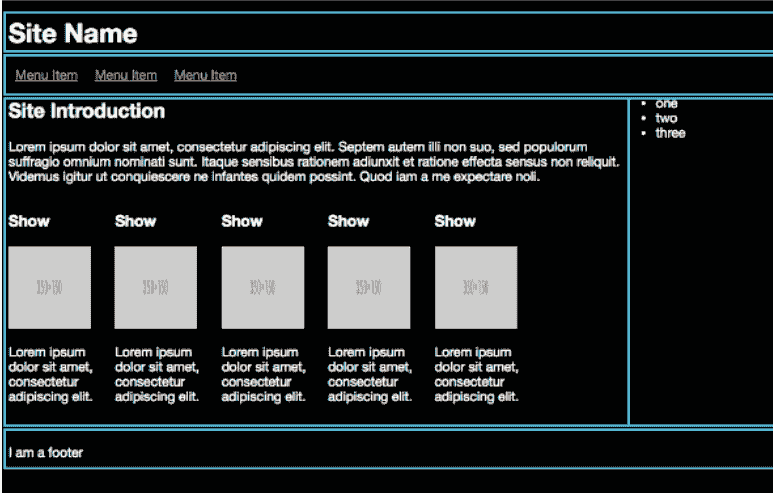

3-1. 初始页面网格

当你调整页面大小时，上一节添加的媒体查询会处理更改行和列布局以适应。

这是因为当前布局是所谓的**流网格**（fluid grid）的一个简单示例。页面的主要部分的宽度是视口宽度的百分比，因此会相应调整。

在桌面上，电视节目的主列表占据了网页的 66%（或二分之），而菜单占据 33%（或三分之一）。

## 使用网格系统改进响应式结构 49

```css
@media only screen and (min-width: 992px) {
  width: 33%;
  display: block;
}

section.showlisting {
  width: 66%;
}

.showdescription {
  white-space: normal;
  width: 125px;
}
```

设计的灵活性可以比此更进一步。页面区域内的布局也可以占据可用空间的的一个百分比。例如，你可以设置单个电视节目列表具有灵活的宽度：

```css
section.tvshow {
  width: 20%;
  height: 150px;
  display: inline-block;
}
```

这意味着无论屏幕尺寸如何，每个子部分都将占据主内容区域的20%。这可能会开始变得繁琐，它更多像是一个示例，说明基于百分比的尺寸可以应用于任何地方——文本，甚至是媒体元素（这两者我们将在稍后的章节中都会会介绍）。

虽然目前的页面布局是一个网格，但通过更具意义的类名和更好的结构，它可以变得更好。

创建一个类名为 `container` 的新 `div` 元素包裹 `body` 元素内的所有当前内容：

## 快速上手响应式网页设计

3-3. Chapter3/vanilla_final/index.html (节选)

```html
<body>
  <div class="container">
    ...
  </div>
</body>
```

在你的样式表中为此 `div` 添加以下样式：

3-4. Chapter3/vanilla_final/layout.css (节选)

```css
.container {
  width: 95%;
  margin-left: auto;
  margin-right: auto;
  max-width: 1180px;
}
```

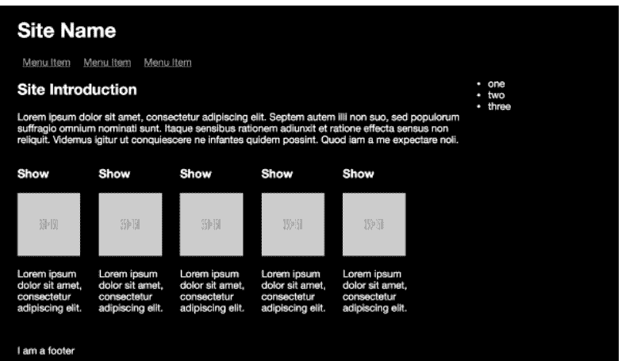

## 使用网格系统改进响应式结构 51

这是为页面内容设置容器元素的常用方法。它设置了 1180px 的最大宽度、浏览器窗口 95% 的宽度，并使用方便的左右自动外边距将容器在窗口中居中。

### 为什么是 1180px？

为什么 max-width 设置为 1180px？这是一个任意值，基于当前桌面屏幕尺寸的趋势；添加它的目的是为了确保页面在巨屏上不会太宽。长期以来，它是 960px，反映了当时大多数屏幕宽度最多为 1024px。随着屏幕尺寸和分辨率的增长，这个最大宽度变大了，但仍然有不同意见。媒体查询（在第 2 章介绍）使得这个最大宽度的相关性没有以前那么。目前，保持这个 1180px 的值即可。

接下来，为页眉、导航、列表和页脚元素添加 `row` 类。你也可以移除这些元素中的 `left` 类，因为你将整合所有的 CSS 属性：

```html
<header class="row">
</header>

<nav class="row">
  ...
</nav>

<main class="row">
</main>

<footer class="row">
  ...
</footer>
```

并定义 `row` CSS 类：

```css
.row {
  clear: both;
  float: left;
}
```


此 `row` 填充了容器的宽度并向左浮动，这意味着当浏览器窗口调整大小时，它会跟随变化，固定在左侧。由于你尚未定义行中的列，`aside` 菜单在较大的屏幕尺寸上会被推到底部。

## 站点名称

- 菜单项目
- 菜单项目
- 菜单项目

## 站点介绍

Lorem ipsum dolor sit amet, consectetur elit. Septem autem illi non suo, sed populum omnis nominati sunt. Itaque risus adiusit et voluptas non reliquit. Videmus igitur in quo ne infantes possit. Quod iam a expectnare nihil.

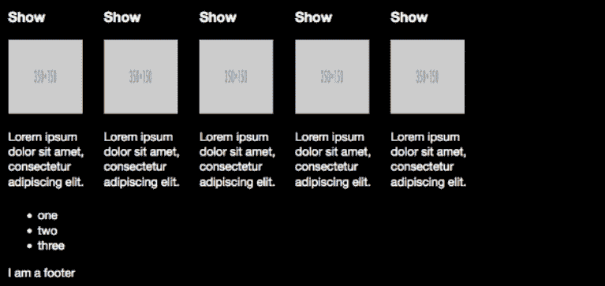

Lorem ipsum dolor sit amet, consectetur elit.
Lorem ipsum dolor sit amet, consectetur elit.
Lorem ipsum dolor sit amet, consectetur elit.
Lorem ipsum dolor sit amet, consectetur elit.
Lorem ipsum dolor sit amet, consectetur elit.

- 一
- 二
- 三

我是一个页脚

现在页面上的所有内容都在四行中，是时候定义行中的列了。有些行是单列全宽，而另一些是细分的。

## 使用网格系统改进响应式结构

从头开始，移除之前设置的简单百分比宽度，以便拥有：

```css
@media only screen and (min-width: 320px) {
  aside {
    display: none;
  }
  section.showlisting {
  }
  .showdescription {
    display: none;
  }
}
...
@media only screen and (min-width: 992px) {
  aside {
    display: block;
  }
  section.showlisting {
  }
  .showdescription {
    white-space: normal;
    width: 125px;
  }
}
```

页面在大尺寸下不再流动良好，但你很快就会修复。

### 什么是网格？

在将页面重构为流式网格之前，让我们简单讨论一下网格。

## 快速上手响应式网页设计

网格是一系列列和行。行的数量更明确：取决于你需要多少行来适应页眉、导航、内容等。列呢？这个，书中的其他主题（以及通常情况下）有不同意见。它通常是偶数，因为这更容易划分页面。三的倍数数字最常用（如果你感兴趣，关于黄金比例的 Wikipedia 文章提供了很好的解释）。流行的列值为 12、16 和 24，我在这里将关注 12 列网格系统。12 是流行的，因为它可以分为各种常用的尺寸，如二、三分和分之一。

### 创建自己的网格

你可能会好奇 12 列布局如何帮助你创建示例中的 3 列布局——是的，起初很混乱。

列更多地作为结构基础，通过 CSS 定义你的元素跨越多少列。为了让这更清晰，这是一个 12 列 1180px 网格的示例：

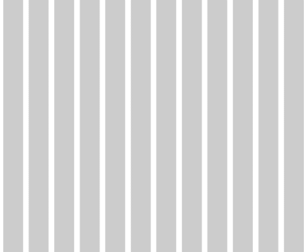

3-7. 12 列 1180px 网格

以及网格将如何表示此页面（是的，网格中的网格，或“嵌套网格”，是可以的）：

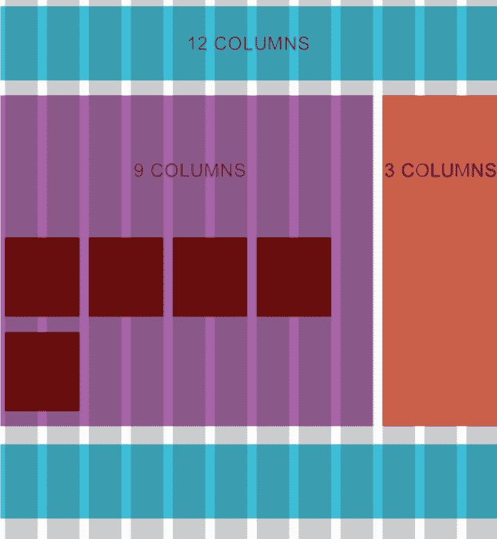

3-8. 作为网格的页面

你可以手动设置所有这些，但制作一些可用的东西是更好的主意。现在我们将创建很多新样式。然后我会展示实现结果更容易方法。

### 使用相邻兄弟选择器

> 上述相邻兄弟选择器是一个实用的技巧，它只为另一个元素后面的元素添加边距。在我们的情况下，这意味着第一列将没有左边距。

第一步是定义一列的宽度，不要忘记每列之间的外边距。单列宽度等于 100（因为我们正在处理百分比）减去外边距值，乘以列数减 1（第一列不需要左边距），最后全部除以列数。

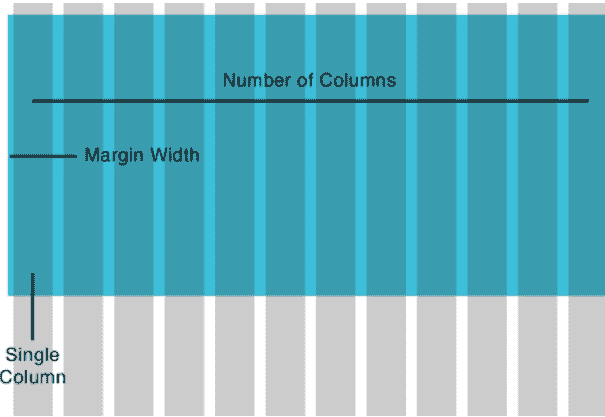

3-10. 公式解释

```text
ColumnWidth = (SingleColumnWidth * CurrentColumn) + 
(MarginValue * (CurrentColumn - 1))
```

例如，这里是找到跨越两列所需的数值：

```text
(SingleColumnWidth * CurrentColumn)
6.866666666667 * 2 = 13.7333333333
(CurrentColumn - 1)
2 - 1 = 1
(MarginValue * (CurrentColumn - 1))
1.6 * 1 = 1.6
(SingleColumnWidth * CurrentColumn) + (MarginValue * (CurrentColumn - 1))
13.7333333333 + 1.6 = 15.3333333333
```

这将产生以下列样式，其中 `column-n` 类表示你想要跨越的列数。将这些内容添加到 `layout.css`：

```css
.column-1 {
  width: 6.86666666667%;
}
.column-2 {
  width: 15.3333333333%;
}
.column-3 {
  width: 23.8%;
}
.column-4 {
  width: 32.26666666667%;
}
.column-5 {
  width: 40.73333333333%;
}
.column-6 {
  width: 49.2%;
}
.column-7 {
  width: 57.66666666667%;
}
.column-8 {
  width: 66.13333333333%;
}
.column-9 {
  width: 74.6%;
}
.column-10 {
  width: 83.06666666667%;
}
.column-11 {
  width: 91.53333333333%;
}
.column-12 {
  width: 100%;
}
```

再次，不要担心记住这些数值。一旦定义了它们，只需要使用相应的 CSS 类即可。

## 减少重复性工作

你也可以使用 CSS 预处理器——例如 `Sass` 或 `Less`——它们提供了一个额外的框架来帮助你生成重复且复杂的 CSS。在其他功能中，这包括为你完成上述计算。

现在，你希望页眉和导航栏始终占据 12 列，以更好地适应网格模型，因此让我们将页眉和导航元素重新排列为行，并添加适当的列类。这些是基础列类和填充 12 列的 `column-12` 类：

```html
<header class="row">
  <h1 class="column column-12">站点名称</h1>
</header>
<nav class="row">
  <ul class="column column-12">
    <li><a href="#">菜单项</a>/</li>
    <li><a href="#">菜单项</a>/</li>
    <li><a href="#">菜单项</a>/</li>
  </ul>
</nav>
```

左侧内容区域需要九列宽，右侧三列，因此添加这些类：

```html
<section class="showlisting column column-9">
...
</section>
<aside class="column column-3">
...
</aside>
```

现在为内容区域内的电视节目添加列类：

```html
<section class="tvshow column column-2">
--
</section>
```

在 `tvshow` 类中，你现在可以移除 `width` 和 `display` 属性，并将 `height` 改为 `auto` 以获得更多响应式魔法：

```css
section.tvshow {
  height: auto;
}
```

页面布局看起来和之前没有太大，但这些关键变化增加了灵活性。想让电视节目列表更紧凑吗？那么将类改为 `column-3`。

想要一个更宽的侧边菜单吗？将它的类改为 `column-4`，并将列表的宽度类改为 `column-8`：

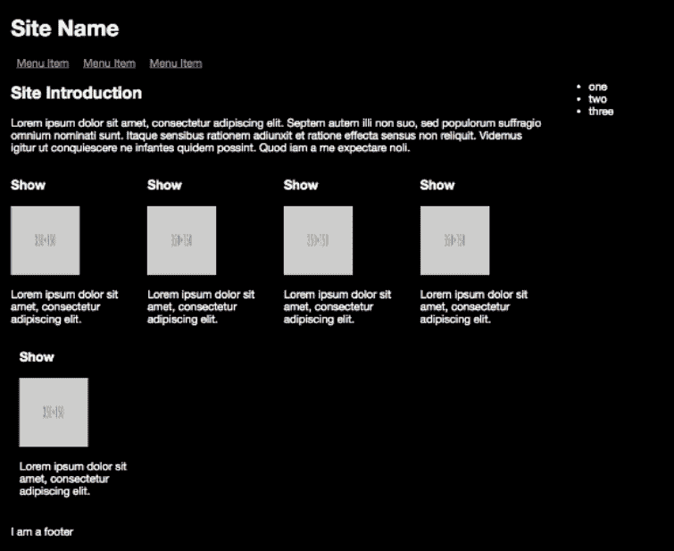

3-12. 具有更宽侧栏的页面

当浏览器窗口大小变化时，你会看到页面元素流畅地缩小和放大，这非常适合响应式 Web 设计。但请注意当变成较小屏幕尺寸时发生了什么：

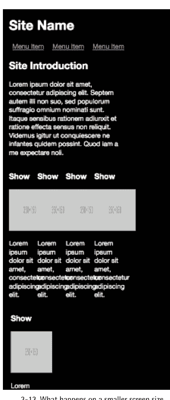

看起来不太好：电视节目元素被挤压了。部分原因是由于图片还没有相应地缩小尺寸——我们将在第 5 章进一步讨论这个主题。这也是流式网格的问题。理论上，在较小的尺寸下，主内容列应该占据屏幕的 100%。

## 使用网格系统改进响应式结构

调整页面大小。你会发现现在的效果与第一个流式网格示例相同，但删除了媒体查询中大量的 CSS。通过一组 flex 属性，页面元素的尺寸就由我们为我们处理了。完全不需要任何 JavaScript！

如果你想重构页面，可以移除 `flex-basis` 属性，但嵌套具有不同行/列方向的 flex 容器将涉及更多元素，因此我们在 HTML 的复杂性与 CSS 的复杂性之间权了权衡。

接下来，这里是电视节目列表的样式：

```css
section.showlistings {
  display: flex;
  flex-wrap: wrap;
  flex-direction: row;
  margin-bottom: 25px;
}
section.tvshow {
  width: 125px;
  height: auto;
}
```


这会将 `showlistings` 部分设置为另一个 flex 容器，它可以换行任何无法放入同一行的项目——因为在默认情况下，flex 会尝试将所有项目放在同一行内。

此时，你也可以删除 HTML 和 CSS 中的 `left` 类，因为不再需要了。

## 快速上手响应式网页设计

### 站点名称

| 菜单项目 | 菜单项目 | 菜单项目 |
| :--- | :--- | :--- |

### 站点介绍

Lorem ipsum dolor sit amet, consectetur adipiscing elit. Septem aut illum non nulla, sed popiorum suffragio omnium nominati sunt. Itaque sensibibus rutrum adonuit et ratione effecta sensus non reliquit. Vidimus ig ut consequere ne infantes posuereit. Quid tot me expectare toll.

显示

显示

显示


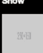

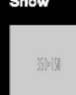

Lorem ipsum dolor sit amet, consectetur adipiscing elit.

Lorem ipsum dolor sit amet, consectetur adipiscing elit.

Lorem ipsum dolor sit amet, consectetur adipiscing elit.

显示

显示

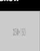

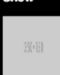

Lorem ipsum dolor sit amet, consectetur adipiscing elit.

Lorem ipsum dolor sit amet, consectetur adipiscing elit.

这是一个页脚

### 38-18. 最后的 flexbox 布局

另一个酷的 flexbox 技巧是使用 `order` 属性设置元素的顺序，并使用定义其位置的数字。例如，你可以使用以下代码重新排列移动设备上的页面元素：

```css
nav { order: 1; }

header { order: 2; }

main { order: 3; }

footer { order: 4; }
```

## 使用网格系统改进响应式结构

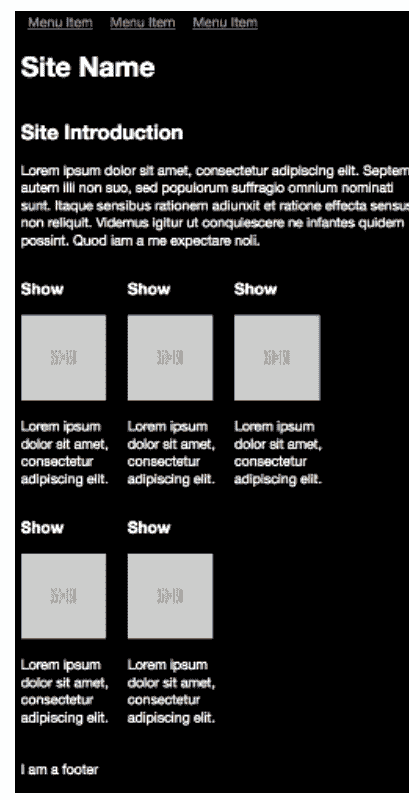

但如果你想移除页面元素，仍然需要使用媒体查询。

这是一个关于如何使用 flexbox 的简单示例，但正如你所看到的，一旦你重构了页面，flexbox 就会为你处理大部分手动页面重流。

### CSS Grid 布局

CSS Grid 模块是 flexbox 的补充，它可以帮助你定义和布局页面的区域。过去，网页开发者实现灵活（我松地使用这个词）页面布局的主要选择

> 19. 设置页面元素的顺序

使用 HTML 表格通过行和列来定义页面区域，但这些对于可访问性来说非常糟糕。网格布局是对该概念的一种现代重新解释。


#### 浏览器对 Grid 的支持

Grid 在 2017 年初已经在所有主流浏览器的最新版本中发布，因此如果你的布局需要在旧浏览器中支持，则需要回退策略。你可以在网上查看哪些浏览器版本支持和不支持 Grid 的详情。

让我们尝试将网格布局应用到演示站点，从本章开始的代码开始。

再次，在 `body` 内部创建一个容器 `div` 来包含布局：

```html
...
<div class="container">
...
</div>
...
```

将 `aside` 从 `main` 内部移动到外部。这让你能够将其视为一个独立的列：

```html
...
</main>
<aside class="left">
<ul>
<li>one</li>
<li>two</li>
<li>three</li>
</ul>
</aside>
```

在 CSS 中，将 `display` 类型更改为 `grid`：

```css
.container {
  display: grid;
}
```

现在，网格显示变得非常酷了。添加以下内容：

```css
.container {
  display: grid;
  grid-template-columns: 66% 33%;
}
```

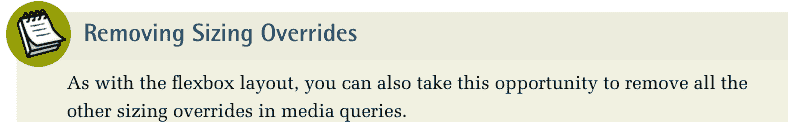

通过 flexbox 布局，你还可以利用此机会移除媒体查询中的所有覆盖设置。在一个简单的 CSS 属性中，你移除了对类的需要。`grid-template-columns` 属性提供了更多可能性。例如：

- 你可以使用任何标准单位来定义列，包括 `auto` 来填充剩余空间。
- 你可以使用 `fr`（分数单位）让网格比例分配空间。因此你可以将此网格重写为 `grid-template-columns: 2fr 1fr;`，这意味着第一列将占据空间的三之二，第二列占据三分。

很好，但如果你查看演示站点，你会发现设计中的行并没有 66/33 的分割。这是因为你还需要使用类似的语法来定义行：

```css
.container {
  display: grid;
  grid-template-columns: 66%;
  grid-template-rows: 80px 80px auto 20px;
}
```

#### 有多少行？

这是第一个我们需要显式定义行的示例，有几种方法。我建议有四行：标题、顶部菜单、介绍文本和页脚。如果你想更改这些划分（例如分割描述和显示），请尽管这样做。

语法指定了三个元素的高度，然后让剩余元素填充空隙。

### 站点名称

### 站点介绍

这是一个页脚

Lorem ipsum dolor sit amet, consectetur adipiscing elit. ... (省略)

- 一
- 二
- 三

菜单项目 菜单项目 菜单项目

显示

显示

显示


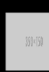

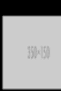

Lorem ipsum dolor sit amet, consectetur adipiscing elit.

Lorem ipsum dolor sit amet, consectetur adipiscing elit.

Lorem ipsum dolor sit amet, consectetur adipiscing elit.

Lorem ipsum dolor sit amet, consectetur adipiscing elit.

显示

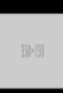

Lorem ipsum dolor sit amet, consectetur adipiscing elit.

### 3-23. 尚未添加的元素

网格布局有两种有趣的方法来定义放置项目的位置：

1. 第一种类似于 flexbox，允许你指定顺序数字。
2. 第二种允许你在命名位置的位置放置项目。要使用这种方法，你需要定义所谓的“行名称”。

下面的代码将 `display` 样式设置为 `grid`，然后定义你需要的列和行。对于列，这是一个占据页面宽度 66% 的左列，以及填充 33% 的右列。对于行，定义三个固定高度的（`header`、`main-nav` 和 `footer`），`shows` 将自动填充任何剩余空间。

```css
.container {
  display: grid;
  grid-template-columns: [left] 66% [right] 33%;
  grid-template-rows: [header] 80px [main-nav] 40px [shows] auto [footer] 20px;
}
```

现在你理解了发生了什么，是时候实现移动优先了。将当前的 `container` 类更改为如下：

```css
.container {
  display: grid;
  grid-template-columns: [left] 100%;
  grid-template-rows: [header] 80px [main-nav] 40px [shows] auto [footer] 20px;
}
```

对于更大的屏幕尺寸：

```css
@media only screen and (min-width: 992px) {
  .container {
    grid-template-columns: [left] 66% [right] 33%;
  }
}
```

如果你曾经在桌面出版应用中创建过表格（或者记得在网页设计的黑暗时代使用表格进行布局），你就会知道需要定义项目如何跨越多个单元格或行。这种技术在 `grid` 显示中是相同的。以 `header` 为例：

```css
header {
  grid-column-start: left;
  grid-column-end: right;
  grid-row-start: header;
  grid-row-end: header;
}
```

此声明块表示该列应该从左侧开始并一直延伸到右侧，同时从该行的顶部延伸到底部。

其他页面元素遵循类似的模式：

```css
nav {
  grid-column-start: left;
  grid-column-end: right;
  grid-row-start: main-nav;
  grid-row-end: main-nav;
}

main {
  grid-column-start: left;
  grid-column-end: right;
  grid-row-start: shows;
  grid-row-end: shows;
}

footer {
  grid-column-start: left;
  grid-column-end: right;
  grid-row-start: footer;
  grid-row-end: footer;
}

@media only screen and (min-width: 992px) {
  aside {
    display: block;
    grid-column-start: right;
    grid-column-end: right;
    grid-row-start: header;
    grid-row-end: header;
  }
}
```

现在你已经定义了一个网格。最初这种语法看起来很冗长，但它更符合人类阅读习惯。

## 使用网格系统构建更好的响应式结构

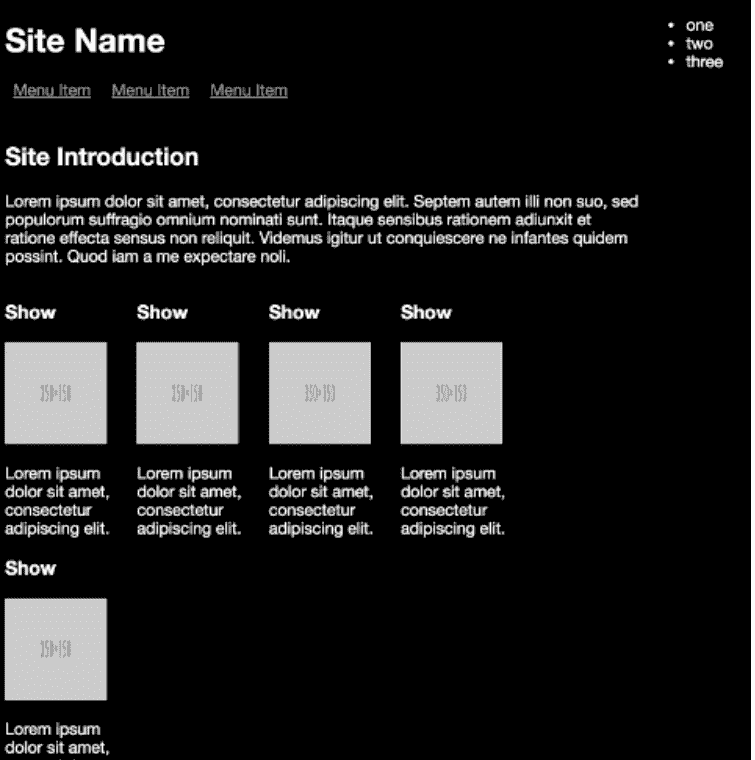

### 3-25. 最后的网格布局

有很多网格布局功能，包括重复布局、嵌套网格、内容对齐以及在网格中定义边距和间隙的能力。grid 显示的最后一个优势是它还让浮动变得不再必要，因此可以从 HTML 中移除 `left` 类以及使用的任何清除样式。

### 使用框架让网格更简单

在许多情况下，按照本章描述的方法创建网格并不困难，但开发者和设计师喜欢尽可能地完成重复任务。一个简单的解决方案是创建一套适用于你自己的网格系统，并在项目中复用它。通过本课程，其他开发者和设计师也有同样的想法，并在互联网上提供了他们的网格系统（或框架）。我将介绍两个流行的框架，但这是一个观点非常多且不断变化的话题。我的目标是向你展示框架如何帮助你在重复性任务上节省时间，而不是详细讨论哪一个“更好”（这个决定需要你自己来做）。这些许多框架提供的不仅仅是响应式网格，还提供了其他响应式元素，如字体、图标和可复用组件。你可能更倾向于某一个框架，因为它为你的网页的其他方面提供了更好的选择。

#### Bootstrap

虽然 Bootstrap 不是第一个响应式设计框架，但它是使用最广泛的。你可能在不知情的情况下见过它的运行。它由 Twitter 于 2011 年发布，使用 12 列网格，提供 flexbox 布局，并一直是 GitHub 上最流行的仓库之一。

流行程度是 Bootstrap 最大的优势也是缺点。它简单 way，鼓励良好的布局和 CSS 实践，并有大量的文档和社区帮助。但你的网站很容易看起来非常像其他由 Bootstrap 驱动的网站。

##### 安装 Bootstrap

默认下载的 Bootstrap 会增加页面的权重，因此我建议你仔细阅读说明，以确保获得针对你的用途进行优化的版本。在这个示例中，我将使用 CDN 选项，因为它最简单。如果你想跟随操作，请添加 Bootstrap 页面提供的行，并移除指向当前 CSS 文件的链接。

你可以在这里找到简化（无媒体查询）的重构后的 index.html 页面作为示例。你失去了自定义字体和背景颜色（这些很容易重新添加），但你不需要费太大精力就得到了响应式网格（Bootstrap 也使用 12 列网格），它的工作方式与我们的自定义网格类似。Bootstrap 还有许多其他样式用于处理图像、确定在不同网格尺寸下显示哪些网格元素，等等。

##### 网站名称

| 菜单项 | 菜单项 | 菜单项 |
| :--- | :--- | :--- |

##### 网站介绍

Lorem ipsum dolor sit amet, consectetur adipiscing elit. Septem autem non arcu, sed pop ullamcorper omnis niam sunt. Fusce gravida nulla nullat at nulla est non reliquit. Nullam ut consequere non infantes posuere. Quod non est neque neque.

##### 显示

| 显示 | 显示 | 显示 | 显示 |
| :--- | :--- | :--- | :--- |
| 350*150 | 350*150 | 350*150 | 350*150 |
| Lorem ipsum dolor sit amet, consectetur adipiscing elit. | Lorem ipsum dolor sit amet, consectetur adipiscing elit. | Lorem ipsum dolor sit amet, consectetur adipiscing elit. | Lorem ipsum dolor sit amet, consectetur adipiscing elit. |

##### 显示

| 显示 |
| :--- |
| 350*150 |
| Lorem ipsum dolor sit amet, consectetur adipiscing elit. |

我是一个页脚

3-26. Bootstrap 示例

如果你想了解更多关于 Bootstrap，我推荐 SitePoint 的 Jump Start Bootstrap。

#### Foundation

Foundation 由 Zurb（一家交互设计机构）于 2011 年创建。它也提供了许多功能（包括 flexbox），定期发布，但使用率较低。它为创建布局提供了更大的灵活性，但通常需要类名。

##### 安装 Foundation

就像 Bootstrap 一样，Foundation 会增加页面的权重，因此我建议你仔细阅读说明以确保获得针对你的用途进行优化的版本。移除当前的样式表并添加以下链接：

```html
<link rel="stylesheet" href="foundation.css">
<link rel="stylesheet" href="app.css">
```


你可以在这里找到简化（无媒体查询）的重构后的 `index.html` 页面作为示例。你失去了自定义字体和背景颜色（这些很容易重新添加），但你不需要费太大精力就得到了响应式网格（Bootstrap 也使用 12 列网格），它的工作方式与我们的自定义网格类似。

# 网站名称

# 网站介绍

Lorem ipsum dolor sit amet, consectetur adipiscing elit. Septem autem non arcu, sed pop ullamcorper omnis niam sunt. Fusce gravida nulla nullat at nulla est non reliquit. Nullam ut consequere non infantes posuere. Quod non est neque neque.

# 显示

| 显示 | 显示 | 显示 | 显示 |
| --- | --- | --- | --- |
| 310*150 | 310*150 | 310*150 | 310*150 |
| Lorem ipsum dolor sit amet, consectetur adipiscing elit. | Lorem ipsum dolor sit amet, consectetur adipiscing elit. | Lorem ipsum dolor sit amet, consectetur adipiscing elit. | Lorem ipsum dolor sit amet, consectetur adipiscing elit. |

# 显示

| 显示 |
| --- |
| 310*150 |
| Lorem ipsum dolor sit amet, consectetur adipiscing elit. |

我是一个页脚

## 3-27. Foundation 示例

如果你想了解更多关于 Foundation，我推荐 SitePoints 的 Jump Foundation。

# 第4 章

## 响应式文本

如果网页要实现真正的响应式，那么页面的内容也应该流动并适应用户查看它的设备尺寸。虽然网页变得越来越依赖图像和媒体，但文本仍然是一个关键部分，并且有许多技术可以帮助它在任何设备上都尽可能易读。

为了理解在网页上表示文本的更好方法，最好回顾一下文本的长历史。

## 文本的历史

排版（文本的排列和样式化）原则自人们在纸上打印文字以来一直在演变。

## 演示应用程序怎么如何？

在这一章的示例中，我使用了演示应用程序的一些部分，但书的其余部分将不再使用任何网格系统。这样做是为了清晰，让你能更容易地看到其他主题的示例而不受网格干扰，同时也为了减少与某些浏览器的兼容性问题。

作为一个练习，尝试从本章选择一个你喜欢的网格系统，并用它重写后续示例。

## 总结

现在你已经知道如何制作一个可以响应任何浏览器并始终按比例适应的页面布局。在下一章中，我们将学习如何让布局内部的内容具有响应式——因为如果内容在所有设备上都不可读或不美观，你的工作就还没有完成。

## 响应式文本

这种行距（文本行之间的距离）、字间距（字之间的距离）已延续到桌面出版领域，任何用过 `QuarkXpress`、`InDesign` 或其前身的人都会知道它们是如何影响文本的。

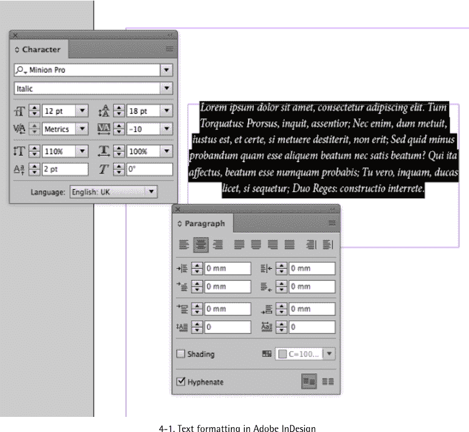

### 4-1. Adobe InDesign 中的文本格式设置

手动排版是一项艰苦的工作，因为它涉及到调整每行文本的行距、字间距和字距。桌面出版，以及最近使用 CSS 进行字体排版，使得尝试调整这些属性变得更加容易，以获得“完美”的文本。

CSS 字体排版与印刷排版有许多相同的属性，但名称有所不同。事实上，它的名称比旧版本更具描述性。

在 Web 早期，排版控制水平非常有限，但 CSS3 提供了巨大的帮助，为我们提供了更多工具来实现我们的设计。

## CSS 中的响应式字体排版属性

你可以使用 CSS 设置许多与文本相关的属性。以下是我认为对响应式设计最有用的几个：

- `font-size`：字体的大小。
- `line-height`：指定块元素内行的最小高度，以及行内元素的实际行高。
- `font-weight`：字体的“粗细”，或其粗细和强度。
- `text-decoration`：用于设置下划线或删除线。
- `text-align`：用于设置文本的左对齐、右对齐、居中或两端对齐（对左右边界）。
- `text-transform`：用于使文本显示为大写、小写或首字母大写。
- `letter-spacing`：指定字母之间的间距，类似于行距。
- `word-spacing`：指定单词之间的间距，类似于字距。

使用像素值设置这些属性中的某些或全部是常见的。例如，你可以在当前演示站点的 `body` 选择器中添加以下内容：

```css
body {
  font-size: 18px;
  line-height: 22px;
  letter-spacing: 4px;
}
```

这将导致文本看起来如下所示：


## 站点介绍

Lorem ipsum dolor sit amet, consectetur adipiscing elit. Septem erat at non arcu, sed dapibus aliquam omnis nominati sunt. Isque sensitive ratione adnunxit et ratione effecta sensus non reliquit. Vidimus igitur ut quiescere ne infidem possint. Quod iam a me necellare poss.

显示 显示 显示 显示

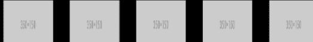

Lorem ipsum dolor sit amet, consecutive... adipiscing elit. Lorem ipsum dolor sit amet, consecutive... adipiscing elit. Lorem ipsum dolor sit amet, consecutive... adipiscing elit. Lorem ipsum dolor sit amet, consecutive... adipiscing elit. Lorem ipsum dolor sit amet, consecutive... adipiscing elit.

我是一个页脚

### 4-2. 一个奇怪的文本示例

你可能在设计中发现其他有属性：

- `font-style`：将文本设置为斜体或倾斜。斜体文本在小屏幕上的可读性可能不如大屏幕。
- `text-indent`：设置文本块中第一行（大部分）的缩进。在较小设备上空间有限，缩进段落可能比在段落之间留空格更好。
- `text-align-last`：设置文本最后行的对齐方式为块对齐。同样，在不同的尺寸下，你可能需要以不同的方式处理。
- `white-space`：定义文本块中空白和换行的行为。
- `word-wrap`：指定单词是否允许换行。这对于根据显示大小优化文本可能很有用。

你可能在奇怪设置固定大小的文本如何是响应式的。18px 无论是在桌面电脑还是移动屏幕上渲染都是 18px。你可以使用媒体查询在不同的屏幕尺寸下设置不同的字体大小，但这将变得非常繁琐，而且可能有更好的方法。

CSS 允许你使用不同的单位来设置元素的大小，特别是对于文本。它们分为两营：固定尺寸和相对尺寸。

## 固定尺寸

固定尺寸意味着尺寸始终保持不变。你可以使用七种可能的单位，但我将重点关注最常用的两种：`px` 和 `pt` 值。

### 像素

像素是组成每个设备屏幕的彩色小点。当你在需要在 HTML 中设置元素大小时，一个 CSS 像素等于一个设备像素，对吧？其实不……

设备像素（也称为屏幕像素）是组成屏幕的实际像素，传统上，这是用户屏幕宽度乘以高度的像素数。这可能与他们的浏览器窗口大小不同，因为桌面用户经常调整窗口，而且浏览器通常不在全屏模式下运行。


新的高分辨率屏幕——例如 Apple 的“Retina”显示屏——问题变得复杂，因为它们在物理区域使用了更多的像素。这意味着 CSS 像素实际上比设备像素大。为了处理这个问题，多个设备像素代表一个 CSS 像素。

### 点

正如你早在 InDesign 的屏幕截图中看到的，点 (`pt`) 尺寸单位源于打印文本，理解起来更复杂。它代表了与像素示例相似的大小，但由于不同的操作系统和屏幕以不同的方式将像素表示为点，它们最好保留用于打印。

像素 (`px`) 尺寸单位理论上代表屏幕上一个像素的大小。对于文本，这意味着当将文本设置为 `16px` 时，文本中最低点（例如小写 'g' 的底部）到最高点（例如小写 'h' 的顶部）的长度为 `16px`。

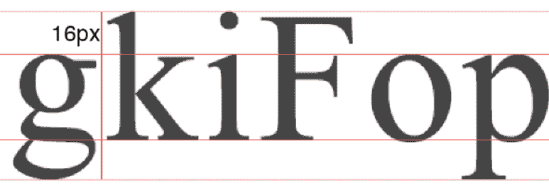

### 相对尺寸

相对尺寸更适用于 Web 和响应式设计，因为尺寸会相对于基础大小发生变化。但理解固定尺寸（至少是像素）对于理解这些尺寸方法如何运作是有用的。用于相对字体设置最流行的单位是 `%`、`em` 和 `rem` 值。

使用相对尺寸时，需要知道的第一个重要事实是这些尺寸相对于什么。在所有浏览器的默认设置下，它是 `16px`，但如果用户更改了此默认值——例如为了补偿低视力——那么相对尺寸将会按比例放大或缩小。

### 百分比 (Percent)

为字体大小设置百分比值意味着将其设置为默认字体大小的百分比。因此，如果用户的浏览器字体大小设置为 `16px`，那么 `font-size: 100%` 仍然等于 `16px`，而 `font-size: 50%` 将等于 `8px`。

作为一个示例，让我们尝试在演示网站上应用百分比尺寸，同样采用移动优先的方法，为屏幕较小的设备用户设置基础字体大小。

> 我们假设基础字体大小为 `16px`

在这些示例中，我假设基础字体大小是默认的 `16px`。如果你的浏览器中设置不同，那么所述的尺寸也会有所不同。

为 `body` 元素添加一个基础字体大小，将默认字体大小设置为 `16px` 的 `75%`，即 `12px`：

```css
body {
  font-size: 75%;
}
```

然后，在平板和桌面端的媒体查询中，为更大的屏幕尺寸添加字体大小。

```css
@media only screen and (min-width: 768px) {
  body {
    font-size: 100%;
  }
}

@media only screen and (min-width: 992px) {
  body {
    font-size: 125%;
  }
}
```

这导致在大屏幕上的字体渲染比中等屏幕上略微像素化。

### em

尽管 `em` 单位最近在网页设计师中变得流行，但 `em` 是一种古老的排版单位，它是以字母“M”命名的。`em` 单位的基础值等于当前字体大小的磅（points）数。例如，在 `16` 磅的字体中，`1em` 等于 `16` 磅。

在实践中，它的工作方式与百分比尺寸类似，但单位数值更小。例如，假设默认字体大小为 `16px`，`font-size: 1em` 仍然等于 `16px`，而 `font-size: 0.5em` 将等于 `8px`。

使用 `em` 时单位值较小，但样式很容易无意中导致巨大的字体大小。例如，考虑 `font-size: 4em`：虽然数字看起来并不大，但它实际上等于 `64px`。当然，你可以将默认字体大小设置为较小的值，这样增加 `em` 就不会产生巨大的变化。

作为一个示例，让我们尝试在演示网站上应用 `em` 尺寸，同样采用移动优先的方法。

为 `body` 元素添加一个基础字体大小，将默认字体大小设置为 `16px` 的 `.75em`，即 `12px`：

```css
body {
  font-size: 0.75em;
}
```

然后，在平板和桌面端的媒体查询中，为更大的屏幕尺寸添加字体大小：

```css
@media only screen and (min-width: 768px) {
  body {
    font-size: 1em;
  }
}

@media only screen and (min-width: 992px) {
  body {
    font-size: 1.25em;
  }
}
```

我不会添加截图，因为结果应该与百分比示例完全相同。

使用 `em` 的一个巧妙技巧是，相对尺寸会级联到嵌套元素。例如，修改页面的 `aside` 元素以包含一些嵌套列表项：

```html
<aside class="left">
  <ul>
    <li>one
      <ul>
        <li>sub item</li>
        <li>sub item</li>
      </ul>
    </li>
    <li>two
      <ul>
        <li>sub item </li>
        <li>sub item </li>
      </ul>
    </li>
    <li>three
      <ul>
        <li>sub item </li>
        <li>sub item </li>
      </ul>
    </li>
  </ul>
</aside>
```

然后添加以下内容：

```css
aside ul {
  font-size: 0.75em;
}
```

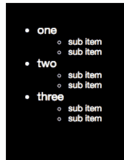

#### 4-7. em 级联示例

你会发现外层 `ul` 的字体大小是当前尺寸的 `.75em` (`15px`，在截图中为 `20px`)，而内层 `ul` 是该尺寸的 `.75em` (`11.25px`)。虽然这种技术允许创建跨页面级联响应尺寸的极佳快捷方式，但它需要仔细的规划，因为元素的尺寸可能会比你预期的要小或大。

### rem

`rem` 单位代表“root”（根），该单位的尺寸表示与 `em` 相同。但“root”意味着相对尺寸是从一个基础元素计算的——而不是从直接包含它的元素。这为你提供了一个比 `em` 更可预测的替代方案，因为更容易看出尺寸是相对于什么的。

作为一个示例，让我们尝试在演示网站上使用 `rem` 尺寸，假设基础字体大小为 `16px`，将根字体大小设置为 `75%`：

```css
html {
  font-size: 75%;
}
```

然后，在平板和桌面端的媒体查询中，为更大的屏幕尺寸添加字体大小：

```css
@media only screen and (min-width: 768px) {
  body {
    font-size: 100%;
  }
}

@media only screen and (min-width: 992px) {
  body {
    font-size: 125%;
  }
}
```

这导致在大屏幕上的字体渲染比中等屏幕上略微像素化。

让它易于阅读。像博客这样文字密集的网站将需要更多的思考和考虑。

你应该考虑哪些字体、样式、尺寸和布局适合各种屏幕尺寸和分辨率，并将其与你的项目可能具有的任何样式指南相平衡。

让我们通过调整基础属性，开始对演示站的文本进行重构：

```css
body {
  font-size: 1em;
}
```


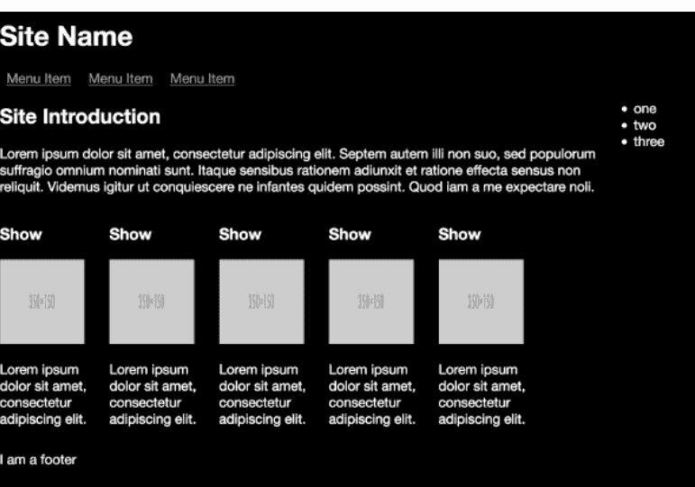

这会将默认字体设置为浏览器默认值，如之前讨论的，可能是 16px。

对于页面的小屏幕版本（即默认样式），节目描述文本实际上是隐藏的，因此我们不需要担心它的格式化。然而，当屏幕空间有限时，主站描述占据了过多的空间，因此使用 `:not` 伪类来减小默认字体大小并排除节目描述：

```css
section.showlisting p:not(.showdescription) {
  font-size: 0.8em;
}
```

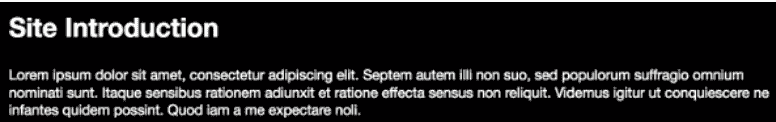

Lorem ipsum dolor sit amet, consectetur adipiscing elit. Septem autem ill non suo, sed poporum suffragio omnis nominat sunt. itaque sensibus ratione adunix et ratione sensus non reliquit. Vidimus igitur ut quiescere ne infantes quidem possant. Quod lam a me expectari.

### 4-10. 网站介绍文本调整大小

随着屏幕尺寸的增大，除了观看视频，节目描述可能是人们想要访问的内容，所以让我们让文本稍微大一点，更加突出。在中等屏幕尺寸下，仍然只显示文本摘要，这足够让它更具可读性：

```css
@media only screen and (min-width: 768px) {
  .showdescription {
    font-size: 1.2em;
  }
}
```

### 4-11. 节目描述现在变大了

| 节目 | 节目 | 节目 | 节目 | 节目 |
| --- | --- | --- | --- | --- |
| 350-150 | 350-150 | 350-150 | 350-150 | 350-150 |
| Lorem ip... | Lorem ip... | Lorem ip... | Lorem ip... | Lorem ip... |

随着屏幕变大，让我们增加文本大小并收紧行间距，特别是人们现在可能在准备享受夜晚娱乐之时，隔着房间阅读这些描述。

```css
/* 中等设备和桌面 */
@media only screen and (min-width: 992px) {
  .showdescription {
    font-size: 1.3em;
    line-height: 1.1em;
  }
}
```

### 4-12. 完整的描述文本

| 节目 | 节目 | 节目 | 节目 | 节目 |
| --- | --- | --- | --- | --- |
| 350-150 | 350-150 | 350-150 | 350-150 | 350-150 |
| Lorem ipsum dolor sit amet, consectetur adipiscing elit. | Lorem ipsum dolor sit amet, consectetur adipiscing elit. | Lorem ipsum dolor sit amet, consectetur adipiscing elit. | Lorem ipsum dolor sit amet, consectetur adipiscing elit. | Lorem ipsum dolor sit amet, amet-consectetur adipiscing elit. |

## 继续阅读

在本章中，我介绍了与响应式设计相关的字体设计概念，并展示了它们在 CSS 中是如何被表示的。我还涵盖了可以用于设置这些属性的不同尺寸单位，以及如何让页面上的重要文本具有可读性。在下一章中，我将查看如何对页面其余内容（如图像和视频）进行同样的操作。

# 第 5 章

## 响应式图像和视频

基于内容的交换带来了 Web 的诞生，但图像和其他富媒体让它不断演进，并使其成为我们所有人所知/喜爱/讨厌的样子。

使图像响应式的方案在近年来发展迅速，已经能够加载完美适配用户设备的图像。此外，视频等新 HTML 元素的添加为响应式设计开启了新选择。这是一个全新的领域，但也充满了陷阱、折协和需要学习的新技术。所以，让我们开始吧！

## 图像

图像是一种强大的通信工具，能够传达信息、意图、解释并为你的网页注入生命。

多年来，图像一直是设计师（网页和打印）痛苦的持续源源，尽管 HTML5 带来了许多改进，但在网页中添加响应式图像仍然需要规划和准备。

在本章中，我用来自免费网站的图像替换了此处到目前使用的占位图形，以展示真实电视节目的网站可能的样子。

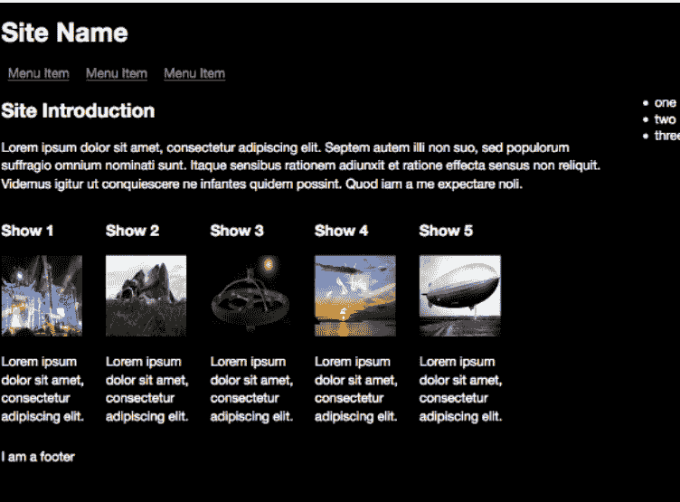

### 5-1. 添加图像

添加真实图像后，页面出现了一些问题。最明显的是，虽然布局仍然良好，但所有图像都被强制设置为相同的尺寸，这意味着它们没有利用可用的屏幕空间。示例网站用于浏览和观看视频，因此让视觉内容尽可能突出且易于观察是有有意义的。

为了展示如何使用响应式图像，我们将更改演示网站，在第 3 章定义的断点处，使其具有适合每个用例的不同图像尺寸和布局。

首先，更改 CSS 和 HTML 以更好地适应我们将添加的图像。让我们为主内容区域留出更多空间并缩小侧边菜单尺寸：

```css
@media only screen and (min-width: 992px) {
  aside {
    width: 15%;
    display: block;
  }
  section.showlisting {
    width: 75%;
  }
}
```

为包含节目详情的 `div` 添加移动优先样式。这设置了 480px 的最大宽度，并居中显示，理想宽度为屏幕的大部分：

```css
section.tvshow {
  width: 90%;
  max-width: 480px;
  margin: 0 auto;
  display: block;
}
```

接下来，当屏幕变大时，为该 `div` 添加媒体查询，使其居中并占据屏幕的大部分：

```css
@media only screen and (min-width: 480px) {
  section.tvshow {
    max-width: 800px;
  }
}
```

当跳转到更大的屏幕时，让我们每行显示更多一个项，并调整 `div` 的宽度：

```css
@media only screen and (min-width: 800px) {
  section.tvshow {
    max-width: 1200px;
  }
}
```

这是针对更大屏幕的媒体查询，现在每行显示两个项并调整 `div`：

```css
@media only screen and (min-width: 768px) {
  section.tvshow {
    width: 46%;
    margin-right: 15px;
    display: inline-block;
    max-width: 496px; /* 断点平分 */
  }
}
```

接下来是针对每行显示四个项的媒体查询：

```css
@media only screen and (min-width: 992px) {
  section.tvshow {
    width: 22%;
    margin-right: 15px;
    display: inline-block;
  }
}
```

最后，针对 TV 和更大屏幕的媒体查询：

```css
/* 大 设备 */
@media only screen and (min-width: 1800px) {
  section.tvshow {
    width: 46%;
    margin-right: 15px;
    display: inline-block;
    max-width: 900px; /* 断点平分 */
  }
}
```

好了，现在图像容器已经处理好，我们可以关注图像了。

### 5-3. 中等屏幕尺寸下的页面重构

## 站点名称

菜单项目 菜单项目

## 站点介绍

Lorem ipsum dolor sit amet, consectetur adipiscing elit. Septem autem ill non suo, sed poporum suffragio omnis nominat sunt. itaque sensibus ratione adunix et ratione sensus non reliquit. Vidimus igitur ut quiescere ne infantes quidem possant. Quod lam a me expectari.

*   一
*   二
*   三

### 节目 1

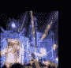

Lorem ipsum dolor sit amet, consectetur adipiscing elit.

### 节目 2

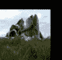

Lorem ipsum dolor sit amet, consectetur adipiscing elit.

### 节目 3


Lorem ipsum dolor sit amet, consectetur adipiscing elit.

### 节目 4

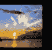

Lorem ipsum dolor sit amet, consectetur adipiscing elit.

### 节目 5

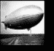

Lorem ipsum dolor sit amet, consectetur adipiscing elit.

我是页脚

## 响应式尺寸

将图像尺寸更改为以下：

```css
.thumbnail {
  width: 100%;
  height: auto;
}
```

## 快速上手响应式网页设计

| 站点名称 |
| :--- |
| 菜单项 | 菜单项 | 菜单项 |
| 站点介绍 |
| Lorem ipsum dolor sit amet, consectetur adipiscing elit. Septem autem illum non nonip, sed popularum suffragio omnium nominati sunt. Eaque assail rutrum id etione serus non reliquit. Vidimus (ugit ut consequer non tantas posuere. Quod iam a me expectare noi. |

显示 2

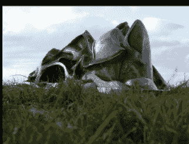

显示 1

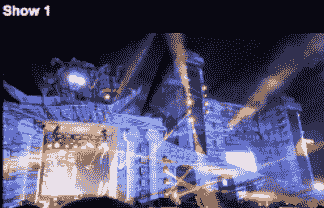

Lorem ipsum dolor sit amet, consectetur adipiscing elit.

Lorem ipsum dolor sit amet, consectetur adipiscing elit.

显示 3

显示 4


> 5–4. 更改图像样式的效果

这将把图像宽度设置为其容器宽度的 100%，并将图像高度设置为 `auto`，从而允许图像占据保持其自然比例所需的任何垂直空间。你会注意到，这意味着图像目前没有具有相同的高度，这影响了布局。你可以调换这些段落，转而填充 100% 的高度并自动填充宽度。尝试让图像始终固定精确尺寸可能是一个折中的的挑战，这在很大程度上取决于图像的来源。如果可以，最好先编辑它们，让它们具有相同的尺寸。

使用 `width: 100%` 可能意味着图像将放大到比原始尺寸更大并导致像素化。为了防止这种情况，请尝试在与每个断点相关的缩略图样式上使用 `max-width` 或 `max-height`。


就那样，你完成了，对吧？遗憾的是，并没有。在你的网页检查器中检查一张图像，你会发现我们只是在调整一张非常大的图像。尽管它看起来很小，但实际文件仍然很大，增加了大量的页面权重。查看网络请求：这五张图像几乎有 4MB，对于移动用户加载来说是大量的数据。要让你的图像完全完全响应式，你需要为正确的设备提供正确的文件。


### 5-5. 图像尺寸

## 为正确的设备选择正确的图像

处理响应式图像有两种方法。一种是 `srcset`，你已经知道的 `img` 标签的一个属性，另一种是新的 HTML5 `picture` 元素。这两种方法都使用媒体查询语法来选择最适合设备能力的图像，但 `srcset` 允许浏览器对渲染哪张图像做出最终决定，而 `picture` 则明确告诉浏览器渲染哪张图像。对于大多数情况，`srcset` 就是你需要的所有，但对于设计密集型网站，如果你希望对浏览器渲染方式有更多控制权（例如裁剪图像而不是缩放图像），那么 `picture` 标签会更适合你。

就像通过媒体查询加载的 CSS 规则一样，你使用和支持的图像尺寸取决于你和你的用例。示例项目经过了优化，但还可以更好。例如，我们可以减少在较小屏幕上加载的图像的最大尺寸。查询可以采用与第二章概述的相同的格式。

我手动创建了设计所需的每张图像，并提供的宽度大致匹配图像显示时的最大宽度：

- 小图像：320px 宽。
- 中等图像：480px 宽。
- 大图像：768px 宽。

手动创建不同版本的图像很枯燥，但它让你控制在每个图像尺寸下显示的内容。如果你倾向于自动生成这些图像，有几种选择，例如：

- 在 Photoshop 或 XView (Windows) 等图像编辑器中进行批量处理。
- 使用 Gulp 等构建工具进行批量处理。
- 为你的 CMS 或静态站点生成器使用插件，这可能是流行的 `imagagick` 或 `OptiPNG` 库的封装。

### `srcset`

将现有的图像元素替换为以下内容：

```html
<section class="tshow">
  <h3>show1-medium.jpg</h3>
  
  <p class="showdescription">Lorem dolor sit amet, consectetur adipiscing elit.</p>
</section>
```


> 一些作业
此示例替换了一个，为了减少重复，我没有包含替换其他图像的代码。如果你想尝试替换其他，可以在[这里](#) 找到剩余图像的代码。

此示例替换了一个，为了减少重复。我没有包含替换其他图像的代码。如果你想尝试替换其他，可以在[这里](#) 找到剩余图像的代码。

此示例替换了一个，为了减少重复。我没有包含替换其他图像的代码。如果你想尝试替换其他，可以在[这里](#) 找到剩余图像的代码。

```
srcset="../images/show1-small.jpg 320w,
            ../images/show1-large.jpg 768w"
```

```
sizes="(max-width: 768px) 480px,
            (max-width: 1800px) 320px, 768px"
```

此示例替换了一个，为了减少重复。我没有包含替换其他图像的代码。如果你想尝试替换其他，可以在[这里](#) 找到剩余图像的代码。

此示例替换了一个，为了减少重复。我没有包含替换其他图像的代码。如果你想尝试替换其他，可以在[这里](#) 找到剩余图像的代码。

此示例替换了一个，为了减少重复。我没有包含替换其他图像的代码。如果你想尝试替换其他，可以在[这里](#) 找到剩余图像的代码。

此示例替换了一个，为了减少重复。我没有包含替换其他图像的代码。如果你想尝试替换其他，可以在[这里](#) 找到剩余图像的代码。

此示例替换了一个，为了减少重复。

此示例替换了一个，为了减少重复。我没有包含替换其他图像的代码。如果你想尝试替换其他，可以在[这里](#) 找到剩余图像的代码。

此示例替换了一个，为了减少重复。我没有包含替换其他图像的代码。如果你想尝试替换其他，可以在[这里](#) 找到剩余图像的代码。

此示例替换了一个，为了减少重复。我没有包含替换其他图像的代码。如果你想尝试替换其他，可以在[这里](#) 找到剩余图像的代码。

此示例替换了一个，为了减少重复。我没有包含替换其他图像的代码。如果你想尝试替换其他，可以在[这里](#) 找到剩余图像的代码。

此示例替换了一个，为了减少重复。我没有包含替换其他图像的代码。如果你想尝试替换其他，可以在[这里](#) 找到剩余图像的代码。

此示例替换了一个，为了减少重复。我没有包含替换其他图像的代码。如果你想尝试替换其他，可以在[这里](#) 找到剩余图像的代码。

此示例替换了一个，为了减少重复。我没有包含替换其他图像的代码。如果你想尝试替换其他，可以在[这里](#) 找到剩余图像的代码。

此示例替换了一个，为了减少重复。我没有包含替换其他图像的代码。如果你想尝试替换其他，可以在[这里](#) 找到剩余图像的代码。

此示例替换了一个，为了减少重复。我没有包含替换其他图像的代码。如果你想尝试替换其他，可以在[这里](#) 找到剩余图像的代码。

此示例替换了一个，为了减少重复。我没有包含替换其他图像的代码。如果你想尝试替换其他，可以在[这里](#) 找到剩余图像的代码。

此示例替换了一个，为了减少重复。我没有包含替换其他图像的代码。如果你想尝试替换其他，可以在[这里](#) 找到剩余图像的代码。

此示例替换了一个，为了减少重复。我没有包含替换其他图像的代码。如果你想尝试替换其他，可以在[这里](#) 找到剩余图像的代码。

此示例替换了一个，为了减少重复。我没有包含替换其他图像的代码。如果你想尝试替换其他，可以在[这里](#) 找到剩余图像的代码。

此示例替换了一个，为了减少重复。我没有包含替换其他图像的代码。如果你想尝试替换其他，可以在[这里](#) 找到剩余图像的代码。

此示例替换了一个，为了减少重复。我没有包含替换其他图像的代码。如果你想尝试替换其他，可以在[这里](#) 找到剩余图像的代码。

此示例替换了一个，为了减少重复。我没有包含替换其他图像的代码。如果你想尝试替换其他，可以在[这里](#) 找到剩余图像的代码。

此示例替换了一个，为了减少重复。我没有包含替换其他图像的代码。如果你想尝试替换其他，可以在[这里](#) 找到剩余图像的代码。

此示例替换了一个，为了减少重复。

此示例替换了一个，为了减少重复。

## 支持旧版浏览器

如果你想对旧版浏览器提供更好的支持，可以使用“polyfill”（一个用于填补缺失功能的库的术语）。具体来说，在这种情况下，可以使用 Scott Jehl 的 picturefill。

`picture` 元素的另一个有用应用（通过其内部的 `source` 元素实现）是加载不同的图像格式，例如可缩放矢量图像 (SVGs)：

```html
<picture>
  <source srcset="logo.svg" type="image/svg+xml">
  
</picture>
```

如果浏览器不支持 SVG 图像，它将加载 PNG。

另一个选项是为高分辨率屏幕加载更高分辨率图像：

```html
<picture>
  <source srcset="../images/show1-2x.jpg" media="(min-resolution: 120dpi)" class="thumbnail">
  
</picture>
```

## 响应式视频

继续 HTML5 语义化元素的主题，视频和音频对应的元素分别是 `video` 和 `audio`。由于我们在书中正在构建一个视频网站，我不会过分关注 `audio` 元素，但我认为在使用 `picture` 和 `video` 元素之后，你将理解如何使用它。

# 116 快速上手：响应式网页设计

## `video` 元素

很多年前，我制作过一个音乐视频网站。那在宽带普及之前，我花费了大量时间尽可能优化视频，以便它们在慢连接上可以查看。我还必须决定使用哪种视频插件来显示视频。是用 Quicktime 更好？RealPlayer？还是用那个现在大家又爱又恨（但在当时很流行）的 Flash？

那些视频格式现在很大程度上已经过时了，被一系列标准格式和 HTML5 所代之，这让设计师的生活变得简单得多，同时也减少了由于为了查看视频而必须下载插件这种杀伤用户体验的过程。`video` 元素的支持范围比 `picture` 更广，只有 IE8 和早期的 Android 版本可能会给你带来麻烦。

然而，`video` 元素支持的文件格式仍然存在问题，这很大程度上归功于厂商对 DRM（数字版权管理）的不同态度，以及对哪种格式是“最佳”选择的分歧（每个用户都倾向于使用它支持或帮助开发的格式）。所有支持 `video` 元素的浏览器都支持 MPEG-4/H.264，这是一种压缩格式。但它是专有的，这意味着浏览器制造商必须支付许可费才能使用它。对 WebM 和 Ogg/Theora 格式（开放格式）的支持并不常见，只有 Chrome、Firefox 和 Opera 支持它们。

这里是 `video` 元素的一个示例：

```html
<video width="320" height="240" autoplay>
  <source src="file.mp4" type="video/mp4">
  <source src="file.ogg" type="video/ogg">
  您的浏览器不支持视频标签。
</video>
```

与以前的选项相比，它是一个简单且整合的 HTML 元素。它会加载用户浏览器支持的任何视频格式，或者如果 `video` 元素或其包含的文件格式不受支持，则显示一段默认文本。`source` 元素按照呈现顺序进行处理。因此，在上面的示例中，如果浏览器同时支持两种格式，它将加载看到的第一个。仅此如此；`video` 元素并没有特别的响应式之处，除了它可以加载带有控制控件的相应视频文件。

有一些技巧可以尝试让视频更具响应性，但让我们先从简单的开始：让视频播放器控件可见、添加海报图像（在视频播放前显示的缩略图），并移除手动尺寸。

```html
<video controls poster="../images/show1-medium.jpg">
  <source src="../videos/show1.ogv" type="video/ogg">
  <source src="../videos/show1.mp4" type="video/mp4">
  您的浏览器不支持视频标签。
</video>
```

`video` 元素的早期提案包括包含它自己的媒体查询（正如我们看到的 `picture` 元素那样）。但这个主意被放弃了，这意味着无法为不同的设备更换不同的视频文件。让视频具有任何响应性的唯一真正方法是使用百分比宽度，例如：

```css
video {
  width: 100%;
  height: auto;
}
```

这将使视频缩放以适应其容器元素，你可以使用 `max-width` 属性来限制它可以增长的尺寸，或者使用一个较小的值，如 50%。然而，在较大的屏幕尺寸下，它无法阻止视频的放大，这意味着如果太大，它可能会看起来像素化。

除非另有指定，否则一旦页面加载，视频将开始下载到你的浏览器（这样如果用户选择观看，它就准备就绪）。注意视频潜在的带宽开销，这对于移动用户并不友好：

# 快速上手：响应式网页设计


5-8. 网页检查器中显示的视频文件大小

针对这个问题，有一个部分解决方案：在 `video` 标签上添加 `preload="none"`：

```html
<video controls poster="../images/show1-medium.jpg" ... preload="none">
</video>
```

## 快速上手响应式网页设计

```css
0 0 / cover no-repeat;
}
```

针对较大的移动设备：

```css
@media only screen and (min-width: 480px) {
  show1 {
    background: transparent url("../images/show1-large.jpg");
    0 0 / cover no-repeat;
  }
}
```

针对较大的平板电脑和桌面设备：

```css
@media only screen and (min-width: 992px) {
  show1 {
    background: transparent url("../images/show1-small.jpg");
    0 0 / cover no-repeat;
  }
}
```

最后，针对大屏幕和电视机：

```css
@media only screen and (min-width: 1800px) {
  show1 {
    background: transparent url("../images/show1-large.jpg");
    0 0 / cover no-repeat;
  }
}
```

现在为每个视频缩略图创建相应的类和样式。呼！这对响应式设计很有帮助，但代码量很大！你可以在代码存档中找到完整示例。

## 可点击图片

创建完全响应式视频的另一种方案是使用 `picture` 标签替换视频播放器，点击它时加载播放器。这允许你使用所有响应式世界的优点，但需要 JavaScript。它还允许你添加诸如功能，例如在网页上方的层中打开视频。

首先，为每部剧集添加 `picture` 和 `video` 标签：

```html
<section class="tvshow">
  <h3>Show 1</h3>
  <picture>
    <source src="../images/show1-small.jpg" media="(max-width: 320px)" class="thumbnail">
    <source src="../images/show1-medium.jpg" media="(min-width: 320px) and (max-width: 480px)">
    <source src="../images/show1-large.jpg" media="(min-width: 480px)" class="thumbnail">
    
  </picture>
  <video controls="../images/show1-medium.jpg" preload="none">
    <source src="../videos/show1.mp4" type="video/mp4">
    <source src="../videos/show1.og" type="video/ogg">
    您的浏览器不支持 HTML5 视频标签。
  </video>
  <p class="showdescription">Lorem ipsum dolor sit amet, consectetur adipiscing elit.</p>
</section>
```

对其他每个剧集执行相同的操作，替换图片和视频源。

现在将视频元素设置为默认隐藏：

```css
video {
  display: none;
  width: 100%;
  height: auto;
}
```

## 关于 JavaScript 的说明

本章和第 6 章中的 JavaScript 代码大部分是独立呈现的，因为它们提供了单独的实验选项。如果你想合并并一起使用所有示例，你需要进一步的计划，特别是尝试减少事件处理程序的数量。

接下来，添加以下 JavaScript，它为页面添加了点击事件监听器。如果检测到点击，代码将检查点击是否发生在缩略图上。如果是，它将调用 `toggle_visibility` 函数。该函数会显示隐藏的视频，播放它并隐藏被点击的图片。

在 `index.html` 文件的 `script` 标签内添加以下 JavaScript 以添加事件监听器：

```javascript
function () {
  document.addEventListener('click', toggle_visibility, false);
}
```

进入函数后，如果点击的元素是视频缩略图之一，则继续，忽略所有其他元素：

```javascript
function toggle_visibility(id) {
  clickedElement = id.target;
  if (clickedElement.classList.contains('thumbnail')) {
```

接下来，你需要检测点击了哪张图片，找到与缩略图相关的视频，开始播放并隐藏缩略图图片。

```javascript
var v = clickedElement.parentNode.parentNode.querySelector('video');
  v.style.display = 'block';
  v.play();
  clickedElement.style.display = 'none';
}
})();
```


现在，响应式图片被一个设计为拉伸以适应的视频播放器取代了。你可以在视频暂停时反转这一过程来改进。

## 站点名称

- 菜单项目 菜单项目 菜单项目

## 站点介绍

Lorem ipsum dolor sit amet, consectetur adipiscing elit. Septem illum ips non, sed, ullamcorper fugiat omnium nominati sunt. Raque minibus ratione adiquit et ratione effects sensus non reliquit. Video id ut consequatur neque infidem possit. Quod iam a me expectare non.


Show 2

Show 1

Lorem ipsum dolor sit amet, consectetur adipiscing elit.

Lorem ipsum dolor sit amet, consectetur adipiscing elit.

Show 3

Show 4

5-10. 可点击图片及生成的视频播放器

## 获取视觉效果

就这样：在本章中，我们添加了大量内容来丰富。

# 第 6 章

# 响应用户上下文

现代 HTML 和 JavaScript 允许你检查。

## 万物之 API

# 快速上手响应式设计

## 基于时间

某些剧集包含更多成人内容，如果是在晚上 7:00 之前，我们应该突出显示它们。

# 修改 HTML

### 电池电量

HTML5 Battery Status API 允许你检查设备的当前电量水平并此做出响应。

### 安全考量

最近围绕 `Battery Status API` 出现了一些安全担忧，因此请阅读 W3C 规范以获取其未来的动态。

移动设备（以及笔记本电脑）在需要你时可能会电量耗尽，因此在这个（主要是为了说明的）示例中，让我们通过注意用户电量低的情况并降低页面的响应速度来帮助他们。

较暗的颜色可以减少对某些设备屏幕的电量影响（特别是 AMOLED 屏幕），因此页面的颜色已经相当对电池友好了，但让我们看看如何对电量水平做出反应。

可以使用一个 JavaScript 方法来获取有关设备电池的各种信息。

在 `index.js` 文件中添加以下代码以检查浏览器是否支持该功能。如果支持，则获取电量水平，这是一个位于 0（空）到 1（满）之间的值：

```javascript
navigator.getBattery().then(function (battery) {
  var level = battery.level;
  console.log(level);
});
```

如果电量小于 20% (0.2)，则添加一个 CSS 类来降低颜色亮度，并从 DOM 中移除图像（因为加载和显示图像会影响电池寿命，每减少一点点都好）：

```javascript
if (level < 0.2) {
  body = document.getElementsByTagName('body');
  images = document.getElementsByName('img');
  var i;
  for (i = 0; i < images.length; i++) {
    images[i].remove();
  }
  body.classList.add('battery-save');
}
```

在你的 CSS 中添加新的 `battery-save` 样式，降低页面文本的亮度：

```css
.battery-save {
  color: gray;
}
```

颜色方案是否真的能节省电量是一个争议性的话，这很大程度上取决于设备屏幕，但可能值得尝试。帮助用户节省电量的其他更确定的想法包括：

- 减少网络调用和流量
- 通过移除不重要的 JavaScript 来减少客户端处理量。
- 减少动画和效果

尽管我们用 JavaScript 从 DOM 中移除了图像，但它们在隐藏之前仍然被加载了。这与减少网络调用的原则相矛盾。由于 JavaScript 只允许你更改已有的页面结构，因此你需要从根本上更改传递给浏览器的内容。为了让这生效，你需要重新思考页面结构，使其更符合移动友好。

在当前的 HTML 中添加类来识别每个电视节目：

```html
<section class="show1">
...
</section>

<section class="show2">
...
</section>
```

现在从每个 tvshow section 中移除所有 `picture` 和 `video` 标签，大幅减少 HTML 文件的大小。回到 `index.js`，将现有内容替换为以下代码，该代码利用了我们在之前章节中使用过的概念（点击图像播放视频）并对其进行了整合：

```javascript
window.addEventListener("load", function(event) {
  navigator.getBattery().then(function(battery) {
    // 获取电量水平，如果电量足够则加载图像
    var level = battery.level;
    if (level > 0.2) {
      // 找到所有的 'tvshow' div 并遍历它们
      tvShows = document.getElementsByClassName("tvshow");
      var i;
      for (i = 0; i < tvShows.length; i++) {
        tvShow = tvShows[i];
        // 获取节目名称
        showName = tvShow.classList[1];
        // 创建 picture 元素
        var newPictureNode = document.createElement("picture");
        // 设置 picture 的源和类，但节目名称传递方式
        // 与示例相同，并为每个生成
        var pictureInnerHTML = '<source src="../images/' + showName + '-small.jpg" media="max-width:320px)" class="thumbnail"><source src="../images/' + showName + '-medium.jpg" media="(min-width:320px) and (max-width:480px)" class="thumbnail"><source src="../images/' + showName + '-large.jpg" media="(min-width:480px)" class="thumbnail">';
        newPictureNode.innerHTML = pictureInnerHTML;
        // 为 picture 添加事件监听器
        newPictureNode.addEventListener('click', toggle_visibility, false);
        // 以同样的方式生成 video HTML
        var newVideoNode = document.createElement("video");
        var videoInnerHTML = '<source src="../videos/' + showName + '.mp4" type="mp4"><source src="../videos/' + showName + '.ogv" type="video/ogg">您的浏览器不支持 HTML5 视频标签>';
        newVideoNode.setAttribute("controls", "controls");
        newVideoNode.setAttribute("poster", "../images/" + showName + '-medium.jpg');
        newVideoNode.setAttribute("preload", "none");
        newVideoNode.innerHTML = videoInnerHTML;
        // 将新图像和视频插入到正确的位置
        var nextNode = tvShow.getElementsByClassName('showdescription');
        tvShow.insertBefore(newVideoNode, nextNode[0]);
        tvShow.insertBefore(newPictureNode, newVideoNode);
      }
    }
  }, false);
  function toggle_visibility(id) {
    var e = this;
    var v = e.nextSibling;
    v.style.display = 'block';
    e.style.display = 'none';
  }
});
```

## 基于网络

示例网站是一个视频网站，虽然我们目前已经有了可点击的图片，允许观众在他们想要时才加载视频文件，但我们可以根据设备的网络连接使其更具灵活性。或者更好，我们可以创建一个用户偏好，让用户决定是否开启此功能。

Network Information API 尚未被广泛支持（目前仅支持 Android 上的 Chrome），但浏览器厂商的进展很快，所以当你决定实现它时，可能会获得更好的支持。

首先，最简单（支持率最高）的检查是查看用户是否在线：

```javascript
if (navigator.onLine) {
  // 执行某些操作
}
```

诚然，这在示例中的用途有限，除非你想在尝试播放视频之前检查用户是否已经断开连接。尽管如此，考虑到所有情况仍然是一个好主意。

虽然 Network Information API 允许你检查各种值，但它目前并没有什么用。有第三方（付费）服务可以检查网络速度，但目前“最佳”解决方案是使用复杂的代码来检查图像加载所需的时间，并以此计算速度。我不会在这里重复这些代码，但如果你感兴趣，Stack Overflow 上有一些很有用的信息。

> 浏览器支持
>
> 虽然 Network Information API 仍处于草稿阶段，但它是一个活跃的提案，所以当你阅读它时，可能会获得更好的支持。你可以在 API 的社区小组网站查询它的当前状态。

### 用户偏好

你可能在日常网页浏览中遇到过 Cookie。Cookie 通常用于保留偏好等状态。它们可以由客户端或服务器设置或读取，并在每个 HTTP 请求中传输。此示例将读取用户偏好并相应地显示页面元素。

通常浏览器会在用户提交表单或执行其他操作时写入 Cookie。在本示例中，我们将手动写入一个设置：

```javascript
window.addEventListener("load", function(event) {
  document.cookie = "mature=no";
}, false);
```

这决定了用户是否想看“成人”内容视频。使用此值，我们可以使用相同的技术来选择性地渲染电视节目。

要进行测试，在几个电视节目部分的类列表末尾添加 `mature` 类，并在所有其他部分的末尾添加 `all-ages`。在渲染电视节目的 `index.js` 循环中，读取 Cookie 值并隐藏/显示相应的节目：

```javascript
for (i = 0; i < tvShows.length; i++) {
  tvShow = tvShows[i];
  var mature = getCookie('mature');
  if (mature == 'no' && tvShow.classList[2] !== 'mature') {
  }
}
```

由于所有 Cookie 都存储在同一个属性中，你可以使用正则表达式来查找并读取你需要的 Cookie：

```javascript
function getCookie(name) {
  var regexp = new RegExp("(?:^|\\s)" + name + "|\\s*)=(.+?)(?:;|$)", "g");
  var result = regexp.exec(document.cookie);
  return (result === null) ? null : result[1];
}
```

### 环境光

将 Ambient Light Sensor API 与时间检测相结合，可能是根据一天的时间和观众可用的光线调整页面或视频亮度的极方法。在许多移动设备上，这现在由操作系统处理，但你可以为电脑用户提供增强或添加类似的功能。


### 安全担忧

> 最近 Ambient Light Sensor API 暴出了安全问题。我建议你阅读 W3C 规范以检查它的未来。

让我们创建一个根据当前环境光亮度（或周围区域的亮度）更改页面颜色的示例。

将当前 `index.js` 文件的内容替换为以下内容，这将根据环境光水平——光亮度值——为页面 body 添加一个类：

```javascript
window.addEventListener("devicelight", function (event) {
  var luminosity = event.value;
  if (luminosity <= 5) {
    document.body.className = "darkness";
  } else if (luminosity <= 50) {
    document.body.className = "dim";
  } else if (luminosity <= 1000) {
    document.body.className = "bright";
  }
});
```

将这些样式添加到你的 CSS 文件中，当光线最亮时使用：

```css
.bright {
  background-color: #fff;
  color: #000;
}
```

这是应用该类时的页面外观：

# RWDFliq

关于我们 计划 注册

- 一个
- 两个
- 三

## 欢迎

RWDFliq 在此为你带来最好的视频，并在你需要的时候提供。

| 神盾卫队 | 传道士 | Rick 和莫蒂 | 美国人 |
|---|---|---|---|
| Lorem ipsum dolor sit amet, consectetur adipiscing elit. | Lorem ipsum dolor sit amet, consectetur adipiscing elit. | Lorem ipsum dolor sit amet, consectetur adipiscing elit. | Lorem ipsum dolor sit amet, consectetur adipiscing elit. |

# 行尸之走

Lorem ipsum dolor sit amet, consectetur adipiscing elit.

我是一个页脚

6-4. 设置高对比度

Lorem ipsum dolor sit amet, consectetur adipiscing elit.

我们已经看到过如何使用媒体查询来检测并响应设备方向，但我们也可以对设备方向做出动态响应。例如，我们可以将视频文件切换为更适合横屏或竖屏的格式。

如果你想进行更多实验，根据设备的方向来控制视频的播放如何？例如，如果用户向一个方向倾斜手机，我们可以暂停视频，反之亦然。

在本示例中，我们将创建一个新的、简化版的页面，专门用于播放一个视频。

这里是 HTML：

# 响应式设计

这使得背景和文本更容易阅读。接下来，在极暗的环境下，添加以下内容：

```css
.dim {
  background-color: #aff;
  color: #fff;
}
```

6-4. 设置高对比度

这是页面的外观：


6-5. 设置低对比度

这使得背景和文本更容易阅读。接下来，在极暗的环境下，添加以下内容：

```css
.darkness {
  background-color: #2d004f;
  color: #aff;
}
```

6-5. 设置低对比度

这使得背景和文本更容易阅读。接下来，在极暗的环境下，添加以下内容：

```css
.darkness {
  background-color: #2d004f;
  color: #aff;
}
```

# 响应用户上下文

颜色的快速切换会让用户感到不安，为了让这种切换不那么生硬，在 body 元素中添加以下内容：

```css
body {
  transition: all 0.5s;
}
```


# 震动

另一个 W3C 创新是 `Vibration API`，它提供了访问移动设备震动机制的途径。我们可以通过为视频播放添加震动来增加更具沉浸感的体验，但这需要大量工作。该 API 对辅助功能也非常方便。例如，当点击按钮时设备发生震动，这会非常有用，让用户知道操作已被检测。

# 设备方向

我们已经看到过如何使用媒体查询来检测并响应设备方向，但我们也可以对设备方向做出动态响应。例如，我们可以将视频文件切换为更适合横屏或竖屏的格式。

```css
body {
  background: black;
  color: white;
  font-family: 'Helvetica Neue', Helvetica, Arial, sans-serif;
  font-size: 1em;
}

section.showinglisting {
  width: 100%;
  margin-bottom: 25px;
}

section.showinglisting p {
  line-height: 1.2em;
  word-spacing: 0.2em;
}

section.tvshow {
  width: 100%;
  margin: 0 auto;
  display: block;
}

video {
  width: 100%;
  height: auto;
}

.thumbnail {
  width: 100%;
  height: auto;
}

footer {
  clear: both;
}

/* Media Queries */
```

```css
/* Extra Small Devices and Phones */
@media only screen and (min-width: 480px) {
  section.tvshow {
    margin: 0 auto;
    display: block;
  }
}

/* Small Devices and Tablets */
@media only screen and (min-width: 768px) {
  section.tvshow {
    margin-right: 15px;
    display: inline-block;
  }

  section.showlisting p {
    line-height: 1.4em;
    word-spacing: 0em;
  }
}

/* Medium Devices and Desktops */
@media only screen and (min-width: 992px) {
  section.tvshow {
    margin-right: 15px;
    display: inline-block;
  }

  section.showdescription {
    white-space: normal;
  }
}

/* Large Devices, Wide Screens, TVs */
@media only screen and (min-width: 1800px) {
  section.showlisting {
    width: 100%;
  }
}
```

# 响应式网页设计入门

```css
margin-bottom: 25px;
}

section.tvshow {
  margin-right: 15px;
  display: inline-block;
}
```

这会导致单个视频呈现如下布局：


现在在页面页脚下方添加 `script` 元素，包含以下代码。该脚本会在页面加载时启动并访问视频元素，监听它是否正在播放：

```javascript
<script>
function () {
  var video = document.getElementById("show1");
  video.addEventListener("play", control_video, false);
}();
</script>
```

添加 `control_video` 函数，并将点击的视频赋值给变量：

```javascript
function control_video(e) {
  var v = e.target;
}
```

检查设备是否支持方向 API（`Orientation API`），如果是，则监听方向的变化。如果不支持，则警告用户：

```javascript
if (window.DeviceOrientationEvent) {
  window.addEventListener("deviceorientation", function (e) {
  }, false);
} else {
  alert("Sorry, your browser doesn't support Device Orientation");
}
```

最后，对方向的变化做出反应：当用户将手机向右旋转时，暂停视频；当他们向左旋转时，重新播放：

```javascript
if ((e.gamma < -45) && (e.gamma > -90)) {
  v.play();
}
```

```javascript
}
if ((e.gamma > 45) && (e.gamma < 90)) {
  v.pause();
}
```

# 获取方向

如果你对方向 API 中存在的三个旋转轴感兴趣，我推荐阅读《在 HTML5 中使用设备方向》（Using Device Orientation in HTML5）。

# 响应一切

在本章中，我们看到了假设性的示例，展示了我们如何更改页面内容以响应现代设备中的各种传感器。这些技术在不断演进，我鼓励你关注设计中可以利用的新 API，以便为用户提供定制化的体验。

这标志着我们这本书旅程的终结。响应式设计从根本上关于构建任何人都能使用的页面，无论使用何种设备或环境。无论是屏幕尺寸、性能还是因素，确保用户的体验尽可能好是我们的责任。

你正处于一个极佳的时刻开始你的响应式冒险。HTML 和 CSS 规范中从未出现过如此强大的功能——这些功能用于构建适应现代网页设计不断变化的格局的体验。其中一些功能处于变动中，最终方案尚未决定，但这意味着你有机会测试并塑造它们的未来。参与进来，帮助创造你想要看到的 Web。
