# JVM 性能工程：深入解析 OpenJDK 与 HotSpot Java 虚拟机（开发者库）

献给在本书写作旅程中提供无尽灵感和安慰的爱的伴侣们：深怀 `Perl`、`Python`、`Haskell` 和 `Ruby`。它们的记忆将通过其持久的遗产和温暖继续引导并点亮我的生活。感谢 `Delphi`、`Ivy`、`Selene` 和 `Bash`，它们让我的生活充满了快乐、好奇和充满趣味的冒险。它们的存在每天提醒着我们周围世界的美好与奇迹。这本书是对他们所有人的致敬——那些已经离开的以及那些仍在我身边的——庆祝他们与我分享的无条件的爱和不可替代的陪伴。

前言 xv

致谢 xiii

关于作者 xxvii

支持原始类型的重新定义泛型 (Generics)

引言 69

Java 编程语言及其生态系统的演进：近距离观察 18

## Java 1.1 到 1.4.2 (J2SE 1.4.2) 18

## Java 5 (J2SE 5.0) 19

## Java 6 (Java SE 6) 23

## Java 7 (Java SE 7) 25

## Java 8 (Java SE 8) 30

## Java 9 (Java SE 9) 到 Java 16 (Java SE 16) 32

## Java 17 (Java SE 17) 40

拥抱演进以增强性能 42

原子性深度解析：Java 内存模型与 Happens-Before 关系 139

多处理器系统中的并发内存访问与一致性 141

NUMA 深度解析：我在 AMD、Sun Microsystems 和 Arm 的经验 141

桥接理论与实践：并发、库与高级工具 145

性能工程方法论：一种动态且详细的方法 146

## 实验设计 146

## 自下而上的方法论 146

## 自上而下的方法论 148

## 编写工作说明 (Statement of Work) 149

性能工程流程：自上而下的方法 150

基于工作说明：子系统调查 151

核心要点 158

性能基准测试的重要性 158

关键性能指标 159

性能基准体系：从规划到分析 159

JVM 内存管理基准测试：全面指南 168

我们需要基准测试框架 (Benchmark Harness)？164

Java 微基准测试套件在性能优化中的作用 165

Maven 入门 166

在 JMH 中编写、构建并运行你的第一个微基准测试 166

基准阶段：预热与测量 168

循环优化与 @PerInvocation 模式 170

理解 JMH 中的分析器 (Profilers) 170

JMH 中的关键注解 171

使用 JMH 进行 JVM 基准测试 172

使用 perfasm 对 JMH 基准测试进行性能分析 174

结论 175

引言 177

Java 垃圾回收概述 178

线程本地分配缓冲区 (TLAB) 与晋本地分配缓冲区 (PLAB) 179

通过 NUMA 感知垃圾回收优化内存访问 181

探索垃圾回收的改进 183

### G1 垃圾收集器：高级管理深度解析 184

### 区域堆的优势 186

### 优化 G1 参数以获得极致性能 188

### Z 垃圾收集器：适用于多 TB 堆的可扩展低延迟 GC 197

垃圾回收的未来趋势 210

评估 GC 性能的实用技巧 212

在各种负载下评估 GC 性能 214

#### 事务型负载的类型 214

#### 综合分析 215

活跃数据集生产 216

#### 理解数据生命周期模式 216

#### 对不同 GC 算法的影响 217

#### 优化内存管理 217

引言 219

### 字符串优化 220

### HotSpot VM 中的字面量与内部字符串优化 223

### 字符串去重优化与 G1 GC 223

### 减少字符串占用 224

### 多线程性能：Java 线程同步 236

### 锁 (Monitor Locks) 的作用 238

### OpenJDK HotSpot VM 中的锁类型 238

### 代码示例与分析 239

### Java 9 以来 Java 机制的演进 243

### 竞争优化：增强

### 可视化竞争锁优化：性能工程练习 245

### 综合竞争锁优化：反思 256

### 自旋等待提示：一种间接锁改进 257

从每个任务线程模型向更可扩展模型过渡 259

传统的一一线程映射 260

通过每个请求线程模型增加可扩展性 261

使用虚拟线程重新构想并发 265

结论 270

引言 273

JVM 启动与预热优化技术 174

Java 应用中进入稳定态的时间解码 274

准备，就绪，启动！274

JVM 启动阶段 275

达到应用程序稳定态 276

应用程序的生命周期 278

启动与预热状态的管理 278

# 前言

## 如何使用此书

- **1. 顺序阅读以获得全面理解**：本书的设计是从头到尾阅读，因为每一章都建立在前章的基础上。这种方法特别建议新读者加深性能工程知识。

- **2. 针对特定主题的模块化方法**：经验读者可能倾向于直接跳转到他们感兴趣的章节。目录和索引可以引导你找到相关章节。

- **3. 实用示例和代码**：全书中提供了实用示例和代码片段来说明关键概念。为了充分利用这些内容，鼓励读者在此基础上构建并运行代码。

- **4. 增强理解的视觉辅助**：除了文字说明外，本书还使用了各种文本和视觉辅助来加深你的理解。

    - **案例研究**：展示性能技术的应用场景。

    - **截图**：描绘剖析以及 GC 图表的视觉化输出，这对于理解 GC 阶段至关重要。

    - **用例图**：映射系统需求的视觉化表示，显示了不同实体如何相互作用。

    - **块图**：概述特定 JVM 或系统组件架构的插图，突出了性能特性。

    - **类图**：各种代码示例的详细面向对象设计，显示了关系和层次。

    - **流程图**：引导你了解各种优化流程和组件的逐步图表。

    - **时间线**：活动不同阶段或状态变化的视觉表示，以及所采取的操作顺序。

- **5. 利用配套 GitHub 仓库**：书中很大一部分价值在于实际应用。为了方便起见，我们创建了 JVM Performance Engineering GitHub 仓库 (`https://github.com/mo-beck/JVM-Performance-Engineering`)。在这里你将找到：

    - **完整代码列表**：书中提到的所有代码片段均可用。你可以查看代码并进行实验。将其作为项目的启动点并进行改进。

    - **额外资源和更新**：JVM 性能工程领域不断发展。该仓库将定期更新新的脚本、资源和信息，确保你处于前沿。

    - **交互式学习**：通过克隆仓库、使用 GC 脚本处理你的 GC 日志并修改它们，观察结果如何更好地适应你的学习和理解之旅。

- **6. 参与社区**：我鼓励读者与更广泛的社区进行互动。您可以通过 GitHub 仓库贡献您的想法、提问并分享您的见解。这种协作的方法丰富了每一位参与者的学习体验。

- **7. 反馈与建议**：您的反馈无足价值。如果您有任何建议、更正或见解，我诚挚地邀请您分享。您可以通过 GitHub 仓库、电子邮件（`jvmbook@codekaram.com`）或社交媒体平台（`https://www.linkedin.com/in/monicabeckwith/` 或 `https://twitter.com/JVMPerfEngineer`）来提供反馈。

> 在 Java 广阔的领域中，我的故事随风起舞，
>
> 那是一段生动的叙述，我歌唱着奇迹。
>
> 分布式系统，无论近或远，
>
> 有 JVM 闪耀——那是最亮的一星！
>
> 它跨越时代的兴起，是一部深邃的传奇，
>
> 每一部史书中，疑问回响不绝。
>
> “智慧何在？那些伟大的传说何在？”
>
> 他们热忱地问着，渴望着理解。
>
> 这本书是所有追求者的灯塔，
>
> 是一幅见解的织锦，既有古老又新颖。
>
> 在流淌的章节中，如溪流入海，
>
> 我分享了内心的旅程，我的技术征途。
>
> —Monica Beckwith


在 InformIT 网站上注册您的《JVM Performance Engineering》副本，以便在更新或更正发布时能够方便地访问。要开始注册流程，请访问 `informit.com/register` 并登录或创建账户。输入产品 ISBN（`9780134659879`）并点击提交。如果您希望收到新版本和更新的独家优惠通知，请勾选框框接收来自我们的电子邮件。

# 致谢

回首创作这本书的历程，我的内心充满了感激。许多人提供的支持、专业知识和鼓励都是我力量的源泉，甚至是助推我高飞的清风。

我感激之首是我的家人——他们是坚定不移的支持支柱。我的丈夫 Ben：你对我工作的理解和信任，加上你无尽的爱与关怀，是我坚持下去的基石。

我的孩子们 Annika 和 Bodin：你们的耐心和韧性是我的灵感。在生活需求与使这本书面世的多年时间之间取得平衡，你们展现出了超越年龄的成熟与理解。你们的支持，无论是在正确时刻的一句良言，还是理解我在与复杂思想搏斗时的沉默，都意义着言语所无法表达的。即使当我的工作需要我们所有人做出牺牲时，你们坚定的信念也是我力量和动力的源泉。我为你们正在成为善良且乐于助人的人感到无比自豪，我希望这本书能反映出我们家庭所珍视的价值观。

# 编辑指导

特别感谢我在培得出版社（Pearson）的执行编辑 Greg Doench，他的耐心堪称近乎圣人。多年年来，面对挑战、JVM 发布周期和项目开发的动态特质，以及新冠疫情那段前所未有的时期，Greg 一直是鼓励的灯塔。面对延误，他坚定的支持且没有表现出沮丧，这简直非同凡。Greg，你坚定的陪伴和指导不仅帮助塑造了这手手稿，也一直是我个人的慰藉。

# 章节贡献

这本书内容的丰富性是我在该领域大量工作、研究和见解的结晶，并因各种专家、同事、合作者和朋友的宝贵贡献而进一步丰富。他们的集体知识、反馈和支持对于增加每个讨论主题的深度和清晰度起重要，反映了在该领域的多年专业积累。

- 在第 3 章中，Nikita Lipski 在 Java 模块化方面的深经验增加了引人的深度，特别是在 JAR hell 版本问题、层次以及她对 OSGi 的卓越见解方面。
- Stefano Doni 丰富了在服务质量 (QoS)、性能栈以及操作法则和队列的理论方面的领域专业知识，显著增强了第 5 章，带来了理论与实践视角的融合。
- 与 Per Liden 和 Stefan Karlsson 的见解和协作互动对于完善我在第 6 章对 Z 垃圾回收器 (ZGC) 的探索至关重要。Per 的各种演讲和博客文章对于帮助社区更详细地理解 ZGC 的复杂性非常有帮助。
- 第 7 章受益于 Alan Bateman 和 Heinz Kabutz 的综合见解。Alan 在帮助我完善该章节关于 Java 锁机制和虚拟线程的内容方面发挥了关键作用。他的见解阐明了复杂的概念。
- 对于第 9 章，我感谢 Gary Frost 对 Project Panama 的见解。

# 导师、影响者与朋友

几位导师、领导和朋友对我更广泛的理解产生了显著影响：

- Charlie Hunt 在垃圾回收（GC）性能方面的指导是奠基性的。
- Gil Tone 关于 C4 收集器的工作对我产生了深远影响。
- Thomas Zachel 对 G1 垃圾回收器的见解增加了深度和背景。

# 关于作者

Monica Beckwith 是 Java 虚拟机（JVM）性能调优与优化领域的领军人物。凭借深厚的电子与计算机工程学术基础，Monica 开辟出了一段辉煌、具有影响力且鼓舞人心的职业生涯。

在超威微半（AMD）期间，Monica 精炼了她在 Java、JVM 和系统性能工程方面的专业知识。她的工作为 NUMA 架构增强提供了关键见解，通过优化的代码生成、改进的内存占用、先进的 JVM 技术以及内存管理，提升了硬件和 JVM 的性能。她在 Sun Systems 持续持续了职业成长，为 Sun SPARC、Solaris 和 Linux 上的 JVM 性能增强做出了巨大贡献，助力了可扩展 Java 生态系统的演进。

Monica 作为 Java Champion 以及《Java Performance Companion》的合著者，并作为本书的作者，这些身份彰显了她对 Java 社区的坚定承诺。值得注意的是，她在 G1 垃圾回收器优化方面的工作超越了优化本身；她深入研究了设计痛点、微调以及识别关键增强领域，为 JVM 性能树立了新的先例。她的专业知识不仅提升了 G1 GC 的效率，还展示了她对 JVM 复杂性的深刻理解。在 Arm 公司，作为运行时架构师，Monica 在塑造 Arm 生态系统的统一策略方面发挥了关键作用，为 Arm 服务器的性能培养了竞争优势。

Monica 的卓越贡献和领导力丰富了更广泛的技术社区。她担任多个知名会议的程序委员会成员，并主持 JVM 和性能主题的主题演讲，进一步强调了她对知识共享和社区建设的投入。

在微软公司，Monica 的专业知识大放异彩，她负责在从从裸机到复杂的 Azure 等多种部署场景下，基于 JVM 的工作负载、应用程序和服务的优化。她对硬件和软件工程的深层理解，结合其对系统工程和基准测试原则的熟练运用，使其独特地处于硬件与软件的交汇点。这一位置使她能够对 Azure 云基础架构中当前及新兴硬件系统的性能、可扩展性和能效比的表征、评估和分析做出重大贡献。

除了技术实力，Monica 还体现了与周围人士产生深度共鸣的价值观。她是诚实、真实和持续学习的灯塔。她相信行动的变革力量、反思的神圣性以及共情的深影响，这定义了她的互动方式和方法。作为一名充满激情的演讲者，Monica 对终身学习的承诺在她对演讲和传播知识的热忱中显而易见。

在技术世界之外，Monica 的奉献还延伸到作为第一机器人大赛（First Lego League）教练培养后辈。这种多维的身份，结合她作为 Java Champion、作者以及微软性能工程师的身份，巩固了她在技术社区中受人尊敬的地位，并成为许多人的灵感来源。

# 第 1 章 Java 的性能演变：语言与虚拟机

在三十年前，编程语言的格局很大程度上由 C 和 C++ 定义，随着 Java 的引入，网页变得更具交互性。在这种背景下，Java 的出现提供了一种“编写一次，随处运行”的解决方案。然而，随着应用程序向密集型系统转移，跨平台的移植需求变得日益迫切。

在 1990 年代，互联网开始出现，随着 Java Applet 的引入，JVM 面临了一系列挑战。Java Applet 是在浏览器中运行的小型应用程序，为用户提供了“实时”体验。由于 C++ 在这些方面难以满足，Java 引入了了自己的运行时环境，并包含了完整的工具集。这种被称为 Java 开发工具包（JDK）的全方位生态系统旨在解决那个时代的问题。

在四个世纪后的今天，Java 在编程语言领域的影响依然强大，这证明了其适应性和健壮性。在这一时期，应用程序的性能成为关键因素，特别是在数据密集型应用兴起的阶段。受益于泛型、自动装箱和并发工具，Java 的性能和可扩展性得到了显著提升。此外，这些变化对 JVM 本身产生了深远影响。

在 1990 年代，互联网正在兴起，Java Applet 的出现使得网页变得更加互动。Java Applet 是运行在浏览器内部的小型程序。

Applet 不仅与平台无关，而且是“安全的”，这意味着用户需要信任 Applet 的作者。在讨论 JVM 的安全性时，必须禁止直接访问内存。因此，Java 引入了了自己的内存管理系统，被称为垃圾回收器（GC）。

> 注意：在本书中，GC 缩写既指垃圾回收（自动内存管理的过程），也指垃圾回收器（JVM 中执行该过程的模块）。具体含义将取决于上下文。

## 理解 Java HotSpot VM 及其编译策略

结合 JVM，它根据热点方法和循环回分支计数提供了动态编译。这个新的虚拟机被称为 Java HotSpot VM。

Java HotSpot VM 在高效执行 Java 程序方面起着至关的作用。它包含了 JIT 编译、分层编译和自适应优化，以提高 Java 程序的性能。

### HotSpot 执行引擎的演变

HotSpot VM 执行混合模式执行，这意味着虚拟机从解释器模式启动，根据描述将字节码转换为原生代码。该表包含与每个字节码指令对应的原生代码模板，称为 `TemplateTable`；它只是一个简单的查找表。执行代码存储在代码缓存中（称为 `CodeCache`）；`CodeCache` 存储原生代码，也是存储 JIT 编译后代码的有用缓存。

> 注意：HotSpot VM 同时也提供了一个不需要模板的解释器，称为 C++ 解释器。某些 OpenJDK 移植版¹选择这种运行时以简化将虚拟机移植到非 x86 平台。

### 解释器与 JIT 编译

HotSpot VM 还提供了一个不需要模板的解释器，称为 C++ 解释器。某些 OpenJDK 移植版¹选择这种运行时以简化将虚拟机移植到非 x86 平台。

HotSpot VM 执行混合模式执行，这意味着虚拟机从解释器模式启动，根据描述将字节码转换为原生代码。该表包含与每个字节码指令对应的原生代码模板，称为 `TemplateTable`；它只是一个简单的查找表。执行代码存储在代码缓存中（称为 `CodeCache`）；`CodeCache` 存储原生代码，也是存储 JIT 编译后代码的有用缓存。

> 注意：HotSpot VM 同时也提供了一个不需要模板的解释器，称为 C++ 解释器。某些 OpenJDK 移植版¹选择这种运行时以简化将虚拟机移植到非 x86 平台。

## 性能关键型方法及其优化

性能工程是软件开发的一个关键方面，该过程的一个关键部分涉及识别和优化性能关键型方法。这些方法被频繁执行或包含性能敏感代码，它们从 JIT 编译中获益最大。优化性能关键型方法不仅关于选择合适的数据结构和算法；还涉及根据调用频率、大小、复杂度以及可用系统资源对方法进行识别和优化。

以 `BookProgress` 类为例：

```java
import java.util.*;

public class BookProgress {
    private String title;
    private Map<String, Integer> chapterPages;
    private Map<String, Integer> chapterPagesWritten;

    public BookProgress(String title) {
        this.title = title;
    }

    this.chapterPages = new HashMap<>();
    this.chapterPagesWritten = new HashMap<>();
}

public void addChapter(String chapter, int totalPages) {
    this.chapterPages.put(chapter, totalPages);
    this.chapterPagesWritten.put(chapter, 0);
}

public void updateProgress(String chapter, int pagesWritten) {
    this.chapterPagesWritten.put(chapter, pagesWritten);
}

public double getProgress(String chapter) {
    return ((double)chapterPagesWritten.get(chapter) / chapterPages.get(chapter)) * 100;
}

public double getTotalProgress() {
    int totalWritten = chapterPagesWritten.values().stream().mapToInt(Integer::intValue).sum();
    int total = chapterPages.values().stream().mapToInt(Integer::intValue).sum();
    return ((double)totalWritten / total) * 100;
}

public class Main {
    public static void main(String[] args) {
        BookPages book = new BookPages("JVM Performance Engineering");
        String[] chapters = {
            "Performance Evolution",
            "Performance and Type System",
            "Monolithic to Modular",
            "Unified Logging System",
            "End-to-End Performance Optimization",
            "Advanced Memory Management",
            "Runtime Performance Optimization",
            "Accelerating Startup",
            "Harnessing Exotic Hardware"
        };
        for (String chapter : chapters) {
            book.addChapter(chapter, 100);
        }
        for (int i = 0; i < 50; i++) {
            for (String chapter : chapters) {
                int currentPagesWritten = book.chapterPagesWritten.get(chapter);
                if (currentPagesWritten < 100) {
                    book.updateProgress(chapter, currentPagesWritten + 2);
                    double progress = book.getProgress(chapter);
                    System.out.println("Progress for chapter " + chapter + ": " + progress + "%");
                }
            }
        }
        System.out.println("Total progress: " + book.getTotalProgress() +
```

在此代码中，我们定义了 `BookProgress` 类来跟踪书籍的进度，书籍被分为章节。每个章节都被跟踪，并计算总进度。Main 类模拟了更新每个章节的过程直到完成。


# 第 1 章 Java 的性能演变：语言与虚拟机

## JIT 编译

一个可以帮助我们理解自适应优化的实用命令行选项是 `-XX:+PrintCompilation`。`-XX:+PrintCompilation` 的输出是 HotSpot VM 编译任务的日志。日志的每一行代表一个编译任务，并包含部分信息：

- JVM 启动并记录此编译任务的毫秒级时间戳。
- 该编译任务的唯一标识符。
- 指示所编译方法某些属性的标志，例如是否同步的 (s)、是否有异常 (!)、是否阻塞 (b) 或是否是原生的 (n)。
- 分层编译级别，指示所应用的优化级别。
- 被编译方法的全限定名称。
- 对于 OSR，编译开始位置的字节码索引。这通常是循环的开始。
- 方法在字节中的大小。

以下是 `-XX:+PrintCompilation` 输出的几个示例：

| 567 | 693 | 3 | org.h2.cmd.dml:insertRows @ 76 (153 bytes) |
| 656 | 797 | n | java.lang.Object::clone (native) |
| 779 | 835 | s | java.lang.StringBuilder::append (13 bytes) |

## 理解 Java HotSpot VM 及其编译策略

> 注意：自 Java 8 起，默认启用了分层编译。

### 客户端与服务器编译器

HotSpot VM 提供了两种类型的编译器：快速客户端编译器（也称为 C1 编译器）和服务器编译器（也称为 C2 编译器）。

1. **客户端编译器 (C1)**：目标是在客户端环境中实现快速启动。与服务器编译器相比，客户端编译器的 JIT 调用阈值更低。该编译器旨在快速编译代码，以提供较短的启动时间，但其生成的代码优化程度较低。
2. **服务器编译器 (C2)**：提供了更多的自适应优化和针对更高性能的更优阈值。决定方法/循环何时需要编译的计数器是相同的，但客户端编译器的调用阈值与服务器编译器不同（客户端要低得多）。服务器编译器编译方法耗时更长，但能产生高度优化的代码，这对于长时间运行的应用程序非常有益。C2 编译器执行的某些优化包括内联（用方法体替换方法调用）、循环展开（增加循环大小以减少循环开销，并可能应用循环向量化等其他优化）、死代码消除（移除不影响程序结果的代码）以及边界检查消除。

### 分段代码缓存

当我们深入研究分段代码缓存时，请记住，代码缓存是 JIT 编译器生成的代码的存储区域。由于分层编译的引入，代码缓存被分为多个区域。在 Java 7 之前，代码缓存的大小是固定的。

分层编译后，代码缓存可以根据执行需求进行调整。这种方法可以减少某些操作的内存占用空间。在 Java 7 之前，代码缓存的默认值是 240 MB。分层编译后，代码缓存可以包含不同类型的代码，例如 JIT 编译器生成的代码。

### 自适应优化与反优化

自适应优化允许 HotSpot VM 将解释执行代码优化为编译代码，或者将优化的循环插入堆栈（这样我们可以看到从解释到编译，再回到解释的序列）。自适应优化的另一个优势是反优化。这意味着编译代码可以回退到解释执行，或者未优化的序列。

动态优化有助于 Java 回收不再需要的代码。一些用例包括动态类加载时检查依赖关系、处理多态调用点以及回收未优化的代码。反优化首先会将代码标记为“非进入”，最终在将其标记为“僵尸”代码后进行回收。

## 反优化场景

在处理 Java 程序时，反优化可能发生在多种场景。在本节中，我们将探讨两个场景。

### 类加载与卸载

假设有一个包含 `Car` 和 `DriverLicense` 类的应用程序。`Car` 需要 `DriverLicense` 来启用驾驶模式。JIT 编译器优化了这些类的交互。然而，如果由于法规的变化加载了 `DriverLicense` 类的新版本，之前编译的代码将不再有效。这需要反优化以回到解释模式或未优化的状态。这允许应用程序使用 `DriverLicense` 类的新版本。

这是一个示例代码段：

```java
class Car {

    private DriverLicense driverLicense;

    public Car(DriverLicense driverLicense) {
        this.driverLicense = driverLicense;
    }

    public void enableDriveMode() {
        if (driverLicense.isAdult()) {
            System.out.println("Drive mode enabled!");
        } else if (driverLicense.isLearner()) {
            System.out.println("在没有持证成人监督的情况下无法驾驶.");
        } else {
            System.out.println("Drive mode enabled!");
        }
    }
}
```

```java
class DriverLicense {

    private boolean isTeenDriver;
    private boolean isAdult;
    private boolean isLearner;

    public DriverLicense(boolean isTeenDriver, boolean isAdult, boolean isLearner) {
        this.isTeenDriver = isTeenDriver;
        this.isAdult = isAdult;
        this.isLearner = isLearner;
    }

    public boolean isTeenDriver() {
        return isTeenDriver;
    }

    public boolean isAdult() {
        return isAdult;
    }

    public boolean isLearner() {
        return isLearner;
    }
}
```

```java
public class Main {

    public static void main(String[] args) {
        DriverLicense driverLicense = new DriverLicense(false, true, false);
        Car myCar = new Car(driverLicense);
        myCar.enableDriveMode();
    }
}
```

在这个示例中，`Car` 类需要一个 `DriverLicense` 来启用驾驶模式。该驾照可以是成年人的、持有许可的青少年驾驶员，或者是持有完整执照的青少年驾驶员。`enableDriveMode()` 方法通过 `isAdult()`、`isTeenDriver()` 和 `isLearner()` 方法检查驾照，并在控制台上打印适当的消息。

如果加载了新版本的 `DriverLicense` 类，之前优化的代码可能不再有效，从而触发去优化。这允许应用程序无任何问题地使用新版本的 `DriverLicense` 类。

### 多态调用点

在处理多态调用点时也可能发生去优化，此时实际调用的方法是在运行时确定的。让我们来看一个使用 `DriverLicense` 的示例：

```java
abstract class DriverLicense {
    public abstract void drive();
}
```

```java
class AdultLicense extends DriverLicense {
    public void drive() {
        System.out.println("感谢你作为成年人负责任地驾驶");
    }
}
```

```java
class TeenPermit extends DriverLicense {
    public void drive() {
        System.out.println("感谢你作为青少年负责任地学习驾驶");
    }
}
```

```java
class SeniorLicense extends DriverLicense {
    public void drive() {
        System.out.println("感谢你成为受尊敬的老年公民");
    }
}
```

```java
public class Main {
    public static void main(String[] args) {
        DriverLicense license = new AdultLicense();
        license.drive(); // 单态调用点

        // 将调用点更改为双态
        if (Math.random() < 0.5) {
            license = new AdultLicense();
        } else {
            license = new TeenPermit();
        }
        license.drive(); // 双态调用点

        // 将调用点更改为元态
        for (int i = 0; i < 100; i++) {
            if (Math.random() < 0.33) {
                license = new AdultLicense();
            } else if (Math.random() < 0.66) {
                license = new TeenPermit();
            } else {
                license = new SeniorLicense();
            }
            license.drive(); // 元态调用点
        }
    }
}
```

在这个示例中，抽象类 `DriverLicense` 有三个子类：`AdultLicense`、`TeenPermit` 和 `SeniorLicense`。每个子类都重写了 `drive()` 方法，并有不同的实现方式。

首先，当我们把一个 `AdultLicense` 对象赋值给 `DriverLicense` 变量并调用 `drive()` 时，HotSpot VM 将该调用点优化为单态调用点，并将目标方法地址缓存在内联缓存（一种用于跟踪调用点类型的结构）中。

接下来，我们通过随机将 `AdultLicense` 或 `TeenPermit` 对象赋值给 `DriverLicense` 变量并调用 `drive()`，将调用点更改为双态调用点。由于存在两种类型，VM 不再能使用单态分发机制，因此切换到双态分发机制。这种更改不需要去优化——并且通过减少调用点所需的虚拟方法分发次数，仍然提供了性能提升。

最后，我们通过随机将 `AdultLicense`、`TeenPermit` 或 `SeniorLicense` 对象赋值给 `DriverLicense` 变量并调用 100 次 `drive()`，将调用点更改为元态调用点。由于现在有三种类型，VM 无法使用双态分发机制，必须切换到元态分发机制。这种更改也不需要去优化。

然而，如果我们引入一个新子类 `InternationalLicense` 并更改调用点以包含它，VM 可能会优化调用点并切换到元态或多态调用点来处理新类型。这种更改是必要的，因为 VM 对调用点的分析信息将过时，之前优化的代码片段将不再有效。

以下是新子类和更新后的调用点的代码片段：

```java
class InternationalLicense extends DriverLicense {
    public void drive() {
        System.out.println("感谢你作为国际司机负责任地驾驶");
    }
}
```

```java
// 更新后的调用点
for (int i = 0; i < 100; i++) {
    if (Math.random() < 0.25) {
        license = new AdultLicense();
    } else if (Math.random() < 0.5) {
        license = new TeenPermit();
    } else if (Math.random() < 0.75) {
        license = new SeniorLicense();
    } else {
        license = new InternationalLicense();
    }
    license.drive(); // 元态调用点
}
```

## HotSpot 垃圾回收器：内存管理单元


# HotSpot 垃圾回收器：内存管理单元

HotSpot 的一个核心组件是其内存管理，通常称为垃圾回收（GC）。它处理以下几个方面：响应性、吞吐量和内存占用。

- **响应性**：指 GC 消耗的时间。
- **吞吐量**：衡量的是单位时间内执行的操作次数。
- **内存占用**：可以定义为使用的内存量。

JDK 提供了各种 GC 算法来满足这些需求：

- **停顿世界 (STW) 算法**：`STW` 算法在收集期间会暂停应用程序线程。串行 (`Serial`)、并行 (`Parallel`)、（大部分）并发标记清除 (`CMS`) 和首次垃圾优先 (`G1`) 在特定阶段使用 `STW` 算法。当堆内存填满时，这可能会导致更长的停顿。
- **并发算法**：这些算法旨在通过与应用程序线程并发执行大部分工作来尽量减少停顿。`CMS` 是使用并发的回收器示例。然而，`CMS` 不进行压缩，碎片化可能会随着时间的推移变成一个问题。
- **增量压缩**：`G1 GC` 引入了压缩来处理 `CMS` 中的碎片问题。`G1` 将堆划分为区域（`regions`），并对部分区域进行收集。这种方法有助于保持更具预测性的时间。
- **线程本地握手**：像 `Shenandoah` 和 `ZGC` 等新 GC 利用线程本地握手来减少 `STW` 停顿。通过采用这种机制，它们可以按线程执行 GC 操作，允许应用程序线程在 GC 工作时继续运行。这有助于减少对应用程序性能的整体影响。
- **超低停顿时间回收器**：`Shenandoah` 和 `ZGC` 旨在通过并发标记、移动和压缩来实现超低停顿时间。它们都将 `STW` 停顿减少到总工作的一小部分。虽然这些 GC 在传统意义上不是分代的，但它们将堆划分为区域并收集不同的区域。这种方法建立在增量和“垃圾优先”收集的原则之上。目前，正努力将这些新的回收器进一步开发为分代式，但由于它们增强了分代垃圾回收的原则，因此被包含在本节中。

## 年代收集与弱分代假设

在分代堆中，大多数分配发生在*年轻代的伊甸区 (eden space)* 中。当这个伊甸区接近其容量时，分配线程可能会遇到分配失败，表明 GC 必须介入并回收空间。

在第一次*年轻收集*期间，伊甸区经历清理过程，识别存活对象并随后将其移动到*目标存活区 (to survivor space)*。存活空间作为一个过渡区域，存活的对象在此被复制、计数，并在源空间（`from space`）和目标空间（`to space`）之间来回移动，直到超过晋升阈值。一旦对象超过此阈值，它就会提升到老年代。其底层目标是仅提升那些证明了自己长寿的对象，正如 Charlie Hunt 可能会解释的那样，这创造了一个“青少年荒野”。

分代垃圾回收基于与弱代际假设相关的两个主要特征：

1. **绝大多数对象都是短命的**：这意味着大多数对象都不是长寿对象。如果分代 GC 是高效的，我们既不会提升瞬态对象，也不会提升中等寿命的对象。这通常会导致长寿数据集较小，从而抑制晋升、碎片化、规避失败以及类似的退化问题。
2. **代际维护**：分代算法已被证明对 OpenJDK GC 有很大帮助，但付出了代价。年轻年代回收器的工作独立且运行频率比老年代回收器更高，它会不断向上移动存活数据。因此，分代 GC 会产生维护/账目记录开销，以确保标记可达对象——这是通过使用跟踪跨代引用的“写屏障（`write barriers`）”实现的。

图 1.1 描述了分代 GC 的核心概念，为所描述的信息提供了视觉上的强化。词云包含以下短语：

- *对象死得快*：强调了大多数对象都是短命的，只有长寿对象才会被提升。
- *较小的长寿数据集*：强调了分代 GC 在不提升瞬态或中等寿命对象方面的效率，导致了较小的长寿数据集。
- *维护屏障*：强调了分代 GC 标记所有可达对象所需的开销和账目记录，这是通过使用写屏障实现的。

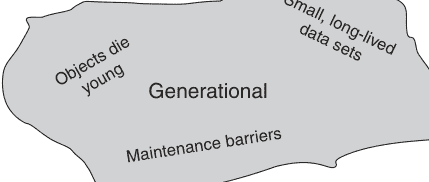

图 1.1 分代垃圾回收器的核心概念

> Charlie Hunt 是我的导师，《Java Performance》的作者，也是 [Java Performance Companion](www.pearson.com/en-us/subject-catalog/p/java-performance-companion/P200000009127/9780133396827) 的共同作者。

# 第 1 章 Java 性能演进：语言与虚拟机

大多数 HotSpot GC 在年轻代收集中采用著名的“清理（`scavenge`）”算法。HotSpot JVM 中的 `Serial GC` 使用单个垃圾回收线程来高效回收年轻代空间内的内存。相比之下，`Parallel GC`（吞吐量收集器）、`G1 GC` 和 `CMS GC` 等分代收集器利用了多个 GC 线程。

## 老年代收集与回收触发器

HotSpot VM 分代 GC 中的老年代回收算法针对吞吐量、响应能力或两者的结合进行了优化。`Serial GC` 采用单线程的标记-清除-压缩（`MSC`）GC。`Parallel GC` 使用类似的多线程 `MSC` 算法。`CMS GC` 执行并发标记，将过程分为 `STW`（停顿世界）或并发阶段。标记后，`CMS` 通过执行就地释放而不进行压缩来回收老年代空间。如果发生碎片，`CMS` 会回退到 `Serial GC`。

`G1 GC` 起于 Java 7 update 4 引入并随着时间不断完善，它是增量收集器。具体来说，它增量地回收和压缩老年代空间，而不是执行 `MSC` 部分的整体回收和压缩。`G1` 将堆划分为更小的区域（`regions`），并在收集周期期间对部分区域进行垃圾回收，这有助于维持更可预测的暂停时间，同时处理压缩。

在多次年轻代收集后，老年代开始填充，垃圾回收介入以回收老年代空间。为做到这一点，必须由以下情况触发全标记周期：(1) 晋升失败；(2) 普通大小对象的提升导致老年代或总堆超过标记阈值；或 (3) 大对象分配（在 `G1 GC` 中也称为巨型对象分配）导致堆占用率超过预设阈值。

`Shenandoah GC` 和 `ZGC`——分别于 JDK 12 和 JDK 11 引入——是超低延迟收集器，旨在最小化 `STW` 停顿。在 JDK 17 中，它们是单代收集器。除了使用线程本地握手外，这些收集器知道如何通过让应用线程提供帮助或要求应用线程退避，来针对低停顿场景进行优化。这种 GC 技术被称为“优雅降级”。

## Parallel GC 线程、Concurrent GC 线程及其配置

在 HotSpot VM 中，GC 工作线程的总数（也称为并行 GC 线程）是根据启动时 Java 进程可用的处理器核心数按比例计算的。用户可以通过在命令行中指定 `-XX:ParallelGCThreads=` 来调整并行 GC 线程数。

此配置标志允许开发者为使用并行收集阶段的 GC 算法定义 GC 线程数量。这对于调优分代 GC（如 `Parallel GC` 和 `G1 GC`）特别有用。最近添加的 `Shenandoah` 和 `ZGC` 也使用多个 GC 工作线程，并与应用线程并发执行垃圾回收，以最小化停顿时间。它们受益于负载均衡、工作共享和工作窃取（`work stealing`），这些技术通过并行化垃圾回收过程增强了性能和效率。

这种并行化对于在多核心处理器上的应用程序特别有益，因为它允许更好地利用硬件资源。

类似的，`-XX:ConcGCThreads=n` 配置标志允许开发者为使用并发收集阶段的 GC 算法指定并发线程的数量。这对于调优分代 GC（如 `Parallel GC` 和 `G1 GC`）特别有用。最近添加的 `Shenandoah` 和 `ZGC` 也使用多个 GC 工作线程，并与应用线程并发执行垃圾回收，以最小化停顿时间。

默认情况下，并行 GC 线程数根据可用 CPU 核心数计算。并发 GC 线程通常是并行线程数的四分之一。然而，用户可能需要调整并行或并发 GC 线程的数量，以更好地符合应用程序的性能需求和可用硬件资源。

增加并行 GC 线程有助于提高吞吐量，因为多个线程同时处理垃圾回收过程的并行阶段，但开发者应注意不要过度提交资源。

相比之下，增加并发 GC 线程可以增强 GC 性能并加速周期，因为多个线程同时处理并发阶段，可能会以增加 CPU 利用率为代价提高容量。

相反，减少并行或并发 GC 线程可能会降低 CPU 利用率并导致更长的停顿时间，影响应用程序性能。在某些情况下，如果收集器无法跟上应用程序分配对象的速率（这种情况被称为 GC“输掉了比赛”），可能会导致优雅降级——即 GC 回退到一种不那么优但更可靠的操作模式，例如 `STW` 收集模式，或者可能采用限制分配速率的策略来防止其过载收集器。

图 1.2 显示了与 GC 工作相关的核心概念词云：

- *任务队列（Task queues）*：强调了 GC 使用来管理和分配工作的机制。
- *并发工作（Concurrent work）*：强调了 GC 与应用线程同时执行的操作，旨在最小化停顿时间。
- *优雅降级（Graceful degradation）*：指 GC 在无法跟上应用程序分配对象的速率时，切换到不那么优但更可靠的操作模式的能力。
- *停顿（Pauses）*：强调了暂停应用线程以允许 GC 执行某些任务的 `STW` 事件。
- *窃取（Stealing）*：强调了空闲 GC 线程从忙碌线程的工作队列中“窃取”工作的策略，以确保高效的负载均衡。
- *大量线程（Lots of threads）*：强调了 GC 使用多个线程来并行化垃圾回收过程并提高吞吐量。

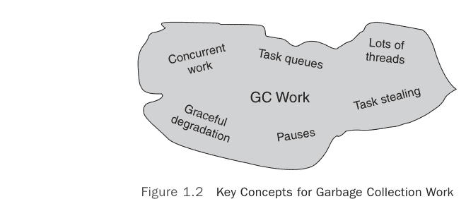

在并行和并发 GC 线程与应用程序性能之间找到正确的平衡至关重要。开发者应该进行性能测试和监控，以确定适用于特定用例的最优配置。在调优这些线程时，应考虑可用 CPU 核心数、应用程序负载的性质以及垃圾回收吞吐量与应用程序响应速度之间所需的平衡。

## Java 编程语言及其生态系统的演变：深入观察

Java 自 1.0 早期以来一直在稳步发展。为了理解 JVM（特别是 HotSpot VM）的进步，理解 Java 编程语言及其生态系统的演变至关重要。深入语言特性、库、框架和工具如何塑造并影响 JVM 的性能优化和垃圾回收策略，将有助于我们掌握大背景。

### Java 1.1 到 Java 1.4 (J2SE 1.4.2)

Java 1.1（最初称为 JDK 1.1）引入了 JavaBeans，允许将多个对象封装在一个 bean 中。该版本还引入了 Java 数据库连接 (`JDBC`)、远程方法调用 (`RMI`) 和内部类。这些特性为更复杂的应用程序奠定了基础，从而改进了 JVM 性能和垃圾回收策略。

从 Java 1.2 到 5.0，发布版本被重命名以包含版本名称，产生了如 J2SE（平台版、标准版）之类的名称。重命名有助于区分 Java 2 微型版 (`J2ME`) 和 Java 2 企业版 (`J2EE`)。`J2SE 1.2` 为 Java 引入了两个重大改进：集合框架 (`Collections Framework`) 和 JIT 编译器。集合框架提供了“一种用于注册和操作集合的统一架构”，这对于管理大规模数据结构和优化 JVM 中的内存管理变得至关重要。

> ⁶ www.oracle.com/java/technologies/javase/javanaming.html
> ⁷ Collections Framework Overview. https://docs.oracle.com/java/8/docs/technotes/guides/collections/overview.html.

Java 1.3 (`J2SE 1.3`) 为集合框架增加了新的 API，引入了 `Math` 类，并将 HotSpot VM 设为默认 JVM。包含了一个目录服务 API，用于查找任何目录或名称服务。这些增强通过启用更高效的数据管理和交互模式进一步影响了 JVM 的效率。

Java 1.4 (`J2SE 1.4`) 基于 Java 规范请求 (`JSR`) #58 引入了新的输入/输出 (`NIO`) API，显著提高了 I/O 操作效率。这一增强缩短了 I/O 任务的等待时间，并整体提升了 JVM 性能。Java 1.4 还引入了日志 API，允许生成文本或 XML 格式的日志消息，并将其定向到文件或控制台。

`J2SE 1.4` 很快被 `J2SE 1.4.2` 取代，后者在 HotSpot 的客户端和服务器编译器中包含了许多性能增强。增加了安全性增强，并且 Java 用户通过 Java 插件控制面板的更新选项卡接触到了 Java 更新。随着 Java 语言及其生态系统的持续改进，JVM 性能策略不断演进，以适应日益复杂且对资源要求更高的应用程序。

### Java 5 (J2SE 5.0)

Java 语言在发布 Java 5.0 后在语言精炼方面迈了首次重大飞跃。该版本引入了几个关键特性，包括泛型、自动装箱/拆箱、注释和增强 for 循环。

#### 语言特性

泛型引入了两个主要变化：(1) 语法改变 (2) 核心 API 的修改。泛型允许你为不同的数据类型重用代码，这意味着你只需要编写一个类——不需要为不同的输入重写它。

要编译增强了泛型的 Java 5.0 代码，你需要使用 Java 编译器 `javac`，它是随 Java 5.0 JDK 一起打包的（Java 5.0 任何版本都没有这些核心 API）。如果在编译时检测到任何类型安全违反，新的 Java 编译器将产生错误。因此，泛型为 Java 引入了类型安全。它还消除了显式转换的需求，因为转换已变为隐式。

以下是在 Java 5.0 中创建一个名为 `FreshmenAdmissions` 的泛类的示例：

```java
class FreshmenAdmissions<K, V> {
  //..
}
```

> ^8 https://jcp.org/en/jsr/detail?id=51

在示例中，`K` 和 `V` 是对象实际类型的占位符。类 `FreshmenAdmissions` 是一个泛型。如果我们声明此泛型类型的实例而未指定 `K` 和 `V` 的实际类型，那么它被认为是泛型 `FreshmenAdmissions<K, V>` 的原始类型 (`raw type`)。原始类型存在于泛型，并在特定类型未知时使用。

```java
FreshmenAdmissions applicationStatus;
```

然而，假设我们用实际类型声明实例：

```java
FreshmenAdmissions<String, Boolean>
```

那么 `applicationStatus` 被称为参数化类型——具体来说，它是基于类型 `String` 和 `Boolean` 参数化的。

```java
FreshmenAdmissions<String, Boolean> applicationStatus;
```

> 注意：许多 C++ 开发者可能会看到角括号 `< >` 并立即联想到 C++ 模板。虽然 C++ 和 Java 都使用泛型，但 C++ 模板像是一种编译时机制，其中泛型被实际类型替换。在 Java 中，泛型是通过类型擦除来实现的。

以下是完整示例（使用 Java 5.0）：

```java
class FreshmenAdmissions<K, V> {
    private K key;
    private V boolNumValue;

    public void admissionInformation(K name, V value) {
        key = name;
        boolNumValue = value;
    }

    public V getApprovalInfo() {
        return boolNumValue;
    }

    public K getApprovedName() {
        return key;
    }
}
```

```java
public class GenericExample {
    public static void main(String[] args) {
        FreshmenAdmissions<String, Boolean> applicationStatus;
        applicationStatus = new FreshmenAdmissions<String, Boolean>();
        FreshmenAdmissions<String, Integer> applicantRollNumber;
        applicantRollNumber = new FreshmenAdmissions<String, Boolean>();
        applicationStatus.admissionInformation("Annika", true);

        if (applicationStatus.getApprovalInfo()) {
            applicantRollNumber.admissionInformation(applicationStatus.getApprovedName(), 4);
        }

        System.out.println("Applicant " + applicantRollNumber.getApprovedName() +
            " has been admitted with roll number of " + applicantRollNumber.getApprovalInfo());
    }
}
```


# 第1章 Java 的性能演变：语言与虚拟机

图 1.3 显示了一个类图，用于可视化类之间的关系。在图中，`FreshmenAdmissions` 类有三个方法：`admissionInformation(K,V)`、`getApprovalInfo():V` 和 `getApprovedName():K`。`GenericExample` 类使用了 `FreshmenAdmissions` 类并有一个 `main(String[] args)` 方法。

| FreshmenAdmissions |
| :--- |
| admissionInformation(K, V) |
| getApprovalInfo(): V |
| getApprovedName(): K |
| GenericExample |
| main(String[] args) |

图 1.3 展示 FreshmenAdmission 类的泛型示例

### JVM 与包的增强

Java 5.0 还为 `java.lang.*` 和 `java.util.*` 包引入了重大改进，并按照 JSR 166 的规定添加了大多数并发工具类。

“垃圾收集工程学”（Garbage collection ergonomics）是 J2SE 5.0 中提出的术语；它指的是用于服务器级机器的默认收集器[^10]。默认收集器选择了并行 GC（parallel GC），并自动设置了并行 GC 的初始和最大堆大小的默认值。

> 注意：J2SE 5.0 的并行 GC 不对老年代进行并行压缩。因此，只有年轻年代可以进行清理；老年代仍将采用串行 GC 算法 MSC。

Java 5.0 还引入了增强型循环，称为 for-each 循环，它极大简化了数组和集合的迭代。这种新的循环语法自动处理迭代，不需要显式地操作索引或调用迭代器（`iterator`）方法。增强型循环比传统的 for 循环更简洁且不易出错，是该语言的一项极高价值补充。

```java
List<String> names = Arrays.asList("Monica", "Ben", "Annika", "Bodin");

for (String name : names) {
    System.out.println(name);
}
```

[^9]: Java 社区进程。JSRs：Java 规范请求，详见 JSR# 166。https://jcp.org/en/jsr/detail?id=166。
[^10]: https://docs.oracle.com/java/8/technotes/guides/vm/server-class.html

### 探究 Java 编程语言及其生态系统的演变：深入观察

在这个示例中，增强型 for 循环遍历 `names` 列表的元素，并将每个元素依次赋值给 `name` 变量。这比使用基于索引的循环或迭代器要清晰得多、易读得多。

Java 5.0 对 `java.lang` 包进行了若干增强，包括引入了注解（annotations），这允许在 Java 源代码中添加元数据。注解提供了一种向类、方法和字段等代码元素附加信息的方法。它们可以被 Java 编译器、运行时环境或各种工具用于生成额外的代码、强制执行编码规则或用于调试。`java.lang.annotation` 包包含了定义和处理注解所需的类和接口。一些内置注解包括 `@Override`、`@Deprecated` 和 `@SuppressWarnings`。

`java.lang` 包的另一个新增是 `java.lang.instrument` 包，它使得 Java 代理（agents）能够监控 JVM 上运行的程序。新服务让开发者能够监控和管理 Java 应用程序的执行情况，从而对代码的行为和性能提供洞察。

## Java 6 (Java SE 6)

Java 6 也称为 Mustang，主要侧重于 Java API 的添加和增强。特别是它为集合框架（Collections Framework）引入了更多接口，并改进了 JVM。有关 Java 6 的更多信息，请参阅驱动程序 JSR 270[^12]。

Java 6 引入的并行集合（Parallel collection）允许使用多个 GC 工作线程来执行分代堆中老年代的压缩。这一特性通过缩短垃圾回收所需时间显著提升了 Java 应用程序的性能。该特性的性能影响是深远的，因为它允许更高效的内存管理，从而提高了 Java 应用程序的可扩展性和响应速度。

### JVM 增强

Java 6 在改进脚本语言支持方面取得了巨大进步。引入了 `javax.script` 包，允许开发者在 Java 应用程序中嵌入并执行脚本语言。这是一个使用 ScriptEngine API 执行 JavaScript 代码的示例：

```java
import javax.script.ScriptEngine;
import javax.script.ScriptEngineManager;
import javax.script.ScriptException;

public class ScriptingExample {
    public static void main(String[] args) {
        ScriptEngine manager = new ScriptEngineManager();
        ScriptEngine engine = manager.getByName("JavaScript");
        try {
            engine.put("score", applicantGPA.getApprovalInfo());
            var gpa = engine.eval("score");
        } catch (ScriptException e) {
            e.printStackTrace();
        }
    }
}
```

[^11]: Oracle. “Java SE 6 特性与增强”。https://www.oracle.com/java/technologies/javase/features.html。
[^12]: Java 社区进程。JSRs：Java 规范请求，详见 JSR# 270。https://www.jcp.org/en/jsr/detail?id=270。

```java
FreshmanAdmissions<String, Integer> applicantGPA;
applicantGPA = new FreshmanAdmissions<String, Integer>();
```

Java SE 6 还引入了 Java 编译器 API（JSR 199[^13]），允许开发者通过编程调用 Java 编译器。使用 `FreshmanAdmissions` 示例，我们可以编译应用程序源文件：

```java
import javax.tools.JavaCompiler;
import javax.tools.ToolProvider;
import java.io.File;

public class CompilerExample {
    public static void main(String[] args) {
        JavaCompiler compiler = ToolProvider.getSystemCompiler();
        int result = compiler.run(null, null, null, "path/to/FreshmanAdmissions.java");
        if (result == 0) {
            System.out.println("Congratulations! You have successfully compiled your program");
        } else {
            System.out.println("Apologies, your program failed to compile");
        }
    }
}
```

[^13]: Java 社区进程。JSRs：Java 规范请求，详见 JSR# 199。https://jcp.org/en/jsr/detail?id=199。

图 1.4 是这两个类及其关系的视觉表示。

| FreshmanAdmissions | CompilerExample |
| :--- | :--- |
| admissionInformation(K, V) | main(String[] args) : void |
| getApprovalInfo(): V | |
| getApprovedName(): K | |
| ScriptingExample | |
| main(String[] args) : void | |

### Script Engine API 与 Compiler API

此外，Java SE 6 通过添加 JAXB 和 JAX-WS 增强了网络服务的支持，简化了服务的创建和消费。

## Java 7 (Java SE 7)

Java 7 标志着 Java 演变的另一个重要里程碑，对语言和虚拟机引入了许多增强。这些增强对于理解现代开发至关重要。

### 语言特性

Java 7 引入了钻石运算符 `<>`，简化了泛型推断。该运算符增强了代码的可读性并减少了冗余。例如，在声明 `FreshmanAdmissions` 实例时，不再需要指定两次类型：

```java
// Java 7 之前
FreshmanAdmissions<String, Boolean> applicationStatus = new FreshmanAdmissions<String, Boolean>();

// 使用 Java 7
FreshmanAdmissions<String, Boolean> applicationStatus = new FreshmanAdmissions<>();
```

另一个重大新增是 `try-with-resources` 语句，它实现了资源管理，减少了资源泄漏的可能性。实现了 `java.lang.AutoCloseable` 的资源可以使用此语句，并在需要时自动关闭。

Project Coin[^14] 是 Java SE 7 的一部分，引入了若干小型但影响巨大的增强，包括改进的字面量、switch 语句对字符串的支持，以及通过 `try-with-resources` 和多异常 catch 块增强的错误处理。压缩对象指针（OOPs）、逃逸分析和分层编译等性能改进也在此期间出现。

[^14]: Project Coin: https://openjdk.org/projects/coin/。

### JVM 增强

Java SE 7 在 NIO 之基础上增强了 NIO，为 I/O 提供了更好的支持。此外，源自 JSR 166 并发工具的 fork/join 框架被纳入 Java 7 的并发工具中。这个强大的框架通过将任务递归分解为更小的可管理的子任务并管理结果，实现了任务的高效并行处理。

Java 中的 fork/join 框架让我想起学生时代参加的一次编程竞赛。该活动是为计算机科学与工程（IEEE）的学生举办的为期一天的挑战，我和同伴决定单独解决竞赛中的题目。我专注于一个需要优化二分排序算法的题目。经过一些努力，我成功地大幅改进了该算法，使其成为竞赛中提出的最高效解决方案之一。

这次经历是对分治和排序力量的实际演示——这一概念是 Java fork/join 框架的核心原理。在下面的 fork/join 示例中，你可以看到该框架是如何通过将任务分为更小的子任务并随后统一它们来高效处理任务的。

```java
// 创建录取学生的 GPA 列表
List<Integer> admittedStudents = Arrays.asList(95, 88, 86, 76, 93, 84, 91);

// 使用 fork/join 框架计算平均 GPA
ForkJoinPool forkJoinPool = new ForkJoinPool();
AverageGTask averageGTask = new AverageGTask(admittedStudents, 0, admittedStudents.size());
double averageGPA = forkJoinPool.invoke(averageGTask);
System.out.println("GPA of admitted students is: " + averageGPA);
```

在这个示例中，我们定义了一个继承 `RecursiveTask<Double>` 的自定义类 `AverageGTask`。它的设计旨在通过递归地将 GPA 拆分为更小的任务，来计算部分学生的平均 GPA——这种方法让我想起了我在竞赛期间完善的分治方法。一旦任务规模足够小，可以直接进行计算。`AverageGTask` 的 `compute()` 方法负责对这些结果进行除法以及随后的合并，以确定整体平均 GPA。

以下是 `AverageGTask` 类的一个简化版本：

```java
class AverageGTask extends RecursiveTask<Double> {
    private final List<Integer> studentGPAs;
    private final int start;
    private final int end;

    AverageGTask(List<Integer> studentGPAs, int start, int end) {
        this.studentGPAs = studentGPAs;
        this.start = start;
        this.end = end;
    }

    @Override
    protected Double compute() {
        // 如果任务太大则对其进行拆分，如果足够小则直接计算
        // 合并子任务的结果
    }
}
```


在代码中，我们创建了一个 `AverageGPATask` 实例来计算所有录取学生的平均 GPA。然后，我们使用 `ForkJoinPool` 来执行此任务。`ForkJoinPool` 的 `invoke()` 方法会启动任务并积极等待其完成，调用 `sort()` 函数并等待排序后的数组，从而返回计算结果。这是如何使用 fork/join 框架来增强 Java 效率的极佳示例。

图 1.5 展示了类及其关系的视觉化表示。在图中，共有两个类：`FreshmanAdmissions` 和 `AverageGPATask`。`FreshmanAdmissions` 类具有设置录取信息、获取批准信息以及获取已批准名称的方法。计算平均 GPA 的 `AverageGPATask` 类拥有一个返回 `Double` 的 `compute` 方法。`ForkJoinPool` 类使用 `AverageGPATask` 类来计算平均 GPA；而 `FreshmanAdmissions` 类则使用 `AverageGPATask` 来计算录取学生的平均 GPA。

## 第1章 Java 的性能演进：语言与虚拟机

| FreshmanAdmissions | |
| :--- | :--- |
| admissionInformation(K, V) | getApprovalInfo() : V |
| getApprovedName() : K | |
| calculates | |
| AverageGPATask | |
| compute(): Double | |
| used by | |
| ForkJoinPool | |
| invoke(AverageGPATask) : double | |

图 1.5 一个详细的 ForkJoinPool 示例

Java SE 7 还为垃圾回收带来了重大的增强。并行 GC 变得 NUMA 感知，优化了在具有非统一内存访问（NUMA）架构的系统上的性能。其核心在于，NUMA 通过考虑内存与处理单元（如 CPU 或核心）之间的物理接近性来提高内存访问效率。在引入 NUMA 之前，计算机表现出统一的内存访问模式，所有处理单元访问其本地内存（物理距离更近的内存）的速度都快于访问远远的非本地内存，后者可能紧邻其他处理器或在多个核心之间共享。理解 NUMA 感知垃圾回收的复杂性对于优化运行在 NUMA 系统上的 Java 应用程序至关重要。（如需深入探讨 GC 中的 NUMA 感知性，请参阅第 6 章《OpenJDK 中的高级管理与垃圾回收》。）

在典型的设置中，内存访问时间可能会变化，因为数据必须穿越系统内部某些路径（或“跳跃”）。这些“跳转”指的是不同节点之间的数据传输。本地内存访问是直接且快得多（跳转次数较少），而访问位于处理器更远处的非本地内存则会产生额外的跳转，由于遍历路径较长，这会导致延迟增加。这种架构在具有多个处理器的系统中特别具有优势，因为它通过利用接近性因子，最大化了内存利用的效率。

## Java 语言的演进及其生态系统：深度解析

注意我参与 NUMA 感知垃圾回收实现的首次是在我任职 AMD 期间。我参与了 AMD Opteron 处理器的性能刻表工作，这是一款将 NUMA 架构引入主流的开创性产品。Opteron 的设计具有集成的内存控制器和 HyperTransport 互连技术，这允许处理器与内存之间进行直接、高速的连接。这种设计使得 Opteron 成为 NUMA 系统的理想选择，并被用于许多高性能服务器，包括 Sun Micros 的 V402。V402 是由 Sun Micros 使用 AMD Opteron 处理器构建的高性能服务器。它是一个 NUMA 系统，因此可以从 NUMA 感知垃圾回收中显著获益。我在支持 JDK 团队方面发挥了关键作用，提供了跨流量和多 JVM 流量的数据，以及关于交错内存的见解，以说明如何摊内存节点之间跳转的延迟。

为了证实这一功能的益处，我为 HotSpot VM 实现了一个支持 `-XX:+LargePages` 的原型，它支持 Linux 上的大页（也称为 HugeTLB）以及 `numactl` API（这是一种在 Linux 系统上控制 NUMA 策略的工具）。它是通过 NUMA 感知 GC 可实现的潜在改进的切实证明。

当并行 GC 具有 NUMA 感知时，它会优化处理内存的方式以提高 NUMA 系统上的性能。新生代的 Eden 区分配在 NUMA 感知区域内。换句话说，当创建一个对象时，它被放置在执行该对象的线程的本地 Eden 区中。这可以显著提高性能，因为访问本地内存比访问非本地内存快。

幸存区和老年代在内存中是页交错的。页交错是一种用于将内存页分布在 NUMA 系统中不同节点上的技术。

## 第1章 Java 的性能演进：语言与虚拟机

Java SE 7 还为垃圾回收带来了重大的增强。并行 GC 变得 NUMA 感知，优化了在具有非统一内存访问（NUMA）架构的系统上的性能。其核心在于，NUMA 通过考虑内存与处理单元（如 CPU 或核心）之间的物理接近性来提高内存访问效率。在引入 NUMA 之前，计算机表现出统一的内存访问模式，所有处理单元访问其本地内存（物理距离更近的内存）的速度都快于访问远远的非本地内存，后者可能紧邻其他处理器或在多个核心之间共享。理解 NUMA 感知垃圾回收的复杂性对于优化运行在 NUMA 系统上的 Java 应用程序至关重要。（如需深入探讨 GC 中的 NUMA 感知性，请参阅第 6 章《OpenJDK 中的高级管理与垃圾回收》。）

在典型的设置中，内存访问时间可能会变化，因为数据必须穿越系统内部某些路径（或“跳跃”）。这些“跳转”指的是不同节点之间的数据传输。本地内存访问是直接且快得多（跳转次数较少），而访问位于处理器更远处的非本地内存则会产生额外的跳转，由于遍历路径较长，这会导致延迟增加。这种架构在具有多个处理器的系统中特别具有优势，因为它通过利用接近性因子，最大化了内存利用的效率。

Java 8 扩展了注解以覆盖任何使用类型的地方，这种功能被称为类型注解。这有助于增强语言的表达能力灵活性。例如，我们可以使用类型注解来指定学生列表应只包含非空 Integer：

```java
private List<@NonNull Integer> studentsGPA;
```

# Java 编程语言及其生态系统的演变：深度解析

在此示例中，调用了 `stream` 方法从列表中创建流，使用 `mapToInt` 配合 `Student::getGPA` 将每个 `Student` 对象转换为 GPA（整数），计算这些整数的平均值，或者如果流为空且无法计算平均值，则提供默认值 0。

Java 8 的另一项增强是在接口中引入了默认方法（default methods），这允许开发者在不破坏现有实现的情况下添加新方法，增加了接口设计的灵活性。如果我们为任务定义一个接口，可以使用默认方法来为某些方法提供标准实现。如果大多数任务需要执行一组通用操作，这将非常有用。例如，我们可以定义一个 `ComputableTask` 接口，并包含一个 `logStart` 默认方法，在任务开始时记录日志：

```java
public interface ComputableTask {

    default void logStart() {

        System.out.println("Task started");

    }

    Double compute();

}
```

这个 `ComputableTask` 接口可以由任何表示任务的实现，提供了记录任务开始的标准方式，并确保每个任务都可以被计算。例如，我们的 `AverageGPATask` 类可以实现 `ComputableTask` 接口：

```java
class AverageGPATask extends RecursiveTask<Double> implements ComputableTask {

    // ...

}
```

## JVM 增强

在 JVM 上，Java 8 移除了永久代（Permanent Generation, PermGen），该空间之前用于存储类元数据以及与任何实例关联的对象信息。PermGen 经常因为内存泄漏和需要手动调优而导致问题。在 Java 8 中，它被元空间（Metaspace）取代，元空间位于原生内存中，而不是 Java 堆上。这一变化消除了许多与 PermGen 相关的问题，并提升了 JVM 的整体性能。第 8 章“使用 OpenJDK HotSpot 加速达到稳定状态”将更详细讨论 Metaspace。

JDK 8 引入的另一项重要优化是字符串去重（String Deduplication），这是一个专门为 G1 GC 设计的功能。在 Java 中，`String` 对象是不可变的，这意味着一旦创建，其内容就无法更改。这种特性经常导致多个包含相同字符序列的 `String` 对象。虽然这些重复对象不会影响程序的正确性，但它们会增加内存占用，并可能由于更高的垃圾回收开销间接影响性能。

字符串去重通过在 GC 周期扫描 Java 堆来解决重复 String 对象的问题。它识别重复字符串并将其替换为规范实例（canonical instance）的引用。通过减少整个堆的大小和活跃对象的数量，可以缩短 GC 停顿时间，有助于降低尾延迟（该功能在第 6 章有详细讨论）。要使用 G1 GC 启用字符串去重功能，可以添加以下 JVM 选项：

```bash
-XX:+UseG1GC -XX:+UseStringDeduplication
```

## Java 9 (Java SE 9) 到 Java 16 (Java SE 16)

## Java 9：Project Jigsaw、JShell、AArch64 以及改进的竞争锁

Java 9 为 Java 平台带来了多项重大增强。最显著的引入是 Project Jigsaw，它实现了一个模块系统，增强了平台的扩展性和可维护性。我们在第 3 章“从单体到模块化 Java：回顾与持续演变”中将深入探讨模块化。

Java 9 还引入了 JShell。

以下是你可能使用 JShell 的示例：

```bash
$ jshell

| Welcome to JShell -- Version 17.0.7

| For an introduction type: /help intro

\jshell> /set feedback verbose

| Feedback mode: verbose

\jshell> boolean trueM == false

trueM == false

| Created variable trueM: boolean

\jshell> boolean Day(char c) {

...> return (c == 'Y');

...>

| Created method Day(char)

jshell> System.out.println("Did you wake up before 9 AM? (Y/N)")

Did wake up before 9 AM? (Y/N)

> 23 https://openjdk.org/projects/jigsaw
```

```bash
jshell> trueM = Day((char) System.in.read())
Y
trueM = true
```

```bash
jshell> System.out.println("It is true " + trueM + " that you are a morning person")
Is it true that you are a morning person
```

在此示例中，我们首先将 `trueM` 初始化为 `false`，然后定义了 `Day()` 方法，该方法根据 `c` 的值返回 `true` 或 `false`。我们使用 `System.out.println` 提问并读取输入。提供 `Y` 作为输入，因此 `trueM` 被求值为 `true`。

JShell 还提供了 `/list`、`/vars`、`/methods` 和 `/imports` 等命令，提供了关于当前会话的有用信息。例如，`/list` 显示你输入的所有代码：

```bash
jshell> /list

1: boolean trueM = false;
2: boolean Day(char c) {
   return (c=='Y');
}
3: System.out.println("Did you wake up before 9 AM? (Y/N)");
4: trueM = Day((char) System.in.read());
5: System.out.println("It is true " + trueM + " that you are a morning person")
```

```bash
jshell> /vars
trueM = true
```

```bash
jshell> /methods
Day
boolean Day(char c)
```

```bash
jshell> /imports
import java.util.*
import java.math.*
import java.net.*
import java.nio.file.*
import java.util.*
import java.util.concurrent.*
```

## Java 的性能演变：语言与虚拟机

Java 9 添加了 AArch64（也称为 Arm64）移植，为 OpenJDK 提供了对 64 位架构的官方支持。这扩展了 Java 在生态系统中的范围，使其能够在包括处理器在各种设备上运行。此外，Java 9 通过 JEP 143：改进竞争锁（Contended Locking）优化了锁，提高了高度依赖同步的 Java 应用的性能。在第 7 章“运行时性能优化：锁及其他”中，我们将更深入地观察锁。

## 发布周期与持续改进

从 Java 9 开始，OpenJDK 社区决定将发布周期改为更可预测的六个月周期。因此，开发者可以更快地从语言和生态系统的频繁更新中受益。

## Java 10：局部变量推断与 G1 GC

Java 10 通过 `var` 关键字引入了局部变量推断。此功能允许 Java 编译器从初始化器推断变量类型，从而简化了代码并使其更具可读性。这是一个示例：

```java
// Java 10 之前
List<Student> admittedStudents = new ArrayList<>();

// Java 10 使用 'var'
var admittedStudents = new ArrayList<>();
```

在此示例中，`var` 关键字用于声明变量 `admittedStudents`，因此你不需要显式声明它。

> 4 https://openjdk.org/jeps/143

```java
// 使用 'var' 对 admittedStudents 进行局部变量推断
var filteredList = admittedStudents.stream().filter(s -> s.getGPA() > 3).collect(Collectors.toList());
```

在前示例中，`var` 用于涉及流操作的复杂场景。编译器从流操作的结果推断出 `filteredList` 的类型。

除了处理局部变量推断外，Java 10 通过启用并行全 GC 改进了 GC。这增强了垃圾回收的效率，特别是对于大堆应用以及那些遭受病态情况导致迁移失败并触发回退的应用。

## Java 11：新的 HTTP 客户端与字符串方法、Epsilon 和 Z GC

Java 11 作为一个长期支持（LTS）版本，为 Java 平台引入了各种改进，增强了其性能和实用性。该版本中的一个重大新增是 Epsilon GC，这是一种实验性的“无 GC”机制，用于测试在最小 GC 干扰下的应用性能。Epsilon GC 允许开发者理解垃圾回收对其应用性能的影响，帮助他们在调优和优化方面做出明智决策。

```bash
$ java -XX:+UnlockExperimentalOptions -XX:+UseEpsilonGC -jar MyApp.jar
```

Epsilon GC 是 JVM 的一个独特新增。它管理内存分配，但不实现任何实际的回收过程。使用这种 GC，一旦 Java 堆被用尽，JVM 就会关闭。虽然这种行为看起来不寻常，但在某些场景下非常有用——例如对于生命周期极短的微服务。此外，对于负担得起内存占用的超延迟应用，Epsilon GC 可以帮助避免所有的标记、移动和压缩，从而消除性能开销。这种精简的行为使其成为测试应用程序内存压力以及理解虚拟机/内存屏障开销的优秀工具。


# Java 11 的 JVM 增强：ZGC

Java 11 的另一项 JVM 增强是 Z 垃圾回收器（ZGC），它最初作为实验功能可用。ZGC 是一种低延迟、可扩展的 GC，旨在以极小的停顿时间处理大堆。通过为内存需求大的应用提供更好的垃圾回收性能，ZGC 允许开发者创建有效管理内存资源的高性能应用。（我们将在本书的第 6 章深入探讨 ZGC。）

请记住这些 GC 在 JDK 11 中是实验性的，因此需要使用 `-XX:+UnlockExperimentalVMOptions` 标志来启用它们。以下是 ZGC 的示例：

```bash
$ java -XX:+UnlockExperimentalOptions -XX:+UseZGC -jar MyApp.jar
```

> [25] https://blogs.oracle.com/magazine/post/epsilon-the-jk-do-nothing-garbage-collector

# 第 1 章 Java 的演变：语言与虚拟机

## Java 11：HTTP 客户端 API 与 String 方法增强

除了 JVM 的增强外，Java 11 还引入了一个新的 HTTP 客户端 API，支持 HTTP/2 和 WebSocket。该 API 改进了性能，并为 `HttpURLConnection` API 提供了一个现代的替代方案。作为一个示例，我们使用了与从远程 API 获取学生课外活动相关的代码：

```java
HttpClient client = HttpClient.newHttpClient();
HttpRequest request = HttpRequest.newBuilder()
    .uri(URI.create("http://students-extracurricular.com/"))
    .build();

client.sendAsync(request, HttpResponse.BodyHandlers.ofString())
    .thenApply(System.out::println);
```

在这个示例中，我们正在向 `http://students-extracurricular.com/students` 发送 GET 请求以获取课外活动数据。响应是异步处理的，当接收到数据时，会被打印到控制台上。与旧的 `HttpURLConnection` API 相比，这个新 API 提供了一种更现代、更高效的 HTTP 请求方式。

此外，Java 11 增加了新的 String 方法，如 `strip()`、`repeat()` 和 `isBlank()`。让我们来看一下示例代码，看看如何使用这些方法来增强它：

```java
// 我们有带有前后空格的学生名字
List<String> studentNames = Arrays.asList(" Monica ", " Ben ", " Annika ", " Bododin ");

// 我们可以使用 strip() 来清理名字
List<String> cleanedNames = studentNames.stream()
    .map(String::strip)
    .collect(Collectors.toList());

// 现在假设我们想创建一个让每个名字重复三次的字符串
// 我们可以使用 repeat() 方法来实现
List<String> repeatedNames = cleanedNames.stream()
    .map(name -> name.repeat(3))
    .collect(Collectors.toList());

// 并且假设我们想检查任何一个名字在去除空格后是否为空
// 我们可以使用 isBlank() 方法来实现
boolean hasBlankName = cleanedNames.stream()
    .anyMatch(String::isBlank);
```

这些增强以及许多其他改进，使得 Java 11 成为开发高性能应用程序的稳健且高效的平台。

## Java 12：Switch 表达式与 Shenandoah GC

Java 引入了 Shenandoah GC 作为一项实验性功能。与 ZGC 类似，Shenandoah GC 专为具有低延迟要求的大内存设计。这一改进提升了延迟敏感型应用程序的 JVM 性能。要启用 Shenandoah GC，可以使用以下 JVM 选项：

```bash
$ java -XX:+UnlockExperimentalOptions -XX:+UseShenandoahGC -jar myApplication.jar
```

Java 12 将 switch 表达式作为预览特性引入，简化了 switch 语句并使其更具读性和简洁性：

```java
String adminResult = switch (status) {
  case "accepted" -> "Congratulations";
  case "rejected" -> "Better luck next time.";
  default -> "Awaiting decision.";
}
```

在 Java 14 中，你还可以选择使用 `yield` 关键字从 switch 块返回值。当你在 case 块中有多个语句时，这被特别有用。这里有一个示例：

```java
String adminResult = switch (status) {
  case "accepted" -> {
    // 你可以在这里放置多个语句
    yield "Congratulations";
  }
  case "rejected" -> {
    // 你可以在这里放置多个语句
    yield "Better luck next time.";
  }
  default -> {
    // 你可以在这里放置多个语句
    yield "Awaiting decision.";
  }
}
```

## Java 13：文本块与 ZGC 增强

Java 13 提供了许多新功能和增强，包括将文本块（text blocks）作为预览特性引入。文本块简化了多行字符串字面量的创建，使得文本更容易阅读和格式化：

```java
String studentInfo = """
    Name: Monica Beckwith
    GPA: 3.83
    Status: Accepted
""";
```

JDK 13 还包含了 ZGC 的几项增强。例如，新的 ZGC 释放（uncommit）功能允许以更及时、高效的方式将堆外内存返回操作系统（OS）。在此之前，ZGC 会将内存释放回操作系统。

## Java 14：instanceof 模式匹配

Java 14 将 `instanceof` 的模式匹配作为预览特性引入，简化了在单个操作中检查类型并强制转换对象的代码：

```java
if (object instanceof Student student) {
    System.out.println("Name: " + student.getName());
}
```

## Java 15：密封类与隐藏类

Java 15 引入了密封类（sealed classes），允许开发者限制哪些类可以扩展或实现它们。这对类层次结构提供了更好的控制：

```java
public sealed class Student permits UndergraduateStudent, GraduateStudent, ExchangeStudent {
    // ...
}
```

相比之下，隐藏类（hidden classes）是无法通过名称发现的类，它们对于动态生成类的框架（例如数据库处理器）非常有用。

## Java 16：记录、ZGC 并发线程栈处理以及向 Arm 迁移

Java 16 引入了记录，这是一种新的类类型，简化了数据中心型类的创建。记录为定义不可变数据结构提供了简洁的语法：

```java
record Student(String name, double gpa) {}
```

模板解释器、C1 和 C2 JIT 编译器以及所有支持的 GC。我们的工作扩展了 Java 能够运行的环境范围，进一步巩固了它在技术生态系统中的地位。

此外，ZGC 在 Java 15 中演变为一个完全支持的功能。在 Java 16 中，通过 JEP 376：ZGC：并发线程栈处理[^31]，ZGC 得到了进一步的增强。这一改进将线程栈处理移动到并发阶段，显著减少了 GC 停顿——提升了管理大型数据集应用的性能。

[^31]: https://openjdk.org/jeps/376

# Java 17 (Java SE 17)

Java 17 是本书编写时最新的 LTS（长期支持）版本，它为 JVM、Java 语言和 Java 库带来了多种增强。这些改进显著提升了 Java 程序的效率、性能和安全性。

## JVM 增强：性能与效率的飞跃

Java 17 引入了若干显著 JVM 改进。JEP 356：增强型伪随机数生成器[^32] 为随机数生成提供了新的接口和实现，为 Java 应用中生成随机数提供了一种更灵活、更高效的方法。

另一个重要的改进是 JEP 382：新的 macOS 渲染流水线[^33]，它提高了 Java 在 macOS 上二维图形渲染的效率。这一新的渲染流水线利用了 macOS 的原生图形能力，为在 macOS 上运行的 Java 应用带来了更好的性能和质量。

此外，JEP 391：macOS/AArch64 端口[^34] 为 JDK 添加了 macOS/AArch64 端口。在我们 Windows/AArch64 端口的支持下，Java 能够原生运行在基于 M1 架构的 macOS 设备上，扩展了 JVM 的平台支持并提升了在该架构上的性能。

[^32]: https://openjdk.org/jeps/356
[^33]: https://openjdk.org/jeps/382
[^34]: https://openjdk.org/jeps/391

## 安全与封装增强：固化 JDK

Java 17 还试图提高 JDK 的安全性。JEP 403：强封装 JDK 内部实现[^35] 使访问并非通用用途的内部 API 变得困难。这证明了 JDK 的安全性，通过阻止使用可能在后续版本中更改或删除的内部 API，确保了与未来版本的兼容性。

Java 17 的另一个安全增强是引入了 JEP 415：特定上下文的反序列化过滤器[^36]。该功能提供了一种基于上下文防止反序列化的机制，对反序列化过程提供了更细粒度的控制。

[^35]: https://openjdk.org/jeps/403
[^36]: https://openjdk.org/jeps/415

# Java 编程语言及其生态系统的演进：深度观察

处理了与 Java 序列化机制相关的一些安全疑虑，使其更加安全。作为此改进的结果，应用开发者现在可以为每个反序列化操作构建并应用过滤器，与 Java 9 中引入的静态 JVM 过滤器相比，这种方法提供了一种更动态且特定于上下文的方法。

## 语言与库增强

Java 17 引入了若干语言和库的增强，旨在提高 Java 应用的生产力和整体效率。其中一个关键特性是 JEP 406：switch 模式匹配[^17]，它是作为预览特性引入的。它允许将 switch 语句和表达式中的常见模式以更简洁、更安全的方式表达，从而简化了代码编写。它增强了代码的可读性并减少了错误概率。

假设我们正在使用 switch 表达式根据学生的状态为学生生成一个自定义消息。使用 `String.format()` 函数将学生的名字和 GPA 插入消息中：

```java
record Student(String name, String status, double gpa) {}

// 假设我们有一个学生
Student student = new Student("Monica", "accepted", 3.83);

String admissionResult = switch (student.status()) {
  case "accepted" -> String.format("%s has been accepted with a GPA of %.2f. Congratulations!", student.name(), student.gpa);
  case "rejected" -> String.format("%s has been rejected despite a GPA of %.2f. Better luck next time.", student.name(), student.gpa);
  case "waitlisted" -> String.format("%s is waitlisted. Current GPA is %.2f. Keep your fingers crossed", student.name(), student.gpa);
  case "pending" -> String.format("%s is still pending. Current GPA is %.2f. We hope for the best.", student.name(), student.gpa);
  default -> String.format("The status of %s is unknown.", student.name());
};

System.out.println(admissionResult);
```

此外，Java 17 还包含了 JEP 412：外部函数与内存（孵化）[^18]，它提供了一个调用原生代码和处理内存的 API。我们将在后续中深入探讨……

[^17]: https://openjdk.org/jeps/406
[^18]: https://openjdk.org/jeps/412

# 第 2 章 Java 类型系统演进对性能的影响

类型系统是任何编程语言的根本方面，Java 也不例外。它决定了变量如何声明、它们如何相互作用，以及如何在你的代码中使用它们。Java 以其（强）静态类型特性而闻名。为了更好地理解它的含义，让我们拆解这个概念：

- Java 是一门静态类型检查语言：这意味着变量类型在（大部分）编译时就会进行检查。相比之下，像 JavaScript 等动态类型检查语言在运行时进行类型检查。这种静态类型检查通过在编译时捕获类型错误，有助于 Java 的性能，从而产生更健壮、高效的代码。
- Java 是一门强类型语言：这意味着如果声明的变量与赋值给它的值类型不匹配，Java 将在编译时产生错误。相比之下，C 等语言可能会隐式转换值的类型以匹配变量类型。例如，由于 C 执行了隐式转换，因此可以被视为一种（弱）静态类型语言。与之形成的是，汇编等语言是无类型的。

多年来，Java 的类型系统经历了显著的演进，每个新版本不仅让语言变得更加强大，而且更容易使用和理解。例如，Java SE 5.0 中泛型的引入允许开发者编写更类型安全的代码，减少了运行时错误的概率并提高了应用程序的健壮性。Java SE 5.0 中注解的引入为开发者提供了一种直接在代码中嵌入元数据的方法；这些元数据可以被 JVM 或其他工具用于优化功能或可扩展性。例如，Java SE 8 中引入的 `@FunctionalInterface` 表示该接口旨在用于 lambda 表达式，增加了代码的清晰度。

Java 9 中变量句柄（variable handles）的引入提供了一种更高效的方式来访问变量（如静态或实例字段、数组元素和堆外区域），通过它们的句柄进行访问。这些句柄是其对应变量的引用，并维护了一个最小可行访问集，该访问集与当前的 Java 内存模型和 C/C++11 原子操作兼容。这些标准定义了线程如何通过内存进行交互以及它们可以执行哪些原子操作。这一特性增强了需要频繁访问的应用程序的性能和扩展性。

Java 11 到 Java 17 引入 switch 表达式和密封类（sealed classes）提供了更具表现力且简洁的代码编写方式，减少了错误概率并提高了代码的可读性。最近，Project Valhalla 正在进行的工作旨在对基本类型的类和泛型进行内联。这些特性预计通过减少对象的内存占用并启用扁平化数据结构来显著提高 Java 的扩展性，通过更紧凑的格式存储数据提供了更好的效率和性能，从而减少了内存使用并提升了缓存效率。

在第 1 章“Java 的性能演进：语言与虚拟机”中，我们探讨了 Java 语言和 JVM 的性能演进。结合背景，让我们深入研究 Java 的类型系统并构建其演进的时间线。

## J2SE 5.0 之前的基本类型和字面量

基本数据类型同对象、数组共同成了 Java 中最简单类型系统的基础。语言为这些基本类型预留了关键字，例如用于整数类型的 `int`、`short`、`long` 和 `byte`。浮点数使用 `float` 和 `double` 关键字；`boolean` 表示布尔值；`char` 用于字符。`String` 对象本质上是字符组，并且在本质上是不可变的；它们在 `Java.String` 中有自己的类。各种类型的整数和浮点数类型根据其大小和范围进行区分，如表 2.1 所示。

### 表 2.1 基本数据类型

| 数据类型：关键字 | 大小 | 范围* |
|---|---|---|
| `char` | 16-bit Unicode | \u0000—ffff |
| `boolean` | N/A | true 或 false |
| `byte` | 8-bit signed | -128 < b ≤ 127 |
| `short` | 16-bit signed | -32768 < s ≤ 32767 |
| `int` | 32-bit signed | (-2³¹)~(2³¹ – 1)* |
| `long` | 64-bit | (-2⁶³)~(2⁶³ – 1) |
| `float` | 32-bit 单精度 | 参见 [1] |
| `double` | 64-bit 双精度 | 参见 [1] |

* J2SE 5.0 之前的定义。


# Java 中基本类型的使用有助于应用程序的性能和可扩展性

Java 中基本类型的使用有助于应用程序的性能和可扩展性。基本类型比封装基本类型的包装类（`wrapper counterparts`）更节省内存。因此，使用基本类型会导致更高效的代码执行。

## J2SE 5.0 之前的 Java 基本类型

对于基本类型，Java 可以处理字面量，这些字面量表示这些基本类型。以下是 J2SE 5.0 之前接受的字面量示例：

```java
String name = "Good morning!";
char beforeNoun = 'y';
boolean awake = true;
byte b = 127;
short s = 32767;
int i = 2147483647;
```

在前面的示例中，“Good morning!” 是字符串字面量。同样，'y' 是 `char` 字面量，`true` 是 `boolean` 字面量，而 `127`、`32767` 和 `2147483647` 是 `short` 和 `int` 字面量。

Java 中另一个重要的字面量是 `null`。虽然它与任何对象关联，但 `null` 用于表示不可用状态。例如，字符串对象的默认值是 `null`。

## J2SE 5.0 之前的 Java 引用类型

Java 引用类型与基本类型截然不同。在 J2SE 5.0 之前，有三种引用：接口、可实例化的类和数组。接口定义属性和方法，而可实例化的类描述对象行为。数组是固定大小的数据结构。Java 中引用类型的使用有助于应用程序的可扩展性，因为使用接口、可实例化的类和数组可以产生更模块化、可维护的代码。

### Java 接口类型

接口为可能相互无关的方法提供了基础。接口可以指定代码执行，但不能包含任何可执行的代码。这里有一个简化的示例：

```java
public interface WakeDB {
    int TIME_SYSTEM = 24;

    void setHr(String name, int digits);

    int getHr(String name);
}
```

在这个示例中，`setHr` 和 `getHr` 都是抽象方法。如你所见，这些抽象方法中没有实现细节。我们将在讨论 Java 8 时再次提到接口方法。目前，本节仅涵盖到 J2SE 5.0 的类型演进，只需知道每个实现接口的类必须包含这些接口方法的实现细节。例如，实现 `WakeDB` 的 `DevWakeDB` 类需要实现 `setHr()` 和 `getHr()` 方法，如下：

```java
public class DevWakeDB implements WakeDB {
    ///
    public void setHr(String name, int digits) {
    }

    public int getHr(String name) {
        ///
    }
}
```

早期的示例还包含了 `TIME_SYSTEM` 的声明。在接口内部声明的常量被隐式认为是 `public`、`static` 和 `final`，这意味着它对所有实现接口的类都是可访问的且不可变的。

图 2.1 是一个简单的类图，其中 `DevWakeDB` 是实现 `WakeDB` 接口的类。`setHr` 和 `getHr` 方法在 `WakeDB` 接口中定义并在 `DevWakeDB` 类中实现。`TIME_SYSTEM` 属性也是 `WakeDB` 接口的一部分。

| DevWakeDB |
|---|
| +void setHr(String name, int digits) |
| +int getHr(String name) |

| WakeDB |
|---|
| +int TIME_SYSTEM |
| +void setHr(String name, int digits) |
| +int getHr(String name) |

图 2.1 显示接口的类图

## Java 类类型

在 Java 类型系统中，类定义了一种自定义的聚合数据类型，它可以包含异构数据。Java 类封装了数据和行为，并作为创建对象的蓝图或模板。Java 对象拥有属性（也称为字段或实例变量），这些属性存储对象自身的信息。对象还拥有方法，方法是能够对对象或其数据执行操作的函数。让我们来看一个使用 Java SE 5.0 之前的编码技巧的示例，该示例带有显式的字段和代码声明：

```java
class MorningPerson {

    private static boolean trueMorn = false;

    private static boolean Day(char c) {
        return (c == 'Y');
    }

    private static void setMornPers() throws IOException {
        System.out.println("Did you wake up before 9 AM? (Y/N)");
        trueMorn = Day(System.in.read());
    }

    private static void getMornPers() {
        System.out.println("It is " + trueMorn + " that you are a morning person");
    }

    public static void main(String[] args) throws IOException {
        setMornPers();
        getMornPers();
    }
}
```

这个示例展示了一个包含四个方法的类 `MorningPerson`：`Day()`、`setMornPers()`、`getMornPers()` 和 `main()`。有一个名为 `trueMorn` 的静态布尔字段，它存储了 `MorningPerson` 对象的布尔值。每个对象都可以访问此副本。类的初始化如下：

```java
private static boolean trueMorn = false;
```

如果我们没有初始化该字段，它将被默认初始化为 `false`，因为所有声明的字段都根据数据类型拥有自己的默认值。

以下是根据你的输入字符的两种输出：

```text
$ java MorningPerson
Did you wake up before 9 AM? (Y/N)
N
It is false that you are a morning person
```

```text
$ java MorningPerson
Did you wake up before 9 AM? (Y/N)
Y
It is true that you are a morning person
```

## Java 数组类型

与类一样，Java 中的数组被视为聚合数据类型。然而，与类不同的是，数组存储同构数据，这意味着数组中的所有元素必须是相同类型。让我们使用简单的声明和用法语法来检查 Java 数组类型。

```java
public class MorningPeople {
    static String[] peopleNames = {"Monica", "Ben", "Bodin", "Annika"};
    static boolean[] peopleMorn = {false, true, true, false};

    private static void getMorningPeople() {
        for (int i = 0; i < peopleMorn.length; i++) {
            if (peopleMorn[i]) {
                System.out.println(peopleNames[i] + " is a morning person");
            }
        }
    }

    public static void main(String[] args) {
        getMorningPeople();
    }
}
```

这个示例包含了两个单维数组：一个 `String[]` 数组和一个 `boolean[]` 数组，包含四个元素。在循环中访问了 `string.length` 属性，它提供了数组中元素的总数。预期的输出所示：

```text
Ben is a morning person
Bodin is a morning person
```

数组提供了对同种类型多个元素的有效访问。例如，如果我们想根据星期几查找早起者，可以通过将单维数组转换为多维数组来修改它。在这个新数组中，一个维度（例如列）代表一周的几天，而另一个维度（行）代表人。这种结构可以可视化如表 2.2 所示。

| | 周日 | 周一 | 周二 | 周三 | 周四 | 周五 | 周六 |
|---|---|---|---|---|---|---|---|
| Monica | False | False | True | True | True | True | False |
| Ben | False | True | True | True | True | True | True |
| Bodin | True | True | True | True | True | False | |
| Annika | False | True | True | True | True | True | True |

多维数组帮助我们获取更多信息，例如周日、周一或早晨。

# Java 从 J2SE 5.0 到 Java SE 8 的类型系统演进

J2SE 5.0 为 Java 类型系统带来了显著增强，包括泛型、自动装箱、注解和枚举。

## 枚举

枚举提供了一种表示相关对象集合的方式。例如，为了列出常见的过敏原，我们可以这样定义枚举：

```java
enum Season {
    WINTER, SPRING, FALL
}

enum Allergens {
    OLD(WINTER),
    CEDAR(WINTER),
    OAK(SPRING),
    RAGWEED(FALL),
    DUST(WINTER);

    private Season season;

    private Allergens(Season season) {
        this.season = season;
    }

    public Season getSeason() {
        return season;
    }
}
```

枚举通过提供定义固定集合的类型方式增强了类型系统。此外，为枚举添加行为和关联数据增加了代码的灵活性。

## 注解

注解（也称为元数据）是以 `@` 符号修饰符。用户可以通过将其声明为 `interface` 来创建自己的注解类型。然而，注解类型可以拥有方法，被称为注解元素。来看一个例子：

```java
public @interface BookProgress {
    int chapterNum();
    String startDate(); // 格式: "YYYY-MM-DD"
    String endDate(); // 格式: "YYYY-MM-DD"
    boolean submittedReview() default false;
    int revNum() default 0;
    String[] reviewerNames(); // 名称列表
    boolean[] reReviewed(); // 对应 reviewerNames
}
```

在这个示例中，我们定义了一个名为 `BookProgress` 的注解类型。现在我们可以使用 `BookProgress` 注解并为元素提供值：

```java
@BookProgress(
    chapterNum = 2,
    startDate = "2018-01-01",
    endDate = "2021-02-01",
    submittedReview = true,
    revNum = 1,
    reviewerNames = {"Ben", "Greg", "Charlie"},
    reReviewed = {true, false} // 每个 boolean 对应相同顺序的 reviewer
)
public class Chapter2 {
    // chapter content
}
```

注解通过提供一种向各种程序元素附加元数据的方式增强了类型系统。虽然注解本身不影响性能，但它们允许工具和框架执行额外的检查、生成代码或提供运行时行为。

### 其他显著增强（Java SE 8）

正如第 1 章所述，Java 语言提供了一些预定义的注解类型，例如 `@SuppressWarnings`、`@Override` 和 `@Deprecated`。Java SE 7 和 8 引入了两个预定义的注解类型：`@SafeVarargs` 和 `@FunctionalInterface`。还有一些适用于注解的注解；它们被称为元注解。

在 Java SE 8 中，泛型更进了一步，通过“目标类型”推断帮助编译器推断参数类型。Java SE 8 引入了类型注解，将注解的使用扩展到使用类型的地方。来看如何利用 Java SE 8 的“泛化目标类型推断”优势：

```java
HashMap<@NonNull, List<@ReadOnly String>> allergyKeys;
```

在片段中，`@NonNull` 注解用于表示 `allergyKeys` `HashMap` 的键值永远不为 `null`。这可以帮助防止运行时 `NullPointerException`。`List` 元素上的 `@ReadOnly` 注解表示这些元素不应被修改。这在需要确保 `HashMap` 中数据完整性的情况下非常有用。

在这些增强的基础上，Java SE 8 另一个重要特性：Lambda 表达式。Lambda 为 Java 语言带来了新水平的表达能力简洁性，特别是在函数式编程背景下。

演进的一个关键例子是“目标类型”的概念。在 Lambda 表达式的上下文中，目标类型指的是编译器从其目标上下文推断 Lambda 表达式类型的能力。目标上下文可以是变量声明、赋值、返回语句、数组初始化、方法或构造函数调用或三元条件。

例如，我们可以使用 Lambda 表达式根据季节对过敏原排序：

```java
List<Allergy> sortedAllergens = allergens.stream(allergens.values())
    .sorted(Comparator.comparing(Allergy::getSeason))
    .collect(Collectors.toList());
```

在这个示例中，Lambda `Allergy::getSeason` 是方法引用，等同于 Lambda 表达式 `allergen -> allergen.getSeason()`。编译器使用目标类型 `Comparator<Allergy>` 来推断 Lambda 表达式的类型。

Java SE 7 和 8 引入了一些其他增强，例如使用下划线字符 `_` 通过分离数字字面量中的数字来增强代码的可读性。Java SE 8 增加了使用 `int` 表示无符号 32 位整数（范围：0 到 2^32-1）的能力，并扩展了接口，除了方法声明外，还包含了静态和默认方法。这些增强通过提供带有自身实现的默认和静态方法，使实现该接口的类受益。

让我们来看如何使用接口增强的示例：

```java
public interface MorningRoutine {
    default void wakeUp() {
        System.out.println("Waking up...");
    }

    static void startDay() {
        System.out.println("Starting the day!");
    }
}
```

```java
public class MyMorning implements MorningRoutine {
    public void eatBreakfast() {
        System.out.println("Eating breakfast...");
    }
}
```

在这个示例中，`MyMorning` 是实现 `MorningRoutine` 的类。它提供了 `eatBreakfast()` 自己的实现，但继承了接口中的 `wakeUp()` 方法。可以直接调用 `startDay()` 方法，例如 `MorningRoutine.startDay()`。

Java SE 8 为接口提供了提供了更多的灵活性和扩展性。静态方法和默认方法的引入使得接口能够拥有具体的实现，从而减少了某些情况下对抽象类的需求，并支持了更好的代码组织和重用。

## Java 的类型演进：Java 9 和 10

### 变量句柄

Java 9 中引入的 `VarHandles` 为开发者提供了一种通过句柄访问变量的新方式，提供了无需同步的无锁访问。对于像字段原子更新这样快速的内存操作，工程师们通常会求助于 `sun.misc.Unsafe`。

随着 `VarHandles` 的引入，`MethodHandles` API 得到了更新，并且在 JVM 和编译器层面也做了更改以支持 `VarHandles`。`VarHandles` 本身由 `java.lang.invoke.VarHandle` 类表示，该类利用了签名多态方法。签名多态方法根据参数的运行时类型有多个定义。这允许使用相应的实现进行动态分发（参见 `docs.oracle.com/java/9/docs/api/lang/invoke/MethodHandles`）。这些方法通常利用泛型类型。此外，`VarHandles` 作为签名多态方法的示例，可以处理多次调用并支持多种返回类型。

变量访问模式根据其类型分类如下：

- 读访问（例如 `getVolatile`）：用于读取具有 volatile 内存效应的变量。


- 写访问（例如 `setVolatile`）：用于更新具有 release 内存效应的变量。
- 读-改-写访问（例如 `compareAndExchange`、`getAndAdd`、`getAndBitXor`）：包含三种类型：
    - a. 原子更新：对具有 volatile 内存排序的变量执行比较并交换（CAS）操作。
    - b. 数值原子：执行具有 release 内存效应的更新和 acquire 内存效应的获取并加。
    - c. 位运算原子：执行具有 release 内存效应的更新的获取并按位或操作。

变量句柄的 JDK 增强提案（JEP）的目标是预测更好的性能（因为它不涉及装箱或解箱），等同于 `sun.misc.Unsafe` 提供的性能（无访问或更新的安全检查）、可用性（优于 `sun.misc.Unsafe`）以及类似于 `getfield`、`putfield` 和非更新 final 字段所提供的完整性。

让我们来看一个演示为静态字段创建 `VarHandle` 实例的示例。注意，我们将遵循“使用 JDK 9 内存模式”概述的规范；即 `VarHandle` 将声明为静态字段并在静态块中初始化。此外，`VarHandle` 的名称将使用大写。

```java
// 声明与初始化示例
class SafePin {
  int pin;
}

class ModifySafePin {
  // 为 "pin" 字段声明静态 final VarHandle
  private static final VarHandle VH_PIN;

  static {
    try {
      // 通过查找 SafePin 类的 "pin" 字段来初始化 VarHandle
      VH_PIN = MethodHandles.lookup().findVarHandle(SafePin.class, "pin", int.class);
    } catch (Exception e) {
      // 异常处理
    }
  }
}
```

*(注：原文代码块中 catch 块似乎不完整，此处保持原样翻译逻辑)*

在此示例中，`VarHandle` 成功创建了对 `pin` 字段的访问。现在让我们来看一个演示如何使用 `VarHandle` 进行原子更新的示例：

```java
// 原子更新示例
class ModifySafePin {
    private static final VarHandle VH_PIN = getVarHandle();

    private static VarHandle getVarHandle() {
        try {
            // 查找 SafePin 类的 "pin" 字段并返回句柄
            return MethodHandles.lookup().findVarHandle(SafePin.class, "pin", int.class);
        } catch (Exception e) {
            // 初始化失败抛出错误
            throw new Error(e);
        }
    }

    public static void atomicUpdatePin(SafePin safePin, int newValue) {
        int prevValue;
        do {
            prevValue = (int) VH_PIN.getVolatile(safePin);
        } while (!VH_PIN.compareAndSet(safePin, prevValue, newValue));
    }
}
```

在这个示例中，`atomicUpdatePin` 方法原子地设置了字段。如果另一个线程修改了该值，循环将重复，直到更新成功。

## Java 的类型演进：Java 11 到 17

### Switch 表达式

Java 12 通过引入 switch 表达式的概念，对传统的 switch 语句引入了重大改进。这一特性在 14 中得到了进一步完善和确定。switch 表达式通过自动推断返回值的类型简化了情况的处理。`yield` 关键字（13 引入）用于从 switch 块返回值。

以下是使用 switch 表达式的示例：

```java
public enum Day {
    MONDAY, TUESDAY, WEDNESDAY, THURSDAY, FRIDAY, SATURDAY, SUNDAY
}

public String getName(Day day) {
    return switch (day) {
        case MONDAY -> "Monday";
        case TUESDAY -> "Tuesday";
        case WEDNESDAY, THURSDAY -> {
            String s = day == Day.WEDNESDAY ? "Midweek" : "Almost Weekend";
            yield s;
        }
        // 其他情况 ...
        default -> throw new IllegalArgumentException("Invalid day: " + day);
    };
}
```

在这个示例中，switch 表达式用于根据变量的值返回日期名称。`yield` 关键字用于在 WEDNESDAY 和 THURSDAY 的情况下从代码块返回值。

switch 表达式还改进了编译器的穷尽性检查。结果是编译器可以检测 switch 表达式是否覆盖了所有可能的情况，如果有任何遗漏则会发出警告。这一特性在处理枚举值时特别有用。在传统的 switch 语句中，如果引入了新值，很容易在相应的 switch 情况中忽略它，导致潜在的 bug 或意外行为。然而，使用 switch 表达式，编译器会提示你显式处理这些新情况。

## 第 2 章 Java 类型系统演进对性能的影响

在传统的 switch 语句中是可以实现的。当你处理涉及字符串的用例时，这种优化尤为明显。

在传统的 switch 语句中，处理字符串分支涉及 Java 编译器执行的一系列操作，这些可能包括哈希和使用查找表等技术，作为编译字节码的一部分，以便高效地跳转到正确的 case 标签。这个过程看起来可能不够直接，但编译器具备针对许多情况对这些操作进行优化。

switch 表达式允许更简洁的代码，并消除了穿透（fall-through）的可能性，这可以简化编译器生成高效字节码时的任务。这对于具有多个 case 标签的情况特别有帮助，为处理产生相同结果的情况提供了流化的方法。这种方法极大减少了找到正确 case 所需的比较次数，在情况较多时大幅简化了代码复杂度。

## 密封类 (Sealed Classes)

密封类在 JDK 15 中作为新功能引入，并在 JDK 17 中定型。它们为开发者提供了一种定义受限类层次结构的方法。此功能允许对类继承进行更好的控制，简化了代码的维护和理解。

这里是一个使用不同类型宠物说明密封类概念的示例：

```java
sealed class Pet permits Mammal, Reptile {}
```

```java
sealed abstract class Mammal extends Pet permits Cat, Dog, PygmyPossum {
    boolean isAdult();
}
```

```java
final class Cat extends Mammal {
    boolean isAdult() {
        return true;
    }
    // Cat 特有的属性和方法
}
```

```java
// Dog 和 PygmyPossum 的类似实现
```

```java
sealed abstract class Reptile extends Pet permits Snake, BeardedDragon {
    boolean isHarmless();
}
```

```java
final class Snake extends Reptile {
    boolean isHarmless() {
        return true;
    }
    // Snake 特有的属性和方法
}
```

```java
// BeardedDragon 的类似实现
```

## Java 类型系统的演进：从 Java 11 到 Java 17

在示例中，我们有一个密封的 `Pet`，它允许两个子类：`Mammal` 和 `Reptile`。这两个子类也是密封的：`Mammal` 允许 `Cat`、`Dog` 和 `PygmyPossum`，而 `Reptile` 允许 `Snake` 和 `BeardedDragon`。这些每个类都有一个 `isAdultOrisHarmless` 方法，分别指示宠物是否成年或无害。通过这种方式组织类，我们建立了一个清晰且逻辑性的层次结构，代表了不同类的宠物。

这种结构良好的层次结构展示了 Java 中密封类的威力和灵活性，它允许开发者定义受限且逻辑组织的类层次结构。JVM 完全支持密封类，并可以在运行时级别强制执行开发者定义的类层次结构，从而产生健壮无误的代码。

## 记录 (Records)

Java 16 将 records 作为一种预览特性引入；它们在 Java 17 中成为标准特性。Records 为声明类提供了一种紧凑的语法，这些类主要用于封装数据。它们将数据表示为一组属性或字段，并自动生成相关方法，如访问器和构造函数。默认情况下，records 是不可变的，这意味着它们的状态在创建后无法更改。

让我们看一个 `Pet` 记录的示例：

```java
List<Pet> pets = List.of(
    new Pet("Ruby", 2, "Great Pyrenees and Red Heeler Mix", true),
    new Pet("Bash", 1, "Maltese Mix", false),
    new Pet("Perl", 10, "Black Lab Mix", true)
);
```

```java
List<Pet> adultPets = pets.stream()
    .filter(Pet::isAdult)
    .collect(Collectors.toList());
```

```java
adultPets.forEach(pet -> System.out.println(pet.name() + " is an adult " + pet.breed()));
```

在这段代码中，我们创建了一个 `Pet` 记录列表并使用 stream 过滤出成年宠物。filter 使用 `Pet::isAdult` 方法过滤流。`collect` 方法将流的剩余元素收集到一个新列表中。最后，我们使用 `forEach` 打印成年宠物的名称和品种。

将 records 引入你的代码中可以增强其清晰性和可读性。通过将类的组件定义为记录定义的一部分，你可以避免编写构造函数、访问器方法以及 `equals` 和 `hashCode` 实现的样板代码。此外，由于 records 默认是不可变的，它们可以安全地在线程之间共享而无需同步，这可以进一步提高多线程环境下的性能。

## Java 17 之后：Valhalla 项目 (Project Valhalla)

Valhalla 项目是 Java 类型系统一个备受期待的增强。它旨在彻底改变我们理解和使用对象模型以及泛型的方式。主要目标是引入联类（inline classes，称为类或类型）和用户定义的原始类型。该项目旨在让泛型更加通用以支持这些新类型。预计这些变化将带来性能改进，特别是对于小型不可变对象和泛型 API。为了充分理解这些变化的潜力，我们需要密切关注当前 Java 类型系统的性能影响。

## 当前类型系统的性能影响

Java 类型系统区分了原始数据类型和引用类型（对象）。原始数据类型不拥有身份；它们表示纯数据值。JVM 只对聚合对象（如类和数组）分配身份，使得每个实例都是独特的并且可以被 JVM 独立跟踪。

这种区别具有显著的性能影响。身份允许我们修改对象的状态，但是有代价的。在考虑对象状态时，我们需要考虑对象头部以及局部性影响。为了更好地理解这一点，让我们视觉化一个对象（图 2.2）。它由一个 mark word 和一个 klass 组成，后者指向该类（图 2.3）。对于数组，头部还包含一个长度。

 图 2.2 一个对象

 图 2.3 对象的头部

## 第 2 章 Java 类型系统演进对性能的影响

### B 对象内部结构：

| OFFSET | SIZE | TYPE | DESCRIPTION | VALUE |
| :--- | :--- | :--- | :--- | :--- |
| 0 | 4 | (object header) | 01 00 00 00 | (00000001 ...) (1) |
| 4 | 4 | (object header) | 00 00 00 00 | (00000000 ...) (0) |
| 8 | 4 | (object header) | 48 60 00 00 | (01001000 ...) (26696) |
| 12 | 4 | (object header) | 08 00 00 00 | (00001000 ...) (8) |
| 16 | 8 byte | [B.<elements> | N/A | |

实例大小：24 字节

空间损失：0 字节内部 + 0 字节外部 = 0 字节总量

分析该输出，我们可以看到几个组成部分：JVM 配置、字节数组内部结构、标记字（mark word）、类、数组长度、数组元素以及为了对齐可能的填充。

现在让我们分段解析输出。

#### 第一部分：三行

```
# Running 64-bit HotSpot VM.
# Using compressed oop with 3-bit shift.
# Using compressed class with 3-bit shift.
```

这些行确认了我们运行在 64 位 Java VM 上，并开启了压缩普通对象指针（oops），且类也被压缩了。指针是 JVM 的关键组件，因为它用于访问对象的类元数据，例如其方法、字段和父类。这些元数据对于许多操作（如方法调用和字段访问）是必不可少的。

压缩 oops 和 klasses 被用于减少 64 位 JVM 内存占用。它们的使用可以显著提高具有大量对象或类的应用的性能。

#### 第二部分：字节数组内部结构

[B 对象内部结构：

| OFFSET | SIZE | TYPE | DESCRIPTION | VALUE |
| :--- | :--- | :--- | :--- | :--- |
| 0 | 4 | (object header) | 01 00 00 00 | (00000001 ...) (1) |
| 4 | 4 | (object header) | 00 00 00 00 | (00000000 ...) (0) |

输出还显示了字节数组的内部结构。参考图 2.3（该图显示了 Java 对象头部），我们可以看出标题后的两行代表标记字（mark word）。JVM 使用标记字进行对象同步和垃圾回收。

#### 第三部分：klass

| OFFSET | SIZE | TYPE | DESCRIPTION | VALUE |
| :--- | :--- | :--- | :--- | :--- |
| 8 | 4 | (object header) | 48 60 00 00 | (01001000 ...) (26696) |

> 6 https://wiki.openjdk.org/display/HotSpot/CompressedOops

当启用 compressed oops 时，klass 部分仅显示 4 字节，同时 compressed klass 自动启用。你可以尝试使用以下选项 `-XX:-UseCompressedClassPointers` 来禁用压缩类。

#### 第四部分：数组长度

| OFFSET | SIZE | TYPE | VALUE |
| :--- | :--- | :--- | :--- |
| 12 | 4 | (object header) | 08 00 00 00 (00001000 ...) (8) |

array length 部分显示值为 8，表示这是一个 8 字节数组。该值位于头部的 array length 字段中。

#### 第五部分：数组元素

| OFFSET | SIZE | TYPE | VALUE |
| :--- | :--- | :--- | :--- |
| 16 | 8 byte | [<elements>] | N/A |

elements 部分显示了 body/field。由于这是一个 8 字节数组，输出中显示的 size 为 8 字节。数组存储在连续的内存块中，这可以提高局部性和性能。

数组的组成让我们理解了对象的内存开销。对于 0 到 7 字节的数组，需要 24 字节（取决于元素）：

实例大小：24 字节

空间损失：0 字节内部 + 0 字节外部 = 0 字节

实例大小和空间损失是为了计算对象的内存占用。现在让我们来看一个更复杂的例子：可变版本的类：


```java
public class MorningPeople {

    public static void main(String[] args) throws Exception {
        System.out.println(ClassLayout.parse());

        // 创建一个 MorningPeople 数组
        MorningPeople[] morningarray = new MorningPeople[0];

        // 打印 MorningPeople 类布局
        System.out.println(ClassLayout.parse(MorningPeople.class));

        // 打印 morningarray 实例布局
        System.out.println(ClassLayout.parse(morningarray));
    }
}

class MorningPeople {
  String name;
  Boolean type;

  MorningPeople(String name, Boolean type) {
    this.name = name;
    this.type = type;
  }
}
```

输出现在将变为：

```
# Running 64-bit HotSpot VM.
# Using compressed oop with 3-bit shift.
# Using compressed class with 3-bit shift.
# Compressed references are used.
# Therefore, compressed addresses are NOT reliable.
# Make sure to get the reliable addresses.
# Objects are 8 bytes aligned.
# Field sizes by type: 4, 1, 2, 2, 4, 8
# Array element sizes: 4, 1, 2, 2, 4, 8
```

### MorningPeople 对象内部结构

| OFFSET | SIZE | TYPE | DESCRIPTION | VALUE |
| :--- | :--- | :--- | :--- | :--- |
| 0 | 4 | (object header) | | N/A |
| 12 | 4 | java.lang.String | MorningPeople.name | N/A |
| 16 | 4 | java.lang.Boolean | MorningPeople.type | N/A |
| 20 | 4 | | (due to object alignment) | |

实例大小：24 字节

空间损失：0 字节内部 + 4 字节外部 = 4 字节总量

### MorningPeople 数组内部结构

| OFFSET | SIZE | TYPE | DESCRIPTION | VALUE |
| :--- | :--- | :--- | :--- | :--- |
| 0 | 4 | (object header) | | (1) |
| 4 | 4 | (object header) | | (0) |
| 8 | 4 | (object header) | | (26696) |
| 12 | 4 | (object header) | | (8) |
| 16 | 32 | MorningPeople | <elements> | N/A |

实例大小：48 字节

空间损失：0 字节内部 + 0 字节外部 = 0 字节总量

## 小型、不可变对象的低效率

考虑不可变的 `MorningPeople` 类：

```java
// 通过声明为 final 的不可变类
final class MorningPeople {
    private final String name;
    private final Boolean type;

    public MorningPeople(String name, Boolean type) {
        this.name = name;
        this.type = type;
    }

    // name 和 type 的 getter 方法
    public String getName() {
        return name;
    }

    public Boolean getType() {
        return type;
    }
}
```

在这个版本的 `MorningPeople` 类中，`name` 和 `type` 字段是 `private` 且 `final` 的，这意味着它们一旦初始化就无法修改。该类也被声明为 `final`，因此不能被子类化。没有 setter 方法，`MorningPeople` 对象的状态在创建后无法被更改。这使得 `MorningPeople` 类变为了不可变。

如果我们通过 JOL 编译并运行这段代码，其内部结构仍然与我们看到的可变版本相同。这一结果强调了一个重要的一点：当前的 Java 类型系统对于某些类型的数据是低效的。这种低效率在处理大量小型、不可变数据对象时最为明显。对于此类情况，内存开销变得非常显著，引用局部性问题也随之出现。每个 `MorningPeople` 对象都是内存中一个独立的实体，它是不可变的。指向这些对象的引用散布在堆中。这种散乱的布局反过来会因为缓存利用率低而影响我们 Java 程序的性能。

## 值类的出现：对内存管理的影响

Project Valhalla 计划引入值类（value classes），将改变 JVM 的内存管理方法。通过在某些情况下减少对对象标识的需要，预计这些类将减轻垃圾收集器的负担，从而导致更少的暂停和更高效的 GC 周期。这种变化还旨在通过值类型的紧凑布局来优化访问操作，特别是数组。然而，整合这些新类的路径面临着挑战，特别是在管理值类型和引用类型的共存方面。

值类代表了对传统类结构的根本转变。它们缺乏标识性，与传统意义上的对象不同。它们被提议为不可变的，这意味着它们在创建后无法进行同步或修改——这些属性对于保持一致性至关重要。在 Java 类型系统中，要创建一个不可变类（如 `MorningExample` 所示），通常会将类声明为 `final`（扩展基本类型），将所有字段声明为 `final`（禁止直接访问），省略 setter 方法，通过构造函数初始化所有 `final` 字段，并确保对可变组件的排他访问。

## 超越 Java 17：Valhalla 项目

```java
key = name;
boolean value = value;
}
```

在这里，`any` 关键字都引入了重大变化，允许泛型直接接受原始类型而无需装箱。例如，在修改后的 `FreshmanAdmissions<K, V>` 类中，`V` 现在可以直接是一个原始类型。为了演示这一增强，请考虑使用原始类型 `boolean` 的 `TestGenerics` 类：

```java
public class TestGenerics {
    public static void main(String[] args) {
        FreshmanAdmissions<boolean> applicationStatus = new FreshmanAdmissions<>();
        applicationStatus.admissionInformation("Monica", true);
    }
}
```

此示例说明了在泛型中直接使用原始类型如何简化代码并提高性能，这是 Valhalla 项目在 Java 系统中进展的关键目标。

### 探索 Valhalla 项目的现状

#### 类与类型

Valhalla 项目为 Java 类层次结构引入了多个新颖概念，例如内联（值）类、原始类型类和增强型泛型。在上一节中讨论的值类具有独特特性：当使用 `==` 运算符比较两个值类实例时，它检查的是内容相等性而非实例标识性（值类没有标识性）。此外，无法对值类进行同步操作。JVM 可以利用这些特性通过避免不必要的堆分配来节省内存。

原始类型类是值类的一种特殊类型。它们不是引用类型，这意味着它们不能为 `null`。相反，如果你不给它们赋值，其值默认为零。原始类型类直接存储在内存中，而不是需要单独的堆分配。原始类型类数组不需要元素指向堆的不同部分，这使得程序运行得更快、更高效。在需要时，JVM 可以将原始类型类“装箱”为值类，反之亦然。

> [7] Nicol Polaj. "Java's Evolution in 2022: The State of the Four Big Initiatives." Java Magazine, February 18, 2022. https://blogs.oracle.com/javamagazine/post/java-jdk-18-evolution-valhalla-panama-loom-amber.
>
> [8] JEP 401: Value Classes and Objects (Preview). https://openjdk.org/jeps/401.

## 第 2 章 Java 类型系统的性能影响

值得注意的是，Valhalla 项目还为 JVM 中的八种基础类型引入了原始类型类：`byte`、`char`、`short`、`int`、`long`、`float` 和 `double`。这使得类型系统更加优雅且易于理解，因为不再需要对这些类型与其它类型进行区别同等的对待。为这些基础类型引入这些原始类型类，是 Valhalla 项目优化 Java 性能和内存管理工作的一个方面，使该语言在各种应用程序中更加高效。

Valhalla 项目正致力于改进泛型，使其能与值类更好地工作。目标是帮助泛型 API 在与值类配合使用时获得更好的性能。

### 内存访问性能与效率

Valhalla 项目的主要目标之一是提高访问性能和效率。通过允许值类和原始类型类直接存储在内存中，并改进泛型以更好地与这些类型协同工作，Valhalla 项目旨在减少内存占用并提高 Java 应用程序的性能。这对于列表或数组特别有益，因为它们可以直接将其值存储在内存块中，而不需要单独的堆指针。

> **注意**：为了关注最新进展并跟踪 Valhalla 项目的持续动态，你有多种资源可以使用。OpenJDK Valhalla 邮件列表[^9] 是一个极好的起点。此外，你可以从 GitHub 仓库[^10]获取深度见解并访问源代码。为了获得实践体验，最新的早期访问可下载二进制文件[^11]提供了一种实验 OpenJDK 原型的实用方法，让你能够探索更多这些新功能。

### 早期访问发布：推进 Valhalla 项目的概念

Valhalla 项目 JEP 401：值类与对象[^12] 的早期访问发布标志着在实现该项目宏伟目标方面迈出了重要的一步。虽然之前的几个章节讨论了值类的理论框架，但早期访问（EA）版本通过特定的实现和功能将这些概念具体化。关键亮点包括：

- **值对象的实现**：根据 Java 语言规范中的值对象[^13]，此版本在 Java 中引入了值对象，强调了它们的无标识行为，以及在局部变量或方法参数中进行内联、无分配编码的能力。
- **增强与实验性功能**：EA 版本实验了如扁平化字段和数组等功能，开发者可以使用 `.ref` 后缀来引用原始类型类对应的引用类型。这种方法旨在提供无空值的原始值，可能改变 Java 的内存管理和数据表示方式。
- **实验命令行选项**：开发者可以使用类似 `-XDenablePrimitiveClasses` 和 `-XX:+EnablePrimitiveClasses` 的选项来开启对原始类的实验支持，而其他选项如 `-XX:InlineFieldIndex=n` 和 `-XX:FlatArrayMaxSize=n` 则允许开发者对扁平化字段和数组组件设置限制。
- **HotSpot 应用**：HotSpot C2 编译器的重大优化专门针对值对象的效率，旨在减少对堆分配的需求。

通过这些增强，Valhalla 项目从理论领域进入了更具体的形态，展示了其功能的实际影响和潜力。开发者在探索这些功能时，重要的是它们的兼容性影响。将标识类重构为值类可能会影响现有代码。此外，值类现在可以声明为可序列化，扩展了它们的功能。核心反射也已更新以支持这些新修饰符。最后，开发者需要理解 Java 在此 EA 版本中生成的值类专门为此版本定制的。它们可能与所有的 JVM 或第三方工具兼容，这表明这些功能具有实验性质。

### 用场景：理论理论实践

在高性能计算和数据处理应用中，值类可以提供巨大的收益。例如，处理大量不可变对象的金融模拟可以利用值类的内存效率和速度进行更高效的处理。增强型泛型允许 API 设计师创建更多功能且不复杂的 API，促进了更广泛的适用性和更易于维护。

并发应用程序从值类固有的线程中显著受益。值类的不可变性与线程安全一致，减少了多线程环境中与同步相关的复杂性。

### 其他语言对比简

Java 即将推出的值类是 Valhalla 项目的一部分，旨在类似于 C# 的值类型优化内存使用和性能。然而，Java 的值类预计为方法和接口提供增强功能，这与其传统的结构体（structs）方法不同。虽然 C# 的结构体提供了高效的内存管理，但当作为引用类型使用时会面临与装箱相关的性能成本。Java 的方法专注于避免此类开销并提高运行时效率，特别是在集合和数组中。[^15]

Kotlin 的数据类（data classes）提供了类似于 Java records 的功能性便利，自动化了 `equals()` 和 `hashCode()` 等常用方法，但它们并不是为内存优化设计的。相反，Kotlin 的内联类（inline classes）是优化内存的选择。内联类通过在编译期间将值直接嵌入代码来避免开销，这与 Java Valhalla 项目中提出的值类减少运行时成本的目标相似。[^16]

Scala 的样例类（case classes）在表示不可变数据结构方面非常有效，促进了函数式编程实践。它们原生提供了模式匹配、`equals()`、`hashCode()` 和 `copy()` 方法。然而，与 Java 预期的值类不同，Scala 的样例类并没有专门用于内存优化或内联存储。它们的优势在于便于不可变的、对模式友好的建模，而不是值类型典型的低层内存管理或性能优化。[^17]

## 结论

在本章中，我们探索了 Java 类型系统所取得的巨大进展，直到 Project Valhalla 提供的先进技术。从基础的原型类型和引用类型的使用，到雄心地引入值类型和增强泛型，Java 的演变反映了对效率和性能的持续追求。

Project Valhalla 特别标志着这段旅程中的一个重要点，它引入了有望进一步完善 Java 能力的概念。这些变化对于新手和资深 Java 开发者来说都是至关重要的，提供了更高效、更有效的编码工具。展望未来，Project Valhalla 为 Java 在编程世界的持续相关性奠定了基础——它代表了在保持核心优势的同时对语言进行现代化的承诺。

[^9]: https://mail.openjdk.org/mailing/listinfo/valhalla-dev
[^10]: https://github.com/openjdk/valhalla/tree/irodl
[^11]: https://jdk.java.net/valhalla/
[^12]: https://openjdk.org/jep/401
[^13]: https://cr.openjdk.org/-dismith/jep8277163/jep8277163-20220830/specs/value-objects-jls.html#jls-8.1.5
[^14]: https://openjdk.java.net/projects/valhalla/
[^15]: https://docs.microsoft.com/en-us/dotnet/csharp/
[^16]: https://kotlinlang.org/docs/reference/data-classes.html
[^17]: https://docs.scala-lang.org/tour/case-classes.html

## 第 3 章 从单体到模块化 Java：回顾与持续演变

### 引言

在之前的章节中，我们历经了 Java 语言及其执行环境的重大进展，见证了这些基础要素的显著增长和转型。然而，Java 演变中一个对整个生态系统具有深远影响的关键方面是 Java 开发工具包（JDK）本身的转型。随着 Java 日益成熟，它引入了大量功能和语言级增强，每种功能都增加了 JDK 的复杂性和精密程度。例如，在 J2SE 5.0 中引入枚举类型、添加 `java.lang.Enum` 基类、在 `java.util` 包中添加 `java.lang.Class` 和 `EnumMap`，以及对序列化形式的更新。每个新功能的语法添加都需要精密的集成和稳健的支持以确保无缝衔接。

随着 Java 的扩展，JDK 开始显出臃肿的迹象。它的单体结构带来了挑战，如内存占用增加、启动时间变慢、维护和更新困难。JDK 9 的发布标志着 Java 历史上的一个重要转折点，因为它引入了 Java 平台模块系统（JPMS），并将 Java 从单体结构转向更易管理的模块化结构。这种演变在 JDK 11 和 JDK 17 中继续，每个版本都为模块化 Java 生态系统带来了进一步的增强和完善。

本章将深入探讨这一转型的细节。我们将探索单体 JDK 的固有挑战，并详细说明迈向模块化的历程。我们的讨论将扩展到模块化对开发者的好处，特别是针对那些采用了 JDK 11 或 JDK 17 的开发者。此外，我们还将考虑这些变化对 JVM 性能工程的影响，提供见解帮助开发者优化其应用程序并利用最新的 JDK 创新。通过这种探索，目标是展示 Java 应用程序如何从模块化中显著获益。

### 理解 Java 平台模块系统


正如前面提到的，JPMS 是对单体 JDK 日益增长的复杂性和臃肿的战略性响应。开发它的首要目标是创建一个可扩展的平台，能够高效地管理安全。模块化的优势在于：

- **封装性**：模块可以明确定义哪些包是对其他模块可见的，从而隐藏内部实现细节。
- **依赖管理**：模块之间有显式声明的依赖关系，这使得构建和运行更加清晰。
- **启动性能**：由于有了清晰的模块关系，JVM 可以只加载所需的模块，从而缩短启动时间。
- **安全性**：模块系统提供了更细粒度的访问控制，防止未经授权的访问内部代码。

## 模块示例

在 Java 中，模块是一个分组的单元。让我们通过两个示例模块来探索模块系统：`com.house.brickhouse` 和 `com.house.bricks`。`com.house.brickhouse` 模块包含两个类 `House1` 和 `House2`，它们计算不同层数房屋所需的砖块。`com.house.bricks` 模块包含一个 `Story` 类，提供根据层数计算砖块的方法。这是 `com.house` 的目录结构：

```
src
└── com.house.brickhouse
  |-- com
  |   └── house
  |       └── brickhouse
  |           |-- House1.java
  |           |-- House2.java
  |   └── module-info.java
```

### com.house.brickhouse

#### module-info.java

```java
module com.house.brickhouse {
    requires com.house.bricks;
    exports com.house.brickhouse;
}
```

#### com/house/brickhouse/House1.java

```java
package com.house.brickhouse;
import com.house.bricks.Story;

public class House1 {
    public static void main(String[] args) {
        System.out.println("我的单层房屋需要 " + Story.count(1) + " 砖块");
    }
}
```

#### com/house/brickhouse/House2.java

```java
package com.house.brickhouse;
import com.house.bricks.Story;

public class House2 {
    public static void main(String[] args) {
        System.out.println("我的双层房屋需要 " + Story.count(2) + " 砖块");
    }
}
```

### com.house.bricks

#### module-info.java

```java
module com.house.bricks {
    exports com.house.bricks;
}
```

#### com/house/bricks/Story.java

```java
package com.house.bricks;

public class Story {
    public static int count(int levels) {
        return levels * 10;
    }
}
```

现在，让我们来看 `com.house.bricks` 的目录结构：

```
src
└── com.house.bricks
  └── com
    └── house
      └── bricks
        └── Story.java
  └── module-info.java
```

#### com.house.bricks

##### module-info.java

```java
module com.house.bricks {
  exports com.house.bricks;
}
```

##### com/house/bricks/Story.java

```java
package com.house.bricks;

public class Story {
  public static int count(int level) {
    return level * 18000;
  }
}
```

## 编译与运行详情

我们首先编译 `com.house.bricks` 模块：

```bash
$ javac -d mods/com.house.bricks src/com.house.bricks/module-info.java src/com.house.bricks/com/house/bricks/Story.java
```

接下来，我们编译 `com.house.brickhouse` 模块：

```bash
$ javac --module-path mods -d mods/com.house.brickhouse src/com.house.brickhouse/module-info.java src/com.house.brickhouse/com/house/brickhouse/House1.java src/com.house.brickhouse/com/house/brickhouse/House2.java
```

现在我们运行 `House1` 示例：

```bash
$ java --module-path mods -m com.house.brickhouse/com.house.brickhouse.House1
```

输出：

> 我的单层房屋需要 18000 块砖

然后我们运行 `House2` 示例：

```bash
$ java --module-path mods -m com.house.brickhouse/com.house.brickhouse.House2
```

输出：

> 我的双层房屋需要 36000 块砖

## 引入新模块

现在，我们通过引入一个提供各种类型砖的新模块来扩展我们的项目。我们将此模块命名为 `com.house.bricktypes`，它将包含用于不同类型砖的不同类。以下是 `com.house.bricktypes` 模块的新目录结构：

```
src
└── com.house.bricktypes
    ├── com
    │   └── house
    │       └── bricktypes
    │           ├── ClayBrick.java
    │           └── ConcreteBrick.java
    └── module-info.java
```

### com.house.bricktypes

#### module-info.java

```java
module com.house.bricktypes {
  exports com.house.bricktypes;
}
```

`ClayBrick.java` 和 `ConcreteBrick.java` 类将定义各自砖块类型的属性和方法。

#### ClayBrick.java

```java
package com.house.bricktypes;

public class ClayBrick {
  public static int getBricksPerSquareMeter() {
    return 60;
  }
}
```

#### ConcreteBrick.java

```java
package com.house.bricktypes;

public class ConcreteBrick {
    public static int getBricksPerSquareMeter() {
        return 50;
    }
}
```

新模块就绪后，我们需要更新现有的模块以使用这些新的砖类型。让我们从更新 `com.house.brickhouse` 模块中的 `module-info.java` 文件开始：

```java
module com.house.brickhouse {
    requires com.house.bricks;
    requires com.house.bricktypes;
    exports com.house.brickhouse;
}
```

我们修改 `House1.java` 和 `House2.java` 文件来使用新的砖类型。

#### House1.java

```java
package com.house.brickhouse;
import com.house.bricks.Story;
import com.house.bricktypes.ClayBrick;

public class House1 {
    public static void main(String[] args) {
        int bricksPerSquareMeter = ClayBrick.getBricksPerSquareMeter();
        System.out.println("我的单层房屋需要 " 
            + Story.count(1, bricksPerSquareMeter) + " 块砖");
    }
}
```

#### House2.java

```java
package com.house.brickhouse;
import com.house.bricks.Story;
import com.house.bricktypes.ConcreteBrick;

public class House2 {

    public static void main(String[] args) {
        int bricksPerSquareMeter = ConcreteBrick.getBricksPerSquareMeter();
        System.out.println("我的双层房屋需要 " 
            + Story.count(2, bricksPerSquareMeter) + " 块砖");
    }
}
```

通过这些修改，我们允许 `House1` 和 `House2` 类使用不同类型的砖，这为我们的程序增加了灵活性。让我们现在更新 `com.house.bricks` 模块中的 `Story` 类，以接受每平方米砖的数量：

```java
package com.house.bricks;

public class Story {
    public static int count(int level, int bricksPerSquareMeter) {
        return level * bricksPerSquareMeter * 300;
    }
}
```

在我们更新了 `mods` 目录后，让我们编译并运行它们以查看效果：

- 为 `com.house.bricktypes` 创建新的 `mods` 目录：

```bash
mkdir mods/com.house.bricktypes
```

- 编译 `com.house.bricktypes` 模块：

```bash
javac --module-path mods -d mods/com.house.bricktypes src/com.house.bricktypes/module-info.java src/com.house.bricktypes/com/house/bricktypes/ClayBrick.java src/com.house.bricktypes/com/house/bricktypes/ConcreteBrick.java
```

- 编译 `com.house.brickhouse` 模块：

```bash
javac --module-path mods -d mods/com.house.brickhouse src/com.house.brickhouse/module-info.java src/com.house.brickhouse/com/house/brickhouse/House1.java src/com.house.brickhouse/com/house/brickhouse/House2.java
```

- 运行 `House1` 示例：

```bash
java --module-path mods -m com.house.brickhouse/com.house.brickhouse.House1
```

- 运行 `House2` 示例：

```bash
java --module-path mods -m com.house.brickhouse/com.house.brickhouse.House2
```

# 从单体到模块化：JDK 的演进

在引入模块化 JDK 之前，JDK 的臃肿导致应用程序过于复杂且难以阅读。特别是复杂的依赖关系和交叉依赖使得应用程序的维护和扩展变得困难。由于缺乏简单性以及 JAR 包对自身包含的内容缺乏感知，JAR 地狱（即与 Java 中类加载相关的问题）也随之而来。

JDK 巨大的内存占用也造成了挑战，特别是对于小型设备或其他不需要整个单体 JDK 的场景。模块化 JDK 的出现拯救并改变了 JDK 的格局。

# 继续演进：JDK 11 及后续版本中的模块化 JDK

Java 平台模块系统 (JPMS) 首次在 JDK 9 中引入，其演进在后续版本中持续进行。JDK 11 是 JDK 8 之后的第一个长期支持 (LTS) 版本，进一步完善了模块化平台。这里总结了 JDK 11 中一些的改进和变化：

- **移除弃用模块**：在 JDK 9 中被标记为弃用的 Java 企业版 (EE) 和公共对象请求代理架构 (CORBA) 模块在 JDK 11 中最终被移除。这一改变促进了更精简的 Java 平台并减轻了维护负担。
- **成熟的模块系统**：JPMS 随着时间的推移变得成熟，受益于开发者的反馈和实际使用。新的 JDK 版本解决了许多问题，提升了性能并优化了模块系统的功能。
- **精炼的 API**：API 和功能在后续版本中得到了精炼，为使用模块系统的开发者提供了更一致、更连贯的体验。
- **持续增强**：JDK 11 及后续版本持续增强模块系统——例如，通过提供更好的诊断信息和错误报告、改进 JVM 性能以及其他造福开发者的增量式改进。

# 使用 JDK 17 实现模块化服务

通过 JDK 的模块化方法，我们可以通过将提供服务接口的模块与其提供者模块解耦来增强服务概念（在 Java 1.6 中引入），最终创建一个完全解耦的消费者。该类型通常声明为接口或抽象类，服务提供者需要在其模块中被清晰标识，以便它们被识别为提供者。最后，消费者模块需要使用这些提供者。

## 服务提供者

服务提供者是一个实现服务接口并使其供其他模块使用的模块。它负责实现服务接口中定义的功能。在我们的示例中，我们将创建一个名为 `com.example.bricksprovider` 的模块，它将实现 `BrickHouse` 接口并提供服务。

### 创建 com.example.bricksprovider 模块

首先，我们创建一个名为 `bricksprovider` 的新目录；在其中创建 `com/example/bricksprovider` 目录结构。接下来，在 `bricksprovider` 目录中创建一个 `module-info.java` 文件，内容如下：

```java
module com.example.bricksprovider {
    requires com.example.brickhouse;
    provides com.example.brickhouse.BrickHouse with com.example.bricksprovider.BricksProvider;
}
```

该 `module-info.java` 文件声明我们的模块需要 `com.example.brickhouse` 模块，并且通过 `com.example.bricksprovider.BricksProvider` 类提供了 `BrickHouse` 接口的实现。

现在，我们在 `com/example/bricksprovider` 目录内创建 `BricksProvider.java` 文件，内容如下：

```java
package com.example.bricksprovider;
import com.example.brickhouse.BrickHouse;

public class BricksProvider implements BrickHouse {
    @Override
    public void build() {
        System.out.println("Building a house with bricks...");
    }
}
```

## 服务消费者

服务消费者是一个使用另一个模块提供的服务的模块。它在 `module-info.java` 文件中使用 `requires` 关键字声明依赖。随后，服务消费者可以使用 `ServiceLoader` API 来发现并实例化所需服务的实现类。

### 创建 com.example.builder 模块

首先，我们创建一个名为 `builder` 的新目录；在其中创建 `com/example/builder` 目录结构。接下来，在 `builder` 目录中创建一个 `module-info.java` 文件，内容如下：

```java
module com.example.builder {
  requires com.example.brickhouse;
  uses com.example.brickhouse.BrickHouse;
}
```


该 `module-info.java` 文件声明我们的模块需要 `com.example.brickhouse` 并使用 `BrickHouse` 服务。

现在，我们在 `com/example/builder` 目录内创建 `Builder.java` 文件，内容如下：

```java
package com.example.builder;
import com.example.brickhouse.BrickHouse;
import java.util.ServiceLoader;

public class Builder {
  public static void main(String[] args) {
    ServiceLoader<BrickHouse> loader = ServiceLoader.load(BrickHouse.class);
    loader.forEach(BrickHouse::build);
  }
}
```

## 运行示例

让我们考虑一个使用服务的模块化 Java 简单示例：

- `com.example.brickhouse`：定义了 `BrickHouse` 服务接口的模块，其他模块可以实现它。
- `com.example.brickprovider`：提供 `BrickHouse` 服务实现并在其模块中声明它的模块。
- `com.example.builder`：使用 `BrickHouse` 服务并在其 `module-info.java` 中声明它的模块。

# 第 3 章 从单体到模块化 Java：回顾与持续演进

## JAR Hell 版本问题与 Jigsaw 层

### 模块化 JDK

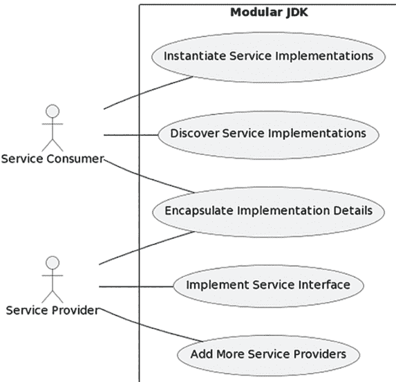

图 3.4 突出显示服务消费者和服务提供者的用例图

模块化 JDK 是这些交互的强有力促进者，建立了一个全面的平台，让服务提供者能够有效地提供其服务。同时，它为服务消费者提供了高效发现和利用这些服务的途径。这种动态生态系统促进了服务的无缝交换，增强了模块化 Java 程序的整体性和互操作性。

### JAR Hell 版本问题与 Jigsaw 层

在深入探讨 JAR Hell 版本问题和 Jigsaw 层细节之前，我想介绍一下 Nikita Lipski，他是一位同期 JVM 工程师，也是 Java 模块化领域的专家。Nikita 对该主题提供了宝贵的见解和详尽的文章，我们将在本节中讨论这些内容。这项工作将帮助我们理解 JAR Hell 版本问题，以及如何在 JDK 11 和 JDK 17 中利用 Jigsaw 层来解决这个问题。

Java 的后兼容性是其核心特征之一。这种兼容性确保了当发布新版本的 Java 时，为旧版本构建的应用程序可以在新版本上运行，无需对源代码进行任何更改，通常甚至不需要重新编译。同样的原理也适用于第三方库——应用程序可以在不修改源码的情况下与更新版本的库协同工作。

然而，这种兼容性并没有扩展到源码级别，JPMS（Java 模块系统）也没有在该级别上引入版本控制。相反，版本控制是在构件级别管理的，使用了 Maven 或 Gradle 等构件管理系统。这些系统处理 Java 中使用的库和框架的版本控制与依赖管理，确保在构建过程中包含正确版本的依赖项。但当一个 Java 应用程序依赖于多个第三方库，而这些库又可能依赖于同一个库的不同版本时会发生什么？如果 classpath 中存在同一个库的多个版本，会导致冲突和运行时错误。

因此，尽管 JPMS 确实改进了 Java 的模块化和代码组织，但在处理构件级别的版本控制时，“JAR Hell 问题”可能仍然存在。让我们来看一个示例（如图 3.5 所示），一个 Java 应用程序依赖于两个第三方库（Foo 和 Baz），而这两个库又依赖于另一个库（Baz）的不同版本。

如果将 Baz 库的两个版本都放在 classpath 中，运行时将无法确定使用哪一个，导致不可避免的版本冲突。为了解决这个问题，JPMS 通过检测拆分包（split packages，拆分包在 JPMS 中是不允许的）来支持其“可靠配置”的目标（图 3.6）。

虽然尽早发现版本问题有用，但 JPMS 并没有提供推荐的解决方法。解决这些问题的方法之一是通过冲突库的最新版本，假设它是向后兼容的。然而，由于引入了不兼容性，这种方法并不总是可行。

为了处理这些情况，JPMS 提供了 `ModuleLayer`（模块层）功能，它允许按照顺序将一个模块子图安装到模块系统中。当冲突库的不同版本被放置在单独的层中，JPMS 可以同时加载这两个版本。虽然没有直接的方法从父层访问子层的模块，但可以通过间接方式实现这一点——通过在子层模块中实现一个服务提供者，然后父层模块可以使用该服务提供者（更多细节请参阅之前关于“使用 JDK 17 实现模块化服务”的讨论）。

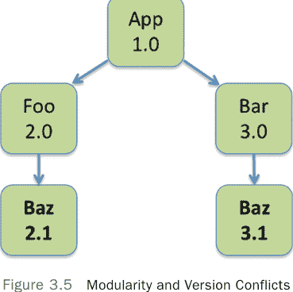

### JAR Hell 版本问题与 Jigsaw 层

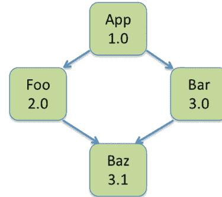

图 3.6 使用 JPMS 实现可靠配置

### 示例代码：JAR Hell

在本节中，将提供一个工作示例，以展示在 JDK 17 背景下如何使用模块层解决 JAR Hell 问题（该策略适用于 JDK 11 用户）。此示例基于 Nikita 的解释以及我们之前讨论过的房屋服务提供者实现。它展示了你如何在模块化应用程序中使用库的不同版本（分层的基础实现和高质量实现）进行工作。

首先，让我们看看 Java SE 9 文档提供的示例代码：

```java
ModuleFinder finder = ModuleFinder.of(dir1, dir2, dir3);
ModuleLayer parent = ModuleLayer.boot();
Configuration cf = parent.configuration().resolve(finder, ModuleFinder.of(), Set.of("myapp"));
ClassLoader scl = ClassLoader.getSystemClassLoader();
ModuleLayer layer = parent.defineModulesWithOneLoader(cf, scl);
```

在此示例中：

- 第 1 行，设置了 `ModuleFinder` 以从特定目录（dir1, dir2 和 dir3）查找模块。
- 第 2 行，将启动层（boot layer）建立为父层。
- 第 3 行，将启动层的配置解析为第 1 行指定目录中找到的模块的父配置。
- 第 5 行，使用解析后的配置创建一个新层，并使用单个类加载器，且以系统类加载器为其父级。

> ¹ https://docs.oracle.com/javase/9/docs/api/java/lang/ModuleLayer.html

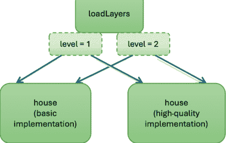

图 3.7 JPMS 示例版本与层

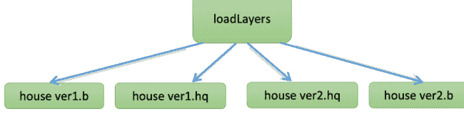

图 3.8 JPMS 示例版本扁平化

让我们扩展我们的房屋服务提供者实现。将在 `com.codekaram.provider` 模块中提供基础和高质量的实现。你可以将“基础实现”视为库的版本 1，将“高质量实现”视为库的版本 2（图 3.7）。

对于每个层，我们将连接到两个库。因此，我们的组合将是层 1 + 基础实现、层 1 + 高质量实现、层 2 + 基础实现以及层 2 + 高质量实现（图 3.8）。

### 实现细节

基于 Nikita 在上一节中引入的概念，让我们深入实现细节，理解层结构和程序流在实践中是如何工作的。首先，看看源码树：

```
ModuleLayer
- basic
  - src
    - com.codekaram.provider
      - classes
        - com
          - codekaram
            - provider
              - House.java
              - module-info.java
      - tests
- high-quality
  - src
    - com.codekaram.provider
      - classes
        - com
          - codekaram
            - provider
              - House.java
              - module-info.java
      - tests
- src
  - com.codekaram.brickhouse
    - classes
      - com
        - codekaram
          - brickhouse
            - loadlayers.java
            - spi
              - BricksProvider.java
            - module-info.java
      - tests
```

这是 `com.codekaram.provider` 的模块信息和模块图。注意，这些对于基础实现和高质量实现来说是完全一样的。

```java
module com.codekaram.provider {
  requires com.codekaram.brickhouse;
  uses com.codekaram.brickhouse.spi.BricksProvider;
  provides com.codekaram.brickhouse.spi.BricksProvider with com.codekaram.provider.House;
}
```

从 `com.codekaram.provider` 到 `com.codekaram.brickhouse` 以及指向 `java.base` 的假设箭头。

- `com.codekaram.brickhouse` 模块也隐式地依赖于 `java.base` 模块，所有模块都是如此。

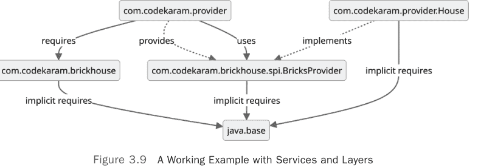

- `java.base` 模块不依赖于任何其他模块，它是所有其他模块所依赖的核心模块。
- `com.codekaram.provider` 模块提供了服务 `com.codekaram.brickhouse.spi.BricksProvider` 实现 `com.codekaram.provider.House`。这种关系在图中由从 `com.codekaram.provider` 指向 `com.codekaram.brickhouse.spi.BricksProvider` 的虚线箭头表示。

在深入研究这些提供者的代码之前，让我们查看 `com.codekaram.brickhouse` 模块的模块文件信息：

```java
module com.codekaram.brickhouse {
  uses com.codekaram.brickhouse.spi.BricksProvider;
  exports com.codekaram.brickhouse.spi;
}
```

加载器类不仅处理框架层，还将加载每个层级的服务提供者。这稍微有些简化，但它有助于我们更好地理解流程。现在，让我们检查加载器的实现。以下是基于“工作示例：JAR 地狱”部分的示例创建层级的代码：

```java
static ModuleLayer getProviderLayer(String getCustomDir) {
  ModuleFinder finder = ModuleFinder.of(Paths.get(getCustomDir));
  ModuleLayer parent = ModuleLayer.boot();
  Configuration cf = parent.configuration().resolve(finder,
      ModuleFinder.of(), Set.of("com.codekaram.provider"));
  ClassLoader scl = ClassLoader.getSystemClassLoader();
  ModuleLayer layer = parent.defineModulesWithOneLoader(cf, scl);
  System.out.println("Created a new layer for " + layer);
  return layer;
}
```

如果我们只想简单地创建两个层，一个用于基础版房屋，另一个用于高质量版房屋，我们只需要调用 `getProviderLayer()`（从主方法调用）：

```java
Stream.of(args)
  .map(getCustomDir -> getProviderLayer(getCustomDir))
  .forEach(layer -> doWork(layer));
```

如果我们传递了 `basic` 和 `high-quality` 两个目录参数，`getProviderLayer()` 方法将在这些目录中查找 `com.codekaram.provider`，然后为每个目录创建一个层。让我们查看输出（为了清晰说明和解释，添加了行号）：

1. $ java --module-path -m com.codekaram.brickhouse/com.codekaram.brickhouse.loadLayers basic high-quality
2. Created a new layer for com.codekaram.provider
3. I am the basic provider
4. Created a new layer for com.codekaram.provider
5. I am the high-quality provider

- 第 1 行是我们的命令行参数，其中 `basic` 和 `high-quality` 是提供 `BrickProvider` 服务实现的目录。
- 第 2 行和第 4 行是输出，表示在目录中找到了 `com.codekaram.provider` 并为每个目录创建了新层。
- 第 3 行和第 5 行是提供者的 `getName()` 输出，如 `doWork` 代码实现所示：

```java
private static void doWork(Stream<ModuleLayer> myLayers) {
  myLayers.flatMap(moduleLayer -> ServiceLoader
      .load(moduleLayer, BricksProvider.class)
      .stream()
      .map(ServiceLoader.Provider::get)
      .forEach(eachSLProvider -> System.out.println("I am the " + eachSLProvider.getName() + " provider"));
}
```

在 `doWork()` 中，我们首先为 `BrickService` 创建一个加载器并从模块层加载提供者。然后我们打印提供者 `getName()` 方法的返回字符串。如输出所示，我们有两个模块层，并且成功打印了 `I am the basic provider` 和 `I am the high-quality provider` 输出，其中 `basic` 和 `high-quality` 是 `getName()` 方法的返回字符串。

让我们可视化一下之前讨论的四个层的工作原理。为了这一点，我们将创建一个简单的问题陈述，为房屋的两个级别构建基础和高质量砖块的报价。首先，我们向 `main()` 方法中添加代码：

```java
int[] level = {1, 2};
IntStream levels = Arrays.stream(level);
```

接下来，我们如下流式处理 `doWork()`：

```java
levels.forEach(levelCount -> loadLayers(
    .doWork(
```

我们得到四个与之前提到的类似的层（`house ver1.b`, `house ver1.hq`, `house ver2.b` 和 `house ver2.hq`）。以下是更新后的输出：

> 注意：提供者 `getName()` 方法的返回字符串已更改为仅返回 "basic" 和 "high-quality" 字符串，而不是整个句子。

更新后输出最后一行的变化演示了如何对服务提供者应用额外的条件。在这里，预算限制已集成到双层房屋高质量提供者的实现中。你可以根据需要对双层房屋进行定制。

## OSGi 与 Java 模块层对比

### 相似点

- 服务抽象：Java 的两个层级（通过 `ServiceLoader` 和 OSGi）都提供了实现组件间松耦合的抽象。这使得在不同服务的实现方式之间切换时具有更大的灵活性。

### 差异

- 成熟度：OSGi 是一项更成熟且经过实战检验的技术，拥有丰富的生态系统和工具支持。JDK 9 引入的 Java 模块层相比之下较新，且在工具和库支持方面从未达到过与 OSGi 相同的水平。
- 与 Java 平台的集成：Java 模块层是 Java 平台的一部分，为模块化和扩展性提供了原生解决方案。相比之下，OSGi 是构建在 Java 平台之上的独立框架。
- 复杂性：OSGi 可能比 Java 模块层更复杂，学习曲线更陡峭，且具有更高级的功能。Java 模块层虽然提供了强大的功能，但对于不需要模块化概念的开发者来说，可能更加简单且易于使用。
- 运行时环境：OSGi 应用运行在 OSGi 容器内部，该容器管理包（bundles）的生命周期并强制模块化规则。Java 模块层直接运行在 Java 平台上，由模块系统处理模块的加载和卸载。


- 版本控制：OSGi 原生支持模块或包的多个版本并发。这是通过对模块进行版本标记并应用“约束”来确保每个模块的类命名空间安全的。然而，在 OSGi 中处理版本可能会为模块解析和最终用户引入不必要的复杂性。相比之下，Java 模块层原生不支持模块的多个版本，而是通过为每个版本创建独立的模块层来实现。

- 强封装：Java 模块层作为 JDK 中的一等公民，通过在通过反射发生越权访问未导出功能时发布错误信息来提供强封装。在 OSGi 中，可以使用类加载器“隐藏”未导出的功能，但除非设置了特殊机制，否则模块内部仍然可以通过反射访问。OSGi 受限于 Java SE 预-JPMS 阶段的特性，无法提供与 Java 模块层同级别的强封装。

在实现 Java 应用的模块化和扩展性方面，开发者通常有两个主要选择：Java 模块层和 OSGi。请记住，在 Java 模块层和 OSGi 之间的选择并非总是二元对立的，取决于许多因素。这些包括项目的特定需求、现有的技术栈以及团队对这些技术的熟悉程度。此外，Java 模块层和 OSGi 并不是实现 Java 应用模块化的唯一选择。根据你的需求和场景，其他解决方案可能更合适。在为项目决定之前，充分评估所有可用选项的优劣至关重要。你的选择应基于项目的特定需求和限制，以确保最佳结果。

另一方面，如果你需要多版本支持和动态组件模型等高级功能，OSGi 可能是你的最佳选择。这项技术对于既需要活性需要扩展性的复杂应用程序非常理想。但是，它比 Java 模块层更难学习和实现，因此对于初接触模块化的开发者来说可能不是最佳选择。

另一方面，Java 模块层为实现 Java 应用的模块化和扩展性提供了一个更直接的解决方案。这项技术内置在 Java 平台中，这意味着已经熟悉 Java 的开发者应该发现它相对易用。此外，Java 模块层提供的强封装功能可以帮助防止依赖跨模块泄漏。

## Jdeps、Jlink、Jdeprscan 和 Jmod 简介

本节涵盖了四种辅助模块化应用开发和部署的工具：`jdeps`、`jlink`、`jdeprscan` 和 `jmod`。这些工具每一个在构建、分析和部署 Java 应用的过程中都发挥着独特的作用。

## Jdeps

`jdeps` 是一个便于分析 Java 类或包依赖关系的工具。当你尝试为 JAR 文件创建模块时，它特别有用。通过 `jdeps`，你可以使用正则表达式（regex）创建各种过滤器；正则表达式是一种执行模式搜索的字符序列。以下是如何在类上使用 `jdeps` 的示例：

```
$ jdeps com.codekaram.brickhouse/com/codekaram/brickhouse/loadLayers.class
loadLayers.class -> java.base
loadLayers.class -> not found

com.codekaram.brickhouse -> not found
com.codekaram.brickhouse -> java.base
com.codekaram.brickhouse -> java.lang
com.codekaram.brickhouse -> java.module
com.codekaram.brickhouse -> java.util
com.codekaram.brickhouse -> java.io
```

上述命令将列出所有依赖项：

```
$ jdeps -v com.codekaram.brickhouse/com/codekaram/brickhouse/loadLayers.class
loadLayers.class -> java.base
loadLayers.class -> not found

com.codekaram.brickhouse -> not found
com.codekaram.brickhouse -> java.base
com.codekaram.brickhouse -> java.lang
com.codekaram.brickhouse -> java.module
com.codekaram.brickhouse -> java.util
com.codekaram.brickhouse -> java.io
```

## Jdeprscan

`jdeprscan` 是一个用于扫描类或 JAR 文件中已弃用 API 用法的工具。它有助于识别代码库中使用已弃用 API 的位置，以便在迁移到较新的 Java 版本时进行更新。你可以使用 `--list` 查看模块中所有已弃用的 API：

```
$ jdeprscan --list mods/com.codekaram.brickhouse
No deprecated API found.
```

在这种情况下，在 `com.codekaram.brickhouse` 模块中没有发现已弃用的 API。

## Jmod

`jmod` 是一个用于创建、描述和列出 JMOD 文件的工具。JMOD 文件是用于模块化 Java 应用的 JAR 文件替代方案，它们提供了原生代码和配置文件等额外功能。这些文件可以用于发布，或通过 `jlink` 创建自定义运行时环境。

以下是如何使用 `jmod` 为 brickhouse 示例创建一个 JMOD 文件。让我们首先创建并打包针对该示例的模块：

```
$ java --module-source-path src -d build/modules $(find src -name "*.java")
$ jmod create --class-path build/modules/com.codekaram.brickhouse com.codekaram.jmod
```

在这里，使用 `jmod create` 命令从位于 `build/modules` 目录下的 `com.codekaram.brickhouse` 模块创建一个名为 `com.codekaram.brickhouse.jmod` 的 JMOD 文件。然后你可以使用 `jmod describe` 命令显示有关 JMOD 文件的信息：

```
$ jmod describe com.codekaram.brickhouse.jmod
```

该命令将输出模块描述符以及关于 JMOD 文件的任何额外信息。

此外，你可以使用 `jmod list` 命令显示所创建 JMOD 文件的内容：

```
$ jmod list com.codekaram.brickhouse.jmod
com/codekaram/brickhouse/
com/codekaram/brickhouse/loadLayers.class
com/codekaram/brickhouse/loadLayers1.class
```

输出列出了 `com.codekaram.brickhouse.jmod` 文件的内容，显示了包结构和类文件。

通过使用 `jmod` 创建 JMOD 文件、描述其内容并列出各个文件，你可以更好地理解应用程序的结构，并简化使用 `jlink` 创建运行时镜像的过程。

## Jlink

`jlink` 是一个帮助链接模块及其传递依赖以创建自定义模块化运行时镜像的工具。这些自定义镜像可以打包和部署，而不需要整个 Java 运行时（JRE），这使得你的应用程序更轻量、启动更快。

要使用 `jlink` 命令，需要将此工具添加到你的路径中。首先，确保 `JAVA_HOME/bin` 在路径中。接下来，在命令行中输入 `jlink`：

```
$ jlink
Error: --module-path must be specified
Usage: jlink <options> --module-path <modulepath> --add-modules <module>{<module>,...}
Use --help for a list of possible options
```

以下是如何针对“使用 JDK 17 实现模块化服务”中的代码使用 `jlink` 的示例：

```
$ jlink --module-path $JAVA_HOME/jmods/modules --add-modules com.example.com.builder --output consumer.services --bind-services
```

关于此示例的几点说明：

- 命令在 `module-path` 中包含一个名为 `$JAVA_HOME/jmods` 的目录。该目录包含了所有应用模块的 `java.base.jmod`。

- 因为该模块是服务的消费者，因此有必要链接服务提供者（及其依赖）。这里使用了 `--bind-services` 。

- 运行时镜像将位于 `consumer.services` 目录中，如下所示：

```
$ ls consumer.services/
bin conf include lib release
```

现在让我们运行该镜像：

```
$ consumer.services/bin/java -m com.example.com.example.builder.Builder
Building a house with bricks...
```

通过 `jlink`，你可以为你的模块化 Java 应用创建轻量级、自定义且独立的运行时镜像，从而简化部署过程并减小分发应用程序的体积。

## 总结

本章对 Java 模块以及用于创建和管理模块化应用的工具和技术进行了全面探索。我们深入研究了 Java 平台模块系统（JPMS），强调了它的优势，例如可靠的配置和强封装。这些特性有助于构建更具可维护性和可扩展性的应用程序。

我们应对了创建、打包和管理模块的复杂性，并探索了使用模块层（module layers）来增强应用程序的活性。这些实践可以帮助解决迁移到新版本 JDK（例如 JDK 11 或 JDK 17）时面临的常见挑战，包括更新项目结构和确保依赖兼容性。

## 性能影响

使用模块化 Java 具有重大的性能影响。通过在应用程序中仅包含必要的模块，JVM 加载的类更少，从而提高了启动性能并减少了内存占用。这在资源受限的环境中（如运行在容器中的微服务）特别有利。然而，值得注意的是，模块化可以提高性能，但也引入了一定的复杂性。例如，不当的模块化设计会导致循环依赖，对性能产生负面影响。因此，仔细的设计和对模块的理解对于充分利用优势至关重要。

## 工具与未来发展

我们检查了如 `jdeps`、`jmod` 和 `jlink` 等强大工具的使用，这些工具对于识别和解决兼容性问题、创建运行时镜像以及简化模块化应用的部署至关重要。展望未来，我们可以预期 `jlink` 将提供更高级的自定义运行时镜像选项，以及更详细准确的依赖分析。

## 拥抱模块化范式

转向模块化 Java 会带来挑战，特别是在大型应用程序中。这些挑战是迈向现代化的一部分，但通常会被模块化 Java 带来的收益（如性能提升）所抵消。

## 第 4 章 统一的虚拟机日志接口

Java 虚拟机（VM）是一个功能强大的工具。命令行选项允许启用实验性或诊断功能，并探索虚拟机和垃圾回收活动。在虚拟机内部，有针对不同目的的构建版本。主要版本是产品版本，它经过了优化并用于生产环境。此外，还有调试版本，包括 fast debug 和 slow debug 版本。注意：fast debug 版本在开销最小的情况下提供了额外的调试功能，适用于需要某些诊断的环境。另一方面，slow debug 版本包含了全面的调试工具和检查，适用于使用原生调试器进行深度分析，但性能代价较大。

在 JDK 9 之前，虚拟机的日志接口是碎片化的，缺乏统一。开发者必须组合各种打印选项来获取带有时间戳和上下文的详细日志。本章将引导你了解该功能的演进，重点介绍 JDK 9 引入的统一日志系统，该系统在 JDK 11 和 17 中得到了进一步增强。

## 统一日志的需求

Java 虚拟机选项丰富，但缺乏统一的日志接口是一个很大的短板。需要各种命令行选项来获取特定的日志细节，而这本可以更清晰、更高效。这些选项的简要说明了其复杂性（除了此处列出的，还有更多选项）：

- 垃圾回收（GC）事件时间戳：`-XX:+PrintGCTimeStamps` 或 `-XX:+PrintGCDateStamps`

- GC 事件细节：`-XX:+PrintGCDetails`

- GC 事件原因：`-XX:+PrintGCCause`

- GC 适应性：`-XX:+PrintAdaptiveSizePolicy`

- GC 特定选项（例如，针对垃圾回收 [G1] GC）：`-XX:+G1HeapRegions`

- 编译级别：`-XX:+PrintCompilation`

- 内联信息：`-XX:+PrintInlining`

- 汇编代码：`-XX:+PrintAssembly`（需要 `-XX:+UnlockDiagnosticVMOptions`）

- 类直方图：`-XX:+PrintClassHistogram`

- `java.util.concurrent` 锁信息：`-XX:+PrintConcurrentLocks`

记忆每个方面并确定信息处于 info、debug 还是 tracing 级别是具有挑战性的。因此，JDK 9 引入了 JDK 增强提案 (JEP) 158：统一 JVM 日志（Unified JVM Logging）¹。其后是 JEP 271：统一 GC 日志（Unified GC Logging）²，它为 GC 活动提供了一个全面的日志框架。

## 统一化与 HotSpot 基础设施

Java JVM 拥有一个日志接口，为 JVM 的所有日志提供了一个熟悉的界面和方法。所有日志消息都使用标签（tags）进行特征。这允许你根据调查的深度请求所需的信息级别，从“error”和“warning”标签到“info”、“trace”和“debug”级别。

要启用日志记录，你需要提供 `-Xlog` 选项。默认情况下（即未指定 `-Xlog` 时），只有警告和错误会被记录到 stderr。因此，默认配置如下：

```
-Xlog:all=warning:stderr:uptime,level,tags
```

在这里我们看到了 `all`，它仅仅是所有标签的别名。

统一日志系统是一个全方位的系统，为所有 JVM 日志提供一致的接口。它围绕四个主要组件构建：

- 标签（Tags）：用于分类日志消息，每条消息分配一个或多个标签。标签使得更容易找到特定的日志消息。某些预定义的标签包括 compiler、gc 和 threads。

- 级别（Levels）：定义日志消息的严重性或重要性。共有六个级别：debug、error、info、off、trace 和 warning。

- 装饰器（Decorators）：为日志消息提供额外的上下文，例如时间戳、进程 ID 等。

- 输出（Outputs）：写入日志消息的目的地，如 stdout、stderr 或文件。

¹https://openjdk.org/jeps/158

²https://openjdk.org/jeps/271

## 性能指标

在 JVM 性能工程的背景下，统一日志系统为各种性能指标提供了有价值的洞察。这些指标包括 GC 活动、即时编译（JIT）编译事件以及系统资源使用等。通过监控这些指标，开发者可以识别性能问题并采取必要的措施来优化其 Java 程序的性能。

## 统一日志系统中的标签

在统一日志系统中，标签用于隔离和识别不同类型的日志消息。通过启用特定标签，用户可以定制日志输出，以关注感兴趣的区域。

## 日志标签

统一日志系统提供了大量的标签来捕获细粒度信息。这里强调了用于垃圾回收、线程操作、类加载、CPU 相关事件、操作系统交互等许多标签：

```
add, alloc, annotation, arguments, attach, barrier, biasedlocked, blocks, bot, breakpoint
bytecode, cds, census, class, classhisto, cleanup, codecache, compilation, condy, constant
containers, coop, cset, data, datacreation, dcmd, decoder
defaultmethods, deopt, dump, dynamic, ergo, event, exceptions, fingerprint, free,
freelist, gc, hashtables, heap, humongous, ihop, iklass, idy, init, inlining, install,
logging, malloc, map, marking, membername, memory, metadata, metaspace, methodcomparator,
methodhandlers, mirror, mru, monitor, monitorinflation, nestmates, method,
interpreter, itfr, jit, jni, jvmci, jfr, library, lifespan, load, loader,
mt, notalloc, numa
```

## 日志级别

在统一日志系统中，日志级别是分层的。因此，trace 日志级别将包含来自所有更低级别（debug、info、warning、error）的消息，这确保了全面的日志输出，捕获广泛的细节，如下文中的日志所示：

```
[3.073s][trace][monitorinflation] monitor BHL object type
[3.073s][trace][monitorinflation] ==================
[3.073s][trace][monitorinflation] 0x00000002e2c6b0 100 0x00000007fe190e0 java.lang.ref.ReferenceQueueLock(is_busy: waiters=1, contentions=0, owner=0x0000000000000000,
cxq=0x0000000000000000, EntryList=0x0000000000000000)
```


# 统一日志系统

## 装饰器 (Decorators)

装饰器是 JVM 日志的另一个关键方面。装饰器通过额外的上下文丰富了日志消息，使其包含更多信息。在命令行上指定 `-Xlog:help` 将产生以下装饰器：

**可用的日志装饰器：**

`time` (t), `utctime` (utc), `uptime` (u), `timemillis` (tm), `upemillis` (um), `timananos` (tn), `uptimenanos` (un), `hostname` (hn), `pid` (p), `tid` (ti), `level` (l), `tags` (tg)

装饰器可以指定为 `none` 以不进行装饰。

这些装饰器在日志中提供了特定信息。默认情况下，选择了 `uptime`、`level` 和 `tags`，这就是为什么在之前的示例的日志输出中我们看到了这三个装饰器。然而，你有时可能可能想使用不同的装饰器，例如：

- `pid` (p): 进程 ID。有助于区分来自不同 JVM 实例的日志。
- `tid` (ti): 线程 ID。用于跟踪特定线程的操作，有助于调试并发问题或线程特定行为。
- `uptimemillis` (um): 以毫秒为单位的 JVM 时间。有助于将事件与应用程序运行的时间线相关联，特别是在性能监控中。

以下是添加装饰器的方法：

```
$ java -Xlog:gc=uptimemillis,pid,tid Lockloops
[0.006s][32622] Using G1 GC
[0.008s][32622] Version: 17.0.8-LTS-211 (release)
[0.008s][32622] CPUs: 16, 16 available [0.02s][32033][9987] Memory: 16384M

[0.057s][32622] Compressed class space mapped at: 0x000000012a000000-0x000000016a000000, reserved size: 103741824
[0.075s][32622] Narrow class base: 0x0000000129000000, Narrow class shift: 0, Narrow class ratio: 0x00000000
```

装饰器如 `pid` 和 `tid` 在调试中特别有价值。当运行多个 JVM 运行时，`pid` 有助于识别是哪个 JVM 实例生成的日志。`tid` 在多线程应用程序中跟踪单个线程的行为至关重要，这对于诊断死锁或竞态条件等问题至关重要。

使用 `uptimemillis` 作为事件的时间参考，可以建立清晰的操作时间线。`uptimemillis` 在性能分析中至关重要，可以理解特定事件相对于应用程序启动发生的时间。`hostname` 在分布式系统中可以识别日志条目的源机器。

装饰器通过以下几种方式增强了可读性和分析能力：

- **上下文清晰性**：通过提供时间戳、进程 ID 和线程 ID 等额外细节，装饰器使日志自成体系且更易理解。
- **过滤和搜索**：通过相关的装饰器，日志数据可以被有效过滤，从而更快地隔离问题。
- **关联和因果分析**：装饰器允许将系统不同部分的事件相关联，有助于根因分析和系统级性能优化。

总之，统一日志系统中的装饰器在增强 JVM 日志的调试和性能监控能力起着关键作用。它们添加了必要的上下文和清晰度，使日志数据对开发者更具操作价值和见解。

## 输出 (Outputs)

在 JVM 日志中，输出决定了日志信息的去向。JVM 为控制日志输出提供了灵活性，允许用户将输出重定向到 `stdout`、`stderr` 或特定文件。默认行为是将所有警告和错误路由 `stderr`，而所有 `info`、`debug` 和 `trace` 级别定向到 `stdout`。然而，用户可以根据需要调整此行为。例如，用户可以指定一个特定文件写入日志数据，这在需要稍后分析日志或 `stderr` 不方便/适用于日志数据时非常有用。

文件名作为参数传递给 `-Xlog` 命令，可以将日志输出重定向到该文件。假设你想以 `info` 记录垃圾回收（gc）活动，并希望将这些日志写入 `gclog.txt`。例如：

```
$ java -Xlog:gc=info,file=gclog.txt
```

## 基准测试与性能测试

统一日志系统在基准测试和性能测试场景中至关重要。通过彻底分析日志，开发者可以了解应用程序在不同负载和配置下的性能。这些信息可用于微调应用程序以获得最佳性能。

例如，垃圾回收（GC）日志可以提供应用程序内存使用模式的洞察，从而指导调整堆大小和精调 GC 参数以提高效率决策。此外，其他类型的日志，如之前讨论的 JIT 编译日志、线程活动日志和监控膨胀日志也可以提供有价值的信息。例如，JIT 编译日志可以识别性能关键方法，而线程监控膨胀日志可用于诊断并发问题或线程利用率低下的问题。

在性能测试期间利用日志之外，将日志集成到回归测试框架中也至关重要。它确保了新的更改或更新不会对性能产生不利影响。通过这种方式，持续集成流水线可以显著简化持续环境中识别和解决瓶颈的过程。

然而，需要注意的是，解释这些日志通常需要对 JVM 有深入的理解。例如，GC 日志可能复杂，需要对 Java 的内存管理有深入了解。同样，解码 JIT 编译日志需要了解 JVM 如何优化代码执行的知识。将日志分析与其他性能方法论平衡，可以确保对应用程序性能进行全面评估。

## 工具与技术

由于涌入此类日志的数据可能巨大，分析 JVM 日志是一项复杂的任务。然而，在专业工具和技术的帮助下，这项任务的复杂性大大降低。日志分析工具擅长解析日志并以更易管理和消化的格式呈现数据。这些工具可以过滤、搜索和聚合日志，并生成图形化表示。同样，可视化工具可以帮助识别日志数据中的模式并检测趋势。它们可以将文本日志转换为图形化表示，使发现异常或性能瓶颈变得更加容易。

此外，基于历史数据，机器学习技术可以预测未来的性能趋势。这种预测性分析对于主动系统维护和优化至关重要。然而，有效使用这些技术需要大量的历史数据以及对数据科学原理的基础性理解。

> ³ 我们在第 1 章：“Java 的性能演进：语言与虚拟机”中涵盖了性能关键方法。

## 优化与管理统一日志系统

尽管统一日志系统是诊断和监控中不可或缺的工具，但其使用需要仔细的权衡，特别是关于应用程序的性能。过多的日志记录会导致性能下降，因为系统需要额外的资源来写入日志文件。此外，详尽的日志会消耗大量的磁盘空间，这在存储有限的环境中可能是一个问题。为了帮助管理磁盘使用，可以根据需要对日志文件进行压缩、轮转或移动到辅助存储。

因此，平衡详细日志的需求与潜在的性能至关重要。做到这一点的方法之一是调整日志级别，在生产环境中仅包含重要消息。例如，在高流量场景下，记录 `error` 和 `warning` 级别的某些消息可能比以 `info`、`debug` 或 `trace` 级别记录所有消息更合适。

另一个考虑因素是日志的输出目标。在应用程序的开发阶段，建议将日志消息直接输出到 `stdout`——这也是日志系统的默认设置的原因。然而，在生产环境中，将日志消息写入文件可能更合适，以便根据需要对消息进行归档和分析。

统一日志系统的一个高级功能是能够在运行时动态调整日志级别。这种能力对于排查运行应用程序中的问题特别有利。例如，您可以使用标准日志运行应用程序以最大化性能。然而，在流量激增或您观察到特定模式增加期间，您可以临时更改日志级别以获取更多相关信息。一旦问题解决并恢复正常，您可以无需重启应用程序即可恢复到原始日志级别。

这种动态日志功能通过 `jcmd` 实用程序实现，它允许您向运行中的 JVM 发送命令。例如，要将 `gc*` 标签的日志级别增加到 `trace` 并添加一些实用的装饰器，可以使用以下命令：

```
$ jcmd <pid> GC.log:trace,decorators
```

在此处，`<pid>` 是 JVM 的进程 ID。执行此命令后，垃圾回收将以 `trace` 级别启动。要探索 `vm.log` 的完整配置选项，可以使用以下命令：

```
$ jcmd <pid> help
```

尽管统一日志系统提供了丰富的信息，但必须明智地使用它。通过调整日志级别、选择合适的输出，可以有效平衡日志细节与系统性能。

## 异步日志与统一日志系统

Java 统一日志系统的演进带来了另一个显著的（可选）功能：异步日志。与在某些情况下可能成为性能瓶颈的传统同步日志不同，异步日志将写入任务委托给单独线程。日志项在传输到最终输出之前被放在缓冲区中。这种方法最小化了日志对主线程的影响——这对现代、大规模和延迟敏感的应用至关重要。

### 异步日志的优势

- **降低延迟**：通过卸载日志活动，异步日志显著降低了处理延迟，确保关键操作不会被日志写入阻塞。
- **提高吞吐量**：在 I/O 密集型环境中，异步日志通过并行处理日志活动增强应用程序吞吐量，释放主程序处理更多请求。
- **负载下的一致性**：异步日志最大的优势之一是在大量的负载下能够保持一致的性能。它有效地缓解了日志引起的瓶颈风险，确保性能稳定可预测。

### 在 Java 中实现异步日志

#### 现有库和框架

Java 提供了许多具有异步能力的日志框架，如 Log4j2 和 Logback。

- **Log4j2**：Log4j2 的异步日志利用 LMAX Disruptor（一种高性能线程消息库）提供低延迟和高吞吐日志。其配置涉及在配置文件中指定 `AsyncLogger`，随后将日志事件重定向到缓冲区，减少日志开销。
- **Logback**：在 Logback 中，可以通过 `AsyncAppender` 包装器启用异步日志，它缓冲日志事件并将其分发到指定的 appender。配置涉及使用 `AsyncAppender` 包装 appender，并调整缓冲区大小和其他参数以平衡性能和资源使用。

在这两个框架中，配置异步日志通常涉及 XML 或 JSON 配置文件，其中可以定义缓冲区大小、阻塞行为和底层 appender 等各种参数。

> ⁴ https://logging.apache.org/log4j/2.x/manual/async.html
>
> ⁵ https://logback.qos.ch/manual/appenders#AsyncAppender

### 自定义异步日志解决方案

在某些场景下，标准框架可能无法满足应用的独特需求。在这种情况下，开发自定义的异步日志解决方案可能是恰当的。自定义实现的关键考虑因素包括：

- **线程安全**：确保日志操作是线程安全的，以避免数据损坏或不一致。
- **内存管理**：在日志过程中高效处理内存，特别是在管理日志缓冲区（`buffer`）方面，以防止内存泄漏或高内存消耗。
- **示例实现**：一个基础的自定义日志记录器可能涉及生产者-消费者模式，其中主应用程序线程（生产者）将日志消息入到共享缓冲区中，而一个单独的日志线程（消费者）则从中取出（`dequeue`）这些消息。

### 与 JVM 统一日志系统的集成

- **挑战与解决方案**：对于 JDK 17 之前的 JVM 版本或在复杂的日志场景下，将外部异步日志框架与统一日志系统集成需要进行细致的配置，以确保兼容性和性能。这可能涉及设置 JVM 标志和参数，以便将日志消息正确路由到异步日志系统。
- **JDK 17 及更高版本的原生支持**：从 JDK 17 开始，统一日志系统原生支持异步日志。可以使用 `-Xlog:async` 启用它，允许 JVM 内部日志进行异步处理，而不会影响 JVM 本身的性能。

## 最佳实践与考虑因素

### 管理日志反压（Backpressure）

- **挑战**：在异步日志中，当日志消息生成的速率超过处理和写入这些消息的能力时，就会发生反压。这可能导致性能下降或日志数据丢失。
- **有界队列**：在日志系统中实现有界队列有助于管理日志消息的积累。通过限制未处理消息的数量，这些队列可以防止内存过度使用。
- **丢弃策略**：当队列达到容量时建立丢弃日志消息的策略可以防止系统过载。这可能涉及丢弃不重要的消息或对消息进行摘要。
- **真实示例**：高流量 Web 应用可能会实施一种丢弃策略，在高峰负载期间优先处理 `error` 日志而非 `info` 日志，以维持系统稳定性。

### 确保日志的可靠性

- **关键性**：日志系统的可靠性至关重要，特别是在应用程序崩溃或突然关闭期间。在这种情况下日志数据的丢失会阻碍故障排除并影响合规性。
- **预写日志（Write-ahead logs）**：实现预写日志可以确保即使应用程序失败，日志数据也能保留。该技术涉及在实际日志操作完成之前将日志数据写入持久化存储位置。
- **优雅停机程序**：设计日志系统以优雅的方式处理关闭，可以确保缓冲区日志数据在应用程序完全停止之前被写入。
- **恶劣条件下的策略**：在日志基础设施中包含冗余，以便在主日志机制失效时捕获日志数据。这在多个组件生成日志的分布式系统中尤为相关。

### 异步日志系统的性能调优

#### 针对最佳性能进行调优

- **线程池**：调整用于异步日志的线程数量至关重要。更多的线程可以处理更高的日志量，但过多的线程可能会导致 CPU 开销。
- **缓冲区容量**：如果您的应用程序出现日志生成的周期性峰值，增加缓冲区的大小有助于吸收这些峰值。
- **处理间隔**：日志从缓冲区刷新到输出的频率会影响性能和日志的及时性。调整此间隔有助于在 CPU 使用率和日志写入的即时性之间取得平衡。

#### JDK 17 异步日志的考虑因素

- **缓冲区大小**：`AsyncLogSize` 参数对于管理系统刷新之前可以处理的日志量至关重要。较大的缓冲区可以容纳更多日志消息，这在日志生成峰值期间大有益。然而，更大的缓冲区需要更多内存。
- **监控 JDK 17 的异步日志**：随着新的异步日志功能，监控工具和技术可能需要更新，以跟踪新缓冲区的利用率和日志系统的性能。

#### 监控与指标

- **缓冲区利用率**：您可以使用日志框架的内部指标或自定义监控脚本来跟踪缓冲区的使用。如果缓冲区利用率持续大于 80%，则说明需要关注。
- **队列长度**：监控工具可以跟踪队列的利用情况，以评估日志系统的性能。
- **写入延迟**：通过监控工具可以衡量日志创建到实际写入的时间差，这可以帮助识别由于文件系统或磁盘 I/O 瓶颈导致的性能问题。
- **JVM 工具与指标**：使用 VisualVM 和 Java Mission Control (JMC) 等工具可以监控 JVM 性能，包括影响日志的方面。

## 理解 JDK 11 和 17 中的增强功能

统一日志系统首次在 JDK 9 中引入，并在随后的版本中不断改进和增强。本节将讨论针对统一日志的重大改进。

### JDK 11

在 JDK 11 中，统一日志的一个重大改进是允许在运行时动态配置日志。这一创新通过 `jcmd` 工具实现，该工具允许向运行中的 JVM 发送命令来调整日志级别。

JDK 11 还通过引入 `Logger` 和 `LogManager` 的新方法改进了 `java.util.logging`。这些新增功能进一步增强了日志控制能力。

### JDK 17

在 JDK 17 中，统一日志系统引入了对异步日志的原生支持。此外，JDK 17 对日志系统的整体性能带来了广泛改进。

## 总结

在本章中，我们探索了统一日志系统，展示了它的实际用法并概述了随后版本中的增强。JVM 的统一日志系统为日志消息提供了统一的接口。这种跨 JVM 的同步增强了日志的可读性和解析性，有效地解决了交错日志的问题。保留将日志重定向到文件的功能（在 JDK 9 之前已可用）是保留早期日志机制实用性的重要部分。日志继续保持人类可读，且时间戳默认反映运行时间。

- [VisualVM](https://visualvm.github.io/)
- [JMC](https://jdk.java.net/jmc)

## 统一 虚拟机日志接口

统一日志系统还提供了许多价值。JDK 11 引入的动态日志允许在运行时进行调整。结合统一日志系统提供的应用程序过程可见性和控制，开发者现在可以通过命令行输入指定所需的日志深度，从而提高了调试和性能测试的效率。

从统一日志系统获得的信息可用于调优 JVM 参数以获得最佳性能。例如，我自己的 GC 解析和绘图工具现在更加整合和精简，可以提供有关内存使用模式、暂停事件、堆利用率、暂停细节以及与收集器类型相关的各种模式。这些信息可以用于调整堆大小、选择合适的垃圾收集器并调优其他 GC 参数。

Java 的新功能，如 Project Loom 和 Z 垃圾收集器（ZGC），对 JVM 性能有重大影响。可以通过统一日志系统监控这些功能，以理解它们对应用程序的影响。例如，ZGC 日志可以提供有关 GC 暂停时间和回收效率的见解。我们将在后续章节中详细介绍这些功能。

# 第 5 章

## 端到端 Java 性能优化：工程技术与 JMH 微基准测试

### 引言

欢迎来到 Java 虚拟机（JVM）性能工程之旅中的一个关键阶段。本章标志着一次重大的转变：我们从理解 Java 的历史背景和基础结构，转向应用这些知识来优化性能。这为我们即将深入探索 OpenJDK HotSpot JVM 的性能优化奠定了基础。


我们共同追溯了 Java 的演变、它的 IT 系统以及 JVM 的发展程，见证了 Java 从单体结构向模块化结构的转变。现在，我们准备将这些概念应用于性能优化这一至关重要的任务。

性能是任何软件应用程序成功的基石。它直接影响用户体验，决定了应用程序响应用户交互的敏捷与流畅程度。JVM 作为 Java 应用程序的运行时环境，是这种性能的核心。通过学习如何调整和优化 JVM，你可以显著提升 Java 应用的速度、响应能力整体性能。这可能涉及多种策略，例如调整内存和垃圾回收模式、使用优化的代码或库，或者利用 JVM 的即时编译（JIT）能力和阈值来增强优势。掌握这些 JVM 优化技术是增强 Java 应用性能的宝贵技能。

基于我们之前对统一 JVM 日志接口的研究，我们现在将探索性能指标以及如何有效地衡量和解释它们。在应对 JVM 的复杂性时，我们将审视它与硬件的交互、内存屏障的作用以及 `volatile` 变量的使用。我们将深入性能优化的全面过程，涵盖监控、剖析、分析和调优。

本章超越了理论论述，体现了二十多年性能优化实战经验的结晶。在这里，我们介绍了 Java 性能测量中不可或缺的工具，并结合了多年精心培养和完善的诊断与分析方法。通过对子系统进行详细调查以定位潜在问题，为关注性能优化的软件开发者提供了一份至关重要的路线图。

我的历程让我深刻理解了底层硬件和软件层对应用程序性能的深远影响，因此本章将阐明硬件与软件之间的相互作用。另一个专门章节将用于评估功能发布的影响或分析跨不同系统层的性能。我们将共同探索使用 Java 微基准测试工具 JMH 的实际应用。此外，我们将查看 JMH 内置的剖析器，例如 `perfasm`，这是一个能够揭示代码底层性能特性的强大工具。

因此，本章不仅仅是理论和概念的集合。它是一份充满示例和最佳实践的实用指南，源自丰富的领域经验。旨在弥合理论与实践之间的差距，为本书后续章节中详细的性能优化决策提供跳板，确保读者做好开启高级性能工程之旅的准备。

# 性能工程：软件工程的核心支柱

## 解码软件工程的层次

软件工程是一项综合性学科，涵盖了两个相互交织的维度：(1) 软件设计与开发以及 (2) 软件架构需求。

软件设计与开发是我们旅程中遇到的第一个维度。它涉及为系统构建详细的蓝图或方案，解决系统的架构、组件、接口和其他特征问题。这些设计迭代为功能需求奠定了基础——即定义系统应该完成什么内容的规则。功能需求封装了系统必须遵守的业务规则、它应该执行的数据处理以及它应该促进的交互。

相比之下，软件架构需求侧重于系统的非功能属性或质量属性——通常被称为“要素”。这些需求概述了系统应该如何运行，包括性能、可用性、安全性和其他关键属性。

理解并在这两个维度之间取得平衡——在满足功能需求的同时确保高质属性——是软件工程的一个关键方面。在建立这一基础理解的基础上，让我们关注这些本质属性之一——性能。

## 性能：关键质量属性

在各种架构需求中，性能占据着独特地位。它衡量的是测试系统（SUT）执行特定任务或工作单元（UoW）的效率。性能不仅仅是一个可有可无的功能；它直接影响操作效率和用户体验，并在决定满意度中起核心作用。

为了完全理解性能的概念，我们必须理解系统组件及其对性能的影响。在像 JVM 这样的托管运行时系统中，影响性能的关键组件是垃圾回收器（GC）。我们在性能术语中将 GC 的单元定义为“GC 工作”，指的是其必须执行的特定任务。例如，被我分类为“吞吐量最大化”的 GC 类型（如 OpenJDK 中的 Parallel GC），相比之下，定义的“延迟优化型”收集需要更强的控制来保证亚毫级的停顿。因此，理解这些组件的各个属性和贡献至关重要，它们共同构成了性能的整体图景。

## 性能的理解与评估

性能评估并非衡量系统运行的快慢。相反，它涉及到测试系统（SUT）与工作单元（UoW）之间的交互。UoW 可以是单个请求、批量请求或系统需要执行的任何任务。性能取决于 SUT 在各种情况下如何高效地执行 UoW。因素包括系统的资源利用率、吞吐量和响应时间，以及这些参数如何随负载增加而变化。

评估性能还需要与用户互动，包括什么让他们满意以及什么让他们感到不满。他们的洞察可以揭示隐藏的性能问题或提供改进建议。性能不仅仅关于速度，它关于确保系统持续满足用户预期。

## 服务质量定义

服务质量（QoS）是一个广义术语，代表用户对服务性能和可用性的观点。在当今动态软件环境中，将 QoS 与服务水平协议（SLA）相结合，并引入站点可靠性工程（SRE）概念（如服务水平目标（SLO）和服务水平指标（SLI））是非常关键的。这些元素共同工作，确保对什么是满意性能达成共识。

服务水平协议（SLA）定义了预期的服务水平，通常包括性能和可用性指标。它们是服务提供者与用户之间的正式协议，关于预期的性能标准，提供一个可用于衡量和评估系统性能的基准。

SLO 是 SLA 中特定的、可衡量的目标，反映了预期的服务性能水平。它们作为可靠性和可用性的目标，指导团队维持最佳服务水平。相比之下，SLI 是用于衡量服务性能以评估其符合 SLO 情况的可量化指标。它们提供了关于服务各个方面（如延迟、错误率或运行时间）的实时数据，允许持续的监控和改进。

结合 SLA、SLO 和 SLI，定义清晰、可量化的 QoS 指标，可以确保所有参与方对服务性能预期以及用于衡量这些指标有全面且更新的理解。这种方法日益被认为是管理应用可靠性的最佳实践，并且是现代软件开发和维护中不可或缺的一部分。

在完善我们对 QoS 的理解时，我吸收了行业专家 Stefano Don 的见解，他是 Akamas 的联合创始人兼首席技术官¹。Stefano 建议引入 SLO 和 SLI 等 SRE 概念，为我们的讨论增加了显著的深度和相关性。

## 性能需求的成功标准

成功的性能并非“一刀切”。相反，它应该根据可衡量的、现实的标准来定义，以反映每个系统的独特需求和限制。该系统可能包括一些真实的指标，例如响应时间、系统吞吐量、资源利用率等。根据这些标准进行定期监控和测量有助于确保系统继续满足其性能目标。

在接下来的章节中，我们将探索衡量 Java 性能的特定指标，强调硬件在塑造其效率方面的重要作用。这将为深入讨论并发、硬件并行性以及弱序系统的特征奠定基础，并无缝过渡到基准测试的世界。

## 衡量 Java 性能的指标

性能指标对于理解应用在不同条件下的行为至关重要。这些指标为衡量性能优化工作的成功提供了量化依据。在 Java 性能优化的背景下，采用了广泛的指标来衡量应用行为和效率的不同方面。这些指标涵盖了从延迟（在刺激-响应背景下查看时尤其具有洞察力）到扩展性（评估应用处理日益增长负载的能力）。效率、错误率和资源消耗是其他关键指标，提供了对 Java 整体健康和性能的洞察。

> ¹Akamas 专注于 AI 驱动的自动性能优化解决方案；www.akamas.io/about。

## 衡量 Java 性能的指标

每个指标提供了一个独特的视角，通过该视角可以检查和优化 Java 程序的性能。例如，延迟指标在需要及时响应的实时处理环境中至关重要。同时，扩展性指标不仅对于评估应用增长和管理峰值负载的能力至关重要，而且对于确定其扩展因子——衡量应用在响应需求增加时扩展其容量的有效性——也至关重要。这种扩展因子是容量规划不可或缺的一部分，因为它有助于准备支持和维持应用增长所需的必要资源和调整。通过理解当前和潜在的扩展场景，你可以确保应用保持健壮和高效，无缝地适应当前和未来的运行挑战。

评估响应能力和延迟时，一个特别具有洞察力的方面是理解应用中的调用深度。调用链中的每个阶段都可能引入延迟，而这些延迟在沿着链条向下传播时可能会累积并放大。这种效应意味着早期阶段的问题可能会显著加剧整体延迟，影响应用的端到端响应。理解这种动态关系至关重要，特别是在具有多个相互作用组件的复杂应用中。

在生态系统中，这些指标不仅用于监控和优化生产环境中的应用，还在开发和测试阶段起着关键作用。Java 世界中的工具和框架（如 JMH）提供了用于衡量和分析这些性能指标的专门功能。

出于本书的目的，考虑到 Java 中各种性能指标的多样性和重要性，我们将重点关注四个关键领域：占用率、响应能力、吞吐量和可用性。选择这些指标是因为它们具有广泛的适用性和对 Java 应用的影响：

## 占用率

占用率涉及运行软件所需的空间和资源。这是一个关键因素，特别是在资源有限的环境中。占用率包含几个方面：

- **内存占用：** 软件在执行期间消耗的内存量。这包括用于存储对象的 Java 堆和 JVM 本身使用的本地内存。它涵盖了运行时数据结构，这些结构构成了应用程序系统的占用。JVM 中的原生内存跟踪（NMT）可以发挥关键作用，提供有关原生内存分配和使用的详细洞察。这对于诊断 Java 堆之外潜在的内存效率低下或泄漏至关重要。在 Java 应用中，优化内存分配和垃圾回收策略是有效管理这种占用的关键。

- **代码占用：** 软件实际可执行代码的大小。大型代码库可能需要更多的内存和存储资源，影响系统的整体占用。在托管运行时环境（如 JVM 提供的环境）中，代码占用可能会直接影响进程，影响整体性能和资源利用率。

- **物理资源：** 存储、网络带宽以及 CPU 使用率等资源的使用。CPU 占用（或应用消耗的 CPU 资源量）是性能和成本效益的关键因素，特别是在云环境中。在 Java 应用的背景下，GC 算法的选择会显著影响 CPU 使用率。Stefano 指出对 GC 算法进行适当优化有时会导致高 CPU 使用率，从而在云部署中节省大量成本。

这些方面可以显著影响你的系统效率和运行成本。例如，较大的占用会导致更长的启动时间，这在容器化架构和无服务器架构等背景下至关重要。在这些环境中，每个容器都包含应用及其依赖项，决定了特定的占用。如果占用很大，会导致效率低下，特别是当多个容器运行在同一台主机上时。这种情况会产生“嘈杂邻居”问题，一个容器的资源密集型操作会垄用系统资源，影响其他容器的性能。因此，优化占用不仅是为了提高单个容器的效率，还为了管理资源竞争并确保更高效的使用。

在无服务器计算中，尽管资源管理是自动的，但占用较大的应用可能会经历更长的启动时间，被称为“冷启动”。这会影响服务器函数的响应能力，因此占用优化对于提高性能至关重要。同样，对于大多数 Java 应用来说，内存占用通常与 GC 的负载直接相关，这会影响性能。这在云环境和微服务架构中尤其如此，因为资源消耗直接影响响应能力并需要仔细的容量规划。

## 使用原生内存跟踪（NMT）监控非堆内存

基于我们之前对 JVM NMT 的讨论，让我们如何有效利用 NMT 监控非堆内存。NMT 为你的需求提供了价值：摘要视图——提供聚合使用的概述；以及详细视图——提供按单个调用的细分。

```
-XX:NativeMemoryTracking=[off | summary | detail]
```

注意：启用 NMT（尤其是详细级别）可能会引入一些性能开销。因此，应谨慎使用，特别是在生产环境中。

为了实时洞察，可以使用 `jcmd` 获取运行时摘要或详情。例如，要检索摘要，使用以下命令：

```
$ jcmd <pid> VM.native_memory summary
```

输出示例：

```
<pid>
Native Memory Tracking:
(忽略权重小于 1KB 的类别)
Total: reserved=12825660KB, committed=11494392KB
  Java Heap (reserved=10485760KB, committed=10485760KB)
    (map: reserved=10485760KB, committed=10485760KB)
  Class (reserved=10429298KB, committed=3081KB)
    (classes #4721)
      (instance classes #4486, array classes #315)
      (malloc=713KB)
    (map: reserved=10485760KB, committed=2368KB)
    Metadata:
      (reserved=65536KB, committed=15744KB)
      (used=15522KB)
      (waste=222KB =1.41%)
    (Class space:
      (reserved=10485760KB, committed=2368KB)
      (used=218KB)
      (waste=238KB =10.06%)
  Thread (reserved=468192KB, committed=468192KB)
    (thread #456)
      (stack: reserved=4669444KB, committed=4669444KB)
      (malloc=716KB #274)
      (arena=532KB #918)
  Code (reserved=248759KB, committed=182999KB)
    (malloc=1075KB #547)
    (map: reserved=247684KB, committed=172244KB)
  GC (reserved=4624274KB, committed=4624274KB)
    (malloc=41894KB #18407)
    (map: reserved=422380KB, committed=422380KB)
  Compiler (reserved=543KB, committed=543KB)
    (malloc=379KB #424)
    (arena=165KB #5)
  Internal (reserved=117KB, committed=1172KB)
    (malloc=110KB #12338)
    (map: reserved=32KB, committed=32KB)
  Other (reserved=818KB, committed=818KB)
    (malloc=818KB #103)
  Symbol (reserved=307KB, committed=3607KB)
    (malloc=2959KB #79293)
    (arena=648KB #1)
  Native Memory Tracking (reserved=2720KB, committed=2720KB)
    (malloc=352KB #5812)
    (tracking overhead=2368KB)
  Shared class space (reserved=16384KB, committed=12176KB)
    (mmap: reserved=16384KB, committed=12176KB)
  Arena Chunk (reserved=16382KB, committed=16382KB)
    (malloc=16382KB)
  Logging (reserved=7KB, committed=7KB)
    (malloc=7KB #287)
  Arguments (reserved=7KB, committed=7KB)
    (malloc=7KB #53)
  Module (reserved=252KB, committed=252KB)
    (malloc=252KB #1226)
  Safepoint (reserved=8KB, committed=8KB)
    (mmap: reserved=8KB, committed=8KB)
  Synchronization (reserved=1195KB, committed=1195KB)
    (malloc=1195KB #19541)
  Serviceability (reserved=1KB, committed=1KB)
    (malloc=1KB #14)
  Metaspace (reserved=65693KB, committed=15901KB)
    (malloc=157KB #238)
    (mmap: reserved=65536KB, committed=15744KB)
  String Dedplication (reserved=1KB, committed=1KB)
    (malloc=1KB #8)
```

你可以看到，这生成了一份综合报告，对各种 JVM 组件（如 Java Heap、类、线程、GC 和编译器区域）的内存使用进行了分类。输出还包含了预留和提交内存，有助于理解 JVM 如何分配和使用内存的。


```
$ jcmcd <pid> VM.native_memory summary
<pid>
Native Memory Tracking:
(忽略权重小于 1KB 的类别)
Total: reserved=12825660KB, committed=11494392KB
  Java Heap (reserved=10485760KB, committed=10485760KB)
    (map: reserved=10485760KB, committed=10485760KB)
  Class (reserved=10429298KB, committed=3081KB)
    (classes #4721)
      (instance classes #4486, array classes #315)
      (malloc=713KB)
    (map: reserved=10485760KB, committed=2368KB)
    Metadata:
      (reserved=65536KB, committed=15744KB)
      (used=15522KB)
      (waste=222KB =1.41%)
    (Class space:
      (reserved=10485760KB, committed=2368KB)
      (used=218KB)
      (waste=238KB =10.06%)
  Thread (reserved=468192KB, committed=468192KB)
    (thread #456)
      (stack: reserved=4669444KB, committed=4669444KB)
      (malloc=716KB #274)
      (arena=532KB #918)
  Code (reserved=248759KB, committed=182999KB)
    (malloc=1075KB #547)
    (map: reserved=247684KB, committed=172244KB)
  GC (reserved=4624274KB, committed=4624274KB)
    (malloc=41894KB #18407)
    (map: reserved=422380KB, committed=422380KB)
  Compiler (reserved=543KB, committed=543KB)
    (malloc=379KB #424)
    (arena=165KB #5)
  Internal (reserved=117KB, committed=1172KB)
    (malloc=110KB #12338)
    (map: reserved=32KB, committed=32KB)
  Other (reserved=818KB, committed=818KB)
    (malloc=818KB #103)
  Symbol (reserved=307KB, committed=3607KB)
    (malloc=2959KB #79293)
    (arena=648KB #1)
```

# 第 5 章 端到端 Java 性能优化

- Native Memory Tracking (reserved=2720KB, committed=2720KB)
  - `malloc=352KB #5812`
  - `tracking overhead=2368KB`

- Shared class space (reserved=16384KB, committed=12176KB)
  - `mmap: reserved=16384KB, committed=12176KB`

- Arena Chunk (reserved=16382KB, committed=16382KB)
  - `malloc=16382KB`

- Logging (reserved=7KB, committed=7KB)
  - `malloc=7KB #287`

- Arguments (reserved=7KB, committed=7KB)
  - `malloc=7KB #53`

- Module (reserved=252KB, committed=252KB)
  - `malloc=252KB #1226`

- Safepoint (reserved=8KB, committed=8KB)
  - `mmap: reserved=8KB, committed=8KB`

- Synchronization (reserved=1195KB, committed=1195KB)
  - `malloc=1195KB #19541`

- Serviceability (reserved=1KB, committed=1KB)
  - `malloc=1KB #14`

- Metaspace (reserved=65693KB, committed=15901KB)
  - `malloc=157KB #238`
  - `mmap: reserved=65536KB, committed=15744KB`

- String Dedplication (reserved=1KB, committed=1KB)
  - `malloc=1KB #8`

你可以看到，这生成了一份综合报告，对各种 JVM 组件（如 Java Heap、类、线程、GC 和编译器区域）的内存使用进行了分类。输出还包含了预留和提交内存，有助于理解 JVM 如何分配和使用内存的。

## 缓解内存占用问题

通过我的经验，我了解到实现高可用性是一个复杂的平衡过程，需要周密的规划、健壮的系统设计以及持续的监控，以确保系统的韧性并维护用户的信任。云部署可以显著帮助实现这种平衡。云服务内置了自动故障转移和冗余程序，能够防止意外的停机。这种适应性，加上根据需求扩展资源的灵活性，在峰值期间至关重要，确保了在各种条件下都能保持高可用性。

总之，实现高可用性超越了技术执行本身；它是一种对构建韧性系统的承诺，这些系统可以满足并超过用户的预期。这种奉献精神在我们数字时代至关重要，不仅需要如云部署等先进解决方案，还需要系统架构的整体方法。它涉及整合优先考虑无缝服务连续性的战略设计原则，反映了对可靠性和卓越性能的全面承诺。

## 深入研究响应时间与可用性

SLA 对于设定响应时间的基准至关重要。它们可能包括如平均时间、最大（最坏情况）响应时间、第 99 百分位数响应时间以及其他高位数（通常称为“4 9s”和“5 9s”）等指标。

跨不同系统的响应时间可视化表示可以揭示深刻的见解。特别是通过捕捉最坏情况，可以识别出在查看平均或最佳情况时会被忽视的潜在可用性问题。例如，请参考表 5.1，该表展示了四个不同系统记录的响应时间。

表 5.1 示例：监控响应时间

| 系统 | GC 事件次数 | 最小 (ms) | 平均 (ms) | 第 99 百分位数 (ms) | 最大 (ms) |
|---|---|---|---|---|---|
| 系统 1 | 36,562 | 7,622 | 310.415 | 945.901 | 2932.333 |
| 系统 2 | 34,920 | 7,258 | 320.778 | 1006.677 | 2744.587 |
| 系统 3 | 36,270 | 6,432 | 321.483 | 1004.183 | 1681.305 |
| 系统 4 | 40,636 | 7,533 | 325.670 | 1041.272 | 18,598,557 |

对表 5.1 中最小、平均和第 99 百分位数响应时间的初步检查可能不会引起任何直接担忧。然而，系统 4 的最大响应时间长达 18.6 秒的暂停，值得进行深入调查。最初，长时间的暂停时间可能意味着 GC 效率低下，但也可能源于更广泛的系统延迟问题，可能会触发高可用分布式系统中的故障转移机制。理解这种情况至关重要，因为频繁发生会严重影响 MTBF（平均故障间隔时间）和 MTTR（平均修复时间），将这些指标推向接受阈值之外。

## 第 5 章结束——Java 性能优化

此示例强调了在评估响应时间时捕捉和评估最坏情况的重要性。可以帮助分析和分析此类性能问题的工具包括系统和应用性能分析器，如 Intel 的 VTune、Oracle 的 Performance Analyzer、Linux perf、VisualVM² 以及 Java Mission Control³ 等。利用这些工具对于诊断损害响应能力的系统性能瓶颈至关重要，能够实现有针对性的优化以增强系统可用性。

## 应用时间轴中的响应时间机制

为了更好地理解响应时间，请考虑图 5.1，它描绘了一个应用时间轴。该时间轴说明了两个关键事件：时间 $T_0$ 接收刺激 $S_0$，应用程序在时间 $T_1$ 返回响应 $R_0$。在接收刺激后，应用程序继续工作（$A_{cw}$）以处理该刺激，然后在 $T_1$ 发回响应 $R_0$。在刺激之前发生的工作标记为 $A_{ws}$。因此，图 5.1 在应用工作的背景下说明了响应时间的概念。

## 在停顿背景下理解响应时间与吞吐量

停顿世界（STW）暂停是指所有应用程序线程被挂起的时期。这些为了垃圾回收所需的暂停会中断应用工作，并影响响应时间和吞吐量。在 STW 暂停的背景下考虑应用时间轴有助于我们更好地理解响应时间和吞吐量。

在云平台上，此类应用运行在多层架构之上：从虚拟机管理程序（hypervisors）和虚拟机到管理资源、扩展和健康状况容器编排。每一层都会引入影响数据传输、延迟和吞吐量的复杂性。

理解云和容器化环境的复杂性对于性能优化至关重要，这需要在软件能力、硬件资源和中间栈之间进行战略性的平衡。这种对优化的追求进一步受到全球技术标准和法规的塑造，强调了安全、数据保护和能效的重要性。这些标准驱动了合规并促进了硬件级创新，进一步增强了虚拟化栈和整体系统效率。

当我们进入这个故事时，我们的重点扩展到硬件与软件之间的共生关系，强调硬件细节（从数据处理机制到内存管理策略）如何影响应用的性能。这为后续章节全面探索奠定了基础。

## 解码硬件与软件动态

要最大化应用程序的性能，理解代码与其底层硬件之间复杂的相互作用至关重要。虽然软件提供了用户界面和功能，但硬件在决定运行速度方面起着关键作用。这种关键关系如果没有得到妥善对齐，可能会导致潜在的性能瓶颈。

硬件特性（如 CPU 速度、内存可用性和磁盘 I/O）直接影响应用处理任务的快慢和效率。开发者和系统架构师意识到硬件的能力和局限性是极其重要的。例如，为多核处理器优化的应用程序在单核设置上的运行可能并不高效。此外，微架构的复杂性、不同的子系统以及云环境引入的变量可能会使扩展过程更加复杂。

深入研究硬件与软件交互，我们在硬件架构和线程行为等领域发现了复杂性。例如，在理想的世界中，多个线程将无缝地访问共享内存结构，和谐工作而不产生任何冲突。在这种情况下，**如图 5.4 所示**，灵感源于 Maranget 等人的《ARM 和 POWER 弛散内存模型教程介绍》⁴，虽然是理想，但往往更多是理论而非实践。

⁴ www.cl.cam.ac.uk/~pes20/ppc-supplemental/test7.pdf.

# 第 5 章 端到端 Java 性能优化

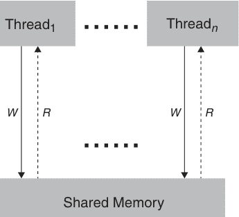

图 5.4 线程 1 到 n 无障碍访问共享内存结构（灵感来自 Luc Maranget、Susmit Sarkar 和 Peter Sewell 的《ARM 和 POWER 弛散内存模型教程介绍》）

然而，计算的现实充满了扩展和并发挑战。共享内存管理通常需要锁等机制来确保数据的有效性。这些机制虽然至关重要，但会引入复杂性。参考 Doug Lea 的《Java并发编程：设计原理与模式》，线程在访问对象时竞争锁（图 5.5）并不罕见。这种竞争可能导致一个线程惯性地阻塞其他线程，从而导致执行延迟和潜在的性能下降。

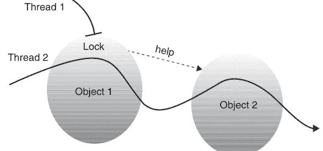

图 5.5 线程 2 锁定对象 1 并移动到对象 2 中的辅助对象（灵感来自 Doug Lea 的《Java并发编程：设计原理与模式》第 2 版）

> ⁵ Doug Lea. Concurrent Programming in Java: Design Principles and Patterns, 2nd ed. Boston, MA: Addison-Wesley Professional, 1999.

## 硬件在性能中的作用 131

理想愿景与现实世界之间的这种差异强调了硬件与软件交互中复杂的相互作用。线程、共享内存结构以及管理它们交互的机制（锁或无锁数据结构和算法）是这种复杂性的证明。正是这种差异凸显了深度理解硬件如何影响性能的必要性。

## 性能交响曲：语言、处理器和内存模型

在理想状态，性能是所采用编程语言、处理器能力以及它们遵循的内存模型的和谐组合。这种性能的交响曲正是我们在本节中想要揭开的。

## 并发：核心机制

并发指的是多个任务或进程的并行执行。它是现代计算中的基本概念，允许提高效率和响应。从应用的角度来看，理解并发对于设计能够同时处理多个用户或任务的系统至关重要。对于 Web 应用，这可能意味着在无延迟的情况下为多个用户服务。误解并发会导致死锁或竞态条件等问题。

## 共生关系：硬件与软件的交互

- **超越硬件**：虽然强大的软件可以提高性能，但当软件针对该硬件进行优化时，才能释放真正的潜力。这种优化受到编程语言选择、其与处理器的兼容性以及对特定内存模型遵循的影响。

- **语言与处理器**：不同的编程语言具有不同程度的抽象。某些提供了与硬件更接近的交互，而另一些则优先考虑开发者的便利性。挑战在于确保代码在这个范围内经过优化，使其在预期的处理器架构上运行。

## 内存模型：沉默的催化剂

- **平衡一致性与性能**：内存模型定义了线程如何感知内存操作。它们在确保所有线程对内存有一致视图与允许为了性能提升进行某些重排序之间达成了微妙的平衡。

- **语言特性**：不同的语言有自己的内存模型。例如，Java 内存模型强调特定的操作顺序以保持跨线程的一致性，即使这意味着要牺牲一些性能。相比之下，C++11 及更高版本对内存提供了更细粒度的控制。

## 增强性能：优化和谐性

## 硬件感知编程

为了真正利用硬件的力量，我们必须超越语言的抽象。这涉及理解缓存层级、针对缓存友好设计优化数据结构并意识到硬件的能力。以下是其在不同缓存层中的体现：

- **针对 CPU 缓存效率优化**：将数据结构与缓存行对齐以减少缓存缺失并加快访问。重要的策略包括管理“真共享”（通过确保同一行上的共享数据被高效访问来减少性能影响）以及避免“伪共享”（同一行上的无关数据导致失效）。利用硬件预取可以提高空间局部性。

- **应用级缓存**：在软件/应用层实现缓存需要仔细考虑硬件的可扩展性。例如，可用 RAM 限制了内存中保留的数据量。关于缓存什么及其持续时间的取决于。

- **数据库缓存**：数据库使用内存存储查询和结果。同样，通过内容分发网络（CDN）进行的缓存涉及分布式网络服务器在用户附近缓存内容，降低延迟。软件定义网络（SDN）可以优化缓存策略中的硬件使用。

## 精通内存模型

深度理解语言的内存模型可以防止并发问题并解锁性能优化。内存模型规定了内存与多个执行线程之间的交互。对这些模型的细致理解可以显著缓解相关的并发问题（如可见性问题和竞态条件），同时也为性能优化提供了途径。

- **Java 内存模型**：在 Java 中，掌握“发生之前”（happens-before）关系的复杂性至关重要。这一概念确保了跨线程的内存可见性和排序。通过掌握这些关系，开发者可以在不过度同步的情况下编写安全代码。理解如何利用 `volatile` 变量、原子操作和同步块可以有效提高性能，特别是在多线程环境中。

在探索了硬件和内存模型的细微差别后（这些模型可以帮助我们构建高效且健壮的并发软件），下一步是深入研究内存模型的特定细节。

# 内存模型：解码线程动态与对性能的影响

通过将全局执行时间线与程序顺序时间线相结合，我们可以观察到直观、顺序化的事件流。这种可视化与顺序一致性机器的原理相一致，在这种机器中，尽管线程操作具有并发性，但系统的表现就像存在一个单一的、全局有序事件序列。这些图表有助于增强我们对顺序一致性的理解。

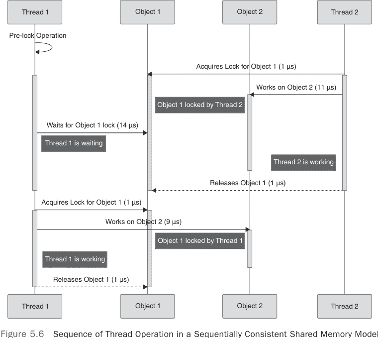

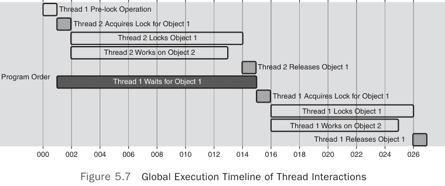

## 硬件在性能中的作用

虽然图 5.6 和 5.7 以及讨论概述了一个理想化的顺序一致性系统，但现实世界中的现代计算系统通常遵循更宽松的内存模型，例如总排序 (TSO)、部分存储排序 (PSO) 或释放一致性。这些模型与各种硬件优化策略（如存储/写缓冲和乱序执行）相结合时，可以带来提升。然而，它们也引入了观察到背离程序顺序的操作的可能性，可能导致不一致。

以存储缓冲区（store buffering）的概念为例，线程可能会在自己的写入对其他线程可见之前观察到这些写入，这可能会破坏感知到的操作顺序。为了说明这一点，让我们通过两个线程（进程）p0 和 p1 的存储缓冲区来探索。初始情况下，我们在内存中有两个变量 X 和 Y 被设置为 0。此外，我们还有 foo 和 bar，它们是分别存储在线程 p0 和 p1 寄存器中的局部变量：

- p0
  - `X = 1;`
  - `foo = Y;`

- p1
  - `Y = 1;`
  - `bar = X;`

在理想的顺序一致性系统中，foo 和 bar 的值由操作顺序决定，该顺序包括 {a, b, c, d}、{c, d, a, b}、{a, c, b, d} 等。在这种情况下，foo 和 bar 不可能为零，因为每个线程内的操作被保证按照它们发出的顺序被观察。

然而，通过存储缓冲区，线程可能会在他人之前感知到自己的写入。这可能导致 foo 和 bar 都为零的情况，因为 p0 写入 X (a: `X = 1`) 可能在 p0 注意到它之前就被 p1 识别，p1 写入 Y (c: `Y = 1`) 也是如此。


此类行为可能导致偏离预期顺序的不一致，而这些优化对于增强系统性能是根本性的，为更快的处理时间和更高的效率铺平了道路。此外，像 `MESI` 和 `MOESI` 等缓存一致性协议在维护处理器缓存之间的一致性方面起着至关重要的作用，进一步增加了内存领域的复杂度。

结论：我们对内存一致性模型的探索为理解 JVM 内部并发操作的复杂性奠定了基础。对于我们从事 Java 和 JVM 性能调优的人来说，充分掌握这些模型的现实情况和底层原理至关重要，因为它们影响了我们并发程序的平滑和高效执行。

随着不断推进，我们将继续探索硬件的世界。特别是，我们将讨论具有分层内存结构的多处理器线程或核心，类似于 Java 内存模型 (`JMM`) 的构造。我们将涵盖 `volatile` 变量的使用——这是构建线程安全应用程序的关键 `JMM` 特性——并探索内存屏障（`memory barriers`）和栅（`fences`）如何有助于并发 Java 环境中的可见性和排序。

此外，当我们考虑 Java 应用在具有非均匀内存访问时间的系统上的性能时，非均匀内存访问 (`NUMA`) 的概念变得越来越相关。

> https://redis.com/glossary/cache-coherence/

理解 `NUMA` 的影响至关重要，因为它影响了 JVM 内部的垃圾回收、线程调度和内存分配策略，从而影响 Java 程序的整体性能。

# 第 5 章：端到端 Java 性能优化

## 并发硬件：穿越迷宫

在并发硬件系统的领域，我们必须应对多处理器核心的复杂层级，每个核心都有自己的分层内存结构。

### 同步多线程与核心利用率

多处理器核心可能实现同步多线程 (`SMT`)，这种技术通过允许多个硬件线程在单个核心上同时执行来提高 CPU 的效率。核心内部这种并发设计是为了更好地利用 CPU 资源，当一个线程等待 I/O 操作或长延迟指令时，空闲的核心可以被另一个硬件线程使用。

与全核心利用形成对比（每个线程运行在具有专用计算资源的独立物理设备上），对于 JVM 而言，我们遇到了另一组不同的性能考量。全核心为每个线程提供了对一个核心的控制权，减少了竞争并可能增强计算密集型任务的性能。在这种环境中，JVM 的垃圾回收和线程调度可以在获得无阻访问这些资源的保证下运行，定制策略以最大化每个核心的效率。

然而，在采用超线程 (`SMT`) 的领域，JVM 面临着更复杂的场景。我们意识到线程可能无法独占核心资源的访问权限。这种共享环境可以提高多线程应用程序的吞吐量，但可能引入更高的资源竞争概率。JVM 的线程调度器和 GC 必须适应这种现实，平衡工作负载分发和 GC 过程，以适应 `SMT` 的细微差别。

在利用全核心或超线程之间选择可能提供特定的优势。对于计算密集型工作负载，超线程可能提供吞吐量。当我们深入研究硬件的影响时，我们意识到软件与这些能力保持的重要性。

### 高级处理器技术与内存分层

在并发硬件系统的领域，我们必须应对多处理器核心的复杂层级，每个核心都有自己的分层内存结构。

#### 硬件在性能中的作用

维护处理器缓存之间的一致性。每个核心通常拥有 1 级指令缓存 (`L1I`)、1 级数据缓存 (`L1D`) 和私有的 2 级缓存 (`L2`)。缓存一致性是确保所有核心视图一致的机制。这种设置包含一个所有核心访问的末级缓存 (`LLC`)，促进它们之间的数据共享。

此外，处理器采用加载存储缓冲区来管理从内存传输的数据。这些缓冲区临时存储数据，有效地弥补了 CPU 寄存器与较慢内存之间的差距。

为了最大化性能，这些处理器采用了高级技术。例如，乱序执行允许处理器在数据可用时执行指令，而不是严格遵守程序顺序。

内存分层的核心是内存控制器，它监督系统内的内存库 (`DDR`)，协调缓存与物理内存之间的数据流。图 5.8 展示了包含上述所有组件的综合配置。

内存一致性以及一个处理器的内存变化如何被他人感知，随架构而异。光谱的一端是具有强内存模型的架构，如 `x86-64` 和 `SPARC`，它们使用 `TSO`。相反，`Arm V8-A` 架构具有更宽松的模型，允许内存操作进行更灵活的重排序。这种灵活性可以带来更高的性能但要求程序员更仔细地使用同步原语以避免多线程应用程序中的意外行为。

为了说明前面的变量 `X` 和 `Y` 的存储缓冲区示例，两者都设置为 0。在 `x86-64` 等 `TSO` 架构中，存储缓冲区的使用可能导致观察到 `foo` 和 `bar`，如果线程 `P1` 在 `P2` 写入 `Y` 之前读取 `Y`，同时 `P2` 在 `P1` 写入 `X` 之前读取 `X`。在 `Arm v8` 中，硬件可能会重排序操作，可能导致比 `TSO` 之外更意想不到的结果。

> ⁷ https://docs.oracle.com/cd/E26502_01/html/E29051/hovor-15.html
>
> ⁸ https://community.arm.com/arm-community-blogs/b/infrastructure-solutions-blog/posts/synchronization-overview-and-case-study-on-arm-architecture-563085493

#### 第 5 章 端到端性能优化

通常私有

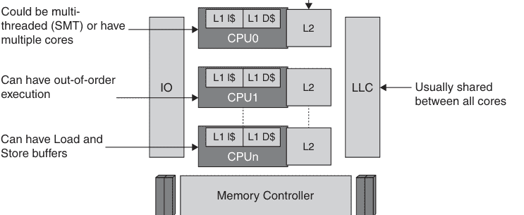

图 5.8 现代硬件配置

在探索高级处理器技术和内存层次结构的迷宫时，我们实际上只揭开了故事的一半。这些硬件优化的真正效能只有在它们与运行其上的软件实现有效同步时才能得以体现。作为开发者和系统架构师，我们的挑战是确保我们的软件不仅能够利用而且能够补充这些复杂的硬件能力。

为此，诸如屏障（`barriers`）和内存栅（`fences`）之类的软件机制既可以补充也可以利用这些硬件特性。这些指令强制执行顺序约束，确保多线程环境中的操作以符合硬件内存模型的方式执行。这种理解对于 Java 性能工程至关重要，因为它使我们能够制定软件策略，在复杂的计算环境中优化 Java 应用程序的性能。基于对 Java 内存模型和并发挑战的理解，让我们仔细观察这些软件策略，探索它们如何与硬件工作，优化基于 Java 的系统的效率和可靠性。

### 并发计算中的顺序机制：屏障、内存栅和 volatile

在并发计算的复杂世界中，屏障、内存栅和 `volatile` 变量是维护顺序和确保数据一致性的关键工具。这些机制通过防止某些类型的重排序来发挥作用，这种重排序可能会导致意外的后果或意想不到的结果。

#### 屏障 (Barriers)

屏障是并发编程中的一种同步机制，用于阻塞某些类型的重排序。本质上，屏障就像是程序中的检查点或同步点。当一个线程遇到屏障时，在所有其他线程到达该屏障之前，它无法通过。在内存操作的上下文中，内存屏障防止跨越屏障的读写操作（加载和存储）发生重排序。这有助于维护多线程环境中共享数据的一致性。

#### 内存栅 (Fences)

屏障提供了一个宽泛的同步点，而内存栅则针对内存操作进行了定制。它们强制执行顺序约束，确保某些操作在其他操作之前发生。例如，存储-加载栅（`store-load fence`）确保程序顺序中出现在栅障之前的所有存储操作（写入），在栅障之后的任何加载操作（读取）出现之前，对其他线程可见。

#### volatile (Volatiles)

在 Java 等语言中，`volatile` 关键字提供了一种确保跨线程变量可见性和顺序的方法。对于 `volatile` 变量，对变量的写入对随后读取该变量的所有其他线程可见，从而提供了“发生于”（`happens-before`）的保证。相比之下，非 `volatile` 变量没有 `volatile` 关键字保证的交互优势。因此，编译器可以使用 `volatile` 变量的缓存值。

### 原子性深度解析：Java 内存模型和发生于关系

原子性确保操作要么完全执行，要么完全不执行，从而保护数据完整性。`JMM`（Java 内存模型）对于理解多线程语境下的这一概念至关重要。它提供了可见性和顺序保证，确保原子性并为可预测的执行建立起“发生于”关系。当一个动作发生在另一个动作之前时，第一个动作不仅对第二个动作可见，而且在顺序上在其之前。这种关系确保了在多线程环境中执行的 Java 程序行为是可预测且一致的。

让我们考虑一个实际示例来说明这些概念的实际应用。`AtomicLong` 类是多线程环境下如何实现和利用原子操作以维护数据完整性和可预测性的典型示例。`AtomicLong` 通过低级同步技术确保原子操作，作为单一、不可分割的工作单元。这一特性保护了它们免受并发操作的潜在破坏或干扰。此类原子操作构成了同步的基石，即使在密集的多线程环境下也能保持系统级的一致。

```java
AtomicLong counter = new AtomicLong();

void incrementCounter() {
    counter.incrementAndGet();
}
```

140 第 5 章 端到端 Java 性能优化

在这一段代码中，`AtomicLong` 类中的 `incrementAndGet()` 方法演示了原子操作。它将计数器的递增（`counter++`）和获取（`get`）合并为单一操作。这种原子性在多线程环境中至关重要，因为它防止了其他线程在操作期间以不一致的状态干扰计数器。

`AtomicLong` 类利用低级技术来确保这种顺序。它使用根植于 CPU 指令的比较并交换（`compare-and-set`）循环，这些循环有效地充当了内存屏障。这种由屏障保证的原子性是并发编程的一个重要方面。随着学习的深入，我们将进一步探讨这些机制如何增强性能工程和优化。

让我们考虑另一个实际示例来说明这些概念，这次涉及一个假设的 `DriverLicense` 类。这个示例演示了 Java 中如何使用 `volatile` 关键字来确保跨线程变量的可见性和顺序：

```java
class DriverLicense {
    private volatile boolean validLicense = false;

    void renewLicense() {
        this.validLicense = true;
    }

    boolean isLicenseValid() {
        return this.validLicense;
    }
}
```

在这个示例中，`DriverLicense` 类作为管理执照状态的模型。当执照更新时（通过调用 `renewLicense()` 方法），`validLicense` 字段被设为 `true`。可以通过 `isLicenseValid()` 方法验证当前状态。

`validLicense` 字段被声明为 `volatile`，这保证了当在一个线程中更新执照后（在在线续期之后），执照的新状态将立即对所有其他线程可见（例如检查执照状态的警察）。如果没有 `volatile` 关键字，由于各种缓存机制，其他线程在看到更新后的执照状态之前可能会延迟。

### 硬件在性能中的作用

随着我们的深入，我们将通过同步技术检查运行时性能。具体来说，第 7 章“运行时优化：关注锁及其他”将不仅介绍同步和锁机制，还将指导我们。

# 第 5 章 端到端 Java 性能优化

在 `NUMA` 系统中，内存控制器并非仅仅是辅助者——它是神经中枢。在 AMD 突破性处理器的工作期间，我观察到控制器的角色是一项至关重要的功能。这样一个感知 `NUMA` 的智能实体，能够根据架构的细微差别和单个进程明智地分配内存，需要根据与处理器的近性来优化内存分配，从而最大限度地减少跨节点流量、降低延迟并增强系统性能。

考虑一下：当处理器请求数据时，内存控制器决定了数据的存储位置。如果是本地数据，控制器将实现快速、直接的访问；如果不是，控制器必须调用互连网络，这会引入延迟。在 AMD 期间，`NUMA` 感知内存控制器的作用是在这些决策之间取得最佳平衡，以实现性能最大化。

`NUMA` 系统中的缓冲区作为中间环节，在传输过程中临时存储数据，帮助平衡节点间的内存访问。这种平衡防止了单个节点被过量的请求淹没，确保运行流畅——这一原理被用于优化 Sun Microsystems 高性能 V402 服务器和 `SPARC T4` 的调度器。

还必须关注传输系统——即 `NUMA` 架构。一个优化良好的传输系统可以最小化延迟，有助于系统的整体性能——这是一个关键考虑因素，我在 Arm 任职期间得到了强化。

精通 `NUMA` 并非一项浅尝的练习：它关乎理解这种复杂架构中内存控制器、缓冲区和传输系统等组件之间的相互作用。这种深层理解对于我优化并发系统的性能起了重要作用。

图 5.9 显示了带有缓冲区和互连的简化 `NUMA` 架构。

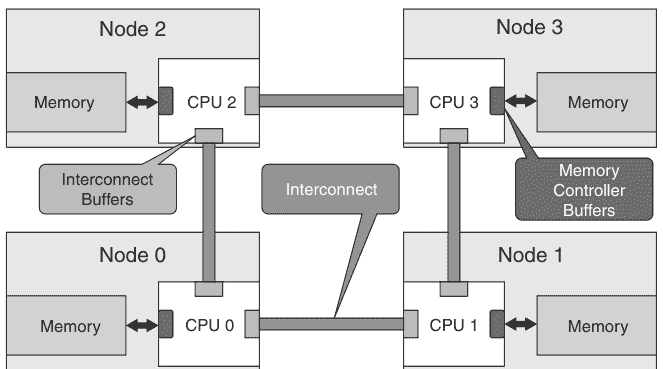

图 5.9 现代系统中的 NUMA 节点

## 硬件在性能中的作用 143

进一步探索 `NUMA` 领域，我们会遇到各种关键的流量模式，包括跨节点流量、本地流量和交织内存流量模式。这些模式显著影响内存访问延迟，进而影响数据处理速度（图 5.10）。

跨节点流量（`Cross-traffic`）是指处理器访问另一个处理器库（`bank`）中的数据的情况。这种跨节点移动引入了延迟，但是多处理器系统中不可避免的现实。在这种情况下，关键考虑因素是通过 `NUMA` 感知内存控制器进行高效处理，并观察延迟最小的路径，同时确保不拥塞缓冲区。

相比之下，本地流量（`Local traffic`）发生在处理器从其本地内存库检索数据时——由于消除了对互连网络的需求，这一过程比跨节点流量更快。优化系统以增加本地流量同时最大限度地减少跨节点流量延迟，是高效 `NUMA` 系统的基石。

交织内存（`Interleaved memory`）为 `NUMA` 系统增加了另一层复杂性。在这里，连续的内存地址散布在不同的内存库中。这种分散平衡了跨节点间的负载，减少了瓶颈并增强了性能。然而，它可能会无意中增加跨节点流量——这需要对内存控制器进行仔细管理。

`NUMA` 架构解决了共享内存模型中固有的扩展性局限，即所有处理器共享单一内存空间。随着处理器数量的增加，到共享内存的带宽会成为瓶颈，限制了系统的可扩展性。然而，为 `NUMA` 系统编程可能具有挑战性，因为开发者在设计算法和数据结构时需要考虑内存局部性。为了帮助开发者，现代操作系统、内存管理系统（如数据库和 GC）正变得越来越感知 `NUMA`。这种感知能力对于最大化系统性能至关重要，也是我在 AMD、Sun Microsystems 和 Arm 工作中的关键。

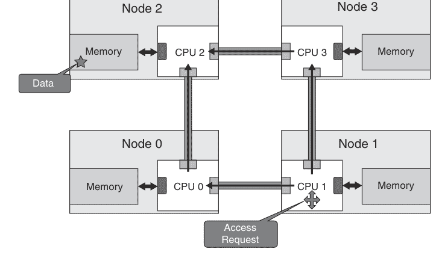

图 5.10 NUMA 访问示意图

# 第 5 章 端到端 Java 性能优化

其他相关概念包括缓存一致性非均匀内存访问 (`ccNUMA`)，在其中系统在所有处理器上维护内存的一致映像；相比之下，`NUMA` 指构建具有非均匀内存系统的设计哲学。理解这些概念，同屏障（`barriers`）、内存栅（`fences`）和 `volatile` 关键字一起，对于精通并发系统的性能优化至关重要。

### NUMA 的进展：现代处理器中的 Fabric 架构

`NUMA` 架构随着处理器设计的演进经过了许多变化，这在高端处理器中尤为明显。这些创新在 Intel、AMD 和 Arm 等行业的工作中显而易见，每家公司都做出了独特的贡献，这些贡献对服务器环境和云计算场景特别相关。

- **Intel 的网格架构（mesh fabric）**：Xeon Scalable 处理器采用了网格架构，取代了公司传统的互连。这种网格拓扑以更直接的方式连接了核心、缓存和 I/O 组件。这允许更高的带宽和更低的延迟，这两者对于数据中心和高性能计算应用至关重要。它显著增强了复杂计算环境中的数据处理能力和服务器响应。

- **AMD 的无限架构（infinity fabric）**：AMD 的 EPIC 处理器采用了 Infinity Fabric 架构。这项技术连接了封装内的多个芯片（`die`），实现了高效的数据传输和可扩展性。它在多芯片 CPU 中特别有利，解决了多核环境中与卓越扩展和性能相关的挑战。AMD 的方法大大改进了大规模服务器中的数据处理，这对于当今日益增长的计算需求至关重要。

- **Arm NUMA 进展**：Arm 在 `NUMA` 技术方面取得了进展，特别是在其服务器级 CPU 上。像 Neoverse N1 平台这样的 Arm 架构为高吞吐量并行处理任务提供了可扩展架构，并强调能效的 `NUMA` 设计。智能互连架构优化了跨核心的内存访问，平衡了性能与效率，并提高了高密度服务器的每瓦性能。

### 从开创性基础到现代创新：NUMA、JVM 及其他

大约 20 年前，在我们 AMD 工作期间，开启了一场突破性的旅程。我们跳出了常规，试图将复杂的 `NUMA` 世界与 JVM 性能的动态领域结合起来。这种早期的合作促成了 `NUMA` 感知 GC 的诞生，这是一项策略性优化多节点系统内存管理的重大创新。这是那个时代远见和创造力的证明。

> 9 www.intel.com/content/www/us/en/developer/articles/technical/xeon-processor-scalable-family-technical.html
>
> 10 www.amd.com/content/dam/amd/en/documents/epyc-business-docs/white-papers/AMD-Optimizes-EPYC-Memory-With-NUMA.pdf
>
> 11 www.arm.com/-media/global/solutions/arm-neoverse-n1-platform.pdf

### 性能工程方法论：动态且详细的方法 145

那个时代的证明。我们获得的洞察并非转瞬即逝的灵感；它们为我们熟悉的 JVM 格局奠定了坚实的基础。今天，我们正在这些遗产之上进行构建，利用我们工作的智慧来增强各种 GC。在第 6 章“Open 中的高级内存管理与垃圾回收”中，你将见证这些早期的创新如何继续塑造和影响现代性能。

# 第 5 章 端到端 Java 性能优化

在这个扩展的领域内，我们可以采用多种方法，例如自上而下和自下而上的方法，来发现、诊断并解决系统中根存在的性能问题，无论这些系统运行在传统设置还是现代分布式架构上。除了这些方法之外，实验设计技术也发挥着至关重要的作用，它通过系统化的程序进行实验，并评估从裸机服务器到容器化微服务的性能。这些方法和技术是通用的，确保了性能优化在各种部署场景下都是可以实现的。

## 实验设计


# 实验设计

实验设计是一种用于测试性能假设的系统化方法。它强调数据收集并促进基于证据的决策。这种方法同时应用于自上而下和自下而上的方法中，用于建立基准和峰值性能测量，并精确评估增量或特定增强的影响。基准性能代表了系统在正常或预期负载下的能力，而峰值或压力性能则突显了其在极端负载下的韧性。实验设计有助于区分变量、评估性能影响并收集关键的监控和剖析数据。

实验设计的本质是控制条件和处理条件。控制条件代表基准场景，通常对应于系统在典型负载下的性能（例如使用当前的软件版本）。相比之下，处理条件引入了实验变量（例如不同的软件版本或负载），以观察其影响。控制条件和处理条件之间的比较有助于衡量实验变量对系统性能的影响。

实验设计的一种特定类型是 A/B 测试，通过比较两个版本的产品来确定哪一个在特定指标上表现得更好。所有的 A/B 测试都是实验设计的一种形式，但并非所有的实验设计都是 A/B 测试。更广泛的实验设计领域涉及多个条件，并应用于从营销到医学等各个领域。

设置这些条件的一个关键方面涉及理解和控制系统状态。例如，在测量新 JVM 特性的影响时，必须确保 JVM 的状态在所有测试中都是一致的。这可能包括 GC 状态、JVM 管理的线程、与操作系统的交互等。这种一致性确保了结果的可靠性和解释的准确性。

## 自下而上的方法

自下而上的方法从低层系统组件的粒度开始，逐渐向上，以对系统性能提供详细的洞察。在 AMD、Sun、Oracle 以及现在于微软担任 JVM 和 GC 性能工程师的经历中，自下而上的方法一直是我工具箱中的关键工具。它的效用在许多场景中显而易见，例如在 JVM/运行时级别引入新功能、评估 Metaspace 的影响、微调 G1 GC 回收阈值。正如我们在接下来的 JMH 基准测试部分中看到的，自下而上的方法对于理解新的 Arm 处理器的原子指令如何影响系统的可扩展性和性能也至关重要。

与实验设计一样，自下而上的方法要求彻底理解系统不同层级如何管理，范围从硬件延伸到高层应用框架：

- **硬件细节**：理解处理器架构、内存层次结构和 I/O 子系统如何影响 JVM 行为和性能至关重要。例如，理解处理器的核心和缓存架构如何影响 JVM 中的垃圾回收和线程调度，可以为系统设计做出更明智的决策。

- **GC**：开发者必须认识 JVM 如何管理内存，特别是 G1 等垃圾回收策略以及 Shenandoah 和 ZGC 等低延迟收集器如何针对不同的硬件、操作系统和工作负载模式进行优化。例如，ZGC 通过利用大内存池和采用多映射技术来增强性能，并根据不同操作系统和硬件的特定内存管理特性和架构细节进行定制优化。

- **OS 管理**：开发者应该探索操作系统如何结合 JVM 的多线程能力管理线程。这包括线程调度的细微差别以及上下文切换对 JVM 性能的影响。

- **资源分配与限制**：分析 Kubernetes 等容器编排平台的资源分配策略——从管理 CPU 和内存请求到它们与底层硬件资源的交互。这些因素影响着 JVM 配置及其在容器内的性能。

- **网络和 I/O 操作**：评估容器网络对 JVM 网络密集型应用的影响，以及 I/O 操作对 JVM 文件处理的影响。

- **容器中的 JVM 调优**：我们还应该考虑容器环境中 JVM 调优的特殊性，例如根据容器的内存限制调整堆大小。在资源受限的环境中，确保 JVM 在容器内经过正确调优至关重要。

- **应用框架**：开发者必须理解像 `Netty` 这样用于高性能网络应用的框架如何管理异步任务和资源利用。在自下而上的方法中，我们将审视 `Netty` 的线程管理、缓冲区分配策略以及它们如何与 JVM 的非阻塞 I/O 操作和 GC 行为交互。

自下而上方法的有效性在与基准测试结合时变得尤为明显。这种结合能够对整个技术栈的性能和扩展性进行精确测量——从硬件和操作系统，通过 JVM、容器编排平台和云基础设施，最后到基准测试本身。这种全面的方法提供了对性能格局的深入理解，特别突出了 JVM 与操作系统、容器、内存策略以及硬件细节之间关键的交互。这些洞察对于调整系统以获得最佳性能至关重要。此外，自下而上的方法在增强 JVM 和 GC 的开箱即用体验方面发挥了重要作用，加强了其在性能工程领域重要性。我们将在第 7 章深入探讨这种实用的方法，届时我们将讨论与锁竞争相关的性能改进。

相比之下，自上而下的方法是我们在后续章节中的重点，在执行工作说明书（SoW）规定的任务时特别有价值。工作说明书是一份精心编写的文档，界定了供应商或服务提供者的责任。它概述了预期的工作活动、具体的交付物和执行时间表，从而为工作提供了指南/路线图。在性能工程背景下，工作说明书为实现质量 SLA 提供了详细布局。因此，这种方法使得特定的系统优化与 SoW 中概述的总体目标保持一致。

总而言之，这些方法和技术为性能工程师配备了全面的工具箱，促进了系统吞吐量的有效提升和能力的扩展。

## 自上而下的方法

自上而下的方法是一种全局方法，它从对系统高层目标的全面理解开始向下进行，利用我们对整个堆栈的深度理解。当我们拥有跨度巨大的知识时（从高层架构和用户交互模式到硬件行为和系统配置的细微细节），这种方法就能蓬勃发展。

该方法受益于对“已知”（known-knowns）的关注，即熟悉的因素，包括工作流、访问模式、应用流程和可调参数。这些“已知”代表了我们已经理解的方面或细节。它们可能包括系统的结构、各个组件如何相互作用以及系统在正常情况下的通用行为。自上而下的方法的优势在于能够揭示“已知未知”（known-unknowns）——即我们知道但尚未充分理解的方面或细节。它们可能包括潜在的性能瓶颈、某些条件下不可预测的系统行为以及特定系统更改对性能的影响。

> **注意**：嵌入自上而下方法中的调查过程旨在将“已知未知”转化为“已知的”，为持续优化系统提供必要的知识。虽然我们对子系统的领域知识提供了基础性理解，但有效地识别和解决各种瓶颈需要更详细、更具体的信息，这些信息超越了初始知识，帮助我们实现性能和扩展性目标。

# 第 5 章 端到端 Java 性能优化

## 性能工程方法论：一种动态且详细的方法

应用自上而下的方法论要求对不同系统组件之间的状态管理有坚实的掌握，从高层应用状态到 JVM 和操作系统对内存管理的细微细节。这些因素会显著影响系统的整体行为。例如，在引入一个新硬件系统时，自上而下的方法首先开始定义硬件的性能目标和需求，然后调查“已知的未知”，例如可扩展性和最佳部署场景。理想情况下，从本地部署到云环境的迁移应该从迁移的宏观目标（如成本效益和低开销）开始，然后处理这些目标如何影响应用部署、JVM 调优和资源分配。即使你是在向应用程序生态系统引入一个新的库时，也应该采用自上而下的方法论，先确定集成的预期结果，然后检查该库与现有组件的交互及其对应用行为的影响。

## 构建工作说明书 (Statement of Work)

当我们转向构建工作说明书时，我们将看到自上而下的方法论如何指导我们优化复杂系统，例如大规模在线事务处理 (OLTP) 数据库系统。通常，这类系统的特点是广泛且分布式的数据足迹，需要仔细的优化以确保高效性能。这种优化的关键（特别是在我们特定的 OLTP 系统中）是有效的缓存利用和多线程能力，这些可以显著缩短系统的*调用链遍历时间*。

调用链遍历时间是 OLTP 系统中的一个关键指标，代表完成程序中一系列函数调用和返回所需的累积时间。该指标通过累加链中所有单个函数调用的持续时间计算得出。在快速处理事务的环境中，最小化这段时间可以显著提升性能。

为这种复杂系统创建 SoW 涉及制定明确的性能和容量目标、识别潜在瓶颈，并指定时间表和交付物。在我们的 OLTP 系统中，它还需要理解系统内部如何管理状态，特别是当 OLTP 处理大量事务并需要保持一致交互时。这种状态在各个组件中（从应用层到 JVM、操作系统以及 I/O 进程级别）的管理方式对系统性能有重大影响。SoW 充当了战略路线图，指导我们利用自上而下的方法论来调查和解决性能问题。

OLTP 系统建立了对象数据关系以便快速检索。目标不仅是降低事务延迟，还要平衡降低尾延迟以及在峰值负载期间增加系统利用率的需求。尾延迟指的是分布中最差百分位数处的延迟（例如，第 99 百分位及以上）。减少尾延迟意味着提高系统最差情况性能，这可以极大地改善整体用户体验。

广而言之，OLTP 系统通常旨在提高响应速度和效率。我们努力确保每个事务都能被快速处理（提高响应速度），并确保系统能够处理增加的事务，特别是在高需求期间（确保效率）。这种双重关注对于系统的整体运行效率至关重要，反过来，这也是性能工程过程中的一个重要环节。

平衡响应速度与系统效率是本质的。如果一个系统响应迅速但不可扩展，它可能很快地处理单个任务，但在任务数量增加时可能会变得不堪。相反，一个可扩展但性能不佳的系统可以处理大量任务，但如果每个任务的处理时间过长，整个系统的效率将受到损害。因此，理想的系统在两个方面都表现出色。

在真实的 Java 工作负载背景下，这些考虑尤为相关。基于 Java 的系统通常处理高事务量，需要仔细的调优以确保最佳性能和容量。关注减少尾延迟、优化事务延迟以及在峰值负载期间增加系统利用率，都是有效管理 Java 工作负载的关键方面。

在 SoW 中建立了明确的性能和可扩展性目标后，我们现在转向能够实现这些目标的过程。在下一节中，我们将详细查看性能工程过程，系统地探索涉及的各个方面和子系统。

## 性能工程过程：自上而下的方法

在本节中，我们将以系统的、自上而下的方法开始性能工程的探索。选择这种方法是因为它涵盖了系统层，从最高系统级别开始，随后深入更具体的子系统和组件。这种方法的循环性质涉及四个阶段：

1. **性能监控**：跟踪应用程序在其生命周期内的性能指标，以识别潜在的改进领域。
2. **剖析 (Profiling)**：针对监控识别的感兴趣模式进行针对性剖析。可能需要重复模式以准确衡量其影响。
3. **分析 (Analyzing)**：解释剖析阶段的结果并制定计划。分析阶段与剖析是并行的。
4. **应用调优 (Apply tunings)**：应用分析阶段建议的调优。

这一过程的迭代性质确保我们不断完善对系统的理解，持续提高性能并实现可扩展性目标。在这里，重要的是记住硬件监控可以发挥关键作用。CPU 利用率、内存使用、网络 I/O、磁盘 I/O 以及其他指标可以提供有关系统性能的宝贵见解。这些发现可以指导剖析、分析和调优阶段，帮助我们理解性能问题是与软件还是与硬件限制有关。

## 基于工作说明书：正在调查的子系统

在本节中，我们将自上而下的性能方法论应用于现代应用堆栈的每一层（如图 5.11 所示）。这种系统方法允许我们优化调用遍历时间、缓解尾延迟并在峰值负载期间增加系统利用率。

我们的堆栈之旅始于应用层，在其中我们评估其功能性能和高层特征。然后我们探索应用生态系统，重点关注支持应用运行的库和框架。接下来，我们关注 JVM 的执行能力和 JRE，后者负责提供执行所需的库和资源。这些组件可以封装在容器 (Container) 中，确保应用程序从一个计算环境到另一个环境运行得快速且可靠。

容器下方是（客户）操作系统，它是为容器化环境定制的。其后是虚拟化基础设施中的虚拟机管理器 (Hypervisor) 和主机操作系统 (Host OS)，它们管理容器并提供对硬件资源的访问。

我们通过利用特定于每一层的工具和技术评估整体系统性能，以确定潜在瓶颈并寻找广泛改进的机会。我们的分析涵盖了从硬件到软件的所有元素，为我们提供了系统的视角。SoW 中概述的每一层目标为潜在的性能瓶颈和优化机会提供了见解。通过系统地探索每一层，我们旨在增强系统的整体性能和可扩展性，符合自上而下的方法将系统级理解转化为针对性的、可操作见解的目标。

| 应用 |
| :--- |
| 应用生态系统 |
| JVM |
| JRE |
| 容器 |
| （客户）操作系统 |
| 虚拟机管理器和主机操作系统 |
| 硬件 |

图 5.11 典型系统堆栈不同层级的简化图

## 应用及其生态系统：系统级视角

根据我们以 Java 为中心的 OLTP 数据库系统的工作范围（SoW），现在我们将关注应用程序及其生态系统，进行全面的系统级扩展。我们的分析涵盖以下组件：

- **核心数据库服务和功能**：这些是数据库系统执行的基础操作，例如数据存储、检索、更新和删除。
- **提交日志处理**：这指的是提交日志（commit logs）的管理，它们记录了所有修改数据库数据的事务。
- **数据缓存**：这些硬件或软件组件存储数据，以便为未来的数据请求提供更快速的服务，从而显著提升系统性能。
- **连接池**：这些连接缓存被维护并优化，以供复用。这种策略促进了资源的高效利用，因为它减轻了每次需要访问数据库时建立新连接的开销。
- **中间件/APIs**：中间件作为操作系统与运行在其上的应用程序之间的软件桥梁，促进无缝通信和交互。应用程序编程接口（APIs）提供了一套结构化的规则和协议，用于构建和与软件应用程序进行交互。中间件和 APIs 共同增强了系统的互操作性，确保各种组件之间有效高效的交互。
- **存储引擎**：这是处理数据库系统中数据存储和检索的底层存储组件。优化存储引擎可以带来显著的性能提升。
- **模式（Schema）**：模式是数据库的组织形式或结构，在数据库系统支持的正式语言中定义。高效的模式设计可以提高数据检索时间和整体系统性能。

## 系统基础设施与交互

在软件系统中，库（libraries）是预编译代码的集合，开发者使用它们来执行常见任务。库及其交互对系统性能起着至关重要的作用。库之间的交互指的是这些不同的预编译代码集如何协作以执行更复杂的任务。检查这些交互可以为系统性能提供重要见解，这些交互中的问题或低效率可能会减慢系统或导致其产生意外之外的行为。

现在，让我们将这些库及其交互与数据库系统操作分类的广泛背景联系起来。数据库系统中的每个组件都对以下方面贡献：

1. **数据预处理任务**：如标准化和验证等操作，这些对于维护 OLTP 系统中的数据完整性和一致性至关重要。对于这些任务，我们的目标是识别最资源密集型的事务并映射它们的路径。我们还将尝试理解涉及的库以及它们如何相互作用。
2. **数据存储或准备任务**：对于处理大量事务的 OLTP 系统，需要存储或准备数据以便快速访问和修改的操作。在这里，我们将识别关键数据和数据路径，以理解数据如何在系统内部流动。
3. **数据处理任务**：实际的工作模式，如排序、结构化和索引，这些与系统及时执行事务的能力直接相关。对于这些任务，我们将识别关键数据路径和事务。我们还将确定用于加速这些操作的缓存或其他优化技术。

对于每个类别，我们将收集以下信息：

- 昂贵的事务及其路径
- 数据传输路径和数据馈送路径
- 缓存及其交互
- 用于加速事务或数据路径的缓存或其他优化技术

通过这种方式，我们可以洞察可能存在哪些低效之处。这些分类的操作——数据处理可能从性能优化中获益；数据存储或准备任务，以及数据处理任务——是数据库系统不可或缺的一部分。增强这些领域将有助于提高事务延迟（性能），并允许系统处理日益增加的事务（扩展性）。

例如，识别昂贵的事务（处理时间较长或锁定其他关键操作的事务）及其路径可以帮助简化数据处理、减少尾部延迟并改进调用遍历时间。同样，优化数据存储或准备数据路径并进行优化，可以显著增加峰值负载期间的系统利用率。最后，专注于数据处理任务并优化缓存或其他技术的利用，可以加速事务并提高系统的整体扩展性。

在对系统级动态有了理解后，我们现在可以关注系统的特定组件。我们的第一步：JVM 及其运行时环境。

## JVM 运行时环境

JVM 作为我们的应用程序与其运行容器、操作系统和硬件之间的桥梁——这意味着 JVM 可以带来显著的性能提升。在这里，我们将讨论对性能影响最大的配置选项，例如 JIT 编译器优化、GC 算法和 JVM 调优。

我们将首先识别 JDK 版本、JVM 命令行和 GC 部署信息。JVM 命令行指的是启动 JVM 时使用的命令行选项。这些选项可以控制 JVM 行为的各个方面，例如设置最大堆大小或启用各种日志选项，正如第 4 章“统一 Java 虚拟机日志接口”中所述的那样。GC 部署信息指的是 JVM 使用的 GC 的配置和运行细节，以及 GC 的类型、设置及其性能指标。

考虑到我们 OLTP 系统的重复性和事务密集型特性，关注 JIT 编译器优化（如方法内联和循环优化）非常重要。这些优化对于减少方法调用开销和提高循环执行效率至关重要，这两者对于快速有效地处理事务都是关键。

我们的首选 GC 是垃圾优先收集器（G1 GC），因为它在管理通常位于年轻代的短生命周期数据方面高效。这一选择符合我们最小化尾部延迟并高效处理大量事务的目标。同时，我们应该评估 ZGC 并密切关注其分代版本的发展，这将提升 OLTP 场景的性能。

随后，我们将收集以下数据：

- GC 日志，有助于识别瞬时数据处理、性能不佳的阶段；GC 影响、安全点时间以及 GC 之外的应用停止时间
- 线程和锁统计，以了解线程锁定并更好地理解系统的并发行为
- Java 原生接口（JNI）池和缓冲区，以确保与原生代码的最优交互
- 内联启发式和循环优化的 JIT 编译数据，它们对于加速事务处理至关重要

> **注意**：由于 Java Flight Recorder 和 VisualVM 等剖析工具可能具有侵入性，我们将单独收集剖析数据而非监控数据。

## 垃圾收集器

当我们谈论性能时，不可避免地会进入核心话题：GC 优化。三个元素在这个过程中至关重要：

- **自适应反应**：GC 根据系统当前状态调整其行为的能力，例如适应更高的分配率或增加的长生存数据压力。
- **实时预测**：GC 根据当前趋势对未来内存使用做出预测并相应调整行为的能力。大多数面向延迟的 GC 都具有这种预测能力。
- **快速恢复**：GC 在无法赶上内存分配或晋升速度时快速恢复的能力，例如通过触发迁移失败或全垃圾回收周期。

## 容器化环境

容器已成为现代应用程序架构不可或缺的一部分，显著影响了应用的部署和管理方式。在容器化环境中，JVM 人机工程（JVM ergonomics）引入了全新的复杂维度。所使用的调度策略（特别是在 Kubernetes 等系统中）对 JVM 资源分配需要精细的方法，以符合我们 OLTP 系统的性能目标。在这里，我们深入探讨容器环境的以下方面：

- **容器资源分配与 GC 优化**：我们构建容器编排策略，确保 JVM 的资源分配与 OLTP 系统的性能目标对齐。这包括手动配置以覆盖在容器环境中可能并非最优的 JVM 人机工程设置。


- 网络密集型 JVM 调优：鉴于 OLTP 系统网络密集型的特性，我们评估容器网络如何影响 JVM 性能，并相应地优化网络设置。
- 优化 JVM 的 I/O 操作：我们仔细研究 I/O 操作的影响，特别是 JVM 的文件处理，以确保 OLTP 系统中高效的数据访问和传输。

# OS 考虑因素

在本节中，我们分析了操作系统如何影响 OLTP 系统的性能。我们探索了进程调度、内存管理和 I/O 操作的细微差别，并讨论了这些因素如何与我们的 Java 应用程序交互，特别是在高并发事务环境中。我们将利用操作系统提供的系列诊断工具在不同级别收集数据，并根据之前识别的类别对信息进行分组。

例如，在使用 Linux 系统时，我们拥有一系列高效工具可用：

- `vmstat`：此工具对于监控 CPU 和内存利用率至关重要，提供了大量的关键统计数据：
  - 虚拟内存管理：一种内存管理策略，它抽象了机器上的物理存储资源，为用户创建了扩展内存。这种技术通过根据需求优化管理和分配内存资源，显著提高了系统的效率和灵活性。
  - CPU 使用率分析：CPU 运行时间占其空闲时间的比例。CPU 使用率通常表示 CPU 频繁参与事务处理任务，而低值可能表明利用不足或处于空闲状态，通常指向其他潜在的瓶颈。

# 第 5 章：端到端 Java 性能优化

- Sysstat 工具
- `mpstat`：专门为线程和 CPU 级监控而设计，`mpstat` 擅长收集锁竞争、上下文切换、等待时间、窃取时间（steal time）以及其他与高并发 OLTP 场景相关的 CPU/线程指标信息。
- `iostat`：专注于输入/输出设备性能，提供有关磁盘读/写活动的详细指标，这对于诊断 OLTP 系统中的 I/O 瓶颈至关重要。

这些诊断工具不仅提供了系统状态的快照，还指导我们微调 OS 以增强 OLTP 系统的性能。它们帮助我们从更深层次理解 OS 与 Java 应用程序之间的交互，特别是在重负载事务负载下高效地管理资源。

# 宿主机 OS 与虚拟机管理器动态

宿主机 OS 和虚拟机管理器子系统是虚拟化的基础。宿主机 OS 层对于管理机器的物理资源至关重要。在 OLTP 系统中，对 CPU、内存和存储的高效管理直接影响整体性能。此层面的监控工具帮助我们理解宿主机 OS 为虚拟机和容器分配资源的能力。

虚拟机管理器处理 CPU 调度、内存分区和网络流量会显著影响处理效率。因此，为了优化 OLTP 性能，我们分析了虚拟器的设置及其与宿主机 OS 和客户 OS 的交互。这包括虚拟 CPU 的分配、理解内存过度承诺（overcommitment）策略以及评估网络虚拟化配置。

## 硬件子系统

在最底层，我们考虑运行软件的实际物理硬件。这种检查基于我们对不同 CPU 架构和复杂内存系统的基础知识。我们还查看了对 OLTP 系统性能有贡献的存储和网络组件。在这种范围内，我们之前讨论的并发和内存模型变得更加相关。通过应用有效的监控技术，我们旨在理解资源限制或识别改进性能的机会。这为我们提供了系统中硬件与软件交互的完整图景。

因此，对硬件进行彻底评估（涵盖 CPU 行为、内存性能以及存储和网络基础设施的效率）是关键的。这种方法不仅有助于确定性能瓶颈，还能阐明软件与硬件层之间复杂的关系。这些洞察对于实施针对性的优化至关重要，能够显著增强我们以 Java 为中心的 OLTP 数据库的性能。

为了加深理解并促进这种优化，我们探索了一些桥接硬件评估与可操作数据差距的高级工具：系统分析器（system profilers）和性能监控单元（PMUs）。这些工具在将原始硬件指标转化为指导我们优化策略的有意义见解方面起着关键作用。

# 性能工程方法论：动态且详细的方法

## 系统分析器与性能监控单元

在性能工程领域，系统分析器——如 `perf`、OProfile、Intel VTune Profiler 以及其他面向架构的分析器——为硬件的运行提供了极具价值的见解，可以帮助开发者优化系统和应用程序性能。它们与硬件子系统交互，提供一种通过标准监控工具无法实现的全面视图。

这些分析器的关键数据源是 CPU 内部的性能监控单元（PMUs）。PMUs 包括固定功能 PMU 和可编程 PMU，提供了丰富的底层性能信息，可用于识别瓶颈和优化系统性能。

系统分析器可以从 PMU 收集数据以生成详细的性能分析。例如，`perf` 命令可以用于对整个系统的堆栈跟踪进行采样，创建一个总结了整个系统中每个函数耗时情况的“扁平化剖析（flat profile）”。这种性能剖析可用于识别消耗不成比例 CPU 时间的函数。通过为每个函数提供包含（inclusive）和非包含（exclusive）时间，这种扁平化剖析详细查看了系统时间消耗在何处。

然而，系统分析器不仅限于 CPU 性能；它们还可以监控其他系统组件，如内存、磁盘 I/O 和网络 I/O。例如，`iostat` 和 `vmstat` 分别提供有关磁盘 I/O 和内存使用的详细信息。

一旦我们通过监控状态识别出问题模式、瓶颈或改进机会，就可以采用高级分析工具进行深度分析。

## Java 应用分析器

Java 应用分析器如 async-profiler¹（低开销采样分析器）和 VisualVM（一个集成了多个命令行 JDK 工具并提供轻量级功能的工具）提供了丰富的 JVM 性能分析数据。它们可以执行不同类型的分析，如 CPU 分析、内存分析和线程分析。当与其他系统分析器配合使用时，这些工具可以提供从 JVM 层到系统层的更完整的性能画像。

通过从 PMU 收集数据，`async-profiler` 等分析器可以提供底层性能信息，帮助开发者识别瓶颈。它们允许开发者获取字节的堆栈和生成代码级细节，从而比较在 Intel 和 Arm 等不同架构上的生成代码和编译器优化。

为了有效使用 `async-profiler`，我们需要 `hsdis`²，一个用于 OpenJDK VM 的反汇器插件。该插件用于反汇编 JIT 编译器生成的机器码，从而深入理解 Java 代码如何在硬件层面执行。

¹https://github.com/async-profiler/async-profiler
²https://blogs.oracle.com/javamagazine/post/java-hotspot-hsdis-disassembler

## 核心要点

在本节中，我们采用自上而下的方法来理解并增强我们以 Java 为核心的 OLTP 系统的性能。我们从系统的最高层开始，扩展到复杂的生态系统中间件、API 和存储引擎。随后，我们遍历了 JVM 及其运行时环境，这对于高效的事务处理至关重要。我们的分析结合了这些容器和环境的细微差别。JVM 在这些容器中的行为以及它与 Kubernetes 等编排平台的交互方式，对于将 JVM 资源分配与 OLTP 系统的性能目标对齐具有关键。

随着我们的深入，操作系统的角色变得日益关注，特别是在调度、内存管理和 I/O 操作方面。我们探索了诊断工具，以洞察操作系统如何影响 Java 应用程序，特别是在高事务的 OLTP 环境中。最后，我们到达了基础硬件子系统，评估了 CPU、内存、存储和网络组件。通过使用系统分析器和 PMU（性能监控单元），我们可以获得硬件性能及其与软件层交互的全面视图。

性能工程是软件工程的一个关键方面，旨在解决系统的效率和有效性问题。它要求深入理解现代技术栈的每一层——从应用到硬件——以及用于识别和解决性能瓶颈的各种方法和工具。通过持续监控、审慎分析（Profiling）、专家级分析和精细调优，性能工程师可以增强系统的性能和可扩展性，提升整体用户体验——即终端用户有效且高效与系统交互的方式。除其他因素外，整体用户体验还包括系统响应用户请求的速度、处理高需求期间的能力，以及在交付预期输出时的可靠性。用户体验的提升通常会导致更高的用户满意度、系统使用率的增加以及更好地实现系统的整体目标。

但当然，这段旅程并没有此结束。为了验证并量化我们性能工程努力的结果，我们需要一种稳健的机制来提供系统能力的实证依据。这就是性能基准测试（Benchmarking）发挥作用的地方。

## 性能基准测试的重要性

基准测试是性能工程不可或缺的一部分，该领域确保软件持续符合用户预期并在各种条件下优化运行。性能基准测试超越了标准的软件开发生命周期，帮助我们衡量和理解软件的运行情况，特别是在其“属性”（ilities）方面，例如稳定性、可靠性和类似的非功能性需求。其主要功能是提供系统能力（即被测系统 [SUT]）的数据驱动的保证。与我们之前讨论的方法一致，这种实证方法通过全面的测试和分析，为我们提供了保证并验证了系统设计的基础。性能基准测试提供了一个可靠的衡量标准，用于衡量系统能够有效高效地处理从标准运行负载到峰值场景的各种状况。

为了实现这一点，我们进行了一系列实验，旨在揭示 SUT 在不同条件下的性能特征。这一过程类似于性能工程中工作单元（UoW）的运行方式。对于基准测试而言，一个 UoW 可以是用户请求、批量请求或系统预期执行的任何任务。

## 关键性能指标

在开启基准测试之旅时，提取特定指标以全面了解软件性能格局至关重要：

- 响应时间（Response time）：指标捕捉每个特定使用模式的持续时间。它是系统对用户请求响应能力的直接指标。
- 吞吐量（Throughput）：指标代表系统的容量，表示在特定时间内处理的操作数。较高的吞吐量通常意味着高效的代码执行。
- Java 堆内存利用率（Java heap utilization）：指标深入研究了内存使用模式。监控堆可以揭示潜在的内存瓶颈和优化区域。
- 线程行为（Thread Behavior）：线程是 Java 并发执行的骨干。分析数量、交互和阻塞场景可以揭示关于并发问题、饥饿、资源过度或不足以及潜在死锁的见解。
- 硬件和操作系统压力（Hardware and OS pressures）：在考虑 JVM 之前，监控系统级指标至关重要。关注 CPU 使用率、内存分配、网络 I/O 和其他关键组件，以评估系统的健康状况。

尽管这些基础指标提供了一个起点，但特定的基准测试通常需要根据应用程序独特特性定制的额外 JVM 或应用级统计数据。通过遵循性能工程流程并有效利用自上而下和自下而上的方法，我们可以更好地泛化这些指标。这种结构化方法不仅有助于对我们的 UoW 进行定向优化，还有助于更广泛地理解和改进 SUT 的整体性能格局。这种双视角确保了全面的优化策略，在解决特定任务的同时，也对系统的整体运行提供了洞察。

## 性能基准测试体系：从规划到分析

基准测试不仅仅是速度或效率测量。它是一个全面的过程，深入研究系统在不同工作负载和条件下的行为、响应和适应性。基准测试过程涉及几个关联的活动。

## 性能基准测试流程

基准测试之旅始于识别需求或问题，结束于全面的分析。它涉及以下步骤（如图 5.12 所示）：

- **需求收集（Requirements gathering）**：我们首先识别引导基准测试过程的性能需求或要求。此过程通常咨询产品设计，以推导出适用于应用程序独特需求的性能测试。
- **测试规划与开发（Test planning and development）**：设计全面的计划以跟踪需求、衡量特定实现并确保其通过验证。计划概述了关于如何对测试单元（UoT）进行基准测试的策略，关注其极限。它还描述了负载/基准的特征，并为结果定义了验收标准。过程中的多个阶段同时进行并不少见，这反映了性能工程动态且演变的本质。在规划阶段之后，我们进入测试开发阶段，并始终考虑实现细节。
- **性能验证（Performance Validation）**：在验证阶段，每个基准测试都要经过严格评估，以确保其准确性和相关性。建立稳健的流程以增强多次运行之间结果的可重复性和稳定性。理解 UoT 和测试框架（test harness）的性能特征至关重要。此外，持续验证成为一项必要的投资，以确保基准测试符合其 UoW 并反映真实场景。
- **分析（Analysis）**：在分析阶段，我们确保测试组件（即 UoT）承受了足够的压力，以便性能工程师和开发者做出明智决策。这反映了性能工程师在性能评估中考虑 SUT 与 UOW 之间交互的方式。结果的准确性至关重要，因为不能让无关的结果驱动决策。例如，测量中的高方差会引入干扰，有必要调查其来源。测量直方图（特别是在高方差场景下）可以提供见解。性能测试高度关注性能，假设 UoT 在功能上是稳定的。任何导致功能故障的性能测试都应被视为运行失败，并丢弃其结果。

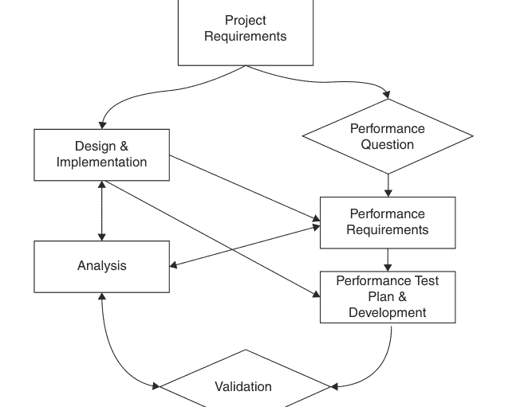

图 5.12 基准测试流程

## 基准测试的迭代方法

正如产品设计根据新见解和不断的需求不断修订和更新一样，性能计划也是一份活的文档。它根据性能分析和设计阶段获得的见解不断演进。这种迭代过程允许我们重新访问、重新思考和重做之前的任何阶段以采取纠正措施，确保我们的基准测试保持相关性和准确性。它允许我们捕捉系统级瓶颈、衡量资源消耗、理解执行细节（例如堆上的数据结构位置）、缓存友好性，而且迭代基准测试还允许我们评估新功能是否满足或超过性能要求，且不会引起任何回退。在比较两个 UoT 时，必须独立对它们进行验证、表征和调优，以确保公平比较。确保基准测试的准确性和相关性对于在软件性能领域做出明智决策至关重要。

## 第 5 章 针对 Java 的性能优化

## 基准测试的关键指标

- 分配率（Allocation rates）：监控应用程序分配内存的速度。过高的分配率可能预示着应用程序内存使用模式存在效率低下的问题。在 OpenJDK GC 中，高分配率和其他压力源会共同作用，将系统推入“优雅降级”模式。在这种模式下，GC 可能无法达到最佳暂停时间或吞吐量，但会继续运行，以确保应用程序保持可用。优雅降级是垃圾回收器韧性和适应能力的证明，强调了监控和优化分配率以获得一致性能的重要性。
- 垃圾回收指标（Garbage collection metrics）：监控 GC 效率指标（如 GC 暂停时间）至关重要，这些指标反映了应用程序线程为了回收内存而停止的时间。长时间或频繁的暂停会对应用程序的响应产生不利影响。GC 事件的频率可以表明 JVM 的内存压力水平，频率越高，意味着内存挑战越大。在高级收集器中，理解不同的 GC 阶段可以为 GC 过程提供细粒度的洞解。此外，要警惕 GC 引起的节流效应，这代表了 GC 活动对应用程序性能的影响，特别是在较新的收集器中。
- 并发动态（Concurrency dynamics）：深入研究并发线程与内存管理之间的相互作用，特别是对于 G1、ZGC 和 Shenandoah 等 GC。并发数据结构对于多线程内存管理至关重要，但在确保安全数据一致性方面会引入开销。内存屏障（Maintenance barriers）对于内存排序至关重要，会影响读写访问模式。例如，写屏障可能会减慢更新，而读屏障可能会引入延迟。解析这些屏障的复杂性至关重要，因为它们可能会引入标准 GC 暂停模式中无法立即发现的复杂性。
- 原生内存交互（针对 Project Panama）：拥抱 Project Panama 带来的进展对于 JVM 开发者来说代表着巨大的机会领域。通过利用外部函数和内存（FFM）API，开发者可以开启无缝且高效的 Java-原生交互的新时代。除了效率之外，Panama 还提供了更安全的接口，减少了与传统 JNI 方法相关的风险。这种变革性的方法不仅有望缓解缓冲区溢出等已知问题，还确保了类型安全。在任何情况下，在真实场景中对这些交互进行基准测试和验证都是至关重要的，确保你充分利用 Panama 带来的潜在收益和保障。
- 代际活动与区域化工作（Generational activity and regionalized work）：G1、Shenandoah 和 ZGC 等现代 GC 采用区域化方法，将堆划分为多个区域。区域化直接影响维护结构（如记忆集）的质量。超过区域大小阈值的对象被称为“巨型”（humongous），它们可以跨多个区域并接收特殊处理以避免碎片。此外，JVM 将内存组织成不同的代际，每个代都有自己的收集动态。内存屏障被应用于跨代和跨区域，以确保并发操作期间的数据完整性。深入理解这些复杂性对于高级内存优化至关重要，特别是在分析区域占用和代际活动时。

## 选择合适的工具

- Java 微基准框架 (JMH)：一种用于微基准测试的工具，JMH 为小型代码段提供精确测量。
- Java Flight Recorder 和 VisualVM：这些工具提供 JVM 内部的细粒度视图，包括详细的 GC 指标。
- GC 日志：分析 GC 日志可以揭示潜在的效率低下和瓶颈。通过添加可视化工具，你可以获得 GC 过程的细粒度表示，从而更容易发现模式、异常或关注区域。

## 设置你的基准测试环境

- 隔离：确保你的基准测试环境不受外部干扰，防止结果出现失真。
- 一致性：在所有基准测试会话中保持配置一致，确保结果的可比性。
- 真实场景：模拟真实工作负载以获得最准确的洞察，结合真实的数据和请求频率。

## 基准测试执行协议

- 热身仪式（Warm-up ritual）：允许 JVM 达到最佳状态，确保在收集指标之前 JIT 编译和类加载已经稳定。
- 迭代方法：重复执行基准测试，并使用几何指标和置信区间分析结果，以确保准确性并消除离群值和异常。
- 监控外部因素：关注外部影响，如操作系统引起的调度中断、网络延迟和 CPU 竞争。

## 分析结果

- 识别瓶颈：找出影响性能的区域。
- 与基准对比：如果进行了改进，将结果与基准进行对比。
- 可视化表示：利用图表进行数据可视化。

## 优化循环

- 优化代码：根据基准测试的洞察修改你的代码或配置。
- 重新基准测试：调整后重新执行基准测试，以衡量影响。
- 持续基准测试：将基准测试集成到你的开发流程中。

JVM 内存管理的基准测试是一项持续的测量、分析和优化工作。通过正确的策略和工具，开发者可以确保基于 JVM 的应用程序为内存做好准备。无论是在处理 Panama 和 Valhalla 等项目的复杂性，还是尝试理解 G1、ZGC 和 Shenandoah 等 GC，系统的基准测试策略都是巅峰性能的基石。掌握 JVM 内存管理基准测试为开发者提供了确保应用程序高效运行的工具和洞察。

在我们深入探讨基准测试和 JVM 内存管理的复杂性之后，你可能会好奇哪些工具和框架可以辅助这一过程。你如何确保基准测试是准确、一致并反映真实场景的？这引导我们进入下一个关键点。

## 为什么我们需要基准测试框架？


在整个章节中，我们强调了硬件和软件之间的共生关系，以及它们如何相互影响性能。在对软件进行基准测试以识别瓶颈时，我们必须承认这种动态协同。基准测试应该被视为对整个系统的探索，考虑到 Java 应用程序栈中不同层次的内在优化。

回顾我们之前对 JVM、垃圾回收以及 `JIT` 编译、分层编译线程和代码缓存大小等概念的讨论。所有这些元素都定义了软件的性能格局。例如，正如硬件-软件交互部分所述，处理器缓存层次结构和处理器内存模型会显著影响性能。因此，为不同云架构设计的基准测试应该对栈中的这些因素保持敏感，确保我们不仅仅是孤立地测量和运行，而是充分利用整个系统及其内置优化。

# 性能基准测试的重要性

这就是基准测试框架（`benchmarking harness`）出现的地方。基准测试框架提供了一个标准化框架，不仅有助于避免常见的基准测试陷阱，还能简化基准测试的构建、运行和计时过程，从而确保我们获得精确且具有洞察力的性能评估。意识到这一需求，Java 社区——特别是 Oracle 工程师——提供了他们的开源基准测试框架，包含一套微基准测试，如 JDK 增强提案（`JEP`）230 中：*微基准套件*^14。接下来，我们将检查该基准测试框架的细节，并探索它在实现可靠性能测量方面的重要性。

# Java 微基准套件在性能优化中的作用

性能优化在发布周期中起着至关重要的作用，特别是旨在提高性能的功能引入。例如，`JEP` 143：*改进并发锁*^15 使用了 22 个基准来衡量与对象监视器相关的性能改进。性能测试的核心组件是回归分析，它通过比较不同版本之间的基准结果来识别非微小的性能退化。

Java 微基准框架（`JMH`）为伴随每个 JDK 发布的严格基准测试过程带来了稳定性。`JMH` 添加到 JDK 12 中，提供了可以在当前和之前的版本中编译和运行的脚本及基准，使得回归研究变得更容易。

## JMH 用于性能优化的关键特性

- **基准模式**：`JMH` 支持多种基准模式，例如平均时间（`Average Time`）、采样时间（`Sample Time`）、单次时间（`Single Shot Time`）、吞吐量（`Throughput`）和全部（`All`）。这些模式都从不同角度提供了基准的性能特征。

- **多线程基准**：`JMH` 支持单线程和多线程基准，允许在不同的并发级别下进行性能测试。

- **编译器控制**：`JMH` 提供了机制，确保 `JIT` 编译器不会通过过度优化或消除基准代码来干扰基准测试过程。

- **性能分析器（`Profilers`）**：`JMH` 带有一个简单的接口以及若干个默认的性能分析器，包括 `GC` 分析器、编译器分析器和类加载器分析器。这些分析器提供了有关基准测试如何运行以及潜在瓶颈所在处的更深层次的信息。

`JMH` 作为独立项目运行，依赖于用户的基准 `JAR` 文件。对于不熟悉 `Maven` 模板的读者，我们将从 `Maven` 概述以及设置基准测试项目所需的信息开始。

^14 https://openjdk.org/jeps/230

^15 https://openjdk.org/jeps/143

# 从 Maven 开始

`Maven` 是一个用于辅助配置、构建和管理 Java 项目的工具。它通过项目对象模型（`POM`）标准化了所有项目的构建系统，为开发过程带来了一致性和结构性。有关 `Maven` 的更多信息，请参阅 Apache Maven 项目网站.¹16

在安装 `Maven` 后，下一步是设置 `JMH` 项目。

## 设置 JMH 和理解 Maven Archetype

`Maven Archetype` 是一套项目模板工具包，用于根据 `JMH` 项目骨架创建新项目。它的设置涉及为你的本地项目分配一个 `GroupId` 和一个 `ArtifactId`。`JMH` 套件指南为 `Archetype` 和你的本地项目提供了建议。在我们的示例中，我们将使用以下代码在 `mybenchmarks` 中生成项目：

```
$ mvn archetype:generate \
  -DgroupId=org.openjdk.jmh \
  -DarchetypeId=jmh-java-benchmark-archetype \
  -DarchetypeVersion=1.26 \
  -DgroupId=org.jmh.suite \
  -DartifactId=mybenchmarks \
  -DInteractiveMode=false \
  -Dversion=1.0
```

运行命令后，你应该会看到“BUILD SUCCESS”消息。

# 在 JMH 中编写、构建和运行你的第一个微基准测试

创建微基准测试的第一步是编写基准类。该类应该位于 `benchmarks` 目录树中。要指示某个方法是基准测试，请用 `@Benchmark` 注解标记它。

让我们写一个简单的玩具级基准测试，以在教育背景下衡量两个关键操作的性能：注册学生和添加课程。`OnlineLearningPlatform` 作为操作的核心，提供了注册学生和添加课程的方法。重要的是，`Student` 和 `Course` 实体被定义为单独类，封装了各自的数据。`OnlineLearningBenchmark` 类中的基准方法 `registerStudentsBenchmark()` 和 `addCoursesBenchmark()` 旨在衡量这些操作的性能。这种简单的设置为洞察 `OnlineLearningPlatform` 的可扩展性和性能提供了见解，使其成为 `JMH` 入门的绝佳起点。

```
package org.openjdk.suite;
import org.openjdk.jmh.annotations.Benchmark;
import org.openjdk.jmh.annotations.State;
import org.openjdk.jmh.annotations.Scope;
```

> ¹⁶ https://maven.apache.org/

```java
// 用于 OnlineLearningPlatform 的 JMH 基准类
@State(Scope.Benchmark)
public class OnlineLearningPlatformBenchmark {

    // 用于基准测试的 OnlineLearningPlatform 实例
    private final OnlineLearningPlatform platform = new OnlineLearningPlatform();

    // 注册学生的基准测试
    @Benchmark
    public void registerStudentsBenchmark() {
        Student student1 = new Student("Annika Beckett");
        Student student2 = new Student("Bodin Beckett");
        platform.registerStudent(student1);
        platform.registerStudent(student2);
    }

    // 添加课程的基准测试
    @Benchmark
    public void addCoursesBenchmark() {
        Course course1 = new Course("Marine Biology");
        Course course2 = new Course("Astrophysics");
        platform.addCourse(course1);
        platform.addCourse(course2);
    }
}
```

项目的目录结构看起来如下：

- mybenchmarks
  - src
    - main
      - java
        - org
          - jmh
            - suite
              - OnlineLearningBenchmark.java
              - OnlineLearningPlatform.java
              - Student.java
              - Course.java
- target
  - benchmark.jar

## 性能优化

一旦写了基准类，就可以构建基准测试了。当 `mybenchmarks` 中添加更多基准时，过程保持不变。要构建并安装项目，使用 `Maven` 命令 `mvn install`。成功执行后，你将看到“BUILD SUCCESS”消息。这表示你的项目已成功构建，基准测试已就绪运行。

最后，输入以下命令进行运行：

```
$ java -jar target/benchmark.jar org.jmh.suite.OnlineLearningBenchmark
```

执行将显示基准信息和结果，包括有关 `JMH` 和 `JDK` 版本的详细信息、预热迭代和时间、测量迭代和时间等。

`JMH` 项目在完成后会展示汇总信息：

| Benchmark | Mode | Cnt | Score | Error | Units |
|---|---|---|---|---|---|
| OnlineLearningPlatformBenchmark.registerBenchmark | thpt | 25 | 56913040.845 | 1078858.366 | ops/s |
| OnlineLearningPlatformBenchmark.addCoursesBenchmark | thpt | 25 | 50872536.478 | 1039294.551 | ops/s |

就是这样！我们完成了一次运行并发现方法每秒执行一定的操作（默认 =吞吐量模式）。现在你准备好为你的 `JMH` 项目完善并添加复杂的计算了。

## 基准阶段：预热和测量

为了确保开发者获得可靠的基准测试结果，`JMH` 提供了 `@Warmup` 和 `@Measurement` 注解，帮助指定基准测试的预热和测量阶段。这是很重要的，因为 `JVM` 的 `JIT` 编译器会在前几次运行期间优化代码。

```java
import org.openjdk.jmh.annotations.*;

@Warmup(iterations = 5)
@Measurement(iterations = 5)
public class MyBenchmark {

    @Benchmark
    public void testMethod() {
        // 你的基准测试代码
    }
}
```

## 性能基准测试

在这个示例中，`JMH` 首先执行五次预热迭代（`warm-up iterations`），运行基准方法但不记录结果。这个预热阶段类似于应用程序生命周期中的启动阶段（`ramp-up phase`），在此阶段，`JVM` 会逐渐提高应用程序的性能，直到达到巅峰性能。`JMH` 的预热阶段旨在于测量之前达到这种稳定状态。

预热完成后，`JMH` 会进行五次测量迭代（`measurement iterations`），在期间它会记录结果。这对应于应用程序生命周期中的稳定阶段，此时应用程序以峰值性能执行其主要工作负载。

结合起来，这些特性使得 `JMH` 成为一个强大的性能优化工具，让开发者能够更好地理解其 Java 代码的行为和性能特征。如需详细学习，建议参考 `JMH` 官方文档以及 `OpenJDK` 项目提供的示例代码。¹⁷

# 循环优化与 @OperationsPerInvocation

在基准测试中处理循环时，你必须意识到循环优化。`JVM` 的 `JIT` 编译器可以识别循环结果是否会影响程序的输出，并在优化期间完全移除循环。为了确保循环不被移除，你可以使用 `@OperationsPerInvocation` 注解。该注解告诉 `JMH` 你的基准测试执行了多少操作，防止 `JIT` 编译器跳过循环。

`Blackhole` 类用于“消耗”你不需要但想防止其被优化的值。这种结果通过将值传递给 `blackhole.consume()` 方法来实现，这确保了 `JIT` 编译器不会优化掉产生该值的代码。这是一个示例：

```java
@Benchmark
@BenchmarkMode(Mode.AverageTime)
@OutputTimeUnit(TimeUnit.NANOSECONDS)
@OperationsPerInvocation(10000)
public void measureLoop(Blackhole blackhole) {
    for (int i = 0; i < 10000; i++) {
        blackhole.consume(i);
    }
}
```

在这个示例中，`@OperationsPerInvocation(10000)` 注解告知 `JMH` `measureLoop()` 方法执行了 10,000 次操作。`blackhole.consume(i)` 的调用确保了循环不会被移除，从而对循环性能进行准确的基准测试。¹⁷https://github.com/openjdk/jmh

## JMH 中的基准测试模式

`JMH` 提供了多种基准测试模式，模式的选择取决于你感兴趣的性能哪个方面。

- **吞吐量（`Throughput`）**：衡量基准方法的吞吐量，关注方法在给定单位内可以被调用的次数。当你想要测量原始速度（例如数据流中的操作）时，这种模式非常有用。

- **平均时间（`Average Time`）**：衡量每次调用的平均时间，提供关于执行单个方法所需多久的见解。这种模式对于理解离散操作的性能（例如对 Web 服务器的请求）有用。

- **采样时间（`Sample Time`）**：衡量每次基准调用所需的时间并计算时间的分布。当你想要理解时间的分布（不仅仅是平均值），而是作为调用的延迟时，这种模式非常有用。

- **单次执行（`Single Shot`）**：衡量单次调用基准所需的时间。这种模式对于执行需要耗费大量基准测试（例如复杂的算法或数据库查询）非常有用。

- **全部（`All`）**：在所有模式下运行基准测试并报告每种模式的结果。当你想要全面查看方法的性能时，这种模式非常有用。

要指定基准测试模式，请在基准方法上使用 `@BenchmarkMode` 注解。例如：

```java
@Benchmark
@BenchmarkMode(Mode.Throughput)
public void myMethod() {
    // ...
}
```

## 理解 JMH 中的分析器 (Profilers)

除了支持创建、构建和执行基准测试外，`JMH` 还提供了内置的分析器。分析器可以帮助你更好地理解代码在不同情况和配置下的行为。在 `JMH` 中，这些分析器提供了对 `JVM` 各个方面的见解，例如垃圾回收、方法编译、类加载和代码生成。

你可以在运行基准测试时使用 `-prof` 选项来指定分析器。例如，`java -jar target/benchmarks.jar -prof gc` 将通过启用 `GC` 分析器运行你的基准测试。该分析器会报告在 `GC` 上花费的时间以及在基准测试运行期间 `GC` 处理的数据总量。其他分析器可以为 `JVM` 的不同方面提供类似的见解。

## JMH 中的关键注解

`JMH` 提供了多种注解来引导基准测试的执行：

- `@Benchmark`：此注解将方法标记为基准测试目标。会为带有此注解的方法收集性能指标。

- `@BenchmarkMode`：此注解指定基准测试模式（例如吞吐量、平均时间）。它决定了 `JMH` 如何运行基准测试并计算结果。

- `@OutputTimeUnit`：此注解指定基准测试输出的时间单位。它允许你控制基准测试结果的粒度。

- `@Fork`：此注解指定每个基准测试的 `JMH` 分叉（`fork`）数量。它允许将每个基准测试隔离在自己的进程中，避免基准测试之间的交互。

- `@Warmup`：此注解指定预热迭代的次数，可选指定每次预热迭代的持续时间。预热迭代用于在进行测量之前让 `JVM` 达到速度。

- `@Measurement`：此注解指定测量迭代的次数，可选指定每次测量迭代的持续时间。测量迭代是实际的基准测试运行，其结果会被聚合并报告。

- `@State`：此注解用于标记包含状态的类。状态实例的生命周期⁸由 `JMH` 管理。它允许你共享常见的设置代码、变量以及本地或共享范围来控制基准测试之间的共享。

- `@Setup`：此注解标记用于设置基准测试或状态对象的方法。它是在基准方法执行前调用的生命周期方法。

- `@Teardown`：此注解标记用于在基准测试执行后拆卸基准测试或状态对象的方法。它是在基准测试执行后调用的生命周期方法。

- `@OperationsPerInvocation`：此注解指示基准方法每次调用中执行的操作数。它用于通知 `JMH` 基准方法中的操作次数，这对于避免循环优化带来的失真有用。

>⁸“生命周期”指的是基准测试经过的一系列阶段（设置、执行、拆卸）。

例如，要设置一个具有 5 次预热、10 次测量、2 个分叉并使用线程本地范围的基准测试，你可以使用以下代码：

```java
@State(Scope.Thread)
@BenchmarkMode(Mode.Throughput)
@OutputTimeUnit(TimeUnit.SECONDS)
@Warmup(iterations = 5)
@Measurement(iterations = 10)
@Fork(2)
public class MyBenchmark {
    // ...
}
```

## 使用 JMH 进行 JVM 基准测试

为了演示如何有效地使用 `JMH` 进行基准测试，让我们考虑一个实际案例，即对不同的处理器选项进行基准测试。例如，`Arm v8.1+` 可以大型系统扩展（`LSE`）——一组通过提供更高效的原子操作来增强多线程应用程序性能的原子操作。`LSE` 指令可用于构建同步原语，包括锁和原子变量。

## 性能基准测试的重要性

在基准测试中，我们将使用来自 `java.util.concurrent` 包的 `AtomicInteger` 类。该基准包含两个方法：`testAtomicIntegerAlways()` 和 `testAtomicIntegerNever()`。前者交换值，后者则从不提交更改，仅获取现有值。这项基准练习旨在说明处理器和具有可扩展性的锁原语如何从新的 `LSE` 指令中潜在获得巨大的收益。


# Arm 处理器中的 LSE 与 LL/SC 原子操作

在 Arm 处理器的背景下，LSE 提供了更高效且开销更小的原子操作——这种结果通过极大量的使用得以维持。在没有 LSE 的情况下，Arm 处理器会退回到链接加载/条件存储（LL/SC）操作，具体来说使用独占加载获取（`LDAXR`）和存储释放（`STLXR`）指令来执行原子读-修改-写操作。原子读-修改-写操作（例如 CAS）是许多同步原语的骨干。它们涉及从内存中读取一个值，与预期值进行比较，可能进行修改并写回内存——所有这些操作都是原子的。

在 LL/SC 模型中，`LDAXR` 指令从内存读取一个值并将该位置标记为保留。`STLXR` 指令仅在自 `LDAXR` 操作以来没有其他内存位置发生变化时，才会将新值写入内存。

然而，当多个线程访问同一内存位置时，LL/SC 操作可能会由于潜在的竞争和重试而遇到性能瓶颈。这一挑战被 LSE 指令有效解决，LSE 旨在提高原子操作的性能并增强多线程应用程序的整体扩展性。

## OpenJDK JMH 微基准代码片段

以下是来自 OpenJDK JMH 微基准的相关代码片段：

```java
package org.openjdk.jhm.bench.java.util.concurrent;

import org.openjdk.jhm.annotations.*;
import java.util.concurrent.TimeUnit;
import java.util.concurrent.atomic.AtomicInteger;

@BenchmarkMode(Mode.AverageTime)
@OutputUnit(TimeUnit.NANOSECONDS)
@State(Scope.Benchmark)
public class Atomic {

    public AtomicInteger atomicInteger;

    @Setup(Level.Iteration)
    public void setUp() {
        atomicInteger = new AtomicInteger(0);
    }

    /** Always swap in value. This test should be compiled into a CAS */
    @Benchmark
    @OperationsPerInvocation(2)
    public void testAtomicIntegerAlways(Blackhole bh) {
        bh.consume(atomicInteger.compareAndSet(0, 2));
        bh.consume(atomicInteger.compareAndSet(2, 8));
    }

    /** Never a value just return the old one. This test should be compiled into a CAS */
    @Benchmark
    public void testAtomicIntegerNever(Blackhole bh) {
        bh.consume(atomicInteger.compareAndSet(1, 3));
    }
}
```

在此基准测试中，当启用 LSE 时，`AtomicInteger` 的 `compareAndSet` 方法是一个 CAS 操作。它将 `AtomicInteger` 的当前值与预期值进行比较，如果相同，则将 `AtomicInteger` 设置为新值。`testAtomicIntegerAlways` 方法每次调用执行两次操作：它将 `atomicInteger` 的值从 0 交换到 2，再从 2 回到 0。`testAtomicIntegerNever` 尝试将 `atomicInteger` 的值从 1 交换到 3，但由于初始值为 0，因此交换不会发生。

## 使用 perfasm 剖析 JMH 基准测试

`perfasm` 剖析器提供了汇编层面的基准测试详细视图。当你试图理解代码的底层性能特性时，这变得至关重要。

例如，考虑之前讨论的 `testAtomicIntegerAlways` 和 `testAtomicIntegerNever`。如果我们使用 `perfasm` 剖析器运行这些基准，可以看到实现这些 CAS 操作的汇编指令。在 Arm v8.1+ 处理器上，这些将是 LSE 指令。通过比较这些指令在不同处理器上的性能，我们可以了解不同硬件架构如何影响原子操作的性能。

要使用 `perfasm` 剖析器，可以在运行基准时包含 `-prof perfasm` 选项。例如：

```bash
$ java -jar benchmarks.jar -prof perfasm
```

`perfasm` 剖析器的输出将包含测试期间执行最频繁的汇编指令列表。这揭明了代码在硬件层面的执行情况，并可以突出潜在的瓶颈或优化区域。

通过更好地理解代码的底层性能特性，你将能够

# 第 5 章 端到端 Java 性能优化

[本页特留空]

# 第 6 章 OpenJDK 中的高级内存管理与垃圾回收

[本页特留空]

# 线程本地分配缓冲区与晋升本地分配缓冲区

专注于收集那些能够产生大量空闲区域，从而提高 GC（垃圾回收）过程的效率。

ZGC 首次作为 JDK 11 中的实验性特性引入，是一种为可扩展性设计的低延迟 GC。先进的 GC 确保停顿时间实际上与堆的大小无关。它通过采用并发复制技术来实现这一目标，在应用程序仍在运行时，将对象从内存的一个区域移动到另一个区域。这种对象的并发移动显著减少了 GC 停顿对应用程序性能的影响。

ZGC 的设计允许 Java 应用程序在内存和延迟方面具有更具预测性的扩展性，使其成为具有大堆内存和严格延迟要求的应用程序的理想选择。ZGC 与应用程序共同工作，并发运行以将停顿降至最低，并保持高水平的分配响应能力。

在本章中，我们将深入探讨这些 GC 的细节、特征以及它们对各种应用程序类型的影响。我们将探索它们复杂的内存管理机制、线程本地分配和非统一内存访问（NUMA）感知分配的作用，以及调优这些收集器以获得性能性能。我们还将探索从初始测量到微调的评估 GC 的实用策略。理解这一迭代过程并识别工作负载模式将使开发者能够选择最合适的 GC 策略，确保在广泛的应用中实现高效内存管理。

## 线程本地分配缓冲区与晋升本地分配缓冲区

线程本地分配缓冲区（TLABs）是 OpenJDK HotSpot VM 中的一种优化技术，用于提高分配性能。TLAB 通过在堆中为每个线程提供独立的内存区域来减少同步开销，每个线程都可以在无需加锁的情况下分配内存。这种无锁分配机制也被称为“快速路径（fast-path）”。

在启用了 TLAB 的环境中，每个线程在堆内被分配了一个缓冲区。当线程需要分配新对象时，它只需简单地在其 TLAB 内部移动指针（bump pointer）。这种方法使得分配过程比获取锁和与其他线程同步的过程快得多。这对于多线程应用程序特别有利，因为在这些应用程序中，共享内存池的竞争会导致严重的性能下降。

TLAB 具有韧性，能够适应其所属线程的分配速率。JVM 监控每个线程的分配行为，并据此调整 TLAB 的大小。这种自适应调整大小有助于在减少竞争和有效利用堆空间之间取得平衡。

## TLAB 调优选项

为了微调 TLAB 性能，JVM 提供了几个配置 TLAB 行为的选项。这些选项可以用于针对特定工作负载和需求优化 TLAB 使用。某些关键调优选项包括：

- `-XX:+UseTLAB`：启用或禁用 TLAB。默认情况下，HotSpot VM 启用 TLAB。要禁用 TLAB，使用 `-XX:-UseTLAB`。

- `-XX:TLABSize=<value>`：设置 TLAB 的初始大小（单位为字节）。通过调整此值，可以平衡 TLAB 大小与单个线程激活速率。例如，`-XX:TLABSize=16384` 将初始 TLAB 大小设置为 16 KB。

- `-XX:+ResizeTLAB`：控制 TLAB 是否可调整大小。要禁用 TLAB 调整，使用 `-XX:-ResizeTLAB`。

- `-XX:TLABRefillWasteFraction=<value>`：指定 TLAB 允许的最大浪费，其占 TLAB 大小的比例值。该值影响调整大小的频率，值越小，调整越频繁。例如，`-XX:TLABRefillWasteFraction=64` 将最大允许浪费设置为 TLAB 大小的 1/64。

通过尝试这些调优选项并监控它们对应用程序性能的影响，您可以优化 TLAB 使用，以更好地适应您的应用程序的分配模式和需求，最终提高其性能。要监控 TLAB 使用情况，可以使用 Java Flight Recorder（JFR）和 JVM 日志等工具。

对于 JDK 11 及更高版本的 Java Flight Recorder，您可以使用此命令行选项启动记录：

```bash
-XX:StartFlightRecording=duration=300s,jdk.ObjectAllocationInTLABEnabled=true,jdk.ObjectAllocationOutsideTLABEnabled=true,filename=myrecording.jfr
```

此命令将记录您的应用程序 300 秒的分析，并将其保存为 `myrecording.jfr`。然后您可以使用 JDK Mission Control 等工具分析记录，以可视化的查看 TLAB 相关的问题。

要监控 TLAB 使用情况，可以使用以下统一日志配置：

```bash
-XX:Log=gc*,tlab=gc.log
```

此命令将与 GC 相关和 TLAB 相关的信息记录到指定文件中。

通过尝试这些调优选项并监控它们对应用程序性能的影响，您可以优化 TLAB 使用，以更好地适应您的应用程序的分配模式和需求，最终提高其性能。

## 使用 NUMA 感知垃圾回收优化内存访问

为了理解这是如何运作的，让我们来看一个例子。在图 6.1 中，我们看到了四个节点：Node 0、1、2 和 3。每个节点都有自己的处理器和内存控制器。

| DRAM Bank | 内存控制器 | 处理节点 0 | 处理节点 1 | 处理节点 2 | 处理节点 3 |
| :--- | :--- | :--- | :--- | :--- | :--- |

在 Node 0 上想要访问 Node 3 内存的进程必须通过 Node 2 到达 Node 3。这被认为是两次跳转（hops）。如果 Node 0 上的进程想访问 Node 2，只需跳一次。本地内存访问不需要任何跳转。像图 6.1 所示的架构被称为 NUMA。

如果我们划分 Java 的伊代空间（eden space），以便为每个节点提供区域，并且运行在特定节点上的线程也位于这些未释放区域内，那么我们就可以无障碍地访问节点本地内存（前提是调度器不会将线程移动到不同的节点）。这就是 NUMA 感知分配的原理——基本上，TLAB 是从最近的内存区域分配的，这允许更快分配。

在对象生命周期的初始阶段，它位于专门从其 NUMA 节点分配的伊代空间中。一旦少数对象存活或对象需要提升到老年代，它们可能会在跨不同节点的线程之间共享。此时，分配以节点交错的方式进行，这意味着内存块按顺序均匀地分布在各个节点上，从 Node 0 到编号最高的节点，直到所有内存空间都被分配完毕。

图 6.2 展示了一个 NUMA 感知的伊代空间。线程 0 和线程 1 从 Node 0 的伊代区域分配内存，因为它们运行在 Node 0 上。同时，线程 2 从 Node 1 的伊代区域分配内存，因为它运行在 Node 1 上。

## 探索垃圾回收改进

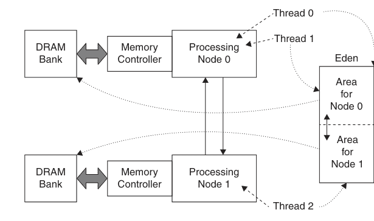

图 6.2 NUMA 感知 GC 的工作原理

此选项通过 `UseNUMA` 标志输出 JVM 的最终值，表示已启用 NUMA 感知 GC。

总之，NUMA 分配器设计旨在通过将 Java 堆的 eden 空间划分为每个节点，并从最近的内存区域创建 TLAB 来为 NUMA 架构优化内存。这可以带来更快分配并提高性能。在启用 NUMA 感知 GC 时，监控应用程序的性能至关重要，因为影响可能会根据系统的硬件和软件配置而异。

某些垃圾收集器（如 G1 和 Parallel GC）受益于 NUMA 优化。G1 在 JDK 14 中支持 NUMA 感知，增强了其在 NUMA 架构上管理大堆的效率。ZGC 是另一个现代垃圾收集器，旨在解决大堆挑战、低延迟需求以及更优的整体性能。ZGC 在 JDK 15 中支持 NUMA 感知。在接下来的章节中，我们将深入 G1 和 ZGC 的关键特性和增强，以及它们在 Java 应用程序中的性能影响和调优选项。

## 探索垃圾回收改进

随着 Java 应用程序复杂性的不断增加，对高效内存管理和 GC 的需求变得越来越重要。OpenJDK HotSpot VM 中的两个重要垃圾收集器 G1 和 ZGC 旨在提高垃圾回收的性能、可扩展性和可预测性，特别是对于具有巨大堆内存和严格低延迟限制的应用程序。

> [2] https://openjdk.org/jeps/345
>
> [3] https://wiki.openjdk.org/display/zgc/Main#Enabling-NUMASupport

本节重点介绍了每个垃圾收集器的显著特性，并列出了从 JDK 11 到 JDK 17 的所取得的关键进展和优化。我们将探索 G1 在混合收集性能、停顿时间可预测性以及其更好地适应不同工作负载方面的增强。ZGC 是一个较新的垃圾收集器，我们还将深入探讨它的独特能力，例如并发垃圾收集、缩短停顿时间以及它对大堆的适用性。通过理解这些 GC 技术的进步，你将洞察它们对应用程序性能和内存管理的影响，以及为特定用例选择垃圾收集器时涉及权衡。

## G1 垃圾收集器：深度解析高级堆管理

多年来，GC 的设计发生了巨大变化。最初，重点是吞吐量导向型 GC，其旨在最大化内存管理过程的整体效率。然而，随着应用程序复杂性和用户预期的增加，重点已转向延迟导向型 GC。这些 GC 旨在尽量减少干扰应用程序性能的停顿时间，即使这意味着吞吐量略有下降。G1 作为 JDK 11 LTS 的默认 GC，是这种向延迟导向 GC 转型的典型示例。在随后的章节中，我们将探索 G1 的复杂之处、堆管理及其优势。

### 区域化堆

G1 将堆划分为多个等大的区域（regions），允许每个区域动态地充当 eden、survivor 或老空间。这种灵活性有助于高效的内存管理。

### 自适应调整

- **分代大小**：G1 的分代框架由其自适应大小能力补充，允许它根据运行时行为调整年轻代和老年代的大小。这确保了最优的堆利用率。

- **收集集（CSet）**：G1 动态选择一组区域进行收集以满足停顿时间目标。CSet 的选择基于这些区域包含的垃圾数量，确保高效的空间回收。

- **记忆集（RSet）粗粒化**：G1 维护记忆集以跟踪跨区域引用。随着时间的推移，如果这些 RSets 变得过大，G1 可以对其进行粗粒化，降低其粒度和开销。

### 停顿时间可预测性

- **增量收集**：G1 将垃圾回收分解成更小的块，增量地处理这些块以确保停顿时间保持可预测性。

- **并发标记增强**：尽管 CMS 引入了并发标记，但 G1 使用高级技术（如初始快照标记 SATB 标记）增强了这一阶段。

G1 采用多阶段方法，该方法与其基于区域的堆管理紧密相关，确保了最小的干扰和高效的空间回收。

### G1 中的预测

G1 使用一套复杂的预测机制来优化其性能。这些预测基于 G1 基于历史的分析，允许它动态适应应用程序的行为并优化性能：

- **单区域复制时间**：G1 通过利用过去规避的历史数据，预测疏空单个区域内容所需的时间。这一预测对于估计 GC 周期的总停顿时间，以及在混合收集中划分区域数量以符合预设的停顿时间至关重要。

- **并发标记时间**：G1 预计完成并发标记阶段的时间。这种预见对于通过动态调整 IHOP——初始堆占用百分比（`-XX:InitiatingHeapOccupancyPercent`）来启动标记阶段至关重要。IHOP 的调整基于对代占用情况和应用程序内存分配的实时分析。

- **混合垃圾收集时间**：G1 预测混合垃圾收集的时间，以便策略性地选择一组区域与年轻代一起收集。此估计有助于 G1 在回收足够空间和遵循停顿时间目标之间保持平衡。

- **年轻垃圾收集时间**：G1 计算仅年轻代收集的时间，以指导年轻代的大小调整。G1 根据这些预测调整年轻代的大小，以根据需求优化停顿时间并适应应用程序不断变化的分配模式。

- **可回收空间量**：G1 估计通过收集特定区域将回收的空间。这一估计为将老区域包含在混合收集中的决策提供了依据，优化了内存利用率并最小化了堆碎片风险。

### 核心扩展

G1 的设计本质上支持多线程，允许它随着可用核心数量而扩展。这具有以下影响：

- **并行化的年轻代收集**：确保快速回收短寿命对象。

- **并行化的老年代收集**：增强老年代空间回收的效率。

- **标记阶段的并发线程**：加快存活对象的识别速度。

> [4] Charlie Hunt, Monica Beckwith, Poonam Parhar, and Benjamin Rutsig. *Java Performance Companion*. Boston, MA: Addison-Wesley, 2016.

### 创新特性

除了区域化堆和自适应大小外，G1 还引入了其他若干特性：

- **大对象处理**：G1 对跨越多个区域的对象有专门处理，确保它们不会导致碎片或长时间的停顿。

- **自适应阈值调优（IHOP）**：如前，G1 根据运行时指标动态调整标记阶段的阈值。这种调优特别关注 IHOP 启动标记阶段的时机。

本质上，G1 是创新技术和自适应策略的结晶，在确保高效内存管理的同时提供了可预测的响应。

### 区域化堆的优势


# 在 G1 中，将堆划分为区域比传统的分代方法创建更灵活的收集单元

在 G1 中，将堆划分为区域比传统的分代方法创建更灵活的收集单元。这些区域作为 G1 的工作单元（UOW），允许其预测逻辑根据需要添加或删除区域来高效定制收集集。通过调整包含在收集集中的区域，G1 可以动态响应应用程序的内存使用模式。

区域化堆促进了增量压缩，使得收集集可以包含所有年轻区域和至少一个老区域。相比于单体老年代收集（如 `Full GC` 或 CMS 的回退 GC），这是一个巨大的改进，后者适应性和效率更高。

# 传统与区域化 Java 堆布局

为了更好地理解区域化堆的优势，让我们将其与传统的 Java 堆布局进行比较。在传统的 Java 堆（如图 6.3 所示）中，年轻代和老年代有指定的区域。相比之下，区域化的 Java 堆布局（如图 6.4 所示）将堆划分为区域，这些区域可以被归类为空闲或已用。当年轻区域被释放回空闲列表时，可以根据晋升需求回收为老区域。这种非连续的代结构，结合根据需要调整代的灵活性，使得 G1 的预测逻辑能够实现其响应的服务水平目标（SLO）。

| Eden | S0 | S1 |
|---|---|---|
| Old Generation | | |

图 6.3 传统的 Java 堆布局

| | | | | | | |
|---|---|---|---|---|---|---|
| | | | | | | | |
| | | | | | | | |
| | | | | | | | |
| | | | | | | | |
| | | | | 空闲区域 | 非空区域 | |

图 6.4 区域化 Java 堆布局

## 区域化 Java 堆布局的关键方面

G1 的一个重要方面是引入了**大对象（humongous objects）**。如果一个对象跨越了单个 G1 区域的 50% 或更多，则被认为是大对象（图 6.5）。G1 处理大对象分配的方式与普通对象的分配不同。大对象并不遵循快速路径（`TLABs`）分配，而是直接从老年代分配到指定的巨型区域中。如果一个大对象跨越了多个区域，它将需要连续的区域。（关于大对象区域和大对象的更多信息，请参阅《Java Performance Companion》书。⁵）

| | | | | |
|---|---|---|---|---|
| Eden | | 幸存者 | |
| | 老年代 | | |
| | | 老年代 | Eden |
| | 大对象 | 老年代 | |

图 6.5 显示老年代、大对象和年轻代区域的区域化堆

> ⁵Charlie Hunt, Monica Beckwith, Poonam Parhar, and Bengt Rutisson. Java Performance Companion. Boston: MA: Addison-Wesley Professional, 2016: chapters 2 and 3.

# 第 6 章 OpenJDK 中的高级内存管理与垃圾回收

## 在区域化堆中平衡可扩展性与响应能力

区域化堆旨在增强可扩展性的同时维持目标响应时间和暂停时间。然而，命令行选项 `-XX:MaxCPMillis` 仅为 G1 提供了软实时目标。尽管预测逻辑难以满足所需目标，但在达到暂停时间目标时，收集暂停并不会硬性停止。如果你的应用程序由于分配（速率）峰值或突变率增加导致高 GC 尾部延迟，且预测逻辑难以跟上，你可能无法一致地满足你的响应 SLO。在这种情况下，可能需要手动 GC 调优（见下一节）。

> 注意：突变率是应用程序更新引用的速率。

> 注意：尾部延迟是指终端用户经历的最慢响应时间。这些延迟会显著影响延迟敏感型应用中的用户体验，通常由延迟分布的较高分位数（例如 4-9s 分位数、5-9s 分位数）表示。

## 优化 G1 参数以获得峰值性能

在大多数情况下，当应用程序遵循可预测的模式（包括预热（或升速）阶段、稳态和冷却（或降速）阶段）时，G1 的自动调优和预测逻辑运行良好。然而，当分配速率出现多次峰值时，可能会出现挑战，特别是当这些峰值是由爆发性的、瞬态的对象分配引起时。这种情况会导致老年代中的晋升，并要求在老年代中容纳瞬态对象/区域。这些因素会破坏预测逻辑，并在标记和混合收集周期施加过度压力。在恢复之前，应用程序可能会因为移动空间不足或由于碎片化缺乏同构对象的连续区域而遇到迁移失败（evacuation failures）。在这种情况下，手动干预或通过自动化/AI 系统干预是必要的。

G1 的区域化堆、收集集合（collection set）和增量收集为调整内部阈值提供了许多调优旋钮，并在需要时支持目标调优。为了对修改这些参数做出明智决策，理解这些调优旋钮及其对 G1 适应性（ergonomics）的潜在影响至关重要。

## 优化 JDK 11 及后续版本的 GC 暂停响应

为了有效调优 G1，分析从 GC 日志文件中获取的暂停直方图可以为你的应用程序性能提供有价值的见解。考虑 JDK 11 GC 日志文件的暂停序列图，如图 6.6 所示。该图揭示了以下 GC 暂停：

- 4 次年轻 GC 暂停，随后是 ...
- 当超过 IHOP 阈值时有 1 次初始标记暂停
- 接下来，在并发标记期间有 1 次年轻 GC 暂停
- 然后是 1 次重标记暂停和 1 次清理暂停
- 最后，在 7 次混合 GC 之前还有另一次年轻 GC 暂停，以增量回收老年代空间

假设系统有一个 SLO 要求 100% 的 GC 暂停小于或等于 100 ms，显然最后一次混合收集没有满足这一要求。一次性暂停可以通过 JDK 12 引入的可中止的混合收集（abortable mixed collection）功能来缓解——我们稍后会讨论。然而，在自动化优化不足或不适用的情况下，手动调优是必要的（图 6.7）。

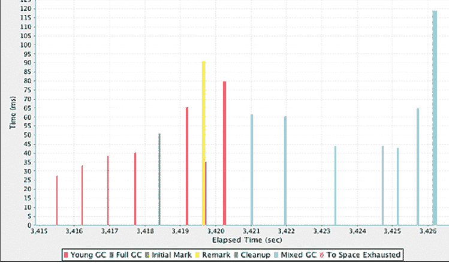

图 6.6 G1 收集器的暂停时间直方图

两个阈值有助于控制包含在混合收集中的老年代区域数量：

- 混合收集中包含的老年代区域最大数量：`-XX:G1OldCSetRegionThresholdPercent=<n>`
- 混合收集中包含的老年代区域最小数量：`-XX:G1MixedGCCountTarget=<n>`

这两个调优值有助于决定有多少老年代区域被添加到混合收集。调整这些值可以提高暂停时间，确保 SLO。在我们的示例中，如图 6.6 所示的暂停事件时间线，除了最后一次收集外，大多数年轻收集和混合收集都符合 SLO。一个简单的解决方案是使用以下命令行选项来减少混合收集中的老年代区域数量：

```
-XX:G1OldCSetRegionThresholdPercent=p
```

其中 p 是总堆的百分比。如果堆大小为 1 GB，默认值为 10%（即 `-Xmx -XX:G1OldCSetRegionThresholdPercent=10`），则添加到收集集的区域数量为 10（向上取整）。通过将百分比降低到 7%，数量减少到 7，这足以让最后的混合收集处于接受范围内。这种变化可能会增加混合收集的总数，这可能是一个问题。

## G1 响应能力：实际应用

随着 JDK 版本的更新，G1 引入了许多新功能和增强。这些功能在正确使用时可以显著提高应用程序的响应和性能，而无需大量的调优。虽然官方文档提供了这些功能的概述，但理解它们的实际应用具有巨大的价值。以下是功能如何转化为性能收益的：

- **并行引用处理（JDK 11）**：考虑一个电子商务平台使用 `SoftReference` 对象缓存图片。在高流量销售活动期间，引用的数量激增。并行引用能力在负载下保持系统敏活性，维持更流畅的用户体验。

- **可中止的混合收集（JDK 12）**：想象一个在激烈游戏期间的实时多人游戏服务器，为数千在线玩家提供服务。服务器可能有中寿命（瞬态）数据（玩家、游戏对象）。在这里，低延迟的实时限制是主要的 SLO 要求。可中止混合收集的引入确保了游戏流畅，不会出现卡顿。

- **及时返回未提交的内存（JDK 12）**：云视频服务在执行 3D 场景的后期处理时，经常在系统负载占用空闲资源。通过这种能力，我们可以优化资源利用率，确保同一台服务器上的其他应用程序在需要时可以使用内存，从而降低云托管成本。为了微调这种行为：
  - `G1PeriodicGCInterval`：此选项指定了触发周期性 GC 循环的间隔（毫秒）。通过设置此选项，你可以控制 G1 检查并可能将空闲内存返回操作系统的频率。默认值为 0，意味着默认禁用周期性 GC。
  - `G1PeriodicGCSystemThreshold`：此选项设置了系统负载阈值。如果系统负载低于此阈值，且 `G1PeriodicGCInterval` 尚未达到，将触发周期性 GC 循环。该选项在系统未处于高负载的场景下特别有用，有利于更积极地回收内存。其默认值为 0，意味着禁用了系统负载阈值。

> 注意：这些调优选项对内存回收提供了更细粒度的控制，务必谨慎使用。过于激进的设置可能会导致频繁且不必要的 GC 周期，这对应用程序的性能产生不利影响。在做出更改后，请始终监控系统行为，并进行相应的调整，以在内存回收和应用程序性能之间取得平衡。

- **改进的并发标记结束 (JDK 13)**：想象一个金融分析平台，它处理数以亿计的市场信号以提供实时交易洞察。JDK 13 中改进的并发标记结束可以显著缩短 GC 停顿时间，确保高并发数据分析不受中断，并为交易者提供一致、及时的情报。

- **G1 NUMA 感知 (JDK 14)**：设想一个运行着复杂模拟的高性能计算 (HPC) 环境。通过 G1 的 NUMA 感知，JVM 为多插槽系统进行了优化，从而显著提升了 GC 停顿时间和整体应用程序性能。对于每一毫秒都至关重要的 HPC 工作负载，这意味着更快的计算和更高效的硬件资源利用。

- **改进的并发精细化 (JDK 15)**：考虑一种场景：企业级搜索引擎在海量索引中处理数百万次查询。JDK 15 中改进的并发精细化减少了生成的日志缓冲区条目数量，从而转化为更短的 GC 停顿。这种精细化允许快速处理查询，对于维护用户对现代搜索引擎期望的响应速度至关重要。

- **堆管理 (JDK 17)**：考虑一个大规模物联网 (IoT) 平台的案例，它聚合了来自数百万设备的数据。JDK 17 在 G1 中增强的堆管理可以实现更高效的堆区域分布，从而最小化 GC 停顿时间并提高应用程序吞吐量。对于 IoT 生态系统，这意味着更快速的数据摄取和处理，能够对关键传感器数据做出实时响应。

在这些增强的基础上，G1 还包含了进一步提升响应能力和效率的优化：

- **优化疏散 (Evacuation)**：此优化简化了疏散过程，可能缩短 GC 停顿时间。在快速响应时间至关重要的事务型应用中（如金融处理或实时数据分析），优化疏散可以确保更快的事务处理。这使得系统在高负载条件下也能保持响应能力。

- **动态构建记忆集 (Remembered Sets)**：通过在标记周期构建记忆集，G1 最小化了在重标记阶段（remark phase）的时间。这对于具有海量数据的系统（如大数据分析平台）特别有益，更快的阶段意味着更短的处理时间。

- **记忆集扫描的改进**：这些改进有助于缩短 GC 时间——对于直播服务等数据流中断至关重要的应用来说，这是一个核心考虑因素。

- **减少屏障开销 (Barrier Overhead)**：降低与屏障相关的开销可以带来更短的 GC 时间。这种增强对于云端软件即服务 (SaaS) 应用非常有价值，因为效率直接转化为运营成本的降低。

- **自适应 IHOP**：此功能允许 G1 根据当前应用程序行为自适应调整 IHOP 值。在动态内容分发网络，自适应 IHOP 可以通过在变化的流量负载下高效管理内存来提高响应速度。

通过理解这些增强功能和可用调优选项，你可以更好地优化 G1，以满足你特定应用程序的响应需求。谨慎地实施这些改进可以确保你的 Java 应用程序在各种条件下都能保持高效和响应迅速。

# 使用 JDK 11 及更高版本优化 GC 停顿频率和开销

对于许多应用而言，满足需要特定吞吐量目标和最小 GC 开销的严格 SLA 是关键的。例如，一个 SLO 可能规定 GC 不得超过总执行时间的 5%。对停顿时间直方图的分析可能会显示，由于频繁的 GC 停顿，应用程序难以满足 SLO 的吞吐量要求。

# G1 吞吐量优化：真实场景

G1 经历了一系列优化，以提高吞吐量，对于满足需要特定吞吐量目标和最小 GC 开销的严格 SLA 至关重要。例如包括：

- **积极回收巨大对象 (JDK 11)**：在社交媒体平台中，积极回收巨大对象有助于在流量高峰期间保持内存可用性。

- **改进 G1MixedCountTarget 和并发回收 (JDK 12)**：在股票交易系统中，通过调整混合 GC 的数量并允许并发回收，G1 有助于在市场波动期间保持稳定的吞吐量。

- **自适应堆大小 (JDK 15)**：在云端存储与协作平台中，自适应堆大小能够在低活跃期间优化资源使用，从而降低运营成本。

- **并发对象分配和新生代改进 (JDK 17)**：在 IoT 数据处理服务中，并发对象分配允许更高效地处理传感器数据。改进的新生代动态适应工作负载，防止潜在瓶颈并确保吞吐量。


## 调整标记阈值

如前所述，Java 9 引入了自适应标记阈值，即 IHOP。然而，某些病态情况（例如在构建短生命周期事务缓存时看到的短生命周期（可能是大）对象的爆发式分配）可能会导致次优的行为。在这种情况下，较低的 IHOP 可能会导致并发标记阶段过早开始，该阶段在未触发必要的混合回收（mixed collections）的情况下即完成——特别是当爆发式分配发生在之后时。反之，一个自适应性极高但不会快速下降的 IHOP 可能会延迟并发标记阶段的启动，导致常规的疏散失败。

为了解决这些问题，您可以通过命令行中添加以下选项来禁用自适应标记阈值并将其设置为稳定值：

```
-XX:-UseAdaptiveIHOP -XX:InitiatingHeapOccupancyPercent=<pc>
```

在图 6.9 中，在约 486.4 秒处的混合 GC 停顿后，有一个年轻代 GC 停顿，随后是一个标记周期（年轻代 GC 停顿之后的线是标记停顿）。在初始标记阶段之后，我们观察到 23 次年轻代 GC 停顿、一次“to-space exhausted”失败和一次全 GC 停顿。在这种模式中，混合回收周期刚刚完成，新的并发标记周期开始，但在年轻代大小正在减小（因此发生了年轻代回收）时无法完成，这表明了自适应标记阈值的问题。该阈值可能太长，导致标记周期延迟到需要连续进行并发标记和混合回收周期的程度；或者由于并发标记线程数少无法跟上工作负载，导致并发周期过长。

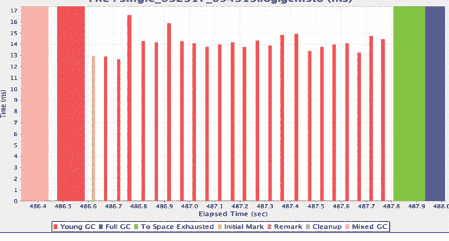

图 6.9 G1 垃圾回收器停顿时间线，显示未完成的标记周期

## 探索垃圾回收的改进

在这些情况下，您可以将 IHOP 值稳定在较低水平，以适应静态和瞬态活跃数据集大小（LDS 和大对象），并通过增加 n 将并发线程数增加到更高值：`-XX:ConcGCThreads=n`。n 的默认值是用于并行（STW）GC 周期的可用 GC 线程数的四分之一。

G1 代表了 Java 生态系统中 GC 演进的一个重要里程碑。它引入了区域化堆，并允许用户使用真实的停顿时间目标并最大化所需的堆内存。G1 预测每次回收（年轻代和混合回收）的区域总数以满足目标停顿。然而，由于数据结构的密度、被回收区域中区域或对象的流行程度以及每个区域活跃数据量等因素，实际停顿时间可能仍然存在。这种变异性使得应用程序满足已定义的 SLO 面临挑战，并产生了对近实时、可预测、可扩展和低延迟垃圾回收器的需求。

# Z 垃圾回收器：适用于多 TB 堆的可扩展、低延迟 GC

为了满足应用对实时响应的需求，引入了 Z 垃圾回收器（ZGC），增强了 OpenJDK 的垃圾回收能力。ZGC 在 OpenJDK 世界中融入了创新的概念——其中一些概念在其他回收器（如 Azul 的 C4 回收器）中有先例。ZGC 的开创特性包括并发压缩、染色指针（colored pointers）、堆外转发表和加载屏障（load barriers），这些特性共同增强了性能和可预测性。

ZGC 最初作为 JDK 11 中的实验性回收器，并在 JDK 15 中达到生产就绪。在 JDK 16 中，启用了并发栈处理，允许 ZGC 保证停顿时间保持在毫秒级阈值以下，无论 LDS 和堆大小如何。这一进展使得 ZGC 支持从 8 MB 到多 16 TB 的各种堆大小，使其能够满足从轻量级微服务到内存密集型任务（如大数据分析、机器学习和图形渲染）的各种应用程序。

在本节中，我们将查看 ZGC 的某些核心概念，这些概念使得该回收器实现了超低停顿和高可预测性。

## ZGC 核心概念：染色指针

ZGC 的关键创新之一是使用了染色指针，这是一种元数据标记的形式，允许垃圾回收器直接在指针中存储额外信息。这种技术被称为虚拟地址映射或标记，通过 x86-64 和 aarch64 架构上的多映射实现。染色指针可以指示状态、是否已标记、是否可达或是否已重映射。

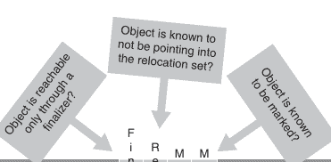

图 6.10 ZGC 染色指针

## ZGC 核心概念：利用线程本地握手

ZGC 采用线程本地握手（thread-local handshake）是对全局 STW 事件的重大改进，如图 6.11 所示。这允许 ZGC 随着处理器数量进行扩展。

## ZGC 核心概念：阶段与并发活动

与其他回收器一样，ZGC 是一个追踪回收器，但它由于能够执行并发压缩而脱颖而出。ZGC 通过引入页（Pages）细化了 G1 开创的区域化堆概念——页是根据内存使用分配的动态大小区域。

# 第 6 章 OpenJDK 中的高级内存管理与垃圾回收


- 2. 并发标记/重映射（Concurrent Mark/Remap）：在此阶段，ZGC 追踪应用程序的活跃对象图并标记非根对象。它利用加载屏障（load barrier）来协助加载未标记的对象指针。同时会进行并发引用处理，并使用线程本地握手（thread-local handshakes）。

- 3. STW 标记结束（暂停标记结束 - Remark）：ZGC 执行一次快速暂停，以完成对并发期间正在处理对象的标记。该阶段的持续时间被严格控制，以最大程度地减少暂停时间。从 JDK 16 开始，工作量被限制在 200 微秒。如果标记工作超过此时间限制，ZGC 将继续并发标记，并尝试进行下一次“标记结束”活动，直到工作完成。

- 4. 并发迁移准备（Concurrent Prepare for Relocation）：在此阶段，ZGC 识别出将作为收集/迁移集合的区域。它还会处理弱根（weak roots）和非强引用，并执行类卸载。

- 5. STW 迁移（暂停迁移开始 - Relocate Start）：在此阶段，ZGC 完成任何残留元数据和方法的卸载。它通过建立必要的结构（包括使用重映射映射 `remap map`）为迁移做准备。该掩码是 ZGC 转发机制的一部分，确保任何指向已迁移对象的引用都更新为新位置。应用程序线程短暂暂停，以便将根捕获到收集/迁移集合中。

- 6. 并发迁移（Concurrent Relocate）：ZGC 并发执行将对象从“源空间”（from space）迁移到“目标空间”（to space）的实际工作。此阶段可以采用称为“自愈”（self-healing）的技术，即当应用程序遇到需要迁移的对象时，会协助完成迁移过程。这种方法减少了 STW 阶段需要完成的工作量，从而缩短了 GC 暂停时间并提高了应用程序性能。

图 6.13 展示了垃圾回收过程中 Java 应用程序线程与 ZGC 后台线程之间的相互作用。宽大的水平箭头代表应用程序执行随时间的连续执行，Java 应用程序线程持续运行。垂直线代表 STW 阶段，此时应用程序线程短暂停止以允许 GC 活动进行。

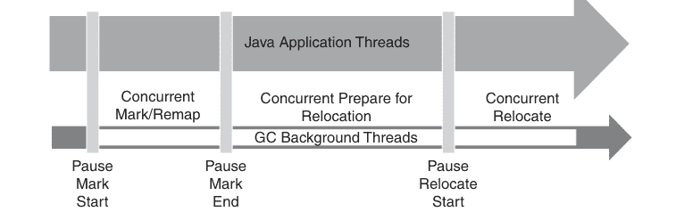

图 6.13 ZGC 阶段与并发活动

> ⁸https://openjdk.org/groups/hotspot/docs/HotSpotGlossary.html

# 探索垃圾回收改进 201

在应用程序线程下方有一条虚线，代表 GC 后台线程正在进行的活动。这些线程与应用程序线程并发运行，执行如标记、重映射、迁移对象等垃圾回收任务。

在图 6.13 中，STW 暂停是短且低频的，反映了 ZGC 最小化其对应用程序延迟影响的设计目标。这些阶段之间的暂停代表并发垃圾回收活动阶段，在此阶段，ZGC 与运行中的应用程序协同工作，而不中断它。

# ZGC 核心概念：堆外转发表（Off-Heap Forwarding Tables）

ZGC 引入了堆外转发表——即存储已迁移对象新位置的数据结构。通过在堆外分配这些表，ZGC 确保用于转发表的内存在内存不会影响应用程序可用的堆空间。这允许立即返回虚拟内存和物理内存，从而实现更高效的内存使用。此外，堆外转发表使 ZGC 能处理更大的堆，因为转发表的大小不受堆大小的限制。

图 6.14 是堆外转发表的图示表示。在图中：

- 活跃对象存储在堆内存中。

- 这些活跃对象被迁移，其新位置记录在转发表中。

- 转发表分配在堆外内存中。

- 已迁移的对象（现在位于其新位置）可以被应用程序线程访问。

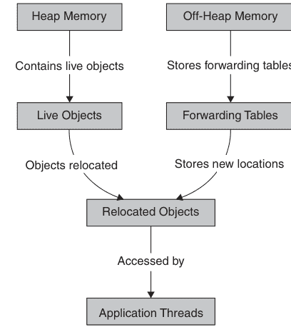

图 6.14 ZGC 的堆外转发表

# 第 6 章 OpenJDK 中的高级内存管理与垃圾回收

# ZGC 核心概念：ZPages

ZPage 是堆内的一个连续内存块，旨在优化内存管理和 GC 过程。它可以具有三种不同的维度——小、中、大。这些页的精确大小可以根据 JVM 配置及其运行的平台而异。以下是简要概述：

- **小页（Small pages）：** 这些通常用于小对象分配。可以存在多个小页，且每个页都可以独立管理。

- **中页（Medium pages）：** 比小页大，用于中等大小对象的分配。

- **大页（Large pages）：** 预留给大对象分配。大页通常用于大到无法放入小页或中页的对象。在大页中分配的对象会占据整个页。

图 6.15 和 6.16 显示了 ZPages 在基准测试中的用法，突出了每种页类型的频率和体量。图 6.15 显示了小页占主导地位，图 6.16 是同一张图的放大图，重点关注中页和大页类型。

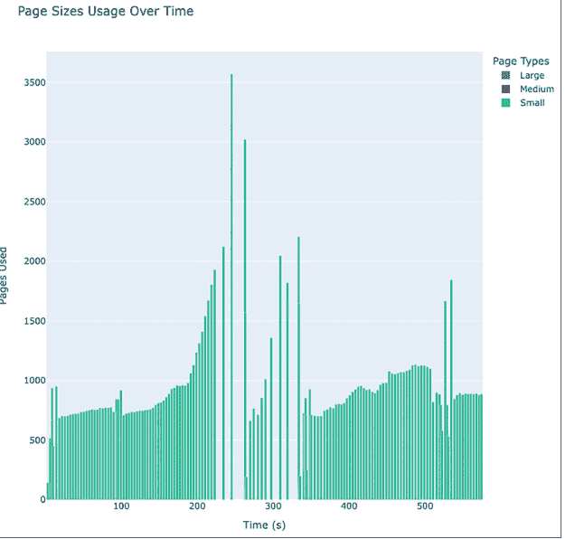

图 6.15 页面大小随时间的变化

> ⁹https://mallocc.se/blog/

# 页面大小随时间的变化

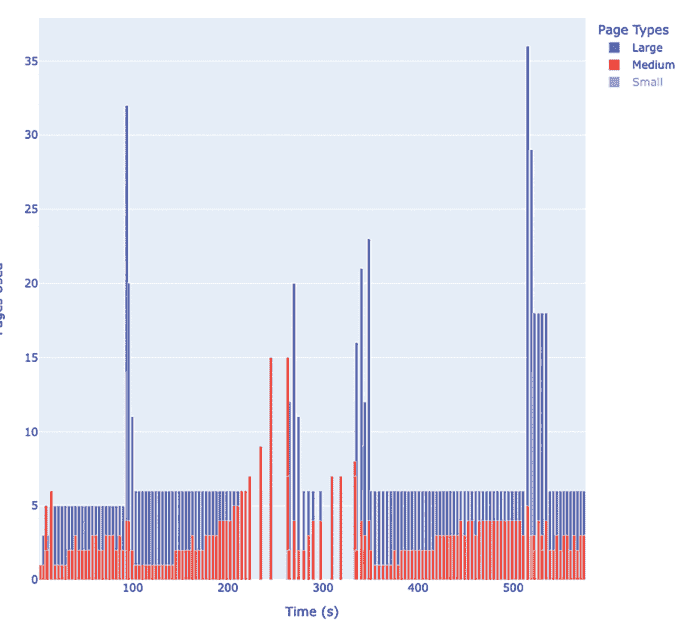

# 图 6.16 中页和大 ZPages

# ZPages 的目的与功能

ZGC 使用页来促进其：

- **跨区域：** ZGC 将覆盖必要的区域。

- **迁移：** 在 GC 期间，对象从一个页移动到另一个页。

- **并发：** ZGC 同时处理多个页。

- **动态性：** 虽然区域的大小是固定的，但 ZPages 是动态的。

# 分配与迁移

ZPage 的大小可以是小、中或大。


# ZPages 的优势

使用 ZPages 提供了优势：

- **并发迁移：** 由于对象被分组，ZGC 可以并发迁移。

- **高效内存管理：** 空闲页可以快速回收。

- **可扩展性：** ZGC 的并发特性可以高效处理多个页，使其具有扩展性。

- **页元数据：** 每个 ZPage 都有关联的元数据，用于跟踪其大小、占用情况、是否用于分配或迁移等信息。

本质上，ZPages 和区域是 ZGC 的核心概念。虽然 ZPages 提供了存储对象的实际区域，但区域为 ZGC 跟踪、分配和回收内存提供了机制。

# ZGC 自适应优化：触发 ZGC 周期

现代应用程序的内存管理变得更加动态，这反过来使得能够实时适应的 GC 至关重要。GC 证明了这一点，它需要一系列自适应触发器来启动垃圾回收周期。这些触发器可能包括定时器、预热、高分配率、分配停顿、主动和高利用率，旨在满足现代应用程序的需求。对于开发者和管理员来说，理解这些触发器不仅是有益的，更是必须的。掌握这些细微差别有助于更好地管理和调整 ZGC，确保应用程序持续符合性能和延迟基准。

# 基于定时器的垃圾回收

ZGC 可以配置为按定时触发 GC 周期。这种基于定时器的方法确保了垃圾回收按预期的间隔进行，为内存管理提供了一层一致性。

# 探索垃圾回收改进 205

- 使用方法：

  - 设置计时器：可以使用 JVM 选项 `-XX:ZCollectionInterval=<value-in-seconds>` 来指定此计时器的间隔。

  - `-XX:ZCollectionInterval=0.01`：配置 ZGC 每隔 10 毫秒检查一次垃圾回收。

  - `-XX:ZCollectionInterval=3`：将间隔设置为 3 秒。

  - 默认行为：默认情况下，`ZCollectionInterval` 的值被设置为 0。这意味着基于计时器的触发机制被禁用，ZGC 不会仅根据时间按时启动垃圾回收。

  - 示例日志：当 ZGC 基于此计时器运行时，日志将类似于所示的输出：

```
[21.374s]info[gc, start      GC(7) Garbage Collection (Timer)
[21.374s]info[gc, task       GC(7) Using 4 workers
```

```
[22.031s]info[gc]             GC(7) Garbage Collection (Timer) 1480M(14%))->1434M(14%)
```

这些日志表明 GC 周期是由计时器触发的，并提供了有关该周期内回收内存的详细信息。

  - 注意事项：基于计时器的方法虽然具有可预测性，但应谨慎使用。理解 ZGC 的自适应触发机制至关重要。基于计时器的收集理想情况下应该作为一种补充策略——即 ZGC 对已知状态的周期性“清理”。这种方法对于刷新类或处理引用等任务特别有益，因为 ZGC 可以处理并发卸载和引用处理。

# 基于预热的 GC

在应用程序的预热阶段可以触发 GC 周期。这在应用程序启动加速（ramp-up）阶段（即应用尚未达到完全运行负载时）特别有益。在此阶段是否触发 ZGC 周期的决策受堆占用率的影响。

- 机制：在应用程序的启动加速阶段，ZGC 会监控堆的占用情况。当其达到 10%、20% 或 30% 的阈值时，ZGC 会触发一个预热周期。这可以看作是对 GC 进行预热，为应用程序的典型模式做准备。如果堆超过了其中一个阈值且没有启动其他垃圾回收，则会触发 ZGC 周期。这种机制允许系统收集 GC 持续时间的早期样本，这些样本可以供其他规则使用。

- 使用方法：ZGC 的阈值 `soft_max_capacity` 决定了它旨在维持的最大堆占用率。对于基于预热的 GC 周期，在没有启动其他垃圾回收的情况下，ZGC 会在 `soft_max_capacity` 的 10%、20% 和 30% 时检查堆占用率。

# 第 6 章 高级内存管理 OpenJDK 中的垃圾回收

为了影响这些预热周期，终端用户可以调整 `-XX:+SoftMaxHeapSize=<size>` 命令行选项。

- 示例日志：当 ZGC 在此规则下运行时，日志将类似于以下输入：

```
[7.171s][info][gc, start      GC(2) Garbage Collection (Warmup)
[7.171s][info][gc, task       GC(2) Using 4 workers

[8.842s][info][gc]           GC(2) Garbage Collection (Warmup) 2078M(20)->1448M(14)
```

从日志中明显看出，堆占用率达到 20% 时触发了预热周期。

- 注意事项：预热/启动加速阶段对于内存分配至关重要，特别是那些在启动期间构建大量缓存的分配。这些缓存在随后的事务中被频繁使用。通过在预热期间启动 GC 周期，应用程序可以确保缓存被高效构建并为未来使用进行优化。这确保了应用程序从预热阶段到处理真实事务的平滑过渡。

# 基于高分配速率的 GC

当应用程序以高速率分配内存时，ZGC 可以启动 GC 周期来释放内存。

- 机制：ZGC 持续监控内存分配。根据观察到的分配速率和可用内存，ZGC 估计内存耗尽（OOM）的时间。如果此估计时间小于 GC 周期的预期时长，则触发 GC 周期。ZGC 可以根据 `UseNumberOfThreads` 运行两种模式：

- 动态 GC 工作线程：在此模式下，ZGC 动态计算避免 OOM 所需的 GC 工作线程。它考虑了当前分配速率、分配速率的变化以及 GC 的串行和并行阶段。

- 静态工作线程：在此模式下，ZGC 使用固定数量的 GC 工作线程（`ConcThreads`）。它根据分配速率的移动平均值估计 OOM 时间，并为不可见的分配留出安全余量。安全余量（headroom）是为所有工作线程共享单个内存页所需的空间。

- 使用方法：调整 `UseNumberOfThreads` 设置和 `-XX:+SoftMaxHeapSize=<size>` 选项，并可能调整 `ConcThreads=<number>` 允许根据特定的应用程序需求进行微调。

- 示例日志：以下日志提供了由于分配速率触发 GC 周期的信息：

```
[221.876s][info][gc, start      GC(12) Garbage Collection (Allocation Rate)
[221.876s][info][gc, task       GC(12) Using 3 workers
```

```
[224.073s][info][gc ] GC(12) Garbage Collection (Allocation Rate) 578M(56%)->214M(27%)
```

从日志可以看出，由于高分配速率触发了 GC，并将堆占用率从 56% 降低到 27%。

# 基于分配停顿（Allocation Stall）的 GC

当应用程序因空间不足无法分配内存时，ZGC 将触发周期以释放内存。这种机制确保应用程序不会因为耗尽而停顿或崩溃。

- 机制：ZGC 持续监控分配尝试。如果堆没有可用内存且自上次 GC 以来观察到了分配停顿，ZGC 将启动周期。这是一种响应式方法，确保内存可用。

- 使用方法：此触发是 ZGC 设计固有的，不需要显式配置。然而，监控并理解此类触发的频率可以为应用程序的内存模式和潜在优化提供见解。

- 示例日志：

```
[265.354s][info][gc ] Allocation Stall <thread-info> 154.773ms
[265.354s][info][gc ] Allocation Stall <thread-info> 150.993ms
[270.476s][info][gc,start ] GC(19) Garbage Collection (Allocation Stall)
[270.476s][info][gc,ref ] GC(19) Clearing SoftReferences
[270.476s][info][gc,task ] GC(19) Using 4 workers
```

从日志可以看出，由于分配停顿触发了 GC，并将堆占用率从 76% 降低到 25%。

- 注意事项：频繁的分配停顿可能表明应用程序接近极限或存在偶发内存峰值。监控此类发生并增加堆大小或优化应用程序的内存使用。

# 基于高利用率的 GC

如果利用率较高，可以触发 ZGC 周期来释放内存。这是根据分配速率触发 ZGC 周期之前的第一步。如果堆占用率达到 95%，将作为预防措施触发 GC。

- 机制：ZGC 持续监控可用内存量。如果可用内存下降到堆总容量的 5% 或更少，则触发 ZGC 周期。这对于分配速率很低的场景特别有用，此时分配速率不会触发 GC 周期，但可用内存仍在稳定下降。

- 使用方法：此触发是 ZGC 设计固有的，不需要显式配置。然而，理解这一机制有助于调整堆大小并优化内存使用。

- 示例日志：

```
[388.683s][info]gc, start ] GC(36) Garbage Collection (High Usage)
[388.683s][info][gc, task ] GC(36) Using 4 workers
```

- 注意事项：如果频繁触发基于利用率的 GC，可能表明堆大小对于应用程序的需求不足。监控此类触发的频率和堆占用率可以为潜在的优化或调整堆大小的需求提供见解。

# 主动 GC

ZGC 可以根据启发式或预测模型主动启动 GC 周期。这种方法旨在预测 GC 周期的需求，允许 JVM 较小的堆和更流畅的应用程序性能。

- 机制：ZGC 使用一组规则来决定是否应该启动主动 GC。规则考虑了诸如自上次 GC 以来堆使用的增长情况、自上次 GC 以来经过的时间以及对应用程序吞吐量的潜在影响。目标是在认为有利时执行 GC 周期，即使堆有大量空闲。

- 使用方法：启用/禁用主动 GC：可以使用 JVM 选项 `ZProactive` 启用或禁用主动垃圾回收。

- `-XX:+ZProactive`：启用主动垃圾回收。

- `-XX:-ZProactive`：禁用主动垃圾回收。

- 默认行为：默认情况下，ZGC 的主动垃圾回收是启用的 (`-XX:+ZProactive`)。启用时，ZGC 将使用其启发算法决定何时启动主动 GC 周期，即使堆中仍有大量空闲。

- 示例日志：

```
[753.984s][info]gc, start ] GC(41) Garbage Collection (Proactive)
[753.984s][info][gc, task ] GC(41) Using 4 workers
[755.897s][info]gc GC(41) Garbage Collection (Proactive) 5458M(53%)->1724M(17%)
```

# 探索垃圾回收改进 209

从日志可以看出，系统启动了主动垃圾回收（proactive GC），这使得堆占用率从 53% 降低到 17%。

- **考虑因素：** 主动 GC 机制旨在通过预测内存需求来优化应用程序性能。然而，监控其行为至关重要，以确保其符合应用程序的需求。频繁的主动 GC 可能表明 JVM 的启发式策略过于激进，或者应用程序具有不可预测的内存模式。

ZGC 的自适应触发器的深度和广度凸显了其在管理多样化应用程序方面的多功能性，同时对大多数最新的垃圾回收器而言也绰绰有余，并在 ZGC 中找到了一种独特的实现方式。这些触发器的具体细节和敏感性根据 ZGC 的设计和配置而异。尽管 ZGC 的默认行为非常稳健，但在表象之下蕴藏着巨大的优化潜力。通过深入研究每个触发器的细节并解读相关的日志，从业人员和系统专家可以精调 ZGC 的操作，使其更好地契合其应用程序独特的内存模式。在节奏快速的软件开发世界中，这种洞察力可能是良好性能与卓越性能之间的区别。

# ZGC 的进展

自在 JDK 11 LTS 中实验性发布以来，ZGC 在随后的 JDK 版本中经历了多次增强和完善。以下是从 JDK 11 到 JDK 17 ZGC 关键改进概述：

- **JDK 11：实验性引入 ZGC。** ZGC 引入了加载屏障（load barriers）和彩色指针（colored pointers）等创新概念，旨在为大堆提供实时、低延迟的垃圾回收和可扩展性。


- **JDK 12：并发类卸载。** 类卸载是从内存中移除不再需要的类的过程，从而释放空间并为其他任务提供内存。在传统的 GC 中，类卸载需要 STW（Stop The World）暂停，这可能导致更长的 GC 暂停时间。然而，随着 JDK 12 引入了并发类卸载，ZGC 能够在应用程序运行时卸载类，从而减少了对 STW 暂停的需求，并缩短了 GC 暂停时间。

- **JDK 13：提交未使用的内存。** 在 JDK 13 中，ZGC 得到了增强，能够更快速地提交未使用的内存。这一改进带来了更高效的内存使用，并可能缩短 GC 暂停时间。

- **JDK 14：增加了对 Windows 和 macOS 支持。** ZGC 在 JDK 14 中扩展了其平台支持，可在 Windows 和 macOS 上使用。这拓宽了 ZGC 在更广泛系统中的适用性。

- **JDK 15：生产就绪、压缩指针、NUMA 感知。** 到 JDK 15 时，ZGC 已经成熟到生产就绪状态，为大堆应用程序提供了稳健的低延迟垃圾回收。此外，ZGC 变得具有 NUMA 感知能力，考虑了具有 NUMA 架构的多插槽系统上的内存布局。这改进了 GC 暂停时间整体性能。

- **JDK 16：并发栈处理。** JDK 16 为 ZGC 引入了并发线程栈处理，进一步减少了在标记结束阶段（remark pause）期间完成的工作，并导致了更短的 GC 暂停时间。

- **JDK 17：动态 GC 线程、更快的终止和内存效率。** ZGC 现在动态调整 GC 线程的数量，以获得更好的 CPU 使用率和性能。此外，ZGC 能够中止正在进行的 GC 周期，从而允许 JVM 终止。标记内存的使用量有所减少，使算法更加高效。

# 垃圾回收的未来趋势

对于运行时而言，内存管理单元（MMU）是努力使操作与底层硬件保持一致的进程中的“扰动者”。具体来说：

- GC 不仅遍历存活对象图，还会移动存活对象以实现（部分）压缩。这可能会破坏 CPU 缓存的状态，因为它将存活对象从不同区域移动到新区域。

- 虽然 TLAB 碰撞指针分配（bump-pointer allocations）是高效的，但考虑到这两项活动的性质，扰动主要发生在 GC 启动时。

- 并发工作在现代 GC 算法中变得日益流行，它引入了开销。这是由于维护工作所需的。

## 评估 GC 性能的实用技巧

在生产环境中，Java 飞行记录器 (JFR) 是首选工具。它能在对性能影响最小的情况下，提供详细的运行时信息。相比之下，GC 日志适用于事后分析，能够捕获 GC 事件的完整历史。分析这些日志有助于你识别可能从单个快照中无法发现的趋势和模式。

- **理解 GC 指标**：理解不同 GC 指标的含义非常重要。例如，高 GC 时间可能意味着你的应用程序花费了大量时间进行垃圾回收，这可能会影响其性能。同样，高堆使用率可能意味着你的应用程序或内存分配与活跃数据不匹配。“GC 抖动”（GC churn）是指应用程序分配和释放内存的频率。高抖动率和堆内存不足会导致频繁的 GC 循环。监控这些指标将帮助你对 GC 调优做出明智决策。

- **在应用背景下解读指标**：GC 对应用程序性能的影响会根据其特定特性而异。例如，分配率高的应用程序受 GC 停顿的影响比低分配率的应用程序更大。因此，在应用的背景下解读 GC 指标至关重要。在解读这些指标时，要考虑应用程序的工作负载、事务模式和内存使用模式等因素。此外，将这些 GC 指标与响应时间和吞吐量等整体性能指标相关起来。这种整体方法确保了 GC 调优工作不仅符合内存管理效率，而且符合应用程序的整体性能目标。

- **理解 GC 触发器和适应性**：垃圾回收通常在新生代（eden space）达到上限或达到与老年代相关的容量时触发。现代 GC 算法是自适应的，会根据应用程序在堆的不同区域内存使用模式调整其行为。例如，如果应用程序的分配率很高，可能会更频繁触发 GC 以跟上对象的创建。同样，如果老年代利用率很高，GC 可能会花费更多时间来压缩堆。理解这些自适应行为可以帮你更有效地调优 GC 策略。

- **尝试不同的 GC 算法**：不同的 GC 算法有不同的优缺点。例如，Parallel GC 旨在最大化吞吐量并最小化停顿时间。此外，G1 GC 在吞吐量和停顿时间之间提供了平衡，对于大堆内存的应用是一个不错的选择。尝试不同的 GC 算法，看看哪一个最适合你的工作负载。记住，最适合你应用程序的 GC 取决于你的性能需求和限制。

- **调优 GC 参数**：大多数 GC 算法提供了一系列可以精调的参数以优化性能。例如，你可以调整堆的大小或新生代与老年代的空间比例。在调整这些参数之前，务必理解它们的含义，因为不当的调优会导致性能变差。从默认设置开始或遵循推荐的最佳实践作为基准。从那里开始进行增量调整并密切监控其影响。

## 第 6 章 OpenJDK 中的高级内存管理与垃圾回收

基于第 5 章概述的实验性设计原则，在镜像生产环境的预备区（staging area）受控环境中对每项进行测试，允许对每项调优工作进行安全评估，确保不会对活跃应用程序产生干扰。请记住，GC 调优本质上是一个迭代的性能过程。找到最佳配置涉及一系列仔细的实验和观察。

在为应用程序选择 GC 时，在工作负载的背景下评估其性能至关重要。目标不仅是增强 GC 性能，而是确保你的应用程序提供尽可能好的用户体验。

## 在各种工作负载中评估 GC 性能

有效的内存管理对于 Java 程序的高效执行至关重要。作为这一过程的核心方面，必须优化垃圾回收以同时交付效率和适应性。为了实现这一点，我们将检查包括 Apache Hadoop、Apache Hive、Apache HBase、Apache Cassandra、Apache Spark 等其他开源框架的需求和共同特征。在此背景下，我们将深入探讨不同的事务模式、它们与内存存储机制的关系，以及它们对堆管理的影响，所有这些都影响着工作负载的类型。

工作负载的类型可以根据其交互性大致分为三类，基于 GC：

- **分析型**（Analytics，OLAP）
- **操作型存储**（Operational Stores，OLTP）
- **混合型**（Hybrid，HTAP）

### 分析型（OLAP）

这种事务通常涉及对数据集进行复杂的查询。OLAP 应用的特征是“无状态”的，具有高吞吐量和大内存需求。在垃圾回收的背景下，关注点是管理分配率。OLAP 的示例包括 Hadoop 和 Spark 等项目。

### 操作型存储（OLTP）

这种事务类型通常与数据库相关。OLTP 应用程序的特点是对数据的快速低延迟访问。在这些交互中，数据状态是“有状态”的。在垃圾回收的背景下，关注点是内存压力。OLTP 的示例包括 Cassandra 和 HBase 等 NoSQL 数据库。

### 混合型（HTAP）

HTAP 应用涉及一种结合了 OLAP 和 OLTP 的新型工作负载，旨在对操作数据进行实时分析。例如，今天包括内存计算系统如 Ignite，它们为 OLAP 和 OLTP 提供高性能、集成的内存计算能力。开源世界中的另一个例子是 Apache Flink，它为流处理设计，但也支持批处理。虽然不是独立的 HTAP 数据库，但 Flink 的实时处理能力完善了 HTAP 架构，特别是当与事务数据存储集成时。此类工作负载的理想 GC 特性是针对分析任务的高吞吐量，结合针对实时事务的低延迟，这意味着优化 GC 可能是最佳的。理想情况下，这些工作负载将使用一种吞吐量优化且能最小化停顿和延迟的 GC——优化的 ZGC、Shenandoah。HTAP 工作负载结合了 OLAP 和 OLTP 的特点，它将驱动 GC（垃圾回收）策略的改进，以实现最优性能。

此外，机器学习和其他高级分析工具在性能调优中的存在感日益增加，这表明未来的 GC 优化可能会利用这些技术来精炼和自动化调优过程。同时，考虑与每个 GC 策略相关的 CPU 利用率也是至关重要的，因为它不仅直接影响垃圾回收的效率，还会影响整个应用程序的吞吐量。

通过针对工作负载的具体需求定制垃圾回收策略，我们可以确保 Java 应用程序高效地运行，为终端用户提供最佳性能。这种方法结合 GC 领域的持续研发，将确保 Java 持续成为一个适用于广泛应用程序的稳健且可靠的平台。

## 活跃数据集压力 (Live Data Set Pressure)

“活跃数据集”（LDS）衡量了堆内存中存活数据的数据量，这会影响垃圾回收过程的整体性能。LDS 包含了应用程序仍在使用且尚未符合垃圾回收条件的对象。

在传统的 GC 算法中，活跃数据集越大，GC 停顿时间可能越长，因为算法必须处理更多的存活数据。然而，这对于所有的 GC 算法并不适用。

## 理解数据生命周期模式

不同类型的数据对 LDS 压力的贡献方式不同，这凸显了应用程序数据生命周期模式的重要性。根据生命周期，数据大可以分为四类：

- **瞬态数据 (Transient data)**：这些短生命周期对象在使用后会被迅速丢弃。它们通常不应该穿越 Major GC 周期，并在新生代中被收集。

- **短命数据 (Short-lived data)**：这些对象的生命周期比瞬态数据稍长，但仍然较短。它们可能会生存几次 GC 周期，但通常在晋升到老年代之前被收集。

- **中命数据 (Medium-lived data)**：这些对象的生命周期超过了 Minor GC 周期，并通常会被晋升到老年代。它们会增加堆的占用率和 GC 压力。

- **长命数据 (Long-lived data)**：这些对象在应用程序生命的大部分时间内一直在使用中。它们位于老年代，只有在老年代循环期间才会被收集。

## 对不同 GC 算法的影响

G1 设计旨在通过在较小的区域增量地处理堆，并预测哪些区域将产生最多垃圾，从而提供更一致的停顿时间和更好的性能。活跃数据量仍然会影响其性能。中命和短命数据的 Minor GC 周期可能会增加堆的占用率并产生不必要的压力，影响 G1 的性能。

ZGC 设计的停顿时间在很大程度上独立于堆的大小或 LDS 的大小。ZGC 通过在不停止应用程序线程的情况下执行大部分工作来保持低延迟。然而，在高内存压力下，它会采用削负载策略（例如限制分配速率）来维持其低停顿保证。因此，ZGC 设计旨在更优雅地处理更大的 LDS，但极端的内存压力仍会影响其运行。

## 优化内存管理

理解应用程序中数据的生命周期模式是调优垃圾回收策略的关键因素。这种知识使你能够在吞吐量和停顿时间之间取得平衡，这也是不同 GC 算法所提供的主要权衡。最终，这将导致更高效的内存管理。

例如，考虑具有高瞬态或短命数据创建率的应用程序。此类应用程序可能受益于优化 Minor GC 周期的算法。这种优化可能涉及允许对象留在新生代，从而减少老年代收集的频率并提高吞吐量。

现在考虑一个具有大量长命数据的应用程序。这些数据可能贯穿应用程序的整个生命周期，作为事务的活动缓存。在这种情况下，一种增量处理老年代收集的 GC 算法可能会有效，并有助于更有效地管理更大的 LDS，缩短停顿时间并保持应用程序的响应能力。

显然，GC 的行为和性能可能会根据工作负载的特定特性和 JVM 的配置而异。因此，定期的监控和调优至关重要。通过根据应用程序不断变化的需要调整 GC 策略，你可以保持最优的 GC 性能并确保应用程序高效运行。

## 第 7 章

# 运行时性能优化：聚焦字符串、锁及其他

## 引言

运行时性能的效率对于扩展应用程序和满足用户需求至关重要。其核心是 JVM，它管理着如即时编译（JIT）和垃圾回收等运行时方面。

- **紧凑字符串**：我们将研究字符串的底层数组从 `char[]` 切换到 `byte[]` 如何减少应用程序的内存占用，并将 ASCII 文本的空间需求减少一半。

每种优化不仅带来了独特的优势，还带来了其自身的一系列考虑和注意事项。在我们探索这些领域时，我们的目标是理解技术方面以及它们对应用程序性能的实际影响。

# HotSpot VM 中的字面量和 intern 字符串优化

在 Java 中减少分配占用一直是增强的一个重要机会。在 Java 9 引入将字符串底层数组从 `char[]` 切换到 `byte[]` 很久以前，Open HotSpot VM 已经采用了许多技术来最小化内存使用，特别是针对字符串。

一项主要的优化涉及“字符串池”。由于字符串是不可变的，并且经常在应用程序的不同部分重复，Java 中的 `String` 类利用池化来节省堆空间。当调用 `String.intern()` 方法时，它会检查池中是否已经存在相同的字符串。如果是，该方法将返回已存在字符串的引用，而不是分配新对象。

考虑一个实例 `String1`，在 Java 9 之前，它将拥有一个 `String1` 对象和一个底层的 `char[]` 数组（图 7.1）。

调用 `String1.intern()` 会检查池中是否存在相同值的字符串。如果没有找到，则 `String1` 将被添加到池中（图 7.2）。

图 7.3 描述了在字符串 intern 之前的情况。当创建一个新字符串 `String2` 并进行 intern 时，如果它与 `String1` 相等，它将引用池中相同的 `char[]`（图 7.4）。

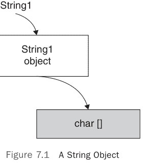

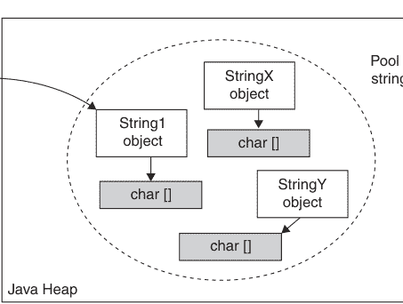

图 7.2 Java 堆内部的字符串池

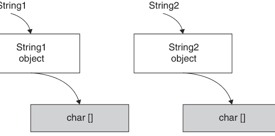

图 7.3 intern 之前的两个 String 对象

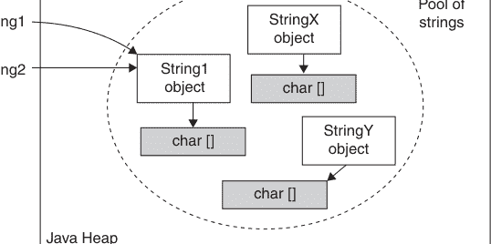

图 7.4 共享相同引用的 intern 字符串对象

这种存储字符串的方法内存效率大大提高，因为相同的字符串只存储一次。此外，intern 字符串可以使用 `==` 运算符快速高效地进行比较，因为它们共享相同的引用，而不是使用 `equals()` 方法。这不仅节省了内存，还加快了字符串比较操作，有助于提高程序的执行速度。

### 字符串去重优化与 G1 GC

Java 8 update 20 增强了 G1 GC，增加了字符串去重（dedup）优化，旨在减少内存占用。在并发收集的标记阶段的停顿世界（STW）撤空暂停（年轻代或混合回收）期间，G1 GC 会识别去重对象。这些候选对象是 `String` 实例，它们具有相同的 `char[]`，并且已经从 Eden 区域迁移到幸存区，或晋升到老年代区域。去重涉及将一个 `String` 实例的 `value` 字段重新赋值给另一个，从而避免需要重复的底层数组。

需要注意的是，大部分工作是在一个称为“去重线程”的 VM 内部线程完成的。该线程与应用程序线程并发运行，通过计算哈希值并根据需要去重字符串来处理去重队列。

图 7.5 捕捉了核心：如果 `String1` 与 `String2` 逐字符相等，且两者都由 G1 GC 管理，则可以将重复的数组替换为单个共享数组。

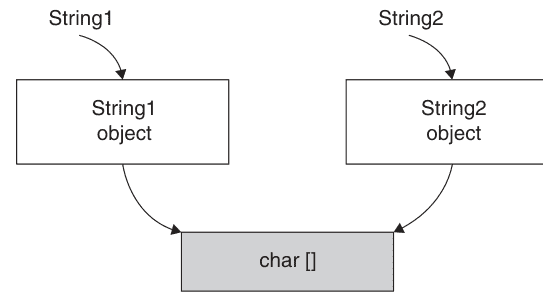

图 7.5 Java 中的字符串去重优化

对于去重效果感兴趣的开发者可以使用 `-Xlog:stringdedup=dedup` 选项来获取详细见解。这里是日志输出示例：

```
[217.149s][debug][stringdedup,phases, start] Idle start
[217.149s][debug][stringdedup,phases, ] Idle end: 0.017ms
[217.149s][debug][stringdedup,phases, start] Concurrent start
[217.149s][debug][stringdedup,phases, ] Process start
[217.149s][debug][stringdedup,phases, ] Process end: 0.069ms
[217.149s][debug][stringdedup,phases, ] Concurrent end: 0.109ms
[217.149s][info][stringdedup] Concurrent String
```

G1 GC 的字符串去重功能默认未启用，可以通过 JVM 命令行选项控制：`-XX:+UseStringDeduplication`。此外，你还可以使用 `-XX:StringDeduplicationAgeThreshold=<age>` 选项自定义 String 对象符合去重的年龄阈值。

## 运行时优化：针对字符串、空闲及其他

对于去重效果感兴趣的开发者可以使用 `-Xlog:stringdedup=dedup` 选项来获取详细见解。这里是日志输出示例：

```
[217.149s][debug][stringdedup,phases, start] Idle start
[217.149s][debug][stringdedup,phases, ] Idle end: 0.017ms
[217.149s][debug][stringdedup,phases, start] Concurrent start
[217.149s][debug][stringdedup,phases, ] Process start
[217.149s][debug][stringdedup,phases, ] Process end: 0.069ms
[217.149s][debug][stringdedup,phases, ] Concurrent end: 0.109ms
[217.149s][info][stringdedup] Concurrent String
```

## 减少占用

在 Java 中减少分配占用一直是增强的一个重要机会。在 Java 9 引入将字符串底层数组从 `char[]` 切换到 `byte[]` 很久以前，Open HotSpot VM 已经采用了许多技术来最小化内存使用，特别是针对字符串。


# 字符串优化

一项主要的优化涉及“字符串池”。由于字符串是不可变的，并且经常在应用程序的不同部分重复，Java 中的 `String` 类利用池化来节省堆空间。当调用 `String.intern()` 方法时，它会检查池中是否已经存在相同的字符串。如果是，该方法将返回已存在字符串的引用，而不是分配新对象。

考虑一个实例 `String1`，在 Java 9 之前，它将拥有一个 `String1` 对象和一个底层的 `char[]` 数组（图 7.1）。

调用 `String1.intern()` 会检查池中是否存在相同值的字符串。如果没有找到，则 `String1` 将被添加到池中（图 7.2）。

图 7.3 描述了在字符串 intern 之前的情况。当创建一个新字符串 `String2` 并进行 intern 时，如果它与 `String1` 相等，它将引用池中相同的 `char[]`（图 7.4）。

## 拼接

字符串拼接是 Java 中的一项基础操作，允许连接两个或多个字符串。如果你用过 `System.out.println` 方法，你已经熟悉 `+` 运算符。在以下示例中，字符串 `"It is "` 与布尔值 `trueMorn` 拼接，再与字符串 `"that are a morning person"` 拼接：

```java
System.out.println("It is " + trueMorn + " that are a morning person");
```

输出将取决于 `trueMorn` 的值。这里有一种可能的输出：

It false that are a morning person

为了理解改进，让我们比较 Java 8 和 Java 17 之间生成的字节码。这里是静态方法：

```java
private static void getMorn() {
    System.out.println("It is " + trueMorn + " that are a morning person");
}
```

我们可以使用 `javap` 工具查看 Java 8 生成该方法的字节码。这里是命令行：

```bash
$ javap -c MorningPerson.class
```

这里是字节码反汇编：

```
private static void getMorn() {
Code:
0: getstatic #2 // Field java/lang/System.out:Ljava/io/PrintStream;
3: new #9 // class java/lang/StringBuilder
6: dup
9: invokespecial #10 // Method java/lang/StringBuilder.<init>:(Ljava/lang/String)V
12: ldc #11 // String It is
15: invokevirtual #12 // Method java/lang/StringBuilder.append:(Ljava/lang/String)Ljava/lang/StringBuilder;
18: getstatic #8 // Field trueMorn:Z
21: invokevirtual #13 // Method java/lang/StringBuilder.append:(Z)Ljava/lang/StringBuilder;
24: ldc #14 // String that are a morning person
27: invokevirtual #12 // Method java/lang/StringBuilder.append:(Ljava/lang/String)Ljava/lang/StringBuilder;
30: invokevirtual #15 // Method java/lang/StringBuilder.toString:()Ljava/lang/String;
33: invokevirtual #4 // Method java/io/PrintStream.println:(Ljava/lang/String)V
36: return
}
```

在字节码中，我们可以观察到 `+` 运算符在内部被翻译为一系列 `StringBuilder` API 的 `append()` 调用。我们可以使用 `StringBuilder` API 来重写原始代码：

```java
String output = new StringBuilder().append("It is").append(trueMorn).append(" you are a morning person").toString();
```

此代码的字节码与使用 `+` 运算符相似。

然而，在 Java 17 中，字节码发生了显著变化：

```java
private static void getMornPers() {
Code:
0: getstatic #27 // Field java/lang/System.out:Ljava/io/PrintStream;
3: getstatic #37 // Field trueMorn:Z
6: invokedynamic #41, 0 // Invokedynamic #0:makeConcatWithConstants:(Z)Ljava/lang/String;
11: invokevirtual #15 // Method java/io/PrintStream.println:(Ljava/lang/String;)V
14: return
}
```

该字节码经过优化，使用了带有 `MakeConcatWithConstants` 方法的 `invokedynamic` 指令。这种转换被称为字符串拼接的指示。

`invokedynamic` 特性引入了引导方法（BSM）来辅助 `invokedynamic` 调用点。所有的 `invokedynamic` 调用都带有为这些 BSM 提供行为信息的方法句柄，这些方法会在运行时被调用。对于 JVM，你可以在 java 命令行添加 `-v` 选项：

```bash
$ java -p -c -v MorningPerson.class
```

以下是输出中的 BSM 节选：

```
SourceFile: "MorningPerson.java"
BootstrapMethods:
0: #63 REF_invokeStatic java/lang/invoke/StringConcatFactory.makeConcatWithConstants:(Ljava/lang/invoke/MethodHandles$Lookup;Ljava/lang/String;Ljava/lang/invoke/MethodType;Ljava/lang/String;[Ljava/lang/Object;)Ljava/lang/invoke/CallSite;
Method arguments:
#69 It is \u0001 you are a person
InnerClasses:
public static final #70: #72 of #74; // Lookup=class java/lang/invoke/MethodHandles$Lookup
class java/lang/invoke/MethodHandles
```

如我们所示，运行时首先将 `invokedynamic` 调用转换为 `invokestatic`。BSM 的方法参数指定了要从常量池链接并加载的常量。在 BSM 的帮助下通过传递运行时参数，可以将参数精确地放置在预构建的字符串中。

### 字符串优化详解

在字符串拼接中采用 `invokedynamic` 带来了许多好处。首先，特殊字符串（如空字符串和 `null` 字符串）现在被单独进行了优化。在处理空字符串时，JVM 可以跳过不必要的操作，直接返回非空对应项。同样，JVM 可以高效地处理 `null` 字符串，可能避开新字符串对象的创建并避免转换需求。

传统字符串拼接中的一个显著挑战（尤其是使用 `StringBuilder` 时）是建议计算结果字符串的总长度。这一步旨在确保 `StringBuilder` 的内部缓冲区不会经历多次性能代价高昂的调整。使用 `invokedynamic` 后，这种担忧得到了缓解——JVM 能够动态确定结果字符串的最佳大小，确保了高效的内存分配，而无需手动估计长度的开销。当待拼接字符串的长度不可知时，这一功能尤为有益。

此外，`invokedynamic` 固有的灵活性意味着字符串拼接可以持续从 JVM 的进步中受益。随着 JVM 的演进和新优化技术的引入，字符串拼接可以无缝地获得这些益处，而无需修改字节码或源代码。这不仅确保了字符串操作在不同 JVM 版本之间保持高效，还为应用程序提供了应对潜在瓶颈的未来性保障。

对于追求性能的开发者来说，转向 `invokedynamic` 代表了重大的进步。它减少了开发者为字符串拼接编写显式性能模式的需求，并确保字符串操作由 JVM 自动优化。这种对 JVM 不断进化的智能的依赖不仅带来了即时的性能提升，还使你的代码与未来的增强保持一致，成为编写更快、更整洁、更高效 Java 代码的一项明智长期投资。

## 紧凑字符串

在深入研究紧凑字符串之前，理解更广泛的背景非常重要。虽然计算通常围绕响应时间或吞吐量等指标展开，但 Java 中 `String` 类的改进大多集中在一个略有不同的领域：内存效率。字符串在应用程序中的无处不在，从……

# 第 7 章 运行时性能分析：聚焦字符串、对象和边界

4. 观察性能分析输出：点击按钮后，性能分析开始。输出出现在“输出”（Output）窗口中，显示文本“Profile Agent: ...”（图 7.11）。性能分析完成后，你可以保存快照。它命名为 JDK8-Objects。

5. 快照分析：现在让我们查看快照，如图 7.12 所示。

6. 基于类的性能分析 (JDK 8)：鉴于 Java 8 中的底层数组是 `char[]`，`char[]` 出现在顶部并不意外。进一步地，让我们查看这些类并验证这个 `char[]` 确实是 String 的底层数组。（见图 7.13）。

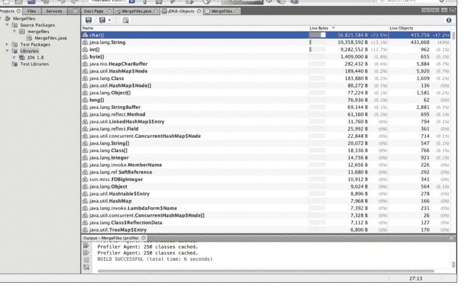

图 7.11 Apache NetBeans 所有类的性能分析完成

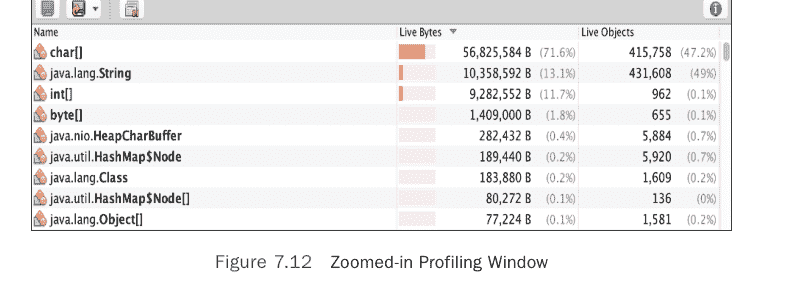

图 7.12 放大后的性能分析窗口

7. 类内分析 (JDK 8)：一旦选择“性能分析类”（Profile Class），你将看到（如图 7.14 所示）选中了一个类。然后你可以点击“性能分析”（Profile）开始性能分析。

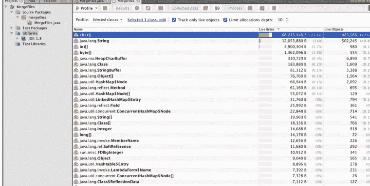

图 7.14 Apache NetBeans 单类性能分析

| | 活跃字节 (Live Bytes) | 分配对象 (Allocated Objects) | 代 (Generations) | |
|---|---|---|---|---|
| java.lang.Arrays.copyRange(char[], int, int) | 104,912.5 (0.92) | 781,774 (1.00) | 6,570,394 (0.99) | 4 |
| java.lang.String.concat(char[], int, int) | 1,069,824.8 (1.00) | 753,789 (0.99) | 6,601,745 (0.99) | 4 |
| java.io.BufferedReader.reader(InputStream, boolean) | 1,222,224.3 (1.00) | 768,200 (0.93) | 6,555,935 (0.93) | 4 |
| java.io.BufferedReader.readLine(int) | 1,222,224.3 (1.00) | 768,200 (0.93) | 6,555,935 (0.93) | 3 |
| java.lang.StringBuilder.toString() | 78,290 (1.00) | 768,200 (0.93) | 6,555,935 (0.93) | 3 |
| java.lang.String.substring(int, int) | 5,122,722 (0.93) | 706,208 (0.93) | 6,555,935 (0.93) | 3 |
| java.lang.String.substring(int) | 78,290 (1.00) | 5,583 (0.77) | 47,817 (0.7) | 2 |
| java.lang.Arrays.copyOf(byte[], int, int) | 9,918,728 (1.0) | 2,388 (0.0) | 18,681 (0.1) | 3 |
| java.io.BufferedReader.reader(java.io.Reader, int) | 32,800 (0.0) | 2 (0.0) | 2 (0.0) | 1 |
| java.io.BufferedReader.readLine(int) | 16,400 (0.0) | 1 (0.0) | 57 (0.0) | 1 |
| java.lang.String.getBytes(String, byte[], int) | 384 (0.0) | 1 (0.0) | 1 (0.0) | 1 |
| java.lang.String.coding(String, byte[], int) | 64 (0.0) | 1 (0.0) | 1 (0.0) | 1 |
| java.lang.String.init(byte[], int, int) | 64 (0.0) | 1 (0.0) | 1 (0.0) | 1 |
| sun.nio.StringHelper.makeUTF8(byte[]) | 64 (0.0) | 1 (0.0) | 1 (0.0) | 1 |
| java.lang.String.toCharArray() | 48,80 (0.0) | 1 (0.0) | 1 (0.0) | 1 |


8. 进一步分析 (JDK 8)：性能分析可能根据系统需要几秒。当你展开第一个顶部的路径时，最终窗口类似于图 7.15。

现在，让我们看看这个过程在 JDK 17 中是如何变化的：

1. 重复初始步骤：对于 Java 17，使用 Apache NetBeans 18 性能分析器，并对对象和捕获性能分析重复步骤 1 到 3，如图 7.16 所示。

2. 基于类的性能分析 (JDK 17)：由于是 Java 17，底层数组已变为 `byte[]`；在这里我们顶部看到 `byte[]`。因此，紧凑字符串生效了。让我们选择 `byte[]` 以确认它是 String 的底层数组。图 7.17 显示了结果。

3. String 初始化 (JDK 17)：我们将图 7.17 与 JDK 8 的性能分析进行比较时，我们看到了内存使用的变化。特别是，JDK 8 的性能分析中缺少了 `String16.compress` 和 `StringLatin1`（见图 7.18）。

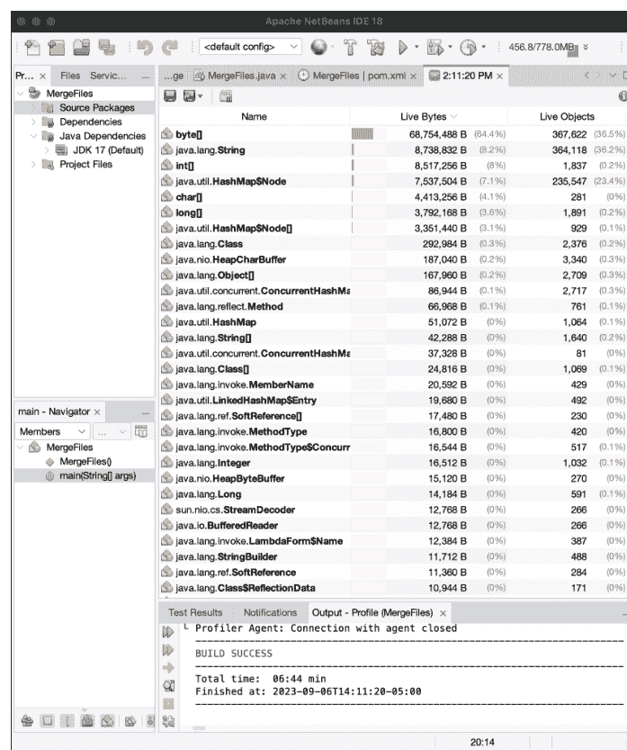

图 7.16 Apache NetBeans 捕获性能分析

| 名称 | 活跃对象 (Live Objects) | 对象 (Objects) |
|---|---|---|
| byte[] | 68,754,618 B (64.4%) | 367,632 (36.5%) |
| int[] | 8,738,832 B (8.2%) | 1,837 (0.2%) |
| | 8,517,256 B (8.0%) | |
| | 7,507,250 B (7.1%) | 235 (0.0%) |
| char[] | 4,415,236 B (4.1%) | 281 (0.0%) |
| long[] | 3,792,168 B (3.6%) | 189 (0.2%) |
| java.util.HashMapNode | 3,551,841 B (3.4%) | 929 (0.1%) |
| java.lang.Class | 296,986 B (0.3%) | 2,376 (0.2%) |
| java.io.HeapByteBuffer | 187,040 B (0.2%) | 2,709 (0.3%) |
| java.lang.Object | 167,960 B (0.2%) | 2,117 (0.2%) |
| java.lang.reflect.Method | 66,968 B (0.1%) | 761 (0.1%) |
| java.util.HashMap | 42,268 B (0.0%) | 1,064 (0.1%) |
| java.util.ConcurrentHashMap | 37,538 B (0.0%) | 1,640 (0.2%) |
| java.lang.Class | 24,816 B (0.0%) | 1,089 (0.1%) |
| java.lang.MemberName | 19,680 B (0.0%) | 492 (0.0%) |
| java.util.LinkedHashMapEntry | 17,480 B (0.0%) | 230 (0.0%) |
| java.lang.reflect.MethodType | 16,800 B (0.0%) | 517 (0.1%) |


# 第 7 章 运行时性能优化：聚焦字符串、锁及扩展

| 名称 | 活跃字节 (Live Bytes) |
|---|---|
| `char[]` | 108,032,952 B (100%) |
| | `java.util.Arrays.copyOfRange(char[], int, int)` | 106,069,824 B (98.2%) |
| | `java.lang.String.init(char[])` | 105,122,712 B (97.3%) |
| | `java.io.BufferedReader.readLine(boolean)` | 105,122,224 B (97.3%) |
| | `java.io.BufferedReader.readLine()` | 105,122,224 B (97.3%) |
| | `mergefiles.MergeFiles.merge(String[])` | 105,122,224 B (97.3%) |
| | `java.lang.StringBuilder.toString()` | 248 B (0%) |


图 7.17 显示 `byte[]` 在顶部的放大性能分析

通过遵循这些步骤并比较结果，字符串的影响变得显而易见。在 JDK 8 中，`char[]` 成为主要的内存消耗对象，表明其作为 String 底层的角色。在 JDK 17 中，`byte[]` 承担了这一角色，意味着紧凑字符串的成功实现。通过分析结果，我们验证了 JDK 17 中字节底层数组处理 UTF16 字符串的效率，并对 JVM 的内部字符串管理机制提供了见解。

鉴于 JDK 17（以及 JDK 11）字符串的显著增强，探索运行时可以带来更好性能的其他领域也变得同样重要。其中一个对于确保多线程应用程序平稳运行至关重要的关键领域，涉及掌握同步原语的基础知识以及运行时在该领域的进展。

## 增强多线程性能：Java 线程同步

在当今的高性能计算版图中，能够并发执行的能力不仅是一种优势，更是一种需求。有效的多线程允许高效扩展、充分利用现代处理器的全部潜力，并优化各种资源的利用。在线程之间共享数据可以提高效率。然而，随着系统的扩展，不仅仅是增加更多线程或处理器，还需要理解管理可扩展性的底层原理。

进入可扩展性法则的领域。许多开发者熟悉阿姆达尔法则（Amdahl's law），该法则通过关注任务的串行部分突出了并行性的局限性，但无法捕捉并行处理的所有细微差别。通用可扩展性法则（Universal Scalability Law, USL）提供了一个更全面的视角。USL 考虑了共享资源的竞争以及在确保跨处理器更新一致性时产生的一致性延迟。通过理解这些因素，开发者可以预测潜在的瓶颈，并在系统设计和优化方面做出明智决策。

### Java 内存模型与同步基础

Java 并发策略的核心是 Java 内存模型（JMM）。JMM 定义了 Java 应用程序中线程与内存之间合法操作的交互规则。它引入了*发生之前*（happens-before）关系的概念——这是一种基本的排序约束，保证了内存可见性，并确保内存操作在其他操作之前的顺序执行。

例如，考虑两个线程 "a" 和 "b"。如果 "a" 修改了一个共享变量，随后线程 "b" 读取了该变量，则必须建立*发生之前*关系，以确保 "b" 能够观察到 "a" 的修改。

为了促进此类交互并防止内存异常，Java 提供了同步机制。开发者工具箱中的主要工具之一是使用监视器锁（monitor locks）进行同步，这是每个 Java 对象的固有属性。这些锁确保了对对象的独占访问，在竞争同一资源的线程之间建立了*发生之前*关系。

> 注意：传统对象通常与其相关的监视器之间存在一对一的关系。然而，Java 领域正通过 Lilliput、Valhalla 和 Loom 等项目经历着彻底的变革。这些倡议预示着 Java 生态系统和既定标准的范式转移——从对象头到线程管理的本质——并为新的并发时代铺平道路。Project Lilliput 旨在通过简化 Java 对象头来最小化开销，这可能允许将对象从与其同步的 Java 对象解耦。Project Valhalla 引入了值类型，它们是不可变的，并重塑了传统的同步模型。Project Loom 虽然侧重于轻量级线程和增强并发，但进一步标志着 Java 同步和并发实践的演进本质。这些项目重新定义了 Java 管理对象和同步的方法，反映了为现代范式优化语言的持续努力。

为了说明 Java 的同步机制，请考虑以下代码片段：

```java
public void doActivity() {
    synchronized(this) {
        // 同步块内部的受保护工作
    }
    // 同步块外部的常规工作
}
```

在此示例中，线程必须获取实例对象（`this`）的监视器锁才能执行受保护的工作。在这些块之外，不需要这种锁。

同步方法提供了类似的机制：

```java
public synchronized void startActivity() {
    // 同步方法内部的受保护工作
}
// 同步方法外部的常规工作
```

> 注意
>
> - 同步块本质上是封装的同步语句。
> - 实例级同步是非静态方法所特有的，而静态方法则需要类级同步。
> - 对象的监视器与同一类的类对象监视器是区分的。

### 监视器锁的作用

在 Java 中，线程通过同步操作来有效通信并确保数据一致性。同步的核心是监视器锁（monitor locks）的概念。监视器锁（通常称为 monitor）充当互斥锁，确保在任何给定时间内，只有一个线程可以锁定并执行关联的同步代码块。

当线程遇到同步块时，它会尝试获取与对象相关的监视器锁。如果锁已被另一个线程持有，尝试的线程将被挂起并加入对象的等待集（wait set）——这是一个排队等待对象锁的线程集合。Java 中的每个对象天生都有一个关联的等待集，该集合在对象创建之前是空的。

监视器锁在确保共享资源的原子性、防止并发访问方面起着至关重要的作用。在完成同步块内的操作后，线程会释放监视器锁。在此之前，它可以选择性地调用对象的 `notify()` 或 `notifyAll()` 方法。`notify()` 方法从对象的等待集中唤醒一个被挂起的线程，而 `notifyAll()` 则唤醒所有等待的线程。

### OpenJDK VM 中的锁类型

在 Java 锁机制的背景下，锁是用户空间事件，此类事件表现为向操作系统（OS）发出的自愿上下文切换。因此，运行时根据线程相对于锁对象的状态对线程进行优化和调度。在任何给定时刻，锁都可能处于竞争状态（contended）或非竞争状态（uncontended）。

#### 锁竞争动态

当多个线程尝试同时获取锁时就会发生锁竞争。如果线程 "t" 在同步块内处于活动状态，而另一个线程 "u" 尝试进入同一个块，且没有其他线程在等待，则锁是非竞争的。然而，一旦 "u" 尝试进入并由于 "t" 持有锁而被迫等待，竞争就会产生。Java 的锁机制经过优化，可以处理此类场景，当竞争频繁时从轻量级锁转换为重量级锁。

#### 非竞争锁与膨缩锁

非竞争锁和膨缩锁是轻量级的、基于栈的锁，针对没有竞争的场景进行了优化。HotSpot VM 通过简单的原子比较并交换（CAS）实现锁。此 CAS 操作将一个在线程栈上生成的锁记录指针放置在对象的头信息字（header word）中。锁记录由原始的头信息字和指向同步对象的实际指针组成——这种机制被称为置换头信息（displaced header）。这种轻量级锁机制集成在解释器和 JIT 编译代码中，能够高效地管理由单个线程访问的对象的同步。

> 原子指令的复杂性，特别是 CAS，已在第 5 章“端到端 Java 性能优化：工程技术与使用 JMH 进行微基准测试”讨论过。

#### 竞争锁与膨胀锁

竞争锁和膨胀锁是当线程之间发生竞争时激活的重量级锁。当一个细粒锁（thin lock）遭遇竞争时，JVM 将其膨胀为重量级锁。这种转换需要与操作系统进行更复杂的交互，特别是在竞争线程和唤醒被挂起的线程时。重量级锁使用操作系统的原生互斥机制（mutex）来管理竞争，确保同步块一次由一个线程执行。

### 代码示例与分析

考虑以下代码片段，它演示了监视器锁以及 `wait()` 和 `notifyAll()` 的交互。

```java
public void run() {
    // 预定义的迭代次数循环
    for (int j = 0; j < MAX_ITERATIONS; j++) {
        // 同步共享资源以确保线程安全
        synchronized(sharedResource) {
            // 如果当前线程类型是否为减少
            if(threadType == ThreadType.DECREASING) {
                // 等待计数器不为零
                while (sharedResource.getCounter() == 0) {
                    try {
                        // 等待另一个线程 notify() 或 notifyAll()
                        sharedResource.wait();
                    } catch (InterruptedException e) {
                        // 处理中断异常并退出线程
                        Thread.currentThread().interrupt();
                    }
                }
                // 减少共享资源的计数器
                sharedResource.decrementCounter();
                // 打印当前状态（该方法提供有关当前状态的更多详细信息）
                printStatus();

            // 如果当前线程类型不是减少（即增加）
            } else {
                // 等待计数器未达到最大值（例如 10）
                while (sharedResource.getCount() == 10) {
                    try {
                        // 等待另一个线程 notify() 或 notifyAll()
                        sharedResource.wait();
                    } catch (InterruptedException e) {
                        // 处理中断异常并退出线程
                        Thread.currentThread().interrupt();
                    }
                }
                // 增加共享资源的计数器
                sharedResource.incrementCounter();
                // 打印当前状态（该方法提供有关当前状态的更多详细信息）
                printStatus();
            }
        }
        // 通知所有在该对象监视器上等待的线程唤醒
        sharedResource.notifyAll();
    }
}
```

该代码执行了以下操作：

- 同步：`synchronized(sharedResource)` 块确保了互斥。在任何给定时刻，只有一个线程可以执行包含的代码。如果另一个线程在块被占用时尝试进入，它将被迫等待。

- 计数器管理：
    - 对于 `DECREASING`（减少）类型的线程，会检查 `sharedResource` 的计数器。如果为零，线程将进入等待状态，直到另一个线程修改计数器并发送通知。
    - 反之，对于 `INCREASING`（增加）类型的线程，检查计数器是否达到最大值（十）。如果计数器已达上限，线程将等待直到另一个线程修改计数器并发送通知。一旦收到通知，它将增加计数器并打印状态。

- 通知：在修改计数器后，线程使用 `sharedResource.notifyAll()` 向 `sharedResource` 对象监视器上的所有其他线程发送唤醒信号。

## Java 锁机制的演进

多年来，Java 锁在 API 级别和 HotSpot VM 层面都经历了重大的改进。本节对 Java 的这些增强提供了结构化的概述。

### API 级别的增强

- **ReentrantLock (Java 5)**：`ReentrantLock` 属于 `java.util.concurrent.locks` 包，它比 `synchronized` 关键字提供的内置锁更具灵活性。它支持超时锁等待、可中断的锁等待以及创建公平锁等功能。

  得益于 `ReentrantLock`，我们拥有 `ReadWriteLock`，它使用成对锁：一个支持并发只读操作，另一个是用于写入的排斥锁。

> 注意：尽管 `ReentrantLock` 提供了高级功能，但它不是 `synchronized` 的直接替代品。开发者在选择它们之前应该权衡利弊。

- **StampedLock (Java 8)**：`StampedLock` 提供了一种乐观读取机制，在高争用条件下可以提高吞吐量。它像 `ReentrantReadWriteLock` 一样支持读锁和写锁，但具有更好的扩展性。与其他锁不同，`StampedLock` 没有“所有者”。这意味着任何线程都可以释放锁，而不仅仅是获取锁的线程。在使用 `StampedLock` 时，必须仔细管理以避免潜在问题。

> 注意：`StampedLock` 不支持重入，因此必须小心避免死锁。

### HotSpot VM 优化

- **偏向锁 (Biased locking, Java 6)**：偏向锁是一种旨在提高无争用锁性能的策略。通过这种方法，JVM 使用单个原子 CAS 操作将线程 ID 嵌入对象头中，表示该对象对该特定线程的偏向。这消除了被偏向线程在后续访问中对原子操作的需求，在线程重复获取锁的场景下提供了性能提升。

  注意：引入偏向锁是为了增强性能，但它给 JVM 带来了复杂性。一个重大的挑战是偏向撤销（bias revocation）期间意外的延迟，这可能在某些场景下导致不可预测的性能。现代硬件和软件模式的演进减少了偏向锁的优势，导致其在 JDK 15 中被弃用，为更一致且可预测的同步技术铺平了道路。如果你在 Java 15 之后的版本中使用它，会看到以下警告：

  ```
  Java HotSpot™ 64-Bit Server VM: Option UseBiasedLocking was deprecated in version 15.0 and will likely be removed in a future release.
  ```

- **锁消除 (Lock elision)**：该技术利用了 JVM 的逃逸分析优化。JVM 检查锁对象是否“逃逸”了当前的作用范围——即它是否在创建它的方法或线程之外被访问。如果锁对象保持局限性，JVM 就可以消除锁和相关的开销，将值保留在寄存器中（标量替换）。

  示例：在一个方法中创建、锁定、修改并解锁一个对象。如果该对象没有逃逸该方法，JVM 就可以消除该锁。

- **锁粗化 (Lock coarsening)**：我们经常遇到多个 `synchronized` 语句的争用。然而，这些可能是在同一个对象上加锁。与其发布多个锁，JVM 可以将这些合并为一个单一的、粗粒的锁，从而减少争用和无争用锁的锁定开销。

  示例：在一个循环中，每次迭代都有一个锁定相同对象的 `synchronized` 块，JVM 将这些粗化为循环外部的一个锁。

- **自适应自旋 (Adaptive spinning, Java 7)**：在 Java 7 之前，遇到被锁监视器的线程会立即进入等待状态。自适应自旋的引入允许线程自由地自旋（忙等或自旋等待），以预期锁很快会被释放。这一改进显著提升了具有多处理器的系统的性能，在这些系统中，线程可能在获取锁之前需要等待很短的时间。

尽管锁方面确实有一些重大的改进，但在各个 Java 版本发布中，出现了许多与同步和并发相关的增强、修复和性能微调。对于想要获取全面见解的读者，请参阅官方 Java 文档。

## 优化争用：Java 9 以来的增强


# 增强多线程性能：Java 线程同步

争用锁对于确保多线程 Java 应用的性能至关重要。多年来，Java 的演进一直专注于增强其争用锁机制。Java 9 受 JEP 143: Improve Contended Locking 的启发，引入了一系列关键改进，这些改进在后续版本中得到了进一步完善。在关键增强中，Java `monitor enter` 操作的加速和 `monitor exit` 操作的效率脱颖而出。这些操作是 Java 中 `synchronized` 方法和块的基础。

为了理解 `monitor enter` 和 `monitor exit` 的意义……（此处由于原文未完，按提供文本结束翻译）

## 可视化锁竞争优化：性能工程练习

JVM 性能工程不仅是为了识别瓶颈——它使我们能够细粒度地理解可以带来运行时效率提升的增强。

### 实战中的性能工程

本节将通过实操探索，以说明 Java 17 在处理锁竞争方面相比 Java 8 的性能改进。

我们将应用在第 5 章讨论的性能工程方法论，“端到端 Java 性能优化：工程技术与使用 JMH 进行微基准测试”，旨在揭示利用性能分析器和 JMH 基准测试工具的优势。

我们的探索集中在两个关键方面：

- 实战中的性能工程：解决性能问题的实际说明，从问题识别到应用基准测试和性能剖析以进行深度分析。
- 从理论到实践：将第 5 章的概念与真实世界的应用联系起来，并演示锁竞争优化。

此外，我们将探索 A/B 性能测试，这是一种目标实验设计方法，允许比较两个 JDK 版本的性能。A/B 性能测试是一种强大的技术，可以从经验角度验证性能增强，确保引入的任何更改都能带来切实的收益。

在对锁竞争优化的探索中，我们将利用 Java 基准测试框架（JMH）的力量。正如第 5 章所述，JMH 是性能基准测试的强大工具。这里有一个专门为评估 `synchronized` 块的递归锁和解锁操作设计的微基准测试：

```java
// 在循环对本地对象执行递归同步操作。
@Benchmark
public void testRecursiveLockUnlock() {
    Object localObject = lockObject;
    for (int i = 0; i < innerCount; i++) {
        synchronized (localObject) {
            dummy1++;
            dummy2++;
        }
    }
}
```

`RecursiveLockUnlock` 方法旨在严谨评估锁竞争的性能动态，特别是 `monitorenter` 和 `monitorexit` 操作。该方法通过在嵌套循环对本地对象（`localObject`）执行同步操作来实现。循环每次迭代会导致 `monitorenter` 被调用两次（由于嵌套的 `synchronized` 块），并在退出 `synchronized` 块时调用 `monitorexit` 操作。对于想要进一步探索的人，此及其他锁/解锁微基准测试可以在 Code Tools 仓库中找到。

最后，为了丰富我们的分析，我们将引入 `async-profiler`。该性能分析器将用于火焰图和调用树模式。调用树模式提供了关于交互的宝贵细粒度见解，阐明了执行期间选择的具体路径。

## 设置与数据收集

我们的首要目标是揭示锁竞争改进的深度，并衡量它们带来的性能增强。为此，我们需要细致的设置和数据收集过程。通过使用 Java 8 作为性能基准，我们可以对 Java 17 进行对比。以下是特定配置设置的详细概览：

### 环境设置

- 确保系统中安装了 JDK 8 和 JDK 17。
- 安装 JMH 以便与其后继者进行并行的性能评估。

### 仓库克隆

- 从 GitHub 克隆 JMH 微基准测试。
- 进入 `src` 目录。在这里将找到 `vm/lang/Lock.java`。

### 基准测试编译

- 使用 Maven 项目编译基准测试。
- 编译完成后，验证基准测试的完整性并准备好执行。

一旦完成了上述步骤，我们就有了分析锁竞争改进及其对 JVM 影响的设置。

## 测试与性能分析

为了衡量 JVM 锁竞争的性能，我们将在 JMH 框架内对 Java 8 和 Java 17 执行 `testRecursiveLockUnlock` 基准测试。保存输出以进行详细分析。本部分强调了准确性能分析所需的步骤。

### 基准测试配置

由于为研究选择了 `RecursiveLock` 基准测试，我们的目标是在一致条件下评估进入和退出路径。这里是一组精炼的建议：

- 基准测试的一致性：`Lock.testRecursiveLock` 基准测试符合衡量进入和退出路径的目标。这确保结果与审查的对象直接相关。
- 中性化偏锁：由于 Java 8 包含了偏锁优化，请使用 `-XX:-UseBiasedLock` JVM 选项将其禁用，以消除对结果的潜在影响。确保结果无偏见至关重要。
- 排除栈锁：在 JVM 参数中包含 `-XX:+UseHeavyMonitors`。此预防措施确保 JVM 不会利用优化锁（例如栈锁），这可能会扭曲结果。
- 充分预热：基准测试的核心是重复的锁和解锁操作。对微基准运行进行充分预热，确保 JVM 以峰值性能运行。此外，将测量与剖析运行分开，以考虑剖析固有的开销。
- 一致的垃圾回收（GC）策略：正如第 6 章“OpenJDK 中的高级内存管理与垃圾回收”所示，Java 17 默认使用 G1 GC。为了公平比较，通过使用吞吐收集器（Java 8 的默认值）匹配 Java 8 和 17 的 GC 策略。尽管不配置 Java 17 可能会影响微基准测试，但保持统一的性能基准测试环境至关重要。

> 注意：预热迭代为准确的性能测试做好准备，消除来自 JIT 编译、类加载和其他 JVM 优化的异常。

### 基准测试执行

为了衡量 JVM 锁竞争的性能，在 JMH 框架内对 Java 8 和 Java 17 执行 `testRecursiveLockUnlock` 基准测试。保存输出以进行详细分析。执行的命令行可能如下：

```bash
jmh-micros jdk8 -XX:+UseHeavyMonitors -XX:+UseParallelGC -XX:-UseBiasedLock -jar micros-jdk8/target/micros-jdk8-1.0-SNAPSHOT.jar -wi 50 -i 50 -f 1 .RecursiveLockUnlock.* >| tee filename.txt
```

在上一行中，请注意以下选项：

- `-wi 50`：指定预热迭代次数。
- `-i 50`：指定测量迭代次数。
- `-f 1`：指定分叉的数量。分叉会创建独立的 JVM 实例，以确保结果不会受 JVM 状态的影响。由于我们已经在最大化利用 CPU 资源，我们将仅使用一个分叉。

其余设置请使用 JMH 的默认值。运行基准测试并获取结果后，我们可以启动分析器测量。对于火焰图模式，使用以下命令：

```bash
async-profiler-2.9 mbecks ./profiler.sh -d 120 -j 50 -a t -s f <path-to-logs-dir>/<filename.html> <pid-of=RecursiveLockUnlock-process>
```

- `-d 120`：将分析时长设置为 120 秒。
- `-j 50`：每 50ms 采样一次。
- `-a`：分析所有方法。
- `-t`：添加线程名称。
- `-s`：简化类名。
- `-f`：指定输出文件。

若要查看调用树分解，使用 `-o tree` 将数据组织成树形结构。

## Java 8 与 Java 17 之间的性能对比

有了 Java 8 和 Java 17 的分析数据，我们现在开始对比它们的性能。打开两个版本生成的 HTML 文件，并对比查看调用树和火焰图的输出，以区分差异和改进。

### 火焰图分析

火焰图提供了调用栈的可视化表示，有助于识别性能瓶颈。Java 17 的火焰图允许我们比较 Java 8 的性能。

当你深入研究火焰图时，悬停在每个部分上将显示调用栈中每个方法的采样百分比。图 7.23 和 7.24 显示了特定调用栈及其相关方法的放大视图。

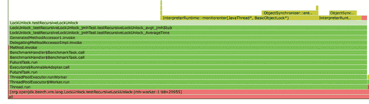

图 7.22 Java 17 上 RecursiveLockUnlock 测试的放大调用栈

| ObjectSynchronizer.enter(Handle, Lock, JavaThread*) |
| :--- |
| locktest.testreentrantlock.locktest.unlock |
| locktest.testreentrantlock.lock.testreentrantlock_lock_pagembus |
| locktest.testreentrantlock.lock.testreentrantlock_lock_avg_time |
| GenerousMethod.crosstalk_1 |
| GenerousMethod.crossborder_2 |
| BlackHarnessbenchmark/BlackTask.cap |
| BlackHarnessbenchmark/BlackTask.cap |
| FutureTask.run |
| FutureTask.get |
| ThreadPoolExecutor.submit |
| ThreadPoolExecutor.run |
| org.openharness.bench.vm.lang.Lock.locktest.testreentrantlock.unlock(jmt-worker-1:29951) |

图 7.23 Java 7 Monitor 入口栈的放大视图

| ObjectSynchronizer.enter(Handle, Lock, JavaThread*) |
| :--- |
| locktest.testreentrantlock.locktest.unlock |
| locktest.testreentrantlock.lock.testreentrantlock_lock_pagembus |
| locktest.testreentrantlock.lock.testreentrantlock_lock_avg_time |
| GenerousMethod.crosstalk_1 |
| GenerousMethod.crossborder_2 |
| BlackHarnessbenchmark/BlackTask.cap |
| BlackHarnessbenchmark/BlackTask.cap |
| FutureTask.run |
| FutureTask.get |
| ThreadPoolExecutor.submit |
| ThreadPoolExecutor.run |
| org.openharness.bench.vm.lang.Lock.locktest.testreentrantlock.unlock(jmt-worker-1:29951) |

图 7.24 Java 7 Monitor 出口栈的放大，分别与图 7.25 和 7.26 Java 8 的入口和出口栈进行对比。

| Async-Event_Mark | hands_Mark | ObjectSynchronizer.enter(Handle,...) | Thread.wait()/NoAsyncException:ThreadDeathByWait/JavaToAsync |
| :--- | :--- | :--- | :--- |
| FutureTask.run | | | |
| locktest.testreentrantlock.locktest.unlock | | | |
| locktest.testreentrantlock.lock.testreentrantlock_lock_pagembus | | | |
| locktest.testreentrantlock.lock.testreentrantlock_lock_avg_time | | | |
| GenerousMethod.crosstalk_1 | | | |
| GenerousMethod.crossborder_2 | | | |
| BlackHarnessbenchmark/BlackTask.cap | | | |
| BlackHarnessbenchmark/BlackTask.cap | | | |
| FutureTask.run | | | |
| FutureTask.get | | | |
| ThreadPoolExecutor.submit | | | |
| ThreadPoolExecutor.run | | | |
| org.openharness.bench.vm.lang.Lock.locktest.testreentrantlock.unlock(jmt-worker-1:29187) | | | |

图 7.25 Java 8 入口栈的放大视图

| Async-Event_Mark | hands_Mark | ObjectSynchronizer.enter(Handle,...) | Thread.wait()/NoAsyncException:ThreadDeathByWait/JavaToEx |
| :--- | :--- | :--- | :--- |
| FutureTask.run | | | |
| locktest.testreentrantlock.locktest.unlock | | | |
| locktest.testreentrantlock.lock.testreentrantlock_lock_pagembus | | | |
| locktest.testreentrantlock.lock.testreentrantlock_lock_avg_time | | | |
| GenerousMethod.crosstalk_1 | | | |
| GenerousMethod.crossborder_2 | | | |
| BlackHarnessbenchmark/BlackTask.cap | | | |
| BlackHarnessbenchmark/BlackTask.cap | | | |
| FutureTask.run | | | |
| FutureTask.get | | | |
| ThreadPoolExecutor.submit | | | |
| ThreadPoolExecutor.run | | | |
| org.openharness.bench.vm.lang.Lock.locktest.testreentrantlock.unlock(jmt-worker-1:29187) | | | |

图 7.26 Java 8 Monitor 栈的放大视图

### 增强多线程性能：Java 线程同步测试结果

表 7.1 展示了 Java 17 在 `testRecursiveLockUnlock` 上优于 Java 8 的性能。Score (ns/op) 代表每次操作的时间。分数越低性能越好。此外，Error (ns/op) 列代表变异性。

#### 表 7.1 Java 17 与 8 的 JMH 结果

| Java | Benchmark Test | Mode | Count | Score (ns/op) | Error (ns/op) |
| :--- | :--- | :--- | :--- | :--- | :--- |
| Java 17 | LockUnlock.testRecursiveLockUnlock | avgt | 50 | 7002.294 | ±86.289 |
| Java 8 | LockUnlock.testRecursiveLockUnlock | avgt | 50 | 11198.681 | ±27.607 |

Java 17 的分数比 Java 8 低得多，说明其在处理竞争锁方面效率更高。这种改进不仅在微基准中显而易见，还能转化到实际应用中，确保场景执行更流畅、更快速。

### 调用树分析


虽然火焰图非常适合查看性能瓶颈，但 `async-profiler` 的调用树映射提供了深度分析所需的细节。它剖析了程序的函数调用，帮助开发者追踪执行路径并确定 Java 17 优于 Java 8 的性能改进。

图 7.27、7.28 和 7.29 可视化了两个版本的调用树，说明了入口和出口点。这些可视化引导我们了解竞争锁的复杂性，以及 Java 17 优化的闪光之处。

- [14] 97.69% 69.54% 39.04% 38.56% `InterpreterRuntime:monitenter(JavaThread,BasicLock,ObjectLock)`
- [15] 44.52% 15.97% 28.74% 28.78% `InterpreterRuntime:enter(Handle,BasicLock,JavaThread)`
- [16] 5.36% 3.56% 3.86% 3.36% `InterpreterRuntime:exit(Handle, unsigned char)`
- [17] 10.74% 10.61% 3.16% 3.12% `InterpreterRuntime:monitorexit(BasicLock)`
- [18] 7.58% 7.49% 7.58% 0%:exit(oopexit(oopDesc,JavaThread)`
- [19] 15.51% 14.68% 15.11% 15.03%
- [20] 07.43% 07.74% 07.73% `ObjectSynchronizer:enter(Handle,`
- [21] 05.58% 57% 55.58% `ObjectSynchronizer:exit(oopDesc,JavaThread)`
- [22] 05.66% 55% 55% `InterpreterRuntime:frequency_count(JavaThread, unsigned char)`


## 增强多线程性能：Java 线程同步 253

[15] 0.56% 55 self: 0.00% 0 `InterpreterRuntime::frequency_counter_overflow(JavaThread, unsigned char*)`

`monitorenter` 和 `monitorexit` 的包含时间 =

```
9,648 (testRecursiveLockUnlock 的包含时间)
+ 3,856 (testRecursiveLockUnlock 的独占时间)
* 149 (tlv_get_addr 的包含时间)
* 73 (ObjectSynchronizer::enter 的包含时间)
* 57 (ObjectSynchronizer::exit 的包含时间)
* 55 (InterpreterRuntime::frequency_counter_overflow 的包含时间)
= 5,458 样本
= 4397 (monitorenter 的包含时间) + 1061 (monitorexit 的包含时间)
```

Java 调用栈的摘录：

```
+ [14] 99.28% 7,984 self: 27.17% 2,678 LockUnlock.testRecursiveLockUnlock*
* [15] 33.93% 3,344 self: 4.32% 428 InterpreterRuntime::monitorenter(JavaThread, BasicObject*)
* [15] 37.75% 3,326 self: 4.64% 457 InterpreterRuntime::monorexit(JavaThread, BasicObject*)
* [15] 1.42% self: 1,420 140 HandleMarkCleaner::*HandleMarkCleaner
* [15] 0.74% self: 0.73% 73
* [15] 0.56% 55 self: 0.56% 55 HandleInVMFromJavaNoASException::ThreadInVMFromJavaNoASException::pop_and_restore())
* [15] 0.44% self: 0.43% 42 ObjectSynchronizer::slow_exit(OopDesc, Thread*)
* [15] 0.43% self: 0.43% 42 ObjectSynchronizer::slow_enter(Handle, BasicLock, Thread)
* [15] 0.43% self: 0.43% 42 Arena::Amalloc_4(unsigned long, AllocFailStrategy::AllocFailEnum)
* [15] 0.42% self: 0.41% 0 InterpreterRuntime::frequency_counter_overflow(JavaThread, unsigned char*)
```

`monitorenter` 和 `monitorexit` 的包含时间 =

```
9,784 (testRecursiveLockUnlock 的包含时间)
+ 2,678 (testRecursiveLockUnlock 的独占时间)
* 140 (HandleMarkCleaner::*HandleMarkCleaner 的包含时间)
* 73 (ThreadInVMFromJavaNoASException 的包含时间)
* 55 (HandleMark::*pop_and_restore() 的包含时间)
* 43 (ObjectSynchronizer::slow_exit 的包含时间)
* 42 (ObjectSynchronizer::slow_enter 的包含时间)
* 42 (Arena::Amalloc_4 的包含时间)
* 41 (InterpreterRuntime::frequency_counter_overflow 的包含时间)
= 6,670 样本
= 3344 (monitorenter 的包含时间) + 3326 (monitorexit 的包含时间)
```

## 第7章 运行时性能优化：聚焦字符串、锁及其他

源自调用树 HTML 输出的文本数据强调了 Java 17 和 Java 8 之间不同的性能特征。`monitorenter` 和 `monitorexit` 组合样本中的显著差异表明，Java 17 具有更好的性能。

### Java 17 对比 Java 8：数据解读

从运行时和调用栈可以明显看出，Java 17 在优化 `LockUnlock.testRecursiveLock` 方法方面取得了巨大进展。以下是我们的结论：

**百分比增长的性能提升：**

* Java 8 大约需要 111,968 ns/op。
* Java 17 大约需要 7,002.294 ns/op。
* 提升百分比 = [(旧时间 – 新时间) / 旧时间] * 100
* 提升百分比 = ((111,968.1 - 7,002.294) / 111,968.1) ≈ 37.47%
* 在该基准测试中，Java 17 的速度比 Java 8 快约 37.47%。

让我们看看测试条件、每个方法的调用树样本以及性能测量中学习到了什么。

**一致的性能分析条件：**

* Java 17 和 Java 8 在执行 `LockUnlock.testRecursiveLock` 方法期间是在相同的基准条件下分析的。
* 基准测试设置为测量每个操作的平均时间，结果以纳秒为单位。
* `innerCount` 参数静态设置为 100，确保两个版本在同步操作方面的负载保持一致。

包含和独占样本数表明，两个 Java 版本之间的性能差异影响了在分析期间方法执行的次数。

**monitor 进入和退出的包含时间：**

* Java 17 消耗了 5,458 (4399 用于 monitenter + 1061 用于 monitorexit) 的 monitor 操作时间。
* Java 8 消耗了 6,670 (3344 用于 monitenter + 3326 用于 monitorexit) 的 monitor 操作时间。
* 这表明 Java 8 在 monitor 操作上花费的时间比 Java 17 多。

**testRecursiveLock 方法的独占时间：**

* Java 17 的独占时间：3856 样本
* Java 8 的独占时间：2678 样本

## 增强多线程性能：Java 线程同步 255

* 独占时间代表了在 `testRecursiveLockUnlock` 方法中 `monitenter` 和 `monitorexit` 操作之外花费的时间。Java 17 较高的独占时间表明 Java 17 在执行 `testRecursiveLockUnlock` 方法内部的实际工作效率更高（即同步块内部 `dummyInt1` 和 `dummyInt2` 的自加操作）。

表 7.2 还显示了 Java `monitenter` 调用中出现的方法：

* 从调用树中我们可以看到 Java 8 拥有更多的方法和更深的调用栈。

| 方法 | Java 8 样本 | Java 17 样本 |
| :--- | :--- | :--- |
| testRecursiveLockUnlock | 2,678 | 3,856 |
| monitenter | 3,344 | 4,397 |
| monitorexit | 3,326 | 1,061 |
| HandleMarkCleaner | 140 | - |
| ThreadInVMFromJavaNoASException | 73 | - |
| HandleMark::pop_and_restore() | 55 | - |
| ObjectSynchronizer::slow_exit | 43 | - |
| ObjectSynchronizer::slow_enter | 42 | - |
| Arena::Amalloc_4 | 42 | - |
| InterpreterRuntime::frequency_counter_overflow | 41 | - |

## 增强多线程性能：Java 线程同步 257

从本质上说，这次不仅是对 JVM 内部机制的窥视，更是对 Java 生态系统中性能工程本质的深度剖析。通过严谨的测量、剖析和分析，我们阐明了 Java 在处理竞争锁方面的演进路径，展示了其对提升全球 Java 应用效率和速度的持续承诺。

## 自旋等待提示：一种间接的锁改进

在深入研究自旋等待（spin-wait）提示的细节之前，理解其广泛背景至关重要。尽管大多数 Java 开发者可能永远不会使用自旋提示，但它们对于提高高负载服务器和计算密集型云应用的并发算法及数据结构的效率起着关键作用，在这些环境中，由于锁和上下文切换引起的性能问题非常普遍。通过优化线程等待锁的方式，这些提示被织入 JVM 的线程调度和处理器交互中，允许以更智能的方式处理忙等循环（busy-wait loops）。自旋等待提示的策略性使用不仅减少了 CPU 消耗，还最大限度地减少了不必要的上下文切换——提高了设计用于利用此类提示的系统的线程响应能力。

> 对于不熟悉“PAUSE”术语的人来说，它是一种 Intel 指令，用于优化线程在自旋循环中的等待方式，减少主动轮询期间 CPU 的功耗。虽然这看起来像是一个小众话题，但理解这条指令可以为 Java 和底层硬件如何相互作用以优化性能提供宝贵的见解。

## 利用内建（Intrinsics）增强性能

在 Java 7 引入自适应自旋（adaptive spinning）概念的基础上，Java 在优化自旋等待机制方面取得了进一步进展。这些对生成代码的增强有效利用了各种硬件平台的独特能力。例如，支持单指令多数据（SIMD）指令集的架构受益于 OpenJDK HotSpot VM 中的向量化增强。这是通过加速操作的内建汇编存根（intrinsic assembly stubs）以及自动向量化（auto-vectorization）实现的，即编译器自动准备代码执行以提高效率。

内建是专门经过手工优化的汇编存根，旨在通过利用底层架构的特定能力来增强 JIT 编译代码。它们的范围从复杂的数学计算到极高效的内存管理——为 JIT 编译代码提供了一条接近底层语言可能性能的路径。

图 7.30 描述了不涉及内建时的 JIT 代码执行情况。相比之下，相同的过程如果使用内建，这些存根将交付优化的原生代码序列，并促进了直接访问高级 CPU 指令，或提供了 Java 编程语言无法提供的功能。

## 第 7 章 运行时性能优化：聚焦字符串、锁及其他

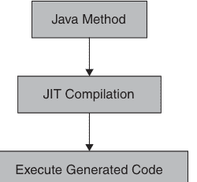

图 7.30 不使用内建的 JIT 代码执行

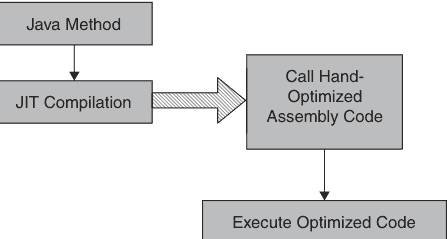

图 7.31 使用内建的 JIT 代码执行

## 理解自旋循环提示和 PAUSE 指令

在多处理器（MP）系统（如 x86-64 架构）中，当一个字段或变量被锁定且一个线程获取锁时，竞争同一个锁的其他线程进入等待循环（也称为忙等循环、自旋等待循环或自旋循环）。这些线程被认为正在活跃自旋。主动轮询有其优点：一旦锁可用，线程可以立即访问。然而，反面结果是，当线程仅等待执行任务时，这种循环会消耗大量的电力。此外，MP 系统具有处理流水线，它根据“总是跳转”或“从不跳转”的分支推测循环执行，并根据推测简化循环。当循环线程到达锁处时，流水线需要刷新（这一过程称为流水线刷新），因为处理器所做的预测不再有效。这会给 MP 系统带来性能开销。

为了解决这个问题，`PAUSE` 指令被引入。它优化了线程在自旋循环中的等待方式，减少了主动轮询期间 CPU 的功耗。虽然这看起来像是一个小众话题，但理解这条指令可以为 Java 和底层硬件如何相互作用以优化性能提供宝贵的见解。


# 第 7 章 运行时性能优化：聚焦字符串、锁及其他

## 理解自旋循环提示和 PAUSE 指令

在多处理器（MP）系统（如 `x86-64` 架构）中，当一个字段或变量被锁定且一个线程获取锁时，竞争同一个锁的其他线程进入等待循环（也称为忙等循环、自旋等待循环或自旋循环）。这些线程被认为正在活跃自旋。主动轮询有其优点：一旦锁可用，线程可以立即访问。然而，反面结果是，当线程仅等待执行任务时，这种循环会消耗大量的电力。此外，MP 系统具有处理流水线，它根据“总是跳转”或“从不跳转”的分支推测循环执行，并根据推测简化循环。当循环线程到达锁处时，流水线需要刷新（这一过程称为流水线刷新），因为处理器所做的预测不再有效。这会给 MP 系统带来性能开销。

> 对于不熟悉“PAUSE”术语的人来说，它是一种 Intel 指令，用于优化线程在自旋循环中的等待方式，减少主动轮询期间 CPU 的功耗。虽然这看起来像是一个小众话题，但理解这条指令可以为 Java 和底层硬件如何相互作用以优化性能提供宝贵的见解。

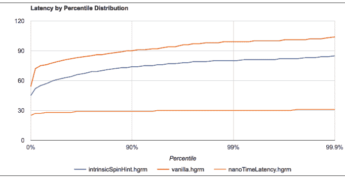

图 7.32 线程由于自旋提示的改进

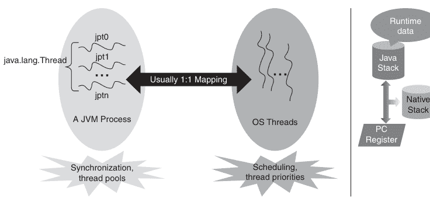

图 7.33 JVM进程、操作系统线程和运行时结构

## 利用内建增强性能

在 Java 7 引入的自适应自旋（adaptive spinning）概念的基础上，Java 在优化自旋等待机制方面取得了进一步进展。这些对生成代码的增强有效利用了各种硬件平台的独特能力。例如，支持单指令多数据（SIMD）指令集的架构受益于 OpenJDK HotSpot VM 中的向量化增强。这是通过加速操作的内建汇编存根（intrinsic assembly stubs）以及自动向量化（auto-vectorization）实现的，即编译器自动准备代码执行以提高效率。

内建（Intrinsics）是专门经过手工优化的汇编存根，旨在通过利用底层架构的特定能力来增强 JIT 编译代码。它们的范围从复杂的数学计算到极高效的内存管理——为 JIT 编译代码提供了一条接近底层语言可能性能的路径。

图 7.30 描述了不涉及内建时的 JIT 代码执行情况。相比之下，相同的过程如果使用内建，这些存根将交付优化的原生代码序列，并促进了直接访问高级 CPU 指令，或提供了 Java 编程语言无法提供的功能。


图 7.30 不使用内建的 JIT 代码执行


图 7.31 使用内建的 JIT 代码执行

## 从线程的线程模型过渡到可扩展模型

### 传统的一对一线程映射

为了更好地理解传统的线程模型，让我们来看典型的线程创建示例。

```
Thread thread = new Thread(() -> {
    // 在线程中执行的任务
});
thread.start();
```

图 7.33 展示了当 JVM 进程引入线程时运行时结构与操作系统之间的交互。该图展示了 Java 的并发模型。每个 Java 线程（jpt0, jpt1, jptn）通常一对一地映射到操作系统线程。每个 Java 线程都有自己的 Java 栈、程序计数器（PC）寄存器、原生栈和运行时数据。Java 管理同步、锁、等待队列和线程池。将 Java 线程映射到操作系统线程的标准做法可能会带来挑战。例如，当 Java 进程线程（jpt）阻塞时，它也会阻塞相应的操作系统线程，从而降低了可扩展性。

### 从每个任务一个线程模型向更可扩展的模型过渡

#### 通过每个请求一个线程模型提高可扩展性

为了解决一对一线程映射的可扩展性局限性，Java 引入了高级别的并发工具。例如，每个请求一个线程（thread-per-request）模型允许每个请求或事务由单独的线程处理，提高了可扩展性。该模型通常与 `Executor Service` 等工具以及 `ForkJoinPool`、`CompletableFuture` 等框架结合使用，这些工具提供了管理并发的方法。

#### Java Executor Service 和线程池

Java 的 `Executor Service` 框架管理着工作线程池，允许任务在池中的现有线程上执行，而不是为每个任务创建一个新线程。这种方法通常被称为“线程池”或“工作线程”模型，更高效且更具扩展性。当用于实现每个请求一个线程模型时，它通过确保每个事务都有对应的线程来帮助提高扩展性；由于这些线程是从线程池中提供的，因此开销很低。

以下是一个使用线程池为请求实现 `Executor Service` 的示例：

```
ExecutorService executor = Executors.newFixedThreadPool(10);

for (int i = 0; i < 1000; i++) {
  executor.execute(() -> {
    // 在池的某一个线程中执行的任务
  });
}

executor.shutdown();
```

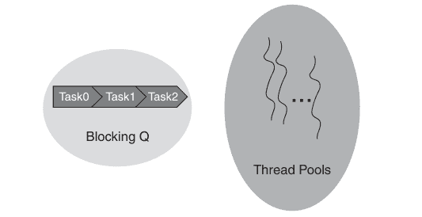

图 7.34 带有简化 Java Executor Service 的阻塞队列

图 7.34 展示了管理线程池的 `Executor Service`。该图描述了一个阻塞队列（Blocking Q），持有任务（Task0, Task1, Task2），这些任务正在等待池中的线程执行。该模型促进了高效的线程管理并有助于防止资源浪费，因为池中的线程在不处理任务时会阻塞在队列上，而不是消耗 CPU 周期。然而，如果管理不当，这可能会导致高开销，特别是当你正在处理阻塞操作和大量线程时。

#### Java ForkJoinPool 框架

虽然 `Executor` 和线程池相比传统的每个任务一个线程模型有了显著改进，但它们仍有局限性。它们在高效处理大量微小任务时可能很吃力，特别是在受益于并行处理的应用中。这正是 `ForkJoinPool` 框架大显身场的地方。

在 Java 7 中，`ForkJoinPool` 框架旨在最大化可以分成更小任务进行并行执行的程序的效率。每个工作线程管理一个双端队列（DQ），允许任务的动态执行。该框架使用了工作窃取（work-stealing）算法，运行完任务的工作线程可以从其他繁忙线程的队列中“窃取”任务。这使得 `ForkJoinPool` 充分利用多个处理器，显著提高某些任务的性能。

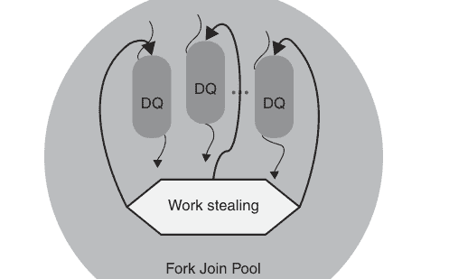

图 7.35 带有工作窃取算法的 ForkJoinPool

图 7.35 运行中的 Java ForkJoinPool。标记为 "DQ" 的椭圆代表工作线程的各个独立队列。队列之间的曲线箭头说明了工作窃取机制，这是一个独特特征，它允许空闲线程从同伴线程的队列中接手任务，从而维持池内负载的平衡。

让我们通过一个简单的示例来增强学习：

```
import java.util.concurrent.ForkJoinPool;
import java.util.concurrent.RecursiveAction;
```

```
class IncrementAction extends RecursiveAction {
    private final ReservationCounter counter;
    private final int incrementCount;

    IncrementAction(ReservationCounter counter, int incrementCount) {
        this.counter = counter;
        this.incrementCount = incrementCount;
    }

    @Override
    protected void compute() {
        // 如果计数较小，则直接增加计数器
        if (incrementCount <= 100) {
            for (int i = 0; i < incrementCount; i++) {
                counter.increment();
            }
        } else {
            // 如果计数较大，则将其拆分为两个任务并并行执行
            int half = incrementCount / 2;
            IncrementAction firstHalf = new IncrementAction(counter, half);
            IncrementAction secondHalf = new IncrementAction(counter, incrementCount - half);
            // ForkJoinPool 将并行执行这些任务
            invokeAll(firstHalf, secondHalf);
        }
    }
}
```

```
class ForkJoinLoop {
    public static void main(String[] args) throws InterruptedException {
        ReservationCounter counter = new ReservationCounter();
        ForkJoinPool pool = new ForkJoinPool();

        // 将 IncrementAction 提交给 ForkJoinPool
        pool.invoke(new IncrementAction(counter, 1000));

        System.out.println("最终计数: " + counter.getCount());
    }
}
```

这段代码演示了如何使用 `ForkJoinPool` 来计数。

#### Java CompletableFuture

在深入研究虚拟线程之前，理解 Java 的另一个强大工具：`CompletableFuture`。与 `Future`（代表可能尚未完成计算的结果）不同，`CompletableFuture` 代表一个可以手动完成的未来。它在 Java 8 中引入，是处理异步任务的强大工具。

`CompletableFuture` 的一个突出特性是能够组合和合并任务，提供更具读性和可维护性的并发代码。它还与流 API 无缝集成，允许进行复杂的转换并提供健壮的错误处理能力。

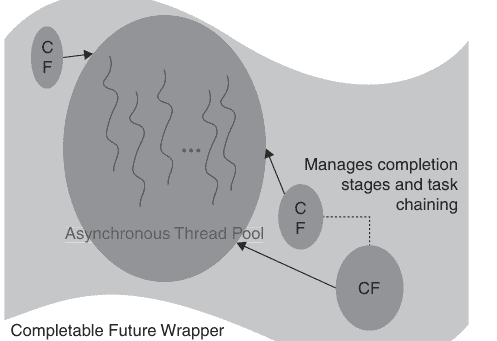

图 7.36 CompletableFuture 任务管理

底层，`CompletableFuture` 在标准线程之上使用了封装器，为管理完成阶段提供了更高层次的抽象。图 7.36 展示了如何管理 `CompletableFuture` 实例。

这是一个在 `ReservationService` 上下文中可能使用 `CompletableFuture` 的简单示例：

```java
class ReservationService {
    private final ReservationCounter hotelCounter = new ReservationCounter();
    private final ReservationCounter flightCounter = new ReservationCounter();
    private final ReservationCounter carCounter = new ReservationCounter();

    void incrementCounters() {
        CompletableFuture<Void> hotelFuture =
            CompletableFuture.runAsync(() -> { /* 执行任务 */ });
        CompletableFuture<Void> flightFuture =
            CompletableFuture.runAsync(() -> { /* 执行任务 */ });
        CompletableFuture<Void> carFuture =
            CompletableFuture.runAsync(() -> { /* 执行任务 */ });

        // 合并这些 future
        CompletableFuture<Void> combinedFuture =
            CompletableFuture.allOf(hotelFuture, flightFuture, carFuture);

        // 阻塞直到所有 future 完成
        combinedFuture.join();
    }
}
```

此示例演示了如何使用 `CompletableFuture` 来管理和协调多个异步任务，并独立于主应用程序流并行执行它们。

## Project Loom 中的虚拟线程

Project Loom 在 JDK 21 中引入，旨在重新思考 Java 的并发性。它引入了虚拟线程（virtual threads），这是一种由 JVM 管理的轻量级、高效线程，允许 Java 在不诉诸异步或响应式方法的情况下实现更好的扩展性。

虚拟线程被称为轻量级线程，是一种新型 Java 线程。与由操作系统管理的传统线程不同，虚拟线程由 JVM 管理。这使得 Java 能够比使用传统线程更高效地创建和在虚拟线程之间切换。虚拟线程的设计具有低内存占用和快速启动的特点，使其成为高并发任务的理想选择。

让我们在之前的图表基础上进一步加深理解并建立一个视觉表示。图 7.37 是 Project Loom 引入的新模型的高级概述。在该模型中，单个 JVM 进程内可以创建大量的 Java 虚拟线程（jvt0, jvt1, jvtn）。这些虚拟线程并不直接映射到操作系统线程。相反，它们由 JVM 管理，JVM 可以根据需要将它们调度到较少的操作系统线程上。


图 3.37 还引入了载体线程（carrier threads）的概念。每个虚拟线程都被调度到一个载体线程上，载体线程是与操作系统线程一一映射的传统 Java 线程。JVM 可以在多个虚拟线程之间切换载体线程，允许其并发管理多个虚拟线程。该模型还强调工作窃取算法（work-stealing algorithm），载体线程可以从繁忙载体线程的队列中提取任务，从而更好地利用系统资源。

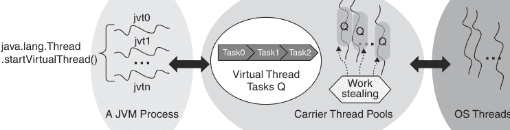

图 3.37 Java 虚拟线程

## 虚拟线程及其载体

虚拟线程的生命周期可能涉及调度到不同的载体线程。尽管如此，虚拟线程对其时刻所在的特定载体线程毫无感知。

> ¹⁷ https://openjdk.org/jeps/444
>
> ¹⁸ www.infoq.com/news/2023/04/virtual-threads-arrives-jdk21/

## 从线程-任务模型向更扩展模型的过渡

一个需要理解的关键方面是载体线程和虚拟线程之间堆栈轨迹的隔离。如果在虚拟线程抛出异常，生成的堆栈跟踪将不包含任何载体线程的帧。这种分离在生成线程储时也显而易见：虚拟线程及其载体的堆栈保持独立，互不混杂。

同样，线程本地变量（`thread-local variables`）也保持了这种分离。虚拟线程无法访问与载体线程相关的线程本地变量，反之亦然。这确保了载体线程和虚拟线程的状态保持独立，进一步强调了虚拟线程的封装性。

> 注意 PEP 444：虚拟线程¹⁹ 明确规定虚拟线程永远不应该池化。JVM 的调度器会为你处理这一点。

## 与虚拟线程及现有 API 的集成

Project Loom 的目标之一是确保虚拟线程可以与现有 API 无缝集成。因此，开发者可以在现有库和框架中使用虚拟线程，而无需进行大量的代码修改。

## 使用虚拟线程的实际示例

为了进一步说明虚拟线程的无缝集成，让我们考虑一个 `ReservationCounter`：

```java
class ReservationService {
    private final ReservationCounter hotelCounter = new ReservationCounter();
    private final ReservationCounter flightCounter = new ReservationCounter();
    private final ReservationCounter rentalCounter = new ReservationCounter();

    void incrementCounters() {
        try (var executor = Executors.newVirtualThreadPerTaskExecutor()) {
            executor.submit(new DoActivity(hotelCounter));
            executor.submit(new DoActivity(flightCounter));
            executor.submit(new DoActivity(carRentalCounter));
        }
    }
}
```

```java
class ReservationCounter {
    private int count = 0;

    synchronized void increment() {
        count++;
    }

    synchronized int getCount() {
        return count;
    }
}

class DoActivity implements Runnable {
    private final ReservationCounter counter;

    DoActivity(ReservationCounter counter) {
        this.counter = counter;
    }

    @Override
    public void run() {
        for (int i = 0; i < 1000; i++) {
            counter.increment();
        }
    }
}

class LoomLoop {
    public static void main(String[] args) throws InterruptedException {
        ReservationService service = new ReservationService();
        service.incrementCounters();

        System.out.println("Final hotel count: " + service.hotelCounter.getCount());
        System.out.println("Final flight count: " + service.flightCounter.getCount());
        System.out.println("Final car rental count: " + service.rentalCounter.getCount());
    }
}
```

> ¹⁹ https://openjdk.org/jeps/444

在此示例中，`DoActivity` 类是一个将 `ReservationCounter` 增加 1000 次的 `Runnable`。我们引入了一个 `ReservationService` 来管理三个不同的计数——分别用于酒店预订、航班和租车。在 `incrementCounters` 方法中，我们使用了虚拟线程。

## 虚拟线程的并行性

为了进一步说明虚拟线程的无缝集成，让我们考虑一个 `ReservationCounter`：

```java
class ReservationService {
    private final ReservationCounter hotelCounter = new ReservationCounter();
    private final ReservationCounter flightCounter = new ReservationCounter();
    private final ReservationCounter rentalCounter = new ReservationCounter();

    void incrementCounters() {
        try (var executor = Executors.newVirtualThreadPerTaskExecutor()) {
            CompletableFuture<Void> hotelFuture = CompletableFuture.runAsync(() -> DoActivity(hotelCounter).run(), executor);
            CompletableFuture<Void> flightFuture = CompletableFuture.runAsync(() -> DoActivity(flightCounter).run(), executor);
            CompletableFuture<Void> carFuture = CompletableFuture.runAsync(() -> DoActivity(rentalCounter).run(), executor);

            CompletableFuture.allOf(hotelFuture, flightFuture, carFuture).join();
        }
    }
}
```

当我们需要处理大量并发任务时，虚拟线程提供了显著优势。与创建和管理开销昂贵的传统线程不同，虚拟线程是轻量级且由 JVM 管理的，允许我们创建数百万个线程而不会耗尽系统资源。

接下来，我们深入了并发领域，讨论了传统的并发模型及其固有的挑战，以及 `Executor Service`（执行器服务）和 `ForkJoinPool` 框架提供的创新解决方案。这些工具为线程管理和并发任务执行提供了全新的视角。此外，`CompletableFuture` 框架成为处理异步计算的灯塔，它拥抱了函数式编程的优雅。最后，我们通过 Project Loom 探索了虚拟线程（virtual threads）和续体（continuations）的概念。这一倡议标志着 Java 并发的一个转折点，有望在 JVM 内部管理轻量级线程方面提供更高的可扩展性和效率。

展望未来，我们可以看到 JVM 性能优化的进一步进展。对于性能工程师而言，紧跟这些发展并理解如何利用它们来构建更好的软件至关重要。

归根结底，性能工程在于做出明智的决策。它关乎理解权衡、掌握可以使用的工具和技术，并谨慎地应用它们以实现你的性能目标。本章旨在让你对这些元素有更深层次的理解，我相信它将成为你作为性能工程师持续职业之旅中的一份宝贵资源。

# 第 8 章：使用 OpenJDK HotSpot VM 加速达到稳定态的时间

## 引言

启动和预热/爬升（warm-up/ramp-up）性能优化是 Java 应用性能的关键因素，特别是对于瞬态应用和微服务而言。其目标是尽可能地减少 JVM 的启动和预热时间，从而加速应用程序主方法的执行。低的启动或预热性能会导致响应时间延长和资源消耗增加，从而对用户与程序的交互产生负面影响。因此，关注 Java 应用性能的这一方面至关重要。

虽然预热（warm-up）和爬升（ramp-up）这两个术语经常互换，但通过理解它们的细微差别，我们可以更好地体会 JVM 启动和预热性能的复杂性。因此，区分以下两者至关重要：

- **预热（Warm-up）**：在 Java 应用和 JVM 的语境中，预热通常指 JVM 系统收集剖析数据以有效优化代码的时间。这对于 JIT 编译尤为关键，因为它依赖运行时行为来做出优化。
- **爬升（Ramp-up）**：爬升通常指应用程序系统达到其完全运行能力或性能所需的时间。这不仅包括代码优化，还包括资源分配、稳定等其他因素。

在本章中，我们首先探索了 JVM 启动和预热性能的复杂细节，从彻底理解这些过程及其各个阶段开始。然后，我们探索了 Java 应用的稳定态（steady-state），关注 JVM 如何管理这种状态。在学习这些主题时，我们将讨论许多帮助我们实现更快启动和预热时间的各种技术和进展。无论你是在开发微服务架构、将应用部署在容器化环境中，还是在传统的基于服务器环境中工作，JVM 启动和预热优化的原理和技术都是一致的。

## JVM 启动和预热优化技术

JIT 编译器一直在不断改进，使 JVM 启动和爬升（包括预热优化）显著获益。字节码解释的增强提升了爬升性能。此外，数据共享（Data Sharing）通过预处理类文件来优化启动，促进了 JVM 进程之间数据的更快速加载和共享。这减少了类加载的时间和内存，从而提升了启动性能。

JDK 8 中从永久代（PermGen）到元空间（Metaspace）的过渡影响了爬升。与具有固定最大尺寸的 PermGen 不同，Metaspace 根据应用程序的运行时需求动态调整其大小。这种灵活性可以带来更有效的内存使用和更快的爬升速度。

同样，JDK 9 中引入的代码缓存分段（code cache segmentation）在增强爬升性能方面发挥了重要作用。它允许 JVM 为方法、剖析代码和非剖析代码维护独立的缓存，确保了编译代码的优化和检索并提升了性能。

展望未来，Project Leyden 减少了 Java 在 HotSpot VM 上的启动时间，专注于通过静态镜像提高效率。将视野扩展到 HotSpot 之外，我们还有 GraalVM 这一主要成员，它强调原生（native）以实现更快的启动和更小的内存占用。

## 解码 Java 应用达到稳定态的时间

## 准备就绪，开始！

在 Java 应用和 JVM 的语境中，预热（warm-up）是指 JVM 系统收集剖析数据以有效优化代码的时间。这对于 JIT 编译尤为关键，因为它依赖运行时行为来做出优化。爬升（ramp-up）通常指应用程序系统达到其完全运行能力或性能所需的时间。这不仅包括代码优化，还包括资源分配、稳定等其他因素。

在本章中，我们首先探索了 JVM 启动和预热性能的复杂细节，从彻底理解这些过程及其各个阶段开始。然后，我们探索了 Java 应用的稳定态，关注 JVM 如何管理这种状态。在学习这些主题时，我们将讨论许多帮助我们实现更快启动和预热时间的各种技术和进展。无论你是在开发微服务架构、将应用部署在容器化环境中，还是在传统的基于服务器环境中工作，JVM 启动和预热优化的原理和技术都是一致的。

## JVM 启动阶段

让我们详细探索 JVM 启动的特定阶段。

### JVM 引导（Bootstrapping）

这一基础阶段专注于启动 JVM 并设置运行时环境。在此阶段执行的任务包括命令行参数、将 JVM 代码加载到内存、初始化 JVM 数据结构、设置内存管理以及建立初始。该阶段对于应用程序的成功执行不可或缺。

例如，命令 `java OnlineLearningPlatform` 启动 JVM 并调用 `OnlineLearningPlatform` 类，标志着 JVM 引导阶段的开始。在此背景下，`OnlineLearningPlatform` 代表提供在线学习资源的 Web 服务。

### 字节码加载

在此阶段，JVM 加载启动应用程序所需的类。这包括包含应用程序主方法的类，以及在主方法执行期间引用的任何其他类，包括标准库中的系统类。类加载器通过从类路径读取 `.class` 文件并将其转换为 JVM 可执行的格式来执行加载。

因此，对于 `OnlineLearningPlatform` 类，我们可能会有一个在此阶段加载的 `Student` 类。

### 字节码验证与准备

加载之后，JVM 验证加载的字节码是否具有正确的格式并符合 Java 的类型系统。它还会为类准备内存，将其初始化为默认值，并执行任何静态初始化块。Java 语言规范（JLS）严格定义了这一过程，以确保不同 JVM 实现之间的一致性。

例如，`OnlineLearningPlatform` 类可能有一个 `Course` 类，该类有一个静态初始化器来初始化 `courseDetails` Map。这种初始化发生在字节码验证和准备阶段。

```java
public class Course {
    private static Map<String, String> courseDetails;

    static {
        // 静态初始化课程详情
        courseDetails = new HashMap<>();
        courseDetails.put("Math01", "Basic Mathematics");
        courseDetails.put("Eng101", "English Literature");
        // Additional courses
    }

    // Additional methods
}
```

启动阶段至关重要，因为它直接影响用户体验和系统资源利用率。启动缓慢会导致用户体验不佳，特别是在用户等待应用程序启动的交互式环境中。此外，由于 JVM 和底层系统在启动期间需要完成大量工作，可能会导致系统资源的使用效率低下。

## 达到应用程序的稳定状态

除了启动阶段，Java 应用程序的生命周期还包括两个重要阶段：预热阶段（ramp-up phase）和稳定阶段（steady-state phase）。一旦应用程序启动其主功能，就会进入预热阶段，该阶段的特点是性能逐渐提升，直到达到峰值。当应用程序以峰性能执行其主工作负载时，即进入稳定阶段。

- **解释器**：最初，JVM 将方法的字节码解释为原生代码。这些方法源自加载和初始化的类。随着 JVM 的持续运行，它会识别频繁执行的代码路径（热路径）。这些路径随后会被 JIT 编译以优化性能。JIT 编译器采用各种优化技术生成高效的原生代码，从而显著提高应用程序的性能。
- **特定任务的类加载**：当应用程序开始执行主任务时，可能需要加载特定这些操作的额外类。
- **缓存预热**：应用程序（如果使用了缓存）和 JVM 都有存储频繁访问数据的缓存。在预热期间，这些缓存会被频繁访问的数据填充或进行“预热”，以确保后续操作中更快的检索。

让我们直观地来看：假设在我们的 `Course` 类中，有一个 `Instructor` 类，它在服务初始化并获取最新的教师列表后被加载。对于 `Instructor` 类，`teach` 方法可能是 JIT 编译器优化的许多方法之一。

现在看图 8.1 中的类图，它展示了带有 `Student`、`Course` 和 `Instructor` 类及其关系的 `OnlinePlatform` Web 服务。`OnlinePlatform` 类是 JVM 引导程序阶段期间调用的主类。`Student` 类必须在字节码加载阶段加载。带有静态初始化块的 `Course` 类展示了字节码验证和准备阶段。

## 解码 Java 达到稳定状态的时间

`Instructor` 类在预热阶段加载，`teachCourseDetails` 方法在预热期间可能达到不同级别的优化。一旦它们达到峰值性能，Web 服务就准备好进入稳定状态性能。


# 第 8 章 使用 OpenJDK HotSpot VM 加速达到稳定状态

## 应用程序的生命周期

对于大多数设计良好的应用程序，我们将看到以下阶段（如图 8.3 所示）：

- **启动（Start-up）**：JVM 被调用并开始初始化、类加载。
- **预热（Ramp-up）**：该阶段的特点是性能逐渐提升，直到达到峰值性能。
- **稳定状态（Steady-state）**：在此处，应用程序以峰值性能执行其主工作负载。
- **收缩（Ramp-down）**：应用程序终止。

图 8.3 中的时间线代表了从启动到稳定状态的进展，显示了启动、预热、稳定和最后的收缩阶段。

## 启动和预热阶段的状态管理

状态管理是应用程序的一个关键方面，特别是在启动和预热阶段。适当管理这些状态可以确保应用程序高效。状态包括：

- **静态变量**：初始化后保留值的变量。
- **堆对象**：在预热期间分配的对象。

### 启动期间的状态

启动状态包含：

- **运行中的线程**：正在执行的线程。
- **资源**：应用程序使用的文件描述符和其他资源。


图 8.4 状态管理流程

### 向预热和稳定状态的过渡

从启动到稳定状态的持续被称为“达到稳定状态的时间”。这一指标对于衡量应用程序的性能至关重要，特别是那些短生命周期或在无服务器环境中运行的应用程序。在这种情况下，快速启动和高效的工作负载预热阶段至关重要。

如图 8.5 所示，应用程序通过启动和预热阶段过渡到稳定状态。


图 8.5 应用程序时间线

## 类数据共享

类数据共享（Class Data Sharing，CDS）是一项强大的 JVM 功能，旨在显著提高 Java 应用程序的启动性能。它通过预处理类文件并将其转换为可在多个 JVM 实例之间共享的内部格式来实现这一目标。此功能对于使用大量类的大型应用程序特别有益，因为它减少了加载这些类所花费的时间，从而缩短了启动时间。

### 共享归档文件的结构

由 CDS 创建的共享归档文件是一个高效且有序的数据结构，包含多个共享空间。这些每个空间都用于存储不同类型的数据。例如：

- **元数据空间（Metadata space）**：此空间保留给元数据类型。
- **读写（ReadWrite）和只读（ReadOnly）空间**：这些空间分配给实际的类数据。

这种结构化的方法优化了数据检索并简化了加载过程，有助于缩短启动时间。

### 内存映射与直接使用

在 JVM 启动时，共享归档文件会被内存映射到其进程空间中。由于共享归档文件中的类数据已经是 JVM 的内部格式，因此可以直接使用，消除了对任何转换的需要。这种直接访问进一步缩短了启动时间。

### 多实例优势

CDS 的优势不仅限于单个 JVM 实例。共享归档文件可以映射到运行在同一台机器上的多个 JVM 进程中。这种内存映射和共享机制在云环境中特别有利，因为资源限制和成本效益是关注重点。允许多个 JVM 实例共享相同的物理内存可以减少整体内存占用，从而提高资源利用率并节省成本。此外，由于这种共享机制改进了后续 JVM 实例的启动时间，因为共享归档文件已经被第一个 JVM 实例加载到内存中。这对于需要响应事件并快速启动函数的无服务器环境被证明是无价之宝。

### 使用 `-XX:ArchiveClassesAtExit` 进行动态转储

`-XX:ArchiveClassesAtExit` 选项允许 JVM 将应用程序加载的类转储到共享归档文件中。通过在下次 JVM 启动期间预加载应用程序实际使用的类，此功能精细调整了启动性能。

### 使用 CDS 涉及一个包含预处理类数据的共享归档文件。

1. 生成：使用 `-Xshare:dump` JVM 选项。
2. 一旦生成了归档文件，JVM 实例就可以使用 `-Xshare:on -XX:SharedArchiveFile` 选项来使用。

例如：

```
java -Xshare:dump -XX:SharedArchiveFile=my_app.cds.jar -cp my_app.jar
java -Xshare:on -XX:SharedArchiveFile=my_app.cds.jar -cp my_app.jar MyMainClass
```

在示例中，第一个命令为 `my_app.jar` 使用的类生成一个共享归档文件，第二个命令使用该共享归档文件运行应用程序。

## 提前编译

提前编译（AOT）编译是一种在管理状态和提高托管运行时性能方面起着重要作用的技术。AOT 引入于 JDK 9，旨在通过在调用 JVM 之前将方法编译为原生代码提高启动性能。这种预触发意味着原生代码在执行之前已经就绪，并消除了解释字节码的需要。这种方法对于短生命周期应用程序特别有益，因为 JIT 编译器可能没有足够的时间来有效地优化代码。

> **注意**：在深入研究 AOT 的复杂性之前，理解其对 JIT 编译的影响至关重要。在 HotSpot VM 中，解释器首先执行，但它不优化代码。JIT 过程从优化开始，但它需要时间为频繁执行的方法和循环收集分析数据。因此，对于需要优化状态以实现高效执行的代码来说存在延迟。有多个组件有助于将代码转换到其优化状态。例如，分段代码（segmented code）维护了处于各种状态的 JIT 代码（例如，已分析的和未分析的）。此外，编译线程通过自适应优化和推测性优化进行管理。值得注意的是，HotSpot VM 会推测地优化动态状态，有效地将它们转换为静态状态¹。代码从初始解释状态到优化形式的转换可以看作是 JIT 编译的开销。
>
> ¹John Rose 在他在 JMVLS 2023 的演讲中指出了这种行为：https://cr.openjdk.org/~jrose/pres/202308-Leyden-JVMLS.pdf。

AOT 为动态语言引入了静态编译。在 HotSpot VM 之前，像 IBM 的 J9 和 Excelsior JET 等平台已成功采用了 AOT。依赖于分析引导技术来提供自适应优化的执行引擎可能会在预热阶段之前面临启动速度缓慢的问题。在 HotSpot VM 的情况下，编译始终从解释模式开始。AOT 编译凭借其预编译的方法和共享库，是解决预热挑战的绝佳解决方案。在 AOT 处于前端、自适应优化器处于后台的情况下，应用程序可以以快捷的方式实现其性能。

在 JDK 9 中，AOT 功能具有卓越的地位，并构建在 Graal 编译器之上。Graal 是一个用 Java 编写的动态编译器；而 HotSpot VM 是用 C++ 编写的。为了支持 Graal，HotSpot VM 需要支持一种新的编译器接口 `JVMCI`¹。已对 `java.base`、`jdk`、`jdk.compiler` 等少数库完成了此工作的初步尝试。

添加到 JDK 9 的 AOT 代码在两个级别上运行——分层（tiered）和非分层（non-tiered），其中非分层是默认模式，旨在提高响应能力。分层模式类似于 HotSpot VM 分层编译中的 T2 级，即带有分析信息的客户端编译器。之后，符合 AOT 阈值的方法将由客户端编译器在 T3 级编译，并由服务器编译器在 T4 级执行完全编译。

AOT 编译可以与 CDS 结合使用以提高启动性能。CDS 功能允许 JVM 在不同进程之间共享类元数据，而 AOT 编译允许 JVM 使用预编译代码而不是解释字节码。当使用时，这些功能可以显著缩短启动时间并减少内存占用。

然而，AOT 编译（在 OpenJDK HotSpot VM 的背景内）面临着某些局限性。例如，AOT 编译的代码必须存储在共享库中，这需要使用位置无关代码（PIC）。这一要求是因为代码加载到内存中的位置无法预先确定，导致 AOT 编译器无法进行基于位置的优化。相比之下，JIT 编译器允许对执行环境做出更多假设并据此优化代码。

JIT 编译器可以直接引用符号，消除了间接引用的需要，并产生更高效的代码。然而，JIT 编译的这些优化会增加启动时间，因为编译过程是在应用程序执行期间发生的。相比之下，直接执行字节码的解释器不需要花时间编译代码，但解释代码的执行速度通常比编译后的代码慢。

> https://openjdk.org/jeps/243
> https://openjdk.org/jeps/295
> https://docs.oracle.com/cd/E26505_01/html/E26506/glmap.html

> **注意**：需要注意的是，不同的虚拟机（例如 GraalVM）实现 AOT 编译的方式可以克服其中一些局限性。特别是，通过分层引导优化（PGO）增强的 GraalVM AOT 编译可以达到与 JIT 相当的峰值性能，甚至允许利用闭环假设（closed-world assumption）进行某些优化，而这些优化在 JIT 环境中是不可能的。此外，GraalVM 的 AOT 编译器可以编译 100% 的代码——这可能是 JIT 的一个优势，因为在 JIT 中某些“冷”代码可能仍以解释模式运行。

## Project Leyden：Java 性能的新曙光

虽然 AOT 促进了性能提升，但它为 HotSpot VM 增加的复杂性盖过了其收益。维护独立的 AOT 编译器的挑战、由于依赖 Graal 编译器而带来的额外维护负担，以及生成 PIC（多态调用点）的效率低下，都清楚地表明我们需要不同的方法。这导致了 Project Leyden 的诞生。

Java 应用性能的本质在于通过捕获变量、对象和资源的快照来理解并管理各种细节，并确保它们被高效利用。这正是 Project Leyden 的用武之地。在 JDK 17 中，Leyden 旨在解决 Java 启动速度慢、达到峰值性能慢以及内存占用大的挑战。这不仅仅是为了更快的启动，更是为了确保 Java 应用从启动到稳定状态的整个生命周期都得到优化。

### 训练运行：捕捉应用行为以实现最优

Project Leyden 引入了“训练运行”（training run）的概念，这类似于我们为 CDS 生成预处理类归档的步骤。在训练运行中，我们的目标是捕捉应用程序的所有行为，特别是在启动和预热阶段。这些记录的行为涵盖了方法调用、资源分配和其他运行时细微之处，随后被用于生成自定义运行时。通过针对应用程序的特定需求进行定制，这确保了更快的启动和更快地达到峰值性能。这是 Leyden 确保 Java 应用不仅运行得当，而且运行得优的方式。

Leyden 的预编译运行时镜像标志着向性能可预测性增强的转变，这对于由于运行时间短而传统 JIT 编译无法完全优化代码的应用来说特别有益。这一进展代表了 Java 演进的飞跃，简化了启动过程并实现了持续的性能。

> 5 Alina Yurenko, GraalVM for JDK 21 Is Here! https://medium.com/graalvm/graalvm-for-jdk-21-is-here-ee01177dd1d2#0df7.
> 6 https://devblogs.microsoft.com/java/aot-compilation-in-hotspot/

### 压缩器（Condensers）：桥接代码与性能之间的差距

当 CDS 在管理状态时作为底层骨干时，Leyden 引入了“压缩器”——类似于状态管理守护者的工具。压缩器确保计算（无论是程序直接表达的还是代表程序的计算）被转移到最优化的时间点。通过这种方式，它们在保留程序本质的同时，提供了在某些功能上选择性能的灵活性。

### 使用 Project Leyden 迁移计算：状态的交响乐

Java 性能优化依赖于对状态的管理以及从一个阶段到另一个阶段的无缝转换。Leyden 迁移计算的方法是对这一哲学的证明；它不仅仅是为了规避问题，而是为了确保每一部分计算、每一个变量和每一个资源都得到了最优的放置和利用。这是将启动和预热时间推向背景的艺术，使其几乎忽略不计。

考虑我们的在线学习平台（OnlineLearningPlatform）Web 服务。在 Leyden 优化之前，我们可能有类似这样的代码片段：

```java
public class OnlineLearningPlatform {
    public static void main(String[] args) {
        // 初始化
        System.out.println("Initializing OnlineLearningPlatform...");

        // Student 类

        // 预热阶段：加载 Instructor 之后的 VM
        Instructor.loadAllInstructors();
        // 该方法是 JIT 优化的候选
        Instructor.teach(new Course()); 
    }
}

public class Student {
    private String name;
    private int id;

    public static void loadAllStudents() {
        // 加载所有学生
    }
}

public class Course {
    private static Map<String, String> courseDetails;

    static {
        courseDetails = new HashMap<>();
        courseDetails.put("Math11", "Basic Mathematics");
        courseDetails.put("Eng101", "English Literature");
        // 其他课程
    }

    public static void initializeCourses() {
        // 初始化课程
    }

    public Map<String, String> getCourseDetails() {
        return courseDetails;
    }
}

public class Instructor {
    private String name;
    private int id;

    public static void loadAllInstructors() {
        // 加载所有讲师
    }

    public void teach(Course course) {
        // 教授课程
    }
}
```

在这种设置下，`OnlineLearningPlatform` 的初始化以及 `Instructor` 的预热阶段都是顺序进行的，可能导致更长的启动时间。然而，通过 Leyden，我们可以拥有如下内容：

```java
public class OnlineLearningPlatform {
    public static void main(String[] args) {
        // 迁移计算的初始化
        System.out.println("Initializing OnlineLearningPlatform...");

        // 从预处理镜像加载 Student 和 Course 类
        Student.loadAllStudents();
        Course.initializeCourses();

        // 预热阶段：从预处理镜像加载 Instructor 并进行 JIT 优化
        Instructor.loadAllInstructors();
        Instructor.teach(new Course());
    }
}
```

展望未来，Leyden 承诺将实现性能与适应性的和谐融合。它赋予了开发者自由，让他们能够选择如何管理状态、如何优化性能，以及应用程序希望如何与底层 JVM 交互。从引入竞争者机制（contenders）到提出训练运行（training run）的概念，Leyden 正为未来铺平道路——在未来，Java 性能优化将不仅是一项技术尝试，而是一门艺术。

## GraalVM：变革 Java 达到稳定状态的时间

随着 Java 生态系统的不断演进，GraalVM 成为一项关键的创新，补充了 Java 传统边界之外的性能优化。

GraalVM 站在动态执行的前沿，通过利用其强大的能力和在动态编译方面的专长，专注于优化启动和预热性能。它利用静态镜像的力量，来增强广泛应用程序的性能。

GraalVM 是一个多语言虚拟机，无缝地支持 Java、Scala 和 Kotlin 等 JVM 语言，以及 Ruby、Python 和 WebAssembly 等非 JVM 语言。它的真正威力在于能够大幅缩短启动和预热时间，确保应用程序不仅能够快速启动，还能在更短的时间内达到最佳性能。


GraalVM 的核心是 Graal 编译器（8.7）。这种动态编译器专为动态或“开放世界”执行而定制（与 OpenJDK HotSpot VM 类似），擅长为各种处理器生成 C2 级机器码。它采用了“自优化”技术，利用动态和推测性优化对行为做出明智预测。如果推测失败，编译器可以进行去优化并重新编译，确保应用程序快速预热并更早地达到峰值性能。

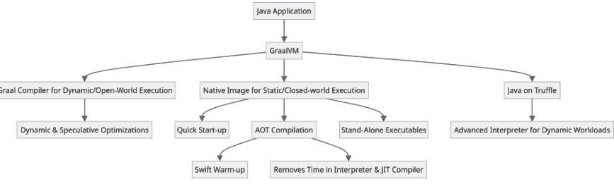

| GraalVM 优化策略 | | | | | | |
| :--- | :--- | :--- | :--- | :--- | :--- | :--- |
| Java 应用程序 | | | | | | |
| 针对动态/开放世界执行的 Graal 编译器 | 针对静态/封闭世界执行的 Native Image | Truffle 上的 Java | | | | |
| 动态与推测性优化 | 快速启动 | AOT 编译 | 独立执行文件 | 针对动态工作负载的高级解释器 | | |
| | 快速预热 | 消除解释器与 JIT 编译器的时间 | | | | |

图 8.7 GraalVM 优化策略

除了动态执行外，GraalVM 还提供了用于“封闭世界”优化的原生镜像生成能力。在这种场景下，整个应用程序布局在编译时是已知的。因此，GraalVM 可以产生独立的执行文件，这些文件封装了应用程序、必要的库和最小的运行时。这种方法实际上消除了 JVM 的解释器和 JIT 编译器，开启了瞬时启动和快速预热——这对于短生命周期应用程序和微服务来说是一个范式转变。

# 简化原生镜像生成

GraalVM 的 AOT 编译限制了其性能优势。通过将字节码预编译为代码，它最小化了启动期间 JVM 解释器的开销。此外，通过跳过传统的 JIT 编译阶段，应用程序能够更快地预热，在更短的时间范围内达到峰值性能。这对于微服务和无服务器环境等架构非常有价值，因为快速启动和快速预热至关重要。

在 GraalVM 的最新版本中，创建原生镜像的过程被简化了——原生镜像功能现在包含在 GraalVM 分发版本身中。这改进了开发者的流程：

```
# 安装 GraalVM (将 VERSION 和 OS 替换为你的 GraalVM 版本和操作系统)
$ curl -L https://github.com/graalvm/graalvm-ce-builds/releases/download/vm-VERSION/graalvm-java11-VERSION-OS.tar.gz -o graalvm.tar.gz
$ tar -xzf graalvm.tar.gz
```

```
# 设置 PATH 以包含 GraalVM 的 bin 目录
$ export PATH=$PWD/graalvm-ce-java11-VERSION-OS/bin:$PATH
```

```
# 将 Java 应用程序编译为原生镜像
$ native-image -jar your-app.jar
```

执行此命令会创建一个 Java 应用程序的预编译、独立执行文件，其中包含最小的 JVM 和所有必要的依赖项。应用程序可以立即开始执行，无需等待 JVM 启动或类的加载和初始化。

# 使用 OpenJDK 增强 Java 性能

OpenJDK 社区一直致力于改进对原生镜像构建的支持，让开发者更容易创建 Java 应用程序的原生镜像。这包括在类初始化、堆序列化和服务绑定等领域的改进，这些改进有助于更快的启动速度和更小的内存占用。通过提供将 Java 应用程序编译为原生执行文件的能力，GraalVM 使 Java 成为高需求计算环境中更有吸引力的选择。

> ⁷ https://github.com/oracle/graal/pull/5995

# 引入 Truffle Java

为了提供 GraalVM 支持的所有执行模式的全视图，提到 Truffle Java 是重要的。这是一种运行在 Truffle 框架之上的高级 Java 解释器，在执行 Java 程序时可以使用 `-truffle` 标志启用：

```
# 使用 Truffle 解释器执行 Java
$ java -truffle [options] class
```

这一特性补充了现有的 JIT 和 AOT 编译模式，为动态工作负载提供了额外的方法。

# 新兴技术：用于检查点/恢复功能的 CRIU 和 Project CRaC

基于 CRIU 的能力，Project CRaC（检查点恢复）——Java 生态系统中的新项目——旨在将 CRIU 的检查点/恢复功能集成到 JVM 中。这可能允许 Java 应用程序进行检查点记录和恢复，为改进达到稳态的时间提供了另一种途径。CRaC 目前处于早期阶段，但代表了 Java 启动性能未来一个很有前景的方向。

CRIU（用户空间检查点/恢复）最初由 Red Hat 开发的创新工具。它的卓越之处在于能够冻结活动应用程序、存储其状态，然后在另一个系统上恢复它们。这种能力可以在系统之间迁移运行的应用程序，为调试和分析创建快照。

让我们模拟 `OnlineLearningPlatform` 状态检查点和恢复的过程：

# 第 8 章 使用 OpenJDK HotSpot VM 加速达到稳态的时间

将 CRIU 集成到 JVM 中是一项复杂的任务，因为它需要修改 JVM 的内部结构和算法，以支持应用程序状态的冻结和恢复。它还需要与操作系统进行协调，以确保 JVM 及其运行应用程序的状态被正确捕获和恢复。尽管面临这些挑战，将 CRIU 集成到 JVM 具有巨大的潜在收益。

图 8.8 显示了 Java 应用程序、Project CRaC 和 CRIU 之间关系的高级表示。图中包含以下元素：

- 1. Java 应用程序：这是起点，应用程序在此运行并正常操作。
- 2. Project CRaC：
  - 它为 Java 应用程序提供了启动检查点（checkpoint）和恢复的 API。
  - 当请求检查点时，Project CRaC 与 CRIU 通信以执行检查点过程。
  - 同样，当请求恢复时，Project CRaC 与 CRIU 通信以从之前保存的状态恢复应用程序。
- 3. CRIU：
  - 接收到检查点请求后，CRIU 冻结 Java 进程并将其状态保存为硬盘上的镜像文件。
  - 当进行恢复时，CRIU 使用保存的镜像文件将 Java 进程恢复到其检查点状态。
- 4. 检查点状态和恢复状态：
  - “检查点状态”代表 Java 应用程序在检查点时的状态。
  - “恢复状态”代表 Java 恢复后的状态。它应该与检查点状态相同。
- 5. 镜像文件：这些是 CRIU 在检查点过程中创建的文件，包含了 Java 应用程序保存的状态。
- 6. 恢复进程：这代表被 CRIU 恢复后的 Java 应用程序进程。

尽管这些项目仍处于开发的早期，但它们为 Java 启动性能优化的未来提供了广阔的方向。将 CRIU 集成到 JVM 可能对 Java 应用程序的性能产生重大影响。通过允许应用程序进行检查点和恢复，它可以缩短启动时间，提高性能，并为 Java 应用程序开启新的用例。

# Serverless 及其他环境中的启动与预热优化 295

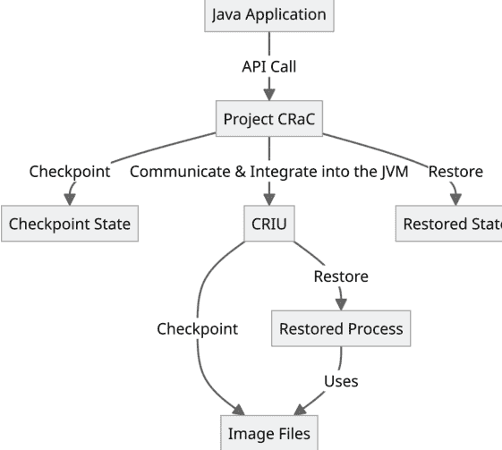

图 8.8 将 Project CRaC 和 CRIU 策略应用于 Java 应用程序

# Serverless 及其他环境中的启动与预热优化

随着技术的演进，Serverless 和容器化环境成为应用部署变得至关重要。Java 凭借不断进步，非常适合应对这些现代计算范式的独特挑战，如图 8.9 所示。

- **Serverless 启动**：GraalVM 通过预编译应用程序解决了 JVM 的冷启动延迟，提供了快速的函数调用响应，而 CDS 通过重用类元数据来加速启动时间。
- **CDS 增强**：这些技术在 Serverless 和容器化设置中都至关重要，通过重用类元数据实现更快的启动和更低的内存占用。
- **预期优化**：如 Leyden 和 CRaC 等预期项目旨在完善启动效率和应用程序检查点，创造一个 Java “冷启动”问题成为过去式的未来。
- **容器化动态**：快速扩展和高效的资源利用是核心，Java 准备好利用容器特定的优化来获得敏捷的性能。

图 8.9 概述了 Java 向无缝云原生体验迈进的持续历程，并以强大的启动和预热策略为支撑。

# 第 8 章 使用 OpenJDK HotSpot VM 加速达到稳态的时间

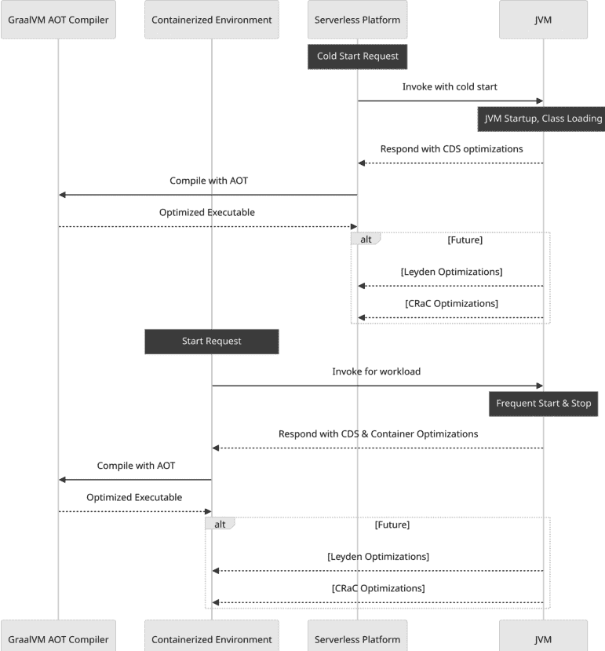

图 8.9 容器化与 Serverless 环境下的 JVM Landscape

# Serverless 计算与 JVM 优化

Serverless 计算按需执行应用程序函数，为部署和扩展带来了范式转变。这种方法将开发者从管理服务器中解放出来，提高了运营效率，并允许自动扩展以匹配工作负载。然而，Serverless 环境引入了“冷启动”问题，这在调用活动函数时尤为明显。这需要资源分配、运行时初始化和应用程序启动，对于 Java 应用程序，由于 JVM 启动、类加载和 JIT 编译过程，这些可能是非常耗时的。

# Serverless 及其他环境中的启动与预热优化

“冷启动”问题发生在 Java 应用程序在空闲后在 Serverless 环境中突然涌入请求的情况下。这需要多个应用程序实例快速启动，延迟会影响用户体验。

为了解决这个问题，像 CDS 和 JIT 编译器这样的 JVM 优化可以显著减轻冷启动延迟，使 Java 更适用于 Serverless 计算。如 AWS Lambda 和 Azure Functions 等平台支持 Java 并提供了微调 JVM 配置的灵活性。通过利用 CDS 并校准其他 JVM 参数，开发者可以优化 Serverless Java 函数，确保这些函数具有更快的启动和预热性能。

# 新兴技术的预期收益

Project Leyden 等新兴技术正在塑造 Java 的未来性能，特别是对于 Serverless 计算。Leyden 承诺通过“训练运行（training runs）”和“压缩器（condensers）”等创新来增强 Java 的启动和阶段效率。这些进展可以大幅缩短冷启动时间。尽管如此，必须记住 Leyden 在 JDK 21 中的功能仍在演变中，尚未准备就绪。当 Leyden 成熟后，它将转换 Serverless Java 应用程序，得益于“训练运行”，使其能够快速响应流量高峰而没有通常的启动延迟。

在 Leyden 之外，Project CRaC 提供了一种强大的方法。开发者可以确定并准备应用程序状态进行检查点，从而产生可以快速激活的存储状态。这种方法在 Serverless 场景下特别有价值，因为减少冷启动至关重要。

这些倡议——Leyden 和 CRaC——代表了 Java 在 Serverless 环境中的一次飞跃，驱动其迈向一个可以即时扩展、不受冷启动限制的未来。

# 第 8 章 使用 OpenJDK HotSpot VM 加速达到稳定状态的时间

- 策略性地分层 Docker 镜像以利用 Docker 的缓存机制并加速构建过程。
- 实现健康检查（health checks），确保应用程序在容器内正确运行。

通过利用这些技术，你可以确保容器化环境中的 Java 应用程序能够尽可能地启动并提升性能，从而提供更好的用户体验并更高效地利用系统资源。

图 8.10 展示了当前的策略以及 Leyden（以及 CRaC）方法论的未来整合。这是一份开发者现在就可以遵循的路线图，同时也展望了项目承诺交付的收益。

# GraalVM 的当前贡献

GraalVM 目前正在解决 Java 在现代计算环境中面临的挑战。其显著特性——原生镜像（native image）能力提供了 AOT 编译，显著缩短了启动时间，这对于无服务器计算和微服务架构来说是一个至关重要的优势。GraalVM 的 AOT 编译器通过针对性能挑战来编译传统的 HotSpot VM，这对于对低延迟和高效资源利用至关重要的场景是有益的。

尽管 GraalVM 的 AOT 编译器并非一成不变的解决方案，但它为 Java 应用程序性能提供了一种专门的方法，满足了云原生格局下特定用例的需求。这种多功能性使 Java 成为各种环境中的有力竞争者，确保应用程序保持敏捷性和高效。

## 核心要点

Java 的演进持续符合云原生需求。Leyden 和 CRaC 等项目，结合 GraalVM 的功能，展示了 GraalVM 的适应性以及对性能增强和可扩展性的承诺：

- 可适应的 Java 演进：通过 Project Leyden 等计划和 GraalVM 的现有优势，Java 证明了其对现代部署范式的适应性。
- 优化技术：理解并应用 Java 优化技术至关重要。这涉及利用 CDS 和 JIT 编译器增强器来获得更好的性能。
- 特定场景下的 GraalVM AOT 编译：对于快速启动和较小内存占用至关重要的情况（例如无服务器环境或微服务中），GraalVM 的 AOT 编译器提供了一个有效的解决方案。它通过解决这些环境的性能挑战，补充了传统的 HotSpot VM。
- 预见未来项目的影响：Leyden 项目和 CRaC 项目标志着 Java 在无服务器环境中的飞跃，承诺了瞬时可扩展性并减少了冷启动限制。

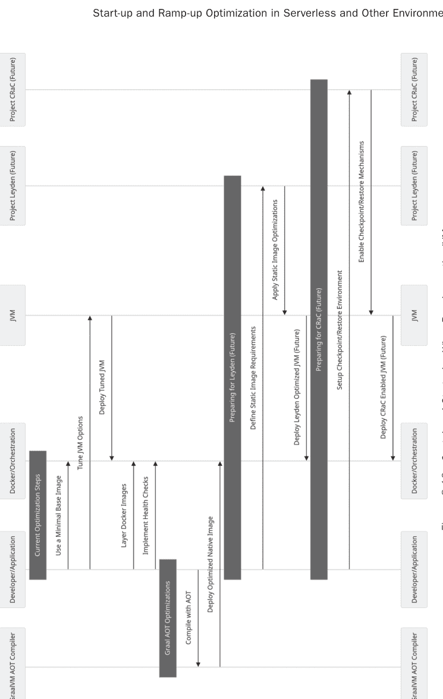

# 第 8 章 使用 OpenJDK HotSpot VM 加速达到稳定状态的时间

- 无服务器和容器化性能：对于无服务器和容器化部署，Java 正在演进以确保快速启动和高效扩展，以符合现代云应用的需求。
- 平衡的方法：随着 Java 生态系统的演进，在技术采用上采取平衡的方法是关键。开发者应该权衡其应用程序需求以及每种技术提供的特定收益，无论是当前的 JVM 优化、GraalVM 的功能，还是像 Leyden 和 CRaC 这样即将推出的创新。

# 使用 OpenJDK HotSpot VM 提升预热性能

OpenJDK HotSpot VM 是一项复杂的软件，它采用了多种技术来优化 Java 应用程序的性能。这些技术旨在协同工作，处理应用程序生命周期的不同方面，从启动到稳定状态。本节将深入探讨 HotSpot VM 的复杂之处，阐明其用于提升性能的机制以及这些机制在应用程序性能更广泛背景下扮演的角色。

在可扩展架构的动态世界中（包括微服务和无服务器模型），Java 应用程序经常面临频繁重启和瞬态寿命的严苛考验。这些环境放大了应用程序初始化阶段、预热以及通往稳定状态过程的重要性。应用程序导航这些阶段的效率可以决定其响应能力，特别是在面对波动的流量需求或需要快速扩展时。这正是 HotSpot VM 采用的优化发挥作用的地方——包括 JIT 编译、自适应优化和分层编译，以及在客户端和服务器端编译之间的策略性选择。

# 编译器增强

在第 1 章“Java 的性能演进：语言与虚拟机”中，我们研究了 HotSpot VM 的 JIT 编译器的复杂性及其系列编译技术（图 8.11）。当我们回到这个话题时，让我们总结这一过程，同时强调在 OpenJDK HotSpot VM 中针对启动、预热和稳定状态阶段定制的优化。

# 启动优化

JVM 中的启动主要由低层级处理。JVM 还负责 `invokedynamic` 引导方法（BSM），该方法在第 7 章“运行时性能优化：聚焦字符串、锁及其他”中进行了详细讨论。

- 字节码生成：Java 程序首先被转换为字节码。这是 Java 编译过程的初始阶段，在该平台中，开发者编写的高级代码被转换为与平台无关的格式，可以由 JVM 执行（无论底层硬件如何）。

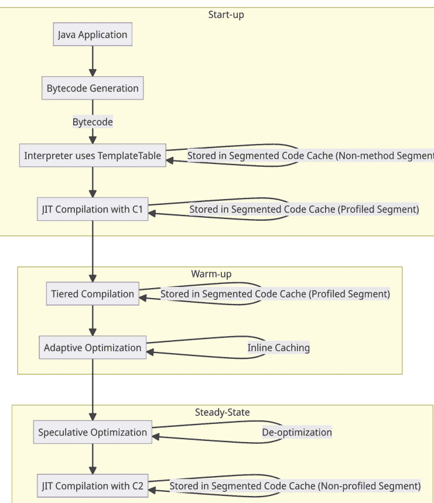

图 8.11 OpenJDK 编译策略

- 解释：字节码随后根据解释表 `TemplateTable` 进行解释。该表提供了字节码指令与原生代码之间的映射。
- 使用客户端编译器的 JIT 编译：JVM 使用 C1 编译器将字节码编译为原生代码，以平衡编译速度和执行速度。这在启动和预热阶段至关重要。
- 分段缓存：JVM 使用分段缓存来管理不同级别的编译代码。热点段包含高度优化的代码，而非热点段包含较少使用的代码。

# 第 8 章 使用 OpenJDK HotSpot VM 加速达到稳定状态的时间

JVM 使用分段缓存来管理不同级别的编译代码。热点段包含高度优化的代码，而非热点段包含较少使用的代码。

# 使用 OpenJDK HotSpot VM 提升预热性能

当应用程序进入启动阶段时，预热阶段变得至关重要。JIT 编译配合客户端编译器在这一过渡期间起着关键作用。

- 分层编译：JVM 性能策略的核心是分层编译，其中代码从 T0（解释代码）过渡到 T4（最高优化级别）。分层编译允许 JVM 在快速启动和峰值性能之间取得平衡。
- 自适应优化：JIT 编译后的代码经过自适应优化，这可能会产生更优化的代码或栈替换（OSR）。自适应优化涉及对运行中的应用程序进行分析并对其进行优化。
- 内联缓存：预热期间的一种微妙技术是内联缓存。通过这种方法，小型但频繁调用的方法被内联到调用方法中。这种策略减少了方法调用的开销，并根据预热期间积累的分析数据提供支持。

# 稳定状态优化

当 Java 应用程序在其生命周期内运行从预热过渡到稳定运行状态时，JVM 采用了一系列高级优化技术。这些技术旨在最大化长时间运行应用程序的性能，确保其以最高效率运行。

- 推测性优化：一种突出技术是推测性优化。利用预热阶段积累的丰富分析数据，JVM 对可能的执行路径做出明智预测。它根据这些预测进行代码优化。如果这些有根据的推测

# 使用 OpenJDK HotSpot VM 提升预热性能

当推测不准确时，JVM 能够优雅地回退到之前的、低优化的代码版本，从而保护应用程序的完整性。这种策略在长时间运行的应用程序中表现出色，因为偶尔优化回滚带来的微小开销被准确推测带来的性能飞跃所掩盖。

- **去优化（De-optimization）**：与推测性优化相对应的是去优化的概念。这种机制允许 JVM 在基础假设失效时回退 JIT 编译器的优化。一个经典场景是当新加载的类覆盖了之前经过优化的方法。回退的能力确保了应用程序能够保持准确性，并对动态变化做出响应。


- **使用服务器编译器（C2）进行 JIT 编译：** 对于长时间运行的应用程序，在分层信息的支持下，严谨的服务器编译器（C2）会对性能关键型方法应用激进的推测性优化。这一过程显著提升了 Java 程序的性能，特别是对于那些同一方法被多次调用的长时间应用。

# 分段缓存与 Project Leyden 增强

在基于第 1 章《Java 的性能演进：语言与虚拟机》对分段缓存（Segmented Cache）的详细讨论的基础上，我们现在考虑减少 Java 应用程序达到稳定状态的时间。

分段*缓存*（Cache）的设计目标是优先考虑频繁执行的代码策略，确保其能够随时被执行。深入研究*代码缓存*（CodeCache）的机制，理解**代码字节缓冲区**（Code ByteBuffer）的作用至关重要。该缓冲区充当中间存储，在编译后的代码移动到分段*代码缓存*之前对其进行持有。这一双步过程确保了高效的内存管理和优化的代码检索。此外，缓存还允许更高效的内存管理。在启动和预热性能的背景下，分段*代码缓存*通过确保应用程序代码最关键的部分尽可能地编译并准备好执行，做出了巨大贡献，从而增强了 Java 应用程序的整体性能。

随着 Project Leyden 的到来，我们将看到进一步的增强。Project Leyden 的特色功能之一是能够直接从归档（archive）加载分段代码缓存。这将跳过启动和预热期间传统的分层编译过程，大幅缩短启动时间。Project Leyden 不会在每次应用程序启动时都编译代码，而是允许将预编译的代码归档，并在后续启动时加载到分段代码缓存中。

这种方法不仅会加速启动过程，还能确保应用程序从一开始就受益于优化的代码。通过利用这一特性，开发者将实现更快的应用程序响应，特别是在对加速达到稳定状态的时间至关重要的环境中。

# 从 PermGen 到 Metaspace 的演进：迈向巅峰性能的飞跃

在 Java 的历史中，Java 8 出现之前，JVM 包含一个被称为永久代（PermGen）的空间。这部分内存被指定用于存储类元数据和统计信息。然而，PermGen 模型并非没有缺点的。它具有固定的大小，如果分配的内存空间不足以满足应用程序的需求，就会导致 `java.OutOfMemoryError: PermGen space` 错误。

## 对启动的影响

PermGen 的固定性质意味着 JVM 必须在启动期间分配和释放内存，以缩短启动时间。为了纠正这些缺点，Java 8 引入了一项重大变化：用 Metaspace 代替 PermGen.¹¹¹ Metaspace 与其前身不同，它不是连续的堆空间，而是位于用于存储类元数据的本地内存中。它默认会自动增长，其最大限制是可用本地内存的量，这远大于典型的 PermGen 大小。这一关键修改有助于启动期间更高效的内存管理，可能加速了启动时间。

## 对预热的影响

Metaspace 的动态特性允许其根据需要增长，确保 JVM 能够在预热阶段快速适应应用程序的需求。这种灵活性降低了出错的概率。在预热阶段，Metaspace 的动态特性允许其根据需要增长。

当 Metaspace 填满时，会触发全量垃圾回收（GC）以清理类加载器。如果 GC 无法释放足够的空间，则会尝试扩展 Metaspace。

## 稳定状态的影响

从 PermGen 迁移到 Metaspace 确保了 JVM 能够更高效地达到稳定状态。通过消除固定空间的限制，Metaspace 在管理类元数据和统计信息方面更加稳健。

然而，尽管 Metaspace 可以根据需要增长，但它无法免疫内存泄漏。如果类加载器仍然活跃，Metaspace 就会填满。在这种情况下，类加载器不会被垃圾回收。

- 内存泄漏可以通过多种方式发生。例如，假设一个类加载器加载了一个类并启动了线程，当线程结束时，它不会被注销。

- 在垃圾回收的范围内，类加载器是一个 GC 根。任何从 GC 根可及的对象都被认为是活跃的，不符合垃圾回收条件。因此，只要类加载器活跃，它加载的类（以及这些类引用的对象）也是活跃的，不符合垃圾回收条件。

**OutOfMemoryError: Metaspace：** 如果内存泄漏累积，Metaspace 可能会溢出。此时，JVM 将触发全 GC 以清理类和加载器。如果这无法释放足够的空间，JVM 将尝试扩展 Metaspace。如果由于可用本地内存无法扩展 Metaspace，将抛出错误。

监控 Metaspace 的使用并根据需要调整大小至关重要。可以使用多个 JVM 参数控制 Metaspace 的大小：

- `XX:MetaspaceSize=[size]` 设置 Metaspace 的初始大小。如果没有指定，Metaspace 可以根据应用程序的需求动态调整。

- `XX:MaxMetaspaceSize=[size]` 设置 Metaspace 的最大大小。如果没有指定，它可以无限制地增长，使用所有可用本地内存。

- `XX:MinMetaspaceFreeRatio=[percentage]` 和 `XX:MaxMetaspaceFreeRatio=[percentage]` 控制 GC 后允许 Metaspace 中的空闲空间。如果空闲百分比小于或大于这些阈值，Metaspace 将缩小或增长。

VisualVM、Jconsole 和 Mission Control 等工具可监控 Metaspace 的使用，并提供有关内存使用、GC 活动和潜在内存泄漏的价值见解。这些工具通过显示加载的类数量以及这些类占用的总空间来识别类加载器内存泄漏。

Java 16 通过 JEP 387：弹性 Metaspace* 为 Metaspace 带来了重大升级。¹² JEP 387 的主要目标有三个：

- 弹性地将未使用的类元数据内存释放回操作系统

- 最小化 Metaspace 的整体内存占用

- 简化 Metaspace 以增强可维护性

¹² https://openjdk.org/jep/387

# 第 8 章 通过 OpenJDK HotSpot VM 加速达到稳态

以下是 JEP 387 为其带来的关键变更概述：

- **基于伙伴的分配方案**：该机制根据大小组织内存块，便于 Metaspace 中快速分配和释放。它类似于伙伴系统，确保了高效的内存管理。

- **惰性内存提交**：JVM 采用了一种审慎的方法，仅在必要时提交内存。这种策略减少了 JVM 的内存开销，特别是当分配的 Metaspace 远超过其实际利用率时。

- **细粒度内存管理**：此增强使 JVM 能够以更细细的分段管理 Metaspace，减轻了内部碎片并优化了内存消耗。

- **改进的回收策略**：一种主动策略使 JVM 能够迅速将未使用的 Metaspace 返回给操作系统。这对于波动的 Metaspace 使用模式具有极高的价值，确保了持续且最小的内存占用。

这些创新解决了 Metaspace 管理中的挑战，包括内存碎片。总而言之，Metaspace 的动态特性结合 JEP 387 引入的创新，凸显了 Java 在优化内存利用、减少碎片以及及时将未用内存释放回操作系统方面的承诺。

# 结论

在本章中，我们全面探讨了 JVM 启动和预热性能——这是 Java 应用性能的关键方面。引入 Java 生态系统的各种优化技术（如 CDS、GraalVM 和 JIT 编译器增强）显著缩短了启动和爬坡时间。对于微服务架构、无服务器计算和容器化环境，快速初始化和较小的内存占用仍然至关重要。

随着我们走向未来，Java 性能能力的持续演进始终处于技术创新的前沿。Project Leyden 的引入及其训练运行（training runs），以及 CRIU 和 Project CRa 的出现，进一步放大了驱动 Java 性能优化的潜力。

作为开发者和性能工程师，及时关注此类进展并理解如何在不同环境中应用它们是至关重要的。通过这种方式，我们可以确保 Java 应用尽可能地高效和强大，提供最佳的用户体验。

# 第 9 章 利用异构硬件：JVM 性能工程的未来

## 异构硬件与 JVM 简介

在不断进步的计算技术领域，特殊的硬件组件如图形处理器单元（GPU）、现场可编程门阵列（FPGA）以及许多其他加速器正在取得显著进展。这些组件通常被称为“异构硬件”，而它们只是冰山一角。尖端硬件加速器包括张量处理单元（TPU）、专用集成电路（ASIC）以及如 Axelera 等创新 AI 芯片，正在重塑各种应用程序的性能基准。虽然这些强大设备主要为监督机器学习和复杂的数据处理任务而设计，但它们的威力不仅限于该领域。在专用接口和库的帮助下，基于 JVM 的应用程序可以利用这些资源。例如，以无与伦比的并行计算闻名的 GPU 可以为 Java 应用带来福音，为数据密集型任务提供加速。

从历史上看，JVM 作为一个平台无关执行环境，一直与通用计算相关，其中字节码被编译为 CPU 的机器码。这使得 JVM 能够在不同的硬件平台之间提供高度的可移植性，因为相同的字节码可以在任何带有 JVM 实现的设备上运行。

然而，异构硬件的兴起为 JVM 带来了新的机遇和挑战。尽管通用 CPU 是多功能且强大的，但它们通常由专用硬件组件补充，这些组件提供了为特定任务定制的能力。例如，虽然 CPU 拥有针对 Arm 架构的专用指令集如 AVX512（高级向量扩展）² 和 SVE（可扩展向量扩展）³ 来增强特定任务的性能，但其他硬件加速器提供了执行对于深度学习等任务至关重要的大规模矩阵运算或特殊计算的能力。为了充分利用这些能力，JVM 需要能够将字节码编译为可以在此类硬件上高效运行的机器码。

> ¹ axelera.ai/
>
> ² https://www.intel.com/content/www/us/en/architecture-and-technology/avx-512-overview.html
>
> ³ https://developer.arm.com/Architectures/Scalable%20Vector%20Extensions

这导致了新的语言特性、API 和工具链的发展，旨在弥合 JVM 与专用硬件之间的差距。例如，Vector API 可以在支持向量操作的硬件上高效地向量化。通过有效利用这些硬件能力，我们可以实现卓越的性能提升。

尽管如此，在基于 JVM 的应用程序中有效利用这些专用硬件组件并非易事。它需要在语言设计和工具链方面进行调整，以有效利用这些硬件能力，包括开发与此类硬件接口的 API 以及能够生成针对这些系统优化的代码的编译器。然而，诸如管理内存访问模式和处理硬件平台的异构性等挑战可能会使这项任务变得复杂。

几个关键概念和项目在这一适配过程中起了重要作用：

- **OpenCL**：一种允许在异构系统（包括 CPU、GPU 和其他处理器）之间进行并行处理的标准。尽管 OpenCL 可以在多种硬件平台上执行，但其性能并非通用可移植的。换句话说，相同 OpenCL 代码的效率取决于取决于运行的硬件而显著变化。例如，虽然商品 GPU 可能比顺序执行提供巨大的性能提升，但相同的 OpenCL 代码在某些 FPGA 上运行速度可能会慢得多。

- **Aparapi**：一种为处理数据并行负载设计的 Java API。Aparapi 将 Java 字节码转换为 OpenCL，使其能够在包括 GPU 在内的各种硬件加速器上执行。其运行时环境管理数据传输和生成的 OpenCL 代码的执行，为数据并行任务提供了性能优势。Aparapi 抽象了大部分复杂性，但要在特定硬件上实现最优性能可能需要调优。

- **TornadoVM**：OpenJDK GraalVM 的扩展，TornadoVM 提供了独特的优势，即在运行时为不同的硬件目标动态重新编译和优化 Java 字节码。这允许 Java 程序自动适应硬件资源（使用 GPU 和 FPGA），而无需任何代码更改。TornadoVM 的动态性质确保应用程序可以根据特定硬件和应用程序的性质获得最优的性能可移植性。

- **Project Panama**：OpenJDK 社区中一个正在进行的项目，旨在改进 JVM 与原生代码之间互操作性的连接。它关注两个领域：

  - **Vector API**：为向量计算设计，该 API 确保在支持的 CPU 架构上运行时编译为最有效的向量硬件指令。

  - **外部函数与内存 (FFM) API**：此工具允许程序调用用不同语言编写的例程。在 Panama 项目的范围内，FFM 使得 Java 代码能够与原生库进行无缝交互，增强了 Java 与其他编程语言及系统的互操作性。

本章探讨了与 JVM 性能工程相关的挑战以及已经提出的某些解决方案。尽管我们的主要重点将放在基于 OpenCL 的工具链上，但必须承认 CUDA 是 GPU 最广泛采用的并行编程模型之一。在关注如何有效利用异构硬件能力时，不应忽视语言设计和工具链的重要性。为了提供直观的理解，这里将展示一系列说明性案例研究，通过如何解决这些挑战的示例，以及异构硬件为 JVM 性能工程带来的机遇。

## 云端中的异构硬件

云计算的普及使得使用户能够方便地访问专用硬件或异构硬件。在过去，利用异构硬件的力量通常需要对物理硬件进行巨额的前期投入。这一要求对于许多开发者和组织（特别是资源有限的组织）来说，是一个巨大的障碍。

近年来，云计算革命极大地改变了这一格局。现在，开发者无需进行巨额投资即可访问并利用异构硬件的力量。这是由主要的云服务供应商实现的，包括 Amazon Web Services (AWS)、Google Cloud、Microsoft Azure 和 Oracle Infrastructure。这些提供商扩展了其产品，提供了可以配备 GPU 和其他加速器的虚拟机，使开发者能够以灵活且具有成本效益的方式利用异构硬件的力量。NVIDIA 一直处于 GPU 虚拟化的前沿，为视频编码/解码提供了灵活的方法并对广泛的虚拟机管理器（hypervisor）支持，但 AMD 和 Intel 也有自己独特的方法和能力。

为了解决虚拟化带来的复杂性，许多“配置器”（provisioners）确保物理硬件上只部署一个 GPU，从而获得对其的完全且独占的访问。这种方法允许其他（非 GPU）主机利用 CPU，但这确实反映了在云端利用异构硬件的某些底层复杂性。事实上，在云端利用专用硬件组件面临着其自身的一系列挑战，特别是从软件和运行时的角度来看。这些挑战中的被总结在以下小节中。

> 5 https://developer.nvidia.com/cuda-zone
>
> 6 https://aws.amazon.com/ec2/instance-types/f1/
>
> 7 https://cloud.google.com/gpu
>
> 8 www://www.nvidia.com/en-us/data-center/gpu-cloud-computing/
>
> 9 oracle.com/cloud/compute/gpu/
>
> 10 Gabe Knuth "NVIDIA, AMD, and Intel: How They Do Their GPU Virtualization." TechTarget (September 26, 2016). www.techtarget.com/searchvirtualdesktop/opinion/NVIDIA-AMD-and-Intel-How-they-do-their-GPU-virtualization.

### 硬件异构性

云计算的格局以各种硬件产品为特征，每种产品都有独特的特性和能力。例如，新的 ARM 设备配备了加密加速器，这显著提高了加密操作的速度。相比之下，Intel 的 AVX-512 将 SIMD 向量寄存器的宽度扩展到 512 位，有助于对更多数据的并行处理。

Arm 的技术范围包括 NEON 和 SVE。NEON 为 Arm v7 和 Arm v8 提供 SIMD 指令，而 SVE 允许设计人员选择最符合其要求的 SIMD 向量长度，在 128 位实现中范围从 128 到 2048 位不等。这些数据宽度和模式的变化会显著影响计算性能。

这种多样性延伸到 GPU、FPGA 以及其他加速器，尽管它们的可用性在不同的云供应商之间存在差异。这种硬件异构性要求软件和运行时具有适应性和灵活性，能够根据所使用的特定硬件优化性能。在这种背景下，适应性通常意味着根据硬件采取不同的优化路径，从而确保性能。


这种多样性延伸到 GPU、FPGA 以及其他加速器，尽管它们的可用性在不同的云供应商之间存在差异。这种硬件异构性要求软件和运行时具有适应性和灵活性，能够根据所使用的特定硬件优化性能。在这种背景下，适应性通常意味着根据硬件采取不同的优化路径，从而确保性能。

# API 兼容性与虚拟机管理器限制

为了解决虚拟化带来的复杂性，许多“配置器”确保物理硬件上只部署一个 GPU，从而获得对其的完全且独占的访问。这种方法允许其他（非 GPU）主机利用 CPU，但这确实反映了在云端利用异构硬件的某些底层复杂性。事实上，在云端利用专用硬件组件面临着其自身的一系列挑战，特别是从软件和运行时的角度来看。这些挑战中的被总结在以下小节中。

> 5 https://developer.nvidia.com/cuda-zone
> 6 https://aws.amazon.com/ec2/instance-types/f1/
> 7 https://cloud.google.com/gpu
> 8 www://www.nvidia.com/en-us/data-center/gpu-cloud-computing/
> 9 oracle.com/cloud/compute/gpu/
> 10 Gabe Knuth "NVIDIA, AMD, and Intel: How They Do Their GPU Virtualization." TechTarget (September 26, 2016). www.techtarget.com/searchvirtualdesktop/opinion/NVIDIA-AMD-and-Intel-How-they-do-their-GPU-virtualization.

## 性能权衡

在云端使用虚拟化硬件是双刃剑。一方面，它提供了灵活性、扩展性和隔离，使得应用程序更容易管理和部署。另一方面，它可能会引入性能权衡。虚拟化开销对于提供这些优势是必要的，但有时会抵消硬件的性能优势。

这种开销通常归因于虚拟机管理器，它需要将客户操作系统的调用翻译到主机。虚拟机管理器的设计旨在减少这种开销并不断提高效率。然而，在某些情况下，负担仍然会影响在异构硬件上运行的应用程序。例如，GPU 加速机器学习的应用可能由于 GPU 虚拟化的开销而无法实现加速，特别是当应用程序没有针对 GPU 加速进行适当优化，或者虚拟化开销未被良好管理时。

## 资源竞争

云环境的共享特性会导致由于资源竞争而产生的性能不稳定。这通常被称为“嘈杂邻居”问题，同一硬件上其他用户的活动可能会影响您的应用程序性能。例如，假设多个用户在同一物理服务器上运行 GPU 密集型任务：如果嘈杂邻居独占 GPU 资源，他们可能会导致性能下降，导致其他用户的任务运行缓慢。这是云计算基础设施中的一个常见问题，其中资源在多个用户之间共享。为了缓解这种情况，云供应商通常实施资源分配策略，以确保所有用户公平使用资源。然而，这些策略并非完美，并可能由于资源竞争导致性能不一致。

## 云端特定限制

云环境可能会施加本地环境中不存在的额外限制。例如，云供应商通常会限制单个虚拟机可以使用的资源（例如内存或 GPU 计算单元）。这种限制可能会限制云端异构硬件的性能优势。此外，使用某些类型异构硬件的能力可能限于特定的云区域或实例类型。例如，支持 NVIDIA A100 GPU 的 Google Cloud A2 虚拟机仅在选定区域可用。

# 第 9 章 利用异构硬件：JVM 性能工程的未来

工业界和研究社区一直在积极为这些挑战寻求解决方案。人们正努力标准化 API 并开发与硬件无关的编程模型。正如之前讨论的，OpenCL 为异构系统上的并行编程提供了一个统一、标准的环境。它旨在利用单个节点内多种硬件组件的计算能力，使其成为充分利用领域特定负载（如并行应用程序和大数据处理）的理想选择。然而，若要在 JVM 中利用 OpenCL 的能力，Java 语言绑定是至关重要的。虽然 OpenCL 解决了节点内部的计算方面挑战，但高性能计算平台（特别是用于超级计算机的平台）通常需要 MPI 等额外库来进行节点间的通信。

在探索这些主题期间，我有幸与 Juan Fumero 博士讨论了相关内容，他是 TornadoVM 开发之前的领军人物，TornadoVM 是 OpenJDK 的一个插件，旨在解决这些挑战。Fumero 博士分享了 Vicent Natol 的一句引人深省的话：“CUDA 是解决并行性表示问题的优雅解决方案——而不是针对所有算法。”这种观点不仅适用于 CUDA，也适用于 OpenCL、oneAPI 等其他并行编程模型。TornadoVM 在他的指导下开发，旨在通过允许 Java 程序自动运行在异构硬件上，从而在 JVM 生态系统中利用并行编程的力量。为了利用云环境中可用的 GPU 和 FPGA，TornadoVM 加速了 Java 应用程序。通过提供高层编程模型并处理硬件异构性、API 兼容性和安全性方面的复杂性，TornadoVM 让开发者能够更容易地利用云端异构硬件的力量。

# 语言设计与工具链的作用

为了有效利用异构硬件的能力，语言设计和工具链都需要适应它们的需求。这涉及到几个关键的考量：

- **语言抽象**：编程语言应该提供直观的高层抽象，使开发者能够编写出可以在不同类型硬件上高效执行的代码。这涉及设计能够表达并行性并利用异构硬件独特特性的语言特性。例如，Project Panama 中的 `Vector API` 为开发者提供了一种方法，使其能够在支持向量操作的硬件上表示经过向量化的计算。

- **编译器优化**：工具链（特别是编译器）在将高层抽象翻译成可以在异构硬件上运行的高效底层代码方面起着至关重要的作用。这涉及开发复杂的优化技术，以利用不同类型硬件的独特特性。例如，TornadoVM 编译器可以生成 `OpenCL`、`CUDA` 和 `SPIR-V` 代码。此外，它还会产生针对 FPGA、带有向量指令的 RISC-V 以及 Apple M1/M2 芯片优化的代码。这使得 TornadoVM 能够运行在各种计算系统上，从像 NVIDIA Jetson 等 IoT 设备到 PC、云环境，甚至是最新的消费级处理器。

- **运行时系统**：运行时系统需要能够管理和调度不同硬件上的计算。这涉及开发能够处理异构硬件复杂性的运行时系统，例如跨不同类型的设备管理内存，以及调度计算以最小化数据传输。考虑一下图像处理任务，即对图像应用不同的过滤器或变换。例如，在 GPU 上调度这些操作会极大地影响性能。例如，将图像拆分为较小的分段或“块”进行处理对于某些过滤器可能更高效，而某些操作在将图像作为较大的连续块进行处理时可能更好。选择如何划分和处理图像——是使用较小的块还是较大的区域——可以类比于实时应用过滤器产生明显延迟的差异。在运行时系统中，必须对计算进行充分调度，以最小化数据传输并充分利用硬件能力。

- **互操作性**：语言和工具链应该提供机制，允许与旨在为异构硬件设计的现有库和框架进行互操作。这可能涉及提供外部函数接口（FFI）机制，如 Project Panama 中的机制，允许代码与原生库协作。

- **库支持**：虽然已经开发了一些库来支持异构硬件，但这些库通常针对特定类型的硬件，并且可能无法针对云提供者提供的所有硬件进行优化。这些库中的专门化可能包括针对特定硬件架构的优化，这在不同类型的硬件上运行时会导致显著差异。

这些考量显著影响了旨在更好地利用异构硬件能力的项目的设计和实现。例如，Aparati（一种用于设计并行负载的 API）的设计深受能够表达并行性并利用异构硬件独特特性的语言抽象需求的影响。同样，TornadoVM 的开发也受到对不同类型硬件上管理和调度计算的运行时需求的指导。

在接下来的案例中，我们将更详细地探讨这些项目，探索它们如何解决异构硬件利用的挑战，以及它们如何受到之前讨论的因素的影响。

## 案例研究

将对异构硬件和 JVM 的讨论建立在现实案例的基础上是非常重要的，而通过系列案例研究来做到这一点没有更好的方法了。这些每一个项目——LWJGL、Aparati、Project Sumatra、CUDAJ（IBM 与 NVIDIA 的联合项目）、TornadoVM 和 Project Panama——为硬件加速器带来的挑战和机遇提供了独特的见解。

- LWJGL（轻量级 Java 游戏库）¹作为一个基础案例，展示了如何使用 Java Native Interface（JNI）使 Java 应用程序能够与原生 API 交互以执行图形和计算操作等任务。

¹ lwjgl.org

- Aparapi 展示了如何设计语言抽象来表达并行性并利用异构硬件的独特特性。它在运行时将 Java 字节码翻译为 OpenCL，从而在 GPU 上执行并行操作。

- Project Sumatra 虽然已不再活跃，但它是一项重大努力，通过使用 Java Stream API 表达并行性来增强 JVM 将计算卸载到 GPU 的能力。Project Sumatra 的经验和教训持续影响着当前和未来的项目。

- CUDAJ 是 IBM 和 NVIDIA 合作的结果³允许开发者使用 CUDA 编写 GPU 计算。尽管具有小众性，但 CUDAJ 仍然在带有 NVIDIA 硬件的 IBM Power 平台上找到应用。

- TornadoVM 展示了如何开发运行时系统来管理和调度不同类型硬件上的计算。它为硬件异构性和 API 兼容性的挑战提供了实用的解决方案。

- Project Panama 提供了 JVM 未来的展望。它专注于通过引入新的 FFI API 和 Vector API 来改进 JVM 与外部 API（包括库和加速器）之间的连接。这些发展代表了 JVM 设计的重要演进，使得与异构硬件的交互更加高效和顺畅。

选择这些项目不仅是因为它们的技术创新，还因为它们与当前不断演变的 JVM 和专用硬件格局有关。它们代表了社区在调整 JVM 以更好地利用异构硬件能力方面的重大努力，因此为我们的讨论提供了贵的见解。

# LWJGL：基础示例

LWJGL 是 Java 与异构硬件交互的典型示例。这个成熟且被广泛使用的库为 Java 开发者提供了访问一系列原生 API 的方法，包括图形（OpenGL、Vulkan）、音频（OpenAL）和并行计算（OpenCL）。开发者可以在 Java 应用程序中使用 LWJGL 调用这些原生 API。例如，开发者可能会使用 LWJGL 的 OpenGL 绑定在游戏或模拟中渲染 3D 图形。这涉及编写调用 LWJGL 库方法的 Java 代码，然后由该库调用相应 OpenGL 库中的函数。

# 案例研究 315

以下是一个如何使用 LWJGL 创建 OpenGL 上下文并清屏的示例：

```
try (MemoryStack stack = MemoryStack.stackPush()) {
  GLFWErrorCallback.createPrint(System.err).set();
  if (!glfwInit()) {
    throw new IllegalStateException("Unable to initialize GLFW");
  }
  long window = glfwCreateWindow(800, 600, "Shrek: The Musical", NULL, NULL);
  glfwMakeContextCurrent(window);
  GL.createCapabilities();
  while (!glfwWindowShouldClose(window)) {
    glClear(GL_COLOR_BUFFER_BIT | GL_DEPTH_BUFFER_BIT);
    // 设置颜色为沼泽绿
    glClearColor(0.13f, 0.54f, 0.13f, 0.0f);
    // 绘制 3D 场景...
    drawScene();
    // 绘制史瑞克的房子
    drawShrekHouse();
    // 绘制法法德领主的城堡
    drawFarquadCastle();
    glfwSwapBuffers(window);
    glfwPollEvents();
  }
}
```

在这个示例中，我们正在为一个基于《史瑞克：音乐剧》的游戏创建一个 3D 场景。我们首先初始化 LWJGL 并创建一个窗口。然后将窗口的上下文设置为当前上下文，以创建一个 OpenGL 上下文。在游戏的主循环中，我们清空屏幕，将颜色设置为沼泽绿（代表史瑞克的沼泽），绘制 3D 场景，然后绘制史瑞克的房子和法法德领主的城堡。我们交换缓冲区并轮询事件。这是一个非常基础的示例，但它可以让你了解如何使用 LWJGL 在 Java 中创建 3D 游戏。

# LWJGL 与 JVM

LWJGL 主要通过 JNI 与 JVM 交互，JNI 是调用原生 Java 代码的标准机制。当 Java 应用程序调用 LWJGL 中的方法时，LWJGL 库使用 JNI 来调用原生库中的相应函数（例如 `OpenGL.dll` 或 `OpenAL.dll`）。这使得 Java 应用程序能够利用原生库的功能，尽管 JVM 本身并不直接支持这些功能。

图 9.1 展示了 Java 代码、LWJGL 与原生库之间的控制和数据流。顶部是运行在 JVM 之上的应用程序。该应用程序使用 LWJGL 提供的 Java API 与原生 API 交互。LWJGL 在 JVM 和原生 API 之间架起了桥梁，允许应用程序利用原生硬件的能力。

# 第 9 章 利用异构硬件：JVM 性能工程的未来

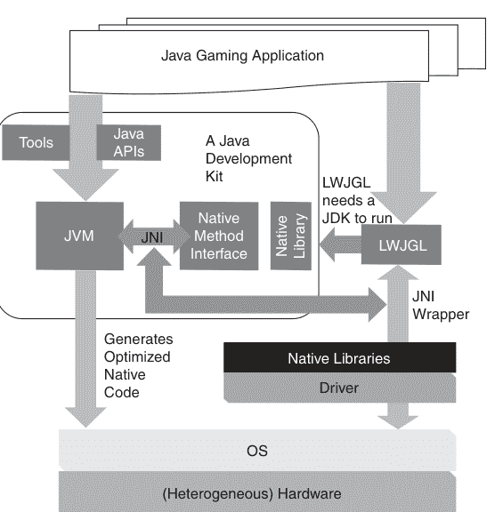

图 9.1 LWJGL 与 JVM

LWJGL 使用 JNI 调用原生库——如图 9.1 中的 JNI Wrapper 所示。JNI Wrapper 本质上是“胶水代码”，用于在 Java 和 C 之间转换变量并调用原生库。原生库反过来与控制硬件的驱动程序交互。对于 LWJGL 来说，这种交互涵盖了从视觉渲染、音频处理到各种并行计算任务的所有内容。

使用 JNI 既有优点也有缺点。优点是 JNI 允许 Java 应用程序访问广泛的原生库和 API，使其能够利用 JVM 不直接支持的硬件能力。JNI 也引入了开销，因为调用原生方法通常比调用 Java 方法慢。此外，JNI 要求开发者编写和维护连接 Java 与原生代码之间差距的胶水代码，这可能是复杂且容易出错的。

# 挑战与局限

尽管 JNI 成功地为 Java 开发者提供了访问原生 API 的途径，但也凸显了这种方法的一些挑战和局限性。一个关键挑战是与原生 API 工作的复杂性，它们的设计哲学和惯例通常与 Java 有所不同。这可能导致效率低下，特别是在处理内存管理和错误处理等低级细节时。

此外，LWJGL 依赖 JNI 与原生库接口也带来了一系列挑战。Oracle 架构师 Gary Frost 的见解强调了这些挑战，他在连接 Java 与异构硬件方面拥有丰富的历史：

- **内存不匹配：** JVM 在内存管理方面具有高度自主性。它控制内存的分配和释放周期，通过提供自动垃圾回收来管理对象生命。然而，这可能与原生库和硬件 API 的行为发生冲突，后者需要对内存进行手动控制。GPU 以及其他加速器的 API 通常依赖于异步操作，这可能导致与 JVM 内存管理风格不匹配。这些 API 允许数据内存请求和内核分发立即运行，而实际操作被并在稍后执行。这种延迟隐藏机制对于在 GPU 和类似硬件上实现顶峰性能至关重要，它本质上与 JVM 垃圾回收器产生了冲突，因为垃圾回收器可能会随时移动对象。通过 JNI 传递给 GPU 的指针在操作过程中可能会失效，因此需要使用像 `GetPrimitiveArrayCritical` 这样的函数来“固定”对象防止其被移动。然而，该函数只能固定到 JNI 调用返回为止，迫使 Java 应用程序人为地等待数据传输完成，从而阻碍了异步操作的益处。值得注意的是，这种内存不匹配并非 LWJGL 特有。其他框架和工具，如 Aparapi 以及本文编写的 TornadoVM，在这方面也面临着类似的挑战。

- **性能开销：** 调用原生方法通常比调用 Java 方法慢。此外，JNI 要求开发者编写和维护连接 Java 与原生代码之间差距的胶水代码，这可能是复杂且容易出错的。

- **复杂性与维护：** 使用 JNI 要求对这两种语言都有熟练的理解。不同范式之间的翻译可能会引入复杂性，特别是在性能敏感的背景下。

# Aparapi：连接 Java 与 OpenCL

Aparapi 是“PARallel API”（并行 API）的缩写，允许开发者实现并行任务的 Java API。它在 Java 和 OpenCL 之间架起了桥梁。在 Java 中使用 Aparapi 需要使用提供的注解和类来定义并行任务。一旦定义了这些任务，Aparapi 负责将 Java 字节码转换为 OpenCL，并在 GPU 或其他硬件加速器上执行。

# 案例研究 319

```java
// 在实际应用中，在此处实现波前修正算法。

};
// 使用表示波前数据大小的 Range 执行内核
// Range.create2D 创建一个与波前数据大小相等的二维范围
// 这决定了将在 GPU 上进行并行化的工作项（计算任务）。
kernel.execute(Range.create2D(wavefrontData.length, wavefrontData[0].length));
```

在此段代码中，`getWavefrontData()` 是一个从自适应光学系统中检索当前波前数据的方法。内核 `run()` 方法内部的计算将被替换为纠正波前畸变的实际计算逻辑。

> 注意：在处理 Aparapi 时，对于 Java 开发人员来说，理解 OpenCL 编程和执行模型至关重要。这是因为 Aparapi 将 Java 代码翻译成 OpenCL 以在 GPU 上运行。此代码段展示了如何使用 Aparapi 实现波前修正算法，但在这种情况下，还必须考虑许多细节。例如，由于 GPU 执行的内存扁平化，Aparapi 可能不支持直接使用二维数组。此外，此代码不会以标准的顺序执行 Java 方式执行；相反，如果函数未经过优化，则需要一个封装方法来调用此代码。这强调了在利用 Aparapi 进行 GPU 加速时，意识到底层硬件和执行模型的重要性。

# Aparapi 与 JVM


# 第 9 章 利用各种异构硬件：JVM 性能工程的未来

Aparapi 通过将 Java 字节码转换为可在 GPU 或其他硬件加速器上执行的 OpenCL 代码，实现了与 JVM 的无缝集成。这种翻译由针对 OpenCL 优化的 Aparapi 编译器和运行时完成。随后，JVM 通过 Aparapi 和 OpenCL 将此代码的执行卸载到 GPU，使 Java 应用程序在数据并行负载中获得显著的性能提升。

图 9.2 展示了从使用 Aparapi 的 Java 应用到计算卸载的流程。图左侧显示了 JVM，我们的 Java 应用在其中运行。应用程序（在右侧）利用 Aparapi 定义了一个内核 `Kernel` 来执行我们想要卸载的计算。随后，“启用 OpenCL 的编译器和运行时”将该内核从 Java 字节码翻译为 OpenCL 代码。最终生成的 OpenCL 代码在 GPU 或另一个支持 OpenCL 的设备上执行，如指向 GPU 的 OpenCL 箭头所示。

[¹⁵](https://www.javadoc.io/doc/com/aparati/aparati/1.9.0/com/aparati/Kernel.html)

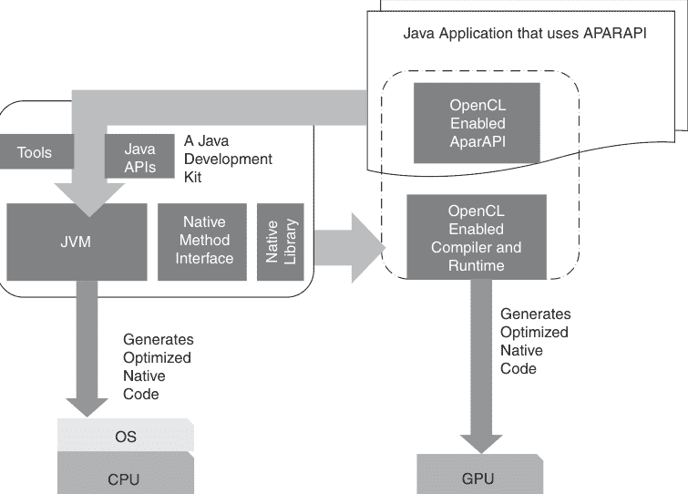

图 9.2 Aparapi 与 JVM

## 挑战与限制

Aparapi 为 Java 开发人员利用 GPU 及其他硬件加速器的计算能力提供了一条前景广阔的途径。然而，像任何技术一样，它也有自己的挑战和限制：

- **数据传输瓶颈**：主要挑战之一在于管理 CPU 和 GPU 之间的数据传输。数据传输可能成为巨大的瓶颈，特别是在处理大量数据时。Aparapi 提供了指定访问类型（GPU 上的只读、只写或读写）来优化数据传输。
- **显式内存管理**：Java 开发人员习惯于垃圾收集器的自动内存管理。相比之下，OpenCL 要求显式内存管理，增加了复杂性和潜在的错误源。Aparapi 将 Java 字节码翻译为 OpenCL 的方法不支持动态内存分配，进一步增加了这方面的复杂性。
- **内存限制**：Aparapi 无法利用常量或局部内存的优势，而这些对于优化 GPU 性能至关重要。相比之下，TornadoVM 通过 JIT 编译器优化自动利用了这些内存类型.[¹⁶]
- **Java 子集与反模式**：Aparapi 只支持 Java 语言的子集。它不支持异常和动态调用等功能，要求开发人员可能需要重写或重构代码。Java 内核需要通过编译器，其设计目的并非运行在 JVM 上。正如 Gary Frost 所说，使用 Java 语法来表示“意图”但不期望 JVM 执行生成的字节码，代表了 Java 中的一种反模式，并可能导致难以利用 GPU 特性。

重要的一点是，这些挑战并不是 Aparapi 特有的。诸如 TornadoVM、OpenCL、CUDA 和 Intel oneAPI[¹⁷] 等平台基于 C/C++ 支持其语言的特定子集。因此，在这些平台上工作的开发人员需要意识到所支持的特定特性和结构，并据此调整代码。

总之，Aparapi 代表在让 Java 应用程序利用异构硬件方面迈出的一步。持续的开发和改进可能会解决这些挑战，使开发者更容易在 Java 应用程序中利用 GPU 和其他硬件加速器的力量。

[¹⁶]: Michael Papadimitriou, Juan Fumero, Athanasis Stratikopoulos, and Christ Kotselikidis. Automatically Executing the Memory Hierarchy of GPUs Through Just-In-Time Compilation. Presented at the 17th ACM SIGPLAN/SIGOPS International Conference on Virtual Execution (VEE’21), April 16, 2021. https://research.manchester.ac.uk/files/19017740/KPADIMITRIOU_VEE2021_GPU_JIT_Preprint.pdf.

[¹⁷]: www.com/content/www/us/en/developer/tools/oneapi/overview.html

## Project Sumatra：一项重大举措

Project Sumatra 是 JVM 和高性能硬件领域的一项开创性计划。其首要目标是增强 JVM 在 GPU 和其他加速器上运行的能力。该项目旨在让 Java 应用程序能够在 JVM 内部直接将数据并行任务卸载到 GPU。这与主要针对 CPU 的传统 JVM 执行模型有显著的偏离。

Project Sumatra 引入了几个关键概念和组件来实现其目标。其中最重要的是异构系统体系 (HSA) 和 HSA 中间语言 (HSAIL)。HSAIL 是一种可移植的中间语言，在运行时确定。这使得能够为 GPU 和其他加速器动态生成原生代码。

此外，HSA 提供的 CPU 和 GPU 缓存之间一致性消除了跨系统总线移动数据到加速器的需求，简化了 Java 应用的卸载过程。

Graal 是一个动态编译器，可以作为 JVM 内部的 JIT 编译器。在 Sumatra 框架内，Graal 用于从 Java 字节码生成 HSAIL 代码，然后在 GPU 上执行。

### Project Sumatra 与 JVM

Project Sumatra 设计用于与 JVM 紧密集成。它探索了将“Graal JIT Backend”和“HSA 运行时”等组件集成到 JVM 架构中，如图 9.3 所示。这些对架构的增强允许 Java 字节码被编译为 HSAIL 代码，HSA 运行时可以使用其生成在 GPU 上运行的优化原生代码（此外还有为 CPU 生成优化原生代码的现有 JVM 组件）。

Project Sumatra 的一个目标是增强 Java 8 Stream API 以在 GPU 上执行，在 Stream API 中执行的操作对于计算密集型任务非常有益，例如之前描述的天文学场景中修正大量波前——GPU 的并行化能力可以比 CPU 更快地完成这些修正。然而，要利用这些增强，需要支持 HSA 基础设施的专用硬件，如 AMD 的加速处理单元 (APU)。

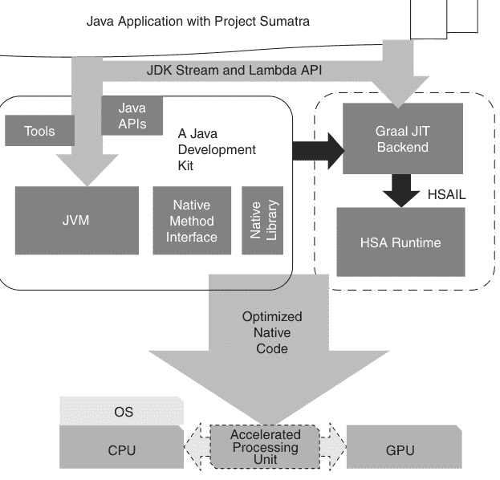

图 9.3 Project Sumatra 与 JVM

在下面的示例中，我们使用 Stream API 从波前（wave-fronts）列表创建一个并行流。我们使用 lambda 表达式 `wavefront -> wavefront.correct()` 来修正每个波前。修正后的波前被收集到一个新的列表中。

```java
// Assume we have a list of Wavefront objects called wavefronts
List<Wavefront> wavefronts = ...;

// We use the Stream API to process these wavefronts in parallel
List<Wavefront> correctedWavefronts = wavefronts.parallelStream()
    .map(wavefront -> {
        // Here we're using a lambda expression to define the correction operation
        correctedWavefront = wavefront.correct();
        return correctedWavefront;
    })
    .collect(Collectors.toList());
```

在传统的 JVM 中，这段代码将在 CPU 上并行执行。然而，通过 Project Sumatra，目标是允许将数据并行计算卸载到 GPU 上。JVM 会识别出此计算可以卸载到 GPU，生成相应的 HSA 代码，并在 GPU 上执行它。

### 挑战与教训

尽管目标宏大，Project Sumatra 仍面临着若干挑战。其中挑战之一是将 Java 的内存模型和异常语义映射到 GPU 的复杂性。此外，该项目与 HSA 紧密绑定，这限制了它在 HSA 兼容硬件上的适用性。

该项目的很大一部分由 Tom Deneau、Eric Capsole 和 Gary Frost 领导，我有荣幸在 AMD 与他们共事，Gary 还是 Project Sumatra 的团队负责人。除了同事身份外，Tom 还是我的导师，他对 JVM 内存模型的深层理解和指导对 Project Sumatra 的积累起了至关重要的作用。总而言之，Tom、Eric 和 Gary 的非凡努力让 Project Sumatra 突破了 Java 与 GPU 集成的边界，实现了诸如 GPU 上的线程本地分配以及回溯到解释器（`interpreter`）等高级功能。

然而，尽管取得了巨大进展，Project Sumatra 最终还是被停止了。修改 JVM 以支持 GPU 执行的复杂性，加上跟上快速演变的硬件和软件生态系统步伐的挑战，导致了这一决定。

在 JVM 与 GPU 交互领域，J9/CUDA4 的提供值得关注。J9/CUDA4 背后的团队决定使用一种与 Project Sumatra 意图类似的基于流的编程模型，并且他们一直支持他们的解决方案。尽管 J9/CUDA4 扩展了本书的范围，但承认它的存在和贡献为 Java 拥抱 GPU 计算的历程提供了一个更全面的图景。

尽管 Project Sumatra 已经停止，它对该领域的贡献仍然无价的。它展示了将计算卸载到 GPU 的潜在收益，同时也揭示了充分利用这些设备必须解决的挑战。从 Project Sumatra 中获得的知识继续影响着 JVM 和硬件加速领域的现有及未来项目。正如 Gary 所说：“我们通过 Project Sumatra 推动了 JVM，你可以在 Vector API、值类型（Value Types）和 Project Panama 等项目中看到它的‘涟漪’。”

## TornadoVM：一种用于硬件加速器的特种 JVM

TornadoVM 是 JDK 和 GraalVM 的一个插件，允许开发者在异构或特种硬件上运行程序。根据 Fumero 博士的介绍，TornadoVM 的愿景超越了单纯的异构硬件编译：它旨在实现代码和性能的可移植性。这是通过利用加速器的独特特征实现的，不仅包括编译，还涵盖数据管理和线程调度等复杂方面。通过这种方式，TornadoVM 试图为在异构硬件计算领域开发的 Java 开发者提供一个整体解决方案。

TornadoVM 提供了一个精细的 API，允许开发者在 Java 应用中表示并行性。该 API 围绕任务（tasks）和注解（annotations）构建，有助于并行执行。包含在 TornadoVM 新版本中的 `TaskGraph` 是定义计算的核心，而 `TornadoExecutionPlan` 则指定了执行参数。`@Parallel` 注解可以用于标记应该卸载到加速器的方法。

回到我们针对大型望远镜的自适应光学系统场景，假设我们有一组大型波前传感器数据数组，需要实时处理以修正大气失真。以下是在此语境下使用 TornadoVM 的更新示例：

```java
import uk.ac.manchester.tornado.api.TaskGraph;

public class TornadoExample {
    // Create a task graph
    TaskGraph taskGraph = new TaskGraph("s0")
        .transferToDevice(DataTransferMode.FIRST_EXECUTION, wavefronts)
        .task("t0", TornadoExample::correctWavefront, wavefronts, correctedWavefronts)
        .transferToHost(DataTransferMode.EVERY_EXECUTION, correctedWavefronts);

    // Execute the task graph
    ImmutableTaskGraph itg = taskGraph.snapshot();
    TornadoExecutionPlan executionPlan = new TornadoExecutionPlan(itg);

    executionPlan.execute();
}
```

```java
public static void correctedWavefront(float[] waveforms, float[] correctedWavefronts, int N) {
  for (@Parallel int i = 0; i < waveforms.length; i++) {
    for (@Parallel int j = 0; j < waveforms[i].length; j++) {
      correctedWavefronts[i * N + j] = waveforms[i * N + j] * 2;
    }
  }
}
```

在这个示例中，创建了一个 `TaskGraph s0`；它勾勒了操作和数据传输的序列。波形（`waveforms`）在计算开始前传输到设备（GPU）。作为任务添加到图中的 `correctedWavefront` 方法处理每个波前进行修正。计算完成后，修正后的数据被传回宿主机（host）。

根据 Fumero 博士的介绍，TornadoVM（类似于 Aparapi）不支持用户定义对象，而是使用预定义的对象。在我们的示例中，`waveforms` 将是一个 `float` 数组。在处理 2D 数组时会出现挑战：内存可能需要扁平化。

### TornadoVM 和 JVM

TornadoVM 设计用于与 JVM 紧密集成。它扩展了 JVM 以利用并发计算，提升了 Java 应用的性能。图 9-4 高层次地概括总结了 TornadoVM 的架构。如图所示，TornadoVM 为 JVM 引入了几个新组件，每个组件都为异构硬件设计：

- **API（任务图、执行计划和注解）**：开发者使用此接口通过 Java 方法定义可以卸载到 GPU 的任务。
- **运行时（数据优化器字节码生成）**：TornadoVM 负责优化宿主机（CPU）和设备之间的数据移动。它使用一种基于任务的编程模型，其中每个任务都与一个数据描述符关联。数据描述符提供了有关数据大小、形状和类型的信息，TornadoVM 使用这些信息来管理传输。TornadoVM 还提供了一种缓存机制以避免不必要的传输。如果设备上的数据是最新的，TornadoVM 可以跳过传输并直接使用缓存数据。
- **执行引擎（字节码解释器 + OpenCL + PTX + SPIR-V/LevelZero 驱动）**：TornadoVM 不是为加速器生成字节码，而是使用字节码从宿主机侧编排整个应用程序。这种方法为运行时优化提供了广泛的可能性，例如动态任务迁移和批处理，同时保持了整洁的设计。
- **JIT 编译器 + 内存管理**：TornadoVM 扩展了 Graal JIT 编译器，以生成针对 GPU 和其他加速器优化的代码。内存管理的最新变化使得每个 Java 对象现在在加速器上拥有自己独立的内存缓冲区，这反映了 Aparapi 的方法。这种转变增强了系统的灵活性，允许多个应用程序共享单个 GPU，这对于云环境非常理想。

在传统的 JVM 中，Java 字节码在 CPU 上执行。然而，通过 TornadoVM，被标记为任务（tasks）的 Java 方法可以被加载到 GPU 或其他加速器。这使得 TornadoVM 能够提升基于 JVM 的应用程序性能。

### 挑战与未来方向

作为一项先驱技术，TornadoVM 也面临着各种障碍。关键挑战之一是将 Java 内存模型和异常语义映射到 GPU 的复杂性。Fumero 博士强调，TornadoVM 与 Aparapi 共享某些挑战，例如将 GPU 上的非阻塞操作管理给垃圾收集器。与 Aparapi 一样，CPU 与加速器之间的数据移动在数据方面具有挑战性。TornadoVM 通过一个优化数据传输的数据优化器来解决这一挑战。这是通过任务图 API（Task-Graph API）实现的，它可以容纳多个任务，每个任务指向一个现有的 Java 方法。

TornadoVM 继续演进和适应，不断突破 JVM 和异构硬件的边界。它证明了将计算卸载到 GPU 的潜在益处，并强调了实现这些益处需要克服的挑战。

## Panama 项目：新地平线

Panama 项目在 Java 针对专用硬件性能优化领域取得了重大进展。它旨在增强 JVM 与外部函数及数据的交互，特别是与硬件加速器相关的部分。这一倡议标志着从传统 JVM 执行模型的重大转变，传统模型一直以标准进程为中心。

图 9.5 是一个简化的框图，展示了 Panama 项目的核心组件——Vector API 和 FFM API。

> 注意：为了本章，特别是本节，我使用了编写本书时可用的最新版本：JDK 21 EA。

### Vector API

Panama 项目的基石是 Vector API，它为开发者提供了一种新的方式，来表达应作为向量（即相同类型值的序列）执行的计算。具体而言，该接口设计用于执行向量计算，这些计算将在运行时编译为兼容 CPU 上的优化向量硬件指令。

Vector API 促进了单指令多数据流（SIMD）指令的使用，这是一种并行计算指令类型。SIMD 指令允许同时对多个数据点执行单次操作。这在图形处理等任务中特别有用，在这些任务需要在对大量数据集执行相同的操作。


图 9.5 Panama 项目


在本书编写时，Vector API 位于 `jdk.incubator.vector` 模块中。Panama 项目允许早期访问构建。它提供了多项优势：

- **向量压缩表达式（Vector compression expression）**：该 API 提供了一组向量操作，可用于对向量进行计算。每个操作都按元素逐一应用，确保了向量每个元素处理的一致性。

- **优化硬件指令编译 → 增强的可移植性**：该 API 的巧妙设计使其可以在运行时将这些计算编译为适用架构上最高效的向量硬件指令。这一独特特性允许在不同的 CPU 之间使用相同的 Java 向量指令，而无需进行修改。

- **利用 SIMD 指令 → 性能提升**：该 API 利用了 SIMD 指令的力量，可以极大地提高大型数据集计算的性能。

- **高层指令与低层指令的对应 → 提高开发者生产力**：该 API 的架构使得高层向量操作可以通过内建（intrinsics）直接对应低层 SIMD 指令。因此，开发者可以使用高抽象级别编写代码，同时仍能获得底层硬件指令的性能收益。

## 案例研究 329

- **可扩展性（Scalability）**：Vector API 为处理海量数据提供了可扩展的解决方案。随着数据集不断扩大，对向量进行计算的能力变得越来越关键。

Vector API 在图形处理领域被证明特别有用，在那里它可以快速地对大型像素数组应用操作。这种向量操作允许图像滤镜任务并行执行，显著缩短处理时间。当需要在所有像素进行统一转换（如颜色调整或模糊效果）时，这种效率至关重要。

在深入代码之前，让我们澄清示例中使用的 factor。在图像处理中，应用滤镜涉及修改像素值——factor 代表这种修改。例如，小于 1 会使图像变暗，大于 1 则使其变亮，增强《史莱克》音乐剧的视觉效果。基于此，以下示例演示了在游戏开发中使用 Vector API 应用滤镜：

```java
import jdk.incubator.vector.*;

public class ImageFilter {
    public static void applyFilter(float[] shrekPixels, float factor) {
        // 获取 float 的种类
        var species = FloatVector.SPECIES_PREFERRED;
        // 按向量长度分块处理像素数据
        for (int i = 0; i < shrekPixels.length; i += species.length()) {
            // 将像素数据加载到向量
            var mauVector = FloatVector.fromArray(species, shrekPixels, i);
            // 通过乘以 factor 应用滤镜
            var result = mauVector.mul(factor);
            // 将结果存回像素数据数组
            result.toArray(shrekPixels, i);
        }
    }
}
```

通过所示的代码片段，`FloatVector.SPECIES_PREFERRED` 通过利用最宽的可用寄存器，使我们的过滤器适用于不同的 CPU 架构。随后，`mul` 操作会将我们的滤镜应用到每个像素。

由于 Vector API 正在演进，它目前处于孵化阶段——JDK 21 中的 `jdk.incubator.vector` 模块。孵化模块是尚未标准化但供开发者尝试的模块。

为了上手 `ImageFilter` 程序并探索这些功能，需要对构建配置进行一些更改。需要更新 Maven `pom.xml` 文件以确保在编译期间包含 `jdk.incubator.vector` 模块。所需的配置如下：

```xml
<build>
  <plugins>
    <plugin>
      <groupId>org.apache.maven.plugins</groupId>
      <artifactId>maven-compiler-plugin</artifactId>
      <version>3.11.0</version>
      <configuration>
        <source>21</source>
        <target>21</target>
        <compilerArgs>
          <arg>--add-modules</arg>
          <arg>jdk.incubator.vector</arg>
        </compilerArgs>
      </configuration>
    </plugin>
  </plugins>
</build>
```

# 案例研究 331

- **外部资源的生命周期管理**：FFM 包含了跟踪和管理外部资源生命周期的机制。这确保了内存在不再需要时被正确释放，防止了内存泄漏。

- **外部函数调用**：FFM 允许 Java 应用直接调用外部库中的函数。这在 Java 和其他编程语言之间提供了无缝接口，增强了互操作性。

FFM API 还带来了若干非功能性收益，这些可以提升整体开发体验：

- **更好的性能**：通过允许对外部函数的直接调用和内存访问，FFM 绕过了与 JNI 相关的开销。这导致了性能的提升，特别是对于高度依赖原生库交互的应用而言。

- **安全性与安全措施**：FFM 为与外部代码和数据的交互提供了更安全的途径。JNI 如果使用不当可能会导致不安全的操作，而 FFM 的设计确保了安全访问外部内存。这降低了内存相关错误和安全漏洞的风险。

- **更好的可靠性**：FFM 为与外部代码交互提供了更健壮的接口，增加了 Java 应用程序的可靠性。它减轻了在使用 JNI 时发生应用程序崩溃和运行时错误的风险。

- **易于开发**：FFM 简化了与外部代码交互的过程。它提供了一种纯 Java 的开发模型，比 JNI 更直观、更易于使用和理解。这有助于开发者编写、调试和维护与原生库交互的代码。

为了说明 FFM API 的用法，让我们考虑来自自适应光学领域的另一个例子。我们正在开发一个控制望远镜副镜的系统，并想要调用一个原生函数来调整镜子。以下是使用 FFM 实现这一的方法：

```java
import java.lang.foreign.*;
import java.util.logging.*;
```

```java
public class MirrorController {
    public static void adjustMirror(float[] secondaryMirrorAdjustments) {
        // 从 Linker 获取一个查找对象
        var lookup = Linker.defaultLookup();
        // 找到原生函数 "adjustMirror"
        var adjustMirrorSymbol = lookup.find("adjustMirror").get();
        // 从调整数组创建一个内存段
        var adjustmentArray = MemorySegment.ofArray(secondaryMirrorAdjustments);
        // 为原生函数定义函数描述符
        var function = FunctionDescriptor.ofVoid(ValueLayout.ADDRESS);

        // 获取原生函数的句柄
        var adjustMirror = linker.nativeLinker().downcallHandle(adjustMirrorSymbol, function);
        try {
            // 使用调整数组的地址调用原生函数
            adjustMirror.invokeExact(adjustmentArray.address());
        } catch (Throwable ex) {
            // 记录发生的任何异常
            Logger.getLogger(MirrorController.class.getName()).log(Level.SEVERE, null, ex);
        }
    }
}
```

在这个示例中，我们使用 `secondaryMirrorAdjustments` 数组来调整副镜。代码是使用 JDK 21 中的 FFM API 编写的。要使用此功能，你需要在你的构建系统中启用预览功能。对于 Maven，你可以通过向 pom.xml 中添加以下代码来实现：

```xml
<build>
  <plugins>
    <plugin>
      <groupId>org.apache.maven.plugins</groupId>
      <artifactId>maven-compiler-plugin</artifactId>
      <version>3.11.0</version>
      <configuration>
        <compilerArgs>--enable-preview</compilerArgs>
        <release>21</release>
      </configuration>
    </plugin>
  </plugins>
</build>
```

FFM API 从 JDK 19 到 JDK 21 的演变展示了向简化和增强易用性的清晰趋势。一个显著的变化是从使用 `SegmentAllocator` 类进行内存分配转变为更精简的 `MemorySegment.toArray()`。此方法直接将 Java 数组复制到内存段，显著降低了代码的复杂性，增强了可读性，并使其更容易理解。随着该 API 的持续演进，未来的 JDK 版本可能会有进一步的更改和改进。

## 挑战与未来方向

Panama 项目仍在演进，存在若干挑战和未来的工作领域需要解决。主要挑战之一是跟上不断演变的硬件和软件技术。跟上这一动态领域中的许多变化

> ¹FFM API 目前处于其第三阶段预览模式；这意味着该功能已完全规范但尚未永久，因此它在未来的 JDK 版本中可能会发生变化。

# 展望 JVM 和 Panama 项目的未来 333

需要对 Vector API 和 FFM API 进行持续更新，以确保它们与这些设备保持兼容。

例如，随着 CPU 增加新的向量指令，Vector API 需要更新；同样，随着引入新类型的外部函数和内存布局，以及这些函数和布局的使用和演进方式，FFM API 也需要更新。

另一个挑战是模型。Java 内存模型是为堆内存设计的，但 Panama 项目引入了堆外内存（off-heap）的概念。这引发关于如何确保内存安全以及如何将堆外内存与垃圾回收器集成的问题。

工作方面，重点领域之一是提高 Vector 和 FFM API 的性能。这包括优化 JIT 编译器以为向量操作生成更高效的代码，并提高外部函数调用和内存访问的性能。

另一个研究领域是提高 API 的易用性。这包括为处理向量数据和外部函数提供更好的工具，并改进错误信息和调试支持。

最后，正在进行的工作是将 Panama 与 Java 的其他部分集成。这包括将其与 Java 语言、库以及调试器和性能分析器等工具集成。

## 展望 JVM 与 Project Panama 的未来 335

- **Parquet 列式存储文件格式**：Hadoop 生态系统的 Parquet 列式存储格式可能从 Vector API 中受益。Parquet 文件的压缩格式可以使用向量操作进行高效处理，从而提升 Hadoop 平台数据处理任务的性能。

## 数据访问、缓存和格式化的加速器描述符

在这一设想的未来，加速器描述符（Accelerator descriptors）作为关键创新脱颖而出。这些元数据框架旨在为硬件加速处理标准化数据访问、缓存和格式规范。作为蓝图，它们将简化 JVM 微调数据操作以适应每种加速器类型的独特特性和优势。这种系统的创建不仅是一项技术挑战——它需要对以数据为中心的计算轨迹进行前瞻性思考。通过抽象这些规范，开发者可以更轻松地定制应用程序，以充分利用硬件加速器的全方位能力，简化目前复杂的优化过程。

为了实现这一愿景，细致的设计和协作实施至关重要。Java 社区必须在拥抱和推进这些增强方面达成一致。通过这种方式，我们可以确保 JVM 不仅跟上技术创新的步伐，而且在性能、易用性和灵活性方面树立基准。

这一努力是将 JVM 的坚实基础与尖端硬件加速器的能力相结合，旨在于不损害平台固有通用性的前提下获得巨大收益。在保持 JVM 通用特性的同时针对现代硬件进行优化是一项微妙的平衡，也是 Project Panama 以及整个 JVM 社区的关注焦点。随着适当的发展，我们正准备进入一个新时代，即 JVM 在高性能场景中表现卓越，充分利用现代加速器的潜力。

## 未来已敲门！

当我深入探索 JVM 与硬件加速之间错综复杂的世界时，发现我的愿景与 Gary Frost 和 Famer 博士的突破性工作之间存在强烈的协同效应，这既令人开眼界又令人兴奋。尽管我们的研究轨迹各异，但 JVMLS 2023 上的集体揭示了对该领域未来的统一愿景。

Gary 在硬件加速器工具包（HAT）²方面的工作是这种前瞻性愿景的证明。HAT 构建在 FPM API 的基础上，不仅仅是一个工具包——更是一个适用于各种环境的自适应解决方案。它包含了 ndrange API、²² FFM 数据封装模式以及针对特定厂商运行时的抽象，以促进硬件加速器的使用。

HAT 中的 ndrange API 受到 TornadoVM 的启发，进一步增强了这些能力。作为 HAT 提供的补充，Project Panama 以其强大的 API 和高效的数据管理策略而脱颖而出。考虑到 GPU 需要特定的数据布局，Panama 在创建“GPU 友好”数据结构方面表现出色。

> ²¹ www.youtube.com/watch?v=lbKb3Iltfc

> ²² https://man.openjdk.org/ndrange.html

## 第 9 章 驾驭特殊硬件：JVM 性能工程的未来

Project Babylon ²³ 是一项创新的计划，正成为增强 Java 与多种编程模型（包括 GPU 和 SQL）集成的关键进展。它利用代码反射来标准化和转换 Java 代码，使其能够在不同的硬件平台上进行高效执行。这项倡议补充了 Project Panama 在利用先进硬件能力方面的努力。

VMLES 2023 讨论的另一个亮点是 Da Fumero 关于 TornadoVM 混合 API ⁴ 创新的演讲。正如所解释，该 API 无缝合并了原生代码和 JIT 编译代码的优势，使开发者能够利用以速度为中心、厂商优化的库。Project Panama 与此混合 API 的无缝集成确保了数据流的不断，并将 JIT 编译任务与库调用协调起来，为更凝聚、更高效的计算之旅铺平了道路。

总之，我们探索 JVM、Project Panama 和硬件加速的个人旅程指向同一个目的地，强调了这一前沿领域的巨大潜力。我们正处于计算变革时代的边缘，在这个时代中，JVM 将真正释放现代硬件加速器尚未被开发的潜力。

## 结语：JVM 性能工程的未来

当我们对这次 JVM 性能工程的全面探索接近句号时，回顾我们所经历的旅程至关重要。从 Java 及其虚拟机的演变到类型系统、模块化和内存管理的细微差别，我们遍历了 JVM 复杂的格局。每一章都是对 JVM 特定方面的深度探讨，提供了利用其全部潜力的见解、技术和工具。

这段旅程的终点是对未来的愿景——即 JVM 不仅仅是适应，而是通过利用现代硬件加速器的全部力量。我们对 Project Panama、Vector API 等内容的讨论描绘了未来的生动图景。这是协作和共同愿景力量的证明。

我们讨论的工具、API 和框架是明天的基石，我鼓励你们在运用专业知识、见解和热情的同时探索它们。JVM 社区充满活力并不断进化。我们的贡献、实验和见解将共同塑造其未来轨迹。请与这个社区互动。深入这些新世界，突破它们的边界并分享你的发现。每一份贡献、每一行代码、每一次共享的经验都为正在构建的大厦添了一块砖。

感谢你们加入这段充满启发的旅程。

让我们共同探索、创新并分享 JVM 性能工程的未来。

> ²³ https://openjdk.org/projects/babylon/

> ⁴ Juan Fumero. From CPU to GPU and FPGAs: Supercharging Java Applications with TornadoVM. Presentation at JVM Language Summit August 7, 2023. https://github.com/jjfumero/jjfumero.github.io/blob/master/files/presentations/TornadoVM.pdf

## 索引

### 缓存一致性 NUMA (ccNUMA) 339

- 实现, 110–111
- 基准测试分析, 174
- Log4j2, 110
- 运行微基准, 166–168
- 性能, 112–113
- 热阶段, 168–169
- 可靠性, 112
- 编写/构建微基准, 166–168
- 统一日志集成, 111
- JVM 内存管理, 161–164
- async-profiler, 157
- 循环优化, 169
- 原子性, 139–141
- Maven, 166–170
- 可用性，性能工程
- 微基准测试, 165–174
- MTBF (平均无故障时间), 124–126
- 模式, 170
- 性能工程, 158
- 框架 (harnesses), 164–165
- MTTR (平均修复时间), 124–126
- 迭代方法, 161
- JVM 内存管理, 161–164
- 反压，异步日志, 111
- 指标, 159
- 向后兼容，Java, 83–84
- 微基准测试, 175–174


- 屏障，并发计算, 139
- 进程（概述）, 159–161

## 基准测试 benchmarking

- 统一日志, 108
- 竞争锁, 248–251
- 热阶段, 168–169
- 框架, 164–165
- 异步日志最佳实践, 111–113
- JMH, 172–174
  - `@Benchmark`, 171
  - `@BenchmarkMode`, 171
  - `@Measurement`, 168–169, 171
  - `@OperationsInvocation`, 169, 171
  - `@OutputTime`, 171
  - `@Setup`, 171
  - `@State`, 171
  - `@Teardown`, 171
  - `@Warmup`
  - 注解, 169, 171–172
  - 基准测试模式, 170
- 特性, 165
- 循环优化, 169
- Maven, 166–170
- 测量阶段, 168–169
- perfasm, 174
- 性能分析器, 170–171
- 引导，JVM 启动
- 性能, 275
- 自底而上的方法，性能工程, 146–148
- 字节数组间隔, 60
- 字节码, 2
- 加载, 275–276
- 启动性能，优化, 275–276
- 验证, 275–276

## B

## C

- C#, 与 Project Valhalla 的比较, 67–68
- C++ 解释器, 3
- 缓存一致性 NUMA (ccNUMA), 144

## 缓存 caches

- 缓存
- 加速器描述, 335
- 彩色指针，ZGC, 197–198
- 代码缓存 (CodeCache)
- 命令行，Project Valhalla, 76
- 紧凑字符串, 227–236
- 分段代码缓存, 7–8, 300–302
- 编译
  - AOT
  - 硬件, 132
  - GraalVM, 284–285, 298
  - LLC (末级缓存), 137
  - 状态管理, 283–285
  - SLC, 137
  - JIT, 276, 283–285
  - 热, 276
- 模块, 72
- 调用树分析，竞争锁，性能, 251–254
- `CompletableFuture` 框架，线程, 264–265
- Cassandra (Apache), 214–215
- 字符串拼接, 224–227
- ccNUMA (缓存一致性 NUMA), 144
- 并发计算
  - 算法, 14
  - 用户空间检查点恢复 (CRI), 292–295
  - 类数据共享 (CDS), 282
  - 原子性, 139–141
- 类
  - 屏障, 139
  - 隐藏类, 38–39
  - 内存屏 (fences), 139
  - Hotspot VM 去优化, 9–102
  - GC 线程, 16–18
  - 加载, 9–10, 276
  - 发生之前的关系 (happens-before), 139–141
  - 原始类, 65–66
  - Project Valhalla, 65–66
  - 密封类, 38–39, 44, 56–57
  - 类型, 47–48
  - 值类, 63–66
- 硬件
  - 核心利用率, 136
  - 内存层次, 136–138
  - SMT, 136
  - 软件相互作用, 131
- 客户端编译器 (C1)
- 内存
  - 多处理器系统中的访问, 141
  - 模型，原子性, 139–141
  - 局限性, 311–312
  - NUMA, 141, 145
  - 性能, 311
  - 架构, 143
  - 资源竞争, 311
  - ccNUMA, 144
  - 代码足迹, 119
  - 组件, 142–143
  - 代码可读性, `_`, 41
  - 跨流量, 144
  - 代码重构，足迹，性能工程, 122
  - 织物架构, 144
  - 代码缓存
  - 交织内存, 144
  - Hotspot VM, 3
  - 分段代码缓存, 7–8, 303
  - 本地流量, 143
  - 现代系统中的节点, 142
- 异形硬件, 341
- 线程
  - 检查点协调恢复 (CRac), 292–295
  - `CompletableFuture` 框架, 264–265
  - 用户空间检查点恢复 (CU), 292–295
  - `ForkJoinPool` 框架, 261–264
  - 跨流量，NUMA, 143
  - GC 线程, 16–18
  - Java API (应用程序接口), 314
  - Java Service, 261
  - 自定义日志, 111
  - 每个请求线程, 261–266
  - 每个任务线程, 259–260
  - 线程栈处理, 39–40
  - 虚拟线程, 265–270
  - 挥 volatile, 139

## D

- 数据访问，加速器描述, 335
- 数据寿命, 216
- 数据结构优化，足迹, 122
- 双倍速率 (DDR) 内存, 137–138
- 重复字符串 (dedup), 223–224
- 优雅降级, 17
- 类加载/卸载, 9–10
- 去优化, 9
- 多态列表, 11–13
- 容器，Project Leyden, 286
- 可扩展性, 297–298
- 启动性能, 297–298
- 共享存档, 282–283
- 竞争锁，基准测试, 248–251
- 调用树分析, 251–254
- 火焰图, 249
- 竞争锁定, 242
- 锁消除, 242
- 监控/退出操作, 243–245
- 性能工程, 245
- `ReentrantLock` (Java 5), 241
- 旋循环提示, 258–259
- 旋等待提示, 257–259
- `StampedLock` (Java 8), 241–242
- 延续，虚拟线程, 270

## E

- 封装，Java (SE), 40–41
- 枚举, 49–50
- Epsilon GC (垃圾回收器), 35
- 异形硬件, 307–309
- 语言设计, 313–314
- 局限性, 311–312
- 外部函数与内存 (FFM) API, 309, 330–333
- LWJGL, 313–317
- OpenCL, 308
- `ForkJoinPool` 框架，线程, 261–264
- FFM API, 309, 330–333
- Project Panama, 314
- 向量 API, 308, 327–330, 345

## G

- G1 GC (优先垃圾回收器), 16, 178–179
- 资源竞争, 311
- 重复字符串 (dedup), 223–224
- 工具链, 313–314
- TornadoVM, 308, 314, 324–327
- 自适应调整, 184
- 核心调整, 185
- 工程, 146
- 巨型处理, 188

## F

- 织物架构，NUMA, 144
- 暂停可预测性, 184–185
- 失败，MTBF, 124–126
- 区域化堆, 184–188
- 快速调试, 99
- 标记阈值, 196–197
- 内存屏，并发计算, 139
- FFM (外部函数与内存) API, 309, 330–333
- 优化, 193–196
- 火焰图分析，竞争性能, 249–251
- 暂停响应能力, 189–193
- 性能, 188–217
- 游戏，LWJGL, 313–317
- Flink, Apache, 215
- 垃圾回收器 (GC), 2
- 基于分配停顿的 GC, 207
- 分析 (OLAP), 214–215
- 自适应调整策略, 123
- 并发算法, 11–14
- 代码足迹, 119
- 并发 GC，线程, 16–28
- 代码重构, 122
- 并发工作, 17
- 数据结构优化, 122
- 数据寿命模式, 216
- JVM 参数调优, 122
- 管理, 120
- 未来趋势, 210–212
- 内存足迹, 119
- 重复字符串 (dedup), 223–224
- 缓解问题, 122–123
- 堆管理, 184–188
- 非堆内存，监控或
- NMT, 120–122
- 标记阈值, 196–197

## 硬件

- Aparapi, 308, 314, 317–321
- 云计算, 309–312
- CUDA4, 314
- 语言设计, 313–314
- 局限性, 311–312
- LWJGL, 313–317
- OpenCL, 308
- 性能, 311
- Project Panama, 308–309, 314, 327–335
- Project Sumatra, 314, 321–324
- 资源竞争, 313–314
- 工具链, 313–314
- TornadoVOM, 308, 314, 324–336
- 硬件感知编程, 132
- HAT, 335–336
- 异构性, 310
- 性能与, 128–131
- 软件动态性, 129–131
- 子系统, 性能工程, 156–157
- 基准测试框架 (harnesses), 164–165
- HashMap, 注解, 51
- HAT (硬件加速工具包), 335–336
- HBasease (Apache), 214–215
- 堆管理
  - 内存层级结构, 136–138
- 基于高分配率的垃圾回收 (Garbage Collection), 206–207
- 基于高用量的垃圾回收 (Garbage Collection), 207–208
- Hive (Apache), 214
- 跳跃 (hops), 28–30
- 主机操作系统, 性能工程, 156
- Hotspot VM
  - 自适应优化, 9
  - C++ 解释器, 3
  - 客户端编译器 (C1), 7
  - CodeCache, 3
  - 竞争锁, 242–243
  - 去优化 (deoptimization), 9–10
  - 类加载/卸载, 9–10
  - 多态类点 (class sites), 11–13
  - GC, 13
    - 并发算法, 14
    - 并发 GC 线程, 16–18
    - 并发工作, 17
    - 未来趋势, 210–212
    - GI GC, 16, 178–179, 184–197
    - 优雅降级, 17
    - 增量式压缩算法, 14
    - 大量线程, 18
    - NUMA 感知的 GC, 181–183
    - 老年代收集, 16
    - 并行 GC 线程, 16–18
    - 暂停, 17
    - 性能评估, 212–216
    - PLAB, 180–181
    - 回收触发器, 16
    - 标记清除 (scavenge algorithm), 16
    - Shenandoah GC, 16
    - STW（停停世界）算法, 14
    - 任务队列, 17
    - 自适应大小调整, 184
    - 核心扩展, 185
  - G1 GC, 184–188
  - 巨型对象处理, 182
  - IHOP, 186
  - nmethod 代码, 堆, 8
  - 堆外转发表, 201
  - 停顿时间预测性, 184–185
  - 区域化堆, 184, 186–188
  - ZGC, 堆外转发表, 201
- 硬件异构性, 310
- 隐藏类 (hidden classes), 38–39

# 接口类型 345

- 任务窃取 (task stealing), 17
- 线程本地握手 (thread-local handshakes), 14
- TLAB, 179–180
- 超低停顿时间收集器, 14
- 弱代假设, 14–16
- 年生收集, 14–16
- ZGC, 16, 178–179, 197–210
- 字符串池 (intern strings), 221–223
- 解释器, 5
- JIT 编译器, 5
- 字面量字符串, 221–223
- 混合模式执行, 3
- 监视锁 (monitor locks), 238–241
- 方法, 7–8
- 性能关键方法，优化, 3–5
- PLAB, 180–181
- 打印编译, 5–6
- Project Valhalla, 7
- 服务器级编译器 (C2), 7
- 启动性能, 300–302
- 稳态阶段, 301
- TemplateTable, 3
- 分层编译, 6–3
- TLAB, 179–180
- 统一日志记录
  - 异步日志集成, 111
  - 基准测试, 108
  - 装饰器, 104–105
  - 识别缺失信息, 102
  - 基础架构, 100
  - JDK 11, 113
  - JDK 17, 113
  - 级别, 103–104
  - 日志标签, 101
  - 系统管理, 105
  - 需要, 99–100
  - 优化系统, 109
  - 输出, 105–106
    - 性能, 108
    - 性能指标, 101
    - 特定标签, 102
    - 工具/技术, 108
    - 用法示例, 107–108
  - 预热性能, 298
  - 编译器, 303
  - 优化, 300–301
  - HTAP（混合事务/分析型）应用, 215
  - 巨型对象处理, 186
  - 混合 API, 336
  - 混合应用（填充率）, 性能工程, 156
  - Ignite (Apache), 215
  - 镜像生成（原生）, GraalVM, 291
  - 不变对象, Project Valhalla, 63
  - 增量压缩算法, 14
  - 字符串拼接, 224–227
  - AMD 架构架构, 144
  - 膨胀锁, 239–241
  - 内联缓存, 12
  - 内联 (inlining), 7
  - 实例，模式匹配, 38
  - Intel 架构, 144
  - 接口类型, 45–46, 52

## Java 1–2

- 数组类型, 48–49
- 异步背压管理, 111
- Log4j, 110
- Logback, 110
- 性能, 112–113
- 可靠性, 112
- 统一日志集成, 111
- 性能演进, 18–42
- GC, 2
- 并发算法, 14
- 并发 GC 线程, 16–18
- 并发工作, 17
- G1 GC, 16
- 优雅降级, 17
- Hotspot VM, 13
- 增量压缩算法, 14
- 大量线程, 18
- 老年代收集, 16
- Hotspot VM
  - 自适应优化, 9
  - C++ 解释器, 3
  - 客户端编译器 (C1), 7
  - CodeCache, 3
  - 去优化, 9–10, 9–13
  - GC, 13–14, 13–18
  - 解释器, 5
  - JIT 编译器, 5
  - 混合模式执行, 3
  - 方法, 7–8
  - 性能关键方法, 3–5
  - 打印编译, 5–6
  - 服务器级编译器 (C2), 7
  - TemplateTable, 3
  - 分层编译, 6–7
  - 接口类型, 45–46
  - JIT 编译器, 3, 5
  - Kotlin 对比, 68
  - 字面量, 45
  - null, 45
  - 原始数据类型, 44–45
  - 引用类型, 45–49
  - 发布节奏, 34
  - Scala 对比, 68

## Java 17 (Java SE 17) 347

- 静态类型检查语言, 43
- 强类型语言, 43
- 语言特征, 30
- 元注解, 51
- `StampedLock`, 241–242

## Java 1.1 (JDK 1.1), 18–19

- 数组类型, 48–49
- 类类型, 47–48
- 接口类型, 45–46
- 引用类型, 45–49
- “目标类型”推推, 51
- 下划线 (`_`), 51

## Java 9 (Java SE 9), 32–34

- `MethodHandles`, 52–54
- `VarHandles`, 43–44–52

## Java 1.4.2 (J2SE 1.4.2), 18–19

## Java 10 (Java SE 10), 34–35, 52–54

- 类类型, 48–49
- 接口类型, 45–46
- 引用类型, 45–49

## Java 11 (Java SE 11), 35–37

- 模块化 JDK, 78, 82–83
- 统一日志, 113

## Java 5 (J2SE 5.0)

- 注解, 43, 50
- 枚举, 49–50
- 泛型, 43
- JVM, 22–23
- 包, 22–33

## Java 12 (Java SE 12), 37

- 模块化 JDK, 78, 82–83
- switch 表达式, 44, 55–56

# Java 13 (Java SE 13), 37–38

- 模块化 JDK, 78, 82–83
- switch 表达式, 44, 55–56
- yield 关键字, 37

# Java 14 (Java SE 14), 38

- 模块化 JDK, 78, 82–83
- switch 表达式, 44, 55–56


# Java 15 (Java SE 15)
- ReentrantLock, 241
- 模块化 JDK, 78, 82–83
- records, 57
- 密封类, 38–39, 44, 56–57

# Java 16 (Java SE 16)
- 模块化 JDK, 78, 82–83
- records, 57
- 密封类, 38–39, 44, 56–57

## Java 7 (Java SE 7)
- 注解, 50
- 泛举, 49–50
- JVM, 26–30
- 语言特征, 25–26
- NUMA 结构, 28–30
- 下划线 (`_`), 51

# Java 8 (Java SE 8)
- 注解, 50–51
- 泛型, 51
- 接口类型, 51–52
- 封装, 40–41
- JDK, 40–41
- JVM, 40
- 语言特征, 41
- 库增强, 41

# Java 17 (Java SE 17)
- 模块化服务, 78
- 实现, 81–83
- 服务消费者, 79–83
- 服务提供者, 72–82
- 移除, 42
- 密封类, 38–39, 44, 56–57
- 安全性, 40–41
- 统一日志, 113

# Java Archive (JAR)
- JAR 版本问题, 83–91

# Java 开发包 (JDK)
- 字节码, 2
- Java 17 (Java SE 17), 40–41
- JRE, 2
- 模块化 JDK, 78, 82–83

# Java 执行服务
- 261

# Java Microbenchmark Harness (JMH)
- `@Benchmark`, 171
- `@BenchmarkMode`, 171
- `@Fork`, 171
- `@Measurement`, 168–171
- `@OperationsPerInvocation`, 169–171
- `@OutputTimeUnit`, 171
- `@Setup`, 171
- `@State`, 171
- `@Teardown`, 171
- `@Warmup`, 168–171
- 注解, 169–172
- 基准测试, 172–174
- 基准测试模式, 170
- 特性, 165
- 循环优化, 166–170
- Maven, 165
- 测量阶段, 168–169
- perf, 174
- 性能分析器, 170–171
- 性能分析基准, 174
- 运行微基准测试, 166–168
- 预热阶段, 168–169
- 编写/构建微基准测试, 166–168

# Java 内存模型 (JMM)
- 线程同步, 237

# Java 对象布局 (JOL)
- 59–62

# Java on Truffle
- 292

# Java 平台模块服务 (JPMS)
- 84–85. 参见模块

# Java 运行时环境 (JRE)
- 2

# Java 虚拟机 (JVM)
- 引导，启动性能, 275
- 未来, 336
- Java 5 (J2SE 5.0), 22–23
- Java 6 (Java SE 6), 23–25
- Java 7 (Java SE 7), 26–30
- Java 8 (Java SE 8), 31–32
- Java 9 (Java SE 9), 32–34
- Java 10 (Java SE 10), 34–35
- Java 11 (Java SE 11), 35–36
- Java 12 (Java SE 12), 37
- Java 13 (Java SE 13), 37–38
- Java 14 (Java SE 14), 38
- Java 15 (Java SE 15), 38–39
- Java 16 (Java SE 16), 39–40

# JVM (Java虚拟机)
- Shenandoah GC, 37
- `@OperationsPerInvocation`, 169–171
- 启动性能, 优化, JVM 引导, 275
- 统一日志
- `@OutputTime`, 171
- `@Setup`, 171
- 异步日志集成, 111
- 基准测试, 108
- `@State`, 171
- 装饰器, 104–105
- 识别缺失信息, 102
- 基础结构, 100
- `@Teardown`, 171
- `@Warmup`, 169–172
- JDK 11, 83–91
- JDK 17, 133
- 级别, 103–104
- 日志标签, 101
- 基准测试, 172–174
- 基准测试模式, 170
- 特性, 165
- 循环优化, 169
- Maven, 160–170
- 管理系统, 109
- 优化系统, 109
- 输出, 105–106
- 性能, 108
- 性能指标, 101
- 特殊标签, 102
- 工具/技术, 108
- 使用, 107–195
- 测量阶段, 168–169
- perfams, 170–171
- 性能分析器, 174
- 基准测试性能分析, 174
- 运行微基准测试, 166–168
- 预热阶段, 168–169
- 编写/微基准测试, 166–168

# JMM (Java内存模型)
- 线程同步, 237

# Jdeprscan
- 94–95

# Jmod
- 95

# Jdeps
- 93–94

# JOL (Java对象布局)
- 59–62

# JPMS (Java平台模块服务)
- 84–85. 另见模块

# JDK (Java开发工具包)
- 字节码, 2
- Java 17 (Java SE 17), 40–41

# JRE (Java运行时环境)
- 2

# JRE
- 模块化 JDK, 78, 82–83

# JShell
- 32–34

# jigsaw 层
- 83–91

# 即时编译器 (JIT) 编译器
- 3, 276

# JIT (即时编译) 编译器
- 3, 276

# OSR
- 5
- 状态管理, 283–285

# JVM (Java虚拟机)
- 引导, 启动性能, 275
- `@Benchmark`, 171
- `@BenchmarkMode`, 171
- 未来的, 336
- `@Fork`, 171
- Java 5 (J2SE 5.0), 22–23
- Java 6 (Java SE 6), 23–25
- Java 7 (Java SE 7), 26–30
- Java 8 (Java SE 8), 31–32
- `@Measurement`, 168–171
- Java 9 (Java SE 9), 32–34
- Java 10 (Java SE 10), 34–35
- Java 11 (Java SE 11), 35–36
- Java 12 (Java SE 12), 37
- Java 13 (Java SE 13), 333–334
- Java 14 (Java SE 14), 38
- Java 15 (Java SE 15), 38–39
- Java 16 (Java SE 16), 39–40
- Java 17 (Java SE 17), 40
- 语言 API, 333–334
- 内存管理, 161–164
- 原生库, 333–334
- 优化, 无服务器操作, 296–297
- 参数调优, 占用, 性能工程, 122
- 性能工程, 153–154
- 运行时环境, 153–154
- 无服务器操作, 296–297
- Shenandoah GC, 37
- 启动性能, 优化, 引导, 275
- 异步日志集成, 111
- 装饰器, 104–105
- 识别缺失信息, 102
- 基础结构, 100
- JDK 11, 313
- JDK 17, 113
- 级别, 103–104
- 日志标签, 101
- 管理系统, 109
- 优化系统, 109
- 输出, 105–106
- 性能, 108
- 性能指标, 101
- 特殊标签, 102
- 工具/技术, 108
- 使用示例, 107–195

# K
- 类, 58–61
- 语言 API, JVM, 333–334
- 语言设计, 硬件, 313–314
- 延迟, 123, 188
- jigsaw 层, 83–91
- 系统栈层, 151
- 级别, 统一日志, 103–104
- 交互, 性能工程, 152–153
- Java 17 (Java SE 17), 41
- 文字字符串, 221–223
- 字面量, 45

# L
- 活动数据集 (LDS), 216–217
- LLC (末级缓存), 137
- 字节码, 275–276
- 类, 9–10, 276
- 锁粗化, 242
- 锁逃逸, 242
- 日志标签, 101
- Log4j2, 110
- Logback, 110

# 统一日志
- 异步日志集成, 111
- 基准测试, 108
- 装饰器, 104–105
- 识别缺失信息, 102
- 基础结构, 100
- JDK 11, 113
- JDK 17, 113
- 级别, 103–104
- 日志标签, 101
- 管理系统, 109
- 优化系统, 109
- 输出, 105–106
- 性能, 108
- 性能指标, 101
- 特殊标签, 102
- 工具/技术, 108
- 使用示例, 107–108

# AOT 编译
- 283–285
- 优势, 281
- JIT 编译, 283–285
- 统一日志系统, 109

# 标记-清除-压缩 (MSC)
- 16, 22

# 标记阈值
- G1 GC, 196–197

# Maven
- 微基准测试, 166–170

# 平均无故障时间 (MTBF)
- 124–126

# 平均恢复时间 (MTTR)
- 124–126

# @Measurement
- 168–171

# 测量阶段
- 基准测试, 168–169

# 多态调用点
- 12

# 循环优化
- 基准测试, 169

# 大量线程
- GC, 18

# LWGL (轻量级 Java 游戏库)
- 313–317

# M
- macOS/AArch64 端口, 40
- DDR 内存, 137–138
- FFM API, 309, 330–333
- 占用, 119
- 层次结构, 136–138
- 交错内存, NUMA, 143
- JMM, 线程同步, 237
- JVM 内存管理, 标记, 161–164
- 映射, 共享存档文件, 282
- 内存模型, 131–133

## 堆
- G1 GC, 184–188
- 堆外转发表, 201
- ZGC, 201

# 非堆内存
- 使用 NMT 监控, 120–122

# NUMA
- 145
- 架构, 143
- ccNUMA, 144
- 组件, 142–143
- 交叉流量, 143
- 内存, 优化, 217
- 状态, 278–280

# memory
- GC (垃圾回收器), 181–183
- 交错内存, 143
- NUMA 感知分配器, 38
- 对象布局, 59–62

# Metaspace
- 302–304

# MethodHandles
- 52–54

# JMH
- 172–174
- `@Benchmark`, 171
- `@BenchmarkMode`, 171
- `@Fork`, 171
- `@Measurement`, 168–171
- `@OperationsPerInvocation`, 169, 171
- `@OutputTime`, 171
- `@Setup`, 171
- `@State`, 171
- `@Teardown`, 171
- `@Warmup`, 169–172
- 基准测试, 172–174
- 特性, 165
- 循环优化, 169
- 测量阶段, 基准测试, 168–169
- 性能分析器, 174
- 基准测试性能分析, 174
- 运行微基准测试, 166–168
- 预热阶段, 168–169
- 编写/微基准测试, 166–168

# 基准测试
- 172–174
- 基准测试模式, 170
- Maven, 160–170
- 管理系统, 109
- 优化系统, 109
- 输出, 105–106
- 性能, 108
- 性能指标, 101
- 特殊标签, 102
- 工具/技术, 108
- 使用, 107–195

# JMM (Java内存模型)
- 线程同步, 237

# Jdeprscan
- 94–95

# Jmod
- 95

# Jdeps
- 93–94

# JOL (Java对象布局)
- 59–62

# JPMS (Java平台模块服务)
- 84–85. 另见模块

# JDK (Java开发工具包)
- 字节码, 2
- Java 17 (Java SE 17), 40–41

# JRE (Java运行时环境)
- 2

# JRE
- 模块化 JDK, 78, 82–83

# JShell
- 32–34

# jigsaw 层
- 83–91

# 即时编译器 (JIT) 编译器
- 3, 276

# JIT (即时编译) 编译器
- 3, 276

# OSR
- 5
- 状态管理, 283–285

# JVM (Java虚拟机)
- 引导, 启动性能, 275
- `@Benchmark`, 171
- `@BenchmarkMode`, 171
- 未来的, 336
- `@Fork`, 171
- Java 5 (J2SE 5.0), 22–23
- Java 6 (Java SE 6), 23–25
- Java 7 (Java SE 7), 26–30
- Java 8 (Java SE 8), 31–32
- `@Measurement`, 168–171
- Java 9 (Java SE 9), 32–34
- Java 10 (Java SE 10), 34–35
- Java 11 (Java SE 11), 35–36
- Java 12 (Java SE 12), 37
- Java 13 (Java SE 13), 333–334
- Java 14 (Java SE 14), 38
- Java 15 (Java SE 15), 38–39
- Java 16 (Java SE 16), 39–40
- Java 17 (Java SE 17), 40
- 语言 API, 333–334
- 内存管理, 161–164
- 原生库, 333–334
- 优化, 无服务器操作, 296–297
- 参数调优, 占用, 性能工程, 122
- 性能工程, 153–154
- 运行时环境, 153–154
- 无服务器操作, 296–297
- Shenandoah GC, 37
- 启动性能, 优化, 引导, 275
- 异步日志集成, 111
- 装饰器, 104–105
- 识别缺失信息, 102
- 基础结构, 100
- JDK 11, 313
- JDK 17, 113
- 级别, 103–104
- 日志标签, 101
- 管理系统, 109
- 优化系统, 109
- 输出, 105–106
- 性能, 108
- 性能指标, 101
- 特殊标签, 102
- 工具/技术, 108
- 使用示例, 107–195

# K
- 类, 58–61
- 语言 API, JVM, 333–334
- 语言设计, 硬件, 313–314
- 延迟, 123, 188
- jigsaw 层, 83–91
- 系统栈层, 151
- 级别, 统一日志, 103–104
- 交互, 性能工程, 152–153
- Java 17 (Java SE 17), 41
- 文字字符串, 221–223
- 字面量, 45

# L
- 活动数据集 (LDS), 216–217
- LLC (末级缓存), 137
- 字节码, 275–276
- 类, 9–10, 276
- 锁粗化, 242
- 锁逃逸, 242
- 日志标签, 101
- Log4j2, 110
- Logback, 110

# 统一日志
- 异步日志集成, 111
- 基准测试, 108
- 装饰器, 104–105
- 识别缺失信息, 102
- 基础结构, 100
- JDK 11, 113
- JDK 17, 113
- 级别, 103–104
- 日志标签, 101
- 管理系统, 109
- 优化系统, 109
- 输出, 105–106
- 性能, 108
- 性能指标, 101
- 特殊标签, 102
- 工具/技术, 108
- 使用示例, 107–108

# AOT 编译
- 283–285
- 优势, 281
- JIT 编译, 283–285
- 统一日志系统, 109

# 标记-清除-压缩 (MSC)
- 16, 22

# 标记阈值
- G1 GC, 196–197

# Maven
- 微基准测试, 166–170

# 平均无故障时间 (MTBF)
- 124–126

# 平均恢复时间 (MTTR)
- 124–126

# @Measurement
- 168–171

# 测量阶段
- 基准测试, 168–169

# 多态调用点
- 12

# 循环优化
- 基准测试, 169

# 大量线程
- GC, 18

# LWGL (轻量级 Java 游戏库)
- 313–317

# M
- macOS/AArch64 端口, 40
- DDR 内存, 137–138
- FFM API, 309, 330–333
- 占用, 119
- 层次结构, 136–138
- 交错内存, NUMA, 143
- JMM, 线程同步, 237
- JVM 内存管理, 标记, 161–164
- 映射, 共享存档文件, 282
- 内存模型, 131–133

## 堆
- G1 GC, 184–188
- 堆外转发表, 201
- ZGC, 201

# 非堆内存
- 使用 NMT 监控, 120–122

# NUMA
- 145
- 架构, 143
- ccNUMA, 144
- 组件, 142–143
- 交叉流量, 143
- 内存, 优化, 217
- 状态, 278–280

# memory
- GC (垃圾回收器), 181–183
- 交错内存, 143
- NUMA 感知分配器, 38
- 对象布局, 59–62

# Metaspace
- 302–304

# MethodHandles
- 52–54

# JMH
- 172–174
- `@Benchmark`, 171
- `@BenchmarkMode`, 171
- `@Fork`, 171
- `@Measurement`, 168–171
- `@OperationsPerInvocation`, 169, 171
- `@OutputTime`, 171
- `@Setup`, 171
- `@State`, 171
- `@Teardown`, 171
- `@Warmup`, 169–172
- 基准测试, 172–174
- 特性, 165
- 循环优化, 169
- 测量阶段, 基准测试, 168–169
- 性能分析器, 174
- 基准测试性能分析, 174
- 运行微基准测试, 166–168
- 预热阶段, 168–169
- 编写/微基准测试, 166–168

# 基准测试
- 172–174
- 基准测试模式, 170
- Maven, 160–170
- 管理系统, 109
- 优化系统, 109
- 输出, 105–106
- 性能, 108
- 性能指标, 101
- 特殊标签, 102
- 工具/技术, 108
- 使用, 107–195


# 索引

## 特性
- 特性, 165

## 循环优化
- 循环优化, 169

## 测量阶段
- 测量阶段, 基准测试, 168–169

## 性能分析器
- 性能分析器, 174

## 基准测试性能分析
- 基准测试性能分析, 174

## 运行微基准测试
- 运行微基基测试, 166–168

## 预热阶段
- 预热阶段, 168–169

## 编写/微基准测试
- 编写/微基准测试, 166–168

## 基准测试
- 基准测试, 172–174

## 基准测试模式
- 基准测试模式, 170

## Maven
- Maven, 160–170

## 管理系统
- 管理系统, 109
- 优化系统, 109
- 输出, 105–106
- 性能, 108
- 性能指标, 101
- 特殊标签, 102
- 工具/技术, 108
- 使用, 107–195

## JMM (Java内存模型)
- JMM (Java内存模型), 线程同步, 237

## Jdeprscan
- Jdeprscan, 94–95

## Jmod
- Jmod, 95

## Jdeps
- Jdeps, 93–94

## JOL (Java对象布局)
- JOL (Java对象布局), 59–62

## JPMS (Java平台模块服务)
- JPMS (Java平台模块服务), 84–85. 另见模块

## JDK (Java开发工具包)
- JDK (Java开发工具包), 1
- 字节码, 2
- Java 17 (Java SE 17), 40–41

## JRE (Java运行时环境)
- JRE (Java运行时环境), 2
- JRE, 2
- 模块化 JDK, 78, 82–83

## JShell
- JShell, 32–34

## jigsaw 层
- jigsaw 层, 83–91

## 即时编译器 (JIT) 编译器
- 即时编译器 (JIT) 编译器, 3, 276
- JIT (即时编译) 编译器, 3, 276

## OSR
- OSR, 5
- OSR, 5 状态管理, 283–285

## JVM (Java虚拟机)
- JVM (Java虚拟机), 1

## Jlink
- Jlink, 96

## JMH (Java基准测试框架)
- JMH (Java基准测试框架)

## 引导
- 引导, 启动性能, 275

## 注解
- @Benchmark, 171
- @BenchmarkMode, 171
- @Fork, 171
- @Measurement, 168–171
- @OperationsPerInvocation, 169, 171
- @OutputTime, 171
- @Setup, 171
- @State, 171
- @Teardown, 171
- @Warmup, 169–172

## 未来的
- 未来的, 336

## Java 版本
- Java 5 (J2SE 5.0), 22–23
- Java 6 (Java SE 6), 23–25
- Java 7 (Java SE 7), 26–30
- Java 8 (Java SE 8), 31–32
- Java 9 (Java SE 9), 32–34
- Java 10 (Java SE 10), 34–35
- Java 11 (Java SE 11), 35–36
- Java 12 (Java SE 12), 37
- Java 13 (Java SE 13), 333–334
- Java 14 (Java SE 14), 38
- Java 15 (Java SE 15), 38–39
- Java 16 (Java SE 16), 39–40
- Java 17 (Java SE 17), 40–41

## 语言 API
- 语言 API, 333–334
- 语言 API, JVM, 333–334

## 内存管理
- 内存管理, 161–164
- JVM 内存管理, 标记, 161–164

## 原生库
- 原生库, 333–334

## 优化
- 优化, 无服务器操作, 296–297
- 参数调优, 占用, 性能工程, 122
- 内存, 优化, 217

## 性能工程
- 性能工程, 153–154
- 运行时环境, 153–154
- 交互, 性能工程, 152–153

## 无服务器操作
- 无服务器操作, 296–297

## Shenandoah GC
- Shenandoah GC, 37

## 启动性能
- 启动性能, 优化, 引导, 275

## 异步日志集成
- 异步日志集成, 111

## 装饰器
- 装饰器, 104–105

## 识别缺失信息
- 识别缺失信息, 102

## 基础结构
- 基础结构, 100

## JDK 版本
- JDK 11, 313
- JDK 17, 113

## 级别
- 级别, 103–104
- 级别, 统一日志, 103–104

## 日志标签
- 日志标签, 101

## 统一日志
- 统一日志
  - 异步日志集成, 111
  - 基准测试, 108
  - 装饰器, 104–105
  - 识别缺失信息, 102
  - 基础结构, 100
  - JDK 11, 113
  - JDK 17, 113
  - 级别, 103–104
  - 日志标签, 101
  - 管理系统, 109
  - 优化系统, 109
  - 输出, 105–106
  - 性能, 108
  - 性能指标, 101
  - 特殊标签, 102
  - 工具/技术, 108
  - 使用示例, 107–108
  - 统一日志系统, 109

## AOT 编译
- AOT 编译, 283–285
- 优势, 281
- JIT 编译, 283–285

## 标记-清除-压缩 (MSC)
- 标记-清除-压缩 (MSC), 16, 22

## 标记阈值
- 标记阈值, G1 GC, 196–197

## Maven (微基准测试)
- Maven, 微基准测试, 166–170

## 平均无故障时间 (MTBF)
- 平均无故障时间 (MTBF), 124–126

## 平均恢复时间 (MTTR)
- 平均恢复时间 (MTTR), 124–126

## 测量阶段 (基准测试)
- 测量阶段, 基准测试, 168–169

## 多态调用点
- 多态调用点, 12

## 大量线程
- 大量线程, GC, 18

## LWGL (轻量级 Java 游戏库)
- LWGL (轻量级 Java 游戏库), 313–317

## macOS/AArch64 端口
- macOS/AArch64 端口, 40

## DDR 内存
- DDR 内存, 137–138

## FFM API
- FFM API, 309, 330–333

## 占用
- 占用, 119

## 层次结构
- 层次结构, 136–138

## 交错内存
- 交错内存, NUMA, 143
- 交错内存, 143

## JMM (线程同步)
- JMM, 线程同步, 237

## 映射
- 映射, 共享存档文件, 282

## 内存模型
- 内存模型, 131–133

## 堆
- 堆
  - G1 GC, 184–188
  - 堆外转发表, 201
  - ZGC, 201

## 非堆内存
- 非堆内存, 使用 NMT 监控, 120–122

## NUMA
- NUMA, 145
- 架构, 143
- ccNUMA, 144
- 组件, 142–143
- 交叉流量, 143
- NUMA 感知分配器, 38

## 状态
- 状态, 278–280

## GC (垃圾回收器)
- GC (垃圾回收器), 181–183

## 对象布局
- 对象布局, 59–62
- JOL (Java对象布局), 59–62

## Metaspace
- Metaspace, 302–304

## MethodHandles
- MethodHandles, 52–54

## JMH 详细
- JMH, 172–174
- 基准测试, 172–174
- 特性, 165
- 循环优化, 169
- 测量阶段, 基准测试, 168–169
- 性能分析器, 174
- 基准测试性能分析, 174
- 运行微基准测试, 166–168
- 预热阶段, 168–169
- 编写/微基准测试, 166–168
- 基准测试模式, 170
- Maven, 160–170

## 类
- 类, 58–61
- 类, 9–10, 276

## 语言设计
- 语言设计, 硬件, 313–314

## 延迟
- 延迟, 123, 188

## 系统栈层
- 系统栈层, 151

## 交互
- 交互, 性能工程, 152–153

## 文字字符串
- 文字字符串, 221–223

## 字面量
- 字面量, 45

## 活动数据集 (LDS)
- 活动数据集 (LDS), 216–217

## LLC (末级缓存)
- LLC (末级缓存), 137

## 字节码
- 字节码, 275–276

## 锁粗化
- 锁粗化, 242

## 锁逃逸
- 锁逃逸, 242

## Log4j2
- Log4j2, 110

## Logback
- Logback, 110

## 字节码 (类)
- 字节码, 275–276
- 类, 9–10, 276

## 锁粗化
- 锁粗化, 242

## 锁逃逸
- 锁逃逸, 242

## 日志标签
- 日志标签, 101

## Log4j2
- Log4j2, 110

## Logback
- Logback, 110

## 统一日志 (重复部分已合并)

## AOT 编译 (重复部分已合并)

## 标记-清除-压缩 (MSC) (重复部分已合并)

## 标记阈值 (重复部分已合并)

## Maven (微基准测试) (重复部分已合并)

## 平均无故障时间 (MTBF) (重复部分已合并)

## 平均恢复时间 (MTTR) (重复部分已合并)

## @Measurement (重复部分已合并)

## 测量阶段 (基准测试) (重复部分已合并)

## 多态调用点 (重复部分已合并)

## 循环优化 (基准测试) (重复部分已合并)

## 大量线程 (重复部分已合并)

## LWGL (轻量级 Java 游戏库) (重复部分已合并)

## macOS/AArch64 端口 (重复部分已合并)

## DDR 内存 (重复部分已合并)

## FFM API (重复部分已合并)

## 占用 (重复部分已合并)

## 层次结构 (重复部分已合并)

## 交错内存 (重复部分已合并)

## JMM (线程同步) (重复部分已合并)

## JVM 内存管理 (重复部分已合并)

## 映射 (重复部分已合并)

## 内存模型 (重复部分已合并)

## 堆 (重复部分已合并)

## 非堆内存 (重复部分已合并)

## NUMA (重复部分已合并)

## 状态 (重复部分已合并)

## memory 352
- memory 352

## GC (垃圾回收器) (重复部分已合并)

## 交错内存 (重复部分已合并)

## NUMA 感知分配器 (重复部分已合并)

## 对象布局 (重复部分已合并)

## Metaspace (重复部分已合并)

## MethodHandles (重复部分已合并)

## JMH (重复部分已合并)

## @Benchmark (重复部分已合并)

## @BenchmarkMode (重复部分已合并)

## @Fork (重复部分已合并)

## @Measurement (重复部分已合并)

## @OperationsPerInvocation (重复部分已合并)

## @OutputTime (重复部分已合并)

## @Setup (重复部分已合并)

## @State (重复部分已合并)

## @Teardown (重复部分已合并)

## @Warmup (重复部分已合并)

## 基准测试 (重复部分已合并)

## 特性 (重复部分已合并)

## 循环优化 (重复部分已合并)

## 测量阶段 (重复部分已合并)

## 性能分析器 (重复部分已合并)

## 基准测试性能分析 (重复部分已合并)

## 运行微基准测试 (重复部分已合并)

## 预热阶段 (重复部分已合并)

## 编写/微基准测试 (重复部分已合并)

## 基准测试 (重复部分已合并)

## 基准测试模式 (重复部分已合并)

## Maven (重复部分已合并)

## 管理系统 (重复部分已合并)

## JMM (Java内存模型) (重复部分已合并)

## Jdeprscan (重复部分已合并)

## Jmod (重复部分已合并)

## Jdeps (重复部分已合并)

## JOL (Java对象布局) (重复部分已合并)

## JPMS (Java平台模块服务) (重复部分已合并)

## JDK (Java开发工具包) (重复部分已合并)

## JRE (Java运行时环境) (重复部分已合并)

## JRE (重复部分已合并)

## JShell (重复部分已合并)

## jigsaw 层 (重复部分已合并)

## 即时编译器 (JIT) 编译器 (重复部分已合并)

## JIT (即时编译) 编译器 (重复部分已合并)

## OSR (重复部分已合并)

## OSR (重复部分已合并)

## JVM (Java虚拟机) (重复部分已合并)

## Jlink (重复部分已合并)

## JMH (Java基准测试框架) (重复部分已合并)

## 引导 (重复部分已合并)

## @Benchmark (重复部分已合并)

## @BenchmarkMode (重复部分已合并)

## 未来的 (重复部分已合并)

## @Fork (重复部分已合并)

## Java 5 (J2SE 5.0) (重复部分已合并)

## Java 6 (Java SE 6) (重复部分已合并)

## Java 7 (Java SE 7) (重复部分已合并)

## Java 8 (Java SE 8) (重复部分已合并)

## @Measurement (重复部分已合并)

## JVM (Java虚拟机) (重复部分已合并)

## Java 9 (Java SE 9) (重复部分已合并)

## Java 10 (Java SE 10) (重复部分已合并)

## Java 11 (Java SE 11) (重复部分已合并)

## Java 12 (Java SE 12) (重复部分已合并)

## Java 13 (Java SE 13) (重复部分已合并)

## Java 14 (Java SE 14) (重复部分已合并)

## Java 15 (Java SE 15) (重复部分已合并)

## Java 16 (Java SE 16) (重复部分已合并)

## Java 17 (Java SE 17) (重复部分已合并)

## 语言 API (重复部分已合并)

## 内存管理 (重复部分已合并)

## 原生库 (重复部分已合并)

## 优化 (重复部分已合并)

## 参数调优 (重复部分已合并)

## 性能工程 (重复部分已合并)

## 运行时环境 (重复部分已合并)

## 无服务器操作 (重复部分已合并)

## Shenandoah GC (重复部分已合并)

## 启动性能 (重复部分已合并)

## 异步日志集成 (重复部分已合并)

## 装饰器 (重复部分已合并)

## 识别缺失信息 (重复部分已合并)

## 基础结构 (重复部分已合并)

## JDK 11 (重复部分已合并)

## JDK 17 (重复部分已合并)

## 级别 (重复部分已合并)

## 日志标签 (重复部分已合并)

## 管理系统 (重复部分已合并)

## 优化系统 (重复部分已合并)

## 输出 (重复部分已合并)

## 性能 (重复部分已合并)

## 性能指标 (重复部分已合并)

## 特殊标签 (重复部分已合并)

## 工具/技术 (重复部分已合并)

## 使用示例 (重复部分已合并)

## K (重复部分已合并)

## 类 (重复部分已合并)

## 语言 API (重复部分已合并)

## 语言设计 (重复部分已合并)

## 延迟 (重复部分已合并)

## jigsaw 层 (重复部分已合并)

## 系统栈层 (重复部分已合并)

## 级别 (重复部分已合并)

## 交互 (重复部分已合并)

## Java 17 (Java SE 17) (重复部分已合并)

## 文字字符串 (重复部分已合并)

## 字面量 (重复部分已合并)

## L (重复部分已合并)

## 活动数据集 (LDS) (重复部分已合并)

## LLC (末级缓存) (重复部分已合并)

## 字节码 (重复部分已合并)

## 类 (重复部分已合并)

## 锁粗化 (重复部分已合并)

## 锁逃逸 (重复部分已合并)

## 日志标签 (重复部分已合并)

## Log4j2 (重复部分已合并)

## Logback (重复部分已合并)

## 统一日志 (重复部分已合并)

## AOT 编译 (重复部分已合并)

## 标记-清除-压缩 (MSC) (重复部分已合并)

## 标记阈值 (重复部分已合并)

## Maven (重复部分已合并)

## 平均无故障时间 (MTBF) (重复部分已合并)

## 平均恢复时间 (MTTR) (重复部分已合并)

## @Measurement (重复部分已合并)

## 测量阶段 (重复部分已合并)

## 多态调用点 (重复部分已合并)

## 循环优化 (重复部分已合并)

## 大量线程 (重复部分已合并)

## LWGL (轻量级 Java 游戏库) (重复部分已合并)

## M (重复部分已合并)

## macOS/AArch64 端口 (重复部分已合并)

## DDR 内存 (重复部分已合并)

## FFM API (重复部分已合并)

## 占用 (重复部分已合并)

## 层次结构 (重复部分已合并)

## 交错内存 (重复部分已合并)

## JMM (重复部分已合并)

## JVM 内存管理 (重复部分已合并)

## 映射 (重复部分已合并)

## 内存模型 (重复部分已合并)

## 堆 (重复部分已合并)

## 非堆内存 (重复部分已合并)

## NUMA (重复部分已合并)

## 状态 (重复部分已合并)

## memory 352 (重复部分已合并)

## GC (垃圾回收器) (重复部分已合并)

## 交错内存 (重复部分已合并)

## NUMA 感知分配器 (重复部分已合并)

## 对象布局 (重复部分已合并)

## Metaspace (重复部分已合并)

## MethodHandles (重复部分已合并)

## JMH (重复部分已合并)

## @Benchmark (重复部分已合并)

## @BenchmarkMode (重复部分已合并)

## @Fork (重复部分已合并)

## @Measurement (重复部分已合并)

## @OperationsPerInvocation (重复部分已合并)

## @OutputTime (重复部分已合并)

## @Setup (重复部分已合并)

## @State (重复部分已合并)

## @Teardown (重复部分已合并)

## @Warmup (重复部分已合并)

## 基准测试 (重复部分已合并)

## 特性 (重复部分已合并)

## 循环优化 (重复部分已合并)

## 测量阶段 (重复部分已合并)

## 性能分析器 (重复部分已合并)

## 基准测试性能分析 (重复部分已合并)

## 运行微基准测试 (重复部分已合并)

## 预热阶段 (重复部分已合并)

## 编写/微基准测试 (重复部分已合并)

## 基准测试 (重复部分已合并)

## 基准测试模式 (重复部分已合并)

## Maven (重复部分已合并)

## 管理系统 (重复部分已合并)

## JMM (Java内存模型) (重复部分已合并)

## Jdeprscan (重复部分已合并)

## Jmod (重复部分已合并)

## Jdeps (重复部分已合并)

## JOL (Java对象布局) (重复部分已合并)

## JPMS (Java平台模块服务) (重复部分已合并)

## JDK (Java开发工具包) (重复部分已合并)

## JRE (Java运行时环境) (重复部分已合并)

## JRE (重复部分已合并)

## JShell (重复部分已合并)

## jigsaw 层 (重复部分已合并)

## 即时编译器 (JIT) 编译器 (重复部分已合并)

## JIT (即时编译) 编译器 (重复部分已合并)

## OSR (重复部分已合并)

## OSR (重复部分已合并)

## JVM (Java虚拟机) (重复部分已合并)

## Jlink (重复部分已合并)

## JMH (Java基准测试框架) (重复部分已合并)

## 引导 (重复部分已合并)

## @Benchmark (重复部分已合并)

## @BenchmarkMode (重复部分已合并)

## 未来的 (重复部分已合并)

## @Fork (重复部分已合并)

## Java 5 (J2SE 5.0) (重复部分已合并)

## Java 6 (Java SE 6) (重复部分已合并)

## Java 7 (Java SE 7) (重复部分已合并)

## Java 8 (Java SE 8) (重复部分已合并)

## @Measurement (重复部分已合并)

## JVM (Java虚拟机) (重复部分已合并)

## Java 9 (Java SE 9) (重复部分已合并)

## Java 10 (Java SE 10) (重复部分已合并)

## Java 11 (Java SE 11) (重复部分已合并)

## Java 12 (Java SE 12) (重复部分已合并)

## Java 13 (Java SE 13) (重复部分已合并)

## Java 14 (Java SE 14) (重复部分已合并)

## Java 15 (Java SE 15) (重复部分已合并)

## Java 16 (Java SE 16) (重复部分已合并)

## Java 17 (Java SE 17) (重复部分已合并)

## 语言 API (重复部分已合并)

## 内存管理 (重复部分已合并)

## 原生库 (重复部分已合并)

## 优化 (重复部分已合并)

## 参数调优 (重复部分已合并)

## 性能工程 (重复部分已合并)

## 运行时环境 (重复部分已合并)

## 无服务器操作 (重复部分已合并)

## Shenandoah GC (重复部分已合并)

## 启动性能 (重复部分已合并)

## 异步日志集成 (重复部分已合并)

## 装饰器 (重复部分已合并)

## 识别缺失信息 (重复部分已合并)

## 基础结构 (重复部分已合并)

## JDK 11 (重复部分已合并)

## JDK 17 (重复部分已合并)

## 级别 (重复部分已合并)

## 日志标签 (重复部分已合并)

## 管理系统 (重复部分已合并)

## 优化系统 (重复部分已合并)

## 输出 (重复部分已合并)

## 性能 (重复部分已合并)

## 性能指标 (重复部分已合并)

## 特殊标签 (重复部分已合并)

## 工具/技术 (重复部分已合并)

## 使用示例 (重复部分已合并)

## K (重复部分已合并)

## 类 (重复部分已合并)

## 语言 API (重复部分已合并)

## 语言设计 (重复部分已合并)

## 延迟 (重复部分已合并)

## jigsaw 层 (重复部分已合并)

## 系统栈层 (重复部分已合并)

## 级别 (重复部分已合并)

## 交互 (重复部分已合并)

## Java 17 (Java SE 17) (重复部分已合并)

## 文字字符串 (重复部分已合并)

## 字面量 (重复部分已合并)

## L (重复部分已合并)

## 活动数据集 (LDS) (重复部分已合并)

## LLC (末级缓存) (重复部分已合并)

## 字节码 (重复部分已合并)

## 类 (重复部分已合并)

## 锁粗化 (重复部分已合并)

## 锁逃逸 (重复部分已合并)

## 日志标签 (重复部分已合并)

## Log4j2 (重复部分已合并)

## Logback (重复部分已合并)

## 统一日志 (重复部分已合并)

## AOT 编译 (重复部分已合并)

## 优势 (重复部分已合并)

## JIT 编译 (重复部分已合并)

## 统一日志系统 (重复部分已合并)

## 标记-清除-压缩 (MSC) (重复部分已合并)

## 标记阈值 (重复部分已合并)

## Maven (重复部分已合并)

## 平均无故障时间 (MTBF) (重复部分已合并)

## 平均恢复时间 (MTTR) (重复部分已合并)

## @Measurement (重复部分已合并)

## 测量阶段 (重复部分已合并)

## 多态调用点 (重复部分已合并)

## 循环优化 (重复部分已合并)

## 大量线程 (重复部分已合并)

## LWGL (轻量级 Java 游戏库) (重复部分已合并)

## M (重复部分已合并)

## macOS/AArch64 端口 (重复部分已合并)

## DDR 内存 (重复部分已合并)

## FFM API (重复部分已合并)

## 占用 (重复部分已合并)

## 层次结构 (重复部分已合并)

## 交错内存 (重复部分已合并)

## JMM (重复部分已合并)

## JVM 内存管理 (重复部分已合并)

## 映射 (重复部分已合并)

## 内存模型 (重复部分已合并)

## 堆 (重复部分已合并)

## 非堆内存 (重复部分已合并)

## NUMA (重复部分已合并)

## 状态 (重复部分已合并)

## memory 352 (重复部分已合并)

## GC (垃圾回收器) (重复部分已合并)

## 交错内存 (重复部分已合并)

## NUMA 感知分配器 (重复部分已合并)

## 对象布局 (重复部分已合并)

## Metaspace (重复部分已合并)

## MethodHandles (重复部分已合并)


# 索引

## 标记阈值
- G1 GC: 196–197

## Maven
- 微基准测试: 166–170

## 平均无故障时间 (MTBF)
- 124–126

## 平均恢复时间 (MTTR)
- 124–126

## @Measurement
- 168–171

## 测量阶段
- 基准测试: 168–169

## 多态调用点
- 12

## 循环优化
- 基准测试: 169

## 大量线程
- GC: 18

## LWGL (轻量级 Java 游戏库)
- 313–317

# M

## macOS/AArch64 端口
- 40

## DDR 内存
- 137–138

## FFM API
- 309, 330–333

## 占用
- 119

## 层次结构
- 136–138

## 交错内存
- NUMA: 143

## JMM
- 线程同步: 237

## JVM 内存管理
- 标记: 161–164

## 映射
- 共享存档文件: 282

## 内存模型
- 131–133

## 堆
- G1 GC: 184–188
- 堆外转发表: 201
- ZGC: 201

## 非堆内存
- 使用 NMT 监控: 120–122

## NUMA
- 145
- 架构: 143
- ccNUMA: 144
- 组件: 142–143
- 交叉流量: 143
- 内存优化: 217
- 状态: 278–280

# memory

## GC (垃圾回收器)
- 181–183

## 交错内存
- 143

## NUMA 感知分配器
- 38

## 对象布局
- 59–62

## Metaspace
- 302–304

## MethodHandles
- 52–54

## JMH
- 172–174
- @Benchmark: 171
- @BenchmarkMode: 171
- @Fork: 171
- @Measurement: 168–171
- @OperationsPerInvocation: 169, 171
- @OutputTime: 171
- @Setup: 171
- @State: 171
- @Teardown: 171
- @Warmup: 169–172
- 基准测试: 172–174
- 特性: 165
- 循环优化: 169
- 测量阶段: 168–169
- 性能分析器: 174
- 基准测试性能分析: 174
- 运行微基准测试: 166–168
- 预热阶段: 168–169
- 编写微基准测试: 166–168
- 基准测试模式: 170

## Maven
- 160–170

## 管理系统
- 109

## 优化系统
- 109

## 输出
- 105–106

## 性能
- 108

## 性能指标
- 101

## 特殊标签
- 102

## 工具/技术
- 108

## 使用
- 107–195

## JMM (Java内存模型)
- 线程同步: 237

## Jdeprscan
- 94–95

## Jmod
- 95

## Jdeps
- 93–94

## JOL (Java对象布局)
- 59–62

## JPMS (Java平台模块服务)
- 84–85. 另见模块

## JDK (Java开发工具包)
- 1
- 字节码: 2
- Java 17 (Java SE 17): 40–41

## JRE (Java运行时环境)
- 2

## JRE
- 2
- 模块化 JDK: 78, 82–83

## JShell
- 32–34

## sawigsaw 层
- 83–91

## 即时编译器 (JIT) 编译器
- 3, 276

## JIT (即时编译) 编译器
- 3, 276

## OSR
- 5

## OSR
- 5
- 状态管理: 283–285

## JVM (Java虚拟机)
- 1

## Jlink
- 96

## JMH (Java基准测试框架)
- 引导: 启动性能, 275
- @Benchmark: 171
- @BenchmarkMode: 171
- 未来的: 336
- @Fork: 171
- Java 5 (J2SE 5.0): 22–23
- Java 6 (Java SE 6): 23–25
- Java 7 (Java SE 7): 26–30
- Java 8 (Java SE 8): 31–32
- @Measurement: 168–171

# 354 个对象

## 操作型存储 (OLTP)
- 215

# O

## @OperationsPerInvocation
- 169–171

## 对象
- 优化对象
  - 组件: 58–59
  - 不变对象: Project Valhalla 项目, 66
  - klasses: 58–61
  - 内存布局: 59–62
  - 值对象: Project Valhalla 项目, 66
  - 数据结构, 内存占用: 122
  - G1 GC: 188–197
  - JVM, 无服务器操作: 296–297
  - 内存: 217
  - 性能关键方法: 3–5
  - 运行时性能: 219
  - 字符串: 220–236
  - 线程: 236–270
  - 堆外转发表, ZGC: 201
- OLAP (在线分析处理): 214–215
- 老年代代回收: 16
- 启动性能: 274–275
- 字符串: 220
  - 紧凑字符串: 227–236
  - 拼接: 224–227
  - 去重 (dup): 223–224
  - 标识符化 (indy-fication): 224–227
  - 字符串池化: 221–223
  - 字面量字符串: 221–223
  - 减少内存占用: 224–236
- 线程, 同步: 236
- 竞争性锁: 239–259
- 操作型存储: 215
- 性能工程: 149–151
- 栈上替换 (OSR): 5
- OpenCV: 308, 314–321
- 并发算法: 14
- CRIU: 292–295
- GC
  - 未来趋势: 210–212
  - G1 GC: 178–179, 184–197
  - NUMA 感知 GC: 181–183
  - 性能评估: 212–246
  - PLAB: 180–181
  - TLAB: 179–180
  - ZGC: 178–197, 197–210
- GraalVM: 291
- 监控锁: 238–259
- 统一日志系统: 109
- 身性能: 274
- 增量编译算法: 14
- Project CRaC: 292–295
- STW 算法: 14
- 线程本地握手: 14
- TLAB: 179–180
- 超低停顿收集器: 14

## OS (操作系统)
- 性能工程: 155–156

## OSGI (开放服务网关倡议)
- 91–93

## OSR (栈上替换)
- 5

## 输出
- 统一日志: 105–106

## @OutputTimeUnit
- 171

# P

## 并行 GC 线程
- 16–18

## 并行性
- 虚拟线程: 269–270

## 开放服务网关倡议 (OSGi)
- 91–93

## 模式匹配
- instanceof: 38

## 性能
- PAUSE 停顿 指令, 竞争性锁: 258–259
- 使用 NMT 监控非堆内存: 120–122
- 停顿响应能力, G1 GC: 189–193
- NMT: 120–122
- 物理资源: 120
- 停顿, GC: 17
- G1 GC: 188–197, 217
- 停顿时间可预测性, 堆管理: 184–185
- GC: 212–216
- 硬件,
- perfasm, 采样 JMH 基准测试: 174
- 缓存: 132
- 性能
  - 并发硬件: 136–138
  - 异步日志: 112–113
  - 硬件感知编程: 132
  - 可用性
  - 内存层次结构: 136–138
  - MTBF: 124–126
  - 处理器: 136–138
  - MTTR: 124–126
  - SMT: 136
  - 云计算: 311
  - 软件动态学: 129–131
  - 并发计算
  - 内存访问性能, Project Valhalla 项目: 66
  - 原子性: 139–141
  - 内存模型: 131–132
  - 屏障 (barriers): 139
  - 原子性: 139–141
  - 核心利用率: 136
  - 线程动态学: 133–136
  - 内存屏 (fences): 139
  - Metaspace: 304–306
  - 发生于关系 (happens-before): 139–141
  - 指标: 118–128
  - 多处理器系统中的内存访问: 141
  - 模块: 97
  - 内存历史: 136–138
  - 性能关键方法, 优化: 3–5
  - 内存模型: 139–141
  - NUMA: 141–145
  - PMU: 157
  - 处理器: 136–138
  - volatile: 139
  - Project Leyden 项目: 285–290
  - Project Valhalla 项目: 58–63
  - 评估: 117
  - QoS, 已定义: 117
  - exotic 硬编码: 311
  - 启动性能: 288–300
  - 内存占用
    - 应用生命周期: 279
    - 自适应调整策略: 123
    - 定义: 273
    - 代码占用: 119
    - 无服务器操作: 295–296
    - 数据结构优化: 122
    - 过渡状态: 281
    - 代码重构: 122
    - 任务 (概述): 276–277
    - 数据结构优化: 122
    - JVM 参数调整: 122
    - 管理: 120
    - 内存占用: 119
    - 5-s: 125–126
    - 缓解问题: 122–123
  - 性能
    - 运行时性能: 219
    - 字符串: 220–236
    - 线程: 236–270
    - 启动性能: 274, 297
    - 应用周期: 278
    - CDS: 281–282
    - 容器化环境: 296–297
    - Hotspot VM: 300
    - JVM 启动: 275
    - Metaspace: 302
    - PermGen: 302
    - 无服务器操作: 294–295
    - UT: 117
  - 性能工程: 3–5, 115–116
    - 微基准测试: 165–174
    - 过程 (概述): 159–161
    - 并发计算原子性: 139–141
    - 屏障 (barriers): 139
    - 核心利用率: 136
    - 发生于关系: 139–141
    - 多处理器系统中的内存访问: 141
    - 内存层次结构: 136–138
    - 内存模型: 139–141
    - NUMA: 141–145
    - 处理器: 136–138
    - volatile: 123
    - 容器化环境: 155
    - 竞争性锁: 245–259
    - 评估: 117
    - 内存占用
      - 自适应调整策略: 123
      - 代码占用: 119
      - 代码重构: 122
      - 数据结构优化: 122
      - JVM 参数调整: 122
      - 管理: 120
      - 内存占用: 119
      - 使用 NMT 缓解非堆内存: 120–122
      - NMT: 120–122
      - 物理资源: 124
      - GC: 154
      - 缓存: 132
      - 并发硬件: 136–138
      - 核心利用率: 136
      - 可用性
        - MTBF: 124–126
        - MTTR: 124–126
      - 基准测试: 158
      - 迭代方法: 161
      - JMH: 165–174
      - JVM 内存管理: 161–164
      - 指标: 159
  - 静态类型检查语言，Java，见 359

# Project Jigsaw 项目

## 内存层次结构
- 136–138

## 处理器
- 136–138

## SMT
- 136

## 子系统
- 156–157

## 硬件中的作用
- 128

## 硬件感知编程
- 132

## 软件动态学
- 129–131

## JVM 的未来
- 336

## 内存模型
- 131–133

## 原子性
- 139–141

## 线程动态学
- 133–136

## 方法论
- 145–150

## OLTP 系统
- 149–151

## OS
- 155–156

## PMU
- 157

## 处理器
- 136–138

## 响应时间
- 123, 127–128

## 4-ws
- 124–126

## 5-ws
- 125–126

## async-profiler
- 157

## 组件 (概述)
- 152

## 容器化环境
- 155

## GC
- 154

## 硬件
- 156–157

## 交互
- 152–153

## Java 应用性能分析器
- 157

## 库
- 152–153

## OS
- 155–156

## 运行时环境
- 152

## 吞吐
- 123–124

## 统一日志
- 101, 108

## JVM
- 117

## 启动性能
- 273
- Hotspot VM: 302
- Metaspace: 304–306
- PermGen: 304–306
- 优化: 274

## GC
- 217

## 性能工程
- 3–5, 115–116
- 微基准测试: 165–174
- 过程 (概述): 159–161
- 并发计算原子性: 139–141
- 屏障 (barriers): 139
- 核心利用率: 136
- 发生于关系: 139–141
- 多处理器系统中的内存访问: 141
- 内存层次结构: 136–138
- 内存模型: 139–141
- NUMA: 141–145
- 处理器: 136–138
- volatile: 123
- 容器化环境: 155
- 竞争性锁: 245–259
- 评估: 117
- 内存占用
  - 自适应调整策略: 123
  - 代码占用: 119
  - 代码重构: 122
  - 数据结构优化: 122
  - JVM 参数调整: 122
  - 管理: 120
  - 内存占用: 119
  - 使用 NMT 缓解非堆内存: 120–122
  - NMT: 120–122
  - 物理资源: 124
  - GC: 154
  - 缓存: 132
  - 并发硬件: 136–138
  - 核心利用率: 136
  - 可用性
    - MTBF: 124–126
    - MTTR: 124–126
  - 基准测试: 158
  - 迭代方法: 161
  - JMH: 165–174
  - JVM 内存管理: 161–164
  - 指标: 159

## 静态类型检查语言，Java，见 359

# S

## 静态类型检查语言，Java，见 43

## 稳态阶段 (steady-state phase)
- 稳态阶段应用，生命周期，278
- GraalVM: 290–291
- Hotspot VM: 301
- 元空间 (Metaspace): 304–306
- 永久代 (PermGen): 304–306
- 转换，预启动性能，281
- 任务窃取，GC，17
- 停止，应用，278
- 停止世界 (STW) 算法，14
- 停止停止世界 (STW) 停顿，响应时间，126–128
- 字符串，220
  - 紧凑字符串 (compact strings): 227–236
    - 合并，224–227
    - 去重 (dedup): 223–224
    - 标识符化 (indyification): 224–227
    - 内部字符串 (interned strings): 221–223
    - 字面量字符串 (literal strings): 221–223
  - NetBeans IDE: 229–236
  - “字符串池”，221
  - 减少内存占用，224–236
    - 存储，221–223
  - 可视化表示，228
- 强类型语言，Java，见 43
- STW (停止世界) 算法，14
- STW (停止世界) 停顿，响应时间，126–128
- 子系统，性能工程
  - async-profiler: 157
  - 组件（概述）：152
  - 容器化环境：155
  - GC: 154
  - 困难：155–157
  - 宿主机 OS：156
  - 虚拟机监控器 (hypervisors): 156
  - 交互：152–153
  - Java 应用分析器：157
  - JVM: 153–154
  - 库：152–153
  - OS: 155–156
  - PMU: 157
  - 运行时环境：153–154
  - 系统基础架构：152–253
  - 系统分析器：157
  - 系统栈层：151
  - SUT (被测系统): 117
- 扫除器 (sweepers): 8
- switch 表达式 (Java 12, Java 14): 37, 44, 55–56
- 同步线程，236
  - 先发生于关系 (happens-before relationships): 237
  - JMM: 237
- 监视锁 (monitor locks)
  - 竞争锁 (contended locks): 239–259
  - 膨缩锁 (deflated locks): 238–239
  - 膨胀锁 (inflated locks): 239–241
  - 作用：238
  - 类型：238–241
  - 未计数的锁 (unaccounted locks): 238–259
- sysstat 工具：156
- 系统基础架构，性能工程：152–153
- 系统级缓存 (SLC): 137
- 系统分析器，性能工程：157
- 系统栈，层：151
- 被测系统 (SUT): 117

# T

## 标签
- 统一日志 (unified logging): 101–102

## 尾部延迟
- 区域化堆: 188

## “目标类型”推断
- 51

## 任务队列
- 157

## 任务窃取
- GC: 17

## @Teardown
- 171

## TemplateTable
- Hotspot VM: 3

## 统一日志
- 361

## 测试规划/开发
- 基准测试
  - 性能: 160

## 文本块 (text blocks)
- 37–38
  - 同步: 236
  - 结束锁 (ended locks): 239–259
  - 先发生于关系: 237
  - JMM: 237
- 监视锁: 238–259

## 线程本地分配缓冲区 (TLAB)
- 179–180

## 线程池
- 261

## 线程本地握手 (thread-local handshakes)
- 14–199

## TLAB
- 179–180

## 虚拟线程
- CompletableFuture 框架: 264–265
- 并发计算
  - CompletableFuture 框架: 264–265
  - ForkJoinPool 框架: 261–264
  - Java Executor Service: 261
  - 线程池: 261
  - 线程请求模型: 259–260
  - 线程请求任务模型: 261–266
- 虚拟线程
  - API 集成: 267
  - 载体线程 (carriers): 267


# 索引

## 延续 (continuations)
- 示例，267–269
- 并行性，269–270

## Project Loom

## 吞吐量
- 性能工程，123–124

## 分层编译
- Hotspot VM

## 运行时编译
- Hotspot VM，7

## 运行时 GC
- 204–205

## TLAB (线程本地分配缓冲区)
- 179–180
- 线程请求模型，259–260
- 线程请求任务模型，261–266
- 虚拟线程
    - API 集成，267
    - 载体线程，267
    - 延续，270
    - 示例，267–269
    - 并行性，269–270

## 监视锁 (monitor locks)
- 竞争锁，239–259
- 膨缩锁，238–239
- 膨胀锁，239–241
- 作用，238
- 类型，238–241
- 未计数的锁，238–259

## sysstat 工具
- 156

## 系统基础架构
- 性能工程，152–153

## 系统级缓存 (SLC)
- 137

## 系统分析器
- 性能工程，157

## 系统栈
- 层，151

## 被测系统 (SUT)
- 117

## 扫除器 (sweepers)
- 8

## switch 表达式 (Java 12, Java 14)
- 37, 44, 55–56

## 同步线程
- 236
- 先发生于关系，237
- JMM，237

## 线程本地握手
- 14–199

## 线程池
- 261

## 虚拟线程
- CompletableFuture 框架，264–265
- 并发计算
    - CompletableFuture 框架，264–265
    - ForkJoinPool 框架，261–264
    - Java Executor Service，261
    - 线程池，261
    - 线程请求模型，259–260
    - 线程请求任务模型，261–266
    - 虚拟线程
        - API 集成，267
        - 载体线程，267
        - 延续，270
        - 示例，267–269
        - 并行性，269–270
